# 数据库系统概念

## 引言

《使用 Linux 学习 UNIX 指南》向 PC 用户介绍 UNIX 操作系统的基础知识。UNIX 是“互联网的操作系统”，其功能强大且灵活，既适用于服务器，也适用于桌面计算机。本书采用动手实践的方法，引导你了解 UNIX 系统概念、架构和管理的基础知识。你将使用 Linux 实践这些基本概念和方法，Linux 是 UNIX 的一个 PC 兼容克隆版，是掌握 UNIX 命令的理想教学工具。本书通过经过验证的工具组合来实现其目标，这些工具有力地强化了概念理解和实际经验。

本书包括：
- RedHat Linux 6.0 及完整的安装说明
- 全面的复习和章末材料，包括命令摘要、复习题、动手练习和案例项目，让你在学习时练习并掌握技能
- 分步说明，教授 UNIX 命令、Shell 编程、数据库管理、文本编辑、C 语言编程、调试以及使用 `awk`、`sed` 和 `perl` 等标准 UNIX 工具进行快速应用程序开发
- 一种经过验证的方法，提供关于基本系统管理要求以及如何实现这些要求的工作知识

此外，文本结构严谨、撰写清晰，并配有提供视觉强化的图形，这是学习所必需的。对于在课堂使用本书的教师，还有一个特殊的 CD-ROM 可用，其中包含教师手册和在线测试系统。请联系客户服务或销售代表获取 CD-ROM 副本。

内容平衡，每一章都建立在前面章节获得的技能和知识之上。`第1章` 介绍了操作系统，特别是 UNIX 和 Linux，并提供了诸如使用 UNIX Shell、输入命令和理解系统管理员角色等必要信息。`第2章` 探讨了 UNIX 文件系统——其分区和目录——以及如何导航它。`第3章` 专注于 UNIX 编辑器，提供使用 `vi` 和 `Emacs` 编辑器的指导。`第4章` 解释了 UNIX 文件处理方法，而`第5章` 涵盖高级文件处理概念。`第6章` 和 `第7章` 向你介绍 Shell 编程，`第8章` 提供 UNIX 实用程序练习。`第9章` 和 `第10章` 教授 `awk`、`sed`、`perl` 和 `C/C++` 等编程工具。`第11章` 介绍了 UNIX 的一项近期发展：X 窗口系统，它为 UNIX 提供了图形用户界面。

## 特性

为了确保获得良好的学习体验，本书包含以下教学特色：
- **学习目标：** 每章开头都列有一组学习目标，为您掌握书中的内容奠定基础。
- **案例教学法：** 每章以一个假设性的案例开头。您通过研习本章内容来解决案例中提出的问题。
- **全面的分步方法论：** 独特的 Course Technology 方法论帮助学生保持学习节奏。书中引入新概念，通过示例加以说明，并引导您通过实践步骤来熟练掌握相关内容。
- **提示：** 带有“提示”图标的“Tips”用于突出与讨论主题相关的其他有用信息。
- **摘要：** 每章之后都有一份摘要，回顾本章涵盖的概念，并附有一张列出相关命令及其选项的表格。
- **复习题：** 每章最后都包含有意义且注重概念的复习题，以测试学生对本章所学内容的理解程度。
- **练习：** 复习题之后是练习题，让学生运用在本章学到的技能和概念进行额外的实践。
- **探索练习：** 每章以探索练习结尾，这些练习旨在强化章节概念，并鼓励自主学习。
- **RedHat Linux 6.0：** 每本书都附带一份 RedHat Linux 6.0 副本。Linux 是 UNIX 的 PC 兼容克隆版，是学习许多基础和高级 UNIX 命令的理想教学工具。Course Technology 不为此软件提供技术支持。但是，如果媒体有问题，请联系客户服务或您的销售代表。

## 补充资料

对于在课堂上使用本书的教师，以下教学资料可通过单张 CD-ROM 获得：

**电子教师手册：** 随附的《教师手册》包含每章的目标列表、详细的章节讲座笔记、课堂活动建议、讨论主题以及解答。

**课程测试管理器 1.2 (Course Test Manager 1.2)：** 随书附带一个名为 Course Test Manager 的强大评估工具。这款由 Course Technology 设计的尖端基于 Windows 的软件帮助教师设计和实施测试及预测试。除了可以生成可打印和实施的测试外，这个功能齐全的程序还具有在线测试组件，允许学生在计算机上参加考试并自动评分。随书附带的题库每章包含 50–100 道题目。

**PowerPoint 演示文稿：** 本书随附每章的 Microsoft PowerPoint 幻灯片。该讲座工具涵盖了每章的所有关键点和图表。这些演示文稿可作为课堂教学辅助工具，供学生在网络上复习章节内容，或打印出来以便在课堂分发。

### 系统要求

要安装 Red Hat Linux 6，您的计算机必须满足以下最低要求：
- Intel 486 处理器
- 16 MB 内存
- 500 MB 硬盘可用空间
- 3.5 英寸软盘驱动器
- CD-ROM 驱动器

要访问与您计算机连接的局域网中的 UNIX/Linux 主机，您需要以下软件和信息：
- `Telnet` 程序
- UNIX 系统的 IP 地址或主机名和域名

要通过互联网访问 UNIX/Linux 主机，您需要以下软件和信息：
- 拨号连接到互联网服务提供商
- `Telnet` 程序
- UNIX 系统的 IP 地址或主机名和域名

# 致谢

我想感谢我的妻子 Jean，以及 Course Technology 的 Lisa Egan，在我既不该得到宽容也不该得到友好劝说时，她们的耐心与善意。我还想将这本书献给我在国际商学院（International Business College）所有“瞪大眼睛”的学生们，特别是 Adam，又名 Mercedes。自由、开源的操作系统万岁！

– Jack Dent

许多人促成了本书的完成。我希望感谢 Kristen Duerr 和 Stephen Solomon 给予我参与此项目的机会。我也想感谢 Lisa Ayers Egan、Lisa Ruffolo 和 Terry Ann Kremer，她们始终给予我帮助和鼓励。与他们合作是一件乐事。此外，我还要感谢 Debbie Masi、John Bosco、Laura Hildebrand、Tricia Coia 以及在 Course Technology 为本书出版做出贡献的其他无数人员。

– Tony Gaddis

感谢 Wendy Abu-Rabi 对本书做出的贡献。

以下 faculty reviewers（教员审阅者）也值得特别致谢。他们的意见和建议塑造了本书的最终形式。
- Charles Fricks, Kilgore College
- Lee Toderick, Pitt Community College
- Hans-Peter Appelt, Corning Community College
- Darlene De Vida, Lower Columbia College
- Phil Reid, Cleveland Community College
- Terry Evans, Jackson State Community College
- Mark King, Aiken Technical Institute

# 第 1 章

## UNIX 的精髓

**案例** ► Dominion Consulting 专门从事大型酒店和度假村的管理系统。Dominion 的创始人 Eli Addison 和 Carmen Scott 认识到需要一套内部计算机系统，使员工能够作为一个团队工作。UNIX 是一个专为软件协作开发而设计的操作系统，允许人们以受控的方式协同工作并共享信息。Dominion 为您提供了一个 UNIX 系统实习生的职位。您的经理希望您了解操作系统的总体基础知识，特别是 UNIX 的基础知识。他们要求您登录 UNIX 并学习如何使用一些基本命令。

## 课程 A

### 学习目标

完成本课程后，您将能够：
- 定义通用的操作系统以及特定的 UNIX 操作系统
- 描述 Linux 与 UNIX 的关系
- 解释 UNIX shell 的功能
- 描述连接 UNIX 系统的选项
- 定义用于输入 UNIX 命令的语法
- 使用 `date`, `cal`, `who`, `man`, `whatis` 和 `clear` 命令
- 执行基本的命令行编辑操作
- 在单一命令行中输入多个命令
- 从命令历史中回忆命令
- 登录和注销 UNIX

## 开始学习 UNIX

本章介绍 UNIX 操作系统及其一些基本命令。它还解释了如何使用 Linux 来学习 UNIX。Linux 是 UNIX 的一个变体，它运行在具有 Intel 处理器的 PC 上，但使用与 UNIX（通常运行在网络上）相同的文件系统和命令。在您的 PC 上使用 Linux 几乎等同于在网络上使用 UNIX。


在探索了本章中必要的背景信息后，您将开始使用 UNIX。如果您熟悉通用的操作系统，那么一些背景材料可能对您来说是复习内容。本章还提供了大量动手实践 UNIX 命令的机会，主要是在开篇案例的背景下。该案例研究反映了在本章中完成任务时的现实场景。您将学习使用各种基本命令来实现该场景的目标。

## 理解操作系统

操作系统（OS）是在计算机上运行的最重要的程序。操作系统使您能够存储信息、处理原始数据、使用应用软件、编译您自己的程序，并访问连接到计算机的所有硬件，例如打印机或键盘。简而言之，操作系统是最基础的计算机程序。它控制计算机的所有资源，并提供使用或编写应用程序的基础。图 1-1 展示了操作系统与计算机系统其他部分之间的关系。

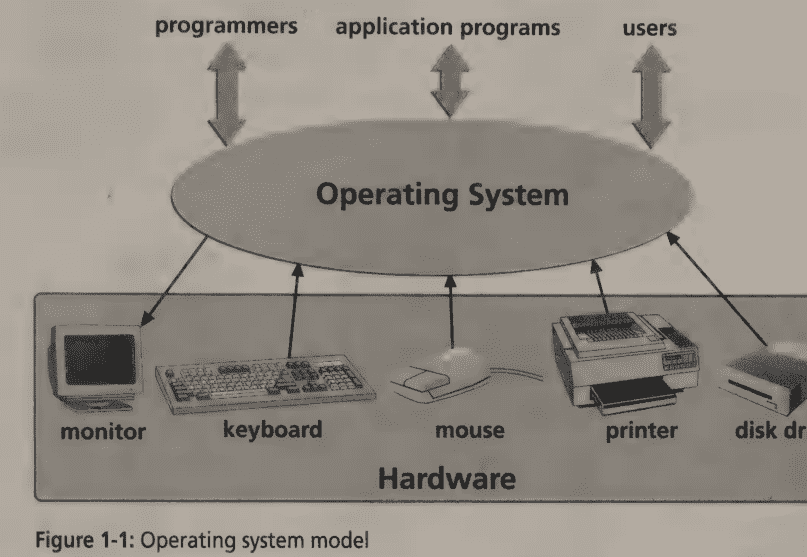

不同的计算机系统可能拥有不同的操作系统。例如，个人计算机最常见的操作系统是 DOS、OS/2 和 Windows。大型机可能使用 Digital Equipment 的 VMS 操作系统或 IBM 的 MVS。网络也有操作系统，例如 Novell NetWare 和 Windows NT。UNIX 是工作站的领先操作系统，工作站是相互连接在局域网上的强大计算机。

## PC 操作系统

个人计算机系统或 PC 通常是一台独立的机器，如台式机或笔记本电脑。PC 操作系统在单台计算机上执行所有的输入、输出、处理和存储操作。图 1-2 标识了一些流行的 PC 操作系统。

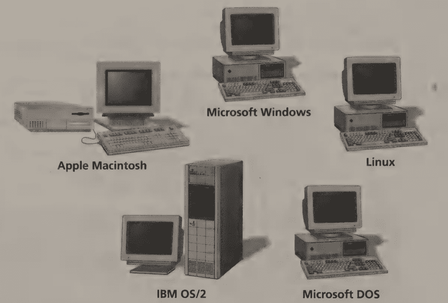

图 1-2：常见的个人电脑操作系统

## 大型机操作系统

大型机操作系统控制大型机系统，这是一种拥有多个处理器的大型计算机系统，可为众多用户执行输入、输出、处理和存储操作。从历史上看，大型机系统在企业级计算领域一直非常流行。图 1-3 展示了一些知名的大型机操作系统及其制造商。

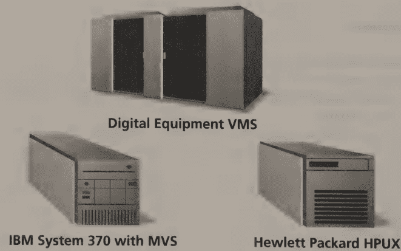

图 1-3：常见的大型机操作系统

## 网络操作系统

计算机**网络**将个人电脑的便利性和易用性与大型机的处理能力相结合。网络允许多个用户共享计算机资源和文件。**网络操作系统**控制**服务器**计算机（有时也称为**主机**计算机）的操作，该服务器接受来自运行在其他机器（称为**客户端**）上的用户程序的请求。图 1-4 展示了网络中服务器和客户端之间的关系。


**图 1-4：** 网络中服务器和客户端的关系

在集中式方法中，所有用户的数据和应用都存放在服务器上。这种类型的网络被称为**基于服务器的网络**。系统管理员通过保护服务器来确保网络中所有信息的安全。系统管理员可以轻松地维护用户的应用程序，并直接在服务器上执行备份操作。然而，如果服务器发生故障，整个网络将会失效。

**对等（Peer-to-peer）** 网络最适合小型网络，与基于服务器的网络相比，它们的分布性更强。在对等网络配置中，网络上的每个系统既是服务器又是客户端。数据和应用不是集中存放的，而是分布在网络中的各个独立系统上。软件升级和备份操作必须在每台计算机本地执行。在每台计算机上实施的安全措施并不统一。网络中的每个用户在某种程度上都要负责管理自己的系统。尽管对等网络给系统管理员带来了一些缺点，但个人用户不依赖于中央服务器。如果网络中有一台计算机发生故障，其他系统仍可继续运行。

## 介绍 UNIX 操作系统

UNIX 是一个多用户、多任务操作系统，内置网络功能。它可以用于以下类型的系统：

- 基于服务器的网络中的专用服务器
- 连接到基于服务器的网络的客户端工作站
- 连接到对等网络的客户端/服务器工作站
- 未连接到网络的独立工作站

UNIX 是一个**多用户系统**，允许许多人同时访问和共享服务器计算机的资源。用户必须先输入用户名和密码才能**登录**，然后才允许使用多用户系统。此验证过程保护每个用户的隐私，并保护系统免受未经授权的使用。**多任务系统**允许一个用户同时运行多个程序。例如，在多任务系统中，您可以在前台更新记录，同时在后台打印文档。

UNIX 也是一个可移植的操作系统。其**可移植性**意味着它可用于各种计算环境。事实上，UNIX 运行的计算机种类比其他任何操作系统都要多。它还连接到互联网，运行诸如**文件传输协议（FTP）**等流行程序（FTP 是用于发送文件的互联网协议）；以及 **Telnet**（一种互联网终端仿真程序）。Dominion Consulting 选择 UNIX 作为其计算机系统的操作系统，因为许多员工必须在不同种类的计算机上同时执行各种任务。

## UNIX 简史

贝尔实验室的一群程序员在 20 世纪 70 年代初最初开发了 UNIX。贝尔实验室以源代码形式分发 UNIX，因此任何使用 UNIX 的人都可以按需进行定制。受其可移植性和低成本吸引，大学开始修改 UNIX 代码以使其在不同机器上运行。最终，演进出两个标准的 UNIX 版本：AT&T 生产了 System V，加州大学伯克利分校开发了 BSD。利用这两个版本的功能，Linux 可能是比其前身更集成的 UNIX 版本。目前，POSIX 项目（由来自工业界、学术界和政府专家的共同努力组成）正在努力标准化 UNIX。

## UNIX 概念

UNIX 开创了已应用于其他操作系统的概念。例如，Microsoft DOS 和 Microsoft Windows 采用了原始的 UNIX 设计理念，如**外壳（shell）**（用户与操作系统之间的接口）的概念，以及目录和子目录的层次结构。

构成操作系统的分层组件概念也起源于 UNIX。软件层包围着计算机系统的核心，以保护其关键的硬件和软件组件，并管理核心系统及其用户。图 1-5 展示了 UNIX 系统的层如何形成金字塔结构。

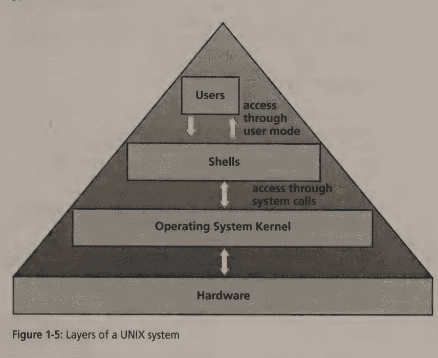

金字塔底部是硬件，顶部是用户。这些层提供绝缘效果，确保系统安全和用户隐私。**内核（kernel）**是基础操作系统，直接与硬件交互并为用户程序提供服务。它仅通过**内核模式**可访问，该模式专供系统管理员使用。这防止了未经授权命令侵入支持整个 UNIX 结构的**基础层**或硬件。**用户模式**提供了对更高层的访问权限，所有应用软件都驻留在这些层中。

这种分层方法以及所有其他 UNIX 功能，都是由程序员为程序员设计的，用于复杂的软件开发。由于程序员使用 C 编程语言编写了 UNIX，因此它可以安装在任何拥有 C 编译器的计算机上。其可移植性、灵活性和强大功能使 UNIX 成为网络操作系统的合理选择。随着一种名为 Linux 的新 PC 版本的出现，UNIX 的流行度正在增加。

## Linux 和 UNIX

Linux 是一个类 UNIX 操作系统。Linus Torvalds 最初创建了 Linux，并在 1991 年将其免费发布给公众。现在有许多公司分发 Linux 的专业版本。

Linux 免费提供 UNIX 的所有复杂性。它足够强大，可以处理大型任务，并具备商业 UNIX 版本的所有网络功能。您可以在 PC 上安装 Linux，它可以与其他操作系统共存，让您测试自己的 UNIX 技能。所有这些特性使 Linux 成为学习 UNIX 的优秀方式，即使您有其他运行 UNIX 的计算机可供访问。

## 介绍 UNIX 外壳

**外壳（shell）** 是一个 UNIX 程序，用于解释您从键盘输入的命令。UNIX 提供几种外壳，包括 Bourne 外壳、Korn 外壳和 C 外壳。AT&T 贝尔实验室的 Steve Bourne 开发了**Bourne 外壳**作为第一个 UNIX 命令处理器。另一位贝尔实验室员工 David Korn 开发了 Korn 外壳。与 Bourne 外壳兼容，**Korn 外壳**包含许多扩展功能，例如历史功能，允许您使用键盘快捷键检索之前输入的命令。**C 外壳**是为 C 程序员设计的。Linux 使用免费软件 **Bash 外壳**作为其默认命令解释器。其名称是“Bourne Again Shell”（再次出生的 Bourne 外壳）的缩写，并包含 Korn 外壳和 Bourne 外壳的最佳特性。无论使用哪种外壳，您与 UNIX 的通信始终通过外壳解释器进行。图 1-6 展示了外壳在 UNIX 操作系统中的角色。

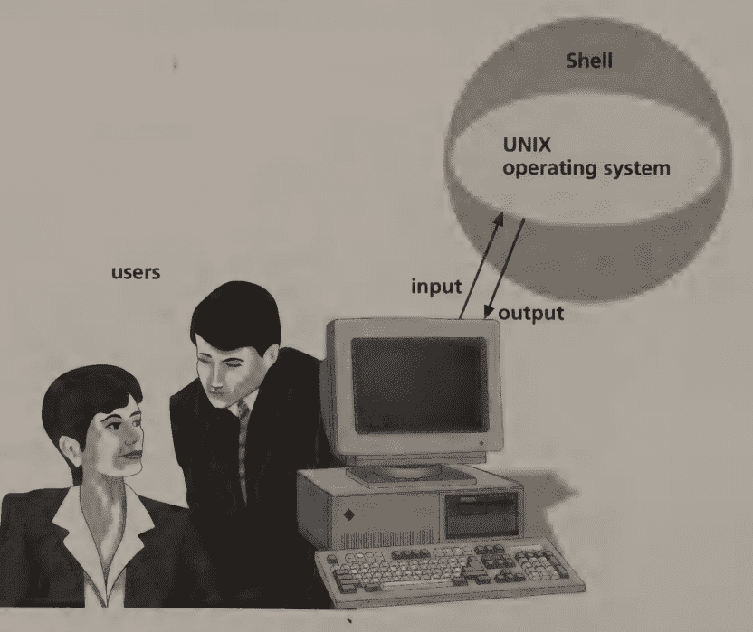

### 选择你的 Shell


在使用 UNIX 系统之前，你需要确定哪个 Shell 将作为你的命令解释器。Shell 的作用远不止解释命令：每个 Shell 都有大量内置命令，实际上使它们成为一流的编程语言。（你将在第 6 章和第 7 章中深入研究这一主题。）当系统管理员设置你的用户账户时，你会选择一个 Shell。大多数用户选择 Bash Shell，但你可以选择以下任何一个：

- Bourne
- Korn
- C shell
- Bash
- `tcsh`（一种从 C shell 衍生而来的免费 Shell）
- `zsh`（一种从 Korn shell 衍生而来的免费 Shell）

## 在 Shell 之间切换

选择好 Shell 后，系统管理员会将其记录在你的账户记录中，它将成为你指定的 Shell。UNIX 会在你每次登录时使用这个 Shell。但是，你可以通过在命令行输入 Shell 的名称（例如 `tcsh`、`bash` 或 `zsh`）来从一个 Shell 切换到另一个。你将一直使用该 Shell，直到你再次登录或在命令行输入另一个 Shell 名称。用户经常使用一个 Shell 来编写 Shell 脚本（程序），而使用另一个来与程序交互。

## 选择用户名和密码

在能够使用 UNIX 及其程序之前，你必须通过提供独特的用户名和密码来登录。决定一个你想用来向 UNIX 系统标识自己的名字，例如“aquinn”。这也是其他 UNIX 系统用户向你发送电子邮件时使用的同一个名字。UNIX 只识别用户名的前八个字符，因此请选择一个不超过八个字符的用户名。

你还必须选择一个密码，密码长度必须包含五个或更多字符。密码应该让你容易记住，但让其他人难以猜到，例如用大小写字母、数字和连字符混合书写的你的出生日期。密码可以包含字母、数字和标点符号，但不能包含控制字符。

只要你在主机（服务器）计算机上有用户账户和密码，你就可以登录到任何 UNIX 或 Linux 系统。UNIX 系统管理员通过添加你的用户名（也称为*登录名或用户 ID*）和密码来创建你的账户。为了使用本书和实践教程，你必须通过以下任一方法连接到 UNIX 或 Linux 系统并建立账户：

- 通过 Telnet 连接到远程计算机
- 作为 UNIX 客户端/服务器网络上的客户端
- 作为对等局域网（每个计算机都安装了 Linux 操作系统）上的对等节点
- 在安装了 Linux 操作系统的独立 PC 上
- 通过连接到 UNIX 主机通信端口的哑终端，如 Wyse 终端

你连接到 UNIX 系统所采取的步骤取决于你使用的连接类型。最简单的连接是用户终端，一旦打开就会显示登录提示。你也可以通过互联网服务提供商（ISP）访问互联网，并连接到远程 UNIX 主机。

## 使用 Telnet 连接到 UNIX

Telnet 是一种终端仿真程序。它在你的计算机上运行，并将你的 PC 连接到网络上的服务器或主机。然后，你可以登录到 UNIX 主机并开始使用 UNIX。

互联网上的每台计算机都有一个互联网协议（IP）地址。IP 地址是由句点分隔的一组四个数字，例如 `172.16.1.61`。互联网上的大多数系统还有一个域名，例如 *Lunar.campus.edu*。IP 地址和域名都用于识别网络上的系统。Telnet 等程序使用 IP 地址或域名来访问远程系统。

**要通过 Telnet 访问 UNIX 主机：**

1. 找到远程主机的 IP 地址或域名。
2. 如有必要，连接到互联网。如果你使用 PPP 连接拨号到 ISP，请建立该连接。如果你在工作或学校使用全时互联网连接，请忽略此步骤。
3. 启动你的 Telnet 程序并连接到 UNIX 系统。

按照你的 Telnet 程序的说明连接到远程主机。通常，你必须提供主机名才能连接到 UNIX 系统。例如，你可以在 Windows 95/98 MS-DOS 窗口中的提示符后输入以下命令，以访问系统 *Lunar.campus.edu*。

```
telnet Lunar.campus.edu
```

## 登录到 UNIX

连接到 UNIX 系统后，你必须通过输入用户名和密码来登录。你会看到一个请求登录或用户名以及密码的提示。出于安全原因，当你输入密码时，密码不会出现在屏幕上。如果没有经过授权的用户账户，如果密码失败，或者在输入姓名和密码之前等待时间过长，你就无法登录。请联系你的系统管理员寻求帮助。

登录成功后，你就可以开始使用该系统了。

## 输入命令

要与 UNIX 交互，你需要输入一个命令，即你在命令提示符后输入的文本。当你完成命令的输入时，按下 Enter。UNIX 是区分大小写的，也就是说，它区分大写字母和小写字母，因此 *john* 与 *John* 不同。大多数 UNIX 命令用小写输入。命令分为两类：用户级命令，你输入它们来执行任务，如检索信息或与其他用户通信；以及系统管理命令，系统管理员使用它们来管理系统。

你必须知道命令的语法才能正确输入它。语法指的是命令的格式和措辞，以及你可以用来扩展和修改其功能的选项和参数。大多数命令是单个单词。如果你使用正确的语法输入命令，UNIX 将执行该命令。否则，你会收到一条消息，表示 UNIX 无法解释你的命令。

> **提示**
>
> 附录 B《UNIX 命令语法指南》按字母顺序列出了本书中的所有命令，并告诉你如何输入每个命令以及如何使用其选项。

你在屏幕上输入命令的位置称为命令行。命令使用以下语法：

| 语法 | command_name [-option] [value] |
| :--- | :--- |
| 解析 | - `command_name` 指定要执行的操作。在本书的语法说明中，命令名称以粗体显示。<br>- 命令选项是请求 UNIX 以特定风格或变体执行命令的方式。选项跟随命令名称之后，以空格分隔。它们通常以连字符（-）开头。选项也是区分大小写的。例如，-R 与 -r 不同。你不需要在每个命令后都输入选项；但是，除非你指定了选项，否则某些命令无法工作。在本书的语法说明中，当命令不要求选项时，选项会用方括号（[ ]）列出。<br>- 命令参数跟随命令选项之后，以空白分隔。命令参数通常是文件和目录名称。在本书的语法说明中，参数以斜体显示。如果命令不要求参数，方括号会围绕参数。 |

### date 命令

使用 UNIX `date` 命令显示系统日期，该日期由系统管理员维护。由于多用户系统上的日期和时间对于平滑处理至关重要，只有系统管理员可以更改日期。你在 Dominion Consulting 开始 UNIX 培训时，首先检查系统日期。

**要显示你的系统日期：**

1. 在命令行中输入 `date`，并按下 Enter。

将出现如下所示的日期：

```
Mon Apr 20 21:30:08 EST 2000
```

你可能会看到 EDT（东部夏令时）而不是 EST（东部标准时间）的缩写，或者其他时区缩写，如 PDT（太平洋夏令时）或 CST（中部标准时间）。还要注意，UNIX 使用 24 小时制时钟。

2. 在命令行中输入 `Date`，并按下 Enter。你会看到以下系统错误消息：

```
bash: Date: command not found
```

出现系统错误消息是因为，就像大多数 UNIX 命令一样，你必须用小写字母输入 `date` 命令。

`date` 命令有一个选项 `-u`，它显示格林尼治标准时间（GMT）——GMT 也称为协调世界时，其缩写为 UTC。

**要显示你的系统日期：**

- 在命令行中输入 `date -u`，并按下 Enter。

将出现如下所示的日期：

```
Mon Apr 20 23:43:148 UTC 2000
```

### cal 命令

使用 `cal` 命令显示系统日历。你在 Dominion 的经理 Rolf Williams 建议你，这是常用于安排任务和事件的命令。

**要显示你的系统默认日历：**

1. 在命令行中输入 `cal`，并按下 Enter。没有选项时，`cal` 命令显示当前月份的日历。假设当前月份是 2000 年 7 月，你会看到图 1-7 中显示的默认日历。

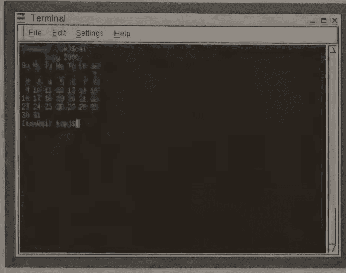

图 1-7：`cal` 命令示例（当前月份）

2. 在命令提示符下输入 `cal -j 2000`，然后按 Enter 键。`-j` 选项以儒略日格式显示日期。换句话说，它显示从 1 开始到 366 结束的日期数字，如图 1-8 所示。

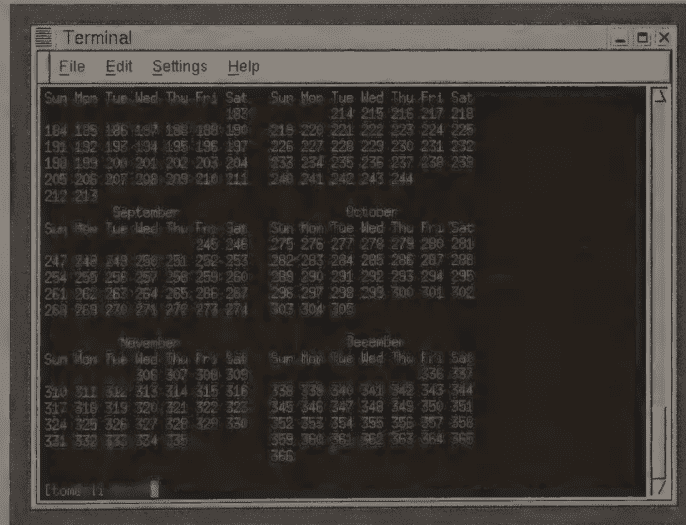

图 1-8：`cal` 命令示例（全年——儒略日）

3. 要确定《独立宣言》签署时的星期几，在命令提示符下输入 `cal 7 1776`，然后按 Enter 键。您应该看到一个类似图 1-9 中的日历。在这种情况下，月份和年份是命令参数。

#### 帮助

> 如果您输入 `cal may 1999`，您会看到一条错误信息，因为必须使用数字来表示月份，例如用 `5` 表示五月。


```
cal: illegal month value: use 1-12
```

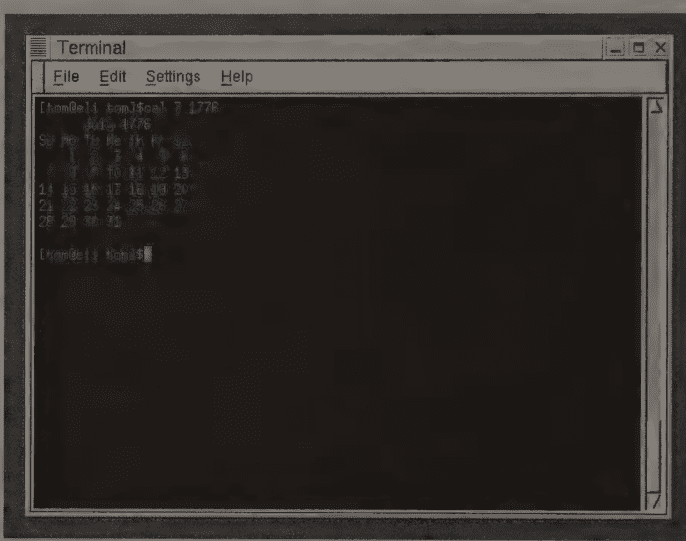

### who 命令

在多用户系统中，了解谁登录到系统可能很有用。使用 `who` 命令可以查看谁正在使用系统以及他们当前的位置。在 Dominion，`who` 是一个有用的命令，可以帮助您了解同事。

**使用 `who` 命令确定谁已登录到系统：**

1. 在命令提示符下输入 `who`，然后按 `Enter` 键。

2. 您会看到一个类似下方的列表，显示用户名、他们使用的终端以及登录的日期和时间。

```
root  tty1  Aug 12  07:56
ellen tty1  Aug 12  08:15
john  tty2  Aug 12  08:15
jerry tty3  Aug 12  08:21
```

3. 要显示带列标题的 `who` 命令输出，请输入 `who -H` 并按 `Enter` 键。您会看到一个类似下方的列表。

```
USER LINE LOGIN-TIME FROM
root tty1 Aug 12 07:56
ellen tty1 Aug 12 08:15
john tty2 Aug 12 08:15
jerry tty3 Aug 12 08:21
```

如果当前有用户从远程主机登录，FROM 列将显示该主机的名称。

4. 空闲时间是用户在会话中没有活动的持续时间。输入 `who -i` 并按 `Enter` 键可查看每个用户的空闲时间。您会看到一个类似下方的列表。

```
root tty1 Aug 12 07:56 00:29
ellen tty1 Aug 12 08:15 .
john tty2 Aug 12 08:15 00:01
jerry tty3 Aug 12 08:21 old
```

输出显示，以 root 身份登录的人在最近 29 分钟内没有进行任何活动，而 John 的会话已空闲一分钟。Ellen 那一行上的句点表示她的会话在最近一分钟内处于活动状态。Jerry 那一行上的“old”一词表示过去 24 小时内没有活动。

5. 如果您希望在同一命令行上使用多个选项，请在单个连字符后输入它们。例如，输入 `who -iH` 并按 `Enter` 键，即可查看带有空闲时间和列标题的用户列表。您会看到一个类似下方的列表。

```
USER LINE LOGIN-TIME IDLE FROM
root tty1 Aug 12 07:56 00:29
ellen tty1 Aug 12 08:15 .
john tty2 Aug 12 08:15 00:01
jerry tty3 Aug 12 08:21 old
```

6. 输入 `who -q` 并按 `Enter` 键，以查看当前用户的快速列表。您会看到一个类似下方的列表，其中仅显示登录名称和系统中的用户总数。

```
root ellen john jerry
# users=4
```

7. 要确定您正在使用的终端或登录时间，请在命令提示符下输入 `who am I`，然后按 `Enter` 键。您会看到类似下方的一行。它显示了您的用户名、终端以及您登录的日期和时间。

```
lucky.campus.edu|ellen tty1 Aug 12 08:15
```

上述输出显示，您已作为用户 ellen 登录到系统 lucky.campus.edu。

注意：每当您向 `who` 命令提供两个参数时，您都会看到第 7 步中描述的输出。例如，您可以输入 `who are you` 或 `who x x`，以查看相同的信息。传统上，UNIX 用户输入 `who am I` 来查看描述其会话的信息。

## 命令行编辑

Shell 支持某些按键用于执行命令行编辑。例如，Bash（默认的 Linux shell）支持左箭头和右箭头键，它们用于在命令行上移动光标。其他按键与 `Ctrl` 或 `Alt` 键组合使用，以触发其他编辑操作。

注意：并非所有 shell 都以相同的方式支持命令行编辑。以下步骤适用于 Bash shell。

**编辑在命令行上输入的命令：**

1. 要确定您正在使用哪个 shell，请输入 `echo $SHELL` 并按 `Enter` 键。如果您正在使用 Bash shell，您将看到以下输出。

   `/bin/bash`

   如果您没有使用 Bash shell，请输入 `bash` 并按 `Enter` 键。

2. 输入 `who am I`，但*不要*按 `Enter` 键。

3. 按 `左箭头` 键，将光标移动到单词 `am` 中的字母 `a`。

4. 按 `Alt+D` 删除单词“am”。

5. 按 `Ctrl+K` 删除从当前光标位置开始的命令行。

6. 按 `Ctrl+A` 将光标移动到命令行的开头。

7. 再次按 `Ctrl+K` 删除命令行。

8. 重新输入命令 `who am I`，但*不要*按 `Enter` 键。

9. 按 `Alt+B` 三次。每次按下该组合键时，观看光标移动到前一个单词的第一个字符。光标应位于行的开头。

10. 按 `Alt+F` 三次。每次按下该组合键时，光标都会移动到下一个单词第一个字符之前的位置。

11. 按 `Ctrl+A`，然后按 `Ctrl+K` 以清除命令行。

## 多条命令输入

您可以通过用分号 (`;`) 分隔每个命令，在命令行上输入多条命令。当您按 Enter 键时，UNIX 将按照您输入的顺序执行这些命令。

**在命令行上输入多条命令：**

- 输入 `date; who -h` 并按 `Enter` 键。您会看到类似以下内容的信息：

  `Mon Apr 20 21:35:09 EST 2000`

  `USER  LINE  LOGIN-TIME    IDLE     FROM`

  `root  tty1  Apr 20 07:56  00:29`

  `ellen tty1  Apr 20 08:15  .`

  `john  tty2  Apr 20 08:15  00:01`

  `jerry tty3  Apr 18 08:21  old`

  `date` 命令生成上述输出的第一行。其余输出是 `who` 命令的结果。

## clear 命令

随着您继续输入命令，屏幕可能会变得杂乱。除非您需要参考之前输入的命令及其输出，否则您可以使用 `clear` 命令清除屏幕。它没有选项或参数。

**清除屏幕：**

- 在命令行上输入 `clear`，并按 `Enter` 键。现在命令提示符位于屏幕的左上角。

## 命令行历史

您常常发现自己会在短时间内多次输入相同的命令。大多数 shell 会保留最近使用命令的列表，并允许您在不重新输入的情况下召回命令。您可以使用向上和向下箭头键访问命令历史。按一次向上箭头键可召回最近使用的命令。按两次向上箭头键可召回最近使用的第二个命令。每次按下向上箭头键，您都会召回更旧的命令。每次按下向下箭头键，您都会在命令历史中向前滚动。当您找到要执行的命令时，按 Enter 键。

**使用命令行历史：**

1. 输入 `date` 并按 `Enter` 键。

2. 输入 `who` 并按 `Enter` 键。

3. 输入 `who -iH` 并按 `Enter` 键。

4. 输入 `clear` 并按 `Enter` 键。

5. 按 `向上箭头` 键四次。`date` 命令被召回到命令行。*不要*按 `Enter` 键。

6. 按 `向下箭头` 键两次。`who -iH` 命令被召回到命令行。按 `Enter` 键执行该命令。

# man 程序

作为参考，UNIX 包含一个在线手册，其中包含所有命令，包括它们的选项和参数。UNIX 中的 `man` 程序显示这个在线手册，称为 man 页面，用于提供命令行辅助。虽然某些命令的 man 页面包含的信息比其他命令多，但大多数 man 页面列出以下项目。

- **Name**：命令的名称以及描述其目的的简短说明

- **Synopsis**：显示命令用法的语法图

- **Description**：比名称项更详细的命令描述

- **Options**：命令选项及其目的的列表

- **See Also**：提供相关信息的其他命令或 man 页面

- **Bugs**：该命令已知错误的列表

`man` 程序通常只接受一个参数——您想了解更多信息的命令的名称。在线手册显示了您的系统接受的有效命令格式。要关闭在线手册，请输入 `q`。

您决定为自己和 Dominion 的其他人显示关于 `who` 命令和 `man` 程序的信息。

**显示命令的在线帮助：**

1. 在命令提示符下输入 `man who`，并按 `Enter` 键。您会看到图 1-10 中所示的 `who` 命令说明。

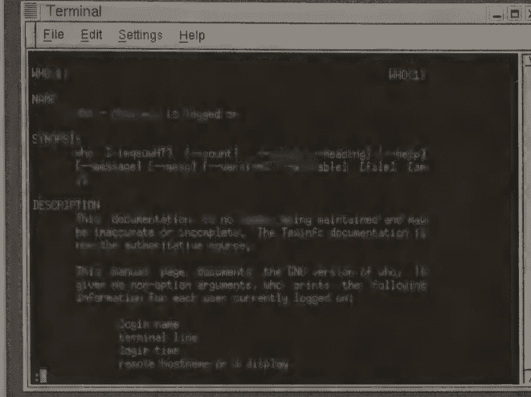

图 1-10：手动页

2. 输入 `q` 退出 `man` 程序。


### 输入 `man man` 并按 Enter。您会看到描述 `man` 命令的手动页。

输入 `q` 退出 `man` 程序。

## whatis 命令

有时您会发现手动页包含的信息比您想看的要多。要显示命令的简要摘要，请使用 `whatis` 命令。`whatis` 命令仅显示命令手动页顶部附近的名称和简短描述。

注意：`whatis` 命令依赖于存储在数据库中的信息。系统管理员必须执行 `makewhatis` 命令，该命令创建数据库，之后 `whatis` 命令才能正常工作。如果 `whatis` 命令没有显示您系统上的命令摘要，系统管理员可能尚未执行 `makewhatis` 命令。

## 注销 UNIX

当您完成当天的工作或因任何原因离开终端时，请注销 UNIX 系统。注销 将终止您的当前进程，并向 UNIX 表明您已完成工作。如何注销取决于您使用的 shell。对于 Bourne、Korn 或 Bash shell，请在命令行上输入 `exit` 或按 `Ctrl+D`。在 C shell 中，请在命令行上输入 `logout`。

- 在命令行中，输入 `exit` 并按 Enter。

## 课程 B

### 目标

完成本课后，您应该能够：

- 讨论系统管理员的角色
- 识别系统管理员和普通用户的命令提示符
- 更改您的个人密码
- 使用 `cat`、`more`、`less`、`head` 和 `tail` 命令在屏幕上查看文件
- 将输出重定向到文件

## 系统管理员和普通用户的角色

### 理解 UNIX 系统管理员的角色

UNIX 系统上有两种类型的用户：系统管理员和普通用户。顾名思义，系统管理员 通过添加新用户、删除旧帐户以及确保系统高效地为所有用户提供服务来管理系统。普通用户 是其他所有用户。系统管理员也被称为 超级用户，因为系统管理员拥有改变系统的无限权限。UNIX 在操作系统最初安装时授予此权限。系统管理员向普通用户授予特权和权限。

系统管理员有一个独特的用户名：`root`。系统管理员 拥有 `root` 帐户，这意味着没有其他任何人可以被分配给该帐户。`root` 帐户的密码是保密的；只有系统管理员和备份人员知道它。如果 `root` 的密码丢失或遗忘，系统管理员使用紧急救援程序重置密码。

### 系统管理员的命令行

普通用户在 `$`（美元符号）命令提示符后输入命令，而系统管理员的提示符是 `#`（井号）符号。UNIX 系统为系统管理员生成默认的命令行提示符设置，格式如下：

```
[ root@hostname ] #
```

在提示符中，`hostname` 是系统管理员登录的计算机名称。

### 普通用户的命令行

`$`（美元符号）传统上与普通用户相关联。UNIX 系统为普通用户生成默认的命令行提示符设置。以下格式在 Linux 系统上很常见：

```
[ user name@hostname ]$
```

在提示符中，`user name` 是用户的登录名，例如 `jean`，而 `hostname` 是用户登录的计算机名称。

## 更改密码

您的用户名或登录名用于向系统识别您。您可以选择自己的用户名并将其提供给系统管理员，系统管理员随后将您添加为新用户。如前所述，UNIX 识别用户名中的最多八个字符，通常是您的名或昵称。用户名是唯一的，但不是保密的，可以提供给其他用户。另一方面，密码是保密的，保护您在系统上的工作。如有必要，您可以使用 `passwd` 命令更改密码。如果您没有密码，请使用 `passwd` 命令创建一个。

只有当新密码与旧密码至少相差三个字符；密码长度超过五个字符，且至少包含两个字母和一个数字；并且密码与您的用户名不同时，UNIX 才允许您更改密码。

您为 Dominion 系统选择的密码——`Gscott956`——与系统上的另一个密码太相似，因此系统管理员要求您更改它。

要更改您的密码：

1. 在命令提示符后输入 `passwd`，并按 Enter。
2. 输入您的新密码并按 Enter。输入新密码时，它不会出现在屏幕上。
3. 重新输入您的新密码并按 Enter，以便 UNIX 确认新密码。

帮助

如果您重新输入以确认的密码与您的新 UNIX 密码不匹配，UNIX 会要求您再次输入密码。UNIX 还可能要求您选择另一个密码，因为您选择的密码太短或太容易被猜到，例如 `password`。

更改密码后，您应该注销并重新登录，以确保 UNIX 识别您的新密码。


提示

> 记住您的密码！每次登录 UNIX 时，您都需要密码。

## 使用 cat、more、less、head 和 tail 命令查看文件

三个 UNIX 命令可让您查看文件的内容：`cat`、`more` 和 `less`。`more` 和 `less` 命令一次显示一屏文件，而 `cat` 命令一次显示整个文件。另外两个命令 `head` 和 `tail` 可让您查看文件的前几行或后几行。

`cat` 命令的名字源自单词 concatenate，意思是连接。通过在 `cat` 命令后输入多个文件名，并用空格分隔，您可以显示多个文件。然后 UNIX 按您输入的顺序显示文件内容。

您在 Dominion 的系统管理员提到，您可以使用 `cat` 命令查看位于 `/etc` 目录中名为 `shells` 的文件。该文件包含系统中有效 shell 程序的列表。

**要查看 shells 文件：**

1. 在命令提示符后输入 `cat /etc/shells`，并按 Enter。使用正斜杠 (`/`) 表示目录或文件夹。您会看到可用 shell 的列表，包括 `/bin/bash`、`/bin/sh`、`/bin/tcsh`、`/bin/csh` 和 `/bin/zsh`。

有时，看到带行号的文件内容显示会有帮助。`-n` 选项使 `cat` 命令在每行输出的开头显示一个数字。

2. 输入 `cat -n /etc/shells` 并按 Enter。您会看到与之前相同的 shell 列表，但这次每行前面都有一个数字。

您还可以查看 `/etc` 目录中另一个名为 `termcap` 的文件。这个多页文件包含有关 Linux 系统支持的所有终端的许多规范。`cat` 命令不是查看这个比一屏更长的文件的实用方法。但是，您可以使用 `more` 和 `less` 命令逐屏阅读大文件。

**使用 more 命令在屏幕上查看大文件的内容：**

1. 在命令提示符后输入 `more /etc/termcap`，并按 Enter。
2. 按空格键滚动到下一屏。
3. 通过输入 `q`（表示退出）终止显示。

**使用 less 命令在屏幕上查看大文件的内容：**

1. 在命令提示符后输入 `less /etc/termcap`，并按 Enter。您会在屏幕上看到一个长文本文件。
2. 多次按下向下箭头键，在文件中逐行向前滚动。
3. 多次按下向上箭头键，在文件中逐行向后滚动。
4. 按 Pg Dn、Space、`z` 或 `f` 向前滚动一屏。
5. 按 Pg Up 或 `b` 返回上一屏。
6. 当您在屏幕底部看到冒号 (`:`) 时，输入 `q`（表示退出）终止显示。

有时您只需要瞥见文件内容的一部分来确定文件中存储的是什么。`head` 命令向您显示文件的前几行——默认情况下是前 10 行。

**要查看文件的前几行或后几行：**

1. 输入 `head /etc/termcap` 并按 Enter，查看 `/etc/termcap` 文件的前 10 行。
2. `-n` 选项指定 `head` 命令显示的线条数。输入 `head -n 5 /etc/termcap` 并按 Enter。您会看到 `/etc/termcap` 文件的前五行。
3. `tail` 命令向您显示文件的后几行。与 `head` 命令一样，`tail` 默认显示 10 行。输入 `tail /etc/termcap` 并按 Enter，查看 `/etc/termcap` 文件的后 10 行。
4. `-n` 选项指定 `tail` 命令显示的线条数。输入 `tail -n 5 /etc/termcap` 并按 Enter。您会看到 `/etc/termcap` 文件的后五行。

## 重定向输出

在 UNIX 中，大于号 (`>`) 被称为重定向符号。您可以将重定向符号附加到产生输出的命令上，通过该方式创建新文件或覆盖现有文件。实际上，您“重定向”输出到磁盘文件而不是监视器。您已经使用 `who` 命令查找 Dominion 系统中谁已登录。现在，您可以使用相同的命令和重定向符号将此信息保存到文本文件中。

## 若要保存到一个列出系统登录人员的文件中：

1. 在命令提示符后输入 `who > current_users`，然后按 Enter 键。`who` 命令的输出不会显示在屏幕上，而是重定向到一个名为 `current_users` 的新磁盘文件。UNIX 会将此文本文件放置在当前目录（即当前正在使用系统的磁盘文件夹）中。


2. 在命令提示符后输入 `cat current_users`，然后按 Enter 键，即可查看当前正在使用系统的用户列表，类似于下方所示。

| | | | |

|---|---|---|---|

| jean | tty1 | 2月 7日 | 07:15 |

| joseph | tty2 | 2月 7日 | 07:15 |

| becky | tty3 | 2月 7日 | 08:05 |

你也可以使用重定向符号配合 `cal` 命令将日历保存到文本文件中。例如，假设你将参与一个 Dominion 开发项目，预计截止时间为 2000 年。你可以将日历保存为文本文件。

## 若要保存 2000 年的日历到文件中：

1. 在命令提示符后输入 `cal 2000 > year_2000`，然后按 Enter 键。这将创建一个名为 `year_2000` 的文本文件。

2. 输入 `less year_2000` 并按 Enter 键，以查看由上一条命令创建的日历。使用方向键、Pg Dn、Pg Up 以及其他键在文件中滚动。

3. 输入 q（代表 quit，即退出）以终止显示。

你也可以使用 `cat` 命令通过键入的信息来创建文件。在命令提示符后输入 `cat>filename`，其中 `filename` 是你正在创建的文件名。然后按 Ctrl+D 结束从键盘输入数据。

仅当你想要覆盖现有文件时，才使用重定向符号 (>) 将输出发送到已存在的文件。若要向现有文件追加输出，请使用两个重定向符号 (>>)。这会在不覆盖该文件的情况下，将信息添加到现有文件的末尾。

在使用 UNIX 工作时，你记得你的主管 Rolfé Williams 要求你在本周末前完成几项任务。你决定创建一个任务提醒的笔记文件。

## 若要创建一个新文件：

1. 在命令提示符后输入 `cat > notes`，然后按 Enter 键。

2. 输入以下内容：记得订购新的 CD-ROM，并在周四前发送报告，然后按 Enter 键。

3. 按 Ctrl+D。

4. 若要查看刚刚创建的文件，在命令提示符后输入 `cat notes` 并按 Enter 键。你在步骤 2 中输入的句子会显示在屏幕上。

创建笔记文件后，你想起 Rolfé Williams 还要求你完成另一项任务。你可以将该提醒追加到现有的笔记文件中。你还想在文件中包含相应的月度日历以供参考。

## 若要向现有文件添加信息：

1. 在命令提示符后输入 `cat >> notes`，然后按 Enter 键。

2. 输入以下内容：也要记得预订九月的会议，然后按 Enter 键。

3. 按 Ctrl+D。

4. 若要将日历添加到你的笔记中，输入 `cal 9 2000 >> notes`。

5. 输入 `less notes` 以查看文件。

## 摘要

- 操作系统是最基础的计算机程序。它控制所有计算机资源，并提供应用程序使用或编写的基础。

- 基于服务器的网络是集中式的。所有用户的数据和应用程序都驻留在服务器上，由系统管理员进行保护、维护和备份。基于服务器的网络中的每台计算机都依赖该服务器。所有对等网络中的系统都同时充当服务器和客户端。网络的安全和维护分布在每个系统中。如果对等网络中的某台系统发生故障，其他系统将继续运行。

- UNIX 操作系统是一个多用户系统，允许多人同时访问和共享计算机。它也是一个多任务操作系统：它可以同时执行多个任务。

- UNIX 系统可以配置为基于服务器的网络中的专用服务器、基于服务器的网络中的客户端工作站、对等网络中的客户端/服务器工作站，或不连接到任何网络的独立工作站。

- 组成操作系统的分层组件概念起源于 UNIX。包围计算机系统中枢核心的软件层保护关键的硬件和软件组件，并将核心系统与用户隔离。

- Linux 是一种类 UNIX 操作系统，你将其安装在个人电脑上。它与 Windows 和 MS-DOS 等其他操作系统共存。

- 在 UNIX 中，你通过一个名为 shell 的解释器与操作系统程序进行通信，该解释器解释你从键盘输入的命令。UNIX 提供几个 shell 程序，包括 Bourne、Korn 和 C shell。Bash shell 提供了来自 Bourne 和 Korn shell 的增强功能。它是 Linux 系统上最受欢迎的 shell。

- 在 UNIX 中，系统管理员为普通用户设置账户。为了设置你的账户并保护系统的隐私和安全，你需要选择并向系统管理员提供你的用户名和密码。只要你在主机（服务器）计算机上有用户账户和密码，你就可以在任何地方登录到任何 UNIX 或 Linux 系统。你还可以使用 Microsoft Windows Telnet 程序登录到远程 UNIX 系统。

- 你输入用于操作 UNIX 的命令具有严格的语法，你可以通过参考名为 man pages 的在线手册来学习。使用 man 程序显示命令的语法规则。使用 whatis 命令查看命令的简要描述。使用 who 命令列出谁已登录以及他们所在的位置。使用 cal 命令显示所有或选定月份的系统日历。当你决定停止使用 UNIX 时，使用 exit 或 logout 命令注销。

- 大多数 shell 提供基本的命令行编辑功能，并保留最近使用命令的历史记录。使用向上和向下箭头键在最近使用的命令列表中向前和向后滚动。你可以通过用分号分隔来在单个命令行中输入多个命令。UNIX 按你输入的顺序执行命令。

- 你可以使用查看命令来查看文件内容。使用 cat 命令通过从键盘输入信息来创建文件。使用 less 和 more 命令显示多页文档。使用 head 和 tail 命令查看文件的前几行或后几行。

## 命令摘要

### 第 1 章命令

| 命令 | 目的 | 本章涵盖的选项 |
| :--- | :--- | :--- |
| `cal` | 显示系统日历 | `-j` 显示儒略日格式 |
| `cat` | 显示多个文件 | `-n` 显示行号 |
| `clear` | 清除屏幕 | |
| `date` | 显示系统日期 | `-u` 显示格林尼治平均时间 |
| `exit` 或 `logout` | 退出 UNIX | |
| `head` | 显示文件的前几行 | `-n` 显示指定文件的前 `n` 行 |
| `less` | 一次显示一屏长文件并上下滚动 | |
| `man` | 显示指定命令的在线手册 | |
| `more` | 一次显示一屏长文件并向下滚动 | |
| `passwd` | 更改你的 UNIX 密码 | |
| `tail` | 显示文件的最后几行 | `-n` 显示指定文件的最后 `n` 行 |
| `whatis` | 显示命令的简要描述 | |
| `who` | 查看谁已登录到 UNIX | `-H` 显示列标题<br>`-i` 显示会话空闲时间<br>q 显示用户快速列表 |

## 复习题

1. UNIX 命令区分大小写。你必须以哪种大小写输入它们？

   a. 大写

   b. 小写

   c. 句子大小写，即第一个字母大写，其余小写

   d. 大写和小写的任意组合

2. UNIX 命令的组件按什么顺序给出？

   a. 名称、参数、选项

   b. 名称、选项、参数

   c. 选项、名称、参数

   d. 参数、选项、名称

3. 以下哪项陈述是错误的？

- a. Linux 与 UNIX 兼容。

- b. 普通用户无法更改系统日期。

- c. UNIX 操作系统包含一个内核。

- d. 选择 Shell 后无法再更改。

4. 在 ________________________ 网络中，所有用户的数据和应用都集中存储在一个系统上。

- a. 对等

- b. 基于服务器

- c. 独立

- d. 工作站

5. UNIX 可以被配置为运行 ________________________。

- a. 作为基于服务器网络中的服务器

- b. 作为基于服务器网络中的客户端工作站

- c. 作为对等网络中的客户端/服务器工作站

- d. 以上所有

6. 登录需要什么？

- a. 用户名和密码

- b. 仅密码

- c. 内核

- d. Shell

7. 使用 UNIX date 命令可以 ________________________。

- a. 显示系统日历

- b. 显示未来任何日期

- c. 重置系统日期

- d. 显示系统日期

8. man 程序提供 ________________________。

- a. 编程指南

- b. 命令语法的在线参考

- c. 文件模板

- d. 操作系统版本

9. whatis 命令提供 ________________________。

- a. 命令的简要描述

- b. 比 man 程序提供的更详细的命令描述

- c. 连接到系统的硬件设备描述

- d. UNIX 操作系统在线教程

10. 默认情况下，cal 命令显示 ________________________。

- a. 当前系统日期

- b. Shell 列表

- c. 当前月和年的日历

- d. cal 文件的内容


## 测验题

### 11. 哪种类型的操作系统最能描述 UNIX？
- a. 多用户、多任务操作系统
- b. 无法在独立 PC 上运行的操作系统
- c. 与图形用户界面绑定的操作系统
- d. 可移植的单用户操作系统

### 12. 为什么 UNIX 操作系统设计为分层结构？
- a. 为了提高速度
- b. 为了允许网络通信
- c. 为了允许其他操作系统与其通信
- d. 为了从用户环境控制对核心系统的访问

### 13. 使用 `cat` 命令查看文件时，你可以 _____________。
- a. 编辑该文件
- b. 仅查看该文件
- c. 对该文件进行拼写检查
- d. 删除该文件

### 14. 使用 `cat > filename` 命令创建文件后，如果你再次对同一文件名使用该命令，你将 _____________。
- a. 向文件追加新信息
- b. 覆盖该文件
- c. 创建一个新文件
- d. 删除该文件

### 15. `less` 命令是对 ___________ 命令滚动限制的改进。
- a. `cat`
- b. `more`
- c. `clear`
- d. `date`

### 16. UNIX 识别用户名或登录名的前 ____________ 个字符。
- a. 四个
- b. 六个
- c. 八个
- d. 十二个

### 17. 与 `who` 命令一起使用的 `-i` 选项显示 _____________。
- a. 你的登录名
- b. 列标题
- c. 用户空闲时间信息
- d. 当前登录的用户数量

### 18. 密码不应包含 _____________。
- a. 数字
- b. 大写字母
- c. 控制字符
- d. 下划线字符

### 19. `>` 符号可以与 __________ 结合使用以创建输出文件。
- a. `cat` 命令
- b. 任何写入标准输出的命令
- c. `who` 命令
- d. `cal` 命令

### 20. __________ 命令仅显示文件的前几行或后几行。
- a. `first` 和 `last`
- b. `cat -first` 和 `cat -last`
- c. `viewhead` 和 `viewtail`
- d. `head` 和 `tail`

### 21. 在同一命令行中输入的多个命令必须用 __________ 分隔。
- a. 空格
- b. 分号 (`;`)
- c. 冒号 (`:`)

### 22. 系统管理员与普通用户之间的一个主要区别是 __________。
- a. 系统管理员拥有修改系统的无限权限
- b. 系统管理员不需要登录系统
- c. 系统管理员必须输入大写命令
- d. 普通用户可以更改某些系统设置，但不能更改所有设置

### 23. 普通用户将其命令提示符看到的符号是 __________。
- a. 冒号 (`:`)
- b. 井号 (`#`)
- c. 斜杠字符 (`/`)
- d. 美元符号 (`$`)

### 24. 判断对错：如果你忘记密码，可以使用 `passwd` 命令在屏幕上显示它。

### 25. 判断对错：你的密码必须与你的用户名不同。

### 26. 你的密码必须至少包含 __________ 个字符。
- a. 五个
- b. 八个
- c. 十二个
- d. 一个

### 27. `passwd` 命令要求你输入密码 __________ 次。
- a. 一次
- b. 两次
- c. 三次
- d. 零次

### 28. 使用 `cat > filename` 命令时，你必须输入 ________ 以结束键盘输入。
- a. `^`
- b. `Ctrl+D`
- c. `q`
- d. `exit`

### 29. ________ 符号将命令输出重定向到文件。
- a. `^`
- b. `$`
- c. `>`
- d. `<`

### 练习题

1. 使用 `cal` 命令确定你是星期几出生的。
2. 使用 `cal` 命令找出《独立宣言》是在星期几签署的。
3. 使用 `cal` 命令找出 1752 年有什么不寻常之处。
4. 清屏并查看 `cal` 命令的在线手册。1752 年的解释是什么？
5. 创建一个名为 `today` 的文件，其中包含今天的日期。
6. 创建一个名为 `manual_for_date` 的文件，其中包含 `date` 命令的在线手册。
7. 使用 `who` 命令将当前用户的快速列表追加到 `date` 文件中。
8. 查看文件 `today` 和 `manual_for_date`：
   - a. 单独查看
   - b. 按顺序查看
9. 使用以下方法按顺序查看文件 `today` 和 `manual_for_date`：
   - a. `less` 命令
   - b. `more` 命令
10. 创建一个包含明年日历的文件，并使用 `more` 命令查看该文件并向前滚动。
11. 使用 `less` 命令查看你在练习 10 中创建的文件，并向下滚动。
12. 使用 `tail` 命令查看你在练习 10 中创建的文件的最后 10 行。
13. 创建一个列出待办事项列表中两项任务的文件的文件。
14. 在练习 13 中创建的文件中添加另一项任务。

### 探索练习

1. 使用 `who` 命令确定有多少用户已登录。
2. 使用 `who` 命令中显示所显示信息标题的选项。
3. 结合 `cat` 和 `cal` 命令创建一个包含关于审查新预算管理程序的会议备忘录的文件。在你的备忘录中附上 2000 年 11 月的日历，并记录该月第三周周三、周四和周五的会议日期接收者。
4. 使用 `head` 命令查看你在步骤 3 中创建的文件的头 6 行。
5. 重复你在探索练习 4 中使用的命令，但将输出重定向到另一个文件。你创建的文件中存储了什么？
6. 你在 Dominion 的系统管理员提到，你还可以指定想要用 `head` 和 `tail` 命令查看的字节数。使用 `man` 程序了解如何做到这一点。执行适当的命令以查看你在探索练习 3 中创建的文件的头和尾 10 个字符。

# 第 2 章

## 探索 UNIX 文件系统


**案例** Dominion Consulting 正在创建一个集中的电话数据库，该数据库将包含每位员工的姓名和电话号码信息。目前，每个部门都维护这些信息并将其存储在位于不同目录中的多个文件中。你的工作是整合这些信息，在一个主数据库中，使公司中的每个人都可以访问。

## 课程 A

### 目标

学习完本课后，你应该能够：
- 讨论并解释 UNIX 文件系统
- 定义 UNIX 文件系统分区
- 使用 `mount` 命令挂载文件系统
- 讨论相对和绝对路径寻址
- 绘制 UNIX 文件系统层次结构
- 导航文件系统

### 理解文件和目录

在本章中，你将探索 UNIX 文件系统，包括文件和目录的基本概念以及它们在分层树状结构中的组织方式。在你学会导航文件系统后，你将通过创建目录和文件以及将一个目录中的文件复制到另一个目录来练习所学内容。你还将有机会设置文件权限，这在像 UNIX 这样的多用户系统中非常重要。

### 理解 UNIX 文件系统

在 UNIX 中，文件是数据存储的基本组件。UNIX 将其交互的所有内容都视为文件，甚至包括连接的设备，如显示器、键盘和打印机。文件系统是 UNIX 系统组织大容量存储设备（如硬盘和软盘）上文件的方式。物理文件系统是经过格式化的硬盘区域，用于存放文件。UNIX 由多个文件系统组成，这些文件系统为多个用户形成虚拟存储空间。文件系统的组织是类似于倒置树的分层结构；也就是说，一种分支结构，其中顶层文件包含其他文件，这些文件又包含其他文件。图 2-1 说明了一个典型的 UNIX 目录。

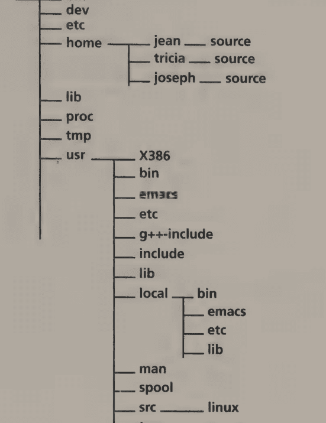

### 理解标准树形结构

UNIX 文件系统的树形结构始于根层级。**根**是该基本层级上文件的名称，用斜杠字符（`/`）表示。斜杠代表**根目录**。

**目录**是一种特殊的文件，可以包含其他文件和目录。常规文件存储信息，例如员工姓名和地址记录或薪资信息，而目录文件存储常规文件的名称和其他目录的名称，这些目录称为**子目录**。子目录被视为**父**目录的**子**目录，因为子目录是在父目录内部创建的。在图 2-1 中，根目录 (`/`) 是所有其他目录的父目录。例如，家目录是 `jean`、`tricia` 和 `joseph` 子目录的父目录。

### 使用 UNIX 分区

磁盘上容纳文件系统的部分称为**分区**。一个磁盘可以有多个分区，每个分区与其他分区相互隔离，从而不受诸如其他分区相关的结构文件问题等外部干扰的影响。当您在计算机上安装 UNIX 时，您的首要任务之一是如何对硬盘进行分区。


UNIX 分区通过名称来标识；例如，Linux 使用“`hda1`”和“`hda2`”。在这种情况下，前两个字母告诉 UNIX 设备类型：例如，“`hd`”表示硬盘。第三个字母，例如“`a`”，指示磁盘是主磁盘还是副磁盘（`a`=主磁盘，`b`=副磁盘）。磁盘上的分区从 1 开始编号。名称“`hda1`”告诉 UNIX 这是该磁盘上的第一个分区，名称“`hda2`”表示它是同一磁盘上的第二个分区。如果您有一个带有两个分区的第二块硬盘，这两个分区将标识为“`hdb1`”和“`hdb2`”。像硬盘这样的计算机存储设备被称为外围设备。计算机`外围设备`，如硬盘，通过`电子接口`连接到计算机。两种最流行的硬盘接口是`IDE`（集成驱动电子）和`SCSI`（小型计算机系统接口）。在 PC 上，IDE 硬盘驱动器比 SCSI（发音为“scuzzy”）更常见。SCSI 更快且更可靠。它用于大型服务器。如果您有一个带有两个分区的主 SCSI 硬盘，这两个分区将命名为“`sda1`”和“`sda2`”。图 2-2 显示了两个分区表：一个是 IDE 驱动器，另一个是 SCSI 驱动器。

```text
Disk /dev/hda: 128 heads, 63 sectors, 767 cylinders
Units = cylinders of 8064 * 512 bytes

Device Boot Begin Start End Blocks Id System
/dev/hda1 * 1 1 242 975712+ 6 DOS 32-bit >=32M
/dev/hda2 243 243 767 2116899 5 Extended
/dev/hda3 243 243 275 127024+ 83 Linux native
/dev/hda6 276 276 750 1028224+ 83 Linux native
/dev/hda7 751 751 767 68512+ 82 Linux swap

Command (m for help): _
This partition table is from a Linux system with an IDE drive
```

```text
Disk /dev/sda: 255 heads, 63 sectors, 1106 cylinders
Units = cylinders of 16065 * 512 bytes

Device Boot Begin Start End Blocks Id System
/dev/sda1 1 1 64 514048+ 83 Linux native
/dev/sda2 65 65 1106 8369865 5 Extended
/dev/sda5 65 65 1084 8193118+ 83 Linux native
/dev/sda6 1085 1085 1100 128488+ 82 Linux swap

Command (m for help): _
This partition table is from a Linux system with a SCSI drive
```


请注意，图 2-2 中的第一个表将“`hda`”标识为设备，这表明它是一个 IDE 驱动器。第二个表将“`sda`”标识为设备，这表明它是一个 SCSI 驱动器。

## 设置硬盘分区

对硬盘进行分区可以为您提供有序的空间来容纳文件系统。如果一个文件系统发生故障，您可以使用另一个文件系统。本节提供了如何分区硬盘的一般指导原则。这些建议仅供参考。您对硬盘的分区方式可能会因系统配置、用户数量和计划用途而异。分区大小以兆字节（MB，约一百万个字符）或吉字节（GB——约十亿个字符）衡量。您应该至少有三个独立的分区来存储您的文件系统：根、交换和 `/usr`。

首先为根文件系统设置一个分区。分区在成为文件系统的一部分之前必须挂载。内核在系统启动时挂载根文件系统。内核没有其他关于计算机其他文件系统的信息，因此内核启动系统所需的所有信息和程序都必须存在于根分区上。为了保护这些关键信息，其他系统数据通常使用单独的分区。

根分区可以很小，以便为其他文件系统留出空间。损坏的根文件系统会使系统无法启动。Red Hat 和大多数 Linux 发行版建议根分区大小不超过 120 MB。

创建根分区后，您应该设置`交换`分区。交换分区充当内存的扩展，使 UNIX 有更大的空间运行大型程序。Linux 发行版建议您的交换空间是计算机内部内存（RAM）大小的两倍。例如，如果您的计算机有 64 MB 的 RAM，您应该为交换分区分配 128 MB。更多信息请参见附录 C，“安装 Red Hat 6.x”。

`/usr` 分区存储所有非内核操作系统程序，这些程序使计算机变得有用。这些程序包括支持计算机编程、网络、Internet 访问、图形屏幕（包括 X-Windows）以及大量 UNIX `实用程序`（执行实用操作如复制文件、列出目录、与其他用户通信的程序）的软件开发包。usr 分区应该是三个分区中最大的一个，至少为 600 MB。

除了这三个单独的分区，您还可以创建 `/home` 分区，它是所有用户目录的家目录。独立的 /home 分区使许多系统管理任务（如备份数据）更加高效。

例如，Dominion Consulting 对拥有 32 MB RAM 的 PC 进行分区，并为 UNIX 分配 2 GB 的硬盘空间，其中根分区 120 MB，/usr 分区 1400 MB，交换分区 32 MB，/home 分区 448 MB。

## `/usr` 分区

`/usr` 分区是一个大分区，存储大多数操作系统文件和程序。包括 Red Hat 在内的大多数 Linux 发行版都为您提供从 CD-ROM“安装所有功能”的选项，并将这些文件中的大多数存储在 `/usr` 分区中。其他 UNIX 系统也是如此。语言编译器、共享库和头文件等软件开发工具（程序创建所需）也存储在从 `/usr` 开始的子目录层次结构中。

## `/home` 分区

`/home` 分区是所有用户工作的存储空间。如果根分区（或任何其他分区）崩溃，拥有 `/home` 分区可以确保您不会丢失所有用户信息。虽然普通用户账户被限制读取其他分区中的信息，但您拥有并可以访问家目录中的大多数文件。您可以随意授予或拒绝对您文件的访问权限。有关文件所有权的更多信息，请参见本章后面的“设置文件权限”。

系统中所有用户家目录的分区大小取决于系统支持多少用户。30 个用户可能需要总共 3000 MB，即 3 GB（30 亿个字符）。这种方案为用户平均提供每人 100 MB 的空间来存储他们的工作。分配的空间取决于每个用户需要存储多少数据。

## 交换分区

交换分区支持虚拟内存。虚拟内存意味着您拥有无限的内存资源——交换分区通过在磁盘上提供交换空间并将其视为内存（RAM）的扩展来努力实现这一目标。它被称为交换空间，因为系统可以使用它在磁盘和 RAM 之间交换信息。设置交换空间可以使您的计算机运行得更快、更高效。如果您的计算机有 16 MB 或更少的 RAM，您必须为交换分区分配一些磁盘空间。即使您的计算机有超过 16 MB 的 RAM，也建议为所有 UNIX 系统设置交换空间。交换空间的最小量应等于您的 RAM。

> 提示
>
> 您可以在 Linux 上创建和使用多个交换分区。将多个交换分区分散在几个硬盘上有时可以提高繁忙系统上的应用程序性能。

## 探索根文件系统

根 (`/`) 文件系统在系统启动时由内核挂载。挂载文件系统意味着将其连接到目录树结构。系统管理员使用 `mount` 命令来挂载文件系统。`mount` 命令的语法是：

### 语法

`mount` `device-name` `mount-point`

### 分解解析

- `device-name` 指定要挂载的分区（文件系统）。
- `mount-point` 指定挂载文件系统所需的目标目录。

有关 `mount` 命令的更多信息，请参阅本章后文的“使用 mount 命令”一节。

在程序能够访问文件系统上的文件之前，UNIX 必须挂载该文件系统。挂载之后，根文件系统仅对读取开放。根文件系统包含文件系统修复、从备份恢复、启动系统以及初始化所有设备和操作系统资源所需的所有基本程序。它还包含用于挂载所有其他文件系统的相关信息。除这些基本内容外，根分区中不应存放任何其他内容。

> 你可以使用保存在软盘或磁带上的救援文件来恢复“崩溃”的根分区。Red Hat Linux 附带的安装介质可用于创建救援盘。

根目录本身通常包含存储文件的子目录。接下来的章节将描述根文件系统中被频繁引用的那些子目录。

## `/bin` 目录

`/bin` 目录包含`二进制文件`或`可执行文件`，即启动系统、执行其他基本系统任务所需的程序。该目录保存了许多所有 UNIX 用户在工作中都需要的程序。

## `/boot` 目录

`/boot` 目录通常包含`引导加载程序`（启动操作系统的工具）所需的文件以及内核（操作系统）映像。

## `/dev` 目录


`/dev` 中的文件引用系统设备。它们访问系统设备和资源，如硬盘、鼠标、打印机、控制台、调制解调器、内存、软盘以及 CD-ROM 驱动器。所有 UNIX 版本都在 `/dev` 目录中包含大量设备文件，以适应可以连接到计算机的不同供应商的设备。设备文件分为两大类：块类型和字符类型。该类型指明了设备上的数据传输方式，是作为字符块传输，还是作为字符串行流传输。在命令提示符后输入 `*ls -l /dev*` 即可查看设备文件列表。（有关 `ls` 命令的更多信息，请参阅本章后文的“列出目录内容”一节。）列表中左侧的第一个字符告诉你该文件是字符设备 `c` 还是块设备 `b`，如图 2-3 所示。

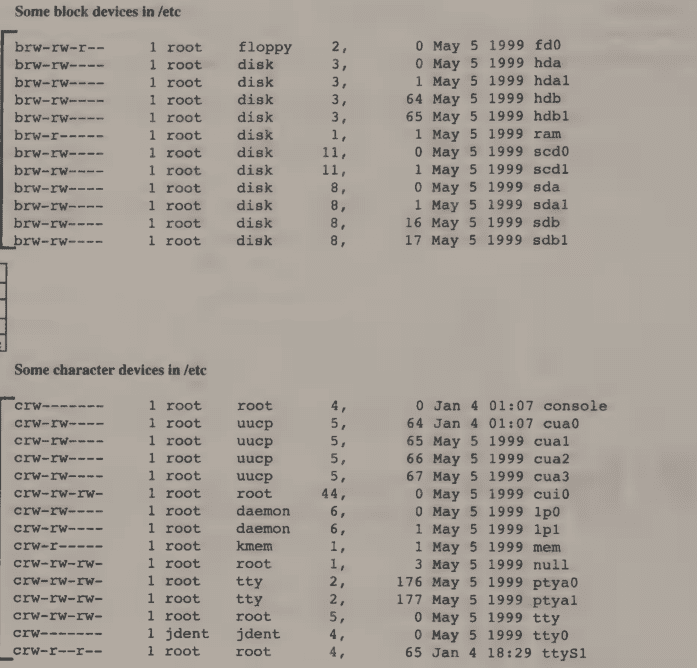

## 图 2-3：`/dev` 中的设备文件

图 2-3 中列出的条目解释如下：

- `console` 指系统控制台，即直接连接到系统的显示器。
- `ttyS1` 和 `cua1` 是用于访问串口的设备。例如，`/dev/ttyS1` 指的是你的 PC 上的 COM2 通信端口。
- `cua` 设备是“呼叫”设备，与调制解调器配合使用。
- 以 `hd` 开头的设备名访问 IDE 硬盘。
- 以 `sd` 开头的设备名是 SCSI 驱动器。
- 以 `lp` 开头的设备名访问并口。`lp0` 设备指的是 LPT1 行打印。
- `null` 是一个“黑洞”——任何发送到此设备的数据都将永久消失。当你希望抑制命令在屏幕上输出的结果时，请使用此设备。第 6 章和第 7 章讨论了此技术。
- 以 `tty` 开头的设备名指代终端或控制台。在你的 Linux 系统上可提供多个“虚拟控制台”。（通过按下 Alt+F1、Alt+F2 等键即可访问它们。）第 11 章讨论了虚拟控制台，它允许你在屏幕之间切换。
- 以 `pty` 开头的设备名是“伪终端”。它们用于为远程登录会话提供终端。例如，如果你的机器连接到网络，传入的远程登录会使用 `/dev` 中的其中一个 `pty` 设备。

## `/etc` 目录

`/etc` 目录包含计算机启动时系统使用的配置文件。该目录的大多数内容保留给系统管理员使用，并以文件形式存储着对系统至关重要的信息：

- `passwd`，用户数据库
- `rc`，系统启动时运行的脚本或脚本目录
- `fstab`，系统在启动时自动挂载的文件系统列表
- `group`，用户组数据库
- `inittab`，`init` 程序的配置文件，该程序在系统启动时执行基本任务
- `motd`，当日消息文件
- `printcap`，打印机功能数据库
- `termcap`，终端功能数据库
- `profile` 和 `bashrc`，在登录时执行的文件，允许系统管理员为所有用户设置全局默认值
- `login.defs`，`login` 命令的配置文件

## `/lib` 目录

此目录存放 `共享库映像`，程序员通常利用这些文件在库中共享代码，而不是在自己的程序中创建该代码的副本。这使得程序体积更小。该目录中的许多文件是指向其他库文件的符号链接。`符号链接` 是一个指向并允许你访问位于当前目录之外的某个目录中的文件的名字。在目录的详细列表（长列表）中，左侧位置处的 `l` 标识出作为符号链接的文件。

## `/mnt` 目录

系统管理员用于临时挂载的挂载点位于 `/mnt` 目录中。此目录通常被划分为如 `/mnt/cdrom` 和 `/mnt/floppy` 等子目录，以明确指定设备类型。

## `/proc` 目录

`/proc` 目录在磁盘上不占用任何空间：它只是一个 `虚拟文件系统`，仅在内存中分配。`/proc` 中的文件指向系统上正在运行的各种进程，以及关于操作系统内核的详细信息。

## `/root` 目录

`/root` 目录是 `root` 用户——系统管理员——的主目录。

## `/sbin` 目录

`/sbin` 目录保留给系统管理员。用于启动系统的程序、文件系统修复所需的程序以及基本网络程序都存储在此处。

## `/tmp` 目录

许多程序在处理周期内需要一个临时的数据存储位置。这些文件的传统位置是 `/tmp` 目录。

## `/var` 目录

`/var` 目录包含那些大小经常变化的子目录。这些子目录包含错误日志和其他对系统管理员有用的系统性能日志等文件。`/var/spool/mail` 子目录包含来自网络且保留在那里直到你阅读并删除为止的电子邮件。

## 使用 `mount` 命令

如前所述，UNIX 使用 `mount` 命令在系统启动时将文件系统分区连接到目录树。用户可以访问几乎所有已挂载且已获得其使用权限的文件系统。可以使用 `mount` 命令在任何时间挂载额外的文件系统。软盘和 CD-ROM 驱动器是最常挂载的除硬盘之外的文件系统设备。

> 提示
>
> 为确保系统安全，通常只有 `root` 用户可以使用 `mount` 命令。普通用户有时可以挂载和卸载位于软盘和 CD 上的文件系统。

假设你想访问 Dominion Consulting 数据库中 CD 上的文件。系统管理员通过将光盘插入驱动器并输入以下 `mount` 命令来挂载 CD-ROM：

```
mount -t iso9660 -r /dev/cdrom /mnt/cdrom
```

此命令在 `/dev` 目录中名为 `cdrom` 的设备上挂载了该 CD。在 UNIX 中，实际的挂载点是 `/mnt/cdrom`，这是一个引用 CD-ROM 设备的目录。一旦 CD 被挂载，你就可以通过 `/mnt/cdrom` 目录访问其中的文件。UNIX 支持几种不同类型的文件系统。文件系统类型使用 `-t` 选项指定。CD-ROM 被归类为 `iso9660` 设备，因此系统管理员输入 `-t`，后跟参数 `iso9660`。`-r` 表示 CD-ROM 设备是只读的。

你还希望将备份文件存储到软盘上。系统管理员使用以下命令将软盘挂载到软盘驱动器中：

`mount /dev/fd0 /mnt/floppy`

此命令将位于第一软盘驱动器（设备为 `/dev/fd0`）中的软盘挂载到 UNIX 文件结构中的挂载点 `/mnt/floppy`。存储在 `/mnt/floppy` 目录中的任何文件都会写入软盘。

在手动挂载文件系统并访问后，系统管理员在移除存储介质之前，会使用 `umount` 命令将其卸载，如下例所示：

`umount /mnt/floppy`

`umount /mnt/cdrom`

有关 `mount` 和 `umount` 命令的简要说明，请参阅附录 B《UNIX 命令语法指南：Linux Shell 和实用程序》。

### 理解路径和路径名

如您所学，所有 UNIX 文件都存储在从根目录开始的文件系统中的目录里。要指定文件或目录，请使用其 `路径名`，该路径名沿着文件系统的分支指向目标文件。正斜杠 `/` 用于分隔每个目录名。例如，假设您要指定文件 `phones.502` 的位置。您知道它位于 `source` 目录中，即在 Jean 的主目录中，如图 2-1 所示。您可以将该文件的位置指定为 `/home/jean/source/phones.502`。

#### 使用命令行提示符

UNIX 命令提示符可能指示您在文件系统中的位置。例如，提示符 `[jean@eli jean]$` 可能是系统管理员最初创建登录帐户时系统生成的 `默认提示符`。提示符 `[jean@eli jean]$` 表示用户 `jean` 正在名为 `eli` 的宿主机上，位于以其用户名 `jean` 命名的主目录中工作。换句话说，`jean 在 eli 主机上的主目录中`。当 Jean 将位置更改为 `/home/jean/source` 时，她的提示符看起来像这样：

`[jean@eli source]`

系统初始安装时，默认的 `root` 提示符看起来像这样：`[root@spirit root]#`。为了简化本书中命令提示符的含义，步骤中使用 `$` 表示普通用户的命令提示符，使用 `#` 表示系统管理员的命令提示符。

#### 自定义您的提示符

登录时会自动配置您的登录提示符。环境变量 `PS1` 包含特殊的格式化字符，用于确定提示符的配置。

> **查看 `PS1` 环境变量的内容：**
>
> 1. 输入 `echo $PS1` 并按 `Enter`。
> 2. 您将看到 `PS1` 变量的内容，可能显示为：
>
> `[\u@\h \W]\$`
>
> 以 `\` 开头的字符是特殊的 Bash shell 格式化字符。`\u` 打印用户名，`\h` 打印系统主机名，`\W` 打印工作目录的名称。`\$` 字符根据登录用户类型打印 `#` 或 `$`。方括号 `[` 和 `]`，以及分隔 `\h` 和 `\W` 的空格，不是特殊字符，因此它们按原样打印。当 Jean 登录到系统 `eli` 并在其主目录中工作时，她的提示符按上述格式显示为 `[jean@eli jean]$`。

表 2-1 展示了用于配置 Bash shell 提示符的其他格式化字符。

| **格式化字符** | **用途** |
| :--- | :--- |
| `\d` | 显示日期 |
| `\h` | 显示主机名 |
| `\n` | 显示新行 |


| `\\nnn` | 显示与八进制数 *nnn* 对应的 ASCII 字符。 |
| `\\s` | 显示 shell 名称 |
| `\\t` | 显示时间 |
| `\\u` | 显示用户名 |
| `\\w` | 显示工作目录的路径 |
| `\\W` | 显示工作目录的名称，不含其他路径信息 |
| `\\!` | 显示命令历史中当前命令的编号 |
| `\\#` | 显示当前会话中的命令编号 |
| `\\$` | 如果用户是 root 则显示 #，否则显示 $ |
| `\\[` | 标记非打印字符序列的开始，例如控制序列 |
| `\\]` | 标记非打印字符序列的结束 |
| `\\\\` | 显示 `\` 字符 |

表 2-1：配置 Bash shell 提示符的格式化字符

### 配置您的 Bash shell 提示符

1. 要将您的提示符更改为显示日期和时间，输入 `PS1='\d \t>'` 并按 **Enter**。输入命令时字符之间不要留空格。您的提示符现在看起来类似：
`Tue Jul 5 09:18:33>`

2. 要将您的提示符更改为显示当前工作目录，输入 `PS1='\w>'` 并按 **Enter**。您的提示符现在看起来类似：
`~>`

`\w` 格式化字符显示 `~` 来表示用户的主目录。要将您的提示符更改为显示当前工作目录的完整路径，您必须使用另一个环境变量 `PWD`。`PWD` 变量包含当前工作目录的完整路径名。

3. 要在提示符中显示 `PWD` 变量，输入 `PS1='$PWD>'` 并按 **Enter**。（注意，您必须将 `$` 符号放在环境变量名称前以提取其内容。）您的提示符现在看起来类似：
`/home/jean>`

4. 注销系统，然后重新登录以将提示符重置为其默认配置。

#### pwd 命令

您可以使用 UNIX `pwd` 命令来显示您当前的路径（`pwd` 代表 **print working directory**，即打印工作目录）。

**显示当前路径：**

在 `$` 命令提示符后，输入 `pwd` 并按 **Enter**。系统将显示您当前工作目录的路径。

#### 在文件系统中导航

要在 UNIX 目录结构中导航，请使用 `cd`（更改目录）命令。

其语法是：

| 语法 | `cd directory` |
| :--- | :--- |
| 解析 | `directory` 是您要更改到的目录的名称。目录名表示为通往目标的路径，子目录名之间用斜杠 (`/`) 分隔。 |

登录时，您从 `/home` 目录下的主目录开始。当您更改目录后想要返回主目录时，请输入 `cd` 并按 **Enter**。（某些 shell 也使用波浪号字符 (`~`) 来表示用户的主目录。）

您想要进入 `mail` 子目录，查看 Dominion 员工是否给您发送了电子邮件。

**更改目录：**

1. 在 `$` 命令提示符后，输入 `cd /etc/mail` 并按 **Enter**。这将带您进入 `/var/spool/mail` 子目录。

2. 输入 `cd` 并按 **Enter**。没有参数的更改目录命令 (`cd`) 将带您返回主目录。

UNIX 将路径称为 **绝对路径** 或 *相对路径*。**绝对路径** 从根级别开始，并列出通往目标文件的所有子目录。例如，假设 Becky 有一个名为 `lists` 的目录，位于其主目录下。在 `lists` 目录中，她有一个名为 `todo` 的文件。`todo` 文件的绝对路径是 `/home/becky/lists/todo`。该路径列出了通往 `todo` 文件路径中的每个目录。

**提示**

每当 `/` 符号是路径中的第一个字符时，它代表根目录。路径中的其他所有 `/` 符号都用于分隔其他名称。

*相对路径* 走更短的旅程。您可以输入相对路径从当前工作目录开始并继续前行。在图 2-1 中，`jean`、`tricia` 和 `joseph` 在他们的主目录中都有子目录。每个人都有一个名为“source”的子目录。由于 Jean 正在其主目录中工作，她可以通过输入以下命令并按 Enter 来更改到她的 `source` 目录：

```
cd source
```

Jean 直接从其主目录 `/home/jean` 更改到她的 `source` 目录。此示例使用了相对路径寻址。她的 `source` 目录距离她当前位置 `/home/jean` 仅一层。一旦她输入更改目录命令 `cd source`，系统就会将她带到 `/home/jean/source`，因为这是相对于她当前位置的路径。

如果位于 `/home/tricia` 目录中的 Tricia 输入命令 `cd source`，系统就会将她带到 `/home/tricia/source` 目录。如果 Tricia 要更改到 Jean 的 `source` 目录，她可以输入：

```
cd /home/jean/source
```

此示例使用了绝对路径寻址，因为 Tricia 从根目录开始，并经过所有中间目录。

**导航目录：**

1. 如果您不在主目录中，请输入 `cd` 并按 **Enter**。

2. 您主目录的父目录是 `/home`。`/home` 是一个绝对路径名。输入 `cd /home` 并按 **Enter**。系统将带您进入 `/home` 目录。

您现在可以使用 `cd` 命令配合相对路径返回主目录。例如，如果您的用户名是 `philip`，您可以输入 `cd philip`。

3. 输入 `cd` 命令后跟您的用户名，并按 **Enter**。系统将带您进入您的主目录。

#### 使用点 (Dot) 和双点 (Dot Dot) 寻址技术

UNIX 将单个 **点** 字符解释为当前目录，并将 **双点**（两个连续的点）解释为父目录。输入以下命令将使您保留在当前目录中：

```
cd .
```

如果您使用双点（称为 *dot dot*），您将返回到父目录。两个点之间不要输入空格。下一个示例显示了用户 `jean` 如何返回她的 `/home/jean` 主目录：

```
cd ..
```

假设您是位于其 `/home/jean` 主目录中的 Jean，想要进入 Tricia 的 `source` 目录。使用以下命令：

```
cd ../tricia/source
```

> 提示
>
> 在包含命令参数时，UNIX 命令后必须始终使用空格。

在之前的示例中，双点（dot dot）告诉操作系统前往父目录，即 `/home`。第一个 `/` 分隔符后跟随的目录名告诉操作系统前进到 `tricia` 子目录。第二个“/”分隔符后跟随的目录名告诉 UNIX 前进到 `source` 子目录，即最终目的地。如果斜杠字符前后没有名称，UNIX 将其视为根目录。否则，`/` 用于分隔一个目录与另一个目录。

#### 使用点和双点更改工作目录

- 如果你不在主目录中，输入 `cd` 并按 **Enter**。

- 输入 `cd .` 并按 **Enter**。由于 `.` 引用当前目录，系统不会更改你的工作位置。

- 输入 `cd ..` 并按 **Enter**。系统将你带到父目录，即 `/home`。

- 输入 `cd /` 并按 **Enter**。系统将你带到根 (`/`) 目录。

- 输入 `cd` 并按 **Enter**。系统将你带到你的主目录。

### 列出目录内容

使用 `ls` (list) 命令来显示目录的内容，包括文件和其他目录。当你使用没有任何选项或参数的 `ls` 命令时，它会显示当前工作目录中常规文件和目录的名称。

#### 查看当前工作目录中的文件和目录列表

- 输入 `ls` 并按 **Enter**。

- 你会看到文件和/或目录名的列表。

你可以为 `ls` 命令提供参数，以查看特定文件的列表或查看特定目录的内容。

#### 查看特定文件或目录的列表

- 如果你不在主目录中，输入 `cd` 并按 **Enter**。

- 在第 1 章中，你使用 `cat` 命令创建了一个笔记文件。你的主目录中应该还有那个文件。输入 `ls notes` 并按 **Enter**。系统显示 `notes` 文件的列表。

要查看当前工作目录以外的其他目录的内容，请将目录名作为 `ls` 命令的选项。例如，要查看 `/var` 目录的内容，请输入 `ls /var` 并按 **Enter**。你会看到与下方类似的列表。

`catman db gdm lib local lock log nis preserve run spool tmp yp`

你还可以使用选项来显示比单独使用命令所能提供的更具体或更多的信息。`ls` 命令的 `-l` 选项生成详细的目录列表，其中包含关于每个文件的更多信息。你决定为 Dominion 系统打印 `/etc` 和 `/home` 目录的长列表。

#### 使用带 -l 选项的 ls 命令

- 输入 `ls -l /etc` 并按 **Enter**。
  你会看到类似于图 2-4 中的信息。

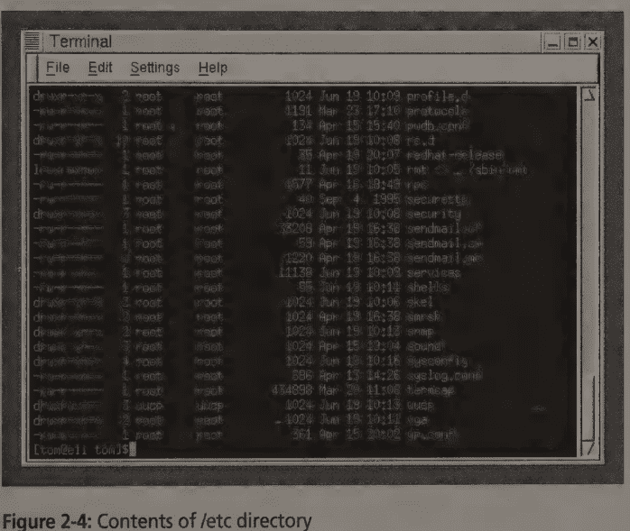

- 输入 `ls -l /` 并按 **Enter**。
  你会看到类似于图 2-5 中的信息。

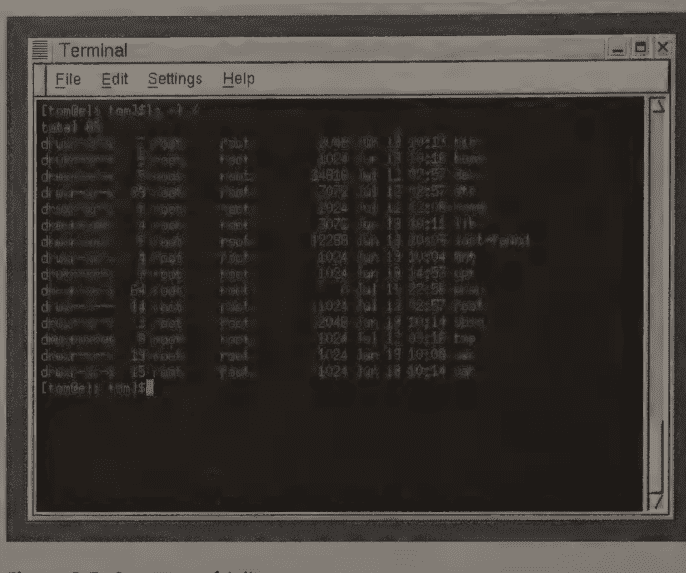


正如你可以从图中看到的，`ls -l`命令提供了比简单的`ls`命令关于列表中每个项目更多的信息。例如，看看图 2-5 中列出的第一个项目：

`drwxr-xr-x 2 root root 2048 Jun 19 10:13 bin`

如果你查看最右边的一列，你会看到`bin`，这是一个文件的名称。它左边所有的列都包含关于`bin`文件的信息。以下是从左到右每一列信息的描述。

- 文件类型和访问权限：显示的第一个信息列是以下这组字符：

  `drwxr-xr-x`

  列表中的第一个字符`d`表示该文件实际上是一个目录。如果`bin`是一个普通文件，则会显示连字符 (`-`)。其余字符表示文件的访问权限。你将在本章稍后的部分，“设置文件权限”中了解这些内容的更多细节。

- 链接数：第二列是硬链接到此文件的文件数量。（你将在第 5 章中了解链接。）如果该文件是一个目录，则这是它包含的子目录数量。`bin`的列表显示它包含两个条目。（目录总是至少包含两个条目：点和双点。）

- 所有者：第三列是文件的所有者。`root`用户拥有`bin`目录。

- 组：第四列是拥有该文件的组。`root`组拥有`bin`目录。

- 大小：第五列显示文件的字节大小。

- 日期和时间：第六列和第七列显示文件最后修改的日期和时间。

- 名称：第八列显示文件的名称。

你还可以使用`ls`命令的`-a`选项来列出隐藏文件，即那些以点开头的文件。操作系统通常使用隐藏文件来保存配置信息以及用于其他目的。Dominion 的系统管理员告诉你，你的主目录中包含许多隐藏文件。你可以使用带有`-a`选项的`ls`命令来列出它们。

### 列出主目录中的隐藏文件

- 在命令提示符后输入`ls -a`，并按`Enter`。
- 你会看到类似于图 2-6 中的列表。

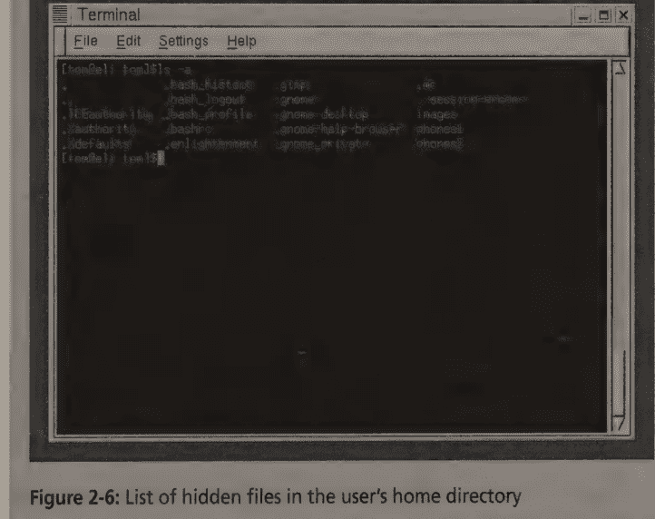

有关`ls`命令的简要描述，请参阅附录 B，“Linux Shell 和实用程序的 UNIX 命令语法指南”。

### 使用通配符

通配符是一个特殊字符，可以代表其他任何字符，在某些情况下，可以代表一组字符。当你希望处理几个名称相似的文件，或者无法记住确切名称的文件时，通配符非常有用。UNIX 支持几种通配符字符。在本节中，你将了解两个：`*`和`?`。

`*`通配符代表文件名中的任何字符组。例如，假设 Becky 在她的家目录中有以下九个文件：

```
friends
instructions.txt
list1
list2
list2b
memo_to_fred
memo_to_jill
minutes.txt
notes
```

如果她输入`ls *.txt`并按`Enter`，她看到以下输出：

```
instructions.txt  minutes.txt
```

参数`*.txt`使`ls`显示所有以`.txt`结尾的文件名。如果她输入`ls memo*`，她看到以下输出：

```
memo_to_fred  memo_to_jill
```

如果她输入命令`ls *s`并按`Enter`，`ls`显示所有以`s`结尾的文件名。她看到输出：

```
friends  notes
```

`?`通配符只代替单个字符。例如，如果 Becky 输入`ls list?`并按`Enter`，`ls`显示所有名称以`list`开头并跟随单个字符的文件。她看到输出：

```
list1  list2
```

她看不到文件`list2b`的列表，因为其名称中“list”后面跟随两个字符。

### 使用通配符进行练习

- 要练习使用通配符，你首先必须创建一组名称相似的文件。在第 1 章中，你使用`cat`命令创建了`notes`文件。现在使用`cat`命令创建以下五个文件：

  - `first_name`：包含你名字的文本
  - `middle_name`：包含你中间名的文本
  - `last_name`：包含你姓氏的文本
  - `full_name1.txt`：包含你全名的文本
  - `full_name22.txt`：另一个包含你全名的文本

- 输入`ls *name`并按`Enter`。你会看到列出了`first_name`、`middle_name`和`last_name`。
- 输入`ls full_name?.txt`并按`Enter`。你会看到列出了`full_name1.txt`。

## 课程 B

## 操作文件和目录

### 目标

学习完本课程后，你应该能够：

- 创建新目录以存储文件
- 将文件从一个目录复制到另一个目录
- 设置文件权限以允许其他用户访问你的目录和文件

### 创建目录和文件

作为为 Dominion 创建集中式电话数据库工作的一部分，你在 Dominion 的经理 Rolf Williams 要求你为部门 4540 和 4550 创建目录，然后创建包含部门电话号码的文件并将它们存储在这些目录中。你可以使用`mkdir`（make directory）命令创建新目录，并使用`cat`命令创建电话文件。

#### 创建新目录和电话文件

- 输入`cd`并按`Enter`，确保你位于主目录中。
- 输入`mkdir dept_4540`并按`Enter`，创建一个名为`dept_4540`的新目录。
- 输入`ls`并按`Enter`。你会在列表中看到`dept_4540`目录。
- 输入`cd dept_4540`并按`Enter`，切换到新目录。现在你可以使用`cat`命令创建一个名为`phones1`的文件。`phones1`文件包含区号、电话前缀、电话号码、姓氏和名字字段。冒号 (`:`) 分隔每个字段。
- 输入以下命令，在每行末尾按`Enter`：

```
cat > phones1
219:432:4567:Harrison:Joel
219:432:4587:Mitchell:Barbara
219:432:4589:Olson:Timothy
```

- 按`Ctrl+D`。
- 输入`cd`并按`Enter`返回到你的`/home`目录。

#### 创建新目录

输入`mkdir dept_4550`并按下`Enter`键，创建一个名为`dept_4550`的新目录。

输入`ls`并按下`Enter`键。你将在列表中看到`dept_4550`目录。

输入`cd dept_4550`并按下`Enter`键，切换到新目录。现在你可以使用`cat`命令创建文件`phones2`，该文件包含与`phones1`文件相同的字段。

输入以下命令，并在每一行末尾按下`Enter`键：

```text
cat > phones2
219:432:4591:Moore:Sarah
219:432:4567:Polk:John
219:432:4501:Robinson:Lisa
```

按下`Ctrl+D`。

你使用`mkdir`命令创建了两个新目录，然后使用`cat`命令创建了两个包含电话号码信息的文件。

> **注意：** 你可以使用删除目录（`rmdir`）命令来删除空目录。首先，使用`cd`命令切换到你要删除的子目录的父目录。例如，如果你想要删除`/home/old`中的`old`目录，请先切换到`home`目录。然后输入`rmdir directory`，例如`rmdir old`，并按下`Enter`键。

### 复制文件

你使用 UNIX 复制命令`cp`将文件从一个目录复制到另一个目录。`-i`选项会警告你`cp`命令将覆盖目标文件。你还可以使用点符号（当前目录）作为简写来指定`cp`命令的目标。

创建电话文件后，Rolfe 要求你为 Dominion 创建一个新的中心目录`corp_db`，然后将`phones1`文件复制到其中。你可以使用波浪号字符 (`~`) 来表示你的主目录位置。

要将`phones1`文件复制到新目录`corp_db`中：

1. 输入`cd`然后按下`Enter`键返回到`/home`目录。
2. 输入`mkdir corp_db`并按下`Enter`键创建新目录。
3. 输入`cd corp_db`并按下`Enter`键切换到新目录。
4. 要将`phones1`文件从`dept_4540`目录复制到当前目录，输入`cp ~/dept_4540/phones1 .`并按下`Enter`键。
5. 要将`phones2`文件从`dept_4550`目录复制到当前目录，输入`cp ~/dept_4550/phones2 .`并按下`Enter`键。


现在，Dominion 中央数据库包含两个文件。你可以使用 `cat` 命令合并这两个文件，并将（`>`）输出重定向到 `corp_phones` 文件，该文件列出了公司的所有电话号码信息。

### 将两个文件合并为一个文件的方法：

1. 输入 `cat phones1 phones2 > corp_phones` 并按下 **Enter** 键，将两个电话文件的内容添加到一个名为 `corp_phones` 的新文件中。

2. 输入 `more corp_phones` 并按下 **Enter** 键查看新文件的内容。正如第一章中提到的，`more` 命令允许你一次显示一屏内容，对于阅读长文件特别有用。

> **注意：** 要删除你不需要的文件，请使用 `remove (rm)` 命令。首先，使用 `cd` 命令切换到包含你要删除文件的目录。然后 *输入* `rm` *文件名*。例如，要删除当前目录中的 *old* 文件，请输入 `rm old`。在文件被删除之前，你可能会收到也可能不会收到警告。在使用此命令之前，请确保你想永久删除该文件。你将在第 4 章中更详细地了解 `rm` 命令。

## 设置文件权限

由于 UNIX 是一个多用户系统，用户可以为他们拥有的文件设置权限，以便其他人可以读取、写入或执行这些文件。文件的所有者是创建该文件的人。所有者设置的权限作为文件描述的一部分列出。图 2-7 展示了描述文件类型的目录列表。

| 文件类型 | 含义 |
|---|---|
| - | 普通文件 |
| d | 子目录 |
| l | 符号链接 |
| b | 块设备文件 |
| c | 字符设备文件 |

```text
Excerpt from ls -1 /etc

drwxr-xr-x  12  root  root    1024  Feb 6  1996  x11
-rw-r--r--   1  root  root      10  Oct 15 19:11  adjtime
drwxr-xr-x   1  root  root    1024  Feb 27  2000  cron.daily
```

```text
Excerpt from ls -1 /home/jean/source

-rw-rw-r--   1  jean  jean     387  Dec 12  23:11  phones.502
```

**图 2-7：** 目录列表中描述的文件类型

注意这两个目录的长格式列表。（请记住，目录本质上也是另一种文件。）前面的部分“列出目录内容”描述了长列表中显示的信息。现在你可以更仔细地查看文件权限。对于描述的第一个文件，最左侧一列显示了一串字符 `drwxr-xr-x`。你已经知道第一个字符指示文件类型。随后的字符分为三个文件权限说明符部分。每个部分有三个说明符，如图 2-8 所示。

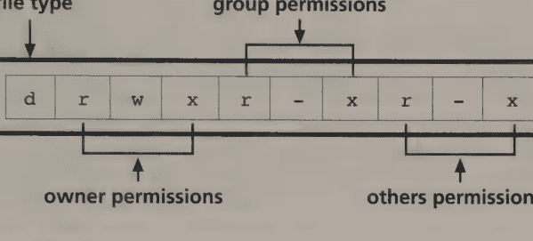

**图 2-8：** 文件类型和文件权限示例

文件权限说明符的第一部分指示所有者的权限。所有者像所有用户一样属于一个用户组。第二部分指示组的权限。此说明适用于所有者组中除所有者之外的所有用户。第三部分指示其他用户的权限。此说明适用于既不是所有者也不在所有者组中的所有用户。在每一部分中，第一个字符指示读取权限。如果那里出现“r”，该类别的用户有权读取文件。第二个字符指示写入权限。如果那里出现“w”，该类别的用户有权写入文件。第三个字符指示执行权限。如果那里出现“x”，该类别的用户有权执行文件。如果这些字符位置中的任何一个出现短横线 (`-`)，则拒绝该类型的权限。

> **注意：** 如果用户被授予目录的读取权限，用户可以看到其内容的列表。目录的写入权限意味着用户可以重命名和删除目录中的文件。目录的执行权限意味着用户可以将该目录设为当前工作目录。

从左到右，字母 `rwxr-xr-x` 的含义是：

- `r`: 文件所有者具有读取权限
- `w`: 文件所有者具有写入权限
- `x`: 文件所有者具有执行权限（可以运行该文件作为程序）
- `r`: 组具有读取权限
- `-`: 组不具有写入权限
- `x`: 组具有执行权限
- `r`: 其他用户具有读取权限
- `-`: 其他用户不具有写入权限
- `x`: 其他用户具有执行权限

你可以使用 `chmod` 命令更改权限设置的模式。例如，将其他用户的权限设置为 `---` 将移除其他用户的所有权限。他们无法读取、写入或执行该文件。在图 2-7 的第一行中，请注意所有者对文件 `X11` 具有读取、写入和执行（`rwx`）权限。`r-x` 表示与所有者具有相同组 id 的用户组仅具有读取和执行权限。系统管理员在添加新用户账户时分配组 id。组 id 使一组用户对共同拥有的文件具有相同的访问权限。其他用户是指所有未通过组 id 与所有者组关联的用户，但他们拥有读取和执行权限。

使用 UNIX `chmod` 命令设置文件权限。在其最简单的形式中，`chmod` 命令接受一个符号字符串和一个或多个文件名作为参数。符号字符串指定应授予或拒绝给用户类别的权限。这里有一个例子：`ugo+rwx`。在字符串中，字符 `ugo` 代表用户（与所有者相同）、组和其他用户。这些用户类别将受 `chmod` 命令的影响。下一个字符，加号 `+`，表示权限正在被授予。最后一组字符，在本例中是 `rwx`，表示正在授予的权限。符号字符串 `ugo+rwx` 表示正在向所有者、组和其他用户授予读取、写入和执行权限。以下是符号字符串在命令中使用的例子，用于修改 `myfile` 的访问权限：

```bash
chmod ugo+rwx myfile
```

这里是一个将组读取权限授予文件 `customers` 的命令：

```bash
chmod g+r customers
```

也可以拒绝符号字符串的权限。以下命令拒绝文件和组对 `account_info` 文件的写入和执行权限。

```bash
chmod go-wx account_info
```

请参阅附录 B，“UNIX 命令语法指南：Linux Shell 和实用程序”，了解 `chmod` 命令的简要描述。

Rolfe 希望所有用户都能访问 `corp_phones` 文件。为了使这成为可能，他要求你更改文件权限。首先，允许访问你的主目录。接下来，允许访问 `corp_db` 目录，然后设置权限使每个人都可以读取 `corp_phones` 文件。你可以使用带有 `x` 参数的 `chmod` 命令授予目录访问权限。

### 更改文件和目录权限的方法：

- 1. 确保你位于主目录中。
- 2. 输入 `chmod go+x ~` 并按 **Enter** 键，以允许访问你的主目录。此命令的意思是“使你的主目录（`~`）对组（`g`）和其他用户（`o`）可访问（`+x`）。”
- 3. 输入 `chmod ugo+x ~/corp_db` 并按 **Enter** 键，以允许访问 `corp_db` 目录。此命令的意思是“使 `corp_db` 目录对所有者（`u`）、组（`g`）和其他用户（`o`）可访问（`+x`）。”
- 4. 输入 `chmod ugo+r ~/corp_db/corp_phones` 并按 **Enter** 键，以设置权限，使每个人都可以读取该文件。此命令的意思是“使 `corp_phones` 文件对所有者（`u`）、组（`g`）和其他用户（`o`）可读（`+r`）。”

注意：从你的主目录开始，你可以创建任何子目录并为其设置权限。但是，除非系统管理员做出了特殊规定，否则你无法在主目录之外创建子目录。

你使用了合适的 UNIX 命令创建新目录来存储文件，并设置了所有用户共用的中央目录，然后将文件从其他目录传输到中央目录。最后，你更改了文件权限，以便其他用户能够访问你创建的目录和文件。

### 摘要

- 在 UNIX 中，文件是数据存储的基本组件。UNIX 将一切视为文件，即使是监视器、键盘和打印机等附加设备也不例外。
- 文件系统是 UNIX 系统组织大量存储设备（如硬盘和软盘）上文件的方式。文件存储在文件系统中，这是一个像树一样分层的结构，其中顶级目录包含其他目录，而这些目录又包含其他目录。
- 每个文件都可以通过使用正确且唯一的 `pathname`（路径名）来定位；即引导至特定文件的目录名称列表。
- 标准树结构从根（`/`）目录开始，它作为一组嵌套的其他目录和子目录的基础。
- 容纳文件系统的磁盘部分称为分区。一个磁盘可以有许多分区，每个分区都与其他分区隔离，从而使其不受外部干扰（如与另一个分区相关的结构文件问题）的影响。
- UNIX 文件系统的设计允许在挂载到树结构后访问多个分区。
- 在 UNIX 中定义的路径充当访问系统中任何文件的地图。绝对路径总是从根级别开始。相对路径则从当前位置开始。
- 你可以自定义命令提示符，以显示当前工作目录名称、日期、时间及其他几项内容。
- `ls` 命令显示目录中包含的文件和目录的名称。`ls -l` 命令及其选项在屏幕上显示所有文件信息。此显示通常称为长列表。`ls -a` 命令显示隐藏文件。
- 通配符可以用作命令（如 `ls`）的一部分，并替代文件名中的其他字符。`*` 通配符可以替代任何字符串，而 `?` 通配符可以替代任何单个字符。


只要你是父目录的所有者，就可以使用 `mkdir` 命令创建新目录。文件的所有者是创建该文件的人，并成为唯一控制对该文件访问权限的人。

你可以使用 `chmod` 命令为你拥有的文件设置权限。权限设置是 `rwx`，分别表示读、写和执行。文件权限用于控制三类用户对文件的访问：所有者、组和其他人。如果你希望其他人访问你所拥有的目录中的信息，务必记得更改任何你拥有的目录的权限设置。你使用执行权限 `x` 命令授予对目录的访问权限。

你可以使用 `cp` 命令将源文件复制到目标文件。除非你使用 `-i` 选项，否则 UNIX 会在不发出警告的情况下覆盖目标文件。点表示法 `当前目录` 是在 `cp` 命令中指定目标的一种简写方式。

## 命令摘要

| 命令 | 目的 | 本章涵盖的选项 |
| :--- | :--- | :--- |
| `cd` | 更改目录 |  |
| `chmod` | 为指定用户设置文件权限 |  |
| `cp` | 将文件从一个目录复制到另一个目录 | `-i` 防止在未经警告的情况下覆盖目标文件 |
| `ls` | 显示目录的内容，包括其文件和子目录 | `-a` 列出隐藏文件<br>`-l` 生成目录的长列表 |
| `mkdir` | 创建新目录 |  |
| `mount` | 在系统启动时将文件系统分区连接到目录树 | `-r` 指示挂载的设备是只读的<br>`-t` 指定文件系统类型 |
| `pwd` | 显示当前路径 |  |
| `rm` | 删除文件 |  |
| `rmdir` | 删除空目录 |  |
| `umount` | 将文件系统分区从目录树断开 |  |

## 复习题

1. UNIX 文件系统
   - a. 是一个目录
   - b. 由驻留在存储介质上的结构化数据组成
   - c. 在存储文件之前从未被格式化
   - d. a 和 c

2. 标准树结构始于
   - a. 当前目录
   - b. 根目录
   - c. 第一个分配的分区
   - d. 主目录

3. 绝对路径必须始终始于
   - a. 当前目录
   - b. 根目录
   - c. 第一个分配的分区
   - d. 主目录

4. 创建磁盘分区的最重要原因是
   - a. 使系统运行更快
   - b. 节约磁盘空间
   - c. 保护该分区中的信息
   - d. 创建足够的空间来存储应用软件

## 第 2 章，课程 E

5. 虚拟文件系统是一个 ________________________。
   - a. 允许从任何位置检索信息的系统
   - b. 在所有分区都挂载时创建的系统
   - c. 让用户访问系统中几乎任何内容的系统；挂载的分区总数限制了访问
   - d. 以上所有

6. 名为 `hda2` 的分区是 ________________________。
   - a. 主硬盘上的第一个分区
   - b. 2 号硬盘上的 a 分区
   - c. 主硬盘上的第二个分区
   - d. 副硬盘上的第二个分区

7. 名为 `sda1` 的分区是 ________________________。
   - a. 副硬盘上的第一个分区
   - b. 主 SCSI 硬盘上的第一个分区
   - c. 副 SCSI 硬盘上的第一个分区
   - d. 以上都不是

8. 出于安全目的，最需要分区的文件系统是 ________________________。
   - a. `/`
   - b. `/usr`
   - c. `/home`
   - d. `/bin`

9. 大多数操作系统文件和程序存储在 ________________________ 分区中。
   - a. `/`
   - b. `/var`
   - c. `/proc`
   - d. `/usr`

10. ________________________ 分区是用户个人文件的存储空间。
    - a. `/home`
    - b. `/`
    - c. `/root`
    - d. `/bin`

11. 路径是 ________________________。
    - a. 一种树结构
    - b. 一个长目录列表
    - c. 分区地图
    - d. 访问系统中任何文件的地图

12. 以下哪项充当虚拟内存？
    - a. 交换分区
    - b. `/root` 分区
    - c. `/etc` 分区
    - d. `/usr` 分区

13. `/dev` 目录包含 ________________________。
    - a. 引用系统中设备的文件
    - b. 开发和编程工具
    - c. UNIX 引导加载程序
    - d. 以上都不是

14. 单点 `dot` 指的是 ________________________。
    - a. 父目录
    - b. 当前目录
    - c. 主目录
    - d. 子目录

15. 双点 `dot dot` 指的是 ________________________。
    - a. 父目录
    - b. 当前目录
    - c. 主目录
    - d. 子目录

16. 以下哪项陈述是错误的？
    - a. 你只能在你拥有的父目录中创建子目录。
    - b. 你必须为你想要访问的所有目录设置 `x` 权限。
    - c. 你可以使用 `cd ..` 命令在目录树中向上一级目录移动。
    - d. 双点 `..` 指的是父目录。

17. 你可以将单点用作 ________________________ 的位置。
    - a. 父目录
    - b. 子目录
    - c. 当前目录
    - d. 根目录

18. 用于自定义提示符的 `\h` 格式字符会导致显示 ________________________。
    - a. 24 小时制的时间
    - b. 主机名
    - c. 主目录名称
    - d. 以上都不是

19. `ls -l` 命令对于检查 ________________________ 很有用。
    - a. 文件权限
    - b. 文件类型
    - c. 文件大小
    - d. 以上所有

20. 在长目录列表中，普通文件 `非目录` 的文件类型显示的字符是 ________________________。
    - a. `f`
    - b. `d`
    - c. `–`
    - d. 空格

## 复习问题

- **21.** 下列哪项授予组/读和写权限访问 `filename`？
  - a. `chmod g+rw filename`
  - b. `chmod g+rw filename`
  - c. `chmod o+rw filename`
  - d. `chmod g-rw filename`

- **22.** 哪个命令授予目录的访问权限？
  - a. `chmod`
  - b. `rwx`
  - c. 执行权限 `x`
  - d. `Is -x`

- **23.** _______________ 环境变量存储命令行提示符。
  - a. `PWD`
  - b. `PROMPT`
  - c. `PATH`
  - d. `PS1`

- **24.** 当你使用 `cp` 命令时，你应该意识到 _________________。
  - a. 点目标位置将文件放置在父目录中
  - b. 目标文件将覆盖同名文件
  - c. 它会销毁源文件
  - d. 源文件不能以相对地址指定

- **25.** 远程目录位于用户的家庭目录中。要将文件从远程目录复制到当前目录，请输入 ___________。
  - a. `cp ~/remote/filename .`
  - b. `cp +/filename`
  - c. `cp > /remote/filename`
  - d. `cp/remote/filename`

- **26.** 与 `cp` 命令一起使用的 `-i` 选项会导致 ___________。
  - a. 如果目标文件已存在，`cp` 命令忽略任何不覆盖目标文件的请求
  - b. `cp` 命令将正在复制的文件插入现有的目标文件
  - c. `cp` 命令警告你将覆盖目标文件
  - d. 以上都不是

- **27.** 要列出目录中的隐藏文件，请输入 _______________。
  - a. `hid -a`
  - b. `ls -a`
  - c. `cd\hidden\ls`
  - d. `ls +a`

## 练习

- **1.** 文件 `notice.txt` 位于目录 `notices` 中，而 `notices` 位于目录 `public` 中。`public` 目录位于 Tom 的家庭目录中。`Tom` 的用户名是 `tom`。`notice.txt` 文件的绝对路径是什么？


## 练习

- **2.** 如果你的当前工作目录是 `notices` 目录（在 Tom 的家庭目录下），到 `notices.txt` 文件的相对路径是什么？

- **3.** 列出一个 `cd` 命令的例子，展示如何使用绝对路径地址。

- **4.** 列出一个 `cd` 命令的例子，展示如何使用相对路径地址。登录并显示 `/bin`、`/sbin` 和 `/etc` 中的目录。

- **5.** 列出授予文件所有者和组读取和执行权限的 `chmod` 符号字符串。

- **6.** 列出拒绝所有非所有者或非所有者所在组的用户读取、写入和执行文件权限的 `chmod` 符号字符串。

- **7.** 使用 `cat` 命令在你的家庭目录中创建一个文件。更改权限，使任何人都无法访问该文件。

- **8.** 以另一个用户身份登录，并尝试访问你之前创建的文件。再次以你的账户登录，并修改这些文件使其可访问。

### 探索练习

- **1.** 使用 `ls` 命令选项列出家庭目录中的隐藏文件。

- **2.** 使用绝对路径更改到 `/etc` 目录。从 `/etc` 目录开始，使用相对路径更改到 `X11` 目录。现在使用 `ls` 命令列出家庭目录中的 `.bashrc` 文件。（保持当前位置执行此操作。）

- **3.** 在命令行中，输入 `cd -/./..` 并按 Enter。你现在位于树结构的哪个位置？解释你是如何到达那里的。

- **4.** 在命令行中，输入 `cd -/.././etc/X11` 并按 Enter。你现在位于树结构的哪个位置？解释你是如何到达那里的。

- **5.** 使用从家庭目录开始的相对路径，输入 `cat` 命令以显示 `/etc/passwd` 文件的内容。

- **6.** 使用 `cd` 命令返回到家庭目录。将 `date` 命令的输出重定向到名为 `chap2info` 的文件。使用 `ls` 命令获取该文件的长列表。所有者、组和其他人有什么权限？

- **7.** 将 `chap2info` 文件的权限更改为所有者可读写，并拒绝其他人的权限。查看长列表以确认更改已生效。

- **8.** 修改命令提示符，使其始终显示当前工作目录的绝对路径。

## 第 3 章

## UNIX 编辑器

**案例** Dominion Consulting 的所有员工都会撰写每周备忘录，总结他们的活动和成就。他们使用 UNIX 文本编辑器撰写这些备忘录，该编辑器允许你创建和修改简单的基于文本文档。UNIX 至少包含两个文本编辑器——`vi` 编辑器和 Emacs。作为你的 UNIX 培训的一部分，Dominion Consulting 的经理 Rofe Williams 要求你使用这些编辑器创建两个版本的相同备忘录，总结文本文件的基本功能。

## 课程 A

### 目标

学习完本课后，你应该能够：

- 描述 ASCII 文本文件
- 解释为什么操作系统编辑器使用 ASCII 文件
- 使用 `vi` 编辑器创建和编辑简单文档

### vi 编辑器

本章介绍了两个 UNIX 编辑器。**编辑器** 是一种用于创建和修改计算机文档（如程序和数据文件）的程序。例如，文件可能包含笔记、备忘录或程序源代码。**文本编辑器** 类似于简化的文字处理器；你可以使用文本编辑器创建和编辑文档，但你不能使用粗体居中文字或其他功能来格式化它们。所有操作系统都有一个标准编辑器；许多还包括备用编辑器。在 UNIX 中，标准编辑器是 `vi` 编辑器，最流行的备用编辑器是 Emacs 编辑器。

### 理解 UNIX 文件

你在 UNIX 中创建的大部分内容都存储在文件中。文件中存储的所有信息都是二进制数字的形式。**二进制数字**，简称**位**，由两个数字 0 和 1 组成。由于计算机由处于“开”或“关”状态的电子电路组成，二进制数字非常适合报告这些状态。仅使用 0（表示“关”）和 1（表示“开”）作为与计算机通信的方式被称为**机器语言**。最早的程序员必须使用机器语言编写程序，这是一个繁琐且耗时的过程。

### ASCII 文本文件

为了使存储在文件中的信息可访问，计算机设计者建立了一种将二进制数字转换为普通英语的标准方法。这种标准使用八个二进制数字的字符串，称为**字节**，它是“binary term”的缩写。字节可以配置为固定的位模式，这些模式可以被解释为字母字符、十进制数、标点符号或特殊字符，如 & , * 或 @ 。每个字节或**代码**都标准化为一组称为 ASCII 代码的位模式。ASCII 是 American Standard Code for Information Interchange（美国标准信息交换码）的缩写。仅包含可打印字符的计算机文件被称为**文本文件**，而包含不可打印字符（如机器指令）的文件被称为**二进制文件**。图 3-1 列出了可打印和不可打印的 ASCII 字符。

| 十进制 | 八进制 | 十六进制 | ASCII |
| :--- | :--- | :--- | :--- |
| 32 | 040 | 20 | (空格) |
| 33 | 041 | 21 | ! |
| 34 | 042 | 22 | " |
| 35 | 043 | 23 | # |
| 36 | 044 | 24 | $ |
| 37 | 045 | 25 | % |
| 38 | 046 | 26 | & |
| 39 | 047 | 27 | ' |
| 40 | 050 | 28 | ( |
| 41 | 051 | 29 | ) |
| 42 | 052 | 2A | * |
| 43 | 053 | 2B | + |
| 44 | 054 | 2C | , |
| 45 | 055 | 2D | - |
| 46 | 056 | 2E | . |
| 47 | 057 | 2F | / |
| 十进制 | 八进制 | 十六进制 | ASCII |
| :--- | :--- | :--- | :--- |
| 48 | 060 | 30 | 0 |
| 49 | 061 | 31 | 1 |
| 50 | 062 | 32 | 2 |
| 51 | 063 | 33 | 3 |
| 52 | 064 | 34 | 4 |
| 53 | 065 | 35 | 5 |
| 54 | 066 | 36 | 6 |
| 55 | 067 | 37 | 7 |
| 56 | 070 | 38 | 8 |
| 57 | 071 | 39 | 9 |
| 十进制 | 八进制 | 十六进制 | ASCII |
| :--- | :--- | :--- | :--- |
| 58 | 072 | 3A | : |
| 59 | 073 | 3B | ; |
| 60 | 074 | 3C | < |
| 61 | 075 | 3D | = |
| 62 | 076 | 3E | > |
| 63 | 077 | 3F | ? |
| 64 | 080 | 40 | @ |
| 十进制 | 八进制 | 十六进制 | ASCII |
| :--- | :--- | :--- | :--- |
| 65 | 101 | 41 | A |
| 66 | 102 | 42 | B |
| 67 | 103 | 43 | C |
| 68 | 104 | 44 | D |
| 69 | 105 | 45 | E |
| 70 | 106 | 46 | F |
| 71 | 107 | 47 | G |
| 72 | 110 | 48 | H |
| 73 | 111 | 49 | I |
| 74 | 112 | 4A | J |
| 75 | 113 | 4B | K |
| 76 | 114 | 4C | L |
| 77 | 115 | 4D | M |
| 78 | 116 | 4E | N |
| 79 | 117 | 4F | O |
| 80 | 120 | 50 | P |
| 81 | 121 | 51 | Q |
| 82 | 122 | 52 | R |
| 83 | 123 | 53 | S |
| 84 | 124 | 54 | T |
| 85 | 125 | 55 | U |
| 86 | 126 | 56 | V |
| 87 | 127 | 57 | W |
| 88 | 130 | 58 | X |
| 89 | 131 | 59 | Y |
| 90 | 132 | 5A | Z |
| 十进制 | 八进制 | 十六进制 | ASCII |
| :--- | :--- | :--- | :--- |
| 97 | 141 | 61 | a |
| 98 | 142 | 62 | b |
| 99 | 143 | 63 | c |
| 100 | 144 | 64 | d |
| 101 | 145 | 65 | e |
| 102 | 146 | 66 | f |
| 103 | 147 | 67 | g |
| 104 | 150 | 68 | h |
| 105 | 151 | 69 | i |
| 106 | 152 | 6A | j |
| 107 | 153 | 6B | k |


| 108 | 154 | 6C | l |
| 109 | 155 | 6D | m |
| 110 | 156 | 6E | n |
| 111 | 157 | 6F | o |
| 112 | 160 | 70 | p |
| 113 | 161 | 71 | q |
| 114 | 162 | 72 | r |
| 115 | 163 | 73 | s |
| 116 | 164 | 74 | t |
| 117 | 165 | 75 | u |
| 118 | 166 | 76 | v |
| 119 | 167 | 77 | w |
| 120 | 170 | 78 | x |
| 121 | 171 | 79 | y |
| 122 | 172 | 7A | z |

| 十进制 | 八进制 | 十六进制 | ASCII |
| :--- | :--- | :--- | :--- |
| 0 | 000 | 00 | ^@ (Null) |
| 7 | 007 | 07 | Bell |
| 8 | 010 | 08 | Backspace |
| 9 | 011 | 09 | Tab |
| 10 | 012 | 0A | LineFeed, Newline |
| 11 | 013 | 0B | Vertical Tab |
| 12 | 014 | 0C | Formfeed |
| 13 | 015 | 0D | Carriage return |

### 图 3-1：ASCII 字符

### 二进制文件

计算机不仅限于处理 ASCII 代码。为了处理图形信息（如图标、插图和其他图像），二进制文件可以包含代表白色和黑色点的位字符串，其中每个黑点代表 1，每个白点代表 0。图形文件包括位模式——点的行和列被称为**位图**——它必须通过图形软件（通常称为图形查看器）进行转换，该软件能将复杂的比特数组转换为图像。

## 可执行程序文件

许多程序员通过编写文本文件来开发程序的源代码；然后，他们将这些文件编译，以将其转换为可执行程序文件。**可执行程序文件**包含计算机可立即使用或执行的纯二进制或机器语言。

## 使用编辑器

编辑器允许你创建和编辑 ASCII 文件。UNIX 通常包含 `vi` 和 `Emacs` 两个编辑器。它们是**屏幕编辑器**：它们一次在屏幕上显示你正在编辑的一屏文本，并允许你在屏幕上移动以更改和添加文本。你还可以使用行编辑器来编辑文本文件。**行编辑器**允许你一次只处理一行或一组行。尽管行编辑器不允许你看到编辑的上下文，但对于搜索、替换和复制文本块等通用任务非常有用。

## 使用 vi 编辑器

`vi` 编辑器之所以这么命名，是因为它是可视的——它立即在屏幕上显示你对文本所做的更改。它还是一个**模式编辑器**；也就是说，它运行在两种模式下：插入模式和命令模式。**插入模式**允许你输入文本；**命令模式**允许你输入命令以执行编辑任务，例如在文件中移动和删除文本。

现在，你准备好使用 `vi` 编辑器编写你的第一篇备忘录了。为此，你需要完成以下任务：

- 在 `vi` 编辑器中创建一个新文件
- 插入、编辑和删除文本
- 搜索和替换文本
- 从其他文件添加文本
- 复制、剪切和粘贴文本
- 打印文件
- 保存文件并退出 `vi`

## 在 vi 编辑器中创建新文件

首先，创建一个名为 `temp` 的文件来保存你的第一篇备忘录，该备忘录将总结文本文件的基本特性。为了启动 `vi` 并创建一个新文件，你输入 `vi`，后接新文件的名称。

## UNIX 编辑器

要进入 `vi` 并创建一个新文件：

- 在 `$` 命令提示符后，输入 `vi temp` 并按回车键。这会启动 `vi` 并开始编辑一个名为 `temp` 的新文件。你的屏幕应该类似于图 3-2。

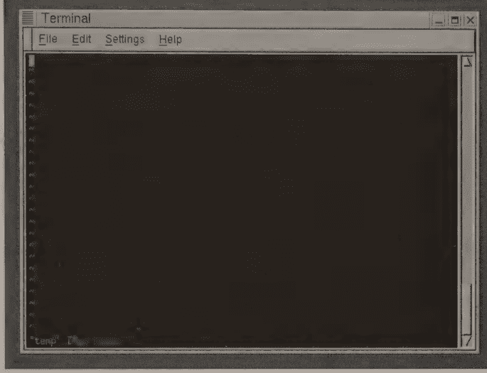

图 3-2：`vi` 编辑器的初始屏幕

在屏幕的左上角，你会看到光标，如图 3-2 中所示的实心方块。光标指示你在文件中的当前位置。

注意：包含光标的行是当前行。包含波浪号（~）的行不属于文件的一部分；它们仅指示屏幕上的行，而不是文件中的文本行。

### 插入文本

当你启动 `vi` 编辑器时，你处于命令模式。这意味着编辑器将你在键盘上输入的任何内容都解释为命令。在你可以在新文件中插入文本之前，你必须使用 `i`（插入）命令。

**在 Temp 文件中插入文本：**

1. 输入 `i`。就像大多数 `vi` 命令一样，`i` 命令不会出现在（或回显在）你的屏幕上。该命令将你从命令模式切换到插入模式；你不需要按回车键来表示命令已完成。
2. 输入图 3-3 中所示的文本。

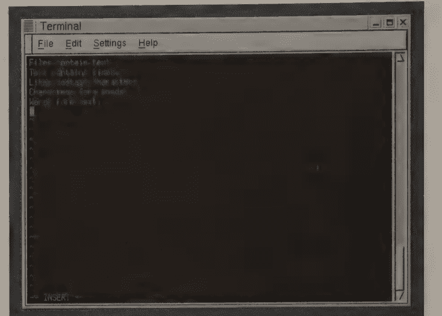

图 3-3：使用 `vi` 编辑器插入文本

如果你需要删除字符，请按退格键（Backspace）。在每行末尾按回车键以移动到下一行。

注意：在插入模式下，你输入的每个字符都会显示在屏幕上。要切换到命令模式，请按 `Esc`。

### 重复更改

使用重复（`.`）命令来重复你最近所做的更改。因为你刚刚插入了文本，所以重复命令会重复插入操作，复制已插入的文本。你可以通过重复前一行然后编辑它来添加备忘录中的下一项。

**重复你的上一个编辑命令：**

1. 按 `ESC` 切换到命令模式。
2. 输入 `.`（句号）。

`vi` 编辑器会在当前行下方插入你最后输入的文本。你的屏幕应该类似于图 3-4。

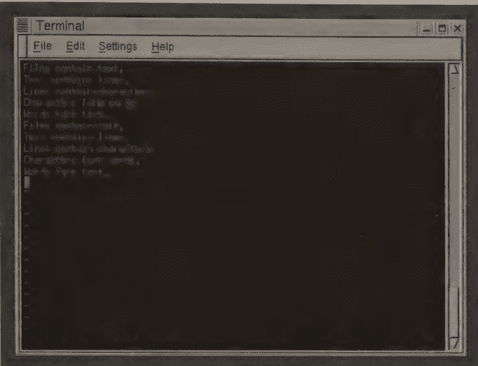

图 3-4：在 `vi` 编辑器中重复命令

现在，你准备好编辑你刚刚插入的文本了。首先移动光标，然后在屏幕上移动并删除不必要的文本。

### 移动光标

当你处于命令模式时，可以移动光标。首先，在屏幕上四处移动以熟悉这些命令，然后移动到你想要编辑的特定行。

**在屏幕上移动光标：**

1. 按 `ESC` 确保你处于命令模式。
2. 按方向键向上、下、左、右一次移动一个字符。
3. 输入 `H` 将光标移动到屏幕的左上角。

   注意：请确保按照这些步骤中指示的那样输入大写字母。
4. 输入 `L` 将光标移动到屏幕上的最后一行。
5. 输入 `G` 跳到最后一行的开头。这是“转到”命令。你可以在 `G` 前面包含一个数字，以指示你想移动到第几行。
6. 输入 `2G` 移动到第二行的开头。

除了这些命令，你还可以使用其他命令来移动光标。表 3-1 总结了 `vi` 编辑器的光标移动键。

| 键 | 移动 |
| :--- | :--- |
| `h` 或 左方向键 | 向左移动一个字符位置 |
| `l` 或 右方向键 | 向右移动一个字符位置 |
| `k` 或 上方向键 | 向上移动一行 |
| `j` 或 下方向键 | 向下移动一行 |
| `H` | 屏幕左上角 |
| `L` | 屏幕上的最后一行 |
| `nG` | 转到由数字 `n` 指定的行 |
| `w` | 向前移动一个单词 |
| `b` | 向后移动一个单词 |
| `0`（零） | 当前行的开头 |
| `$` | 当前行的末尾 |
| `Ctrl+U` | 向上移动半屏 |
| `Ctrl+D` | 向下移动半屏 |
| `Ctrl+F` 或 `Pg down` | 向前移动一屏 |
| `Ctrl+B` 或 `Pg up` | 向后移动一屏 |

表 3-1：`vi` 编辑器的光标移动键

记住，光标移动键仅在命令模式下有效。

注意：使用字母键移动光标可以追溯到 UNIX 使用没有方向键的电传终端的时代。`vi` 的设计者选择字母键是因为它们在键盘上的相对位置。

### 删除文本

现在你知道了如何插入文本和在文件中移动，你可以准备删除文本了。为此，移动到一个字符，然后输入 `x` 以删除该字符。你还可以将许多删除命令与光标移动命令组合起来，以删除多个字符。表 3-2 总结了最常用的删除命令。

| 命令 | 用途 |
| :--- | :--- |
| `x` | 删除光标处的字符 |
| `dd` | 删除当前行 |
| `dw` | 删除从光标处开始的单词。如果光标在单词中间，则从光标删除到行末。 |
| `d$` 或 `D` | 从光标删除到行末 |
| `d0` | 从光标删除到行首 |

表 3-2：`vi` 编辑器的删除命令

现在，你可以使用删除命令和光标移动键来编辑你在备忘录中插入的文本。

**通过删除文本来编辑 `temp` 文件：**

1. 按 `Esc` 确保你处于命令模式。
2. 输入 `1G` 移动到文件的第一行。你想删除这一行。
3. 要删除第一行，输入 `dd`。

   此时你的文件应该看起来像图 3-5。

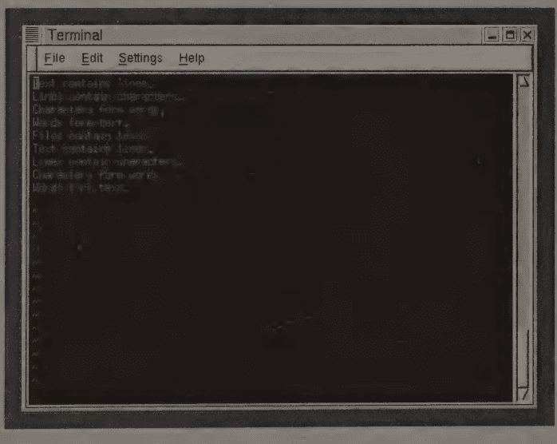

图 3-5：删除第一行后的备忘录
4. 按 `w` 跳到下一个单词，“contains”。
5. 输入 `dw` 删除当前单词（因此该行现在显示为“Text lines”），然后输入 `i` 进入插入模式。
6. 在“Text”和“lines”之间输入 `consists`。务必包括额外的“s”。


7. 按方向键将光标移动到“consistss”中多余的“s”，然后按 `ESC` 切换到命令模式。

8. 要删除当前字符（多余的“s”），输入 `x`。你的备忘录现在应该看起来像图 3-6。


图 3-6：编辑后的备忘录

现在，你想通过删除最后一个单词来编辑句子“Files contain text”。

9. 按方向键移动到句子“Files contain text”，然后移动到“contain”中的第一个“c”。

10. 输入 `d$` 删除从光标到行末的文本，然后输入 `i` 切换到插入模式。

11. 输入 `consist of words.` 以完成句子。

现在，你可以通过替换第一个单词来编辑下一个句子。

12. 按方向键移动到文件中的下一行，移动到单词“lines”的初始字符，然后按 `ESC` 切换回命令模式。

13. 输入 `d0` 删除从光标到行首的文本，然后输入 `i` 进入插入模式。

14. 输入 `Words form` 在该句子开头插入该文本。

15. 你完成的备忘录应该看起来像图 3-7。

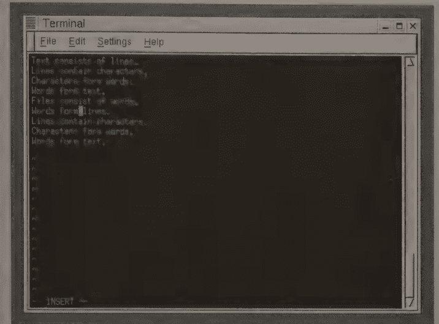

图 3-7：编辑完成后生成的备忘录

`vi` 编辑器提供了复制、剪切和粘贴文本的替代方法。

> **注意**：删除行命令 `dd` 实际上会将删除的行放入缓冲区。然后，你可以使用粘贴命令 `p` 将已删除（剪切）的行粘贴到文本的其他位置。（将光标定位到你希望粘贴的位置。）若要复制和粘贴文本，请使用 yank 命令 `yy` 复制行。在复制了你想要粘贴到其他位置的行之后，移动光标并输入 `p` 即可将文本粘贴到当前位置。

## 撤销命令

如果你完成了一个命令，随后意识到想要反转其效果，可以使用撤销命令。例如，如果你不小心从文件中删除了几行，请输入 `u` 以恢复文本。

## 搜索模式

你可以通过输入正斜杠（`/`），输入你要寻找的模式，然后按 `Enter` 键来向前搜索字符模式。例如，假设你想知道在备忘录中使用了多少次单词“consist”或“consists”。

### 搜索文本模式以查找任一单词：

- 1. 按 `Esc` 确保处于命令模式。
- 2. 输入 `H` 将光标移动到屏幕顶部。
- 3. 输入 `/cons` 以搜索字符串 "cons"。
- 4. 按 `Enter`。光标移动到第 1 行单词 "consists" 的开头。
- 5. 若要搜索 "cons" 的下一个出现位置，按 `n`（代表 next/下一个）。光标移动到第 5 行单词 "consist" 的开头。如果你搜索的是 "/con"，那么你会先在第 1 行找到 "consist"，然后会在第 2 行找到 "contain"。
- 6. 若要查看文件状态信息，按 `Ctrl+G`。你的屏幕应如图 3-8 所示。

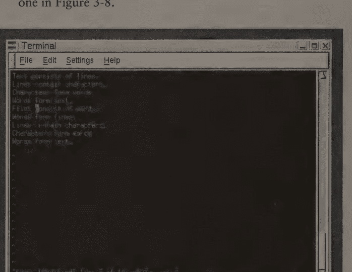

**图 3-8：vi 状态行**

注意：屏幕底部的状态行显示信息，包括行导向命令（本课稍后解释）和错误消息。

## 搜索和替换

假设你想将备忘录中所有“text”的出现位置更改为“documents”。与其搜索“text”然后删除并插入“documents”，不如使用一个命令进行搜索和替换。你迄今所学到的命令是屏幕导向的。可以执行多个操作（如搜索和替换）的命令是行导向命令。

注意：**屏幕导向命令**在光标所在处执行。你无需告诉计算机在何处执行操作：操作相对于光标进行。另一方面，行导向命令要求你指定操作的确切位置（地址）。屏幕导向命令易于输入，其更改会显示在屏幕上。输入行导向命令较为复杂，但它们可以独立于光标执行，并且可以在文件中的多个位置执行。

冒号（`:`）位于所有行导向命令之前。它在状态行上作为提示符。在状态行中输入行导向命令，并在完成命令时按 `Enter`。

注意：在本章中，所有行导向命令的说明都将冒号作为命令的一部分包含在内。

**搜索字符模式：**

- 1. 按 `Esc` 确保处于命令模式。
- 2. 输入 `/form` 并按 `Enter`。此命令指示 `vi` 搜索单词“form”的第一次出现，并将光标移动到该单词下方。
- 3. 输入 `n` 以重复搜索。`vi` 定位到单词“form”的下一次出现位置。

**搜索“text”并将其替换为“documents”：**

- 1. 按 `Esc` 确保处于命令模式。
- 2. 输入 `:1,$s/text/documents/g`。此命令的含义是“从第一行 (1) 到文件结尾 ($)，搜索 ‘text’ 并将其替换为 ‘documents’ (`s/text/documents/`)，在每一行中它出现的所有位置 (`g`)”。
- 3. 按 `Enter`。你的屏幕应如图 3-9 所示。

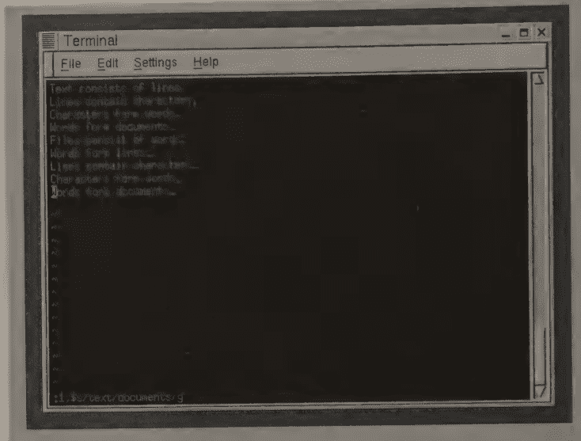

图 3-9：搜索和替换后的备忘录

请注意，第 1 行中的单词“Text”保持不变，因为它是大写的。默认情况下，搜索区分大小写。

## 保存文件并退出 vi

在编辑文件时，保存更改是个好主意。退出 `vi` 之前始终应保存文件；否则，你会丢失更改。

### 保存 temp 文件：

- 输入 `:w`，然后按 `Enter` 保存更改，退出 `vi` 编辑器，并返回 UNIX shell。

状态行提供有关你文件的信息，包括其名称以及它包含的行数和字符数。

注意：在命令模式下，你还可以使用 `:wq`（写入并退出）或 `ZZ` 在将文件保存到磁盘后退出编辑器。若要保存文件并继续使用 `vi` 编辑器，请输入 `:w`。

## 从另一个文件添加文本

有时，你想在一个文件中插入的文本已经是另一个文件的一部分。例如，假设你想获取文件 `temp` 中文本的一份单独副本，以便用于练习编辑。首先创建一个名为 `practice` 的新文件，然后使用行导向的 `r`（read/读取）命令从 `temp` 文件添加文本。

**创建新文件并从另一个文件添加文本：**

- 1. 输入 `vi practice` 并按 `Enter` 创建新文件。
- 2. 按 `Esc` 确保处于命令模式。
- 3. 输入 `:r temp`。

你的文件应如图 3-10 所示。

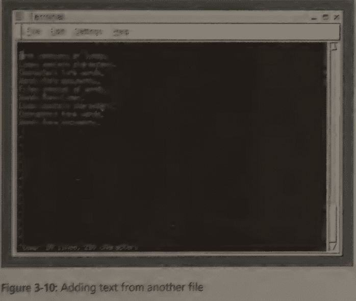

`r` 命令将 `temp` 中的文本复制并放入当前文件 `practice` 中。请注意文件顶部的空行。
- 4. 将光标移动到空行，并输入 `dd` 将其删除。

## 暂时离开 vi

如果你想在 `vi` 中工作时执行其他 UNIX 命令，可以从 `vi` 内部启动 shell 或其他命令。例如，假设你正在处理你给 Dominion 的备忘录，并想快速查看当前日期。

- 1. 若要暂时离开 `vi` 以查找当前日期和时间：
  - 输入 `:date` 并按 `Enter`。你会看到今天的日期以及返回命令模式的说明。
  - 按 `Enter` 返回命令模式。

## 编辑时更改显示

除了使用 `vi` 编辑命令外，你还可以在 `vi` 中设置选项来控制编辑参数，例如行号显示以及搜索是否区分大小写。当你想要处理一系列行时，例如删除或剪切粘贴一块文本时，请打开行号显示。然后，你可以参考行号来指定文本。你决定从备忘录中删除最后三行。先打开行号显示，然后使用删除命令。

### 使用自动行号：

- 输入 `:set number` 并按 `Enter`。重新绘制的屏幕在文本左侧显示行号。你的屏幕应如图 3-11 所示。

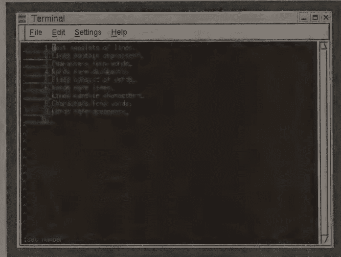

行号仅供参考。它们不是文件的一部分。现在你可以使用这些参考号码来删除文件中的最后三行。
- 输入 `:.$d` 并按 `Enter`。你已删除文件的最后三行。（注：原文为 `:.9d`，意为从当前行到第9行删除，此处保留原意翻译为“删除最后三行”可能因上下文差异略有调整，严格对应原文动作则是输入该命令）
- 输入 `:.9d` 并按 `Enter`。你已删除文件的最后三行。

## 复制或剪切和粘贴

你可以使用 `vi` 中的 `yy` 命令从文件中复制指定数量的行并将其放入剪贴板。若要删除文件中的行并将其存储在剪贴板上，请使用 `dd` 命令。现在你想重新组织文档，使前三行位于文件末尾。你可以使用剪切和粘贴命令来进行此更改。

### 剪切和粘贴文本：

- 1. 输入 `H` 将光标移动到第 1 行的开头。
- 2. 输入 `3dd` 从文档中剪切前 3 行并将其存储在缓冲区中。
- 3. 输入 `G` 将光标移动到文件末尾。


4. 输入 `p` 将这三行粘贴到文件末尾。

## 打印文本文件

你可以使用 `lpr`（line print/行打印）shell 命令来打印文件。输入 `!lpr`，然后输入你要打印的文件名。

### 打印文件：

1. 按 `Esc` 返回命令模式。
2. 输入 `!lpr practice` 并按 `Enter`。这会在默认打印机上打印当前目录中的文件 `practice`。

你还可以使用 `-P*printer*` 选项指定想要使用的打印机。例如，你可能使用两台打印机——`lp1` 和 `lp2`。要在 `lp2` 上打印 `practice` 文件，请输入 `!lpr -Plp2 practice` 并按 `Enter`。

## 取消编辑会话

如有必要，你可以取消编辑会话，即丢弃你所做的所有更改。你决定不需要你的 `practice` 文件，因此可以取消编辑会话。

若要取消编辑会话：
- 输入 `:q!` 并按下回车键。这将退出 vi，丢弃所有已做的更改，且不向磁盘写入任何内容。

### 摘要

- 字节是使用数字代码存储的“计算机字符”。通常使用一组标准化代码，即 ASCII 码。ASCII 是“美国标准信息交换代码”（American Standard Code for Information Interchange）的缩写。仅包含 ASCII 字符（字节）的计算机文件称为文本文件。
- vi 编辑器仍是大多数 UNIX 用户的首选。标准编辑器处理文本文件。文本文件也被称为“平面文件”或“ASCII 文件”。
- vi 编辑器是一种模态编辑器，因为它工作在两种模式下：插入模式和命令模式。插入模式允许你输入文本，而命令模式允许你在文件中导航并修改文本。
- 在 vi 编辑器的插入模式下，你输入的字符会被插入到文件中。它们不会被解释为 vi 命令。要退出插入模式并重新进入命令模式，请按 `Esc` 键。
- 使用 vi 时，你最初编辑的是存放在计算机内存中的文件副本。除非你将文件保存到磁盘，否则不会更改原始文件本身。

### 命令摘要

### 第 3 章，课程 A 命令

| 命令 | 用途 |
| :--- | :--- |
| `vi` 命令 |  |
| `.`（重复） | 重复你最近的一次更改 |
| `/` | 向前搜索字符模式 |
| `:!` | 暂时离开 vi |
| `:q` | 取消编辑会话 |
| `:r` | 从一个文件读取文本并添加到另一个文件 |
| `:set` | 打开某些选项，例如行号显示 |
| `:w` | 保存文件并继续工作 |
| `:wq` | 将更改写入磁盘并退出 vi |
| `:x` | 保存更改并退出 vi |
| `i` | 切换到插入模式 |
| `p` | 从缓冲区粘贴文本 |
| `u` | 撤销你最近的一次更改 |
| `vi` | 启动 vi 编辑器 |
| `yy` | 将文本复制（yank）到剪贴板 |
| `ZZ` | 在命令模式下，保存更改并退出 vi |

### UNIX 命令

| 命令 | 用途 |
| :--- | :--- |
| `lpr` | 打印文件 |

注：表 3-1 列出了 vi 编辑器的一些光标移动键。表 3-2 列出了 vi 编辑器的一些删除命令。

### 复习题

1. vi 编辑器被称为模态编辑器，因为_____________。
    a. 它是可移植的
    b. 它主要工作在两种模式下
    c. 它使输入和修改文本变得容易
    d. 它工作在单一模式下
2. 你按下哪个键从插入模式切换到命令模式？
    a. `Esc`
    b. `:`
    c. `Ctrl+C`
    d. `Ins`
3. 在命令模式下，你可以通过_____________退出 vi。
    a. 输入 `:quit!`
    b. 输入 `:wq!`
    c. 输入 `:x`
    d. 以上所有
4. 为什么 vi 编辑器被称为“可视化编辑器”？
    a. 因为它与行编辑器一起工作
    b. 因为它是面向行的
    c. 因为它使用图形界面
    d. 因为文本更改立即显示在屏幕上
5. 在 vi 编辑器中，冒号（:）充当_____________。
    a. 状态行命令提示符
    b. 退出命令
    c. 替换命令
    d. 搜索命令
6. 在 vi 编辑器的命令模式下，输入哪个单个字符可以开始搜索文本模式？
    a. `?`
    b. `s`
    c. `/`
    d. `:`
7. 编辑器处理_____________文件。
    a. 可执行程序
    b. 平面
    c. 图形
    d. 内核
8. 以下哪个 vi 命令从文件中删除一行？
    a. `d$`
    b. `d0`
    c. `dd`
    d. `x`
9. 以下哪个 vi 命令是光标移动命令？
    a. `G`
    b. `l`
    c. `h`
    d. 以上所有
10. 以下哪个 vi 命令从另一个文件添加文本？
    a. `r`
    b. `read`
    c. `:r`
    d. `:w`
11. 以下哪个命令在 vi 文件中显示行号？
    a. `set no`
    b. `:set`
    c. `:number`
    d. `:set number`
12. 哪个 vi 命令使你暂时离开 vi？
    a. `:t`
    b. `:wq`
    c. `:!`
    d. `:u`
13. 哪个 vi 命令重复你最近的一次更改？
    a. `.`
    b. `:r`
    c. `:!`
    d. `:u`
14. 哪个 vi 命令将文本复制到缓冲区？
    a. `:y`
    b. `C`
    c. `:c`
    d. `yy`
15. 哪个 vi 命令从缓冲区粘贴文本？
    a. `:P`
    b. `p`
    c. `:!`
    d. `:u`
16. 哪个 vi 命令撤销你最近的更改？
    a. `:wq`
    b. `u`
    c. `:O`
    d. `Z`
17. `H` 命令执行什么操作？
    a. 使光标移动到第 1 行的开头
    b. 使光标移动到当前行的开头
    c. 将文件内容保存在内存中以便将来编辑
    d. 以上都不是
18. 命令 `7dd` 执行什么操作？
    a. 删除当前行的第七个单词
    b. 删除七行
    c. 从当前行起删除第三行
    d. 以上都不是
19. 命令 `G` 执行什么操作？
    a. 抓取文本并将其放入剪贴板
    b. 将光标移动到字母 G 的首次出现位置
    c. 将光标移动到文件末尾
    d. 将光标移动到当前行末尾

### 练习

1. 使用 vi 编辑器：
    a. 创建一个包含 10 行的文档。
    b. 在每一行中输入单词“these”。
    c. 保存文件并退出 vi。
    d. 重新打开文档，并将整个文件中的“these”更改为“those”。
2. 使用 vi 编辑器：
    a. 创建一个名为 `first.file` 的文档，并在其中输入几行文本。保存它。
    b. 创建第二个名为 `second.file` 的文档，并在其中输入几行文本。保存它。
    c. 通过合并前两个文件的文本，创建第三个名为 `third.file` 的文档。
    d. 保存第三个文件并退出编辑器。
    e. 输入 `vi third.file` 以确保 `third.file` 包含两个文件的文本。
3. 删除 `third.file` 中的所有文本，然后恢复它。

### 发现练习

1. 创建一个包含 10 行文本的文件。删除前四行，并将它们添加到文件末尾。
2. 在文件中间的一行上，插入你的名字。
3. 将光标移动到文件开头。
4. 输入搜索你的名字并替换为“George”的命令。（如果你的名字恰好是 George，则替换为“Abraham”。）
5. 保存文件但不要退出 vi。
6. 在不退出 vi 的情况下，暂时执行 `ls` 命令以确认文件已保存。
7. 输入使行号显示的命令。
8. 输入删除第 1 到第 3 行的命令。
9. 移动到包含你姓名的那一行文本，剪切它，并将文本放在剪贴板上。
10. 将你的姓粘贴到文件第一行的开头。

## 课程 B

### 目标

学习完本课程后，你应该能够：
- 比较 Emacs 和 vi 编辑器特性的异同
- 熟悉最重要的 Emacs 编辑器命令
- 使用 Emacs 编辑器创建和编辑简单的文档

### Emacs 编辑器

### 使用 Emacs 编辑器


Emacs 是另一个获得广泛使用的 UNIX 文本编辑器，但由于其复杂性，其使用率仍仅次于 vi 编辑器。与 vi 不同，Emacs 不是模态的：它不会在命令模式和插入模式之间切换。这意味着你无需确认自己处于正确的模式即可输入命令。尽管 Emacs 比 vi 更复杂，但它更具一致性。例如，你可以通过按 Alt 或 Ctrl 键组合来输入大多数命令。

Emacs 还支持一种高级宏语言。`宏`是一组自动执行复杂任务命令。可以把宏想象成一条“超级指令”。Emacs 还具有强大的命令语法和扩展功能。其打包的定制宏集合允许你阅读电子邮件和新闻，并编辑目录内容。据称 Emacs 的功能比任何其他 UNIX 程序都多。你可以通过学习其常用命令来开始学习 Emacs。表 3-3 列出了这些命令。

| Alt 命令 | 用途 | Ctrl 命令 | 用途 |
| :--- | :--- | :--- | :--- |
| Alt+< | 将光标移动到文件开头 | Ctrl+@ | 标记光标位置。移动光标后，你可以移动或复制文本到标记处。 |
| Alt+> | 将光标移动到文件末尾 | Ctrl+A | 将光标移动到行首 |
| Alt+B | 将光标向前移动一个单词 | Ctrl+B | 将光标向前移动一个字符 |
| Alt+D | 删除当前单词 | Ctrl+D | 删除光标下的字符 |

表 3-3：常用 Emacs 命令

## 常用 Emacs 命令

### 表 3-3：常用 Emacs 命令

| Alt 命令 | 功能 | Ctrl 命令 | 功能 |
| :--- | :--- | :--- | :--- |
| Alt+F | 将光标向前移动一个单词 | Ctrl+E | 将光标移动到行尾 |
| Alt+Q | 使用自动换行重新格式化当前段落，使各行充满文本 | Ctrl+F | 将光标向前移动一个字符 |
| Alt+T | 如果光标位于单词的第一个字符下方，则交换该单词与其前一个单词的位置 | Ctrl+G | 取消当前命令 |
| Alt+U | 将当前单词的所有字母转换为大写 | Ctrl+H | 使用在线帮助 |
| Alt+W | 向上滚动一屏 | Ctrl+K | 删除从光标位置到行尾的文本 |
| Alt+X doctor | 进入医生模式，玩一个游戏，Emacs 会以问题回应你的陈述。请先保存你的工作。并非所有版本都支持此模式。 | Ctrl+N | 将光标移动到下一行 |
| | | Ctrl+H+C | 显示按下特定按键时运行的命令 |
| | | Ctrl+H+T | 运行关于 Emacs 的教程 |
| | | Ctrl+X, Ctrl+C | 退出 Emacs |
| | | Ctrl+X, Ctrl+S | 保存文件 |
| | | Ctrl+X, U | 撤销最后一次更改 |
| | | Ctrl+Del | 删除光标下的字符 |
| | | Ctrl+T | 交换光标前的字符和光标下的字符 |
| | | Ctrl+V | 向下滚动一屏 |
| | | Ctrl+W | 删除标记的文本。按 Ctrl+Y 恢复已删除的文本。 |
| | | Ctrl+Y | 从文件缓冲区插入文本，并将其放置在光标之后 |

注意：在大多数情况下，Emacs 中的 Ctrl 和 Alt 命令不区分大小写，因此 Alt+B 和 Alt+b 是相同的命令。

您可以使用 Emacs 复制您为 Dominion Consulting 创建的第一份备忘录。为此，您需要完成以下任务：

- 在 Emacs 中创建一个新文件
- 编辑和删除文本
- 复制、剪切和粘贴文本

## 在 Emacs 中创建新文件

您可以通过输入 `emacs` 命令来启动 Emacs。如果在此命令后输入文件名，Emacs 将创建一个具有该名称的新空白文件，或打开具有该名称的现有文件。如果输入 `emacs` 时没有指定文件名，Emacs 将显示包含几个重要命令的介绍列表，如图 3-12 所示。

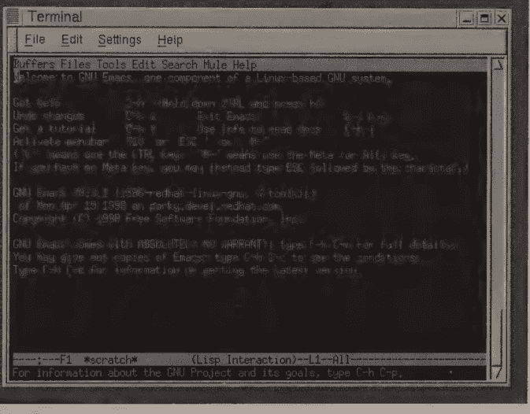

图 3-12：Emacs 启动屏幕（无文件名）

首先，创建一个名为 `practice` 的文件，该文件将包含与您为 Dominion Consulting 准备的原始 `temp` 备忘录相同的文本。

**启动 Emacs 并创建名为 practice 的文件：**

1. **键入** `emacs practice.fil`，然后按 **Enter**。

    您将看到启动屏幕；其状态栏表明您正在创建一个新文件。

2. 要在文件中添加文本，请键入您看到如图 3–13 中的文本。

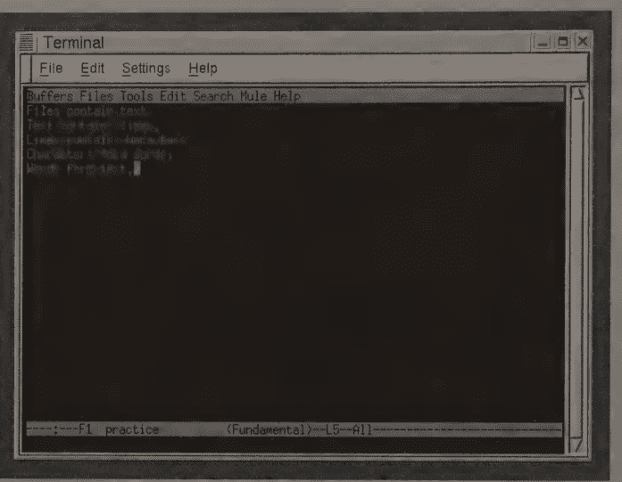

3. 按 `Ctrl+x`，然后按 `Ctrl+s` 保存文件。

4. 按 `Ctrl+x`，然后按 `Ctrl+c` 退出文件。

> 注意：在 Emacs 中，您必须按下两个 Ctrl 组合键来保存和退出文件。

## 编辑 Emacs 文件

要导航 Emacs 文件，您可以使用光标移动键——例如 **方向键**、**Pg up**、**Pg down**、**Home** 和 **End**——或 Ctrl 组合键。在编辑 `practice` 之前，请在文件中四处移动。

**导航 practice 文件：**

1. 要返回 Emacs 并获取您的文件，请键入 `emacs practice.fil` 并按 **Enter**。

2. 按 `Ctrl+f` 向前移动一个字符，然后按 **右方向键**。

3. 按 `Ctrl+b` 向后移动一个字符，然后按 **左方向键**。

4. 使用 **上方向键** 和 **下方向键**，将光标放置在以“Lines contain.”开头的行上。

**删除文本并撤销删除：**

1. 按 `Ctrl+k` 删除当前行。

2. 按 `Ctrl+x`，然后键入 `u` 以撤销最后一次更改。

> **提示**
>
> 您甚至可以多次恢复文本，即使进行了许多更改。按 `Ctrl+x`，然后按 `u`。使用此命令按顺序撤销您的编辑命令。

在 Emacs 中，您只需键入即可插入文本。您还可以通过复制粘贴或剪切粘贴来插入文本。您可以复制 `practice` 文件的前两行，并将其粘贴到文件末尾。

**在 Emacs 中复制和粘贴文本：**

1. 将光标移动到句子“Characters form words.”的开头。

2. 按 `Ctrl+空格键`。这标记了您想要复制的文本块的起始位置。您在状态栏中看到“Mark set”字样。

3. 按 **下方向键** 两次，将光标移动到下一行。

4. 按 `Alt+w`。这标记了要复制的文本块的结束位置。您也可以按住 `Esc` 然后按 `w` 来标记块的结束。

5. 按 `Alt+>` 移动到文件末尾。

6. 按 `Ctrl+y` 将剪贴板中的标记文本粘贴到缓冲区中。

> **性能提示**
>
> 若要剪切粘贴而不是复制粘贴，请在光标位于要剪切文本块末尾时按 `Ctrl+w`。

与 vi 编辑器类似，Emacs 允许您搜索特定文本。例如，假设您想在练习文档中找到文本“on”。

**搜索特定单词：**

1. 按 `Ctrl+s`。您在状态行中看到“I-search”提示。现在您可以键入您要查找的文本。

2. **键入** `on`。

3. 按 `Ctrl+s` 搜索“on”的下一次出现。再次按 `Ctrl+s`。

4. 按 `Ctrl+r` 向后搜索“on”的上一次出现。

**重新格式化文档，使各行充满文本：**

1. 第一行和第三行都包含单词“contain”。在每一行上，将光标移动到单词“contain”后面的空格处，然后按 **Enter**。这将每行拆分为两行。

2. 按 `Alt+Q` 重新格式化文件，使各行充满文本。

在处理完练习文档后，您准备退出 Emacs。为此，请按照前面部分“在 Emacs 中创建新文件”中的说明操作。（按 `Ctrl+x`，然后按 `Ctrl+c` 以保存并退出文件。）

### 摘要

- Emacs 编辑器已经变得流行，但由于其复杂性，它继续排在 vi 编辑器之后。
- 与 vi 不同，Emacs 不是模式化的。（它不会从命令模式切换到插入模式。）
- Emacs 具有强大的命令语法和扩展，并支持复杂的宏命令语言。宏是一组旨在简化复杂任务的命令。Emacs 的定制宏包集使您能够阅读电子邮件和新闻，并编辑目录的内容。
- 您可以通过输入 `emacs`（带或不带文件名）来启动 Emacs。如果您输入此命令，然后键入文件名，Emacs 将创建一个具有该名称的新空白文件，或打开具有该名称的现有文件。如果您输入 `emacs` 时没有文件名，Emacs 将显示包含几个重要命令的介绍列表。
- 您可以使用光标移动键——例如方向键、Pg up、Pg down、Home 和 End——或 `Ctrl` 组合键来导航 Emacs 文件。
- 您可以按顺序撤销编辑更改，即使您已经进行了许多更改。


在 Emacs 中，您只需键入即可插入文本。您还可以通过复制粘贴或剪切粘贴来插入文本。与 `vi` 编辑器一样，Emacs 也允许您搜索特定文本。

### 命令摘要

| 命令 | 功能 |
| :--- | :--- |
| `Emacs` 命令 | 见表 3-3 |
| `emacs` | 启动 Emacs 编辑器 |
| `UNIX` 命令 |  |
| `lpr` | 打印文件 |

> 注意：表 3-3 列出了常用的 Emacs 命令。

### 复习问题

1. Emacs 编辑器 ______________。
    a. 是非模式化的
    b. 是模式化的
    c. 能够同时执行模式化和非模式化操作
    d. 具有插入模式和命令模式

2. 要在 Emacs 中发出命令，请 ______________。
    a. 按住 `Ctrl` 键，然后按一个字母
    b. 按住 `Alt` 键，然后按一个字母
    c. 按功能键（`F1–F12`）
    d. a 和 b

3. 哪些 `Ctrl` 组合键让您退出 Emacs 编辑器并返回命令行？
    a. `Ctrl+c`, `Ctrl+x`
    b. `Ctrl+x`, `Ctrl+c`
    c. `Ctrl+s`, `Ctrl+x`
    d. `Ctrl+x`, `Ctrl+e`

4. 哪些 `Ctrl` 组合键保存您的文件？
    a. `Ctrl+c`, `Ctrl+x`
    b. `Ctrl+x`, `Ctrl+y`
    c. `Ctrl+x`, `Ctrl+s`
    d. `Ctrl+z`, `Ctrl+s`

5. 以下哪一项最能将 Emacs 与 `vi` 编辑器进行比较？
    a. Emacs 很流行，但由于其复杂性，其地位仍次于 `vi` 编辑器。
    b. `vi` 编辑器拥有复杂的宏语言，而 Emacs 没有。
    c. 两者都有插入模式和命令模式。
    d. 以上所有选项均正确。

6. 当你使用不带文件名的 Emacs 命令开始编辑一个 Emacs 文件时，你会看到什么？
    a. 一个用于未命名文件的空白屏幕
    b. 常用 Emacs 命令列表
    c. 你最后编辑的文件文本
    d. Emacs 与 `vi` 编辑器之间差异的摘要

7. 以下哪一项是错误的？
    a. 在 Emacs 中，你可以按 `Del` 键删除字符。
    b. 在 Emacs 中，你可以使用所有方向键向上、下、左或右移动。
    c. 在 Emacs 中，你可以使用 `Ctrl+h` 将光标向后移动一个空格。
    d. 在 Emacs 中，你可以使用 `Ctrl+a` 将文本移动到行首。

8. 判断对错：在大多数情况下，Emacs 中的 `Ctrl` 和 `Alt` 命令不区分大小写。

9. ____________ 命令标记你要复制的文本块的开始。
    a. `Ctrl+M`
    b. `Ctrl+S`
    c. `Ctrl+空格`
    d. 以上都不是

10. ____________ 命令标记你要复制的文本块的结束。
    a. `Alt+w`
    b. `Ctrl+w`
    c. `Alt+空格`
    d. 以上都不是

11. ____________ 命令将光标移动到文件末尾。
    a. `Ctrl+<`
    b. `Ctrl+>`
    c. `Alt+<`
    d. `Alt+>`

12. ____________ 命令从剪贴板插入文本并将其放置在光标之后。
    a. `Ctrl+p`
    b. `Ctrl+y`
    c. `Alt+p`
    d. `Alt+y`

13. ______________ 命令用于撤销上一个命令。
    a. `Ctrl+u`
    b. `Ctrl+x`
    c. `Ctrl+u,x`
    d. `Ctrl+x,u`

14. ______________ 命令导致当前行被删除。
    a. `Ctrl+k`
    b. `Ctrl+l`
    c. `Ctrl+x,k`
    d. `Alt+k`

15. ______________ 命令调用 `I-search` 提示。
    a. `Ctrl+s`
    b. `Alt+s`
    c. `Ctrl+空格`
    d. 以上都不是

16. ______________ 命令执行向后搜索。
    a. `Ctrl+x,b`
    b. `Ctrl+b`
    c. `Ctrl+r`
    d. 以上都不是

17. 判断对错：Emacs 缺少类似 `vi` 撤销命令的撤销功能。

### 练习

使用表 3-3 找到执行以下步骤的正确命令。

1. 使用 Emacs 编辑器，创建一个新文件，其中包含莎士比亚第 80 首十四行诗的前 4 行：
   ```
   O, how I faint when I of you do write,
   Knowing a better spirit doth use your name,
   And in the praise thereof spends all his might,
   To make me tongue-tied, speaking of your fame!
   ```

2. 将光标移动到第二行单词 “better” 中除 “b” 以外的任意字母上。

3. 使用导致当前单词与其后一个单词互换位置的命令。执行该命令后，该行应显示为：
   ```
   Knowing a spirit better doth use your name,
   ```

4. 将光标移动到同一行的单词 “doth” 上。

5. 使用命令删除当前单词。

6. 将光标移动到同一行单词 “spirit” 的第一个字符上。

7. 使用使单词字母大写的命令。

8. 将光标移动到同一行单词 “your” 中的字母 “y” 下方。

9. 使用删除光标下方字符的命令。此时该行应显示为：
   ```
   Knowing a SPIRIT better use our name,
   ```

10. 将光标移动到第三行的单词 “spends” 上。

11. 使用删除直到行末文本的命令。此时该行应显示为：
    ```
    And in the praise thereof
    ```

12. 将光标移动到第一行的末尾。

13. 使用在光标位置放置标记的命令。

14. 将光标移动到第一行的第一个字符处。

15. 使用删除标记文本的命令，即删除第一行。

16. 将光标移动到文件末尾。使用恢复已删除文本的命令。

原文件第一行的文本现在位于文件末尾。

### 发现练习

1. 使用练习文件，练习复制和粘贴文本以重新排列行的顺序。

2. 向文件添加文本，并练习使用光标移动命令。

3. 将所有出现的单词 “the” 替换为 “a。”

4. 选择五个单词并将它们转换为全大写。

5. 删除一行，然后撤销该删除操作。

6. 互换每一行的前两个单词。

7. 保存文件并退出 Emacs。

# 第 4 章

## UNIX 文件处理

**案例** 你在 Dominion Consulting 的主管 Rolfie Williams 希望从你之前创建的电话号文件中提取一个姓名列表并对其进行排序。然后，他希望帮助你为 Dominion 的客户 Worldwide Hotels 设计一份新的供应商和产品报告。该酒店公司希望生成一份按字母顺序排列的供应商列表及其提供的产品。供应商和产品名称分别存储在不同的文件中：一个产品文件和一个供应商文件。这两个文件都包含供应商编号。Rolfie 要求你使用 UNIX 文件处理工具，利用这两个文件生成供应商报告。

## 课程 A

### 目标

学习完本课程后，你应该能够：
- 解释 UNIX 的文件处理方法
- 使用基本的文件操作命令
- 使用 `cut` 命令从文件中提取字符和字段
- 使用 `paste` 命令重新排列记录内的字段
- 使用 `sort` 命令合并文件
- 通过结合使用 `cut`、`paste` 和 `sort` 创建新文件

## 从文件中提取信息

既然你已知晓如何操作 UNIX 文件和编辑器，现在你可以开始学习如何操作文件及其内容。在对 UNIX 文件类型和文件结构进行简要讨论后，课程 A 定义了文件处理，并展示了你在处理文件时如何使用重定向运算符。你还将学习如何通过创建、删除、复制和移动文件来操作文件，以从文件中提取信息、合并字段以及对文件内容进行排序，所有这一切都在开篇案例的背景下进行。在课程 B 中，你将学习如何组装从文件中提取的信息。你还将创建一个脚本来自动化一系列命令，通过公共字段链接文件，并使用 `awk` 命令格式化输出。你完成这些任务以满足开篇案例的目标。

## UNIX 的文件处理方法

UNIX 文件处理基于这样的理念：文件应被视为仅仅是一串字符序列。这种将文件视为字符序列的概念提供了很大的灵活性。由于你可以直接访问每个字符，你可以执行一系列编辑任务，如更正拼写错误和根据需要组织信息。

## 理解 UNIX 文件类型

操作系统支持几种类型的文件。与 MS-DOS 一样，UNIX 拥有常规文件、目录和特殊文件。常规文件包含你创建和操纵的信息，包括 ASCII 文件，如你在第 3 章中创建的文本文件，或二进制文件，如你在编译源代码时创建的文件。本章使用的是常规文件，也称为普通文件。其他文件类型包括目录和特殊文件，如字符文件和块文件。第 2 章解释了目录是用于维护文件系统结构的系统文件。**字符特殊文件**与串行输入/输出设备（如打印机）相关。**块特殊文件**与设备（如磁盘）相关。


## 文件结构

文件可以按多种方式进行结构化。例如，UNIX 将数据（如信件、产品记录或供应商报告）存储在扁平的 ASCII 文件中。程序员根据存储的数据类型对文件进行结构化。常规文件有三种类型：非结构化 ASCII 字符、记录和树。图 4-1 说明了这三种类型的常规文件。

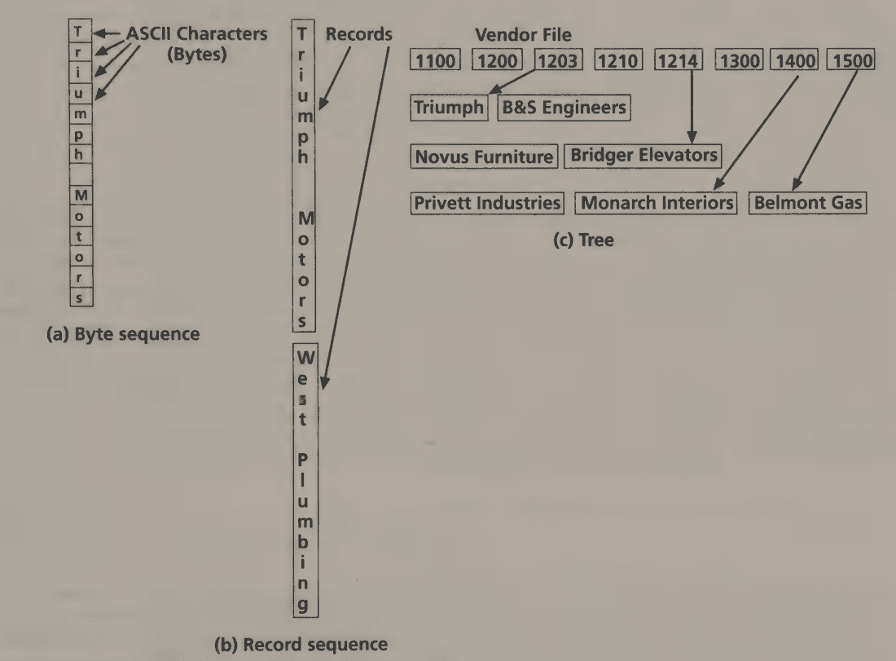

图 4-1(a) 显示了一个由字节组成的非结构化序列的文件，它是文本文件的典型示例。这种文件结构在数据输入方面提供了最大的灵活性，因为你可以以任何顺序存储任何类型的数据。然而，你只能按相同的顺序检索数据，这可能限制了其整体实用性。例如，假设你将 Worldwide Hotel 的供应商列表存储在非结构化 ASCII 文件中。那么，查看或打印整个列表会很方便，但无法仅查看供应商名称或供应商编号。

图 4-1(b) 将数据显示为固定长度记录的序列，每个记录都具有一定的内部结构。在这种结构中，UNIX 将数据读取为固定长度的记录。虽然你必须以记录形式输入数据，但你也可以以记录形式操纵和检索数据。例如，你可以选择仅检索文件中的某些供应商记录。

第三种文件类型，如图 4-1(c) 所示，结构为记录的树，长度不一定相同。每个记录在记录的固定位置包含一个键字段，如记录号。键字段对树进行排序，因此你可以快速搜索具有特定键的记录。例如，你可以快速找到记录 #1203 对应的 Triumph Motors 记录。

## 处理文件

在执行命令时，UNIX 处理数据——它从标准输入设备（你的键盘）接收输入，然后将输出发送到标准输出设备（你的监视器）。系统管理员和程序员将标准输入称为 `stdin`。他们将标准输出称为 `stdout`。第三个标准输出称为标准错误，或 `stderr`。当 UNIX 在处理系统任务和用户程序时检测到错误时，它会将这些错误定向到 `stderr`，默认情况下这是屏幕。

你可以使用重定向运算符将命令或程序的输出保存在文件中，或使用文件作为过程的输入。因此，重定向运算符有助于你处理文件。

## 使用输入和错误重定向

你可以使用重定向运算符（`>`, `>>`, `2>`, `<` 和 `<<`）从非标准输入设备获取输入，并将输出发送到非标准输出设备。

你在第 1 章中已经使用过输出重定向运算符，当时你通过重定向几个命令的输出到文件来创建新文件。当你想要将命令或程序的输出存储在文件中时，请重定向输出。例如，回想一下，你可以使用 `ls` 命令列出目录中的文件，如 `/home`。`ls` 命令将输出发送到 `stdout`，默认情况下是屏幕。要将列表重定向到名为 `homedir.list` 的文件，请输入 `ls > home-dir.list` 使用重定向符号。

你还可以使用 `<` 运算符将输入重定向到程序或命令。例如，接受键盘输入的程序可以重定向以从文件读取信息，而不是从键盘读取。在以下步骤中，你创建一个文件供 `vi` 编辑器从中读取命令，而不是从键盘读取。

## 要创建供 vi 编辑器读取命令的文件：

- 使用 `vi` 编辑器，或使用带有输出重定向的 `cat` 命令，创建包含以下文本的文件 `testfile`：

```
This is line 1.
This is line 2.
This is line 3.
This is line 4.
```

- 按照以下操作创建另一个包含某些 `vi` 命令的文本文件。输入 `cat > commands` 并按 Enter。输入 `H` 并按 Enter。输入 `dd` 并按 Enter。输入 `G` 并按 Enter。输入 `p` 并按 Enter。输入 `:wq` 并按 Enter。按 `Ctrl+D`。

- 输入 `cat commands` 并按 Enter。您会看到命令文件的内容，如下所示：

```
H
dd
G
p
:wq
```

- 输入 `vi testfile < commands` 并按 Enter。这将把 `testfile` 加载到 `vi` 编辑器中，并将 `vi` 的输入重定向到命令文件中的文本。命令文件中的文本被视为在键盘上键入的命令。

- 输入 `cat testfile` 并按 Enter。您会看到执行 `vi` 命令后 `testfile` 的内容。内容如下：

```
This is line 2.
This is line 3.
This is line 4.
This is line 1.
```

您还可以使用 `2>` 运算符将命令或程序的错误消息从屏幕重定向到文件。

## 重定向错误消息：

- 通过提供无效参数强制 `ls` 命令显示错误消息。假设您的主目录中没有名为 `jojo` 的文件或目录，输入 `ls jojo` 并按 Enter。您会看到错误消息：

```
ls: jojo: no such file or directory
```

- 重定向 `ls` 命令的错误输出。输入 `ls jojo 2> errfile` 并按 Enter。屏幕上没有输出。

- 输入 `cat errfile` 并按 Enter。您会看到 `errfile` 的内容：

```
ls: jojo: no such file or directory
```

## 文件操作

在操作文件时，您处理的是文件本身及其内容。本节说明了如何完成以下任务：

- 创建文件

- 删除文件

- 复制文件

- 移动文件

- 查找文件

- 显示文件

- 合并文件

- 剪切和粘贴文件内容

- 排序文件

### 创建文件

您可以使用输出重定向运算符（`>`）创建新文件。在第 1–3 章中，您已经学习了如何通过重定向 `cat` 命令的输出来执行此操作。您还可以在没有命令的情况下使用重定向运算符来创建空文件。

**要创建空文件：**

- 在 `$` 命令提示符后，输入 `> newfile1` 并按 Enter。这将创建一个名为 `newfile1` 的空文件。

- 要列出新文件，输入 `ls -l newfile1` 并按 Enter。您只会看到以下列出的信息，其中 `jean` 是您的用户名。

```
-rw-rw-r-- 1 jean jean      0 Nov 1 16:57 newfile1
```

- 要创建另一个新文件，输入 `> newfile2` 并按 Enter。

您也可以使用 `touch` 命令创建空文件。例如，如果文件尚不存在，以下命令将创建文件 `newfile3`。

```
touch newfile3
```

`touch` 命令的主要目的是更改文件的时间和日期戳。UNIX 为每个文件维护以下日期和时间信息：

- 更改日期和时间：文件 inode 最后更改的日期和时间

- 访问日期和时间：文件最后被访问的日期和时间

- 修改日期和时间：文件最后被修改的日期和时间

虽然 `touch` 命令无法更改文件的 inode 更改日期和时间，但它可以更改文件的访问和修改日期和时间。默认情况下，它使用当前的日期和时间作为新值。

### 使用 touch 命令创建文件并更改其日期/时间戳：

- 输入 `touch newfile3` 并按 Enter。此命令创建文件 newfile3。

- 输入 `ls -l newfile3` 并按 Enter。您会看到 newfile3 文件的长列表。注意其修改日期和时间。

- 等待至少一分钟。

- 输入 `touch newfile3` 并按 Enter。这会使用系统日期和时间更新文件的访问和修改日期和时间戳。

- 输入 `ls -l newfile3` 并按 Enter。查看文件的修改时间。现在它应该不同。

表 4-1 列出并描述了 `touch` 命令的选项。

| 命令选项 | 描述 |

| :--- | :--- |

| -a | 仅更新访问时间 |

| -m | 仅更新修改时间 |

| -c | 防止 `touch` 在文件不存在时创建该文件 |

表 4-1：`Touch` 命令选项

## 删除文件

当不再需要某个文件时，您可以使用 `rm`（remove）命令将其删除。如果您在没有选项的情况下使用 `rm`，UNIX 会在不发出警告的情况下删除指定的文件。使用 `-i`（interactive）选项可以促使 UNIX 在删除文件之前向您发出警告。您可以使用 `rm` 命令删除刚刚创建的新文件。

### 删除当前目录中的文件：

- 在 $ 命令提示符后，输入 `rm newfile1` 并按 Enter。

  - 这将从当前目录永久删除 newfile1。

- 输入 `rm -i newfile2` 并按 Enter。

  - 您会看到消息，“remove ‘newfile2’?”。

- 输入 `y` 表示是，并按 Enter。

### 使用通配符删除一组文件：


- 您可以将多个文件名指定为 `touch` 命令的参数：输入 `touch file1 file2 file3 filegood filebad` 并按 `Enter`。此命令创建文件 `file1`、`file2`、`file3`、`filegood` 和 `filebad`。

- 输入 `ls file*` 并按 `Enter`。您会看到步骤 1 中创建的文件的列表。

- 输入 `rm file*` 并按 `Enter`。

- 输入 `ls` 并按 `Enter`。文件已被擦除。

## 删除目录

当不再需要某个目录时，您可以使用 `rmdir` 命令将其删除。该命令的形式为：

```
Syntax
rmdir directory-name
```

注意：在删除目录之前，该目录必须为空。

### 使用 rmdir 命令删除目录：

- 输入 `mkdir newdir` 并按 `Enter`。这将创建一个名为 `newdir` 的新目录。

- 使用相对路径和 `touch` 命令在 `newdir` 目录中创建新文件。输入 `touch newdir/newfile` 并按 `Enter`。这将在 `newdir` 目录中创建文件 `newfile`。

- 输入 `ls newdir` 以查看 `newfile` 文件的列表。

- 若要尝试删除该目录，输入 `rmdir newdir` 并按 `Enter`。您会看到类似以下的错误消息：

```bash
rmdir: newdir: Directory not empty
```

- 使用相对路径和 `rm` 命令删除 `newfile`。输入 `rm newdir/newfile` 并按 `Enter`。

- 目录现在为空。输入 `rmdir newdir` 并按 `Enter`。

- 输入 `ls` 并按 `Enter`。`newdir` 目录不再存在。

## 复制文件

第 2 章介绍了 `cp` 命令。其一般形式为：

```
Syntax
cp [options] source destination
```

该命令将源路径指定的文件或文件复制到目标路径指定的位置。您可以将文件复制到另一个目录，复制件保留与原件相同的名称。您也可以将文件复制到另一个目录，使复制件采用新名称，或者将文件复制到与原件相同的目录，使复制件采用新名称。

例如，假设 Tom 在他的主目录（`/home/tom`）中。在此目录中，他有文件 `reminder`。在他的主目录之下，他有另一个目录，`duplicates`（`/home/tom/duplicates`）。他使用以下命令将 `reminder` 文件复制到 `duplicates` 目录：

```
cp reminder duplicates
```

执行该命令后，`duplicates` 目录中有一个名为 `reminder` 的文件。它是 `/home/tom` 目录中 `reminder` 文件的副本。Tom 在他的主目录中还有文件 `class_of_78`。他使用以下命令将其复制到 `duplicates` 目录中名为 `classmates` 的文件：

```
cp class_of_78 duplicates/classmates
```

执行该命令后，文件 `classmates` 存储在 `duplicates` 目录中。尽管它有另一个名称，但它是 `class_of_78` 文件的副本。Tom 在他的主目录中还有一个名为 `memo_to_boss` 的文件。他想制作一份副本，并将副本保留在他的主目录中。他键入以下命令：

```
cp memo_to_boss memo.safe
```

执行此命令后，文件 `memo.safe` 存储在 Tom 的主目录中。这是他的 `memo_to_boss` 文件的副本。

您可以将多个源文件作为 `cp` 命令的参数进行指定。例如，Tom 想要将文件 `project1`、`project2` 和 `project3` 复制到他的 `duplicates` 目录。他键入以下命令：

```
cp project1 project2 project3 duplicates
```

执行该命令后，三个文件的副本存储在 `duplicates` 目录中。您也可以将通配符字符与 `cp` 命令一起使用。例如，Tom 在他的主目录下有一个名为 `designs` 的目录（`/home/tom/designs`）。他想将 `designs` 目录中的所有文件复制到 `duplicates` 目录。他键入以下命令：

```
cp designs/* duplicates
```

执行此命令后，`duplicates` 目录包含 `designs` 目录中每个文件的副本。

`cp` 命令对于防止数据丢失特别有用：您可以使用它来创建文件的备份副本。您可以创建三个新文件，然后将它们复制到不同的目录。然后您可以复制一个文件并为其指定不同的名称。首先，在主目录中创建子目录 `source`。您可以创建三个新文件，然后将它们复制到 `source` 目录。

## 递归删除目录

`rm` 命令通常要求在删除目录之前，该目录必须是空的。当您需要删除包含多个子目录的目录时，这可能会带来不便。然而，`-r` 选项指示 `rm` 命令删除目录及其包含的所有内容，包括子目录。它甚至会删除子目录的子目录。这种操作被称为递归删除。

### 创建三个文件并将其复制到目录中：

1. 如果您没有现有的 `source` 子目录，请确保您位于主目录中，然后创建该目录。在 `$` 命令提示符后，键入 `mkdir source` 然后按 `Enter`。

2. 要在您的主目录中创建三个文件，键入 `> file1` 并按 `Enter`，键入 `> file2` 并按 `Enter`，然后键入 `> file3` 并按 `Enter`。

3. 现在您可以将这三个文件复制到 `source` 目录。键入 `cp file1 file2 file3 source` 并按 `Enter`。

现在您可以复制其中一个文件并给它一个不同的名字，以便将其作为备份文件区分开来。

4. 在 `$` 命令提示符后，键入 `cp file1 file1.sav` 并按 `Enter`。

现在您的工作目录包含两个内容相同但文件名不同的文件。

### 递归删除包含多个子目录的目录：

1. 创建一个包含多个子目录的目录。键入 `mkdir company` 并按 `Enter`。键入 `mkdir company/sales` 并按 `Enter`。键入 `mkdir company/marketing` 并按 `Enter`。键入 `mkdir company/accounting` 并按 `Enter`。

2. 在 `company` 目录中创建三个空文件。键入 `touch company/file1 company/file2 company/file3` 并按 `Enter`。

3. 将文件复制到其他目录。键入 `cp company/file1 company/file2 company/file3 company/sales` 并按 `Enter`。键入 `cp company/file1 company/file2 company/file3 company/marketing` 并按 `Enter`。键入 `cp company/file1 company/file2 company/file3 company/accounting` 并按 `Enter`。提示：您刚刚键入的三个命令非常相似。您可以使用向上箭头键调用第一个命令来减少输入量。

4. 使用 `ls` 命令验证文件是否已复制到所有三个目录。

5. 删除 `company` 目录及其包含的所有内容。键入 `rm -r company` 并按 `Enter`。

6. 键入 `ls` 并按 `Enter`。`company` 目录已被删除。

**注意：** 使用 `rm -r` 命令时要非常小心。它可能会永久删除大量信息。

## 移动文件

移动文件类似于复制文件，只是将它们从一个目录中移除并存放到另一个目录中。要移动文件，请使用 `mv` 命令。该命令的一般形式为：

```
mv [-options] source destination
```

您也可以通过将一个文件移动到另一个不同名称的文件中，使用 `mv` 命令来重命名文件。

### 将一个文件从一个目录移动到另一个目录：

1. 要在您的主目录中创建新文件 `thisfile`，键入 `> thisfile` 然后按 `Enter`。

2. 键入 `mv thisfile source` 并按 `Enter` 以将新文件移动到 `source` 目录。

3. 键入 `ls` 并按 `Enter`。`thisfile` 未列在其中。键入 `ls source` 并按 `Enter`。您会看到 `thisfile` 列在其中。

4. 要移动多个文件，请在目录名之前键入文件名。例如，键入 `mv file1 file1.sav source` 并按 `Enter`。

5. 要创建新文件 `my_file`，键入 `> my_file` 并按 `Enter`。

6. 要将 `my_file` 重命名为 `your_file`，键入 `mv my_file your_file` 并按 `Enter`。


键入 `ls` 并按 `Enter`。您会看到 `your_file` 列在其中，但 `my_file` 未列在其中。

**注：** 移动和重命名文件基本上是相同的操作。

您还可以使用 `mv` 命令的 `-i` 选项。它会导致命令在覆盖现有的目标文件之前提示您。

## 查找文件

`find` 命令搜索具有指定名称的文件。使用 `find` 命令来定位具有相同名称的文件，或在任何目录中找到文件。该命令的形式为：

| 语法 | 解析 |
| :--- | :--- |
| `find pathname -name filename` | **■ `pathname`** 是您要搜索的目录的路径名。`find` 命令进行递归搜索；也就是说，它从指定的目录开始，搜索 *pathname* 指定的目录下的所有文件和子目录。<br><br>**■ `-name`** 表示您正在搜索具有特定文件名的文件。您可以在文件名中使用通配符。例如，您可以使用 *phone** 来搜索所有以“phone”开头的文件名。关于您可以使用 `find` 的其他搜索条件，请参阅附录 B“UNIX 命令语法指南”。 |

使用 `find` 命令，您只能搜索具有足够权限的区域。随着搜索的进行，`find` 命令可能会进入受保护的目录；每次您尝试进入权限不足的目录时，您都会收到“Permission denied”（权限被拒绝）消息。

您可以使用 `find` 命令在 `/home` 目录及其所有子目录中查找所有名为 *phone1* 的文件。

**查找文件：**

- 在 `$` 命令提示符后，键入 `find /home -name *phone1*` 并按 `Enter`。

**注：** 虽然 Linux 不要求，但某些 UNIX 版本要求在文件名后使用 `-print` 选项以显示 `find` 命令定位的文件的名称。

## 合并文件

现在，您可以开始处理 Worldwide Hotels（Dominion 的客户端）的供应商报告了。两个独立文件（如 *图 4-2* 所示）存储了您需要的数据——产品描述和供应商编号。

```
文件名称: product1
    Lobby Furniture    1201
    Ballroom Specialties 1221
    Poolside Carts     1320
    Formal Dining Specials 1340
    Reservation Logs   1410
```

```
文件名称: product2
    Plumbing Supplies  1423
    Office Equipment   1361
    Carpeting Services 1395
    Auto Maintenance   1544
    Pianos and Violins 1416
```

### 图 4-2：两个产品描述文件

您可以使用 `cat` 命令将两个文件合并到新的供应商产品主文件中。通过重定向 `cat` 的输出，在您的主目录中创建 `product1` 文件来实现这一点。该文件包含两个由冒号分隔的字段。

**使用 `cat` 命令合并文件：**

1. 在 `$` 命令提示符后，键入 `cat > product1`。

2. 键入以下文本，并在每一行末尾按 `Enter`：

   `Lobby Furniture:1201`

   `Ballroom Specialties:1221`

   `Poolside Carts:1320`

   `Formal Dining Specials:1340`

   `Reservation Logs:1410`

3. 按 `Ctrl+D`。

   现在您可以重定向 `cat` 的输出，在您的主目录中创建 `product2` 文件。此文件也包含两个由冒号分隔的字段。

4. 在 `$` 命令提示符后，键入 `cat > product2`。

5. 键入以下文本，并在每一行末尾按 `Enter`：

   `Plumbing Supplies:1423`

   `Office Equipment:1361`

   `Carpeting Services:1395`

   `Auto Maintenance:1544`

   `Pianos and Violins:1416`

6. 按 `Ctrl+D`。

## 第 4 章，第 A 课

现在您可以将两个文件合并到主产品文件中。在 `$` 命令提示符后，键入 `cat product1 product2 > products` 并按 `Enter`。

要列出 `products` 的内容，键入 `more products` 并按 `Enter`。您会看到列表：

```
Lobby Furniture:1201
Ballroom Specialties:1221
Poolside Carts:1320
Formal Dining Specials:1340
Reservation Logs:1410
Plumbing Supplies:1423
Office Equipment:1361
Carpeting Services:1395
Auto Maintenance:1544
Pianos and Violins:1416
```

## Paste 命令

`paste` 命令并排合并文件，而 `cat` 命令则是首尾相接合并文件。当您使用 `paste` 将两个文件合并为第三个文件时，第三个文件的第一行包含第一个文件的第一行，后跟第二个文件的第一行。例如，Becky 在她的家目录中有 `vegetables` 文件。其内容为：

```
Carrots
Spinach
Lettuce
Beans
```

她的家目录中还有 `bread` 文件。其内容为：

```
Whole wheat
White bread
Sourdough
Pumpernickel
```

执行命令 `paste vegetables bread > food` 后，`vegetables` 和 `bread` 文件逐行合并到 `food` 文件中。`food` 文件的内容为：

```
Carrots    Whole wheat
Spinach     White bread
Lettuce     Sourdough
Beans       Pumpernickel
```

注意：`paste` 命令通常将输出发送到屏幕。若要将其捕获到文件中，请使用重定向符号。

如图所示，当你结合包含信息列的文件时，`paste` 命令最为有用。当 `paste` 将项目合并到单行时，它使用制表符分隔它们。例如，查看 `food` 文件的第一行：

```
Carrots          Whole wheat
```

当 `paste` 结合“Carrots”和“Whole wheat”时，它在它们之间插入了一个制表符。你可以使用 `-d` 选项指定另一个字符作为分隔符。例如，要在输出字段之间插入逗号而不是制表符，Becky 输入以下 `paste` 命令：

```
paste -d',' vegetables bread > food
```

Becky 的命令执行后，`food` 文件的内容如下：

```
Carrots,Whole wheat
Spinach,White bread
Lettuce,Sourdough
Beans,Pumpernickel
```

现在，你可以使用 `paste` 命令将两个产品文件合并为一个文件。（请使用 `paste` 而不是 `cat`，因为你是要合并来自两个或更多文件的字段。）

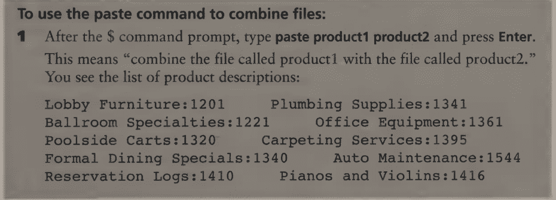

## 使用 Cut 命令提取字段

你已经了解到文件可以由记录、字段和字符组成。你可能希望检索文件中的一部分而非所有字段。你可以使用 `cut` 命令从文件中删除特定的列或字段。`cut` 命令的语法如下：

**语法**

```
cut -f list [-d char] file1 file2 ...
Or
cut -c list file1 file2 ...
```

##### 解析

- `-f` 指定你正在引用字段。

- `list` 是用逗号分隔的列表或用连字符分隔的整数范围，用于指定字段。例如，`-f 1` 表示第 1 个字段，`-f 1,14` 表示第 1 和第 14 个字段，而 `-f 1-14` 表示第 1 到第 14 个字段。

- `-d` 指示有一个特定字符分隔字段。

- `char` 是用作字段分隔符（定界符）的字符，例如逗号。默认的字段分隔符是制表符（Tab）字符。

- `file1, file2` 是你想要从中剪切列或字段的文件。

- `-c` 引用字符位置。例如，`-c 1` 指定第一个字符，`-c 1,14` 指定第 1 和第 14 个字符。

回忆一下 Becky 主目录中的 `vegetables` 和 `bread` 文件。她还有 `meats` 文件。当她使用命令 `paste vegetables bread meats > food` 时，`food` 文件的内容为：


Carrots 	 Whole wheat 	 Turkey

Spinach 	 White bread 	 Chicken

Lettuce 	 Sourdough 	 Beef

Beans 	 Pumpernickel 	 Ham

Becky 希望从文件中提取第二列信息（面包列表）并将其显示在屏幕上。她输入以下命令：

```
cut -f2 food
```

选项 `-f2` 告诉 `cut` 命令从每一行中提取第二个字段。制表符分隔符将字段分开，因此 `cut` 知道在哪里查找字段。她在屏幕上看到以下输出：

```
Whole wheat
White bread
Sourdough
Pumpernickel
```

她使用以下命令从文件中提取第一列和第三列：

```
cut -f1,3 food
```

该命令的结果是：

```
Carrots 	 Turkey
Spinach 	 Chicken
Lettuce 	 Beef
Beans 	 Ham
```

现在，你可以通过从文件中提取姓名列表来完成 Dominion 电话号码文件的工作。首先，你将创建两个文件：`corp_phones1` 和 `corp_phones2`。`corp_phones1` 文件包含五条可变大小的记录，冒号分隔记录中的每个字段。（图 4-1(c) 说明了这种文件结构。）`corp_phones2` 文件也包含五条固定长度的记录（图 4-1(b) 中说明的文件结构类型）。图 4-3 说明了这两个文件的内容。你可以使用 `cut` 命令配合这两个文件中的任意一个来提取姓名列表。

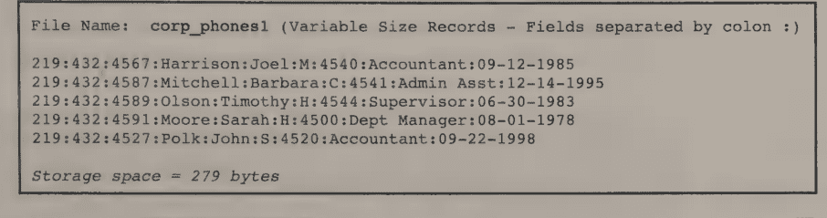

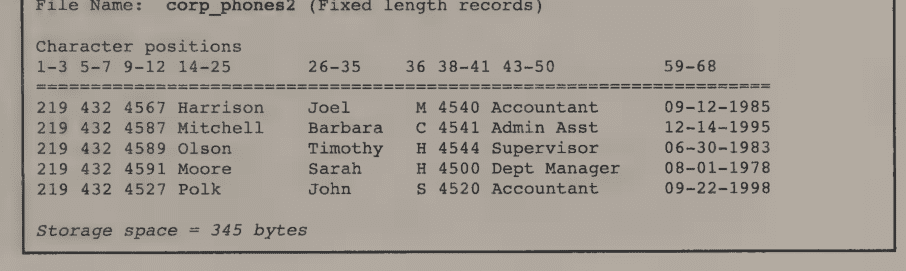

**图 4-3：** 公司电话文件的两个版本

### 创建 corp_phones1 和 corp_phones2 文件：

1. 使用 `vi` 或 `Emacs` 编辑器创建文件 `corp_phones1`。
2. 按照原样输入以下行文本。在每行末尾按 **Enter**：
   `219:432:4567:Harrison:Joel:M:4540:Accountant:09-12-1985`
   `219:432:4587:Mitchell:Barbara:C:4541:Admin Asst:12-14-1995`
   `219:432:4589:Olson:Timothy:H:4544:Supervisor:06-30-1983`
   `219:432:4591:Moore:Sarah:H:4500:Dept Manager:08-01-1978`
   `219:432:4527:Polk:John:S:4520:Accountant:09-22-1998`
3. 保存该文件并创建一个名为 `corp_phones2` 的新文件。
4. 按照原样输入以下行文本。查阅图 4-3 了解每个字符的精确位置。在每行末尾按 **Enter**。
   `219 432 4587 Mitchell Barbara C 4541 Admin Asst 12-14-1995`
   `219 432 4589 Olson          Timothy     H 4544 Supervisor     06-30-1983`
   `219 432 4591 Moore           Sarah       H 4500 Dept Manager   08-01-1978`
   `219 432 4527 Polk            John        S 4520 Accountant     09-22-1998`
5. 保存文件并退出编辑器。

你希望首先从 `corp_phones1` 文件中提取姓氏和名字。该文件包含可变长度的记录，字段由冒号字符分隔。你可以通过指定位置及分隔字符来选择要剪切的字段。

### 使用 cut 命令从可变长度记录中提取字段：

1. 在 `$` 命令提示符后，输入 `cut -f4-6 -d: corp_phones1` 并按 **Enter**。此命令的意思是“剪切 `corp_phones1` 文件中由冒号字符 `-d:` 定界的第四到第六个位置 `4–6` 的字段 `-f`”。

你看到姓名列表：

```
Harrison:Joel:M
Mitchell:Barbara:C
Olson:Timothy:H
Moore:Sarah:H
Polk:John:S
```

现在你可以从 `corp_phones2` 文件中提取姓氏和名字。该文件包含固定长度的记录，因此你可以通过指定字符位置来剪切。

### 使用 cut 命令从固定长度记录中提取字段：

1. 在 `$` 命令提示符后，输入 `cut -c14-25,26-35,36 corp_phones2` 并按 **Enter**。

此命令的意思是“剪切 `corp_phones2` 文件中第 14 到 25 个位置、第 26 到 35 个位置以及第 36 个位置 `14-25,26-35,36` 的字符 `-c`”。

你看到姓名列表：

```
Harrison          Joel          M
Mitchell          Barbara      C
Olson             Timothy      H
Moore             Sarah        H
Polk              John         S
```


请确保不要在 `cut` 命令中连字符 `-` 选项后的代码序列中包含空格。例如，正确的语法是 `cut`（空格）`-c14-25,26-35,36`（空格）`corp_phones2`。

使用 `cut` 命令处理可变长度或固定长度记录会产生类似的结果。从固定长度记录中剪切会创建更清晰的显示效果，但需要更多的存储空间。例如，`corp_phones2` 需要 345 字节，而 `corp_phones1` 需要 279 字节。

## 使用 sort 命令

使用 `sort` 命令按字母顺序或数字顺序对文件内容进行排序。UNIX 默认将排序后的文件显示在屏幕上，但你也可以指定将排序后的数据存储到特定文件中。

`sort` 命令提供许多选项，这些选项在附录 B“UNIX 命令语法指南”中有描述。以下是其使用示例：

```
sort file1 > file2
```

在此示例中，`file1` 的内容被排序，结果存储在 `file2` 中。（如果不重定向输出，`sort` 将在屏幕上显示其结果。）以下是一个更复杂的示例：

```
sort +.10 file1 > file2
```

此命令指定了一个排序键。排序键是每行内的一个字段或字符位置。`sort` 命令根据排序键对行进行排序。加号 `+` 表示排序不是从第一个字符位置开始的，而是在行的其他位置偏移。点号 `.` 表示偏移量以字符为单位测量。（如果没有点号，偏移量以字段为单位测量。）点号后面跟随要偏移的字符数。示例命令告诉 `sort` 命令排序键从字符位置 10 开始。

对 `corp_phones1` 文件进行排序相对简单，因为你可以引用字段号。当你执行后续步骤时，你会发现对固定长度文件 `corp_phones2` 进行排序更困难。在前两步中，你分别按姓氏和名字对 `corp_phones2` 文件进行排序。在第三和第四步中，你对 `corp_phones1` 执行相同操作。注意，这四个步骤的输出都发送到 `stdout`（屏幕）。最后一步使用 `-o` 选项，而不是输出重定向，将排序后的输出写入新的磁盘文件 `sorted_phones`。

### 对 phones2 文件进行排序：

1. 在 `$` 命令提示符后，输入 `sort +.13 corp_phones2` 并按 Enter。这将从偏移量 13 处 `+.13` 开始按姓氏对文件进行排序。你在屏幕上看到以下内容：
```
219 432 4567 Harrison Joel M 4540 Accountant 09-12-1985  
219 432 4587 Mitchell Barbara C 4541 Admin Asst 12-14-1995
```
219 432 4591 Moore Sarah H 4500 Dept Manager 08-01-1978
219 432 4589 Olson Timothy H 4544 Supervisor 06-30-1983
219 432 4527 Polk John S 4520 Accountant 09-22-1998
1. 输入 `sort +25 corp_phones2` 并按下回车键。这将按名字排序，起始位置为第 25 个字符 `+25`。您将在屏幕上看到以下内容：
219 432 4587 Mitchell Barbara C 4541 Admin Asst 12-14-1995
219 432 4567 Harrison Joel M 4540 Accountant 09-12-1985


219 432 4527 Polk John S 4520 Accountant 09-22-1998

219 432 4591 Moore Sarah H 4500 Dept Manager 08-01-1978

219 432 4589 Olson Timothy H 4544 Supervisor 06-30-1983

### 2.
输入 `sort -t: +3 corp_phones1` 并按下回车键。这将按变长记录（`-t:`）排序，起始字段为姓氏（`+3`）。您将在屏幕上看到以下内容：

```
219:432:4567:Harrison:Joel:M:4540:Accountant:09-12-1985
219:432:4587:Mitchell:Barbara:C:4541:Admin Asst:12-14-1995
219:432:4591:Moore:Sarah:H:4500:Dept Manager:08-01-1978
219:432:4589:Olson:Timothy:H:4544:Supervisor:06-30-1983
219:432:4567:Polk:John:S:4520:Accountant:09-22-1998
```

### 3.
输入 `sort -t: +4 corp_phones1` 并按下回车键。这将按变长记录排序（`-t:` 表示字段由冒号分隔），起始字段为名字（`+4`）。您将在屏幕上看到以下内容：

```
219:432:4587:Mitchell:Barbara:C:4541:Admin Asst:12-14-1995
219:432:4567:Harrison:Joel:M:4540:Accountant:09-12-1985
219:432:4567:Polk:John:S:4520:Accountant:09-22-1998
219:432:4591:Moore:Sarah:H:4500:Dept Manager:08-01-1978
219:432:4589:Olson:Timothy:H:4544:Supervisor:06-30-1983
```

### 4.
若要按名字排序并创建输出文件 `Sorted_phones`，请输入 `sort -t: +4 -o sorted_phones corp_phones1` 并按下回车键。这将按名字对 `phones1` 文件进行排序，并创建一个输出文件 `sorted_phones`。

## 综合运用

现在，您可以一次性使用之前学过的众多文件处理工具。首先，使用 `cat` 命令创建 `vendors` 文件。供应商名称文件中的记录由两个以冒号分隔的字段组成：供应商编号和供应商名称。

要创建 `vendors` 文件：

1. 在 `$` 命令提示符后，输入 `cat>vendors` 并按下回车键。

2. 输入以下文本，每行末尾按下回车键：

   1201:Cromwell Interiors

   1221:Design Extras Inc.

   1320:Piedmont Plastics Inc.

   1340:Morgan Catering Service Ltd.

   1350:Pullman Elevators

   1360:Johnson Office Products

3. 按下 `Ctrl+D`。

图 4-4 展示了 Worldwide 可用于确定每个供应商提供何种产品的两个文件。

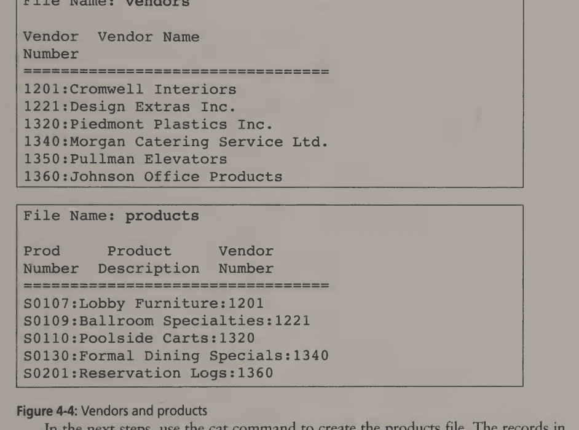

在接下来的步骤中，使用 `cat` 命令创建 `products` 文件。`products` 文件中的记录由三个以冒号分隔的字段组成：产品编号、产品描述和供应商编号。

要创建 `products` 文件：

1. 在 `$` 命令提示符后，输入 `cat > products` 并按下回车键。

2. 输入以下文本，每行末尾按下回车键：

   S0107:Lobby Furniture:1201

   S0109:Ballroom Specialties:1221

   S0110:Poolside Carts:1320

   S0130:Formal Dining Specials:1340

   S0201:Reservation Logs:1410

3. 输入 `Ctrl+D` 结束 `cat` 命令

现在使用 `cut`、`paste` 和 `sort` 命令为 Worldwide Hotels 创建单一供应商报告。首先使用 `cut` 命令从 `products` 文件中提取产品描述和供应商编号，并将它们存储在 separate 文件 `p1` 和 `p2` 中。然后从 `vendors` 文件中提取供应商编号和名称，并将它们存储在 `v1` 和 `v2` 中。使用 `paste` 命令将两个供应商文件（`v1` 和 `v2`）合并到第三个文件 `v3` 中。然后将两个产品文件（`p1` 和 `p2`）合并到一个文件 `p3` 中。对 `v3` 和 `p3` 文件进行排序和合并，并将其输出发送到 `vrep` 文件，即供应商报告。

使用 `cut`、`paste` 和 `sort` 命令创建报告：

1. 在 `$` 命令提示符后，输入 `cut -f2 -d: products > p1` 并按下回车键。这意味着“从 `products` 文件中提取由冒号分隔的第二个字段的数据，并将其存储在 `p1` 文件中。”它将以下产品描述存储在 `p1` 文件中：

   - Lobby Furniture

   - Ballroom Specialties

   - Poolside Carts

   - Formal Dining Specials

   - Reservation Logs

2. 输入 `cut -f3 -d: products > p2` 并按下回车键。这意味着“从 `products` 文件中提取由冒号分隔的第三个字段的数据，并将其存储在 `p2` 文件中。”它将以下供应商编号存储在 `p2` 文件中：

   - 1201

   - 1221

   - 1320

   - 1340

   - 1410

3. 输入 `cut -f1 -d: vendors > v1` 并按下回车键。这意味着“从 `vendors` 文件中提取由冒号分隔的第一个字段的数据，并将其存储在 `v1` 文件中。”它将以下供应商编号存储在 `v1` 文件中：

   - 1201

   - 1221

   - 1320

   - 1340

   - 1350

   - 1360

4. 输入 `cut -f2 -d: vendors > v2` 并按下回车键。这意味着“从 `vendors` 文件中提取由冒号分隔的第二个字段的数据，并将其存储在 `v2` 文件中。”它将以下供应商名称存储在 `v2` 文件中：

   - Cromwell Interiors

   - Design Extras Inc.

   - Piedmont Plastics Inc.

   - Morgan Catering Service Ltd.

   - Pullman Elevators

   - Johnson Office Products

5. 输入 `paste v1 v2 > v3` 并按下回车键。这意味着“合并 `v1` 和 `v2` 中的数据，并将其定向到文件 `v3`。”它将以下供应商编号和产品描述存储在 `v3` 文件中：

   - 1201 Cromwell Interiors

   - 1221 Design Extras Inc.

   - 1320 Piedmont Plastics Inc.

   - 1340 Morgan Catering Service Ltd.

   - 1350 Pullman Elevators

   - 1360 Johnson Office Products

6. 输入 `paste p2 p1 > p3` 并按下回车键。这意味着“合并 `p2` 和 `p1` 中的数据，并将其定向到名为 `p3` 的文件。”它将以下供应商编号和产品描述存储在 `p3` 文件中：

   - 1201 Lobby Furniture

   - 1221 Ballroom Specialties

   - 1320 Poolside Carts

   - 1340 Formal Dining Specials

   - 1410 Reservation Logs

7. 输入 `sort -o vrep -m v3 p3` 并按下回车键。这意味着“合并 `v3` 和 `p3` 中的数据，并将输出定向到名为 `vrep` 的文件。”它将以下供应商编号和产品描述存储在 `vrep` 文件中：

   - 1201 Cromwell Interiors

   - 1201 Lobby Furniture

   - 1221 Ballroom Specialties

   - 1221 Design Extras Inc.

   - 1320 Piedmont Plastics Inc.

   - 1320 Poolside Carts

   - 1340 Formal Dining Specials

   - 1340 Morgan Catering Service Ltd.


- 1350 Pullman Elevators
- 1360 Johnson Office Products
- 1410 Reservation Logs

您使用 `cut`、`paste` 和 `sort` 命令从文件中提取信息，合并这些信息，然后在新的文件中对信息进行排序和合并。

### 摘要

- UNIX 支持常规文件、目录、字符特殊文件和块特殊文件。常规文件包含用户信息。目录是用于维护文件系统结构的系统文件。字符特殊文件与串行输入/输出设备（如打印机）相关。块特殊文件与设备（如磁盘）相关。
- 文件可以有多种结构。UNIX 将数据（如信件、产品记录或供应商报告）存储在扁平的 ASCII 文件中。文件结构取决于所存储数据的类型。常规文件有三种类型：无结构 ASCII 字符、记录和树。
- 在执行命令时，UNIX 处理数据——它从标准输入设备接收输入，然后将输出发送到标准输出设备。UNIX 将输入和输出的标准设备分别称为 `stdin` 和 `stdout`。默认情况下，`stdin` 是键盘，`stdout` 是显示器。另一个标准设备 `stderr` 指的是默认指向显示器的错误文件。
- 命令的输出可以从 `stdout` 重定向到磁盘文件。命令的输入可以从 `stdin` 重定向到磁盘文件。命令的错误输出可以从 `stderr` 重定向到磁盘文件。
- `touch` 命令更新文件的时间戳和日期戳，并创建空文件。
- 操纵文件时，您不仅操作文件本身，还操作其内容。您可以使用文件操纵命令来创建、删除、复制、移动、查找和显示文件。
- `rmdir` 命令删除目录。
- `cut` 命令从文件中提取特定的列或字段。通过指定您想要提取的字段的位置和分隔符字符来选择要提取的字段，或者根据数据的组织方式按字符位置进行提取。
- 要合并两个或多个文件，请使用 `paste` 命令。`cat` 将数据追加到文件末尾，而 `paste` 命令逐行合并文件。您还可以使用 `paste` 来合并两个或多个文件中的字段。
- 使用 `sort` 命令按字母顺序或数字顺序对文件内容排序。UNIX 默认在屏幕上显示排序后的文件，但您也可以指定将排序后的数据存储到特定文件中。

### 复习题

1. UNIX 文件删除命令是 _______。
   a. `del`
   b. `remove`
   c. `rm`
   d. `kill`

2. 常规文件包含 _______。
   a. 用户程序
   b. 目录
   c. 字符设备
   d. 块设备

3. 目录是______________________。
   a. 具有树状结构的任何文件
   b. 标准输出设备
   c. 用于识别磁盘的特殊文件
   d. 用于维护文件系统结构的系统文件

4. `stderr` 设备指的是______________________。
   a. 键盘错误
   b. 标准错误输出
   c. 行式打印机
   d. 一个输出文件

5. 你可以使用重定向运算符来______________________。
   a. 更改文件类型
   b. 将 `stdin`、`stdout` 和 `stderr` 重定向到磁盘文件
   c. 从文件行中提取字段
   d. 合并已排序的数据

6. `<` 运算符重定向______________________。
   a. 标准输出
   b. 标准输入
   c. 标准错误
   d. 以上都不是

7. `2>` 运算符重定向______________________。
   a. 标准输出
   b. 标准输入
   c. 标准错误
   d. 以上都不是

8. UNIX move 命令______________________。
   a. 与 `copy` 命令完全相同
   b. 一次只能移动一个文件
   c. 一次可以移动多个文件
   d. 与 `rename` 命令的作用相同

9. `touch` 命令______________________。
   a. 更新文件的访问日期和时间
   b. 更新文件的修改日期和时间
   c. 更新文件的 inode 更改日期和时间
   d. a 和 b 两者都是

10. 递归删除目录及其内容的命令是______________________。
    a. `rmdir`
    b. `rmdir --r`
    c. `rm -r`
    d. `recurs`

11. 使用 `cut` 命令可以______________________。
    a. 从文件中提取字符或字段
    b. 从文件中删除字符或字段
    c. 截断文件中的记录
    d. 逆转 `paste` 命令的效果

12. 使用 `paste` 命令可以
    a. 将信息放置到剪贴板上
    b. 组合多个文件
    c. 逆转 `cut` 命令的效果
    d. 与 `cat` 命令配合使用

13. 加号 `+` 是 `sort` 命令的一个选项，用于
    a. 偏移排序字段
    b. 指示应跳过起始字段
    c. 为 `sort` 命令添加更多选项
    d. a 和 b

14. UNIX 文件处理将文件视为
    a. 定长记录的序列
    b. 字节的序列
    c. 变长记录的序列
    d. 用于索引记录的关键字段

### 练习

1. 解释 `cat` 和 `paste` 之间的区别。
2. `rm -r` 命令做了什么 `rmdir` 没有做的事情？
3. 描述创建空文件的两种方法。
4. 编写一条命令行，按雇用日期（记录中的最后一个字段）对 `corp_phones1` 文件中的记录进行排序。请参考图 4-3。
5. 为练习 4 中执行的排序编写命令行，但使用 `corp_phones2` 文件代替 `corp_phones1` 文件。
6. 假设你有三个文件：`sales1`、`sales2` 和 `sales3`。编写 `paste` 命令，将这些文件合并，并使用 `!` 字符分隔每行中的字段。命令应将结果存储在文件 `sales4` 中。
7. 编写 `cut` 命令，从 `sales4` 文件（你在练习 6 中创建的）的每一行中提取第二个字段。命令应将其结果存储在文件 `sales5` 中。
8. 编写一条命令，Becky 使用它来搜索文件 `johnson_account`。她知道该文件位于其主目录下的某个目录中。

### 探索练习

1. 使用 `cut` 命令，利用图 4-4 中显示的 `products` 文件创建文件 `prod_desc`。该文件中唯一的字段应为产品描述。
2. 创建一个类似于 `products` 文件（图 4-4）的文件，命名为 `prod_desc1`。`prod_desc1` 文件应具有与 `products` 文件相同的字段，但包含不同的数据。使用 `sort` 命令的合并选项创建一个输出文件 `merged_product`。使用输入文件 `prod_desc1` 和 `products`。
3. 使用 `cut` 和 `paste` 的任何组合，利用图 4-3 中显示的输入文件 `corp_phones2` 创建新文件。将员工的姓氏、名字和名字首字母分别放在第 1、第 2 和第 3 字段。

## 课程 B

### 目标

- 创建脚本文件
- 使用 `join` 命令通过公共字段连接文件
- 使用 `awk` 命令创建专业外观的报告

## 汇编提取的信息

### 使用脚本文件

正如你所见，根据需要使用选项的数量，命令行输入可能变得很长。你可以使用 shell 的命令行历史记录检索功能来回忆并重新执行过去的命令。此功能对你工作得很好，但需要执行你命令的其他人无法反复访问它们。MS-DOS 用户通过创建批处理文件来解决这个问题。UNIX 用户也是如此：他们创建 shell 脚本文件来包含命令行条目。与 MS-DOS 批处理文件类似，脚本文件包含可以作为一组顺序执行的命令。脚本文件的一个良好候选者是在课程 A 中你输入的一系列 `cut`、`paste` 和 `sort` 命令。你可以使用 `vi` 编辑器创建脚本文件，然后使用带有 `x` 参数的 `chmod` 命令使脚本可执行。

Rolle Williams 对你的供应商报告感到高兴，但希望有一种方法在数据更改时生成报告。你可以创建一个脚本，其中包含一系列用于创建文件 `ven_report` 的命令。

> 要使用 `vi` 编辑器创建脚本：
>
> 1. 将你的工作目录更改为主目录下的 `corp_db` 目录。
> 2. 在 `$` 命令提示符后，输入 `vi ven_report` 并按 Enter。
> 启动 `vi` 编辑器并创建新文件 `ven_report`。

```bash
3. 进入插入模式，然后输入以下内容，并在每行末尾按 Enter：
cut -f2 -d: products > p1
cut -f3 -d: products > p2
cut -f1 -d: vendors > v1
cut -f2 -d: vendors > v2
paste v1 v2 > v3
paste p2 p1 > p3
sort -t: -o vrep -m v3 p3
```

这些是你在课程 A 中用于创建第一个供应商报告的相同命令。

4. 按 Esc。
5. 输入 `:wq` 退出 `vi` 编辑器。


现在你可以使用 `chmod` 命令使脚本可执行。`chmod` 命令设置文件权限。在接下来的示例中，`chmod` 命令及其 `ugo+x` 选项使 `ven_report` 文件对用户（所有者）、组和其他人可执行。运行测试以确保其正常工作。

要使脚本可执行：

1. 在 `$` 命令提示符后，输入 `chmod ugo+x ven_report` 并按 Enter。有关 `chmod` 命令的更多信息，请参阅第 2 章中的“设置文件权限”。
2. 为确保脚本工作，输入 `./ven_report` 并按 Enter。`ven_report` 文件包含你在课程 A 中看到过的相同供应商编号和产品描述列表。

## 使用 Join 命令

`join` 命令与本章中的其他文件处理命令不同，因为它用于关系数据库处理。关系数据库将文件视为表，将记录视为行。它们还将字段称为列，这些列可以连接以创建新记录。`join` 命令是 UNIX 方法，让你可以从共享公共字段的两个文件中提取信息。

例如，你可以使用 `join` 命令组合供应商和产品文件中的信息，从而为 Worldwide 的采购部门生成供应商报告。供应商报告和产品报告都包含供应商编号。`join` 命令的语法是：

```
语法

join [options] file1 file2
```

**剖析**

`file1`、`file2` 是两个必须按连接字段排序的输入文件——你想用来连接文件的字段。连接字段也称为*键*。在执行 `join` 之前必须对文件进行排序。当你发出 `join` 命令时，UNIX 比较两个字段。每个输出行包含公共字段，后跟来自 `file1` 的行，然后是来自 `file2` 的行。你可以使用以下描述的选项修改输出。如果同一文件中有具有重复键的记录，UNIX 会对所有记录进行连接。你可以为无法配对的行创建输出记录，例如，在不移失记录的情况下将一个文件的数据附加到另一个文件。

### 选项

- `-j` 指定要进行连接的公共字段。
- `-o` 指定要输出的字段列表。该列表包含以 `m.n` 形式空格分隔的字段说明符，其中 `m` 是文件编号，`n` 是文件中的字段位置。因此 `-o 1.2` 意味着“输出第一个文件中的第二个字段”。
- `-t` 指定字段分隔符。默认情况下，这是空格、制表符或换行符。多个空格和制表符算作一个字段分隔符。
- `-a n` 为文件 `n` 中的每个无法配对的行生成一行，其中 `n` = 1 或 2。
- `-e str` 用由 `str` 指定的字符串替换无法配对行中的空字段。该字符串通常是一个代码或消息，用于指示状态；例如，`-e "No Vendor Record."`

有关 `join` 逻辑的示例，请参见图 4-5。

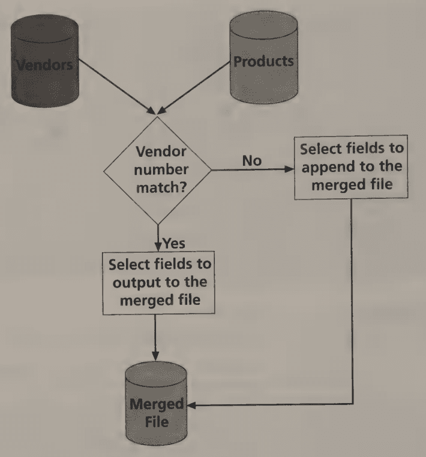

图 4-5：关系连接

在图 4-5 中，`join` 命令结合了 `vendor` 文件和 `product` 文件中的字段。然后，它在 `vendor` 文件中搜索与 `product` 文件中匹配的供应商编号。如果字段不匹配，UNIX 会选取该记录并稍后将其附加到合并文件中。如果字段匹配，UNIX 会将其发送到合并文件。

## 使用 Join 命令创建供应商报告

你可以使用 `join` 命令创建一个供应商报告，显示 Worldwide 采购部门库存中的产品。

**使用 join 命令创建报告的方法：**

1. 在 `$` 命令提示符后，输入 `join -a1 -e "No Products" -j1 1 -j2 3 -o 1.2 2.2 -t: vendors products > vreport; cat vreport` 并按下 Enter 键。

在此命令中，-j 选项表示指定的第一个或第二个文件，例如 `vendors` 或 `products`。`j1` 和 `j2` 后面的数字指定用于连接或匹配的字段编号。在这里，UNIX 使用 `vendors` 记录的第一字段连接 `products` 文件的第三字段。

`-a` 选项告诉命令为文件编号中每个无法配对的行打印一行。在这种情况下，对于每个与产品记录不匹配的供应商记录都会打印一行。

`-e` 选项允许你为不匹配（-a 1）的记录显示一条消息，例如“No Products”。

`-o` 选项设置匹配时输出的字段。

`1.2` 表示输出 `vendors` 文件的第二字段，同时输出 `2.2`，即 `products` 文件的第二字段。

`-t` 选项指定字段分隔符，即冒号。此 `join` 命令将其输出重定向到新文件 `vreport`。`cat` 命令在屏幕上显示输出。

报告包含以下信息：

```
Cromwell Interiors:Lobby Furniture
Design Extras Inc.:Ballroom Specialties
Piedmont Plastics Inc.:Poolside Carts
Morgan Catering Service Ltd.:Formal Dining Specials
Pullman Elevators:No Products
Johnson Office Products:No Products
```

## Awk 简介

`Awk` 是一种模式扫描和处理语言，有助于生成外观专业的报告。虽然你可以使用 `cat` 和 `more` 命令来显示你用 `join` 程序创建的输出文件，但 `awk` 命令（当你在命令行上输入它时启动 Awk 程序）让你能更快、更容易地做到同样的事情。`awk` 命令的语法如下：

| 语法 | 解析 |
| :--- | :--- |
| `awk [-Fsep] 'pattern {action} ..' filenames` | ■ `awk` 检查指定文件中的输入记录是否满足 *模式*，如果满足，`awk` 执行与之关联的 *动作*。如果没有指定 *模式*，则 *动作* 影响每个输入记录。<br> ■ `-F:` 表示字段分隔符是冒号。 |

**生成并格式化供应商报告的方法：**

1. 在 `$` 命令提示符后，输入 `awk -F: '{printf "%-28s\t %s\n", $1, $2}' vreport`，然后按下 **Enter** 键。此命令将在步骤 2 之后详细解释。
2. 你将看到供应商报告，包括供应商名称和产品描述：

```
Cromwell Interiors    Lobby Furniture
Design Extras Inc.    Ballroom Specialties
Piedmont Plastics Inc.    Poolside Carts
Morgan Catering Service Ltd.    Formal Dining Specials
Pullman Elevators    No Products
Johnson Office Products    No Products
```

你在步骤 1 中输入的 `awk` 命令的各部分为：

- `awk -F:` 调用 Awk 程序并将字段分隔符标识为冒号。
- `{'printf "%-28s\t %s\n", $1, $2'}` 表示对读取的每一行要执行的 *动作*。单引号包围该动作。
- `printf` 是 C 语言中的打印格式化函数。它允许你为输出指定编辑 *模式*。双花括号内的代码定义了此模式。紧跟在 `%` 后面的代码告诉如何对齐要打印的字段。− 号指定左对齐。后面的数字 `28` 表示你想显示多少个字符。尾部的 `s` 表示该字段由非数字字符组成，也称为“字符串”。`\t` 将制表符字符插入编辑模式。`%s` 指定应打印另一个字符串字段。在这种情况下，你不需要指定字符串长度，因为它是最后打印的字段（产品名称）。`\n` 指定在打印每个输出记录后跳一行。用逗号分隔的 `$1` 和 `$2` 表示应将输入文件的第一和第二字段放入编辑模式中两个 `s` 出现的位置。第一字段是供应商名称，第二字段是产品描述。
- `vreport` 是输入文件的名称。

## 使用 Awk 命令完善供应商报告

为了完善并自动化供应商报告，你可以创建一个 shell 脚本，就像你在本课程开始时所做的那样。然而，这个新脚本只包含 `awk` 命令，而不是一系列独立的命令。然后你使用带有 `-f` 选项的 `awk` 来调用 Awk 程序。此选项告诉 `awk` 代码来自磁盘文件，而不是键盘。你可以用不同的方式在 Awk 程序文件中呈现 *动作* 语句。程序文件包含打印标题和报告当前日期所需的额外行。

接下来的步骤展示了当你像这样在文件中输入 Awk 程序时会发生什么。你使用 `FS` 变量告诉程序字段分隔符是什么，在本例中是冒号。`FS` 是 `awk` 使用的许多变量之一，用于向程序提供关于正在处理的文件的信息。你在这里看到的其他代码设置了一个初始活动，它在程序加载时执行一次。`BEGIN` 后跟左花括号（`{`）表示此开始活动。右花括号（`}`）标记程序首次加载时执行的动作结束。这些 *动作* 打印标题、日期以及分隔标题和报告主体的破折号行。

**创建 awk 脚本的方法：**


在 `$` 命令提示符后，输入 `vi awrp` 并按 **Enter** 键以启动 vi 编辑器并创建文件 `awrp`。

输入代码：

```
BEGIN {  
    { FS = ":"}  
    { print "\t\tVendors and Products\n" }  
    { "date" | getline d }  
    { printf "\t %s\n",d }  
    { print "Vendor Name\t\t Product Names\n" }  
    {print"====================================\n" }  
}  

{ printf "%-28s\t%s\n",$1, $2 }
```

按 `Esc`。

输入 `:wq` 以退出 vi 编辑器。

在 `$` 命令提示符后，输入 `awk -f awrp report > v_report`，并按 **Enter** 键。

这意味着“使用 Awk 程序，将 awrp 文件中的字段与 report 文件中的字段结合，并将它们发送到名为 `v_report` 的新文件。”

输入 `cat v_report` 并按 **Enter** 键。

你看到以下报告：

```
Vendors and Products
Sun Dec 20 21:03:41 EST 1998
Vendor Name    Product Names
==============================

Cromwell Interiors          Lobby Furniture
Design Extras Inc.          Ballroom Specialties
Piedmont Plastics Inc.      Poolside Carts
Morgan Catering Service Ltd.  Formal Dining Specials
Pullman Elevators           No Products
Johnson Office Products     No Products
```

要在默认打印机上打印报告，输入 `lpr v_report` 并按 **Enter** 键。

你制作了一份供应商和产品名称报告，并对报告进行了格式化和打印。

### 摘要

- 要自动化命令处理，请将命令包含在脚本文件中，以后可以作为程序执行。使用 `vi` 编辑器创建脚本文件，并使用 `chmod` 命令使其可执行。
- 使用 `join` 命令从两个共享通用字段的文件中提取信息。你可以使用此通用字段连接两个文件。你必须按连接字段对两个文件进行排序——即你想用来连接文件的那个字段。连接字段也称为“键”。在执行连接之前必须对文件进行排序。
- `Awk` 是一种模式扫描和处理语言，对于创建格式化和外观专业的报告非常有用。你可以使用 `vi` 编辑器将 `Awk` 语言指令输入程序文件，并使用 `awk` 命令调用它。

### 命令摘要

#### 第 4 章命令

| 命令 | 用途 | 本章涵盖的选项 |
| :--- | :--- | :--- |
| `awk` | 启动 Awk 程序以格式化输出 | `-F` 标识字段分隔符<br> `-f` 表示代码来自磁盘文件，而非键盘 |
| `cp` | 复制一个或多个文件 |  |
| `cut` | 从文件中提取指定的列或字段 | `-c` 指代字符位置<br> `-d` 指示指定字符分隔字段<br> `-f` 指代字段 |
| `find` | 查找文件 | `-name` 指定要定位的文件名称 |
| `join` | 结合具有通用字段的文件 | `-a n` 为文件 n 中每个无法配对的行产生一行<br> `-e str` 用指定字符串替换无法配对文件中的空字段<br> `-j` 在连接时使用指定的通用字段<br> `-o` 输出指定的字段列表<br> `-t` 指示指定字符分隔字段 |

#### 第 4 章 命令（续）

- `less`: 显示文件内容，在每屏结束时暂停
- `lpr`: 在默认打印机上打印命令输出
- `more`: 显示文件内容，在每屏结束时暂停
- `mv`: 移动一个或多个文件
- `paste`: 合并两个或多个文件的字段
- `rm`: 删除一个或多个文件
  - `-i`: 指定 UNIX 在删除文件前应请求确认
  - `-r`: 指定递归删除目录
- `rmdir`: 删除目录
- `sort`: 对文件内容进行排序
  - `+n`: 按 n 指定的字段进行排序
  - `+.`: 指定加号（+）后的偏移量位置为字符位置，而非字段位置
  - `-t`: 表示使用指定字符分隔字段
  - `-m`: 表示在排序前合并文件
  - `-o`: 将输出重定向到指定文件
- `touch`: 更新现有文件的日期和时间戳命令，或创建新的空文件
  - `-a`: 指定仅更新访问日期和时间
  - `-m`: 指定仅修改日期和时间
  - `-c`: 指定不创建文件

### 复习题

1. 以下哪个陈述是错误的？
   - a. `join` 程序要求你按连接字段对文件进行排序。
   - b. 脚本文件类似于 MS-DOS 批处理文件。
   - c. `Awk` 程序有时可以替代其他高级语言。
   - d. 你可以使脚本文件具有可执行权限。

2. `join` 命令_______。
   - a. 合并具有共同字段的文件
   - b. 只能用于已合并的文件
   - c. 是 `paste` 命令的反操作
   - d. 格式化输出

3. 与 `awk` 命令一起使用时，`-F` 选项指定_______。
   - a. 包含指令的外部文件
   - b. 输入文件具有固定长度记录
   - c. 输出的格式
   - d. 以上都不是

4. `Awk` 程序中的 `BEGIN` 块_______。
   - a. 在程序周期中仅执行一次
   - b. 如果你发出多个命令，通常需要用花括号括起来
   - c. 在程序加载时执行
   - d. 以上都是

5. `join` 命令使用哪个选项来指定输出字段列表？
   - a. `-o`
   - b. `-f`
   - c. `-x`
   - d. `-e`

6. `join` 命令使用哪个选项来指定在行不匹配时打印的字符串？
   - a. `-c`
   - b. `-o`
   - c. `-f`
   - d. `-x`

7. 与 `join` 程序一起使用时，以下哪个显示第一个文件的第二个字段？
   - a. `-o 2.1`
   - b. `-o 1.1`
   - c. `-o 1.2`
   - d. 以上都不是

8. `join` 命令类似于数据库程序，因为两者都_______。
   - a. 必须处理关系数据库文件
   - b. 访问表而不是文件
   - c. 使用关系连接操作连接文件
   - d. 必须仅由数据库程序读取

### 练习

1. 使用脚本文件有什么优势？
2. `join` 和 `paste` 有什么区别？
3. 为什么 `join` 命令执行的操作被称为“关系连接”？
4. 使用 `awk` 命令指定模式和动作的两种方法是什么？
5. 为一个 `vendors` 和 `products` 文件创建一个 `join` 脚本，显示哪些产品没有匹配的供应商记录。
6. 编写一个简单的 `Awk` 程序，打印图 4-3 中的 `phones1` 文件。
7. 编写一个脚本文件来显示 `vendor` 文件，然后运行该脚本。

### 探索练习

1. 使用 `vi`、`Emacs` 或你选择的方法创建 `cust_names`、`cust_ids` 和 `cust_status` 文件。这些文件应具有以下内容。
   - `cust_names` 的内容：
     - Smith Furniture Co.
     - Wells Manufacturing
     - Rose Department Store
     - Haywood Resort
   - `cust_ids` 的内容：
     - 101
     - 102
     - 114
     - 197
   - `cust_status` 的内容：
     - ACTIVE
     - ACTIVE
     - INACTIVE
     - ACTIVE

2. 使用 `paste` 命令创建一个名为 `cust1` 的文件。合并 `cust_ids` 和 `cust_names` 文件以创建 `cust1`。使用冒号字符作为字段分隔符。

3. 使用 `paste` 命令创建一个名为 `cust2` 的文件。合并 `cust_ids` 和 `cust_status` 文件以创建 `cust2`。使用冒号字符作为字段分隔符。


4. 使用 `join` 命令连接 `cust1` 和 `cust2`，并创建文件 `cust_info`。关键（连接）字段是 `cust1` 和 `cust2` 的第一个字段（即客户 ID 列表）。

5. 编写一个 `awk` 命令，读取 `cust_info` 并显示客户 ID 后跟客户姓名。客户 ID 应打印在 10 个空格宽度的右对齐字段中。

# 第 5 章

## 高级文件处理

**案例**：Dominion Consulting 正在评估其编程人员及其当前工作量。管理层想要一份显示程序员姓名及每位程序员正在参与的项目数量的**程序员活动状态报告**。你的任务：设计和创建获取数据所需的文件，然后生成该报告。

## 课程 A

### 学习目标

学习完本课后，你应该能够：

- 使用管道运算符将一个命令的输出重定向到另一个命令
- 使用 `grep` 命令在文件中搜索指定模式
- 使用 `uniq` 命令从文件中去除重复行
- 使用 `comm` 和 `diff` 命令比较两个文件
- 使用 `wc` 命令统计文件中的单词、字符和行数
- 使用操作和格式化命令：`sed`、`tr` 和 `pr`

#### 选择、操作和格式化信息

创建程序员活动状态报告要求你实际运用 UNIX 文件处理技能。你在前面的章节中使用了许多文件处理命令。本课介绍了新的命令，使你能够完成高级文件处理任务。课程 B 专注于如何设计新应用程序。你将学习如何设计应用程序，创建其文件和 shell 脚本，并生成最终报告。

#### 提升你的文件处理技能

在第 4 章中，你学会了使用几个 UNIX 命令从现有文件中提取和组织信息，并将这些信息转换为有用的格式。本章解释了如何使用其他文件处理命令，这些命令分为两类：选择命令和操作转换命令。表 5-1 列出了提取信息的选择命令。

| 命令 | 目的 |
|---|---|
| `comm` | 比较已排序的文件并显示差异 |
| `cut` | 选择列（字段） |
| `diff` | 比较两个文件中的差异并选择它们 |
| `grep` | 选择行或记录 |
| `head` | 选择文件开头的行 |
| `tail` | 选择文件末尾的行 |
| `uniq` | 选择唯一的行或记录 |
| `wc` | 统计文件中的字符、单词或行数 |

表 5-1：选择命令

操作和转换命令将提取的信息更改和转换为有用且美观的格式。表 5-2 列出了这些命令。

| 命令 | 目的 |
|---|---|
| `awk` | 调用 `Awk`，一种模式扫描和处理语言 |
| `cat` | 连接文件 |
| `chmod` | 更改文件或目录的安全模式 |
| `join` | 连接两个文件，按行匹配 |
| `paste` | 粘贴多个文件，按列操作 |
| `pr` | 格式化和打印 |
| `sort` | 排序和合并多个文件 |
| `sed` | 编辑数据流 |
| `tr` | 逐字符转换 |

表 5-2：操作和转换命令

#### 使用选择命令

你在第 1 章中使用了 `head` 和 `tail` 命令，在第 4 章中使用了 `cut` 命令。现在你可以使用 `grep`、`diff`、`uniq`、`comm` 和 `wc` 命令，这些命令也允许你处理文件。

> 注意：本章中的命令用法展示了命令的一般工作原理。附录 B《UNIX 命令语法指南》总结了这些命令。

#### 使用管道

如前所述，大多数 UNIX 命令从 `stdin`（标准输入设备）获取输入，并将输出发送到 `stdout`（标准输出设备）。你还使用了 `>` 运算符将命令的输出从屏幕重定向到文件，以及使用 `<` 运算符将命令的输入从键盘重定向到文件。管道运算符（`|`）将一个命令的输出重定向到另一个命令的输入。管道运算符的使用方式如下：

```
first_command | second_command
```

管道运算符将第一个命令的输出与第二个命令的输入连接起来。例如，`ls` 命令的输出通常重定向到 `more` 命令。这种技术允许你滚动查看无法在一屏中显示的目录列表。

##### 要将 `ls` 命令的输出重定向到 `more` 命令：

1. 输入 `ls -l /etc` 并按 Enter。命令的输出会快速滚动。
2. 输入 `ls -l /etc | more`。

   注意输出填满屏幕并暂停，底部显示提示“—More—”。每次按空格键，输出都会前进到下一屏。按空格键直到命令执行完毕。

管道运算符可以在同一命令行上连接多个命令，方式如下：

```
first_command | second_command | third_command ...
```

##### 要用管道运算符连接多个命令：

- 输入 `ls /etc | sort -r | more` 并按 Enter。此命令将 `/etc` 目录的目录列表重定向到 `sort -r` 命令。`sort -r` 按倒序对目录列表进行排序。`sort` 命令的输出重定向到 `more` 命令。

  你将看到 `/etc` 的倒序目录列表，一次一屏显示。

### 使用 grep 命令

使用 `grep` 命令在文件中搜索指定的模式，例如特定的单词或短语。UNIX 会找到并显示包含您指定模式的行。正如您在第 1 章中回忆的那样，可以使用 `head` 命令获取文件的前 10 行。您可以结合使用 `grep` 和 `head` 命令，仅检索包含该单词或短语的前 10 行。例如，将 `grep` 与 `head` 结合使用，以查找 `/etc/termcap` 中包含字符“IBM”的前 10 行。

1. **要显示文件中包含特定单词或短语的行：**

   1. 若要查看 `/etc/termcap` 文件中所有包含字符“IBM”的行，请输入 `grep IBM /etc/termcap` 并按下 **Enter** 键。由于行数众多，输出会快速滚动。
   2. 将 `grep` 命令的输出重定向到 `more` 命令的输入。输入 `grep IBM /etc/termcap | more` 并按下 **Enter** 键。
   3. 按下 **空格键** 直到命令完成。
   4. 将 `grep` 命令的输出重定向到 `head` 命令。输入 `grep IBM /etc/termcap | head` 并按下 **Enter** 键。

      这意味着“在 `/etc/termcap` 文件中查找‘IBM’，并显示找到的前 10 行。”

`grep` 命令的选项和通配符支持允许进行强大的搜索操作。

2. **使用其选项和正则表达式支持来扩展 `grep` 命令的搜索功能：**

   1. 若要查看 `/etc/termcap` 文件中包含单词“Linux”的每一行，请输入 `grep Linux /etc/termcap` 并按下 **Enter** 键。（请确保 Linux 中的 L 为大写。）
   2. 文件中的某些行包含单词“linux”（小写 l）。您在步骤 1 中执行的搜索仅显示包含“Linux”的行。`-i` 选项告知 `grep` 忽略搜索字符的大小写。输入 `grep -i linux /etc/termcap` 并按下 **Enter** 键。您将看到包含“Linux”或“linux”的行。
   3. `grep` 命令支持在搜索字符串中使用正则表达式字符。若要查看 `/etc/termcap` 文件中所有以“lin”开头后跟任意字符集的行，请输入 `grep -i "^lin" /etc/termcap` 并按下 **Enter** 键。
   4. `grep` 命令可以按顺序处理多个文件。输入 `grep linux /etc/*` 并按下 **Enter** 键。您将看到 `/etc` 目录中所有包含“linux”的文件行。
   5. `-l`（小写 L）选项指示 `grep` 仅显示包含搜索字符串的文件名。输入 `grep -l linux /etc/*` 并按下 **Enter** 键。您将看到 `/etc` 目录中包含“linux”的文件名。

只要短语在命令行中用引号括起来，`grep` 命令也可以搜索包含空格的短语。例如，下一个示例展示了 `grep` 可以搜索短语“IBM PC”。

**在文件中搜索短语：**

- 输入 `grep "IBM PC" /etc/termcap` 并按下 **Enter** 键。

  您将看到 `/etc/termcap` 文件中包含短语“IBM PC”的所有行。

在上面的示例中，`grep` 搜索命令行上指定的文件名的文件。`grep` 还可以通过管道运算符从另一个命令获取输入。

**将命令的输出重定向到 `grep` 命令：**

- 输入 `ls /etc | grep magic` 并按下 **Enter** 键。您将看到文件名中包含单词“magic”的文件列表。

**注意：** 后续 shell 编程章节将详细描述 `grep` 文件搜索命令。

### 使用 uniq 命令


`uniq` 命令从文件中删除重复的行。由于它仅比较相邻的行，因此 `uniq` 命令需要排序后的输入。`uniq` 命令的语法如下：

| 语法 |  |
| :--- | :--- |
|  | `uniq [options] file1 > file2` |

以最简单的形式，`uniq` 命令从文件中删除相同的行或行。以下命令创建文件 `inventory`。它包含 `parts` 文件中的所有行，并消除了重复行。

```bash
uniq parts > inventory
```

`-u` 选项指示 `uniq` 仅输出源文件中未重复的行。（如果一行重复，则完全不予输出。）示例如下：

```bash
uniq -u parts > single_items
```

`-d` 选项指示 `uniq` 输出每个重复行的一份副本。未重复的行不会被输出。示例如下：

```bash
uniq -d parts > multi_items
```

接下来的步骤说明了 `uniq` 命令的常见用途。为了练习 `uniq` 命令，首先使用 `cat` 命令和输出重定向运算符在工作目录中创建一个新文件 `zoo1`。该文件列出了动物名称、食物描述、每日食用的磅数和食物成本。步骤 1 中的重复记录并非错误，请照原样输入。然后使用 `uniq` 命令删除重复记录。

### 使用 `uniq` 命令删除重复行

1. 在 `$` 命令提示符后，输入以下文本，每行末尾按下 `Enter` 键：

```bash
cat > zoo1
Monkeys:Bananas:2000:850.00
Lions:Raw Meat:4000:1245.50
Lions:Raw Meat:4000:1245.50
Camels:Vegetables:2300:564.75
Elephants:Hay:120000:1105.75
Elephants:Hay:120000:1105.75
```

2. 按下 `Ctrl+D`。

3. 若要使用 `uniq` 从 `zoo1` 文件中删除重复行，并使用输出重定向运算符创建新文件 `zoo2`，请输入 `uniq zoo1 > zoo2` 并按下 `Enter` 键。

4. 若要使用 `cat` 命令显示 `zoo2` 文件，请输入 `cat zoo2` 并按下 `Enter` 键。

5. 您会看到 `zoo2` 的内容如下所示。请注意，`uniq` 命令已删除了重复行。

```text
Monkeys:Bananas:2000:850.00
Lions:Raw Meat:4000:1245.50
Camels:Vegetables:2300:564.75
Elephants:Hay:120000:1105.75
```

### 使用 comm 命令

与 `uniq` 命令类似，`comm` 命令可以识别重复行。与 `uniq` 命令不同的是，它不会删除重复项，而是处理两个文件而不是一个。`comm` 命令位于两个排序相同的文件中相同的行。它比较 `file1` 和 `file2` 中共有的行，并生成三列输出：

- 第一列包含仅在 `file1` 中找到的行。
- 第二列包含仅在 `file2` 中找到的行。
- 第三列包含在 `file1` 和 `file2` 中均找到的行。

`comm` 的语法如下：

```text
语法  comm [options] file1 file2
```

要练习使用 `comm` 命令，首先创建文件 `my_list`。复制该文件，然后使用 `comm` 命令比较这两个文件。

### 使用 `comm` 命令比较文件

1. 若要创建文件 `my_list`，在 `$` 命令提示符后，输入 `cat > my_list` 并按下 `Enter` 键。

2. 输入以下文本，每行末尾按下 `Enter` 键：

   Football

   Basketball

   Skates

3. 按下 `Ctrl+D`。

4. 若要复制 `my_list` 到第二个文件 `your_list`，请输入 `cp my_list your_list` 并按下 `Enter` 键。

5. 现在使用 `comm` 命令将 `my_list` 与 `your_list` 进行比较。输入 `comm my_list your_list` 并按下 `Enter` 键。

6. 您会看到三列输出。请注意，第三列中的行是两个文件都包含的行。这两个文件是相同的。

| 列 1 | 列 2 | 列 3 |
| :--- | :--- | :--- |
|  |  | Football |
|  |  | Basketball |
|  |  | Skates |

7. 现在向 `my_list` 添加一行新内容。输入 `cat >> my_list` 并按下 `Enter` 键。

8. 输入 `Books` 并按下 `Enter` 键。

9. 按下 `Ctrl+D`。

10. 再次使用 `comm` 将 `my_list` 与 `your_list` 进行比较。输入 `comm my_list your_list` 并按下 `Enter` 键。

11. 您会看到三列输出，`my_list` 中的独特新行位于第 1 列。

| 列 1 | 列 2 | 列 3 |
| :--- | :--- | :--- |
|  |  | Football |
|  |  | Basketball |
|  |  | Skates |
| Books |  | |

使用以下步骤，您可以使用 `diff` 命令找出 `zoo1` 和 `zoo2` 之间的差异。

### 查找两个文件之间的差异

1. 在 `$` 命令提示符后，输入 `diff zoo1 zoo2` 并按下 `Enter` 键。

2. 您会看到以下信息：

```text
3d2
< Lions:Raw Meat:4000:1245.50
5d3
< Elephants:Hay:120000:1105.75
```

这意味着您需要从 `zoo1` 中删除第三行和第五行，才能使该文件与 `zoo2` 匹配。

3. 若要反转比较顺序，请输入 `diff zoo2 zoo1` 并按下 `Enter` 键。

4. 您会看到以下信息：

```text
2a3
> Lions:Raw Meat:4000:1245.50
3a5
> Elephants:Hay:120000:1105.75
```

这意味着您需要将显示的两行添加到 `zoo2`，以使该文件与 `zoo1` 匹配。

### 使用 diff 命令

`diff` 命令试图确定将 `file1` 转换为 `file2` 所需的最小更改集。该命令的输出显示有差异的行。显示在行上方的代码 `3d2` 表示您需要删除 `file1` 中的第三行，以便 `file1` 与 `file2` 匹配。`d` 表示删除，`3` 表示 `file1` 中的第三行，`2` 表示 `file1` 和 `file2` 在第 2 行之前（不包括第 2 行）是相同的。代码 `2a3` 表示您需要向 `file1` 添加一行，以便 `file1` 与 `file2` 匹配。`a` 表示向 `file1` 添加一行或多行。`3` 表示要从 `file2` 添加到 `file1` 的第 3 行。`2` 表示该行必须添加在第 2 行之后。

### 使用 wc 命令

使用 `wc` 命令来统计文本文件中的行数（选项 `-l`）、单词数（选项 `-w`）以及字节或字符数（选项 `-c`）。你可以在命令行中同时指定所有三个选项，即 `-lwc`。如果你在没有指定选项的情况下输入该命令，系统将按照行数、单词数和字符数的顺序显示统计结果。你可以使用 `wc` 命令来统计一个新文件 `counters` 中的行数。

### 若要创建一个文件并统计其行数

1. 在 `$` 命令提示符后，输入 `cat > counters` 并按 `Enter`。

2. 输入以下文本，在每行末尾按 `Enter`：

```
Linux is a full featured UNIX clone.
Linux blends the best of BSD and Sys V.
```

3. 输入 `Ctrl+D`。

4. 要查找 `counters` 中的行数，请输入 `wc -l counters` 并按 `Enter`。UNIX 报告该文件包含两行。

5. 要查找 `counters` 中的字节数，请输入 `wc -c counters` 并按 `Enter`。UNIX 报告该文件包含 77 个字节。

6. 要查找 `counters` 中的单词数，请输入 `wc -w counters` 并按 `Enter`。UNIX 报告该文件包含 16 个单词。


7. 要统计 `counters` 中的单词、字符和行数，请输入 `wc -lwc counters` 并按 Enter。UNIX 报告行数（2）、单词数（16）和字节数（77）。

### 使用处理和格式化命令

除了你在第 4 章中使用过的处理和格式化命令外，你还可以使用 `sed`、`tr` 和 `pr` 命令在显示或打印数据之前编辑和转换数据的外观。

#### 介绍 sed

当你对大文件进行全局更改时，你需要一种不同于 `vi` 和 `Emacs` 等交互式编辑器的工具。另一种 UNIX 编辑器 `sed` 就是专门为此目的设计的。运行 `sed` 的最基本需求是一个输入文件和一个让 `sed` 知道对文件应用哪些操作的命令。`sed` 命令有两种一般形式：

#### 语法

```
sed [options] 'command' file(s)
sed [options] -f scriptfile file(s)
```

##### 解析

- 第一种形式允许你在命令行上指定编辑命令。
- 第二种形式允许你指定一个包含 `sed` 命令的脚本文件。

你可以使用 `sed` 来处理一个新文件 `unix_stuff`，以显示特定的行并替换文本。

若要使用 `sed` 处理文件：

1. 要在你的工作目录中创建一个新文件 `unix_stuff`，请输入 `cat > unix_stuff` 并按 Enter。

2. 输入以下文本，在每行末尾按 Enter：

```
Although UNIX supports other database systems, 
UNIX has never abandoned the idea of working with
flat files. Flat files are those that are based on
pure text with standard ASCII codes. Flat files
can be read by any operating system.
```

3. 按 `Ctrl+D`。

4. 要仅显示第 3 和第 4 行，请输入 `sed -n 3,4p unix_stuff` 并按 Enter。`n` 选项阻止 `sed` 显示除 `p` 命令指定的行之外的任何行。这意味着“在文件 Unix_stuff 中找到编号为（-n）的第 3 和第 4 行并显示它们（p）”。你会看到第 3 和第 4 行：

```
flat files. Flat files are those that are based
on pure text with standard ASCII codes. Flat files
```

5. 在 `sed` 中，你可以将两个命令放在同一行上。如果你想删除第 3 和第 4 行然后显示文件，你必须使用 `sed` 的 `-e` 选项在同一行上指定多个命令。

6. 要从 `unix_stuff` 中删除第 3 和第 4 行并显示结果，请输入 `sed -n -e 3,4d -e p unix_stuff` 并按 Enter。你会看到以下文本：

```
Although UNIX supports other database systems,
UNIX has never abandoned the idea of working with
can be read by any operating system.
```

注意：第 3 和第 4 行实际上并未从文件中删除，只是被过滤掉而不显示。

7. 要仅显示包含单词 “Flat” 的行，请输入 `sed -n /Flat/p unix_stuff` 并按 Enter。你会看到以下文本：

```
flat files. Flat files are those that are based on pure text with standard ASCII codes. Flat files
```

8. 要将单词 “Flat” 的所有实例替换为 “Text”，请输入 `sed -n s/Flat/Text/p unix_stuff` 并按 Enter。`s` 命令用于用一个字符串替换另一个字符串。你会看到以下文本：

```
flat files. Text files are those that are based on pure text with standard ASCII codes. Text files
```

要在 `sed` 中追加新行，你必须使用 `a\` 命令。此命令在指定的行号之后追加行。与其他所有 `sed` 命令一样，如果你不指定行号，它会操作文件中的所有行。接下来你可以创建一个新的脚本文件 `more_stuff`。在文件中包含追加命令 `a\` 以及要追加到文件 `unix_stuff` 的行。你必须用反斜杠字符结束每一行，除了要添加的文件中的最后一行。在接下来的步骤中，`a\` 符号前的 `$` 告诉 `sed` 在 `unix_stuff` 的最后一行之后将 `more_stuff` 追加到 `unix_stuff`；如果没有 `$`，`sed` 会在 `unix_stuff` 的每一行之后重复添加 `more_stuff` 中的所有行。

若要创建一个脚本文件以将行追加到另一个文件：

1. 要创建脚本文件 `more_stuff`，请输入 `cat > more_stuff` 并按 Enter。

2. 输入以下文本，在每行末尾按 Enter：

```
$a\
Informix and Oracle, two major relational database\ companies have installed their RDBMS packages on UNIX\ systems for many years.
```

3. 按 `Ctrl+D`。

4. 要使用 `sed` 命令运行脚本文件，请输入 `sed -f more_stuff unix_stuff` 并按 Enter。你会看到以下文本：

```
Although UNIX supports other database systems, UNIX has never abandoned the idea of working with flat files. Flat files are those that are based on pure text with standard ASCII codes. Flat files can be read by any operating system. Informix and Oracle, two major relational database
companies have installed their RDBMS packages on UNIX systems for many years.
```

5. 使用 `vi` 创建文件 `stuff_replace`。将以下 `sed` 命令插入到文件中：

```bash
s/UNIX/Linux/
s/abandoned/given up/
s/standard/regular/
```

文件中的行指示 `sed` 将所有出现的 “UNIX” 替换为 “Linux”，将 “abandoned” 替换为 “given up”，将 “standard” 替换为 “regular”。

6. 在 `unix_stuff` 文件上执行 `sed`，使用你在第 5 步中创建的脚本文件。将 `sed` 的输出重定向到文件 `unix_stuff2`。输入 `sed -f stuff_replace unix_stuff > unix_stuff2` 并按 Enter。

7. 输入 `cat unix_stuff2` 并按 Enter。你会看到带有由 `stuff_replace` 脚本文件指定的更改的文件。

### 使用 tr 命令转换字符

`tr` 命令将数据从标准输入复制到标准输出，替换或删除由选项和模式指定的字符。模式是字符串，字符串是字符集。

| 语法 | `tr [options] string1 string2` |
| :--- | :--- |
| 解析 | - 在最简单形式中，`tr` 将 `string1` 中的每个字符转换为 `string2` 中相应位置的字符。字符串可能需要用单引号或双引号“引用”。 |
| | - 最常用的两个选项是 `-d`（删除字符）和 `-s`（替换字符）。 |

`tr` 的一个常用用途是将小写字母转换为大写字母。通过指定 `[a-z]` 作为小写字母，`[A-Z]` 作为大写字母，你可以将文件 `counters` 从大写字母转换为小写字母。

要将文件 `counters` 中的小写字母转换为大写字母：

- 在 `$` 命令提示符后，输入 `tr [a-z] [A-Z] < counters` 并按 Enter。


你会看到这些行：

```
LINUX IS A FULL FEATURED UNIX CLONE.
LINUX BLENDS THE BEST OF BSD AND SYS V.
```

你还可以使用 `-d` 选项与 `tr` 命令一起，从输出中删除在 `string1` 中找到的输入字符。当需要从文件中删除错误字符时，这很有帮助。

要从 `counters` 文件中删除指定字符：

- 要从输出中删除字符 “full”，请输入 `tr -d "full" < counters` 并按 Enter。

你会看到以下文本：

```
Linx is a eated UNIX cone.
Linx bends the best o BSD and Sys V.
```

注意，该命令删除了输出中 “full” 的所有字符---即所有的 f、u 和 l---而不是单词 “full” 的出现。

`tr` 命令的 `-s` 选项检查 `string1` 字符重复若干次的序列。当这种情况发生时，`tr` 将重复字符的序列替换为 `string2` 中对应字符的一次出现。例如，当你需要将平面文件中的字段分隔符从一个字符更改为另一个字符时，使用 `-s` 选项。例如，在文件 `zoo2` 中，使用 `tr` 将字段分隔符 “:” 替换为空格字符 “ ”。首先，使用 `cat` 显示文件。

要替换文件 `zoo2` 中的字符：

1. 在 `$` 命令提示符后，输入 `cat zoo2` 并按 Enter。

   你会看到以下文本：

   ```
   Monkeys:Bananas:2000:850.00
   Lions:Raw Meat:4000:1245.50
   Camels:Vegetables:2300:564.75
   Elephants:Hay:120000:1105.75
   ```

2. 输入 `tr -s ":" " " < zoo2` 并按 Enter。

   你会看到以下文本：

   ```
   Monkeys Bananas 2000 850.00
   Lions Raw Meat 4000 1245.50
   Camels Vegetables 2300 564.75
   Elephants Hay 120000 1105.75
   ```

### 使用 pr 命令格式化输出

`pr` 命令在标准输出上以分页形式打印指定的文件。如果你没有指定任何文件或指定文件名为“-”，`pr` 将读取标准输入。

默认情况下，`pr` 将指定的文件格式化为每页 66 行的单栏页面。每页包含一个五行页眉，默认情况下，页眉中包含当前文件的名称、最后修改日期和当前页码，以及一个由空行组成的五行页脚。

#### 语法

`pr [选项] [文件...]`

#### 详解

- 最常用的三个选项是 `-h`（页眉格式），它允许您自定义页眉行；`-d`，它使输出双倍行距；以及 `-l n`，它设置每页的行数。

使用 `pr` 对 `unix_stuff` 文件进行格式化。使用管道运算符（`|`）将输出发送给 `more`，以免输出屏幕闪烁。

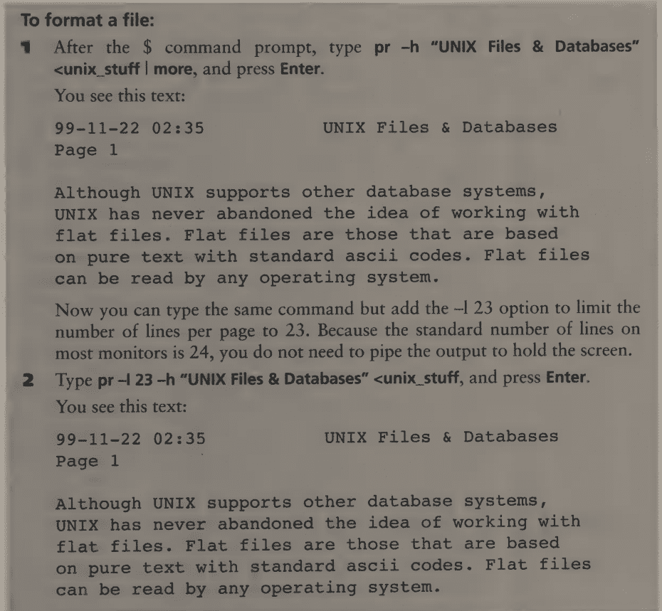

### 命令摘要

| 命令 | 用途 | 本章涵盖的选项 |
| :--- | :--- | :--- |
| comm | 比较并输出两个文件中共同的行 | |
| diff | 比较两个文件并确定哪些行不同 | |
| grep | 选择行或列 | -i 忽略大小写<br>-l 仅列出文件名 |
| pr | 格式化指定文件 | -d 使输出双倍行距<br>-h 自定义页眉行<br>-l n 设置每页行数 |
| sed | 指定编辑命令或包含 sed 命令的脚本文件 | -a \ 在行后追加文本<br>-d 删除指定文本<br>-e 在一行中指定多个命令<br>-n 显示行号<br>-p 显示行<br>-s 替换指定文本 |
| tr | 转换字符 | -d 从输出中删除在 `string1` 中找到的输入字符<br>-s 检查 `string1` 连续重复出现的序列 |
| uniq | 移除重复行以创建唯一输出 | |
| wc | 统计文件中的行数、字节数或单词数 | -c 统计字节或字符数<br>-l 统计行数<br>-w 统计单词数 |

### 摘要

UNIX 文件处理命令可以分为两类：选择命令和操纵转换命令。选择命令用于提取信息。操纵转换命令将提取的信息改变并转换为有用且直观的格式。

- `uniq` 命令从文件中删除重复的行。必须对文件进行排序，因为 `uniq` 仅比较连续的行。
- `comm` 命令比较 `file1` 和 `file2` 中共同的行，并生成三列输出，报告文件之间的差异。
- `diff` 命令试图确定将 `file1` 转换为 `file2` 所需的最小变更集。
- `tr` 命令将从标准输入读取的数据复制到标准输出，替换或删除由选项和模式指定的字符。
- `sed` 是一个旨在对大型文件进行全局更改的文件编辑器。运行 `sed` 的最低要求是一个输入文件和一个告诉 `sed` 对文件应用哪些操作的命令。
- `pr` 命令以分页方式打印标准输出。

### 复习题

1. 使用选择命令来 `______________`。

   a. 突出显示文件中的文本

   b. 格式化输出

   c. 从文件中提取信息

   d. 将输出重定向到文件

2. 使用操纵转换命令来 `______________`。

   a. 将提取的信息转换为有用且直观的格式

   b. 更改文件类型

   c. 从文件中提取信息

   d. 重定向输入

3. 以下哪项是选择命令？

   a. cut

   b. cat

   c. sed

   d. uniq

4. 以下哪项是操纵转换命令？

   a. cut

   b. cat

   c. sed

   d. uniq

5. 以下哪项命令同时处理两个文件？

   a. comm

   b. diff

   c. sed

   d. uniq

6. `pr` 命令产生 `______________________`

   a. 与 `cat` 一样的输出

   b. 与 `less` 一样的输出

   c. 发送到行式打印机的分页输出

   d. 发送到标准输出的分页输出

7. 以下哪项命令的输出将包含 `filename` 的所有文本，但每个冒号都被替换为空格？

   a. `sed “,:” “ ” < filename`

   b. `tr -s “:” “ ” filename`

   c. `awk -F: '{ print " " }' filename`

   d. `tr -s “:” “ ” < filename`

8. 以下哪项命令的输出将删除所有冒号？

   a. `sed -d “:” “ ” < filename`

   b. `tr -d “:” <filename`

   c. `tr -d: filename`

   d. `tr -d “:” “ ” filename`

9. 在 `sed` 中，使用 `______________________` 选项来追加新行。

   a. /a

   b. $/a

   c. add

   d. a\

10. 以下哪项命令将文件中的小写字母转换为大写字母？

    a. `tr [a-z] [A-Z] filename`

    b. `tr “[a-z]” “[A-Z]” < filename`

    c. `tr “[A-Z]” “[a-z]” < filename`

    d. `tr a-z A-Z filename`

11. 管道（`|`）运算符用于 `______________________`。

    a. 将输出重定向到文件

    b. 将输出重定向到屏幕

    c. 从文件重定向输入

    d. 将一个命令的输出重定向到另一个命令的输入

12. 命令 `grep Bob* /home/jill/members` 做了什么？

    a. 搜索当前目录中所有以 Bob 开头的文件，查找包含字符串 `/home/jill/members` 的行。它显示这些行。

    b. 搜索文件 `/home/jill/members`，查找包含 Bob 后跟任意其他字符的行。它显示这些行。

    c. 将所有以 Bob 开头的行存储到 `/home/jill/members` 文件中。

    d. 以上都不是。

13. 哪个命令在屏幕上显示当前目录中所有文件名中包含 “jimmy” 的文件名称？

    a. `ls | grep jimmy`

    b. `ls | sort jimmy`

    c. `ls | tr jimmy`

    d. `sed jimmy | ls`

14. `wc` 命令统计 `_______________`。

    a. 单词

    b. 行

    c. 字符

    d. 以上所有

### 练习


### 使用 `vi` 编辑器或 `cat >>` 向 `your_list` 文件添加行。使用 `comm` 命令将 `your_list` 与 `my_list` 进行比较。

### 将 `my_list` 文件转换为全大写字母，然后运行 `comm` 命令。

### 从 `zoo2` 文件中移除所有冒号字段分隔符。

## 发现练习

### 创建文件 `their_list`

创建一个新文件 `their_list`，并在文件中输入以下行：

Radio

Camera

Boat

使用 `sed` 命令选项将这些行添加到 `your_list` 的末尾：

Television

Computer

Stereo

### 使用 `tr` 命令处理 `/etc/passwd`

使用 `tr` 命令从 `/etc/passwd` 文件中删除所有冒号，并在屏幕上显示结果。

### 替换单词

在 `their_list` 文件中将单词 “Radio” 替换为 “Canoe”，并将显示发送到标准输出。

### 创建文件 `animals`

使用 `cat` 命令创建包含以下行的文件 `animals`：

Dog

Cat

Horse

Frog

接下来，使用 `sed` 命令将单词 “Cat” 更改为 “Kitten”。

### 编写 `sed` 脚本

编写并运行一个针对您在发现练习 4 中创建的文件的 `sed` 脚本。该脚本应将 “Dog” 更改为 “Puppy”，将 “Frog” 更改为 “Tadpole”。

# 课程 B

## 目标

学习完本课程后，您应该能够：

- 设计新的文件处理应用程序
- 设计和创建文件以实现应用程序
- 使用 `awk` 生成格式化输出
- 使用 `cut`、`sort` 和 `join` 组织和转换选定的文件信息
- 开发自定义 shell 脚本以提取和组合文件数据
- 测试各个 shell 脚本，并将所有脚本组合到一个最终的 shell 程序中

## 使用 UNIX 文件处理工具创建应用程序

### 设计新的文件处理应用程序

开发新应用程序中最重要的一步是创建设计。设计定义了应用程序需要产生的信息。设计还定义了如何将此信息组织到文件、记录和数据字段中，这些是逻辑结构，因为每个代表一个逻辑实体，例如工资文件、员工薪资记录或员工社保字段。文件由记录组成，记录由数据字段组成。

现在您已经准备好为 Dominion Consulting 创建程序员活动状态报告了。该报告将显示程序员的姓名以及每位程序员正在参与的项目数量。首先设计并创建文件，包括记录和数据字段，然后使用高级文件处理命令选择、操纵和格式化报告中的信息。

### 设计记录

设计阶段的第一项任务是定义记录中的数据字段。这些定义采用记录布局的形式，通过名称和数据类型（例如数字或非数字）来标识每个数据字段。设计文件记录以仅存储与记录主要目的相关的字段。例如，您需要两个文件用于 Dominion Consulting：一个用于程序员信息，另一个用于项目信息。在程序员文件记录中包含程序员姓名字段，在项目文件记录中包含项目描述字段。即使程序员可能被分配给项目，也不要将在项目文件中存储程序员的姓名。相反，不要在程序员文件中存储项目名称。

仅为记录中必要的字段分配所需空间，可使记录简洁明了。正如短句易于理解一样，短记录也更容易被理解。同样，应用程序设计得越简单，其性能就越好。不过，请确保包含一个字段来唯一标识文件中的每条记录。例如，程序员文件记录中包含一个程序员编号字段，以区分可能同名的程序员。

> **注意：** 程序员文件记录中的 `程序员编号字段` 应为数值型。`数值型字段` 在唯一标识记录时优于非数值型字段，因为计算机处理数字的速度比处理非数值型字段更快。项目记录可以使用非数值型的项目代码来唯一标识每条项目记录，因为 Dominion 项目代码包含字母和数字（例如 `EA-100`）。

### 通过键链接文件

多个文件通过 `键` 进行连接——键是每个链接文件都共有的一个通用字段。在设计阶段，另一个重要任务是规划如何连接文件（如有必要）。例如，程序员-项目应用程序使用程序员的编号将程序员链接到项目文件。将程序员编号字段添加到项目记录中，以将程序员链接到项目。

> **注意：** 能够由简单、简短的记录组成并从多个文件中收集信息的灵活性，是关系型数据库系统的本质。UNIX 包含若干文件处理 `命令`，提供了这种关系型数据库的部分灵活性。您将在本课时中实现其中的一些命令。

在开始为应用程序创建文件之前，请回顾图 5-1 中所示的程序员文件和项目文件的记录布局。

#### 程序员文件 – 记录布局

| 字段名称 | 数据类型 | 示例 |
| :--- | :--- | :--- |
| programmer_number | 数值 | 101 |
| lname | 字母 | Johnson |
| fname | 字母 | John |
| midinit | 字母 | K |
| salary | 数值 | 39000 |

字段分隔符是冒号 `:`

示例记录：

`101:Johnson:John:K:39000`

#### 项目文件 – 记录布局

| 字段名称 | 数据类型 | 示例 |
| :--- | :--- | :--- |
| project_code | 字母 | EA-100 |
| project_status | 数值 | 1 (*参见注释) |
| project_name | 字母 | Reservation Plus |
| programmer_number | 数值 | 110 |

字段分隔符是冒号 `:`

示例记录：

`EA-100:1:Reservation Plus:110`

*注释：项目状态代码 1=未安排 2=已开始 3=已完成 4=已取消

图 5-1：程序员和项目应用程序的记录布局

### 创建程序员文件和项目文件

既然您已回顾了设计和链接记录的基本要素，就可以开始实现应用程序设计了。正如第 2 章和第 3 章所述，UNIX 文件处理主要使用平面文件。处理这些文件很简单，因为您可以使用 `vi` 和 `Emacs` 等文本编辑器创建和操作它们。图 5-2 中的流程图概述并分析了从程序员文件和项目文件推导出的程序员项目分配情况。

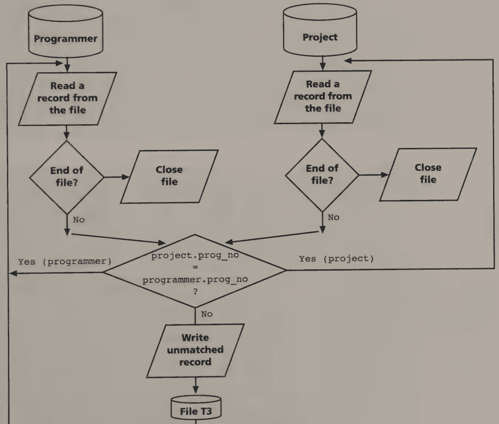

文件名: `programmer`

`101:Johnson:John:K:39000`

`102:King:Mary:K:39800`

`103:Brown:Gretchen:C:35000`

`104:Adams:Betty:C:42000`

`105:Utley:Amos:V:36000`

`106:Wilson:Patricia:B:39000`

`107:Culligan:Thomas:F:39000`

`108:Mitchell:Hillary:N:32800`

`109:Arbuckle:Margaret:F:46700`

`110:Ford:Terrence:H:40200`

`111:Greene:Sarah:L:41700`

`112:Rose:Richard:P:40200`

`113:Daniels:Allan:S:30500`

`114:Edwards:George:J:38500`

文件名: `project`

`EA-103:3:Personnel Evaluations:106`

`WE-206:1:Reservations:102`

`WE-207:4:Accounting - Basic:101`

`WE-208:2:Executive-Decision-Maker:102`

`NE-300:1:Region P & L:103`

`NE-302:1:Housekeeping Logs:104`

`NE-304:4:Maintenance Logs:105`

#### 流程图逻辑

首先使用 `vi` 编辑器创建程序员文件。

**创建程序员文件的方法：**

1. 在 `$` 命令提示符后，输入 `vi programmer` 并按 `Enter`。
2. 输入 `i` 切换到插入模式，然后输入以下文本，在每行末尾（最后一行除外）按 `Enter`：

```
101:Johnson:John:K:39000
102:King:Mary:K:39800
103:Brown:Gretchen:K:35000
104:Adams:Betty:C:42000
105:Utley:Amos:V:36000
106:Wilson:Patricia:B:39000
107:Culligan:Thomas:F:39000
108:Mitchell:Hillary:N:32800
109:Arbuckle:Margaret:F:46700
110:Ford:Terrence:H:44700
111:Greene:Sarah:L:41700
112:Rose:Richard:P:40200
113:Daniels:Allan:S:30500
114:Edwards:George:J:38500
```

3. 按 `Esc` 切换到命令模式。


## 创建项目文件的方法

4. 输入 `:wq` 保存文件并退出 `vi`。

1. 在 `$` 命令提示符后，输入 `vi project` 并按 **Enter**。

2. 输入 `i` 切换到插入模式，并输入以下文本，在每行末尾（最后一行除外）按 **Enter**：

```
EA-100:1:Reservation Plus:110
EA-100:1:Reservation Plus:103
EA-100:1:Reservation Plus:107
EA-100:1:Reservation Plus:109
EA-101:2:Accounting-Revenues Version 4:105
EA-101:2:Accounting-Revenues Version 4:112
EA-102:4:Purchasing System:110
EA-103:3:Personnel Evaluations:106
WE-206:1:Reservations:102
WE-207:4:Accounting - Basic:101
WE-208:2:Executive-Decision-Maker:102
NE-300:1:Region P & L:103
NE-302:1:Housekeeping Logs:104
NE-304:4:Maintenance Logs:105
```

3. 按 `Esc` 切换到命令模式。

4. 输入 `:wq` 保存文件并退出 `vi`。

### 格式化输出

第 4 章介绍了 `awk` 命令，它简化了格式化输出的准备。`Awk` 实际上是一种功能齐全的编程语言，需要单独一章来介绍。此处有限的介绍仅解释了 `awk` 命令中 `printf` 动作的使用，该动作用于格式化输出。`printf` 函数的语法如下：

|  |  |

| :--- | :--- |

| **语法** | `printf (format, expr1, expr2, expr3 ...)` |

| **解析** | - `format` 总是必需的。它是一个表达式，其字符串值包含字面文本以及如何格式化参数列表中表达式的规范。每个规范以百分比字符 (%) 开头，将其后的代码标识为修饰符（- 用于左对齐；width 用于设置大小；.prec 用于设置最大字符串宽度或小数点右侧的位数；s 表示字符数组（字符串）；d 表示十进制整数；f 表示浮点十进制数）。用双引号 (" ") 括起来，format 通常被称为覆盖在输入其中的数据字段（exprs）上的“掩码”。<br>- `$expr1, $expr2, $expr3` 是代表数据字段的 `awk` 表达式。这些表达式通常采用 `$1, $2, $3` 等形式。在程序员文件中，表达式 `$1` 表示程序员编号（第一个字段），`$2` 表示程序员的姓氏（第二个字段），`$3` 表示程序员的名字（第三个字段）。 |

您可以使用 `awk` 命令和 `printf` 函数打印 `programmer_number`、程序员姓氏和程序员名字，并且全部左对齐。

#### 打印三个字的方法

- 在 `$` 命令提示符后，输入 `awk -F: '{printf "%d %-12.12s %-10.10s\n",$1,$2,$3 }' programmer` 并按 Enter。

格式字符串中的每个 `%` 符号对应一个 `$` 字段：`%d` 指定如何显示 `$1` 字段，`%-12.12s` 指定如何显示 `$2` 字段，而 `%-10.10s` 指定如何显示 `$3` 字段。以下是每个说明符的分解：

- `%d` 表示 `$1` 字段应以十进制数字显示。
- `%-12.12s` 表示 `$2` 字段应以字符串显示。减号 (`-`) 指定字符串应左对齐。`12.12` 表示字符串应显示在填充至 12 个空格的字段中，最大大小为 12 个空格。
- `%-10.10s` 表示 `$3` 字段应以字符串显示。减号 (`-`) 指定字符串应左对齐。`10.10` 表示字符串应显示在填充至 10 个空格的字段中，最大大小为 10 个空格。

格式字符串中出现的空格会精确地打印在相对于字段出现的位置（`$1` 之后打印一个，`$2` 之后打印另一个）。尾部的 `\n` 告诉 `awk` 在显示这三个字段后跳行。

当您需要提取和格式化数据字段用于输出时，`Awk` 提供了对其他 UNIX 文件处理命令的捷径。例如，虽然需要几行代码，但您可以使用 `cut`、`paste` 和 `cat` 命令从程序员文件中提取并显示程序员的姓氏和薪水。首先使用 `cut` 命令从程序员文件中提取姓氏（第 2 字段），并将输出存储到 `temp1`。接着使用 `cut` 命令从程序员文件中提取薪水（第 5 字段），并将输出存储到 `temp2`。然后使用 `paste` 命令组合 `temp1` 和 `temp2`，创建文件 `progsal`。最后使用 `more` 命令显示输出。您也可以用一条 `awk` 命令完成相同的任务。

#### 使用 cut、paste 和 more 提取并显示信息的方法

1. 在 `$` 命令提示符后，输入 `cut -f2 -d: programmer > temp1` 并按 Enter。
2. 输入 `cut -f5 -d: programmer > temp2` 并按 Enter。
3. 输入 `paste temp1 temp2 > progsal` 并按 Enter。
4. 要使用 `more` 命令显示输出，输入 `more progsal` 并按 Enter。

您将看到与以下摘录类似的输出：

```
Johnson 39000
King 39800
Brown 35000
Adams 42000
Utley 36000
...
```

#### 使用单个 awk 命令完成相同任务

- 在 `$` 命令提示符后，输入 `awk -F: '{ printf "%-10.10s %7.0f\n", $2, $5 }' programmer` 并按 **Enter** 键。

你会看到类似于以下摘录的输出：

| 姓名 | 薪资 |
|---------|------|
| Johnson | 39000 |
| King | 39800 |
| Brown | 35000 |
| Adams | 42000 |
| Utley | 36000 |
| ... | |

#### 切割和排序

现在你已经创建了程序员信息文件，可以选择存储在项目文件中的 `programmer_number` 字段。这些字段标识当前被分配到项目的程序员。在执行下一个任务时，请参考图 5-1。

首先，从项目文件中切割出 `programmer_number` 字段（第 4 个字段），并通过管道（`|`）将输出传递给 `sort` 命令，以便将任何重复的数字放在一起。将排序后的输出通过管道传递给 `uniq` 命令，以删除任何重复的 `programmer_numbers`。最后，将输出重定向到一个临时文件 `t1`。（`t1` 文件是一个程序员编号列表，标识被分配到项目的程序员。）

##### 从项目文件中选择字段

1. 在 `$` 命令提示符后，输入 `cut -d: -f4 project | sort | uniq > t1` 并按 **Enter** 键。
2. 要显示 `t1` 的内容，输入 `cat t1` 并按 **Enter** 键。

你会看到程序员编号列表：

```
101
102
103
104
105
106
107
109
110
112
```

下一步是从程序员文件中切割出 `programmer_number` 字段（第 1 个字段），并像步骤 1 中那样将输出通过管道传递。将新的临时文件命名为 `t2`，它是一个程序员编号列表，标识为 Dominion 工作的所有程序员。

3. 输入 `cut -d: -f1 programmer | sort | uniq > t2` 并按 **Enter** 键。
4. 要显示 `t2` 的内容，输入 `cat t2` 并按 **Enter** 键。

你会看到这个程序员编号列表：

```
101
102
103
104
105
106
107
108
109
110
111
112
113
114
```

现在 `t1` 和 `t2` 已按相同顺序排序，你可以将它们进行匹配。使用 `comm` 命令从 `t1` 中选择与 `t2` 中不匹配的的行，并将输出重定向到另一个文件 `t3`，该文件列出了所有未分配项目的程序员的编号。

5. 输入 `comm -13 t1 t2 > t3` 并按 **Enter** 键。
6. 要显示未参与项目的程序员的编号，输入 `cat t3` 并按 **Enter** 键。

你会看到这个程序员编号列表：

```
108
111
113
114
```

要显示未分配程序员的姓名，现在你可以按 `programmer_number` 顺序对程序员文件进行排序，并将输出写入 `t4`。

7. 输入 `sort -t: -k1,1 -o t4 programmer` 并按 **Enter** 键。


现在使用 `join` 命令匹配 `t4` 和 `t3` 中的 `programmer_numbers`，并将输出重定向到 `t5`，其中包含所有未分配项目的程序员的姓名。

8. 输入 `join -t: -j1 -j1 -o 1.2 -o 1.3 -o 1.4 t4 t3 > t5` 并按 **Enter** 键。

9. 要显示 `t5` 的内容，输入 `cat t5` 并按 **Enter** 键。你会看到以下程序员姓名列表：

```
Mitchell:Hillary:N
Greene:Sarah:L
Daniels:Allan:S
Edwards:George:J
```

现在你可以使用 `sed` 编辑器转换输出，以消除 `t5` 中的冒号字段分隔符。

10. 输入 `sed 's/:/ /g' < t5` 并按 **Enter** 键。你会看到这个程序员姓名列表：

```
Mitchell Hillary N
Greene Sarah L
Daniels Allan S
Edwards George J
```

### 使用 Shell 程序实现应用程序

你为 Dominion Consulting 开发的应用程序目前由许多必须按特定顺序运行的独立命令组成。正如你在第 4 章中回忆到的，你可以创建一个脚本文件来简化应用程序。将你的命令存储在脚本文件中，这实际上就变成了一个程序。（在开发应用程序时，你通常应该在将命令放入脚本文件之前测试和调试每个命令。）你可以使用 `vi` 编辑器创建脚本文件。

**注意：第 6 章详细讨论了 shell 编程的主题。**

Shell 程序不仅应包含要执行的命令，还应包含用于标识和解释程序的注释。在脚本文件中使用井号（`#`）字符来标记注释。这告诉 shell `#` 后面的单词是注释，而不是 UNIX 命令。接下来的步骤展示了如何为 shell 程序添加注释。从使用 `vi` 编辑器创建脚本文件 `pact` 开始。注意，你开始时插入注释以标识和解释程序。

#### 创建脚本并添加注释：

1. 在 `$` 命令提示符后，输入 `vi pact` 并按 **Enter** 键。

2. 输入 `a` 切换到插入模式，然后输入下面的文本，在每行末尾按 **Enter** 键：

```
# ================================================
# 脚本名称: pact
# 作者: 讲师
# 日期: 1999 年 11 月
# 目的: 创建临时文件 pnum，用于保存每个
# 程序员正在处理的项目数量。pnum 文件
# 由
# prog_num 和 count 字段组成
# ================================================
cut -d: -f4 project | sort | uniq -c |
awk '{printf "%s:%s\n",$2, $1}' > pnum
# 切割 prog_num，通过管道输出以 sort 删除重复项
# 并获取 prog/projects 的计数。
# 输出文件包含 prog_number 后跟计数
```

3. 按 `Esc` 切换到命令模式。

4. 输入 `:wq` 以写入文件并退出 `vi`。

现在你可以运行 `pact` 并使用 `less` 命令显示 `pnum` 的内容。

注意：以下步骤中的 shell 脚本是使用 `sh` 命令执行的。

#### 运行脚本：

1. 在 `$` 命令提示符后，输入 `sh pact` 并按 **Enter** 键。

2. 输入 `less pnum` 并按 **Enter** 键。

3. 你会看到这些程序员编号和计数字段：

```
101:1
102:2
103:2
104:1
105:2
106:1
107:1
109:1
110:2
112:1
```

现在你拥有一个包含程序员编号和每个程序员正在处理的项目数量的文件。接下来，创建一个脚本文件 `pnumname`，以从程序员文件中提取程序员姓名和编号，并将输出重定向到文件 `pnn`。

#### 创建另一个脚本文件：

1. 在 `$` 命令提示符后，输入 `vi pnumname` 并按 **Enter** 键。

2. 输入 `i` 切换到插入模式，然后输入下面的文本，在每行末尾按 **Enter** 键：

```
# ============...=============
# 脚本名称:  pnumname
# 作者:        JQD
# 日期:      1999 年 11 月
# 目的: 提取程序员编号和姓名
# ============...=============
cut -d: -f1-4 programmer | sort -t: +0 -1 | uniq > pnn
# 上述命令切割出第 1 到第 4 个字段。
# 输出通过管道传递给按程序员编号排序。
# 排序后的输出通过管道传递给 uniq 以删除重复项。
# Uniq 将输出重定向到 pnn。
```

3. 按 `Esc` 切换到命令模式。

4. 输入 `:wq` 以写入文件并退出 `vi`。

5. 要运行 shell 程序并使用 `less` 命令显示 `pnn` 的内容，输入 `sh pnumname` 并按 **Enter** 键。

6. 输入 `less pnn` 并按 **Enter** 键。

7. 你会看到程序员姓名和编号，重复项已被消除：

```
101:Johnson:John:K
102:King:Mary:K
103:Brown:Gretchen:K
104:Adams:Betty:C
105:Utley:Amos:V
106:Wilson:Patricia:B
107:Culligan:Thomas:F
108:Mitchell:Hillary:N
109:Arbuckle:Margaret:F
110:Ford:Terrence:H
111:Greene:Sarah:L
112:Rose:Richard:P
113:Daniels:Allan:S
114:Edwards:George:J
```

现在你可以创建一个脚本文件 `joinall`，将文件 `pnn` 和 `pnum` 连接起来，并将输出重定向到 `pactrep`。

#### 创建一个连接两个文件的脚本文件：

1. 在 `$` 命令提示符后，输入 `vi joinall` 并按 **Enter** 键。

2. 输入 `a` 切换到插入模式，然后输入下面的文本，在每行末尾按 **Enter** 键：

```
# =====================================================
# 脚本名称: joinall
# 作者:          JQD
# 日期:            1999 年 11 月
# 目的: 连接 pnum 和 pnn 以创建报告文件
# =====================================================
# 连接文件，包括未分配的程序员
# 你通过将程序员姓名（pnn）文件
# 放在连接序列中首先来实现这一点。

join -t: -a1 -j1 -j1 1 pnn pnum > pactrep
```

3. 按 `Esc` 切换到命令模式。

4. 输入 `:wq` 以写入文件并退出 `vi`。

5. 要运行 `joinall` 并使用 `less` 显示 `pactrep` 的内容，输入 `sh joinall` 并按 **Enter** 键。

6. 输入 `less pactrep` 并按 **Enter** 键。

7. 你会看到程序员姓名，包括未分配程序员的姓名：

```
101:Johnson:John:K:1
102:King:Mary:K:2
103:Brown:Gretchen:K:2
104:Adams:Betty:C:1
105:Utley:Amos:V:2
106:Wilson:Patricia:B:1
107:Culligan:Thomas:F:1
108:Mitchell:Hillary:N
109:Arbuckle:Margaret:F:1
110:Ford:Terrence:H:2
111:Greene:Sarah:L:1
112:Rose:Richard:P:1
113:Daniels:Allan:S
114:Edwards:George:J
```

### 综合应用以生成报告

开发应用程序的一种有效方法是将小型脚本组合到一个较大的脚本文件中。由于您已经执行并测试了各个脚本的准确性，现在可以将它们按照正确的顺序放入一个脚本文件中，以生成针对 Dominion 项目的最终程序员和项目报告。

首先，使用 `vi` 编辑器创建 shell 脚本 `practivity`。使用 `:r` 命令检索 `pact`、`pnumname` 和 `joinall` 脚本，并将它们放入 `practivity` shell 脚本中。然后，您可以使用 `vi` 的 `dd` 命令删除注释中指示的行。

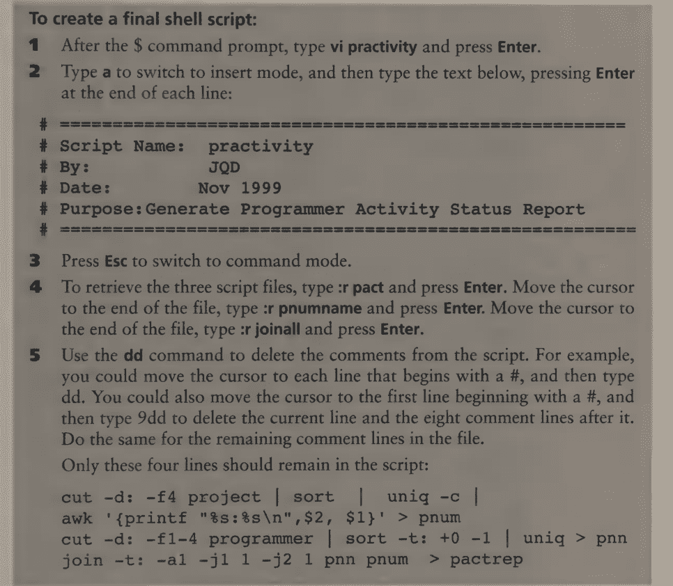

### 打印报告

```
awk '
BEGIN {
{ FS = ":"}
```


{ print "\tProgrammer Activity Status Report\n" }

{ "date" | getline d }

{ printf "\t\t%s\n",d }

{ print "Prog#\t *----Name----*\t\tProjects\n" }

{ print

"=================================================================="}

}

{ printf "%-s\t%12.12s %12.12s %s\t%d\n",

$1, $2, $3, $4, $5 }' pactrep

在脚本中输入以下内容：

### 删除所有临时文件

`rm pnum pnn pactrep`

按 `Esc` 键切换到命令模式。

输入 `:wq` 以写入文件并退出 `vi`。

在 `$` 命令提示符后，输入 `sh practivity` 并按 `Enter`。

您将看到报告：

| Prog# | *-----Name-----* | Projects |
| :-- | :-- | :-- |
| 101 | Johnson | John K 1 |
| 102 | King | Mary K 2 |
| 103 | Brown | Gretchen K 2 |
| 104 | Adams | Betty C 1 |
| 105 | Utley | Amos V 2 |
| 106 | Wilson | Patricia B 1 |
| 107 | Culligan | Thomas F 1 |
| 108 | Mitchell | Hillary N 0 |
| 109 | Arbuckle | Margaret F 1 |
| 110 | Ford | Terrence H 2 |
| 111 | Greene | Sarah L 0 |
| 112 | Rose | Richard P 1 |
| 113 | Daniels | Allan S 0 |
| 114 | Edwards | George J 0 |

### 命令摘要

| 命令 | 用途 | 本章涵盖的选项 |
| :--- | :--- | :--- |
| `printf` | 告诉 `Awk` 程序执行什么操作 | 无 |
| `sh` | 执行 shell 脚本 | 无 |

## 总结

- 文件处理应用程序的设计反映了该应用程序需要产生的结果。设计还定义了如何将信息组织成文件、记录（`records`）和字段（`fields`），这些是逻辑结构。
- 使用记录布局（`record layout`）通过名称和数据类型（数值或非数值）来标识每个字段。设计文件记录仅存储与每个记录的主要目的相关的字段。
- Shell 程序应包含用于执行的命令以及用于识别和解释程序的注释。在脚本文件中使用的井号 `#` 字符表示注释。
- 分阶段编写 shell 脚本，以便在将它们组合成一个脚本之前可以测试每个部分。使用小型 shell 脚本并将它们组合在最终的 shell 脚本文件中是开发应用程序的一种有效方式。

### 复习题

1. 设计阶段的首要任务是定义应用程序的 __________。
    a. 记录
    b. 文件
    c. shell 程序
    d. 逻辑

2. 当用于脚本文件时，___ 字符表示注释。
    a. `*`
    b. `&`
    c. `;`
    d. `#`

3. 在 `awk printf` 格式字符串中，`%d` 表示什么？
    a. 显示 `$` 符号。
    b. 将字段显示为双精度数字。
    c. 将字段显示为十进制数字。
    d. 以上都不正确。

4. 在 `awk printf` 格式字符串中，`%-10.10s` 表示什么？
    a. 将字段显示为左对齐的字符串，填充空格至 10 个字符，最多显示 10 个字符。
    b. 将字段显示为右对齐的字符串，填充空格至 10 个字符，最多显示 10 个字符。
    c. 将字段显示为单精度数字，小数点左边 10 位，右边 10 位。
    d. 以上都不正确。

5. 在 `vi` 会话期间，您可以使用 ___________________ 命令从其他文件检索数据并将其插入到新的 `vi` 文件中。
    a. `:r`
    b. `:i`
    c. `:a`
    d. `:insert`

6. 以下哪个 `awk` 命令输出格式化字段？
    a. `print`
    b. `display`
    c. `show`
    d. `printf`

### 练习

1. 编写一个单行脚本文件 `lprog`，使用 `awk` 打印程序员文件（`programmer file`）中的所有字段。使用 `sh` 命令执行 `lprog`。
2. 编写一个单行脚本文件 `lproj`，使用 `awk` 打印项目文件（`project file`）中的所有字段。使用 `sh` 命令执行 `lproj`。
3. 使用 `vi` 创建脚本文件 `lists`，然后将 `lprog` 和 `lproj` 组合到 `lists` 中。保存 `lists` 并使用 `sh` 命令执行 `lists` 脚本。

### 探索练习

1. 创建一个名为 `Software` 的文件，包含以下字段：
    - `Project_number` 使用与项目文件中显示相同的数字
    - `Software Code` 使用任意三位数
    - `Software Description` 例如 `Excel`

2. 编写一个小应用程序，将软件记录与项目文件中的匹配记录连接起来，并使用 `Awk` 程序打印一份报告，描述每个项目的软件。

# 21. ZYCHRONA—WYDRZWIENIA


# RYS 26—

1. [文字模糊，无法识别]

# 第 6 章

# Shell 编程入门

**案例** `Dominion Consulting` 需要一个程序来维护其电话记录文件，该文件包含以下关于每个员工的信息：电话号码、姓名、部门、职务和雇用日期。该程序应允许用户添加、更改、删除、查找和显示特定的员工信息。您可以通过创建一个 UNIX shell 程序来满足这些需求。在本节中，您将学习用于创建 UNIX shell 程序的基本工具。在课程 B 中，您将创建允许用户查看和向电话数据库添加记录的 shell 程序。

## 课程 A 目标

在本课程中，您将：

- 理解使用高级计算机语言和 UNIX shell 脚本进行应用程序开发的周期
- 比较不同的 shell 以确定编程的最佳选择
- 学习 shell 变量、运算符和通配符
- 编写简单的 shell 脚本来展示编程逻辑

## 使用 UNIX Shell 作为编程语言

### 预览应用程序

本章中创建的 `corp_phones` 文件包含由冒号分隔的字段记录。以下是该文件中的一个示例记录：

`219-432-4587:Mitchell:Barbara:C:4541:Admin Asst:12-14-1995`

在第 4 章和第 5 章中，您学习了几个命令，如 `grep`、`cut`、`paste` 和 `awk`，您可以使用这些命令来操作、提取和格式化存储在文件中的信息。虽然这些命令功能强大，但对于非技术用户来说可能难以使用。此外，您通常需要将这些命令组合在一起，形成长序列才能达到您想要的结果。即使是经验丰富的技术用户，反复执行这些命令序列也可能很繁琐。UNIX shell 脚本消除了这两个问题。您可以编写呈现用户友好界面并自动发出 `grep` 和 `awk` 等命令以提取、格式化和显示信息的 shell 脚本。这使得非技术用户能够访问 UNIX 的强大功能。shell 脚本还通过自动化您经常需要执行的长命令序列来为您节省时间。

本章和第 7 章中开发的 shell 脚本应用程序展示了一个操作菜单，用户可以选择其中的一项。除了其他任务外，这些操作自动化了在 `corp_phones` 中查找、格式化和显示电话号码记录的过程。该应用程序还提供了数据输入界面，以简化向文件添加新记录的任务。

为了完成本章的案例项目，您将学习 UNIX shell 的这些编程特性：

- **Shell 变量：** 您的脚本通常需要保持内存中的值以备后续使用。Shell 变量是符号名称，可以访问存储在内存中的值。
- **运算符：** Shell 脚本支持许多运算符，包括执行数学运算的运算符。
- **逻辑结构：** Shell 脚本支持顺序逻辑（用于执行一系列命令）、决策逻辑（用于从脚本中的一个点分支到另一个点）、循环逻辑（用于多次重复执行命令）和案例逻辑（用于从几个可能的备选方案中选择一个操作）。

此外，您还将学习用于格式化屏幕输出和定位光标的特殊命令。

在开始编写 shell 脚本之前，您应该理解程序开发周期。

## 程序开发周期

开发应用程序的过程被称为**程序开发周期**。无论您是编写 shell 脚本还是高级语言程序，周期中涉及的步骤都是相同的。


该过程从创建程序规格说明开始——即应用程序必须满足的需求。规格说明决定了应用程序接收哪些数据作为输入、必须对数据执行哪些处理以及正确的输出是什么。

确定规格说明后，设计过程开始。在此过程中，程序员创建文件格式、屏幕布局和程序将使用的逻辑算法（过程）。程序员使用各种工具来设计复杂的应用程序。在下一章中，您将学习流程图和伪代码，这是两个重要的程序设计工具。

设计过程完成后，程序员开始编写实际代码，然后必须对其进行测试和调试。当他们发现错误时，必须纠正错误并重新开始测试过程。此过程持续进行，直到应用程序表现出令人满意的效果。

图 6-1 说明了程序开发周期。

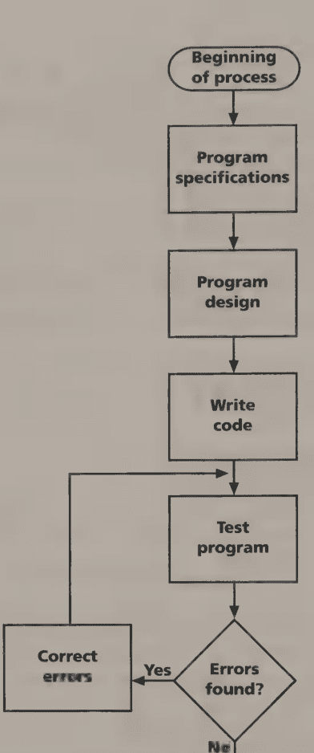

图 6-1：程序开发周期

## 使用高级语言

计算机程序是指令，通常使用 COBOL、C 或 C++ 等**高级语言**编写。**高级语言**是一种使用类似英语表达式的计算机语言。例如，下面的 COBOL 语句指示计算机将 1 加到变量 `COUNTER` 上：

```
ADD 1 TO COUNTER.
```

这里有一个用 C++ 编写的类似语句：

```
counter = counter + 1;
```

程序的高级语言语句存储在一个称为**源文件**的文件中。这是程序员使用 `vi` 或 `Emacs` 等编辑器创建的文件。然而，源文件无法执行，因为计算机只能处理以低级**机器语言**编写的指令。正如我们在第 3 章中回顾的那样，机器语言指令是由二进制数表示的晦涩代码。因此，高级语言源文件必须转换为低级机器语言文件，如下所述。

源文件通过一个名为**编译器**的程序转换为可执行的机器语言文件。编译器读取程序员在源文件中编写的代码行，并将它们转换为相应的机器语言指令。例如，Linux C++ 编译器名为 `g++`。以下命令展示了如何执行它：

```
g++ -o my_exe my_source.cpp
```

在此示例命令中，`-o` 选项后跟 `my_exe` 指示编译器创建可执行文件 `my_exe`。源文件是 `my_source.cpp`。该命令使编译器将 C++ 程序 `my_source.cpp` 翻译成可执行的机器语言程序，并存储在文件 `my_exe` 中。

如果源文件包含**语法错误**（语言使用中的语法错误），则无法将其转换为可执行文件。编译器会定位并报告任何语法错误，程序员必须更正这些错误。

> 注意：编译后，可执行程序可能仍然包含致命的**运行错误**或逻辑错误。致命运行错误会导致程序因无效内存位置等原因而中止。逻辑错误会导致程序产生无效结果，原因可能是存在诸如数学陈述错误之类的问题。

完成编程任务的另一种方式是开发 UNIX shell 脚本。

## 使用 UNIX Shell 脚本

在第 4 章中介绍的 **UNIX shell 脚本**是包含 UNIX 命令序列的文本文件。与高级语言源文件类似，程序员使用文本编辑器创建 shell 脚本。然而，与高级语言程序不同，shell 脚本不需要通过编译器转换为机器语言。这是因为 UNIX shell 在阅读脚本文件时充当**解释器**。当解释器读取程序文件中的语句时，它会立即将它们翻译成可执行指令并使其运行。由于解释器在一步中翻译并执行程序语句，因此不会产生可执行文件。如果遇到语法错误，程序将停止。

创建 shell 脚本后，只需告诉操作系统该文件是一个可以执行的程序。这是通过使用 `chmod`（“更改模式”）命令更改文件模式来完成的。模式决定文件的使用方式。请记住，模式由单字母代码表示，最常见的是“r”（读取）、“w”（写入）和“x”（执行）。此外，`chmod` 命令告诉计算机谁被允许使用该文件：所有者 (u)、组 (g) 或所有其他用户 (o)。关于 `chmod` 命令的描述，请参阅附录 B “UNIX 命令语法指南”。

正如你在第 4 章中回忆的那样，你可以更改文件的模式，以便 UNIX 将其识别为每个人（用户、组和其他人）都可以使用的可执行程序。在下面的示例中，用户是该文件的所有者。

```
$ chmod ugo+x filename             <Enter>
```

通过在系统提示符后输入文件名，你现在可以运行 shell 程序。然而，在运行任何程序之前，必须从 `PATH` 变量标识的路径中检索它，该变量提供了 UNIX 查找可执行程序的目录位置列表。（请参阅本章后面“变量”部分。）如果程序位于当前目录，而当前目录不在 `PATH` 变量中，你可以将点斜杠 (`./`) 加在程序名称之前，以告诉 UNIX 在当前目录中查找程序，如下所示：

```
$ ./filename                   <Enter>
```

Shell 程序的运行速度比编译程序慢，因为 shell 必须在执行之前解释可执行脚本文件内的每个 UNIX 命令。然而，创建 shell 程序通常比使用高级语言编写的程序花费更少的时间，因为省去了调用编译器并生成可执行文件的过程。由于编写如 shell 脚本这样的程序通常比编写编译语言更快更容易，许多程序员更喜欢脚本。

## 应用程序原型设计

**原型**是你应用程序的可行模型，允许你在最终确定设计之前审查最终结果。使用 shell 程序创建原型通常是最快且最有效的方法，因为原型设计和逻辑能力存在于 UNIX 内部。

在可行的原型被批准后，可以使用 C++ 等编译语言重写程序以使其运行得更快。然而，如果 shell 程序运行良好，你可能不需要将其转换为编译版本。

现在你更了解程序开发周期了，你意识到使用 shell 脚本维护 Dominion Consulting 的电话记录会更有效。你的下一步是选择最适合你应用程序的编程 shell。

## 编程 Shell

所有 Linux 版本都使用 `Bash` shell（Bourne Again Shell）作为默认 shell。表 6-1 列出了大多数 Linux 发行版中附带的三种 shell、它们的派生来源以及特征。

| Shell 名称 | 派生自原始 Shell | 描述 |
| :--- | :--- | :--- |
| `Bash` | Bourne 和 Korn shell | 提供强大的编程语言特性，如 shell 变量、控制结构和逻辑/数学表达式。结合其他 shell 的最佳特性。 |
| `tsh` | C Shell | 符合编程语言格式。Shell 表达式使用类似 C 编程语言中的运算符。 |
| `zsh` | Korn shell | 在许多方面反映 Bash shell，但还具有类似 C 编程的语法。如果你熟悉旧版 Korn shell 脚本，则非常有用。 |

表 6-1：Linux shells

`Bash` shell 比旧的 Bourne 和 Korn shell 提供了改进的功能，并且完全向后兼容 Bourne shell。此外，与其他 shell 相比，`Bash` shell 具有更强大的编程接口。因此，你应该使用 `Bash` shell（包含在 Red Hat Linux 版本 5.2 中）来完成你的任务。

现在你已经选择了 shell，你需要了解 shell 脚本中包含的内容，例如变量、运算符和特殊字符。

## 变量

变量是代表存储在内存中值的符号名称。本节讨论的三种变量类型是配置变量、环境变量和 shell 变量。使用配置变量来存储有关操作系统设置的信息，并且不要更改它们。你可以设置初始值，并根据需要修改环境变量。UNIX 在你登录时读取这些变量，它们决定了你会话的许多特性。例如，你已经了解了 `PS1` 环境变量，它决定了你的提示符的外观。此外，UNIX 使用环境变量来确定诸如在哪里查找程序、使用哪个 shell 以及主目录的路径等事情。Shell 变量是你可以在命令行或 shell 脚本中创建的变量。它们在 shell 脚本中临时存储信息时非常有用。

在本章中，你将学习几种用于创建、访问和操作变量的命令。例如，要查看环境变量列表，请使用 `printenv` 命令。

### 查看环境变量列表：

- 1. 环境变量列表可能跨越多于一屏的内容，因此请使用 `more` 命令配合 `printenv`。输入 `printenv | more` 并按下 `Enter` 键。你会看到与环境变量列表（类似于图 6-2 中所示）类似的内容。

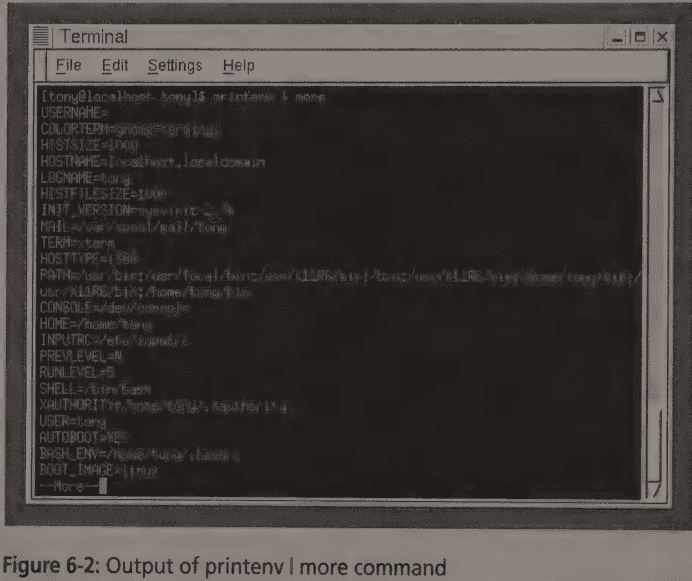

- 2. 按下 `空格键`，直到输出完成。

> **注意：** 如果你指定变量名作为 `printenv` 命令的参数，它只会显示该变量的内容。

环境和配置变量具有标准名称，如 `PS1`、`HOME`、`PATH`、`SHELL`、`USERNAME` 和 `PWD`。配置和环境变量使用大写字母，以区别于用户变量。主目录中的一个脚本文件用于设置环境变量的初始值。你可以使用这些变量来配置和个性化你的登录会话。例如，你可以将 `PATH` 变量设置为搜索其他用户创建的命令位置。表 6-2 列出了标准的 Bash Shell 变量。

### 表 6-2：标准 Bash Shell 环境和配置变量

| 名称 | 变量内容 | 由谁决定 |
| :--- | :--- | :--- |


| `HOME` | 用户主目录的路径名 | 系统 |
| `LOGNAME` | 登录名 | 系统 |
| `TZ` | 系统使用的时间区 | 系统 |
| `SHELL` | 你正在使用的 shell 类型程序的路径名 | 可重定义 |
| `PATH` | 用于搜索可执行命令的目录的路径名列表 | 可重定义 |
| `PS1` | 主要 shell 提示符 | 可重定义 |
| `PS2` | 次要 shell 提示符 | 可重定义 |
| `PS3` 和 `PS4` | 保存 set 和 select 命令使用的提示符 | 可重定义 |
| `IFS` | 字段分隔符符号 | 可重定义 |
| `MAIL` | `mail` 实用程序检查收到的邮件文件的名称 | 可重定义 |
| `MAILCHECK` | 检查收到邮件的时间间隔（示例：60） | 可重定义 |
| `MAILPATH` | 用于检查收到邮件的邮件文件列表 | 用户定义 |
| `TERM` | 终端名称 | 用户定义 |
| `MAILWARNING` | 如果已设置，并且 Bash 正在检查邮件的文件自上次检查以来已被访问，则会显示消息“Mailfile 中的邮件已被读取” | 用户定义 |
| `CDPATH` | `cd` 命令搜索子目录的目录路径名 | 用户定义 |
| `EXINIT` | Ex/Vi 编辑器的初始化命令 | 用户定义 |
| `PWD` | 当前工作目录 | 用户定义 |
| `OLDPWD` | 由 `cd` 命令设置的上一工作目录 | 用户定义 |
| `REPLY` | 当 `read` 内置命令读取输入行且未提供参数时，设置为该输入行 | 用户定义 |
| `UID` | 扩展为当前用户的用户 ID，在 shell 启动时初始化 | 用户定义 |
| `EUID` | 扩展为当前用户的有效用户 ID，在 shell 启动时初始化 | 用户定义 |
| `BASH` | Bash 的完整路径名 | 用户定义 |
| `BASHVERSION` | Bash 的版本号 | 用户定义 |
| `SHLVL` | 每次启动 Bash 实例时递增 1 | 用户定义 |
| `RANDOM` | 引用时生成一个随机整数。通过给 `RANDOM` 赋值可以初始化随机数序列。 | 用户定义 |
| `HISTCMD` | 当前命令在历史列表中的索引 | 用户定义 |
| `HISTSIZE` | History 命令记住的命令数量。默认值为 500。 | 用户定义 |
| `OPTARG` | `getopts` 内置命令处理的最后一个选项参数的值 | 用户定义 |
| `OPTIND` | `getopt` 内置命令要处理的下一个参数的索引 | 用户定义 |
| `HOSTTYPE` | 自动设置为一个唯一描述 Bash 执行所在机器类型的字符串 | 用户定义 |
| `HOSTFILE` | 系统的完整主机名。格式与 `/etc/hosts` 相同。 | 用户定义 |
| `OSTYPE` | 描述 Bash 执行所在的操作系统 | 用户定义 |
| `ENV` | 包含 shell 初始化命令的文件名，如 `.bashrc` 或 `.tcshrc` | 用户定义 |
| `HISTFILESIZE` | 历史文件中包含的最大行数。当达到此大小限制时，会导致历史文件被截断。 | 用户定义 |
| `OPTERR` | 如果设置为值 1，Bash 将显示由 `getopts` 命令生成的错误消息 | 用户定义 |
| `PROMPTCOMMAND` | 保存显示主要提示符之前要执行的命令 | 用户定义 |
| `TMOUT` | 在主要提示符后等待输入的秒数。Bash 会等待该秒数，如果没有输入到达则终止。 | 用户定义 |
| `FCEDIT` | `fc` 命令的默认编辑器 | 用户定义 |
| `FIGNORE` | 执行文件名补全时要忽略的后缀的冒号分隔列表 | 用户定义 |
| `INPUTRC` | Readline 启动文件的文件名，覆盖默认的 `~/.inputrc` | 用户定义 |

### Shell 运算符

运算符用于定义和评估变量。让我们看看 UNIX 使用的各种运算符。

Bash shell 运算符分为三组：定义和评估运算符、算术运算符以及重定向和管道运算符。

#### 定义和评估运算符

使用 **等号 (=)** 运算符为变量设置值，如下所示：

```bash
NAME=Becky
```

此示例将 `NAME` 变量的值设置为 Becky。运算符左侧或右侧出现的变量名称或值是其 **操作数**。你设置的变量名称必须出现在 `=` 运算符的左侧。你设置的变量值必须出现在右侧。

> **注意：** 注意 `=` 运算符与其操作数之间没有空格。

要创建一个变量并为其赋值：
- 输入 `DOG=Poolde` 并按下 **Enter** 键。你创建了变量 `DOG` 并将其值设置为 Poolde。

`echo` 命令用于显示变量的内容。

要查看变量的内容：
- 输入 `echo DOG` 并按下 **Enter** 键。你会看到单词 “DOG。”
- 要查看 `DOG` 变量的内容，你必须在变量名前加上 `$` 运算符。输入 `echo $DOG` 并按下 **Enter** 键。你会看到单词 “Poolde。”

如果值包含空格，请用双引号（“ ”）将其括起来。下一条命令是一个示例。

要将变量设置为包含空格的字符串：
- 输入 `MEMO="Meeting will be at noon today"` 并按下 **Enter** 键。
- 输入 `echo $MEMO` 并按下 **Enter** 键。你会看到 `MEMO` 变量的内容：Meeting will be at noon today。

你也可以使用单引号。然而，它们会抑制变量（如 `$HOME`）的评估，而双引号则不会。

演示与变量名一起使用的 `"` 和 `` ` `` 字符：
- 输入 `echo '$HOME'` 并按下 **Enter** 键。你会在屏幕上看到 `$HOME`。
- 输入 `echo "$HOME"` 并按下 **Enter** 键。你会在屏幕上看到你的主目录路径。

最后，反引号运算符（`）用于括住 UNIX 命令，其输出将成为变量的内容。

演示反引号运算符：
- 输入 `` TODAY=`date` `` 并按下 **Enter** 键。此命令创建变量 `TODAY`，执行 `date` 命令，并将 `date` 命令的输出存储在变量 `TODAY` 中。（屏幕上不会出现输出。）
- 输入 `echo $TODAY` 并按下 **Enter** 键。你会看到上一步执行的 `date` 命令的输出。

### 导出 Shell 变量到环境

Shell 脚本无法自动访问在命令行或其他 shell 脚本中创建的变量。要使变量可供 shell 脚本使用，你必须使用 `export` 命令将其变为环境变量。

演示 `export` 命令：
- 输入 `cat > testscript` 并按下 **Enter** 键。
- 输入 `echo $MY_VAR` 并按下 **Enter** 键。
- 输入 **Ctrl+D**。你创建了一个名为 `testscript` 的简单 shell 脚本。它唯一的函数是显示变量 `MY_VAR` 的值。
- 要使脚本可执行，输入 `chmod ugo+X testscript` 并按下 **Enter** 键。
- 在 `$` 提示符后，输入 `MY_VAR=2` 并按下 **Enter** 键。
- 输入 `echo $MY_VAR` 并按下 **Enter** 键以确认上述操作。你会在屏幕上看到 "2"。
- 接下来查看环境变量列表。输入 `printenv | more` 并按下 **Enter** 键。仔细查看 `printenv` 命令的输出。你看不到 `MY_VAR` 变量。
- 通过输入 `./testscript` 并按下 **Enter** 键来执行 shell 脚本。脚本显示一个空白行。这是因为它无法访问 shell 变量 `MY_VAR`。

9 通过输入 `export MY_VAR` 并按下回车键，使该变量对脚本可用。

10 通过输入 `./testscript` 并按下回车键再次执行脚本。这次出现的值是 2。

11 现在通过输入 `printenv | more` 并按下回车键来查看你的环境变量列表。再次仔细查看滚动列表。这次你会看到 `MY_VAR` 被列在其中。

请注意，在上一项练习中，你必须在脚本文件名前输入 `/` 字符。这是因为 shell 会在由 `PATH` 变量指定的目录中查找程序。

> 要查看 `PATH` 变量的内容：
■ 输入 `echo $PATH` 并按下回车键。

你会看到一系列目录。请注意，路径名由冒号 (`:`) 分隔。

因为新的 shell 程序在测试期间通常保存在当前目录中，所以你应该将当前工作目录添加到 `PATH` 变量中。以下是一个示例：

```
PATH=$PATH:.
```

请记住，shell 将 `$PATH` 解释为 `PATH` 变量的内容。示例命令将 `PATH` 变量设置为其当前内容。冒号和点 (`.`) 将当前目录添加到搜索路径中，以便 shell 程序可以定位新程序。

> 要将当前工作目录添加到 `PATH` 变量中：


1. 输入 `PATH=$PATH:.` 并按下回车键。

2. 输入 `echo $PATH` 并按下回车键。点号 (`.`) 现在被添加到列表末尾。

3. 现在你可以运行当前工作目录中的脚本，而无需在名称前输入 `/` 字符。通过输入 `testscript` 并按下回车键来测试这一点。你会看到 `testscript` 执行。

### 算术运算符

算术运算符包括熟悉的加号 (`+`) 用于加法，减号 (`-`) 用于减法，星号 (`*`) 用于乘法，以及斜杠 (`/`) 用于除法。表 6-3 解释了其他运算符。

| 运算符 | 描述 | 示例 |
|---|---|---|

| `, +` | 一元负号和正号 | `+R` (表示正 R) <br> `-R` (表示负 R) |

| `! , ~` | 逻辑和非和按位取反 | `!Y` (如果 Y 非零则返回 0，如果 Y 为零则返回 1。) <br> `~X` (反转 X 中的位) |

| `* , / , %` | 乘法、除法和余数 | `A * B` (返回 A 乘以 B) <br> `A / B` (返回 A 除以 B) <br> `A % B` (返回 A 除以 B 的余数) |

| `+, -` | 加法和减法 | `X + Y` (返回 X 加上 Y) <br> `X - Y` (返回 X 减去 Y) |

| `>, <` | 大于和小于 | `M > N` (M 大于 N 吗？) <br> `M < N` (M 小于 N 吗？) |

| `= , !=` | 等于和不等于 | `Q = R` (Q 等于 R 吗？) <br> `Q != R` (Q 不等于 R 吗？) |

表 6-3：shell 算术运算符的示例

在使用算术运算符时，通常的数学优先级规则适用：乘法和除法在加法和减法之前执行。例如，表达式 `6 + 4 * 2` 的值是 14，而不是 20。但是，可以使用括号来覆盖优先级。例如，表达式 `(6 + 4) * 2` 的值是 20，而不是 14。其他数学规则也适用；例如，除以零被视为错误。

要在变量中存储算术值，请使用 `let` 语句。例如，以下命令将 14 存储在变量 `X` 中：

```
let X=6+4*2
```

你可以使用 shell 变量作为算术运算符的操作数。假设变量 `X` 的值为 14，以下命令将 18 存储在变量 `Y` 中：

```
let Y=X+4
```

#### 练习使用算术运算符：

1. 输入 `let X=10+2*7` 并按下回车键。

2. 输入 `echo $X` 并按下回车键。你会在屏幕上看到 24。

3. 输入 `let Y=X+2*4` 并按下回车键。

4. 输入 `echo $Y` 并按下回车键。你会在屏幕上看到 32。

注意：以 0 开头的常量被解释为八进制数。前缀 `x` 表示十六进制数。

### 防止重定向覆盖文件

回想一下，`>` 重定向运算符会覆盖现有文件。如果你编写一个使用 `>` 运算符创建文件的 shell 脚本，你可能希望防止其覆盖重要信息。你可以使用 `set` 命令和 `set -o noclobber` 选项来防止文件被覆盖，如下例所示：

```
$ set -o noclobber
```

然而，你可以在重定向运算符后加一个感叹号来选择覆盖文件：

```
$ set -o noclobber
$ cat new_file > old_file
$ cat: file exists
$ cat new_file >! old_file
```

### 关于通配符的更多内容

Shell 脚本经常使用星号 (`*`) 和其他通配符（例如 `?` 和 `[]`），这有助于定位仅包含匹配模式部分的信息。例如，要检索所有文件名包含 `.c` 扩展名的程序文件，请使用以下命令：

```
ls *.c
```

通配符也被称为 `glob` 字符。如果未加引号的参数包含一个或多个 `glob` 字符，shell 会处理该参数以进行文件名生成。`Glob` 字符是 `glob` 模式的一部分，旨在匹配文件名和单词。`glob` 模式中可能出现以下特殊构造：

- 问号 (`?`) 匹配恰好一个字符，反斜杠和句号除外。

- 星号 (`*`) 匹配文件名中的零个或多个字符。

- `[chars]` 定义一个字符类。`glob` 模式匹配类中的任何单个字符。类可以包含字符范围，如 `[a-z]`。

例如，假设工作目录包含文件 `chap1`、`chap2` 和 `chap3`。以下命令显示所有三个文件的内容：

```
more chap[1-3]
```

现在，既然你了解了一些用于构建 shell 脚本的工具，你将会看到 shell 脚本如何重写以支持程序开发所需的四种基本逻辑结构的示例。

### Shell 逻辑结构

程序开发所需的四种基本逻辑结构是顺序逻辑、决策逻辑、循环逻辑和案例逻辑。

#### 顺序逻辑

`顺序逻辑` 声明命令将按照其在程序中出现的顺序执行。唯一的中断来自分支指令改变执行流。以下步骤介绍了一个使用顺序逻辑的简单 shell 脚本示例。你将创建一个简单的 shell 脚本，`seqtotal`。

- **演示顺序逻辑：**

1. 输入 `vi seqtotal` 并按下 **Enter**。

2. 输入 `i` 切换到 `vi` 的插入模式。

3. 输入以下行：

   ```text
   let a=1
   let b=2
   let c=3
   let total=a+b+c
   echo $total
   ```

4. 按下 **Esc** 切换到 `vi` 的命令模式。

5. 输入 `:wq` 并按下 **Enter** 以保存文件并退出 `vi`。

6. 接下来，测试新的 shell 脚本，`Seqtotal`。输入 `sh seqtotal` 并按下 **Enter**。

你会看到程序的输出，即 6。

许多程序是简单、直接的命令序列。第 5 章中你编写的程序员活动报告脚本就是一个例子。Shell 按照文件中出现的顺序执行脚本的命令。你使用顺序逻辑来编写此类应用程序。

#### 决策逻辑

`决策逻辑` 使你的程序仅在特定条件存在时执行某个语句或一系列语句。`if` 语句 是这种逻辑类型中的主要决策控制结构。在以下步骤中，请注意分号 (`;`) 分隔同一行上的命令。

注意：在所有示例脚本中，变量总是用双引号括起来，如 `"$choice"`、`"$looperst"`、`"$yesno"`、`"$guess"` 和 `"$myfavorite"`，这是因为 shell 解释变量的方式。所有 shell 变量，除非另有声明，都是字符串，即字符数组。如果你没有在字符串变量中输入数据，变量将被视为空白字符串，这会导致无效的测试。因此，包围的双引号保持字符串的有效性，无论是否有数据，测试都会在没有产生错误条件的情况下执行。

#### 演示决策逻辑：

1. 输入 `vi os_choice` 并按下 **Enter**。

2. 输入 `i` 切换到 `vi` 的插入模式。

3. 输入以下行：

   ```bash
   echo -n "What is your favorite operating system? "
   read OS_NAME
   if [ "$OS_NAME" = "UNIX" ]
   then
       echo "You will like Linux."
   else
       echo "You should give Linux a try!"
   fi
   ```

4. 按下 **Esc** 切换到 `vi` 的命令模式。

5. 输入 `:wq` 并按下 **Enter** 以保存文件并退出 `vi`。

在运行程序之前，让我们检查一下其内容。第一条语句使用 `echo` 命令在屏幕上显示一条消息。`-n` 选项抑制了消息后通常出现的换行。第二条语句使用 `read` 命令，该命令等待用户输入一行键盘输入。输入存储在作为 `read` 命令参数指定的变量中。程序中的该行将用户输入读取到 `OS_NAME` 变量中。

下一行开始一个 `if` 语句。单词 `if` 后面跟着一对括号 (`[ ]`) 内的表达式。分隔 `[` 和 `]` 字符与内部表达式的空格是必需的。该表达式通过测试其为真或假来确定，它将 `OS_NAME` 变量的内容与字符串 `UNIX` 进行比较。当你在 `if` 语句的测试表达式中使用 `=` 运算符时，它测试其两个操作数是否相等。如果操作数相等，则表达式为真。否则，表达式为假。如果 `OS_NAME` 变量的内容等于 `UNIX`，则 `then` 后面的语句将被执行。在这个程序中，它是一条 `echo` 语句。

如果 `if` 语句的表达式为假（如果 `OS_NAME` 变量的内容不等于 `UNIX`），则 `else` 后面的语句将被执行。在这个程序中，它是另一条 `echo` 语句。

注意最后一条语句，即单词 `fi`。`fi`（`if` 反向拼写）始终标记 `if` 或 `if...else` 语句的结束。

**现在，请至少运行代码两次来测试它：**

- 运行该程序。

- 当提示输入你最喜爱的操作系统名称时，输入 `UNIX`。

- 再次运行程序，并输入 `MS-DOS` 或其他操作系统名称。


请记住，先使用 `chmod` 命令使脚本可执行。然后在命令提示符后输入脚本名称即可执行它。另一种运行脚本的方式是使用 `sh` 命令，就像你之前对 `seqtotal` 脚本所做的那样。

### 嵌套控制结构

你可以将一个控制结构（例如 `if` 语句）嵌套在另一个控制结构内部。例如，一个程序可以在另一个 `if` 语句内部包含一个 `if` 语句。第一个 `if` 语句控制第二个 `if` 语句何时执行。

**要练习编写嵌套 if 语句：**

1. 使用 `vi` 或 `Emacs` 打开 `os_choice` 文件。
2. 编辑文件使其包含以下行。（已在原始 `if` 语句的 `else` 部分添加了代码。）
```
echo -n "What is your favorite operating system? "
read OS_NAME
if [ "$OS_NAME" = "UNIX" ]
then
    echo "You will like Linux."
else
    if [ "$OS_NAME" = "WINDOWS" ]
    then
        echo "A great OS for applications."
    else
        echo "You should give Linux a try!"
    fi
fi
```
3. 执行程序，当被问及最喜爱的操作系统时，输入 `WINDOWS`。

如你所见，第二个 `if` 语句位于第一个 `if` 语句的 `else` 部分中。只有当第一个 `if` 语句的表达式为假时，它才会被执行。像 `if` 语句这样的决策逻辑结构，用于那些需要根据命令或比较结果采取不同行动的应用程序中。

### 循环逻辑

在**循环逻辑**中，一个控制结构（或循环）会重复执行，直到某个条件存在或某个动作发生。你将在本节中学习两种循环机制：`for` 循环和 `while` 循环。

你使用**`for`**命令来遍历一个值集。它使变量依次取指定集合中的每个值，并在变量包含每个单独值时执行某个操作。在变量取完集合中最后一个值并针对该值执行指定操作后，循环停止。

**要演示循环逻辑：**

1. 使用 `vi` 或 `Emacs` 创建文件 `our_users`。
2. 在文件中输入以下行：
```
for USERS in john ellen tom becky eli jill
do
    echo $USERS
done
```
3. 保存文件并退出编辑器。
4. 授予文件执行权限，并运行它。你的屏幕显示的效果类似于图 6-3。

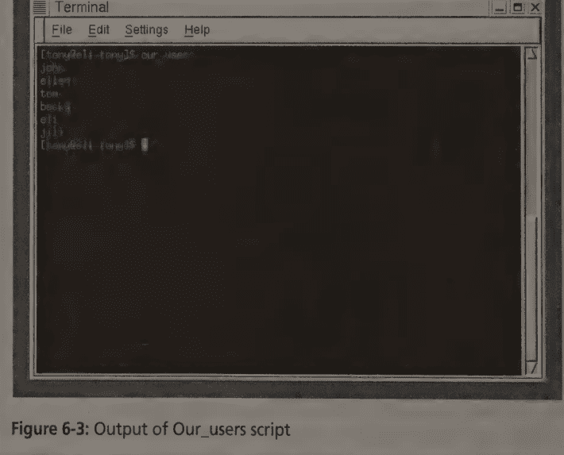

你在步骤 2 中输入的 *`for`* 语句指定变量 `USERS` 依次取值 `john`、`ellen`、`tom`、`becky`、`eli` 和 `jill`。由于集合中有六个值，循环将重复六次。每次重复时，`USERS` 包含集合中不同的值，并且位于 `do` 和 `done` 语句之间的语句会被执行。集合中的第一个值是 `john`，因此 `echo` 语句第一次执行时 `USERS` 中存储的是 `john`。这就是为什么 `john` 出现在屏幕上的原因。循环第二次执行时，`USERS` 包含 `ellen`，因此 `echo` 语句显示 `ellen`。此过程会重复，直到集合中不再有名字为止。

#### 在命令行执行控制结构

大多数 shell 脚本控制结构，如 `if` 和 `for` 语句，必须跨多行编写。然而，这并不妨碍你直接在命令行上执行它们。

要演示在命令行输入程序控制结构：
- 输入以下内容。请注意，你是直接从命令行输入，而不是输入到脚本文件中。
```
$ for myhobbies in tennis swimming movies travel <Enter>
> do <Enter>
> echo $myhobbies <Enter>
> done <Enter>
```

输入完成后，你会看到类似图 6-4 的结果。

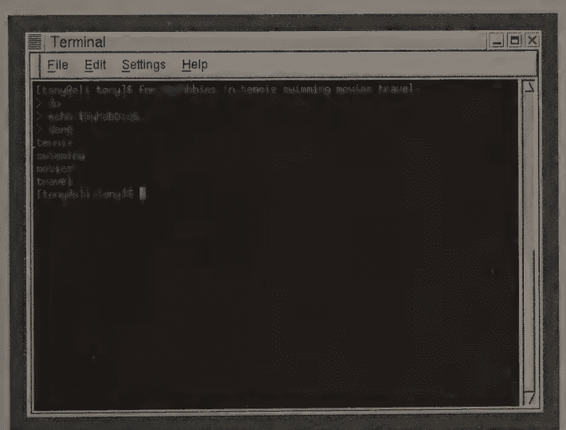

**图 6-4：** 在命令行输入的 for 循环结果

当你输入第一行后，shell 知道还有更多代码将会跟随。它会显示 `>` 提示符，表示它准备好接受控制结构的后续部分。shell 会继续读取后续输入行，直到你输入单词“`done`”，这标志着 `for` 循环的结束。

#### 在循环中使用通配符

现在你可以看到，当想要打印书籍的几章时，`for` 语句如何与通配符一起工作。

**要创建测试数据并在 for 循环中使用通配符：**

1. 输入 `cat > chap1` 并按 **Enter**。
2. 输入 `This is chapter 1` 并按 **Enter**。
3. 输入 **Ctrl+D**。文件 `chap1` 被创建。
4. 输入 `cat > chap2` 并按 **Enter**。
5. 输入 `This is chapter 2` 并按 **Enter**。
6. 输入 **Ctrl+D**。文件 `chap2` 被创建。
7. 输入 `cat > chap3` 并按 **Enter**。
8. 输入 `This is chapter 3`，并按 **Enter**。
9. 输入 **Ctrl+D**。文件 `chap3` 被创建。
10. 使用 `vi` 或 `Emacs` 编辑器创建 shell 程序，`chapters`。该程序应包含这些行：
```
for file in chap[123]; do
    more $file
done
```
11. 保存文件并退出编辑器。
12. 授予文件执行权限，并测试它。你会看到类似图 6-5 的输出。

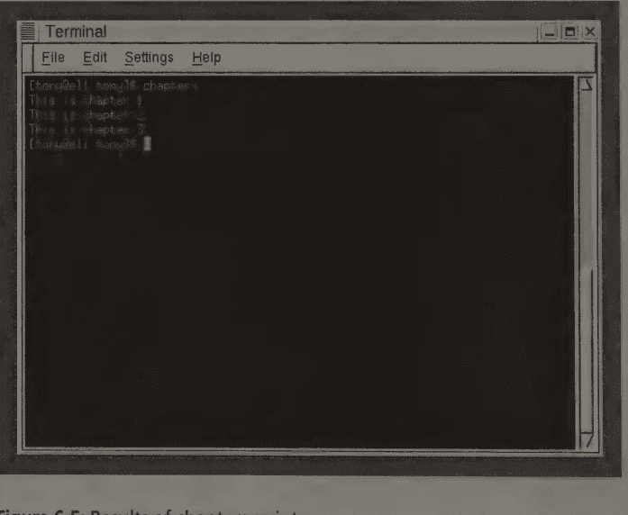

#### While 循环

使用**`while`**语句可以创建另一种循环模式。**`while`** 语句最能说明如何设置一个循环来反复测试匹配的条件。

**要使用 while 语句：**

1. 使用 `vi` 或 `Emacs` 编辑器创建一个 shell 脚本，`colors`。
2. 脚本应包含这些行：
```
echo -n "Try to guess my favorite color "
read guess
while [ "$guess" != "red" ]; do
    echo "No, not that one. Try again. "; read guess
done
```
3. 保存文件并退出编辑器。
4. 授予文件执行权限，并测试它。你会看到类似图 6-6 的输出。

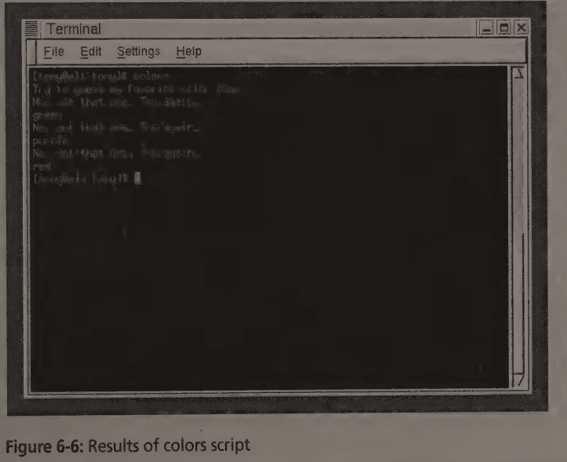

`while` 循环测试表达式的方式与 `if` 语句类似。只要方括号内的语句为真，`do` 和 `done` 语句内部的语句就会重复执行。

注意 `!=` 符号的使用，它是不相等运算符。它测试两个操作数，如果它们不相等则返回真。否则，它返回假。在你刚刚完成的步骤中，循环内的 `echo` 和 `read` 语句会重复执行，直到用户输入 `red`。

`while` 循环的另一个例子是在数据录入表单中。

**要输入一个将作为数据录入表单的 while 循环：**

1. 使用 `vi` 或 `Emacs` 创建一个脚本文件，`namedaddr`。
2. 在文件中输入这些行：
```
looptest=y
  while [ "$looptest" = y ]
    do
      echo -n "Enter Name : "; read name
      echo -n "Enter Street : "; read street
      echo -n "Enter City : "; read city
      echo -n "Enter State : "; read state
      echo -n "Enter Zip Code: "; read zip
      echo -n "Continue? (y)es or (n)o "; read looptest
    done
```
3. 保存文件并退出编辑器。
4. 授予文件执行权限，并测试它。你会看到类似图 6-7 的输出。


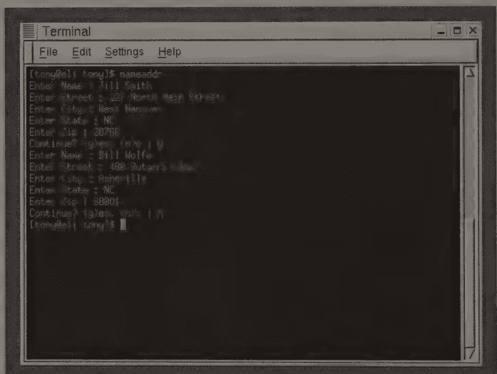

图 6-7：namedaddr 脚本的输出

在测试程序时，输入几个姓名和地址。完成后，当程序询问“Continue? (y)es or (n)o.”时，输入 `n`（代表 no）。在需要重复执行代码的应用程序中使用循环逻辑，无论重复次数是确定的还是不确定的。

### Case 逻辑

`case` 逻辑结构简化了当你有一系列选择时匹配的选择过程。它允许你的程序根据变量的值执行多个操作中的一个。注意使用两个分号（`;;`）来终止 `case` 匹配到测试值后采取的操作。

**要演示 `case` 逻辑：**

1. 使用 `vi` 或 `Emacs` 编辑器创建 `manycolors` shell 脚本。

2. 在文件中输入这些行：

```bash
echo -n "Enter your favorite color: "; read color
case $color in
"blue")   echo "As in My Blue Heaven.";;
"yellow") echo "As in the Yellow Sunset.";;
"red")    echo "As in Red Rover, Red Rover.";;
"orange") echo "Autumn has shades of Orange.";;
*         ) echo "Sorry, I do not know that color.";;
esac
```

3. 保存文件并退出编辑器。

4. 授予文件执行权限，并测试它。你会看到类似图 6-8 所示的输出。

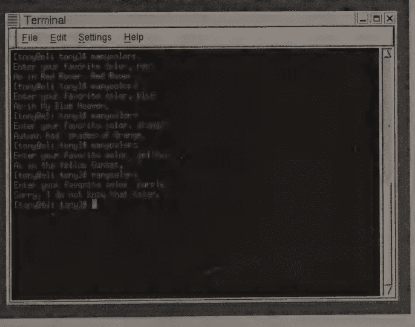

图 6-8：manycolors 脚本的输出

在 Manycolors 脚本中，`case` 结构会检查 `color` 变量的内容，并在列出的值中查找匹配项。当找到匹配项时，紧跟在 `case` 值后面的语句将被执行。例如，如果 `color` 变量包含 `red`，那么出现在 `"red")` 之后的 `echo` 语句将会被执行。如果 `color` 变量的内容与列出的任何值都不匹配，那么出现在 `*)` 之后的语句将会被执行。

正如你所见，`case` 逻辑旨在根据变量的内容从众多行动方案中选择一种。这种控制结构非常适合用于菜单，因为用户可以从中选择多个值中的一个。

注意：`case` 结构由单词 `esac` 终止，它是 `case` 的倒序拼写。

在本节中，你学习了 shell 变量、运算符和通配符。你还学习了四种逻辑结构。在下一节中，你将使用 shell 编程来创建你的应用程序。

## 总结

- 高级语言（如 C、C++ 或 COBOL）是使用类英语表达式的语言。高级语言必须先转换为低级（机器）语言，然后计算机才能执行它。
- Shell 解释 UNIX shell 脚本。它们不需要转换为机器语言，因为 UNIX 会一步完成转换和执行。
- 使用 `vi` 或 `Emacs` 编辑器创建的 UNIX shell 脚本包含不需要从零开始编写的指令，而是可以从操作系统的可执行命令库中选择性获取。
- Linux shell 衍生自 UNIX 的 Bourne、Korn 和 C shell。这三种 Linux shell 分别是 `Bash`、`tcsh` 和 `zsh`；其中 `Bash` 是最常用的 Linux shell。
- UNIX 维护三种类型的变量：配置变量、环境变量和 shell 变量。配置变量包含操作系统的设置信息。环境变量保存关于登录会话的信息。Shell 变量是在 shell 脚本或命令行中创建的。`export` 命令用于将 shell 变量设为环境变量。
- Shell 支持许多运算符，包括许多用于执行算术运算的运算符。
- 你可以在 shell 脚本中使用通配符，包括括号 `[]` 字符。括号包围着一组值，这些值可以匹配名称或字符串中的单个字符。
- Shell 支持的逻辑结构包括顺序结构、决策结构、循环结构和 `case` 结构。

### 复习题

1. Shell 程序 ______________________。
   - a. 开发速度比编译程序快
   - b. 运行速度比其编译后的对应程序慢
   - c. 可作为出色的原型
   - d. 以上所有

2. 配置变量和环境变量之间的区别是什么？
   - a. 用户设置配置变量。
   - b. 系统设置环境变量。
   - c. 系统设置配置变量。
   - d. 用户绝不应更改环境变量。

3. 以下哪个命令可以保护文件不被覆盖？
   - a. `set -o noclobber`
   - b. `chmod 777 *filename*`
   - c. `set -o clobber`
   - d. `set !*filename*`

4. 四种基本逻辑结构是 ______________________。
   - a. 顺序、决策、循环和 `case`
   - b. 顺序、迭代、循环和 `case`
   - c. 决策、迭代、`case` 和 `if-then`
   - d. `for`、`next`、`while` 和 `if`

5. 以下哪个命令将 `date` 命令的输出存储到变量 `MYDATE` 中？
   - a. `MYDATE=date`
   - b. `date > MYDATE`
   - c. `MYDATE=`date``
   - d. `date | MYDATE`

6. 程序开发周期可以描述为 ______________________。
   - a. 程序设计、程序规格说明、编写代码、测试和调试
   - b. 程序规格说明、程序设计、编写代码、测试和调试
   - c. 编写代码、测试和调试、程序设计、程序规格说明
   - d. 程序设计、编写代码、测试和调试、程序规格说明

7. ______________________ 命令显示环境变量列表。
   - a. `printenv`
   - b. `envs`
   - c. `ls-env`
   - d. `cat envs`

8. ______________________ 命令将变量设为环境变量。
   - a. `send`
   - b. `port`
   - c. `export`
   - d. `import`

9. 顺序逻辑可以描述为 ______________________。
   - a. 一种仅当特定条件存在时执行一条或一组语句的逻辑结构
   - b. 一种按书写顺序执行一系列语句的逻辑结构
   - c. 一种重复执行一条或一系列语句的逻辑结构
   - d. 一种根据变量值执行多种行动中其中一种的逻辑结构

10. 决策逻辑可以描述为 ______________________。
    - a. 一种仅当特定条件存在时执行一条或一组语句的逻辑结构
    - b. 一种按书写顺序执行一系列语句的逻辑结构
    - c. 一种重复执行一条或一系列语句的逻辑结构
    - d. 一种根据变量值执行多种行动中其中一种的逻辑结构

11. 循环逻辑可以描述为 ______________________。
    - a. 一种仅当特定条件存在时执行一条或一组语句的逻辑结构
    - b. 一种按书写顺序执行一系列语句的逻辑结构
    - c. 一种重复执行一条或一系列语句的逻辑结构
    - d. 一种根据变量值执行多种行动中其中一种的逻辑结构

12. `Case` 逻辑可以描述为 ______________________。
    - a. 一种仅当特定条件存在时执行一条或一组语句的逻辑结构
    - b. 一种按书写顺序执行一系列语句的逻辑结构
    - c. 一种重复执行一条或一系列语句的逻辑结构
    - d. 一种根据变量值执行多种行动中其中一种的逻辑结构

13. ______________________ 命令将用户的输入存储到变量中。
    - a. `input`
    - b. `get`
    - c. `read`
    - d. `import`

14. Shell 程序是 ______________________。
    - a. 编译的
    - b. 解释的
    - c. 既编译又解释的
    - d. 既非编译也非解释的

### 练习

1. 使用以下条目创建文件 `alphalist`：
    Alpha_romeo
    Chevrolet
    Buick
    Plymouth
    Dodge
    BMW

2. 对 `alphalist` 文件进行排序，并将其通过管道传给 `cat` 程序以显示汽车编号列表。

3. 在你的主目录中创建一个新文件 `myfile`。
   - a. 使用 `set -o noclobber`。创建第二个文件 `mynewfile`。
   - b. 输入此命令：`cat mynewfile > myfile` <Enter>。


- c. 解释发生了什么。
- d. 现在修改重定向以使其工作。

4. 修复这行代码以使其工作：

```bash
echo “Why don’t you get a “van down by the river?”
```

5. 如果你的主目录中没有 `bin` 目录，请创建一个。查看 `PATH` 变量的内容。如果它不包含指向你的 `bin` 目录的路径，请添加它。

6. 创建一个变量 `NAME`。将你的全名存储在其中。

7. 使用 `printenv` 命令显示环境变量列表。`NAME` 变量是否列在其中？执行使 `NAME` 成为环境变量的命令。

### 探索练习

1. 使用示例菜单作为指南，创建一个像下面这样的新菜单程序：

Travel Menu

==========

(L)ondon scenic tour

(P)aris in the Spring

(N)ew York Shopping Fantasy

Make your selection ... (Q) to quit

2. 输入命令将 `pwd` 命令的输出存储到变量 `PLACE` 中。在屏幕上显示 `PLACE` 变量的内容。

3. 编写一个名为 `change_prompt` 的脚本。该脚本应更改你的提示符以显示日期和你工作目录的名称。赋予文件执行权限，并对其进行测试。

4. 执行以下每个命令：

`let X=2+4*3`

`Y=2+4*3`

在屏幕上显示每个变量的内容。你如何解释它们之间的差异？

5. 编写一个脚本文件，执行以下步骤：

- 将 5 存储在变量 `A` 中
- 将 10 存储在变量 `B` 中
- 将 `A` 加 `B` 的和存储在变量 `C` 中
- 将 `B` 减 `A` 的差存储在变量 `D` 中
- 将 `A` 乘 `B` 的积存储在变量 `E` 中
- 将 `B` 除以 `A` 的商存储在变量 `F` 中
- 显示所有变量的内容

6. 编写一个脚本，询问用户输入其名字。该脚本应包含一个 `if` 语句，将用户输入的名字与你的名字进行比较。如果它们相同，脚本应显示消息：“这也是我的名字。” 否则，它应显示消息：“这是一个好名字。”

7. 编写一个带有 `for` 循环的脚本文件，显示你最喜欢的音乐组合列表。

8. 重复发现练习 7，但这次在命令行中输入 `for` 循环。

9. 编写一个脚本文件，让用户猜你的名字。如果他们猜错了，脚本应让他们重新猜。重复此过程，直到用户正确猜出你的名字。（提示：使用 `while` 循环。）

10. 编写一个脚本文件，要求用户从以下列表中选择一个国家并输入其名称：America, Italy, France, Germany。然后，脚本使用 `case` 结构显示在所选国家制造的汽车名称。使用下表列出的汽车。

| 国家 | 汽车 |
| :--- | :--- |
| 美国 | Ford |
| 意大利 | Ferrari |
| 法国 | Peugeot |
| 德国 | Porsche |

## 课程 B

### 目标

在本课程中，你将：

- 创建屏幕管理和光标程序
- 编辑 `.bashrc` 文件以自定义你的个人工作环境
- 使用 `trap` 命令
- 输入和测试 shell 程序，打印电话记录，查看 `Corp_phones` 文件的内容，并添加新的电话记录到文件中

### 创建和完善公司电话应用程序

### 使用 Shell 编程创建菜单

在创建公司电话程序之前，你先创建一个菜单，这是采用四种基本逻辑结构（顺序、决策、循环和案例）的 shell 程序的一个良好示例。菜单程序的一个显著特性是屏幕呈现，你希望它尽可能具有吸引力且用户友好。你可以选择 UNIX 较少人知的命令之一 `tput`，使屏幕将提示符（光标）放置在屏幕上的用户数据输入点。`tput` 命令初始化终端以响应用户选择的设置。此命令的一些示例包括：

- `tput cup 0 0`：将光标移动到第 0 行、第 0 列，即屏幕的左上角
- `tput clear`：清屏
- `tput cols`：打印当前终端的列数
- `bold=`'tput smso'` offbold=`'tput rmso'`：设置粗体类型

**练习 `tput` 命令：**

- 输入以下命令序列，并按下 **Enter**：

```
tput clear ; tput cup 10 15 ; echo "Hello" ; tput cup 20 0
```

你会看到命令序列的结果。屏幕被清除：光标位于屏幕的第 10 行、第 15 列；单词“Hello”被打印；并且提示符的位置位于第 20 行、第 0 列。

接下来，使用 `tput` 命令创建一个光标实用程序。你可以在其他脚本文件中使用此实用程序来定位屏幕上的光标。

**使用 `tput` 命令创建光标实用程序：**

1. 使用 `vi` 或 `Emacs` 编辑器创建一个脚本文件 `cursor`。
2. 在程序中输入以下行：

```
tput cup $1 $2
```

3. 保存文件并退出编辑器。
4. 使用 `chmod` 命令使 `cursor` 脚本可执行。
5. 通过输入 **cursor 10 12** 并按下 **Enter** 来测试 `cursor` 脚本。光标移动到屏幕上的位置 10, 12。

注意脚本将 `$1` 和 `$2` 作为参数传递给 `tput cup` 命令。这些是位置参数：它们引用在执行 `cursor` 脚本文件时在命令行上键入的参数字。例如，当你使用命令 `cursor 10 12` 调用脚本时，`$1` 参数保存值 10，`$2` 参数保存值 12。

现在你将使用 `tput` 命令创建用于显示菜单和数据输入屏幕的屏幕管理和光标程序。

**使用 `tput` 命令：**

1. 使用 `vi` 或 `Emacs` 编辑器输入包含以下行的屏幕管理程序 `Scrmange`：

```
tput cup $1 $2    # 将光标放置在行和列上
tput clear        # 清除屏幕
bold=`tput smso`  # 设置突出模式 - 粗体
offbold=`tput rmso` # 重置屏幕 - 关闭粗体
echo $bold        # 开启粗体
cursor 10 20; echo "Type Last Name:" # 粗体标题
cursor 12 20; echo "Type First Name:" # 粗体标题
echo $offbold     # 关闭粗体
cursor 10 41; read lastname  # 输入姓氏
cursor 12 41; read firstname # 输入名字
```

2. 保存文件并退出编辑器。
3. 赋予文件执行权限，并对其进行测试。

现在你准备好输入显示菜单的脚本了。（你将在本节稍后使用该程序作为你应用程序的一部分。）

**输入脚本：**

1. 使用 `vi` 或 `Emacs` 编辑器输入下面所示的 `Phmenu` 程序。

```bash
#==============================================
# 脚本名称：phmenu
# 作者：         JQD（在此处填写你的首字母）
# 日期：       1999年11月
# 目的：    公司电话列表菜单
# 命令行： phmenu
#==============================================

loop=y
while [ "$loop" = y ]
do
    clear
    cursor 3 12; echo "Corporate Phone Reporting Menu"
    cursor 4 12; echo "==============================="
    cursor 6 9; echo "P - 打印电话列表    :"
    cursor 7 9; echo "A - 添加新电话      :"
    cursor 8 9; echo "S - 搜索电话 :"
    cursor 10 9; echo "Q - 退出"
    cursor 11 32;
    read choice || continue
done
```

2. 保存文件并退出编辑器。
3. 赋予文件执行权限，并测试该程序。（你将不得不按 **Ctrl+C** 退出程序，因为“退出”选项尚未编程。）

现在你对如何创建菜单程序有了想法，在学习额外的 shell 特性和命令之前创建你的应用程序会很有帮助。你将首先学习如何自定义你的个人环境，以便创建和测试新程序不会干扰你的其他程序。

### 自定义你的个人环境

当你的工作要求以计算机编程和 shell 脚本为中心时，考虑通过修改登录脚本中的初始设置来自定义你的环境。例如，许多程序员设置一个个人 `bin` 目录，他们可以在其中存储和测试新程序，而不会干扰正在运行的操作。（“bin”是保存可执行文件的目录的传统 UNIX 名称。）你还可以修改编辑器，使它们根据程序员用法自动缩进程序内部的文本。


**别名**是代表另一个命令的名称。你可以使用别名来简化和自动化你经常使用的命令。例如，以下命令为 `rm` 命令设置了一个别名。

```
alias rm="rm -i"
```

上面的命令导致每当用户输入 `rm` 命令时执行 `rm -i` 命令。这是一个常用的别名，因为它确保用户在 `rm` 命令删除文件之前始终得到提示。这里是另外两个帮助保护文件的常见别名：

```
alias mv="mv -i"
alias cp="cp -i"
```


位于你的主目录中的 **.bashrc** 文件可用于建立对每个登录会话有效的自定义设置。每次你生成一个 shell（例如运行 shell 脚本时）时，都会执行 `.bashrc` 脚本。每当创建子 shell 时，`.bashrc` 会被重新执行。下面的 `.bashrc` 文件带有注释，解释你可以如何做出自己的更改。

```
.bashrc
# 源全局定义
if [ -f /etc/bashrc ]; then
. /etc/bashrc # 如果定义了任何全局定义
# 先运行它们
alias rm 'rm -i' # 确保在删除文件之前
# 提示用户
alias mv 'mv -i' # 确保在覆盖文件之前
# 提示用户
set -o ignoreeof # 不允许 Ctrl-D 注销
set -o noclobber # 强制用户输入 >! 以写入
# 覆盖现有文件
PS1="\\w \\$" # 设置提示符以显示工作目录
```

除了知道如何自定义你的工作环境外，你还应该熟悉 `trap` 命令。

### trap 命令

`trap` 命令在您希望 shell 程序在 shell 脚本运行时自动删除任何临时文件时非常有用。**trap** 命令指定当 shell 收到指定的系统信号时，作为 trap 参数列出的命令会被读取并执行。以下是该命令的一个示例：

```shell
trap "rm ~/tmp/* 2> /dev/null; exit" 0
```

此命令有两个参数：一个要执行的命令和一个来自操作系统的信号编号。该命令 `rm ~/tmp/* 2>/dev/null; exit` 会删除用户 `tmp` 目录中的所有内容，将 `rm` 命令的错误输出重定向到空设备（因此它不会出现在屏幕上），并发出一条退出命令以终止 shell。指定的信号是 `0`，这是操作系统在程序退出时生成的信号。因此，如果此示例命令是脚本文件的一部分，当操作系统发送信号 `0` 时，它会触发指定的 `rm` 命令执行。

程序员通常设置 `~/tmp`（用户主目录的一个子目录）来存储临时文件。当脚本文件退出时，放置在 `~/tmp` 中的任何文件都可以被删除。这对程序员来说被称为“良好的例行维护”。

### 创建 Corp_phones 文件

以下步骤要求您创建 `corp_phones` 文件并将其放置在您的 `~/source` 目录中。

**创建 corp_phones 文件：**

1. 使用 `vi` 或 `Emacs` 编辑器创建 `corp_phones` 文件。

2. 在文件中输入以下记录：

```text
219-555-4567:Harrison:Joel:M:4540:Accountant:09-12-1985
219-555-4587:Mitchell:Barbara:C:4541:Admin Asst:12-14-1995
219-555-4589:Olson:Timothy:H:4544:Supervisor:06-30-1983
219-555-4591:Moore:Sarah:H:4500:Dept Manager:08-01-1978
219-555-4567:Polk:John:S:4520:Accountant:09-22-1998
219-555-4501:Robinson:Albert:J:4501:Secretary:08-12-1997
```

3. 保存文件并退出编辑器。

4. 使用以下 `grep` 命令搜索文件中的特定电话号码。

```bash
grep 219-555-4591 corp_phones
```

输出应如下所示：

```text
219-555-4591:Moore:Sarah:H:4500:Dept Manager:08-01-1978
```

5. 使用类似的 `grep` 命令搜索文件中的所有会计师。您的屏幕应类似于图 6-9。

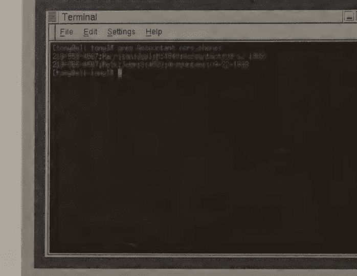

请注意，您可以使用 `grep` 以及前几章中学习的其他命令从 `corp_phones` 文件中提取信息。您将在构建脚本应用程序时使用这些命令。现在，您将完成在本课开始时启动的菜单程序。

#### 完成电话菜单程序：

1. 使用 `vi` 或 `Emacs` 编辑器，并获取 `phmenu`。向脚本中添加加粗的行。

```bash
#=============================================
# Script Name: phmenu
# By: JQD
# Date: March 1999
# Purpose: A menu for the Corporate Phone List
# Command Line: phmenu
#=============================================
phonefile=~/source/corp_phones
loop=y
while [ "$loop" = y ]
do
   clear
   cursor 3 12; echo "Corporate Phone Reporting Menu"
   cursor 4 12; echo "==============================="
   cursor 6 9; echo "P - Print Phone List :"
   cursor 7 9; echo "A - Add Phone to List :"
   cursor 8 9; echo "S - Search for Phone :"
   cursor 10 9; echo "Q - Quit"
   cursor 11 32
   read choice || continue
   case $choice in
       [Aa]) phoneadd ;;
       [Pp]) phlist1 ;;
       [Ss]) phonefind ;;
       [Vv]) less $phonefile;;
       [Qq]) exit ;;
       *) cursor 14 4; echo "Invalid Code"; read choice ;;
   esac
done
```

2. 保存文件并退出编辑器。

3. 赋予文件执行权限，并对其进行测试。

当您向 Dominion Consulting 的管理员演示您的程序时，他们指出在输入额外信息时可能会发生一些错误。为了快速定位错误，您需要查看未格式化的记录。

### 查看未格式化的记录

拥有一个显示未格式化文件数据的程序通常很有用，这意味着记录按其在磁盘上存储的方式原样显示。就电话记录而言，显示会显示分隔变长字段的冒号 (`:`) 字符。如果出现任何问题，查看原始数据会非常方便。为此，您使用 `less` 命令在屏幕上显示记录。

**使用 `less` 命令查看未格式化的记录：**

1. 在您选择的编辑器中打开 `Phmenu`，并添加所示的加粗行。


```bash
#====================================================
# Script Name:  phmenu
# By:           JQD
# Date:         March 1999
# Purpose:      A menu for the Corporate Phone List
# Command Line: phmenu
#====================================================
phonefile=~/source/corp_phones
loop=y
while [ "$loop" = y ]
do
   clear
   cursor 3 12; echo "Corporate Phone Reporting Menu"
   cursor 4 12; echo "============================="
   cursor 6 9; echo "P - Print Phone List  :"
   cursor 7 9; echo "A - Add Phone to List :"
   cursor 8 9; echo "S - Search for Phone  :"
   cursor 9 9; echo "V - View Phone List   :"
   cursor 10 9; echo "Q - Quit"
   cursor 11 32;
   read choice || continue
   case $choice in
      [Aa]) phoneadd ;;
      [Pp]) phlist1 ;;
      [Ss]) phonefind ;;
      [Vv]) less $phonefile ;;
      [Qq]) exit ;;
      *) cursor 14 4; echo "Invalid Code"; read choice ;;
   esac
done
```

2. 保存文件并退出编辑器。

3. 测试该脚本。

现在您已准备好运行程序的原型。为此，您使用 `Awk` 程序。

### 使用 Awk

`Awk` 程序提供了 UNIX shell 程序员如何快速创建应用程序模型的一个良好示例。使用 `Awk` 可以加速开发，因为单个 `awk` 命令可以从许多记录中选择字段，并以指定格式在屏幕上显示它们。要运行您的公司电话程序的原型，请将您之前编写的 `cursor` 程序与一行 `Awk` 代码结合使用。

**使用 Awk 程序：**

1. 使用您选择的编辑器创建 `Phlist1` 程序。使用以下代码作为参考。

```bash
# ===============================================
# Script Name:    phlist1
# By:             JQD
# Date:           March 1999
# Purpose: Use awk to format colon-separated fields
#                in a flat file and display to the screen
# Command line: phlist1
# =====================================================
clear
cursor 2 20; echo "Corporate Phone List"
cursor 3 20; echo "========================="
# cursor 5 0;
awk -F':' { printf "%-12s %-12s %s\t%s %s %10.10s %s\n",
       $2, $3, $4, $1, $5, $6, $7 } < corp_phones
```

*注意：OCR 文本显示为 `-F','`，但根据前文描述的冒号分隔数据格式，意图应该是使用 `-F':'` 进行冒号分隔。然而，严格遵循 OCR 文本，该文本显示为 `-F','`，我将保留找到的文本，但需注意标准 awk 处理 CSV 文件时使用逗号。查看数据 `219-555-4567:Harrison...`，分隔符显然是冒号。OCR 很可能将 `'` `:` `'` 误读为 `','` 或类似字符。在此上下文中，这是一个语义错误，我将将其更正为 `':'`。*

```bash
# 基于数据结构进行更正：
awk -F':' { printf "%-12s %-12s %s\t%s %s %10.10s %s\n",
       $2, $3, $4, $1, $5, $6, $7 } < corp_phones
```

2. 保存文件并退出编辑器。

3. 赋予文件执行权限并运行它。您的屏幕应类似于图 6-10。

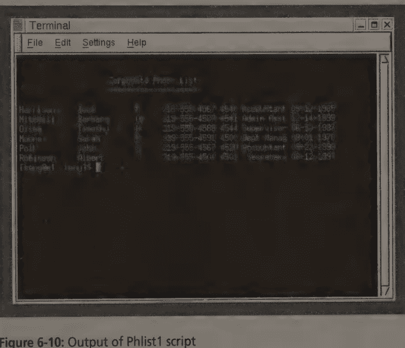

您意识到名字将被添加到 `corp_phones` 文件中，因此您需要修改您的 shell 脚本。

### 创建 Phoneadd Shell 程序

`Phmenu` 程序提供了向 `corp_phones` 文件添加电话记录的选项；也就是说，用户与程序交互以输入新员工的电话记录。为此，您可以使用 `cursor` 程序，类似于您之前编写的那个，来设计您的数据输入屏幕，显示它，并将光标放置在第一个数据输入字段中。随后您可以将其定位到其他所有输入项。

**创建 `phoneadd` 程序以允许添加：**

1. 使用您选择的编辑器创建脚本 `phoneadd`。输入此代码：


```bash
# ==========================================================
# Script Name: phoneadd
# By: JQD
# Date: March 1999
# Purpose: A shell script that sets up a loop to add new employees to the Corp_phones file.
# Command Syntax: phoneadd
#
# ==========================================================
trap "rm ~/tmp/* 2> /dev/null; exit" 0 1 2 3
phonefile=~/source/corp_phones
looptest=y
while [ $looptest = y ]
do
    clear
    cursor 1 4; echo "Corporate Phone List Additions"
    cursor 2 4; echo "============================="
    cursor 5 4; echo "Last Name : "
    cursor 6 4; echo "First Name : "
    cursor 7 4; echo "Middle Init : "
    cursor 8 4; echo "Dept # : "
    cursor 9 4; echo "Job Title : "
    cursor 10 4; echo "Date Hired : "
    cursor 12 4; echo "Add Another? (Y)es or (Q)uit "
    cursor 4 18; read phonenum
    if [ "$phonenum" = 'q' ]
    then
        { clear; exit }
    fi
    cursor 5 18; read lname
    cursor 6 18; read fname
    cursor 7 18; read midget
    cursor 8 18; read deptno
    cursor 9 18; read jobtitle
    cursor 10 18; read datehired
    # 检查姓氏是否为非空后再写入磁盘
    if [ "$lname" > "    "]
    then
        echo "$phonenum:$lname:$fname:$midget:$deptno:$jobtitle:$datehired" >> $phonefile
```

cursor 12 33; read looptest

if [ "$looptest" = 'q' ]

then { clear; exit; }

done
```

2. 保存文件并退出编辑器。授予文件执行权限并运行它。通过添加以下员工来测试程序：

`219-555-7175 Mullins Allen L 7527 Sales Rep 09-12-2000`

`219-555-7176 Albertson Jeannette K 5547 DC Clerk 09-12-2000`

3. 现在运行 `phmenu` 脚本，并从菜单中选择 A 以执行电话脚本。向文件中添加另一条记录，然后退出程序。

您的屏幕应类似于图 6-11 所示。（请注意，该程序一次只显示一个人的信息。）

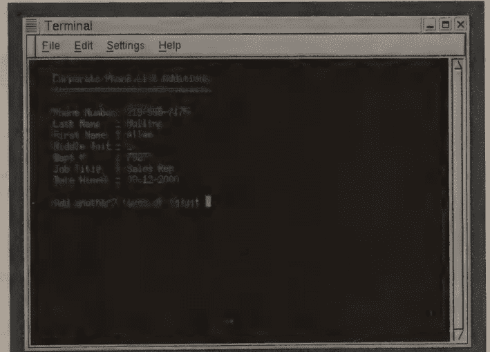

**图 6-11**：Phoneadd 脚本屏幕

您已创建了公司电话应用程序的 shell 脚本。然而，您仍需解决几个缺陷。例如，在输入数据时如何返回到之前的字段？如果同一名员工被输入两次会发生什么？如果您将已分配给其他人的电话号码分配给新员工会发生什么？第 7 章“高级 Shell 编程”将讨论这些问题。

### 摘要

- 您可以使用 `tput` 命令创建简单的光标定位程序，以增强数据输入功能。
- 您可以定制位于用户主目录中的 `.bashrc` 文件，以适应程序员和系统管理员的需求。
- 您可以创建别名并将其写入 `.bashrc`，以简化常用命令，如 `ls -l` 和 `rm -i`。
- 在脚本文件内部使用 `trap` 命令，以便在脚本文件运行（退出）后删除临时文件。
- `grep` 命令在 shell 程序开发中起着关键作用，因为它允许您从文件中搜索和检索信息。
- `Awk` 程序是生成报告的有效且易用的工具。

### 命令摘要

### 第 6 章命令

| 命令 | 用途 |
| :--- | :--- |
| `alias` | 建立一个别名 |
| `case…in…esac` | 一种编程结构，允许根据变量的值执行一组可能操作中的某一个 |
| `export` | 将变量变为环境变量 |
| `for; do…done` | 使变量依次取一组值中的每个值。针对每个值执行一个操作。 |
| `if…then…else…fi` | 根据条件执行两个操作中的一个 |
| `let` | 将算术值存储在变量中 |
| `printenv` | 打印环境变量列表 |
| `set -o noclobber` | 防止文件被 `>` 运算符覆盖 |
| `tput cup` | 将屏幕光标移动到指定的行和列 |
| `tput clear` | 清屏 |
| `tput cols` | 打印当前终端的列数 |
| `tput smso` | 启用粗体输出 |
| `tput rmso` | 禁用粗体输出 |
| `trap` | 当从操作系统接收到指定信号时执行命令 |
| `while; do...done` | 当条件存在时重复执行一个操作 |

### 复习题

1. UNIX 别名是 ______________________。
   - a. 一个替代标准 UNIX 命令名称的名称
   - b. UNIX 命令的替代名称
   - c. 总是输入到系统范围的初始化文件 `/etc/profile` 中
   - d. 最好每次登录时都在命令行上输入

2. 使用 `trap` 命令来 ______________________。
   - a. 检测错误
   - b. 监控系统信号并采取某些行动
   - c. 过滤掉坏数据
   - d. 分离出损坏的信息

3. 下列哪一项会将当前目录放入 `PATH` 变量中？
   - a. `PATH="$PATH:~/"`
   - b. `PATH="$PATH:."`
   - c. `PATH="$PATH:/home"`
   - d. `PATH="$PATH:;"`

4. 您可以使用 `tput` 命令来 ______________________。
   - a. 向屏幕添加数据
   - b. 定位屏幕上的光标
   - c. 将字符放入内存
   - d. 从键盘接受一个字符

5. 您可以使用 `grep` 命令来 ______________________。
   - a. 在文件中搜索匹配的模式
   - b. 更改文件中的文本
   - c. 创建数学公式
   - d. 创建用方括号 [ ] 包围的单词模式

6. 脚本程序可以通过 ______________________ 访问传递给它的参数。
   - a. 位置参数，如 `$1`、`$2` 等
   - b. 变量 `$ARG1`、`$ARG2` 等
   - c. `argument` 命令
   - d. `script_param` 命令

7. 许多程序员在他们的主目录中创建一个目录，用于存储可执行程序。这个目录的传统名称是 .
   - a. `programs`
   - b. `executables`
   - c. `prg`
   - d. `bin`

8. 每次登录时都会执行的文件是 .
   - a. `.login`
   - b. `autoexec`
   - c. `.bashrc`
   - d. `.welcome`

9. 命令 `tput cup` 在命令行后跟随 .
   - a. 单词“clear”
   - b. 后续屏幕输出的行号和列号
   - c. 使后续屏幕输出变旧的代码
   - d. 禁用粗体输出的代码

10. 程序员通常会设置一个目录来保存临时文件。这个目录的传统名称是 .
    - a. `temporary`
    - b. `temp`


- c. `etc`

- d. `tmp`

11. `tput cols` 命令 .

   - a. 将光标定位在指定列

   - b. 将终端设置为指定列数

   - c. 打印当前终端可用的列数

   - d. 启用粗体打印

12. `tput smso` 命令 .

   - a. 启用粗体打印

   - b. 禁用粗体打印

   - c. 定位光标

   - d. 清屏

13. `tput rmso` 命令 .

   - a. 启用粗体打印

   - b. 禁用粗体打印

   - c. 定位光标

   - d. 清屏

### 练习

1. 从命令行发出一个命令，执行以下步骤：清屏；将光标定位在第 5 行第 30 列；显示您的姓名；并将光标定位在第 20 行第 0 列。

2. 创建别名 `w`，以执行命令：`who—Hi`

3. 将您在练习 2 中创建的别名存储在正确的文件中，以便每次登录时都生效。

4. 修改 `Phlist1` 程序，以便在查看文件时，在显示的字段上方添加标题，例如：

   Last Name First Name MI Phone Number Dept# Title Date Hired

   ============================================================

### 探索练习

1. 从 `Phoneadd` 程序的屏幕中移除冒号字符，并重新定位光标，以改善数据输入的外观。

2. 设计并编写一个更小版本的菜单程序。

3. 创建一个小型 shell 程序，显示员工电话记录，只显示其姓名和受聘日期。

4. 创建一个脚本文件，清屏，在第 5 行第 10 列和第 6 行第 12 列放置两行高亮（粗体）文本。在第 8 行第 10 列和第 10 行第 10 列显示另外两行非粗体文本。

5. 创建一个文件 `music`，其中包含您的 CD 收藏信息。文件中的每条记录应包含以下字段：

   - 艺术家姓名

   - CD 名称

   - 购买日期

   - 费用

6. 接下来，创建一个带有菜单的脚本文件，让您查看文件内容、搜索特定艺术家的所有 CD，并向文件中添加新记录。

7. 设计一个 `Awk` 语句，用于格式化并显示 `music` 文件中的记录。

8. 描述如何使用 `trap` 命令在脚本文件退出时显示消息“那就全剧终了”（That’s all folks）。


# 第 7 章

## 高级 Shell 编程

**案例** ► Dominion 咨询公司的经理们对维护员工电话文件的新 shell 程序感到满意。基于相对较小的交易量及文件大小，编程主管同意该 shell 程序将是维护公司电话文件的永久解决方案。然而，您需要增强该程序并 incorporates 新功能，例如防止同一个电话号码被分配给多于一个人、重新输入数据以更正错误，以及按员工姓氏排序。

## 课程 A

### 目标

在本课程中，您将：

- 使用流程图和伪代码工具

- 学习编写告知系统使用哪个 shell 作为解释器的脚本

- 使用 `test` 命令比较值并验证文件是否存在

- 使用 `translate` 命令 `tr` 显示带有重复字段的记录

- 使用 `sed` 命令删除一条电话记录

# 开发功能完善的程序

在上一章中，您开始开发一个程序，以自动维护 `corp_phones` 文件中的电话记录。您开发了一个菜单，提供几个选项，以及一个数据输入屏幕，允许向文件中添加记录。

在本章中，您将完成该程序。您添加代码以从文件中删除指定记录、搜索指定记录，并对文件中的所有记录进行排序和显示。您使用 `test`、`grep`、`sed` 和 `tr` 命令执行这些任务。在开始添加此代码之前，您将学习两种标准的程序开发工具：流程图和伪代码。

## 分析程序

计算机程序通过分析实现期望结果的最佳方式来开发。标准的编程分析工具可以帮助您完成这项工作。最流行且经过验证的两种分析工具是程序流程图和伪代码。

### 流程图

流程图是一种逻辑图，使用一组标准符号来解释程序的序列及其执行的每个操作。例如，查看图 7-1 中的流程图。

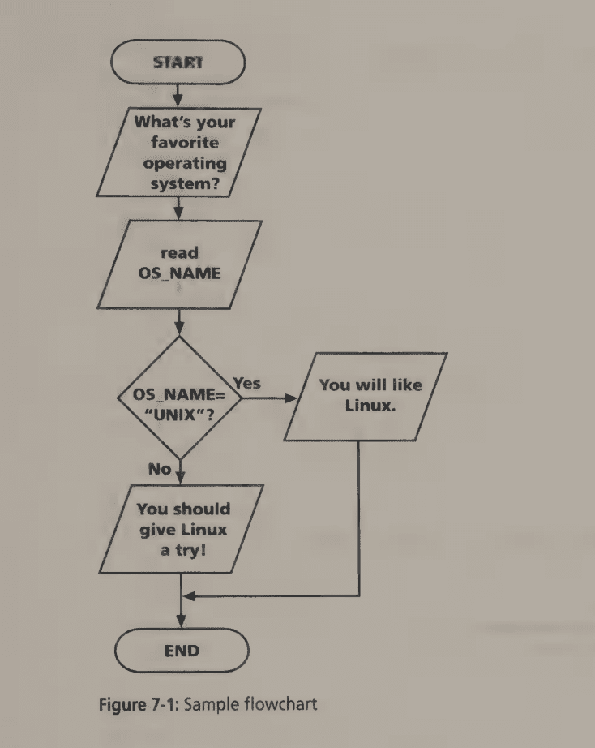

图 7-1：示例流程图

图 7-1 是以下程序的流程图，这是你在第 6 章中编写的程序。

```sh
echo -n "What is your favorite operating system? "
read OS_NAME
if [ "$OS_NAME" = "UNIX" ]
then
    echo "You will like Linux."
else
    echo "You should give Linux a try!"
fi
```

程序中的每个步骤都由流程图中的一个符号表示。符号的形状表明正在执行的操作类型，例如输入/输出或决策。图 7-2 展示了标准的流程图符号及其含义。

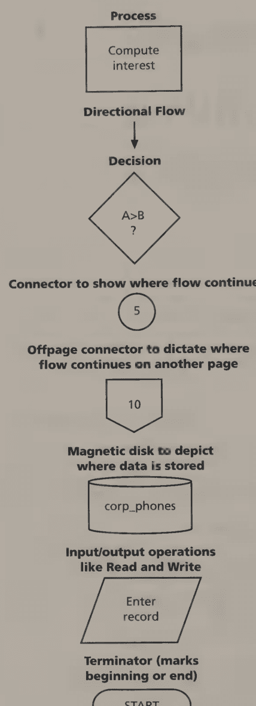

**图 7-2：** 标准流程图符号

连接符号的箭头代表程序从一个符号流向下一个符号的方向。在图 7-1 的流程图中，START 终止符后的箭头显示程序流向一个输出操作，该操作显示消息：“你最喜欢的操作系统是什么？”。接下来，程序流向一个输入操作，该操作读取一个值并赋值给 `OS_NAME`。接着会遇到一个决策结构（由菱形符号表示），它将 `OS_NAME` 与 “UNIX” 进行比较，以确定两者是否相等。如果相等，程序将遵循“是”分支。这将导致一个输出操作，显示消息：“你会喜欢 Linux。” 如果 `OS_NAME` 和 “UNIX” 不相等，程序将遵循“否”分支。这将导致一个输出操作，显示消息：“你应该尝试一下 Linux！” 然后两条路径汇合，流向 END 终止符。

您使用绘图模板手动创建流程图。流程图模板提供了表示逻辑结构、输入/输出操作、处理操作以及包含文件的存储介质的符号。（参见图 7-2。）各种流程图软件包允许您在计算机上创建流程图。流行的文字处理包，如 Microsoft Word 和 WordPerfect，也配备了流程图工具。

### 编写伪代码

创建流程图后，设计程序的下一步是编写伪代码。伪代码指令与实际编程语句类似。使用它们创建一个模型，随后可以将其作为实际程序的基础。例如，以下是 `os_choice` 程序的伪代码语句：

```
Display "What is your favorite operating system? " on the screen.
Enter data into OS_NAME.
If OS_NAME is equal to "UNIX"
then
Display "You will like Linux." on the screen.
Else
Display "You should give Linux a try!" on the screen.
End if.
```

伪代码仅是一种设计工具，永远不会被计算机处理。因此，没有严格的规则需要遵守。伪代码在口头表达上应与流程图中展示的符号化逻辑表示相匹配。例如，图 7-3 展示了代表 Dominion Consulting 希望在其电话程序中做出的更改（在字段中重新输入数据）的流程图和伪代码。

然而，在开始处理该程序之前，你需要做一些初步工作。首先，你必须确保每个运行该程序的人都在使用正确的 shell。为此，修改程序以便向操作系统告知在解释脚本中的语句时使用哪个 shell。

```
Pseudocode:

While entry = minus
do
    Reposition cursor in previous field.
    Enter the data.
    Reposition cursor on field following the field that was
    just entered (re-entered data)
    Continue testing while loop.
Done
```

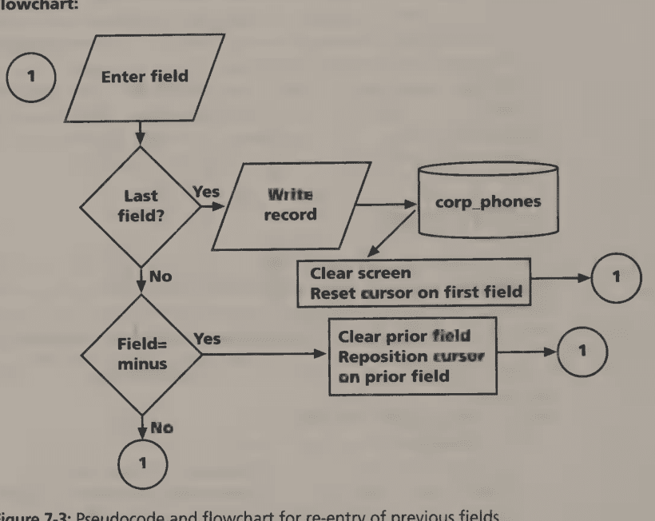

#### 确保正确的 Shell 运行脚本

每个 UNIX 用户都有选择和选择其偏好的 shell 的自由和能力。在开发 shell 脚本时，你必须负责确保使用正确的 shell 来解释你的脚本。这是因为并非所有 shell 都支持相同的命令和编程语句。

你可以指示系统使用特定的 shell 运行脚本。你在脚本的第一行这样做。该行必须以 `#` 字符开头，后跟 `!` 字符和 shell 的路径。例如，这行代码告诉系统使用 Bash shell：

```
#!/bin/bash
```

当系统读取此代码行时，它会加载 Bash shell 并使用它来解释脚本文件中的语句。由于 UNIX 包含许多 shell，你应始终以此语句开始你的脚本。


接下来，你需要确保在执行依赖于它们的程序之前，必要的目录和文件已经就位。为此，请使用 `test` 命令。

### 使用 test 命令

`test` 命令对 UNIX 内部环境进行初步检查以及其他有用的比较（超越了 `if` 命令单独能执行的那些）。有关 `test` 命令可用选项的描述，请参见附录 B “UNIX 命令语法指南”。你可以将 `test` 命令放入你的 shell 脚本中，或直接从命令行执行。在本节中，你将学习在命令行上使用 `test` 命令。在下一节中，你将在脚本文件中使用它。

`test` 命令使用作为选项表达的操作符来执行评估。该命令可用于：

- 执行整数的关系测试（如相等、大于、小于等）
- 测试字符串
- 确定文件是否存在以及它是哪种类型的文件
- 执行布尔测试

每类测试操作在以下章节中都有更详细的讨论。

### 使用 test 命令进行整数关系测试

`test` 命令可以确定一个整数是等于、大于、小于、大于或等于、小于或等于、或不等于另一个整数。表 7-1 描述了 `test` 命令的整数测试选项。

表 7-1：`test` 命令的整数测试选项

| 选项 | 含义 | 示例命令 |
| --- | --- | --- |
| `-eq` | 等于 | `test a -eq b` |
| `-gt` | 大于 | `test a -gt b` |
| `-lt` | 小于 | `test a -lt b` |
| `-ge` | 大于或等于 | `test a -ge b` |
| `-le` | 小于或等于 | `test a -le b` |
| `-ne` | 不等于 | `test a -ne b` |

`test` 命令返回一个称为退出状态的值。**退出状态**是命令完成时返回给操作系统的数值。`test` 命令退出状态的值表示测试的结果。如果退出状态为 0（零），则测试结果是真的。退出状态为 1 表示测试结果是假的。

退出状态通常由脚本中的 *if* 语句或循环结构检测到。你可以通过输入以下命令查看最后一条命令的退出状态：

```
echo $?
```

为了演示使用整数表达式的 `test` 命令：

1. 输入命令 `number=20` 并按 **Enter**，创建值为 20 的变量 `number`。
2. 输入 `test $number -eq 20` 并按 **Enter**。
3. 输入 `echo $?` 并按 **Enter**。你的屏幕看起来与图 7-4 相似。

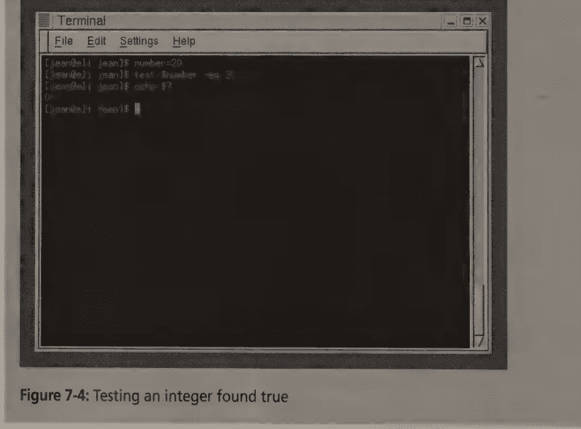

`echo $?` 命令显示最后一条执行的命令的退出状态。在此示例中，`test` 命令返回退出状态 0，表明表达式 `$number -eq 20` 是真的。这意味着 `$number` 等于 20。

4. 输入 `value=10` 并按 Enter。
5. 输入 `test $number -lt $value` 并按 Enter。
6. 输入 `echo $?` 并按 Enter。你的屏幕看起来与图 7-5 相似。


在此示例中，`test` 命令返回退出状态 1，表明表达式 `$number -lt $value` 是假的。这意味着 `$number` 不小于 `$value`。

### 使用 test 命令进行字符串测试

你可以使用 `test` 命令来确定字符串长度是否为零字符或非零字符。它还可以测试两个字符串以确定它们是相等还是不相等。表 7-2 描述了 `test` 命令的字符串测试选项。

### test 命令的字符串测试选项

| 选项或表达式 | 含义 | 示例 |
| :--- | :--- | :--- |
| `-z` | 测试字符串长度是否为零 | `test -z string` |
| `-n` | 测试字符串长度是否非零 | `test -n string` |
| `string1 = string2` | 测试两个字符串是否相等 | `test string1 = string2` |
| `string1 != string2` | 测试两个字符串是否不相等 | `test string1 != string2` |
| `string` | 测试字符串长度是否非零 | `test string` |

**表 7-2：test 命令的字符串测试选项**

为了演示 `test` 命令的字符串测试功能：

- 1. 输入 `name="Bjorn"` 并按下 Enter。
- 2. 输入 `test $name = "Bjorn"` 并按下 Enter。
- 3. 输入 `echo $?` 并按下 Enter。您的屏幕看起来与图 7-6 类似。


在上面的示例中，`test` 命令返回退出状态 0，表示表达式 `$name = "Bjorn"` 为真。这意味着 `$name` 和 `"Bjorn"` 相等。

- 4. 输入 `test $name != "Barn"` 并按下 Enter。
- 5. 输入 `echo $?` 并按下 Enter。您的屏幕看起来与图 7-7 类似。


**图 7-7：测试不相等的字符串**

在上面的示例中，`test` 命令返回退出状态 0，表示表达式 `$name != "Barn"` 为真。这意味着 `$name` 和 `"Barn"` 不相等。

- 6. 输入 `test -z $name` 并按下 Enter。
- 7. 输入 `echo $?` 并按下 Enter。您的屏幕看起来与图 7-8 类似。


**图 7-8：测试结果为假的字符串**

上面示例中的最后一个 `test` 命令返回退出状态 1，表示表达式 `-z $name` 为假。这意味着字符串 `$name` 的长度不为零。

### 使用 test 命令测试文件

`test` 命令可以判断文件是否存在，以及是否具有指定的权限或属性（如可执行、可读、可写、目录等）。表 7-3 描述了该命令的几个文件测试选项。

| 选项 | 含义 | 示例 |
| :--- | :--- | :--- |
| `-e` | 如果文件存在，则为真 | `test -e file` |
| `-r` | 如果文件存在且可读，则为真 | `test -r file` |
| `-w` | 如果文件存在且可写，则为真 | `test -w file` |
| `-x` | 如果文件存在且可执行，则为真 | `test -x file` |
| `-d` | 如果文件存在且为目录，则为真 | `test -d file` |
| `-f` | 测试文件是否存在且为常规文件 | `test -f file` |
| `-s` | 如果文件存在且大小大于零，则为真 | `test -s file` |
| `-c` | 测试文件是否存在且为字符特殊文件（即面向字符的设备，如终端或打印机） | `test -c file` |
| `-b` | 测试文件是否存在且为块特殊文件（即面向块的设备，如磁盘或磁带驱动器） | `test -b file` |

**表 7-3：test 命令的文件测试选项**

为了演示 `test` 命令的文件测试功能：

- 1. 使用 `touch` 命令创建一个名为 `test_file` 的空文件。
- 2. 使用 `ls -l test_file` 命令查看文件的权限。您的屏幕应看起来与图 7-9 类似。
- 3. 注意该文件对您（所有者）具有读和写权限。然后输入 `test -x test_file` 并按下 Enter。


- 4. 输入 `echo $?` 并按下 Enter。您的屏幕看起来与图 7-10 类似。


`test` 命令返回退出状态 1，因为 `test_file` 不可执行。

- 5. 输入 `test -r test_file` 并按下 Enter。
- 6. 输入 `echo $?` 并按下 Enter。您的屏幕看起来与图 7-11 类似。


`test` 命令返回退出状态 0，表示 `test_file` 可读。

### 使用 test 命令执行布尔测试

`test` 命令的布尔运算符允许您以 AND（与）和 OR（或）关系组合多个表达式。您还可以使用布尔否定运算符。表 7-4 描述了布尔运算符。

| 选项 | 含义 | 示例 |
| :--- | :--- | :--- |
| `-a` | 逻辑与 | `test expression1 -a expression2` |
| `-o` | 逻辑或 | `test expression1 -o expression2` |


| `!` | 逻辑否定 | `test !expression` |

## 表 7-4：`test` 命令的布尔运算符

`-a` 运算符将两个表达式组合起来，并测试它们之间的逻辑与关系。使用 `-a` 选项的 `test` 命令形式为：

```
test expression1 -a expression2
```

如果 `expression1` 和 `expression2` 都为真，则 `test` 命令返回真（退出状态为 0）。但是，如果 `expression1` 或 `expression2` 中任意一个为假，则 `test` 命令返回假（退出状态为 1）。

`-o` 运算符也组合两个表达式。它测试逻辑或关系。使用 `-o` 选项的 `test` 命令形式为：

```
test expression1 -o expression2
```

如果 `expression1` 或 `expression2` 中任意一个为真，则 `test` 命令返回真（退出状态为 0）。但是，如果两个表达式都为假，则 `test` 命令返回假（退出状态为 1）。

`!` 运算符否定表达式的值。这意味着如果表达式通常导致 `test` 返回真，则它反而返回假。同样，如果表达式通常导致 `test` 返回假，则它反而返回真。使用 `!` 运算符的 `test` 命令形式为：

```
test !expression
```

为了演示 `test` 命令的布尔运算符：

- 1. 回想您在上一练习中创建的 `test_file` 文件具有读和写权限。输入 `test -r test_file -a -w test_file` 并按下 Enter。

此命令使用 AND（与）关系测试两个表达式：`-r test_file` 和 `-w test_file`。如果两个表达式都为真，则 `test` 命令返回真。

- 2. 输入 `echo $?` 并按下 Enter。您的屏幕看起来与图 7-12 类似。


**图 7-12：使用布尔运算符测试文件**

`test` 命令返回退出状态 0，表示 `test_file` 可读且可写。

- 3. 输入 `test -x test_file -o -r test_file` 并按下 Enter。

此命令使用 OR（或）关系测试两个表达式：`-x test_file` 和 `-r test_file`。如果这两个表达式中任意一个为真，则 `test` 命令返回真。

- 4. 输入 `echo $?` 并按下 Enter。您的屏幕看起来与图 7-13 类似。


**图 7-13：使用 OR 运算符进行测试**

`test` 命令返回退出状态 0，表示 `test_file` 是可执行的 OR 可读的。

- 5. 输入 `test ! -r test_file` 并按下 Enter。

此命令否定表达式 `-r test_file` 的结果。如果表达式为真，则 `test` 命令返回假。同样，如果表达式为假，则 `test` 命令返回真。

- 6. 输入 `echo $?` 并按下 Enter。您的屏幕看起来与图 7-14 类似。


**图 7-14：使用否定运算符进行测试**

`test` 命令返回退出状态 1，表示表达式 `! -r test_file` 为假。

接下来，您使用 `test` 命令来确定某个目录是否存在。这可以让您正确设置环境，以运行您在课程 B 中完成的 shell 脚本。在下个练习中，您将确定主目录中是否有 `source` 目录。如果没有，您将创建一个并将其添加到 `PATH` 变量中。这使您可以运行存储在该处的脚本文件，而无需在文件名前输入 `./`。

为了确定某个目录是否存在：

- 1. 输入 `test -d source ; echo $?` 并按下 Enter。此命令确定 `source` 是否存在以及它是否为目录。由于 `echo $?` 命令包含在同一行中，按下 Enter 后退出状态会立即显示。如果退出状态为 0，则您已经拥有 `source` 目录。如果情况如此，请跳至步骤 3。否则，请继续步骤 2。

- 2. 如果您在步骤 1 中输入的命令导致退出状态为 1，则您必须创建 `~/source` 目录。输入 `mkdir source` 并按下 Enter。

- 3. 在第 6 章中，您创建了文件 `corp_phones` 和 shell 脚本 `phmenu` 和 `phoneadd`。通过输入 `test -e corp_phones ; echo $?` 并按 Enter 来确定您是否拥有 `corp_phones` 文件。如果您看到退出状态 0，则文件存在。

4. 对 `phmenu`、`phoneadd` 和 `phlist1` 文件重复执行测试命令。在确认这些文件存在后，将它们复制到源目录。


> 如果您没有第 6 章中的文件，请咨询您的讲师或技术支持人员以获取帮助。

5. 如果您将 `/home/user-name/source`（其中 `user-name` 是您的登录名）目录永久添加到您的 `PATH` 变量中，它将在您每次登录时生效。您应该在您的 `.bash_profile` 文件中执行此操作。将该文件加载到 `vi` 编辑器中。您的屏幕看起来类似于图 7-15。


6. 将光标移动到以下内容的行：

```
PATH=$PATH:$HOME/bin
```

7. 键入 `i` 切换到插入模式。在该行的末尾键入 `:$HOME/source`（包含冒号）。

8. 按下 `Esc`，然后键入 `:wq` 并按下 `Enter` 保存文件并退出编辑器。

9. 要使新的 `PATH` 值生效，您必须注销然后重新登录。现在就执行此操作。

您已创建源目录并将其添加到您的 `PATH` 变量中。您可以将您的脚本文件存储在那里，只需在命令行键入它们的名称即可执行它们。在下一个练习中，您将验证 `corp_phones` 文件的存在。

### 验证文件的存在：

- 1. 通过键入 `cd ~/source` 然后按下 **Enter** 键，确保您位于您的源目录中。

- 2. 键入 `test -e corp_phones` 然后按下 **Enter**。

- 3. 键入 `echo $?` 然后按下 **Enter**。您的屏幕应显示“0”，这表示真状态。

若要查看假状态的演示，请对文件 `phone_corp`（该文件不存在）重复测试。

接下来您练习在脚本文件中使用 `test` 命令。再次回顾您在第 6 章中编写的 `os_choice` 脚本：

```
echo -n "What is your favorite operating system? "
read OS_NAME
if [ "$OS_NAME" = "UNIX" ]
then
    echo "You will like Linux."
else
    echo "You should give Linux a try!"
fi
```

在以下练习中，您将修改 `if` 语句以使用 `test` 命令。完成后，程序的运行与之前完全相同。

### 修改 if 语句以使用 test 命令：

- 1. 确保您位于您的主目录中。将 `os_choice` 文件加载到 `vi` 或 `Emacs` 中。

- 2. 修改以下内容的行：

`if [ "$OS_NAME" = "UNIX" ]`

使其读取为：

`if test $OS_NAME = "UNIX"`

- 3. 保存文件并退出编辑器。

- 4. 通过执行脚本来测试它。图 7-16 显示了程序的示例输出。


图 7-16：更新后的 `os_choice` 脚本输出

在下一个练习中，您修改一个 while 循环以使用 `test` 命令。

### 修改 while 循环以使用 test 命令：

- 1. 回顾您在第 6 章中编写的名为 `colors` 的脚本。它反复询问用户猜测其最喜欢的颜色，直到用户猜中颜色红色为止。

```bash
echo -n "Try to guess my favorite color "
read guess
while [ "$guess" != "red" ]; do
    echo "No, not that one. Try again. "; read guess
done
```

- 2. 将文件加载到 `vi` 或 `Emacs` 中。

- 3. 修改以下内容的行：

```bash
while [ "$guess" != "red" ]; do
```

使其读取为：

```bash
while test $guess != "red" ; do
```


- 4. 保存文件并退出编辑器。

测试脚本。图 7-17 显示了程序的示例输出。


到目前为止，您已从命令行和脚本文件内部使用了 `test` 命令。您还配置了您的主目录结构和您的 `PATH` 变量，以便您可以直接从源目录运行您的脚本文件。您的下一步是开始通过格式化记录输出来增强 `corp_phones` 程序。

### 格式化记录输出

要格式化记录输出，请使用 `translate` 实用工具。正如您在第 5 章中回忆的那样，`translate` 实用工具（`tr`）逐字符更改标准输入（您在键盘上键入的字符）。标准输入也可以使用 `<` 运算符重定向，使其来自文件而不是键盘。例如，以下命令将 `counters` 文件的内容作为输入发送到 `tr` 命令。它将小写字符转换为大写。

```
tr [a-z] [A-Z] < counters
```

通过使用 `|` 运算符，该命令在输入来自另一个 UNIX 命令输出的情况下也可以作为过滤器工作。例如，以下命令将 `cat` 命令的输出发送到 `tr`：

```
cat names | tr -s ":" " "
```

这个示例命令将 `names` 文件的内容发送到 `tr`。`tr` 实用工具将 `:` 字符的每次出现替换为空格。`tr` 实用工具的工作方式类似于 `sed` 命令，不同之处在于 `sed` 逐字符串更改标准输入字符串，而不是逐字符。

现在您使用 `tr` 实用工具将小写字符更改为 uppercase，以及将冒号字符替换为空格。

#### 使用 grep 和 tr 命令进行格式化：

- 1. 使用 `grep` 命令从 `corp_phones` 文件中检索匹配电话号码 `219-555-4501` 的记录，然后将输出通过管道传输到 `tr` 以将记录中的冒号字符替换为空格字符。键入以下命令，然后按下 `Enter`：

```
$ grep 219-555-4501 corp_phones | tr ':' ' '
```

您的屏幕看起来类似于图 7-18。


图 7-18：`grep` 和 `tr` 命令的输出

- 2. 通过键入以下命令然后按下 `Enter`，在 `corp_phones` 文件中将小写字符更改为 uppercase：

```
$ cat corp_phones | tr '[a-z]' '[A-Z]'
```

您的屏幕看起来类似于图 7-19。


图 7-19：`cat` 和 `tr` 命令的输出

要在 `corp_phones` 文件中搜索电话号码，您的程序可以使用类似于上述步骤中执行的技术。

### 为您的程序添加记录搜索功能：

- 1. `phmenu` 程序已经配备了当用户从菜单中选择 `S` 时调用脚本 `phonefind` 的功能。此命令指示程序搜索电话号码。使用 `vi` 或 `Emacs` 编辑器创建 `phonefind` 程序。键入所示的代码：

```
#!/bin/bash
### Script Name: phonefind
### By: TEG
### Date: November 2000
### Purpose: Searches for a specified record in the
### corp_phones file
phonefile=~/source/corp_phones
clear
cursor 5 1
echo "Enter phone number to search for: "
cursor 5 35
read number
echo
grep $number $phonefile | tr ':' ' '
echo
echo "Press ENTER to continue..."
read continue
```

- 2. 保存文件并退出编辑器。

- 3. 使用 `chmod` 命令使文件可执行，然后搜索号码 `219-555-7175` 来测试脚本。您的屏幕应看起来类似于图 7-20。


图 7-20：`phonefind` 脚本的输出

您已经格式化程序的记录输出；您的下一个任务是删除电话记录。

### 删除电话记录

在本节中，您复习 `sed` 命令。回忆第 5 章中提到的，`sed` 获取输入文件的内容并将作为选项和参数提供的操作应用于文件的内容。结果发送到标准输出设备。使用 `d`（删除）选项使用 `sed` 删除一条电话记录的一种简单方法。以下是所需步骤的伪代码表示：

- 输入电话号码
- 使用 `sed -d` 删除匹配的电话号码并输出到临时文件 `f`
- 确认接受
- 如果输出被接受，将临时文件 `f` 复制回 `corp_phones`（覆盖它）

现在您修改 `phmenu` 脚本以包含删除选项。

#### 通过编辑 phmenu 程序来删除电话记录：

**1** 确保您位于源目录中。使用 `vi` 或 `Emacs` 编辑器，检索修改后的 `phmenu` 程序并添加以粗体显示的代码。

```
#!/bin/bash
#===============================================================
# Script Name: phmenu
# By: JQD
# Date: November 1999
# Purpose: A menu for the Corporate Phone List
# Command Line: phmenu
#===============================================================
phonefile=~/source/corp_phones
loop="y"
while test $loop = "y"
do
  clear
  cursor 3 12; echo "Corporate Phone Reporting Menu"
  cursor 4 12; echo "================================="
  cursor 6 9; echo "V - View Phone List"
  cursor 7 9; echo "P - Print Phone List"
  cursor 8 9; echo "A - Add Phone to List"
  cursor 9 9; echo "S - Search for Phone"
  cursor 10 9; echo "D - Delete Phone"
  cursor 12 9; echo "Q - Quit"
```

```bash
cursor 12 32; read choice || continue
case $choice in
[Aa]) phoneadd ;;
[Pp]) phlist1 ;;
[Ss]) phonefind ;;
[Vv]) clear ; less $phonefile ;;
[Dd]) cursor 16 4; echo "Delete Phone Record"
cursor 17 4; echo "Phone:"
cursor 17 7; read number
cursor 18 4; echo "Accept? (y)es or (n)o"
cursor 18 26; read Accept
if test $Accept = "y"
then
sed /$number/d $phonefile > f
cp f $phonefile
rm f
fi
;;
[Qq]) clear; exit ;;
*) cursor 14 4; echo "Invalid Code"; read prompt ;;
esac
done
```

2. 保存文件并退出编辑器。稍后，当你测试该程序时，菜单外观将类似于图 7-21。


图 7-21：`phmenu` 脚本的输出

在删除记录之前，使用 `more` 命令显示文件内容。你的屏幕应类似于图 7-22。


图 7-22：`corp_phones` 文件的内容

运行 `phmenu` 程序，并通过删除电话号码 `219-555-4567` 来测试删除选项。图 7-23 展示了删除电话号码记录屏幕。


图 7-23：删除电话号码记录屏幕

5. 输入 `y` 以确认删除。

6. 在主菜单中，选择选项 `V` 以查看电话文件。你的屏幕外观类似于图 7-24。


注意，电话号码 `219-555-4567` 的记录已不在文件中。

在本节中，你开始修改 shell 电话程序以满足 Dominion Consulting 的需求。你为 `pmenu` 脚本添加了删除选项的代码。在下一节中，你将添加防止在文件中输入重复电话号码的代码。

### 摘要

- 两种最流行且经过验证的分析工具是程序流程图和伪代码。流程图是使用一组标准符号绘制的逻辑图，用于解释程序的流程以及应采取的操作。
- 伪代码是程序的模型。它以类似于自然语言的语句编写。
- 你可以使用脚本文件的第一行来告知操作系统在解释脚本时应使用哪种 shell。
- 你可以使用 `test` 命令来验证目录和文件的存在，以及比较数值和字符串值。你可以将其放在 shell 脚本内部，也可以直接从命令行执行它。
- `translate` 实用程序 (`tr`) 逐字符更改键盘输入的字符，并且当输入来自另一个 UNIX 命令的输出时，它也作为过滤器工作。标准输入也可以重定向，使其来自文件而不是键盘。
- `sed` 命令读取文件作为其输入，并输出文件修改后的内容。你指定选项并向 `sed` 传递参数以控制文件内容如何被修改。

### 复习题

1. 伪代码被编写以 ________________________。

    a. 指导程序员编写程序

    b. 帮助消除程序中遗漏必要指令的可能性

    c. 在口头语上匹配流程图中的符号表示

    d. 以上所有

2. 若要告知系统使用 Bash shell 来解释脚本，请在脚本文件的第一行使用此代码 ________________________。

    a. `!/bin/bash`

    b. `#/bin/bash`

    c. `#!/bin/bash`

    d. `#$ /bin/bash`

3. `test` 命令使用 ________________________ 选项运算符比较两个数值。

    a. `=`

    b. `string`

    c. `==`

    d. `-eq`

4. `test` 命令使用 ________________________ 选项运算符比较两个字符串值。

    a. `=`

    b. `string`

    c. `==`

    d. `-eq`

5. `test` 命令的 `-a` 选项是 ________________________ 运算符。

    a. 逻辑与

    b. 绝对值

    c. 测试隐藏文件

    d. 逻辑非

6. `test` 命令的 `-o` 选项是 _______________ 运算符。

    a. 逻辑与

    b. 逻辑或

    c. 覆盖

    d. 逻辑非

7. `tr` 命令 __________________________。

    a. 仅转换在键盘上输入的内容

    b. 像 `sed` 一样按行转换

    c. 按逐字符基础进行转换

    d. 仅转换源自文件内部的字符

8. 用于将电话记录更改为包含所有小写字符的 `tr` 命令是 ____________________。

    a. `tr upper lower corp_phones`

    b. `tr [a-z] [A-Z] corp_phones`

    c. `cat corp_phones | tr [a-z] [A-Z]`

    d. `tr [A-Z] [a-z] < corp_phones`

9. `test` 命令返回 _______________ 值以指示 TRUE，并返回 ____________________ 以指示 FALSE。

    a. `0`, `1`

    b. `1`, `0`

    c. `blank err`

    d. `OK`, `!OK`

10. 当你在命令行输入 _______________ 时，`test` 命令的返回值会出现。

    a. `echo $`

    b. `echo $?`

    c. `echo $-`

    d. `echo $.`

### 练习

1. 使用 `tr` 命令将电话记录文件转换为以连字符作为字段分隔符，而不是冒号 `(:)`。（请确保将转换后的记录保存到一个不同的文件中。）
2. 设置一个名为 `RHL` 的环境变量，其值为 `"Red Hat Linux"`，并使用 `test` 和 `echo $?` 命令来确定它是否与 `"Red Hat Linux"` 和 `"RED HAT LINUX"` 匹配。你如何判断哪一个匹配？
3. 设置一个名为 `NUMVAL` 的环境变量，其值为 `2000`，并使用 `test` 和 `echo $?` 命令来确定它是否与值 `2000` 匹配。那 `2020` 呢？你如何判断哪一个匹配？
4. 为测试你进行简单算术能力程序的流程图编写。该程序应显示两个需要相加的数字，并要求用户输入总和。如果给出正确答案，程序应祝贺用户。如果给出错误答案，程序应向用户显示正确答案。
5. 为你在练习 4 中创建的流程图程序编写伪代码。
6. 编写你在练习 4 中绘制作流程图并在练习 5 中开发伪代码的数学测试程序的实际代码。图 7-25 展示了程序屏幕输出的示例。


#### 图 7-25：数学测试程序

7. 使用 `vi` 或 `Emacs` 创建文件 `My_old_cars`。该文件应包含这些记录：

```
1948:Ford:sedan
1952:Chevrolet:coupe
1960:Ford:Mustang
1972:Chevrolet:Corvette
1977:Plymouth:Roadrunner
```

接下来，编写一个 shell 脚本，显示数据输入屏幕。该脚本应允许将额外的记录输入到文件中。

8. 编写一个 shell 脚本，显示 `My_old_cars` 文件中的所有记录。在输出显示之前，冒号应转换为空格。

### 发现练习

- 按姓氏对 `corp_phones` 文件进行排序，并将输出通过管道传递给 `tr` 命令以将所有字符转换为大写，并将输出存储在新文件 `Phoneupper` 中。
- 在你的源目录中创建一个名为 `Scripts` 的目录，并使用 `test` 命令验证该目录是否存在。
- 使用你选择的 `sed` 或 `tr` 命令，将 `corp_phones` 文件中所有出现的单词 `"Accountant"` 转换为单词 `"Bookkeeper"`。
- 用户认证程序：UNIX 将用户的登录名存储在一个名为 `USER` 的环境变量中。设计一个程序的流程图，询问用户他们是谁。他们的响应应与 `USER` 变量的内容进行比较。如果两个字符串不匹配，用户应被再次询问。此过程应重复，直到输入正确的用户名。
- 用户认证程序：为你在发现练习 4 中设计的流程图编写伪代码。
- 用户认证程序：为你在发现练习 4 中绘制流程图并在发现练习 5 中编写伪代码的程序编写实际代码。图 7-26 展示了程序输出的样本。


## 完成案例项目

在本课中，你将：

- 创建一个程序算法来解决一个问题
- 学习创建一个快速清屏技术
- 开发和测试一个程序，以便在数据输入期间重新输入字段
- 开发和测试一个程序，以消除重复记录
- 开发和测试一个程序，以从文件中删除记录
- 创建 shell 函数
- 在登录时从命令行自动加载 shell 函数

### 清屏

在你开始完成编程任务之前，你决定想要更快地清除屏幕。`clear` 命令是一个有用的内务实用程序，用于在出现新屏幕之前清除屏幕（这在 shell 脚本中经常发生），但你可以使用一种更快的方法。你可以将 `clear` 命令的输出存储在 shell 变量中。回想第 6 章中，通过用单引号包围命令，你可以将命令的输出存储在变量中。例如，此命令将 `date` 命令的输出存储在变量 `TODAY` 中：

```bash
TODAY=`date`
```

`clear` 命令的输出是一系列用于擦除屏幕内容的值。将这些值存储在变量中，然后在屏幕上回显变量的内容可以实现相同的效果，但速度大约快十倍。这是因为系统不需要定位和执行 `clear` 命令，就像执行 `clear` 命令时那样。

**通过设置 shell 变量来清屏：**

1. 通过输入以下命令，将 shell 变量 `CLEAR` 设置为 `clear` 命令的输出：

```bash
CLEAR=`clear`
export CLEAR
```

2. 在你的 shell 程序中使用你的新变量以进行快速清屏操作：

```bash
echo "$CLEAR"
```

3. 为了随时快速启用此功能，请将这两行代码放在您的 `.bashrc` 文件的末尾（或您的 shell 等效的登录初始化文件末尾）：

```bash
CLEAR='clear'
export CLEAR
```

4. 保存文件，退出，然后重新登录以激活登录脚本。


现在您已准备好完成第一个任务：更正条目。为此，您需要操作光标。

### 移动光标

第一个任务是让用户返回到之前输入过的字段，并在继续之前更正该字段中的数据。回想一下，在第 6 章中你创建了一个名为 `cursor` 的脚本。该脚本接受两个参数：屏幕上某个位置的行号和列号。然后，光标脚本使用 `tput` 命令将光标定位到指定位置。

当你向 `corp_phones` 文件添加记录时，你希望允许用户将光标返回到屏幕上的前一个字段。你决定使用减号字符 `-` 来发出此信号。如果用户输入减号并按下 Enter 键，光标将重新定位到屏幕上前一个字段的开头，如屏幕上所示。你将通过编辑已经创建的 `phoneadd` 程序（该程序为用户提供数据输入屏幕）来进行此更改。编辑该程序的第一步是创建一个程序算法。

### 创建程序算法

**算法**是一组产生期望结果的命令或指令序列。解决特定问题的算法通常是通过遵循流程图显示的逻辑以及伪代码中表达的执行该逻辑所需的条件来开发的。

以下是当用户输入减号 `-` 时，将光标重新定位到前一个字段的伪代码：

```
Read information into field2.
While field2 equals "-"
    Move cursor to position of previous field, field1.
    Clear current information displayed in field1.
    Read new information into field1.
    If field1 = "q"
        then
            Exit program.
End if.
Move cursor to position of field2.
Read information into field2.
End While.
```

对 `phoneadd` 程序的一个代码添加使用了重新输入字段的算法：

```bash
cursor 5 18; read lname
while test "$lname" = "-"
do cursor 4 18; echo ""
cursor 4 18; read phonenum
cursor 5 18; read lname
done
```

这段代码将姓氏读取到变量 `lname` 中。如果 `lname` 包含减号 `-`，光标将移动到包含电话号码的前一个字段。屏幕上显示的电话号码值被清除，并且一个新的值输入到 `phonenum` 中。然后光标移回姓氏字段，并输入姓氏。只要用户为姓氏输入减号，`while` 语句就会重复此过程。

注意：使用 `if` 语句代替 `while` 语句仅允许返回到前一个字段一次。相反，你需要一个循环，以便在用户为该字段输入减号时过程重复。

查看上面显示的 `while` 语句：

```bash
while test "$lname" = "-"
```

参数 `"$lname"` 被引号包围，以防止命令产生错误，以防用户仅输入 Enter 或多个单词作为姓氏。例如，如果用户为姓氏输入 `Smith Williams`，上述语句将被解释为：

```bash
while test "Smith Williams" = "-"
```

然而，如果语句中 `$lname` 周围没有引号，该语句将被解释为：

```bash
while test Smith Williams = "-"
```

此语句会导致错误消息，因为它向 `test` 命令传递了太多的参数。

现在你准备编辑 `phoneadd` 程序。你将字段重新输入算法添加到程序中将值读取到字段中的每个部分。

> **允许重新输入数据：**

1. 确保你位于源目录中。将 `Phoneadd` 程序加载到 `vi` 或 `Emacs` 编辑器中。

2. 将下面显示的加粗代码添加到程序中。请注意，修订后的代码还包括你新的、更快的屏幕清屏功能。它还修改了现有的 `if` 语句，使它们使用 `test` 命令。


```bash
#!/bin/bash
# ============================================================
# Script Name: phoneadd
# By:           JQD
# Date:         March 1999
# Purpose:      A shell script that sets up a loop to add
#               new employees to the phonelst file.
#               The code also prevents duplicate phone
#               numbers
#               from being assigned.
# Command Line: phoneadd
# ============================================================
trap "rm ~/tmp/* 2> /dev/null; exit" 0 1 2 3
phonefile=~/source/corp_phones
looptest="y"
while test "$looptest" = "y"
do
   clear
   cursor 1 4 ; echo "Corporate Phone List Additions"
   cursor 2 4 ; echo "=============================="
   cursor 4 4 ; echo "Phone Number:   "
   cursor 5 4 ; echo "Last Name    :   "
   cursor 6 4 ; echo "First Name   :   "
   cursor 7 4 ; echo "Middle Init  :   "
   cursor 8 4 ; echo "Dept #       :   "
   cursor 9 4 ; echo "Job Title    :   "
   cursor 10 4 ; echo "Date Hired   :   "
   cursor 12 4 ; echo "Add another? (y)es or (q)uit "
   cursor 4 18 ; read phonenum
   if test $phonenum = "q"
   then
      clear ; exit
   fi
   cursor 5 18 ; read lname
   while test "$lname" = "-"
   do
      cursor 4 18 ; echo "                    "
      cursor 4 18 ; read phonenum
      if test "$phonenum" = "q"
      then
         clear ; exit
      fi
      cursor 5 18 ; read lname
   done
   cursor 6 18 ; read fname
   while test "$fname" = "-"
   do
      cursor 5 18 ; echo "                "
      cursor 5 18 ; read lname
      if test "$lname" = "q"
      then
         clear ; exit
      fi
      cursor 6 18 ; read fname
   done
   cursor 7 18 ; read midinit
   while test "$midinit" = "-"
   do
      cursor 6 18 ; echo "                "
      cursor 6 18 ; read fname
      if test "$fname" = "q"
      then
         clear ; exit
      fi
      cursor 7 18 ; read midinit
   done
   cursor 8 18 ; read deptno
   while test "$deptno" = "-"
   do
      cursor 7 18 ; echo "                "
      cursor 7 18 ; read midinit
      if test "$midinit" = "q"
      then
         clear ; exit
      fi
      cursor 8 18 ; read deptno
   done
   cursor 9 18 ; read jobtitle
   while test "$jobtitle" = "-"
   do
      cursor 8 18 ; echo "                "
      cursor 8 18 ; read deptno
      if test "$deptno" = "q"
      then
         clear ; exit
      fi
      cursor 9 18 ; read jobtitle
   done
   cursor 10 18; read datehired
   while test "$datehired" = "-"
   do
      cursor 9 18 ; echo " "
      cursor 9 18 ; read jobtitle
      if test "$jobtitle" = "q"
      then
         clear ; exit
      fi
      cursor 10 18 ; read datehired
   done
   #Check to see if last name is not blank before you
   #write to disk
   if test "$lname" != ""
   then
      echo "$phonenum:$lname:$fname:$midinit:$deptno:$jobtitle:$datehired" >> $phonefile
   fi
   cursor 12 33 ; read looptest
   if test "$looptest" = "q"
   then
      clear ; exit
   fi
done
```

### 3. 保存文件并退出编辑器。

### 4. 执行 `phoneadd` 脚本。对于电话号码，输入 **219-555-4523** 并按下 **Enter** 键。你的屏幕类似于图 7-27。


### 5. 在 **Last Name**（姓氏）字段中，输入 **minus sign**（减号）字符 `(-)` 并按下 **Enter** 键。你的光标移回 **Phone Number**（电话号码）字段。你的屏幕看起来像图 7-28。


**Figure 7-28: Phoneadd screen ready for data re-entry**

### 6. 重新输入电话号码为 **219-555-4511**，并按下 **Enter** 键。

### 7. 使用下面显示的信息完成剩余的字段。随着光标移动到每个字段，通过输入 **minus sign**（减号）并按下 **Enter** 键来测试程序。光标每次都应该移动到前一个字段。

- **Last name: Brooks**（姓氏：Brooks）
- **First name: Sally**（名字：Sally）
- **Middle initial: H**（名首字母：H）
- **Department Number: 4540**（部门编号：4540）
- **Job Title: Programmer**（职位：程序员）
- **Date Hired: 11-23-1999**（入职日期：1999-11-23）

### 8. 输入完所有信息后，退出程序。使用 `cat` 命令显示 `corp_phones` 文件的内容。新记录应该出现。

你已完成第一个任务。现在你已准备好进行第二个任务：防止重复的电话号码。

## 防止输入重复电话号码

由于用户并不总是输入有效数据，程序应始终检查其输入，以确保用户输入了可接受的信息。这被称为**输入验证**。你的下一个任务是创建一个输入验证算法，防止用户添加已经分配的电话号码。实现此目的所使用的伪代码和流程图如所示，见图 7-29。

**伪代码：**


```
If phone number is already on file
    then
        display message on the screen "This number has already been assigned to:"
        display the person's record who has the duplicate number.
        Clear the screen and prepare for another entry
End if
```

**流程图：**


在以下步骤中，你将向 `phoneadd` 脚本添加输入验证代码。

### 为防止电话号码重复：

- 1. 确保你在源目录中。使用 `vi` 或 `Emacs` 加载 `phoneadd` 脚本。

- 2. 添加加粗部分的代码，以完成修订后的脚本。

```bash
#!/bin/bash
#==========================================
# Script Name:  phoneadd
# By:           JQD
# Date:         March 1999
# Purpose:      A shell script that sets up a loop to add
#               new employees to the phonelist file.
#
#               The code also prevents duplicate phone
#
#               numbers
#
#               from being assigned.
# Command Line:     phoneadd
# ===================================================
trap "rm -/tmp/* 2> /dev/null; exit" 0 1 2 3
phonefile=~/corp_phones
looptest=y
while test "$looptest" = "y"
do
	clear
	cursor 1 4 ; echo "Corporate Phone List Additions"
	cursor 2 4 ; echo "=============================="
	cursor 4 4 ; echo "Phone Number: "
	cursor 5 4 ; echo "Last Name    : "
	cursor 6 4 ; echo "First Name  : "
	cursor 7 4 ; echo "Middle Init : "
	cursor 8 4 ; echo "Dept #      : "
	cursor 9 4 ; echo "Job Title   : "
	cursor 10 4 ; echo "Date Hired  : "
	cursor 12 4 ; echo "Add another? (y)es or (q)uit "
	cursor 4 18; read phonenum
	if   test $phonenum = "q"
	then
		clear ; exit
	fi
```

```
# Check to see if the phone number already exists
while grep "$phonenum" $phonefile > /tmp/temp
do
    cursor 19 1 ; echo "This number has already been assigned to:"
    cursor 20 1 ; tr ':' ' ' < /tmp/temp
    cursor 21 1 ; echo "Press ENTER to continue..."
    read prompt
    cursor 4 18 ; echo "                    "
    cursor 4 18 ; read phonenum
done
    cursor 5 18 ; read lname
... The remainder of the program is unchanged.
```

- 3. 保存文件并退出编辑器。

- 4. 如果你尚未在主目录下创建 `tmp` 目录，请现在创建它。

- 5. 运行该程序。通过输入一个文件中已存在的电话号码（例如 `219-555-4587`）来测试它。你的屏幕应显示如图 7-30 所示。


- 6. 通过输入有效的电话号码来完成数据输入屏幕。

查看 `phoneadd` 程序后，你会发现它包含你可能希望用于其他程序的代码。为此，你可以使用 shell 函数。

### 使用 Shell 函数

一个 `shell 函数` 是一组存储在内存中并分配了名称的命令。Shell 脚本可以使用函数名来执行这些命令。你可以使用 shell 函数来隔离可重用的代码段，这样你就无需在整个程序中重复算法。例如，`phlist1` 脚本可以使用多个函数以多种方式对电话列表进行排序。

函数名与变量名不同，因为函数名后面跟着一对括号，且组成该函数的命令被包裹在花括号中。例如，看下面函数的代码：

```text
datenow()
{
date
}
```

该函数的名称是 `datenow`。它的花括号内只有一条命令：`date` 命令。当 `datenow` 函数被执行时，它会调用 `date` 命令。

函数通常存储在脚本文件中，并在你登录时加载到内存中。然而，你也可以在命令行中输入它们。

要声明简单的 `datenow` 函数：

- 1. 在命令行中，输入 `datenow()` 并按 `Enter`。注意提示符变为 `>` 符号。这表明 shell 正在等待你输入更多信息以完成你开始的命令。

- 2. 在 `>` 提示符处，输入 `{` 并按 `Enter`。

- 3. 在 `>` 提示符处，输入 `date` 并按 `Enter`。

- 4. 在 `>` 提示符处，输入 `}` 并按 `Enter`。正常提示符将返回。

- 5. 你创建了 `datenow` 函数并将其存储在 shell 的内存中。通过输入 `datenow` 并按 `Enter` 来调用它。你的屏幕看起来与图 7-31 类似。


图 7-31：`datenow` 函数的输出

参数传递给函数的方式与任何其他 shell 过程相同。函数使用位置变量 `$1` . . . `$9` 来访问参数。只需在命令名称后输入参数，并在每个参数之间放置一个空格。现在你重新定义 `datenow` 函数以使其接受一个参数。

**重新定义 `datenow` 函数以接受参数：**

- 1. 在命令行中，输入 `datenow()` 并按 `Enter`。你即将输入的命令将替换当前存储在 `datenow` 函数中的命令。

- 2. 在 `>` 提示符处，输入 `{` 并按 `Enter`。

- 3. 在 `>` 提示符处，输入 `echo "$1"` 并按 `Enter`。当函数运行时，此命令将显示传递到函数第一个参数中的信息。

- 4. 在 `>` 提示符处，输入 `date` 并按 `Enter`。

- 5. 在 `>` 提示符处，输入 `}` 并按 `Enter`。正常提示符将返回。

- 6. 通过输入 `datenow "Today is"` 并按 `Enter` 来测试该函数。你的屏幕看起来与图 7-32 类似。


图 7-32：修订后 `datenow` 函数的结果

你刚才完成的练习演示了函数通常是如何工作的。然而，在命令行中键入函数几乎没有生产力，因为你每次登录时都必须重新输入它们。现在你将学习如何使用 shell 函数来重用代码，并使你每次登录时都能使用这些函数。

### 重用代码

为了提高你的编程生产力，你应该学会重用你的代码。这意味着你开发的函数和程序应尽可能与其他程序和函数共享，从而有助于防止重复、节省时间并减少错误。当前 `phoneadd` 程序可以演示这种可重用函数的潜在用途。你可以创建几个不同的排序函数并将它们存储在内存中。然后，`phlist1` 脚本可以调用这些函数，以多种方式显示排序后的电话号码列表。

你可以将多个函数放在诸如 `.myfuncs` 之类的 shell 脚本中，并从你的 `.bash_profile` 登录脚本中执行它们，或者简单地从命令行运行 `.myfuncs`。这会将所有函数加载到内存中，就像你加载环境变量一样。

**在 shell 脚本中放置多个函数：**


# 使用 vi 或 Emacs 编辑器创建 `.myfuncs` 文件

1. 使用 `vi` 或 `Emacs` 编辑器在你的源目录内创建 `.myfuncs` 文件。

2. 输入以下函数的代码：

```bash
sort_name()
{
    sort +1 -t: corp_phones
}

sort_date()
{
    sort +6 -t: corp_phones
}

sort_dept()
{
    sort +4 -t: corp_phones
}
```

3. 保存文件并退出编辑器。

## 将 `.myfuncs` 文件加载到内存

你的下一个任务是将 `.myfuncs` 文件加载到内存中，以便其函数可以被执行。为此，输入一个点（`.`），后跟一个空格，再后跟包含函数的文件名称。

### 加载 `.myfuncs` 文件

1. 在命令行中，输入 `. myfuncs` 并按 Enter。屏幕上不会显示任何内容，但函数已被加载到内存中。

2. 测试一些函数。输入 `sort_name` 并按 Enter。你会看到按个人姓名排序的电话记录。

3. 输入 `sort_dept` 并按 Enter。你会看到按部门编号排序的电话记录。

你可以通过 `.bash_profile` 或 `.bashrc` 文件在登录时自动加载函数。这样，它们对于任何需要它们的 shell 脚本始终可用。

### 修改你的 `.bashrc` 文件以加载 `.myfuncs` 脚本

1. 将你的 `.bashrc` 文件加载到 `vi` 或 `Emacs` 编辑器中。

2. 在文件末尾，添加以下命令：

```bash
. ~/source/.myfuncs
```

3. 保存文件并退出编辑器。

4. 注销并重新登录以加载函数。

5. 测试 `sort_name`、`sort_dept` 以及其他函数。

你的最后一项任务是按员工姓氏排序显示电话号码列表。你可以通过使用存储在 `.myfuncs` 文件中的 `sort_name` 函数来实现这一点。

## 对电话列表进行排序

要对电话列表进行排序，请对 `phlist1` 进行少量修改，以加载函数，然后调用 `sort_name`，将排序后的输出重定向到一个临时文件。该排序后的临时文件将作为 `Awk` 程序的输入，用于显示记录。修改后的代码还将使用 `CLEAR` 变量。

要对电话列表进行排序：

1. 确保你在源目录中。使用 `vi` 或 `Emacs` 编辑器将代码添加到 `phlist1` 脚本中。添加和修改的部分以粗体显示。

```bash
#!/bin/bash
#==============================================================
# Script Name: phlist1
# By:      JQD
# Date:    March 1999
# Purpose:Use awk to format a colon-separated set of fields
#        in a flat file and display to the screen
# Command line:     bash phlist  <enter>
# ==============================================================
echo "$CLEAR"
cursor 2 20; echo "Corporate Phone List"
cursor 3 20; echo "==================="
cursor 5 0;
sort_name > sorted_phones
awk -F': ' '{ printf "%-12s %-12s %s\t%s%s$10.10s $s\n",
$2, $3, $4, $1, $5, $6, $7 }' sorted_phones

cursor 23 1; echo "Review"
cursor 23 8; read prompt
```

2. 此代码假设你已经修改了 `.bashrc` 文件，以便在登录时加载 `.myfuncs` 中的函数。保存文件并退出编辑器。

3. 通过输入 `phlist1` 并按回车键来测试文件。你的屏幕将与图 7-33 相似。观察完屏幕后按回车键。


**图 7-33：** 修改后的 plist1 脚本的输出

添加调用其他排序函数的代码将是本章末尾的一项练习。

在本章中，你学会了使用流程图和伪代码来规划算法和程序。你还学会了使用 `test` 命令创建复杂的决策表达式。你进一步掌握了使用 `grep`、`tr` 和 `sed` 命令格式化输出的技能。此外，你还学习了高级编程技术，例如在数据输入屏幕中将光标重新定位到之前的字段，以及创建 Shell 函数。

## 摘要

- 为了加快清屏速度，将 `clear` 命令序列赋值给 Shell 变量 `CLEAR`，该变量可以在你的登录脚本 `.bashrc` 中设置。由于每次执行时不需要在文件中查找序列，因此清屏速度更快。

- 算法是一组产生所需结果的指令或命令序列。遵循流程图和伪代码中表达的逻辑流程可以开发算法。

- Shell 函数可以通过隔离那些可以在该程序及其他程序中复用的代码来简化程序代码。

## 命令摘要

`test` 命令的选项和参数

| 选项 | 含义 | 示例命令 |
| :--- | :--- | :--- |
| `-eq` | 等于 | `test a -eq b` |
| `-gt` | 大于 | `test a -gt b` |
| `-lt` | 小于 | `test a -lt b` |
| `-ge` | 大于或等于 | `test a -ge b` |
| `-le` | 小于或等于 | `test a -le b` |
| `-ne` | 不等于 | `test a -ne b` |
| `-z` | 测试零长度字符串 | `test -z string` |
| `-n` | 测试非零长度字符串 | `test -n string` |
| `string1 = string2` | 测试两个字符串是否相等 | `test string1 = string2` |
| `string1 != string2` | 测试两个字符串是否不相等 | `test string1 != string2` |
| `string` | 测试非零长度字符串 | `test string` |
| `-e` | 如果文件存在则为真 | `test -e file` |
| `-r` | 如果文件存在且可读则为真 | `test -r file` |
| `-w` | 如果文件存在且可写则为真 | `test -w file` |
| `-x` | 如果文件存在且可执行则为真 | `test -x file` |
| `-d` | 如果文件存在且是目录则为真 | `test -d file` |
| `-f` | 测试文件是否存在且是常规文件 | `test -f file` |
| `-s` | 如果文件存在且大小大于零则为真 | `test -s file` |
| `-c` | 测试文件是否存在且是字符特殊文件（即面向字符的设备，如终端或打印机） | `test -c file` |
| `-b` | 测试文件是否存在且是块特殊文件（即面向块的设备，如磁盘或磁带驱动器） | `test -b file` |
| `-a` | 逻辑与 | `test expression1 -a expression2` |
| `-o` | 逻辑或 | `test expression1 -o expression2` |
| `!` | 逻辑非 | `test !expression` |

## 复习题

1. 算法是 _________ 。

    a. 替代标准 UNIX 命令名称的名称

    b. UNIX 命令的替代名称

    c. 总是输入到系统范围的初始化文件 `/etc/profile` 中

    d. 由产生所需结果的命令序列组成的推导公式

2. 可以通过函数名称后有 _______ 来识别 Shell 函数。

    a. 花括号

    b. 圆括号

    c. 方括号

    d. 引号

3. Shell 函数的命令包裹在 _______ 内。

    a. 花括号

    b. 圆括号

    c. 方括号

    d. 引号

4. Shell 函数很有用，因为 _______ 。

    a. 你可以在其他程序中重用代码

    b. 它减少了在 Shell 程序内部重复输入代码的需求

    c. 提高了你作为 Shell 程序员的 productivity

    d. 以上所有

5. 开发算法的正确顺序是什么？

    a. 流程图—算法—伪代码

    b. 流程图—伪代码—算法

    c. 算法—流程图—伪代码

    d. 没有唯一的正确顺序

6. 如何向 Shell 函数传递参数？

    a. 将它们包裹在函数名称后面的圆括号内。

    b. 使用位置变量 `$1`、`$2`、`$3` ... `$9`。

    c. 使用 `$?` Shell 变量。

    d. 使用 `$#` Shell 变量。


7. 通过用 _______ 包裹命令，可以将命令的输出存储到 Shell 变量中。

a. 圆括号

b. 双引号

c. 单引号

d. 反引号

8. 编写代码以测试并确定用户输入是否正确，被称为 _______。

a. 算法设计

b. 数据验证

c. 流程图设计

d. 伪代码设计

9. 如果 `.numeric_functions` 是一个包含 Shell 函数的脚本文件，则使用 _______ 命令将其加载到内存中。

a. `numeric_functions`

b. `load numeric_functions`

c. `.numeric_functions`

d. `install numeric_functions`

10. 判断对错：Shell 函数可以从命令行执行。

### 练习

1. 从命令行创建函数 `dir`，执行此命令：`ls -l | more`。

2. 从命令行创建函数 `simple_date`，执行此命令：`date +%D`。

3. 创建可执行脚本文件 `.mystuff`，其中包含练习 1 和 2 中创建的两个函数，并从命令行调用每个函数。

4. 在练习 A 中，你创建了文件 `my_old_cars`。编写一个 Shell 脚本，允许用户输入搜索字符串，并显示文件中包含与搜索字符串匹配的所有记录。例如，如果用户输入 "Ford"，脚本将显示包含单词 "Ford" 的所有记录。

5. 编写一个 Shell 脚本，允许用户输入搜索字符串，并删除 `my_old_cars` 文件中包含与搜索字符串匹配的所有记录。例如，如果用户输入 "1948,"，脚本将删除包含 "1948" 的所有记录。

6. 创建用于对 `my_old_cars` 文件中的记录进行排序的 Shell 函数。你的函数应按年型（第一个字段）、制造商（第二个字段）和车型（第三个字段）对记录进行排序。编写一个菜单程序来调用每个排序函数。

7. 为 `my_old_cars` 文件和你迄今为止创建的所有脚本文件编写一个主菜单程序。这是你应具备的脚本文件列表：

- 数据输入屏幕
- 显示文件中所有记录的脚本
- 搜索并显示包含特定字符串的记录的脚本
- 从文件中删除指定记录的脚本
- 以各种方式显示排序记录的脚本

## 探索

- 1. 删除 `phoneadd` 程序中的冒号字符，并重新定位光标以改进数据输入界面的外观。
- 2. 将 `phoneadd` 程序中的屏幕显示放入一个名为 `phscreen` 的函数中。使用 `vi` 编辑器，将该函数输入到 `.mystuff` 文件（来自练习 3）中，并通过在命令行中调用该函数来测试其功能。
- 3. 向 `phmenu` 添加菜单项，以调用你在 `.myfuncs` 文件中创建的 `sort_date` 和 `sort_dept` 函数。测试该程序。
- 4. 创建一个 shell 函数 `average`。将其存储在文件 `avgfunc` 中。该函数应接受三个参数。假设这些参数是数字。该函数应计算并输出这三个数字的平均值。
- 5. 创建一个脚本文件 `minmax`。在该文件中，创建一个名为 `min` 的 shell 脚本。它应接受两个参数，假设为数字。该函数的功能是输出这两个参数中较小的那个。例如，如果将 5 和 10 传递给该函数，它应输出 5。
- 6. 编辑你在“探索练习 6”中创建的 `minmax` 文件。添加一个名为 `max` 的 shell 函数。它应接受两个参数，假设为数字。该函数的功能是输出这两个参数中较大的那个。例如，如果将 8 和 4 传递给该函数，它应输出 8。

## 探索 UNIX 实用工具

Dominion 咨询公司的主管要求你完成几项计算机任务，包括创建一张可启动软盘、在软盘上进行备份、审计系统性能、分析硬盘存储以及删除不必要的文件。此外，你还被要求创建一个 `man` 页面，以描述你在第 7 章中编写的 `Phmenu` 程序。

## 课程 A

### 目标

在本课程中，你将：

- 定义 UNIX 实用程序分类
- 复制一张软盘
- 创建一张“可启动软盘”，以便在紧急情况下启动系统
- 确定硬盘使用情况及可用的空闲空间
- 查找并删除硬盘上不必要的文件
- 显示 CPU 状态和内部内存使用情况

## 使用 UNIX 实用工具

在本章中，你将继续探索 UNIX 实用工具。实用工具旨在为 UNIX 用户提供基本服务，正如你当地的公用事业公司为你的社区提供基本服务（例如电力和自来水）一样。本章让你练习使用 UNIX 命令和实用工具，例如使用 UNIX 的文本格式化工具与 `man` 命令进行配合。在开始为 Dominion 咨询公司执行分配的任务之前，你需要更多地了解 UNIX 实用工具。

## 理解 UNIX 实用工具

UNIX 实用工具允许你创建和管理文件、运行程序、生成报告，并与系统进行交互。除了这些基本功能外，实用程序还提供全方位的服务，让你能够监控和维护系统，并从广泛的错误中恢复。UNIX 实用工具根据用户需求分为七大主要功能领域：文件处理、网络、通信、系统状态、编程、源代码管理以及其他。UNIX 实用工具是程序，但通常被称为命令。

> 注意：为了完整性，本章包含了一些关于通用实用工具的参考文献和评论，但重点集中于与文件处理、系统状态和其他任务相关的实用工具。

实用程序与其他操作系统程序的区别在于，它们是“附加组件”，并非 UNIX shell 或内核的组成部分。实用工具的独特之处在于它们专门致力于提高计算机性能以造福用户。随着开发者发现更高效、更快地运行 UNIX 的方法，新的实用工具不断被添加。最后，大多数 UNIX 实用工具都是小程序，通常只包含一个命令。

## 对 UNIX 实用程序进行分类

实用工具可以分为几个类别，因为有些专门处理 UNIX 文件，有些处理网络任务，还有一些旨在帮助程序员。表 8-1 中列出的文件处理实用工具是最大的类别。这些实用工具显示和操作文件。

| 实用工具 | 功能简述 |
| :--- | :--- |
| `afio` | 创建归档或从归档中恢复文件 |
| `awk` | 处理文件 |
| `cat` | 显示或合并文件 |
| `cmp` | 比较两个文件 |
| `comm` | 比较已排序文件并显示差异 |
| `cp` | 复制文件 |
| `cpio` | 将文件复制和备份到归档 |
| `cut` | 从输入行中选择字符或字段 |
| `dd` | 复制并转换输入记录 |
| `diff` | 比较两个文本文件并显示差异 |
| `fdformat` | 在低级格式化软盘 |
| `find` | 在文件树中查找文件 |
| `fmt` | 非常简单地对文本进行格式化 |
| `grep` | 匹配文件中的模式 |
| `groff` | 处理嵌入式文本格式代码 |
| `gzip` | 压缩或解压缩文件 |
| `head` | 显示文件的开头部分 |
| `ispell` | 检查一个或多个文件的拼写错误 |
| `less` | 显示文本文件（当屏幕满时暂停） |
| `ln` | 创建文件的链接 |
| `lpr` | 打印文件（硬拷贝） |
| `ls` | 列出文件和目录的名称及属性 |
| `man` | 显示命令的文档 |
| `mkdir` | 创建新目录 |
| `mkfs` | 构建 UNIX 文件系统 |
| `mv` | 重命名并移动文件和目录 |
| `od` | 格式化并显示文件中的数据 |
| `paste` | 水平连接文件 |
| `pr` | 对文本文件进行打印格式化并显示 |
| `rdev` | 查询或设置根映像设备 |
| `rm` | 删除文件 |
| `rmdir` | 删除目录 |
| `sed` | 编辑流（非交互式） |
| `sort` | 对文件进行排序或合并 |
| `tail` | 显示文件的最后几行 |
| `tar` | 将文件复制和备份到磁带归档 |
| `touch` | 更改文件修改日期 |
| `uniq` | 显示已排序文件的唯一行 |
| `wc` | 统计行数、单词数和字节数 |

表 8-1：文件处理实用工具

表 8-2 中列出的系统状态实用工具是第二大类别。它包括显示和更改文件、磁盘及整体系统状态的实用工具。这些实用工具让你知道谁在线、正在运行的进程名称和状态、可用的硬盘空间量，以及在哪里找到你需要运行的其他命令。

| 实用工具 | 功能简述 |
| :--- | :--- |
| `chgrp` | 更改与文件关联的组 |
| `chmod` | 更改文件的访问权限 |
| `chown` | 更改文件的所有者 |
| `date` | 设置并显示日期和时间 |
| `df` | 显示磁盘上剩余的可用空间量 |
| `du` | 总结文件空间使用情况 |
| `file` | 确定文件类型（例如，shell 脚本、可执行文件、ASCII 文本等） |
| `finger` | 显示已登录用户的详细信息 |
| `free` | 显示系统中可用和已使用内存的量 |
| `kill` | 终止正在运行的进程 |
| `ps` | 通过进程标识号和名称显示进程状态 |
| `sleep` | 暂停执行指定时间 |


| `top` | 动态显示进程状态，类似 `ps`，但为实时 |
| `w` | 显示已登录用户的详细信息 |
| `who` | 显示已登录用户的简要信息 |

表 8-2：系统状态实用工具

表 8-3 中列出的网络实用工具由在网络上通信和共享信息所必需的基本命令组成。

| 实用工具 | 功能简述 |
| :--- | :--- |
| `ftp` | 通过网络传输文件 |
| `rcp` | 从网络计算机远程复制文件 |
| `rlogin` | 登录到远程计算机 |
| `rsh` | 在远程计算机上执行命令 |
| `rwho` | 显示连接到网络的用户的名称 |
| `telnet` | 连接到网络上的远程计算机 |

表 8-3：网络实用工具

表 8-4 中列出的通信实用程序负责处理邮件和消息任务。这些程序包含一些最新的高级功能，例如支持`多用途互联网邮件扩展（MIME）`，以便在邮件消息中发送和接收二进制文件。

| 实用程序 | 功能简述 |
| :-- | :-- |
| `mail` | 发送电子邮件消息 |
| `msg` | 拒绝（`msg n`）或接受（`msg y`）消息 |
| `pine` | 发送和接收电子邮件及新闻 |
| `talk` | 让用户同时向彼此输入消息 |
| `write` | 向另一个用户发送消息 |

表 8-4：通信实用程序

表 8-5 中列出的编程实用程序旨在帮助用户开发用 C 和 C++ 编写的软件项目。

| 实用程序 | 功能简述 |
| :-- | :-- |
| `configure` | 自动配置程序源代码 |
| `gcc` | 编译 C 和 C++ 程序 |
| `make` | 维护程序源代码 |
| `patch` | 更新源代码 |

表 8-5：编程实用程序

随着 UNIX，特别是 Linux 市场份额的增加以及应用程序的持续扩展，表 8-6 中列出的源代码管理实用程序的使用量应会增加。这些实用程序在管理团队协作编程方面有着久经考验的记录，是调度和管理大规模应用程序的重要工具。

| 实用程序 | 功能简述 |
| :--- | :--- |
| `ci` | 在修订控制系统（RCS）中创建变更 |
| `co` | 检索 RCS 文件的未编码修订版 |
| `cvs` | 管理文件层次结构中的并发访问 |
| `rcs` | 创建或更改 RCS 文件的属性 |
| `rlog` | 打印 RCS 文件历史的摘要 |

表 8-6：源代码管理实用程序

最后，杂项实用程序包括执行非常特定和特殊功能的独特程序。从表 8-7 中的功能描述可以看出，这些命令包括提供系统日历、安排事件以及识别连接到系统的终端。

| 实用程序 | 功能简述 |
| :--- | :--- |
| `at` | 在指定时间执行命令 |
| `cal` | 显示某月或某年的日历 |
| `crontab` | 安排命令在预设时间运行 |
| `expr` | 计算表达式（用于算术和字符串操作） |
| `fsck` | 检查并修复文件系统问题（修复损坏） |
| `tee` | 将输出流复制到多个文件 |
| `tr` | 替换指定字符（一种转换过滤器） |
| `tty` | 显示终端路径名 |
| `xargs` | 将一个命令的标准输出转换为另一个命令的参数 |

表 8-7：杂项实用程序

既然你已经了解到有许多不同的实用程序可用，你准备好使用其中几个来完成 Dominion Consulting 的任务。

## 使用文件处理实用程序

回想一下，文件处理实用程序帮助你显示和操作文件。你将使用其中几个实用程序来完成你的任务。首先，你使用 `dd` 命令来复制文件，同时更改目标文件的格式。

### 使用 dd 命令

文件不仅存储信息，而且以特定格式存储信息。例如，大多数计算机使用 ASCII 代码存储文本。（然而，IBM 大型机使用 EBCDIC 代码存储文本。）除了计算机用于存储信息的内部代码外，有些文件将文本存储为全大写字母。同样，其他文件将文本存储为全小写字母。有些文件仅包含记录，每条记录由几个字段组成。特殊字符（如冒号）分隔字段，每条记录以换行符结束。不同的文件具有不同的内部格式，这取决于文件的使用方式。

虽然标准的 UNIX 复制实用程序 `cp` 可以复制文件，但它无法更改目标副本的格式。因此，当你需要复制文件并更改目标副本的格式时，请使用 `dd` 命令。拥有丰富选项集的 `dd` 命令可以处理其他方法不合适的复制情况，它可以在 IBM 的 EBCDIC 字符类型和标准 ASCII 字符之间进行转换。`dd` 命令常用于磁带等具有离散记录大小的设备，或用于从磁盘进行快速多扇区读取。

注意：有关本命令及本章其他命令可用选项的信息，请参阅附录 B“UNIX 命令语法指南”。

`dd` 命令的一般形式为：

**语法**

```
dd [选项]
```

*选项* 包括 `if=filename` 和 `of=filename`，分别指定输入文件和输出文件。另一个常用选项是 `bs=n`，指定块大小 `n` 为一个整数。你还可以指定输入块大小（`ibs=n`）和输出块大小（`obs=n`）。指定块大小（可选要求）可以加速复制，特别是将备份复制到磁带时。

`dd` 命令相对于 `cp` 的另一个优势是，所有用户（而不仅仅是系统管理员）都可以将文件复制到软盘驱动器或从中复制。使用 `cp` 时，如果需要从软盘复制文件或向软盘复制文件，必须挂载软盘。通常，只有以 `root` 身份登录的系统管理员才能发出 `mount` 命令。使用 `dd` 命令时，无需挂载软盘设备即可访问它。

通过使用 `dd` 复制文件，你可以学习该命令的基本用法。

使用 `dd` 命令创建文件备份：

- 1. 使用 `cat` 命令或你选择的编辑器创建一个名为 `datafile` 的文件。文件应包含以下文本：

  `This is my data file.`
- 2. 输入 `dd if=datafile of=datafile.bak` 并按 **Enter** 键来复制该文件。你的屏幕外观类似于图 8-1。


## 制作可启动软盘

制作可启动软盘是一个好主意，因为计算机问题（如硬盘崩溃）可能会阻止你从系统启动 UNIX。为了制作可启动软盘（在本例中为 Red Hat Linux），你使用四个实用程序：`rdev`、`mkfs`、`fdformat` 和 `dd` 命令。`rdev` 命令查询并设置`根设备`，即容纳 UNIX 根文件系统的硬盘分区。根文件系统进而容纳 UNIX 内核（核心操作系统），这是启动 UNIX 所必需的。（在 Red Hat Linux 下，内核存储在一个名称以 `vmlinuz` 开头的文件中。该文件通常存储在 `/boot` 目录中。）你可以使用带有两个参数的 `rdev` 命令来设置根设备，其中 *image* 是存放内核的文件名，*root device* 是存放根文件系统的 UNIX 分区名称：

**语法**

```
rdev [image] [root device]
```

使用 `mkfs` 命令在软盘或硬盘分区等设备上构建 UNIX 或 Linux 文件系统。通常按以下方式发出该命令，其中 `-t option` 标识文件系统类型，*filesystem* 标识设备名称：

**语法**

```
mkfs [-t option] [filesystem]
```

文件系统类型决定了 UNIX 如何从设备读取或写入信息，它存储在文件 `/etc/fstab`（文件系统表）中，如图 8-2 所示。


图 8-2：`/etc/fstab` 中显示的文件系统类型

`fdformat` 命令在低级别格式化软盘，以确保介质没有缺陷且可写。与在 Microsoft 操作系统中执行的高级格式化不同（高级格式化会检查和验证磁盘的录制表面并建立文件分配表/文件系统），低级格式化仅准备录制表面，而不建立文件系统。（后者是 `mkfs` 实用程序的功能，因此 `fdformat` 和 `mkfs` 这两个程序必须协同工作以准备软盘供使用。）与高级格式化相比，低级格式化对录制表面的检查更为彻底。格式化软盘的命令行输入遵循此用法，其中 `-n` 选项禁用格式化后执行的验证。文件系统通常表示为 `/dev/fd0`（A 驱动器，第一个软盘驱动器）和 `/dev/fd1`（B 驱动器，第二个软盘驱动器）：

**语法**

```
fdformat [-n] [filesystem]
```

注意：默认格式类型适用于 1.44 兆字节（高密度）软盘。文件系统也可以表示为 `/dev/fd0H1440`（A 驱动器上的高密度软盘）和 `/dev/fd1H1440`（B 驱动器上的高密度软盘）。

现在你准备好制作可启动磁盘了。

注意：下一步做了以下假设：

- 你拥有系统级权限（以 `root` 账户登录）。
- 你已登录到主机控制台。如果你通过 `telnet` 会话访问 Linux 计算机，则无法执行这些步骤。

制作可启动磁盘：

- 1. 确定存放 Linux 内核的文件 `vmlinuz` 的位置（最可能在 `/boot`）。


*如果难以定位该文件，请使用 `find` 命令：输入 `find / -name vmlinuz*` 并按 Enter。*

- 2. 通过输入 `rdev` 然后按 Enter 来验证 `/boot` 分区的位置。你的屏幕应类似于图 8-3。

**图 8-3：** `rdev` 命令的结果

- 3. 在驱动器 **A** 中插入一张空白软盘。

- 4. 通过输入 `mkfs -t ext2 /dev/fd0 1440` 然后按 `Enter` 键，在磁盘上创建一个 Linux 文件系统。此时您的屏幕应显示与图 8-4 相似的内容。


**图 8-4：** `mkfs` 命令的结果

- 5. 通过输入 `fdformat /dev/fd0` 然后按 `Enter` 键，对磁盘进行低级格式化。该实用程序在执行操作时会显示其进度。格式化完成后，您的屏幕应显示与图 8-5 相似的内容。


**图 8-5：** `fdformat` 命令的结果

- 通过输入 `dd if=/boot/vmlinuz-2.2.5-15 of=/dev/fd0` 然后按 `Enter` 键，使软盘具备启动能力。

注：如果您使用的不是 Linux Red Hat Version 6，内核映像（在此情况下为 `vmlinuz-2.2.5-15`）将会不同。请使用您在步骤 1 中找到的那个。

注：创建可启动磁盘后，您可以使用它来启动系统。将可启动磁盘放入驱动器 A，并打开系统电源。随后 Linux 将从软盘而非硬盘启动。

您还可以使用 `dd` 命令创建软盘的备份副本。您可以将软盘的整个内容复制到硬盘上的单个文件中。然后，您可以将该文件复制到第二张软盘上，从而创建原始磁盘的备份副本。在下个练习中，您将创建一个可启动软盘（在上个练习中创建的）的备份副本。您需要第二张已经格式化的空白磁盘。

**提示**

要格式化第二张软盘，请遵循上个练习中的步骤 3 到 5。

注：与上个练习中的步骤一样，以下步骤只能在登录到主机控制台时执行。如果您是通过 `telnet` 会话访问 Linux 计算机，则无法执行这些步骤。

**如何创建可启动软盘的备份副本：**

- 1. 将可启动软盘插入计算机的软盘驱动器（通常称为驱动器 A）。

- 2. 通过输入 `dd if=/dev/fd0 > duplicate.flppy` 然后按 `Enter` 键，将磁盘内容复制到硬盘当前的目录中。

- 3. 从驱动器 A 中取出软盘。

- 4. 在驱动器 A 中插入一张已格式化的软盘。

- 5. 通过输入 `dd if=./duplicate.flppy of=/dev/fd0` 然后按 `Enter` 键，将重复的软盘映像 `duplicate.flppy` 复制到软盘上。请注意，务必使用点号 (.) 引用来指代输入文件 (`if=./duplicate.flppy`)，以表明输入文件位于当前目录中。

您已经学会了一些用于准备软盘并向其中复制信息的有用实用程序。接下来，您将学习如何监控系统的硬盘使用情况。

## 检查硬盘使用情况

UNIX 系统用户以及系统本身都会创建和扩充文件。最终，除非删除文件，即使是最大的磁盘也会耗尽可用空间。为了维持足够的可用空间，您应采用以下基本策略：

- 使用 `df` 命令，警惕可用空间过低带来的危险。

- 使用 `du` 命令，留意显著的空间消耗。

- 使用 `rm` 命令，遵循常规的“垃圾”收集和删除计划。

现在您将使用这些技术中的每一种来检查硬盘使用情况。

## 使用 df 实用程序

`df` 实用程序报告已分配、已使用和可用的 1024 字节块数；使用百分比；以及挂载点。显示的报表基于输入的命令选项。

- 1. 要使用 `df` 命令检查硬盘使用情况：

- 2. 输入 `df` 然后按 `Enter` 键。（请注意，您可以不加选项地输入 `df` 实用程序。）您的屏幕显示效果类似图 8-6。


图 8-6：`df` 命令的输出

当然，您的文件系统及其统计数据将与图 8-6 中显示的不同。在图 8-6 中，`df` 命令报告 `/dev/hda5` 文件系统有 9,376,851 个块，每个块 1 千字节。其中 910,280 个块正在使用；有 7,980,087 个块可用。10% 的块正在使用，并且该文件系统挂载在 `/`。

- 2. 您可以指定一个文件系统作为参数。屏幕上仅显示该文件系统的统计数据。输入 `df /dev/hda1` 并按 `Enter` 键。您会看到 `/dev/hda1` 文件系统的磁盘统计数据。图 8-7 展示了一个示例。


图 8-7：`df` 命令的结果

- `-h` 选项会使数字以“人类可读”的形式打印。不再显示大小、已用磁盘空间和可用空间的原始数字，而是以千字节、兆字节或吉字节格式打印统计数据。输入 `df -h` 并按 `Enter` 键。图 8-8 展示了该命令输出的一个示例。


图 8-8：`df -h` 命令的输出

## 使用 du 实用程序

`du` 实用程序汇总磁盘使用情况。如果您不加选项地输入该命令，您将收到一份基于所有文件使用情况的报告，从当前目录开始，遍历所有子目录。文件使用情况以 512 字节块数（默认）或字节数（`-b` 选项）表示。

### 报告磁盘使用情况：

- 1. 如果您仍然以 `root` 身份登录，请注销，然后在您的账户下登录。

- 2. 要接收从您的主目录开始的磁盘使用情况报告，输入 `du l more` 然后按 `Enter` 键。（由于 `du` 命令的结果可能很长，因此将其输出管道传输到 `more` 命令。）图 8-9 展示了该命令输出的一个示例。


图 8-9：`du l more` 命令的输出

- 3. 输出显示每个子目录（包括隐藏子目录）中使用的 512 字节块数。输入 `q` 退出 `more` 命令。

- 4. 要接收从您的主目录开始的按字节数计算的磁盘使用情况报告，输入 `du -b | more` 然后按 `Enter` 键。图 8-10 展示了该命令输出的一个示例。

**第 8 章，课 A**


- 5. 输入 `q` 退出 `more` 命令。

- 6. 与 `df` 命令类似，`du` 命令支持 `--h` 选项以人类可读的格式显示统计数据。输入 `du -h | more` 并按 `Enter` 键。图 8-11 展示了该命令输出的一个示例。


## 删除垃圾文件

释放文件系统中空间的一个简单方法是删除垃圾文件。**垃圾文件**是临时文件，例如 `core` 文件，它们在使用几天后便失去效用。当正在运行的程序尝试执行非法操作（如访问其他用户的内存）时，会创建一个 **core 文件**。UNIX 操作系统检测到该尝试并向程序发送一个信号。该信号会停止违规程序，并在当前目录中创建一个名为 `core` 的文件，其中包含该程序及其环境的副本。编写该程序（该事件俚语称为“dumps core”）的程序员可能会对使用调试工具剖析 `core` 文件感兴趣。然而，很多时候 `core` 文件只是静静地躺在目录树形的某个分支中未被使用。所有以这种方式创建的文件都具有相同的名称：`core`。

另一个具有通用名称的文件是 `a.out`，它是程序编译过程输出的默认名称。与 `core` 文件类似，这些具有通用名称文件的真实身份往往随时间推移而丢失。您可以使用 `find` 命令检索这些浪费空间的文件，并执行 `rm` 命令删除它们。您还可以使用 `find` 命令遍历目录结构并删除此类文件。您可以编写一个 `find` 命令，以定位所有名为 `core` 和 `a.out` 的文件，然后删除每一个文件。以下就是这样一个命令：

```
find . "( -name a.out -o -name core )" -exec rm {} \\;
```


您之前曾使用 `find` 命令来定位文件。上述命令定位 `a.out` 和 `core` 文件的每一处出现位置，然后使用 `rm` 命令删除它们。第一个参数，点号 `(` `.` `)`，告诉 `find` 从当前目录开始查找。参数 `("`-name a.out-o-name core`")` 使用了 `-o` (OR) 运算符。它告诉 `find` 搜索名为 `a.out` 或 `core` 的文件。`-exec rm` 选项指示 `find` 每次找到匹配名称的文件时都执行 `rm` 命令。`{}` 字符将被替换为匹配的文件名。例如，当命令定位到一个 `a.out` 文件时，`{}` 将被替换为 `a.out`，因此执行命令 `rm a.out`。`\;` 终止命令。

现在您使用 `find` 命令搜索并删除所有 `a.out` 和 `core` 文件。

> 注：接下来的步骤假设您的主目录中有一个 `source` 目录。测试文件 `a.out` 和 `core` 使用 `touch` 命令快速创建，该命令在跟随文件名后创建空文件。波浪号 `~` 确保这些文件位于您的主目录和 `source` 目录中。

### 删除垃圾文件的方法：

- 1. 创建一些垃圾文件 `core` 和 `a.out`，并将它们放置于您的主目录及主目录的子目录中：输入 `touch ~/core`，按 `Enter`；输入 `touch ~/a.out`，按 `Enter`；输入 `touch ~/source/core`，按 `Enter`；输入 `touch ~/source/a.out` 然后按 `Enter`。

## 应用系统状态实用程序

如表 8-2 中的命令描述列表所示，系统状态命令用于确定系统的性能。尽管评估 CPU 性能的系统工程师主要使用这些数据，但您至少应该知道如何获取此信息。您可以将这些命令的输出重定向到文件中，然后打印并转发给系统管理员和系统调优专家。

审计系统性能最有效的实用程序之一是 `top` 命令。`top` 命令实时显示最耗用 CPU 的任务列表，例如处理器状态（默认情况下，显示每 5 秒更新一次）。这意味着您实际上可以看到计算机在运行过程中内部发生的事情。`top` 命令支持以下选项：

| 语法 | `top [-] [d delay] [q] [S] [s] [i] [c]` |
| :--- | :--- |
| 解析 | `d` 选项指定屏幕更新之间的延迟。`q` 选项使 `top` 实用程序无延迟地刷新。`S` 选项指定累计模式，其中每个进程都列出其消耗的 CPU 时间。`s` 选项允许 `top` 实用程序在安全模式下运行，从而禁用交互式命令（这对于不负责系统调优的人是一个好选项）。`i` 选项使 `top` 实用程序忽略任何空闲进程。最后，`c` 选项显示命令行，而不仅仅显示命令名称。在运行期间，`top` 命令支持交互式命令，例如 `k`，用于终止正在运行的进程。`top` 实用程序持续产生输出，直到您按 `q` 终止程序执行。 |

对于大多数用户来说，运行 `top` 实用程序的最简单方法就是简单地发出命令而不带选项。

### 使用 top 实用程序：

1. 输入 `top` 并回车以显示 CPU 活动。您的屏幕应与图 8-13 相似。（别忘了此显示在屏幕上时会动态变化。）
2. 进程按它们使用的 CPU 时间顺序显示。查看显示片刻后，按 `q` 退出 `top` 实用程序。
3. 再次运行 `top` 命令。注意最左侧的信息列，标记为 PID。该列列出了显示的每个进程的进程 ID。注意 `top` 命令的 PID。（在图 8-13 中，`top` 命令的 PID 是 707。您的可能不同。）


**图 8-13：top 命令的输出**

4. 按 `h` 启动 kill 命令。`top` 程序要求您输入要终止的 PID。输入 `top` 命令的 PID。您的屏幕应与图 8-14 相似。按回车以终止该进程。（您可能需要按第二次回车才能返回命令提示符。）`top` 命令不再运行。


**图 8-14：k 命令**

5. 输入 `top -s` 并回车，以安全模式运行 `top` 实用程序。
6. 按 `k` 启动 kill 命令。由于 `top` 正在安全模式下运行，它会显示消息“Can’t kill in secure mode”，如图 8-15 所示。


**图 8-15：安全模式下的 Top 实用程序**

7. 按 `q` 退出 `top` 实用程序。

表 8-8 总结了 `top` 命令的几个选项。

| 选项 | 描述 |
| :--- | :--- |
| `-q` | 使 `top` 命令连续显示其输出，输出之间没有延迟 |
| `-s` | 使 `top` 命令在安全模式下运行，禁用其交互式命令，例如 `k`（用于终止） |
| `-S` | 在累计模式下运行 `top`。此模式显示进程使用的累计 CPU 时间，而不是当前使用的 CPU 时间。 |
| `-i` | 使 `top` 忽略任何空闲进程 |
| `-c` | 使 `top` 显示启动每个进程的命令行，而不仅仅显示程序名称 |

**表 8-8：top 命令的选项**

另一个有用但静态的内存使用情况显示是由 `free` 命令生成的。`free` 命令显示系统中可用和已使用内存的数量。与 `top` 不同，`free` 实用程序运行后会自动退出。

### 演示 free 命令：

1. 输入 `free` 并回车。您的屏幕看起来与图 8-16 相似。


**图 8-16：free 命令的输出**

2. 该命令显示总内存、已使用内存和可用内存的数量。它还显示共享内存、缓冲区内存和缓存内存的数量。此外，还显示交换内存的总量、已使用量和可用量。默认情况下，所有数量均以千字节显示。
3. 输入 `free -m` 并回车，以兆字节显示 `free` 命令的输出。
4. 输入 `free -b` 并回车，以字节显示 `free` 命令的输出。

如前所述，您可能希望将这些显示转发给系统管理员和调优专家。接下来您将这样做。

### 转发由 top 和 free 实用程序生成的显示：

1. 输入 `top > top_out` 并回车，将 `top` 实用程序的输出重定向到当前目录中的文件。
2. 等待大约 10 秒，然后按 `q` 退出 `top` 实用程序。
3. 输入 `free > free_out` 并回车，将 `free` 的输出重定向到当前目录中的文件。
4. 输入 `lpr top_out`，回车，输入 `lpr free_out`，然后再次回车，为系统管理员和调优专家打印报告。

由于 UNIX 是一个多任务操作系统，它允许您在后台运行程序，同时继续使用其他程序工作。例如，如果您有一个打印长篇报告的程序，您可以在后台运行它，同时继续与其他程序工作，直到报告打印完成。要在后台运行程序，请在命令行末尾附加 `&` 字符。

### 在后台运行程序：

1. 通过在后台运行 `top` 实用程序进行实验。输入 `top &` 并回车。

系统报告您在后台启动的程序的 PID。在图 8-17 中，PID 是 797。`top` 实用程序正在运行，但由于它在后台运行，您看不到输出。


**图 8-17：在后台运行 top 实用程序**

2. 继续在后台运行 `top` 实用程序。该进程是接下来两个练习的主题。

`ps` 命令显示当前正在运行的进程列表。当不带选项使用该命令时，它会显示与当前登录会话相关的进程列表。当使用 `-A` 选项时，它会显示系统中正在运行的所有进程的很长列表。

### 使用 ps 命令：

1. 输入 `ps` 并回车。您的屏幕看起来与图 8-18 相似。


2. `ps` 实用程序的输出包括关于每个进程的以下信息：
   - PID
   - 进程启动的终端名称
   - 进程运行的时间
   - 进程名称

注意 `top` 实用程序仍在后台运行。

3. 要查看系统中正在运行的所有进程列表，请输入 `ps -A | more` 并回车。图 8-19 显示了该命令输出的示例。


图 8-19：ps – 一个命令

按下空格键，直到命令完成其输出。

若要强制终止一个进程，请使用 `kill` 命令。它有两种格式：

- 语法：
  - `kill [进程 ID]`
  - 或者……
  - `kill %[进程名称]`


当 `kill` 命令成功执行时，它会终止作为参数传递的 PID 或名称所对应的进程。

> 使用 `kill` 命令的方法：

1. 在本练习中，你将要终止仍在后台运行的 `top` 实用程序。输入 `ps` 并按下 Enter。查看进程列表以找到 `top` 实用程序的 PID。
2. 输入以下命令之一（两者执行相同的操作）：
   - `kill <进程 ID>` 并按下 Enter，或者
   - `kill %top` 并按下 Enter
再次使用 `ps` 命令以查看正在运行的进程列表。`top` 实用程序不再运行。

**注意**：使用 `kill` 命令时要非常小心。如果你终止了操作系统所需的进程，可能会造成灾难性的后果！

在本节中，你学习了几个用于监控和维护系统的实用程序。你学习了如何使用 `dd` 命令复制文件和软盘。你使用 `mkfs` 命令在软盘上创建文件系统，并使用 `fdformat` 命令对软盘进行低级格式化。你学习了使用 `rdev` 命令查询包含根设备的分区。此外，你还学习了使用 `df`、`du`、`top` 和 `free` 命令监控磁盘、内存和 CPU 的使用情况。最后，你学习了如何使用 `&` 运算符在后台运行程序，如何使用 `ps` 命令列出所有正在运行的进程，以及如何使用 `kill` 命令终止不再需要的进程。在下一节中，你将学习关于格式化文本文件的实用程序。

## 总结

- UNIX 实用程序根据用户需求分为七个主要功能领域：文件处理、网络、通信、系统状态、编程、源代码管理以及杂项任务。
- 实用程序与其他操作系统程序不同，因为它们是“附加组件”，既不属于 UNIX shell，也不是“内核”的组成部分。
- 由于实用程序是通过在命令行输入其名称来执行的，因此这些程序通常被称为命令。
- `dd` 命令拥有一组丰富的选项，允许它在其他复制方法失败时处理复制任务。
- 要制作可启动的软盘，你需要使用四个实用程序：`rdev`、`mkfs`、`fdformat` 和 `dd` 命令。
- `rdev` 命令查询并设置根设备。根设备是承载 UNIX 根文件系统的硬盘分区。
- `fdformat` 命令对软盘进行低级格式化，以确保介质无缺陷且可写入，以便设置文件系统。
- `mkfs` 实用程序设置文件系统，并与 `fdformat` 协同工作，为使用软盘做好准备。
- `df` 实用程序检查并报告可用的磁盘空间。
- `du` 命令检查磁盘使用情况（消耗量）。
- 你可以使用 `find` 命令检索浪费的文件，然后执行 `rm` 命令将它们从硬盘中删除。
- `top` 和 `free` 实用程序提供了系统“内部”的详细视图，这些视图肉眼不可见，但与 CPU 的性能直接相关。
- 你可以将 `top` 和 `free` 命令的输出重定向到磁盘文件，作为输入以打印报告供系统管理员和系统调优专家使用。
- 通过在命令行末尾添加 `&` 运算符，你可以在后台运行程序。
- `ps` 命令显示当前正在运行的所有进程。
- `kill` 命令终止特定进程。

### 复习题

1. UNIX 实用程序与其他 UNIX 系统程序的不同之处在于 _____________________。
   - a. 它们内置于 shell 中
   - b. 它们是内核的重要组成部分
   - c. 它们处理文件处理任务
   - d. 它们位于 shell 和核心操作系统之外
2. `rdev` 命令显示 _____________________。
   - a. 根目录
   - b. 根设备
   - c. 软盘设备
   - d. 用户的家目录
3. `mkfs` 命令 _____________________。
   - a. 创建文件系统类型
   - b. 设置根设备
   - c. 制作可启动软盘
   - d. 格式化软盘
4. 使用 ___________________ 命令确保你不会用完磁盘上的可用空间。
   - a. `dd`
   - b. `du`
   - c. `df`
   - d. `rdev`
5. 使用 ___________________ 命令确定正在消耗多少文件空间。
   - a. `dd`
   - b. `du`
   - c. `df`
   - d. `rdev`
6. 使用 ___________________ 命令总结磁盘空间的使用情况。
   - a. `dd`
   - b. `du`
   - c. `df`
   - d. `rdev`
7. 使用 ___________________ 命令显示 CPU 活动。
   - a. `top`
   - b. `free`
   - c. `test`
   - d. `review`
8. 哪个命令递归地从当前目录开始查找并显示 `a.out` 和 `core` 文件？
   - a. `find .` (`-name a.out -o -name core`)
   - b. `find / a.out -o -name core`
   - c. `find / -name "a.out" -o -name "core"`
   - d. `find ~/ -name "a.out" -o -name "core"`
9. 哪个命令终止正在运行的程序或进程？
   - a. `abort`
   - b. `terminate`
   - c. `end`
   - d. `kill`
10. `ps` 命令的哪个选项显示系统中所有正在运行的进程？
    - a. `-a`
    - b. `-A`
    - c. `-p`
    - d. `-all`
11. 你如何终止使用 `top` 实用程序的进程？
    - a. 使用 `k` 命令
    - b. 使用 `-a` 选项
    - c. 使用 `a` 命令
    - d. 使用 `-kill` 选项

### 练习

1. 使用 `cat` 命令或你选择的编辑器创建一个文件，`my_info`。该文件应包含你的名字和地址。使用 `dd` 命令将该文件复制到 `my_info.dup`。
2. 在计算机的软驱中插入一张空白磁盘。使用 `mkfs` 命令在磁盘上创建 `ext2` 文件系统。
3. 使用 `fdformat` 命令对软驱中的磁盘进行低级格式化。
4. 使用 `dd` 命令将文件 `my_info`（你在练习 1 中创建的那个）复制到软盘。
5. 使用 `dd` 命令制作软盘的副本。将副本存储在家庭目录中的文件 `dup.floppy` 里。
6. 使用 `dd` 命令将 `dup.floppy` 文件（你在练习 5 中创建的那个）复制到第二张空白磁盘上。
7. 使用重定向运算符 (`>`) 在你的家庭目录中创建测试文件 `test1`、`test2` 和 `test3`，并将它们复制到源目录。使用 `find` 命令显示所有文件。
8. 使用 `free` 命令确定系统空闲内存的数量。
9. 在后台运行 `top` 程序。
10. 再次使用 `free` 命令检查系统空闲内存的数量。由于你现在正在后台运行一个程序，它是否发生了变化？
11. 使用 `ps` 命令确定 `top` 程序的 PID。
12. 使用 `kill` 命令终止仍在后台运行的 `top` 程序。

### 发现练习

1. 使用带有正确选项的 `df` 命令显示系统中可用的磁盘空间（以 GB 为单位）。
2. 使用 `du` 命令确定家庭目录下的哪个子目录持有最多的信息。
3. 再次使用 `du` 命令，但让其以字节而不是块的形式显示输出。
4. 使用 `du` 命令并指定根目录（`/`）作为其起始点。`/dev` 目录使用多少块？
5. 在“删除垃圾文件”部分，你输入了一个 `find` 命令，该命令查找并删除所有名为 `a.out` 和 `core` 的文件。重新输入相同的 `find` 命令，但这次它应该查找并删除你在练习 7 中创建的 `test1`、`test2` 和 `test3` 文件。
6. 在后台运行带有参数 `du` 的 `man` 程序。
7. 运行 `top` 程序。当前在后台运行的 `man` 程序是否列在其中？为什么？
8. 使用 `ps` 命令查看当前正在运行的进程。仍在运行的 `man` 命令的 PID 是多少？
9. 使用 `kill` 命令终止 `man` 程序。

# 第 B 课

### 学习目标

在本课中，你将：
- 检查文件内容的拼写
- 创建属于你自己的手册页（man page）
- 使用 groff 实用工具对手册页文档进行格式化
- 使用 man 命令显示你新建的手册页

## 使用文本格式化文件实用工具

### 文档拼写检查

有时，命令越简单，其实用性就越强。`ispell` 实用工具就是一个例子。`ispell` 实用工具会扫描文本文档，在屏幕上显示错误，并建议将未识别的单词替换为拼写相似的词。屏幕底部出现的菜单显示纠正选项和退出代码。


为了更熟悉 `ispell` 实用工具，接下来请输入一个示例文档。

> **要查看 `ispell` 实用工具的工作原理：**

1. 使用 `vi` 或 `Emacs` 编辑器创建一个文件，并将其命名为 `document1`。

2. 输入以下包含拼写错误的文本：

   这是一份描述我们最新且最快机械设备的文档。花时间学习如何使用每件设备。

3. 保存文件并退出编辑器。

4. 输入 `ispell document1` 并按 `Enter` 键，扫描文件中的拼写错误。你的屏幕应与图 8-20 类似。


**图 8-20: `ispell` 实用工具**

5. 要更正“machinery”这个词，请查看屏幕底部的菜单选项，然后输入 `0`（零）将其替换为拼写正确的单词。

6. 在下一个屏幕上，下一个拼写错误的单词将被块高亮显示，如图 8-21 所示。输入 `05` 将“lern”替换为“learn”。


**图 8-21: 使用 `ispell` 实用工具更正拼写错误**

**注意：** 如果你的系统中“learn”旁边的数字不同，请输入那个数字。

7. 程序退出并返回到命令行。输入 `cat document1` 并按 `Enter`。

8. 拼写错误的单词已被更正。

现在你了解 `cmp` 实用工具，它用于比较文件并确定它们之间的第一个差异。

### 比较文件

假设你有一个经常处理的文件。你为该文件制作了一个备份副本以便保存。稍后，你想查看原始文件自你创建备份副本以来是否发生了变化。你可以使用 `cmp` 实用工具比较两个文件的内容并报告它们之间的第一个差异。

`cmp` 命令的一般形式如下：

| 语法 | |
|:---|:---|
| | `cmp file1 file2` |

`cmp` 命令显示两个文件之间第一个差异的字符位置和行号。

**使用 `cmp` 命令比较两个文件：**

1. 使用 `vi` 或 `Emacs` 编辑器创建包含以下文本的文件 `file1`：

   这是文件 1。

   我自己制作的。

   它属于我。

2. 保存文件。

3. 使用编辑器创建包含以下文本的文件 `file2`：

   这是文件 2。

   我自己制作的。

   它属于你。

4. 保存文件并退出编辑器。

5. 在命令行输入 `cmp file1 file2` 并按 `Enter`。你的屏幕应与图 8-22 类似。该命令报告两个文件在第 1 行第 14 个字符位置不同。


注意：如果两个文件完全相同，`cmp` 命令不显示任何内容。

### 在 UNIX 中格式化文本

UNIX 中的文本格式化涉及准备包含嵌入式排版命令的文本文件，然后使用计算机程序处理标记好的文本文件。该程序为输出设备（如打印机、监视器或其他排版机）生成命令。UNIX 的 `nroff` 和 `troff` 命令常用于处理嵌入式排版命令以格式化输出。

UNIX 用户长期以来一直使用 `nroff` 和 `troff` 命令来制作手册、公司报告、书籍和报纸。这些程序源自一个早期程序 `RUNOFF`（在 20 世纪 70 年代末创建的实用工具），该程序读取带有嵌入代码的纯文本，以格式化和打印富文本报告。嵌入代码是随文件中普通文本一起包含的特殊字符序列。特殊代码不会打印，而是被解释为执行文本格式化操作的命令。例如，有代码用于产生粗体打印、居中文本和下划某些行。

在文本中使用嵌入代码以生成丰富输出的优势在于，无需额外的文字处理程序即可制作文档。你可以使用任何能处理普通文件的编辑器，如 `vi` 或 `Notepad`。此外，你还可以使用添加的功能，如超链接，以便从文档内部交叉引用其他文档。然而，你需要一个像 `Netscape` 这样的 HTML 浏览器程序，或者 UNIX 实用工具（如 `nroff` 和 `troff`）来翻译并执行嵌入的超链接代码。Linux 引入了 `groff`，它实现了 `nroff` 和 `troff` 的功能。表 8-9 列出了 `groff` 支持的一些嵌入代码。

| 嵌入命令 | 含义 |
|:---|:---|
| `.ce n` | 居中下一 `n` 行 |
| `.ds C` | 居中 |
| `.ds R` | 右对齐 |
| `.p n` | 开始一个新的段落，缩进 `n` 个字符 |
| `.sa 0` | 关闭对齐 |
| `.sa 1` | 开启对齐 |
| `.ul n` | 下划下一 `n` 行 |

**表 8-9: 一些 `groff` 嵌入命令**

`groff` 命令的用法遵循以下格式：

| 语法 | `groff [-Tdev]` |
|:---|:---|
| 解析 | `-T` 指定设备类型，该类型指定输出设备（如 ASCII 表示打字机类设备），以告知 `groff` 设备类型。在格式示例中，设备类型 (`dev`) 用于手册页。其他设备类型包括用于 Postscript 打印机的 `ps`、用于 TeX dvi 格式的 `dvi`，以及用于 HP LaserJet4 兼容打印机的 `lj4`。 |

你在 Dominion Consulting 的任务是制作一个包含标准手册页部分的手册页。你需要使用 `groff` 来生成手册页。格式代码由标签和字体更改命令组成，它们控制格式化，你需要将这些输入到手册页文档中。标签和字体更改命令包括：

- `.TH` 标签指示手册页标题，以及日期和版本号字符串。在格式化后的手册页中，版本和日期字符串出现在每页的底部。

- `.SH` 标签指示一个部分。（部分名称在手册页上通常以全大写字母出现。）手册页的六个常见部分为：

  - `NAME`: 命令或程序的名称
  - `SYNOPSIS`: 命令或程序的简要描述
  - `DESCRIPTION`: 命令或程序的详细描述
  - `FILES`: 命令或程序使用的文件列表
  - `SEE ALSO`: 与此命令或程序相关的其他命令或程序的列表。
  - `BUGS`: 已知缺陷列表

- `.SS` 标签指示子部分的开始。例如，Options（选项）是 `DESCRIPTION`（描述）部分的子部分。

- `.TP` 标签指示 Options（选项）子部分中的每一项。

- `\fB` 命令将字体更改为粗体，`\fI` 命令将字体更改为斜体，`\fR` 命令将字体更改为正体，`\fP` 命令将字体恢复为其先前设置。

现在你将为你在第 7 章中完成的应用程序 `phmenu` 编写一个手册页。

#### 编写并格式化手册页：

1. 确保你在你的 `~/source` 目录中。回想一下，`~` 表示你的主目录。

2. 使用 `vi` 或 `Emacs` 编辑器创建文件 `phmenu.1`。在文件中输入以下文本。

```
.TH PHMENU 1 "July 20, 2000" "phmenu Version 1.01"
.SH NAME
phmenu \- Menu for Dominion Employee Telephone Listings
.SH SYNOPSIS
\fB phmenu\fP
.SH DESCRIPTION
\fP Menu for maintaining employees' phones and job titles\fP.
\fP Record includes phone number, name, dept, and date-hired\fP.
.SS Options
.TP
\fB \-v \fIView Phone List\fR
Display unformatted phone records.
.TP
\fB \-p \fIPrint Phone List\fR
```

### 按员工姓名排序的公司电话报告。

- **-a** 添加电话到列表  

  添加新的电话记录。

- **-s** 搜索员工电话  

  输入姓名以搜索并检索电话记录

- **-d** 删除电话  

  移除电话记录

#### 文件

- `/home/dbadmin/source/corp_phones`

3. 保存文件并退出编辑器。

4. 通过输入 `groff -Tascii -man phmenu.1 | more` 然后按回车键来测试手册页。你的屏幕应该与图 8-23 相似。


#### 帮助

> 如果你发现任何格式差异，请对照你在步骤 2 中编写的代码，检查点命令和任何嵌入的字体变更。

5. 按 `q` 键退出 `more` 命令，然后输入 `man ./phmenu.1` 并按回车键来测试你新建的手册页。你的屏幕应该与图 8-24 相似。


图 8-24：使用 `man` 程序查看的 Phmenu 手册页


当你对手册页格式感到满意时，你可以通过将其复制到某个手册页目录来使其可供他人使用（需以 `root` 身份登录）。所有手册页都存储在 `/usr/man` 目录的子目录中。这些子目录的名称如 `man1`、`man2`、`man3` 和 `man4`。`man1` 中的所有手册页都具有共同的后缀 `.1`，因此 `phmenu.1` 被复制到 `/usr/man/man1`。后缀数字代表手册页的章节号。

当你使用 `man` 程序请求手册页时，通过将数字放在名称后面来指定你想查看的章节号。（如果只输入名称，`man` 将从 `/usr/man/man1` 开始递归地在所有子目录中查找该页，并显示第一个匹配项。）例如，如果你希望 `man` 打印 `break` 命令的第二版，请在 `man` 命令后跟随 `break 2`。

注意：你需要超级用户权限才能将 `phmenu.1` 复制到“`root` 拥有”的目录 `/usr/man/man1`。如果你没有登录 `root` 账户，请改用 `su` 命令。

### 将手册页复制到手册页目录：

1. 输入 `su` 然后按回车键。
2. 输入 `root` 密码然后按回车键。
3. 输入 `cp phmenu.1 /usr/man/man1` 将手册页复制到 `man` 目录，然后按回车键。
4. 要退出超级用户模式，输入 `exit` 然后按回车键。
5. 输入 `man phmenu` 然后按回车键，测试该文件是否已正确复制。

在本课中，你学习了如何使用 `ispell` 实用程序检查文档的拼写。你学习了如何使用 `cmp` 命令检查两个看似相似的文件，以确定它们之间的差异。最后，你学习了如何使用 `groff` 实用程序创建自己的手册页，并使用 `man` 程序进行测试。

## 总结

- 拼写检查实用程序 `ispell` 会扫描文本文档以查找打字错误。
- UNIX 中的文本格式化涉及准备包含嵌入排版命令的文本文件，然后使用生成输出设备命令的计算机程序处理该带标记的文本文件。
- 包含嵌入排版命令的文本由 UNIX 的 `nroff` 和 `troff` 实用程序等程序处理（读取），以格式化输出。
- Linux 引入了 `groff`，它实现了 `nroff` 和 `troff` 两者的功能。
- 拥有超级用户（`root`）权限的人员，如系统管理员，最常创建手册页。

## 复习题

1. `groff` 命令是一个 ____________。

    a. 文本格式化实用程序

    b. 手册页实用程序

    c. 文本搜索实用程序

    d. 编辑器

2. 判断对错：`ispell` 实用程序仅显示拼写错误的单词。它不允许你更改拼写错误的单词。

3. `groff` 用于格式化文本文件所使用内嵌命令放置在 ____________。

    a. 命令行

    b. 文件本身

    c. 与文本文件相同的目录中的特殊命令文件中

    d. `man1` 目录

4. 要生成 `tty` 手册页的第四版，请输入 ___________。

    a. `man tty 4`

    b. `man 4 tty`

    c. `man tty.4`

    d. `man tty`

5. 以下哪个命令允许普通用户从当前目录打印手册页？

    a. `man ./phmenu.1`

    b. `man phmenu`

    c. `man menu 1`

    d. `man -1 phmenu`

6. 手册页格式代码由 __________ 和 __________ 命令组成。

    a. `tag`, 字体变更

    b. `dot`, `dot dot`

    c. `header`, `footer line`

    d. `tag`, `sub header`

7. 手册页的标题由 __________ 内嵌命令表示。

    a. `.T`

    b. `.TITLE`

    c. `.NAME`

    d. `.TH`

8. `\fB` 内嵌命令导致 __________。

    a. 字体更改为粗体

    b. 文本以括号形式出现

    c. 该行出现在屏幕底部

    d. 字体更改回之前的字体

9. 通常将手册页复制到 __________ 的子目录中，以使其可供所有用户使用。

    a. `/etc`

    b. `/home`

    c. `/usr`

    d. `/usr/man`

10. 以下哪个命令测试你的手册页？

    a. `groff -T ascii phmenu.1 | more`

    b. `groff -T ascii -man phmenu.1 | more`

    c. `man -T ascii phmenu.1`

    d. `troff -T ascii phmenu.1`

### 练习

1. 使用 `vi` 创建文档 `Spellcheck`，然后输入以下四行包含拼写错误的文本：

```
Rosus are red,
Vilets are blu,
I luv Linux,
and So should Yu.
```

2. 创建一个名为 `Spellcheck.bak` 的文件副本。运行 `ispell` 并更正原始文档 `Spellcheck`。

3. 在更正 `Spellcheck` 文件（练习 1 中创建）之后，使用 `cmp` 命令将其与 `Spellcheck.bak` 文件进行比较。

4. 创建一个简单的手册页来描述一个虚构的程序 `Movies`，该程序使用可选的搜索参数代码在电影租赁数据库中搜索电影。搜索参数代码为 `S`（输入明星姓名）、`M`（输入电影名称）和 `D`（输入导演姓名）。

提示

记得在手册页文档名称和运行 `man` 时输入后缀（`.1`）。作为普通用户，你必须输入名称加上后缀。

5. 通过输入 `$ groff -T ascii ./phmenu.1` 然后按 *Enter* 键从当前目录查看 `Movies` 手册页。发生了什么？请解释。

6. 现在通过输入 `$ groff -T ascii -man ./phmenu.1` 然后按 *Enter* 键从当前目录查看 `movies` 手册页。发生了什么？请解释。你将如何修复这个问题？

### 探索练习

1. 在本章中创建的 `Phmenu.1` 手册页上使用 `ispell` 实用程序。为什么你必须小心不要更改实用程序高亮显示的所有单词？

2. 编辑 `Phmenu.1` 文件并添加一个新部分，名为 `SEE ALSO`。在该部分下列出以下文件：

    `Phoneadd`

    `Phlist1`

3. 保存并使用 `groff` 和 `man` 程序测试修订后的文件。

4. 编辑 `Phmenu.1` 文件并添加一个新部分，名为 `BUGS`。在该部分下列出一行文字：

    `None Known`

5. 保存并使用 `groff` 和 `man` 程序测试修订后的文件。

6. 编辑 `Phmenu.1` 文件并添加一个新部分，名为 `AUTHOR`。在该部分下列出你的姓名。保存并使用 `groff` 和 `man` 程序测试修订后的文件。

# 第 9 章

## Perl 和 CGI 编程

案例：Dominion Consulting 公司提供软件产品的特别促销。为了给潜在客户另一种响应促销的方式，公司的销售部要求你创建一个交互式网页。你可以通过创建脚本来实现，使用 `Perl` 一种类似 `C` 的编程语言，它使用了来自 `awk` 和 `shell` 程序的特性。

## 课程 A

### 目标

- 在本课程中，你将：
    - 学习 `Perl` 语言的基础知识
    - 创建带有变量和逻辑结构的简单 `Perl` 脚本
    - 创建用于读取和排序数据文件的简单 `Perl` 脚本

## 学习使用 Perl

在本章中，你将学习如何使用 `Perl` 创建有效的交互式网页。`Perl`（代表 Practical Extraction and Report Language，即实用提取和报告语言）由 Larry Wall 于 1986 年创建，最初是一个简单的报告生成器。自那时起，作者和其他人对其进行了增强，使其成为一种强大的编程语言。目前 `Perl` 脚本最流行的用途之一是制作交互式网页。

本章还扩展了你对 `awk` 和 `sed` 的先前知识。通过编写 `awk` 和 `sed` 脚本作为问题解决程序，而不仅仅是其他程序中的孤立命令，你将学习更多这两个工具的选项和功能。

然而，在你开始创建网页之前，你首先需要更多地了解 `Perl` 程序的结构和语法。

### Perl 简介

`Perl` 包含了其他语言中特征的混合体。它与 `C` 语言非常相似，但也包含 `awk` 和 `shell` 程序中的特征。你将从检查一些简单程序开始学习 `Perl`，例如下面这个：

```
#!/usr/bin/perl
# Program name: example1.p
print ("This is a simple\n");
print ("Perl program.\n");
```


程序的第一行告诉操作系统使用 Perl 来解释该文件。回顾第 7 章，当程序的第一行以 `#!` 开头时，该行的剩余部分被假定给出解释器的路径。

示例程序的第二行是一个注释，列出了文件的名称。与 shell 脚本类似，Perl 程序使用 `#` 字符标记注释的开始。程序的第三行和第四行在屏幕上显示文本。程序输出如图 9-1 所示。


图 9-1：`example1.p` 的输出

每个 `print` 语句都有一个参数，该参数会显示在屏幕上。第一个 `print` 语句显示字符串“This is simple.”。`\n` 字符用于显示换行符，这将光标移动到下一行的开头。第二个 `print` 语句与第一个类似。它显示字符串“Perl program”，然后将光标移动到下一行的开头。注意，这两个 `print` 语句都以分号结尾。Perl 中所有完整的语句都以分号结尾。

注意：`print` 语句参数周围的括号是可选的。例如，以下两个语句执行相同的操作：

```perl
print ( "Hello" );
print "Hello";
```

查看下一个程序，该程序使用了一个变量。

```perl
#! /usr/bin/perl
# 程序名称：example2.p
$name = "Charlie";
print("Greetings $name\n");
```

图 9-2 显示了该程序的输出。


`example2.p` 程序使用了变量 `$name`。该变量被初始化为字符串“Charlie”。注意，当 `$name` 插入到 `print` 语句的参数中时，它显示的是变量的内容。

Perl 还可以从键盘读取输入。下一个程序就是一个示例。

```perl
#!/usr/bin/perl
# 程序名称：example3.p
print ("Enter a number: ");
$number = <STDIN>;
print ("You entered $number\n");
```

程序的输出如图 9-3 所示。

在 Perl 中，`<STDIN>` 从键盘读取输入。该程序使用这一行将键盘输入赋值给变量 `$number`：

```perl
$number = <STDIN>
```


图 9-3：`example3.p` 的输出

与其他语言一样，Perl 提供 `if-else` 语句作为决策结构。这里有一个示例：

```perl
#!/usr/bin/perl
# 程序名称：example4.p
print ("Enter a number: ");
$number = <STDIN>;
if ($number == 10)
{
    print ("That is the number I was thinking of.\n");
}
else
{
    print ("You entered $number\n");
}
```

`==` 运算符用于测试两个数值是否相等。`if` 语句使用 `==` 运算符来确定 `$number` 是否等于 10。如果是，则立即执行紧跟在 `if` 语句后面的代码块（由一组大括号内的代码行组成）。否则，执行 `else` 语句后面的代码块。图 9-4 显示了用户输入 10 时程序的输出。


图 9-4：输入 10 时 `example4.p` 的输出

图 9-5 显示了用户输入非 10 值时程序的输出。


图 9-5：输入非 10 值时 `example4.p` 的输出

Perl 还有用于测试小于、大于、小于或等于、大于或等于关系的运算符。表 9-1 列出了 Perl 的每个数值关系运算符。

| 运算符 | 含义 |
| :--- | :--- |
| `==` | 等于 |
| `<` | 小于 |
| `>` | 大于 |
| `<=` | 小于或等于 |
| `>=` | 大于或等于 |
| `!=` | 不等于 |

**表 9-1：Perl 的数值关系运算符**

Perl 还可以对字符串（字符序列）执行关系测试。然而，字符串关系运算符与数值关系运算符不同。下一个程序演示了如何比较存储在变量中的两个字符串是否相等。

```perl
#!/usr/bin/perl
# 程序名称：example5.p
$my_name = "Ellen";
$your_name = "Charlie";
if ($my_name eq $your_name)
{
    print ("Your name is the same as mine.\n");
}
else
{
    print ("Hello. My name is $my_name\n");
}
```

`eq` 运算符测试两个字符串是否相等。程序的输出如图 9-6 所示。


表 9-2 列出了 Perl 的字符串关系运算符。

| 运算符 | 含义 |
| :--- | :--- |
| eq | 等于 |
| lt | 小于 |
| gt | 大于 |
| le | 小于或等于 |
| ge | 大于或等于 |
| ne | 不等于 |

**表 9-2：Perl 的字符串关系运算符**

Perl 还提供了标准算术运算符：`+` 执行加法，`-` 执行减法，`*` 执行乘法，`/` 执行除法。下一个程序演示了一个简单的算术运算。

```perl
#!/usr/bin/perl
# 程序名称：example6.p
$num1 = 10;
$num2 = 50;
$num3 = 12;
$average = ($num1 + $num2 + $num3) / 3;
print ("The average is $average\n");
```

图 9-7 显示了该程序的输出。


图 9-7：`example6.p` 的输出

如上所述，Perl 还允许你在括号内组合运算。既然你已经对 Perl 有了概括性的了解，接下来将研究其数据类型。

### 识别数据类型

计算机程序员必须理解文件中、记录和字段中不仅包含什么，还包括其存储格式。信息字段是数字型还是字母型？字段是否由数字和字母的组合构成？如何处理制表符和换行符等控制字符？虽然一个人名这样的数据项显然不能被相加或相乘，但程序员必须编写代码来正确处理程序中出现的任何数据项。否则，错误识别的数据会产生处理错误。为此，程序员需要识别数据类型。

在 Perl 程序中，数据可以通过多种方式表示。你将了解以下类型的数据：

- 变量
- 常量
- 标量
- 数组
- 哈希

## 变量和常量

**变量**是代表存储在内存中的值的符号名称。例如，变量 `$x` 可能保存值 `100`，而 `$name` 可能保存字符序列“Charlie”。变量的值在程序运行过程中可以改变。然而，**常量**的值在程序运行过程中不会改变。它们直接写入程序代码本身。例如，此语句将常量 `127.89` 的值赋给变量 `$num`：

```perl
$num = 127.89
```

## 标量

广义上，数据被视为数字型或非数字型。非数字信息字段简单地被视为字符串（因此称为*字符串*）。程序员将字符串与人名、地址或车牌号等项目相关联。数字也可以用于逻辑分析以及数学计算。**标量**是保存数字或字符串的简单变量。标量变量名称以美元符号（`$`）开头。

## 数字

数字在计算机中存储为带符号整数（如 `14321`）或双精度浮点值（如 `23456.85`）。数字字面量（相对于变量值的常量值）可以是整数或浮点值。这些数字表示法与所有语言一致，但 Perl 还使用了一种额外的约定来提高数字字面量的可读性：下划线字符，如 `5_456_678_901`。（Perl 使用逗号作为列表分隔符。）下划线仅在程序指定的数字字面量内部有效，在作为数字使用的字符串或从其他地方读取的数据中无效。同样，十六进制常量以 `0x` 前缀表示（如 `0xfff`），八进制常量以 `0` 前缀表示（如 `0256`）。

以下都是将值赋给数字标量变量的语句示例：

```perl
$x = 12;
$name = "Jill";
$pay = 12456.89;
```

## 字符串


字符串常用于逻辑分析、排序或搜索。字符串是任何类型字符的序列（包括被视为“字符”而非数字的数字）。字符串字面量通常用单引号（`' '`）或双引号（`" "`）分隔。单引号字符串不进行插值（除了 `\'` 和 `\\`，用于在单引号字符串中放入单引号和反斜杠）。双引号使用反斜杠（`\`）来作为控制字符的前缀。表 9-3 列出了每种字符串表示的代码和含义。

## 数组

数组是一种变量，用于存储一组有序的标量值列表，这些值通过从 0 开始的数字下标来访问。在为数组赋值时，数组名称前需加上“@”符号。然而，在处理数组中的单个元素时，需要使用 `$` 符号。例如，下面的程序创建了名为 `pets` 的数组。

```perl
#!/usr/bin/perl
# Program name: example8.p
@pets = ("dog", "cat", "parrot", "hamster");
print ("My pets are:\n");
print ($pets[0] . "\n");
print ($pets[1] . "\n");
print ($pets[2] . "\n");
print ($pets[3] . "\n");
```

图 9-9 显示了该程序的输出。


图 9-9：`example8.p` 的输出

## 哈希

哈希是一种代表键/值对集合的变量。在为哈希变量赋值时，其名称前需加上百分号（%）。若要引用哈希中的单个元素，请使用哈希变量名，后跟包含该值对应“键”的大括号。例如：

```perl
%animals = ( 'Tigers', 10, 'Lions', 20, 'Bears', 30);
$animals{'Bears'}
```

返回值为 30。另一种更具可读性的定义方式是使用 `=>` 运算符来定义键/值对：

```perl
%animals = (Tigers => 10, Lions => 20, Bears => 30);
```

下面是一个演示哈希变量用法的程序。

```perl
#!/usr/bin/perl
# Program name: example9.p
%animals = ( 'Tigers', 10, 'Lions', 20, 'Bears', 30);
print ("The animal values are:\n");
print ("$animals{'Tigers'}\n");
print ("$animals{'Lions'}\n");
print ( "$animals{'Bears'}\n");
```

该程序的输出如图 9-10 所示。


图 9-10：`example9.p` 的输出

现在，既然您已经了解了数据类型，就可以开始学习更多使用 Perl 进行编程的知识了。通过比较同一个程序在 `awk` 和 `Perl` 中的表现，可以说明 `Perl` 与其他编程语言之间的相似之处和不同之处。

## Perl 与 Awk 程序的区别

`Awk` 不需要像 `Perl` 那样让程序员显式地建立循环结构。另一方面，`Perl` 的 `while` 循环与 C 和 C++ 中的几乎完全相同。因此，在解决模式匹配提取问题时，`Awk` 使用的代码行数比 `Perl` 少。例如，请查看下面的 `awk` 程序 `awkcom.a` 及其输出。该程序统计命令线条目中指定的文件中注释行的数量。

```awk
#!/usr/bin/awk -f
# program name: awkcom.a
# purpose: Count the comment lines in a file
#
# Enter the filename on the command line.

END {
    print "The file has ", line_count, " comment lines."
}
/^#/ && !/^#! / { ++line_count } # This occurs for every line.
```


图 9-11：`awkcom.a` 的输出

现在，请将 `awkcom.a` 程序与此 `Perl` 程序进行对比：

```perl
#!/usr/bin/perl
# program name: perlcom.p
# purpose: count the source file's comment lines

$filein = $ARGV[0];
while (<>)
{
    if (/^#/ && !/^#!/) {
        ++$line_count
    }
}
print ("File \"$filein\" has $line_count comment lines. \n");
```

尽管两个程序的最终结果非常相似，但您可以看出它们之间的差异。`Awk` 使用隐式的 `while` 循环，自动将命令行中指定文件的全部内容发送到程序的“模式匹配”和“动作”部分。但是，请注意，对于 `Perl` 程序，您需要显式地构建 `while` 循环。


图 9-12：`perlcom.p` 的输出

每个程序的第一行都指示 Shell 程序运行 `awk` 程序或 `Perl` 程序，并将文件中的语句传递给程序执行。这两个程序也都使用井号（`#`）来表示注释行。此外，两个程序中的模式匹配代码是相同的。它们的相似之处到此为止。

`Awk` 程序中的 `-f` 选项告知 Shell，该程序是通过包含 `awk` 命令的脚本文件调用的。回想一下，`awk` 包含更多用于从文件中读取行的内置命令。在 `awk` 中，只需要模式匹配条件来选择行。文件的读取在 `awk` 中是隐含的，如这段代码所示。

```awk
/^#/ && !/^#! / {++line_count}
```

`Awk` 还使用 `BEGIN` 和 `END` 来控制命令执行的时机。`BEGIN` 块中的所有语句在执行前于读取输入文件之前执行。`END` 块中的所有语句在读取完输入文件的所有内容后执行。此程序只需要 `END` 模式。

在 `Perl` 程序中，代码：

```perl
$filein = $ARGV[0];
```

获取命令行上的文件名（`ARGV[0]`）并将其放入一个变量中，以便稍后引用。存储在命令行 `ARGV[0]` 中的原始文件名在 `while` 循环期间会被销毁：

```perl
while (<>)
```

`<>` 符号称为钻石运算符。一旦打开文件，您就可以使用钻石运算符访问其数据。每次调用时，它返回文件中的下一行。

大括号用于打开和关闭一个块，您可以在其中放置多条语句：

```perl
if ( /^#/ && !/^#! / )
{
      ++$line_count
}
```

该块测试行是否以 `#` 字符开头，但不以 `#!` 字符开头。如果为真，则语句 `++$line_count` 将 `$line_count` 变量的值加 1，然后关闭 `if` 块。

`awk` 或 `Perl` 哪个是您的合适选择是一个个人决定，但其中一种应该是您工具包的一部分。没有替代品能像它们那样，用最少的代码准备工作非常快速地完成各自擅长的工作。例如，对于像扫描文件以匹配模式这样的任务，您可能不希望编写一个 C 程序。当您在“大海捞针”时，`Perl` 和 `awk` 表现出色。有人说，`Perl` 扩展的正则表达式提供了更大的灵活性和功能，使其略占优势。

## Perl 如何访问磁盘文件

像大多数高级编程语言一样，`Perl` 使用文件句柄（`filehandles`）来引用文件。文件句柄是 `Perl` 程序与操作系统之间 I/O 连接的名字，可以在程序中用于打开、读取、写入和关闭文件。惯例是使用全大写字母表示文件句柄。在大多数情况下，您必须发出 `open` 语句来打开文件后才能访问它。例外情况是使用 `ARGV[0]` 变量通过命令行将文件名传递给程序时。实际上，您在命令行上就“打开”了它。与其他语言一样，每个 `Perl` 程序都有三个自动打开的文件句柄：`STDIN`（键盘）、`STDOUT`（屏幕，`print` 和 `write` 函数默认输出到此处）以及 `STDERR`（屏幕，用于显示错误消息）。

您将学习打开和处理外部文件的常用方法。第一个程序 `pread.pl` 在命令行上传递文件名，使用专门保留用于此目的的标准数组变量 `ARGV[0]`。这个 `Perl` 程序显示文件的内容。（回想一下，您也可以使用 `cat`、`less` 和 `more` 来完成此操作。）

**使用 Perl 显示文件内容的步骤：**

- 1. 使用 `cat` 命令（或您选择的编辑器）创建包含 Joseph、Alice、Mary、Zana、Aaron、Barbara 和 Larry 这些名字的文件 `students`。

- 2. 保存该文件。

### 3. 使用您选择的编辑器创建 Perl 程序 *perread.pl*：


```perl
#!/usr/bin/perl
# program name: perread.pl
# purpose: Display records in a file and count lines
$filein = $ARGV[0];
while (<>)
{
      print "$_";
      ++$line_count;
}
print ("File \"$filein\" has $line_count lines. \n");
```

- 4. 保存文件并退出编辑器。
- 5. 赋予文件执行权限。
- 6. 输入 `./perread.pl students` 然后按 **Enter** 键以测试该程序。

此时，您的屏幕上应显示 `students` 文件的内容，如图 9-13 所示。


图 9-13：`perread.pl` 的输出

第一条指令（`$filein = $ARGV[0];`）保存传递给程序的文件名，并将其存储在 `ARGV[0]` 中。`while` 循环触发钻石运算符（`<>`），依次读取文件中的记录，并将存储在 `ARGV[0]` 中的值放入下一条记录中。这种过程一直持续到循环到达文件末尾。当这种情况发生时，`ARGV[0]` 包含一个空值（文件结束字符），因此当 `while` 循环终止时，您不能使用 `ARGV[0]` 来引用文件名。`while` 循环内的两条命令包含在花括号中：`print "$_"` 显示读取的每条记录，而 `++$line_count` 则递增（计数）文件中的记录。最后一条命令 `print ("File \"$filein\", has \$line_count lines. \n")` 打印文件名（保存在 `\$filein` 中）以及文件中的行数。

接下来，您将学习如何从程序内部打开文件，而不是通过命令行传递文件。在程序终止之前，所有在程序内部打开的文件都必须关闭。

## 如何在程序中打开文件以使用 Perl：

- 1. 使用您选择的编辑器创建文件 `perread.p2`。
- 2. 输入以下 Perl 程序：

```perl
#!/usr/bin/perl
# program name: perread.p2
# purpose: Open disk file. Read and display the records in
#             the file. Count the number of records in the
#             file.

open (FILEIN, "students") || warn "Could not open students file\n";
while (<FILEIN>)
{
    print "$_";
    ++$line_count;
}
print ("File \"students\" has \$line_count lines. \n");
close (FILEIN);
```

- 3. 保存文件并退出编辑器。
- 4. 赋予文件执行权限。
- 5. 输入 `./perread.p2` 然后按 `Enter` 键以测试该程序。此时，您的屏幕上应显示 `students` 文件的内容，如图 9-14 所示。


在 `perread.p2` 程序中，`open` 函数出现在第 5 行：

```perl
open (FILEIN, "students") || warn "Could not open students file\n";
```

几乎所有的程序函数都编写为返回一个值，以指示该函数是否成功执行。返回的值被视为真或假。`真值`通常用 1 表示，有时也可以是任何大于零的值。`假值`用 0（零）表示。如果文件成功打开，`open` 函数返回真；如果打开失败，则返回假。打开文件可能失败，因为找不到文件，或者文件的读和/或写权限未设置。然而，在 Perl 中，未成功打开的文件句柄仍然可以被读取，但您会立即收到一个 `EOF`（文件结束信号），且没有其他明显影响。`EOF` 会导致您的程序无法从该文件读取或写入数据，因为该文件不可用。

两个竖线字符（`||`）是逻辑或运算符。当逻辑或运算符左侧的表达式返回假时，该运算符右侧的表达式将执行。位于或运算符右侧的 `warn` 运算符会显示一条错误消息，指示文件未能打开。虽然在您的程序中显示错误条件并非绝对必要，但如果明显错误会导致后续问题（如果程序继续运行），则应该显示它们。这种额外的编码在 `open` 语句中尤其至关重要。

文件打开后，通过钻石运算符（`<FILEIN>`）访问数据。当 `while` 循环到达文件末尾时，它将终止。除了 `open` 和 `close` 语句以及钻石运算符的使用外，`perread.p2` 程序与 `perread.p1` 完全相同。

## 使用 Perl 进行排序

管理数据最重要的任务之一是将数据组织成可用的格式。Perl 提供了一种强大且灵活的 `sort` 运算符。它可以按升序或降序排序字符串或数值数据。它甚至允许高级排序操作，其中您可以定义自己的排序例程。

### 使用 Perl 对字母数字字段进行排序

现在，您将在 Perl 程序中使用 `sort` 函数将单词按字母顺序排序。

如何使用 Perl 的 `sort` 函数：

- 1. 使用您选择的编辑器创建程序 `perl_sort.pl`。输入以下代码：

```perl
#!/usr/bin/perl
# program name: perl_sort.pl
# purpose: Sort a list of names contained inside an array
# Syntax: perl_sort.pl <Enter>
#================================================
@somelist = ( "Oranges", "Apples", "Tangerines",
             "Pears", "Bananas", "Pineapples"
             );
@sortedlist = sort @somelist;
print "@sortedlist";
print "\n";
```

- 2. 保存文件并退出编辑器。
- 3. 使用 `chmod` 命令授予文件执行权限。
- 4. 运行 `perl_sort.pl`。您的屏幕应显示与图 9-15 相似的结果。


图 9-15：`*perl_sort.pl*` 的输出

查看该程序，语句：

```perl
@somelist = ( "Oranges", "Apples", "Tangerines", "Pears", "Bananas", "Pineapples" );
```

将值 (Oranges, Apples, Tangerines, Pears, Bananas, Pineapples) 放入 `@somelist`。语句：

```perl
@sortedlist = sort @somelist;
```

调用 Perl 的 `sort` 函数，并将排序后的输出返回到数组变量 `@sortedlist`。程序的最后两条语句打印排序结果，并在程序终止并返回命令行之前跳过一行。

数据并不总是作为程序的一部分编码或在键盘上输入。通常，程序必须从文件读取信息。下一个示例演示了 Perl 如何通过命令行传递文件名来访问文件。

## 如何通过命令行传递文件名以使用 Perl 访问文件：

- 1. 使用您选择的编辑器创建程序 `perlsort.p2`。输入以下代码：

```perl
#!/usr/bin/perl
# program name: perlsort.p2
# purpose: Sorts a text file alphabetically. Filename is
#          entered on the command line.
# Syntax: perlsort.p2 filename <Enter>
#========================================
$ix = 0;
while (<>)
{
    $somelist[$ix] = $_;
    $ix++;
}
@sortedlist = sort @somelist;
print @sortedlist;
```

- 2. 保存文件并退出编辑器。
- 3. 赋予 `perlsort.p2` 文件执行权限。
- 4. 输入 `./perlsort.p2 students` 然后按 `Enter` 键，使用 `students` 作为测试文件运行 `perlsort.p2`。此时，您的屏幕应显示学生姓名列表，如图 9-16 所示。


`perlsort.p2` 程序使用语句：

```perl
$ix = 0;
```


将变量 `$ix` 初始化为包含数组索引。每个数组的第一个元素为零（0）。在 `while` 循环中，

```perl
while (<>)
{
    $somelist[$ix] = $_;
    $ix++;
}
```

文件中的下一行会自动复制到 `$_` 变量中。赋值语句：

```perl
$somelist[$ix] = $_;
```

将 `$_` 变量的内容复制到数组的一个元素中。该元素由变量 `$ix` 决定，该变量用作下标。在赋值操作完成后，执行下一条语句：

```perl
$ix++;
```

`++` 运算符为其操作数加 1，因此该语句将变量 `$ix` 递增。结果是，第一个名字 Aaron 被放置在 `$somelist[0]` 中，Alice 被放置在 `$somelist[1]` 中，等等。

语句：

```perl
@sortedlist = sort @somelist;
```

对数组 `@somelist` 进行排序，将按字母顺序排列的姓名放入 `@sortedlist` 中，最后的指令打印按字母顺序排列的学生姓名列表。

### 使用 Perl 对数值字段进行排序

对数值字段进行排序需要使用一个子例程，您可以在其中定义要排序数据之间的比较条件（例如，大于、小于或等于）。然后，排序例程会被反复调用，每次调用传递两个要比较的元素。标量变量 `$a` 和 `$b` 存储两个用于选择较大值的比较值。使用比较操作，根据 `$a` 是小于、等于还是大于 `$b`，返回代码 −1、0 或 +1，如下面演示的代码所示：

```perl
sub numbers
{
    if ($a < $b) { return -1; }
    elsif ($a == $b) { return 0; }
    else { return +1; }
}
```

在对数字进行排序时，您需要指示 Perl 使用此排序子例程作为比较函数，而不是内置的 ASCII 升序排序（默认值）。为此，将子例程的名称放在关键字 `sort` 和要排序的项目列表之间：

```perl
$sortednumbers = sort numbers 101, 87, 34, 12, 1, 76;
```

该语句指示 Perl 对列表中的值进行排序，但使用 `numbers` 子例程来确定它们的顺序。输出是按数值顺序，而不是 ASCII 顺序。

对 `$a` 和 `$b` 的数值比较非常频繁，以至于 Perl 的创建者 Larry Wall 开发了一个专门用于数值排序的 Perl 运算符 `<= >`。这个排序运算符被称为**太空船运算符**（spaceship operator），它减少了编码需求。为了展示代码节省的效果，请比较下一个使用太空船运算符的排序子例程与之前的一个：

```perl
sub numbers
{
    $a <=> $b;
}
```

这个 `numbers` 子例程产生与第一个示例（使用 if-else 语句）相同的结果。Perl 允许使用更紧凑的表示法：**内联排序块**（inline sort block），其形式如下：

```perl
@sortednumbers = sort { $a <=> $b; } @numberlist;
```

该语句将块 `{ $a <=> $b; }` 用作排序例程。它消除对单独子例程的需求。让我们来看看 Perl 程序如何对数值数据进行排序。

- **要在 Perl 中执行数值排序：**

  - 创建文件 `numberlist`，其中包含数据 130, 100, 121, 101, 120 和 122。

  - 使用你喜欢的编辑器创建 `perlsort.p3` 程序。输入以下代码：

```perl
#!/usr/bin/perl
# program name: perlsort.p3
# purpose: Sorts numerically using a subroutine. Filename
#             is entered on the command line.
# Syntax: perlsort.p3 filename <Enter>
#######################################################
$x = 0;
while (<>)
{
    $somelist[$x] = $_;
    $x++;
}
@sortedlist = sort numbers @somelist;
print @sortedlist;

sub numbers
{
    if ($a < $b)
        { -1; }
    elsif ($a == $b)
        { 0; }
    else
        { +1; }
}
```

3. 保存文件并退出编辑器。

4. 使用 `chmod` 命令授予该文件执行权限。

5. 通过输入 `./perlsort.p3 numberlist` 然后按**Enter**键来测试程序。你的屏幕应类似于图 9-17。


图 9-17：`perlsort.p3` 的输出

`perlsort.p3` 程序使用了一个排序子例程，该子例程对 `$a` 和 `$b` 进行数值比较而非文本比较。该程序还将数组元素索引初始化为从第一个元素 0 开始。`while` 循环，

```perl
while (<>)
{
  @somelist[$x] = $_;
  $x++;
}
```

与之前描述的工作方式相同，即从文件读取记录并将行存储在数组中。

排序子例程，

```perl
sub numbers
{
  if ($a < $b) { -1; }
  elsif ($a == $b) { 0; }
  else { +1; }
}
```

比较由 `while` 循环顺序传递到它的两个数字。如果 `$a` 的值小于 `$b` 的值，子例程返回 -1。如果 `$a` 等于 `$b`，子例程返回 0。否则，子例程返回 +1。

现在你将看到使用太空船运算符如何节省编码时间。

**使用 Perl 的太空船运算符：**

1. 使用你喜欢的编辑器创建程序 `perlsort.p4`。输入以下代码。

```perl
#!/usr/bin/perl
# program name: perlsort.p4
# purpose: Sort numerically using spaceship operator (<=>)
# syntax: perlsort.p4 filename <Enter>
#==========================================================
$x = 0;
while (<>)
{
    $somelist[$x] = $_;
    $x++;
}
@sortedlist = sort numbers @somelist;
print @sortedlist;

sub numbers
{
    $a <=> $b;
}
```

2. 保存文件并退出编辑器。

3. 使用 `chmod` 命令授予该文件执行权限。

4. 通过输入 `./perlsort.p4 numberlist` 然后按 Enter 键来测试程序。同样，你的屏幕应显示按升序排列的数字列表，如图 9-18 所示。


图 9-18：`perlsort.p4` 的输出

在 `perlsort.p4` 程序中，请注意，与 `perlsort.p3` 程序相比，唯一的代码更改是在缩短的子例程中。

现在你对 Perl 更加熟悉了，你将学习如何创建 Web 页面。然后你就可以开始创建 Dominion Consulting 的 Web 页面了。

### 摘要

- Perl 正被广泛用作类似于 awk 的强大文本操作工具。

- Perl 以脚本形式编写，由 Perl 程序进行翻译和执行。

- 程序员必须编写数据处理指令以防止数据类型的错误识别及后续处理错误。

- Perl 有三种基本数据类型：标量（scalars）、数组（arrays）和哈希（hashes）。标量是简单的变量，如数字或名称。标量变量名以 `$` 开头。数组是按顺序排列的标量列表，通过从 0 开始的数字下标 `[0]` 进行访问。数组变量名之前有 at 符号 `@`。哈希是无序的键/值对集合，可以使用键作为下标进行访问。哈希变量以百分号 `%` 开头。

- 列表是按顺序分组的一组简单变量或字面量，用逗号分隔。例如，`(101, 102, 103, 104)` 是一个包含 101 到 104 四个值的数组。

- 除了文本排序之外，任何排序都必须通过排序子例程处理，你可以提供自己的比较函数来确定被排序元素之间的大于、小于或等于条件。

### 复习题

1. 要从文件中读取数据，Perl ______________________。

   a. 工作方式与 awk 完全相同

   b. 使用与 C 程序类似的 `while` 循环

   c. 使用太空船运算符

   d. 始终使用数组来存储来自文件的记录


2. Perl 脚本 ______________________。

   a. 以指示 `/usr/bin/perl` 是解释器的那行开始

   b. 不被制成可执行文件

   c. 不支持使用 `if` 语句

   d. 不支持使用 `while` 循环

3. 太空船运算符是指 ______________________。

   a. CGI 编程

   b. Perl 中排序姓名的快捷方式

   c. Perl 中排序数字的快捷方式

   d. Perl 内联排序

4. 语句 `$x = <STDIN>;` 执行什么操作？

   a. 显示 `$x` 的内容

   b. 将字符串“STDIN”复制到 `$x`

   c. 将变量 `STDIN` 的内容复制到 `$x`

   d. 将键盘输入读取到 `$x`

5. `==` 运算符 ______________________。

   a. 测试两个数字是否相等

   b. 测试两个字符串是否相等

   c. 测试数字或字符串是否相等

   d. 执行赋值操作

6. `eq` 运算符 ______________________。

   a. 测试两个数字是否相等

   b. 测试两个字符串是否相等

   c. 测试数字或字符串是否相等

   d. 执行赋值操作

7. `$` 字符位于

   a. 数组名称之前

   b. 标量变量名称之前

   c. 哈希名称之前

   d. 常量之前

8. `@` 字符位于

   a. 数组名称之前

   b. 标量变量名称之前

   c. 哈希名称之前

   d. 常量之前

9. `%` 字符位于

   a. 数组名称之前

   b. 标量变量名称之前

   c. 哈希名称之前

   d. 常量之前

10. 假设程序包含以下代码：

```perl
@food = ("fruit", "steak", "bread", "vegetables");
```

在同一程序中，下一条语句输出什么？

```perl
print ("$food[2]");
```

a. fruit

b. steak

c. bread

d. vegetables

11. 假设程序中已存在以下代码：

```perl
%food = ("fruit", 5, "steak", 10, "bread", 15, "vegetables", 20);
```

在同一程序中，下一条语句输出什么？

```perl
print ("$food{'bread'}");
```

a. 5

b. 15

c. steak

d. bread

### 练习

1. 编写一个 Perl 脚本来打印“Hello Perl”。

2. 编写一个 Perl 脚本来对位于内存数组中的数字 1, 8, 15, 1000, 12 进行排序。

3. 使用练习 2 中的数字创建文件 `Ex2numbers`。编写一个使用太空船运算符来排序并显示 `Ex2numbers` 的 Perl 脚本。

4. 编写一个带有哈希变量的 Perl 脚本。哈希变量应包含这些姓名和电话号码：

   - Jean James 555-9898

   - Rhonda Smith 555-0982

   - Joe Milner 555-8944

   - Greg Jones 555-0716

   程序应显示每个人的电话号码。

### 探索练习

1. 修改程序 `perlcom.p`（在本章早些时候开发），使其统计文件中所有非注释行。

2. 编写一个 Perl 程序来统计 `students` 文件（在本章早些时候创建）中以字母 A 开头的记录数量。

3. 编写一个 Perl 程序，将英寸值转换为厘米值并显示结果。（1 英寸 = 2.54 厘米。）

4. 编写一个使用 `while` 循环显示值 1 到 12 及其平方的 Perl 程序。

5. 编写一个 Perl 程序，要求用户输入两个数值。将值存储在 `$x` 和 `$y` 中。如果 `$y` 不为零，将 `$x` 除以 `$y` 并显示结果。如果 `$y` 为零，显示一条错误消息，指出不能除以零。

### 目标

在本课中，您将：

- 创建一个用于万维网的 HTML 文档

- 使用 Perl 和 CGI 脚本使您的网页具有交互性

- 使用 X-Window 和 Netscape 检索网页

## 创建交互式网页

### 设置网页

您可以使用 `HTML`（超文本标记语言）创建网页。HTML 是一种创建文档的格式，其中嵌入了被称为*标签*的代码。当文档在 Web 浏览器（如 Netscape Navigator 或 Internet Explorer）中查看时，标签会赋予文档特殊属性。属性的示例包括前景色和背景色、字体大小和颜色以及图形图像的放置位置。此外，HTML 标签允许您在文档中放置**超链接**。超链接是文本或对象，当被点击时，会加载另一个文档并在浏览器中显示它。

在使用 HTML 创建网页后，您需要将页面发布到 Web 服务器上。**Web 服务器**是一个连接到互联网并运行 Web 服务器软件（如 Apache）的系统。Web 服务器软件允许其他用户通过互联网访问 HTML 文档。

您可以使用 Linux 系统的环回网络功能来实验和测试 HTML 文档。**环回**功能允许您的 UNIX 或 Linux 系统访问其自身的内部网络配置，而不是外部网络。要使用环回，您无需连接到任何网络。更重要的是，环回可以模拟真实的 Web 网站，因此您可以对新网页进行测试和开发。建议对新网页进行独立测试：在充分测试您的工作后，您可以稍后将文档传输到任何 Web 服务器，因为您知道它们已经准备好运行了。

> **提示：** 要运行本课中的网页和 CGI 程序，您必须在您的 Linux 计算机上安装 Apache Web 服务器程序。（请参阅附录 C 了解安装 Apache 的说明。）

### 创建网页

您可以使用可视化的 HTML 编辑器（如 Netscape Composer 或 Microsoft FrontPage）来创建网页。这些程序允许您以“所见即所得”的方式图形化地构建网页。如果您没有可视化 HTML 编辑器，您只需要一个文本编辑器。通过输入文本和所需的嵌入标签来创建 HTML 文档。以下是一个示例 HTML 文件。

```html
<HTML>
<HEAD><TITLE>My Simple Web Page</TITLE></HEAD>
<BODY>
<H1>Just a Simple Web Page</H1>
This is a Web page with no frills!
</BODY>
</HTML>
```

包含在尖括号 `<>` 内的所有特殊代码都是标签。第一个标签 `<HTML>` 将该文件标识为 HTML 文档。请注意文件末尾对应的 `</HTML>` 标签。位于 `<HTML>` 和 `</HTML>` 标签之间的所有内容都被视为带有 HTML 标签的文本。通常，大多数标签都是这样使用的。一个标签标记一个部分的开始，而对应的标签标记该部分的结束。

注意代码分为两部分：头部和主体。**头部**包含标题，该标题显示在浏览器窗口的顶部栏上。**主体**定义了浏览器窗口内显示的内容。所有其他标签都完善网页的外观。图 9-19 展示了网页在 Netscape Web 浏览器中的外观。


**图 9-19：简单的网页**

您可以使用标签来设置背景和前景颜色，并使用如 `<FONT SIZE=n>(在此插入文本)` 等标签来操纵文本。您可以使用标题标签更改文本大小，其中 `<H1>` 最大，`<H6>` 最小。（但请注意，用户的浏览器也可能自动更改实际文本大小。）

由于标准 HTML 忽略多个空格、制表符和回车符，您可以使用 `<PRE>(预格式化文本)</PRE>` 标签对将文本括起来。否则，任何连续的空格、制表符、回车符或其组合都会生成一个空格。您还可以使用 `<P>` 标签，它创建两个换行，或使用 `<BR>` 标签，它创建一个换行。这两个标签都不需要结束标签。

浏览器会自动换行，因此您无需担心页面宽度。然而，要居中文本，请使用 `<CENTER>(在此文本)</CENTER>`。要从两边缩进，请使用 `<BLOCKQUOTE>(在此文本)</BLOCKQUOTE>`。要更改颜色，请使用 `<FONT COLOR="RGB">(在此文本)</FONT>`，其中 RGB 是 RGB 颜色代码。**RGB 颜色代码**是一组三个数字，指定颜色的红色、绿色和蓝色分量。例如，代码 512218 指定红色分量为 51，绿色分量为 22，蓝色分量为 18。数字越大，颜色分量越强烈。

这是另一个 HTML 文件的示例。


```html
<HTML>
<HEAD><TITLE>UNIX Programming Tools</TITLE></HEAD>
<BODY>
<H1><CENTER>My UNIX Programming Tools</CENTER></H1>
<H2>Languages</H2>
<P>Perl</P>
<P>Shell Scripts</P>
<P>C and C++</P>
<H2>Editors</H2>
<P>vi</P>
<P>Emacs</P>
<H2>Other Tools</H2>
<P>awk</P>
<P>sed</P>
</BODY>
</HTML>
```

图 9-20 展示了该文件在 Web 浏览器中的外观。


**图 9-20：UNIX 编程工具网页**

现在您已经有了创建网页的基本知识，您需要学习如何使用 Perl 和 CGI 使其具有交互性。

### CGI 概述

Perl 是 `CGI`（通用网关接口）编程中最常用的语言。`CGI` 是一种协议或规则集，规范了浏览器和服务器如何通信。任何向服务器发送或从服务器接收信息的脚本都需要遵循 `CGI` 规定的标准。因此，用 Perl 编写的脚本遵循 `CGI` 协议。`CGI` Perl 脚本专门编写用于通过网页获取、处理和返回信息，也就是说，它们使您的网页具有交互性。

为了让您的 HTML 文档接受输入，尤其是在应用 `CGI` 规则的地方，在输入区域之前加上说明，说明您希望用户输入什么。例如，如果您希望用户输入成本，您可以使用此代码：

```
Total Cost? <INPUT TYPE=text NAME=cost SIZE=10>
```

此外，与向网站传输和接收信息一致，您可以使用特殊代码 `INPUT TYPE=submit`，当用户点击提交按钮时，它会发送数据。希望接收提交信息的目的地编码在 `FORM` 标签中。**`FORM` 标签** 指定了如何获取要传输的信息。有两种方法，`GET` 和 `POST`。**`GET`** 方法在 URL 本身内传输数据。**`POST`** 使用 HTTP 请求的主体部分传递参数。（本章将使用 `POST` 方法。）

您可以下载数百个已编写的脚本，并将它们用于您自己的网页应用程序。其中一些脚本是免费的，例如 `subparseform.lib`，它用于这些演示。它从 `http://www.cookwood.com/perl` 下载。

其他获取免费 Perl CGI 脚本的来源包括：

- `http://www.worldwidemart.com/scripts`
- `http://www.extropia.com`
- `http://www.awsd.com/scripts`

这些网站提供有用的 Perl 信息和常见问题（FAQ）的答案：

- `http://www.perl.com`（一个巨大的网站，是大量信息收集的家）
- `http://language.perl.com/faq/index.html`
- `http://language.perl.com/info/documentation.html`

在创建 Dominion Consulting 的网页之前，您首先会在 UNIX 中查看示例网页是如何工作的。

#### 查看示例网页：

1. 要创建一个子目录来存储您的 HTML、CGI 脚本和 Perl 脚本，请键入 `cd /home/httpd/cgi-bin`，按**回车**，键入 `mkdir <您的用户名>`，然后按**回车**。例如，如果您是用户 Ellen，您将创建目录 `/home/httpd/cgi-bin/ellen`。

   注意：确保 `/home/httpd/cgi-bin` 目录被授予足够的访问权限（通常由系统管理员完成）。要在您的个人电脑上执行此操作，以超级用户身份登录，键入 `chmod 755 /home/httpd/cgi-bin`，然后按**回车**。

2. 将您的工作目录更改为您在步骤 1 中创建的新目录。

3. 请咨询您的讲师或技术支持人员，了解将以下程序和脚本复制到新目录的说明：

   - `project.html`
   - `project.cgi`
   - `subparseform.lib`

4. 启动 X-Window 系统（UNIX 中相当于 Microsoft Windows 的系统）以运行 Netscape 浏览器。为此，请键入 `startx`，然后按**回车**。您的屏幕应与图 9-21 类似。


**图 9-21：** X-Window 系统

5. 在 X-Window 中，你可以从命令行启动 Netscape。你可以在终端窗口中访问命令行。若要打开终端窗口，请点击**终端**图标，如图 9-22 所示。


**图 9-22：** 终端图标

6. 终端窗口将显示出来，如图 9-23 所示。点击终端窗口内部使其处于活动状态。


图 9-23：终端窗口

7. 你将在 Web 浏览器中查看文件 `project.html`，但首先必须修改该文件，以便它知道其 CGI 脚本的位置。用你选择的编辑器加载文件 `project.html`。该文件的内容如下所示。

```html
<!-- Program Name: project.html -->
<HTML><HEAD><TITLE>Dominion Project
Analysis</TITLE></HEAD>
<BODY>
<H2>Average Profit per Project Calculation</H2>
<FORM METHOD=POST ACTION="http://localhost/cgi-
bin/ellen/project.cgi">
Total cost of projects last year? <INPUT TYPE=text
NAME=projectcost SIZE=10>
Number of Projects? <INPUT TYPE=text NAME=projects
SIZE=10>
Project revenue received? <INPUT TYPE=text NAME=revenue
SIZE=10>
<HR><INPUT TYPE=submit NAME=submit VALUE=Submit>
<INPUT TYPE=reset NAME=reset VALUE="Start over">
</FORM></BODY></HTML>
```

加粗的那一行必须被修改。将名称 `ellen` 改为你自己的登录名。例如，如果你的登录名是 `sam`，你需要将该行修改为：

```html
<FORM METHOD=POST ACTION="http://localhost/cgi-bin/sam/project.cgi">
```

保存文件并退出编辑器。

8. 现在你需要运行 Netscape 浏览器以查看示例 Web 页面。若要打开 Netscape Communicator，请键入 `netscape` 然后按 Enter。Netscape 启动屏幕将出现，如图 9-24 所示。

注意：如果你第一次访问 Netscape，可能需要点击启动屏幕右下角的**接受**按钮。

9. 点击位置文本框，按 Del 键删除当前文本，然后键入 `file:/home/httpd/cgi-bin/<your user name>/project.html` 作为你的 Web 页面位置。例如，如果你是用户 Ellen，请键入 `file:/home/httpd/cgi-bin/ellen/project.html`。


图 9-24：Netscape 启动屏幕

10. 按 Enter。`project.html` Web 页面的启动屏幕将出现，如图 9-25 所示。

以下是 `project.html` 文件的源代码。


**点击提交按钮，让 Apache 使用通用网关接口（CGI）获取并运行 project.cgi 脚本**

图 9-25：由 project.html 生成的 Web 页面

11. 若要确认使用通用网关接口连接，请点击确认屏幕上的提交按钮。（如果你点击**下次显示警告**按钮，以后就可以避免确认屏幕。）Perl 执行程序，然后 Apache 服务器将 Web 页面响应传回 Netscape 浏览器进行显示。你的屏幕，即 Perl/CGI 脚本响应的最后部分，现在应该看起来类似于图 9-26。


图 9-26：最终的 Perl/CGI 脚本响应屏幕

以下是用于生成此 Web 页面的源代码。

```perl
#!/usr/bin/perl
# Program name: project.cgi
require "subparseform.lib;"

&Parse_Form;
$projcost = $formdata{'projcost'};
$projects = $formdata{'projects'};
$revenue = $formdata{'revenue'};

$average = $projcost / $projects;
$average = sprintf("%.2f", $average);
$grossprofit = $revenue - $projcost;

print "Content-type: text/html\n\n";
print "<P>Project Cost Last Year was $projcost dollars. ";
print "<P>We completed $projects projects during the year.
That works out to an average of $average cost per
project.";
print "<P>Our annual Project Revenue was $revenue dollars.
We made a gross profit of $grossprofit dollars";
```

现在你已经看到了使用 UNIX 处理 Web 页面工作原理的演示，你可以开始创建自己的 Web 页面了。

# 创建 Dominion 咨询公司 Web 页面

Dominion 咨询公司为酒店管理层客户提供针对三项定制应用程序的特别促销价格。该公司希望展示一个 Web 页面，让客户有机会通过互联网订购这些促销项目。计划的 Web 页面如图 9-27 所示。你现在将创建该页面。


图 9-27：计划的 Web 页面

## 创建 Web 页面

1. 使用你选择的编辑器创建 HTML 文档 `software.html`。输入此 HTML 代码：

```html
<!-- Program Name: software.html-->
<HTML><HEAD><TITLE>Dominion Consulting</TITLE></HEAD>
<BODY BGCOLOR=WHITE>
<CENTER><H1>U>Dominion's Fall 2000 Specials</H1></CENTER>
<FORM METHOD=POST ACTION="http://localhost/cgi-bin/<your user name>/software.cgi">
<BR>
<H2><U><PRE>Special Prices                       Qty</PRE></U></H2>
<FONT SIZE=5>
<PRE>Front Desk Management <INPUT TYPE=text NAME=frontdk
Size=5></PRE>
<PRE>Reservation Express     <INPUT TYPE=text NAME=reserve
SIZE=5</PRE>
<PRE>Convention Management <INPUT TYPE=text NAME=convmgt SIZE=5></PRE>
<HR><INPUT TYPE=submit NAME=submit VALUE=Submit>
<INPUT TYPE=reset NAME=reset VALUE="Start over">
</FORM></BODY></HTML>
```

2. 将该文件保存在你的 `cgi-bin/<your user name>` 目录中，并退出编辑器。

3. 现在使用编辑器创建 CGI Perl 脚本 `software.cgi`。输入此代码：

```perl
#!/usr/bin/perl
# Program name: software.cgi

require "subparseform.lib"; &Parse_Form;
$frontdk = $formdata{'frontdk'};
$reserve = $formdata{'reserve'};
$convmgt = $formdata{'convmgt'};

$qtotal = $frontdk+$reserve+$convmgt;
$tfrontdk = $frontdk*200;
$treserve = $reserve*150;
$tconvmgt = $convmgt*180;
$total = $tfrontdk+$treserve+$tconvmgt;

print "Content-type: text/html\n\n";
print "";
print "</FONT><FONT SIZE=6 PFSIZE=20>
</P><P ALIGN=CENTER><B><CENTER> Dominion Special</CENTER>
</P><P ALIGN=LEFT></FONT><FONT SIZE=3 PT SIZE=10>
";
print "<CENTER></FONT><FONT SIZE=5 PT SIZE=16>
<U>
Thank you for your order.</U>
</FONT><FONT SIZE=3 PFSIZE=10></CENTER>";
print "
";
print "<TABLE BORDER=1 BGCOLOR=CYAN ALIGN=CENTER
WIDTH=300 CELLSPACING=5>
";
print "<TR><TH ALIGN=CENTER>Qty</TH>";
print "<TH ALIGN=CENTER>Software</TH>";
print "<TH ALIGN=CENTER>Total</TH></TR>";
print "<TR><TD ALIGN=CENTER>$frontdk</TD>";
print "<TD ALIGN=CENTER>Front Desk Management</TD>";
print "<TD ALIGN=CENTER>$tfrontdk</TD></TR>";
print "<TR><TD ALIGN=CENTER>$reserve</TD>";
print "<TD ALIGN=CENTER>Reservation Express</TD>";
print "<TD ALIGN=CENTER>$treserve</TD></TR>";
print "<TR><TD ALIGN=CENTER>$convmgt</TD>";
print "<TD ALIGN=CENTER>Convention Management</TD>";
print "<TD ALIGN=CENTER>$convmgt</TD></TR>";
print "<TR><TD ALIGN=CENTER>$total</TD>";
print "<TD ALIGN=CENTER>##TOTAL:</TD>";
print "<TD ALIGN=CENTER>$total</TD></TR></TABLE>";
```

4. 将该文件保存在你的 `cgi-bin/<your user name>` 目录中，并退出编辑器。

5. 使用 `chmod` 命令授予文件执行权限。

现在你已输入了 Web 页面和 CGI 脚本的代码，你应该测试你的工作。回想一下，在 Linux Red Hat 6.0 中，你可以使用本地主机进行新 Web 页面的测试和开发。

## 测试 Web 页面

1. 在 X-Window 中，通过打开终端窗口，在命令行键入 `netscape`，然后按 `Enter` 来启动 Netscape Communicator。

2. 在位置框中键入 `file:/home/httpd/cgi-bin/<your user name>/software.html`。按 `Enter`。

3. 为产品输入数量 **10**、**15** 和 **20**，然后点击**提交**按钮。你的屏幕现在应该看起来类似于图 9-28。


图 9-28：从 `software.cgi` 返回给浏览器的 Web 页面

您已成功运用 Perl 编程知识，为 Dominion Consulting 创建了网页。

### 摘要

- HTML 文档包含两部分：头部 `head` 和主体 `body`。头部包含标题，该标题显示在浏览器窗口的顶部栏上。主体部分定义了显示在浏览器窗口内的内容。
- CGI `通用网关接口` 是一种协议或规则集，用于规范浏览器与服务器之间的通信方式。任何向服务器发送或接收信息的脚本都必须遵循 CGI 指定的标准。


要运行您的网页，您需要处于 X-Window 环境中，并能够访问诸如 `Netscape Communicator` 等 Web 浏览器以及诸如 `Apache` 等 Web 服务器。使用 `UNIX` 系统时，您还可以利用 `localhost`（本机）功能来测试您的网页。

# 复习题

1. 判断对错：HTML 标签是包含在方括号 `[]` 中的特殊代码。

2. 判断对错：大多数标签成对使用：一个标记段的开始，而对应的标签标记段的结束。

3. HTML 文档中的哪一部分包含标题？

   a. `HEAD`

   b. `BODY`

   c. `PARAGRAPH`

   d. `BLOCKQUOTE`

4. 位于 _________________________ 标签之间的文本将居中显示。

   a. `[CENTER]` 和 `[/CENTER]`

   b. `<CENTER>` 和 `</CENTER>`

   c. `<ALIGN=center>` 和 `</ALIGN>`

   d. `<JUSTIFY=center>` 和 `</JUSTIFY>`

5. 要在 `UNIX` 或 `Linux` 上运行 `Netscape`，你 ________________________。

   a. 无需处于 X-Window 环境

   b. 应当处于 X-Window 环境

   c. 必须处于 X-Window 环境

   d. 必须安装 `Apache` 服务器

6. 一个基本的 HTML 文档包含一个 ________________________。

   a. 头部（head）和主体（body）

   b. 标题和主体

   c. 一组标签

   d. 指向其他网页的链接

7. HTML 脚本中的 ____________ 按钮用于将数据传输到 Web 服务器，再由服务器将其传递给 CGI 脚本。

   a. 传输（Transfer）

   b. 接受（Accept）

   c. 前往（Go）

   d. 提交（Submit）

8. 以下哪项陈述不正确？

   a. Perl 是最常用的 CGI 编程语言。

   b. Perl 是用于 CGI 编程的唯一语言。

   c. CGI 脚本不需要任何其他语言，除了 .cgi 脚本。

   d. Perl CGI 脚本由网页调用。

9. 在 Perl 中，____________ 字符位于数组变量名之前。

   a. `$`

   b. `#`

   c. `%`

   d. `@`

# 练习题

1. 创建一个个人网页，包含您的姓名、地址、电话号码，以及一段简要描述您的爱好和兴趣的文字。您的姓名应作为大号标题居中显示。

2. 设计一个网页，允许用户输入其年龄。页面应有一个提交（Submit）按钮，点击后调用一个 CGI 脚本。该脚本应显示用户以天为单位的年龄。（无需考虑闰年。）

3. 设计一个网页，允许用户输入矩形的宽度和长度。页面应有一个提交（Submit）按钮，点击后调用一个 CGI 脚本。该脚本应显示矩形的面积（宽度 × 长度）。

# 发现练习

1. 创建一个 HTML 文件和 CGI Perl 脚本，构建一个交互式网页，在 HTML 文件中接受您的名和姓，并传递给 CGI Perl 脚本，在脚本中显示“Hello,”，后接您的名和姓。

2. 创建一个 Perl 程序，同时读取学生文件和数字列表文件。按字母顺序显示学生姓名。按读取顺序显示数字。

3. 设计一个简单的加法计算器网页。它应允许用户输入两个数值。当用户点击提交（Submit）按钮时，CGI 脚本返回这两个数字的和。

# 使用 C 和 C++ 开发 UNIX 应用程序

## 第 10 章

### 案例

Dominion Consulting 的客户对计算机安全的意识正在增强。编程团队正在回答越来越多关于数据隐私和保护的问题。您的主管要求您编写一个简单的程序，以演示文件加密和解密是如何工作的。**文件加密**是一种将文件内容混淆为秘密代码的操作。**解密**操作将文件恢复至原始状态。

## 课程 A

### 学习目标

在本课程中，您将：

- 创建简单的 C 程序
- 使用 `make` 实用程序修订和维护源文件
- 识别程序错误并修复它们
- 创建一个完整的 C 编程应用

## C 语言编程

在本章中，您不仅将学习如何编写 C 程序，还将学习如何使用其他软件开发工具，例如 `make` 实用程序。**make 实用程序** 是一个 `UNIX` 程序，当您对正在开发的程序进行修改和添加时，它用于控制编译过程。最后，您还将编写简单的 C++ 程序，以便理解 C++ 编程与 C 编程有何不同。

## 介绍 C 编程

C 是用于开发和精炼 UNIX 的语言。最初的 UNIX 操作系统是用汇编语言编写的。**汇编语言** 是一种低级语言，允许最大程度地访问计算机的所有内部和外部设备。然而，汇编语言需要更多的编码和对所有内部控制项的更深入处理。C 语言的部分开发初衷是为了解决汇编语言较为冗长的要求。它极大地简化了这些要求，将其转化为易于理解的高级指令集。Bell 实验室的两位员工 Dennis Ritchie 和 Brian Kernighan 在 20 世纪 70 年代早期使用 C 语言重写了大部分 UNIX 代码。

注意：Bell 实验室的另一位员工 Ken Thompson 也因其对 C 语言发展的贡献而值得赞扬。他在 1970 年为运行在 DEC PDP-7 迷你计算机上的第一个 UNIX 系统编写了 C 的前身，称为 B。

自诞生以来，C 语言已从最初作为操作系统语言的设计演变至今，成为开发通用高性能应用程序的主要工具。由于 C 语言是 UNIX 的原生语言，它作为 UNIX 应用程序开发工具时表现最佳，此时操作系统将应用程序视为其核心功能的扩展。例如，守护进程（在后台运行的专用系统进程）是用 C 语言编写的。它们访问 UNIX 系统代码，就像操作系统的任何其他部分一样。

简而言之，C 编程可以被描述为一种使用相对较小、独立的函数将大型复杂任务分解为易于解决的小任务的子任务的语言。这种面向函数的设计允许程序员创建自己的程序函数，与预定义的系统函数进行交互，从而为大型应用创建强大且全面的解决方案。

使用 C 语言为 Dominion 的安全演示编写程序是一个很好的选择。由于 C 是一种编译型语言，程序源代码无法被查看。然而，在开始编写此程序之前，您首先需要了解 C 编程的基础知识。

## 创建 C 程序

C 程序由独立的代码块组成，称为 **函数**。在其他语言中，这些代码块有不同的名称，例如子例程或过程。每个这样的代码块都设计为有助于执行单个任务。您将一组这样的函数组合起来，它们就成为了一个程序。在程序中，这些函数根据需要相互调用，共同解决该程序最初设计要解决的问题。

创建程序绝不会一步完成。作为一名程序员，在程序准备好运行之前，您需要完成许多阶段。第一个阶段是创建程序的源代码。与 shell 脚本和 Perl 程序一样，您使用文本编辑器（如 `vi` 或 `Emacs`）来创建 C 程序。

下一个阶段是执行预处理器和编译器。**预处理器** 会对您的程序进行修改，例如包含其他文件的内容和创建常量值。在预处理器准备好您的程序后，**编译器** 开始执行。编译器是一个将源代码转换为 **目标代码**（由二进制指令组成）的程序。如果您犯了错误，编译器会定位其中的许多错误。当这种情况发生时，您使用文本编辑器更正错误并重新编译程序。

许多编译器将源代码转换为汇编代码。这需要调用 **汇编器** 将汇编代码转换为目标代码。编译器通常会自动调用汇编器，因此您无需输入额外的命令。有些编译器直接从源代码转换为目标代码，跳过了汇编步骤。无论您使用哪种类型的编译器，该阶段的结果都是创建一个包含目标代码的文件。

最后一个阶段需要使用另一个称为 **链接器** 的工具。该程序将属于程序的所有目标文件以及程序可能使用的任何库函数链接在一起。结果是生成一个 **可执行文件**。整个过程如图 10-1 所示。

## C 关键字

C 语言，像所有编程语言一样，包含 **关键字**。这些关键字具有特殊含义，因此不能将它们用作变量或函数的名称。表 10-1 列出了 C 关键字。


图 10-1：C 程序编译过程

## C 库

如表 10-1 所示，C 语言非常小巧。它本身并不包含输入或输出设施。所有的输入/输出操作都是通过 C 库完成的。**C 库**由执行文件、屏幕和键盘操作以及其他许多任务的函数组成。例如，某些函数执行字符串操作、内存分配与控制、数学运算等，还有更多功能。当你在程序中需要执行其中某项操作时，在指定的位置放置一个**函数调用**。链接器将库函数的代码与你程序的目标代码连接起来，以创建可执行文件。

`auto`

`break`

`case`

`char`

`const`

`continue`

`default`

`do`

`double`

`else`

`enum`

`extern`

`float`

`for`

`go`

`if`

`int`

`long`

`register`

`return`

`short`

`signed`

`sizeof`

`static`

`struct`

`switch`

`typedef`

`union`


`unsigned`

`void`

`volatile`

`while`

表 10-1：C 关键字

## 程序格式

如前所述，C 程序由一个或多个函数组成。每个函数都必须有一个名称，并且每个 C 程序都必须有一个名为 `main` 的函数。以下是一个非常简单的 C 程序：

```c
int main()
{
}
```

这个程序什么也不做，但它包含了有效 C 程序所需的所有要素。接下来的两段将介绍最基本的内容。

请注意单词 `main` 后面跟着的一组括号。（后文“指定数据类型”一节将定义第一个项目——`int`。）这是一个函数的名称。如前所述，所有 C 程序都必须有一个名为 `main` 的函数。括号表示这是一个函数名称。

下一行是一个左花括号。在 C 程序中，这表示代码块的开始。下一行的右花括号表示代码块的结束。所有函数都必须有左花括号和右花括号。通常构成函数的语句出现在两个花括号之间。在示例程序中没有任何语句；因此，该函数什么也不做。但花括号仍然是必需的。

## 包含注释

`/*` 符号表示注释的开始，而 `*/` 符号表示注释的结束。编译器会忽略中间的所有内容。以下示例展示了 C 程序注释：

```c
/* Here is a program that does nothing. */
int main()
{
}
```

在该示例中，注释 “Here is a program that does nothing” 出现在程序的顶部。注释的开始以 `/*` 标记，结束以 `*/` 标记。编译器看待此程序的方式与之前没有注释的版本没有区别。

## 使用预处理器 `#include` 指令

以下是一个执行输出的示例程序：

```c
/* A simple C program */
#include <stdio.h>
int main()
{
    printf("Hello from the Linux World!\n");
}
```

图 10-2 显示了程序的输出。


**图 10-2：C 程序输出**

在上面的程序中，您会看到以下语句：

```c
#include <stdio.h>
```

这被称为`预处理器指令`。如前所述，预处理器在编译器将程序转换为目标代码之前处理你的程序。它读取你的程序，寻找以 `#` 符号开头的语句。这些语句被视为预处理器指令，并导致预processor 以某种方式修改你的源代码。例如，`#include` 指令使预processor 在 `#include` 指令出现的位置将另一个文件包含到你的程序中。

文件 `stdio.h` 被称为`头文件`，它是你的 C 开发系统的一部分。此文件包含编译器处理标准输入或输出语句所需的信息。任何执行标准输入或输出的程序都必须包含 `stdio` 头文件。由于示例程序使用了 `printf` 语句（执行标准输出），因此必须包含 `stdio.h`。

C 开发系统包含许多头文件。所有库函数都要求你包含特定的头文件。

### 指定数据类型

变量和常量表示在 C 程序中使用的数据。你必须声明变量并说明变量将持有的数据类型。变量的数据类型决定了其取值范围的上限和下限。取值范围更宽的数据类型占用的内存比范围较窄的数据类型更多。这些范围的确切限制因编译器和硬件平台而异。

表 10-2 列出了在 C 程序中可能使用的基本数据类型列表。

| 数据类型 | 描述 |
| :--- | :--- |
| `char` | 占用单个字节。设计用于保存运行机器所用字符集中的单个字符。 |
| `int` | 保存整数值。`int` 变量的大小应该是运行机器上整数的默认大小，但并非总是如此。 |
| `float` | 单精度浮点值。 |
| `double` | 双精度浮点值。 |

**表 10-2：** C 数据类型

如前所述，每种数据类型取值范围的确切上限和下限取决于所使用的编译器和硬件平台。你可以使用三个修饰符与 `int` 数据类型配合使用：`short`、`long` 和 `unsigned`。`short` 和 `long` 修饰符使整数变量比其默认大小更小或更大。通常，`long int` 占用的位数是 `int` 的两倍。在某些机器上，`short int` 占用的位数是 `int` 的一半，但在许多情况下，`short int` 和 `int` 之间没有区别。

表 10-3 显示了 C 数据类型的典型限制和内存需求。

| 数据类型 | 字节数 | 最小值 | 最大值 |
|---|---|---|---|
| `char` | 1 | -128 | 127 |
| `unsigned char` | 1 | 0 | 255 |
| `short int` | 2 | -32,768 | 32,767 |
| `unsigned short` | 2 | 0 | 65,535 |
| `int` | 4 | -2,147,483,648 | 2,147,483,647 |
| `long int` | 4 | -2,147,483,648 | 2,147,483,647 |
| `unsigned long` | 4 | 0 | 4,294,967,295 |
| `float` | 4 | -3.4028E+38 | 3.4028E+38 |
| `double` | 8 | -1.79769E308 | 1.79769E+308 |

表 10-3：典型的 C 数据类型限制和内存需求

## 字符常量

字符在计算机内存的单个字节内部表示。当字符存储在该字节中时，它被设置为主机字符集中的该字符的代码。例如，如果机器使用 ASCII 代码，字母 A 在内存中存储为数字 65。这是因为 A 的 ASCII 代码是 65。

当你在程序中表示字符数据为字符常量时，你需要用单引号将字符括起来。以下是一些示例：

- `'A'`
- `'C'`
- `'a'`
- `'z'`

## 使用字符串

字符串是一组字符，如名称。字符串以连续的内存位置存储在内存中。当你在 C 程序中使用字符串常量时，必须用双引号将其括起来。以下是一些示例：

```c
"Linux is a great operating system."
"Good Morning!"
"Enter your name and age."
```

与高级语言不同，C 语言没有为字符字符串提供特定的数据类型。C 要求你像计算机一样看待字符串，即将其视为字符数组。以下展示了你可能如何声明一个字符数组来存储字符串：

```c
char name[20];
```

这就像声明一个 `char` 变量，只是变量名后附加了 `[20]`。它表示 `name` 应该是一个包含 20 个字符的数组。它足够大，可以容纳最多 19 个字符的字符串。这是因为在 C 中，所有字符串都以空字符结尾。`空字符`是单个字节，其中所有位都设置为零。

## 包含标识符

`标识符`是赋予变量和函数的名称。在为变量和函数命名时，抵制使用不能传达该对象含义的短名称的诱惑。使用有意义的标识符可以极大地提升你程序的样式。只需记住几条规则：

- 第一个字符必须是字母或下划线（`_` 字符）。
- 在第一个字符之后，你可以使用字母、下划线或数字。
- 变量名称可能限制为 31 个字符，并且某些编译器要求变量名称的前 8 个字符必须是唯一的。
- 大写字母和小写字母是不同的。

这些都是合法标识符的示例：

```c
radius
customer_name
earnings_for_2000
_my_name
```

## 声明变量

你必须在程序中使用变量之前声明所有变量。声明以数据类型开始，后跟一个或多个变量名。以下是一个示例：

```c
int days;
```

这个示例声明了一个名为 `days` 的变量。其数据类型是 `int`，因此 `days` 足够大，可以容纳任何在 `int` 范围内的值。请注意，声明以分号结束，就像所有完整的 C 语句一样。

你可以在同一行声明多个同类型的变量。以下是一个示例：

```c
int days, months, years;
```

这个示例声明了三个类型为 `int` 的变量，分别命名为 `days`、`months` 和 `years`。请注意，这些名称之间由逗号分隔。

你可以在声明变量时使用等号在变量名后跟一个常量值来初始化变量。示例如下：

```c
int days = 5, months = 2, years = 10;
```

## 理解变量的作用域

变量的`作用域`是变量被定义的程序部分，因此在此部分内变量是可访问的。你可以在函数内部或函数外部的任何位置声明变量。

在函数内部声明的变量被称为`自动变量`。这些变量局限于其声明所在的函数。示例如下：

```c
/* 此程序在 main 函数中声明了一个局部变量
    程序没有其他操作。 */
int main()
{
int days;
}
```

在这里，变量 `days` 是一个自动变量，局限于函数 `main`。你也可以在任何函数外部声明变量，如下例所示：

```c
/* 此程序声明了一个全局变量
    程序没有其他操作。 */

int days;
int main()
{
}
```


在上面的程序中，变量是外部的，或称全局的。全局变量的作用域是整个程序，从声明点开始。自动变量或局部变量的作用域是其声明所在函数的函数体。

在函数内部，声明局部变量的唯一位置是在函数体的开始处——即在开括号之后且在任何语句之前。你可以在程序中的任何位置声明全局变量，函数内部除外。

## 使用数学运算符

表 10-4 列出了 C 语言算术运算符。

| 运算符 | 含义 |
| :--- | :--- |
| + | 加法 |
| - | 减法 |
| * | 乘法 |
| / | 除法 |
| % | 取模 |
| ++ | 自增 |
| -- | 自减 |

**表 10-4：** C 语言算术运算符

你可以使用这些运算符创建常规数学表达式，如下例所示：

- `x = y + 3;`
- `num = num * 3;`
- `days = months * 30;`

这些示例引入了赋值运算符（等号）。它通过将右侧表达式的值赋给左侧命名的变量来工作。在示例 `days = months * 30` 中，变量 `months` 的值乘以 30，乘积存储在变量 `days` 中。

### 自增和自减运算符

表 10-4 中显示的最后两个运算符是自增（`++` 和自减（`--` 运算符。这些是一元运算符，意味着它们只作用于一个操作数。以下示例显示了变量 `count` 的自增：

- `count++;`

同样，可以通过以下语句对该变量进行自减：

- `count--;`

`count` 变量的前两个示例展示了运算符的后缀形式，这意味着它们位于变量之后。你也可以将它们用作前缀运算符：

- `++count;`
- `--count;`

根据使用的形式不同，运算符的行为也不同。假设变量 `j` 被设置为 4。在此语句中：

`x = j++;`

`++` 运算符以后缀形式使用。这意味着赋值运算符（`=`）使用的是 `j` 在自增之前的值。实际上，它表示“将 `x` 设置为 `j`，然后使 `j` 自增”。操作完成后，`x` 等于 4，而 `j` 等于 5。

如果使用运算符的前缀形式，你会得到不同的结果：

`x = ++j;`

此语句表示“先使 `j` 自增，然后将 `x` 设置为 `j`”。语句执行后，`x` 和 `j` 都将等于 5。

## 使用 printf 生成格式化输出

最常用的屏幕输出库函数之一是 `printf`。其中的 f 代表“格式化”，因为该函数允许你格式化和打印多种不同数据类型的多个参数。`printf` 函数的使用方式如下：


第一个参数被称为**控制字符串**。它指定了格式化应如何进行。在控制字符串之后可能有任意数量的参数。每个参数都是一个表达式，其值将被打印。以下是 `printf` 语句最简单的一个示例：

`printf("Hello");`

此示例仅使用控制字符串。单词 Hello 将原样打印在屏幕上。以下是另一个示例：

`printf("Your age is %d", 30);`

控制字符串中出现的 `%d` 被称为格式说明符。它不会作为消息的一部分打印，而是告诉 `printf` 在其位置替换一个十进制整数。该十进制整数是紧随其后的参数，即数字 30。此 `printf` 语句在屏幕上打印以下消息：

`Your age is 30`

虽然此示例说明了 `%d` 格式说明符的用法，但它不太现实。你更可能以以下方式使用它：

`printf("Your age is %d", age);`

这里，`printf` 将整型变量 `age` 中的值替换 `%d`。下一个示例打印三个 int 变量的值：

```
printf("The values are %d %d %d", num1, num2, num3);
```

此消息将按顺序包含 `num1`、`num2` 和 `num3` 的值。你还可以将算术表达式传递给 `printf`：

```
printf("You have worked %d minutes", hours*60);
```

实际上，你可以将任何有效的 C 表达式传递给 `printf`。但是，请务必使用适当的格式说明符。表 10-5 列出了有效的格式说明符列表。

| 格式说明符 | 含义 |
| :--- | :--- |
| %c | 单个字符 |
| %d | 有符号十进制整数 |
| %e | 浮点数，e 表示法 |
| %E | 浮点数，E 表示法 |
| %f | 浮点数，小数表示法 |
| %g | 使用 %f 或 %e，取较短者 |
| %G | 使用 %f 或 %E，取较短者 |
| %i | 有符号十进制整数 |
| %o | 无符号八进制整数 |
| %p | 指针 |
| %s | 字符串 |
| %u | 无符号十进制整数 |
| %x | 使用 0-f 数字的无符号十六进制整数 |
| %X | 使用 0-F 数字的无符号十六进制整数 |
| %% | 打印百分号 |

**表 10-5：** 格式说明符

你已经掌握了足够的 C 语言编程基础知识，可以编写一个简单的程序了。

### 如何编写一个简单的 C 程序：

1. 使用你选择的编辑器创建文件 `inches.c`。输入代码：

```c
/* 此程序将 10 英尺转换为英寸。 */
#include <stdio.h>

int main()
{
    int inches, feet;
    feet = 10;
    inches = feet * 12;
    printf("There are %d inches in %d feet.\n", inches, feet);
}
```

2. 保存程序并退出编辑器。

3. C 编译器通过 `gcc` 命令执行。输入 `gcc inches.c` 并按 **Enter**。如果你正确输入了程序，你将不会看到任何消息。如果你看到错误消息，请将程序加载到编辑器中并更正错误。

4. 默认情况下，编译器将可执行程序存储在一个名为 `a.out` 的文件中。通过输入 `./a.out` 并按 **Enter** 来执行 `a.out`。你的屏幕看起来类似于图 10-3。


**图 10-3：** `a.out` 的输出

5. 你可以使用 `-o` 选项指定可执行文件的名称。输入 `gcc -o inches inches.c`，然后按 `Enter`。该命令编译 `Inches.c` 文件并将可执行代码存储在名为 `Inches` 的文件中。

6. 通过输入 `./inches` 并按 `Enter` 来运行 `inches` 程序。

## 使用 if 语句

`if` 语句允许你的程序根据条件是否为真或假来做出决策。`if` 语句的一般形式是：

**语法**  `if (condition) statement;`

如果条件为真，`statement` 将被执行。示例如下：

```
if (weight > 1000) printf("You have exceeded the limit.");
```

如果变量 `weight` 包含一个大于 1000 的值，`printf` 语句将执行。

有时，如果条件为真，你可能需要执行多行代码。在必要时，C 允许你用代码块替代单个语句。示例如下：

```
if (weight > 1000)
{
    printf("Warning!\n");
    printf("You have exceeded the limit.\n");
    printf("Just thought you\'d like to know.");
}
```

如果 `weight` 大于 1000，上述程序段会执行三个 `printf` 语句。

`if-else` 结构允许你的程序在条件为真时做一件事，在条件为假时做另一件事。示例如下：

```
if (hours > 40)
    printf("You can go home now");
else printf("Keep working.");
```

仅当条件（`hours > 40`）为假时，才会打印“继续工作”的消息。下面是一个使用代码块的示例：

```c
if(hours>40)
{
    printf("Go home.\n");
    printf("You deserve it.");
}
else
{
    printf("Keep working.\n");
    printf("Stop playing with the computer.");
}
```

## 练习 C 语言 if-else 语句：

- 1. 使用你选择的编辑器创建文件 `radius.c`。输入以下 C 代码：


```c
/* This program calculates the area of a circle */
#include <stdio.h>
int main()
{
    float radius = 50, area;
    area = 3.14159 * radius * radius;
    if (area > 100)
        printf("The area, %f, is too large.\n", area);
    else
        printf("The area, %f, is within limits.\n",
        area);
}
```

- 2. 保存文件并退出编辑器。
- 3. 输入 `gcc -o radius radius.c` 并按 `Enter` 键来编译程序。如果看到错误消息，请编辑文件并修正你的错误。
- 4. 输入 `./radius` 并按 `Enter` 键来执行程序。

## 使用 C 语言循环

C 语言中的循环类似于你在 shell 脚本和 Perl 程序中使用过的循环。C 提供了三种循环机制：`for` 循环、`while` 循环和 `do-while` 循环。当你知道如何控制循环执行的次数时，使用 `for` 循环是最好的选择。如果不清楚循环应该执行多少次，则应使用 `while` 或 `do-while` 循环。

下面是一个 `for` 循环的示例：

```c
for (count = 0; count < 100; count++)
    printf("Hello\n");
```

这个循环意味着消息“Hello”将被打印 100 次。在单词“`for`”之后是一组包含三个参数的括号。这些参数由分号分隔。

第一个参数是初始化。变量 `count` 被用来追踪循环运行的次数。初始化是一个语句，它在第一次循环之前执行。在上面的例子中，初始化将数字 0 存储到 `count` 中。

第二个参数是测试条件。`for` 循环只要测试条件为真就继续执行。它在每次循环迭代之前进行评估。如果条件为真，则执行该次迭代。否则，循环终止。在示例中，只要 `count` 小于 100，循环就会执行。

第三个参数是更新操作。它在每次迭代结束时执行。在示例中，循环对变量 `count` 进行自增。

这段程序片段展示了 `while` 循环的示例：

```c
x=0;
while (x++ < 100)
    printf("x is equal to %d\n", x);
```

只要 `x` 小于 100，这个循环就会重复执行。下一个示例说明了 `do-while` 循环，它与 `while` 循环非常相似。

```c
x=0;
do
    printf("x is equal to %d\n", x);
while (x++ < 100);
```

`while` 循环和 `do-while` 循环的区别在于，`while` 循环在每次迭代之前测试其条件，而 `do-while` 循环在每次迭代之后测试其条件。

## 练习使用 C 语言循环：

- 1. 使用你选择的编辑器创建文件 `rain.c`。输入以下 C 代码：

```c
/* rain.c  */
#include <stdio.h>
int main()
{
    int rain, total_rain = 0;
    for (rain = 0; rain < 10; rain++)
    {
        printf("We have had %d inches of rain.\n", rain);
        total_rain = total_rain + rain;
    }
    printf("We have had a total/");
    printf("/ of %d inches of rain.\n", total_rain);
}
```

- 2. 保存文件并退出编辑器。
- 3. 编译程序并将可执行代码存储在一个名为 `rain` 的文件中。
- 4. 运行程序。你的屏幕应与图 10-4 类似。


## 定义函数

当你定义一个函数时，你声明了函数的名称，并创建了构成函数代码块的代码行。你还必须声明函数返回的数据类型（如果有）。下面是一个示例。

```c
void message()
{
    printf("Greetings from the function message.");
    printf("Have a nice day.");
}
```

单词“`void`”表示此函数不返回值。该函数的名称是 `message`。名称后面跟着一对括号。这个函数中只有两条语句，都是 `printf`。该函数可能在一个完整的程序中显示为：

```c
#include <stdio.h>

void message();
int main()
{
    message();
}

void message()
{
	printf("Greetings from the function message.\n");
	printf("Have a nice day.\n");
}
```

在 `include` 语句下方的这一行：

```c
void message();
```

被称为函数原型。它在函数的代码完全定义之前，告知编译器关于该函数的信息。单词“`void`”意味着此函数不返回任何数据。C 语言中的 Void 函数类似于 Fortran 中的子程序或 Pascal 中的过程。它们只是执行某些任务的代码模块。

在函数原型之后是函数 `main`。`main` 只包含一行，内容为：

```c
message();
```

这是一个函数调用。通过在程序的期望位置放置函数名称、一对括号和分号来调用函数。这会使程序的执行流转到该函数。当程序从函数返回时，它会继续执行函数调用之后的下一条语句。

在 `main` 之后是函数 `message` 的定义。程序的输出如图 10-5 所示。


## 使用函数参数

有时需要将信息传递给函数。传递给函数的值称为参数。参数存储在特殊的自动变量中。

下面是一个示例。

```c
void print_square(int val)
{
    printf("\nThe square is %d", val*val);
}
```

此函数接受一个 `int` 类型的参数。当它接收到参数时，函数将该参数存储在变量 `val` 中。`printf` 语句使表达式 `val*val` 的值被打印出来。下面是一个使用该函数的完整程序：

```c
#include <stdio.h>
void print_square(int val);

main()
{
    int num = 5;
    print_square(num);
}

void print_square(int val)
{
    printf("\nThe square is %d\n", val*val);
}
```

程序的输出如图 10-6 所示。


图 10-6：函数参数的演示

## 使用函数返回值

除了接受参数外，函数还可以返回一个值。这意味着你可以将函数调用作为算术运算和赋值的一部分。例如，假设你有一个名为 `triple` 的函数。它被设计为接受一个 `int` 参数并返回该值乘以三的结果。你可以像这样使用函数调用：

```c
y = triple(x);
```

该函数接收 `x` 中的值，将其三倍，然后返回该值。上面的语句将返回值存储在一个名为 `y` 的变量中。`triple` 函数可能如下所示：

```c
int triple(int num)
{
	return(num * 3);
}
```

该函数被定义为 `int` 类型函数。这意味着它返回一个 `int` 值。你可以在程序中任何期望 `int` 值的地方放置对该函数的调用。该函数接受单个参数，该参数也是 `int` 类型。在函数中，参数存储在变量 `num` 中。函数的代码块中只有一行：

```c
return(num*3);
```

这是 `return` 语句。它用于将值返回到程序的调用部分。在此示例中，返回的是 `num * 3` 的值。下一个示例程序演示了该函数：

```c
#include <stdio.h>
int triple(int num);
int main()
{
	int x = 6, y;
	y = triple(x);
	printf("%d tripled is %d\n", x, y);
}
int triple(int num)
{
	return (num * 3);
}
```

程序的输出如图 10-7 所示。


图 10-7：程序返回值的演示

## 练习编写接受参数并返回值的函数：

- 使用你选择的编辑器创建文件 `absolute.c`。输入以下代码：


```c
#include <stdio.h>
int absolute(int num);
int main()
{
    int x = -12, y;
    y = absolute(x);
    printf("The absolute value of %d is %d\n", x, y);
}
int absolute(int num)
{
    if (num < 0)
        return (-num);
    else
        return (num);
}
```

- 保存文件并退出编辑器。

- 编译程序并将可执行代码保存在名为 `absolute` 的文件中。

- 运行程序。你的屏幕应与图 10-8 类似。


**图 10-8：绝对值程序的输出**

## 在 C 语言中处理文件

文件是连续的数据流。它们通常存储在磁盘上。许多文件操作是顺序执行的，意味着它们从文件开始处处理到结束处。当文件被打开时，你正在处理文件的开始部分。每次从文件中读取或写入一个字节时，你在文件中的当前位置就会向前移动一个字节。

### 文件指针

C 语言的文件输入/输出设计为使用文件指针，这些指针指向包含文件信息的预定义结构。该结构模板位于 `stdio.h` 中。为了使用 I/O 包，你必须声明一个文件指针。以下是一个示例：

```
FILE *fp;
```

这声明了 `fp` 为一个 `FILE` 指针。它将用于各种文件访问函数。

### 打开和关闭文件

在使用文件之前，必须先将其打开。用于打开文件的库函数是 `fopen`。以下是一个示例。

```
fp = fopen("myfile.dat", "r");
```

`fopen` 函数接受两个参数：文件名和访问模式。此示例打开名为 `myfile.dat` 的文件。`"r"` 表示文件将用于读取打开。以下语句使用 `"w"` 访问模式进行写入：

```
fp = fopen("myfile.dat", "w");
```

`fopen` 函数返回一个文件指针。如果文件无法打开，则返回一个 `NULL` 指针（指向地址零的指针）。以下是测试文件是否打开成功的一种方法：

```
if ((fp = fopen("myfile.dat", "r")) == NULL)
{
 printf("Error opening myfile.dat\n");
 exit(0);
}
```

打开文件的相反操作是关闭文件。当文件被关闭时，其缓冲区将被刷新，以确保所有数据都已正确写入。`close` 函数用于关闭由 `fopen` 打开的文件。以下是一个示例：

```
fclose(fp);
```

### 执行文件输入/输出

C 提供了许多用于读取和写入文件的函数。对于案例项目，你主要关注两个函数：`fgetc` 和 `fputc`。

`fgetc` 和 `fputc` 这两个函数执行文件的字符输入/输出。以下是 `fgetc` 的一个示例：

```
ch = fgetc(fp);
```

`fgetc` 从文件中读取单个字符并指向该字符。字符将从当前位置读取。字符输出通过 `fputc` 执行。以下是一个示例：

```
fputc(ch, fp);
```

存储在 `ch` 中的字符被写入由 `fp` 引用的文件当前位置。

### 测试文件结尾

使用 `feof` 函数来确定在输入操作过程中是否已遇到文件结尾。以下是一个示例：

```
if (feof(fp))
 fclose(fp);
```

如果遇到文件结尾，`feof` 函数返回非零值。否则，返回 `0`。

既然你已经对 C 语言中的文件操作有了基本了解，现在你可以练习编写一个执行文件输入/输出的程序：

#### 执行文件输入/输出：

- 1. 使用你喜欢的编辑器创建文件 `buildfile.c`。在文件中输入以下代码：

```
#include <stdio.h>
```

```
int main()
{
    FILE *out_file;
    int count = 0;
    char msg[] = "This was created by a C program.\n";
    if ((out_file = fopen("testfile", "w")) == NULL)
    {
        printf("Error opening file.\n");
        exit(1);
    }
    while (count < 33)
    {
        fputc(msg[count], out_file);
        count++;
    }
    fclose(out_file);
}
```

- 2. 保存程序并退出编辑器。

- 3. 编译该程序，并将可执行文件保存为名为 `buildfile` 的文件。

- 4. 运行 `buildfile` 程序。该程序将创建另一个文件，`*testfile*`。

- 5. 要查看 `*testfile*` 的内容，请使用 `cat` 命令。

## 使用 Make 实用工具维护程序源文件

你可能经常处理拥有许多源代码文件的程序。例如，你在上一个练习中创建的绝对值程序可以拆分为两个文件：一个持有 `main` 函数，另一个持有 `absolute` 函数。然后将这两个文件进行编译和链接，如以下步骤所示。

### 编译和链接两个文件：

- 1. 使用你喜欢的编辑器创建文件 `abs_func.c`。输入以下代码：

```
int absolute(int num)
{
    if (num < 0)
        return (-num);
    else
        return (num);
}
```

- 2. 保存该文件。

- 3. 创建文件 `abs_main.c`。输入以下代码：

```
#include <stdio.h>
int absolute(int num);
int main()
{
    int x = -12, y;
    y = absolute(x);
    printf("The absolute value of %d is %d\n", x, y);
}
```

- 4. 保存文件并退出编辑器。

- 5. 输入 `gcc abs_main.c abs_func.c -o abs` 并按 `Enter` 键来编译和链接这两个程序。编译器将分别编译 `abs_main.c` 和 `abs_func.c`。它们的对象文件被链接在一起，可执行代码存储在文件 `abs` 中。

- 6. 运行 `abs` 程序。你的屏幕应与图 10-9 类似。


当你开发多模块程序并进行更改时，你必须反复编译该程序。然而，对于多模块源文件，你只需要编译那些你做出更改的源文件。然后链接器将新生成的对象代码文件与之前编译的对象代码链接在一起，从而创建一个新的可执行文件。但是，当程序涉及几十个源代码文件时，跟踪哪些需要重新编译、哪些不需要可能会成为一项艰巨的任务。这正是 `make` 实用工具发挥作用的地方。

`make` 实用工具通过利用每个源文件的时间戳字段来跟踪哪些内容需要重新编译。你只需创建一个控制文件，称为 `makefile`（实际上是一个名为 `Makefile` 的文件），供 `make` 实用工具使用。该控制文件列出了你的所有源文件及其相互关系。这些关系以目标和依赖项的形式表达。`目标文件`依赖于另一个文件来确定是否需要采取任何操作来重建目标文件。（最终的目标文件当然是通过将所有对象文件链接在一起而得到的可执行文件。）`依赖文件`是源文件，例如 `.c` 源文件，或作为头部包含在源文件中的 `.h` 文件。

`Makefile` 必须存在于当前目录中。它向 `make` 实用工具提供重新编译任何已更改模块以及重新链接对象以生成新的可执行程序所需的所有信息。你还可以给 `makefile` 起另一个名字，例如 `make_abs`。要做到这一点，你需要输入一个 `-f` 选项，后跟 `makefile` 的名称。这在同一目录下开发多个应用程序时非常有用。

`make_abs` 是一个 `makefile` 示例，其内容如下：

```
abs_main.o: abs_main.c
        gcc -c abs_main.c
abs_func.o: abs_func.c
        gcc -c abs_func.c
abs2: abs_main.o abs_func.o
        gcc abs_main.o abs_func.o -o abs2
```

文件中显示了两种类型的行：依赖项和命令。第一行是依赖项，第二行是命令：

```
abs_main.o: abs_main.c
        gcc -c abs_main.c
```


第一行建立了 `abs_main.o` 和 `abs_main.c` 之间的依赖关系。如果 `abs_main.c` 比 `abs_main.o` 更新，则执行第二行上的命令（重建 `abs_main.o`）。

第三行和第四行，以及第五行和第六行，建立了类似的依赖关系和命令。

使用 `makefile` 构建 `abs2` 程序的命令行输入为：

```
make -f make_abs abs2
```

`-f` 选项指示 `make` 读取文件 `make_abs` 而不是 `makefile`。执行命令后，你可以运行 `abs2` 程序。图 10-10 显示了 `make` 命令和 `abs2` 程序的输出。


图 10-10：构建和运行 abs2 程序

如果你忘记自上次运行程序以来是否做了更改，你可以使用 make 检查源文件的时间戳，并在必要时重新构建程序。如果程序是最新的，make 实用工具不会重新编译。例如，图 10-11 显示了当 abs2 程序的所有模块都是最新时 make 命令的输出。


图 10-11：所有模块均为最新时 make 的输出

make 实用程序遵循一套规则，包括默认规则和用户自定义规则。通常，make 规则包含：

- 一个目标，即你要创建的文件名（在上面的示例中，目标是 Abs2）
- 一个或多个依赖项，即目标所依赖的文件
- 一个操作，即创建目标的 shell 命令。

既然你已经了解了 Makefile 的结构，就可以创建一个简单的多模块 C 项目了。

### 如何创建一个简单的多模块 C 项目：

1. 使用你喜欢的编辑器创建文件 `square_func.c`。在文件中输入以下代码：

```c
int square(int number)
{
    return (number * number);
}
```

2. 保存文件。

3. 接下来创建文件 `square_main.c`。输入以下代码：

```c
#include <stdio.h>
int square(int number);
int main()
{
    int count, sq;
    for (count = 1; count < 11; count++)
    {
        sq = square(count);
        printf("The square of %d is %d\n", count, sq);
    }
}
```

4. 保存文件。

5. 接下来，创建一个名为 `make_square` 的 makefile。输入以下文本：

```makefile
square_func.o: square_func.c
    gcc -c square_func.c
square_main.o: square_main.c
    gcc -c square_main.c
square: square_func.o square_main.o
    gcc square_func.o square_main.o -o square
```

6. 保存文件并退出编辑器。

7. 输入 `make -f make_square square` 并按下 `Enter` 键来构建程序。

（如果出现错误，请将错误的模块加载到编辑器中并纠正你的错误。）

8. 运行 `square` 程序。你的屏幕应与 图 10-12 类似。


图 10-12：构建和运行 square 程序

既然你理解了用 C 编写程序的基础知识，接下来你将学习如何调试程序。

## 调试你的程序

对于新的 C 程序员来说，典型的错误包括使用错误的语法，例如忘记用分号终止语句。或者，由于你在 C 程序中输入的几乎所有内容都是小写，你的程序可能存在大小写敏感的错误。这里是一个示例，展示了如果在 `printf` 命令中省略了结束引号，屏幕上可能会看到的内容：

```text
simple.c:10: unterminated string or character constant
simple.c:10: possible real start of unterminated constant
```

编译器通常会报告比它找到的错误数量更多的错误行。编译器会报告错误行以及受错误影响的周围行。

> **注意：** 请记住，每次你修改（更正或添加文本到）你的程序源文件时，你必须重新编译该程序以创建一个新的可执行程序。

因此，为了纠正程序中的语法错误，你必须执行以下步骤：

1. 写下每个错误的行号及简要描述。
2. 编辑你的源文件，将光标移动到编译器报告的第一行错误行号。
3. 在源文件中纠正错误，然后将光标移动到下一个行号。大多数编辑器会显示当前行号，以帮助你定位文件中的特定行。
4. 更正所有错误后，保存并重新编译该文件。

既然你了解了如何编写和调试简单的 C 程序，现在你已经准备好创建能够从键盘读取输入的交互式程序了。

## 创建接受输入的 C 程序

你可以从许多标准库函数中汲取灵感来接受输入；也就是说，使用键盘输入字符。有些像 `getchar()` 是面向字符的，而像 `scanf()` 的是面向字段的。本节重点介绍 `scanf()`。

与许多其他库输入函数不同，`scanf` 可用于输入多种数据类型的值。你像这样使用它：

```text
语法
scanf(控制字符串, 地址, 地址,...);
```

`scanf()` 函数使用带有格式说明符的控制字符串，其方式类似于 `printf`。跟随控制字符串之后的参数是要存储输入的变量地址。考虑以下示例。

```c
scanf("%d", &age);
```

`%d` 格式说明符的作用与在 `printf` 中一样。在这里它表示 `scanf()` 应将输入值解释为十进制整数。

`&age` 参数告诉 `scanf` 将输入值存储在变量 `age` 中。`&` 是地址运算符。当与通用变量一起使用时，它返回该变量所在的内存地址。`scanf()` 函数需要变量的地址以便将输入值存储在该处。下一个示例展示了如何使用 `scanf()` 来输入一个字符串。

```c
scanf("%s", city);
```

注意，此示例没有使用 `&` 运算符。任何时候使用数组名称，它都会解析为第一个元素的地址。如果将 `&` 运算符与数组名称一起使用，将会导致错误。

`scanf()` 的格式说明符通常与 `printf()` 使用的相同。表 10-6 显示了 `scanf()` 的格式说明符。

| 格式说明符 | 解释 |
| :--- | :--- |
| `%c` | 单个字符 |
| `%d` | 有符号十进制整数 |
| `%e`, `%f`, `%g` | 浮点数 |
| `%E`, `%G` | 浮点数 |
| `%i` | 有符号十进制整数 |
| `%o` | 有符号八进制整数 |
| `%p` | 指针 |
| `%s` | 字符串。忽略前导空白字符，然后读取直到遇到另一个空白字符。 |
| `%u` | 无符号十进制整数 |
| `%x`, `%X` | 有符号十六进制整数 |

**表 10-6：** `scanf()` 格式说明符

表 10-7 显示了一个可以与 scanf 格式说明符一起使用的修饰符列表。

| 修饰符 | 含义 |
| :--- | :--- |
| h | 用于表示 short int 或 short unsigned int。示例："`%hd`" |
| l | 用于表示 long int 或 long unsigned int。示例："`%ld`" 也用于表示 double。示例："`%lf`" |
| L | 用于表示 long double。示例："`%Lf`" |

**表 10-7：** `scanf()` 格式说明符的修饰符

虽然 `scanf` 语句很少有助于提高程序的易用性，但它确实可以接受多个输入。这里是一个示例：

```c
scanf("%d %f %d", &x, &y, &z);
```

上述语句接受变量 `x`、`y` 和 `z` 中的值，它们分别属于 `int`、`float` 和 `int` 类型。在键入值时，用户必须用空白字符分隔这三个值。空白字符包括空格、制表符和换行符。

你现在将编写一个 C 程序来接受来自键盘的输入。

### 如何使用 C 接受键盘输入：

1. 使用你喜欢的编辑器创建一个名为 `keyboard.c` 的文件。输入以下代码并保存文件：


```c
/*============================================================
  程序名称: keyboard.c
  目的:     使用键盘输入数据
  ============================================================*/

#include <stdio.h> /* 标准输入/输出库 */
int main()
{
    char string[50]; /* 字符串字段 */
    float my_money; /* 浮点小数部分 */
    int weight; /* 整数部分 */
    printf("\nEnter your First Name: ");
    scanf("%s", string);
    printf("\nEnter your Desired Monthly Income: ");
    scanf("%f",&my_money);
    printf("\nEnter your friend's weight: ");
    scanf("%d",&weight);
    printf("\n\n Recap\n");
    printf("I %s and I wish to have $%.2f per month",
           string, my_money);
    printf("\nI never would have guessed you weigh %d",
           weight);
    printf("\n\n");
}
```

2. 输入 `gcc keyboard.c -o keyboard` 并按下 `Enter` 键来编译程序。

3. 输入 `./keyboard` 并按下 `Enter` 键来执行程序。你的屏幕现在应与图 10-13 类似。注意，根据你输入的内容不同，你的屏幕将显示不同的内容。


图 10-13：`keyboard` 程序的输出

既然你已经创建了执行键盘和文件 I/O 的 C 程序，你现在就可以编写安全演示程序了。

## 编码和解码程序

如果文件包含敏感信息，你可能希望对其进行加密，以便他人无法读取其内容。当文件被 `加密` 时，其内容会被编码或修改，使得原始内容无法区分。使用公式执行加密，以便另一种 `解密` 算法可以将文件恢复为其原始内容。

你被要求为 Dominion Consulting 的编程人员编写的程序设计将很简单。它将打开一个文件，从文件中读取一个字符，将该字符的 ASCII 值加 10，然后将该字符写入第二个文件。此过程重复进行，直到文件中的所有字符都被读取、修改并写入第二个文件。第二个文件将是第一个文件的编码版本。

解码程序的工作方式与编码程序相反。它将读取加密文件中的字符，从字符的 ASCII 代码中减去 10，并将字符输出到另一个文件。此过程重复进行，直到所有加密字符都转换为其原始状态并存储在第二个文件中。

### 创建编码程序：

1. 使用您喜欢的编辑器创建文件 `encode.c`。在该文件中输入以下代码：

```c
#include <stdio.h>
void encode(FILE *, FILE *);
int main()
{
	FILE *in_file, *out_file;
	char infile_name[81], outfile_name[81], input;

	printf("Enter the name of the file to encode: ");
	scanf("%s", infile_name);
	if ((in_file = fopen(infile_name, "r") ) == NULL)
	{
		printf("Error opening %s\n", infile_name);
		exit(0);
	}

	printf("Enter the output file name: ");
	scanf("%s", outfile_name);
	if ((out_file = fopen(outfile_name, "w") ) == NULL)
	{
		printf("Error opening %s\n", outfile_name);
		exit(0);
	}

	encode_file(in_file, out_file);
	printf("The file has been encoded.\n");
	fclose(in_file);
	fclose(out_file);
}
```

2. 保存文件。

3. 创建文件 `encode_file.c` 并输入以下代码：

```c
#include <stdio.h>
void encode_file(FILE *in_file, FILE *out_file)
{
	char input;

	while (!feof(in_file))
	{
		input = fgetc(in_file);
		input += 10;
		fputc(input, out_file);
	}
}
```

4. 保存文件。

5. 创建文件 `decode.c`。输入以下代码：

```c
#include <stdio.h>

void decode_file(FILE *, FILE *);

int main()
{
    FILE *in_file, *out_file;
    char infile_name[81], outfile_name[81], input;
    printf("Enter the name of the file to decode: ");
    scanf("%s", infile_name);
    if ((in_file = fopen(infile_name, "r")) == NULL)
    {
        printf("Error opening %s\n", infile_name);
        exit(0);
    }
    printf("Enter the output file name: ");
    scanf("%s", outfile_name);
    if ((out_file = fopen(outfile_name, "w")) == NULL)
    {
        printf("Error opening %s\n", outfile_name);
        exit(0);
    }
    decode_file(in_file, out_file);
    printf("The file has been decoded.\n");
    fclose(in_file);
    fclose(out_file);
}
```

6. 保存文件。

7. 创建文件 `decode_file.c`。输入以下代码：

```c
#include <stdio.h>

void decode_file(FILE *in_file, FILE *out_file)
{
    while (!feof(in_file))
    {
        char input;

        input = fgetc(in_file);
        input -= 10;
        fputc(input, out_file);
    }
}
```

9. 保存文件。现在您可以为编码和解码程序创建 Makefile 了。

10. 在编辑器中输入以下代码，并将其保存在文件 `encode_make` 中：

```
encode: encode.o encode_file.o
gcc encode.o encode_file.o -o encode

encode.o: encode.c
gcc -c encode.c

encode_file.o: encode_file.c
gcc -c encode_file.c
```

11. 创建一个名为 `decode_make` 的文件，并输入以下代码：

```
decode: decode.o decode_file.o
gcc decode.o decode_file.o -o decode

decode.o: decode.c
gcc -c decode.c

decode_file.o: decode_file.c
gcc -c decode_file.c
```

12. 保存文件。现在您可以构建程序了。

13. 输入 `make -f encode_make` 并按回车键。

14. 输入 `make -f decode_make` 并按回车键。您的屏幕应与图 10-14 相似。


图 10-14：`make` 命令的输出

您将通过对在文件 I/O 练习中创建的 `testfile` 进行加密来测试编码程序。该文件包含字符串“This was created by a C program.”。

14. 输入 `.encode` 并按回车键。您的屏幕将与图 10-15 相似。


图 10-15：编码程序

15. 根据提示，输入 `testfile` 并按回车键。

16. 程序现在要求输入输出文件的名称。

17. 输入 `secret_file` 并按回车键。`testfile` 的内容已被编码并存储在 `secret_file` 中。

18. 使用 `cat` 命令查看 `secret_file` 的内容。您的屏幕将与图 10-16 相似。

19. 通过输入 `./decode` 并按回车键来运行解码程序。程序会提示您输入要解码的文件名。

20. 输入 `secret_file` 并按回车键。接下来，程序要求您输入输出文件名称。

21. 输入 `normal_file` 并按回车键。`secret_file` 的内容已被解码并存储在 `normal_file` 中。


图 10-16：编码程序的结果

使用 `cat` 命令查看 `normal_file` 的内容。您的屏幕应与图 10-17 相似。


图 10-17：`normal_file` 的内容

现在您已经学习了 C 语言编程的一些基础知识，包括处理文件、使用 `make` 实用工具维护程序源文件、调试您的程序以及使用编码和解码程序。

## 总结

- C 语言专注于如何最好地创建由运算符和操作数优雅组成的命令和表达式。
- C 程序通常由称为程序模块的独立源文件组成，这些文件被单独编译为目标代码，并链接到构成程序的其他目标代码。
- C 程序结构始于执行位于 `main` 函数内部的指令，该函数调用包含更多指令的其他函数。
- `make` 实用工具用于维护应用程序的源文件，默认的 `make` 控制文件称为 `makefile`。

### 复习题

1. 一般来说，`make` 规则具有 ________。
   - a. 目标、依赖项和操作
   - b. 源、对象和可执行文件
   - c. 头、主体和尾
   - d. 目标和操作

2. C 函数的名称可以通过其后跟随的 _______ 来识别。
   - a. `< >`
   - b. `( )`
   - c. `( );`
   - d. `{ }`

3. 在 C 语言中，指令块封装在 _______ 内部。
   - a. `< >`
   - b. `( )`
   - c. `[ ]`
   - d. `{ }`

4. 预处理器读取 C 源文件的内容，查找以 _______ 开头的语句。
   - a. `$`
   - b. `%`
   - c. `#`
   - d. `!`

5. 在 `#include` 指令中，标准库头文件的名称用 _______________________ 括起来。
   - a. 小于号 “<” 和大于号 “>”
   - b. 双引号 “ ”
   - c. 左右方括号 [ ]
   - d. 左右圆括号 ( )

6. `unsigned` 和 `short` 修饰符可用于 _______________________(数据类型)。
   - a. `float` 和 `double`
   - b. `int`
   - c. `double`
   - d. `int` 和 `char`

7. 在 C 程序中，字符常量封装在 ______________________ 中。
   - a. “ ”
   - b. `#`
   - c. `( )`
   - d. `[ ]`

8. 位于变量名之前的 `&`（取地址符）称为 _______________________(运算符)。
   - a. 声明性指针
   - b. 取地址
   - c. 引用
   - d. 固定指针

9. 用于促进编译和维护源代码的 C 语言编程开发工具称为 ____________________。
   - a. 预编译器
   - b. 预处理器
   - c. `make` 实用工具
   - d. 内存管理器

10. 当您编译 C 程序时，编译器创建一个称为 ______________________ 文件的二进制文件。
    - a. 源
    - b. 可执行
    - c. 链接
    - d. 对象

### 练习

1. 编写一个名为 `myname.c` 的 C 程序，在屏幕上显示您的名字。
2. 编写一个名为 `calc.c` 的 C 程序，允许您输入七个数字。程序应计算并显示这些数字的总和和平均值。
3. 编写一个名为 `conadays.c` 的程序，要求您输入天数。程序应将天数转换为周数和月数。显示这些值。
4. 编写一个名为 `num_table.c` 的程序，显示 1 到 20 的数字表格，包含这些数字的平方和立方。

### 发现练习

1. 重写您对练习 4 的解答，使名为 `display_table()` 的函数显示数字表格。
2. 重写您对发现练习 1 的解答，使 `display_table()` 函数接受一个参数。该参数是表格的起始值。例如，如果将 5 作为参数传递给函数，该函数将显示 5–25 的值，以及它们的平方和立方。
3. 重写您对发现练习 2 的解答，使 `display_table()` 函数位于与 `main` 函数不同的文件中。编译并链接这些文件。
4. 创建一个 `makefile`，用于编译并为您在练习 2 中创建的 `calc.c` 程序创建可执行文件。
5. 创建一个 `makefile`，用于编译并执行您对发现练习 3 的解答。

## 课程 B

### 学习目标

在本课程中，你将：
- 编写一个执行屏幕输出的 C++ 程序
- 编写一个读取文本文件的 C++ 程序
- 编写一个包含重载函数的 C++ 程序
- 编写一个创建新类对象的 C++ 程序

### UNIX 环境下的 C++ 编程

### C++ 编程简介

C++ 是由 AT&T 贝尔实验室的 Bjarne Stroustrup 开发的一种编程语言。它在 C 语言的基础上增加了面向对象的能力。因此，在学会 C 语言编程一段时间之后，学习 C++ 效果最好。掌握了 C++ 的细微差别后，你可以“以更少做更多”。C 编程的构建模块——函数——被整合到 C++ 中，并增加了新的维度，例如函数重载，这使得函数能够响应多组条件和标准。

C 和 C++ 有许多相似之处。例如，两种语言的程序都以 `main()` 函数开始，并调用包含花括号内指令块的其他函数。两种语言的源文件也类似。C++ 编译器可以轻松接受 C 语言语法和编码结构。例如，你可以将课程 A 中创建的加密和解密文件程序直接使用 C++ 编译器完全编译。两种语言都完全支持编译器指令，如 `#include` 和 `#define`。在大多数 UNIX 版本中，C++ 编译器的名称为 `CC`，而在 Linux 版本中为 `g++`。

注意：关于 C++ 程序，有一个重要的区别需要指出。你可以将变量声明放置在程序内部的任何位置，无论是指令之前还是之后。而在 C 程序中并非如此，C 程序中的变量必须位于所有指令之前。

当你开始使用 C++ 的增强功能和类结构时，两种语言之间的主要差异就会显现出来，这些结构与标准的 C 程序有着显著的不同。C 遵循过程化原则，而 C++ 主要遵循面向对象编程原则，同时仍允许过程化编程方法。过程化编程遵循长期以来的传统，将待处理数据与处理数据的过程分开。过程化技术要求在开始任何处理之前，先用数据类型（整数、字符、字符串、浮点数以及各种结构和数组）命名和定义数据字段。另一方面，面向对象编程允许在程序中的任何地方用名称和类型描述数据。更重要的是，C++ 程序引入了对象作为一个新的数据类。对象是数据集合以及一组操作（称为方法）的集合，用于操纵数据。与标准 C 函数不同，C++ 方法是其所属对象的一部分，而不是程序的一部分。

C 和 C++ 之间其他次要差异涉及编译器名称（Linux 称 C++ 编译器为 `g++`）以及附加到 C++ 源文件后缀，通常是 `.C` 或 `.cpp`。

#### 创建一个简单的 C++ 程序

为了说明 C 和 C++ 之间的相似性，我们将创建一个简短的程序 `simple.C`，它在屏幕上显示的消息与程序 `simple.c` 完全相同。两种语言之间的差异始于使用 `#include <iostream.h>` 而不是 `#include <stdio.h>`。另一个区别是使用 `cout` I/O 流对象而不是 `printf`。

**编写 C++ 程序的步骤：**


## 使用编辑器创建 `simple.C`

使用你选择的编辑器创建 `simple.C`。输入以下代码：

```
//===========================================================
// Program Name: simple.C
// By: JQD
//Purpose: First program in C++ showing how to
// produce output.
//===========================================================

#include <iostream.h>

void main(void)
{
 cout << "Welcome to C++ Programming\n";
}
```

## 编译并运行程序

使用 C++ 编译器创建一个名为 `sim_plus` 的程序，输入 `g++ simple.C -o sim_plus` 并按 `Enter`（回车键）。

运行 `sim_plus`。你的屏幕外观类似于图 10-18。


图 10-18：`sim_plus` 程序的输出

观察程序，注意 C++ 使用 `//` 表示注释行。（你也可以使用 C 的 `/*` 和 `*/` 来包裹 C++ 程序中的注释。）请记住，注释有助于识别和描述程序，供所有需要审查程序的人使用。编译器会忽略注释，程序运行时注释不会导致计算机执行任何操作。

此外，请注意，C++ 程序的标准 I/O 库函数位于 `iostream.h` 中，而不是像 C 程序中的 `stdio.h`。C 和 C++ 程序之间唯一的另一个区别是在 C++ 程序中使用了 `cout`。

为了继续比较 C 和 C++，接下来我们将展示 C++ 程序如何读取并显示文件中的信息。

### 创建一个读取文本文件的 C++ 程序

通过输入下一个 C++ 程序，你将进一步了解 C 和 C++ 之间的差异，该程序读取一个文本文件。

**创建读取文本文件的 C++ 程序的步骤：**

1. 使用你选择的编辑器创建文件 `fileread.C`。输入以下代码：

```
// A C++ file that reads the contents of a file.
#include <fstream.h>

void main(void)
{
    ifstream file("testfile");
    char record_in[256];
    if (file.fail())
        cout << "Error opening file.\n";
    else
    {
        while (!file.eof())
        {
            file.getline(record_in, sizeof(record_in));
            if (file.good())
                cout << record_in << endl;
        }
    }
}
```

2. 保存文件并退出编辑器。

3. 编译程序并将可执行代码保存为 `fileread`。

4. 测试 `fileread` 程序。你的屏幕应该类似于图 10-19。


图 10-19：`fileread` 程序的输出

C 和 C++ 在处理文件操作方面存在几个差异。例如，以下代码：

```
ifstream file("testfile");
```

告诉编译器使用 `ifstream` 类来执行文件输入和输出操作。标识符 `file` 跟随类名。该语句类似于以下 C 语句：

```
FILE *file;
```

此外，`file.fail()` 函数是 `ifstream` 类的一部分，用于报告文件访问的无效状态。`endl` 流操纵符使屏幕输出跳过一行。

`file.getline()` 函数从文件中读取一行，并将其存储在缓冲区 `record_in` 中以供后续处理。`file.good` 标志是 `ifstream` 类的一个组件，用于确定访问的记录是否包含数据。

现在你了解了 C++ 与 C 的相似之处，接下来我们将看看 C++ 提供了哪些额外的增强功能。

### C++ 如何增强 C 函数

C++ 创造了一种定义函数的方式，使其能够处理多组标准，称为 `函数重载`。虽然 C 函数非常灵活，但函数重载通过扩展函数定义以接受不同种类和数量的参数，大大增加了它们的整体用途。在编译期间，C++ 编译器根据调用语句传递给函数的参数数量和类型来确定调用哪个函数。例如，在下一个练习中，你重载了一个函数，以两种方式访问系统日期。

**使用函数重载的步骤：**

1. 使用你选择的编辑器输入 `datestuff.C` 的内容：

```
// Program name: datestuff.C
// Purpose: shows you two ways to access the system date.
#include <iostream.h>
#include <time.h>

void display_time(const struct tm *tim)
{
    cout << "1. It is now " << asctime(tim);
}

void display_time(const time_t *tim)
{
    cout << "2. It is now " << ctime(tim);
}

void main(void)
{
    time_t tim = time(NULL);
    struct tm *ltim = localtime(&tim);
    display_time(ltim);
    display_time(&tim);
}
```

2. 保存文件，然后退出编辑器。

3. 输入 `g++ datestuff.C -o datestuff` 并按 `Enter` 键来编译 `datestuff.C`。

4. 测试程序。你的屏幕应该类似于图 10-20。


图 10-20：`datestuff` 程序的输出

注意相同的函数名称如何用于对 `<time.h>` 中包含的两种不同日期类型进行不同的调用。一个是结构体，另一个不是。

```
void display_time (const struct tm *tim)
void display_time (const time_t *tim)
```

程序能够根据传递给它的类型来区分使用哪个函数。

| 函数调用 | 使用的类型 |
| :-------------------- | :-------------- |
| `Display_time(ltim);` | 结构体 |
| `Display_time(&tim);` | `time_t` 类型 |

现在你已经学习了 C++ 程序的基本结构，你将学习如何使用 C++ 类结构创建面向对象程序。

## 设置类

其中一个较难理解的概念是 C++ 类数据结构的使用。数据结构允许你创建抽象数据类型。`抽象数据类型`是为特定编程任务由程序员定义的。

你可能会一开始将类想象为由相互关联的成员组成，使类表现为一个对象，而不仅仅是一个普通结构体。其方法（类似于 C 函数）是类的一部分，被视为类的行为。类与结构体的相似之处在于两者都存储相关数据。在 C++ 中，你可以像在 C 中那样使用结构体。然而，在 C++ 中，当你的程序对数据执行特定操作时，你应该并且可以类来替代。例如，当你想计算任意尺寸立方体的体积时，可以为一个名为 `cube` 的对象创建一个类：


```cpp
//=============================
// Program Name: cube.C
// Purpose: Show how to set up a class. The class is called
//          cube, and computes the volume of a cube.
//=============================
#include <iostream.h>

//--- cube class
class Cube
{
    int height, width, depth; // private data members
public:
    // ---- constructor
    Cube(int ht, int wd, int dp)
    { height = ht; width = wd; depth = dp; }
    // ---- member function
    int volume()
    { return height * width * depth; }
};

void main(void)
{
    Cube thiscube(7, 8, 9);  // declare a Cube
    cout << thiscube.volume() << "\n";  // Compute &
// display volume
}
```

**要计算任意尺寸立方体的体积：**

- 使用编辑器输入上述显示的 `cube.C`，然后保存该文件。
- 编译 `cube.C`，并将可执行代码存储在文件 `cube` 中。
- 测试 `cube`。你的屏幕应与图 10-21 相似。


图 10-21：`cube` 程序的输出

在查看该程序时，`class Cube` 这一行告诉编译器你正在声明一个名为 `Cube` 的新类。类中的变量称为私有数据成员，只能被该类的成员访问。如果你在程序中创建了 `Cube` 类型的对象，那么它们就可以访问 `Cube` 的私有数据成员：`height`、`width` 和 `depth` 变量。

构造函数和其他成员函数可以定义在类定义的外部，也可以定义在内部。与结构体不同（结构体的所有成员对程序都是可访问的），类可以包含程序能直接访问的成员（使用点 `.` 运算符访问的公有成员）以及程序无法直接访问的其他成员（私有成员）。要访问私有数据和成员方法，程序必须调用公有方法。

在本课中，你学习了 C 和 C++ 程序之间的基本差异。你编写了执行屏幕和键盘 I/O 以及文件操作的 C++ 程序。此外，你还创建了一个包含类对象的简单程序。

### 摘要

- C 和 C++ 之间的主要区别在于 C 遵循面向过程的原则，而 C++ 主要遵循面向对象编程。
- C++ 使用的标准流库是 `iostream.h`。
- C++ 提供了两条用于标准输入和标准输出的语句：`cin` 和 `cout`。它们定义在包含于 `<iostream.h>` 的类库中。
- C++ 提供了一种定义函数的方式，使其能够处理多组准则。这种函数称为重载。
- `endl` 的作用与 C 语言中的 `"\n"` 一样，用于跳过一行。
- C++ 类由相互关联的成员组成，使其表现为一个对象，而不仅仅是一个普通结构体。
- 当你的程序对数据执行特定操作时，在 C++ 中应该使用类。

### 复习题

- 1. C++ 引入了一个用于显示输出的流对象，它被称为 ______________
  - a. `cout`
  - b. `cin`
  - c. `cerr`
  - d. `printf`
- 2. C++ 中与用户和计算机之间交互以处理键盘输入的流对象是 ______________
  - a. `cin`
  - b. `cout`
  - c. `cerr`
  - d. `getchar`
- 3. 在 C++ 中，你称由数据成员和方法组成的结构为？
  - a. 流
  - b. 类
  - c. 对象
  - d. 数组
- 4. 类可以具有程序能使用点 `.` 运算符直接访问的成员。这些可访问的成员使用 ________________ 访问说明符标识。
  - a. `private`
  - b. `public`
  - c. `inline`
  - d. `offline`
- 5. 你可以通过使用 ________________ 在 C++ 源代码中输入注释。
  - a. 注释前的两个斜杠 `//`
  - b. C 语言的 `/*` 和 `*/` 封闭符
  - c. 注释前的 `##`
  - d. a 和 b 均可
- 6. 以下哪项包含错误的语法？
  - a. `cout << "My Name is: ";` // 提示输入姓名
  - b. `cout >> "My Name is: ";` // 提示输入姓名
  - c. `cout << "My Name is: " << endl;` // 提示输入姓名
  - d. `cout << "My Name is\n";` // 提示输入姓名
- 7. 以下哪项使用了错误的语法？
  - a. `cin >> integer;` // 读取一个整数
  - b. `cin >> name;` // 读取一个字符串字段
  - c. `cin << integer;` // 读取一个整数
  - d. `cin >> letter;` // 读取一个字符
- 8. ________________ 在程序每次创建类实例时自动初始化对象成员。
  - a. `static` 函数
  - b. 构造函数
  - c. 私有变量
  - d. 对象赋值

### 练习

- 1. 编写一个名为 `nameaddr.C` 的小型 C++ 程序，显示你的名字和地址。
- 2. 参考 A 课中展示的 C 程序 `keyboard.c`，编写等效的 C++ 程序，命名为 `keyboard.C`。对其进行编译并测试。
- 3. 编写一个执行以下操作的 C++ 程序：
  - 询问用户要存储在变量 `E` 和 `R` 中的值。
  - 将 `E` 乘以 `R`，并将结果存储在变量 `I` 中。
  - 如果 `I` 大于 10，打印消息 `"Value exceeds upper limit."`（值超过上限）。如果 `I` 小于 1，打印消息 `"Value does not meet the lower limit."`（值未达到下限）。

### 探索练习

- 1. 创建 `num_table.c` 程序的 C++ 版本，该程序是在 A 课练习 4 中创建的。
- 2. 修改你为探索练习 1 编写的程序，使其使用不同类型的循环。例如，如果程序当前使用 `for` 循环，请重写使其使用 `while` 循环。
- 3. 创建一个带有名为 `circle` 的类的 C++ 程序。该类应包含以下成员变量：`radius`、`diameter` 和 `area`。
  - 构造函数应接受一个参数：圆的半径。构造函数应计算圆的直径为 `radius * 2`，面积计算为 `3.1416 * radius * radius`。这些值应存储在类的成员变量中。此外，该类应具有一个返回圆面积的成员函数、一个返回圆直径的成员函数，以及一个返回圆面积的成员函数。在一个简单的程序中演示该类。

## 第 11 章

## X 窗口系统

**案例** 传统上，Dominion Consulting 的程序员和员工一直使用 UNIX Bash shell 作为他们操作系统的唯一接口。管理层现在决定在所有内部系统上使用 X 窗口系统，作为 Bash shell 的补充。你的主管要求你指导每位员工如何：

- 配置计算机以便在启动计算机时启动 X 窗口系统，并指导每位员工如何实施该配置
- 与 X 窗口系统交互
- 自定义桌面环境，并设置密码保护的屏幕保护程序
- 将程序添加到 X 窗口菜单中，并将启动程序的图标添加到 X 窗口桌面
- 使用文件管理器、电子表格、日历和 `gEdit` 应用程序

## A 课

### 目标

- 在本课中，你将：
  - 描述 X 窗口系统及其客户端/服务器模型
  - 理解窗口管理器的角色
  - 启动 X 窗口系统
  - 在 X 窗口系统中导航并使用其组件

### 启动和导航 X 窗口会话

#### 什么是 X 窗口系统？

X 窗口系统是一个图形用户界面 `GUI`，运行在 Linux 和许多 UNIX 操作系统上。与 Windows 和 Macintosh 操作系统一样，它提供了一种易于使用的图形化计算机操作方式。程序员还可以开发在 X 窗口系统上运行并支持 GUI 组件（如窗口、对话框、按钮和下拉菜单）的应用程序。图 11-1 显示了一个典型的 X 窗口屏幕。


X 窗口系统最初由麻省理工学院 (MIT) 开发。其创建目的是为了让运行不同 UNIX 变体的不同品牌硬件对用户看起来和感觉都一样。它也被设计为支持由不同类型的计算机组成的网络上的应用程序。MIT 开发的系统目前处于第十一版，恰当地被称为 X11。XFree86 是 X11 的一个版本，被移植到 PC 上并在 Linux 上运行。


图 11-1：典型的 X Window 屏幕

### X Window 客户端和服务器

虽然您可以轻松地使用 X Window 系统来运行存储在本地计算机上的程序，但您也可以通过网络运行应用程序。X Window 采用客户端/服务器模型，程序可以在一台计算机上运行，但将其输出显示在另一台计算机上。例如，假设您有一个包含两台计算机的网络：系统 A 和系统 B。系统 A 上的用户可以调用并运行位于系统 B 上的程序。虽然系统 A 的用户看到程序在他的计算机上的窗口中运行，但它实际上可能正在系统 B 上执行。这种交互对系统 A 的用户来说是透明的，用户可能不知道程序实际上是在另一台计算机上运行的。此外，系统 A 和 B 可以是不同类型的计算机，各自运行不同版本的 UNIX。

在 X Window 网络术语中，用户运行程序的桌面系统被称为 **X 服务器**。托管并执行程序的系统被称为 **X 客户端**。

> 注意：在常规网络术语中，服务器是托管程序的系统，客户端是用户运行的系统。在 X Window 术语中，客户端和服务器的含义相反。这些术语之所以颠倒，是因为 X Window 服务器（在桌面上）执行由客户端（在主机系统上）请求的操作。例如，客户端可能请求服务器显示窗口，或要求服务器将窗口移动到屏幕上的不同位置。

### 窗口管理器

与 UNIX 操作系统本身一样，X Window 系统是分层的，由组件构建而成。最顶层是 **窗口管理器**。窗口管理器控制窗口的显示方式以及用户如何控制它们。在很多方面，窗口管理器之于 X Window 系统，就如同 shell 之于 UNIX：每个系统都为用户提供了访问底层组件的界面。

已经开发了许多窗口管理器，其中大多数都可以免费获取。Linux 支持 50 多种不同的窗口管理器。表 11-1 列出了当前正在使用的一些常见窗口管理器。

| 窗口管理器 | 描述 |
|---|---|
| AnotherLevel | 基于 fvwm 窗口管理器，通常与 Red Hat Linux 一起使用 |
| CDE | 公共桌面环境 |
| Enlightenment | 流行的窗口管理器，有时被称为 E。也常与 Red Hat Linux 一起使用。 |
| fvwm | 虚拟窗口管理器 |
| fvwm95 | 具有 Windows 95 外观和感觉的 fvwm 版本 |
| kwm | KDE 使用的窗口管理器 |
| olwm | Open Look 窗口管理器 |
| mwm | Motif 窗口管理器 |
| twm | 标签窗口管理器或 Tom's 窗口管理器 |

表 11-1：常见的窗口管理器

### 使用 GNOME

**GNU 网络对象模型环境（GNOME）**，是 GNU 项目的一个产品，它不是一个窗口管理器，而是必须与窗口管理器一起使用的桌面环境。默认情况下，Red Hat 6 安装了带 GNOME 的 Enlightenment 窗口管理器（发音为“guh-nome”）。本章中的所有示例都使用 Enlightenment 和 GNOME。

> 注意：GNU 项目是一个组织，其既定目的是开发一个名为 GNU 的免费类 UNIX 操作系统。许多 GNU 发行版都使用 Linux 内核。该项目的网站是 www.gnu.org。

### 启动 X Window 系统

如果您的系统没有自动启动 X Window 系统，您可以使用 `startx` 命令来调用它。

> **启动 X Window 系统（如果系统未自动启动）：**
>
> - 输入 `startx` 并按 **Enter**。
>
> 您将看到类似图 11-2 的显示。


**图 11-2：** 引言 X Window/GNOME 屏幕

### 配置 Linux 以自动启动 X Window 系统

如果您的系统没有自动启动 X Window 系统，您可以将其配置为自动启动。这是通过修改 `/etc/inittab` 文件中的一行来实现的。

> **查看 `/etc/inittab` 的内容：**
>
> 1. 输入 `more /etc/inittab` 并按 **Enter**。您的屏幕看起来类似于图 11-3。
>
> 
> 1. 查找包含以下内容的行：
>
>    `id:3:initdefault`
> 2. 输入 q 退出 `more` 命令。

上述代码将操作系统的默认运行级别，或操作模式，设置为 3。运行级别 3 是完全多用户模式。通过将运行级别提高到 5，系统将以 X11 模式启动，从而自动启动 X Window 系统。

注意：配置系统需要超级用户权限。您必须以 root 身份登录才能完成以下练习。

警告：每次以 root 身份登录时都应非常小心。由于 root 用户拥有更改系统配置的任何部分和删除任何文件的权限，您可能会意外损坏操作系统。

下一个练习是可选的，并假设您已获得以 root 身份登录的许可。修改练习中所述的 `inittab` 文件需要 root 访问权限。

#### 配置系统以自动启动 X Window 系统：

1. 退出系统，然后以 root 身份重新登录。
2. 将当前工作目录更改为 `/etc`。
3. 制作 `inittab` 文件的备份副本。使用诸如 `cp inittab inittab.safe` 的命令，并按 Enter。如果您意外损坏了 `inittab` 文件，可以恢复备份副本。
4. 在 `vi` 或 `Emacs` 中打开 `inittab` 文件。
5. 更改行：

```
id:3:initdefault
```

为

```
id:5:initdefault
```

6. 保存文件并退出编辑器。
7. 通过输入 `init q` 并按 Enter，强制 `init` 程序重新读取其配置文件（`inittab`）并切换到运行级别 5。
8. 片刻之后，您将看到 X Window 系统图形登录屏幕。使用您的正常用户名和密码登录。

现在您知道如何启动 X Window 系统，就可以学习如何浏览它并控制其常见组件了。

### 与 X Window 系统交互

您通过 X Window 环境的许多组件与其交互。图 11-4 显示了打开的 GNOME 屏幕，其主要组件已标记。

以下是图 11-4 中组件的描述。

- **图标**：屏幕上有一些图标，或小图像。每个图标在激活时都会触发一个动作。通过将鼠标指针定位在图标上并单击鼠标左键来激活图标。
- **GNOME 面板**：此组件是一个横跨屏幕底部的条带，包含一些图标。每个图标在激活时会调用一个小应用程序（applet）。小应用程序是专门为了放置在该面板上而编写的小型应用程序。
- **窗口**：在 X Window 系统下运行的每个程序、应用程序或小应用程序都在窗口中运行。窗口拥有许多自己的组件，您将在本章中了解这些组件。
- **桌面区域**：这是持有您在 X Window 会话期间使用的窗口和图标的背景区域。

现在您可以识别 GNOME 屏幕的主要组件，您将学习如何与每个组件交互。


### 与窗口交互

窗口拥有自己的组件，如图 11-5 所示。

以下是窗口组件的描述。

- **边框**：每个窗口都用边框勾勒出来。
- **标题栏**：窗口边框的顶部有一个标题栏。标题栏列出了窗口的名称或在窗口中运行的应用程序的名称。
- **窗口选项按钮**：单击此按钮可查看提供几种有用窗口操作的菜单。
- **图标化按钮**：单击此按钮可将窗口折叠为一个小图标。该图标出现在面板中称为 Pager 的部分中。窗口中的程序仍在运行，但被隐藏起来。
- **最小化/最大化按钮**：单击此按钮可交替将窗口扩展以填充屏幕或将窗口减小到其原始大小。
- **关闭按钮**：单击此按钮可关闭窗口并终止在其中运行的应用程序。
- **滚动条**：如果窗口包含的信息比其能显示的多，您将看到滚动条。滚动条允许您浏览窗口的所有内容。

> **提示**
>
> 许多 GNOME 窗口组件的外观和功能与 Windows 98 中的对应组件完全相同。如果你已经熟悉 Windows 98，那么你也会熟悉 GNOME 中的大多数窗口操作。

基本的窗口操作之一是调整大小。

**要练习调整窗口大小：**


1. 如果你的屏幕上没有看到标题为“Gnome Help Browser”（Gnome 帮助浏览器）的窗口，请通过点击面板上显示在大问号图标来调用它。如果你看到了帮助浏览器窗口，请跳到第 2 步。


2. 将鼠标指针移动到窗口边框的右边缘。指针变为水平双向箭头。按住左鼠标按钮并向右拖动鼠标指针。你会看到窗口在水平方向上扩展。将鼠标指针拖回左侧，窗口会在水平方向上收缩。释放鼠标指针以停止调整窗口大小。

3. 将鼠标指针移动到屏幕的底部边缘。指针变为垂直双向箭头。按住左鼠标按钮同时移动指针，先向上然后向下。窗口会在垂直方向上收缩和扩展。

4. 将鼠标指针移动到窗口的右下角。指针变为斜向双向箭头。按住左鼠标按钮同时将鼠标指针向屏幕的右下角拖动。窗口会在水平和垂直两个方向上扩展。将指针拖回屏幕的左上角，窗口会在水平和垂直两个方向上收缩。

5. 释放鼠标指针以停止调整窗口大小。

> **提示**
>
> 帮助浏览器包含有关使用 GNOME 的有用信息。其内容以类似网页的方式通过超链接连接。

其他基本的窗口操作包括移动、最小化（shading）和恢复（unshading）窗口。

### 要练习移动、最小化和恢复窗口：

1. 将鼠标指针移动到窗口的标题栏。指针变为四向箭头。

2. 按住左鼠标按钮同时将鼠标指针在屏幕上拖动。窗口会跟随鼠标指针移动。

3. 释放鼠标按钮以停止移动窗口。

4. 最小化窗口意味着将其折叠，或将其“收拢”到标题栏中。双击标题栏以最小化窗口。

5. 再次双击标题栏以恢复窗口。

大多数窗口组件提供上下文敏感的弹出帮助框。这些对于发现按钮或其他组件的用途非常有用。

### 要练习使用弹出帮助框：

1. 将鼠标指针放置在窗口的标题栏上。

2. 片刻之后，一个描述如何使用标题框的框体弹出。

3. 对窗口上的其他按钮执行此操作，并发现它们的用途。

> **提示**
>
> 此时你大概已经意识到，指向屏幕上的对象并点击左按钮可以执行大多数鼠标操作。从这一点开始，这种动作被称为“点击”。需要点击右鼠标按钮的动作被称为“右键点击”。

图标化、最小化/最大化和关闭按钮位于窗口的右上角。使用这些按钮来调整窗口的大小并终止窗口的应用程序。

> **提示**
>
> 请参考图 11-5 以复习每个按钮的位置。

### 要练习使用最小化、最大化和关闭按钮：

1. 点击图标化按钮。窗口缩小为一个图标。

2. 但是，帮助浏览器仍在运行。查看面板（位于屏幕底部）。在一个被称为页面导航器（Pager）的区域中，如图 11-7 所示，你会看到 Gnome 帮助浏览器的按钮。


3. 点击页面导航器中的 Gnome 帮助浏览器按钮。你会看到窗口重新出现。

4. 点击最小化/最大化按钮。窗口扩展以填充整个屏幕。

5. 再次点击最小化/最大化按钮。窗口缩小回其之前的尺寸。

6. 点击关闭按钮。应用程序终止，其窗口从屏幕上消失。

最后，`Windows Options`（窗口选项）按钮显示一个包含基本和高级窗口操作的菜单：

- `Close`（关闭）终止应用程序并关闭窗口。
- `Annihilate`（彻底关闭）也关闭窗口，但可用于应用程序故障、无法让你关闭窗口的情况。
- `Iconify`（图标化）将窗口缩减为 GNOME 页面导航器中的图标。
- `Raise`（置顶）将窗口置于所有其他窗口之上。
- `Lower`（沉底）将窗口置于所有其他窗口之下。
- `Shade/Unshade`（最小化/恢复）折叠或扩展窗口。
- `Stick/Unstick`（固定/取消固定）使窗口在所有桌面上可见。（*桌面*在本章后面部分介绍。）
- `Desktop`（桌面）显示一个菜单，允许你将窗口移动到特定桌面。
- `Window Size`（窗口大小）显示一个菜单，允许你更改窗口的宽度和高度。

> 注意：你可以自定义窗口选项菜单中的项目，这些项目在你的系统上可能不同。

### 要练习使用窗口选项菜单：

1. 点击面板上较大的`问号`图标以打开帮助浏览器窗口。

2. 点击窗口左上角的`Windows Option`（窗口选项）按钮。

3. 在菜单上尝试几个选项。

4. 完成后，关闭`帮助浏览器`和任何其他打开的窗口。

## 与面板交互

出现在 GNOME 屏幕底部的是面板，它具有页面导航器（你在上一节中使用过）、时钟和几个图标。面板左端的图标，如图 11-8 所示，是主菜单按钮。


**图 11-8：** 主菜单按钮

点击`Main`（主）菜单按钮会显示`Main`（主）菜单，其中包含其自身的图标和几个子菜单。

### 要练习使用主菜单：

1. 点击`Main`（主）菜单按钮。你会看到如图 11-9 所示的`Main`（主）菜单。


图 11-9：`Main`（主）菜单

2. 带有箭头的项包含子菜单。将鼠标指针放在其中任何一项上方，你会看到子菜单出现。

3. 点击`File Manager`（文件管理器）项。你会看到`文件管理器`窗口打开。

4. 点击`文件管理器`窗口上的`Close`（关闭）按钮以关闭应用程序。（注意，根据你的计算机配置，启动 X 窗口系统时可能会自动打开`文件管理器`窗口。）

在`Main`（主）菜单按钮右侧，通常会出现另一组图标，如图 11-10 所示。


图 11-10：面板图标

你已经使用过大的问号图标，它会打开帮助浏览器。工具箱图标打开控制中心，这是一个用于配置 GNOME 环境的程序。显示计算机屏幕图像的图标执行终端仿真程序，允许你在窗口内使用命令行。图中的最后一个图标显示 Netscape 标志。它执行 Netscape Communicator Web 浏览器和电子邮件客户端。

### 要练习启动终端仿真程序和 Netscape Communicator：

1. 点击显示计算机屏幕图像的`Terminal Emulator`（终端仿真器）图标。出现一个带有命令提示符的终端窗口。

2. 在窗口处于活动状态之前，你不能使用该窗口。点击窗口内的任何位置使其处于活动状态。你会看到标题栏颜色发生变化。

3. 在窗口中练习 `ls -l`、`date` 和 `who` 等 shell 命令。保持窗口打开。（注意，根据你的计算机配置，启动 X 窗口系统时可能会自动打开终端窗口。）

面板上的下一个区域是 GNOME 页面导航器，如图 11-11 所示。


GNOME 页面导航器是一个`applet`（小部件），一种设计为在面板上运行的小型应用程序。如图 11-11 所示，页面导航器的左侧部分是桌面视图。桌面视图分为四个区域。这些是你随时可以切换的虚拟桌面。目前，你正在使用第一个桌面区域，它由桌面视图的左上象限表示。

### 要练习使用桌面视图：

1. 确保终端仿真程序正在你当前的桌面上运行。

2. 你当前的桌面由桌面视图的左上角方块表示。点击桌面视图的其他每个象限。注意，每个象限都显示为一个清晰的桌面，没有打开的窗口。

3. 点击桌面视图的右下象限。

- 单击面板上的`大问号`图标以打开帮助浏览器。请注意桌面视图右下方区域中的一个小方块，它大致对应帮助浏览器窗口的位置。
- 单击桌面视图的左上象限即可返回到原始桌面。你会看到终端仿真窗口。

Pager 的第二个区域是应用程序视图。它保存了当前桌面区域中每个正在运行的应用程序的图标。正如你之前所学，通过单击应用程序视图中的图标，可以将代表该应用程序的窗口恢复至桌面。在桌面视图和应用程序视图区域之间有两个小图标：一个是带有向上箭头的，另一个是带有小问号的。向上箭头图标会显示所有正在运行的应用程序列表。小问号图标会打开 GNOME Pager 设置窗口，该窗口允许你自定义 Pager。

在面板的右边缘是如图 11-12 所示的时钟小部件。


图 11-12：时钟小部件

默认情况下，时钟会显示日期和时间。但是，你可以通过右击来修改其属性。

#### 修改时钟小部件属性：

- 将鼠标指针移至时钟小部件的显示区域，并单击鼠标右键。你会看到一个小的快捷菜单。
- 单击`属性`。你会看到如图 11-13 所示的时钟属性窗口。


- **时间格式**按钮允许你选择在 12 小时制或 24 小时制显示。**显示日期**复选框用于切换日期显示的开启或关闭。**UNIX 时间**复选框用于在小时和分钟与内部 UNIX 时间格式之间切换时间显示。单击**24 小时**按钮和**显示日期**按钮。

- 单击**确定**。日期不再显示，时间将以 24 小时制显示。


图 11-13：时钟属性窗口

- 重复步骤 1 和 2 中的操作，再次打开时钟属性窗口。

- 将时钟小部件重置为以 12 小时制显示时间并显示日期。

如果应用程序窗口非常大，或者你使用的是低分辨率显示器，你可能希望将面板从屏幕上移除。如图 11-14 所示的隐藏按钮位于面板的左边缘。（请注意，根据你计算机的配置，隐藏按钮上可能不会出现箭头。）


图 11-14：隐藏按钮

面板的右边缘有一个类似的按钮，上面有一个指向右侧的箭头。当你单击这两个按钮中的任何一个时，面板将被隐藏。

**练习隐藏面板：**

1. 单击面板左边缘的**隐藏**按钮（位于主菜单按钮旁边）。你会看到面板滑出视野。

2. 右侧的隐藏按钮仍然可见。单击它以将面板重新显示出来。

既然你已经学习了与 X 窗口系统进行交互的基本技术，特别是 GNOME 环境，你已准备好进行更高级的操作。在下一课中，你将学习如何运行内置的 X 窗口应用程序并配置你的桌面。

### 摘要

- X 窗口系统是一个图形用户界面（GUI），它运行在许多 UNIX 和 Linux 系统上。它允许用户透明地在网络上运行应用程序。
- X 窗口系统是分层构建的。最上层是用户交互的层，称为窗口管理器（Window Manager）。默认情况下，Red Hat 6 使用 Enlightenment 窗口管理器配合 GNOME 环境。
- 在命令行使用 `startx` 命令来启动 X 窗口系统。`/etc/inittab` 文件中的一行指令会指导 Linux 自动启动 X 窗口系统。
- GNOME 环境由图标、面板、窗口和桌面区域组成。
- 你可以通过与窗口边框、标题栏和按钮交互来调整窗口大小、移动窗口、最小化窗口、最大化窗口和关闭窗口。
- GNOME 面板提供对主菜单和小部件图标的访问。其中一个小部件是 Pager，它显示虚拟桌面以及所有正在运行的应用程序的按钮。面板提供了一个用于隐藏和显示自身的按钮。
- 你可以配置时钟小部件以显示日期以及 12 小时制、24 小时制或内部 UNIX 格式的时间。

### 复习题

1. 在 X 窗口系统的客户端/服务器模型中，托管并执行应用程序的系统是：
   a. 客户端
   b. 服务器
   c. 工作站
   d. 主机

2. X 窗口系统的顶层是：
   a. X 窗口内核
   b. 网络管理器
   c. 窗口管理器
   d. 窗口 shell

3. 启动 X 窗口系统的命令是\_\_\_\_\_\_\_\_\_\_\_\_\_\_\_。
   a. start
   b. startx
   c. runx
   d. start x

4. \_\_\_\_\_\_\_\_\_\_\_\_\_\_\_\_\_\_\_\_ 文件指导 UNIX 自动启动 X 窗口系统。
   a. /usr/xwindow
   b. /etc/xwindow
   c. /etc/inittab
   d. /root/inittab

5. 单击窗口上的 Iconify（图标化）按钮会使窗口\_\_\_\_\_\_\_\_\_\_\_\_\_\_\_\_\_\_\_\_。
   a. 在 Pager 中折叠成一个小的图标
   b. 关闭
   c. 缩小到更小的尺寸
   d. 扩展以填满屏幕

6. 窗口上的 Minimize/Maximize（最小化/最大化）按钮会使窗口\_\_\_\_\_\_\_\_\_\_\_\_\_\_\_\_\_\_\_\_。
   a. 在 Pager 中折叠成一个小的图标
   b. 关闭
   c. 缩小到更小的尺寸
   d. 交替扩展以填满屏幕并缩小到其原始大小

7. \_\_\_\_\_\_\_\_\_\_\_\_\_\_\_\_\_\_\_\_ 是编写用来放置在面板上的小型应用程序。
   a. smallapp
   b. applet（小部件）
   c. GNOME program
   d. script（脚本）

8. Pager 的桌面视图显示\_\_\_\_\_\_\_\_\_\_\_\_\_\_\_\_\_\_\_\_。
   a. 网络上其他系统的桌面
   b. 可以放置在桌面上的不同背景颜色
   c. 四个象限中的虚拟桌面
   d. 在桌面上运行的应用程序名称

9. Pager 的应用程序视图显示\_\_\_\_\_\_\_\_\_\_\_\_\_\_\_\_\_\_\_\_。
   a. 最近运行的应用程序历史记录
   b. 所有当前正在运行的应用程序的按钮图标
   c. 系统磁盘上所有可用应用程序的列表
   d. 如何执行应用程序

10. 用于从视图中隐藏面板的按钮位于\_\_\_\_\_\_\_\_\_\_\_\_\_\_\_\_\_\_\_\_。
    a. 面板的左端
    b. 面板的右端
    c. 面板的中心
    d. a 和 b 都有

### 练习题

1. 在你的计算机上启动 X 窗口系统。打开 GNOME 帮助浏览器，并执行以下窗口操作：
   a. 折叠并展开窗口（Shade and unshade）
   b. 最大化窗口
   c. 最小化窗口
   d. 将窗口图标化（Iconify）
   e. 从 Pager 中恢复窗口
   f. 关闭窗口

2. 在 Pager 虚拟桌面视图的左上象限处于活动状态时打开 GNOME 帮助浏览器。描述当前桌面的图标是如何变化的。

3. 激活 Pager 桌面视图的右上象限，并打开一个终端窗口。练习一个 shell 命令，例如 `ls`。

4. 激活 Pager 桌面视图的左下象限，并打开另一个终端。使用 `who` 命令查看当前用户列表。注意你被列出的次数。

5. 修改时钟小部件，使时间以 24 小时制显示且日期不显示。

6. 关闭窗口与在窗口选项菜单中使用 Annihilate（消除）命令有什么区别？

### 发现练习

1. 在当前桌面中打开一个终端窗口。接着，在同一桌面中打开一个 Gnome 帮助浏览器窗口。当前桌面的图标如何指示有两个窗口是打开的？

2. 在终端窗口和 Gnome 帮助浏览器仍然打开的情况下，注意 Pager 应用程序视图中的按钮图标。通过选择 Pager 桌面视图的右下象限来更改你的当前桌面。描述现在应用程序视图中的内容。

3. 在帮助浏览器打开的情况下，使用鼠标将窗口调整到尽可能小。接下来，使用 Minimize/Maximize 按钮将窗口扩展至全屏。再次单击 Minimize/Maximize 按钮。窗口缩小到了什么尺寸？

4. 显示 `/etc/inittab` 文件的内容。哪些注释描述了可用的运行级别（run levels）？

5. 帮助浏览器提供类似 Web 浏览器的界面。打开它并尝试查找你在此部分学习的一些主题。

## 课程 B

### 学习目标

在本课程中，你将：
- □ 使用文件管理器导航文件系统，并复制、移动和删除文件
- □ 运行内置的日历、电子表格和编辑应用程序
- □ 在窗口之间复制和粘贴
- □ 执行基本的桌面配置

### 运行应用程序和自定义桌面

#### 运行内置应用程序

Dominion 咨询公司的员工经常需要用于日历、文本编辑和电子表格操作的程序。他们还可以从图形化的文件管理工具中受益。你接下来的任务是找到满足所有这些需求的内置应用程序。阅读本节并完成其练习后，你将能够：
- □ 使用文件管理器应用程序导航文件系统，并复制、移动和删除文件
- □ 使用日历应用程序管理预约和待办事项列表
- □ 启动电子表格应用程序和 gEdit 应用程序
- □ 从一个窗口复制文本并粘贴到另一个窗口
- □ 更改桌面背景屏幕保护程序
- □ 移动面板上的图标并添加其他应用程序到面板
- □ 在面板上添加用于启动自定义程序的新图标
- □ 将自定义程序添加到主菜单

管理层要求你指导其他员工如何定位并运行有助于他们更高效工作的程序。他们还要求你研究使用图形化文件管理工具。你决定查阅 GNOME 帮助浏览器，并找到了名为文件管理器的程序引用。你还阅读了关于日历程序的介绍。这两个程序都是从主菜单中执行的。

#### 要运行文件管理器程序：

1. 点击 `Main`（主）菜单按钮。主菜单出现。
2. 点击 `File Manager`（文件管理器）条目。文件管理器应用程序出现，如图 11-15 所示。


### 窗口的左侧区域是文件系统的树形视图，如图 11-16 所示。目录以文件夹图标的形式显示。请注意，某些目录旁边有加号 `+`，而其他目录旁边有减号 `-`。加号和减号表示该目录包含子目录。

点击 `plus sign`（加号），该符号显示在 `etc` 目录之前。（如果你看不到加号，请点击 `etc` 目录的文件夹。）树形显示将展开以显示 `etc` 目录直接下方的所有子目录。此外，加号已变为减号，表示目录视图已展开。

点击现在显示在 `etc` 目录之前的 `minus sign`（减号）。`etc` 子目录的视图会折叠，减号再次变为加号。


图 11-16：目录树

当前工作目录在目录树图中高亮显示。窗口的右侧区域（类似图 11-17）显示当前工作目录中的文件和子目录。


图 11-17：文件视图

点击 `dev` 目录的条目。（点击名称 `dev`，或点击名称旁边的文件夹图标。`/dev` 现在是你当前的工作目录。你在右侧窗口中看到 `dev` 中的文件和子目录。通过点击树形图中显示的多个目录进行实验。请注意，文件管理器不允许你进入你无权访问的目录。

菜单栏下方的按钮栏外观类似图 11-18。


点击 `Home`（主页）按钮。文件管理器将你带回到你的主目录。

默认情况下，文件列表以图标视图显示（如图 11-17 所示）。你也可以以简短视图、详细视图和自定义视图显示它们。点击按钮栏上的 `Brief`（简短）按钮。你的文件显示变为简短列表，类似于图 11-19 所示。


点击 `Detailed`（详细）按钮。你的文件显示变为详细列表，类似于图 11-20 所示。


图 11-20：详细视图

点击 `Custom`（自定义）按钮。你会看到一个类似图 11-21 所示的文件显示。


图 11-21：自定义文件显示

`Custom`（自定义）显示之所以被称为“自定义”，是因为它显示你可以修改的文件属性。点击菜单栏上的 `Edit`（编辑）单词。编辑菜单出现。

点击编辑菜单栏上的 `Preferences`（偏好设置）。类似图 11-22 的偏好设置窗口出现。


图 11-22：偏好设置窗口

点击 `Custom View`（自定义视图）选项卡。你会看到自定义视图部分，类似于图 11-23 所示。


图 11-23：偏好设置窗口中的自定义视图部分

在“可能的列”下列出的项目可以包含在自定义显示中。“显示的列”下的项目是当前包含的项目。在“可能的列”部分，点击 `Owner`（所有者）。

接下来，点击 `Add`（添加）按钮。`Owner`（所有者）现在已添加到“显示的列”部分。

点击 `OK`（确定）按钮。自定义视图更新以包含每个文件和目录的所有者。显示类似于图 11-24。


文件管理器还提供了复制、重命名和删除文件的便捷方法。这些步骤必须包含在你对 Dominion 咨询公司其他员工的指导中。

#### 要复制、重命名和删除文件：

1. 确保文件管理器仍在运行。在实验文件操作之前，创建一组空文件。点击面板上的终端仿真图标，如图 11-25 所示。


图 11-25：终端仿真图标

2. 一个带有命令提示符的终端窗口出现。点击窗口以激活它。

3. 使用 `touch` 命令创建文件 `test1`、`test2` 和 `test3`。你的屏幕类似于图 11-26 所示。


图 11-26：终端窗口

4. 关闭 `Terminal`（终端）窗口。

5. 由于创建了新的文件，`File Manager`（文件管理器）显示应该已更新。点击 `Rescan`（重新扫描）按钮。`test1`、`test2` 和 `test3` 文件的列表出现在文件视图中。

6. 通过点击 `Icons`（图标）按钮切换回图标视图。

7. 右键点击 `test1` 文件图标。

8. 在快捷菜单上，点击 `Copy`（复制）。出现如图 11-27 所示的复制窗口。

9. 现在你将把文件复制到你主目录中的 `test4`。在文本框中，输入路径 `/home/username/test4`（其中 `username` 是你的用户名）。点击 `OK`（确定）按钮。

10. `test4` 文件出现在 `File`（文件）视图中。再次右键点击 `test1` 图标。


11. 在快捷菜单上，点击 `Delete`（删除）。出现如图 11-28 所示的删除确认窗口。


12. 点击 `Yes`（是）按钮以删除文件。

13. 右键点击 `test2` 文件图标，然后在快捷菜单上点击 `Move`（移动）。出现如图 11-29 所示的 `Move`（移动）窗口。

14. 现在你将重命名（移动）该文件到你主目录中的 `test5`。在文本框中，输入路径 `/home/username/test5`（其中 `username` 是你的用户名）。点击 `OK`（确定）按钮。文件被重命名为 `test5`。

15. `File Manager`（文件管理器）还允许你一次对多个文件执行操作。通过点击 `Brief`（简短）按钮切换到 `Brief`（简短）视图。


图 11-29：移动窗口

16. 点击 `test3` 文件以选择它。

17. 按住 `Shift`（Shift）键，并点击 `test5` 文件。你会看到 `test3`、`test4` 和 `test5` 被高亮显示。

18. 右键点击选定的任一文件。

19. 在快捷菜单上，点击 `Delete`（删除）。

20. 删除确认窗口出现。点击 `Yes`（是）。这三个文件被删除。


> 当你选择一个文件，然后按住 `Shift`（Shift）键选择另一个文件时，你还会选择名称出现在两个选定文件之间的所有文件。你可以按住 `Ctrl`（Ctrl）键选择文件以逐个将它们添加到你的选择中。

`File Manager`（文件管理器）还允许你创建新目录。

#### 要使用文件管理器创建目录：

1. 在 `File Manager`（文件管理器）运行时，点击菜单栏上的 `File`（文件）。出现 `File`（文件）菜单。

2. 指向 `File`（文件）菜单上的 `New`（新建）。出现一个子菜单。

3. 点击 `Directory`（目录）。出现如图 11-30 所示的创建新目录窗口。


图 11-30：“创建新目录”窗口

4. 现在，您将在主目录中创建 `new_dir` 目录。在文本框中，输入路径名 `/home/username/new_dir`（其中 `username` 是您的用户名）。点击`确定`。

文件视图将更新，显示 `new_dir` 目录的列表。

5. 关闭文件管理器应用程序。

在本节中，您已学习了文件管理器的基本操作，这对于 Dominion 咨询公司的员工学习使用 X 窗口系统将会非常有帮助。在下一节中，您将探索日历应用程序。

### 使用日历应用程序

GNOME 日历应用程序易于使用，并提供若干实用功能。它允许您设置约会、创建待办事项列表，并按天、周、月或年查看日历。这对于 Dominion 咨询公司的其余员工来说将是一个有用的程序。


## 使用日历应用程序的方法：

1. 打开主菜单，指向应用程序。会出现一个子菜单。

2. 点击日历。日历窗口将出现，如图 11-31 所示。


图 11-31：日历应用程序

默认情况下，日历以日视图显示。左侧，当天的时间以 30 分钟为间隔显示。右侧显示当月日历，并高亮显示今天的日期。月度日历下方是一个空的待办事项列表。点击周视图选项卡，可以看到显示模式变为周视图，如图 11-32 所示。


4. 接下来，点击月视图选项卡。日历看起来像图 11-33。


5. 接下来，点击年视图选项卡。日历变为年视图，如图 11-34 所示。


图 11-34：年视图

6. 点击日视图选项卡以返回日视图。

7. 在日历中输入约会之前，您注意到时间显示为 24 小时制。您需要将其更改为常规的 12 小时制。点击菜单栏上的设置。会出现一个菜单。

8. 点击首选项。“首选项”窗口将出现，如图 11-35 所示。


图 11-35：日历首选项窗口

9. 注意 24 小时按钮处于按下状态。点击12 小时制 (AM/PM) 按钮。

10. 点击确定。时间现在显示为 12 小时制。

11. 您需要录入今天稍后与 Carmen Scott 的一个约会。点击按钮栏上的新建按钮。“创建新约会”窗口将出现，如图 11-36 所示。

12. 在摘要文本框中，输入与 Carmen Scott 会面讨论预测的员工发展需求。

13. 您需要指定开始时间，即下午 2:00。点击开始时间旁边的空白按钮。会弹出一个菜单。将鼠标指针移至 2:00 PM 上方，然后在子菜单上点击2:00 PM。

14. 会议计划持续至下午 3:30。点击结束时间旁边的空白按钮。会弹出一个菜单。将鼠标指针移至 3:00 PM 上方，然后在子菜单上点击3:30 PM。

15. 点击确定按钮。如果出现一个窗口提示文件自加载以来已发生更改并询问是否继续，请点击是按钮。

16. 今天下午 4:00，销售团队计划进行一次演示。点击按钮栏上的新建按钮。“创建新约会”窗口将出现。在摘要框中键入销售团队演示。

17. 将演示时间安排为从下午 4:00持续到下午 5:00。点击确定。


图 11-36：“创建新约会”窗口

18. 向下滚动日视图以查看下午的约会。会出现一个窗口，类似于图 11-37 所示的窗口。

19. 点击周视图，然后点击月视图选项卡，查看约会在这两种视图中如何显示。（年视图中看不到任何约会。）

20. 您记得 Jean 曾请您帮助她排查打印机问题。通过点击日视图选项卡，然后点击窗口底部的添加按钮，将该事项添加到待办事项列表。将出现“创建待办事项”窗口。

21. 在摘要文本框中，输入排查打印机问题。

22. 在到期日框中，输入明天的日期。


图 11-37：带有下午约会的日视图

23. 在事项评论框中，输入 帮助 Jean 处理她的打印机。创建待办事项窗口如图 11-38 所示。


图 11-38：“创建待办事项”窗口

24. 点击确定按钮。该事项已添加到待办事项列表。

25. 点击关闭按钮以关闭日历窗口。

当您启动日历应用程序时，注意到应用程序菜单中有一个名为 Gnumeric 电子表格的条目。您知道 Dominion 咨询公司的员工需要一个电子表格程序，因此您决定对其进行简要实验。

### 使用电子表格应用程序

Gnumeric 电子表格应用程序提供许多功能，对于任何有电子表格经验的人来说都感到熟悉。它支持大量的数学函数，并附带广泛的在线文档。您决定测试一个简单的求和函数，看看该电子表格是否像其他知名电子表格一样工作。

熟悉 Gnumeric 电子表格的方法：

1. 打开主菜单，然后是应用程序菜单。

2. 点击 Gnumeric 电子表格。您会看到一个类似图 11-39 的窗口。


图 11-39：Gnumeric 电子表格

3. 在指示的单元格中输入以下值：
    - 单元格 A1: 147.90
    - 单元格 A2: 459.20
    - 单元格 A3: 712.35
    - 单元格 A4: 923.88

4. 在单元格 A5 中输入函数 `=sum(a1:a4)` 并按 Enter 键。

此时窗口看起来像图 11-40。


图 11-40：更新后的电子表格窗口

5. 接下来，您决定测试程序的数字格式化功能。将鼠标指针置于单元格 A1 中。

6. 按住鼠标左键，将光标拖动到单元格 A5。

7. 释放鼠标指针。此时单元格 A1 至 A5 已被选中。

8. 点击菜单栏上的格式。会出现一个菜单。

9. 点击单元格。图 11-41 中的窗口将出现。


图 11-41：单元格格式窗口

10. 在类别列表中，点击货币。

11. 在格式代码列表中，您会看到一系列数字格式。点击 `\$#,##0.00_);\[red\](\$#,##0.00)`。

12. 点击确定按钮。电子表格现在看起来像图 11-42。


您已确定 Gnumeric 电子表格应用程序对 Dominion 的员工很有用，并计划将其纳入您的培训中。在关闭应用程序之前，您决定测试 X 窗口系统剪切和粘贴文本及对象的能力。您回忆起在应用程序菜单下看到一个名为 gEdit 的编辑器。您决定在编辑器和电子表格之间执行一个简单的剪切和粘贴操作。

#### 演示剪切和粘贴的方法：

1. 打开主菜单，然后是应用程序菜单。

2. 点击 gEdit。您会看到一个类似图 11-43 的窗口。

3. 在编辑器中，输入每日营收数据。

4. 按 `Home` 键将光标移动到您刚刚输入的文本行的开头。


图 11-43：gEdit 编辑器

5. 按 `Shift+End` 以高亮显示整行文本。gEdit 窗口应看起来类似图 11-44。


图 11-44：高亮显示的文本

6. 点击工具栏上的复制按钮。此时文本已复制到剪贴板。

7. 通过点击该窗口中任何可见部分或点击 Pager 中的其图标，激活电子表格应用程序。

8. 点击单元格 B1。

9. 在菜单栏上点击编辑，然后点击粘贴。你的电子表格看起来应如图 11-45 所示。


10. 将你创建的电子表格保存为 `Revenue`，然后退出应用程序。关闭 gEdit 编辑器，不要保存文件。

X Window 系统提供的一项优势是能够同时处理多个窗口。例如，在上一节练习中，你在一个窗口中使用 gEdit 应用程序，同时在另一个窗口中使用电子表格应用程序。你还可以同时使用多个终端窗口。例如，你可以在一个窗口中编辑 C 程序，在另一个窗口中编译它，并在第三个窗口中运行它。

#### 在生产环境中使用多个终端窗口：

1. 点击面板上的终端仿真图标。会打开一个终端窗口。点击终端窗口以激活它。

使用 `vi` 编辑器打开你在第 10 章中创建的 `encode.c` 源文件。你的屏幕显示效果应类似图 11-46。


图 11-46：一个终端窗口


2. 再次点击面板上的`终端仿真`图标。会打开第二个终端窗口。点击新的终端窗口以激活它。输入`./encode`并按下`回车`键运行 encode 程序。你的屏幕显示效果应类似图 11-47。

3. 在程序运行期间查看其源代码是一种有用的调试技术。再次点击`第一个终端窗口`以激活它，然后将窗口移动到屏幕上的某个位置，使两个终端窗口都可见。（你可能需要移动两个窗口才能充分看到它们。）通过同时查看程序源代码和运行中程序的输出，你可以看到 encode 程序当前正在执行一个 scanf 语句。

4. 正在第二个终端窗口中运行的 encode 程序要求你输入一个文件名。为了确定你要编码哪个文件，现在你需要打开第三个终端窗口并查看目录列表。点击面板上的`终端图标`以打开第三个终端窗口。点击`新的终端窗口`以激活它。


图 11-47：两个终端窗口

5. 输入`ls`并按下`回车`键。你的屏幕显示效果应类似图 11-48。

6. 查看窗口中的文件列表，并决定你要用 encode 程序加密哪一个文件。点击正在运行 encode 程序的窗口，然后输入文件名。

7. 程序接下来要求你输入一个输出文件名。输入`scrambled`并按下`回车`键。程序结束并返回到命令行。

8. 关闭三个终端窗口。


你已经学习了文件管理器和日历的基本操作，并确认 X Window 系统具有电子表格和编辑器应用程序。你还学会了同时处理多个窗口。现在，你已准备好与 Dominion 咨询公司的员工进行第一次培训。

### 配置桌面

你可以自定义 X Window 系统的许多方面。在本节中，你将通过更改背景图像和指定屏幕保护程序来学习如何个性化你的桌面环境。然后，你将学习配置面板上的项目并向其中添加新小部件。最后，你将学习如何向主菜单添加你自己的项目。

#### 更改背景和屏幕保护程序

背景是位于所有窗口和图标后面的桌面区域。你可以更改桌面的颜色，或指定一个图形图像（称为`墙纸`）作为背景使用。你通过点击面板上显示在图 11-49 中的配置工具图标来更改背景。

**更改背景：**

1. 点击`配置工具`图标。你将看到控制中心窗口，如图 11-50 所示。


2. 点击窗口左侧框架中 Desktop 下方的单词`Background`。你将看到如图 11-51 所示的背景属性窗口。


**图 11-51：** 背景属性窗口

你可以选择纯色、渐变色或图像来填充背景。首先，将你的背景设置为纯色。确保`Solid`按钮被按下，然后点击`Color 1`按钮。你将看到如图 11-52 所示的颜色选择窗口。


**图 11-52：** 颜色选择窗口

3. 观察色轮，找到你希望用于背景的颜色。点击包含该颜色的区域。

4. 点击`确定`。你返回到背景属性窗口。点击`试用`按钮查看该颜色在背景中的效果。

5. 接下来，尝试渐变色。渐变色从一种颜色逐渐淡化或混合到另一种颜色。点击`Gradient`按钮。

6. 点击`Color 2`按钮。你再次看到颜色选择窗口。

7. 在色轮中点击另一种颜色，然后点击`确定`。

8. 在背景属性窗口中，点击`试用`按钮。渐变色选择将显示在屏幕上。

9. 接下来，尝试墙纸图像。点击 Wallpaper 部分下的`浏览`按钮。你将看到墙纸选择窗口，其外观类似图 11-53。


**图 11-53：** 墙纸选择窗口

> 注意：你看到的列出的目录可能与图中所示的不同。你可用的选择取决于 Linux 在你系统上的安装方式。

10. 双击墙纸选择窗口中列出的目录之一。你将看到文件窗格中的文件名列表。

11. 点击列出的文件名之一。图像预览将出现在预览窗格中。每次你点击一个文件名，你都会看到该文件的预览。

12. 选择你喜欢的图像，并点击`确定`。

13. 在背景属性窗口中，点击`试用`按钮将墙纸图像应用于背景。

14. 重复上述步骤，直到你找到喜欢的颜色、渐变色或墙纸图像。在背景属性窗口中，点击`确定`。

**更改屏幕保护程序**

你可以使用 X Window 屏幕保护程序来要求输入密码，从而阻止对终端或工作站的未授权使用。当屏幕保护程序处于激活状态时，除非用户输入其登录密码，否则它不会停用。你使用控制中心窗口来激活和配置屏幕保护程序。

**选择和配置屏幕保护程序：**

1. 点击`配置工具`图标。在控制中心窗口中，点击单词`Screensaver`。你将看到如图 11-54 所示的屏幕保护程序属性窗口。


**图 11-54：** 屏幕保护程序属性窗口

2. 从屏幕保护程序列表中，点击一个屏幕保护程序，例如 3D 时钟。你将看到屏幕保护程序演示区域中的屏幕保护程序预览。

3. 在屏幕保护程序设置区域，你可以设置在屏幕保护程序激活之前必须经过的分钟数。点击`开始之前`文本框，并输入`1`。

4. 点击`要求密码`按钮。

5. 在屏幕保护程序属性窗口中点击`确定`。

6. 一分钟内不要输入任何内容或移动鼠标。当屏幕保护程序激活时，通过按键或移动鼠标将其停用。将出现一个窗口请求你的密码。输入你的密码并按下`回车`键。

7. 打开屏幕保护程序属性窗口，并将屏幕保护程序时间调整为`10`分钟。

8. 退出屏幕保护程序属性窗口，并关闭控制中心窗口。

### 配置面板

你可以配置 GNOME 面板的几乎每个方面。在本节中，你将学习调整面板上图标的位置，向面板添加新的小部件，并添加用于启动程序你自己的图标。

**调整面板上图标的位置：**

1. 右键点击面板上的一个小部件图标。

2. 在快捷菜单中，点击`移动小部件`。鼠标指针变成四向箭头。

3. 将鼠标指针向左或向右拖动。当你这样做时，图标将沿面板移动。

4. 当你决定将图标移动到哪里时，点击鼠标。图标将停留在其当前位置。

除了默认出现在面板上的小部件，你还可以使用其他几种小部件。Dominion Consulting 的管理层要求你指导其他员工如何将这些小部件添加到他们自己的面板中：

- CPU 负载小部件显示一个动画条形图，指示你机器 CPU 的使用情况。

- 磁盘使用量小部件显示一个饼图，指示系统已用和空闲的磁盘空间。

#### 将 CPULoad 和磁盘使用率小工具添加到面板的方法：

- 将鼠标指针悬停在面板上未被图标占据的任意区域，然后右键单击。

- 在快捷菜单上，指向`添加小工具`项。将显示一个子菜单。

- 在子菜单上，指向`监视器`项。将出现另一个子菜单。

- 单击`CPULoad`。面板上会出现一个小方块。这是您使用系统时，CPULoad 动态条形图将显示的位置。

- 再次右键单击面板上未被占据的区域。

- 在快捷菜单上，指向`添加小工具`。

- 在子菜单上，指向`监视器`。

- 单击`磁盘使用率`。面板上会出现一个矩形区域。这是磁盘使用率饼图出现的位置，用于显示系统的已用空间和空闲空间。

- 若要确定哪种颜色表示已用空间，哪种颜色表示空闲空间，请右键单击包含饼图的区域。

- 在快捷菜单上，单击`属性`。将显示“磁盘使用率设置”窗口，如图 11-55 所示。


**图 11-55：** 磁盘使用率设置窗口

- 此窗口显示了哪些颜色表示磁盘的已用空间和空闲空间。通过单击颜色按钮并选择新的颜色来更改颜色设置。完成后，单击`关闭`按钮。

除了可用的小工具，您还可以将自己的程序作为小工具添加到面板。Dominion Consulting 的管理层要求您将 phoneadd 脚本添加到面板中。（您在第 6 章和第 7 章中开发了 phoneadd 脚本。）

#### 将 phoneadd 脚本作为小工具添加到面板的方法：

- 将鼠标指针悬停在面板上未被占据的区域，然后右键单击。将显示快捷菜单。

- 您需要向面板添加一个启动器小工具。当您单击启动器图标时，它会执行另一个程序。在快捷菜单上单击`添加新启动器`。您将看到“创建启动器小工具”窗口，如图 11-56 所示。


- 在名称文本框中，输入`phoneadd Script`。


- 在注释文本框中，输入`Adds a phone number to the corp_phones file`。

- 在命令文本框中，输入`./phoneadd`。

- 将类型文本框保留设置为`应用程序`。

- 单击`在终端中运行`按钮。

- 单击`图标`按钮。将出现“选择图标”窗口，类似于图 11-57。


**图 11-57：** 选择图标窗口

- 滚动浏览图标集。当您看到想用于 `phoneadd` 脚本的图标时，单击它。然后单击`确定`。

- 在“创建启动器小工具”窗口中，单击`确定`。您选择的图标将出现在面板上。

- 将鼠标指针悬停在 `phoneadd` 图标上，但暂时不要单击它。片刻之后，会出现一个帮助框，其中显示您在启动器小工具注释框中输入的文本。

- 单击该图标。脚本文件将在终端窗口中执行。该窗口看起来类似于图 11-58。

- 通过输入您自己的名字以及部门编号、职位和受聘日期的虚假信息来测试该应用程序。

- 最后，输入`q`以退出程序。终端窗口将关闭。


**图 11-58：** Phoneadd 脚本窗口

在本节中，您学习了通过移动图标以及为自己的程序添加小工具和图标来自定义面板。这使得您的工作更轻松，因为面板会显示经常需要的信息（如磁盘空闲空间），并自动化执行您经常运行的程序。接下来，您将学习如何通过将自己的程序添加到主菜单来进一步自定义桌面环境。

## 将程序添加到主菜单

Dominion Consulting 的管理层很高兴您已学会如何将应用程序添加到面板。现在，他们要求您指导员工也将应用程序添加到主菜单。您决定向他们展示如何添加 `phoneadd` 脚本，以便可以从面板和主菜单访问它。

### 将 phoneadd 脚本添加到主菜单的方法：

- 单击`主菜单`按钮。主菜单将出现。请注意，在菜单中间，出现了一个标记为“用户菜单”的部分。这是您希望为 `phoneadd` 应用程序添加条目的位置。

- 将鼠标指针悬停在`设置`条目上。将出现一个子菜单。

- 在子菜单上，单击`菜单编辑器`。将显示 GNOME 菜单编辑器窗口，如图 11-59 所示。


**图 11-59：** GNOME 菜单编辑器窗口

- 确保在窗口的左侧区域选中了`用户菜单`，然后单击窗口顶部的`新条目`按钮。

- 在`名称`文本框中，输入`Add a Phone Number`。

- 在`注释`文本框中，输入`Adds a phone number to the corp_phones file`。

- 在`命令`文本框中，输入`./phoneadd`。

- 将`类型`文本框保留设置为`应用程序`。

- 单击`在终端中运行`按钮。

- 单击`图标`按钮。将出现“选择图标”窗口（如图 11-57 所示）。

- 选择您在将 `phoneadd` 脚本添加到面板时选择的相同图标。单击`确定`以返回菜单编辑器窗口。

- 单击`保存`按钮。

- 关闭菜单编辑器窗口。

- 单击`主菜单`按钮。主菜单将出现。

- 在“用户菜单”条目下，单击`Add a Phone Number`。

- `phoneadd` 脚本将在终端窗口中执行。关闭终端窗口。

Dominion Consulting 的员工和管理层很高兴了解如何自定义他们的 X Window 系统环境，并将程序添加到面板和主菜单。从菜单条目或图标执行常用应用程序通常比使用长命令更快。这也消除了输入错误，如拼错命令或程序名称。这些好处肯定会提高生产力，并使员工的日常工作更轻松。

## 摘要

- 文件管理器是一个图形化应用程序，用于管理您的目录和文件以及导航文件系统。
- 除了文件管理器，X Window 系统还有其他一些内置应用程序。例如日历程序、电子表格和编辑器。
- 您可以从其中一个窗口复制文本并粘贴到另一个窗口中。
- 您可以使用颜色或称为壁纸的图形图像来自定义显示器的背景。
- 您可以从多种屏幕保护程序中进行选择，当在指定时间段内没有键盘或鼠标活动时，屏幕保护程序会被激活。屏幕保护程序可能受到密码保护，要求用户输入密码才能将其停用。
- 您可以通过添加和移动小工具图标来自定义面板。您甚至可以添加启动自己程序的图标。
- 您可以通过添加执行自己程序的条目来自定义主菜单。

## 命令摘要

| 命令 | 目的 | 本章涵盖的选项 |
| :--- | :--- | :--- |
| `shutdown` | 关闭系统 | `-r` 指定系统应关闭然后重新启动 |
| `startx` | 启动 X Window 系统 |  |

## 复习问题

1. 文件管理器目录树视图中目录旁边的 `+` 号表示 ________。
   a. 有多个目录具有此名称
   b. 该目录是空的
   c. 该目录已满，无法再存储文件
   d. 该目录包含子目录

2. 术语“wallpaper”（壁纸）指的是 ________。
   a. 放置在桌面上的图像
   b. 计算机游戏
   c. 背景的渐变色
   d. 系统中的视频内存量

3. 您可以通过 ________ 来移动面板上的小工具图标。
   a. 单击图标并使用箭头键
   b. 单击图标，按 `Ctrl+M`，然后使用箭头键
   c. 右键单击图标并从菜单中选择移动小工具
   d. 从文件管理器的编辑菜单中选择移动图标

4. 使用启动器小工具 ________。
   a. 启动 X Window 系统
   b. 从面板启动您自己的程序
   c. 玩太空计算机游戏
   d. 显示主菜单

5. 当您选择一个文件，然后在选择另一个文件时按住 ________ 键，所有名称位于这两个选定文件之间的文件也会被选中。
   a. `Shift`
   b. `Ctrl`
   c. `Alt`
   d. `M`

6. ________ 应用程序允许您创建待办事项列表。
   a. `gEdit`
   b. `Calandar`
   c. `Gnumeric Spreadsheet`
   d. `File Manager`

7. 判断对错：`Gnumeric Spreadsheet` 应用程序执行数学功能，如添加一列数字。

8. 渐变背景颜色 ________。
   a. 由灰色阴影组成
   b. 一种实心颜色
   c. 一种逐渐淡出或融合成另一种颜色的颜色
   d. 透明的

## 练习

- 9. 判断题：您的屏幕保护程序密码与登录密码不同。
- 10. 若要将您自己的程序作为小部件添加到面板中，请右键单击面板上的空白区域，并从快捷菜单中选择____________。
  - a. 添加新启动器
  - b. 添加新程序
  - c. 添加新小部件
  - d. 添加新程序

## 练习

1. 启动文件管理器，并在您的主目录下创建以下目录：
   - `new_files`
   - `old_files`

2. 打开一个终端窗口，并在您的主目录下创建以下空文件：
   - `file1`
   - `file2`
   - `file3`

3. 使用文件管理器将练习 2 中创建的文件复制到 `old_files` 目录中。

4. 使用文件管理器将 `old_files` 目录中的文件移动到 `new_files` 目录中。

5. 使用文件管理器删除主目录中的 `file1`、`file2` 和 `file3`。

6. 修改文件管理器的自定义视图，使其显示以下文件信息：
   - 名称
   - 权限
   - 创建时间
   - 访问时间

7. 重新配置背景，使其具有渐变色。

8. 确保 `Diskusage` 小部件已添加到面板中。重新配置它用于表示可用磁盘空间和已用磁盘空间的颜色。

9. 打开日历应用程序并添加以下预约：
   - 今天下午 4:30 与保险代理人会面
   - 明天上午 10:00 与销售副总裁会面
   - 今天上午 11:00 与吉姆会面
   - 明天下午 2:00 与莎莉会面

10. 输入练习 9 中列出的预约后，在“日”、“周”和“月”视图中查看它们。

## 探索练习

1. 使用 `vi` 或 `Emacs` 创建脚本文件 `list`。该文件应包含命令：`ls -l`

2. 在面板上创建一个图标，用于启动您在探索练习 1 中创建的 `list` 脚本文件。

3. 从您在探索练习 2 中创建的图标运行 `list` 脚本文件。目录列表滚动是否太快而看不清？修改脚本文件，使得在列表显示后用户必须按回车键。这将暂停输出，以便您有时间查看。

4. 为主菜单添加一项针对 `list` 脚本文件的条目。


### 5.
在本章中，您将 `CPULoad` 和 `Diskusage` 小部件添加到了面板中。您也可以其他小部件。尝试将它们中的几个添加到面板中进行实验。

### 6.
打开 Gnumeric 电子表格，创建一个名为 `ss_practice` 的电子表格，并输入以下值：

- 在单元格 `A1` 中输入 `575.9`
- 在单元格 `A2` 中输入 `901.2`
- 在单元格 `A3` 中输入 `1047.09`
- 在单元格 `A4` 中输入 `89.7`
- 在单元格 `A5` 中输入 `1124.5`
- 在单元格 `B1` 中输入用于对 `A1` 到 `A5` 单元格求和的函数。


> 如果您不记得如何使用求和函数，请参见本章前面的电子表格练习，或使用电子表格的在线帮助系统。

### 7.
输入探索练习 6 中列出的电子表格值后，尝试使用会计、分数、货币和科学格式。

### 8.
在控制中心的“屏幕保护程序属性”窗口中滚动浏览所有可用的屏幕保护程序，查看每个程序的预览。选择一个新的屏幕保护程序并进行测试。

# 附录 A

## 如何访问 UNIX/Linux 操作系统


本附录解释了您访问运行 UNIX 或 Linux 操作系统的计算机的选项。通常，您在以下情况下访问 UNIX/Linux 系统：

- 您使用直接连接到 UNIX/Linux 系统通信端口的哑终端。
- 您使用学校的局域网连接到远程 UNIX/Linux 系统。
- 您使用拨号连接访问您的互联网服务提供商（ISP）或学校服务器，然后访问远程 UNIX/Linux 系统。

如果您使用哑终端访问 UNIX/Linux 系统，只需打开终端并按下键盘上的一个键即可。然后您会看到 UNIX/Linux 登录提示符，您可以在其中输入用户名和密码并立即开始工作。如果您使用学校的局域网访问远程系统，您必须先向该系统建立 Telnet 会话。请参阅“使用 Telnet 访问远程系统”以获取完整说明。如果您正在使用拨号连接通过您的 ISP 或学校服务器访问远程系统，请继续下一节。

## 使用拨号连接访问远程系统

本节提供了设置拨号连接的详细说明。如果您已经在拨打 ISP 或学校服务器，可以跳过接下来的部分，拨打您的 ISP 或学校服务器，然后继续到“使用 Telnet 访问远程系统”。

## 在 Windows 95 和 98 中设置拨号网络连接

本节列出了在 Windows 95 或 Windows 98 中设置拨号网络连接通常需要的步骤。在您的系统上配置好拨号连接后，您可以使用调制解调器拨打您的互联网服务提供商（ISP）或大学账户。如果您的 ISP 或大学提供了不同的说明，请遵循那些说明而不是此处列出的步骤。

注意：这些说明假设您的调制解调器已经安装在您的计算机中。

**您需要的信息** 在开始这些步骤之前，请确保您拥有以下信息：

- 您连接的服务器电话号码
- 您的 ISP 或学校分配给您的用户名
- 您的 ISP 或学校账户密码
- 您连接的服务器 IP 地址
- 您的 DNS 服务器的 IP 地址
- 您连接的服务器域名

如果您不知道所列项目中的一个或多个，请联系您的 ISP 或学校技术支持人员寻求帮助。


您可能还需要您的 Windows 95 或 98 光盘。

### 配置您的系统以支持拨号网络

以下步骤对于设置您的系统以支持拨号网络是必要的。

**要设置拨号网络：**

1. 单击**开始**按钮，指向*设置*，然后单击**控制面板**。
2. 在控制面板窗口中，双击**网络**图标。您会看到一个类似于图 A-1 的对话框。确保*配置*选项卡被选中，如图中所示。


3. 网络对话框列出了安装在您系统上的网络组件。网络组件是建立网络连接所需的软件、硬件、协议和服务。您应该看到每个这些组件：Microsoft 网络客户端、拨号适配器和 TCP/IP。如果所有这些都列出了，请跳至“配置您的系统的网络连接”。如果缺少任何组件，您必须通过继续下一步来安装它们。
4. 要安装 Microsoft 网络客户端，单击网络对话框中的**添加**按钮。您会看到如图 A-2 所示的选择网络组件类型对话框。


图 A-2：选择网络组件类型对话框
5. 双击**客户端**。您会看到如图 A-3 所示的选择网络客户端对话框。


图 A-3：选择网络客户端对话框
6. 在制造商列表中，单击**Microsoft**。
7. 在网络客户端列表中，单击**Microsoft 网络客户端**。
8. 单击**确定**按钮。您返回到网络对话框并看到列出的 Microsoft 网络客户端组件。
9. 要安装拨号适配器，单击网络对话框中的**添加**按钮。您会看到如图 A-2 所示的选择网络组件类型对话框。
10. 双击**适配器**。您会看到类似于图 A-4 的选择网络适配器对话框。
11. 在制造商列表中，单击**Microsoft**。
12. 在网络适配器列表中，单击**拨号适配器**。


图 A-4：“选择网络适配器”对话框
13. 单击 **确定** 按钮。您将返回到“网络”对话框，并看到列表中包含拨号适配器组件。
14. 若要安装 TCP/IP，请单击“网络”对话框中的 **添加** 按钮。您会看到如图 A-2 所示的“选择网络组件类型”对话框。
15. 双击 **协议**。您会看到“选择网络协议”对话框，其外观类似于图 A-5。


图 A-5：“选择网络协议”对话框
16. 在“制造商列表”中，单击 **Microsoft**。
17. 在“网络协议”列表中，单击 **TCP/IP**。（您可能需要向下滚动列表才能找到它。）
18. 单击 **确定** 按钮。您将返回到“网络”对话框，并看到列表中包含 TCP/IP 组件。

## 配置系统的网络连接

以下步骤对于配置您的系统网络连接是必要的。

### 配置系统网络连接的方法：

在“网络”对话框中，在“网络组件”列表下双击 **拨号适配器**。您会看到“拨号适配器属性”对话框。单击 **绑定** 选项卡。窗口外观应类似于图 A-6。


如有必要，请单击 **TCP/IP** 框以选中它。如果您看到其他协议列在其中，请确保它们旁边没有勾选标记。如果有，请单击它们以取消勾选。

单击 **确定** 按钮。您将返回到“网络”对话框。

在“网络”对话框中，在“网络组件”列表下双击 **TCP/IP**。如果您看到“TCP/IP 属性”对话框，请单击 **确定** 按钮。单击 **IP 地址** 选项卡。窗口外观应类似于图 A-7。

确认已选中 **自动获取 IP 地址** 选项。如果未选中，请单击该选项以选中它。


**图 A-7：TCP/IP 属性对话框，IP 地址选项卡**
6. 单击 **网关** 选项卡。对话框外观类似于图 A-8。


**图 A-8：TCP/IP 属性对话框，网关选项卡**
7. 在 **新网关** 文本框中单击，并输入您正在连接的服务器的 IP 地址。（您的 ISP 或学校技术支持人员必须为您提供此地址。）单击 **添加** 按钮。您输入的 IP 地址将出现在“已安装网关”列表中。
8. 单击 **WINS 配置** 选项卡。对话框外观类似于图 A-9。


9. 如有必要，请单击 **禁用 WINS 解析** 按钮以选中它。
10. 单击 **DNS 配置** 选项卡。对话框外观类似于图 A-10。
11. 单击 **启用 DNS** 选项以选中它。


12. 如果 `主机` 文本框为空，请单击该文本框并输入您想给本地机器起的任何名称。（通常，名称并不重要。）在 `域` 文本框中，输入您正在连接的服务器的域名。该名称将与 `campus.edu` 或 `course.com` 类似。您的 ISP 或学校技术支持人员必须为您提供该名称。


图 A-10：TCP/IP 属性对话框，DNS 配置选项卡

13. 在 `DNS 服务器搜索顺序` 框中单击，并输入您将要使用的 DNS 服务器的 IP 地址。您的 ISP 或学校技术支持人员必须为您提供此信息。单击刚输入的地址旁边的 `添加` 按钮。

14. 在 `域名后缀搜索顺序` 框中单击，并输入您在步骤 12 中输入的相同域名。单击域名旁边的 `添加` 按钮。

15. 单击 `确定` 按钮。您将返回到“网络”对话框。

16. 再次单击 `确定` 按钮。如果系统提示需要您的 Windows 95 或 98 光盘，请将其插入光驱并单击 `确定` 按钮。

17. 在 Windows 安装完网络驱动程序后，系统会询问您是否想要重新启动计算机。单击 `是` 按钮。您的计算机将重新启动。

## 安装拨号网络

以下步骤对于安装拨号网络是必要的。

### 安装拨号网络的方法：

1. 计算机重新启动后，单击 `开始` 按钮，指向 `程序`，然后指向 `附件`。
2. 如果您看到 `通信` 菜单，请指向该菜单。如果您在“附件”或“通信”菜单上看到 `拨号网络`，请跳至以“设置新连接”开头的步骤。否则，您需要从 Windows 95 或 98 光盘中安装该连接。继续步骤 3。
3. 若要安装拨号网络，请单击 `开始` 按钮，指向 `设置`，然后单击 `控制面板`。
4. 在控制面板窗口中，双击 `添加/删除程序` 图标。当出现“添加/删除程序属性”对话框时，单击 `Windows 安装` 选项卡。将出现类似图 A-11 的窗口。


图 A-11： “添加/删除程序属性”对话框，Windows 安装选项卡

5. 在“组件”列表中，单击 `通信`。然后单击 `详细信息` 按钮。出现的“通信”对话框类似于图 A-12。


图 A-12：“通信”对话框

6. 如有必要，请单击 `拨号网络` 框以选中它。
7. 单击 `确定` 按钮。您将看到“添加/删除程序属性”对话框。单击 `确定` 按钮。如果系统提示需要您的 Windows 95 或 98 光盘，请将其插入光驱并单击 `确定` 按钮。Windows 将完成拨号网络的安装。

## 设置新连接

以下步骤对于设置新连接是必要的。

### 设置新连接的方法：

1. 单击 `开始` 按钮，指向 `程序`，然后指向 `附件`。如果可能，请单击 `拨号网络`。如果不行，请指向 `通信` 菜单，然后单击 `拨号网络`。
2. 双击 `制作新连接` 图标。“制作新连接”向导将打开，您会看到类似图 A-13 的对话框。

# 附录 A


3. 在标记为 `输入正在拨号的计算机的名称` 的框中单击，然后输入诸如 `我的 ISP 连接` 或 `我的大学账户` 之类的描述。
4. 请确保在 `选择调制解调器` 文本框中已选中您的调制解调器。如果未选中，请单击 `列表` 箭头，然后单击您的调制解调器名称。
5. 单击 `下一步` 按钮。
6. 在 `区号` 和 `电话号码` 文本框中，输入您正在连接的服务器的区号和电话号码。请确保已在 `国家代码` 文本框中选中您所在的国家/地区。如果未选中，请单击 `列表` 箭头，然后从下拉列表中选择您的国家/地区。单击 `下一步` 按钮。
7. 在下一个对话框中，单击 `完成` 按钮。您将返回到“拨号网络”对话框，并看到刚才创建的新连接的图标。
8. 右键单击新图标，并从快捷菜单中选择 `属性`。将出现“连接属性”对话框。
9. 单击 `服务器类型` 选项卡。对话框外观类似于图 A-14 中的对话框。
10. 单击 `拨号服务器类型` 列表箭头，然后单击 `PPP：Internet, Windows NT Server, Windows 98`。（如果您正在运行 Windows 95，请单击 `PPP：Windows 95, Windows NT 3.5, Internet`。）
11. 在 `允许的网络协议` 部分，请单击 `TCP/IP` 框以选中它（如有必要）。此部分中的其他选项不应被选中。


12. 单击 `TCP/IP 设置` 按钮。将显示如图 A-15 所示的“TCP/IP 设置”对话框。


13. 如有必要，单击 `服务器分配 IP 地址` 选项按钮以选中它。
14. 如有必要，单击 `指定名称服务器地址` 选项按钮以选中它。
15. 在 `主 DNS` 文本框中，输入你将使用的 DNS 服务器的 IP 地址。你的 ISP 或学校技术支持人员必须提供此信息。`次 DNS`、`主 WINS` 和 `次 WINS` 文本框应显示为 `0.0.0.0`。
16. 如有必要，单击以勾选 `使用 IP 头压缩` 和 `在远程网络上使用默认网关` 复选框。
17. 单击 `确定` 按钮关闭 `TCP/IP 设置` 对话框。当你返回到 `连接属性` 对话框时，单击 `确定` 按钮。
18. 现在你已准备好连接。双击你在步骤 7 中创建的连接图标。`连接到` 对话框（类似于 `图 A-16`）将出现。


图 A-16：连接到对话框

19. 在 `用户名` 文本框中输入你的用户名。在 `密码` 文本框中输入你的密码，然后单击 `连接` 按钮。连接过程开始，这可能需要一分钟或更长时间。

连接到远程服务器后，你可以使用 Telnet 客户端登录到 UNIX/Linux 系统。继续下一节“使用 Telnet 访问远程系统”，并按照步骤建立 Telnet 会话。

## 使用 Telnet 访问远程系统

当你的计算机连接到学校的局域网，或者通过拨号连接到远程服务器时，你可以使用 Telnet 程序登录到 UNIX/Linux 系统。

### 所需信息

在开始这些步骤之前，请确保你拥有以下信息：

- 你要登录的 UNIX/Linux 系统的服务器和域名，或者该系统的 IP 地址
- 你在 UNIX/Linux 系统上的用户名和密码

### 建立 Telnet 连接：

- 单击 `开始` 按钮，然后单击 `运行`。
- 在 `运行` 对话框中，输入 `telnet` 并单击 `确定`。Telnet 窗口将出现，如 图 A-17 所示。


图 A-17：Telnet 窗口

- 在菜单栏上单击 `连接`，然后单击 `远程系统`。将显示 `连接` 对话框，如 图 A-18 所示。


图 A-18： 连接对话框

4. 在主机名文本框中，输入服务器和域名。例如，`zeus.campus.edu` 指定了 `campus.edu` 域中的服务器 `zeus`。作为替代，你可以在主机名框中输入服务器的 IP 地址。
5. 单击 `连接` 按钮。你将看到一个登录提示符，类似于 图 A-19。


图 A-19： 远程登录提示符

6. 输入你的用户名和密码登录到系统。
7. 当你结束会话时，在菜单栏上单击 `连接`，然后单击 `退出`。Telnet 程序将结束你的会话并关闭。

# 附录 B

## UNIX 命令语法指南


本附录提供了本书中涵盖的 UNIX 命令和实用程序的快速参考。表 B-1 按字母顺序列出了命令，包括命令名称、用途以及任何有用的选项。表 B-2 按类别列出了 UNIX 实用程序。表 B-3 总结了 vi 编辑器命令，而表 B-4 总结了 emacs 编辑器命令。UNIX 命令语法使用图 B-1 中图示的格式。


| 命令 | 用途 | 有用选项 |
| :-- | :-- | :-- |
| `alias` | 为命令创建别名 |  |
| `awk` | 调用模式扫描和处理语言 | `-f` 表示代码来自磁盘文件，而不是键盘。<br> `-F` 指定字段分隔符。 |
| `cal` | 显示指定年份或月份的系统日历 | `-j` 显示儒略日期格式。 |
| `cat` | 连接或显示文件 | `-n` 显示行号。 |
| `cd` | 更改目录 |  |
| `chmod` | 更改文件或目录的安全模式 (r: 读取, w: 写入, x: 执行)<br> 为指定用户设置文件权限 (u: 用户, g: 组, o: 其他, a: 所有) |  |
| `clear` | 清屏 |  |
| `comm` | 比较排序后的文件并显示差异 |  |
| `cp` | 将文件从一个目录复制到另一个目录 | `-i` 如果目标文件已存在，请求确认。<br> `-r` 将目录复制到新目录。 |
| `cut` | 从文件中选择和提取列或字段 | `-c` 指定字符位置。<br> `-d` 指定字段分隔符。<br> `-f` 指定字段位置。 |
| `date` | 显示系统日期 | `-u` 以格林尼治平均时间显示时间。 |
| `diff` | 比较并选择两个文件中的差异 |  |
| `.` (点) | 在当前目录中运行进程 |  |
| `..` (双点) | 在父目录中运行进程 |  |
| `echo` | 在输出设备上显示指定的参数 |  |
| `emacs` | 启动 emacs 编辑器 |  |
| `exit` or `logout` | 退出 UNIX |  |
| `export` | 将指定的变量列表导出到其他 shell<br> 将变量设置为环境变量 |  |
| `find` | 查找符合指定标准的文件 | `-name` *文件名* 查找具有该*文件名*的文件。<br> `-print` 打印每个找到的文件的路径名。<br> `-type` *文件类型* 查找具有指定访问类型的文件。 |
| `grep` | 选择匹配指定模式的行或行 | `-c` 显示匹配行的计数。<br> `-i` 忽略大小写。<br> `-l` 仅列出文件名。<br> `-n` 显示行号。<br> `-v` 显示不匹配指定模式的行。 |
| `head` | 显示文件的前几行。 | `-n` 显示指定文件的前 *n* 行。 |
| `history` | 列出你在 UNIX 会话期间输入的所有命令 |  |
| `join` | 逐行匹配连接两个文件 | `-a` *n* 为文件 *n* 中的每个无法配对的行生成一行，其中 *n* = 1 或 2。<br> `-e` *str* 用 *str* 指定的字符串替换无法配对的行的空字段。<br> `-j` 指定要执行连接的公共字段。<br> `-o` 指定要输出的字段列表。列表包含以 *m.n* 形式表示的空白分隔的字段说明符，其中 *m* 是文件号，*n* 是文件中字段的位置。因此 `-o` 1.2 意味着输出第一个文件中的第二个字段。<br> `-t` 指定字段分隔符字符。默认情况下，这是空格、制表符或换行符。多个空格和制表符计为一个字段分隔符。 |
| `kill` | 结束进程 |  |
| `less` | 一次显示一屏长文件，并向上和向下滚动 |  |
| `let` | 将算术运算的结果存储在变量中 |  |
| `ln` | 在文件之间创建链接，从而允许一个文件有多个名称 |  |
| `lpr` | 打印文件 | `-d` 在指定打印机上打印。<br> `-n` 打印指定数量的文件副本。 |
| `ls` | 列出目录的内容，包括其文件和子目录 | `-a` 列出隐藏文件。<br> `-l` 以长格式列出文件，显示详细信息。<br> `-r` 以反向字母顺序列出文件。<br> `-s` 显示每个文件的大小。 |
| `man` | 显示指定命令的在线手册 |  |
| `mkdir` | 创建新目录 |  |
| `more` | 一次显示一屏长文件 |  |
| `mount` | 在系统启动时将文件系统分区连接到目录树 | `-r` 指示挂载的设备是只读的。<br> `-t` 指定文件系统类型。 |
| `mv` | 移动或重命名文件 |  |
| `passwd` | 更改你的 UNIX 密码 |  |
| `paste` | 逐列粘贴多个文件 |  |
| `pr` | 在打印或查看之前格式化指定文件 | `-a` 在页面上按列显示输出，每列一行。<br> `-d` 使输出双倍间距。<br> `-h` 自定义标题行。<br> `-In` 设置每页的行数。 |
| `printenv` | 打印环境变量列表 |  |
| `printf` | 告诉 Awk 程序要执行的操作 |  |
| `pwd` | 显示你的当前路径 |  |

表 B-1（续）

# 附录 B

### 表 B-1：常用 UNIX 命令（选项）

| 命令 | 用途 | 常用选项 |
| :--- | :--- | :--- |
| `rm` | 删除文件 | `-i` 在删除文件前请求确认。<br> `-r` 删除指定的目录及其内容。 |
| `rmdir` | 删除目录 | `-i` 在删除文件前请求确认。<br> `-r` 删除指定的目录及其内容。 |
| `sed` | 指定编辑命令或包含 sed 命令的脚本文件 | `-a` 在行后追加文本。<br> `-d` 删除指定文本。<br> `-e` 在一行中指定多个命令。<br> `-n` 指示行号。<br> `-p` 显示行。<br> `-s` 替换指定文本。 |
| `set -o noclobber` |  | 防止文件被 `>` 运算符覆盖 |
| `sh` | 执行 shell 脚本 | `-n` 读取命令但不执行它们。 |
| `sort` | 排序和合并多个文件 | `+` 指定偏移量（+）之后的位置作为字符位置，而不是字段位置。<br> `+n` 按 n 指定的字段进行排序。<br> `-b` 忽略前导空格字符。<br> `-d` 按字典顺序排序。<br> `-f` 指示指定字符分隔字段。<br> `-m` 在排序前合并文件。<br> `-n` 按算术方式对数字进行排序。<br> `-o` 将排序后的输出定向到指定文件。 |
| `tail` | 显示文件的最后几行 | `-n` n 显示指定文件的最后 n 行。 |
| `test` | 比较值和验证文件是否存在 | `!` 逻辑非<br> `-a` 逻辑与<br> `-b` 测试文件是否存在且是锁特殊文件（即面向块的设备，如磁盘或磁带驱动器）。<br> `-c` 测试文件是否存在且是字符特殊文件（即面向字符的设备，如终端或打印机）。<br> `-d` 如果文件存在且是目录，则返回真。<br> `-e` 如果文件存在，则返回真。<br> `-eq` 等于。<br> `-f` 测试文件是否存在且是常规文件。<br> `-ge` 大于或等于<br> `-gt` 大于<br> `-le` 小于或等于<br> `-lt` 小于<br> `-n` 测试字符串长度是否非零。<br> `-ne` 不等于<br> `-o` 逻辑或<br> `-r` 如果文件存在且可读，则返回真。<br> `-s` 如果文件存在且其大小大于零，则返回真。<br> `string` 测试字符串长度是否非零。<br> `string1 = string2` 测试两个字符串是否相等。<br> `string1 != string2` 测试两个字符串是否不相等。<br> `-w` 如果文件存在且可写，则返回真<br> `-x` 如果文件存在且可执行，则返回真<br> `-z` 测试字符串长度是否为零。 |
| `top` | 实时显示最消耗 CPU 的任务列表，例如处理器状态 | `-c` 显示启动每个进程的命令行为。 `-l` 忽略任何空闲进程。 `-q` 持续显示输出，输出之间没有延迟。 `-s` 使 top 命令在安全模式下运行，禁用其交互命令。 `-S` 以累积模式运行 top，显示进程使用的累积 CPU 时间。 |
| `touch` | 更改文件的时间和日期戳 | `-a` 仅更新访问时间。 `-c` 防止 touch 创建不存在的文件。 `-m` 仅更新修改时间。 |
| `tput` | 格式化屏幕文本 | `clear` 清屏。 `cols` 打印当前终端的列数。 `cup` 将屏幕光标移动到指定的行和列。 `rmso` 禁用粗体输出。 `smso` 启用粗体输出。 |
| `tr` | 翻译字符 | `-d` 从输出中删除在 string 1 中找到的输入字符。 `-s` 检查 string 1 连续重复的序列。 |
| `trap` | 当从操作系统接收到指定信号时执行一条命令 |  |
| `umount` | 将文件系统分区从目录树中断开 |  |
| `uniq` | 选择唯一的行 | `-d` 输出每个有重复的行的一个副本。 `-u` 仅输出源文件中未重复的行。 |
| `wc` | 统计文件中的行数、字节数或单词数 | `-c` 统计字节数或字符数。 |
| `whatis` | 显示命令的简要描述 | `-l` 统计行数。<br> `-w` 统计单词数。 |


| `who` | 查看谁登录了 UNIX | -H 显示列标题。<br>-i 显示会话空闲时间。<br>-q 显示用户的快速列表。 |

### 表 B-2：按类别划分的 UNIX 实用程序

| 命令 | 用途 |
| :--- | :--- |
| **文件处理实用程序** |  |
| `afo` | 创建归档或从归档还原文件 |
| `awk` | 处理文件 |
| `cat` | 显示或合并文件 |
| `cmp` | 比较两个文件 |
| `comm` | 比较已排序的文件并显示差异 |
| `cp` | 复制文件 |
| `cpio` | 将文件复制并备份到归档 |
| `cut` | 从输入行中选择字符或字段 |
| `dd` | 复制和转换输入记录 |
| `diff` | 比较两个文本文件并显示差异 |
| `fdformat` | 在底层格式化软盘 |
| `find` | 在文件树中查找文件 |
| `fmt` | 非常简单地对文本进行格式化 |
| `grep` | 在文件中匹配模式 |
| `groff` | 处理嵌入的文本格式化代码 |
| `gzip` | 压缩或解压缩文件 |
| `head` | 显示文件的第一部分 |
| `ispell` | 检查一个或多个文件中的拼写错误 |
| `less` | 显示文本文件（当屏幕满时暂停） |
| `ln` | 创建到文件的链接 |
| `lpr` | 打印文件（硬拷贝） |
| `ls` | 列出文件和目录的名称及属性 |
| `man` | 显示命令的文档 |
| `mkdir` | 创建新目录 |
| `mkfs` | 构建 UNIX 文件系统 |
| `mv` | 重命名和移动文件和目录 |
| `od` | 转储格式化文件 |
| `paste` | 水平连接文件 |
| `pr` | 显示和格式化文件 |
| `rdev` | 查询或设置根映像设备 |
| `rm` | 删除文件 |
| `rmdir` | 删除目录 |
| `sed` | 编辑流（非交互式） |
| `sort` | 排序或合并文件 |
| `tail` | 显示文件的最后几行 |
| `tar` | 将文件复制并备份到磁带归档 |
| `touch` | 更改文件修改日期 |
| `uniq` | 显示已排序文件的唯一行 |
| `wc` | 统计行数、单词数和字节数 |
| **系统状态实用程序** |  |
| `chgrp` | 更改与文件关联的组 |
| `chmod` | 更改文件的访问权限 |
| `chown` | 更改文件的属主 |
| `date` | 设置并显示日期和时间 |
| `df` | 显示磁盘上剩余的可用空间量 |
| `du` | 汇总文件空间使用情况 |
| `file` | 确定文件类型（例如 shell 脚本、可执行文件、ASCII 文本等） |
| `finger` | 显示有关已登录用户的详细信息 |
| `free` | 显示系统中的可用和已用内存量 |
| `kill` | 终止正在运行的进程 |
| `ps` | 按进程标识号和名称显示进程状态 |
| `sleep` | 挂起执行指定时间 |
| `top` | 动态显示进程状态，类似于 ps，但实时 |
| `w` | 显示有关已登录用户的详细信息 |
| `who` | 显示有关已登录用户的简要信息 |
| **网络实用程序** |  |
| `ftp` | 通过网络传输文件 |
| `rcp` | 从网络计算机远程复制文件 |
| `rlogin` | 登录到远程计算机 |
| `rsh` | 在远程计算机上执行命令 |
| `rwho` | 显示连接到网络的用户的名称 |
| `telnet` | 连接到网络上的远程计算机 |
| **通信实用程序** |  |
| `mail` | 发送电子邮件消息 |
| `mesg` | 拒绝 (`mesg n`) 或接受 (`mesg y`) 消息 |
| `pine` | 发送和接收电子邮件和新闻 |
| `talk` | 让用户同时互相输入消息 |
| `write` | 向另一个用户发送消息 |
| **编程实用程序** |  |
| `configure` | 自动配置程序源代码 |
| `gcc` | 编译 C 和 C++ 程序 |
| `make` | 维护程序源代码 |
| `patch` | 更新源代码 |
| **源代码实用程序** |  |
| `ci` | 在修订控制系统 (RCS) 中创建更改 |
| `co` | 获取 RCS 文件的未编码修订版 |
| `cvs` | 管理分层结构中文件的并发访问 |
| `rcs` | 创建或更改 RCS 文件的属性 |
| `rlog` | 打印 RCS 文件历史的摘要 |
| **其他实用程序** |  |
| `at` | 在指定时间执行 shell 脚本 |
| `cal` | 显示一个月或一年的日历 |
| `crontab` | 安排命令在预设时间运行 |
| `expr` | 评估表达式（用于算术和字符串操作） |
| `fsck` | 检查并修复文件系统上的问题（修复损坏） |
| `tee` | 将输出流克隆到一个或多个文件 |
| `tr` | 替换指定字符，类似于翻译过滤器 |
| `tty` | 显示终端路径名，类似于内置命令 pwd |
| `xargs` | 将一个命令的标准输出转换为另一个命令的参数 |

### 表 B-3：vi 命令

| 命令 | 用途 |
| :--- | :--- |
| `!` | 暂时离开 vi |
| `.` (repeat) | 重复你最近的更改 |
| `/` | 向前搜索字符模式 |
| `d$` or `D` | 从光标删除到行尾 |
| `d0` | 从光标删除到行首 |

## 附录 B：vi 和 Emacs 命令汇总

| 命令 | 用途 |
| :--- | :--- |
| `dd` | 删除当前行 |
| `dw` | 删除光标所在的单词。如果光标位于单词中间，则从光标位置删除到行尾。 |
| `i` | 切换到插入模式 |
| `p` | 从剪贴板粘贴文本 |
| `q` | 取消编辑会话 |
| `r` | 从一个文件读取文本，并将其添加到另一个文件 |
| `set` | 开启行号显示 |
| `u` | 撤销最近一次更改 |
| `:w` | 保存文件并继续工作 |
| `:wq` | 将更改写入磁盘并退出 vi |
| `:x` | 保存更改并退出 vi |
| `x` | 删除光标位置的字符 |
| `yy` | 复制（yank）文本到剪贴板 |
| `ZZ` | 在命令模式下，保存更改并退出 vi |

表 B-3：vi 命令汇总

### Alt 命令

| Alt 命令 | 用途 |
| :--- | :--- |
| `Alt+<` | 移动光标到文件开头 |
| `Alt+>` | 移动光标到文件末尾 |
| `Alt+B` | 光标向前移动一个单词 |
| `Alt+D` | 删除当前单词 |
| `Alt+F` | 光标向后移动一个字符 |
| `Alt+Q` | 使用自动换行重新格式化当前段落，使每行填满 |
| `Alt+T` | 交换光标下的单词与其后的单词 |
| `Alt+U` | 将当前单词的所有字母大写 |
| `Alt+W` | 向上滚动一屏 |
| `Alt+X doctor` | 进入 doctor 模式，玩一个 Emacs 用问题回答你陈述的游戏。请先保存你的工作。并非所有版本都支持此模式。 |

### Ctrl 命令

| Ctrl 命令 | 用途 |
| :--- | :--- |
| `Ctrl+@` | 在光标位置设置一个标记。移动光标后，你可以将文本移动或复制到该标记处。 |
| `Ctrl+A` | 移动光标到行首 |
| `Ctrl+B` | 光标向前移动一个字符 |
| `Ctrl+D` | 删除光标下的字符 |
| `Ctrl+E` | 移动光标到行尾 |
| `Ctrl+F` | 光标向后移动一个字符 |
| `Ctrl+G` | 取消当前命令 |
| `Ctrl+H` | 使用在线帮助 |
| `Ctrl+K` | 删除文本到行尾 |
| `Ctrl+N` | 移动光标到下一行 |
| `Ctrl+P` | 移动光标到上一行 |
| `Ctrl+T` | 交换光标前的字符与光标下的字符 |
| `Ctrl+V` | 向下滚动一屏 |
| `Ctrl+W` | 删除标记的文本。参见 `Ctrl+@`（保留在缓冲区中）。按 `Ctrl+Y` 可恢复被删除的文本。 |
| `Ctrl+Y` | 从缓冲区插入文本，并将其放置在光标之后 |

### Ctrl 组合键

| 组合键 | 用途 |
| :--- | :--- |
| `Ctrl+H+C` | 显示按下特定按键时运行的命令 |
| `Ctrl+H+T` | 运行 Emacs 教程 |
| `Ctrl+X, Ctrl+C` | 退出 Emacs |
| `Ctrl+X, Ctrl+S` | 保存文件 |
| `Ctrl+X, U` | 撤销最后一次更改 |
| `Ctrl+Del` | 删除光标下的字符 |

表 B-4：Emacs 命令汇总

# 附录 C

### 如何安装 Red Hat Linux 6.0


# 本附录将指导你在当前运行 Windows 95 或 Windows 98 的计算机上完成 `工作站级` 的 Red Hat Linux 6.0 安装

这是最简单的安装类型，最适合首次使用者。如果你要替换的不是 Windows 95 或 Windows 98 操作系统，或者希望执行服务器级安装，请访问以下 Red Hat 网站：

- www.redhat.com
- www.redhat.com/corp/support/manuals

成功完成本附录中的步骤后，计算机上现有的 Windows 95 或 Windows 98 操作系统将被完全移除，并安装 Red Hat Linux。

> **注意：** 此安装类型会擦除硬盘上的*所有*内容。如果你有希望保留的数据，请在开始安装前执行备份。一旦执行了安装，你无法从磁盘恢复数据！

此安装方法包含四个主要步骤：

- 收集有关计算机硬件和网络的信息
- 创建 Red Hat Linux 启动盘
- 通过删除所有现有分区来准备硬盘
- 安装 Red Hat Linux

你必须按照列出的顺序执行这些步骤。

## 收集计算机硬件和网络信息

Red Hat Linux 6.0 的最低硬件要求如下：

- Intel x86 处理器
- 16 MB 内存
- 500 MB 硬盘
- 3.5 英寸软盘
- CD 驱动器

在开始 Red Hat 安装之前，你必须收集有关计算机硬件的信息，以及它所连接的网络（如果有）的信息。以下是你需要了解的一些具体事项：

- 硬盘的类型和容量
- 系统中的内存量
- 系统中 CD 驱动器的类型（特别是它是 IDE、SCSI 还是其他接口）
- 显卡的品牌和型号
- 显卡上的显存容量
- 显示器的品牌和型号，以及需要知道显示器的垂直和水平同步范围（你可以在显示器手册中找到此信息）
- 你正在使用的鼠标类型（PS/2 或串口，两个按钮或三个按钮）
- 如果计算机有 SCSI 适配器，其品牌和型号
- 你将使用的打印机类型（如果有）。你还需要知道打印机如何连接到计算机。如果你通过网络打印，你需要打印机的所有正确的网络连接信息。

如果你的计算机位于网络上，你需要知道：

- 你的计算机拥有的网卡类型。你还需要确定网卡驱动程序可能需要的配置信息。
- 你的计算机的 IP 地址配置信息。你需要确定你的计算机是拥有静态 IP 地址还是使用 BOOTP 或 DHCP。你还需要知道默认网关和主名称服务器的 IP 地址。（如果你有辅助和三级名称服务器，你也需要它们的 IP 地址。）你的网络管理员可以提供所有这些信息的。

收集这些信息后，你应将其与 Red Hat 的硬件兼容性列表进行比对。你可以在 www.redhat.com/hardware 的 Red Hat 网站上找到该列表。硬件兼容性列表显示了 Red Hat Linux 支持的所有设备。如果你的任何硬件未出现在列表中，Red Hat Linux 可能无法在你的系统上运行。

在你确定 Red Hat Linux 支持你的硬件后，继续下一个安装阶段。

## 准备 Linux 启动盘

安装过程从 Linux 启动盘开始。你使用 Red Hat CD 上一个名为 `rawrite.exe` 的程序来制作启动盘。

制作 Red Hat Linux 启动盘：

1. 将 Red Hat CD 插入 CD 驱动器。
2. 将一张空白软盘插入 A 驱动器。
3. 点击 **开始** 按钮，然后指向 **程序**。
4. 点击“程序”菜单中的 **MS-DOS 提示符**。将出现一个 MS-DOS 窗口。
5. 将默认驱动器更改为 CD 驱动器。如果 CD 驱动器是 D 盘，键入 `D:` 并按 **回车**。（同样，如果 CD 驱动器是 E 盘，键入 `E:` 并按 **回车**。）
6. 键入 `cd \dosutils` 并按 **回车**。
7. 键入 `rawrite` 并按 **回车**。你会看到如下消息：
   
   输入磁盘映像源文件名：
8. 键入 `..\images\boot.img` 并按 **回车**。你会看到如下消息：
   
   输入目标软盘驱动器：
9. 键入 `A:` 并按 **回车**。你会看到如下消息：
   
   请在 A 驱动器中插入一张已格式化的软盘，然后
   
   按 —回车—：
10. 由于软盘已在驱动器中，请按 **回车**。
11. 程序创建启动盘期间会有短暂延迟。当程序结束时，你会看到一个 DOS 提示符。现在你拥有一个 Red Hat 启动盘。
12. 键入 `exit` 并按 **回车** 以关闭 MS-DOS 提示符窗口。

## 准备硬盘

在你能将 Linux 安装到硬盘之前，你必须为其分区腾出空间。此程序将删除硬盘上的现有分区，以便 Linux 安装程序可以创建自己的分区。

> **注意：** 如前所述，此类型的安装会擦除硬盘上的*所有*内容。如果你有希望保留的数据，请现在执行备份。删除现有分区将永久擦除存储在硬盘上的所有内容。一旦完成这些步骤，你无法从磁盘恢复数据！

对于这些步骤，你需要一张空白软盘。（不要使用你之前创建的 Red Hat 启动盘。）要删除现有分区：

1. 将一张空白软盘插入 A 驱动器。
2. 点击 **开始** 按钮，然后指向 **程序**。
3. 点击“程序”菜单中的 **MS-DOS 提示符**。将出现一个 MS-DOS 窗口。
4. 在 `C:\Windows>` 提示符后，键入 `format a:/s` 并按 **回车**。系统会要求你插入 A 驱动器的新磁盘并按 **回车**。由于软盘已插入，请按 **回车**。执行此命令需要几分钟。一旦软盘格式化完成，系统会询问卷标。按 **回车**。接下来系统会询问你是否要格式化另一张软盘。按 `n` 然后按 **回车**。
5. 当 `format` 命令完成后，键入 `cd command` 并按 **回车**。你的提示符更改为 `C:\Windows\Command>`。
6. 在提示符后，键入 `copy fdisk.exe a:` 并按 **回车**。
7. 在软盘仍留在 A: 驱动器的情况下，重启你的计算机。
8. 在 `A:\>` 提示符后，键入 `fdisk` 并按 **回车**。如果有一条消息询问你是否想要启用大磁盘支持，请键入 `N` 表示否，然后按 **回车**。你会看到 DOS Fdisk 菜单。
9. 菜单上的选项 4 写着“显示分区信息”。键入 `4` 并按 **回车** 以选择此选项。
10. 在下一个屏幕上，你会看到分区列表。在“类型”列下，你会看到每个分区的类型。你可能会看到这些类型中的任何一种：主要-DOS、非-DOS、扩展分区和逻辑驱动器。在“卷标”列下，你会看到每个已标记分区的卷标。记下列出的每种分区类型及其卷标。你稍后会需要这些信息。
11. 按 `Esc` 返回主 Fdisk 菜单。
12. 菜单上的选项 3 写着“删除分区或逻辑 DOS 驱动器”。键入 `3` 并按 **回车** 以选择此选项。
13. 您现在看到一个删除分区的选项菜单。每个选项都允许您删除不同类型的分区。由于您正在将 Linux 安装为唯一的操作系统，因此您需要删除在执行步骤 10 时看到的所有列出的分区。例如，要删除主 DOS 分区，您必须从菜单中选择选项 1，因此输入 `1` 并按 Enter。您会看到一个显示分区信息和警告消息的屏幕，提示您将丢失已删除主 DOS 分区中的数据。系统会询问：“您要删除哪个主分区？”输入分区编号并按 Enter。（分区编号在“Partition”列中。）接下来，系统要求您输入该分区的卷标。如果该分区没有卷标，请输入它并按 Enter。如果该分区有卷标，只需按 Enter。最后，您会看到一条消息询问：“您确定吗 (Y/N)。”输入 `Y` 并按 Enter。这将删除该分区（以及之前存储在那里数据），您将看到 Fdisk 主菜单。您必须对磁盘上的每个分区重复此步骤。
14. 现在，您已删除所有先前安装的分区并擦除了硬盘的内容。按 `Esc` 退出 Fdisk 程序。您已准备好开始下一节中描述的 Red Hat 安装过程。

## 安装 Red Hat Linux 6.0

Red Hat 安装程序以“文本模式”运行，但显示类似于对话框的屏幕，其中包含按钮、滚动列表和其他图形用户界面常见的元素。虽然该程序不支持鼠标，但您可以轻松地通过键盘选择项目并激活按钮。以下是安装过程中使用的键盘快捷键摘要：

- `Tab` 键：高亮显示屏幕上的下一个项目
- `Alt+Tab`：高亮显示屏幕上的前一个项目
- 上箭头和下箭头：滚动选择列表，或移动到屏幕上的下一个项目
- 空格键：选中当前高亮显示的项目，或如果已选中则取消选中
- `Enter`：按下高亮显示的按钮

通常在安装界面上会看到以下类型的按钮：

- OK：接受在屏幕上输入的数值并移动到下一个屏幕
- Cancel：取消当前操作或安装过程
- Yes：回答屏幕上出现问题的“是”
- No：回答屏幕上出现问题的“否”
- Back：返回到上一个屏幕

您现在准备好进入 Red Hat Linux 6.0 安装的最后阶段：


# Red Hat Linux 安装步骤

1. 取出 A: 驱动器中的磁盘并插入 Red Hat 启动盘。重启您的系统。

2. 当系统启动时，您会看到一个“Welcome to Red Hat Linux!”（欢迎使用 Red Hat Linux！）屏幕，其中列出了几个安装选项。第一个选项是：“如果要安装或升级正在运行 Red Hat Linux 2.0 或更高版本的系统，请按 `<ENTER>` 键。”由于您正在安装 Red Hat Linux，请按 `Enter` 选择此选项。安装程序需要几分钟时间来加载。在加载期间，屏幕上会出现各种消息。

3. 当安装程序加载完成时，另一个屏幕将欢迎您使用 Red Hat Linux。按 `Enter` 继续。

4. 下一个屏幕指示您选择一种语言。（默认选择是 English。）安装过程的其余部分将使用您选择的语言。使用上箭头和下箭头键滚动语言列表。当您找到想要使用的语言时，按 `Enter`。

5. 下一个屏幕指示您选择一种键盘类型。（默认选择是 us，代表美国。）安装过程的其余部分将使用您选择的键盘类型。Linux 每次启动时也会使用此键盘类型。使用上箭头和下箭头键滚动键盘类型列表。当您找到希望使用的键盘类型时，按 `Enter`。

6. 接下来，您必须选择安装方法：`LocalCDROM` 或 `Hard Drive`。使用上箭头或下箭头键高亮显示 `LocalCDROM`，并按 `Enter`。

7. 下一个屏幕提示您插入您的 Red Hat CD。将 Red Hat CD 插入 CD 驱动器，并按 `Enter`。

   注意：如果您的系统配有 SCSI CD-ROM 驱动器，将打开一个对话框询问您拥有哪种类型的 CD-ROM。一旦您做出选择，程序将确定您正在使用的 CD-ROM 的品牌和型号。

8. CD 初始化后，您会看到一个询问“您是想安装一个新系统还是升级一个已包含 Red Hat Linux 2.0 或更高版本的系统？”的屏幕。请注意标有“Install”和“Upgrade”的两个按钮。`Install` 按钮被高亮显示，这意味着它已被选中。请注意，当您按下 `Tab` 键时，下一个按钮会被高亮显示。您将在安装的其他部分中使用此方法来选择屏幕元素。确保 `Install` 按钮被高亮显示，并按 `Enter`。

9. 下一个屏幕要求您指定安装类别：`Workstation`、`Server` 或 `Custom`。使用上箭头键高亮显示 `Workstation`，并按 `Enter`。

10. 您现在会看到一个带有消息“您的所有硬驱上的 Linux 分区都将被擦除”的警告屏幕。`Cancel` 按钮默认被选中。按 `Tab` 键选择 `Ok` 按钮，然后按 `Enter`。

11. 再次，您会看到一个警告屏幕。出现消息“您确定要这样做吗？”。`No` 按钮默认被选中。按 `Tab` 键选择 `Yes` 按钮，然后按 `Enter`。

12. 在接下来的几分钟内，当安装程序准备您的硬盘并从 CD 安装必要的软件时，会出现各种状态屏幕。

13. 软件从 CD 复制到您的硬盘后，安装程序会探测您的系统中的鼠标。如果它发现串口鼠标，您会看到一个带有类似“探测发现端口 `ttyS0` 上有某种串口鼠标”消息的屏幕。如果它发现总线鼠标，您会看到一个类似“探测发现端口 `psmouse` 上有某种 PS/2 鼠标”的消息。如果您的系统没有连接鼠标，请跳至步骤 15。否则，记下安装程序找到的鼠标类型（串口或 PS/2），并按 `Enter`。

14. 如果您的系统连接了鼠标，下一个屏幕让您选择您拥有的鼠标类型。使用上箭头和下箭头键滚动具体鼠标列表。如果您看到与您拥有的确切鼠标类型匹配的条目，请高亮显示它并按 `Enter`。如果您的鼠标未列出，请选择最符合您鼠标的通用选项之一：
    - `Generic Mouse (serial)` 用于双按钮串口鼠标
    - `Generic 3 Button Mouse (serial)` 用于三按钮串口鼠标
    - `Generic Mouse (PS/2)` 用于双按钮 PS/2 鼠标
    - `Generic 3 Button Mouse (PS/2)` 用于三按钮 PS/2 鼠标
    高亮显示适当的鼠标类型后，按 `Enter`。

15. 下一个屏幕询问：“您是否要为已安装的系统配置局域网（非拨号）网络？”如果您连接到局域网并希望在该网络上使用您的 Linux 系统，请确保选中 `Yes` 按钮并按 `Enter`。否则，跳至步骤 21。

16. 现在您需要指定网卡的驱动程序。使用上箭头和下箭头键滚动网卡列表。高亮显示您的网卡并按 `Enter`。（如果安装程序能够自动检测您的网卡，您将不需要指定卡的类型。只需按 Enter 然后继续步骤 17。）

17. 取决于您的网卡，您可能不会看到此步骤中描述的屏幕。如果没有，请继续步骤 18。在许多情况下，您的网络驱动程序需要其自身的配置信息才能定位并与网卡通信。例如，驱动程序可能要求您指定卡的中断请求（IRQ）号和直接内存访问（DMA）地址。下一个屏幕告知您您的卡驱动程序可能需要此额外信息，并允许您选择 `Autoprobe` 或 `Specify Options`。`Autoprobe` 选项尝试自动配置驱动程序，而 `Specify Options` 允许您手动输入数值。如果您知道您的特定驱动程序所需的数值，请选择 `Specify Options` 并按 `Enter`。您将看到一个请求数值的屏幕。（此屏幕具体请求什么取决于您拥有的网卡。）如果您不知道您的驱动程序所需的数值，选择 Autoprobe。如果系统似乎锁定，你需要重启计算机并重新开始的安装过程。如果发生这种情况，你必须查阅你的网卡文档以确定其所需的配置值。当你返回到安装过程的这一步时，选择 `Specify Options`（指定选项）并输入这些值。

18. 选择并配置好网卡后，一个屏幕会询问引导协议。你可以从静态 IP 地址、BOOTP 或 DHCP 中选择。使用上箭头和下箭头键高亮显示正确的选项，然后按 `Enter`（回车）。如果你选择了静态 IP 地址，请继续下一步。否则，请前往第 21 步。

19. 下一个屏幕要求你输入计算机的 IP 地址、子网掩码、默认网关的 IP 地址以及主 DNS 服务器的 IP 地址。你的网络管理员可以提供你所有这些信息。输入正确的值，高亮显示 `Ok`（确定）按钮，并按 `Enter`。

20. 下一个屏幕询问你的网络域名、主机名以及次级和三级 DNS 服务器的 IP 地址。对于域名，输入分配给你的网络的域名。这通常是 `campus.edu` 或 `course.com` 形式的名称。对于主机名，输入你希望分配给这台机器的主机名。如果你有次级或三级 DNS 服务器，在最后两个字段中输入它们的 IP 地址。如果你没有次级或三级 DNS 服务器，请将这些字段留空。高亮显示 `Ok` 按钮并按 `Enter`。

21. 下一个屏幕询问你的时区。屏幕顶部有一个选项，可将你的硬件时钟设置为 GMT（格林尼治标准时间）。此选项将计算机内部时钟设置为 GMT，从而允许其针对夏令时调整时间。如果你希望选择此选项，请高亮显示它并按空格键。旁边会出现一个星号 (*)。

22. 使用上箭头和下箭头键浏览时区列表。选择你的时区，高亮显示 `Ok` 按钮，并按 `Enter`。

23. 下一个屏幕询问你是否要配置打印机。如果是，请高亮显示 `Yes`（是）按钮，按 `Enter`，并继续下一步。如果你不想在系统中使用打印机，请高亮显示 `No`（否）按钮，按 `Enter`，并跳过到第 33 步。

24. 现在要求你选择一个打印机连接。你的选择包括 `Local`（本地）、`Remote lpd`（远程 lpd）、`SMB/Windows 95/NT` 或 `Netware`。使用上箭头和下箭头键高亮显示正确的选项，并按 `Enter`。

25. 如果你选择了 `Local`，请继续下一步。如果你选择了 `Remote lpd`，请跳过到第 27 步。如果你选择了 `SMB/Windows 95/NT`，请跳过到第 28 步。如果你选择了 `Netware`，请跳过到第 29 步。下一个屏幕要求你输入打印机队列的名称和假脱机目录的名称。安装程序提供了默认值。这些通常是良好的值，因此请高亮显示 `Ok` 按钮并按 `Enter`。

26. 如果你正在配置本地打印机，请执行此步骤。接下来要求你识别打印机连接的设备。屏幕上还显示了一个自动检测到的端口列表。在自动检测到的端口列表中，`/dev/lp0` 是第一个打印机端口，`/dev/lp1` 是第二个打印机端口，`/dev/lp2` 是第三个打印机端口。安装程序为你希望连接打印机的端口提供了默认值。如果该值正确，请按 `空格键`，然后按 `Enter`。如果该值不正确，请输入正确端口的名称，按 `空格键`，并按 `Enter`。跳过到第 30 步。


### 27
如果你正在配置远程 lpd 打印机连接，请执行此步骤。你会看到一个屏幕，询问打印机服务器的主机名以及服务器上放置打印作业的队列名称。输入正确的信息，高亮显示 `Ok` 按钮，并按 `Enter`。跳过到第 30 步。

### 28
如果你正在配置 SMB/Windows 95/NT 打印机，请执行此步骤。你会看到一个屏幕，询问以下信息：SMB 服务器主机、SMB 服务器 IP 地址、共享名称、你的网络用户名和密码，以及工作组名称。输入正确的值，高亮显示 `Ok` 按钮，并按 `Enter`。跳过到第 30 步。

### 29
如果你正在配置 Netware 网络打印机，请执行此步骤。你会看到一个屏幕，询问以下信息：打印机服务器名称、打印队列名称、你的用户名和密码。输入正确的值，高亮显示 `Ok` 按钮，并按 `Enter`。继续下一步。

### 30
下一个屏幕要求你选择你正在使用的打印机类型。使用上箭头和下箭头键浏览打印机列表。高亮显示你的打印机（或与之非常接近的一款），并按 `Enter`。

### 31
接下来你会看到一个屏幕，询问纸张大小和屏幕分辨率。为你的打印机选择正确的值。另一个选项写着：“修复文本的阶梯效应吗？”阶梯效应是一种常见问题，发生在 DOS 和 Windows 文本文件在 Linux 机器上打印时。打印机在每打印一行后执行换行操作，但不执行回车操作。这导致行看起来呈阶梯状。高亮显示此选项并按 `空格键` 进行选择。选项旁边会出现一个星号。高亮显示 `Ok` 按钮并按 `Enter`。

### 32
下一个屏幕显示你指定的所有打印机参数，并要求你验证打印机配置。如果一切都看起来正确，请高亮显示 `Ok` 按钮并按 `Enter`。如果你希望更改某个参数，请高亮显示 `Back` 按钮并按 `Enter`。继续在每个屏幕上选择 Back 按钮，直到你到达包含你要修改信息的屏幕。

### 33
安装程序现在要求你输入 root 密码。这将成为超级用户或 root 账户的密码。作为安全措施，当你输入字符时，它们不会出现在屏幕上。你必须输入两次密码以确认它。在你第二次输入密码后，高亮显示 `Ok` 按钮并按 `Enter`。如果你输入的密码不匹配，程序要求你重复此步骤。

### 34
设置 root 密码后，你会被询问是否要创建一个启动盘。启动盘可在紧急情况下使用，例如当系统因某些原因无法从硬盘启动时。建议你创建一个启动盘，因此请高亮显示 `Yes` 按钮并按 `Enter`。（这与你在安装过程开始时创建的启动盘不同。你现在创建的启动盘不会启动 Red Hat 安装程序，而是直接启动系统并使其进入登录提示符。）

### 35
下一个屏幕指示你将一张空白软盘插入第一个驱动器。取出安装启动盘，并将一张空白软盘插入驱动器。按 `Enter`。程序创建启动软盘时会有一段时间延迟。（如果你看到“PCI Probe”屏幕，请高亮显示 Ok 并按 Enter。）

### 36
安装程序现在尝试确定你使用何种类型的显卡。如果它成功检测到你的显卡，你会看到在第 37 步中描述的监视器设置屏幕。如果它无法自动确定你系统的显卡类型，你会看到一个屏幕，要求你选择你的显卡。使用上箭头和下箭头键浏览显卡列表。当你找到你的显卡时，高亮显示它并按 `Enter`。如果你的显卡未列出，你可以选择 `Unlisted Card`，它出现在列表的底部。然后你会看到一个屏幕，询问具体的技术信息，例如显卡芯片组的名称。你需要查看显卡的文档来完成设置的这部分。

### 37
完成显卡配置后，你会被询问选择你正在使用的监视器。使用上箭头和下箭头键浏览监视器列表。当你找到你的监视器时，高亮显示它并按 `Enter`。如果你的监视器未列出，你可以选择 `Custom`。如果你选择 `Custom`，你会被要求输入监视器的水平和垂直同步范围。你需要查看监视器的手册来确定这些值。

注意：不要指定超出监视器能够执行的同步范围。这样做可能会损坏监视器！

### 38
配置好监视器设置后，你必须建立屏幕配置。你会看到一个屏幕，询问你是否希望程序自动建立你监视器的默认屏幕分辨率和颜色深度。如果你希望安装程序探测系统，请高亮显示 `Yes` 按钮并按 `Enter`，然后再次按 `Enter`。探测系统可能会导致计算机锁定。如果发生这种情况，你必须重启系统并重新开始安装过程。（如果是这种情况，下次请选择 `No`。）如果探测成功，你会看到在第 42 步中描述的屏幕。如果你选择不探测系统，或者探测未成功且未锁定系统，你会看到下一步中描述的屏幕。

### 39
下一个屏幕询问：“你有多少视频内存？”高亮显示正确的数量并按 `Enter`。

### 40
接下来，你会被询问：“你有什么时钟芯片？” `No clockchip setting` 是推荐的选择，因为 Linux 通常能够自动确定这一点。高亮显示 `No clockchip setting` 并按 `Enter`。

### 41
如果您看到一个标题为“选择视频模式”的屏幕，请高亮显示您的显卡支持的视频模式，并按空格键进行选择。高亮显示“确定”按钮并按 Enter 键。根据您的系统不同，您可能看不到本步骤中描述的屏幕。如果没有看到，请继续执行步骤 42。

### 42
下一个屏幕允许您探测时钟，并包含两个按钮：探测（Probe）和跳过（Skip）。高亮显示“探测”按钮并按 Enter 键。如果系统锁定，您必须重启计算机并重新开始安装过程。（如果发生这种情况，下次请选择“跳过”。）

### 43
接下来您会看到一个屏幕，指示 X 将开始测试您的配置。X 指的是 X Window 系统，即 UNIX 图形用户界面。高亮显示“确定”并按 Enter 键。

### 44
此时显示器切换到图形模式，经过短暂延迟后，您会看到一个对话框，其中显示消息：“您能看到此消息吗？” 如果您看到该屏幕，请点击“确定”按钮。如果您没有看到该屏幕，系统最终会超时，并带您重新进行视频设置过程。

### 45
下一个屏幕显示消息：“Xconfigurator 将设置您的计算机，使其在启动时自动运行 X。您希望在重启时运行 X 吗？” 如果希望您的系统在每次启动时自动运行 X Window 系统，请高亮显示“是”并按 Enter 键。如果不需要，请高亮显示“否”并按 Enter 键。

### 46
最后一个屏幕表示操作已完成。请从软盘驱动器中取出软盘，从 CD 驱动器中取出 CD。按 Enter 键重启系统。

### 47
系统重启后，您会看到一个带有 boot: 提示符的屏幕。请按 Enter 键。Linux 将继续引导过程。

### 48
引导过程完成后，您可以使用安装过程中设置的密码以 root 身份登录。

## 安装 Apache Web 服务器

要开发和测试带有 CGI 脚本的网页（如第 9 章所述），您必须安装 Apache Web 服务器程序。在成功安装 Red Hat Linux 后，请按照以下步骤安装 Apache。

安装 Apache Web 服务器：

1. 确保您已以 root 身份登录。
2. 将 Red Hat Linux CD 插入 CD 驱动器。
3. 输入 `mount /dev/cdrom` 并按 Enter 键挂载 CD 驱动器。
4. 输入 `cd /mnt/cdrom/RedHat/RPMS` 并按 Enter 键。
5. 输入 `ls apache*.rpm` 并按 Enter 键。该命令的输出应为两个文件的名称，形式为 `apache-X.X.X-X.i386.rpm` 和 `apache-devel-X.X.X-X.i386.rpm`（其中 X 代表数字）。文件名类似于以下内容：

```
apache-1.3.6-7.i386.rpm  apache-devel-1.3.6-7.i386.rpm
```

请注意，您计算机上 `apache-` 和 `apache-devel-` 后面列出的实际数字可能与上面显示的有所不同。
6. 输入 `rpm -i apache-X.X.X-X.i386.rpm`（其中 X 是您在步骤 5 中通过命令在文件名中看到的数字），并按 Enter 键。例如，如果在步骤 5 中输入命令时您看到了 `apache-1.3.6-7.i386.rpm`，您将输入 `rpm -i apache-1.3.6-7.i386.rpm` 并按 Enter 键。
7. 当安装完成并返回到命令提示符时，输入 `shutdown -r now` 并按 Enter 键重启系统。系统重启后，Apache Web 服务器程序将处于运行状态。

## 术语表

### 特殊字符

`.bashrc` 文件 位于您的主目录中的一个文件，可用于定制工作环境并指定每次登录时发生的事项。每次启动 shell 时，该 shell 都会执行 `.bashrc` 中的命令。

`/home` 分区 为主目录下所有用户目录提供存储空间的 home 目录。它是硬盘的一个独立部分，用于保护并隔离用户的个人文件与 UNIX 操作系统软件。


## /usr 分区
硬盘的一个大型区域，存储所有使计算机有用的非内核操作系统程序：软件开发包、网络、互联网访问、图形屏幕（包括 X-Windows）以及大量的 UNIX 实用工具。

## A

**绝对路径** 从根目录开始并列出到目标文件的所有子目录的路径名。

**地址** 文件或内存中的精确位置。

**算法** 产生预期结果的一系列指令或命令。您通过遵循流程图和伪代码中表达的逻辑流程来开发算法。

**别名** 代表一个命令的名称。别名有助于简化和自动化常用命令。

**applet（小程序）** 一个小型软件应用程序，通常用 JAVA 或为 Web 编写的其他编程语言编写。GNOME 翻页器是一个设计为在 GNOME 面板上运行的小程序。

**参数** 为 UNIX 和其他操作系统提供执行命令的附加信息。在命令行中，参数名称跟在选项名称之后，中间用一个空格分隔。参数的示例包括文件和目录名称。

**算术运算符** 代表数学运算的字符。算术运算符包括 `+` (加), `-` (减), `*` (乘), `/` (除), `>` (大于), `<` (小于) 以及许多其他字符。

**数组** 存储由数字下标（从零开始）访问的有序标量值列表的变量。

**ASCII** American Standard Code for Information Interchange（美国信息交换标准代码）的缩写，是一组标准化的位模式，组织并解释为字母字符、十进制数、标点符号和特殊字符。该代码用于将二进制数转换为普通语言，从而使存储在文件中的信息可访问。

**汇编器** 由编译器调用，将源文件中的代码行转换为对象代码。

**汇编语言** 一种低级语言，提供对计算机所有内部和外部设备的最大访问权限。编写汇编语言程序需要大量的编码和时间。UNIX 最初是用汇编语言编写的。

**自动变量** 在函数内部声明且仅限于该函数的局部变量。

**Awk** 一种模式扫描和处理语言，有助于生成看起来专业的报告。

## B

**B** C 的前身，这种编程语言于 1970 年为在 DEC PDP-7 小型计算机上运行的第一个 UNIX 系统而开发。其开发者是贝尔实验室员工 Ken Thompson。

**反引号 (`'\'') 运算符** 包裹 UNIX 命令，其输出将成为变量的内容。例如，`TODAY=\`date\`` 创建变量 `TODAY`，执行 `date` 命令，并将命令的输出存储在 `TODAY` 变量中。

**Bash shell** Linux 的默认命令解释器。结合了 Bourne shell 和 Korn shell 的最佳特性，其名称是“Bourne Again Shell”的缩写。

**二进制文件** 驻留在 `/bin` 目录及其他位置、启动系统并执行其他基本任务所需的程序。也称为可执行文件。

**二进制位** 由 0 和 1 两个数字组成的数。UNIX 以二进制位的形式存储所有数据。由于计算机由处于“开”或“关”状态的电子电路组成，二进制位非常适合表示这些状态。二进制位也称为位。

**二进制文件** 包含非 ASCII 字符（如机器指令）的文件。

**位** binary digit 的简称。

**位图** 行和列的点或位模式，图形软件将其转换为无限种图像。另见 GUI。

**块设备文件** 与设备（如磁盘）相关的文件。

**主体** HTML 代码的两个部分之一。（另一部分是头部。）主体定义在浏览器窗口中出现的内容。

**引导加载程序** 驻留在 `/boot` 目录中、启动操作系统的实用工具。

**Bourne shell** 第一个 UNIX 命令解释器，由 AT&T 贝尔实验室的 Steve Bourne 开发。

**字节** binary term 的缩写，一个由八个二进制数组成的字符串。这些数字可以配置成位的模式，进而解释为字母字符、十进制数、标点符号和特殊字符。这是 ASCII 代码的基础。

## C

**C** 一种编程语言，其开发部分是为了克服汇编语言编程的缺点（汇编语言编程需要大量的编码和时间）。其结果是一套高级的、易于理解的指令。UNIX 最初是用汇编语言编写的，但后来在 C 语言中进一步开发和精炼，这主要归功于贝尔实验室的 Dennis Ritchie 和 Brian Kernighan 的努力。

### C

- **C++**：一种由 AT&T Bell Labs 的 Bjarne Stroustrup 开发的编程语言，他为 C 语言添加了面向对象功能和其他特性。

- **C 库**：一组函数，用于执行文件、屏幕和键盘操作以及许多其他任务。要在程序中执行或包含这些函数之一，您需要在文件中的适当位置插入函数调用。

- **C shell**：专为 C 程序员设计的 UNIX 命令解释器。

- **case 逻辑**：程序开发所需的四种基本 shell 逻辑结构之一。使用 case 逻辑，程序可以根据变量的值并将结果与测试相匹配来执行许多操作之一。

- **区分大小写**：一种区分大写字母和小写字母的特性（John 与 john 不同）。UNIX 是区分大小写的。

- **cc**：UNIX 和 Linux 中 C 编译器的名称。

- **CGI 编程**：通用网关接口编程的首字母缩写。

- **字符特殊文件**：与串行输入/输出设备（如打印机）相关的文件。

- **子目录**：创建并存储在（父）目录内的子目录。

- **客户端**：网络中运行依赖于网络服务器或宿主机的程序的计算机。

- **代码**：“二进制术语”或字节的同义词，通常在 ASCII 代码的上下文中使用。

- **命令**：在命令行提示符后输入用于请求计算机执行特定操作的文本。

- **命令行**：在屏幕上输入命令的位置。

- **命令模式**：模态编辑器的一项功能，允许您输入命令以执行编辑任务，例如在文件中移动和删除文本。UNIX vi 编辑器是一种模态编辑器。

- **通用网关接口编程**：一种控制浏览器和服务器如何通信的协议或规则集。任何向服务器发送信息或从服务器接收信息的脚本都必须遵守这些规则。

- **编译器**：读取源文件中代码行的程序，将其转换为机器语言指令或调用汇编器将其转换为目标代码，并创建机器语言文件。

- **连接**：链接。例如，通过输入 `cat` 命令，然后输入由单个空格分隔的多个文件名，您可以显示所有文件的内容。

- **配置变量**：一个存储关于操作系统信息且值不随时间改变的变量。

- **控制台**：直接连接到计算机的显示器。

- **常量**：程序代码中在程序运行时不会改变的值。

- **控制字符串**：规定在使用屏幕输出库函数 `printf` 时格式化的方式。

- **核心文件**：一种垃圾文件，当正在运行的程序尝试执行非法操作（如访问其他用户的内存）时创建。

## D

- **决策逻辑**：程序开发所需的四种基本 shell 逻辑结构之一。决策逻辑指出，仅当存在特定条件时，命令才会执行。在这种逻辑中，`if` 语句设置执行的条件。

- **递减运算符 (--)**：一种 C 算术运算符，将变量的值减少指定量。

- **默认提示符**：系统管理员创建登录账户时系统生成的提示符。

- **依赖文件**：列在 `Makefile` 中的源代码文件。

- **菱形运算符 (<>)**：访问打开文件中的数据。每次使用菱形运算符时，它会返回文件的下一行。

- **目录**：一种特殊的文件，可以包含其他文件和目录。目录文件存储常规文件和其他目录（称为子目录）的名称。

- **域名**：由点分隔的一组字符，用于识别和访问远程系统。例如 Lunar.campus.edu。

- **点**：表示当前目录的字符。两个点字符（中间无空格）表示根目录。作为文件名第一个字符的点表示该文件是隐藏的。

## E

- **编辑器**：用于创建和修改计算机文档（如程序文件和数据文件）的程序。

- **电子接口**：将外围设备连接到计算机的手段。

- **环境变量**：UNIX 在您登录时读取的一个变量，存储关于您工作会话特征的信息。例如，`PS1` 环境变量决定您的提示符显示方式。其他环境变量告诉 UNIX 在哪里查找程序、使用哪个 shell 以及主目录的路径。您可以按需改变环境变量的值。

- **等号 (=) 运算符**：在变量中设置值。

- **可执行文件**：可用的程序，是程序开发周期的结果。

- **可执行程序文件**：包含纯二进制或机器语言的文件，计算机可以立即使用或执行。

- **可执行文件**：驻留在 `/bin` 目录中用于启动系统并执行其他基本任务的程序。也称为二进制文件。

## F

- **假值**：从程序函数返回的值，表示函数未成功执行。0 代表假值。

- **文件**：数据存储的基本组件。

- **文件解密**：将文件恢复到文件加密之前状态的操作。

- **文件加密**：将文件内容转换为秘密代码的操作，是一种有用的安全措施。

- **文件管理器**：用于管理目录和文件并在文件系统中导航的图形应用程序。


# 术语表

## G

### 文件系统
系统在磁存储设备（如硬盘和软盘）上组织文件的方式。其组织是层次化的，类似于倒置的树：在分支结构中，顶层文件（或文件夹或目录）包含其他文件，而这些文件又包含其他文件。

### 文件传输协议 (FTP)
一种用于发送文件的 Internet 协议。

### 文件句柄
Perl 程序与操作系统之间的输入/输出连接。可以在程序内部用于打开、读取、写入和关闭文件。

### 平面 ASCII 文件
您可以创建、操作并用于存储数据（如信件、产品报告或供应商记录）的文件。其作为无结构字节序列的组织方式是文本文件的典型特征，并因可以按任何顺序存储任何类型的数据而在数据输入方面具有灵活性。许多操作系统都可以读取这种文件类型。然而，由于只能按输入顺序检索数据，这种文件类型的用途有限。也称为普通文件或常规文件。

### 流程图
使用一组标准符号来解释程序序列及其每个操作的动作逻辑图。

### FORM 标签
在 HTML 中指定您希望如何接收用户作为对您的文档的响应输入的信息。您可以选择两种方法之一：`GET` 或 `POST`。

### FTP
文件传输协议（File Transfer Protocol）的首字母缩写。

### 函数
设计用于协助执行单一任务的独立代码体。您可以组合多个函数来创建程序。在某些语言中，函数被称为子例程或过程。

### 函数调用
您在程序文件的适当位置插入以指定和使用 C 库中某个函数的一项功能。

### 函数重载
C++ 编程语言的一项功能，允许函数响应多组标准和条件。

### g++
UNIX 和 Linux 中 C++ 编译器的名称。

### 垃圾文件
临时文件，如核心文件，在几天后失去其有用性。

### GET
一种接收用户作为 HTML 文档响应输入的信息的方法。它在 URL 本身内传输数据。

### glob
类似于通配符，glob 字符用于查找或匹配文件名。Glob 字符是 glob 模式的一部分。

### glob 模式
用于查找或匹配多个文件名的 glob 字符组合。

### GNOME
GNU 网络对象模型环境（GNU Network Object Model Environment）的首字母缩写。

### GNU 网络对象模型环境 (GNOME)
由 GNU 项目产生，GNOME 是一个必须与窗口管理器一起使用的桌面环境。

### GNU项目
一个旨在开发名为GNU的自由类UNIX操作系统的组织。

### 图形用户界面
一种将位图转换为无限多种图像的软件。

### 组ID
赋予一组用户对所有共享文件的同等访问权限。

### GUI
图形用户界面（Graphical User Interface）的首字母缩写。

## H

### 哈希（hash）
代表一组键值对的变量。哈希变量前面有一个百分号（`%`）。

### 头部（head）
HTML代码的两个组成部分之一。（另一部分是body。）头部包含标题，该标题显示在浏览器窗口顶部的栏上。

### 头文件
包含编译器处理标准输入或输出语句所需信息的文件。

### 隐藏文件
操作系统用于保存配置信息及其他用途的文件。隐藏文件的名称以点开头。

### 高级语言
一种使用类似英语表达的计算机语言。COBOL、C和C++都是高级语言。

### 主机
参见服务器。

### HTML
超文本标记语言（Hyper Text Markup Language）的首字母缩写。

### 超文本标记语言
一种创建文档和网页的格式，其中嵌入了称为标签的代码。

### 超链接
Web文档中的文本或对象。当你点击超链接时，另一个文档会加载并显示在浏览器中。

## I

### IDE
集成盘片电子设备，是个人计算机中最流行的电子硬盘接口。

### 自增运算符 (++)
一种C算术运算符，使变量的值增加指定的数量。

### 内联排序块
一种紧凑的Perl表示法，取代if-else语句，并消除了对独立子程序的需求。

### 输入验证
程序执行的一种过程，以确保用户输入了可接受的信息。

### 插入模式
模态编辑器的一种功能，允许你输入文本。UNIX `vi`编辑器是一种模态编辑器。

### 互联网协议 (IP) 地址
由点分隔的四个数字（123.456.678.90），用于识别和访问远程系统。

### 解释器
UNIX的一种功能，它读取程序文件中的语句，立即将其翻译为可执行指令，然后运行这些指令。与编译器不同，解释器不会生成可执行文件，因为它逐步翻译并运行指令。

### IP
互联网协议（Internet Protocol）的首字母缩写。

## K

### 内核
基本操作系统，直接与硬件交互并为应用程序提供服务。

### 内核模式
一种访问内核的方式。其使用仅限于系统管理员，以防止未经授权的数据损坏支持整个UNIX结构的硬件。

### 关键字
所有编程语言中的组件，这些词具有特殊含义，不得用作变量或函数名。*请参阅表10-1查看C关键字列表。*

### Korn shell
一种UNIX命令解释器，提供比原始Bourne shell更多的功能。由David Korn在AT&T Bell实验室开发。

## L

### 分层（layering）
一种组织软件的方法，使其围绕计算机系统的核心，保护其关键的硬件和软件，并隔离核心及其用户。

### 行编辑器
一种允许你一次只处理一行或一组行的编辑器。虽然你看不到文件的上下文，但你可能会发现行编辑器在搜索、替换和复制文本块等任务中很有用。

### 面向行的命令
一种可以在文件中的多个位置执行多个操作（如搜索和替换）的命令。使用面向行的命令时，你必须指定操作发生的确恰位置。这些命令与面向屏幕的命令不同，后者相对于光标位置执行。

### 链接
一种连接共享共同字段的多个文件的方式。

### 链接器
在程序开发中，用于在编译器之后链接属于该程序的所有目标文件以及程序可能使用的任何库程序。

### 登录
一种保护隐私和保障多用户系统安全的过程，要求每个用户在使用系统之前输入用户名和密码。

### 注销
一种告知系统用户已停止使用的过程。不同系统的注销命令各不相同；`exit`、`CTRL+D`和`logout`是其中的例子。

### 逻辑结构
文件、记录字段中的信息组织，每个都代表一个逻辑实体，如工资文件、员工薪资记录或员工社会安全号码。

### 环回
一种帮助你使用UNIX或Linux系统实验和测试HTML文档或网页的功能。使用`localhost`时，你不需要连接到互联网。`localhost`位于你的PC上，它也访问你PC的内部网络。使用`localhost`以确保网络正确配置。

### 循环逻辑
程序开发所需的四种基本shell逻辑结构之一。在循环逻辑中，控制结构（或循环）会重复执行，直到某个条件存在或某个动作发生。

## M

### 机器语言
专门使用0（表示“关”）和1（表示“开”）与计算机通信。多年前，程序员不得不使用机器语言编写程序，这是一个繁琐且耗时的过程。

### 宏
一组自动化复杂任务命令。宏有时被称为超级指令。

### 大型机系统
拥有多个处理器的大型计算机系统，为许多用户执行输入、输出、处理和存储操作。最常用于大型企业和工业计算。

### make工具
一个在程序开发期间控制程序变更和添加的UNIX工具。它使用存储在所有源文件中的时间戳文件来跟踪哪些需要重新编译。

### Makefile
你创建并由`make`工具使用的控制文件。该文件包含所有源文件列表及其相互关系，表示为目标和依赖项。

### 操作和转换命令
一组改变和格式化提取信息的命令，使其有用且吸引人。

### 方法
C++编程语言中引入的新数据类对象的一部分。方法是一组操纵数据的操作。

### 模态编辑器
一种允许你在两种模式下工作的编辑器：插入模式和命令模式。UNIX `vi`编辑器是一种模态编辑器。

### 挂载
将文件系统连接到目录树结构，使其可访问。

### 多用途互联网邮件扩展 (MIME)
一种支持在邮件消息中发送和接收二进制文件的通信工具。

### 多任务系统
允许用户同时处理多个程序的系统。UNIX是一个多任务系统。

### 多用户系统
许多人可以同时访问并共享服务器计算机资源的系统。为了保护隐私和保障系统安全，每个用户必须输入用户名和密码才能使用或登录系统。UNIX是一个多用户系统。

## N

### 网络
一组相互连接的计算机，让许多用户共享计算机资源和文件。结合了个人计算机的便利性和熟悉性与大型机的处理能力。

### 网络操作系统
控制服务器或主机计算机的操作，该计算机接受并响应来自网络上称为客户端的其他计算机上运行的用户程序的请求。

### 空字符
其所有位都设置为零的单个字节。

## O

### 目标代码
由编译器从程序源代码翻译而成的二进制指令。

### 对象
C++编程语言中引入的新数据类。对象是数据集合和称为方法的一组操作数据的集合。


### 操作数
- `操作数`：出现在运算符左侧的变量名称，或出现在运算符右侧的变量值。例如，在`NAME=Becky`中，`NAME`是变量名，`=`是运算符，`Becky`是变量值。注意运算符和操作数之间没有空格。

### 选项
- `选项`：指示UNIX和其他操作系统以特定方式执行命令。在命令行上，选项名跟在命令名后面，两者之间用空格分隔。在UNIX中，选项名以连字符开头，且区分大小写。

### 普通文件
- `普通文件`：你可以创建和操纵的文件。包括ASCII文件和二进制文件。也称为常规文件或平面ASCII文件。

### 普通用户
- `普通用户`：使用系统的所有人员，除了系统管理员或超级用户。

### P

- `parent` 创建和存储`子目录`的`目录`。
- `partition` 磁盘的独立分区，其创建目的是使其他分区中发生的活动和故障不会影响该分区。
- `PATH variable` 标识一个路径，并提供 UNIX 查找可执行程序的目录位置列表。
- `pathname` 指定文件或目录的一种方法，它包含树形结构分支上`目录`和`子目录`的名称。每个目录名之间用正斜杠 (`/`) 分隔。例如，在 `/home` 目录中 Jean 的目录内的源目录中，文件 phones（目标文件）的路径名是 `/home/jean/source/phones`。
- `PC` `个人计算机`的缩写。
- `peer-to-peer network` 一种网络配置，其中网络上的每个计算机系统既是`客户端`又是`服务器`。数据和程序驻留在各个系统中，因此用户不依赖于中央服务器。对等网络的优点在于，如果一台计算机故障，其他计算机仍可继续运行。
- `peripherals` 通过`电子接口`连接到计算机的设备。示例包括硬盘驱动器、软盘驱动器、打印机和键盘。
- `Perl` 实用提取和报告语言（Practical Extraction and Report Language）的缩写，这是一种类似于 C 的 UNIX 编程语言，使用了 Awk 和 shell 程序的特性。Perl 由 Larry Wall 于 1986 年创建，最初是一个简单的报告生成器，现已演变成一种强大且流行的交互式 Web 页面创建工具。
- `personal computer` 像台式机或笔记本电脑这样独立运行的单台机器，执行所有输入、输出、处理和存储操作。
- `portability` 操作系统的一种特性，允许该系统在多种不同环境中使用。UNIX 是一个可移植的操作系统。
- `POST` 一种接收用户输入作为对您`HTML`文档响应信息的方法。它使用 HTTP 请求的主体来传输数据。
- `preprocessor` 在初始应用开发之后、编译器之前使用，用于对程序进行必要的修改并包含其他文件的内容。
- `preprocessor directive` 放置在程序中用于指示`预处理器`以某种方式修改源代码的语句。预处理器指令始终以 `#` 符号开头。例如，`#include` 指示预处理器在程序中包含另一个文件。
- `process` 从标准输入设备（您的键盘）接收数据，然后将输出发送到标准输出设备（您的显示器）。
- `program development cycle` 开发程序的过程，包括 (1) 创建程序规范，(2) 设计过程，(3) 编写代码，(4) 测试，(5) 调试，以及 (6) 更正错误。
- `protocol` 一套控制计算机之间通信和数据传输的规则。
- `prototype` 一种运行模型，允许程序员在最终确定其设计之前审查程序。

### R

- `record layout` 设计新程序过程中的首要任务，在此过程中，每个字段都被命名并由数据类型标识（例如，数字或非数字）。
- `redirection symbol` 大于号 (`>`)。在产生输出的命令后键入 `>` 会创建新文件或覆盖现有文件，然后将输出发送到磁盘文件，而不是显示器。
- `regular files` 您可以创建和操作的文件。包括`ASCII 文件`和`二进制文件`。也称为`普通文件`或`纯 ASCII 文件`。
- `relational database` 包含 UNIX 视为表格的文件、UNIX 视为行的记录，以及 UNIX 视为列的字段，这些字段可以连接以创建新记录。使用 `join` 命令，您可以从关系数据库中两个共享公共字段的文件中提取信息。
- `relative path` 从当前`工作目录`开始，并列出到目标文件的所有`子目录`的路径名。
- `RGB color code` 一组指定颜色的红、绿、蓝分量的三个数字。
- `root` `文件系统`树状结构的基础，以及位于此级别的文件（根目录）的名称。（斜杠字符 (`/`) 表示此文件。）也是`系统管理员`的唯一用户名，指代系统管理员对 root 账户的所有权以及无限系统权限。
- `root device` 承载 UNIX root 文件系统的硬盘分区。
- `root directory` `文件系统`树状结构中最基本的文件。（斜杠字符 (`/`) 表示此文件。）

### S

- `scalar` 存储数字或字符串的简单变量。标量变量的名称以美元符号 (`$`) 开头。
- `scope` 程序中定义并可以访问`变量`的部分。作用域可以在函数内部或外部。
- `screen editor` 由操作系统提供的编辑器，每次显示一屏文本，并允许你在屏幕上移动以添加和更改文本。UNIX 有两个屏幕编辑器：`vi` 和 `Emacs`。
- `screen-oriented command` 根据光标位置执行的命令。面向屏幕的命令易于输入，并且你可以直接在屏幕上看到其结果。这些命令与面向行的命令不同，后者独立于光标位置执行。
- `SCSI` 小型计算机系统接口（Small Computer System Interface），发音为 `scuzzy`，是一种流行的电子硬盘接口，常用于本地网络`服务器`。
- `sed` 一种强大的 UNIX 编辑器，用于对大文件进行全局更改。
- `sequential logic` 程序开发所需的四种基本 shell 逻辑结构之一。顺序逻辑规定命令按其在程序中出现的顺序执行。当分支指令改变执行流程时，会出现例外情况。
- `server` 承载网络操作系统的计算机，因此可以接受并响应来自网络上运行在称为客户端的其他计算机上的用户程序的请求。也称为主机。
- `server-based network` 一种集中的网络方法，所有客户端计算机的数据和程序都驻留在服务器上。
- `shared library images` 驻留在 `/lib` 目录中，程序员用来共享代码的文件，而不是将此代码复制到他们的程序中。这样做使他们的程序更小、更快。
- `shell` 用户与 UNIX 操作系统之间的必要接口。它解释从键盘输入的命令。
- `shell function` 存储在内存中并分配名称的一组命令。Shell 函数简化了程序代码。例如，你可以将函数名称包含在 shell 脚本中，以便函数的命令作为脚本的一部分执行。你还可以使用 shell 函数存储可重用的代码段，这样你就不需要重复它们。
- `shell script file` 一种基于 UNIX 命令行历史记录功能的文件类型，该功能可召回并重新执行你输入的命令。文件包含命令行条目，你可以和其他人反复访问并按顺序作为一个集合运行。类似于 MS-DOS 批处理文件。
- `shell variable` 你在命令行或 shell 脚本中创建的变量。在 shell 脚本中临时存储信息时非常有价值。
- `source file` 包含源代码的文件，使用 `vi` 或 `Emacs` 等编辑器创建，用于存储程序的高层语言语句。要执行，源文件必须转换为由对象代码组成的低级机器语言文件。
- `spaceship operator <=> ` 一种特殊的 Perl 数值排序运算符，可减少编码需求。
- `standard error` 当 UNIX 检测到处理系统任务和用户程序中的错误时产生的一种输出类型，默认将错误发送到屏幕。
- `standard error (stderr)` 当 UNIX 检测到处理系统任务和用户程序中的错误时产生的一种输出类型，默认将错误发送到屏幕。
- `standard input` 从标准输入设备（键盘）接收的数据。
- `standard output` 发送到标准输出设备（显示器）的数据。
- `status line` 显示在屏幕底部的文件状态信息。`vi` 编辑器的状态行提供有关你正在搜索的模式、面向行的命令和错误消息的信息。
- `stderr` 标准错误的缩写。
- `stdin` 标准输入的缩写。
- `stdout` 标准输出的缩写。
- `string` 被视为字符组而不是数字的非数字信息字段。字符串中的数字被视为字符而非数字。


# 术语表

## S

`subdirectory` 在另一个目录内创建和存储的目录。子目录被视为父目录的子目录。

`超级用户` 参见 `系统管理员`。

`交换分区` 硬盘上与其他部分隔离的一块区域，作为内存的扩展运行；即支持 `虚拟内存`。计算机系统可以使用该分区中的空间在磁盘和 RAM 之间交换信息，从而使计算机运行得更快、更高效。

`符号链接` 指向位于另一目录中的文件并提供访问权限的名称。`/lib` 目录中的许多文件都是指向系统库中文件的符号链接。在长目录列表中，文件名左侧的 `l` 标识了一个符号链接文件。

`语法` 命令的格式、措辞、选项和参数。

`语法错误` `源文件` 中的语法错误。此类错误会阻止编译器将文件转换为可执行文件。

`系统管理员` 管理系统并负责添加新用户、向 `普通用户` 授予权限、删除旧账户并确保系统高效运行的人员。系统管理员拥有修改系统的无限权限，也被称为超级用户。

## T

`标签` 嵌入在由 `超文本标记语言 (HTML)` 创建的文档或网页中的代码。当使用 Netscape Navigator 或 Internet Explorer 等 Web 浏览器查看文档时，标签赋予文档特殊属性，例如前景色和背景色、字体大小以及图形元素的位置。你还可以使用标签在文档中放置 `超链接`。

`目标文件` 列在 `Makefile` 中的一个文件。它依赖于另一个文件来确定 `make 实用程序` 是否需要采取行动以重建目标文件。

`tcsh` 一种基于 `C shell` 的免费共享软件 UNIX 命令解释器。

`Telnet` 一种 Internet 终端仿真程序。

`文本编辑器` 一种简化的文字处理器，用于创建和编辑文档，但没有格式化功能，例如加粗或居中文本。

`文本文件` 完全由 ASCII 字符组成的计算机文件。

`translate 实用程序` 一种逐字符改变 `标准输入`（你在键盘上输入的字符）的实用程序。

`真值` 从程序函数返回的值，指示该函数已成功执行。通常 1 表示真值，但有时任何非零值都代表真值。

`用户模式` 访问系统所有程序软件所在的区域的一种方式。

## U

`实用程序` 执行诸如复制文件、列出目录和与其他用户通信等有用操作的一个程序。与其他操作系统程序不同，实用程序是一个“附加组件”，不是 UNIX shell 的一部分，也不是内核的组成部分。

## V

`变量` 代表存储在内存中的值的符号名称。

`虚拟文件系统` 不占用磁盘空间的系统，例如 `/proc` 目录。该系统引用并允许你获取有关计算机上正在运行哪些程序和进程的信息。

`虚拟内存` 由 `交换分区` 支持的无限内存资源，系统可以在磁盘和 RAM 之间交换信息，使计算机运行得更快、更高效。

## W

`墙纸` 你可以选择用作桌面背景区域的图形图像。

`通配符` 用于表示任何其他字符或有时一组字符的特殊字符。通配符有助于你处理名称相似的文件，或找到你无法记得确切名称的文件。通配符字符也称为 `glob` 字符。

`Windows 管理器` X Window 系统的顶层以及用户与系统组件的界面。它控制窗口如何显示以及用户如何控制它们。

## X

`X Window 系统` 在 Linux 和许多 UNIX 操作系统上运行的 `图形用户界面 (GUI)`。

`X11` X Window 系统的第十一版。

`Xfree86` `X11` 移植到 PC 和 Linux 上的版本。

`zsh` 一种基于 `Korn shell` 的免费共享软件 UNIX 命令解释器。

# 索引


### 特殊字符

- `>` 重定向运算符, 104
- `<` 重定向运算符, 104–105
- `>>` 重定向运算符, 192
- `.>` 重定向运算符, 105

### A

- `@` 标量变量, 340–341
- `Abs_func.c` 文件, 387–388
- `Abs_main.c` 文件, 388
- `Absolute.c` 文件, 384
- 抽象数据类型, 411
- 算法, 256–262
- 别名, 210–211
- 分析应用程序, 224–228
- `A.out` 文件, 293
- 小应用程序, 430
- 应用程序
    - 算法, 256–262
    - 分析, 224–228
    - 按出现顺序执行命令, 193
    - 条件语句执行, 194–196
    - 切割和排序字段, 165–167
    - 决策逻辑, 194–196
    - 设计过程, 179
    - 设计, 158–160
    - 设计记录, 158–159
    - 不同的行动方案, 194–196
    - 提取和显示信息, 164–165
    - 流程图, 224–227
    - 格式化输出, 163–165
    - 链接文件, 159
    - 逻辑结构, 158
    - 执行多个操作中的一个, 201–202
    - 打印三个字段, 163
    - 程序开发周期, 179–182
    - 程序员文件, 162
    - 程序员项目作业, 160–161
    - 项目文件, 162–163
    - 原型化, 182
    - 伪代码, 227–228
    - 记录搜索功能, 245–246
    - 代码重用, 267–269
    - 在后台运行, 299–300
    - 顺序逻辑, 193
    - shell 程序, 167–170
    - 规格说明, 179
- 参数
    - 函数, 266
- 算术运算符, 191–192, 372–374
    - 优先级, 191
    - 作为操作数的变量, 191
- 数组, 329
    - 字符数组, 194
- `ASCII` 文本文件, 102
- 汇编器, 365
- 汇编语言, 364
- 星号 (`*`) 通配符, 192
- 自动变量, 372
- 自动发出命令, 178
- 自动加载函数, 268
- 自动删除临时文件, 212
- 自动启动 X Window 系统, 422–423
- `Awk`, 131–133
- `awk` 命令, 131–133, 163–165
    - 提取和显示信息, 165
    - `-f` 选项, 132
    - 完善 Vreport, 132–133
- `Awk` 程序
    - 动作语句, 132–133
    - `BEGIN` 和 `END` 块, 332
    - 注释 (`#`), 332
    - `-f` 选项, 332
    - `FS` 变量, 132–133
    - 隐式 while 循环, 331
    - 与 Perl 的比较, 330–333
    - 运行程序原型, 215–216
    - 文件处理命令的快捷方式, 164
- `Awkcom.a` 程序, 330
- `awsd.com` 网站, 352

### B

- `@b` 标量变量, 340–341
- 反引号 (`` ` ``) 运算符, 189
- `Bash` (Bourne Again Shell), 182–183
- `Bash` shell
    - 环境和配置变量, 185–187
- `bash_profile` 文件, 240
    - 自动加载函数, 268–269
- `bash_profile` 登录脚本
    - 执行函数, 267
- `.bashrc` 文件, 211
- 二进制文件, 102
- 块特殊文件, 103
- `<BLOCKQUOTE>` 标签, 350
- `/BOOT` 分区
    - 验证位置, 285
- 可引导软盘, 283–288
- 分支指令, 193
- `Buildfile.c` 文件, 386–387

### C

- `C` 库, 367
- `C` 编程语言, 180, 364–365
    - 接受输入, 393–396
    - 算术运算符, 372–374
    - 汇编器, 365
    - 字符常量, 370
    - 注释 (`/* ... */`), 368
    - 编译器, 365
    - 常量, 369
    - 数据类型, 369–370
    - 调试程序, 392–393
    - 声明变量, 371–372
    - 递减 (`--`) 运算符, 373–374
    - 定义函数, 380–381
    - do-while 循环, 378–379
    - 编码和解码程序, 396–401
    - 可执行文件, 365
    - 文件, 385–387
    - 函数, 365
    - 头文件, 369
    - 标识符, 371


- `if` 语句, 377–378
- `#include` 指令, 368–369
- 递增 (`++`) 运算符, 373–374
- 关键字, 365, 367
- 链接器, 365
- 循环, 378–379
- `main` 函数, 367
- `make` 实用程序, 387–393
- 目标代码, 365
- 预处理器, 365
- 程序创建, 365
- 程序格式, 367
- 源代码, 365
- 字符串, 370–371
- 变量, 369
- `while` 循环, 378–379

- C++ 编程语言, 180, 405–406
- `CC` 编译器, 405
  - 在屏幕上显示消息, 406
  - 增强 C 函数, 409–410
  - 函数重载, 405
  - 函数, 405
  - 方法, 406
  - 对象, 406
  - 读取文本文件, 407–409
  - 设置类, 411–412
  - 与 C 编程语言的相似之处, 405

- 日历应用程序, 446
  - 12 小时制时间格式, 449
  - 创建新约会窗口, 450
  - 创建待办事项窗口, 452
  - 日视图, 447, 449
    - 待办列表, 447
    - 输入约会, 450–451
  - 月视图, 448
  - 周视图, 447
  - 年视图, 449

- 情况逻辑, 179, 201–202
  - `esac` 终止符, 202

- `cat` 命令, 167, 245
  - 输出重定向, 105
  - 重定向输出, 113–114

- `CC` 编译器, 405

- `<CENTER>` 标签, 350
- `</CENTER>` 标签, 350

- CGI (通用网关接口), 351–357
  - `INPUT TYPE=submit` 代码, 351

- `Chap1` 文件, 198

- `char` 数据类型, 369

- 字符常量, 370

- 字符特殊文件, 103

- `[chars]` 通配符, 192–193

- `chmod` 命令, 128, 181–182, 195

- 字符类, 192–193

# 索引

- 类（classes）
  - 设置，411–412

- `clear` 命令，255–256

- 清屏，255–256

- 客户端（clients），419

- `Clock` 小部件（Clock applet），431–432

- 关闭文件，385–386

- `cmp` 命令，308

- COBOL 语言，180

- `Colors` 脚本（Colors script），199
  - `while` 循环测试命令用法，242–243

- 合并文件，112–115
  - 分隔符，115

- 合并脚本文件，171–172

- `comm` 命令，146–147, 166

- 命令行
  - 执行控制结构，197
  - 函数，265, 267
  - `test` 命令，229

- 命令
  - 别名，210–211
  - 自动执行，178
  - 连接多个命令，142
  - 信号执行，212
  - 按出现顺序执行，193
  - 退出状态，230–231
  - 输出作为变量内容，189
  - 重定向输入，104
  - 重定向输出到 `grep` 命令，144
  - 重定向输出到另一个命令的输入，142

- 通信实用程序，280

- 比较文件，146–147, 308

- 编译器，181

- C 编程语言，365

- 编译和链接文件，387–388

- 条件语句执行，194–196

- 配置变量，183, 185–187
  - 大小写敏感，184

- 连接多个命令，142

- 常量，326
  - 以 0 开头，192
  - C 编程语言，369
  - 控制字符串，374

- 控制结构
  - 在命令行执行，197
  - 嵌套，195–196
  - 重复，196–201

- 将小写转换为大写字母，151

- `cookwood.com` 网站，352

- 复制
  - 文件，108–110
  - `man` 页到 `/man` 目录，313–314

- 核心文件，293

- `Corp_phone` 文件
  - 判定是否存在，239
  - 预览，178

- `Corp_phones` 文件
  - 添加电话记录，217–218
  - 创建，212–214
  - 显示内容，261
  - 重新定位光标，256
  - 搜索，212

- `cp` 命令，108–110
  - 别名，211
  - 源文件作为参数，109
  - 通配符，109

- `CPULoad` 小部件（CPULoad applet），466–467

- `Cube` 类，411–412

- `cube.C` 文件，411

- 光标
  - 放置在数据输入点，208–209

- 光标移动，256

- `Cursor` 脚本（Cursor script），209

- 自定义个人环境，210–211

- `cut` 命令，115–118, 164, 165–166
  - `-d` 选项，117
  - `-f` 选项，116
  - 固定长度记录，118
  - 可变长度记录，118

- 切割和排序字段，165–167

### D

- 数据输入表单
  - 来自 `while` 循环，200–201

- 数据类型
  - 数组，329
  - C 编程语言，369–370
  - 常量，326
  - 哈希，330
  - 识别，325–330
  - 数字，326
  - 标量，326
  - 字符串，326–327
  - 变量，326

- `date` 命令，265

- `datetime()` 函数，265
  - 接受参数，266

- `Datestuf.C` 文件，409–410

- `dd` 命令，171, 282–283, 287–288

- 调试程序
  - C 编程语言，392–393

- 决策逻辑，179, 194–196
  - `if` 语句，195

- `Decode.c` 文件，398

- `Decode_file.c` 文件，398

- 递减（`--`）运算符，373–374

- 解密算法，396

- 定义和求值运算符，188–190

- 删除
  - 脚本中的注释，171
  - 文件，107–108
  - 电话记录，246–250

- 依赖文件，389

- 设计应用程序，158–160

- 设计记录，158–159

- 桌面
  - 调整面板上图标的位置，466
  - 配置，461–471
  - 选择并配置屏幕保护程序，465–466
  - 壁纸，461–465

- 桌面区域（Desktop Area），423

- 设备
  - 在其上构建文件系统，284

- `df` 实用程序，289–290
  - 文件系统作为参数，289
  - `-h` 选项，290

- 菱形运算符（`<>`），332, 336

- `diff` 命令，147

- 文件间的差异，147

- 目录，103
  - 判定是否存在，239–241
  - 可执行程序的位置，182
  - 递归删除，110–111
  - 删除，108

- 磁盘使用小部件（Disk Usage applet），466

- 文档
  - 拼写检查，306–308

- Dominion Consulting 网页创建，358–361

- `double` 数据类型，369

- 变量中的双引号（`""`）和空格，188–189

- `do-while` 循环
  - C 编程语言，378–379

- `du` 实用程序，291–292
  - `-b` 选项，291
  - `-h` 选项，292
  - 将输出管道到 `more` 命令，291

- 重复行
  - 输出，145
  - 从文件中删除，144–145

- 复制文件，282–283

### E

- `echo` 命令，188
  - `-n` 选项，194

- 空文件，106

- `Encode.c` 文件，397, 459

- `Encode_file.c` 文件，397

- `Encode_make` 文件，399

- 编码和解码程序，396–401

- 加密文件，396

- 环境变量，183, 185–187
  - 大小写敏感，184
  - 创建，189–190
  - 显示内容，184
  - 列出，184
  - 设置值，184

- 等号（`=`）运算符，188

- 错误消息
  - 重定向，105

- `/etc/fstab` 文件，284

- `/etc/inittab` 文件，421–422

- `Example2.p` 程序，319

- `Example3.p` 程序，320


- `Example4.p` 程序，321

- `Example5.p` 程序，323

- `Example6.p` 程序，324–325

- `Example7.p` 程序，328

- `Example8.p` 程序，329

- `Example9.p` 程序，330

- 可执行文件，181

  - C 编程语言，365

- 可执行程序

  - 目录位置，182

- 可执行脚本文件，128

- 执行命令

  - 基于信号，212

- 退出状态，230–231

- `export` 命令，189–190

- 表达式

  - OR 和 AND 关系，236–237

- 提取并显示信息，164–165

- 从两个文件中提取信息

  - 共享字段，128-131

- `extropia.com` 网站，352

### F

- `fail()` 函数，409

- 致命错误，181

- `fb` 命令，311

- `fclose` 函数，386

- `fdformat` 命令，284-285, 287

- `feof` 函数，386

- `fgets` 函数，386

- `fl` 命令，311

- 字段

  - 切割，165-167

  - 打印，163

  - 排序，165-167

- 文件管理器

  - 复制、重命名和删除文件，442-445

  - 当前工作目录，439

  - 详细列表，439-440

  - 目录创建，445-446

  - 目录树，437-438

  - 主目录，439

  - 修改文件属性，440-442

  - 运行，437-446

- 文件指针，385

- 文件处理，102-106

- 文件处理实用程序，277-278, 282-294

- 文件结构，103-104

- 文件系统

  - 在设备上构建，284

  - 设置，285

- 文件句柄，333

- `Fileread.C` 文件，407-409

- 文件

  - 追加数据，112-114

  - 追加文本，150-151

  - ASCII 文本，102

  - 备份副本，109

  - 二进制，102

  - 块特殊文件，103

  - 布尔测试，236-239

  - C 编程语言，385-387

  - 更改目标副本格式，282-283

  - 字符特殊文件，103

  - 关闭，385-386

  - 合并，112-115

  - 比较，146-147, 308

  - 编译和链接，387-388

  - 复制，108-110

  - 统计行、字节或字符数，148

  - 创建，106-107

  - 删除，107-108

  - 判定是否存在，239-241

  - 差异，147

  - 目录，103

  - 显示前几行，143

  - 复制，282-283

  - 空文件，106

  - 加密，396

  - 可执行，181, 235

  - 查找，112

  - 平坦 ASCII，102, 103

  - 格式化输出，152-153

  - 全局更改，148-151

  - 输入和输出，386

  - 连接，170

  - 逐行合并，114-115

  - 链接，159

  - 操作，106-123

  - 模式，181-182

  - 移动，111

  - 打开，385-386

  - 普通文件，102

  - Perl 访问，333-336

  - 防止重定向覆盖，192

  - 可读，236

  - 常规文件，102

  - 删除列或字段，115-118

  - 删除重复行，144-145

  - 删除错误字符，152

  - 重命名，111

  - 替换字符，152

  - 搜索模式，143-144

  - 作为字符序列，102

  - 排序内容，118-120

  - 特殊文件，103

  - 测试，234-236

  - 测试存在性，234

  - 测试结束，386

  - 时间和日期戳，106-107

  - 类型，102-103

  - 验证存在性，241

  - 查看权限，234

  - 覆盖前警告，111

- `find` 命令，112, 293

  - `-exec rm` 选项，293

  - `-o` 参数，293

  - `-print` 选项，112

  - 删除垃圾文件，293-294

- 查找文件，112

- 固定长度记录，104

  - `cut` 命令，118

- 平坦 ASCII 文件，102, 103

- `float` 数据类型，369

- 软盘

  - 备份副本，287-288

  - 低级格式化，284-285

- 流程图，224-227

  - 符号，226

- `<font size>` 标签，350

- `<font>` 标签，350

- `</font>` 标签，350

- `fopen` 函数，385-386

- `for` 循环，196-198

  - 通配符，198

- `FORM` 标签，352

- 格式说明符，374-375

- 格式化输出，374-377

- 格式化

  - 文件输出，152-153

  - 软盘低级格式化，284-285

  - 格式化输出，163-165

  - 格式化记录输出，243-247

  - 格式化文本，309-314

- `\fP` 命令，311

- `fputc` 函数，386

- `\fR` 命令，311

- `free` 命令，298

  - 转发由其生成的显示，298-299

- `FS` 变量，132-133

- 函数重载，405, 409-410

- 函数原型，381

- 函数，265–267, 267, 365, 367

  - 接受参数，384

  - 参数，266, 381–382

  - 自动加载，268

  - C++ 编程语言，405

  - 命令行，267

  - 定义，380–381

  - 执行，267

  - 标识符，371

  - 名称，265

  - 返回值，384

  - 返回结果，383–384

  - Shell 脚本，268

  - 存储，265

### G

- `g++` 编译器，181, 406

- 垃圾文件，293–294

- `gcc` 命令，376

- `GET` 方法，352

- `getline()` 函数，409

- 通配字符，192

- 通配模式，192

- 文件的全局更改，148–151

- 全局变量，372

- GNOME (GNU 网络对象模型环境)，420

- GNOME 分页器（GNOME Pager），430–432

  - 应用程序视图，431

  - Clock 小部件，431–432

  - 桌面视图，430–431

- GNOME 面板，423, 428–432

  - 调整图标位置，466

  - CPULoad 小部件，466–467

  - GNOME 分页器，430–432

  - 隐藏，432

  - 主菜单，429

  - Move 小部件，466–467

  - Phoned 脚本，468–469

  - 终端仿真器图标，430

- Gnumeric 电子表格应用程序，453

  - 剪切和粘贴，456–458

  - 输入数据，454

  - 数字格式化，454–455

- `grep` 命令，143–144, 244

  - `-i` 选项，143

  - `-l` 选项，144

  - 选项，143–144

  - 将命令输出重定向到它，144

  - 搜索 Corp_phones 文件，212

  - 通配符，143–144

- `groff` 命令，310

- GUI（图形用户界面），418

### H

- `<H1>` 标签，350

- `<H6>` 标签，350

- 硬盘

  - 检查使用情况，288–294

  - 已分配的 1024 字节块数，289–290

  - 总结使用情况，291–292

- 硬盘驱动器

  - 删除垃圾文件，293–294

- 哈希，330

- `head` 命令，143

- 头文件，369

- 帮助弹出框，427

- 高级语言，180–181

  - 存储语句，181

`$HOME` 变量，188–189

HTML（超文本标记语言），348

标签，348

HTML 编辑器，349

`<HTML>` 标签，349

`</HTML>` 标签，349

超链接，348

### I

图标，423

标识符，371

识别数据类型，325–330

识别记录，159

`if` 语句，194–195

C 编程语言，377–378

其 `fi` 结尾，195

其 `test` 命令用法，241

`if` 语句

嵌套，195–196

`if..else` 语句

其 `fi` 结尾，195

`inches.c` 文件，376–377

`#include` 指令，368–369

自增（`++`）运算符，373–374

输入

重定向，104


输入验证，262–265

`int`数据类型，369

整数

关系测试，229–231

解释器，181

`ispell`实用工具，306–308

## J

`join`命令，128–131, 166

`-0`选项，131

`-a`选项，131

`-c`选项，131

`-j`选项，130

`-t`选项，131

连接文件，170

### K

Kernighan, Brian，364

关键字

C 编程语言，365, 367

`Keyboard.c`文件，395–396

键/值对，330

`kill`命令，296, 301–302

### L

`less`命令，214–215

链接器，365

链接文件，159

Linux

配置以启动 X 窗口系统，421–422

`g++`编译器，181, 406

`groff`命令，310

列出占用 CPU 最多的任务，295–297

`lname`变量，257

`localhost`网络功能，348

逻辑错误，181

逻辑结构，179, 193-203

案例逻辑，201-202

决策逻辑，194-196

循环逻辑，196-201

逻辑结构，158

登录脚本

修改设置，210-211

循环逻辑，179, 196-201

循环

`for`，196-198

C 编程语言，378-379

反复测试条件，199-201

`while`，199-201

通配符，198

`ls`命令

别名，211

强制显示错误消息，105

重定向输出，104

将输出重定向到 `more`命令，142

### M

机器语言，181

`make`实用工具，387-393

`make_abs`文件，389

`Makefile`，389

`make_square`文件，391

`man`手册页

复制到 `man`手册页目录，313-314

存储，313

编写和格式化，311-313

### N

`NAME`变量

设置值，188

`$name`变量，320

`Nameaddr`脚本，200–201

嵌套控制结构，195–196

Netscape Composer，349

网络实用工具，279

`Newfile1`文件，106

`Newfile3`文件，107

`Normal_file`文件，400–401

不等于 (`!=`) 运算符，200

`nroff`命令，309

`Numberlist`文件，341

数字，326

数字字段，159

数字字面量，326

### O

目标代码，365

对象，406

打开文件，385–386

操作数，188

运算符，179, 187–192

算术，191–192

定义和求值，188–190

操作数，188

Perl，323

普通文件，102

`Os_choice`文件，195

`if`语句 `test`命令用法，241

`Os_choice`程序

伪代码，227

`OS_NAME`变量，194–195

`Our_users`文件，196

输出

格式化，163–165

重定向，104

输出重定向运算符 (`>`)，106

覆盖文件

防止重定向，192

### P

`Pact`脚本，168

添加注释，168

执行，168

参数

位置参数，209

`paste`命令，114–115, 164

`-d`选项，115

`PATH`变量，182, 184

添加当前工作目录，190

查看内容，190

Perl

访问磁盘文件，333–336

通过在命令行上传递文件名访问文件，338–340

字母数字字段排序，337–338

算术运算符，324

与 Awk 程序的对比，330–333

基础，318

CGI 协议，351

CGI 脚本来源，352

逗号 (`,`) 作为列表分隔符，326

注释 (`#`)，318, 332

完整语句，319

决策语句，321

菱形运算符 (`<>`)，332, 336

显示文件内容，333–335

EOF (文件结束) 信号，336

`eq`运算符，323

相等 (`==`) 运算符，321

文件句柄，333

`if-else`语句，321

信息和常见问题解答 (FAQs)，352

内联排序块，341

解释文件，318

逻辑或 (`||`) 运算符，336

`\n` (换行符)，319

`$name`变量，320

数字字段排序，340–344

在程序中打开文件，335–336

运算符，323

`print`语句，319

从键盘读取输入，320

字符串关系测试，323

排序，337–344

太空船运算符，343–344

`<STD>`，320

`STDERR`文件句柄，333

`STDIN`文件句柄，333

`STDOUT`文件句柄，333

字符串关系运算符，324

`while`循环，330, 331

Perl.com 网站，352

`Perlcom.pw`程序，331

`Perlread.p1`程序，334–335

`Perlread.p2`程序，335–336

`Perlsort.p2`程序，338–340

`Perlsort.p3`程序，341–342

`Perlsort.p4`程序，343–344

`Perlsort.pl1`程序，337–338

个人环境

自定义，210–211

`Phlist1`程序，215–216

`Phlist1`脚本

排序电话号码，269–270

`Phmenu`文件

完成，213–214

判断是否存在，240

查看未格式化的记录，214–215

`Phmenu`程序，210

删除电话记录屏幕，249

删除电话记录，246–250

记录搜索功能，245–246

`Phmenu.1`文件

编写和格式化 `man`手册页，311–313

电话记录

删除，246–250

`Phoneadd`文件

判断是否存在，240

`Phoneadd`程序

允许重新输入数据，257–261

`Phoneadd`脚本，217–218

GNOME 面板，468–469

防止电话号码重复，263–265

`Phonefind`程序，245–246

`Phones2`文件

排序，119–120

管道运算符 (`|`)，142

管道，142

`Pnumname`脚本，169

位置参数，209

POST 方法，352

`pr`命令，152–153

`Practivity`脚本文件，171–172

## Q

问号 (`?`) 通配符，192

### R

`Radius.c`文件，378

`rain.c`文件，379-380

`rdev`命令，283-284, 286

`read`命令，194

记录，103

分配空间，159

定义字段，158

设计，158-159

格式化输出，243-247

识别，159

布局，158

数字字段，159

查看未格式化，214-215

记录搜索功能，245-246

递归删除目录，110-111

重定向输入，104

重定向输出，104

重定向运算符

获取输入和输出，104

常规文件，102

记录，103

树，103

非结构化 ASCII 字符，103

关系数据库，128-131

整数关系测试，229-231

删除

从文件中删除重复行，144-145

删除目录，108

删除垃圾文件，293-294

重命名文件，111

### S

重复控制结构，196–201

重新定位光标，256

重用代码，267–269

Ritchie, Dennis，364

`rm`命令，107–108

别名，210–211

`-i`选项，107

`-r`选项，110–111

`rm dir`命令，108

根设备


设置，283–284

在后台运行应用程序，299–300

### S

标量，326

`scanf()` 函数，393–395

格式说明符，393–394

屏幕

清屏，255–256

显示消息，194

将光标放置在数据输入点，208–209

屏幕保护程序

选择和配置，465–466

脚本文件，127–128, 167–170

添加注释，168

自动删除临时文件，212

组合，171–172

注释 (#)，167–168

创建，127–128

确保正确的 shell 运行，228–229

可执行，128

执行，168

连接两个文件，170

脚本

删除注释，171

`Scrmmanage` 程序，209

搜索

文件中搜索模式，143–144

搜索 `Corp_phones` 文件，212

搜索文件

使用搜索字符串的文件名，144

忽略大小写，143

搜索空格，144

`Secret_file` 文件，400

`sed`

追加文本，150–151

`a\` 命令，150–151

`sed` 命令，167, 246

`sed` 编辑器，148–151

命令语法，149

显示行和替换文本，149–150

`select` 命令，140–141, 142–148

`Sequotal` 脚本，193

顺序逻辑，179, 193

服务器

X 窗口系统，419

`set` 命令

`-o noclobber` 选项，192

`sh` 命令，168

`.SH` 标签，311

窗口加亮和取消加亮，426

`shell`

确保正确运行脚本文件，228–229

`shell` 函数，265–267

`shell` 运算符，187–192

`shell` 程序，167–170

`shell` 脚本文件，127–128

# 索引

- `shell`脚本，181–182

  - 执行，181–182

  - 函数，265–267，267，268

  - 解释器，181

  - 使其变量可用，189–190

  - 原型，182

  - 速度，182

  - `test`命令，229

  - 用户友好的屏幕，178

  - 变量，183–187

  - 通配符，192–193

- `shell`变量，179，183

- 外壳（shells），182–183

  - 逻辑结构，193–203

- `Simple.C` 文件，406

- `Sim_plus` 程序，406

- 单引号（''）和变量中的空格，188–189

- `software.cgi` 文件

  - 源代码，359–360

- `Software.html` 文档，358–359

- `sort` 命令，118–120，166

  - 选项，119

- `sort` 函数，338

  - 作为比较函数，340

  - `@sortedlist` 变量，338

- 排序

  - 文件内容，118–120

  - Perl，337–344

  - `Phones2` 文件，119–120

  - 排序键，119

  - 电话号码排序，269–270

  - `sort_name` 函数，269–270

- 源代码管理工具，281

- `Source` 目录，110

- 源文件

  - 输出重复行，145

  - 输出唯一行，145

- 源文件，181

  - 转换为机器语言，181

  - 致命错误，181

  - 逻辑错误，181

  - 语法错误，181

- 太空船运算符，341，343–344

- 特殊文件，103

- 拼写检查文档，306–308

- `Square_funct.c` 文件，391

- `Square_main.c` 文件，391

- `.SS` 标签，311

- 标准错误，104

- `startx` 命令，421

- 语句

  - 条件执行，194–196

- `stderr`，104

- `stdin`，104，142

- `stdio.h` 文件，369

- `stdout`，104，142

- 字符串，194，326–327

  - C 编程语言，370–371

  - 相等性，231–234

  - 非零长度，231–234

  - 测试，231–234

  - 作为变量的字符串，188–189

  - 零长度，231–234

- Stroustrup, Bjarne，405

- `subparseform.lib`，352

- 语法错误，181

- `system`

  - 列出CPU密集型任务，295–297

  - 内存使用显示，298

  - 正在运行的进程数量，300–301

  - 性能，295–302

- 系统状态工具，278–279，295–302

## T

- 标签，348

- 目标文件，389

- 临时文件

  - 自动删除，212

- 终端仿真程序

  - 启动，430

- 终止进程，301–302

- `test` 命令，229–243

  - `-a` 选项，236–237

  - 布尔运算符，236

  - 目录的存在，239–241

  - 退出状态，230–231

  - 文件测试选项，234

  - 整数表达式，230–231

  - 整数测试选项，229

  - `-o` 选项，237

  - 关系整数测试，229–231

  - 字符串测试选项，232

  - 字符串测试，231–234

- `Testfile` 文件，105

- `Test_file` 文件，234–236

  - 布尔测试，237–239

- 测试文件，234–236

- 测试文件结束，386

- 反复测试条件，199–201

- `Testscript` 脚本，190

- 文本

  - 小写字母转换为大写字母，151

  - 格式化，309–314

  - 移除错误字符，152

  - `sed` 替换，149–150

- 文本文件

  - 计算其中的行数、字节数或字符数，148

- `.TH` 标签，310

- Thompson, Ken，364

- `TODAY` 变量，189，255

- `top` 命令，295–297

  - 转发其生成的显示，298–299

  - 选项，297

  - 在后台运行，299–300

  - `-s` 选项，297

- `touch` 命令，106–107

  - `-a` 选项，107

  - `-c` 选项，107

  - `-m` 选项，107

- `.TP` 标签，311

- `tput` 命令，208–209

- `tput cup` 命令

  - 参数，209

- `tr`（翻译工具），243–247

  - 作为过滤器，244

- `tr` 命令，151–152

  - `-d` 选项，152

  - `-s` 选项，152

- `trap` 命令，212

- 树，103，104

- `troff` 命令，309

- 真或假值，336

- `tsch` 外壳，183

## U

- 非格式化记录

  - 查看，214–215

- `uniq` 命令，144–145

  - `-d` 选项，145

  - `-u` 选项，145

- UNIX 工具，276–281

  - 分类，277–281

- `Unix_stuff` 文件，150–151

- 非结构化 ASCII 字符，103

- 用户友好的屏幕，178

- 用户

  - 等待其输入，194

- `USERS` 变量，196

- 工具，276–281

  - 分类，277–281

  - 通信，280

  - 文件处理，277–278，282–294

  - 杂项，281

  - 网络，279

  - 编程，280

  - 源代码管理，281

  - 系统状态，278–279，295–302

## V

- 值

  - 真或假，336

- 可变长度记录

  - `cut` 命令，118

  - 提取字段，117–118

- 变量，183–187，326

  - 自动，372

  - C 编程语言，369

  - 通过设置清空屏幕，255–256

  - 命令输出作为内容，189

  - 配置，183

  - 声明，371–372

  - 双引号（“”）和，194

  - 双引号（“”）和其中的空格，188–189

  - 环境，183

  - 全局，372

  - 标识符，371

  - 循环遍历值范围，196–198

  - 使其对 `shell` 脚本可用，189–190

  - 作为算术运算符的操作数，191

  - 标量，326

  - 作用域，372

  - 设置值，188

  - `shell`，183

  - 单引号（’）和其中的空格，188–189

  - 作为包含空格的字符字符串，188–189

  - 字符串，194

  - 查看内容，188


# 索引

## V

- 变量（varibles）
  - 初始化，372
- Vendors 文件
  - 创建，120
  - 从中创建报告，121–123
- Ven_report 文件，127–128
- vi 编辑器
  - 向脚本文件添加注释，168
  - 合并脚本文件，171–172
  - 从脚本中提取程序员姓名和编号，169
  - 连接文件，170
  - 输出重定向，105
  - 程序员文件，162
  - 项目文件，162–163
  - 从文件读取命令，105
  - 脚本文件创建，127–128
- Vmlinus 文件
  - 查找，285
- Vreport
  - 优化，132–133
- Vreport 文件，130–131
  - 使用 `Awk` 生成，131–133
- C 编程语言，378–379
  - 作为数据输入表单，200–201
  - `test` 命令使用，242–243
  - `while` 循环，199–201
- 通配符
  - `cp` 命令和，109
  - 删除文件，108
  - `grep` 命令，143–144
  - 循环，198
  - shell 脚本，192–193
- 窗口管理器，420
- 窗口，423
  - 边框，424
  - 关闭按钮，424，427
  - Gnome 帮助浏览器按钮，427
  - 帮助弹出框，427
  - 最小化按钮，424，427
  - 交互，424–428
  - 最小化/最大化按钮，424，427
  - 移动，426
  - 调整大小，425–426
  - 滚动条，424
  - 阴影化和非阴影化，426
  - 标题栏，424
  - 窗口选项按钮，424
  - 窗口选项按钮，428
- worldwidemart.com 网站，352

## W

- Wall, Larry，341
- 壁纸，461–465
- `wc` 命令，148
- Web 页面
  - 背景和前景颜色，350
  - 正文，349
  - 文本居中，350
  - CGI（公共网关接口），351–357
  - 创建，349–350
  - 头部，349
  - 标题，350
  - 超链接，348
  - 文本缩进，350
  - 预格式化文本，350
  - 设置，348
  - 测试，360
  - UNIX 示例，352–357
- Web 服务器，348
- `while` 循环

## X

- X 客户端，419
- X 服务器，419
- X 窗口系统
  - 向主菜单添加应用程序，470–471
  - 自动启动，422–423
  - 日历应用程序，446–453
  - 客户端，419
  - 组件，423
  - 配置桌面，461–471
  - 配置 Linux 以启动，421–422
  - 定义，418
  - 桌面区域，423
  - GNOME（GNU 网络对象模型环境），420
  - GNOME 面板，423，428–432
  - 图标，423
  - 交互，423–433
  - 与窗口交互，424–428
  - 生产环境中的多个终端窗口，458–461
  - 运行文件管理器，437–446
  - 服务器，419
  - 电子表格应用程序，453–458
  - 启动，421–423
  - 窗口管理器，420
  - 窗口，423
- `X11`，418
- `XFree86`，418
- X-窗口系统
  - 从中执行 Netscape，353–354
  - 打开终端窗口，353
  - 启动，352

## Z

- `zsh` 外壳，183


**redhat**

Red Hat Linux<sup>®</sup>

**出版方**

**版本**

- 请访问 www.redhat.com 以获取有关以下内容的更多信息：
  - Red Hat Linux
  - 开发者支持
  - Red Hat 认证培训
  - 服务提供

# 《使用 Linux 的 UNIX 指南》

*《使用 Linux 的 UNIX 指南》* 是一本实用性强的实践指南，教授 UNIX 操作系统概念、架构和管理的基础知识。这些概念通过使用 Linux 进行教学，Linux 是一个免费的、与 PC 兼容的 UNIX 克隆系统，是许多基础和应用 UNIX 命令的理想教学工具。UNIX 的强大的、稳定性和灵活性促使其在关键业务和网络应用中的普及。

# 作者简介

**Jack Dent** 拥有 25 年的编程顾问经验，专攻 UNIX 和 Linux 系统，是位于印第安纳州韦恩堡的国际商学院的计算机科学系主任。

**Tony Gaditis** 是北卡罗来纳州海伍德社区学院的高级技术协调员。他教授计算机科学课程，并曾获北卡罗来纳州社区学院“年度教师”称号。

# 《使用 Linux 的 UNIX 指南》主要特点

- 包含 Red Hat Linux 6.0 的副本
- 涵盖 shell 编程、数据库管理、编辑、C 编程、调试、Internet 访问、X-Windows 基础以及使用标准 UNIX 工具（如 `awk`、`sed` 和 `perl`）进行快速应用开发
- 为用户提供基本系统工具的操作知识
- 每章末尾设有复习题、动手练习和发现练习，使学生在学练中实践技能

Course Technology 是 Thomson Learning 公司家族的一部分，致力于提供创新的终身学习途径。

**Thomson 致力于学习。**

访问 **www.course.com** 在线了解 Course Technology

欲了解我们的网络类图书，

请访问 **www.course.com/products/networkingcentral**


0-7600-1142-7

《操作系统指南》

Badgett• Palmer• Jonker


0-619-00097-x

《Linux 安装和管理指南》

Wells


*W3-CVQ-530*

0-619-00094-5

《Linux 网络和安全指南》

Wells

```
ISBN 0-619-13001-6
90000
9 780619 130015
```
