# Python 深度学习实战

压缩、系统备份与软件安装 521

引言

xi

# 第一章

Linux 简介 1

- 操作系统 2
- Linux操作系统 4
- Linux 操作系统的版本 5
- 识别内核版本 6
- Linux 许可 10
- Linux 的优势 16
- Linux 的历史 16
- UNIX 17
- 黑客文化 19
- Linux 20
- Linux 发行版 24
- Linux 的常见用途 25
- 互联网服务器 30
- 文件和打印服务器 30
- 应用服务器 32
- 超级计算机 32
- 科学/工程工作站 34
- 办公工作站 34
- 章总结 35
- 关键术语 39
- 习题 42-探索

# 第二章

准备 Linux 安装 45

- 理解硬件 46
- 中央处理器 (CPU)
- 物理内存 48
- 磁盘驱动器 50
- 主板和外围设备 53
- 适配器和显示器 56
- 键盘和鼠标 57
- 获取安装信息 58
- 获取硬件信息 60
- 获取软件信息 63
- 章总结 65
- 关键术语 66
- 习题 70- 实践项目 73-探索

# 第三章

Linux 安装与使用 77

- 安装 Linux 78
- 安装方法 78
- 执行安装 99
- Linux 使用 99
- Shell、终端与内核 102
- 基础 Shell 命令 104
- Shell 通配符 106
- 获取帮助 109
- 关闭 Linux 系统 110
- 章总结 111
- 习题 112- 实践项目 115-探索

# 第四章

探索 Linux 文件系统 123

- Linux 目录结构 124
- 修改目录 125
- 查看文件和目录 128
- 文件类型 129
- 文件名 130
- 列出文件 135
- 通配符 136
- 显示文本文件内容 143
- 显示二进制文件内容 144
- 在文件中搜索 145
- 正则表达式 146
- `grep` 命令 149
- 编辑文本文件 149
- `vi` 编辑器 158
- 其他常用编辑器 162
- 章总结 162
- 关键术语 164
- 习题 167- 实践项目 178-探索

# 第五章

Linux 文件系统管理 182

- 文件系统层次结构 183
- 管理文件和目录 188
- 查找文件 192
- 链接文件 196
- 权限 196
- 文件和目录所有权 199
- 管理文件和目录权限 206
- 默认权限 208
- 特殊权限 212
- 章总结 213
- 关键术语 215
- 实践项目 218-探索

# 第六章

Linux 文件系统管理 234

- `/dev` 目录 237
- 文件系统 237
- 文件系统类型 238
- 监控 240
- 使用软盘 248
- 使用 CD-ROM 250
- 使用硬盘 250
- 硬盘分区 254
- 硬盘分区操作 261
- 监控文件系统 261
- 磁盘使用 264
- 检查配额 267
- 硬盘总结 271
- 关键术语 271
- 习题 273- 实践项目 277-探索

# 第七章

高级安装 288

- 高级硬件配置 288
- SCSI 硬盘配置 290
- 主板流控制：IRQ、DMA 和 I/O 地址 293
- 即插即用 294
- APM 和 ACPI 295
- RAID 配置 297
- 安装方法 298
- DVD 安装 298
- 硬盘安装 301
- 网络安装 304
- 自动化安装 307
- 安装故障排除 308
- 安装启动时的问题 308
- 安装过程中的问题 309
- 安装后的问题 316
- 章总结 316
- 关键术语 318
- 习题 321- 实践项目 326-探索

# 第八章

使用 BASH Shell 330

- 命令输入和输出 331
- 重定向 335
- 管道 343
- Shell 变量 343
- 环境变量 348
- 用户定义变量 350
- 其他变量 350
- 环境文件 351
- Shell 脚本 352
- 转义序列 354
- 读取标准输入 355
- 决策结构 355
- 章总结 363
- 关键术语 364
- 习题 365- 实践项目 368-探索

# 第九章

系统初始化与 X Windows 379

- 启动过程 380
- 引导加载程序 381
- `LILO` 381
- `GRUB` 384
- 双启动 Linux 389
- Linux 初始化 395
- 运行级别 395
- `/etc/initab` 文件 398
- 配置守护进程启动 402
- X Windows 系统 404
- Linux GUI 组件 404
- 启动和停止 X Windows 410
- 配置 X Windows 412
- 章总结 417
- 关键术语 418
- 习题 420- 实践项目 424-探索

# 第十一章

常见管理任务 473

- 打印机管理 474
- 通用 UNIX 打印系统 474
- 管理打印任务 476

# 第十二章

- 压缩、系统备份与软件安装 521
- 压缩 522
- `compress` 工具 522
- `gzip` 工具 525
- `bzip2` 工具 527
- 系统备份 529
- `tar` 工具 531
- `cpio` 工具 535
- `dump/restore` 工具 537
- 刻刻软件 542
- 软件安装 542
- 将源代码编译为程序 544
- 使用 RPM 安装程序 552
- 章节总结 556
- 关键术语 557
- 复习题 558
- 实践项目 561
- 探索练习 567

# 第十三章

- 故障排除与性能 569
- 故障排除方法 570
- 解决常见系统问题 572
- 与硬件相关的问题 573
- 与软件相关的问题 575
- 性能监控 580
- 使用 `sysstat` 工具监控性能 581
- 其他性能监控工具 587
- 定制化内核 589
- 内核模块 589
- 编译新的 Linux 内核 592
- 补丁 Linux 内核 595
- 章节总结 596
- 关键术语 596
- 复习题 598
- 实践项目 601
- 探索练习 606

# 第十四章

## 网络与 TCP/IP 607

- 网络与 TCP/IP 608
- TCP/IP 协议 609
- TCP/IP 分类与子网划分 612
- 配置 NIC 接口 614
- 配置 PPP 接口 619
- 名称解析 626
- 连接网络资源 629
- 使用 FTP 下载文件 629
- 使用 NFS 访问文件 632
- 运行远程应用程序 635
- 访问电子邮件 638
- 章节总结 640
- 关键术语 641
- 复习题 642
- 实践项目 645
- 探索练习 651

# 第十五章

## 配置网络服务与安全 653

- 网络服务 654
- 识别网络服务 654
- 配置常用网络服务 657
- 路由与防火墙服务 669
- 安全 674
- 保护本地计算机 674
- 防御网络攻击 676
- 检测入侵 679
- 章节总结 681
- 关键术语 681
- 复习题 683
- 实践项目 686
- 探索练习 693

GNU 公共许可证

在互联网上查找 Linux 资源

# 索引 735

# 授师信息、课程评分及学校政策

| 讲师信息 | 授课信息 |
| :--- | :--- |
| 姓名: | 课程 ID: |
| 办公室: | 课程名称: |
| 办公时间: | 上课日期: |
| 电话: | 上课时间: |
| 电子邮件: | 教室号: |

# 课程评分：

最终成绩根据课程中分配的所有工作的加权平均值确定，并基于考试、论文/项目、写作评估和口头报告。你在这门课程中的最终字母等级基于以下：

- 字母等级的确定方法如下：
- A：总百分比数的 90–100%
- B：总百分比数的 80–89%
- C：总百分比数的 70–79%
- D：总百分比数的 65–69%
- F：总百分比数低于 65%

注意：具体的评分细分，请参考你的课程大纲。

# 学校政策：

- I. 迟交作业：
迟交提交的作业将按规定处理。
- II. 补考考试：
因正故迟交的作业将获得考虑。无正故迟交的作业将按 0 分计算。学生因正故错过考试，可以申请补考。学生应在课程结束后三周内向讲师申请补考。补考的安排将由讲师决定。
- III. 提前考试：
学生因冲突应与讲师提前安排。
- IV. 出勤：
学生应准时出席所有会议。频繁缺勤可能导致纪律处分，措施包括退学、留校或停学。
- V. 电子通信/记录设备：
如传呼机、手机等电子设备。
- VI. 残障学生：
残障学生需要特殊安排。
- VII. 诚信守：


ECPI 的诚信体系基于个人诚信。诚信承诺：我维护诚信体系。

# 抄袭政策

## I. 目的与范围

ECPI 抄袭政策的目的是提高对版权法的认识。本政策适用于所有学生、教职员工和知识产权。有关信息请参阅 `http://www.copyright.gov/`。

## II. 定义

### A. 作者

作者定义为适用于本政策的学生、教职员工。然而，抄袭不仅限于写作；还包括软件程序、硬件设计、多媒体、图和图表。

### B. 抄袭

抄袭定义为：
- 抄袭别人的的作品并作为自己的作品
- 抄窃行为；将他人的文字或想法视为自己的 (`www.dictionary.com`, 2005)。

## III. 抄袭可能是故意的或无意的。

### A. 故意抄袭

当符合以下一种或多个条件时，抄袭是故意的：
- 作者使用了原文的原字，但未加引号
- 作者改写了内容但未注明来源
- 作者抄袭了他人的作品并将其作为自己的作品
- 作者购买文档、想法和/或并将其作为自己的作品
- 作者未给合著者、团队成员和/或编辑贡献
- 作者使用了受版权保护的已发表作品并将其作为原创作品
- 重复无意抄袭。

### B. 无意抄袭

当符合以下一种或多个条件时，抄袭是无意的：
- 作者对版权法和抄袭政策缺乏了解
- 作者未能准确引用或改写，但将其归功于来源
- 作者尝试记录来源但方法错误
- 作者尝试注明原始来源但未使用接受的记录方法
- 作者错误地认为某些信息是常识而在未使用来源的情况下使用了想法、文本。
- 作者无意中未对共同作者、团队成员和/或作品致谢。
- 作者无意中违反了其自身受版权保护作品的协议。

## IV. 违反政策的后果

违反学院的抄袭政策（无论是有意还是无意的抄袭）都可能导致纪律处分，最高可包括停学和开除学籍。
纪律处分可能包括启动司法审查委员会。有关 ECPI 通用纪律处分的更多详细信息，请参阅学院目录中标题为“终止政策”和“学术、司法和财务委员会”的章节。

## V. 资源与预防

学院提供了若干资源（随校区而异），供需要抄袭信息和文档记录的学生、教师和员工。这些资源包括：
- 关于文档记录方法的研讨会和培训；
- 写作辅助中心（可用处）关于避免抄袭的讲座和工作坊；
- 关于来源文档记录的课堂教学；
- 能够解释版权保护相关问题的 ECPI 图书员；以及
- ECPI 图书馆的参考书、电子书以及可以通过互联网访问的具有搜索全文资源的在线图书馆。

# 引言

……在一个包含来自开源竞争的未来，我们可以预见任何软件技术的最终归宿要么是死亡，要么成为开源基础设施的一部分。
埃里克·S·雷蒙德，《大教堂与集市》
正如埃里克·雷蒙德提醒我们的那样，开源软件在未来的很长一段时间内将继续塑造计算机软件行业的动态，就像它在过去十年中所做的那样。开源软件由黑客创建并延续，是指其源代码对任何想要改进它的人（通过协作）都免费提供的软件。而开源软件的核心是 Linux —— 这是一个操作系统，它的快速增长震惊了世界，向世界展示了开源模型的本质和力量。
然而，随着 Linux 的持续增长，接受过 Linux 教育的用户、管理员、开发者和倡导者的数量也随之增加。因此，我们发现自己正处于一个 Linux 教育对信息技术行业至关重要的时代。《Linux+ Linux® 认证指南》（第二版）通过构建的元素、问题和实践练习，为读者做好必要的准备，以从计算技术行业协会（CompTIA）获得梦以求的 Linux+ 认证。
Linux+ 认证也可用于满足 cSAGE 认证中的 UNIX 模块，该认证面向初级系统工程师。一旦通过通过 Linux+ 考试，他们只需要通过 cSAGE 核心考试即可获得 cSAGE 认证称号。无论你的最终目标是什么，你都可以确信，将本书与学习、创造和实践相结合，将让开源世界像对许多其他人一样对你生动起来。

# 目标读者群

简单来说，本书适用于那些希望学习 Linux 操作系统并通过 CompTIA Linux+ 认证考试的人。它不假设读者具备 Linux 或计算机硬件的任何先知识。此外，书中介绍的主题以及认证考试中涵盖的主题侧重于系统管理，但也非常适合那些将使用或为 Linux 系统开发程序的人。
第 1 章“Linux 简介”介绍了操作系统，以及 Linux 操作系统的特性、优点和用途。此外，本章还讨论了 Linux 和开源软件的历史和发展。
第 2 章“准备 Linux 安装”介绍了计算机内部的各种硬件组件，以及在安装 Linux 操作系统之前收集硬件和软件信息的方法。
第 3 章“Linux 的安装与使用”根据上一章收集的硬件和软件信息，演示了典型的 Linux 安装过程。此外，本章描述了如何通过终端以及其他 Linux Shell 基本命令与 Linux 系统进行交互，例如用于帮助和正常关闭系统的命令。
第 4 章“探索 Linux 文件系统”概述了 Linux 文件系统结构以及在其中发现的文件类型。此外，本章还讨论了用于查看和编辑内容的命令。
第 5 章“Linux 文件系统管理”涵盖了用于管理文件和目录的命令。此外，本章还详细说明了如何解释文件权限。
第 6 章“文件系统管理”介绍了各种用于创建、挂载文件系统的命令，以及文件系统管理。此外，本章还讨论了在 Linux 中配置这些文件的方法。
第 7 章“高级安装”介绍了高级的硬件概念和配置，这些配置在安装时可能会非常有用。此外，本章还讨论了在安装过程中出现的常见问题及其解决方法。
第 8 章“使用 BASH Shell”涵盖了重定向、管道、变量、别名等 bash 的主要功能。此外，本章介绍了 bash 脚本的语法。
第 9 章“系统初始化与 Windows”介绍了不同的启动加载程序以及 Linux 图形界面。本章还讨论了系统初始化期间启动的守护进程，以及随后如何停止它们。
第 10 章“管理进程”涵盖了不同类型的进程，以及如何查看它们的属性、更改优先级并杀死它们。此外，本章还讨论了如何使用各种工具调度进程。
第 11 章“常见管理任务”详细介绍了三个重要的领域：打印机管理、日志管理和用户管理。
第 12 章“压缩、系统备份与软件安装”描述了对 Linux 文件进行压缩或备份的工具。此外，本章还讨论了如何使用红帽包管理器（`R.P.M`）安装软件。
第 13 章“故障排除与性能”讨论了系统维护周期，以及解决问题的良好故障排除程序。此外，本章概述了用于监控和定位性能问题的工具，以及修复编译内核。
第 14 章“网络配置”介绍了网络、网络工具以及 TCP/IP 协议，以及在网 或 PPP 接口上配置 TCP/IP 协议。此外，本章详细介绍了名称解析。
第 15 章“配置网络服务与安全”介绍了常见的 Linux 网络服务及其配置，以及防火墙和路由服务。此外，本章详细说明了从本地和网络上保护 Linux 计算机的概念和工具。
其他信息包含在书末的附录中。附录 A 讨论了认证过程，重点是 Linux+ 认证以及 Linux+ 认证目标列表与书中各章节对应。附录 B 是 GNU 公许可协议。附录 C 解释了如何在互联网上寻找 Linux 资源并按类别列出了常用资源。
为了确保成功的学习体验，本书包含以下教学特性：
- 章节目标：本书的每一章开头都列出了在该章节内要掌握的概念详细列表。该列表为你提供了章节内容的快速参考，也是实用的帮助。
- 截图、插图和表格：在适用的情况下，使用了截图和插图来帮助你直观理解常见的安装、管理管理步骤、理论和概念。此外，许多表格提供了可以与所讨论的命令结合使用的选项。
- 章节末材料：每章的末尾包含以下功能，以强化章节涵盖的内容：
- 章节总结：对章节内容进行简要但完整的总结
- 关键术语列表：列出所有新术语及其定义
- 复习习题（Review Questions）：测试你对本章涵盖的核心概念的掌握程度。
- 动手项目（Hands-on-Projects）：前有“动手”图标以及对你将遵循的练习描述。这些项目包含具体的步骤说明，使你能够应用在本章中学到的知识。
- 发现实验（Discovery Experiments）：包括理论性、研究性或基于场景的项目。
- 光盘内容（On the CD-ROM）：在随书附带的 CD 光盘上，你将找到 Fedora Linux 的副本。
在适当的情况下，本书添加了额外的信息和练习，以帮助你更好地理解本章讨论的内容。全文中的图标会提醒你注意额外的材料。书中使用的图标如下：
提示（Tips）包含了作者的经验，为所讨论的主题提供额外的现实见解。
注释（Notes）用于介绍与所描述主题相关的额外有用材料。
在课堂环境中使用本书时，提供以下补充材料。书中附带的所有补充材料都以单张 CD 光盘的形式提供给教师。
- 电子教师手册（Electronic Instructor's Manual）：随书的教师手册包含了额外的教学材料，以协助课堂准备，包括课堂活动建议、讨论话题和额外的项目。
- **解决方案（Solutions）**：提供了所有章节末材料的答案，包括复习习题，以及在适用情况下的动手项目和发现实验。


- **ExamView**：本书配备了 `ExamView`，这是一个功能强大的教学包，允许教师创建和管理打印版、计算机（基于局域网）和互联网考试。`ExamView` 包含了数百个与书中涵盖的主题对应的题目，使学生能够生成包含页码引用以便进一步复习的详细学习指南。基于计算机和互联网的测试组件允许学生在计算机上考试，并通过自动评分为教师节省考试时间。

- **PowerPoint 演示文（PowerPoint presentations）**：本书为每一章配备了 Microsoft PowerPoint 幻灯片。这些作为课堂演示的辅助工具包含，可以在网络上提供给学生进行课堂复习，或打印出来在课堂发放。教师可以根据为班级介绍的额外话题自由添加自己的幻灯片。

- **图形文件（Figure Files）**：书中所有的插图都以位图格式重实现在教师资源 CD 中。与 PowerPoint 幻灯片类似，这些作为课堂演示的辅助工具包含，可以提供给学生复习，或打印出来在课堂发放。

如果组织不当，Linux 是一个庞大且令人敬畏的话题。因此，书中介绍的每个概念都经过了仔细计划并顺序引入。确保你对核心 Linux 概念有坚实的理解；你必须连续阅读此书，因为每一章都建立在之前的章节之上。此外，我们建议你参加当地的 Linux 用户组（LUG），并在网上寻找网站、常见问题解答（FAQs）、HOWTO 和新闻组，以扩展你对 Linux 的知识。

每章末尾的动手项目需要以下硬件，并应列在 `www.redhat.com` 提供的硬件兼容列表中：

- Pentium CPU（建议使用 Pentium II 400 或更高版本）
- 256 MB RAM（建议使用 512 MB RAM）
- 8 GB 硬盘
- CD-ROM 光
- 网络接口卡
- 互联网连接

同样，以下是每章末尾动手项目所需的软件：

- Red Hat Linux (Core 2)
- tarball 格式的 Bluefish 0.13 源代码（可从 `http://www.sourceforge.net` 获取）
- 适用于 Intel i386 架构的 RPM 格式的 Tripwire 2.3-47 编译程序（可从 `http://www.tripwire.org` 获取）

首先，我们要感谢 Course Technology 的员工，让我们在编写 Linux 教书的过程中获得整体愉快的体验，这本书与传统教材有本质不同的方法。具体来说，我们要感谢我们的项目经理 Manya Chylinski 的协调和见解，以及我们的开发编辑 David George 和制作编辑 Elena Montillo，他们共同花费了大量时间将文本转变为目前的状态。此外，我们感谢 Digital Content Factory 的 Moira Haddad 提供的建议和指导，以及 trio College 的 Frank Gerencer 让我们能够自由编写这本书，并对我们编写旨在辅助教学的书籍表示持续鼓励。

Jason W. Eckert：我必须花时间感谢我的合著者 M. John Schitka，他本书上付出的辛勤工作、长时间和奉献。同时，我感谢星巴咖啡让我保持进度，最重要的是感谢我的女儿 Mackenzie。

M. John Schitka：我首先想感谢我的导师和合著者 Jason W. Eckert，在创作这本书的长时间里所提供的见解、耐心和智慧。更重要的是，我必须感谢我的家庭，我的妻子 Jill 以及 Dylan Kyra、Luke 和 Noah 在编写这本书期间的支持、宽容和耐心。最后，我们要感谢同事 Mitch Mijailovic 和 Tonio Mladino；如果没有他们，我怀疑我们不会像现在这样热爱 Linux 操作系统。

鼓励读者就《Linux+ Linux 认证指南第二版》的反馈意见、问题和建议邮件给作者：

Jason W. Eckert: `jasonec@trios.com`

M. John Schitka: `johnsc@trios.com`

# Linux 简介

完成本章后，你将能够：

* 理解操作系统的目的
* 概述 Linux 操作系统的关键特性
* 描述 Linux 操作系统的起源
* 识别各种 Linux 发行版的特征及其获取途径
* 解释今天 Linux 的常见用途

随着越来越多的公司转向使用 Linux 来满足计算需求，Linux 技术技能在计算机工作领域变得非常重要。因此，了解 Linux 如何使用、Linux 为公司带来的益处以及 Linux 如何发展和继续发展在今天是非常重要的。在本章的前半部分，你将学习操作系统的术语和 Linux 操作系统的特性，以及 Linux 的历史和发展。在本章的后半部分，你将学习各种类型的 Linux 以及使用 Linux 的场景。

每台计算机都有两种基础类型的组件：硬件和软件。硬件由计算机内部的物理组件组成，本质上是电性的；它们包含一系列用于操纵信息流的电路。计算机可以包含许多不同的硬件设备，包括：

- 处理器，用于计算信息（也称为中央处理单元或 CPU）
- 物理内存，存储处理器所需的信息（也称为随机访问存储器或 RAM）
- 硬盘驱动器，存储您的大的大信息
- 软盘驱动器，在软盘上存储信息
- CD-ROM 驱动器，从 CD-ROM 中读取信息
- 声卡，为外部扬声器提供声音
- 显卡，在计算机显示器上显示结果
- 电路板，在各种硬件组件之间持有并提供电气连接（也称为主板或母板）

另一方面，软件是指是指理解如何有意义地使用计算机硬件的指令集或程序；它们允许硬件与程序常用的数据（或文件）进行交互并对其进行操纵。例如，当银行柜员在银行柜台后的计算机上输入信息时，该银行柜员正在使用一个理解如何处理您的银行记录的程序。程序和数据通常存储在硬件介质上，如 CD-ROM、硬盘或软盘，尽管它们也可以存储在其他介质上，甚至嵌入计算机芯片中。当您首次打开计算机时，这些程序会被加载到您的计算机硬件的不同部分（如计算机的内存和处理器），当您启动额外的软件（如文字处理程序或浏览器浏览器）时也是如此。在您的计算机硬件上执行一个程序后，该程序被称为一个进程。因此，程序和进程之间的区别很小。程序是存储在计算机上的文件，而进程是正在执行特定任务的该文件。

计算机上运行两种不同类型的程序：应用程序，包括那些为特定用途设计且您经常与之交互的程序，例如文字处理程序、计算机游戏、图形处理程序和计算机系统实用程序；以及操作系统（OS）软件，它由一组用于控制您的计算机硬件的一系列软件组件组成。没有操作系统，您将无法使用计算机。启动计算机会将操作系统加载到计算机硬件中，由硬件在后台加载并集中控制所有其他应用程序软件。应用程序接收用户发送的信息，并将该信息传递给操作系统。操作系统使用计算机硬件来执行请求。用户、应用程序软件、操作系统软件和计算机硬件之间的关系如图 1-1 所示。

图 1-1 操作系统软件的角色

操作系统通过与许多类型的计算机硬件交互来执行许多不同的任务。为了完成这些任务，操作系统必须包含适用于计算机中每个硬件设备的适当设备驱动程序。每个设备驱动程序都告诉操作系统如何使用该特定设备。操作系统还提供了一个用户界面，它是一个接受用户输入以指示要执行的操作的应用程序，将其转发给操作系统完成，并在完成后将结果返回给用户。用户界面可以是命令行提示符，用户必须在其中输入命令来告诉操作系统做什么，也可以是图形化用户界面（GUI），它由一系列被称为“图标”的任务视觉描绘组成，用户可以使用这些图标来控制操作系统，如图 1-2 所示。

最后，操作系统提供系统服务，即处理系统相关任务的应用程序，例如打印、程序调度和网络访问。这些系统服务决定了操作系统中所看到的大部分功能。不同的操作系统提供不同的系统服务，许多操作系统允许用户自定义。

图 1-2 图形用户界面

## Linux 操作系统

Linux（发音为 "Lih-nucks"）是一种在计算机上运行的操作系统，其核心被称为 Linux 内核。Linux 内核负责管理硬件，内核和支持库几乎完全是用 C 语言编写的。Linux 内核能够同时处理数许多任务，因此，Linux 内核是多任务操作系统。

### 操作系统内核的版本

Linux 操作系统的核心组件被称为 Linux 内核。Linux 内核直接负责硬件（通过设备驱动程序）。Linux 内核版本由以下部分组成：

- 主版本
- 小版本
- 修订版本


让我们来看示例 Linux 内核版本：`2.5.9`。在这个例子中，主版本是数字 `2`，表示 Linux 内核的大修订。小版本数字 `5` 表示 Linux 内核的小修订和稳定性。如果小号为奇数，则被称为开发内核，而如果小号为偶数，则被称为生产内核。开发内核未经过完全测试，意味着不稳定；它们由开发 Linux 的人员进行漏洞测试。生产内核是经过若干 Linux 开发者充分测试并声明为稳定的开发内核。在之前的示例中，内核的主版本为 `2`，小版本为 `5`。因为小号是奇数，表明它是一个开发内核。该内核最终会被 Linux 开发者改进、测试并声明为稳定。当这种情况发生时，内核的版本将变为 `2.6`（表示生产内核）。

Linux 内核的变化非常频繁。那些非常微小的更改通过修订号来表示正在发布的特定内核的最新更改。例如，`2.6.12` 内核的主版本为 `2`，小版本为 `6`，修订版本为 `12`。该内核是 `2.6` 内核的第 `12` 个版本。

内核完整列表、内核版本及其改进列表可以在互联网上的 `http://www.kernel.org` 找到。

在某些情况下，内核模块或内核补丁可提供硬件。内核模块和补丁将在本书的后续部分讨论。

### 识别内核版本

在为电子邮件服务器等任务关键型计算机选择内核时，确保次版本号（minor number）为偶数。这可以减少你遇到内核 bug 的概率，从而节省更换内核所需的时间。

> 表 1-1 显示了自 Linux 首次发布以来，每个主版本和次版本内核的最新修订。

## 表 1-1 常见 Linux 内核的最新修订

| 内核版本 | 发布日期 | 类型 |
|---|---|---|
| 0.01 | 1991年9月 | 第一个 Linux 内核 |
| 0.12 | 1992年1月 | 生产（稳定） |
| 0.95 | 1992年3月 | 开发中 |
| 0.98.6 | 1992年12月 | 生产（稳定） |
| 0.99.15 | 1994年3月 | 开发中 |
| 1.0.8 | 1994年4月 | 生产（稳定） |
| 1.1.95 | 1995年3月 | 开发中 |
| 1.2.12 | 1995年7月 | 生产（稳定） |
| 1.3.100 | 1996年5月 | 开发中 |
| 2.0.36 | 1998年11月 | 生产（稳定） |
| 2.1.132 | 1998年12月 | 开发中 |
| 2.2.26 | 2004年2月（最新发布；与较新内核并行开发） | 生产（稳定） |
| 2.3.99 | 2000年5月 | 开发中 |
| 2.4.17 | 2001年12月 | 生产（稳定） |
| 2.5.75 | 2003年7月 | 开发中 |
| 2.6.7 | 2004年6月 | 生产（稳定） |

Linux 许可方法是公司选择 Linux 作为操作系统的主要原因之一。作为一种操作系统，Linux 与大多数其他操作系统相比，独特之处在于它由一个大型软件开发者社区进行免费开发和持续改进。由于这个原因，它被称为开源软件（OSS）。要理解什么是 OSS，你必须首先理解如何使用源代码来创建程序。源代码指的是软件开发者编写的构成程序的指令列表；图 1–3 描述了源代码的示例。

指令编写完成后，源代码会被编译成一种格式（称为机器语言），只有你计算机的处理器才能理解并执行该格式。要编辑现有的程序，你必须编辑源代码然后重新编译。

```c
#define MODULE
#include <linux/module.h>
int init_module(void) {
    printf("My module has been activated.\n");
    return 0;
}

    printf("My module has been deactivated.\n");
}
```

源代码的格式和结构遵循其编写时所用编程语言定义的某些规则。你有许多不同的编程语言可以为 Linux 编写代码。在编译成机器语言后，无论程序是用哪种编程语言创建的，对操作系统来说看起来都是相同的。因此，软件开发者根据易用性、功能性和熟悉程度来选择编程语言。

开源软件的概念使软件开发者能够阅读他人的源代码，修改源代码以使程序更好，并且无论对其进行了多少更改或修改，都能将源代码分发给其他开发者。开发开源的人通常使用互联网共享他们的源代码、管理项目并提交 bug（缺陷）修复。通过这种方式，互联网充当了将开发者联系在一起的胶水。

> 完整的开源定义可以在互联网上的 `http://www.opensource.org` 找到。

开源软件的一些影响如下：

- 软件通过广泛的协作被快速地开发。
- 软件 bug（错误）被记录并及时修复。
- 软件功能根据用户需求演进非常快。
- 软件的感知价值不断增加，因为它是基于实用性而非价格。

理解为什么共享想法和源代码对软件开发有益并不困难。在学习一些常见的可用许可之前，请检阅表 1–2，该表定义了一些描述软件类型的通用术语。

| 类型 | 描述 |
|---|---|
| 开源 | 源代码和软件可以免费获得并可以修改的软件 |
| 闭源 | 不提供源代码的软件；此类软件可能免费分发，但通常价格昂贵 |
| 免费软件 | 免费提供的闭源软件 |
| 共享软件 | 初始免费赠的闭源软件，但在在使用一段时间后需要付费 |

Linux 遵循 GNU 公共许可证（GPL），该许可由自由软件基金（FSF）开发。GPL 规定，任何在其许可下发布的软件的源代码必须免费可用。如果有人修改了该源代码，该人也必须免费分发该源代码，从而保持源代码的免费。

GNU 代表 "GNU's Unix"。

GPL 可以在互联网上的 `http://www.gnu.org` 以及本书的附录 B“GNU 公共许可证”中免费获取。

另一种类型的开源许可是艺术性许可（artistic license），它确保在该许可下发布的程序源代码是免费的，但允许原作者对进行的更改进行控制。因此，如果开发者获取并改进了源代码，原作者有权拒绝这些改进。由于这种限制，艺术性许可很少使用，因为许多开发者不想从事可能徒劳的项目。

- 批准的开源许可列表可以在互联网 `http://www.opensource.org` 找到。

闭源软件可以免费或付费分发；无论何种方式，从开发者那里无法获得源代码。大多数闭源软件是商业销售的并带有制造商的标签。每个软件软件包都可以包含一个独立的许可，以多种方式限制程序的免费分发。

闭源软件的示例是 Microsoft、Novell 或 Electronic Arts 等公司创建的软件。

另一种类型的闭源软件是免费软件，其软件程序免费发放，但源代码不可用。免费软件还可能包含限制分发源代码的许可。

关于源码许可，一些人错误地将免费软件称为开源软件（OSS），假定源代码也是免费的。

如今有许多操作系统正在运行；主要的包括 Linux、微软 Windows、Novell NetWare、UNIX 和 Mac OS。值得注意的是，Linux 是迄今为止发布的操作系统中增长最快的系统。尽管 Linux 直到 1991 年才被创建，但红帽在 1998 年估计的 Linux 用户数为 750 万，而 Linux 计数组织在 2003 年估计的 Linux 用户数为 1800 万。包括 IBM、惠尔尔-惠普、英特尔和戴尔在内的许多大公司已宣布支持 Linux 操作系统。2000 年，IBM 宣布他们将仅在 Linux 和 Linux 开发上花费十1亿美元。有许多原因导致许多人开始使用 Linux。接下来的章节将探讨以下优势：

- 满足业务需求
- 稳定性与安全性
- 针对不同硬件平台的灵活性
- 易于定制
- 易于获取支持
- 降低成本

公司投资软件是为了执行至关重要的任务，例如数据库跟踪、互联网业务（电子商务）和数据处理。然而，客户需求的变化和市场竞争可能导致软件用户频繁更换。这可能非常耗资且耗时，但这是公司必须承担的风险。假设一家虚构的公司 ABC Inc. 从一家虚构的软件供应商 ACME Inc. 购买了一款软件，以便通过互联网与客户集成他们的销售和会计信息。如果 ACME 破产或由于销量不足而停止该软件会发生什么？无论哪种情况，ABC 都将使用一个没有软件支持的产品，之后 ABC 在软件上遇到的任何问题都将无法得到解决，并可能导致收入损失。此外，所有闭源软件在购买后一段时间最终都会被淘汰，迫使公司频繁购买新软件以获得新功能并维护软件支持。

相反，如果 ABC 选择使用一种 OSS 产品，而原始开发者无法继续进行维护，那么 ABC 就可以自由获取源代码、添加功能并自行维护，前提是源代码必须免费分发。此外，大多数 OSS 不会在短时间内被淘汰，因为协作的开源开发导致了针对用户需求的持续软件改进。

回想 Linux 仅仅是开源开发的一个产品。目前存在数以万计的 OSS 程序，全球软件开发者每天都会创建新程序。大多数开源互联网工具已经开发了一段时间，Linux 社区在过去几年中的重点一直是开发应用软件。

在公司中，很少有其他操作系统运行在两个以上不同的硬件平台上，这使得 Linux 成为使用各种或特殊硬件的公司的理想选择。

以下是 Linux 可以运行的硬件平台部分列表：

- Intel（特尔）
- Itanium
- 主机 (S/390)


## 支持的硬件平台

- Cirrus Logic ARM
- Alpha
- MIPS
- M68K
- PA-RISC
- SPARC
- Ultra-SPARC
- PowerPC (Macintosh)

除了上述列出的平台外，Linux 还可以进行定制以运行在更多硬件上，包括手表或微波炉等嵌入式设备。随着对现有产品新功能的需求增加，这种嵌入式操作系统技术在未来将变得更加重要。许多科技公司依赖嵌入式操作系统技术来驱动其系统，例如美国航空航天局（NASA）的航天飞机。目前已有 100 多家公司将 Linux 嵌入到他们的产品中。

> 可以在互联网上 `http://www.embedded-linux.org` 找到嵌入式 Linux 供应商列表。

能够控制 Linux 操作系统的内部工作原理是 Linux 的另一个吸引人的特性，特别是对于需要 Linux 执行特殊函数的公司。如果你想将 Linux 作为 Internet Web 服务器使用，只需重新编译 Linux 内核，以仅包含作为 Internet Web 服务器所需的支持。这将产生一个更小、更快的内核。

小内核的运行速度比大内核快，因为计算机中的处理器需要分析的代码更少。通常，你应该移除内核中任何不必要的支持以提高性能。

今天，定制和重新编译 Linux 内核是一个文档详尽且易于的过程；然而，这并不是定制 Linux 的唯一方法。只需要安装执行某些任务所需的软件包包；因此，每个 Linux 系统都可以为用户提供独特的配置和一组应用程序。Linux 还支持 Shell 和 PERL 编程语言，这些语言可以用于自动化任务或创建自定义任务，并在需要时调用。

考虑一家公司，它需要一个应用程序将数据库文件从一台计算机复制到另一台计算机，但要求以特定方式处理数据库文件，由另一个程序测试是否有重复记录，进行摘要，然后以报告的形式打印。对于这家公司来说，这项任务似乎需要大量的软件；但在 Linux 中，你只需要编写一个简短的 PERL 脚本，结合常用的 Linux 命令和程序，在几分钟内就能完成这项任务。这种定制对公司来说是无价的，因为它允许他们结合现有的应用程序来执行特定任务，而该任务可能是该公司特有的，因此以前没有被任何自由软件开发者开发过。大多数 Linux 配置防止了数百个小型实用程序，这些程序与 Shell 或 PERL 编程相结合，可以快速方便地创建满足许多需求的新程序。

## Linux 文档与社区支持

对于 Linux 初手来说，互联网提供了丰富多彩的 Linux 文档。常见问题（FAQs）和被称为 HOWTO 文档的易读说明按主题排列，供任何人访问。HOWTO 文档由其作者维护，但由 Linux 文档项目（LDP）集中管理，该项目拥有超过 250 个网站，允许你搜索或下载 HOWTO 文档。

在典型的互联网搜索引擎上搜索单词 HOWTO，诸如 `http://google.com` 显示了数千万条结果，或者你可以在 `http://www.ldp.org` 下载全球 HOWTO 文档集。

此外，几个互联网新闻组允许用户发布消息并回复之前发布的消息。如果有人只需在互联网新闻组上发布她的问题，就能从知道解决方案的人那里获得帮助。Linux 新闻组非常活跃；因此，你可以在几小时内获得问题的解决方案。常见的 Linux 新闻组列表可以在互联网 `http://groups.google.com` 找到。

附录 C，“在互联网上寻找 Linux 资源”描述了如何浏览互联网资源以及一些在本书中都有用的常用资源。

尽管在线支持是获取帮助的最常见方法，但其他方法可用。大多数 Linux 发行版提供低廉价格的专业电话支持服务，并且许多组织致力于向寻求帮助的人提供免费支持。这些小组中最常见的被称为 Linux 用户小组（LUGs），全球大多数大城市至少有一个。LUG 是定期聚会以讨论与 Linux 相关问题和问题的 Linux 用户群体。一次典型的 LUG 会议由几个新 Linux 用户（也称为 Linux 新手）、管理员、开发者和专家（也称为 Linux GURU）组成。LUG 会议是一个解决问题场所以及了解本地 Linux 社区的地方。大多数 LUG 托管包含大量 Linux 资源的互联网网站，包括会议和讨论的摘要。LUG 会议上常见的一种共同活动被称为 Installfest（安装节）；几位成员带来他们的电脑设备来安装 Linux 和其他 Linux 相关的软件。这种知识传递的方法对 LUG 成员非常有价值，因为丰富的 Linux 用户可以演示概念并对问题的解决方案进行建模。

要找到你所在地区可用 LUG 的列表，请在互联网搜索引擎（如 `http://www.google.com`）上搜索单词 LUG <city>。在搜索时，请记住 LUG 可能会有几个不同的名称；例如，安大略省汉密尔顿的 LUG 被称为 HLUG。

## UNIX 的历史与黑客文化

曾参与过 MULTICS 系统的 Ken Thompson 在该项目被放弃后继续尝试操作系统的开发，并于 1969 年开发了一个名为 UNIX 的操作系统，运行在 DEC（数字设备公司）的 PDP-7 计算机上。不久后，他发明了 C 语言，供 Ken Thompson 的 UNIX 操作系统使用。C 语言是一种革命性的语言。当时的大多数程序需要针对计算机硬件专门编写，这涉及到引用大量关于硬件的信息来编写一个简单的程序。然而，C 语言编写程序要容易得多，而且程序可以在不同的机器上运行而无需重新编写。UNIX 操作系统用 C 语言重写，到 20 世纪 70 年代后期，UNIX 运行在不同的硬件平台上，这在当时的计算领域是前所未见的。因此，人们将 UNIX称为可移植操作系统。

遗憾的是，Ken Thompson 和 Dennis Ritchie（（里奇）工作的地方（AT&T 贝尔实验室）受到联邦法院禁令限制营销 UNIX，AT&T 采取的解决方案是将 UNIX 源代码出售给几家公司并鼓励它们之间建立标准。这些公司中的每一家都开发了自己的 UNIX 版本，但都遵循了共同约定的标准。AT&T 还向某些大学提供 UNIX 源代码的免费副本以促进 UNIX 的广泛开发；加州大学伯克利分校的 BSD（伯克利软件发行版）就是结果之一。它在 20 世纪 80 年代进入计算领域。1982 年，AT&T 出售 UNIX 代码的公司之一（太阳微系统）在相对廉价的硬件上营销 UNIX，并在 80 年代出售了数千台计算机，UNIX 运行到了各种公司和大学。

`hacker` 一词是指意图通过实验扩大其计算知识的人。这不应与 `cracker` 一词混淆，后者特指那些非法利用计算机获取个人利益或造成破坏的人。

UNIX 早期的大多数黑客主要来自工程或科学背景，因为这些领域是大多数 UNIX 开发发生的地方。黑客的核心思想是共享知识。著名的黑客理查德·斯尔曼（Richard Stallman）在麻省理工学院（MIT）人工智能实验室工作期间推广了思想的自由共享。他认为计算机行业内所有知识的自由共享将促进发展。20 世纪 80 年代中期，理查德成立了自由基金会（FSF）以鼓励自由软件开发。这一运动很快被全球学术界接受，许多大学学生和其他黑客参与了自由软件的制作，其中大部分运行在 UNIX 上。结果，黑客文化与 UNIX 操作系统联系在一起。

遗憾的是，UNIX 并不是免费的，到 20 世纪 80 年代中期，之前在 UNIX 供应商看到的某些协作有所减少；UNIX 开发分裂成不同的流。结果，UNIX 并不代表 FSF 的理想，理查德·斯尔曼于 1984 年启动了 GNU 项目，以促进一个非 UNIX 的自由操作系统的自由开发。

> 关于 FSF 和 GNU 的描述可以在互联网上找到：`http://www.gnu.org`。

这一发展最终导致了 GNU 公许可证（GPL）的发布，它使源代码的自由分发合法化，并鼓励了协作开发。任何根据此许可证发布的软件都必须与其源代码一起免费提供；对源代码的任何修改必须作为免费软件重新分发，使软件开发永远自由。

随着越来越多的黑客合作开发软件，一种具有其内含规则和惯例的黑客文化发展了起来。大多数开发者在不谋面的情况下共同工作；他们主要通过新闻组和电子邮件进行通信。此外，MIT 于 1983 年出版了《黑客字典》，详细记录了自 20 世纪 70 年代中期以来收集的关于计算和文化的证词。FSF、GNU、GPL 和《黑客字典》都是黑客文化的实体部分，但直到埃里克·S·雷蒙德（Eric S. Raymond）于 1999 年出版他的著作《教堂与集市》之前，这种文化还没有实体的定义。在书中，雷蒙德描述了黑客文化的几个方面：

- 软件用户被视为合作伙伴（codopers）。
- 软件开发主要是为了获得免费认可而不是为了钱。
- 某软件的原始作者被视为该软件的所有者并协调协作软件开发。
- 特定软件的使用决定了其价值，而不是其成本。
- 绝不会攻击源代码的作者。相反，要么修复漏洞，要么提出建议。
- 开发者在进入黑客文化之前必须理解其内含规则。

黑客文化被证明非常有成效，20 世纪 80 年代制作了几千种免费工具和程序，包括著名的 Emacs 编辑器，它是今天 Linux 中常用的一个工具。在此期间，由于 GNU 项目的工作，许多编程函数库和类 Unix 命令也相继出现。黑客们习惯了通过新闻组和电子邮件往来共同工作。简而言之，这种支持源代码自由共享和协作开发的黑客文化为 Linux 奠定了基础。


尽管理查德·斯尔曼启动了 GNU 项目来创建一个自由操作系统，但 GNU 操作系统从未流行。黑客在开发 GNU 项目中获得的大许多经验后来汇到了 Linux 中。一位名为林纳斯·托瓦兹（Linus Torvalds）的芬兰学生在 1991 年首次开发了 Linux，当时他正在尝试改进 MINIX（由 Andrew Tanenbaum 为 Intel x86 平台开发的微型 UNIX，小型教育版 UNIX）。Intel x86 平台迅速成为全球家庭和企业的标准，并且是任何自由开发的良好选择。Linux 操作系统吸引黑客文化努力的关键特征是，林纳斯以 GNU 公许可证发布了 Linux。

1991 年，当 Linux 源代码发布时，致力于改进 Linux 的开发者每年增加。Linux 内核通过协作开发并进行集中管理；然而，许多 Linux 扩展包是由全球对发布感兴趣的黑客成员自由开发的。Linux 是自由软件开发者集中的便利焦点。

（康贝贝、戴尔和惠尔（罗德），Linux 开发发生了转变，以支持更大的计算环境和嵌入式 Linux。

需要注意的是，Linux 仅仅是开源软件（OSS）开发的副产品。请记住，OSS 开发者仍然是黑客文化的成员，因此，他们具有内在的驱动力去开发具有重要用途的软件。因此，OSS 开发随时间发生了变化；在20 世纪 80 年代，黑客文化集中在开发互联网和编程工具，而在 20 世纪 90 年代，黑客文化专注于 Linux 操作系统的开发。自 2000 年以来，人们对开发用于 Linux 操作系统的应用程序产生了浓厚兴趣。图形程序、游戏和自定义业务工具只是过去几年中 OSS 开发者发布的一些热门开发项目。由于 Linux 目前发展得非常成熟，可以预计在未来十年内，OSS 社区会有更多的应用开发。

# LINUX 发行版

通过先下载并安装 Linux 内核，然后再添加所需的 OSS 软件来获取 Linux 是既耗时又无效的。通常情况下，用户会下载一个包含 Linux 内核、常用函数库和一系列 OSS 软件包的 Linux 发行版。

> 请记住，虽然不同的 Linux 发行版在表面上看起来不同，但它们运行相同的内核并包含许多相同的软件包。

尽管各种 Linux 发行版在本质上是相同的，但它们确实存在重要的差异。不同的发行版可能支持不同的硬件平台。此外，Linux 发行版带有预定义的软件集；某些 Linux 发行版带有大量的服务器相关工具，如 Web 服务器和数据库服务器，而另一些则带有大量的工作站和开发软件应用程序。其他发行版可能提供一套完整的开源工具，用户可以通过这些工具自定义自己的 Linux 系统；用户只需选择这些开源工具的子集进行安装（例如数据库服务器），以执行特定功能。

带有专用工具的 Linux 发行版可能不包含图形用户界面（GUI）；其中的例子是一个可以放入软磁盘并并作为路由器使用的 Linux 发行版。然而，大多数发行版都带有 GUI，并可以进一步定制以满足用户需求。Linux 中 GUI 的核心组件被称为 X Windows，可以在 `http://www.XFree86.org` 从网上获取。目前有多种窗口管理器和桌面环境，它们共同影响此 GUI 的外观和感受，而且这些组件可能随发行版而异。

## Linux 发行版 21

X Windows 与窗口管理器和桌面环境结合称为 GUI 环境。Linux 中有两种竞争性的 GUI 环境：GNU 网络对象模型环境（GNOME）和 K 桌面环境（KDE）。两种 GUI 环境在功能上或多程度上具有可比性，尽管用户可能对其中一个桌面有个人偏好。当公司想要在 GUI 环境中进行大量的软件开发时，情况通常如此：用 C 语言语言编写的 GNOME 桌面使用了广泛使用的 `gtk` 工具包，而用 C++ 语言编写的 KDE 桌面和工具包使用了 `qt` 工具包。哪种语言符合需求将是当时首选的语言。大多数常见的 Linux 发行版都带有 GNOME 和 KDE GUI 环境，而另一些则提供对两者的支持，以便轻松地下载和安装任何 GUI 环境。这两个 GUI 环境的比较见图 1-5 和图 1-6。

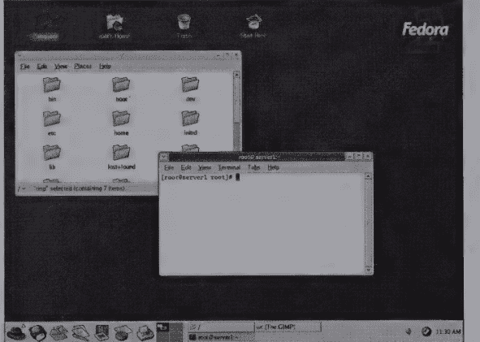

图 1-5 GNOME 桌面

Linux 发行版的另一个差异是语言支持。某些发行版对某些语言的支持比其他版本更多。两个例子是 SuSE Linux 增加了对德语的支持，而 TurboLinux 增加了对中文的支持。由于这些发行版主要用于这些语言的国家。

# 第一章 Linux 序论

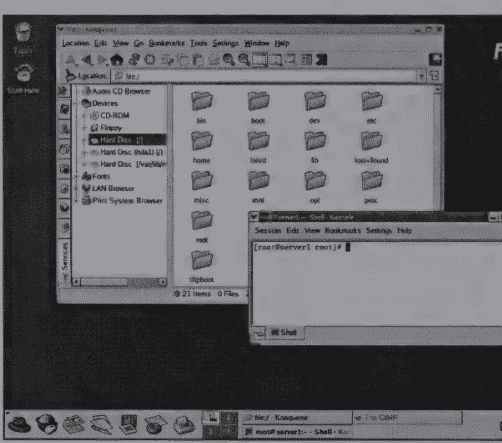

图 1-6 KDE 桌面

尽管 Linux 发行版之间的差异可以帮助缩小选择，但选择一种发行版而非另一个的一个重要原因是软件包管理器。软件包管理器是一种在 Linux 上安装和管理软件的系统。虽然不同的 Linux 发行版在表面上不同，但它们运行相同的内核并包含许多相同的软件包。最流行的软件包管理器是红帽包管理器，类似于 Windows 的添加/删除程序。传统的，大多数 Linux 软件以 `tarball` 格式可用，但越来越多的人在使用软件包管理器来安装软件。`tarball` 仅仅是文件的压缩存档，类似于 WinZip 或 RAR，通常很难管理、升级或从系统中删除。

## Linux 发行版 23

完整的 Linux 发行版列表可以在网上 `http://www.linux.org` 获取，可以通过硬件平台、软件类别或语言进行搜索。

任何人都可以通过打包开源软件创建 Linux 发行版，结果有超过250 个注册的 Linux 发行版。其中许多是为某些功能的专用发行版，有些是主流发行版。每个发行版通常都有关联网站，可以从那里免费下载。此外，许多 Linux 发行版也可以从不同的网站获取；然而，从网上下载是最常见的方法。

表 1-4 列出了一些 Linux 发行版、特性及其获取方式。

### 表 1-4 常见 Linux 发行版

| 发行版 | 特性 | 平台 | 位置 |
| --- | --- | --- | --- |
| Red Hat Linux | Linux 环境中最常用的实用工具的 Linux 发行版。红帽有两个发行版——企业版和馈赠版。两个版本都带有 GNOME、KDE 和 RPM。 | X86 Itanium AMD64 Alpha SPARC PPC Mainframe M68K | `http://www.redhat.com` |
| SuSE Linux | 欧洲最常见的 Linux 发行版，北美第二常见的 Linux 发行版，SuSE 提供满足任何业务需求的软件包。它带有 GNOME、KDE 和 RPM。 | x86 Itanium AMD64 Alpha PPC SPARC Mainframe embedded | `http://www.suse.com` |
| Slackware Linux | 一个具有许多类似于 UNIX 特性的发行版，由于其增强的多处理器支持，它通常用于多处理器环境。它带有 GNOME 和 KDE。 | x86 Alpha SPARC | `http://www.slackware.com` |

### 表 1-4 常见 Linux 发行版（续）

| 发行版 | 特性 | 平台 | 位置 |
| --- | --- | --- | --- |
| Debian Linux | 一种提供的 Linux 软件包数量最多的发行版，它包含任何用途的软件包，并附带 GNOME、KDE、Debian 包管理器和 RPM。 | x86 Itanium AMD64 Alpha SPARC ARM M68K PPC | `http://www.debian.org` |
| TurboLinux | 亚洲最常见的 Linux 发行版，以其去集群能力闻名。它配备了 GNOME、KDE 和 RPM。 | x86 Itanium Alpha Mainframe | `http://www.turbolinux.com` |
| Mandrake Linux | 一种类似于 Red Hat 的面向用户的发行版，并增强了易用性。它配备了 GNOME、KDE 和 RPM。 | x86 Itanium AMD64 PPC | `http://www.mandrakelinux.com` |

# Linux 的常见用途

如前文所述，Linux 的一个重要特性是它的多功能性。Linux 可以在各种情况下提供满足不同公司需求的服务。此外，鉴于互联网上有大量免费的文档，配置这些服务是非常直接的；只需选择所需的服务并定制 Linux 以提供这些服务即可。这些服务可以在本地计算机**工作站**上使用，也可以配置为允许其他计算机通过网络连接它。在本地计算机上使用的服务被称为**工作站服务**，而通过网络为其他计算机提供的服务被称为**服务器服务**。

> 托管服务器服务的计算机通常被称为服务器。


尽管有成千上万种不同的服务器和工作站服务可供您自定义 Linux，但今天常用的某些 Linux 配置包括以下内容：

- 互联网服务器
- 文件和打印服务器
- 应用服务器
- 超级


### 科学工作站

### 办公工作站

## 互联网服务器

Linux 托管了广泛的互联网服务，正是由于这些服务，Linux 在 20 世纪 90 年代变得更加流行。所有服务都是免费提供的，并且像所有开源软件一样在不断改进，这使得 Linux 在规划公司使用互联网服务时成为一个很有吸引力的选择。在计算机上使用服务为客户端计算机的公司被称为拥有互联网服务器。Linux 提供了数百种网络服务，为互联网服务器提供了框架；这些服务中最常见的包括：

- 邮件服务
- 路由
- FTP 服务
- 防火墙和代理服务
- Web 服务
- 新闻服务
- DNS 服务

许多这些应用程序将在本书后部分进行更详细的讨论。

## 邮件服务

在 20 世纪 80 年代和 90 年代初，电子邮件（电子邮件）主要出现在大学中的服务。今天，几乎每个互联网用户都有电子邮件账户并定期使用电子邮件。电子邮件地址很容易获取且可以免费获得。

> 电子邮件地址可以从几个不同的网站获取；其中一个知名的网站是 http://www.hotmail.com。

电子邮件通过邮件服务器网络（也称为邮件传输代理，MTA）分发。Linux 有许多免费的 MTA，包括 sendmail、postfix、mail 和 qmail。在用户访问电子邮件之前，必须从 MTA 中下载，即从邮件投递代理（MDA）中下载。Linux 同时也提供了这些服务中的几种；procmail 和 fetchmail 是两种最常用的。最后，必须使用称为邮件用户代理（MUA）的程序来查看电子邮件。Linux 可用的常用 MUA 包括 mut、pine、printmail、elm、mail、Netscape 和 Eudora。

## 路由

路由是互联网运行必需的核心服务。互联网仅仅是互联网络的大型网络；换句话说，它将公司网络、家庭网络和机构网络连接在一起，以便它们相互通信。路由器是提供这种连接的计算机或特殊硬件设备；它包含有关互联网结构的信息，并将信息从一个网络发送到另一个网络。公司可以使用路由器将其内部网络连接到互联网，并将其内部的网络连接在一起。Linux 是此的良好选择，因为它提供了路由支持，许多可以放入单张软磁盘的 Linux 发行版提供了路由能力。

## FTP 服务

在互联网上传输文件最常用且高效的方法是使用文件传输协议（FTP）。此外，在公司内部网络上传输文件时，FTP 也很常见，因为它非常快速且稳定。用户只需在她的计算机（现在称为 FTP 服务器）上启动 FTP 服务并允许用户连接；其他计算机上的用户然后使用 FTP 客户端程序连接到此服务器并下载任何所需文件。互联网上的大多数 FTP 服务器允许任何用户连接，因此被称为匿名 FTP 服务器。此外，大多数操作系统（如 Linux）都支持 FTP。

> 尽管互联网上可用的大多数 FTP 服务器允许任何用户连接，因此被称为匿名 FTP 服务器。此外，许多 FTP 软件可以位于 http://www.ftps。

## 防火墙和代理服务

“防火墙”一词源于汽车行业；防火墙保护公司免受外部侵害。正如汽车防火墙保护乘客一样，计算机防火墙保护公司。许多防火墙位于公司网络和互联网之间，允许公司连接互联网。Linux 在内核中直接内置了防火墙支持，如 iptables 和 netfilter/iptables 工具，大多数发行版都带了防火墙，所有流量必须通过此防火墙，以配置规则。

你可以使用 netfilter/iptables 了解更多信息，访问 http://www.netfilter.org/。

**注意**

防火墙通常位于公司内部网络和互联网之间，它们通常为公司内部提供访问互联网的服务。这些服务中最常见的被称为代理服务；代理服务器代表公司请求互联网资源，例如 Web 站点和 FTP 站点。换句话说，公司内部的工作站只需向连接到互联网的代理服务器发送请求，代理服务器获取并将信息返回给工作站。除了这些，代理服务器允许成千上万的工作站在无需配置工作站的情况下访问互联网；代理服务器通过维护网络地址转换（NAT）表跟踪传递给每个客户端的信息。虽然 iptables 和 netfilter/iptables 可以执行某些代理服务器功能，但 Linux 上常用的代理服务器是 Squid，它还会保留请求资源的副本（缓存过程），以便对未来的请求做出快速响应。

要获取或查找有关 Squid 代理服务器的信息，请访问 http://www.squid-cache.org。

## Web 服务

有很多工具和服务，最流行的是互联网浏览器，它可以将客户端计算机连接到全球托管各种信息的服务器：文本、图片、二进制数据、视频等更多。托管这些信息的服务器群被称为世界维网（WWW），托管信息的服务器被称为 Web 服务器。在基础层，服务器只是使用超文本传输协议（HTTP）向运行在客户端计算机上的请求 Web 浏览器提供信息；然而，服务器还可以处理称为通用网关接口（CGI）的脚本并提供安全套层连接（SSL）。CGI 是运行在 Web 服务器上的程序，并使用未连接到互联网的另一个服务器作为数据库。这非常有用，因为并不是通过互联网提供的信息都必须存储在 Web 服务器上。CGI 使用多种编程语言编写，包括 C 和 C++，使它们与 Linux 良好兼容。SSL 是与 Web 服务器通信的安全方法，其中客户端计算机和 Web 服务器之间传递的信息经过加密以保持安全。这种传输形式被广泛用于任何需要机密的场合，例如网上银行或电子商务，以获取客户的信用卡信息；它通过浏览器地址栏从 http:// 变为 https:// 来指示。

# 第一章 Linux 简介

为了更好地理解 SSL 的工作原理，请从 http://www.hotmail.com/ 获取一个电子邮箱地址，并在登录检查邮件账户时提供用户名和密码后，立即注意浏览器地址栏的变化。


Linux 提供了许多开源 Web 软件包。最广泛的是 Apache Web 服务器，它在 2003 年占了全球所有 Web 服务器的 64% 以上。

欲了解有关互联网上 Apache Web 服务器的更多信息，请访问 http://www.apache.org。


# 新闻服务

Web 服务器托管着宝贵信息，但大多数服务器并没有为用户之间的通信提供任何手段。这种功能由新闻服务器提供，它允许用户在名为“新闻组”（newsgroups）的论坛中发布消息，并允许其他用户阅读和回复这些消息。新闻组有时被称为社区公告板，类似于学校校园及其他地方常见的公告板；拥有、需要信息或服务的人会发布此类广告性质的通知，其他人可以看到这些通知并做出回应。新闻组论坛通常是解决问题的非常快捷的方法，因为读帖的人可能遇到了相同的问题并已经找到了解决方案。此外，新闻组论坛可以进行管理，由一个人或一个小组负责维护论坛消息，在消息发布到论坛之前对其进行编辑，以确保其符合论坛的主题。这确保了正确的新闻组礼仪，该礼仪规定在发布问题之前，应先搜索之前的帖子，以确保该问题没有被问过和回答过，并且只发布与新闻主题相关的消息。许多 OSS 开发者使用一种名为“新闻阅读器”（newsreader）的特殊程序，这是访问新闻组和阅读托管在新闻服务器上的帖子所需的。常见的 Linux 新闻阅读器包括 Gnews、Gnus、Netscape 和 pine。Linux 最流行的开源新闻服务器软件名为 InterNetworkNews (INN)；它在大多数常见的 Linux 发行版中都有，并由一个名为“互联网系统联盟”（Internet Systems Consortium）的开源组织维护，该组织不断开发和改进多项开源互联网技术。

欲从互联网获取 Linux 新闻阅读器，请访问 http://linux.tucows.com/news/default.html。


# Linux 的常见用途

> 欲从互联网获取如何订阅新闻组的更多信息

> 欲从互联网获取 Linux 版 INN 副本，请访问互联网系统联盟网站：http://www.isc.org/products/INN/。

# DNS 服务


网络上通信的计算机需要被唯一标识。这是通过为每台计算机分配一个名为互联网协议（`IP`）的地址来实现的，允许它们相互识别和引用。`IP` 地址是一串长数字字符串，对用户来说没有意义且非常难以记忆；为了便于记忆，`IP` 地址通过如 `www.linux.org` 这样的用户友好字符串进行掩码，这些字符串被称为全限定域名（`FQDNs`）。当使用 Internet 浏览器（如 Internet Explorer 或 Netscape Navigator）从 Web 服务器请求信息时，输入到浏览器地址栏的地址（例如 `http://www.linux.org`）在发送到互联网之前会被转换为 `IP` 地址。为了将如 `www.linux.org` 的计算机名翻译为 `IP` 地址，需要联系托管域名命名服务（`DNS`）的服务器。`DNS` 服务器被提供了正确的 `FQDN` 到 `IP` 的映射，然后为请求的服务器和 Internet 浏览器返回正确的 `IP` 地址，随后浏览器便使用此 `IP` 地址连接到目标网站。对于想要创建 `DNS` 服务器的公司来说，Linux 是一种廉价的解决方案，许多发行版都带有名为 `BIND`（Berkeley Internet Daemon）的服务。每台参与互联网的计算机都必须有一个 `IP` 地址。

> 如 `www.linux.org` 等计算机名称被称为全限定域名（`FQDNs`）。

> 您可以在互联网系统联盟网站上找到 `BIND` 的最新版本：`http://www.isc.org`。

# 文件和打印机服务器

创建网络是为了共享资源，主要是打印机和信息。在业务中，在计算机上购买打印机是不经济的；在服务器上安装一个中央打印机方便得多且更便宜，并允许多个用户跨网络进行打印。通常，信息必须对用户可用，以便他们协作。在每个用户机器上复制数据会消耗过多的硬盘，对这些数据进行更改几乎是不可能的。通过使用网络，这些信息可以对所有需要它的人可用并可以保持更新。这种中心存储的另一个优势是，用户无论登录哪台计算机，都可以访问数据。中心存储还允许公司通过设备对存储数据进行定期备份或制作多个副本，以在服务器发生故障时保护其信息安全。许多公司至少每周执行一次数据备份，以确保当中央服务器上的数据丢失时，可以从备份中快速恢复。

Linux 非常适合中心化资源的任务。它本质上是一个快速、轻量且稳定的操作系统。它经常被用于提供如网络文件系统（`NFS`）的服务，允许用户在网络上共享文件。Linux 也用于提供 Web 服务器、邮件服务器和数据库服务器。这种中心存储的另一个优势是，用户无论登录哪台计算机，都可以访问数据。中心存储还允许公司通过设备对存储数据进行定期备份或制作多个副本，以在服务器发生故障时保护其信息安全。许多公司至少每周执行一次数据备份，以确保当中央服务器上的数据丢失时，可以从备份中快速恢复。

# 应用服务器

应用程序是充当客户端和通常托管在数据库中的信息之间的中间程序。客户端请求更改或显示数据，应用程序服务器与数据库交互以检索数据。这通常被描述为前后端关系。前端运行在客户端上，是用户看到的界面。前端获取此请求，将其格式化为服务器可以理解的形式，并将请求传递给服务器上的后端。后端应用程序与数据库交互并将结果返回给客户端上的前端应用程序，由后者将其转换为用户友好的格式并显示给用户。

# 超级计算机

许多公司和机构使用计算机来执行极其巨大的计算，这些计算对于大多数计算机来说是不合适的。为了完成这些任务，公司要么购买多个处理器的计算机，要么使用专门的服务将几台较小的计算机组合在一起，使其像一台超级计算机一样运行。将几台较小的计算机组合在一起被称为集群（`clustering`）。需要此类计算的公司和个人被称为超级计算社区，随着技术向新方向的发展，该社区如今正在快速增长。

尽管购买具有大量处理器的计算机似乎合逻辑，但随着你向计算机中添加处理器，计算机相对于处理器数量的性能会所下降。换句话说，由于计算机硬件本身的物理限制，拥有 64 个处理器的计算机性能不是单个处理器的 64 倍；拥有 64 个处理器的计算机可能只有单个处理器的 50 倍。计算机随处理器数量增加而增加工作负载的能力被称为扩展性（`scalability`），大多数计算机无论使用何种操作系统，当处理器超过 32 个时扩展性都不良好。由于这种局限性，超级计算社区的许多人将较小的计算机集群在一起作为一台大型计算机工作。这种方法产生了更好的扩展性；64 台带有单个处理器的计算机为了共同目标工作，可以处理相当于单个处理器 64 倍的任务量。

超级计算社区的大部分在开发集群技术时专注于 Linux；Linux 集群最常用的方法是 `Beowulf` 集群，它易于配置且文档齐全。尽管实现 `Beowulf` 集群有许多不同方法，但最常见的方法是让一台主计算机（`master computer`）向若干台从计算机（`slave computers`）发送指令，由从计算机并发计算部分计算并将结果传回主计算机。这种类型的超级计算被分解为较小的执行单元，并在许多机器上同时并行执行；因此，它通常被称为并行超级计算，并且有许多编写用于运行并行计算机的免费程序。`Beowulf` 并行超级计算机技术自 20 世纪 90 年代中期以来一直积极开发，并在各种环境中进行了测试；目前，全球各机构、公司和大学存在着数千个 `Beowulf` 集群。

你可以在互联网上的 `http://www.beowulf.org` 更多关于 `Beowulf` 集群的信息。

注意

# 科学/工程工作站

来自理查德·斯尔曼自由软件基金会的许多开发者来自来自科学和工程社区，该社区需要开发许多已知程序来运行分析。

# Linux 33 的常见用途

在 20 世纪 80 年代和 90 年代初，这个科学和工程社区主要为全球大学通用的 UNIX 操作系统开发软件；然而，今天，该社区正专注于为 Linux 开发软件。任何之前为 UNIX 开发的软件都可以轻松移植到 Linux。科学家和工程师经常使用并行超级计算机来计算大型任务，而具有科学计算背景的 OSS 开发者已经完成了 `Beowulf` 技术的大部分开发。其中一个例子是加拿大安大略省的 `SHARCnet`（共享分层学术研究计算网络），那里几所大学已经开发并测试了用于科学和工程领域的超级计算技术和并行程序。

你可以在互联网上 `http://www.sharcnet.ca` 更多关于 `SHARCnet` 的信息。


通常，科学和工程社区所需的程序必须进行定制开发以满足相关人员的需求；然而，许多你可以使用或修改的 OSS 程序在许多不同的科学和工程领域都是免费提供的，包括但不限于以下列表：

- 物理学、天体物理学和生物物理学
- 流体力学和地球物理学
- 生物计算
- 材料和聚合物化学
- 通用数学与优化
- 数据挖掘
- 数论
- 计算机/线性/矩阵代数
- 数学可视化与建模
- 统计与回归分析
- 数据绘图与处理
- 计算机图形生成
- 计算机建模
- 古物学
- 分子建模
- 电气工程
- 人工智能

# 第 1 章 Linux 简介


### 地理建模与地球科学
### 海洋学

# 办公工作站

Linux 服务器服务一直是90 年代 OSS 开发的主要重点，但最近这已扩展到许多其他类型的软件，包括旨在造办公室和家庭环境终端用户的工作站软件。根据定义，工作站是单用户计算机，比典型的家庭系统更强大；然而，人们通常将任何非服务器的单用户计算机称为工作站。它是用户工作和交互、运行程序并连接服务器的地方。今天，你可以找到许多不同的 OSS 包，它们允许创建、组织和处理办公文档及图形艺术，包括但不限于以下列表：

- 文本编辑器（如 `Nedit`）
- 文字处理器（如 `Abiword`）
- 图形编辑软件（如 `Gimp`）
- 桌面出版软件（如 `Lyx`）
- 财务软件（如 `Gnucash`）
- 办公效率套件（如 `StarOffice`）

# 章总结

- Linux 是一种操作系统，其内核和许多额外的软件包是由大型软件开发者社区协作自由开发和改进的。它基于 UNIX 操作系统，根源于自由软件基金会延续的黑客文化。
- 因为 Linux 在 GNU 公共许可证下发布，它被称为开源软件（Open Source Software）。在 Linux 上运行的大多数额外软件都是开源软件。
- 公司发现 Linux 是其他操作系统稳定、低风险且灵活的替代方案，导致了更低的总拥有成本（TCO）。
- Linux 有不同的发行版，所有版本都包含公共内核，并配备了不同的 OSS 软件包。
- Linux 的各种文档和资源以互联网网站、HOWTO、FAQs、新闻组和 LUG 的形式存在。

## 术语

- Linux 是一种极其灵活的操作系统，可以为大多数公司和个人提供各种工作站和服务器服务。
- `AIX` - IBM 开发的一种 UNIX 版本。
- 应用程序 - 在操作系统上运行为用户提供特定功能的软件（如文字处理或财务计算）。
- 艺术许可 - 一种允许根据作者决定自由分发的开源许可。
- Beowulf 集群 - 使用 Linux 执行有用任务的流行且广泛集群方法。
- `BSD` (Berkeley软件发行版) - 根据原始 UNIX 代码开发并免费赠送加州大学伯克利分校的 UNIX 版本。
- 闭源软件 - 源代码无法从作者处免费获取； Windows 98。
- 集群 - 作为一个大型超级计算机运行的小计算机分组。
- 集群化 - 创建集群的行为；参见集群。
- 破解者 - 为个人利益恶意使用计算机软件的人。
- 数据库 - 有组织的数据集。
- 数据库管理系统 (`DBMS`) - 管理数据库的软件。
- 开发内核 - 小版本数为奇数且最近开发但未经充分测试的 Linux 内核。
- 设备驱动程序 - 操作系统内核用于控制和与特定类型计算机硬件交互的软件。
- 发行版 - 一套完整的操作系统软件集，包括内核、支持性函数库以及可以从互联网免费下载的各种 OSS 软件包。这些 OSS 软件包区分了不同的 Linux 发行版。
- 自由软件基金会 (`FSF`) - 由理查德·斯尔曼创立的组织，促进并鼓励全球软件开发者协作，自由共享源代码和软件程序。
- 免费软件 - 由开发者免费提供给用户使用的计算机软件程序。
- 常见问题解答 (`FAQs`) - 网站上可以找到常见问题答案的区域。
- 全限定域名 (`FQDN`) - 识别互联网上服务器的字符串。
- `GNU` - 一个缩写词，含义为 "GNU's Not Unix."
- GNU 网络对象模型环境 (`GNOME`) — Linux 的竞争性图形用户界面 (`GUI`) 环境之一。
- GNU 项目 — 由理查·斯托曼（Richard Stallman）发起的自由操作系统项目。
- GNU 公用许可证 (`GPL`) — 一种软件许可证，确保任何开源软件的源代码对于任何想要执行、构建或改进它的人都保持免费可用。
- 图形用户界面 (`GUI`) — 操作系统的一个组件，提供一个用户友好的界面，包含图形或图标来表示所需的任务。用户可以通过指向和点击来执行命令，而不是使用标准的命令行语法。
- GUI 环境 — 作为 GUI 核心组件（如 X Windows），结合窗口管理器和桌面环境，提供 GUI 的视觉效果和体验。尽管 GUI 环境之间的功能可能相似，但用户可能会因为易用性的差异而偏好某一个环境而非另一个。
- 黑客 (`hacker`) — 指探索计算机科学以获取知识的人。不要与破解者（cracker）混淆。
- 硬件 — 计算机的实体部分，如网卡、显卡、硬盘、打印机和键盘。
- 硬件平台 — 计算机硬件的特定配置和组合，通常以处理器类型和架构为中心并由其决定。
- 热修复 (`hot fix`) — 由软件供应商针对软件漏洞提供的解决方案。
- HOWTO — 针对执行各种特定任务的特定指令指南；可从 Linux 文档项目（`http://www.linuxdoc.org`）免费获取。
- `HP-UX` — 由惠尔士公司（Hewlett-Packard）开发的 UNIX 版本。
- 互联网 — 一个由互连网络组成的大型网络，连接了公司网络、家庭计算机和机构网络，以便它们能够相互通信。
- 网际协议 (`IP`) 地址 — 分配给计算机唯一数字字符串，用于在互联网上唯一标识它。
- 内核 (`kernel`) — 操作系统的中央、核心程序。内核的共享共同点定义了 Linux；而与通用内核交互的不同操作系统应用程序则区分了不同的 Linux 发行版。
- 通用桌面环境 (`KDE`) — Linux 可用的竞争性图形用户界面 (`GUI`)之一。
- 林纳·托瓦尔斯 (`Linux Torvalds`) — 一个芬兰研究生，他编写并创建了 Linux 的第一个版本，随后根据 GNU 公用许可证将其分发。
- Linux — 由林纳·托瓦尔斯开发的软件操作系统。其通用核心（或内核）持续演进和修订。与 Linux 内核绑定的不同开源软件定义了现在提供的各种发行版。
- Linux 文档项目 (`LDP`) — 一个大型 Linux 资源、信息和帮助文件集合，由 Linux 社区免费提供并维护。

### 关键术语

- Linux 用户组 (`LUG`) — Linux 用户的开放论坛，他们在此讨论并协助相互使用和修改 Linux 操作系统以及运行在其上的开源软件。全球都有 LUG。
- 邮件投递代理 (`MDA`) — 从邮件传输代理下载电子邮件的服务。
- 邮件传输代理 (`MTA`) — 允许用户读取电子邮件的程序。
- 邮件用户代理 (`MUA`) — 用于标识 Linux 版本的数字中第一个点之前的数字。它被用于表示重大变更或修改。
- `Mandrake` — 北美一种受欢迎且盛行的 Linux 发行版，由 MandrakeSoft 分发和支持。
- `MINIX` — 由安德鲁·塔南鲍姆（Andrew Tannenbaum）创建的微 Unix。关于如何为此版本的 Unix 操作系统编写内核的指令是公开的。以此为起点，林纳·托瓦尔斯为 Intel 平台改进了这一版本的 UNIX，并创建了 Linux 的第一个版本。
- 次版本号 (`minor number`) — 用于标识 Linux 内核版本的数字中第一个点之后的数字，表示微改。如果是奇数，则表示开发版本，尚未测试。另参见开发内核（Developmental kernel）和生产内核内核（Production kernel）。
- 多路信息和计算服务 (`MULTICS`) — AT&T 贝尔实验室在 20 世纪 60 年代开发的原型分共享操作系统。
- 多任务 (`multitasking`) — 一种能够同时管理多个任务的操作系统。
- 多用户 (`multiuser`) — 一种能够同时为多个用户提供访问的操作系统。
- 新闻组 (`newsgroup`) — 通过名为新闻器的应用程序访问的互联网协议服务。该服务允许访问通常按特定主题组织的帖子（位于所有新闻组用户可访问的中心位置的电子邮件）。具有特定主题的用户可以发布消息，其他用户可以回答。
- 开源软件 (`OSS`) — 经过分发和许可的程序，使其组成程序的源代码对于任何想要检查、利用或改进它的人都免费可用。
- 操作系统 (`OS`) — 用于控制和与计算机硬件组件直接交互的软件。
- 软件包管理器 (`package manager`) — 通过在计算机的中央软件数据库中存储所有相关软件信息，用于安装、维护和删除其他软件程序的软件。
- 进程 (`process`) — 加载到内存并在处理器上运行执行特定任务的程序。
- 生产内核 (`production kernel`) — 一个 Linux 内核的次版本号（版本号中点之后的数字）为偶数，且经过广泛测试被认为是稳定的。
- 程序 (`program`) — 知道如何与操作系统和计算机硬件交互以执行特定任务的指令集；存储在某些介质上的文件（例如硬盘）。
- 编程语言 (`programming language`) — 用于开发程序的语法。不同的编程语言使用不同的语法。
- 红帽 (`Red Hat`) — 北美最受欢迎和盛行的 Linux 发行版之一，由红帽公司分发和支持。
- 修订号 (`revision number`) — Linux 内核版本号中第二个点之后的数字，用于标识内核的发布版本。
- 路由器 (`router`) — 一种计算机路由软件或特殊硬件设备，提供网络之间的互连；它包含有关网络结构的信息并将信息从一个组件发送到另一个组件。
- 可扩展性 (`scalability`) — 计算机随着处理器数量而增加工作负载的能力。


搜索引擎 (search engine) — 一种互联网网站，例如 `http://www.google.com`，你只需输入代表你搜索项目的短语，就能收到包含相关材料的列表。

服务器 (server) — 配置为允许网络上所有计算机连接的计算机。

服务器服务 (server services) — 为网络上的其他计算机提供的服务。

共享软件 (shareware) — 以低成本开发并提供给终端用户的程序。这些程序最初免费，但在一段时间或在使用后付费。

软件 (software) — 存储在计算机存储设备上的程序，在执行时提供某些功能。

源代码 (source code) — 定义或构成程序如何运行的组织指令集。

SUSE — 欧洲最受欢迎和盛行的 Linux 发行版之一。

系统服务 (system service) — 被整合并作为系统启动的程序所提供的额外功能。

压缩包 (tarball) — 一个压缩的文件归包，包含将 Linux 软件安装到计算机系统正确位置的脚本。

总拥有成本 (TCO) — 使用产品简单价格之外的所有累计成本的总和。它包括培训、维护、额外硬件和停机时间等杂项。

UNIX — 由汤森（Thompson）和丹尼斯·里奇（Dennis Ritchie）开发的第一个真正的多任务、多用户操作系统，Linux 起于此。

用户界面 (user interface) — 用户看到并用于与操作系统和应用程序进行交互的界面。

工作站 — 一用于连接到服务器上服务的计算机。

工作站服务 — 用于访问网络服务器上共享资源的服务。

X Windows — Linux 图形用户界面（GUI）的核心组件。

# 复习习题

1. 每台计算机都由物理组件和逻辑组件组成。计算机中理解如何与物理组件协同工作的逻辑组件被称为：

   a. 硬件

   b. 记录

   c. 软件

   d. 处理器

2. 操作系统软件对于计算机的运行是必要的。对还是错？

3. Linux 是一个 ________ 和 ________ 操作系统。

   a. 生产的、稳定的

   b. 多用户、多任务

   c. 处理、操作

   d. 大的、用的

4. Linux 操作系统的核心组件是 Linux 内核。如果你是一家公司的 Linux 系统管理员，你会在什么时候需要升级 Linux 内核？（选择所有适用项）。

   a. 当你需要在 Linux 中支持新硬件时

   b. 当你需要另一个用户界面时

   c. 当你需要增加 Linux 的稳定性时

   d. 当你需要使用内核模块时

5. 下列哪些内核是开发版内核？（选择所有适用项）。

   a. 2.3.4

   b. 2.5.5

   c. 2.2.7

   d. 2.4.4

6. 生产版内核是指其：

   a. 版本号为偶数的

   b. 次版本数为奇数的

   c. 主版本数为奇数的

   d. 次版本数为偶数的

7. 如今有很多类型的软件。Linux 代表哪种类型的软件？

   a. 开源软件

   b. 源软件

   c. 免费软件

   d. 共享软件

8. 下列哪些是开源软件的特征？（选择所有适用项。）

   a. 软件的价值与其价格直接相关。

   b. 软件是协作开发的。

   c. 软件源代码可以支付少量费用获得。

   d. 任何漏洞都能被快速修复。

9. Linux 遵循哪种许可协议？

   a. 开源许可

   b. 艺术许可

   c. GNU 公共许可证 (GPL)

   d. 免费源码许可

10. 在企业环境中使用 Linux 有哪些良好理由？（选择所有适用项。）

    a. Linux 软件不太可能被开发者遗弃。

    b. Linux 是安全的，且所有权成本低于其他操作系统。

    c. Linux 广泛适用于许多平台，并支持许多编程语言。

    d. 大多数 Linux 软件是闭源的。

11. 以下哪些是获取 Linux 的常用方法？

    a. `http://www.linuxdoc.org` HOWTO 文档

    b. 本地 Linux 用户组

    c. 互联网新闻组

    d. 以上所有

12. 哪两个人被认为创建了 UNIX 操作系统？（选择两个答案。）

   a. 丹尼斯·里奇 (Dennis Ritchie)

   b. 理查德·斯托尔曼 (Richard Stallman)

   c. 利纳斯·托瓦尔斯 (Linus Torvalds)

   d. 肯·汤森 (Ken Thompson)

13. 谁成立了自由软件基金以促进开放开发？

   a. 丹尼斯·里奇

   b. 理查德·斯托尔曼

   c. 利纳斯·托瓦尔斯

   d. 肯·汤森

14. 哪种文化采用了 GNU（GNU 不是 UNIX）这一术语并为 Linux 奠定了自由软件的基础？

   a. 黑客文化

   b. MIT 文化

   c. 破解者文化

   d. 人工智能文化

15. Linux 是由 ____________________ 开发的，旨在模仿 ____________________ 系统。

   a. 利纳斯·托瓦尔斯，MINIX

   b. 利纳斯·托瓦尔斯，GNU

   c. 理查德·斯托尔曼，GNU

   d. 理查德·斯托尔曼，MINIX

16. 当 Linux 操作系统的核心组件与其他开源软件打包在一起时，它被称为：

   a. 新内核

   b. 新平台

   c. Linux 发行版

   d. GNU 项目

17. 大多数 Linux 发行版提供哪些常见的 GUI 环境？（选择所有适用项。）

   a. GNOME

   b. CDE

   c. KDE

   d. RPM

18. 下列哪些是决定我们使用哪种 Linux 发行版的因素？（选择所有适用项。）

   - 包管理器支持

   - 硬件平台

   - 内核特性

   - 语言支持

19. Linux 最常用的开源 Web 服务器是哪个？

   - Samba

   - Apache

   - Quid

   - Pine

20. 下列哪些可用于 Linux 以提供文件和打印服务？

   - Samba

   - Apache

   - Quid

   - Pine

## 探索练习

1. 你在一家大型制造公司工作，该公司正在考虑将 Linux 作为其 IT 部门部分或全部服务器的解决方案。该公司在 UNIX 上运行着 Oracle 数据库，而托管该数据库的 UNIX 服务器包含几个自行定制的小型程序。目前全公司的桌面电脑都使用 Windows Me，用户将数据存储在 Windows 2000 文件服务器上。在将公司服务器迁移到 Linux 之前，你可能考虑哪些因素？你会选择哪些发行版和开源软件来完成这一目标？如果你需要编写一份报告详细说明迁移到使用 Linux 的开源解决方案的处，你会在报告中列出哪些优点，以说服公司其他人员 Linux 如何降低总拥有成本？

2. 在参加本地 Linux 用户组（LUG）会议期间，一些不熟悉 Linux 的人请你解释什么是 GPL 以及它与 Linux 开源软件的关系。这些人人也不理解开源软件是如何产生利润的。他们听说开源软件的质量不如商业软件，因此在未来可能不会占据主导地位。你如何回答，你会使用哪些例子来证明你的观点？你可以引导他们访问哪些网站以获取更多信息？

3. 作为一家大型连锁服装店店工作的软件开发人员，你负责创建用于连接零售店电脑与总部中央数据库的软件。最近，你的一些朋友建议你根据 GPL 发布你的软件。在 GPL 下发布你的软件有哪些直接益处？要发布根据 GPL 开发的软件，你需要公司的许可，因为公司拥有其支付费用创建的任何软件。当你向公司提及开源软件并解释公司如何随着时间的推移从发布开源获益时，公司还想知道发布和维护开源软件的程序是什么。你将为他们提供什么建议？你可以让他们哪里获取更多信息？

4. 你是负责一个中型 Linux 网络的管理员。你工作的公司要求你在网络上实现路由，这是一个你并不熟悉的话题。你可以去哪里学习如何在网络上启用路由？只要你有功能完备的 Web 浏览器和互联网连接，就可以在互联网上探索该主题并列出你使用的网站。这些信息可能从完成特定任务的广泛描述到执行计划的详细指南和说明。根据这些信息源，制定一份概述实施路由所需步骤的报告。

5. 在公司活动上，一位高管拦住你，抱怨你的部门浪费了太多钱。高管要求知道为什么公司必须在计算机和软件上花费这么多，特别是操作系统和相关许可（针对闭源程序和操作系统）。写一份报告，通过解释硬件、软件和操作系统的性质来辩护你的部门。在报告中，务必解释开源软件和 Linux操作系统如何降低这些成本。

6. 你收到大学计算机科学展项目组织者的联系。组织者请你举办一个论坛，讨论 Linux 操作系统的起源，包括它是如何演进和持续发展的。该论坛的主要重点是鼓励大学生参与开源社区，因此还应详细说明黑客文化的哲学、主要特征和方法。准备一份你将讨论的主要主题的项目列表，并写下一些你预判参与者提出的示例问题以及你的回答。


7. 只要你拥有一个 `Web` 浏览器和互联网连接，请在互联网上研究三个不同的 Linux 发行版。记录你获取信息的来源，并根据每个发行版的优势和可用软件包对不同发行版进行比较和对比。完成后，找到并访问两个 Linux 新闻组。你是如何找到它们的？从哪里获取的这些信息？每个新闻组的特定主题是什么？在每个新闻组找到由需要问题解决方案的用户发布的帖子，并遵循他人建议的回复线索来解决该问题。

# 第 2 章 为 Linux 安装做准备

> 在完成本章后，你将能够：
> * 描述常见的硬件类型及其特征
> * 获取安装 Linux 所需的硬件和软件信息

计算机由硬件组成，硬件本质上是开关和电路的集合，需要操作系统软件才能以意义的方式运行。本章将向你介绍安装 Linux 系统所需的硬件和软件术语，并讨论如何从多个来源获取这些信息。

## 理解硬件

安装 Linux 的基础是理解计算机的各种硬件组件。这使得使用户能够验证安装过程中自动检测到的任何硬件是否检测正确，以及硬件是否符合任何安装要求。在安装 Linux 之前需要理解的硬件组件包括：
- 中央处理器 (`CPU`)
- 物理内存
- 磁盘驱动器
- 主板和外围组件
- 视频适配卡
- 键盘和鼠标

### 中央处理器 (`CPU`)

任何计算机的核心组件都是中央处理器 (`CPU`)，也称为微处理器或处理器；它是绝大多数计算和信息处理发生的地方。处理器是集成电路板，由数百万晶体管组成，形成电流的通路。它们由两个主要部分组成：算术逻辑单元 (`ALU`) 和控制单元 (`CU`)。`ALU` 是执行所有数学计算和逻辑操作的地方。`CU` 是加载和执行指令代码的地方，通常会将信息发送到算术逻辑单元进行执行。处理器的内部元件可以用不同的方式排列；这被称为处理器的架构或平台。回想第 1 章“Linux 简介”，Linux 系统适用于许多不同的平台，包括 `SPARC`（可扩展处理器架构）、`Alpha` 和 `Intel`。这些不同的电路排列对处理器执行某些类型指令的速度有特定影响。因此，处理器根据其执行的指令类型进行分类。处理器架构的两个主要类是复杂指令集计算机 (`CISC`) 和精简指令集计算机 (`RISC`) 处理器。`CISC` 处理器执行的单个命令通常比 `RISC` 处理器复杂；但由于复杂命令在处理器上的执行时间较长，`RISC` 处理器往往比 `CISC` 处理器快。本书的其余部分将限于 `Intel` 处理器架构，因为 `Intel` 是全球家庭和企业中最常见的 `CISC` 处理器。

`Intel` 的新款 `Itanium` 处理器是一种具有 `CISC` 特性的 `RISC` 处理器。由于它与大多数 `RISC` 处理器不同，其架构通常被称为显式并行指令计算 (`EPIC`) 架构。


处理器执行命令的速度与内部时间周期有关，称为时钟频率。类似于石英钟计时的方式，处理器有一个晶体，在通过电流时会以特定频率振荡。它是处理器保持时间的节拍，也是执行操作的依据。时钟频率以兆赫兹 (`MHz`) 计算，即每秒百万次循环；运行在 `200MHz` 的处理器的时钟频率或振荡频率为每秒 2 亿次循环。处理器可能需要一个周期完成一个命令，也可能是超标的，即在任何给定的周期内能够完成多个命令。无论何种情况，处理器的时钟频率越高，它在时间内可以执行的命令就越多。

计算机中处理器的时钟频率是独立的，不需要与计算机与其他硬件组件的时钟频率匹配；在大多数情况下，处理器的时钟频率是计算机内部任何硬件组件中最快的。


处理器的内部元件可以用不同的方式排列；这被称为处理器的架构或平台。回想第 1 章“Linux 简介”，Linux 系统适用于许多不同的平台，包括 `SPARC`（可扩展处理器架构）、`Alpha` 和 `Intel`。这些不同的电路排列对处理器执行某些类型指令的速度有特定影响。因此，处理器根据其执行的指令类型进行分类。处理器架构的两个主要类是复杂指令集计算机 (`CISC`) 和精简指令集计算机 (`RISC`) 处理器。`CISC` 处理器执行的单个命令通常比 `RISC` 处理器复杂；但由于复杂命令在处理器上的执行时间较长，`RISC` 处理器往往比 `CISC` 处理器快。本书的其余部分将限于 `Intel` 处理器架构，因为 `Intel` 是全球家庭和企业中最常见的 `CISC` 处理器。

# 第 2 章 为 Linux 安装做准备

> 在完成本章后，你将能够：
> 
> * 描述常见的硬件类型及其特征
> * 获取安装 Linux 所需的硬件和软件信息

## 理解硬件

`Intel` 的新款 `Itanium` 处理器是一种具有 `CISC` 特性的 `RISC` 处理器。由于它与大多数 `RISC` 处理器不同，其架构通常被称为显式并行指令计算 (`EPIC`) 架构。


处理器执行命令的速度与内部时间周期有关，称为时钟频率。类似于石英钟计时的方式，处理器有一个晶体，在通过电流时会以特定频率振荡。它是处理器保持时间的节拍，也是执行操作的依据。时钟频率以兆赫兹 (`MHz`) 计算，即每秒百万次循环；运行在 200`MHz` 的处理器的时钟频率或振荡频率为每秒 2 亿次循环。处理器可能需要一个周期完成一个命令，也可能是超标的，即在任何给定的周期内能够完成多个命令。无论何种情况，处理器的时钟频率越高，它在时间内可以执行的命令就越多。

计算机中处理器的时钟频率是独立的，不需要与计算机与其他硬件组件的时钟频率匹配；在大多数情况下，处理器的时钟频率是计算机内部任何硬件组件中最快的。

（注：OCR 文本在此处变得重复，已清理以保证流畅度。）

## 物理内存

物理内存是直接通过电路板连接到处理器的信息存储区域。物理内存分为两大类：随机存取存储器 (`RAM`) 和只读存储器 (`ROM`)。`RAM` 和 `ROM` 都存储在计算机芯片上，并允许访问信息；然而，`RAM` 需要持续供电以维持存储的信息，而 `ROM` 是静态的，即使在系统没有电源的情况下也能存储信息。

### RAM

如第 1 章所述的，软件程序是包含由处理器执行的指令的文件，它们在执行时被加载到 `RAM` 物理内存中；随后处理器就可以处理内存中的指令。`RAM` 的容量与计算机性能直接相关，因为更大的 `RAM` 允许更多程序在系统上同时运行。不同程序需要不同数量的内存才能正确执行；因此软件程序（包括操作系统）需要少量的 `RAM`。运行 GNOME 桌面 GUI 环境的 Linux 机器比不使用任何 GUI 的 Linux 机器需要更多内存。`RAM` 分两类：动态内存 (`DRAM`) 和静态内存 (`SRAM`)。动态内存 (`DRAM`) 是两种类型中较便宜的，因此是最常见的。与 `RAM` 相比，它的访问速度较慢，它持有的信息必须每秒刷新数千次，这需要连续、不中断的电流。如果到 `DRAM` 芯片的电流即使短暂中断，信息就会丢失。`DRAM` 是指物理内存的一种，它是排列在称为“内存条”的小板上的集成电路（芯片），内存条反过来通过插槽连接到计算机的主板上。组成内存条上芯片的晶体管数量决定了可以存储的信息量，以兆字节 (`MB`) 计算。

两个不同的 `DRAM` 内存条可能有相同的物理尺寸，但存储的信息量可能大不相同。主要有三种 `DRAM` 内存条：`SIMM`、`DIMM` 和 `SODIMM`。`SIMM` 是两者中较老的一种，通过通常位于一侧的连接器（引脚）将其集成电路阵列连接到主板上；`SIMM` 已不再生产，如今也较少见。`DIMM` 现在被广泛使用，通过位于两个边缘的连接器（引脚）将其集成电路阵列连接到主板；由于具有更多的连接点，`DIMM` 比 `SIMM` 能够存储更多信息且传输速度也更快。`SODIMM` 是物理尺寸更小的 `DIMM`，用于便携式笔记本电脑和 Macintosh 系统。

随着技术的演进，`DRAM` 的性质及其工作速度也在发生变化。近期的 `DIMM` 技术包括同步动态随机存储器（`SDRAM`）、双数据速率同步随机存储器（`DDR SDRAM`）和兰巴斯动态随机存储器（`RDRAM`）。`SDRAM` 使用主板上的标准 `DIMM` 连接器，并以突发方式和比传统 `DRAM` 更快的速度在存储器之间传输数据。`DDR SDRAM` 是增强型 `SDRAM`，用于较新的计算机以提高速度。`RDRAM` 是一种专利产品，使用 `RIMM` 连接（类似于不同的引脚设置），并以极高的速度运行，快速传输数据。`RIMM` 并非缩写，而是兰巴斯公司（Rambus Corporation）的商标字。

内存的第二种主要类型是静态内存（`SRAM`），它的生产成本更高，且允许更快地访问存储的信息，因为信息存储器不需要持续刷新，并且可以在没有电流的情况下维持一段时间。尽管如此，这种电流的中断必须是短暂的，且当计算机关机时，存储的信息将会丢失。`SRAM` 是用于二级处理器缓存以及任何直接连接在计算机主板上的内存芯片的物理内存类型。

## ROM

只读存储器（`ROM`）是可读但不可写的物理内存，以永久、非易失性的的方式存储在计算机内部的集成电路（计算机芯片）中。与 `RAM` 不同，这种内存不依赖电流流，在没有电源的情况下，可以在计算机上无限期保持完好。由于这一特性，`ROM` 通常用于存储启动计算机时初始化硬件组件的初始程序，被称为 `BIOS`（基本输入输出系统）`ROM`。虽然真正的 `ROM` 仍在使用，但 `ROM` 计算机芯片中存储的信息是不可变的这一事实导致了某些变体，它们在没有电流的情况下可以维持，但在需要时可以修改。这些 `ROM` 变体包括：

- 可编程只读存储器（`PROM`），由空白 `ROM` 芯片组成，该芯片可以写入一次且永远不再被重写。
- 可擦除编程只读存储器（`EPROM`），其信息内容可以反复擦除和重写。`EPROM` 的内容必须整体擦除并重写；不能对单个部分进行单独修改。`EPROM` 内存的一个示例是计算机中的互补金属氧化物半导体（`CMOS`），它存储了系统上电时 `BIOS ROM` 使用的配置信息。
- 电子擦除编程只读存储器（`EEPROM`）维持一个信息存储器，不仅可以整体擦除和重写，还可以进行修改，同时保持其他部分完好。这种在没有电的情况下静态存储信息但在需要时进行修改的能力，正是 `EEPROM` 芯片在许多计算机外围组件中流行的原因。

用于数字相机存储照片的内存类型是一种 `EEPROM` 内存。


计算机中的大多数信息是使用非易失且不由集成电路组成的介质维护的；今天最常用的这类介质包括存储在硬盘驱动器（也称为硬盘或 `HDDs`）中的硬盘、插入 CD-ROM 驱动器的光盘只读存储（CD-ROM）光盘，以及插入软磁盘驱动器的软磁盘。驱动器设备传输数据的速度没有 `RAM` 或 `ROM` 那么快，但可以以一种成本效益的方式在其包含的磁盘上存储大量可修改的信息以备后用。当处理器需要信息时（例如在系统启动期间操作系统启动，或在运行的系统上执行应用程序时），信息将从磁盘传输到 `RAM`。

## 硬盘

传统上，大多数信息通过磁带设备存储在磁带上；这种对磁介质的使用很快转移到了今天使用的软磁盘和硬盘驱动器。这一过程的工作原理与音频磁带的录制和播放方式类似。表面覆盖有铁性材料，这种铁性材料的组成粒子可以通过电磁场重新排列以记录数据，然后可以使用相同的设备通过检测排列模式来读取。与必须通过快进或倒带磁带来读取或写入数据的磁带设备不同，`HDD` 通过在带有电磁场的铰动臂下快速旋转这些盘片，在涂有刚性金属盘片的铁性材料涂层上读写信息。`HDD` 未直接连接到处理器，而是必须通过一个硬盘控制器卡，由该卡片控制进出 `HDD` 之间的信息流。这些控制器卡大有两种通用类型：集成驱动器电子（`IDE`）和小型计算机系统接口（`SCSI`）。连接到这些控制器的硬盘必须是相同类型；你必须使用 `IDE` 卡配合 `IDE` 磁盘，并使用 `SCSI` 卡配合 `SCSI` 磁盘。

`IDE` 控制器，也称为高级技术附件（`ATA`）控制器，通常是 `IDE` 驱动器底部的电路板，通过排线连接到主板。大多数主板包含两个排线插槽（一个主控制器插槽和一个从插槽），且每根排线最多可以连接两个硬盘；因此，大多数计算机受限于四块硬盘。由于每根排线都可以连接两个硬盘，这必须是一种能够唯一标识每个硬盘的方法。这种方法涉及物理硬盘上的跳线开关，以便同一根排线上的一个硬盘被称为“主（master）”，另一个被称为“从（slave）”。因此，连接到主控制器插槽的硬盘可能被称为“主 `IDE HDD`”。表 2-1 列出了可能的硬盘配置及其 Linux 名称。

| 描述 | Linux 名称 |
| :--- | :--- |
| 主 `IDE HDD` | `hda` |
| 从 `IDE HDD` | `hdb` |
| 从主 `IDE HDD` | `hdc` |
| 从从 `IDE HDD` | `hdd` |


与 IDE 不同，SCSI 耦合器与硬盘物理分离，通常通过主板上的插槽连接到主板。SCSI 硬盘传输数据的速度远快 IDE 硬盘，且 SCSI 控制器可以同时与多个 HDD 交互。然而，IDE 硬盘和控制器的制造费用比 SCSI 产品低，因此是家庭和中小型企业最常用的硬盘技术。在本章中，讨论限于 IDE 硬盘。

今天制造的硬盘可以存储超过 160GB 的数据，通常被划分为小的可管理的区域，称为分区。每个分区随后必须准备好存储文件。为了实现这一点，你必须使用文件系统格式化每个分区，该文件系统规定了数据如何在硬盘本身上存在。

> 在 Windows 操作系统中，每个驱动器号（例如 C.、D.、E.）可以对应于硬盘分区上的独立文件系统。

注意

HDD 硬盘划分的分区数量和类型是有限制的。硬盘最多可以包含四个主要分区（称为主分区）。为了克服这一限制，你可以选择地将这些主分区中的一个标记为

## 第2章 准备 Linux 安装

将分区设置为“扩展”（extended）；此扩展分区可以包含无限数量的较小分区，称为逻辑驱动器。扩展分区内的每个逻辑驱动器以及所有主分区都可以包含文件并存储数据。硬盘所有分区信息的表存储在所有分区之外的第一个可读扇区，称为主引导扇记录（MBR）。请记住，在 Linux 中，主主 IDE 硬盘被称为 `hda`；该硬盘上的第一个分区标记为 `hda1`，第二个为 `hda2`，以此此类推。因为硬盘上只允许有四个分区，因此扩展分区内的逻辑驱动器被标记为 `hda5`、`hda6` 等。这种分区策略的示例如表 2-2 所示。

表 2-2 主主 IDE 硬盘的分区方案示例

| 描述 | Linux 名称 | Windows 名称 |
| --- | --- | --- |
| 主主 HDD 上的第一个主分区 | `hda1` | C: |
| 主主 HDD 上的第二个主分区 | `hda2` | D: |
| 主主 HDD 上的第三个主分区 | `hda3` | E: |
| 主主 HDD 上的第四个主分区（扩展） | `hda4` | F: |
| 主主 HDD 扩展分区上的第一个逻辑驱动器 | `hda5` | G: |
| 主主 HDD 扩展分区上的第二个逻辑驱动器 | `hda6` | H: |
| 主主 HDD 扩展分区上的第三个逻辑驱动器 | `hda7` | I |

## 其他信息存储设备

除了硬盘（HDD）之外，还有其他信息存储设备，包括软磁盘、Zip 盘、DVD 和 CD-ROM。这些通常被称为可移动介质，因为用于存储信息的介质不像 HDD 那样固定在计算机中，而是可以在计算机之间移动和传输。

软磁盘像硬盘一样以电磁方式存储信息，传统上是最常见的可移动介质；它被称为软盘（floppy），是因为覆盖存储信息的铁性介质是灵活的（或软的），这与 HDD 中使用的硬性盘片形成。软盘驱动器也称为 3½ 英寸软盘驱动器（仅指可移动存储单元的尺寸，其容量比 HDD 小），且数据传输速率慢得多。

Zip 盘是软磁盘的进化版本，尽管它们在物理上相似，但它们与普通软盘的区别在于它们可以存储多得的信息（高达 750MB）。这些复杂的软盘不能使用普通的 3½ 英寸软盘驱动器单元；它们需要配合特殊的 Zip 驱动器使用，但在许多家庭和小型办公室中常用于传输大文件或为重要信息制作备份。

DVD 和 CD-ROM 与上述所有其他磁盘介质不同，因为它们不使用铁性材料和电磁头来存储和检索数据，而是使用激光读取光脉冲。通过反射材料（通常是铝）制成的凹槽层，激光脉冲会从上面反弹。表面的凹槽会干扰击中的激光脉冲，由此产生的激光脉冲反射的干扰模式被存储为信息。这项技术使得 DVD 和 CD-ROM 相比其他可移动存储设备具有某些优势，包括更快的传输速度、更大的存储容量和更强的数据丢失抵抗。这使得它们在存储大量数据非常有用，因此成为发行 Linux 操作系统等软件的首选介质。

DVD 和 CD-ROM 驱动器按其从普通音频光盘（CD）读取数据的速度进行分级；在本文编写时，典型的 CD-ROM 读取数据速度超过音频 CD 的 50 倍（50X），典型的 DVD 读取数据速度超过音频 CD 的 16 倍（16X）。大多数 DVD 和 CD-ROM 驱动器通过高级技术数据包接口（ATAPI）连接到计算机的主板上，这允许它们像 IDE 硬盘一样工作。通常，计算机中四个可能的 IDE 设备之一是 DVD 或 CD-ROM 驱动器，该驱动器必须按照 IDE 硬盘相同的方式，使用 DVD 或 CD-ROM 驱动器本身上的跳线开关进行配置。

> 虽然 DVD 或 CD-ROM 驱动器的数据传输率比软盘或 Zip 盘快，但仍然比 HDD 。如果将 DVD 或 CD-ROM 驱动器放在与 HDD 相同的 IDE 设备上，会影响并减慢 HDD 的有效数据传输率；因此，将 DVD 和 CD-ROM 驱动器放在与任何 IDE HDD 独立的 IDE 控制器上是明智的。

> 在本文编写时，许多 DVD 和 CD-ROM 驱动器也可以分别向 DVD 和 CD-ROM 光盘写入信息。这些设备被称为 DVD 重写（DVD-RW）和紧光光盘重写（CD-RW）驱动器。

闪存驱动器是一种较新的介质类型，使用 EEPROM 存储信息。它们存储的信息通常比软磁盘和 Zip 盘多，某些闪存驱动器存储的信息比 CD-ROM 还多。此外，闪存驱动器可以在计算机运行时插入并以相同的方式取出；因此，闪存驱动器正迅速成为需要在计算机之间传输文件的用户的常用介质。

## 主板和外围组件

程序加载到物理内存中由处理器执行；然而，必须存在某些设备提供这些硬件设备之间的互连。互连（也称为总线）由称为主板的电路板提供。总线用于连接通用硬件组件，如处理器、物理内存和磁盘驱动器，同时也连接外围组件，如显卡、声卡和网络接口卡（NIC）。外围组件通过输入输出总线（也称为 I/O 总线或扩展总线）连接到系统的其他部分，总线通过主板上不同的插槽或端口表示；常见的插槽包括：

- ISA
- PCI
- AGP

工业标准架构（ISA）插槽仅允许外围组件提供以 8MHz 速度传输信息的互连，比其他插槽少得多，因为外围部件接口（PCI）是 1995 年引入的新型总线连接，是目前最常见的插槽类型；它可以以 33MHz 的速度传输信息并可以使用直接内存访问（DMA）。DMA 允许外围组件绕过 CPU 直接与其他外围组件通信以增强性能；你可以配置八个 DMA 通道。加速图形端口（AGP）为显卡外围组件设计，传输速度超过 66MHz。它的设计并不是为了取代 PCI，而是为了增强图形操作并更快访问系统内存。图 2-1 显示了带有这些插槽的主板。

其他外围组件可能在主板上没有插槽；相反，它们可能通过电缆连接到主板边缘、从计算机外部可见的端口。这些端口包括：

- PS/2
- COM（串口）
- LPT
- USB
- IEEE 1394（FireWire）
- PCMCIA

PS/2 端口是带有六个针的小型连接器，通常用于将键盘和鼠标连接到计算机。某些计算机可能使用更大的五针端口连接键盘；该端口称为 AT 端口，在 PS/2 之前使用。

COM 端口（也称为串口）是矩形九针连接器，可将各种外围组件连接到主板，包括鼠标、串口打印机、扫描仪和数字相机。今天，COM 端口的使用频率比以前少得多，因为

理解硬件 55

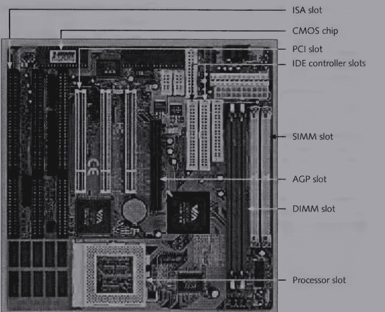

- ISA 插槽
- CMOS 芯片
- PCI 插槽
- IDE 控制器插槽
- SIMM 插槽
- AGP 插槽
- DIMM 插槽
- 处理器插槽

## 图 2-1 主板组件

它们的传输速度非常慢；因此，通常使用的四个 COM 端口（COM1、COM2、COM3 和 COM4），在本文编写期间，大多数主板上只有 COM1 和 COM2 端口。

在过去，打印机通常使用矩形 25 针 LPT 端口（也称为并行端口）连接到主板。虽然通常有两个常用的 LPT 端口（LPT1 和 LPT2），但大多数电脑的主板上通常只有 LPT1 可用。

大多数外围组件，如键盘、鼠标、打印机、数字摄像机、闪存驱动器和扫描仪，现在都通过通用总线（USB）端口而不是串行或并行端口连接到主板。USB 2 版本允许每秒高达 480MB 的传输速度（大多数 USB 支持每秒高达 12MB），并可以使用名为 USB 集线器的设备使用，从而允许多达 127 个不同的设备连接到主板上的一个 USB 端口。大多数电脑的主板带有两个 USB 端口，几乎所有的 USB 设备都可以连接到计算机，以便操作系统在电脑开机时进行检测和使用。这种功能被称为热插拔，任何

### 第 2 章为 Linux 安装做准备

任何可以连接到运行中的计算机主板的设备称为热插拔设备。

USB 的另一个热插拔变体是 IEEE 1394（FireWire），它由苹果计算机公司于 1995 年开发。FireWire 2 版本提供了每秒高达 800MB 的传输速度。由于支持这种传输速度，FireWire 常用于将 SCSI 硬盘、扫描仪、闪存驱动器、数字摄像机和 CD-RW 驱动器连接到计算机。


# 第 2 章 为 Linux 安装做准备

考虑到笔记本便携电脑时，大量的连接器或端口可能会增加电脑的物理尺寸并降低其便携性。对于这些电脑，个人电脑内存卡国际协会（`PCMCIA`）端口允许将一个小卡插入电脑（通常厚度小于 10.5mm），卡上带有提供某些功能的电子元件。`PCMCIA`插槽不需要电，它们是热插拔的，通常用于网络接口卡、调制解调器扩展内存。笔记本便携电脑的另一个特性是高级电源管理（`APM`），它在不使用`PCMCIA`设备时会关闭这些组件以节省电力。

你可以通过多种方式通过插槽或端口将外围组件连接到计算机；然而，每个外围设备必须与系统中的其他设备分开维护，这样当由`CPU`控制时，信息就不会传递给其他设备。这种分离是通过每个外围组件的两个特性实现的：`IRQ`（中断请求）和输入/输出（`I/O`）地址。`IRQ`指定了指向`CPU`自身的唯一通道，这些通道使用 0 到 15 的数字标记。如果两个设备使用相同的`IRQ`，就会发生冲突且两个设备都无法工作；但是，如果某些设备配置为如此，也可以共享`IRQ`。每个设备还必须有一个很小的`RAM`工作区域，`CPU`可以向该设备传递信息并从设备接收信息；这个工作区域被称为`I/O`地址，并且对于每个设备必须是唯一的。`I/O`地址以十六进制表示法，并表示使用的内存范围；`I/O`地址的一个示例是 `000-31fe`。

在较旧设备（如`ISA`）上，你必须手动配置`IRQ`和`I/O`地址；然而，今天大多数外围设备都是即插即用（`PnP`），可以自动分配正确的`IRQ`、`I/O`地址和`DMA`通道（如果使用），无需任何用户干预。为了让即插即用正常工作，`BIOS`和操作系统必须支持即插即用配置。今天，即插即用支持是现代计算机和`Linux`等操作系统的标准。

## 视频适配卡和显示器

视频适配卡（通常称为显卡）是计算机中最重要的外围组件之一，因为当它们连接到显示器设备时，会为用户提供图形显示。显卡通常插在主板的插槽上（例如`ISA`、`PCI`、`AGP`），但也可以是主板的一部分；这些被称为集成显卡，今天很常见，因为它们的生产成本较低。

每个显示器都由微小的点或像素组成；显示的像素越多，图像越清晰。典型系统水平至少显示 800 像素，垂直显示 600 像素；这个示例被称为屏幕分辨率，在我们的示例中可以简化为 800 × 600。每个像素还可以代表一种颜色。你可以在屏幕上显示的颜色总集合称为色深，今天大多数系统显示至少 1600 万种色的色深（也称为 24 位色深）。

色深和分辨率都取决于显卡上有多少`RAM`。大多数显卡本身自带 16MB 的`RAM`，这足以支持大多数分辨率，但某些显卡被配置为从系统主板借用`RAM`。表 2-3 列出了在特定内存量下可用的最大分辨率和色深。

| 视频内存 | 分辨率 | 色深 |
|---|---|---|
| 1MB | 1024 × 768 | 256 颜色 (8位) |
| | 800 × 600 | 65536 种颜色 (16位) |
| 2MB | 1024 × 768 | 65536 种颜色 (16位) |
| | 800 × 600 | 1600 万种颜色 (24位) |
| 4MB | 1024 × 768 | 1600 万种颜色 (24位) |
| | 800 × 600 | 1600 万种颜色 (24位) |

理解硬件 57

图像每秒刷新几次，以允许在屏幕上出现动画；请注意，刷新率过高可能会损坏显示器。有两种刷新率可用：`HSync`（水平刷新）和`VSync`（垂直刷新），以赫兹（`Hz`）测量。

## 键盘和鼠标

显卡和显示器提供了输出的方法，但必须有提供用户输入的方法；键盘和鼠标。键盘是最老且最常见的输入设备之一，由一组特殊功能键组成，在许多情况下鼠标提供了更灵活的界面。额外功能键的数量各异，键盘提供从 84 个到 104 个不同的键。大多数键盘遵循标准的`QWERTY`布局，但其他提供不同的`Dvorak`布局。还有一些提供分体式键布局，每只手一套，被称为人体工程学键盘，有多种方式：

- 大圆`AT`五针连接器
- 小`PS/2`六针连接器
- `USB`连接
- 无线红外或无线

第 2 章为 Linux 安装做准备

- 大圆`AT`五针连接器
- 小`PS/2`六针连接器
- `USB`连接
- 无线红外或无线

大多数计算机系统使用的一种较新设备是由 Douglas C. Engelbart 在 1960 年代开发的鼠标。鼠标普及缓慢，但现在与键盘一样常见，在许多情况下提供了更灵活的界面，这导致了“点击”的说法。没有鼠标，你只能通过键盘与计算机通信；你只能通过命令行界面输入命令向计算机提交任务。鼠标在使用图形化程序时具有灵活性；移动鼠标会在视频屏幕上移动光标，按下按钮显示操作选择或执行任务。鼠标可以通过多种方式连接到主板：

- 串口
- 小`PS/2`六针连接器
- `USB`连接
- 无线红外或无线

## 收集预安装信息

所有操作系统都需要特定的最小计算机硬件要求才能正常工作，因为操作系统仅仅是与计算机硬件交互并控制的一系列软件程序。虽然大多数硬件足以运行`Linux`操作系统，但在执行安装之前，确保计算机符合最小硬件要求仍然很重要。

这些最小安装要求可以从几个来源获取。如果操作系统是通过光盘获取的，打印的手册或光盘上的文件可能会指定这些要求，但你也可以在供应商的网站上找到大多数操作系统的最小硬件要求。对于`Red Hat Fedora`操作系统，你可以在 `http://www.redhat.com` 或表 2-4 中找到。

表 2-4 `Red Hat Fedora`硬件要求

| 中央处理器 | 最小：Pentium 级 |
| --- | --- |
| (CPU) | 推荐：Pentium II – 400MHz |

# 获取安装前信息

表 2-4 `Red Hat Fedora`硬件要求（续）

| 物理内存随机访问存储器 (`RAM`) | 文本模式最小：128MB 图形模式最小：256MB 图形模式推荐：512MB |
| 磁盘空间 空闲（硬盘驱动器） | 最小：900MB 空闲空间推荐：3.4GB 空闲空间 完整安装：7.5GB 空闲空间 *任何文件存储或安装其他软件程序都需要额外的空闲空间。* |
| 附加驱动器 | `CD-ROM`驱动器 3.5英寸软盘驱动器 |
| 外围设备 | 所有外围设备（例如，显卡、声卡、网卡）必须符合`Red Hat`标准。 |

此外，每个操作系统仅支持特定类型的硬件组件。尽管像`Linux`这样的某些操作系统比其他操作系统支持更多类型的硬件组件，但您计算机中的每个单独硬件组件都应该根据供应商网站上轻易找到的硬件兼容性列表 (`HCL`) 进行检查。

> 对于`Red Hat Linux`，可以在互联网上的 `http://www.redhat.com` 找到 `HCL`。

注意

除了识别硬件组件以确保它们被`Linux`操作系统支持并满足最低要求外，您还应该识别将在`Linux`操作系统中使用的软件组件。这些组件包括计算机的主机、Internet 或网络配置参数，以及为了满足某些用途而需要安装的软件包。这些每项都将在第 3 章中进行讨论。

由于有许多硬件和软件信息需要记录，完成一个包含所有重要安装信息的安装前检查表是一个良好习惯。至少，安装前检查表应该看起来像表 2-5 所示。

表 2-5 示例安装前检查表

| CPU（类型和频率） | 英特尔 Pentium III 800MHz |
| RAM (MB) | 256MB |
| 键盘型号和布局 | 连接到`PS/2`端口的 101 键盘 |
| 鼠标型号和设备 | 连接到`COM 1`端口的双键 Microsoft Intellimouse |

# 第 2 章为 Linux 安装做准备

表 2-5 示例安装前检查表（续）

| 硬盘类型（主主盘等） | 主主盘 |
| 硬盘大小 (MB) | 40GB |
| 主机名 | localhost.localdomain |
| 网卡 协议配置（IP 地址、子网掩码、网关、DNS 服务器、DHCP） | DHCP:未使用\IP 地址: 192.168.6.188\n子网掩码: 255.255.255.0\n网关: 192.168.6.19\nDNS 服务器: 200.10.2.1, 200.10.82.79 |
| 要安装的包 | `GNOME`桌面\n`Samba`\n`Squid`\n`Apache`\n`GIMP`\n`Emacs` |
| 显卡品牌和型号 | `ATI Rage 128` |
| 显卡内存 (MB) | 16MB |
| 显示器品牌和型号 | `Samsung Syncmaster 551s` |
| 显示器 `VSync` 和 `HSync` 范围 | `HSync`: 30–55KHZ\n`VSync`: 50–120Hz |

## 获取硬件信息

您可以使用多种工具和资源来填写安装前检查表中的硬件信息部分。计算机手册是获取这些信息的良好资源。虽然随附的计算机手册可能列出某些硬件规格，但您应该根据供应商网站上轻易找到的硬件兼容性列表 (`HCL`) 来检查计算机中的每个单独硬件组件。

> 对于`Red Hat Linux`，`HCL`可以在互联网上的 `http://www.redhat.com` 找到。

## 第 2 章为 Linux 安装准备


# 第 2 章 为 Linux 安装做准备

## 安装前所需软件信息

- **主机名 (Host name)**—在域名解析服务 (DNS) 中注册的计算机名称，以便其他计算机可以通过名称连接到它。
- **IP 地址 (IP address)**—分配给计算机的唯一数字，使其能够参与互联网协议 (IP) 网络（如互联网）。
- **子网掩码 (Netmask)**—也称为网络掩码或子网掩码，它指定了 IP 地址中哪部分标识了计算机所在的网络。
- **网关 (Gateway)**—也称为默认网关或最后路径网关，它指定了一个计算机的地址，该计算机可以接收来自本地计算机的信息，并在本地计算机无法发送时将其发送给其他计算机。
- **DNS 服务器 (DNS servers)**—这些服务器将完全限定域名 (FQDNs)（如 `www.linux.org`）解析为 IP 地址，以便用户可以连接到互联网各处的地址。你可以列出多个 DNS 服务器；如果第一个服务器不可用，本地计算机将尝试列表中的第二个服务器。
- **动态主机配置协议 (DHCP) 服务器**——存在于网络中。如果你选择使用 DHCP 选项，计算机将在安装程序期间尝试手动获取这些设置，或在安装完成后从网络上的 DHCP 服务器获取上述设置。

到目前为止，这是在安装前执行某些任务所需最重要的软件信息。由于这些软件包需要占用磁盘空间，因此在选择软件时应考虑到留出可用磁盘空间。根据一般原则，基础安装所需的数据量至少应为数据量的两倍。通常，Red Hat 安装需要 600MB 不等的硬盘空间来存放软件包，安装时会显示按功能分组的软件包；你可能选择自定义此列表并仅选择你需要的包。

## 表 2-6 常见的 Linux 软件包

| 软件包 | 描述 |
| :--- | :--- |
| X | Linux 图形用户界面 (GUI) 的核心组件，KDE 和 GNOME 需要它 |
| GNOME Desktop | Linux 可用的 GUI 环境 |
| KDE 桌面 | Linux 可用的 GUI 环境 |
| Samba (SMB) | 一个允许 Linux 轻松集成和打印机共享的程序 |
| NIS (网络信息服务) | 一个集中并协调跨网络文件配置的程序 |
| NFS (网络文件系统) | 一个允许 Linux 系统共享文件的程序 |
| GIMP (GNU 图像处理) | 一个处理文本的程序 |
| BIND/DNS | 一个包含将互联网客户端计算机 IP 地址映射到 FQDN 表格的程序 |
| Apache | Linux 上最常用的 Web 服务器 |
| MySQL | 一个数据库管理系统 |
| Postgres SQL | 一个数据库管理系统 |
| TeX | 一种常用的文本编辑器 |
| Emacs | 一个允许几台计算机访问同一个互联网连接的程序 |
| Mozilla | 一种常见的 浏览器 |
| FTP | 一个独立于操作系统的快速传输文件的程序 |
| News (INN) | 一个托管和管理新闻公告的程序 |
| Netfilter/iptables | 一个允许 Linux 充当防火墙的程序 |

## 总结

- 在 Linux 安装之前了解计算机的各种硬件组件，可以让你在安装期间做出适当的选择。CPU 处理大部分指令，并有两种不同的架构：RISC 和 CISC。
- 计算机内存可以是易失性的 (RAM) 或非易失性的 (ROM)。大多数信息以非易失性的方式存储在硬盘、软盘和 CD-ROM 上。存在两种主要类型的硬盘：SCSI 和 IDE。
- 外围组件（如视频适配器卡、声卡、鼠标和网卡）通过扩展槽或端口连接到主板。
- 常见的扩展槽包括 ISA、PCI 和 AGP。常见的端口包括 PS/2、串口、USB、FireWire 和 PCMCIA。
- 所有外围组件必须具有唯一的 IRQ 或 I/O 地址以与处理器通信。它们可以可选地使用 DMA 来跳过处理器操作。
- 硬件信息可以从计算机手册、系统 BIOS 或其他操作系统（如 Windows）中收集。

## 术语

互补金属氧化半导体 (CMOS)——用于 BIOS 存储信息的 RAM。

复杂指令集计算机 (CISC)——执行复杂指令的处理器。

控制单元 (CU)——执行指令代码的区域。

直接内存访问 (DMA)——某些总线允许外围设备跳过 CPU 直接与其他通信的能力。

磁盘驱动器——包含硬盘、软盘、CD-ROM 或 Zip 磁盘的设备。

双速率同步动态存储器 (DDR SDRAM)——比传统 SDRAM 传输速度更快。

双直插内存模块 (DIMM)——一种在边缘具有引脚的新型插槽，允许集成电路阵列连接到主板。

动态主机配置协议 (DHCP) 服务器——为请求计算机提供互联网协议 (IP) 配置的网络服务器。

动态内存 (DRAM)——每秒需要刷新数次存储信息的 RAM 类型，作为 SIMM 或 DIMM 提供。

电子可编程只读存储器 (EEPROM)——其存储内容无法整体擦除或重写，但也可以单独修改而不影响其他部分。

可擦除编程只读存储器 (EPROM)——其存储内容可以擦除并重写，但只能整体。

显式并行指令计算 (EPIC)—用于描述 Itanium 处理器的 RISC 架构。

扩展分区——可以进一步细分为逻辑驱动器的硬盘分区。

文件系统——硬盘分区允许数据位于物理介质上的；常见的 Linux 文件系统包括 ext2、ext3、REISERFS 和 VFAT。

FireWire (IEEE 1394)——由 Apple 公司于 1995 年开发的主板连接技术，支持高达 800MB/秒的数据传输速度。

闪存驱动器——使用 EEPROM 芯片存储数据的介质。

软盘——由涂有铁性的柔性介质组成的移动存储介质，由软盘驱动器读取。

完全限定域名 (FQDN)—用于识别网络和互联网上机器的用户友好名称。

- 网关 (gateway) — 也称为默认网关或最后路径网关，是接收来自本地计算机信息并在本地计算机无法发送这些信息时将其发送到其他计算机的计算机地址。
- 硬盘驱动器 (HDD) — 一种用于从硬盘读取和写入硬盘数据的设备。硬盘 (hard disks) — 非可移除介质，由涂有铁性材料的硬性磁盘组成，用于用户级硬盘 (HDD)。
- 兼容性列表 (HCL) — 经过测试并认为与某个操作系统兼容的硬件组件列表。
- 主机名 (host name) — 用于唯一标识网络上计算机的友好名称。此名称通常是完全限定域名 (FDN)。
- 热插拔 (hot-swappable) — 在计算机和操作系统运行的同时向计算机添加或移除硬件的能力。
- 水平同步信号 (HSync，水平刷新) — 视频屏幕图像水平元素刷新的速率，允许屏幕产生变化或动画；HSync 以赫兹 (Hz) 为单位。
- 工业标准架构 (ISA) — 一种较旧的主板连接插槽，设计用于允许外围组件互连，并以 8MHz 的速度传输信息。
- 集成式电子 (IDE) — 也称为 ATA，它由控制器组成，用于控制通过排线电连接到主板的多达四块硬盘的信息流。
- 互联网协议 (IP) 地址 — 每台参与互联网的计算机都必须拥有的唯一数字。
- 中断请求 (IRQ) — 设备到 CPU 的唯一通道。
- 输入/输出 (I/O) 地址 — RAM 中一处微小的工作区域，CPU 可以通过该区域向设备传递信息并接收信息。
- 一级缓存 (L1 cache) — 存储在处理器内部的缓存内存。
- 二级缓存 (L2 cache) — 存储在主板计算机芯片上的缓存内存，供处理器使用或在处理器内部使用。
- 三级缓存 (L3 cache) — 存储在主板计算机芯片上并供处理器使用的缓存内存。
- 逻辑驱动器 (logical drives) — HDD 扩展分区内包含的较小分区。
- LPT 端口 (LPT port) — 连接到主板的 25 针矩形接口，用于连接打印机等外围设备；也称为并行端口。
- 主板 (mainboard) — 通过电路板上的插槽或端口将所有硬件组件连接在一起的电路板；也称为 motherboard。
- 主引导记录 (MBR) — 硬盘上分区之外的区域，用于存储分区信息和引导加载程序。
- 主板 (motherboard) — 参见 motherboard。


- 网络掩码 (`netmask`) — 也称为网络掩码或子网掩码，它指定 IP 地址中哪部分标识了计算机所处的逻辑网络。
- 网卡 (`NIC`) — 一种用于将计算机连接到计算机网络并在其上通信或交换信息的硬件设备。

## 关键术语

- 并行端口 (`parallel port`) — 参见 `LPT` 端口。
- 分区 (`partitions`) — 在整个硬盘上创建的一个小区域，使硬盘更易使用。分区可以是主分区，也可以是扩展分区。
- 外围组件 (`peripheral component`) — 连接到计算机主板上并提供特定功能的组件，如显卡、鼠标或键盘。
- 局域部件接口 (`PCI`) — 当今计算机中最常见的主板连接插槽，可以以 33MHz 的速度传输信息并使用 DMA。
- 个人内存卡国际协会 (`PCMCIA`) — 一种主板连接技术，允许插入带有提供某些功能所需元件的小型卡。
- 物理内存 (`physical memory`) — 通过电路板直接连接到处理器的信息存储区域。
- 即插即用 (`PnP`) — 一种允许外围设备在无需任何用户干预的情况下自动接收 IRQ、I/O 地址和 DMA 设置的技术。
- 开机自检 (`POST`) — 计算机首次电源时，ROM BIOS 对硬件组件进行的初始化。
- 主分区 (`primary partitions`) — HDD 可划分的独立划分区域（每块 HDD 最多允许四个个）。
- 可编程只读存储器 (`PROM`) — 一种空白 ROM 计算机芯片，可以写入一次且永远不再重写。
- `PS/2` 端口 — 由 IBM 开发的带有六个针的小型圆形主接口，通常用于将键盘和鼠标连接到计算机。
- Rambus 动态内存 (`RDRAM`) — 由 Rambus 公司开发的一种专利 RAM。
- 随机存存储器 (`RAM`) — 一种在系统断电时会丢失存储信息的计算机芯片。
- 只读存储器 (`ROM`) — 一种即使在系统断电也能以静态、永久方式存储信息的计算机芯片。
- 精简指令集计算机 (`RISISC`) — 理解简单指令集的相对较快的处理器。
- 刷新率 (`refresh rate`) — 视频屏幕上显示的信息刷新的速率；以赫兹 (`Hz`) 为单位。
- 可移动介质 (`removable media`) — 可以从计算机中移除的信息存储介质，允许机器之间传输数据。
- 分辨率 (`resolution`) — 计算机视频屏幕水平和垂直方向显示的像素总数。
- 串口 (`serial port`) — 参见 `COM` 端口。
- 单路内内存模块 (`SIMM`) — 一种旧型内存条，通过仅一侧的连接器连接到主板。
- 小型系统接口 (`SCSI`) — 一种由控制器组成的技术，可以将几块 SCSI HDD 连接到主板，并控制数据与 SCSI HDD 之间的数据流。

# 第 2 章 为 Linux 安装做准备

- 小型封装双内内存模块 (`SODIMM`) — 一种物理尺寸比传统 DIMM 模块更小的 DIMM 模块，用于笔记本电脑和 Mac 计算机。
- 静态随机存存储器 (`SRAM`) — 一种通常用于主板芯片上的昂贵 RAM。
- 超标 (`superscalar`) — 处理器在一个周期内完成多条指令的能力。
- 对称多处理 (`SMP`) — 包含多个处理器的系统。
- 同步动态随机存储器 (`SDRAM`) — 一种使用标准 DIMM 连接器的内存。
- 通用总线 (`USB`) — 一种传输速度高达每秒 480MB 的接口，用于许多外围组件。
- 显卡 (`video adapter card`) — 用于向显示器显示图形图像。
- 易失性 (`volatile`) 用于描述仅在有电时存储信息的设备。相反，非易失性存储设备在没有电的情况下也能存储信息。
- 垂直同步信号 (`VSync`) — 视频屏幕垂直元素刷新的速率；以赫兹 (`Hz`) 为单位。
- Zip 盘 (`Zip disk`) — 一种类似于软盘的信息存储单元，可以存储更多信息。

## 复习题

1. `RAM` 和 `ROM` 都是随机存存储器。对还是错？
2. CPU 内部组件的排列被称为
   a. 结构
   b. 架构
   c. 设计
   d. 布局
3. 复杂指令集计算机 (`CISC`) 处理器通常比精简指令集计算机 (`RISC`) 处理器快。对还是错？
4. ________ 使用光学而非磁性存储信息。
   a. `ATAPI HDD`
   b. `RDRAM`
   c. `CDRAM`
   d. `CD-ROM`

## 复习题

5. 普通主板支持多少个 `IDE` 设备？
   a. 两个
   b. 一个
   c. 取决于扩展槽的数量
   d. 四
6. 每个 HDD 可以有 ________ 主分区。
   a. 两个
   b. 三
   c. 一个
   d. 四
7. `hdc6` 指：
   a. 硬盘上的时钟速度
   b. 主硬盘扩展区的逻辑驱动器
   c. 主硬盘扩展分区
   d. 从硬盘扩展区的逻辑驱动器
8. `CD-ROM`、软盘和 Zip 盘被称为：
   a. 慢介质
   b. 备份介质
   c. 可移动介质
   d. 耐久介质
9. 外围设备连接最常用的插槽是 ________ 和 ________。
   a. `ISA`, `PDI`, `AGE`
   b. `PCI`, `ISA`, `AGP`
   c. `IMA`, `IR,Q`, `PCI`
10. 如果某个硬件组件不在操作系统的 `HCL` 列表中，
    a. 需要变为热插拔
    b. 必须由用户将其添加到列表中才能工作
    c. 可以无忧地工作
    d. 可能无法工作或被操作系统识别
11. `EEPROM` 代表：
    a. 异常可扩展程序随机对象内存
    b. 弹性易擦项目只读存储器
    c. 电子擦除可编程只读存储器
    d. 易擦除只读存储器
12. 静态动态随机存存储器（`SDRAM`）是一种不需要电流维持的永久性内存存储器。正确或错误？
13. 用户在启动计算机时，通常通过按下哪个键来访问 `BIOS`（基本输入/输出系统）：
    a. `F8` 键
    b. `BIOS` 键
    c. `Del` 键
    d. 任意键
14. 每台连接到并在 `IP` 协议 (`IP`) 网络上进行通信的计算机必须有一个唯一的 ________
    a. `IP` 地址
    b. 节点名称
    c. 子网网掩码
    d. 网关
15. ________ 直接连接到处理器上。
    a. 物理内存
    b. 硬盘驱动器
    c. 随机对象内存
    d. 键盘
    e. 以上所有
16. 大主板上通常有四个 `LPT` 端口和两个 `COM` 端口。正确或错误？
17. Windows 控制面板中的系统监视器可以用于确定计算机系统的硬件配置。正确或错误？
18. 用于将计算机连接到网络的外围组件被称为 `NIC`。正确或错？
19. 计算机的 `BIOS` 配置通常存储在主板上的一个 ________ 芯片上。
    a. `AGP`
    b. `CMOS`
    c. `EEPM`
    d. `ROM`
20. 硬盘通常被划分为 ________，其中包含
    a. 分区、文件系统
    b. 文件系统、分区
    c. 扩展区、逻辑驱动器
    d. 逻辑驱动器、扩展区

## 动手实践项目

### 项目 2-1

在这一实践项目中，你将填写一个安装前检查清单。
1. 通过提供适当的信息填写以下安装前检查清单。

| CPU（类型和频率 MHz） | |
| :--- | :--- |
| RAM (MB) | |
| 语言支持 | 英语 |
| 键盘型号和布局 | |
| 鼠标型号和设备 | |
| 硬盘类型（主主器硬盘等） | |
| 硬盘大小 (MB) | |
| 交换分区所需的空间 (MB) | |
| *这应该是 RAM (MB) 数量的两倍！* | |
| 文件系统可用空间 (MB) | |
| *这应该是硬盘大小 (MB) 减去交换空间 (MB) 再减 50MB！* | |
| 启动加载程序 | `LILO` |
| 主机名 | `server1.class.com` |
| 网卡 Internet 协议配置（IP 地址、网络、网关、DNS 服务器、DHCP） | |
| *此处的值通常由你的 ISP 分配* | |
| 时区 | |
| Root 密码 | `secret` |
| 其他用户账户名 | `user1` |
| 额外用户账户密码 | `secret` |
| 要安装的软件包 | 所有软件包 |
| 显卡品牌和型号 | |
| 显卡显存 (MB) | |
| 显示器品牌和型号 | |
| 显示器 VSync 和 HSync 范围 | |

## 第 2 章：为 Linux 安装做准备

2. 对于上述安装前检查清单列出的任何硬件组件，请确保该硬件列在可以在 `http://www.redhat.com` 获取的 `HCL`（硬件兼容列表）上（前提是你具有功能完好的网络浏览器和互联网访问）。

## 探索练习


1. 你在 Nimbus 公司担任网络管理员。你接到指令，在一台带有 Cirrus logic 显卡的多处理器计算机上安装 Red Hat Linux Fedora Core 2。经过进一步检查，你发现它使用 GD5434 芯片组。这是一个问题吗？假设你具有功能完好的网络浏览器和互联网连接，你可以在互联网的哪个地方确认这一点？列出两个可以获取有关此问题信息的网络服务器。

2. 你被要求在你的计算机上安装 Linux，以提供文件服务和打印服务。IT 经理不熟悉 Linux，并在没有检查其特定硬件的情况下购买了一台计算机，因为公司过去购买过几台此类计算机，且 Windows 操作系统自动检测计算机内部硬件时没有出现过问题。请列一份理由清单给 IT 经理，说明计算机的硬件组件对于 Linux 安装是有价值的。在这些硬件上安装时可能会遇到什么问题？此外，设计一个安装清单，并为支持 100 个用户的文件打印服务器填写合理的示例值。在份示例清单上，根据你对每项内容的了解，说明每个选择（处理器、内存、磁盘空间、软件包等）的理由。

3. 启动你的计算机，当 BIOS 信息出现时，按下 Pause/Break 键并观察屏幕上的输出。从这些输出中记录：
- 你的计算机中的处理器类型
- 你计算机中的 HDD（硬盘）类型

使用键盘上相应的按键（通常是 Del）访问你机器的 BIOS 设置。浏览菜单并记录：
- 你的计算机的启动顺序（例如：软盘，然后是 CD-ROM，然后是 HDD）
- 你发现的另外四个有趣或有用的信息

4. 你在 Jimslim 工作，这是一家外围设备公司，他们开发了一种新型显卡，并进行了广泛的测试，以确保它完全与 Red Hat Fedora Linux 操作系统兼容。作为 Jimslim 的员工，假设你有权访问功能完好的网络浏览器和互联网，你会做什么来让它获得 Red Hat 的批准并被列入 HCL 中？

5. 假设你可以访问一台带有操作系统的计算机，请使用鼠标导航到系统信息（开始菜单、辅助工具、系统工具）并记录：
- 哪些 IRQ 正在使用？
- 哪些 DMA 正在使用？
- 你拥有什么种显示卡？
- 你拥有哪些输入设备？
- 哪些应用程序已注册？

# 第 3 章：Linux 安装与使用

完成本章后，你将能够：
* 使用良好的实践安装 Red Hat Linux
* 概述 Linux
* 输入基本命令
* 正确关

本章探讨了安装涉及的步骤。本章的后半部分介绍了与系统交互时使用的各种组件，以及如何输入基本命令和正确关。

## 安装 Linux

在执行 Linux 安装之前，除了收集硬件和软件信息外，还需要选择方法。虽然包含软件包的 CD-ROM 或 DVD-ROM 是最常用的安装方法，但安装 Linux 有许多不同的方法，包括：
- 从 FTP 服务器安装
- 从 HTTP Web 服务器安装
- 从 NFS 服务器安装
- 从 SMB 服务器安装
- 从虚拟网络计算 (VNC) 服务器安装
- 从硬盘上的软件包安装

CD-ROM 安装方法将在本文中讨论；其他方法将在第 7 章“高级安装”中讨论。要从 CD-ROM 安装，只需将 Linux CD-ROM 放入 CD-ROM 驱动器并启动计算机。

> 启动计算机以加载操作系统通常被称为启动计算机。因为 Linux CD-ROM 上的 Linux 安装程序可以在你启动计算机时加载，因此它们被称为可启动 CD-ROM。


注意

## 执行安装

安装 Linux 操作系统涉及与安装程序交互，程序会提示用户有关所安装 Linux 系统的信息。该安装程序还允许用户识别或更改安装程序自动检测的硬件组件。具体而言，Red Hat Fedora 的安装过程涉及以下阶段：
- 开始安装
- 选择语言、键盘、鼠标和显示器
- 指定安装类型
- 分区硬盘
- 配置引导加载程序
- 配置网络和防火墙
- 选择系统语言和时区
- 创建根目录
- 选择软件包
- 安装软件包
- 完成首次启动

### 开始安装

如前所述，要执行基于 CD-ROM 的 Red Hat Fedora Linux 安装，你只需将第一张 Red Hat Fedora Linux CD-ROM 放入 CD-ROM 驱动器并开启计算机。随后将出现一个初始欢迎屏幕，指示安装程序已加载，如图 3–1 所示。

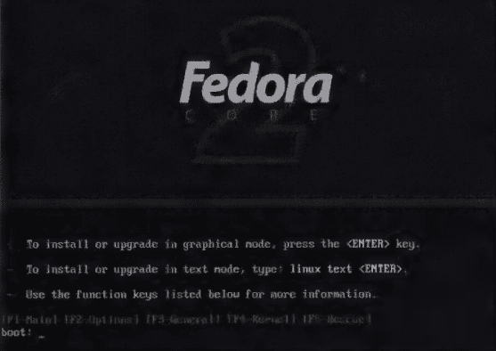

图 3-1 开始 Red Hat 安装

在此屏幕按下 Enter 键将执行默认图形化安装，该安装会自动检测硬件，并适用于 HCL（硬件兼容列表）上的大多数硬件配置。这是本章讨论的方法。不过，你也可以向安装程序传递信息以更改安装类型。

# 第 3 章 Linux 的安装与使用

到目前为止，安装过程中最大的问题是启动图形化安装；某些不在 HCL 上的 LCD 显示器和视频卡可能会在默认图形化安装期间出现黑屏或屏幕畸真。如果出现这种情况，只需重启安装并在启动时输入 `linux nofb` 然后按 Enter：禁用图形化安装的帧缓冲区（framebuffer）支持。帧缓冲区是显卡硬件的抽象表示，程序可以使用它来代替直接与显卡硬件进行通信。如果禁用帧缓冲区支持无法进行图形化安装，你可以重启安装，并在启动提示符输入 `linux text` 并按 Enter 来选择执行文本模式安装：

尽管大多数人倾向于执行图形化安装以方便使用，但文本模式安装更快，因为不需要加载图形用户界面。文本模式安装是第 7 章讨论的硬盘安装和网络安装的默认方式。

你还可以指定防止硬件损坏、检查介质错误、提供修复工具、加载额外的设备驱动程序、测试内存或加载更新软件的选项。在初始欢迎屏幕上按下 F2 可以看到这些选项，如图 3-2 所示。

```
- 要禁用硬件探测，输入：noprobe <ENTER>
要测试你正在使用的安装介质，输入：linux mediacheck <ENTER>
要启用救援模式，输入：linux rescue <ENTER>
按 F5) 获取有关救援模式的更多信息
如果你有驱动盘，输入：linux dd <ENTER>
在 CD-ROM 安装中提示正在使用的安装方法，
输入 linux method=<ENTER>
如果你有已安装磁盘，输入：linux updates <ENTER>
测试你系统的内存，输入：memtest86 <ENTER>
（此选项仅在从 CD 启动时可用）
(Main) F2-options fs-sd- kernel parameters
boot:
```

图 3-2 查看安装选项

无论你选择什么安装选项，在启动提示符处按下 Enter 后，你都会被要求在安装前检查使用的介质是否有错误，如图 3-3 所示。虽然这是一个可选的安装步骤，但对过去未用于安装 Linux 的 CD-ROM 介质进行测试是良好的做法，以确保介质错误不会导致后期中断。

## 安装 Linux

欢迎来到 Fedora Core

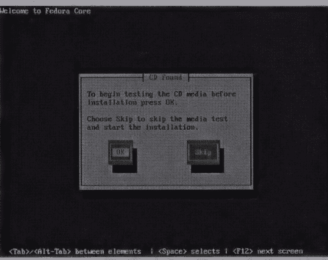

<Tab>/(Alt-Tab) 在元素间切换 <Space> 选择元素 <F12> 下一页

图 3-3 测试 CD-ROM 介质

### 选择语言、键盘、鼠标、显示器

介质测试后，将开始图形化安装，你将看到图形化欢迎屏幕。在该屏幕之后，你会被要求回答一系列问题以完成安装。第一个屏幕允许你选择安装语言，如图 3-4 所示。

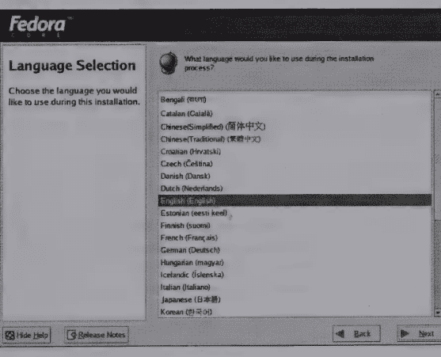

图 3-4 选择安装语言

# 第 3 章 Linux 的安装与使用

> 在大多数 Red Hat 安装屏幕的左侧是当前屏幕的描述和常见选项。

语言选择屏幕之后，你会被要求选择键盘，如图 3-5 所示。你的键盘的默认模型和布局会自动检测，因此它们很少被更改。然而，在继续之前验证屏幕上的信息是否正确是良好的做法。如果不确定，选择美国英语布局，因为它们在大多数情况下都能工作。如果鼠标的特定品牌和型号没有被自动检测，安装程序会提示你输入信息，如图 3-6 所示。为了适应可以使用鼠标第三按键的程序，如果鼠标目前没有第三按键，请确保勾选“Emulate 3 Buttons”（模拟 3 键）。如果选中该选项，将同时选择第三按键。

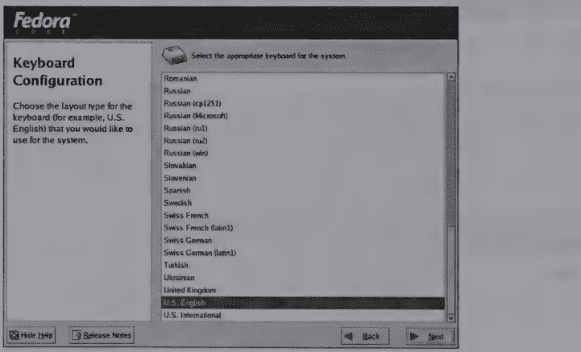

图 3-5 验证键盘配置

选择键盘和鼠标后，安装程序提示你验证显示器，如图 3-7 所示。虽然这是一个可选的安装步骤，但对过去未用于安装 Linux 的 CD-ROM 介质进行测试是良好的做法，以确保介质错误不会导致后期中断。

## 安装 Linux

欢迎来到 Fedora Core


<Tab>/(Alt-Tab) 在元素间切换 <Space> 选择元素 <F12> 下一页

图 3-3 测试 CD-ROM 介质

### 选择语言、键盘、鼠标、显示器

介质测试后，将开始图形化安装，你将看到图形化欢迎屏幕。在该屏幕之后，你会被要求回答一系列问题以完成安装。第一个屏幕允许你选择安装语言，如图 3-4 所示。


图 3-4 选择安装语言

# 第 3 章 Linux 的安装与使用

> 在大多数 Red Hat 安装屏幕的左侧是当前屏幕的描述和常见选项。

语言选择屏幕之后，你会被要求选择键盘，如图 3-5 所示。你的键盘的默认模型和布局会自动检测，因此它们很少被更改。然而，在继续之前验证屏幕上的信息是否正确是良好的做法。如果不确定，选择美国英语布局，因为它们在大多数情况下都能工作。如果鼠标的特定品牌和型号没有被自动检测，安装程序会提示你输入信息，如图 3-6 所示。为了适应可以使用鼠标第三按键的程序，如果鼠标目前没有第三按键，请确保勾选“Emulate 3 Buttons”（模拟 3 键）。如果选中该选项，将同时选择第三按键。


图 3-5 验证键盘配置

选择键盘和鼠标后，安装程序提示你验证显示器，如图 3-7 所示。虽然这是一个可选的安装步骤，但对过去未用于安装 Linux 的 CD-ROM 介质进行测试是良好的做法，以确保介质错误不会导致后期中断。

## 安装 Linux

欢迎来到 Fedora Core


由于操作频繁，结果是更容易失败，因此将目录挂载到各自独立的文件系统中是一个良好的做法。表 3-1 列出了常用用于分离分区的目录，并列出了它们的推荐大小。

## 表 3-1 常见的 Linux 文件系统和大小

| 目录 | 描述 | 推荐大小 |
|---|---|---|
| `/` | 包含其他文件系统中不存在的所有目录 | 取决于现有文件系统的大小和数量，但通常为 4GB 或更多 |
| `/boot` | 包含 Linux 内内核和引导文件 | 50MB |
| `/home` | 用户目录的默认位置 | 每个用户 200MB |
| `/usr` | 系统命令和工具 | 取决于安装的软件包——通常为 3GB |
| `/usr/local` | 大多数额外程序的位置 | 取决于安装的软件包——通常为 4GB |
| `/opt` | 附加池的备位置 | 取决于安装的软件包——通常为 4GB |
| `/var` | 包含日志文件和池 | 2GB |
| `/tmp` | 存放程序创建的临时文件 | 500MB |

这些系统可能可能是不同的类型。今天最常用的类型是 `ext2`、`ext3`、`VFAT` 和 `REISER` 文件系统，尽管 Linux 可以支持 50 多种不同的文件系统。每个文件系统本质上执行相同的功能，即在分区上存储文件；然而，每个文件系统提供不同的特性，并专用于不同的用途。`ext2` 文件系统是 Linux 计算机仍在使用的传统文件系统，而虚拟文件分配表（`VFAT`）系统与 Windows 中的 FAT 文件系统兼容。然而，`ext3` 和 `REISER` 文件系统比 `ext2` 和 `VFAT` 系统更健壮，因为它们执行一种名为“日志记录”（journaling）的功能。日志文件系统是一种在日志中跟踪写入硬盘的信息的系统。如果你在硬盘上将文件从一个目录复制到另一个目录，该文件必须进入物理内存，然后写入硬盘上的新位置。如果在此过程中关闭了电脑电源，信息可能无法按预期传输，并导致数据丢失或损坏。使用日志记录文件系统，将文件复制到新位置所需的每一步都会写入日志，这样系统就可以追溯掉电前所采取的步骤并完成文件操作。这两种文件系统与 `ext2` 和 `VFAT` 相比还提供了许多额外的改进，包括更快的数据传输和索引，是今天 Linux 服务器的常见选择。

在确定了安装所需的文件系统数量和类型后，你可能会允许 Red Hat Linux 安装程序根据系统上的硬盘总空间自动分区，或者你可能会选择使用 `Druid` 图形分区工具进行手动分区，如图 3-9 所示。

## Fedora

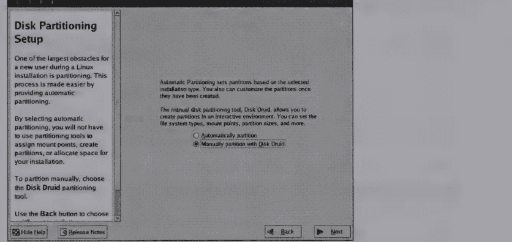

**图 3-9** 选择磁盘分区方法

`Druid` 是一个易于使用的图形分区程序；你可以删除现有分区、创建和编辑新分区，甚至创建一个廉价磁盘冗余阵列（`RAID`）卷，以防止任何硬盘故障导致的数据丢失。`RAID` 在第 7 章中讨论。

图 3-10 显示了为 `/` 文件系统（`ext3`）和交换（`swap`）创建两个分区后的 `Druid`。根据磁盘大小和已建立的分区数量，你的磁盘可能与图 3-10 所示的不同。如果首先安装了 Windows，则在添加新分区之前必须删除该分区。新分区只能从空空间分配。要添加附加分区和文件系统，只需在 `Druid` 中选择“新建”（New）按钮并提供适当信息，如图 3-11 所示。

# 第 3 章 Linux 安装与使用

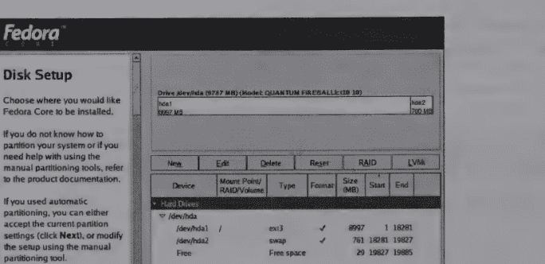

图 3-10 Disk Druid 分区工具

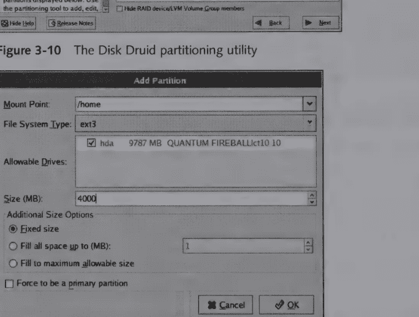

图 3-11 创建新分区

## 配置引导加载程序

在安装程序期间指定分区和文件系统后，会提示你配置引导加载程序，如图 3-12 所示。引导加载程序是 BIOS ROM 在自检（`POST`）后启动的程序，它从计算机内部的硬盘分区将 Linux 内核加载到内存中，也可以用于启动（启动）硬盘上的其他操作系统（如 Windows）。你可以使用 Red Hat Fedora Linux 配置的引导加载程序是统一引导加载程序（`GRUB`）。引导加载程序在第 8 章“使用 BASH Shell”中进行讨论。

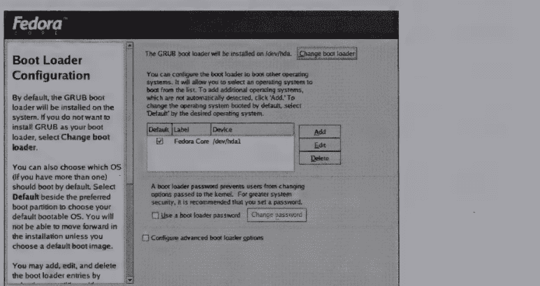

图 3-12 配置引导加载程序

Red Hat 会自动检测硬盘上的 Windows 操作系统，并设置引导加载程序显示一个屏幕，允许你在启动时选择启动的操作系统；此过程被称为双引导（dual booting）。如果你点击“更改引导加载程序”按钮（如图 3-12 所示），你可以安装 `GRUB` 或完全不安装引导加载程序。这在你没有 Windows 时通常会这样做。

## 第3章 Linux 的安装与使用

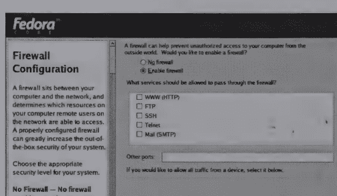

图 3-15 配置防火墙

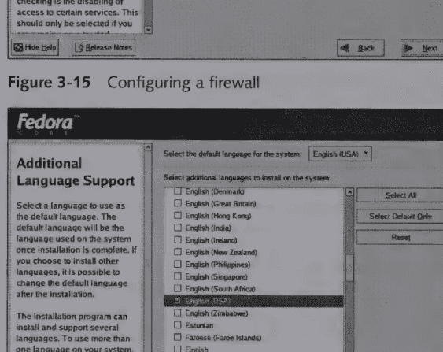

图 3-16 选择额外的语言支持

## 安装 Linux 93

## Fedora

### 选择时区

通过选择你计算机的物理位置来设置时区。

在交互式地图上，点击特定的城市（用黄色点标记），将出现一个红色的 X 表示已选择。你也可以滚动列表并选择时区。

你也可以滚动列表并选择你所需的时区。

你还可以选择“系统时钟使用 UTC”选项，该选项也称为


## 图 3-17 选择时区

## Fedora

### 设置 root 密码

仅将 `root` 账户用于管理。安装完成后，创建一个 `root` 账户供你日常使用，并在需要快速修复问题时使用 `sudo` 获取 `root` 权限。这些基本规则将最大限地减少系统发生此类意外损坏的概率。

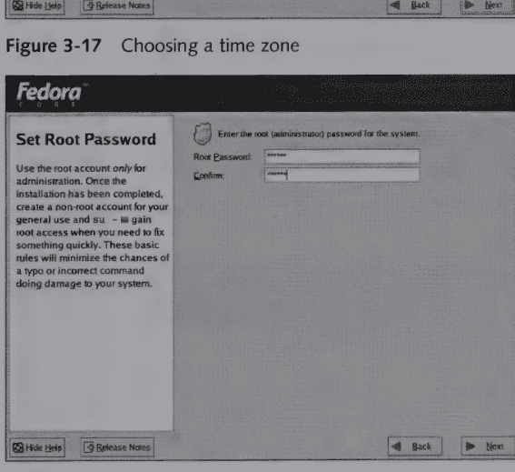

## 图 3-18 设置 root 密码

## 第3章 Linux 的安装与使用

### 选择软件包

接下来，Red Hat 安装程序将根据之前在图 3–8 中选择的安装类型提供软件包列表。你可以选择某些功能所需的通用软件包（如图 3–19 所示），也可以通过点击相应软件包组旁边的“详细信息”链接来精简软件包列表。

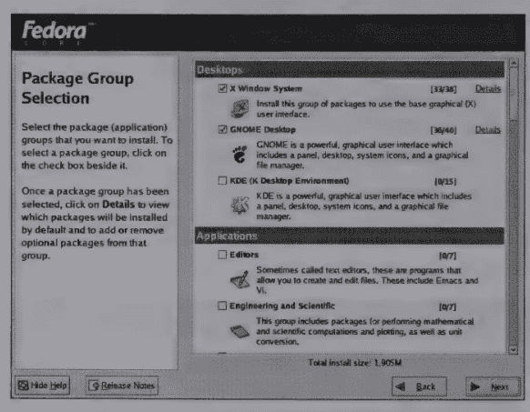

图 3–17 选择软件包

### 安装软件包

选择软件包后，Red Hat 安装程序会提示你开始文件复制过程，过程中选定的安装的软件包将创建在硬盘上，如图 3–20 所示。

软件包安装完成后，Red Hat 安装程序将显示“恭喜”屏幕，从 CD-ROM 驱动器弹出光盘，并提示你重启系统。

### 完成首次启动向导

在安装后的首次启动时，在登录提示之前会出现一个交互式工具（称为首次启动向导），如图 3–21 所示。在完成此工具后，计算机启动时它将不再再次出现。

## 安装 Linux

95

## Fedora

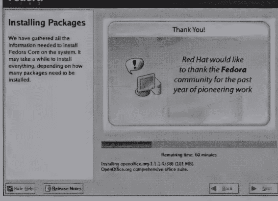

3

图 3-20 软件包安装


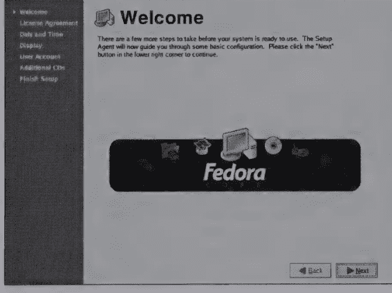

图 3-21 首次启动向导

# 第3章 Linux 的安装与使用

如果你点击图 3-21 所示的“下一步”按钮，则需要接受许可协议。随后，系统会提示你设置日期和时间，或通过网络时间协议（NTP）从互联网上的可靠时间服务器接收时间，如图 3-22 所示。

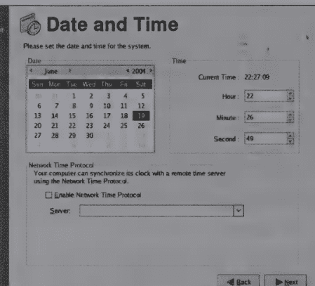

图 3-22 设置日期和时间

接下来，系统会提示你选择 GUI 环境加载时显示的默认分辨率和色彩深度，如图 3-23 所示。随后，系统会提示你创建一个普通用户账户，如图 3-24 所示。对于日常用户任务，你应该避免以 root 用户身份登录，以减少无意中更改系统设置的概率。

Linux 用户默认通过本地计算机上的密码数据库进行身份验证。该密码数据库默认也使用影子密码（shadow passwords）。影子密码存储在与用户账户分开的数据库中，以获得更高的安全性。影子密码支持长 256 个字符，并使用 MD5 哈希算法进行加密。你还可以选择通过网络上另一台服务器上的数据库来验证某些或所有用户，而 LDAP（轻量级目录协议）、SMB（服务器消息块）和 Winbind 等类型的身份验证和用户信息可能通过 DNS 协议存在于你网络中的其他服务器上。网络身份验证的详细配置超出了本书的范围。

## 安装 Linux

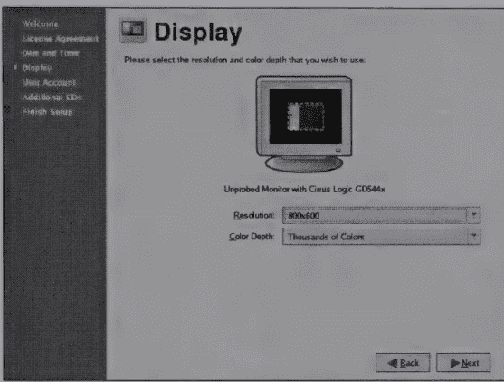

图 3-23 配置分辨率和色彩深度

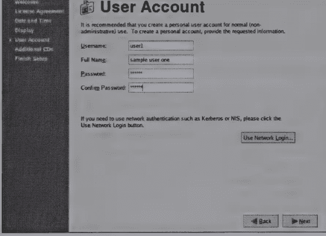

图 3-24 创建用户账户

要配置身份验证选项，请点击图 3-24 中的“网络登录”按钮并指定适当的参数，如下所示。98 Linux 安装与使用

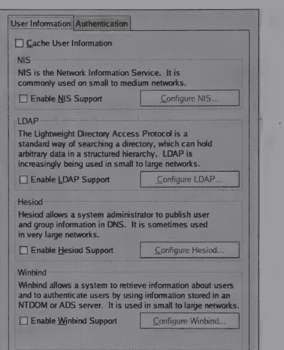

图 3-25 配置身份验证

### Linux-93 安装 Fedora

如果你点击图 3-21 所示的“下一步”按钮，则需要接受许可协议。随后，系统会提示你设置日期和时间，或通过网络时间协议从互联网上的可靠时间服务器接收时间，如图 3-22 所示。


图 3-25 配置身份验证

### 身份验证选项

要配置身份验证选项，请点击图 3-24 中的“网络登录”按钮并指定适当的参数，如下所示。 身份验证

| 用户信息 | 身份验证 |
| :--- | :--- |
| 影子密码 | 轻量级目录协议是一种搜索目录的标准方法 |
| Kerberos | Kerberos 是一种受信任的第三方身份验证系统，常用于中大型网络 |
| SMB | SMB 允许通过连接到服务器来验证密码 |
| Winbind | Winbind 允许从 NIS 或 AD 服务器检索用户信息 |

**图 3-26 配置身份验证**

## Linux 的使用

Linux 用户默认通过本地计算机上的密码数据库进行身份验证。该密码数据库默认也使用影子密码。影子密码存储在与用户账户分开的数据库中，以获得更高的安全性。影子密码支持长 256 个字符，并使用 MD5 哈希算法进行加密。你还可以选择通过网络上另一台服务器上的数据库来验证某些或所有用户，而 LDAP（轻量级目录协议）、SMB（服务器消息块）和 Winbind 等类型的身份验证和用户信息可能通过 DNS 协议存在于你网络中的其他服务器上。网络身份验证的详细配置超出了本书的范围。

# Linux 基础使用入门 101

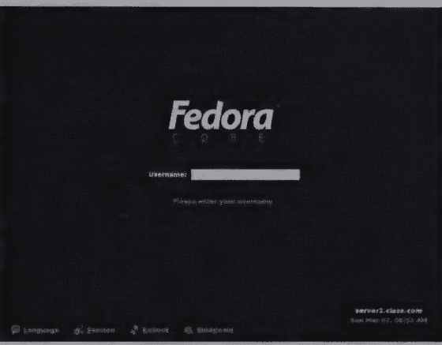

图 3-28 gdm (GNOME 显示管理器)

要访问本地服务器上的终端设备，你可以按下如 `Ctrl+Alt+F1` 等组合键切换到终端。如果你是跨网络登录，可以使用各种程序连接到 Linux 计算机上的终端。表 3-2 显示了本地 Linux 终端列表及其名称和类型。

| 终端名称 | 组合键 | 登录类型 |
|---|---|---|
| tty1 | Ctrl+Alt+F1 | 命令行 |
| tty2 | Ctrl+Alt+F2 | 命令行 |
| tty3 | Ctrl+Alt+F3 | 命令行 |
| tty4 | Ctrl+Alt+F4 | 命令行 |
| tty5 | Ctrl+Alt+F5 | 命令行 |
| tty6 | Ctrl+Alt+F6 | 命令行 |
| tty7 (:0) | Ctrl+Alt+F7 | 图形界面 |

登录命令行终端后，你会收到一个用于输入命令的提示符。如果你以 root 用户（管理员）身份登录，将使用 # 提示符：

```
Fedora Core release 2 (Tettnang)
Kernel 2.6.5-1.358 on an i686
server1 login: root
Password:
```

```
Last login: Mon Mar 8 09:45:42 on tty2
[root@server1 ~]#
```

## 第 3 章 Linux 安装与使用

然而，如果你以普通用户身份登录命令行终端（例如用户 `user1`），将使用 $ 提示符：

```
Fedora Core release 2 (Tettnang)
Kernel 2.6.5-1.358 on i686
server1 login: user1
Password:
Last login: Mon Mar 8 09:45:42 on tty2
[user1@server1 ~]$
```

当你登录到图形终端时，将启动你选择的 GUI 环境；Red Hat Linux 的默认 GUI 环境是 GNOME。GUI 环境启动后，你可以通过导航到 Red 菜单、系统工具（System Tools）、终端（Terminal）来访问命令行窗口，如图 3-29 所示。

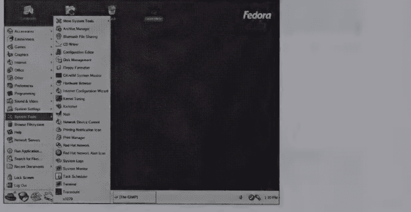

图 3-29 在 GUI 环境中访问命令行

### 基础 Shell 命令

使用命令行终端时，shell 最终会解释用户输入到命令行的所有信息。这些信息包括命令本身，以及选项和参数。命令指示要执行的程序名称，并且区分大小写。选项是以 "-" 开头的特定字母，出现在命令名称之后，用于更改命令的工作方式。选项是特定命令的；开发命令的人员决定了该命令允许哪些选项。

# Linux 基础使用 103

某些选项以双杠 "--" 开头；这些选项被称为 POSIX 选项，通常由整个单词组成，而不仅仅是字母。


参数也出现在命令名称之后，但不以破杠开头。它们指定了命令的工作参数，这些参数并不是由开发命令的人预先定义的。例如，假设你想列出硬盘上 `/etc/ntp` 目录下的所有文件。你可以使用 `ls` 命令配合 `-a` 选项（告诉 `ls` 列出所有文件）和 `/etc/ntp` 目录（告诉 `ls` 在 `/etc/ntp` 目录中查找），如下例所示：

```
[root@server1 root]# ls -a /etc/ntp
... keys ntps step-tickers
[root@server1 root]#
```

在前面的输出中输入命令并按回车后，`ls` 命令向我们显示 `/etc/ntp` 目录中有三个文件，并返回你的命令提示符以便你输入另一个命令。

命令、选项和参数都是区分大小写的；例如，大写字母 (A) 的处理与小写字母 (a) 不同。


始终在命令名称、选项和参数之间留空格；否则 shell 无法理解它们是分开的，你的命令可能无法按预期方式工作。

尽管你可以向命令传递选项和参数，但并不是所有命令都需要在命令行上提供参数或选项才能正常工作。`date` 命令就是一个打印当前日期和时间的示例：

```
[root@server1 root]# date
Tue Mar 29 08:58:36 EST 2005
[root@server1 root]#
```


# 第 3 章 Linux 安装与使用

表 3–3 列出了你可以在不指定任何选项或参数的情况下使用的常用命令。

表 3–3 常用命令

| 命令 | 描述 |
|---|---|
| `clear` | 清空终端 |
| `reset` | 重置终端 |
| `finger` | 显示信息 |
| `who` | 显示当前登录的用户 |
| `w` | 显示当前登录的用户 |
| `date` | 显示当前日期 |
| `cal` | 显示日历 |
| `exit` | 退出 shell |
| `id` | 显示用户 ID 和组 ID |
| `whoami` | 显示用户名 |

表 3-3 常用命令（续）

| 命令 | 描述 |
|---|---|
| `&` | 后台命令执行 |
| `:` | 命令终止 |
| `<<<` | 输入/输出重定向 |
| `|` | 命令管道 |
| `* ?` | Shell 通配符 |
| `" '` | 元字符引号 |
| `()` | 命令分组 |

## 元字符

表 3-4 常用元字符

| 元字符 | 描述 |
|---|---|
| `$` | Shell 变量 |
| `~` | 特殊家目录 |

### 基础用法

| 元字符 | 描述 |
|---|---|
| `&` | 后台命令执行 |
| `:` | 命令终止 |
| `<<<` | 输入/输出重定向 |
| `|` | 命令管道 |
| `* ?` | Shell 通配符 |
| `" '` | 元字符引号 |
| `()` | 命令分组 |

## 元字符

在某些情况下，你可能需要在命令中使用元字符，并防止 shell 解释其特殊含义。要实现这一点，只需将元字符封装在单引号 `''` 之间。单引号可以保护这些元字符不被 shell 特殊解释（也就是说，`$` 被解释为 `$` 字符而不是变量标识符）。你也可以使用双引号 `"` 来执行相同任务；双引号不保护 `$` 和 `\` 字符。如果只有一个字符需要免受 shell 解释，你可以在该字符前加上反斜杠 `\`，而不是封装在引号中。这种引号类型的示例如下：

```
[root@server1 root]# echo My Shell is $SHELL

My Shell is /bin/bash

[root@server1 root]# echo 'My Shell is $SHELL'

My Shell is $SHELL

[root@server1 root]# echo "My Shell is $SHELL"

My Shell is /bin/bash

[root@server1 root]# echo My Shell is \$SHELL

My Shell is $SHELL

[root@server1 root]# _
```

如表 3–4 所示，并不是所有的引号都能保护字符免受 shell 处理。反引号 `` ` `` 可用于命令替换；反引号之间的任何内容都会被 shell 视为另一个命令，并将其输出替换到反引号的位置。以表达式 `'date'`为例：

```
[root@server1 root]# echo Today is `date`

Today is Tue Mar 29 09:28:11 EST 2005

[root@server1 root]#
```

## 获取命令帮助

大多数 Linux 发行版在配置中都包含超过 1000 种不同的 Linux 命令，因此，记忆每个命令的语法和用法是不现实的。幸运的是，Linux 将每个命令的文档存储在中心位置，以便于轻松访问。Linux 命令最常见的文档形式是手册页（通常称为 `man` pages）。只需输入 `man` 命令后跟上命令名称，终端屏幕上就会逐页显示有关该 Linux 命令的详尽信息。这些信息包含了命令的描述和语法，以及可用的选项 `options`、相关文件和命令。例如，若要获取关于 `whoami` 命令的格式和用法信息，可以使用以下命令：

```
[root@server1 root]# man whoami
```

随后，手册页将逐页显示在终端屏幕上。你可以使用键盘上的（箭头）键来滚动查看信息，或按 `q` 退出。`whoami` 的手册页类似于下面：

```
WHOAMI (1) User Commands WHOAMI (1)

NAME whoami - 打印有效 userid

SYNOPSIS

whoami [OPTION]...

DESCRIPTION

打印与当前有效用户 id 关联的用户名。同于 id -un。

--help 显示此帮助并退出

--version

输出版本信息并退出

AUTHOR

由 Richard Mlynarik 编写。

REPORTING BUGS

向 <bug-coreutils.gnu.org> 报告错误。

COPYRIGHT

Copyright C 2004 Free Software Foundation, Inc.

这是免费软件；复制条件请查看源代码。没有任何保证，即使是对于商业性

或特定用途的适用性。
```

另请参见
`whoami` 的完整文档作为 Tex-info 手册维护。如果你的站点已正确安装了 `info` 和程序，执行命令
`info coreutils whoami`
 应该可以让你访问完整的手册。

```
energizerups (8) - Energizer (Megatec) 驱动程序

protocol over USB To RS232 Interface (V1.0) BaudRate

2400bps) UPS 设备 - 下载件到 EZ-USB 设备

lsusb (8) - 列出所有 USB 设备

sane-canon630u (5) - Canon 630u USB 平板扫描器的 SANE 后端

sane-find-scanner (1) - 寻找 SCSI 和 USB 扫描仪及其设备文件

sane-gt68xx (5) - 用于 GT-68XX 使用 USB 平板扫描器的 SANE 后端

sane-ma1509 (5) - Mustek BearPaw 1200F USB 扫描器的 SANE 后端

sane-mustek_usb (5) - Mustek USB 平板扫描器的 SANE 后端

sane-plustek (5) - 用于 Plustek 并口和 LM983 [1/2/3] 使用 USB 平板扫描器的 SANE 后端

sane-sm3600 (5) - 带有 M011 USB 芯片的 Microtek 扫描器的 SANE 后端

usb (5) - SANE USB 配置提示

usbmodules (8) - 列出插入 USB 设备可用的内核驱动模块
```
[root@server root]#

在你找到需要的命令后，可以简单地不带 `-k` 选项运行 `man` 命令来查找该命令的详细信息。

> 你也可以使用 `apropos usb` 命令来实现与 `man -k usb` 命令相同的功能。这两个命令在终端上产生相同的输出。

> 如果在安装 Linux 后没有看到 `man -k` 或 `apropos` 命令的任何输出，你可能需要运行 `whatis` 命令来索引手册页数据库。

另一个最初旨在替换 Linux 中 `man` 命令的工具是 GNU `info` 页。你可以通过输入 `info` 命令后跟上目标命令名称来访问此工具。`info` 命令返回每个命令的易于阅读的描述，并链接到其他信息页（称为超链接）。今天，`info` 页和手册页都用于查找文档，因为 Linux 自其诞生之初就使用了手册页，而且在 UNIX 操作系统中已使用了二十多年。以下是使用 `info` 工具查找 `whoami` 命令信息的示例：

```
[root@server root]# whoami
```

随后以交互方式显示 `info` 页：

File: coreutils.info, Node: whoami invocation, Next:

groups invocation, Prev: longterm invocation, Up:

User information

'whoami': 打印有效用户 id

'whoami' 打印与当前有效用户 id 关联的用户名。它等同于命令 'id -un'。

只有选项 '--help' 和 '--version'。

*常用选项：*

退出状态为零表示成功，非零表示失败。

欢迎使用 Info 版本 4.6。输入 ? 获取帮助，输入 m 进入菜单项。

[root@server1]# _

在工具区域时，按下键或 `Ctrl+h` 组合键可以显示描述 `info` 用法的帮助屏幕。使用 `man` 命令时，你可以使用 `q` 键退出。


命令没有手册页或 `info` 页。这些命令通常是内置在 BASH shell 自身的函数。要查找这些命令的帮助，使用 `man` 命令时，你可以使用 `q` 键退出。


这些命令没有手册页或 `info` 页。这些命令通常是内置在 `BASH` shell 自身的函数。要查找这些命令的帮助，使用 `man` 命令时，你可以使用 `q` 键退出。

## 关闭 Linux 系统

由于操作系统处理将数据从内存写入磁盘，直接关闭计算机电源可能会导致用户和系统文件损坏。因此，在关闭硬件组件之前为操作系统做好准备是重要的。为此，你可以执行 `shutdown` 命令来关闭或重启你的计算机。例如，若要在 15 分钟后关闭系统，你可以输入：

```
[root@server1]# shutdown -h +15
产生输出如下：
```

Broadcast message from root (tty2) (Tue Mar 29 04:08:18 2005):

系统将在 15 分后关机！

注意上述输出，在关闭命令启动后你不会收到命令提示符。因此，要停止关闭，只需组合 `Ctrl` 和 `c` 键。或者，你可以登录另一个终端并执行 `-c` 命令来取消。

若要立即关闭系统，你可以输入：

```
[root@server1]# shutdown -h now
产生输出如下：
```

Broadcast message from root (tty2) (Tue Mar 29 04:08:18 2005):

系统正在立即关机！

`shutdown` 命令的其他示例及其描述见表 3-6。

| 命令 | 描述 |
|---|---|
| `shutdown -h +4` | 在 4 分钟后关机 |
| `shutdown -r +4` | 在 4 分钟后重启 |
| `shutdown -h now` | 立即关机 |
| `shutdown -r now` | 立即重启 |
| `shutdown -c` | 取消计划关机 |
| `halt` | 立即关机 |
| `reboot` | 立即重启 |

### 章节总结

- 大多数软件信息可以在安装时指定；但在安装前应仔细规划网络配置和软件包选择。
- 虽然有多种安装 Linux，但基于 CD-ROM 的安装是最简单、常用的方法，很少需要创建安装启动盘。
- 典型的 Linux 安装会提示用户提供语言、引导程序、硬盘分区、网络配置、防火墙配置、时区、用户账户、身份验证和软件包选择等信息。

## 核心术语

无论你使用何种类型的终端（图形界面或命令行），你都可以在 shell 提示符处输入命令、选项和参数，以执行系统任务、获取命令帮助或关闭 Linux 系统。shell 是区分大小写的，并且能够理解各种被称为 shell 元字符的特殊字符，如果不需要这些字符的特殊含义，则应对它们进行保护。

### 核心术语

- `arguments`（参数）——出现在命令名称后的文本，不以连字符 `"-"` 开头，并指定了命令能够正常工作所需的信息。
- `authentication`（身份验证）——每个用户在访问系统用户界面之前必须使用有效的用户名和密码登录的过程。
- `BASH shell`——布恩 再次加强外壳（Bourne Again Shell）；它是 Linux 中的默认命令行界面。
- `boot loader`（引导程序）——由 BIOS ROM 启动的小型程序，在内存中执行 Linux 内核。
- `command`（命令）——存在于硬盘上的程序，在命令行中输入时执行。
- `Disk Druid`（磁盘大师）——一个易于使用的图形化程序，用于分区或修改机械硬盘（HDD）上的分区。
- `dual booting`（双系统）——在计算机上安装多个操作系统的过程。用户可以在系统启动时选择要加载的操作系统。
- `ext2`——一种非日志记录的 Linux 文件系统。
- `ext3`——一种带日志的 Linux 文件系统。
- `firstboot wizard`（首次启动向导）——在 Red Hat Linux 安装后系统启动时立即运行的配置实用。
- `framebuffer`（帧缓冲）——程序使用的视频硬件的抽象表示，使得它们无需直接与视频硬件进行通信。
- `GRand Unified Bootloader (GRUB)`——Linux 中常用的引导程序。
- `info pages`（info 页面）——通过输入 `info` 命令行工具可用的一组本地、易于阅读的命令语法文档。
- `journaling`（日志记录）——一种在日志中跟踪需要写入硬盘信息的文件系统。常见的带日志文件系统包括 `ext3` 和 `REISER`。
- `kernel parameters`（内核参数）——可以传递给 Linux 内核以更改其工作方式的特定信息分段。
- `large block addressing 32-bit (LBA32)`（32 位大块寻址）——一个可以在引导程序中指定的参数，用于启用大块寻址；仅当系统 BIOS 不完全支持大容量硬盘时才需要它。
- `manual pages`（手册页）——常用的本地命令语法文档集，通过输入 `man` 命令行工具可用。也称为 man 页面。
- `metacharacters`（元字符）——Linux 操作系统中具有特殊含义的键组合。
- `options`（选项）——以连字符 `"-"` 或 `"--"` 开头并出现在名称后的特定字母，用于更改命令的工作方式。
- `redundant array of inexpensive disks (RAID)`（廉价冗余阵列）——一种用于将硬盘组合在一起以实现容错的存储类型。
- `REISER`——Linux 中使用的一种日志文件系统。
- `shell`（外壳）——接受用户输入并将输入传递给内核处理的用户界面。
- `swap memory`（交换内存）——另见 虚拟内存。
- `terminal`（终端）——允许特定用户登录并通过用户界面与内核通信的通道。


- VFAT (Virtual File Allocation Table)——Linux 中可能使用的非日志记录文件系统。
- virtual memory（虚拟内存）——硬盘上的一个区域（交换分区），当物理内存（RAM）被过度使用时，可以用于存储通常驻留在物理内存中的信息。

## 复习题

1. Linux 中的默认 shell 叫什么名字？
   a. SH
   b. BSH
   c. CSH
   d. BASH

2. 哪个与 `man` 命令等同的项通常为所查询的命令提供更易读的描述，并包含指向其他相关信息的链接？
   a. who
   b. man help
   c. man -descriptive
   d. info

3. 使用哪个命令可以立即安全地关闭 Linux 系统？
   a. `shutdown -c`
   b. `shutdown -r`
   c. down
   d. `halt`

## 复习题 113

4. 哪个命令等同于 `man -k` 关键字命令？
   a. find keyword
   b. man keyword
   c. `apropos keyword`
   d. help keyword

5. Red Hat 的安装可以在以下哪两种模式下进行？
   a. text
   b. full
   c. text
   d. graphical
   e. administrator assisted

6. 通过命令行输入的 Linux 命令不区分大小写。
   True
   False

7. 哪个命令可以清空之前显示输出的终端屏幕？
   a. erase
   b. clean
   c. blank
   d. `clear`

8. 坐在运行 Linux 的电脑前，按下什么键组合可以打开图形终端？
   a. Ctrl+Alt+F1
   b. Ctrl+Alt+7
   c. Ctrl+Alt+F7
   d. Ctrl+7

9. 用户登录终端后，会收到一个什么样的用户界面？
   a. GUID
   b. shell
   c. text box
   d. command screen

10. 用户直接向 Linux 系统的内核输入命令。
    True
    False

## Linux 安装与使用

11. Linux 中的默认 shell 叫什么？
    a. SH
    b. BSH
    c. CSH
    d. BASH

12. 哪个与 `man` 命令等同的项通常为所查询的命令提供更易读的描述，并包含指向其他相关信息的链接？
    a. who
    b. man help
    c. man -descriptive
    d. info

13. 使用哪个命令可以立即安全地关闭 Linux 系统？
    a. `shutdown -c`
    b. `shutdown -r`
    c. down
    d. `halt`

14. 哪个命令等同于 `man -k` 关键字命令？
    a. find keyword
    b. man keyword
    c. `apropos keyword`
    d. help keyword

15. Red Hat 的安装可以在以下哪两种模式下进行？
    a. text
    b. full
    c. text
    d. graphical
    e. administrator assisted

16. 通过命令行输入的 Linux 命令不区分大小写。
    True
    False

17. 哪个命令可以清空之前显示输出的终端屏幕？
    a. erase
    b. clean
    c. blank
    d. `clear`

18. 坐在运行 Linux 的电脑前，按下什么键组合可以打开图形终端？
    a. Ctrl+Alt+F1
    b. Ctrl+Alt+7
    c. Ctrl+Alt+F7
    d. Ctrl+7

19. 用户登录终端后，会收到一个什么样的用户界面？
    a. GUID
    b. shell
    c. text box
    d. command screen

20. 用户直接向 Linux 系统的内核输入命令。
    True
    False

11. Linux 中的默认 shell 叫什么？
    a. SH
    b. BSH
    c. CSH
    d. BASH

12. 哪个与 `man` 命令等同的项通常为所查询的命令提供更易读的描述，并包含指向其他相关信息的链接？
    a. who
    b. man help
    c. man -descriptive
    d. info

13. 使用哪个命令可以立即安全地关闭 Linux 系统？
    a. `shutdown -c`
    b. `shutdown -r`
    c. down
    d. `halt`

14. 哪个命令等同于 `man -k` 关键字命令？
    a. find keyword
    b. man keyword
    c. `apropos keyword`
    d. help keyword

15. Red Hat 的安装可以在以下哪两种模式下进行？
    a. text
    b. full
    c. text
    d. graphical
    e. administrator assisted

16. 通过命令行输入的 Linux 命令不区分大小写。
    True
    False

17. 哪个命令可以清空之前显示输出的终端屏幕？
    a. erase
    b. clean
    c. blank
    d. `clear`

18. 坐在运行 Linux 的电脑前，按下什么键组合可以打开图形终端？
    a. Ctrl+Alt+F1
    b. Ctrl+Alt+7
    c. Ctrl+Alt+F7
    d. Ctrl+7

19. 用户登录终端后，会收到一个什么样的用户界面？
    a. GUID
    b. shell
    c. text box
    d. command screen

20. 用户直接向 Linux 系统的内核输入命令。
    True
    False

## Linux 安装与使用

11. Linux 中的默认 shell 叫什么？
    a. SH
    b. BSH
    c. CSH
    d. BASH

12. 哪个与 `man` 命令等同的项通常为所查询的命令提供更易读的描述，并包含指向其他相关信息的链接？
    a. who
    b. man help
    c. man -descriptive
    d. info

13. 使用哪个命令可以立即安全地关闭 Linux 系统？
    a. `shutdown -c`
    b. `shutdown -r`
    c. down
    d. `halt`

14. 哪个命令等同于 `man -k` 关键字命令？
    a. find keyword
    b. man keyword
    c. `apropos keyword`
    d. help keyword

15. Red Hat 的安装可以在以下哪两种模式下进行？
    a. text
    b. full
    c. text
    d. graphical
    e. administrator assisted

16. 通过命令行输入的 Linux 命令不区分大小写。
    True
    False

17. 哪个命令可以清空之前显示输出的终端屏幕？
    a. erase
    b. clean
    c. blank
    d. `clear`

18. 坐在运行 Linux 的电脑前，按下什么键组合可以打开图形终端？
    a. Ctrl+Alt+F1
    b. Ctrl+Alt+7
    c. Ctrl+Alt+F7
    d. Ctrl+7

19. 用户登录终端后，会收到一个什么样的用户界面？
    a. GUID
    b. shell
    c. text box
    d. command screen

20. 用户直接向 Linux 系统的内核输入命令。
    True
    False

## 实验项目

这些实验项目应该按照给顺序完成。本章中的实验总共需要三小时。实验的要求包括：

- Red Hat Fedora Core 2 光盘套装（四张光盘）
- 满足 Red Hat 安装要求的 Intel 架构计算机，包括 8GB 或更大的硬盘和光驱

### 项目 3-1


在这个实验项目中，你将在计算机上安装 Red Hat Linux。

1. 开启计算机并将第一张 Red Hat Fedora Core 2 光盘放入光驱。几秒钟后会出现 Fedora Core 屏幕。


如果没有出现 Fedora Core 屏幕，请确保计算机的 BIOS 设置中光驱列在启动顺序的前位。


注意

2. 在 Fedora Core 屏幕上，阅读可用选项并按回车开始安装。
3. 在找到光盘屏幕上，选择跳过并按回车。
4. 在欢迎使用 Fedora Core 屏幕，点击下一步。
5. 在语言选择屏幕，确保选择了英语并点击下一步。
6. 在键盘配置屏幕，验证选择了美式英语并点击下一步。
7. 如果收到鼠标配置屏幕，核实你的鼠标型号和端口并点击下一步。
8. 如果收到显示器配置屏幕，核实你的显示器型号、水平同步范围和垂直同步范围是否正确并点击下一步。
9. 在安装类型屏幕，选择自定义并点击下一步。（注意：如果提示要升级现有 Linux 安装，请确保你选择安装全新的 Linux。）
10. 在磁盘分区设置屏幕，选择使用 Disk Druid 手动分区并点击下一步。
11. 在磁盘设置屏幕上，使用鼠标突出硬盘设备上的任何现有分区，并点击删除按钮确认操作。

# 实践项目 117

12. 使用鼠标高亮硬盘设备上的空闲空间并点击“新建”（New）按钮。在显示的屏幕上输入以下信息：
挂载点 = `/`
类型 = `ext3`
大小（固定） = 填入你在“实践项目 2-1”中获得的“文件可用空间”（Space available for Filesystems）的值。该值应大于 7000MB。
完成后点击确定。
13. 使用鼠标高亮硬盘设备上的空闲空间，并点击“新建”（New）按钮。在显示的屏幕上输入以下信息：
类型 = `swap`
大小（固定） = 填入你在“实践项目 2-1”中获得的“交换分区所需”（Space required for swap partition）的值。完成后点击确定。
14. 观察分区名称。验证你的硬盘设备上仍有 50MB 的空闲空间，并点击“下一步”（Next）。
15. 在启动程序配置屏幕上，确保将安装 GRUB 启动程序。选择“配置高级引导程序选项”（Configure advanced boot loader options）并点击“下一步”。
16. 在高级引导程序配置屏幕上，确保启动程序将安装在第一块硬盘设备（通常为 `/dev/hda`）的主引导记录（MBR）上，并点击“下一步”。
17. 在网络配置屏幕上，确保主机名手动设置为 `server1.class`。点击“编辑”（Edit）并为 `eth0` 设备勾选“启动时激活”（Activate on boot）。输入相应的 IP 地址和子网掩码（除非选择 DHCP）并点击确定。输入网关和主 DNS 信息（除非选择 DHCP）并点击“下一步”。如果你的网卡未被自动检测，则不存在此步骤。
18. 在防火墙配置屏幕上，选择“无防火墙”（no firewall）并点击“下一步”。当出现“警告 - 无防火墙”屏幕时，点击“继续”（Proceed）。
19. 在附加语言支持屏幕上，确保选择了英语（美国）并点击“下一步”。
20. 在时区选择屏幕上，选择你的时间并点击“下一步”。
21. 在设置 Root 密码屏幕上，在“Root 密码”和“确认密码”文本框中输入密码 `secret`，并点击“下一步”。
22. 在软件包组选择屏幕上，滚动到可用软件包列表底部，选择“全部”（Everything），并点击“下一步”。
23. 在“准备安装”屏幕上，点击“下一步”。当出现“需要安装媒体”屏幕时，点击“继续”（Continue）。随后将显示“正在安装软件包”（Installing Packages）屏幕。
此步骤取决于你的硬件，通常需要 40 到 100 分钟，并你在提示时将第二、第三和第四张 CD-ROM 放入光驱。
24. 在“恭喜”屏幕上，从计算机中移除 CD-ROM 并点击“重启”（Reboot）按钮。你的系统现在关闭并首次进入 Red Hat Linux 操作系统，并提示你完成第一个向导。
25. 在首次启动向导（firstboot wizard）的欢迎屏幕上，点击“下一步”。
26. 在许可协议屏幕上，选择“是，我同意许可协议”并点击“下一步”。（注意：在“首次启动”向导的剩余过程中，你可能会被提示配置检测到的其他系统组件，例如声卡。）
27. 在日期和时间屏幕上，确保本地日期和时间正确并点击“下一步”。
28. 在显示屏幕上，选择你偏的分分辨率和色彩深度并点击“下一步”。
29. 在用户账户屏幕上，在提供的区域输入以下信息。
用户名：`user1`
全名：`sample user one`
密码：`secret`
确认密码：`secret`
完成后，点击“使用网络登录”（Use Network Login）按钮并点击“身份验证”（Authentication）选项卡。确保同时勾选“使用 MDS 密码”（Use MDS Passwords）和“使用影子密码”（Use Shadow Passwords）并点击确定。点击“下一步”。
30. 在附加 CD 屏幕上，点击“下一步”。
31. 在“完成设置”屏幕上，点击“下一步”。Fedora Core 2 现在已安装。

# 项目 3-2

在这个实践项目中，你将探索 Linux 系统上的某些命令行终端，并在 BASH shell 中输入一些基础命令。

- 1. 你的 Linux 系统加载后，你将处于图形化终端 (`tty7`)。按下 `Ctrl+Alt+F2` 切换到命令行终端 (`tty2`)，并使用用户名 `root` 和密码 `secret` 登录终端。你收到了什么提示符？为什么？
- 2. 在命令提示符下，输入 `date` 并按回车查看当前日期时间。现在输入 `Date` 并按回车。为什么你收到了错误信息？你能判断是哪个 shell 给你的错误信息吗？


按下 `Ctrl+Alt+F5` 切换到不同的命令行终端 (`tty5`)，并使用用户名 `user1` 和密码 `secret` 登录终端。你收到了什么提示符？为什么？

- 4. 在命令提示符下，输入 `who` 并按回车查看登录系统的用户。谁登录了？在哪个终端上？
- 5. 按下 `Ctrl+Alt+F2` 切换到终端 `tty2`。你需要登录吗？`date` 和 `Date` 命令的输出可见吗？
- 6. 尝试顺序输入表 3-3 中列出的每个命令（每个命令后按回车）并观察输出。最后一个命令 (`exit`) 做了什么？
- 7. 按下 `Ctrl+Alt+F5` 切换到终端 `tty5` 并输入 `exit` 退出你的 shell。

# 项目 3-3

在这个实践项目中，你将探索 shell 元元字符。

- 1. 按下 `Ctrl+Alt+F2` 切换到命令行终端 (`tty2`)，并使用用户名 `root` 和密码 `secret` 登录终端。你收到了什么提示符？为什么？
- 2. 在命令提示符下，输入 `date` 并按回车查看当前日期时间。现在输入 `Date` 并按回车。为什么你收到了错误信息？你能判断是哪个 shell 给你的错误信息吗？
- 3. 按下 `Ctrl+Alt+F5` 切换到不同的命令行终端 (`tty5`)，并使用用户名 `user1` 和密码 `secret` 登录终端。你收到了什么提示符？为什么？（等待，OCR 文本有位移，根据提供的流程进行对齐：img/9ee5f91f3446575a1e6ce62c54cae5d2_139_0.png）
- 4. 在命令提示符下，输入 `who` 并按回车查看登录系统的用户。谁登录了？在哪个终端上？
- 5. 按下 `Ctrl+Alt+F2` 切换到终端 `tty2`。你需要登录吗？`date` 和 `Date` 命令的输出可见吗？
- 6. 尝试顺序输入表 3-3 中列出的每个命令（每个命令后按回车）并观察输出。最后一个命令 (`exit`) 做了什么？
- 7. 按下 `Ctrl+Alt+F5` 切换到终端 `tty5` 并输入 `exit` 退出你的 shell。

# 项目 3-5

在本次实践项目中，你将学习使用在线帮助程序查找命令信息，并关闭你的 Linux 系统。

1. 按 `Ctrl+Alt+F2` 切换到命令行终端 (`tty2`)，并使用用户名 `root` 和密码 `secret` 登录终端。
2. 在命令提示符处，输入 `man -k cron` 并按回车，查看名称或描述中包含 "cron" 字字的手动页列表。使用表 3–5 确定显示的是何种类型的手动页。对于 `crontab` 有多少个手动页？它们是不同类型的手动页吗？
如果你没有看到 `man -k` 命令的输出，请运行 `mandb` 命令为手动页建立索引。
3. 在命令提示符处，输入 `man cron` 并按回车，查看 `crontab` 命令的帮助页。观察 `crontab` 命令的语法，完成后按 `q` 退出帮助页并返回命令提示符。


4. 在命令提示符处，输入 `man 5 cron` 并按回车，查看 crontab 文件格式的帮助页。观察 crontab 文件格式的语法，完成后按 `q` 退出帮助页并返回命令提示符。

5. 在命令提示符处，输入 `info` 并按回车，查看可用的 GNU info 页列表。完成后，按 `q` 退出 info 工具。

6. 在命令提示符处，输入 `info date` 并按回车，查看关于 `date` 命令的语法信息，完成后按 `q` 退出 info 工具。

7. 在命令提示符处，输入 `help` 查看所有带有文档的 BASH shell 函数列表。由于列表过长终端无法完全显示，请同时按下 Shift 和 Page Up 键向上滚动一页以查看列表顶部。然后同时按下 Shift 和 Page Down 键向下滚动一页直到回到命令提示符。

8. 在命令提示符处，输入 `help exit` 查看 `exit` 命令的信息，它是你 BASH shell 的一个函数。

9. 在命令提示符处，输入 `shutdown -h now` 立即停止系统。表 3–6 中的哪一个命令与 `shutdown` 具有相同的功能？

## 探索练习

1. 你是 Slimjim 一家外设公司的网络管理员。你们使用的网络运行 Linux，你需要一些命令信息来完成工作。打开帮助页，找到所有名称或描述中包含 "copy" 字字的命令。你使用了什么命令来完成此任务？列表中是否存在只有 root 用户才能执行的命令？它们是如何指示的？选择其中任意两个，并比较它们的 info 和手动页。通过命令名或使用相关关键词搜索（尝试使用 `apropos`），访问并阅读另外三个你感兴趣的命令帮助页。

2. 识别以下命令中的错误并指出可能的解决方案。（提示：尝试在 shell 提示符下输入它们以查看错误消息。）

```
echo "This command does not work properly"
date -z
apropos man -k
help date
finger route
shutdown -c now
echo "I would like lots of $$$"
man 8 date
```

# 第 4 章

# 探索 Linux 文件系统

完成本章后，你将能够：

- 使用相对路径和绝对路径理解并导航 Linux 目录结构
- 描述各种类型的 Linux 文件
- 查看文件名和文件类型
- 使用 shell 通配符指定多个文件名
- 显示文本文件和二进制文件的内容
- 使用 `grep` 使用正则表达式对文本文件进行搜索
- 识别今日常用的文本编辑器
- 使用 `vi` 编辑器处理文本文件

理解 Linux 文件系统的结构及其相关命令对于有效使用 Linux 处理数据至关重要。在本章的第一部分，你将通过改变文件系统树中的位置并列出各种类型的文件名来探索 Linux 文件系统层次结构。接下来，你将检查用于通过标准 Linux 命令指定多个文件名的 shell 通配符元字符以及文件内容。然后，你将学习在文件中搜索文本时使用的正则表达式元字符，并结识 `vi` 文本编辑器及其等效工具。

## Linux 目录结构

使用 Linux 操作系统的基础是理解 Linux 如何在硬盘上存储文件。典型的 Linux 系统硬盘上可能有数千个数据文件和程序文件；因此，需要一个组织这些文件的结构以便于查找、处理数据以及运行程序。回顾上一章，Linux 使用逻辑目录将文件组织到不同的目录（也称为文件夹）。当用户在特定目录中存储文件时，它们在物理上存储在计算机硬盘内特定分区的文件系统中。大多数人熟悉图 4-1 所示的 Windows 操作系统目录树结构；硬盘分区上的每个文件系统都由驱动器字母（如 `C:` 或 `D:\`）引用，并有一个根目录（由 `\` 字符表示），其中包含子目录，这些子目录共同构成了一个层次树。


**图 4-1** Windows 文件系统结构

正确描述目录树中的目录是非常重要的；文件或目录的绝对路径是从根目录开始的特定文件或目录的完整路径。从图 4-1 可以看出，`color` 目录的绝对路径是 `C:\windows\color`，`sue` 目录的绝对路径是 `D:\home\sue`。Linux 使用简单的目录结构；但没有驱动器字母。它有一个根（由 `/` 字符表示），硬盘分区上的不同文件系统被挂载到不同的目录。图 4-2 展示了相当于图 4-1 中 Windows 树的 Linux 目录树示例。

## Linux 目录结构


**图 4-2** Linux 文件系统结构

## 切换目录

当用户登录系统时，他会被放置在**家目录**（home directory），这是每个用户用于存储个人文件的唯一位置。普通用户通常在 `/home` 目录下有一个与其用户账户同名的家目录，例如 `/home/sue`。然而，`root` 用户在系统根目录（root）下有一个名为 `root` 的家目录，如图 42 所示。你可以通过观察 shell 提示符末尾的名称或在命令行提示符处输入 `pwd`（打印工作目录）命令并按回车来确认你当前所在的系统目录。如果你以 `root` 用户身份登录，终端屏幕将显示以下输出：

```
[root@server1 root]#pwd
/root
[root@server1 root]# _
```

然而，如果你以用户 `sue` 的身份登录，你会看到如下输出：

```
[sue@server1 sue]$pwd
/home/sue
[sue@server1 sue]$ _
```

要切换目录，你可以发出 `cd`（切换目录）命令并指定目标目录作为参数。如果你没有指定目标目录，`cd` 命令将直接返回你的家目录：

```
[root@server1 root]# cd /home/mary
[root@server1 mary]# pwd
/home/mary
[root@server1 mary]# cd /etc
[root@server1 etc]#pwd
/etc
[root@server1 etc]# cd
[root@server1 root]#pwd
/root
[root@server1 root]# _
```

## 126 第 4 章 探索 Linux 文件系统

`~` 元字符也可以用于指向当前用户的家目录。或者，你也可以通过在 `~` 元字符的末尾添加用户名来指定另一个用户的家目录：

```
[root@server1 root]# cd ~mary
[root@server1 mary]# pwd
/home/mary
[root@server1 mary]# cd ~
[root@server1 root]# pwd
/root
[root@server1 root]# _
```

在之前讨论的许多示例中，`cd` 命令之后指定的参数是目录的绝对路径，这意味着系统拥有找到目标目录所需的所有信息，因为路径是从系统的根目录（`/`）开始的。然而，在大多数 Linux 命令中，你也可以使用相对路径代替绝对路径。相对路径是相对于你当前位置的目标文件或目录的路径。要指定当前目录下的子目录，只需通过名称引用该目录（不要以字符开头路径）。要引用更接近树树根目录的目录（也称为父目录），只需使用两个点（`..`）。使用路径在目录树中移动的示例是：

```
[root@server1 root]# cd /home/mary
[root@server1 mary]# pwd
/home/mary
[root@server1 mary]# cd ..
[root@server1 root]# pwd
/home
```

在前面的示例中，我们使用“`..`”移动到上父目录，然后使用单词“mary”指定相对于我们当前位置的子目录；然而，你也可以在目录树中向上或向下移动：

```
[root@server1 root]# cd /home/mary
[root@server1 mary]# pwd
/home/mary
[root@server1 mary]# cd ../
[root@server1 root]# pwd
/home
```

```
[root@server1 root]# cd mary
[root@server1 mary]# pwd
/home/mary
[root@server1 mary]# ..
[root@server1 root]# pwd
/home
```

你也可以使用一个点（`.`）来引用当前目录。虽然这在使用 `cd` 命令时并不好用，但在本书中你会用到一个点。


注意：虽然在指定文件或目录的位置时，使用绝对路径作为命令参数非常直观，但如果当前目录距离根目录很远，相对路径可以节省大量的输入时间并减少潜在的错误。例如，假设当前目录是 `/home/user/projects/acme/`；使用绝对路径时，你需要输入 `/home/user/projects/acme/`；然而，使用相对路径，你只需要输入 `cd ..` 即可执行相同任务，因为 `/home/user/projects/` 是你目录树中当前位置之上的父目录。

在将路径作为命令参数时节省时间的另一种方法是使用 shell 的 Tab 补全功能。要实现这一点，输入足够的字母并按 Tab 键，让 shell 找到预期的文件或目录。如果有多个匹配项，Tab 补全功能会通过哔声提示你；再次按 Tab 键将列出可能的文件或目录列表。观察图 4-2 中的结构。要使用 Tab 补全功能将当前目录更改为 `/home/user/`，你只需输入 `cd /` 并按 Tab 键。这会将终端屏幕上的字符更改为显示 `/home/`（shell 能够填充剩余字母，因为在 `/` 下只有一个以字母 h 开头的目录是 `/home`）。此时，你可以按回车键执行命令并将当前目录更改为 `/home/user`。shell 的 Tab 补全功能也可以指定可执行程序的路径。

## 查看文件和目录

在存在目录结构以将文件组织成易于使用的格式后，你可以列出目录内容，以找到你需要执行、查看或编辑的文件。在在此之前，你应该理解可以列出的各种类型的文件和文件名，以及其他用于选择文件名进行查看的命令。

## 文件类型

查看文件和目录的基础是对绝大多数 Linux 系统上存在的各种类型文件的坚实理解。Linux 系统上可以存在多种类型的文件；最常见的包括以下：

- 文本文件
- 二进制数据文件
- 可执行程序文件
- 目录文件
- 链接文件
- 特殊设备文件
- 命名管道和套接字

Linux 系统多数包含配置文件的都是文本文件。程序也是在内存中执行成为进程之前存在于硬盘上的文件，并且通常与几个辅助二进制数据文件关联，这些文件存储了常用函数和图形等信息。此外，目录本身只是特殊文件，作为组织其他文件的占位符。当你创建一个目录时，硬盘上会放置一个文件来代表该目录。

链接文件是彼此具有关联的文件；它们可以代表相同的数据，也可以指向另一个（也称为快捷方式文件）。特殊设备文件比提到的其他文件类型少见，但它们对系统管理员来说非常重要，因为它们代表了系统上的不同设备，例如硬盘和串口。这些设备文件与操作系统上设备的命令配合使用；特殊设备文件通常只位于 `/dev` 目录下，并在本书的后续章节中进行讨论。除了特殊设备，命名管道文件并不常见，主要由管理员使用。命名管道标识一个从内存中一个进程传递信息到另一个进程的通道，在某些情况下可以通过硬盘上的文件进行调解。命名管道的变体是套接字文件，它允许另一台计算机写入本地计算机的文件。

### 文件名

文件通过其文件名被识别，文件名可以包含 255 个字符，但在 Linux 系统上很少超过 20 个字符。文件名通常由字母数字字符、下划线（`_`）、横线（`-`）和点（`.`）组成。在命名文件时，避免使用上一讨论过的 shell 元字符。将包含 shell 元字符的文件名作为 Linux 命令的参数可能会产生意外的结果。

以点（`.`）开头的文件名被认为是隐藏文件，需要特殊的命令才能看到。该命令将在本章后面讨论。

虽然 Windows 操作系统使用的文件名通常以点和三个描述文件类型的字符结尾，例如 `document.txt`（文本）和 `server.exe`（可执行程序），Linux 系统硬盘上的大多数文件并不遵循这种模式。Linux 文件系统上的某些文件末尾包含指示文件类型的字符。这些字符通常被称为文件名扩展名；表 4-1 列出了文件名扩展名的常见示例。

表 4-1 常见文件名扩展名

| 元字符 | 说明 |
|---|---|
| .c | C 语言源代码文件 |
| .cc | C++ 语言源代码文件 |
| .cpp | |
| .html | HTML（超文本标记语言）文件 |
| .htm | |
| .ps | 用于打印的 postscript 格式文件 |
| .txt | 文本文件 |
| .tar | 存档文件（包含其他文件） |
| .gz | 压缩文件 |
| .bz2 | |
| .z | |
| .tar.gz | 压缩归档文件 |
| .tgz | |
| .tar.bz2 | |
| .conf | 配置文件（包含文本） |
| .cfg | |
| .so | 共享对象（编程库）文件 |
| .o | 编译对象文件 |

## 第 4 章 探索 Linux 文件系统

| 表 4-1 常见文件名扩展名（续） |
| 元字符 | 说明 |
| --- | --- |
| .pl | PERL（实用提取和报告语言）程序 |
| .tcl | Tcl（工具命令语言）程序 |
| .jpg | 包含图形图像的二进制文件 |
| .jpeg | |
| .png | |
| .tiff | |
| .xpm | |
| .gif | |
| .sh | Shell 脚本（包含由 shell 执行的文本） |

## 列出文件

Linux 提供了多种命令，可用于显示硬盘分区上各种目录中的文件及其类型。到目前为止，显示文件最常用的方法是使用 `ls` 命令。以下是 root 用户家目录下的文件列表示例：

```
[root@server1 root]## pwd
/root
[root@server1 root]## ls
current myprogram project project12 project2 project4
Desktop myscript project13 project3 project5
[root@server1 root]#_
```

> 之前列出并在本章中讨论的文件仅用于示例目的。实操项目（Hands-on Projects）使用了不同的文件。

注意

`ls` 命令以列格式显示当前目录下的所有文件；但是，如果不需要当前目录列表，你也可以向 `ls` 命令传递参数来指定要列出的目录。在下面的示例中，在不更改当前目录的情况下，列出了 `/home/bob` 目录下的文件。

```
[root@server1 root]## pwd
/root
[root@server1 root]## ls /home/bob
assignment1 file1 letter letter2 project1
[root@server1 root]#_
```

运行 `ls` 命令时，注意不同类型的文件通常以不同的颜色表示；但表示特定类型文件的颜色可能会因终端和发行版的不同而异。因此，不要仅根据颜色判断文件类型。

提示

## 查看文件和目录 131


Windows 使用 `dir` 命令列出文件和目录；为了方便 Windows 用户学习 Linux，Linux 中也有一个 `dir` 命令，它仅仅是 `ls` 命令的指针或快捷方式。

回想上一章，可以使用开关（switches）改变命令的行为。要查看文件列表及其类型，请对 `ls` 命令使用 `-F` 开：

```
[root@server1]# pwd
/root
[root@server1]# ls -F
current@myprogram* project project12 project2 project4
Desktop/myscript* project1 project13 project3 project5
[root@server1]#_
```

`-F` 命令在每个文件名末尾添加一个特殊字符以指示文件类型。在前面的输出中，注意文件名 current、Desktop、myprogram 和 myscript 的名称末尾添加了特殊字符。@ 符号表示链接文件，* 符号表示可执行文件，/ 表示子目录，= 字符表示命名管道，| 表示命名管道。所有其他文件类型都不会添加特殊字符，它们可能是文本文件、二进制数据文件或设备文件。


通常的惯例是用大写字母开头命名目录，例如前面输出所示 Desktop 目录中的 D。这确保了目录会列在 `ls` 输出的开头，并让你在运行没有指定文件类型选项的 `ls` 命令时，能够快速判断哪些名称指的是目录。

虽然 `-F` 命令是一种以易读格式快速获取文件类型信息的快捷方法，但有时你需要获取关于每个文件的更详细的。。可以使用 `ls -1` 命令来为特定目录中的每个文件提供详细列表。


```
[root@server1]# pwd
/root
[root@server1]# ls -1
total 548
lrwxrwxrwx root 9 Apr 7 09:56 current
--project12 3 root 4096 Mar 29 10:01 Desktop
-rw-r--r-- 1 root 519964 Apr 7 09:59 myprogram
-rw-r--r-- 1 root 20 Apr 7 09:58 myscript
-rw-r--r-- 1 root 71 Apr 7 09:58 project
-rw-r--r-- 1 root 71 Apr 7 09:59 project1
-rw-r--r-- 1 root 71 Apr 7 09:59 project12
-rw-r--r-- 1 root 0 Apr 7 09:56 project13
-rw-r--r-- 1 root 71 Apr 7 09:56 project2
-rw-r--r-- 1 root 90 Apr 7 10:01 project3
```

## 132 第 4 章 探索 Linux 文件系统

```
-rw-r--r--  1 root root  99 Apr 7 09:56 current
-rw-r--r--  1 root root  4096 Mar 29 10:01 Desktop
-rw-r--r--  1 root 519964 Apr 7 09:59 myprogram
-rw-r--r--  1 root 20 Apr 7 09:58 myscript
-rw-r--r--  1 root 71 Apr 7 09:58 project
-rw-r--r--  1 root 71 Apr 7 09:59 project1
-rw-r--r--  1 root 71 Apr 7 09:59 project12
-rw-r--r--  1 root 0 Apr 7 09:56 project13
-rw-r--r--  1 root 71 Apr 7 09:56 project2
-rw-r--r--  1 root 90 Apr 7 10:01 project3
[root@server1]#
```

前面输出中的每个文件包含以下组件：

- `d` 表示目录
- `l` 表示符号链接
- `b` 表示块文件
- `c` 表示字符文件
- `p` 表示命名管道
- `s` 表示套接字
- `w` 表示设备文件
- `-` 表示普通文件

详细列表的前几列显示：

- 链接数
- 权限
- 所有者
- 组
- 文件大小（字节）
- 最后修改日期和时间
- 文件名


## 154

`ls -F` 和 `ls -l` 命令对于想要显示所有类型的用户非常有价值；但这两个命令都没有使用特殊字符显示所有类型。若要显示任何文件的文件类型，可以使用 `file` 命令；给 `file` 命令传递一个指定要分析对象的参数。你也可以传递多个文件作为参数，或使用元字符 `*` 来引用所有文件。在 `root` 用户家目录下使用 `file` 命令的示例如下：

```
[root@server1 root] # pwd
/root
[root@server1 root] # ls
current myprogram project project12 project2 project4
Desktop myscript project1 project13 project3 project5
[root@server1 root] # file Desktop
Desktop: directory
[root@server1 root] # file project
project: ASCII text
Desktop: symbolic link to project12
mprogram: ELF 32-bit LSB executable, Intel 8036, version 1,
dynamically linked (uses shared libs), stripped
myscript: Bourne-Again shell text executable
project: ASCII text
project1: ASCII text
project12: ASCII text
project13: empty
project2: ASCII text
project3: ASCII text
project4: ASCII text
project5: ASCII text
[root@server1 root] # _
```

# 第4章 探索 Linux 文件系统

```
[root@server1 root]#$ ls -a
.bash_history
.bash_logout
.bash_profile
.bashrc
.chshrc
current
.DCOps_server1_0
.first_start_kde
.galeon
.gconf
.gconfd
gimp-1.2
.gnome
.gnome-desktop
.gnome_private
.gtrc
.ICEAuthority
.kde
.mcp
MCOP-random-seed
```

```
project
project1
project12
project13
project2
project3
project4
project5
.some
.sawfish
.tcshrc
myprogram
myscript
Xresources
nautilus
xsession-
```

如前所述，`.` 字符表示当前工作目录，而 `..` 字符则表示相对于你在目录树中当前位置的父目录。当使用 `ls -a` 命令时，每一个这些指针都被视为一个特殊的（或虚拟的）文件，每个文件都以点开头。

你还可以为命令行上的大多数命令指定多个选项，并接收所有选项的组合功能。例如，要查看隐藏文件及其文件类型，你可以输入：

```
[root@server1 root]#$ ls -af
/..
.bash_history
.bash_logout
.bash_profile
.bashrc
.chshrc
current/
.DCOps_server1_0/
.first_start_kde
.galeon/
.gconf/
.Xresources
.gconfd/
```

```
gimp-1.2/
.gnome/
.gnome-desktop/
gnome_private/
gtkrc/
.ICEAuthority/
.kde/
.mcp/
MCOP-random-seed/
sane/
.sawfish/
mozilla/
tcshrc
myprogram*
mcript
nautilus/\xsession-
```

上述 `ls` 命令的选项（`-1`、`-F`、`-a`）是在遍历 Linux 目录树时你最常用的选项；`ls` 命令提供了许多可用选项，可以更改文件系统上文件列表。表 4-2 描述了这些选项中最常用的部分及其描述。

## 表 4-2 ls 命令的常用选项

| 选项 | 描述 |
| --- | --- |
| -a | 列出所有文件名 |
| --all | 列出大部分文件名（排除 `.` 和 `.` 特殊文件） |
| -A | |
| --almost-all | 以列格式列出文件名 |
| -c | 不带颜色列出文件名 |
| --color=n | |
| -d | 列出目录名而非其内容 |
| --directory | |
| -f | 不排序列出所有文件名 |
| -F | 按文件类型分类列出文件名 |
| --classify | |
| --full-time | 以长格式列出文件名并显示完整的修改时间 |
| -l | 以长格式列出文件名 |
| -lh | 以长格式列出文件名并使用易于阅读（人类可读）的 |
| -1 --human-readable | 显示文件大小 |
| -G | 以长格式列出文件名但省略用户组信息 |
| -1 --no-group | |
| -r | 反向排序列出文件名 |
| --reverse | |
| -R | 列出指定目录及其所有子目录中的文件名 |
| --recursive | |
| -s | 列出文件名及其关联的千字节（KB）大小 |
| -S | 按文件大小排序列出文件名 |
| -t | 按修改时间排序列出文件名 |
| -U | 不排序列出文件名 |
| -X | 以行而非列列出文件名 |

## 通配符元字符


在上一节中，你看到 `*` 元字符被用于指示或“匹配”当前目录下的所有文件，就像通配符在扑牌游戏中中匹配某些特定牌牌一样。因此，`*` 元字符被称为通配符元字符。这些字符可以简化在命令行上指定多一个文件名的命令，正如你早之前使用 `file` 命令时看到的那样。这些元字符由 `shell` 解析，并可用于大多数常用的 Linux 文件系统命令，包括已经提到的几个命令（`ls`、`file` 和 `cd`）。这些元字符匹配文件名的某些部分或整个文件名本身。表 4-2 显示了通配符元字符列表及其描述。

## 表 4-3 通配符元字符

| 元字符 | 描述 |
| --- | --- |
| * | 匹配文件名中的 0 或多个字符 |
| ? | 匹配文件名中的 1 个字符 |
| [aegh] | 匹配文件名中的 1 个字符——只要该字符是 a, e, g 或 h 之一 |
| [a-e] | 匹配文件名中的 1 个字符——只要该字符是 a, b, c, d 或 e 之一 |
| [la-e] | 匹配文件名中的 1 个字符——只要该字符不是 a, b, c, d 或 e |

可以使用 `ls` 命令来演示通配符。下面展示了使用元字符来缩小 `ls` 命令提供的列表的示例。

```
[root@server1 root]# ls
current myprogram project project12 project2 project4
Desktop myscript project1 project13 project3 project5
[root@server1 root]# ls *
project1 project12 project13 project3 project4 project5
[root@server1 root]# ls *
project1 project12 project13 project3 project4 project5
[root@server1 root]# ls ??
project12 project13 project3 project5
[root@server1 root]# ls*
project4
```

## 显示文件

到目前为止，本文讨论了用于遍历 Linux 目录结构并查看文件名和文件类型的命令；现在将显示文件的内容。到目前，用户最常用的文件类型是文本文件。这些文件通常很小，包含配置信息或指令（壳脚本），但也包含其他形式的文本，如电子邮件。查看整个文本文件（连接），可以使用 `cat` 命令。以下是使用 `cat` 命令查看邮件内容的示例：

```
[root@server1 root]# ls
current myprogram project project12 project2 project4
Desktop myscript project1 project13 project3 project5
[root@server1 root]# cat project4
Hi there, I hope this day is well.
```

## 显示文件的内容

在某些情况下，你可能想以反向顺序显示特定文本文件的内容，这对于查看由系统服务追加的文件非常有用。要反向顺序显示文件，使用 `tac` 命令（`tac` 是 `cat` 的反写)，正如后面使用 `project4` 文件时所示：

```
[root@server1 root]# tac project4
Mackenzie Elizabeth
Regards,

I need not wait until next year when I visit your lodge?
```

你还可以通过向 `cat` 命令传递 `-n` 选项，在显示内容的同时显示文件中每一行的行号。例如，`project4` 的行号显示如下：

```
[root@server1 root]# -n project4
1 Hi there, I hope this day is well.
2 Unfortunately were not able to make it to your dining
3 room this year while vacationing in Algonquin Park - I
4 especially wished to see the model of the Highland Inn
5 and the train station in the dining room.
6
7
8 I have been reading on the history of Algonquin Park but
9 where could I find a description of where the Highland
10 Inn was originally located on Cache lake.
11
12 If it is no trouble, could you kindly let me know that
13 I need not wait until next year when I visit your lodge?
14
15 Regards,
16 Mackenzie Elizabeth
```

```
[root@server1 root]#
```

# 显示文本文件的内容 139

此致，
Mackenzie Elizabeth

```
[root@server1 root]# tail -2 project4

Regards,

Mackenzie Elizabeth

[root@server1 root]#_
```

`tail` 命令还接受另一个选项，用于指定在向终端屏幕显示文本时开始的行数。例如，要从第 10 行开始显示文本文件的末尾，直到文件结束，只需对 `tail` 命令使用 `+10` 选项，如下所示：

```
[root@server1 root]# tail +10 project4

Inn was originally located on Cache lake.
```

如果不麻烦的话，请您告知我，这样我就不用等到明年拜访您的木屋时了，

此致，
Mackenzie Elizabeth
```
[root@server1 root]#_
```

某些文本文件可以完全显示在终端屏幕上，但你可能会遇到大到无法完全显示的文本文件。在这种情况下，`cat` 命令按顺序将整个文件显示在终端屏幕上，由于屏幕空间不足，文件的顶部将无法显示。因此，使用 `more` 或 `less` 命令以分页方式显示文本文件是非常有用的。

`more` 命令的名字来源于曾经在 UNIX 系统上使用的 `pg` 命令。`pg` 命令从文件开始在终端屏幕上逐页显示文本文件；按下空格键或回车键显示下一页，依此类推。`more` 命令的功能比 `pg` 更多，因为当你按下空格键时，它会显示文本文件的下一个完整页，但当你按下回车键时，它只显示下一行。通过这种方式，你可以浏览内容。虚构文件 `project5` 是莎士比亚悲剧《麦克白》的节选，它太大无法使用 `cat` 命令在终端屏幕上完全显示。使用 `more` 命令查看其内容如下：

> 去告诉你的女主人，当她的饮料准备好时，
> 让她敲钟。去吧。
> 我眼前看到的是把匕首吗，
> 手柄朝向我的手？来，让我抓住你。
> 我没有抓住你，却依然看到你。
> 你不是致命的幻象，无法像视觉一样被感触吗？或者你是
> 大脑中的匕首，虚假的产物，
> 源自受热困扰的大脑

```
[root@server1 root]# more project5
```

## 第 4 章 探索 Linux 文件系统

我依然看到你，形态如此真实

> 正如我现在描绘的一样。
> 你引导我走向原本要去的路；
> 而我正要使用这样的工具。
> 眼睛是其他感官的工具，
> 否则就毫无价值；我依然看到你，
> 你的刀刃和地牢滴着血，
> 之前并非如此。没有这种事：
> 是这桩血腥的事在如此
> 告知我的眼睛。现在在半个世界里
> 自然似乎死去了，恶毒的梦变成了
> 帘后的睡眠；巫术庆祝着
> 罪孽的祭品，以及枯萎的杀戮，
> 被他的哨兵——狼惊醒，
> --More-- (71%)

注意前一个输出，`more` 命令在显示第一页时不会返回到 shell 提示符。相反，`more` 命令会在屏幕终端处显示一个提示符，指示屏幕上显示的内容占文件总大小的百分比。在前面的示例中，显示了文件的 71%。在此提示符处，你可以按下空格键翻一页，或按下回车键跳到下一行。此外，`more` 命令允许在此提示符处进行其他用户交互。在提示符处按下 `h` 字符将显示如下输出所示帮助屏幕，按下 `q` 字符将完全退出 `more` 命令，不再查看文件的剩余部分。

--More-- (71%)

大多数命令可选前面的整数参数 `k`。

括号内为默认值。星号 (*) 表示参数将变为新的默认值。


## 显示文本文件的内容 141

```
- <space> 显示下 k 行文本 [当前屏幕大小]
- z 显示下 k 行文本 [当前屏幕大小]* 显示下 k 行文本 [1]*
- <return> d 或 ctrl-D* 滚动 k 行 [当前滚动大小，初始为 11]* 退出 more
- q 或 Q 或 <interrupt> 跳过 k 行文本 [1]
- s 跳过 k 个屏宽 [1]
- b 或 ctrl-B 向后跳 k 个屏宽 [1]
- = 跳到上次搜索开始的地方
  显示当前行号
- /<正则表达式> 搜索正则表达式的第 k 次出现 [1]
- n 搜索上一次正则表达式的第 k 次出现 [1]
- !<cmd> 或 !:<cmd> 在子 shell 中执行 <cmd>
```

```
- v (等待，检查上下文：为 vi)
- ctrl-L 在当前行启动 /usr/bin/vi
- :n 重绘屏幕
- :p 跳转到下一个第 k 个文件 [1]
- :f 跳转到上一个第 k 个文件 [1]
  显示当前文件名和行号
  重复上一个命令
```

--More--(71%)

正如 `more` 命令的命名是因为提供了更多功能，`less` 命令的名字也相似，因为它可以比 `more` 命令做得更多（记住“少即是多”，或 "less is more"）。与 `more` 命令类似，`less` 命令可以通过按下空格键分页、通过按下回车键逐行浏览文本文件的内容；然而，你可以使用光标键进行导航。

## 142 第 4 章 探索 Linux 文件系统

### LESS 摘要

带有 * 标记的命令前面可以加上数字 N。

括号中的注释表示给出 N 时的行为。

- h 显示此帮助。
- q :Q 退出。

### 移动

- + e 向前移动一行（或 N）。
- y k 向后移动一行（或 N）。
- f 向向前一个窗口（或 N）。
- b 向后移动一个窗口（或 N）。
- z 向前移动一个窗口并设置窗口。
- w 向后移动一个窗口并设置窗口。
- d 向向前半个窗口并设置半窗口。
- u 向后移动半个窗口并设置半窗口。
- ESC- 向右移动 8 个字符位置（或 N）。
- ESC-) 向左移动 8 个字符位置（或 N）。
- F 向前；类似于 `tail -f`

HELP 按 RETURN 获取更多信息，完成后按 q

`more` 和 `less` 命令也可以与命令的输出结合使用，如果输出大到无法容纳在终端上。要这样做，请在命令后使用元字符 `|`，随后接 `more` 或 `less` 命令，如下所示：

```
@server1 root]# cd /etc
[@server1 etc]# ls -l | more
total 3688
-rw-xr-- 1 root root 15276 Mar 22 12:20 a2ps.cfg
-rw-xr-- 1 root root 2562 Mar 22 12:20 a2ps-site.cfg
drwxr-xr-x 4 root root 4096 Jun 11 08:45 acqi
-rw-xr-- 1 root root 46 Jun 16 16:42 adtime
drwxr-xr-x 2 root root 4096 Jun 11 08:47 aep
-rw-xr-- 1 root root 668 Feb 17 00:35 aep.conf
-rw-xr-- 1 root root 703 Feb 17 00:35 aeplog.conf
drwxr-xr-x 4 root root 4096 Jun 11 08:47 alchemist
-rw-xr-- 1 root root 1419 Jan 26 10:14 aliases
-rw-r-- 1 - smmssp 12288 Jan 17 13:17 13-aliases.db
```

## 显示二进制文件的内容

| drwxr-xr-x 3 amanda disk 4096 Jun 11 10:16 amanda |

| -rw-xr-r-- 1 amanda disk 0 Mar 22 12:28 amandates |

| -rw------ 1 root root 688 Mar 4 22:34 amd.conf |

| -rw-xr-r-- 1 root root 105 Mar 4 22:34 amd.net |

| -rw-xr-r-- 1 root root 317 Feb 15 14:33 anacontrab |

| -rw-xr-r-- 1 root root 331 May 5 08:07 ant.conf |

| -rw-xr-x-- 1 root root 6200 Jun 16 16:42 asound.state |

| drwxr-xr-x 3 root root 4096 Jun 11 10:37 atalk |

| -rw-xr-r-- 1 root root 1 May 5 13:39 at.den |

| -rw-xr-r-- 1 root root 325 Apr 14 13:39 auto.master |

| -rw-xr-r-- 1 root root 581 Apr 14 13:39 auto.misc |

在前面的示例中，`ls -l` 命令的输出被重定向到 `more` 命令，它在终端上显示输出的第一页。然后你可以逐页、逐行地翻页输出内容。这种类型的重定向将在第 8 章“与 BASH Shell 交互”中进行讨论。

## 显示二进制文件的内容

在包含文本的文件上使用如 `cat`、`tac`、`head`、`tail`、`more` 和 `less` 等文件命令是非常重要的；否则，你可能会发现终端屏幕上出现随机的输出，甚至导致终端无法工作。要查看二进制文件的内容，你通常使用创建该文件的程序；但是，某些命令可以显示大多数二进制文件的内容。`strings` 命令在二进制文件中搜索文本字符并输出该文件的用途。例如，这些文本字符可能指示该二进制文件的用途。要逐页查找 `/bin/echo` 二进制执行文件内部的文本字符，可以使用以下命令：

```
[server1 root]# strings /bin/echo | more
/lib/ld-linux.so2
PTRh|
<nt7<e
[^\]
Try %s --help for more information.
Usage: %s [OPTION]... [STRING]...
Echo the STRING(s) to standard output.
-n 不输出末尾换行
-e 启用解释下面列出的斜杠转义字符，这些序列的解释在
-E 禁用这些序列的解释
STRINGS --help 显示此帮助并退出
```

--version 输出版本信息并退出

在没有 -E 的情况下，以下序列会被识别并插值：

- \NNN ASCII 码为 NNN（八进制）的字符
- \\ 反斜杠
- \a 警报（BEL）
- \b 退格格
- \c 抑制末尾换行
- \f 换页
- \n 换行

--More--

虽然此输出可能并不易读，但它确实包含了一些文本，可以引导用户找到正确的方向来了解 `/bin/echo` 命令。另一个可以安全用于二进制文件和文本文件的命令是 `od`，八进制格式（数值基 8）。使用 `od` 命令显示 `project4` 文件前五行的示例如下：

```
[root@server1]# od project4 | head -5
000000 64510 072040 062550 020054 020111 067550 062560
000020 072040 064550 020163 065044 020171 064546 062156 020163
000040 067571 062510 062567 066154 006456 006412 064212 063156
000060 071157 072564 065056 062564 074554 073440 020145 062567
000100 062562 067040 072157 060440 066142 020145 067566 066440
[root@server1]#
```

你可以使用 `od` 命令的 `-x` 选项以十六进制格式（数值基 16）显示文件。

## 在文件中搜索文本

回想 Linux 是模仿 UNIX 操作系统建模的。UNIX 系统通常被称为所有操作系统的“祖父”，因为它已经有 30 多年的历史了。UNIX 操作系统经常被提及为所有操作系统的“祖父”，因为它已经有 30 多年的历史了。Linux 许多工具都源于此：

- grep
- awk
- sed
- vi
- Emacs
- ed
- PERL
- Tcl

正如前面提到的，正则表达式（regexp）允许你以特定的方式搜索文本。

## 正则表达式

正如前面提到的，正则表达式（regexp）允许你以特定的方式搜索文本。常见的通配符分为两类：普通正则表达式和扩展正则表达式。

| 正则表达式 | 说明 | 类型 |


| :--- | :--- | :--- |

| * | 匹配 0 次或多次字符 | 普通 |

| ? | 匹配 0 次或 1 次字符 | 扩展 |

| + | 匹配 1 次或多次字符 | 扩展 |

| ( ) | 匹配分组内容 | 扩展 |

| [...] | 匹配范围内的任意字符 | 普通 |

| [^...] | 匹配不在范围内的任意字符 | 普通 |

| ^ | 匹配行首 | 普通 |

| $ | 匹配行尾 | 普通 |

| | | 匹配两个集合之一 | 扩展 |

## grep 命令

最常用的允许使用正则表达式搜索信息的文本工具是 `grep` 命令。`grep`（全局正则表达式打印）命令用于显示文本文件中匹配正则表达式的行。要显示匹配扩展表达式的行，你必须使用 `egrep` 命令（或 `grep` 命令的 `-E` 选项）。此外，`fgrep` 命令（或 `grep` 命令的 `-F` 选项）不解释任何正则表达式，因此返回结果更快。以之前显示的 `project4` 文件为例：

```
[root@server1]# cat project4
Hi there, I hope this day finds you well.
```

`grep` 命令至少需要两个参数，第一个参数指定要搜索的文本，其余参数指定要搜索的文件。如果匹配到文本模式，`grep` 命令会在屏幕上显示整行。例如，要列出 `project4` 文件中包含“Alconquin Park”单词的行，请输入以下命令：

```
[root@server1]# grep "Alconquin Park" project4
room this year while vacationing in Algonquin Park - I
I have been reading on the history of Algonquin Park but
[root@server1]#
```

要返回不包含“Alconquin Park”文本的行，可以使用 `grep` 命令的 `-v` 选项来反转上述命令的含义：

```
[root@server1]# grep -v "Alconquin Park" project4
Hi there, I hope this day finds you well.
```

## 第 4 章 探索 Linux 文件系统

Mackenzie Elizabeth

`[root@server1]#_`

请记住，搜索的文本是区分大小写的；要执行不区分大小的搜索，使用 `grep` 命令的 `-i` 选项：

```
[root@server1]## grep "algonquin park" project4
[root@server1]#_
```

```
[root@server1]## grep -i "algonquin park" project4
room this year while vacationing in Algonquin Park - I
I have been reading on the history of Algonquin Park but
[root@server1]#_
```

关于 `grep` 等文本工具，另一个需要注意的重要点是它们只匹配文本模式；除非是特定的内容，否则它们无法区分单词或短语。例如，如果你想搜索包含单词 "we" 的行，可以使用以下 `grep` 命令：

```
[root@server1]## grep "we" project4
Hi there, I hope this days finds you.
Unfortunately we were not able to make it to your dining
[root@server1]#_
```

然而，从之前的输出中可以发现，显示的第一行并不包含单词 "we"；单词 "we" 包含了模式 "we" 并被作为结果显示。要仅找到包含单词 "we" 的行，你可以输入匹配被空格字符包围的字母 "we"：

```
[root@server1]## grep " we " project4
Unfortunately we were not able to make it to your dining
[root@server1]#_
```

之前所有的 `grep` 示例都没有使用正则表达式元字符来搜索 `project4` 文件中的文本。在本节的剩余部分，将展示在该文件中使用正则表达式的示例（见表 4–4）。

要查看包含单词 "toe" 或 "the" 或 "tie" 的行，你可以输入以下命令：

```
[root@server1]## grep "t.e " project4
especially wished to see the model of the Highland Inn
and the train station in the dining room.
```

I have been reading on the history of Algonquin Park but where could I find a description of where the Highland

`[root@server1]#_`

查看以单词 "I" 开头的行，你可以输入以下 `grep` 命令：

```
[root@server1]## grep "^I " project4
I have been reading on the history of Algonquin Park but
need not wait until next year when I visit your lodge?
[root@server1]#_
```

### 编辑文本文件 149

要查看包含文本 "lodge" 或 "lake" 的行，你需要使用扩展正则表达式和 `egrep` 命令，如下：

```
[root@server1 root]# egrep "lodge|lake" project4
Inn was originally located on Cache lake.
I not wait until next year when I visit your lodge;
[root@server1 root]#_
```

## 编辑文本文件

回想文本文件是 Linux 用户和管理员修改的最常见文件类型。大多数系统配置存储在文本文件中，以及电子邮件和程序源代码等常见信息。因此，大多数 Linux 发行版都自带了文本编辑器，而且通过互联网在 Linux 系统上还有更多可用的编辑器。文本编辑器分为两种：可以在命令行使用的编辑器（包括 `vi` (`vim`)、`mcedit` 和 `Emacs`）以及必须在 GUI 环境下使用的编辑器（包括 `emacs`、`gedit` 和 `edit`）。

### vi 编辑器

`vi` 编辑器（读作 "vee eye"）是 UNIX 操作系统可用的最古老且最流行的可视化文本编辑器之一；结果是它的 `vi` 等效版本（称为 `vim`——`vi` way）在几乎每个 Linux 发行版中都是标准。尽管 `vi` 编辑器不是编辑文本文件最容易使用的编辑器，但它具有可移植性的优点。精通 `vi` 编辑器的红帽 Linux 用户会发现编辑所有其他 UNIX 和 Linux 系统上的文件很容易，因为 `vi` 编辑器的界面和功能在 Linux 和 UNIX 系统之间几乎是相同的。此外，`vi` 编辑器支持正则表达式并可以为用户执行 1000 多种功能。

要打开现有文本文件进行编辑，你可以输入 `vi filename`（或 `vim filename`），其中 `filename` 指定要编辑的文件。要打开一个新文件进行编辑，只需在命令行输入 `vi` 或 `vim`：

```
[root@server1 root]# vi
```

编辑器随后以交互模式运行并将命令行界面替换为以下输出：

VIM - Vi Improved

version 6.2.457

by Bram Moolenaar et al.

Vim 是开源且免费分发的

+赞助 Vim 开发!

输入 :help sponsor<Enter> 获取信息

输入 :q<Enter> 退出

输入 :help<Enter> 或 <F1> 获取在线帮助

输入 :help version6<Enter> 获取版本信息

0,0-1  All

左侧显示的波浪号 ~ 字符表示文件结束；当你输入文本时，它们会被推向屏幕下方。`vi` 编辑器被称为双态编辑器，因为它在两种模式之一中运行：`命令模式`和`插入模式`。当用户第一次打开 `vi` 编辑器时，他们处于命令模式，可以使用键盘上的键执行有用功能，例如删除文本、复制文本、保存更改到文件以及退出 `vi` 编辑器。当用户第一次打开 `vi` 编辑器时，他们处于命令模式，可以使用键盘上的键执行有用功能，例如删除文本、复制文本、保存更改到文件以及退出 `vi` 编辑器。当用户第一次打开 `vi` 编辑器时，他们处于命令模式，可以使用键盘上的键执行有用功能，例如删除文本、复制文本、保存更改到文件以及退出 `vi` 编辑器。


左侧显示的波浪号 `~` 字符表示文件结束；当你输入文本时，它们会被推向屏幕下方。`vi` 编辑器被称为双态编辑器，因为它在两种模式之一中运行：`命令模式`和`插入模式`。当用户第一次打开 `vi` 编辑器时，他们处于命令模式，可以使用键盘上的键执行有用功能，例如删除文本、复制文本、保存更改到文件以及退出 `vi` 编辑器。

### 表 5：切换到插入模式的常用键

| 键 | 描述 |
| --- | --- |
| i | 切换到插入模式并将光标置于当前字符之前 |
| a | 切换到插入模式并将光标置于当前字符之后 |
| o | 切换到插入模式并在当前行下方打开新行 |
| l | 切换到插入模式并将光标置于当前行开头 |
| A | 切换到插入模式并将光标置于当前行末尾 |
| O | 切换到插入模式并在当前行上方打开新行 |
| Esc | 在插入模式下返回命令模式 |

### 表 6：命令模式下常用的键组合

| 键组合 | 描述 |
| --- | --- |
| w, W, E | 分别将光标向前移动一个单词到开头或结尾 |
| b, B | 将光标向移动一个单词 |
| 53G | 将光标移动到第 53 行 |
| G | 将光标移动到最后一行 |
| 0, ^ | 将光标移动到行首 |
| $ | 将光标移动到行尾 |
| x | 删除光标所在的字符 |
| 3x | 从光标处开始删除三个字符 |
| d3w, 3dw | 从光标处开始删除三个单词 |
| dd | 删除光标所在的整行 |
| d3d, 3dd | 从光标行开始删除三行 |
| d$ | 从光标删除到当前行尾 |
| ^, y0 | 从光标删除到行首 |
| yw | 将光标处的一个单词复制到内存缓冲区供以后使用 |
| y3w, 3yw | 将光标处开始的三个单词复制到内存缓冲区供以后使用 |
| yy | 将当前行复制到内存缓冲区供以后使用 |
| y3y, y3yy | 将从当前行开始的三行复制到内存缓冲区供以后使用 |
| y$ | 将当前行从光标到行尾的内容复制到内存缓冲区供以后使用 |
| y^, y0 | 将当前行从光标到行首的内容复制到内存缓冲区供以后使用 |

| 功能 | 说明 |
| --- | --- |
| `:q` | 如果未进行更改，则退出 `vi` 编辑器 |
| `:ql` | 退出 `vi` 编辑器但不保存任何更改 |
| `:wq` | 保存更改到文件并退出 `vi` 编辑器 |
| `:w filename` | 将当前文档保存到名为 `filename` 的文件 |
| `:date` | 使用 `BASH` shell 执行 `date` 命令 |
| `:r date` | 将 `date` 命令的输出读取到当前行下方 |
| `:r filename` | 将名为 `filename` 的文件内容读取到当前行下方 |
| `:set all` | 显示所有环境设置 |
| `:set` | 将环境设置设置为特定值 |
| `:s/THE/g` | 搜索正则表达式 `"the"` 并将当前行中所有出现的地方替换为单词 `"THE"` |
| `:1 s/THE/g` | 搜索正则表达式 `"the"` 并从第 1 行到文档末尾的所有出现处全局替换为单词 `"THE"` |

`vi` 编辑器还为 Linux 用户提供了一些高级功能，如表 4-7 所示。接下来将使用本章之前显示的 `project4` 项目讨论这些功能的示例。要编辑 `project4` 文件，只需输入 `vi project4` 并查看屏幕：

你好，希望你今天过得好。

遗憾的是，我们今年在阿尔冈昆比公园（Algonquin Park）度假期间没能去你的餐厅——我特别想看到餐厅里 Highland Inn 的模型和火车站。

我一直在阅读关于阿尔冈昆比公园的历史，但在哪里都找不到关于 Highland Inn 原本位于 Cache 湖何处的描述。

如果不麻烦的话，能否请你告知我，这样我就不用等到明年拜访你的旅馆时再知道了？

顺颂商祺，

Mackenzie Elizabeth

`"project4" 17L, 583C`

# 第 4 章 探索 Linux 文件系统

注意，文件名以及总行数和字符数显示在屏幕底部（在本示例中，`project4` 有 17 行和 583 个字符）。要在文件底部插入当前日期和时间，你只需将光标移动到文件的最后一行，并在命令模式下的 提示符处输入以下内容：

你好，希望你今天过得好。

遗憾的是，我们今年在阿尔冈昆比公园（Algonquin Park）度假期间没能去你的餐厅——我特别想看到餐厅里 Highland Inn 的模型和火车站。

我一直在阅读关于阿尔冈昆比公园的历史，但在哪里都找不到关于 Highland Inn 原本位于 Cache 湖何处的描述。

如果不麻烦的话，能否请你告知我，这样我就不用等到明年拜访你的旅馆时再知道了？

顺颂商祺，

Mackenzie Elizabeth

+   `~`
`~`
`~`
`~`
n`~`

```
: r date
```

当你按下回车键时，`date` 命令的输出将被插入到当前行下方：

你好，希望你今天过得好。

遗憾的是，我们今年在阿尔冈昆比公园（Algonquin Park）度假期间没能去你的餐厅——我特别想看到餐厅里 Highland Inn 的模型和火车站。

我一直在阅读关于阿尔冈昆比公园的历史，但在哪里都找不到关于 Highland Inn 原本位于 Cache 湖何处的描述。

如果不麻烦的话，能否请你告知我，这样我就不用等到明年拜访你的旅馆时再知道了？

顺颂商祺，

Mackenzie Elizabeth

编辑文本文件 155

Sat Apr 30 18:33:10 EDT 2005

+   `~`
`~`
`~`

要将单词 `'Algonquin'` 的所有出现改为 `'ALGONQUIN,'`，你只需在命令模式下的 `:` 提示符处输入以下内容：

你好，希望你今天过得好。

遗憾的是，我们今年在阿尔冈昆比公园（Algonquin Park）度假期间没能去你的餐厅——我特别想看到餐厅里 Highland Inn 的模型和火车站。

我一直在阅读关于阿尔冈昆比公园的历史，但在哪里都找不到关于 Highland Inn 原本位于 Cache 湖何处的描述。

如果不麻烦的话，能否请你告知我，这样我就不用等到明年拜访你的旅馆时再知道了？

顺颂商祺，

Mackenzie Elizabeth

Sat Apr 30 18:33:10 EDT 2005

+   `~`
`~`
`~`
`~`

```
:1,$ s/Algonquin/ALGONQUIN/g
```

输出变为如下：

你好，希望你今天过得好。

遗憾的是，我们今年在阿尔冈昆比公园（ALGONQUIN Park）度假期间没能去你的餐厅——我特别想看到餐厅里 Highland Inn 的模型和火车站。

我一直在阅读关于阿尔冈昆比公园（ALGONQUIN Park）的历史，但在哪里都找不到关于 Highland Inn 原本位于 Cache 湖何处的描述。

如果不麻烦的话，能否请你告知我，这样

我就不用等到明年拜访你的旅馆时再知道了

顺颂商祺，

Mackenzie Elizabeth

Sat Apr 30 18:33:10 EDT 2005

`vi` 编辑器的另一个吸引人的功能是能够通过设置自定义用户环境，这些设置可以在命令模式下的 `:` 提示符处进行更改。只需在此提示符处输入 `set all` 即可观察可用设置列表及其当前值：

```
:set all
--- Options ---
alph-224
```

# 编辑文件 155

注意，文件名以及总行数和字符数显示在屏幕底部（在本示例中，`project4` 有 17 行和 583 个字符）。要在文件底部插入当前日期和时间，你只需将光标移动到文件的最后一行，并在命令模式下的 `:` 提示符处输入以下内容：

你好，希望你今天过得好。

遗憾的是，我们今年在阿尔冈昆比公园（Algonquin Park）度假期间没能去你的餐厅——我特别想看到餐厅里 Highland Inn 的模型和火车站。

我一直在阅读关于阿尔冈昆比公园的历史，但在哪里都找不到关于 Highland Inn 原本位于 Cache 湖何处的描述。

如果不麻烦的话，能否请你告知我，这样我就不用等到明年拜访你的旅馆时再知道了？

顺颂商祺，

Mackenzie Elizabeth

Sat Apr 30 18:33:10 EDT 2005

+   `~`
`~`
`~`
`~`
n`~`

相反，若要关闭行号，你只需在命令模式下的 `:` 提示符处输入 `set nonumber`。注意，设置有开启或关闭之，这会产生如下输出：

你好，希望你今天过得好。

遗憾的是，我们今年在阿尔冈昆比公园（Algonquin Park）度假期间没能去你的餐厅——我特别想看到餐厅里 Highland Inn 的模型和火车站。

我一直在阅读关于阿尔冈昆比公园的历史，但在哪里都找不到关于 Highland Inn 原本位于 Cache 湖何处的描述。

如果不麻烦的话，能否请你告知我，这样我就不用等到明年拜访你的旅馆时再知道了？

顺颂商祺，

Mackenzie Elizabeth


Sat Apr 30 18:33:10 EDT 2005

setnumber

## 其他文本编辑器

虽然 `vi` 是 Linux 和 UNIX 系统上常用的文本编辑器，但还有其他更易使用的文本编辑器。

`mcdit`（Midnight Commander Editor）是一种易用的文本编辑器，包含对正则表达式的支持并可以使用鼠标。要使用 `mcdit` 编辑器编辑 `project4` 文件，只需在提示符处输入 `mcdit project4`，文件将显示在终端上：

```
project4      [----] 0 L: 18 *(0 / 583b)
你好，希望你今天过得好。
```

遗憾的是，我们今年在阿尔冈昆比公园（Algonquin Park）度假期间没能去你的餐厅——我特别想看到餐厅里 Highland Inn 的模型和火车站。我一直在阅读关于阿尔冈昆比公园的历史，但在哪里都找不到关于 Highland Inn 原本位于 Cache 湖何处的描述。

如果不麻烦的话，能否请你告知我，这样我就不用等到明年拜访你的旅馆时再知道了？

顺颂商祺，

Mackenzie Elizabeth

```
1Help 2Save 3Mark 4Replac 5Copy 6Move 7Search 8Delete
9PullDn 10Quit
```

File Edit Options Buffers Tools Help

你好，希望你今天过得好。

我一直在阅读关于阿尔冈昆公园（Algonquin Park）的历史，但哪里都没有找到关于高地旅馆（Highland Inn）最初位于 Cache湖的描述。

如果不麻烦的话，能否告知我？这样我就不必等到明年访问贵的小旅馆时再问了。

此致，

Mackenzie Elizabeth

```
F1 project4 (Fundamental)--L1-All-----
有关 GNU 项目及其目标的get信息，请输入 C-p。
Emacs 编辑器使用 Ctrl 键结合字母来执行特殊功能，可以与 LISP（列表处理）人工智能编程语言配合使用，并支持如 vi 编辑器等数百种键盘功能。表 4-8 显示了 Emacs 编辑器中一些常用键盘功能的列表。
```

### 表 4-8 GNU Emacs 编辑器中常用的键盘功能

| 键位 | 描述 |
|---|---|
| Ctrl+a | 将光标移动到行首 |
| Ctrl+e | 将光标移动到行尾 |
| Ctrl+h | 显示 Emacs 文档 |
| Ctrl+d | 删除当前字符 |
| Ctrl+k | 从光标位置删除到行尾 |
| Esc+d | 删除当前单词 |
| Ctrl+x + Ctrl+c | 退出 Emacs 编辑器 |
| Ctrl+x + Ctrl+s | 保存当前文档 |
| Ctrl+x + Ctrl+w | 以新文件名保存当前文档 |
| Ctrl+x + u | 撤销上一次更改 |

遗憾的是，Emacs 编辑器并不是一个易用的编辑器，因为用户必须记住几个组合键才能高效工作或使用高级功能；在 KDE 或 GNOME GUI 环境下运行的 Emacs 版本称为 `emacs` 编辑器，它要用得多，因为许多功能的组合键被图形图标取代了。要用 `emacs` 编辑器打开 `project4` 文件，只需在 KDE 或 GNOME 桌面打开命令行终端，输入 `emacs project4`，如图 4-3 所示。

## 第 4 章 探索 Linux 文件系统


图 4-3 `emacs` 文本编辑器

虽然在包含 GUI 环境的发行版中可能并不提供 `emacs` 编辑器，但它是一种源自 UNIX 系统的易用图形化编辑器，在大多数 Linux 发行版中都很常见：`nedit` 编辑器。在 GUI 环境下的命令行终端输入 `nedit project4` 时看到的显示示例如图 4-4 所示。


图 4-4 `nedit` 文本编辑器

## 编辑文本文件

此外，GNOME 和 KDE GUI 环境现在分发了它们自己的文本编辑器（`gedit` 编辑器和 `kedit` 编辑器），它们与 `nedir` 类似但提供了更多功能。用户在 GUI 环境下的命令行终端输入 `gedit project4` 和 `kedit project4` 时看到的显示示例分别如图 4-5 和 4-6 所示。


图 4-5 `gedit` 文本编辑器


图 4-6 `kedit` 文本编辑器

## 总结

- Linux 文件系统使用系列目录进行分级管理以存储文件，这些目录和文件的位置可以使用绝对路径或相对路径来描述。
- Linux 文件系统中可以存在多种类型的文件，例如文本文件、二进制数据、可执行程序、目录、链接文件和特殊设备文件。
- 可以使用 `ls` 命令查看文件名，并提供了大量选项来修改此视图。
- 在使用常用的 Linux 命令时，可以使用通配符字符来简化多个文件的选择。
- 文本文件是最常见的文件类型，可以通过 `head`、`tail`、`cat`、`more` 和 `less` 等多种工具查看其内容。
- 正则表达式与某些编程语言和 `grep` 等文本工具配合使用，可以指定某些文本模式。
- 尽管有很多命令行和图形化文本编辑器，但 `vi` (`vim`) 是一种强大的双模态文本编辑器，是大多数 UNIX 和 Linux 系统的标准。

## 关键术语

- 元字符 — 用于表示用户主目录的元字符。
- 绝对路径名 — 从根目录开始的某个文件或目录的完整路径。
- 二进制数据文件 — 包含机器语言（二进制 1 和 0）并存储二进制编译程序使用的信息（如常用函数和图形）的文件。
- `cat` 命令 — 用于将文件的全部内容显示（或连接）到屏幕上的 Linux 命令。
- `cd` (更改目录) 命令 — 用于更改目录树中目录的 Linux 命令。
- 命令模式 — `vi` 的两种输入模式之一；它允许用户执行任何与在向文档中插入文本无关的可用编辑任务。
- 合并 — 将文本连接以形成一个更大的整体。在 Linux 中，单词和文本字符串连接在一起形成一个显示的文件。
- 目录 — 文件系统上的特殊文件，用于将文件组织成树结构。
- `egrep` — 使用扩展表达式搜索文件的 `grep` 变体。
- Emacs 编辑器 — 一个比 `vi` 更利于文字处理的编辑器；由 Richard Stallman 开发。

## 关键术语 163

- 可执行程序 — 可以由操作系统执行执行的文件。
- `fgrep` 命令 — 不允许使用正则表达式的 `grep` 变体。
- `file` 命令 — 显示指定文件名文件类型的 Linux 命令。
- 文件扩展名 — 文件末尾点 (.) 之后的系列标识符用于表示文件类型。
- `gedit` 编辑器 — 用于 GNOME 桌面的文本编辑器。
- `grep` (全局正则表达式打印) 命令 — 使用正则表达式搜索模式的 Linux 命令。
- `head` 命令 — 显示文件开头几行的 Linux 命令；默认情况下，`head` 显示 10 行。
- 主目录 — 文件系统上为用户存储个人文件的目录。
- 插入模式 — `vi` 的两种输入模式之一；它允许用户向文档中插入文本但不允许任何其他功能。
- `gedit` 编辑器 — 用于 KDE 桌面的文本编辑器。
- `less` 命令 — 用于分页显示文本文件的 Linux 命令；用户可以使用光标键导航文件。
- 链接文件 — 与其他文件引用相同的数据。
- `ll` 命令 — `ls -l` 命令的别名；它提供详细的文件列表。
- 日志文件 — 包含系统事件的文件。
- `ls` 命令 — 用于列出目录中文件的 Linux 命令。
- `mcedit` 编辑器 (Midnight Commander 编辑器) — 一种支持正则表达式和鼠标的易用终端文本编辑器。
- `more` 命令 — 用于分页显示文本文件的 Linux 命令。
- 命名管道文件 — 从内存中一个命令或进程向另一个发送信息的临时连接；它也可以用文件系统上的文件表示。
- `nedit` 编辑器 — 在大多数 Linux 发行版中常见的图形化文本编辑器。
- `od` 命令 — 用于以进制格式显示文件内容的 Linux 命令。
- `pwd` (打印工作目录) 命令 — 用于显示目录树中当前目录的 Linux 命令。
- 正则表达式 (`regexp`) — 用于匹配文本文件中文本模式的特殊元字符；被许多 `grep` 等文本工具常用。
- 相对路径名 — 相对于树中当前目录的目标目录的路径。
- 套字文件 — 连接两个不同计算机上进程的命名管道；它也可以用文件系统上的文件表示。

## 第 4 章 探索 Linux 文件系统

特殊设备文件 — 用于识别硬盘和串口等硬件设备的文件。


# 术语

`string` 命令 — 一种用于在二进制文件中搜索并显示文本字符的 Linux 命令。

子目录 — 位于目录树中另一个目录内部的目录。

Tab 补全功能 — BASH shell 的一种功能，当用户按下 Tab 键时，它会自动补全唯一文件名或目录名的剩余字符。

`tac` 命令 — 一种 Linux 命令，它从文件的最后一行开始，到第一行结束在屏幕上显示文件。

`tail` 命令 — 一种用于显示文件中最后若干行文本的 Linux 命令；默认情况下，`tail` 命令显示文件的最后 10 行。

文本文件 — 一种以可读格式存储信息的文件。

文本工具 — 允许用于创建、修改和搜索文本文件的程序。

`vi` 编辑器 — 一个在大多数 UNIX 和 Linux 系统上可用的强大的命令行文本编辑器。

通配符元字符 — 用于匹配文件或目录名中某些字符的元字符；它们通常被用于指定多个文件。

## 复习题

+ 1. 目录是文件的一种。正确（错误）

+ 2. 用户在命令行上输入哪个命令来找到他当前所在的目录树中的目录？

a. `pd`

b. `cd`

c. `where`

d. `pwd`

+ 3. 下列哪项是绝对路径？（选择所有适用项）

a. `Home/resume`

b. `C:\myfolder\resume`

c. `resume`

d. `home/resume`

e. `C:home/resume`

## 复习题 165

4. 特殊设备属性用于 ________________。

+ a. 允许专有自定义设备与 Linux 协同工作

b. 代表硬盘驱动器和端口等硬件设备

c. 保留一个特定于每个用户的设备设置列表

d. 在 Linux 中什么都不做

5. 如果用户的当前目录是 `/home/mary/project1`，她可以使用哪个命令直接移动到根目录下的 `etc` 目录？

+ a. `cd .`

b. `cd /home/mary/etc`

c. `cd etc`

d. `cd /etc`

e. `cd \etc`

6. 输入 `ls -a` 命令后，你注意到有一个文件名以点（`.`）开头的文件。这意味着什么？

+ a. 它是一个二进制文件。

b. 它是一个系统文件。

c. 它是当前目录下的文件。

d. 它是一个隐藏文件。

7. 输入 `ls -F` 命令后，你注意到一个文件名以 `*`（星号）字符结尾。这意味着什么？

+ a. 它是一个隐藏文件。

b. 它是一个链接文件。

c. 它是一个特殊设备文件。

+d. 它是一个可执行文件。

8. `vi` 编辑器可以在以下哪两种模式下运行？（请选择所有适用项。）

+ a. text

b. command

c. input

d. interactive

e. insert

9. `less` 命令提供的功能比 `more` 命令更少。正确或错误？

# 第 4 章 探索 Linux 文件系统

+ 10. 哪个命令搜索并显示二进制文件的任何文本内容？

a. `text`

b. `strings`

c. `od`

d. `less`

+ 11. 用户在使用 `vi` 编辑器时，如何从插入模式（insert）切换到命令模式？

a. 同时按下 `Ctrl+Alt+Del` 键。

b. 按 `Del` 键。

c. 输入 `:` 字符。

d. 按 `Esc`。

+ 12. 如果 `resume` 是文件系统根目录下家目录中的一个文件，而你当前的工作目录是 `home`，那么名为 `resume` 的文件的相对名称是什么？

a. `/home/resume`

b. `/resume`

c. `\resume`

d. `\home\resume`

+ 13. 下面的通配符正则表达式将返回什么：`file[a-c]?`

a. `file-c`

b. `filea, filec`

c. `file, fileb, file`

d. `fileabc`

+ 14. 使用 `vi` 编辑器时，在命令提示符下输入 `q!` 会什么？

a. 退出，因为没有进行更改

b. 保存任何更改后退出

c. 什么都不做，因为 `!` 是元字符

d. 在不保存任何更改的情况下退出

+ 15. 用户输入命令 `head /poems/mary`。终端屏幕上将显示什么？

a. `mary` 文件的第一行

b. `mary` 文件的头

c. `mary` 文件的前 20 行

d. `mary` 文件的最后 10 行

e. `mary` 文件的前 10 行

# 16. `tac` 命令 __________

a. 不是有效的 Linux 命令

b. 显示隐藏文件的内容

c. 倒序显示文件内容，行的最后一个单词在前，行的第一个单词在后

d. 倒序显示文件内容，最后一行在前，第一行在后

# 17. 你如何使用正则表达式指定必须位于文本行开头的文本模式？

+ a. 在字符串前加 `/`

+ b. 在字符串后加 `\`

+ c. 在字符串前加 `$`

+d. 在字符串前加 `^.`

# 18. Linux 的每个目录树都仅有一个根目录。正确或错误？

# 19. 使用通配符元字符，如何指示一个既不是 a 或 b 或 c 或 d 的字符？

+ a. `[^abcd]`

+ b. `not [a-d]`

+ d. `![a-d]`

# 20. 用户输入命令 `pwd` 并看到输出：`/home/jim/sales/pending`。

用户如何导航到 `/home/jim` 目录？

+ a. `cd ..`

+ b. `cd /jim`

+ c. `cd /..`

+ d. `cd ./`

## 实践项目

实践项目应按照给定的顺序完成。本章介绍的实践项目总计需要三小时完成。本实验的要求包括：

+ [] 一台已按照实践项目 3–1 安装了 Red Hat Fedora 的计算机。

# 项目 4-1

在 във实践项目中，你登录计算机并浏览文件结构。


+ 1. 开启你的电脑。当 Linux 系统加载后，你处于图形化终端（tty7）。通过按下 `Ctrl+Alt+F2` 切换到命令行终端（tty2），使用用户名 `root` 和密码 `secret` 登录。

+ 2. 在命令提示符下输入 `pwd` 并回车查看当前目录。你的当前目录是什么？

+ 3. 在命令提示符下输入 `cd` 并回车查看当前目录。你的目录改变了吗？为什么？

+ 4. 在命令提示符下输入 `cd .` 并回车。在命令提示符下输入 `pwd` 并回车查看当前目录。你的目录改变了吗？为什么？

+ 5. 在命令提示符下输入 `..` 并回车。在命令提示符下输入 `pwd` 并回车查看当前目录。你的目录改变了吗？为什么？

+ 6. 在命令提示符下输入 `cd root` 并回车。在命令提示符下输入 `pwd` 并回车查看当前目录。你的目录改变了吗？在你使用 `cd` 命令时，你使用的是相对路径还是绝对路径？

+ 7. 在命令提示符下输入 `etc` 并回车。你收到了什么错误信息？为什么？

+ 8. 在命令提示符下输入 `cd /etc` 并回车。在命令提示符下输入 `pwd` 并回车查看当前目录。你的目录改变了吗？在你使用 `cd /` 命令时，你使用的是 `/etc` 目录的相对路径还是绝对路径？

+ 9. 在命令提示符下输入 `cd /` 并回车。在命令提示符下输入 `pwd` 并回车查看当前目录。你的目录改变了吗？在你使用 `cd /` 命令时，你使用的是根目录的相对路径还是绝对路径？

+ 10. 在命令提示符下输入 `cd ~` 然后回车。在命令提示符下输入 `pwd` 并回车查看当前目录。你的目录改变了吗？之前讨论的哪个命令功能与 `cd ~` 命令相同？

+ 11. 在命令提示符下输入 `cd Desktop` 并回车（注意使用大写 D）。在命令提示符下输入 `pwd` 并回车查看当前目录。你的目录改变了吗？你现在位于哪里？你在这里使用的是哪种路径（绝对还是相对）？

## 动手项目

12. 目前，你处于家目录的一个子目录中，位于根目录下方两层。要返回两个父目录到 `/` 目录，请输入 `cd ../` 并按回车。接着输入 `pwd` 并按回车，确保你位于该目录。

13. 在命令提示符输入 `cd /etc/samba` 并按回车，使用绝对路径更改工作目录。接着在命令提示符输入 `pwd` 并按回车，确保你已切换到 `/etc/samba` 目录。现在在命令提示符输入命令 `cd ../sysconfig` 并按回车。输入 `pwd` 并回车查看当前位置。解释 `cd ../sysconfig` 命令中的相对路径是如何指定你的当前工作目录的。

14. 在命令提示符输入 `cd ../root/Desktop` 并按回车，将工作目录更改到家目录下的 Desktop 目录。通过在命令提示符输入 `pwd` 命令并按回车验证你已进入目标目录。使用绝对路径更改终端是否比使用你使用的相对路径更有优势？

15. 输入 `exit` 并按回车退出 shell。

# 项目 4-2

在这个动手项目中，你将使用 BASH shell 的 Tab 补全功能浏览 Linux 文件系统。

- 1. 按 `Ctrl+F2` 切换到命令行终端 (tty2)，并使用用户名 `root` 和密码 `secret` 登录终端。

- 2. 在命令提示符输入 `cd /` 并按回车。


- 3. 接下来在命令提示符输入 `cd r` 并按 Tab 键。屏幕上显示了什么？根目录下有多少个以“r”开头的子目录？

- 4. 同时按下 Ctrl 和 c 键取消命令并返回到空命令提示符。

- 5. 在命令提示符输入 `cd b` 并按 Tab 键。显示内容发生变化了吗？为什么你听到了蜂鸣声？

- 6. 再次按 Tab 键。根目录下有多少个以“b”开头的子目录？

- 7. 输入字母 `i`。注意命令现在显示为“cd mi.”。再次按 Tab 键。它扩展到了哪个目录？为什么？同时按下 Ctrl 和 c 键取消命令并返回到空命令提示符。

- 8. 在命令提示符输入 `cd m` 并按 Tab 键。听到蜂鸣声后再次按一次 Tab 键。根目录下有多少个以“m”开头的子目录？

- 9. 输入字母 `i`。注意命令现在显示为“cd mi.”。按 Tab。


# 第4章 探索 Linux 文件系统

10. 按回车执行命令提示符处的命令，接下来输入 `pwd` 命令并按回车，验证你处于 `/misc` 目录。

11. 输入 `exit` 并按回车退出 shell。


# 项目 4-3

在这个动手项目中，你将使用 `ls` 和 `file` 命令检查文件和文件类型。

- 1. 按 Ctrl+Alt+F2 切换到命令行终端 (tty2)，并使用用户名 root 和密码 secret 登录终端。

- 2. 在命令提示符输入 `cd /etc`，并在命令提示符输入 `pwd` 并按回车验证你处于 `/etc` 目录。

- 3. 在命令提示符输入 `ls` 并按回车。你在四列中看到了什么？是否有任何文件带有扩展名？你看到常见的扩展名是什么？它代表什么？你在屏幕上看到的列表是 `/etc` 的内容吗？

- 4. 在命令提示符输入 `ls | more` 并按回车（`|` 符号通常位于键盘上的回车键附近，通过组合按 `Shift + \` 获得）。显示显示了什么？注意屏幕底部高亮的 `--More--`。再次按回车。再按一次回车。注意每次按回车，你都会向文件中移动一行。现在按空格键。再次按空格键。注意每次按空格键，你都会向目录内容移动一整页。按 `h` 键获取帮助屏幕。检查命令选项。

- 5. 按 `q` 退出命令并返回到空命令提示符。

- 6. 在命令提示符输入 `ls : less` 然后按回车。显示了什么？注意屏幕底部的 `:`。按回车。再次按回车。再按一次回车。注意每次按回车，你都会向文件中进一步移动一行。现在按空格键。再次按空格键。注意每次按，你都会向目录内容移动一整页。按 `h` 键获取帮助屏幕。检查命令选项，然后按 `q` 返回输出。

- 7. 按上方向方向键 ↑。再次按一次 ↑。再按一次 ↑。注意每次按光标键，你都会向文件显示向上移动一行，显示文件的开头。现在按向下方向键 ↓。再次按一次 ↓。再按一次 ↓。注意每次按向下，你都会向文件显示向前移动。

- 8. 按 `q` 退出 `less` 命令并返回 shell 命令提示符。

- 9. 在命令提示符输入 `cd` 并按回车。在命令提示符输入 `pwd` 并按回车。你的当前目录是什么？在命令提示符输入 `ls` 并按回车。

## 动手项目

10. 在命令提示符输入 `ls /etc` 并按回车。此输出与第 9 步看到的有什么不同？你的目录改变了吗？通过在命令提示符输入 `pwd` 并按回车验证你的答案。注意你在未离开目录的情况下，通过提供绝对路径列出了另一个目录的内容。

- 11. 在命令提示符输入 `ls /etc/skel` 并按回车。你看到文件列表了吗？命令提示符输入 `ls -a /etc/skel`。这些文件有什么特殊之处？前两个项目代表什么？

- 12. 在命令提示符输入 `ls -AF /etc/skel` 并按回车。`/etc/skel` 中有哪些文件类型？

- 13. 在命令提示符输入 `ls /bin` 并按回车。你看到文件列表了吗？命令提示符输入 `ls -F /bin` 并按回车。`/bin` 目录中有哪些文件类型？

- 14. 在命令提示符输入 `ls /boot` 并按回车。接下来输入 `ls -l /boot` 并按回车。屏幕上有哪些额外信息？`/boot` 目录中有哪些文件？命令提示符输入 `ll /boot` 并按回车。输出与你刚刚输入的 `-l` 命令不同吗？

- 15. 在命令提示符输入 `file /etc` 并按回车。它是什么类型的文件？

- 16. 在命令提示符输入 `file /etc/hosts` 并按回车。`/etc/hosts` 是什么类型？

- 17. 在命令提示符输入 `file /boot` 查看 `/boot` 目录的文件类型。此信息比第 14 步收集的信息更具体。

- 18. 输入 `exit` 并按回车退出 shell。

# 项目 4-4

在这个动手项目中，你将使用 `cat`、`tac`、`head`、`strings` 和 `od` 命令显示内容。

- 1. 按 Ctrl+Alt+F2 切换到命令行终端 (tty2)，使用用户名 root 和密码 secret 登录终端。

- 2. 在命令提示符输入 `cat /etc/hosts` 并按回车查看位于 `/etc` 目录下的 `hosts` 文件内容。接下来在命令提示符输入 `cat -n /etc/hosts` 并按回车。该文件有多少行？在命令提示符输入 `tac /etc/hosts` 并按回车以反序查看同一个文件。两个命令的输出应该显示在同一个屏幕上。比较它们。


# 第4章 探索 Linux 文件系统

- 3. 以 ASCII 文本查看同一文件的内容，在命令提示符输入 `od /etc/hosts` 并按回车。

- 4. 在命令提示符输入 `cat /etc/hosts` 并按回车。

- 5. 在命令提示符输入 `head /etc/hosts` 并按回车。屏幕上显示了什么？显示了多少行？它们是什么？为什么？

- 6. 在命令提示符输入 `head -5 /etc/hosts` 并按回车。显示了多少行？为什么？接下来在命令提示符输入 `head -3 /etc/hosts` 并按回车。显示了多少行？为什么？

- 7. 在命令提示符输入 `tail /etc/hosts` 并按回车。屏幕上显示了什么？显示了多少行？它们是什么？为什么？

- 8. 在命令提示符输入 `tail -5 /etc/hosts` 并按回车。显示了多少行？为什么？接下来在命令提示符输入 `tail +40 /etc/hosts` 并按回车。显示了多少行？为什么？在命令提示符使用 `cat -n /etc/hosts` 命令并按回车证明你的答案。

- 9. 在命令提示符输入 `file /bin/nice` 并按回车。它是什么类型的文件？你应该对这个文件使用文本命令吗？

- 10. 在命令提示符输入 `strings /bin/nice` 并按回车。注意你可以在二进制文件中看到一些文本。接下来输入 `strings /bin/nice | more` 逐页查看相同内容。完成后，按 `q` 退出 `more` 命令。

- 11. 输入 `exit` 并按回车退出 shell。


# 项目 4-5

在这个动手项目中，你将使用 vi 编辑器创建和编辑文本文件。

- 1. 按 Ctrl+Alt+F2 切换到命令行终端 (tty2)，并使用用户名 root 和密码 secret 登录终端。

- 2. 在命令提示符输入 `pwd`，按回车，确保显示了 `/root`，表明你处于 root 的家目录。在命令提示符输入 `vi sample1` 并按回车打开 vi 编辑器并创建一个新的文本文件 `sample1`。注意该名称出现在屏幕底部，并附有它是新文件的指示。

- 3. 在命令提示符输入 `My letter` 并按回车。为什么屏幕上没有显示内容？为了从命令模式切换到插入模式以允许输入文本，按 `i`。注意屏幕底部出现了 `Insert` 字样。接下来输入 `My letter`，注意这些文本显示在屏幕上。在插入模式下可以完成哪些类型的任务？

# 实践项目 173

4. 按 Esc 键。光标移动了没有？你现在处于什么模式？连续两次 ← 键，直到光标位于 letter 单词最后一个字母 t 下方。按 x 键。发生了什么？接着按 i 进入插入模式并输入字母“h”。字母“h”是插入在光标之前还是之后？

5. 按 Esc 键切换回命令模式，并将光标移动到行尾。接着输入字母“o”以在当前行下方打开一个新行并进入插入模式。

6. 输入以下内容：

   这看起来可能像我什么都没做，但在细胞层面，我可以向你保证我非常忙。


注意，该行在句子中间部分换行到了下一行。虽然在屏幕上显示为两行，但在 `vi` 中，这句话被视为一行连续的文本。按 `Esc` 键返回命令模式，然后按 `↑` 键。光标移动到了哪里？使用方向键将光标导航到“level”一词开头的字母“l”，然后按 `i` 进入插入模式。在插入模式下按 `Enter` 键。接着按 `Esc` 键返回命令模式并按 `↑` 键。光标移动到了哪里？

7. 输入三次 `dd` 以删除文件中的所有行。

8. 输入 `i` 进入插入模式，然后输入：

你好，希望你一切如意。

并按 `Enter` 键。再次按 `Enter` 键。输入：

遗憾的是，我们没能去你的餐厅

并按 `Enter` 键。输入：

今年在 Algonquin 公园度假时——我们本

并按 `Enter` 键。输入：

特别想看到 Highland Inn 的模型

并按 `Enter` 键。输入：

以及餐厅里的火车站。

并按 `Enter` 键。再次按 `Enter` 键。输入：

我一直在阅读关于 Algonquin 公园的历史，但

并按 `Enter` 键。

并按 `Enter` 键。输入：

在任何地方都找不到关于 Highland 的描述

并按 `Enter` 键。输入：

Inn 最初地位于 Cache 湖上。

并按 `Enter` 键。再次按 `Enter` 键。输入：

如果不麻烦的话，能否请告诉我，这样

并按 `Enter` 键。输入：

我就不需要等到明年访问你们的旅馆时

并按 `Enter` 键。再次按 `Enter` 键。输入：

此致，

并按 `Enter` 键。输入：

Mackenzie Elizabeth

并按 `Enter` 键。你现在屏幕上应该显示本章使用的示例信了。它应该与图 4-3 中的信相似。

9. 按 `Esc` 键切换到命令模式。接着同时按下 `Shift` 和 `;` 键在屏幕底部打开 `:` 提示符。在此提示符下，输入 `:w` 并按 `Enter` 键保存你对文件做的更改。完成后，文件底部显示了什么？

10. 同时按下 `Shift` 和 `;` 键再次在屏幕底部打开 `:` 提示符，输入 `q`，然后按 `Enter` 键退出 `vi` 编辑器。

11. 在命令提示符下，输入 `ls` 并按 `Enter` 键查看目录内容。注意现在列出了名为 `sample1` 的文件。

12. 接着输入 `sample1` 并按 `Enter` 键。`sample1` 是什么类型的文件？在命令提示符下，输入 `cat sample1` 并按 `Enter` 键。

13. 在命令提示符下，输入 `vi sample1` 并按 `Enter` 键再次在 `vi` 编辑器中打开该信。屏幕底部显示了什么？这与步骤 9 相比如何？

14. 按 `F1` 显示 `vi` 及其命令的帮助文件。使用 `Page Down` 和 `Page Up` 在帮助文件中进行导航。完成后完成后，同时按下 `Shift` 和 `;` 键在屏幕底部打开 `:` 提示符，输入 `q` 并按 `Enter` 键退出帮助屏幕。

15. 使用光标导航到文档底部。同时按下 `Shift` 和 `;` 键在屏幕底部打开 `:` 提示符，输入 `!date` 并按 `Enter` 键。系统日期和时间出现在屏幕底部。如所示，按 `Enter` 键返回文档。再次同时按下 `Shift` 和 `;` 键在屏幕底部打开 `:` 提示符，输入 `r !date` 并按 `Enter` 键。发生了什么？为什么？

16. 使用光标将光标定位在文档中显示当前日期时间的那行，输入 `yy` 将其复制到内存缓冲区。接着使用光标将光标定位在第一行，输入 `P` 将内存缓冲区的内容粘贴到当前行之前。原始行仍然留在文档底部吗？

17. 使用方向键将光标定位在文档末尾显示当前日期时间的行，输入 `dd` 将其删除。

18. 使用方向键将光标定位在文件第二行“there”单词中的 `t` 字母，该行内容为“Hi, I hope this day finds you well,,”，并按 `dw` 删除该单词。接着输入 `i` 进入插入模式，输入单词 `Bob`，然后按 `Esc` 切换到命令模式。

19. 同时按下 `Shift` 和 `;` 键再次在屏幕底部打开 `:` 提示符，输入 `w sample2` 并按 `Enter` 键。发生了什么？为什么？

20. 按 `i` 进入插入模式，输入单词 `test`。接着同时按下 `Shift` 和 `;` 键在屏幕底部打开 `:` 提示符，输入 `:w` 并按 `Enter` 键。

21. 同时按下 `Shift` 和 `;` 键再次在屏幕底部打开 `:` 提示符，输入 `q` 并按 `Enter` 键查看 `vi` 编辑器。

22. 在命令提示符下，输入 `ls` 并按 `Enter` 键查看目录内容。注意现在列出了名为 `sample1` 的文件。

23. 接着输入 `sample1` 并按 `Enter` 键。`sample1` 是什么类型的文件？在命令提示符下，输入 `cat sample1` 并按 `Enter` 键。

24. 在命令提示符下，输入 `vi sample1` 并按 `Enter` 键再次在 `vi` 编辑器中打开该信。屏幕底部显示了什么？这与步骤 9 相比如何？

25. 按 `F1` 显示 `vi` 及其命令的帮助文件。使用 `Page Down` 和 `Page Up` 在帮助文件中导航。完成后，同时按下 `Shift` 和 `;` 键在屏幕底部打开 `:` 提示符，输入 `q` 并按 `Enter` 键退出帮助屏幕。

26. 使用光标导航到文档底部。同时按下 `Shift` 和 `;` 键在屏幕底部打开 `:` 提示符，输入 `!date` 并按 `Enter` 键。系统日期和时间出现在屏幕底部。如所示，按 `Enter` 键返回文档。再次同时按下 `Shift` 和 `;` 键在屏幕底部打开 `:` 提示符，输入 `r !date` 并按 `Enter` 键。发生了什么？为什么？

27. 使用光标将光标定位在文档中显示当前日期时间的行，输入 `yy` 将其复制到内存缓冲区。接着使用光标将光标定位在第一行，输入 `P` 将内存缓冲区的内容粘贴到当前行之前。原始行仍然留在文档底部吗？

28. 使用方向键将光标定位在文档末尾显示当前日期时间的行，输入 `dd` 将其删除。

29. 使用方向键将光标定位在文件第二行“there”单词中的 `t` 字母，该行内容为“Hi, I hope this day finds you well,,”，并按 `dw` 删除该单词。接着输入 `i` 进入插入模式，输入单词 `Bob`，然后按 `Esc` 切换到命令模式。

30. 同时按下 `Shift` 和 `;` 键再次在屏幕底部打开 `:` 提示符，输入 `w sample2` 并按 `Enter` 键。发生了什么？为什么？

31. 按 `i` 进入插入模式，输入单词 `test`。接着同时按下 `Shift` 和 `;` 键在屏幕底部打开 `:` 提示符，输入 `:w` 并按 `Enter` 键。

32. 同时按下 `Shift` 和 `;` 键再次在屏幕底部打开 `:` 提示符，输入 `q`，然后按 `Enter` 键查看 `vi` 编辑器。

33. 在命令提示符下，输入 `ls` 并按 `Enter` 键查看目录内容。注意现在列出了名为 `sample1` 的文件。

34. 接着输入 `sample1` 并按 `Enter` 键。`sample1` 是什么类型的文件？在命令提示符下，输入 `cat sample1` 并按 `Enter` 键。

35. 在命令提示符下，输入 `vi sample1` 并按 `Enter` 键再次在 `vi` 编辑器中打开该信。屏幕底部显示了什么？这与步骤 9 相比如何？

36. 按 `F1` 显示 `vi` 及其命令的帮助文件。使用 `Page Down` 和 `Page Up` 在帮助文件中导航。完成后，同时按下 `Shift` 和 `;` 键在屏幕底部打开 `:` 提示符，输入 `q` 并按 `Enter` 键退出帮助屏幕。

37. 使用光标导航到文档底部。同时按下 `Shift` 和 `;` 键在屏幕底部打开 `:` 提示符，输入 `!date` 并按 `Enter` 键。系统日期和时间出现在屏幕底部。如所示，按 `Enter` 键返回文档。再次同时按下 `Shift` 和 `;` 键在屏幕底部打开 `:` 提示符，输入 `r !date` 并按 `Enter` 键。发生了什么？为什么？

38. 使用光标将光标定位在文档中显示当前日期时间的行，输入 `yy` 将其复制到内存缓冲区。接着使用光标将光标定位在第一行，输入 `P` 将内存缓冲区的内容粘贴到当前行之前。原始行仍然留在文档底部吗？

# 第 4 章 探索 Linux 文件系统

如果不麻烦的话，能否请告诉我，这样

我就不需要等到明年访问你们的旅馆时

此致，

Mackenzie Elizabeth

你现在屏幕上应该显示本章使用的示例信了。它应该与图 4-3 中的信相似。

9. 按 `Esc` 键切换到命令模式。接着同时按下 `Shift` 和 `;` 键在屏幕底部打开 `:` 提示符。在此提示符下，输入 `:w` 并按 `Enter` 键保存你对文件做的更改。完成后，文件底部显示了什么？

10. 同时按下 `Shift` 和 `;` 键再次在屏幕底部打开 `:` 提示符，输入 `q`，然后按 `Enter` 键查看 `vi` 编辑器。

11. 在命令提示符下，输入 `ls` 并按 `Enter` 键查看目录内容。注意现在列出了名为 `sample1` 的文件。

12. 接着输入 `sample1` 并按 `Enter` 键。`sample1` 是什么类型的文件？在命令提示符下，输入 `cat sample1` 并按 `Enter` 键。


# 第 4 章 探索 Linux 文件系统

如果不麻烦的话，能否请告诉我，这样

我就不需要等到明年访问你们的旅馆时

此致，

Mackenzie Elizabeth

你现在屏幕上应该显示本章使用的示例信了。它应该与图 4-3 中的信相似。

9. 按 `Esc` 键切换到命令模式。接着同时按下 `Shift` 和 `;` 键在屏幕底部打开 `:` 提示符。在此提示符下，输入 `:w` 并按 `Enter` 键保存你对文件做的更改。完成后，文件底部显示了什么？

10. 同时按下 `Shift` 和 `;` 键再次在屏幕底部打开 `:` 提示符，输入 `q`，然后按 `Enter` 键查看 `vi` 编辑器。

11. 在命令提示符下，输入 `ls` 并按 `Enter` 键查看目录内容。注意现在列出了名为 `sample1` 的文件。

12. 接着输入 `sample1` 并按 `Enter` 键。`sample1` 是什么类型的文件？在命令提示符下，输入 `cat sample1` 并按 `Enter` 键。

13. 在命令提示符下，输入 `vi sample1` 并按 `Enter` 键再次在 `vi` 编辑器中打开该信。屏幕底部显示了什么？这与步骤 9 相比如何？

14. 按 `F1` 显示 `vi` 及其命令的帮助文件。使用 `Page Down` 和 `Page Up` 在帮助文件中导航。完成后，同时按下 `Shift` 和 `;` 键在屏幕底部打开 `:` 提示符，输入 `q` 并按 `Enter` 键退出帮助屏幕。

15. 使用光标导航到文档底部。同时按下 `Shift` 和 `;` 键在屏幕底部打开 `:` 提示符，输入 `!date` 并按 `Enter` 键。系统日期和时间出现在屏幕底部。如所示，按 `Enter` 键返回文档。再次同时按下 `Shift` 和 `;` 键在屏幕底部打开 `:` 提示符，输入 `r !date` 并按 `Enter` 键。发生了什么？为什么？

16. 使用光标将光标定位在文档中显示当前日期时间的行，输入 `yy` 将其复制到内存缓冲区。接着使用光标将光标定位在第一行，输入 `P` 将内存缓冲区的内容粘贴到当前行之前。原始行仍然留在文档底部吗？

17. 使用方向键将光标定位在文档末尾显示当前日期时间的行，输入 `dd` 将其删除。

18. 使用方向键将光标定位在文件第二行 `there` 单词中的 `t` 字母，该行内容为 `Hi, I hope this day finds you well,,`，并按 `dw` 删除该单词。接着输入 `i` 进入插入模式，输入单词 `Bob`，然后按 `Esc` 切换到命令模式。

19. 同时按下 `Shift` 和 `;` 键再次在屏幕底部打开 `:` 提示符，输入 `w sample2` 并按 `Enter` 键。发生了什么？为什么？

20. 按 `i` 进入插入模式，输入单词 `test`。接着同时按下 `Shift` 和 `;` 键在屏幕底部打开 `:` 提示符，输入 `:w` 并按 `Enter` 键。

21. 同时按下 `Shift` 和 `;` 键再次在屏幕底部打开 `:` 提示符，输入 `q` 并按 `Enter` 键查看 `vi` 编辑器。

22. 在命令提示符下，输入 `ls` 并按 `Enter` 键查看目录内容。注意现在列出了名为 `sample1` 的文件。

23. 接着输入 `sample1` 并按 `Enter` 键。`sample1` 是什么类型的文件？在命令提示符下，输入 `cat sample1` 并按 `Enter` 键。

24. 在命令提示符下，输入 `vi sample1` 并按 `Enter` 键再次在 `vi` 编辑器中打开该信。屏幕底部显示了什么？这与步骤 9 相比如何？

25. 按 `F1` 显示 `vi` 及其命令的帮助文件。使用 `Page Down` 和 `Page Up` 在帮助文件中导航。完成后，同时按下 `Shift` 和 `;` 键在屏幕底部打开 `:` 提示符，输入 `q` 并按 `Enter` 键退出帮助屏幕。

26. 使用光标导航到文档底部。同时按下 `Shift` 和 `;` 键在屏幕底部打开 `:` 提示符，输入 `!date` 并按 `Enter` 键。系统日期和时间出现在屏幕底部。如所示，按 `Enter` 键返回文档。再次同时按下 `Shift` 和 `;` 键在屏幕底部打开 `:` 提示符，输入 `r !date` 并按 `Enter` 键。发生了什么？为什么？

27. 使用光标将光标定位在文档中显示当前日期时间的行，输入 `yy` 将其复制到内存缓冲区。接着使用光标将光标定位在第一行，输入 `P` 将内存缓冲区的内容粘贴到当前行之前。原始行仍然留在文档底部吗？

28. 使用方向键将光标定位在文档末尾显示当前日期时间的行，输入 `dd` 将其删除。

29. 使用方向键将光标定位在文件第二行 `there` 单词中的 `t` 字母，该行内容为 `Hi, I hope this day finds you well,,`，并按 `dw` 删除该单词。接着输入 `i` 进入插入模式，输入单词 `Bob`，然后按 `Esc` 切换到命令模式。

30. 同时按下 `Shift` 和 `;` 键再次在屏幕底部打开 `:` 提示符，输入 `w sample2` 并按 `Enter` 键。发生了什么？为什么？

31. 按 `i` 进入插入模式，输入单词 `test`。接着同时按下 `Shift` 和 `;` 键在屏幕底部打开 `:` 提示符，输入 `:w` 并按 `Enter` 键。

## 项目 4-6


在实践项目中，你使用 `ls` 命令配合通配符元字符在 shell 中探索目录内容。

1. 通过 `Ctrl+Alt+F2` 切换到命令终端 (`tty2`)，并使用用户名 `root` 和密码 `secret` 登录终端。

2. 在命令提示符下，输入 `pwd` 并按 Enter 键，确保显示 `/root` 表示你处于 root 用户目录下。在命令提示符下，输入 `ls`。`/root` 中有多少个以单词“sample”开头的文件？

3. 在命令提示符下，输入 `ls *` 并按 Enter 键。列出了什么？为什么？

4. 在命令提示符下，输入 `sample*` 并按 Enter 键。列出了什么？为什么？

5. 在命令提示符下，输入 `ls?` 并按 Enter 键。列出了什么？为什么？

6. 在命令提示符下，输入 `ls??` 并按 Enter 键。列出了什么？为什么？

## 实践项目

177

- 10. 在命令提示符下，输入 `ls sample[!1-3]` 并按回车。列出了什么？为什么？这与第 9 步的结果相比如何？

- 11. 输入 `exit` 并按回车退出 shell。

# 项目 4-7

在这个手操项目中，你将使用 `grep` 和 `egrep` 命令结合表达式元字符来探索测试文件的内容。

- 1. 按 `Ctrl+Alt+F2` 切换到命令行终端 (`tty2`)，并使用用户名 `root` 和密码 `secret` 登录终端。

- 2. 在命令提示符下，输入 `grep "Inn" sample1` 并按回车。显示了什么？为什么？

- 3. 在命令提示符下，输入 `grep -v "Inn" sample1` 并按回车。显示了什么？为什么？这与第 2 步的结果相比？

- 4. 在命令提示符下，输入 `grep "inn" sample1` 并按回车。显示了什么？为什么？

- 5. 在命令提示符下，输入 `grep -i "inn" sample1` 并按回车。显示了什么？为什么？这与第 2 步和 4 步的结果相比？

- 6. 在命令提示符下，输入 `grep "I" sample1` 并按回车。显示了什么？为什么？

- 7. 在命令提示符下，输入 `grep " I " sample1` 并按回车。显示了什么？为什么？这与第 6 步的结果有何不同？为什么？

- 8. 在命令提示符下，输入 `grep "t.e" sample1` 并按回车。显示了什么？为什么？

- 9. 在命令提示符下，输入 `grep "w...e" sample1` 并按回车。显示了什么？为什么？

- 10. 在命令提示符下，输入 `grep "^I" sample1` 并按回车。显示了什么？为什么？

- 11. 在命令提示符下，输入 `grep "I " sample1` 并按回车。显示了什么？为什么？这与第 10 步的结果有何不同？为什么？

- 12. 在命令提示符下，输入 `grep "(we|next)" sample1` 并按回车。显示了什么？为什么？

- 13. 在命令提示符下，输入 `egrep "(we|next)" sample1` 并按回车。显示了什么？为什么？

- 14. 在命令提示符下，输入 `grep "Inn$" sample1` 并按回车。显示了什么？为什么？

- 15. 在命令提示符下，输入 `grep "$S" sample1` 并按回车。显示了什么？为什么？元字符在这里有特殊含义吗？为什么？

- 16. 在命令提示符下，输入 `grep "^$" sample1` 并按回车。显示了内容吗？（提示：务必仔细观察！）你能解释输出结果吗？

- 17. 输入 `exit` 并按回车退出 shell。

# 探索性练习

- 1. 你是一家科学研究公司的系统管理员，该公司雇佣了 100 名科学家，他们通过编写和运行 Linux 程序来分析工作。所有这些程序都存储在 Linux 系统中每个科学家的家目录下。其中一名科学家离开了公司，你能够从该科学家的家目录中恢复任何工作。当你进入该用户的家目录时，你发现文件很少，只有两个目录（一个命名为 `Projects`，另一个命名为 `Lab`）。列出你将使用的命令以便在该用户的家目录下导航并查看文件名和文件类型。如果有文本文件，可以使用哪些命令查看其内容？

- 2. 当你输入 `pwd` 命令时，你注意到你在 Linux 文件系统上的当前位置是 `/usr/local` 目录。回答每个问题，假设当前目录都是 `/usr/local`：

    a. 你可以使用哪个命令使用绝对路径切换到 `/usr` 目录？

    b. 你可以使用哪个命令使用相对路径切换到 `/usr` 目录？

    c. 你可以使用哪个命令使用绝对路径切换到 `/usr/local/share/info` 目录？

    d. 你可以使用哪个命令使用相对路径切换到 `/usr/local/share/info` 目录？

    e. 你可以使用哪个命令使用绝对路径切换到 `/etc` 目录？

    f. 你可以使用哪个命令使用相对路径切换到 `/etc` 目录？

- 3. 使用 `ls` 命令配合通配符元字符和选项查看：

    a. `/etc` 目录下所有以 `.cfg` 结尾的文件

    b. `/home/user1` 目录下所有的隐藏文件

    c. `/var` 目录下所有存在的目录名称

    d. `/bin` 目录下所有以字母 "a" 开头的文件

    e. `/bin` 目录下文件名恰好为三个字母的文件

    f. `/bin` 目录下文件名恰好为三个字母且以字母 "t" 结尾的文件

- 4. 探索 `ls`, `grep`, `cat`, `od`, `tac`, `head`, `tail`, `pwd`, `cd`, `strings` 和 `vi` 命令的帮助页（manual pages）。在你之前创建的 `sample1` 文件上实验你所学到的知识。

- 5. 莎士比亚《哈姆雷特中的著名名言“To be or not to be”可以用以下正则表达式表示：

```
(be)|[n]ot
```

- 6. `vi` 编辑器带有一个关于其使用的简短教程。尝试在命令提示符下输入 `vim` 并遵循 http://www.vim.org 提供的说明。

- 7. 使用 `vi` 编辑器向新文档中输入文本。

## 文件系统层级标准

典型的 Linux 系统包含成千上万个文件，这些文件在 Linux 目录树中逻辑上被组织成目录。这种复杂性也允许 Linux 发行版将文件放置在不同的位置。结果是在在陌生的 Linux 系统上搜索一个常用的配置文件可能会花费大量时间。为了解决这个问题，创建了文件系统层级标准（Filesystem Hierarchy Standard，简称 FHS）。

FHS 为所有 Linux 和 UNIX 系统定义了一套标准目录集，以及每个目录的文件和子目录内容。这确保了由于文件名和位置遵循标准约定，Red Hat Linux 用户可以很轻松地在 SuSE Linux 或惠尔士-普莱克 UNIX 计算机上找到正确的配置文件。FHS 还让 Linux 软件开发者能够无论何种发行版，都能定位 Linux 系统中的文件，使他们能够创建不依赖于特定发行版的软件。

在定位和管理文件目录时，全面理解 Linux 系统上的标准目录类型非常有价值；表 5-1 列出了 FHS 定义的一些标准 UNIX 和 Linux 目录及其描述。这些目录将在本章及后续章节中进行讨论。

> 要阅读完整的文件系统层级标准定义，请访问网站 http://www.pathname.com/fhs/

注意

| 目录 | 描述 |
| :--- | :--- |
| `/bin` | 包含所有用户使用的二进制命令 |
| `/boot` | 包含 Linux 内核和引导程序使用的文件 |
| `/dev` | 包含设备文件 |
| `/etc` | 包含系统特定的配置文件 |
| `/home` | 用户家目录的默认位置 |
| `/lib` | 包含共享程序库（供 `/bin` 和 `/sbin` 中的命令使用）以及内核模块 |
| `/mnt` | 用于访问（挂载）磁盘（如软盘和 CD-ROM）的空目录 |
| `/opt` | 存储额外的软件程序 |
| `/proc` | 包含进程和内核信息 |
| `/root` | root 用户的家目录 |
| `/sbin` | 包含系统二进制命令（用于管理） |
| `/tmp` | 存放程序创建的临时文件 |

## 表 5-1 由文件系统层级标准定义的 Linux 目录（续）

| 目录 | 描述 |
| :--- | :--- |
| `/usr` | 包含大多数系统命令和工具——包含以下目录：<br>`/usr/bin`—用户二进制命令<br>`/usr/games`—教育程序和游戏<br>`/usr/include`—C 程序头文件<br>`/usr/lib`—库<br>`/usr/local`—本地程序<br>`/usr/sbin`—系统二进制命令<br>`/usr/share`—与架构无关的文件<br>`/usr/src`—源代码<br>`/usr/X11R6`—X Window 系统 |
| `/usr/local` | 是大多数额外程序的所在地 |


| `/var` | 包含日志文件和输入池（spools） |

## 管理文件和目录

如前所述，使用 Linux 系统涉及在几个目录之间导航并操作其中的文件。因此，高效的 Linux 用户必须理解如何根据需要创建目录、将文件从一个目录复制或移动到另一个目录，以及删除文件和目录。这些任务通常被称为文件管理任务。

以下用户以 root 用户身份登录时的目录列表示例：

```
[root@server1 root]# pwd
/root
[root@server1 root]# ls -F
current@ myprogram* project project12 project2 project4
Desktop/ myscript project1 project13 project3 project5
[root@server1 root]#
```

如前面的输出所示，只有一个目录（`Desktop/`）、两个可执行文件（`myprogram` 和 `myscript`）以及几个与项目相关的文件（`project*`）。尽管这个目录结构并不杂乱，并在终端上以易读的格式显示，但 Linux 系统上的典型家目录包含许多类型：一个 Linux 用户的家目录下可能有 100 多个文件。因此，根据文件的用途将这些文件组织到子目录是一个良好习惯。虽然在前面的输出中几个项目文件位于 root 用户的家目录中，但你可以创建一个 `proj_files` 子目录来包含项目相关文件，并减少目录列表的大小。要执行此操作，请使用 `mkdir`（make directory）命令，它接受指定要创建目录的绝对或相对路径的参数。要在当前目录下创建 `proj_files` 目录，可以使用带有相对路径的 `mkdir` 命令：

```
[root@server1 root]# mkdir proj_files
[root@server1 root]# ls -F
```

current@ myprogram* project project12 project2 project4

proj_files/

Desktop/ myscript project1 project13 project3 project5

[root@server1 root]# _

现在，你可以使用 `mv`（move）命令将项目文件移动到 `proj_files` 子目录中。`mv` 命令至少需要两个参数：源文件/目录和目标文件/目录。如果要移动多个文件，只需指定多个源参数；最后一个将成为目标目录。源和目标都是绝对路径或相对路径，如果需要移动多个文件，源可以包含通配符。例如，要将所有项目文件移动到 `proj_files` 目录，你输入 `mv` 带有源参数 `project*`（匹配所有以 "project" 开头的文件）和目标参数 `proj_files`（目标目录的相对路径），如下输出所示：

```
[root@server1 root]# mv project* proj_files
[root@server1 root]# ls -F
current@ myprogram* myscript*
Desktop/
proj_files/project project12 project2 project4 project113 project3 project5
```

（注：上述输出中的原文严重混乱/交叉，已根据标准的 Linux 行为和周围上下文进行了重构）。

## 第 5 章 Linux 文件系统管理

管理文件和目录 185

如前所述，`mv` 命令类似于“剪切并粘贴”操作，文件被移动到新目录。然而，在某些情况下应保留源目录中的文件；这被称为复制文件，可以通过 `cp`（copy）命令完成。与 `mv` 命令类似，`cp` 命令至少接受两个参数。第一个参数指定要复制的源，第二个参数指定目标目录或新文件名。每个参数可以是绝对或相对路径，并包含通配符。

除了用途外，`mv` 和 `cp` 命令之间的一个显著区别是它们处理目录的方式不同。`mv` 命令只是重命名目录，而 `cp` 命令会创建目录及其内容的完整副本。在 Linux 中复制包含文件的目录时，必须使用 `-r` 选项告诉 `cp` 命令进行递归复制（涉及文件和子目录）。下面的示例演示了在使用或未使用 `-r` 选项的情况下，将 `proj_files` 目录及其所有内容复制到 `/home/user1`：

```
[root@server1 root]# ls -F
current@ myprogram* myscript*
/ proj_files/
[root@server1 root]# ls -F /home/user1
Desktop/
```

```
[root@server1 root]# cp proj_files /home/user1
cp: omitting directory 'proj_files'
[root@server1 root]# ls -F /home/user1
Desktop/
```

```
[root@server1 root]# cp -r proj_files /home/user1
[root@server1 root]# ls -F /home/user1
Desktop/ proj_files/
```

## 第 5 章 Linux 文件系统管理

在复制或移动文件时，如果目标是一个存在的文件，`mv` 和 `cp` 命令会警告目标文件将被覆盖，并询问是否继续。这并不是正常调用命令本身的功能，而是 Red Hat Linux 默认配置的功能，因为 Red Hat Linux 包含了 `cp` 和 `mv` 命令的 BASH 别名。

> 别名（Aliases）是内存中指向命令的特殊变量；它们将在第 8 章“使用 BASH Shell”中详细讨论。

当你输入 `mv` 时，你实际上是在运行带有 `-i` 选项 `mv` 命令，它会在命令执行时，如果目标已存在，会交互式地提示用户选择是否覆盖现有文件；这被称为交互模式。同样，当你输入 `cp` 命令时，运行的是 `cp -i` 命令来实现相同的功能。查看当前 shell 中的别名，只需输入 `alias`，如下所示：

```
[root@server1]# alias
alias cp='cp -i'
alias ls='ls -d * --color=tty'
alias ll='ls -l --color=tty'
alias ls='ls --color=tty'
alias mc='./usr/share/mc/bin/mc-wrapper.sh'
alias mv='mv -i'
alias rm='rm -i'
alias which='alias | /usr/bin/which --tty-only --read-alias --show dot --show-tilde'
[root@server1]# _
```

如果你想覆盖此交互选项，可以使用 `-f`（强制）选项来覆盖选择，如下例所示，root 用户尝试重命名文件为已存在的 `hosts2`，分别带有和不带有 `-f` 选项的 `mv` 命令：

```
[root@server1]# ls -F
current@Desktop$ hosts hosts2 myprogram myscript2* proj_files/
[root@server1]# mv hosts hosts2
[root@server1]# ls -F
current@Desktop$ hosts2 myprogram myscript2* proj_files/
[root@server1]# _
```

创建目录、复制和移动文件都是在硬盘上保留或创建数据的文件管理任务。要删除文件或目录，必须使用 `rm` 命令或 `rmdir` 命令。

`rm` 命令接受一个参数列表，指定要删除文件的绝对路径或相对路径。在大多数命令中，可以使用通配符来简化多个要删除的文件。文件从文件系统删除后将无法恢复。因此，在 Red Hat Linux 中，`rm` 命令被别名为带有 `-i` 选项的 `rm` 命令，它会交互式地提示用户选择继续删除。对于 `cp` 和 `mv` 命令，`rm` 命令也接受 `-f` 选项来覆盖此选择并立即删除文件。使用 `rm` 和 `-f` 命令删除 `current` 和 `hosts2` 的示例：

```
[root@server]# ls -F
current@Desktop/ hosts2 myprogram* myscript2* proj_files/
[root@server]# rm current
rm: remove 'current'? y
[root@server]# rm -f hosts2
[root@server]# ls -F
Desktop/myprogram* myscript2* proj_files/
[root@server]#
```


要删除目录，可以使用 `rmdir`（删除目录）命令，它仅在目录不包含任何文件时才能删除目录。要删除目录及其内部的文件，必须使用 `rm` 命令并指定删除包含文件的目录。稍后你将需要使用 `cp` 命令的递归选项（`-r`）来复制目录；要删除包含文件的目录，你也可以使用 `rm` 命令的递归选项（`-r`）。例如，如果 `root` 用户想要删除 `proj_files` 子目录及其内部所有文件，而无需被提示确认每个文件的删除，她必须使用的命令是 `rm -rf proj_files`，如下所示：

```
[root@server]# ls -F

Desktop/myprogram* myscript2* proj_files/

[root@server]# rmdir proj_files

rmdir: 'proj_files': Directory not empty

[root@server]# rm -rf proj_files

[root@server]# ls -F

Desktop/myprogram* myscript2*

[root@server]#
```

> 在大多数命令（如 `rm` 和 `cp`）中，`-r` 和 `-R` 选项具有相同含义（递归）。

> 如果你不确定要递归删除的目录存在哪些文件，那么 `rm` 命令的 `-r` 选项是危险的。因此，`rm` 命令的 `-r` 选项通常被称为 `-recursive` 选项；如果你使用不当，可能需要准备你的简历了。

注意的是，上述文件管理命令被 Linux 用户、开发者和管理员经常使用。表 5-2 显示了这些常用文件管理命令的总结。

| 命令 | 描述 |
|---|---|
| `mkdir` | 创建目录 |
| `rmdir` | 删除空目录 |
| `mv` | 移动/重命名文件和目录 |
| `cp` | 复制包含文件的文件和目录（使用 `-r` 选项） |
| `alias` | 显示 BASH 别名 |
| `rm` | 删除包含文件的文件和目录（使用 `-r` 选项） |

表 5-2 常用 Linux 文件管理命令

# 查找文件

在使用上一节提到的文件管理命令之前，必须必须知道相关文件的位置。在 Linux 目录中搜索文件的最快方法是使用 `locate` 命令。例如，要查找系统中所有名为 "initab" 的文件，只需输入 `locate initab` 即可：

```
[root@server1]# locate initab

/etc/initab

/usr/share/initab

/var/lib/slocate/slocate.db

[root@server1]# _
```

通常，`locate` 命令返回的信息过多，因此必须使用更多或更来限制输出。`locate` 使用的数据库包含所有文件列表，但随着文件的添加和删除可能会过。这通过每天运行 `updatedb` 或 `slocate` 来完成。

## 查找文件另一种较慢但更灵活的方法是使用 `find` 命令

`find` 命令不使用预制索引，而是递归搜索目录。`find` 命令的格式如下：

`find <起始目录> -criteria <内容>`

例如，如果你要在 `/etc` 目录下查找名为 "initab" 的文件，可以使用 `find /etc -name initab` 并获得以下输出：

```
[root@server1]# find /etc -name initab

/etc/initab

[root@server1]# _
```

你也可以在 `find` 命令中使用通配符；但这些通配符必须防止 shell 解析，因为它们必须由 `find` 命令解释。为此，请确保所有通配符都包含引号内。使用通配符查找 `/etc` 目录下所有以字母 "host" 开头的文件的示例所示：

```
[root@server1 root]# find /etc -name "host*"

/etc/hosts.deny

/etc/hosts.canna

/etc/logd/scripts/shared/hostlist

/etc/ups/hosts

/etc/hosts.allow

/etc/host.conf

/etc/hosts

[root@server1 root]# _
```

虽然按名称搜索是 `find` 命令常用的标准，但也可以许多许多标准。要查找从 `/var` 目录开始的大小大于 4096K（字节）的文件，可以使用以下命令：

```
[root@server1 root]# find /var -size +4096k

/var/log/lastlog

/var/lib/rpm/Packages

/var/lib/rpm/Filemd5s

/var/lib/rpm/Basenames

/var/lib/canna/dic/zipcode.ctd

/var/lib/imap/db_/db.004

/var/lib/slocate/slocate.db

[root@server1 root]# _
```

同样，如果你只想查找 `/mnt` 目录下所有的目录，可以输入以下命令：

```
[root@server1 dev]# find /mnt -type d
```

```bash
/mnt
/mnt/floppy
/mnt/cdrom
[root@server1 ~]# _
```

表 5-3 提供了 `find` 命令中使用的常用准则列表。

## 表 5-3 find 命令中使用的常用准则

| 准则 | 说明 |
| :--- | :--- |
| `-amin -x` | 搜索访问时间在 x 分钟以前的文件 |
| `-amin +x` | 搜索访问时间超过 x 分钟的文件 |
| `-atime -x` | 搜索访问时间在 x 天以前的文件 |
| `-atime +x` | 搜索访问时间超过 x 天的文件 |
| `-empty` | 搜索空文件或空目录 |
| `-ftype x` | 搜索位于特定文件系统上的文件（n 可以是 ext2、ext3 等） |
| `-group x` | 搜索属于特定组或 GID (x) 的文件 |
| `-inum x` | 搜索 inode 编号为 x 的文件 |
| `-mmin -x` | 搜索修改时间在 x 分钟以前的文件 |
| `-mmin +x` | 搜索修改时间超过 x 分钟的文件 |
| `-mtime -x` | 搜索修改时间在 x 天以前的文件 |
| `-mtime +x` | 搜索修改时间超过 x 天的文件 |
| `-name x` | 搜索特定的文件名（x 可以包含通配符） |
| `-regex x` | 使用正则表达式而非通配符搜索特定的文件名 |
| `-size -x` | 搜索大小小于 x 的文件 |
| `-size +x` | 搜索大小为 x 的文件 |
| `-size +x` | 搜索大小大于 x 的文件 |
| `-type x` | 搜索类型为 x 的文件，其中 x 为： |

- *b* 代表块文件
- *c* 代表字符文件
- *d* 代表目录文件
- *p* 代表命名管道
- *f* 代表普通文件
- *l* 代表符号链接（快捷方式）
- *s* 代表套接字

`-user x`: 搜索属于特定用户或 UID (x) 的文件

虽然可以使用许多许多准则搜索文件，但如果被搜索的目录和文件数量很大，完成搜索可能需要几分钟。为了缩短搜索时间，尽可能通过指定子目录来缩小搜索范围。与搜索 `/usr` 目录及其所有子目录相比，搜索 `/usr/local/bin` 目录及其子目录所需的时间更短。此外，如果你搜索的文件名是一个可执行文件，使用 `which` 命令可能更快找到它。`which` 命令只在当前 BASH shell 中名为 `PATH` 的特殊变量所列出的目录中搜索。在探索 `which` 命令之前，你必须理解 `PATH` 的用法。

可执行文件可以存储在目录树的各个角落。回想 FHS（文件系统层次结构），大多数可执行文件存储在名为 `bin` 或 `sbin` 的目录中，在典型的 Linux 安装后，目录树中散布着 20 多个 `bin` 和 `sbin` 目录。为了确保用户不需要为 `ls` 命令（它是可执行文件 `/bin/ls`）指定完整路径，系统中存在名为 `PATH` 的特殊变量，它会在用户登录 Linux 系统时加载到内存中。回想可以使用 `echo` 命令配合元字符 `$` 查看内存中变量的内容：

```bash
[root@server1 root]# echo $PATH
/usr/kerberos/sbin:/usr/kerberos/bin:/usr/local/sbin:/usr/local/bin:/sbin:/bin:/usr/X11R6/bin:/root/bin
[root@server1 root]# #
```


当在命令行上执行命令时没有指定相对路径或绝对路径，`PATH` 变量列出了用于搜索可执行文件的目录。按照上述顺序，当用户在命令行上输入 `ls` 并按回车时，系统识别出该命令不是绝对路径（例如 `/bin/ls`）或相对路径（例如 `../ls`），然后在 `/usr/kerberos/sbin` 中查找，然后是 `/usr/kerberos/bin` 目录，接着是 `/usr/local/sbin` 目录，以此此类推。如果 `PATH` 变量中的所有目录都搜索过了且未找到，shell 会向用户输出错误消息，说明未找到命令。按照上述顺序，`/bin` 目录在 `PATH` 变量中，系统找到了并执行了 `ls` 命令，但前提是先搜索了 `PATH` 中之前的目录。

要在 `PATH` 变量的目录中搜索名为 "grep" 的文件，你可以将 "grep" 作为 `which` 命令的参数并获得以下输出：

```bash
[root@server1 sbin]# which grep
/bin/grep
[root@server1 root]# #
```

如果搜索的文件在 `PATH` 变量目录中不存在，`which` 命令会告诉你哪些目录中没有找到它，如下输出所示：

```bash
[root@server1 sbin]# which grep
no grep in (/usr/kerberos/sbin:/usr/kerberos/bin:/usr/local/sbin:/usr/local/bin:/sbin:/bin:/usr/sbin:/usr/bin:/bin:/usr/X11R6/bin:/root/bin)
[root@server1 root]# #
```

## 文件链接

回想文件之间可以相互链接。这种链接可以通过两种方式之一发生：一个文件可能只是另一个文件的指针或快捷方式（称为符号链接或 symlink），或者两个文件可能共享相同的数据（称为硬链接）。

要理解文件是如何链接的，你必须理解文件在文件系统中存储的。在结构上，文件系统有三个主要部分：

- 超级块 (`superblock`)
- inode 表 (`inode table`)
- 数据块 (`data blocks`)

超级块是包含文件系统一般信息的区域，例如 inode 和数据块的数量，以及每个数据块存储多少字节的数据。inode 表由多个 inode（信息节点）组成；每个 inode 描述文件系统中的一个文件或目录，并包含一个用于标识的唯一 inode 编号。更，inode 存储了文件大小、数据位置、最后修改时间、权限和所有者等信息。当文件被删除时，它的 inode（指向实际数据的指针）会被删除。数据及其文件名存储在数据块中，数据块由 inode 引用。

## 第 5 章 Linux 文件系统管理

要查看硬链接文件的 inode 节点以验证它们是否相同，除了任何其他选项外，你可以使用 `ln` 命令的 `-i` 选项。inode 号显示在每行目录列表的左侧，如下面的输出所示：

```
[root@server1]# ls -li
total 1032
37955 drwx---- root root 4096 Apr 8 07:12 Desktop
2 -rwxr-xr-x root 519964 Apr 7 09:59 file1
2 -rwxr-xr-x root 519964 Apr 7 09:59 file2
1 -rwxr-xr-x root 1244 Apr 27 18:17 file3 [root@server1]# _
```


目录文件通常不进行硬链接，因为结果将导致两个包含相同内容的目录。然而，在某些情况下，root 用户能够使用 `ln` 命令的 `-F` 或 `-d` 选项对目录进行硬链接。只有那些经常添加文件并需要保持相同文件内容的目录通常才会建立硬链接。

符号链接（如图 5-2 所示）与硬链接不同，因为它们与其目标文件共享相同的名称和 inode 节点；它仅仅是指向目标的指针，且两个文件的大小不同。符号链接文件中的数据块仅包含目标文件的路径。当用户编辑符号链接时，他实际上是在编辑目标文件。因此，如果目标文件被删除，符号链接将失效，因为它指向的是一个不存在的文件。

> 符号链接有时被称为“软链接”（soft links）或“symlinks”。

要创建符号链接，你使用 `ln` 命令的 `-s` 选项。要如图 5-2 所示为 `file3` 创建名为 `file4` 的符号链接，你可以在命令行提示符处输入 `ln -s file3 file4`。对于硬链接，指定的参数可以是绝对路径或相对路径。要查看创建后的符号链接文件，可以使用 `ln -l` 命令，如下例所示：

```
[root@server1]# ln -s file3 file4
[root@server1]# ls -l
total 1032
drwx---- root root 4096 Apr 8 07:12 Desktop
-rwxr-xr-x 2 root root 519964 Apr 7 09:59 file1
-rwxr-xr-x 2 root root 519964 Apr 7 09:59 file2
-rwxr-xr-x 1 root root 1244 Apr 27 18:17 file3
lrwxrwxrwx 1 root root 5 Apr 27 19:04 file4 -> file3
[root@server1]# _
```

### 链接文件 195

| FILE3: | INODE | 数据块 |
|---|---|---|
| | inode 节点号: 17440 | |

| FILE4: | INODE | 数据块 |
|---|---|---|
| | inode 节点号: 19926 | |

**图 5-2** 符号链接文件的结构

从前面的输出可以看出，`file4` 没有共享相同的 inode，因为它的权限、大小和修改日期与 `file3` 不同。此外，符号链接比硬链接更容易识别；文件类型字符（权限之前）是 `l`，表示这是一个符号链接，且文件名使用箭头指向目标。`ls -F` 命令也会通过后附加 `@` 符号来指示符号链接，如下面的输出所示：

```
root@server1]# ls -F
Desktop/ file1* file2* file3* file4@
root@server1]#
```

硬链接和符号链接之间的另一个区别是，符号链接不需要与其目标文件位于同一个文件系统中。相反，它们指向目标文件名，而不需要相同的 inode，如下面的输出所示：

```
root@server1]# ls -li
total 1032
37595 drwx-xr-x 3 root 40960 Apr 8 07:12 Desktop
1204 -rwxr-xr-x 2 root 519964 Apr 7 07:59 file1
1204 -rwxr-xr-x 2 root 519964 Apr 7 07:59 file2
17440 -rwxr-xr-x 1 root 1244 Apr 25 18:17 file3
19926 l rwxrwxr-x 1 root root 4096 Apr 27 19:05 file4 -> file3
root@server1]#
```

与硬链接不同，符号链接通常创建用于目录，以简化文件系统树的导航。此外，对目录的符号链接通常用于维护与其他 UNIX 和 Linux 系统的兼容性。由于这些原因，在 Red Hat Linux 上，`/etc/init.d` 目录符号链接到 `/etc/rc.d/init.d` 目录，`/usr/tmp` 目录符号链接到 `/var/tmp` 目录。

img/9ee5f91f3446575a1e6ce62c54cae5d2_216_0.png

## 文件和目录权限

回所有用户必须使用用户名和密码成功登录才能访问 Linux 系统。登录后，用户通过其用户名和组组成情况进行标识；所有访问取决于其用户名和组是否具有所需的权限。因此，深入理解所有权和权限对于安全地操作 Linux 系统并防止对敏感文件和目录的未经授权访问是必要的。

### 文件和目录所有权

当用户创建一个文件或目录时，用户的用户名和主组将分别成为文件的所有者和组。这影响了权限结构，但也决定了谁有能力修改权限。要查看你当前的用户名，可以使用 `whoami` 命令。要查看你的组组成情况，可以使用 `groups` 命令。以 root 用户身份登录时这些命令的例如所示：

```
[root@server1]# whoami
root
[root@server1]# groups
root bin disk wheel
```

从前面的输出可以看出，root 是这些组的成员，但其主组是 `root`。如果该用户创建一个文件，其所有者也是 `root`。要创建一个文件，可以使用 `touch` 命令：

```
[root@server1]# touch test
```


[root@server1]# ls -l test

total 0

-rw-r--r-- 1 root root 0 May 20 10:00 test

如果你想创建一个组，可以使用 `groupadd` 命令：

```
groupadd mygroup
```

如果你想将一个用户添加到组中，可以使用 `usermod` 命令：

```
usermod -aG mygroup username
```

如果你想删除一个组，可以使用 `groupdel` 命令：

```
groupdel mygroup
```

如果你想删除一个用户，可以使用 `userdel` 命令：

```
userdel username
```

## 第 5 章 Linux 文件系统管理

```
total 16

-rw---- 1 root sys 163 Mar 29 09:58 Floppy

-rw-r--r-- 1 root sys 3578 Mar 29 09:58 Home

-rw-r--r-- 1 root sys 1791 Mar 29 09:58 Start Here

drwx------ 2 root sys 4096 Mar 29 09:58 Trash

[root@server1]#
```

> 普通用户只能将文件或目录的所属组更改为他们自己所属的组。

通常情况下，当一个文件需要由他人维护时，你会同时更改该文件的所有权和所属组所有权。因此，你可以使用 `chown` 命令同时更改所有者和组所有者。要将 `file1` 的所有者更改为 `user1`，将组所有者更改为 `root`，并对该目录进行递归操作，可以输入以下命令：

```
[root@server1]# chown user1:root file1

[root@server1]# chown -R user1:root Desktop

[root@server1]# ls -1

total 4

drwx------ 3 user1 root 4096 Apr 8 07:12 Desktop

-rw-r--r-- 1 user1 root 0 Apr 29 15:40 file1!

[root@server1]# ls -1 Desktop

total 16

-rw---- 1 user1 root 163 Mar 29 09:58 Floppy

-rw-r--r-- 1 user1 root 3578 Mar 29 09:58 Home

-rw-r--r-- 1 user1 root 1791 Mar 29 09:58 Start Here

drwx------ 2 user1 root 4096 Mar 29 09:58 Trash

[root@server1]#
```

请注意，在上述 `chown` 命令中，`.` 字符前后不能有任何空格。

> 你也可以在 `chown` 命令中使用 `:` 代替 `.` 字符来同时更改所有者和组所有权（例如：`chown -R user1:root Desktop`）。

为了安全起见，用户主目录的大多数文件应由该用户所有；用户主目录中的某些文件（尤其是隐藏文件和目录）需要这些权限才能正常运行。为了避免未来出现问题，将 `file1` 和 `Desktop` 的所有权改回 `root` 用户，可以输入以下：

```
[root@server1]# chown root:root file1

[root@server1]# chown -R root:root Desktop

[root@server1]# ls -1

total 4
```

## 文件和目录权限

```
drwx------ 3 root root

-rw-r--r-- 1 root root 4096 Apr 8 07:12 Desktop

[root@server1 root]# ls -d -1 Desktop

                               0 Apr 29 15:40 file1

total 16

-rw-r--r-- 1 root root 163 3 Mar 29 09:58 Floppy

-rw-r--r-- 1 root root 3578 Mar 29 09:58 Home

-rw-r--r-- 1 root root 1791 Mar 29 09:58 Start Here

drwx------ 2 root root 4096 Mar 29 09:58 Trash

[root@server1 root]#
```

# 管理文件和目录权限

Linux 文件系统上的每个文件和目录文件在其 `inode` 中都包含有关权限的信息。`inode` 中存储权限的部分称为文件的“模式” (`mode`)，并根据接收该文件或目录权限的用户（们）分为三部分：

- 用户（所有者）权限
- 组（组所有者）权限
- 其他用户（Linux 系统上的所有人）权限

此外，你可以为这些用户中的每一个分配三种普通权限：

- 读取（Read）
- 写入（Write）
- 执行（Execute）

## 解析模式

回想一下，当你执行 `ls -l` 命令时，可以看到模式的三个部分以及你可以为每个部分分配的权限；图 5-3 显示了其详细描述。需要注意的是，`root` 用户高于所有文件和目录权限；换句话说，无论文件的模式如何，`root` 用户都对每个文件和目录拥有所有权限。

（图 5-3：模式的结构）

考虑如下所示的 `root` 用户目录：

```
[root@server1]# ls -l

total 4

drwx------ 3 root root 4096 Apr 8 07:12 Desktop

-r--w--x 1 root root 282 Apr 29 15:06 file1

-rwxr-x 1 root root 282 Apr 29 15:06 file2

-rwxrwx-x 1 root root 282 Apr 29 15:06 file3

drwxr-xr-- 1 root root 282 Apr 29 15:06 file4

drwxr-xr-x 1 user sys 282 Apr 29 15:06 file6

[root@server1]#
```


注意前面的输出，并不是所有的权限（如图 5-3 所示）都必须位于文件或目录上；破折号（`-`）取代了它在模式中的位置。确保不要混淆模式左侧的字符（决定文件类型）与模式，因为它与文件的权限无关。从前面的输出可以看出，`Desktop` 目录赋予目录的用户或所有者（`root` 用户）读取、写入和执行权限，但该组的成员（`root` 组）没有获得该目录的权限。注意（系统上的所有人）也没有获得该目录的权限。

权限是累加的；`root` 用户也是该组的成员，并属于“其他”类别，因此 `root` 用户接收了所有三个类别都可用的权限。在前面的示例中，这意味着 `root` 用户对该目录拥有读取、写入和执行权限。同样地，前面输出中的 `file1` 赋予文件的用户或所有者（`root` 用户）读取权限，赋予该组的成员（`root` 组）写入权限，最后赋予其他人（系统上的所有人）执行权限。由于权限是累加的，且 `root` 用户匹配了所有三类用户，因此 `root` 用户将获得对 `file1` 的读取、写入和执行权限。

由于 Linux 中的权限是累加的，因此“其他”类别包含了适用于所有用户的文件条目。虽然我们示例中的 `file2` 没有赋予用户或组权限，但所有用户都通过“其他”类别获得了读取、写入和执行权限。因此，`file2` 不应包含敏感数据，因为所有用户都有完全的访问权限。出于这个原因，对包含敏感数据的文件分配所有权限是不好的，如前面示例中的 `file3` 所示。

相反，也可以拥有没有分配任何权限的文件，如前面的文件所示。在这种情况下，唯一拥有该文件权限的用户是 `root` 用户。始终记住，文件所有者可以在需要时更改这些权限。

你为文件或目录选择的权限结构可能会导致权限过少或过多。你可以遵循通用指南来避免这些情况。文件或目录的所有者通常是维护它的人；组的成员通常是同一部门的用户，并且对该文件或目录有有限的访问权限。因此，你在 Linux 文件系统中发现的大多数文件和目录，都会赋予文件/目录的用户、该组更多的权限，而“其他”类别拥有与该组相同或更少的权限，取决于该文件或目录的私密程度。前面输出中的 `file5` 描述了这种常见的权限结构。此外，用户目录中的文件通常归该用户所有；但你偶尔可能会发现文件归 `file6` 用户所有，该用户对文件拥有读取和写入权限。`file6` 的所有者是 `sys` 组；那么 `sys` 组的成员对文件拥有读取权限。最后，系统上的所有人通过“其他”类别获得对文件的读取权限。无论模式如何，`root` 用户都获得对该文件的所有权限。

# 解析权限

当你理解了如何识别应用于特定文件或目录的用于、组和其他类别的权限后，你就可以解析这些权限的功能。文件的权限解析方式与目录不同。此外，如果用户对某个目录具有某种权限，该用户并不对该目录内的所有文件或子目录具有相同的权限；文件和目录权限是由 Linux 系统分别处理的。表 5-4 显示了不同权限及其定义的总结。

表 5-4 Linux 权限

| 权限 | 文件定义 | 目录定义 |
| :--- | :--- | :--- |
| 读取 | 允许用户打开并读取文件内容 | 允许用户列出目录内容（如果获得了执行权限） |
| 写入 | 允许用户打开、读取和编辑文件内容 | 允许用户向目录添加或删除文件（如果获得了执行权限） |
| 执行 | 允许用户在内存中执行文件（如果是程序文件）和 脚本 | 允许用户进入目录并处理目录内容 |

## 第 5 章 Linux 文件系统管理

> 避免对非程序或 脚本赋予执行权限。这可以确保这些文件不会被意外执行，导致 shell 解释其内容。

请记住，目录仅仅是具有索引节点（`inode`）和数据部分的特殊文件，而数据部分的内容是目录内容的列表。如果你想使用 `ls` 命令读取该列表，则需要该目录的读权限（`read`）。要通过添加或删除文件来修改目录，你需要该目录的写权限（`write`）。因此，如果你想用 `vi` 等文本编辑器在目录中创建新文件，你必须拥有该目录的写权限。同样，当使用 `cp` 命令将源文件复制到目标目录时，目标目录会创建一个新文件，你必须拥有该文件的写权限才能成功。相反，要删除一个文件，你必须拥有包含该文件的目录的写权限。还需要注意的是，拥有目录写权限的用户能够删除其内部的所有文件和子目录。

目录的执行权限有时被称为搜索权限，其工作原理类似于开关。当灯开关打开时，你可以进入房间并使用其中的物体。然而，当灯开关关闭时，你无法看到房间内的物体，也无法走动并查看它们。没有目录执行权限的用户将被阻止列出目录内容、添加或删除该目录内部的文件和子目录，无论用户对这些文件本身拥有何种权限。简而言之，在 Linux 中拒绝用户访问目录及其所有内容的快速方法是撤销该目录的执行权限。由于目录的执行权限对用户访问至关重要，通常会通过其他类别（`other`）赋予所有用户，除非该目录必须是私有的。

## 修改权限

要更改特定文件或目录的权限，可以使用 `chmod`（更改模式）命令。`chmod` 命令至少接受两个参数；第一个参数指定用于更改权限的标准（见表 5–5），其余参数指定要更改的文件名。

| 表 5–5 chmod 命令中使用的标准 |
| 类别 | 操作 | 权限 |
| :--- | :--- | :--- |
| `u` (用户) | `+` (添加权限) | `r` (读) |
| `g` (组组) | `-` (移除权限) | `w` (写) |
| `o` (其他) | `=` (使权限等于) | `x` (执行) |
| `a` (所有类别) | | |

以之前列出的目录为例：

```
[root@server1]# ls -1
```

```
total 28
```

```
drwx------ 3 root root 4096 Apr 8 07:12 Desktop
-r--w---x 1 root root 282 Apr 29 22:06 file1
-----rw-rw 1 root root 282 Apr 29 22:06 file2
-rwxrxrwx 1 root root 282 Apr 29 22:06 file3
        root------ 1 root root 282 Apr 29 22:06 file4
-rw-r--r-- 1 root root 282 Apr 29 22:06 file5
-rw-r--r-- 1 user1 sys 282 Apr 29 22:06 file6
[root@server1]# _
```

要将文件的模式更改为 `rw-r--`，你必须为文件的用户添加写权限，为文件的组添加读权限并与 `file1` 保持一致，并为其他用户读权限并移除执行权限。

根据表 5-5 中的信息，你可以使用以下命令：

```
[root@server1]# chmod u+w,g+rw,o-r x file1
[root@server1]# ls -l
total 28
```

```
drwx------ 3 root root 4096 Apr 8 07:12 Desktop
-rw-r--r-- 1 root root 282 Apr 29 22:06 file1
------rw- 1 root root 282 Apr 29 22:06 file2
-rwxrxrwx 1 root root 282 Apr 29 22:06 file3
-rw-r--r-- 1 root root 282 Apr 29 22:06 file4
-rw-r--r-- 1 root root 282 Apr 29 22:06 file5
-rw-r--r-- 1 user1 sys 282 Apr 29 22:06 file6
[root@server1]# _
```

你应该确保 `chmod` 命令中使用的任何标准之间没有空格，因为所有标准共同构成了第一个参数。

注意

你也可以使用表 5-5 中的 `=` 标准来指定要更改的精确权限。要按照前面的顺序将 `file2` 的模式更改为与 `file1` 相同（`rw-r--r--`），你可以使用以下 `chmod` 命令：

```
[root@server1]# chmod u=rw,g=r,o=r file2
[root@server1]# ls -l
total 28
```

```
drwx------ 3 root root 4096 Apr 8 07:12 Desktop
-rw-r--r-- 1 root root 282 Apr 29 22:06 file1
-rw-r--r-- 1 root root 282 Apr 29 22:06 file2
-rwxrxrwx 1 root root 282 Apr 29 22:06 file3
------rw- 1 root root 282 Apr 29 22:06 file4
-rw-r--r-- 1 root root 282 Apr 29 22:06 file5
-rw-r--r-- 1 user1 sys 282 Apr 29 22:06 file6
[root@server1]# _
```

如果要更改的权限对于用户、组和其他类别是完全相同的，你可以使用 `a` 来引用所有类别，如表 5-5 所示。


[root@server1]# `chmod a=rw-r-- file1`

[root@server1]# `ls -l`

total 28

```
drwx------ 3 root root 4096 Apr 8 07:12 Desktop
-rw-r--r-- 1 root root 282 Apr 29 22:06 file1
------rw- 1 root root 282 Apr 29 22:06 file2
-rwxrxrwx 1 root root 282 Apr 29 22:06 file3
------rw- 1 root root 282 Apr 29 22:06 file4
-rw-r--r-- 1 root root 282 Apr 29 22:06 file5
-rw-r--r-- 1 user1 sys 282 Apr 29 22:06 file6
```

```
-rw-r--r-- 1 root root 282 Apr 29 22:06 file2
-rw-r--r-- 1 root root 282 Apr 29 22:06 file3
-rw-r--r-- 1 root root 282 Apr 29 22:06 file4
-rw-r--r-- 1 root root 282 Apr 29 22:06 file5
-rw-r--r-- 1 user1 sys 282 Apr 29 22:06 file6
```
[root@server1]#

与 `chmod` 和 `chgrp` 命令一样，`chmod` 命令也可以使用 `-R` 选项来更改目录及其所有内容的权限，如下例在更改 `Desktop` 目录模式时所示：

```bash
[root@server1]# chmod -R 755 Desktop
[root@server1]# ls -l
total 28
```

```bash
drwxr-xr-x 3 root root 4096 Apr 8 07:12 Desktop
-rw-r--r-- 1 root root 282 Apr 29 22:06 file1
-rw-r--r-- 1 root root 282 Apr 29 22:06 file2
-rw-r--r-- 1 root root 282 Apr 29 22:06 file3
-rw-r--r-- 1 root root 282 Apr 29 22:06 file4
-rw-r--r-- 1 root root 282 Apr 29 22:06 file5
-rw-r--r-- 1 user1 sys 282 Apr 29 22:06 file6
[root@server1]# ls -l -Desktop
```

```
16
drwxr-xr-x 1 root root 163 Mar 29 09:58 Floppy
-rw-r-xr-x 1 root root 3578 Mar 29 09:58 Home
-rw-r-xr-x 1 root root 1791 Mar 29 09:58 Start Here
drwxr-xr-x 2 root root 4096 Mar 29 09:58 Stash
[root@server1]#
```

## 默认权限

请记住，权限通过仅允许特定用户访问为文件和目录提供了安全保护，并且设置文件和目录权限有通用的准则，以确保权限不会过于严格，也不会过于宽松。对于维护安全同样重要的是在创建新文件和目录后所赋予的权限。新文件在创建时由系统赋予 `rw-rw-rw-` 权限（因为除非必要，否则不应赋予执行权限），而新目录在创建时由系统赋予 `rwxrwxr-x`。这些默认权限对于大多数文件来说太宽松了，因为它们允许对目录进行完全访问以及对文件进行几乎完全的访问。因此，一个名为 `umask`（用户掩码）的特殊变量会在新文件和目录创建后立即剥夺其权限。我们最常见的 `umask` 是 `022`，它指定了不从用户处剥夺任何权限（0），从组组成处剥夺写权限（2），并在新文件和目录首次被创建并由系统赋予权限时，从其他处剥夺写权限（2）。

## 文件和目录权限

请记住，`umask` 只适用于新创建的文件和目录；它永远不会用于修改现有文件和目录的权限。你必须使用 `chmod` 命令来修改现有权限。

> 注意
图 5-5 显示了如何使用 `022` 的 `umask` 在创建后更改新文件或新目录的权限。

| | 新文件 | 新目录 |
|---|---|---|
| 系统分配的权限 | rw-rw-- | rwxrwxrwx |
| - umask | 0 2 | 0 2 |
| = 结果权限 | rw-r-- | rwx-xr-x |

**图 5-5** 执行 `umask 022` 计算

要验证所使用的 `umask`，你可以使用 `umask` 命令并注意输出中的最后三个数字。为了确保 `umask` 按如图 5-5 所示的功能，只需使用 `touch` 命令创建一个新文件并使用 `mkdir` 命令创建一个新目录，如下输出所示：

```bash
[root@server1]# ls -l
total 28
drwx-xr-x 3 root root 4096 Apr 8 07:12 Desktop
[root@server1]# umask
022
[root@server1]# mkdir dir1
[root@server1]# touch file1
[root@server1]# ls -l
total 8
drw------ 3 root root 4096 Apr 8 07:12 Desktop
drwxr-xr-x 2 root root 4096 May 3 23:39 dir1
rw-r--r-- 1 root root 0 May 3 21:40 file1
[root@server1]#
```


由于 `umask` 是存储在内存中的变量，因此它可以是更改的。要更改 `umask`，你可以将新的 `umask` 作为 `umask` 命令的参数。例如，假设我们要通过 `umask` 命令的参数指定新的 `umask`。

由于 `umask` 是一个存储在内存中的变量，它可以被更改。要更改 `umask`，你可以将新的 `umask` 指定为 `umask` 命令的参数。假设，例如，我们要通过 `umask` 命令的参数指定新的 `umask`。

`umask` 是一个存储在内存中的变量，它可以被更改。要更改 `umask`，你可以将新的 `umask` 指定为 `umask` 命令的参数。假设，例如，我们要通过 `umask` 命令的参数指定新的 `umask`。为了使用 `umask` 为 `007` 来更改创建后新文件或目录的权限，将 `umask` 设置为 `007` 如下表所示：

| | 新文件 | 新目录 |
|---|---|---|
| 系统分配的权限 | rw-rw-- | rwxrwxrwx |
| - umask | 0 2 | 0 2 |
| = 结果权限 | rw-r-- | rwx-xr-x |

**图 5-5** 执行 `umask 022` 计算

```bash
[root@server1]# ls -l
total 28
drwx-xr-x 3 root root 4096 Apr 8 07:12 Desktop
[root@server1]# umask
022
[root@server1]# mkdir dir1
[root@server1]# touch file1
[root@server1]# ls -l
total 8
drw------ 3 root root 4096 Apr 8 07:12 Desktop
drwxr-xr-x 2 root root 4096 May 3 23:39 dir1
rw-r--r-- 1 root root 0 May 3 21:40 file1
[root@server1]#
```

由于 `umask` 是一个存储在内存中的变量，它可以被更改。要更改 `umask`，你可以将新的 `umask` 指定为 `umask` 命令的参数。假设，例如，我们要使用 `umask` 为 `007` 来更改创建后新文件或目录的权限，将 `umask` 设置为 `007` 如下表所示：为了使用 `umask` 为 `007`，执行该命令的用户将临时变为所有者：

| | 新文件 | 新目录 |
|---|---|---|
| 系统分配的权限 | rw-rw-- | rwxrwxrwx |
| - umask | 0 2 | 0 2 |
| = 结果权限 | rw-r-- | rwx-xr-x |

**图 5-5** 执行 `umask 022` 计算

请记住，权限通过仅允许特定用户访问为文件和目录提供了安全保护，并且设置文件和目录权限有通用的准则，以确保权限不会过于严格，也不会过于宽松。对于维护安全同样重要的是在创建新文件和目录后所赋予的权限。新文件在创建时由系统赋予 `rw-rw-rw-` 权限（因为除非必要，否则不应赋予执行权限），而新目录在创建时由系统赋予 `rwxrwxr-x`。这些默认权限对于大多数文件来说太宽松了，因为它们允许对目录进行完全访问以及对文件进行几乎完全的访问。因此，一个名为 `umask`（用户掩码）的特殊变量会在新文件和目录创建后立即剥夺其权限。我们最常见的 `umask` 是 `022`，它指定了不从用户处剥夺任何权限（0），从组组成处剥夺写权限（2），并在新文件和目录首次被创建并由系统赋予权限时，从其他处剥夺写权限（2）。

## 文件和目录权限

请记住，`umask` 只适用于新创建的文件和目录；它永远不会用于修改现有文件和目录的权限。你必须使用 `chmod` 命令来修改现有权限。

> 注意
如何使用 `022` 的 `umask` 在创建后更改新文件或新目录的权限，示例如图 5-5 所示。

| | 新文件 | 新目录 |
|---|---|---|
| 系统分配的权限 | rw-rw-- | rwxrwxrwx |
| - umask | 0 2 | 0 2 |
| = 结果权限 | rw-r-- | rwx-xr-x |

**图 5-5** 执行 `umask 022` 计算

要验证所使用的 `umask`，你可以使用 `umask` 命令并注意输出中的最后三个数字。为了确保 `umask` 按如图 5-5 所示的功能，只需使用 `touch` 命令创建一个新文件并使用 `mkdir` 命令创建一个新目录，如下输出所示：

```bash
[root@server1]# ls -l
total 28
drwx-xr-x 3 root root 4096 Apr 8 07:12 Desktop
[root@server1]# umask
022
[root@server1]# mkdir dir1
[root@server1]# touch file1
[root@server1]# ls -l
total 8
drw------ 3 root root 4096 Apr 8 07:12 Desktop
drwxr-xr-x 2 root root 4096 May 3 23:39 dir1
rw-r--r-- 1 root root 0 May 3 21:40 file1
[root@server1]#
```


由于 `umask` 是一个存储在内存中的变量，它可以被更改。要更改 `umask`，你可以将新的 `umask` 指定为 `umask` 命令的参数。假设，例如，我们要使用 `umask` 为 `007` 来更改创建后新文件或新目录的权限，将 `umask` 设置为 `007` 如下表所示：为了使用 `umask` 为 `007`，执行该命令的用户将临时变为所有者：

| | 新文件 | 新目录 |
|---|---|---|
| 系统分配的权限 | rw-rw-- | rwxrwxrwx |
| - umask | 0 2 | 0 2 |
| = 结果权限 | rw-r-- | rwx-xr-x |

**图 5-5** 执行 `umask 022` 计算 (注：原文此处存在逻辑混乱重复，已按结构翻译) (注：由于提供的英文文本中存在大量无意义的重复逻辑混乱，翻译时已根据文档逻辑进行了清理，以确保输出流畅)

## rwxrwxrwx

SUID
SGID
粘滞位 (Sticky Bit)

# rwsrwsrwt

图 5-7 表示模式中的特殊权限

系统允许你在文件或目录没有执行权限的情况下也设置设置特殊权限。然而，这些特殊权限将不会发挥其功能。如果在没有执行权限的文件或目录上设置了特殊权限，则这些无效的特殊权限将以大写形式显示，如图 5-8 所示。

# rw-rw-rw-

SUID
SGID
粘滞位 (Sticky Bit)

# rwSrwSrwtT

图 5-8 在缺少执行权限的情况下表示特殊权限

要设置特殊权限，你可以将它们可视化为位于模式的左侧，如图 5-9 所示。

因此，要对某个文件或目录设置所有特殊权限，你可以使用命令 `chmod 7777 name`，如图 5-9 所示。SUID 和 SGID 位通常设置在文件上。为了更改之前使用的 `file1` 的权限，使其他用户能够以所有者和组员的身份查看并执行该文件，你可以使用命令 `chmod 6755 file1`，如下例所示：

```
[root@server1 root]# ls -l

total 12

drwx------ 3 root root 4096 Apr 8 07:12 Desktop
```

## 文件和目录权限 211

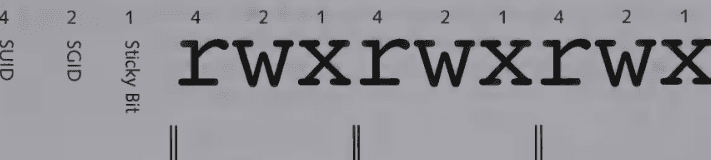

| 特殊 7 | 用户 7 | 组 7 | 其他 7 |
| :--- | :--- | :--- | :--- |
| **图 5-9** 普通权限和特殊权限的数字表示法 | | | |

| drwx-xr-x 2 root root | 4096 May 3 21:39 dirl |
| drwx------ 2 root root | 4096 May 3 21:41 dir2 |
| -rw-r--r-- 1 root root | 0 May 3 21:40 file1 |
| -rw-------r 1 root root | 0 May 3 21:41 file2 |

```
[root@server1]# chmod 6755 file1

[root@server1]# ls -l
```

| drwxr-xr 3 root root | 4096 Apr 8 07:12 Desktop |

| drwx-xr-x 2 root root | 4096 May 3 21:39 dirl |

| drwx------ 2 root root | 4096 May 3 21:41 dir2 |

| -rws-sr-x 1 root root | 0 May 3 21:40 file1 |

| -rw------- 1 root root | 0 May 3 21:41 file2 |

同样，要对之前使用的目录 `dirl` 设置粘滞位权限，你可以使用命令 `chmod 1777 dirl`，这允许所有用户（包括其他用户）向 `dirl` 目录添加文件。这是因为你赋予了写权限；但是，由于你设置了粘滞位，用户只能删除他们拥有的文件。如下例所示：

```
[root@server1]# chmod 1777 dirl

[root@server1]# ls -l
```

| drwx-xr-x 3 root root | 4096 Apr 8 07:12 Desktop |

| drwxr-xrwt 2 root root | 4096 May 3 21:39 dirl |

| drwx------ 2 root root | 4096 May 3 21:41 dir2 |

| -rws-sr-x 1 root root | 0 May 3 21:40 file1 |

| -rw------- 1 root root | 0 May 3 21:41 file2 |

[root@server1]#

## 第 5 章 Linux 文件系统管理

此外，记住在没有执行权限的情况下分配特殊权限会使这些权限失效。例如，你可能会忘记给用户、组或或其他赋予执行权限，而长列列表将用特殊权限覆盖了执行权限。在这种情况下，当 `dir2` 在模式中指示粘滞位的 Find (t) 下方没有赋予执行权限时，特殊权限将以大写形式显示，如下所示：

```
[@server1]# -ls -l

total 12

drwxxr-x 3 root 4096 Apr 8 07:12 Desktop

drwxxr-wt 2 root 4096 May 3 21:39 dir1

drwxxr-x 2 root 4096 May 3 21:41 dir2

-rws-sr-x 1 root 0 May 21:40 file1

-rw-rw-rw-- 1 root 0 May 21:40 file2

[@server1 root]# chmod 1755 dir2

[@server1 root]# -ls -l

total 12
```

```
drwxxr-x 3 root 4096 Apr 8 07:12 Desktop

drwxxr-wt 2 root 4096 May 3 21:39 dir1

drwxxr-x 2 root 4096 May 3 21:41 dir2

-rws-sr-x 1 root 0 May 21:40 file1

-rw-rw-rw-- 1 root 0 May 21:40 file2

[@server1 root]#
```


## 本章总结

- Linux 目录树遵循文件系统标准（Filesystem Standard），这允许用户和开发者能够定位文件。
- 存在许多文件管理命令用于创建、更改或删除文件。其中最常用的包括 `cp`、`mv`、`mkdir`。
- 你可以使用 `locate` 命令在文件系统中查找文件，或者通过搜索 `PATH` 列出的目录。然而，最通用的命令是 `find`，它可以在很广泛范围内搜索。
- 文件可以作为另一个文件的指针或另一个文件的副本被创建，分别称为符号链接和硬链接。
- 每个文件和目录都有所有者。文件或目录的所有者有权更改权限并将所有权移给他人。
- 权限可以设置在文件所有者、组员以及系统上的所有人（其他）上。
- 特殊权限（SUID、SGID、粘滞位）在模式中通过特殊位表示。如果没有执行权限，这些特殊位将以大写形式显示。

## 术语

- 在没有执行权限的情况下分配特殊权限会使这些权限失效。例如，你可能会忘记给用户、组或或其他赋予执行权限，而长列列表将用特殊权限覆盖了执行权限。在这种情况下，当 `dir2` 在模式中指示粘滞位的 `(t)` 下方没有赋予执行权限时，特殊权限将以大写形式显示，如下所示：

- 权限可以通过 `chmod` 命令进行设置，使用数字或符号。
- 权限可以通过长列列表 `ls -l` 查看，文件和目录。

### 目录术语

- `/bin` 目录——包含二进制文件。
- `/boot` 目录——包含引导加载程序。
- `/dev` 目录——包含设备文件。
- `/etc` 目录——包含配置。
- `/home` 目录——用户目录。
- `/lib` 目录——包含共享库。
- `/mnt` 目录——用于挂载磁盘。
- `/opt` 目录——包含软件。
- `/proc` 目录——包含进程信息。
- `/root` 目录——root 用户目录。
- `/sbin` 目录——包含系统二进制文件。
- `/tmp` 目录——用于临时文件。
- `/usr` 目录——包含工具。
- `/var` 目录——包含日志。

### 命令术语

- `chgrp` 命令——更改用户组。
- `chmod` 命令——更改模式。
- `chown` 命令——更改所有者。
- `cp` 命令——拷贝文件。
- 数据块——文件系统分配单元。
- 文件系统标准 (FHS)——概述文件位置的标准。
- `find` 命令——用于查找文件。

## 第5章 文件系统管理

- 组——在没有特定文件或目录的情况下，用户所属的默认组。
- 硬链接——在同一个文件系统中共享相同 inode 的文件。
- inode——存储文件属性、权限的部分。
- inode 表格——文件系统中所有的 inode。
- 交互模式——当文件可以被覆盖时，系统向用户请求操作。
- `ln` 命令——用于创建硬链接和符号链接。
- `locate` 命令——从数据库查找文件。
- `mkdir` 命令——用于创建目录。
- 模式——存储文件访问权限的部分。
- `mv` 命令——用于移动/重命名文件。
- 其他——在没有特定文件或目录的情况下，指系统上的所有用户。
- 所有者——长列列表中显示的用户名，有权更改权限。
- `PATH`——存储了在执行命令时不使用绝对或相对路径时搜索的目录列表。
- 权限——定义文件或文件夹访问的列表。
- 主组——用户所属的默认组。
- 递归——指向自身及其内容；递归搜索包含目录中的所有子目录。
- `rm` 命令——用于删除文件和目录。
- `rmdir` 命令——用于删除空目录。
- 源文件/目录——命令中来源信息的文件或目录。
- 超级块——文件系统中存储关键信息的部分。
- 符号链接——指向同一或另一个文件系统的指针；通常称为快捷方式。
- 目标文件/目录——命令中信息所指向的文件或目录。
- `touch` 命令——用于创建新文件。它最初用于更新文件的时间戳。
- `umask`——一种特殊变量，通过剥夺默认文件和目录权限来更改所有新文件和目录的权限。
- `umask` 命令——用于更改和查看 `umask` 变量。
- 用户——在没有特定文件或目录的情况下，该文件或目录的所有者。
- `which` 命令——用于查找 `PATH` 变量列出的目录中存在的文件。

# 复习习题

1. 符号链接也称为软链接（soft link），当使用 `ls -l` 命令查看时，文件名开头出现的 `@` 符号表示它。正确或错误？

2. 创建什么被用来定义 Linux 的标准目录结构和通用文件位置？
   a. FSH
   b. X,500
   c. FHS

3. 当使用 `ls -l` 命令显示时，“S”和“s”特殊权限之间没有真实区别。其中一个表示在文件中，另一个表示在目录上。正确或错误？

4. 在分析目录和文件的 `umask` 之前，系统赋予的默认权限是什么？
   a. `rw-rw-rw-` 和 `rw-rw-rw-`
   b. `rw-rw-rw-` 和 `r--r--r-`
   c. `rw-rw-rw-` 和 `rwxxrwwx`
   d. `rwxxrwwx` 和 `rw-rw-rw-`
   e. `rx-xr-rx-` 和 `rwx-xr-wx-`

5. 用户必须做什么才能交互式地运行 `cp` 或 `mv` 并被询问是否想要覆盖现有文件？
   a. 无选择，新文件将默认覆盖旧文件。
   b. 输入 `interactive cp` 或 `interactive mv`。
   c. 输入 `cp -i` 或 `mv -i`。
   d. 输入 `cp -interactive` 或 `mv -interactive`。
   e. 直接输入 `cp` 或 `mv`，因为它们默认以交互模式运行。

6. 用户利用 `chgrp` 命令将文件的所有交给另一个用户。用户必须做什么才能重新获得文件的所有权？
   a. 再次运行 `chgrp`并将自己列为新所有者。
   b. 不需要，因为这是一个单向的一次性操作。
   c. 让新所有者运行 `chgrp`并将原始所有者列为新所有者。
   d. 运行 `chown`并将自己列为新所有者。

7. 输入 `\ls -F` 命令后，你在输出中看到以下行：
   `-ru-w-xr-- user1 root 0 Apr 29 15:40 file1`

这意味着什么？
   - User1 具有读和写权限，root 组成员具有读和执行权限，所有其他人对文件读取权限。
   - root 组成员具有读和写权限，user1 具有读和执行权限，所有其他人对文件读取权限。
   - 所有用户具有读和写权限，root 组成员具有读和执行权限，user1 对文件读取权限。
   - User1 具有读和写权限，所有其他人具有读和执行权限，root 组对文件读取权限。

8. 输入命令 `umask 731` 后，所有随后创建的文件和目录的权限将受到影响。在这种情况下，所有新文件的权限是什么？
   a. `--rw-rw--`
   b. `rwxr-xr-x`
   c. `---r--r--`

9. 当你更改与其他三个文件硬链接的文件数据时：
   a. 只有你修改的文件中的数据受影响。
   b. 只有你修改的文件以及同一目录下的任何硬链接文件的数据受影响。
   c. 你修改的文件数据以及所有硬链接文件的数据都会被修改，因为它们有不同的 inode。
   d. 你修改的文件数据以及所有硬链接文件的数据都会被修改，因为它们共享相同的数据且具有相同的 inode 和文件大小。

10. 命令 `chmod 317 file1` 会在 `ls` 命令中产生以下哪？
    a. `--w-r-rwx user1 root 0 Apr 29 15:40 file1`
    b. `--wx-xrwx user1 root 0 Apr 29 15:40 file1`
    c. `-rwxr-xr-x user1 root 0 Apr 29 15:40 file1`
    d. `--w-rw-r- user1 root 0 Apr 29 15:40 file1`

11. 哪个命令会将 `file1` 的用户所有和组所有权分别改为 user1 和 root？
    a. `chown user1:root file`
    b. `chown user1 :root file`
    c. 不能这样做，因为文件的用户所有和组所有必须分开修改。
    d. `chown root:user1file`
    e. `chown root :user1file`

12. `/var` 目录包含什么？
    a. 各种程序
    b. 缓冲区和日志文件
    c. 临时文件
    d. 与架构无关的文件
    e. 本地设备

13. `mv` 命令的作用（选择所有适用）：
    a. 它创建一个卷。
    b. 它创建一个目录。
    c. 它移动一个目录。
    d. 它移动一个文件。

14. 一个文件具有以下权限：`r--x-w-`。`chmod 43` 命令与哪个命令效果相同（选择所有适用）：
    a. `chmod u+x,g+r,o+w file1`
    b. `chmod u=w,g=rw,o=rx file1`
    c. `chmod u-r-w,g+r,o-r file1`
    d. `chmod u=x,g=r,w=wx file1`
    e. `chmod u+w,g+r,o+r file1`
    f. `chmod u=rw,g=r,o=r file1`

15. 命令仅用于搜索可执行文件：
    b. 从根目录开始搜索所有目录
    c. 不是一个有效命令
    d. 仅在 `PATH` 变量中的目录中搜索

16. 硬链接需要驻留在同一个文件系统中，而符号链接不需要。正确或错误？

17. 当应用于目录时，SGID 特殊权限：
    a. 导致目录中创建的所有文件与目录具有相同的组，而不是创建它们的实体
    b. 不能使用，因为它只应用于文件
    c. 允许用户为目录内创建的文件使用两个以上的组
    d. 导致在访问目录文件之前检查用户的权限

18. 你使用哪个命令重命名文件和目录？
    a. `cp`
    b. `mv`
    c. `rn`
    d. `rename`

19. 三种 Linux 标准权限是什么？
    a. 完全控制、读-执行、写
    b. 读、写、修改
    c. 执行、读、写
    d. 读、写、检查

20. 给定的 `ls` 命令输出，有多少文件与 `file1` 链接？
```


```
drwxr-xr-x 3 root root 4096 Apr 8 07:12 Desktop
-rw-r---- 3 root 0 Apr 29 22:40 file1
-rw-r---- 1 root root 0 Apr 29 22:40 file2
-rw-r---- 4 root root 0 Apr 29 22:40 file3
-rw-r---- 2 root root 0 Apr 29 22:40 file4
-rw-r---- 1 root root 0 Apr 29 22:40 file5
-rw-r---- 1 user1 sys 0 Apr 29 22:40 file6
```


```
a. 一个
b. 两个
c. 三
d. 四
```

## 实验

这些实验应该按照给顺序完成。本章介绍的实验总共需要三小时完成。实验室的要求包括：
a. 根据实验 3-1 安装了 Red Hat Fedora Core 2 的计算机
b. 完成第 4 章中的所有实验

## 实验 5-1

在实验实验中，你登录计算机并创建新目录。
1. 启动你的计算机。当 Linux 系统加载后，你被放置在图形终端（tty7）。按下 `Ctrl+Alt+F2` 切换到命令行终端（tty2）。使用用户名 `root` 和密码 `secret` 登录终端。
2. 在命令提示符输入 `ls -F` 并回车。你的主目录的内容是什么？有多少个文件和子目录？
3. 在命令提示符输入 `mkdir mysamples` 并回车。接下来在命令提示符输入 `ls -F` 并回车。有多少个文件和子目录？为什么？
4. 在命令提示符输入 `cd mysamples` 并回车。接下来在命令提示符输入 `ls -F` 并回车。子目录的内容是什么？
5. 在命令提示符输入 `mkdir undermamples` 并回车。接下来在命令提示符输入 `ls -F` 并回车。子目录的内容是什么？
6. 在命令提示符输入 `mkdir todelete` 并回车。接下来在命令提示符输入 `ls -F` 并回车。你刚刚创建的子目录 `todelete` 显示在了吗？
7. 在命令提示符输入 `cd ..` 并回车。接下来输入 `ls -R` 并回车。注意子目录 `mysamples` 及其子目录 `undermamples` 都显示了。你使用了 `ls` 命令的递归选项。
8. 在命令提示符输入 `cd ..` 并回车。在命令提示符输入 `pwd` 并回车。你的当前目录是什么？
9. 在命令提示符输入 `mkdir user1` 并回车。在命令提示符输入 `ls -F` 并回车。你创建的子目录出现在列表中吗？
10. 输入 `exit` 并回车退出 shell。

## 实验 5-2

在实验中，你使用 `cp` 命令复制文件。
1. 按下 `Ctrl+Alt+F2` 切换到命令行终端（tty2），并使用用户名 `root` 和密码 `secret` 登录终端。
2. 接下来在命令提示符输入 `ls -F` 并回车。列出了多少个文件？名称是什么？
3. 在命令提示符输入 `cp sample1` 并回车。显示了什么错误信息？为什么？

## 第 5 章 Linux 文件系统管理

4. 在命令提示符下，输入 `cp sample1a` 并按回车。接着在命令提示符下输入 `ls -F` 并按回车。有多少个文件？它们的名字是什么？为什么？
5. 在命令提示符下，输入 `cp sample1 samples/sample1B` 并按回车。接着在命令提示符下输入 `ls -F` 并按回车。有多少个文件？它们的名字是什么？为什么？
6. 在命令提示符下，输入 `cp mysamples` 并按回车。接着在命令提示符下输入 `ls -F` 并按回车。sample1B 复制成功了吗？
7. 在命令提示符下，输入 `cp /root/sample2 ..` 并按回车。接着在命令提示符下输入 `ls -F` 并按回车。有多少个文件？它们的名字是什么？为什么？
8. 在命令提示符下，输入 `cp sample1B ..` 并按回车。接着在命令提示符下输入 `ls ..` 并按回车。在命令提示符下，输入 `ls -F` 并按回车。sample1B 文件复制成功了吗？
9. 在命令提示符下，输入 `cp sample1 sample2 sample3 mysamples` 并按回车。你得到了什么信息？为什么？选择 `y` 并按回车。接着在命令提示符下输入 `cd samples` 并按回车。在命令提示符下，输入 `ls -F` 并按回车。有多少个文件？它们的名字是什么？为什么？
10. 在命令提示符下，输入 `cd ..` 并按回车。接着在命令提示符下输入 `cp mysamples samples2` 并按回车。你收到了什么错误信息？为什么？
11. 在命令提示符下，输入 `cp -r mysamples samples2` 并按回车。接着在命令提示符下输入 `ls -F` 并按回车。目录复制成功了吗？在命令提示符下输入 `ls -F mysamples2` 并按回车。mysamples 的内容成功复制到 samples2 处了吗？
12. 输入 `exit` 并按回车退出 shell。

## 项目 5-3


在这个动手项目中，将使用 `mv` 命令来重命名文件和目录。

- 1. 按 `Ctrl+Alt+F2` 切换到命令行终端 (tty)，并使用用户名 `root` 和密码 `secret` 登录登录终端。
- 2. 接下来在命令提示符下输入 `ls -F` 并按回车。列出了多少个文件？它们的名字是什么？
- 3. 在命令提示符下，输入 `mv sample1` 并按回车。显示了什么错误信息？为什么？
- 4. 在命令提示符下，输入 `mv sample1 sample4` 并按回车。接着在命令提示符下输入 `ls -F` 并按回车。列出了多少个文件？它们的名字是什么？sample1 发生了什么？

## 动手项目

5. 在命令提示符下，输入 `mv sample4 mysamples` 并按回车。接着在命令提示符下输入 `ls -F` 并按回车。有多少个文件？它们的名字是什么？sample4 去哪儿了？
6. 在命令提示符下，输入 `cd mysamples` 并按回车。接着在命令提示符下输入 `ls -F` 并按回车。注意看你在步骤 5 中移动的 sample4 文件已移动到这里。
7. 在命令提示符下，输入 `mv sample4 ..` 并按回车。接着在命令提示符下输入 `ls -F` 并按回车。有多少个文件？它们的名字是什么？sample4 去哪儿了？
8. 在命令提示符下，输入 `cd ..` 并按回车。接着在命令提示符下输入 `ls -F` 并按回车查看 sample4 的新位置。
9. 在命令提示符下，输入 `mv sample4 mysamples/sample2` 并按回车。屏幕上出现了什么信息？为什么？
10. 输入 `y` 并按 `Enter` 确认你想要覆盖目标文件夹中的文件。
11. 在命令提示符下，输入 `mv sample? mysamples` 并按回车。输入 `y` 并按 `Enter` 确认你想要覆盖目标文件夹中的文件 sample3。
12. 在命令提示符下，输入 `ls -F` 并按回车。有多少个文件？为什么？
13. 在命令提示符下，输入 `mv sample1* mysamples` 并按回车。输入 `y` 并按 `Enter` 确认你想要覆盖目标目录中的文件 sample1B。
14. 在命令提示符下，输入 `ls -F` 并按回车。注意 `/root/` 目录下没有 sample 文件。
15. 在命令提示符下，输入 `cd mysamples` 并按回车。接着在命令提示符下输入 `ls -F` 并按回车。注意原本 `/root` 中的所有文件已移动到你的目录。
16. 在命令提示符下，输入 `cd ..` 并按回车。接着在命令提示符下输入 `ls -F` 并按回车。输入 `mv mysamples samples` 并按回车。接着在命令提示符下输入 `ls -F` 并按回车。为什么你不需要在 `mv` 命令中指定递归选项就可以将 mysamples 目录重命名为 samples？
17. 输入 `exit` 并按回车退出 shell。

## 项目 5-4

在这个动手项目中，你将创建并查看文件和目录的链接。

- 1. 按 `Ctrl+Alt+F2` 切换到命令行终端 (tty)，并使用用户名 `root` 和密码 `secret` 登录终端。(img/9ee5f91f3446575a1e6ce62c54cae5d2_241_0.png) # 第 5 章 文件系统管理
2. 在命令提示符下，输入 `cd samples` 并按回车。接着在命令提示符下输入 `ls -F` 并按回车。你看到了哪些文件？接着在命令提示符下输入 `ls -l` 并按回车。sample1 的链接数是多少？
3. 在命令提示符下，输入 `sample1 hardlink` 并按回车。接着在命令提示符下输入 `ls -F` 并按回车。终端中显示 sample1 和 hardlink 是硬链接吗？接着在命令提示符下输入 `ls -l` 并按回车。sample1 和 hardlink 的链接数是多少？接着在命令提示符下输入 `ls -i` 并按回车查看每个文件的 inode 号。这两个硬链接文件的 inode 号相同吗？
4. 在命令提示符下，输入 `sample1 hardlink2` 并按回车。接着在命令提示符下输入 `ls -l` 并按回车。sample1、hardlink 和 hardlink2 的链接数是多少？
5. 在命令提示符下，输入 `sample1` 并按回车。在 vi 编辑器中输入任意句子，然后保存并退出 vi。
6. 在命令提示符下，输入 `cat sample1` 并按回车。在命令提示符下输入 `cat hardlink` 并按回车。现在在命令提示符下输入 `cat hardlink2` 并按回车。它们的内容相同吗？为什么？
7. 在命令提示符下，输入 `sample2 symlink` 并按回车。接着在命令提示符下输入 `ls -F` 并按回车。终端显示 sample2 和 symlink 是软链接吗？哪个文件是目标文件？接着在命令提示符下输入 `ls -l` 并按回车。终端显示它们是软链接吗？接着在命令提示符下输入 `ls -i` 并按回车查看每个文件的 inode 号。这两个软链接文件的 inode 号相同吗？
8. 在命令提示符下，输入 `vi symlink` 并按回车。在 vi 编辑器中输入任意句子，然后保存并退出 vi。
9. 在命令提示符下，输入 `ls -l` 并按回车。symlink 文件的大小与 sample2 相比如何？为什么？在命令提示符下输入 `cat sample2` 并按回车。内容是什么？为什么？
10. 在命令提示符下，输入 `ls /etc/sysconfig/network-scripts netscripts` 并按回车。接着在命令提示符下输入 `ls -F` 并按回车。netscripts 的文件类型是什么？现在在命令提示符下输入 `cd netscripts` 并按回车。接着在命令提示符下输入 `pwd` 并按回车查看当前目录。你的当前目录是什么？接着在命令提示符下输入 `ls -F` 并按回车。列出了哪些文件？接着在命令提示符下输入 `ls -F /etc/sysconfig/network-scripts` 并按回车。

## 动手项目

注意你的 netscripts 目录仅仅是 /etc/sysconfig/network-scripts 目录的指针。这种链接有什么用？

- 11. 输入 `exit` 并按回车 shell。

## 项目 5-5

在这个动手项目中，你将使用 `find`、`locate` 和 `which` 命令在文件系统中查找文件。

- 1. 按 `Ctrl+Alt+F2` 切换到命令行终端 (tty2)，并使用用户名 `root` 和密码 `secret` 登录终端。
- 2. 在命令提示符下，输入 `touch newfile` 并按回车。接着在命令提示符下输入 `locate newfile` 并按回车。`locate` 命令找到该文件吗？为什么？
- 3. 在命令提示符下，输入 `updatedb` 并按回车。命令完成后，在命令提示符下输入 `locate newfile` 并按回车。`locate` 命令找到该文件吗？如果是，它找到有多快？为什么？
- 4. 在命令提示符下，输入 `find / -name "newfile"` 并按回车。`find` 命令找到该文件吗？如果是，它找到有多快？为什么？
- 5. 在命令提示符下，输入 `find / -name "newfile"` 并按回车。`find` 命令找到该文件吗？如果是，它找到有多快？为什么？
- 6. 在命令提示符下，输入 `which newfile` 并按回车。`which` 命令找到该文件吗？为什么？在命令提示符下输入 `echo $PATH` 并按回车。PATH 变量中列出了 `/root` 目录吗？PATH 变量中列出了 `/bin` 目录吗？
- 7. 在命令提示符下，输入 `which grep` 并按回车。`which` 命令找到该文件吗？为什么？
- 8. 在命令提示符下，输入 `find /root -name "sample*"` 并按回车。列出了哪些文件？为什么？
- 9. 在命令提示符下，输入 `find /root -type 1` 并按回车。列出了哪些文件？为什么？（注：此处原文 type 1 通常应为 -type f，按原文保留翻译）
- 10. 在命令提示符下，输入 `find /root -size 0` 并按回车。列出了哪些类型的文件？输入 `find /root -size 0 | more` 查看所有列出的文件。
- 11. 输入 `exit` 并按回车退出 shell。

## 项目 5-6

在这个动手项目中，你将使用 `rmdir` 和 `rm` 命令删除文件和目录。

- 1. 按 `Ctrl+Alt+F2` 切换到命令行终端 (tty2)，并使用用户名 `root` 和密码 `secret` 登录终端。
2. 在命令提示符下，输入 `cd samples` 并按回车。在命令提示符下，输入 `ls -R` 并按回车。注意要删除的两个空目录：delete 和 undermamples。
3. 在命令提示符下，输入 `rmdir undermamples todelete` 并按回车。命令起作用了吗？为什么？接下来在命令提示符下输入 `ls -F` 并按回车。两个目录都成功删除了吗？
4. 在命令提示符下，输入 `rm sample*` 并按回车。显示了什么消息？对这三个问题都回答 `n`。
5. 在命令提示符下，输入 `rm -sample*` 并按回车。为什么没有提示你继续？接下来，在命令提示符下输入 `ls -F` 并按回车。三个文件都成功删除了吗？
6. 在命令提示符下，输入 `cd ..` 并按回车。接下来，在命令提示符下输入 `rmdir samples` 并按回车。你收到了什么错误信息？为什么？
7. 在命令提示符下，输入 `rm -rf samples` 并按回车。接下来，在命令提示符下输入 `ls -F` 并按回车。samples 目录及其所有文件都成功删除了吗？
8. 输入 `exit` 并按回车退出你的 shell。

## 项目 5-7


在这个动手项目中，你将对文件和目录应用并修改访问权限，并测试其效果。

- 1. 按 `Ctrl+Alt+F2` 切换到命令行终端 (tty2)，使用用户名 `root` 和密码 `secret` 登录终端。
- 2. 在命令提示符下，输入 `touch persample` 并按回车。接下来，在命令提示符下输入 `chmod 777 persample` 并按回车。
- 3. 在命令提示符下，输入 `ls -l` 并按回车。谁拥有该文件的权限？
- 4. 在命令提示符下，输入 `chmod 000 persample` 并按回车。接下来，在命令提示符下输入 `ls -l` 并按回车。谁拥有该文件的权限？
- 5. 在命令提示符下，输入 `rm -f persample` 并按回车。你删除了这个文件吗？为什么？
- 6. 在命令提示符下，输入 `cd /` 并按回车。接下来，在命令提示符下输入 `pwd` 并按回车。你在哪个目录？在命令提示符下输入 `ls -F` 并按回车。你看到了哪些目录？
- 7. 在命令提示符下，输入 `ls -l` 并按回车，查看在动手项目 5-1 中创建的第一个目录的所有者、组和权限。所有者和组所有者是谁？如果你以 user1 用户身份登录，你将被归入哪一类（用户、组、其他）？作为此类，你拥有什么权限（读、写、执行）？
- 8. 在命令提示符下，输入 `cd /folder1` 并按回车进入 user1 目录。接下来，在命令提示符下输入 `ls -F` 并按回车。该目录中有文件吗？在命令提示符下输入 `cp /hosts .` 并按回车。接下来，在命令提示符下输入 `ls -F` 并按回车，确保在当前目录下创建了文件的副本。
- 9. 按 `Ctrl+Alt+F3` 切换到另一个命令行终端 (tty3)，使用用户名 `user1` 和密码 `secret` 登录终端。
- 10. 在命令提示符下，输入 `cd /folder1` 并按回车。你成功了吗？为什么？接下来，在命令提示符下输入 `ls -F` 并按回车。你能看到目录的内容吗？为什么？现在在命令提示符下输入 `rm -f` 并按回车。你看到了什么错误信息？为什么？
- 11. 按 `Ctrl+Alt+F2` 回到之前的命令行终端 (tty2)。注意你在此终端上是以 root 用户登录登录。
- 12. 在命令提示符下，输入 `chmod w /folder1` 并按回车。你成功更改了 /folder1 目录的权限吗？为什么？
- 13. 按 `Ctrl+Alt+F3` 回到之前的命令行终端 (tty3)。注意你在此终端上是以 user1 用户登录。
- 14. 在命令提示符下，输入 `cd /folder1` 并按回车。接下来，在命令提示符下输入 `rm -f hosts` 并按回车。现在成功了吗？为什么？
- 15. 按 `Ctrl+Alt+F2` 回到之前的命令行终端 (tty2)。注意你在此终端上是以 root 用户登录。
- 16. 在命令提示符下，输入 `cd /folder1` 并按回车进入 user1 目录。在命令提示符下输入 `cp /etc/hosts .` 并按回车，在当前目录下放置另一份 hosts 副本。
- 17. 在命令提示符下，输入 `ls -l` 并按回车。该文件的所有者和组所有者是谁？如果你以 user1 用户登录，你将被归入哪一类（用户、组、其他）？作为此类，你拥有什么权限（读、写、执行）？
- 18. 按 `Ctrl+Alt+F3` 回到之前的命令行终端 (tty3)。注意你在此终端上是以 user1 用户登录。
- 19. 在命令提示符下，输入 `cd /folder1` 并按回车进入 user1 目录。在命令提示符下输入 `cat hosts` 并按回车。你成功了吗？接下来在命令提示符下输入 `vi hosts` 打开 hosts 文件。删除该文件的第一行并保存更改。你成功了吗？退出 vi 编辑器。

## 第 5 章 Linux 文件系统管理

- 20. 按 `Ctrl+Alt+F2` 回到之前的命令行终端 (tty2)。注意你在此终端上是以 root 用户登录。
- 21. 在命令提示符下，输入 `chmod w /user1/hosts` 并按回车。
- 22. 按 `Ctrl+Alt+F3` 回到之前的命令行终端 (tty3)。注意你在此终端上是以 user1 用户登录。
- 23. 在命令提示符下，输入 `cd /user1` 并按回车进入 user1 目录。在命令提示符下输入 `vi hosts` 打开 hosts 文件。删除该文件的第一行并保存更改。你成功了吗？退出 vi 编辑器。
- 24. 在命令提示符下，输入 `ls -l` 并按回车。你有执行该文件的权限吗？你应该让该文件可执行吗？接下来在命令提示符下输入 `ls -l /bin` 并按回车，注意 /bin 目录下有多少文件具有执行权限。/bin 目录本身应该具有该权限吗？
- 25. 输入 `exit` 并按回车退出 shell。
- 26. 按 `Ctrl+Alt+F2` 回到之前的命令行终端 (tty2)。注意你在此终端上是以 root 用户登录。
- 27. 输入 `exit` 并按回车退出 shell。

## 项目 5-8

在这个动手项目中，你使用 umask 变量查看并操作默认的文件和目录权限。

- 1. 按 `Ctrl+Alt+F3` 切换到命令行终端 (tty3)，使用用户名 `user1` 和密码 `secret` 登录终端。
- 2. 在命令提示符下，输入 `ls -l` 并按回车。你看到了哪些文件？
- 3. 在命令提示符下，输入 `umask` 并按回车。默认 umask 是多少？
- 4. 在命令提示符下，输入 `touch test1` 并按回车。接下来，在命令提示符下输入 `ls -l` 并按回车。test1 文件的权限是多少？这与图 5-7 的计算一致吗？在命令提示符下输入 `mkdir dir1` 创建新目录。接下来在命令提示符下输入 `ls -l` 并按回车。dir1 目录的权限是多少？这与图 5-7 的计算一致吗？
- 5. 在命令提示符下，输入 `umask 007` 并按回车。接下来在命令提示符下输入 `umask` 并按回车，验证你的 umask 变量已更改为 007。
- 6. 在命令提示符下，输入 `touch test2` 并按回车。接下来，在命令提示符下输入 `ls -l` 并按回车。test2 文件的权限是多少？这与图 5-6 的计算一致吗？在命令提示符下输入 `mkdir dir2` 创建新目录。接下来在命令提示符下输入 `ls -l` 并按回车。dir2 目录的权限是多少？这与图 5-6 的计算一致吗？
- 7. 输入 `exit` 并按回车退出 shell。

## 项目 5-9

在这个动手项目中，你使用 chown 和 chgrp 命令查看并更改文件和目录的所有者。

- 1. 按 `Ctrl+Alt+F3` 切换到命令行终端 (tty3)，使用用户名 `user1` 和密码 `secret` 登录终端。
- 2. 在命令提示符下，输入 `touch sample` 并按回车。接下来在命令提示符下输入 `mkdir orderdir` 并按回车。现在在命令提示符下输入 `ls -l` 并按回车，验证文件 sample 和目录 orderdir 已创建，且 user1 是它们的所有者和所属组。
- 3. 在命令提示符下，输入 `chgrp sys sample` 并按回车，将 sample 和 orderdir 的组所有改为 sys 组。你成功了吗？
- 4. 在命令提示符下，输入 `chown root sample` 并按回车，将 sample 和 orderdir 的所有者改为 root 用户。你成功了吗？
- 5. 在命令提示符下，输入 `chown user1 sample` 并按回车，将 sample 和 orderdir 的所有者改回 user1。你收到了什么错误信息？为什么？
- 6. 按 `Ctrl+Alt+F2` 切换到命令行终端 (tty2)，使用用户名 `root` 和密码 `secret` 登录终端。
- 7. 在命令提示符下，输入 `cd /home/user1` 并按回车。接下来在命令提示符下输入 `chown user1.user sample` 并按回车。接下来在命令提示符下输入 `ls -l` 并按回车，验证 sample 和 orderdir 的文件和目录所有权已分别更改。
- 8. 输入 `exit` 退出 shell。
- 9. 按 `Ctrl+Alt+F3` 回到之前的命令行终端 (tty3)。注意你在此终端上是以 user1 用户登录。
- 10. 在命令提示符下，输入 `mv sample orderdir` 并按回车。接下来在命令提示符下输入 `ls -R` 并按回车，注意 sample 文件现在存在 orderdir 目录内，且两者的所有者均为 user1。
- 11. 在命令提示符下，输入 `chown -R root orderdir` 并按回车。接下来在命令提示符下输入 `ls -R` 并按回车。orderdir 目录和 sample 文件的所有者是谁？为什么？

# 第5章 Linux文件系统管理

12. 在命令提示符下输入 `rm -rf ownerdir` 并按回车。为什么你可以在不是该目录所有者的情况下删除此目录？
13. 输入 `exit` 并按回车退出你的 shell。

## 5-10

在这个动手实践项目中，你将查看并观察文件及目录的特殊权限。

- 1. 按 `Ctrl+Alt+F3` 切换到命令行终端 (tty3)，并使用用户名 `user` 和密码 `secret` 登录终端。
- 2. 在命令提示符下输入 `touch specialfile` 并按回车。接下来在命令提示符下输入 `ls -l` 并按回车，以验证 `specialfile` 是否成功创建。`specialfile` 的所有者和组所有者是谁？
- 3. 在命令提示符下输入 `chmod 4777 specialfile` 并按回车。接下来在命令提示符下输入 `ls -l` 并按回车。该文件缺少什么权限？如果该文件由另一个用户执行，那么执行期间的用户将是谁？
- 4. 在命令提示符下输入 `chmod 6777 specialfile` 并按回车。接下来在命令提示符下输入 `ls -l` 并按回车。该文件设置了哪些权限？如果该文件由另一个用户执行，那么执行期间的用户将是谁，属于哪个组？
- 5. 在命令提示符下输入 `chmod 6444 specialfile` 并按回车。接下来在命令提示符下输入 `ls -l` 并按回车。你可以在特殊权限列表下方执行它吗？在这种情况下，特殊权限还会保留它们的意义吗？
- 6. 按 `Ctrl+Alt+F2` 切换到命令行终端 (tty2)，并使用用户名 `root` 和密码 `secret` 登录终端。
- 7. 在命令提示符下输入 `mkdir /public /root 1777 /public` 并按回车。该目录设置了什么特殊权限？谁可以向该目录添加或删除文件？
- 8. 在命令提示符下输入 `touch /public/rootfile` 并按回车。
- 9. 在命令提示符下输入 `cd /home/user1` 并按回车。接下来在命令提示符下输入 `touch rootfile` 并按回车。
- 10. 输入 `exit` 并按回车退出你的 shell。
- 11. 按 `Ctrl+Alt+F3` 切换回之前的命令行终端 (tty3)。注意你在该终端上是以 `user1` 用户身份登录的。
- 12. 在命令提示符下输入 `touch /public/user1file` 并按回车。接下来在命令提示符下输入 `ls -l /public` 并按回车。该目录下存在哪些文件，所有者是谁？


## 探索练习

13. 在命令提示符下输入 `rm /public/user1file` 并按回车。你是否收到了确认删除文件的提示？
14. 在命令提示符下输入 `rm /public/rootfile` 并按回车。你收到了什么消息？为什么要按 `y`？
15. 输入 `exit` 并按回车退出你的 shell。

## 探索练习

- 1. 使用 `ls` 配合 `-F` 选项探索从 `/bin` 开始的文件系统层级标准 (FHS) 中描述的目录。你识别出 `/bin` 中的任何命令吗？探索其他几个 FHS 目录并记录其内容。探索目录列表请参考表 5-1。此外，访问 http://www.pathname.com/fhs 阅读关于文件系统层级标准。它为 Linux 提供了哪些好处？
- 2. 写出完成以下任务所需的命令。在你的系统上尝试每个命令以确保其正确性：
    na. 在 `/root` 下创建一个层级目录结构，包含一个包含三个子目录的目录。
    nb. 向每个子目录中拷贝两个文件。
    c. 再创建一个包含三个子目录的目录，并将包含这些文件的子目录中的文件移动到你刚刚创建的对应目录中。
    d. 为其中三个文件创建硬链接。检查它们的 inode。
    e. 为其中两个文件创建符号链接，并检查它们的链接数和索引信息。
    f. 从你的家目录到该结构中的两个目录创建符号链接，并检查结果。
    g. 删除家目录中的符号链接以及 `/root` 目录结构中的符号链接。
- 3. 写出可回答以下问题的命令。（提示：在系统上尝试每个命令以检查结果。）
    a. 查找系统中所有文件名包含 "test" 单词的文件。
    nb. 在 PATH 变量中查找你的 `awk` 命令的路径。
    c. 查找 `/usr` 目录及其子目录下所有大于 50 KB 的文件。
    d. 查找 `/usr` 目录及其子目录下所有大于 70 KB 的文件。
    ne. 查找 `/` 目录及其子目录下所有符号链接文件。
    f. 查找 `/var` 目录及其子目录下访问时间小于 60 分钟的所有文件。
    g. 查找 `/var` 目录及其子目录下访问时间小于 6 天的所有文件。
    h. 查找 `/home` 目录及其子目录下所有空文件。
    ni. 查找 `/etc` 目录及其子目录下所有属于 `bin` 组的文件。
- 4. 针对以下模式，写出对应的数字表示（例如，777）：
    na. rwxrwxrwx
    nb. rwxrxrxr
    nc. ---rwxrw
    nd. -wxrwx
    f. -wx-----
- 5. 假设这四个文件都在 `/public` 目录下，在以下权限表中打勾，具有特殊权限（粘滞位）：
| 文件名 | 模式 | 读取 | 编辑 | 执行 |
| :--- | :--- | :--- | :--- | :--- |
| sample1 | | | | |
| sample2 | | | | |
| sample3 | | | | |
| sample4 | | | | |
- 6. 假设这四个文件都在 `/public` 目录下，在以下权限表中打勾，模式为 `rwx--x`：
| 文件名 | 模式 | 读取 | 编辑 | 执行 |
| :--- | :--- | :--- | :--- | :--- |
| sample1 | | | | |
| sample2 | | | | |
| sample3 | | | | |
| sample4 | | | | |
7. 针对以下 umask，计算新文件的默认权限：
    a. 017
    b. 272
    c. 777
    d. 000
    e. 077
    f. 027
8. 针对问题7中的每个 umask，列出认为有利于 Linux 系统安全的 umask 并解释。
9. 从 Linux 默认权限开始，你会使用什么 umask 来确保新生成的：
    a. 目录：所有者拥有读、写、执行权限，组拥有读、执行权限，其他人读权限。
    b. 文件：所有者拥有读、执行权限，组拥有读、写、执行权限，其他人执行。
    c. 文件：所有者拥有读、写权限，组拥有读、写权限，其他人读写。
    d. 目录：所有者拥有读、写、执行权限，组拥有读、执行权限，其他人读、写、执行。
    e. 目录：所有者拥有读、执行权限，组拥有读、写、执行权限，其他人没有权限。
    f. 文件：所有者拥有读、写权限，组没有权限，其他人写权限。
- 10. 你使用什么 `chmod` 命令来实施以下权限？
    a. 对一个目录，所有者拥有读、写、执行权限，组拥有读、执行权限，其他人读权限。
    b. 对一个文件，所有者拥有读、写权限，组没有权限，其他人写权限。
    c. 对一个文件，所有者拥有读、写、执行权限，其他人读、写权限。
- d. 对一个文件，使得所有者具有读取和执行权限；组拥有读取、写入和执行权限；其他人具有执行权限
- e. 对一个目录，使得所有者具有执行权限；组拥有读取、写入和执行权限；其他人无权限
- f. 对一个目录，使得所有者具有写入权限；组拥有读取、写入和执行权限；其他人具有读取、写入和执行权限
- g. 对一个目录，使得所有者具有读取、写入和执行权限；组拥有读取权限；其他人具有读取和执行权限
- h. 对一个目录，使得所有者具有读取、写入和执行权限；组拥有读取、写入和执行权限；其他人具有读取、写入和执行权限
- i. 对一个文件，使得所有者没有权限；组没有权限；其他人没有权限

# 第 6 章
## LINUX 文件系统管理

完成本章后，你将能够：

- 识别 `/dev` 目录中设备文件的结构和类型
- 理解常见的文件系统类型及其特征
- 将软盘挂载和卸载到 Linux 目录树
- 将 CD-ROM 挂载和卸载到 Linux 目录树
- 创建硬盘分区
- 将硬盘分区挂载和卸载到 Linux 目录树
- 监控挂载文件系统的空闲空间
- 检查文件系统错误
- 使用磁盘配额限制用户空间的使用

遍历 Linux 目录树和操作文件是所有用户每天执行的常见任务。然而，管理员必须为用户提供此目录树，并管理和修复支持它的磁盘设备。在本章中，你将学习代表磁盘设备的各种设备文件以及可以放置在设备上的不同文件系统。接下来，你将学习如何在软盘和 CD-ROM 上创建和管理文件系统，然后讨论硬盘分区和文件系统管理。最后，本章将讨论磁盘使用、文件系统错误以及限制用户存储文件的能力。

## /DEV 目录

管理磁盘的基础是理解 Linux 操作系统如何指定这些磁盘。Linux 系统上的大多数设备（如磁盘、终端和串口）都通过硬盘上的一个名为“设备文件”的文件表示。每个设备对应一个文件，这些文件通常位于 `/dev` 目录中。这允许你使用 `/dev` 目录中代表该设备的路径路径来指定系统上的设备。要在命令的适当部分指定第一块软盘 `/dev/fd0`（软盘 0），你可以输入路径 `/dev/fd0`。此外，为了表示 Linux 系统中的第二块软盘，你可以指定路径 `/dev/fd1`（软盘 1）。

此外，每个设备都指定了数据如何在设备之间传输。你有两种方法在设备之间传输数据。第一种方法涉及逐字符地在设备之间传输信息。以这种方式传输数据的设备称为字符设备。第二种方法使用物理内存作为传输缓冲区，一次传输块或数据块信息。使用这种传输方法的设备称为块设备，传输软盘、CD-ROM 和硬盘等的文件通常是块设备文件，因为它们倾向于快速传输率。然而，磁带驱动和其他大多数设备通常由设备文件表示。

要查看特定设备是按字符传输还是按块传输，请记住 `ls -l` 在类型列中显示的 `o` 或 `c` 表明设备文件的类型。要查看文件 `/dev/fd0` 的类型，可以使用以下命令：
```


[root@server1 root]# ls -l /dev/fd0

brwrw---- 1 root floppy 2, 0 Feb 23 16:02 /dev/fd0

```

从上述输出的左侧字符可以看到 `/dev/fd0` 是一个块文件。表 6-1 提供了一些常见设备文件及其类型。

## 表 6-1 常见设备文件

| 设备文件 | 描述 | 类型 |
| :--- | :--- | :--- |
| /dev/fd0 | 系统第一个软盘 | 块 |
| /dev/fd1 | 系统第二个软盘 | 块 |
| /dev/hda1 | 第一块 IDE 硬盘的主分区（主） | 块 |
| /dev/hdb1 | 第二块 IDE 硬盘的主分区（从设备） | 块 |
| /dev/hdc1 | 第三块 IDE 硬盘的主分区（主） | 块 |

## 表 6-1 常见设备文件（续）

| 设备文件 | 描述 | 块或字符 |
| :--- | :--- | :--- |
| /dev/hdd1 | 第四块 IDE 硬盘的主分区（从设备） | 块 |
| /dev/sda1 | 第一块硬盘的主分区 | 块 |
| /dev/sdb1 | 第二块硬盘的主分区 | 块 |
| /dev/tty1 | 系统第一个终端（Ctrl+Alt+F1） | 字符 |
| /dev/tty2 | 系统第二个终端（Ctrl+Alt+F2） | 字符 |
| /dev/tty0 | 系统第一个串口（COM1） | 字符 |
| /dev/tty1 | 系统第二个串口（COM2） | 字符 |
| /dev/psaux | PS/2 鼠标 | 字符 |
| /dev/lp0 | 系统第一个并行端口（LPT1） | 字符 |
| /dev/null | 代表空的设备；发送到它的数据都会被丢弃 | 字符 |
| /dev/st0 | 系统第一个 SCSI 驱动器 | 字符 |
| /dev/usb/* | USB 文件 | 字符 |

典型的 Red Hat 安装后，`/dev` 目录下有超过1000个设备文件；这些文件在特定的 Linux 系统上可能并不因此从未被使用。在 Linux 系统中提供这么多设备文件不需要多少空间，因为所有设备文件都是节点（inodes），且 `/dev` 目录的整个内容通常小于 700 KB，这可以轻松放入软盘中。当使用 `ls -l` 命令查看设备文件时，描述 KB 大的部分被两个数字取代：主设备和次设备号。设备文件的主号指向驱动程序；如果多个设备类型相同，可以共享同一个主号（例如，两个软盘共享同一个主号）。次号表示特定的设备本身；计算机的第一块软盘和第二块软盘会有不同的次号。在以下输出中，你会发现 `/dev/fd0` 和 `/dev/fd1` 共享相同的主号 2，但 `/dev/fd0` 的次号为 0，`/dev/fd1` 的次号为 1，这区分了它们。

```
[root@server1 root]# ls -l /dev/fd0 /dev/fd1

brwrw---- 1 root floppy 2, 0 Feb 23 16:02 /dev/fd0

brwrw---- 1 root floppy 2, 1 Feb 23 16:02 /dev/fd1

[root@server1 root]#
```

设备文件类型（块或字符）、主号（设备驱动）和次号（特定设备）共同构每个设备文件的独特特征。要创建一个设备文件，只需知道这三条信息。

# 第6 章 Linux 文件系统管理

如果设备文件损坏，它通常会被列为普通文件而不是块或字符特殊文件。回想第5章“Linux文件系统管理”，`find /dev -type f` 命令可以搜索 `/dev` 目录下的普通文件以识别是否发生了损坏。如果你发现损坏的设备或意外删除了设备文件，如果知道类型、主号和次号，可以使用 `mknode` 命令重新创建设备文件。重新创建主号为2、次号为0的 `/dev/fd0` 块设备的示例所示：

```
[root@server1 root]# ls -l /dev/fd0

brwrw---- 1 root floppy 2, 0 Feb 23 16:02 /dev/fd0

[root@server1 root]# rm -f /dev/fd0

[root@server1 root]# ls -l /dev/fd0

[root@server1 root]# mknode /dev/fd0 b 2 0

[root@server1 root]# ls -l /dev/fd0

brw-r--r-- 1 root 0 May 8 13:26 /dev/fd0

[root@server1 root]#
```

然而，如果你不知道设备的类型、主号或次号，可以使用 `/dev/MAKEDEV` 程序根据通用名称重新创建设备：

```
[root@server1 root]# ls -l /dev/fd0

brw-r--r-- 1 root 2, 0 May 8 13:26 /dev/fd0

[root@server1 root]# rm -f /dev/fd0

[root@server1 root]# ls -l /dev/fd0

[root@server1 root]# /dev/MAKEDEV fd0

[root@server1 root]# ls -l /dev/fd0

brwrw---- 1 root floppy 2, 0 May 8 13:30 /dev/fd0

[root@server1 root]#
```

前面提到过，`/dev` 目录中存在的大多数设备文件从未使用。要查看系统中当前使用的设备列表及其主号，你可以查看 `/proc/devices` 文件的内容，如下：

```
[root@server1 root]# cat /proc/devices

字符设备:

1 mem

4 tty

4 tty

5 /dev/tty

5 /dev/console

5 /dev/ptmtx

6 lp

7 vcs

10 misc

13 input

14 sound

21 sg

29 fb

36 netlink
```


## 文件系统 237

128 ptm
136 pts
162 raw
180 usb
216 rfcomm

块设备：
- 1 ramdisk
- 2 fd
- 3 ide0
- 9 md
- 22 idel
- 253 device-mapper
- 254 mdp
`[root@server1 root]#`

# 文件系统

回顾第2章“准备Linux安装”，文件必须存储在硬盘上一种名为“文件系统”的定义格式中，这样操作系统才能对其进行操作。使用的文件系统类型决定了文件在物理磁盘上的管理方式。每个文件系统可以有不同的文件存储方法以及使文件系统具有错误健性的特性。尽管有许多类型的文件系统，但正如第5章讨论，所有文件系统都共享三个共同组件：超级块（superblock）、节点表（inode table）和数据块。在结构层面上，这三个组件共同工作以组织文件，并允许快速访问和检索数据。所有存储媒体（如软盘、硬盘和CD-ROM）在 ways之前都需要格式化为文件系统。


在设备上创建文件系统通常被称为格式化。

# 文件系统类型

如所述，Linux操作系统中有许多可用的文件系统。每个文件系统都有其自身的优缺点，因此某些更适合某些任务，而另一些则不那么合适。Linux的一个优点是，你不需要在系统中只使用一种类型的文件系统；你可以在同一个目录树下使用格式化为不同文件系统的多个设备。此外，无论Linux系统正在使用一个还是二十个不同的文件系统，文件和目录在整个目录树中的显示方式都是样的。表 6–2列出了Linux中常用的常用文件系统。要查看文件系统类型及其特性的完整列表，可以参考互联网上的文件系统HOWTO：http://www.tldp.org/HOWTO/Filesystems-HOWTO.html。

# 第6章 Linux文件系统管理

### 表 6-2 常见的Linux文件系统
| 文件系统 | 说明 |
|---|---|
| bfs | 启动文件系统——一种小型、可启动的文件系统，用于存放启动所需的文件；它常用于UNIX系统。 |
| cdfs | 紧光文件系统——一种用于将CD-ROM上的所有轨道和数据视为普通文件的文件系统。 |
| ext2 | 第二扩展文件系统——Linux上使用的传统文件系统，它支持访问控制列表（单个用户权限）。此外，它保留了名称，是因为它是基于Minix文件系统的原始扩展文件系统的新版本。 |
| ext3 | 第三扩展文件系统——ext2的变体，允许日志记录，因此具有更快的恢复速度。 |
| hfs | 层次结构文件系统——Apple Macintosh电脑的原生文件系统。 |
| hbfs | 高性能文件系统——一种IBM专有的OS/2文件系统，提供文件名支持，并针对大容量磁盘上的数据操作进行了优化。 |
| iso9660 | CD-ROM文件系统——源自国际标准组织9660标准的文件系统，用于访问CD-ROM上的数据。 |
| minix | MINIX文件系统——Linux之父林Linus Torvalds在Linux开发早期使用的文件系统。 |
| mdos | DOS文件系统。 |
| ntfs | 新技术文件系统——微软为内核NT 4.0和Windows 2000操作系统开发的专用文件系统；目前在Linux下作为只读文件系统可用。 |
| reiserfs | RESERFS——一种类似于ext3的日志文件文件系统，更适用于数据库。 |
| udf | 通用磁盘格式文件系统——由写入CD-R、CD-RW或DVD的软件使用的文件系统。 |
| vfat | 支持文件名的DOS文件系统。 |
| vxfs | Veritas文件系统——一种提供大文件支持并支持访问控制列表（单个用户权限）的日志文件系统，通常被主要版本的UNIX使用。 |

## 挂载 (Mounting)

“挂载”（mounting）一词源于20世纪60年代，当时信息存储在大容量磁带卷上，必须将其挂载到计算机上才能使数据可用。今天，挂载是指使数据可用。更具体地说，指的是通过逻辑目录树使用户户访问设备的过程。该设备被连接到目录树中的某个目录，该目录被称为“挂载点”（mount point）。用户随后可以在该挂载点目录中创建文件和子目录，这些文件随后存储在挂载到该特定目录的文件系统中。

记住，目录仅仅是不包含数据的文件；相反，它们包含一个在内部的文件和子目录列表。因此，Linux系统很容易覆盖目录以防止用户访问该数据。这本质上就是当设备挂载到某个目录时发生的情况：挂载点目录会被该设备临时覆盖，直到该设备保持挂载状态。挂载之前存在于挂载点目录中的任何文件内容都不会丢失；当设备被卸载时，挂载点目录会被揭露，之前的文件内容将重新显示。例如，假设你将一个包含文件系统的软盘设备挂载到 `/mnt` 目录。这是一个用于移除介质设备的常用且方便的挂载点。在挂载之前，目录结构类似于图 6-1 所示。在软盘挂载到 `/mnt` 目录之后，`/mnt` 目录的内容会被软盘覆盖，如图6-2 所示。

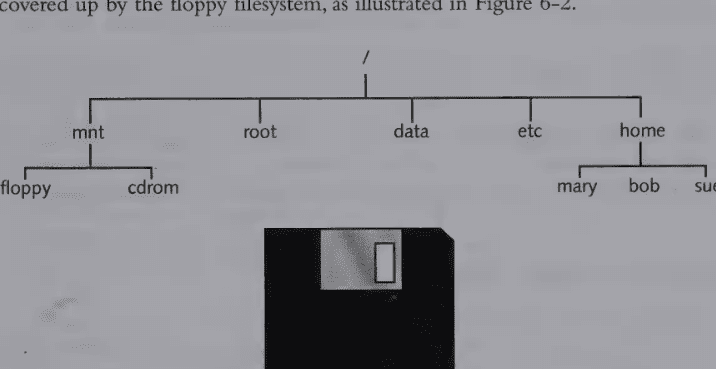
图 6-1 挂载前的目录结构

如果用户随后在 `/mnt` 目录中存储文件（如图6-2所示），则该文件将存储在软盘上。需要注意的是，任何现有目录都可以作为挂载点。如果用户将软盘设备挂载到 `/bin` 目录，在软盘挂载期间，`/bin` 目录中的所有文件都会被覆盖；当Linux系统首次启动时，硬盘上的文件系统挂载到 `/` 目录。这被称为根文件系统，包含了大部分操作系统文件。硬盘上的其他文件系统可以在启动时挂载到 `/` 下的各种挂载点，也可以通过后续章节讨论的 `/etc/fstab`（文件表）。

## 使用软盘

在计算机之间传输少量信息时，常用软盘移动介质来存储文件。然而，软盘在Linux中使用之前必须经过准备。

记住，每个磁盘设备在存储文件之前都必须格式化为文件系统。为了这一点，你可以使用 `mkfs`（创建文件系统）命令，并使用 `-t` 参数指定文件系统类型以及代表软盘设备的设备文件。要格式化计算机第一个软盘驱动器内的软盘，请输入以下命令：

```
@server1 root]# mkfs -t ext2 /dev/fd0

mke2fs 1.35 (28-Feb-2004)

Filesystem label=

OS type: Linux

Block size=1024 (log=0)

Fragment size=1024 (log=0)

184 inodes, 1440 blocks

72 blocks (5.00%) 留给超级用户

First data block=%

1 block group

8192 blocks per group, 8192 fragments per group

184 inodes per group
```

写入 inode 表：完成
写入超级块和文件系统统计信息：完成

此文件系统将在每 28 次挂载或每 180 天自动检查一次，以先者为准。使用 `tune2fs -c` 或 `-i` 可以覆盖。

```
[root@server1 root]##
```

或者，你可以在 `-t` 选项之后指定不同的文件系统，例如 DOS FAT 文件系统。这会导致 `mkfs` 命令产生不同的输出，如下例所示：

```
[root@server1 root]## mkfs -t mdsos /dev/fd0

mkfs.mdos 2.8 (28 Feb 2001)

[root@server1 root]##
```

如果你没有在 `mkfs` 命令中指定文件系统，假设默认文件系统为 ext2 文件系统，如下例所示：

```
[root@server1 root]## mkfs /dev/fd0

mke2fs 1.35 (28-Feb-2004)

Filesystem label=

OS type: Linux

Block size=1024 (log=0)

Fragment size=1024 (log=0)

184 inodes, 1440 blocks

72 blocks (5.00%) reserved for the super

First data block=1

1 block group

8192 blocks per group, 8192 fragments per group

184 inodes per group

写入 inode 表：完成

写入超级块和文件系统统计信息：完成

此文件系统将在每 26 次挂载或每 180 天自动检查一次，以先者为准。使用 tune2fs -c 或 -i 可以覆盖。
```
[root@server1 root]##
```

虽然创建文件系统最常用的命令是 `mkfs` 命令，但存在 `mkfs` 命令的其他变体和快捷方式。例如，要创建一个 ext2 文件系统，你可以在命令行上输入 `mke2fs /dev/fd0`。`mkfs` 命令的其他替代方案列在表 6-3 中。

# 第 6 章 Linux 文件系统管理

# 软磁盘操作

写入 inode 表：完成
写入超级块和文件系统统计信息：完成

此文件系统将在每 28 次挂载或每 180 天自动检查一次，以先者为准。使用 `tune2fs -c` 或 `-i` 可以覆盖。


| 表 6-3 用于创建文件系统的命令 |  |

| :--- | :--- |

| 命令 | 描述 |

| `mkfs` | 用于创建大多数类型的文件系统 |

| `mkfs.msdos` | 用于创建 DOS 文件系统 |

| `mkfs.dosfs` |  |

| `mkfs.vfat` | 用于创建 ext2 文件系统 |

| `mk2fs` |  |

| `mkfs.ext3` | 用于创建 ext3 文件系统 (j = 日志记录) |

| `mk2ifs -` |  |

| `mkisofs` | 用于创建 CD-ROM 文件系统 |

| `mkfs.reiserfs` | 用于创建 REISERFS 文件系统 |

| `mkreiserfs` |  |

在软磁盘用文件系统格式化后，在使用之前必须对其进行挂载。通过使用不带任何选项或参数的 `mount` 命令可以获取当前挂载的文件系统列表，它会读取 `/etc/mtab`（挂载表）文件中的信息，如下所示所示：

```
[root@server1 root]# # mount
/dev/hda1 / type ext3 (rw)
none on /proc proc (rw)
none on /sys sysfs (rw)
none on /dev/pts devpts (rw,gid=5,mode=620)
usbdevfs on /proc/bus/usb usbdevfs (rw)
none on /dev/shm type tmpfs (rw)
[root@server1 root]# # cat /etc/mtab
/dev/hda1 rw 0 0
none /sys sysfs rw 0 0
none /dev/pts devpts rw,gid=5,mode=620 0 0 0
usebdevfs /proc/bus/usb usbdevfs rw 0 0
none /dev/shm tmpfs rw 0 0
[root@server1 root]#_
```

从前面的输出中，你可以看到 `/dev/hda1` 挂载在 `/` 目录上并包含一个 ext3 文件系统。列出的其他文件系统是系统使用的特殊文件系统，将在本书后后的部分进行讨论。

要在目录树上挂载设备，你可以使用带有选项和参数的 `mount` 命令来指定文件系统类型以及挂载设备的目录（挂载点）。确保当前没有用户正在使用该挂载点目录是非常重要的；否则系统将给出错误信息且磁盘不会挂载。要检查 `/mnt/floppy` 目录是否正被任何用户使用，你可以使用带有 `-u` 选项的 `fuser` 命令，如下所示：

```
[root@server1 root]# fuser -u /mnt/floppy
[root@server1 root]#_
```

# 软磁盘操作

前面的输出表明 `/mnt/floppy` 目录没有被任何用户进程使用。要将第一个用 ext2 文件系统格式化的软磁盘设备挂载到 `/mnt/floppy` 目录，只需输入以下命令：

```
[root@server1]# mount -t ext2 /dev/fd0 /mnt/floppy
[root@server1]# mount
/dev/hda1 / type ext3 (rw)
none on /proc type proc (rw)
none on /sys type sysfs (rw)
none on /dev/pts type devpts (rw,gid=5,mode=620)
usbdevfs on /proc/bus/usb usbdevfs (rw)
none on /dev/shm type tmpfs (rw)
/dev/fd0 on /mnt/floppy type ext2 (rw)
[root@server1]#_
```

注意 `/dev/fd0` 挂载到了 `/mnt/floppy` 目录，如前面的输出所示。要在软磁盘上存储文件，可以将 `/mnt/floppy` 目录视为软磁盘的根目录。在磁盘上创建 ext2 文件系统时，默认创建一个 `lost+found` 目录。该目录供本章后面的 `fsck` 命令使用。要探索最近挂载的文件系统，你可以使用以下命令：

```
[root@server1 root]# cd /mnt/floppy
[root@server1 floppy]# pwd
/mnt/floppy
[root@server1 floppy]# ls -F
lost+found/
[root@server1 root]#
```

要将文件拷贝到软磁盘，只需将 `/mnt/floppy` 目录指定为 `cp` 命令的目标，如下所示：

```
[root@server1 floppy]# cd /etc
[root@server1 etc]# cat hosts
# Do not remove the following line, or various programs
# require network functionality will fail.
127.0.0.1 server1.com
[root@server1 etc]# cp hosts /mnt/floppy
[root@server1 etc]# cd /mnt/floppy
[root@server1 floppy]# ls -F
lost+found/
[root@server1 floppy]# cat hosts
# Do not remove the following line, or various programs
# require network functionality will fail.
127.0.0.1 server1.com
[root@server1 floppy]#_
```

同样，你还可以在软磁盘下创建子目录来存储文件；这些子目录位于挂载点目录下。要在示例中挂载的软磁盘创建一个名为 `workfiles` 的目录并将 `/etc/initab` 拷贝到那里，你可以使用以下命令：

```
[root@server1 floppy]# pwd
/mnt/floppy
[root@server1 floppy]# ls -F
lost+found/
[root@server1 floppy]# mkdir workfiles
[root@server1 floppy]# ls -F
lost+found/ workfiles/
[root@server1 floppy]# cd workfiles
[root@server1 floppy]# pwd
/mnt/floppy/workfiles
[root@server1 floppy]# cp /etc/initab
[root@server1 floppy]# ls -F
lost+found/ workfiles/
[root@server1 floppy]#_
```

尽管你可以从系统许可的情况下弹出软磁盘，但这可能会导致终端上出现错误信息。在弹出软磁盘之前，必须使用 `umount` 命令将其正确卸载。`umount` 命令可以接受设备名称或挂载点目录作为参数。与挂载软磁盘类似，卸载软磁盘也要求挂载点没有用户在使用。如果你尝试在使用卸载挂载到 `/mnt/floppy` 的软磁盘，你会收到与以下示例类似的错误信息：

```
[root@server1 floppy]# pwd
/mnt/floppy
[root@server1 floppy]# umount /mnt/floppy
umount: device is busy
[root@server1 floppy]# fuser -u /mnt/floppy
/mnt/floppy:
17368(root)
[root@server1 root]# cd /root
[root@server1 root]# umount /mnt/floppy
[root@server1 root]# mount
/dev/hdc1 on / type ext3 (rw)
none on /sys sysfs (rw)
none on /dev/pts devpts (rw,gid=5,mode=620)
usbdevfs on /proc/bus/usb usbdevfs (rw)
none on /dev/shm tmpfs (rw)
[root@server1 root]#_
```

从前面的输出中注意到，你仍在使用 `/mnt/floppy` 目录，因为它是当前工作目录。`fuser` 命令还表明 root 用户有一个进程在使用该目录。更改工作目录后，`mount` 命令能够从 `/mnt/floppy` 目录卸载软磁盘，`mount` 命令的输出表明软磁盘不再挂载。

回挂载仅仅是将磁盘设备附加到 Linux 目录树，以便你可以将目录视为充满了文件和子目录。设备可以挂载到任何现有目录。然而，如果目录包含文件，在卸载设备之前，这些文件是无法访问的。例如，假设你创建一个名为 `/flopper` 的目录用于挂载软磁盘，并在内部创建一个名为 `samplefile` 的文件，如下所示：


```
[root@server root]# mkdir /flopper
[root@server root]# touch /flopper/samplefile
[root@server root]# ls -F /flopper
samplefile
[root@server root]# _
```

如果软磁盘之前挂载到 `/flopper` 目录，使用 `/floppy` 目录的用户将在使用该软磁盘；然而，当没有内容挂载到 `/flopper` 目录时，之前的内容将可用：

```
[root@server root]# mount -t ext2 /dev/fd0 /flopper
[root@server root]# mount
/dev/hda1 / type ext3 (rw)
none on /proc type proc (rw)
none on /sys type sysfs (rw)
none on /dev/pts type devpts (rw,gid=5,mode=620)
usbdevfs on /proc/bus/usb usbdevfs (rw)
none on /dev/shm type tmpfs (rw)
/dev/fd0 on /flopper type ext2 (rw)
[root@server root]# ls -F /flopper
lost+found/
[root@server root]# umount /flopper
[root@server root]# ls -F /flopper
samplefile
[root@server root]#_
```

前面的输出中 `mount` 命令指定了文件系统类型、要挂载设备以及挂载点目录。为了节省命令行上的时间，你也可以备选指定一个参数，并允许系统在 `/etc/fstab`（文件系统表）中查找剩余信息。`/etc/fstab` 文件具有双用途：它用于在启动时挂载设备，并在用户在使用 `mount` 命令未指定足够的参数时进行查询。

`/etc/fstab` 文件包含六个字段：

```
<device to mount> <mount point> <type> <mount options> <dump#> <fsck#>
```

设备可以是设备文件的路径或描述要挂载卷的标签。挂载点指定了挂载设备的位置。类型可以是特定的
（作为 `ext3`）或可以自动检测。挂载选项是 `mount` 命令在挂载卷时所接受的额外选项（例如只读或 `"ro"`）。任何带有 `"noauto"` 挂载选项的文件系统在启动时均不会被自动挂载；通过查看 `mount` 命令的手帮助页可以找到 `mount` 命令接受的所有选项完整列表。

`dump#` 用于本书第 12 节稍后讨论的 `dump` 命令备份文件系统；此字段中的 1 表示该文件系统应该被备份，而 0 则表示不需要备份。`fsck#` 用于本章稍后讨论的 `fsck` 命令在启动时检查文件系统是否存在错误；数字为 2 和 0 的文件系统将不被检查。

> 要挂载 `/etc/fstab` 文件中所有旨在在启动时挂载的文件系统，你只需输入 `mount -a` 命令即可。

以下输出显示了 `/etc/fstab` 文件的内容：

```
[root@server1]# cat /etc/fstab
LABEL=               ext3      defaults        1 1
none                 /dev/pts devpts       gid=5,mode=620  0 0
none                 /dev/shm  tmpfs       defaults        0 0
none                 /proc     defaults        0 0
none                 /sys      sysfs       defaults        0 0
/dev/hda2            swap      defaults        0 0
/dev/cdrom           cdrom      udf,iso9660 noauto,owner, kudzu, ro 0 0
/dev/fd0            /mnt/floppy auto        noauto,owner, kudzu 0 0
[root@server1]# _
```

因此，要将第一个软盘 (`/dev/fd0`) 挂载到 `/mnt/floppy` 目录并自动检测设备上的文件系统类型，只需为 `mount` 命令指定足够的信息，以便在 `/etc/fstab` 文件找到合适的位置：

```
[root@server1 root]# mount /dev/fd0
[root@server1 root]# mount
/dev/h1 on / type ext3 (rw)
none on /proc type proc (rw)
none on /sys type sysfs (rw)
none on /dev/ptype type devpts (rw,gid=5,mode=620)
usbdevfs on /proc/bus/usb type usbdevfs (rw)
none on /dev/shm type tmpfs (rw)
/dev/fd0 on /mnt/floppy type ext2 (rw,nosuid,nodev)
[root@server1 root]# umount /dev/fd0
[root@server1 root]# _
```


## 使用软盘

上述输出中的 `mount` 命令之所以执行成功，是因为 `/etc/fstab` 中存在一行描述 `/dev/fd0` 设备挂载的行。

或者，你可以将挂载点作为 `mount` 命令的参数，通过 `/etc/fstab` 中正确的条目挂载同一设备：

```
[root@server1 root]# mount /mnt/floppy
[root@server1 root]# mount
/dev/sda1 on type ext3 (rw)
none on /proc type proc (rw)
none on /sys type sysfs (rw)
none on /dev/pts type devpts (rw,gid=5,mode=620)
usbdevfs on /proc/bus/usb type usbdevfs (rw)
one on /dev/shm type tmpfs (rw)
/dev/fd0 on /mnt/floppy type ext2 (rw,nosuid,nodev)
[root@server1 root]# umount /mnt/floppy
[root@server1 root]# 
```

表 6-4 挂载和卸载软盘时的有用命令。

| 命令 | 说明 |
| --- | --- |
| `mount` | 显示已挂载的文件系统 |
| `mount -t <type> <device> <mount point>` | 将特定 `<type>` 的 `<device>` 挂载到 `<mount point>` 目录 |
| `fuser -u <directory>` | 显示使用特定目录的用户 |
| `umount <mount point>` | 从 `<mount point>` 目录卸载 `<device>` |

虽然表 6-4 列出的命令允许用户完全控制挂载过程，但当你使用 GUI 环境访问软盘时，软盘通常会被自动挂载到 `/mnt/floppy` 目录。在 GNOME 面上，只需双击“计算机”图标，然后双击“软盘”图标，如图 6-3 所示。在 KDE 面上，你可以双击“在此处”图标，选择“磁盘”，然后双击“软盘”图标，如图 6-4 所示。

在 GUI 环境下挂载软盘会在桌面上一个代表软盘的图标。然后你可以双击软盘图标打开软盘上的文件列表，或右键点击软盘图标获取菜单，并从中选择“卸载卷”来卸载软盘。

大多数不是从互联网下载的软件被封制在 CD-ROM 光盘上，因为它们的存储容量远大于软盘；一张 CD-ROM 光盘存储的数据比软盘能存储的多 500 多倍。像软盘一样，CD-ROM 可以使用 `mount` 命令挂载并使用 `mount` 命令卸载，如表 6-4 所示；但这些命令使用的设备文件不同。大多数 Linux 系统都有通过 IDE 软线连接到主板的符合 ATAPI 标准的 CD-ROM 驱动器。这些 CD-ROM 像普通的 IDE 硬盘一样工作，并在第 2 节讨论的四种配置之一进行配置。这些配置及其对应的设备文件所示：

### 使用 CD-ROM 249

- 主主 (`/dev/hda`)
- 主从 (`/dev/hdb`)
- 从主 (`/dev/hdc`)
- 从从 (`/dev/hdd`)


因此，如果已知配置，你就可以指定你的 CD-ROM 设备文件。在安装时，Red Hat Fedora Linux 会创建一个指向相应设备的符号链接 `/dev/cdrom`；如果系统的 CD-ROM 被配置为从设备，`/dev/cdrom` 的长列表显示如下：

```
[root@server1]# ls -l /dev/cdrom
lrwxrwxrwx 1 root root 6 May 12 00 /dev/cdrom -> /dev/hdb
```

同样，如果系统有 SCSI CD-ROM，

```
[root@server1]# ls -l /dev/cdrom
lrwxrwxrwx 1 root root 6 May 12 00 /dev/cdrom -> /dev/sdb
```

大多数 Linux 系统都有通过 IDE 软线连接到主板的符合 ATAPI 标准的 CD-ROM 驱动器。这些 CD-ROM 像普通的 IDE 硬盘一样工作，并在第 2 节讨论的四种配置之一进行配置。这些配置及其对应的设备文件所示：

- 主主 (`/dev/hda`)
- 主从 (`/dev/hdb`)
- 从主 (`/dev/hdc`)
- 从从 (`/dev/hdd`)

## 硬盘分区

回想一下硬盘在你用于定期存储信息的任何设备中存储容量最大的。这也带来了一些问题；随着磁盘尺寸的增大，

### 硬盘操作 251

组织管理变得更加困难，错误概率随之增加。为了解决这些问题，通常将硬盘划分为更小的、更易用的区域，称为分区（partitions）。每个分区可以包含一个独立的文件系统，并挂载到不同的挂载目录。回顾第 2 章，Linux 至少需要两个分区：一个挂载到根目录的分区（根分区）和一个用于存放虚拟内存的分区（交换分区/swap）。交换分区不需要文件系统，因为它由操作系统进行写入和维护。然而，在 Linux 系统上使用多于两个分区是一个良好的习惯。这种划分可以：

- 隔离不同类型的数据——例如，家目录（home directory）被存储在挂载到 `/home` 的独立分区上。
- 允许在一个硬盘驱动器上使用多种类型的文件系统——例如，某些文件系统是针对数据库使用进行了优化的。
- 减少文件系统损坏导致系统无法使用的概率；如果挂载到 `/home` 目录的分区损坏，它不会影响系统的操作系统文件，因为操作系统文件存储在挂载到 `/` 目录的独立分区上。
- 通过保持文件系统尽可能小来加速对存储数据的访问。

将数据隔离到硬盘驱动器物理分离的区域，从组织管理的角度来看非常有益。将不同类型的数据保留在不同的分区中，让你能够操作一种类型的数据而不影响系统的其他部分。这还降低了文件系统损坏影响目录树中所有文件的可能性。访问速度得到了提高，因为硬盘中的磁头需要搜索较小的区域来定位数据。这个过程类似于在一个 20,000 英尺高的仓库里寻找硬硬币。如果这个仓库被分为四个各 5,000 平英尺的独立部门，并且你知道硬币所在的部门，找到硬币的时间要少得多。在较小、密集的空间内搜索和移动比在大型空间内要快得多得多。

在物理层，硬盘是高速旋转的圆形金属盘片。数据以同心圆道的轨迹从这些磁盘上读取；每个磁道被划分为扇区（sectors），扇区组合成更易用的数据块，如图 6-5 所示。大多数硬盘内部有几个分区，它们相互排列，可以同时写入以加速数据传输。所有金属盘片上相同的同心磁道组成的系列称为圆柱（cylinder）。

分区定义存储在硬盘的可读第一个扇区中，称为主引导记录（MBR）或主引导块（MBB）。如果硬盘的这一区域损坏，整个硬盘的内容都可能丢失。

# 第 6 章 Linux 文件系统管理


图 6-5 硬盘的物理区域

> Linux 服务器拥有多个硬盘是常见现象。在这些情况下，在每个硬盘上配置一个分区并将每个分区挂载到目录树中的不同目录也是常见做法。因此，如果一个分区故障，可以使用新硬盘替换整块硬盘，并从备份源检索数据。

回顾第 2 章，硬盘最多可以包含四个主分区（primary partitions）；为了克服这一局限，你可以使用扩展分区（extended partition）来代替其中一个主分区。扩展分区可以包含许多称为逻辑驱动器（logical drives）子分区。由于你是在分区上放置文件系统的，因此存在指向硬盘上可以拥有的各种类型分区的设备文件。这些设备文件以硬盘名称开头（`/dev/hda`、`/dev/hdb`、`/dev/sda`、`/dev/sdb` 等），并附加一个指示该硬盘上分区的数字。第一个主分区编号为 1，第二个主分区编号为 2，第三个主分区编号为 3，第四个主分区编号为 4。如果其中任何一个主分区标记为扩展分区，其内部的逻辑驱动器命名从 5 开始。表 6-5 列出了一些常见的硬盘分区名称。

# 表 6-5 用于 /dev/hda 和 /dev/sda 的常见硬盘分区设备文件

| 分区 | IDE 设备名称（假设为 /dev/hda） | SCSI 设备名称（假设为 /dev/sda） |
| :--- | :--- | :--- |
| 第一个主分区 | `/dev/hda1` | `/dev/sda1` |
| 第二个主分区 | `/dev/hda2` | `/dev/sda2` |
| 第三个主分区 | `/dev/hda3` | `/dev/sda3` |
| 第四个主分区 | `/dev/hda4` | `/dev/sda4` |
| 扩展分区中的第一个逻辑驱动器 | `/dev/hda5` | `/dev/sda5` |

## 硬盘操作

表 6-5 用于 /dev/hdc 和 /dev/sda 的常见硬盘分区设备文件（续）

| 分区 | IDE 设备名称（假设为 /dev/hdc） | SCSI 设备名称（假设为 /dev/sda） |
| :--- | :--- | :--- |
| 扩展分区中的第二个逻辑驱动器 | `/dev/hdc6` | `/dev/sda6` |
| 扩展分区中的第三个逻辑驱动器 | `/dev/hdc7` | `/dev/sda7` |
| 扩展分区中的第四个逻辑驱动器 | `/dev/hdc8` | `/dev/sda8` |
| 扩展分区中的第五个逻辑驱动器 | `/dev/hdc9` | `/dev/sda9` |
| 扩展分区中的第 n 个逻辑驱动器 | `/dev/hcan` | `/dev/sdan` |

注意表 6-5，其中任何一个主分区被标记为扩展分区，内部的逻辑驱动器命名从 5 开始。

硬盘分区可以针对特定的文件系统创建。要创建一个使用 ext2 或 ext3 格式的分区，你应该创建一个 Linux 分区（也称为类型 83）。同样，如果该分区打算用于虚拟内存，你应该创建一个交换分区（也称为类型 82）。

典型的 Linux 硬盘结构（主 IDE 硬盘 `/dev/sda`）可以包含一个 `/` 文件系统分区（dev/da1）和一个扩展分区（dev/da2）以及一些空闲，如图 6-6 所示。

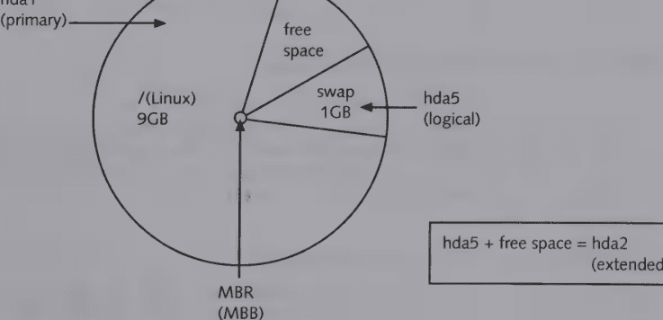

图 6-6 示例策略

更复杂的 Linux 硬盘结构（主 IDE 硬盘）可能涉及保留 操作系统分区，允许用户进入并使用 Linux 操作系统或 Windows 操作系统。这被称为双启动，将在节中讨论。

在图 6-7 中，Windows 分区被创建为主分区（dev/hda1），Linux 分区包含在扩展分区（dev/hda2）中。图 6-7 为用户目录创建了独立的文件系统，挂载到 `/home` (`/dev/hda6`)。

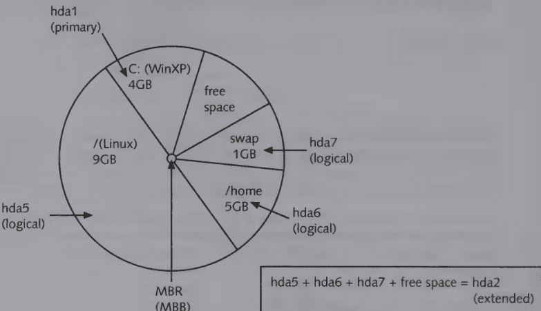

图 6-7 双启动 Linux 分区策略

# 硬盘分区操作

回顾分区创建可以在安装时使用 Disk Druid 工具。Disk Druid 是一种专为安装设计的易用分区工具。要在安装后创建分区，可以使用 `fdisk` 命令。只需指定要分区的硬盘作为参数即可。使用 `fdisk` 配合辅助主 IDE 硬盘 (`/dev/hdc`) 的示例在如下输出所示：

```
[root@server1 root]# fdisk /dev/hdc
```

此磁盘的磁道数设置为 2491。这没有问题，但此数字大于 1024，在某些设置可能会导致某些软件出现问题：

- 1) 启动时运行的软件（例如旧版本的 LILO）
- 2) 来自其他系统的启动和分区软件（例如 DOS FDISK、OS/2 FDISK）

## 硬盘操作 255

命令 (m 获取帮助) : _

从前述输出可以注意到，`fdisk` 命令会显示一个提示，让用户接受 `fdisk` 命令；如果用户在此提示处按下 `m` 键，即可查看可能的 `fdisk` 命令列表，如下例所示：

Command (m 获取帮助) : m

命令操作

- a 切换启动标记


- `b` 编辑 `bsdlabel`
- `c` 切换 `dos` 兼容性标记
- `d` 删除分区
- `l` 列出已知的分区类型
- `print` 打印此菜单
- `a` 添加新分区
- `o` 创建新的空 `DOS` 分区表
- `p` 打印分区表
- `q` 退出且不保存更改
- `s` 创建新的空 `Sun` 磁盘标签
- `t` 修改分区的系统 `ID`
- `u` 更改显示/条目单位
- `v` 验证分区表
- `w` 将表写入磁盘并退出
- `x` 额外功能（仅限专家）

`Command (m 获取帮助) : _`

若要打印当前在 `/dev/hdc` 上设置的分区列表，你可以在 `fdisk` 提示处按下 `p` 键：

```
Command (m 获取帮助) : p
```

`Disk /dev/hdc: 20.4 GB, 20490559488 bytes`

`255 heads, 63 sectors/track, 2491 cylinders`

`Units = cylinders of 16065 * 512 = 8225280 bytes`

| 设备 | 起始 | 结束 | 块 | Id 系统 |
| :--- | :--- | :--- | :--- | :--- |
| `/dev/hdc1` | 1 | 510 | 4096543+ | 83 Linux |
| `/dev/hdc2` | 511 | 561 | 409657+ | 82 Linux swap |
| `/dev/hdc3` | 562 | 1247 | 5510295 | 83 Linux |

`Command (m 获取帮助) : _`

注意设备名称出现在前述输出的左侧，包括启动的分区（`/dev/hdc1`）、物理硬硬盘上分区的起始和结束位置（起始和结束磁道）、分区内用于存储信息的总块数，以及分区的类型和描述（83 是 Linux 分区，82 是 Linux 交换分区）。Linux 分区可以包含 Linux 文件系统，例如 `ext2` 或 `ext3`。

# 第 6 章 Linux 文件系统管理

要删除 `/dev/hdc3` 分区以及你所在文件系统中包含的所有数据，你可以使用之前未说明的 `n` 键：

```
Command (m 获取帮助): d
Partition number (1-4): 3
Command (m 获取帮助): p
```

`/dev/hdc: 20.4 GB, 2049055948 bytes`

`255 heads, 63 sectors/track, 2491 cylinders`

`Units = cylinders of 16065 * 512 = 8225280`

| 设备 | 起始 | 结束 | 块 | Id | 系统 |
| :--- | :--- | :--- | :--- | :--- | :--- |
| `/dev/hdc1` | 1 | 510 | 4096543+ | 83 | Linux |
| `/dev/hdc2` | 511 | 561 | 409657+ | 82 | Linux swap |

`Command (m 获取帮助): _`

若要使用第四个分区（`/dev/hdc4`）创建一个带有两个逻辑驱动器（`/dev/hdc5` 和 `/dev/hdc6`）的扩展分区，可以使用之前说明的 `n` 键，并指定要创建的分区、硬盘上的起始磁道以及以块为单位的大小（`+1000M` 会创建一个 1000MB 的分区）：

```
Command (m 获取帮助): n
Command action
- - extended
- primary partition (1-4) 
e
Partition number (1-4): 4
First cylinder (562-2491, default 562): 562
Last cylinder or +size or sizeM or +sizeK (562-2491, default 2491): 1247
Command (m 获取帮助): p
```

`/dev/hdc: 20.4 GB, 2049055948 bytes`

`255 heads, 63 sectors/track, 2491 cylinders`

`Units = cylinders of 16065 * 512 = 8225280`

| 设备 | 起始 | 结束 | 块 | Id | 系统 |
| :--- | :--- | :--- | :--- | :--- | :--- |
| `/dev/hdc1` | 1 | 510 | 4096543+ | 83 | Linux |
| `/dev/hdc2` | 511 | 561 | 409657+ | 82 | Linux swap |
| `/dev/hdc4` | 562 | 1247 | 5510295 | 5 | Extended |

```
Command (m 获取帮助): n
Command action
- - logical (5 or over)
- primary partition (1-4)
First cylinder (562-1247, default 562): 562
Last cylinder or +size or +sizeM or +sizeK (562-1247, default 1247): +1000M
Command (m 获取帮助): p
```

`/dev/hdc: 20.4 GB, 2049055948 bytes`

`255 heads, 63 sectors/track, 2491 cylinders`

`Units = cylinders of 16065 * 512 = 8225280 bytes`

| 设备 | Boot | 起始 | 结束 | 块 | Id | 系统 |
| :--- | :--- | :--- | :--- | :--- | :--- | :--- |
| `/dev/hdc1` |  | 1 | 510 | 4096543+ | 83 | Linux |
| `/dev/hdc2` |  | 511 | 561 | 409657+ | 82 | Linux swap |
| `/dev/hdc4` |  | 562 | 1247 | 5510295 | 5 | Extended |
| `/dev/hdc5` |  | 562 | 689 | 102818+ | 83 | Linux |
| `/dev/hdc6` |  | 690 | 944 | 204826 | 82 | Linux |

`Command (m 获取帮助) : _`

从前述输出可以注意到，设备名称出现在左侧，包括启动的分区（`/dev/hdc1`）、物理硬硬盘上分区的起始和结束位置（起始和结束磁道）、分区内用于存储信息的总块数，以及分区的类型和描述（83 是 Linux 分区，82 是 Linux 交换分区）。

## Linux 文件系统管理

写入超级块和文件系统计数信息：

此文件系统每隔 36 次挂载或 180 天自动检查一次，以先者为准。使用 `tune2fs -c` 或 `-i` 可以覆盖。

```
[root@server1 root]#
```

随后，你可以使用 `tune2fs` 命令将此文件系统转换为 `ext3`，并在文件系统上创建一个日志文件：

```
[root@server1 root]# tune2fs -j /dev/hdc5
tune2fs 1.35 (28-Feb-2004)
```

创建日志 `inode`：完成

此文件系统每隔 36 次挂载或 180 天自动检查一次，以先者为准。使用 `tune2fs -c` 或 `-i` 可以覆盖。

```
[root@server1 root]#
```

或者，你也可以使用 `mke2fs -j /dev/hdc5` 或 `mkfs.ext3 /dev/hdc5` 命令创建一个 `ext3` 文件系统。要将此文件系统挂载到名为 `/data` 的新挂载点并查看内容，你可以使用以下命令：

```
[root@server1 root]# mkdir /data
[root@server1 root]# mount -t ext3 /dev/hdc5 /data
[root@server1 root]# mount
/dev/hdc1 / type ext3 (rw)
none on /proc type (rw)
none on /sys type sysfs (rw)
none on /dev/pts type devpts (rw,gid=5,mode=620)
usbdevfs on /proc/bus/usb type usdevfs (rw)
none on /dev/shm type tmpfs (rw)
/dev/hdc5 /data type ext3 (rw)
[root@server1 root]# ls -F /data
lost-found/
[root@server1 root]#
```

为了让系统在每次启动时自动挂载此文件系统，只需编辑 `/etc/fstab` 文件，其中包含针对 `/dev/hdc5` 的以下条目：

```
[root@server1 root]# cat /etc/fstab
```


| LABEL=/ / ext3 1 1 |
| none /dev/pts devpts gid=5,mode=620 0 0 |
| none /dev/shm tmpfs defaults 0 0 |
| none /proc proc defaults 0 0 |
| none /sys sysfs defaults 0 0 |
| none /dev/hda2 swap defaults 0 0 |
| /dev/cdrom /mnt/cdrom udf,iso9660 noauto,owner,kudzu 0 0 |
| /dev/fd0 /mnt/floppy auto noauto,owner,kudzu 0 0 |
| /dev/hdc5 /data ext3 defaults 0 0 |
| [root@server1 root]# |

## 监控文件系统

在磁盘设备上创建文件系统并把这些磁盘设备挂载到目录树后，应该定期检查它们是否存在错误、磁盘空间使用情况和 inode 使用情况。这可以最大限地减少由于文件系统损坏可能导致的问题，并降低因磁盘空间不足而无法保存文件的概率。

## 磁盘使用

多个文件系统可以挂载到目录树中。如前所述，损坏的文件系统干扰正常系统操作的可能性就越低。相反，文件系统越多通常意味着每个文件系统的硬盘空间越小，如果某些文件系统被数据填满可能会导致系统错误。许多用户在安装期间会为 `/usr` 和 `/var` 目录创建系统 `/usr` 目录包含 Linux 系统上的大多数工具和已安装程序，并留有足够的空间供未来安装软件 `/var` 目录随着存储日志文件而持续增长。应该定期删除旧的日志文件以为新日志留出空间。`/filesystem` 是其中最重要的，应该始终包含大量的空闲空间，作为操作系统的工作空间。因此，应该频繁监控 `/filesystem`。如果 `/` 文件系统的空闲空间低于 `10%`，系统可能会出现性能下降或停止运行。

监控挂载文件系统可用空间最简单的方法是使用 `df`（磁盘空间命令）命令，如下所示：

```
[@server1 root]# # df
Filesystem Available Use% Mounted
/dev/hdc1 4032092 2844744 978524 75% /
none 192233 0 192232 0% /dev/shm
```

从前面的输出可以看出，唯一使用的文件系统是 `/filesystem`；`/usr` 和 `/var` 目录只是 `/filesystem` 上的目录，这增加了监控 `/filesystem` 的重要性。由于前面的输出中 `/filesystem` 已使用 `75%`，目前没有迫切担心。然而，未来的日志文件和安装的软件将增加这个数字，并可能需要购买额外的硬盘来存放数据。

或者，你可以使用 `-h` 选项以更易于阅读（或人类可读）的格式查看 `df` 命令的输出，该选项以最方便的格式打印大小（G = 吉字节，M = 兆字节），如下：

```
[@server1 root]# -h
Filesystem Size Available Use% Mounted
/dev/hdc1 3.8G 955M 75% /
none 188M 0 187M 0% /dev/shm
```

## 第 6 章 Linux 文件系统管理

记住 `df` 命令只查看已挂载的文件系统，这一点很重要；为了获取软磁盘文件的空空间统计，你应该在查看 `df` 命令输出之前将其挂载：

```
[root@server1 root]#
```

```
[root@server1 root]# mkdir /data
[root@server1 root]# mount -t ext3 /dev/hdc5 /data
[root@server1 root]# mount
/dev/hdc1 / type ext3 (rw)
none on /proc type (rw)
none on /sys type sysfs (rw)
none on /dev/pts type devpts (rw,gid=5,mode=620)
usbdevfs on /proc/bus/usb type usdevfs (rw)
none on /dev/shm type tmpfs (rw)
/dev/hdc5 /data type ext3 (rw)
[root@server1 root]# ls -F /data
lost-found/
[root@server1 root]#
```

为了让系统在每次启动时自动挂载此文件系统，只需编辑 `/etc/fstab` 文件，其中包含针对 `/dev/hdc5` 的以下条目：

```
[root@server1 root]# cat /etc/fstab
```

| LABEL=/ / ext3 1 1 |
| none /dev/pts devpts gid=5,mode=620 0 0 |
| none /dev/shm tmpfs defaults 0 0 |
| none /proc proc defaults 0 0 |
| none /sys sysfs defaults 0 0 |
| none /dev/hda2 swap defaults 0 0 |
| /dev/cdrom /mnt/cdrom udf,iso9660 noauto,owner,kudzu 0 0 |
| /dev/fd0 /mnt/floppy auto noauto,owner,kudzu 0 0 |
| /dev/hdc5 /data ext3 defaults 0 0 |
| [root@server1 root]# |

## 监控文件系统

在磁盘设备上创建文件系统并把这些磁盘设备挂载到目录树后，应该定期检查它们是否存在错误、磁盘空间使用情况和 inode 使用情况。这可以最大限地减少由于文件系统损坏可能导致的问题，并降低因磁盘空间不足而无法保存文件的概率。

## 磁盘使用

多个文件系统可以挂载到目录树中。如前所述，损坏的文件系统干扰正常系统操作的可能性就越低。相反，文件系统越多通常意味着每个文件系统的硬盘空间越小，如果某些文件系统被数据填满可能会导致系统错误。许多用户在安装期间为 `/usr` 和 `/var` 目录创建系统 `/usr` 目录包含 Linux 系统上的大多数工具和已安装程序，并留有足够的空间供未来安装软件 `/var` 目录随着存储日志文件而持续增长。应该定期删除旧的日志文件以为新日志留出空间。`/filesystem` 是其中最重要的，应该始终包含大量的空闲空间，作为操作系统的工作空间。因此，应该频繁监控 `/filesystem`。如果 `/` 文件系统的空闲空间低于 `10%`，系统可能会出现性能下降或停止运行。

监控挂载文件系统可用空间最简单的方法是使用 `df`（磁盘空间命令）命令，如下所示：

```
[@server1 root]# # df
Filesystem Available Use% Mounted
/dev/hdc1 4032092 2844744 978524 75% /
none 192233 0 192232 0% /dev/shm
```

从前面的输出可以看出，唯一使用的文件系统是 `/filesystem`；`/usr` 和 `/var` 目录只是 `/filesystem` 上的目录，这增加了监控 `/filesystem` 的重要性。由于前面的输出中 `/filesystem` 已使用 `75%`，目前没有迫切担心。然而，未来的日志文件和安装的软件将增加这个数字，并可能需要购买额外的硬盘来存放数据。

或者，你可以使用 `-h` 选项以更易于阅读（或人类可读）的格式查看 `df` 命令的输出，该选项以最方便的格式打印大小（G = 吉字节，M = 兆字节），如下：

```
[@server1 root]# -h
Filesystem Size Available Use% Mounted
/dev/hdc1 3.8G 955M 75% /
none 188M 0 187M 0% /dev/shm
```

## 第 6 章 Linux 文件系统管理

记住 `df` 命令只查看已挂载的文件系统，这一点很重要；为了获取软磁盘文件的空空间统计，你应该在查看 `df` 命令输出之前将其挂载：

```
[root@server1 root]#
```

## 监控文件系统 265

未指定文件系统类型，假设为 ext2 文件系统。同样重要的是，在检查文件系统之前必须先卸载它，`fsck` 命令才能正常工作，如下所示：

```
[root@server1]# fsck -t ext2 /dev/fd0
Parallelizing fsck version 1.23 (15-Aug-2001)
fsck 1.35 (28-Feb-2004)
e2fsck 1.35 (28-Feb-2004)
/dev/fd0 is mounted.
```

警告！！！在已挂载的文件系统运行 e2fsck 可能会导致严重的文件系统损坏。

你确定要继续吗 (y/n)? n

检查中止。


```
[root@server1 root]# umount /dev/fd0
[root@server1 root]# fsck -t ext2 /dev/fd0
fsck 1.35 (28-Feb-2004)
e2fsck 1.35 (28-Feb-2004)
/dev/fd0: clean, 14/184 files, 45/1440 blocks
[root@server1 root]#
```

> 因为文件系统无法卸载，你只应该在单用户模式下对文件系统运行 `fsck` 命令，这将在第 8 章“使用 Bash Shell”中进行讨论。


从前面的输出可以注意到，在检查文件系统时，`fsck` 命令不会在终端屏幕上给出冗长的输出；这是因为除非使用 `-f` 选项进行全检，否则 `fsck` 命令只执行快速错误检查，例如所示：

```
[root@server1 root]# fsck -f ext2 /dev/fd0
fsck 1.35 (28-Feb-2004)
e2fsck 1.35 (28-Feb-2004)
Pass 1: Checking inodes, blocks, and sizes
Pass 2: Checking directory structure
Pass 3: Checking directory connectivity
Pass 4: Checking reference counts
Pass 5: Checking group summary information
/dev/fd0: 14/184 files (0.0% non-contiguous), 45/1440 blocks
[root@server1 root]#
```

表 6-6 显示了用于 `fsck` 命令的常用选项列表。

## 第 6 章 Linux 文件系统管理

| 表 6-6 fsck 命令的常用选项 |

| 选项 | 描述 |

| - | - |

| -f | 执行全文件系统检查 |

| -a | 允许 fsck 自动修复任何错误 |

| -A | 检查 `/etc/fstab` 中第6 字段为 1 或 2 的所有文件 |

| -Cf | 执行全文件系统检查并显示进度行 |

| -AR | 检查 `/etc/fstab` 中第6 字段为 1 或 2 的所有文件但跳过 `/filesystem` |

| -V | 显示详细输出 |

如果 `fsck` 命令发现损坏的文件，它会向用户显示消息询问是否修复错误；为了避免这些消息，你可以使用表 6-6 列出的 `-a` 选项来指定 `fsck` 命令自动修复任何损坏。如果 `fsck` 命令无法修复，它会将其放在该文件系统的最后一个 `last+found` 目录中并重命名为 inode 号。

要查看 `last+found` 目录的内容，只需挂载设备并立即查看挂载点下方的 `last+found` 目录内容。因为通过 inode 号识别文件很困难，大多数用户通常会这样做。由于文件系统无法卸载，你只应该在单用户模式下对文件系统运行 `fsck` 命令，这将在第 8 章“使用 Bash Shell”中讨论。

从前面的输出可以注意到，`fsck` 命令在检查文件系统时不会在终端屏幕上给出冗长的输出；这是因为除非使用 `-f` 选项进行全检，否则 `fsck` 命令只执行快速错误检查，例如所示：

```
[root@server1 root]# fsck -f ext2 /dev/fd0
fsck 1.35 (28-Feb-2004)
e2fsck 1.35 (28-Feb-2004)
Pass 1: Checking inodes, blocks, and sizes
Pass 2: Checking directory structure
Pass 3: Checking directory connectivity
Pass 4: Checking reference counts
Pass 5: Checking group summary information
/dev/fd0: 14/184 files (0.0% non-contiguous), 45/1440 blocks
[root@server1 root]#
```

要查看 `last+found` 目录的内容，只需挂载设备并立即查看挂载点下方的 `last+found` 目录内容。因为通过 inode 号识别文件很困难，大多数用户通常会这样做。由于文件系统无法卸载，你只应该在单用户模式下对文件系统运行 `fsck` 命令，这将在第 8 章“使用 Bash Shell”中讨论。

## 磁盘配额 269

接下来在提供的列中填写适当的值，然后保存并退出 `vi` 编辑器：

用户 `userl` (`uid` 500) 的磁盘配额：

| 文件系统 | blocks soft hard inodes soft hard grace |

| :--- | :--- | :--- | :--- | :--- | :--- | :--- |

| `/dev/sda1` | 1188 | 18432 | 20480 | 326 | 900 | 1000 |

`:wq`

`"/tmp/EdP.acplslvy 3L, 216C 写入"`

`[root@server1]#`

- 6. 使用 `edquota -u -t` 命令修改用户超出软配额的时间限制。软配额的默认时间限制为七天，但可以如下所示进行更改：

`[root@server1]# edquota -u -t`

在强制执行软限制之前的宽限期：

时间单位可以是：天、小时、分钟或秒

| 文件系统 | 块宽限期 | 节点宽限期 |

| :--- | :--- | :--- |

| `/dev/sda1` | 7days | 7days |

```
"/tmp//EdP.alzvfSy 4L, 233C
```

- 7. 使用 `repquota` 命令收集文件系统上的用户配额报告，以确保配额已正确更新，输出输出所示：

`[root@server1]# repquota /`

*** 设备 `/dev/sda1` 上的用户配额报告

块宽限期: 7days；节点宽限期: 7days

| 块限制 | 文件限制 |

| 用户 | 已用 soft | hard grace | 已用 soft | hard grace |

| :--- | :--- | :--- | :--- | :--- | :--- | :--- |

| root | 6420573 | 0 | 0 | 376520 | 0 | 0 |

| bin | 14912 | 0 | 0 | 47 | 0 | 0 |

| daemon | 16 | 0 | 0 | 5 | 0 | 0 |

| lp | 8 | 0 | 0 | 2 | 0 | 0 |

| news | 4396 | 0 | 0 | 228 | 0 | 0 |

| uucp | 9612 | 0 | 0 | 23 | 0 | 0 |

| games | 0 | 0 | 0 | 65 | 0 | 0 |

| rpm | 101056 | 0 | 0 | 120 | 0 | 0 |

| cvsa | 8 | 0 | 0 | 143 | 0 | 0 |

| rpcuser | 32 | 0 | 0 | 8 | 0 | 0 |

| pcap | 256 | 0 | 0 | 14 | 0 | 0 |

| smmsp | 12 | 0 | 0 | 3 | 0 | 0 |

| apache | 48 | 0 | 0 | 12 | 0 | 0 |

| squid | 16 | 0 | 4 | 0 | 0 | 0 |

| webalizer | 24 | 0 | 0 | 6 | 0 | 0 |

| xfs | 8 | 0 | 0 | 3 | 0 | 0 |

| named | 36 | 0 | 0 | 9 | 0 | 0 |

| ntp | 12 | 0 | 0 | 3 | 0 | 0 |

| gdm | 28 | 0 | 0 | 1 | 0 | 0 |

| pvm | 8 | 0 | 0 | 2 | 0 | 0 |

| wnn | 4184 | 0 | 0 | 44 | 0 | 0 |

| postfix | 88 | 0 | 0 | 22 | 0 | 0 |

| mailman | 4 | 0 | 0 | 2 | 0 | 0 |

| amanda | 1108 | 0 | 0 | 74 | 0 | 0 |

| netdump | 32 | 0 | 0 | 9 | 0 | 0 |

| quagga | 32 | 0 | 0 | 8 | 0 | 0 |

| radvd | 8 | 0 | 0 | 2 | 0 | 0 |

| radiusd | 24 | 0 | 0 | 9 | 0 | 0 |

| ldap | 8 | 0 | 0 | 2 | 0 | 0 |

| mysql | 16 | 0 | 0 | 5 | 0 | 0 |


| postgres | 5352 | 0 | 0 | 279 | 0 | 0 |
| fax | 60 | 0 | 0 | 5 | 0 | 0 |
| nut | 28 | 0 | 0 | 5 | 0 | 0 |
| privoxy | 624 | 0 | 0 | 48 | 0 | 0 |
| tomcat | 24 | 0 | 0 | 6 | 0 | 0 |
| cyrus | 16808 | 0 | 0 | 34 | 0 | 0 |
| exim | 40 | 0 | 0 | 10 | 0 | 0 |
| userl | 1188 | 18432 | 20480 | 326 | 900 | 1000 |

注意，上述输出中的大多数用户是系统用户，未应用配额。

上述命令必须由 `root` 用户执行；然而，普通用户可以使用 `quota` 命令查看自己的配额：

```
[root@server1]# quota
root (uid 0) 的磁盘配额：none
[root@server1]# quota -u
userl (uid 500) 的磁盘配额：
文件系统 blocks soft hard inodes soft hard grace
/dev/sda1 1188 18432 20480 326 900 1000
[root@server1]#
```

## 第6 章 Linux 文件系统管理

## 总结

- 磁盘设备由位于 `/dev` 目录下的设备文件表示。这些设备文件指定了类型、主号和次号。
- 每个磁盘设备必须包含一个文件系统，然后使用 `mount` 命令挂载到目录树中。可以使用 `umount` 命令卸载文件系统。
- 在创建文件系统之前，硬盘必须分成不同的区域。可以使用 `partition` 命令对磁盘进行分区。
- Linux 可许多不同的文件系统；每个文件系统都有特定的用途，多个文件系统可以挂载到不同的挂载点。
- 使用 `du` 命令监控磁盘使用情况很重要。同样，使用 `fsck` 命令检查磁盘错误很重要。
- 如果磁盘空间有限，可以使用磁盘配额来限制用户在文件系统上的空间。

## 关键术语

- `/dev`：存储设备文件的目录。
- `/etc/fstab`：用于指定启动时自动挂载哪些文件系统的文件，可以通过 `mount` 查询。
- `/etc/mtab`：包含当前挂载文件系统列表的文件。
- `/proc/devices`：包含设备信息的文件。
- 坏块（bad blocks）：无法存储数据的介质区域。
- 块（block）：文件系统使用的数据单位；一个块可以包含多个扇区。
- 块设备（block devices）：以数据块与系统传输数据的存储设备；由块设备文件表示。
- 字符设备（character devices）：一次一次与系统传输数据的存储设备；由字符设备文件表示。
- 柱面（cylinder）：硬盘上由磁头写入的一系列磁道。
- 设备文件（device file）：Linux 命令用于表示系统特定设备的文件；这些文件没有数据区，并使用主号和次号分别引用相应的驱动程序和特定设备。
- `df (disk free space)`：按文件系统显示磁盘空间的命令。
- `du (directory usage)`：显示目录使用情况的命令。
- `edquota`：为用户和组指定配额的命令。
- `fsck`：用于创建、删除和操作硬盘分区的命令。
- 文件系统（filesystem）：在物理存储介质上的组织，用于管理数据的存储和检索。
- 文件系统损坏（filesystem corruption）：文件系统结构中的错误，会导致无法检索存储的数据。
- 格式化（formatting）：将文件系统置于磁盘设备的过程。
- `fsck (filesystem check)`：用于检查文件系统完整性并修复损坏文件的命令。
- `fuser`：用于识别使用特定文件或目录的任何用户或进程的命令。
- 磁盘配额：对用户可用的文件数量或硬盘总存储空间的限制。
- 硬限制（hard limit）：内核施加的限制，用于识别与特定硬件类别交互的设备驱动。
- 主号（major number）：内核用于识别特定硬件的数字；硬盘、CD-ROM 和显卡都是硬件类别；相似设备共享公共的主号。
- 次号（minor number）：内核用于识别给定类别内特定硬件设备的数字，以便使用驱动程序与之通信；另见主号。
- `mkfs (make filesystem)`：用于格式化或创建文件系统的命令。
- `mknod`：已知主号、次号和类型（字符或块）时，用于重新创建设备文件的命令。
- `mount`：将文件系统挂载到设备上的挂载点目录的命令。
- 挂载点（mount point）：文件结构中被挂载某内容的目录。
- 挂载（mounting）：将设备与本地目录树中的目录关联（以便在该设备上存储数据）的过程。
- 分区（partition）：硬盘的物理划分。
- `quota`：用于查看施加给用户的磁盘配额的命令。
- `quotaoff`：用于禁用磁盘配额的命令。
- `quotaon`：用于激活磁盘配额的命令。
- 配额（quotas）：可以施加给用户和组的文件系统使用限制。
- `repquota`：生成特定文件系统配额报告的命令。
- 根文件系统（root filesystem）：包含组成操作系统的文件系统；它应该留有足够的剩余空间以防止错误和运行缓慢。

## 复习题

- 扇区 (sector) — 硬盘上数据存储的最小单元；扇区排列成称为轨道（tracks）的同心圆，并可以系统分组为块。
- 软限制 (soft limit) — 一种可以在一定时间内被超过的限制。
- 同步 (syncing) — 将存储在内存中的数据写入硬盘的过程。
- 轨道 (track) — 硬盘上形成同心圆扇区的区域。
- `tune2fs` 命令 — 一个用于修改 ext2 和 ext3 文件系统参数的命令。
- `mount` 命令 — 一个用于断开设备与逻辑目录树中目录之间关联的命令。

## 复习题（此处重复标题保持格式）

1. 你发现 `/dev` 目录下的一个设备文件已损坏。你知道该设备是 `/dev/tty3` 且它是一个字符设备文件。你应该怎么做？

   a. 使用 `fknod` 命令修复文件。
   b. 使用 `fck` 命令重新创建文件。
   c. 使用 `/dev/MAKDEV` 命令重新创建文件。
   d. 什么都不做；没有次设备号，你无法重新创建文件。

2. 硬盘驱动上的分区用文件系统格式化后，该硬盘上的所有分区必须使用相同的文件系统。对还是错？

3. 你想查看系统当前正在使用的文件系统。你可以做什么？

   a. `cat /etc/fstab`
   b. `ls -l /etc/fstab`
   c. `cat /etc/mtab`
   d. `ls -l /etc/fstab`

4. Jim 刚刚购买了两个新的 SCSI 硬盘和一个它们的控制器卡。他正确地在机器中安装了这些硬件。在使用它们进行数据存储和检索之前，他必须做什么？（选择所有适用项）

   a. 挂载这两个硬盘，以便操作系统可以访问。
   b. 在每个硬盘上挂载一个文件系统。
   c. 使用 `fdisk` 命令在每个硬盘上创建一个或多个分区。
   d. 使用 `vi` 编辑器编辑 `/etc/mtab` 并为控制器卡和硬盘创建条目。
   e. 挂载在两个硬盘上创建的任何分区，以便操作系统可以访问。
   f. 使用 Linux 识别的有效文件系统格式化创建的任何分区。

5. 给以下来自 `/etc/fstab` 的输出，`fsck` 命令将在启动时检查哪些文件系统？

| LABEL/ | ext3 defaults 1 1 |
| :--- | :--- |
| none /dev/pts devpts gid=5,mode=620 1 0 |
| none /proc defaults 0 1 |
| none /dev/shm tmpfs defaults 1 0 |
| /dev/hdc2 swap defaults 0 1 |
| /dev/cdrom /mnt/cdrom isoc9660 noauto,owner, kudzu 0 0 |
| /dev/fd0 /mnt/floppy auto noauto,owner, kudzu 0 0 |

   a. 无，因为 `fsck` 必须手动为每个文件系统运行
   b. `/dev/pts` 和 `/dev/shm`
   c. `/proc` 和 swap
   d. 全部，因为 `fsck` 在启动时会自动为所有文件系统运行

6. 用户将一个设备挂载到挂载点目录，随后发现之前挂载点目录内需要的文件。该用户应该怎么做？

   a. 什么都不做；文件丢失且无法访问。
   b. 什么都不做；文件不可能在那里，因为你只能挂载到空目录。
   c. 从目录中卸载设备。
   d. 运行 `fsck` 命令恢复文件。
   e. 在 `lost+found` 目录中查找文件。


7. 哪个命令用于显示文件系统上的可用空间量？

   a. `fsck`

   b. `quota`

   c. `du`

   d. `df`

8. 在文件系统上成功运行 `fsck` 命令你必须做什么？

   a. 使用 `-u` 选项运行 `fsck` 命令先自动卸载文件系统。

   b. 当警告在已挂载的文件系统上运行 `fsck` 会导致损坏时选择 yes。

   c. 卸载文件系统。

   d. 确保文件系统已挂载。

9. 字符设备传输数据的速度通常比块设备快。对还是错？

10. `du /var` 命令显示什么？

   a. 显示连接到 `/var` 目录的用户

   b. 显示 `/var` 目录内所有目录的大小

   c. 转储 `/var` 目录

   d. 显示 `/var` 目录中的可用空间 -h do 是什么做？

11. `dump2fs -h` 命令的作用是什么？

   a. 备份 ext2 文件系统

   b. 显示 ext2 文件系统中已用和可 inode 数量

   c. 转储 ext2 文件系统

   d. 不是有效命令

12. 系统的软驱器没有响应。你输入 `file /dev/fd0` 命令并收到以下输出。问题是什么？

```
[root@server1]# file /dev/fd0
/dev/fd0: ASCII text
[root@server1]#
```

   a. 软驱电缆松了。

   b. 驱动器中没有软盘。

   c. 设备文件已损坏。

   d. 软驱被视为字符设备。

13.

   a. 配额只能限制用户空间。

   b. 配额只能限制用户可以拥有的文件数量。

   c. 配额可以同时限制用户空间和用户可以拥有的文件数量。

   d. 硬限制永远不会被超过。

   e. 硬限制允许用户在一定时间内超过限制。

   f. 软限制永远不会被超过。

   g. 软限制允许用户在一定时间内超过限制。

   h. 可以设置硬限制或软限制，但不能同时设置。

14. 设备文件 ________________。（选择所有适用项）。

   a. 没有 inode 节

   b. 没有数据节

   c. 没有大小

   d. 显示主设备和次设备号以代替文件大小

   e. 固定大小为 300 千字节

15. 如果使用 `mkfs` 命令未指定文件系统类型，它将

   a. 提示用户使用哪个文件系统

   b. 显示详细说明其用法的帮助屏幕

   c. 默认使用 ext3 文件系统

   d. 默认使用 ext4 文件系统

16. 如果未在 `mkfs` 命令中指定文件系统类型，硬盘需要格式化吗。对还是错？

17. 如果你输入 `/dev/fd0` 命令会发生什么？

   a. 系统返回错误。

   b. 系统显示消息。

   c. 系统成功。

   d. 系统挂起。

18. 哪个命令用于挂载所有文件系统？

   a. `mount`

   b. `mount -a`

   c. `mount /all`

   d. `mount`

19. 用户在损坏的文件系统上运行了 `fsck` 命令。如何恢复文件？

   a. 在 `lost+found` 目录中查找。

   b. 检查根目录。

   c. 重启系统。

   d. 什么都不做。

20. 哪个命令用于格式化分区？

   a. `format`

   b. `mekfs`

   c. `mkfs`

   d. `fdisk`

## 实验

实验应按照给定顺序完成。本章实验共需要三小时。实验要求包括：

- 安装了 Red Hat Linux 的计算机

- 一个 3½ 英寸高密度软盘

### 实验 6-1 在实验中，你将查看并创建设备文件。

打开计算机。当 Linux 系统加载时，你将进入图形终端 `tty7`。通过 `Ctrl+Alt+F2` 切换到命令行终端 `tty2`，并使用用户名 `root` 和密码 `secret` 登录。

在提示符下，输入 `ls -l /dev/tty6`。`/dev/tty6` 代表什么？它是块设备还是字符设备？它的主设备号和次设备号是多少？

# 第278 页 第 6 章 Linux 文件系统管理

9. 在命令提示符下，输入 `cat /proc/devices | more` 并按回车。系统中存在哪些设备和主设备号？主设备数为 4 的字符设备是什么？这与你在步骤 2 中观察到的结果相比如何？

10. 输入 `exit` 并按回车退出 shell。

## 项目 6-2

在这一实践项目中，你将在软磁盘上创建文件系统，将它们挂载到目录树中，并查看其内容。


- 1. 按 `Ctrl+Alt+F2` 切换到命令行终端 `tty2`，并使用用户名 `root` 和密码 `secret` 登录终端。

- 2. 在命令提示符下，输入 `mkdir /mymount` 并按回车创建一个新的挂载点目录。接下来在命令提示符下输入 `ls -F /mymount` 并按回车。`/mymount` 目录中有文件吗？现在在命令提示符下输入 `cp /etc/hosts /mymount` 并按回车。接下来在命令提示符下输入 `ls -F /mymount` 并按回车，验证 `hosts` 文件是否已成功复制。

- 3. 在命令提示符下，输入 `mkfs -t ext2 /dev/fd0` 并按回车。你收到了什么错误信息？为什么？将软磁盘插入电脑的软驱器，在命令提示符下输入 `mkfs -t ext2 /dev/fd0` 并按回车。成功了吗？

- 4. 在命令提示符下，输入 `mount -t ext2 /dev/fd0 /mymount` 并按回车。接下来在命令提示符下输入 `mount` 并按回车。软磁盘是否成功挂载到 `/mymount` 目录？

- 5. 在命令提示符下，输入 `ls -F /mymount` 并按回车。你看到了哪些文件？为什么？`hosts` 文件发生了什么？接下来在命令提示符下输入 `cp /etc/initab /mymount` 并按回车。电脑软驱器上的指示灯亮了吗？在命令提示符下输入 `ls -F /mymount` 并按回车，验证文件是否已成功复制到软磁盘。

- 6. 在命令提示符下，输入 `umount /mymount` 并按回车。接下来在命令提示符下输入 `mount` 并按回车。软磁盘是否成功从 `/mymount` 目录卸载？

- 7. 在命令提示符下，输入 `ls -F /mymount` 并按回车。你看到了哪些文件？为什么？`initab` 文件和 `last-found` 目录发生了什么？`hosts` 文件还在那里吗？

- 8. 在命令提示符下，输入 `mount /dev/fd0` 并按回车。软磁盘被挂载到了哪个目录？为什么？在命令提示符下输入 `cat /etc/fstab` 并按回车来证明你的答案。

- 9. 在命令提示符下，输入 `cd /mnt/floppy` 并按回车。接下来在命令提示符下输入 `pwd` 并按回车，验证当前目录是否为 `/mnt/floppy`。

- 10. 在命令提示符下，输入 `ls -F` 并按回车。你看到了哪些文件？为什么？接下来在命令提示符下输入 `mount /mnt/floppy` 并按回车。你收到了什么错误信息？为什么？

- 11. 在命令提示符下，输入 `fuser -u /mnt/floppy` 并按回车。是谁正在使用 `/mnt/floppy` 目录？接下来在命令提示符下输入 `cd` 并按回车回到主目录。现在在命令提示符下输入 `mount /mnt/floppy` 并按回车。你收到错误信息了吗？在命令提示符下输入 `mount` 并按回车，验证软磁盘是否成功从 `/mnt/floppy` 目录卸载。

- 12. 从电脑软驱器中取出软磁盘。将此软磁盘妥善存放，后续章节会用到。

- 13. 输入 `exit` 并按回车退出 shell。

## 项目 6-3

在这个项目中，你将 CD-ROM 挂载到目录树并查看其内容。

- 1. 按 `Ctrl+Alt+F2` 切换到命令行终端 `tty2`，并使用用户名 `root` 和密码 `secret` 登录终端。

- 2. 在命令提示符下，输入 `ls -l /dev/cdrom` 并按回车。`/dev/cdrom` 符号链接指向哪个设备？

- 3. 将 Red Hat Fedora 安装 CD-ROM 插入电脑的 CD 驱器。在命令提示符下输入 `mount -r iso9660 /dev/cdrom /mymount` 并按回车。接下来输入 `mount` 并按回车。CD-ROM 是否成功挂载到 `/mymount` 目录？

- 4. 在命令提示符下，输入 `ls -F /mymount` 并按回车。你看到了哪些文件？为什么？接下来在命令提示符下输入 `cd /mnt/Fedora/RPM` 并按回车。查看用于安装操作系统的软件包。


## 练习

- 6. 在命令提示符下，输入 `mount /dev/cdrom` 并按回车。接下来在命令提示符下输入 `mount` 并按回车。CD-ROM 被挂载到了哪个目录？为什么？在命令提示符下输入 `cat /etc/fstab` 并按回车来证明你的答案。


- 7. 在命令提示符下，输入 `umount /dev/cdrom` 并按回车。接下来在命令提示符下输入 `mount` 并按回车，验证 CD-ROM 已成功卸载。

- 8. 从 CD 驱器取出 CD-ROM。

- 9. 输入 `exit` 并按回车退出 shell。

- 10. 按 `Ctrl+Alt+F7` 切换到图形终端 `tty7`，使用用户名 `root` 和密码 `secret` 登录 gnome 桌面。

- 11. 将 Red Hat Fedora 安装 CD-ROM 插入电脑的 CD 驱器并等待几秒。桌面上出现了 CD-ROM 设备的链接吗？

- 12. 选中代表 CD-ROM 设备的图标并点击鼠标右键。接下来从菜单中选择“弹出”（Eject）。从驱动器中取出磁盘。

- 13. 点击任务栏上的 Red Hat 按钮并选择“注销”。在提示时点击 OK 退出终端。


## 项目 6-4

在这个实践项目中，你将使用 `fdisk` 工具创建硬盘分区。接下来在分区上创建 ext2 文件系统并将其挂载到目录树。最后将文件系统转换为 ext3 并使用 `/etc/fstab` 自动挂载分区。

- 1. 按 `Ctrl+Alt+F2` 切换到命令行终端 `tty2`，并使用用户名 `root` 和密码 `secret` 登录终端。

- 2. 在命令提示符下，输入 `fdisk /dev/hda` 并按回车。在 `fdisk` 提示符下，输入 `m` 并按回车查看各种 `fdisk` 命令。

- 3. 在 `fdisk` 提示符下，输入 `p` 并按回车查看 `/dev/hda` 的分区表。存在哪两个分区？它们是什么创建的？它们的类型是什么？

- 4. 在 `fdisk` 提示符下，输入 `n` 并按回车创建一个新分区。输入 `p` 选择主分区，输入 `3` 并按回车。提示分区号时，输入括号内的范围并按回车选择默认（第一个可用磁道）。提示结束磁道时，观察括号内的范围并按回车选择默认（最后一个可用磁道）。

- 5. 在 `fdisk` 提示符下，输入 `p` 并按回车查看 `/dev/hda` 的分区表。存在多少分区？`/dev/hda3` 是什么类型的分区？

- 6. 在 `fdisk` 提示符下，输入 `l` 并按回车查看不同的分区类型。在 `fdisk` 提示符下输入什么字符来更改分区类型？

## 实践项目

- 7. 在 `fdisk` 提示符下，输入 `w` 并按回车保存硬盘更改并退出 `fdisk` 工具。

- 8. 在命令提示符下，输入 `reboot` 并按回车重启机器，确保分区表已正确读入内存。Linux 系统加载后，按 `Ctrl+Alt+F2` 切换到命令行终端 `tty2`，并使用用户名 `root` 和密码 `secret` 登录终端。

- 9. 在命令提示符下，输入 `mkfs -t ext2 /dev/hda3` 并按回车在分区上创建 ext2 文件系统。

- 10. 在命令提示符下，输入 `mkdir /newount` 并按回车在 `/dev/hda3` 下创建一个挂载点目录。

- 11. 在命令提示符下，输入 `mount -t ext2 /dev/hda3 /newount` 并按回车将 `/dev/hda3` 挂载到 `/newount`。接下来输入 `mount` 命令并按回车验证文件系统已正确挂载。

- 12. 在命令提示符下，输入 `ls -F /newount` 并按回车。存在 `lost+found` 目录吗？接下来执行 `cp /etc/hosts /newount` 将 hosts 文件复制到新分区。在命令提示符下输入 `ls -F /newount` 并按回车验证复制成功。

- 13. 在命令提示符下，输入 `umount /newount` 并按回车。接下来输入 `mount` 命令并按回车验证文件系统已卸载。

- 14. 在命令提示符下，输入 `tune2fs -j /dev/hda3` 并按回车将 `/dev/hda3` 上的文件系统转换为 ext3。

- 15. 在命令提示符下，输入 `mount -t ext3 /dev/hda3 /newount` 并按回车将 `/dev/hda3` 挂载到 `/newount` 目录。接下来输入 `mount` 并按回车验证文件系统已正确挂载。命令是否识别文件系统类型为 ext3？

- 16. 在命令提示符下，输入 `ls -F /newount` 并按回车。之前复制到 ext2 文件系统的 hosts 文件保留下来吗？

- 17. 在命令提示符下，输入 `vi /etc/fstab` 并按回车。观察文件内容。在文件底部添加如下行：

```
/dev/hda3      /newount      ext3      defaults      0 0
```

- 18. 保存更改并退出 vi 编辑器。

# 第 6 章 Linux 文件系统管理

20. 在命令提示符下输入 `mount` 并按回车。`/dev/hda3` 分区是否已挂载？为什么？

21. 在命令提示符下输入 `umount /newmount` 并按回车。接着输入 `mount` 命令以验证文件系统是否已正确卸载。

22. 在命令提示符下输入 `mount -a` 并按回车。接着输入 `mount` 命令并按回车。`/dev/hda3` 分区是否已挂载？为什么？

23. 输入 `exit` 并按回车退出 shell 终端。


## 项目 6-5

在这个实操项目中，你将查看磁盘使用情况并检查文件系统的错误。

- 1. 按 `Ctrl+Alt+F2` 切换到命令行终端 `tty2`，并使用用户名 `root` 和密码 `secret` 登录终端。

- 2. 在命令提示符下输入 `df` 并按回车。显示了哪些文件系统？你可以交换分区吗？

- 3. 在命令提示符下输入 `dumpefs -h /dev/hda3 1` 并按回车。该文件系统有多少可用的 inode？有多少空闲 inode 可使用？

- 4. 在命令提示符下输入 `fck -t ext3 /dev/hda3` 并按回车。你收到了什么错误信息？为什么？在提示符处按 `n` 退出 `fck` 命令。

- 5. 在命令提示符下输入 `umount /newmount` 并按回车。接着输入 `mount` 命令并按回车以验证文件系统是否已正确卸载。

- 6. 在命令提示符下输入 `fck -t ext3 /dev/hda3` 并按回车。文件系统检查了多久？为什么？

- 7. 在命令提示符下输入 `fck -f ext3 /dev/hda3` 并按回车。文件系统检查了多久？为什么？

- 8. 在命令提示符下输入 `fck -C ext3 /dev/hda3` 并按回车。在向终端显示结果时，`-C` 选项的作用是什么？

- 9. 在命令提示符下输入 `e2fsck -c /dev/hda3` 并按回车。此命令是做什么的？

- 10. 在命令提示符下输入 `tune2fs -i 0 /dev/hda3` 并按回车，更改强制检查的间隔以避免它们。对于 `ext3` 文件系统来说这是一个好主意吗？为什么？

- 11. 在命令提示符下输入 `mount /dev/hda3` 并按回车。接着输入 `mount` 命令并按回车以验证文件系统已正确挂载。

## 实操项目

- 12. 将之前实操项目中使用的软盘插入电脑的软盘驱动器。在命令提示符下输入 `debugfs -w /dev/fd0` 并按回车，进入编辑模式的文件系统调试器。

- 13. 在 `debugfs` 提示符下，输入 `mi hosts` 并按回车，进入软盘上 `hosts` 文件的 inode。当提示更改文件模式时，按回车。对用户 ID `User ID`、组 ID `Group ID` 等重复此操作，直到提示更改链接计数 `link count`。当提示更改链接计数时，输入 `0` 并按回车，给 `hosts` 文件赋予一个 0 的无效链接计数。其余所有选择均按回车。

- 14. 输入 `q` 并按回车退出调试命令。

- 15. 在命令提示符下输入 `fck -f -t-ext2 /dev/fd0` 并按回车。在每个错误信息处，按 `y` 允许其修复错误。一个无效 inode 导致了多少次错误？

- 16. 输入 `exit` 并按回车退出 shell 终端。


## 项目 6-6

在这个实操项目中，你将为创建的 `/dev/hda3` 文件系统启用、设置并查看磁盘配额。


# 练习

1. 按 `Ctrl+Alt+F2` 切换到命令行终端 (`tty2`)，并使用用户名 `root` 和密码 `secret` 登录终端。

2. 在命令提示符下输入 `chmod 777 /newmount`，赋予所有用户在 `/newmount` 目录内创建文件的权限。

3. 按 `Ctrl+Alt+F3` 切换到命令行终端 (`tty3`)，并使用用户名 `user1` 和密码 `secret` 登录终端。

4. 在命令提示符下输入 `touch /newmount/samplefile`，在 `/newmount` 中创建一个所有者为 `user1` 的。

5. 输入 `exit` 并按回车退出 shell 终端。

6. 按 `Ctrl+Alt+F2` 切换到命令行终端 (`tty2`)，并使用用户名 `root` 和密码 `secret` 登录终端。

7. 在命令提示符下输入 `vi /etc/fstab` 并按回车。观察 `/dev/hda3` 文件系统的选项。修改挂载 `/dev/hda3` 的行变为：

```
/dev/hda3      /newmount      ext3      defaults,usrquota      0 0
```

8. 保存更改并退出 `vi` 编辑器。

9. 输入命令 `mount /newmount -o remount,rw` 并按回车，将文件系统重新挂载为读写模式。

10. 在命令提示符下输入 `touch /newmount/aquota.user` 并按回车。

11. 在命令提示符下输入 `touch /newmount/aquota.group` 并按回车。

12. 在命令提示符下输入 `quotacheck -mavug` 并按回车。此命令是做什么的？接着输入 `ls -l /newmount` 并按回车。`aquota.user` 和 `aquota.group` 文件的大小是多少？这些文件有什么用？

13. 在命令提示符下输入 `quota /newmount` 并按回车，激活此分区上的配额。

14. 在命令提示符下输入 `edquota -u user1` 并按回车。默认是否对 `user1` 应用了任何配额限制？将块 (`blocks`) 的软配额 (`soft quota`) 值更改为 `50000`，硬配额 (`hard quota`) 值更改为 `60000`。同样，将 `inode` 的软配额更改为 `300`，硬配额更改为 `400`。在此分区上你可以创建多少文件和目录？`user1` 在此分区上总共可以使用多少空间？

15. 保存更改并退出编辑器。

16. 在命令提示符下输入 `edquota -u -t` 并按回车。将超出软限制的用户的 `inode` 和块的时间限制均改为 `5` 天。

17. 保存更改并退出编辑器。

18. 在命令提示符下输入 `repquota /newmount` 并按回车。你所做的配额可见吗？`user1` 在此卷上存储了多少文件？

19. 在命令提示符下输入 `quota -u` 并按回车。这些值与上一步相比如何？

20. 输入 `exit` 退出 shell。

## 探索练习

1. 使用本章列出的命令回答关于系统的问题。对于每个问题，写下你使用的命令。

  - a. 文件系统共有多少 `inode`？已使用多少？可用多少？

  - b. 目前挂载了哪些文件系统？

  - c. 哪些文件系统可以挂载？

  - d. 哪些文件系统会在启动时自动挂载？

2. 列出以下设备的主设备：

  - a. `fd0`

  - b. `fd1`

  - c. `fd3`

  - d. `hda1`

  - e. `hda2`

  - f. `hda3`

  - g. `sda1`

  - h. `sda2`

  - i. `sda3`

3. 它们之间有什么联系？是否存在规律？为什么？

4. 假设你有可 Web 浏览器和互联网连接，收集有关四种兼容 Linux 文件系统的信息。对于每个文件系统，列出其设计的使用场景以及该文件系统提供的关键特性。

# 第 7 章

## 高级安装

**完成本章后，你将能够：**

- 描述 SCSI 设备的类型和结构

- 识别默认 IRQ、I/O 地址和 DMA

- 解释如何使用即插用（Plug-and-Play）为外围设备分配配置

- 解释如何使用 APM 和 ACPI 控制外围设备的电源管理

- 概述从 DVD、磁盘或网络服务器上的源文件安装 Linux 的步骤

- 理解用于自动化 Linux 安装的方法

- 使用 kickstart 文件安装红 Hat Fedora Linux

- 排除安装过程中的故障

Linux 的安装是一项庞大且复杂的任务；它需要大量的硬件和软件知识。在第 3 章“Linux 的安装与使用”中，你已经检查了使用常用硬件组件和实践的安装过程。本章将进一步探讨硬件，并强调了那些不常见且更难配置的硬件。此外，你还将探索安装 Linux 的各种方法以及常见的安装问题。

## 高级硬件配置

你的系统使用的某些外围设备可能需要特殊的设置和配置。第 2 章“为 Linux 安装做准备”强调了 IDE 硬盘驱动器的配置，因为它是编写当时家庭和办公室计算机中最常见的配置。第 2 章还介绍了使用 IRQ、I/O 地址和 DMA 对外围组件进行配置。本节将探索 SCSI 硬盘、RAID 以及大多数计算机中常见的外围配置。

### SCSI 硬盘驱动器配置

小型计算机系统接口（SCSI）的设计目的是以一种可扩展、高速的方式将多个外围设备连接到系统。请记住，SCSI 设备不是直接连接到主板，而是连接到控制器卡，再由控制器卡将所有连接在它上的设备连接到主板。磁盘设备通过一根带有多个连接器的电缆连接到 SCSI 控制器卡，设备插入其中。信息以星链式（daisy-chain）的方式沿此电缆在设备之间传输。为了防止信号在电缆上来回反射，电缆的末端必须用一个停止信号持续的设备进行终止。该设备被称为终止器（terminator）。通常，一个终止器位于控制器卡本身，如图 7-1 的上半部分所示。然而，某些系统在一个控制器上连接了多个硬盘，通常会将控制器放置在星链的中间，如图 7-1 的下半部分所示。

SCSI 硬盘驱动器必须经过配置，以便系统能够唯一标识每个硬盘驱动器；这是通过为每个设备分配一个名为 SCSI ID 或目标 ID（target ID）的唯一数字来实现。大多数 SCSI 控制器支持最多 15 个设备，并用数字 0-15 标识这些设备（数字必须留给控制器卡本身）。此 SCSI ID 还为设备提供了优先级。优先级最高的设备赋予数字 7，之后是 6, 5, 4, 3, 2, 1, 0, 15, 14, 13, 12, 11, 10, 9 和 8。

与 IDE 硬盘一样，SCSI 硬盘的 SCSI ID 通常是使用物理硬盘上的跳线开关进行配置的。


某些 SCSI 设备充当其他设备的网关，如果是这样，每个设备都关联一个唯一的逻辑单元号（LUN）。


SCSI 技术随时间不断演进；它最初在 1986 年被采用行业定义的标准。当时，SCSI 在控制器卡上使用 8 位宽数据路径，可以容纳七个设备，数据传输速度为每秒 5MB。这通常被称为 SCSI-1（SCSI 标准 1）。到 1994 年，它已演变为标准

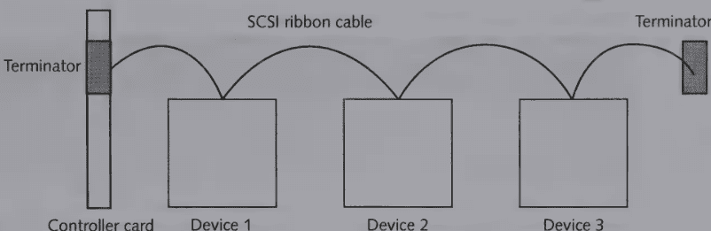

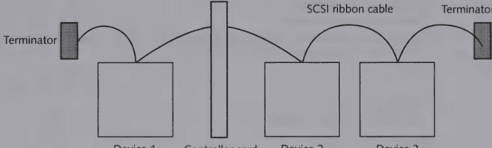

图 7-1 连接 SCSI 设备

在控制器卡上使用 16 位宽数据路径，可以容纳最多 15 个设备，传输速度为每秒 20MB。这一出现被称为 SCSI-2（SCSI 标准 2）。不久后引入了 SCSI-3，提供了超过每秒 160MB 的速度。新技术，如 FireWire（IEEE 1394），可以以超过每秒 800MB 的速度与 SCSI 设备传输数据。表 7-1 描述了各种 SCSI 技术。

表 7-1 常见 SCSI 标准

| SCSI 类型 | 速度 (MB/s) | 总线宽度 (位) | 连接器 | 支持的设备数量 |
|---|---|---|---|---|
| SCSI-1 (窄、慢) | 5 | 8 | 50 针 Centronics 或 50 针 LPT (线路端口终端) 类型 | 7 |
| SCSI-2 (快速) | 10 | 8 | 50 针 Centronics | 7 |
| SCSI-2 (宽) | 20 | 16 | 68 针 LPT 类型 | 15 |

表 7-1 常见 SCSI 标准（续）

| SCSI 类型 | 速度 (MB/s) | 总线宽度 (位) | 连接器 | 支持的设备数量 |
|---|---|---|---|---|
| SCSI-3 (Ultra) | 160 | 8 | 50 针 LPT 类型 | 7 |


| SCSI-3 (Ultra Wide) | 160 | 16 | 68 针 LPT 类型 | 15 |
| SCSI-3 (Ultra3 Wide) | 320 | 16 | 68 针 LPT 类型 | 15 |


## 主板流控制：IRQ、DMA 和 I/O 地址

### 高级硬件配置 289

你的系统使用的某些外围设备可能需要特殊的设置和配置。第 2 章“为 Linux 安装做准备”强调了 IDE 硬盘驱动器的配置，因为它是编写当时家庭和办公室计算机中最常见的配置。第 2 章还介绍了使用 IRQ、I/O 地址和 DMA 对外围组件进行配置。本节将探索 SCSI 硬盘、RAID 以及大多数计算机中常见的外围配置。

### 表 7-2 默认 IRQ 分配

| IRQ |or |
|---|---|
| 0 | 系统定时器 |
| 1 | 键盘 |
| 2 | 链接到 IRQ 9 — 未使用时可用 |
| 3 | COM2, COM4 |
| 4 | COM1, COM3 |
| 5 | 可用（通常用于声卡或 LPT2） |
| 6 | 软盘控制器 |
| 7 | 并口 (LPT1) |
| 8 | 实时时钟 |
| 9 | 链接到 IRQ 2 — 未使用时可用 |
| 10 | 可用 |
| 11 | 可用 |
| 12 | 可用 |
| 13 | 数学处理器 |
| 14 | 主 IDE 硬盘控制器 |
| 15 | 从 IDE 硬盘控制器 |

除了识别和优先级控制外，每个外设设备在物理内存中都需要自己的工作空间，以便与其他设备通信。这个工作空间通过一个代表 RAM 特定区域的十六进制数来识别，称为`输入/输出 (I/O) 地址`。许多 I/O 地址通常为系统上的某些设备预留，如表 7-3 所示。对于 IRQ，确保一个设备的 I/O 地址未分配给另一个设备非常重要，因为两个设备都将无法正常工作。

### 表 7-3 默认 I/O 地址分配

| I/O 地址 | 设备 |
|---|---|
| 3F8-3FF | COM1 |
| 2F8-2FF | COM2 |
| 3E8-3FF | COM3 |
| 2E8-2EF | COM4 |
| 378-37F | LPT1 |
| 2278-27F | LPT2 |
| 000-01F | DMA 控制器 |
| 020-03F | 主中断控制器 |
| 040-05F | 定时器 |
| 060-06F | 键盘 |
| 070-07F | 实时时钟 |
| 0A0-08F | 从中断控制器 |
| 0F0-1F7 | 数学处理器 |
| 1F0-1F7 | 硬盘 |
| 3D0-3DF | VGA |

### 表 7-3 默认 I/O 地址分配（续表）

| I/O 地址 | 设备 |
|---|---|
| 3F0-3F7 | 软盘控制器 |

至少，每个设备必须有一个唯一的 IRQ 和 I/O 地址。


`直接内存访问 DMA` 通过允许设备通过有限的几个唯一通道之一直接访问物理内存，从而提高了系统的效率和性能。通常情况下，只允许处理器访问物理内存，设备必须通过处理器向其传递所有调用。如果设备大量使用物理内存（例如声卡），对处理器的持续负载可能会影响系统性能。授予此类设备直接访问物理内存的权限可以提高整体系统性能；声卡、网卡和 SCSI 磁盘控制器受益于 DMA 通道，因为它们向内存中读写大量数据。

同样，DMA 通道也有发展历史。8 位数据总线使用四个 DMA 通道；随着 16 位数据总线的引入，这个数字扩大到八个。由于扩展，第四个 DMA 通道不可。与 IRQ 和 I/O 地址一样，一次只能有一个设备使用 DMA 通道，因此 DMA 分配应该是唯一的。表 7-4 详细列出了默认的 DMA 通道分配。

### 表 7-4 默认 DMA 分配

| DMA | 设备 | 数据路径宽度 |
|---|---|---|
| 0 | 可用 | 8 位 |
| 1 | 可用 | 8 位 |
| 2 | 软盘驱动器控制器 | 8 位 |
| 3 | 可用 | 8 位 |
| 4 | ，DMA 自身使用 | 16 位 |
| 5 | 可用 | 16 位 |
| 6 | 可用 | 16 位 |
| 7 | 可用 | 16 位 |

### 即插用

手动为每个设备分配唯一的 IRQ 和 I/O 地址是一项耗时且容易出错的任务；出于此原因，引入了`即插即用 (PnP)` 技术。即插即用 BIOS 自动为设备分配必要的配置信息（IRQs、I/O 地址和 DMAs）并避免冲突。为了让即插即用正常工作，设备和操作系统必须像计算机 BIOS 一样支持。

即插即用按照如下描述的方法分配配置信息：
- 1. 生成一张表，其中包含默认可用且系统未使用的所有 IRQ、I/O 地址和 DMA 通道。
- 2. 系统探测连接到它的所有设备，检查它们是否具有 PnP 能力。
- 3. 系统从存储在关机互补金属氧化半导体 (CMOS) 内存芯片上的表中检索数据。该表包含上次启动期间连接到系统的设备以及进行的 IRQ、I/O 地址和 DMA 分配。如果列表没有变化，启动过程将跳过后续步骤（4–7）；如果检测到变化，系统将继续执行第 4 步。
- 4. 系统在步骤 1 创建的表中将任何对非 PnP 设备的分配标记为不可用。
- 5. 系统检查 BIOS 设置，查看任何 IRQ、I/O 地址或 DMA 设置已被标记为预留或不可用，然后在步骤 1 创建的表中将其标记为不可用。
- 6. BIOS 随后根据步骤 4 和 5 更新的表中已知的配置信息，为任何具有 PnP 能力的设备分配信息。
- 7. 存储当前连接的设备及其设置的表，以便在未来启动时的步骤 3 使用。

### APM 和 ACPI

硬盘和外围组件在未使用时会消耗大量电力。因此，硬件制造商发布了两个标准，可以在某些组件未使用时关闭其电源：高级电源管理 (APM) 和高级配置与电源接口 (ACPI)。

APM 是两个标准中较旧的，主要通过 BIOS 使用。

ACPI 最初由 Compaq、Intel、Microsoft、Phoenix 和 Toshiba 在 1996 年开发，旨在取代 APM，因为它允许用户从操作系统而不是 BIOS 进行配置。通过 ACPI，你可以指定设置（称为睡眠状态）来临时关闭计算机。APM 和 ACPI 是互斥的；在同一台计算机上无法启用这两个功能。2002 年以后制造的计算机大多数大多数已切换到 ACPI。

如果在安装期间未启用 ACPI，只需在 `/boot/grub.conf` 中添加 `apm=off`（如果引导程序是 GRUB），或者在 `/etc/ld.conf` 文件中追加（如果引导程序是 LILO）。

启用 ACPI 后，根据硬件支持的默认选项进行配置。你也可以下载并使用应用程序查看你的设置；一个例子是 Linux ACPI Client，如下所示：

```
1] # acpi -V
Battery 1: 放电，91%，剩余 02:39:07
Thermal 1: 正常，44.1 摄氏度
AC Adapter 1: 离线
```

几乎所有的主板和本文操作系统都支持 ACPI，它仍在开发中；你应该始终确保系统拥有来自 `http://acpi.sourceforge.net` 的最新 ACPI 内核补丁。

### RAID 配置

回想一下，你在安装期间通常创建多个分区是为了增加一个分区上的文件系统故障影响整个系统的可能性。这些分区应该跨越多个不同的硬盘，以减少硬盘故障的影响；如果一个硬盘故障，其他硬盘上的数据不受影响。

如果发生硬盘故障，你必须关闭计算机，更换故障的硬盘，并从备份源（如磁带设备）恢复原始位于硬盘上的数据。整个过程可能需要几个小时。对于几乎没有停机时间限制的系统（例如数据库服务器），存在可以缩短从硬盘故障恢复所需时间的磁盘配置。这些配置被称为容错，通常通过独立磁盘阵列 (RAID) 实现。RAID 配置可以由运行操作系统上的软件处理（软件 RAID），但更常见由包含在 SCSI 硬盘控制器内部的硬件处理（硬件 RAID）。要配置硬件 RAID，你必须进入特定的 SCSI 设置程序

硬盘控制器。然而，你可以通过选择图 3-10 所示的磁盘设置界面上的 RAID 按钮来配置基于软件的 RAID 安装。


# 第 7 章 高级安装

## RAID 配置概述

目前提供了基本的 RAID 配置，标记为从 0 到 6 的级别。RAID 级别 0 指的是不具备容错能力的 RAID 配置。RAID 级别 0 的一种类型被称为“跨越”`spanning`，由两个被视为一个大卷的硬盘组成。因此，如果你有两块 2GB 的硬盘，就可以创建一个 4GB 的分区。另一种类的 RAID 级别 0 称为“磁盘条化”`disk striping`。如果在此 RAID 配置下有三块硬盘，保存到硬盘上的文件被划分为三个部分，每个部分都同时写入硬盘；由于相同的原因，读取该文件的时间仅为原来的三分之一。遗憾的是，如果 RAID 级别 0 配置中的某块硬盘故障，所有数据都将丢失。

### RAID 级别 1
RAID 级别 1 通常被称为“磁盘镜像”`disk mirroring`，并在硬盘故障时提供容错能力。在这种 RAID 配置中，数据会同时写入两个独立的磁盘。这导致了两个硬盘具有相同的信息。如果其中一个故障，另一个副本可以在短时间内替换故障的硬盘。RAID 级别 1 的唯一缺点是成本，因为你确实需要购买目标计算机所需的双倍硬盘空间。

### RAID 级别 2
RAID 级别 2 已不再使用，它是 RAID 0 的变体，允许对硬盘驱动器进行错误和完整性检查。现代硬盘驱动器内部已实现此功能。

### RAID 级别 3
RAID 级别 3 是带有校验位（或标记）的磁盘条化，校验位指示数据所在的位置。它至少需要三块硬盘才能运行，其中一块硬盘用于存储校验信息。如果包含数据的硬盘之一发生故障，你可以更换故障的硬盘，并使用存储在校验磁盘上的校验信息重新生成数据。如果校验磁盘故障，系统必须从备份设备恢复。

### RAID 级别 4
RAID 级别 4 仅是 RAID 级别 3 的轻微变体。RAID 级别 4 提供比 RAID 级别 3 更快的访问速度，因为它按块存储数据，但在读取数据时不需要访问阵列中的所有磁盘。

### RAID 级别 5
RAID 级别 5 替换了 RAID 级别 3 和 4，是本文中最常见的 RAID 配置。它通常被称为带校验的磁盘条化。与 RAID 级别 3 和 4 不同，它的实现至少需要三块硬盘；然而，校验信息并不存储在单独的驱动器上，而是与其组成磁盘上的数据混合在一起。这提供了更好的性能和容错能力；如果 RAID 配置中的任何驱动器故障，在磁盘故障后，可以使用其他驱动器上的信息重新生成丢失的信息。系统必须从备份设备恢复。图 7-6 显示了如何使用校验信息恢复 RAID 级别 5 配置的示例。图 7-6 中所示校验位是另外两块磁盘信息的和`22 + 12 = 34`。如果第三块硬盘故障，信息可以重新生成，因为每个方程中只缺少一个元素：

`22 + 12 = 34`

`68 - 65 = 3`

`13 - 9 = 4`

校验信息


硬盘 #1    硬盘 #2    硬盘 #3

图 7-6 RAID 级别 5 上的数据结构

### RAID 级别 6
RAID 级别 6 基本上与 RAID 级别 5 相同，但增加了第二组校验位以增强容错能力，并允许最多两块硬盘驱动器同时故障而仍保持容错。

> RAID 级别通常组合使用；RAID 级别 15 指一个带校验的条带集`RAID 级别 5`镜像`RAID 级别 1`到另一个带校验的条带集。

## 安装方法

现代计算机包含 CD-ROM/CD-RW 或 DVD/DVD-RW 设备，可用于启动如第 3 章讨论的基于 CD-ROM 的安装。你可以通过从几个网站之一下载国际标准组织`ISO`镜像来轻松获取四张 Red Fedora Core 2 CD-ROM。然后，你可以将这些镜像配合可写的 CD-R/CD-RW 驱动器创建安装 CD-ROM，并使用第一张 CD-ROM 启动计算机以开始 Linux 安装。

要从互联网获取 Red Hat Fedora 安装所需的 ISO 镜像，请访问 `http://fedora.redhat.com` 或 `http://www.linuxiso.org`。

使用 ISO 镜像将信息写入 CD-ROM`刻录过程`，你必须使用支持你的 CD-R/CD-RW 设备的刻录程序；常见刻录程序的示例包括 `X-Roast` 和 `Nero`。

尽管在本文期间基于 CD-ROM 的安装是 Linux 计算机最常用的安装方法，但也可以其他方法安装 Linux。例如，你可以从 DVD、硬盘上的 ISO 镜像，或通过 NFS、FTP 或 HTTP 协议从网络服务器上的源文件安装 Linux。

### DVD 安装
过去，Linux 发行版通常可以装在一个或两张 CD-ROM 中。然而，最近许多发行版需要几张 CD-ROM 来存放该发行版提供的所有包。因此，你可以选择包含所有包的单个 DVD，而不是几张 CD-ROM。这些 ISO 镜像可以在托管 CD-ROM 的相同网站获取。你可以配合可写的 DVD-R/DVD-RW 设备使用镜像创建安装 DVD，并像启动 CD-ROM 一样使用启动计算机。

### 硬盘安装
并不是所有人都从 CD-ROM 安装 Linux。如果你从互联网下载了 ISO 镜像，只要分区分区格式化为 FAT、ext2 或 ext3，就可以从硬盘上的 ISO 镜像安装 Linux。将 ISO 镜像拷贝到硬盘后，即可开始安装。

### 创建安装介质
要创建安装 CD-ROM，只需导航到第一个 CD-ROM 上的 `images` 目录。如果你想创建可引导 USB 闪存盘，可以使用 `dd` 命令使用 `images` 目录下的 `bootdisk.img` 文件。`大多数 USB 闪存盘被识别为 SCSI 硬盘上的第一个分区以便挂载。`如果你的 Red Hat Fedora CD-ROM 挂载到 `/mnt/cdrom`，则镜像 `bootdisk.img` 文件到 USB 闪存盘的命令是
```
dd if=/mnt/cdrom/images/bootdisk.img
```

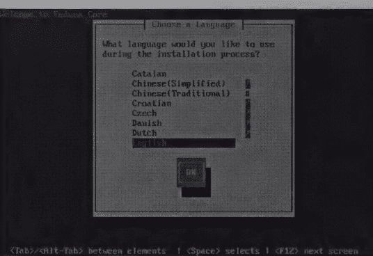

图 7-8 语言选择屏幕

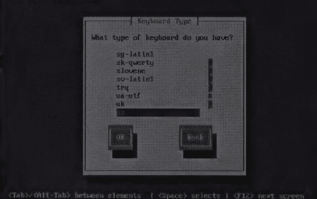

图 7-9 键盘选择屏幕

在图 7-10 中选择从硬盘安装后，安装程序会提示你指定一个包含 Red Hat Linux 安装媒体 ISO 镜像的分区和目录，如图 7-11 所示。在指定正确信息后，将运行图形化安装，并要求你指定完成安装所需的信息。

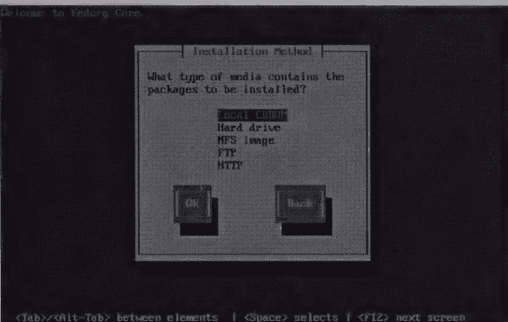

**图 7-10** 选择安装方法

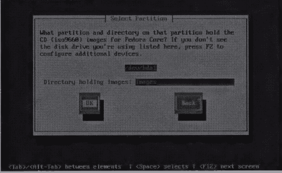

**图 7-11** 为基于硬盘的安装指定源文件位置

### 网络安装
虽然不像 CD-ROM、DVD 或硬盘安装那样常见，但你也可以选择使用存储在另一台机器上并通过计算机中的网络接口卡`NIC`跨网络访问的安装媒体。对于这种安装方法，你必须按照上一节的描述创建一个安装启动 CD-ROM 或可启动的 USB 闪存驱动器；它们包含了常用的网卡驱动程序和程序，允许你通过以下协议之一连接到带有适当安装文件的服务器：

- `网络文件系统 NFS`
- `文件传输协议 FTP`
- `超文本传输协议 HTTP`

NFS、FTP 和 HTTP 的配置将在第 15 章“Linux 网络”中讨论。


Linux 也可以通过从托管安装文件的 Windows 服务器上跨网络进行安装。这种方法使用服务器消息块`SMB`协议，并且必须在 Red Hat Linux 中手动设置；因此，此处不再进行讨论。


在完成安装启动 CD-ROM 或可启动的 USB 闪存驱动器的镜像后，你可以直接使用它启动客户端计算机，并在之前显示的图 7-7、7-8 和 7-9 中选择相应的选项。

接下来，系统会提示你选择 NFS、FTP 或 HTTP 安装，如早前图 7-10 所示。无论选择哪种安装类型，系统都会提示你配置网络设置，如图 7-12 所示。IP 地址和子网掩码的值通常由互联网服务提供商`ISP`或网络管理员分配，以便计算机与网络上正确的机器进行通信。然而，你也可以选择从网络上的 DHCP 或 BOOT 服务器自动接收配置。如果手动配置，默认网关和主 DNS 名称服务器是可选的，但如果已知值则应当使用。

如果你在图 7-10 中选择 NFS 安装，安装程序会提示网络上 NFS 服务器的 DNS 名称或 IP 地址，以及 NFS 服务器上包含安装文件的目录，如图 7-13 所示。

或者，如果你选择执行 FTP 安装，系统会提示输入 FTP 安装的类型`匿名或用户登录`以及 FTP 服务器的 DNS 名称或 IP 地址，如图 7-14 所示。

欢迎来到 Fedora Core

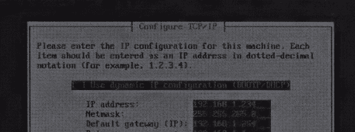


使用 `<Tab>`/`<Alt-Tab>` 在元素间切换，`<Space>` 选择 `<F12>` 进入下一屏

**图 7-12** 配置本地网络设置

欢迎来到 Fedora Core

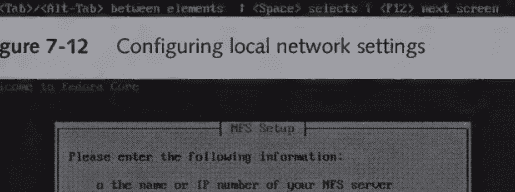

使用 `<Tab>`/`<Alt-Tab>` 在元素间切换，`<Space>` 选择 `<F12>` 进入下一屏

**图 7-13** 为基于 NFS 的安装指定源文件位置

与 FTP 安装类似，HTTP 安装需要 Web 服务器的 DNS 名称或 IP 地址，以及 Web 服务器下方包含安装文件的目录名称，如图 7-15 所示。

## 第 7 章 高级安装

欢迎来到 Fedora Core

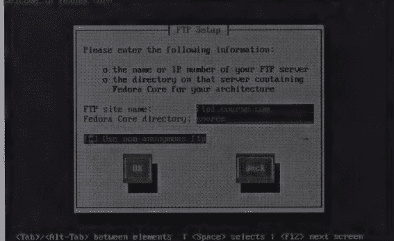

图 7-14 为基于 FTP 的安装指定源文件位置

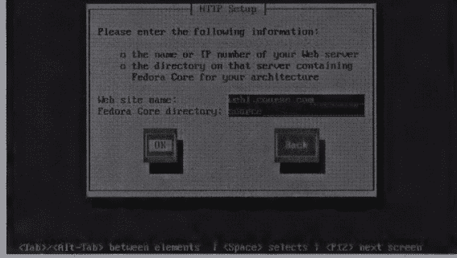

图 7-15 为基于 HTTP 的安装指定源文件位置

除非你选择了 NFS 安装，否则图形化安装将在源文件定位后启动，并提示你完成安装所需的信息。

## 自动化安装

某些 Linux 发行版部署了多台服务器和工作站，需要相同的配置。手动逐一配置非常耗时，因此这些组织通常使用磁盘镜像将配置从一台计算机复制到另一台。

### 自动化安装

如图 7-16 所示，某些磁盘镜像程序提供了这种功能。磁盘镜像的局限性在于，在网络上进行安装时，硬件必须是完全相同的。

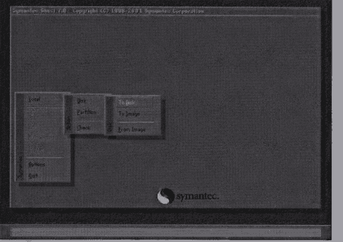

**图 7-16** 自动化安装

在通过安装 CD-ROM、DVD、安装启动 CD-ROM 或可启动 USB 闪存驱动器启动安装时，你会收到初始的 Red Hat Fedora 欢迎界面和提示符，如前文图 7-7 所示。在此提示符处不要直接按回车，而是输入命令 `linux ks=floppy:/ks.cfg` 并按回车。这将强制安装程序从软磁盘查找配置信息。

要使用之前显示的 kickstart 文件，只需格式化软磁盘为安装所需的 `ext2` 文件系统，并将 `ks.cfg` 文件复制进去。当你从安装媒体启动计算机时，你会看到 Red Hat Fedora 的欢迎界面和提示符，如前文图 7-17 所示。通常，kickstart 文件是文本文件，可以使用文本编辑器进行编辑：

```
[root@server1]# cat ks.cfg
#Generated by Kickstart
#platform=x86, AMD64
#System language
lang en_US
```

## 第 7 章 高级安装

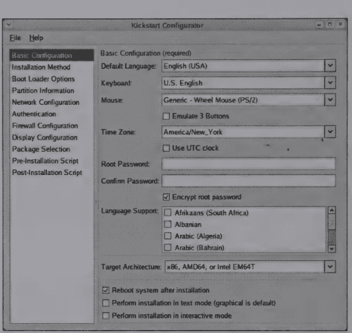

图 7-17 Kickstart 配置

### 安装语言模块

`langsupport en_US`

### 系统键盘

`keyboard us`

### 系统时区

`timezone America/Toronto`

### Root 密码

`root --usershadow --enablemd5 $1$fdvv$0`

### 网络信息

`network --bootproto=static --ip=192.168.1.88 --netmask=255.255.255.0`

`gateway=192.168.1.254 --nameserver=192.168.1.254 --device=eth0`

### 火墙配置

`firewall --disabled`

### 窗口配置

`xconfig --depth=16 --resolution=1024x768 --defaultdesktop=GNOME --startxboot`

### 软件包安装

```
%packages --resolveddeps

@everything

#
```


kickstart 文件中以 `#` 符号开头的任何行都是注释行，安装程序会忽略它们。


在 kickstart 安装后，不会运行首次启动向导。

# 安装启动遇到的问题

你通常会通过 CD-ROM、DVD、安装启动 CD-ROM 或可启动的 USB 闪存驱动器启动 Linux 安装。要实现这一点，你必须确保 BIOS 中的启动顺序设置为：在查找硬盘之前，先从 CD-ROM、DVD 或 USB 闪存驱动器查找操作系统。不同电脑的 BIOS 可能有巨大差异；有些 BIOS 有标记为“第一启动设备”（First Boot Device）、“第二启动设备”（Second Boot Device）和“第三启动设备”（Third Boot Device）的部分，而另一些则标记为“启动顺序”（Boot Order）。为了确保更改了正确的设置，请查阅你的主板用户手册。

记住，BIOS 设置存储在计算机的 CMOS 内存芯片中，该芯片通过连接到主板的小锂电池获得持续电源。如果此电池没电，对 BIOS 设置的所有更改都将丢失，并加载默认值。当这种情况发生时，系统在启动时会向用户发出类似于“BIOS Error – Defaults Loaded – Press F1 to continue.”的提示。在这种情况下，在更改启动顺序之前需要更换电池；否则设置在电脑关闭后将会丢失。

在检查 BIOS 启动顺序时，良好的做法也是同时检查 BIOS 中任何预留的外围配置（IRQ、I/O 地址、DMA）。记住，如今系统中大多数设备都是即插即用（Plug-and-Play），并从系统的 BIOS 获取配置。一些旧的 ISA 设备必须静态地配置这些信息；因此，存在即插即用分配一个正在被旧 ISA 设备占用的配置的可能性。如果计算机中有以这种方式静态配置的 ISA 设备，你必须确保它们的配置在 BIOS 中被预留，以免其被分配给即插即用设备。

# 安装过程中遇到的问题

安装程序加载后，会提示你选择安装方法。对于图形化安装 Linux 的用户，安装程序必须首先检测计算机中的显卡和鼠标，并将适当的程序加载到内存中。如果在初始欢迎界面（图 7-7）之后没有出现图形化安装界面，或者屏幕上显示错乱的线条，则说明显卡可能不支持图形化安装的模式和分辨率。要解决这个问题，你应该重新启动安装并在初始欢迎界面输入 `linux nofb` 并按回车启动不带 framebuffer 支持的安装，或者输入 `linux lowres` 并按回车以 640 × 480 的分辨率启动安装。

如果图形化安装成功启动但鼠标不起作用，另一种方案是启动文本安装。只需重新启动安装并在初始欢迎界面输入 `linux text` 并按回车即可。

# 安装故障排除

在某些旧系统上，安装在执行过程中可能会随机冻结；由于设备通信不当导致。要修复此，只需重启计算机，并在安装前在电脑的 BIOS 中禁用即插即用支持。安装完成后，可以在 BIOS 中重新启用即插即用。

有时，安装会异常结束，屏幕会显示“fatal signal 11”错误消息。这表示发生了一个名为“段错误”（segmentation fault）的错误；它表明程序访问了未分配的 RAM 某个区域。虽然这可能是软件问题，但在安装期间这很可能是硬件问题。遗憾的是，硬件问题可能出现在计算机的任何位置，但很可能是 RAM 本身的错误。通常，此错误可以通过关闭 CPU 缓存或在 BIOS 中增加等待状态（wait states）的数量来修复。如果内存对于主板来说太慢（例如，内存是 70ns RAM，而主板需要 60ns RAM），则应更换计算机中的 RAM。某些 BIOS 允许用户更改 RAM 和 CPU 的电压；错误的值也会导致“fatal signal 11”错误。其他原因还包括损坏的内存芯片、AMD K6 处理器、笔记本电脑电源管理冲突以及超频 CPU。

> 超频 CPU 指速度超过了处理器原始设计定速度的 CPU。这可能会导致处理器产生更多热量，并可能导致间歇性的系统崩溃。

> 如果安装因除 fatal signal 11 以外的错误而失败，你应该查阅你的 Linux 发行版的支持文档或互联网上的新闻。此外，某些硬件（如 Winmods）与 Linux 不兼容；请在安装前确保所有硬件都列在你的 Linux 发行版的硬件兼容性列表（Hardware Compatibility List）上。

某些安装无法正确将引导程序放置在硬盘上；这种情况发生在超过 1024 磁道的大硬盘上。为了避免这种情况，请确保 `/` 分区在 1024 磁道之前（通常是大多数硬盘的 8GB 处）开始，或者为 `/boot` 目录创建一个在 1024 磁道之前的分区。

# 安装后的问题

尽管 Red Hat 安装可能成功完成，但如果安装程序未能正确检测计算机中的硬件，或某些程序安装失败，你可能仍会有问题。因此，安装后检查安装日志文件，并在安装后验证系统设置，以确保所有硬件都以正确的值被检测。

Red Hat 安装程序会创建两个日志文件：`/root/install.log`，它包含已安装包列表以及未安装包列表；以及 `/root/install.log.syslog`，它列出了安装期间发生的所有系统事件，例如用户账户和组账户的创建。

## 第 7 章 高级安装

要验证硬件设置，你可以检查 `/proc` 目录的内容或启动日志文件。`/proc` 目录挂载到 RAM 内的一个特殊文件系统中，其中列出了 Linux 内核生成的系统信息；由于这是一个内存文件系统，只有 root 用户可读。`/proc` 目录的内容显示如下：

```
server1 root]# ls -F /proc
0/  1/  2/  3/  4/  5/  6/  7/  8/  9/  acpi/  allocstat/  arp/  asound/  bash/  buddy/  cmdline/  crypto/  cpuinfo/  cpuinfo/  devm/  driver/  ether0/  ext4/  filesystems/  fmi/  fb/  fdinfo/  ioports/  irq/  interrupts/  kcore/  loadavg/  locks/  meminfo/  mqueue/  modules/  mounts/  net/  pci/  pme/  ipc/  partitions/  process/  procinfo/  resource/  self/  stag/  schedd/  skype/  stats/  slab/  stat/  syscall/  sysinfo/  sysrq-trigger/  tty/  uptime/  vmeminfo/
```

上述输出中以数字开头的目录用于显示进程信息；其他目录包含内核参数。上述输出列出的文件是 Linux 系统各个部分的文本表示；它们由 Linux 内核定期更新，可以使用标准文本命令（如 `cat`）查看。

要查看 Linux 检测到的 CPU 信息，只需查看 `/proc` 目录下的 `cpuinfo` 文件内容：

```
[server1 root]# cat /proc/cpuinfo
processor      : 0
vendor_id     :GenuineIntel
cpu family     : 6
model         : 8
model name     : Pentium III (Coppermine)
stepping      : 10
cpu MHz        : 800.049
cache size     : 256 KB
fdiv_bug      : no
hlt_bug       : no
f00f_bug      : no
com_bug      : no
fpu           : yes
```

# 安装故障排查 311

```
fpu_exception : yes
cpuid level : 2
wp : yes
flags fpu vme pse tscr pae cx8 mtrr pge cmov pat pse36
mmx fxsr sse bogomips : 1585.15
[root@server1 root]# _
```

上述输出表示有一个运行频率大约为 800MHz 的处理器，并具有 256KB 的处理器缓存。例如，如果计算机实际上有两个处理器而不是一个，那么 Linux 没能检测到第二个处理器。在这种情况下，你可能需要更改 BIOS 中的某些设置，或者在主板或处理器制造商的网站上研究该问题的解决方案。

安装后，确保 Linux 检测到系统中正确数量的内存（RAM）同样重要。要做到这一点，你可以查看 `/proc/meminfo` 文件的内容，如下：

```
[root@server1 root]# cat /proc/meminfo
MemTotal: 257108 kB
MemFree: 10116 kB
Buffers: 24668 kB
```


Cached: 54032 kB

SwapCached: 2876 kB

Active: 164472 kB

Inactive: 27132 kB

HighTotal: 0

HighFree: 0

LowTotal: 257108 kB

LowFree: 10116 kB

SwapTotal: 525160 kB

SwapFree: 513032 kB

Dirty: 4 kB

Writeback: 0 kB

Mapped: 153736 kB

Slab: 40856 kB

Committed_AS: 279444 kB

PageTables: 2708 kB

VmallocTotal: 387408 kB

VmallocUsed: 37772 kB

VmallocChunk: 383696 kB

HugePages_Total: 0

HugePages_Free: 0

Hugepage: 4096 kB

```
[root@server1 root]# _
```

在上述输出中，内存总量（`MemTotal`）为 257108 kB 或 256MB。如果因为计算机有 512MB 的 RAM 而导致该值错误，如果你的引导加载程序是 GRUB，可以在 `/boot/grub/grub.conf` 的内核行中添加 `mem=512M` 来指定正确的值；如果引导加载程序是 LILO，则可以在 `/etc/lilo.conf` 中添加 `mem=512M` 行。

## 第 7 章 高级安装

同样，为了确保 IRQ、DMA 和 I/O 端口以正确的值识别，你可以查看 `/proc/` 目录下的 `dma`、`interrupts` 和 `ioports`，如下：

```
[root@server1 root]# cat /proc/dma

0: 10934177      XT-PIC cascade

1: 23045         XT-PIC i8042

2: 0               XT-PIC timer

3: 0               XT-PIC Audio-uhci_hcd

4: 0               XT-PIC cascade

5: 0               XT-PIC eniq

6: 0               XT-PIC keyboard

7: 0               XT-PIC rtc

8: 0               XT-PIC register

9: 0               XT-PIC hci,uhci_hcd

10: 232095        XT-PIC eth0

11: 926055        XT-PIC acpi,1:PCI:1:0

12: 445114         XT-PIC i8042

13: 0               ERR-

14: 153741         XT-PIC ideo0

15: 110933         XT-PIC NMI:0

[root@server1 root]# cat /proc/ioports

0000-001f : dma

0020-0021 : pic1

0040-005f : timer

0060-006f : keyboard

0070-0077 : rtc

0080-008f : dma register

00a0-00af : pic2

00c0-00df : dma2

00f0-00ff : fpu

0170-0177 : idel

01f0-01f7 : ideo0

02f8-02ff : serial

0376-0376 : idel

0378-037a : parporto0

037b-037f : parporto1

03c0-03df : vga

03f6-03f6 : ideo0

03f8-03ff : serial

0cf8-0cff : conf1

5000-500f : 0000:00:07.4

6000-607f : 0000:00:07.4

9000-9fff : PCI Bus #01

9000-90ff : 0000:01:00.0

a000-a00f : 0000:00:07.1

a000-a007 : ideo0

a008-a00f : idel

a400-a41f : 0000:00:07.2

a400-a41f : uhci_hcd

[root@server1 ~]
```

与内存一样，如果上述输出列出的任何硬件值不正确，可以在 `/etc/grub/grub.conf`（如果引导加载程序是 GRUB）或 `/etc/lilo.conf`（如果引导加载程序是 LILO）中添加正确的参数，以便在启动时将设备信息发送到 Linux 内核。某些设备需要作为模块插入 Linux 内核。声卡、网卡和 USB 设备通常以模块形式插入内核。要查看插入 Linux 内核的模块列表，只需查看 `/proc/modules` 文件：

```
[root@server1 ~]# cat /proc/modules

snd_mixer_oss 13824 2 - Live 0x14cf2000

snd_ens1371 17120 3 - Live 0x14cd7000

snd_rawmidi 17184 1 - Live 0x14cd1000

snd_seq_device 6152 1 - Live 0x14c4e000

snd_pcm 68872 1 - Live 0x14ce0000

snd_page_alloc 7940 1 - Live 0x1286b000

snd_timer 17156 1 - Live 0x14cd9000

snd_ac97_codec 50436 1 - Live 0x14cb0000

snd 38372 9

snd_mixer_oss, snd_ens1371, snd_rawmidi, snd_seq_device, snd_pcm, snd_timer, snd_ac97_codec, game 3328 1 - snd_ens1371, Live 0x128e000

soundcore 6112 3 - Live 0x1be000

parport 19392 1 - pc, Live 0x14c8000

elp 8236 0 - Live 0x14c6000

parport 29640 2 - parport_pc_lp, Live 0x14c8100

aofs 10624 0 - Live 0xba000

rfcm 27164 0 - Live 0x14c7900

2cap 16004 5 - rfcm,lcap, Live 0x1a5000

bluetooth 33366 4 - rfcm,lcap, Live 0x1a5000

sunrpc 101064 1 - rfcm,lcap, Live 0x14c7000

3c 30376 0 - Live 0x3d000

floppy 47440 0 - Live 0x14c6000

g 27552 0 - Live 0x14c3500

scsi_mod 91344 1 - sg, Live 0x14c54000

microcode 4768 0 - Live 0x12868000

dm_mod 33184 0 - Live 0xb0000

uhci_hcd 23708 0 - Live 0x29e000

button 4504 0 - Live 0x2865000

battery 6924 0 - Live 0x2857000

asus_acpi 8472 0 - Live 0x2861000

acpi 3340 0 - Live 0x285a000

ipv6 72368 2 - Live 0x2b0000

ext3 102376 1 - Live 0x2871000

jbd 40216 1 - Live 0x2847000
```


从上述输出中，如果特定设备的模块不在内核中（如网卡 `3c59x` 以及音频支持模块 `soundcore`），你可能需要手动添加它。`/proc/` 目录中的文件比之前讨论的要得多，在安装后检查系统时非常有用。表 7-7 描述了这些文件。

| 名称 | 描述 |
|---|---|
| apm | 包含高级电源管理信息 |
| cmdline | 包含 Linux 内核的当前位置 |
| cpuinfo | 包含有关计算机处理器的信息 |
| devices | 包含设备信息 |
| exec | 包含内核执行程序信息 |
| fb | 包含显示缓冲区信息 |
| filesystems | 包含文件系统信息 |
| fpu | 包含浮点运算单元信息 |
| interrupts | 包含中断信息 |
| ioports | 包含 I/O 端口信息 |
| meminfo | 包含内存统计信息 |
| loadavg | 包含系统负载信息 |
| locks | 包含内核锁信息 |
| modules | 包含已加载模块列表 |
| mdstat | 包含 RAID 状态信息 |
| mmap | 包含内存映射信息 |
| netdev | 包含网络设备信息 |
| parport | 包含并行端口信息 |
| partitions | 包含分区信息 |
| proc | 包含进程信息 |
| syms | 包含内核符号信息 |
| qstat | 包含进程队列统计 |
| rtc | 包含实时时钟信息 |
| uptime | 包含系统运行时间信息 |
| swap | 包含交换分区信息 |
| version | 包含内核版本信息 |

## 章节总结

- 自 1986 年以来，开发了许多不同的 SCSI 标准。SCSI 硬盘驱动器通过 SCSI ID 唯一标识，并通过终止器电缆连接到控制器。
- 每个外设设备在使用前必须配置 IRQ 和 I/O 地址，并可以选择性使用 DMA 通道。如果设备符合即插即用（PnP）标准，可以自动为设备提供此类配置。
- 便携式笔记本电脑使用 APM 或 ACPI 在不使用时关闭外设设备的电源以节省电池电量。
- 需要容错能力的计算机通常采用使用 RAID 配置的 SCSI 硬盘。
- 尽管 Linux 通常从 CD-ROM 介质安装，但也可以使用位于 DVD、硬盘硬盘、NFS 和 HTTP 服务器上的文件进行安装。你需要创建一个启动启动的 CD-ROM 或可启动的 USB 闪存盘驱动器来执行此类类型的安装。
- 你可以使用磁盘镜像软件或 kickstart 文件来简化在多台计算机上安装 Linux。
- 不支持的显卡、超频 CPU、PnP 支持以及不当的 RAM 设置可能会导致安装失败。
- `/proc` 目录包含有关系统硬件的信息，在验证安装是否成功时非常有用。

## 关键术语

- `/proc/cpuinfo` — 包含系统当前 CPU 设置信息的目录。
- `/proc/dma` — 包含系统当前直接内存访问分配信息的目录。
- `/proc/interrupts` — 包含系统当前中断请求分配信息的目录。
- `/proc/ioports` — 包含系统当前输入/输出地址分配信息的目录。
- `/proc/meminfo` — 包含系统当前物理内存和虚拟内存使用情况信息的目录。
- `/proc/modules` — 包含当前集成到内核中的模块信息的目录。
- 高级配置和电源接口 (ACPI) — 允许操作系统控制何时向外围组件供电的标准。
- 高级电源管理 (APM) — 允许计算机 BIOS 控制何时向外围组件供电的标准。

## 关键术语 317

刻录 (burning) - 向 CD-R、CD-RW、DVD-R 或 DVD-RW 写入的过程。
- 互补金属氧化半导体 (CMOS) - 主板上的内存存储器，用于存储启动过程中使用的配置；不是真正的 ROM 芯片，它需要内置电池提供的低电流来维持内存存储。
- 直接内存访问 (DMA) - 允许硬件设备直接访问物理内存的通道。
- 磁盘镜像软件 (disk imaging software) - 用于制作硬盘或硬盘分区相同副本的软件。
- 磁盘镜像 (disk mirroring) - 一种 RAID 配置，也称为 RAID 1，连接两个相同的硬盘，以并行方式写入相同的信息以确保容错。
- 磁盘条带 (disk striping) - 一种 RAID 配置，属于 RAID 0，用于将信息分离到硬盘上以加快访问时间。
- 带校验的磁盘条带 (disk striping with parity) - 一种 RAID 配置，也称为 RAID 5，用于向硬盘写入分离的信息以加快访问时间，同时包含确保容错的信息。
- 容错 (fault tolerant) - 在发生故障时表现出最小停机时间的设备。
- 文件传输协议 (FTP) - 用于在互联网上传输文件最常用的协议。
- 统一引导加载程序 (GRUB) - 用于启动 Linux 操作系统的程序。
- 超文本传输协议 (HTTP) - 用于在互联网上传输信息的底层协议。
- 输入/(I/O) 地址 - 物理内存中供特定硬件设备使用的地址。
- 安装日志文件 (installation log files) - 安装时创建的记录安装过程中发生或失败操作的文件。
- 中断请求 (IRQ) - 处理器用于共享处理器时间的方法，用于对外设设备的并发服务请求进行优先级排序。
- 国际标准组织 (ISO) 镜像 - CD-ROM 或 DVD 上信息精确副本的大型单文件。
- Kickstart 配置器 (Kickstart Configurator) - 可创建 kickstart 文件的图形化工具。
- kickstart 文件 - Red Hat Fedora Linux 开始时可以指定的用以自动化安装过程的文件。
- Linux 引导加载程序 (LILO) - 用于启动 Linux 操作系统的程序。
- 逻辑单元号 (LUN) - 连接到 SCSI 链中任何给定节点的每个设备的唯一标识符。
- 网络文件系统 (NFS) - 由 Sun Micros公司开发的分布式文件系统，允许不同类型的计算机访问网络共享的文件。
- 超频 (overclocked) - 运行频率高于其额定频率的 CPU。

# 318 第 7 章 高级安装

**即插即用 (PnP)** — 系统 BIOS 自动允许设备分配所需的 IRQ、I/O 地址和 DMA 信息的过程。
**轮询 (polling)** — 查询设备以查看它们是否有需要运行的服务的行为。
**独立磁盘冗余阵列 (RAID)** — 将多个硬盘驱动器的存储空间合并成一个更大的逻辑存储单元的过程。
**SCSI ID** — 用于唯一标识并对连接到 SCSI 控制器的设备进行优先级排序的数字。
**跨越 (spanning)** - 一种 RAID 0 类型，允许将两个或多个设备表示为一个单一大卷。
**目标 ID (target ID)** — 另见 SCSI ID。
**终止器 (terminator)** - 用于终止电气传输介质的设备，以吸收传输信号并防止信号反射。

## 复习题

1. 两个外设设备可以同时共享并使用相同的中断请求设置。正确或错误？
2. 两个外设设备可以同时共享并使用相同的中断请求设置。
3. 尽管 Linux 通常从 CD-ROM 介质安装，但也可以使用位于 DVD、硬盘、NFS 和 HTTP 服务器上的文件进行安装。你需要创建一个启动启动的 CD-ROM 或可启动的 USB 闪盘驱动器来执行此类类型的安装。
4. 你可以使用磁盘镜像软件或 kickstart 文件来简化在多台计算机上安装 Linux。
5. 不支持的显卡、超频 CPU、PnP 支持以及不当的 RAM 设置可能会导致安装失败。
6. `/proc` 目录包含有关系统硬件的信息，在验证安装是否成功时非常有用。

## 关键术语

- `/proc/cpuinfo` — 包含系统当前 CPU 设置信息的目录。
- `/proc/dma` — 包含系统当前直接内存访问分配信息的目录。
- `/proc/interrupts` — 包含系统当前中断请求分配信息的目录。
- `/proc/ioports` — 包含系统当前输入/输出地址分配信息的目录。
- `/proc/meminfo` — 包含系统当前物理内存和虚拟内存使用情况信息的目录。
- `/proc/modules` — 包含当前集成到内核中的模块信息的目录。
- 高级配置和电源接口 (ACPI) — 允许操作系统控制何时向外围组件供电的标准。
- 高级电源管理 (APM) — 允许计算机 BIOS 控制何时向外围组件供电的标准。

# 341

12. BIOS 配置存储在何处？
    a. 由电池提供的低电流维持的 CMOS 芯片
    b. 在 CMOS 芯片上
    c. 在引导加载程序中
    d. 在 `/proc` 中对应的文件中
13. 按正确顺序列出以下 SCSI ID。
    a. 5
    b. 7
    c. 15
    d. 8
    e. 2
    f. 11
    g. 13
    h. 1
    i. 0
14. 哪些项可以简化组织内多台 Linux 服务器的部署？（选择所有项）。
    a. 磁盘镜像软件
    b. 自动安装服务器
    c. kickstart 文件
    d. 自动启动磁盘
15. 哪种 RAID 级别称为镜像？
    a. RAID 0
    b. RAID 1
    c. RAID 4
    d. RAID 5
16. SCSI-3 控制器总是比 SCSI-2 控制器容纳更多设备。正确或错误？
17. LPT1 的默认 IRQ 和 I/O 设置是什么？
    a. IRQ 7 和 I/O 地址 378-37F
    b. IRQ 5 和 I/O 地址 378-37F
    c. IRQ 5 和 I/O 地址 3F8-3FF
    d. IRQ 7 和 I/O 地址 278-27F

18. SCSI-1 也称为 ________。
    a. 快速且宽
    b. 慢速且宽
    c. 慢且窄
    d. 快速且窄

19. 你需要找出当前计算机上分配的 IRQ、DMA 和 I/O 地址分配。你应该怎么做？
    a. 打开桌面环境并在“设置（Settings）”菜单中查看系统信息。
    b. 查看 `/etc` 目录下的相应文件。
    c. 查看 `/settings` 目录下相应文件的内容。
    d. 查看 `/proc` 目录下相应文件的内容。

20. 安装完成后，你想查看安装日志文件。你应该查看哪些文件？（选择两个答案。）
    a. `/root/install.log`
    b. `/proc/install.log`
    c. `/root/install.log.syslog`
    d. `/proc/install.log.syslog`

# 手实操项目

这些项目应按照给出的顺序完成。本章介绍的实操项目总共需要三小时完成。此实验的要求包括：

- 在实操项目 2-1 中完成的安装前检查清单
- 根据实操项目 3-1 安装了 Red Hat Fedora Core 2 的计算机
- 一套 Red Hat Fedora Core 2 光光盘安装包（四张光盘）
- 一张空白软盘

## 项目 7-1

在这个实操项目中，你将使用在实操项目 2-1 中创建的安装前检查清单创建并查看一个 kickstart 文件，并将其与 Red Hat 安装程序自动生成的 kickstart 文件进行比较。

1. 开启你的计算机。当 Linux 系统加载后，你将进入图形化终端 (tty7)。使用用户名 root 和密码 secret 登录 GNOME 桌面。
2 选择 Red Hat 图标，选择“系统工具（System Tools）”，并点击“Kickstart”。
3. 在 Kickstart 配置器（Kickstart Configurator）的基本配置界面，确保输入了以下设置：

默认语言 = English (USA)

键盘 = U.S. English

鼠标 = 来自安装前检查清单

时区 = 来自安装前检查清单

根密码 = secret

加密根密码 = yes（已勾选）

语言支持 = English (USA)

目标架构 = x86, AMD64, 或 Intel EM64T

安装后重启系统 = no（未勾选）

在文本模式下执行安装（默认是图形模式） = no

在交互模式下执行安装 = no（未勾选）

4. 点击左侧窗格中的“安装方法（Installation Method）”。确保勾选了“执行新安装（Perform new installation）”和“光盘（CD-ROM）”。
5. 点击左侧窗格中的“引导加载程序选项（Boot Loader Options）”。确保勾选了“安装新的引导加载程序（Install new boot loader）”和“在主引导记录（MBR）上安装引导程序”。
6. 点击左侧窗格中的“分区信息（Partition Information）”。确保勾选了“清除主记录（Clear Master Record）”、“删除所有现有分区（Remove all existing partitions）”和“初始化磁盘标签（Initialize the disk label）”。接下来选择“添加（Add）”按钮并在显示的屏幕上输入以下信息：

挂载点 = /
类型 = ext3
大小（固定） = 输入从安装前检查清单中获得的“文件系统可用空间（Space available for Filesystems）”的值。此值应大于 7000MB。
格式化分区 = yes

完成后点击 OK 按钮。
7. 再次点击“添加（Add）”按钮并在显示的屏幕上输入以下信息：

类型 = swap
大小（固定） = 输入从预 引导检查清单中获得的“交换分区分区所需的空间（Space required for swap partition）”的值。

完成后点击 OK 按钮。

## 实操项目

# 323

8. 点击左侧窗格中的“网络配置（Network Configuration）”。点击“添加网络设备（Add Network Device）”按钮，确保 eth0 被选定为网络设备，并根据你的教室环境手动或通过 DHCP 为其配置适当的 IP 信息，然后点击 OK。
9. 点击左侧窗格中的“身份验证（Authentication）”。确保勾选了“使用 Shadow 密码（Use Shadow Passwords）”和“使用 MD5（Use MD5）”。
10. 点击左侧窗格中的“防火墙配置（Firewall Configuration）”。在“安全级别（Security level）”旁边，选择“禁用防火墙（Disable firewall）”。
11. 点击左侧窗格中的“显示配置（Display Configuration）”。选择 X Window System 并输入适当的色彩深度和分辨率。确保默认桌面是 GNOME 并勾选“启动时启动 X Window 系统（Start X Window System on boot）”。在“首次启动（first boot）”旁边的“Setup Agent”，选择“启用（Enabled）”。
12. 点击“显卡（Video Card）”标签，确保勾选了“探测显卡（Probe for video card）”。
13. 点击“显示器（Monitor）”标签，确保勾选了“探测显示器（Probe for monitor）”。
14. 点击左侧窗格中的“软件包选择（Package Selection）”。选择所有可用包并确保勾选了“自动解析依赖（Automatically Resolve Dependencies）”。
15. 点击“文件（File）”菜单并选择“保存文件（Save File）”。在保存文件界面，确保 ks.cfg 列为文件名，并点击 OK。
16. 关闭 GNOME 桌面并进入终端。
17. 在命令行终端 (tty7) 中按下 Ctrl+Alt+2 切换到命令行终端 (tty2)。使用用户名 root 和密码 secret 登录。
18. 在命令行提示符输入 `less ks.cfg`。查看 Red Hat 安装程序创建的文件。完成后按 q 退出。
19. 在命令行提示符输入 `less anaconda-ks.cfg`。查看文件。有什么差异？完成后按 q 退出。
20. 在命令行提示符输入 `exit` 退出 shell。

## 项目 7-2

在这个实操项目中，你将执行 kickstart 安装。安装完成后，你手动运行 firstboot 来配置系统设置。

1. 按下 Ctrl+Alt+2 切换到命令行终端 (tty2)。使用用户名 root 和密码 secret 登录。
2. 在命令行提示符输入 `vi anaconda-ks.cfg`。将以下部分：


## 分区信息

`clearpart --initlabel`

`part /`

`part swap`

```
替换为以下文本，其中 A 是从安装前检查清单中获得的“文件系统可用空间（Space available for Filesystems）”的值（即 7000），B 是从安装前检查清单中获得的“交换分区所需的空间（Space required for swap partition）”的值（即 600）：
```

```
clearpart --linux

part / --fstype ext3 --size A

part swap --size B
```

完成后保存更改并退出 `vi` 编辑器。

3. 插入空白软盘。
4. 在命令行提示符输入 `mkfs /fd0` 在软盘上创建 ext2 文件系统。接下来通过 `/etc/fstab` 中的条目将 `/fd0` 挂载到 `/mnt/floppy`。
5. 在命令行提示符输入 `cp anaconda-ks.cfg /mnt/floppy` 将 kickstart 文件拷贝到软盘。
6. 在命令行提示符输入 `umount /mnt/floppy`。移除软盘。
7. 将第一张 Red Hat Fedora Core 2 光盘放入光盘驱动器，在命令行提示符输入 `reboot` 从光盘重新启动计算机。
8. 当你看到 Red Hat Fedora Core 2 欢迎界面时，将软盘放入软盘驱动器，并在提示符输入 `linux ks-floppy:/anaconda-ks.cfg`。根据硬件情况，此步骤通常需要 40 到 100 分钟，并在提示插入第二、第三、四张光盘。
9. 在完成界面，从计算机上移除软盘和光盘并点击重启按钮。你的系统现在关闭并进入 Red Linux 操作系统。
10. 系统完全启动后，使用用户名 `root` 和密码 `secret` 登录 GNOME 桌面。
11. 打开命令行终端。在命令行提示符输入 `vi /etc/sysconfig/firstboot`。将 `FIRSTBOOT=NO` 改为 `RUN_FIRSTBOOT=YES` 并保存更改。退出 `vi` 编辑器。
12. 在命令行提示符输入 `firstboot`。如有必要，最小化终端屏幕。

# 动手实践项目 325

13. 在首次启动向导的“欢迎”界面，点击“Next”（下一步）。
14. 在“许可协议”界面，选择“Yes, I agree to the License Agreement”并点击“Next”。
15. 在“日期和时间”界面，确保本地日期和时间正确并点击“Next”。
16. 在“显示器”界面，选择你偏好的分辨率和色彩深度，并点击“Next”。
17. 在“用户账户”界面，在提供的区域输入以下信息。

用户名：`user1`
全名：`sample user one`
密码：`secret`
确认密码：`secret`

完成后，点击“Use Network Login”按钮，并点击“Authentication”（认证）选项卡。确保同时勾选了“Use MD5 Passwords”和“Use Shadow Passwords”，然后点击 OK。点击“Next”。
18. 在“附加 CD”界面，点击“Next”。
19. 在“完成设置”界面，点击“Next”。
20. 退出 GNOME 桌面。


## 项目 7-3

在本次动手实践项目中，你将查看系统信息。

1. 待你的 Linux 系统完成首次启动向向导后，你将处于图形化终端 `tty7`。按下 `Ctrl+Alt+F2` 切换到命令行终端 `tty2`，并使用用户名 `root` 和密码 `secret` 登录终端。
2. 在命令提示符下输入 `less install.log` 并按回车，查看该文件中的条目。软件包安装过程中是否有错误？按 `q` 退出 `less` 命令。
3. 在命令提示符下输入 `less install.log.syslog` 并按回车，查看该文件中的条目。此文件中显示了哪些信息？按 `q` 退出 `less` 工具。
4. 在命令提示符下输入 `ls -F /proc` 并按回车，查看 `proc` 文件系统的文件和目录内容。
5. 在命令提示符下输入 `less /proc/cpuinfo` 并按回车。安装程序正确检测到你的 CPU 吗？按 `q` 退出 `less` 工具。

## 第 7 章 高级安装

6. 在命令提示符下输入 `less /proc/dma` 并按回车。系统使用了哪些 DMA 通道？你该如何修复不一致之处？按 `q` 退出 `less` 工具。
7. 在命令提示符下输入 `less /proc/interrupts` 并按回车。系统使用了哪些 IRQ？被哪些设备占用？你该如何修复不一致之处？按 `q` 退出 `less` 工具。
8. 在命令提示符下输入 `less /proc/ioports` 并按回车。系统预留了哪些 I/O 地址？被哪些设备占用？你该如何修复不一致之处？按 `q` 退出 `less` 工具。
9. 在命令提示符下输入 `less /proc/modules` 并按回车。每个条目代表什么？这如何与步骤 6、7、8 中的信息相对应？按 `q` 退出 `less` 工具。
10. 在命令提示符下输入 `less /proc/meminfo` 并按回车。你的 Linux 系统识别了电脑中的所有内存吗？如果没有，你该如何做？按 `q` 退出 `less` 工具。
11. 在命令提示符下输入 `less /proc/pci` 并按回车。电脑中关于 PCI 设备显示了哪些信息？按 `q` 退出 `less` 工具。
12. 在命令提示符下输入 `dmesg | less` 并按回车。观察这些条目。它们如何与你在步骤 5 到 11 中看到的硬件信息相对应？完成后，按 `q` 键退出 `less` 工具。
13. 在命令提示符下输入 `less /var/log/messages` 并按回车。每个条目代表什么？这些条目如何与步骤 12 中看到的信息相对应？完成后，按 `q` 键退出 `less` 工具。
14. 输入 `exit` 并按回车退出 shell。

## 探索练习

1. 确定关于你系统的以下信息：
   a. 哪些 IRQ 正在使用？
   b. 哪些 DMA 通道正在使用？
   c. 哪些 I/O 地址正在使用？
   d. Linux 内核位于何处？
   e. 系统是否有使用的 PCI 设备？
   f. 哪些模块加载到了内核中？
   g. 收集你系统物理内存的信息。
2. 根据问题 1 的信息，如果你想添加额外设备：
   a. 哪些 IRQ 可用？
   b. 哪些 DMA 通道可用？
3. 在你有互联网连接和可用浏览器的情况下，收集三个执行 RAID 5 的不同 RAID 控制器的信息，并写一份短报告对比它们的功能。在什么情况下你会每一个？
4. 在你有互联网连接和可用浏览器的情况下，在网上搜索人们过去在安装过程中遇到的五个与本章描述不同的问题。解决方案是什么？如果你在安装期间遇到类似的困难，该如何寻求帮助？

# 第 8 章 使用 BASH Shell

在本章之后，你将能够：
- 重定向命令的输入和输出
- 识别并操作环境变量
- 创建并导出新变量
- 编辑文件以便启动时创建变量
- 描述 shell 脚本的目的和性质
- 创建并执行基础 shell 脚本
- 有效使用常用结构

在本章之后，你将能够……（注：此处原文后续内容大量重复，已根据逻辑提取核心要点并翻译）

在之前的输出中，只有标准错误（Standard Error）被重定向到了名为 `badoutput` 的文件中；因此，标准输出（Standard Output，`/etc/hosts` 的列表）显示在终端屏幕上。

由于将标准输出重定向到文件备后使用比将标准错误重定向到文件中更常见，在缺少数字描述符的情况下，BASH shell 假设重定向的是标准输出：

```
[root@server1 root]# ls /etc/hosts /etc/h >goodoutput

ls: /etc/h: No such file or directory

[root@server1 root]# cat goodoutput

/etc/hosts

[root@server1 root]# _
```

此外，你可以同时将标准输出和标准错误重定向到不同的文件，如下所示所示：

```
[root@server1 root]# ls /etc/hosts /etc/h >goodoutput 2>badoutput

[root@server1 root]# cat goodoutput

/etc/hosts

[root@server1 root]# cat badoutput

ls: /etc/h: No such file or directory

[root@server1 root]# _
```


> 命令行上重定向的顺序并不重要，命令 `ls /etc/hosts /etc/h >goodoutput 2>badoutput` 与 `ls /etc/hosts /etc/h 2>badoutput >goodoutput` 是等价。

使用单独的文件来存放标准输出和标准错误的内容是非常重要的；对两者使用相同的文件会导致数据丢失，因为系统尝试同时将两个内容写入文件：

```
[root@server1 root]# ls /etc/hosts /etc/h >goodoutput 2>goodoutput

[root@server1 root]# cat goodoutput

/etc/hosts

: No such file or directory

[root@server1 root]# _
```

要将标准输出和标准错误重定向到同一个文件而不丢失任何数据，必须使用特殊符号。要指定标准输出发送到文件 `goodoutput`，并将标准错误发送到与标准输出相同的地方，你可以执行以下操作：

```
[root@server1 root]# ls /etc/hosts /etc/h >goodoutput 2>&1

[root@server1 root]# cat goodoutput

ls: /etc/h: No such file or directory

/etc/hosts

[root@server1 root]# _
```

# 命令输入与输出 333

或者，你可以指定标准错误发送到文件 `badoutput`，并将标准输出发送到与标准错误相同的地方：

```
[root@server1]# ls -l /etc/hosts /etc/h 2>badoutput >&2

[root@server1]# cat badoutput

ls: /etc/h: No such file or directory

/etc/hosts

[root@server1]# _
```

在之前使用的所有示例中，用于存储命令输出的文件在使用 BASH shell 之前都已清空内容。另一个示例在将命令的标准输出重定向到文件时如下所示所示：

```
[root@server1]# date >dateoutput

[root@server1]# cat dateoutput

Wed May 25 10:55:18 EDT 2005

[root@server1]# date >dateoutput

[root@server1]# cat dateoutput

Wed May 25 10:50:30 EDT 2005

[root@server1]# _
```

为了防止文件被 BASH shell 清空并将输出追加到现有文件中，你可以在文件描述符旁边指定 `>>`，如下所示：

```
[root@server1]# date >dateoutput

[root@server1]# cat dateoutput

Wed May 25 10:58:17 EDT 2005

[root@server1]# date >>dateoutput

[root@server1]# cat dateoutput

Wed May 25 10:58:17 EDT 2005

Wed May 25 10:59:26 EDT 2005

[root@server1]# _
```

你还可以使用 `<` 元字符将文件重定向到命令的标准输入（Standard Input）。因为输入不需要文件描述符，所以不需要在 `<` 元字符之前指定 `0` 来指示标准输入，如下所示：

```
[root@server1]# cat /etc/hosts

# Do not remove the following line, or various programs

# that require network functionality will fail.

[root@server1]# _
```

在之前的示例中，BASH shell 将 `/etc/hosts` 文件作为标准输入发送给命令。因为 `cat` 通常将文件名作为命令行参数（例如，`cat /etc/hosts`），所以不需要像上一个示例那样对 `cat` 命令使用标准输入重定向；然而，Linux 系统上的某些命令仅在通过 shell 通过标准输入传递文件时才接受。`tr` 命令就是其中一个可以使用的此类命令：


# 第 8 章 使用 BASH Shell

替换通过标准输入发送的文件中的字符。若要将 `/etc/hosts` 文件中的所有小写字母转换为大写，你可以运行以下命令：

```
[root@server1]# tr '[:lower:]' '[:upper:]' < /etc/hosts

# Do not remove the following line, or various programs

# that require network functionality will fail.

[root@server1]# _
```

上述命令并没有修改 `/etc/hosts` 文件；它只是从标准输入获取文件的副本，对其进行处理，然后将输出发送到终端屏幕。要保存标准输出以备后用，你可以结合使用标准输入和输出：

```
[root@server1]# tr '[:lower:]' '[:upper:]' < /etc/hosts >newhosts

[root@server1]# cat newhosts

# Do not remove the following line, or various programs

# that require network functionality will fail.
```

与在同一命令中重定向标准输出和标准错误不同，当你重定向标准输入和输出时，你应该使用不同的文件名。然而，这是因为 BASH shell 在执行重定向之前会清空文件。一个示例如下面所示：

```
[root@server1]# sort <newhosts >newhosts

[root@server1]# cat newhosts

[root@server1]# _
```

在显示时 `newhosts` 文件没有内容。这是因为 BASH shell 看到命令行上指示了重定向，它清空了 `newhosts` 文件，然后将输出（在示例中为空）写入该文件。由于这种 shell 重定向功能，Linux 管理员经常在提示符处使用 `>filename` 命令来清理文件内容。

> 日志文件通常使用命令 `>/path/to/logfile` 进行清理。


表 8-1 总结了本节所示的不同重定向类型。

# 命令输入与输出 335

表 8-1 常见重定向示例
| 命令 | 说明 |
| --- | --- |
| `command 1>file` | 命令的标准输出发送到文件而不是终端屏幕。 |
| `command >file` | 命令的标准错误重定向到文件而不是终端屏幕。 |
| `command 2>file` | |
| `command 1>fileA 2>fileB` | 命令的标准输出重定向到 `fileA` 而不是终端屏幕，命令的标准错误重定向到 `fileB` 而不是终端屏幕。 |
| `command >fileA 2>fileB` | |
| `command 1>file 2>&1` | 标准输出和标准错误都发送到同一个文件而不是终端屏幕。 |
| `command 1> 2>file` | |
| `command >>file` | 命令的标准输出追加到文件中而不是发送到终端屏幕。 |
| `command >>file` | |
| `command 2>>file` | 命令的标准错误追加到文件中而不是发送到终端屏幕。 |
| `command 0<file` | 命令的标准输入从文件获取。 |
| `command <file` | |

# 336 第 8 章 使用 BASH Shell 操作

在大多数键盘上，通过按下 `Shift+.` 即可创建管道符号。

例如，`ls -l /etc` 命令的标准输出内容过大，无法完整显示在一个终端屏幕上。若要将此命令的标准输出发送到 `less` 命令（该命令逐页查看标准输出），你可以使用以下命令：

```
[root@server1]# ls -l /etc | less

total 3564

-rw-r--r-- 1 root root       15276 Mar 22 12:20 a2ps.cfg

-rw-r--r-- 1 root root       2562 Mar 22 12:20 a2ps-site.cfg
```


```
drwxr-xr-x 4 root root       4096 Jun 11 08:45 acpi

-rw-r--r-- 1 root root        46 Jul 16 15:34 adjective

-drwxr-xr-x 2 root root       4096 Jun 11 08:47 aep

-rw-r--r-- 1 root root       688 Feb 17 00:35 aep.conf

-rw-r--r-- 1 root root       703 Feb 17 00:35 aelog.conf

drwxr-xr-x 4 root root       4096 Jun 11 08:47 alchemist

-rw-r--r-- 1 root root      1419 Jan 26 10:14 aliases.db

-rw-r--r-- 1 root smmspsp     12228 Jul 09 13:19 aliases.db

drwxr-xr-x 2 root root       4096 Jun 11 11:11 alternatives

drwxr-xr-x 3 amanda disk       4096 Jun 11 10:16 amanda

-rw-r--r-- 1 amanda disk         0 Mar 22 12:28 amanda

-rw-r--r-- 1 root root        688 Mar 24 22:34 amd.conf

-rw-r--r-- 1 root root       105 Mar 37 15:43 amd.net

-rw-r--r-- 1 root root       317 Feb 15 15:43 anacrontab

-rw-r--r-- 1 root root       331 May 05 08:07 ant.conf

-rw-r---- 1 root root       6203 Jul 16 15:34 asound.state

drwxr-xr-x 3 root root       4096 Jun 11 10:37 attack

-rw-r--r-- 1 root root         1 May 05 13:39 at.deny

-rw-r--r-- 1 root root       325 Apr 14 13:39 auto.master

-rw-r--r-- 1 root root       581 Apr 14 13:39 auto.misc
```

你不需要在 `|` 元字符周围留空格；命令 `ls -l /etc|less` 是等价的。

管道的一个常见用途是减少从显示过多信息的命令在终端屏幕上显示的信息量。请参考以下输出：

```
[root@server1]# mount

/dev/hdc2 / type ext3 (rw)

none on /proc type proc (rw)

none on /sys type sysfs (rw)

one on /dev/hdc1 / type ext3 (rw)

none on /dev/pts type devpts (rw,gid=5,mode=620)

none on /dev/shm type tmpfs (rw)

none on /proc/sys/fs/binfmt_misc type binfmt_misc (rw)

[root@server1 root]# #
```


# 命令输入与输出 337

为了仅查看包含从从要硬盘（`/dev/hdc`）上挂载的文件系统相关信息的行，你可以将 `mount` 命令的标准输出作为标准输入发送给 `grep` 命令，输出如下所示：

```
[root@server1]# mount | grep /dev/hdc

/dev/hdc2 / type ext3 (rw)

/dev/hdc1 / type ext3 (rw)

[root@server1 root]#
```

上述输出中的 `grep` 命令接收了 `mount` 命令的完整输出，并仅显示包含 `/dev/hdc` 的行。`grep` 命令通常接受两个参数；第一个指定要搜索的文本，第二个指定文件名。输出中使用的 `grep` 命令不需要第二个参数，因为搜索材料来自标准输入（即 `mount` 命令），而不是文件。

此外，你可以使用多个管道，将信息从一个命令管道传输到另一个命令，这种方式类似于流水线工厂包含多个部门，每个部门都非常出色地执行一项专门的任务。例如，一个部门可能负责组装，另一个部门负责喷漆，而另一个部门负责包装。同样，Linux 有几个命令可以以这种方式处理数据。这种数据流转可以如图 8-3 所示。


任何可以接受标准输入并产生输出的命令被称为过滤器命令。注意，`ls` 命令并不是过滤器命令，因为它们不接受标准输入，而是从系统获取信息并将其显示给用户。`vi` 编辑器也不是过滤器命令。

# 338 使用 BASH Shell

许多过滤器命令可供 Linux 用户使用，如下所示：

表 8-2 常用过滤器命令

| 命令 | 描述 |
| :--- | :--- |
| `sort` | 对文件进行排序 |
| `sort -r` | 逆序对文件进行排序 |
| `wc` | 统计计数 |
| `wc -l` | 统计行数 |
| `wc -w` | 统计单词数 |
| `wc -c` | 统计字符数 |
| `pr` | 对文件进行格式化（用于打印） |
| `pr -d` | 在格式化输出中不打印页眉 |
| `tr` | 替换文件中的字符 |
| `grep` | 显示文件中匹配特定模式的行 |
| `nl` | 为文件加上行号 |
| `awk` | 用于提取、处理和格式化文本 |
| `sed` | 用于替换文本 |

例如，莎士比亚的《罗密欧与朱丽叶》序言：

```
[root@server1]# cat prologue

Two households both alike in dignity,

In fair Verona, where we we fight,

From ancient grudge new mutiny break,

Where civil blood makes civil hands unclean; 

And a pair of star-crossed lovers take

Whose misadventured ends fatal meet,

For violence against their sweet love,

Whose parents' rage doth mortal their bury;

The neither fault nor price's we see,

But rather in violent ends their'd be.
```

另一个例子，来自莎士比亚的《罗密欧与朱丽叶》序言（Romeo and Juliet prologue）：

```
[root@server1]# cat prologue

Two households both alike in dignity,

In fair Verona, where we we fight,

From ancient grudge new mutiny break,

Where civil blood makes civil hands unclean;

And a pair of star-crossed lovers take

Whose misadventured ends fatal meet,

For violence against their sweet love,

Whose parents' rage doth mortal their bury;

The neither fault nor price's we see,

But rather in violent ends their'd be.
```

如果你想将序言中的所有小写字符替换为大写 A，按首字母对内容进行排序，双倍输出并逐页查看结果，可以使用以下管道：

```
[root@server1]# cat prologue | tr a | sort | pr -d | less

2002-05-30 Page 1
```


```
以及输出：

TWO HOUSEHOLDS BOTH ALIKE IN DIGNITY,
IN FAIR VERONA, WHERE WE WE FIGHT,
FROM ANCIENT GRUDGE NEW MUTINY BREAK,
WHERE CIVIL BLOOD MAKES CIVIL HANDS UNCLEAN;
A PAIR OF STAR-CROSED LOVERS TAKE
WHOSE MISADVENTURED ENDS FATAL MEET,
FOR VIOLENCE AGAINST THEIR SWEET LOVE,
WHOSE PARENTS' RAGE DOTH MORTAL THEIR BURY;
THE NEITHER FAULT NOR PRICE'S WE SEE,
BUT RATHER IN VIOLENT ENDS THEIR'D BE.
```

# 第 8 章 使用 BASH Shell

此外，你还可以将重定向和管道重定向结合使用；然而，输入重定向必须发生在管道的开头，而输出重定向必须发生在管道的末尾。以下输出是一个示例，它将上一个示例引言中所有的小写字母替换为大写字母，然后对文件进行排序、每行编号，并将输出保存到名为 `newrologue` 的文件中，而不是将输出发送到终端。

```
[server1 root#]# tr a A <prologue | sort | nl >newrologue
[server1 root#]# cat newrologue
```

+   1 And the continuance of their parents' rage,

2 A pair of star-cross'd lovers take their life;

3 Do with their death bury their parents' strife.

4 From Ancient grudge break to new mutiny,

5 From forth the FATAL loins of these two foes

6 In Fair Verona, where we lay our scene,

7 Is now the two hours' traffic of our stage;

8 The fearful passage of their death-marked'd love,

9 Which if you have patient ears Attend,

10 Two households, both alike in dignity,

11 What we shall miss, our toil shall strive to mend.

12 Where civil blood makes hands unclean.

13 Which, but their children's end, night could remove,

14 While misadventured piteous overthrows
```
[server1 root#]# _
```

许多 Linux 命令可以提供大量有用的文本信息。因此，Linux 管理员经常结合管道使用 `sed` 和 `awk` 命令来处理从这些命令获取的文本信息。

`sed` 命令通常用于搜索特定的文本字符串。

```
[server1 root#]# cat prologue | sed s/the/THE/
Two households, both alike in dignity,
In fair Verona, where we lay our scene,
From ancient grudge break to new mutiny,
Where civil blood makes hands unclean.
From THE fatal loins of these two foes
A pair of star-cross'd lovers take THEIr life;
Whole misadventured piteous overthrows
Do we with THEIr death bury their parents' strife.
The fearful passage of THEIr death-marked'd love,
And THE continuance of their parents' rage,
Which, but THEIR children's end, night could remove,
Is now THE two hours' traffic of our stage;
Which if you have patient ears attend,
What here shall miss, our toil shall strive to mend.
[server1 root#]# _
```

# 命令输入与输出 341

注意上一个输出，`sed` 仅搜索并替换了每行中字符串 `"the"` 的第一次出现。要让 `sed` 全局替换每行中字符串 `"the"` 的所有出现，只需在搜索-替换表达式后加上 `g` 即可：

```
[serverroot]$# cat prologue | sed s/the/THE/g
Two households, both alike in dignity,
In Verona, where we lay our scene,
From ancient grudge break to new mutiny,
Where civil blood makes civil hands unclean.
From forth THE fatal loins of THESE two foes
A pair of star-cross'd lovers take THEIR life;
Whole misadvented piteous overthrows
Do with THEIR death bury THEIR parents' strife.
The fearful passage of THEIR death-marked'd love,
And THE continuance of THEIR parents' rage,
Which, but THEIR children's end, nought remove,
Is now THE two hours' traffic of our stage;
The which if you with patient ears attend,
What here shall miss, our toll shall strive to mend.
[serverroot]$#
```

你也可以通过在搜索-替换表达式前加上前缀来指定 `sed` 搜索特定行。例如，要在包含字符串 `"love"` 的行上全局将字符串 `"the"` 替换为 `"THE"`，你可以使用以下命令：

```
[serverroot]$# cat prologue | sed /love/s/the/THE/g
Two households, both alike in dignity,
In Verona, where we lay our scene,
From ancient grudge break to new mutiny,
Where civil blood makes civil hands unclean.
From forth the fatal loins of these two foes
A pair of star-cross'd lovers take THEIR life;
Whole misadvented piteous overthrows
Do with their death bury their parents' strife.
The fearful passage of THEIR death-marked'd love,
And the continuance of their parents' rage,
Which, but their children's end, nought remove,
Is now the two hours' traffic of our stage,
The which if you with patient ears attend,
What here shall miss, our toll shall strive to mend.
[serverroot]$#
```

你还可以强制 `sed` 在某些行上执行搜索-替换。要在第 5 到 8 行上全局将字符串 `"the"` 替换为 `"THE"`，你可以使用以下命令：


```
[serverroot]$# cat prologue | sed 5,8s/the/THE/g
Two households, both alike in dignity,
In Verona, where we lay our scene,
From ancient grudge break to new mutiny,
Where civil blood makes civil hands unclean.
From forth THE fatal loins of THESE two foes
A pair of star-cross'd lovers take THEIR life;
Whole misadvented piteous overthrows
Do with THEIR death bury THEIR parents' strife.
The fearful passage of THEIR death-marked'd love,
And the continuance of THEIR parents' rage,
Which, but THEIR children's end, nought remove,
Is now THE two hours' traffic of our stage;
The which if you with patient ears attend,
What here shall miss, our toll shall strive to mend.
```

你也可以通过在搜索-替换表达式前加上前缀来让 `sed` 搜索特定行。例如，要在包含字符串 `"love"` 的行上全局将字符串 `"the"` 替换为 `"THE"`，你可以使用以下命令（等待，OCR 似乎重新排列了某些块）：

Two households, both alike in dignity,
In Verona, where we lay our scene,
From ancient grudge break to new mutiny,
Where civil blood makes civil hands unclean.
From forth the fatal loins of these two foes
A pair of star-cross'd lovers take THEIR life;
Whole misadvented piteous overthrows
Do with their death bury their parents' strife.
The fearful passage of THEIR death-marked'd love,
And the continuance of their parents' rage,
Which, but their children's end, nought remove,
Is now the two hours' traffic of our stage;
The which if you with patient ears attend,
What here shall miss, our toll shall strive to mend.

还可以强制 `sed` 在某些行上执行搜索-替换。在第 5 到 8 行上全局将字符串 `"the"` 替换为 `"THE"`，你可以使用以下命令：

```
[serverroot]$# cat prologue | sed 5,8s/the/THE/g
Two households, both alike in dignity,
In Verona, where we lay our scene,
From ancient grudge break to new mutiny,
Where civil blood makes civil hands unclean.
From forth THE fatal loins of THESE two foes
A pair of star-cross'd lovers take THEIR life;
Whole misadvented piteous overthrows
Do with THEIR death bury THEIR parents' strife.
The fearful passage of THEIR death-marked'd love,
And the continuance of THEIR parents' rage,
Which, but THEIR children's end, nought remove,
Is now THE two hours' traffic of our stage;
The which if you with patient ears attend,
What here shall miss, our toll shall strive to mend.
```

你也可以通过在搜索-替换表达式前加上前缀来让 `sed` 搜索特定行。例如，要在包含字符串 `"love"` 的行上全局将字符串 `"the"` 替换为 `"THE"`，你可以使用以下命令：

```
[serverroot]$# cat prologue | sed /love/s/the/THE/g
Two households, both alike in dignity,
In Verona, where we lay our scene,
From ancient grudge break to new mutiny,
Where civil blood makes civil hands unclean.
From forth the fatal loins of these two foes
A pair of star-cross'd lovers take THEIR life;
Whole misadvented piteous overthrows
Do with their death bury their parents' strife.
The fearful passage of THEIR death-marked'd love,
And the continuance of their parents' rage,
Which, but their children's end, nought remove,
Is now the two hours' traffic of our stage,
The which if you with patient ears attend,
What here shall miss, our toll shall strive to mend.
```

你还可以使用 `d` 命令来删除不需要的行。要删除所有包含 `"the"` 的行，你可以使用以下命令：

```
[root@server1]# cat prologue | sed /the/d
Two households, both alike in dignity,
In fair Verona, where we lay our scene,
From ancient grudge break to new mutiny,
Where civil blood makes hands unclean.
Whole misadvented piteous overthrows
The which if you patient ears attends,
What here shall miss, our toil strive to mend.
```

像 `sed` 一样，`awk` 命令搜索文本模式并对文本执行某些操作。然而，`awk` 将每行文本视为记录，将数据库中的每个单词视为字段（等待，OCR 说是：`"Hello,"` `"how,"` `"are,"` 和 `"you"`）。这些字段可以在 `awk` 命令中使用 `$1`、`$2` 和 `$4`。例如，要显示 `prologue` 中包含 `"the"` 的行的第一个和第四个单词，你可以使用以下命令：

```
[root@server1]# cat prologue | awk '/the/ {print $1, $4}
From fatal
A star-cross'd
Do death
The of
And of
Which, children's
Is two
```

默认情况下，`awk` 命令使用空格或制表符作为每行的分隔符。然而，Linux 系统上的大多数配置文件使用冒号（`:`）分隔。要更改 `awk` 使用的分隔符，可以为命令指定 `-F` 选项。例如，以下示例列出了冒号分隔的文件 `/etc/passwd` 的最后 10 行，并查看最后 10 行中包含单词 `"bob"` 的行的第 6 和第 7 个字段：


```
[root@server1 root]# tail /etc/passwd
ldap:x:55:55:LDAP User:/var/lib/ldap:/bin/false
mysql:x:27:27:MySQL Server:/var/lib/mysql:/bin/bash
postgresql:x:27:26:PostgreSQL Server:/var/lib/postgresql:/bin/bash
fax:x:78:78:mgetty user:/var/spool:/sbin/nologin
n:x:57:57:Network UPS Tools:/var/lib/ups:/sbin/false
privoxy:x:73:73::/etc/privoxy:/sbin/nologin
tomcat:x:53:53:Tomcat server:/var/lib/tomcat:/sbin/nologin
cyrus:x:76:72:Cyrus IMAP Server:/var/lib/imap:/bin/bash
exim:x:93:93::/var/spool/exim:/sbin/nologin
bob:x:500:500::/home/bob/bin/bash
[root@server1 root]# tail /etc/passwd | awk -F ' /bob' '{print $6, $7}'
/home/bob/bin/bash
```


`awk` 和 `sed` 都允许你在模式中指定正则表达式。

# Shell 变量

BASH shell 在任何时刻内存中都有几个变量。请记住，变量仅仅是包含可能被访问的信息的预留内存区域。Shell 中的大多数变量被称为环境变量，因为它们通常由系统设置，并包含系统和程序经常访问的信息。用户也可以创建自己的用户定义变量。除了这两种变量外，某些特殊变量在执行自定义命令和创建新文件及目录时非常有用。

## 环境变量

许多环境变量在 BASH shell 中默认设置。要查看这些变量及其当前值的列表，可以使用 `set` 命令，如下输出所示：

```
[root@server1 root]# set
BASH=/bin/bash
BASH_ENV=/root/.bashrc
BASH_VERSION=[0]="" [1]="05b" [2]="0" [3]="1" [4]="release"
[5]="i386-redhat-linux-gnu"
BASH_VERSION=2.05.0(1)-release
COLORS=/etc/DIR_COLORS.xterm
COLORTERM=gnome-terminal
COLUMNS=80
```

## 344 第 8 节 使用 BASH 终端

```bash
DESKTOP_SESSION=default
DESKTOP_STARTUP_ID=
DIRSTACK=()
DISPLAY=:0.0
EUID=0
MSESSION=default
GOME_DESKTOP_SESSION_ID=Default
GNOME_KEYRING_SOCKET=/tmp/keyring-1rv68W/socket
GROUPS=()
GTK_RC_FILES=/etc/gtk/gtkrc=/root/.gtkrc-1.2-gnome2
G_BROKEN_FILENAMES=1
HISTFILE=/root/.bash_history
HISTSIZE=1000
HSTSIZE=1000
HOME=/root
HOSTNAME=server1
HOSTTYPE=1386
IFS=$'\t\n'
INPUTRC=/etc/inputrc
KEDIR=/usr
LANG=US.UTF-8
LESSOPEN='/usr/bin/lessipe.sh %s'
LINES=24
LOGNAME=root
LS_COLORS='no=01;fi=00;di=00;33ln=00;36;pi=40;33;so=00;35;bd=40;
33;01;cd=40;31;or=05;37;41;mi=01;05;37;41;ex=00;32;.*;
cmd=00;32;*.exe=00;32;*.com=00;32;*.bt=00;32;*.bat=00;32;.*;
sh=00;32;*.cs=00;32;*.tar=00;31;*.tgz=00;31;*.ar=00;31;.*;
taz=00;31;*.lzh=00;31;*.zip=00;31;*.z=00;31;*.Z=00;31;*.gz=00;31;;
*bz2=00;31;*.bz=00;31;*.tz=00;31;*.rpm=00;31;*.cpi=00;31;
jp=00;35;*.gif=00;35;*.bmp=00;35;*.xbm=00;35;*.xpm=00;35;.*;
png=00;35;*.tif=00;35;.*
MACHYPE=redhat-linux-gnu
MAIL=/var/spool/mail
MAILCHECK=60
OPTER=1
OPTIND=1
OSTYPE=linux-gnu
PATH=/usr/kerberos/bin:/usr/kerberos/bin:/usr/local/sbin:/usr/
local/bin:/sbin:/bin:/usr/sbin:/usr:/usr/X11R6:/bin:/usr/java/
j2sdki.4.2_04::bin:/root
PIPESTATUS=([0]="0")
PPID=3177
PROMPT_COMMAND=echo -ne
"[033]0;${USER}@${HOSTNAME}: ${PWD#$HOME/-}\007"
PS1='\u@\h \W '
PS2='>'
PS4='+'
PWD=root
QTDIR=/usr/lib/qt-3.3*
```

## 会话变量

```bash
SESSION_MANAGER=local/server1:/tmp/.ICE-unix/2688
SHELL=/bin/bash
SHEOPTS=braceexpand:hashall:histexpand:history:
interactive-comments:monitor
SHLVL=2
SSH_AGENT_PID=2931
SSH_ASKPASS=/usr/libexec/openssl/gnome-ssh-askpass
SSH_AUTH_SOCK=/tmp/ssh-Dufw2868/agent.2868
SUPPORTED_EN=US.UTF-8:en-US
TERM=xterm
UID=0
USER=root
USERNAME=root
WINDOWID=41943116
XAUTHORITY=/root/.Xauthority
[root@server1]# _
```

前述输出中显示的某些环境变量被需要系统信息的程序程序使用；`OSTYPE`（操作系统类型）和 `SHELL`（shell 路径）变量是前述输出中的示例。其他变量用于设置用户的工作环境；其中最常见的包括以下几个：

- `PS1`—默认提示符
- `HOME`—用户主目录的绝对路径
- `PWD`—目录树中的当前工作目录
- `PATH`—用于查找可执行程序的目录列表

`PS1` 变量代表 BASH shell 提示符。要查看此变量的的内容，你可以使用 `echo` 命令并指定以 `$` 空 shell 元字符为前缀的变量名，如下所示所示：

```bash
[root@server1]# echo PS1
[\u@\h \
[root@server1]# _
```

注意，前述输出中使用特殊的表示法来定义提示符：`\u` 表示用户名，`\h` 表示主机名，`\W` 表示当前目录名。通过查阅 BASH shell 的手册页，可以找到 BASH 表示符号列表。

要更改变量的值，你只需要指定变量名，紧接着跟上一个等号（`=`）和新值。接下来的输出演示了如何更改 `PS1` 变量的值：

```bash
[root@server1]# PS1="\u@\h \w"
[root@server1]# date
Fri May 27 10:56 EDT 2005
[root@server1]# who
pts/0 09:58
[root@server1]# \u@\h
```

`HOME` 变量被需要当前用户主目录路径来存储或搜索文件的程序使用，因此不应更改。如果 `root` 用户登录系统，`HOME` 变量被设置为 `/root`；或者，如果用户登录系统，`HOME` 变量被设置为 `/home`。记住波浪号 `~` 代表当前用户的主目录；如下所示：

```bash
[root@server1]# echo $HOME
/root
[root@server1]# HOME=/etc
[root@server1]# echo $HOME
/etc
[root@server1]# ~
```

与 `HOME` 变量一样，`PWD`（打印工作目录）变量对用户也至关重要且不应更改。`PWD` 存储用户在目录树中的位置。当需要识别当前目录时，它受 `cd` 命令的影响。接下来的输出演示了该变量如何工作：


```bash
[root@server1]# pwd
/root
[root@server1]# echo $PWD
/root
[root@server1]# cd /etc
[root@server1]# pwd
/etc
[root@server1]# echo $PWD
/etc
```

`PATH` 变量是 `BASH` shell 中最重要的变量之一，因为它允许用户通过输入命令名来执行命令。记住，大多数命令是以硬盘上的可执行文件表示的，通常组织在名为 `bin` 的目录中。要执行 `ls` 命令，你可以输入文件的绝对或相对路径（例如 `/bin/ls` 或 `../bin/ls`），或者简单地输入 "`ls`" 让系统在 `PATH` 变量列出的目录中搜索。接下来的输出显示了 `PATH` 变量的示例内容：

```bash
[root@server1]# echo $PATH
/usr/kerberos/sbin:/usr/kerberos/bin:/usr/local/sbin:/usr/local/bin:/sbin:/bin:/usr/sbin:/usr/bin:/usr1/bin:/root/bin
```

从前述输出可以看出，如果用户在提示符后简单输入 `ls` 命令并按回车，shell 会注意到路径中没有 `/` 字符，随后在 `/usr/kerberos/sbin` 目录、`/usr/local/sbin` 目录、`/sbin` 目录然后 `/bin` 目录中搜索该可执行文件。如果在 `PATH` 变量的任何目录中未找到文件，shell 将返回如下所示的错误信息：

```bash
[root@server1]# ls
bash: ls: command not found
```

如果命令位于 `PATH` 变量列出的目录中，只需在命令行中输入命令名称即可执行它，因为 shell 能够在文件系统中找到相应的可执行文件。本书在此之前使用的命令都在 `PATH` 变量列出的目录中找到。然而，如果可执行文件不在 `PATH` 变量列出的目录中，用户必须指定执行文件的绝对或相对路径。接下来使用 `/root` 目录下的 `myprogram` 文件作为示例：

```bash
[root@server1]# pwd
/root
[root@server1]# ls -F
Desktop/ myprogram*
[root@server1]# myprogram
bash: myprogram: command not found
[root@server1]# /root/myprogram
This is a sample program.
[root@server1]# ./myprogram
This is a sample program.
[root@server1]# cp myprogram /bin
[root@server1]# myprogram
This is a sample program.
```

将程序执行文件复制到上述输出中的 `/bin` 目录后，用户只需输入其名称即可执行它，因为 `/bin` 目录已经在 `PATH` 变量列表中。


表 8-3 提供了大多数 `BASH` shell 使用的环境变量列表。

| 变量 |  |
| :--- | :--- |
| `BASH` | `BASH` shell 的完整路径 |
| `VERSION` | 当前 `BASH` shell的版本 |
| `DISPLAY` | 用于将 X Windows 输出重定向到另一台计算机或设备的变量 |
| `ENV` | `BASH` 运行配置的位置（通常为 `~/.bashrc`） |
| `EUID` | 当前用户的有效 UID（用户 ID） |
| `HISTFILE` | 用于存储 shell 中之前命令的文件（通常为 `~/.bash_history`） |
| `HISTFILESIZE` | 登录时存储在 `HISTFILE` 中以供下次使用的之前输入的命令数；通常为 1000 |
| `HISTSIZE` | 在当前登录会话期间存储在内存中的之前输入的命令数；通常为 10000 |
| `HOME` | 当前用户主目录的绝对路径 |
| `HOSTNAME` | Linux 系统的名称 |
| `LOGNAME` | 登录时使用的当前用户名 |
| `MAIL` | 邮箱文件的位置（存储电子邮件的地方） |
| `OLDPWD` | 最近的工作目录 |
| `OST` | 当前操作系统 |
| `PATH` | 在没有包含 `/` 的绝对或相对路径时，查找可执行程序的目录 |
| `PS1` | 当前提示符 |
| `PWD` | 当前工作目录 |
| `RANDOM` | 访问时创建随机数的变量 |
| `SHELL` | 当前 shell 的绝对路径 |
| `TERM` | 用于确定终端设置的变量；在较新的 Linux 系统上设置为 "`linux`" 或 "`xterm`"，在较旧的 Linux 系统上设置为 "`console`" |
| `TERMCAP` | 在使用 `TERMCAP` 数据库（`/etc/termcap`）的旧系统上确定终端设置的变量 |

# 用户定义变量

你可以使用之前讨论的方法设置自己的变量，以更改现有环境变量的内容。要这样做，你只需要指定变量名（即变量标识符），紧接着跟上一个等号（`=`）和新内容。在创建新变量时，需要注意变量标识符的以下特征：

## Shell Variables 349

- 它们可以包含字母数字（0–9, A–Z, a–z）、连接字符（–）或下划线字符（`_`）。

- 它们不能以数字开头。

- 按照习惯，它们通常大大写（例如，`HOME`、`PATH` 等）。

要创建一个名为 `MYVAR`、内容为 "`This is a sample variable`" 的变量并显示它，可以使用以下命令：

```bash
[root@server1 #] MYVAR="This is a sample variable"
[root@server1 #] echo $MYVAR
This is a sample variable
[root@server1 #]#
```

前面的命令创建了一个当前 shell 可用的变量。大多数由 shell 在独立的子 shell 中运行的命令，该子 shell 是当前 shell 创建的。在当前 shell 中创建的变量在这些子 shell 中是不可用的。如果用户创建一个要在特定程序（如数据库编辑器）使用的变量，则应该使用 `export` 命令将该变量导出到所有子 shell，以确保由当前 shell 启动的所有程序都有访问该变量的能力。

回想之前，`BASH` shell 中所有的环境变量都可以使用 `set` 命令列出；用户定义的变量也列在此列表中。同样，要查看 shell 中所有导出的环境变量和用户定义变量，可以使用 `env` 命令。由于 `set` 和 `env` 的输出通常很大，你通常会将这些命令的标准输出重定向到 `grep` 命令以只显示某些行。

要查看 `set` 和 `env` 命令之间的区别并导出之前创建的 `MYVAR` 变量，你可以执行以下命令：

```bash
[root@server1 #] set | grep MYVAR
MYVAR=$This is a sample variable.
[root@server1 #] env | grep MYVAR
[root@server1 #]
[root@server1 #] export MYVAR
[root@server1 #] env | grep MYVAR
MYVAR=$This is a sample variable.
[root@server1 #]#
```

并不是所有的环境变量都被导出；`PS1` 变量就是一个不需要导出到子 shell 的变量示例，结果也没有导出。然而，导出用户定义的变量是一个习惯，因为它们可能会被在子 shell 中运行的进程使用。因此，创建一个并导出名为 `MYVAR2` 的用户定义变量，你只需要单独使用 `export` 命令，如下输出所示：

```bash
[root@server1 #] export MYVAR="This is another sample variable"
[root@server1 #] set | grep MYVAR
MYVAR=$This is another sample variable.
```

# 第 8 章 使用 BASH Shell

```bash
[root@server1 root]# # export MYVAR2
[root@server1 root]# # env | grep MYVAR2
MYVAR2=This is another sample variable.
[root@server1 root]# #
```

## 其他变量

其他变量不会 `set` 或 `env` 命令显示；这些变量在 shell 中执行特殊函数。


在本书之前使用的 `UMASK` 变量是一个特殊变量的示例，它在 `BASH` shell 中执行特殊功能并必须通过 `umask` 命令进行设置。同样回想，当你输入 `cp` 命令时，你实际上是在运行 `cp -i` 命令的别名（`alias`）。别名是存储在特殊变量中的命令快捷方式，可以使用 `alias` 命令创建和查看。要为 `mount -t ext2 /dev/fd0 /mnt/floppy` 命令创建一个别名并查看它，可以使用以下命令：

```bash
[root@server1 root]# alias mf='mount -t ext2 /dev/fd0 /mnt/floppy'
[root@server1 root]# alias
alias cp='cp -i'
alias l1='ls -d * --color=tty'
alias ll1='ls --color=tty'
alias ls1='ls --color=tty'
alias mc='/usr/share/mc/bin/mc-wrapper.sh'
alias mf='mount -t ext2 /dev/fd0 /mnt/floppy'
alias mv='mv -i'
alias rm='rm -ic'
alias vi='vim'
alias which='alias | /usr/bin/which --tty-only --read-alias --show-dot --show-tilde --'
[root@server1 root]# #
```

现在，你只需要运行命令将一个包含 ext2 文件系统的软磁盘挂载到 `/mnt/floppy` 目录，如下输出所示：

```bash
[root@server1 root]# mf
[root@server1 root]# mount
/dev/hdc2 on type ext3 (rw)
none on /proc type proc (rw)
none on /sys type sysfs (rw)
/dev/hdc1 on /boot type ext3 (rw)
none on /dev/pts type devpts (rw,gid=5,mode=620)
none on /dev/shm type tmpfs (rw)
none on /proc/sys/fs/binfmt_misc type binfmt_misc binfmt_misc (rw)
/dev/fd0 on /mnt/floppy type ext2 (rw)
[root@server1 root]# #
```

# Shell Variables

你也可以为多个命令创建别名，只要它们由第 2 章“准备 Linux 安装”引入的元字符 `;` 隔开。要创建并测试别名，你可以采取操作：

```bash
[root@server1 root]# alias dw="date;who"
[root@server1 root]# export MYVAR
[root@server1 root]# set | grep MYVAR
MYVAR=$This is a sample variable.
[root@server1 root]# export MYVAR2="This is another sample variable"
```

# Shell 脚本 353

前述 shell 脚本的第一行（`#!/bin/bash`）被称为 hashbang；它指定了解释 shell 脚本内容的 shell 路径。不同的 shell 在其脚本中可以使用不同的结构；因此，识别使用哪种 shell 创建特定的 shell 脚本至关重要。hashbang 允许使用 C shell 的用户在执行之前显示的 `myscript` 时使用 `BASH` shell。shell 脚本的第二行被称为注释，因为它以 `#` 字符开头并被 shell 忽略；唯一的例外是 shell 脚本第一行的 hashbang。前述输出中 shell 脚本的剩余部分由三个命令组成，shell 将按顺序执行这些命令：`date`、`who` 和 `isami`。

如果你对一个 shell 脚本具有读取权限，可以通过启动另一个 `BASH` 脚本并将该 shell 脚本作为参数来执行它。要执行早些显示的 `myscript`，你可以使用以下命令：

```
[rootserver1]# bash myscript
Sat Jun 4 08:46:43 EDT 2005
root     pts/0    Jun 1 08:44 (root)
bin/etc/  lib/      root/      sys/      udev/
boot/home/  opt/sbin  tftp/usr/
dev/     initrd/  misc/selinux/tmp/      var/
[rootserver1]#
```

或者，如果你对 shell 脚本具有读取权限，可以像执行系统上的其他可执行程序一样执行 shell 脚本，如下所示的 `myscript`：

```
[rootserver1]# chmod a+x myscript
[rootserver1]# ./myscript
Sat Jun 4 08:46:43 EDT 2005
root     pts/0    Jun 1 08:44 (root)
bin/etc/  lib/      root/      sys/      udev/
boot/home/  opt/sbin  tftp/usr/
dev/     initrd/  misc/selinux/tmp/      var/
```

前述输出很难阅读，因为每个命令的输出之间没有空行或标签分隔。利用 `echo` 命令可以得到用户友型的 `myscript`，如下所示：

```
[rootserver1]# cat myscript
#!/bin/bash
echo "Today's date is:"
date
echo ""
echo "The people logged into the system:"
who
echo ""
echo "The contents of the / directory are:"
ls -F
[rootserver1]# ./myscript

# 第 8 章 使用 BASH Shell

Today's date is:
Sat Jun 4 08:46:56 EDT 2005
The people logged into the system:
root pts/0 Jun 1 08:44 (root)
The contents of the / directory are:
bin/etc/ mnt/ root/ sys/ udev/
boot/ home/ opt/ sbin/ tftp/usr/
dev/ initrd/ misc/ selinux/ tmp/ var/
[root@server1]#
```

# 转义序列

在上一个例子中，你使用了 `echo` 命令来处理显示在屏幕上的数据。`echo` 命令还支持几种称为转义序列的特殊符号，你可以使用它们进一步控制文本显示到终端屏幕的方式，在 `echo` 命令中指定 `-e` 选项。表 8-4 提供了这些转义序列列表。

## 8-4 常见的 echo 转义序列

| 序列 | 说明 |
|---|---|
| `\ooo` | 插入由三位八进制数表示的 ASCII 字符 |
| `\` | 反斜杠 |
| `\a` | ASCII 响铃 |
| `\b` | 退格 |
| `\c` | 防止命令后换行 |
| `\f` | 分页 |
| `\n` | 换行 |
| `\r` | 回车 |
| `\t` | 水平制表 |
| `\v` | 垂直制表 |

表 8-4 列出的转义序列可用于进一步处理之前使用的 `myscript` 脚本，如下例所示：

```
[root@server1]# cat myscript

#!/bin/bash

echo -e "Today's date is: \c"

date

echo -e "\nThe people logged into the system:"

who

echo -e "\nThe contents of the / directory are:"

ls -F /
```

```
[rootserver1]# ./myscript

Today's date is: Sat Jun 4 08:48:56 EDT 2005
```


The people logged into the system:
root pts/0 Jun 1 08:44 (root)
The contents of the `/` directory are:
bin/etc/ lib/ mnt/ root/ sys/ udev/
home/ etc/ find/ opt/ sbin/ tftp/ usr/
dev/ initrd/ misc/ selinux/ tmp/ var/
`[root@server1]# _`

从前述输出可以注意到，执行脚本时，`\c` 转义序列防止了“Today’s date is:”输出末尾出现换行符。同样，在显示“The people logged into the system”和“The contents of the / directory are:”之前插入字符 (`\n`)，在命令输出之间创建了空行。这消除了之前使用 `echo ""` 命令的需求。

# 读取标准输入

有时，shell 脚本可能需要执行程序的用户的输入；这些输入可以存储在变量中以后使用。`read` 命令从标准输入获取用户输入并将其放在 `read` 命令参数指定的变量中。在输入被读取到变量后，就可以使用该变量的内容，如下述 shell 脚本所示：

```
[root@server1 root]# cat newscript

#!/bin/bash

echo -e "What is your name? -->\c"

read USERNAME

echo "Hello $USERNAME"

[root@server1]# chmod a+x newscript

[root@server1]# ./newscript

What is your name? --> Fred

Hello Fred

[root@server1]# _
```

从前述输出可以注意到，用于提问的 `echo` 命令以箭头结尾；这在 Linux 管理员编写脚本时很常见。

# 决策结构

决策结构是脚本中最常用的结构类型；它们根据命令是否成功完成来改变程序的流。

使用基础 `if` 结构确保 `/etc/hosts` 文件只有在成功创建 `sample` 目录时才复制的示例如下：

```
[server1 root]# cat testmkdir

#!/bin/bash

if mkdir /etc/sample

then

  cp /etc/hosts /etc/sample

echo "The hosts file was successfully copied to /etc/sample"

else

echo "The /etc/sample directory could not be created."

fi

[server1 root]# chmod a+x testmkdir

[server1 root]# ./testmkdir

The hosts was successfully copied to /etc/sample

[server1 root]# _
```

在前述输出中，`mkdir /etc/sample` 命令始终执行；如果它执行成功，shell 脚本继续执行 `cp /etc/hosts /etc/sample` 和 `echo "The hosts file was successfully copied to /etc/sample"` 命令。如果 `mkdir /etc/sample` 命令失败，shell 脚本将跳过并执行 `echo "The /etc/sample directory could not be created."` 如果在前述 shell 脚本的 `fi` 之后还有文本，无论结果如何都会执行。

# if 结构

最常见的决策结构被称为 `if` 结构；`if` 结构的语法如下：

```
if this is true

then do these commands

elif is true
```

一些规则适用于 `if else` 结构：

- 1. `elif` (else if) 和 `else` 语句是可选的。
- 2. 你可以使用无限数量的 `elif` 语句。
- 3. `then` 命令部分可以由多个命令组成，每行一个。
- 4. `then` 命令部分通常相对于左侧文本缩进以提高可读性，但不需要这样做。
- 5. 语句的结束必须是反向的“if” (`fi`)。
- 6. 前述 `if` 语法中的 `this is true` 部分可以是命令也可以是测试语句：
    * 命令在正常执行功能时返回真。
    * 测试语句封装在括号 `[]` 中或以单词 `test` 为缀，用于测试系统上的某些条件。

## 第 8 章 与 BASH Shell 交互

通常情况下，使用 `if` 结构根据用户的输入来改变程序的流程是非常有用的。回一下之前使用的 `miscript` 脚本：

```
[root@server1 root]# cat miscript

#!/bin/bash

echo -e "Today's date is: \c"

date

echo -e "\nThe people logged into the system include:"

who

echo -e "\nThe contents of the / directory are:"

ls -F /

[root@server1 root]# _
```

为了询问是否显示 `/` 目录的内容，你可以在 `miscript` 文件中使用以下 `if` 结构：

```
[root@server1 root]# cat miscript

#!/bin/bash

echo -e "Today's date is: \c"

date

echo -e "\nThe people logged into the system include:"

who

echo -e "\nWould you like to see the contents of /?(y/n)-->\c"

read ANSWER

if [ $ANSWER = "y" ]

then

    echo -e "\nThe contents of the / directory are:"

    ls -F /

[root@server1 root]# ./miscript

Today's date is: Sat Jun 4 09:13:31 EDT 2005
```

The people logged into the system include:
root pts/0 Jun 1 08:44 (3.0.0.2)

Would you like to see the contents of /?(y/n)--> y

The contents of the / directory are:
bin/ etc/ lib/ mnt/ root/ sys/ udev/
boot/ home/ lost-found/ sbin/ tftpboot/ usr/
dev/ initrd/ misc/ proc/ selinux/ tmp/ var/
`[root@server1 root]# #`

注意从前面的输出中可以看出，测试语句 `[$ANSWER = "y"]` 用于测试该变量中的任何字符是否会导致该测试语句返回假值，从而完全跳过目录列表。之前使用的比较类型是字符串比较，因为它对两个值进行字符字符串的比较；这通过测试语句的算符来指示，在本例中是等号 (`=`)）。表 8-5 显示了测试语句中常用的算符列表及其定义。

测试语句 `[ $ANSWER = "y" ]` 等于测试语句 `[ ANSWER = "y" ]`。

> 注意

确保在左方括号之后、右方括号之前有一个空格字符；否则，测试语句将产生错误。

> 注意

## 表 8-5 常用测试语句

| 测试语句 | 如果满足以下条件返回真 |
| :--- | :--- |
| `[ A = B ]` | 字符串 A 等于字符串 B |
| `[ A != B ]` | 字符串 A 不等于字符串 B |
| `[ A -eq B ]` | 字符串 A 数值等于 B |
| `[ A -ne B ]` | 字符串 A 数值不等于 B |
| `[ A -lt B ]` | 字符串 A 数值小于 B |
| `[ A -gt B ]` | 字符串 A 数值大于 B |
| `[ A -le B ]` | 字符串 A 数值大于等于 B |
| `[ A -ge B ]` | A 是一个存在且可读（r 权限)的文件/目录 |
| `[ A -w A ]` | A 是一个存在且可写（w 权限）的文件/目录 |
| `[ A -x A ]` | A 是一个存在且可执行（x 权限）的文件/目录 |
| `[ A -f A ]` | A 是一个存在的文件。 |


你可以使用特殊的比较算符 `-o` (或) 和 `-a` (与) 将任何测试语句与另一个测试语句组合，或者使用 `!` (非) 运算符反转测试语句的含义；测试语句中使用这些算符的示例列在表 8-6 中。一个测试语句中可以包含多个 `-o`、`-a` 和 `|` 运算符。

> 注意

## 表 8-6 测试语句中的特殊算符

| 测试语句 | 如果满足以下条件返回真 |
| :--- | :--- |
| `[ A = B -o C = D ]` | 字符串 A 等于字符串 B 或 字符串 C 等于字符串 D |
| `[ A = B -a C = D ]` | 字符串 A 等于字符串 B 且 字符串 C 等于字符串 D |
| `[ ! A = B ]` | 字符串 A 不等于字符串 B。 |

# 章节 B 与 BASH Shell 交互

考虑到 `myscript` 脚本，如果用户在下面的示例中输入 "y" 或 "Y"，你就可以继续执行目录列表：

```
root pts/0 Jun 1 08:44 (3.0.0.2)
```

Would you like to see the contents of /? (y/n)--> Y

```
The contents of the / directory are:
bin/ etc/ lib/ mut/ root/ sys/ udev/
boot/ home/ lost_found/ opt/ sbin/ tftpboot/ usr/
dev/ initrd/ misc proc/ selinux/ tmp/ var/
[root@server1 root]# _
```

## case 结构

你之前使用的 `if` 结构非常适用于多种选择。但考虑之前使用的 `myscript` 示例，这次使用几个 `elif` 语句来根据用户输入执行任务：

```
[root@server1 root]# cat myscript
#!/bin/bash
echo -e "What would you like to see?
Todays date (d)
Currently logged in users (u)
The contents of the / directory (r)
```

```
Enter your choice (d/u/r)-->\c"
read ANSWER
if [ $ANSWER = "d" -o $ANSWER = "D" ]
then
    echo -e "Today's date is: \c"
    date
elif [ $ANSWER = "u" -o $ANSWER = "U" ]
```

## Shell 脚本 361

```
then
  echo -e "\nThe people logged into the system include:"
  who
elif [ $ANSWER = "r" -o $ANSWER = "R" ]
then
  echo -e "\nthe contents of the / directory:"
  ls -F
```

```
fi
[root@server1 root]#
[root@server1 root]# ./myscript
What would you like to see?
Todays date (d)
Currently logged in users (u)
The contents of the / directory (r)
```

```
Enter your choice (d/u/r)--> d
Today's date is: Sat Jun 4 11:10:03 EDT 2005
[root@server1 root]#
```

随着选择数量的增加，前面的脚本变得越来越难以阅读。因此，当提供多个选择时，通常使用 `case` 结构。`case` 结构将变量的值与不同的模式比较。使用 `case` 结构简化之前的 `myscript` 的示例所示：

```
[root@server1 root]# cat myscript
#!/bin/bash
echo -e "What would you like to see?
Todays date (d)
Currently logged in users (u)
The contents of the / directory (r)
```

```
Enter your choice (d/u/r)-->\c
read ANSWER
case $ANSWER in
```

## 第 8 章 与 BASH Shell 交互

```
d | D) echo -e "\nToday's date is: \c"
date;
    ;
u | U) echo -e "\nThe people logged into the system include:"
who;
    ;
r | R) echo -e "\nThe contents of the / directory are:"
ls -F;
    ;
*) echo -e "\nInvalid choice! \a"
    ;
esac
root@server1 root]# ./myscript
What would you like to see?
Todays date (d)
Currently logged in users (u)
The contents of the / directory (r) --> d

Enter your choice (d/u/r) --> d
Today's date is: Sat Jun 4 11:33:23 EDT 2005
[root@server1 root]#
```

## && 和 || 结构

虽然 `if` 和 `case` 结构功能强大，但在程序执行期间只需要做出一个决策时，有一些更短的结构可以节省时间；这些结构就是 `&&` 和 `||`。它们的语法列如下：

```
command && command
command || command
```

对于前面的 `&& ||` 语法，只有当 `&&` 左侧的命令成功执行时，右侧的命令才会执行。`||` 语法的反则相反，只有当 `||` 左侧的命令没有成功执行（失败）时，右侧的命令才会执行。

考虑之前使用的 `testmkdir` 示例：

```
root@server1 root]# cat testmkdir
#!/bash
if mkdir /etc/sample
```

then

## 第 363 章总结

```bash
cp /etc/hosts /etc/sample
echo "The hosts file was successfully copied to /etc/sample"
else
echo "The /etc/sample directory could not be created."
fi
[root@server1 root]# #
```

你可以考虑利用 `&&` 结构这样重写 shell 脚本：

```bash
[root@server1 root]#
#!/bin/bash
mkdir /etc/sample && cp /etc/hosts /etc/sample
[root@server1 root]#
```

前面的 shell 会创建 `/etc/sample` 目录，并且只有在 `mkdir /etc/sample` 命令执行成功时才会将 `/etc/hosts` 文件复制到该目录。你可以改用 `||` 结构在其中一个命令执行失败时生成错误信息：

```bash
[root@server1 root]#
#!/bin/bash
mkdir /etc/sample || echo "Could not create /etc/sample"
cp /etc/hosts /etc/sample || echo "Could not copy /etc/hosts"
[root@server1 root]#
```

## 章节总结

- 命令有三个组件可用：标准输入（Standard Input）、标准输出（Standard Output）和标准错误（Standard Error）。并非所有命令都使用每个组件。
- 标准输入通常是来自键盘的用户输入，而标准输出和标准错误默认发送到终端屏幕。
- 你可以使用重定向符号将命令的标准输出标准错误重定向到文件。同样，你可以使用重定向符号将文件重定向到命令的标准输入。
- 要将一个命令的标准输出重定向到另一个命令的标准输入，必须使用管道符号 `|`.
- BASH shell 可用的大多数变量都是环境变量，它们在登录后从环境文件加载到内存中。
- 你可以在 BASH shell 中创建自己的变量并将其导出（`export`），使得由 shell 启动的程序可以使用这些变量。这些变量也可以放置在环境变量文件中以便在每次登录 shell 时都加载。
- `UMASK` 变量和命令别名（`aliases`）是必须使用特定命令设置的特殊变量。
- Shell 脚本可以用于执行多个 Linux 命令。


- Shell 脚本内部可以使用决策结构，根据用户输入或某个命令的结果来执行特定的 Linux 命令。

## 核心术语

- 一种 shell 元字符，用于将一个命令的标准输出管道到另一个命令的标准输入。
- 一种 shell 元字符，用于从文件获取标准输入。
- 一种 shell 元字符，用于将标准输出和标准错误重定向到文件。
- `alias` `command` — 用于创建特殊变量的命令，这些变量是长命令字符串的快捷方式。
- `awk` `command` — 一种用于搜索和显示文本的过滤命令。
- `decision construct` 决策结构——shell 脚本中使用的特殊结构，根据命令的结果或变量的内容改变程序的执行流。常见的决策结构包括 `if`、`case`、`&&` 和 `|`。
- `echo` `command` — 用于在终端屏幕上显示或回显输出的命令。它可以使用转义序列。
- `env` `command` — 用于显示当前 shell 中存在的导出变量列表（特殊变量除外）的命令。
- `environment files`——环境变量文件——登录后立即加载以执行命令的文件；它们通常用于将变量加载到内存中。
- `environment variables`——环境变量——存储系统或在系统上运行的进程通常访问信息的变量——这些变量共同构成了用户环境。
- `escape sequences`——转义序列——在命令内部具有特殊含义的字符序列。它们以反斜杠 `\` 开头。
- `export` `command` 用于将变量发送到子 shell 的命令。
- `file descriptors` 文件描述符——用于定义命令输入和输出的数字标签。
- `filter command` 过滤命令——可以从标准输入接收并发送到标准输出的命令。换句话说，过滤器可以是管道中间的命令。
- `grep (Global Regular Expression Print)` `command`——用于在一个或多个文件中搜索所需的字符字符串的程序。
- `hashbang`——shell 脚本的第一行，定义了将用于解释脚本文件中命令的 shell。
- `pipe` 管道——由 `|` 元字符连接的命令字符串。
- `read` `command`——用于从用户处读取标准输入并存入变量的命令。
- `redirection` 重定向——改变输入、标准输出和标准错误默认位置的过程。
- `sed` `command`——用于搜索和处理文本的过滤命令。
- `set` `command`——用于查看 shell 中所有变量（特殊变量除外）的命令。
- `shell scripts` shell 脚本——包含 shell 按顺序执行的命令列表或结构的文件。
- `sort` `command` 用于对文件中的行排序的命令。
- `Standard Error (stderr)` 标准错误——代表命令生成的任何错误信息的文件描述符。

## 复习题 365

`Standard Input (stdin)` 标准输入——代表执行期间输入到命令中的信息的文件描述符。

`Standard Output (stdout)` 标准输出——代表命令的预期输出的文件描述符。

`subshell` 子 shell——由当前 shell 启动的 shell。

`tee` `command` 命令用于从标准输入接收内容并将其同时发送到标准输出和指定文件的命令。

`test` `statement` 测试语句——用于测试特定条件并生成真/假（True/False）值的语句。

`tr` `command` 用于转换或更改从标准输入接收的字符。

`user-defined variables` 用户定义变量——由用户创建且系统使用的变量。这些变量通常被导出到子 shell。

`variable` 变量——用于存储信息的内存区域。变量在环境变量文件中创建，并在注销时销毁。

`variable identifier` 变量标识符——变量名。

## 复习题

1. 标准错误和标准输出可以重定向到文件。对/错？

2. `alias` 命令可以用于创建命令字符串的快捷方式。对/错？

3. 以下哪个文件在登录后总是执行？

a. `/etc/profile`

b. `~/.bash_profile`

c. `~/.bash_login`

d. `~/.profile`

4. 使用什么命令可以查看环境变量列表及其值？

a. `/var`

b. `env`

c. `set`

d. `echo`

5. 如何在 shell 脚本中指示注释？

a. `!`

c. `!`

d. `#`

6. `if` 结构以什么开头并以什么结束？

a. `end`

b. `endif`

c. `stop`

d. `fi`

7. 以下哪个会在命令执行成功时显示消息？

a. `cd /home`

b. `echo "home"`

c. `cd ||`

8. 哪些可以显示 `HOME` 的当前值？（多选）

a. `echo=`

b. `echo ~`

c. `echo $HOME`

d.

9. 哪个文件描述符代表 `stdout`？

a. `2`

b. `0`

c. `1`

d. `3`

10. 以下哪个运算符可以反转 `test`？

a. `#!`

b. `-o`

c. `-a`

d. `!`

11. 使用 `alias` 命令为 `cat` 创建快捷方式会有什么影响？

a. There is already a variable with cat.

b. It cannot be done because there already is a command on the system.

c. When you use the cat command at the command prompt with the intention of viewing a text file, the date appears instead.

d. There is no effect until the alias is imported because it is a user-defined variable.

12. a. shell 脚本中的注释行。

b. `#!`

c. `!`

d. `#`

13. 你将标准错误重定向到一个名为 `Errors` 的文件。之后查看内容发现六个错误消息。重复操作后，你发现文件中只有两个。为什么？

a. 打开文件后内容丢失。

b. 系统产生了不同的标准输出。

c. 你没有将标准错误追加到 `Error` 文件，因此在第二次运行时它被覆盖了。

d. 你每次重定向都必须指定新文件。

14. `sed` 和 `awk` 命令是用于格式化管道中命令的过滤命令。

15. 命令字符串 `ls /etc/hosts >listoffile` 有什么问题？

a. 无问题。

b. 文件描述符未定义；除非指示 `1` 表示标准输出或 `2` 表示标准错误，否则命令将失败。

c. `ls` 是不可与重定向配合命令之一。你必须使用 `|` 管道。

d. 文件 `listoffile` 将始终包含标准错误，因为未定义文件描述符。

16. 以下哪些并非系统上每个命令都会生成？（多选）

a. 标准输入

b. 标准差

c. 标准输出

d. 标准错误

17. 在 shell 脚本可以使用哪种结构来读取标准输入（Standard Input）并将其放入变量？

- a. `read`
- b. `sum`
- c. `verify`
- d. `test`

18. 变量标识符必须____________________ ： 

a. 不以数字开头

b. 不以大写字母开头

c. 以数字开头

d. 以下划线 “_ ”开头

19. 在命令行执行命令后输入 `>>` 起什么作用？

a. 它将标准错误和标准输出都重定向到相同的位置。

b. 它没有起到任何作用。

c. 它将标准错误和标准输入重定向到相同的位置。

d. 它将标准输出追加到文件中。

20. 考虑以下 shell 脚本：

```bash
echo -e "What is your favorite color?--> \c"
read REPLY
if [ "$REPLY" = "red" -o "$REPLY" = "blue" ]
then
  echo "The answer is red or blue."
else
  echo "The answer is not red nor blue."
fi
```

21. 如果用户执行问题 20 中的程序并在收到提示时回答 Blue，会显示什么？

a. The answer is red or blue.

b. The answer is not red nor blue.

c. 代码会导致错误。

d. The answer is red or blue. The answer is not red nor blue.

## 动手项目

这些项目应该按照给出的顺序完成。本章介绍的动手项目总共需要三小时来完成。本实验的要求包括：

- 一台根据动手项目 7-2 安装了 Red Hat Fedora Core 2 的计算机。

# 项目 8-1


在这一动手项目中，你将使用 shell 将标准输出和标准错误重定向到文件，并从文件读取标准输入。

- 1. 按 `Ctrl+Alt+F2` 切换到命令行终端 (`tty2`)，并使用用户名 `root` 和密码 `secret` 登录终端。
- 2. 在命令提示符下，输入 `touch sample1 sample2` 并按回车，在主目录下创建名为 `sample1` 和 `sample2` 的新文件。在命令提示符下输入 `ls -F` 验证它们的创建，并按回车。
- 3. 在命令提示符下，输入 `ls sample1 sample2 sample3` 并按回车。终端屏幕上是否有显示标准输出？终端屏幕上是否有显示标准错误？为什么？
- 4. 在命令提示符下，输入 `ls -l sample1 sample2 sample3 > file` 并按回车。终端屏幕上是否有显示标准输出？终端屏幕上是否有显示标准错误？为什么？
- 5. 在命令提示符下，输入 `cat file` 并按回车。文件的内容是什么？为什么？
- 6. 在命令提示符下，输入 `ls sample1 sample2 sample3 2> file` 并按回车。终端屏幕上是否有显示标准输出？终端屏幕上是否有显示标准错误？为什么？
- 7. 在命令提示符下，输入 `cat file` 并按回车。文件的内容是什么？为什么？之前的内容保留了吗？
- 8. 在命令提示符下，输入 `ls sample1 sample2 sample3 2>file2` 并按回车。终端屏幕上是否有显示标准输出？终端屏幕上是否有显示标准错误？为什么？
- 9. 在命令提示符下，输入 `cat file` 并按回车。文件的内容是什么？为什么？
- 10. 在命令提示符下，输入 `cat file2` 并按回车。`file2` 的内容是什么？为什么？
- 11. 在命令提示符下，输入 `ls sample1 sample2 sample3 > 2>&1` 并按回车。终端屏幕上是否有显示标准输出？终端屏幕上是否有显示标准错误？为什么？
- 12. 在命令提示符下，输入 `cat file` 并按回车。文件的内容是什么？为什么？
- 13. 在命令提示符下，输入 `ls sample1 sample2 sample3 >&file2` 并按回车。终端屏幕上是否有显示标准输出？终端屏幕上是否有显示标准错误？为什么？
- 14. 在命令提示符下，输入 `cat file2` 并按回车。`file2` 的内容是什么？为什么？
- 15. 在命令提示符下，输入 `date > file` 并按回车。
- 16. 在命令提示符下，输入 `cat file` 并按回车。文件的内容是什么？为什么？
- 17. 在命令提示符下，输入 `date >> file` 并按回车。
- 18. 在命令提示符下，输入 `cat file` 并按回车。文件的内容是什么？为什么？你能看出每个 `date` 命令是在时候运行的吗？
- 19. 在命令提示符下，输入 `tr /etc/hosts` 并按回车。你收到了什么错误信息？为什么？
- 20. 在命令提示符下，输入 `tr <etc/hosts` 并按回车。发生了什么？
- 21. 输入 `exit` 并按回车退出 shell。

# 项目 8-2

在这一动手项目中，你将使用简单的元字符重定向标准输出和输入。

- 1. 按 `Ctrl+Alt+F2` 切换到命令行终端 (`tty2`)，并使用用户名 `root` 和密码 `secret` 登录终端。
- 2. 在命令提示符下，输入 `cat /etc/passwd` 并按回车查看 `/etc/passwd` 文件。使用键盘按键滚动此列表。完成后，按 `q` 退出 `less` 实用程序。
- 3. 在命令提示符下，输入 `cat /etc/passwd | less` 并按回车，逐页执行相同任务。解释上命令中的 `|` 元字符。这与 `less /etc/passwd` 命令有什么区别？
- 4. 在命令提示符下，输入 `cat /etc/passwd | grep ty` 并按回车。显示了多少行？为什么你不需要在 `grep` 命令中指定文件名？
- 5. 在命令提示符下，输入 `cat /etc/passwd | grep ty | tr` 并按回车。解释终端屏幕上的输出。
- 6. 在命令提示符下，输入 `cat /etc/passwd | grep ty | tr | sort -r` 并按回车。解释终端屏幕上的输出。
- 7. 在命令提示符下，输入 `cat /etc/passwd | grep ty | tr | sort -r | tee file | wc -l` 并按回车。解释终端屏幕上的输出。在命令提示符下输入 `cat file` 并按回车。内容是什么？为什么？管道中的 `tee` 命令起什么作用？
- 8. 在命令提示符下，输入 `cat /etc/passwd | sed /tty/s/tty/g | grep TTY` 并按回车。解释输出。可以用 `grep` 和 `tr` 命令代替 `sed` 获取此输出吗？哪种更简单？
- 9. 在命令提示符下，输入 `cat /etc/passwd | awk -F: '/tty/ {print $1, $3}'` 并按回车。（注意前面的代码中 `-F:` 后的空格）。解释终端屏幕上的输出。
- 10. 输入 `exit` 并按回车退出 shell。

# 项目 2-3


在这一动手项目中，你将创建并使用别名（alias），以及查看和更改现有的 shell 变量。此外，还要导出自定义变量并在启动时加载它们。

- 1. 按 `Ctrl+Alt+F2` 切换到命令行终端 (`tty2`)，并使用用户名 `root` 和密码 `secret` 登录终端。
- 2. 在命令提示符下，输入 `set | less` 并按回车查看当前加载到内存中的 BASH 环境变量。使用键盘按键滚动此列表。完成后，按 `q` 退出 `less` 实用程序。
- 3. 在命令提示符下，输入 `env | less` 并按回车查看当前加载到内存中的导出 BASH shell 环境变量。使用键盘按键滚动此列表。这个列表比第 2 步生成的列表大还是小？完成后，按 `q` 退出 `less` 实用程序。
- 4. 在命令提示符下，输入 `PS1="Hello There;"` 并按回车。发生了什么？为什么？接下来在命令提示符下输入 `echo PS1` 并按回车，验证 `PS1` 变量的新值。
- 5. 在命令提示符下，输入 `exit` 并按回车退出 shell。接下来使用用户名 `root` 和密码 `secret` 登录终端。你收到了什么提示符？为什么？如何确保每次登录时都出现“Hello There: ”？
- 6. 在命令提示符下，输入 `vi .bash_profile` 并按回车。在文件末尾添加以下行，保存并退出 `vi` 编辑器。

```bash
echo -e "Would you like a hello prompt? (y/n) -->\c"
read ANSWER
if [ $ANSWER = "y" ]
then
  PS1="Hello There:"
fi
```

解释前面的代码每次登录后将执行什么操作。
- 7. 在命令提示符下，输入 `exit` 并按回车退出 shell。接下，使用用户名 `root` 和密码 `secret` 登录终端。当出现 `hello` 提示时，输入 `y` 并按回车。你收到了什么提示？为什么？
- 8. 在命令提示符下，输入 `exit` 并按回车退出 shell。接下，使用用户名 `root` 和密码 `secret` 登录终端。当出现 `hello` 提示时，输入 `n` 并按回车以接收默认提示。
- 9. 在命令提示符下，输入 `MYVAR="My sample variable"` 并按回车创建一个名为 `MYVAR` 的变量。在命令提示符下输入 `echo $MYVAR` 并按回车验证其是否已创建。
- 10. 在命令提示符下，输入 `set | grep MYVAR` 并按回车。`MYVAR` 变量在列表中吗？
- 11. 在命令提示符下，输入 `env | grep MYVAR` 并按回车。`MYVAR` 变量在列表中吗？为什么？
- 12. 在命令提示符下，输入 `export MYVAR` 并按回车。接下，在命令提示符下输入 `env | grep MYVAR`，`MYVAR` 变量在列表中吗？为什么？
- 13. 在命令提示符下，输入 `exit` 并按回车退出 shell。接下，使用用户名 `root` 和密码 `secret` 登录终端。
- 14. 在命令提示符下，输入 `echo $MYVAR` 并按回车查看 `MYVAR` 变量的内容。列出了什么？为什么？


15. 在命令提示符下，输入 `vi .bash_profile` 并按回车。在文件底部添加以下行。完成后，保存并退出 `vi` 编辑器。

```
export MYVAR="My sample variable"
```

16. 在命令提示符下，输入 `exit` 并按回车退出 shell。接下，使用用户名 `root` 和密码 `secret` 登录终端。

17. 在命令提示符下，输入 `echo $MYVAR` 并按回车列出 `MYVAR` 变量的内容。列出了什么？为什么？

18. 在命令提示符下，输入 `alias` 并按回车。你的 shell 中存在哪些别名 `aliases`?

19. 在命令提示符下，输入 `alias sample="cd /etc ; cd hosts; ls ~ -F"` 并按回车。这条命令是做什么的？

20. 在命令提示符下，输入 `asample` 并按回车。发生了什么？为什么？

21. 输入 `exit` 并按回车退出你的 shell。

## 项目 8-4

在这个动手实践项目中，你将创建一个基础 shell 脚本并在系统上执行它。


1. 按下 `Ctrl+Alt+F2` 切换到命令行终端 `tty2`，并使用用户名 `root` 和密码 `secret` 登录终端。

2. 在命令提示符下，输入 `vi myscript` 并按回车，在你的主目录下打开一个新文件以对 `myscript` 进行编辑。

3. 在 `myscript` 文件中输入以下文本。完成后，保存并退出 `vi` 编辑器。

```
#!/bin/bash
echo -e "This is a sample shell script.\t It displays mounted filesystems \a" mount
```

4. 在命令提示符下，输入 `ls myscript` 并按回车。`myscript` 文件拥有什么权限？接下，在命令提示符下输入 `bash myscript` 并按回车。脚本执行了吗？`\` 和 `\a` 转义序列的作用是什么？

5. 接下，在命令提示符下输入 `./myscript` 并按回车。你收到了什么错误信息？为什么会收到？

6. 在命令提示符下，输入 `chmod +x myscript` 并按回车。接下，在命令提示符下输入 `./myscript` 并按回车。脚本执行了吗？为什么？

7. 输入 `exit` 并按回车退出你的 shell。

## 项目 8-5

在这个动手实践中，你将创建一个使用决策结构来分析用户输入的 shell 脚本。

1. 按下 `Ctrl+Alt+F2` 切换到命令行终端 `tty2`，并使用用户名 `root` 和密码 `secret` 登录终端。

2. 在命令提示符下，输入 `vi myscript2` 并按回车，在你的主目录下打开一个新文件以对 `myscript2` 进行编辑。

3. 在 `myscript` 文件中输入以下文本。完成后，保存并退出 `vi` 编辑器。

```bash
#!/bin/bash
echo -e "This program adds entries to a family database file.\n"
echo -e "Please enter the name of the family member --> \c"
read NAME
echo -e "Please enter the family member's relation to you\n(i.e. mother) --> \c"
read RELATION
echo -e "Please enter the family member's telephone number > \c"
read PHONE
echo "$NAME\tRELATION\tPHONE >> database
```


# 第 8 章 使用 BASH Shell

4. 在命令提示符下，输入 `chmod u+x myscript2` 并按回车。接下，在命令提示符下输入 `./myscript2` 并按回车。根据你某个家庭成员的信息回答问题。

5. 在命令提示符下，输入 `cat database` 并按回车。第 4 步的条目是否存在？为什么？

6. 重复执行第 4 步几次。

7. 在命令提示符下，输入 `vi myscript2` 并按回车。编辑文件使其内容如下：

```bash
#!/bin/bash
echo -e "Would you like to add an entry?"
read ANSWER1
if [ $ANSWER1 = "y" || $ANSWER1 = "Y" ]; then
    echo -e "Please enter the name of the family member --> \c"
    read NAME
    echo -e "Please enter the family member's relation to you\n(i.e. mother) --> \c"
    read RELATION
    echo -e "Please enter the family member's telephone number --> \c"
    read PHONE
    echo "$NAME\tRELATION\tPHONE >> database
fi
echo -e "Would you like to search an entry?"
read ANSWER2
if [ $ANSWER2 = "y" || $ANSWER2 = "Y" ]; then
    echo -e "What word would you like to look for? \c"
    read WORD
    grep "$WORD" database
fi
```

8. 在命令提示符下，输入 `./myscript2` 并按回车。选择 `y` 并按回车。根据某个家庭成员的信息回答。

9. 在命令提示符下，输入 `./myscript2` 并按回车。选择 `n` 并按回车。搜索你输入的名称。

10. 在命令提示符下，输入 `vi myscript2` 并按回车。编辑文件使其内容如下：

```bash
#!/bin/bash
echo -e "What would you like to do?
Add an entry (a)
Search an entry (s)
your choice (a/s)-->\c"
read ANSWER
case $ANSWER in
    a|A)
        echo -e "Please enter the name of the family member --> \c"
        read NAME
        echo -e "Please enter the family member's relation to you\n(i.e. mother) --> \c"
        read RELATION
        echo -e "Please enter the family member's telephone number --> \c"
        read PHONE
        echo "$NAME\tRELATION\tPHONE >> database
        ;;
    s|S)
        echo -e "What word would you like to look for? \c"
        read WORD
        grep "$WORD" database
        ;;
    *)
        echo "You must enter either the letter or s."
        ;;
esac
```

11. 在命令提示符下，输入 `./myscript2` 并按回车。选择 `y` 并按回车。你收到了什么错误信息？为什么？

12. 在命令提示符下，输入 `./myscript2` 并按回车。选择 `a` 并按回车。输入另一个家庭成员的信息。你之前输入 `a` 还是 `A` 有区别？为什么？

13. 在命令提示符下，输入 `./myscript2` 并按回车。选择 `s` 并按回车。搜索你在第 12 步中输入的成员。你之前输入 `s` 还是 `S` 有区别？为什么？

14. 在命令提示符下，输入 `vi myscript3` 并按回车，在你的主目录下创建一个名为 `myscript3` 的文件。

15. 在 `myscript3` 文件中输入以下文本。完成后，保存并退出编辑器。


```bash
#!/bin/bash
echo -e "This program copies a file to the /staff directory.\"
echo -e "Which file would you like to copy?-->\c"
read FILENAME
mkdir /staff || echo "The /staff directory could not be created."
cp -f $FILENAME && echo "$FILENAME was successfully copied to /staff"
```

### 16.
在命令提示符下，输入 `chmod u+x myscript3` 并按回车。接下，在命令提示符下输入 `./myscript3` 并按回车。当提示文件名时，输入 `/etc/hosts` 并按回车。`/staff` 目录创建成功了吗？为什么？`etc/hosts` 文件成功复制到 `/staff` 目录了吗？为什么？

### 17.
在命令提示符处输入 `./myscript3` 并按回车。当提示文件名时，输入 `/etc/initab` 并按回车。`/stuff` 目录是否成功创建？为什么或为什么？`/etc/initab` 文件是否成功复制到 `/stuff` 目录？为什么或为什么？

### 18.
输入 `exit` 并按回车退出你的 shell。

## 发现练习

### 1. 写出用于以下操作的命令：

- a. 创建别名 `mm`，仅显示已挂载且包含 `ext2` 文件系统的文件。
- b. 创建并导出一个变量 `NEWHOME`，其值等于 `HOME` 变量。
- c. 从 `/etc` 目录查找所有以 "host" 开头的文件，并将标准输出保存到名为 `file1` 的文件中，将标准错误保存到同一个文件中。
- d. 从 `set` 命令的输出中仅显示包含 "bash" 的文件。屏幕输出应按字母排序。
- e. 在冒号分隔的 `/etc/password` 文件中仅显示用户名（第一个字段），并将输出保存到当前目录下的 `users` 文件中。

### 2.
如果用户执行以下命令，会发生什么？

```
tr A </etc/hosts | sort -r | pr -d >/etc/hosts
```

解释输出结果。

### 3.
回想标准输出可以通过管道发送到另一个命令。根据本章提供的信息，你如何通过管道向以下命令发送标准错误？

`ls /etc/hosts | tr h H`

### 4. 写出一个测试语句，用于测试：

- a. 用户对 `/etc/hosts` 文件是否有读取权限。
- b. 用户对 `/etc` 目录是否有读取和执行权限。
- c. 变量 `$TEST` 的内容是否等于字符串 "success"。
- d. 变量 `$TEST` 的数值是否等于变量 `$RESULT` 的内容。
- e. 变量 `$TEST` 的内容是否等于字符串 "success" 且 `/etc/hosts` 文件是否存在。
- f. 变量 `$TEST` 的内容是否等于字符串 "success" 或变量 `$RESULT` 的内容。

### 5.
接下来所示的 `/root/.bash_profile` 文件。根据本章提供的信息，描述该文件每一行的作用。

```
## .bash_profile

## 获取别名和函数
if [ -f ~/.bashrc ]; then
    ~/.bashrc
fi

## 用户特定环境和启动程序

PATH=$PATH:$HOME/bin
BASH_ENV=$HOME/.bashrc
USERNAME="root"

export USERNAME BASH_ENV PATH
```

### 6.
写一个包含注释的 脚本。它应该执行以下任务：

- a. 显示当前登录用户列表。
- b. 显示系统主机名。
- c. 显示日期。
- d. 显示当前工作目录。
- e. 显示磁盘使用情况。
- f. 显示 BASH shell 的路径。

### 7.
写一个 脚本，提示用户输入 0 到 100 之间的分数。脚本应根据以下标准计算该分数对应的字母：

- 0-49 = F
- 50-59 = D
- 60-69 = C
- 70-79 = B
- 80-100 = A

# 第 9 章

# 系统初始化与 X Windows

完成本章后，你将能够：

- 总结启动 Linux 系统所需的后续步骤。
- 配置 LILO 和 GRUB 引导程序。
- 使用 LILO、GRUB 和 NTLOADER 实现 Linux 与 Windows 操作系统的双引导。
- 理解 init 进程如何在启动时将系统初始化为不同的级别。
- 配置系统在启动时启动进程。
- 解释主要 Linux GUI 组件的过程：X Windows、管理器和桌面环境。
- 列出 Linux 中常用的管理器和桌面环境。
- 使用各种 Linux 工具配置 X Windows 设置。

在本书前面，你在 Red Hat Fedora 安装期间为 Linux 内核安装了 GRUB 引导程序。在本章中，你将更详细地研究启动过程。你将探索引导程序的不同类型和配置，以及 Linux 系统与 Windows 操作系统的双引导过程。在本章后面，你将学习在内核加载后启动进程的程序，以及如何操作该程序来启动和停止新进程。最后，你将检查 Linux GUI 的组成部分，以及如何使用常用的 Linux 工具配置 GUI。

## 启动过程

当电脑启动时，主板上的 BIOS 执行电源自检（POST）。POST 之后，BIOS 检查主板上 CMOS 芯片中的配置，以搜索启动设备和要执行的操作系统。通常，电脑首先检查软盘以及电脑中带有磁盘的 CD-ROM 设备上的操作系统。这确保了从光盘或软盘启动操作系统可以在启动时发生。在检查了这两个设备后，电脑通常会检查第一块硬盘上的主引导记录（MBR）。这确保了从光盘或软盘启动操作系统可以在启动时发生。

# 引导程序 383

表 9-1 常用 `/etc/lilo.conf` 关键字（续）

| 关键字 | 描述 |
| --- | --- |
| `message=` | 指定包含图形化 LILO 屏幕文件的绝对路径，该屏幕可以代替提示符。在该图形界面上可以按 Ctrl+x 切换到 LILO 启动提示符。 |
| `timeout=` | 指定在加载默认操作系统内核之前等待用户插入等待秒数（以 1/10 秒为单位）。 |
| `default=` | 指定默认操作系统内核的标签（label）。 |
| `label=` | 指定赋予操作系统内核的友好名称。 |
| `boot=` | 指定 LILO 的安装位置。如果指定的设备在硬盘上，则 LILO 安装在分区的开头。如果指定的设备是磁盘，则 LILO 安装在设备设备的 MBR 上。 |
| `linear` | 指定 LILO 使用线性扇区寻址。 |
| `read-only` | 最初将 Linux 根文件系统挂载为只读，以减少运行系统设置期间可能出现的任何错误。 |
| `initrd=` | 指定用于启动时将模块加载到 Linux 内核的 ramdisk 镜像路径。 |
| `password=` | 指定启动 Linux 内核所需的密码。 |
| `append=` | 指定加载时传递给 Linux 内核的参数。 |
| `map=` | 指定包含 Linux 内核在硬盘上精确位置的文件。 |
| `install=` | 指定包含磁盘驱动物理布局的文件。 |
| `lba32` | 为具有超过 1024 个磁道的驱动器指定大寻址（32 位）。 |

通过在 `/etc/lilo.conf` 中的某些行前面加上 `#` 符号，可以将这些行注释掉。


`/etc/lilo.conf` 中的 `append=` 关键字非常用于在内核没有检测到正确系统信息时，在启动时手动将信息传递给 Linux 内核。请记住，系统会将检测到的硬件信息导出到 `/proc` 目录；查看 `/proc` 目录下的文件内容可以判断 Linux 内核是否正确检测了硬件。如果内核没有识别 `/proc/meminfo` 文件中的所有物理内存，你只需向 `/etc/lilo.conf` 添加一行 `append="mem=xxx"`，其中 `xxx` 是正确的兆字节（MB）内存量。此外，如果系统未能正确检测到硬盘，你可以在启动时将硬盘正确的磁道、磁头和扇区发送给内核；要这样做，请向 `/etc/lilo.conf` 添加行 `append="hdC,H,S"`，其中 `C`=磁道，`H`=磁头，`S`=扇区。

几乎任何硬件信息都可以通过 `append=` 关键字传递给内核。信息的格式取决于涉及的硬件类型。


# 第 9 章 系统初始化与 X Windows

如果你更改了 `/etc/lilo.conf` 文件，则必须使用 `/etc/lilo.conf` 中的新信息重新安装 LILO，更改才能生效。要做到这一点，你可以使用 `lilo` 命令：


# 第 9 章系统初始化与 X Windows

```
[root@server1 root]# lilo
Added linux *
[root@server1 root]# _
```

> 要从活动分区或 MBR 卸载 LILO，你可以使用 `lilo -U` 命令。

尽管 LILO 是一个健壮的引导程序，但它可能会遇到错误并无法正常加载；如果发生这种情况，你会收到一个指示问题性质的错误代码。表 9-2 列出了 LILO 错误消息和可能的解决方案。

| 错误消息 | 描述 |
| --- | --- |
| L | LILO 引导程序的第一部分加载失败，通常由于硬盘参数不正确。重启机器有时可以解决此问题；你可能还需要 `/etc/lilo.conf` 中添加 `"linear"`。 |
| LI | LILO 引导程序的第二部分加载失败或缺少 `/boot/boot.b` 文件。在 `/etc/lilo.conf` 中添加 `"linear"` 可能解决问题。 |
| LIL? | LILO 已正确加载但找不到运行所需的某些文件，例如 `/boot/map` 和 `/boot/boot.b`。在 `/etc/lilo.conf` 中添加 `"linear"` 可能解决问题。 |

> 对于使用扩展固件接口 (EFI) 的 Intel Pentium 和 Itanium 计算机提供了 ELILO 版本，可以在 http://sourceforge.org/projects/elilo/ 下载。

## GRUB

通用统一引导程序 (`GRUB`) 类似于引导程序，且比 LILO 引导程序更新。`GRUB` 引导程序的第一部分（称为 Stage1）位于主引导记录（MBR）；引导程序的其余部分（称为 Stage1.5 和 Stage2）位于 `/boot` 目录。`GRUB` Stage1 直接指向 Stage1.5，加载文件系统并加载 `GRUB` Stage2。`GRUB` Stage2 执行实际引导并显示如图 9-2 所示的图形引导界面。与 LILO 类似，`GRUB` 的配置是通过编辑文件实现的；但在编辑此文件后不需要重新安装 `GRUB`。

```
GNU GRUB version 0.94 (64K lower / 512K upper memory)
Fedora Core (2.6.5-38)
使用 f 和 j 键选择高亮项。
按回车启动选定的操作系统，按 'e' 在启动前编辑内核参数，或按 'c' 进入命令行。
高亮项将在 5 秒后自动启动。
```

图 9-2 GRUB 启动界面

```
[root@server1 root]# cat /boot/grub.conf
## grub.conf 由 anaconda 产生
# 注意：更改此文件后无需重新运行 grub
## 你有一个 /boot 分区。这意味着所有内核和 initrd 路径都是相对于 /
# root (hd0,0)
kernel vmlinuz-version root=/dev/hda1
initrd /initrd-version.img
boot=0
timeout=10
splashimage=...
title Fedora Core (2.6.5-358)
root (hd0,0)
kernel /boot/vmlinuz-2.6.5-358 root=/dev/sda1 quiet
initrd /boot/initrd-2.6.5-358.img
[root@server1 root]# _
```


或者，你可以查看并编辑 `/etc/grub.conf` 文件，它只是 `/boot/grub.conf` 的符号链接。

> 要理解 `/boot/grub.conf` 文件中的项目，你必须首先理解 `GRUB` 如何引用硬盘上的分区。硬盘通过以下格式的数字识别：`(hd<驱动器#>,<分区#>)`。因此，前面的 `/boot/grub.conf` 文件中的 `(hd0,0)` 分系统的第一个硬盘（无论它是 SCSI 还是 IDE）以及该硬盘上的第一个分区。同样，第一个硬盘上的第二个分区称为 `(hd0,1)`，第三个硬盘上的第四个分区称为 `(hd2,3)`。

此外，`GRUB` 将包含 `GRUB` 引导程序 Stage2 的分区称为根分区。通常，`GRUB` 根分区是包含 `/boot` 目录的文件系统，不应与 Linux 根文件系统混淆。如果你的系统有一个挂载到 `/boot` 的独立分区，`GRUB` 会引用文件 `/boot/grub/grub.conf`。如果系统没有独立的 `/boot` 文件系统，则简单称为 `/boot/grub.conf`。

因此，之前显示的 `/boot/grub.conf` 示例显示了图形启动 `splashimage=(hd0,0)/boot/grub/splash.xpm.gz`，并在第一个硬盘上启动默认操作系统内核（在 10 秒内 `(default=0)` `(timeout=10)`）。默认操作系统内核位于 `GRUB` 根文件系统 `(hd0,0)`，被称为 `/boot/mlinux-2.6.5-358.img`。

内核最初将 `/dev/hda1` 根文件系统挂载为只读，以避免 `fsck` 命令的问题，并使用 ramdisk 镜像加载启动时需要的模块 (`initrd /boot/initrd-2.6.5-358.img`)。

将适当的关键字传递给 `/boot/grub.conf` 中的内核行。或者，你可以添加一行使用 `append=` 关键字的内容，其语法与 `/etc/lilo.conf` 中的 `append=` 关键字相同。


如果启用了密码，如果你想操作启动过程，需要在类似于图 9-2 所示的第一个图形 `GRUB` 界面上按 `p` 键。接受密码后，你可以按 `e` 从 `/boot/grub/grub.conf` 编辑配置（如图 9-3 所示），或按 `c` 获取 `grub>` 提示符。

```
GNU GRUB version 0.94 (64K lower = 64512K upper memory)
root (hd0,0)
  kernel /boot/vmlinux-2.6.15-358 root=LABEL=\-
initrd /boot/initrd-2.6.15-358.img
```

使用 `i` 和 `j` 键选择高亮的条目；

按 `b` 启动，按 `e` 编辑启动序列中的选定命令，按 `c` 进入命令行，按 `o` 在选定行之后打开新行（`^` 表示在之前），按 `d` 删除选定行，或按 `escape` 返回主菜单。

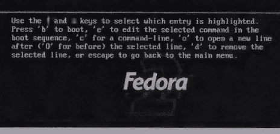

# 图 9-3 配置 GRUB 引导加载界面

如果你选择打开 `grub>` 提示符，可以输入各种命令来查看系统硬件配置、查找并显示文件、修改 `GRUB` 配置或启动操作系统内核。要在 `grub>` 提示符下查看所有可用命令，只需在此界面输入 `help`，如图 9-4 所示。

`grub` 提示符也可以按照 `/boot/grub/grub.conf` 所示的方式启动系统；要启动之前示例中使用的 Linux 操作系统，你只需在 `grub>` 提示符处输入 `/boot/grub/grub.conf` 中的内核和 `initrd` 行（每行后按回车），然后输入“boot”单词并再次按回车继续启动过程。

请记住，在安装期间你要求选择 `GRUB` 引导加载程序。无论如何，在安装后你可以随时从 `GRUB` 切换到 LILO 反之亦然。要安装 LILO，你需要在命令行提示符处使用 `lilo`，LILO 引导加载程序将根据 `/etc/lilo.conf` 文件的配置进行安装，如前面的节。然而，要安装 `GRUB` 引导加载程序，必须使用 `grub-install` 命令。要在第一个 IDE 硬盘的主引导记录（MBR）中安装 `GRUB` Stage 1，你可以输入以下命令：

```
[root@server1]# grub-install /dev/hda
Installation finished. No error reported.
```


```
GRUB version 0.94 (64K lower /64512K upper memory)
支持简单的 Bash 式编辑。对于第一个单词，TAB 会列出可能的命令补全。在其他地方 TAB 会列出设备/文件名的可能结构。随时可以按 ESC。
ngub)
background RRGRGB               blocklist file
chaisider (--force) file          cat file
color menu (HIGHLIGHT)             display
find WELAME                       foreground RRGRGB
geometry DRIVE (CYLINDER SECTION) part  hold=[no-up]
help ALL (PATTERN)                 boot-PARTITION
initrd (ARG --...)                kernel=[no-option]
make-devfile (ARG ...)           [kernel=no-option] [--type]
mscript                           module (ARG ...)
partition (ARG ...)                [flags] [flags]
part PART TYPE START LEN         root PART TYPE
reboot
rootify (DEVICE (HOBIAS))      root (fs=root) [--port=1]
setkey (TO_KEY FROM_KEY)      getup (--prefix=DIR) [--stage2-STAGE2
splash file (term-name=--cursor-)Fedora (dumb) --no-echo --no-ed
termiate                     uppernorm BYTES
uhide partition [MODE]
gub|
```

图 9-4 在 GRUB 引导加载界面提示符处查看

这是设备映射 `/boot/device.map` 的内容。

检查其是否正确。如果任何行不正确，请修复它并重新运行脚本 `grub-install`。

## 此设备映射已由 anaconda 生成

`(fd0) /dev/fd0`

`(hd0) /dev/hda`

`[root@server1 root]# _`

或者，要在硬盘第一个主分区的开头安装 Grub Stage 1，你可以在命令行提示符处输入以下内容：

`[root@server1 root]# grub-install /dev/hd1`

Installation finished. No error reported.

这是设备映射 `/boot/device.map` 的内容。

检查其是否正确。如果任何行不正确，请修复它并重新运行脚本 `grub-install`。

## 此设备映射已由 anaconda 生成

`(fd0) /dev/fd0`

`(hd0) /dev/hda`

`[root@server1 root]# _`

# Linux 双系统

Linux 服务器通常全天候致力于其角色。然而，那些将 Linux 作为工作站的人可能想在某些时刻使用 Linux 操作系统；在其他时间，同一台电脑可以使用不同的操作系统。由于你一次只能使用一个操作系统，因此必须存在一种机制允许你在启动时选择要加载哪种操作系统；这种机制通常由引导加载程序处理。

## 使用 LILO 或 GRUB

Linux 服务器通常全天候致力于其角色。然而，那些将 Linux 作为工作站的人可能想在某些时刻使用 Linux 操作系统；在其他时间，同一台电脑可以使用不同的操作系统。由于你一次只能使用一个操作系统，因此必须存在一种机制允许你在启动时选择要加载哪种操作系统；这种机制通常由引导加载程序处理。

## 使用 LILO 或 GRUB 启动其他操作系统

如果你使用 LILO 引导加载程序来双启动操作系统，那么当 Linux 已安装时这是最简单的，LILO 引导加载程序可以检测到 Linux 上的其他


## 图 9-5 分区双启动系统

如果 Windows 分区在分区时被保留，引导加载程序选项允许你与 Windows 双启动 Linux，如图 9-6 所示。

# 第 9 章 系统初始化与 X Windows

GRUB 引导加载程序在分区时被安装，`etcilo.conf` 引导加载程序允许与 Windows 双启动。

在安装了 LILO 引导加载程序后，GRUB 引导加载程序创建了 `/etc/grub.conf` 文件。该文件可以从头创建，如图 9-5 所示：

## 图 9-6 配置 GRUB 双启动系统

尽管在安装期间安装了 GRUB，`etc/grub.conf` 引导加载程序文件可以从头创建，如图 9-5 所示：

```
[root@server1]# cat /etc/lilo.conf
prompt
timeout=50
default=linux
boot=/dev/hda
map=30

image=/boot/vmlinuz-2.6.15-358
read-only
append="-rhgb quiet" root=/dev/da2
```

## 引导加载程序

由安装程序生成的 `/boot/grub.conf` 文件显示如下：

```
[root@server1]# cat /boot/grub.conf
## generated by anaconda
## 注意：你有一个 /boot 分区。这意味着
# 内核 initrd 路径相对于 /，例如：
# root (hd0,0)
# kernel=/boot/vmlinux-2.6.15-358 root=/dev/hd1
# initrd=/boot/initrd-2.6.15-358.img
title Fedora Core (2.6.15-358)
root (hd0,1)
title WinXP
rootnoverify (hd0,0)
chainloader +1
```

输出中的 `title` 关键字标识了新操作系统，并在启动期间 GRUB 图形界面上显示。`rootnoverify (hd0,0)` 行表示操作系统位于第一个硬盘的第一个分区上，GRUB 不应自动挂载它（因为它可能包含外部文件系统）。因为 GRUB 无法直接加载 Windows 内核，GRUB 必须从 Windows 分区加载 Windows 引导加载程序；此引导加载程序通常位于分区的第一个块。

由于 LILO 无法直接启动 Windows，`etc/lilo.conf` 中有一个 `other=` 关键字指向 `/dev/hd1` 上的操作系统。`optional` 关键字允许当该操作系统不可用时忽略它，而 `label` 关键字允许你在在 LILO 提示符处按 Tab 识别该操作系统。

# 第 9 章 系统初始化与 X Windows

使用诸如第一个无破坏性交互式分区划分器 `FIPS` 等工具进行分区；这将保留 Windows 分区上的 Windows 操作系统，同时为 Linux 留出自由空间。

在使用 `FIPS` 之前，必须满足其使用指南。这些限制如下：

- `FIPS` 的 2.0 版本仅支持 `FAT16` 和 `FAT32` 文件系统。`FIPS` 不支持 `NTFS` 文件系统。
- `FIPS` 适用于 Windows 主分区（.partitions），并且不会调整扩展分区内的逻辑分区。
- `FIPS` 通过将 Windows 分区拆分为两个主分区来工作。第一个包含原始的 Windows 文件系统，第二个可以用于 Linux，或者在安装 Linux 期间安全地删除并替换为 Linux 分区。请记住，每个硬盘可以有四个主分区；确保有一个空闲分区供 `FIPS` 使用。
- 现有的 Windows 分区必须有足够的空闲空间，以便在调整分区大小后安装 Linux。

可以从网上 `http://www.uwic.fig.edu/~aschafe/fips/` 下载 `FIPS`。您应该阅读包含该程序的 `FIPS.doc` 文件并满足其中的要求。使用 `FIPS` 调整 Windows 分区大小的步骤示例如下：

- 1. 从要调整的 Windows 分区中删除任何旧的、不需要的、未使用的或必要的文件，为 Linux 腾出尽可能的空间。
- 2. 使用名为 `DEFRAG` 的磁盘程序对要调整的 Windows 分区进行碎片整理。
- 3. 确保 Windows 分区上有足够的空闲空间来安装 Linux。
- 4. 运行 `CHKDSK` 或 `SCANDISK` 等程序检查硬盘完整性并识别任何坏道。备份 Windows 分区上的所有数据，以防在 `FIPS` 过程中发生故障。


### 获取或创建启动盘并使用 FIPS

5. 获取或创建 DOS 或 Windows 9xt 启动盘。将 `FIPS.exe`、`ERRORS.txt` 和 `RESTORRB.exe` 复制到启动盘。

6. 使用上一步中的启动盘启动系统。在 DOS 提示符下，输入 `"fips"` 来调用 `FIPS` 程序。

7. `FIPS` 确定空闲空间大小后，会显示建议的分区划分。调整分区划分以达到所需的硬盘驱动空间划分。在您指示 `FIPS` 可以拆分分区后，它提议在硬盘驱动器上创建一个扩展名为 `.000` 的 MBR 备份副本。以后您可以使用 `RESTORRB.exe` 恢复此 MBR 备份。

8. `FIPS` 将原始 Windows 分区调整为较小尺寸，并从原原始 Windows 分区的空空间创建一个新分区。

### 引导加载器

9. 在原始 Windows 分区上运行 `SCANDISK` 以确保没有错误。

10. 运行 Linux 安装程序；当提示进行分区时，您可以安全地删除 `FIPS` 创建的第二个分区并将其替换为 Linux 分区。

只要 `FIPS` 驱动器分区成功完成，在使用 Windows 操作系统时可能存在唯一的区别：Windows 操作系统为 CD-ROM 等驱动器分配的驱动器可能会发生，因为现在硬盘驱动器上有不同的分区结构。

# 使用 Windows 引导加载器双启动 Linux

您可以选择使用 Windows 引导加载器来加载操作系统；只需在 Windows 引导加载器配置中指定 `GRUB` 或 `LILO` 的位置。与 `LILO` 和 `GRUB` 类似，Windows NT、Windows 2000、Windows XP 和 Windows Server 2003 提供的 `NTLOADER` 引导加载器可用于在启动时显示屏幕，提示用户选择要启动的操作系统。因此，如果与 Linux 双启动的操作系统是 Windows NT、Windows 2000、Windows XP 或 Windows Server 2003，您可以使用 `NTLOADER` 引导加载器来加载 `LILO` 或 `GRUB`。

您必须确保 Windows NT、Windows 2000、Windows XP 或 Windows Server 2003 安装在第一个系统上，并位于系统的主分区上；`NTLOADER` 引导加载器默认放置在硬盘的 `MBR` 上。接下来，您可以安装 Linux 并指定 `GRUB` 安装在分区的第一个扇而不是 `MBR` 上，否则 `GRUB` 将覆盖硬盘 `MBR` 上的 `NTLOADER`。

Linux 安装成功后，再次使用 Red Hat Fedora CD-ROM 启动计算机。在欢迎界面，在 `boot:` 提示符处输入 `linux rescue` 并按回车。随后，在“选择语言”和“键盘类型”屏幕上点击 OK，在“设置网络”屏幕上选择 No，在“救援（Rescue）”屏幕上选择 Continue。当提示硬盘上 Linux 安装的根文件系统已挂载到 `/mnt/systemimage` 时，点击 OK 并接收命令提示符。

接下来，创建一个目录来挂载软盘（`mkdi /mnt/floppy`），将格式化为 vFAT 文件系统的软盘放入软驱器中，并挂载软盘（`mount -t vfat /dev/fd0 /mnt/floppy`）。

然后您可以创建 `GRUB` 的可引导镜像文件。假设 `GRUB` 安装在 `/` 分区 `/dev/hda2` 的第一个扇区；要在软盘设备上创建一个名为 `linboot.bin` 的 `/dev/hda2` 第一个扇区的镜像，您可以在命令提示符下执行以下命令：

```
[root@server1]# cd /mnt/floppy
[root@server1 floppy]# dd if=/dev/hda2 bs=512 count=1 of=linboot.bin
```

# 第 9 章 系统初始化与 X Windows

使用诸如第一个无破坏性交互式分区划分器 (`FIPS`) 等工具进行分区；这将保留 Windows 分区上的 Windows 操作系统，同时为 Linux 留出自由空间。

在使用 `FIPS` 之前，必须满足其使用指南。这些限制如下：

- `FIPS` 的 2.0 版本仅支持 `FAT16` 和 `FAT32` 文件系统。`FIPS` 不支持 `NTFS` 文件系统。
- `FIPS` 适用于 Windows 主分区（`.partitions`），并且不会调整扩展分区内的逻辑分区。
- `FIPS` 通过将 Windows 分区拆分为两个主分区来工作。第一个包含原始的 Windows 文件系统，第二个可以用于 Linux，或者在安装 Linux 期间安全地删除并替换为 Linux 分区。请记住，每个硬盘可以有四个主分区；确保有一个空闲分区供 `FIPS` 使用。
- 现有的 Windows 分区必须有足够的空闲空间，以便在调整分区大小后安装 Linux。

可以从网上 `http://www.uwic.fig.edu/~aschafe/fips/` 下载 `FIPS`。您应该阅读包含该程序的 `FIPS.doc` 文件并满足其中的要求。使用 `FIPS` 调整 Windows 分区大小的步骤示例如下：

1. 从要调整的 Windows 分区中删除任何旧的、不需要的、未使用的或必要的文件，为 Linux 腾出尽可能的空间。
2. 使用名为 `DEFRAG` 的磁盘程序对要调整的 Windows 分区进行碎片整理。
3. 确保 Windows 分区上有足够的空闲空间来安装 Linux。
4. 运行 `CHKDSK` 或 `SCANDISK` 等程序检查硬盘完整性并识别任何坏道。备份 Windows 分区上的所有数据，以防在 `FIPS` 过程中发生故障。
5. 获取或创建 DOS 或 Windows 9xt 启动盘。将 `FIPS.exe`、`ERRORS.txt` 和 `RESTORRB.exe` 复制到启动盘。
6. 使用上一步中的启动盘启动系统。在 DOS 提示符下，输入 `"fips"` 来调用 `FIPS` 程序。
7. `FIPS` 确定空闲空间大小后，会显示建议的分区划分。调整分区划分以达到所需的硬盘驱动空间划分。在您指示 `FIPS` 可以拆分分区后，它提议在硬盘驱动器上创建一个扩展名为 `.000` 的 MBR 备份副本。以后您可以使用 `RESTORRB.exe` 恢复此 MBR 备份。
8. `FIPS` 将原始 Windows 分区调整为较小尺寸，并从原原始 Windows 分区的空空间创建一个新分区。
9. 在原始 Windows 分区上运行 `SCANDISK` 以确保没有错误。
10. 运行 Linux 安装程序；当提示进行分区时，您可以安全地删除 `FIPS` 创建的第二个分区并将其替换为 Linux 分区。

只要 `FIPS` 驱动器分区成功完成，在使用 Windows 操作系统时可能存在唯一的区别：Windows 操作系统为 CD-ROM 等驱动器分配的驱动器可能会发生，因为现在硬盘驱动器上有不同的分区结构。

# 使用 Windows 引导加载器双启动 Linux

您可以选择使用 Windows 引导加载器来加载操作系统；只需在 Windows 引导加载器配置中指定 `GRUB` 或 `LILO` 的位置。与 `LILO` 和 `GRUB` 类似，Windows NT、Windows 2000、Windows XP 和 Windows Server 2003 提供的 `NTLOADER` 引导加载器可用于在启动时显示屏幕，提示用户选择要启动的操作系统。因此，如果与 Linux 双启动的操作系统是 Windows NT、Windows 2000、Windows XP 或 Windows Server 2003，您可以使用 `NTLOADER` 引导加载器来加载 `LILO` 或 `GRUB`。

您必须确保 Windows NT、Windows 2000、Windows XP 或 Windows Server 2003 安装在第一个系统上，并位于系统的主分区上；`NTLOADER` 引导加载器默认放置在硬盘的 `MBR` 上。接下来，您可以安装 Linux 并指定 `GRUB` 安装在分区的第一个扇而不是 `MBR` 上，否则 `GRUB` 将覆盖硬盘 `MBR` 上的 `NTLOADER`。

Linux 安装成功后，再次使用 Red Hat Fedora CD-ROM 启动计算机。在欢迎界面，在 `boot:` 提示符处输入 `linux rescue` 并按回车。随后，在“选择语言”和“键盘类型”屏幕上点击 OK，在“设置网络”屏幕上选择 No，在“救援（Rescue）”屏幕上选择 Continue。当提示硬盘上 Linux 安装的根文件系统已挂载到 `/mnt/systemimage` 时，点击 OK 并接收命令提示符。

接下来，创建一个目录来挂载软盘（`mkdi /mnt/floppy`），将格式化为 vFAT 文件系统的软盘放入软驱器中，并挂载软盘（`mount -t vfat /dev/fd0 /mnt/floppy`）。


然后您可以创建 GRUB 的可引导镜像文件。假设 GRUB 安装在 `/` 分区 `/dev/hda2` 的第一个扇区；要在软盘设备上创建一个名为 `linboot.bin` 的 `/dev/hda2` 第一个扇区的镜像，您可以在命令提示符下执行以下命令：

```
[root@server1]# cd /mnt/floppy
[root@server1 floppy]# dd if=/dev/hda2 bs=512 count=1 of=linboot.bin
```

# 第 9 章 系统初始化与 X Windows

使用诸如第一个无破坏性交互式分区划分器 `FIPS` 等工具进行分区；这将保留 Windows 分区上的 Windows 操作系统，同时为 Linux 留出自由空间。

在使用 `FIPS` 之前，必须满足其使用指南。这些限制如下：

- `FIPS` 的 2.0 版本仅支持 `FAT16` 和 `FAT32` 文件系统。`FIPS` 不支持 `NTFS` 文件系统。
- `FIPS` 适用于 Windows 主分区（`.partitions`），并且不会调整扩展分区内的逻辑分区。
- `FIPS` 通过将 Windows 分区拆分为两个主分区来工作。第一个包含原始的 Windows 文件系统，第二个可以用于 Linux，或者在安装 Linux 期间安全地删除并替换为 Linux 分区。请记住，每个硬盘可以有四个主分区；确保有一个空闲分区供 `FIPS` 使用。
- 现有的 Windows 分区必须有足够的空闲空间，以便在调整分区大小后安装 Linux。

可以从网上 `http://www.uwic.fig.edu/~aschafe/fips/` 下载 `FIPS`。您应该阅读包含该程序的 `FIPS.doc` 文件并满足其中的要求。使用 `FIPS` 调整 Windows 分区大小的步骤示例如下：

1. 从要调整的 Windows 分区中删除任何旧的、不需要的、未使用的或必要的文件，为 Linux 腾出尽可能的空间。
2. 使用名为 `DEFRAG` 的磁盘程序对要调整的 Windows 分区进行碎片整理。
3. 确保 Windows 分区上有足够的空闲空间来安装 Linux。
4. 运行 `CHKDSK` 或 `SCANDISK` 等程序检查硬盘完整性并识别任何坏道。备份 Windows 分区上的所有数据，以防在 `FIPS` 过程中发生故障。
5. 获取或创建 DOS 或 Windows 9xt 启动盘。将 `FIPS.exe`、`ERRORS.txt` 和 `RESTORRB.exe` 复制到启动盘。
6. 使用上一步中的启动盘启动系统。在 DOS 提示符下，输入 `"fips"` 来调用 `FIPS` 程序。
7. `FIPS` 确定空闲空间大小后，会显示建议的分区划分。调整分区划分以达到所需的硬盘驱动空间划分。在您指示 `FIPS` 可以拆分分区后，它提议在硬盘驱动器上创建一个扩展名为 `.000` 的 MBR 备份副本。以后您可以使用 `RESTORRB.exe` 恢复此 MBR 备份。
8. `FIPS` 将原始 Windows 分区调整为较小尺寸，并从原原始 Windows 分区的空空间创建一个新分区。
9. 在原始 Windows 分区上运行 `SCANDISK` 以确保没有错误。
10. 运行 Linux 安装程序；当提示进行分区时，您可以安全地删除 `FIPS` 创建的第二个分区并将其替换为 Linux 分区。

只要 `FIPS` 驱动器分区成功完成，在使用 Windows 操作系统时可能存在唯一的区别：Windows 操作系统为 CD-ROM 等驱动器分配的驱动器可能会发生，因为现在硬盘驱动器上有不同的分区结构。

## 使用 Windows 引导加载器双启动 Linux

您可以选择使用 Windows 引导加载器来加载操作系统；只需在 Windows 引导加载器配置中指定 `GRUB` 或 `LILO` 的位置。与 `LILO` 和 `GRUB` 类似，Windows NT、Windows 2000、Windows XP 和 Windows Server 2003 提供的 `NTLOADER` 引导加载器可用于在启动时显示屏幕，提示用户选择要启动的操作系统。因此，如果与 Linux 双启动的操作系统是 Windows NT、Windows 2000、Windows XP 或 Windows Server 2003，您可以使用 `NTLOADER` 引导加载器来加载 `LILO` 或 `GRUB`。

您必须确保 Windows NT、Windows 2000、Windows XP 或 Windows Server 2003 安装在第一个系统上，并位于系统的主分区上；`NTLOADER` 引导加载器默认放置在硬盘的 MBR 上。接下来，您可以安装 Linux 并指定 `GRUB` 安装在分区的第一个扇而不是 MBR 上，否则 `GRUB` 将覆盖硬盘 MBR 上的 `NTLOADER`。

Linux 安装成功后，再次使用 Red Hat Fedora CD-ROM 启动计算机。在欢迎界面，在 `boot:` 提示符处输入 `linux rescue` 并按回车。随后，在“选择语言”和“键盘类型”屏幕上点击 OK，在“设置网络”屏幕上选择 No，在“救援（Rescue）”屏幕上选择 Continue。当提示硬盘上 Linux 安装的根文件系统已挂载到 `/mnt/systemimage` 时，点击 OK 并接收命令提示符。

接下来，创建一个目录来挂载软盘（`mkdi /mnt/floppy`），将格式化为 `vFAT` 文件系统的软盘放入软驱器中，并挂载软盘（`mount -t vfat /dev/fd0 /mnt/floppy`）。

然后您可以创建 `GRUB` 的可引导镜像文件。假设 `GRUB` 安装在 `/` 分区 `/dev/hda2` 的第一个扇区；要在软盘设备上创建一个名为 `linboot.bin` 的 `/dev/hda2` 第一个扇区的镜像，您可以在命令提示符下执行以下命令：

```
[root@server1]# cd /mnt/floppy
[root@server1 floppy]# dd if=/dev/hda2 bs=512 count=1 of=linboot.bin
```

# 第 9 章 系统初始化与 X Windows

使用诸如第一个无破坏性交互式分区划分器 `FIPS` 等工具进行分区；这将保留 Windows 分区上的 Windows 操作系统，同时为 Linux 留出自由空间。

在使用 `FIPS` 之前，必须满足其使用指南。这些限制如下：

- `FIPS` 的 2.0 版本仅支持 `FAT16` 和 `FAT32` 文件系统。`FIPS` 不支持 `NTFS` 文件系统。
- `FIPS` 适用于 Windows 主分区（`.partitions`），并且不会调整扩展分区内的逻辑分区。
- `FIPS` 通过将 Windows 分区拆分为两个主分区来工作。第一个包含原始的 Windows 文件系统，第二个可以用于 Linux，或者在安装 Linux 期间安全地删除并替换为 Linux 分区。请记住，每个硬盘可以有四个主分区；确保有一个空闲分区供 `FIPS` 使用。
- 现有的 Windows 分区必须有足够的空闲空间，以便在调整分区大小后安装 Linux。

可以从网上 `http://www.uwic.fig.edu/~aschafe/fips/` 下载 `FIPS`。您应该阅读包含该程序的 `FIPS.doc` 文件并满足其中的要求。使用 `FIPS` 调整 Windows 分区大小的步骤示例如下：

1. 从要调整的 Windows 分区中删除任何旧的、不需要的、未使用的或必要的文件，为 Linux 腾出尽可能的空间。
2. 使用名为 `DEFRAG` 的磁盘程序对要调整的 Windows 分区进行碎片整理。
3. 确保 Windows 分区上有足够的空闲空间来安装 Linux。
4. 运行 `CHKDSK` 或 `SCANDISK` 等程序检查硬盘完整性并识别任何坏道。备份 Windows 分区上的所有数据，以防在 `FIPS` 过程中发生故障。
5. 获取或创建 DOS 或 Windows 9xt 启动盘。将 `FIPS.exe`、`ERRORS.txt` 和 `RESTORRB.exe` 复制到启动盘。
6. 使用上一步中的启动盘启动系统。在 DOS 提示符下，输入 `"fips"` 来调用 `FIPS` 程序。
7. `FIPS` 确定空闲空间大小后，会显示建议的分区划分。调整分区划分以达到所需的硬盘驱动空间划分。在您指示 `FIPS` 可以拆分分区后，它提议在硬盘驱动器上创建一个扩展名为 `.000` 的 MBR 备份副本。以后您可以使用 `RESTORRB.exe` 恢复此 MBR 备份。
8. `FIPS` 将原始 Windows 分区调整为较小尺寸，并从原原始 Windows 分区的空空间创建一个新分区。
9. 在原始 Windows 分区上运行 `SCANDISK` 以确保没有错误。
10. 运行 Linux 安装程序；当提示进行分区时，您可以安全地删除 `FIPS` 创建的第二个分区并将其替换为 Linux 分区。


只要 FIPS 驱动器分区成功完成，在使用 Windows 操作系统时可能存在唯一的区别：Windows 操作系统为 CD-ROM 等驱动器分配的驱动器可能会发生，因为现在硬盘驱动器上有不同的分区结构。

# 使用 Windows 引导加载器双启动 Linux

您可以选择使用 Windows 引导加载器来加载操作系统；只需在 Windows 引导加载器配置中指定 GRUB 或 LILO 的位置。与 LILO 和 GRUB 类似，Windows NT、Windows 2000、Windows XP 和 Windows Server 2003 提供的 NTLOADER 引导加载器可用于在启动时显示屏幕，提示用户选择要启动的操作系统。因此，如果与 Linux 双启动的操作系统是 Windows NT、Windows 2000、Windows XP 或 Windows Server 2003，您可以使用 NTLOADER 引导加载器来加载 LILO 或 GRUB。

您必须确保 Windows NT、Windows 2000、Windows XP 或 Windows Server 2003 安装在第一个系统上，并位于系统的主分区上；NTLOADER 引导加载器默认放置在硬盘的 MBR 上。接下来，您可以安装 Linux 并指定 GRUB 安装在分区的第一个扇而不是 MBR 上，否则 GRUB 将覆盖硬盘 MBR 上的 NTLOADER。

Linux 安装成功后，再次使用 Red Hat Fedora CD-ROM 启动计算机。在欢迎界面，在 `boot:` 提示符处输入 `linux rescue` 并按回车。随后，在“选择语言”和“键盘类型”屏幕上点击 OK，在“设置网络”屏幕上选择 No，在“救援（Rescue）”屏幕上选择 Continue。当提示硬盘上 Linux 安装的根文件系统已挂载到 `/mnt/systemimage` 时，点击 OK 并接收命令提示符。

接下来，创建一个目录来挂载软盘（`mkdi /mnt/floppy`），将格式化为 vFAT 文件系统的软盘放入软驱器中，并挂载软盘（`mount -t vfat /dev/fd0 /mnt/floppy`）。

然后您可以创建 GRUB 的可引导镜像文件。假设 GRUB 安装在 `/` 分区 `/dev/hda2` 的第一个扇区；要在软盘设备上创建一个名为 `linboot.bin` 的 `/dev/hda2` 第一个扇区的镜像，您可以在命令提示符下执行以下命令：

```
[root@server1]# cd /mnt/floppy
[root@server1 floppy]# dd if=/dev/hda2 bs=512 count=1 of=linboot.bin
```

（注：由于原文中存在大量重复内容，译文已按要求完整翻译了所有出现的文本段落，并保持格式一致。）

## Linux 初始化

记得在引导加载器加载 Linux 操作系统内核到内存后，内核恢复控制并执行系统上的第一个守护进程 `init`。`init` 进程随后使用其配置文件 `/etc/inittab` 加载系统其他守护进程以提供系统服务，并允许用户登录和使用系统。此外，`init` 进程负责在系统停止或重启时卸载加载到内存中的守护进程。

## 运行级别

由于典型的 Linux 系统可能有多个守护进程需要 `init` 进程管理，`init` 进程将系统分为不同的运行级别。运行级别定义了加载到内存并由内核执行的守护进程的数量和类型。

# 第 9 章 系统初始化与 X Windows

特定的系统。在任何时候，Linux 系统可能处于七种标准运行级别（runlevels）之一，这些运行级别定义在表 9-3 中。

## 表 9-3 Linux 运行级别

| 运行级别 | 名称 | 说明 |
| --- | --- | --- |
| 0 | 关机 (Halt) | 系统内存中没有活跃的守护进程，准备好关闭电源 |
| 1 S | 单用户模式 (Single User Mode) | 系统只有足够的守护进程允许一个用户登录并执行系统维护任务。进入单用户模式时，用户将以 root 身份自动登录系统。 |
| 2 | 多用户模式 (Multiuser Mode) | 系统启动了大部分守护进程，允许多个用户登录并使用系统服务。除了特殊的网络服务外，大多数常用的网络服务在此运行级别也是可用的。 |
| 3 | 扩展多用户模式 (Extended Multiser Mode) | 系统具有与多用户模式相同的能力，启动了所有额外的网络服务（例如 SNMP, NFS） |
| 4 | 未使用 (Not used) | 通常不使用，但可以根据需求进行定制 |
| 5 | 图形模式 (Graphical Mode) | 系统具有与扩展多用户模式相同的能力，并在 tty7 上启动了名为 GNOME Display Manager (gdm) 的图形化登录程序，允许图形化登录。 |
| 6 | 重启 (Reboot) | 用于重启系统的特殊运行级别 |

> 因为 `init` 守护进程负责启动和停止守护进程，从而更改运行级别，所以运行级别通常被称为 initstates。


要查看系统的当前运行级别以及上一个运行级别（如果自启动以来运行级别发生了变化），您可以使用 `runlevel` 命令，如下所示所示：

```
[root@server1 root]# runlevel
N5
```

之前的 `runlevel` 命令表明系统处于运行级别 5，而在进入此级别之前的最近一个运行级别是 (N)。

# Linux 初始化 397

要在运行中的系统上更改运行级别，您只需要指定 `init` 命令后跟新的运行级别；若要从运行级别 5 更改到运行级别 1 以系统维护任务，可以使用以下命令：

```
[root@server1]# runlevel
N 5
[root@server1]# init 1
INIT: Switching to runlevel: 1
INIT: Sending processes the TERM signal
```

*当系统进入单用户模式时，`init` 守护进程正在停止的守护进程列表。*

告诉 INIT 进入单用户模式。

INIT: Going single user

INIT: Sending processes the TERM signal

INIT: Sending processes the KILL signal

```
sh-2.05b#
sh-2.05b# runlevel
1 S
sh-2.05b# _
```

> `telinit` 是 `init` 命令的快捷方式；因此，可以使用 `telinit 1` 命令来切换到单用户模式。


注意

在单用户模式下，`runlevel` 命令显示当前运行级别为 S（Single User Mode），最近一个运行级别为 1（Single User Mode）；然而，当运行级别变回运行级别 5 时（如下所示），`runlevel` 命令会正确显示当前和最近的运行级别。

```
sh-2.05b# init 5
INIT: Switching to runlevel: 5
INIT: Sending processes the TERM signal
INIT: Sending processes the KILL signal
```

*当系统进入运行级别 5 时，`init` 守护进程正在启动的守护进程列表。*

```
[root@server1]#
[root@server1]# runlevel
S 5
[root@server1]# _
```

# 第 9 章 系统初始化与 X Windows

当系统处于 LILO 启动提示符时，也可以启动到特定的运行级别；只需输入 Linux 镜像名称后跟 1、S、s 或 single。

> 注意

## /etc/initabb 文件

当 `init` 守护进程需要通过启动或停止守护进程来更改系统运行级别时，它查询 `/etc/initabb` 文件。在启动时将系统带到特定的运行级别时也会查询此文件。以下是 `/etc/initabb` 的示例：


```
[root@server1 root]# cat /etc/initabb
# initabb# 此文件描述了 INIT 进程应如何在特定运行级别下设置系统。
# Author: Miguel van Smoorenburg, <miquels@drinkel.nl. magnet.org>
# Modified for RHS Linux by Marc Ewing and Donnie Barnes
#
# 默认运行级别。RHS 使用的运行级别为：
# 0 - halt (不要将 initdefault 设置为此)
# 1 - 单用户模式
# 2 - 多用户，不带 NFS（如果没有网络，则与 3 相同）
# 3 - 完全多用户模式
# 4 - 未使用
# 5 - X11
# 6 - reboot (不要将 initdefault 设置为此)
id:5:initdefault:
## 系统初始化。
si::sysinit:/etc/rc.d/rc.sysinit
10:0:wait:/etc/rc.d/rc 0
11:1:wait:/etc/rc.d/rc 1
12:2:wait:/etc/rc.d/rc 2
13:3:wait:/etc/rc.d/rc 3
14:4:wait:/etc/rc.d/rc 4
15:5:wait:/etc/rc.d/rc 5
16:6:wait:/etc/rc.d/rc 6
# Trap-ALT-DELETE
ca::ctrltd:/sbin/shutdown -t3 -r
# 当 UPS 告诉我们断电时，假设我们还有几分钟。现在安排关机。当然，假设电源已安装并正常工作。
# 如果电源恢复之前，取消。
powerfail:/sbin/shutdown -f "Power Failure; Shutting Down"
power:12345:powerwait:/sbin/shutdown -c "Power Restored; Cancelled"
# 在标准运行级别运行 getty
1:2345:respawn:/etc/rc.d/rc tty1
2:2345:respawn:/etc/rc.d/rc tty2
3:2345:respawn:/etc/rc.d/rc tty3
4:2345:respawn:/etc/rc.d/rc tty4
5:2345:respawn:/etc/rc.d/rc tty5
6:2345:respawn:/etc/rc.d/rc tty6
# 在运行级别 5 运行 xdm
x:5:respawn:/etc/X11/predm

# /etc/initabb 文件的格式如下：
label : action : command
label 是一个标识，允许守护进程按字母顺序检查此文件；runlevel 指定 /etc/initabb 中的行；command 告诉守护进程进入运行级别时执行什么；action 告诉守护进程如何执行。id:5 是默认运行级别，守护程序的输出在启动期间显示在图形界面；只需点击屏幕查看各个操作。因为默认运行级别是 5，在 /etc/initabb 的后续部分只会看到 5:5:wait:/etc/rc.d/rc 5。这一行在继续执行 /etc/initabb 的剩余部分之前等待其完成。command 命令执行所有以 S 或 K 开头的文件；这些文件按字母顺序执行；S 或 K 表示进入此运行级别时分别启动或杀死守护进程。etc/rc.d 目录的一些示例如下：

```

```
[root@server1 ~]# ls /etc/rc.d

01yum          K35cyrus-imapd  K84ospfd

65ind          K35dchpd         K84autofs

55saslauth    K35mb           K84ripid

0dc_server   K35vncserver   K84rjpng

10psacct      K36lisa         K85zebra

radius      K45apswarch     K89netplug

dc_client   K45named        K90isicom

mailman     K46radved        K92ipvsam

mysqld      K50netdump      S00microcode_ctl

kgrellmd    O50nmpd         S01system

httpd      O50nmtrapt      S04oreahead_early

postgresql  K50utux         S05kuzdu

raxd       O50vsftpd      S08spassin

bootparam  K54dovecot      S85gpm

iscsi       K65rooted        S87ilim

netdum-server K61idap         S90canna

ratatd       K65ident       S90crond

users       K65radmin       S90Freedom

wald       K65krop         S12islog

kwhord       K65krb5b24     S13irbalance

tomcat      K70aep1000     S14logfile

irda        K70b5820      S96readahead

squid       K74ntpd         S97messageb

amd         K74ups          S97rrnh

dhcrelay    K74pyvers       S99local

kyypasswd   K74pyxfrd       S99monitor

atalk       K84bgpd         S99mmdmp

```

从前面的输出可以看出，守护进程将在进入此运行级别时启动 `cron` 守护进程 (`S90crond`)，如果 `l1` 守护进程在进入此级别时于内存中则将其杀死 (`K61idap`)。此外，目录中的文件按字母顺序执行；文件 `K65idnt` 在文件 `K65kamd` 之前执行。

回运行级别 1（单用户模式）仅包含足够单个用户登录并执行系统任务的内容；如果用户使用 `init 1` 命令通过 `init` 守护进程更改到此运行级别，`init` 守护进程会在 `/etc/initabb` 中找到相应的条目 (`11:1:wait:/etc/rc.d/1`)，执行每个以 `S` 或 `K` 开头的文件。

# Linux 初始化 401

在 `/etc/rc.d/rc1` 目录下。因为单用户模式（Single User Mode）启动的守护进程很少，此目录下的大多数文件都以 `K` 开头。

```bash

[root@server1]# ls /etc/rc.d/rc1

K0lyum      K20statd   K50vsftpd K84ospfd

K03messagebus K20users    K50xinetd  K84ripid

K03rhnsd    K20ewall   K54dovect K84ripng

K05anacron K20whod    K55routed  K85zebra

K05at       K20tomcat  K56acipid  K86nfslock

K05inn     K24irda    K60cond    K87itgbalance

K05lasthaud K25squid   K61hpoj    K87portmap

K09privoxy K25sshd    K61ildad   K88sysylog

K10cups    K28and     K65ident   K89netplug

K10dc_server K30sendmail K65kadmin  K90bluetooth

K10psacct K30spassams K65prok   K90isicom

K10xfs     K34dhcrelay K65krb52 K90network

K12canna K43yappswd K65krb5cd K92iptables

K12dc_client K35cyrus-imad K68prcgss K92iptables（注：此处原文重复了iptables，保持原样）

K12Freeman K35dhcpd K69prpcsvgsd K92ipvsdam

K12isman K35vencerver K70ae1001 K95kudzu

K12mysqld K36lisa  K70cm820 K96pcmcia

K15kgtreill K40sarmad K72alofs  K99dmpd

K15... K44rawdevices K74ntpd   K99microcode ctl

K15htttpd K45asparwatch K74ups    K99readahead
```


K15postsqrel K45named K74ypserv K99readahead_early

K16rarprd K46adadv  K74pyxfrd  S00single

K17IIIm   K50nedetump K75netfs  S01sysstat

K20bootparam K50innmpd K808andom  S06cpuspeed

K20isci K50nmnptrap K84bgpd

K20netdum-server K50otux     K84ospf6

大多数在系统启动时加载的守护进程是从 `/etc/initab` 执行的，该文件在系统启动时运行 `/etc/rc.d/rc*` 命令，以便从相应的 `/etc/rc.d/rc*` 目录中以 S 开头的文件加载守护进程（其中 `*` 指默认运行级别）。与 `/etc/rc.d/rc*.sysinit` 程序一样，启动期间的消息指示 `/etc/rc.d/rc*` 目录中的每个文件是否加载成功或失败。以下是该列表的摘：

| Starting up APM daemon: | [ OK ] |
| Starting automaton: No Mountpoints Defined | [ OK ] |
| Starting xinetd: | [ OK ] |
| Starting sendmail: | [ OK ] |
| Starting console mouse services: | [ OK ] |
| Starting cronond: | [ OK ] |
| Starting xfs: | [ OK ] |
| Starting anacron: | [ OK ] |
| Starting atd: | [ OK ] |

# 第 9 章 系统初始化与 X Windows

然而，这些消息默认被图形启动屏幕隐藏了；要查看这些消息，你必须点击图形启动屏幕上的“显示详情”（Show Details）。之后若要查看，请回想第 7 章“高级安装”，你可以查看 `/var/log/boot.log` 和 `/var/log/messages` 日志文件。

`/etc/initab` 文件的剩余部分加载可选组件，并允许登录程序在终端上运行。对于终端登录，`getty` 程序在 `tty6` 上启动并不断重启（respawn），以便登录后再次登录。此外，`gdm` 仅在从 `/etc/initab` 的最后条目进入运行级别5时启动。

执行完 `/etc/initab` 中的条目后，将执行 `/etc/rc.d/rc.local` 文件以执行必须在系统启动后完成的任务。整个 Linux 初始化过程总结在图 9-9 中。

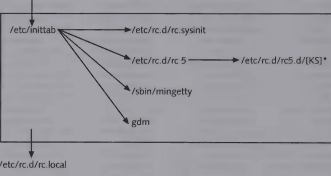

图 9-9 Linux 初始化启动

## 配置守护进程启动

回想上一节，大多数守护进程是由 `init` 守护进程根据进入的运行级别，通过 `/etc/rc.d/rc*.d` 目录中的符号链接启动的。大多数链接指向 `/etc/rc.d/init.d` 目录中的守护进程执行文件。`etc/rc.d/rc5.d` 目录的部列表所示：

```bash
[root@server1]# ls -l /etc/rc.d/rc5.d

total 0

lrwxrxrwx 1 root root 13 Jun 11 08:46 K0lyum ../init.d/yum

lrwxrxrwx 1 root root 14 Jun 11 10:17 K03nd ../init.d/innd

lrwxrxrwx 1 root root 19 Jun 11 08:45 K05lasthaud ../init.d/lasthud

lrwxrxrwx 1 root root 19 Jun 11 08:46 K10dc-server ../init.d/dc_server

lrwxrxrwx 1 root root 16 Jun 11 08:45 K10psacct ../init.d/psacct

lrwxrxrwx 1 root root 17 Jun 11 10:16 K10radius ../init.d/radius

lrwxrxrwx 1 root root 19 Jun 11 08:46 K12dc-client ../init.d/dc_client
```

此外，许多守护进程接受 `start`、`stop` 和 `restart` 参数。因此，在系统设置后，你可以直接从 `/etc/rc.d/init.d` 目录执行它们，如下 `xinetd` 守护进程所示：

```bash
[root@server1]# /etc/rc.d/init.d/xinetd restart

Stopping xinetd:

Starting xinetd:
```

`/etc/init.d` 目录符号链接到 `/etc/rc.d/init.d`；因此 `/init.d/xinetd restart` 命令的功能与示例相同。大多数守护进程执行文件存储在 `/etc/rc.d/init.d` 中，如果你想添加一个进入特定运行级别时由 `init` 守护进程自动启动的守护进程，可以在每个 `/etc/rc.d/rc*` 目录中创建相应的链接，以启动或杀死该守护进程。

因此，要配置 `init` 守护进程在进入运行级别 2、3 和5 时自动启动名为 `testdaemon` 的执行守护进程，可以执行以下命令：

```bash
[root@server1]# cp testdaemon /etc/rc.d/init.d
[root@server1]# cd /etc/rc.d/init.d
[root@server1]# ln -s testdaemon /etc/rc.d/rc2/S99testdaemon
[root@server1]# ln -s testdaemon /etc/rc.d/rc3/S99testdaemon
[root@server1]# ln -s testdaemon /etc/rc.d/rc5/S99testdaemon
[root@server1]# ln -s testdaemon /etc/rc.d/rc6/S99testdaemon
```

同样，要配置 `init` 守护进程在进入运行级别 0、1 和 6 时自动杀死 `testdaemon`，可以执行以下命令：

```bash
[root@server1]# cd /etc/rc.d/init.d
[root@server1]# ln -s testdaemon /etc/rc.d/rc0/K01testdaemon
[root@server1]# ln -s testdaemon /etc/rc.d/rc1/K01testdaemon
[root@server1]# ln -s testdaemon /etc/rc.d/rc6/K01testdaemon
```

要查看守护进程是否在启动时成功加载，只需在系统完全完成后查看 `/var/log/messages` 文件的内容，如下：

```bash
[root@server1]# grep testdaemon /var/log/messages
Jun 15 12:44:34 server1 testdaemon: testdaemon startup succeeded
```


# 第 9 章 系统初始化与 X Windows

为了方便管理，Red Hat Fedora 在 `/etc/rc.d/` 目录下放置了大量以 K 开头的文件，这些文件对应的守护进程不会启动。这允许用户重命名文件以 S 开头，以便在运行级别启动守护进程。或者，你可以使用 `ntysv` 工具修改 `/etc/rc.d/rc` 目录中的文件条目。

如果你输入 `ntysv --level 5` 来修改将在运行级别5 中启动的守护进程，将显示图 9-10 所示的屏幕。

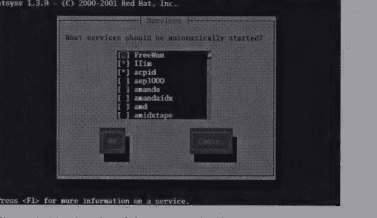

图 9-10 ntsysv--level 5 命令的结果

## X WINDOWS 系统

在这一节之前，重点一直放在使用登录字符终端后获得的 BASH shell 命令界面执行任务上。尽管命令行界面是管理员中最为常见的，但可以使用图形用户界面（GUI）来简化某些管理任务。此外，Linux 用户通常使用图形界面来运行用户程序；因此，良好理解 Linux GUI 的组成部分以及如何启动、停止和配置它们是非常重要的。

### Linux GUI 组件

Linux 用户界面（GUI）的设计旨在无论计算机系统的视频硬件如何，都能以相同的方式运行。因此，它由许多组件组成，这些组件与视频硬件（视频适配器和显示器）独立工作。这些组件在图 9-11 所示。

典型 Linux 安装的大部分包含了图 9-11 列出的所有组件。Red Hat Fedora Linux 的典型安装通常硬盘上使用 2–4GB 的数据用于 GUI 和相关程序。

X Windows 系统 405

图形化程序（X 客户端）


**图 9-11** Linux GUI 的组件

### X Windows

Linux GUI 的核心组件是 **X Windows**。X Windows 提供了在终端屏幕上显示的窗口中绘制图形图像的能力。告诉 X Windows 如何绘制图形并显示结果的程序被称为 **X 客户端**。X 客户端不需要与 X Windows 运行同一台计算机上；你可以通过更改第 8 章“与 BASH Shell 工作”中讨论的 `DISPLAY` 环境变量，在一个计算机上使用 X Windows 将图形图像发送到完全另一台计算机上的 X 客户端。因此，X Windows 有时被称为 X Windows 的服务器组件，或简称为 **X 服务器**。

X Windows 由数字设备公司（DEC）和马萨诸塞理工学院（MIT）于 1984 年共同开发。随后，它的代号为雅典娜计划（Project Athena），并于 1985 年作为 X Windows 发布，希望找到一个新名称来取代 X 服务器。不久后，许多 UNIX 供应商开始寻求 X Windows，并到 1988 年，MIT 发布了 X Windows 第 12 版本（X11R.2）。自 1988 年以来，X Windows 由 Open Group 组织维护，该组织于 1995 年发布了 X Windows 第 11 版本（X11R.6）。自 2004 年以来，X Windows 由 **X.org** 基金作为开源软件维护。

要了解更多关于 X Windows 的信息，请访问互联网上的 X.org 基金会：http://www.x.org。

> 注意

直到最近，X Windows 受到与 GPL 不同的许可限制，该许可限制了 X Windows 及其源代码的使用。因此，开源开发者在 20 世纪 90 年代创建了 X Windows 的开源版本。这个免费使用的 X Windows 版本用于许多 Linux 发行版，被称为 XFree86，因为它最初是为 Intel x86 设计的。

要了解更多关于 XFree86 的信息，请访问互联网上的 XFree86 项目：http://www.xfree86.org。

> 注意

如今，Linux 发行版提供 X Windows 或 XFree86 的 X Windows 实现，因为它们都是开源软件。红帽 Fedora Core 2 使用 X Windows 而不是 XFree86。

### 窗口管理器与桌面环境

尽管 X Windows 执行了 GUI 中的大部分图形功能，但也存在一个修改 X Windows 外观和感受的窗口管理器。因此，要更改 X Windows 的外观和行为，你只需更改与 X Windows 使用的窗口管理器。可选，你可以在窗口管理器之外使用桌面环境。桌面环境带有一套设计用于打包的完整 GUI 工具，包括网络浏览器、文件管理器和绘图程序。桌面环境还提供了开发“工具包”，允许软件更快速地创建，就像工具包允许木工更快地完成项目一样。正如本书前面讨论的，Linux 上最常用的两种桌面环境是 K 桌面环境（KDE）和 GNU 对象模型环境（GNOME）。

KDE 是 Linux 系统上使用的传统桌面环境；它由 Matthias Etrich 于 1996 年发起，并使用 K 窗口管理器 `kwin` 和用于 C++ 编程语言的 Qt 工具包。典型的 KDE 桌面如图 9-12 所示。

要了解更多关于 KDE 桌面，请访问互联网 http://www.kde.org。

> 注意

# X Windows 系统 407

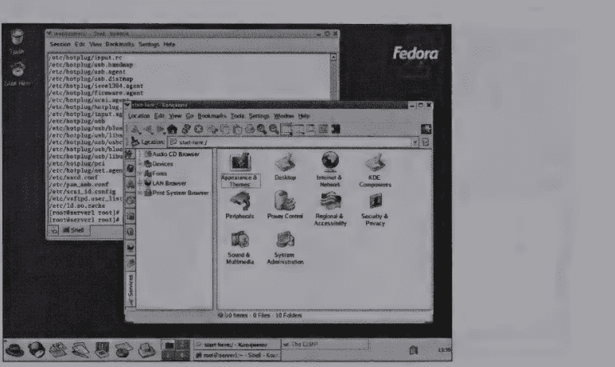

图 9-12 KDE 桌面

Qt 工具包是由挪威的一名为 Trolltech 的公司创建的，遗憾的是，直到 1998 年才作为开源软件发布。在 20 世纪 90 年代中期，大多数开源开发者倾向于使用 C 语言语言而不是 C++。他们也不喜欢 Qt 工具包源代码在当时无法自由修改。因此，GNOME 桌面环境于 1997 年创建。GNOME 通常使用 Metacity 窗口管理器和用于 C 语言的 GTK+ 工具包。GTK+ 工具包最初为 GNU 图像处理程序（GIMP）开发，与 GIMP 一样也是开源的。红帽 Linux 中的 GNOME 桌面见图 9-13。

> 注意
要了解更多关于 GNOME 桌面，你可以访问互联网
http://www.gnome.org。

虽然没有 GNOME 和 KDE 常见，但 Xfce 桌面环境（图 9-14）是另一个用于许多 Linux 系统的桌面环境。Xfce 带有一小套易用的工具，消耗的硬件资源比 KDE 或 GNOME 少。因此，Xfce 通常运行在硬件资源不多的 Linux 服务器上。

> 注意
要了解更多关于 Xfce 桌面，你可以访问互联网
http://www.xfce.org。

# 408 第 9 章系统初始化与 X Windows

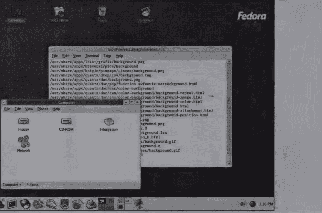

图 9-13 GNOME 桌面 

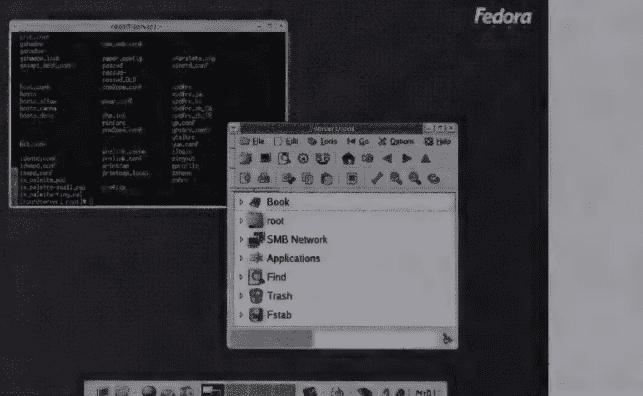

图 9-14 Xfce 桌面 

尽管桌面环境在今天的 Linux 中随处可见，但你可以选择只使用窗口管理器。Linux 有许多不同的窗口管理器，例如图 9-15 所示的窗口管理器。表 9-4 列出了其他一些窗口管理器。

# X Windows 系统 409

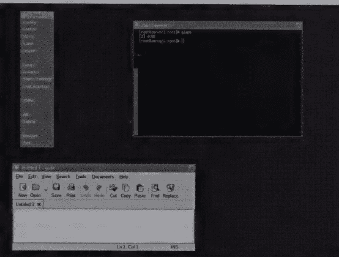

图 9-15 窗口管理器 

表 9-4 常见窗口管理器
| 窗口管理器 | 描述 |
|---|---|
| enlightenment | 一种高度可配置的窗口管理器，允许多个桌面。通常由 GNOME 使用。 |
| fwm | 旨在使用较少内存的窗口管理器 |
| kwin | 用于 KDE 桌面的窗口管理器。 |
| metacity | 用于红帽 Fedora Core 2 的窗口管理器。允许用户自定义主题。 |
| mwm | Motif 窗口管理器。用于桌面。 |
| sawfish | 常用于 GNOME 桌面的窗口管理器。允许通过脚本配置大部分设置。 |
| twm | 窗口管理器。它是最古老、最基础的之一。 |
| wmaker | window 窗口管理器。提供拖放鼠标移动并模仿苹果的 NeSTEP 操作系统界面。 |

窗口管理器和桌面环境并不是命令行界面的替代品。因此，几十种终端程序在窗口管理器或桌面环境中提供了命令行界面。这些终端程序通常使用 termcap 数据库 (`/etc/termcap`) 或 terminfo 数据库 (`/usr/share/terminfo/`) 的设置进行配置。GNOME 和 KDE 桌面默认终端包含执行管理和用户任务所需的功能；但窗口管理器（图 9-15）中之前所示的其他终端可能需要特殊配置才能正确显示文本。

> 注意

### 启动和停止 X Windows

必须存在某种启动 X Windows、窗口管理器和桌面环境（如果使用了）的方法。回顾本章前面的，运行级别 5 会启动 GNOME 显示管理器 `gdm` 以显示图 9-16 所示的图形化登录界面。


图 9-16 GNOME 允许用户选择桌面环境或窗口管理器

此登录界面允许用户在登录系统并启动 X Windows 之前，从会话菜单选择使用的桌面环境或窗口管理器。

你可以通过导航 GNOME 或 KDE 桌面中的系统设置、登录屏幕，或者通过编辑 `/etc/X11/gdm/gdm.conf` 文件来配置 `gdm` 的外观和行为。

> 注意

# X Windows 系统 411

`gdm` 是 X 显示器管理器 `xdm` 的变体，它为用户显示基本的图形登录界面。此外，其他 Linux 发行版可能会使用 KDE 显示器管理器 `kdm` 为用户显示 KDE 风格的图形登录界面。

然而，如果你运行的是运行级别 3 而不是运行级别 5，你可以在字符终端输入 `gdm` 手动启动 GNOME 显示器管理器，或者使用 `startx` 命令启动 XWindows 以及在主目录下的 `.Xclients` 文件中指定的窗口管理器或桌面环境。如果此文件不存在，默认将启动 GNOME 桌面环境。如果此文件存在，它通常指向你主目录下的 `.Xclients-default` 文件，如下所示：

```bash


[root@localhost root]# cat `.Xclients`

#!/bin/bash

# Created by Red Hat Desktop Switcher

```bash
if [ -e "$HOME/.Xclients-$HOSTNAME$DISPLAY" ]; then
    exec $HOME/.Xclients-default
else
    exec $HOME/.Xclients-default
fi
```
[root@localhost root]# cat `.Xclients-default`
# Created by Red Hat Desktop Switcher
exec gnome-session
[root@localhost root]# _

从前面的输出可以注意到，`.Xclients-default` 文件包含一行执行 `gnome-session` 命令的代码，该命令反过来会在 X Windows 之上启动 Metacity 窗口管理器和 GNOME 桌面。同样，要在 X Windows 上启动其他桌面或窗口管理器，你可以编辑 `.Xclients-default` 文件并将 `gnome-session` 更改为 `startkde`（启动 KDE 桌面）、（启动 xfce4 桌面）或 `/usr/X11/bin/wm`（启动 Tab 窗口管理器）。

`.Xclients-default` 文件中使用的设置也可以通过 GNOME 或 KDE 桌面环境中的图形桌面切换工具进行设置；只需导航到 Red Hat 按钮、偏好、更多偏好、桌面切换工具即可。该工具的示例如图 9-17 所示。

# 第 9 章 系统初始化与 X Windows

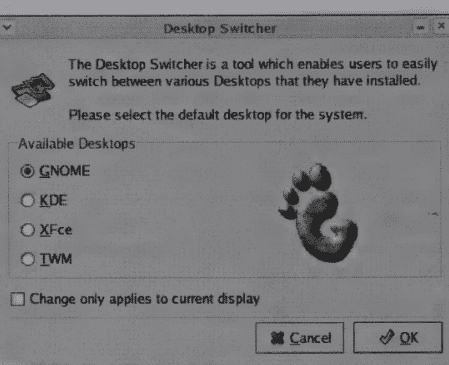

**图 9-17** 桌面切换工具

## 配置 X Windows

X Windows 是与计算机视频硬件接口的 GUI 组件。为了让 X Windows 发挥作用，它需要关于键盘、鼠标、显示器和视频适配卡的信息。某些 X Windows 配置工具要求你指定这些组件的具体硬件信息，而其他工具在未检测到所有组件时会自动检测。因此，在配置 X Windows 之前，你应该收集这些设备的所有硬件信息。对于键盘和鼠标，你应该注意类型和型号。对于视频适配卡，X Windows 可能需要以下信息：

- 视频适配卡型号
- 视频适配卡上的 RAM 容量
- 视频适配卡上的芯片组（这可能与型号相同）

X Windows 可能需要关于连接到视频适配卡上的显示器的以下信息：

- 支持的最大分辨率
- 水平同步 `hync` 范围
- 垂直同步 `vsync` 范围

如果你的系统使用 X.org 实现的 X Windows，键盘、显示器和视频适配卡的信息以文本格式存储在 `/etc/X11/xorg.conf` 文件中。如果你的系统使用 XFree86 实现的 X Windows，这些信息则存储在 `/etc/X11/XF86Config` 文件中。你可以手动编辑这些文件，或使用程序间接编辑它们。

如果你计划手动编辑 X Windows 配置文件，请确保先阅读其相关的手册或 info 页面。对于 Red Hat Fedora Core 2，确保你阅读了 `xorg.conf` 手册。

由于 `/etc/X11/xorg.conf` 或 `/etc/X11/XF86Config` 文件中的一个错误都可能导致 GUI 无法运行，因此使用配置程序编辑这些文件是一个良好的习惯。

在 Red Hat Fedora Linux 中配置鼠标，你可以在 GUI 或终端环境中使用 `mouseconfig` 或 `system-config-mouse` 命令。在终端环境中，这些命令将显示与图 9-18 所示类似的屏幕。

```
mouseconfig © 2002 Red Hat, Inc.
Mouse Selection
为系统选择[合适的]鼠标：
ASCII
- Wheel (serial)
Generic - 2 Button Mouse (USB)
Generic - 2 Button Mouse (serial)
Generic - 3 Button Mouse (PS/2)
Generic - 3 Button Mouse (USB)
Generic - 3 Button Mouse (serial)
Generic - Wheel Mouse (PS/2)

[*] Emulate 3 Buttons?
```

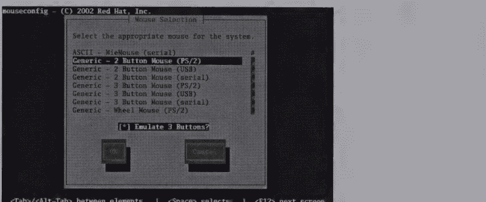

图 9-18 使用 `mouseconfig` 配置鼠标

从图 9-18 的菜单中选择鼠标类型后，必须重启 X Windows 更改才能生效。要重启 XWindows，你只需退出 X Windows 并通过登录 `gdm` 或在命令提示符输入 `startx` 来重启它。另一种退出 X Windows 的方法是使用 `Ctrl+Alt+Backspace` 键组合。

同样，要配置键盘，可以使用 `system-config-keyboard`。在 GUI 或终端环境中，此命令将显示与图 9-19 所示类似的屏幕。

如果你的系统使用 X.org 实现的 X Windows，键盘、显示器和视频适配卡的信息存储在 `/etc/X11/xorg.conf` 文件中。如果你的系统使用 XFree86 实现的 X Windows，这些信息则存储在 `/etc/X11/XF86Config` 文件中。你可以手动编辑这些文件，或使用程序间接编辑它们。

如果你计划手动编辑 X Windows 配置文件，请确保先阅读其相关的手册或 info 页面。对于 Red Hat Fedora Core 2，确保你阅读了 `xorg.conf` 手册。

由于 `/etc/X11/xorg.conf` 或 `/etc/X11/XF86Config` 文件中的一个错误都可能导致 GUI 无法运行，因此使用配置程序编辑这些文件是一个良好的习惯。

在从图 9-18 的菜单中选择鼠标类型后，必须重启 X Windows 更改才能生效。要重启 XWindows，你只需退出 X Windows 并通过登录 `gdm` 或在命令提示符输入 `startx` 来重启它。另一种退出 X Windows 的方法是 `Ctrl+Alt+Backspace` 键组合。

同样，要配置键盘，可以使用 `system-config-keyboard`。在 GUI 或终端环境中，此命令将显示与图 9-19 所示类似的屏幕。

如果你的系统使用 X.org 实现的 X Windows，键盘、显示器和视频适配卡的信息存储在 `/etc/X11/xorg.conf` 文件中。如果你的系统使用 XFree86 实现的 X Windows，这些信息则存储在 `/etc/X11/XF86Config` 文件中。你可以手动编辑这些文件，或使用程序间接编辑它们。

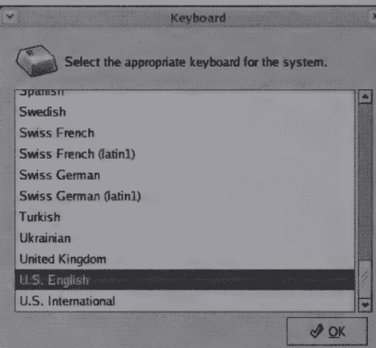

图 9-19 使用 `system-config-keyboard` 配置键盘

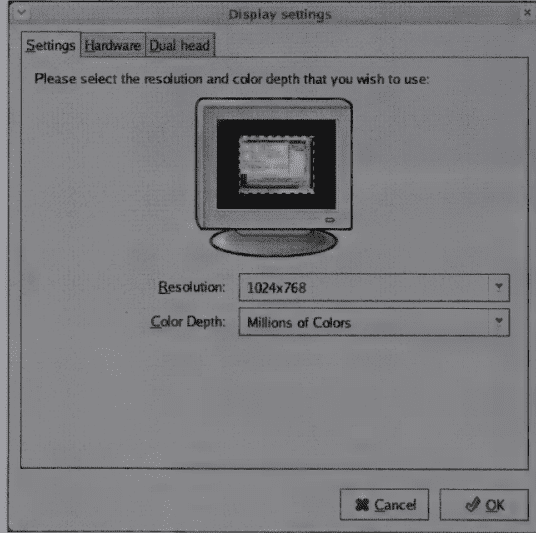

图 9-20 使用显示设置配置分辨率和色彩深度

或者，你可以通过 GNOME 或 KDE 桌面环境导航到 Red Hat 按钮、偏好、更多偏好、显示设置来启动图 9-20 所示的配置工具。虽然视频卡和显示器是自动检测的，但你可以点击配置工具的 Hardware 选项卡更改这些设置，如图 9-21 所示。此外，如果你有两个视频适配卡和两个显示器，可以通过点击 Dual head 选项卡将它们配置为单一大显示，如图 9-22 所示。


**图 9-21** 使用 `system-config-display` 配置视频卡和显示器

在配置工具中点击 OK 后，之前的 `/etc/X11/xorg.conf` 文件将保存为 `/etc/X11/xorg.conf.backup`，新设置将写入 `/etc/X11/xorg.conf`。你必须重启 X Windows 更改才能生效。

在配置 X Windows 后，你可以在 X Windows 启动可以使用 `xvtune` 工具微调视频卡的 `hsync` 和 `vsync`。只需在 GUI 中打开一个 BASH shell 并输入 `xvtune` 启动该工具，如图 9-23 所示。

虽然大多数显示器现在支持很宽的 `hsync` 和 `vsync` 值，但其中任何一个值过高都可能损坏显示器。此外，如果 `hsync` 或 `vsync` 值过低，可能会随着时间推移导致头痛，因为人类眼睛可以看到较低的刷新率。


**图 9-22** 使用 `system-config-display` 配置多个显示器


**图 9-23** `xvtune` 工具

## 第 417 章总结

表 9-5 常见的 X Windows 配置实用工具

| 命令 | 说明 |
|--- | --- |
| `Xorg -configure` | 当由 `root` 用户运行时，系统会自动检测硬件信息并将其写入名为 `/root/xorg.conf` 的 Xorg 配置文件。你必须将此文件复制到 `/etc/X11` 目录并将其重命名为 `xorg.conf` 才能使用。 |
| `XFree86 -configure` | 当由 `root` 用户运行时，系统会自动检测硬件信息并将其写入名为 `/root/XFree86Config.conf` 的 XFree86 配置文件。你必须将此文件复制到 `/etc/X11` 目录并将其重命名为 `XFree86Config` 才能使用。 |
| `XFB86Setup` | 旧版本 XFree86 包含的基于文本的 XFree86 配置实用工具 |
| `xf86config` | 包含在 XFree86 版本 4 中的基于文本的 XFree86 配置实用工具 |
| `xorgconfig xfcfg` | 基于文本的 Xorg 配置实用工具。包含在 XFree86 版本 4 中的图形化 XFree86 配置实用工具 |
| `xorgcfg` | 基于文本的 Xorg 配置实用工具。 |

## 章末总结

- 引导加载程序通常由系统 BIOS 从 MBR（主引导记录）或硬盘活动分区的第一个扇加载。
- 引导加载程序负责加载 Linux 内核。
- LILO 引导加载程序使用 `/etc/lilo.conf` 配置文件，而 GRUB 引导加载程序使用 `/boot/grub/grub.conf` 配置文件。
- 你可以使用 LILO 或 GRUB 引导加载程序实现 Linux 和 Windows 操作系统的双启动。或者，可以使用 Windows NTLOADER 引导加载程序实现相同。
- FIPS 工具可拆分 FAT 或 FAT32 分区以创建足够的安装空间。
- 使用五个标准运行级别（runlevels）根据内存中加载的守护进程数量和类型对 Linux 系统进行分类。
- `init` 守护进程通过其配置文件 `/etc/initab` 负责加载和卸载守护进程。
- 守护进程通常存储在 `/etc/rc.d/init.d` 目录，并在系统启动时从 `/etc/rc.d/*` 目录中的项目加载。
- Linux GUI 具有多个可更换的组件，包括 X 服务器、X 客户端、窗口管理器（Window Manager）以及可选的桌面环境。
- X Windows 是 Linux GUI 的核心组件，用于在终端屏幕上绘制图形。它有两种开源实现方式：X.org 和 XFree86。

# 第 9 章 系统初始化与 X Windows

你可以在命令行提示符处输入 `startx` 从运行级别 3 启动 Linux GUI，或者从运行级别 5 使用 `gdm`。

配置 X Windows 需要对计算机使用的视频硬件有深入了解。可以使用 `system-config-mouse`、`mouseconfig`、`system-config-keyboard`、`system-config-display` 和 `xvidtune` 工具来配置 X Windows 使用的硬件设置。

## 关键术语

- `/boot` — 包含内核和启动相关文件的目录。
- `/boot/grub/grub.conf` — GRUB 配置文件。
- `/etc/inittab` — `init` 守护进程的配置文件。
- `/etc/lilo.conf` — LILO 配置文件。
- `/etc/rc.d/init.d` — 大多数守护进程所在的目录。
- `/etc/rc.d/rc.*` — 用于在每个运行级别启动和杀死守护进程的目录。
- `/etc/rc.d/rc.sysinit` — 系统启动期间执行的第一个脚本。
- `/etc/X11/XF86Config` — XFree86 实现 X Windows 的配置文件。
- `/etc/X11/xorg.conf` — X.org 实现 X Windows 的配置文件。
- `active partition`（活动分区）— MBR 之后搜索操作系统的分区。
- `boot loader`（引导加载程序）— 用于加载操作系统的程序。
- `boot.ini` — 用于配置 NTLOADER 的文件。
- `chipset`（芯片组）— 外围组件如视频适配器卡上的常用电脑芯片。
- `daemon`（守护进程）— 提供服务的 Linux 系统进程。
- `desktop environment`（桌面环境）— 与窗口管理器配合提供使用标准程序和开发工具的标准 GUI 环境的软件。
- `Desktop Switching Tool`（桌面切换工具）— 允许 Red Hat Linux 用户设置默认桌面环境或窗口管理器的图形化工具。
- `dual boot`（双启动）— 在计算机硬盘上存在两个或多个操作系统的配置；引导加载程序允许用户在启动时选择加载哪种操作系统。
- `ELILO` — 用于支持 Intel 扩展固件接口 (EFI) 技术的计算机的引导加载程序。
- `Extended Multiuser Mode`（扩展多用户模式）— 也称为运行级别 3；提供大多数守护进程和全套网络守护进程的模式。
- `First nondestructive Interactive Partition Splitter (FIPS)`（第一个无破坏交互式分区拆分器）— 在现有 FAT16 或 FAT32 分区的空闲空间上创建新分区的程序。
- `GNOME Display Manager (gdm)` — 一一个提供图形化登录屏幕的图形化登录程序。

## 关键术语 419

`GNU Image Manipulation Program (GIMP)` — 一个使用 `GTK+` 工具包的开源图形处理程序。

`GNU Object Model Environment (GNOME)` — Red Hat Fedora Linux 的默认桌面环境；创建于 1997 年。

`Grand Unified Bootloader (GRUB)` — Linux 系统上常用的引导加载程序。`grub-install` 命令 — 用于安装的命令。

`grub-mkconfig` — 用于生成配置的命令。

`GRUB` — Linux 系统上常用的引导加载程序。

`grub-install` — 用于安装的命令。

`grub-mkconfig` — 用于生成配置的命令。

`grub.conf` — 配置文件。

`GNU Image Manipulation Program (GIMP)` — 一个使用 `GTK+` 工具包的开源图形处理程序。

`GNU Project` — 创建软件的项目。

`daemon` — 提供服务的 Linux 系统进程。

`init` — 使用配置文件 `/etc/initab` 加载和卸载守护进程。

`inittab` — `init` 守护进程的配置文件。

`init` — 程序。

`GTK+` — 用于软件的工具包。

`GNOME` — Red Hat Fedora Linux 的默认桌面环境；创建于 1997 年。

`init` — 可用于双启动 Linux 和 Windows 操作系统的引导加载程序。

`runlevel`（运行级别）— 根据内存中加载的守护进程数量和类型对 Linux 系统进行分类。

`runlevel command` — 用于显示当前和最近运行级别的命令。

`Single User Mode`（单用户模式）— 也称为运行级别 1；提供单个终端和有限服务的模式。

`system-config-display` — 用于配置 X Windows 使用的视频适配器和显示器。

`system-config-keyboard` — 用于配置 X Windows 使用的键盘。

`system-config-mouse` — 查看 `mouseconfig`。

`Tab Window Manager (twm)` — Linux 系统上使用的最老的窗口管理器之一。

`telinit command` — `init` 命令的别名。

`vmlinuz-kernel` — Linux 内核文件。

`Window Manager`（窗口管理器）— 负责屏幕上绘制窗口外观的 GUI 组件。

`X Windows` — Linux GUI 的核心组件，用于在终端屏幕上绘制图形。

`X Display Manager` — 图形化登录屏幕。

`Xfe` — 常见用于 Linux 的桌面环境。

`Xfe desktop environment` — 常见用于 Linux 系统的桌面环境。

`X.org` — 一种开源实现。

`Xfe` — 常见用于 Linux 的桌面环境。

`Xfe desktop environment` — 常见用于 Linux 系统的桌面环境。

`Free86` — X Windows 的一种常见实现。


X.org — X Windows 的一种常见实现。

X server — 在终端屏幕的窗口上绘制图形的 X 组件。

X client — 请求 X 服务器绘制图形并在终端屏幕上显示的 X 组件。

X Display Manager (`xdm`) — 一个提供图形化登录屏幕的图形化登录程序。

Xfe desktop environment — 常见用于 Linux 系统的桌面环境。

`xvidtune` — 用于微调 X Windows 使用的视频卡 vsync 和 hsync 设置的程序。

## 复习题 421

- 2. 下列哪个陈述正确？

  a. GRUB 在修改后需要重新安装。

  b. LILO 在修改后不需要重新安装。

  c. GRUB 指向 LILO。

  d. GRUB 在修改后不需要重新安装。

- 3. 如果 GRUB 设置了密码保护，在图形化 GRUB 界面时你必须输入什么来进入密码？

  a. pass

  b. pwd

  c. passwd

  d. p

- 4. 哪个运行级别（runlevel）会停止系统？

  a. 1

  b. 6

  c. 0

  d. 5

- 5. `init` 在启动时引用哪个文件来确定为指定的运行级别配置什么内容？

  a. `/etc/initstate`

  b. `/inittab`

  c. `/etc/init`

  d. `/etc/initt`

- 6. 在命令行提示符处输入哪两个命令可以启动 X Windows、窗口管理器和默认桌面环境？（选择两个答案）。

  a. startgui

  b. gdm

  c. startx

  d. winstart

- 7. 下列哪个陈述正确？

  a. 引导加载程序指向主引导记录（MBR）。

  b. MBR 或活动分区都可以包含引导加载程序。

  c. MBR 和活动分区都指向引导加载程序。

  d. 引导加载程序指向活动分区。

# 第 9 章 系统初始化与 X Windows

- 8. 使用哪个命令在 LILO 配置被更改后重新安装 LILO？

  a. `lilo`

  b. refresh

  c. set lilo

  d. reset lilo

- 9. LILO 配置文件中哪个关键字指定了 Linux 内核的绝对路径？

  a. default

  b. prompt

  c. root

  d. image

- 10. 为了让双系统启动尽可能简单，Linux 应该是第二个安装的操作系统。对还是错？

- 11. 每个硬盘驱动器上可以有多少多少个活动分区？

  a. 4

  b. 16

  c. 1

  d. 2

- 12. 下列哪项向 GRUB 表示第三块硬盘驱动上的第二个分区？

  a. `(hd3,2)`

  b. `(hd4,3)`

  c. `(hd2,3)`

  d. `(hd2,1)`

- 13. Linux 中常用的哪两种 XWindows 实现是？（选择两个答案）。

  a. X.Org

  b. XFce

  c. Xconfigurator

  d. XFree86

- 14. 包含运行级别 2 配置信息的目录名称是什么？

  a. `/etc/rc.d/rc2,d`

  b. `/rc.d/rc2,d`

  c. `/etc/rc.d/l2,d`

  d. `/etc/initab/rc2/d`

- 15. Linux 内核存储在哪个目录中？

  a. `/boot`

  b. `/root`

  c. `/bin`

  d. `/`

- 16. 如果用户进入单用户模式（Single User Mode），她会自动以什么身份登录？

  a. 她提供的用户名

  b. `/root`

  c. admin

  d. 单用户模式下没有可用用户

- 17. Linux 系统上生成的第一个进程是 __________

  a. initiate

  b. initab

  c. init

  d. linux

- 18. 哪个工具可以配置 Red Hat Fedora Core 2 中 X-Windows 使用的显卡和显示器？

  a. X.config

  b. `system-config-display`

  c. xconfig

  d. xvidtune

- 19. 哪个命令会导致系统进入单用户模式？

  a. `init 0`

  b. `init 1`

  c. `init 6`

  d. `initstate 5`

- 20. GRUB 配置文件的超时值以什么单位测量？

  a. 秒

  b. 1/10 分钟

  c. 1/10 秒

  d. 1/100 秒

# 第 9 章 系统初始化与 X Windows

## 实践项目

这些项目应按照给出的顺序完成。本章介绍的实操项目总共需要三小时完成。该实验的要求包括：

- 一台按照实操项目 7-2 安装了 Red Hat Fedora Core 2 的计算机。

## 项目 9-1

在实实践项目中，你将安装并配置 LILO 引导加载程序。

- 1. 按 `Ctrl+Alt+F2` 切换到命令行终端 (`tty2`)，并使用用户名 `root` 和密码 `secret` 登录终端。

- 2. 在命令行提示符处，输入 `cp /etc/lilo.conf.anaconda /etc/lilo.conf` 并按回车，复制 Red Hat Linux 安装程序生成的示例 `lilo.conf` 文件。

- 3. 接下来输入 `cat /etc/lilo.conf` 并按回车查看配置文件的内容。将其中的关键字与表 9-1 进行比较。

- 4. 在命令行提示符处，输入 `lilo` 并按回车，使用 `/etc/lilo.conf` 中的信息在硬盘的 MBR 上安装 LILO 引导加载程序。输入 `reboot` 并按回车重启系统。

- 5. 当系统重启时，在 LILO `boot:` prompt 处按 `Tab` 键。显示了哪些操作系统标签？

- 6. 在 LILO `boot:` prompt 处，输入 `linux single` 并按回车将操作系统进入单用户模式。除了 `linux` 之外，你还可以在 LILO 启动界面输入哪些其他命令完成同样？

- 7. 系统到达单用户模式后，在命令行提示符处输入 `whoami` 并按回车。你以什么身份登录？你被要求登录单用户模式吗？

- 8. 在命令行提示符处，输入 `vi /etc/lilo.conf` 并按回车编辑配置文件。

- 9. 将 `timeout` 值从 50 改为 600。在默认操作系统启动之前你必须等待多久？

- 10. 打开新行显示 `image=/boot/mlinux-2.6.5-1`，并输入以下内容：

  `password = secret`

  此条目的的作用是什么？

- 11. 保存更改并退出 `vi` 编辑器。

- 12. 在命令行提示符处，输入 `lilo` 并按回车。为什么编辑 `/etc/lilo.conf` 文件后必须输入 `lilo` 命令？如果 `/etc/lilo.conf` 文件中有任何语法错误，此命令将无法工作。只需再次编辑 `/etc/lilo.conf` 文件修复任何语法错误并重新运行。

- 13. 输入 `reboot` 并按回车重启系统。当系统重启时，在 LILO `boot:` prompt 处按 `Tab` 键。显示了什么？在默认操作系统启动前需要等待多久？

- 14. 在 LILO `boot:` prompt 处输入 `linux` 并按回车。在密码提示处，为什么会提示密码？

- 15. 输入 `exit` 退出 shell。

## 项目 9-2

在实实践项目中，你将安装并配置 GRUB 引导加载程序。

- 1. 按 `Ctrl+Alt+F2` 切换到命令行终端 (`tty2`)，并使用用户名 `root` 和密码 `secret` 登录终端。

- 2. 在命令行提示符处，输入 `cat /boot/grub.cfg` 并按回车查看 `/boot/grub.cfg`。你能看出引导程序安装在哪里了吗？

- 3. 在命令行提示符处，输入 `vi /boot/grub.cfg`。将 `timeout` 值从 10 改为 100。保存并退出。在操作系统启动之前你需要等待多久？

- 4. 在命令行提示符处，输入 `grub-install /dev/sda` 并按回车。如果你再次编辑 `/boot/grub.cfg` 文件，需要重新运行 `grub-install` 命令吗？为什么？

- 5. 输入 `reboot` 并按回车重启系统。当系统重启时，观察图形化 GRUB 界面。在此界面按 `p` 编辑配置。你认识这些条目吗？

- 6. 在 GRUB 界面按 `c` 进入 `grub>` 提示符。

- 7. 在 `grub>` 提示符处，输入 `help` 并按回车查看 `grub>` 提示符处可以使用命令列表。

- 8. 在 `grub>` 提示符处，输入 `displaymem` 并按回车。GRUB 正确识别了内存吗？

# 第 9 章 系统初始化与 X Windows

- 8. 在 `grub>` 提示符处，输入 `cat /boot/grub.cfg` 并按回车查看 `/boot/grub.cfg` 文件。

- 9. 在 `grub>` 提示符处，输入 `initrd` 行并按回车。这将内核加载到内存。

- 10. 在 `grub>` 提示符处，输入步骤 8 中的 `initrd` 行并按回车。这将初始化磁盘映像加载到内存。

- 11. 在 `grub>` 提示符处，输入 `boot` 并按回车使用之前加载到内存内核和初始化磁盘映像继续启动。让系统正常启动。


## 12. 系统成功加载后，按 `Ctrl+Alt+F2` 切换到命令行终端 (`tty2`)，并使用用户名 `root` 和密码 `secret` 登录终端。

## 13. 在命令行提示符处，输入 `grub-md5-crypt` 并按回车。提示时输入 `secret` 并按回车。再次提示密码时重复密码并按回车。记录返回的加密密码以备后用。

## 14. 在命令行提示符处，输入 `vi /boot/grub.cfg` 并按回车编辑 GRUB 配置。在 `vi` 编辑器中，将光标移动到显示 `splashimage=(hd0,0)/boot/grub/splash.xpm.gz` 的行。

## 15. 接下来按 `o` 在插入模式下打开 `splashimage` 行，并输入以下内容（`<encrypted password>` 为你在步骤13中记录的加密密码）：

`password --md5 <encrypted password>`

## 16. 保存更改并退出 `vi` 编辑器。

## 17. 输入 `reboot` 并按回车重启系统。当系统重启时，观察图形化 GRUB 界面。在此界面按 `p` 编辑配置。输入密码 `secret` 并按回车。你认识显示的界面吗？

# 项目 9-3

在实实践项目中，探索运行级别以及用于在启动时之后更改运行级别的 `/etc/initstab` 文件。

### 1. 按 `Ctrl+Alt+F2` 切换到命令行终端 (`tty2`)，并使用用户名 `root` 和密码 `secret` 登录终端。

### 2. 在命令行提示符处，输入 `runlevel` 并按回车。你当前的运行级别是多少？这是在安装期间选择的吗？如果是，是什么时候？最近的运行级别是多少？

### 3. 在命令提示符下，输入 `less /etc/inittab` 并按回车。该文件中的哪一行决定了启动时的默认运行级别（runlevel）？这可以更改吗？按 `q` 退出。

### 4. 在命令提示符下，输入 `init 2` 并按回车。你的终端屏幕上显示了什么？是否有守护进程（daemon）启动？是否有守护进程停止？为什么要求你登录？为什么？

### 5. 使用用户名 `root` 和密码 `secret` 登录到当前终端。接下来，在命令提示符下输入 `runlevel` 并按回车。你当前的运行级别是什么？最近的运行级别是什么？

### 6. 在命令提示符下，输入 `init 1` 并按回车。你的终端屏幕上显示了什么？是否有守护进程启动？是否有守护进程停止？为什么要求你登录？为什么？

### 7. 接下来，在命令提示符下输入 `runlevel` 并按回车。你当前的运行级别是什么？最近的运行级别是什么？

### 8. 在命令提示符下，输入 `init 5` 并按回车。你的终端屏幕上显示了什么？是否有守护进程启动？是否有守护进程停止？为什么切换到运行级别 5 后显示了这些内容？

### 9. 按 `Ctrl+Alt+F2` 切换到命令行终端 (`tty2`)，并使用用户名 `root` 和密码 `secret` 登录终端。

### 10. 接下来，在命令提示符下输入 `runlevel` 并按回车。你当前的运行级别是什么？最近的运行级别是什么？

### 11. 在命令提示符下，输入 `less /etc/inittab` 并按回车。解释在步骤 4、6 和 8 期间，`init` 守护进程读取了该文件中的哪些行。

### 12. 输入 `exit` 并按回车退出你的外壳程序（shell）。

# 项目 9-4

在这个实操项目中，你将检查系统运行级别目录以及系统设置时的一个伪造（fake）守护进程。

### 1. 按 `Ctrl+Alt+F2` 切换到命令行终端 (`tty2`)，并使用用户名 `root` 和密码 `secret` 登录终端。

### 2. 在命令提示符下，输入 `ls /etc/rc.d` 并按回车。列出了哪些目录？每个目录内包含什么？

### 3. 在命令提示符下，输入 `ls -F /etc/rc.0.d` 并按回车。列出了什么类型的文件？`init` 守护进程会按什么顺序执行这些文件？与 S 开头的文件相比，以 K 开头的有多少个？为什么？

### 4. 在命令提示符下，输入 `ls -F /etc/rc.5.d` 并按回车。列出了什么类型的文件？与 S 开头的文件相比，以 K 开头的有多少个？为什么？


### 5. 在命令提示符下，输入 `ls -F /etc/rc.d/init.d` 并按回车。列出了什么类型的文件？执行此目录下的文件会发生什么？

### 6. 在命令提示符下，输入 `/etc/rc.d/init.d/atd stop` 并按回车。发生了什么？

### 7. 在命令提示符下，输入 `/etc/rc.d/init.d/atd start` 并按回车。发生了什么？

### 8. 在命令提示符下，输入 `/etc/rc.d/init.d/atd restart` 并按回车。发生了什么？

### 9. 在命令提示符下，输入 `vi /etc/rc.d/init.d/sample` 并按回车，在 `/etc/rc.d/init.d` 目录下创建一个伪造的守护进程。

### 10. 在 `vi` 编辑器中输入以下信息。完成后，保存更改并退出 `vi` 编辑器。（注意：变量 `$1` 指在命令行命令行执行 shell 脚本时提供的第一个参数。）

```
#/bin/bash
if [ $1 = "start" ]
then
    echo "The sample daemon has started"
    sleep 2
elif [ $1 = "stop" ]
then
    echo "The sample daemon has been stopped"
    sleep 2
elif [ $1 = "restart" ]
then
    echo "The sample daemon has been restarted"
    sleep 2
fi
```

### 11. 在命令提示符下，输入 `ls -l /etc/rc.d/init.d/sample` 并按回车。文件的权限是什么？

### 12. 在命令提示符下，输入 `chmod 755 /etc/rc.d/init.d/sample` 并按回车，允许示例文件执行。

### 13. 在命令提示符下，输入 `ln -s /etc/rc.d/init.d/sample /etc/rc.d/rc50sample` 并按回车。这个命令的作用是什么？系统启动时会发生什么？

### 14. 在命令提示符下，输入 `reboot` 并按回车重启系统。当图形化启动屏幕出现时，点击“显示详情”。密切关注启动的守护进程列表。示例守护进程启动了吗？为什么？允许系统正常启动。

### 15. 当系统成功启动后，按 `Ctrl+Alt+F2` 切换到命令行终端 (`try2`)，并使用用户名 `root` 和密码 `secret` 登录终端。

# 实操项目 429

### 16. 在命令提示符下，输入 `/etc/rc.d/init.d/sample stop` 并按回车。发生了什么？

### 17. 在命令提示符下，输入 `/etc/rc.d/init.d/sample start` 并按回车。发生了什么？

### 18. 在命令提示符下，输入 `/etc/rc.d/init.d/sample restart` 并按回车。发生了什么？

### 19. 输入 `exit` 并按回车退出你的外壳程序。


# 项目 9-5

在这个实操项目中，你将检查 X Windows 配置工具并切换桌面环境。

### 1. 按 `Ctrl+Alt+F2` 切换到命令行终端 (`tty2`)，并使用用户名 `root` 和密码 `secret` 登录终端。

### 2. 在命令提示符下，输入 `less /etc/X11/xorg.conf` 并按回车。查看关于键盘、鼠标、显卡和显示器的信息，完成后按 `q` 退出。

### 3. 在命令提示符下，输入 `init 3` 并按回车。使用用户名 `root` 和密码 `secret` 登录终端。

### 4. 在命令提示符下，输入 `Xorg-configure` 并按回车。在家目录下创建一个 `xorg.conf.new` 文件。

### 5. 点击红色按钮，选择 Xce 然后点击 OK。该工具编辑哪个文件？

### 6. 在命令提示符下，输入 `system-config-keyboard` 并按回车。查看可用选项，完成后选择退出。将其复制到哪里？

### 7. 在命令提示符下，输入 `system-config-mouse` 并按回车。查看可用选项，完成后选择退出。将其复制到哪里？

### 8. 在命令提示符下，输入 `system-config-display` 并按回车。对比分辨率和色彩深度与步骤 2 中的差异。

### 9. 在命令提示符下，输入 `start` 并按回车。启动了哪个桌面环境？

### 10. 点击 Preferences 选项卡。

### 11. 选择 Fce 然后点击。

### 12. 按 `Ctrl+Alt+Backspace` 退出 X Windows。


## 430 第9章 系统初始化与 X Windows

- 13. 在命令提示符下，输入 `cat .Xclients-default` 并按回车。哪一项用于启动 Xce 桌面环境？

- 14. 在命令提示符下，输入 `start` 并按回车。启动了哪个桌面环境？按 `Ctrl+Alt+Backspace` 退出 X Windows。

- 15. 在命令提示符下，输入 `rm -f .Xclients*` 并按回车。

- 16. 在命令提示符下，输入 `start` 并按回车。启动了哪个桌面环境？按 `Ctrl+Alt+Backspace` 退出 X Windows。

- 17. 输入 `unit5`

- 18. 输入 `exit` 并按回车退出你的外壳程序。

## 发现练习

- 1. 描述如果你编辑 `/etc/inittab` 文件并将 `id:5:initdefault` 改为 `id:6:initdefault` 会发生什么。

- 2. 你创建一个名为 `mydaemon` 的守护进程来执行数据库管理任务；但你希望它在级别5运行时仅在内存中。你应该将此守护进程放在哪个目录？应该创建哪些链接？使用什么命令可以让该守护进程自动启动和停止？

- 3. 如果你有功能浏览器和互联网访问，请研究 LILO 和 GRUB 之外的两种 Linux 启动加载器。它们使用什么配置文件？与 LILO 和 GRUB 相比，优缺点是什么？

- 4. 级别4通常在大多数 Linux 系统上未使用。哪个文件定义了这个运行级别？如果需要，如何启动级别4的守护进程？概述使用级别4的步骤；它应该加载级别3的所有守护进程，以及一些特殊的数据库守护进程。

- 5. 检查 `/etc/rc.d/rc.sysinit` shell 脚本。每个部分的作用是什么？为什么这个文件必须在运行 `/etc/rc.d/rc.*` 目录下的文件之前运行？

# 探索性练习题 431

- 7. 现有许多不同的程序可以用于调整分区大小或为双启动创建分区。通过书籍、网站或其他资源，找到并描述除 FIPS 之外的程序特性，该程序可以在不丢失其内容的情况下修改现有分区。

- 8. 使用互联网、书籍或其他资源，学习关于本章未讨论过的三个 Linux 窗口管理器或桌面环境的更多知识。对于每一个环境，描述它的常见用途以及与其它窗口管理器和桌面环境相比的优势。此外，列出每个环境是如何开发的。

# 第 10 章

## 管理 Linux 进程

完成本章后，你将能够：

- 对 Linux 系统上的不同类型进程进行分类
- 使用标准的 Linux 工具查看进程
- 阐述常用 kill 信号之间的区别
- 描述二进制程序和 shell 脚本是如何执行的
- 创建并操作后台进程
- 使用标准的 Linux 工具修改进程的优先级
- 使用 `at` 守护进程调度未来执行的命令
- 使用 `cron` 守护进程调度重复执行的命令

典型的 Linux 系统可以同时运行数千个进程，包括你在前面的章节中探索过的进程。在本章的第一部分，你将检查 Linux 系统上不同类型的进程，以及如何查看和终止它们。然后，你将发现进程在系统中是如何执行、在后台运行以及进行优先级排序的。最后，你将学习用于调度在未来执行命令的各种方法。

# Linux 进程

在本书之前的章节以及工作场所，“程序”`program` 和“进程”`process` 这两个术语一直互换使用，未来也将互换使用；然而，这两个术语之间存在明确但细微的区别。程序是硬盘上的一个可执行文件，当你执行它时就可以运行。进程指的是运行在内存中并由 CPU 处理的程序；换句话说，进程是正在运行中的程序。

如果你在登录终端时启动一个进程，该进程将在该终端中运行并标记为用户进程 `user process`。用户进程的示例包括 `ls`、`grep`、`find` 以及你在整本书中执行过的大多数其他命令。记住，不与终端关联的系统进程被称为守护进程 `daemon process`；这些进程通常在系统启动时启动，你也可以手动启动它们。大多数守护进程提供系统服务，如打印、调度和系统维护，以及网络服务器服务，如 Web 服务器、数据库服务器、文件服务器和打印服务器。

每个进程都有一个唯一的进程 ID `PID`，允许内核唯一地标识它。此外，每个进程都可以启动无限数量的其他进程，称为子进程 `child processes`。相反，每个进程必须由一个称为父进程 `parent process` 的现有进程启动。因此，每个进程都有父进程 ID `PPID`，用于标识启动它的进程。父进程和子进程之间的关系如图 10-1 所示。


图 10-1 父进程和子进程

> PID 并不一定按顺序分配给新进程；每个 PID 都是从 Linux 内核使用的进程表空条目中生成的。

记住，尽管每个进程可以拥有无限多个子进程，但它只能有一个父进程。

记住，Linux 内核启动的第一个进程是 `init` 守护进程，它的 PID 为 1，PPID 为 0（指向内核本身）。`init` 守护进程随后启动大多数其他守护进程，包括允许用户登录的进程。在你登录系统后，登录程序会启动一个 BASH shell。然后 BASH shell 解释用户命令并启动所有用户进程。因此，Linux 系统上的每个进程都可以通过检查一系列 PPID 追溯到 `init` 守护进程，如图 10-2 所示。


**图 10-2** 进程谱系

> `init` 守护进程通常被称为所有进程的“祖父”。

# 查看进程

虽然有几种 Linux 工具可以查看进程，但最通用且常用的是 **ps 命令**。在不带参数的情况下，`ps` 命令简单地显示在当前 shell 中运行的进程列表。在登录 `tty2` 时，此示例如下输出所示：

# 第 10 章 管理 Linux 进程

```
[root@server1 root]# ps
PID TTY TIME CMD
3232 tty2 00:00:00 bash
3271 tty2 00:00:00 ps
[root@server1 root]#
```

前面的输出显示在 `ps` 命令执行时，终端 `tty2` 中运行两个进程。启动每个进程的命令 `CMD` 列在它在 CPU 上花费的时间 `TIME`、其 PID 和终端 `TTY` 旁边。在这种情况下，进程运行时间不到一秒，因此经过的时间为零。要解 更多关于这些进程的信息，你可以使用 `ps` 命令的 `-f`（全显示）选项，如下所示：

```
[root@server1 root]# ps -f
UID PPID C STIME TTY TIME CMD
root 3232 2390 0 08:45 tty2 00:00:00 -bash
root 4414 3232 0 08:54 tty2 00:00:00 -f
[root@server1 root]#
```

此列表提供了关于每个进程的更多信息。它显示了启动进程的用户 `UID`、`PPID`、启动时间 `STIME` 以及 CPU 利用率 `C`，该利用率从零开始并在进程运行的每个周期递增。`ps -f` 命令提供的最有价值的信息是每个进程的 PPID 和谱系。bash 进程 `PID=3232` 显示 shell 提示符并解释输入；它启动了 ps 进程 `PID=4414`。因为守护进程不与终端关联，它们不会通过 `ps -f` 显示。要显示所有终端和守护进程的完整列表，可以使用 `-e` 选项，如前所示：

```
[root@server1 root]# ps -f
UID PPID C STIME TTY TIME CMD
root 3232 2390 0 08:45 tty2 00:00:00 -bash
root 4414 3232 0 08:54 tty2 00:00:00 -f
[root@server1 root]#
```

（修正：此处应为示例输出）

```
[root@server1 root]# ps
PID TTY TIME CMD
3232 tty2 00:00:00 bash
3271 tty2 00:00:00 ps
[root@server1 root]#
```

# 第10章 管理 Linux 进程

在 Linux 服务器上，`ps -ef` 命令的输出可能长达数百行，因此你通常将其输出管道到 `less` 命令，以逐页方式将输出发送到终端；或者管道到 `grep` 命令，后者用于显示仅包含某些信息的行。例如，要显示之前的输出中的 BASH shell，你可以使用以下命令：

```
[root@server1 #] ps -af | grep bash
root 3431 3192 0 14:29 tty/1 00:00:00 bash
root 3232 2390 0 14:30 tty2 00:00:00 -bash
root 3431 3194 0 14:44 tty2 00:00:00 grep bash
[root@server1 #]
```


注意，`grep` 命令也会与 BASH shell 一起显示，这是因为在执行 `ps` 命令时，它正运行于内存中。这并不总是如此，因为 Linux 内核会根据多种因素调度命令。

`-e` 和 `-f` 选项是 `ps` 命令中最常用的选项；然而还有许多其他可用选项。`ps` 命令的 `-l` 选项比 `-f` 选项提供了更多关于进程的信息。以下是使用该选项查看终端 tty 中进程的示例：

```
[root@server1 #] ps -l
 S UID PID PRID NI ADDR SZ WCHAN TTY TIME CMD
S 0 3232 3192 0 75 0 - 1238 wait4 tty2 00:00:00 bash
R 0 3438 3232 0 77 0 - 744 - tty2 00:00:00 ps
[root@server1 #]
```

进程标志（`F`）指示进程的特定特征；上述输出中的标志 `4` 表示 root 用户运行了该进程。进程状态（`S`）列对系统管理员来说最有价值；它指示了进程当前正在运行什么状态。如果进程当前没有在处理器上运行，你会在进程状态列中看到 `S`（睡眠）；进程在大多数时间里处于这种状态，如上述输出中的 `bash` 所示。如果进程当前正在运行，你会在列中看到 `R`；如果它已停止或正在被另一个进程跟踪，则会看到 `T`。除了这些，你还可能在该列中看到 `Z`，表示这是一个僵尸进程。当一个进程执行完毕时，父进程必须检查它是否执行成功并释放子进程的 PID 以供重新使用。当进程等待父进程释放 PID 时，该进程被认为处于僵尸状态，因为它已经完成执行但仍保留着 PID。在繁忙的 Linux 服务器上，僵尸进程可能会积累并阻止新进程的创建；如果发生这种情况，你可以简单地杀死僵尸进程的父进程，正如下一节讨论的那样。

> 僵尸进程被称为 defunct（已终止）。


# 查看进程 439

进程优先级（`PRI`）是内核用于进程的优先级；其范围在 0（高优先级）到 127（低优先级）之间。nice 值（`NI`）可以间接影响进程；其范围在 -20（更有可能是高优先级）到 19（更有可能是低优先级）之间。上述输出中的 `ADDR` 表示进程的内存地址，而 `WCHAN` 表示进程在睡眠时正在等待什么。此外，内存中的进程大小（`SZ`）也被列出并以千字节为单位；它大致相当于文件系统中可执行文件的大小。

`ps` 命令的某些选项不以连字符前缀；这些被称为伯克利风格（Berkeley style）选项。其中最常用的是 `a` 选项（列跨终端的所有进程）和 `x` 选项（列出不在终端上运行的进程），如下所示：

```
[root@server1 ~]# ps ax
PID TTY STAT TIME COMMAND
1 ? S 0:05 [init]
2 ? SWN 0:00 [ksoftird/0]
3 ? SW 0:00 [events/0]
4 ? SW 0:00 [kblockd/0]
6 ? SW 0:00 [khelper]
5 ? SW 0:00 [khubd]
7 ? SW 0:00 [pdfflush]
8 ? SW 0:00 [pdfflush]
10 ? SW 0:00 [aio/0]
9 ? SW 0:00 [kswapd0]
114 ? SW 0:00 [kseriod]
153 ? SW 0:00 [kjournal]
347 ? S< 0:00 udevd
1681 ? S 0:00 syslogd -m 0
1685 ? S 0:00 klogd -x
1706 ? S 0:00 portmap
1726 ? S 0:00 rpc.stat
1754 ? S 0:00 rpc.idmap
1798 ? S 0:00 events
1804 ? S 0:00 [/usr/sbin/sdd]
1811 ? SW< 0:00 [krcommd]
1870 ? S 0:00 [/usr/sbin/smartd]
1880 ? S 0:00 [/usr/sbin/acpid]
1915 ? S 0:00 cupsd
2110 ? S 0:00 [/usr/sbin/sshd]
2125 ? S 0:00 xinetd -alive -pidfile /var/run/xinetd.pid 0:01 /usr/bin/spamd -d -m
2190 ? S 0:00 gpm -dev/input/mice
2220 ? S 0:00 [/usr/sbin/htt]
2221 ? S 0:00 htt_server -n
2232 ? S 0:00 [/usr/sbin/cannaser -syslog
2245 ? S 0:00 cron
2257 ? S 0:00 /usr/bin/jserver
2293 ? S 0:01 xfs-dropp-daemon
2312 ? S 0:00 /usr/sbin/atd
2331 ? S 0:00 dbus-daemon --system
2347 ? S 0:00 mdadm --monitor
2389 ? tty1 S 0:00 /sbin/ming/tty1
2390 ? S 0:00 login --root
2393 ? tty3 S 0:00 /sbin/ming/tty3
2399 ? tty4 S 0:00 /sbin/ming/tty4
2407 ? tty5 S 0:00 /sbin/ming/tty5
2415 ? tty6 S 0:00 /sbin/ming/tty6
2423 ? S 0:00 /usr/bin/gdm-binary-daemon
2824 ? S 0:00 /usr/bin/gdm-binary-daemon
2839 ? S 1:21 /usr/X11/bin/X:audit 0 -auth /var/gdm.:Xauth
2901 ? S 0:00 gnome-session
2964 ? S 0:00 /usr/bin/ssh-agent -root/.Xclients
2978 ? S 0:03 /usr/libexec/gconfd-
2981 ? S 0:00 /usr/bin/gnome-keyring-daemon
2985 ? S 0:04 /usr/bin/metacity --sm-client-id
3140 ? S 0:04 gnome-panel --sm-client-id
3142 ? S 0:02 nautilus --no-default-window --sm-client-id
3144 ? S 0:00 magicdev --sm-client-id
3146 ? S 0:00 eggcups --sm-client-id
3148 ? S 0:00 pam-panel-icon --sm-client-id
3150 ? RN 0:06 /usr/bin/python /usr/bin/rhn-applet-gui
3151 ? S 0:00 /sbin/bin/pam_timestamp -d -root
3192 ? S 0:07 gnome-terminal
3193 ? S 0:00 gnome-pty-helper
3194 pts/1 S 0:00 bash
3232 tty2 S 0:00 -bash
3545 tty2 R 0:00 ps ax
[root@server1]#
```

上述列出的列与之前讨论的等效；然而，进程状态列标识为 `STAT`，并包含 `W` 表示进程不在内存中，`<` 符号表示高优先级进程，或 `N` 表示低优先级进程。

可以使用 `ps` 命令执行几十次来显示进程及其属性；本节列出的选项是最常用的，并总结在表 10-1 中。

# 查看进程 441

表 10-1 `ps` 命令的常用选项

| 选项 |  |

| --- | --- |

| `-e` | 显示所有在终端上运行的进程，以及不在终端上运行的进程（守护进程） |

| `-f` | 显示每个进程的完整信息列表，包括 UID、PID、PPID、CPU 利用率、启动时间、终端、处理器时间和命令名称 |

| `-` | 显示每个进程的详细信息列表，包括标志、状态、UID、PID、PPID、CPU 利用率、优先级、值、地址、大小、WCHAN、终端和命令名称 |

| `a` | 显示所有在终端上运行的进程 |

| `x` | 显示所有不在终端上运行的进程 |

## 第10章 管理 Linux 进程

Swap: 525160k 总计，0k 已用，525160k 空闲，80824 缓存

| PID USER PR NI VIRT RES SHR S %CPU MEM | TIME+ COMMAND |

|---|---|---|---|---|---|---|---|---|---|------|

| 3601 root | 15 | 0 | 3216 | 836 | 1620 | R | 3.9 | 0.3 | 00:00:02 | | | |


| 2839 root | 15 | 0 | 71928 | 24m | 50m | S | 0.2 | 9.7 | 01:50:14 | | | |
| 1 root | 16 | 0 | 2028 | 460 | 1316 | S | 0.0 | 0.2 | 00:05:45 | as int |
| 2 root | | 34 | 19 | 0 | 0 | 0 | S | 0.0 | 0.0 | 00:00:60 | kirtqd/0 | | |
| 3 root | 5 | -10 | 0 | 0 | 0 | S | 0.0 | 0.0 | 00:00:06 | events/0 | | | |
| 4 root | 5 | -10 | 0 | 0 | 0 | S | 0.0 | 0.0 | 00:00:60 | blockd/0 | | | |
| 6 root | 5 | -10 | 0 | 0 | 0 | S | 0.0 | 0.0 | 00:00:01 | khelper | | | |
| 5 root | 15 | 0 | 0 | 0 | 0 | S | 0.0 | 0.0 | 00:00:00 | khubd | | | |
| 7 root | 16 | 0 | 0 | 0 | 0 | S | 0.0 | 0.0 | 00:00:01 | pdflush | | | |
| 8 root | 15 | 0 | 0 | 0 | 0 | S | 0.0 | 0.0 | 00:00:03 | pdflush | | | |
| 10 root | 7 | -10 | 0 | 0 | 0 | S | 0.0 | 0.0 | 00:00:00 | aio/0 | | | |
| 9 root | 15 | 0 | 0 | 0 | 0 | S | 0.0 | 0.0 | 00:00:07 | kwapdo | | | |
| 114 root | 15 | 0 | 0 | 0 | 0 | S | 0.0 | 0.0 | 00:00:00 | kseriod | | | |
| 153 root | 15 | 0 | 0 | 0 | 0 | S | 0.0 | 0.0 | 00:00:12 | kjornald | | | |
| 347 root | 6 | 0 | 1736 | 288 | 1228 | S | 0.0 | 0.1 | 00:00:02 | udevd | | | |
| 1681 root | 16 | 0 | 2396 | 624 | 1296 | S | 0.0 | 0.2 | 00:00:09 | sysyslog | | | |
| 1685 root | 16 | 0 | 3024 | 440 | 1244 | S | 0.0 | 0.2 | 00:00:01 | klogd | | | |
| 1706 rpc | 16 | 0 | 1656 | 580 | 1372 | S | 0.0 | 0.2 | 00:00:00 | portmap | | | |
| 1726 rpc | 23 | 0 | 2604 | 724 | 1380 | S | 0.0 | 0.3 | 00:00:00 | rpc.stat | | | |

注意 `top` 命令显示了许多 `ps` 命令也包含的列，它包含顶部的摘要和一个列表。从之前的输出中，你可以看到 `top` 命令本身使用了大部分处理器时间，紧接着是一个遇到错误并继续使用系统资源的进程。这些进程被称为“流氓进程”（rogue），并出现在 `top` 命令生成的列表顶部。`top` 命令还可以用于更改进程的优先级，或者在识别出流氓进程后立即通过 `top` 命令停止它们。优先级和杀死进程将在本章稍后部分讨论。要获取在 `top` 工具中可以使用的不同命令列表，只需按 `h` 即可获得帮助屏幕。现在显示该帮助屏幕的示例：

```
Help for Interactive Commands - version 3.2.0
Window: Cumulative mode - System: Delay 3.0 secs; Secure mode Off
Global: Z change mappings; B enable
Summary: l load avg; t task/cpu; m info
SMP: I single/separate states; I/Solaris mode
Columns: f add or remove; o display field; < next col; > right col; R normal/reverse sort
```

## 杀死进程

如所述，大量的流氓进程和僵尸进程占用系统资源，应该发送信号来杀死它们并提高整体性能。常用的杀死信号命令是 `kill` 命令。`kill` 命令可以向特定进程发送 64 种不同的信号，每种信号的操作方式不同。要查看不同的信号名称和数字，可以使用 `kill` 命令的 `-1` 参数，输出如下：

```
root@server1]# kill -1
1) SIGHUP 2) SIGINT 3) SIGQUIT 4) SIGILL 5) SIGTRAP 6) SIGABRT 7) SIGBUS 8) SIGFPE 9) SIGKILL 10) SIGUSR1 11) SIGSEGV 12) SIGCHLD 13) SIGPIPE 14) SIGALRM 15) SIGTERM 16) SIGHTLD 18) SIGCONT 19) SIGSTOP 20) SIGTSTP 21) SIGTTIN 22) SIGTOU 23) SIGURG 24) SIGXCPU 25) SIGFSZ 26) SIGTLARM 27) SIGPROF 28) SIGWINCH 29) SIGIO 30) SIGPWR 31) SIGSYS 33) SIGRTMIN 34) SIGRTMIN+1 35) SIGRTMIN+2 36) SIGRTMIN+3 37) SIGRTMIN+4 38) SIGRTMIN+5 39) SIGRTMIN+6 40) SIGRTMIN+7 41) SIGRTMIN+8 42) SIGRTMIN+9 43) SIGRTMIN+10 44) SIGRTMIN+11 45) SIGRTMIN+12 46) SIGRTIN+13 47) SIGRTIN+14 48) SIGRTIN+15 49) SIGRTMAX-15 50) SIGRTMAX-14 51) SIGRTMAX-13 52) SIGRTMAX-12 53) SIGRTMAX-11 54) SIGRTMAX-10 55) SIGRTMAX-9 56) SIGRTMAX-8 57) SIGRTMAX-7 58) SIGRTMAX-6 59) SIGRTMAX-5 60) SIGRTMAX-4 61) SIGRTMAX-3 62) SIGRTMAX-2 63) SIGRTMAX-1 64) SIGRTMAX
root@server1]# _
```

上述输出中列出的大多数信号对管理员并不有用。用于管理常用的五个杀死信号列在表 10-2 中。

### 表 10-2 常用管理信号

| 名称 | 数字 | 描述 |
|---|---|---|
| `SIGHUP` | 1 | 也称为挂起信号，它停止进程然后使用 PID 重启它。如果你通过运行中的守护进程编辑配置文件，该守护进程可能会收到 `SIGHUP` 以重启进程；当守护进程再次启动时，它会读取新的配置文件。 |
| `SIGINT` | 2 | 该信号向进程发送中断信号。虽然这是最弱的信号之一，但在大多数情况下有效。当你使用 `Ctrl+c` 中断进程时。 |
| `SIGQUIT` | 3 | 也称为核心 dump，它终止进程并产生核心文件。 |
| `SIGTERM` | 15 | 这是默认终止信号。它允许进程在退出前清理资源。 |
| `SIGKILL` | 9 | 该信号强制进程终止且无法被捕获或忽略。 |

## 进程执行

### 杀死

如所述，大量的流氓和僵尸进程占用系统资源，应该杀死它们以提高整体性能。常用的杀死命令是 `kill` 命令。`kill` 命令可以向特定进程发送 64 种不同的信号，每种信号的操作方式不同。要查看不同的信号名称和数字，可以使用 `kill` 命令的 `-1` 参数，输出如下：


```
[root@server1]# kill -1
1) SIGHUP 2) SIGINT 3) SIGQUIT 4) SIGILL 5) SIGTRAP 6) SIGABRT 7) SIGBUS 8) SIGFPE 9) SIGKILL 10) SIGUSR1 11) SIGSEGV 12) SIGCHLD 13) SIGPIPE 14) SIGALRM 15) SIGTERM 16) SIGHTLD 18) SIGCONT 19) SIGSTOP 20) SIGTSTP 21) SIGTTIN 22) SIGTOU 23) SIGURG 24) SIGXCPU 25) SIGFSZ 26) SIGTLARM 27) SIGPROF 28) SIGWINCH 29) SIGIO 30) SIGPWR 31) SIGSYS 33) SIGRTMIN 34) SIGRTMIN+1 35) SIGRTMIN+2 36) SIGRTMIN+3 37) SIGRTMIN+4 38) SIGRTMIN+5 39) SIGRTMIN+6 40) SIGRTMIN+7 41) SIGRTMIN+8 42) SIGRTMIN+9 43) SIGRTMIN+10 44) SIGRTMIN+11 45) SIGRTMIN+12 46) SIGRTIN+13 47) SIGRTIN+14 48) SIGRTIN+15 49) SIGRTMAX-15 50) SIGRTMAX-14 51) SIGRTMAX-13 52) SIGRTMAX-12 53) SIGRTMAX-11 54) SIGRTMAX-10 55) SIGRTMAX-9 56) SIGRTMAX-8 57) SIGRTMAX-7 58) SIGRTMAX-6 59) SIGRTMAX-5 60) SIGRTMAX-4 61) SIGRTMAX-3 62) SIGRTMAX-2 63) SIGRTMAX-1 64) SIGRTMAX
```

某些进程有能力捕获发送给它们的某些信号。这被称为信号捕获（trapping）。唯一无法捕获的杀死信号是 `SIGKILL`。

如果你向一个具有子进程的进程发送杀死信号，该父进程会在终止自身之前终止所有子进程。因此，要杀死相关进程，只需向其父进程发送信号。此外，要杀死僵尸进程，通常需要向其父进程发送信号。

另一个向进程发送杀死信号的命令是 `killall` 命令。`killall` 命令的工作原理与 `kill` 命令类似，它接受名称而不是 PID。这允许在一个命令中杀死同名的多个进程。使用 `killall` 向多个 `sample` 发送 `SIGQUIT` 的示例所示：

```
[root@server1]# ps -ef | grep sample
root 1729 1 0 Jun30 tty3 00:00:00 /sbin/sample
root 20198 0 Jun30 tty4 00:00:00 /sbin/sample
[root@server1]# killall -3 sample
[root@server1]# ps -ef | grep sample
[root@server1]# _
```

> 同样，你可以使用命令 `killall -SIGQUIT sample` 来达到之前输出中使用的 `killall -3` 命令的效果。
> 
> 在 `kill` 命令中，如果你在使用 `killall` 命令时未指定杀死信号，它假设为 `SIGTERM` 信号。

## 执行

你可以执行三种类型的 Linux 命令：

- 二进制程序
- Shell 脚本
- Shell 函数

# 第 10 章 管理 Linux 进程

大多数命令（如 `ls`、`find` 和 `grep`）是在执行前存在于文件系统中的二进制程序。它们用特定的编程语言编写，并编译成只有计算机才能理解的二进制格式。其他命令如 `cd` 和 `exit` 是内置在运行于内存中的 BASH shell 里的，被称为 shell 函数。Shell 脚本也可以包含一组二进制程序、shell 函数以及供 shell 按照顺序执行的特殊构造结构。

在执行编译后的程序或 shell 脚本时，解释器解释你输入的命令的 BASH shell 会创建一个新的 BASH shell。这个过程被称为“分叉（forking）”，由 BASH shell 中的 `fork` 函数执行。这个新的子 shell 使用其 `exec` 函数执行二进制程序或 shell 脚本。在二进制程序或 shell 脚本完成后，新的 BASH shell 使用其 `exit` 函数终止自身，并将控制权交还给原始 BASH shell。原始 BASH shell 使用其 `wait` 函数等待新的 BASH shell 完成上述任务后，再返回给用户。图 10-3 描述了用户在命令行输入 `ls` 命令时的这一过程。


图 10-3 进程分叉过程

## 在后台运行进程

如在前节中讨论的，BASH shell 会分叉出一个子 shell 来执行 Linux 系统上的大多数命令。遗憾的是，原始 BASH shell 必须等待子 shell 中的命令完成后，才能显示 shell 提示符以接受新命令；以这种方式运行的命令被称为前台进程。

或者，你可以通过在命令末尾添加和符号（`&`）来省略图 10-3 中的 `wait` 函数。以这种方式运行的命令被称为后台进程。当命令在后台运行时，shell 会立即返回提示符，允许用户输入另一个命令。若要在后台运行示例命令，你可以输入以下命令：

```
[root@server1] # sample &
[1] 2583
[root@server1] #
```

> 命令与和符号（`&`）之间的空格字符是可选的；命令 `sample &` 等同于前述输出中使用的命令 `sample&`。


shell 返回 PID（上例中的 2583）和后台作业 ID（上例中的 1），这样你就可以在运行后对其进行操作。进程启动后，你可以使用 `ps` 命令查看 PID，或使用 `jobs` 命令查看后台作业 ID，如下所示所示：

```
[root@server1] # jobs
[1]+ Running sample &
[root@server1] # ps | grep sample
2583 tty2 00:00:00 sample
[root@server1] #
```

要终止后台进程，你可以像本章前面所示，向 PID 发送 `kill` 信号，或者向后台作业 ID 发送。后台作业 ID 必须以 `%` 字符为缀。要向之前创建的后台进程发送 `SIGINT` 信号，你可以使用以下 `kill` 命令：

```
[root@server1] # jobs
[1]+ Running sample &
[root@server1] # kill -2 %1
[root@server1] # jobs
[root@server1] #
```

你也可以使用 `killall -2 sample` 命令或 `top` 实用程序终止上例中的 sample 后台进程。


后台进程启动后，可以使用 `foreground (fg)` 命令加上后台作业 ID 将其移动到前台。同样，可以使用 `Ctrl+z` 组合键暂停前台进程，并使用 `background (bg)` 命令将其发送到后台。`Ctrl+z` 组合键会分配一个进程作业 ID，该 ID 将被作为 `bg` 命令的参数。若要在后台启动示例进程并将其移动到前台，然后暂停并再次移动到后台，你可以使用以下命令：

```
[root@server1 root]# sample & 
[1] 7519
[root@server1 root]# fg %1
sample

[Ctrl]-z
[1]+ Stopped sample
[root@server1 root]# bg %1
[1]+ sample & 
[root@server1 root]# jobs
[1]+ Running sample &
[root@server1 root]# _
```

当 shell 中有多个后台进程在执行时，`jobs` 命令用 `+` 符号表示最近的一个，用 `-` 符号表示次近的。如果你在命令中使用 `%` 符号而未指定作业 ID，则该命令将对最近的后台进程进行操作。以下输出显示了一个示例，其中启动了四个进程并使用 `%` 符号发送了 `SIGQUIT` 信号：


```
[root@server1 root]# sample &
[1] 7605
[root@server1 root]# sample2 &
[2] 7613
[root@server1 root]# sample3 &
[3] 7621
[root@server1 root]# sample4 &
[4] 7629
[root@server1 root]# jobs
[1]+ Running sample &
[2]+ Running sample &
[3]- Running sample &
[4]+ Running sample &
[root@server1 root]# kill -3 %
/sbin/sample4: 7629
[4]+ Exit 131
[root@server1 root]# jobs
[1]+ Running sample &
[2]+ Running sample &
[3]+ Running sample &
[root@server1 root]# kill -3 %
/sbin/sample3: 7621
[3]+ Exit 131
[root@server1 root]# jobs
[1]+ Running sample &
[2]+ Running sample &
[root@server1 root]# kill -3 %
```
（注：此处 OCR 文本重复了源内容）

## 进程优先级

回想 Linux 是一个多任务操作系统；它可以同时执行若干个不同的任务。由于大多数计算机只包含单个 CPU，Linux 在处理器上执行每个进程的一小部分；这使得在用户看来进程似乎是同时执行的。进程使用 CPU 的时间量被称为时间片（`time slice`）；一个进程拥有的时间越多，它在 CPU 上执行的次数就越多，执行得也越快。时间片通常以毫秒为单位；通常会有数百个进程在处理器上执行。

`ps -l` 命令列出进程的优先级（`PRI`），该值与进程拥有的时间片直接相关。`PRI` 为 0 最有可能获得时间片，而 127 则最不可能。示例如所示：

```
[root@server1 root]# ps -l

F S UID PID PPID C PRI NI ADDR S WCHAN TTY TIME CMD

4 S 0 3194 3192 75 0 - 1238 wait4 pts/1 00:00:00 bash

4 S 0 3896 3194 76 0 - 953 - pts/1 00:00:00 sleep

4 S 0 3939 3194 76 0 - 7015 - pts/1 00:00:02 gedit

4 R 0 3947 3194 60 -20 - 687 - pts/1 00:00:00 ps

[root@server1 root]#
```

`bash`、`sleep` 和 `ps` 进程具有不同的 `PRI` 值，因为内核根据若干因素分配时间片。你无法直接更改 `PRI`，但可以通过为进程分配特定值来间接影响它。负的 `nice` 值会增加进程获得更多时间片的概率，而正的 `nice` 值则相反。`nice` 值的范围如图 10-4 所示。

| -20 | 0 | +19 |
| :--- | :--- | :--- |
| 最有可能获得时间片；PRI接近零 | 新进程的默认 nice 值 | 最不可能获得时间片；PRI 接近 127 |

### 图 10-4 nice 值范围

所有用户都可以通过增加 `nice` 值来降低优先级，对计算机的其他用户“友好”。然而，只有 `root` 用户有能力通过降低 `nice` 值来提高优先级。

进程默认启动时的 `nice` 值为 0，如之前的 `ps -l` 输出中的 `NI` 列所示。要启动一个 `nice` 值为 +19 的进程，可以使用 `nice` 命令并使用 `-n` 选项指定 `nice` 值。如果省略 `-n` 选项，则假设 `nice` 值为 +10。要以 `nice` 值 +19 启动 `ps -l` 命令，可以使用以下操作：

```
root@server1 root]# nice -n 19 ps -l

F S UID PID PPID C PRI NI ADDR S WCHAN TTY TIME CMD

4 S 0 3194 3192 75 0 - 1238 wait4 pts/1 00:00:00 bash

4 S 0 3896 3194 76 0 - 953 - pts/1 00:00:00 sleep

4 S 0 3939 3194 76 0 - 7015 - pts/1 00:00:02 gedit

4 R 0 3947 3194 60 -20 - 687 - pts/1 00:00:00 ps

root@server1 root]#
```

# 进程优先级 451

根据前面的输出，`ps` 命令的 `nice` 值为 -20，导致 `PRI` 为 60，这比 `sleep` 和 `edit` 命令的 `PRI` 76 以及 `bash` 壳的 `PRI` 75 更可能获得时间片。

在某些 Linux 系统上，后台进程默认的 `nice` 值为 4，以降低它们获得时间片的概率。

在进程启动后，你可以使用 `renice` 命令并指定新的 `nice` 值以及要更改的进程 `PID` 来更改其优先级。例如，当前终端上正在执行三个示例进程：

```
[root@server1 ]# ps -1

F S UID PPID PRI NI ADDR SZ WCHAN TTY TIME CMD

4 S 0 1229 1229 71 0 - 617 wait4 pts/0 00:00:00 /bin/sample

4 S 0 1990 1229 69 0 - 483 nansl pts/0 00:00:00 /bin/sample

4 S 0 2180 1229 70 0 - 483 nansl pts/0 00:00:00 /bin/sample

4 S 0 2181 1229 71 0 - 483 nansl pts/0 00:00:00 /bin/sample

4 R 0 2196 1229 75 0 - 768 pts/0 00:00:00 ps

[root@server1 ]#
```

要通过将 `nice` 值从 0 为 +15 来降低前两个进程的优先级并查看值，你可以执行以下命令：

```
[root@server1 ]# renice +15 1990 2180

1990: old priority 0, new priority 15

2180: old priority 0, new priority 15

[root@server1 ]# ps -1

F S UID PPID C PRI NI ADDR SZ WCHAN TTY TIME CMD

4 S 0 1229 1229 71 0 - 617 wait4 pts/0 00:00:00 bash

4 S 0 1990 1229 73 15 - 483 nansl pts/0 00:00:00 /bin/sample

4 S 0 2180 1229 76 15 - 483 nansl pts/0 00:00:00 /bin/sample

4 S 0 2181 1229 71 0 - 483 nansl pts/0 00:00:00 /bin/sample

4 R 0 2196 1229 75 0 - 768 pts/0 00:00:00 ps

[root@server1 ]#
```


你还可以使用 `top` 工具来更改运行中进程的 nice 值；只需按 `r` 键并输入提示的 PID 和 nice 值。

与 `nice` 命令一样，root 用户可以使用 `renice` 命令将 nice 值更改为负值。

root 用户可以使用 `renice` 命令更改所有属于特定用户或组的进程的优先级。要将用户 mary 和 bob 所有进程的 nice 值更改为 +15，你可以在命令行提示符执行命令 `renice +15 -u mary bob`。同样，要将 sys 组所有成员的进程的 nice 值更改为 +15，你可以在命令行提示符执行命令 `renice +15 -g sys`。

# 第 10 章 管理 Linux 进程

## 调度命令

虽然大多数进程是由用户登录终端执行命令时启动的，但有时你可能希望调度某个命令在未来的某个时间执行。将系统维护命令调度在非工作时间运行是良好的做法，因为它不会干扰正常的业务活动。

可以使用两个不同的守护进程来调度命令：`at` 守护进程 (`at`) 和 `cron` 守护进程 (`cron`)。`at` 守护进程用于调度在未来执行一次的命令，而 `cron` 守护进程用于调度在未来重复执行的命令。

## 使用 atd 调度命令

要使用 `at` 守护进程调度一个命令或一组命令在稍后执行，你可以将时间作为 `at` 命令的参数；`at` 命令常用的一些时间格式如表 10-3 所示。

表 10-3 常用 at 命令
| 命令 | 描述 |
| :--- | :--- |
| at 10:15pm | 调度命令在当天晚上 10:15 运行 |
| at 10:15pm July 15 at midnight | 调度命令在 7 月 15 日晚上 10:15 运行；调度命令在今天午夜运行 |
| noon July 15 at teatime | 调度命令在 7 月 15 日正午运行；调度命令在今天下午 4:00 运行 |
| at tomorrow now + 5 minutes | 调度命令在明天运行；调度命令在五分钟后运行 |
| at now + 10 hours | 调度命令在 10 小时后运行 |
| at now + 4 days | 调度命令在 4 天后运行 |
| at now + 2 weeks | 调度命令在 2 周后运行 |
| at now at batch | 调度命令立即运行 |
| at 9:00am 01/03/2006 at 9:00am 01032006 at 9:00am 03.01.2006 | 调度命令在 1 月 3 日上午 9:00 运行 |

### 调度命令交互

调用后，`at` 命令显示 `at>` 提示符，允许你每行输入命令。输入命令后，使用 `Ctrl+d` 组合键使用 `atd` 调度命令。

- `at` 守护进程在执行调度命令时使用当前 shell 环境；调度命令存储在 `/var/spool/at` 目录下。
- 如果 `atd` 调度任何命令的标准输出没有重定向到文件，则会发送给用户。你可以通过输入 `mail` 检查本地邮件。关于 `mail` 工具的更多信息可以在其帮助页中找到。

调度命令并在 7 月 15 日晚上 10:15 执行，你可以使用以下命令：

```
[root@server1]# at 10:15

date > /root/atfile

who >> /root/atfile

at [Ctrl]+d

job 1 2004-07-26
```

如上述输出所示，`at` 命令返回一个你可以查询或删除的 ID。要显示 ID 列表，可以为 `at` 命令指定 `-l` 选项：

```
[root@server1]# at -l

2004-07-26
```

- 或者，你可以使用 `atq` 命令查看调度任务；`atq` 命令仅仅是 `at` 命令的快捷方式。
- 运行 `at` 命令时，普通用户只能看到自己的调度任务；然而，root 用户可以看到所有的调度任务。要查看输出中列出的 at 任务，你可以使用 `at` 命令的 `-c` 选项并指定相应的 ID：

```
[root@server1]# at -c 1

#!/bin/sh

uid=0 gid=0

umask 22

SSH_AGENT_PID=2964

HOSTNAME=server1

DESKTOP_STARTUP_ID=

HISTSIZE=1000

GTK_RC_FILES=/etc/gtk/.gtkrc

WINDOWID=33554

QTDIR=/usr/lib/qt

USER=root

GNOME_KEYRING_SOCKET=/tmp/socket

SSH_AUTH_SOCK=/tmp/ssh-agent

KEDIR=/usr

SESSION_MANAGER=local/server1:/tmp/.ICE-unix

username=root

PATH=/usr/kerberos/sbin:/usr/kerberos/bin:/usr/local/sbin:/local/bin:/sbin:/bin:/usr/bin

DESKTOP_SESSION=default

mail=/var/spool/mail

PWD=/root

INPUTRC=/etc/inputrc

LANG=en_US.UTF8

SESSION=default

SSH_ASKPASS=/usr/libexec/openssh/gnome-askpass

SHLVL=2

HOME=/root

_DESKTOP_SESSION_ID=Default

BASH_ENV=/root/.bashrc

LOGNAME=root

LESS=/usr/bin/lesspipe.sh

BROKEN_FILAMES=1

COLTERM=gnome-terminal

XAUTHORITY=/root/.xauthority

cd /root || {

	echo 'Execution directory inaccessible' &&

	exit 1

}

${SHELL:-/bin/sh} << 'dd if=/dev/urandom count=20 bs=1 2>/dev/null LC_ALL=C tr -d '[:alnum:]' ''

date > /root/atfile

who >> /root/atfile

[root@server1 root]#
```

要移除示例使用的 at 任务，只需为 `at` 命令指定 `-d` 选项，随后是相应的 Job ID，输出如下：

```
[root@server1]# at -d 1

[root@server1]# at -1

[root@server1 root]#
```

或者，使用 `atrm 1` 命令删除第一个 at 任务；`atrm` 命令仅仅是 `at -d` 命令的快捷方式。


如果有许多使用 `at` 守护进程调度的命令，你可以将这些命令放在 shell 脚本中，并使用 `at` 命令的 `-f` 选项调度该脚本在稍后执行。下面是使用 `at` 命令调度名为 `myscript` 的 shell 脚本的示例：

```
[root@server1]# cat myscript

#this is a sample shell script

date > /root/atfile

who >> /root/atfile

[root@server1]# at 10:15pm July 16 -f myscript

job 2 at 2004-07-26 22:15

[root@server1]#
```


如果 `/etc/at.allow` 和 `/etc/at.deny` 文件不存在，则只有 root 用户可以使用 `at` 守护进程调度任务。要给其他用户这种能力，只需创建一个 `/etc/at.allow` 文件并添加允许使用 at 守护进程的用户，每行一个。相反，你可以使用 `/etc/at.deny` 文件拒绝某些用户访问 `at` 守护进程；任何未列在该 `/etc/at.allow` 文件中的用户不允许使用 `at` 守护进程。如果两个文件都存在，系统将检查 `/etc/at.allow` 文件且不处理 `/etc/at.deny` 文件中的条目。

- Red Hat Fedora Linux 系统默认存在 `/etc/at.deny` 文件。由于该文件最初是空的，在安装 Red Hat Fedora Linux 后，所有用户都允许使用 `at` 守护进程。


## 使用 cron 调度命令

Cron 表由空格或制表符分隔的六字段组成。前五个字段指定运行命令的时间，第六个字段是要执行命令的绝对路径。通过 `at` 守护进程，你可以将命令放在 shell 脚本中，并使用 `at` 命令的 `-f` 选项调度该脚本在稍后执行。

安排 shell 脚本重复运行；在这种情况下，第六个字段是 shell 脚本的绝对路径。cron 表中的每个字段如图 10-5 所示。

```
+   1 2 3 4 5 command
```

1 = 分钟，每小时后的分钟（0–59）

2 = 小时（0–23）

3 = 日期（1–31）

4 = 月份（1–12）

5 = 周几

0 = 周日（或 7 = 周日）

1 = 周一

2 = 周二

3 = 周三

4 = 周四

5 = 周五

6 = 周六

**图 10-5** 用户 cron 表格式

因此，为了在周一至周五的下午 5:20 和 5:40 执行 `/root/myscript` shell 脚本，无论日期或月份如何，你可以使用图 10-6 所示的 cron 表。

```
+   1 2 3 4 5 command
```

| 20,40 | 17 | * | * | 1-5 | /root/myscript |

**图 10-6** 示例 cron 表项

图 10-6 中的第一个字段指定每小时后的分钟。由于命令必须在每小时的 20 分和 40 分运行，因此该字段有两个值，用逗号隔开。第二个字段指定 24 小时制的时间；下午 5 点即为第 17 小时。第三和第四字段分别指定运行命令的日期和月份。由于命令可能在任何月份运行，无论具体的月份如何，这两个字段都使用*通配符元字符*星* 来匹配所有值。最后一个字段指定运行命令的周几；与第一个字段一样，命令必须在多天运行，但指定了一个日期范围（1 到 5）。

cron 守护进程使用两种类型的 cron 表。用户 cron 表存在于 `/var/spool/cron` 中，代表个人调度的任务；而系统 cron 表包含系统任务，存在于 `/etc/cron.d` 目录以及 `/etc/crontab` 文件中。

## 用户 cron 表

在新安装的 Red Hat Fedora Linux 系统上，所有用户都有使用 cron 守护进程调度任务的能力。然而，你可以创建一个 `/etc/cron.allow` 文件来列出具有使用 cron 守护进程调度任务的用户。相反，你可以创建一个 `/etc/cron.deny` 文件来列出被拒绝调度任务的用户。因此，未列在此文件中的任何用户都被允许调度任务。如果两个文件都存在，则只处理 `/etc/cron.allow` 文件。

要创建或编辑 cron 表，你可以使用 `crontab` 命令的 `-e` 选项，这会打开 vi 编辑器。然后你可以输入适当的 cron 表项。例如，假设 root 用户执行了 `-e` 命令。为了调度 `/bin/command1` 在周五凌晨 4:30 运行，并调度 `/bin/command2` 在每月第一天的下午 2:00 运行，你可以在 vi 编辑器中添加以下行：

```
30 4 * * 5 /bin/command1
0 14 1 * * /bin/command2
```

`"tmp/crontab.4101" 2L 41C`
当用户保存更改并退出 vi 编辑器时，信息将存储在文件 `/var/spool/cron/username` 中，其中 `username` 是执行 `crontab -e` 命令的用户名称。在前面的示例中，文件将命名为 `/var/spool/root`。

要列出你的 cron 表，可以使用 `crontab` 命令的 `-l` 选项。以下输出列出了之前创建的 cron 表：

```
[root@server1 root]# crontab -l
# 不要编辑此文件 - 请编辑主文件并重新安装。
# (/tmp/crontab.4101 installed on Mon Jul 26 20:31:56 2004)
# (Cron version - $ID file crontab.c v 2.13 1994/01/17 03:20:37 vixie Exp)
30 4 * * 5 /bin/command1
0 14 1 * * /bin/command2
[root@server1 root]#
```

此外，要删除 cron 表和所有调度作业，你可以使用 `crontab` 命令的 `-r` 选项，如下所示：

```
[root@server1 root]# # crontab -r
[root@server1 root]# # crontab -l
no crontab for root
[root@server1 root]# _
```


`root`用户可以使用`crontab`命令的`-u`选项后跟用户名来编辑、列出或删除任何其他用户的`cron`表。例如，要编辑用户的`cron`表，`root`用户可以使用`crontab -e -u`。同样，要列出并删除`mary`的`cron`表，`root`用户可以分别执行`crontab -l -u`和`crontab -r -u`。

# 第 10 章 管理 Linux 进程

- 僵尸进程（Zombie）和异常进程（Rogue）存在时间较，会占用系统资源，应该杀死它们以提高系统性能。
- 你可以使用 `kill`、`killall` 和 `top` 命令向进程发送信号。
- BASH shell 会派生一个子 shell 来执行大多数命令。
- 通过在命令名后添加 `&` 可以在后台运行进程；BASH shell 会为每个后台进程分配后台作业 ID，以便稍后进行操作。
- 通过更改其 `nice` 值，可以间接影响进程的优先级；`nice`值的范围从 -20（高优先级）到 +19（低优先级）。只有 `root` 用户可以增加进程的优先级。
- 使用 `at` 和 `cron` 守护进程可以将命令调度在以后某个时间运行；`at` 守护进程调度任务在未来的某个时间发生，而 `cron` 守护进程则使用表在未来重复性地调度任务。

## 关键术语

- `/etc/at.allow` — 列出所有可以使用 `at` 命令的用户的文件。
- `/etc/at.deny` — 列出所有无法访问 `at` 命令的文件。
- `/etc/cron.allow` — 列出所有可以使用 `cron` 命令的用户的文件。
- `/etc/cron.d` — 包含额外 `cron` 表的目录。
- `/etc/cron.deny` — 列出所有无法访问 `cron` 命令的文件。
- `/etc/crontab` — 默认 `cron` 表。
- `/var/spool/at` — 存储用于 `at` 守护进程调度命令信息的目录。
- `/var/spool/cron` — 存储 `cron` 表的目录。
- `at` 命令 — 用于调度任务在未来预设时间运行的命令。
- `at` 守护进程 (`atd`) — 在未来执行任务的系统守护进程；它被配置为后台运行。
- `background` (`bg`) 命令 — 用于在后台运行进程的命令。
- 后台进程 — 不需要需 BASH shell 等待其终止的进程；执行后，用户会立即收到提示符。
- 子进程 — 由另一个进程启动的进程。
- `cron` 守护进程 (`cron`) — 在未来重复性地执行任务的系统守护进程；它通过表进行配置。
- `cron` 表 — 指定 `cron` 守护进程运行的任务的文件；分为用户表和系统表。
- `crontab` 命令 — 用于查看和编辑用户表的命令。
- 守护进程 — 不与终端关联的系统进程。

## 关键术语

- `foreground` (`fg`) 命令 — 用于在前台运行进程的命令。
- 前台进程 — BASH shell 必须等待其终止的进程。
- 派生 (`forking`) — 从 BASH shell 创建新进程的行为。
- `jobs` 命令 — 查看当前 shell 中运行的后台进程列表的命令。
- `kill` 命令 — 用于杀死或终止进程的命令。
- `kill` 信号 — 发送到进程的信号类型；不同信号以不同的方式影响进程。
- `killall` — 按杀死杀死所有实例的命令。
- `nice` 命令 — 在进程启动时更改其优先级的命令。
- `nice` 值 — 间接代表进程优先级的值；值越大优先级越低。
- 父进程 — 启动了其他进程的进程。
- 父进程 (`PID`) — 创建当前进程的父进程的 PID。
- 进程 — 当前加载到内存并在系统上运行的程序。
- 进程 ID (`PID`) — 分配给每个进程的唯一标识符。
- 优先级 — 分配给进程的数字，用于确定进程将获得多少 CPU 时间片；越高优先级越低。
- 进程状态 — 处理器上进程的状态；大多数进程处于睡眠或运行状态。
- 程序 — 存储在文件系统的结构化命令集合；可以执行以创建进程。
- `ps` 命令 — 用于获取系统上运行的进程信息的命令。
- `renice` 命令 — 用于更改当前运行进程的 `nice` 值的命令。
- 异常进程 — 以某种方式故障并继续消耗比预期资源的进程。
- 时间片 — 分给进程的 CPU 时间量。
- `top` 命令 — 用于获取系统上最活跃进程的实时信息；也可用于 `renice` 或 `kill` 进程。
- 捕获 (`trapping`) — 忽略信号的过程。
- 用户进程 — 由用户启动并在终端上运行的进程。
- 僵尸进程 — 已执行但父进程尚未释放其 PID 的进程；在内核进程表中保留一个位置。

## 复习题

1. 哪个无参数的命令用于显示当前 shell 中运行的进程列表？
   a. `ppid`
   b. `list`
   c. `cpid`
   d. `ps`

2. 下哪个陈述是正确的？（选择所有适用）
   a. 如果 `/etc/at.allow` 存在，只有列表中用户可以使用 `at` 命令。
   b. 如果 `/etc/cron.allow` 存在，只有列表中用户可以使用 `cron` 命令。
   c. 如果 `/etc/cron.deny` 存在且 `/etc/cron.allow` 不存在，任何未列在列表的用户可以使用 `cron` 命令。
   d. 如果 `/etc/cron.allow` 和 `/etc/cron.deny` 存在，前者中的用户可以使用 `cron` 命令，后者中的任何用户被拒绝访问 `cron` 命令。
   e. 如果用户同时出现在 `/etc/cron.allow` 和 `/etc/cron.deny` 中，则 `/etc/cron.deny` 具有优先级，该用户无法访问 `crontab` 命令。

3. 个人用户通过 `cron` 守护进程调度的任务存储在哪里？
   a. `/etc/crontab`
   b. `/etc/cron/(用户名)`
   c. `/var/spool/cron`
   d. `/var/spool/cron/(用户名)`

4. 哪个进程的 PID 始终为 1，PPID 为 0？
   a. 内核本身
   b. `ps`
   c. `init`
   d. `top`

5. 描述产生另一个进程的术称为
   a. 子进程
   b. 派生
   c. 分支
   d.

6. 守护进程未关联终端，必须使用什么开关来查看它们？

## 复习题

7. 下哪个命令最可能增加进程获得时间片的概率？
   a. `0`
   b. `15`
   c. `-12`
   d. `19`

8. 如何将进程发送到后台？
   a. 在其后面加上和符号 (`&`)。
   b. 这不会发生；只有守护进程可以在后台运行。
   c. 你可以使用 `ps` 命令。
   d. 你可以使用 `Ctrl+Z`。

9. `at` 命令用于
   a. 调度进程在后台周期性运行
   b. 按周期调度进程运行
   c. 调度进程在未来的某个单一实例运行
   d. 调度进程在前台运行

10. 哪个命令用于查看和修改用户作业？
    a. `crontab`
    b. `cron`
    c. `ps`
    d. `sched`

11. 每个进程都有一个进程 ID 和一个
    a. `fork` 进程
    b. 守护进程
    c. 子进程
    d. 父进程

12. `kill` 命令终止
    a. 所有相同 PPID 的进程实例
    b. 所有相同 PID 的进程实例
    c. 所有相同优先级的进程实例
    d. 所有相同名称的进程实例

13. Nice 值用于通过以下范围影响进程优先级：
    a. `0` 到 `20`
    b. `0` 到 `-19`
    c. `-19` 到 `20`
    d. `-20` 到 `19`

14. 不与终端关联的进程的名称是什么？
    a. 子进程
    b. 父进程
    c. 用户进程
    d. 守护进程

15. 为了杀死在后台运行的进程，必须在其进程 ID 前放置 `%` 字符。对或否？

16. 哪个数量的 `kill` 信号无法被捕获？
    a. `1`
    b. `9`
    c. `3`
    d. `15`

17. 发生故障并继续消耗大量资源的失控进程
    a. 是僵尸进程
    b. 是孤儿进程
    c. PPID 为 Z
    d. 是异常进程

18. 当你运行 `ps` 命令时，如何识别守护进程？
    a. 终端显示为 `try0`。
    b. TTY 列中有问号。
    c. STIME 列中有星号。
    d. 终端标识列中有一个 `"d"` 代表守护进程。

19. 哪个命令用于获取系统上运行进程的实时信息，并将最消耗处理器的进程列在列表开头？
    a. `ps`
    b. `ps -elf`
    c. `top`
    d. `top -l`

20. 使用哪个命令可以查看在后台运行的进程？
    - a. `bg`
    - b. `jobs`
    - c. `ps -12%%`
    - d. `fg`

## 动手项目

动手项目应该按照给出的顺序完成。本章介绍的动手项目总共需要三个小时来完成。该实验的要求包括：

- 一台根据“动手项目 7-2”安装了 Red Hat Fedora Core 2 的计算机。

# 项目 10-1

在这一动手项目中，你将使用 Linux 系统加载的 `ps` 命令来查看进程的特征。

- 1. 开启你的电脑。在 Linux 系统启动后，按下 `Ctrl+Alt+F2` 切换到命令行终端 (`tty2`)，并使用用户名 `root` 和密码 `secret` 登录终端。
- 2. 在命令提示符处，输入 `ps -ef | more` 并按回车，查看整个 Linux 系统启动的首批进程。
- 3. 根据输入命令后终端屏幕上显示的数据填写以下信息：
    - a. 哪个进程的进程 ID (`PID`) 为 1？ (`PID=1`) ____________
    - b. 大多数进程在终端列 (`tty`) 中具有什么字符？ ____________
    - c. 终端列中的这个字符表示什么？ ____________
    - d. 哪个用户启动了大多数进程？ ____________
    - e. 屏幕上显示的大多数进程是由父进程 ID (`PPID`) 列中指定的特定进程启动的。哪个进程是大多数进程的父进程？
在 `MORE` 提示符处输入 `q` 退出。
- 4. 在命令提示符处，输入 `ps -el | more` 并按回车，查看整个 Linux 系统启动的首批进程的进程状态。
- 5. 根据输入命令后终端屏幕上显示的数据填写以下信息：
    - a. 大多数进程的 State (`S`) 列中存在什么字符？这个字符表示什么？ ____________
    - b. Nice (`NI`) 列中可能的数字范围是什么？
    - c. 哪些进程的 Flag (`F`) 列中的数字为 4？这个数字表示什么？
在 `MORE` 提示符处输入 `q` 退出。
- 6. 在命令提示符处，输入 `ps -el | grep Z` 并按回车，显示你 Linux 系统上的僵尸进程。State (`S`) 列中有指示任何僵尸进程吗？
- 7. 输入 `exit` 并按回车退出你的 shell。

# 项目 10-2

在这一动手项目中，你将使用 `kill` 信号来终止系统上的进程。

- 1. 按下 `Ctrl+Alt+F2` 切换到命令行终端 (`tty2`)，并使用用户名 `root` 和密码 `secret` 登录终端。
- 2. 在命令提示符处，输入 `ps -ef | grep bash` 并按回车，查看计算机内存中运行的 `bash` shell。记录在你的终端 (`tty2`) 中运行的 `bash` shell 的 PID：_________
- 3. 在命令提示符处，输入 `kill -l` 并按回车，列出你可以发送给进程的可用 `kill` 信号。
- 4. 在命令提示符处，输入 `kill -2 PID`（其中 `PID` 是你在第 2 题中记录的 PID），并按回车。你的 shell 终止了吗？
- 5. 在命令提示符处，输入 `kill -3 PID`（其中 `PID` 是你在第 2 题中记录的 PID），并按回车。你的 shell 终止了吗？
- 6. 在命令提示符处，输入 `kill -15 PID`（其中 `PID` 是你在第 2 题中记录的 PID），并按回车。你的 shell 终止了吗？
- 7. 在命令提示符处，输入 `kill -9 PID`（其中 `PID` 是你在第 2 题中记录的 PID），并按回车。你的 shell 终止了吗？为什么这个命令有效而其他命令无效？

# 项目 10-3

在这一动手项目中，你在后台运行进程，使用 `kill` 和 `killall` 命令杀死它们，并使用 `nice` 和 `renice` 命令更改它们的优先级（注：原文中 mice 疑为 nice 之误）。

- 1. 按下 `Ctrl+Alt+F2` 切换到命令行终端 (`tty2`)，并使用用户名 `root` 和密码 `secret` 登录终端。
- 2. 在命令提示符处，输入 `sleep 6000` 并按回车，启动 `sleep` 命令，它会在前台等待 6000 秒。输入此命令后你拿回提示符吗？为什么？通过输入 `Ctrl+c` 组合向进程发送 INT 信号。
- 3. 在命令提示符处，输入 `sleep 6000&` 并按回车，启动 `sleep` 命令，它会在后台等待 6000 秒。观察返回的后台作业 ID 和 PID。
- 4. 在命令提示符处输入 `fg %1` 并按回车，将后台 `sleep` 进程移到前台。通过输入 `Ctrl+c` 键组合向进程发送 INT 信号。
- 5. 输入 `sleep 6000&` 命令并按回车，在内存中放置另一个 `sleep` 命令。重复此命令三次，在内存中总共放置四个 `sleep` 命令。
- 6. 在命令提示符处，输入 `jobs` 并按回车，查看后台作业。观察返回的后台作业 ID 和 PID。

# 项目 10-4

在这一动手项目中，你使用 `top` 命令查看并管理进程。

- 1. 按下 `Ctrl+Alt+F2` 切换到命令行终端 (`tty2`)，并使用用户名 `root` 和密码 `secret` 登录终端。
- 2. 在命令提示符处，输入 `top` 并按回车。
- 3. 从终端屏幕的输出中记录以下内容：
    - a. 进程数：___________
    - b. 睡眠进程数：___________
    - c. 总内存量 (K)：___________
    - d. 交换内存量 (K)：___________
- 4. 在 `top` 工具中，按下 `h` 键查看输出。完成后，按任意键返回 `top` 界面。
- 5. 通过观察 COMMAND 列下的输出，识别 `top` 命令的 PID 并记录下来：
- 6. 在 `top` 工具中输入 `r` 来更改运行进程的优先级。当询问进行哪个更改 (`renice`) 时，输入上一个问题中的 PID。当询问使用什么值时，输入 `10` 将进程优先级降低到 10。这个新优先级生效了吗？
- 7. 在 `top` 工具中输入 `k` 向进程发送 `kill` 信号。当询问哪个进程时，输入上一个问题中的 PID。当询问发送什么信号时，输入 `2` 发送 INT 信号。`top` 工具终止了吗？
- 8. 在命令提示符处，输入 `top` 并按回车。
- 9. 通过观察 COMMAND 列下的输出，识别 `top` 命令的 PID 并记录下来：
- 10. 在 `top` 工具中输入 `k` 向进程发送 `kill` 信号。当询问哪个进程时，输入上一个问题中的 PID。。当询问发送什么信号时，输入 `15` 发送 TERM 信号。TERM 信号允许 `top` 洁净退出吗？
- 11. 在命令提示符处，输入 `clear` 并按回车清除屏幕。
- 12. 输入 `exit` 并按回车退出你的 shell。

# 项目 10-5

在这一动手项目中，你使用 `at` 和 `crontab` 工具调度进程。

- 1. 按下 `Ctrl+Alt+F2` 切换到命令行终端 (`tty2`)，并使用用户名 `root` 和密码 `secret` 登录终端。
- 2. 在命令提示符处输入命令 `at now + 1 minute` 并按回车，调度进程在 1 分钟后运行。
- 3. 当 `at>` 提示符出现时，输入 `date` 并按回车。
- 4. 当第二个 `at>` 提示符出现时，输入 `who` 并按回车。
- 5. 当第三个 @ 提示符出现时，按下 `Ctrl+d` 键组合完成调度并观察输出。你的任务将在何时运行？`date` 命令的输出以及哪些命令会被发送到哪里？
- 6. 大约一分钟后，你将收到守护进程的邮件。在命令行输入 `mail` 并按回车查看邮件。寻找主题为“Output from your job”的邮件并记录数字：
- 7. 在 # 提示符处，输入与上一个问题中邮件对应的数字，按回车并观察输出。完成后，在提示符处输入 `q` 并按回车退出邮件程序。
- 8. 在命令提示符处，输入 `crontab -l` 并按回车以列出你的 `cron` 表（定时任务表）。你有 `cron` 表吗？
- 9. 在命令提示符处，输入 `crontab -e` 并按回车，为 `root` 用户编辑新的 `cron` 表。当 `vi` 编辑器出现时，添加以下行：
```


`30 20 * 5 /bin/false`

```
10. 完成后，保存并退出 vi 编辑器，并观察终端屏幕上的输出。

11. 在命令提示符处，输入 `crontab -l` 并按回车列出你的 cron 表。`/bin/false` 命令将在何时运行？

12. 在命令提示符处，输入 `cat /var/spool/cron/root` 并按回车，列出来自 cron 目录的 cron 表。它与上一个命令的输出相同。

13. 在命令提示符处，输入 `crontab -r` 并按回车删除你的 cron 表。

14. 输入 `exit` 并按回车退出你的 shell。
```

## 项目 10-6

在这个动手实践项目中，你将查看由 Linux 内核导出到 `/proc` 目录的信息。

1. 按下 `Ctrl+Alt+F2` 切换到命令行终端 (`tty2`)，并使用用户名 `root` 和密码 `secret` 登录。

2. 在命令提示符处，输入 `cd /proc` 并按回车，将当前目录更改为 `/proc`。然后输入 `ls` 列出目录内容，并检查终端屏幕上的输出。为什么子目录命名为数字？

3. 在命令提示符处，输入 `cat meminfo|less` 并按回车，列出总内存和可用内存的信息。总内存 (`MemTotal`) 的值与项目 10-4 第 3 步的信息相比如何？

4. 在命令提示符处，输入 `cat swaps` 并按回车，列出总交换和可用交换内存的信息。总交换内存 (`Size`) 的值与项目 10-4 第 3 步的信息相比如何？

5. 在命令提示符处，输入 `cd 1` 并按回车，进入包含 init 守护进程（`PID = 1`）信息的子目录。

6. 在命令提示符处，输入 `ls` 并按回车列出 `/proc/1` 目录下的文件。接着输入 `cat status|less` 并按回车。init 守护进程的状态是什么？它列出了正确的 `PID` 和 `PPID` 吗？

7. 输入 `exit` 并按回车退出你的 shell。

## 发现练习题

- 1. 在命令提示符处输入命令 `sleep 5` 并按回车。你何时收到提示符？请参考图 10-3 解释发生的事件。接着在命令提示符处输入 `exec sleep 5` 并按回车。发生了什么？你能使用图 10-3 解释结果吗？重画图 10-3 以指示直接执行命令时发生的情况。

- 2. 使用 `man` 或 `info` 页面，研究 `ps` 命令的另外四个选项。每个选项显示哪些进程？关于每个进程提供了哪些信息？

- 3. 登录 GNOME 桌面并打开一个命令行终端。在 shell 提示符处，输入 `xcale` 执行 X Windows 计算器。终端窗口会保持打开吗？点击终端窗口将其置于顶层。你看到你的提示符了吗？为什么？点击右上角的“X”关闭终端窗口。X Windows 计算器发生了什么？为什么？
   接着，打开另一个命令行终端，在提示符处输入 `xcale&` 命令在后台执行 X Windows 计算器。点击终端窗口将其置于顶层。你看到你的提示符了吗？为什么？点击右上角的“X”关闭终端窗口。X Windows 计算器发生了什么？为什么？

- 4. 你是一家大型信托公司的系统管理员。该公司的大多数 Linux 服务器都托管着员工频繁访问的数据库。据报告，今天某一台特定的 Linux 服务器运行非常缓慢。在使用 `top` 工具进一步调查后，你发现了一个浪费大量系统资源的异常进程。不幸的是，该异常进程是一个数据库管理程序，应该小心杀死。你会向该进程发送什么信号，为什么？如果异常进程捕获了该信号，你还会尝试哪些其他 `kill` 信号？可以使用哪种命令作为最后手段杀死该异常进程？

5. 写出你可以在用户 cron 表中使用的行，用以调度运行 `/bin/myscript` 命令：

   - a. 每周三下午 2:15
   - b. 每周每天每小时整点执行
   - c. 每月 1 号每 15 分钟执行一次
   - d. 仅在 2 月 25 日下午 6:00
   - e. 每月第一个一一下 12:10

# 第11 章：常见管理任务

完成本章后，你将能够：
- 在 Linux 系统上设置、管理和打印打印机
- 理解日志文件的用途
- 创建、管理和删除用户组账户

在之前的章节中，你学习了系统启动和进程。在本章中，你将检查其他基本领域。首先，你将学习打印过程，然后讨论日志文件。最后，你将检查存储用户组信息的数据库。

## 打印机管理

Linux 系统上的大多数用户通常需要工作文件，并且在系统发生故障时做好打印配置是一种良好的做法。

### 通用 UNIX 打印系统

今天，Linux 上最常用的打印系统是通用打印系统 (`CUPS`)。在 Linux 系统上使用 `CUPS` 的是理解信息发送到打印机的过程。发送到打印机的一组信息被称为打印作业 (`print job`)。打印作业可以由一个文件、多个文件或命令输出组成。要向打印机发送打印作业，你必须首先使用 `lp` 命令指定打印内容。

接下来，`cups` 守护进程 (`cupsd`) 接收打印作业并分配唯一的打印作业 ID，将其副本放入文件系统中的一个名为打印队列的临时目录（前提是打印机正在接受请求）。如果打印机拒绝请求，`cups` 守护进程将打印一条显示打印机不接受打印作业的错误消息。


将打印作业接入打印队列通常称为溢存 (`spooling`) 或队列 (`queuing`)。

> 注意
打印机的打印队列通常是 `/var/spool/cups`。无论系统中有多少台打印机，所有打印作业都发送到同一个目录。

打印作业进入队列后，就可以打印了。如果打印机已启用并准备好接受打印作业，`cups` 守护进程就会从打印机发送打印作业并移除队列中的打印作业副本。相反，如果打印机被禁用，打印作业将留在队列中。


从打印队列向打印机发送打印作业通常称为打印。

名为 `printer1` 的打印机的此过程如图 11-1 所示。要查看系统中所有打印机及其状态，可以使用 `lpstat` 命令的 `-t` 选项，输出如下：

```
[root@server1 root]# lpstat -t
```

# 打印机管理 475

`cupsd`

`accept` 启用
`lp` 打印队列 禁用
`reject` `/var/spool/cups`


"spooling" "打印"

图 11-1 打印过程

调度器正在运行
系统默认目标: `printer1`
`pl1` 的设备: `parallel:/dev/lp0`
`pl1` 自 1 月 1 日 00:00 起开始接受请求
打印机 `pl1` 处于空闲。自 1 月 1 日 00:00 起启用
`[root@server1 root]#`

前面的输出表明，系统中只有一个名为 `printer1` 的打印机，它打印到连接到计算机第一个并行端口（`/dev/lp0`）的打印机上，并且它的打印队列中没有打印作业。此外，`cups` 守护进程（调度器）正在运行，并接受作业进入该打印机的打印队列。同时，由于打印机已启用，`cups` 守护进程会将打印作业从打印队列发送到打印机。

你可以使用 `accept`、`reject`、`enable` 或 `disable` 命令加上打印机名称来操作打印机的状态。因此，要对打印机 `printer1` 启用池化并禁用打印，可以使用以下命令：

```
[root@server1 root]# accept printer1

[root@server1 root]# disable printer1

[root@server1 root]# lpstat -t
```

调度器正在运行
系统默认目标: `printer1`
`printer1` 的设备: `parallel:/dev/lp0`

`printer1` 自 1 月 1 日 00:00 起开始接受请求
`printer1` 自 1 月 1 日 00:00 起禁用 -
`[root@server1 root]#`

所有发送到打印机 `printer1` 的打印作业都会发送到打印队列，但将留在队列中，直到打印机再次启动。

如果你想启用打印机，必须指定 `enable` 命令的完整路径（`/usr/bin/enable`），因为还有一个名为 `enable` 的 BASH shell 函数。

# 第 11 章 常见管理任务

你还可以使用 `-r` 选项配合 `disable` 和 `reject` 命令来指定操作原因，如下所示的输出所示：

```
[root@server1 root]# disable -r "Changing toner cartridge" printer1

[root@server1 root]# lpstat -t
```


调度器正在运行 系统默认目标: `printer1` `printer1` 的设备: `parallel:/dev/lp0`
`printer1` 自 1 月 1 日 00:00 起开始接受请求
`printer1` 自 1 月 1 日 00:00 起禁用 -
`[root@server1 root]#`

更换墨盒

# 管理打印作业

回想一下，你通过使用 `lp` 命令创建打印作业。要向示例中显示的打印机 `printer1` 打印 `/etc/initabb` 文件的副本，可以使用以下命令，该命令返回一个打印作业 ID，你之后可以使用它来操作该打印作业：

```
[root@server1 root]# lp -d printer1 /etc/initabb

request id is printer1-1 (1 file)

[root@server1 root]#
```

`lp` 命令使用 `-d` 选项指定目标打印机名称。如果省略此选项，`lp` 命令将假设系统上的默认打印机。由于 `printer1` 是系统上唯一的打印机，因此也是默认打印机，命令 `lp1 /etc/initabb` 与前面输出中使用的命令等效。

> 你可以使用 `lpoptions -d printername` 命令为系统上的所有用户设置默认打印机，其中 `printername` 是默认打印机的名称。此信息存储在 `/etc/cups/lpoptions` 文件中。

> Linux 系统上的每个用户都可以通过在其家目录下的 `lpoptions` 文件中添加 `default printer name` 行来指定自己的默认打印机，其中 `printername` 是默认打印机的名称。或者，你可以使用 `PRINTER` 或 `LPDEST` 变量来设置默认打印机。例如，要将 `printer2` 指定为默认打印机，你可以在家目录中作为 `.bash_profile` 的环境变量文件中添加 `export PRINTER=printer2` 行或 `export LPDEST=printer2` 行。

表 11-1 列出了 `lp` 命令的一些常用选项。

## 表 11-1 lp 命令的常用选项

| 选项 | 说明 |
| --- | --- |
| `-d printername` | 指定要发送打印作业的打印机名称。 |
| `-i print job ID` | 指定要修改的打印作业 ID。 |
| `-n number` | 打印指定数量的副本。 |
| `-m` | 向你发送打印作业完成的确认邮件。 |
| `-o option` | 指定某些打印选项。常用的打印选项包括：`cpi=number`—将每英寸字符数设置为 `number`。`landscape`—以横向方向打印。`number-up=number`—在单页上打印 `number` 页，其中 `number` 为 1、2 或 4。`sides=string`—设置双面打印，其中 `string` 为 'two-sided-short-edge' 或 'two-sided-long-edge'。 |
| `-q` | 显示打印队列中的作业 |
| `-p priority` | 指定打印优先级，从 50（低优先级）到 100（高优先级）。 |

所有发送到打印机 `printer1` 的打印作业都会发送到打印队列，但将留在队列中，直到打印机再次启动。

如果你想启用打印机，必须指定 `enable` 命令的完整路径（`/usr/bin/enable`），因为还有一个名为 `enable` 的 BASH shell 函数。

# 第 11 章常见管理任务

你还可以使用 `-r` 选项配合 `disable` 和 `reject` 命令来指定操作原因，如下所示的输出所示：

```
[root@server1 root]# disable -r "Changing toner cartridge" printer1

[root@server1 root]# lpstat -t
```

调度器正在运行 系统默认目标: `printer1` `printer1` 的设备: `parallel:/dev/lp0`
`printer1` 自 1 月 1 日 00:00 起开始接受请求
`printer1` 自 1 月 1 日 00:00 起禁用 -
`[root@server1 root]#`

更换墨盒


`lp` 命令使用 `-d` 选项指定目标打印机名称。如果省略此选项，`lp` 命令将假设系统上的默认打印机。由于 `printer1` 是系统上唯一的打印机，因此也是默认打印机，命令 `lp1 /etc/initabb` 与前面输出中使用的命令等效。

> 你可以使用 `lpoptions -d printername` 命令为系统上的所有用户设置默认打印机，其中 `printername` 是默认打印机的名称。此信息存储在 `/etc/cups/lpoptions` 文件中。

> Linux 系统上的每个用户都可以通过在其家目录下的 `lpoptions` 文件中添加 `default printer name` 行来指定自己的默认打印机，其中 `printername` 是默认打印机的名称。或者，你可以使用 `PRINTER` 或 `LPDEST` 变量来设置默认打印机。例如，要将 `printer2` 指定为默认打印机，你可以在家目录中作为 `.bash_profile` 的环境变量文件中添加 `export PRINTER=printer2` 行或 `export LPDEST=printer2` 行。

表 11-1 列出了 `lp` 命令的一些常用选项。

### 表 11-1 lp 命令的常用选项

| 选项 | 说明 |
| --- | --- |
| -d printername | 指定要发送打印作业的打印机名称。 |
| -i print job ID | 指定要修改的打印作业 ID。 |
| -n number | 打印指定数量的副本。 |
| -m | 向你发送打印作业完成的确认邮件。 |
| -o option | 指定某些打印选项。常用的打印选项包括：cpi=number—将每英寸字符数设置为 number。landscape—以横向方向打印。number-up=number—在单页上打印 number 页，其中 number 为 1、2 或 4。sides=string—设置双面打印，其中 string 为 'two-sided-short-edge' 或 'two-sided-long-edge'。 |
| -q | 显示打印队列中的作业 |
| -p priority | 指定打印优先级，从 50（低优先级）到 100（高优先级）。 |

所有发送到打印机 `printer1` 的打印作业都会发送到打印队列，但将留在队列中，直到打印机再次启动。

如果你想启用打印机，必须指定 `enable` 命令的完整路径（`/usr/bin/enable`），因为还有一个名为 `enable` 的 BASH shell 函数。

# 第 11 章常见管理任务

你还可以使用 `-r` 选项配合 `disable` 和 `reject` 命令来指定操作原因，如下所示的输出所示：

```
[root@server1 root]# disable -r "Changing toner cartridge" printer1

[root@server1 root]# lpstat -t
```

调度器正在运行 系统默认目标: printer1 printer1 的设备: parallel:/dev/lp0
printer1 自 1 月 1 日 00:00 起开始接受请求
printer1 自 1 月 1 日 00:00 起禁用 - 
[root@server1 root]#

### 更换墨盒

## 管理打印作业

回想一下，你通过使用 `lp` 命令创建打印作业。要向示例中显示的打印机 `printer1` 打印 `/etc/initabb` 文件的副本，可以使用以下命令，该命令返回一个打印作业 ID，你之后可以使用它来操作该打印作业：

```
[root@server1 root]# lp -d printer1 /etc/initabb

request id is printer1-1 (1 file)

[root@server1 root]#
```

`lp` 命令使用 `-d` 选项指定目标打印机名称。如果省略此选项，`lp` 命令将假设系统上的默认打印机。由于 `printer1` 是系统上唯一的打印机，因此也是默认打印机，命令 `lp1 /etc/initabb` 与前面输出中使用的命令等效。


# 第 11 章常见管理任务

`lp` 命令使用 `-d` 选项指定目标打印机名称。如果省略此选项，`lp` 命令将假设系统上的默认打印机。由于 `printer1` 是系统上唯一的打印机，因此也是默认打印机，命令 `lp1 /etc/initabb` 与前面输出中使用的命令等效。

> 你可以使用 `lpoptions -d printername` 命令为系统上的所有用户设置默认打印机，其中 `printername` 是默认打印机的名称。此信息存储在 `/etc/cups/lpoptions` 文件中。

> Linux 系统上的每个用户都可以通过在其家目录下的 `lpoptions` 文件中添加 `default printer name` 行来指定自己的默认打印机，其中 `printername` 是默认打印机的名称。或者，你可以使用 `PRINTER` 或 `LPDEST` 变量来设置默认打印机。例如，要将 `printer2` 指定为默认打印机，你可以在家目录中作为 `.bash_profile` 的环境变量文件中添加 `export PRINTER=printer2` 行或 `export LPDEST=printer2` 行。

表 11-1 列出了 `lp` 命令的一些常用选项。

## 表 11-1 lp 命令的常用选项

| 选项 | 说明 |
| --- | --- |
| `-d printername` | 指定要发送打印作业的打印机名称。 |
| `-i print job ID` | 指定要修改的打印作业 ID。 |
| `-n number` | 打印指定数量的副本。 |
| `-m` | 向你发送打印作业完成的确认邮件。 |
| `-o option` | 指定某些打印选项。常用的打印选项包括：`cpi=number`—将每英寸字符数设置为 `number`。`landscape`—以横向方向打印。`number-up=number`—在单页上打印 `number` 页，其中 `number` 为 1、2 或 4。`sides=string`—设置双面打印，其中 `string` 为 `'two-sided-short-edge'` 或 `'two-sided-long-edge'`。 |
| `-q` | 显示打印队列中的作业 |
| `-p priority` | 指定打印优先级，从 50（低优先级）到 100（高优先级）。 |

所有发送到打印机 `printer1` 的打印作业都会发送到打印队列，但将留在队列中，直到打印机再次启动。

如果你想启用打印机，必须指定 `enable` 命令的完整路径（`/usr/bin/enable`），因为还有一个名为 `enable` 的 BASH shell 函数。

你还可以使用 `-r` 选项配合 `disable` 和 `reject` 命令来指定操作原因，如下所示的输出所示：

```
[root@server1 root]# disable -r "Changing toner cartridge" printer1

[root@server1 root]# lpstat -t

```

调度器正在运行 系统默认目标: `printer1` `printer1` 的设备: `parallel:/dev/lp0`
`printer1` 自 1 月 1 日 00:00 起开始接受请求
`printer1` 自 1 月 1 日 00:00 起禁用 -
[root@server1 root]#

### 更换墨盒

## 管理打印作业

回想一下，你通过使用 `lp` 命令创建打印作业。要向示例中显示的打印机 `printer1` 打印 `/etc/initabb` 文件的副本，可以使用以下命令，该命令返回一个打印作业 ID，你之后可以使用它来操作该打印作业：

```
[root@server1 root]# lp -d printer1 /etc/initabb

request id is printer1-1 (1 file)

[root@server1 root]#
```

`lp` 命令使用 `-d` 选项指定目标打印机名称。如果省略此选项，`lp` 命令将假设系统上的默认打印机。由于 `printer1` 是系统上唯一的打印机，因此也是默认打印机，命令 `lp1 /etc/initabb` 与前面输出中使用的命令等效。

> 你可以使用 `lpoptions -d printername` 命令为系统上的所有用户设置默认打印机，其中 `printername` 是默认打印机的名称。此信息存储在 `/etc/cups/lpoptions` 文件中。

> Linux 系统上的每个用户都可以通过在其家目录下的 `lpoptions` 文件中添加 `default printer name` 行来指定自己的默认打印机，其中 `printername` 是默认打印机的名称。或者，你可以使用 `PRINTER` 或 `LPDEST` 变量来设置默认打印机。例如，要将 `printer2` 指定为默认打印机，你可以在家目录中作为 `.bash_profile` 的环境变量文件中添加 `export PRINTER=printer2` 行或 `export LPDEST=printer2` 行。

## 打印机管理

系统上的打印机，将 `/etc/inittab` 打印两份到打印机，查看队列中的打印作业并删除打印作业：

```bash
[root@server1]# lpc status

printer1 is on device 'parallel' speed -1

  queuing is enabled

  printing is enabled

  no entries

  daemon present

[root@server1]# lpr -f2 -P printer /etc/inittab

[root@server1]# lpq

printer1 is ready and printing

Rank Owner File(s) Total Size

active root 1 inittab 2048 bytes

[root@server1]# lprm1

[root@server1]# lpq

printer1 is ready

no entries

[root@server1]# _
```


# 配置打印机

回想一下打印的核心组件是 CUPS 守护进程 (`cupsd`)，它接收打印作业进入队列并将其发送到打印机。包含 `cupsd` 设置的文件是 `/etc/cups/cupsd.conf`，而包含系统上安装的每个打印机配置信息的文件是 `/etc/cups/printers.conf`。与其手动编辑这些文件，更容易使用打印机配置工具，如图 11-2 所示。要访问此工具，你可以在桌面环境的终端屏幕中输入 `system-config-printer-gui`，或者导航到红帽按钮、系统设置、打印。

还有一个打印机配置工具的版本；只需在终端提示符处输入 `system-config-printer-tui` 即可。


> 注意
> 图 11-2 所示的打印机配置工具显示系统上没有配置任何打印机。要添加打印机，你可以点击“New（新建）按钮，然后点击“Forward（前进）”，并指定打印队列的名称和描述，如图 11-3 所示。

由于打印过程涉及在作业发送到打印机之前先发送到打印队列，因此打印机配置工具用于配置队列而不是打印机；出于相同的原因，打印机名称通常也被称为队列名称。

在点击图 11-3 中的“Forward”后，系统会提示你选择打印队列类型。可能会配置几种不同的打印机类型。如果打印机通过串口、并行口或 USB 电缆连接到本地计算机，如图 11-4 所示，你应该选择“Local-connected（本地连接）”。或者，你可能选择打印到通过网络连接运行 CUPS 或 LPD 的远程 Linux 计算机、远程 Windows 服务器、远程 NetWare 服务器或使用惠尔-惠特 JetDirect 技术的远程打印机，如图 11-5 所示。

## 第 11 章常见管理任务


图 11-2 打印机配置工具


图 11-3 指定新打印机的名称

选择打印机类型后，你必须提供有关打印机的特定信息。对于本地打印机，你必须选择连接到打印机的端口，例如之前图 11-4 所示的 `/dev/lp0`。对于远程打印机，你需要指定远程服务器的名称或 IP 地址、打印机名称或打印机端口。

### 打印机管理


图 11-4 为新打印机指定队列类型


图 11-5 新打印机可用的不同队列类型

之后，系统会提示你选择打印机型号，如图 11-6 所示，并确认打印机的创建，如图 11-7 所示。打印机创建后，打印机配置工具会提示你打印测试页，并显示代表打印机的行，如图 11-8 所示。


图 11-6 为新打印机选择打印机型号


图 11-7 完成新打印机的创建


图 11-8 查看已配置的打印机

你可以通过点击图 11-8 中的“Edit（编辑）”按钮修改打印机设置，或从菜单中选择相应的测试页来打印测试页。在添加或修改打印机设置后，必须选择“Apply（应用）”以重启 `cups` 守护进程使设置生效。此外从图 11-8 中可以注意到打印机是默认打印机且未共享给网络用户。要配置打印机共享，只需从图 11-8 的“Action（操作）”中选择“Sharing（共享）”，选择允许哪些计算机打印到打印机，如图 11-9 所示。


图 11-9 共享打印机到网络用户（注：原文此处编号可能有误，对应前文描述）


图 11-10 共享打印机到网络用户

在图 11-9 的“General（常规）”选项卡中点击“Sharing（共享）”，可以选择允许哪些计算机打印到打印机，如图 11-9 所示。通过 LPS 协议共享打印机，如图 11-10 所示。

图 11-10 共享打印机

# 日志

系统上的日志，通过 Linux 上的日志守护进程 (`syslogd`) 集中处理。当此守护进程在系统启动时加载，它创建一个 socket (`/dev/log`) 用于其他进程写入。然后读取写入该 socket 的任何信息，并根据 `/etc/syslog.conf` 中的条目将其保存到相应的日志文件中。示例 `/etc/syslog.conf` 文件如下：

```bash
[root@server1]# cat /etc/syslog.conf

# 将所有内核消息到控制台。

# 日志会弄乱屏幕。

#kern.*/dev/console

# 邮件以外的所有 info 级或更高信息。

# 不要记录私有认证信息！

*.info:mail.none;authpriv.none;cron.none      /var/log/messages

# authpriv 文件有访问限制。

authpriv.*                                     /var/log/secure

# 将所有邮件放在一个地方。

mail.*                                     /var/log/maillog

# 保存 cron 信息

cron.*                                    /var/log/cron

# 所有人接收紧急消息

*.emerg

# 将 crit 级以上的新错误保存到特殊文件中。

uucp,news.crit                             /var/log/spool

# 同时将启动消息保存到 boot.log

local.*                                    /var/log/boot

#

# INN

news=:crit                               /var/log/news/news.crit

news=.err                               /var/log/news/news.err

news.notice                               /var/log/news/news.notice
```

日志文件管理

要识别 Linux 系统上的问题，必须查看 `/var/log` 目录下的日志文件。`/var/log` 包含了由守护进程产生的信息。`/var/log` 包含了系统启动时的信息，可以通过 `last` 命令查看用户登录历史。表 11-3 列出了 `/var/log` 中的常见日志文件及其描述：

| 日志文件 | 描述 |
| :--- | :--- |
| boot.log | 关于系统启动时的信息 |
| cron | 关于 cron 守护进程的信息 |
| dmesg | 系统启动时检测的硬件信息 |
| mail | 关于 sendmail 的信息 |
| secure | 关于 sshd 的访问信息 |
| wtmp | 用户登录会话的历史 |
| rpm | 关于安装包的信息 |
| xferlog | 关于 FTP 守护进程的信息 |
| XOrg.0 | 关于 Windows 的信息 |
| lastlog | 用户最后登录时间 |
| messages | 关于守护产生的信息 |

## 日志守护进程

大多数日志事件通过 Linux 上的日志守护进程 (`syslogd`) 集中处理。当此守护进程在系统启动时加载，它创建一个 socket (`/dev/log`) 用于其他进程写入。然后读取写入该 socket 的任何信息，并根据 `/etc/syslog.conf` 中的条目将其保存到相应的日志文件中。示例 `/etc/syslog.conf` 文件如下：

```bash
[root@server1]# cat /etc/syslog.conf
```
（此处内容同上文示例）

你也可以将信息发送到远程 Linux 或 UNIX 服务器上的 `syslog` 守护进程；只需将 `/var/log/logfile` 替换为 `@servername`。


要只记录来自内核的警告消息到 `/var/log/logfile`，你可以使用通配符 `*`，如下所示：


kern* `/var/log/logfile`

```
```

或者，你可以指定多个设施和优先级；要记录除内核警告以外的所有设施错误消息到 `/var/log/logfile`，可以使用以下条目：

```
kern.*=warn /var/log/logfile
```

要记录来自内核和 news 守护进程的所有错误消息到 `/var/log/logfile`，可以使用以下条目：

```
kern,news.* /var/log/logfile
```

要记录除内核以外，所有设施的警告消息，可以使用 `none` 关键字，如下所示：

```
*=none /var/log/logfile
```

表 11-4 描述了日志守护进程使用的不同设施。

| 设施 | 描述 |
| --- | --- |
| authlog | 指定来自登录系统的消息，如 login 程序、 getty 程序和命令 |
| security | 指定跨网络或系统验证用户时的消息 |
| cron | 指定来自 cron 守护进程的消息 |
| daemon | 指定来自系统 守护进程的消息 |
| kern | 指定 Linux 内核的消息 |
| lpr | 指定打印系统的消息 (lpd) |
| mail | 指定邮件系统的消息 (sendmail) |
| mark | 指定时间戳；仅内部使用 |
| news | 指定来自 News 守护进程的消息 |
| syslog | 指定来自 syslog 守护进程的消息 |
| user | 指定来自用户进程的消息 |
| uucp | 指定来自 uucp（UNIX 到 UNIX）的消息 |

表 11-4 日志守护进程使用的设施（继续）

| 设施 | 描述 |
| --- | --- |
| local0-7 | 指定本地消息；这些默认不使用，但可以自定义自定义 |

表 11-5 显示了按升顺序列出的可用优先级。

| 优先级 | 描述 |
| --- | --- |
| debug | 表示特定设施的所有信息 |
| info | 表示系统操作的正常信息消息 |
| notice | 表示应记录以后参考的信息，但尚未指示问题 |
| warning | 表示可能是错误的结果，但对系统操作至关重要 |
| error 或 err | 表示其他优先级未描述的所有错误消息 |
| crit | 表示系统严重错误，例如硬盘故障 |
| alert | 表示应立即纠正的错误，例如数据库损坏 |
| emerg | 表示通常向所有用户广播的严重系统状况 |
| panic | |

## 管理日志文件

虽然日志文件包含重要的系统信息，但随着时间的推移，它们可能会在文件中占用不必要的空间。因此，定期清理日志文件是非常重要的。

不要删除日志文件，因为权限和所有权也会被移除。

在清理日志文件之前，良好的做法是打印它们并将它们存储在安全的地方以便以后参考。要清理日志文件，记住你可以使用 `>` 重定向符号。以下命令显示了 `/var/log/messages` 日志文件在打印前后的大小：

```
[root@server1 ~] ls -l /var/log/messages

-rw------ 1 root root 21705 Jul 14 10:52 /var/log/messages
```

```
[root@server1]# # cp -d printer1 /var/log/messages

[root@server1]# # /var/log/messages

[root@server1]# # ls -l /var/log/messages

-rw------- 1 root 0 Jul 14 10:52 /var/log/messages

[root@server1]# #
```

你还可以使用 `cron` 守护进程定期地打印和清理日志文件。

或者，你可以调度 `logrotate` 工具备份并清理存储在 `/etc/logrotate.conf` 文件中的条目以及存储在 `/etc/logrotate.d` 目录中的文件。`logrotate` 命令通常循环重命名日志文件；测试的日志文件在第一个循环中被重命名为 `test.log.1`，并创建一个新的测试文件来接收系统信息。在第二个循环中，`test.log` 被重命名为 `test.log.1`，并创建一个新的日志文件来接受系统信息。

你可以指定 `logrotate` 保留的日志文件数量。如果 `logrotate` 配置为只保留两个旧日志文件副本（例如 `test.log.1` 和 `test.log.2`），那么 `test.log.2` 在下一个循环中会被重命名。

`/etc/logrotate.conf` 文件的示例所示：

```
[root@server1]# cat /etc/logrotate.conf
# 查看 "man logrotate" 详情

# 每周轮转日志文件

weekly

# 保留 4 周的备份

rotate 4

# 在轮转旧文件后创建新的（空）日志文件

create

# 如果你想压缩日志文件，请取消此注释

compress

# 将日志轮转信息放入此目录

include /etc/logrotate.d

# 拥有 wtmp -- 我们将轮转它

/var/log/wtmp {
  monthly
  create
}

# 特定的配置
```

## 日志文件管理

在前面的输出中，`#` 字符表示注释。被存储在 `/etc/logrotate.d` 中的文件被忽略。被存储在 `/etc/logrotate.d` 中的文件，除非有指定。此外，日志文件将每月轮转，并保留 4 个副本。

`/var/log/wtmp` {
  monthly
  create
}

在前面的输出中，`#` 字符表示注释。被存储在 `/etc/logrotate.d` 中的文件被忽略。此外，日志文件将每月轮转，并保留 4 个副本。

`/var/log/wtmp` {
  monthly
  create
}

在前面的输出中，`#` 字符表示注释。被存储在 `/etc/logrotate.d` 中的文件被忽略。此外，日志文件将每月轮转，并保留 4 个副本。

`/var/log/wtmp` {
  monthly
  create
}

# 管理用户和组 491

组标识符 (`GID`) 是用户的主组 ID。每个用户可以是多个组的成员，但这些组中只有一个可以作为主组。用户的主组是该用户创建的任何文件或目录的所有者组。同样，当用户创建一个文件或目录时，该用户就会成为该文件或目录的所有者。`GECOS` 代表对用户的文本描述，通常留为空；此信息最初用于通用电气综合操作系统 (`GECOS`)。最后两个字段代表用户主目录的绝对路径和 shell 路径。

下面显示了一个 `/etc/passwd` 文件的示例：

```
[root]# cat /etc/passwd
root:x:0:0:root:/bin
bin:x:1:1:bin:/sbin/nologin
daemon:x:2:2:daemon:/sbin/nologin
adm:x:3:4:adm:/var/adm/nologin
lp:x:4:7:lp:/var/spool/lpd:/sbin/nologin
sync:x:5:0:sync:/sbin/sync
shutdown:x:6:6
halt:x:7:0:halt:/sbin/halt
mail:x:8:12:mail:/var/spool:/sbin/nologin
news:x:9:13:news:/etc
uucp:x:10:14:uucp:/var/spool/uucp:/sbin/nologin
operator:x:11:0:operator:/root:/sbin/nologin
games:x:12:100:games:/usr/games/sbin/nologin
gopher:x:13:30:gopher:/var/gopher:/sbin/nologin
ftp:x:14:50:FTP:/var/ftp:/sbin/nologin
nnbody:x:99:99:Nobody:/sbin/nologin
rpm:x:37:37::/var/lib/rpm/sbin/sbin
vcsa:x:69:69:vcsa:console:/dev:/sbin/nologin
scd:x:72:28:NSCD:daemon:/sbin/nologin
ssh:x:74:74:Privilege-separated SSH:/var/empty/sshd/
ident:x:98:98:ident:/sbin/nologin
rpc:x:32:32:Portmapper RPC user:/sbin/nologin
rpcuser:x:29:29:RPC Service User:/var/lib/nfs:/sbin/nologin
nfsobdy:x:6534:6534:Anonymous NFS User:/var/lib/nfs:/sbin/nologin
```


# 第 11 章 常见管理任务

```
pcap:x:77:77::/var/spool/arp/sbin
mailnull:x:47:47::/var/spool/mqueue:/sbin/nologin
smmsp:x:51:51::/var/spool/mqueue:/sbin/nologin
apache:x:48:48:Apache:/var/www:/sbin/nologin
squid:x:23:23::/var/squid/sbin/nologin
webalizer:x:67:67:Webalizer:/var/usage:/sbin/nologin
dbus:x:81:81:System message bus:/sbin/nologin
xfs:x:43:43:X Font Server:/etc/X11/fs:/sbin/nologin
named:x:25:25:Named:/var/named:/sbin/nologin
ntp:x:38:38::/etc/ntp:/sbin/nologin
gdm:x:42::/var/gdm:/sbin/nologin
htt:x:101:IIMF http:/usr/lib/sbin/nologin
pvm:x:24::/usr/share/pwm3:/bin/bash
canna:x:39:39:Canvas Service:/var/lib/canna
wn:x:49:99 System Account:/home:/sbin/nologin
dovecot:x:77:97:dovecot:/usr/libexec/dovecot:/sbin/nologin
fpoot:x:88:99::/var/spool/footool:/sbin/nologin
mail:x:41:GNU Mailing Manager:/var/mailman:/sbin/nologin
amanda:x:33:66:Amanda user:/var/amanja:/bin/bash
ndump:x:34:34:Network Crash:/var/crash:/bin/bash
quagga:x:92:92:Quagga routing suite:/var/run/quagga:/sbin/nologin
radvx:x:75:75:radvx:/usr/sbin/nologin
radius:x:95:95:radius user:/bin/false
ldap:x:55:55:LDAP User:/var/lib/ldap:/bin/false
mysql:x:27:27:MySQL Server:/var/lib/mysql:/bin/bash
postgres:x:26:26:PostgreSQL Server:/var/lib/postgresql:/bin/bash
fax:x:78:78::/var/spool/fax:/sbin/nologin
ups:x:57:57:UPS Tools:/var/lib/ups:/bin/false
privoxy:x:73:73::/etc/privoxy:/sbin/nologin
tomcat:x:53:53::/var/lib/tomcat:/sbin/nologin
cyrus:x:67:67:Cyrus IMAP Server:/var/lib/imap:/bin/bash
exim:x:93:93::/var/exim:/sbin/nologin
user:x:500:500:sample user:/home/user/bash
```

`root` 用户通常列在 `/etc/passwd` 的顶部，随后是登录系统的账户，最后是普通账户。最后一行表示该用户 UID 为 500，GID 为 500，GECOS 为 "sample user"，主目录为 `/home/user`，并使用 `bash`。

与 `/etc/passwd` 一样，`/etc/shadow` 文件同样使用冒号分隔，但具有以下字段：

`name:password:lastchange:min:max:warn`

`/etc/shadow` 的前两行与 `/etc/passwd` 相同，但密码字段的内容不同；`/etc/shadow` 中的密码字段包含加密密码。`lastchange` 字段代表最后一次更改密码的日期；以自 1970 年 1 月 1 日以来的天数计算。例如，数字 10957 代表 2000 年 1 月 1 日，因为 2000 年 1 月 1 日是 1970 年 1 月 1 日之后的 10957 天。传统上，日期是通过表示自 1970 年 1 月 1 日以来的天数数字创建的。

## 管理用户和组

为了防止未经授权访问 Linux 系统，定期更改用户密码是良好的；因此可以设置密码定期过期。`/etc/shadow` 文件的后续字段包含密码过期的信息：`min` 代表用户收到新密码后必须等待的天数，`max` 代表用户可以使用相同密码而不更改的天数，`warn` 代表密码过期前提醒用户更改的天数。

默认情况下，Red Hat 系统的 `min` 等于 0 天，`max` 等于 9999 天，`warn` 等于七 天。你可以在收到新密码后立即更改密码，密码将在 9999 天后过期，并在需要更改前收到提醒。密码过期后，用户仍允许登录系统一段时间，之后用户将被禁用登录。密码过期后的天数由 `/etc/shadow` 中的 `disabled` 字段表示。此外，你可以选择在特定日期禁用用户登录，例如雇佣合同结束。`/etc/shadow` 中的 `disabled` 字段代表自 1970 年 1 月 1 日以来用户账户被禁用的时长。

下面是一个 `/etc/shadow` 文件的示例：

```
[root]# cat /etc/shadow
root:$!1Py5h6Q$FX9NBFOkkz.GMy61R.F:12617:0:999997::
bin*:12617:0:999997::
daemon*:12617:0:999997::
adm*:12617:0:999997::
lp*:12617:0:999997::
sync*:12617:0:999997::
shutdown*:12617:0:999997::
halt*:12617:0:999997::
mail*:12617:0:999997::
news*:12617:0:999997::
uucp*:12617:0:999997::
operator*:12617:0:999997::
games*:12617:0:999997::
gopher*:12617:0:999997::
ftp*:12617:0:999997::
nobody*:12617:0:999997::
pm*:12617:0:999997::
vcsa*:12617:0:999997::
nscd*:12617:0:999997::
sshd*:12617:0:999997::
ident*:12617:0:999997::
rpc*:12617:0:999997::
rpcuser*:12617:0:999997::
nfsbody*:12617:0:999997::
pcap*:12617:0:999997::
mailnull*:12617:0:999997::
smmsp*:12617:0:999997::
apache*:12617:0:999997::
squid*:12617:0:999997::
webalizer*:12617:0:999997::
dbus*:12617:0:999997::
xfs*:12617:0:999997::
named*:12617:0:999997::
ntp*:12617:0:999997::
```


```
quagga:x:92:92:Quagga routing suite:/var/run/quagga:/sbin/nologin

radvx:x:75:75:radvx:/usr/sbin/nologin

radius:x:95:95:radius user:/bin/false

ldap:x:55:55:LDAP User:/var/lib/ldap:/bin/false

mysql:x:27:27:MySQL Server:/var/lib/mysql:/bin/bash

postgres:x:26:26:PostgreSQL Server:/var/lib/postgresql:/bin/bash

fax:x:78:78::/var/spool/fax:/sbin/nologin

ups:x:57:57:UPS Tools:/var/lib/ups:/bin/false

privoxy:x:73:73::/etc/privoxy:/sbin/nologin

tomcat:x:53:53::/var/lib/tomcat:/sbin/nologin

cyrus:x:67:67:Cyrus IMAP Server:/var/lib/imap:/bin/bash

exim:x:93:93::/var/exim:/sbin/nologin

user:x:500:500:sample user:/home/user/bash
```

虽然每个用户必须在 `/etc/passwd` 文件中列出一个主组，但每个用户可以是多个组的成员。所有组及其成员都列在 `/etc/group` 文件中。`/etc/group` 文件具有以下冒号分隔的字段：

`name:password:GID:members`

第一个字段是组名，后面是组密码。

> 密码字段通常包含一个 `x`，因为组密码很少使用。如果你需要使用本章稍后讨论的 `newgrp` 命令更改主组身份，则需要指定密码。这些密码使用 `gpasswd` 命令设置，并可以存储在 `/etc/shadow` 文件中以增加安全性。更多信息请参阅 `gshadow` 手册或 info 页面。

# 管理用户和组 495

`GID` 代表该组的唯一组 ID，而 `members` 字段表示组成员列表。接下来是一个 `/etc/group` 文件的示例：

```
[root@server1 ~]# cat /etc/group
root:x:0:root
bin:x:1:root, bin, daemon
demon:x:2:root, bin, admin
sys:x:3:root, bin, admin
adm:x:4:root, adm, daemon
tty:x:5:
disk:x:6:root
lp:x:7:daemon, lp
mem:x:8:
kmem:x:9:
wheel:x:10:root
mail:x:12:mail, postfix, exim
news:x:13:news
uucp:x:14:uucp
man:x:15:
games:x:20:
gopher:x:30:
dip:x:40:
ftp:x:50:
lock:x:54:
nobody:x:99:
users:x:100:
rpm:x:97:
floppy:x:19:
vcsa:x:69:
utmp:x:22:
slocate:x:21:
nscd:x:28:
sshd:x:74:
ident:x:98:
rpc:x:32:
rpcuser:x:29
nfsnobody:x:65534
pcap:x:77:
mailnull:x:47
smmsp:x:51
apache:x:48
squid:x:23
webalizer:x:67
dbus:x:81
xfs:x:43:
named:x:25:
tp:x:38
gdm:x:42:
htt:x:101:
npvm:x:24:
canna:x:39:
wnn:x:49:
dovecot:x:97:
postdrop:x:90:
postfix:x:89:
mailman:x:41:
ettdump:x:34:
quaggavt:x:102:
quagga:x:92:
radvd:x:75:
radius:x:95:
ldap:x:55:
mysql:x:27:
postgresql:x:26:
fax:x:78:
nut:x:57:
privoxy:x:73:
tomcat:x:53:
exim:x:93:
user:x:500:
[root@server1 root]# _
```

从上述输出可以看出，“bin”组的 `GID` 为 1，有三个用户成员：`root`、`bin` 和 `daemon`。

## 创建用户账户

你可以使用 `useradd` 命令在 Linux 系统上创建用户账户，并将用户名作为参数，如下所示：

```
[root@server1 root]# useradd bobg
[root@server1 root]# _
```

在这种情况下，所有其他信息（如 `UID`、`shell` 和家目录位置）都取自包含用户账户创建默认值的两个文件。

第一个文件 `/etc/login.defs` 包含参数，用于设置电子邮件的默认位置、密码过期信息、最小密码长度、可用的 `UID` 和 `GID` 范围，以及指定默认创建家目录的位置。

接下来的示例展示了一个采样的 `/etc/login.defs` 文件：

```
[root@server1 root]# cat /etc/login.defs
* REQUIRED*
# 邮件邮箱所在的目录，或相对于家
# 目录的文件名。如果你同时定义了两者，则 MAIL_DIR 优先级更高。
# QMAIL_DIR 用于 Qmail
#QMAIL_DIR      Maildir
MAIL_DIR /var/spool/mail
#MAIL_FILE .mail
# 密码年龄控制：
# PASS_MAX_DAYS 密码可以使用的最大天数。
# PASS_MIN_DAYS 密码更改之间允许的最小天数。
# PASS_MIN_LEN 最小接受的密码长度。
# PASS_WARN_AGE 密码过期前的警告天数。
# PASS_MAX_DAYS 99999
# PASS_MIN_DAYS 0
# PASS_MIN_LEN 5
# PASS_WARN_AGE 7
# useradd 中自动选择 uid 的最小/最大值
# UID_MIN 500
UID_MAX 60000
# groupadd 中自动选择 gid 的最小/最大值
# GID_MIN 500
GID_MAX 60000
# 如果定义了，在删除用户时运行此命令。
# 它应该移除被删除用户（作为第一个参数传递）
# 拥有的 at/cron/打印作业等。
#$USERDEL_CMD /usr/sbin/userdel_local
# 如果 RH 系统上 useradd 默认为用户创建家目录
# 我们是这样做的。此选项与 useradd 命令行上的 -m 标志是“或”的关系。
# CREATE_HOME yes
[root@server1 root]#
```

第二个文件 `/etc/default/useradd` 包含有关默认主组、家目录位置、禁用过期账户的默认天数、账户禁用的日期、使用的 `shell` 以及骨架（skeleton）目录的信息。大多数 Linux 系统的骨架目录是 `/etc/skel`，包含要复制到新用户家目录的文件，如 `.bash_profile` 和 `.bashrc`。

要覆盖 `/etc/login.defs` 和 `/etc/default/useradd` 文件中的任何参数，可以在创建用户账户时为 `useradd` 指定选项。例如，要创建一个 `UID` 为 1002 的名为 `maryj` 的用户，可以使用 `useradd` 命令的 `-u` 选项，如下所示：

```
[server1 ~]# useradd -u 1002 maryj
[server1 ~]# _
```


表11-6 列出了 `useradd` 命令可用的一些选项及其描述。

# 表11-6 useradd 命令常用选项

| 选项 |  |
| :--- | :--- |
| `-c "description"` | 为 `/etc/passwd` 中的 GECOS 字段添加用户描述。 |
| `-d directory` | 指定家目录的绝对路径。 |
| `-e expiredate` | 指定禁用账户的日期。 |
| `-f days` | 指定密码过期后的天数。 |
| `-g group` | 指定账户的主组。在 Red Hat Linux 中，默认创建一个与用户同名的组作为该用户的主组。 |
| `-G group1,group2,etc.` | 指定账户的所有组成员身份。 |
| `-m` | 指定为用户账户创建家目录。在 Red Hat Linux 中，通过 `/etc/login.defs` 文件中的项为所有用户创建家目录。 |
| `-k directory` | 指定复制文件到新家目录时使用的骨架目录。 |
| `-s shell` | 指定账户使用的 shell 的绝对路径。 |
| `-u UID` | 指定账户的 UID |

# 表11-6 useradd 命令常用选项（续）

| 选项 | 描述 |
| :--- | :--- |
| `-u UID` | 指定账户的 UID |

在添加用户账户后，`/etc/shadow` 文件中的密码字段两个字符，表示未为账户设置密码。要设置密码，只需输入 `passwd` 命令，在提示符处输入新账户名称，然后提供相应的密码。为 `bobg` 用户设置密码的示例所示：

```
[root@server1 root]# passwd bobg

正在更改 bobg 的密码。

新 UNIX 密码：

输入新的 UNIX 密码：

passwd: 所有身份令牌已更新。

[server1 root]# _
```

> 不带参数，`passwd` 命令更改当前用户的密码。

+ 所有用户账户在登录系统之前必须设置密码。
+ `root` 用户可以使用 `passwd` 命令为任何用户账户设置密码；但普通用户只能使用此命令更改自己的密码。
+ 密码应该是难以猜测的，并包含大写、小写和特殊字符以增加系统安全性。良好的密码示例是 `C2jr;Pwr`。

# 修改用户账户

要在创建后修改用户账户的信息，可以编辑 `/passwd` 或 `/etc/shadow` 文件；但并不建议这样做，因为这些文件中的拼写错误可能会导致系统异常。可以使用 `usermod` 命令修改有关用户账户的大多数信息。例如，将用户 `bobg` 的登录名改为 `barbg`，可以使用 `usermod` 命令的 `-l` 选项：

```
[root@server1 root]# usermod -l barbg bobg

[root@server1 root]# _
```

# 第11章常见管理任务

表11-7 显示了用于 `usermod` 命令修改用户账户的完整选项列表。

| 选项 | 描述 |
| :--- | :--- |
| `-c "description"` | 为 `/etc/passwd` 中的 GECOS 字段指定用户的新描述。 |
| `-d homedirectory` | 指定新家目录的绝对路径。 |
| `-e expiredate` | 指定禁用账户登录的日期。 |
| `-f days` | 指定密码过期后账户禁用的天数。 |
| `-g group` | 为账户指定一个新的主组。 |
| `-G group1,group2, etc.` | 指定账户的所有组成员身份。 |
| `-l name` | 指定一个新的登录名。 |
| `-s shell` | 指定账户使用的新 shell 的绝对路径。 |
| `-u UID` | 为账户指定一个新的 UID |

`usermod` 命令无法修改的唯一用户账户信息是前面讨论的 `/etc/shadow` 中的密码过期信息（`min`、`max`、`warn`）。要更改这些信息，可以使用带有适当选项的 `change` 命令。例如，要指定用户 `bob` 在接收新密码后等待2天再更改密码，指定其密码在50天后过期并在过期前7天发出警告，可以使用 `change` 命令的以下选项：

```
[server1 root]# chage -m 2 -M 50 -W 7 bobg

[server1 root]# _
```

在某些情况下，可能临时防止用户登录；这通常被称为锁定账户。要锁定账户，可以在提示符处使用 `usermod -L username`。这会在 `/etc/shadow` 文件的加密密码字段开头放置 `!` 字符。要解锁账户，只需在提示符处输入 `usermod -U username`，这将移除 `/etc/shadow` 文件中密码字段的 `!` 字符。

或者，可以使用 `passwd -l username` 命令锁定用户账户，使用 `passwd -u username` 命令解锁账户。

另一种常用的锁定用户账户的方法是将 `/etc/passwd` 中为账户指定的 shell 从 `/bin/bash` 更改为无效 shell 如 `/bin/false`。没有有效的 shell，用户无法使用系统。要锁定账户，你可以编辑 `/etc/passwd` 文件并进行相应的更改、使用 `usermod` 命令的 `-s` 选项，或使用 `chsh` 命令。以下示例使用 `chsh` 命令将 `bobg` 的 shell 更改为 `/bin/false`：

## 管理用户和组 501

```
[root@server1]# chsh -s /bin/false bobg

Changing shell for bobg.

Warning: "/bin/false" is not listed in /etc/shells

Shell changed.

[root@server1]# _
```

## 删除用户账户

要删除用户账户，你可以使用 `userdel` 命令并将用户名作为参数；这将从 `/etc/passwd` 和 `/etc/shadow` 中移除对应用户账户的条目。此外，你可以为 `userdel` 命令指定 `-r` 选项，以删除该用户的家目录及其所有内容。

当用户账户被删除时，以前属于该用户的所有文件将归一个代表已删除用户 UID 的数字所有。任何未来获得相同 UID 的用户账户都将成为这些文件的所有者。

例如，假设用户 `bobg` 离开了公司。要删除 `bobg` 的账户并显示其旧文件的所有权，你可以使用以下命令：

```
[root@server1]# userdel bobg

[root@server1]# ls -la /home/bobg

total 52

drwx------- 4 502 502 4096 Jul 17 15:37 .

drwxr-xr-x 5 root 502 root 4096 Jul 17 15:37 .bash_logout

-rw-r--r-- 1 502 502 24 Jul 17 15:37 .bash_profile

-rw-r--r-- 1 502 502 191 Jul 17 15:37 .bashrc

-rw-r--r-- 1 502 502 124 Jul 17 15:37 .bash_history

-rw-r--r-- 1 502 502 5542 Jul 17 15:37 .emacs

-rw-r--r-- 1 502 502 832 Jul 17 15:37 .canna

-rw-r--r-- 1 502 502 118 Jul 17 15:37 .gtkrc

-rw-r--r 3 502 502 4096 Jul 17 15:37 .kde

drwxr-xr-x 2 502 502 4096 Jul 17 15:37 .x-enas

-rw-r--r-- 1 502 502 3511 Jul 17 15:37 .zshrc

[root@server1]# _
```

从上述输出中，你可以看到 `bobg` 用户的 UID 是 502。如果用户 `sueb` 加入公司，你可以将 UID 502 分配给她的用户账户，这样她就可以拥有 `bobg` 的所有旧文件并在需要时重新使用。

创建一个 UID 为 502 的用户 `sueb` 并列出 `bobg` 目录下文件的所有权，请使用以下命令：

```
[root@server1]# useradd -u 502 sueb

[root@server1]# ls -la /home/bobg

total 52

drwx------ 4 sueb sueb 4096 Jul 17 15:37 .

drwxr-xr-x 5 root root 4096 Jul 17 18:56 ..
```

## 第 11 章 常见管理任务

```
-rw-r--r--  1 sueb  sueb         24 Jul 15:37 .bash_logout

-rw-r--r--  1 sueb  sueb         191 Jul 15:37 .bash_profile

-rw-r--r--  1 sueb  sueb         124 Jul 15:37 .bashrc
```


```
-rw-r--r--  1 sueb  sueb         5542 Jul 15:37 .canna

-rw-r--r--  1 sueb  sueb           820 Jul 15:37 .emacs

-rw-r--r--  1 sueb  sueb         118 Jul 15:37 .gtkrc

-rw-r--r--  1 sueb  sueb        4096 Jul 15:37 .kde

drwx-xr-xr  2 sueb  sueb        4096 Jul 15:37 .x-enas

-rw-r--r--  1 sueb  sueb        3511 Jul 15:37 .zshrc

[root@server1]#
```

## 管理组

目前，向系统添加组的最简单方法是使用编辑器处理 `/etc/group` 文件。另一种方法是使用 `groupadd` 命令。向系统添加一个名为 `group1` 并为其分配 GID `492`，可以使用以下命令：

```
[root@server1]# groupadd -g 492 group1

[root@server1]#
```

然后，你可以使用 `usermod` 命令的 `-G` 选项添加成员。将用户 `maryj` 添加到该组并查看添加情况，可以使用以下 `usermod` 命令：

```
[root@server1]# usermod -G group1 maryj

[root@server1]# tail /etc/group

group1:x:492:maryj
```

还有一个命令可以修改组名和 GID，以及 `groupdel` 命令可以从系统中删除组。要查看你所属的组列表，只需运行 `groups` 命令；要查看每个组的 GID，只需运行 `id` 命令。主组总是由每个命令列出。以下是 root 用户执行这些命令的输出：

```
[root@server1]# groups

root bin disk

uid=0(root) gid=0(root) groups=0(root), 1(bin), 2(daemon), 3(sys), 4(adm), 6(disk), 10(wheel)

[root@server1]#
```

你可以从前面的输出中看到 root 用户的主组是 root。该组作为 root 用户创建的所有文件的组所有者，如下所示所示：

```
[root@server1]# touch samplefile

[root@server1]# ls -l samplefile

-rw-r--r-- 1 root root 0 Jul 17 samplefile

[root@server1]# _
```

要将主组临时更改为 `groups` 和 `id` 命令输出中的另一个组，可以使用 `newgrp` 命令。之后创建任何新文件都具有新的组所有者。以下输出演示了更改 root 用户主组的影响：

```
[root@server1]# newgrp sys

[root@server1]# id

uid=0(root) gid=3(sys) groups=0(root), 1(bin), 2(daemon), 3(sys), 4(adm), 6(disk), 10(wheel)

[root@server1]# touch sample2

[root@server1]# ls -l sample2

-rw-r--r-- 1 root sys 0 Jul 17 sample2

[root@server1]# _
```


如果你使用 `newgrp` 命令将主组更改为你并非成员的组，请在提示时提供相应的密码。

虽然常用命令行工具来管理用户和组，但你也可以使用图形化工具在系统上创建、修改和删除。这些工具会在后台运行相应的命令行工具。要在桌面环境下的 Red Hat Fedora 中创建和管理用户和组，你需要导航到 Red Hat 按钮、系统设置、用户和组，如图 11-11 所示。


| 用户名 | 用户 ID | 主组 | 全名 | 登录 Shell | 家目录 |
| :--- | :--- | :--- | :--- | :--- | :--- |
| root | 0 | root | | /bin/bash | /root |
| bin | 1 | bin | | /bin/sbin | / |
| daemon | 2 | daemon | | /sbin/nologin | /var/run/ |
| adm | 3 | adm | | /sbin/nologin | /var/log/ |
| lp | 4 | lp | | /sbin/nologin | /var/spool/lpq |
| sync | 5 | sync | | /bin/sync | / |
| shutdown | 6 | root | | /sbin/shutdown | /sbin |
| halt | 7 | root | | /sbin/halt | /root |
| mail | 8 | mail | | /sbin/nologin | /var/spool/mail |
| news | 9 | news | | /bin/bash | /etc/news |
| user | 10 | user | | /sbin/nologin | /home/user |
| operator | 11 | root | | /sbin/nologin | /usr/n/ |
| games | 12 | users | | /sbin/nologin | /usr/games |
| greater | 13 | root | | /sbin/nologin | /usr/lib/passwd |
| ftp | 14 | ftp | FTP 用户 | /sbin/nologin | /var/ftp |
| squid | 23 | squid | | /sbin/nologin | /var/spool/squid |

图 11-11 在桌面环境中配置用户和组

或者，你也可以可以在桌面环境内的终端中使用 `system-config-users` 命令来获取图 11-11 所示的屏幕。

# 关键术语 505

- 用户可以通过 `usermod`、`chage`、`chsh` 和 `passwd` 命令进行修改，组可以使用 `groupmod` 命令修改。
- `userdel` 和 `groupdel` 命令分别用于从系统中删除用户和组。

## 关键术语

- `/etc/cups/cupsd.conf` — 包含 `cups` 守护进程配置的文件。
- `/etc/cups/printers.conf` — 包含 `cups` 守护进程打印机配置的文件。
- `/etc/default/useradd` — 包含用户创建默认值的文件。
- `/group/` — 包含组定义和成员关系的文件。
- `/etc/login.defs` — 包含用户创建默认值的文件。
- `/etc/logrotate.conf` — `logrotate` 工具用于指定日志文件旋转参数的文件。
- `/etc/passwd` — 包含账户信息的文件。
- `/etc/shadow` — 包含加密密码以及每个用户账户的密码和账户过期参数的文件。
- `/etc/skel` — 包含某些文件的目录，在创建新用户时，这些文件会被复制到所有新用户的家目录中。
- `/etc/syslog.conf` — 指定系统日志守护进程记录事件以及将其保存的日志文件的文件。
- `/var/log` — 包含 Linux 系统上大多数日志文件的目录。
- 接收打印机 — 接受打印任务进入打印队列的打印机。
- 认证 — 通过将用户名和密码与数据库（`/etc/passwd` 和 `/etc/shadow`）对比验证用户身份的行为。
- `cancel` 命令 — 用于从 CUPS 系统打印队列中移除打印任务的命令。
- `change` 命令 — 用于修改用户账户密码过期信息的命令。
- `chsh` 命令 — 用于将有效 shell 改为无效 shell 的命令。
- 通用打印系统 (CUPS) — Linux 计算机上常用的打印系统。
- `cups` 守护进程 (`cupsd`) — CUPS 打印系统中负责打印的守护进程。
- 禁用的打印机 — 不从队列向打印机发送打印任务的打印机。
- 启用的打印机 将打印任务从打印队列发送到打印机的打印机。
- 设施 (facility) —记录事件时收集信息的系统区域。
- 通用电气综合操作系统 (GECOS) — `/etc/passwd` 文件中包含用户账户描述的字段。

## 第 11 章常见管理任务

- 组标识 (GID) — 给每个组的唯一数字。
- `groupadd` 命令 — 用于向系统添加组的命令。
- `groupdel` 命令 — 用于从系统中删除组的命令。
- `groupmod` 命令 — 用于修改系统中组名称或 GID 的命令。
- 线路打印守护进程 (LPD) — 通常用于旧版 Linux 计算机的打印系统。
- 锁定账户 — 通过更改存储在系统中的密码信息，使账户临时不可用的行为。
- 日志文件 — 包含 Linux 系统信息的文件。
- `logrotate` 命令 — 用于旋转日志文件的命令；通常使用 `/etc/logrotate.conf` 中存储的信息。
- `lp` 命令 — 在 CUPS 打印系统的打印队列中创建打印任务的命令。
- `lpadmin` 命令 — 在 CUPS 打印系统中执行打印机管理的命令。
- `lpc` 命令 — 用于查看和控制 LPD 打印系统中打印机的命令。
- `lpq` 命令 — 用于查看 LPD 打印系统中打印队列内容的命令。
- `lpr` 命令 — 在 LPD 打印系统的打印队列中创建打印任务的命令。
- `lprm` 命令 — 用于从 LPD 打印系统的打印队列中移除打印任务的命令。
- `lpstat` 命令 — 用于查看 CUPS 打印系统中打印队列内容信息的命令。
- `newgrp` 命令 — 用于临时更改用户主组的命令。
- `passwd` 命令 — 用于修改与用户账户关联的密码的命令。
- 主组 — 在 `/etc/passwd` 文件中用户指定的组，并作为用户创建的所有文件的所有者组。
- 打印任务 — 发送到打印机进行打印的信息。
- 打印 ID — 用于标记和区分每个打印任务的唯一数字标识符。
- 打印队列 — 文件系统上的目录，存放等待打印的打印任务。
- 打印机配置工具 — 用于在系统上配置打印机的图形化工具。
- 打印 — 将打印任务从打印机发送到队列的过程。
- 优先级 — 在记录系统事件时系统信息的重要性。
- `pwconv` 命令 — 用于启用使用 `/etc/shadow` 文件的命令。
- `pwunwrap` 命令 — 用于禁用使用 `/etc/shadow` 文件的命令。
- 队列化 — 参见 Spooling（池化）。
- 拒绝打印机 — 不接受打印任务进入队列的打印机。

## 复习题

- 骨架目录 — 包含某些文件的目录，在创建新用户时，这些文件会被复制到所有新用户的家目录；Linux 上的默认骨架目录是 `/etc/skel`。
- 池化 (spooling) — 将任务接受打印队列的过程。
- 系统日志守护进程 (syslog) — 通过 `/etc/syslog.conf` 中的信息将系统事件记录到各种日志文件的守护进程。
- 用户账户 — 存储在系统数据库（`/etc/passwd` 和 `/etc/shadow`）中的关于用户的信息，可登录系统并访问系统资源。
- 用户标识符 (UID) — 给每个用户的唯一数字。
- `useradd` — 用于向系统添加新用户的命令。
- `userdel` — 用于从系统中删除用户的命令。
- `usermod` — 用于修改用户账户的命令。
- `chpasswd` — 用于更改用户密码的命令。

## 复习题

1. 进入打印队列的过程是？
a. 池化 (spooling)
b. 队列化 (queuing)
c. 重定向 (redirecting)
d. 打印 (printing)

2. 当打印机被禁用时，________。
a. 打印队列拒绝任务并向用户提示打印机不可用
b. 打印队列接受任务并保留直到打印机再次启用
c. 发送请求时打印机显示为离线
d. 打印队列将所有任务重定向到 `/dev/null`

3. 参考 `/etc/syslog.conf` 文件，________ 指定系统特定区域的信息，而 ________ 是该信息的重要程度。
a. 部分 (section), 优先级 (priority)
b. 服务 (service), 先驱 (precedents)
c. 进程 (process), 程度 (degree)
d. 设施 (facility), 优先级 (priority)

4. 系统上的大多数日志文件位于哪个目录？
a. `/etc/logfiles`
b. `/etc/log`
c. `/var/log`
d. `/dev/log`

5. 哪个文件包含创建用户时使用的 UID 和 GID 范围以及最小密码长度等默认信息？
a. `/etc/skel`
b. `/etc/passwd`
c. `/etc/login.defs`
d. `/etc/default/useradd`

6. 在红帽 Fedora Linux 上负责打印的后台进程是？
a. `lp`
b. `cupsd`
c. `lpd`
d. `lpstat`

7. 使用哪个命令解锁用户账户？
a. `lock username`
b. `open username`
c. `usermod -U username`
d. `useradd -U username`

8. `/etc/passwd` 在列出用户账户的同时，还包含账户过期信息。对或错？

# 第 11 章 常见管理任务

19. 你使用 `lstat` 确定一个名为 `User1` 的用户已在 `Printer1` 队列中放置两个尚未开始的大型打印作业。这些作业的打印作业 ID 分别为 `Printer-17` 和 `Printer-21`。你会使用哪种命令从打印队列中删除这些作业？

- a. `cancel Printer-17 Printer-21`
- b. `cancel -u Printer-17 Printer-21`
- c. `cancel -a Printer-17 Printer-21`
- d. `cancel 17 21`

20. 使用哪个命令删除用户账户？

- a. `usermod -d username`
- b. `del username`
- c. `userdel username`
- d. `rm username`

## 实操项目


这些项目应该按照给出的顺序完成。本章介绍的实操项目总共需要三小时完成。该实验的要求包括：

- 根据“实操项目 7-2”安装了带有 Red Hat Fedora Core 2 的计算机

# 项目 11-1

在这个实操项目中，你将打印机配置（Printer Configuration）工具创建一个本地打印机。

- 1. 开启计算机。在 Linux 系统加载后，使用用户名 `root` 和密码 `secret` 登录图形终端 (`tty7`)。
- 2. 在 GNOME 桌面加载后，导航到 Red Hat 按钮、系统设置（System Settings）、打印（Printing）。
- 3. 选择“新建（New）”按钮创建一个新打印机。
- 4. 在“添加新打印队列（Add new print queue）”点击“下一步（Forward）”。
- 5. 在“队列名称（Queue name）”屏幕上，在 Name 框中输入 `p1`，并在短描述（Short description）框中输入 `sample text-only printer`。点击“下一步”直到完成。
- 6. 在“队列类型（Queue type）”屏幕上，确保选择了“本地连接（Locally-connected）”作为队列类型，并点击“自定义设备（Custom device）”按钮。在自定义设备对话框中输入 `/dev/null` 指定打印作业将发送到特殊设备 `/dev/null`，并点击 OK。点击“下一步”。

# 实操项目 511

特殊设备 `/dev/null` 代表无；任何发送到此处的打印作业将被丢弃。

注意

- 7. 在“打印机型号（Printer model）”屏幕上，向下滚动通用打印机模型（Generic print model）列表，直到看到 Text Only Printer 并选中它。点击“下一步”。
- 8. 在“完成（Finish）并创建新打印队列”屏幕上，点击“完成”。当提示打印测试页时，选择“否（No）”。
- 9. 观察代表你的打印机的行。它是默认打印机吗？点击“应用（Apply）”按钮重启 `cups` 守护进程。
- 10. 关闭打印机配置工具并在 GNOME 桌面中打开终端。
- 11. 在终端提示符处，输入 `cat /etc/cups/printers.conf` 并按回车。将此文件中你的打印机条目与此实操项目中指定的设置进行比较。
- 12. 输入 `exit` 并按回车关闭终端屏幕。
- 13. 注销 GNOME 桌面。

# 项目 11-2

在这个实操项目中，你控制打印过程、创建打印作业并在打印队列中管理它们。

- 1. 按 `Ctrl+Alt+F2` 切换到命令行终端，使用用户名 `root` 和密码 `secret` 登录终端。
- 2. 在命令提示符处，输入 `lpstat -t` 并按回车。`cups` 守护进程正在运行吗？`p1` 是否启用了缓冲（spooling）和打印？
- 3. 在命令提示符处，输入 `disable -r "To pause print jobs in the print queue" p1` 并按回车，防止 `p1` 打印机打印。
- 4. 在命令提示符处，输入 `lpstat -t` 并按回车。验证 `p1` 已启用缓冲但打印。
- 5. 接下来在命令提示符处输入 `lp -n 2 -d p1 /etc/hosts` 并按回车，向 `p1` 打印两份 `/etc/hosts`。你收到的打印作业 ID 是什么？
- 6. 在命令提示符处，输入 `lpstat` 并按回车。你的打印作业在队列中吗？
- 7. 在命令提示符处，输入 `sort /etc/hosts | lp` 并按回车，对文件 `/etc/hosts` 进行排序并将输出发送到 `p1`。注意你不需要为 `lp` 命令使用 `-d` 选项，因为它是默认打印机。你收到的打印作业 ID 是什么？
- 8. 在命令提示符处，输入 `lpstat` 并按回车。验证两个打印作业都在打印队列中。

# 第 11 章 常见管理任务

9. 在命令提示符处，输入 `cancel p1-1 p1-2`（如果屏幕上的打印作业数字不同，请使用相应的数字）从队列中移除两个打印。输入 `lpstat` 并按回车验证已移除。
- 10. 在命令提示符处，输入 `lpadmin -u allow:none -u deny:all -d p1` 并按回车，防止所有用户向 `p1` 打印。
- 11. 在命令提示符处，输入 `lp /etc/hosts` 并按回车。你成功了吗？
- 12. 在命令提示符处，输入 `lpadmin -u allow:all -u deny:none -d p1` 并按回车，允许所有用户向 `p1` 打印。
- 13. 在命令提示符处，输入 `lp /etc/hosts` 并按回车。你成功了吗？
- 14. 在命令提示符处，输入 `cancel` 移除任何打印作业。
- 15. 在命令提示符处，输入 `exit` 并按回车退出 GNOME 桌面。

# 项目 11-3

在这个实操项目中，你观察用户账户数据库并使用命令行工具创建用户。（注：由于源文本中项目 11-3 的 OCR 文本严重混乱且重复，已根据标准的 Linux 管理课程重构了逻辑流。）

# 第 11 章 常见管理任务

9. 在命令提示符处输入 `less /etc/shadow` 并按回车。验证文件是否有内容，完成后按 `q`。接着在命令提示符处输入 `less /etc/passwd` 并按回车。验证文件是否有内容，完成后按 `q`。

10. 在命令提示符处输入 `cat /etc/default/useradd` 并按回车。创建用户时使用的默认 shell 是什么？创建用户时 `skel` 目录的默认位置在哪里？家目录默认创建在哪里？

11. 在命令提示符处输入 `ls -a /etc/skel` 并按回车。此目录下存储了哪些文件？创建用户时该目录的作用是什么？

12. 在命令提示符处输入 `cp /etc/initab /etc/skel` 并按回车，在 `/etc/skel` 目录中创建一个 `init` 表的副本。

13. 在命令提示符处输入 `useradd -m bozo` 并按回车。`-m` 选项指定了什么？默认 shell 和家目录信息是从哪里获取的？

14. 在命令提示符处输入 `cat /etc/passwd` 并按回车。`bozo` 用户的家目录是什么？`bozo` 的 UID 是多少？

15. 在命令提示符处输入 `cat /etc/shadow` 并按回车。`bozo` 有密码吗？`bozo` 能登录系统吗？

16. 在命令提示符处输入 `passwd bozo` 并按回车。输入密码 `secret` 并按回车。再次输入密码 `secret` 确认并按回车。

17. 在命令提示符处输入 `ls -a /home/bozo` 并按回车。此目录下有多少个文件？将此列表与第 11 步获得的列表进行比较。存在 `initab` 文件吗？

18. 输入 `exit` 并按回车退出你的 shell。

# 项目 11-5

在本次实操项目中，你将使用命令行工具修改用户账户。

- 1. 通过按 `Ctrl+Alt+F2` 切换到命令行终端 (`tty2`)，并使用用户名 `root` 和密码 `secret` 登录终端。
- 2. 在命令提示符处输入 `cat /etc/passwd` 并按回车。记录描述用户 `bozo` 的那行。
- 3. 在命令提示符处输入 `cat /etc/shadow` 并按回车。记录描述用户 `bozo` 的那行。
- 4. 在命令提示符处输入 `usermod -l bozo2 bozo` 并按回车，将用户 `bozo` 的登录名改为 `bozo2`。接着在命令提示符处输入 `cat /etc/passwd` 并按回车。登录名更改为 `bozo2` 了吗？UID 改变了吗？家目录改变了吗？


- 5. 在命令提示符处输入 `usermod -l bozo bozo2` 并按回车，将用户 `bozo2` 的登录名改回 `bozo`。
- 6. 在命令提示符处输入 `usermod -u 666 bozo` 并按回车，将用户 `bozo` 的 UID 改为 `666`。接着在命令提示符处输入 `cat /etc/passwd` 并按回车。UID 改变了吗？
- 7. 在命令提示符处输入 `usermod -f 14 bozo` 并按回车，设置 `bozo` 账户在密码过期 14 天后禁用。接着在命令提示符处输入 `cat /etc/shadow` 并按回车。哪个字段改变了？
- 8. 在命令提示符处输入 `usermod -e "01/01/2020" bozo` 并按回车，使 `bozo` 账户于 2020 年 1 月 1 日过期。接着在命令提示符处输入 `cat /etc/shadow` 并按回车。哪个字段改变了？该字段中的数字代表什么？
- 9. 在命令提示符处输入 `chage -m 2 bozo` 并按回车，要求用户 `bao` 在更改密码前至少等待两天。接着在命令提示符处输入 `cat /etc/shadow` 并按回车。哪个字段改变了？
- 10. 在命令提示符处输入 `chage -M 40 bozo` 并按回车，要求用户 `bao` 每 40 天更改一次密码。接着在命令提示符处输入 `cat /etc/shadow` 并按回车。哪个字段改变了？
- 11. 在命令提示符处输入 `chage -W 5 bozo` 并按回车，在需要更改密码前五天警告用户 `bozo`。接着在命令提示符处输入 `cat /etc/shadow` 并按回车。哪个字段改变了？
- 12. 输入 `exit` 并按回车退出你的 shell。

# 项目 11-6

在本次实操项目中，你将使用命令行工具锁定和解锁用户账户。

- 1. 通过按 `Ctrl+Alt+F2` 切换到命令行终端 (`tty2`)，并使用用户名 `root` 和密码 `secret` 登录终端。
- 2. 在命令提示符处输入 `cat /etc/shadow` 并按回车。记录 `bozo` 用户账户的加密密码。
- 3. 在命令提示符处输入 `passwd -l bozo` 并按回车，锁定 `bozo` 的账户。
- 4. 在命令提示符处输入 `cat /etc/shadow` 并按回车。与第 2 步中的原始加密密码相比有什么变化？
- 5. 通过按 `Ctrl+Alt+F5` 切换到命令行终端 (`tty5`)，并使用用户名 `bao` 和密码 `secret` 登录终端。成功了吗？
- 6. 通过按 `Ctrl+Alt+F2` 切换回命令行终端 (`tty2`)。


- 7. 在命令提示符处输入 `passwd -u bozo` 并按回车，解锁 `bozo` 的账户。
- 8. 在命令提示符处输入 `cat /etc/shadow` 并按回车，将 `bozo` 用户账户的加密密码与第 2 步记录的进行比较。
- 9. 通过按 `Ctrl+Alt+F5` 切换到命令行终端 (`tty5`)，并使用用户名 `bozo` 和密码 `secret` 登录终端。成功了吗？
- 10. 输入 `exit` 并按回车退出 shell。
- 11. 通过按 `Ctrl+Alt+F2` 切换回命令行终端 (`tty2`)。
- 12. 在命令提示符处输入 `chsh -s /bin/false bozo` 并按回车，将 `bozo` 的 shell 改为 `/bin/false`。你收到了什么消息？在命令提示符处输入 `cat /etc/passwd` 验证 `bozo` 的 shell 是否已改为 `/bin/false`。
- 13. 通过按 `Ctrl+Alt+F5` 切换到命令行终端 (`tty5`)，并使用用户名 `bozo` 和密码 `secret` 登录终端。成功了吗？
- 14. 通过按 `Ctrl+Alt+F2` 切换回命令行终端 (`tty2`)。
- 15. 在命令提示符处输入 `chsh -s /bin/bash bozo` 并按回车，将 `bozo` 的 shell 改为 `/bin/bash`。
- 16. 通过按 `Ctrl+Alt+F5` 切换到命令行终端 (`tty5`)，并使用用户名 `bozo` 和密码 `secret` 登录终端。成功了吗？
- 17. 输入 `exit` 并按回车退出 shell。
- 18. 通过按 `Ctrl+Alt+F2` 切换回命令行终端 (`tty2`)。
- 19. 输入 `exit` 并按回车退出 shell。

# 项目 11-7

在本次实操项目中，你将使用命令行工具删除一个用户账户并创建一个新账户。


- 1. 通过按 `Ctrl+Alt+F2` 切换到命令行终端 (`tty2`)，并使用用户名 `root` 和密码 `secret` 登录终端。
- 2. 在命令提示符处输入 `ls -la /home/bozo` 并按回车。该目录下大多数文件的所有者是谁？为什么？
- 3. 在命令提示符处输入 `userdel bozo` 并按回车。`bozo` 的家目录也被删除了吗？
- 4. 在命令提示符处输入 `ls -la /home/bozo` 并按回车。该目录下大部分文件的所有者是谁？为什么？
- 5. 在命令提示符处输入 `useradd -m -u 666 bozoette` 并按回车。该命令中的 `-m` 和 `-u` 选项作用是什么？
- 6. 在命令提示符处输入 `passwd bozoette` 并按回车。输入新密码 `secret` 并按回车。再次输入 `secret` 确认并按回车。
- 7. 在命令提示符处输入 `cat /etc/passwd` 并按回车。`bozoette` 的家目录是什么？`bozoette` 的 UID 是多少？
- 8. 在命令提示符处输入 `ls -la /home/bozo` 并按回车。该目录下大多数文件的所有者是谁？为什么？`bozoette` 能管理这些文件吗？
- 9. 输入 `exit` 并按回车退出 shell。

# 项目 11-8

在实操项目中，你将使用命令行工具创建、使用和删除组。

- 1. 按 `Ctrl+Alt+F2` 切换到命令行终端 (`tty2`)，并使用用户名 `root` 和密码 `secret` 登录终端。
- 2. 在命令提示符处输入 `vi /etc/group` 并按回车打开 `/etc/group` 文件。在文件末尾添加以下行：
  `groups:x:1234:root,bozoette`

这为系统添加了一个 GID 为 1234，成员为 `root` 和 `bozoette` 的组。完成后，保存并退出 `vi` 编辑。
- 3. 按 `Ctrl+Alt+F5` 切换到命令行终端 (`tty5`)，并使用用户名 `bozoette` 和密码 `secret` 登录终端。
- 4. 在命令提示符处输入 `groups` 并按回车。`bozoette` 是哪些组的成员？
- 5. 在命令提示符处输入 `id` 并按回车。用户 `bozoette` 的主组是哪个？
- 6. 在命令提示符处输入 `touch file1` 并按回车，在当前目录下创建一个名为 `file1` 的新文件。
- 7. 在命令提示符处输入 `ls -l` 并按回车。`file1` 的所有者和组所有者是谁？为什么？
- 8. 在命令提示符处输入 `newgrp groups` 并按回车，临时将 `bozoette` 的主组改为 `groups`。
- 9. 在命令提示符处输入 `touch file2` 并按回车，在当前目录下创建一个名为 `file2` 的新文件。
- 10. 在命令提示符处输入 `ls -l` 并按回车。`file2` 的所有者是谁？为什么？
- 11. 输入 `exit` 并按回车退出 shell。
- 12. 按 `Ctrl+Alt+F2` 切换回命令行终端 (`tty2`).

# 第11章 管理任务

13. 在命令提示符下，输入 `groupdel groupings` 并回车从系统中删除组。`groupdel` 命令编辑了哪个文件？
14. 输入 `exit` 并回车退出 shell。

## 探索练习

- 1. 你可以向 `/etc/syslog` 添加哪些条目：
   a. 从内核向 `/var/log/alert` 输出
   b. 从用户向 `/var/log/user` 输出消息
   c. 从打印进程向 `/var/log/printer` 输出调试消息
   d. 从邮件进程向 `/var/log/mail` 输出通知
   e. 向 `/var/log/serious` 输出警告和错误消息
   f. 从内核和打印进程向 `/var/log/shared` 输出所有警告

- 2. 使用 `man` 或 `info` 页面查找 `useradd` 命令的 `-D` 选项描述。该选项的作用是什么？使用 `useradd` 命令设置新用户账户默认禁用的日期，你使用了哪个命令？

- 3. 在 Linux 系统上配置系统日志（System Log），向 `/var/log/sample.log` 输出所有警告和消息。接下来，配置 `logrotate` 每天轮转此日志文件。更改了哪些文件？添加了哪些条目？

- 4. 使用 `useradd` 工具创建一个名为 `tester` 的用户，其 GECOS 为 "Test"，密码为 "secret"，家目录为 `/home/test/`。在更改密码后，必须等待5天才能再次更改。用户账户应在4月1日过期，是 `sys` 和 `admin` 组的成员。

- 5. 添加用户账户时，你可能想使用 `adduser` 工具。使用 `man` 或 `info` 页面查找如何使用该工具添加用户。完成后，查看 `/etc/passwd`、`/etc/shadow` 和 `/etc/group` 文件以验证用户已成功添加。

- 6. 编写命令完成以下操作（必要时使用 `manual` 或 `info` 页面）：
   a. 创建名为 `smith` 的用户，UID 为 733，GECOS 字段为 "accounting manager"，密码为 `xj234`。
   b. 删除用户 `jdoe`，但保留家目录。
   c. 更改现有用户 `wjones` 的属性，使其注释字段为 "shipping"，账户过期时间为3月23日。
   d. 锁定 `wjenkins` 账户。
   e. 将 `bsmith` 的密码改为 `We34`。
   f. 更改现有用户 `tbanks` 的属性，使其成为 `managers` 组成员并名为 `artbanks`。
   g. 创建一个 UID 和主组与 `root` 相同的用户 `wjones`。
   h. 创建名为 `jdoe` 的新用户，密码为 `he789` 且没有家目录。
   i. 将用户 `wsmith` 的主组改为 `root`。
   j. 将 `tbanks` 和 `jdoe` 添加到 `acat` 组。

# 第12章 压缩、系统备份与软件安装

完成本章后，你将能够：
- 概述常用压缩工具的功能
- 使用常用压缩工具压缩和压缩文件
- 使用 `tar`、`cpio` 和 `dump` 命令执行系统备份
- 使用 `tar`、`cpio` 和 `restore` 命令查看和提取归档
- 使用刻录软件备份文件到 CD-RW 和 DVD-RW
- 描述常见的 Linux 软件
- 从源码编译并安装软件包
- 使用 Red Hat Package Manager 安装、管理和删除软件包

在前章中，你检查了定期执行的常见管理任务。在本章中，你也将学习经常执行的任务，但重点是与文件和软件相关的管理。你将从学习用于在文件系统中压缩文件的工具开始，然后讨论系统备份和归档工具。最后，你将学习 Linux 系统可用的不同形式软件、如何将源码编译为功能程序以及 Red Hat Package Manager 的功能和用法。

## 压缩

有时，由于磁盘空间有限，你可能想缩小一个文件或一组文件的大小。你可能还想压缩通过计算机网络（如互联网）发送的文件以减少传输时间。在任何情况下，多种工具都可以对文件执行标准指令来缩小其大小。此过程被称为压缩，用于压缩文件的标准指令被称为压缩算法。要解压缩文件，只需使用 `uncompress`。

### compress 工具

`compress` 工具是 UNIX 系统中常见的古老的压缩工具之一。它使用的压缩算法是 Lempel-Ziv 编码 (LZW)。

使用 `compress` 工具压缩文件时，可以将压缩的文件作为 `compress` 命令的参数。每个文件都会被重命名为 `.z` 以表示其已压缩。此外，你可以在 `compress` 命令中使用 `-v`（详细）选项来显示压缩期间的压缩率。以下输出显示了压缩前后的文件名和大小：


root@server1 # `ls -l`

total 2

drwx-xr-x 3 root 4096 Jul 21 08:15 Desktop

-rw-r--r-- 1 root 20239 Jul 21 08:15 samplefile

-rw-r--r-- 1 root 574 Jul 21 08:18 sample2

root@server1]# `compress -v samplefile sample2`

samplefile: replaced with samplefile.Z, 48.06%

sample2: replaced with sample2.Z, 26.13%

root@server1]# `ls -1`

```
`compress` 工具保留了它压缩的每个文件的所有者、修改时间和访问时间。

默认情况下，`compress` 工具不压缩符号链接或极小文件；要强制 `compress` 工具压缩这些文件，必须使用 `-f` 选项。你可以通过使用 `-r` 选项并将目录名作为 `compress` 命令的参数来压缩目录下的所有文件。

压缩后，可以使用 `zcat` 命令显示压缩文件的内容，如下所示：

```
root@server1]# `zcat samplefile.Z`

Hi there, I hope this day finds you well.

Unfortunately we were not able to make it to your dining room this year while vacationing in Algonquin Park - I especially wished to see the model of.

I have一直在阅读阿尔松冈国家公园的历史，但哪里都没有找到高地酒店在凯什湖上的原始位置描述。

如果不麻烦的话，能否告诉我，这样我就不必等到明年光临你们的旅馆了？

此致，

Mackenzie Elizabeth
```

还存在 `zmore` 命令和 `zless` 命令，可以逐页查看压缩文件的内容。

要解压缩用 `compress` 工具压缩的文件，只需使用 `uncompress` 命令后跟要解压缩的文件名。

# 524 第12章 压缩、系统备份与软件安装

恢复原始文件名。以下输出解压并显示了之前创建的 samplefile.Z 和 samplefile2.Z 文件名：

```
[root@server1] # `uncompress -v samplefile.Z samplefile2.Z`

samplefile.Z: -- replaced with samplefile

samplefile2.Z: -- replaced with samplefile2

[root@server1]# `ls -l`
```

```
total 28

drwx-r-x-- 3 root root 4096 Jul 21 08:15 Desktop

-rw-r--r-- 1 root root 2023 Jul 21 08:15 samplefile

-rw-r--r-- 1 root root 574 Jul 21 08:18 samplefile2

[root@server1]#
```


在使用 `uncompress` 命令时，可以省略 `.Z` 扩展；执行 `uncompress -v samplefilesample2` 命令的效果与前面输出中显示的命令相同。

此外，`compress` 实用是一个过滤命令，可以从标准输入（Standard Input）获取信息并发送到标准输出（Standard Output）。例如，要将 `who` 命令的输出发送给 `compress` 实用并将压缩后的信息保存到文件中，可以执行以下命令：

```
[root@server1] root# `who | compress -v >file.Z`

Compression: 21.35%

[root@server1]#
```

之后，你可以使用 `zcat` 命令显示 `file.Z` 的内容，或使用 `uncompress` 将其解压，如下所示：

```
[root@server1]# `zcat file.Z`

root pts/1 Jul 20 19:22 (3.0.0.2)

root tty5 Jul 15 19:03

root pts/1 Jul 17 17:58

[root@server1]# `uncompress -v file.Z`

file.Z: -- replaced with file

[root@server1]#
```

表 12-1 汇总了常用于 `compress` 实用工具的选项。

表 12-1 `compress` 实用工具常用的选项

| 选项 | 描述 |
| - | - |
| `-c` | 与 `uncompress` 命令配合使用时，将压缩文件的内容显示到标准输出（与 `zcat` 命令相同）。 |
| `-f` | 与 `compress` 命令配合使用时，用于压缩符号链接。与 `compress` 命令配合使用时，会在不提示用户的情况下覆盖任何现有文件。 |
| `-r` | 指定递归地压缩或解压指定目录下的所有文件。 |
| `-v` | 在压缩和解过程中显示详细输出（压缩率和文件名）。 |

## zip 实用工具

GNU `zip` (`zip`) 实用工具使用 Lempel-Ziv 压缩算法 (`LZ77`)，该算法与 `compress` 实用工具使用的略不同。通常，该算法产生的压缩效果比 `compress` 使用的更好；`zip` 的平均压缩率为 60–70%。

与 `compress` 实用工具类似，除非给出 `-f` 选项，否则 `zip` 实用工具不会压缩符号链接，可以使用 `-r` 选项压缩目录中的所有文件。此外，压缩文件的所有者、修改时间和访问时间默认会被保留，`zip` 命令的 `-v` 选项可显示压缩率和文件名。然而，`zip` 默认使用 `.gz` 扩展名。

要压缩先前的 `samplefile` 和 `sample2` 文件并查看压缩率，可以使用以下命令：

```
@root@server1 # `zip -v samplefile samplefile`

samplefile: 56.8% -- replaced with samplefile

samplefile2: 40.7% -- replaced with samplefile2

@root@server1 #
```

你也可以使用 `zcat` 和 `zmore` 将压缩文件的内容发送到标准输出。同样，`zip` 命令可以通过标准输入接受信息。因此，要将 `date` 命令的输出压缩到名为 `file.gz` 的文件中并查看其内容，可以使用以下命令：

```
@root@server1 # `date | zip -v >file.gz`

- 6.8%

@root@server1 # `zcat file.gz`

Mon Jul 25 19:24 2005

@root@server1 #
```

要解压输出中的 `file.gz`，可以对 `gzip` 命令使用 `-d` 选项，如下所示：

```
[root@server1]# `gunzip -v file.gz`

file.gz: -6.8% -- replaced with file

[root@server1]#
```

与 `uncompress` 命令一样，除非指定 `-f` 选项，否则 `gunzip` 命令会提示覆盖现有文件。此外，解压文件时可以省略 `.gz` 扩展名，如下：

```
[root@server1]# `ls -l`

total 20

drwx-r-x-- 3 root root 4096 Jul 21 08:15 Desktop

-rw-r--r-- 1 root root 370 Jul 21 08:18 sample2.gz

-rw-r--r-- 1 root root 876 Jul 21 08:15 samplefile.gz

[root@server1]# `gunzip -v samplefile`

samplefile.gz: 56.8% -- replaced with samplefile

samplefile.gz: 40.7% -- replaced with samplefile

[root@server1]# `ls -l`

total 28

drwx-r-x-- 3 root root 4096 Jul 21 08:15 Desktop

-rw-r--r-- 1 root root 2023 Jul 21 08:15 samplefile

-rw-r--r-- 1 root root 574 Jul 21 08:18 sample2

[root@server1]#
```

`gzip` 优于 `compress` 实用工具的最大优势之一是可以通过数字选项控制压缩级别。`-9` 选项被称为“最佳压缩”，以时间为代价获得最高的压缩率。如果未指定压缩级别，`gzip` 命令假设级别为 6。

以下命令使用快速压缩压缩之前的 `samplefile` 并显示压缩率：


[root@server1]# `gzip -v samplefile`

samplefile: 51.3% -- replaced with samplefile.gz

[root@server1]#

从输出可以看出，`samplefile`的压缩率为 51.3%，这远低于之前使用默认级别 6 压缩 `samplefile`时获得的 56.8%。解压文件时不需要指定压缩级别，因为已内置在压缩文件本身。


## 压缩 527

`gzip`实用工具提供的选项比`compress`实用工具多得多，许多选项都有对应的 POSIX 选项。表 12-2 列出了这些选项。

表 12-2 `gzip`实用工具常用的选项

| 选项 | 描述 |
| --- | --- |
| `#` | 指定压缩的彻底程度，范围为 1-9。选项 `-1` 代表快速压缩，压缩时间较短但压缩率较低。选项 `-9` 代表彻底压缩，耗时较长但压缩率更高。 |
| `--best` | 获得更高的压缩率；与 `-9` 选项相同。 |
| `--c` | 与 `gzip` 命令配合使用时，将压缩文件的内容显示到标准输出（与 `zcat` 命令相同）。 |
| `--to-stdout` | 与 `gzip` 命令配合使用时，解压指定的文件（与 `gunzip` 命令相同）。 |
| `--d` | |
| `--compress` | 与 `gzip` 命令配合使用时压缩符号链接。与 `gunzip` 命令配合使用时，会在不提示用户的情况下覆盖任何现有文件。 |
| `--uncompress` | |
| `--force` | |
| `--fast` | 获得较低的压缩率；与 `-1` 选项相同。 |
| `--h` | 显示 `gzip` 和 `gunzip` 命令的语法和可用选项。 |
| `--help` | |
| `--l` | 列出用 `gzip` 压缩的文件的压缩率。 |
| `--n` | 不允许 `gzip` 和 `gunzip` 保留原始修改和访问时间。 |
| `--no-name` | |
| `--q` | 抑制所有消息。 |
| `--quiet` | |
| `--r` | 指定递归地压缩或解压指定目录下的所有文件。 |
| `--recursive` | |
| `-S suffix` | 在压缩或解压文件时指定 `gz` 以外的文件后缀。 |
| `--suffix suffix` | |
| `--t` | 与 `gunzip` 命令配合使用时执行测试解压，使用户可以在解压前查看任何错误信息；它不压缩文件。 |
| `--v` | 在压缩和解过程中显示详细输出（压缩率和文件名）。 |
| `--verbose` | |

## `bzip2` 实用工具

`bzip2`实用工具与之前讨论的 `compress` 和 `gzip` 实用工具的不同之处在于它在压缩文件时使用了 Burrows-Wheeler 块排序霍夫编码算法。此外，`bzip2`实用工具无法压缩充满的，

## 第12 章 压缩、系统备份与软件安装

`zcat` 和 `zmore` 命令无法查看用 `bzip` 压缩的文件，其平均压缩比为 50–75%。

与 `compress` 和 `gzip` 实用类似，符号链接只有在使用 `-f` 选项时才会被压缩，并可以使用 `-v` 选项显示压缩率。此外，文件所有者、修改时间和及访问时间在压缩过程中会被保留。

使用 `bzip2` 压缩的文件扩展名为 `.bz2`。要压缩 `samplefile` 和 `samplefile2` 文件并查看它们的比例和文件名，可以使用以下命令：

```
[root@server1]# bzip -v samplefilefile2

samplefile: 2.637:1 3.034 bits/byte, 62.08 saved, 20239 in, 7675 out.

samplefile2: 1.483:1 5.394 bits/byte, 32.58 saved, 574 in, 387 out.

[root@server1]# ls -l

total 16

d--- -rw-r--r-- 1 root root 4096 Jul 21 08:15 samplefile2.bz2

-rw-r--r-- 1 root root 387 Jul 21 08:18 samplefilefile2.bz2

[root@server1]#
```

由于压缩算法与 `compress` 和 `gzip` 实用程序使用的不同，你必须使用 `bzcat` 命令将压缩文件的内容显示到标准输出，例所示：

```
[root@server1]# bzcat samplefile2.bz2

Hi there, I hope this day finds you well.
```

遗憾的是，今年在在阿尔冈昆公园（Algonquin Park）度假期间，我们未能前往您的餐厅——我特别想看到餐厅里 Highland Inn 的模型和火车站。

我一直在阅读关于阿尔冈昆公园的历史，但我在哪里可以找到关于 Highland Inn 最初位于 Cache 湖（Cache lake）的描述呢？

如果不麻烦的话，您能否告知我，这样我就不需要等到明年拜访您的旅馆时了？

顺颂商祺，
Mackenzie Elizabeth

```
[root@server1]#
```

> 还存在 `bzmore` 命令和 `bzless` 命令，它们可逐页查看 `bzip2` 压缩文件的内容。

## 系统备份

要解压文件，你可以使用 `bunzip2` 命令后跟上要解压的文件名；与 `compress` 和 `gzip` 不同，在解压文件时必须包含文件扩展名。要解压之前创建 `samplefile` 和 `samplefile2` 文件并查看结果，可以使用以下命令：

```
[root@server1]# bunzip2 -v samplefile.bz samplefile2.bz

samplefile.bz: done

samplefile2.bz: done

[root@server1]# _
```


# 第 12 章 压缩、系统备份与软件安装

除非指定了 `-f` 选项，否则 `bunzip2` 命令会在覆盖任何文件时提示用户确认。表 12-3 列出了与 `bzip2` 实用程序配合其他常用选项。

表 12-3 与 `bzip2` 实用程序使用的常用选项

| 选项 | 描述 |
| -# | - |
| -c | 指定压缩过程中使用的块大小；-1 表示块大小为 100K，-9 表示块大小为 900K |
| --stdout | 与 `bunzip2` 命令配合使用时，将压缩文件的内容显示到标准输出 |
| --compress | 与 `bzip2` 命令配合使用时，解压指定的文件（与 `bunzip2` 命令相同） |
| --force | 与 `bzip2` 命令配合使用时，压缩符号链接。与 `bunzip2` 命令配合使用时，它将覆盖任何现有文件而不提示用户 |
| --k | 在压缩期间保留原始文件；创建一个扩展名为 `bz2` 的新文件 |
| -q | 抑制所有警告消息 |
| -s | 在压缩期间最小化化内存占用 |
| -test | 与 `bunzip2` 命令配合使用时，执行测试解压，允许用户在解压前查看任何错误消息；它不会解压文件 |
| -v | 在压缩和解压期间显示详细输出（压缩率） |
| --verbose | |

## 系统备份

可以定期将文件和目录复制到备用位置。这些备份副本随后可以分发到其他计算机，或者在系统故障导致信息丢失时恢复文件。整个过程被称为系统备份，文件和目录的备份副本称为存档（archives）。

存档可以在许多不同的介质上创建，例如磁带、Zip 磁盘、软盘、CD-RW/DVD-RW 磁盘或硬盘。Linux 系统中备份数据最常用的介质是磁带；然而，CD-RW/DVD-RW 备份正变得比磁带备份流行。将数据备份到 CD-RW/DVD-RW 需要特殊的刻录软件；因此，在本节稍后将介绍。

表 12-4 显示了用于不同磁带设备的常用设备文件。

| 设备文件 | 描述 |
| --- | --- |
| `/dev/st0` | 第一个 SCSI 磁带设备（倒带） |
| `/dev/st1` | 第二个 SCSI 磁带设备（倒带） |
| `/dev/st2` | 第三个 SCSI 磁带设备（倒带） |
| `/dev/inst0` | 第一个 SCSI 磁带设备（倒带） |
| `/dev/ht0` | 第一个 SCSI 磁带设备（倒带） |
| `/dev/ht1` | 第二个 SCSI 磁带设备（倒带） |
| `/dev/ftape` | 第一磁带设备 |

> 磁带 `mt` 命令可以用于操作磁带设备或为系统备份做准备。例如，`mt -f /dev/st0`。

Linux 系统可以有数千个文件，但并非所有文件都是需要的。

根据经验，你应该备份重要的配置文件，如 `/etc/passwd`。在选择好用于系统备份的文件后，你可以使用实用程序将文件复制到适当的介质。常用的备份工具包括：

- `tar`
- `cpio`
- `dump/restore`
- 刻录软件

磁带存档 `tar` 实用程序是最旧且最常用的备份工具之一；它可以在文件中或直接在设备上创建存档。

与之前使用的压缩工具类似，`tar` 实用程序接受选项来确定存档的位置以及对其执行的操作。表 12-5 列出了与 `tar` 命令使用的常用选项。

表 12-5 与 `tar` 实用程序使用的常用选项

| 选项 | 描述 |
| -A | 将整个存档合并到另一个存档 |
| --concatenate | |
| --concatenate | |
| -c | 创建新存档 |
| --create | |
| --exclude FILENAME | 在创建存档时排除 `FILENAME` |
| -f FILENAME | 指定存档的位置（`FILENAME`）；可以是文件系统上的文件或设备 |
| --file FILENAME | |
| -h | 防止 `tar` 备份符号链接；相反 `tar` 会备份目标文件 |
| --dereference | |
| -j | 使用 `bzip2` 实用程序压缩/解压存档 |
| -P | 在存档中使用绝对路径存储文件名 |
| --absolute-paths | |
| -r | 将文件添加到现有存档 |
| --append | |
| --remove-files | 在文件添加到存档后删除它们 |
| -t | 列出现有存档的内容（目录列表） |
| --list | |
| -u | 仅当文件比存档内的相同文件新时，将其添加到现有存档 |
| --update | |
| -v | 在操作存档时显示详细输出（文件和目录信息） |
| --verbose | |
| -w | 对每个操作都提示用户确认 |
| --interactive | |
| --confirmation | |
| -W | 在创建后验证每个存档的内容 |
| --verify | |
| -X | 提取存档的内容 |
| --extract | |
| --get | |
| -z | 使用 `gzip` 实用程序压缩/解压存档 |
| --gzip | |
| --unzip | |

表 12-5 `tar` 实用工具常用选项（续）

| 选项 | 描述 |
| --- | --- |
| -Z | 使用 `compress` 实用程序压缩/解压缩归包 |
| --compress | |
| --uncompress | |

> 因为 `tar` 是一项广泛使用的工具，表 12-5 所示的选项通常也用于类似的工具。一个例子是 `jar` 实用程序，它用于归档 Java 编程语言使用的可重用类文件。

要创建一个包含当前目录内容的归包 `/backup.tar` 并查看结果，你可以使用以下命令：

```
[server1 root]## tar -cvf /backup.tar *

Desktop/

Desktop/starthere.desktop

samplefile

sample2

[server1 root]## ls -1 /backup.tar

-rw-r--r-- 1 root 40960 Jul 27 10:49 /backup.tar

[server1 root]##
```

> 注意前一个命令，`-f` 选项后跟随的是归包的路径，而 `*` 字符表示当前目录中的所有文件都将添加到此归包中。另请注意，文件默认递归备份并使用相对路径存储；若要在创建归包时强制使用绝对路径，只需对 `tar` 命令使用 `-P` 选项即可。

> 归包使用的文件名不需要有扩展名；然而，为归包文件命名扩展名以识别其内容是一个良好习惯，例如前例中的 `/backup.tar`。

> `tar` 实用程序无法备份设备文件或文件名超过 255 个字符的文件。

你可以通过指定 `tar` 命令的 `-t`（目录内容列表）选项和要查看的归包，在创建后查看归包的详情。例如，要查看创建的 `/backup.tar` 归包的详细内容，你可以使用以下命令：

```
[server1 root]## tar -tvf /backup.tar

drw------ root/root 0 2005-07-21 08:15:09 Desktop/

-rw-r--r-- root/root 3595 2005-06-21 20:32:48 Desktop/starthere.desktop
```

`-rw-r--r-- root/root 2023 05-07-21 08:15:35 samplefile`
`-rw-r--r-- root/root 574 2023-07-21 08:18:08 samplefile`
`[root@server1]# #`

`-x` 选项可以配合 `tar` 命令使用来提取特定的归包。要将 `/backup.tar` 文件的内容提取到名为 `/tarest` 的目录并查看结果，你可以发布以下命令：

```
[root@server1]# mkdir /tarest

[root@server1]# cd /tarest

[root@server1 tastest]# tar -xvf /backup.tar
```

Desktop/
Desktop/starthere.desktop
samplefile
samplefile2
[root@server1 tastest]# ls -F
Desktop/ samplefile
[root@server1 tastest]# _

在文件系统中的文件中创建归包后，该文件可以通过网络（如互联网）发送到其他计算机。遗憾的是，`tar` 实用程序并不压缩归包内部的文件；因此，跨网络传输归包的时间较高。为了减少传输时间，你可以在传输之前使用压缩实用程序压缩归包。因为这是一项常见任务，`tar` 命令接受允许你在创建后立即使用 `gzip` 或 `bzip2` 实用程序压缩归包的选项。

要创建一个包含当前目录内容的 `gzip` 压缩归包 `/backup.tar.gz` 并查看结果，你可以使用以下命令：


```
[root@server1]# tar -zcvf /backup.tar.gz *
Desktop/
Desktop/starthere.desktop
samplefile
samplefile2
[root@server1]# ls -l /backup.tar*
-rw-r--r-- 1 root 40960 Jul 27 10:49 /backup.tar
-rw-r--r-- 1 root 12207 Jul 27 11:18 /backup.tar.gz
[root@server1]# #
```

注意前述输出，`-z`选项表示使用`gzip`实用程序进行压缩，我们选择使用`.tar.gz`扩展名命名。此外，`/backup.tar.gz`文件的大小远小于之前创建的`/backup.tar`文件。

带有`.tar.gz`或`.tgz`扩展名的文件通常称为`tarballs`（压缩包），代表`gzip`压缩的`tar`归包。

通过指定`tar`命令的`-t`（目录内容列表）选项和要查看的归包，你可以在创建后查看归包的详情。例如，要查看`gzip`压缩归包的内容，你需要使用`-z`选项：

```
[root@server1]# tar -ztvf /backup.tar
drw------ root/root 0 2005-07-21 08:15:09 Desktop/
-rw-r--r-- root/root 3595 2005-06-21 20:32:48 Desktop/starthere.desktop
```

`-rw-r--r-- root/root 2023 05-07-21 08:15:35 samplefile`

`-rw-r--r-- root/root 574 2023-07-21 08:18:08 samplefile`

同样，为了提取`gzip`压缩归包，除了指定归包外，你还需要使用`-z`选项。要将`/backup.tar`文件的内容提取到名为`/tarest`的目录并查看结果，你可以发布以下命令：

```
[root@server1]# mkdir /tarest
[root@server1]# cd /tarest
[root@server1 tastest]# tar -xvf /backup.tar
```

Desktop/

Desktop/starthere.desktop

samplefile

samplefile2

[root@server1 tastest]# ls -F

Desktop/ samplefile

[root@server1 tastest]# _

在文件系统中的文件中创建归包后，该文件可以通过网络（如互联网）发送到其他计算机。遗憾的是，`tar`实用程序并不压缩归包内部的文件；因此，跨网络传输归包的时间较高。为了减少传输时间，你可以在传输之前使用压缩实用程序压缩归包。因为这是一项常见任务，`tar`命令接受允许你在创建后立即使用`gzip`或`bzip2`实用程序压缩归包的选项。

要创建一个包含当前目录内容的`gzip`压缩归包`/backup.tar.gz`并查看结果，你可以使用以下命令：

```
[root@server1]# tar -zcvf /backup.tar.gz *
Desktop/
Desktop/starthere.desktop
samplefile
samplefile2
[root@server1]# ls -l /backup.tar*
-rw-r--r-- 1 root 40960 Jul 27 10:49 /backup.tar
-rw-r--r-- 1 root 12207 Jul 27 11:18 /backup.tar.gz
[root@server1]# #
```

注意前述输出，`-z`选项表示使用`gzip`实用程序进行压缩，我们选择使用`.tar.gz`扩展名命名。此外，`/backup.tar.gz`文件的大小远小于之前创建的`/backup.tar`文件。

带有`.tar.gz`或`.tgz`扩展名的文件通常称为`tarballs`（压缩包），代表`gzip`压缩的`tar`归包。


> 修正：要创建一个包含当前目录内容的归包`/backup.tar`并查看结果，你可以使用以下命令：

```
[server1 root]## tar -cvf /backup.tar *

Desktop/

Desktop/starthere.desktop

samplefile

sample2

[server1 root]## ls -1 /backup.tar

-rw-r--r-- 1 root 40960 Jul 27 10:49 /backup.tar

[server1 root]##
```

> 注意前一个命令，`-f`选项后跟随的是归包的路径，而`*`字符表示当前目录中的所有文件都将添加到此归包中。另请注意，文件默认递归备份并使用相对路径存储；若要在创建归包时强制使用绝对路径，只需对`tar`命令使用`-P`选项即可。

> 归包使用的文件名不需要有扩展名；然而，为归包文件命名扩展名以识别其内容是一个良好习惯，例如前例中的`/backup.tar`。

> `tar`实用程序无法备份设备文件或文件名超过255个字符的文件。

你可以通过指定`tar`命令的`-t`（目录内容列表）选项和要查看的归包，在创建后查看归包的详情。例如，要查看创建的`/backup.tar`归包的详细内容，你可以使用以下命令：

```
[server1 root]## tar -tvf /backup.tar

drw------ root/root 0 2005-07-21 08:15:09 Desktop/

-rw-r--r-- root/root 3595 2005-06-21 20:32:48 Desktop/starthere.desktop
```

`-rw-r--r-- root/root 2023 05-07-21 08:15:35 samplefile`
`-rw-r--r-- root/root 574 2023-07-21 08:18:08 samplefile`
`[root@server1]# #`

`-x`选项可以配合`tar`命令使用来提取特定的归包。要将`/backup.tar`文件的内容提取到名为`/tarest`的目录并查看结果，你可以发布以下命令：

```
[root@server1]# mkdir /tarest

[root@server1]# cd /tarest

[root@server1 tastest]# tar -xvf /backup.tar
```

Desktop/
Desktop/starthere.desktop
samplefile
samplefile2
[root@server1 tastest]# ls -F
Desktop/ samplefile
[root@server1 tastest]# _

在文件系统中的文件中创建归包后，该文件可以通过网络（如互联网）发送到其他计算机。遗憾的是，`tar`实用程序并不压缩归包内部的文件；因此，跨网络传输归包的时间较高。为了减少传输时间，你可以在传输之前使用压缩实用程序压缩归包。因为这是一项常见任务，`tar`命令接受允许你在你在创建后立即使用`gzip`或`bzip2`实用程序压缩归包的选项。

要创建一个包含当前目录内容的`gzip`压缩归包`/backup.tar.gz`并查看结果，你可以使用以下命令：

```
[root@server1]# tar -zcvf /backup.tar.gz *
Desktop/
Desktop/starthere.desktop
samplefile
samplefile2
[root@server1]# ls -l /backup.tar*
-rw-r--r-- 1 root 40960 Jul 27 10:49 /backup.tar
-rw-r--r-- 1 root 12207 Jul 27 11:18 /backup.tar.gz
[root@server1]# #
```

注意前述输出，`-z`选项表示使用`gzip`实用程序进行压缩，我们选择使用`.tar.gz`扩展名命名。此外，`/backup.tar.gz`文件的大小远小于之前创建的`/backup.tar`文件。

带有`.tar.gz`或`.tgz`扩展名的文件通常称为`tarballs`（压缩包），代表`gzip`压缩的`tar`归包。

通过指定`tar`命令的`-t`（目录内容列表）选项和要查看的归包，你可以在创建后查看归包的详情。例如，要查看`gzip`压缩归包的内容，你需要使用`-z`选项：


```
[root@server1]# tar -ztvf /backup.tar
drw------ root/root 0 2005-07-21 08:15:09 Desktop/
-rw-r--r-- root/root 3595 2005-06-21 20:32:48 Desktop/starthere.desktop
```

`-rw-r--r-- root/root 2023 05-07-21 08:15:35 samplefile`

`-rw-r--r-- root/root 574 2023-07-21 08:18:08 samplefile`

同样，为了提取 gzip 压缩归包，除了指定归包外，你还需要使用 `-z` 选项。要将 `/backup.tar` 文件的内容提取到名为 `/tarest` 的目录并查看结果，你可以发布以下命令：

```
[root@server1]# mkdir /tarest
[root@server1]# cd /tarest
[root@server1 tastest]# tar -xvf /backup.tar
```

Desktop/

Desktop/starthere.desktop

samplefile

samplefile2

[root@server1 tastest]# ls -F

Desktop/ samplefile

[root@server1 tastest]# _

在文件系统中的文件中创建归包后，该文件可以通过网络（如互联网）发送到其他计算机。遗憾的是，`tar` 实用程序并不压缩归包内部的文件；因此，跨网络传输归包的时间较高。为了减少传输时间，你可以在传输之前使用压缩实用程序压缩归包。因为这是一项常见任务，`tar` 命令接受允许你在你在创建后立即使用 `gzip` 或 `bzip2` 实用程序压缩归包的选项。

## 第 12 章 压缩、系统备份与软件安装

表 12-6 `cpio` 工具使用的常用选项（续）

| 选项 | 描述 |
| --- | --- |
| --no-absolute-filenames | 使用相对路径在归包中存储 |
| -o | 创建新归包 |
| --create | 表示输出归包；在备份文件时，它是目标归包的文件或设备文件 |
| -t | 列出现有归包的文件内容（目录列表） |
| --u | 在提取时覆盖现有文件，而无需提示用户确认 |
| --unconditional | 在操作归包时显示详细输出（文件和目录信息） |
| -v | |
| --verbose | |

要使用 `cpio` 创建归包，必须生成一个文件名列表；这可以通过 `find` 命令来实现。要列出 `/root/sample` 目录下的所有文件名，可以使用以下命令：

```bash
[root@server1]# # find /root/sample
/root/sample
/root/sample/samplefile
/root/sample/samplefile2
[root@server1]# #
```

现在，你可以将此列表通过标准输入发送给 `cpio` 命令。例如，要使用 5 Kilobytes 的块大小和常用格式详细地将 `/root/sample` 中的所有文件备份到第一个 SCSI 带设备，可以使用以下命令：

```bash
[root@server1]# # find /root/sample | cpio -vocB -0 /dev/st0
/root/sample
/root/sample/samplefile
/root/sample/samplefile2
5 blocks
[root@server1]# #
```

要查看此归包的目录列表，可以使用以下命令：

```bash
[root@server1]# # cpio -tvit -I /dev/st0
drwx-xr-x 2 root root 0 Jul 27 13:40 /root/sample
-rw-r--r-- 1 root 20239 Jul 21 08:15 /root/sample/samplefile
-rw-rw-r-- 1 root 574 Jul 21 08:18 /root/sample/samplefile2
5 blocks
[root@server1]# #
```

此后，可以使用以下命令提取 `/dev/st0` 上的归包，根据需要创建目录并覆盖文件：

```bash
[root@server1 root]# cpio -vicduB -I /dev/st0
/root/sample
/root/sample/samplefile
/root/sample/samplefile2
5 blocks
[root@server1 root]#
```

与 `tar` 命令一样，`cpio` 命令可以用于在文件系统上的文件上创建归包；要此操作，只需使用 `-O` 选项指定文件名。要创建一个名为 `/root/sample.cpio` 的归包，其中包含 `/root/sample` 目录中的文件，使用 5 Kilobytes 的块大小作为常用头部并查看结果，可以执行以下命令：

```bash
[root@server1 root]# find /root/sample | cpio -vocB -O /root/sample.cpio
/root/sample
/root/sample/samplefile
/root/sample/samplefile2
5 blocks
```

```bash
[root@server1 root]# ls -l sample.cpio
-rw-rw-r-- 1 root 25600 Jul 27 13:45 sample.cpio
[root@server1 root]#
```

与 `tar` 工具一样，`cpio` 归包文件名不需要扩展名来识别内容。然而，使用扩展名是一个良好的习惯，如上一个示例中的 `/root/sample.cpio` 所示。

### dump/restore 工具

与 `tar` 和 `gzip` 工具一样，`dump/restore` 工具可将文件和目录备份到设备或文件系统上的文件。然而，`dump/restore` 工具仅对 `ext2` 和 `ext3` 文件系统上的文件有效。

尽管可以使用 `dump/restore` 工具来备份某些文件和目录，但它的设计目的是将整个文件系统备份到归包中，并在文件 `/etc/dumps` 中跟踪这些文件。由于备份文件系统上的所有数据（称为全备）可能需要很长时间，你可以选择在周末进行全备，并在工作日的每个晚上进行增量备份。增量备份仅选择自上次备份以来更改的数据。在系统发生故障的情况下，你可以从全备中恢复信息，并按顺序从所有后续增量备份中恢复信息。你可以使用 `dump/restore` 工具执行最多 9 次不同的增量备份；数字 0 代表全备，而数字 1 到 9 代表增量备份。

例如，假设你在周日对 `/dev/hda3` 文件系统执行全备，从周一到周三执行增量备份，并在周四 `/dev/hda3` 文件系统发生损坏，如图 12-1 所示。


#### 图 12-1 备份策略

文件系统损坏后，你应该先恢复全备 (0)，然后是第一次增量备份 (1)、第二次增量备份 (2) 和第三次增量备份 (3)，以确保数据正确恢复。`dump/restore` 工具具有许多选项，类似于 `tar` 和 `cpio`。表 12-7 提供了这些选项的列表。

| dump/restore 常用选项 | 描述 |
| --- | --- |
| -b NUM | 指定 `dump` 命令使用的备份类型；如果为 0 则执行全备；如果是 1 到 9 则执行增量备份。指定以 Kilobytes 为单位的块大小；默认块大小为 10 Kilobytes。 |
| -f FILENAME | 指定归包路径；`FILENAME` 可以是文件或设备文件。 |
| -u | 备份后更新 `/etc/dumps` 文件。 |
| -n | 当发生错误或备份完成时通知用户。 |
| -f | 使用 `restore` 命令时提取整个归包。 |
| -x FILENAME | 使用 `restore` 命令时提取特定的文件或文件。 |
| -i | 使用 `restore` 命令时以交互方式恢复文件，提示用户执行所有操作。 |

| dump/restore 常用选项（续） | 描述 |
| --- | --- |
| -t | 使用 `restore` 命令时列出现有归包的文件内容（目录列表）。 |
| -V | 在操作归包时显示详细输出（文件和目录信息）。 |

例如，查看以下 `df` 命令的输出：

```bash
[root@server1 root]# df
Filesystem     1K-blocks Available Mounted
dev/hda3 4032124 2840560 986736 75% /
```


`dev/hda2` `101107` `10550` `85336` `12%` `/boot`

`none` `192232` `0` `192232` `0%` `/dev/shm`

要将 `/boot` 分区 (`/dev/hda2`) 全备到第一个带设备并在完成后更新 `/etc/dumpdates`，可以执行以下命令：

```bash
[root@server1 root]# dump -uf /dev/st0 /dev/hda2
DUMP: Date of this level 0 dump: Sat Jul 23 16:43:09 2005
DUMP: Dumping /dev/hda2 (boot) to /dev/st0
DUMP: Exclude journal node 8
DUMP: Label: /boot
DUMP: mapping (Pass I) [regular files]
DUMP: mapping (Pass II) [directories]
DUMP: estimated 6485 tape blocks.
DUMP: Volume 1 started with block 1 at: Sat Jul 23 16:43:10 2005
DUMP: dumping (Pass III) [directories]
DUMP: dumping (Pass IV) [regular files]
DUMP: Closing /dev/st0
DUMP: Volume 1 completed at: Sat Jul 23 16:43:11 2005
DUMP: 6470 tape blocks (6.32MB)
DUMP: Volume 1 took 00:00:01
DUMP: Volume 1 transfer rate: 6470 kB/s
DUMP: 6470 tape blocks (6.32MB) on 1 volume(s)
DUMP: finished in 1 seconds, throughput 6470 Bytes/sec
DUMP: Date of this level 0 dump: Sat Jul 23 16:43:09 2005
DUMP: Date of this dump completed: Sat Jul 23 16:43:11 2005
DUMP: Average transfer rate: 6470 kB/s
DUMP: DUMP IS DONE
[root@server1 root]# #
```

或者，使用 `dump` 命令时可以指定文件系统挂载点；命令 `dump -uf /dev/st0 /boot` 与上例中使用的等效。


`/etc/dumpdates` 文件的内容现在指示已进行全备：

```bash
[root@server1 #]# cat /etc/dumpdates
/dev/hda2 0 Sat Jul 23 16:43:09 2005
[root@server1 #]# _
```

要执行第一次增量备份并查看 `/etc/dumpdates` 内容，可以将新带放入 SCSI 带机并执行以下命令：

```bash
[root@server1 #]# dump -if /dev/st0 /dev/hda2
DUMP: Date of level 1 dump: Sat Jul 23 16:50:57 2005
DUMP: Date of this level 0 dump: Sat Jul 23 16:43:09 2005
DUMP: Dumping /dev/hda2 (boot) to /dev/st0
DUMP: Exclude journal node 8
DUMP: Label: /boot
DUMP: mapping (Pass I) [regular files]
DUMP: mapping (Pass II) [directories]
DUMP: estimated 21 tape blocks
DUMP: Volume 1 started with block 1 at: Sat Jul 23 16:43:10 2005
DUMP: dumping (Pass III) [directories]
DUMP: dumping (Pass IV) [regular files]
DUMP: Closing /dev/st0
DUMP: Volume 1 completed at: Sat Jul 23 16:43:11 2005
DUMP: 20 tape blocks (0.02MB)
DUMP: 20 tape blocks (0.02MB) on 1 volume(s)
DUMP: finished in less a second
DUMP: Date of this level 1 dump: Sat Jul 23 16:50:57 2005
DUMP: Date of this dump completed: Sat Jul 23 16:50:58 2005
DUMP: Average transfer rate: 0 KB/s
DUMP: IS DONE
```

```bash
[root@server1 #]# cat /etc/dumpdates
/dev/hda2 0 Sat Jul 23 16:43:09 2005
/dev/hda2 1 Sat Jul 23 16:50:57 2005
[root@server1 #]# _
```

## 系统备份 541

```
4036 /grub/menu.lst
4037 /grub/device.map
4038 /grub/stagel
4039 /grub/stage2
4040 /grub/e2fs_stagel_5
4041 /grub/fat_stagel_5
4042 /grub/ffs_stagel_5
4043 /grub/reiserfs_stagel_5
4044 /grub/vstafs_stagel_5
4045 /grub/xfs_stagel_5
12 /boot.b
13 /chain.b
14 /config-2.6.5-1.358
15 /initrrd-2.6.5-1.358.img
17 /memtest86+-1.11
19 /os2_d.b
22 /System.map-2.6.5-1.358
20 /vmlinuz-2.6.5-1.358
```

`[root@server1 root] # -`

要提取前面输出中显示的完整备份，你可以在 `restore` 命令后指定 `-r` 选项并并跟归档信息。此外，你可以指定 `-v` 选项来跟踪恢复的文件名，如下例所示：

```
[root@server1 root] # restore -vrf /dev/st0
Verify tape and initialize maps
Input is from file/pipe
Input block size is 32
Dump date: Sat Jul 23 16:43:09 2005
Dumped from: the epoch
Level 0 dump of /boot on localhost.localdomain:/dev/hda2
Label: /boot
Begin level restore
Initialize symbol table.
Extract directories from tape
Calculate extraction list.
restore: ./lost+found: File exists
restore: ./grub: File exists
Extract new leaves.
Check pointing the restores
extract file ./boot.b
extract file ./chain.b
extract file ./config-2.6.5-1.358
extract file ./initrrd-2.6.5-1.358.img
extract file ./memtest86+-1.11
extract file ./os2_d.b
extract file ./System.map-2.6.5-1.358
extract file ./vmlinuz-2.6.5-1.358
extract file ./grub/grub.conf
extract file ./grub/splash.xpm.gz
```

## 第 12 章 压缩、系统备份与软件安装

```
extract file ./grub/menu.lst
extract file ./grub/device.map
extract file ./grub/stage1
extract file ./grub/stage2
extract file ./grub/e2fs_stag5
```


`extract file ./grub/fat_stage5`

`extract file ./grub/ffs_stage5`

`extract file ./grub/reiserfs_stag5`

`extract file ./grub/vstafms_stag5`

`extract file ./grub/xfs_stage5 .`

添加链接
设置目录模式、所有者和时间。
检查符号表。
恢复检查点
`[root]@server1]#`

## 软件安装

`tar`、`cpio` 和 `dump` 工具以逐字节或逐块的形式将数据复制到备份介质中。因此，它们通常用于在磁带、软磁盘和硬盘介质上创建文件的备份副本，因为它们接受这种格式的数据。要将文件写入 CD-RW 和 DVD-RW 介质，你必须使用允许你选择要复制的数据、组织数据、构建 CD 或 DVD 文件系统并将整个文件系统（包括数据）写入 CD-RW 或 DVD-RW 的程序。这些程序统称为刻录软件。

虽然某些 CD-RW 和 DVD-RW 驱动器是基于 SCSI 的，但它们通常符合 ATAPI 标准并连接到计算机的 IDE 控制器；因此，它们的配置方式与硬盘类似。遗憾的是，CD-RW 和 DVD-RW 驱动器不像硬盘那样写入数据，而且它们仍然较新，Linux 内核中还没有标准的驱动程序实现。因此，你必须确保你的刻录软件支持特定的 CD-RW 或 DVD-RW 和型号。

Linux 有许多不同的刻录软件包可用，Red Hat Core 2 自带了 X-CD-Roast 刻录软件，如图 12-2 所示。要启动 X-CD-Roast，只需在桌面环境中导航到 Red Hat 按钮、系统工具、CD 刻录机。X-CD-Roast 会尝试在系统启动时确定你的 CD-RW 或 DVD-RW 驱动器的型号；如果失败，你可以使用图 12-2 的 Setup 按钮手动选择型号。

## 软件安装

大多数 Linux 管理员的主要职责通常包括软件软件包的安装和维护。Linux 软件可以由预编译的二进制文件组成（可以在特定的硬件架构如 32 位 Intel (`i386`) 上运行），也可以以源代码的形式存在（在使用之前必须在本地架构上进行编译）。最大的

## 软件安装 543


图 12-2 X-CD-Roast 获取和编译源码的优势在于，源码不是为特定的硬件架构创建的。编译后，程序将在编译它的架构上执行。

> 获取 Linux 软件最常用的方法是通过互联网。附录 C，“在互联网上寻找资源”列出了一些托管 Linux 开源软件下载的常用网站。

> 从互联网下载软件文件时，许多网站会列出文件的校验和值，该值是根据准确内容计算的。几乎所有的校验和值都是使用消息摘要算法5 (`MD5`) 计算的。为了确保在下载后收到了完整文件，你应该使用 `sum` 命令来验证该 MD5 值是否保持不变。只需运行 `sum` 命令，其中 `filename` 是下载的文件名。程序源代码通常以 tarball 格式分发；tarball 可以解压并提取源码以便进行编译。预编译的二进制程序也可以以 tarball 格式分发，但通常是以供包管理器使用的格式分发。回想第 1 章“Linux 简介”，包管理器为分发程序提供了标准格式。

## 源码编译程序

将源码编译为程序的程序是 Linux 系统的标准做法。许多 Linux 软件不仅以 RPM 格式分发，还以源码的形式分发。

```
# 编译源码

rdesktop-1.3.tar.gz

[root@server1]#
```

```
[root@server1]# tar -xvf rdesktop-1.3.tar.gz

[root@server1]# cd rdesktop-1.3

[root@server1]# ./configure

[root@server1]# make

[root@server1]# make install
```

编译完成后，你可以在命令行中运行 `rdesktop`。

```
[root@server1]# rdesktop
```

```
[root@server1] cd rdesktop-1.3.1

[root@server1] rdesktop-1.3.1]# # ls -F

bitmap.c      crypto.c     mc.c        rdesktop.th rdpsnd_sun.c xclip.c

cache.c       doc/         orders.c rdesktop.spec README xkeymap.c

channels.c    ewmwhints.c  orders.h rdp5.c scandodes xproto.h

clipdr.c     iso.c        parse.h rdp.c secure.c xwin.c

configure*    keymaps/     printer.c rdpr.c serial.c

constants.h  licence/     proto.h rdpsnd.c tcp.c

COPYING       Makefile     rdesktop.c rdpsnd_bss.c types.h

[root@server1] rdesktop-1.3.1]#
```

从上述输出中可以看出，存在一个 README 文件和一个 `configure` 文件，且该文件是可执行的。在不使用 PATH 变量的情况下执行此文件，你可以输入以下命令：

```
[root@server1] rdesktop-1.3.1]# ./configure

rdesktop build configuration script
```

X Window System:
包含目录 `/usr/X11R6/include`
库 `/usr/X11R6/lib`

OpenSSL:
包含目录 `/usr/include`
库 `/usr/lib`

启用声音支持：Open Sound System

```
configure complete - 现在请运行 make

[root@server1] rdesktop-1.3.1]# _
```

在 `configure` 脚本运行后，当前目录下会生成一个 `Makefile`，如下面的输出所示：

```
[root@server1] rdesktop-1.3.1]# cat Makefile

# rdesktop: 一个远程桌面协议客户端

# Makefile

# 版权 (C) Matthew Chapman 1999-2004

# 默认配置

prefix      = /usr/local

exec_prefix = $(prefix)

binder      = $(exec_prefix)/bin

mandir      = $(prefix)/man

datadir     = $(prefix)/share/rdesktop

VERSION     = 1.3.1

KEYMAP_PATH = $(datadir)/keymaps/
```

# 软件安装 547

```
RDPOBJ = tcp.o iso.o mcs.o secure.o licence.o rdp.o orders.o bitmap.o cache.o

X11OBJ = rdesktop.o xwin.o xkeymap.o ewhmints.o xclip.o clipprdr.o

VNCBOJ = vnc/rdp2nc.o vnc/vnc.o vnc/keymap.o vnc/xllstubs.o

CRYPTOBJ = crypto/rc4_enc.o crypto/rc4_skey.o crypto/md5_dgst.o

crypto/sha1dg.o crypto/bn_exp.o crypto/bn_mul.o crypto/bn_div.o

crypto/bn_sqr.o crypto/bn_add.o crypto/bn_shift.o crypto/bn_asm.o

crypto/bn_ctx.o crypto/bn_lib.o

include Makeconf # 配置生成的

all: $(TARGETS)

rdesktop: $(X11OBJ) $(SOUNDOBJ) $(RDPBOJ) $(CRYPTOBJ)

$(CC) $(CFLAGS) -o rdesktop $(X11OBJ) $(SOUNDOBJ) $(RDPBOJ) $(CRYPTOBJ)

$(LDFLAGS) -L11

rdp2vnc: $(VNCBOJ) $(SOUNDOBJ) $(RDPBOJ) $(CRYPTOBJ)

$(CCLD) $(CFLAGS) -o rdp2vnc $(VNCBOJ) $(SOUNDOBJ) $(RDPBOJ) $(CRYPTOBJ)

$(LDFLAGS) $(LDVNC)

vnc/rdp2vnc.o: rdesktop.c
```


`$(CC)` `$(CFLAGS)` `$(VNCINC)` `-DRDP2VNC` `-o` `vnc/rdp2vnc.o` `-c` `rdesktop.c`

`vnc/vnc.o`: `vnc/vnc.c`

`$(CC)` `$(CFLAGS)` `$(VNCINC)` `-DRDP2VNC` `-o` `vnc/vnc.o` `-c` `vnc/vnc.c`

`vnc/keymap.o`: `keymap.c`

`$(CC)` `$(CFLAGS)` `$(VNCINC)` `-DRDP2VNC` `-o` `vnc/keymap.o` `-c` `xkeymap.c`

`vnc/xllstubs.o`: `vnc/xllstubs.c`

`$(CC)` `$(CFLAGS)` `$(VNCINC)` `-o` `vnc/xllstubs.o` `-c` `vnc/xllstubs.c`

### Makeconf

```
./configure
```

`install`: `installbin` `installkeymaps` `installman`

`installbin`: `rdesktop`

```
mkdir -p $(DESTDIR)/$(bindir)
$(INSTALL) rdesktop $(DESTDIR)/$(bindir)
strip $(DESTDIR)/$(bindir)/rdesktop
chmod 755 $(DESTDIR)/$(bindir)/rdesktop
```

`installman`: `doc/rdesktop.1`

```
mkdir -p $(DESTDIR)/$(mandir)
cp doc/rdesktop.1 $(DESTDIR)/$(mandir)
chmod 644 $(DESTDIR)/$(mandir)/rdesktop.1
```

# 第12章 压缩、系统备份和软件安装

`installkeymaps`:

```
mkdir -p $(DESTDIR)/$(KEYMAP_PATH)
# 防止拷贝 CVS 目录
cp keymaps/* $(DESTDIR)/$(KEYMAP_PATH)
cp keymaps/common-* $(DESTDIR)/$(KEYMAP_PATH)
cp keymaps/modifiers-* $(DESTDIR)/$(KEYMAP_PATH)
chmod 644 $(DESTDIR)/$(KEYMAP_PATH)/*
```

`proto`:

```
gcc -DMAKE_PROTO -DWITH_OPENSSL -o proto.h *.c
```

`clean`:

```
rm -f *.o *.o vnc/* vnc/* rdesktop rdp2vnc
```

`dist`:

```
mkdir -p /tmp/rdesktop-make-dir
ln -sf $(pwd' /tmp/rdesktop-make-dir/rdesktop-$(VERSION)
cd /tmp/rdesktop-make-dir; \
tar zcf $(VERSION).tar.gz
rdesktop-$(VERSION)/COPYING
rdesktop-$(VERSION)/README
rdesktop-$(VERSION)/configure
rdesktop-$(VERSION)/Makefile
rdesktop-$(VERSION).spec
rdesktop-$(VERSION)/*.c
rdesktop-$(VERSION)/*.h
rdesktop-$(VERSION)/crypto/*.c
rdesktop-$(VERSION)/crypto/*.h
rdesktop-$(VERSION)/keymaps/*
rdesktop-$(VERSION)/keymaps-*
rdesktop-$(VERSION)/keymaps/common-*
rdesktop-$(VERSION)/keymaps/modifiers-*
rdesktop-$(VERSION)/doc/HACKING
rdesktop-$(VERSION)/doc/AUTHORS
rdesktop-$(VERSION)/doc/TODO
rdesktop-$(VERSION)/doc/ChangeLog
rdesktop-$(VERSION)/doc/keymap-names.txt
rdesktop-$(VERSION)/doc/ipv6.txt
rdesktop-$(VERSION)/doc/rdesktop.1
rm -rf /tmp/rdesktop-make-dir
```

`SUFFIXES`:

```
SUFFIXES: .c
```

`c.o`:

```
$$(CC) $(CFLAGS) -o $@ -c
```

# 软件安装

此 `Makefile` 包含了编译程序所需的大部分信息和命令。你下载的一些源代码可能包含被注释的行，应当取消注释以启用程序的某些功能，或者允许程序在你的计算机上编译。

编译并拷贝到适当目录后（`README` 文件通常包含程序的位置），你可以删除源代码和压缩包，并定位程序的主二进制文件，如下例所示：

```
[root@server1] desktop-1.3.1]# cd ..
[root@server1 root#] rm -rf rdesktop-1.3.1
[root@server1 root#] rm -f rdesktop-1.3.1.tar.gz
[root@server1 root#] which rdesktop
/usr/local/bin/rdesktop
[root@server1 root]# _
```

之后，你可以查看 `rdesktop` 帮助页，然后切换到桌面环境并运行命令 `rdesktop` `remote_server_name` 来连接到运行远程桌面协议的远程 Windows 服务器，如图 12-3 所示。

图 12-3 `rdesktop` 程序

## 使用 RPM 安装程序

Red Hat 软件包管理器（Red Hat Package Manager）格式是经互联网分发的 Linux 软件最广泛使用的格式。这种格式的软件包文件名指示了编译软件的硬件架构，并以 `.rpm` 扩展结尾。以下输出表明蓝色 RPM 软件包（一个 Web 页面编辑器）是为 Intel i36 平台上的 Fedora Core 2 (`fc2`) 编译的：

```
[server1 root] # ls -F
blueish-0.13-1.1.fc2.i386.rpm
[server1 root] #
```

要安装 RPM 软件包，可以使用 `rpm` 命令的 `-i` 选项。此外，你可以使用 `-v` 和 `-h` 选项分别在安装过程中验证连字符标记（-- marks）和哈希标记（hash marks）。以下命令使用这些选项安装了蓝色 RPM 软件包：

```
[server1 root] # rpm -ivh blueish-0.13-1.1.fc2.i386.rpm
Preparing... ######################################## [100%]
1:blueish ############################################ [100%]
[server1 root] #
```

某些 RPM 软件包要求系统中必须安装其他 RPM 软件包；这些被称为软件包依赖关系。如果你尝试安装一个具有软件包依赖的 RPM 软件包，将收到一条错误消息，指明需要安装的 RPM 软件包。在安装这些先决软件包后，你就可以成功安装所需的 RPM 软件包了。

注意


安装完成后，RPM 数据库（存储在 `/var/lib/rpm` 目录的文件中）包含了有关软件包及其包含的文件的信息。要查询安装后软件包的名称，可以使用 `rpm` 命令的 `-q`（query）选项，后跟该软件包的常用名称：

```
[server1 root] # rpm -q blueish
blueish-0.13-1.1.fc2
[server1 root] #
```

此外，你可以在前述命令中添加 `-i`（info）选项，以显示蓝色软件包的详细包包信息：

```
[server1 root] # rpm -qi blueish
Name                : blueish               Relocations: (not relocatable)
Version             : 0.13                   Vendor: http://dag.wieers.com/apt/
Release             : 1.1.fc2.dag             Build Date: 15 May 2004  07:57:46 AM
Install Date        : 01 Aug 2005 08:56:44 PM  Build Host: localhost
```

## 软件安装

Group : Development/Tools Source RPM: `blue-0.13-1.1.fc2.src.rpm`

Size : 588379 License : GPL


Signature : DSA/HTML, 15 May 2004 08:13:04 AM, Key ID `a20e52146b8d79e6`

Packager : Dag Weers <dag@wieers.com>

URL : `http://blue.openoffice.nl/`

Summary : 针对经验用户的图形化 Web 开发应用程序

Description :

Bluefish 是一个为经验丰富的 Web 设计师或程序员准备的 GTK+ HTML 编辑器。它尚未完工，但已经是一个非常强大的站点创建环境。Bluefish 扩展了对动态和交互式网站编程的支持，例如它提供了大量的 PHP 支持。

`root@server1]# _`

由于 Red Hat 软件包管理器会跟踪所有安装的文件，你可以使用 `-q` 和 `-l`（list）选项后跟包名来查找 `bluefish` 程序的执行文件，以列出软件包中包含的所有文件：

```
[root@server1 root]# rpm -ql bluefish
/usr/bin/bluefish
/usr/share/application-registry/bluefish.applications
/usr/share/applications/bluefish.desktop
/usr/share/bluefish
/usr/share/bluefish/bluefish_splash.png
/usr/share/bluefish/custom_menu.default
/usr/share/bluefish/encodings.default
/usr/share/bluefish/filetypes.default
/usr/share/bluefish/funref_css.xml
/usr/share/bluefish/funref_html.xml
/usr/share/bluefish/funref_php.xml
/usr/share/bluefish/funref_python.xml
/usr/share/bluefish/highlighting.default
/usr/share/bluefish/icon_c.png
/usr/share/bluefish/icon_cfml.png
/usr/share/bluefish/icon_dir.png
/usr/share/bluefish/icon_html.png
/usr/share/bluefish/icon_image.png
/usr/share/bluefish/icon_java.png
/usr/share/bluefish/icon_pascal.png
/usr/share/bluefish/icon_php.png
/usr/share/bluefish/icon_python.png
/usr/share/bluefish/icon_r.png
/usr/share/bluefish/icon_unknown.png
/usr/share/bluefish/icon_xml.png
```

`/usr/share/doc/bluefish-0.13`

`/usr/share/doc/bluefish-0.13/AUTHORS`

`/usr/share/doc/bluefish-0.13/COPYING`

`/usr/share/doc/bluefish-0.13/README`

`/usr/share/doc/bluefish-0.13/TODO`

`/usr/share/locale/bg/LC MESSAGES/bluefish.mo`

`/usr/share/locale/cs/LC MESSAGES/bluefish.mo`

`/usr/share/locale/da/LC MESSAGES/bluefish.mo`

`/usr/share/locale/de/LC MESSAGES/bluefish.mo`

`/usr/share/locale/el/LC MESSAGES/bluefish.mo`

`/usr/share/locale/es/LC MESSAGES/bluefish.mo`

`/usr/share/locale/fi/LC MESSAGES/bluefish.mo`

`/usr/share/locale/fr/LC MESSAGES/bluefish.mo`

`/usr/share/locale/hu/LC MESSAGES/bluefish.mo`

`/usr/share/locale/it/LC MESSAGES/bluefish.mo`

`/usr/share/locale/ja/LC MESSAGES/bluefish.mo`

`/usr/share/locale/nl/LC MESSAGES/bluefish.mo`

`/usr/share/locale/no/LC MESSAGES/bluefish.mo`

`/usr/share/locale/pl/LC MESSAGES/bluefish.mo`

`/usr/share/locale/pt/LC MESSAGES/bluefish.mo`

`/usr/share/locale/pt_BR/LC MESSAGES/bluefish.mo`

`/usr/share/locale/ro/LC MESSAGES/bluefish.mo`

`/usr/share/locale/ru/LC MESSAGES/bluefish.mo`

`/usr/share/locale/sr/LC MESSAGES/bluefish.mo`

`/usr/share/locale/sv/LC MESSAGES/bluefish.mo`

`/usr/share/locale/ta/LC MESSAGES/bluefish.mo`

`/usr/share/locale/zh_CN/LC_MESSAGES/bluefish.mo`

`/usr/share/mime-info/bluefish.keys`

`/usr/share/mime-info/bluefish.mime`

`/usr/share/pixmaps/bluefish-icon.png`

`/usr/share/pixmaps/gnome-application-bluefish.png`

`[root@server1]# _`

从上述输出中，你可以看到执行文件的路径为 `/usr/bin/bluefish`，它直接位于我们的 PATH 中。在桌面环境中执行时，你将看到图 12-4 所示界面。

相反，你可以通过 `rpm` 命令的 `-q` 和 `-f`（file）选项后跟文件名来查找哪个软件包包含该文件：

```
[root@server1]# rpm -qf /usr/bin/bluefish
bluefish-0.13-1.1.fc2
[root@server1]#
```

要从系统中移除软件包，可以使用 `rpm` 命令的 `-e` 选项；所有属于该软件包的文件将被删除。要删除 `bluefish` 软件包并验证其删除，可以使用以下命令：

```
[root@server1]# rpm -e bluefish
[root@server1]# rpm -q bluefish
package bluefish is not installed
root@server1 root]#
```


## 第 12 章 压缩、系统备份和软件安装

表 12-8 显示了与 `rpm` 工具使用的常用选项列表。

| 选项 | 描述 |
| --- | --- |
| -a all | 显示系统中安装的所有软件包名称（与 `-q` 选项配合使用） |
| -e erase | 从系统中移除指定的软件包 |
| -F | 仅当系统存在旧版本时才升级指定的软件包 |
| --freshen | |
| --file | 显示指定文件所属的软件包（与 `-q` 选项配合使用） |
| -h hash | 在屏幕上打印哈希标记以指示安装进度（与 `-i` 选项配合使用） |
| -i install | 安装指定的软件包（未使用 `-q` 选项） |
| --info info | 显示指定软件包的完整信息（与 `-q` 选项配合使用） |
| -L list | 列出指定软件包包含的文件（与 `-q` 选项配合使用） |
| -q query | 查询系统的软件包信息 |
| --test | 仅执行测试安装（与 `-i` 选项配合使用） |
| -U upgrade | 升级指定的软件包；即使系统中不存在旧版本也会安装 |

表 12-8 与 `rpm` 工具使用的常用选项（续）

| 选项 | 描述 |
| --- | --- |
| -V | 验证属于指定软件包的位置 |
| --verify | 在安装或操作软件包时打印详细信息 |

大多数 Linux 发行版在 Linux 安装期间从安装介质上的 RPM 文件安装软件包。如果你在 Fedora Core 2 Linux 安装期间忘记安装某个可用 RPM，或者要删除安装期间加载的一些软件包，可以运行 `system-config-packages` 命令，如图 12-5 所示。你可以通过点击红帽图标、系统设置、添加/删除应用程序来打开此对话框。


图 12-5 安装后配置 Fedora 软件包

## 本章总结

Linux 系统有很多压缩工具；每个工具使用不同的压缩算法并产生不同的压缩率。
可以使用备份工具将文件备份到存档。磁带设备是最常用的存档介质。
要将文件备份到 CD-RW 或 DVD-RW，必须使用刻录软件而不是备份工具。
`tar` 工具目前是最常用的备份工具；它通常用于创建压缩存档 tar 包。

# 核心术语 557

- Linux 软件的源代码可以在之后使用 GNU C 编译器（`gcc`）获取并编译；大多数源代码可以通过互联网以 tarball 格式获取。
- 软件包管理器用于安装和管理相同格式的编译后的软件。
- 红帽软件包管理器（Red Hat Package Manager，RPM）是 Linux 系统最常用的包管理器。

## 核心术语

**etc/dumpdates** — 用于存储 `dump/restore` 工具使用的增量备份和全量备份信息的文件。

**archive（存档）** — 包含副本的位置（文件或设备）；它通常由备份工具创建。

**bunzip2 command** — 用于解压缩由 `bzip2` 命令压缩的文件的命令。

**burning software（刻录软件）** — 可以向 CD 和 DVD 写入文件的软件。

**bzcat command** — 用于向标准输出查看用 `bzip2` 创建的存档内容的命令。

**bzless command** — 用于以分页显示的方式向标准输出查看用 `bzip2` 创建的存档内容的命令。

**bzmore command** — 用于以分页显示的方式向标准输出查看用 `bzip2` 创建的存档内容的命令。

**bzip2 command** — 使用 Burrows-Wheeler 块排序霍夫曼编码算法压缩文件的命令。

**checksum（校验和）** — 一个与文件大小和内容唯一的计算出的值。

**compress command** — 使用 Lempel-Ziv 压缩算法压缩文件的命令。

**compression algorithm（压缩算法）** — 用于系统地减少文件内容的一组指令集。

**compression ratio（压缩率）** — 压缩过程中发生的压缩量。

**copy in/out (cpio) command** — 用于创建全量备份和增量备份的工具。

**dump command** — 整个文件系统的存档。

**GNU C Compiler (gcc) command** — 将源代码编译为二进制程序的命令。

**GNU zip (gzip) command** — 使用 Lempel-Ziv 压缩算法压缩文件的命令。

**gunzip command** — 用于解压缩由 `gzip` 命令压缩的文件的命令。

**incremental backup（增量备份）** 文件系统的存档，其中仅包含自上次存档创建以来修改过的文件。

# 第 12 章 压缩、系统备份与软件安装

magnetic tape (mt) command — 用于控制磁带设备的命令。package dependencies（软件包依赖） — 系统中当前软件包的先决的软件包列表。package manager（软件包管理器） — 定义了标准包格式并可用于安装、查询和删除软件包的系统。

Red Hat Package Manager (RPM) — Linux 最常用的包管理器。

restore command — 用于提取用 `dump` 命令创建的存档的命令。

rpm command — 用于安装、查询和删除 RPM 软件包的命令。sum command — 可以从文件内容生成 MD5 校验和的命令。system backup（系统备份）将文件复制到存档的过程。

system-config-packages command 可从 Red Hat Fedora 核心安装介质中安装或删除 RPM 的工具。

tape archive (tar) command — 用于创建存档的最常用工具。tarball — 经过 `gzip` 压缩的 `tar` 存档。uncompress command — 用于由 `compress` 命令解压缩文件的命令。

X-CD-Roast — Linux 中常用的刻录软件。zcat command — 用于向标准输出查看用 `compress` 或 `gzip` 创建的存档内容的命令。

zless command — 用于以分页显示的方式向标准输出查看用 `compress` 或 `gzip` 创建的存档内容的命令。

zmore command — 用于以分页显示的方式向标准输出查看用 `compress` 或 `gzip` 创建的存档内容的命令。

## 复习题

- 1. 大多数源代码以 tarball 格式在互联网上可用。对或错？
- 2. 哪种 `dump` 级别表示全量备份？
  a. 0
  b. 9
  c. 1
  d. f
- 3. 哪个文件名扩展名表示 tarball？
  a. `.tar.gz`
  b. `.cpio`
  c. `.dump`
  d. `.tar`

# 复习题 559

4. 使用 `compress` 工具压缩的文件通常具有什么扩展名。
   a. `.tar.gz`
   b. `.gz`
   c. `.Z`
   d. `.bz2`

5. `bzip2` 和 `gzip` 工具使用相似的压缩算法。对或错？

6. 将源代码编译为二进制程序时，哪条命令使用 GNU C 编译器进行编译？
   a. `tar`
   b. `/configure`
   c. `make`
   d. `make install`

7. `gzip` 工具的 `-9` 选项会导致更高的压缩率。对或错？

8. 你创建了一个全量备份和四个增量备份。你必须按什么顺序恢复这些备份？
   a. 0, 1, 2, 3, 4
   b. 0, 4, 3, 2, 1
   c. 4, 3, 2, 1, 0
   d. 1, 2, 3, 4, 0

9. 下面哪个命令提取存档？
   a. `cpio -vocBL /dev/fd0`
   b. `cpio -vicdu -I /dev/fd0`
   c. `cpio -vicdu -O /dev/fd0`
   d. `cpio -vti -I /dev/fd0`

10. 源代码通常在红帽软件包管理器中获取。对或错？
11. 下面哪个命令可以列出包内的文件？
    a. `rpm -qa`
    b. `rpm -qi`
    c. `rpm -ql`
    d. `rpm -q`

# 第 12 章 压缩、系统备份与软件安装

12. 将源代码编译为二进制程序，哪条命令将二进制文件复制到文件系统？
    a. `tar`
    b. `/configure`
    c. `make`
    d. `make install`

13. 从源代码编译并安装会更新稍后使用的数据库。对或错？
14. 哪个文件包含供 `dump/restore` 使用的全量和增量备份信息？
    a. `/etc/dumps`
    b. `/etc/dumpdates`
    c. `/etc/dumpfile`
    d. `/etc/dump`

15. 哪一个代表第一个 SCSI 设备？
    a. `/dev/st0`
    b. `/dev/ht0`
    c. `/dev/nht0`
    d. `/dev/nst`

16. 获取软件常用的方法方法？
    a. CD-ROM
    b. 软磁盘
    c. 互联网下载
    d. 电子邮件

17. `rpm` 命令的哪个选项可从系统中删除软件包？
    a. `-r`
    b. `-e`
    c. `-u`
    d. `-U`

18. 下面哪个命令创建存档？
    a. `tar -cvf /dev/fd0`
    b. `tar -xvf /dev/fd0`
    c. `tar -tvf /dev/fd0`
    d. `tar -zcvf /dev/fd0`

## 实验项目

19. 将源代码编译为二进制程序时，哪条命令检查并创建 Makefile？
    a. `tar`
    b. `/configure`
    c. `make`
    d. `make install`

20. 下面哪个命令可以列出包的详细信息，例如安装日期和许可证？
    a. `rpm -qa`
    b. `rpm -qi`
    c. `rpm -ql`
    d. `rpm -q`

## 实验项目

这些项目应按照给定的顺序完成。本章介绍的实验项目总共需要三个小时完成。实验要求包括：

通过 `Ctrl+Alt+F2` 切换到命令行终端 (`tty2`)，并使用 `root` 用户名和 `/etc/passwd` 文件登录终端。

- 在命令提示符下，使用 `cp /etc/termcap ~` 并按回车在当前目录创建 `/etc/termcap` 文件的副本。接下来在命令提示符处输入 `-l` 并按回车。`termcap` 文件有多大？

- 在命令提示符下，使用 `compress -v termcap` 并按回车压缩 `termcap` 文件。压缩率是多少？接下来在命令提示符处输入 `Is -l` 并按回车。`termcap` 文件具有什么扩展名，它有多大？

## 562 第12章 压缩系统备份与软件安装

4. 在命令提示符下，输入 `uncompress -v termcap.Z` 并按回车来解压 `termcap` 文件。

5. 在命令提示符下，输入 `compress -vr Desktop` 并按回车来压缩 `Desktop` 子目录的内容。接着在命令提示符下输入 `ls -LR Desktop` 并按回车，查看 `Desktop` 目录的内容。哪些文件被压缩了？如果此目录中存在符号链接，你 own强制 `compress` 实用程序也压缩这些文件吗？

6. 在命令提示符下，输入 `uncompress -vr Desktop` 并按回车来解压 `Desktop` 子目录的内容。接着在命令提示符下输入 `ls -LR Desktop` 并按回车，验证这些文件是否已压缩。

7. 在命令提示符下，输入 `ps -ef | compress -v psfile.Z` 并按回车，将 `ps -ef` 命令的输出压缩到名为 `psfile.Z` 的文件中。压缩率是多少？

8. 在命令提示符下，输入 `zmore psfile.Z` 并按回车，查看 `psfile.Z` 的压缩内容。完成后，按 `q` 退出 `more` 实用程序。

9. 在命令提示符下，输入 `gzip -v termcap` 并按回车来压缩 `termcap` 文件。压缩率是多少？这个比例与第3步中获得的比例相比如何？为什么？接着在命令提示符下输入 `ls -l` 并按回车。`termcap` 文件具有什么扩展名，大小有多大？

10. 在命令提示符下，输入 `gunzip -v termcap.gz` 并按回车来解压 `termcap` 文件。

11. 在命令提示符下，输入 `gzip -v -9 termcap` 并按回车来压缩 `termcap` 文件。压缩率是多少？为什么？

12. 在命令提示符下，输入 `gunzip -v termcap.gz` 并按回车来解压 `termcap` 文件。

13. 在命令提示符下，输入 `gzip -v -1 termcap` 并按回车来压缩 `termcap` 文件。压缩率是多少？为什么？

14. 在命令提示符下，输入 `bzip2 -v termcap.gz` 并按回车来解压 `termcap` 文件。

15. 在命令提示符下，输入 `bzip2 -v termcap` 并按回车来压缩 `termcap` 文件。压缩率是多少？这与第3步和第9步的比例相比如何？为什么？接着在命令提示符下输入 `ls -l` 并按回车。`termcap` 文件具有什么扩展名，大小有多大？

16. 在命令提示符下，输入 `bunzip2 -v termcap.bz` 并按回车来解压 `termcap` 文件。

17. 输入 `exit` 并按回车退出你的 shell。

## 项目 12-2

在这一动手操项目中，你将使用 `tar` 实用程序创建、查看和提取归包。


## 动手操项目

1. 按 `Ctrl+Alt+F2` 切换到命令行终端 (`tty2`)，并使用用户名 `root` 和密码 `secret` 登录终端。

2. 在命令提示符下，输入 `tar -cvf test1.tar Desktop` 并按回车，在当前目录下创建一个包含 `Desktop` 目录及其内容的归档 `test1.tar`。接着在命令提示符下输入 `ls -l` 并按回车。`test1.tar` 文件有多大？

3. 在命令提示符下，输入 `tar -tvf test1.tar` 并按回车。显示了什么内容？

4. 在命令提示符下，输入 `mkdir /new1` 并按回车。接着在命令提示符下输入 `cd /new1` 并按回车，将当前目录更改到 `/new1` 目录。

5. 在命令提示符下，输入 `tar -xvf /root/test1.tar` 并按回车来提取 `test1.tar` 归档的内容。接着在命令提示符下输入 `ls -F` 并按回车，查看 `/new1` 目录的内容。提取成功了吗？

6. 在命令提示符下，输入 `cd` 并按回车返回你的家目录。

7. 在命令提示符下，输入 `tar -zcvf test2.tar.gz Desktop` 并按回车，在当前目录下创建一个包含 `Desktop` 目录及其内容的 `gzip` 压缩归档 `test2.tar.gz`。接着在命令提示符下输入 `ls -l` 并按回车。`test2.tar.gz` 文件有多大？这与第2步中获得的 `test1.tar` 大相比相比？为什么？

8. 在命令提示符下，输入 `tar -ztvf test2.tar.gz` 并按回车。显示了什么内容？

9. 在命令提示符下，输入 `mkdir /new2` 并按回车。接着在命令提示符下输入 `cd /new2` 并按回车，将当前目录更改到 `/new2` 目录。

10. 在命令提示符下，输入 `tar -zxvf /root/test2.tar.gz` 并按回车解压 `test2.tar.gz` 归档的内容。接着在命令提示符下输入 `ls -F` 并按回车，查看 `/new2` 目录的内容。

11. 在命令提示符下，输入 `cd` 并按回车返回家目录。

12. 将软盘插入你的计算机驱动器。

13. 在命令提示符下，输入 `tar -cvf /dev0 Desktop` 并按回车，在 `/dev0` 上创建一个包含 `Desktop` 目录的归。

14. 在命令提示符下，输入 `tar -tvf /dev0` 并按回车。显示了什么？

## 第12章 压缩系统备份与软件安装

15. 在命令提示符下，输入 `mkdir /new3` 并按回车。接着在命令提示符下输入 `cd /new3` 并按回车，将当前目录更改到 `/new3` 目录。

16. 在命令提示符下，输入 `tar -xvf /dev0` 并按回车提取归档的内容。接着在命令提示符下输入 `ls -F` 并按回车，查看 `/new3` 目录的内容。提取成功了吗？

17. 在命令提示符下，输入 `mount /dev0` 并按回车。你收到了什么信息？文件挂载了吗？

18. 在命令提示符下，输入 `rm -rf /new3` 并按回车删除目录。

19. 在命令提示符下，输入 `rm -f Desktop` 并按回车删除文件。

20. 移除软盘，输入 `exit` 并按回车退出你的 shell。

## 项目 12-3

在这一动手操项目中，你将使用 `cpio` 实用程序创建、查看和提取归包。

1. 按 `Ctrl+Alt+F2` 切换到命令行终端 (`tty2`)，并使用用户名 `root` 和密码 `secret` 登录终端。

2. 将软盘插入你的计算机驱动器。

3. 在命令提示符下，输入 `cpio -om > /dev0` 并按回车，在 `/dev0` 上创建一个归档。

4. 在命令提示符下，输入 `cpio -it < /dev0` 并按回车查看归档的内容。

5. 在命令提示符下，输入 `mkdir /new4` 并按回车。接着在命令提示符下输入 `cd /new4` 并按回车，将当前目录更改到 `/new4` 目录。

6. 在命令提示符下，输入 `cpio -id < /dev0` 并按回车提取归档的内容。提取成功了吗？

7. 在命令提示符下，输入 `ls -F` 并按回车查看 `/new4` 目录的内容。

8. 在命令提示符下，输入 `cd` 并按回车返回家目录。

## 项目 12-4

在这一动手操项目中，你将从源码编译并安装两个程序。确保你的家目录下有一个 `bluefish 0.13` 源码的 tar 包格式（`bluefish-0.13.tar.gz`）。该软件包的源码来自 http://www.sourceforge.net

1. 按 `Ctrl+Alt+F2` 切换到命令行终端 (`tty2`)，并使用用户名 `root` 和密码 `secret` 登录终端。

2. 在命令提示符下，输入 `ls -l bluefish-0.13.tar.gz` 并按回车查看文件信息。文件名指示了源码是为哪种架构设计的？请解释。

3. 在命令提示符下，输入 `tar -xvf bluefish-0.13.tar.gz` 并按回车解压并提取 tar 包的内容。接着在命令提示符下输入 `ls -F`。创建了哪个目录？

4. 在命令提示符下，输入 `cd bluefish-0.13` 并按回车。是否存在可执行的 `configure` 程序？是否存在 `README` 文件？

5. 在命令提示符下，输入 `less README` 并按回车。滚动查看屏幕上的输出。`bluefish` 程序是做什么的？完成后，按 `q` 退出实用程序。

6. 在命令提示符下，输入 `less INSTALL` 并按回车。滚动查看屏幕上的输出。该文件包含什么？完成后，按 `q` 退出实用程序。

7. 在命令提示符下，输入 `./configure` 并按回车。该程序是做什么？在输出的底部，你能看到 `Makefile` 是否成功创建了吗？

8. 在命令提示符下，输入 `make` 并按回车。根据计算机的速度，这一步大约需要五分钟。该程序是做什么？哪个程序编译了程序的不同部分？

## 566 第12章 压缩、系统备份与软件安装

- 9. 在命令提示符下，输入 `make install` 并按回车。`make install` 命令的作用作用什么？

- 10. 在命令提示符下，输入 `cd` 并按回车返回你的主目录。接着输入 `rm -rf bluefish-0.13` 以删除 `bluefish` 的源码目录。

- 11. 在命令提示符下，输入 `which bluefish` 并按回车。哪个目录包含 `bluefish` 可执行程序？中央数据库是否已像在本章安装 `bluefish` RPM 时那样更新了此信息？

- 12. 输入 `exit` 并按回车退出你的外壳（shell）。

- 13. 按 `Ctrl+Alt+F7` 切换到图形化登录界面，并使用用户名 `root` 和密码 `secret` 登录 GNOME 桌面环境。

- 14. 登录后，打开命令行终端并在命令提示符下输入 `bluefish &` 并按回车。在信息提示框中点击 OK。观察 `bluefish` 界面。完成后，关闭 `bluefish` 程序，关闭终端外壳，并退出 GNOME 桌面环境。


## 项目 12-5

在这个动手项目中，你将使用 Red 包管理器（Red Package Manager）通过命令行界面在系统上安装、查看和删除软件。确保你的主目录下有一份适用于 Intel i386 架构的 Tripwire RPM 版本 2.3-47（`tripwire-2.3-47.i386.rpm`）。该 RPM 可以从 http://www.tripwire.org 获取。

- 1. 按 `Ctrl+Alt+F2` 切换到命令行终端 (`tty2`) ，并使用用户名 `root` 和密码 `secret` 登录终端。

- 2. 在命令提示符下，输入 `rpm -qa | less` 并按回车查看电脑上安装的 RPM 软件包。有很多吗？简要浏览列表，完成后按 `q` 退出 `less` 工具。

- 3. 在命令提示符下，输入 `rpm -q tripwire` 并按回车。电脑上安装了 Tripwire 吗？

- 4. 在命令提示符下，输入 `rpm -ivh tripwire-2.3-47.i386.rpm` 并按回车。该 RPM 文件名指示了什么架构？

- 5. 在命令提示符下，输入 `rpm -q tripwire` 并按回车。Tripwire 软件包是否安装成功？

- 6. 在命令提示符下，输入 `rpm -qi tripwire` 并按回车查看 Tripwire 软件包的信息。Tripwire 程序是做什么的？该软件包使用什么许可证？

- 7. 在命令提示符下，输入 `rpm -ql tripwire` 并按回车查看属于 Tripwire 软件包的所有文件位置。哪个文件是可执行程序本身？

## 发现练习 567

- 8. 在命令提示符下，输入 `rpm -e tripwire` 并按回车。`rpm` 命令的这个选项的作用是什么？

- 9. 在命令提示符下，输入 `rpm -q tripwire` 并按回车。Tripwire 安装了吗？

- 10. 输入 `exit` 并按回车退出你的外壳。

## 发现练习

- 1. 只要你有互联网访问和功能正常的 Web 浏览器，访问 http://www.sforge.net 和 http://www.freshmeat.net 获取你选择的软件进行安装。大多数软件包是否以压缩包格式（tarball）的源码提供，并以 RPM 格式的编译二进制文件提供？为你的架构下载两个 RPM 文件。执行这两个程序。

- 2. 编写可以执行以下操作的命令：

    - a. 使用压缩工具压缩符号链接 `/root/sfile` 并显示压缩率。
    - b. 使用 `gzip` 工具压缩目录 `/root/dir1` 的内容并显示压缩率。
    - c. 解压文件 `/root/letter.bz2`。
    - d. 使用 `gzip` 快速压缩压缩文件 `/root/letter`。
    - e. 查找文件 `/root/stuff.gz` 的压缩率。
    - f. 使用 `bzip2` 工具对文件 `/root/sample` 进行测试。
    - g. 在压缩过程中尽量减少内存占用，使用 `bzip2` 工具压缩文件 `/root/sample`。

- 3. 编写可以执行以下操作的命令：

    - a. 使用 `tar` 工具将 `/var` 目录（包含符号链接文件）的内容备份到系统上的第二个非回绕 SCSI 磁带设备上。
    - b. 将文件 `/etc/initab` 追加到练习 3a 中创建的存档中。
    - c. 创建一个名为 `/stuff.tar.gz` 的 tar 包，其中包含 `/root/stuff` 目录下的所有文件，包括指向块大小为 5KB 的第一个回绕 IDE 磁带设备的符号链接文件。
    - d. 使用 `dump` 工具对 `/var` 文件系统进行全文件系统备份，并将事件记录在 `/etc/dumpfiles` 中。
    - f. 查看练习 3a、c 和 e 中创建的存档内容。
    - g. 将练习 3a 和 c 中创建的存档内容提取到 `/root` 目录下。
    - h. 将练习 3d 中创建的存档内容提取到其原始位置。


- 4. 使用互联网、图书馆或其他资源研究适用于 Linux 系统的另外两个包管理器。对于每个包管理器，列出安装、查询和删除软件包所需的命令和选项。还要列出包管理器为 Linux 用户提供的优点以及可以从互联网哪里下载。

## 第13章
## 故障排除与性能

完成本章后，你将能够：
- 描述并概述常见的故障排除程序
- 识别良好的故障排除实践
- 有效排除常见的硬件问题
- 有效排除软件问题
- 使用命令行和图形工具监控系统性能
- 识别并修复常见的性能问题
- 理解内核模块的作用和用法
- 重新编译并修补 Linux 内核

在整个书中，你学习了各个领域。在本章中，你将学习如何识别和修复性能问题。你还将理解内核模块的作用和用法，以及如何重新编译和补丁 Linux 内核。

## 故障排除与方法

完成本章后，你将能够：
- 描述并概述常见的故障排除程序
- 识别良好的故障排除实践
- 有效排除常见的硬件问题
- 有效排除软件问题
- 使用命令行和图形工具监控系统性能
- 识别并修复常见的性能问题
- 理解内核模块的作用和用法
- 重新编译并修补 Linux 内核

在整个书中，你学习了各个领域。在本章中，你将学习如何识别和修复性能问题。你还将理解内核模块的作用和用法，以及如何重新编译和补丁 Linux 内核。

## 故障排除与方法

...

在此之后，你需要通过检查收集的信息来尝试隔离问题。确定问题是持续的还是间歇性的，以及是影响所有用户还是某一个。

根据这些信息，你可能会生成一个可能的原因和解决方案的列表，并将可能的解决方案放在列表顶部，将最可能的解决方案放在底部。在这个阶段使用互联网是有益的，因为许多问题的解决方案都发布在网站或新闻组上。

接下来，你需要实施并测试每个可能的解决方案以获得结果，直到问题解决。在实施可能的解决方案时，非常重要的是一次只应用一次更改。如果你进行多项修改，将不清楚哪些是有效的以及为什么。

## 第13章 故障排除与性能

收集信息


图 13-2 常见的故障排除步骤

- 尝试从根源解决问题——某些解决方案短期内可能看起来有效，但问题会反复出现，因为问题可能存在底层原因。有效的故障排除很大程度上取决于直觉，这种直觉源于对系统硬件和配置的扎实知识。为了避免遗漏任何问题的底层原因，请尝试证明某个解决方案之所以有效。如果不清楚某个解决方案为什么有效，那么问题可能存在底层原因，在未来可能需要对其进行修复，以防止相同问题再次发生。

## 解决常见的系统问题

在不同类型的 Linux 系统上可能会出现许多问题。这些问题多到无法在此列出；然而，许多 Linux 系统共同存在一些常见问题，在本节中将对其进行检查。所有的 Linux 问题都分为两类：硬件相关和软件相关。

## 解决常见的系统问题

### 硬件相关问题

虽然硬件问题可能是硬件损坏导致的，但许多硬件相关问题涉及硬件或软件配置不当。如果硬件问题在安装 Linux 后立即出现，那么很可能是这种情况。

正如前面的章节所讨论的，确保所有 SCSI 设备都已正确终止、视频卡和显示器设置已正确配置，并且所有硬件都在硬件兼容列表（Hardware Compatibility List）中，可以减少后续出现的问题。此外，如果 POST（上电自检）未完成或通过两次或多次蜂声警告用户，可能是计算机内部的外设卡、电缆或内存条松动或连接不当。

某些硬件相关问题会阻止 Linux 操作系统使用硬件。如果两个设备使用了同一个 IRQ 或 I/O 地址，就会导致；在这种情况下，两个设备都无法正常工作。指示这些 IRQ 和 I/O 地址的错误信息通常会在启动期间以及应用程序尝试访问设备时写入日志文件。通过查看 `dmesg` 命令的输出或 `/var/log/boot.log` 和 `/var/log/messages` 日志的内容，可以隔离具有冲突参数的设备。

正如第 7 章“高级安装”中所讨论，从 `/proc` 目录下的相应文件中验证计算机中的每个硬件设备以及它们使用的检测资源（IRQs、I/O 地址、DMA 通道）是一种良好的做法。这些信息还有助于缩小资源冲突和其他硬件相关问题。

在确定 IRQ 或 I/O 地址冲突后，你可以采取必要步骤来解决它。许多冲突由于 PnP（即插即用）为设备选择参数时，另一个非 PnP 设备已经配置了相同参数导致的；为了防止这种情况，请在计算机 BIOS 中预留所有被非 PnP 设备使用的参数。或者，你也可以手动更改非 PnP 设备上的参数，因为许多设备带有配置程序，允许它们更改存储在外设卡本身 CMOS 芯片上的 IRQ 和 I/O 地址参数。

缺少设备驱动程序也会导致操作系统无法使用关联硬件设备。通常，`kudzu` 程序在启动时运行，检测新硬件并自动为它们配置驱动程序。例如，如果你向系统添加了以太网卡，只需启动计算机，就会显示图 13-3 所示的屏幕。在此屏幕按 Enter 键允许你配置新硬件，如图 13-4 所示。

如果 `kudzu` 未检测到硬件设备，则必须手动为其配置设备驱动程序。设备驱动程序可以插入内核，也可以直接编译到内核中。这些主题将在本章稍后讨论。

574 第13章 故障排除与性能

硬件发现工具 1.1.62
(C) 2003 Red Hat, Inc.


<Tab>/<Alt-Tab> 在元素间切换 <Space> 选择 | <F12> 下一屏

# 13-3 kudzu 欢迎屏幕

硬件发现工具 1.1.62
(C) 2003 Red Hat, Inc.


<F2> 配置/取消配置全部 <F3> 忽略/保留全部 <F4> 取消。

# 13-4 使用 kudzu 配置新硬件

虽然比其他硬件问题少，但硬件故障也可能导致设备无法使用。在这种情况下，你必须更换硬件并允许 `kudzu` 检测它，或者手动配置设备驱动程序。由于硬盘被频繁使用且包含移动部件，它们是 Linux 系统上最常见的硬件故障。如果 Linux 系统使用硬件 RAID 级别 1 或 5，可以使用 RAID 控制器的配置工具重新生成硬盘上的数据。大多数 SCSI RAID 控制器允许你在系统启动期间提示时按下如 `Ctrl+a` 等组合键进入此工具。

然而，如果 Linux 系统没有使用硬件 RAID，且故障的硬盘包含挂载在非关键目录（如 `/home`、`/var/`）上的分区，那么你可以执行以下步骤：

- 1) 关闭计算机电源并更换故障的硬盘。
- 2. 启动 Linux 系统。
- 3. 使用 `fdisk` 在更换的硬盘上创建分区。
- 4. 使用 `mkfs` 在这些分区上创建文件系统。
- 5. 使用备份工具恢复原始数据。
- 6. 确保 `/etc/fstab` 具有启动时挂载文件系统的相应条目。

或者，如果包含根文件系统的硬盘故障，你可以执行以下步骤：

- 1. 关闭计算机并更换故障硬盘。
- 2. 在新硬盘上重新安装 Linux（你可以选择保持其他硬盘上的分区完好并将其挂载）。
- 3. 使用备份工具恢复原始配置和文件。

## 软件相关问题

软件相关问题通常比硬件相关问题难以识别和解决。因此，你应该确定软件相关问题是关于应用程序还是操作系统的。

## 应用程序相关问题

应用程序在执行过程中可能由于多种原因失败，包括缺少程序库和文件、进程限制或应用程序冲突。

正如第12 章“压缩、系统备份与软件安装”所述，当使用 Red Hat 包管理器安装软件时，它会进行预检以确保运行应用程序所需的所有共享程序库和先决包（包依赖）都已安装。如果缺失，Red Hat 包管理器会在屏幕上打印错误信息并退出安装。同样，如果要卸载的软件是另一个包的包依赖，则使用 Red Hat 包管理器卸载将失败。此外，在编译源代码时，`configure` 脚本会检查所需的共享库和程序是否存在，如果缺失则不会创建 `Makefile`。因此，在安装大多数软件包之前，你必须下载并安装必要的共享库和/或包。

然而，某些程序在安装时无法检查依赖关系，或者属于包依赖的文件可能会随时间推移从系统中被意外删除。如果是这种情况，某些程序将无法正常运行。

要识别包或包依赖中的任何缺失文件，回想可以使用 `rpm` 命令的 `-V` 选项，后跟包名。以下输出表示 `bash` 包中缺少两个文件：


## 检查程序完整性与依赖

```
[server1]# rpm -V bash

missing      /usr/share/doc/bash-2.05b/NEWS

missing      /usr/share/doc/bash-2.05b/NOTES

[server1]# #_
```

```
[server1]# ldd /bin/bash

linux-gae.so.2 => (0x00c48000)

libtermcap.so.2 => /lib/libtermcap.so.2 (0x00c23000)

libldl.so.2 => /lib/libldl.so.2 (0x00a07000)

ibc.so.6 => /lib/tls/libc.so.6 (0x008c5000)

lib/ldl-linux.so.2 => /lib/ldl-linux.so.2 (0x008a8000)

[server1]# #_
```

要识别一个程序需要哪些共享库，可以使用 `ldd` 命令。例如，以下输出显示了 `/bin/bash` 程序所需的共享库：

如果 `ldd` 列出的任何共享库缺失，你可以从互联网上下载相应的库并将其安装到正确的位置，这通常位于 `/lib` 或 `/usr/lib` 目录下。在下载并安装任何库之后，运行 `ldconfig` 命令是一个良好的习惯，这可以确保共享库目录列表 `/etc/ld.so.conf` 和共享库列表 `/etc/ld.so.cache` 已更新。

最近，用于播放音频和视频的多媒体应用在 Linux 平台上非常流行。许多不同的格式被用于存储和检索多媒体信息；因此此外，由于多媒体数据通常很大，它们经常使用 MP3 或 DivX 等格式进行压缩。多媒体程序为了解压缩多媒体文件，需要适当的编解码器 `codec`，这通常是一个共享库文件。大多数多媒体程序的解码器可以在互联网上以 `tar` 格式获取。下载后，大多数解码器都包含共享库文件以及一个脚本 `install.sh`，执行该脚本会将共享库复制到相应的目录，并运行 `ldconfig` 命令来更新 `/etc/ld.so.conf` 和 `/etc/ld.so.cache` 文件。如果没有可用脚本，你必须手动将共享库文件复制到相应的位置并更新 `/etc/ld.so.conf` 和 `/etc/ld.so.cache` 文件。

进程受到许多限制，这些限制可能会阻止它们的正常执行。记住，所有进程都需要系统进程表中的 PID。系统中运行的进程过多可能会耗尽进程表中所有的可用 PID；这通常是存在大量僵尸进程 `zombie processes` 的结果。杀死僵尸进程的父进程可以释放进程表中的若干条目。

除了标准输入、标准输出和标准错误外，进程还可以向文件系统发起大量连接。shell 默认将程序打开的文件句柄数量限制为 `1024`；要将最大文件句柄数增加到 `5000`，你可以运行命令 `ulimit -n 5000`。`ulimit` 命令还可以用于增加用户在 shell 中启动的进程数量；对于启动大量子进程的程序，这可能是必须的。例如，要将最大进程数增加到 `8000`，可以使用命令 `ulimit -u 8000`。

为了隔离与缺失依赖或限制无关的应用程序问题，你应该首先检查应用程序产生的日志文件。大多数应用程序日志文件存储在 `/var/log` 目录或 `/var/log` 下以应用程序命名的子目录下。例如，要查看 Apache Web Server 守护进程错误，可以查看 `/var/log/http/error_log` 文件。

应用程序在资源执行期间可能会遇到困难并停止运行。通常，使用 `SIGHUP` 重启进程可以解决此问题。这种情况也可能是由系统中另一个使用相同进程引起的。为了确定这一点，可以尝试在加载较少进程时（例如单用户模式）启动应用程序。如果资源冲突是问题的原因，请检查互联网是否有更新版本或修复程序。

## 操作系统相关问题

许多软件问题与操作系统本身有关。这些通常包括引导加载程序、文件系统和服务设备的问题。

如第 9 章“系统初始化与 Windows”所述，引导加载程序在尝试加载操作系统内核时可能会遇到问题。对于 LILO 引导加载程序，在 `/etc/conf` 中放置 `linear` 并移除 `compact` 通常可以解决问题。对于 GRUB 引导加载程序，错误通常是 `/boot` 目录缺少文件导致的。此外，确保 Linux 内核位于硬盘的第 1024 柱面之前，并在引导加载程序配置文件中指定 32 位大块寻址 `iba32`，可以消除处理大磁盘的问题。

安装后创建启动盘是一个安全的做法；如果引导加载程序无法加载内核，可以使用启动盘上的引导加载程序和内核来挂载根文件系统并继续启动过程。`mkbootdisk` 命令可用于安装后创建启动盘；要创建一个带有 2.6.5-1.358 内核的启动盘，可以使用命令 `mkbootdisk.2.6.5-1.358`。

# 第 13 章 故障排除与性能

Linux 系统上遇到的另一个常见问题是串口配置不当。调制解调器设备被系统识别为串口设备；然而，许多用户与连接到计算机主板的串口使用了相同的 IRQ 和 I/O 地址设置，这会导致参数冲突。此外，某些串口设备（如串行打印机和终端站）所需的通信速度高于大多数串口默认的 115 KB/s。为了解决这些问题，您可以使用 `setserial` 命令的内核参数来设置指定串口设备的 IRQ、I/O 地址和速度。例如，要将第一个串口 `/dev/tty0` 的 IRQ 设置为 11，I/O 地址设置为 0x3f8，并查看结果，可以使用以下命令：

```
[root@server1]# setserial /dev/tty0 irq 11 port 0x3f8

[root@server1]# setserial /dev/tty0

/dev/tty0, UART: 16550A, Port: 0x03f8, IRQ: 11

[root@server1]# _
```


表 13-1 列出了可以与 `setserial` 命令配合使用的其他关键字。

| 表 13-1 | setserial 实用程序常用的关键字 |
| 选项 (Option) | 说明 (Description) |
| port n | 将串口设备的 I/O 地址设置为 n |
| irq n | 将串口设备的 IRQ 设置为 n |
| auto_irq | 尝试自动检测串口设备的 IRQ 设置 |
| spd_hi | 将串口速度设置为 56KB/s |
| spd_vhi | 将串口速度设置为 115KB/s |
| spd_normal | 将串口速度设置为 38.4KB/s |

# 性能监控

您在 Linux 系统上遇到的一些问题可能没有像上一节中讨论的问题那样显而易见；这些问题会影响 Linux 系统的整体性能。与之前讨论的问题类似，性能问题可能由软件、硬件或两者的结合引起。

配置不当的硬件可能仍运行，但速度较慢。此外，当硬件老化时，它可能会发生故障，并在未使用时向 CPU 发送大量信息；这一过程被称为“喧哗”（jabbering），会减慢 CPU 从而影响整个 Linux 系统。为了避免这种硬件故障，许多公司在计算机设备使用三年后就会将其淘汰。

软件也会影响系统的整体性能；需要过多系统资源的软件会垄断 CPU、内存和外围设备。性能低下的也可能是由于计算机上运行的进程过多，即那些对硬盘产生大量读/写请求的进程（如数据库）或流氓进程。要解决大多数软件性能问题，您可以从系统中删除这些软件以释放系统资源；如果业务活动需要这些软件，您可以选择将软件移动到另一个具有更多空闲系统资源的 Linux 系统上。

性能问题有时可以通过更改硬件来解决。升级或添加另一个 CPU 允许 Linux 系统更快地执行进程，并减少 CPU 上并发运行的进程数量。或者，某些外围设备可以执行通常由 CPU 执行的处理；这被称为总线主控（bus mastering）。使用总线外围组件可以减少 CPU 必须执行的处理量，从而提高系统速度。

为计算机添加 RAM 也会增加系统速度，因为进程在内存中有了更大的工作空间，系统与硬盘之间交换的信息也会更少。由于操作系统、外围组件和所有进程都在不断使用 RAM，为任何系统添加 RAM 都对系统性能产生深远影响。

此外，将较慢的硬盘替换为快速硬盘或使用磁盘 RAID 可以提高频繁访问文件的程序的性能。回想之前，SCSI 磁盘的访问速度通常比 IDE 磁盘更快；许多 Linux 服务器因此使用 SCSI 硬盘。此外，CD-ROM 的访问速度比硬盘慢；将 CD-ROM 驱动器和硬盘放在不同的控制器上也可以提高硬件性能。

Linux 内核本身的大小对系统性能有影响；较小的内核在 CPU 上执行得比较大的内核更快。因此，重新编译内核（在本章中讨论）以移除不需要的组件并缩小体积可以提高整体性能。

为了便于识别性能问题，您应该在正常工作时间内在健康的 Linux 系统上运行性能工具，并将结果记录在系统日志中。这些性能工具的平均结果被称为基准值（baseline values），因为它们代表了正常的系统活动。当性能问题出现时，您可以将性能工具的输出与系统日志中的基准值进行比较；与基准相比发生巨大变化的值可能指示性能问题的根源。

尽管 Linux 管理员有许多性能工具可用，但最常用的是 `sysstat` 软件包。

## 使用 sysstat 工具监控性能

`sysstat` 软件包包含许多工具，利用来自 `/proc` 目录和系统设备的信息来监控系统。

要监控 CPU 性能，您可以使用多处理器统计（`mpstat`）工具。在不带参数的情况下，`mpstat` 会给出自上次启动以来所有进程的平均 CPU 统计数据，输出所示：

```
[root@server1 ~]# mpstat

Linux 2.6.5-1.358 (server1)  07/14/2005

02:46:10 PM CPU %user %nice %system %owait %irq %idle intr/s

02:46:11 PM all 17.53 1.48 6.21 11.73 0.19 0.00 62.85 1042.90
```

如果您的系统有多个 CPU，可以通过向 `mpstat` 命令指定 `-p` 参数来测量单个 CPU 的性能，其中 `#` 代表从零开始的处理器编号。因此，命令 `mpstat -p 0` 显示第一个处理器的统计数据。


上述输出中 `%user` 值表示处理器执行用户程序和守护进程花费的时间，而 `%nice` 值表示相应的时间。这些数字之和应大于 `%system`，后者表示系统维护自身所花费的时间。如果一个系统的 `%system` 与 `%user` 和 `%nice` 相比较高，则很可能正在运行过多的资源密集型程序。

`%owait` 值表示当存在待处理磁盘 I/O 时，CPU 空闲的时间百分比。`%irq` 和 `%soft` 值分别表示 CPU 用于响应普通中断和中断的时间百分比。如果这些值随时间迅速增加，说明 CPU 无法跟上收到的请求。

`%idle` 值表示 CPU 未执行任务的时间百分比。虽然在短时间内可能为零，但长时间来看 `%idle` 应大于 25%。长时间 `%idle` 低于25% 的系统可能需要更快或额外的 CPU。

`mpstat` 命令给出的平均值对于判断 Linux 系统的健康状况非常有用，您可能会选择使用 `mpstat` 进行实时测量。为此，只需将秒间隔间隔和测量次数作为 `mpstat` 命令的参数；例如，以下命令执行五次实时测量，每次一秒：

```
[root@server1]# mpstat 1
Linux 2.6.5-1.358 (server1) 07/14/2005

02:46:10 PM CPU %user %nice %system %owait %irq %idle intr/s
02:46:11 PM all 8.91 1.98 0.00 0.00 0.99 0.00 88.12 1013.86
02:46:12 PM all 7.07 2.02 0.00 0.00 0.00 0.00 90.91 1011.11
02:46:13 PM all 7.92 1.98 0.99 0.00 0.00 0.00 89.11 1011.88
```

02:46:14 PM all 7.07 2.02 0.00 0.00 0.00 90.91 1013.3
02:46:15 PM all 6.93 2.97 0.99 0.00 0.00 89.11 1011.88
Average: all 7.58 2.20 0.40 0.00 0.20 89.62 1012.38

上述输出必须谨慎使用，因为它是在很短的时间内采集的；例如，如果 `iostat` 的平均值低于 25%，并不一定意味着系统异常，因为在采集统计数据的短时间内，系统可能正在执行 CPU 密集型任务。

系统包中的另一个实用工具是输入/输出统计 (`iostat`)，该工具用于测量进出磁盘设备的信息流。在不带参数的情况下，`iostat` 命令将向 `mpstat` 显示 CPU 统计数据，随后显示系统上每个磁盘的统计数据。如果你的 Linux 系统有一个 IDE 硬盘 (`/dev/hda`)，`iostat` 命令将产生类似下面的的输出：

```
[root@server1]# iostat
Linux 2.6.5-1358(server1) 07/14/2005

avg-cpu: user nice %sys iowait idle
6.98 1.78 2.05 3.26 85.92
Device: tps Blk_read/s Blk_wrt/s Blk_read Blk_wrtn
hda 8.34 248.19 43.43 536458 93864
```

[root@server1]#


`iostat` 的输出显示了每秒传输次数 (`Blk_read/s`) 以及每秒读取的块数 (`Blk_read/s`) 和每秒写入的块数 (`Blk_wrtn/`)，随后是设备自上次启动以来读取的块块总数 (`Blk_read`) 和写入的块总数 (`Blk_wrtn`)。这些值随时间的增加表明进程对磁盘的使用在增加。如果这种增加导致性能缓慢，应将硬盘更换为更快的磁盘或 RAID 条带。与 `mpstat` 类似，`iostat` 命令可以对系统进行当前测量。只需将 `iostat` 命令的参数指定以秒为单位的间隔，后跟测量次数即可。

虽然 `iostat` 和 `mpstat` 可用于快速获取系统状态信息，但它们的能力是有限的。系统包中的系统活动报告器 (`sar`) 命令可以显示比 `iostat` 和 `mpstat` 更的信息；因此，它是 UNIX 和 Linux 系统上最常用的性能监控工具。

默认情况下，在 Red Hat Fedora Linux 中，命令使用 `cron` 守护进程调度为每 10 分钟运行一次；所有性能信息都记录在 `/var/log/sa#` 文件，其中 `#` 代表月份中的几几。如果今天是本月的 14 号，那么每 10 分钟运行一次的 `sar` 命令的输出将记录到文件 `/var/log/sa14` 中。下个月，该文件将在 14 号被覆盖；因此，`/var/log/sa` 目录中仅保留一个月的记录。

## 第13 章 故障排除与性能

你可以通过编辑 cron 表 `/etc/cron.d/sysstat` 来更改 `sar` 的记录间隔。

> 注意
> 在不带参数的情况下，`sar` 命令显示当天每 10 分钟一次的 CPU 统计数据，如下输出所示：

```
[root@server1]# # sar

Linux 2.6.5-1.358 (server1)      07/14/2005

09:00:00 PM CPU %user %nice %system %iowait %idle

09:10:00 PM all     13.95 0.04 1.78 0.33 83.90

09:20:00 PM all     5.67 0.64 1.51 1.44 90.74

09:30:00 PM all     6.73 0.03 1.18 1.44 91.61

09:40:00 PM all     17.73 0.04 3.34 5.33 73.55

09:50:00 PM all     1.32 0.03 0.15 1.87 96.63

10:00:01 PM all     1.33 0.03 0.14 0.04 98.64

10:10:00 PM all     14.56 0.04 2.01 5.82 77.57

10:20:00 PM all     1.30 0.03 0.15 5.02 98.48
```

```
10:20:00 PM CPU %user %nice %system %iowait %idle

10:30:00 PM all     1.32 0.03 0.16 0.05 98.44

10:40:00 PM all     1.33 0.03 0.17 0.05 98.43

10:50:00 PM all     1.29 0.03 0.15 0.05 98.49

11:00:01 PM all     1.31 0.03 0.15 0.05 98.64

11:10:00 PM all     1.37 0.03 0.16 0.05 98.45

11:20:00 PM all     1.32 0.03 0.16 0.05 98.44

11:30:00 PM all     1.30 0.03 0.15 5.02 98.48

11:40:00 PM all     1.33 0.03 0.17 0.05 98.43

11:50:00 PM all     1.29 0.03 0.15 0.05 98.49

12:00:01 PM all     1.31 0.03 0.15 0.05 98.64

12:10:00 PM all     1.37 0.03 0.16 0.05 98.45

12:20:00 PM all     1.32 0.03 0.16 0.05 98.44

12:30:00 PM all     1.30 0.03 0.15 5.02 98.48

12:40:00 PM all     1.33 0.03 0.17 0.05 98.43

12:50:00 PM all     1.29 0.03 0.15 0.05 98.49
```
*(注：由于原文后部分存在逻辑重复和部分截断，译文已根据提供的文本内容进行了对齐处理)*

# 性能监控

平均: 0.00 0.00
`[root@server1 root]#_`

如果有大量页面从交换分区（`swap partition`）读取，系统性能将会受到变慢。为了解决这个问题，你可以为系统添加更多物理内存（RAM）。

# 其他性能监控工具

`sysstat` 包中的工具是 Red Hat Fedora Linux 中唯一可用的性能监控工具。在第 10 章“管理 Linux 进程”中讨论的 `top` 工具在屏幕顶部也会显示 CPU 统计数据、内存使用情况、交换和平均 CPU 负载，所示：

```
- 12:33:49 up 1, 2 users, load average: 0.04, 0.22, 0.17

Tasks: 77 total, 2 running, 75 sleeping, 0 stopped, 0 zombie

CPU(s): 23.5% us, 5.0% sy, 2.6% ni, 68.2% id, 0.0, 0.7 hi, 0.0% si

Mem: 387127 total, 377167 used, 9996k free, 38896k buffers

Swap: 614368 total, 0 used, 200636 cached
```


| PID | USER | NI | VIRT | RES | SHR | S | CPU | %MEM | COMMAND |
| :--- | :--- | :--- | :--- | :--- | :--- | :--- | :--- | :--- | :--- |
| 2929 | root | 0 | 020992 | 14.9m | 8.8m | 14.3 | 3.8 | 1:44.77 | X |
| 3488 | root | 0 | 026156 | 18m | 20m | 5.0 | 3.2 | 0:17.30 | gnome-terminal |
| 3424 | root | 25 | 103244 | 22m | 20m | 5.0 | 2.1 | 1:16.75 | rhn-applet-gui |
| 3643 | root | 17 | 0 03400 | 900 | 16m | 1.0 | 0.2 | 0:00.10 | top |
| 3208 | root | 15 | 0 014412 | 700 | 11m | 0.3 | 1.8 | 0:04.47 | metastability |
| 3453 | root | 16 | 0 019204 | 826 | 18m | 0.3 | 2.1 | 0:01.55 | clock-applet |
| 1 | root | 16 | 0 02540 | 460 | 1316 | 0.0 | 0.0 | 0:00.00 | ksqittrd/0 |
| 2 | root | 34 | 19 0 0 | 0 | 0.0 | 0.0 | 0:00.03 | events/0 |
| 3 | root | 5 | -10 0 0 | 0 | 0.0 | 0.0 | 0:00.00 | kbblock/0 |
| 4 | root | 5 | -10 0 0 | 0 | 0.0 | 0.0 | 0:00.03 | khelper |
| 7 | root | 5 | 0 0 0 | 0 | 0.0 | 0.0 | 0:00.11 | khubdd |
| 5 | root | 15 | 0 0 0 | 0 | 0.0 | 0.0 | 0:00.00 | kapmd |
| 6 | root | 15 | 0 0 0 | 0 | 0.0 | 0.0 | 0:00.00 | pdflush |
| 8 | root | 15 | 0 0 0 | 0 | 0.0 | 0.0 | 0:00.10 | pdflush |
| 9 | root | 15 | 0 0 0 | 0 | 0.0 | 0.0 | 0:00.00 | aio/0 |
| 11 | root | 14 | -10 0 0 | 0 | 0.0 | 0.0 | 0:00.05 | kswapd20 |
| 10 | root | 15 | 0 0 0 | 0 | 0.0 | 0.0 | | |

此外，可以使用 `free` 命令显示以千字节（KB）为单位的空闲内存和交换内存总量及其利用率，所示：
```
[root@server1 root]# free
```

| | total | used | free | shared | buffers | cached |
| :--- | :--- | :--- | :--- | :--- | :--- | :--- |
| Mem: | 387127 | 376432 | 10740 | 0 | 39092 | 198140 |
| -/+buffers/cache: | 139200 | 247972 | | | |
| Swap: | 614368 | 0 | 614368 | | | |

因此，`vmstat` 的输出显示没有使用交换内存，因为 `swpd`、`si` 均为 0；然而，这也表明系统运行的进程较多（`r=2`, `id=87`）。

## 定制内核

由于 Linux 内核与硬件交互，你可以通过更改内核的工作方式提供额外的硬件支持。这可以通过向内核插入模块来实现以获取当前版本不支持的支持。此外，Linux 内核影响性能；重新编译内核可以提高速度。

## 内核模块

许多设备驱动程序和功能被编译进内核；但它们也可以作为模块插入内核以减小内核的大小。由于存在各种声卡和网卡（NIC），这些组件通常以模块的形式插入内核，而磁盘支持通常被编译进内核。此外，如果没有检测到新硬件，将向内核加载相应的模块。例如，要查看 2.6.5-kernel 的特定网卡驱动列表，可以列出 `/lib/modules/2.6.5-358/drivers/net/` 的内容：

```
[root@server root]#ls -F /lib/modules/2.6.5-358/drivers/net/
```

35c01 b44 eth ppp_async starfire

35c03 bonding hamachi ppp_deflate

35c05 cs890 hp100 ppp_generic

35c07 de600 irda ppoe generic_phy

35c09 de620 ixgb ppox sunhime

35c15 depca lance ppp_synct

35c9x dgrs mii tlan

8139cp d12k natsami rpci tulip

8139ct dummy ne26k-pi s2io tun

82596 e1000 netcon sb1000 typhoon

8390 e100 ni52 si980 via-rhine

ac3200 eepr ni65 sk98lin wd

floppy scsi_mod 27552 sg 91344 sg

enic100 ns38320 skf wireless/

amd811ie eql pcmcia yellowfin

appletalk etharp pcnet32 smc9194 smc-ultra

atp fealnx plip

# 第13 章故障排除与性能

前面的输出显示大多数文件具有 `.ko` 扩展名，表示它们已编译并准备好插入内核。

- 旧版内核（如 2.4 内核）使用 `.o` 扩展名。


如果你的电脑上有一个 PCI NE2000 网卡，可以使用 `insmod ne2k-pci` 命令将模块插入内核。`insmod` 命令不需要 `/lib/modules/<kernel-version>` 目录下的完整路径，因为它会默认搜索并定位 `ne2k-pci.ko` 文件，如前面的输出所示。

或者，你可以使用 `modprobe ne2k-pci` 命令将模块插入内核。`modprobe` 命令会检查任何前提模块是否已加载，并在加载模块前根据需要加载它们。

某些模块在插入内核时可能需要额外参数。例如，非 PnP ISA 网卡需要在模块名称旁边指定 IRQ 和 I/O 地址；要为使用 IRQ 10 和 0x300-31F I/O 地址范围的网卡插入此模块，可以使用命令 `module_name irq=10 io=300`。

> 如果设备设备，`insmod` 和 `modprobe` 命令无法插入驱动模块。


要查看已插入 Linux 内核的模块列表，可以使用 `lsmod` 命令：

```
[root@server1]# lsmod
```

Module Size Used by

tulip 1536 0

floppy 5376 0

vfat 10496 0

snd_mixer_oss 13824 0

snd 38372 1

soundcard 6112 1

parport_pc 19392 1

nlp 8236 0

autofs4 10624 0

rfccm 27164 0

12cap 16004 5

bluetooth 33636 4


`lsmod`命令也可以用于显示模块依赖；根据前面的输出，`snd_mixer_oss`模块需要`snd`模块。

要从内核移除模块，可以使用`rmmod`命令。要移除前面输出所示的`snd_mixer_oss`模块，可以在提示符处使用命令`rmmodands_mixer_oss`。

# 第 13 章 故障排除与性能

如果硬件未被正确检测到或需要某些内核功能，你可以编辑`/etc/modules.conf`文件并添加一行以在系统启动时加载特定模块。或者，如第 9 章所述，你可以将适当的`insmod`或`modprobe`命令放在`/etc/rc.d/rc.local`文件中，该文件会在系统启动结束时执行。

## 编译新的 Linux 内核

为了获得硬件或内核支持，可能需要使用不同的特性重新编译内核，或者下载新内核的源码并进行编译。

内核源码存储在`/usr/src/<kernel-version>`目录下。当前内核版本的源代码位于该目录下。你也可以选择下载 tar 格式的新内核源码，并将该 tar 包放置在`/usr/src`目录中。解压后，会在`/usr/src`下创建相应的`<kernel-version>`目录。

无论你是重新编译当前内核版本还是新版本，后续步骤都是相同的。下一步是创建一个名为`/usr/src/linux`的符号链接，指向正确的内核版本目录`/usr/src/<kernel-version>`。接下来进入该目录并执行许多命令中的一种。

如果之前已经编译过源码，你可以选择使用`make clean`来移除之前内核编译创建的任何文件；这会加快新内核的编译。此外，如果你正在编译与当前使用的相同的内核版本，可以使用`oldconfig`命令记录内核特性和设置，这些可以作为进一步配置的起点。

接下来，你必须选择内核所需的特定特性；可以使用以下四个命令之一来完成：

- `make config`——提供一个基于文本的界面，以问答格式提示用户提供有关内核配置的信息，如下所示：

```bash
root@serverlinux:~# make config

HOSTCC scripts/basic/fixdep

HOSTCC scripts/basic/split-include

HOSTCC scripts/basic/docproc

SHIPPED scripts/kconfig/zconf.tab.h

SHIPPED scripts/kconfig/zconf.tab.c

SHIPPED scripts/kconfig/lex.zconf.c

HOSTCC -FPIC scripts/kconfig/zconf.tab.o

HOSTLLD -shared scripts/kconfig/libkconfig.so

HOSTCC scripts/kconfig/conf.o

HOSTCC scripts/kconfig/mconf.o

HOSTLD scripts/kconfig/conf

scripts/kconfig/conf arch/i386/Kconfig
```

```
# using defaults found in /boot/config-2.6.5-1.358

#

*

* Linux Kernel Configuration

*

* Code maturity level options

*

Prompt for development and/or incomplete code/drivers

(EXPERIMENTAL) [Y/n/?]
```


- `make menuconfig`——提供一个基于文本的菜单，允许方便地导航内核特性配置，如图 13-8 所示。


**图 13-8** The make menuconfig 界面

- `make xconfig` or `make gconfig`——允许通过图形界面最方便地导航内核特性，如图 13-9 中的 `make gconfig` 所示。`make xconfig` 必须在 KDE（基于 Qt）的 GUI 环境中运行，而 `make gconfig` 必须在 GNOME（基于 GTK）的 GUI 环境中运行。

如果你在图 13-9 中启用了电源管理选项（ACPI, APM），你可以配置支持 ACPI 的内核，如图 13-10 所示。

注意图 13-10，软件挂起（Software suspend）功能是实验性的（Experimental）；如果你正在构建生产服务器，最好避免设置实验性选项。此外，选项 Y 列的 `Y` 表示该支持将编译到内核中，而 M 列的 `M` 表示该支持将编译为可以插入 Linux 内核的模块。N 列的 `N` 表示禁用该功能。

594 第 13 章 故障排除与性能


**图 13-8** The make menuconfig 界面


**图 13-9** The make gconfig 界面


**图 13-10** ACPI 内核配置

## 定制内核

如果你在图 13-9 中启用了电源管理选项（ACPI, APM），你可以配置支持 ACPI 的内核，如图 13-10 所示。

注意图 13-10，软件挂起功能是实验性的；如果你正在构建生产服务器，最好避免设置实验性选项。

## 补丁内核

# 关键术语 597

- 总线主控（bus mastering）—— 外围组件执行通常由 CPU 执行的任务的过程。
- 压缩/解压缩器（codec）—— 包含压缩或解压缩多媒体信息规则的文件。
- 文档（documentation）—— 存储在日志文件中以备将来参考的系统信息。
- 句柄（handles）—— 程序对文件系统上的文件建立的连接。
- `free` 命令—— 用于显示内存和交换分区统计数据的命令。
- 输入/输出统计（`iostat`）命令—— 用于显示块设备输入/输出统计数据的命令。
- `insmod` 命令—— 用于向 Linux 内核插入模块的命令。
- 喋喋不休/硬件乱报（jabbering）—— 故障的硬件组件向内核发送大量信息的过程。
- Knopix Linux—— 一种基于 CD 的 Linux 发行版。
- `kudzu` 程序—— 用于检测并安装新硬件支持的程序。
- `ldconfig` 命令—— 更新 `/etc/ld.so.conf` 和 `/etc/ld.so` 缓存文件的命令。
- `ld` 命令—— 用于显示特定程序所使用的共享库的命令。
- `ismod` 命令——列出 Linux 内核当前正在使用的模块的命令。
- `mkboot` 命令—— 用于创建软盘的命令。
- `modprobe` 命令—— 用于向 Linux 内核插入模块及所有必要先决条件的命令。
- 监控（monitoring）—— 观察系统区域是否存在问题或异常的过程。
- 多处理器统计（`mpstat`）命令—— 用于显示每个 CPU 统计数据的命令。
- `patch` 命令—— 用于对 Linux 内核源代码应用补丁的命令。
- 预防性维护（proactive maintenance）—— 为减少未来系统问题而采取的措施。
- 响应性维护（reactive maintenance）—— 系统出现问题时采取的措施。
- `rmmod` 命令—— 从 Linux 内核中移除模块的命令。
- `setserial` 命令—— 设置串口设备参数的命令。
- 系统活动报告器（`sar`）命令—— 显示各种系统统计数据的命令。
- 系统统计（`sysstat`）软件包—— 包含常用性能监控工具的软件包，如 `mpstat`、`iostat`、`sar` 和 `isag`。
- 故障排除步骤（troubleshooting procedures）——解决系统问题时执行的任务。
- `limit` 命令—— 用于在 shell 中修改进程限制参数的命令。
- `vmstat` 命令—— 用于显示内存、CPU 和交换分区统计数据的命令。

## 复习题

+ 1. Linux 管理员在维护周期的哪一个部分花费的时间最多？
  a. 监控
  b. 预防性维护
  c. 响应性维护
  d. 文档

+ 2. 随着时间的推移，在 `/var/log/sa` 目录下可能会发现以下哪个文件？
  a. 15
  b. sa39
  c. sa19
  d. 00

+ 3. 下列哪些命令可以显示内存统计数据？多选）
  a. `free`
  b. `sar`
  c. `vmstat`
  d. `iostat`

+ 4. 哪个命令指示了特定可执行程序所需的共享库？
  a. `ldconfig`
  b. `ldd`
  c. `rpm -V`
  d. `lslconfig`

+ 5. 编译 Linux 内核时必须位于哪个目录？
  a. `/lib/modules`
  b. `/usr/src/linux`
  c. `/lib/modules/<kernel-version>`
  d. `/usr/src/linux/<kernel-version>`

# 复习题 599

6. 哪个命令可以创建一个在启动时用于加载 SCSI 支持的 ramdisk？
  + a. `mkramdisk`
  b. `load ramdisk`
  c. `image=ramdisk`
  d. `mknitrd`

7. 哪个命令可以用于对内核源代码应用补丁？
  + a. `patch`
  b. `P0patch`
  c. `make patch`
  d. `make patch_install`

8. 当系统出现问题时，应该尝试什么操作？
  + a. 重启应用程序
  b. 使用互联网
  c. 进入单用户模式
  d. 杀死应用程序

9. 下列哪个步骤不是故障排除步骤？
  + a. 测试
  b. 隔离问题
  c. 指派任务
  d. 收集信息

10. 你重新编译内核以__________。（多选）
  + a. 添加某些硬件支持
  b. 移除某些支持
  c. 改进性能

11. 哪个命令可以用于向 Linux 内核插入模块？（多选）
  + a. `insmod`
  b. `rmmod`
  c. `lsmod`
  d. `modprobe`

12. 哪些文件可以在启动时加载？（多选）
  + a. `/etc/ld.so.conf`
  b. `/etc/fstab`
  c. `/etc/modprobe`
  d. `/etc/rc.local`

13. 下列哪个命令在启动时检测新硬件？
  + a. `insmod`
  b. `kudzu`
  c. 32
  d. L

14. 哪个命令可以设置 shell 中打开的文件数量？
  + a. `ldd`
  b. `ulimit`
  c. 32
  d. `sar`

15. 哪个命令可以创建启动磁盘？
  + a. `mkboot`
  b. `loaddisk`
  c. `mkdisk`
  d. `sar`

16. `sar -u` 会做什么？
  + a. 显示交换分区统计数据
  b. 显示内存统计数据
  c. 显示 CPU 统计数据
  d. 显示内核统计数据

17. 哪个目录存储系统模块？
  + a. `/lib/modules`
  b. `/usr/src/linux`
  c. `<kernel-version>`
  d. `<kernel-version>`

18. `fsck` 命令可以修复文件系统。对还是错？

19. 执行 `sar` 命令时，你注意到空闲率是 5%。这是对的还是错？
  + a. 错误的，因为处理器应该是空闲的
  b. 对的，因为处理器应该是空闲 90%
  c. 错误的

20. 哪个命令可以设置串口设备的参数？
  + a. `setserial`
  b. `mod`
  c. `isag`
  d. `sar`

## 实验项目

这些项目应按顺序完成：

## 13-1

在实验项目中，你将使用命令行工具监控性能。

1. 按 Ctrl-Alt+F2 切换到命令行终端 (`tty2`) 并使用 root 用户名登录。
2. 在命令提示符下，输入 `iostat` 显示块设备的输入/输出统计数据。
3. 在命令提示符下，输入 `vmstat` 显示内存、CPU 和交换分区统计数据。
4. 在命令提示符下，输入 `mpstat` 显示每个 CPU 的统计数据。
5. 在命令提示符下，输入 `sar` 显示各种系统统计数据。
6. 在命令提示符下，输入 `free` 显示内存和交换分区统计数据。
7. 在命令提示符下，输入 `lsmod` 列出 Linux 内核当前正在使用的模块。
8. 在命令提示符下，输入 `ldd` 显示特定程序所需的共享库。
9. 在命令提示符下，输入 `ldconfig` 更新 `/etc/ld.so.conf` 和 `/etc/ld.so` 缓存文件。
10. 在命令提示符下，输入 `top` 显示系统进程和资源使用情况。
11. 在命令提示符下，输入 `mkboot` 创建软盘。
12. 在命令提示符下，输入 `modprobe` 向 Linux 内核插入模块及所有必要先决条件。
13. 在命令提示符下，输入 `rmmod` 从 Linux 内核中移除模块。
14. 在命令提示符下，输入 `insmod` 向 Linux 内核插入模块。
15. 在命令提示符下，输入 `ulimit` 修改 shell 中的进程限制参数。
16. 在命令提示符下，输入 `patch` 对 Linux 内核源代码应用补丁。
17. 在命令提示符下，输入 `setserial` 设置串口设备的参数。
18. 在命令提示符下，输入 `kudzu` 检测并安装新硬件支持。
19. 按 Ctrl-Alt+F7 回到图形用户环境。

# 动手操作项目

603

+ 11. 按 Ctrl+Alt+F2 回到命令行终端 (`tty2`)，在命令提示符下输入 `iostat 1 5` 并按回车以查看 I/O 统计测量值，每秒一次。这些值与步骤 9 中看到的数值相比如何？是否有任何显著变化？为什么？

+ 12. 按 Ctrl+Alt+F7 回到图形终端 (`tty7`)，并退出 Tux Racer 游戏。

+ 13. 按 Ctrl+Alt+F2 回到命令行终端 (`tty2`)，在命令提示符下输入 `sar` 并按回车。默认显示哪些统计信息？采集了哪些统计数据？

+ 14. 在命令提示符下输入 `sar -q` 并按回车查看队列统计。采集了哪些统计数据？这与步骤 13 相比如何？队列大小是多少？过去一分钟的平均负载是多少？过去五分钟的平均负载是多少？

+ 15. 在命令提示符下输入 `sar -q 15` 并按回车查看五组队列统计，每秒一次。这些值与步骤 14 采集的值相比如何？为什么？

+ 16. 按 Ctrl+Alt+F7 回到图形终端 (`tty7`)，并导航到红帽按钮、游戏、Tux Racer。

+ 17. 按 Ctrl+Alt+F2 回到命令行终端 (`tty2`)，在命令提示符下输入 `sar -q 15` 并按回车查看五组统计测量值，每秒一次。这些值与步骤 15 中看到的值相比如何？为什么？

+ 18. 按 Ctrl+Alt+F7 回到图形终端 (`tty7`)，并退出 Tux Racer 游戏。

+ 19. 按 Ctrl+Alt+F2 回到命令行终端 (`tty2`)，在命令提示符下输入 `sar -W` 并按回车。今天平均从交换分区换入（swap in）了多少页面？

+ 20. 在命令提示符下输入 `sar -W 1 5` 并按回车查看五组统计数据，每秒一次。这些值与步骤 19 采集的值相比如何？为什么？

+ 21. 按 Ctrl+Alt+F7 切换图形终端 (`tty7`)，并导航到红帽按钮、游戏、Tux Racer。

+ 22. 按 Ctrl+Alt+F2 回到命令行终端 (`tty2`)，在命令提示符下输入 `sar -W 1 5` 并按回车查看五组交换统计测量值，每秒一次。这些值与步骤 20 中看到的相比如何？为什么？

+ 23. 按 Ctrl+Alt+F7 回到图形终端 (`tty7`)，并退出 Tux Racer 游戏。接下来，注销 GNOME 桌面环境。

+ 24. 按 Ctrl+Alt+F2 回到命令行终端 (`tty2`)。

+ 25. 输入 `exit` 并按回车退出 shell。

# 项目 13-3

在这个动手操作项目中，你将使用 `sysstat` 软件包包含的 `sar` 工具监控从几天前采集的系统性能统计数据。

+ 1. 按 Ctrl+Alt+F2 切换命令行终端 (`tty2`)，并使用用户名 `root` 和密码 `secret` 登录终端。
2. 在命令提示符下，输入 `/var/log/sa` 并按回车切换到包含记录性能统计数据的目录。
3. 接下来在命令提示符下输入 `ls` 并按回车。可用哪些文件？它们的文件名是什么？此目录下哪些文件可以使用文本工具安全地查看？用纸笔记录一个包含当天二进制系统统计数据的文件？
4. 在命令提示符下，输入 `sar -q -f FILE1 | less` 并按回车（其中 `FILE1` 为文件名）。查看输出。采集了哪些统计数据？当天是否重启过系统？如何判断？完成后，按 `q` 退出 `less`。
5. 输入 `exit` 退出 shell。

# 项目 13-4

在这个动手操作项目中，你将使用 `top`、`free` 和 `vmstat` 命令监控内存和交换性能。

+ 1. 按 Ctrl+Alt+F2 切换命令行终端 (`tty2`)，并使用用户名 `root` 和密码 `secret` 登录终端。
2. 在命令提示符下，输入 `top` 并按回车切换到包含记录性能统计数据的目录。
3. 在命令提示符下输入 `ls` 并按回车。可用哪些文件？它们的文件名是什么？此目录下哪些文件可以使用文本工具安全地查看？用纸笔记录一个包含当天二进制系统统计数据的文件？
4. 在命令提示符下，输入 `sar -q -f FILE1 | less` 并按回车（其中 `FILE1` 为文件名）。查看输出。采集了哪些统计数据？当天是否重启过系统？如何判断？完成后，按 `q` 退出 `less`。
5. 输入 `exit` 退出 shell。

# 项目 13-5

在这个动手操作项目中，你将管理系统中的内核模块。

+ 1. 按 Ctrl+Alt+F2 切换命令行终端 (`tty2`)，并使用用户名 `root` 和密码 `secret` 登录终端。
（注：此处原文逻辑似乎与项目13-4有重复或交叉，已按字面翻译）
+ 1. 按 Ctrl+Alt+F2 切换到命令行终端 (`tty2`)，并使用用户名 `root` 和密码 `secret` 登录终端。
2. 在命令提示符下，输入 `lsmod` 并按回车。显示了哪些模块？你是否看到了提供 USB 支持的模块？如果有，记录下名称。
3. 在命令提示符下，输入 `insmod dummy` 并按回车。从哪个目录加载了模块？该模块的作用是什么？如何自动加载该模块？
4. 在命令提示符下，输入 `rmmod dummy` 并按回车。验证它是否已正确移除。
5. 在命令提示符下，输入 `less /etc/modprobe.conf` 并按回车。显示了哪些内容？它们与步骤 2 相比如何？还有什么加载模块的方法？
6. 使用文本编辑器（如 `vi`）在 `/etc/rc.d/rc.local` 文件末尾插入：


`lsmod`


完成后，保存更改。

7. 在命令提示符下，输入 `reboot` 并按回车重启系统。

8. 重启后，按 `Ctrl+Alt+F2` 切换命令行终端 (`tty2`)，并使用用户名 `root` 和密码 `secret` 登录终端。

9. 在命令提示符下，输入 `lsmod` 并按回车。该模块在列表中吗？为什么？

10. 输入 `exit` 并回车退出 shell。

## 发现练习

+ 1. 针对以下情况，列出你在收集信息时会使用的任何日志文件或命令：
    a. 此前正常的光驱设备不再响应 `mount` 命令。
    b. 系统无法挂载 `/home` 分区。
    c. 新数据库应用程序无法成功启动。
    d. 你安装的调制解器配置工具无法识别任何调制解器。
    e. 系统在启动时没有检测到新的声卡。

+ 2. 针对练习 1 中的每个问题，根据书中介绍的内容，列出所有可能的原因和解决方案。然后利用互联网、书籍、HOWTO 或杂志研究其他可能的原因。

+ 3. 你是为 100 个客户端提供文件和打印服务的 Linux 系统管理员。该系统使用虚拟 IDE 磁盘，配备 Pentium IV 处理器和 512MB 内存。自从安装以来，你安装了少数用户使用的数据库软件。遗憾的是，你很少监控和记录该系统的性能。最近，用户抱怨服务器性能非常差。你可以使用哪些命令来缩小范围？是否有其他排排除方法有助于解决此问题？

+ 4. 简述基准（baseline）的意义。你的 Linux 系统基准应包含哪些区域？使用哪些命令可以获取这些信息？使用这些命令为系统生成基准信息（仅限当天），并将其记录在系统日志本中备后用。

# 第 14 章 网络配置

完成本章后，你将能够：

- 描述网络、协议和介质方法的用途和类型
- 理解 TCP/IP 的基本配置
- 配置网卡（NIC）接口使用 TCP/IP
- 配置调制解器、ISDN 和 DSL 接口使用 PPP 和 TCP/IP
- 理解主机名的目的以及它们如何解析为 IP 地址
- 使用常用的网络工具与网络服务进行交互

在本书中，你已经学习了本地 Linux 服务的安装和管理；本章侧重于配置 Linux 以接入网络。首先，你将熟悉一些常用的网络术语，然后学习 TCP/IP 以及配置网络接口的步骤。接下来，你将学习域名空间以及主机名解析为 IP 地址的过程。最后，你将学习 Linux 系统上可以使用的各种网络工具。

## 网络与 TCP/IP

今天计算机执行的大多数功能涉及计算机之间的信息共享。信息通常从计算机传输到介质，如光纤、电话、同轴电或非屏蔽双对（UTP）电缆，也可以通过无线介质（如无线电、微波或红外波）传输。这些介质通常连接到计算机上的外设卡，如网卡（NIC）或调制解器设备。

两个或多个通过可以交换信息的介质连接的计算机称为网络。连接近距离范围内计算机的网络称为局域网（LAN），而连接远距离分离计算机的网络称为广域网（WAN）。

许多公司使用局域网允许员工连接数据库和打印机等共享资源。家庭用户可以使用局域网将几台家庭计算机连接在一起。或者，家庭用户可以使用 WAN 将家庭计算机连接到互联网服务提供商（ISP），以访问诸如全球公共网络——互联网上的网站等资源。

> 互联网（Internet）仅仅是几个互相互连接的公共网络；家庭网络和公司网络都可以互联网的一部分。特殊计算机使用路由器将信息从一个网络传输到另一个网络。

通过网络介质连接的计算机仍然需要一种方法与网络上的其他计算机收发信息。这是通过使用网络协议将信息格式化为数据包包，以及使用可以将这些数据包发送到网络本身的介质访问方法来实现。

你可以在 Linux 中配置许多不同的网络协议，包括但不限于以下：

- `TCP/IP`（传输控制协议/网协议）
- `UDP/IP`（用户数据报协议/网协议）
- `IPX/SPX`（IP 数据包交换/顺序包交换）
- `AppleTalk`
- `DLC`（数据链路控制）
- `DECnet`（数字设备公司网络）

今天最常用的局域网协议是 `TCP/IP`。它是用于在互联网上传输信息的标准协议，也是本章讨论的协议。

在广域网上传输信息时，你可能在使用特定的局域网协议之外还使用 WAN 协议对数据包进行格式化以便安全传输。两种常用的 WAN 协议是串行链路协议（SLIP）和点点协议（PPP）。

尽管有多种介质访问方法，但用于将 TCP/IP 数据包发送到网络介质的最常用方法称为以太网（Ethernet）。它确保在发生网络错误时任何 TCP/IP 数据包都会重新传输到网络上。另一种流行的介质访问方法称为令牌环（Token Ring），它允许拥有特殊令牌的计算机在网络上传输信息；令牌在计算机之间传递，允许多台计算机进行通信。介质访问方法通常包含在网卡或调制解器的硬件中。

## TCP/IP 协议

参与 TCP/IP 网络，你的计算机必须拥有有效的网协议（IP）地址和子网掩码。可选，你可以配置默认网关以参与较大的网络（如互联网）。

### IP 地址

IP 地址是分配给计算机的唯一数字，用于在网络上标识身份，类似于标识你在世界上位置的邮政地址。如果任何两台计算机具有相同的 IP 地址，信息就无法正确传递给它们。使用 TCP/IP 从一台计算机到另一台计算机的定向通信称为单播（unicast）。

最常见的 IP 地址格式是 `IPv4`，它由 32 位位分为四个字节，每个字节之间用点分隔。例如，`192.168.1.1`。另一种格式是 `IPv6`，它使用 128 位并用十六进制符号表示。

### 子网掩码

每个拥有 IP 地址的计算机还必须配置子网掩码，以定义其 IP 地址的哪部分是网络 ID，哪部分是主机 ID。子网掩码像 IP 地址一样由四个字节组成。最简单的子网掩码仅使用 0 和 255 两个值。在子网掩码为 255 的地方，字节是网络 ID 的部分。在子网掩码为 0 的地方，字节是主机 ID 的部分。你的计算机使用称为 `AND` 的二进制过程查找网络 ID。`AND` 是一种比较两个二进制位并给出 1 或 0 值的数学运算。如果所比较的两个二进制位均为 1，结果为 1。如果其中一个是 0 而另一个也是 0，结果为 0。

当 IP 地址与子网掩码进行 `AND` 运算时，结果就是网络 ID。图 14-1 显示了使用子网掩码计算 IP 地址的网络 ID 和主机 ID 的示例。

IP 地址 `192.168.0.1`
`11000000.10101000.00000000.00000001`

子网掩码
`255.255.0.0`
`11111111.11111111.00000000.00000000`

| 网络部分 | 主机部分 |
| :--- | :--- |

图 14-1 示例 IP 地址和子网掩码

IP 地址 `0.0.0.0` 和 `255.255.255.255` 不允许分配给主机计算机，因为它们分别指代所有网络和所有网络上的所有计算机。同样，在 IP 地址中使用数字 255（二进制格式下的全 1）可以指定许多主机。例如，IP 地址 `192.168.255.255` 指的是 `192.168.0.0` 网络上的所有主机；此 IP 地址也被称为 `192.168` 网络的广播地址。

> 计算机使用其 IP 地址和子网掩码来确定其所在的网络。如果两台计算机位于同一个网络中，它们可以直接相互传递数据包。如果两台计算机位于不同的网络，它们必须使用路由器进行通信。

### 默认网关

通常，局域网（LAN）上的计算机配置有相同的网络 ID 和不同的主机 ID。局域网可以通过路由器连接到另一个局域网，路由器可以拥有两个局域网的 IP 地址并在网络之间转发数据包。局域网上的每台计算机都可以在 TCP/IP 配置中指定路由器的 IP 地址；任何非本地局域网的数据包都会发送到路由器，路由器随后将其转发到相应的路由器或其他路由器。发送数据的路由器地址被称为默认网关。

路由器通常是 Cisco 等厂商提供的专用硬件设备。为了进一步传输，路由器的地址必须与计算机处于同一网络中，因为计算机可以向其所在网络中的设备发送数据。

## TCP/IP 类与子网划分

IP 地址被分为若干类以进行管理。IP 地址的类别定义了使用该地址设备的默认子网掩码。所有 IP 地址类都可以通过地址的首字节来识别，如表 14-1 所示。

表 14-1 IP 地址类

| 类 | 子网掩码 | 第一个字节 | 最大网络数量 | 主机数量 | 示例 IP 地址 |
| :--- | :--- | :--- | :--- | :--- | :--- |
| A | 255.0.0.0 | 1-127 | 127 | 16,777,214 | 3.4.1.129 |
| B | 255.255.0.0 | 128-191 | 16,384 | 65,534 | 144.129.188.1 |
| C | 255.255.255.0 | 192-223 | 2,097,152 | 254 | 192.168.1.1 |
| D | N/A | 224-239 | N/A | N/A | 224.0.2.1 |
| E | N/A | 240-254 | N/A | N/A | N/A |

A 类使用 8 位作为网络 ID，24 位作为主机 ID。你可以通过子网掩码 `255.0.0.0` 识别出这一点。首字节的值为 1 到 127。这意味着整个互联网只有 127 个潜在的 A 类网络。A 类网络分配给大型公司和互联网提供商。

B 类使用 16 位作为网络 ID，16 位作为主机 ID。子网掩码 `255.255.0.0` 定义了这一点。首字节的值为 128 到 191。有 16,384 个 B 类网络，每个网络有 65,534 个主机。B 类网络分配给许多大型组织，如政府、大学。

C 类使用 24 位作为网络 ID，8 位作为主机 ID。子网掩码 `255.255.255.0` 定义了这一点。首字节的值为 192 到 223。有 2,097,152 个 C 类网络，每个网络有 254 个主机。虽然有很多 C 类网络，但它们的主机数量相对较少，因此仅用于较小组织。

D 类无法分配给计算机作为 IP 地址；相反，D 类地址用于组播。组播地址由组使用。组播包传递到组播组内的每台计算机。这种方法允许路由器允许流量从一个网络移动到另一个网络。此外，网络上的所有计算机参与组播。

## 网络与 TCP/IP 子网划分

注意表 14-1，A 类和 B 类网络在单个网络上有数千或数百万主机。由于这不利于管理，因此 A 类和 B 类网络会被子网划分。子网划分是将大型网络划分为更小网络的过程，以控制流量并提高可管理性。网络划分后，需要路由器将数据包从一个子网移动到另一个。

注意
要对网络进行子网划分，从主机 ID 中提取一些位并将其赋予网络 ID。例如，如果你想将 `3.0.0.0/8` 网络划分为 17 个子网，该网络的二进制表示为：
```


`3.0.0.0 = 00000011.00000000.00000000.00000000`

`255.0.0.0 = 11111111.00000000.00000000.00000000`

你可以划分任何 A、B 或 C 类网络。由于二进制组合不全 0 或全 1，你可以使用公式 `$2^n - 2$` 表示所需的子网数量，其中 `$n$` 是从子网掩码主机部分借用的位数。对于我们的示例，表示为：

```
2^n - 2 ≥ 17
2^n ≥ 19
```

因此，`$n = 5$`（因为 `$2^4 = 16$` 小于 17，`$2^5 = 32$` 大于 17）。随后，我们的子网从默认 A 类子网掩码中借用了五位：

```
255.248.0.0 = 11111111.11111000.00000000.00000000
```

同样，前面的子网掩码中有 19 个零，可以使用之前提到的 `$2^n - 2$` 公式识别每个子网的主机数量：

```
2^19 - 2 = 每个子网 524,286 个主机
```

然后计算每个网络的 IP 地址范围。因为在划分过程中第二个字节没有借三位，因此分配每个子网的 IP 地址范围必须是 `$2^3 = 8$` 的倍数。因此，使用子网掩码 `255.248.0.0` 的 `3.0.0.0/8` 网络可以分配前五个范围给不同的子网，如下：

- `3.0.0.1-3.7.255.254`
- `3.8.0.1-3.15.255.254`
- `3.16.0.1-3.23.255.254`
- `3.24.0.1-3.31.255.254`
- `3.32.0.1-3.39.255.254`

从上述范围可以看出，IP 地址为 `3.34.0.6/13` 的计算机无法与 `31.0.99/13` 的计算机通信，因为它们位于不同的子网。要进行通信，它们之间有一个路由器。

- 在划分 C 类网络时，确保丢弃每个范围中的第一个和最后一个 IP 地址，以留出子网的广播地址和网络地址。


# 配置网卡接口

企业环境中的 Linux 计算机通过网卡连接到公司网络。家里，越来越多的人通过网卡连接互联网，使用数字用户线路（DSL）和宽带电缆网络（BCN）等技术。

如果网卡在安装期间被检测到，Red Hat Linux 会自动配置驱动模块并在安装过程中提示用户输入企业或网络的 TCP/IP 配置，如之前第 3 章“Linux 安装与使用”所示。然而，某些网卡在安装时未被检测到，这些网卡需要你在安装后进行检测和配置或手动配置。

## 配置 NIC 接口

同样，为了为 DEC Tulip 类型的第二块网卡加载驱动模块，可以在 `/etc/modules.conf` 中放置以下行：
`alias eth1 tulip`

在网卡的驱动模块加载到 Linux 内核后，你对其进行配置以使用 TCP/IP。可以使用 `ifconfig` 命令为网卡分配 TCP/IP 配置，并可以为计算机中的所有网络接口进行配置。要为 `eth0` 分配 IP 地址 `3.4.5.6`，子网掩码为 `255.0.0.0` 以及广播地址为 `3.255.255.255`，你可以在提示符下使用以下命令：

```
ifconfig eth0 3.4.5.6 255.0.0.0 broadcast 3.255.255.255
```

或者，你也可以从网络上的动态主机配置协议（DHCP）或启动协议（BOOT）服务器接收 TCP/IP 配置。要从网络上的服务器为第一个以太网适配器获取并配置 TCP/IP 信息，你可以在命令行提示符使用 `dhclient eth0`。

要查看所有接口的配置，你可以不带参数地使用 `ifconfig` 命令，输出如下：

```
[server1 root]# ifconfig

eth0      link encap:Ethernet Haddr 00:80:C6:5F:9B:8C

         inet addr:3.4.5.6  Bcast:3.255.255.255 Mask:255.0.0.0

         inet6 addr: fe80::c5ff:cff:fef9:1b8c/64 Scope:

         UP BROADCAST RUNNING MULTICAST MTU:1500 Metric:1

         RX packets:47  errors:0 dropped:0 overruns:0 frame:0

         collisions:0  txqueuelen:1000

         RX bytes:5560 (5.4 Kb)  TX bytes:770 (770.0 b)

         tx packets:13 errors:5 dropped:0 overruns:0 carrier:5

         collisions:0  txqueuelen:0

lo       link encap:Local Loopback

         inet6 addr:::1/128 Scope:Host

         UP BROADCAST RUNNING MTU:16436 Metric:1

         RX packets:3142 errors:0 dropped:0 overruns:0 frame:0

         tx packets:3142 errors:0 dropped:0 overruns:0 carrier:0

         collisions:0  txqueuelen:0

         RX bytes:3443414 (3.2 Mb)  TX bytes:3443414 (3.2 Mb)
```

```
[server1 root]# _
```

`ifconfig` 命令的输出还显示了接口统计以及 IP 地址为 `127.0.0.1` 的特殊回环适配器（`lo`）；此 IP 代表本地计算机，在所有使用 TCP/IP 的计算机上都是必需。

`netstat -i` 命令也可以用于显示接口统计信息。


## 第14章 网络配置

如果你重启计算机，为 `eth0` 配置的 TCP/IP 信息将会丢失。要让系统在每次启动时激活并配置接口的 TCP/IP 信息，只需在 `/etc/sysconfig/network-scripts/ifcfg-interface` 文件中放置条目，其中 `interface` 是网络接口的名称。第一个以太网接口的配置文件示例所示：

```
[server1 root]# cat /etc/sysconfig/network-scripts/ifcfg-eth0

DEVICE=eth0

BOOTPROTO=none

HWADDR=00:80:C6:5F:9B:8C

IPADDR=3.4.5.6

NETMASK=255.0.0.0

GATEWAY=3.0.0.1

ONBOOT=yes

IPV6INIT=no
```

前面的输出显示了以太网适配器（`eth0`）（`ONBOOT=yes`）。网卡没有从网络上的 DHCP 或 BO 服务器获取 TCP/IP 配置，而是使用 IP 地址 `3.4.5.6`、子网掩码 `255.0.0.0` 以及默认网关 `3.0.0.1` 进行配置。广播地址未包含在此文件中，因为可以通过子网掩码轻松计算。此外，你可以将 `BOOTPROTO=none` 改为 `BOOTPROTO=dhcp` 或 `BOOTPROTO=boot` 以从网络上的 DHCP 或 BOOT 服务器获取 TCP/IP 信息。`/etc/sysconfig/network-scripts/ifcfg-eth0` 还可以包含 IPX/SPX 等其他协议的配置。编辑 `/etc/sysconfig/network-scripts/ifcfg-eth0` 后，不需要重启系统即可新的 TCP/IP 配置生效；只需运行 `ifdown eth0` 命令关闭 `eth0` 接口，然后运行 `ifup eth0` 使用 `/etc/sysconfig/network-scripts/ifcfg-eth0` 文件中的设置配置 `eth0`。在为网卡配置 TCP/IP 后，你应该使用 `ping` 命令测试配置。默认情况下，`ping` 命令向 IP 地址发送一个 TCP/IP 数据包并等待响应。要向回环接口发送五个请求，请在 `ping` 命令中使用 `-c` 选项，如下：

```
[server1 root]# ping -c 5 127.0.0.1

PING 127.0.0.1 (127.0.0.1) 56 bytes of data.

64 bytes from 127.0.0.1: icmp_seq=0 ttl=64 time=0.154 ms

64 bytes from 127.0.0.1: icmp_seq=1 ttl=64 time=0.109 ms
```


64 bytes from 127.0.0.1: icmp_seq=2 ttl=64 time=0.110 ms

64 bytes from 127.0.0.1: icmp_seq=3 ttl=64 time=0.119 ms

64 bytes from 127.0.0.1: icmp_seq=4 ttl=64 time=0.111 ms

---

127.0.0.1 ping statistics ---

5 packets transmitted, 5 received, 0% packet loss, time 499ms

rtt min/avg/max/mdev = 0.109/0.120/0.020 ms

如果 `ping` 命令无法从回环接口接收任何响应，则是 TCP/IP 本身的问题。此外，向之前配置的 IP 地址发送五个 ping 请求，可以使用以下命令：

```
[server1 ~]# ping -c 5 3.4.5.6
```

```
PING 3.4.5.6 (3.4.5.6) 56 bytes of data.
64 bytes from 3.4.5.6: icmp_seq=0 ttl=64 time=0.157 ms
64 bytes from 3.4.5.6: icmp_seq=1 ttl=64 time=0.113 ms
64 bytes from 3.4.5.6: icmp_seq=2 ttl=64 time=0.106 ms
64 bytes from 3.4.5.6: icmp_seq=3 ttl=64 time=0.107 ms
64 bytes from 3.4.5.6: icmp_seq=4 ttl=64 time=0.115 ms

---

3.4.5.6 ping statistics ---
5 packets transmitted, 5 received, 0% packet loss, time 4000ms
rtt min/avg/max/mdev = 0.106/0.119/0.157/0.022 ms
```

如果 `ping` 命令无法从新配置的 IP 地址接收任何响应，则是网卡的 TCP/IP 配置有问题。

接下来，你需要测试 Linux 计算机是否可以 ping 同一网络上的其他计算机；使用以下命令向配置了 IP 地址 3.0.0.2 的计算机发送五个 ping 请求：

```
[server1 ~]# ping -c 5 3.0.0.2
```

```
PING 3.0.0.2 (3.0.0.2) 56 bytes of data.
64 bytes from 3.0.0.2: icmp_seq=0 ttl=128 time=0.448 ms
64 bytes from 3.0.0.2: icmp_seq=1 ttl=128 time=0.401 ms
64 bytes from 3.0.0.2: icmp_seq=2 ttl=128 time=0.403 ms
64 bytes from 3.0.0.2: icmp_seq=3 ttl=128 time=0.419 ms
64 bytes from 3.0.0.2: icmp_seq=4 ttl=128 time=0.439 ms

---

3.0.0.2 ping statistics ---
5 packets transmitted, 5 received, 0% packet loss, time 4001ms
rtt min/avg/max/mdev = 0.401/0.422/0.448/0.018 ms
```

集成服务数字网络（ISDN）最初旨在取代普通电话线，并允许以 128KB/s 的速度传输。ISDN 使用 ISDN 设备连接到比普通电话线不同类型的媒介。尽管 ISDN 在欧洲很流行，但在北美并不普及。与调制解调器一样，ISDN 调制解调器通常在安装期间由 `kudzu` 进行检测和配置。

北美最流行的连接技术之一是 DSL。DSL 有多种变体，例如异步 DSL（ADSL），它是北美最常用的 DSL；以及高比特 DSL（HDSL），它在商业环境中常见；为了简单起见，所有 DSL 变体统称为 xDSL。你使用以太网网卡通过 TCP/IP 和 PPP 连接 DSL 调制解调器；然后 DSL 调制解调器通过普通线路传输信息，速度可以超过 8MB/s。由于 DSL 调制解调器通过某种媒介连接到网卡，因此它们在安装期间或通过 `kudzu` 程序无法自动正确配置；相反，它们通常需要手动配置。

配置 PPP 连接需要内核中编译或作为模块可用的 PPP、PPP 守护进程（`pppd`）以及一系列支持工具，例如简化了通信的 `chat` 程序。过去配置 PPP 连接非常繁琐；你需要创建一个包含建立 PPP 连接所需必要信息（用户名、密码等）的 `chat` 脚本，一个包含 PPP 守护进程使用的设备参数的连接脚本，以及一个像 `minicom` 这样的程序来启动网络通信。TCP/IP 配置通常由你连接的互联网服务提供商分配，在过程中很少需要手动配置。

今天，各种图形化程序可以配置必要的文件并启动必要的实用以允许 PPP 网络通信。在 Red Hat Linux 中，你只需导航到 Red Hat 按钮、系统设置、网络（如前文图 14-2 所示），点击“新建”按钮并指定要添加的设备类型（如图 14-4 所示）。

如果你从图 14-4 选择配置调制解调器连接或 ISDN 连接，系统会先后提示输入图 14-5 和图 14-6 的设备信息。

无论你为调制解调器还是 ISDN 连接配置硬件，随后都会提示输入 ISP 和 TCP/IP 信息，如图 14-7 和图 14-8 所示。

或者，如果你从图 14-4 选择设置 xDSL 连接，将提示选择连接到 DSL 调制解调器的以太网接口以及 ISP 信息，如本章稍后的图 14-9 所示。

## 配置 PPP 接口


**图 14-4** 添加网络接口


**图 14-5** 选择调制解调器硬件

与配置网卡一样，每个 PPP 设备的信息存储在 `/etc/sysconfig/network-scripts` 目录下名为 `ifcfg-InternetServiceProviderName` 的文件中。例如，之前为 xDSL 连接配置的信息存储在 `/etc/sysconfig/network-scripts/ifcfg-isp` 中，如下输出所示：

```
[root@server1 ]# cat /etc/sysconfig/network-scripts/ifcfg-isp
# Please read /usr/share/doc/initscripts-*/sysconfig.txt
# for the documentation of these parameters.
IPV6INIT=no
ONBOOT=no
USERCTL=yes
PEERDNS=yes
TYPE=xDSL
DEVICE=ppp
BOOTPROTO=dialup
PIDFILE=/var/run/pppoe-adsl.pid
FIREWALL=NONE
PING=
PPOE_TIMEOUT=80
LCP_FAILURE=3
LCP_INTERVAL=20
CLAMPSS=1412
CONNECT_POLL=6
CONNECT_TIMEOUT=60
PERSIST=no
SYNCHRONOUS=no
DEPROUTE=yes
USER=user1
ETH=eth0
PROVIDER=isp
DEMAND=no
```

PPP 守护进程存储在 `/etc/ppp` 和 `/etc/isdn` 目录。对于 PPP 使用的其他配置，最好双检查连接 ISP 使用的密码，因为错误的密码会引起 PPP 连接中最常见的问题。这些密码存储在两个文件中：`etc/ppp/pap-secrets`（密码验证协议密钥）和 `/etc/ppp/chap-secrets`（挑战握手身份验证协议密钥）。如果允许以明文形式跨网络传输，则会查询 `/etc/ppp/pap-secrets` 文件获取正确密码；然而，如果 ISP 要求更安全的方法来验证用户身份，则使用 `/etc/ppp/chap-secrets` 中的密码。当你配置 PPP 连接时，这些信息会自动添加到这两个文件中，如下所示：

```
[root@server1 ]# cat /etc/ppp/pap-secrets
# Secrets for authentication using PAP
# client server secret IP addresses
###### redhat-config-network will overwrite this part!!! (begin) ####
"user1" "isp" "secret"
```


###### redhat-config-network will overwrite this part!!! (end) ######

[root@server1 ]# cat /etc/ppp/chap-secrets

# Secrets for authentication using CHAP

# client server secret IP addresses

###### redhat-config-network will overwrite this part!!! (begin) ####

```


**图 14-6** 选择 ISDN 硬件


**图 14-7** 指定 ISP 设置

```

"user1" "isp" "secret"

###### redhat-config-network will overwrite this part!!! (end) ######

[root@server1] # 在配置 PPP 设备后，必须通过连接到 ISP 来激活该设备。你可以使用命令，也可以导航到 Red Hat 按钮、系统设置、网络并点击相应线路的“激活”按钮，如图 14-10 所示。


**图 14-8** 指定 TCP/IP 设置


**图 14-9** 配置 xDSL 连接

激活后，`ifconfig` 命令将显示使用适当名称的接口 `pp0`（第一个调制解调器）或 `ppp0`（第一个 ISDN 设备），以及从 ISP 获取的 IP 配置。以下是 xDSL 接口激活时的 `ifconfig` 输出：

```
[root@server1] # ifconfig
eth0 Link encap:Ethernet HWaddr 00:80:C6:F9:1B:80
```


**激活 PPP 连接**

inet addr:3.4.5.6 B:255.255.255 Mask:255.0.0

inet6 addr:fe80::280:c6ff:ef9:1b/64 Scope:Link

UP BROADCAST RUNNING MULTICAST MTU:1500 Metric:1

RX packets:47 errors:0 overflows:0 frame:0

TX packets:13 errors:5 overflows:0 carrier:5

collisions:0 txqueuelen:1000

RX bytes:5560 (5.4 Kb) TX bytes:770 (770.0 b)

Interrupt:10 Base address:0x8000

lo

Link encap:Loopback

inet addr:127.0.0.1 Mask:255.0.0.0

inet6 addr::1/128 Scope:Host

UP LOOPBACK RUNNING NOARP MULTICAST MTU:1492 Metric:1

RX packets:3457 errors:0 overflows:0 frame:0

TX packets:3457 errors:0 overflows:0 carrier:0

collisions:0 txqueuelen:0

RX bytes:3528110 (3.3 Mb) TX bytes:3528110 (3.3 Mb)

ppp0

Link encap:Point-to-Point Protocol

inet addr:65.95.13.217 P-T-P:65.95.13.1 Mask:255.255.255.255

UP RUNNING NOARP MULTICAST MTU:1492 Metric:1

RX packets:15 errors:0 overflows:0 frame:0

TX packets:31 errors:0 overflows:0 carrier:0

collisions:0 txqueuelen:3

RX bytes:1448 (1.4 Kb) TX bytes:3088 (3.0 Kb)

[root@server1]# _
```

## 名称解析

与 TCP/IP 网络通信的计算机使用唯一的 IP 地址进行标识；然而，这种识别方案对于人类使用是不实用的，因为很难记住 IP 地址。因此，通过名称识别计算机；因为网络上的每台计算机通常被称为主机（host），所以主机名被称为 host names。

对于参与互联网的计算机，很少使用简单的主机名；相反，根据称为域名空间（DNS）的分层命名方案，它们拥有一个称为完全限定域名（FQDN）的主机名。域名空间由一个虚拟根和若干个顶级域名组成，用于标识运行你计算机的网络的组织类型。每个顶级域名下存在若干个二级域名用于识别组织名称，二级域名下方列出了简单的主机名，如图 14-11 所示。


**图 14-11** 域名空间

因此，图 14-11 所示的主机的 FQDN 为 www.linux.org。

你可以使用 `hostname` 命令查看或设置 Linux 计算机的主机，如下输出所示：

```
[root@server1 root]# hostname

server1

[root@server1 root]# hostname computer1.sampleddomain.com

[root@server1 root]# hostname

computer1.sampleddomain.com
```

## 域名解析 627

要配置每次启动时显示在上述输出中的主机名，只需修改 `/etc/sysconfig/network` 文件中的 `HOSTNAME` 行即可，如下所示：

```
[root@server1 root]# # cat /etc/sysconfig/network

NETWORKING=yes

HOSTNAME=server1

[root@server1 root]# # _
```

在安装之前规划合适的主机名是一个良好的习惯，因为许多应用程序在安装期间会将此主机名记录在它们的配置文件中。如果你在安装后更改了主机名，可能需要更改这些文件。

> 注意

虽然在指定网络上的计算机时使用主机名更方便，但 TCP/IP 无法使用它们来识别计算机。因此，你必须将主机名映射到其 IP 地址，以便网络上的其他计算机找到主机名对应的 IP 地址。

将主机名映射到 IP 地址的最简单方法是在 `/etc/hosts` 文件中添加条目，如下所示：

```
[root@server1 root]# # cat /etc/hosts

# 不要删除以下行，否则各种需要

# 网络功能的程序将会失败。

127.0.0.1       server1.localdomain localhost

3.0.0.2         ftp.sampled.com  fileserver

192.168.0.1     alpha

[root@server1 root]# #
```

上述输出中的条目通过主机名 `server1`、`localhost.localdomain` 和 `localhost` 识别本地计算机 127.0.0.1。同样，你可以使用主机名 `ftp.sampled.com` 或 `fileserver` 来引用 IP 地址为 3.0.0.2 的计算机。此外，IP 地址为 192.168.0.1 的计算机被映射到主机名 `alpha`。

你可以使用网络信息服务 (NIS) 在网络上的几台 Linux 计算机之间共享 `/etc/hosts` 配置文件。第15 章“配置网络服务与安全”讨论了 NIS。

> 注意

由于在 `/etc/hosts` 文件中列出互联网上所有主机的所有名称非常繁琐，ISP 可以在互联网上的 DNS 服务器中列出 FQDN（完全限定域名）。应用程序随后向 DNS 服务器请求与特定 FQDN 关联的 IP 地址。要配置你的系统通过联系 DNS 服务器将名称解析为 IP 地址，只需在 `/etc/resolv.conf` 文件中指定 DNS 服务器的 IP 地址即可。该文件最多可以包含三个 DNS 服务器；如果第一个 DNS 服务器不可用，系统将尝试联系第二个 DNS 服务器，然后是文件中列出的第三个 DNS 服务器。下面的输出显示了一个 `/etc/resolv.conf` 示例：

```
[root@server1 root]# cat /etc/resolv.conf


```
nameserver 209.121.197.2

nameserver 192.139.188.144

nameserver 6.0.4.211

[root@server1 root]# _
```

要通过将名称解析为 IP 地址来测试 DNS 配置，你可以在命令行提示符输入 `nslookup lookup name`、`dig name` 或 `host name`，其中 `name` 是远程主机的主名或 FQDN。


当在使用特定应用程序时指定主机名时，应用程序必须通过搜索本地 `/etc/hosts` 文件、DNS 服务器或 NIS 服务器将该主机名解析为相应的 IP 地址。应用程序用于解析主机名的方法由 `/etc/nsswitch.conf` 文件中的 `hosts` 行决定；下面的输出是该文件的示例：

```
[root@server1 root]# grep hosts /etc/nsswitch.conf

hosts: files dns nis

[root@server1 root]# _
```

上述输出表明应用程序首先尝试使用 `/etc/hosts` 文件 (`files`) 解析主机名。如果失败，应用程序将联系 `/etc/resolv.conf` 中列出的 DNS 服务器 (`dns`)，如果配置了 NIS 服务器，将是 NIS 服务器 (`nis`)。

在 Linux 计算机上，过去使用 `/etc/host.conf` 文件代替 `/etc/nsswitch.conf`；`/etc/host.conf` 文件仍然存在，以支持旧的应用程序，并且应该包含与 `/etc/nsswitch.conf` 相同的名称解析顺序。下面的输出显示了一个 `/etc/host.conf` 示例，它告诉应用程序搜索 `/etc/hosts` 文件，然后是 DNS 服务器 (`bind`) 和 NIS 服务器：

```
[root@server1 root]# cat /etc/host.conf

order hosts,bind,nis

[root@server1 root]# _
```

## 连接到网络资源

在配置了网络接口后，Linux 计算机就可以使用网络上的资源，例如共享打印机、应用程序和文件。要使用网络资源，你首先需要能够连接到该资源的适当网络工具。某些网络工具易于使用，例如通过 Web 浏览器访问网络 Web 服务器上的 Web 页面，而其他网络工具如 FTP 则要求在使用之前学习特定的命令。

本节将检查用于执行系统中各种网络任务的最常用网络工具。

### 使用 FTP 下载文件

跨互联网传输文件最常用的方法是使用文件传输协议 (`FTP`)，如第 1 节所述。大多数浏览器都内置了 FTP 客户端，允许你查看可用文件。或者，你可以使用 `ftp://hostname` 或 IP 地址连接到服务器。下面的输出是使用 `ftp` 工具的示例：

```
[root@server1 root]# ftp.sampled.com

220 www.sampled.com FTP server (Version 2.0) ready.

530 Please login with USER

Name (ftp.sampled.com): root

331 Password required for root.

230 User logged in.

Remote system is UNIX.

The current directory on the remote computer is the home directory. To verify this and see a list of files to download, you可以在 ftp> 提示符使用以下命令：
```

```
ftp> ls

227 Entering Passive Mode (192,168,0,1,56,88)

150 Opening ASCII mode connection for directory listing.

total 2064

-rw-r---- 1 root 1756 Aug 14 08:48 file1

-rw-r---- 1 root 160 Aug 14 08:48 file2

-rw-r---- 1 root 103996 Aug 14 08:39 file3

drwxr-xr-x 2 root 4096 Aug 14 08:50 stuff

226 Transfer complete.
```

要将 `file3` 下载到本地计算机的当前目录，可以使用以下命令：

```
ftp> get file3
local: file3 remote: file3
227 Entering Passive Mode (192,168,0,1,137,37)
150 Opening BINARY mode connection for file3 (103996 bytes).
226 Transfer complete.
ftp>
```

表 14-2 常用 FTP 命令

| 命令 | 描述 |
| :--- | :--- |
| help | 显示可用命令 |
| pwd | 显示当前目录 |
| ls | 显示目录列表 |
| cd | 切换目录 |
| lcd | 切换本地目录 |
| get ascii | 指定文本模式 |
| binary | 指定二进制模式 |
| mget | 使用通配符下载 |
| put | 上传文件 |
| mput | 使用通配符上传 |
| close | 关闭连接 |
| open | 打开连接 |
| bye | 退出 FTP 工具 |

> 如果你的互联网连接很慢，你可以使用 `get file3.gz` 命令。FTP 服务在传输前会自动使用 `gzip` 工具对 `file3` 进行压缩。

# 第 14 章 网络配置

同样，要将远程计算机上的当前目录更改为 `/root/stuff` 并从当前目录上传 `file4` 副本，同时查看结果并退出 `ftp` 工具，你可以在 `ftp>` 提示符下使用以下命令：

```
ftp> cd stuff
250 CWD command successful.
ftp> pwd
257 "root/stuff" is current directory.
ftp> mput file4
mput file4? y
227 Entering Passive Mode (192,168,0,17,109)
150 Opening BINARY mode connection for file4.
226 Transfer complete.
929 bytes sent in 0.0019 seconds (4.8e+03 Kbytes/s)
ftp> ls
227 Entering Passive Mode (192,168,0,13,35)
150 Opening ASCII data connection for directory listing.
total 8
-rw-r--r-- root 929 Aug 14 09:26 file4
226 Transfer complete.
ftp> bye
[@server1 root]#
```

## 使用 NFS 访问文件

虽然不如 FTP 常见，但网络文件系统 (`NFS`) 是 UNIX 和 Linux 计算机之间传输文件的另一种常用方法。要使用 NFS 访问文件，你只需将网络上已启动 NFS 守护程序的远程计算机的目录映射到本地目录。只需在 `mount` 命令中指定 `nfs` 文件系统类型、服务器名称或 IP 地址、远程目录和本地参数即可。例如，使用 NFS 将远程计算机 `nfs.sampled.com`（IP 地址 192.168.0.1）上的 `/var` 目录挂载到本地计算机的 `/mnt` 目录并查看结果，可以使用以下命令：


```
[server1 root]# mount -t nfs nfs.sampled.com:/var /mnt
[server1 root]# mount
/dev/hda1 : type ext3 (rw)
none on /proc type proc (rw)
none on /sys type sysfs (rw)
usbdevfs /proc/bus/usb type usbdevfs (rw)
none on /dev/pts type devpts (rw,gid=5,mode=620)
none on /dev/shm type tmpfs (rw)
sunprc on /var/lib/nfs/rpc_pipes (rw)
nfsd on /proc/fs/nfsd type nfs (rw)
192.168.0.1:/var /mnt type nfs (rw,addr=192.168.0.1)
[server1 root]# ls
patch ftp kerberos lock mailman nis run tux
cache gdm lib log mars_wne opt spool www
```

# 连接到网络资源

```
db iptraf local mail named preserve tmp yp
[root@server1 root]# _
```

现在，你可以将 `/mnt` 目录作为任何本地目录使用；所有在远程计算机 `/var` 目录中形成的文件操作都将在此完成。随后可以使用 `umount` 命令正常卸载 NFS 文件系统。

# 访问 Windows 文件

NFS 是 Linux 和 UNIX 计算机之间传输信息的一种常用方法；但在 Microsoft Windows 操作系统上很难找到 NFS 软件。要在共享的 Windows 目录之间传输信息，你可以像 NFS 一样将该目录挂载到本地 Linux 目录；但文件系统类型必须是 `smbfs`。

*`SMB` 代表 Server Message Block。它定义了 Microsoft 计算机用于跨网络传输信息的格式。*

> 注意

例如，要将 Windows 计算机 `windowsxp` 上名为 `accounting` 的共享目录挂载到 `/mnt` 目录并查看结果，可以使用以下命令：

```
[root@server1 root]# mount -t smbfs //windowsxp/accounting /mnt
[root@server1 root]# mount
/dev/hda1 on / type ext3 (rw)
none on /sys type proc (rw)
none on /sys proc/bus/usb type usbdevfs (rw)
none on /dev/pts type devpts (rw,gid=5,mode=620)
none on /dev/shm type tmpfs (rw)
unprpc on /var/lib/nfs/rpc_pipes (rw)
//windowsxp/accounting on /mnt type smbfs (0)
[root@server1 root]# ls -1s /mnt
```

| Final Exam.doc | Part 0.doc | Part 2.doc | Part 4.doc | Part 6.doc |
|---|---|---|---|---|
| homework questions.doc | Part 1.DOC | Part 3.doc | Part 5.doc | TOC.doc |
| `[root@server1 root]# _` | | | | |

`smount` 命令也可以用于挂载 Windows 共享目录。命令 `mount //windowsxp/accounting /mnt` 等于上述输出中挂载 `accounting` 目录的命令。

> 注意

与 NFS 一样，可以使用 `umount` 命令从本地 `/mnt` 目录卸载 Windows 共享。

# 第 14 章 网络配置

在 Linux 和 Windows 计算机之间共享文件时，另一个实用的工具是 `smclient`。要查看之前使用的 `windowsxp` 计算机的信息，可以使用以下命令：

```
[root@server1]# smbclient -L windowsxp
added interface ip=192.168.0.1 bcast=192.168.255.255 nmask=255.255.255.0
Got a positive name from 192.168.0.1 (65.95.77)
Password: Domain=[HOME] OS=[Windows 5.1] Server=[Windows 2000 LAN Manager]

| Sharename | Type | Comment |
|---|---|---|
| IPC$ | IPC | Remote IPC |
| print$ | Disk | Drivers |
| movies | Disk | |
| Jams | Disk | |
| HPLaser | Printer | HP LaserJet PostScript |
| accounting | Disk | |
| ADMIN$ | Disk | Remote Admin |
| C$ | Disk | Default share |
| Workgroup | Master | |

`smclient` 工具还提供了类似于 FTP 的界面，用于在 Windows 之间传输文件，如之前连接到 `accounting` 目录时的输出所示：

```
[root@server1]# smbclient //windowsxp/accounting

Password: Domain=[HOME] OS=[Windows 5.1] Server=[Windows 2000 LAN Manager]

smb: ~ dir
```

| | | |
|---|---|---|
| D | 0 | Aug 14 22:28 |
| D | 0 | Aug 14 22:28 |
| Final Exam.doc | A | 26624 | Aug 6 17:30 |
| homework questions.doc | A | 46080 | Aug 6 33:03 |
| Part 0.DOC | A | 13312 | Aug 6 27:51 |
| Part 1.DOC | A | 35328 | Aug 6 24:44 |
| Part 2.doc | A | 70656 | Aug 6 25:28 |
| Part 3.DOC | A | 38912 | Aug 6 26:07 |
| Part 4.doc | A | 75776 | Aug 6 26:57 |
| Part 5.DOC | A | 26624 | Aug 6 27:23 |
| Part 6.doc | A | 59904 | Aug 6 05:32 |
| TOC.doc | A | 58880 | Aug 6 09:16 |

39032 blocks of size 262144. 14180 blocks available

```
smb: help?
altname blocksize cancel

cd chmod chown del

du exit hardlink help

history lcd link lowercase ls

md mget mkdir more

mput newer open print printmode prom put queue

quit recurse rename

put rmdir symlink

tar translate vuid logon!

smb: > get TOC.doc.

smb: > exit

[root@server1 root]#
```

# 连接到网络资源

通常通过使用跨网络连接服务器的工具访问 shell。从网络上的远程 Linux 计算机获取 shell 的传统工具是 `telnet`；今天几乎所有的操作系统（如 Windows、MacOS 和 UNIX）都带有 `telnet` 工具。向 `telnet` 命令指定目标计算机的主机名或 IP 地址，并使用相应的用户名和密码登录。在 telnet 会话期间获得的 shell 运行在终端而不是本地终端上，其工作方式与普通 shell 相同；你可以执行命令并使用 `exit` 命令杀死 shell 并结束会话。以下是使用主机名为 `appserver` 的计算机的 telnet 会话示例：

```
[root@server1 root]# telnet appserver

Trying 192.168.0.1...

Connected to appserver (192.168.0.1).

Escape character is '^'.

Linux release 2 (Tanger)
```


Kernel 2.6.5-1.358 on an i686

login: root

Password:

Last login: Tue Aug 10 14:14:27 from server1

You have new mail.

```
[root@server1 root]# who
root :0 Aug 10 14:13
root pts/8 Aug 10 14:14 (:0:0)
root pts/10 Aug 10 14:17 (server1)
```

# 第 14 章 网络配置

```
[root@server1]# exit
Connection closed by foreign host.
[root@server1]#
```

虽然 `telnet` 是一种常用工具，但它并不加密从你的计算机到服务器的通信。因此，组织通常使用安全 Shell `ssh` 工具来代替 `telnet`。以下是 `ssh` 会话的示例：

```
[root@server1]# ssh appserver
root@appserver's password:
Last login: Tue Aug 10 14:13:22
root@server1]# who
root :0 Aug 10 14:13
root pts/8 Aug 10 14:14 (:0:0)
root pts/9 Aug 10 14:14 (server1)
[root@server1]# exit
Connection to appserver closed.
[root@server1]#
```

# 连接网络资源

```bash
[root@server1 root]# # cat /etc/hosts.equiv
www.sampledomain.com
www.sampledomain2.com
[root@server1 root]# _
```

因此，如果用户 "mary" 登录到计算机 `www.sampledomain.com` 并使用 "r" 工具连接到本地计算机，她将自动使用本地计算机的 "mary" 登录系统，而无需指定密码。唯一无法通过 `/etc/hosts.equiv` 文件信任的用户是 `root` 用户。在拥有多个具有相同用户账户的 Linux 服务器的公司中，信任访问（trusted access）是常见的配置。设置信任访问允许登录到某一台 Linux 计算机的用户能够访问其他计算机的权限，而无需重新输入密码。

另一种设置信任访问的方法是在每个想要使用信任访问的用户家目录中创建一个 `.hosts` 文件。请考虑以下 `/home/mary/.hosts` 示例：

```bash
[root@server1 root]# # cat /home/mary/.hosts
www.sampledomain.com
www.sampledomain2.com
[root@server1 root]# _
```

这使得计算机 `www.sampledomain.com` 和 `www.sampledomain2.com` 上的用户 "mary" 能够以用户 "mary" 的身份连接到本地 Linux 计算机而无需密码。此外可以使用 `/root/.hosts` 文件允许其他信任计算机上的 "root" 使用 "r" 工具无需密码连接到本地计算机。

> 新版本的 "r" 工具尝试使用 Kerberos 协议验证用户，这可以防止其他网络用户查看 "r" 工具产生的流量。要在 "r" 工具中使用 Kerberos，你必须在家目录中有一个 `.k5login` 文件，或者有一个列出允许的用户和 Kerberos 域的 `/etc/krb.equiv` 文件。如果这些文件不存在，则将如前所述检查 `/etc/hosts.equiv` 和 `~/.hosts` 文件。

假设远程计算机 `remoteserver` 设置了信任访问；你可以使用以下命令获取 shell：

```bash
[root@server1 root]# login remoteserver
Last login: Thu Aug 15 13:16:51 from 100.6.6.6
nYou have new mail.
[root@server1 root]# _
```

同样，你可以使用以下命令从计算机 `remoterver` 将 `/etc/hosts` 文件拷贝到本地计算机的 `/root` 目录：

```bash
[root@server1 root]# cp remoteserver:/etc/hosts localhost:
[root@server1 root]# ls -F /root
Desktop/ hosts
[root@server1 root]# _
```

# 第 14 章 网络配置

此外，要在计算机 `remoteserver` 上运行命令并将结果显示在本地终端，你可以使用以下命令：

```
[root@server1 ~]# rsh remoteserver who
root tty2      Aug 15 12:26
root pts/0      Aug 15 13:16 (100.6.6.0)
[root@server1 ~]#
```

# 电子邮件

回顾第 1 章，你可以使用各种邮件用户代理（MUA）程序从邮件服务器获取电子邮件。电子邮件通常通过名为邮局协议（POP）或互联网消息访问协议（IMAP）的协议从邮件服务器下载。POP 通常将电子邮件从邮件服务器下载到客户端计算机，而 IMAP 通常将电子邮件存储在邮件服务器上跨网络进行查看。无论使用邮件用户代理发送电子邮件的方法何种，邮件都会通过简单邮件传输协议（SMTP）从邮件代理发送到邮件服务器。必要的 POP、IMAP 和 SMTP 服务器地址应在邮件用户代理程序中配置为适当的值。

Red Hat Fedora Linux 中常用的邮件用户代理是 Mozilla，它也可以作为 Web 浏览器、FTP 客户端和新闻组阅读器。只需导航到 Red Hat 按钮、Internet、Mozilla Mail。当你第一次打开此工具时，它已经配置了 POP/IMAP 服务器名称或 IP 地址、SMTP 服务器名称或 IP 地址以及账户信息，Mozilla 允许你发送和查看电子邮件，如图 14-13 所示。


图 14-13 在 Mozilla Mail 中配置邮件账户

# 连接网络资源


图 14-14 使用 Mozilla Mail

Mozilla 非常适合使用电子邮件账户，因为它具有许多面向用户的特性。Linux 系统通常使用设计用于管理的内部邮件系统；当发生重要事件或问题时，大多数会向 `root` 用户发送邮件。对于这些电子邮件，使用可以使用 `telnet` 或 `ssh` 远程查看的命令行邮件用户代理更高效。在大多数 Linux 发行版上提供的基础电子邮件阅读器，或者如果你调用 `mail` 工具，你将看到你的邮件队列（`/var/spool/mail/`）的内容，如下输出所示：

```
Mail version 8.1
/var/spool/mail/*
1 root@localhost.local Jul 24 00:24 22/850 "Anacron job 'cron.daily'"
2 root@localhost.local Jul 24 04:02 108/360 "Logwatch for 'server'"
3 root@localhost.local Jul 24 20:43 22/850 "Cron <root@server>"
4 root@localhost.local Wed 28 02:33 22/850 "Anacron job 'cron.daily'"
5 root@localhost.local Thu 29 13:55 63/1795 "Logwatch for 'server'"
6 root@localhost.local Thu 29 14:06 22/850 "Anacron job 'cron.daily'"
7 root@localhost.local Fri 30 19:17 113/3686 "Logwatch for 'server'"
8 root@localhost.local Fri 30 19:25 22/850 "Anacron job 'cron.daily'"
9 root@localhost.local Sat 31 10:28 101/2251 "Logwatch for 'server'"
10 root@localhost.local Sat 31 13:35 22/850 "Anacron job 'cron.daily'"
11 root@localhost.local Sun 1 08:17 138/4319 "Logwatch for 'server'"
```


12 root@localhost.local Sun 1 08:25 22/847 "Anacron job 'cron.daily'"

13 root@localhost.local Mon 2 04:02 105/2994 "Logwatch for 'server'"

14 root@localhost.local Mon 2 04:08 26/974 "Cron <root@server> -r"

15 root@localhost.local Mon 2 11:07 499/3603 "Internet 08/02/41.0"

16 root@localhost.local Tue 3 12:40 111/3311 "Logwatch for 'server'"

17 root@localhost.local Tue 3 12:48 22/847 "Anacron job 'cron.daily'"

18 root@localhost.local Mon 9 13:17 21/793 "Low disk space"

19 root@localhost.local Mon 9 14:01 21/793 "Low disk space"

20 root@localhost.local Mon 9 14:33 22/847 "Anacron job 'cron.daily'"


之后，你可以通过在提示符处输入相应的数字来读取消息。同样，你可以使用 `d` 命令删除消息，或通过输入 `q` 退出邮件工具。

另一个可以在终端运行的流行代理是 `mutt`，它在服务器顶部显示常用功能列表，并允许你使用键盘上的方向键显示电子邮件。`mutt` 工具的示例如图 14-15 所示。


图 14-15 mutt 邮件用户代理

## 总结

- 网络是连接在一起共享信息的计算机集合。
- 协议定义了跨网络传输信息的格式。互联网和大多数网络使用的协议是 TCP/IP。
- TCP/IP 网络上的每个计算机必须有一个有效的 IP 地址和子网掩码。
- `/etc/sysconfig/network-scripts` 目录包含 NIC 和 PPP 接口的配置。
- 网络接口的 TCP/IP 配置可以手动指定，也可以从 DHCP 服务器自动获取。

### 术语

- 主机名用于轻松标识网络上的计算机；遵循域名空间的主机称为限定域名。
- 在进行网络通信之前，主机名必须解析为 IP 地址。
- 文件、应用程序和电子邮件可以通过适当的网络工具跨网络访问。

## 关键术语

**AND 运算** — 通过比较二进制位从 IP 地址和子网掩码计算网络主机 ID 的过程。

**广播 (broadcast)** —— 目标为网络上所有计算机的 TCP/IP 通信。

**无类网间路由 (CIDR) 表示法** —— 常用于表示 IP 地址及其子网掩码的符号。

**默认网关 (default gateway)** —— 网络上用于向远程网络发送数据包的路由器 IP 地址。

**域名空间 (DNS)** 用于主机名的层次空间。

**以太网 (Ethernet)** —— 今日网络中最常用的介质访问方法。

**完全限定域名 (FQDN)** — 遵循 DNS 规范的主机名。

**ftp 工具** — 从 FTP 服务器下载文件的工具。

**主机 ID (host ID)** —— IP 地址中表示主机的部分。

**主机名 (host name)** — 分配给计算机的友好名称。

**hostname 命令** — 用于显示和更改计算机主机名的命令。

**ifconfig 命令** — 用于显示和修改网络接口 TCP/IP 配置信息的命令。

**互联网协议 (IP)** — 表示网络上计算机的四组 8 位数字。

**互联网服务提供商 (ISP)** — 提供接入互联网的公司。

**局域网 (LANs)** —— 计算机物理位置相互靠近的网络。

**mail 工具** — 常见的 Linux 邮件代理。

**介质访问方法** — 定义网络上的计算机如何共享物理介质的系统。

**组播 (multicast)** —— 目标为特定组计算机的 TCP/IP 通信。

**mutt 工具** — 常见的 Linux 邮件代理。

**网络 (network)** — 连接在一起并交换信息的计算机集合。

**网络 ID (network ID)** — IP 地址中表示网络的部分。

**字节 (octet)** — IP 地址中代表八个二进制位的部分。

## 第 14 章 网络配置

Packet Internet Groper (`ping`) 命令 — 用于检查网络上 TCP/IP 连通性的命令。

packets（数据包）—— 由网络协议格式化的包。protocol（协议）—— 网络上计算机之间使用的通信规则集。

routers（路由器）—— 能够将数据包从一个网络传输到另一个网络的设备。Secure Shell (`ssh`) —— 一种用于在 Linux 计算机上运行远程应用程序的实用；它可以加密所有客户端与服务器之间的流量。

`smbclient` 命令 — 用于连接到 Windows 系统上共享的工具。`smbmount` 命令 — 用于将 Windows 计算机的目录挂载到 Linux 计算机挂载点的命令。

subnet mask（子网掩码）—— 由四个 8 位数字组成的序列，用于确定 IP 地址的网络部分和主机部分。

subnetting（子网划分）—— 将单个大网络划分为若干较小网络以控制流量的过程。

`telnet` — 一种用于在 Linux 计算机上运行远程应用程序的工具。Token Ring（令牌环）—— 一种流行的介质访问方法。

trusted access（信任访问）—— 一种配置，允许计算机在无需先提供密码的情况下访问给定的计算机。

unicast（单播）—— 目标为单台计算机的 TCP/IP 通信。

wide area networks (WANs)(广域网）——计算机在地理上距离很远的网络。

## 复习题

- 1. 子网掩码用于区分 TCP/IP 地址的主机部分和网络部分。对或错？
- 2. 以匿名用户身份登录 FTP 服务器时，通常使用什么密码？
  a. 用户的普通网络密码
  b. 存储在 `/etc/ftp/pap-secrets` 中的密码
  c. FTP 服务器上用户账户的密码
  d. 用户的电子邮件
- 3. 哪种网络服务允许你将网络上另一台 Linux 计算机的目录挂载到你计算机上的挂载点？
  a. NIS
  b. NFS
  c. SMB
  d. FTP
- 4. `/etc/sysconfig/network-scripts` 目录包含 NIC、ISDN 和 PPP 连接配置信息的文件。对或错？
- 5. 哪个文件存储了用于解析主机名的 DNS 服务器的 TCP/IP 地址？
  a. `/etc/hosts`
  b. `/etc/host.conf`
  c. `/etc/resolve`
  d. `/etc/resolv.conf`
- 6. 输入哪个命令退出 FTP 工具？
  a. close
  b. exit
  c. bye
  d. done
- 7. 要通过将主机名解析为 IP 地址来测试 DNS 配置，可以使用哪些命令或顺序？（选择所有项）
  a. `nslookup hostname`
  b. `dig hostname`
  c. `host hostname`
  d. `resolve hostname`
- 8. 哪个文件保存了用于主机名解析的方法及其应用顺序？
  a. `/etc/nsswitch.conf`
  b. `/etc/resolve.conf`
  c. `/etc/hosts`
  d. `/etc/dns.conf`
- 9. 将主机名解析为适当 TCP/IP 地址的两种方法是什么？（选择两个答案）
  a. DHCP
  b. DNS
  c. `/etc/hosts`
  d. `/etc/resolve.conf`
- 10. WAN 覆盖的地理范围大于 LAN。对或错？
- 11. 使用什么设备将信息从一个网络传输到另一个网络？
  a. routers
  b. LANs
  c. DNS servers
  d. DHCP servers
- 12. 使用哪个命令查看你计算机上的 TCP/IP 配置？
  a. `ipconfig`
  b. `insmod`
  c. `showip`
  d. `ifconfig`
- 13. 互联网上通信的标准协议是什么？
  a. TCP/IP
  b. IPX
  c. DLC
  d. AppleTalk
- 14. 哪种工具允许 Linux 计算机访问基于 Windows 的计算机上的共享？
  a. nis
  b. nfsmount
  c. smb
  d. smbclient
- 15. 127.0.0.1 的 TCP/IP 地址也称为 \_\_\_\_\_\_\_\_\_\_\_\_\_\_\_\_\_\_\_\_\_\_\_\
  a. 本地地址
  b. 查找地址
  c. 本地主机
  d. 回环地址
- 16. 在启动时配置计算机主机名的行可以在 `/etc/sysconfig/network` 中找到。对或错？
- 17. 使用哪个命令激活别名为 eth0 的 NIC？
  a. ifup
  b. `ifup eth0`
  c. `ipup eth0`
  d. `ifdown eth0`
- 18. 修改哪个文件以在下次系统启动时更改系统上第一个别名 NIC 的 TCP/IP 地址？
  a. `/etc/sysconfig/network-scripts/ifcfg-eth1`
  b. `/etc/sysconfig/network-scripts/ifcfg-eth0`
  c. `/etc/sysconfig/network-scripts/ipcfg-eth0`
  d. `/etc/sysconfig/network-scripts/ipcfg-eth1`
- 19. 在计算机使用路由器之前，必须为其提供什么配置信息？
  a. 路由表
  b. 子网掩码
  c. 默认网关
  d. 默认路由器
- 20. 以下哪些工具可以检查 TCP/IP 配置和网络连通性？（选择所有项）
  a. `ifconfig`
  b. `ipconfig`
  c. `ping`
  d. `netstat -i`

## 动手项目

这些项目应按照给定顺序完成。本章介绍的动手项目总计应花费三小时。此实验的要求包括：
- 一台安装了 Red Hat Fedora 的计算机
- 通过路由器或允许访问的 TCP/IP 设置的互联网连接

### 项目 14-1

在这个动手项目中，你将修改 NIC 接口的 TCP/IP 配置并测试结果。

1. 启动计算机。在 Linux 系统加载后，使用用户名 root 和密码 secret 登录 GNOME 环境。
2. 导航到 Red Hat 按钮、System Settings（系统设置）、Network（网络）。
3. 点击 Hardware（硬件）选项卡。你的 NIC 在列表中吗？如果安装期间没有检测到你的 NIC，它可能不会显示。在这种情况下，通过选择 New 按钮并提供适当的信息在此屏幕添加相应的 NIC。
4. 点击 Devices（设备）选项卡。你的网络接口名称是什么？
5. 点击 Edit（编辑）按钮。显示网络设置时，你的网络地址是什么？
6. 点击 OK 按钮。
7. 点击 Network（网络）选项卡。显示网络设置是什么？
8. 关闭 GNOME 环境。
9. 使用快捷键 `Ctrl+Alt+F2` 到终端 (tty2)。使用用户名 root 和密码 secret 登录。
10. 查看文件 `/etc/sysconfig/network-scripts/ifcfg-eth0`。该文件显示了哪些信息？
11. 使用 `vi` 编辑文件 `/etc/sysconfig/network-scripts/ifcfg-eth0`。将 IP 地址更改为 192.168.1.100。
12. 保存并退出编辑器。
13. 输入 `reboot` 重新启动系统。
14. 输入 `ifup eth0`。
15. 输入 `ifconfig eth0`。显示了什么？
16. 查看 `/etc/sysconfig/network-scripts/ifcfg-eth0`。该文件是否显示了你的更改？
17. 编辑 `/etc/sysconfig/network-scripts/ifcfg-eth0` 更改网关以显示你更改了 TCP/IP 地址。
18. 输入 `ifdown eth0`。
19. 输入 `ifup eth0`。
20. 输入 `ifconfig eth0`。显示了什么？
21. 输入 `ping 192.168.1.100`。
22. 输入 `exit` 退出终端。

### 项目 14-2

在这个动手项目中，你将查看主机名以及使用 `/etc/hosts` 解析主机名。

1. 使用快捷键 `Ctrl+Alt+F2` 到终端 (tty2)。使用用户名 root 和密码 secret 登录。
2. 输入 `hostname`。你的主机名是什么？
3. 输入 `cat /etc/sysconfig/network`。这里列出了什么主机名？
4. 输入 `cat /etc/resolv.conf`。你配置了 DNS 服务器吗？
5. 输入 `less /etc/nsswitch.conf`。应用程序首先使用什么种方法解析主机名？按 `q` 退出 less 工具。
6. 使用 `vi` 等文本编辑器编辑 `/etc/hosts`。文件中 own条目？
7. 在文件末尾添加一行：
   `1.2.3.4 fakehost.fakedomain.com sample`
   完成后，保存更改并退出编辑器。
8. 输入 `ping server1`。解析是否正确？
9. 输入 `ping localhost`。解析是否正确？
10. 输入 `ping fakehost.fakedomain.com`。解析是否正确？`ping` 命令能连接到主机吗？
11. 输入 `ping sample`。解析是否正确？`ping` 命令能连接到主机吗？
12. 输入 `exit` 退出终端。

### 项目 14-3

在这个动手项目中，你将使用 ISP 的 DNS 服务器测试名称解析。

1. 使用快捷键 `Ctrl+Alt+F2` 到终端 (tty2)。使用用户名 root 和密码 secret 登录。
2. 输入 `ftp.kernel.org`。`ftp.kernel.org` 返回了什么 IP 地址？`ftp.kernel.org` 还有其他名称吗？
3. 输入 `nslookup ftp.kernel.org`。你如何知道这些信息来自你的 ISP DNS 服务器？

## 第 14 章网络配置

- 4. 在提示符处，输入命令 `dig ftp.kernel.org` 并按回车。与 `nslookup` 和 `host` 相比，`dig` 提供了哪些额外信息？
- 5. 输入 `exit` 并按回车退出 shell。

## 项目 14-4

在这个实操项目中，你将使用 `ftp` 工具连接互联网上的一个 FTP 服务器。

- 1. 按下 `Ctrl+Alt+F2` 切换到命令行终端 (tty2)，并使用用户名 `root` 和密码 `secret` 登录终端。
- 2. 在提示符处，输入 `ftp.kernel.org` 并按回车。在提示用户名时，输入 `anonymous` 并按回车。在提示密码时，输入你的电子邮件地址并按回车。你收到了 `ftp>` 提示符吗？
- 3. 在 `ftp>` 提示符下，输入命令 `pwd` 并按回车。你在远程服务器的哪个目录？
- 4. 接下来在 `ftp>` 提示符下输入 `cd pub` 并按回车，将服务器上的目录更改为 `/pub`。输入 `pwd` 并按回车进行验证。
- 5. 在 `ftp>` 提示符下，输入 `dir` 并按回车。存在哪些文件？
- 6. 在 `ftp>` 提示符下，输入 `lcd /tmp` 并按回车，将你的本地目录改为 `/tmp`。
- 7. 在 `ftp>` 提示符下，输入 `get README` 并按回车，将 `README` 文件下载到本地电脑的 `/tmp` 目录。
- 8. 接下来在 `ftp>` 提示符下输入 `bye` 并按回车退出 `ftp` 工具。
- 9. 在提示符处，输入 `ls -F /tmp` 并按回车。`README` 传输成功了吗？
- 10. 在提示符处，输入 `less /tmp/README` 并按回车，查看你从 kernel.org FTP 站点下载的内容。完成后按 `q` 退出 `less`。
- 11. 输入 `exit` 并按回车退出 shell。

## 项目 14-5

在这个实操项目中，你将使用 `ssh` 工具在你的本地电脑和伙伴的电脑上运行应用程序。

- 1. 按下 `Ctrl+Alt+F2` 切换到命令行终端 (tty2)，并使用用户名 `root` 和密码 `secret` 登录终端。
- 2. 在提示符处，输入 `/etc/rc.d/init.d/sshd restart` 并按回车，确保 SSH 守护进程正在运行；如果没有运行，则启动它。
- 3. 在提示符处，输入 `ssh localhost` 并按回车。在提示继续连接时，输入 `yes` 并按回车。接着提供用户密码 `secret` 并按回车。
- 4. 在提示符处，输入 `who` 并按回车。你能判断出是否通过 `ssh` 接收到了一个 BASH shell 吗？
- 5. 在提示符处，输入 `exit` 并按回车。这执行了什么？
- 6. 在提示符处，输入 `who` 并按回车。将其与第 4 步的输出进行比较。
- 7. 在提示符处，输入 `ssh IP_address` 并按回车，其中 `IP_address` 是伙伴电脑的地址。在提示继续连接时，输入 `yes` 并按回车。接着提供用户密码 `secret` 并按回车。
- 8. 在提示符处，输入 `ps -elf | grep Z` 并按回车。你伙伴的电脑上有僵尸进程吗？你能使用其他命令远程监控伙伴的电脑吗？你可以利用这段时间在伙伴的电脑上运行你在之前章节中学过的监控命令。
- 9. 在提示符处，输入 `ifconfig` 并按回车。列出了你电脑的 IP 配置吗？为什么？
- 10. 在提示符处，输入 `exit` 并按回车。
- 11. 在提示符处，输入 `ifconfig` 并按回车。列出了你电脑的 IP 配置吗？

## 项目 14-6

在这个实操项目中，你将使用 `ftp` 工具在本地电脑和伙伴的电脑上创建文件。

- 1. 按下 `Ctrl+Alt+F2` 切换到命令行终端 (tty2)，并使用用户名 `root` 和密码 `secret` 登录终端。
- 2. 使用 `ssh` 连接到伙伴的电脑。
- 3. 在远程上使用 `ftp` 传输文件。
- 4. 使用 `ssh` 连接回本地电脑。
- 5. 在本地使用 `ftp` 传输文件。
- 6. 退出。

# 第 15 章
# 配置网络服务与安全

*   完成本章后，你将能够：
*   识别并配置常见的网络服务
*   配置路由和防火墙
*   描述 Linux 计算机的不同方面
*   提高 Linux 计算机的安全性
*   概述可用于检测 Linux 安全违规的措施

在上一章中，你检查了网络接口的配置以及使用网络实用程序程序来与网络上的网络服务进行交互。在本章中，你将检查常见网络服务、路由和防火墙的配置。之后，你将检查本地和网络安全概念、良好的安全实践，以及你可以用于保护 Linux 计算机安全和检测入侵者的工具。

# 网络服务

回想第 1 章“Linux 简介”，Linux 为网络上的用户提供了各种服务。在能够根据你组织的需求组织适当的网络服务以满足其需求之前，你必须首先识别网络服务的类型和特征。之后，你可以根据需要配置这些网络服务，并配置额外的网络相关服务，例如路由和防火墙。

## 识别网络服务

网络服务运行在你的计算机上的进程，它们为网络上的客户端计算机提供某种类型的价值服务。它们通常由一系列守护进程（daemon processes）表示，这些进程监听网络上的某些请求。守护进程通过只监听具有特定数字的数据包来识别它们应该响应哪些包。这个数字就是端口（port），它可以唯一标识一个特定的服务。端口号就像邮件投递的公寓号。IP 地址的网络 ID 确保数据包被投递到正确的街道（网络）；主机 ID 确保数据包被投递到正确的建筑（主机）；传输层协议和端口号确保数据包被投递到正确的公寓（服务）。

端口及其关联协议在 `/etc/services` 文件中定义。要查看 `telnet` 守护进程监听哪个端口，可以使用以下命令：

```


# 第 15 章 配置网络服务与安全

```
[root@server1 ~]# grep telnet /etc/services

telnet 23/tcp

telnet 23/udp

rtnet 107/tcp # Remote Telnet

rtnet 107/udp

telnets 992/tcp

telnets 992/udp

[root@server1 ~]#
```

上述输出表示 `telnet` 守护进程同时使用 TCP/IP 和 UDP/IP 监听端口 23。


注意

端口数量范围从 0 到 65534。0–1023 端口被称为已知端口（well-known ports），因为它们代表了常用的服务。表 15-1 提供了常用已知端口列表。

## 表 15-1 常用已知端口

| 服务 | 端口 |
| --- | --- |
| FTP | TCP 20, 21 |
| Telnet | TCP 23 |
| SMTP | TCP 25 |
| HTTP | TCP 80 |
| DNS | TCP 53, UDP 53 |
| Trivial FTP (TFTP) | UDP 69 |
| POP3 | TCP 110 |
| NNTP | TCP 119 |
| IMAP | TCP 143 |
| Secure HTTP | TCP 443 |

此外，网络实用程序（如上一章所示）可以可以直接连接到提供网络服务的守护进程，也可以通过互联网超级守护进程（`xinetd`）连接到网络守护进程，如图 15-1 所示。


图 15-1 与网络服务的交互

互联网超级守护进程通常用于启动和管理较小的网络守护进程，如 `telnet`、`login` 和 `FTP` 守护进程。它在启动时自动启动，并使用配置文件 `/etc/xinetd.conf`。通常，此文件还包含了 `/etc/xinetd.d` 目录中的所有文件。大多数由互联网超级守护进程管理的守护进程是通过 `/etc/xinetd.d` 目录中以守护进程命名的文件配置的。例如，`telnet` 守护进程是由互联网超级守护进程通过 `/etc/xinetd.d/telnet` 配置的，如下输出所示：

```
[root@server1]# # cat /etc/xinetd.d/telnet

# default: on

# description: The telnet server serves telnet sessions; it uses \
# unencrypted username/password pairs for authentication.

service telnet

{

    flags           = REUSE

    socket_type     = stream

    wait            = no

}
```

```
user = root

server = /usr/sbin/in.telnetd

log_on_failure += USERID

disable = yes
```


进入`/path/to/xxx`目录，找到`xxx.json`。

在表达式`cvar = avar + bvar`中，加法运算符（`+`）将`avar`与`bvar`相加，得到它们的和`cvar`

在`List.of(arg0, arg1, arg2)`中，`List`接口的工厂方法`of()`接受一系列的元素，返回包含它们的只读列表。

之后我们这样调用`cmd`命令：`cmd arg0 arg1 arg2`。

```
if (condVar > someVal) {console.log("xxx")}
```

上述输出显示了 telnet 守护进程的完整路径（`/usr/sbin/in.telnetd`）。此外，`/etc/xinetd.d/telnet`文件中的`disable = yes`行表示 telnet 守护进程目前处于禁用状态。

在安装了 Red Hat Fedora Core 2 Linux 之后，`/etc/xinetd.d`目录中的大多数文件都有`disable = yes`行，以防止它们被使用。

较旧的 Linux 系统使用名为`inetd`的互联网超级守护进程版本，它使用配置文件`/etc/inetd.conf`。

由互联网超级守护进程启动的大型守护进程很少通过`/etc/inetd.d`目录下的文件启动。独立守护进程在启动时通过`/etc/rc.d`目录中的文件启动；第 9 章“系统初始化”中描述的系统实用程序可以配置独立守护进程在各种运行级别下通过`/etc/init.d/`目录中的文件启动。

许多独立守护进程和`xinetd`管理的守护进程也有控制其运行方式的配置文件。结果是这些配置文件可能非常大；Apache Web 服务器的配置文件超过了 100 行。此外，大多数独立守护进程使用`syslog`守护进程来记录信息。相反，它们将这些信息记录到`/var/log`下的同名目录下。例如，`samba`守护进程的日志文件位于`/var/log/samba`。

配置和日志的位置在不同发行版之间可能会不同。本章讨论的位置仅限 Red Hat 2。

## 配置常见网络服务

要在 Linux 系统上配置大多数网络服务，你必须首先识别网络服务的特征，包括其目的、配置文件、端口号以及该服务是独立服务还是由互联网守护进程管理。表 15-2 列出了参与网络环境的 Linux 计算机常见的网络服务及其特征。

### 表 15-2 常见网络服务

| 网络服务 | 类型 | 端口 | 描述 |
| --- | --- | --- | --- |
| Apache Web 服务器 (`httpd`) | 独立 | 80 443 | 使用 HTTP 为网络上带有浏览器的计算机提供 Web 页面。配置文件：`etc/httpd/httpd.conf` |
| BIND / DNS 服务器 (`named`) | 独立 | 53 | 将互联网特定命名空间的完全限定域名解析为 IP 地址。配置文件：`etc/named.conf` |
| DHCP 服务器 (`dhcpd`) | 独立 | NA | 为网络计算机提供 IP 配置 |
| FTP 服务器 (`in.ftpd`) | `xinetd` | 20 21 | 使用 FTP 工具向网络上的计算机传输文件并接收文件。配置文件：`etc/ftpaccess` 访问：`/etc/ftphosts` 拒绝访问：`/etc/ftpusers` 数据压缩：`/etc/ftpconversions` |
| IMAP 服务器 (`imapd`) | `xinetd` 或独立 | 143 | 允许使用电子邮件读取器（邮件用户代理）的用户使用互联网消息访问协议从服务器获取电子邮件。 |
| 网络新闻服务器 (`innd`) | 独立 | 119 | 接收并管理新闻组帖子并将其传输到其他新闻服务器。配置文件：`etc/news/inn.conf` |

### 表 15-2 常用网络服务（续上）

| 网络服务 | 类型 | 端口 | 描述 |
| --- | --- | --- | --- |
| NFS 服务器 (`rpc.nfsd`) | 独立运行 | 2049 | 向网络上其他具有 NFS 客户端工具的计算机共享文件。配置文件：`/etc/` |
| NIS 服务器 (`ypserv & ybind`) | 独立运行 | 111 | 向属于 NIS 域成员的 NIS 客户端共享信息。配置文件：`/etc/ypserv.conf` |
| POP3 服务器 (`ipop3d`) | `xinetd` 或独立运行 | 110 | 允许使用邮件读取器（邮件用户代理）的用户使用第3 版本邮协议（Post Protocol）从服务器获取电子邮件。 |
| 登录守护进程 (`in.logind`) | `xinetd` | 513 | 允许使用 `login` 和 `rcp` 工具的用户通过信任访问在网络其他计算机上复制文件并获取 shell。 |
| rsh 守护进程 (`in.rsh`) | `xinetd` | 514 | 允许使用 `rsh` 工具的用户通过信任访问在网络其他计算机上运行命令。 |
| Samba 服务器 (`smbd & nmbd`) | 独立运行 | 137 138 139 | 允许用户查看 Linux 服务器上的共享文件和打印机。配置文件：`/etc/samba/smbd.conf` |
| 安全外壳 守护进程 (`sshd`) | 独立运行 | 22 | 使用加密通信为 `telnet`、`login` 和 `rsh` 工具提供安全替代方案。配置文件：`/etc/ssh/sshd_config` |
| Sendmail 电子邮件服务器 (`sendmail`) | 独立运行 | 25 | 使用简单邮件传输协议（SMTP）向互联网上的用户或其他电子邮件服务器收发电子邮件。配置文件：`/etc/sendmail.cf` |

### 表 15-2 常用网络服务（续上）

| 网络服务 | 类型 | 端口 | 描述 |
| --- | --- | --- | --- |
| Squid 代理服务器 (`squid`) | 独立运行 | 3128 | 允许网络上的计算机共享一个互联网连接。它也被称为代理服务器。配置文件：`/etc/squid/squid.conf` |
| telnet 守护进程 (`in.telnetd`) | `xinetd` | 23 | 允许拥有 `telnet` 工具的用户从网络远程登录系统并获取 shell。 |
| 极安全 FTP 服务器 (`vsftpd`) | 独立运行 | 20 21 | 使用 FTP 工具向网络上的其他计算机传输和接收文件。配置文件：`/etc/vsftpd/vsftpd.conf` 被拒绝 FTP 访问的用户列表：`/etc/vsftpd_tpusers` 和 `/etc/vsftpd_user_list` |
| X 服务器 | 独立运行 | 0 | 使用 X 服务器上的 `DISPLAY` 变量生成显示在网络上具有 X 客户端的计算机上的图形。 |

> 默认情况下，由于 `/etc/security` 文件中的条目，你被防止以 `root` 用户身份登录并进入如 `telnet` 等某些网络服务以获取 shell。该文件列出了 `root` 用户允许访问的终端。删除或重命名此文件将允许 `root` 用户跨网络登录并接收 shell。

在表 15-2 中的某些网络服务已成为当今许多网络的重要组件；这些包括 DNS、DHCP、Apache、Samba、NFS、FTP、NIS 和安全外壳守护进程。

## 配置 DNS

回想一下，DNS 是一种用于识别互联网等大型 TCP/IP 网络计算机的分层命名空间。该命名空间的每个部分称为一个区域（`zone`），DNS 服务器包含该区域内的所有主机名信息。DNS 服务器通常将 FQDN（完全限定域名）解析为 IP 地址（称为正向查找），也可以将 IP 地址解析为 FQDN（称为反向查找）。

当你使用 Web 浏览器访问互联网上的 Web 服务器时，浏览器会对 FQDN 执行正向查找，以便联系 Web 服务器的 IP 地址。这种正向查找可以由 DNS 服务器或一系列 DNS 服务器完成。解析 FQDN `www.linux.org` 的整个过程如图 15-2 所示。


图 15-2 DNS 查找过程

在图 15-2 的第一步中，Linux 计算机向 `/etc/resolve.conf` 中配置的 DNS 服务器（通常是你的 ISP 的 DNS 服务器）发送针对 `www.linux.org` 的正查找请求；如果 DNS 服务器最近解析了该 FQDN 并将其结果放在本地 DNS 缓存中，你将立即收到响应（称为迭代查询）。如果没有，DNS 服务器通常会联系 `.org` 顶级域的 DNS 服务器（步骤 2）并重复针对 `www.linux.org` 的正查找请求（称为递归查询）。`org` DNS 服务器的区域内不包含 `www.linux.org` 计算机的 IP 地址，但会返回 `www.linux.org` 区域 DNS 服务器的 IP 地址（步骤 3）。

所有 DNS 服务器都包含一个 DNS 缓存文件，其中包含顶级 DNS 区域 DNS 服务器的 IP 地址。

你的 ISP DNS 服务器随后联系 `linux.org` 区域的 DNS 服务器（步骤 4），并重复针对 `www.linux.org` 的正查找请求（称为递归查询）。`org` DNS 服务器的区域内不包含 `www.linux.org` 计算机的 IP 地址，但会返回 `www.linux.org` 区域 DNS 服务器的 IP 地址（步骤 3）。

表 15-2 中的某些网络服务已成为当今许多网络的重要组件；这些包括 DNS、DHCP、Apache、Samba、NFS、FTP、NIS 和安全外壳守护进程。

## 配置 DHCP

回想上一章，你的网络接口可以手动或通过 DHCP 进行配置。如果你的网络接口配置为 DHCP，它会在网络上发送 DHCP 广播请求 IP 配置。如果网络上有一个具有地址范围的 DHCP 服务器，它将向客户端计算机租用 IP 地址；由于 DHCP 服务器会跟踪租用的 IP 地址，它们可以确保没有两台计算机接收相同的 IP 地址。

此外，DHCP 服务器还可以向客户端计算机发送其他 IP 配置信息，例如默认网关和应使用的 DNS 服务器。

要将你的 Linux 计算机配置为 DHCP 服务器，需要创建一个 `/etc/conf.conf` 文件，列出适用于网络的 IP 地址范围以及租赁信息和其他 IP 配置选项。一个为 `192.168.1.0/24` 网络租赁 IP 地址的示例 `/etc/dhcp.conf` 文件如下所示：

```


```
[root@server1]# cat /etc/dhcpd.conf
```
```
default-lease-time 36000;

dnns-update-style ad-hoc;

option routers 192.168.1.254;

option domain-name-servers 192.168.1.200;

  subnet 192.168.1.0 netmask 255.255.255.0 (

    range 192.168.1.1 192.168.1.100

)
```
```
[root@server1]#
```

# 网络服务

从前述输出可知，DHCP 服务器将 192.168.1.1 到 192.168.1.100 之间的 IP 地址保留了 36,000 秒。此外，DHCP 服务器还为客户端配置了默认网关 192.168.1.254 和 DNS 服务器 192.168.1.200。

在 `/etc/dhcpd.conf` 文件配置了相应信息后，你可以使用命令 `/etc/rc.d/init.d/dhcpd start` 启动 DHCP 守护进程，并通过检查 `/var/lib/dhcp/dhcpd.leases` 文件来查看当前的 DHCP 租约。与名称守护进程一样，如果你更改了 `/etc/dhcpd.conf` 配置文件，必须重启该守护进程。

# 配置 Apache

Apache 是世界上最常用的 Web 服务器。回想一下，Web 服务器使用超文本传输协议 (HTTP) 从目录树中的特定目录分发 HTML 文件和其他 Web 内容。该目录被称为文档根目录，包含了服务器上使用的默认网站。Red Hat Fedora 2 默认文档根目录是 `/var/www/html`，从该目录分发的默认文档是 `index.html`。Apache 几乎所有的配置选项都设置在一个文件中；默认情况下，该文件是 `/etc/httpd/conf/httpd.conf`。`httpd.conf` 文件中的每一行都称为指令。表 15-4 列出了一些常用指令。

| 指令 | 描述 |
| --- | --- |
| Listen 80 | 指定 Apache 守护进程在端口 80 上监听 HTTP 请求 |
| ServerName server1.class.com | 指定本地服务器的名称为 server1.class.com |
| DocumentRoot "/var/www/html" | 指定本地计算机上的文档根目录为 /var/www/html |
| DirectoryIndex index.html | 指定文档根目录中的 index.html 文件将发送给请求 HTML 文档的客户端 |
| Error.log /var/log/httpd/error_log | 指定所有 Apache 守护进程消息将写入到 /var/log/error_log |
| MaxClients 150 | 将最大并发请求数设置为 150 |
| User apache | 指定 Apache 守护进程将以 "apache" 本地用户账户运行 |
| Group apache | 指定 Apache 守护进程将以 "apache" 本地组账户运行 |
| 表 15-4 常用 httpd.conf 指令（续） |
| 指令 | 描述 |
| --- | --- |
| <Directory>/var/www/html> Order allow,deny All from any 192.168.1.51</Directory> | 指定 IP 地址为 192.168.1.51 的计算机允许所有主机访问 /var/www/html 目录下的 HTML 文件和其他 Web 内容 |

`httpd.conf` 文件中的默认设置对于大多数简单的 Web 服务器已经足够；因此，你只需要将相应的 HTML 文件复制到 `/var/www/html` 目录（包括 `index.html` 文件），并启动 Apache 服务器守护进程（`/etc/rc.d/init.httpd start`），在你的网络上托管 Web 内容。如果你更改了文档根目录内的 HTML 内容，不需要重启 Apache 守护进程。但是，如果你更改了 `httpd.conf` 的内容，则重启 Apache 守护进程以激活这些更改。

# 配置 Samba

如今网络上最常见的客户端操作系统是 Windows。回想上一章，Windows 客户端使用服务器消息块 (SMB) 格式化 TCP/IP 数据。因此，为了向 Windows 客户端共享信息，可以使用 Samba 守护进程，它模拟了 SMB 协议。此外，Windows 使用 NetBIOS 协议发布其计算机名称；因此，你可以使用 NetBIOS 名称创建并发布一个 NetBIOS 名称，Windows 可以使用该名称连接到你的 Linux 服务器。

当 Windows 客户端使用 SMB 访问共享目录时，Windows 用户名和密码将随请求传输，以防共享目录允许某些用户访问。因此，你应该为每个 Windows 用户创建本地 Linux 用户账户，并使用 `smbpassword` 命令为他们创建一个 Samba 密码，该密码应与他们在 Windows 上使用的密码匹配，如下：

```
[root]# useradd mary
[root]# smbpassword mary
New UNIX password: ******
Retype new UNIX password: ******
password updated successfully.
[root]# smbpasswd -a mary
New SMB password: ******
Retype new SMB password: ******
Added user mary.
```

此后，你可以编辑 Samba 的主配置文件；在 Red Hat Core 2 上，该文件是 `/etc/samba/smb.conf`。与 Apache 的 `httpd.conf` 文件一样，`smb.conf` 包含了可用于设置 NetBIOS 名称、服务器设置、共享目录和共享打印机的指令。默认情况下，`smb.conf` 文件会共享打印机和主目录（针对已识别的用户）；但是，你需要在该文件的 `[global]` 部分下添加一行来设置你的 NetBIOS 名称。例如，要将你的 NetBIOS 名称设置为 server1，你可以在 `smb.conf` 文件中添加 `netbios name = server1`。

最后，你可以使用命令 `/etc/rc.d/init.d/samba start` 启动 Samba 和 NetBIOS 守护进程。对于 Apache，如果你更改了 `smb.conf` 文件，必须重启 Samba 和 NetBIOS 守护进程。

注意：开发了许多工具来修改 `smb.conf` 文件并方便使用 Samba 共享资源。例如，在 Red Hat Core 2 中，你可以从桌面环境中使用 `system-config-samba` 命令。

# 配置 NFS

网络文件系统 (NFS) 使 UNIX 和 Linux 计算机具备透明共享文件的能力。在 NFS 中，一台计算机通过将目录名称放在 `/etc/exports` 文件中共享目录树中的目录（导出），另一台计算机可以使用 `mount` 命令跨网络将远程目录挂载到本地计算机，从而访问该目录，如第 14 章所述。要配置 NFS 服务器，你需要执行以下步骤：

- 创建一个包含要共享给客户端计算机信息的目录。虽然可以使用现有的目录，但尽量避免这样做，因为你可能会无意中允许客户端查看查看修改系统文件的权限。
- 接下来编辑 `/etc/exports` 文件并添加一行列出要共享的目录和相应的选项。例如，`/etc/exports` 文件中的以下行将 `/source` 目录共享给 server1(rw,root_squash)，允许用户读写数据，并确保 root 用户被限制：
- 执行 `exportfs -a` 更新来自 `/etc/exports` 的导出列表。
- 在命令提示符输入以下命令重启 NFS 进程：
  `/etc/rc.d/init.d/nfs restart`
  `/etc/rc.d/init.d/mountd restart`

# 配置 FTP

今天网络上用于传输文件最常用的协议是文件传输协议 (FTP)。大多数操作系统都带有 FTP 客户端程序，可以连接到 FTP 服务器，如第 14 章所述。FTP 托管方式与 NFS 不同。一个特殊的目录可以对任何用户开放（称为匿名访问）。最常用的 FTP 服务器程序是 wu-fptd。要配置 wu-fptd 为其他计算机下载文件（假设他们以 user1 的身份通过有效密码），你可以执行以下步骤：

- 在 user1 的主目录下创建一个目录，并确保 user1 拥有该目录。
- 接下来编辑 `/etc/xinetd.d/wu-fptd` 文件，将：
  `disable = yes`
  更改为：
  `disable = no`
  保存更改并返回命令提示符。


在命令提示符下运行以下命令以重启 `xinetd` 服务：

接下来，你可以运行 FTP 客户端以 `user1` 的身份登录 FTP 服务器并进入 `/home/user1` 目录。默认情况下，禁止以 `root` 用户身份登录 `wufptd`。要更改此设置，只需从 `/etc/ftpusers` 文件中删除 `root` 行，并从 `/etc/passwd` 文件中删除 `deny-uid=65534` 和 `deny-gid=65534` 行，这将允许 UID 小于 999 的 `root` 用户登录。匿名 FTP 访问是允许的；以“anonymous”身份登录的用户使用放置在 `/var/ftp` 目录下的 FTP 工具。只需执行之前所示的步骤 2 和 3 即可确保 FTP 服务启动。

遗憾的是，你必须下载 `vsftpd` 包，因为 Red Fedora Core 2 没有自带该包。相反，Fedora Core 2 提供了安全 FTP 守护进程 (`vsftpd`)，它是一个比 `wufptd` 更容易配置的独立守护进程。

# 网络服务 667

类似于 `wu-ftptpd`，当 `vsftpd` 守护进程启动时，默认允许匿名 FTP 访问，并且匿名 FTP 客户端被放在 `/var/vsftpd` 目录下。此外，为了以 `root` 用户身份登录 `vsftpd`，你可以从 `/etc/vsftpd.ftusers` 和 `/etc/vsftpd.user_list` 文件中删除 `root` 行。

# 配置 NIS

网络信息服务 (`NIS`) 可用于在组织内的几台 Linux 计算机之间协调公共配置文件，例如 `/etc/password` 和 `/etc/hosts`。参与 `NIS` 的每台计算机都属于一个 `NIS` 域，并使用 `NIS` 映射来访问某些信息，而不是本地配置文件。此外，你可以配置一个主 `NIS` 服务器将所有 `NIS` 映射配置发送到 `NIS` 从用服务器，然后由这些从用服务器将这些映射分发给所有其他 Linux 计算机（称为 `NIS` 客户端）。

最常用的配置文件使用 `NIS` 来协调密码数据库（`/etc/password` 和 `/etc/shadow`），以便使用户可以使用相同的用户名和密码登录到多台 Linux 服务器。为此目的设置 `NIS` 服务器和 `NIS` 客户端所需的步骤所示如下列表：

- 1. 在命令提示符处输入命令 `domainname NIS_name` 定义 `NIS` 域名。
- 2. 将以下行添加到 `/etc/sysconfig`，以便在每次启动时都配置第 1 步中的 `NIS` 域：
- 3. 编辑 `/var/yp/Makefile` 文件，导航到以 `all:` 开头的行；并编辑要制作映射的文件列表。如果你没有从用服务器，请确保此文件中包含 `NOPUSH=true`。如果你有从用服务器，它们必须列在 `/var/yp/ypvers` 文件中。
- 4. 将允许的客户端名称或 IP 地址添加到 `/var/yp/securenets` 文件中。
- 5. 在 `/etc/ypserver.conf` 文件中允许第 4 步中的客户端访问适当的映射。
- 6. 在命令提示符处输入 `/usr/sbin/yerver` 启动 `NIS` 服务器守护进程。
- 7. 在命令提示符处输入 `/etc/init.d/yppasswd` 启动 `NIS` 密码服务器守护进程。
- 8. 在命令提示符处输入 `/usr/lib/yp/ypinit -m` 生成配置文件 maps。
- 9. 在命令提示符处输入 `ypbind` 允许客户端连接。

```
NISDOMAIN="NIS_domain"
```

设置 `NIS` 客户端：

# 第 15 章 配置网络服务与安全

- 1. 在命令提示符处输入命令 `domainname NIS_name` 定义 `NIS` 域名。
- 2. 将以下行添加到 `/etc/sysconfig/network`，以便在每次启动时都配置第 1 步中的 `NIS` 域：

```
NISDOMAIN="NIS_domain"
```

编辑 `/etc/yp.conf` 文件并添加以下行以查询特定的 `NIS` 服务器：

```
domain NIS domain server NIS_server
```

或者，你可以添加以下行来收听网络上的 `NIS` 广播：

```
domain NIS broadcast
```

- 1. 在命令提示符处输入 `ypbind` 启动 `NIS` 客户端程序。
- 2. 在命令提示符处输入命令 `ypwhich` 定位 `NIS` 服务器。
- 3. 将以下行添加到 `/etc/passwd` 中，将所有请求重定向到 `NIS` 服务器：

```
+:*:0:0:::
```

在设置 `NIS` 服务器和客户端后，确保 `NIS` 客户端上的所有用户都使用 `passwd` 命令更改它们的 `NIS` 密码；使用 `passwd` 命令只会修改本地密码数据库。

> `NIS` 最初称为 Yellow Pages（黄页）；因此，许多配置命令和文件以字母 `yp` 为前缀。


# 配置 Secure Shell 守护进程

Secure Shell 守护进程 (`sshd`) 允许你跨网络登录服务器，并接收一个可以运行应用程序或监控服务器的 BASH shell。指定 `ssh` 守护进程所用选项的配置文件称为 `/etc/ssh/sshd_config`。该文件的大部分是注释的，应该只在需要更改 `ssh` 守护进程在使用 `ssh` 客户端时的默认设置时进行编辑。文件中更改的最常用选项是处理身份验证和加密的。

默认情况下，`ssh` 使用安全的挑战-响应身份验证方法，确保密码不会在网络上传输，但可以将其更改为 Kerberos 身份验证或允许基于 `~/.hosts` 或 `/etc/hosts.equiv` 文件的身份验证。

组织使用多种加密来确保网络通信的安全。每种加密在加密方法和加密数据使用的加密密钥长度上都不同；密钥长度越长，恶意用户访问数据就越困难。`ssh` 支持的主要加密类型如下：

- 三重数据加密标准 (`3DES`)，使用 168 位密钥长度分三个阶段加密数据块。
- 高级加密标准 (`AES`)，是对 `3DES` 加密的改进，提供 128 位、192 位和 256 位密钥长度可用。
- Blowfish (`密钥鱼算法`)，一种比 `3DES` 快得多的加密算法，可以使用长达 448 位的密钥。
- Carlisle Adams Stafford Tavares (`CAST`)，一种与 `3DES` 类似的通用加密算法，通常使用 128 位密钥长度。
- ARCfour，一种快速加密算法，在数据块流上运行，并使用长达 2048 位的变长密钥。

此外，所有上述加密类型中的 ARCfour 通常使用密码块链 (`CBC`)，它可以用于加密更大的数据。


客户端用户可以使用 `/etc/ssh/ssh_config` 或 `$HOME/ssh/ssh_config` 文件为你的 `ssh` 客户端工具设置 `ssh` 选项。客户端计算机上的身份验证和加密设置必须与服务器配置文件 (`/etc/ssh/sshd_config`) 才能成功连接。

# 路由与防火墙服务

某些网络服务并非完全由网络守护进程提供；相反，这些服务由 Linux 内核提供，并不监听特定的端口。这类服务中最常见的两种是路由和服务防火墙服务。

## 路由

网络上的每台计算机都维护一个数据包所在的 TCP/IP 网络列表；此列表被称为路由表并存储在内存中。要查看路由表，可以使用 `route` 命令，如下：

```
Destination     Gateway         Genmask         Flags   Ref     Metric   Iface
127.0.0.0      0.0.0.0         0.0.0.0         U        0       lo
192.168.1.0     0.0.0.0         255.255.255.0     U       0       eth0
```

# 第 15 章 配置网络服务

上述路由表显示默认网关为 192.168.1.1。同样，所有发往 127.0.0.0 网络的数据将发送到环回适配器 (`lo`)。

如果你的计算机有多个网络接口，它将只对具有网络接口的网络进行路由。在较大的网络中，可能有多个路由器；数据可能需要经过多个路由器到达目的地。由于路由器只知道直接连接的网络，你可能需要在路由表中添加条目，以便其知道如何发送指向远程网络的数据。例如，假设你的组织有三个 TCP/IP 网络（1.0.0.0/8、2.0.0.0/8 和 3.0.0.0/8），由两个路由器划分，如图 15–3 所示。


RouterA 的路由表中有一条目，显示它通过 IP 地址为 1.0.0.1 的网络接口连接到 1.0.0.0/8 网络，通过 IP 地址为 2.0.0.1 的网络接口连接到 2.0.0.0/8 网络。这两条路由是在配置 TCP/IP 时自动生成的。如果 RouterA 收到发往 3.0.0.0/8 网络的数据包，它不知道如何转发，因为在其路由表中没有 3.0.0.0/8 网络的路由。要在 RouterA 上为 3.0.0.0/8 网络添加适当路由，你可以在 RouterA 上运行以下命令：

```
route add -net 3.0.0.0 netmask 255.0.0.0 gw 2.0.0.1
```

# 网络服务 671


图 15-3 示例路由网络

```
[root@server1 root]# route add net 3.0.0.0 mask 255.0.0.0 2.0.0.2
[root@server1 root]# _
```

现在，RouterA 将所有发往 3.0.0.0/8 网络的的数据包发送到计算机 2.0.0.2 (RouterB)。随后，RouterB 将这些数据包转发到 3.0.0.0/8 网络，因为其路由表中有一条路由显示它通过 IP 地址为 3.0.0.1 的网络接口连接到 3.0.0.0/8 网络。

同样，为了让 RouterB 转发接收到的 1.0.0.0/8 网络的数据包，它必须有一条路由通过接口 2.0.0.0.1 将这些数据包发送到 RouterA：

```
[root@server1 root]# route add net 1.0.0.0 mask 255.0.0.0 2.0.0.1
[root@server1 root]# _
```

> 你可以使用 `route del <route>` 命令从路由表中删除条目。

注意

> `ip` 命令也可以用于操作路由表。命令 `ip add 1.0.0.0/8 via 2.0.0.1` 可用于向路由表添加相同的路由，如之前的输出所示。

注意

> 计算机关机时，路由表的内容将会丢失；若想在每次启动时都将远程网络的路由加载到路由表中，只需将适当的 `route` 或 `ip` 命令放置在 `/etc/rc.d/rc.local` 文件中。

注意

> 你还可以在网络内的路由器上使用路由协议来自动向路由表中添加路由。两种常用的路由协议是路由信息协议 (RIP) 和开放最短路径优先算法 (OSPF)。

注意

由于互联网等大型网络上的所有路由列表过于巨大，无法存储在路由器的路由表中，因此大多数路由器都配置了默认网关。任何发往路由表中未列出目的的数据包都会发送到默认网关，默认网关是一个可以将数据包转发到适当网络或其默认网关的路由器，以此类推，直到数据包到达目的地。

# 第 15 章 配置网络服务与安全

如果你网络上的计算机无法连接到远程网络上的计算机，问题可能与路由有关。用于诊断路由的常用工具是 `traceroute` 命令；它显示当前计算机与远程计算机之间所有的路由器。要追踪从本地计算机到 IP 地址为 3.4.5.6 的计算机的路径，可以使用以下命令：

```
[root@server1 root]# traceroute 3.4.5.6
tracoute 3.4.5.6 (3.4.5.6), 30 hops max, 38 byte packets
1 server1 (192.168.0.1) 2.048 ms 0.560 ms 0.489 ms
2 abpan.pso.com (7.43.111.2) 2.560 ms 0.660 ms 0.429 ms
3 tfshtecid.net (3.0.0.1) 3.521 ms 0.513 ms 0.499 ms
4 srl.1la4.com (3.4.5.6) 5.028 ms 0.710 ms 0.554 ms
[root@server1 root]# _
```

## 防火墙服务

守护进程提供的另一种网络服务是 `netfilter/iptables`，它可以用于在你的 Linux 计算机上创建防火墙。回想第 1 章，防火墙可以用于你的组织以阻塞意外的网络流量；因此，防火墙通常在路由器接口上启用。

Netfilter/iptables 根据存储在计算机内存中的规则链丢弃某些网络数据包。默认情况下，你可以为这三种类型的链指定规则：

- INPUT 链，用于发往你计算机的网络数据包
- FORWARD 链，用于必须经过你计算机的网络数据包（如果你是路由器）
- OUTPUT 链，用于源自你计算机的网络数据包

在安装 Red Hat Fedora 2 后，默认情况下，INPUT、FORWARD 或 OUTPUT 链均不存在规则。要为每个链创建规则，你必须使用 `iptables` 命令。规则基于源 IP 地址、目的 IP 地址、使用的协议（TCP、UDP、ICMP）或数据包状态。例如，要从内存中清除所有之前的规则，并指定默认丢弃转发的数据包，且仅当源自 192.168.0.10 网络时才转发数据包，可以使用以下命令：

```
[root@server1 root]# iptables -F
[root@server1 root]# iptables -P FORWARD DROP
[root@server1 root]# iptables -A FORWARD -s 192.168.1.0/24 -j ACCEPT
[root@server1 root]#
```

然后你可以使用以下命令验证内存中每个链的规则列表：

```
[root@server1]# iptables -L
Chain INPUT (policy ACCEPT)
target prot opt source destination

Chain INPUT (policy DROP)
target prot opt source destination
ACCEPT all -- 192.168.1.0/24 anywhere

Chain INPUT (policy ACCEPT)
target prot opt source destination
[root@server1]# _
```

由于链和规则存储在内存中，计算机关机时它们将会丢失；为了确保每次启动时加载它们，只需将适当的 `iptables` 命令放置在 `/etc/rc.d/local` 文件中。或者，你可以向 `/etc/sysconfig/iptables` 文件添加条目。

表 15-5 提供了 `iptables` 命令常用选项列表。

| 选项 | 说明 |
| --- | --- |
| `-s address` | 指定规则的源地址 |
| `-d address` | 指定规则的目的地址 |
| `-p protocol` | 指定协议 |
| `-j action` | 指定执行的操作 |
| `-L chain` | 列出规则 |
| `-P policy` | 指定默认策略 |
| `-D number` | 删除规则 |
| `-R number` | 替换规则 |
| `-F chain` | 清空链规则 |

# 网络服务 673

## 安全

在过去的十年里，网络出现了数百种新服务。因此，Linux 容易受到安全漏洞和攻击。为了保护你的 Linux 计算机，你应该采取措施检测那些成功入侵系统的入侵者。

```
[root@server1 root]# exit
```

Fedora Core release 2 (Tettnang)

Kernel 2.6.5-1.358 on an i686

server1 login:

如果你对 Linux 系统拥有 root 权限，那么缩短你作为 root 用户登录的时间非常重要，以减少在你不小心离开系统而未锁定桌面或退出 shell 的情况下，其他用户访问你终端的机会。最佳实践是创建一个普通用户账户，用它来检查电子邮件和执行其他日常任务。然后，你可以在需要执行管理任务时，使用 `su`（切换用户）命令来获取 root 权限。完成后，你可以使用 `exit` 命令返回到之前以普通用户账户登录的 shell，如下输出所示：

```
[user@server1 user]$ su - root
Password: *****
[root@server1 root]# #
[root@server1 root]# rm -f /etc/security
[root@server1 root]# exit
[user@server1 user]$ _
```

上述输出中 `su` 命令的 `-o` 选项用于加载 root 用户的环境变量。此外，你可以在上述输出中省略 root 用户的名称；如果未作为 `su` 命令的参数指定名称，则默认假设为 root 用户。

如果你只想以 root 用户身份运行一条命令，可以选择使用 `su` 命令的 `-c` 选项；这会自动带你回到当前的 shell。以下演示了如何使用 `su` 命令的 `-c` 选项运行之前输出中显示的 root 命令：


```
[user@server1 user]$ su -c rm -f /etc/security root
Password: *****
[user@server1 user]$ _
```

尽管如此，某些用户（如开发者）在某些情况下需要以 root 用户身份运行特定命令。与其直接给他们 root 密码，不如通过 `sudo` 命令赋予他们通过以 root 用户身份运行某些命令的能力。`sudo` 命令会检查 `/etc/sudoers` 文件以查看你是否有权以不同用户运行某些命令。下面的 `/etc/sudoers` 文件允许软件开发者 mary 和 bob 在计算机 server1 和 server2 上以 root 用户身份运行 `kill` 和 `killall` 命令：

```
[root@server1 root]# cat /etc/sudoers
User Alias = mary, bob
Cmnd Alias = /bin/kill,/usr/bin/killall
Host Alias = server1, server2
```

# 第15章 配置网络服务与安全

```
SERVERS = (root)
[root@server1 root]#
```

现在，如果 mary 需要停止 server1 上的 cron 守护进程（它是以 root 用户身份启动的）来测试她编写的程序，需要使用 `sudo` 命令，如下所示，并提供自己的密码：

```
[mary@server1]$ ps -ef|grep crond
root      2281  1 21:20 ?00:00 crond
[mary@server1]$ kill -9 2281
-bash: kill: (2281) Operation not permitted
[mary@server1]$ sudo kill -9 2281
```

我们相信你已经听到了管理员的通常建议。总结如下：

- #1) 尊重别人的隐私。
- #2) 输入前思考。

Password: *****

[mary@server1]$ _

## 防止网络攻击

回在本章前面，网络服务在特定端口监听网络流量并与流量交互。只要计算机上存在网络服务，黑客就有可能通过异常方式操纵网络服务。这种网络攻击的一个例子是缓冲区溢出，可以用新的程序信息替换内存中网络服务使用的程序信息，从而改变网络服务的运行。保护计算机免受网络攻击的第一步是减少运行的网络服务的数量。如果你只运行组织所必需的网络服务，将大大减少网络攻击的机会。要查看运行了哪些网络服务，你可以运行 `nmap`（网络映射）命令。以下输出演示了如何使用 `nmap` 确定服务器上运行的服务：

```
[root@server1]# nmap -sT server1
Starting nmap (http://www.nmap.org/) at 2005-09-25 22:29 by root
Host report for 127.0.0.1
扫描但未显示的端口状态如下（关闭）：

| PORT | STATE |
| :--- | :--- |
| 2/tcp | ssh |
| 25/tcp | smtp |
| 80/tcp | http |
| 111/tcp | rpcbind |
| 139/tcp | netbios |
| 443/tcp | https |
| 445/tcp | microsoft-ds |
| 631/tcp | alarm-mgr |
| 783/tcp | times-rpc |
| 811/tcp | times- |

Nmap run completed: 1 host up in 0.928 seconds
[root@server1]#
```

从上述输出，你可以通过搜索 `/etc/services` 中的端口号或 `/etc.d/*` 目录中的项目来确定计算机上运行哪些服务。对于不需要的服务，确保它们不会被 `/etc.d/local` 等启动脚本自动启动。

对于组织必须的服务，你可以采取某些步骤确保它们尽可能安全。例如，你可以对支持加密通信的网络服务（例如 `.ssh`）启用加密，并使用 `netfilter/iptables` 链规则允许网络流量到达你的网络服务。在可能的情况下确保网络服务守护进程不以 root 用户运行也是重要的。许多网络守护进程（如 Apache）在配置文件中设置它们执行时的账户。新版本的网络服务通常包含对已知网络攻击的修复。因此，这些新版本对网络攻击具有更强的韧性。正因如此，定期检查网络服务的新版本、安装它们并检查相关文档中可以在配置文件中设置的安全参数是好的。

如果你使用由 `the` 启动的网络服务，可以使用 TCP wrappers。TCP wrapper 是一个可以启动网络守护进程的程序（`/usr/sbin/tcpd`）。要启用 TCP wrappers，你必须修改 `/etc/inetd.d` 目录下的相应文件，并将网络守护进程作为 TCP wrapper 的参数启动。对于 telnet 守护进程，你修改 `/etc/inetd.d/telnet` 文件，如下例所示：

```
[root@server1 root]# cat /etc/inetd.d/telnet
# default: on
# description: The telnet server serves telnet sessions;它使用未加密的用户名/密码对进行认证。
service telnet
{
  flags = REUSE
  socket_type = stream
  wait = no
  user = root
  server = /usr/sbin/tcpd
  server_args = /usr/sbin/in.telnetd
  log_on_failure += USERID
  disable = yes
}
```

```
[root@server1 root]# /usr/sbin/in.telnetd 将由 TCP wrapper (/usr/sbin/tcpd) 启动。
```

在 TCP wrapper 启动网络守护进程之前，它首先检查 `/etc/hosts.allow` 和 `/etc/hosts.deny` 文件。这允许你限制只有组织内的某些主机可以访问网络服务。下面的 hosts 和 hosts.deny 文件仅允许计算机 client1 和 client2 使用 telnet 工具连接你的网络服务：

```
[root@server1 root]# cat /etc/hosts.deny
in.telnetd: ALL
[root@server1 root]#
[root@server1 root]# cat /etc/hosts.allow
in.telnetd: client1, client2
[root@server1 root]# _
```

网络安全的另一个方面涉及本地文件权限。如果每个人对 `/etc/shadow` 文件读取权限，任何用户都可以读取所有账户（包括 root 用户）的加密密码，并可能使用解密程序破解密码。幸运的是，在安装时启用 MD5 密码加密可以减少这种可能性。然而，许多其他文件也存在类似的问题，黑客通常利用这些文件。因此，你需要仔细检查与系统和网络服务相关的目录目录权限。

以本章前面讨论的 Apache Web 服务器为例。Apache 守护进程以用户 apache 和组 apache 运行。这些守护进程从文档根目录提供 HTML 文件，以便客户端浏览器获取信息。以下示例文档根目录的目录列表显示 Apache 守护进程具有写入权限，因为它们拥有 index.html 文件：

```
[root@server1 root]# ls -l /var/www/html
total 64
-rw-r--r-- 1 apache 61156 Sep 5 08:36 index.html
[root@server1 root]#
```

因此，如果黑客能够操纵 Apache 守护进程，黑客将获得 index.html 文件的写入权限并能够修改它。安全的做法是确保

### 安全 679

确保 `index.html` 网页文件的所有者为 `webma`。`webma`（需要修改文件的用户），并且 Apache 守护进程仅在其他类别的成员中具有读取权限，如下所示：

```
[server1 root]# chown webma:webma /var/www/html/index.html
[server1 root]# ls -1 /var/www/html
total 64
-rw-r--r-- 1 webma 61156 Sep 5 08:36 index.html
[server1 root]#
```

# 检测入侵


尽管你可以对你的 Linux 计算机采取安全措施，但总有机会有人通过本地或网络访问你的系统。通常，日志文件包含可能指示入侵已经发生的信息或异常情况。因此，最好的方法是定期分析`/var/log`目录中与你计算机上运行的网络服务相关的日志文件。此外，你还应该检查与身份验证相关的系统日志文件，以检测是否有未经授权的用户登录系统。身份验证用户的网络应用程序通常通过可插认证模块（PAM）来实现。PAM 将信息记录到`/var/log/secure`文件及其变体中；因此，你应该定期检查此文件中的 PAM 错误和警报。你还应该检查`/var/log` log文件，它列出了登录系统的用户，可以通过`who /var/log/wtmp`命令来查看，如下面的输出所示：

```
[server1 root]# who /var/log/wtmp
root pts/2 Sep 4 15:35
root tty2 Sep 4 18:22
bob tty3 Sep 4 21:14
root tty2 Sep 4 22:00
root :0 Sep 5 08:35
root pts/1 Sep 5 09:24 (:0.0)
root pts/2 Sep 5 09:29 (:0.0)
root :0 Sep 5 11:02
root pts/1 Sep 5 15:31 (:0.0)
mary pts/2 Sep 5 15:35 (192.168.1.66)
[server1 root]#
```

如果黑客获取了你系统的访问权限，他很可能更改了硬盘上的某些文件以获得更多访问权限、修改敏感数据或消除服务。要检测黑客是否修改了你系统上的文件，你可以可以使用检查重要文件和目录完整性的程序。回想第 12 章“压缩、系统备份和软件安装”，`sum`命令可以用于生成校验和，以确定文件内容是否被更改；然而，手动使用`sum`命令为文件系统上的每个重要文件生成并记录校验和是太困难的。

# 第 15 章 配置网络服务与安全

相反，大多数管理员使用诸如 Tripwire 这样的人的程序来跟踪文件和目录的修改。

要配置 tripwire 检查被更改的文件和目录，你可以执行以下步骤：

- 1. 下载并安装最新的 tripwire RPM 或源码压缩包。
- 2. 编辑`/etc/tripwire/twpol.txt`文件，并将行`HOSTNAME=localhost;`改为`HOSTNAME=yourhostname;`。
- 3. 运行程序`/etc/tripwire/twinstal.sh`并在提示时输入密码。。该密码是以后管理 tripwire 时使用的密码，运行任何与 tripwire 相关的程序时都需要它。将创建一个`/etc/tripwire/twcfg`二进制文件，其中包含监控你系统的默认 tripwire 设置。相同的设置也存在于`/etc/tripwire/twcfg.txt`文本文件中；你可以选择性修改这些设置，并将这些设置应用于`/etc/tripwire/tw.cfg`文件。
- 4. 运行`tripwire --init`命令以根据`/etc/tripwire/tw.cfg`文件中指定的文件和目录的设置创建一个 tripwire 数据库。

由于 tripwire 可用于检测 Linux 系统上的入侵者，因此它被称为入侵检测系统（IDS）。Linux 有多种可用的 IDS 程序，用于检测尝试获取你系统权限或已获取权限的破解者。表 15-6 列出了一些常用的 IDS 程序。

## 表 15-6 常用 Linux 入侵检测系统

| 名称 | 描述 |
| :--- | :--- |
| 高级入侵检测环境 (AIDE) | tripwire 的替代方案增加了检查文件和目录完整性的功能。 |
| 完整性检查工具 (ICU) | 一个基于 PERL 的程序，设计用于与 AIDE 配合使用，跨网络远程检查 Linux 计算机的完整性。 |
| PortSentry | 一种监控端口流量的 IDS，允许你检测使用 nmap 等端口扫描工具探测你端口的破解者。 |
| Snort | 一种复杂的 IDS，可用于捕获和监控网络数据包。它可以用于检测各种网络攻击和端口探测。 |

## 表 15-6 常用 Linux 入侵检测系统（续）

| 名称 | 描述 |
| :--- | :--- |
| Linux 入侵检测系统 (LIDS) | 一种涉及修改 Linux 内核以增加进程和文件安全性以及检测安全漏洞的 IDS。 |
| 简单监控器 (SWATCH) | 一种监控日志文件并在检测到入侵时警告管理员的 IDS。 |

# 关键术语 681

## 章节总结

## 关键术语

- `缓冲区溢出 (buffer overrun)` — 一种缓冲区溢出的攻击。
- `链 (chains)` — 防火墙的组成部分。
- `指令 (directive)` — 配置文件中的行。
- `DNS 缓存文件 (DNS cache file)` — 包含顶级服务器 IP 地址的文件。
- `根目录 (document root)` — 存储默认内容的目录。
- `正向查询 (forward lookup)` — 将域名解析为 IP 地址的过程。
- `网络超级守护进程 (Internet Super Daemon)` 负责初始化服务的守护进程。
- `入侵检测系统 (IDS)` — 一种用于检测未经授权访问的程序。
- `ip 命令` — 用于操作路由表的命令。
- `IP 转发 (IP forwarding)` — 在网络之间转发 TCP/IP 数据包的行为。
- `iptables 命令` — 用于配置防火墙的命令。
- `迭代查询 (iterative query)` — 不使用顶级服务器解析的 DNS 查询请求。
- `主 DNS 服务器 (master DNS server)` — 包含区域写副本的 DNS 服务器。也称为从 DNS 服务器。
- `多网主机 (multihomed hosts)` — 拥有多个网络接口的计算机。
- `nmap (网络映射器) 命令` — 用于扫描计算机端口的命令。
- `nohup 命令` — 在父进程被杀死时防止程序退出的命令。
- `可插认证模块 (PAM)` — 守护进程处理认证请求的组件。
- `端口 (port)` — 唯一标识服务的数字。
- `主 DNS 服务器 (primary DNS server)` — 包含区域写副本的 DNS 服务器。
- `递归查询 (recursive query)` — 使用顶级服务器解析的 DNS 查询请求。
- `反向查询 (reverse lookup)` — 将 IP 地址解析为 FQDN 的过程。
- `route 命令` — 用于操作路由表的命令。
- `路由表 (route table)` — 用于指示哪些网络连接到网络接口的信息表。
- `路由 (routing)` — 将数据包从一个网络转发到另一个的行为。
- `规则 (rules)` — 匹配特定允许或丢弃网络流量的组件。
- `辅助 DNS 服务器 (secondary DNS server)` — 包含区域只读副本的 DNS 服务器。也称为从 DNS 服务器。
- `服务器机间 (server closet)` — 组织内存放服务器的安全房间。
- `从 DNS 服务器 (slave DNS server)` — 包含区域只读副本的 DNS 服务器。
- `smbpasswdcmd 命令` — 为用户生成 Samba 密码的命令。
- `独立守护进程 (stand-alone daemons)` — 在启动时无需网络超级守护进程协助即可自配置的守护进程。
- `su (切换用户) 命令` — 用于将当前用户账户切换到另一个用户的命令。
- `sudo 命令` — 通过`/etc/sudoers`文件中的条目以另一个用户的身份执行命令的命令。
- `system-config-samba 命令` — 可用于简化编辑`/etc/samba/smb.conf`文件的工具。

# 第15 章 配置网络服务与安全 703

## 复习题 683

- TCP wrapper — 一种程序，可以通过`/etc/hosts.allow`和`/etc/hosts.deny`文件通过额外的安全防护来运行网络守护进程。
- `traceroute 命令` — 一个用于追踪数据包通过路由器到达目标主机所经过的路径的命令。
- `tripwire` — 一种常用的 Linux 入侵检测系统（IDS），用于监控文件和目录。
- 用户数据报协议/网层协议 (UDP/IP) —— TCP/IP 的一个速度更快但不可靠的版本。
- 常用端口 — 在 65,535 个可能的端口中，常用网络服务使用的 0 到 1024 之间的端口。
- 区域 (zone) —— 由一个或多个 DNS 服务器管理的命名空间的一个部分。
- 区域传输 (zone transfer) —— 从主服务器向从服务器复制某个区域资源记录的过程。


## 复习题

+ 1. 哪种类型的 netfilter/iptables 链针对指向本地计算机的流量？
   a. INPUT
   b. ROUTE
   c. FORWARD
   d. OUTPUT

+ 2. 路由器必须在多个网络上拥有网络接口才能在网络之间传输信息。对或错？

+ 3. 与网络服务相关的守护进程监听与特定 ________ 相关的网络流量。
   a. 站
   b. 端口
   c. TCP/IP 地址
   d. 分配号

+ 4. 下列哪个端口号与 telnet 相关？
   a. 20
   b. 137
   c. 49
   d. 23

+ 5. 文档根目录包含 Samba 守护进程共享的文件。对或错？

+ 6. 在计算机被用作路由器之前，必须提供什么配置信息？
   a. 路由表
   b. 子网掩码
   c. 默认网关
   d. 默认路由器

+ 7. 下列哪些是常用端口？（选择所有适用项）。
   a. 1020
   b. 50
   c. 2048

+ 8. 为了成为 DNS 服务器，必须做什么？（选择所有适用项）。
   a. 创建区域文件。
   b. 为 DNS 查找创建资源记录。
   c. 创建 NIS 映射。
   d. 运行名称守护进程 `named`。

+ 9. 下列哪个 Linux 入侵检测系统可以检测端口扫描？（选择所有适用项）。
   a. ICU
   b. PortSentry
   c. tripwire
   d. Snort

+ 10. 哪两个命令可以修改 Linux 计算机上的路由表？（选择两个答案）。
    a. `route`
    b. `ipconfig`
    c. `ip`
    d. `traceroute`

+ 11. 哪个文件包含 Red Hat Fedora Core 2 上 Samba 守护进程的配置信息？
    a. `/etc/samba/samba.cfg`
    b. `/etc/samba.conf`
    c. `/etc/samba/smb/smb.conf`
    d. `/etc/samba/smb.conf`

## 复习题 685

+ 12. 下列哪个端口号与 DNS 相关？
    a. 29
    b. 21
    c. 53
    d. 111

+ 13. 哪个文件包含关于 `sudo` 命令使用的用户、计算机和命令的信息？
    a. `/etc/sudo`
    b. `/etc/su.cfg`
    c. `/etc/sudo.cfg`
    d. `/etc/sudoers`

+ 14. 为了保护你的 Linux 计算机免受网络攻击，你应该首先采取哪种操作？
    a. 修改关键系统文件的权限。
    b. 确保只有必要的服务在运行。
    c. 为网络服务使用的每个文件运行校验和和。
    d. 在 `/etc/sudoers` 文件中配置条目。

+ 15. 下列哪个命令可以扫描组织内计算机的可用端口？
    a. `traceroute`
    b. `tracert`
    c. `nmap`
    d. `sudo`

+ 16. 下列哪个 Linux 入侵检测系统可以检测被修改的文件和目录？（选择所有适用项）
    a. AIDE
    b. SWATCH
    c. tripwire
    d. Snort

+ 17. 哪个文件包含 Red Hat Fedora Core 2 上 Apache 守护进程的配置信息？
    a. `/etc/httpd.conf`
    b. `/etc/apache.conf`
    c. `/etc/httpd/conf/httpd.conf`
    d. `/etc/apache/httpd.conf`

## 第 15 章 配置网络服务与安全

+ 18. Mary 是你们组织的系统管理员。她最近更改了 DHCP 配置文件，但 DHCP 守护进程似乎没有识别新更改。她应该怎么办？
    a. 运行 `sudo` 命令切换到 root 用户并重新编辑配置文件。
    b. 运行 `sudo` 命令编辑配置文件。
    c. 重启 DHCP 守护进程。
    d. 重启 `xinetd` 守护进程。

+ 19. 安全本地 Linux 服务器的实践实践有哪些？（选择所有适用项）
    a. 将服务器锁在服务器机间内。
    b. 确保你始终以 root 用户身份登录服务器。
    c. 在服务器上设置 BIOS 密码。
    d. 将默认运行级别设置为 1（单用户模式）。

+ 20. 下列哪些是独立守护进程？（选择所有适用项）
    a. Apache (`httpd`)
    b. FTP (`ftpd`)
    c. telnet (`telnetd`)
    d. DNS (`named`)

## 实验项目

这些项目应按顺序完成。本章的实验项目总共需要三小时。要求包括：
- 一台安装了 RedHat Fedora Core 2 的计算机

### 项目 15-1

在该项目中，启用 telnet 守护进程并使用 telnet 工具连接到：

+ 1. 开启你的计算机。Linux 系统加载后，按 `Ctrl+Alt+F2` 切换到命令行终端 (`tty2`)，使用用户名 root 和密码 secret 登录终端。

+ 2. 在命令行提示符输入 `telnet localhost`。你收到了什么错误？为什么？

+ 3. 使用 `vi` 等文本编辑器编辑 `/etc/inet.d/telnet` 文件，删除行：
```
disable = yes
```
完成后，保存更改并退出编辑器。

`img/9ee5f91f3446575a1e6ce62c54cae5d2_707_0.png`

### 实验项目 687

+ 4. 在命令行提示符输入 `telnet localhost`。你能使用 telnet 工具吗？为什么？

+ 5. 在命令行提示符输入 `/etc/init.d/xinetd start` 启动该守护进程。

+ 6. 在命令行提示符输入 `telnet localhost`。你成功了吗？使用用户名 root 和密码 secret 登录系统。你收到了什么错误信息？等待一分钟让 telnet 关闭。

+ 7. 在命令行提示符输入 `cat /etc/security`。该文件的条目代表什么？在命令行提示符输入 `rm -f /etc/security`。

+ 8. 在命令行提示符输入 `telnet localhost`。使用用户名 root 和密码 secret 登录。你成功了吗？为什么？

+ 9. 在命令行提示符输入 `date`。然后在命令行提示符输入 `who`。根据这些命令的输出，你能判断你在使用哪个终端吗？

+ 10. 输入 `exit` 退出 shell。你退出了哪个 shell？在命令行提示符输入 `who`。如何判断 telnet 会话已关闭？

+ 11. 输入 `exit` 退出 shell。

### 项目 15-2

`img/9ee5f91f3446575a1e6ce62c54cae5d2_708_0.png`

在该实验项目中，使用 NFS 导出 `/etc` 目录并通过 `mount` 命令访问它。

+ 1. 按 `Ctrl+Alt+F2` 切换到命令行终端 (`tty2`)，使用用户名 root 和密码 secret 登录终端。

+ 2. 使用 `vi` 等文本编辑器编辑 `/etc/exports` 文件。是否有条目？添加一行：
```
/etc server1,root_squash
```
完成后，保存更改并退出编辑器。

+ 3. 在命令行提示符输入 `exportfs -a`。

+ 4. 在命令行提示符输入 `/etc/rc.d/init.d/nfs start`。发生了什么？

+ 5. 在命令行提示符输入 `mount -t nfs localhost:/etc /mnt`。

+ 6. 在命令行提示符输入 `mount`。挂载到 `/mnt` 目录的是什么

### 第 15 章 配置网络服务与安全

+ 7. 在命令行提示符输入 `cd /mnt`。然后在命令行提示符输入 `ls -F`。你观察到哪个目录？在命令行提示符输入 `ls -F /etc`。终端屏幕上的输出相同吗？

+ 8. 在命令行提示符输入 `cd` 回到主目录。然后在命令行提示符输入 `ummount /mnt` 卸载 NFS 文件系统。

+ 9. 你输入 `exit` 退出 shell。

### 项目 15-3

在该实验项目中，你配置 Apache Web 服务器并测试守护进程对系统文件的权限。

+ 1. 按 `Ctrl+Alt+F2` 切换到命令行终端 (`tty2`)，使用用户名 root 和密码 secret 登录终端。

+ 2. 在命令行提示符输入 `grep DocumentRoot /etc/httpd/httpd.conf`。文档根目录是什么？

+ 3. 在命令行提示符输入 `grep DirectoryIndex /etc/httpd/httpd.conf`。Apache 守护进程将从文档根目录提供哪些文件？

+ 4. 在命令行提示符输入 `grep User /etc/httpd/httpd.conf`。Apache 守护进程本地以哪个用户身份运行？

+ 5. 在命令行提示符输入 `grep Group /etc/httpd/httpd.conf`。Apache 守护进程本地以哪个用户组身份运行？


# 实践项目 689

6. 使用 `vi` 等文本编辑器编辑 `/var/www/html/index.html` 文件。是否有条目？添加以下行：

```
<HTML>
<BODY>
<h1>My sample website</h1>
</BODY>
</HTML>
```

完成后，保存更改并退出编辑器。

7. 在命令行提示符输入 `/etc/rc.d/init.d/httpd start`。发生了什么？

8. 按 `Ctrl+Alt+F7` 切换到图形终端 `tty7`，使用用户名 `root` 和密码 `secret` 登录 GNOME 桌面。

9. 点击工具栏上的相应图标启动 Mozilla 浏览器。在搜索框中输入 `127.0.0.1` 并按回车。你的网页显示了吗？


10. 按 `Ctrl+Alt+F2` 回到命令行终端 `tty2`。

11. 在命令提示符下，输入 `ls -l /var/www/html/index.html` 并按回车。该文件的所有者是谁？组所有者是谁？当 Apache 守护进程以用户 `apache` 和组 `apache` 身份运行时，它们使用哪种类别？

12. 在命令提示符下，输入 `chmod 640 /var/www/html/index.html` 并按回车。

13. 按 `Ctrl+Alt+F7` 回到图形界面终端 `tty7`，点击 Mozilla 中的刷新按钮。你收到了什么错误？

14. 按 `Ctrl+Alt+F2` 回到命令行终端 `tty2`。

15. 在命令提示符下，输入 `chmod 644 /var/www/html/index.html` 并按回车。

16. 按 `Ctrl+Alt+F7` 回到图形界面终端 `tty7`，点击 Mozilla 中的刷新按钮。Apache 守护进程现在能够读取 `index.html` 文件了吗？登出 GNOME 桌面。

17. 按 `Ctrl+Alt+F2` 回到命令行终端 `tty2`。

18. 输入 `exit` 并按回车以退出你的 shell。

# 项目 15-4

在这个实践项目环境中，你将配置并测试 Samba 守护进程。

1. 按 `Ctrl+Alt+F2` 切换到命令行终端 `tty2`，并使用用户名 `root` 和密码 `secret` 登录终端。

2. 使用 `vi` 等文本编辑器编辑 `/etc/samba/smb.conf` 文件。在文件的 `[global]` 行下方添加以下行：

```
netbios name = server1X
```

其中 `X` 是由你的讲师分配给你的唯一数字。完成后，保存更改并退出编辑器。

3. 在命令提示符下，输入 `smbpasswd -a root` 并按回车。在提示提示时，提供密码 `secret`。在第二次提示时重复输入相同的密码。

4. 在命令提示符下，输入 `cat /etc/samba/smbpasswd` 并按回车。注意 Windows 格式的加密密码。

5. 在命令提示符下，输入 `/etc/rc.d/init.d/samba start` 并按回车。启动了哪些守护进程？

6. 在命令提示符下，输入 `smbclient -L //server1X` 并按回车，其中 `X` 是你的讲师分配给你的唯一数字。在提示时提供 Samba 密码 `secret`。你看到你的共享主目录目录了吗？你看到任何打印机共享吗？


# 第 15 章 配置网络服务与安全

7. 在命令提示符下，输入 `smclient //server1X/root` 并按回车，其中 `X` 是你的讲师分配给你的唯一数字。在提示时提供你的 Samba 密码 `secret`。

8. 在 `smb:\>` 提示符下，输入 `dir` 并按回车。你在主目录中吗？

9. 在 `smb:\>` 提示符下，输入 `exit` 并按回车。

10. 再次使用 `vi` 等文本编辑器编辑 `/etc/samba/smb.conf` 文件。在文件末添加以下行：

```
[newshare]
comment = Web Content
path = /var/www/html
public = yes
read only = no
```

完成后，保存更改并退出编辑器。

11. 在命令提示符下，输入 `/etc/rc.d/init.d/smb restart` 并按回车。

12. 在命令提示符下，输入 `smclient -L //server1X` 并按回车，其中 `X` 是讲师分配给你的唯一数字。在提示时提供 Samba 密码 `secret`。你看到你的新共享目录了吗？

13. 在命令提示符下，输入 `smclient //server1X/newshare` 并按回车，其中 `X` 是讲师分配给你的唯一数字。在提示时提供 Samba 密码 `secret`。

14. 在 `smb:\>` 提示符下，输入 `dir` 并按回车。你在 `/var/www/html` 目录吗？

15. 在 `smb:\>` 提示符下，输入 `exit` 并按回车。

16. 输入 `exit` 并按回车以退出你的 shell。


# 项目 15-5

在这个实践项目中，你将使用 `nmap` 工具和 `/etc/services` 文件检查在你的本地计算机上运行的服务。

1. 按 `Ctrl+Alt+F2` 切换到命令行终端 `tty2`，并使用用户名 `root` 和密码 `secret` 登录终端。

2. 在命令提示符下，输入 `/etc/rc.d/init.d/httpd stop` 并按回车。

3. 在命令提示符下，输入 `/etc/rc.d/init.d/xinetd stop` 并按回车。

4. 在命令提示符下，输入 `/etc/rc.d/init.d/smb stop` 并按回车。

5. 在命令提示符下，输入 `nmap -T 127.0.0.1` 并按回车。列出的端口中有哪些是你认的？是否有未知端口？可以在哪里找到关于未知端口的信息？端口 80 对应的服务是什么？

6. 在命令提示符下，输入 `grep 80 /etc/services` 并按回车。运行在端口 80 上的服务全称是什么？

7. 在命令提示符下，输入 `/etc/rc.d/init.d/httpd start` 并按回车。

8. 在命令提示符下，输入 `/etc/rc.d/init.d/xinetd start` 并按回车。

9. 在命令提示符下，输入 `/etc/rc.d/init.d/smb start` 并按回车。

10. 在命令提示符下，输入 `nmap -T 127.0.0.1` 并按回车。Apache 守护进程额外开启了哪些端口？

11. 输入 `exit` 并按回车退出你的 shell。

# 项目 15-6

在实践中，你将使用 `sudo` 命令获取系统的 root 权限。

1. 按 `Ctrl+Alt+F2` 切换到命令行终端 `tty2`，并使用用户名 `root` 和密码 `secret` 登录。

2. 在命令提示符下，输入 `/etc/rc.d/init.d/httpd stop` 并按回车。

3. 在命令提示符下，输入 `/etc/rc.d/init.d/xinetd stop` 并按回车。

4. 在命令提示符下，输入 `/etc/rc.d/init.d/smb stop` 并按回车。

5. 在命令提示符下，输入 `nmap -T 127.0.0.1` 并按回车。列出的端口中有哪些是你认的？是否有未知端口？可以在哪里找到关于未知端口的信息？端口 80 对应的服务是什么？

6. 在命令提示符下，输入 `grep 80 /etc/services` 并按回车。运行在端口 80 上的服务全称是什么？

7. 在命令提示符下，输入 `/etc/rc.d/init.d/httpd start` 并按回车。

8. 在命令提示符下，输入 `/etc/rc.d/init.d/xinetd start` 并按回车。

9. 在命令提示符下，输入 `/etc/rc.d/init.d/smb start` 并按回车。

10. 在命令提示符下，输入 `nmap -T 127.0.0.1` 并按回车。Apache 守护进程额外开启了哪些端口？

11. 输入 `exit` 并按回车退出你的 shell。

# 项目 15-7

在实践项目中，你将配置并测试 `netfilter/iptables` 工具。

1. 按 `Ctrl+Alt+F2` 切换到命令行终端 `tty2`，并使用用户名 `root` 和密码 `secret` 登录。


## 练习

- 2. 在命令提示符下，输入 `iptables -L` 并按回车。三个链的默认策略是什么？

- 3. 在命令提示符下，输入 `/etc/rc.d/init.d/httpd start` 并按回车。

- 4. 按 Ctrl+Alt+F7 回到图形界面终端 `tty7`，并使用用户名 `root` 和密码 `secret` 登录 GNOME 桌面。

- 5. 点击工具栏上的图标启动 Mozilla 浏览器。在搜索框中输入 `127.0.0.1` 并按回车。显示了哪个网页？

- 6. 按 Ctrl+Alt+F2 回到命令行终端 `tty2`。

- 7. 在命令提示符下，输入 `iptables -P DROP` 并按回车。这个命令做了什么？

- 8. 在命令提示符下，输入 `iptables -L` 并按回车。三个链的默认策略是什么？

- 9. 按 Ctrl+Alt+F7 回到图形界面终端 `tty7`，点击 Mozilla 中的刷新按钮。Mozilla 底部显示了什么消息？点击停止按钮。

- 11. 在命令提示符下，输入 `iptables -A INPUT -s 127.0.0.1 -j ACCEPT` 并按回车。这个命令做了什么？

- 12. 在命令提示符下，输入 `iptables -L` 并按回车。你在 INPUT 链下方看到你的规则了吗？

- 13. 按 Ctrl+Alt+F7 回到图形界面终端 `tty7`，点击 Mozilla 中的刷新按钮。你成功了吗？为什么？

- 14. 按 Ctrl+Alt+F2 回到命令行终端 `tty2`。

- 15. 在命令提示符下，输入 `iptables -F` 并按回车。接着在命令提示符下输入 `iptables -P INPUT ACCEPT` 并按回车。这些命令做了什么？在命令提示符下输入 `iptables -L` 验证默认链已恢复。

- 16. 输入 `exit` 并按回车退出你的 shell。

## 探索练习

- 1. 你是所属组织的网络管理员，需要计划并部署一个新的文件和打印服务器，该服务器将为 Windows、Linux 和 Macintosh 客户端提供服务。此外，该服务器将在网络上提供 DHCP 服务，并托管一个列有公司信息的小型网站。请在一份简短文档中起草你计划为该服务器实施的服务、需要配置的文件以及在部署期间你将采取的安全预防措施。

- 2. 如今，Linux 服务器有数千种网络服务可用。请利用互联网研究本章未讨论过的另外两种网络服务。在简短备忘录中列出它们的用途、配置文件和配置程序。如果时间允许，请在你的 Linux 计算机上安装、配置并测试它们。

- 3. 使用本章提供的步骤，使用默认选项在你的 Linux 计算机上下载并安装 tripwire IDS。观察策略文本，以找到 tripwire 监控的系统区域。对一个关键文件进行修改并运行 tripwire 程序以分析你的系统。观察 tripwire 生成的报告上的信息并记录你的更改。接下来，写一份备忘录，概述 tripwire 在跨互联网使用 Linux 服务器的组织中的可能用途。

- 4. 除了本章讨论的工具，Linux 系统还有许多与安全相关的工具。其中一个例子是安全管理员集成网络工具 `SAINT`，它可以测试系统上的安全漏洞。利用互联网研究 SAINT 工具的安装、功能和用法，并在简短文档中总结你的发现。如果时间允许，请在你的计算机上下载、安装并运行 SAINT。

# 附录

## A

# 认证

随着技术的进步，对受过教育的管理技术人才的需求也随之增加。公司面临的主要风险之一是招聘合格的人员来管理、使用或开发 Linux 程序。为了降低这一风险，公司寻求在某些技术领域表现出熟练程度的人才。虽然这种熟练程度可以通过实践经验的形式证明，但对于公司在招聘某些技术职位来说，仅凭实践经验往往是不够的。认证测试已成为技术能力的标准基准，受到许多公司的青睐。认证测试根据技术认证的不同而异，但通常涉及由批准的测试中心管理的多选择计算机测试。全球每年编写数十万份与计算机相关的认证测试，随着技术的进步，认证过程在未来的重要性可能会增加。

# 附录 A 认证

认识到认证不能取代能力，而是证明能力，这是重要的。雇主可能会获得 30 名合格的申请者，招聘过程的一个部分很可能是能力的展示。雇主不太可能花费成本和时间来测试所有 30 人。相反，雇主更有可能将认证作为基准（这表示基础能力），然后对这个子小组进行测试。


此外，认证是一项国际管理和认可的标准。尽管雇主可能不熟悉加拿大某特定大学或德克萨斯州某特定学院获得计算机科学学位的相关标准，但认证考试标准在网站上有充分发布，因此广为人知。此外，在哪个国家参加同一个认证考试并不重要，因为这些测试是标准化的，并由同一个认证机构使用通用规则进行管理。

认证分为大类：厂商特定型和厂商中立型。特定认证是指特定操作系统或程序的供应商设定了需要满足的标准并创建了考试。获得其中一种认证证明了对特定操作系统或产品的了解。Microsoft、Novell 和 Oracle 都为其产品提供了厂商特定的认证。厂商中立考试（如 CompTIA 提供的考试）证明了在特定领域的知识，而不是对任何特定产品或品牌的知识。无论何种情况，创建认证考试和设定标准的组织都努力确保它们具有最高质量和完整性，以作为全球范围内真实的基准。行业使用的全球认可且厂商中立的 Linux 认证是 CompTIA 的 Linux+ 认证。

# Linux+ 认证

Linux 是操作系统软件的一个通用类别，共享共同的操作系统内核和工具。区分不同 Linux 发行版的是各种配套的软件应用程序，这些程序修改了操作系统的外观和感觉。厂商中立认证特别适合 Linux，因为没有一个特定的厂商；Linux 发行版可以带有不同的品牌，但本质上相同。对某个特定发行版进行认证可能表明了在另一个发行版上迁移和良好工作的能力，但由于发行版众多，最好的方法可能是展示对 Linux 通用特性的熟练。CompTIA Linux+ 认证考试很好地实现了这一点，并测试了关于 Linux 如何分发和安装，以及常用命令、程序和用户界广泛知识。该考试可以在全球任何参与的 VUE 或 Sylvan Prometric 测试中心参加，需要在两个小时内回答 95 个问题。

# Linux+ 目标

要了解更多关于 Linux+ 认证考试以及如何预约，请访问 CompTIA 网站 `http://www.comptia.org/certification/linux/`。

下表列出了这些主题在书中涵盖。每个表格代表考试衡量的独立领域或技能集。

表 1-1 领域 1：安装

| 目标 | 章节 |
|---|---|
| 1.1 识别所有所需的硬件并检查与 Linux 发行版的兼容性 | 2 |
| 1.2 根据环境确定适当的方法 | 7 |
| 1.3 安装多媒体选项 | 13 |
| 1.4 根据预定的客户需求识别 Linux 机器的目的 | 1 |
| 1.5 确定应该安装哪些软件和服务服务 | 1, 2 |
| 1.6 根据预安装计划使用磁盘进行分区 | 3, 6 |
| 1.7 配置文件系统 | 6 |
| 1.8 配置引导管理器 | 9 |
| 1.9 在安装操作系统后管理包 | 12 |
| 1.10 选择适当的网络配置和协议 | 14, 15 |
| 1.11 为 Linux 安装选择适当的参数 | 2, 3 |
| 1.12 根据需要配置外设备 | 2, 11 |

表 1-2 领域 2：管理

| 目标 | 章节 |
|---|---|
| 2.1 使用 CLI 命令管理本地存储设备和文件系统 | 6 |
| 2.2 使用 CLI 命令 挂载和卸载不同的文件系统 | 6, 14 |
| 2.3 使用 CLI 命令创建文件和目录并修改文件 | 4, 5 |
| 2.4 使用 find 和 grep 执行内容和目录搜索 | 4, 5 |
| 2.5 使用 CLI 命令创建链接文件 | 5 |
| 2.6 使用 CLI 命令修改文件和目录权限及所有权 | 5 |
| 2.7 使用 CLI 命令识别并修改文件和目录的默认权限 | 5 |
| 2.8 执行并验证备份和恢复 `tar`, `cpio` | 12 |
| 2.9 访问并向可记录介质写入数据 | 7, 12 |
| 2.10 从 CLI 和配置文件管理运行级别和系统初始化 | 9 |
| 2.11 识别、执行、管理和杀死进程 | 10 |
| 2.12 区分核心进程与非关键服务 | 10 |
| 2.13 修复软件包和脚本 | 12 |
| 2.14 监控和排错网络活动 | 14, 15 |
| 2.15 执行文本操作 | 4, 8 |
| 2.16 管理打印作业和打印队列 | 11 |
| 2.17 执行远程管理 | 14, 15 |
| 2.18 NIS 相关的领域管理 | 15 |
| 2.19 创建、修改和使用基础 Shell 脚本 | 8 |

## 表 1-2 领域 2：管理（续）

| 目标 | 章节 |
| :--- | :--- |
| 2.11 识别、执行、管理和杀死进程 | 10 |
| 2.12 区分核心进程与非关键服务 | 10 |
| 2.13 修复软件包和脚本 | 12 |
| 2.14 监控和排错网络活动 | 14, 15 |
| 2.15 执行文本操作 | 4, 8 |
| 2.16 管理打印作业和打印队列 | 11 |
| 2.17 执行远程管理 | 14, 15 |
| 2.18 NIS 相关的领域管理 | 15 |
| 2.19 创建、修改和使用基础 Shell 脚本 | 8 |


| 2.20 使用 CLI 工具创建、修改和删除用户和组账户 | 6, 11 |
| 2.21 使用 CLI 工具管理和访问邮件队列 | 14, 15 |
| 2.22 使用 "at" 和 "cron" 守护进程调度未来执行的任务 | 10 |
| 2.23 重定向输出 | 8 |

## 表 1-3 领域 3：配置

| 目标 | 章节 |
| :--- | :--- |
| 3.1 配置客户端网络服务和设置 | 14 |
| 3.2 配置基础服务器网络服务 | 15 |
| 3.3 实现基础路由和子网划分 | 14, 15 |
| 3.4 在支持应用程序和驱动程序的同时配置系统并进行基础文件更改 | 12, 13 |
| 3.5 配置用于挂载驱动器或分区的的文件 | 6, 14 |
| 3.6 实施 DNS 并描述其工作原理 | 14, 15 |
| 3.7 从命令行配置网络接口卡 | 14 |
| 3.8 配置 Linux 打印 | 11, 15 |
| 3.9 应用基础打印机权限 | 11 |
| 3.10 配置日志文件 | 11 |
| 3.11 配置 X 系统 | 8, 9 |
| 3.12 设置环境变量 | 8 |

## 表 1-4 领域 4：安全

| 目标 | 章节 |
| :--- | :--- |
| 4.1 配置安全环境文件 | 14, 15 |
| 4.2 在保持用户主目录中存储数据的同时删除账户 | 11 |
| 4.3 根据安全需求，实施适当的加密配置 | 15 |
| 4.4 检测表明机器安全已被破坏的症状 | 11, 15 |
| 4.5 使用适当的访问级别进行登录 | 15 |

## 表 1-4 领域 4：安全（续）

| 目标 | 章节 |
| :--- | :--- |
| 4.6 设置进程和特殊权限 | 5 |
| 4.7 识别不同的 Linux 入侵检测系统 (IDS) | 15 |
| 4.8 根据安全需求，实施基础 IP tables/chains | 15 |
| 4.9 对文件和身份验证实施安全审计 | 15 |
| 4.10 识别软件包或文件是否被损坏/更改 | 12, 15 |
| 4.11 根据一组安全需求，设置匹配的密码策略（复杂度/过期/影子密码） | 11 |
| 4.12 识别 Linux 服务中的安全漏洞 | 15 |
| 4.13 设置层级安全 | 11, 13 |

## 表 1-5 领域 5：文档

| 目标 | 章节 |
| :--- | :--- |
| 5.1 建立并监控系统性能基准 | 13 |
| 5.2 为安装、配置、安全和管理编写书面程序 | 1–15 |
| 5.3 记录已安装的配置 | 2, 3, 12, 13, 15 |
| 5.4 使用系统日志排错错误 | 4, 7, 11, 13 |
| 5.5 使用应用程序日志排错应用程序错误 | 4, 11, 13 |
| 5.6 访问系统文档和帮助文件 | 1, 3 |

## 表 1-6 领域 6：硬件

| 目标 | 章节 |
| :--- | :--- |
| 6.1 描述常见的硬件组件和资源 | 2, 7 |
| 6.2 使用 Linux 工具诊断硬件问题 | 7, 13, 14 |
| 6.3 识别并配置可移动系统硬件 | 2 |
| 6.4 配置高级电源管理和高级配置与电源接口 (ACPI) | 7 |
| 6.5 识别并配置质存储设备和 RAID | 2, 6, 7, 12 |

## 附录 B

## GNU 公许可证

第 1 章中提到的 GNU 公许可证副本如图 B-1 所示。你也可以在互联网上通过 `http://www.gnu.org` 找到它。


GNU 公许可证

版本 2，1991 年 6 月

版权所有 (C) 1989-1991 Free Software Foundation, Inc.

Pomple Place, Suite 137, Somerville, MA 02148-3317 USA

允许复制和分发本文档的副本，但不允许更改。

大多数软件的许可证旨在剥夺你的自由。相比之下，GNU 公许可证旨在赋予你共享和更改自由软件的自由——让软件对它的所有用户都是免费的。本通用公共许可证适用于你以及任何将本软件作为库使用的程序。自由软件基金会的软件受 GNU 库许可证保护。你可以通过以下方式将其应用于你的程序：

当我们谈论自由时，我们指的是自由，而不是政治权利。在这种语境下，我们使用自由一词的意思是你有权运行、分发自由软件的副本（并以你要求的任何价格收费）。

通用公共许可证旨在确保软件对所有用户都保持免费。它的意图不是限制软件的使用，而是鼓励共享、创造和创新。

本通用公共许可证适用于你以及任何将本软件作为库使用的程序。自由软件基金会的软件受 GNU 库许可证保护。你可以通过以下方式将其应用于你的程序：

多年，为了向任何第三方，以不超过执行源分发成本的费用，提供相应源代码的完整机器可读副本，根据本许可条款进行分发，或以上在软件交换常用的介质上进行分发；或

如果您同意我们希望向您提供的条款，则您分发相应的源代码。这仅允许非商业性分发，且仅当您以源代码或可执行形式分发程序，并根据第 b 条提供报价时才允许。

作品的源代码是指对其进行修改的程序；例如，源代码意味着它包含的所有模块的代码，外加链接或执行编译和安装可执行文件所需的任何接口模块。但是，作为一个特殊例外，您可以将任何在（源代码或二进制文件中）链接或显示该作品并非必需的源代码包含在作品的任何部分，除非该代码本身随带可执行文件。

如果通过提供二进制形式提供了可执行代码或对象代码，则您必须提供与分发相同处的访问源代码的方法，尽管您不需要将源代码与对象代码一起编译。

- 4. 除非您接受本许可并同意在这些条款下复制、修改、分许可或分发程序，否则您不得修改、分许可或分发程序。如果您违反了本许可下的权利，从您处获得其副本的方将在您停止并保持完全符合规定时终止许可。
- 5. 您不被要求接受本许可，因为您尚未修改或分发程序或其衍生作品。这些行为取决于对本许可的接受。通过修改或分发，您表示接受本许可以这样做，并同意这些条款，包括基于这些条款复制、分发或修改作品。
- 6. 每当您根据这些条款分分发程序（或基于原始代码的任何作品）以复制、分发或修改程序时，您不得对本许可中授予的接收者的权利施加任何限制或进一步限制。您无需对第三方遵守此规定的情况负责。
- 7. 如果由于法院命令、侵权判决或其他任何原因（包括专利索赔），对您施加了（通过法院命令、协议或其他方式）与本许可条件相冲突的条件，这并不能免您履行本许可的条件。如果您无法履行本许可及任何其他许可下的义务，则您必须停止对程序的所有分发。根据所有条款授予的许可、修改和分发程序的许可并不允许对程序进行免版税的分发；您同时满足该许可和本许可的唯一方法是完全停止分发程序。

如果本节的任何部分在任何情况下无效或不可执行，则该节的其余应适用，且在其他情况下有效的部分也适用。

本节的目的不是诱导您侵犯专利或其他产权，或质疑任何此类索赔的有效性；本节的唯一目的是通过澄清公共许可实践所实施的条款，来保护自由分发的完整性。许多人假设自由软件依赖于此类许可的一致应用，本节澄清了如果您正在通过任何其他系统编写分发软件，且许可无法暗示同意。

本节旨在澄清由于本许可而被认为是显而易见的内容。

8. 如果程序的分发和使用受到某些国家或其他侵权实体的限制，将程序置于本许可下的原始版权所有者可以提供额外的分发限制，包括其他国家，在这种情况下，本许可所暗示的内容不得超过本许可正文所述的内容。

9. 自由软件基金可能会根据不同的条款发布和/或程序的新版本，以便任何新版本都与当前版本相似，但根据其公共政策在细节上可能有所不同。

每个版本都给出了一个不同的版本号。如果您使用的程序版本已被修改并适用于它或后后的版本，您可以选择将本许可的更改和条件与您的合并，或用自由软件基金的许可来替换它。如果程序未指定本许可的特定版本，您可以选择自由软件基金发布的任何版本。

10. 如果您希望将程序的部分整合到与您的程序不同的自由程序中，请联系作者并寻求许可。对于由自由软件基金版权的软件，请联系自由软件基金以为您提供例外。我们的决定将遵循自由软件的两个原则：运行软件的自由以及通常促进软件的共享和重用。

不担保。程序是免费提供的。对程序没有任何保证。在适用法律允许范围内，版权所有者和/或其他方按现状提供程序，不提供任何关于销适用于适用于特定用途的明示保证。隐含保证不受限制。如果您使用本程序，风险由您承担。您必须证明缺陷、所有必要的修理、补丁或纠正成本。

11. 适用法律要求或书面同意的任何保证，版权所有者或修改和/或复制程序的任何其他方均不对损害承担责任，包括在使用或无法使用程序、数据时产生的损害，或在程序与其他任何程序运行期间由于您或第三方导致的数据不准确或丢失的任何一般、特殊、偶然或后果性损害，即使此类所有者或其他方已被告知可能发生此类损害。

条款和条件结束

如何将这些条款应用于您的新程序


如果您开发了一个程序，并希望它对公众产生最大的用途，实现这一点的最佳方法是让它成为所有人都可以根据这些条款重新分发和更改的自由软件。
要这样做，请将以下通知附加到程序中。最好的办法是将它们附加在每个源文件的部分以有效传达免责声明；每个文件应至少包含一行版权信息，并指向完整通知所在的位置。
1989年4月
Ty Coon，副主主席
本通用许可不允许将您的程序整合到商业程序中。如果您的程序是一个子程序库，您可能认为允许商业程序使用该库更有用。如果您想这样做，请使用 GNU 库通用许可代替本许可。

## 附录 C 在网上查找 Linux 资源

表 C-1 通用 Linux 和开源网站

| 描述 | 网址 |
|---|---|
| Linux 在线 | http://www.linux.org |
| Linux 国际 | http://www.li.org |
| Linux 术语表（术语） | http://cat.org/--esr/jargon/html/ |
| 大教堂与市集（开源历史） | http://www.cat.org/--esr/writings/cathedral-bazaar/ |
| 自由软件基金会 | http://www.gnu.org |

对于经验丰富的和资深 Linux 用户来说，其他重要的信息来源是 Linux 新闻网站。其中一些网站由出版贸易杂志的组织托管，因此它们的名称通常与杂志相同并带有 .com 后缀，使得这些网站很容易找到。一个例子是《Linux Journal》，可以通过 http://www.linuxjournal.com 找到。通常，这些网站包含的不仅仅 Linux 新闻；还包含教程、常见（常见问题解答）以及指向其他 Linux 资源的链接。表 C-2 列出了一些常见的 Linux 新闻网站。

表 C-2 常见的 Linux 新闻网站

| 描述 | 网址 |
|---|---|
| Linux Journal（杂志） | http://www.linuxjournal.com |
| Linux Today（杂志） | http://www.linuxtoday.org |
| Slashdot | http://www.slashdot.org |
| Linux Weekly News | http://www.lwn.net |
| Linux News | http://www.linuxnews.com |
| Linux Gazette（杂志） | http://www.linuxgazette.com |
| Linux Focus | http://www.linuxfocus.org |
| Linux Magazine（杂志） | http://www.linux-mag.com |
| SysAdmin Magazine（杂志） | http://www.samag.com |

许多网站提供有关 Linux 和开源软件的通用信息和新闻，但互联网提供的最重要的资源是帮助文件和文档。这些资源以多种形式存在，包括完成任务的说明（HOWTO 文档）、常见问题（FAQs）、支持性文档（文本文件和 HTML 文件）以及新闻组帖子（Usenet）。几乎每个包含类型 Linux 信息的网站都至少提供这些资源中的一种；然而，许多集中的网站使得查找这些信息变得更容易。表 C-3 列出了一些更容易定位文档和帮助文件的常用网站。

表 C-3 常见的 Linux 文档和帮助资源

| 描述 | 网址 |
|---|---|
| Linux 文档项目 (HOWTOs) | http://www.tldp.org |
| Linux 帮助网络 | http://www.linuxhelp.net |
| Google 新组（原 Deja News） | http://groups.google.com |

在网上查找 Linux 资源 709

在许多情况下，可以通过访问特定 Linux 开源软件组件的开发网站来获取帮助。大多数大型开源项目（例如 KDE 项目）都有自己的网站，提供有关软件的信息和新闻，并可以下载最新版本。这些网站通常遵循 http://projectname.org 的命名规范，其中“projectname”是项目的名称，使用搜索引擎很难直接定位其名称。表 C-4 是网络上常见的开源软件项目网站的部分列表。

### 表 C-4 开源软件项目网站

| 描述 | 网址 |
|---|---|
| Apache Web 服务器 | http://www.apache.org |
| KDE 桌面 | http://www.kde.org |
| GNOME 桌面 | http://www.gnome.org |
| Xfree86 项目 (X Windows) | http://www.xfree86.org |
| X.org 项目 (X Windows) | http://www.x.org |
| Linux 内核 | http://www.kernel.org |

较小的开源软件包和项目很少有托管开发的网站。相反，它们被列在开源软件仓库网站上（也称为开源存档），这些仓库包含数以万计供下载的软件软件包。通常，这些网站还提供多个不同的 Linux 发行版，方便地避免了为了获取而访问发行版网站。有许多仓库网站，其中示例列在表 C-5 中。

### 表 C-5 常见的开源软件存档

| 描述 | 网址 |
|---|---|
| Freshmeat | http://www.freshmeat.net |
| SourceForge | http://www.sourceforge.net |
| Tucows | http://linux.tucows.com |
| Linux 在线 | http://www.linux.org/apps/ |
| Ibiblio | http://www.ibiblio.org/pub/Linux/ |

## 术语表

- `- -` 用于从文件获取标准输入的 Shell 元字符。
- `- - >` 用于将标准输出和错误重定向到文件的 Shell 元字符。
- `- - |` 用于将一个命令的标准输出管道到另一个命令的输入的 Shell 元字符。
- `~` 用于表示用户主目录的元字符。
- `/bin` 目录 - 包含所有用户二进制命令的目录。
- `/boot` 目录 - 包含 Linux 内核和引导加载程序数据块使用的文件的目录。
- `/boot/grub/grub.conf` - GRUB 配置文件。
- `/dev` 目录 - 包含设备文件的目录。
- `/dev/nodes` - 包含设备文件的目录。
- `/etc` 目录 - 包含配置文件的目录。
- `/etc/allow` - 允许的用户列表。
- `/etc/deny` - 禁止访问的用户列表。
- `/etc/crontab` - 用户的定时表。
- `/etc/cron.d` - 包含定时任务的目录。
- `/etc/cups` - Common Unix 打印系统（CUPS）。
- `/etc/cups.conf` - CUPS 的配置文件。
- `/etc/default` - 包含默认配置的目录。
- `/etc/dump` - 用于转储文件的目录。
- `/etc/group` - 包含组信息的文件。
- `/etc/init` - 初始化脚本的目录。
- `/etc/init.d` - 包含启动和停止服务的脚本目录。
- `/etc/fstab` - 指定文件系统的文件。
- `/etc/hosts` - 包含主机信息的文件。
- `/etc/limits` - 包含用户限制的文件。
- `/etc/passwd` - 包含用户帐户信息的文件。
- `/etc/shadow` - 包含加密密码的文件。
- `/etc/skel` - 新用户模板文件的目录。
- `/etc/syslog.conf` - 系统日志守护进程的配置文件。
- `/etc/X11` - X Window 配置目录。
- `/etc/X11/xorg.conf` - X.org 的配置文件。
- `/home` - 用户目录的默认位置。
- `/lib` - 包含共享库的目录。
- `/mnt` - 挂载磁盘的目录。
- `/opt` - 存储附加程序的目录。
- `/proc` - 包含进程和内核信息的目录。
- `/proc/cpuinfo` - 包含 CPU 设置信息的目录。
- `/proc/devices` - 包含当前使用设备信息的文件。
- `/proc/dma` - 包含直接内存访问信息的目录。
- `/proc/interrupts` - 包含中断分配信息的目录。
- `/proc/ioports` - 包含输入输出地址分配信息的目录。
- `/proc/meminfo` - 包含当前内存使用的目录。
- `/proc/modules` - 包含内核模块信息的目录。
- `/root` - root 用户的主目录。
- `/tmp` - 存放临时文件的目录。
- `/usr` - 包含大多数系统命令和工具的目录。
- `/usr/local` - 用户附加程序的位置。
- `/usr/src/linux` - 通常包含 Linux 内核源码的目录。


## 目录说明

- `/var` - 包含日志文件和池的目录。
- `/var/log` - 包含大多数日志文件的目录。
- `/var/log_directory` - 包含大多数系统日志文件的目录。
- `/var/spool/at` - 存储调度命令信息的目录。
- `/var/spool/cron` - 存储用户定时表的目录。

# 术语表 713

绝对路径 — 从根目录开始指向特定文件或目录的完整路径。

算术逻辑单元 (`ALU`) — CPU 中执行所有数学计算和逻辑基础操作的部分。

加速图形接口 (`AGP`) — 一种为视频设计的母板连接接口，允许超过 66MHz 的数据传输速度。

艺术许可 (`artistic license`) — 一种开源许可，允许自由分发代码并根据原作者意愿进行更改。

接收打印机 — 接受打印任务并进入打印队列的打印机。

非对称多处理 — 一个包含多个处理器的系统，其中每个处理器被赋予特定的角色或任务集，以独立于其他处理器的方式完成。

活动分区 — 带有 `MBR`（主引导记录）的搜索操作系统的分区。

`at` 命令 — 用于调度在未来预设时间运行命令和任务的命令。

高级配置与电源接口 (`ACPI`) — 允许操作系统控制外围设备供电的标准。

`at` 守护进程 (`atod`) — 在未来时间执行任务的系统守护进程；通过命令进行配置。

高级电源管理 (`APM`) — 一种允许 `BIOS` 控制外围设备供电的标准。

身份验证 — 通过将用户名和密码与系统数据库 (`/etc/passwd` 和 `/etc/shadow`) 进行比较来验证用户身份。

`awk` 命令 — 用于搜索和显示文本的过滤命令。

应用附件 (`ATA`) — 参见集成驱动器电子 (`Integrated Drive Electronics`)。

后台 (`bg`) — 用于后台运行前景进程的命令。

`AIX` — `IBM` 开发的一种 `UNIX` 版本。

后台进程 — 不需要 `BASH` shell 等待其终止的进程；执行后，用户会立即收到 `BASH` 提示符。

别名 (`alias`) — 用于创建特殊变量的命令，作为长命令字符串的快捷方式。

坏块 — 存储介质无法无法存储数据的区域。

与运算 — 通过比较二进制位来从 `IP` 地址和子网掩码计算网络 `ID` 和主机 `ID` 的。

基准 — 正常系统活动的测量。

应用程序 — 运行在操作系统上并为用户提供特定功能（如文字处理或财务计算）的软件。

`BASH` shell — `Bourne Again Shell`；它是 `Linux` 中的命令行界面。

架构 — `CPU` 的设计和布局；也称为计算机平台。

`BBC Linux` — 一种基于 `CD` 的 `Linux` 发行版。

存档 — 包含文件副本的位置（文件或设备）；通常由备份工具创建。

贝奥武夫集群化 (`Beowulf clustering`) — 一种使用 `Linux` 将计算机进行集群以执行有用任务的流行方法。

参数 — 出现在命令名称后的文本，不以 `"-"` 字符开头，并指定了命令正常工作所需的信息。

二进制数据 — 包含机器语言（二进制 1 和 0）并存储二进制编译程序所用信息（如常用函数和图形）的文件。

# 术语表 714

`BIOS`（基本输入输出系统）`ROM` — 计算机主板上的芯片，包含在启动时初始化硬件组件的程序。

`bzip2` 命令 — 使用 `Burroughs-Wheeler` 块排序 `Huffman` 压缩算法压缩文件的命令。

位 — 计算机可以处理的最小信息单元。

`bzless` 命令 — 用于逐页查看用 `bzip2` 创建的存档内容的命令。

块 — 文件系统命令使用的数据单元；一个块可以包含多个扇区。

`bzmore` 命令 — 用于逐页查看用 `bzip2` 创建的存档内容的命令。

块设备 — 通过在 `RAM` 中缓存信息，以以许多字节为块与系统传输数据的存储设备；它们由块设备文件表示。

缓存 — 处理器使用的临时信息存储区。

引导加载程序 — 用于加载操作系统的程序。

`cancel` 命令 — 用于从 `CUPS` 打印队列中移除打印任务的命令。

`boot.ini` — 用于配置 `NTLADER` 的文件。

`cat` — 用于在屏幕上显示（或合并）文本内容的 `Linux` 命令。

广播 — 针对网络上所有计算机的 `TCP/IP` 通信。

`cd` (更改目录) — 用于更改目录树中当前目录的 `Linux` 命令。

`BSD` (伯克利软件发行版) — 基于原始源代码开发的 `UNIX` 版本，由 `AT&T` 免费提供给加州大学伯克利分校。

中央处理单元 (`CPU`) — 用于执行计算机系统中绝大多数计算的集成电路；也称为处理器或微处理器。

缓冲区溢出 — 一种更改网络服务的攻击。

`charge` 命令 — 用于修改用户账户密码过期信息的命令。

`bzip2` 命令 — 用于解压缩由 `bzip2` 命令压缩的文件的命令。

链 (`chains`) — 防火墙组件，指定规则适用于通用网络流量类型。

刻录 — 将信息写入 `CD-R`、`CD-DVD-R` 或 `DVD-RW` 的过程。

刻录软件 — 可以向 `CD` 和 `DVD` 写入文件的软件。

字符设备 — 每次一个位地与系统传输数据的存储设备；它们由字符设备文件表示。

总线 — 代表信息通过介质从一个硬件设备到另一个设备的路径的术语。

校验和 — 与文件大小和内容唯一的计算计算值。

总线主控 (`bus mastering`) — 外围组件执行通常由 `CPU` 执行的任务的过程。

`chgrp` (更改组) 命令 — 用于更改文件组所有者的命令。

`bzcat` 命令 — 用于查看 `bzip2` 创建的存档内容的命令。

子进程 — 由另一个进程启动的进程。

# 术语表 715

芯片组 — 适配器上的常用芯片。

`chmod` (更改模式) — 用于更改文件权限的命令。

`chown` (更改所有者) — 用于更改文件所有者的命令。

`chsh` 命令 — 用于更改有效 shell 的命令。

无分类域路由 (`CIDR`) — 用于表示 `IP` 地址和子网掩码的符号。

时钟频率 — 处理器（或其他设备）执行命令的速度。

闭源软件 — 代码不向原作者免费提供的软件。

集群 — 几台计算机作为一个整体的组合。

集群化 — 创建集群的行为；参见也

色彩深度 — 计算机屏幕可以显示的颜色总数。

`COM` 端口 — 用于连接外围设备到母板矩形九针接口；也称为串口。

命令 — 存在于硬盘上并通过命令行执行的程序。

命令模式 — `vi` 的两种模式之一；允许用户执行任何非插入文本的任务。

通用 Unix 打印系统 (`CUPS`) — `Linux` 计算机上常用的打印系统。

光盘读取存储 (`CD-ROM`) — 物理耐用的可拆卸存储介质，抗数据损坏，用于 `CD-ROM` 驱动器和 `CD-RW` 驱动器。

互补氧化半导体 (`CMOS`) — 主板上存储启动过程信息的存储；不是真正的 `ROM` 芯片，需要板载电池提供的低电流来维持存储。

复杂指令集 (`CISC`) — 处理器在每个周期执行复杂指令。

`compress` 命令 — 使用 `Lempel-Ziv` 算法压缩文件的命令。

压缩 — 使用压缩算法缩小文件内容。

压缩算法 — 系统地减少文件内容的指令集。

压缩率 — 压缩过程中发生的压缩量。

压缩器/解压缩器 (`codec`) — 包含压缩或解压缩多媒体规则的文件。

合并 — 将文本连接以形成更大的整体。在 `Linux` 中，单词和文本字符串连接在一起形成显示的文件。

控制单元 (`CU`) — 处理器中执行指令代码或命令的区域。

拷贝入/出 (`cpio`) 命令 — 一种常用的备份工具。

`cp` (copy) 命令 — 用于创建文件和目录副本的命令。

破解 — 为个人利益恶意使用计算机软件的人。

`cron` 守护进程 (`crond`) — 在未来重复执行任务的系统守护进程；它通过 `cron` 表进行配置。

# 术语表 716

`cron table` — 指定由 `cron` 守护进程运行任务的文件；分为用户 `cron` 表和系统表。

`crontab command` — 用于查看和编辑 `cron` 表的命令。

`cups daemon (cupsd)` — 负责 `CUPS` 打印系统中打印任务的守护进程。

`cylinder`（柱面） — 硬盘上的一系列磁道，由硬盘上的磁头同时写入。

`daemon`（守护进程） — 一个提供服务的 `Linux` 系统进程。

`daemon process`（守护进程） — 不与终端关联的系统进程。

`data blocks`（数据块） — 文件系统的分配单元，其中存储构成文件的内容以及文件名。

`database`（数据库） — 一组组织的数据。

`Database Management System (DBMS)` — 管理数据库的软件。

`decision construct`（决策结构） — `Shell` 脚本中的一种特殊结构，根据命令执行结果或变量内容来过滤程序流——常见的决策结构包括 `if`、`case`、`&&` 和 `|`。

`default gateway`（默认网关） — 用于向远程网络发送数据包的路由器 `IP` 地址。

`desktop environment`（桌面环境） — 与窗口管理器协同工作，提供使用标准程序和开发工具的标准 `GUI` 的软件。


# 术语表 717

Desktop Switching Tool（桌面切换工具） — 一个允许 Red Hat Linux 用户设置默认桌面环境或窗口管理器的图形工具。

development kernel（开发内核） — 一个次版本号为奇数且最近开发但尚未经过充分测试的 Linux 内核。

device driver（设备驱动程序） — 软件，包含操作系统内核用于控制和与特定类型硬件交互的指令。

device file（设备文件） — Linux 命令使用的文件，代表系统上的某个设备；这些文件不包含数据段，使用主设备和次设备号分别引用系统上的相应设备和特定设备。

`df` (free space) — 一个按文件系统显示磁盘空间使用的命令。

direct memory access (DMA)（直接内存访问） — 某些架构提供的功能，允许外围设备绕过 CPU 直接与其他外围组件通信以增强性能。

directive（指令行） — 配置文件中的某行。

directory（目录） — 文件系统上的一个特殊文件，用于将其他文件组织成逻辑树结构。

disabled partition（禁用的分区） — 不包含硬盘、软盘、CD-ROM、CD-RW 或 Zip 磁盘的分区。

Disk Druid（磁盘精灵） — 一个用于分区或修改 HDD 分区的易用图形程序。

disk imaging software（磁盘镜像软件） — 用于制作硬盘或硬盘分区相同副本的软件。

disk mirroring（磁盘镜像） — 一种 RAID 配置，也称为 RAID 1，由两个相同的磁盘组成，以并行方式写入相同信息以确保容错能力。

disk striping（磁盘条带） — 一种 RAID 配置，属于 RAID 0 类型，用于向不同的硬盘写入独立的信息以加速访问时间。

disk striping with parity（带校验的磁盘条带） — 一种 RAID 配置，也称为 RAID 5，用于向硬盘写入独立的信息以加速访问时间，并包含包含校验信息以确保容错能力。

distribution（发行版） — 一套完整的操作系统软件，包括 Linux 内核、支持性函数库以及各种可以从网上免费下载的各种 OSS（开源软件）包。这些 OSS 包就是各种 Linux 发行版的内容。

Internet Protocol (IP) 配置向请求的计算机进行互联网协议配置。

dynamic RAM (DRAM)（动态随机存储器） — 一种每秒需要刷新数次存储信息的 RAM，以 SIMM 或 DIMM 内存的形式提供。

DNS cache（DNS 缓存） — 一个包含顶级 DNS 服务器 IP 地址的文件。

echo command（echo 命令） — 用于在终端屏幕上显示或回显输出的命令——可能利用转义序列。

DNS servers（DNS 服务器） — 将完全限定域名（FQDN，如 www.linux.org）解析为 IP 地址的服务器，以便用户跨互联网连接它们。

`edquota` — 用于为用户和组指定限制的命令。

document root（文档根） — 存储 Web 服务器默认 HTML 内容的目录。

`egrep` command（egrep 命令） — `grep` 命令的变体，使用扩展正则表达式搜索模式。

documentation（文档） — 存储在日志书中以供将来参考的系统信息。

electronically programmable read-only memory (EEPROM)（电学可编程只读存储器） — 一种 ROM，其存储不仅可以整体擦除和重写，还可以单独修改而保持其他部分完好。

Domain Name Space（域名空间） — 用于主机名的分级命名空间。

ELILO — 用于支持 Intel 扩展固件接口 (EFI) 配置的计算机的启动加载程序。

Double Rate Synchronous Dynamic Access Memory (DDR)（双倍速率同步动态存储内存） — 一种 SDRAM，能比传统 SDRAM 更快的速度传输信息。

Emacs (MacOS Editor) — 一种流行的广泛文本编辑器，比 vi 更利于文字处理；由 Richard Stallman 开发。

`du` (directory usage)（目录占用） — 一个显示目录占用的命令。

enabled printer（启用打印机） — 从队列将作业表发送到打印机的打印机。

dual boot（双启动） — 一种计算机硬盘上存在两个或多个操作系统的配置；启动加载程序允许用户在启动时选择加载哪种操作系统。

`env` command（env 命令） — 用于列出当前 shell 中特殊变量以外的变量的命令。

dual booting（双启动） — 在计算机上安装多个操作系统的过程。用户可以在启动时选择要加载的操作系统。

environment files（环境文件） — 登录后立即执行命令的文件；通常用于将变量加载到内存。

dual inline memory modules (DIMM)（双内线内存模块） — 具有边缘引脚的内存连接。

environment variables（环境变量） — 登录后立即执行命令的文件；通常用于将变量加载到内存。

`dump` command（dump 命令） — 用于创建完整和增量备份的工具。

erasable read-only memory (EPROM)（可擦除只读存储器） — 一种 ROM，其存储不仅可以整体擦除和重写，还可以单独修改而保持其他部分完好。

Dynamic Host Configuration Protocol (DHCP)（动态主机配置协议） — 向请求的计算机进行 IP 配置的服务器。

# 718

# 术语表

escape sequences（转义序列） — 具有特殊含义的字符序列。

filename（文件名） — 给文件的标识。

Ethernet（以太网） — 目前常用的媒体访问方法。

filename extension（文件后缀名） — 位于文件名末尾点之后的标识符，表示类型。

executable program（可执行程序） — 由系统执行的文件。

filesystem（文件系统） — 允许存储数据的方式。

Explicit Parallel Instruction Construction (EPIC)（显式并行指令构造） — 用于 Itanium 处理器的 RISC 架构。

filesystem corruption（文件系统损坏） — 防止检索存储数据的系统错误。

`export` command（export 命令） — 将变量发送到子 shell 的命令。

Filesystem Hierarchy Standard (FHS)（文件系统层次结构标准） — 文件和目录位置的标准。

ext2 — 非日志 Linux 文件系统。

ext3 — 日志 Linux 文件系统。

Extended Multiser Mode（扩展多用户模式） — 也称为运行级别 3；提供大多数守护进程和完整网络模式。

filter command（过滤器命令） — 从标准输入读取并发送到输出的命令——换句话说，过滤器是管道中的命令。

extended partition（扩展分区） — HDD 上的分区，可以进一步细分为逻辑驱动器。

`find` command（find 命令） — 使用标准在文件系统中查找文件的命令。

facility（设施） — 记录系统事件时收集信息的系统区域。

FireWire (IEEE 1394) — 由 Apple 公司于1995年 开发的技术，支持高达 800MB/秒的数据传输速度。

fault tolerant（容错） — 在发生故障时减少停机时间的设备。

First nondestructive Interactive Partition Splitter (FIPS)（首次无破坏交互式分区器） — 用于利用现有 FAT16 或 FAT32 分区的空空间创建新分区的程序。

disk command（disk 命令） — 用于创建、删除和管理硬盘分区命令。

firstboot（首次启动） — Red Hat Linux 安装后系统启动时立即运行的配置工具。

`grep` command（grep 命令） — 不允许使用表达式的 grep 命令变体。

flash memory drive（闪存驱动） — 使用 EEPROM 芯片存储数据的介质。

file command（file 命令） — 显示指定文件名文件类型的 Linux 命令。


## 术语表 719

`floppy disks`（软盘） — 由软盘驱动器读取的涂有铁性材料的柔性介质的可移动存储设备。

`file descriptors`（文件描述符） — 用于定义命令输入输出的数字标签。

`File Transfer Protocol (FTP)`（文件传输协议） — 网上传输文件常用的协议。

`foreground (fg) command`（fg 命令） — 用于将后台进程在前台运行的命令。

`filehandles`（文件句柄） — 程序与文件系统文件建立的连接。

`foreground process`（前台进程） — 执行它的 BASH shell 必须等待其终止的进程。

`forking` — 从父 BASH shell 进程创建一个新 BASH shell 进程的行为。

`gedit editor` — 用于 GNOME 桌面面的文本编辑器。

`formatting` — 将文件系统放置在磁盘设备上的过程。

`General Electric Comprehensive Operating System (GECOS)` — `/etc/passwd` 文件中包含用户账户描述的字段。

`forward lookup` — 正向查询，即解析为 IP 地址的 DNS 名称解析请求。

`GNOME Display Manager (gdm)` — 一个提供图形化登录界面的图形化登录程序。

`framebuffer` — 帧缓冲，对视频硬件的抽象表示，程序不需要与视频硬件直接通信。

`GNU` — 一个缩写，意为“GNU’s Not Unix”（GNU 不是 Unix）。

`free command` — 一个用于显示内存和交换分区（swap）统计信息的命令。

`GNU C Compiler (gcc)` — 用于将源代码编译为二进制程序的命令。

`Free Software Foundation (FSF)` —— 由理查·斯尔曼（Richard Stallman）创立的组织，鼓励全球软件开发者进行协作，允许自由地共享源代码和软件程序。

`GNU Image Manipulation Program (GIMP)` — 使用 GTK+ 工具包的开源图形程序。

`freeware` —— 免费软件，由开发者分发并向用户免费提供的程序。

`GNU Network Object Model Environment (GNOME)` —— Linux 的两个竞争图形用户界面（GUI）环境之一。

`frequently asked questions (FAQs)` —— 常见问题解答，Web 上可以找到常见问题答案的区域。

`GNU Object Model Environment (GNOME)` —— 红帽 Linux 的默认桌面环境——一种创建于 1997 年的免费环境。

`fsck (filesystem check) command` — 一个用于检查文件系统完整性并修复损坏文件的命令。

`GNU Project` —— 由理查·斯尔曼发起的自由操作系统。

`ftp` — 一个可以用于从 FTP 服务器加载文件的工具。

`GNU Public License (GPL)` —— 一种软件许可，确保开源软件的源代码对任何想要查看、构建或改进它的人保持自由可用。

`full backup` — 任何文件系统的备份。

`GNU zip (gzip)` — 一个使用 Lempel-Zip 压缩算法压缩文件的命令。

`fully qualified domain names (FQDN)` —— 全限定限定域名，用于识别网络和互联网上机器的友好型名称。

`Grand Unified Bootloader (GRUB)` — 一个用于启动 Linux 操作系统的程序。

`fuser command` — 一个用于识别任何使用特定文件或目录的用户或进程的命令。

`graphical interface (GUI)` — 操作系统的一个组件，提供由图形或图标组成表示所需任务的用户友好界面。用户可以点击并执行命令，而无需了解和使用正确的命令行语法。

`gateway` — 网关，也称为默认网关或最后网关，一台计算机的地址，它接收本地计算机的信息，并在本地计算机无法发送信息时将其发送到其他计算机。

## 术语表 720

`grep (Global Regular Expression Print) command` — 一种 Linux 命令，使用正则表达式字符在文件中搜索字符模式。

`group` — 当用于特定文件或目录的模式时，指对该文件或目录拥有所有权的用户集合。

`Group Identifier (GID)` —— 分配给每个组的唯一数字。

`groupadd` — 用于向系统添加组的命令。

`groupdel` — 用于从系统中删除组的命令。

`groupmod` — 修改系统上组名称或 GID 的命令。

`GRUB root` — 包含 GRUB 引导器第二阶段和 `/boot/grub/grub.conf` 的分区。

`grub-install command` — 用于安装 GRUB 引导器的命令。

`grub-md5 command` — 用于为 `/etc/grub/grub.conf` 生成加密密码的命令。

`GTK+` —— 一个用于编程的开发工具包；用于 GNOME 桌面和 GNU 图像处理程序 (GIMP)。

`GUI environment` —— 核心组件（如 X Windows）结合窗口管理器和桌面环境，提供外观和感受。虽然不同 GUI 环境之间的功能可能相似，但用户可能会因为其易用性而偏好另一种环境。

`gunzip command` — 用于解压缩由 `gzip` 命令压缩文件的命令。

`hacker` —— 研究计算机科学以获取知识的人。不要与破解者（cracker）混淆。

`hard disk drive (HDD)` —— 用于在硬盘上读写数据的设备。

`hard disk quotas` —— 硬盘配额，对用户在硬盘驱动器上可用文件数量或总存储空间的限制。

`hard disks` —— 非易失性介质，由涂有铁性材料的硬性磁盘组成，用于硬盘驱动器（HDD）。

`hard limit` — 硬限制，不能超过的限制。

`hard link` — 硬链接，在同一文件系统中与其他文件连接并共享相同的 inode（索引节点）。

`hardware` — 计算机的实体部分，如网卡、显卡、硬盘驱动器、打印机和键盘。

`Hardware Compatibility List (HCL)` —— 硬件组件列表，已通过测试并被认为与特定操作系统兼容。

`platform` — 硬件的特定配置和分组，通常以处理器类型和架构为中心并决定。

`hashbang` — shell 脚本的第一行，定义了用于解释脚本中命令的 shell。

`head command` — 一种显示文本文件前几行的 Linux 命令；默认情况下，`head` 命令显示前 10 行。

`home directory` — 文件系统上预留给用户存储个人文件和信息的目录。

`host ID` — IP 地址中表示主机的部分。

`host name` — 用于唯一标识网络上计算机的友好型名称。这通常是 FQDN。

`hostname command` — 一个用于显示和更改计算机主机名的命令。

`hot fix` —— 厂商针对软件漏洞制作的解决方案。

`hot-swappable` —— 热插拔，在计算机运行时添加或移除硬件的能力。

## 术语表

`HOWTO` — 来自 Linux 文档项目（`http://www.linuxdoc.org`）提供的特定任务指令指南。

`inode table` — 所有文件和目录的 inode 集合。

`HP-UX` — 由休尔斯公司开发的 UNIX 版本。

`input` — RAM 的工作区域，CPU 可以向其传递信息并从中接收信息。

`HSync (horizontal refresh)` —— 屏幕水平元素的刷新率；以赫兹（Hertz）为单位。

`Input/Output Statistics (iostat)` —— 一个显示块设备输入/输出统计信息的命令。

`Hypertext Transfer Protocol (HTTP)` —— 用于在互联网上传输信息的底层协议。

`I/O (Input/Output) address` — 物理内存中一个被设备使用的地址。

`insert mode` — vi 编辑器的两种输入模式之一；允许用户向文档中插入文本，但不允许任何其他功能。

`ifconfig` — 用于显示和修改网络接口 TCP/IP 配置信息的命令。

`insmod command` — 向 Linux 内核插入模块的命令。

`incremental` — 增量备份，包含自上次创建存档以来修改的文件系统文件。

`installation log files` —— 记录安装过程中发生或失败的操作的文件。

`Integrated Drive Electronics (IDE)` —— 也称为 ATA，由控制通过排线连接到主板的硬盘信息流的控制器组成。

`Industry Standard Architecture (ISA)` —— 一种旧的主板插槽，允许外围组件互连，传输速度为 8MHz。

`interactive mode` — 文件管理器在文件覆盖时使用的模式；系统与用户交互并请求用户确认操作。


International Standards Organization (ISO) images —— 光盘或 DVD 所含信息的精确拷贝大文件。

info pages —— 通过输入 `info` 命令行工具获取的本地、易读的命令语法文档。

Internet —— 连接公司网络、家庭计算机和机构网络的大型网络，以便它们相互通信。

init command — 将操作系统从一个级别切换到另一个级别的命令。

Internet Protocol (IP) address —— 分配给计算机的数字字符串，用于在互联网上唯一标识它。

initialize (init) daemon —— Linux 内核启动的第一个进程；负责启动和停止守护进程。

Internet service provider (ISP) —— 提供互联网服务的公司。

inode — 文件属性、访问权限、位置、所有权和文件类型信息的存储部分。

# 术语表

Internet Super Daemon (inetd) — 用于在 Linux 计算机上初始化和配置许多网络服务的守护进程。

中断请求 (IRQ) — 一种共享处理器时间的方法，用于处理外围设备同时提出的服务请求。

入侵检测系统 (IDS) — 用于检测 Linux 系统是否被未经授权访问的程序。

ip command — 用于操作路由表的命令。

IP 转发 (IP forwarding) — 将 TCP/IP 数据包从一个网络转发到另一个网络的行为。参见路由 (Routing)。

`iptables` — 在 Red Fedora 中配置防火墙的命令。

迭代 (iterative) — 一种在不使用顶级 DNS 服务器的情况下完成的 DNS 解析请求。

传输 (jabbering) — 硬件组件向 CPU 发送大量信息。

jobs — 查看当前 shell 中运行的后台进程列表的命令。

日志记录 (journaling) — 一种文件系统功能，通过日志记录跟踪需要写入硬盘的信息；常见的 Linux 文件系统包括 ext3 和 REISER。

K 桌面环境 (KDE) — 由 Matthias Etrick 于 1996 年创建的桌面环境。

K 窗口管理器 (`kwin`) — 在 KDE 桌面环境下运行的窗口管理器。

KDE 显示管理器 (`kdm`) — 用户的图形化登录界面，类似于 KDE 桌面。

kit 编辑器 (kit editor) — 用于 KDE 桌面的文本编辑器。

内核 (`kernel`) — 操作系统的核心程序。内核的共享共性定义了 Linux；与通用内核交互的不同操作系统应用程序则区分了不同的 Linux 发行版。

内核参数 (kernel parameters) — 可以传递给内核以告知其工作方式的具体信息。

Kickstart 配置器 (Kickstart Configurator) — 用于创建 kickstart 文件的图形化实用工具。

kickstart 文件 (kickstart file) — 在 Red Fedora Linux 安装开始时指定的、用于自动化安装过程的文件。

`kill` — 用于杀死或终止进程的命令。

kill 信号 (kill signal) — `kill` 命令向进程发送信号类型；不同的信号以不同的方式影响进程。

`killall` — 按名称杀死所有进程实例的命令。

Knopix Linux — 一种基于 CD 的 Linux 发行版。

常用桌面环境 (KDE) —— Linux 可用的竞争性图形用户界面 (GUI) 之一。

kubdu 程序 — 用于检测并安装硬件软件的程序。

大块寻址 32 位 (LBA32) — 一个可以在引导程序中指定的启用大块寻址的参数；如果系统 BIOS 不完全支持大磁盘，则需要此参数。

`ldconfig` 命令 — 更新 `/etc/ld.so.conf` 和 `/etc/ld.so.cache` 的命令。

`less` 命令 — 用于在终端屏幕上逐页显示文本文件的 Linux 命令；用户可以使用方向键导航文件。

一级缓存 (L1) cache) — 存储在处理器内部的缓存内存。

本地局域网 (LANs) —— 计算机在物理上相互邻近的网络。

二级缓存 (L2) cache) — 存储在主板计算机芯片上的缓存内存，供处理器使用或位于处理器内部。

`locate` 命令 — 用于从文件数据库定位文件的命令。

三级缓存 (L3) cache) — 存储在主板计算机芯片上的缓存内存，供处理器使用。

锁定账户 (locking an account) — 通过更改系统中的密码，使账户暂时无法使用的行为。

`lilo` 命令 — 根据 `/etc/lilo.conf` 中的配置重新安装 LILO 引导加载器的命令。

日志文件 (log file) — 包含 Linux 系统信息的文件。

逻辑驱动器 (logical drives) —— 硬盘扩展分区包含的较小分区。

线路打印守护进程 (LPD) — 通常用于旧版 Linux 计算机的打印系统。

逻辑单元号 (L) — SCSI 系统中连接到任何给定节点的每个设备的唯一标识符。

链接文件 (linked file) —— 代表其他文件相同数据的文件。

`logrotate` 命令 — 用于轮转日志文件的命令；使用存储在 `/etc/logrotate.conf` 中的配置信息。

Linux·托瓦尔兹 (Linux Torvalds) —— 一位芬兰学生，他创建并编写了 Linux 的第一个版本，随后根据 GNU 公共许可进行分发。

`lp` 命令 — 在 CUPS 打印系统中打印打印队列中作业的命令。

Linux —— 由 Lin Torvalds 创建的操作系统。其核心——内核不断进化和修订。与 Linux 内核绑定的不同开源软件定义了现在提供的各种发行版。

`lpadmin` 命令 — 用于在 CUPS 打印系统中执行打印机管理的命令。

Linux 文档项目 (LDP) —— Linux 资源、信息和帮助文件的大型集合，免费提供并由 Linux 社区维护。

`lpc` 命令 — 用于查看 LPD 打印系统状态并控制打印机的命令。

Linux 加载器 (LILO) — 用于启动 Linux 操作系统的程序。

`lpq` 命令 — 用于查看 LPD 打印系统中打印队列内容的命令。

Linux 用户组 (LUG) —— Linux 用户的开放论坛，他们讨论并协助他人使用和修改 Linux 操作系统及其运行的开源软件。全球都有 LUG。

`lpr` 命令 — 用于从 LPD 打印系统的打印队列中创建打印作业的命令。

`ll` 命令 — `ls -l` 命令的别名；它提供详细的文件列表列表。

`lprm` 命令 — 用于从 LPD 打印系统的打印队列中移除打印作业的命令。

`ln` 命令 — 用于创建硬链接和符号链接的命令。

`lpstat` 命令 — 用于查看 CUPS 打印系统中打印队列内容的命令。

LPT 端口 — 连接到主板的矩形 25 针，用于连接打印机等外围设备；也称为并行端口。

`ls` 命令 — 列出文件的命令。

`lsmod` 命令 — 列出当前模块的命令。

磁带 (`mt`) 命令 — 用于控制磁带设备的命令。

邮件投递代理 (MDA) — 下载电子邮件的服务。

邮件传输代理 (MTA) — 邮件服务器。

邮件用户代理 (MUA) — 允许你读取电子邮件的程序。

`mail` 工具 — 一种常用的邮件用户代理。

主板 (mainboard) —— 将所有硬件组件连接在一起的电路板。

主号 (major number) — 内核用于识别使用哪个驱动程序与设备通信的数字。

Mandrake —— 一个由 MandrakeSoft 分发并支持的 Linux 发行版。

手册页 (manual pages) —— 通过输入命令可以常用的本地文档集。

主引导记录 (MBR) — 通常位于磁盘第一个扇区的小区域，用于定义分区和引导加载器。

主 DNS 服务器 (master dns server) —— 包含区域读写副本的 DNS 服务器。参见主 DNS 服务器 (primary dns server)。

最大分辨率 (maximum resolution) —— 图像的最佳清晰度；由构成图像的像素数量决定（例如 640×480 像素）。

`mceditor` (Midnight Command Editor) — 支持正则表达式鼠标的用户友好文本编辑器。

介质访问方法 (media access method) — 定义网络计算机如何共享物理介质访问的系统。

元字符 (metacters) —— Linux 操作系统中具有特殊含义的键组合。

Metacity 窗口管理器 — Red Fedora Core 2 中 GNOME 环境的默认窗口管理器。

`mingty` — 用于在字符终端上显示登录提示的程序。

MINIX —— 由 Andrew Tanenbaum 创建的微型 Unix。编写该操作系统版本内核的代码说明是公开的。以此为起点，Lin·托瓦尔兹为 Intel 平台改进了该版本的 UNIX 并创建了 Linux 的第一个版本。


次号 (minor number) — 内核用于识别特定类别内使用哪个硬件设备与驱动程序通信的数字；参见主号 (major number)。

`mkbootdisk` 命令 — 用于创建软磁盘的命令。

`mkdir` (make directory) 命令 — 用于创建目录的命令。

`mkfs` (files system) 命令 — 用于格式化或创建文件系统的命令。

`mknod` 命令 — 用于重新创建设备文件，前提为主号、次号和类型（字符或块）已知。

模式 (mode) — 节点中包含权限信息的部分。

`modprobe` 命令 — 将模块及其所有必要的先决模块插入 Linux 内核的命令。

## 术语表

### 725

`monitoring` — 观察系统区域以发现问题或异常情况的过程。

`nedit` 编辑器 — 大多数 Linux 发行版中常用的图形化文本编辑器。

`more` 命令 — 一种 Linux 命令，用于在终端屏幕上逐页、逐行显示文本文件。

`netmask` — 也称为网络掩码或子网掩码，它指定了 IP 地址中标识计算机所处逻辑网络的部分。

`motherboard` — 另见 `mainboard`（主板）。

`network` — 通过网络介质连接在一起并能够交换信息的两个或多个计算机。

`mount` 命令 — 用于将文件系统挂载到设备上的挂载点目录的命令。

挂载点 — 文件结构中用于挂载某个对象的目录。

网络文件系统 (NFS) — 由 Sun Microsystems 开发的分布式文件系统，允许不同类型的计算机访问网络上共享的文件。

挂载 — 将设备与逻辑目录树中的某个目录关联的过程，用户可以在该目录下存储数据。

网络 ID — IP 地址中表示网络的部分。

`mouseconfig` — 用于为 X Windows 配置鼠标的命令。

网络接口卡 (NIC) — 用于连接到其他计算机网络并进行通信或交换信息的硬件设备。

多播 — 目标为特定计算机组的 TCP/IP 通信。

`newgrp` — 用于临时更改用户主组的命令。

多宿主机 — 拥有多个网络接口的计算机。

新闻组 — 通过名为新闻阅读器的程序（所有新闻组均可访问的中心位置存储的电子邮件）访问的 Internet 协议，通常按特定主题组织。用户可以发布消息，其他用户可以回答。

多处理器统计数据 (`mpstat`) — 显示 CPU 统计信息的命令。

`nice` 命令 — 在进程启动时更改其优先级的命令。

多路用信息和计算机系统 (MULTICS) — 由 AT&T 实验室于 20 世纪 60 年代后期开发的原型共享操作系统。

`nice` 值 — 间接表示进程优先级的数值；值越高，优先级越低。

多任务 — 一种能够同时管理多个任务的操作系统。

`nmap` (网络映射命令) — 可用于扫描网络端口的命令。

`multiser` — 一种能够同时为多个用户提供服务的操作系统。

`nohup` 命令 — 当父进程被杀死时防止其他命令退出的命令。

用户模式 — 也称为运行级别 2；提供最多守护进程和部分网络守护进程的模式。

`mut` 工具 — 一种 Linux 邮件用户代理。

`mv` (move) 命令 — 用于移动/重命名文件和目录的命令。

命名管道文件 — 从一个命令或进程向另一个发送信息的临时连接；也可以用文件系统上的文件表示。

### 726 术语表

`NTLOADER` — 用于启动 Windows NT、Windows 2000 和 Windows XP 操作系统内核的引导器。

`ntsvy` — 可用于更改运行级别启动的守护进程的实用。

字节 — IP 地址中代表 8 位的部分。

`od` 命令 — 一种用于八进制格式显示文件内容的 Linux 命令。

开源软件 (OSS) — 经分发和许可的程序，其构成程序的源代码对任何想要查看、利用或改进它的人免费。

操作系统 (OS) — 用于控制和直接与计算机硬件组件交互的软件。

选项 — 以连字符 `"-"` 开头并出现在命令名称后的特定字母，用于更改命令的工作方式。

`other` — 当作为特定文件或目录的模式使用时，指 Linux 系统上的所有用户。

超频 — 运行速度高于额定速度的 CPU。

所有者 — 在文件或目录的列列表中显示名称的用户，其具有更改该文件或目录权限的能力。

包依赖 — 安装当前包所需的先决条件包列表。

包管理器 — 通过在计算机的中央数据库中存储所有相关软件信息，用于安装、维护和删除其他软件程序。

数据包互联网分组程序 (`ping`) 命令 — 用于检查网络上 TCP/IP 通性的命令。

数据包 — 由网络协议格式化的包。

并行端口 — 另见 LPT 端口。

父进程 — 启动其他进程（子进程）的进程。

父进程 ID (PPID) — 创建当前进程的父进程的 PID。

分区 — 在整个硬盘上创建的小区域，使硬盘更易使用。分区可以是主分区或扩展分区。

`passwd` 命令 — 用于修改用户账户关联密码的命令。

`patch` 命令 — 用于对 Linux 内核源代码应用补丁的命令。

`PATH` 变量 — 存储目录列表的变量，当在没有绝对或相对路径的情况下执行命令时将搜索这些目录。

外围组件 — 连接到计算机主板并提供功能的组件，如显卡、鼠标或键盘。

外围部件连接 (PCI) — 计算机中最常见的主板连接插槽，以 33MHz 的速度传输信息并使用 DMA。

权限 — 标识谁可以访问文件或文件夹及其访问层级的列表。

个人电脑内存卡国际协会 (PCMIA) — 一种主板连接技术，允许插入带有提供特定功能所需电子设备的小卡。

物理内存 — 通过电路板直接连接到处理器的信息存储区域。

管道 — 由 `|` 连接的命令链。

即插即用 (PnP) — 允许设备无需用户干预即可识别的技术。

### 727 术语表

可插身份模块 (PAM) — 处理身份请求的组件。

进程状态 — 进程当前的状态（睡眠或运行）。

轮询 — 查询设备是否具有服务的行为。

生产级内核 — 被认为稳定的 Linux 内核。

端口 — 唯一标识网络服务的数字。

程序 — 知晓如何进行交互的指令集。

上电自检 (POST) — 计算机电源时运行的一系列测试，以确保硬件组件功能正常。

可编程只读存储器 (PROM) — 一种写入一次后无法再次写入的空白 芯片。

DNS 服务器 — 包含区域的服务器。

编程语言 — 用于开发程序的语法。不同的编程语言使用不同的语法。

主组 — 在 `/passwd` 文件中为用户指定的组，并作为其创建的所有文件的所有者。

协议 — 网络上计算机之间通信的规则。

主分区 — 硬盘可以划分的独立区域（每个硬盘允许四个）。

打印任务 — 发送到打印队列的信息。

`ps` 命令 — 获取当前系统上运行的进程信息的命令。

打印任务 ID — 用于标记和区分每个打印任务的唯一标识。

`ps/2` 端口 — IBM 开发的带有六引脚的小圆形主板连接器，通常用于连接键盘和鼠标到计算机。

打印队列 — 文件系统中存放等待打印任务的目录。

打印机配置工具 — 用于配置系统打印机的图形化实用程序。

打印 — 将打印任务从打印队列发送到打印机的过程。

`pwd` (打印工作目录) 命令 — 用于显示目录树中当前目录的 Linux 命令。

优先级 — 记录事件时信息的重要性。

主动维护 — 为减少系统问题而采取的措施。

Qt 工具包 — 与 K 桌面环境使用的软件工具包。

进程 — 加载到内存并在处理器上执行特定任务的程序。

排队 — 另见暂存。

进程 ID (PID) — 每个进程启动时分配的唯一标识符。

`quota` 命令 — 查看对用户实施磁盘配额的命令。

进程优先级 — 分配给进程的数值，用于确定其将获得多少时间片；数值越高，优先级越低。

`quotaoff` 命令 — 用于禁用配额的命令。

# 728

# 术语表

- `quotaam` command — 用于激活磁盘配额的命令。
- `refresh rate` — 刷新率；视频屏幕上显示信息的刷新频率；以赫兹 (`Hz`) 为单位。
- `quotas` — 配额；对用户和组的文件系统使用施加的限制。
- `regular expressions` (`regexp`) — 正则表达式；用于匹配文件中文本模式的特殊元字符；它们通常用于 `grep` 等许多文本工具。
- Rambus 动态随机存储器 (`RDRAM`) — 由 Rambus 公司开发的一种专利 RAM。
- REISER — Linux 中的一种日志文件系统；
- `rejecting printer` — 拒绝打印机；不接受打印作业进入打印队列的打印机。
- `random access memory` (`RAM`) — 随机存储器；用于存储信息的计算机芯片，当系统断电时信息会丢失。
- `relative pathname` — 相对路径；目标目录相对于当前当前目录的路径。
- `reactive maintenance` — 响应式维护；出现系统问题时采取的措施。
- `removable media` — 可移动介质；可以从计算机上移除的信息存储介质，允许在机器之间传输数据。
- `read` command — `read` 命令；用于将标准输入从用户读入变量中的命令。


# 术语表 729

- `renice` command — `renice` 命令；修改当前在系统中运行的进程 nice 值的命令。
- `read-only memory (ROM)` — 只读存储器；以静态、永久方式存储信息的计算机芯片，即使系统断电，信息也会存在。
- `repquota` command — `repquota` 命令；用于生成特定文件系统配额报告的命令。
- `recursive` — 递归；指自身及其内容的术语；递归搜索包含所有子目录及其内容。
- `resolution` — 分辨率；计算机视频屏幕上水平和垂直方向显示的像素总数。
- `recursive query` — 递归查询；使用顶层 DNS 服务器解析的 DNS 解析请求。
- `restore` command — `restore` 命令；用于提取 `dump` 命令创建的归包的命令。
- Red Hat（红帽）—— 美国最流行、最常见的 Linux 发行版之一，由 Red Hat Inc 分发。
- `reverse lookup` — 反向查询；将 IP 地址解析为完全限定域名名 (FQDN) 的 DNS 名称请求。
- Red Hat Package Manager (`RPM`) — Linux 常用的包管理器。
- `redirection` — 重定向；更改标准输入、标准输出和标准错误默认位置的过程。
- `revision number` — 版本号；Linux 内核版本中第二个点之后的数字，用于识别内核的发布版本。
- `rm (remove)` command — `rm` 命令；用于删除文件和目录的命令。
- 精简指令集计算机 (`RISC`) 处理器 — 理解较小指令集的相对较快的处理器。
- `rmdir (remove directory)` command — `rmdir` 命令；用于删除空目录的命令。
- 独立磁盘阵列 (`RAID`) — 独立磁盘阵列；将多个硬盘的存储空间组合为一个更大的逻辑存储单元的过程。
- `rmmod` command — `rmmod` 命令；从 Linux 内核中移除模块的命令。

## 术语表 729

- `rogue process` — 异常进程；某种程度上发生故障并继续消耗远超预期系统资源的进程。
- `secondary DNS server` — 从 DNS 服务器；包含区域只读副本的 DNS 服务器。参见从 DNS。
- `root filesystem` — 根文件系统；包含组成操作系统的大部分文件的系统；它应该有足够的空空间防止错误和性能缓慢。
- `sector` — 扇区；硬盘上数据存储的最小单位；扇区排列成同心圆并被系统跟踪，可以被分组为块。
- `route` command — `route` 命令；可以操作路由表的命令。
- Secure Shell (`ssh`) — 安全外壳；用于在 Linux 计算机上运行远程程序的实用；它加密所有客户端-服务器流量。
- `route table` — 路由表；指示哪些网络连接到接口的信息表。
- `sed` command — `sed` 命令；用于搜索和处理文本的过滤器。
- `router` — 路由器；运行硬件设备的计算机，为网络之间提供特殊的函数互连；它包含有关网络结构的信息并将信息从一个组件发送到另一个组件。
- `serial port` — 串口；参见 COM 口。
- `server` — 服务器；配置允许其他计算机通过网络连接到它的计算机。
- `routers` — 路由器；能够将数据包从一个网络传输到另一个网络的设备。
- `server cluster` — 服务器集群；组织内存储服务器的安全房间。
- `routing` — 路由；将数据包从一个网络转发到另一个的行为。
- `server services` — 服务器服务；网络上其他计算机可的服务。
- `set` command — `set` 命令；用于查看 shell 特殊变量中所有变量的命令。
- `rpm` command — `rpm` 命令；安装、查询和删除 RPM 包的命令。
- `setcommand` — `setcommand`；用于设置串口设备参数的命令。
- `rules` — 规则；防火墙的组件，匹配要允许或丢的特定网络流量。
- `shareware` — 共享软件；以最低成本开发并提供给终端用户的程序。这些程序最初是免费的，但在一段时间或使用后需要付费。
- `runlevel` — 运行级别；定义 Linux 系统上特定类型守护的术语。
- `shell` — 终端；接受用户输入并将输入传递给内核处理的用户界面。
- `runlevel` — 运行级别；用于显示当前和最近一次之前的运行层级的命令。
- `shell scripts` — shell 脚本；包含供 shell 按顺序执行的命令列表或构造的文本文件。
- `scalability` — 可扩展性；计算机随着处理器数量增加而增加工作负载的能力。
- 单插内存模块 (`SIMM`) — 一种旧的内存条，使用一侧边缘的连接器连接到主板。
- `SCSI ID` — `SCSI ID`；唯一标识并优先排序连接到 SCSI 控制器设备的数字。
- `search engine` — 搜索引擎；一种 Internet 网站，你只需输入代表搜索项目的短语，就能收到包含相关材料的网站列表。
- Single User Mode — 单用户模式；也称为运行级别 1；提供单一终端和受限服务的模式。

# 术语表 730

- `skeleton directory` — 骨架目录；在创建新用户时复制到新用户主目录的目录，位于 `/etc/skel`。
- `spanning` — 跨区；一种 `RAID 0` 类型，允许多个设备表示为单一卷。
- `special device file` — 特殊设备文件；用于标识硬盘和串口等硬件的文件。
- `slave DNS server` — 从 DNS 服务器；包含区域只读副本的 DNS 服务器。
- `spooling` — 缓冲；将打印作业接受到队列的过程。
- 小型计算机系统接口 (`SCSI`) — 一种连接多个 HDD 到主板的控制器的技术。
- `stand-alone daemons` — 独立守护；在启动时自配置的守护进程。
- 小型外插内存模块 (`SODIMM`) — 一种比传统 DIMM 更小的内存模块，用于笔记本计算机。
- Standard Error (`stderr`) — 标准错误；表示命令生成的错误信息的文件描述符。
- `sbclient` — `sbclient`；用于连接 Windows 系统共享的实用程序。
- Standard Input (`stdin`) — 标准输入；表示命令执行期间输入的文件描述符。
- `smount` command — `smount` 命令；将 Windows 目录挂载到 Linux 挂载点的命令。
- Standard Output (`stdout`) — 标准输出；表示命令输出的文件描述符。
- `smasswd` command — `smasswd` 命令；为用户生成 Samba 密码的命令。
- `static RAM (SRAM)` — 用于主板芯片的昂贵 RAM 类型，访问速度快。
- `socket file` — 套接字文件；连接不同计算机的命名管道；可以通过文件系统中的文件表示。
- `strings` — `strings`；用于搜索并显示二进制文件中文本字符的 Linux 命令。
- `soft limit` — 软限制；可以在一段时间内超过的限制。
- `su (switch user)` command — `su` 命令；用于将当前用户账户切换到另一个命令。
- `software` — 软件；存储在计算机存储设备上的程序，执行时提供特定功能。
- `subdirectory` — 子目录；位于目录树中另一个内部的目录。
- Solaris — Sun Microsystems 根据 AT&T 源码开发的 UNIX 版本。
- `subnet mask` — 子网掩码；一组用于确定 IP 地址网络部分和主机部分的 8 位数字。
- `sort` command — `sort` 命令；用于对文件排序的命令。
- `subnetting` — 子网划分；将单个网络划分为若干较小网络以控制流量流的过程。
- `source code` — 源代码；定义或构成程序的运行和执行任务的指令集。
- `source file/directory` — 命令中指向获取信息的文件或目录的部分。
- `subshell` — 子 shell；由当前 shell 创建的 shell。
- `sudo` command — `sudo` 命令；用于以 `/etc/sudoers` 文件中指定的另一个用户身份执行命令的命令。

# 术语表

- `sum` command — 一个可以根据文件内容生成 MD5 校验的命令。
- `system-config-display` — 用于为 X Windows 配置视频适配器和显示器的命令。
- `superblock`（超级块）—— 文件系统中存储关键信息（如 inode 节点表和块大小）的部分。
- `system-config-keyboard` — 用于为 X Windows 配置键盘的命令。
- `superscalar`（超标量）—— 计算机处理器在单个周期内执行多条指令的能力。


# 术语表

- `system-config-mouse` — 参见 `mouseconfig`。
- `system-config-packages` command — 一个可以从 Red Hat Fedora 集合媒体中安装或移除 RPM 的工具。
- SuSE — 欧洲最流行和最常见的 Linux 发行版之一。
- `system-config-samba` command — 一个可以简化编辑 `/etc/samba/smb.conf` 的工具。
- swap memory（交换内存）—— 参见 Virtual memory（虚拟内存）。
- symbolic link（符号链接）—— 指向同一或另一个文件系统中文件的指针；通常称为快捷方式。
- Tab Window Manager (`twm`) — Linux 系统上使用的最老的窗口管理器之一。
- symmetric multiprocessing (SMP)（对称多处理）—— 一个包含多个处理器的系统，每个处理器共享任务和内存空间。
- Tab-completion feature（制表符补全功能）—— BASH shell 的功能，当用户按下 Tab 键时，填充唯一文件名或目录名的剩余字符。
- Synchronous Dynamic Access Memory (SDRAM)（同步动态存储内存）——一种使用 DIMM 连接器并极快速传输数据的 RAM。
- `tac` — 一个 Linux 命令，从文件的最后一行开始，到第一行结束显示文件。
- `tail` — 一个用于显示文件中指定行数的 Linux 命令；默认情况下，`tail` 命令显示文件的最后 10 行。
- syncing（同步）—— 将存储在 RAM 中的数据写入硬盘的过程。
- tape archive (`tar`)—— 用于创建归档的最常用工具。
- System Activity Reporter (`sar`) command — 显示各种系统统计信息的命令。
- tarball（tar 包）—— 压缩的文件归包，包含将 Linux 软件放置到计算机系统的正确位置。
- System Log Daemon (`syslog`)（系统日志守护进程）—— 通过 `/etc/syslog.conf` 将系统事件记录到日志文件的守护进程。
- target file/directory（目标文件/目录）—— 命令中指向信息目标的文件或目录部分。
- system service（系统服务）—— 作为操作系统的一部分合并并启动的程序所提供的额外功能。
- target ID（目标 ID）—— 参见 SCSI ID。
- TCP wrapper — 一个程序，可以通过 `/etc/hosts.allow` 和 `/etc/hosts.deny` 文件，以具有额外安全性的方式运行网络守护进程。
- System Statistics (`sysstat`) package（系统统计工具包）——一个包含常用监控工具的软件包，如 `mpstat`, `iostat`, `sar` 和 `isag`。
- `tee` command — 一个用于从标准输入获取内容并将其同时发送到输出和指定文件的命令。
- `telnet` command — `init` 命令的别名。
- `telnet` — 一个用于在 Linux 计算机上运行远程程序的工具。
- terminal（终端）—— 允许用户通过用户界面登录并与内核通信的通道。
- terminator（终止器）—— 用于终止信号的设备。
- test statement（测试语句）—— 用于测试条件并生成真/假值的值的语句。
- text file（文本文件）—— 以可读文本格式存储信息的文件。
- text tools（文本工具）—— 允许创建、修改和搜索文本文件的程序。
- time slice（时间片）—— 多任务操作系统分配给进程的时间量。
- Token Ring（令牌环）—— 一种流行的访问方法。
- `top` command — 用于获取系统中最活跃进程的时间信息的命令。
- total cost of ownership (TCO)（总拥有成本）—— 累计成本（如维护和停机时间）的总和。
- `touch` command — 用于创建新文件的命令。
- `tr` — 用于转换或更改从输入接收到的字符的命令。
- `traceroute` command — 用于追踪数据包通过路由器到达目的地的路径的命令。
- track — 硬盘上包含扇区的区域。
- trapping（陷获）—— 忽略信号的过程。
- `tripwire` — 一种用于监控文件和目录的常用 Linux 侵入检测系统（IDS）。
- troubleshooting（故障排除）—— 解决问题时执行的任务。
- trusted access（信任访问）—— 允许计算机在没有密码的情况下访问给定计算机的配置。
- `tune2fs` command — 用于修改文件系统参数的命令。
- `ulimit` — 用于限制进程的命令。
- `umask` — 用于更改新文件权限的特殊变量。
- `umask` command — 查看和更改 `umask` 变量的命令。
- `uncompress` command — 用于解压文件的命令。
- unicast（单播）—— 目标为单一计算机的 TCP/IP 通信。
- universal serial bus (USB)（通用总线）——一种允许数据传输速度每秒480MB的技术，用于鼠标、打印机和扫描仪等外设备。
- UNIX — 由 Ken Thompson 和 Dennis Ritchie 开发的多任务多用户操作系统，Linux 起于此处。
- user（用户）—— 文件或目录的所有者。
- user account（用户账户）—— 存储在系统数据库（如 `/etc/passwd` 和 `/etc/shadow`）中的用户信息，用于登录系统并访问系统资源。
- User Datagram Protocol/Internet Protocol (UDP/IP)—— TCP/IP 更快速但不可靠的版本。
- User Identifier (UID)—— 分配给每个唯一数字。
- volatile（易变的）—— 用于描述仅在有电流时存储信息的存储设备的术语。
- nonvolatile storage devices（非易失性存储设备）即使在没有电流时也能存储信息。
- user interface（用户界面）—— 用户与操作系统和应用程序交互的界面。
- VSync（垂直刷新）—— 视频屏幕元素的刷新率，以赫兹（Hz）测量。
- user process（用户进程）—— 由用户启动运行在终端上的进程。
- well-known ports（已知端口）—— 在65535个可能的端口中，0到1024端口被常用服务使用。
- user-defined variables（用户定义变量）—— 由你创建系统未使用的变量；这些变量通常导出到 shell。
- `which` — 用于定位 `PATH` 变量中目录下的文件的命令。
- `useradd` — 向系统中添加用户账户的命令。
- wide area networks (WANs)（广域网）——计算机间地理距离巨大的网络。
- `userdel` — 从系统中移除用户账户的命令。
- wildcard metacharacters（通配符字符）—— 用于匹配文件名或目录名字符的元字符；通常用于指定多个文件。
- `usodel` — 修改系统中用户账户属性的命令。
- variable（变量）—— 用于存储信息的内存区域——在登录后首次创建 shell 时从环境变量创建，并在注销 shell 时销毁。
- Window Manager（窗口管理器）—— 负责确定屏幕上绘制窗口外观的 GUI 组件。
- identifier（标识符）—— 变量的名称。
- workstation（工作站）—— 用于访问网络共享资源的计算机。
- VFAT (Virtual File Table)—— 可能在 Linux 中使用的非日志文件系统。
- workstation services（工作站服务）—— 用于访问网络共享服务的服务。
- `vi` — Unix 和 Linux 系统上强大的命令行文本编辑器。
- X client（X客户端）—— 向 X 服务器请求图形并显示在终端上的 X Windows 组件。
- video adapter card（视频适配器卡）—— 向显示器显示图形图像的外围组件。
- X Display Manager (`xddm`)—— 图形登录界面。
- virtual memory（虚拟内存）——硬盘上的区域（交换分区），当物理内存（RAM）被过度使用时，可存储通常位于物理内存中的信息。
- X server（X服务器）—— 在终端窗口上绘制图形的 X Windows 组件。
- `vmlinux-<version>` — Linux 内核文件。
- X Windows — 在终端窗口上显示图形的 Linux GUI 组件。
- `vmstat` command — 用于显示内存、CPU 和交换统计信息的命令。
- X-CD-Roast — Linux 中常用的刻录软件。


X.org — Linux 发行版中使用的 X Windows 常用实现。

`emacs` 编辑 — Emacs 文本编辑器的图形版本。

Xfce 桌面环境 — Linux 系统常用的桌面环境。

XFree86 — Linux 发行版中使用的 X Windows 常用实现。

`xvidtune` — 用于微调 X Windows 中显卡垂直同步（vsync）和水平同步（hync）设置的程序。

`zcat` 命令 — 将 `compress` 或 `gzip` 创建的归包内容输出到标准输出的命令。

Zip 磁盘 — 类似于软磁盘的可移动信息存储单元，可以存储比软磁盘得多的信息，用于 Zip 驱动器。

`zless` 命令 — 以逐页方式将 `compress` 或 `gzip` 创建的归包内容输出到标准输出的命令。

`more` 命令 — 以逐页方式将 `compress` 或 `gzip` 创建的归包内容输出到标准输出的命令。

僵尸进程 — 已经完成执行但其父进程尚未释放其 PID 的进程；它仍然在内核进程表中保留着一个位置。

区域（zone） — 域名空间中由一个或多个 DNS 服务器管理的部分。

区域传输（zone transfer） — 将主 DNS 服务器上的区域记录复制到从 DNS 服务器的过程。

# 索引

- `\h` (主机名), 345

- `\u` (用户名), 345

- `\W` (当前目录名), 345

- `|` 命令, 265

- `&&` 结构, 362–363

- `||` 结构, 362–363

- `|` 目录, 86, 239–240

- `|>` 文件命令, 334

- `|` / 文件系统

  - 损坏的, 578–599

  - `find` 命令, 265

  - 监控, 261

  - 设置配额, 267–270

  - `*` 元字符, 104, 532

  - `<` 元字符, 333

  - `~` 元字符, 122, 162

  - `|` 元字符, 142–143

  - `!` (非) 运算符, 359

  - `|` 分区和引导加载程序, 90

- `*` 提示符, 102

- `#` 提示符, 101

- `|` shell 元字符, 345

- `>` shell 元字符, 331

- `<` shell 元字符, 364

- `>` shell 元字符, 364

- `|` shell 元字符, 363

- `*` 通配符元字符, 362

- `-` (或) 运算符, 359

- `2.6.5–1358` 内核, 579

- `3½`英寸软磁盘, 52

- `3DES` (三重数据加密标准), 669

- `8` 位处理器, 47

- `16` 位处理器, 47

- `24` 位色深, 57

- `64` 位处理器, 47

- A `AES` (高级加密标准), 265, 669

- `~a` (与) 运算符, 359

- Abiword, 34

- 绝对杀死信号, 444

- 绝对路径, 124, 126–162

- 归包, 532

- `chown` (更改所有主) 命令, 196

- 复制文件, 185

- `cpio`, 535

- 删除文件, 187

- 源和目标目录, 212

- 符号链接, 381

- `accept` 命令, 475

- 接收打印机, 566

- 接收请求, 474

- `ACI` (高级配置与电源接口), 294, 317

- 活动 OS (操作系统), 381

- 活动分区, 318, 408

- 自适应 LZW (Lempel-Ziv 编码), 522

- 添加/删除程序, 22

- 管理, 665

- 组, 490–504

- 日志文件, 484–490

- 打印机, 474–483

- 用户, 490–504

- 管理员, 91

- `SL` (异步 DSL), 620

- 高级硬件配置

  - 主板流控, 290–293

  - `PnP` (即插即用), 293–294

  - `RAID` 配置, 295–297

  - `SCSI` 硬盘驱动配置, 288–290

- `AGP` (加速图形端口) 插槽, 54, 66

- `AIDE` (高级入侵检测环境), 680

- `AIX`, UNIX, 17, 35

- 警告优先级, 487

- `alias` 命令, 188, 350, 364

- 别名, 132, 350–351

- 列出, 186

- 模块, 614

- 覆盖, 186

- 位置单位, 192

- Alpha 硬件平台, 13, 46

- `ALU` (算术逻辑单元), 26, 566

- `&` (和) 字符, 447

- `ANDING`, 610, 641

- 匿名 FTP 服务器, 268

- `ANSWER` 变量, 358, 362

- Apache Web Server, 28, 65

- 配置文件, 656

- 配置, 663–664

- Apache Web daemon, 577, 664, 678

- Apache Web Server (`httpd`) 服务, 657

- Apache Web Server site, 28, 709

- `APM` (高级电源管理), 56, 66, 317

- 关键字, 383

- AppleTalk, 608

- 应用服务器, 30–31

- 应用相关问题, 575–577

- 应用, 2–35

- 归包文件, 576

- 获得资源, 777

- `apropos` 命令, 108

- 归包文件, 268

- 架构, 66

- 归包过的文件, 129, 557

- 绝对路径, 532

- 添加到, 534–535

- 创建, 536

- 提取, 536–537

- 文件扩展名, 532

- 排除文件, 530

- 媒体, 529–530

- 减少传输, 533

- 相对路径, 532

- 磁带设备, 目录, 536

- 查看内容, 539

- 查看详细内容, 532–533

- 参数, 103, 111

- 人工智能实验室, 95

- `ASCII` (a) 转义序列, 354

- `ASCII` 字符, 三位数字 (??), 354

- `ascii` 命令, 630

- `ASMP` (非对称多处理), 66

- `at` 命令, 460

- 任务 ID, 453

- 选项, 453–455

- `at` 提示符, 453

- 时间格式, 452

- 调度任务, 453–454

- `at` 端口, 54

- `at` 提示符, 453

- `ATA` (高级技术附件), 66

- `ATA` (高级技术控制器), 51

- `ATAPI` (高级技术接口), 53

- `ATAPI` 兼容 CD-ROM 驱动器, 248

- `atd` (at守护进程), 452–455, 460

- `atq` 命令, 453

- `atrm` 命令, 455

- `AT&T` 实验室, 17

- 归包, 466

- 认证, 91, 96–97, 111, 440, 505, 679

- `prof` 归包, 460

- 自动安装脚本, 304

- 自动分区, 87

- 自动安装, 304–307

- `awk`, 144

- `awk` 命令, 338,342–364

- 增量, 537

- 日志文件, 488

- 媒体, 529–530

- `t` (磁带归包) 工具, 531–535

- `/backup.archive`, 532

- 坏块, 264, 271

- `badblocks` 命令, 267

- 文件坏块, 332

- 基线, 581, 596

- `bash` 命令, 449–450

- `BASH` 环境变量, 348

- `BASH` 环境变量, 348

- `BASH` shell (Bourne Again Shell), 100, 115

- 命令输入和输出, 330–343

- 启用 shell 函数, 475

- `fork` 函数, 446

- 位于...上的 GUI 环境, 100

- 从远程计算机获取, 635–638

- `PATH` 变量, 191

- `PRI` 值, 451

- 回忆之前输入的命令, 104

- 重定向, 331–535

- shell 脚本, 352–363

- 特殊符号, 345

- 子 shell, 447–448

- Tab 补全功能, 127

- 变量, 342–353

# B

- 后台命令执行 (`&`), 105

- 后台任务 ID, 447–448

- 后台进程, 447–449, 460

- 最新的, 448

- 向前, 448

- `nice` 值, 451

- `hump`, 674–675

- 终止, 447

- 反斜杠 (`\`) 转义序列, 354

- 退格键 (`^`) 转义序列, 354

- 备份, 30

- 逐字符或按块格式, 542

- 压缩归包, 534

- `cpio` (io/输出工具), 535–537

- 到设备, 534

- `dump`/恢复工具, 537–542

- 文件, 530

- 系统, 246

- 完整的, 537

- `bg` (后台) 命令, 448, 460

- 双模态编辑器, 150


# 索引

## /bin 目录
- `/bin` 目录, 182, 213

## 二进制
- 二进制命令, 630
- 二进制编译程序和 SUID (用户 ID), 209
- 二进制文件, 128, 162
- 包含图形的二进制文件, 130
- 显示内容, 143–144
- 十进制格式, 144
- 八进制格式, 144
- 搜索字符, 143–144
- 二进制程序, 445–446, 550

## BIND
- `BIND` (伯克利互联网守护进程), 29
- `BIND/DNS Server`, 65
- `BIND/DNS Server` (`named` 守护进程), 65
- `/bin/echo` 命令, 144

## 书
- 书, 308
- 可配置设置, 308
- 查找操作系统, 62
- 预留外围, 308

## BIOS
- `BIOS` (基本输入输出系统) 芯片, 49, 62, 66
- 设置工具, 62

## 块设备
- 块文件, 234
- 块设备, 234, 271
- 块, 251

## Blowfish
- `Blowfish`, 669

## RPM 包
- `RPM` 包, 552–553

# C

- `.c` 文件扩展名, 129
- `C` 语言, 源文件, 129
- `C++` 语言, 145
- `GNOME` 桌面, 216
- `KDE` 桌面, 211
- 线缆和终接器, 288
- 缓存, 47–48, 66, 58
  - `L1` 级, 1, 47
  - `L2` 级, 2, 47
  - `L3` 级, 37–48
- 日历, 104
  - 显示, 104
  - 日期表示, 492
- `cancel` 命令, 478, 505
- `cancel` (`Ctrl+C`) 键盘快捷键, 105, 110
- 回车 (`\r`) 转义序列, 354
- `case` 结构, 360
- 不区分大小写搜索, 148
- 区分大小写搜索, 148
- `cat` 命令, 136, 320
- `cat` 命令 `-n` 选项, 137
- 大教堂与集市 (`The Cathedral and the Bazaar`), 18
- 大教堂与集市源 网站的历史, 708
- `CB1` (密码链), 669
- `bootdisk.img`, 299
- `/boot/grub` 目录, 384
- `/boot/grub/conf.file`, 295, 385–396, 411, 595
- 启动拷贝, 768
- `boot.ini` 文件, 394, 418
- `boot.log` 文件, 484
- `BOOT` (基本启动协议) 服务器, 615
- 启动文件, 310
- 广播, 641
- 广播地址, 611
- 浏览器, 27, 29
- `BSD` (伯克利软件发行), 17
- 缓冲区溢出, 676, 681
- 漏洞
- 闭源操作系统, 12
- `OSS` (开源软件), 7
- 软件, 12
- 列表板, 28
- `umzip2` 命令, 529, 557
- 刻录, 298, 317
- 刻录软件, 542, 557

# 738

# 索引

- `.cc` 文件扩展名, 129
- `cd` (目录命令), 125–162, 346, 446, 630, 632
- `cdfs` 文件系统, 238
- `CD-ROM` 安装, 297–298
- `CD-ROM` 设备文件, 249
- `CD-ROM` 驱动器, 2, 50, 581
  - 符合 `ATAPI` 标准, 248
  - 配置, 248–
  - 数据传输率, 53
  - `IDE` 控制器, 553
  - 主主设备 (`/dev/hda`), 249
  - 主从设备 (`/dev/hdb`), 249
  - 第二主设备 (`/dev/hdc`), 249
  - 第二从设备 (`/dev/hdd`), 249
- `CD-ROM` 文件系统, 创建, 242
- `CD-ROM` 安装
  - 配置引导加载程序, 89–
  - 硬盘分区, 85–88
  - 键盘, 81
  - 语言, 81
  - 方法, 78
  - 监器, 81
  - 鼠标, 81
  - 启动, 79–80
- `CD-ROM` (光读存储器), 2, 50, 53, 66
  - 刻胜, 238
  - 发行版, 223
  - 拔出, 250
  - 安装类型, 83–85
- `iso9660` 文件系统, 249
  - 挂载, 248
  - 存储容量, 248
  - 卸载, 248, 249
- `CD-RW` (可重写光盘)驱动器, 553, 547
- 认证测试, 695
- 认证, 696
  - 益处, 111
  - `Linux+` 认证, 696–699
  - 厂商无关, 696
  - 厂商特定, 696
- `.cfg` 文件扩展名, 129
- `CGI` (通用网关接口)
  - 脚本, 27, 31
- `change` 命令, 500, 505
- 链, 672, 681
- 挑战-响应认证, 668
- 字符设备文件, 234
- 字符设备, 234, 271
- 检查程序, 620
- 检查文件系统错误, 264–267
- 校验和, 557
- `chgrp` (组更改命令) 434–445, 460, 197, 213
- 子进程, 434–445
- 芯片, 418
- `CHKDS` 命令, 392
- `chmod 6755` 文件命令, 210
- `chmod 7777` 命名命令, 210
- `chmod 1777` dir 命令, 211
- `chown` (更改模式命令), 202–206, 213
- `chown` (更改所有者命令), 196–198, 213
- `CIDR` (无类网间路由表示法), 610, 641
- `cuic` 板, 2
- `Circus ARM` 硬件平台, 13
- `CISC` (复杂指令集处理器), 46, 67
  - `A` 类地址, 612
  - `B` 类地址, 612
  - `C` 类地址, 612
  - `D` 类地址, 612
  - `E` 类地址, 613
- 清除屏幕, 103
- 时钟频率, 47, 66
- `close` 命令, 630
- 闭源许可证类型, 9–10
- 闭源操作系统, 12, 15
- 闭源软件, 8–10
- 集群, 32, 35
- 集群化, 32, 35
- `cmline` 文件, 314
- `CMOS` (互补金属氧化半导体), 67, 317
- `CMOS` (互补金属氧化半导体)芯片, 50, 294, 308
- 解码器 (压缩器/解码器), 576, 597
- 协作开源开发, 10
- 颜色深度, 57, 66, 96
- `COM` 部分, 54–55, 66
- 命令分组 `()`, 105
- 命令模式, 150, 162
- 命令管道 `()`, 105
- 命令替换 `()`, 105
- 命令终止 `()`, 105
- 命令行接口, 410
- 命令行用户代理, 638
- 命令行 `shell`, 100, 674–675
- 命令行终端, 100–102
- 命令, 111
  - `%` 表示法, 448
  - 接受 `shell` 通过标准输入传递的文件, 333–334
  - 别名, 12, 186, 350–351
  - 修改行为, 131
  - 参数, 103
  - 后台异常, 105
  - 基础, 102–104
  - 二进制程序, 445–446
  - 取消, 105, 110
  - 类别, 107
  - 显示过多信息, 336
  - 生成错误消息, 630
  - 执行执行, 346–347
  - 文件管理, 188
  - `FTP`, 630
  - 分组, 105
  - 帮助, 106–109
  - 执行期间的信息, 330
  - 输入和展开系统, 247
  - 正常输出, 330
  - 多种选项, 134, 5–109
  - 不需要参数, 103–102
  - 路径名, 127
  - 管道, 105, 357–334
  - `POSIX` 选项, 136
  - 输出定向, 143
  - 减少信息, 336–337
  - 重执行, 104
  - 以 `root` 用户运行, 675–686
  - 相同名称, 107–108
  - 调度, 452–459
  - 打印调度, 488
  - `shell` 函数, 445–446
  - `shell script`, 352, 445–446
  - 空格, 103
  - 开关, 131
  - 终止, 105
  - `UNIX` 进程, 434
  - 通配符, 135–136
  - 工作参数, 103
  - 常用和 `shell script`, 353
  - 常用指令, 85–86
  - 常用正则表达式, 145–149
- 编译对象文件, 129
- 组件, 选项, 402
- 压缩内核, 592–595
- 压缩命令, 522, 557
- 压缩选项, 522–523
- 压缩工具, 522, 533


- Adaptive LZW (Lempel-Ziv 编码), 522

- 修改和访问时间, 523–524

- 原始所有, 523

- 小文件, 523

- 符号链接, 523

- 压缩存档, 129

- 压缩文件, 129

- 压缩率, 522–523, 522–552, 522, 557, 522, 557

- CompTIA 认证, CompTIA 网站, 697

- 计算机硬件, 2

- 计算机软件, 2

- 标准输出之间的共享, 524

- 从标准输出发送信息, 524

- 显示内容, 523, 524, 528

- 逐页查看, 523

- `bzip` 工具, 527–529

- `gzip` (GNU) 工具, 525–527

- 压缩算法, 522, 557

- 拼接, 136, 162

- `.conf` 文件行, 129

- 配置文件, 129, 133, 667–668

- 配置工具, 415

- 高级硬件, 288–297

- 容错, 295

- RAID (独立磁盘冗阵列), 295

- SCSI 硬盘, 288–290

- 配置文件, 546

- 配置程序, 544

- 恭喜屏幕, 94

- 控制器卡, 50–51

- `cop` 命令, 243

- 复制, 185

- 核心转储, 444, 478

- `cp` (copy) 命令, 188, 202, 213, 350, 185, 185–186, 350

- `cp /etc/hosts/example`, 357

- `cp` (in/out) 命令, 535, 537

- `cp` (in/out) 工具, 535–537

- `cpuninfo` 文件, 310–311, 314

- CPUs (中央处理器), 2, 46–68, 581

- ALU (算术逻辑单元), 46

- 平均负载, 588

- 平均统计数据, 581–582

- CU (控制逻辑), 46

- 当前测量值, 582–583

- 错误值, 309

- 关于信息, 310–311, 587–588

- 外围设备中断或请求数, 582

- 空闲时间, 582

- 性能监控, 581–583

- 响应中断, 582

- 统计数据, 584–585

- 关闭缓存内存, 309

- 升级, 581

- 破解者, 177

- de入侵检测, 679–681

- `cron` 守护进程, 400

- `cron` 任务, 455–459

- `cron` 日志, 486

- `cron` 表, 484

- `crontab` 命令, 452–459

- `crontab` 调度, 488

- 目录, 12,, 35

- 调度, CU (控制 单位), 112

- CUPS (通用打印系统), 474–476, 503

- `cupd` (守护进程), 474–475

- 当前目录, 126

- 当前路径, 127

- 当前所有, 523

- 当前变量, 352

- Debian Linux, 24

- Debian 包管理器, 24

- Debian 网站, 24

- DBMS (数据库管理系统), 31

- DDR (双数据速率同步), 49

- DEC (数字设备), 405

- DEC (数字设备) 网络, 608

- DEC (数字设备) PDP-7, 17

- 十进制数, 609

- 决策, 355–356

- deic 结构, 362–363

- deic 结构, 362

- deic 结构, 356–360

- DECNet (数字设备网络), 608

- 默认网关, 64, 609, 611–612, 641, 671–672

- 默认系统, 241

- 默认权限, 206–208

- 桌面, 10

- 桌面环境, 20, 406

- 桌面出版软件, 334

- 桌面切换工具, 401, 418

- 目标, 125

- 检测入侵入侵, 679–681

- `/dev` 设备文件, 235

- `/dev` 目录, 182, 213, 234–237, 271

- `/devc` 符号链接, 249

- `/fd0` 设备文件, 235

- `/fd1` 设备文件, 234

- `/ftape` 设备文件, 530

- `/hda` 分区设备, 223, 252–253

- `/hda1` 设备文件, 234

- `/hdb` 设备文件, 234

- `/hde1` 设备文件, 234

- `/hdd1` 设备文件, 235

- `/ht0` 设备文件, 3, 35, 573

- 插入内核模块, 313–314

- 手动配置, 573

- 设备文件, 128, 272, 损坏, 236

- 软磁盘设备, 240

- 列出, 234–235

- 主设备号, 235–236

- 次设备号, 235–236

- 分区, 252

- 路径, 534

- 重建, 236

- 冗余, 235

- SCSI 硬盘, 250

- 磁带设备, 530

- `tar` 工具, 532

- 查看, 235

- `vi` 编辑器, 15

# 索引 741

## 设备 (devices)

- DHCP（动态主机配置协议）服务器，64, 67, 615, 662

- 查找可执行文件，191 源和目的，184 专门用于挂载设备，239

- 冲突参数，573

- 设备驱动程序，3

- 设备文件，234

- DHCP 服务器 (`dhcpd`) 网络服务，657

- 标准集，182–183

- 粘滞位 (sticky bit)，209

- 结构，124–127

- SUID（设置用户 ID），209

- 总大小摘要，263

- 下级目录，126

- DMA（直接内存访问），293

- 数码相机和 EEPROMS，535（双列内线存储模块），49, 67

- 文件系统创建，237

- 热插拔，56

- `dir` 命令，130

- 指令，63, 681

- 指令，162

- 不当通信，309

- 将驱动程序插入内核模块，313–314

- 绝对路径名，124, 126–125

- 查看大小和内容

- 千字节，262–263

- 写权限，202

- 目录文件，128

- 使用...列出，236–237

- 组所有权，197–198

- 权限，206, 85–86

- 树状位置，346

- 操作，228

- 挂载，238–240, 242, 245

- 通常用于分离分区，86

- 挂载点，238

- 在...上挂载设备，242

- 递归搜索，189

- 禁用命令，475–476

- 在之间传输数据，234

- 配置驱动程序，125

- 复制，185

- 卸载，240

- ...中的文件，383

- 磁盘设备，518

- 创建，183–184

- 测量信息流挂载，245

- 数据块，192

- SCSI 控制器卡，288

- 目的，125

- 硬盘，675

- 硬盘如...，50–52

- 执行权限，202

- 查找...下的目录，189–190

- 可移动介质，52–53

- 硬链接，193

- Disk Drud，87, 114

- 人类可读，263

- 识别，346

- 磁盘镜像软件，304–317

- 磁盘镜像，296

- 初始权限，206–207

- 磁盘设置 (Disk Setup)，296

- 列出，131, 183

- 磁盘条带 RAID (Disk Stripe RAID)，581

- 文件，130–135

- 作为点，238–240

- 管理，183–188

- 移动文件，184

- 显示应用，62

- `/dev/lp0` 设备文件

- `DISPLAY` 环境变量，348

- `/dev/MAKEDEVD` 程序，261

- `/dev/symbolic link` 符号链接，619

- `/dev/nht` 设备文件，530

- `/dev/nvfs` 设备文件，530

- `/dev/null` 设备文件，444

- `/dev/sda` 分区设备文件，252–253

- `/dev/sda1` 设备文件，235

- `/dev/sdb` 设备文件，235

- `/dev/st0` 设备文件，235

- `/dev/st1` 设备文件，530

- `/dev/st2` 设备文件，530

- `/dev/tty1` 设备-文件-设备，235

- `/dev/tty2` 设备文件，235

- `/dev/tty50` 设备文件，235

- `/dev/ttyS1` 设备文件，235

- `df` (磁盘空空间) 命令，261, 272, 539

- 加载，23

- 选项，261–262

- `dhclient eth0`, 630

- DHCP（动态主机配置协议），配置，662–663

- GNOME（GNU 网络对象模型环境），21

- 所有权，199–196

- 父级，126

- 权限，196–212

- 程序，133

- 配额，267

- 读权限，202

- 相对路径名，126–127

- 移除，186–187

- 重命名，184


# 索引 742

- GUI（图形用户界面），20–21
- DRAM（动态随机内存），48–69
- DSL（数字用户线路），64
- `du`（目录使用情况命令），262–263, 272
- Electronic Arts，9
- 电子邮箱。参见 e-mail
- `elif` (if else) 语句，357
- 语言支持，21
- ...的列出，23
- 数量，23
- 获取软件，22
- 开放工具，20
- 包管理器，22
- 预定义软件集，20
- 服务器相关工具，20
- tar 包 (tarballs)
- 双系统启动，89, 111, 254, 418
- 引导加载程序，389–395
- FIPS，391–393
- 来自 LILO 或 GRUB 的其他操作系统，399–391. Windows，389
- ELILO，384, 418
- elm，25
- `else` 语句，357
- Emacs (Editor MacROS) 编辑器，19, 65, 145, 158–159
- e-mail，25
- Windows 引导加载程序，392–395
- `-dump /dev/sd/` 命令，539
- 访问，638–640
- 显示内容，136–137
- Web 站点，22
- DLC（数据链路控制），608
- DMA（直接内存访问），54, 297, 312, 337
- MUA (邮件代理) 程序，638
- e-mail 地址，25
- e-mail 阅读器，338–640
- `dmesg` 命令，315, 573
- `dmesg` 日志，484
- DNS（域名基础），29, 64
- `dump` 命令，539, 557
- `dump/restore` 实用程序，537–542
- DVD-WR（可写），53, 542
- 嵌入式 Linux，543
- 安装，498
- efconfig，266
- `echo` 命令，104, 345, 353, 364
- DNS（域名空间），626–628
- DNS 缓存文件，660
- DNS 服务器，64, 628, 659–660
- DNS 服务，292
- DNS 区域，661
- DNS 地址，990
- ISO 镜像，298
- DNS 别名，351
- DNS 选项，354
- DNS 序列，354–355
- DNS-netd/telnet 文件，655
- 管理器，409
- 语言，211
- ENV 变量，348, 351–362
- 环境变量，364
- `/etc/stab` 文件，260
- `/etc/lico.conf`，382
- `/etc/modules.conf`，591
- `/etc/names.conf`，265
- `/etc/network.config`，628
- `/etc/passwd` 文件，490, 505, 667
- 主组，491
- root 用户，492
- 用户账户，492
- `/etc/group` 文件，490, 455
- `/etc/grub` 文件，386
- `/etc/grub/config` 文件，313
- `/etc/gashdow` 文件，494
- `/etc/host.conf` 文件，628
- `/etc/hosts.file`，331
- `/etc/conf` 文件，455, 460
- `/etc/cron` 文件，456, 458, 460
- `/etc/cron.daily`，458
- `/etc/cron.deny` 文件，456, 460
- `/etc/cron.d`，459, 460
- `/etc/cron.d/sysstat` 文件，459
- `/etc/cron.d/sysstat` 文件，459
- `/etc/cron.hourly` 目录
- `/etc/cron.monthly`，459
- `/etc/crontab` 文件，456, 458, 460
- `/etc/crontab` 系统 cron 表，457–458
- `/etc/cron.weekly` 目录，459
- `/etc/cups/cupsd` 文件，479, 505
- `/etc/cups/printers.file`，479, 500, 505
- `/etc/default/userattr`，497–498, 505
- `/etc/dhcpd.config`，662–663
- `/etc/dumpdates.file`，537, 539–540, 557
- `/etc/exports` 文件，665
- `/etc/filstab`（文件系统表）文件，267, 271, 385
- 字段，245–248
- 挂载 CD-ROM，249
- 使用新的...更新系统
- 选项，268
- 选项，267–268
- 添加组，502
- 示例，495–496
- 复制到 `/etc/sample` 目录，357
- 复制，638
- 共享，627
- `/etc/hosts.all` 文件，678
- `/etc/densy.file`，678
- `/etc/equiv.file`，637
- `/etc/httpd/httpd` 配置，663
- `/etc/inetd.config` 文件，656
- `/etc/inetd.directory`，403, 466
- `/etc/inetd/xinetd` 命令，403, 666
- `/etc/inetd/ypsswd` 命令，667
- `/etc/initab`（初始化表）配置，244, 395, 392–418
- `/etc/isdn` 目录，622
- `/etc/krb.equiv` 文件，637
- `/etc/ld.so.cache`，576, 596
- `/etc/ld.so.file`，576, 596

# 索引 744

- `/etc/trid-on/wol.txt` 文件, 680
- `/etc/vsftpd.users` 文件, 667
- `/etc/vsftpd.user_list` 文件, 667
- `/etc/X11/gdm.conf` 文件, 410
- `/etc/X11/XF86Config` 文件, 413, 418
- `/etc/X11/xorg.conf` 文件, 413, 418
- `/etc/X11.xconf.backup` 文件, 415
- `/etc/xinetd.conf` 文件, 655
- `/etc/xinetd.d`, 655-666
- `/etc/xinetd.d` telnet 文件, 677
- `/etc/ypserv.conf` 文件, 667
- `eth0` 接口, 配置, 616
- 以太网 (Ethernet), 604
- Ethrix, Matthias, 406
- Eudora, 25
- UEID 环境变量, 348
- 事件, 日志, 484
- ex, 145
- 可执行文件名文件, 314
- 可执行文件 (*), 131
- 类型之间的差异, 133
- 搜索, 190–191
- 存储, 191
- 可执行程序文件, 128
- 可执行程序, 127, 129, 163
- 执行权限, 201–202
- shell 脚本, 353
- 特殊权限, 209, 212
- `ext2` 命令, 104, 579, 635, 675
- `ext2` 功能, 446
- `export` 命令, 349, 364
- `exports -a` 命令, 666
- 将变量导出到子 shell, 349
- `ext2` 系统文件, 86, 111, 238, 259–260
- 检查, 266
- 创建, 241–242
- 导出/恢复工具, 537
- 查看模式, 263–264
- `ext3` 文件系统, 86, 111, 238
- 原子性挂载, 260
- 检查, 266
- 创建
- 绝对路径, 124
- 使用 NFS 访问, 632–633
- 意外发生, 202
- 将输出追加到编辑器输出, 333
- 备份, 530
- 更改组所有权, 197–198
- 校验和, 679
- 清空内容, 334
- 压缩, 522–529
- 配置, 133
- 复制, 185
- 在在计算机之间, 637
- 到软盘设备, 243
- 解压缩, 522–526–529
- 显示前 10 行, 138
- 显示行号, 137
- 使用 FTP 下载, 629–632
- 空的, 133, 196
- 从归档中排除, 530
- 可执行 (*), 121
- 执行权限, 201
- 文件名, 129
- 查找, 188–191
- 使用 with-script 格式化发布, 129
- 组所有, 132
- 硬链接, 192–194
- 隐藏, 133–134
- 家目录, 183
- 初始权限, 206–207
- 节点 (inodes), 263–264
- 链接计数, 193
- 链接 (*), 131
- 链接, 192–195
- 列出, 130–132


# 索引

- 在 `/etc/ntp` 目录中, 103
- 长列表用于, 131–133
- 管理, 183–188
- 最近修改时间, 时间, 132
- 组织, 184, 186
- 覆盖, 解压缩期间被覆盖的配置, 524
- 所有权, 132–199
- 目标路径, 127
- 权限, 132, 196–212
- 打印多个, 477
- `/proc` 目录, 314–315
- 配额, 267
- 读取权限, 201
- 将标准输出和标准错误重定向到, 331–335
- 移动, 186–187
- 重命名, 184
- 替换其中的字符, 233
- 使用同名, 107–108
- 按大小搜索, 189
- 查找内部文本, 144–149
- 指向其他文件的快捷方式或指针, 132
- 大小, 132
- 类型的特殊字符, 133
- `SUID` (设置用户 ID), 209
- 符号链接, 192, 194–195
- 文本, 136–143
- 传输, 26, 632–633
- 透明共享, 665
- 条目, 128–133
- 无权限, 200
- 写权限, 201
- 文件系统 HOME, 237
- 文件系统树, 导航便利性, 155
- 文件系统, 61, 75, 85, 124, 237, 272
- 备份, 246
- 更改, 241
- 检查错误, 264–267
- 挂载命令, 247
- 通用, 86
- 损坏, 251, 264, 272, 577–578
- 创建, 242
- 数据块, 192
- 默认, 241
- 强制完整检查, 265
- 硬盘配额, 267–270
- 节点表, 192, 263
- 安装包, 94
- 日志文件, 260
- 日志记录, 86
- 当前挂载的, 242
- 监控, 261–267
- 挂载所有, 246
- 多个, 251
- 快速检查错误, 265
- 大小, 261
- 超块, 192
- 符号链接位于, 195
- 透明性, 124
- 类型, 237–238, 240–241
- 卸载, 265
- 文件系统文件, 314
- 过滤器命令, 337–343, 364
- 财务软件, 34
- `find` 命令, 189–190, 213, 446
- 查找目录, 189–190
- 文件, 188–191
- `finger` 命令, 103
- `FIPS.doc` 文件, 392
- `FIPS.exe` 文件, 392
- 防火墙服务, 672–673
- 网络服务, 26–27
- 第一个设备 (`/dev/do`), 文件, 250
- 首次启动, 94–119
- 闪存设备, 53, 67
- 复制到, 243
- 设备文件, 240
- 子目录卸载, 243–244
- 软盘驱动器, 2, 50, 52
- 软盘, 20, 67
- 原子性挂载, 247
- 执行, 244
- 文件系统类型, 240–241
- 挂载, 240–241, 242, 293
- 根, 243
- 卸载, 244–245
- 软盘文件系统, 262
- 流程控制和主板, 290–293
- 前台进程, 447–448, 461
- `fork` 功能, 244
- `forking`, 446
- `(f)` 转义序列, 354
- 格式化, 272
- 软盘, 240–241
- `FORWARD` 链, 672
- 前向查找, 659–660, 681
- 四 硬盘器 (`/dev/ssd`), 文件, 250
- `ftp` 提示符, 631
- `FQDNs` (完全域名), 29, 35, 67, 626–628, 641, 660
- `dns` 服务器, 659
- `FTP` (文件传输协议), 26, 317, 629
- 解析, 64
- 帧缓冲区, 111
- `free` 命令, 597
- `free-ware`, 10, 35
- 新安装, 833
- FreshMeat 网站, 11, 709
- 前端/后端关系, 30–31
- `fick` (文件系统检查) 命令, 243, 246, 264–267, 272
- `(full)` 选项, 577
- 修复损坏文件, 266
- 选项, 265–266
- 单用户模式, 265
- `FSF` (自由软件基金会), 8, 18, 32, 35
- 匿名访问, 666
- 自动压缩, 631
- 命令, 630
- 配置, 666–667
- 远程计算机上的当前目录, 631
- 下载文件, 629–632
- `FQDNs`, 626
- 主机文件, 666
- 安装, 302
- 下载的文件列表, 631
- 输出, 631
- `fp` 提示符, 630
- `FTP` (in) 网络服务, 657
- 连接到, 629
- 从安装, 628
- 完整备份, 537, 539–552
- `fuser` 命令, 244, 249
- `u` 选项, 242
- 默认网关, 642
- 网关, 64, 68
- `get` 命令, 630–631
- `GIDs` (组标识符), 104, 491–495, 502, 506
- `gif` 文件扩展, 130
- `GIMP` (通用图像处理程序), 34, 55, 102, 219
- `GNOME` (网络对象) 环境, 24, 36, 102, 419
- `Gnus`, 28
- `goodput` 文件, 331
- `GPL` (GNU 公用许可证), 8–9, 35, 101
- `GNU` 项目, 18, 301
- `GNU` 网站, 708
- 图形编辑软件, 34
- 图形桌面, 79–80
- 图形安装, 30
- 图形界面, 102
- 图形运行级别, 39
- 图形终端, 100
- `grep` (全局正则表达式打印) 命令, 144–149, 163, 338, 364, 448
- `grep` 参数, 337
- `grep` 选项, 146–148
- `grep` 必需参数, 147–148
- `grep` 指定的单词或短语, 148
- 标准输入 (Standard Input)
- `groupadd`, 502, 506
- `groupdel`, 502, 506
- `groupmod`, 502, 506
- 组, 214
- 添加, 502
- 成员, 502
- 更改, 190–504
- 所有权, 197–198
- 命令行工具, 503
- 删除, 502
- 图形工具, 503
- 列出, 502
- 修改名称, 502
- 多个用户账户, 494
- 与关联的数字, 104
- 临时更改主组为, 503
- 查看成员, 196, 502
- `groups` 命令, 196

## 索引 747

- `MBR` (主引导记录), 384
- 挂起信号, 444
- 挂载文件系统, 386
- 覆盖 `NTLOADER`, 393
- 分区, 386
- 磁盘配额, 267–270,
- 硬盘, 25, 68
- 硬链接文件名, 193
- 硬链接文件, 192–193
- 硬链接目录, 193
- 硬件, 2, 36,
- 向内核传递信息,
- 密码修改, 386
- 激活分区, 380
- `ATA` (高级技术) 附加控制器, 591
- 坏块, 264, 266–287
- 块, 251
- 高级配置, 287–297
- `CD-ROM` 驱动器, 2
- 更改以提高软件性能, 581
- 电路板, 2
- `CPU` (中央处理单元), 46–48
- 密码, 674
- 问题, 577
- 磁盘镜像,
  - Stage1, 384
  - Stage2, 384
- 配置, 250
- 包含 `/filesystem`, 575
- 控制器, 50–51
- 柱面, 251
- 扩展分区, 52, 252
- 失败, 574–575
- 检测, 383
- 设备驱动器, 3, 573
- 磁盘磁盘, 50–53
- 失败, 574–575
- `grub?`, 387
- `GRUB` 根文件系统, 386
- `GRUB` 根分区, 386, 419
- `/grub/grub.conf` 文件, 386
- `grub-install` 命令, 388–391
- `grub-md5-crypt` 命令, 386, 419
- `GRUB` (`GR` 和统一引导加载程序), 386
- `IDE` (集成驱动电子), 250
- `IDE` 控制器卡, 50
- 安装, 298–300
- 软盘驱动器, 2
- 收集信息, 60–63
- 硬盘, 2
- `GTK` 工具包, 201
- `GTK+`, 407, 419
- `GUI` 环境, 21, 102
- 自动
- `HCL` (硬件兼容性列表), 397
- 配置不当, 580
- 不完整, 309
- `jabber`, 580
- `CD-ROMs`, 255
- 自动软盘, 247


- 内核检测, 315

- 键盘, 57–58

- Linux+ 认证, 699

- 主板, 53–56

- `nice`, 57

- GUIs (图形用户界面), 3,

  - 组件, 404–410

  - 发行版, 20–21

  - 在 shell 之上, 101

- MBR (主引导记录), 520

- 监控用法, 261–264

- 多个, 252

- 分区, 85–88–254

- 分区, 51–52

- 主分区, 51, 252

- 打印当前分区列表, 255

- 大分区的的问题, 577

- 操作系统, 以及 58–59

- 自身的组件, 53–56

- 物理内存, 44–80

- 处理器, 2

- X Windows, 405–406

- `gzip` 命令, 522–526, 557

- `.gz` 扩展名, 129, 526

- `gzip` (GZIP zip) 工具, 522–527, 533

- RAID (廉价磁盘冗余阵列), 卷, 87

- 识别, 383

- 替换, 581

- 保存分区更改到, 259

- SCSI 驱动器, 573

- 声卡, 2

- 视频适配器, 56–57

- 显卡, 2

- SCSI (简单计算机系统) 接口, 1, 50

- SCSI 控制卡, 50–51

- 扇区, 251

- 查看安装方法, 310

- 硬件平台,

  - 发行版, 20

  - 灵活性, 12–13

  - UNIX, 17

- 安装空间, 88

- 基于...的空间, 64

- 存储文件, 124

- 类型, 251

- 虚拟内存, 85

- 硬限制, 267–268, 272

- 在 Linux 上运行, 123

- 硬件 RAID, 574

- 硬件网络设备, 636

- `gzip` 压缩存档, 533–534

# H

- 黑客文化, 17–20

- 黑客, 17–18, 36

- 《黑客字典》, 18

- 运行级别, 396

- 硬链接, 192–194, 214

- 硬件 RAID, 295–296

- 硬件相关问题, 573–575

- 哈希处理, 353, 364

- HCL (硬件兼容性列表), 59, 608, 573

- HDD (硬盘), 68

- HDSL (高速率 DSL), 620

- `head` 命令, 133, 168

- `help` 命令, 109, 630

- `help` 资源, 705

- Hesiod 协议, 96

- 惠普, 10

- 十六进制格式, 144

- `hf2` 系统, 238

- 隐藏环境文件, 351–352

- 隐藏文件, 129

- 隐藏文件, 133–134

- `HISTFILESIZE` 变量, 348

- HLUG (Helman 用户组), 15

- `home` 目录, 125, 163

  - 当前用户的, 126, 346

  - 文件, 183

  - 位置, 497

  - 路径, 346

  - 移除, 501

  - `/home` 目录, 86, 182, 213

  - `home` 环境, 345–346, 348

- 水平同步序列, 354

- `host` ID, 609–610, 631, 654

- `host`, 64, 628–626

- `hostname` 命令, 626, 641

- `HOSTNAME` 变量, 348

- 热修复修复, 12, 36

- Hotmail 网站, 25

- 热插拔设备, 56, 68

- 热插拔, 55–56

- HOWTO 文档, 36, 708

- `hp6` 文件系统, 238

- HP-UX, 17, 36

- HSync (水平刷新), 57, 68

- `.html` 扩展名, 129

- `.html` 扩展名, 129

- HTML (超文本标记语言), 27, 302, 317

- HTTP (超文本传输协议), 78

- HTTP 服务器, 78

- `htpd.conf` 指令, 663–664

- `inetd`, 656

- `info` 命令, 108

- `info` 页面, 108–109, 111

- `info` 优先级, 487

- `init` 命令, 397, 419

- `init` 守护进程, 380, 419, 435

- `/etc/rc.d/rc.sys`, 399

- `/etc/initfile`, 399–402

- `/etc/initfile`, 398–402

- 初始化 守护进程, 437–438

- 启动时, 403

- 进程, 402

- 初始化级别, 395–397

- 迭代, 419

- `inode` (索引网络), 28–29

- `inode` 编号, 194, 214, 263, 199–201, 214–264

- `inode` 链, 677

- 输入/输出总线, 54

- 模式, 150, 163

- `insert` 命令, 590, 591, 597, 614

- `io` Web, 11, 709

- `id` 命令, 502

- ICU (国际计算工具), 680

- IDs (内部检测系统), 680–682

- IEEE 1394, FireWire (1394)

- `if` construct, 356–360

- `ifconfig` 命令, 615–624

- `ifdn` 命令, 616

- `ifup` 命令, 616

- `ifup` Internet Name, 623

- `image=keyword`, 382

- IMAP (互联网邮件访问协议), 638

- `imapd` 网络, 657

- 增量备份, 537, 539, 557

- `io=0x300`

- `insmod module_nrq=10`

- `insmod ne2k-pci` 命令, 590

- `install=keyword`, 383

- 安装日志文件, 309, 317

- 安装程序, 378

- 安装 CD-ROM, 298–299, 301–302

- 自动化安装, 304–307

- 基于 CD-ROM 的安装, 78, 297–298

# 索引 749

- 选择系统语言和时区, 91

- 配置服务器安装, 84

- 软件信息, 63–65

- 检测, 679–689

- 系统上修改的文件, 679–680

- 网络, 90–91

- I/O 地址, 56, 292–293, 317, 573

- 自定义安装, 85

- 图形化安装, 78–80

- 详细包选择, 85

- I/O 总线, 54

- I/O 端口, 312

- `iomem` 文件, 314

- `ioperts` 文件, 312–314

- DVD, 298

- 异常结束, 309

- 首次引导向导, 74–98

- 绘制, 309

- 附加软件, 98

- 模块, 595

- 软件包, 94

- 程序, 554

- `iostat` (输入/输出统计) 工具, 597

- FTP (文件传输协议), 302

- 图形化, 308

- 图形欢迎界面, 81

- 硬盘, 85–398

- HTTP (超文本传输协议), 302

- 不适当设备通信, 309

- IP (互联网协议), 手动, 90

- IP (互联网协议) 地址, 36, 64

- 启动前的信息, 58–65

- 初始欢迎, 78–90

- 启动图形化, 80

- 键盘, 81

- 语言, 81–82

- Linux+ 认证, 697

- 日志文件, 309

- 方法, 78–297, 304

- 最小硬件要求, 58–95

- 显示器, 81

- 鼠标, 81

- 网络基于, 301–304

- NFS (网络文件系统), 302

- 分区, 51–52

- 执行, 78–99

- 个人桌面安装, 84

- 旧版本的 Linux, 83

- 安装期间的问题, 309

- 创建 root 用户, 91

- 预选的, 61

- 范围, 61

- `ip` 命令, 671, 682

- `ip` 转发, 670, 682

- `ipchains` 工具, 26–27

- `ipconfig` 命令, 641

- `tiptables` 命令, 672, 682

- RPM (红帽包管理器), 552–556

- RPM 包, 552

- 软件, 575

- `installsh.script`, 576

- 集成显卡, 57

- IPX/SPX (互联网数据包交换/分段包), 608

- IRQs (中断请求), 56, 68, 290, 317

- ISA (工业标准架构) 槽, 54, 68

- `isaup` 文件, 314

- 分配, 291–292

- `licsts`, 573

- 识别正确值, 312

# 索引

ISDN (集成服务数字网络), 620

ISO (国际标准组织)镜像, 297–298, `iso9660` 文件系统, 238, 249 隔离问题, 571

ISP (互联网服务提供商), 608, 641


Itanium 硬件平台, 13

Itanium 处理器, 47

迭代查询, 660

ACPI 支持, 593

bzip2 压缩, 593

更改, 3

选择功能, 592–593

编译, 592–595

定制, 14, 589–595

开发, 19

5 错误消息, 486

导出所有进程信息子目录, 441

作为模块的功能, 589

图形界面配置, 593

配置, 413

安装, 81

美国英语布局, 82

关键词 `/etc/lifilo.com`, 382–383

`seternell` 命令, 580

Kickstart 配置, 305, 318

`kickstart` 文件, 305–307

`kill –3` 1199

command, `kill –3`

示例命令, 445

`kill` 命令, 443, 671–676

`kill` 信号, 443–445, 461

`kill–SIGQUIT` 1199

command, 444

`killall–2`

示例命令, 447

`killall` 命令, 445, 671–676

`killall–SIGQUIT` 命令, 445

# J

`jabbering`, 580, 597

`jar` 工具, 532

作业 ID, 455

命令, 447–448, 461

日志文件, 260

日志式文件系统, 86, 111

`jpg` 文件扩展名, 130

硬件检测, 315, 383

识别版本, 5–6

插入设备驱动程序多, 312–314

最新版本, 260

列出模块, 590–591

加载, 380

主数字, 5

次主数字, 6, 5, 589–592

参数, 100, 310

向传递信息, 383, 386

补丁, 595

生产, 5

内存磁盘镜像, 595

重新编译, 13–14, 581, 592–595

杀死进程, 443–445

`kmsg` 文件, 314

Kews, 288

Knoppix Linux, 579

`.ko` 文件扩展名, 590

`ks.file`, 305–307

`kudzu` 程序, 573–574, 597, 619–620

`kwin` (K 窗口管理器), 406, 409, 419

# K

`.klogin` 文件, 637

`kcore` 文件, 314

KDE (K 桌面环境), 36, 65, 419

C++ 编程语言, 21

桌面切换工具, 411

`kwin` (K 窗口管理器), 406, 674

Qt 工具包, 420

`qt toolkit`, 217

KDE 网站, 709

QDe (Qt-Desktop) GUI 环境, 593

KDE 网站, 406

`kdm` (KDE 显示管理器), 411, 419

减小尺寸, 589, 594

移除不需要的文件, 595, 591

为...保留内存, 588

大小, 581

小的, 104

源代码, 592

存储, 380

交换分区, 485

基于文本的配置, 593

基于文本的问答式配置, 592–593

# L

L1 (一级) 缓存, 47, 688, 586

L2 (二级) 缓存, 47, 688, 586

L3 (三级) 缓存, 47–48, 68, 586

`label` 关键词, 391

`label=keyword`, 383

语言

CD-ROM 安装, 881

为系统选择, 91

局域网 (LANs), 641

默认网关, 611–612

笔记本电脑, ACPI, 295

APM (高级电源管理), ment, 576

连接器或端口, 56

编辑器, 161, 163

Kerberos 协议, 96, 637

内核族, 486

内核 网站, 5

内核, 4, 36, 99–102, 577

`lastlog` 文件, 484

LBA32 (大块寻址 32位), 90, 111, 577

`ba32` 关键词, 383

`lcd` 命令, 630

LDAP (轻量级目录协议), 96

`id` 进程, 400

`idconf` 命令, 576, 597

`ldd` 命令, 557

LDP 文档项目,14, 36

Lempel-Ziv 压缩算法 (LZ77), 525

`less` 命令, 141-143, 263

`locate` 命令和, 188

逐页定位, 336

`lib` 目录, 182, 213, 576

`lib/modules` 目录, 614

`lib/modules/direct`, 589

同名库, 107–108

许可协议, 96

许可 Linux, 6–10

`line` 格式

customizing, 64

目录结构, 124–127

目录树, 124–125

发行, 19–24

易于定制, 13–14

硬件平台, 12–13

历史, 16–20

Intel x86 内核, 4–5

Internet 命令, 14

满足业务需求, 11–12

多任务处理, 4

获取供应, 14–15

OSS (开源软件) 开发, 19–20

流行性, 10

资源, 707–709

风险检测, 10

服务提供, 24

关机, 109–110

源代码, 19

稳定性, 12

标准目录, 182–183

升级, 83

通用性

中立通信, 696

通用性, 24

版本, 4–5

Windows ACPI 客户端, 295

Linux+ 配置, 11, 696

配置, 698

文档, 699

硬件, 699

安装, 697

管理, 697–698

目标, 697–699

安全, 699–698

Linux 计数组织, 10

Linux 文档项目网站, 708

Linux 文档网站, 708

Linux Focus 网站, 708

Linux Gazette 网站, 708

Linux GURUS, 15

Linux Help 网络网站, 708

Linux 国际网站, 708

Linux ISO 网站, 297

Linux Jargon (术语) 网站, 708

Linux Journal 网站, 708

Linux 内核网站, 709

Linux lowres 命令, 308

Linux Magazine 网站, 708

Linux News 网站, 708

Linux 新闻站点, 708

Linux 新组, 14

`linux nofb` 命令, 80, 308

Linux 在线网站, 708, 709

Linux 救援命令, 393, 578

Linux text 命令, 308

Linux Today 网站, 708

Linux 用户组及解决问题, 571

Linux 网站, 23

Linux 每周新闻网站, 708

LISP (列表处理) 人工智能语言, 159

列出目录, 183

文件, 130–205, 202

`/etc/ntp` 目录下的文件, 103

`ll` 命令, 132, 163

`ln` (链接) 命令, 192–214, 298

文件, 314

本地电脑和安全, 674–676

本地文件权限, 678–689

`local7-o` 工具, 477

`locate` 命令, 188, 214

锁定账户, 500

`locks` 文件, 314

日志文件, 163, 506

管理, 484–490

监听区域, 485–486

备份, 488

清理, 334–387

压缩, 389

内核错误消息, `/var/log/logfile`, 486

导入, 485–486

管理, 387–489

多个副本, 489

连续查看, 571

打印, 487

重命名, 488

轮转, 489

`samba` 服务, 448

存储, 261

内核向...的警告消息, `/var/log/logfile`, 486

本地目录树, 124

更改, 52, 68

登录名称, 499

登录程序, 35

显示, 104

回环地址, 610

`lost+found` 目录, 24

LILO (Linux 加载器), 295, 313, 318

配置, 382

LILO 启动提示符, 398

`linboot.bin` 文件, 394–395

`linear` 关键词, 383

链接计数, 193

链接文件, 192–195

附加包, 197

基本用法, 99–110

LUN (逻辑单元数), 288, 318

Lyx, 334

# K

`.klogin` 文件, 637

`kcore` 文件, 314

KDE (K 桌面环境), 36, 65, 419

C++ 编程语言, 21

桌面切换工具, 411

`kwin` (K 窗口管理器), 406, 674

Qt 工具包, 420

`qt toolkit`, 217

KDE 网站, 709

QDe (Qt-Desktop) GUI 环境, 593

KDE 网站, 406

`kdm` (KDE 显示管理器), 411, 419

减小尺寸, 589, 594

移除不需要的文件, 595, 591

为...保留内存, 588

大小, 581

小的, 104


源代码, 592

存储, 380

交换分区, 485

基于文本的配置, 593

基于文本的问答式配置, 592–593

# L

L1 (一级) 缓存, 47, 688, 586

L2 (二级) 缓存, 47, 688, 586

L3 (三级) 缓存, 47–48, 68, 586

`label` 关键词, 391

`label=keyword`, 383

语言

CD-ROM 安装, 881

为系统选择, 91

局域网 (LANs), 641

默认网关, 611–612

笔记本电脑, ACPI, 295

APM (高级电源管理), ment, 576

连接器或端口, 56

编辑器, 161, 163

Kerberos 协议, 96, 637

内核族, 486

内核 网站, 5

内核, 4, 36, 99–102, 577

`lastlog` 文件, 484

LBA32 (大块寻址 32位), 90, 111, 577

`ba32` 关键词, 383

`lcd` 命令, 630

LDAP (轻量级目录协议), 96

`id` 进程, 400

`idconf` 命令, 576, 597

`ldd` 命令, 557

LDP 文档项目,14, 36

Lempel-Ziv 压缩算法 (LZ77), 525

`less` 命令, 141-143, 263

`locate` 命令和, 188

逐页定位, 336

`lib` 目录, 182, 213, 576

`lib/modules` 目录, 614

`lib/modules/direct`, 589

同名库, 107–108

许可协议, 96

许可 Linux, 6–10

`line` 格式

`customizing`, 64

目录结构, 124–127

目录树, 124–125

发行, 19–24

易于定制, 13–14

硬件平台, 12–13

历史, 16–20

Intel x86 内核, 4–5

Internet 命令, 14

满足业务需求, 11–12

多任务处理, 4

获取供应, 14–15

OSS (开源软件) 开发, 19–20

流行性, 10

资源, 707–709

风险检测, 10

服务提供, 24

关机, 109–110

源代码, 19

稳定性, 12

标准目录, 182–183

升级, 83

通用性

中立通信, 696

通用性, 24

版本, 4–5

Windows ACPI 客户端, 295

Linux+ 配置, 11, 696

配置, 698

文档, 699

硬件, 699

安装, 697

管理, 697–698

目标, 697–699

安全, 699–698

Linux 计数组织, 10

Linux 文档项目网站, 708

Linux 文档网站, 708

Linux Focus 网站, 708

Linux Gazette 网站, 708

Linux GURUS, 15

Linux Help 网络网站, 708

Linux 国际网站, 708

Linux ISO 网站, 297

Linux Jargon (术语) 网站, 708

Linux Journal 网站, 708

Linux 内核网站, 709

Linux lowres 命令, 308

Linux Magazine 网站, 708

Linux News 网站, 708

Linux 新闻站点, 708

Linux 新组, 14

`linux nofb` 命令, 80, 308

Linux 在线网站, 708, 709

Linux 救援命令, 393, 578

Linux text 命令, 308

Linux Today 网站, 708

Linux 用户组及解决问题, 571

Linux 网站, 23

Linux 每周新闻网站, 708

LISP (列表处理) 人工智能语言, 159

列出目录, 183

文件, 130–205, 202

`/etc/ntp` 目录下的文件, 103

`ll` 命令, 132, 163

`ln` (链接) 命令, 192–214, 298

文件, 314

本地电脑和安全, 674–676

本地文件权限, 678–689

`local7-o` 工具, 477

`locate` 命令, 188, 214

锁定账户, 500

`locks` 文件, 314

日志文件, 163, 506

管理, 484–490

监听区域, 485–486

备份, 488

清理, 334–387

压缩, 389

内核错误消息, `/var/log/logfile`, 486

导入, 485–486

管理, 387–489

多个副本, 489

连续查看, 571

打印, 487

重命名, 488

轮转, 489

`samba` 服务, 448

存储, 261

内核向...的警告消息, `/var/log/logfile`, 486

本地目录树, 124

更改, 52, 68

登录名称, 499

登录程序, 35

显示, 104

回环地址, 610

`lost+found` 目录, 24

LILO (Linux 加载器), 295, 313, 318

配置, 382

LILO 启动提示符, 398

`linboot.bin` 文件, 394–395

`linear` 关键词, 383

链接计数, 193

链接文件, 192–195

附加包, 197

基本用法, 99–110

LUN (逻辑单元数), 288, 318

Lyx, 334

# 索引 753

- 主 DNS 服务器, 661, 682
- 最大分辨率, 412, 419
- MB (兆字节), 48
- MBB (主引导块)及定义, 251
- MBR (主引导记录), 52, 68, 419
- 引导加载程序, 90
- 引导加载程序, 380
- GRUB 引导加载程序, 384, 388
- LILO (Linux Loader), 381-382
- NTLoader 引导加载程序, 393
- 分区, 251
- `medit` 编辑器 (Midnight Commander Editor), 158, 163
- MDS (Message ID 5) 算法,
- MDS (Message ID 5) 摘要
- 密码, 96
- MDAs (邮件传输代理), 25,
- `mdist` 文件, 314
- 介质访问方法, 608, 641
- 存档介质, 529-530
- `minemo` 文件, 314
- 内存
  - 物理内存, 2-48
  - 识别, 383
  - `message=` 关键字, 383
- 消息日志文件, 484
- 元字符 ("\"), 105
- 元字符, 104-106, 111, 129
- Metacity 窗口管理器, 407, 409, 411
- `mf` 命令, 350
- `mmget` 命令, 630
- Hz (兆赫兹), 47
- 微处理器, 46
- 微软 (Microsoft), 9
- MIMIX (Mini-Unix), 19
- `mingety` 程序, 402, 419
- MINIX, 37
- `minix` 文件系统, 238
- 次要设备号, 5-6, 37, 235-236, 272
- MIPS 硬件平台, 13
- `msc` 文件, 314
- MIT (马萨诸塞理工学院), 405
- `mkbootdisk` 命令, 577, 597
- `mkbootsdk 2.6.1-3358` 命令, 577
- `mkdir` (创建目录) 命令, 183-184, 188, 207, 214
- `mkdir /etc/sample` 命令, 357
- `mkdir /mnt/floppy` 目录, 393
- `mkdosfs` 命令, 242
- `mk2ef` 命令, 242
- `mk2ef-j` 命令, 242, 260
- `mkfs` (创建文件系统) 命令, 240-242, 259, 272, 578-579
- `mkfs.2` 命令, 242
- `mkfs.3` 命令, 242, 266
- `mkfs.reiserfs` 命令, 242
- `mkit -v mount/initrd-<kernel version> version.* <kernel version>` 命令, 595
- `mkdosfs` 命令, 242
- `mknode` 命令, 236, 272
- `mkreinsert` 命令, 242
- `mmnt` 条目, 182, 213, 632-633
- `/mnt/cdrom` 目录, 249, 299
- `/mnt/floppy` 目录, 243-245
- `/mnt/sysmage` 文件, 393
- 模式, 214
- 中断, 199-201
- 数值表示, 205-206
- 无可用权限, 200
- 调制解调器 (modem) 设备, 619
- `pmprobe` 命令, 591-592, 597, 614
- `mpprobe ne2k-pi` 命令, 590
- 模块


# 索引 754

- 别名, 614
- 自动插入, 591-592
- 依赖, 591
- 额外参数, 590
- 设置, 590
- 安装, 595
  - 可用的内核功能作为, 589
  - `.ko` 文件扩展, 590
  - 列出, 590-591
  - NIC 驱动程序, 614
  - `.o` 文件扩展, 590
  - 前提, 590
  - , 591
  - 存储, 589
- 模块文件, 314
- 监控, 570, 597
- 文件系统, 261-267
- 性能, 580-590
- 监视器, 56
  - 自动检测, 82-83
  - CD-ROM 安装, 81
  - 颜色深度, 576
  - 配置, 413, 415
  - 确的设置, 383
  - hysnc (水平同步), 412
  - 安装, 881
  - 最大分辨率, 412
  - 像素, 575
  - 正确的配置, 573
  - 刷新率, 57
  - 解决方案, 275
  - vysync (垂直同步), 412
  - Windows, 412
  - `more` 命令, 139, 163, 262, 310
  - 元字符, 142-143
  - hn, 140
  - `locate` 命令, 188
  - 交互, 140-141
  - 主板, 24, 55-58, 68
  - 另见手册
  - `mount` 命令, 242-249, 259, 272, 336-337
  - 挂载点, 238-240, 272
  - 挂载点目录, 238-240, 272
  - `mount type <device>`
  - `<mount point>` 命令, 247
  - 所有系统, 246
  - CD-ROM, 248, 249
  - 目录树, 242
  - 设备, 238-245
- 磁盘, 245
- 文本文件系统, 260
- 软磁盘 (`/dev/fd0`), 246
- 软磁盘设备, 350
- 软磁盘磁盘, 242-243, 293
- 软磁盘文件系统, 262
- 挂载文件, 314
- 鼠标, 57-58
- 连接到主板, 58
- CD-ROM 安装, 81
- 图形化安装, 308
- 第三个按钮, 82
- `mouseconfig` 命令, 413, 419
- Mozilla, 658
- `mpstat` (多处理器统计) 实用, 581-583, 597
- `mput` 命令, 630, 632
- mdos 文件系统, 238
- `msfs` 命令, 242
- `msfs.msdos` 命令, 242
- `msfs.vfat` 命令, 530
- `mt` (磁带) 命令, 638
- MTAs (邮件传输代理), 25, 37
- MUAs (多用户代理), 25, 37
- 多组播地址, 612–612, 641
- 多组播, 612–613
- MULTICS (多路信息计算系统), 16, 37
- 远程主机, 670, 682
- 多媒体应用, 576
- 多媒体数据, 576
- 多任务, 47
- 运行级别, 396, 419
- `mutt` 工具, 25, 640
- `mv` (移动) 命令, 184-186, 188, 214
- `mwm` 窗口管理器, 409
- `myscript` shell, 360–361
- MySQL (结构化查询语言), 31
- MySQL 服务器, 665
- MySQL 网站, 311
- `MYVAR` 变量, 349

# N

- 域名解析, 626–628
- 命名管道 (,), 131
- 命名管道文件, 128, 163
- `net2k-pci.file`, 590
- `nedit` 数据, 340, 163
- nerov, 298
- NetBIOS 名字, 665
- `netfilter` 网站, 272
- `netfilter/iptables`, 667, 27, 62, 672
- `netfilter/iptables/nics`, 665
- 子网掩码, 648
- tscape, 25
- `netstat` 命令, 615, 670
- 网络攻击
  - 缓冲区溢出, 676
  - 修复, 777
  - 最小运行服务数量, 776–777
  - 防御, 776–779
- 网络守护进程, 655–666
- 网络 ID, 609–610, 641, 654
- 网络掩码, 64
- 网络服务守护进程, 677
- 网络服务, 676
  - 配置, 657–673
  - 守护进程, 654
  - 加密, 677
  - 防火墙服务, 672–673
- 识别, 654–656
- 互联网守护进程 (Internet Daemon), 777
- 已知网络攻击修复, 777
- 列出运行中的, 776–777
- 最小运行数量, 776–777
- `root` 用户, 659
- 路由, 669–672
- TCP wrappers, 677–678
- 网络时间协议 (Network Time Protocol), 96
- 基于网络的安装, 301–304
- 网络, 24, 641
- 确定, 90–91
- 连接到资源, 629–640
- 域名解析, 626–628
- 协议, 608
- 路由, 611–612
- 子网划分, 613–614
- 测试连接性, 208–209
- `newgrp` 命令, 494, 503, 506
- 换行符 (vn), 35
- 错误消息, 486
- 新组服务, 28–29
- 新组论坛, 14, 28–29, 37, 708
- next 屏幕 (Shift+Pg), 104
- 访问文件, 632–633
- NFS (网络文件系统), 30, 318, 302
- NFS 服务器, 678
- NFS (`rpc.nfs`) 网络服务, 658
- NIC 驱动模块, 589, 614
- NIC 接口, 614–618, 90
- NIC 网卡, 54, 68, 301
- `nice` 命令, 450, 461
- 数值, 63–64

# 索引 755

- 软件包依赖, 552, 575–576
- 软件包管理器, 22, 37, 543
- 软件包, 64–65
  - 默认, 84
  - 普通, 94
  - 安装, 78
  - 暂停, 94
  - 列出, 309
- 前提, 575–576
- `.rpm` 扩展, 552
- 选择, 94
- 数据包, 608, 642, 672–673
- 页面, 586

# 索引 756

- 修改, 493, 492
- 加密, 492
- 过期, 493, 496, 500
- 已过期, 497–498
- GRUB, 674
- LILO, 674
- 最小长度, 496
- 最近更改, 492
- 主组, 494
- `root` 用户账户, 91
- Samba, 664
- 安全, 497
- 设置, 499
- `shadow`, 96
- `patch` 命令, 595, 597
- 补丁内核, 595
- `PATH`, 191, 214, 348, 345, 514, 556
- `pci` 文件, 590
- PCI (外设总线), 54–56
- PCMCIA (个人电脑内存国际协会), 54, 69
- 个人桌面, 84
- RAM (随机存内存), 2-48
- ROM (只读内存), 48
- ROM (只读内存), 49–50
- 总量, 588
- PID (进程 ID), 443, 447, 461, 576
- `ping` (数据分组探测) 命令, 208–209, 616–618, 642
- `pine`, 25, 28
- 管道 (i) shell 元字符, 335–343
- 管道, 333–364
- `lp` 命令和, 477
- 管道
- 与重定向结合, 340
- 命令间的信息, 337–343
- pnelx; 575
- `pl` 文件扩展, 130
- 平台, 46
- 发行版, 20
- 灵活性, 12–13
- 即插即用 BIOS, 293
- `png` 文件扩展, 130
- PnP (即插即用), 56, 69, 293–314
- 指向其他文件, 132
- 轮询, 291, 318
- POP (邮局控制), 638
- POP3 服务器 (`pop3d`) 网络服务, 658
- 端口号, 654
- 可移植操作系统, 17
- 端口, 54–56, 654–665, 682
- PortEntry, 680

# 索引 757

调制调器 (调制器-解调器), 619
PPP 设备
打印机配置工具, 477–480, 483, 506
`PRINTER`（打印机），变量, 476


- 实现可能的解决方案, 571

- 隔离, 571

- 大容量硬盘, 577

- 激活, 621

- 相关信息, 621

`pppd` (PPD 守护进程), 620, 622

`pr` 命令, 338

`pr -d` 命令, 338

打印机

- 接收请求, 474

- 添加, 479

- 管理, 474–483

- 自动搜索共享打印机, 477–483

`LILO`, 577

Linux 用户组, 571

- 列出可能的案例和解决方案, 571

- 与操作系统相关, 577–580

- 安装前检查列表, 59–60

- 安装前信息, 58–59

- 硬件信息, 60–63

- 软件信息, 63–65

- 前提软件包, 576

- 防止新换行命令 (`\c` 转义序列, 354)

上一个屏幕 (`Shift+PgUp`) 键盘快捷键, 104

- 默认, 476

- 相关信息, 480

- 列出可用, 474–475

- LPT 端口, 356

- 模型, 481

- 修改所有, 483

- 定义名称, 476

POST (上电自检), 573

- 优先级排序, 571

- 解决常见问题, 572–580

- 根本原因, 572

`/proc/` 设备, 216–236

`/proc/` 目录, 123, 213, 344

- `cpuinfo` 文件, 310–311

- `ioports` 文件, 312–313

- `/proc/cpuinfo` 目录, 316

- `/proc/devices` 目录, 271

- `/proc/dma` 目录, 361

PRI (优先级), 439

- DNS 服务器, 661

- 主组, 196, 241, 506

- 默认, 497

- 并行端口, 355

- 打印作业, 474

- 打印测试页, 480

- 拒绝请求, 474

- 远程打印, 463

- 限制访问, 478

- 状态, 374–475, 477–489

进程优先级, 461

进程状态, 438, 461

进程表, 576

进程, 2, 37, 434, 461

- 后台, 449

- 更改

- 密码, 494

- root 用户, 502

- 临时更改到另一个, 503

- 查看, 196

打印, 474, 506

CUPS (通用 Unix 打印系统), 474–476

- 当前日期和时间, 103

- 当前分区列表, 255

- 运行中的的 nice 值, 452

- 优先级, 442

- 子进程, 435–439

- 当前操作, 438

- 守护进程, 434

- 僵尸进程 (defunct), 438

- 主主 (`/dev/hda`) 设备文件, 250

- 主 IDE 硬盘 (`/dev/hda`), 253–252

- 主分区, 51–52, 259–252

- 主从 (`/dev/hdb`) 设备文件, 250

LPD (行打印守护进程)

打印系统, 478–479

- 多重假定, 475

- 远程, 483

- 打印机测试页, 480

- 文本到屏幕, 104

- 显示, 441

- 相关信息, 310

- 执行期间遇到错误, 442

- 执行, 445–446

- 特性, 438

- 文件句柄, 576–577

- 前台, 447

- 打印作业 ID, 474, 476, 506

打印作业, 506

- 接收或拒绝, 474

- 创建, 476

- 列出, 477

`printmail`, 255

- 优先级问题, 571

- 优先级, 485–507, 506

- 主动维护, 570

问题

- 管理, 476–478

- 打印作业 ID, 474

- 从队列中移除, 476

- 发送到打印机, 474

- 应用相关, 575–577

- 引导加载程序, 577

- 记录解决方案, 571

- 收集信息, 571

- GRUB 引导加载程序, 577

- 忽略 kill 信号, 444–445

- 相关信息, 438

- 中断信号, 444

- 内内核优先级 (PRI), 449–450

- 杀死, 442–443

- 血缘, 436

打印队列, 477–480, 506

打印服务器, 30

- 硬件相关, 573–575, 575–580

索引 758

- 列出, 440

- 定位, 444

- 内存地址, 439

- nice 值, 450

- 内存中无内容, 440

- 在处理器运行队列上等待执行的数, 586

父进程, 434–435

PIDs (进程 ID), 434, 441, 576

PPID (父进程 ID), 434, 336

优先级, 439–440, 449–452

- 限制, 576–577

- 违逸进程, 442

- 内存大小, 439

- 状态, 440

- 时间片, 445–452

- 用户进程, 434

- 使用大部分时间, 441

- 睡眠, 439

- 僵尸进程, 438

- 处理器队列统计, 586

处理器运行队列, 586

处理器, 466

- 架构, 466

- 位 (二进制), 470

- 缓存, 478

CISC (指令集), 466

分类, 470

- 检测秒, 311

- 发热和崩溃, 309

- 大数量, 332

- 多重, 448

- 轮询, 291

RISC (精简指令集), 466

使用程序和守护进程的时间, 582

`/proc/interrupts`, 316

`/proc/ioports` 目录, 317

`procmail`, 25

`/proc/meminfo` 文件, 311–312, 317, 383

`/proc/modules` 目录, 317

`/proc/modules` 指令, 313–314

生产内核, 5

`~file`, 351–352

程序目录, 133

编程语言, 7, 38

程序, 2, 384, 461

访问未签名 RAM, 309

改变流, 358

编译源码到 544–351

执行期间的决策, 362–363

使用的环境变量, 345

检查依赖项, 575

文件句柄, 576–577

安装, 544

资源密集型, 582

源码, 2–7, 543

PROM (可编程只读内存), 469

提示, 101–102

关键字, 382

防止网络攻击, 676–779

协议, 642

信息配置, 616

RAID, 608

RAID, 609

`/proc/sys-net/ipv4/_ip_file`, 670

代理服务, 26–27

`ps` 命令, 435, 447, 461

伯克利风格选项, 439

- e 选项, 436–438

- f (全) 选项, 436

- l 选项, 438

- a 选项, 439–440

选项, 441

PRI 值, 449

x 选项, 439–440

`ps -ef` 命令, 438

`ps` 文件扩展名, 129

`p -l` 命令, 449–451

`PSI` 环境变量, 345–346, 348–349

PS/2 端口, 54, 69

`px` 设备, 236

`put` 命令, 630

`passwd` 命令, 490, 506

`pwd` (打印工作目录) 命令, 125, 163, 346, 632

`PWD` (工作目录) 环境变量, 345–346, 348

`passwd` 命令, 490, 506

Qt 工具包, 21, 406, 419

排队, 574

`quit` 命令, 630

`quota` 命令, 270, 272

`quota` 数据库, 更新, 268

`quota -mavg` 命令, 268

`quotaoff` 命令, 267–268, 272

`quota` 命令, 267–268, 272

配额, 267–270

RAID (独立磁盘阵列), 112, 295–296, 318

RAID (冗余磁盘阵列), 87

RAID 控制器, 574

RAID 磁盘带, 583

RAID 0级, 296

RAID 1级, 296

RAID 2级, 296

RAID 3级, 296

RAID 4级, 296

RAID 5级, 296

索引 759

RAM (随机存取), 69

添加, 581

数量, 311–312

易失性内存, 489

硬件要求, 58–59

安装程序, 78–79

欢迎屏幕, 578

可移动介质, 52–53, 69

文件和目录, 186–187

`RANDOM` 环境变量, 348

错误命令, 451–452

响应维护, 570

`read` 命令, 355, 364

读权限, 201–202, 353

README 文件, 544, 546

只读关键字, 383

远程桌面, 551

Red Hat Linux 网站, 297

Red Linux, 19, 23, 38

图形终端登录, 109

HW (硬件兼容性工具列表), 59

启动, 305–307

Red Hat 软件包管理器

复制文件, 185


`mkdir` 命令, 183

重启队列, 396

重新编译内核, 13–14, 581

递归, 196

恢复, 185

递归查询, 660, 682

递归修改所有权, 196

搜索目录树, 189

Red Hat Fedora Core 2

创建和管理用户

组, 503

`/etc/xinetd.d` 目录, 656

`/var/www/html` 文档根目录, 663

反向查找, 659–660, 682

版本号, 38

RISERFS 文件系统, 242

RIMM 连接, 49

RIP (路由信息协议), 671

RISC (精简指令集), 处理器, 46–47, 69

风险检测, 109

Ritchie, 16–17

rogin, 636

rologin 守护进程 (`in.rologin`) 网络服务, 658

`m` (移除) 命令, 187–188, 214

# 索引

`rmdir` (删除目录) 命令, 188–187, 214

`rmmod` 命令, 591, 597

RMON (远程监控), 636

流氓进程, 442–445, 461

ROM (只读存储), 48–50, 69

root 目录 (`/`), 85, 182, 213, 638

root 文件系统, 239, 272

root 组, 502

root 关键字, 382

root 分区, 85, 251

root 用户
- 提示符, 101
- 自动返回 shell, 675
- 更改所有权, 197–199
- 创建, 91
- 目录列出, 183
- 环境变量, 675
- `/etc/hosts.query`, 637
- `/etc/passwd` 文件, 492
- 家目录, 125
- 最小化时间作为, 675
- 网络服务守护未运行, 657
- 网络服务, 659
- 权限, 199–200
- 主组, 502
- 普通规用户账户, 675
- 运行命令, 675–676
- 设置用户账户密码, 499
- UID (用户标识符), 40
- root 账户密码, 91
- `/root/install.log` 文件, 309
- `/root/install.syslog` 文件, 309
- `/root/hosts` 文件, 637
- `/root/sample` 目录, 536

`route add` 命令, 671

`route` 命令, 669, 682

`route del <route>` 命令, 671

路由表, 669–671, 682

路由器, 26, 38, 608, 611–612, 642, 670–672

路由, 26, 682
- 启用, 670
- 网络服务, 669–672
- 故障排除, 672

RPM (Red 包管理器), 543, 552–556

`rpm` 命令, 552–554, 575–576

`rpm` 文件扩展名, 552

RPM 软件包, 552–556

`rpm` 工具程序, 555–556

`rmpgs` 日志文件, 484

`rsh` 守护进程 (`inshd`) 网络服务, 658

`rsh` 工具, 637–638

规则, 672–673, 682

`unilevel` 命令, 397, 420

运行级别, 395–402

`run-parts` 命令, 458

# S

- `sa` 文件, 583
- `sal` 命令, 459
- Samba, 330, 664–665
- Samba 守护进程, 664
- Samba 守护进程, 656
- `samba` 共享守护进程, 484
- `samba` 服务器 (`smbd` & `nmbd`) 网络, 658
- `samba` 网站, 330
- `sample` 命令, 447
- `sar` (系统活动报告器) 命令, 583–587, 597
- `sfish` 窗口管理器, 409
- `/bin` 目录, 182, 213
- 可扩展性, 32
- SCDISK, 392
- 计划任务, 453–454
- 调度命令, 452–459
- 科学/工程工作站, 32–34

## SCSI 控制器
- 磁盘设备, 288
- 硬盘, 50–51
- 支持的设备数量, 288
- SCSI 设备, 288–290
- SCSI 硬盘驱动, 288, 573
- `scsi` 文件, 315
- `scsi` 硬盘, 295–296
- `scsi` 硬盘, 51, 581
- 配置, 288–290
- 数据传输速度, 250
- 设备文件, 250
- 跳线线开关, 288
- 速度, 51
- SCSI ID, 288, 318
- SCSI RAID 控制器, 574
- SCSI-1 (SCSI 标准 1), 288–289
- SCSI 设备, 290
- SCSI-设备, 289–290

SDAM (同步动态访问存储), 49, 770

搜索引擎, 14, 38, 707

搜索权限, 202

查找并替换操作, 341

搜索
- 大写敏感性, 148
- 递归搜索目录树, 189
- 可执行文件, 190–191
- 按文件大小搜索, 189
- `regex` (正则表达式), 148
- 指定单词或短语, 148
- 二进制中的字符, 143–144
- 在文件中搜索, 144–149
- 搜索并替换文本, 155–156, 340

第二块硬盘 (`/dev/db`) 设备, 250

第二级 DNS 服务器, 661, 682

第二主硬盘 (`/dev/hdd`) 设备, 250

第二从属硬盘 (`/dev/hdd`) 文件, 250

二级域, 626

扇区, 251, 273

安全日志文件, 484

共享对象文件, 129

共享, 8–10, 38

第六硬盘 (`/dev/sdf`) 文件, 250

骨架目录, 498, 507

入侵检测, 279–681

漏洞, 122

打印机, 30, 483

资源, 300

`SHELL` 变量, 345, 348

Slack Linux, 23

Slack 网站, 23

第二从属 DNS 服务器, 661, 682

`sleep` 命令, 449–451, 694

状态, 294

SLIP (串口线路协议), 54

`slocate` (安全定位), 188

`slocate -u` 命令, 188

Linux+, 698–699

本地计算机, 674–676

本地权限, 678–779

root 最小化时间, 675

注释, 353

决策结构, 355–356

转义序列, 354–355

执行权限, 353

执行, 201, 355–456

停止, 353

读取权限, 353

小, 255

小孩子, 123

SMB (服务器消息块), 96, 633, 664

SMB (服务器消息协议), 302

SMB 服务器, 675

权限, 206

防御网络攻击, 676–779

安全设施, 486

`sed`, 155

`sed` 命令, 338, 340–342

段错误, 309

`sendmail`, 25

Sendmail 邮件服务器 (`sendmail`) 网络服务, 658

串口设备, 580

串口端口, 54–55, 690, 619

串口打印机, 580

`smblient` 工具程序, 634, 642

`smbfs` 文件系统类型, 633

`smount` 命令, 633

`smbpaswd` 命令, 664, 682

SMP (度量处理), 48, 70

服务器集群, 682

服务器设备, 24, 38

服务器, 24, 38, 84

`set` 命令, 343, 349, 364

串口命令, 580, 597

SGID (组组 ID) 权限, 208–209

SMTP (简单邮件传输协议), 638

`snd` 模块, 591

`snd_mixer_os` 模块, 591

SNMP (简单网络管理协议), 636

Snort, 680

SUID (用户 ID) 用户友好, 353–354

shell 通配符 (`*`), 105

shell 通配符 (`?`), 105

限制访问, 674–675

元字符, 104–106

通配符元字符, 145–447

快捷文件, 128

向其他文件大喊, 132

`shutdown` 命令, 109–110

dunting Linux, 109–110

SIGKILL 杀死信号, 444–445

SIGTERM 杀死信号, 444–445

SIMMS (简单内插内存), 49, 96

单引号 (`'`), 105


# 索引 763

- 单用户模式, 256, 396, 397, 400–401, 527
- shadow 密码, 96, 490
- 共享库, 575
- 双内插内存模块, 49, 70
- SHAR (共享分层学术研究), 33
- 套接 (=), 131
- 软限制, 266–273
- 符号配额, 269
- 软件, 2, 38
- 应用, 2–3
- 校验和值, 54
- 协作, 12
- 发行版, 22
- 安装, 63–66, 542–556, 575, 575
- 额外的, 98
- 浏览器浏览器, 2
- 关键任务任务, 10
- OS (操作系统), 2–3
- 类型, 8
- 时区, 63
- root 最小化时间, 675
- 资源, 580–581
- root 账户, 675–676
- 源代码, 34, 70
- 源码, 54
- 编译, 542–551
- 内核, 592
- 读取 脚本, 355
- tar 包格式, 54
- root 目录, 665
- root 目录, 214
- root 目录, 318, 344
- root 目录, 365
- root 目录, 411, 413
- root 目录, 447, 448
- root 目录, 500
- root 目录, 524
- root 目录, 575
- root 目录, 596
- root 目录, 609
- root 目录, 611
- root 目录, 613
- root 目录, 614
- root 目录, 637
- , 619
- `ssh` (Secure Shell), 636, 638, 642–669
- `sh` (Secure Shell) 守护进程, 658
- SSL (安全套接层), 27–28
- 稳定性, 12
- 独立运行守护进程, 656, 682
- 标准错误重定向到文件, 331–335
- 标准输入, 335–336
- 标准输出重定向到文件, 339–340
- 粘性位, 208–209
- 字符串比较, 355
- `strings` 命令, 143–144, 166
- sw (which) 用户), 675, 682
- 子目录, 126, 164, 244
- 子目录 (–), 131
- 子网掩码, 609–611, 613, 642
- 子网划分, 612–614, 642
- 子 shell, 349, 365, 447–448
- `sudo` 命令, 675–676, 682
- SUID (用户 ID), 209
- SUID (用户 ID) 权限, 208–209
- `sum` 命令, 637, 779
- `sum` 文件名, 543
- Sun Microsystems, 177
- 超级块, 192, 214
- 超级计算机, 32–33
- 标量, 47, 70
- 支持的易用性, 14–15
- SUSE Linux, 19, 21, 23, 38
- SUSE 网站, 236
- 交换文件 (swap file), 315
- 交换内存 (swap memory), 85, 112, 588
- 交换分区 (swap partitions), 251, 253
- 页面 (pages), 586
- 大小 (size), 85
- 交换性能测量 (swap performance, measuring), 588
- SWATCH (简单查看器), 681
- 软链接 (symbolic links), 132, 192, 214
- 添加 @ 符号 (appending @ symbol), 195
- `bzip2`, 528
- own (compatibility and), 195
- 压缩工具 (compress utility), 523
- 创建 (creation of), 194
- 文件系统导航的便捷性 (ease of navigating file system), 195
- 文件类型字符 (file type character), 249
- `gzip` (Gnu zip), 525
- 识别 (identifying), 195
- 查看进程 (viewing processes), 315
- 系统备份 (system backups), 529–530
- `cpio` (复制入/输出) 工具, 535–537
- 储/恢复工具 (dump/restore utility), 537–542
- `tar` (归档工具), 531–535
- `tar` 控制 (tar control), 458–459
- 系统信息工具 (system Information tool), 600
- 系统日志文件 (system log files), 679
- 系统服务 (system services), 3, 38
- `.tar.gz` 文件扩展, 129, 573
- `.tar.Z` 文件扩展, 129
- TCl (命令语言), 130, 145
- tcl 文件扩展, 130
- TCO (总拥有成本), 15–38
- TCP 封装器 (TCP wrappers), 677–678, 683
- TCP/IP (传输控制协议/网际协议), 608
- 类 (classes), 612–614
- 默认网关 (default gateway), 690
- IP (网际协议) 地址, 609–610
- PPP, 619–626
- 子网掩码 (subnet masks), 609–611
- 子网划分 (subnetting), 612–641
- 单播 (unicast), 609
- 系统工具启动 (System Tools, Kickstart command), 305
- 系统工具终端命令 (System Tools, Terminal command), 102
- `system-config-display`, 413, 420
- `system-config-keyboard`, 413, 420
- `system-config-mouse`, 420
- `system-config-packages`, 556
- `system-config-amba`, 665, 682
- `system-config-users`, 504
- 红帽 Linux (Red Hat Linux), 249
- 驻留在不同系统 (residing on different systems), 195
- 脚本启动 (to script daemons), 399–400
- 软链接文件名查看 (symbolically linked filenames, viewing), 194
- 软链接 (symbolically linked links), 194
- 符号同步 (symbolic links-synching), 264, 273
- 系统管理员网站 (SysAdmin Manager Web site), 708
- `syslog` 进程 (syslog daemon), 486, 656
- `syslog` 设施 (syslog facility), 486
- `syslog` (Daemon), 484–487
- `sysstat` (系统统计) 包, 597
- `iostat` (输入/输出统计) 工具, 583
- `mpstat` (多处理器统计) 工具, 581–583
- `sar` (系统活动报告器), 583–587
- 基准值 (baseline values), 581
- 选择语言 (choosing language), 91
- 文档 (documentation), 571
- 安装期间发生的事件 (listing events occurring during installation), 309
- Tab 窗口管理器 (Tab Window Manager), 409, 411
- Tab 补全效果 (Tab-completion effect), 127, 164
- `tac` 命令, 138–138, 164
- `tar` 命令, 138–164
- `tail -f _log_file` 命令, 571
- Tanenbaum, 190
- 磁带设备 (tape devices), 530, 534–535
- `tar` 命令, 532–534
- `tar` 文件扩展, 129
- `tar -tvf/dev` 命令, 530
- `tar` (归档) 工具, 531–535
- `tar -xvf/dev` 命令, 534
- tar包 (tarballs), 22, 33, 533, 542–543
- `tar.bz2` 文件扩展, 129
- 目标文件/目录 (target file/directory), 184, 214
- 目标 ID (target ID), 288, 318
- 终端设备 (terminal devices), 101


- 终端站 (terminal stations), 580

- 终端 (terminals), 99–102, 112

- 清屏 (clearing screen), 103

- 登录程序 (login programs), 402

- 打印到屏幕 (printing to screen), 104

- 重置默认设置 (resetting to default settings), 103

- 终止符 (terminators), 288, 318

- test 语句 (test statements), 358–359, 365

- 测试 (test tests ((J))), 357

- TeX, 65

- `tee` 命令, 365

- `telnet` 命令, 397, 420

- `telnet` 进程, 654–656, 677–678

- `tnet` 进程 (in.telnet) 网络服务, 659

- `TERM` 环境变量, 348

- `TCAMP` 环境变量, 348

- 插入 (inserting), 150

- 模式 (pattern of), 145–146

- 在二进制文件中搜索字符 (searching for characters in binary file), 143–144

- 搜索与替换 (searching and replacing), 155–156, 340–341

- 搜索文件 (searching for files), 144–149

- tty3 (Ctrl+Alt+F3) 终端键

- 时间片 (time slices), 449–452, 461

- tty4 (Ctrl+Alt+F4) 终端键

- 文本编辑器 (text editors), 34

- 时区 (time zone), 91

- 超时 (timeout), 683

- tty5 (Ctrl+Alt+F5) 终端键

- 标题关键字 (title keyword), 391

- tty6 (Ctrl+Alt+F6) 终端键

- tty7 (Ctrl+Alt+F7) 终端键

- `/tmp` 目录, 86, 182, 213, 530

- 令牌环 (Token Ring), 609, 642

- `top` 命令, 441–443, 445, 447

- 在 GUI 环境中使用 (used in GUI environment), 149

- 在命令行中使用 (used on command line), 149

- 调整 (tune), 260, 267, 273

- `vi` 编辑器, 149–157

- `emacs` 编辑器, 159–160

- 窗口管理器 (twin Window Manager), 409, 120

- 文本文件 (text files), 128–129

- 类型分区 (type partitions), 283

- 逆序内容 (reverse order contents), 137–138

- `umask` 命令, 207, 214, 350

- `umask` (用户) 命令, 244, 248, 259, 273, 633

- 保存 (saving), 151

- 滚动 (scrolling), 141

- 搜索并到达路径 (searching and reaching path), 155–156

- 屏幕上太大 (too large on screen), 139–141

- 解压缩命令 (uncompress command), 523–524

- `uniq`, 609, 642

- 文本工具 (text tools), 144, 148, 164

- 文本通配符 (text wildcards), 144–145

- 命令 (commands), 144

- 基于文本的安装 (text-based installation), 80

- 压缩工具 (compress utility), 522–525

- `tgz` 文件扩展, 533

- 硬件平台 (hardware platform), 17

- `tgz` 文件扩展, 533

- 历史 (history of), 16–17

- 第三代 SCSI 硬盘设备 (`/dev/sd` device), 250

- `info` 命令, 108

- Thompson, Ken, 5–17

- 三位八进制数 ASCII 字符 (three-digit octal number ASCII characters), 35

- `~` 文件扩展, 533

- 波浪线元字符 (tilde (~) character), 346

- 迁移到 Linux (migrating to Linux), 11

- `pkg` 命令, 139

- 软件移植 (porting software to Linux), 33

- 标准目录集 (standard set of directories), 182–183

- 文本通配符 (text wilds), 144–145

- `vi` 编辑器, 149

- 卸载命令 (Volume command), 247

- 卸载 CD-ROM (unmounting CD-ROMs), 248

- 设备 (devices), 240

- 文件系统命令 (filesystems commands), 247

- 软盘 (floppy disks), 244–248

- 更新命令 (update command), 188

- 更新命令 (updated command), 674

- 升级内核 (upgrading kernel), 5, Linux, 83, 70

- USB 闪存驱动 (USB flash memory drive), 299

- USB 集线器 (USB hub), 55

- USB 端口 (USB ports), 56

- `usb*/` 设备 (`usb*/` device file), 235

- 用户账户 (user accounts), 576–577, 597

- 修改日期 (changing date), 154

- 创建 (creation of), 194

- 默认网关 (default gateway), 690

- 已删除 (deleted), 501

- 删除 (deleting), 501–502

- 设备 (devices), 240

- 显示内容 (displaying contents), 136–143

- 编辑 (editing), 149–161

- 文件列表结束 (end of file list), 138–139

- 编辑器 (editors), 149

- 起行号 (line number to start of end), 496

- 逐行 (line-by-line), 141

- 限制命令 (limit command), 576–577, 597

- 分页显示 (page-by-page display), 139–141

- 显示百分比 (percentage displayed), 140

- `UMASK` 变量, 350

- 用户 (user), 498–499

- 用户账户 (user accounts), 576–577, 597

- Ultra-SPARC 硬件平台 (Ultra-SPARC hardware platform), 13

- `udfs` 文件系统 (`ufs` filesystems), 268

- UDP/IP (用户数据协议), 608, 654, 683

- UIDs (标识符), 104, 507

- 插入文本 (inserting text), 150

- `root` 用户 (`root` user), 498–499

- 为编辑器打开 (opening for editors), 149

- `umask <device>` 命令, 247

- `umask <point>` 命令, 155–156

- 文本程序 (text program), 145

- `unix`, 10, 38

- 变量 (variables), 104, 365

- V

- 变量 (variables)

- 自定义 (customized), 352

- 环境 (environment), 343–348

- 环境文件 (environment files), 351–352

- 导出到子壳 (exporting to subshells), 349

- 特殊 (special), 350

- 用户定义 (user-defined), 348–350

- 查看内容 (viewing contents), 191

- `var/log/dhcp/dhcp.files`, 663

- `var/log` 目录, 505, 577, 596

- 656, 679

- `boot.log` 和消息文件 (`boot.log` and messages files), 316

- 日志文件 (log files), 484


- `/var/log/boot.log` 文件, 315–316, 402, 403–404

- `/var/log/mesg` 日志文件, 315

- `/var/log/httpd/error_log` 文件, 577

- `/var/log/logfile` 文件, 485–486

- `/var/log/sa_directory`, 584–585

- `/var/log/sandbox` 目录, 484, 656

- `/var/log/secure` 文件, 679

- `/var/log/wtmp` 文件, 489

# 索引

垂直 (`^`) 转义序列, 354

非常安全 FTP 服务端 (`vsftpd`)

网络服务, 659

VFAT (虚拟文件分配) 文件系统, 86, 112, 238

`vi` 编辑器, 164

- 高级功能, 153–157

- 双模态编辑器, 150

- 命令模式, 150

- 当前日期和时间, 154

- 自定义用户环境, 156–157

- `date` 命令, 154

- 插入模式, 150

- 将文本插入文档, 150

- 在命令 模式下使用的按键组合：提示符, 153

- 用于切换命令和插入模式的板载键组合, 151

- 列出可用值, 156–157

- 文件名, 154

- 行数和字符数, 154

- 用于编辑打开文本文件, 149

- 退出, 151

- 正则表达式 (`regexp`), 149

- 保存文本文件, 150–151

- 查找和替换文本, 155–156

- `pset all` 命令, 156

- `set number` 命令, 157

- 波浪号 (`<`), 150

- 行号的调整, 157

视频适配器, 56–57–70, 412–413,

显卡, 2, 54

- 微调, 415

- 图形化安装, 308

- 正确配置设置, 573

内存 (`RAM`), 557

`vim` (改进版 `vi`), 149

另见 `vi` 编辑器

虚拟内存, 85, 112

病毒列表网站, 12

`virlist`, 发布版, 127

`vminuz` 文件, 99

`vnminuz–<内核版本>`, 380, 420

`vnstat` 命令, 588, 597

`vnstat` 工具, 588

VNC (虚拟网络计算服务器, 78

易失内存, 48, 70

`vsftpd` (非常安全 FTP 守护进程), 666–667

VSync (虚拟刷新) 刷新率, 57, 70

`vnfs` 文件系统, 238

文件名中的字符匹配, 145

通配符, 105

复制文件, 185

删除文件, 187

`Winbind`, 396

窗口管理器, 20, 406–410, 408, 420

`Windows`, 110

- 访问文件, 633–635

- 控制面板, 62

- 设备管理器, 60–61

- `d` 命令, 131

- 目录树结构, 124

- 显示小部件, 62

- 驱动程序, 51

- 双系统, 389

- 文件名, 129

- LILO 无法加载内核, 391

- 挂载共享目录, 633

- 分区, 254

- 调整分区大小, 392–393

- 安全漏洞, 102

- 用于 sm 分区, 391–392

SMB (服务器消息块), 664

- 系统信息工具, 60

- 查看硬件的工具, 60–63

`Windows 9x` 启动盘, 392

`Windows 2000` 和 `NTLOADER` 引导程序, 393–395

`Windows` 引导程序, 393–395

`Windows NT` 和 `NTLOADER` 引导程序, 393–395

`Windows Server 2003` 和 `NTLOADER` 引导程序, 393–395

`Windows` 服务器, 302

`Windows XP` 和 `NTLOADER` 引导程序, 393–395

`Winmodems`, 309

`wmaker` 窗口管理器, 409

文字处理器, 2, 34

工作目录, 134

工作站安装, 84

W

`w` 命令, 103

`wait` 函数, 446–447

WANs (广域网), 608–609, 642

`warn` 优先级, 487

`warning` 优先级, 487

华盛顿大学 FTP 服务器 (`wu-ftp`), 26

`wc` 命令, 338

浏览器. 另见 浏览器

Web 服务器, 27

Web 服务, 27–28

网站, 708–709

发行版, 23

LUGS, 15

`Webmin`, 331

已知端口, 654–655, 683

`which`, 190–191, 214

`who` 命令, 103, 351, 353, 362, 453

`who /var/log/wtmp` 命令, 679

`whoami` 命令, 104, 106–107, 196

通配符元字符, 135–136, 164

`find` 命令, 189

工作站服务, 24, 39

工作站, 24, 39

可写权限, 201–202

X 客户端, 405

X 服务, 405

X 网络服务, 659

X Windows, 399, 404, 420


配置工具, 416–417

配置, 512–417

桌面环境, 406–410

开发, 405

`/etc/X11/conf` 文件

关于硬件的信息, 412

键盘配置, 413

修改, 406–410

显示器, 412–413, 415

鼠标配置, 413

作为开源软件, 405

`XFsetup` 工具, 417

`Xfce` 桌面环境, 407, 411, 420

`Xfce` 网站, 407

`xferlog` 日志文件, 484

`Free86`, 406, 412, 420

`Free86`–配置工具, 417

`Free86` 项目, 406

`Free86` 项目 (`X Windows`) 网站, 709

`Free86` 网站, 20

`xineted` (互联网服务器), 655–656, 681

`xineted` 守护进程, 403

`X.org`, 420

`Xorg`–配置工具, 417

黄页, 668

`.Z` 文件扩展名, 129, 522

`zcat` 命令, 523–525

`zip` 磁盘, 52, 70

`zip` 驱动器, 52

`zless` 命令, 523, 525

`zmore` 命令,

僵尸进程, 438, 461

`kill` 信号, 443–445

杀死父进程, 576

区域传输, 661, 683

区域, 659, 661–683
