# 敏捷测试

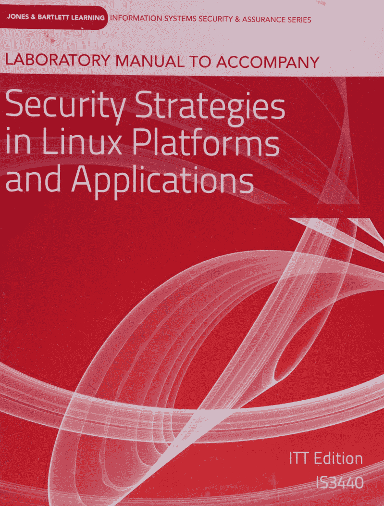


# 制作信息

- 首席执行官：Ty Field
- 总裁：James Homer
- 高级副总裁、首席运营官：Don Jones, Jr.
- 高级副总裁、首席技术官：Daan Fossett
- 高级副总裁、首席营销官：Alison M. Panderagast
- 高级副总裁、课程解决方案：Christopher Will
- 副总裁、设计与制作：Anne Spencer
- 副总裁、制造与库存控制：Theresa Connell
- 作者：vLab Solutions, LLC，David Kim（总裁）
- 编辑管理：Perspectives, Inc.，Phil Graham（总裁）
- 重印与特别项目主管：Susan Schultz
- 助理制作编辑：Tina Chen
- 市场总监：Alisha Weisman
- 助理市场经理：Meagan Norlund
- 封面设计：Anne Spencer
- 排版：vLab Solutions, LLC
- 封面图片：© EricKN/Shutterstock, Inc.
- 印刷与装订：Malloy, Inc.
- 封面印刷：Malloy, Inc.

ISBN: 978-1-4496-4397-3

6048

在美国印刷

15 14 13 12 11 10 9 8 7 6 5 4 3 2 1

由 Internet Archive 数字化

2022年，由 Kahle/Austin 基金会资助

https://archive.org/details/isbn_9781449643973

# 实验 #1

## 实验 #1：在服务器上安装核心 Linux 操作系统

### 学习目标和成果

完成本实验后，学生将能够完成以下任务：

- 根据必要的软件设计 Linux 操作系统计划
- 在核心 Linux 服务器中设计受保护的分区，以实现所需的安全加固、性能和应用支持
- 了解如何在安装期间使用网络时间服务器，以保持整个系统的时间设置同步
- 创建一个非特权用户账户用于系统管理访问，作为以 root 用户登录的安全替代方案

### 所需设置和工具

本实验不需要使用 Fedora 虚拟机、Fedora ISO 或模拟 IT 基础设施 - Cisco 核心骨干网络。此外，教师虚拟机工作站和学生虚拟机工作站应与内部网络物理断开，并隔离在教室专用的二层交换机上。这将允许使用共享的 DHCP 服务器来分配教师和学生工作站的 IP 地址。本实验是可选的基于设备或基于纸张的。基于设备实验需要以下条件：

- A) 一个教室工作站（至少配备 2 Gig RAM），能够支持连接教室二层交换机的 VM 服务器集群的可移动硬盘。
- B) 一个教师工作站（建议至少配备 4 Gig RAM），将作为教师的演示实验工作站。教师将通过 LCD 投影仪显示教师工作站，以演示使用 `VMware Player` 加载和配置教师虚拟机工作站。
- C) 学生将进行基于纸张的实验。


以下总结了执行实验 #1 所需的设置、配置和设备：

1. 一个虚拟化服务器集群，包含以下组件：
   - a. 用于分配学生 IP 主机地址的 Microsoft DHCP 服务器
   - b. 在本实验中，我们将使用提供的 Linux 操作系统软件构建一个新的 `Fedora 14` Linux 目标虚拟机
2. 标准现场学生工作站必须具有互联网访问权限，并加载以下软件应用程序以执行本实验：
   - a. `VMware Player 3.x`
   - b. `Microsoft Office 2007` 或更高版本，用于实验评估问题与答案

### 建议步骤

#### 基于纸张的实验 #1 – 学生步骤：

学生在为“保护 Linux 服务器 – 从安装开始”撰写摘要报告时，应使用安装步骤图表作为参考。

#### 交付物

在完成实验 #1：在服务器上安装核心 Linux 操作系统后，学生需要提供以下交付物：

1. 实验 #1 - 提交一份摘要报告和一份审计清单，用于保护 Linux 服务器 – 从安装开始。假设该服务器将用作电子商务网络应用的零售商 Web 服务器。
   - a. 解释为什么物理保护 Linux 计算机尤为重要。
   - b. 总结与安全和可用性相关的分区原因。
   - c. 简要解释为什么在服务器上安装 X 窗口和图形用户界面可能是可以接受的，以及如何缓解风险。
   - d. 提供建议，说明如何与网络时间服务器保持同步。
   - e. 建议管理员登录服务器并执行管理任务的方法。（远程或物理访问，用于登录的账户等。）
   - f. 提供 Linux 管理员可在安装过程中使用的审计清单。
2. 实验 #1 – 实验评估问题与答案

### 评估标准和评分细则

以下是学生在实验 #1 中必须执行的评估标准和评分细则：

1. 学生是否认识到物理保护 Linux 计算机的重要性？– **[20%]**
2. 学生是否能够阐明核心 Linux 服务器中的受保护分区如何为安全加固、性能和应用支持奠定基础？– **[20%]**
3. 学生是否提供了在整个系统中保持时间设置同步的建议？– **[20%]**
4. 学生是否建议安装无 GUI 的服务器，或提供了在服务器上安装 GUI 的有效解释以及如何缓解风险？– **[20%]**
5. 学生是否理解为什么创建非特权用户账户用于系统管理访问作为以 root 用户登录的安全替代方案很重要？– **[20%]**

## 实验 #1 – 评估工作表

### 在服务器上安装 Fedora Linux 操作系统

课程名称及编号： ______________________

学生姓名： ______________________

讲师姓名： ______________________

实验截止日期： ______________________

### 概述

在本实验中，学生将复习 Fedora Linux 服务器的安装过程，该服务器将作为一家虚构金融机构的 Web 服务器运行。安装过程、应用密码、创建分区以及系统管理员访问控制将是操作系统配置要求的一部分。

### 实验评估问题与答案

- 1. 在安装过程中，勾选了与 `NTP`（网络时间协议）服务器同步的选项。从安全角度来看，为什么系统保持准确的时间是重要的？
- 2. 在安装过程中，为 "`root`" 用户设置了密码。什么是 "`root`" 用户，在什么情况下使用此账户是合适的？
- 3. 在安装过程中，安装了 `X-Window` 和一个桌面管理器。然而，在生产环境中建议**不要**运行 `X-Window` 环境。请解释这一建议的目的。
- 4. 在安装过程中，询问创建分区的选项是什么？请列举它们的名称。
- 5. 为什么正确划分 Linux 系统分区很重要？
- 6. 在 Linux 系统中，`SWAP` 分区有什么意义？交换空间有哪些不同的配置方式，你为什么会推荐其中一种而不是另一种？
- 7. 对于 Linux 用户来说，选择 `ext4` 文件系统用于 Linux 系统的分区有哪些好处和特性？
- 8. `passwd` 文件是如何使用的，其内容由哪些字段组成？请解释。
- 9. `fstab` 文件是做什么用的，其内容由哪些字段组成？请解释。
- 10. 请解释创建 `/var` 和 `/boot` 目录的独立分区的意义？这些目录中包含什么内容？
- 11. 选择 “encrypt filesystem”（加密文件系统）选项有何用处？
- 12. 使用逻辑卷管理器（`LVM`）进行分区如何帮助实现安全性的 CIA 三要素（机密性、完整性、可用性）？
- 13. 选择 “minimal”（最小化）软件安装选项可以实现哪些安全优势？
- 14. 如何自动化一个面向安全的 `Fedora` 安装？
- 15. “`firstboot`” 的目的是什么？

# 实验 #2

## 实验 #2：在 Fedora Linux 服务器上配置基本安全控制

### 学习目标和成果

完成本实验后，学生将能够：

- 配置启动加载器，将超时设置设为 0 并设置密码凭据，以减轻对 `GRUB` 加载器和服务器启动序列的篡改风险
- 在 `Fedora` Linux 服务器上启用 `SELinux` 并将其设置为“permissive”（宽容）模式
- 创建学生用户账户，并将其添加到一个用户组中，以管理权限并在全系统范围内应用访问控制
- 配置具有有限 `sudo` 访问权限（带有密码凭据）的用户组，以记录并适当监控全系统的访问
- 配置 `iptables` 在运行级别 3 和 5 中设置为“on”（开启），以启用内部基于主机的 IP 有状态防火墙
- 设置对文件访问和用户系统日志文件的限制和权限


### 所需设置和工具

本实验不需要使用模拟 IT 基础设施 - Cisco 核心骨干网络。此外，讲师 VM 工作站和学生 VM 工作站应与内部网络物理断开连接，并在教室专用的二层交换机上隔离。这将允许使用共享 DHCP 服务器来分配讲师和 students 工作站的 IP 地址。

以下设备对于本基于设备的实验是必需的：

- A) 一个教室工作站（至少配备 2 Gig RAM），能够支持连接到教室二层交换机的带有 VM 服务器集群的可移动硬盘。
- B) 一个讲师工作站（建议至少配备 4 Gig RAM），将作为讲师的演示实验工作站。讲师将通过 LCD 投影仪显示讲师工作站，以演示使用 `VMware Player` 加载和配置讲师 VM 工作站的过程。
- C) 学生实验工作站将使用自己的 VM 服务器集群和 VM 学生工作站。`VMware Player` 将用于运行学生 VM 和目标 VM。

以下总结了执行实验 #2 所需的设置、配置和设备：

- 1. 一个虚拟服务器集群，包含以下组件：
    - a. 用于分配学生 IP 主机地址的 Microsoft DHCP 服务器
    - b. 学生或讲师 VM 工作站
    - c. Fedora Linux 服务器目标 VM
- 2. 标准的现场学生工作站必须加载以下软件应用程序以执行此实验：
    - a. `VMware Player 3.x`
    - b. Microsoft Office 2007 或更高版本，用于实验评估问题与答案

#### 推荐步骤

##### 基于设备的实验 #2 – 学生步骤：

学生应执行以下步骤：

- 1. 将学生可移动硬盘连接到您的工作站
- 2. 启动学生 VM 和 Microsoft DHCP VM 服务器以分配一个 IP 主机地址
- 3. 启用您的 DOS 命令提示符，输入 `ipconfig` 并 `ping` 您分配的 IP 主机地址 `172.30.0.__`、`DHCP 服务器 172.30.0.10` 以及 IP 默认网关路由器 `172.30.0.1`
- 4. 使用以下凭据登录到学生 VM：
    - 登录 ID：`student`（区分大小写）
    - 密码：`ISS316Security`（区分大小写）
- 5. 打开一个终端模拟器。从 GNOME 桌面，在左上角；点击 `应用程序`-> 系统工具 -> 终端

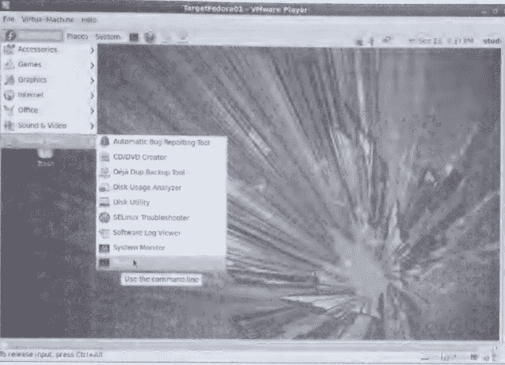

- 6. 打开一个终端模拟器。从 GNOME 桌面，在左上角，点击 `应用程序`-> 系统工具 -> 终端

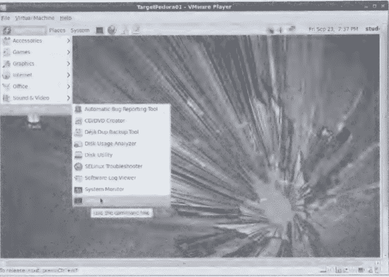

##### 加固启动加载器程序

- 7. 输入命令： `su -c 'vi /boot/grub/grub.conf'` 并按 `<enter>`。当提示时，输入 root 的密码（`ISS316Security`）。

```
[student@TargetFedora01 ~]$ su -c 'vi /boot/grub/grub.conf'
Password:
```

图 1 — *以 root 用户身份打开 grub.conf*

- 8. 验证 grub 菜单的超时是否设置为 `0`。

```
timeout=0
```

- 9. 退出文件。按 `Esc` 和 `:` 键进入命令模式。在命令模式下的冒号提示处，输入 `q` 以退出文件。
- 10. 进入 grub 控制台。输入命令： `grub` 并按 `<enter>`。
- 11. 提示将显示为 `grub>`。
- 12. 创建一个 md5 密码。输入命令： `md5crypt` 然后按 `<enter>`
- 13. 密码： `is4l8lab2`

```
[student@TargetFedora01 ~]$ grub
Probing devices to guess BIOS drives. This may take a long time.

GNU GRUB  version 0.97  (640K lower / 3072K upper memory)

[ Minimal BASH-like line editing is supported.  For the first word, TAB
lists possible command completions.  Anywhere else TAB lists the possible
completions of a device/filename.]
grub> md5crypt
md5crypt
Password: is4l8lab2
is4l8lab2
Encrypted: $1$Wc$jTI0$z9Dj$koaMDAgwneRlGDu0
gub> ■
```

图 2 – 进入 grub 控制台

- 14. 写下或复制该哈希字符串。复制哈希字符串的一种方法是用鼠标光标高亮该字符串，右键单击，并选择“复制”，如下所示图像。

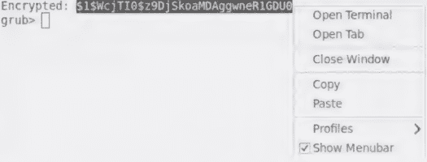

图 3 – 复制加密的密码字符串

- 15. 退出 grub 控制台。输入命令： `quit` 并按 `<enter>`
- 16. 为 grub 设置密码保护。输入命令： `su -c 'vi /boot/grub/grub.conf'` 并按 `<enter>`。
- 17. 按 `i` 键进入插入（INSERT）模式。
- 18. 在包含 `timeout=0` 的行之后紧接着插入以下行。

```
password --md5  `your_hash_string`
`84B845fTlljZQ78Vv9q1dpE5v9IQZg6vBOP`
```

注意：请将上述 `your_hash_string` 替换为先前步骤中复制的实际字符串。

```
###### grub.conf generated by anaconda
#
###### Note that you do not have to rerun grub after making changes to this file
###### NOTICE:  You have a /boot partition.  This means that
###### all kernel and initrd paths are relative to /boot/, eg.
###### root (hd0,0)
###### kernel /vmlinuz-version ro root=/dev/mapper/vg_targetfedoral1-lv root
###### initrd /initrd-[generic-]version.img
#
#boot=/dev/sda
default=0
timeout=0
password --md5 $1$wcjTiOZg9DJ5KoAMDagwwerR1GDUB
splashimage=(hd0,0)/grub/splash.xpm.gz
hiddenmenu
title Fedora (2.6.35.6-45.fc14.1686)
        root (hd0,0)
        kernel /vmlinuz-2.6.35.6-45.fc14.1686 ro root=/dev/mapper/vg_targetfedoral1-lv root rd LVM2=vq_targetfedoral1/lv_root rd LVM_LVM=vg_targetfedoral1/lv_swap rd NO_LUKS rd NO_MD rd NO_DM LANG=en_US.UTF-8 SYSFONT=latarcyrheb-sun16 KEYBOARDTYPE=pc KEYTABLE=us rghb quiet
        initrd /initramfs-2.6.35.6-45.fc14.1686.img

-- INSERT --
```


- 19. 保存更改并退出文件。按下 `Esc` 键退出插入模式，然后按下 `Shift` 和 `:` 键进入命令模式。在命令模式的冒号提示符下，输入 `wq` 以退出并保存更改。
- 20. 当计算机启动时，现在将需要 grub 密码才能在 grub 菜单上进行任何更改。由于超时设置为 0，计算机将立即启动进入默认内核，而不显示 grub 菜单。

#### 将 SELinux 设置为宽容模式

- 21. 默认情况下，SELinux 已经启用并设置为 `enforcing`（强制）模式。

注意：目前，系统应处于 `permissive`（宽容）模式。宽容模式会在进程被拒绝时发出警报，但实际上不会拒绝任何操作。在后续单元中，SELinux 将被重置为 `enforcing`（强制）模式。


22. 编辑 SELinux 配置文件。输入命令：`su -c 'vi /etc/selinux/config'` 并按 `<enter>`。

23. 密码：`ISS316Security`

24. 按下 `" i "` 键进入插入模式。

25. 将 SELINUX 设置从 `SELINUX=enforcing` 更改为 `SELINUX= permissive` 。

```
# This file controls the state of SELinux on the system.
# SELINUX= can take one of these three values:
#       enforcing - SELinux security policy is enforced.
#       permissive - SELinux prints warnings instead of enforcing.
#       disabled - SELinux is fully disabled.
SELINUX=permissive #
# SELINUXTYPE= type of policy in use. Possible values are:
#       targeted - Only targeted network daemons are protected.
#       strict - Full SELinux protection.
SELINUXTYPE=targeted
.
```


26. 保存更改并退出文件。按下 `Esc` 键退出插入模式，然后按下 `"Shift"` 和 `":"` 键进入命令模式。在命令模式的冒号提示符下，输入 `wq` 以退出并保存更改。

27. 检查 SELinux 配置和当前模式。输入命令：`sestatus` 并按 `<enter>`。

```
[student@TargetFedora01 ~]$ sestatus
SELinux status:    enabled
SELinuxfs mount:   /selinux
Current mode:      enforcing
Mode from config file: permissive
Policy version:    24
Policy from config file: targeted
```


28. 计算机当前的状态是 `enforcing`（强制），但重启后，它将读取配置文件并切换到 `permissive`（宽容）模式。

#### 启用内部基于主机的 IP 有状态防火墙

29. 启用防火墙以在进入运行级别 2 - 5 时启动。输入命令：`su -c 'chkconfig -level 2345 iptables on'` 并按 `<enter>`。

30. 密码：`ISS316Security`

31. 启动防火墙。输入命令：`su -c 'service iptables start'`

32. 密码：`ISS316Security`

```
[student@TargetFedora01 ~]$ su -c 'chkconfig --level 2345 iptables on'
Password:
[student@TargetFedora01 ~]$ su -c 'service iptables start'
Password:      -
```


33. 验证防火墙是否配置为在运行级别 2 - 5 启动。输入命令：`chkconfig iptables --list` 并按 `<enter>`。

```
[student@TargetFedora01 ~]$ chkconfig iptables --list
iptables       0:off     1:off     2:on      3:on      4:on      5:on      6:off
```


#### 提供有限的 sudo 权限作为以 root 用户登录的替代方案

**注意：** 启用并使用 `sudo` 代替以 root 用户登录，这是系统管理访问的最佳实践。此任务正是这样做的。然而，为了了解如何使用 sudo 限制用户和组，具有 sudo 权限的用户只被授予某些权限。未被 sudo 明确授予的权限将需要 root 的密码。

34. 编辑 sudoers。输入命令：`su -c 'visudo'` 并按 `<enter>`。

35. 密码：`ISS316Security`

36. 移除 `Cmd_Alias` 的注释（ `#` ）。使用键盘的上/下箭头键滚动定位以下每一行，这些行以以下内容开头：

- i. `# Cmd_Alias NETWORKING \.`

  - a. 将光标置于行首的 `#` 上。

  - b. 按下 `x` 键移除 `#` 。

- ii. `# Cmd_Alias SOFTWARE \.`

  - a. 将光标置于行首的 `#` 上。

  - b. 按下 `x` 键移除 `#` 。

- iii. `# Cmd_Alias STORAGE \.`

  - a. 将光标置于行首的 `#` 上。

  - b. 按下 `x` 键移除 `#` 。

- iv. `# Cmd_Alias DELEGATING \.`

  - a. 将光标置于行首的 `#` 上。

  - b. 按下 `x` 键移除 `#` 。

- v. `# Cmd_Alias PROCESSES \.`

  - a. 将光标置于行首的 `#` 上。

  - b. 按下 `x` 键移除 `#` 。

- vi. `# Cmd_Alias LOCATE \.`

  - a. 将光标置于行首的 `#` 上。

  - b. 按下 `x` 键移除 `#` 。

- vii. `# Cmd_Alias DRIVERS \.`

  - a. 将光标置于行首的 `#` 上。

  - b. 按下 `x` 键移除 `#` 。

```
## Networking
Cmd_Alias NETWORKING = /sbin/route, /sbin/ifconfig, /bin/ping, /sbin/dhclient, /usr/bin/net, /sbin/iptables, /usr/bin/rfcomm, /usr/bin/wvdial, /sbin/iwconfig, /sbin/mii-tool

## Installation and management of software
Cmd_Alias SOFTWARE = /bin/rpm, /usr/bin/up2date, /usr/bin/yum

## Services
Cmd_Alias SERVICES = /sbin/service, /sbin/chkconfig

## Updating the locate database
Cmd_Alias LOCATE = /usr/bin/updatedb

## Storage
Cmd_Alias STORAGE = /sbin/fdisk, /sbin/sfdisk, /sbin/parted, /sbin/partprobe, /bin/mount, /bin/umount

## Delegating permissions
Cmd_Alias DELEGATING = /usr/sbin/visudo, /bin/chown, /bin/chmod, /bin/chgrp

## Processes
Cmd_Alias PROCESSES = /bin/nice, /bin/kill, /usr/bin/kill, /usr/bin/killall

## Drivers
Cmd_Alias DRIVERS = /sbin/modprobe
```


37. 搜索以 `"#%wheel		ALL=(ALL)		ALL"` 开头的行，并将其更改为：

```
%wheel		ALL = NETWORKING, SOFTWARE, SERVICES, STORAGE, DELEGATING, PROCESSES, LOCATE, DRIVERS.
```

**注意：** 确保移除行首的哈希符号 (`#`)。这将允许 `"wheel"` 组中的任何人拥有有限的 sudo 权限。学生用户账户将在后续实验中添加到 wheel 组中。


```
#This will allow anyone in the “wheel” group to have the limited sudo access.
%wheel	ALL = NETWORKING, SOFTWARE, SERVICES, STORAGE, DELEGATING, PROCESSES, LOCATE, DRIVERS
```


38. 保存更改并退出文件。按下 `escape` 键退出插入模式，然后按下 `"shift" & ":"` 键进入命令模式。在命令模式的冒号提示符下，输入 `wq` 以退出并保存更改。

### 设置文件权限为不可变

39. 在文件上设置不可变标志。输入命令：`su -c 'chattr +i /etc/services'` 并按 `<enter>`。

40. 密码：ISS316Security

41. 验证不可变标志已设置。输入命令：`lsattr /etc/services` 并按 `<enter>`。

结果应显示类似 "----i--------e- /etc/services" 的内容。"i" 表示不可变标志已启用。下图 11 展示了操作步骤序列。

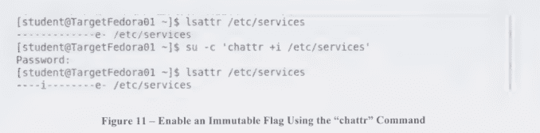

### 为用户设置特殊权限以访问日志文件

42. 在文件上设置 ACL 权限。输入命令：`su -c 'setfacl -m g:wheel:r /var/log/messages'`

43. 密码：ISS316Security

44. 验证 ACL 已设置。输入命令：`getfacl /var/log/messages` 并按 `<enter>`。

```bash
[student@TargetFedora01 ~]$ su -c 'setfacl -m g:wheel:r /var/log/messages:'
Password:
[student@TargetFedora01 ~]$ getfacl /var/log/messages
getfacl: Removing leading '/' from absolute path names
# file: var/log/messages
# owner: root
# group: root
user::rw-
group::r--
group:wheel::r--
mask::r--
other::r--
```


恭喜，你已经在 Fedora Linux 服务器上实现了基本的安全加固。

### 交付成果

在完成实验 #2：为 Linux 服务器配置基本安全控制后，学生需要提供以下交付成果：

- 1. 实验 #2 – Fedora Linux 服务器系统安全加固配置屏幕截图：
    - a. `boot/grub/grub.conf` 文件
    - b. `/etc/selinux/config` 文件
    - c. `chkconfig --list | grep iptables` 命令
    - d. `getfacl /var/log/messages` 命令
    - e. `lsattr /etc/services` 命令
    - f. `getfacl /var/log/messages` 命令

- 2. 实验 #2 – 实验评估问题及答案

#### 评估标准与评分细则

以下是学生必须执行的实验 #2 的评估标准和评分细则：

- 1. 学生是否能够将引导加载器超时时间设置为 0 并设置密码凭据，以减轻对 GRUB 加载器和服务器启动过程的篡改风险？– [10%]
- 2. 学生是否能够在 Fedora Linux 服务器上启用 SELinux 并将其设置为“permissive”模式？– [10%]
- 3. 学生是否能够创建学生用户账户并将其添加到用户组中，以管理权限并在整个系统中应用访问控制？– [20%]
- 4. 学生是否能够为具有有限 sudo 访问权限（带密码凭据）的用户组配置限制，以便记录并正确监控整个系统的访问情况？– [20%]
- 5. 学生是否能够创建设置为 "on" 的 iptables，针对运行级别 3 和 5，以启用内部主机基于的状态化 IP 防火墙？– [20%]
- 6. 学生是否能够为文件访问和系统日志文件设置限制和权限？– [20%]

### 实验 #2 – 评估工作表

### 在 Fedora Linux 服务器上配置基本安全控制

课程名称及编号： ____________________

学生姓名： ____________________

讲师姓名： ____________________

实验截止日期： ____________________

## 概述

学生需要使用该 Microsoft Word 文档模板提交其实验评估答案。列出的所有实验评估问题均适用于每门课程的每周实验活动。这可能是一项基于纸质的活动，也可能是一项基于设备的实验活动。实验评估结果和答案应在下一周课程开始时提交。鼓励学生在完成实验活动后立即或在截止日期前执行并提交实验评估结果。在此期间，他们将正确保护 Linux 服务器系统。他们将执行步骤以保护引导加载器，启用 iptables 并运行 SELinux，以帮助锁定 Linux 操作系统。学生还将对目录和文件应用 ACL（访问控制列表），然后检查系统中的这些 ACL 和权限。

## 实验评估问题及答案

- 1. 什么是 GRUB，为什么锁定它很重要？
- 2. 讨论授予“sudo”访问权限的目的。为什么不建议以 root 用户身份登录是个好主意？
- 3. 如果文件被设置为不可变标志，这为该文件提供了哪些安全控制？
- 4. 尝试使用“vi”编辑 grub 时，为什么你会看到一个空白窗口？
- 5. 如何知道你是以 root 身份登录的？
- 6. 你需要使用什么命令来安装 vim？
- 7. 什么是 iptables，它如何帮助加固 Fedora Linux 服务器？
- 8. 为什么在你的 Fedora Linux 服务器上配置和启用 iptables 很重要？
- 9. `cat` 和 `less` 命令之间的区别是什么？
- 10. `setfacl` 和 `getfacl` 之间的区别是什么？"setfacl" 如何有助于实现安全加固？

## 实验室 #3

实验 #3：应用加固的用户账户管理 & 安全控制

### 学习目标与成果

完成此实验后，学生将能够完成以下任务：

- 通过编辑 `/etc/login.defs` 文件并在 Fedora Linux 服务器上实施严格的密码安全措施来配置密码策略
- 在整个系统中对所有用户强制实施每 60 天更改一次密码，并在密码过期前 14 天发出警告
- 配置最小密码长度为 8 个字符，并具有严格的复杂度要求
- 创建具有适当权限和限制的用户和组，以强制执行基于角色的访问控制
- 创建一个 90 天后过期的临时用户账户，以便与承包商和临时员工/顾问配合，强制执行适当的权限最小化原则

### 所需设置和工具

此实验不需要使用模拟 IT 基础设施 - Cisco 核心骨干网络。此外，讲师 VM 工作站和学生 VM 工作站应与内部网络物理断开连接，并在教室专用的二层交换机上隔离。这将允许使用共享 DHCP 服务器为讲师和学生的工作站分配 IP 地址。此基于设备的实验需要以下内容：

- A) 一个教室工作站（至少 2 Gig RAM），能够支持连接到教室二层交换机的可移动硬盘上的 VM 服务器农场。
- B) 一个讲师工作站（建议至少 4 Gig RAM），将作为讲师的演示实验室工作站。讲师将通过 LCD 投影仪显示讲师工作站，演示使用 VMware Player 加载和配置讲师 VM 工作站的过程。
- C) 学生的实验室工作站将使用自己的 VM 服务器农场和 VM 学生工作站。VMware Player 将用于运行学生 VM 和目标 VM。

以下内容概述了执行实验 #3 所需的设置、配置和设备：

- 1. 具有以下组件的虚拟化服务器农场：
    - a. 用于分配学生 IP 主机地址的 Microsoft DHCP 服务器
    - b. 学生或讲师 VM 工作站
    - c. Fedora Linux 目标 VM

- 2. 标准的现场学生工作站必须加载以下软件应用程序以执行此实验：
    - a. VMware Player 3.x
    - b. 用于实验评估问题及答案的 Microsoft Office 2007 或更高版本

### 推荐步骤

#### 基于设备的实验 #3 – 学生步骤：

学生应执行以下步骤：

- 1. 将学生可移动硬盘连接到你的工作站
- 2. 启动学生 VM 和 Microsoft DHCP VM 服务器以分配 IP 主机地址


## 3. 启用你的 DOS 命令提示符，输入“`ipconfig`”，并“`ping`”你分配的 IP 主机地址 `172.30.0.____`，DHCP 服务器 `172.30.0.10`，以及 IP 默认网关路由器 `172.30.0.1`

## 4. 使用以下凭据登录学生 VM

- 登录 ID：`student`（区分大小写）
- 密码：`ISS316Security`（区分大小写）

## 5. 在 GNOME 桌面上，在左上角，单击“Applications” -> Systems Tools -> Terminal

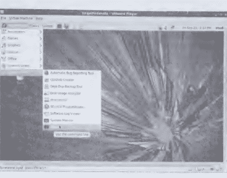

### 根据策略要求配置严格密码

## 6. 打开并编辑 `/etc/login.defs` 文件以强制执行

- a. 每 60 天更改一次密码
- b. 在密码过期前 14 天显示警告
- c. 要求最小密码长度为 8 个字符

输入命令：`su -c 'vi /etc/login.defs'` 并按 `<enter>`。

## 7. 密码：`ISS316Security`

```bash
[student@TargetFedora01 ~]$ su -c 'vi /etc/login.defs'
Password: 
```

**图 13 – 以 root 用户身份在 vi 中打开文件**

## 8. 按“ i ”进入 vi 编辑器中的 **INSERT**（插入）模式。

## 9. 更改如下图中所示的密码老化控制

### 密码老化控制

```text
#
#    PASS MAX DAYS  密码最大使用天数。
#    PASS MIN DAYS  两次修改密码之间允许的最小天数。
#    PASS MIN LEN   可接受的最小密码长度。
#    PASS WARN AGE  密码过期前发出警告的天数。
#
PASS_MAX_DAYS 60
PASS_MIN_DAYS 0
PASS_MIN_LEN 8
PASS_WARN_AGE 14
```


## 10. 保存更改并退出文件。按 `escape` 键退出插入模式，然后按“shift”键和“:”键进入命令模式。在命令模式的冒号提示符处，输入 `wq` 以退出并保存更改。

#### 创建用户账户、登录凭据并定义组

## 11. 为管理员创建四个用户账户。两个账户供数据库管理员使用，两个账户供 Web 管理员使用。提供以下 `user` 名称：`dbadmin1`, `dbadmin2`, `webadmin1` & `webadmin2`。使用 `useradd` 命令创建账户

- a) 输入命令：`su -c 'useradd dbadmin1'` 并按 `<enter>`。
- b) 密码：`ISS316Security`
- c) 输入命令：`su -c 'useradd dbadmin2'` 并按 `<enter>`。
- d) 密码：`ISS316Security`
- e) 输入命令：`su -c 'useradd webadmin1'` 并按 `<enter>`。
- f) 密码：`ISS316Security`
- g) 输入命令：`su -c 'useradd webadmin2'` 并按 `<enter>`。
- h) 密码：`ISS316Security`

## 12. 为每个创建的账户设置密码：`passwd` (账户名称)。

**注意：** 如果选择了弱密码，将显示警告消息。然而，由于该命令是以 root 权限运行的，因此允许使用弱密码。

## 13. 输入命令：`su -c 'passwd dbadmin1'` 并按 `<enter>`。

## 14. 密码：`ISS316$Security`

## 15. 系统将提示输入 dbadmin 的新密码。输入密码：`lab3` 并按 `<enter>`

## 16. 再次输入密码 `lab3` 以确认。按 `enter` 键完成。

```text
[student@TargetFedora01 ~]$ su -c 'useradd dbadmin1'
Password:
[student@TargetFedora01 ~]$ su -c 'passwd dbadmin1'
Password:
Changing password for user dbadmin1.
New password:
Retype new password:
passwd: all authentication tokens updated successfully.
```

**图 15 – 添加用户账户并设置密码**

## 17. 强制每个用户在首次登录时更改密码

- a) 输入命令：`su -c 'chage -d 0 dbadmin1'` 并按 `<enter>`。
- b) 密码：`ISS316$Security`
- c) 输入命令：`su -c 'chage -d 0 dbadmin2'` 并按 `<enter>`。
- d) 密码：`ISS316$Security`
- e) 输入命令：`su -c 'chage -d 0 webadmin1'` 并按 `<enter>`。
- f) 密码：`ISS316$Security`
- g) 输入命令：`su -c 'chage -d 0 webadmin2'` 并按 `<enter>`。
- h) 密码：`ISS316$Security`

**注意：** `-d` 后面应该是数字零，而不是字母 `o`。

## 18. 创建两个组账户，一个名为 `dba`，另一个名为 `web`

- a) 输入命令：`su -c 'groupadd dba'` 并按 `<enter>`。
- b) 密码：`ISS316$Security`
- c) 输入命令：`su -c 'groupadd web'` 并按 `<enter>`

```text
[student@TargetFedora01 ~]$ su -c 'groupadd dba'
Password:
[student@TargetFedora01 ~]$ su -c 'groupadd web'
Password:
```

**图 16 — 添加组**

## 19. 将用户 `dbadmin1` 和 `dbadmin2` 添加到“dba”组中

- a) 输入命令：`su -c 'usermod -G dba dbadmin1'` 并按 `<enter>`。
- b) 密码：`ISS316Security`
- c) 输入命令：`su -c 'usermod -G dba dbadmin2'` 并按 `<enter>`。
- d) 密码：`ISS316Security`

## 20. 将用户 `webadmin1` 和 `webadmin2` 添加到“web”组中

## 21. 输入命令：`su -c 'usermod -G web webadmin1'` 并按 `<enter>`。

## 22. 密码：`ISS316Security`

## 23. 输入相同的命令：`su -c 'usermod -G web webadmin2'` 并按 `<enter>`。

## 24. 密码：`ISS316Security`

#### 将学生账户添加到 Wheel 组

## 25. 将学生用户账户添加到“wheel”组中

## 26. 输入命令：`su -c 'usermod -G wheel student'` 并按 `<enter>`。

## 27. 密码：`ISS316Security`

> **注意：** *学生必须是 wheel 组的成员，才能执行 Labs 3 - 10 中的 `su` 和 `sudo` 命令。*

```text
[student@TargetFedora01 ~]$ su -c 'usermod -G wheel student'
Password:
```

**图 17 — 将学生添加到 wheel 组**

#### 创建临时用户账户并设置 90 天后自动过期

Jane Temp 是一名承包商，协助构建为期 90 天的 Linux 在线备份基础设施。

## 28. 创建临时用户账户名称。输入命令：`su -c 'useradd jtemp'` 并按 `<enter>`。

## 29. 密码：`ISS316Security`

## 30. 为临时用户设置密码。输入命令：`su -c 'passwd jtemp'` 并按 `<enter>`。

## 31. 密码：`ISS316Security`

## 32. 确保用户在首次登录时被迫更改密码。输入命令：`su -c 'chage -d 0 jtemp'` 并按 `<enter>`。

## 33. 密码：`ISS316Security`

**注意：** `-d` 后面是数字零。不是字母 `o`。


```text
[student@TargetFedora01 ~]$ su -c 'useradd jtemp'
Password:
[student@TargetFedora01 ~]$ su -c 'passwd jtemp'
Password:
Changing password for user jtemp.
New password:
Retype new password:
passwd: all authentication tokens updated successfully.
[student@TargetFedora01 ~]$ su -c 'chage -d 0 jtemp'
Password:
```


- 34. 设置账户在 90 天后过期。输入命令：`su -c 'chage -E 2011-12-31 jtemp'` 并按 `<enter>`。当系统提示时，输入 root 的密码 (`ISS316Security`)。

**注意：** 将命令中的日期替换为实验室当天起 90 天后的日期。如果 `2011-12-31` 是较早的日期，用户账户将立即过期！日期格式为 `YYYY-MM-DD`。例如，如果希望的过期日期是 2011 年的最后一天，则如上图所示输入命令。

```text
[student@TargetFedora01 ~]$ su -c 'chage -E 2011-12-31 jtemp'
Password:
[student@TargetFedora01 ~]$ su -c ' chage --list jtemp'
Password:
Last password change                : password must be changed
Password expires                    : password must be changed
Password inactive                   : password must be changed
Account expires                     : Dec 31, 2011
Minimum number of days between password change    : 0
Maximum number of days between password change    : 60
Number of days of warning before password expires : 14
[student@TargetFedora01 ~]$ 
```


> **重要：** 在完成本实验的最后一项任务之前，学生账户应当是“`wheel`”组的成员，如本实验第 14 步所述（Lab 3）。否则将导致学生用户账户无法使用未来的任何 ‘`su -c`’ 或 `sudo` 命令！

##### 限制 su 命令的使用

- 35. 打开 `/etc/pam.d/su` 进行编辑。输入命令：`su -c 'vi /etc/pam.d/su'` 并按 `<enter>`。

- 36. 密码：`ISS316Security`

- 37. 按“i”键进入 INSERT（插入）模式。

- 38. 找到行：“`#auth required pam_wheel.so use_uid`”。

- 39. 删除行开头的井号（`#`）。将光标定位在 `#` 上并按“x”键。

```bash
##PAM-1.0
auth     sufficient    pam_rootok.so
# Uncomment the following line to implicitly trust users in the "wheel" group.
#auth    sufficient    pam_wheel.so trust use_uid
# Uncomment the following line to require a user to be in the "wheel" group.
auth     required      pam_wheel.so use_uid
auth     include       system-auth
account  sufficient    pam_succeed_if.so uid = 0 use_uid quiet
account  include       system-auth
password include       system-auth
session  include       system-auth
session  optional      pam_xauth.so
```

**图 20 – 限制 su 命令的使用**

- 40. 保存更改并退出文件。按 `escape` 键退出 INSERT（插入）模式，然后按“shift”键和“:”键进入命令模式。在命令模式的冒号提示符处，输入 `wq` 以退出并保存更改。

#### 交付物

完成实验 #3：应用加固的用户账户管理与安全控制后，学生需要提供以下交付物：

- 1. 实验 #3 - 学生需提交以下文件的截图：

    - a. `/etc/login.defs` 文件的输出

    - b. “`groups`” 命令的输出

    - c. 新修改的 `/etc/pam.d/su` 文件的输出

- 2. 实验 #3 – 实验评估问题及答案

### 评估标准和评分细则

以下是学生必须完成的实验 #3 的评估标准和评分细则：

- 1. 学生是否能够通过编辑 `/etc/login.defs` 文件并在 Fedora Linux 服务器上实施严格的密码安全措施来配置密码策略？– [20%]

- 2. 学生是否能够强制执行每 60 天更改一次密码，并在密码过期前 14 天向系统内所有用户发出警告？– [20%]

- 3. 学生是否能够将最小密码长度配置为 8 个字符并满足严格的复杂性要求？– [20%]

4.  学生是否能够为角色基于访问控制创建具有适当权限和限制的用户和组？ [20%]

5.  学生是否能够创建一个90天过期的临时用户账户，以执行针对承包商和临时员工/顾问的最小权限原则？ [20%]

### 实验 #3 – 评估工作表

## 应用强化用户账户管理 & 安全控制

课程名称及编号：

\_\_\_\_\_\_\_\_\_\_\_\_\_\_\_\_\_\_\_\_\_\_\_\_\_\_\_\_\_\_\_\_\_\_\_\_\_\_\_\_

学生姓名：

\_\_\_\_\_\_\_\_\_\_\_\_\_\_\_\_\_\_\_\_\_\_\_\_\_\_\_\_\_\_\_\_\_\_\_\_\_\_\_\_

讲师姓名：

\_\_\_\_\_\_\_\_\_\_\_\_\_\_\_\_\_\_\_\_\_\_\_\_\_\_\_\_\_\_\_\_\_\_\_\_\_\_\_\_

实验截止日期：

\_\_\_\_\_\_\_\_\_\_\_\_\_\_\_\_\_\_\_\_\_\_\_\_\_\_\_\_\_\_\_\_\_\_\_\_\_\_\_\_

### 概述

本实验是之前基于设备实验的扩展，融入了用户账户、密码策略的安全强化，以及创建带有自动账户和密码删除功能的临时用户账户。在本实验中，学生将被要求实施并配置 Fedora Linux 服务器上的安全强化措施。他们将使用步骤来配置具有安全密码策略定义的用户账户。最后，他们还将为那些登录凭证和密码将在90天内到期的临时用户账户应用严格的密码策略。

### 实验评估问题及答案

- 1. 创建组并将用户添加到组中的意义是什么？请解释。

- 2. 假设一个场景，其中有五（5）名数据库管理员可能需要定期访问特定系统。讨论一种概念，以便更好地管理这些管理员的访问权限。

- 3. 新的 Web 管理员账户已设置并提供了一个密码。强制在首次登录时更改密码的流程是什么？

- 4. "`su`" 命令的目的是什么？解释其重要性。

- 5. 可以使用什么机制来配置对 '`su`' 命令使用的限制？

- 6. `login.defs` 文件的目的是什么？解释其内容和配置选项？

- 7. `PASS_MIN_DAYS` 设置是什么？为什么设置 `PASS_MIN_DAYS` 是个好主意？

- 8. `PASS_MAX_DAYS` 设置是什么？为什么设置 `PASS_MAX_DAYS` 是个好主意？

- 9. 对命令 `/etc/login.defs` 设置（`PASS_MAX_DAYS`, `PASS_MIN_DAYS` 和 `PASS_WARN_AGE`）的更改是否会对现有账户生效？

- 10. 如果被告知有几位承包商需要在接下来的14天内需要 Linux 系统上的账户，请描述你将配置的密码和账户设置。

## 实验室 #4

### 实验 #4: 应用强化 Linux 文件系统安全控制

#### 学习目标与成果

完成本实验后，学生将能够完成以下任务：

- 挂载没有执行权限的文件系统，以便可以安全地读取磁盘中的数据而不执行任何意外程序


- 挂载远程文件系统，并配置系统以便在启动时自动挂载 Linux 系统上的自动网络共享
- 在磁盘上设置用户配额，以保护 Linux 系统的可用性和安全性，并防止用户占用系统所有磁盘驱动器空间
- 编辑和修改 `/etc/fstab` 文件以管理本地和远程 NFS 共享以及所需的磁盘挂载配置
- 配置和使用 `repquota` 命令来验证用户的磁盘空间使用情况并管理配额

#### 必需的设置和工具

本实验不需要使用 Mock IT 基础设施 - Cisco 核心骨干网络。此外，讲师虚拟机工作站和学生虚拟机工作站应与内部网络物理断开连接，并隔离在课堂专用的二层交换机上。这将允许使用共享的 DHCP 服务器来分配讲师和学生工作站的 IP 地址。

基于此设备的实验需要以下条件：

- A) 一个教室工作站（至少 2 Gig 内存），能够支持连接到课堂二层交换机的可移动硬盘，该硬盘包含虚拟机服务器农场。
- B) 一个讲师工作站（建议至少 4 Gig 内存），将作为讲师演示实验室工作站。讲师将通过 LCD 投影仪显示讲师工作站，以演示如何使用 VMware Player 加载和配置讲师虚拟机工作站。
- C) 学生实验室工作站将使用他们自己的虚拟机服务器农场和虚拟机学生工作站。`VMware Player` 将用于运行学生虚拟机和目标虚拟机。

以下是执行实验 #4 所需的设置、配置和设备摘要：

- 1. 一个虚拟化服务器农场，包含以下组件：
  - a. 用于分配学生 IP 主机地址的 Microsoft DHCP 服务器
  - b. 一个学生和/或讲师虚拟机工作站
  - c. Fedora Linux 目标虚拟机
- 2. 标准的现场学生工作站必须加载以下软件应用程序以执行此实验：
  - a. `VMware Player 3.x`
  - b. Microsoft Office 2007 或更高版本，用于实验评估问题及答案

#### 推荐步骤

##### 基于设备的实验 #4 – 学生步骤：

学生应执行以下步骤：

- 1. 将学生可移动硬盘连接到你的工作站
- 2. 启动学生虚拟机和 Microsoft DHCP 虚拟机服务器以分配 IP 主机地址
- 3. 启用你的 DOS 命令提示符并输入 "`ipconfig`" 以及 "`ping`" 你分配的 IP 主机地址 `172.30.0.____`，DHCP 服务器 `172.30.0.10`，以及 IP 默认网关路由器 `172.30.0.1`
- 4. 使用以下凭证登录到学生虚拟机：
  - 登录 ID: "`student`"（区分大小写）
  - 密码: "`!SS316Security`"（区分大小写）
- 5. 从 GNOME 桌面，在左上角，点击 "`Applications`" -> `Systems Tools` -> `Terminal`

**注意：** 为了正确完成此实验，你的 Fedora 14 虚拟机需要 **实时** 互联网连接。请勿将学生工作站从课堂网络和互联网连接断开。

**注意：** 在 `sudo & su` 命令能够按预期执行之前，用户账户 **必须** 是 `wheel group` 的成员，并且 `wheel group` 必须被赋予如在实验 3 中指示的有限 `sudo` 访问权限。

##### 创建虚拟磁盘镜像 & 目录

- 6. 为虚拟镜像创建目录
  - a) 输入命令：`su -c ' mkdir -p /virtualimages/disk'` 并按 `<enter>`
  - b) 密码: `ISS316Security`
  - c) 输入命令：`su -c ' mkdir /archives && mkdir /common '` 并按 `<enter>`
  - d) 密码: `ISS316Security`
  - e) 输入命令：`su -c ' dd if=/dev/zero of=/virtimages/disk/quota-img.img count=300000 '` 并按 `<enter>`
  - f) 密码: `ISS316Security`
  - g) 输入命令：`su -c ' dd if=/dev/zero of=/virtimages/disk/readonly-img.img count=100000 '` 并按 `<enter>`
  - h) 密码: `ISS316Security`
  - i) 输入命令：`su -c ' mkfs -t ext3 -q /virtimages/disk/readonly-img.img -F '` 并按 `<enter>`。
  - j) 密码: `ISS316Security`
  - k) 输入命令：`su -c ' mkfs -t ext3 -q /virtimages/disk/quota-img.img -F '` 并按 `<enter>`。
  - l) 密码: `ISS316Security`

- 7. 在 `vim` 编辑器中编辑 `/etc/fstab`。输入命令：`su -c ' vi /etc/fstab '` 并按 `<enter>`
- 8. 按“ `i` ”进入 INSERT 模式。
- 9. 滚动到最后一行的后面以创建新行。
- 10. 输入以下行：

```
/virtimages/disk/readonly-img.img /archives ext3 loop,defaults 0 0
```

- 11. 为配额分区创建挂载点。在新行中键入以下内容：

```
virtimages/disk/quota-img.img /common ext3 loop,usrquota,defaults 0 0
```

- 12. 保存更改并退出文件。按 `escape` 键退出插入模式，然后按 “`shift`” & “`:`” 键进入命令模式。在命令模式的冒号提示符处，键入 `wq` 以退出。
- 13. 挂载文件系统。输入命令：`sudo mount /archives && sudo mount /common` 并按 `<enter>`。如果需要，输入学生用户账户的密码（ `ISS316Security` ）。
- 14. 授予授权用户在 `/common` 中的权限
  - a) 输入命令：`cd /common` 并按 `<enter>`。
  - b) 输入命令：`su -c ' mkdir student && chown student:student student -R '` 并按 `<enter>`。
  - c) 密码：`ISSSecurity`

- 15. 在 `/archives` 目录中授予授权用户权限
  - a) 输入命令：`cd /archives` 并 `<enter>` 键
  - b) 输入命令：`su -c 'mkdir 2011 && chown student:student 2011 -R'` 并 `<enter>` 键。

- 16. 输入命令：`cd /archives/2011` 并 `<enter>` 键
- 17. 在 `vim` 编辑器中创建并打开存档文件。输入命令：`vi financials.txt`
- 18. 在 `vim` 编辑器中按 “`i`” 键进入 INSERT（插入）模式。
- 19. 在文件中输入以下文本：

This file should not change. Ever.

- 20. 保存更改并退出文件。按 `escape` 键退出插入模式，然后按 “`shift`” 键与 “`:`” 键进入命令模式。在命令模式的冒号提示符处，输入 `wq` 以退出。
- 21. 在 `vim` 编辑器中编辑 `/etc/fstab`。输入命令：`su -c ' vi /etc/fstab'` 并 `<enter>` 键。
- 22. 密码：`ISS316Security`

##### 以只读权限挂载文件系统

- 23. 在 `vim` 编辑器中打开 `/etc/fstab`。输入命令：`su -c ' vi /etc/fstab '` 并 `<enter>` 键。
- 24. 按 “`i`” 键进入 INSERT（插入）模式。
- 25. 为 `/archives` 文件系统添加只读权限 (`ro`)。找到第 5 步中创建的该行，在 `defaults` 之后添加一个逗号 ( `,` ) 和 `ro`，使该行显示为：

```
/virtimages/disk/readonly-img.img /archives ext3 loop,defaults,ro 0 0
```

```
/virtimages/disk/readonly-img.img /archives ext3 loop,defaults,ro 0 0
/virtimages/disk/quota-img.img /common ext3 loop,defaults 0 0
```


- 26. 保存更改并退出文件。按 `escape` 键退出插入模式，然后按 “`shift`” 键与 “`:`” 键进入命令模式。在命令模式的冒号提示符处，输入 `wq` 以退出。
- 27. 在对 `fstab` 进行更改并保存后，重新挂载 `/archives` 分区：输入命令：`su -c ' mount -o remount /archives'` 并 `<enter>` 键。


28. 密码：`ISS316Security`

29. 导航到 `/archives/2011` 目录。输入命令：`cd /archives/2011` 并 `<enter>` 键。

30. 执行目录列示并查看 `financials.txt` 的权限。输入命令：`ls -ls financials.txt` 并 `<enter>` 键。注意 `student` 用户和 `student` 组在文件级别具有读和写权限。

31. 在 `vim` 编辑器中打开 `financials.txt` 以进行编辑：输入命令 `vi financials.txt` 并 `<enter>` 键。

32. 按 "i" 键进入 INSERT（插入）模式。

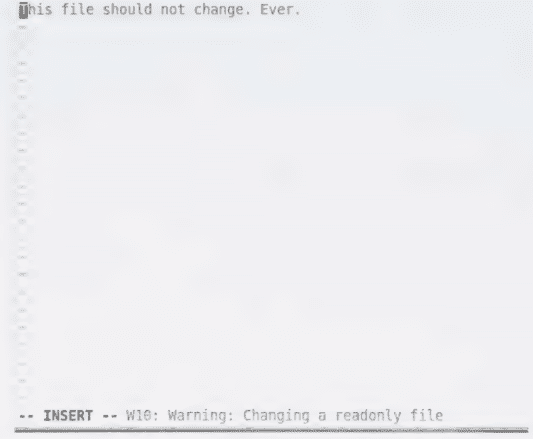

**图 22 – 尝试编辑只读文件系统上的文件**

33. 查看通知 “Warning: Changing a readonly file”（警告：正在更改只读文件）。

34. 按 *escape* 键退出插入模式，然后按 “shift” 键与 “:” 键进入命令模式。在命令模式的冒号提示符处，输入 `q` 以退出。

35. 尝试创建一个文件：输入命令：`touch test` 并 `<enter>` 键。

36. 查看消息：`touch: cannot touch 'test' : Read-only file system.`（无法触摸 'test'：只读文件系统。）

> 注意：存档文件系统是可以读取的，但防止了 rootkit、特洛伊木马、病毒和文件更改的引入，因此是安全的。

## 在文件系统分区上设置用户账户配额

37. 安装配额软件。输入命令：`sudo yum install quota quotatool -y` 并 `<enter>` 键。

38. `[sudo] student` 的密码：`ISS316Security`

39. 初始化配额数据库：输入命令：`su -c 'quotacheck -cug /common'`

40. 密码：`ISS316Security`

41. 开启配额：`su -c 'quotaon /common'` 并 `<enter>` 键。

42. 密码：`ISS316Security`

43. 打开用户配额设置。输入命令：`su -c 'edquota -f /common student'`

44. 密码：`ISS316Security`

45. 进入 INSERT（插入）模式。按 “i” 键。

46. 设置 30 MB 的软限制。将第一个 “soft” 列下方的 0 (零) 更改为 30。

47. 设置 100 MB 的硬限制。将第一个 “hard” 列下方的 0 (零) 更改为 100。

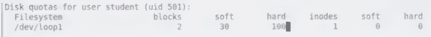


48. 保存更改并退出文件。按 *escape* 键退出插入模式，然后按 “shift” 键与 “:” 键进入命令模式。在命令模式的冒号提示符处，输入 `wq` 以退出。

49. 更改目录至学生用户共享目录：输入命令：`cd /common/student` 并 `<enter>` 键。

50. 创建一个约 100 MB 的随机数据文件。输入命令：`dd if=/dev/urandom of=test.file bs=9548576 count=1` 并 `<enter>` 键

51. 查看配额限制报告。*输入命令：`su -c 'repquota /common'`* 并 `<enter>` 键。

52. 密码：`ISS316Security`

53. 查看学生用户配额。*输入命令：`quota`* 并 `<enter>` 键。

```
[student@TargetFedora01 ~]$ cd /common/student
[student@TargetFedora01 student]$ dd if=/dev/urandom of=test.file2 bs=94588523 count=1
dd: writing 'test.file2': Disk quota exceeded
1+0 records in
0+0 records out
98304 bytes (98 kB) copied, 37.7418 s, 2.6 kB/s
[student@TargetFedora01 student]$ su -c 'repquota /common'
Password:
***  Report for user quotas on device /dev/loop1
Block grace time: 7days; Inode grace time: 7days
                            Block limits              File limits
User used     soft    hard    grace  used soft  hard  grace
----------------------------------------------------------------------------------------
root  --   5663       0       0      4    0     0
student +-   100      30     100   60days   2    0     0
```

图 24 – 查看用户配额

```
[student@TargetFedora01 /]$ quota
Disk quotas for user student (uid 501):
           Filesystem   blocks   quota     limit   grace   files  quota    limit  grace
/dev/loop1            100*    30        100   6days   2     0     0
```

图 25 – 查看学生账户配额限制

### 交付成果

在完成实验 #4：*应用加固的 Linux 文件系统安全控制* 后，要求学生提供以下交付成果：

- 1. 实验 #4 - 学生需提交以下文件的屏幕截图：

    - a. `/etc/fstab` 文件的输出

    - b. `repquota /home` 的输出

- 2. 实验 #4 – 评估问题与答案

### 评估标准和评分细则

以下是学生必须执行的实验 #4 的评估标准和评分细则：

- 1. 学生是否能够在不执行权限的情况下挂载文件系统，从而可以安全读取磁盘中包含的数据而不执行任何意外的程序？ – [20%]

- 2. 学生是否能够挂载远程文件系统，并配置系统以便在 Linux 系统启动时自动挂载以进行自动网络共享？ – [20%]

- 3. 学生是否能够在磁盘上设置用户配额，以保护 Linux 系统的可用性和安全性，并防止用户占用系统上的所有磁盘驱动器空间？ – [20%]

- 4. 学生是否能够编辑和修改 `/etc/fstab` 文件，以管理本地和远程 NFS 共享以及必要的磁盘挂载配置？ – [20%]

- 5. 学生是否能够配置和使用 `repquota` 命令来验证用户对磁盘空间的使用情况并管理配额？ – [20%]

### 实验 #4 – 评估工作表

# 应用加固的 Linux 文件系统安全控制

课程名称及编号：______________________________

学生姓名：______________________________________

讲师姓名：____________________________________

实验截止日期：________________________________________

# 概述

本实验是之前基于设备的扩展实验，并结合了文件系统的安全加固以及对挂载文件系统的用户访问控制。在本实验中，学生将被要求挂载一个在 Fedora Linux 服务器上没有执行权限的文件系统。他们还将演示如何挂载远程文件系统并为挂载文件系统的用户设置配额。

# 实验评估问题与答案

- 1. 假设一个文件被赋予了 777 权限（所有者-rwx，组-rwx，其他-rwx），但当用户尝试执行它时返回 “permissions denied”（权限拒绝）。解释最可能的原因。

- 2. 给定一个场景，其中 web 服务器需要访问位于局域网内另一台服务器上的 PDF 文档。这些文档仅供客户查看其个人账户信息。会使用哪种挂载选项：`/tmp ext4 ro 0 0`？

3. 描述如何为用户创建一个 2GB 的配额硬限制的过程

4. 如何在 Fedora 14 中安装 quota？

5. 为什么会出现关于“无法重新挂载已挂载的文件系统”的错误？

6. `/etc/fstab` 文件的作用是什么？

7. `mount` 命令是什么？请解释。


版权所有 © 2013 Jones & Bartlett Learning, LLC，Ascend Learning 公司旗下企业

www.jblearning.com

保留所有权利。

当前版本日期：2011/10/10

-49-

### 8. SW 包管理工具的名称是什么？

### 9. Fedora 14 的代码名称是什么，以及它是在什么时候发布的？

### 10. Linux 中的 `repquota` 命令有什么用？请解释。

# 实验 #5：为 Linux 服务和应用程序应用加固的安全措施

## 学习目标与成果

完成本实验后，学生将能够执行以下任务：

- 在启用和安装 Linux 服务器服务时进行安全加固，并在配置过程中保持安全意识
- 创建 Apache Web 服务器安装并执行基本安全配置，以确保系统在托管网站前已得到加固
- 配置 MySQL 数据库并执行基本安全措施，理解默认安装的影响，并为数据库实例推荐加固步骤
- 安装、设置 Sendmail 并执行基本安全配置，以便利用 Linux 系统的内置消息传递功能
- 启用并实现安全的 SSH，以通过加密方式跨网络或互联网远程访问 Linux 服务器系统

## 所需设置和工具

本实验不需要使用模拟 IT 基础设施 - Cisco 核心骨干网络。此外，教师虚拟机工作站和学生虚拟机工作站应与内部网络物理断开连接，并隔离在课堂专用的二层交换机上。这将允许使用共享的 DHCP 服务器来为教师和学生工作站分配 IP 地址。

以下设备型实验所需的内容包括：

- A) 一个能够支持连接至课堂二层交换机的虚拟机服务器农场（包含可移动硬盘）的课堂工作站（至少配备 2 GB RAM）。
- B) 一个教师工作站（建议至少配备 4 GB RAM），作为教师的演示实验工作站。教师将在 LCD 投影仪上显示教师工作站，以演示使用 VMware Player 加载和配置教师虚拟机工作站的过程。
- C) 学生实验工作站将使用其自己的虚拟机服务器农场和虚拟机工作站。将使用 VMware Player 来运行学生虚拟机和目标虚拟机。

以下总结了执行实验 #5 所需的设置、配置和设备：

### 1. 一个包含以下组件的虚拟化服务器农场：

- a. 用于分配学生 IP 主机地址的 Microsoft DHCP 服务器
- b. 学生或/和教师虚拟机工作站
- c. 包含以下内容的 Fedora Linux 目标虚拟机：
  - i. Apache
  - ii. MySQL
  - iii. Sendmail

### 2. 标准的现场学生工作站必须加载以下软件应用程序以执行此实验：

- a. `VMware Player 3.x`
- b. Microsoft Office 2007 或更高版本，用于实验评估问题及答案

## 建议的操作步骤

### 基于设备的实验 #5 – 学生步骤：

学生应执行以下步骤：

- 1. 将学生可移动硬盘连接到您的工作站
- 2. 启动学生虚拟机和 Microsoft DHCP 虚拟机服务器以分配 IP 主机地址
- 3. 启用您的 DOS 命令提示符，输入 `ipconfig` 并 `ping` 您的分配 IP 主机地址 `172.30.0.___`，DHCP 服务器 `172.30.0.10` 以及 IP 默认网关路由器 `172.30.0.1`
- 4. 使用以下凭据登录学生虚拟机：
  - 登录 ID：`student`（区分大小写）
  - 密码：`iSS316Security`（区分大小写）
- 5. 在 GNOME 桌面上，点击左上角的 `应用程序` -> 系统工具 -> 终端

> **注意：** 在 `sudo` 和 `su` 命令能够如预期执行之前，用户账户**必须**是 `wheel` 组的成员，并且 `wheel` 组已按照**实验 3**中的指示被授予有限的 `sudo` 访问权限。

> **注意：** 为了正确完成此实验，您的 Fedora 14 虚拟机需要 LIVE 互联网连接。**不要**将学生工作站与课堂网络和互联网连接断开。

### 安装和配置 MySQL 数据库应用的基本安全加固

- 6. 安装 MySQL 服务器。输入命令：`sudo yum groupinstall "MySQL Database"` 并按 `<enter>`。当提示时，输入学生用户账户的密码（ `ISS316Security` ）。

```
[student@TargetFedora01 ~]$ sudo yum groupinstall "MySQL Database"
[sudo] password for student: 
```

图 26 – 使用 sudo 下载和安装软件

- 7. MySQL 数据库需要依赖项。YUM 将请求继续下载和安装的权限。输入 `y` 并按 `<enter>`。

```
Total download size: 24 M
Installed size: 74 M
Is this ok [y/N]: y 
```

图 27 – 允许 YUM 下载和安装

- 8. 编辑数据库配置文件并移除符号链接，添加 `skip-networking` 以防止对数据库的远程访问，并禁止加载本地数据文件的能力。输入命令：`su -c 'vi /etc/my.cnf'` 并按 `<enter>`。

- 9. 密码：`ISS316Security`

- 10. 按 `i` 键进入插入模式。

- 11. 在文件打开以供编辑时，移除符号链接字段中的 `#`，并在底部添加行 `skip-networking` 以及添加 `set-variable=local-infile=0`。

```
[mysqld]
datadir=/var/lib/mysql
socket=/var/lib/mysql/mysql.sock
user=mysql
# Disabling symbolic-links is recommended to prevent assorted security risks
symbolic-links=0
skip-networking
set-variable=local-infile=0

[mysqld_safe]
log-error=/var/log/mysqld.log
pid-file=/var/run/mysqld/mysqld.pid
```

图 28 – 使用 `my.cnf` 配置 MySQL 数据库的基本安全加固

- 12. 配置数据库服务器仅在运行级别 3 中自动启动。输入命令：

```
sudo chkconfig --level 3 mysqld on
```
并按 `<enter>`。

- 13. `[sudo]` 用于 `student` 的密码：`ISS316Security`

```
[student@TargetFedora01 ~]$ sudo chkconfig mysqld --list
[sudo] password for student: 
mysqld            0:off   1:off   2:off   3:off   4:off   5:off   6:off
[student@TargetFedora01 ~]$ sudo chkconfig mysqld --level 3 on
[student@TargetFedora01 ~]$ sudo chkconfig mysqld --list
mysqld            0:off   1:off   2:off   3:on    4:off   5:off   6:off
[student@TargetFedora01 ~]$ 
```


**注意：** 请注意，在使用 `sudo` 命令输入学生密码时，同一会话中的后续命令不需要重新输入密码。

- 14. 启动数据库服务器。输入命令：`sudo service mysqld start` 并按 `<enter>`。

- 15. `[sudo]` 用于 `student` 的密码：`ISS316Security`

首次在新安装后启动 MySQL 数据库时，一系列信息消息会在屏幕上滚动。请确认终端中显示绿色的 `OK`。

如有任何问题，请使用 `/usr/bin/mysqlbug` 脚本进行报告！

```
[  OK  ]
Starting mysqld:     [  OK  ]
[student@TargetFedora01 ~]$ 
```


默认情况下，未为数据库 root 用户设置密码。在生产环境中，这可能是一个重大的安全风险。通过以 root 身份登录来设置 MySQL root 密码。此 root 账户与 Linux 服务器上使用的 root 账户不同。MySQL 也将其管理账户命名为用户名 `root`。

- 16. 进入 `mysql` 环境。输入命令：`mysql -u root -p` 并按 `<enter>`。

- 17. 输入密码：再次按 `<enter>` 而不输入密码。


```
[student@TargetFedora01 ~]$ mysql -u root -p
Enter password:
Welcome to the MySQL monitor.  Commands end with ; or \g.
Your MySQL connection id is 2
Server version: 5.1.58 Source distribution

Copyright (c) 2000, 2010, Oracle and/or its affiliates. All rights reserved.
This software comes with ABSOLUTELY NO WARRANTY. This is free software,
and you are welcome to modify and redistribute it under the GPL v2 license

Type 'help;' or '\h' for help. Type '\c' to clear the current input statement.
mysql> _
```

图 31 – 在 `mysql` 控制台中工作

18. 设置 MySQL root 密码。输入命令：`SET PASSWORD FOR `root@localhost`=PASSWORD(' ISS4I8Security ');`

```
mysql> SET PASSWORD FOR root@localhost=PASSWORD('ISS4I8Security');
Query OK, 0 rows affected (0.00 sec)

mysql> quit; _
```

图 32 – 设置 MySQL root 密码

19. 退出 `mysql` 环境。输入命令：`quit`；并按 `<enter>`。

### 安装和配置 Apache Web 服务器应用的基本安全加固

20. 输入命令：`sudo yum groupinstall "Web Server" -y` 并按 `<enter>`。

21. `[sudo]` 用于 `student` 的密码：`ISS316Security`

22. 配置 Web 服务器仅在运行级别 3 中启动。输入命令：`sudo chkconfig --level 3 httpd on` 并按 `<enter>`。

### 配置 Apache Web Server 基本安全加固

```bash
[student@TargetFedora01 ~]$ sudo chkconfig --level 3 httpd on
[sudo] password for student:
```

图 33 – 在 Apache Web 服务器上配置基本安全加固

- 23. 输入命令：`sudo service httpd start`，按 `<enter>` 启动 Web 服务器。（如提示输入密码：`ISS316Security`）

- 24. 默认情况下，HTTP “Trace” 方法是启用的。该方法存在潜在风险，可能会泄露关于服务器的不必要信息。请禁用 Trace 方法。

- 25. 输入命令：`su -c 'vi /etc/httpd/conf/httpd.conf'`，按 `<enter>`。

- 26. 密码：`ISS316Security`

- 27. 按 “i” 键进入插入模式。

- 28. 向下滚动至新行开始处。

- 29. 添加以下行：`# Disable some HTTP Methods we don't like`

- 30. 再添加一行：`TraceEnable off`

```text
#
# Disable some HTTP Methods we don't like
TraceEnable off
```

图 34 – 使用 “httpd.conf” 中的 Trace Enable Off 禁用某些 HTTP 连接方法

- 31. 输入命令：`sudo service httpd configtest`，按 `<enter>` 以测试语法错误。如提示输入密码，请输入 `student` 用户账户的密码（`ISS316Security`）。寻找短语：`Syntax OK`。

- 32. 重新加载 Web 服务器配置文件。输入命令：`sudo service httpd reload`，按 `<enter>`。如提示输入密码，请输入 `student` 用户账户的密码（`ISS316Security`）。

- 33. 安装 `telnet`。输入命令：`sudo yum install telnet -y`，按 `<enter>`。如提示，请输入 `student` 账户的密码（`ISS316Security`）。

- 34. 通过 Telnet 连接到 Web 服务器端口 80。输入命令：`telnet localhost 80`，按 `<enter>`。

- 35. 向 Web 服务器发出命令。输入命令：`TRACE/HTTP/1.0`，按 `<enter>`。将呈现原始 HTML 输出。验证 HTML 中是否包含 "Method not implemented" 文本。

### 安装并配置 Sendmail 应用仅允许从本地主机中继

- 36. 安装 Sendmail 服务器。输入命令：`sudo yum install sendmail -y`，按 `<enter>`。如提示输入密码，请输入 `student` 用户的密码（`ISS316Security`）。

- 37. 配置 Sendmail 在运行级别 3 下启动。输入命令：`sudo chkconfig sendmail --level 3`，按 `<enter>`。如提示输入密码，请输入 `student` 用户的密码（`ISS316Security`）。

- 38. 验证 `sendmail` 是否仅通过本地主机（`127.0.0.1`）限制邮件中继。

- 39. 验证该行内容是否为：`DAEMON_OPTIONS(Port=smtp,Addr=127.0.0.1,NAME=mta) dnl`

输入命令：`grep DAEMON /etc/mail/sendmail.me`，按 `<enter>`。

### 配置 Secure Shell (SSH) 远程访问及当日 Banner 消息

- 40. 在 `vi` 编辑器中打开 `sshd_config` 文件。输入命令：`su -c 'vi /etc/ssh/sshd_config'`，按 `<enter>`。

- 41. 密码：`ISS316Security`

- 42. 按 “i” 键进入 `插入` 模式。

- 43. 通过将字段更改为以下适当设置来禁用密码登录：

- 44. 移除 `#PasswordAuthentication no` 行中的 `#`

- 45. 添加新行：`UsePam no`

- 46. 禁用 `root` 登录能力。将 `#PermitRootLogin yes` 替换为：`PermitRootLogin no`

- 47. 向所有尝试登录的人显示警告横幅：将 `#Banner none` 替换为：`Banner /etc/motd`

```text
# no default banner path
Banner /etc/motd
```


- 48. 保存更改并退出文件。按 `Esc` 键退出插入模式，然后按 “shift &” 键进入命令模式。在命令模式的冒号提示符处，输入 `wq` 以退出并保存更改。

- 49. 在 `vi` 编辑器中打开 `/etc/motd`。输入命令：`su -c 'vi /etc/motd'`，按 `<enter>`。

- 50. 密码：`ISS316Security`

- 51. 按 “i” 键进入 `插入` 模式。

- 52. 向文件中添加以下行。

世界银行储蓄与贷款机构财产。仅限授权用户！

- 53. 保存更改并退出文件。按 `Esc` 键退出插入模式，然后按 “shift” & “:” 键进入命令模式。在命令模式的冒号提示符处，输入 `wq` 以退出并保存更改。

- 54. 检查 `openssh` 服务器状态。输入命令：`service sshd status`，按 `<enter>`。

- 55. 如果处于运行状态，则重新加载 `openssh` 配置文件。输入命令：`sudo service sshd reload`，按 `<enter>`。如提示，请输入 `student` 用户的密码（`ISS316Security`）。


图 36 – `openssh` 服务器状态检查

- 56. 如果未处于运行状态，则启动 `openssh` 服务器。输入命令：`sudo service sshd start`，按 `<enter>`。如提示，请输入 `student` 用户的密码（`ISS316Security`）。


### 57. 确保对本地主机的安全访问
输入命令：`ssh localhost`，按 `<enter>`。如果出现消息提示：the authenticity host localhost(127.0.0.1) can't be established. Are you sure you want to continue connecting (yes/no)? _ ，请输入 'yes' 以继续。

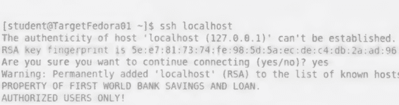

图 37 – 验证 SSH 登录的 Banner 消息

#### 交付物

完成实验 #5：对 Linux 服务应用加固安全后，学生需要提供以下交付物：

- 1. 实验 #5 - 以下文件的截图：
    - a. `/etc/my.cnf` 文件的输出
    - b. `/etc/httpd/conf/httpd.conf` 文件的输出
    - c. `/etc/ssh/sshd_config` 文件的输出
    - d. SSH 会话 MOTD 横幅
- 2. 实验 #5 – 评估问题与答案

#### 评估标准与评分细则

以下是学生必须执行的实验 #5 的评估标准和评分细则：

- 1. 学生是否能够在启用和安装 Linux 服务器服务时对其进行加固，并在配置过程中保持安全视角 – [20%]
- 2. 学生是否能够创建 Apache Web Server 安装，并执行基本安全配置以确保系统在托管网站前已加固 – [20%]
- 3. 学生是否能够配置 MySQL 数据库并执行基本安全设置，理解默认安装的后果并为数据库实例推荐加固步骤 – [20%]
- 4. 学生是否能够安装、设置 Sendmail 并执行基本安全配置，以利用 Linux 系统内置的消息功能 – [20%]
- 5. 学生是否能够为 Linux 服务器系统启用并实现安全的 SSH 加密远程访问（通过网络或互联网） – [20%]

# 实验 #5 – 评估工作表

# 对 Linux 服务及应用应用加固安全

课程名称及编号： _________________________

学生姓名： _________________________

讲师姓名： _________________________

实验截止日期： _________________________

# 概述

本实验是前几项基于设备的实验的延伸，涉及物理服务器中加载的 Linux 服务和应用程序的安全加固。在本实验中，学生将配置安全并加固服务和应用程序，以确保这些服务的 C-I-A。他们将采取步骤配置并保护 Apache Web 服务器和 MySQL 数据库以及安全加固两者实施所需的组件。学生还将展示如何使用并配置 Sendmail 应用程序进行安全的本地消息传递，并启用使用 Secure Shell (SSH) 的安全加密远程访问。

# 实验评估问题与答案

- 1. 在配置服务时，通常哪个 Linux 目录包含服务器配置文件？
本实验涵盖了一些非常基本的 MySQL 数据库服务器和应用的安全加固设置。
- 2. 什么命令禁用了 MySQL 数据库的远程访问？这是安全加固的最佳实践吗？
- 3. 特定服务或应用的 Linux 运行级别（runlevel）是什么？什么命令允许你为服务或应用唯一地定义运行级别？
- 4. Apache Web 服务器是什么？查看 `/etc/httpd/conf/httpd.conf` 配置文件，并指出一个可以增强安全的设置。
- 5. OpenSSH 是远程访问 Linux 系统的事实标准方法。解释为什么不建议使用 telnet。
- 6. 什么是符号链接（Symbolic links）？
- 7. 为什么建议在 MySQL 中禁用符号链接？
- 8. 为什么要添加 '`skip-networking`' 命令？
- 9. `sendmail` 在处理邮件时会创建哪两个文件？
- 10. 你可以使用什么本地命令来查找 `sendmail` 的版本号？

## 实验 #6

### 实验 #6：应用强化安全措施以控制访问

#### 学习目标与成果

完成本实验后，学生将能够执行以下任务：

- 审查当前的内部基于主机的防火墙参数和配置设置，以验证允许和拒绝的 IP 通信
- 使用 `iptables` 配置内部基于主机的防火墙，并为可能需要通过网络访问系统的那些服务创建严格的允许/拒绝规则
- 通过启用 TCPWrappers 来拒绝并记录针对系统上运行的服务和端口的未授权尝试，从而强化系统
- 通过使用和配置 SELinux 来安全系统上运行的进程，以协助执行更深入的纵深防御安全
- 通过连接 Linux 服务器（使用 SSH）以及连接到 Linux 服务器上运行的其他服务来验证已应用的设置配置

#### 所需准备和工具

本实验不需要使用模拟 IT 基础设施 - Cisco 核心骨干网络。此外，教师虚拟机工作站和学生虚拟机工作站应与内部网络物理断开，并隔离在课堂专用的二层交换机上。这将允许使用共享 DHCP 服务器为教师和学生工作站分配 IP 地址。

本动手实验需要以下条件：

- 一个课堂工作站（至少配备 2 Gig RAM），能够支持连接到课堂二层交换机的、装有虚拟机服务器群组的可移除硬盘。
- 一个教师工作站（建议至少配备 4 Gig RAM），将作为教师的演示实验室工作站。教师将通过 LCD 投影仪展示教师工作站，演示如何使用 VMware Player 加载和配置教师虚拟机工作站。
- 学生实验室工作站将使用他们自己的虚拟机服务器群组和虚拟机学生工作站。将使用 VMware Player 来运行学生虚拟机和目标虚拟机。

以下总结了执行实验 #6 所需的设置、配置和设备：

- 1. 一个包含以下组件的虚拟化服务器群组：
  - 用于分配学生 IP 主机地址的 Microsoft DHCP 服务器
  - 学生和/或教师虚拟机工作站
  - Fedora Linux 目标虚拟机
- 2. 标准的现场学生工作站必须加载以下软件应用程序才能进行本实验：
  - VMware Player 3.x
  - Microsoft Office 2007 或更高版本（用于实验评估问题和答案）

#### 推荐操作

**基于设备的实验 #6 – 学生步骤：**

教师将使用 VMware Player 进行以下演示：

1. 将教师可移除硬盘连接到你的工作站
2. 启动教师虚拟机和 Microsoft DHCP 虚拟机服务器，以分配一个 IP 主机地址
3. 启用你的 DOS 命令提示符，输入 "`ipconfig`" 并 "`ping`" 你分配的 IP 主机地址 172.30.0.__、DHCP 服务器 172.30.0.10 以及 IP 默认网关路由器 172.30.0.1
4. 将你的教师工作站连接到 LCD 投影仪，并展示 VMware Player 库以及如何向库和本地计算机添加、移除和复制虚拟机
5. 使用以下凭据登录学生虚拟机：
   - 登录 ID："`student`"（区分大小写）
   - 密码："`ISS316Security`"（区分大小写）
6. 在 GNOME 桌面上，在左侧顶部，点击 "应用程序" -> 系统工具 -> 终端

> **注意：** 在 `sudo` & `su` 命令能够按预期执行之前，用户账户**必须**是 `wheel` 组的成员，并且 `wheel` 组已被授予有限的 `sudo` 访问权限，如实验 3 中所述。

#### 配置严格的允许与拒绝防火墙规则集

7. 列出当前防火墙规则。输入命令：`sudo iptables -L` 并按 `<enter>`。如果被提示输入密码，请输入学生用户的密码 (`ISS316Security`)。
8. 清除防火墙规则。输入命令：`sudo iptables -F` 并按 `<enter>`。如果被提示输入密码，请输入学生用户的密码 (`ISS316Security`)。
9. 验证防火墙规则已清除。输入命令：`sudo iptables -l.` 并按 `<enter>`。如果被提示输入密码，请输入学生用户的密码 (`ISS316Security`)。此时不应该列出任何防火墙规则。
10. 插入一条规则，允许 INPUT 链被添加到防火墙规则中，并允许已建立的连接。
    输入命令：
    `sudo iptables -I INPUT -m state --state ESTABLISHED,RELATED -j ACCEPT` 并按 `<enter>`。如果被提示输入密码，请输入学生用户的密码 (`ISS316Security`)。
11. 追加一条规则以允许 http（web）访问。
    输入命令：
    `sudo iptables -A INPUT -p tcp --port 80 -j ACCEPT` 并按 `<enter>`。如果被提示输入密码，请输入学生用户的密码 (`ISS316Security`)。
12. 追加一条规则以允许 https（SSL）访问。
    输入命令：
    `sudo iptables -A INPUT -p tcp --port 443 -j ACCEPT` 并按 `<enter>`。


### 13. 追加一条规则以允许 ssh 访问

输入命令：

`sudo iptables -A INPUT -p tcp --dport 22 -j ACCEPT` 并按 `<enter>`。

### 14. 追加一条规则以允许 ICMP ping

输入命令：

`sudo iptables -A INPUT -p icmp -j ACCEPT` 并按 `<enter>`。

### 15. 追加一条规则以拒绝所有其他流量

输入命令：

`sudo iptables -A INPUT -p all -j DROP` 并按 `<enter>`。

### 16. 保存新创建的规则

输入命令：`sudo service iptables save` 并按 `<enter>`。

### 17. 再检查一次，确认新创建的规则现在已列出

输入命令：`sudo iptables -L.` 并按 `<enter>`。如果被提示输入密码，请输入学生用户的密码 (`ISS316Security`)。

#### 配置 TCP Wrappers 以拒绝并记录来自 Crackers.com 的所有尝试

18. 在 `vi` 编辑器中打开 `/etc/hosts.deny` 文件。输入命令：`su -c 'vi /etc/hosts.deny'` 并按 `<enter>`。

19. 密码：`ISS316Security`

20. 按 `“i”` 键进入插入（INSERT）模式。

21. 向下滚动，向文件中添加以下新行。确保新行**不**以井号（`#`）开头，因为那些是注释。

```
ALL : .crackers.com : severity emerg
```

22. 保存更改并退出文件。按 `escape` 键退出插入模式，然后按 `"shift" & ":"` 键进入 **命令** 模式。在命令模式的冒号提示符处，输入 `wq` 以退出并保存更改。

23. 将另一个工作站 IP 地址作为 `labhost.crackers.com` 添加到主机文件中。从教师或实验室伙伴处获取一个 IP 地址。

24. 在 `vi` 编辑器中打开 `/etc/hosts` 文件。输入命令：`su -c 'vi /etc/hosts'` 并按 `<enter>`。

25. 密码：`ISS316Security`

26. 按 `“i”` 键进入插入（INSERT）模式。

27. 在文件中添加一行新内容，如下所示：

```
<Instructor-Or-Partner-IP-Address> labhost.crackers.com
```

> 注意：不要实际输入 `<Instructor-Or-Partner-IP-Address>`，而是将其替换为提供的实际 IP 地址。

28. 保存更改并退出文件。按 `escape` 键退出插入模式，然后按 `"shift" & ":"` 键进入 **命令** 模式。在命令模式的冒号提示符处，输入 `wq` 以退出并保存更改。

29. 检查 openssh 服务器状态。输入命令：`sudo service sshd status` 并按 `<enter>`。

30. 如果**未**运行，输入命令：`sudo service sshd start` 并按 `<enter>`。

31. 尝试从刚刚在主机文件中启用的工作站主机地址进行 SSH 远程连接，并验证 SSH 远程访问现在被拒绝连接到 `labhost.crackers.com` 工作站。

### 配置 SELinux 以启用分层安全解决方案

32. 在 `vi` 编辑器中打开 `/etc/selinux/config`。输入命令：`su -c 'vi /etc/selinux/config'` 并按 `<enter>`。

33. 密码：`ISS316Security`

34. 按 `"i"` 键进入插入模式。

35. 将 `SELINUX` 设置从 `"permissive"` 更改为 `"enforcing"`。

```
# This file controls the state of SELinux on the system.
# SELINUX= can take one of these three values:
#     enforcing - SELinux security policy is enforced.
#     permissive - SELinux prints warnings instead of enforcing.
#     disabled - SELinux is fully disabled.
SELINUX=enforcing
# SELINUXTYPE= type of policy in use. Possible values are:
#     targeted - Only targeted network daemons are protected.
#     strict - Full SELinux protection.
SELINUXTYPE=targeted
```


36. 保存更改并退出文件。按 `escape` 键退出插入模式，然后按 `"shift"` 和 `":"` 键进入命令模式。在命令模式的冒号提示符处，输入 `wq` 以退出并保存更改。

37. 重启计算机。输入命令：`su -c 'shutdown -r now'` 并按 `<enter>`。

38. 密码：`ISS316Security`

39. 重启后，登录为

a) 用户：`student`

b) 密码：`ISS316Security`

c) 从 GNOME 桌面环境左上角，点击 `"应用程序"` -> 系统工具 -> `终端`

40. 检查 SELinux 状态。输入命令：`sestatus` 并按 `<enter>`。

当前模式应设置为 `“enforcing”`。

41. 检查 Web 服务器状态。输入命令：`sudo service httpd status` 并按 `<enter>`。

42. 如果未运行，输入命令：`sudo service httpd start` 并按 `<enter>`。如果被提示输入密码，请输入学生用户的密码 (`ISS316Security`)。

43. 查看现在由 SELinux 保护的 Web 进程的 SELinux 设置。输入命令：`ps -ZC httpd` 并按 `<enter>`

44. 结果应显示所有与 `httpd` 守护程序相关的正在运行的进程都运行在标签 `unconfined_u:system_r:httpd_t:s0` 下

45. 查看 Web 服务器类型的布尔设置。输入命令：`getsebool -a | grep httpd` 并按 `<enter>`。

46. 修改布尔设置以允许 HTTP 服务器发送邮件、执行 PHP 脚本以及使用 NFS 共享。

| 功能 | SELinux 布尔值 | Fedora 14 默认值 |
| :--- | :--- | :--- |
| Web 服务器发送邮件 | `httpd_can_sendmail` | 关 |
| Web 服务器可执行 PHP 及其他 Web 脚本 | `httpd_builtin_scripting` | 开 |
| Web 服务器可连接远程 NFS 共享 | `httpd_use_nfs` | 关 |

47. 输入命令：`su -c 'setsebool -P httpd_can_sendmail 1'` 并按 `<enter>`。当被提示时，输入 root 用户的密码 (`ISS316Security`)。重新标记可能需要片刻时间。在命令提示符返回之前请勿按任何键。

48. 输入命令：`su -c 'setsebool -P httpd_builtin_scripting 1'` 并按 `<enter>`。当被提示时，输入 root 用户的密码 (`ISS316Security`)。重新标记可能需要片刻时间。在命令提示符返回之前请勿按任何键。

49. 输入命令：`su -c 'setsebool -P httpd_use_nfs 1'` 并按 `<enter>`。当被提示时，输入 root 用户的密码 (`ISS316Security`)。重新标记可能需要片刻时间。在命令提示符返回之前请勿按任何键。

```
[student@TargetFedora01 ~]$ su -c 'setsebool -P httpd_can_sendmail 1'
Password:

[student@TargetFedora01 ~]$ 
[student@TargetFedora01 ~]$ su -c 'setsebool -P httpd_builtin_scripting 1'
Password:

[student@TargetFedora01 ~]$ su -c 'setsebool -P httpd_use_nfs 1'
Password:
```


#### 交付物

完成实验 #6：应用增强型安全以控制访问后，学生需提供以下交付物：

- 1. 学生需提交以下文件的截图：
    - a. `iptables -L` 命令的输出
    - b. `/etc/hosts.deny` 的输出
    - c. `/etc/selinux/config` 文件的输出
- 2. 实验 #6 – 实验评估问题及答案

#### 评估标准与评分细则

以下是学生必须执行的实验 #6 的评估标准和评分细则：

- 1. 学生是否能够审查当前内部基于主机防火墙的参数和配置设置，以验证允许和拒绝的 IP 通信？ – [20%]
- 2. 学生是否能够使用 `iptables` 配置内部基于主机的防火墙，并为可能需要远程访问系统的服务启用严格的允许/拒绝规则？ – [20%]
- 3. 学生是否能够通过启用 TCPWrappers 来增强系统安全性，以拒绝并记录针对系统上运行的服务和端口的未授权尝试？ – [20%]
- 4. 学生是否能够使用并配置 SELinux 来保护系统上运行的进程，以协助执行更深入的分层安全？ – [20%]
- 5. 学生是否能够通过使用 SSH 连接到 Linux 服务器并连接到 Linux 服务器上运行的其他服务来验证所应用的设置配置？ – [20%]

## 实验 #6 – 评估工作表

应用增强型安全以控制访问

**课程名称及编号：**

\_\_\_\_\_\_\_\_\_\_\_\_\_\_\_\_\_\_\_\_\_\_\_\_\_\_\_\_\_\_\_\_\_\_\_\_\_\_\_\_\_\_\_\_\_\_\_\_\_\_

**学生姓名：**

\_\_\_\_\_\_\_\_\_\_\_\_\_\_\_\_\_\_\_\_\_\_\_\_\_\_\_\_\_\_\_\_\_\_\_\_\_\_\_\_\_\_\_\_

**教师姓名：**

\_\_\_\_\_\_\_\_\_\_\_\_\_\_\_\_\_\_\_\_\_\_\_\_\_\_\_\_\_\_\_\_\_\_\_\_\_\_\_\_\_\_\_\_

**实验截止日期：**

\_\_\_\_\_\_\_\_\_\_\_\_\_\_\_\_\_\_\_\_\_\_\_\_\_\_\_\_\_\_\_\_\_\_\_\_\_\_\_\_\_\_\_\_

## 概述

本实验是之前基于设备实验的延伸。它继续进行 Fedora Linux 服务器的系统和安全增强，要求学生首先审查当前的基于主机的 IP 防火墙服务。他们将刷新当前的防火墙配置，并重新配置严格的允许/拒绝规则集。在本实验中，学生将配置安全和增强服务，包括基于主机的 IP 防火墙、用于未授权访问控制和日志记录的 TCPwrappers，以及用于实施分层安全策略的 SELinux。

## 实验评估问题及答案

- 1. 假设域名 `hackers.com` 在 `hosts.deny` 中针对所有服务被拒绝，且 `hosts.allow` 文件中有规则 `ALL: ALL`。TCPWrappers 是否允许 `hackers.com` 访问？
- 2. 如何启用 SELinux？
- 3. SELinux 的三种模式是什么？解释其基本功能。
- 4. 考虑以下防火墙规则，并描述它允许或拒绝什么。
- 5. 你会使用什么命令来允许所有环回流量？
- 6. 你会使用什么命令来查看 `iptables` 的网络端口配置？
- 7. 如果某项服务在一个地方被允许而在另一处被拒绝，结果会怎样？
- 8. 规则顺序重要吗？如果你在 IP 网络层拒绝了某项内容，但允许使用你刚刚拒绝的 IP 网络层的 TCP 传输层中的某项内容，你的 TCP 流量会被允许吗？
- 9. 如果其中一个文件不存在，会发生什么？
- 10. TCP 包装服务的规则会被缓存吗？

## 实验室 #7

**实验 #7：应用 Linux 内核的增强型安全**

### 学习目标和成果

完成本实验后，学生将能够完成以下任务：

- 审查并调整 Fedora Linux 服务器的内核参数，以用于安全和监控目的
- 生成内核版本和已加载的选项，以便更好地理解系统配置并识别 Fedora Linux 服务器中潜在的安全漏洞
- 编辑 `/etc/sysctl.conf` 文件并调整 `tcp_syscookies` 设置，以在 Fedora Linux 服务器上配置安全选项
- 审查并评估目标 Linux 系统已加载的内核模块 `LKM's`，并对输出和当前运行配置提供建议
- 使用并解释 `lmod` 命令输出，并在 Fedora Linux 服务器上执行安全增强配置

### 所需的设置和工具

本实验不需要使用模拟 IT 基础设施 - Cisco 核心骨干网络。此外，教师 VM 工作机和学生 VM 工作机应与内部网络物理断开连接，并隔离在教室专用的二层交换机上。这将允许使用共享的 DHCP 服务器来分配教师和学生工作机的 IP 地址。

以下为此动手实验所需：

- A) 一台教室工作机（至少 2GB RAM），能够支持连接教室二层交换机的可移动硬盘和 VM 服务器群。
- B) 一台教师工作机（建议至少 4GB RAM），将作为教师的演示实验室工作机。教师将通过 LCD 投影仪显示教师工作机，演示使用 VMware Player 加载和配置教师 VM 工作机。
- C) 学生实验工作机将使用自己的 VM 服务器群和 VM 学生工作机。将使用 VMware Player 运行学生 VM 和目标 VM。

以下内容概述了执行实验 #7 所需的设置、配置和设备：

- 1. 虚拟化服务器集群，包含以下组件：
    - a. 用于分配学生 IP 主机地址的 Microsoft DHCP 服务器
    - b. 学生工作站和/或教师虚拟机工作站
    - c. Fedora Linux 目标虚拟机
- 2. 标准现场学生工作站必须加载以下软件应用程序以执行此实验：
    - a. `VMware Player 3.x`
    - b. `Microsoft Office 2007` 或更高版本，用于实验评估问答

### 建议操作

**基于设备的实验 #7 – 学生步骤：**

学生应执行以下步骤：

1. 将学生可移除硬盘连接至工作站
2. 启动学生虚拟机和 Microsoft DHCP 虚拟机服务器以分配 IP 主机地址
3. 启用您的 DOS 命令提示符，输入 `ipconfig`，并 ping 您分配的 IP 主机地址 `172.30.0.____`、`DHCP` 服务器 `172.30.0.10` 以及 IP 默认网关路由器 `172.30.0.1`
4. 使用以下凭据登录学生虚拟机：
    - 登录 ID：`Student`（区分大小写）
    - 密码：`ISS316Security`（区分大小写）
5. 在 GNOME 桌面上，单击左上角的 `应用程序` -> 系统工具 -> 终端

**注意：** 在执行 `sudo` 和 `su` 命令之前，用户账户**必须**是 `wheel` 组的成员，并且 `wheel` 组必须如**实验 3** 中所述被授予有限的 `sudo` 访问权限。

### 审查和调优 Fedora Linux 服务器的内核参数

6. 查看正在运行的内核的配置设置。输入命令：`cat /etc/sysctl.conf | less` 并按 `<enter>`。
7. 按 `q` 键退出并返回命令提示符。
8. 在 `vi` 编辑器中打开 `/etc/sysctl.conf`。输入命令：`su -c ' vi /etc/sysctl.conf '` 并按 `<enter>`。
9. 密码：`ISS316Security`
10. 按 `i` 键进入插入模式。
11. 在文件末尾添加该行：`net.ipv4.tcp_syncookies = 1`
12. 保存更改并退出文件。按 `ESC` 键退出插入模式，然后按 `shift` 和 `:` 键进入命令模式。在命令模式的冒号提示符处，输入 `wq` 以退出并保存更改。
13. 立即更改内核设置，无需重启。输入命令：`su -c ' echo "1" > /proc/sys/net/ipv4/tcp_syncookies '` 并按 `<enter>` 以立即启用 `tcp_syncookies` 而无需重启。当提示时，输入 root 密码（ `ISS316Security` ）。
14. 查看当前内核参数设置。输入命令：`cat /proc/sys/net/ipv4/tcp_syncookies` 并按 `<enter>`。 `1` 表示正在运行的内核中该设置已设为 `开`。
15. 查看所有可用参数。输入命令：`sysctl -a | less` 并按 `<enter>`。使用键盘箭头向上或向下滚动页面。
16. 按 `q` 键退出并返回命令提示符。
17. 使用 `sysctl` 命令更改内核参数。输入命令：`su -c ' sysctl -w fs.file-max=100000 '` 并按 `<enter>`。
18. 密码：`ISS316Security`


19. 这将更改用户一次可以打开的文件数量上限。

## 发现关于当前运行内核的信息

20. 查找内核支持的文件系统类型。输入命令：`cat /proc/filesystems` 并按 <enter>。

21. 查找内核正在加载哪些模块。输入命令：`cat /proc/modules` 并按 <enter>。

22. 查找当前运行的内核版本。输入命令 `cat /proc/version` 并按 <enter>。

23. 查找有关 CPU 的信息。输入命令：`cat /proc/cpuinfo` 并按 <enter>。

24. 查找有关内存中运行进程的信息。输入命令：`cat /proc/meminfo` 并按 <enter>。

## 可加载内核模块（LKM）

25. 列出已加载的模块。输入命令 `lsmod` 并按 <enter>

| 模块 | 大小 | 被谁使用 |
|:-------|:-----|:--------|
| fuse | 51432 | 3 |
| ip6t_REJECT | 3470 | 2 |
| nf_conntrack_ipv6 | 14441 | 2 |
| ip6table_filter | 1207 | 1 |
| ip6_tables | 9929 | 1 ip6table_filter |
| ipv6 | 229420 | 24 ip6t_REJECT,nf_conntrack_ipv6 |
| uinput | 5228 | 0 |
| microcode | 11139 | 0 |
| vmware_balloon | 5280 | 0 |
| ppdev | 6808 | 0 |
| snd_ens1371 | 15976 | 2 |
| gameport | 7804 | 1 snd_ens1371 |
| snd_rawmidi | 16580 | 1 snd_ens1371 |
| snd_ac97_codec | 89730 | 1 snd_ens1371 |
| parport_pc | 17897 | 0 |
| parport | 26215 | 2 ppdev,parport_pc |
| ac97_bus | 922 | 1 snd_ac97_codec |
| snd_seq | 43447 | 0 |
| snd_seq_device | 5056 | 2 snd_rawmidi,snd_seq |
| snd_pcm | 61769 | 2 snd_ens1371,snd_ac97_codec |
| snd_timer | 15435 | 2 snd_seq,snd_pcm |
| pcnet32 | 26409 | 0 |

图 40 – 使用 `lsmod` 命令列出已加载的内核模块

## 移除和加载模块

**注意：** 要移除模块，使用命令 `modprobe -r <module_name>`。从上一步的结果中，查找“Used By”列中为“0”的模块。零（0）表示已加载的模块当前未使用，可以移除。

26. 移除一个已加载的模块。输入命令：`su -c 'modprobe -r <module_name>'`

27. 密码：`ISS316Security`

**注意：** 不要在命令中输入 `module_name`。相反，用要移除的模块名称替换它。例如，如果要移除 `snd_seq` 模块，正确的命令是：`su -c 'modprobe -r snd_seq'`。

28. 加载一个模块。输入命令：`su -c 'modprobe <unloaded_module>'` 并按 <enter> 以加载之前移除的模块。

29. **密码：** `ISS316Security`

**注意：** 不要在命令中输入 `unloaded_module`。相反，用上一步中移除的模块名称替换它。例如，如果要加载 `snd_seq` 模块，正确的命令是：`su -c 'modprobe snd_seq'`。

### 交付物

在完成实验 #7：为 Linux 内核应用强化安全后，学生需要提交以下交付物：

- 1. 实验 #7 - 提交以下文件的截图：
    - a. `/etc/sysctl.conf` 文件的输出
    - b. 运行命令 `sysctl -a` 的输出
    - c. `cat /proc/filesystems, /proc/modules, /proc/version, /proc/cpuinfo` 和 `/proc/meminfo` 的输出
    - d. 运行 `lsmod` 的输出
- 2. 实验 #7 – 实验评估问题与答案

# 评估标准和评分表

以下是学生必须执行的实验 #7 的评估标准和评分表：

- 1. 学生是否能够在 Fedora Linux 服务器上审查和调整内核参数以用于安全和监控目的？ – [20%]
- 2. 学生是否能够提供内核版本和已加载的选项，以更好地理解系统如何配置，并识别 Fedora Linux 服务器中潜在的安全漏洞？ – [20%]
- 3. 学生是否能够编辑 `/etc/sysctl.conf` 文件并调整 `tcp_syncookies` 设置，以在 Fedora Linux 服务器上为用户配置安全选项？ – [20%]
- 4. 学生是否能够审查和评估目标 Linux 系统的已加载内核模块（LKM），并针对输出和当前运行配置提供建议？ – [20%]
- 5. 学生是否能够使用并解释 `lsmod` 命令输出，并在 Fedora Linux 服务器上执行安全强化配置？ – [20%]

# **实验 #7 – 评估工作表**

# **为 Linux 内核应用强化安全**

课程名称和编号：\_\_\_\_\_\_\_\_\_\_\_\_\_\_\_\_\_\_\_\_\_\_\_\_\_\_\_\_\_\_\_\_\_\_\_\_\_\_\_\_\_\_

学生姓名：\_\_\_\_\_\_\_\_\_\_\_\_\_\_\_\_\_\_\_\_\_\_\_\_\_\_\_\_\_\_\_\_\_\_\_\_\_\_\_\_\_\_\_\_\_

教师姓名：\_\_\_\_\_\_\_\_\_\_\_\_\_\_\_\_\_\_\_\_\_\_\_\_\_\_\_\_\_\_\_\_\_\_\_\_\_\_\_\_\_\_\_\_\_

实验截止日期：\_\_\_\_\_\_\_\_\_\_\_\_\_\_\_\_\_\_\_\_\_\_\_\_\_\_\_\_\_\_\_\_\_\_\_\_\_\_\_\_\_\_\_\_

# **_概述_**

本实验是之前基于设备的实验的延伸。本实验继续对 Fedora Linux 服务器进行系统和安全强化。在本实验中，学生需要审查并使用安全参数对 Linux 内核进行安全强化。他们将执行步骤来查看和调整所有内核参数，发现有关当前可加载内核模块（LKM）以及内核本身的信息。最后，他们将启用并解释“`lsmod`”命令的结果以执行额外的安全强化。

# **_实验评估问题与答案_**

- 1. 查看当前 Linux 内核参数的命令是什么？
- 2. 你可以运行什么命令来列出内核所有可用参数，一次一屏，并能够向前和向后移动输出？
- 在 Linux 内核中启用 syncookies 的目的是什么？
- 当您需要启用一个 Linux 内核命令并立即生效，而不希望物理重启系统时，必须在命令参数前启用什么命令？请解释以下命令的作用：`echo "1" > /proc/sys/net/ipv4/ip_forward`
- 如果您希望将 Fedora Linux 服务器上用户同时打开的文件数限制为最大 1 个，需要在 Linux 内核中启用什么命令语法？
- 对内核进行系统级永久更改以启用 syncookies 的最佳方法是什么？
- 假设有一个刚刚安装好的系统，您的老板要求您确保它在内核级别上保持最新状态并得到加固。您会采取哪些步骤来验证哪些模块已加载到内核中，并如何对其执行加固操作？
- 您会启用什么设置将内核设置为调试模式？为什么有人会选择启用此功能？
- `sysctl.conf` 文件与 `sysctl` 命令之间的关系是什么？
- 如果不编辑 `sysctl.conf` 文件，是否可以修改内核参数？如果可以，请举例说明。

## 实验 #8

## 实验 #8：实施安全软件管理的最佳实践

### 学习目标和成果

完成此实验后，学生将能够完成以下任务：

- 在发现内核中安装的所有软件包后，建议安全设置，以有助于评估必要的安全措施
- 配置 RPM 数据库，安全地添加软件仓库，以便向那些不需要直接访问系统权限、只需下载更新或 RPM 包的人员分发软件
- 验证源代码 tarball，确定在执行或安装之前，软件包的完整性和内容是否符合预期
- 使用并借助 MD5Sum 验证下载的 software tarball 的完整性
- 使用 `wget` 从互联网获取并安装第三方软件到 Linux 系统上

### 所需设置和工具


此实验不需要使用 Mock IT Infrastructure - Cisco 核心骨干网络。此外，教师 VM 工作站和学生 VM 工作站应与内部网络物理断开连接，并隔离在课堂专用的二层交换机上。这将允许使用共享的 DHCP 服务器为教师和学生工作站分配 IP 地址。

以下为此设备类实验所需的配置：

- A) 一台课堂工作站（至少 2 Gig RAM），能够支持连接到课堂二层交换机的带有虚拟机服务器场的可移动硬盘。
- B) 一台教师工作站（建议至少 4 Gig RAM），将作为教师的演示实验室工作站。教师将通过 LCD 投影仪展示教师工作站，以演示如何使用 `VMware Player` 加载和配置教师 VM 工作站。
- C) 学生实验室工作站将使用他们自己的虚拟机服务器场和 VM 学生工作站。将使用 `VMware Player` 运行学生 VM 和目标 VM。

以下总结了执行实验 #8 所需的设置、配置和设备：

1. 一个包含以下组件的**虚拟化服务器场**：
   - a. 用于分配学生 IP 主机地址的 Microsoft DHCP 服务器
   - b. 学生或教师 VM 工作站
   - c. Fedora Linux 目标 VM
2. 标准的现场学生工作站必须加载以下软件应用程序才能执行此实验：
   - a. `VMware Player 3.x`
   - b. Microsoft Office 2007 或更高版本，用于实验评估问题及答案

### 推荐步骤

**基于设备的实验 #8 – 学生步骤：**

学生应执行以下步骤：

1. 将学生可移动硬盘连接到工作站
2. 启动学生 VM 和 Microsoft DHCP VM 服务器以分配 IP 主机地址
3. 启用 DOS 命令提示符并输入 `ipconfig`，然后 `ping` 您分配的 IP 主机地址 `172.30.0.__`，DHCP 服务器 `172.30.0.10`，以及 IP 默认网关路由器 `172.30.0.1`
4. 使用以下凭据登录到学生 VM：
   - 登录 ID：`student`（区分大小写）
   - 密码：`ISS316Security`（区分大小写）
5. 从 GNOME 桌面，在左上角，点击 `应用程序` -> 系统工具 -> 终端

> **注意：** 为了正确完成此实验，您的 Fedora 14 VM 将需要**实时（LIVE）**互联网连接。**请勿**将学生工作站从课堂网络和互联网连接中断开。

> **注意：** 在 `sudo` 和 `su` 命令能够按预期执行之前，用户账户**必须**是 `wheel` 组的成员，并且 `wheel` 组必须已被授予在实验 3 中指导的有限 `sudo` 权限。

### 使用 RPM 执行软件管理任务

6. 查看所有与 `sendmail` 软件包关联的文件。输入命令：`rpm -ql sendmail | less` 并按 `<enter>`。使用上下箭头键滚动。

```
[student@TargetFedora01 ~]$ rpm -ql sendmail | less
```


7. 按 `q` 键退出并返回到命令提示符。
8. 发现 `/bin/ls` 可执行文件属于哪个软件包。输入命令：`rpm -qf /bin/ls` 并按 `<enter>`

```
[student@TargetFedora01 ~]$ rpm -qf /bin/ls
```


9. 验证 `httpd` 软件包中文件的完整性。输入命令：`sudo rpm -V httpd` 并按 `<enter>`。

> **注：** 如果软件包所属的任何文件都没有被修改，则不会返回任何输出。但是，如果文件已更改，则会显示输出。如果 `/etc/httpd/conf/httpd.conf` 如实验 7 中指导的那样被修改，则应显示类似于以下内容的输出：

```
[student@TargetFedora01 ~]$ sudo rpm -V httpd
S.5....T.   c /etc/httpd/conf/httpd.conf
```


使用下表来确定特定文件上进行了什么类型的更改。

| 标志 | 描述 |
|---|---|
| S | 大小变更 |
| M | 权限变更 |
| 5 | MD5 变更 |
| L | 符号链接变更 |
| D | 设备变更 |
| U | 用户变更 |
| G | 组变更 |
| Missing | 文件已被删除或移动 |

**表 1 - 验证软件包完整性时的符号查找表**

10. 搜索计算机上当前已安装的所有软件包。输入命令：`rpm -qa | less` 并按 `<enter>`。使用键盘上的箭头键向上或向下滚动。
11. 按 `q` 键退出并返回到命令提示符。

### 通过互联网下载软件应用程序并使用 MD5Sum 哈希验证完整性

12. 安装 `wget` 软件。输入命令：`sudo yum install wget -y` 并按 `<enter>`。如果提示输入密码，请输入学生用户 `ISS316Security` 的密码。
13. 下载 Python 源代码。输入命令：`wget http://www.python.org/ftp/python/2.6.5/Python-2.6.5.tgz` 并按 `<enter>`

```
[student@TargetFedora01 ~]$ wget http://www.python.org/ftp/python/2.6.5/Python-2.6.5.tgz
```

**图 44 – 从互联网下载源代码文件**

14. 打开 Web 浏览器。从 GNOME 桌面菜单，*点击* 左上角菜单中的 `应用程序`，然后选择 `Internet->Firefox` 以打开 Firefox 网页浏览器。

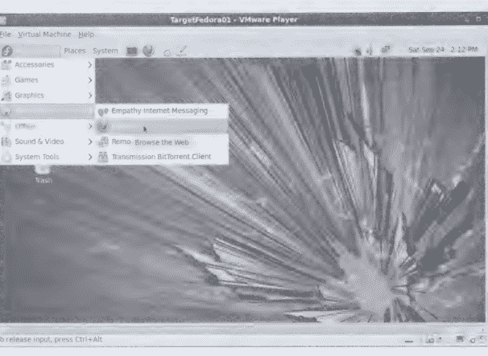

15. 输入 URL。在地址栏中输入：`http://www.python.org/download/releases/2.6.5/`
16. 查找并阅读校验和。滚动直到找到以下语法。网站上 `Python-2.6.5.tgz` 的特定校验和应与下载的 `Python-2.6.5.tgz` 相匹配。

发布文件的 MD5 校验和和大小：

```text
cd04b5b9383c6c1fccdaa991af762cf4   13209175   Python-2.6.5.tgz
6bef0417e71a1a137ccc5750420fdb3    11095581   Python-2.6.5.tar.bz2
9cd2c4d23dea7dfcd964449c3008f042   15430656   python-2.6.5.amd64.msi
0b6bc43c45fb2e3195ec2daf3fad59fc2   15103488   python-2.6.5.msi
84489bba813fd36b6041b69d4310a86da   20348693   python-2.6.5-macosx10.3-2010-03-24.dmg
```

图 46 – 位于 python.org 上的 MD5 校验和列表

17. 验证下载的校验和。输入命令：`md5sum Python-2.6.5.tgz` 并按 `<enter>`，并验证校验和是否与步骤 15 中的一致。

### 添加第三方软件仓库并修改文件

18. 下载公钥。输入命令：`wget http://dl.ssl.google.com/linux/linux_signing_key.pub` 并按下 `<enter>` 键。
19. 验证下载密钥的签名。输入命令：`gpg linux_signing_key.pub` 并按下 `<enter>` 键。

```
[student@TargetFedora01 ~]$ gpg linux_signing_key.pub
:pub  1024D/7FAC5991  2007-03-08 Google, Inc. Linux Package Signing Key <linux-packages-keymaster@google.com>
:sub  2048g/C07CB649  2007-03-08
```

**图 47 – 验证从互联网下载的密钥签名**

20. 将密钥导入 rpm 数据库。输入命令 `sudo rpm --import linux_signing_key.pub` 并按下 `<enter>` 键。如果系统提示输入密码，请输入学生用户的密码 `ISS316Security`。

```
[student@TargetFedora01 ~]$ sudo rpm --import linux_signing_key.pub
[sudo] password for student:
```


## 图 48 – 将密钥导入 RPM 数据库

21. 更改目录到软件仓库文件目录。输入命令 `cd /etc/yum.repos.d/` 并按下 `<enter>` 键。

22. 创建并打开仓库文件。输入命令：`su -c 'vi google.repo'` 并按下 `<enter>` 键。

23. 密码：`ISS316Security`

24. 按下 `i` 键进入 `插入模式`。

25. 按照下方显示的内容 **准确无误** 地输入以下内容。

```
[Google]
name=Google IS418
baseurl=http://dl.google.com/linux/rpm/stable/i386
enabled=1
gpgcheck=1
gpgkey=https://dl-ssl.google.com/linux/linux_signing_key.pub
```

26. 保存更改并退出文件。按下 `ESC` 键退出插入模式，然后按下 `Shift` 和 `;` 键进入命令模式。在命令模式的冒号提示符处，输入 `wq` 以保存更改并退出。如果您现在需要安装由 Google 发布的软件，那么您现在已经拥有了供 `yum` 安装程序检查的合适仓库！

### 交付物

在完成实验 #8：实施安全软件管理最佳实践后，学生需要提供以下交付物：

- 1. 实验 #8 - 提交以下文件的屏幕截图：
  - a. 步骤 4 至 7 中运行的所有 `rpm` 命令的输出
  - b. 下载的 Python 文件的已验证 MDS 输出
  - c. 添加到 `/etc/yum.repos.d/google.repo` 的仓库的输出
- 2. 实验 #8 – 实验评估问题及答案

### 评估标准和评分细则

以下是学生必须执行的实验 #8 的评估标准和评分细则：

- 1. 学生是否能够在发现内核中所有已安装的软件包并评估所需的安全措施后推荐安全设置？– [20%]
- 2. 学生是否能够配置 RPM 数据库，以安全地为那些不需要直接访问系统、只需下载更新或 RPM 的人员添加用于分发软件的仓库？– [20%]
- 3. 学生是否能够验证源代码包，以确定在执行或安装该包之前，其完整性和内容是否符合预期？– [20%]
- 4. 学生是否能够使用并借助 `MD5Sum` 来验证已下载软件压缩包的完整性？– [20%]
- 5. 学生是否能够使用 `wget` 从互联网获取并安装第三方软件到 Linux 系统？– [20%]

## 实验 #8 – 评估工作表

### 实施安全软件管理最佳实践

课程名称与编号：________________________

学生姓名：________________________

讲师姓名：________________________

实验截止日期：________________________

## 概述

在这个实验中，学生将审查内核中所有已安装的应用程序和软件包。从这个列表中，讲师将演示如何在下载和安装新应用程序时验证源代码包，以进行应用程序完整性验证。然后，他们将正确地保护 Fedora Linux 服务器中的 RPM 服务。接下来，他们执行步骤以发现所有已安装的内核 RPM 软件包，验证源代码包，并安全地向 RPM 数据库添加第三方仓库。还将使用 `MD5Sum` 进行哈希和完整性验证。最后，学生将使用 `wget` 审查并在 Fedora Linux 服务器上安装第三方应用程序。

## 实验评估问题及答案

- 1. 解释以下命令：`rpm -qf /bin/ls`
- 2. 讨论软件仓库在 `YUM` 中的作用。
- 3. 如何确保下载的压缩文件是合法的且未被篡改？
- 4. 列出并解释至少 3 个 `tar` 命令可用的开关，这些开关在提取和安装压缩文件时非常有用。
- 5. 列出并解释至少 3 个与 `rpm` 命令关联的开关，这些开关可用于验证、列出和安装 `rpm` 软件包。
- 6. 在运行安装之前，您可以启用哪种安全对策来验证下载的应用程序或压缩文件的完整性？
- 7. 解释什么是哈希以及它与加密有何不同？

版权所有 © 2013 Jones & Bartlett Learning, LLC，Ascend Learning Company 旗下公司

`www.jblearning.com`

保留所有权利。

当前版本日期：10/10/2011

- 8. 如果您想知道某个程序属于哪个软件包，您会运行什么命令？
- 9. 一旦您下载了 RPM 软件包，如果您希望将文件提取到您选择的目录，您将运行什么命令？
- 10. 在 Fedora Linux 服务器中，您可以在哪里找到所有已安装程序的校验和哈希？

## 实验室 #9

## 实验 #9：实施安全日志记录与监控最佳实践

### 学习目标和成果

完成本实验后，学生将能够完成以下任务：

- 在 Fedora Linux 服务器上配置远程日志记录，并将系统日志和其他事件发送到远程主机进行安全的二级日志记录
- 在 Fedora Linux 服务器中搜索不同的日志文件，以识别某些类型日志的存储位置及其回收频率
- 安装和配置 `Tripwire` 文件完整性工具，以便快速识别并对本地和远程的重要系统文件修改进行适当记录
- 使用 `cron` 子系统安装并计划 `rkhuntor` 在所述间隔运行，以便如果可能，能够适当且快速地识别 `rootkit`
- 配置对日志文件的自动搜索以及重要安全应用程序的自动运行，以正确监控 Fedora Linux 服务器上的恶意活动

#### 必需的设置和工具

本实验不需要使用模拟 IT 基础设施 - Cisco 核心骨干网络。此外，讲师 VM 工作站和学生 VM 工作站应与内部网络物理断开，并隔离在教室专用的二层交换机上。这将允许使用共享的 DHCP 服务器来分配讲师工作站和学生工作站的 IP 地址。

此基于设备的实验室需要以下内容：

- A) 一个教室工作站（至少 2 GB RAM），能够支持连接着 VM 服务器群并连接到教室二层交换机的可移除硬盘驱动器。
- B) 一个讲师工作站（建议至少 4 GB RAM），它将作为讲师的演示实验室工作站。讲师将通过 LCD 投影仪显示讲师工作站，以演示如何使用 `VMware Player` 加载和配置讲师 VM 工作站。
- C) 学生实验室工作站将使用自己的 VM 服务器群和 VM 学生工作站。将使用 `VMware Player` 运行学生 VM 和目标 VM。

以下是执行实验 #9 所需的设置、配置和设备的总结：

- 1. 一个具有以下组件的虚拟化服务器群：
  - a. 用于分配学生 IP 主机的 Microsoft DHCP 服务器
  - b. 学生或讲师 VM 工作站
  - c. Fedora Linux 目标 VM
- 2. 标准的现场学生工作站必须加载以下软件应用程序才能执行此实验：
  - a. `VMware Player 3.x`
  - b. Microsoft Office 2007 或更高版本，用于实验评估问题及答案

### 建议程序

### 基于设备的实验 #9 – 学生步骤：

学生应执行以下步骤：

- 1. 将学生可移除硬盘驱动器连接到您的工作站
- 2. 启动学生 VM 和 Microsoft DHCP VM 服务器以分配 IP 主机地址
- 3. 启用您的 DOS 命令提示符，输入 `ipconfig` 并 ping 您分配的 IP 主机地址 `172.30.0.__`，DHCP 服务器 `172.30.0.10`，以及 IP 默认网关路由器 `172.30.0.1`
- 4. 使用以下凭据登录到学生 VM：
  - 登录 ID：`student`（区分大小写）
  - 密码：`!SS316Security`（区分大小写）
- 5. 在 GNOME 桌面上，在左上角，点击 `应用程序` -> 系统工具 -> 终端

**注意：** 为了正确完成本实验，您的教室工作站需要实时互联网连接。请勿断开学生工作站与教室网络和互联网连接的连接。

**注意：** 在 `sudo` 和 `su` 命令能够按预期执行之前，用户账户**必须**是 `wheel` 组的成员，并且 `wheel` 组必须被授予有限的 `sudo` 访问权限，如 **实验 3** 中所述。

### 配置到外部日志记录与监控服务器的远程日志记录

- 6. 在 `vi` 编辑器中打开 `/etc/rsyslog.conf`。输入命令：`su -c 'vi /etc/rsyslog.conf'`
- 7. **密码：** `ISS316Security`
- 8. 按 `:` 键进入 **插入** 模式。
- 9. 找到并取消注释以下行（删除 `#`）

```text
# SModLoad imudp.so
# $UDPSPerverRun 514
```

- 10. 向下滚动并找到该行：`*.* @@remote-host:514`。在下一行下方，添加新的一行：`*.* @<教师服务器IP地址>:514`


**注意：** 不要使用 `<教师服务器IP地址>`。请替换为教师的虚拟机 IP 地址。例如，如果教师的虚拟机 IP 地址为 `172.30.0.40`，该行应显示为：`*.* @@172.30.0.40:514`

11. 保存更改并退出文件。按 `escape` 键退出插入模式，然后按 `shift` 和 `:` 键进入命令模式。在命令模式的冒号提示符下，输入 `wq` 以退出并保存更改。

### 搜索日志文件

12. 启动 openssh 服务器。输入命令：`sudo service sshd start` 并按 `<enter>`。如果提示，请输入学生账户的密码（`ISS316Security`）。

13. 使用无效账户通过安全外壳（SSH）连接到本地主机。输入命令：`ssh nonexist@localhost` 并按 `<enter>`。

**注意：** 该账户在服务器上不存在。但无论如何请尝试登录，以生成一条日志记录。当出现消息“Are you sure you want to continue connecting(yes/no)?”时，输入：`yes` 并按 `<enter>`。接下来，输入任意密码。三次尝试失败后，连接将断开。

14. 从安全日志中读取日志信息。输入命令：`su -c ' cat /var/log/secure | grep nonexist '` 并按 `<enter>`。

15. **密码：** `ISS316Security`

16. 查找最后安装的包或软件。输入命令：`su -c ' tail /var/log/yum.log '` 并按 `<enter>`

17. **密码：** `ISS316Security`

18. 在日志中查找系统启动时是否启动了 sshd 服务。输入命令：`su -c ' cat /var/log/boot.log | grep sshd'` 并按 `<enter>`。

19. **密码：** `ISS316Security`

### 安装和配置 Tripwire

20. 安装 Tripwire 软件。输入命令：`sudo yum install tripwire -y` 并按 `<enter>`。如果提示输入密码，请输入学生用户的密码（`ISS316Security`）。

21. 配置 tripwire。输入命令：`su -c 'tripwire-setup-keyfiles'`

22. **密码：** `ISS316Security`

23. 按照步骤创建站点和本地密钥文件密码短语。

    - a) 站点密码短语输入 'is418lab09'

    - b) 本地密码短语输入 'is418lab09'。

**注意：** 该过程将要求输入站点和本地密码短语以生成加密的策略和配置文件。当被提示时，请输入之前过程中创建的密码，即 'is418lab09'

24. 初始化 Tripwire 数据库。输入命令：`su -c 'tripwire --init'` 并按 `<enter>`。

25. **密码：** `ISS316Security`

26. 请输入您的本地密码短语：`is418lab09`

```
[student@TargetFedora01 yum.repos.d]$ su -c 'tripwire --init'
Password:
Please enter your local passphrase:
```


**注意：** Tripwire 将根据默认策略文件中的指定内容对计算机上的所有文件建立索引。会出现几次“No such file or directory.”（没有该文件或目录）的警告。由于实验中使用默认配置文件引用了 Fedora 中未找到的许多文件位置，因此可以忽略这些警告。完成索引后，将出现一条消息“The database was successfully generated.”（数据库已成功生成。）。

27. 对 `/bin/ls` 文件强制进行时间戳更改。输入命令：`su -c 'touch /bin/ls'` 并按 `<enter>`。

28. **密码：** `ISS316Security`

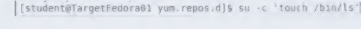

图 50 – 更改 `/bin/ls` 文件的时间戳

29. 使用 Tripwire 执行文件完整性检查。输入命令：`su -c 'tripwire --check'` 并按 `<enter>`。

30. **密码：** `ISS316Security`

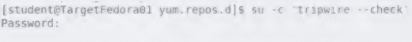

图 51 – 运行 tripwire 文件完整性检查器

> **注意：** Tripwire 现在将检查默认策略文件中指定的已索引文件。与之前步骤一样，“No such file or directory”（没有该文件或目录）警告可以忽略。报告生成后，向上滚动查看报告结果。至少应该有针对已修改的 `/bin/ls` 文件的违规项。

### 安装和计划 rkhunter

31. 安装 rkhunter rootkit 检查器。输入命令：`sudo yum install rkhunter -y` 并按 `<enter>`。如果提示输入密码，请输入学生用户的密码（`ISS316Security`）。

32. 输入命令：`su -c 'rkhunter --update'` 并按 `<enter>` 以确保 rkhunter 软件已使用最新的签名进行更新。当被提示时，请输入 root 的密码（`ISS316Security`）。


图 52 – 更新 rkhunter 数据库

33. **输入命令：** `su -c 'vi /etc/rkhunter.conf'` 并按 `<enter>`。当被提示时，请输入 root 的密码（`ISS316Security`）。

34. **向下滚动并找到该行：** `MAIL-ON-WARNING="root"`

35. 按 `i` 键进入 **插入模式**。

36. 将 `MAIL-ON-WARNING="root"` 更改为 `MAIL-ON-WARNING="student"`。

37. **保存更改并退出文件。** 按 `escape` 键退出插入模式，然后按 `shift` 和 `:` 键进入命令模式。在命令模式的冒号提示符下，输入 `wq` 以退出并保存更改。

38. 使用 cron 计划程序，计划 rkhunter 每天早上 2:30 am 运行。

39. 使用 `vi` 编辑器创建一个空文本文件。**输入命令：** `vi rkhunter.txt` 并按 `<enter>`。

40. 按 `i` 键进入 **插入模式**。

41. 将以下行添加到 `rkhunter.txt` 文件

```
30 2 * * * /usr/bin/rkhunter -c -q >/dev/null 2>&1
```

42. 保存更改并退出文件。按 `escape` 键退出插入模式，然后按 `shift` 和 `:` 键进入命令模式。在命令模式的冒号提示符下，输入 `wq` 以退出并保存更改。

43. 为 root 用户计划 cron 任务。**输入命令：** `su -c 'crontab rkhunter.txt'` 并按 `<enter>`。

44. **密码：** `ISS316Security`

45. 列出已安装的 cron 任务。**输入命令：** `su -c 'crontab -l'` 并按 `<enter>`

46. **密码：** `ISS316Security`

47. **输入命令：** `su -c 'rkhunter -c'` 并按 `<enter>`。

48. **密码：** `ISS316Security`

```
[student@TargetFedora01 ~]$ su -c 'crontab rkhunter.txt'
Password:
[student@TargetFedora01 ~]$ su -c 'crontab -l'
Password:
30 2 * * * /usr/bin/rkhunter -c -q >/dev/null 2>&1
```


#### 交付物

完成实验 #9：实施安全日志记录与监控的最佳实践后，学生需要提供以下交付物：

- 1. 学生需提交以下文件的截图：

    - a. `/etc/rsyslogd.conf` 文件的输出

    - b. `/var/log/secure`、`/var/log/yum.log` 和 `/var/log/boot` 日志文件的输出

    - c. `tripwire` 和 `rkhunter` 两者成功的 `yum install` 命令输出


# 实验 #9 - 评估工作表，包含评估问题的答案

## 评估标准和评分细则

以下是学生必须执行的实验 #9 的评估标准和评分细则：

- 1. 学生是否能够在 Fedora Linux 服务器中配置远程日志记录，并将 syslogs 和其他事件发送到远程主机以进行安全的二级日志记录？ – [20%]
- 2. 学生是否能够在 Fedora Linux 服务器中搜索不同的日志文件，以识别特定类型的日志存储位置及其回收频率？ – [20%]
- 3. 学生是否能够安装并配置 Tripwire 文件完整性工具，以便快速识别并正确记录（本地和远程）对重要系统文件的修改？ – [20%]
- 4. 学生是否能够安装并计划 rkhunter 使用 cron 子系统在指定间隔运行，从而在可能的情况下正确且快速地识别 rootkit？ – [20%]
- 5. 学生是否能够配置日志文件的自动搜索以及重要安全应用程序的自动运行，以正确监控 Fedora Linux 服务器的恶意活动？ – [20%]

# 实验 #9 – 评估表

## 实施安全日志与监控的最佳实践

课程名称与编号：

学生姓名：

讲师姓名：

实验截止日期：

## 概述

在本实验中，学生将为 Fedora Linux 服务器启用系统日志记录，用于生产服务器的安全操作和管理。讲师将演示如何启用日志记录，使系统日志文件自动发送到网络上的远程服务器。讲师还将演示在 Fedora Linux 服务器上使用第三方文件完整性工具 Tripwire，以及使用 rkhunter。最后，讲师将演示如何使用 cron 自动化搜索大型日志文件。

## 实验评估问题与答案

- 1. 在本地 Linux 系统上存储日志文件的主要位置是什么，该位置有哪些推荐的操作规程？
- 2. 为什么将日志远程发送到中央服务器被视为最佳实践？
- 3. 为了从你的 Linux 系统向位于 `172.130.1.254` 的日志服务器发送 syslog，你需要编辑哪个文件，并且使用什么语法和条目？
- 4. 为什么“Tripwire”应用程序被认为是一个文件完整性检查器？
- 5. `rkhunter` 可以被视为文件完整性检查器吗？为什么是或为什么不是。
- 6. 你会如何检查一个定时的循环 cron 任务是否已计划执行？
- 7. 当涉及 cron 任务时，你如何将仅限错误条件或更高级别的日志通过 syslog 发送到作为 `172.130.1.254` 列出的远程日志记录服务器？
- 8. 作为系统管理员，你注意到系统上的日志开始占用大量空间。你有一个远程 syslog 服务器，空间充足，但希望最大限度地减少物理系统上的日志量。在 Linux 中手动和自动实现这一目标的方法是什么？
- 9. syslog 运行在哪个端口，它使用什么传输协议？为什么这是重要的信息？
- 10. 指出系统上 Syslog 服务的一个安全影响？

# 实验 #10

## 实验 #10：定义 Linux 操作系统与应用程序的备份与恢复流程

### 学习目标与成果

完成本实验后，学生将能够完成以下任务：

- 确保 Linux 操作系统、应用程序和数据可用性，并拥有文档化的备份和恢复流程
- 在 Linux 操作系统中配置并执行备份，作为增强备份和恢复流程及最大化系统可用性的自动化且稳定的方式
- 在 Linux 操作系统中，在备份执行过程中对备份进行加密，以保护数据备份和存储安全
- 根据定义的恢复时间目标 `RTO`，恢复加密备份以完全恢复 Linux 操作系统
- 使用 Linux 中的 `/proc` 备份和恢复已删除的文件，以便在发生文件或损坏的情况下，无需恢复整个系统

### 必需的设置和工具

本实验不需要使用模拟 IT 基础设施 - Cisco 核心骨干网络。此外，讲师 VM 工作站和学生 VM 工作站应与内部网络物理断开连接，并隔离在课堂专用的二层交换机上。这将允许使用共享的 DHCP 服务器来分配讲师和学生工作站的 IP 地址。

以下是在进行此基于设备的实验所需的内容：

- A) 一个教室工作站（至少 2 Gig RAM），能够支持连接到教室二层交换机的可移动硬盘和 VM 服务器集群。
- B) 一个讲师工作站（建议至少 4 Gig RAM），将作为讲师的演示实验室工作站。讲师将在 LCD 投影仪上显示讲师工作站，以演示使用 VMware Player 加载和配置讲师 VM 工作站。
- C) 学生实验室工作站将使用自己的 VM 服务器集群和 VM 学生工作站。`VMware Player` 将用于运行学生 VM 和目标 VM。

以下总结了执行实验 #10 所需的设置、配置和设备：

- 1. 一个虚拟化服务器集群，包含以下组件：
    - a. Microsoft DHCP 服务器，用于分配学生 IP 主机地址
    - b. 学生或讲师 VM 工作站
    - c. Fedora Linux 目标 VM
- 2. 标准的现场学生工作站必须加载以下软件应用程序以执行本实验：
    - a. `VMware Player 3.x`
    - b. Microsoft Office 2007 或更高版本，用于实验评估问题与答案

### 推荐程序

#### 基于设备的实验 #10 – 学生步骤：

学生应执行以下步骤：

- 1. 将学生可移动硬盘连接到你的工作站
- 2. 启动学生 VM 和 Microsoft DHCP VM 服务器以分配 IP 主机地址
- 3. 启用 DOS 命令提示符并输入 "`ipconfig`" 和 "`ping`" 你分配的 IP 主机地址 `172.30.0.\_`，DHCP 服务器 `172.30.0.10`，以及 IP 默认网关路由器 `172.30.0.1`
- 4. 使用以下凭据登录学生 VM：
    - 登录 ID：`"student"`（区分大小写）
    - 密码：`"ISS316Security"`（区分大小写）
- 5. 从 GNOME 桌面，在左上角，点击"应用程序"-> 系统工具 -> 终端

> 注意：在执行 `sudo` & `su` 命令之前，用户账户必须是 `wheel` 组的成员，并且 `wheel` 组必须被授予有限的 `sudo` 访问权限，如实验 3 中所述。

#### 使用加密保护数据文件备份

- 6. 更改到主目录。输入命令：`cd` 并按 `<enter>`。
- 7. 查看当前工作目录。输入命令：`pwd` 并按 `<enter>`。 `/home/student`。

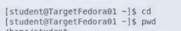

图 54 – 更改目录到学生主目录

- 为备份归档和压缩 `/etc` 和 `/var` 目录。输入命令：`su -c 'tar zcvf lab10.tar.gz /etc /var'` 并按 `<enter>`
    - 密码：`ISS316Security`
    - 注意：被备份的目录和文件将随着归档过程在屏幕上滚动。这可能需要几分钟。完成后，将创建一个名为 `lab10.tar.gz` 的压缩 tar 归档。此文件包含 `/etc` 和 `/var` 目录中所有内容的内容。

- 输入命令：`su -c 'openssl des3 -salt -in lab10.tar.gz -out lab10.tar.gz.des3'` 并按 `<enter>` 以加密文件。
    - 密码：`ISS316Security`
    - 为文件创建密码 `lab10`
        - 输入 des-ede3-cbc 加密密码：`lab10`
        - 验证 - 输入 des-ede3-cbc 加密密码：`lab10`

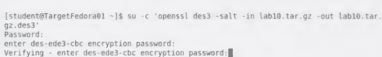

图 55 – 使用 `openssl` 创建 `des3` 文件

- 验证加密文件的存在。输入命令：`ls lab10.tar.gz.des3` 并按 `<enter>`。
    - 注意：如果显示“没有那个文件或目录"消息，请验证文件名是否输入正确，或重复上一步以确保创建加密文件。

- 14. 删除原始未加密的备份文件。输入命令：`su -c 'rm -f lab10.tar.gz'` 并按 `<enter>`。
    - 密码：`ISS316Security`

#### 从加密备份恢复数据文件

- 15. 跟踪你执行以下 #4 - #7 步骤从头到尾所需的时间 – 这代表了你对此数据文件恢复的恢复时间目标 `RTO`
- 16. 模拟删除的 sendmail 配置文件。输入命令：`su -c 'mv /etc/mail/sendmail.mc /tmp/'` 并按 `<enter>`。
- 17. 密码：`ISS316Security`
- 18. 解密备份文件。输入命令：`su -c 'openssl des3 -d -salt -in lab10.tar.gz.des3 -out lab10.tar.gz'` 并按 `<enter>`。
- 19. 密码：`ISS316Security`
- 20. 输入 des-ede3-cbc 解密密码：`lab10`
- 21. 请耐心等待。解密文件可能需要一点时间。完成后，命令提示符将返回。


- 22. 将 `sendmail` 配置文件恢复到其相应位置。输入命令：`su -c 'tar zxvf lab10.tar.gz -C / /etc/mail/sendmail.mc'` 并按 `<enter>`。

- 23. 密码：`ISS316Security`

- 24. 验证 `/etc/mail/sendmail.mc` 已恢复。输入命令：`ls /etc/mail/sendmail.mc` 并按 `<enter>`。

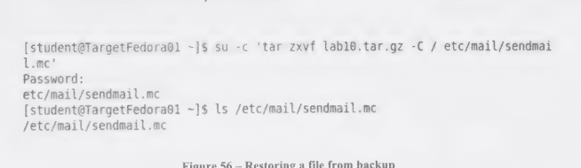

### 使用 `/proc` 恢复已删除的文件

- 25. 在 `vi` 编辑器中创建并打开新文件。输入命令：`vi hacked.sh` 并按 `<enter>`。

- 26. 按 "`i`" 键进入 `INSERT` 模式。

- 27. 在文件中输入随机数据，例如 "You have been hacked!"。

- 28. 保存更改并退出文件。按下 `Esc` 键退出插入模式，然后按下 "Shift" 和 ";" 键进入命令模式。在命令模式的冒号提示符下，输入 `wq` 以保存更改并退出。

- 29. 输入命令：`less hacked.sh` 并按下 `<enter>` 键以查看文件内容。

- 30. 退出 `less` 屏幕：按下 `ctrl + z` 键。

- 31. 删除之前创建的 `hacked.sh` 文件。输入命令：`rm -f hacked.sh` 并按下 `<enter>` 键。

- 32. 使用 `lsof` 工具验证该文件是否仍被 `less` 命令引用，并获取进程 ID（PID）。输入命令：`lsof | grep hacked` 并按下 `<enter>` 键。

**注意：** 应返回一行，其中第一列包含单词 'less'。第二列是进程 ID。记下该进程 ID，因为它将在下一步中使用。下图显示了获取之前输入的 `less` 命令的进程 ID 的命令。在此场景中，进程 ID 为 `13922`。您的进程 ID 很可能与此处显示的数字不同。

```bash
[student@TargetFedora01 ~]$ lsof | grep hacked
less    13922   student   4r REG 253,0   22   142522 /home/student/hacked.sh
```

**图 57 – 使用 `lsof` 列出进程/文件信息**

- 33. 使用 PID 和描述符的输出，在内存中定位刚刚删除的文件。输入命令：`cd /proc/<PID>/fd/`。

**注意：** 将 `<PID>` 替换为在上一步中获取的进程 ID。进程 ID（PID）始终为数字。不要输入尖括号 (`< >`)。例如，如果进程 ID 为 `13922`，则命令为：`cd /proc/13922/fd`

- 34. 定位与已删除文件关联的文件描述符。输入命令：`ls -ls` 并按下 `<enter>` 键。正确的文件描述符将引用已删除文件的先前位置。

图显示文件描述符 “4” 是已删除文件在内存中的位置。

```bash
student@TargetFedora01 fd] $ ls -ls
 total 8
 lrwx-... . . 1 student student 64 Sep 30 10:37 0 -> /dev/pts/0
 lrwx-... . . 1 student student 64 Sep 30 10:37 0 -> /dev/pts/0
 lr-x-... . . 1 student student 64 Sep 30 10:37 0 -> /dev/pts/0
 lr-x-... . . 1 student student 64 Sep 30 10:37 0 -> /dev/tty
 lr-x-... . . 1 student student 64 Sep 30 10:37 4 -> /home/student/hacked.sh (deleted)
```


- 35. 通过复制文件描述符到硬盘来恢复文件：`cp <descriptor> /home/student/hacked.recovered` 并按下 `<enter>` 键。

```bash
|student@TargetFedora01 fd] $ cp 4 /home/student/hacked.recovered
[student@TargetFedora01 fd] $ cat /home/student/hacked.recovered
You have been hacked!
```


> **注意：** 将 `<descriptor>` 替换为从上一步命令中找到的文件描述符数字。以前面的图形为例，命令为：
>
> ```bash
> cp 4 /home/student/hacked.recovered .
> ```

### 交付成果

在完成实验 #10：定义 Linux 操作系统和应用程序备份与恢复程序后，学生需要提供以下交付成果：

- 1. 实验 #10 – 提交以下文件的截图：
  - a. `/etc`、`/var` 和 `/home` 目录的加密备份文件
  - b. 步骤 6 中移动命令的输出以及步骤 9 中恢复的文件
  - c. 使用 `/proc` 恢复文件 `hacked.sh` 的输出

- 2. 实验 #10 – 实验评估问题及答案

### 评估标准和评分细则

以下是学生必须执行的实验 #10 的评估标准和评分细则：

- 1. 学生是否能够确保 Linux 操作系统、应用程序和数据在记录的备份和恢复程序下的可用性？ – [20%]
- 2. 学生是否能够在 Linux 操作系统中配置并执行备份，作为一种自动化且稳定的方式来增强备份和恢复程序并最大化系统可用性？ – [20%]
- 3. 学生是否能够在 Linux 操作系统中在备份进行过程中对备份进行加密，以保护数据备份和存储？ – [20%]
- 4. 学生是否能够恢复加密备份，以在可接受的恢复时间目标 (`RTO`) 内实现 Linux 操作系统的完全恢复？ – [20%]
- 5. 学生是否能够在 Linux 中使用 `/proc` 备份和恢复已删除的文件，从而在文件被删除或损坏的情况下无需恢复整个系统？ – [20%]

# **实验 #10 – 评估工作表**

# **定义 Linux 操作系统和应用程序备份与恢复程序**

**课程名称及编号：**

**学生姓名：**

**教师姓名：**

**实验截止日期：**

# **概述**

在本实验中，学生将在生产环境 Fedora Linux 服务器上最大化数据的可用性，并为数据文件的备份和恢复定义恢复时间目标。他们将执行 Linux 操作系统、应用程序和存储在文件系统中的数据的备份和恢复。然后，他们将执行步骤对备份进行加密，以使用 `openssl` 增强安全性。最后，学生将使用 `/proc` 恢复功能恢复意外删除的文件。

# **实验评估问题及答案**

- 1. 为什么需要对已压缩的文件进行加密？
- 2. 为什么加密备份是最佳实践？
- 3. 为什么在安全通信策略中建议以加密方式进行消息传递（如电子邮件）？请解释。
- 4. 解释以下命令中使用的每个开关：`tar zxvf fwbs1.tar.gz etc/mail/sendmail.mc -C /etc/mail`
- 5. 如何从伪文件系统 `/proc` 中恢复已删除的文件？
- 6. 除了 `tar` 之外，Unix 系统还可以运行哪种类型的备份？
- 7. 使用 `dd` 对系统进行镜像有什么优势？请指出一个缺点？
- 8. 如果恢复时间目标 (`RTO`) 不符合贵组织的业务连续性计划，您可以做什么以确保实现所需的数据文件、应用程序或系统的 `RTO`？
- 9. 在恢复到保存在本地驱动器 `/home/student` 下的 `tar` 时会遇到什么问题？
- 10. 使用 `dump` 命令进行备份的原因是什么？

## 配套实验室手册

# # 安全策略

## 在 Linux 平台和应用中


vLab Solutions 是面向教育、培训和职业认证需求的结果导向型、动手实验室的主要设计者和开发者。vLab Solutions 将虚拟化应用于课堂提供的实验室，并结合实时动手练习，每个练习都具有可测量的学习成果。
