# ISBN 9781888172898

Red Hat 开发团队：

- Donald Barnes
- Marc Ewing
- Michael Fulbright
- Michael K. Johnson
- Jim Knobele
- Michael Maher
- Hunter Matthews
- Clarence Smith, Jr.
- Erik Troan

# 前言

## 什么是红帽 Linux？

红帽 Linux 是一个基于 Linux 内核的完整操作系统，该内核最初由 Linus Torvalds 创建。Linux 由一个全球团队继续开发，由 Linus 领导，通过互联网协作，并且仍在快速向前演进。当前稳定的 2.0.z 内核（红帽 Linux 4.2 基于此内核）展示了 Linux 开发社区卓越的才华和创造力，以及协作开发模式的价值。有关此主题的更多信息，请参阅附录 F：红帽与自由分发软件。

自 4.0 版本发布以来，红帽 Linux 运行在三个主流计算平台上：Intel 兼容 PC、Digital Alpha 计算机和 Sun SPARC 设备。我们统一的源代码树和 RPM（红帽包管理）技术的好处使我们能够保持这三个平台的红帽 Linux 版本同步发布，从而使用户能够以最小的努力在这些平台之间管理和移植软件。

我们很高兴地注意到，在 Linux 操作系统上可用的应用程序数量正在不断增长，其中许多来自红帽软件。我们通过无限制的 FTP 从我们的网站以及互联网上的许多镜像站点提供我们的 Linux 操作系统版本。红帽 Linux 也可在 CD-ROM 上获得。有关我们产品提供和其他 Linux 资源的链接的最新信息，请访问红帽软件网站：`http://www.redhat.com`。

在大多数系统上，红帽 Linux 安装很容易：安装程序可以引导您完成整个过程，最快只需 15 分钟。系统本身非常灵活：您只需几次鼠标点击即可安装和卸载单独的“软件包”。维护也很简单：可以验证和纠正软件包安装，并且可以简单可靠地安装和卸载软件包。此外，红帽 Linux 管理起来很容易：一组打包在“控制面板”中的图形化管理工具减少了日常系统管理的麻烦。提供了系统自由分发组件的完整源代码。

## 本书概览

本手册的组织方式如下：

- **第 1 章，《*快速入门*》** 包含了足够的信息，供经验丰富的用户轻松完成红帽 Linux/Intel 的基本安装。我们建议新的 Linux 用户在安装前通读整个手册，以便对系统有一个很好的理解。
- **第 2 章，《*安装红帽 Linux/Intel*》** 包含了在 Intel 或兼容 PC 上安装红帽 Linux 的详细说明。
- **第 3 章，《*安装红帽 Linux/Alpha*》** 包含了在 Digital Alpha 上安装红帽 Linux 的说明。
- **第 4 章，《*安装红帽 Linux/SPARC*》** 包含了在 Sun SPARC 机器上安装红帽 Linux 的说明。
- **第 5 – 10 章** 解释了安装红帽 Linux 后如何配置各种服务，如何在您的系统中查找文档，以及如何随附红帽 Linux 使用各种系统管理和管理工具。它们还包括关于您的红帽 Linux 系统有何特殊之处的解释，包括特殊文件所在的位置以及如何关闭红帽 Linux。
- **附录** 包含有关红帽 Linux 的额外信息，包括硬件要求列表、随红帽 Linux/Intel 附带的 MetroLink X 服务器手册、红帽 Linux 常见问题解答（FAQ）等。

## 致谢

我们感谢所有 β 测试员将他们的系统交给红帽 Linux 的早期版本，并感谢他们花时间从前端提交错误报告，特别是那些自“万圣节”版本及更早时期就与红帽一起合作的人们。我们还要感谢 Linus Torvalds 和全球数百名开发人员，他们真正创造了分布式开发的奇迹之一。

再次感谢，欢迎来到 Linux 的奇妙世界！

红帽开发团队

# 第 1 章 快速入门

本章概述了如何安装或升级红帽 Linux/Intel：它面向已经熟悉安装 Linux 的用户。如果本章提供的信息不够，请阅读第 2 章 *安装红帽 Linux/Intel*。

### 1.1 红帽 Linux 勘误

偶尔，我们会发现红帽 Linux 某个版本存在问题，其中一些问题可能影响安装。当我们发现问题时，我们会在红帽 Linux 勘误中发布有关该问题及其解决方案的信息，我们通过多种方式提供这些内容：

- 通过万维网：`http://www.redhat.com/errata`
- 通过电子邮件：`errata@redhat.com`

请注意，勘误中列出的问题的解决方案可能要求您使用与下文提到的或随红帽 Linux CD-ROM 提供的不同的启动或安装磁盘映像。

### 1.2 获取红帽 Linux

获取红帽 Linux 有几种方法，最简单的方法是通过 CD-ROM。如果您没有 CD-ROM 驱动器，这可能不太实际，因此我们通过 FTP 免费提供；您可以从附录 E《红帽 Linux FAQ》中列出的任何红帽镜像站点下载。

这些镜像站点为那些想要通过 FTP 安装或想要软件包升级的人提供。虽然可以将发行版下载到硬盘并从中安装，但对于大多数人来说，这非常不切实际，且超出了本文档的范围。

如要购买 CD-ROM 版的红帽 Linux，请联系红帽软件：`http://www.redhat.com`。

### 1.3 制作软盘

如果您拥有随官方红帽 Linux 4.2 发行的启动盘和辅助软盘，请跳至下面的 1.4 节。

如果您的红帽 Linux/Intel 版本没有附带启动软盘和辅助软盘，您需要创建它们。如果您的 CD-ROM（或 FTP 站点）上有一个 `README` 文件，请立即阅读它；它包含有关红帽 Linux 4.2 的最新信息，其中一些可能与您即将阅读的内容不同。

启动盘和辅助磁盘映像位于 CD-ROM 和 FTP 站点的 `images` 目录中。如果您进行 CD-ROM 或 NFS 安装，您只需要制作一张启动软盘。所有其他安装方法还需要辅助软盘。您可以使用 Linux 下的 `dd` 或 DOS 下的 `rawrite.exe`（位于 `dosutils` 目录中）将每个磁盘映像文件写入格式化的高密度（1.44 MB）3.5 英寸软盘。

### 1.4 安装

要安装红帽 Linux，请将启动软盘插入 `A` 驱动器，并将 CD 插入您的 CD-ROM 驱动器（对于 CD-ROM 安装），或连接到您的网络（对于 FTP 或 NFS 安装）。然后重新启动您的机器，并按顺序回答所有问题。如果您是从 PCMIA、FTP 或硬盘安装，当提示时请插入辅助软盘。

### 1.5 从早期版本升级

红帽 Linux 4.2 的安装过程包括从早期版本的红帽 Linux（基于 RPM 技术的 2.0、2.1、3.0.3 和 4.0）升级的功能。升级您的系统会安装模块化的 2.0.x 内核以及已安装在您机器上的软件包的更新版本。升级过程使用 `.rpm` save 扩展名保留现有的配置文件（例如，`sendmail.cf.rpmsave`），并留下一个日志文件，记录它执行的操作，位于 `/tmp/upgradelog`。随着软件的发展，配置文件格式可能会发生变化，因此在合并更改之前，您应仔细比较原始配置文件和新文件。

要升级红帽 Linux 系统，您必须使用启动软盘（以及可能的辅助软盘），就像执行完整安装一样。在选择安装介质（并在需要时设置网络信息）后，安装程序会提示您选择“安装”或“升级”；请选择“升级”。此升级过程在功能上等效于运行红帽 Linux 早期版本中的升级脚本。

请注意，某些升级的软件包可能“依赖”于其他可能未安装在您系统上的软件包。升级过程会处理这些依赖关系，但可能需要安装额外的软件包以满足这些依赖关系。

### 1.6 为什么我不能直接从 CD 运行？

早期版本的红帽 Linux 在 CD-ROM 上附带一个“实时文件系统”；这允许用户在不先将它安装到硬盘的情况下直接从 CD-ROM 运行红帽 Linux。不幸的是，由于模块化的 Linux-2.0.x 内核，添加“实时”启动功能变得过于复杂，不再得到支持。我们对此不便深表歉意。

# 第 2 章 安装 Red Hat Linux/Intel

本章详细说明了如何在 Intel 及兼容 PC 上安装或升级 Red Hat Linux。本章的结构如下：

- 第 2.1 节，*Red Hat Linux 勘误表*，包含了关于 Red Hat Linux/Intel 4.2 最新重要信息的指引。
- 第 2.2 节，*开始之前*，描述了一些在实际安装 Red Hat Linux 之前需要知道的事项。
- 第 2.3 节，*准备安装*，介绍了如何创建安装软盘（如果您的 Red Hat Linux 副本中未附带）并解释了如何使用安装程序。
- 第 2.4 节，*分步安装*，提供了完成整个安装或升级过程的分步说明。

### 2.1 Red Hat Linux 勘误表


偶尔，我们会发现 Red Hat Linux 发行版中的问题，其中一些问题可能会影响安装。当我们发现问题时，我们会在 Red Hat Linux 勘误表中发布有关该问题及其解决方案的信息，我们提供以下几种方式获取：

- 通过万维网：http://www.redhat.com/errata
- 通过电子邮件：errata@redhat.com

请注意，勘误表中列出的问题的解决方案可能要求您使用与下文提到的或随附于 Red Hat Linux CD-ROM 的不同的启动或安装磁盘映像。

## 2.2 开始之前

在开始安装 Red Hat Linux 之前，您应该收集一些关于您的系统的信息：

- 熟悉您机器中安装的硬件，包括：
  - **硬盘：** 数量和大小；如果您有多个，了解哪一个是一号盘、二号盘等会有帮助。
  - **内存：** RAM 数量。
  - **CD-ROM：** 接口类型（IDE、SCSI 或其他接口），对于非 IDE 且非 SCSI 的 CD-ROM，还需了解其制造商和型号。
  - **SCSI 适配器：** 制造商和型号。
  - **网卡：** 制造商和型号。
  - **鼠标：** 类型（串行、PS/2 或总线鼠标），协议（Logitech、Microsoft、MouseMan 等），以及按钮数量；另外，对于串行鼠标，需了解其连接的 COM 端口。

此外，如果您要安装 X 窗口系统，您应该熟悉以下内容：

- **您的显卡：** 制造商和型号或视频芯片组，视频 RAM 数量。
- **您的显示器：** 制造商和型号，允许的水平刷新率和垂直刷新率范围。

您可以在随附系统的文档中找到上述大部分信息，或者从您的系统供应商或制造商处获取。

> **请注意：** 有关 Red Hat Linux/Intel 支持哪些硬件的最新信息，可以通过 Red Hat Software 的万维网站获取，地址为 http://www.redhat.com/hardware/。

- 如果您将连接到网络，请确保您知道您的 IP 地址、子网掩码、网关 IP 地址、名称服务器 IP 地址、域名和主机名。如果您不知道这些值，请咨询您的网络管理员。
- 如果 Red Hat Linux/Intel 将与 OS/2 共存于您的机器上，您必须使用 OS/2 分区软件创建磁盘分区——否则，OS/2 可能无法识别磁盘分区。在安装过程中，不要创建任何新的分区，但请使用 Linux `fdisk` 为您的 Linux 分区设置正确的分区类型。
- 如果您计划使用 LILO（LInux LOader）来启动您的 Red Hat Linux 系统，请参阅第 2.4.19 节，*LILO 安装*，了解可能影响您的分区计划的准则。

请在*开始*安装前阅读所有安装说明；这将为您准备需要做出的决策，并应消除潜在的意外情况。

### 2.2.1 安装方法

您可以通过几种基本方法中的任何一种来安装或升级 Red Hat Linux/Intel。根据您使用的方法，您需要一块或两块格式化的高密度（1.44 MB）3.5 英寸软盘。

从 CD-ROM 或通过 NFS 安装只需要一块启动软盘。从硬盘、通过 FTP、从 SMB 卷或从 PCMCIA 设备（包括基于 PCMCIA 的 CD-ROM）安装需要一块启动软盘和一块辅助软盘。下文第 2.3.1 节说明了如何创建启动和辅助软盘。

**CD-ROM** 如果您拥有 Red Hat Linux CD 和一块启动软盘，您需要一个受支持的 CD-ROM 驱动器以及机器上的 3.5 英寸软盘驱动器或可运行的 MS-DOS 安装环境，以便运行安装实用程序。如果 CD 中未附带启动软盘，您需要访问一台运行 Linux 或 MS-DOS 的计算机，以便从 CD 创建启动软盘。

**NFS** 如果您希望通过网络安装，您需要在一台支持带有 Rock Ridge 扩展的 ISO-9660 文件系统的机器上挂载 Red Hat Linux CD-ROM。该机器还必须支持 NFS。通过 NFS 导出 CD-ROM 文件系统。您需要配置名称服务，或者知道 NFS 服务器的 IP 地址，以及导出 CD-ROM 的路径。

**FTP** 对于 FTP 安装，您必须拥有启动盘和辅助盘。您需要配置有效的名称服务器，或者知道您将要使用的 FTP 服务器的 IP 地址。您还需要知道 FTP 站点上 Red Hat Linux 目录根目录的路径。

**SMB 共享卷** 如果您希望从 SMB 共享卷安装，您需要在一台支持共享卷的 Microsoft Windows NT 或 Windows 95 服务器上挂载 Red Hat Linux CD-ROM。您需要配置名称服务，或者知道服务器的 IP 地址；您还需要包含 Red Hat Linux CD-ROM 的共享卷的名称，以及访问该卷所需的账户号和密码。

**硬盘** 要从硬盘安装 Red Hat Linux，您需要与 FTP 安装使用的相同的启动盘和辅助盘。您必须首先在目录树的顶层创建一个 `RedHat` 目录。您将要安装的所有内容都应放在该目录中。首先复制 `base` 子目录，然后复制您想要安装的程序包到一个名为 `RPMs` 的另一子目录中。您可以使用现有 DOS 分区上的可用空间，或者在安装过程中不需要使用的 Linux 分区（例如，将用于已安装系统数据存储的分区）。

如果您使用的是 DOS 文件系统，您可能无法使用 RPM 程序包的完整 Linux 文件名。安装过程不关心文件名的样子，但建议您记录它们，以便知道您正在安装什么。

**PCMCIA** 如果您的 CD-ROM、网卡或本地硬盘连接到 PCMCIA 适配器，您必须使用支持 PCMCIA 的方式进行安装。您需要受支持的 PCMCIA 控制器以及受支持的 PCMCIA SCSI 适配器或网卡。通过 PCMCIA 安装需要使用辅助软盘。

### 2.2.2 关于内核驱动程序的说明

在 Red Hat Linux 安装过程中，内核对支持的文件系统和其他驱动程序有一些限制。然而，安装完成后，Linux 下可用的所有文件系统都得到支持。安装时，模块化内核支持 (E)IDE 设备（包括 ATAPI CD-ROM 驱动器）、SCSI 适配器和网卡。此外，支持所有鼠标、SLIP、CSLIP、PPP、PLIP、FPU 仿真、控制台选择、ELF、SysV IPC、IP 转发、防火墙和记账、反向 ARP、QIC 磁带和并行打印机。

安装完成后，您可能希望重新构建一个仅支持您硬件的内核。有关如何构建自定义内核的信息，请参阅第 5 章第 5.1 节。

### 2.2.3 磁盘分区

要安装 Red Hat Linux，必须为其提供可用的磁盘空间以“居住”。该磁盘空间需要与您计算机上安装的其他操作系统（例如 MS-DOS、OS/2、其他版本的 Linux，或另一个我们不便明说的知名操作系统）使用的磁盘空间分开。通过将其划分为*分区*来提供可用磁盘空间。

您可能希望将 Red Hat Linux 安装在其自己的硬盘上，或者甚至安装在一台不包含其他操作系统的计算机上。在这种情况下，您可以使用 Red Hat Linux 安装系统来创建所需的磁盘分区。

或者，您可能希望将 Red Hat Linux 安装在一个已经包含来自不同操作系统的软件或数据的磁盘上；创建所需磁盘分区的方法取决于存在其他哪种操作系统。

#### 磁盘分区与 MS-DOS

大多数 MS-DOS 系统在出厂时都有一个包含一个大分区的硬盘。为了安装 Red Hat Linux，你需要将该分区变小，然后在剩余的空间中创建一个用于 Red Hat Linux 的分区。完成此任务有两种方法：

- **破坏性重新分区** 此过程会销毁你正在调整大小的磁盘分区中的任何数据；你应当从正在重新分区的磁盘中将所有希望保留的数据进行完整、可靠的备份。然后，使用 MS-DOS 磁盘分区实用程序 `fdisk` 来删除大分区并创建一个较小的 MS-DOS 分区。从备份中将数据恢复到新分区。
- **非破坏性重新分区** 此过程理论上不应销毁你正在调整大小的磁盘分区中的数据；但是，无论情况如何，我们都建议你对你希望保留的数据进行可靠备份。你可以使用 Red Hat Linux CD 中 `dosutils` 目录下包含的 `fips` 实用程序来调整你的 MS-DOS 分区大小；我们强烈建议在执行此操作之前阅读位于 `fipsdoccs` 子目录中的 `fips` 文档。

重新分区后，你可以使用 Red Hat Linux 安装系统按照*分步安装*中的描述为 Red Hat Linux 系统创建分区。

#### 磁盘分区与其他操作系统

有关创建与其他操作系统兼容的磁盘分区的信息，可以在 Red Hat Linux CD 中 `doc/HOWTO` 和 `doc/HOWTO/mini` 目录下的多个 HOWTO 和 Mini-HOWTO 中找到。

#### 需要多少个分区？

如果你愿意，你可以将 Red Hat Linux 安装在一个大的单一分区中。但是，我们推荐以下设置（**请注意：** 如果你计划安装随 Red Hat Linux 提供的所有软件包，可能需要使用更大的分区）：


- 一个用于虚拟内存的`交换分区（swap partition）`。如果你的计算机内存为 16 MB 或更少，你必须创建一个`交换分区`；即使你有更多内存，也建议使用交换分区。交换分区的大小至少应为 16 MB 或等于计算机内存容量，取两者中较大的值。

- 一个`根分区（root partition）`，在你的 Red Hat Linux 系统启动时挂载为 `/`（根目录）；它只需要包含启动系统所需的必要文件以及系统配置文件。对于大多数系统，50–80 MB 就足够了。

- 一个`/usr 分区`，Red Hat Linux 系统上的大量软件存放于此；根据你的计划安装的软件包数量，此分区应为 200–500 MB。

- 一个`/home 分区`，用户的`主目录（home directories）`存放于此；`/home` 的大小主要取决于你计划在 Red Hat Linux 系统上拥有多少用户，以及他们可能在主目录中存储什么内容。

此外，你可能希望创建以下任一分区：

- 一个用于临时文件的`/tmp 分区`。这对于较大的多用户系统或网络服务器机器来说是个好主意。

- 如果你希望安装 Red Hat Linux 附带的大量源代码，可以创建一个`/usr/src 分区`。

- 创建一个`/usr/local 分区`，用于存放你希望与 Red Hat Linux 系统其余部分保持独立的内容，例如无法以 RPM 包形式获得的软件。

### 2.3 安装准备

#### 2.3.1 创建启动盘和辅助软盘

你的 Red Hat Linux/Intel CD 套装可能包含启动软盘和辅助软盘。如果有，你可以跳转到第 2.3.2 节。如果没有，你必须创建它们。

如果你通过 CD-ROM 或 NFS 安装 Red Hat Linux，只需要一个启动软盘。如果你从硬盘、通过 FTP 或从 PCMCIA 设备安装，还需要一个辅助软盘。

要创建启动和辅助软盘，你需要两张空白、已格式化的高密度（1.44 MB）3.5 英寸软盘。磁盘映像位于 Red Hat Linux CD 或你获取 Red Hat Linux 的 FTP 站点上的 `images` 目录中。每个映像都是相应软盘的`快照`，你需要将其传输到实际的软盘上；你可以使用 MS-DOS 或 Linux 来完成此操作。

##### 在 MS-DOS 下制作软盘

要在 MS-DOS 下制作软盘，请使用 Red Hat Linux CD 中 `dosutils` 目录包含的 `rawrite` 实用程序。首先，给一张已格式化的 3.5 英寸软盘贴上“Boot Diskette”（启动软盘）或类似标签，并将其插入软盘驱动器。然后，使用以下命令（假设你的 CD 是 `d:` 盘）：

```
d: \
    cd \images \
    \dosutils\rawrite.exe
```

`rawrite` 首先会询问软盘映像的文件名；输入 `boot.img`。然后它询问要写入映像的软盘驱动器；输入 `a:`。如果你需要制作辅助软盘，给第二张软盘贴上标签，然后再次运行 `rawrite`，使用 `supp.img`。

##### 在 Linux 下制作软盘

要在 Linux 下制作软盘，你必须拥有写入 `/dev/fd0`（3.5 英寸软盘驱动器）的权限。给一张空白、已格式化的软盘贴上“Boot Diskette”（启动软盘）或类似标签，并将其插入软盘驱动器（但不要挂载它）。在挂载 Red Hat Linux CD 后，切换到 `images` 目录并使用以下命令：

```
dd if=boot.img of=/dev/fd0 bs=1440k
```

如果你需要制作辅助软盘，给第二张软盘贴上标签，将其插入软盘驱动器，然后使用以下命令：

```
dd if=supp.img of=/dev/fd0 bs=1440k
```

##### 不使用启动软盘安装

或者，如果你的计算机上安装了 MS-DOS，你可以直接从 CD 启动安装系统而无需制作软盘。为此，使用以下命令（假设你的 CD 是 `d:` 盘）：

```
d:
 cd \dosutils
 autoboot.bat
```

#### 2.3.2 关于虚拟控制台的说明

Red Hat Linux 安装系统不仅仅是在引导你完成安装过程时呈现的对话框。实际上，安装系统在运行时会呈现几种不同类型的诊断信息，并提供了一种从 shell 提示符输入命令的方法。它在五个`虚拟控制台`上显示安装对话框、shell 提示符和信息，你可以使用单个按键在这些虚拟控制台之间切换。如果在安装 Red Hat Linux 时遇到问题，这些虚拟控制台可能非常有帮助；安装日志或系统日志中显示的信息有助于定位问题。请参阅图 2.1，其中列出了虚拟控制台、切换到它们的按键以及它们的内容。

| 控制台 | 按键 | 内容 |
| :---- | :---- | :---- |
| 1 | Alt-F1 | 安装对话框 |
| 2 | Alt-F2 | shell 提示符 |
| 3 | Alt-F3 | 安装日志（来自安装程序的消息） |
| 4 | Alt-F4 | 系统日志（来自内核等的消息） |
| 5 | Alt-F5 | 其他消息 |

图 2.1：虚拟控制台信息

#### 2.3.3 使用对话框

你可以使用一组简单的按键在安装对话框之间导航。在大多数对话框中，有一个`光标或高亮`，你可以使用箭头键（[⬅][➡][⬆][⬇]，`Tab`）以及 `Alt`+`Tab` 来移动它。每个屏幕底部都提供了移动命令的摘要。

要“按下”按钮（如 `OK`），`Tab` 到该按钮并按 `Space`。要从列表中选择一个项目，将高亮移动到你想要选择的项目并按 `Enter`。要从`检查清单`中选择任意数量的项目，将高亮移动到你想要选择的项目并按 `Space` 选择该项目。要取消选择项目，第二次按 `Space`。

按 `F12` 接受当前值并进入下一个对话框；这通常相当于按 `OK` 按钮。

**请注意：** 在安装过程中不要按随机按键；这可能导致不可预测的行为。

### 2.4 分步安装

#### 2.4.1 启动安装系统

##### 启动

要开始安装 Red Hat Linux，将刚刚创建的启动软盘插入软盘驱动器并重新启动机器（如果你的机器上安装了 MS-DOS，你可以直接从 CD-ROM 开始安装；参见上文第 2.3.1 节）。`boot:` 提示符出现；按 `Enter` 启动。观察启动信息，查看 Linux 内核是否检测到你的硬件。如果未正确检测到你的硬件，你可能需要重新启动并在`boot:` 提示符下输入一些选项，例如：

```
boot: linux hdc=cdrom
```

按 `Enter` 使用这些选项启动。如果需要指定一些启动选项，请记下它们；稍后将会需要用到。

**请注意：** 由于 Red Hat Linux 支持在多种不同类型的硬件上进行安装，许多驱动程序（包括 SCSI 适配器、网络卡和许多 CD-ROM 的驱动程序）并未内置于安装过程中使用的 Linux 内核中；相反，它们作为`模块`存在，并在安装过程中按需加载。在加载这些驱动程序时，你将有机会指定相关选项，实际上，在**启动**提示符下为这些驱动程序指定的选项将会被忽略。有关内置于安装系统中的驱动程序的更多信息，请参阅上文 2.2.2 节。

##### 开始安装

启动后，安装过程首先会询问你是否使用彩色显示器（见图 2.2）。**是**为默认选项；如果你无法区分光标或高亮显示，请按一次 `Tab` 键，然后按 `Enter` 键继续。接下来会出现一条欢迎消息；按 `Enter` 键开始安装。如果你希望终止安装过程，只需现在弹出启动软盘并重新启动你的机器。

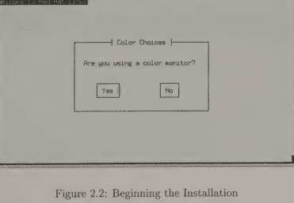

#### 2.4.2 选择键盘布局

在欢迎对话框之后，安装程序将为你提供选择键盘布局的机会（见图 2.3）。选择你希望在 Red Hat Linux 系统上使用的键盘布局，并按下 **Enter** 键；你选择的键盘布局将自动加载，既用于安装过程的剩余部分，也用于每次启动你的 Red Hat Linux 系统时。

如果你希望在启动 Red Hat Linux 系统后更改键盘布局，可以使用 `/usr/sbin/kbdconfig` 命令。

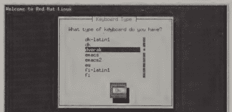

图 2.3：选择键盘布局

#### 2.4.3 PCMCIA 支持

接下来，安装程序会询问你是否需要 PCMCIA 支持。如果你正在使用 PCMCIA 设备进行安装（例如，通过 NFS 安装时使用的 PCMCIA 以太网卡，或从 CD 安装时使用的 PCMCIA SCSI 卡），你应该回答“是”；安装程序会提示你插入辅助软盘。在插入你的 PCMCIA 卡之前，应等待下一个对话框出现。

#### 2.4.4 选择安装方法

你可以通过四种基本方法（参见 2.2.1 节，`安装方法`）中的任意一种来安装 Red Hat Linux，其中一些方法需要使用辅助软盘。总结如下：


- `CD-ROM` 如果你的 CD 光驱中有 Red Hat Linux CD；不需要辅助软盘。
- `NFS` 如果你正在从导出 Red Hat Linux CD 或 Red Hat FTP 站点镜像的 NFS 服务器安装；不需要辅助软盘。
- `硬盘` 如果你已将 Red Hat Linux 文件复制到本地硬盘之一；需要辅助软盘。
- `FTP` 如果你正在直接从 FTP 服务器安装；需要辅助软盘。
- `SMB 镜像` 如果你正在从 Microsoft Windows NT 或 Windows 95 共享卷安装；需要辅助软盘。

下一个对话框询问你希望使用哪种类型的安装方法（见图 2.4）。高亮显示相应的选项并选择 `确定`，或按 `Enter` 键。如果你选择 `FTP` 或 `硬盘`，且未使用 PCMCIA 支持，安装程序会提示你插入辅助软盘。

### CD-ROM 类型

如果你选择从 CD-ROM 安装 Red Hat Linux/Intel，安装程序会提示你选择 CD-ROM 类型：
- `IDE (ATAPI)` 大多数适用于基于 Intel 的 PC 的 CD-ROM 都是 IDE（也称为 ATAPI）CD-ROM。安装程序在放弃查找之前，会检查所有可用 IDE 设备上的 CD-ROM。
- `SCSI` 如果你的 CD-ROM 连接到受支持的 SCSI 适配器，请选择此项；安装程序会要求你选择 SCSI 驱动程序。选择与你适配器最匹配的驱动程序。如有必要，可以指定驱动程序选项；然而，大多数驱动程序会自动检测你的 SCSI 适配器。
- `其他` 如果你的 CD-ROM 既不是 IDE 也不是 SCSI CD-ROM，则属于“其他”。安装程序会列出受支持的 CD-ROM 驱动程序列表；选择一个驱动程序，并如有必要，指定任何驱动程序选项。

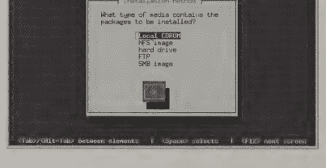

图 2.4：选择安装方法

## 2.4.5 如果你是通过 NFS 安装

如果你不是通过 NFS 安装 Red Hat Linux，可以跳至下文 2.4.6 节。

### 选择网络驱动程序

如果你是通过 NFS 安装，计算机中必须已安装受支持的网络卡。安装程序会提示你选择支持你网络卡的驱动程序，并指定驱动程序定位和识别该卡所需的任何选项。大多数时候，驱动程序可以通过探测自动定位该卡；然而，探测你的硬件可能会导致机器挂起。如果发生这种情况，请重新启动机器，再次开始安装，并在到达此步骤时指定额外的驱动程序选项（参见附录 A）。

### 配置 TCP/IP 网络

在安装程序找到你的网络卡后，它会提供几个对话框来配置 TCP/IP 网络。这些信息仅在安装过程中使用；你以后可以配置永久网络信息。此功能提供了更大的灵活性，如果你希望从不同于机器最终“运行”环境的网络进行安装。图 2.5 包含了示例网络信息。

| 字段 | 示例值 |
|---|---|
| IP 地址 | 10.0.2.15 |
| 子网掩码 | 255.255.255.0 |
| 默认网关 | 10.0.2.254 |
| 主要名称服务器 | 10.0.2.1 |
| 域名 | redhat.com |
| 主机名 | pooh.redhat.com |


第一个对话框要求你提供 IP 和其他网络地址（见图 2.6）。输入你在安装期间使用的 `IP 地址`，并按 `Enter`。安装程序会根据你的 IP 地址尝试猜测你的 `子网掩码`；如果子网掩码不正确，你可以更改它。按 `Enter`。安装程序会根据你的 IP 地址和子网掩码猜测 `默认网关` 和 `主要名称服务器` 地址；如果它们不正确，你可以更改它们。选择 `确定` 继续。

第二个对话框提示你输入域名、主机名和其他网络信息（见图 2.7）。输入你系统的 `域名`，并按 `Enter`；安装程序会将域名传递到 `主机名` 字段。输入你使用的主机名，置于域名之前，以形成完全限定域名（FQDN）。如果你的网络有一个以上的名称服务器，你可以在 `次要名称服务器` 和 `辅助名称服务器` 字段中输入额外名称服务器的 IP 地址。选择 `确定` 继续。

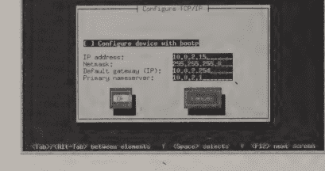

图 2.6：配置 TCP/IP

### NFS 服务器信息

下一个对话框要求提供关于 NFS 服务器的信息（见图 2.8）。输入你的 NFS 服务器名称或 IP 地址，以及包含 Red Hat Linux CD 的导出目录的名称。例如，如果 NFS 服务器将 Red Hat Linux CD 挂载在 `/mnt/cdrom` 上，则在 Red Hat 目录中填入 `/mnt/cdrom`。如果 NFS 服务器导出的是 Red Hat Linux 安装树的镜像而非 CD，请输入包含 RedHat 目录的目录。例如，如果你的 NFS 服务器包含目录 `/mirrors/redhat/i386/RedHat`，请输入 `/mirrors/redhat/i386`。

## 2.4.6 升级或安装

在你选择一种安装方法后（如果你是通过 NFS 或 SMB 卷安装，则在配置完网络信息后），安装程序会提示你选择 `安装` 或 `升级`（见图 2.9）。

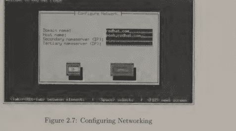

图 2.7：配置网络

### 安装

通常，你会在干净的磁盘分区或分区组上安装 Red Hat Linux，或者覆盖另一个 Linux 安装。将 Red Hat Linux 安装在另一个 Linux 安装（包括 Red Hat Linux）之上不会保留先前安装的任何内容。

如果你希望执行完全安装，请选择 `安装`。

### 升级

Red Hat Linux 4.2 的安装过程包括从基于 RPM 技术的先前版本 Red Hat Linux（2.0、2.1、3.0、3 和 4.0）升级的功能。升级你的系统会安装模块化 2.0.x 内核以及已安装在你机器上的软件包的最新版本。升级过程使用 `.rpm.save` 扩展名保留现有的配置文件（例如，`sendmail.cf.rpm.save`），并在 `/tmp/upgrade.log` 中留下记录其采取行动的日志。随着软件的发展，配置文件格式可能会发生变化，因此在你集成更改之前，应仔细比较原始配置文件和新文件。

如果你希望升级你的 Red Hat Linux/Intel 系统，请选择 `升级`。

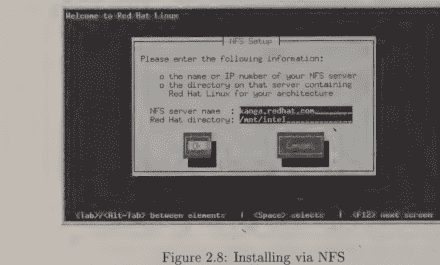

图 2.8：通过 NFS 安装

> `请注意：` 某些升级包可能会“依赖”其他可能未安装在您系统上的包。升级过程会处理这些`依赖关系`，但为了满足它们，可能需要安装额外的软件包。

## 2.4.7 SCSI 支持

选择执行升级还是完全安装后，安装程序会询问您是否有任何 SCSI 适配器。如果您选择`是`，以下对话框将显示 SCSI 驱动程序列表。选择最接近您的 SCSI 适配器的驱动程序。然后，安装程序将为您提供机会指定所选 SCSI 驱动程序选项；不过，大多数 SCSI 驱动程序会自动检测您的硬件。

## 2.4.8 如果您通过 FTP 或 SMB 安装

如果您不是通过 FTP 或通过 SMB 卷安装 Red Hat Linux，则可以跳至下面的第 2.4.9 节。

### 选择网络驱动程序

如果您是通过 FTP 或通过 SMB 卷安装，您的计算机中必须装有受支持的网络卡。安装程序将提示您选择支持您网络卡的驱动程序，并指定驱动程序定位和识别该卡所需的任何选项。大多数情况下，驱动程序可以通过`探测`自动定位该卡；但是，探测您的硬件可能会导致机器挂起。如果发生这种情况，请重新启动机器，再次启动安装过程，并在到达此步骤时指定额外的驱动程序选项（参见附录 A）。

### 配置 TCP/IP 网络

在安装程序找到您的网络卡后，它会显示几个用于配置 TCP/IP 网络的对话框。此信息仅在安装过程中使用；之后您将能够配置永久网络信息。如果您想从除机器将“驻留”的网络以外的网络进行安装，此功能可带来更大的灵活性。图 2.5 包含示例网络信息。

第一个对话框询问您的 IP 地址和其他网络地址（见图 2.6）。输入您在安装期间使用的`IP 地址`，并按`Enter`。安装程序会根据您的 IP 地址尝试猜测您的`子网掩码`；如果子网掩码不正确，您可以修改它。按`Enter`。安装程序根据您的 IP 地址和子网掩码猜测`默认网关`和`主名称服务器`地址；如果它们不正确，您可以修改它们。选择`确定`继续。


第二个对话框提示您输入域名、主机名和其他网络信息（见图 2.7）。输入您系统的`域名`并按`Enter`；安装程序会将域名向下传递到`主机名`字段。输入域名前的主机名以形成完全合格域名 (FQDN)。如果您的网络有一个以上的名称服务器，您可以在`辅助名称服务器`和`三级名称服务器`字段中输入额外名称服务器的 IP 地址。选择`确定`继续。

### FTP 服务器信息

如果您通过 FTP 安装，下一个对话框将请求关于 FTP 服务器的信息（见图 2.10）。输入您正在从中安装的 FTP 站点的名称或 IP 地址，以及包含您的架构的 RedHat 目录的目录名称。例如，如果 FTP 站点包含目录`/pub/mirrors/redhat/1386/RedHat`，请输入`/pub/mirrors/redhat/1386`。如果您没有使用匿名 FTP，或者如果您需要使用代理 FTP 服务器（例如，如果您位于防火墙之后），另一个对话框将请求 FTP 账户或代理信息。

### SMB 服务器信息

如果您通过 SMB 卷安装，下一个对话框将请求关于 SMB 服务器的信息（见图 2.11）。输入您的 SMB 服务器的名称或 IP 地址，包含 Red Hat Linux CD 的共享卷的名称，以及该卷的账户名和密码。

## 2.4.9 为 Red Hat Linux 创建分区

在选择是否使用 SCSI 支持之后（并且，如果您通过 FTP 安装，在配置完网络信息之后），安装程序会列出它可以在您系统上找到的硬盘列表，并提示您为 Red Hat Linux 预留至少一个磁盘分区。如果您需要创建一个或多个分区，请选择您要分区的磁盘并按 `Enter`；安装程序将启动 Linux `fdisk` 实用程序。有关 Red Hat Linux 分区的建议，请参阅第 2.2.3 节。

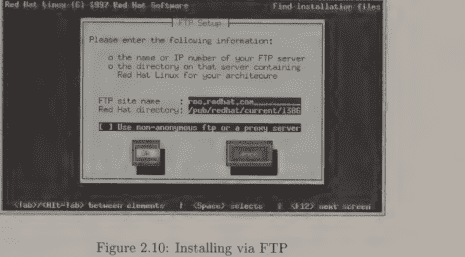

### 使用 fdisk

`fdisk` 包含简洁但有用的在线帮助。以下是一些提示：

- 要列出当前分区表，请使用 `p` 命令。要添加新分区，请使用 `n`。
- Linux `fdisk` 默认创建类型为 Linux 原生的分区。创建交换分区时，别忘了使用 `t` 命令将其更改为 Linux 交换类型。
- Linux 允许在一个磁盘上最多有四个 (4) 分区。如果您希望创建更多的分区，这四个分区中的一个可以是扩展分区，该分区进而包含一个或多个逻辑分区。由于它充当容器，扩展分区必须跨越逻辑分区将占据的所有空间。
- 在创建每个分区时，记下哪些分区（例如，`/dev/hda2`）用于哪些文件系统（例如，`/usr`）是个好主意。

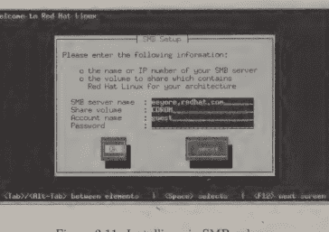

`请注意：` 您所做的任何更改在保存并使用 `w` 命令退出 `fdisk` 之前不会生效。您可以随时使用 `q` 命令在不保存更改的情况下退出 `fdisk`。

### 分区编号

Linux 使用字母和数字的组合来指代磁盘分区，这可能会让缺乏经验的用户感到困惑。以下是摘要：

- `字母` 表示分区所在的设备，例如，`/dev/hda`（第一个 IDE 硬盘）或 `/dev/sdb`（第二个 SCSI 磁盘）。
- `数字` 表示分区。前四个（主或扩展）分区编号为 1 到 4。逻辑分区从 5 开始。例如，`/dev/hda3` 是第一个 IDE 硬盘上的第三个主或扩展分区；`/dev/sdb6` 是第二个 SCSI 硬盘上的第二个逻辑分区。

### 更改分区表

完成磁盘分区后，请按`完成`；您可能会看到一条消息，指示安装程序需要重新启动。这是在更改磁盘分区数据后的正常现象；如果您创建、更改或删除了任何扩展分区，通常会发生这种情况。按`确定`后，您的机器将重新启动。按照您之前直到`分区磁盘`步骤所做的相同安装步骤进行；然后只需选择`完成`。

## 2.4.10 初始化交换空间

为 Red Hat Linux 创建分区后，安装程序会查找交换分区。如果找到任何分区，它会询问您是否想要初始化它们。使用 `Space` 选择您希望初始化为交换空间的分区；如果您希望检查分区中是否有坏块，请确保选中`在格式化期间检查坏块`复选框。选择`确定`。

如果安装程序找不到您的交换分区，请确保已将分区类型设置为`Linux 交换`；参见上面的第 2.4.9 节。

## 2.4.11 文件系统配置

由于 Red Hat Linux 可能分布在几个磁盘分区上，您需要选择哪些磁盘分区与哪个`文件系统`配合使用。

### 选择根分区

如果您正在执行完全安装，安装程序会列出它可以找到的 Linux 分区，并提示您选择一个`根分区`。根分区（或`根文件系统`）是承载启动您的 Red Hat Linux 系统所需的所有内容的分区；当您的系统启动时，它挂载在 `/`（`根目录`）上。选择您希望使用的根分区并按 `Enter`。

如果您正在执行升级，安装程序会尝试自动找到您的根分区；如果找到一个，它将进入下一步。

### 其他分区

下一个对话框将显示系统中大多数磁盘分区的列表（包括 MS-DOS 以及 Linux 可读取的其他分区），允许您将其他分区分配给文件系统的不同部分。您分配的这些分区将在您的 Red Hat Linux 系统启动时自动挂载。选择您希望分配的分区并按 `Enter`（或者选择 `Edit`；然后输入该分区的 `挂载点`，例如 `/usr`（见图 2.12））。

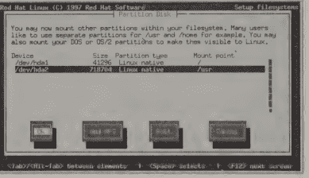

图 2.12：文件系统配置

此外，Red Hat Linux 允许您在系统启动时挂载 NFS 卷；这使得目录树可以在网络之间共享。选择 `Add NFS`；然后输入 NFS 服务器的主机名、NFS 卷的路径以及该卷的本地挂载点（见图 2.13）。

### 格式化分区

下一个安装对话框显示了需要格式化的分区列表。大多数分区应该进行格式化，特别是如果它们是新建的；但是，如果包含您希望保留的数据（例如 `/home` 或 `/usr/local`），则此类分区无需格式化。选择每个要格式化的分区并按 `Space`。如果您希望在格式化每个文件系统时检查坏块，请选择 `Check for bad blocks during format`。按 `OK`。

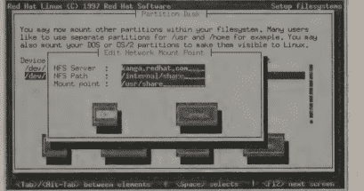

图 2.13：添加 NFS 挂载

## 2.4.12 选择和安装软件包

配置和格式化分区完成后，您即可选择要安装的软件包。您可以选择`系统组件`，这些组件根据功能对软件包进行分组；也可以选择单个软件包，或两者的组合。

### 选择系统组件

系统组件根据您的 Red Hat Linux 系统应执行的功能将软件包分组：例如，`C Development`（C 开发）、`Networked Workstation`（网络工作站）或 `Web Server`（Web 服务器）。选择每个您希望安装的组件并按 `Space`。选择 `Everything`（全部）将安装 Red Hat Linux 附带的所有软件包（见图 2.14）。

如果您希望在系统组件之外选择或取消选择单个软件包，请选择 `Select individual packages`（选择单个软件包）。

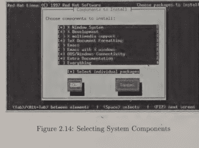

### 选择单个软件包

选择希望安装的组件后，您可以选择或取消选择单个软件包。安装程序会显示可用软件包组的列表；选择某个组进行检查并按 `Enter`。安装程序会显示该组中的软件包列表，您可以使用 `Space` 键进行选择或取消选择。您可以按 `F1` 查看软件包的详细描述（见图 2.15）。完成单个软件包的选择后，在“选择组”对话框中按 `OK`。

`请注意：` 某些软件包（例如内核和特定的库）是 Red Hat Linux 系统必需的，因此无法选择或取消选择。

### 软件包依赖关系

许多软件包为了正确运行，依赖于系统中安装的其他软件包或库。例如，许多图形化的 Red Hat 系统管理工具需要 `python` 和 `python1ib` 软件包。为了确保您的系统具备完全功能所需的所有软件包，Red Hat Linux 会在您每次安装或卸载软件包时检查依赖关系。

## 2.4. 分步安装

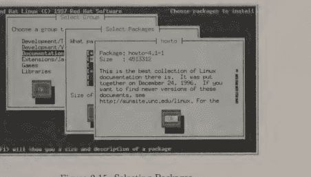

图 2.15：选择软件包

完成选择要安装的软件包后，安装程序会检查所选软件包列表的依赖关系。如果任何软件包需要您尚未选择安装的其他软件包，程序将显示这些`未解析的依赖关系`列表，并为您提供解决它们的机会（见图 2.16）。如果您直接按 `OK`，程序将通过将所有必需软件包添加到所选软件包列表来自动解决这些问题。

### 软件包安装


在所有软件包依赖关系解决后，安装程序开始安装软件包；它会在您的 Red Hat Linux 系统的 `/tmp/install.log` 中留下完整的安装日志。

### 2.4.13 配置鼠标

要配置您的鼠标，请选择最符合您鼠标类型的选项并按 `Enter`。如果您拥有双键鼠标，并希望同时单击左右键来模拟第三个（中间）键，请选择 `Emulate 3 Buttons`（模拟三键）。

如果您选择串行鼠标，下一个对话框将提示您输入鼠标连接的串行

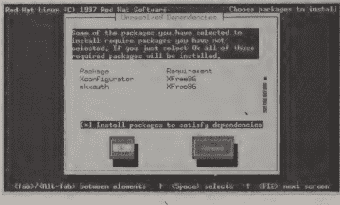

图 2.16：未解析的依赖关系

(COM) 端口。选择正确的端口并按 `Enter`。

**请注意**：如果您的鼠标连接到 PS/2 鼠标端口，无论鼠标类型如何，都应选择 PS/2 Mouse。

如果您希望在 Red Hat Linux 系统启动后更改鼠标配置，可以使用 `/usr/sbin/mouseconfig` 命令。

### 2.4.14 配置 X Windows

设置完鼠标后，如果您安装了 X Windows 软件包，则有机会配置您的 X 服务器。如果您未选择安装 X 窗口系统，可以跳到下面的 2.4.15 节。

#### 配置 Metro-X 服务器

如果您正在从官方 Red Hat Linux/Intel CD 安装，您可以安装 MetroLink 的 Metro-X 服务器的一份副本，这是一个用于 Linux 的高质量商业 X 服务器。请参阅随附于您的 Red Hat Linux CD 的 MetroLink 许可协议（纸质副本）以获取许可信息。如果您选择

使用 Metro-X，安装程序将启动 Metro-X 配置工具 `configX`；有关如何使用 `configX` 的更多信息，请参阅第 5 章第 5.3 节。

#### 配置 XFree86 服务器

如果您希望使用 XFree86（因为 Metro-X 可能不支持您的视频卡，因为您已在另一台机器上安装了 Metro-X，因为您的 Red Hat Linux/Intel 副本未包含 Metro-X，或者您只是更喜欢使用 XFree86），安装程序将启动 `Xconfigurator` 工具，该工具在第 5 章第 5.2 节中有详细说明。

`Xconfigurator` 首先显示视频卡列表。从列表中选择您的视频卡并按 `Enter`。如果您的视频卡未出现在列表中，XFree86 可能不支持它；但是，如果您对显卡有技术了解，您可以选择 `Unlisted Card`（未列出的显卡）并尝试进行配置。

选择视频卡后，安装程序将安装相应的 XFree86 服务器，然后 `Xconfigurator` 显示监视器列表。如果您的监视器出现在列表中，请选择它并按 `Enter`。否则，请选择 `Custom`（自定义）。如果您选择 `Custom`，`Xconfigurator` 将提示您选择监视器的水平同步范围和垂直同步范围（这些值通常可在随附的监视器文档中，或从您的监视器供应商或制造商处获取）。

> 请注意：不建议选择“类似”的监视器，除非您确定所选监视器不超过您监视器的能力。如果这样做，可能会导致您的监视器超频并损坏或毁坏它。

接下来，`Xconfigurator` 提示您输入视频卡上安装的视频内存量。如果您不确定，请查阅随视频卡附带的文档。选择超过可用内存的数量不会损坏您的视频卡，但如果这样做，XFree86 服务器可能无法正确启动。

如果您选择的视频卡可能带有视频时钟芯片，`Xconfigurator` 将显示时钟芯片列表。建议的选择是 `No Clockchip Setting`（无时钟芯片设置），因为 XFree86 可以自动检测适当的时钟芯片

大多数情况。

最后，`Xconfigurator` 会提示您选择要使用的视频模式；按 `[空格键]` 选择一个或多个模式。`Xconfigurator` 随后会将包含您所有选择的配置文件写入 `/etc/X11/XF86Config`。

### 2.4.15 配置网络

在协助您配置 X 服务器之后，安装程序会为您提供配置（或重新配置）网络的机会。如果您是从 CD-ROM 或本地硬盘进行安装，安装程序会询问您是否要配置网络。如果您选择**否**，您的 Red Hat Linux 系统将成为一台独立工作站。如果您选择**是**，您可以按照下文说明配置网络。

如果您是通过 NFS 或 FTP 安装 Red Hat Linux，那么您已经配置了临时网络信息。安装程序为您提供三个选项：

- 保留您用于安装时已使用的设置；您之前输入的所有网络信息将成为系统永久配置的一部分。
- 重新配置网络；安装程序将显示下文描述的网络配置对话框，并将您在安装期间使用的值作为默认值填入。如果您的系统将安装在不同于安装 Red Hat Linux 时使用的网络中，请选择此项。
- 完全不设置网络；您的系统将不配置网络。如果您通过网络安装了系统，但将其用作独立工作站，请选择此项。

#### 网络配置对话框

安装程序找到您的网卡后，会显示几个对话框用于配置系统的永久 TCP/IP 网络。此功能允许如果您想从机器将“驻留”的网络以外的网络进行安装，具有更大的灵活性。图 2.5 包含示例网络信息。

第一个对话框询问您的 IP 地址和其他网络地址（见图 2.6）。输入您在安装期间使用的**IP 地址**，然后按 `Enter`。安装程序试图根据您的 IP 地址猜测您的**子网掩码**；如果错误，您可以更改子网掩码。按 `Enter`。安装程序根据您的 IP 地址和子网掩码猜测**默认网关**和**主名称服务器**地址；如果错误，您可以更改它们。选择**确定**继续。

第二个对话框提示您输入域名、主机名和其他网络信息（见图 2.7）。输入您系统的**域名**并按 `Enter`；安装程序将域名向下传递到**主机名**字段。输入您在域名前使用的主机名，以形成完全限定域名（FQDN）。如果您的网络有一个以上的名称服务器，您可以输入额外的名称服务器的 IP 地址到**次要名称服务器**和**次要名称服务器**字段。选择**确定**继续。

### 2.4.16 配置打印机

在设置好网络后，安装程序会询问您是否要配置打印机。如果您选择**是**，一系列对话框将协助您配置打印机。以下信息适用于所有打印机：

- **打印机连接：** 打印机连接的位置——*本地*、*远程* 或 *LAN-Manager*。
    - **本地打印机：** 本地打印机直接连接到您正在安装的机器上。
    - **远程打印机：** 远程 lpd 打印机连接到网络上的另一台运行 lpd（Linux 和许多其他 Unix 变体使用的打印服务器）的机器。
    - **LAN-Manager 打印机：** LAN-Manager 打印机连接到 LAN-Manager 风格（SMB）网络上的另一台机器。
- **队列：** 您要创建的打印机队列名称。
- **Spool 目录：** 打印作业在打印过程中存储的目录。
- **打印机类型：** 您的打印机制造商和型号；如果您的打印机未出现在列表中，您可能会通过选择与您的打印机相似的制造商和型号而成功。
- **纸张大小：** 您的打印机使用的纸张尺寸。
- **分辨率：** 您希望打印机使用的分辨率（以点/英寸计）。
- **颜色：** 如果您有彩色打印机，您希望打印机使用的颜色深度。

**本地**打印机还需要以下信息：

- **打印机设备：** 打印机所连接的端口。

**远程 LPD** 打印机还需要以下信息：

- **远程主机：** 远程打印机所连接的主机名称或 IP 号。
- **远程队列：** 远程打印机队列的名称。

**LAN Manager** 打印机还需要以下信息：

- **LAN Manager 主机：** SMB 打印机所连接的主机名称。
- **LAN Manager IP：** SMB 打印机所连接的主机 IP 号；这是可选的。
- **共享名称：** 共享 SMB 打印机的名称。
- **用户名：** 您访问 SMB 打印机所需使用的用户名（Windows 服务器通常为 `guest`，`samba` 服务器为 `nobody`）。
- **密码：** 您访问 SMB 打印机所需使用的密码（通常为空）。

当您完成打印机配置后，安装程序将要求您确认所做选择。确认后，您可以配置另一台打印机，或者继续安装。

### 2.4.17 配置时钟

接下来，安装程序显示一个对话框，帮助您配置您的 Red Hat Linux 系统的时区。

如果您希望将硬件（CMOS）时钟设置为 GMT（格林尼治标准时间，也称为 UTC 或协调世界时），请选择**硬件时钟设置为 GMT**。将您的硬件时钟设置为 GMT 意味着您的 Red Hat Linux 系统如果您的时区使用夏令时，它将正确处理夏令时。大多数网络使用 GMT。

从列表中选择您的系统将运行的时区，并按 `Enter`。

如果您在启动 Red Hat Linux 系统后希望更改时区配置，您可以使用 `/usr/sbin/timeconfig` 命令。

### 2.4.18 设置 root 密码


在设置好系统的时区后，安装程序提示您为系统设置 `root` 密码；这是您首次登录 Red Hat Linux 系统时将使用的密码。

`root` 密码必须至少为六个字符；您输入的密码不会回显在屏幕上。您必须输入两次密码；如果两个密码不匹配，安装程序将要求您再次输入。

您应该将 `root` 密码设置为您能记住的，但不是别人容易猜测的。您的名字、您的电话号码、`qwerty`、`password`、`root`、`123456` 和 `anteater` 都是糟糕密码的例子。好的密码混合数字和大写小写字母，并且不包含字典单词：例如 `Aard387vark` 或 `420BtttTNT`。请记住密码是区分大小写的。写下这个密码并保存在安全的地方。

**请注意：** `root` 用户（也称为 `超级用户`）拥有对整个系统的完全访问权限；因此，最好仅在执行系统维护或管理时登录为 `root` 用户，以免系统关键文件被意外更改、移动或删除。请参阅第 8.1 节了解在重启系统后如何为您自己添加用户。

### 2.4.19 安装 LILO

为了能够启动您的 Red Hat Linux 系统，您通常需要安装 `LILO`（Linux LOader）。您可以在几个位置之一安装 `LILO`：

**主引导记录（MBR）** 是推荐安装 `LILO` 的位置，除非那里已经安装了另一个操作系统加载器（例如 System Commander 或 OS/2 的启动管理器）。当您的机器启动时，`LILO` 启动并显示 `boot:` 提示；您可以启动 Red Hat Linux 或您配置 `LILO` 启动的任何其他操作系统（见下文）。

**根分区的第一扇区** 如果您已经在系统中使用另一个启动加载器（例如 OS/2 的启动管理器），则推荐安装在此处；然后您可以设置该启动加载器以启动 `LILO` 并引导 Red Hat Linux。

**软盘的第一扇区** 是上述任一选项的替代方案；要启动 Red Hat Linux，请将 `LILO` 软盘插入机器的软盘驱动器并重新启动。`LILO` 从软盘启动并显示 `boot:` 提示。

选择您希望安装 `LILO` 的位置并按**确定**。如果您不希望安装 `LILO`，请按**跳过**。

#### LILO 的限制

`LILO` 受到大多数 PC BIOS 施加的一些限制。具体来说，大多数 BIOS 无法访问超过两个硬盘，并且无法访问任何驱动器的 1023 柱面（第 1024 个柱面）以外。一些较新的 BIOS 没有这些限制。

`LILO` 在启动时需要访问的所有内容（包括内核）都位于根分区的 `/boot` 目录中。

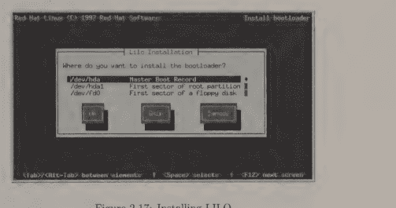

图 2.17：安装 LILO

如果您想在硬盘上安装 `LILO`，以下是关于 `/boot` 分区位置的要求：

- 1. 如果您有 2 个 IDE（或 EIDE）硬盘，`/boot` 必须位于其中之一上。这也包括主控制器上的任何 IDE CD-ROM 驱动器。如果您有一个 IDE 硬盘，并且主控制器上有一个 IDE CD-ROM，`/boot` 必须位于硬盘上。
- 2. 如果您有一个 IDE（或 EIDE）硬盘和一个或多个 SCSI 硬盘，`/boot` 必须位于 IDE 硬盘上，或者位于 ID 为 0 的 SCSI 硬盘上。其他 SCSI ID 将无法工作。
- 3. 如果您只有 SCSI 硬盘，`/boot` 必须位于 ID 为 0 或 ID 为 1 的硬盘上。其他 SCSI ID 将无法工作。
- 4. 在任何情况下，`/boot` 必须位于 1023 柱面以下。对于 IDE（或 EIDE）硬盘，这通常意味着在 512 MB 标记以下；对于 SCSI 硬盘，通常在 1 GB 标记以下。

#### 向 LILO 引导命令行添加选项

最后，安装程序会询问您是否希望向 `LILO` 引导命令添加默认选项。您输入的任何选项都将在 Linux 内核每次启动时传递给内核。如果您有 LBA 硬盘，请勾选“Use linear mode”（使用线性模式）。完成后按 `OK`。

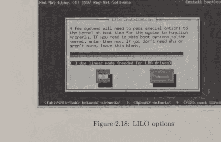

#### LILO 的替代方案

如果您不希望使用 `LILO` 来引导您的 Red Hat Linux 系统，有几种替代方法：

**LOADLIN** 可以从 MS-DOS 加载 Linux；不幸的是，它需要 Linux 内核（如果您有 SCSI 适配器，还需要初始 ram 盘）在 MS-DOS 分区上可用。实现这一点的唯一方法是使用其他方法（例如，从软盘上的 `LILO`）引导您的 Red Hat Linux 系统，然后将内核复制到 MS-DOS 分区。`LOADLIN` 可以从 `ftp://sunsite.unc.edu/system/Linux-boot/` 和 sunsite 的各个镜像站点获取。

**SYSLINUX** 是一个与 `LOADLIN` 非常相似的 MS-DOS 程序；它也可以从 `ftp://sunsite.unc.edu/system/Linux-boot/` 和 sunsite 的各个镜像站点获取。

**某些商业引导加载程序**，例如 System Commander，能够引导 Linux（但可能仍然需要在您的 Linux 根分区安装 `LILO`）。

### 2.4.20 完成安装...或开始启动

完成 `LILO` 安装后，安装程序将重启您的系统。请不要忘记从软盘驱动器中移除安装软盘。

在 `boot:` 提示符处，按 `Enter` 键并观察您的 Red Hat Linux 系统启动。当它显示 `login:` 提示符时，输入 `root`；在 `Password:` 提示符处，输入您在 2.4.18 节中为您的机器设置的 `root` 密码。

# 第 3 章：安装 Red Hat Linux/Alpha

## 3.1 简介

这是 Red Hat Linux/Alpha 4.2 版本针对数字设备公司（Digital Equipment Corporation）Alpha 系列处理器的简要安装说明。本章描述了安装 Red Hat Linux/Alpha 与 Red Hat Linux/Intel 之间的区别。有关安装过程的更多详细信息，请参阅第 2 章，*安装 Red Hat Linux/Intel*。

## 3.2 支持的硬件

Red Hat Linux/Alpha 支持基于 Alpha 处理器和 PCI 总线的多种硬件。已知支持此版本的平台包括：

- 1. AlphaPC64 (Cabriolet, Aspen Telluride)
- 2. AxpPCI33 (Noname)
- 3. EB64+ (Aspen Alpine)
- 4. EB66 (NekoTech Mach 1)
- 5. EB66+
- 6. Jensen (DEC PC 150, 2000 model 300, Cullean)
- 7. Universal Desktop Box (UDB, 有时称为 Multia)。这只是一个 nomae 主板，并在本文档的其余部分按此处理。
- 8. AlphaStation 200, 250, 255, 400 (Avanti 机器)
- 9. EB164 (Aspen Avalanche, Timberline, Summit; Microway Screamer)
- 10. Kinetics 的 Platform 2000 机器
- 11. PC164 机器 (Durango)
- 12. Alcor 类型机器 (AlphaStation 500, 600; Maverick, Brett)
- 13. Alpha-XL
- 14. Alpha-XLT (XL 300, XL 366)
- 15. Mikasa 类型机器 (AlphaServer 1000)，不支持 1000A

除了 Jensen 之外，上述所有平台都包含 NCR 810 SCSI 控制器，但 BusLogic PCI SCSI 控制器（FlashPoint 除外）、Adaptec AHA2940 SCSI 控制器和 Qlogic 1020 ISP 控制器也得到支持。Jensen 设计使用 AHA1740 SCSI 控制器并得到支持。

支持 NE2000、DE422 和 DE4x5 (PCI) 以太网卡。这包括 UDB 的内部以太网硬件。内核中也包含令牌环支持。

X Window 系统应该在任何使用基于 S3 显卡的机器上都能正常工作，Jensen 机器除外。针对 S3 显卡的 X 服务器可从 `ftp://ftp.astrarnet.com` 的 `/pub/linux/axp/jensen` 目录获取。Orchid 和 Number 9 的大多数显卡都能工作。大多数 Diamond Stealth 显卡也得到支持。Digital TGA 显卡（基于 DC21030 芯片）在 8 位模式下得到支持，并且还提供了针对 Mach64 显卡的 X 服务器。

有关 Alpha 硬件的更多信息可以在附录 C 中找到。

## 3.3 安装概览


在 Alpha 系统上安装 Red Hat Linux 比在 Red Hat Linux/Intel 上安装稍微复杂一些，主要是由于机器架构的差异。对于大多数系统，成功安装的主要步骤是：

- 1. 将 MILO（Linux/Alpha mini 加载器）安装到您的机器上（或软盘上）；参见 3.4 节，*安装 MILO*。
- 2. 使用 Red Hat CD 上提供的映像创建内核引导盘和 ramdisk；参见 3.5 节，*制作引导盘和 Ramdisk 软盘*。
- 3. 使用 MILO 引导适当的 Linux 内核；参见 3.6.1 节，*引导内核软盘*。
- 4. 加载并运行 Red Hat Linux/Alpha 安装程序；参见 3.6.2 节，*启动安装*。

要执行这些步骤，您需要三（3）张空白的已格式化的 3.5 英寸软盘。

## 3.4 安装 MILO

对于大多数系统，引导 Red Hat Linux/Alpha 的最佳方法是使用 MILO，即 Linux/Alpha mini 加载器。您可以直接从系统固件加载 MILO，或者使用 ARC 控制台将 MILO 作为替代“操作系统”加载。这些过程的详细信息在 MILO HOWTO 中提供，该文档作为附录 D 提供。

完整的 MILO 树在 Red Hat CD 的 `milo/` 目录中可用。它包含制作此 CD 时可用的最新文档和 MILO 映像（较新版本的 MILO 定期在 `gatekeeper.dec.com` 提供）。`milo/images/` 目录还包含可与 ARC 控制台一起用于直接引导进入 MILO 的软盘映像。它们包含 MILO 和 `linload.ex`。

### 3.4.1 制作 MILO 软盘

要制作 MILO 软盘，您需要在 Linux（或 Digital Unix）系统上使用 `dd` 命令，或者在 Microsoft Windows NT 或 MS-DOS 系统上使用 `rawrite.exe` 程序（位于 Red Hat CD 上）。使用 `dd` 时，首先挂载 CD（例如，在 `/mnt/cdrom/` 下），从 `milo/images/` 中为系统选择适当的映像，然后：

```
cd /mnt/cdrom
dd if=milo/images/your-image.img of=/dev/fd0
```

使用 `rawrite` 时，为系统选择适当的映像，并且（假设您的 CD-ROM 驱动器是 `d:`）：

```
d:
cd milo/images
\\dosutils\rawrite.exe
```

`rawrite` 首先询问软盘映像的名称；输入您的系统的 MILO 映像名称（例如，`noname-udb.img`）。然后询问要写入映像的软盘驱动器；输入 `a:`。

将软盘标记为“MILO 软盘”。

### 3.4.2 如果 MILO 无法工作怎么办？

如果您的机器不支持 MILO，您需要直接从 SRM 控制台引导软盘或 Red Hat CD。有关如何执行此操作的信息可在 Red Hat 软件网站上获取，网址为 [http://www.redhat.com/linux-info/alpha/faq](http://www.redhat.com/linux-info/alpha/faq)。

请注意： 如果您在使用 MILO 时遇到麻烦，首先要尝试的是更新版本的 MILO。

## 3.5 制作引导盘和 Ramdisk 软盘

### 3.5.1 制作引导软盘

制作 MILO 软盘后，您需要制作一个包含适合您机器的适当 Linux/Alpha 内核的引导软盘。内核映像位于 Red Hat CD 的 `images/` 目录中；那里还有一个包含有关内核映像更多信息的 README 文件。

可用的引导映像包括：

- 1. `cab.img` (AlphaPC64, Cabriolet)
- 2. `noname.img` (AxpPCI33, Noname, Universal Desktop Box)
- 3. `eb64p.img` (EB64+, Aspen Timberlines)
- 4. `eb66.img` (EB66)
- 5. `eb66p.img` (EB66+)
- 6. `jensen.img` (Jensens)
- 7. `avanti.img` (AlphaStation 200, 250, 400)
- 8. `xl.img` (Alpha XL)
- 9. `xtl.img` (Alpha XTL)
- 10. `eb164.img` (EB164 基于的机器)
- 11. `p2000.img` (Platform 2000)
- 12. `pc164.img` (Alcor 基于的机器)
- 13. `alcor.img` (Alcor 基于的机器)
- 14. `mikasa.img` (Mikasa 基于的机器)

所有这些映像都应该可以在使用 VGA 或 TGA 基于图形卡的机器上工作。

要制作内核软盘，使用 `dd` 或 `rawrite`。例如，使用 `dd`（在 Linux 或 Unix 下）：

### 3.5.1 制作内核软盘

在 Linux 或 Unix 下使用 `dd`：

```
cd /mnt/cdrom
dd if=images/your-image.img of=/dev/fd0
```

在 Microsoft Windows NT 或 MS-DOS 下使用 `rawrite`：

```
d:
cd images
\dosutils\rawrite.exe
```

`rawrite` 会先询问软盘镜像的名称；请输入你系统内核镜像的名称（例如 `noname.img`）。然后它会询问要将镜像写入哪个软驱；请输入 `a:`。

将软盘标记为“内核软盘”（Kernel floppy）。

### 3.5.2 制作 Ramdisk 软盘

Ramdisk 镜像位于 Red Hat CD 的 `images/ramdisk.img` 路径下。

你可以使用 `dd` 或 `rawrite` 将镜像写入软盘，操作方式与制作 MILO 软盘和引导软盘类似。在 Linux 或 Unix 下使用 `dd`：

```
cd /mnt/cdrom
dd if=images/ramdisk.img of=/dev/fd0
```

在 Microsoft Windows NT 或 MS-DOS 下使用 `rawrite`：

```
d:
cd images
\dosutils\rawrite.exe
```

`rawrite` 会先询问软盘镜像的名称；请输入 `ramdisk.img`。

然后它会询问要将镜像写入哪个软驱；请输入 `a:`。

将软盘标记为“Ramdisk 软盘”（Ramdisk floppy）。

## 3.6 安装

### 3.6.1 启动内核软盘

要从你上面制作的软盘中启动 Linux/Alpha 内核，请使用 MILO。关于如何从你的 MILO 软盘中加载 MILO 的详细信息，请参阅附录 D，《Alpha Miniloader Howto（Alpha 迷你加载程序指南）》第 D.5 节。启动至 MILO> 提示符，将内核软盘插入第一个软驱，并给 MILO 输入以下命令：

```
boot fd0:vmlinuz.gz root=/dev/fd0 load_ramdisk=1 prompt_ramdisk=1
```

MILO 会从你的引导软盘中读取 Linux 内核并运行它。

如果你使用 SRM 控制台而不是 MILO 来加载内核，你需要给内核提供以下参数：

```
load_ramdisk=1 prompt_ramdisk=1
```

### 3.6.2 开始安装

内核启动后，它会提示输入 ramdisk。将 ramdisk 软盘插入软驱并按回车键。

### 3.6.3 Linux/Alpha 特有问题

**磁盘分区**

Red Hat Linux/Alpha 支持两种硬盘分区方式：

- 标准 fdisk 风格分区： 这种方式具有常见的特性（例如扩展分区），操作方式与 Intel 平台相同（使用 Linux fdisk）。如果你使用的是 ARC 控制台，则必须使用这种分区方式。
- BSD 风格磁盘标签： 在带有磁盘标签的硬盘上，通常将第一个分区作为交换分区。除非绝对必要，否则我们不建议使用 BSD 磁盘标签。

**XFree86 和 TGA**

如果你拥有配备 TGA 显卡的 Alpha 计算机并选择安装 XFree86，安装程序会提示你选择显卡。请选择未列出的服务器（Unlisted Server）；安装程序将显示可用服务器列表。请选择 TGA 服务器。

### 3.6.4 完成

安装完成且系统完全配置好后，系统将要求你重置计算机。这表明你的系统已成功安装。

## 3.7 启动你的 Red Hat Linux/Alpha 系统

要从 MILO 启动 Red Hat Linux，你必须使用 `boot` 命令。该命令会因根分区的位置略有不同。例如，如果你的根分区是第一块 SCSI 硬盘上的第二个分区，则应如下启动：


```
boot sda2:vmlinux.gz root=/dev/sda2
```

如果根分区是第二块 IDE 硬盘上的第三个分区，则应使用此命令：

```
boot hdb3:vmlinux.gz root=/dev/hdb3
```

关于这些命令以及如何自动化启动过程的信息，请参阅附录 D 中的 MILO HOWTO。

# 第 4 章

## 安装 Red Hat Linux/SPARC

这是针对 SPARC 处理器家族的 *Red Hat Linux/SPARC* 4.2 版本的简要安装说明。本章描述了安装 Red Hat *Linux/SPARC* 与 Red Hat *Linux/Intel* 之间的差异。有关安装过程的更多细节，请参阅第 2 章。

### 4.1 硬件

Red Hat *Linux/SPARC* 已知在以下硬件上运行正常：

-   `sun4c` 架构机器（IPC、SS1 等）
-   `sun4m` 架构机器（Classic、SS5、SS10 等）
-   `bwtwo`、`cg3`、`cg6`、`TCX` 帧缓冲区（TCX 为 24 位）
-   `cg14` 帧缓冲区（在 `cg3` 模式下）
-   上述所有机型均支持 SCSI 和以太网
-   4 型及 5 型键盘和鼠标
-   外部 SCSI 驱动器
-   CD-ROM 驱动器（外部和内部）
-   SCSI/以太网 SBUS 扩展卡
-   适用于上述帧缓冲区的任何原装 Sun 显示器

以下部分列表中的硬件*不受支持*：

-   基于 VME 总线的 `sun4m` 机器，例如 `4/690`
-   `sun4d`（SS1000、SS2000）
-   `sun4u`（UltraSparc1、UltraSparc2、Enterprise UltraSparc 服务器）
-   `sun4` 架构
-   Eurocard `sundc` 机器，在 Solaris 2.4 及其他系统中称为 '`sun4e`'，不受支持。这些是基于 VME 总线的 `sun4c` 机器，内核尚未移植到这些机器上。

### 4.2 从软盘启动

#### 4.2.1 制作引导软盘

如果你的 SPARC 系统配有软驱，你可以从软盘启动 Red Hat Linux 安装程序。引导软盘镜像位于你的 Red Hat CD 的 `images/` 目录中。

要制作引导软盘，你可以使用 MS-DOS 下的 `rawrite.exe`（位于你的 Red Hat Linux/SPARC CD 的 `dosutils` 目录中），或者使用 Linux 或 Unix 下的 `dd`。在 MS-DOS 下，请输入以下命令（假设 CD-ROM 是 `d:` 盘）：

```
d:
cd \images
\dosutils\rawrite.exe
```

#### 4.2.2 启动

`rawrite` 会先询问软盘镜像的名称；请输入 `boot.img`。然后它会询问要将镜像写入哪个软驱；请输入 `a:`。

在 Linux 或 Unix 下，挂载 CD，切换到其挂载目录，并使用以下命令：

```
dd if=images/boot.img of=/dev/fd0
```

> **请注意：** 在 Solaris 下不要使用 `/dev/rfd0`；它将无法正常工作。请使用 `/dev/fd0`。

插入引导软盘，并在 PROM 提示符下输入 `boot floppy`。你将看到 SILO 提示符。如果你希望使用 ramdisk 进行安装（这需要约 2M 的 RAM，如果内存为 8M 或更多则推荐使用），你可以直接在 SILO 提示符下按回车键。如果你希望进行基于 NFS 根文件系统的安装，则需要在此处提供某些参数。公式如下：

```
linux nfsroot=nfs.server.IP.address:/path/to/RH/image
```

要使此方法正常工作，你需要在网络上配置 rarp 条目或 bootp 条目，以提供你的 SPARC 的 IP 地址。以下内容在下面的 4.3 节中涵盖。

### 4.3 从网络启动

如果你没有软驱，且你的 PROM 版本低于 2，你需要进行网络启动。这相对容易实现，但你需要在本地网络的一台服务器上配置 rarp 条目，以告知目标 SPARC 其 IP 地址。这可以在一台内核中内置 RARP（或作为模块插入）的 Linux 系统上完成，使用如下形式的命令：

```
rarp -s ip.address.of.sparc hw:address.of:sparc
```

在大多数情况下，你还需要一个 ARP 条目；例如：

```
arp -s ip.address.of.sparc hwaddress.of.sparc
```

现在，你需要在本地网络中设置一个 TFTP 服务器，以便向目标 SPARC 提供内核。这台机器应与上面执行 `rarp` 的机器相同。在 Red Hat Linux 中，这可以通过编辑 `/etc/inetd.conf` 来实现。你需要一个类似于下面的条目：

```
tftp dgram udp wait root /usr/sbin/tcpd in.tftpd /home/tftp
```

现在，你可以将 `kernels/vmlinux` 复制到服务器上的 `/home/tftp`，并创建一个符号链接，以便 PROM 获取正确的文件。这个符号链接取决于目标 SPARC 的 IP 地址和架构。你需要将链接命名为 IP 地址的十六进制值加“.”点加架构。例如，要为 `flanders.redhat.com` 创建一个符号链接，这是一台 IP 地址为 199.183.24.232 的 `sun4m` 机器，你需要输入以下命令：

```
cd /home/tftp
ln -s vmlinux C7B718E8.SUN4M
```

此时，你应该能够在 SPARC 的 PROM 中输入：

```
boot net nfsroot=nfs.server.IP.address:/path/to/RH/image
```

并且它应该从 TFTP 服务器获取 rarp 请求的响应，并开始通过 TFTP 加载内核。然后内核应该启动并开始安装。

启动安装盘后，你会看到一个带有单个按钮的欢迎屏幕；按 `Enter` 开始安装。

现在，选择你要使用的安装介质；NFS、硬盘或 FTP。仅当存在带有 EXT2 文件系统的现有分区时，从硬盘安装才能正常工作；从 UFS 安装尚未实现。

### 4.4 网络安装

你还可以通过 TFTP 传输完整的安装映像（内核和根文件系统）来进行 FTP 安装。除了 `nfsroot` 和内核链接之外，你需要像上面的示例那样执行相同的操作。不要使用 `kernels/vmlinux`，而是使用 `images/tftpboot.img`。将其放置在 `/home/tftp` 目录中，并创建符号链接：

```bash
cd /home/tftp
ln -s tftpboot.img C7B718E3.SUN4M
```

请记住根据你自己的网络编号和机器架构更改 IP 地址和架构类型。

现在，你只需要从 SPARC 机器进行网络启动，系统应该会通过 TFTP 传输所有内容，启动内核并启动安装程序。然后，你可以从附近的服务器进行 FTP 安装，或者如果你愿意，也可以进行 NFS、硬盘或 CD-ROM 安装。

### 4.5 使用串行终端安装

你也可以使用串行终端安装 Red Hat Linux/SPARC 4.2；任何模拟 VT100 的终端都应该能正常工作。从软盘启动，并在 `SILO` 提示符下输入：

```bash
linux serial
```

安装程序运行在第一个串行端口，参数为 `9600,8,N,1`（9600 波特率，8 位数据，无奇偶校验，1 位停止位）。如果你的串行终端支持颜色，安装程序可以以彩色模式运行。

在串行安装过程中的任何提示对话框（任何带有 **OK** 按钮的对话框）中，你可以按 `Ctrl-Z` 启动一个子 shell；要返回安装程序，请在 shell 提示符下输入 `exit`。

安装完成后，只需正常启动系统，Red Hat Linux 应该会在你的串行终端上正常运行。

### 4.6 安装：选择系统组件

（关于系统组件的说明，请参阅第 2 章，第 2.4.12 节。）


**重要！** 在为 Red Hat Linux/SPARC 选择要安装的系统组件时，如果选择安装 **Everything**（所有内容）而没有选择 **Select individual packages**（选择单个软件包），可能会导致 Red Hat Linux 系统无法启动。最后安装的内核将是多处理器内核，这在 sun4c 机器上将无法正常工作。此外，默认的 X 服务器最终会变成 XsunMono，这对大多数人来说可能无法使用。如果你确实希望安装 **Everything**，请同时也选择 **Select individual packages**。然后，除了你希望安装的那个内核（`kernel-sparc` 适用于大多数情况）和适用于你硬件的那个 X 服务器（btw20 显卡使用 `XsunMono`，所有 8 位显示器使用 `Xsun`，支持的 24 位显示器使用 `Xsun24`）之外，取消选择所有内核和 X 服务器。

### 4.7 SILO 配置

SILO 配置与 LILO 配置几乎相同，详情请参见第 2.4.19 节。

### 4.8 分区

在为 SPARC 分区硬盘时，有一个额外的步骤。你必须将每个磁盘的第三个分区创建为类型 **Whole Disk**（整个磁盘），范围从 0 柱面到磁盘的末尾。它不应被触摸，但应该存在。你仍然可以像通常那样创建其他分区。

此外，磁盘上的第一个分区不应是交换分区，*除非* 交换分区从 1 柱面开始。

### 4.9 X 窗口

SPARC 上没有鼠标或 X 窗口配置。默认安装的是 8 位服务器。如果你想使用 24 位服务器（用于 TCX 卡），你需要安装 **Xsun24** 软件包。如果你只有 bwtwo 帧缓冲并希望提高性能，请安装 **XsunMono** 软件包。安装上述任一软件包都需要你重启 X 窗口。此外，如果你使用上述服务器之一，你可以卸载 Xsun 软件包。

# 第 5 章

## 安装后配置

安装完成后，你的系统已完全功能正常，但你可能仍需要进行一些额外的配置。本章描述了你可能需要执行的一些各种系统配置任务。

### 5.1 构建自定义内核

随着 Linux 2.0.x 内核中模块化的引入，构建自定义内核方面发生了一些重大变化。过去，如果你想访问特定的硬件或文件系统组件，你需要将支持编译到内核中。对于某些硬件配置，内核的大小可能会迅速达到临界水平。要求对仅偶尔使用的项提供就绪支持是系统资源的低效使用。凭借 2.0.x 内核的功能，如果某些硬件组件或文件系统使用频率较低，可以为它们加载驱动程序模块以满足需求。有关处理内核模块的信息，请参阅第 8 章，第 8.6 节。

#### 5.1.1 构建模块化内核

只有 Red Hat Linux/Intel 和 Red Hat Linux/SPARC 支持模块化内核；Red Hat Linux/Alpha 用户必须构建单体内核（见下文第 5.1.3 节）。

这些说明提供了利用内核模块化所获得的强大功能和灵活性所需的知识。如果你不希望利用模块化，请参阅第 5.1.3 节了解构建和安装单体内核的不同方面的说明。假定你已安装 **kernel-headers** 和 **kernel-source** 软件包，并且从 `usr/src/linux/` 目录发出所有命令。

从已知状态开始内核构建非常重要。因此，建议使用命令 `make mrproper` 开始。这将删除任何配置文件以及可能散布在源树中的任何先前构建的残留物。现在你必须创建一个配置文件，以确定新内核中包含哪些组件。根据你的硬件和个人偏好，有三种可用的方法来配置内核。

- `make config` 交互式文本程序。组件会依次呈现，你用 Y（是）、N（否）或 M（模块）回答。
- `make menuconfig` 图形菜单驱动程序。组件在类别菜单中呈现，你以与 Red Hat Linux 安装程序中相同的方式选择所需组件。切换对应项的标签以包含该项：Y（是）、N（否）或 M（模块）。
- `make xconfig` X 窗口程序。组件列在不同的菜单级别中，使用鼠标选择组件。再次选择 Y（是）、N（否）或 M（模块）。

**请注意：** 为了使用内核 d（有关详细信息，请参阅第 8.6 节）和内核模块，你必须在配置中回答 **kernel support**（内核支持）和 **module version (CONFIG_MODVERSIONS) support**（模块版本支持）为 Yes。

**请注意：** 如果你在使用“克隆”处理器的机器上（或为这种机器）构建 Linux/Intel 内核（例如，由 Cyrix 或 AMD 制造），建议选择 386 的 **Processor type**（处理器类型）。

如果你希望使用已经通过上述方法之一创建好的配置文件（`/usr/src/linux/.config`）来构建内核，你可以省略 `make mrproper` 和 `make config` 命令，并使用命令 `make dep` 后跟 `make clean` 来准备源树进行构建。

下一步包括将源代码组件实际编译成你的机器可以用来启动的工作程序。这里描述的方法在发生故障时最容易恢复。如果你对其他可能性感兴趣，可以在 Kernel-HOWTO 或你 Linux 系统上 `/usr/src/linux` 中的 `Makefile` 中找到详细信息。

- 使用 `make boot` 构建内核。
- 使用 `make modules` 构建你配置的任何模块。
- 使用以下命令将旧的一组模块移出：

```bash
rm -rf /lib/modules/2.0.29-old
mv /lib/modules/2.0.29 /lib/modules/2.0.29-old
```

当然，如果你已升级内核，请将 2.0.29 替换为你正在使用的版本。

- 使用 `make modules.install` 安装新模块（即使你没有构建任何模块）。

如果你有 SCSI 适配器并且使你的 SCSI 驱动程序模块化，请构建一个新的 `initrd` 映像（见第 5.1.2 节）。注意，在自定义内核中将 SCSI 驱动程序模块化的实际理由很少。

为了提供冗余的启动源以保护免受新内核中可能出现的错误影响，你应该保留原始内核可用。向 LILO 菜单添加内核就像将 `/boot` 中的原始内核重命名，将新内核复制到 `/boot`，在 `/etc/lilo.conf` 中添加几行并运行 `/sbin/lilo` 一样简单。以下是 Red Hat Linux 附带的默认 `/etc/lilo.conf` 文件的示例：

```bash
boot=/dev/hda
map=/boot/map
```

##### 5.1 构建自定义内核

现在你必须更新 `/etc/lilo.conf`。如果你构建了新的 initrd 映像，你必须告诉 LILO 使用它。在这个 `/etc/lilo.conf` 的示例中，我们在文件底部添加了四行，以指示另一个用于启动的内核。我们将 `/boot/vmlinuz` 重命名为 `/boot/vmlinuz.old`，并将其标签更改为“old”。我们还为新内核添加了一行 `initrd`：

```
boot=/dev/hda
map=/boot/map
install=/boot/boot.b
prompt
timeout=100
image=/boot/vmlinuz
    label=linux
    initrd=/boot/initrd
    root=/dev/hda1
    read-only
image=/boot/vmlinuz.old
    label=old
    root=/dev/hda1
    read-only
```

现在当系统启动时，如果你在 LILO `boot:` 提示符处按下 Tab 键，将显示两个选项；

```
LILO boot:
linux old
```

要启动新内核 (linux)，只需按 Enter 键，或者等待 LILO 超时。如果你想启动旧内核 (old)，只需输入 old 并按 Enter 键。

以下是步骤总结；

- `mv /boot/vmlinuz /boot/vmlinuz.old`
- `cp /usr/src/linux/arch/i386/boot/zImage /boot/vmlinuz`
- `edit /etc/lilo.conf`
- `run /sbin/lilo`

你可以通过重新启动计算机并观察消息来开始测试你的新内核，以确保你的硬件被正确检测。

##### 5.1.2 制作 initrd 映像

加载 SCSI 模块时需要一个 **initrd** 映像。如果满足以下条件，Shell 脚本 `/sbin/mkinitrd` 可以为你的机器构建一个合适的 **initrd** 映像：

- 环回块设备可用。
- `/etc/conf.modules` 文件中有一行用于你的 SCSI 适配器；例如：

```
alias scsi_hostadapter BusLogic
```


要构建新的 `initrd` 映像，使用这样的参数运行 `/sbin/mkinitrd`：

```
/sbin/mkinitrd /boot/newinitrd-image 2.0.12
```

其中 `/boot/newinitrd-image` 是用于你的新映像的文件，而 `2.0.12` 是内核版本，其模块（来自 `/lib/modules`）应被用于 `initrd` 映像（不一定与当前运行内核的版本号相同）。

### 5.1.3 构建单体内核

要构建单体内核，你遵循与构建模块化内核相同的步骤，但有少数例外。

- 在配置内核时，仅对问题回答 `Yes` 和 `No`（不要将任何内容制作成模块）。
- 省略以下步骤：
  - `make modules`
  - `make modules_install`
- 编辑文件 `/etc/rc.d/rc.sysinit` 并通过在行首插入 “#” 来注释掉 `depmod -a` 这一行。

### 5.2 使用 XFree86 配置 X Window

在你的机器上配置 XFree86 有四种方法：`Xconfigurator`、`XF86Setup`、`xf86config` 或手动配置。`Xconfigurator`、`XF86Setup` 和 `xf86config` 在功能上是等效的，并且应该表现相同。如果你对此过程中的任何内容不确定，一个很好的额外文档来源是：

<http://www.xfree86.org>

`Xconfigurator` 是一个全屏菜单驱动的程序，它引导你设置 X 服务器。`XF86Setup` 是随 XFree86 分发的图形设置程序，需要 VGA 16 色服务器才能运行。`xf86config` 是随 XFree86 分发的基于行的程序。它不像 `Xconfigurator` 那样易于使用，但为了完整性而包含在内。如果这些实用程序无法提供可用的 `XF86config` 文件，你可能拥有一个不支持的显卡，或者你可能需要手动编写配置文件。通常前一种情况比较常见，所以在尝试自己编写配置文件之前，请检查并确保你的显卡受到支持。如果你的显卡不受 XFree86 支持，你可能需要考虑使用商业 X 服务器，例如随官方 Red Hat Linux/Intel 附带的 Metro-X 服务器。如果你对你的显卡是否受支持有疑问，你可以查看 <http://www.xfree86.org> 获取关于 XFree86 的信息，查看 <http://www.metrolink.com> 获取关于 Metro-X 的信息。

#### 5.2.1 X 服务器

假设你在安装时选择了正确的视频卡，你应该已经安装了正确的 X 服务器。之后运行 `Xconfigurator` 或 `xf86config` 时，你需要确保选择相同的视频卡，否则自动探测将失败。

如果你认为为你的视频卡安装了错误的 X 服务器，你将必须在配置之前安装正确的服务器。例如，如果 CD 挂载在 `/mnt/cdrom`，并且你需要安装 S3 服务器，输入以下命令：

```
cd /mnt/cdrom/RedHat/RPMS
rpm -ivh XFree86-S3-3.1.2-1.i386.rpm
ln -sf .../usr/X11R6/bin/XF86_S3 /etc/X11/X
```

这将安装 S3 服务器并创建正确的符号链接。

#### 5.2.2 Xconfigurator

要配置 X Windows，你必须首先选择你的视频卡。向下滚动支持的卡列表，直到找到你机器中的卡。5.2.2 节可能帮助你确定与你的硬件匹配的视频服务器。如果你的卡未列出，它可能不受 XFree86 支持。在这种情况下，你可以尝试列表上的最后一个卡条目（Unlisted Card）或商业 X Windows 服务器，例如 Metro X。下一步是选择你的显示器。如果你的显示器未列出，你可以选择其中一个通用显示器条目或“Custom”并输入你自己的参数。自定义显示器配置仅建议那些对 CRT 显示内部工作原理有深入了解的人使用。普通用户最好使用列表中的通用选项之一。选择显示器后，你需要告诉 `Xconfigurator` 你有多少视频内存。将高亮移动至适当的列表条目，然后按 `<Enter>` 或 `<F12>` 继续。对于下一步，建议选择默认项（No Clockchip Setting），但经验丰富的用户可能希望选择特定的时钟芯片。

##### 选择你的服务器

如果你不确定你拥有什么芯片组，了解它的最好方法通常是查看显卡。图 5.1 列出了哪些芯片组和板卡需要哪些服务器。选择最匹配你硬件的一项。

| 服务器 | 芯片组 |
| :--- | :--- |
| VGA16 | 所有具有 256K 内存的 VGA 板（仅限 16 色） |
| SVGA | Trident 8900 & 9400, Cirrus Logic, C & T, ET4000, 其他 |
| Mach8 | 使用 Mach8 芯片组的 ATI 板 |
| Mach32 | 使用 Mach32 芯片组的 ATI 板 |
| Mach64 | 使用 Mach64 芯片组的 ATI 板 |
| 8514 | IBM 8514/A 板卡和真正的克隆 |
| S3 | #9 板卡，大多数 Diamonds，一些 Orchids，其他 |
| AGX | 所有 XGA 显卡 |
| P9000 | Diamond Viper（但不是 9100）和其他 |

*图 5.1：X 服务器*

##### 完成

如果之后你想增加显示器的刷新率，你可以手动编辑配置文件，或者再次运行 `Xconfigurator` 并从我们的列表中选择一个更贴近你显示器规格的显示器。

最后的配置步骤包括选择你想包含在 `XF86config` 文件中的视频模式。使用箭头键在每种颜色深度（8、16 和 24 位）下的列表中上下移动光标。使用 `Spacebar` 选择单个分辨率，使用 `Tab` 键在颜色深度字段之间移动。当你选择好要使用的视频模式后，将光标移动到 “OK” 按钮并按 `Enter`，或使用 `F12` 快捷键。一个信息屏幕将提供关于选择视频模式、启动和停止 X 服务器的最新信息。

### 5.3 使用 Metro-X 配置 X Window

通过特别安排，安装单个 Metro-X 增强型 X 服务器的许可证包含在官方 Red Hat Linux/Intel CD 中。请注意，与 XFree86 服务器（也包含在内）不同，Metro-X 是商业许可软件。在安装之前，你应该审阅并接受其许可条款。Metro-X 支持许多 XFree86 不支持的显卡。配置实用程序可以以图形模式 (`configX`) 或文本模式 (`configX.curses`) 运行。

#### 5.3.1 系统需求

最少 8 兆字节内存；建议 16 兆字节。基础服务器包需要 12 兆字节磁盘空间。

#### 5.3.2 configX.curses

`configX.curses` 是一个简单的图形配置工具，用于配置 Metro-X。`configX.curses` 实用程序不支持配置多屏幕或选择鼠标按钮数量。如果你需要这些功能，你必须使用 `configX`。要运行 `configX.curses`，输入命令：

```
configX.curses
```

起始屏幕包含关于 Metro Link, Inc. 的信息以及配置 Metro-X 所需内容的简要说明。按 `Enter` 键开始配置。屏幕顶部将显示当前配置信息，底部显示配置菜单。使用箭头键上下移动菜单中的高亮项，并使用 `Enter` 键选择高亮项。

##### 显卡

当你从配置菜单中选择 `Graphics Card` 时，将显示支持的卡列表。如上所述选择你的视频卡。在

选择显卡时，您将被要求从默认列表中选择一个视频模式。所使用的分辨率取决于个人偏好。数字越小，显示器上显示的项目就会越大。某些显卡和视频模式的组合支持比物理显示器更大的虚拟屏幕。如果您的组合属于此类，您将被要求选择虚拟屏幕大小。

##### 鼠标

配置 Metro-X 的鼠标需要您知道拥有哪种类型的鼠标以及它是如何连接到计算机的。当您选择鼠标类型时，配置窗口中会提供默认设备。如果您不确定，请接受默认设置，必要时稍后再进行调整。

##### 退出

从菜单中选择“保存并退出”将保存您对 Metro-X 配置所做的更改，并退出 `configX.curses` 程序。

从菜单中选择“不保存直接退出”将丢弃您对 Metro-X 配置所做的更改，并退出 `configX.curses` 程序。

#### 5.3.3 configX

Metro-X 也可以通过一个名为 ConfigX 的图形实用程序进行系统配置，该程序用于指定您正在使用的鼠标、键盘、监视器、图形卡、色彩深度和屏幕分辨率。

##### 启动

- 1. 以 root 身份登录并输入以下命令：`/usr/bin/X11/configX`
- 2. 显示特殊键说明。（此消息仅在 Metro-X 初始配置之前、且不存在 Xconfig 文件时出现。）
- 3. 按 `Enter` 继续。


### 特殊键

在 Metro-X 首次安装后，它尚未识别您的鼠标。在初始配置过程中，必须使用特殊键在屏幕间移动并进行选择。

| 按键 | 功能 |
| :--- | :--- |
| Tab | 从当前字段向前移动到下一个字段。 |
| Shift-Tab | 从当前字段向后移动到上一个字段。 |
| `↑` 或 `↓` 或 `←` 或 `→` | 更改当前字段中的值。 |
| Enter | 设置/取消设置切换按钮。 |
| Page Down | 切换到下一个配置页。 |
| Page Up | 切换到上一个配置页。 |
| Esc | 取消当前屏幕或弹出窗口。 |
| Alt-F | 跳转至“文件”下拉菜单。 |
| Alt-S | 跳转至“屏幕”下拉菜单。 |
| Alt-C | 跳转至“配置”下拉菜单。 |

图 5.2：特殊键的功能

### 鼠标配置

如果默认鼠标不适合您的系统：
- 1. 按 `↓` 显示鼠标列表。
- 2. 按 `↑` 或 `↓` 滚动至您的鼠标项，然后按 `Enter` 选择它。
- 3. 按 `Tab` 移动到下一个字段。
- 4. 按 `↓` 显示鼠标按钮列表。（默认项基于您的鼠标选择，通常也是合适的选择。）
- 5. 按 `↑` 或 `↓` 滚动至您的按钮项，然后按 `Enter` 选择它。
- 6. 按 `Tab` 移动到下一个字段。
- 7. 如果需要更改鼠标设备路径，请在此处编辑。
- 8. 按 `Tab` 移动到下一个字段。

### 键盘配置

Metro-X 包含国际键盘支持，允许您选择适合您的语言和国家的键盘。
- 1. 初始键盘设置为 *默认：默认控制台映射*，这将适用于大多数键盘。
- 2. 按 `↓` 显示键盘列表。
- 3. 按 `↑` 或 `↓` 滚动至您的键盘项，然后按 `Enter` 选择它。
- 4. 按 `Tab` 移动到下一个字段。

### 监视器配置

默认监视器设置为 *通用 640x480 @ 60Hz 13 英寸*。
- 1. 按 `↓` 显示监视器列表。
- 2. 按 `↑` 或 `↓` 滚动至您的监视器项，然后按 `Enter` 选择它。
- 3. 按 `Tab` 移动到下一个字段。
- 4. 如果需要更改屏幕宽度（毫米），请在此处编辑。
- 5. 按 `Tab` 移动到下一个字段。
- 6. 如果需要更改屏幕高度（毫米），请在此处编辑。
- 7. 按 `Tab` 移动到下一个字段。

### 屏幕保护程序

某些显卡和监视器支持显示电源管理系统（DPMS），当用户停止输入时，它会最小化监视器使用的电量。如果您的硬件具有此功能，可以在本节中控制 DPMS 的各个阶段。典型的 DPMS 设置具有级联效果，各个阶段将按照您选择的每个阶段之间的延迟时间依次激活。
- * X 屏幕保护程序 - DPMS 的预备阶段，使屏幕变黑但不减少电量。
- * 待机模式 - DPMS 的第一阶段，通过禁用发送至监视器的水平同步信号来提供中等程度的电量减少。
- * 暂停模式 - DPMS 的第二阶段，通过禁用发送至监视器的垂直同步信号来提供显著的电量减少。
- * 监视器关闭 - DPMS 的最后阶段，通过同时禁用发送至监视器的水平和垂直同步信号来提供最大程度的电量减少。
- 1. 在 *X 屏幕保护程序* 延迟字段中，按 `Enter` 切换此选项的开或关。
- 2. 如果切换为开，按 `Tab` 移动到 *分钟* 字段，然后使用 `←` 或 `→` 设置值。
- 3. 按 `Tab` 移动到下一个字段。
- 4. 在 *待机模式* 延迟字段中，按 `Enter` 切换此选项的开或关。
- 5. 如果切换为开，按 `Tab` 移动到 *分钟* 字段，然后使用 `←` 或 `→` 设置值。
- 6. 按 `Tab` 移动到下一个字段。
- 7. 在 *暂停模式* 延迟字段中，按 `Enter` 切换此选项的开或关。
- 8. 如果切换为开，按 `Tab` 移动到 *分钟* 字段，然后使用 `←` 或 `→` 设置值。
- 9. 按 `Tab` 移动到下一个字段。
- 10. 在 *监视器关闭* 延迟字段中，按 `Enter` 切换此选项的开或关。
- 11. 如果切换为开，按 `Tab` 移动到 *分钟* 字段，然后使用 `←` 或 `→` 设置值。

### 显卡配置

按 `Page Down` 移动到第二个配置屏幕，该屏幕控制显卡、颜色数量、虚拟分辨率和物理分辨率。

每个显卡配置由五个元素组成：
- * 显卡（制造商和型号）。
- * 屏幕上同时支持的颜色数量（色彩深度）。
- * 屏幕的虚拟分辨率（宽 x 高）。
- * 屏幕的物理分辨率（宽 x 高）。
- * 屏幕刷新率（Hz）。

非隔行扫描模式比标记为“隔行扫描”的刷新率提供更好的屏幕外观。您的监视器支持的最高刷新率将提供最佳的图像。在较高的屏幕分辨率下，较高的刷新率对于防止屏幕可见闪烁尤为重要。所选监视器支持的最高刷新率会自动显示。
- 1. 默认显卡设置为 IBM VGA。
- 2. 按 `↓` 显示显卡列表。
- 3. 按 `↑` 或 `↓` 滚动至您的显卡项，然后按 `Enter` 选择它。
- 4. 按 `Tab` 移动到下一个字段。

并非所有显卡都能支持所有色彩深度（颜色数量）。在此字段中，只有您的显卡支持的色彩深度选项是可用的。其他选项将被灰显。
- - 只能选择 *一个* 颜色选项（由于 X 的设计限制）。
- - 在某些情况下，可用的颜色选项将受到您选择的物理分辨率的限制，具体取决于您的显卡性能。并非所有色彩深度都可用于高分辨率。
- 1. 默认设置是您的显卡的最低值。
- 2. 决定您要使用哪个可用的颜色设置。
- 3. 按 `Tab` 移动到该颜色设置，然后按 `Enter` 选择它。（之前的设置将被取消。）
- 4. 按 `Tab` 移动到下一个字段。

*虚拟分辨率* 设置允许您拥有一个实际上比物理屏幕更大的屏幕工作区域。窗口可以延伸到屏幕的物理边界之外，并通过滚动到扩展区域来查看。在此字段中，只有您的显卡支持的虚拟分辨率选项是可用的。其他选项将被灰显。如果您不想使用此功能，请选择 *禁用* 选项。
- - 只能选择 *一个* 虚拟分辨率。
- - 在某些情况下，可用的虚拟分辨率选项将受到您选择的物理分辨率的限制，因为虚拟分辨率必须始终大于最高的物理分辨率。
- 1. 虚拟分辨率的默认设置为 *禁用*。
- 2. 决定您要使用哪个可用的虚拟分辨率。
- 3. 按 `Tab` 移动到该设置，然后按 `Enter` 选择它。（之前的设置将被取消。）
- 4. 按 `Tab` 移动到下一个字段。

### 物理分辨率

并非所有的显卡和显示器都能支持所有物理分辨率。在此字段中，只有您的硬件所支持的分辨率选项处于可用状态。其他选项将被置灰。
- 可以选择*多个*物理分辨率。在运行 Metro-X 期间，您可以按热键组合在这些分辨率之间切换：
  - 按 `Ctrl` + `Alt` + `+` 切换到下一个分辨率。
  - 按 `Ctrl` + `Alt` + `-` 切换到上一个分辨率。
- 如果只需要*一个*分辨率，请确保仅选中*一个物理分辨率*切换按钮。
- 在某些情况下，根据显卡的功能，您选择的物理分辨率可能会限制您在*颜色*和*虚拟分辨率*中可做的选择。
1. 默认设置为您显卡的最低值。
2. 决定要使用哪些可用分辨率。
3. 按 `Tab` 键移动到设置项，然后按 `Enter` 键进行选择。
4. 按 `Tab` 键移动到对应字段以设置该分辨率的屏幕刷新率（Hz），然后使用 `←` 或 `→` 从可用的频率选项中选择值。默认设置是您的显示器支持的最高频率，通常也是合适的选择。
5. 对您想要设置的每个物理分辨率重复此过程。

### 多屏配置

Metro-X 支持多达四个屏幕，所有这些屏幕都可以由单个键盘和鼠标同时控制。这允许您运行许多应用程序而不使窗口重叠，对于图像处理工作特别有用。对于每个使用的屏幕，必须为该屏幕的显示器和显卡创建单独的配置。有关显卡要求，请参阅章节 B.1.4。

### 添加屏幕

Metro-X 默认设置为单屏幕布局。配置的第一个屏幕标记为*屏幕 0*。当您添加第二个屏幕时，其所有配置默认设置将复制屏幕 0 的当前设置。因此，如果您的硬件在所有屏幕上都相同，您可以在添加其他屏幕之前先配置屏幕 0 以节省时间。同样地，随着更多屏幕的添加，当您添加另一个屏幕时，当前活动屏幕的设置将决定新屏幕的默认设置。
1. 按 `Alt-S` 显示*屏幕*下拉菜单。
2. 输入 *A* 代表*添加*。
3. 屏幕 0 的*显示器*和*显卡*图标变为轮廓，屏幕 1 出现两个全色图标。
4. 如果需要对新屏幕的配置进行任何更改，请参阅本章前面描述的操作步骤。
5. 使用 `Page Down` 和 `Page Up` 键移动到每个屏幕的配置页面。

### 删除屏幕


当删除一个屏幕时，所有具有较高屏幕编号的屏幕立即向下移动一个位置。例如，如果您当前配置了屏幕 0、1 和 2，并删除屏幕 1。该屏幕及其所有配置信息将消失。屏幕 2 变为屏幕 1，但保留其自身的配置。最终只剩下屏幕 0 和 1。

1. 使用 `Page Down` 或 `Page Up` 键激活您要删除的屏幕的图标组。
2. 按 `Alt-S` 显示屏幕下拉菜单。
3. 输入 `D` 代表删除。
4. 一组显示器和显卡图标消失。编号较高的屏幕（如果有）立即填补被删除屏幕的空缺。

### 屏幕布局

屏幕布局窗口允许您指定多个屏幕在工作区中的排列方式，以便鼠标在屏幕间的移动是恰当的。

1. 按 `Alt-S` 显示屏幕下拉菜单。
2. 输入 `L` 代表布局。
3. 屏幕布局窗口出现。
4. 按 `←` 和 `→` 查看您的屏幕数量的各种布局组合。
5. 当您想要显示的布局出现时，按 `Enter` 选择它。

### 字体路径

如果需要，您可以从 Metro-X 配置工具中编辑您的字体路径。如果您使用字体服务器代替或除了现有字体之外，这将是有必要的。

1. 按 `Alt-C` 显示配置下拉菜单，然后按 `Enter`。
2. 字体路径窗口出现。
3. 根据需要为您的系统编辑文件。Metro-X 按照此文件中列出的目录顺序查找字体。如果您正在使用字体服务器，请将其作为第一行输入：
```
tcp/<fontserver machine>:7000
```
如果您的端口号不是默认的 7000，请将其更改为您的系统适用的端口号。
4. 按 `Tab` 键移动到底部按钮之间，然后按 `Enter` 选择其中一个。如果信息正确，选择确定按钮。如果您想忽略所做的更改，选择取消按钮。如果您已编辑字体路径并希望返回原始设置，选择加载默认值按钮。

### 保存并退出

1. 按 `Alt-F` 显示文件下拉菜单。
2. 输入 `S` 代表保存并退出。
3. 您的更改已保存，Metro-X 配置工具关闭，您的系统现在准备好运行 Metro-X！

### 不保存直接退出

1. 按 `Alt-F` 显示文件下拉菜单。
2. 输入 `Q` 代表退出。
3. 出现一个预防性对话框：退出前保存当前配置？
4. 按 `Tab` 键移动到否按钮，然后按 `Enter` 确认要在不保存更改的情况下退出 Metro-X 配置工具。

有关 Metro X 的功能以及 Xconfig 文件格式的更多详细信息，请参见附录 B。

## 5.4 鼠标配置

要配置您的鼠标（或在安装后重新配置您的鼠标），输入命令 `/usr/sbin/mouseconfig`。使用箭头键向下滚动列表，直到您的鼠标类型被高亮显示。如果您有任何鼠标连接到 PS/2 风格端口，应选择“PS/2”作为鼠标类型。如果您的鼠标连接到 ATI 视频卡上的鼠标端口，应选择“ATI 总线鼠标”。如果您有一个两键鼠标，并希望用左右键同时点击来模拟第三个（中间）鼠标按钮，请使用 `Tab` 键将光标移动到“模拟 3 键”复选框，并按 `空格键` 切换选择状态。

## 5.5 Sendmail

默认的 `sendmail.cf` 文件将安装到 `/etc`。默认配置应适用于大多数仅使用 SMTP 的网站。它不适用于 UUCP 网站；如果您需要使用 UUCP 邮件传输，则需要生成一个新的 `sendmail.cf`。要生成新的 `sendmail.cf`，您需要安装 `m4` 和 sendmail 源代码包。阅读 sendmail 源文件中的 README 文件以获取更多关于创建 `sendmail` 配置文件的详细信息。此外，O'Reilly & Associates 出版了一本名为 *sendmail* 的好 sendmail 参考书，作者是 Bryan Costales。

一种常见的 sendmail 配置是让单台机器充当网络上所有机器的邮件网关。例如，在 Red Hat Software，我们有一台名为 `mail.redhat.com` 的机器处理所有邮件。在那台机器上，我们只需要将 `mail.mail.redhat.com` 将处理邮件的机器名称添加到 `/etc/sendmail.cw`。这是一个示例：
```
#### sendmail.cw - 在此包含您机器的所有别名。
torgo.redhat.com
poodle.redhat.com
devel.redhat.com
```
然后，在其他机器上，torgo、poodle 和 devel，我们需要编辑 `/etc/sendmail.cf` 以在发送邮件时“伪装”为 `mail.redhat.com`，并将任何本地邮件处理转发给 `redhat.com`。在 `/etc/sendmail.cf` 中找到 DH 和 DM 行并按如下方式编辑：
```
##### 未限定名称发送给谁（null 表示本地投递）
DRmail.redhat.com

##### 谁接收所有本地电子邮件流量
DHmail.redhat.com

##### 伪装为谁（null 表示不伪装）
DMredhat.com
```
使用这种类型的配置，所有发送的邮件看起来好像是从 `redhat.com` 发出的，并且任何发送到 `torgo.redhat.com` 或其他主机的邮件都将投递给 `mail.redhat.com`。

请注意，如果您配置系统来伪装成其他机器，那么从您的系统发送到您系统的任何电子邮件都将发送到您正在伪装的目标机器。例如，在上面的说明中，由 cron 守护进程定期发送到 `root@poodle.redhat.com` 的日志文件将被发送到 `root@mail.redhat.com`。

## 5.6 控制对服务的访问

作为一种安全措施，大多数网络服务都由一个称为 TCP 包装器（TCP wrapper）的保护程序管理。受保护的服务是在 `/etc/inetd.conf` 中列出的那些指定了 `/usr/sbin/tcpd` 的服务。`tcpd` 可以根据请求的来源以及 `/etc/hosts.allow` 和 `/etc/hosts.deny` 中的配置来允许或拒绝访问某项服务。默认情况下，Red Hat Linux 允许所有服务请求。要禁用或限制服务，您可以编辑 `/etc/hosts.allow`。以下是一个 `/etc/hosts.allow` 文件的示例：
```
ALL: redhat.com *.redhat.com
in.talkd: ALL
in.ntalkd: ALL
in.fingerd: ALL
in.ftpd: ALL
```
此配置允许来自 `redhat.com` 和 `*.redhat.com` 机器的所有连接。它还允许来自所有机器的 talk、finger 和 ftp 请求。

`tcpd` 使用 `/etc/hosts.allow` 和 `/etc/hosts.deny` 的组合，允许更复杂的访问控制。有关完整详情，请阅读 `tcpd(8)` 和 `hosts_access(5)` 手册页。

## 5.7 匿名 FTP

设置匿名 FTP 很简单。您所要做的就是安装 `anon-ftp` rpm 包（您可能在安装时已经完成了这一步）。一旦安装完成，匿名 FTP 即可正常运行。

有几个文件您可能希望编辑以配置您的 FTP 服务器。

- `/etc/ftpass`：此文件定义了您的 ftp 服务器的大部分访问控制。您可以执行的操作包括：设置逻辑“组”以控制来自不同站点的访问，限制同时 FTP 连接的数量，配置传输日志记录等等。有关完整详情，请阅读 `ftpaccess` 手册页。
- `/etc/ftphosts`：`ftphosts` 文件用于允许或拒绝某些账户从各种主机访问。有关详情，请阅读 `ftphosts` 手册页。
- `/etc/ftpusers`：此文件列出了不允许通过 ftp 登录到您当前机器的所有用户。例如，默认情况下 `root` 被列在 `/etc/ftpusers` 中。这意味着您不能通过 ftp 登录到当前机器并以 `root` 身份登录。这是一个良好的安全措施，但一些管理员更喜欢将 `root` 从该文件中移除。

## 5.8 万维网服务器

如果您安装了 Apache Web 服务器（来自 `apache` 包），那么您的 Web 服务已经在运行了！只需将 Red Baron（或任何其他 Web 浏览器）指向 `http://localhost` 即可。


显示的默认页面是 `/home/httpd/html/index.html`。您可以按照喜好编辑此文件（或完全替换它）。所有的 CGI 程序、图标和 html 页面都存储在 `/home/httpd` 中，但可以在 apache 配置文件中更改，所有这些文件都存储在 `/etc/htpd/conf` 中。所有 htpd 活动的日志都保存在 `/var/log/htpd` 中。设置您的网站就像在 `/home/htpd/html/` 目录中添加您自己的 HTML 页面和链接一样简单。有关自定义 Web 服务器的更多信息，我们推荐参考 Chuck Musciano 和 Bill Kennedy 著、由 O’Reilly & Associates 出版的 **《HTML: The Definitive Guide》**。

### 5.9 NFS 配置

NFS 代表网络文件系统（Network File System），它是一种像文件位于本地硬盘上一样在机器之间共享文件的方式。Linux 既可以充当 NFS 服务器，也可以充当 NFS 客户端，这意味着它可以向其他系统“导出”文件系统，并“挂载”从其他机器导出的文件系统。

#### 5.9.1 挂载 NFS 文件系统

使用 `mount` 命令从另一台机器挂载一个 NFS 文件系统：

```
mount porky:/mnt/export /mnt/local
```

在此命令中，`porky` 是 NFS 文件服务器的主机名，`/mnt/export` 是 `porky` 正在导出的文件系统，而 `/mnt/local` 是我本地机器上的一个目录，我希望在此处挂载该文件系统。在运行 `mount` 命令后（并且假设我从 `porky` 拥有适当的权限）- 看哪！- 我可以输入 `'ls /mnt/local'` 并获取 `porky` 上 `/mnt/export` 中文件的列表。

#### 5.9.2 导出 NFS 文件系统

控制您希望导出哪些文件系统的文件是 `"/etc/exports"`。其格式为：

```
directory hostname(options)
```

其中 `"(options)"` 是可选的。例如：

以下操作也可行：

```
killall -HUP rpc.nfsd rpc.mountd
```

有关更多细节，请参阅以下手册页：`nfsd(8)`、`mountd(8)` 和 `exports(5)`。另一个好的参考资料是 Hal Stern 著、由 O'Reilly & Associates 出版的 *《Managing NFS and NIS Services》*。

### 5.10 在启动时运行程序

文件 `/etc/rc.d/rc.local` 在启动时执行，在所有其他初始化完成后，以及每次您更改运行级别时都会执行。您可以在此处添加额外的初始化命令。例如，您可能希望启动额外的守护进程，或初始化打印机。此外，如果需要设置串行端口，您可以编辑 `/etc/rc.d/rc.serial`，它将在启动时自动执行。

默认的 `/etc/rc.d/rc.local` 只是创建一个带有您的内核版本和机器类型的美化登录横幅。

### 5.11 彩色 ls 设置

彩色 ls 现在是标准 `ls` 命令的一部分。要使用 color-ls，只需在 `bash` 中发出以下命令即可：

```
alias ls='ls --color'
```

### 5.12 NIS/NYS 设置

本节的基本内容由 Grant Taylor 提供。已为清晰度和空间进行了编辑。其他内容由 `redhat-list` 邮件列表中的用户提供。

本文尝试描述 Red Hat Linux 产品中所提供的 yp、NIS 和 NIS+ 支持。

- 什么是 yp？NIS？NIS+？NYS？这些问题在 NIS-HOWTO 中得到了解答。它随 Red Hat Linux 在 `ldap` 包中以及在 CD 上提供。如果您安装 `ldap` 包，您将在 `/usr/doc/HOWTO` 中找到 NIS-HOWTO。

  简而言之，yp（“黄页”）在英国是电话簿，而 NIS 是一种传统的基于 RPC 的实现，用于在许多机器之间共享 passwd、group、hosts、services 以及其他有用的信息。NIS+ 是同一想法更时尚、更安全的实现。NYS 是 NIS 的公共领域版本。

- 提供了什么？Red Hat 在其 `libc` 中附带 NYS 客户端代码，以及普通的 yp/NIS 客户端程序，如 `ypcat` 和 `ypbind`。我们附带了一个普通的 NIS 服务器守护进程，因为 NYS（也称为 NIS+）服务器守护进程尚未准备好用于生产环境。我们的 `ypserver` 似乎没有编译进 tcp_wrapper 风格的 `/etc/hosts.allow/deny` 检查。

- 如何让 ypbind 正常工作？如何设置客户端工作站？`libc` 中的 NYS 代码完成所有工作。无需运行 `ypbind`。您可能*确实*需要运行 `domainname`（为了普通 NIS 客户端程序的好处，适当设置）。您必须在 `/etc/nsswitch.conf` 中配置从哪里读取哪些映射，并使用 `/etc/yp.conf` 配置您所在的 NIS 服务器和域。`nsswitch.conf` 有详细的注释，`yp.conf` 将看起来像这样：

  ```
  domain foo
  ypserver foo.bar.com
  ```

  不要在 `passwd` 或 `group` 文件的末尾添加常见的 `+:::` 行。

- 如何运行 ypserver（主服务器）？Red Hat 附带了一个普通的 NIS（也称为 yp）服务器。它与其他任何 ypserver 的工作方式相同——按喜好修改 `/var/nis` 中的 `Makefile`，也许将源文件移动到 `/var/nis/src`，或者也许不移动，运行 `make` 以生成数据库，并运行 `ypserver`。进一步文档在 `/usr/doc/ypserver/*` 中。

- `yppasswd` 和 `yppasswd` 在哪里？它们不包含在 Red Hat Linux 中，但您可以获取普通的 NIS 发行版并自行安装，不会太麻烦。可以在 NIS HOWTO 中列出的地方获取。即使 README 声称它可以使用我们附带的 NYS Makefile，您也必须修改随附的 `pupgate` 脚本。我们也不附带 `rcpserver/yppasswd.h`，尽管我们有 `.x` 文件。`yppasswd` 包包含两者，所以这并不重要。应该使用 NYS 定义，但不要使用 `-lssl` 库，因为它已集成到我们的 `libc` 中。

- 这些信息非常不完整！已经有一个 NIS-HOWTO，它比本文档更好地（或应该更好地）描述了如何设置这些内容。它也随 Red Hat Linux 在 `ldap` 包中提供。

# 第 6 章

## 查找文档

Red Hat Linux 包含成千上万页的在线文档，以帮助你了解如何使用该系统。所包含的手册页（man pages）、信息文档（info documents）和纯文本文件提供了关于 Linux 几乎每个方面的信息。为了获得更多帮助，Red Hat 还以电子形式包含了 Linux 文档项目（Linux Documentation Project）产生的所有文档。

### 6.1 在线帮助

当你查找关于命令和错误消息的一般帮助时，最好的起点就在你的系统上。

#### 6.1.1 手册页

你系统中的大多数命令都有相关的“man”页。这是你可以即时获取的文档，以便在你有问题或遇到困难时参考。如果你在命令 `ls` 上遇到了麻烦，你可以输入 `man ls`。这将调出 `ls` 的手册页。手册页是通过 `less` 程序查看的，因此 `less` 的所有选项在手册页中都可以使用。一些重要的按键操作是：

- 按 `q` 退出

- 按 `Enter` 逐行向下翻页

- 按 `Space` 逐页向下翻页

- 按 `b` 向上回翻一页

- 按 `/` 后跟字符串和 `Enter` 搜索字符串

- 按 `n` 查找上一次搜索的下一个出现位置

有时在线查看手册页并不是很友好。如果你有可用的打印机，你也可以打印手册页。如果你没有 PostScript 打印能力，只想打印 ASCII，你可以使用以下命令打印手册页：

```
man COMMAND | lpr
```

如果你有 PostScript 打印机，你可能希望使用以下命令进行打印：

```
man -t COMMAND | lpr
```

在这两个命令中，将 "COMMAND" 替换为你想要获取帮助的的命令。

此外，有时事物有多个手册页。下面是一个表格，说明了内容位于哪个部分：

| 部分 | 内容 |
| :------ | :----------------- |
| 1 | 用户命令 |
| 2 | 系统调用 |
| 3 | 库调用 |
| 4 | 设备 |
| 5 | 文件格式 |
| 6 | 游戏 |
| 7 | 杂项 |
| 8 | 系统命令 |
| 9 | 内核内部结构 |


假设你想查看 `swapon` 的手册页。你执行 `man swapon`。你实际上会得到系统调用 `swapon(2)` 的手册页，这是你在 C 程序中用于开启交换功能的函数。除非你正在编写自己的程序来执行此操作，否则这可能不是你想要的。因此，使用上表，你可以看到你想要的可能是“系统命令”，位于第 8 部分。然后你可以执行 `man 8 swapon`。这一切都是因为 `man` 按顺序搜索 `man` 目录，找到第一个匹配项后就返回。

你也可以在手手册页中搜索字符串。你可以使用 `man -k string to_search_for` 来实现这一点。但是，除非 `makewhatis` 数据库已经创建，否则这不会起作用。在 Red Hat Linux 中，这是由一个在夜间运行的 `cron` 作业完成的。如果你没有让你的系统在夜间保持运行，数据库将不会被创建。如果是这种情况，请以 `root` 用户身份运行以下命令：

```
/etc/cron.weekly/makewhatis.cron
```

完成之后，你可以输入 `man -k swapon`。该命令将返回：

```
##### man -k swapon
swapon, swapoff (2) - start/stop swapping to file/device
swapon, swapoff (8) - enable/disable devices and files for \
paging and swapping
```

因此，你可以看到第 2 部分和第 8 部分都有关于 `swapon`（在本例中还有 `swapoff`）的页面。

### 6.1.2 软件包文档

许多软件包都有 `README` 文件和其他文档作为源软件包的一部分。Red Hat Linux 使用标准位置安装这些文档，这样你就不必安装源文件来查看文档了。所有这些文档都存储在 `/usr/doc` 的子目录中。子目录取决于软件包。每个有额外文档的软件包都会创建一个名为 `packagename-version-releasename` 的目录。例如，`tin` 软件包的版本可能是 `1.22`，发布号为 `2`。其文档的路径将是 `/usr/doc/tin-1.22-2`。

大多数情况下，此目录中的文档是 ASCII 格式的。你通常可以使用 `more filename` 或 `less filename` 来查看它们。这很好，但如果你想知道某个特定命令或文件是否有文档，却不知道它来自哪个软件包怎么办？没关系！你可以简单地输入：

```
rpm -qdf /etc/sendmail.cf
```

这将报告包含 `/etc/sendmail.cf` 文件的软件包中的所有文档。这类命令在 `RPM-HOWTO` 中有更深入的介绍，可从 `www.redhat.com` 获取。

另外，如果你需要帮助的是一个命令，而手册页写得不好怎么办？你可以做类似这样的事情：

```
rpm -qdf 'which COMMAND'
```

同样，`"COMMAND"` 是你需要帮助的实际命令。只有当该命令在你的路径中时，这才会起作用。

### 6.1.3 HOWTO 和 FAQ

Linux 文档项目（LDP）的大部分内容都可以在你的系统的 `/usr/doc` 中找到。

`/usr/doc/HOWTO` 包含我们在压制 CD-ROM 时所有可用 HOWTO 的 ASCII 版本。它们是经过 `gzip` 压缩的，因此你必须使用 `gunzip` 来解压它们，或者使用如下命令：

```
zcat HAM-HOWTO.gz | more
```

后者可以工作，但比先解压再使用 `more` 稍微缺乏灵活性。不过，解压也需要更多的磁盘空间，除非你完成后重新压缩该文档。

`/usr/doc/HOWTO/mini` 包含所有可用的 mini-HOWTO 的 ASCII 版本。它们没有压缩，可以使用 `more` 或 `less` 查看。

`/usr/doc/HTML` 包含所有 HOWTO 和 *《Linux 安装与入门》* 指南的 HTML 版本。要查看这里的内容，只需使用 WWW 浏览器，例如 Red Hat Software 的 `redbaron` 或 `arena`。你可以做类似这样的事情：

```
cd /usr/doc/HTML
arena index.html
```

`/usr/doc/FAQ` 包含一些流行 FAQ 的 ASCII 版本（以及一些 HTML 版本），包括 `RedHat-FAQ`。它们都可以使用 `more` 或 `less` 查看。

### 6.1.4 “locate” 命令

当你不知道命令或文件的完整名称，但需要找到它时，你通常可以用 `locate` 找到它。`locate` 使用数据库来查找你系统上的所有文件。通常，此数据库每晚由 `cron` 作业构建。然而，如果你的机器没有一直启动到 Linux，这种情况就不会发生。因此，如果是这种情况，你可能偶尔需要运行以下命令：

```
/etc/cron.daily/updatedb.cron
```

执行此操作时，你需要在系统上具有 `root` 权限。这将使 `locate` 能够正常工作。

因此，如果你知道你需要找到所有的 “finger” 文件，你可以运行：

```
locate finger
```

它应该返回类似以下内容：

```
/usr/bin/finger
/usr/lib/irc/script/finger
/usr/man/man1/finger.1
/usr/man/man8/in.fingerd.8
/usr/sbin/in.fingerd
```

然而，需要注意的是，`locate` 不仅基于文件名返回匹配项，也基于路径名返回。因此，如果你的系统上有一个 `/home/djb/tinger/` 目录，它将连同该目录中的所有文件一起被返回。

### 6.1.5 “info” 页

虽然 `man` 是最普遍的文档格式，但 `info` 功能强大得多。它提供超文本链接，使阅读大型文档变得更加容易，并且受到许多文档编写者的青睐。有一些非常完整的 `info` 文档涵盖了 Red Hat 的各个方面（尤其是来自 GNU 项目的部分）。

要阅读 `info` 文档，请不带任何参数使用 `info` 程序。它会向你展示可用文档的列表。如果找不到某些内容，可能是因为你没有安装包含该文档的软件包。使用 `RPM` 安装它，然后重试。

如果你习惯使用 `emacs`，你有一个内置的浏览器用于查看 `info` 文档。使用 `Ctrl-h` `Ctrl-i` 来查看它。

`info` 系统是一个基于超文本的系统。出现的任何高亮文本都是指向更多信息的链接。使用 `Tab` 将光标移动到链接处，按 `Enter` 跟随链接。按 `p` 返回上一页，按 `n` 移动到下一页，按 `u` 上一级文档层级。要退出 `info`，按 `Ctrl-x` `Ctrl-c`（先按控制-x 再按控制-c）。

学习如何使用 `info` 的最好方法是阅读关于它的 `info` 文档。如果你阅读 `info` 呈现给你的第一个屏幕，你就能够开始上手了。

## 6.2 来自互联网社区的帮助

### 6.2.1 Red Hat 邮件列表

如果你无法在线找到针对你的问题的帮助，并且你有 WWW 访问权限，你应该访问 `http://www.redhat.com/support/mailing-lists/`。

#### 6.2. 来自互联网社区的帮助

你可以搜索 `redhat-list` 的存档。许多问题在那里已经得到了解答。

每个列表的订阅地址如下：

```
redhat-list-request@redhat.com
redhat-digest-request@redhat.com
redhat-announce-list-request@redhat.com
redhat-devel-list-request@redhat.com
rpm-list-request@redhat.com
axp-list-request@redhat.com
sparc-list-request@redhat.com
```

若要订阅，请向你想订阅的列表地址发送电子邮件，并在 `Subject:` 行中包含 `subscribe`。

若要取消订阅，请向你想取消订阅的列表地址发送电子邮件，并在 `Subject:` 行中包含 `unsubscribe`。

然后，若要向列表发送邮件，只需向上述地址（去掉名称中的 `-request`）发送即可。唯一的例外是 `redhat-digest`，它仅是 `redhat-list` 的摘要版本。在这种情况下，地址为 `redhat-list@redhat.com`。

### 6.2.2 Usenet 新闻组

另一个良好的帮助来源是 USENET 上的 `comp.os.linux` 层次结构。如果你熟悉新闻组，应该去查看一下。

# 第 7 章 使用 RPM 进行包管理

Red Hat Package Manager (`RPM`) 是一个可供任何人使用的开放打包系统，它既适用于 Red Hat Linux，也适用于其他 Linux 和 UNIX 系统。Red Hat Software 鼓励其他厂商抽出时间研究 `RPM`，并用于其自己的产品。`RPM` 在 GPL 条款下可分发。


对于最终用户而言，`RPM` 提供了许多功能，使得系统维护比以往任何时候都更容易。安装、卸载和升级 `RPM` 包都是一行命令，所有繁琐的细节都会为你处理妥当。`RPM` 维护着一个已安装包及其文件的数据库，允许你执行强大的查询和系统验证。在升级期间，`RPM` 会特别处理配置文件，因此你永远不会丢失自定义设置——这是直接使用 `.tar.gz` 文件无法实现的功能。

对于开发者而言，`RPM` 允许你获取软件源代码，并将其打包成供最终用户使用的源包和二进制包。这个过程相当简单，由你创建的一个文件和可选的补丁驱动。这种对“原始”源代码与你的补丁及构建指令的明确划分，简化了在软件发布新版本时的包维护工作。

在撰写本文时，一本全面介绍 `RPM` 的书正在编写中，内容包括：构建和使用包、配置 `RPM`、在你的程序中使用 `RPM` 库、`RPM` 文件格式等更多细节。如需更多信息，请联系 `Red Hat Software` 或访问我们的网页 `http://www.redhat.com`。

## 7.1 RPM 设计目标

在尝试理解如何使用 `RPM` 之前，了解其设计目标会有所帮助。

### 可升级性
使用 `RPM`，你可以升级系统的单个组件，而无需完全重新安装。当你获得基于 `RPM` 的操作系统（如 `Red Hat Linux`）的新版本时，不需要重新安装机器（像基于其他打包系统的操作系统那样）。`RPM` 允许对系统进行智能、全自动化、原位的升级。包中的配置文件在升级过程中得以保留，因此你不会丢失自定义设置。

### 强大的查询功能
`RPM` 还设计有强大的查询选项。你可以搜索整个数据库中的包或特定文件。你还可以轻松找出某个文件属于哪个包及其来源。`RPM` 包包含的文件位于压缩归档中，并带有包含有关包及其内容有用信息的自定义二进制头部，这使得你能够快速轻松地查询单个包。

### 系统验证
另一个强大功能是能够验证包。如果你担心删除了某个包的重要文件，只需验证该包即可。任何异常都会通知你。此时，如有必要，你可以重新安装该包。重新安装期间，你修改的任何配置文件都会得到保留。

### 原始源代码
一个关键的设计目标是允许使用由软件原作者分发的“原始”软件源代码。使用 `RPM`，你不仅拥有原始源代码，还拥有使用过的所有补丁以及完整的构建指令。这在几个方面具有巨大优势。例如，当程序的新版本发布时，你不必从头开始才能使其编译通过。你可以查看补丁，了解你*可能*需要做什么。所有内置的默认设置以及为使软件正确构建而所做的所有更改，通过这种方式都清晰可见。这一目标看似仅对开发者重要，但它也为最终用户带来了更高质量的软件。我们要感谢 `BOGUS` 发行版中的人们开创了原始源代码的概念。

## 7.2 使用 RPM

`RPM` 有五种基本操作模式（不包括包构建）：安装、卸载、升级、查询和验证。本节概述了每种模式。如需完整详情和选项，请尝试 `rpm --help`，并参考 `rpm` 的手册页以及（前文提到的）`RPM` 书籍。

### 7.2.1 安装

`RPM` 包的文件名通常类似于 `foo-1.0-1.i386.rpm`，其中包含包名称（*foo*）、版本（*1.0*）、发布版号（*1*）和架构（*i386*）。安装包非常简单：

```
$ rpm -ivh foo-1.0-1.i386.rpm
foo ##############################
```

如图所示，`RPM` 会打印出包名称（不一定与文件名相同，文件名可能是 `1.rpm`），然后在安装包的过程中打印一连串井号作为某种进度指示器。

安装包的设计很简单，但可能会遇到一些错误：

#### 包已安装

如果包已安装，你将看到：

```
$ rpm -ivh foo-1.0-1.i386.rpm
    foo                              package foo-1.0-1 is already installed
    error: foo-1.0-1.i386.rpm cannot be installed
```

如果你确实想安装该包，可以在命令行中使用 `--replacepkgs`，这将指示 `RPM` 忽略该错误。

#### 冲突文件

如果你尝试安装一个包含已由其他包安装的文件，你将看到：

```
#### rpm -ivh foo-1.0-1.i386.rpm
    /usr/bin/foo conflicts with file from bar-1.0-1
    error: foo-1.0-1.i386.rpm cannot be installed
```

若要使 `RPM` 忽略该错误，请在命令行中使用 `--replacefiles`。

#### 未解析的依赖项

`RPM` 包可以“依赖”其他包，这意味着它们需要安装其他包才能正常运行。如果你尝试安装一个存在此类未解析依赖项的包，你将看到：

```
$ rpm -ivh bar-1.0-1.i386.rpm
    failed dependencies:
    foo is needed by bar-1.0-1
```

要处理此错误，你应该安装请求的包。如果你想无论如何强制安装（这是一个坏主意，因为该包可能无法正确运行），请在命令行中使用 `--nodeps`。

### 7.2.2 卸载

卸载包与安装一样简单：

```
$ rpm -e foo
```

注意，我们使用的是包*名称*“`foo`”，而不是原始包*文件*的名称“`foo-1.0-1.i386.rpm`”。

当其他已安装的包依赖于你试图删除的包时，你在卸载包时可能会遇到依赖项错误。例如：

```
$ rpm -e foo
  removing these packages would break dependencies:
      foo is needed by bar-1.0-1
```

若要使 `RPM` 忽略该错误并卸载该包（这是一个坏主意，因为依赖于该包的包可能会无法正常工作），请在命令行中使用 `--nodeps`。

### 7.2.3 升级

升级包几乎与安装相同。

```
$ rpm -Uvh foo-2.0-1.i386.rpm
foo ########################################################################
```

上述未显示的事实是，`RPM` 自动卸载了 **`foo`** 包的旧版本。实际上，你可能总是希望使用 `-U` 来安装包，因为即使没有安装该包的前版本，它也能正常工作。

由于 `RPM` 对包含配置文件的包进行智能升级，你可能会看到类似以下的消息：

```
saving /etc/foo.conf as /etc/foo.conf.rpmnew
```

这意味着你对配置文件的修改可能与包中的新配置文件不“向前兼容”，因此 `RPM` 保存了你的原始文件，并安装了一个新文件。你应该尽快检查并解决这两个文件之间的差异，以确保系统继续正常运行。

由于升级实际上是卸载和安装的组合，你可能会遇到这些模式中的任何错误，外加一个额外错误：如果 `RPM` 认为你试图升级到版本号*较旧*的软件包，你将看到：

```
$ rpm -Uvh foo-1.0-1.i386.rpm
  foo     package foo-2.0-1 (which is newer) is already installed
  error: foo-1.0-1.i386.rpm cannot be installed
```

若要强制 `RPM` 进行“升级”，请在命令行中使用 `--oldpackage`。

### 7.2.4 查询

通过 `rpm -q` 可以查询已安装软件包的数据库。一个简单的用法是 `rpm -q foo`，它将打印已安装软件包 `foo` 的软件包名称、版本和发行号：

```
$ rpm -q foo
rpm-2.0-1
```

除了指定软件包名称外，你还可以使用以下选项配合 `-Q` 来指定要查询的软件包。这些被称为*软件包指定选项*。

- `-a` 查询所有当前已安装的软件包。
- `-f <文件>` 查询拥有 `<file>` 的软件包。
- `-F` 与 `-f` 相同，但通过标准输入（stdin）获取文件名（例如 `find /usr/bin | rpm -qf`）。
- `-p <软件包文件>` 查询软件包 `<packagefile>`。
- `-P` 类似于 `-p`，但通过标准输入获取软件包文件名（例如 `find /mnt/cdrom/RedHat/RPMS | rpm -qP`）。

有多种方式可以指定要显示关于被查询软件包的哪些信息。以下选项用于选择你感兴趣的信息。这些被称为*信息选择选项*。

- `-i` 显示软件包信息，如名称、描述、发行版、大小、构建日期、安装日期、供应商以及其他杂项信息。
- `-l` 显示软件包“拥有”的文件列表。
- `-s` 显示软件包中所有文件的状态。只有两种可能的状态：正常和缺失。
- `-d` 显示标记为文档的文件列表（手册页、info 页、README 等）。
- `-c` 显示标记为配置文件列表。这些是你安装后修改以适应用户系统的文件（如 `sendmail.cf`, `passwd`, `inittab` 等）。


对于显示文件列表的那些选项，你可以添加 `-v` 到命令行中，以熟悉的 `ls -l` 格式获取列表。

### 7.2.5 验证

软件包验证通过比较从软件包安装的文件信息与原始软件包中的相同信息来进行。除此之外，验证还比较每个文件的大小、MD5 校验和、权限、类型、所有者和组。

`rpm -V` 用于验证软件包。你可以使用查询时列出的任何软件包选择选项来指定要验证的软件包。一个简单的用法是 `rpm -V foo`，它验证 foo 软件包中的所有文件是否与其最初安装时保持一致。例如：
- 要验证包含特定文件的软件包：
  `rpm -Vf /bin/vi`
- 要验证所有已安装的软件包：
  `rpm -Va`
- 要根据 RPM 软件包文件验证已安装的软件包：
  `rpm -Vp foo-1.0-1.i386.rpm`

如果你怀疑你的 RPM 数据库已损坏，这将非常有用。

如果所有验证都正常，则不会有输出。如果有任何差异，它们将被显示。输出的格式是 8 个字符的字符串，可能包含表示配置文件的 "c"，然后是文件名。8 个字符中的每一个表示将文件的某个属性与 RPM 数据库中记录该属性的值进行比较的结果。单个 "."（点）表示测试通过。以下字符表示某些测试失败：
- `5` MD5 校验和
- `S` 文件大小
- `L` 符号链接
- `T` 文件修改时间
- `D` 设备
- `U` 用户
- `G` 组
- `M` 模式（包括权限和文件类型）

如果你看到任何输出，请根据你的最佳判断决定你是应该移除还是重新安装该软件包，或者以其他方式修复问题。

## 7.3 使用 RPM 让朋友印象深刻

RPM 是一个非常有用的工具，既用于管理系统，也用于诊断和修复问题。理解所有选项的最好方法是查看一些示例。
- 假设你意外删除了一些文件，但不确定删除了什么。如果你想验证整个系统并查看可能缺失的内容，你可以输入：
  `rpm -Va`
  如果某些文件缺失或看似已损坏，你可能应该重新安装该软件包，或者先卸载再重新安装该软件包。
- 假设你遇到了一个不熟悉的文件。要查看哪个软件包拥有它，你可以输入：
  `rpm -qf /usr/X11R6/bin/xjewel`
  输出将如下所示：
  `xjewel-1.6-1`
- 我们可以将上述两个例子结合在以下场景中。假设你在 `/usr/bin/paste` 上遇到了问题。你想验证拥有该程序的软件包，但不知道该软件包是哪个。只需输入：
  `rpm -Vf /usr/bin/paste`
  相应的软件包将被验证。
- 如果你正在使用某个程序并希望了解有关该程序的更多信息，可以输入以下内容以查看“拥有”该程序的软件包附带了哪些文档（在本例中是 ispell）：
  `rpm -qdf /usr/bin/ispell`
  输出将是：
  `/usr/man/man4/ispell.4`
  `/usr/man/man4/english.4`
  `/usr/man/man1/unsq.1`
  `/usr/man/man1/tryaffix.1`
  `/usr/man/man1/sq.1`
  `/usr/man/man1/munchlist.1`
  `/usr/man/man1/ispell.1`
  `/usr/man/man1/findaffix.1`
  `/usr/man/man1/buildhash.1`
  `/usr/info/ispell.info.gz`
  `/usr/doc/ispell-3.1.18-1/README`
- 你发现了新的 koules RPM，但你不知道它是什么。要了解有关它的一些信息，请输入：
  `rpm -qip koules-1.2-2.i386.rpm`
  输出将是：
  | 字段 | 值 |
  | :--------- | :---- |
  | 名称 | koules |
  | 版本 | 1.2 |
  | 发行号 | 2 |
  | 安装日期 | (无) |
  | 组 | Games |
  | 大小 | 614939 |
  | 摘要 | SVGA1ib 动作游戏；多人，网络，声音 |
  | 发行版 | Red Hat Linux Colgate |
  | 供应商 | Red Hat Software |
  | 构建日期 | 1996年9月2日 星期一 11:59:12 |
  | 构建主机 | porky.redhat.com |
  | 源码 RPM | koules-1.2-2.src.rpm |
  描述：这款街机风格游戏构思新颖，执行出色。没有射击，没有鲜血，没有内脏，没有血腥。玩法简单，但你仍必须培养技能才能玩好。此版本使用 SVGA1ib 在图形控制台上运行。
- 现在你想查看 koules RPM 安装了哪些文件。你可以输入：
  `rpm -qlp koules-1.2-2.i386.rpm`
  输出是：
  `/usr/man/man6/koules.6`
  `/usr/lib/games/koules1ib/start.raw`
  `/usr/lib/games/koules1ib/end.raw`
  `/usr/lib/games/koules1ib/destroy1.raw`
  `/usr/lib/games/koules1ib/destroy2.raw`
  `/usr/lib/games/koules1ib/creator2.raw`
  `/usr/lib/games/koules1ib/creator1.raw`
  `/usr/lib/games/koules1ib/colize.raw`
  `/usr/lib/games/koules1ib`
  `/usr/games/koules`

这些只是几个示例。随着你使用系统，你会发现 rpm 的更多用途。

## 7.4 其他 RPM 资源

有关 RPM 的更多信息，请查看 man 手册页、帮助屏幕（`rpm --help`）以及 `ftp://ftp.redhat.com/pub/redhat/code/rpm` 上可用的 RPM 文档。

如前所述，一本全面的 RPM 书籍也将很快面世。一旦出版，相关信息将在我们的网站上公布，`http://www.redhat.com`。

还有一个用于讨论 RPM 相关问题的邮件列表，名为 rpm-list@redhat.com。该列表存档位于 `http://www.redhat.com/support/mailing-lists/`。若要订阅，请向 rpm-list-request@redhat.com 发送电子邮件，主题行中包含单词 subscribe。

# 第 8 章 控制面板

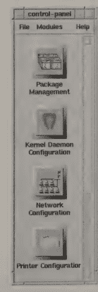

控制面板是许多不同系统管理工具的启动平台。它们通过让你无需记忆配置文件格式和繁琐的命令行选项即可配置各项内容，从而让你的生活更轻松。

要启动控制面板，请以 root 身份使用 `startx` 启动 X 窗口系统，并在 xterm 中输入 `control-panel`。你需要具有 root 权限才能成功运行控制面板工具。如果你已经以普通用户身份运行 X，也可以做到这一点。只需输入 `su -c control-panel`，然后在提示时输入 root 密码。如果你计划以 root 身份执行其他任务，可以输入 `su -`，然后在提示时输入 root 密码。届时你会获得一个 root shell。在这里，你需要输入 `DISPLAY=:0 control-panel &` 才能使控制面板正常工作。`DISPLAY` 部分告诉控制面板使用你的显示器。此语法仅适用于类 Bourne shell（如 `bash`）。如果你运行 `tcsh`，你会输入 `setenv DISPLAY :0; control-panel &`。

双击图标会启动一个工具。请注意，你不会被阻止启动任何工具的两个实例，但这样做是一个非常糟糕的主意。

因为你可能会试图在两个地方编辑相同的文件，最终导致覆盖自己的更改。如果你不小心启动了工具的第二个副本，应立即退出该副本。此外，当这些工具正在运行时，请勿手动编辑任何由控制面板工具管理的文件。同样，当这些工具正在运行时，也不要运行任何可能会修改这些文件的其它程序。

## 8.1 用户和组配置

图 8.1 中所示的工具用于管理系统中的用户和组。从某种意义上说，它是 `/etc/passwd` 和 `/etc/group` 的图形化编辑器，如果启用了影子密码，还包括 `/etc/shadow`。使用此工具，你可以添加和删除用户及组，设置登录 Shell、全名、主目录、uid、gids 等。

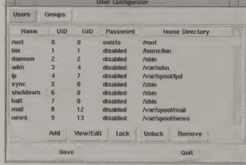

图 8.1：用户和组配置面板

### 8.1.1 添加或编辑用户


添加和编辑用户使用相同的界面。要添加用户，请点击主窗口中的“添加”按钮。将会弹出类似图 8.2 所示的对话框，其中已填入一些默认值。要编辑现有用户，请双击主窗口中的用户，或单击用户后点击 `查看/编辑` 按钮。

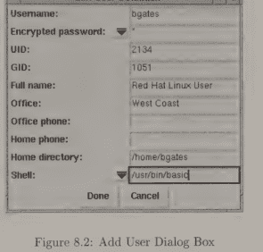

首先输入用户名。这不是用户的名字和姓氏；它是用户登录系统时使用的 ID。不要输入任何空格或冒号，且不要输入超过 8 个字符。完成后按回车键，其他一些字段将自动填入默认值。你可以选择修改这些默认值，但这并非必要。你可以自行选择输入用户的全名、办公室和电话号码。登录 Shell 可以通过从下拉菜单中选择选项，或者像其他字段一样直接输入 Shell 名称来更改默认值（通常为 `/bin/bash`）。

你需要对密码进行处理。`加密密码` 菜单中有五个选项：原始、更改、无密码、锁定和解锁。无密码是一个糟糕的选项——如果没有密码，任何人都可以使用此 ID 登录你的系统。选择锁定将阻止任何人使用此 ID 登录，但保留已分配的密码，以便稍后解锁；解锁功能用于解锁之前被锁定的密码。在添加新用户时，原始选项为空（即无密码）——编辑现有用户时使用的是同一个对话框，此时“原始”指的是用户的原始密码。通常你会选择更改。此时会出现一个小对话框，你需要在其中输入密码，然后第二次输入以确认。在密码输入窗口中点击 `确定` 以确认你已正确输入密码。

工具为 `UID` 和 `GID` 提供的数值是可以正常工作的。如果你更改它们，后果自负；该工具的设计假设是，如果你更改了它们，说明你知道自己在做什么并确实想要更改。如果你不知道 UID 或 GID 代表什么，请保持原样。

如果你已在系统中配置了影子密码，将有一个“影子管理”按钮，允许你配置密码和账户有效期。默认情况下（显示为空白的字段具有默认值），不会设置有效期。如果你不熟悉影子密码账户管理，建议接受默认设置。编辑完有效期信息后，点击 `确定`。

编辑完用户后，点击“编辑用户定义”对话框中的 `确定` 按钮以添加该用户。

如果该用户尚未拥有主目录（除非你已提前创建，否则通常不会有），系统将会创建一个。

### 8.1.2 删除用户

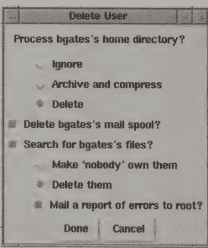

图 8.3：删除用户对话框

要删除用户，请通过单击在主窗口中选中一个用户，然后点击 `删除`。此时会出现图 8.3 所示的对话框。你可以执行三种类型的操作。你可以*忽略*用户的主目录，保持其不变；可以将其归档并压缩为 `.tar.gz` 文件；或者将其完全删除。如果你愿意，还可以*删除*用户的邮件池。前两个操作会在你确认删除后立即执行，先于工具接受更多输入。你可以在用户主目录以外的文件系统部分中搜索该用户拥有的文件，并将所有权授予用户 `nobody` 或删除这些文件。如果你选择搜索用户文件，可以选择*通过邮件*将错误报告发送给 root。这一点很重要，因为搜索会在你继续工作时在后台进行，可能会花费很长时间。要查找由 `nobody` 拥有的文件，请执行以下命令：

```
find / \( -group nobody -o -user nobody \) -print
```

#### 停用用户

有时你可能只是想暂时*移除*一个用户，并打算稍后重新激活该用户。`锁定` 和 `解锁` 功能可以处理这种情况。当你停用用户时，会在用户密码前添加一个 `*` 来锁定密码，从而阻止用户登录。你还可以选择使用 `tar` 和 `gzip` “压缩”用户的主目录，从而节省一些空间。当你重新激活用户时，密码锁定将被移除，如果主目录曾被压缩，它将恢复至正常状态。锁定用户时，你会看到与删除用户时相同的选项，但你不太可能想要删除任何文件。

### 8.1.3 创建新组

要创建新组，首先在顶级窗口中选中 `组` 选项卡，切换到组编辑模式。点击 `添加` 会弹出一个对话框，用于指定组详细信息。首先为新组输入一个名称。与用户名一样，组名不应包含空格或冒号，且长度不应超过 8 个字符。你可以设置组密码；如果设置了，非该组成员的用户可以通过使用 `newgrp` 程序并提供该密码来假设组成员身份。要将成员添加到组中，请在“用户列表”字段中输入他们的姓名。选定所有组成员后，点击 `确定`

### 8.1.4 编辑现有组

要编辑现有组，请双击主窗口中的组，或单击组后点击 `查看/编辑`。编辑现有组与创建新组使用的是相同的界面。

## 8.2 文件系统配置

图 8.4 中所示的文件系统配置工具允许你轻松检查和操作文件系统的挂载点、类型、选项等。它对于操作大量文件系统非常有用。除非你是经验丰富的系统管理员，否则你可能不想这样做。如果你知道自己在做什么，那么如何挂载、卸载和添加设备应该比较直接明了。

`FSM` 菜单中的 `重新加载` 项会使文件系统配置工具从硬盘重新加载 `/etc/fstab`。如果你在文件系统配置工具运行时手动编辑了 `/etc/fstab`（你不应该这样做），你可能需要重新加载。

要使用窗口底部的按钮，请在主窗口中选择一个文件系统，然后点击其中一个按钮。这些按钮执行以下功能：

- `信息`：显示文件系统的信息，包括设备、分区类型、文件系统类型、挂载点和选项、注释、大小、使用百分比等。
- `检查`：在分区上执行文件系统检查（fsck）。你只能在*未挂载*的分区上执行此操作——如果分区已挂载，你会收到错误，必须先将其卸载。
- `挂载`：挂载选定的文件系统。
- `卸载`：卸载选定的文件系统。
- `格式化`：在选定的分区上创建新的文件系统。这将擦除选定分区上的所有数据！你只能在*未挂载*的分区上执行此操作——如果分区已挂载，你会收到错误，必须先将其卸载。
- `编辑`：弹出一个对话框，你可以在其中编辑挂载点、挂载选项、注释等。

### 8.2.1 添加 NFS 挂载

要通过 NFS 挂载文件系统，请从 NFS 菜单中选择 `添加挂载`。将会弹出一个对话框，你需要填写以下值：

- `设备`：输入主机名和路径，用冒号分隔。例如，`foo.bar.com:/usr/exported` 表示 `foo.bar.com` 上的 `/usr/exported` 目录。
- `挂载点`：输入你希望在该机器上挂载 NFS 文件系统的目录。例如，`/mnt/foo`。
- `选项`：输入此文件系统的挂载选项。默认为 `soft,intr,ru`。其中 `ru` 表示文件系统为读写模式，而 `soft,intr` 是在远程服务器宕机时使系统更具韧性的选项。有关可用选项的完整列表，请参见 mount 手册页。
- `注释`：此可选字段可用于存储简短的注释。

正确填写所有内容后，点击 `确定`。此时，该条目已写入你的 `/etc/fstab`，但文件系统实际上尚未挂载。要挂载它，请在主窗口中选中该文件系统，然后点击 `挂载`。

## 8.3 打印机配置

打印机配置工具（`printtool`）维护 `/etc/printcap`、打印 spool 目录和打印过滤器。这些过滤器允许你打印许多不同类型的文件，包括：

- 纯文本（ASCII）文件

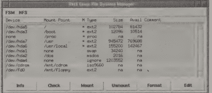

图 8.4：文件系统配置面板

- PostScript 文件
- TeX .dvi 文件
- GIF、JPEG、TIFF 及其他图形格式
- RPM 包

仅使用 `lpr` 打印 GIF 或 RPM 文件即可执行“正确操作”。

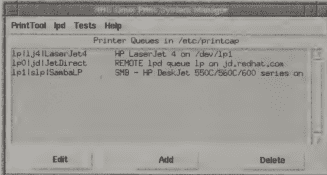

图 8.5：打印工具

要创建新的打印队列，请选择 `添加`。然后，选择要添加的打印机类型。可以使用 printtool 配置以下 3 种类型的打印队列：

### 8.3. 打印机配置

- `本地`：打印队列用于连接在 Red Hat Linux 系统的打印机端口或串口上的打印机。
- `远程`：打印队列连接在另一台系统上，您可以通过 TCP/IP 网络访问该系统。
- `SMB`：打印队列连接在另一台使用 LAN-Manager 类型（SMB）网络协议的系统上。

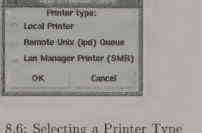

图 8.6：选择打印机类型

选择打印机类型后，一个对话框将请求有关该打印队列的更多信息。所有类型的打印队列都需要以下信息：

- `队列名称`：队列的称呼。可以使用 `|`（管道）字符分隔条目来指定多个名称。
- `Spool 目录`：这是本地机器上用于在打印发生前存储文件的目录。请小心，不要让更多于一个打印队列使用同一个 spool 目录。
- `文件限制`：接受的打印作业最大大小，单位为千字节（1 kb = 1024 字节）。大小为 0 表示不应施加限制。


- **输入过滤器：** 过滤器将打印文件转换为打印机可以处理的格式。按 **选择** 以选择最匹配您打印机的过滤器。

除了配置能够打印图形和 PostScript 输出的打印队列外，您还可以配置 *仅文本* 打印机，该打印机仅打印纯 ASCII 文本。大多数打印机驱动也能直接打印 ASCII 文本，而无需先将其转换为 PostScript；只需在配置过滤器时选择 **快速文本打印** 即可。**请注意：** 此功能仅适用于非 PostScript 打印机。

- **抑制页眉**：如果不想在每个打印作业的开头打印页眉页，请勾选此项。

对于本地打印机，还需要以下信息：

- **打印机设备**：通常是 `/dev/lp1`，即打印机所连接端口的名称。串行打印机通常位于 `/dev/ttyS?` 端口。您需要手动配置串行参数。

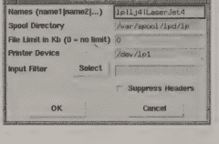

对于远程打印机，请填写以下信息：

- **远程主机**：托管打印机的远程机器的主机名。

- **远程队列**：要在远程机器上进行打印的队列名称。

远程机器必须配置为允许本地机器在指定队列上进行打印。通常由 `/etc/hosts.lpd` 控制此项。

对于 SMB 打印机，请填写以下信息：

- **打印机服务器主机名**：您想要使用的打印机所连接的机器名称。

- **服务器 IP 地址**：您想要使用的打印机所连接的机器的 IP 地址；此项为可选。

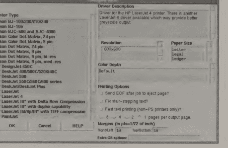

图 8.8：配置打印过滤器

- **打印机名称**：您想要在其上进行打印的打印机名称。

- **用户**：访问打印机时必须登录的用户名（通常是 Windows 服务器的 guest，或 samba 服务器的 nobody）。

- **密码**：使用打印机所需的密码（如果需要）（通常为空白）。如果您不知道，应该有人能告诉您。

**请注意：** 如果您需要为 SMB（LAN Manager）打印队列使用用户名和密码，这些凭据将以未加密的形式存储在本地脚本中，并且必须通过命令行传递给 `smbclient` 程序。因此，其他人有可能获取用户名和密码。因此，建议用于打印机的用户名和密码与本地 Red Hat Linux 系统上的用户帐户凭据不同，这样唯一可能的安全风险就是打印机的未授权使用。如果 SMB 服务器有文件共享，建议这些文件共享也使用不同于打印队列的密码。

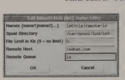

图 8.9：添加远程打印机

添加打印队列后，您可能需要重启打印机守护进程（`lpd`）。要执行此操作，请从 **lpd** 菜单中选择 **重启 lpd**。

您可以为已配置的任何打印队列打印 *测试页*。从 **测试** 菜单中选择您希望打印的测试页类型。

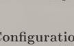

图 8.10：打印测试页

### 8.4 网络配置

图 8.11 中所示的网络配置工具（`netcfg`）旨在允许轻松操纵诸如 IP 地址、网关地址、网络地址以及名称服务器和 `/etc/hosts` 等参数。

网络设备可以被添加、移除、配置、激活、停用和别名下。支持以太网、Arcnet、令牌环、pocket（ATM）、PPP、SLIP、PLIP 和 loopback 设备。PPP/SLIP/PLIP 支持在大多数硬件上工作良好，但某些硬件设置可能会表现出不可预测的行为。使用网络配置工具时，点击 **保存** 将更改写入磁盘，若要在不做出任何更改的情况下退出，请选择 **退出**。

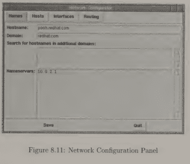

#### 8.4.1 管理名称

网络配置工具的 **名称** 面板有两个主要用途：设置计算机的主机名和域，以及确定使用哪个名称服务器来查找网络上的其他主机。网络工具无法将机器配置为名称服务器。若要编辑字段或向字段添加信息，只需使用鼠标左键单击该字段并输入新信息即可。

#### 8.4.2 管理主机

在 **主机** 管理面板中，您可以添加、编辑或删除 `/etc/hosts` 文件中的主机。添加或编辑条目涉及相同的操作。将出现一个编辑对话框，只需输入新信息，完成后点击 **完成** 即可。示例见图 8.12。

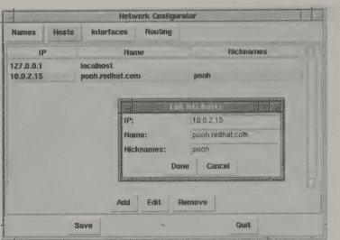

图 8.12：添加/编辑主机

#### 8.4.3 添加网络接口

如果您在安装 Red Hat Linux 之后向机器添加了网络接口，或者在安装时未配置您的以太网卡，您可以借助几次鼠标点击来配置它。

**请注意：** 您可能需要配置 `kernel`d 以加载要添加的网络接口的驱动程序（例如，`eth0`）；更多信息请参见第 8.6 节。

通过在主面板中点击 **接口** 开始添加接口。这将打开一个已配置设备的窗口，并有一行可用选项，见图 8.13。

要添加设备，首先点击 **添加** 按钮，然后从出现的框中选择要配置的接口类型（见图 8.14）。

##### PPP 接口

添加 PPP 接口可能只需在 **创建 PPP 接口** 对话框中提供电话号码、登录名和密码即可，该对话框如图

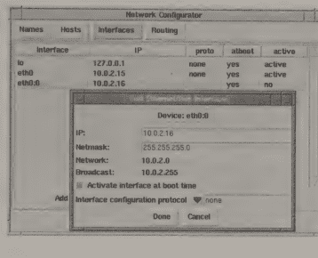

图 8.13：已配置接口

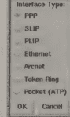

图 8.14：选择接口类型

图 8.15 所示。如果您的 PPP 连接需要使用 PAP 身份验证，请选择 **使用 PAP 身份验证**。在许多情况下，建立 PPP 连接需要一定程度的定制。选择 **定制** 按钮将允许您修改 PPP 接口的硬件、通信和网络设置。

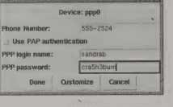

图 8.15：创建 PPP 接口

##### SLIP 接口

要配置 SLIP 接口，您必须首先提供电话号码、登录名和密码。这将提供建立 SLIP 连接所需的 chat 脚本的初始参数。当您选择 **完成** 时，会出现一个标题为 **编辑 SLIP 接口** 的对话框，该对话框允许您进一步定制 SLIP 接口的硬件、通信和网络参数。

##### PLIP 接口

要在系统中添加 PLIP 接口，您只需提供 IP 地址、远程 IP 地址和子网掩码。您还可以选择在启动时是否激活该接口。

##### 以太网、Arcnet、令牌环和 Pocket 适配器接口

如果您正在向计算机添加以太网、arcnet、令牌环或 pocket 适配器，则需要提供以下信息：

#### 8.4.3 管理接口（根据上下文推断）

- 设备：这由 netconfig 根据已配置的设备自动确定。

- IP 地址：请输入您的网络设备 IP 地址。

- 子网掩码：请输入您的网络设备的子网掩码。网络地址和广播地址将根据您输入的 IP 地址和子网掩码自动计算。

- 启动时激活接口：如果您希望机器启动时自动配置该设备，请通过单击复选框来选择此项。

- 允许任何用户（失）激活接口：如果您希望任何用户都能激活或停止接口，请勾选此项。

- 接口配置协议：如果您的网络上有一个 BOOTP 或 DHCP 服务器，并且您希望使用它来配置接口，请选择相应的选项；否则，请选择 none。

提供新设备的配置信息后，单击“完成”。该设备应该会作为非活动设备出现在您的接口列表中。（活动列中应有一个标签为 no）。要激活新设备，首先用鼠标单击选择它，然后选择“激活”按钮。如果它没有正常启动，您可能需要通过选择“编辑”来重新配置它。

### 8.4.4 管理路由

在路由管理屏幕中，您可以添加、编辑或删除静态网络路由。添加或编辑条目涉及相同的操作，就像“主机”面板一样。将出现一个编辑对话框，只需输入新信息，完成后单击“完成”。参见图 8.16 了解示例。

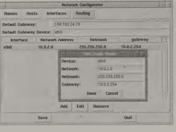

图 8.16：添加/编辑路由

在您单击**设置系统时钟**按钮之前，系统时钟不会改变。

单击**重置时间**将时间机器的时间重置为系统时间。

> **请注意：** 更改时间可能会严重混淆依赖于时间正常进程的程序，并可能引发问题。在更改时间或日期之前，请尝试退出尽可能多的应用程序和进程。

## 8.5 时间和日期

时间机器允许您通过单击时间和日期显示的相应部分，然后单击箭头更改数值来更改时间和日期。

## 8.6 内核守护进程配置

如第 5 章所述，Red Hat Linux 包含**kerneld**（内核守护进程），它会自动将一些软件和硬件支持加载到内存中（当需要时），并在不再需要时卸载。


图 8.17 中所示的工具管理 `kerneld` 的配置文件。虽然 `kerneld` 可以在没有明确配置的情况下加载某些内容（例如文件系统），但当它接收到通用硬件请求时，需要告诉它要加载哪些硬件支持。

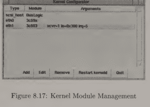

例如，当内核想要加载以太网支持时，内核需要知道您拥有哪款以太网卡，如果您的以太网卡需要特殊配置，它也需要知道这一点。

### 8.6.1 更改模块选项

要更改加载模块时传递的选项，请单击该行以选择它，然后单击`编辑`按钮。`kernelcfg`将打开一个如图 8.18 所示的窗口。`kernelcfg`知道的那些选项（通常是所有可用选项）每个都有自己的字段。通常，您会希望忽略`其他参数`字段。某些模块通常不接受参数；以防万一，它们有一个`参数`字段，允许您输入配置信息。

### 8.6.2 更改模块

要更改调用以提供通用服务的模块（如以太网卡或 SCSI 主机适配器模块），您需要删除旧模块并添加新模块。要删除模块，请单击选择它，然后单击`删除`。然后按照下一节的说明单击`添加`以添加新模块。

如果您更改了 SCSI 控制器（`scsi_hadapter`），请记住使用 `/sbin/mkinitrd` 命令创建一个新的初始 ramdisk，如第 5.1.2 节所述。

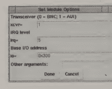

### 8.6.3 添加模块

要添加任何类型的模块，请单击“添加”按钮。您会看到一个对话框（图 8.19），询问您选择模块类型。以太网是 `eth`，令牌环是 `tr`，SCSI 控制器是 `scsi_hostadapter`，等等。单击“确定”以继续到下一个对话框。如果有多个模块可用于您选择的模块类型，您会看到一个对话框（图 8.20），询问您想使用哪个模块，也可能询问有关模块类型的具体细节；例如，对于以太网，您需要从 `eth0`、`eth1` 等中进行选择。完成后，再次单击“确定”以继续指定下一个对话框（图 8.20）中的任何模块选项，该对话框与编辑模块的对话框相同。

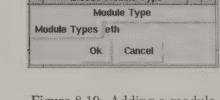

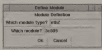

图 8.20：从可用模块中选择

### 8.6.4 重启 kerneld

使用内核守护进程配置工具所做的更改将在 `/etc/conf.modules` 文件中进行，`kerneld` 每次启动时都会读取该文件。完成更改后，您可以单击`重启 kerneld`按钮来重启 `kerneld`。这不会导致当前正在使用的模块重新加载，它只会通知 `kerneld` 在未来加载更多模块时使用该配置。

# 第 9 章

## Glint

Red Hat 提供了一个图形工具来辅助软件包的安装和移除。它被称为 `glint`（图形化 Linux 安装工具），在 X 窗口系统下运行。它允许轻松安装、卸载、升级、查询和验证软件包。该界面与许多流行的文件管理器中找到的类似，使用简单。

在 `glint` 中，通过选择要操作的软件包，然后通过按按钮选择要执行的操作来执行操作。安装软件包会将该软件包的所有组件放置到您的系统上。卸载会移除该软件包的所有痕迹，除了您修改过的配置文件。升级软件包会安装新可用的版本，并卸载之前安装的所有其他版本。这允许快速升级到软件包的最新版本。

查询操作允许您检查已安装或可用软件包的详细信息。您可以查看软件包的描述、构建地点和时间、软件包中的文件以及其他属性。每个软件包的所有配置和文档组件都明确标记，以减少您查找它们所花的时间。

使用 `glint` 执行所有这些操作与使用 `rpm` 在命令行中执行它们的效果相同。然而，`glint` 的图形特性通常使这些操作更容易执行。

处理 `glint` 的常规方式是显示可用软件包和文件，选择您想要操作的软件包，然后按按钮或选择执行该操作的菜单项。例如，您可以通过几次点击安装多个软件包。

### 9.1 启动 glint

要启动 `glint`，只需在任何 X 终端窗口中运行 `glint &`。这将打开一个如图 9.1 所示的窗口。任何用户都可以使用 `glint` 查询和验证软件包，但如果您需要安装、卸载或升级软件包，请确保以 root 身份运行 `glint`。

`glint` 界面有两个主要部分。左侧第一部分允许您浏览和选择已安装在系统上的软件包。右侧包含操作所选软件包的按钮。

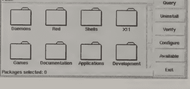

图 9.1：Glint 主窗口

### 9.2 软件包显示

`glint` 中的每个文件夹图标代表一组软件包。每组可以包含其他组，这允许灵活安排软件包的位置。组用于将执行相似功能的软件包放置在相似的位置。例如，Red Hat 包含许多应用程序，如编辑器和电子表格。所有基于文本的显示在“Appli-

...ctions” 组。在该组内部，还有另一个分组包含所有随附的编辑器。

按照惯例，组的书写方式与 UNIX 路径相同。最高层级的组写在最前面，后续组名通过斜杠分隔。这意味着基于 X 的绘图程序出现在 `X11/Applications/Graphics` 组中。

要查看组内的软件包和子组，请双击组的文件夹图标。此时，窗口会切换以显示该软件包的内容。软件包显示的最顶部一行显示您当前正在查看的组，以及通往当前组的上级组。要返回之前查看的组，请双击“后退”文件夹，它始终位于文件夹区域的左上角（尽管经常被滚动遮挡）。

如果您想在一个新窗口中查看某个子组，请双击其文件夹的中间鼠标按钮。如果您的鼠标只有两个按钮，则同时按下两个按钮。这将创建一个包含该组的新窗口。

#### 9.2.1 上下文敏感菜单

在软件包窗口中的任何图标上按下鼠标右键，都会弹出一个小的`上下文敏感`菜单。具体包含哪些项目取决于您按压的确切位置。它们都包含选择或取消选择该项目的选项，许多还允许您安装、卸载、查询、升级或验证您点击的项目。后续章节将提供更多关于如何执行这些操作的信息。

要从上下文敏感菜单中选择一项，请在某个图标上按下并按住鼠标右键。在仍按住右键的同时，将鼠标指针移动到您想要选择的项目上（该项目随后会高亮显示）。松开鼠标右键以选择该项目并让菜单消失。

#### 9.2.2 选择软件包

要选择单个软件包，请单击其上的左键。您会注意到软件包图标周围出现一条细边框（如图 9.2 所示），表示当前已选中。要取消选择，请单击左键，边框将消失。当前选中的软件包数量始终显示在窗口底部。组的文件夹图标会显示该组内已选中的软件包数量，如果全部选中则显示“所有”。

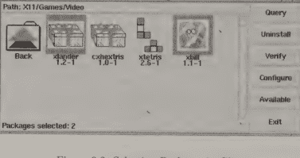

软件包的上下文敏感菜单也允许轻松的选择和取消选择。使用软件包图标上的`选择`和`取消选择`选项可以选择或取消选择该软件包，而组文件夹图标上的这些选项则选择或取消选择该组中的所有软件包。使用这些菜单选项比单独选择每个软件包要快得多。

#### 9.2.3 查看可用软件包

要查看可供您安装的软件包，请在任意 `glint` 窗口中选择`可用`按钮。片刻之后，将显示一个新窗口，如图 9.3 所示。标题和按钮的差异表明，此窗口正在列出您可以安装的软件包。导航这些软件包并选择它们的操作与其他 `glint` 窗口相同。

如果您收到 `glint` 的错误消息，提示找不到任何 RPM，请参阅下文关于配置的章节。

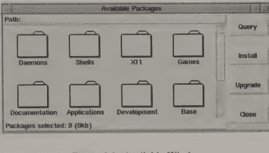

### 9.3 配置

`glint` 需要唯一的配置信息是新 RPM 的路径。当您使用 Red Hat Linux CD-ROM 时，这通常是 `/mnt/cdrom/RedHat/RPMS`，这也是 `glint` 的默认路径。如果您从互联网下载新的 RPM，或者想通过 NFS 挂载的 CD-ROM 安装 RPM，那么对于您来说，这个路径可能会不同。

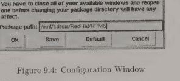

要更改此路径，请确保首先关闭所有正在列出可用软件包的窗口。然后，从剩余的窗口之一中选择`配置`选项。这将打开一个对话框，如图 9.4 所示。在此处，您可以输入您希望查看的 RPM 的完整路径。选择`保存`按钮将保存此路径，使其成为未来 `glint` 会话的默认设置。`默认`按钮将路径恢复为 `glint` 启动时使用的路径。

更改此路径并关闭对话框后，您可以使用`可用`按钮查看新位置中可用的软件包。

### 9.4 软件包操作

#### 9.4.1 查询软件包

查询单个软件包或组最简单的方法是使用图标上下文敏感菜单中的查询选项。如果您想查询更多样化的软件包集合，请选择它们，并使用某个窗口中的`查询`按钮。

使用这两种方法之一都会创建一个如图 9.5 所示的窗口。如果您只选择一个软件包，外观会略有不同，因此部分内容可能不适用。

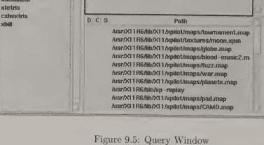


在窗口的最左侧是已查询软件包的列表。选择其中之一将改变窗口其余部分的信息。您可以通过使用窗口右侧的`下一个`和`上一个`按钮按顺序浏览它们。

当前软件包的名称、版本和发行版位于查询窗口的中上部。紧接其下的是软件包的描述，这可能相当长。那里有一个滚动条，以便您可以阅读完整内容。

在描述下方是软件包中包含的文件列表。除了文件的完整路径外，文件列表还告诉您其他几件事。如果路径左侧出现 `D`，则该文件是文档文件，值得阅读。如果那里出现 `C`，则表示该文件是配置文件。`*` 表示您系统中未安装该文件的正确版本。这可能是因为安装了较新版本的软件包，或者两个软件包包含同一文件的不同版本所致。

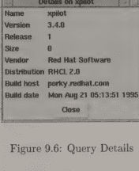

通过点击详细信息按钮可以查看有关软件包的更多信息。随后将出现一个如图 9.6 所示的窗口。这列出了主查询窗口中显示的软件包的更多信息。当您在查询窗口中选择一个新软件包时，详细信息窗口中的信息会随之改变以反映您的新选择。

您也可以使用提供的按钮在查询过程中选择、取消选择或验证软件包。查看完软件包后，点击关闭按钮。

### 9.4.2 验证软件包

验证软件包会检查软件包中的所有文件，以确保它们与您系统中的文件相匹配。会对校验和、文件大小、权限和所有者属性进行检查，并与数据库进行对比。当您怀疑某个程序的文件因安装新程序而损坏时，可以使用此检查。

选择要验证的软件包与选择要查询的软件包相同。选择软件包并使用`验证`按钮，或从上下文敏感菜单中选择`验证`项。随后将打开一个如图 9.7 所示的窗口。

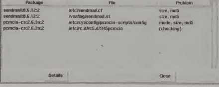

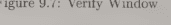

此窗口中的三列分别描述存在问题软件包、有问题的文件以及发现的不匹配情况的简要说明。在检查运行期间，当前正在检查的文件作为列表中的最后一个元素显示，问题列示为（正在检查）。图 9.8 列出了通过验证可能发现的完整问题列表。

| 问题 | 描述 |
| :--- | :--- |
| missing | 文件不再位于您的系统上 |
| mode | 权限位已更改 |
| size | 文件大小已更改 |
| uid | 所有者的 uid 已更改 |
| gid | 所有者的 gid 已更改 |
| md5 | md5 校验和已更改 |
| link | 该文件是指向错误位置的符号链接 |


要获取更多关于文件发现的问题的信息，请双击文件的路径。如图 9.9 所示的窗口会列出存在问题的属性的期望值和当前值。

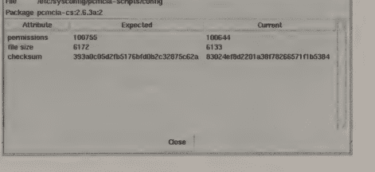

图 9.9：验证详情

### 9.4.3 安装新软件包

从 glint 安装新的软件包非常简单。首先查看可供安装的软件包（请参阅 9.2.3 节了解操作方法）。您可以选择其中任意数量的软件包（如果不确定其用途，可以查询它们）以进行安装（选择方法与您为验证而选择软件包的方式相同）。如果您想安装单个软件包或组，上下文敏感菜单提供了快捷方式。图 9.10 显示了一个窗口，其中一些软件包已被选中以进行安装。

开始安装后，会出现如图 9.11 所示的窗口。它跟踪安装的进度，以便您知道正在发生的事情。顶栏显示当前软件包（其名称列在栏内）已安装的部分，而底部图表显示总安装进度已完成的部分。软件包数量、软件包大小和时间估计会持续更新。

如果安装过程中出现问题，将会显示一个窗口列出发生的任何错误。如果发生这种情况，您应解决问题并重试。

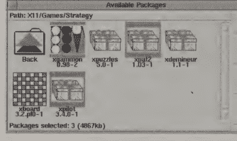

图 9.10：已选定的待安装软件包

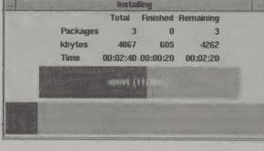

图 9.11：安装进度

安装完成后，已安装的软件包和组将从可用软件包窗口移至主 glint 窗口，以表明它们已成功安装。

#### 升级软件包

当软件包的新版本发布时，将其安装在您的系统上很容易。以选择待安装软件包相同的方式，从可用软件包窗口中选中要升级的软件包。点击“升级”按钮或上下文敏感菜单都可以开始升级。

升级过程中，您会看到与安装软件包类似的进度指示器。完成后，已安装的软件包将显示在主 glint 窗口中，并且这些软件包的旧版本将被移除。

使用升级选项比先卸载软件包的旧版本再安装新版本要好得多。使用升级可以确保您对软件包配置文件所做的任何更改都能得到妥善保留，而手动操作可能导致这些更改丢失。

如果在安装过程中磁盘空间耗尽，安装将失败。但是，发生错误时正在安装的那个软件包可能会留下一些文件。要清理这些文件，请在腾出更多磁盘空间后重新安装该软件包。

### 9.4.4 卸载软件包

卸载软件包与升级软件包不同。当卸载一个软件包时，该软件包使用的且系统中其他软件包不再需要的文件将被移除。已更改的配置文件会被复制为 `*<filename>*.rpmsove`，以便您稍后复用。

与验证和查询软件包一样，您可以通过 glint 窗口右侧的按钮或上下文敏感菜单来移除软件包。请记住，当您从某个组的菜单中进行选择时，操作将应用于该组中的所有软件包，因此务必小心！

一旦开始卸载，glint 会请求确认，显示如图 9.12 所示的窗口。所有即将被卸载的软件包都会列在其中。您应查看所有列出的项，以确保不会误删您想要保留的内容。点击“是”按钮将开始卸载过程。完成后，已移除的软件包和组将从它们所在的任何窗口中消失。

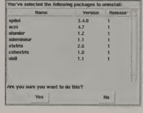

图 9.12：卸载窗口

# 第 10 章

## 系统管理

本章概述了 Red Hat Linux 系统。它将说明您可能不了解的系统特性，以及与其他 UNIX 系统略有不同的地方。请注意，大多数系统管理任务是通过控制面板执行的，这在第 8 章中有详细介绍。

### 10.1 文件系统结构

Red Hat 软件致力于遵循 Linux 文件系统标准（Filesystem Standard），这是一份协作文档，定义了许多文件和目录的名称及位置。我们将继续跟踪该标准，以保持 Red Hat 的合规性。

尽管合规意味着许多事情，但其中最重要的两点是与其他合规系统的兼容性，以及以只读方式挂载 `/usr` 分区的能力。`/usr` 分区包含公共可执行文件，并非旨在由用户修改。因此，`/usr` 分区可以从 CD-ROM 挂载，或通过只读 NFS 从另一台机器挂载。当前的 Linux 文件系统标准（FSSTND）文档是任何符合 FSSTND 的文件系统的权威参考，但该标准在许多领域仍留有未定义或可扩展的空间。在本节中，我们提供了标准的概述，并描述了标准未涵盖的文件系统部分。

可以在以下地址查看完整标准：

http://www.pathname.com/fhs/

#### 10.1.1 FSSTND 概述

此处提到的目录和文件是 FSSTND 文档所规定内容的一个小子集。请查阅最新的 FSSTND 文档以获取最新且完整的信息。

##### /etc 目录

`/etc` 目录专门用于存放本机本地配置文件。切勿将二进制文件放入 `/etc`。过去曾放入 `/etc` 的二进制文件现在应放入 `/sbin` 或可能的 `/bin`。

X11 和 skel 目录应该是 `/etc` 的子目录：

```text
/etc
 | \- X11
 +- skel
```

`X11` 目录用于存放 X11 配置文件，例如 `XF86Config`。`skel` 目录用于存放“骨架”用户文件，这些文件用于在用户首次创建时填充主目录。

##### /lib 目录

`/lib` 目录应仅包含执行 `/bin` 和 `/sbin` 中的二进制文件所需的库。

##### /sbin 目录

`/sbin` 目录用于存放仅由 root 用户使用的可执行文件，且仅限于启动和挂载 `/usr` 以及执行系统恢复操作所需的可执行文件。FSSTND 指出：

> “`/sbin` 通常包含除 `/bin` 中的二进制文件外，系统启动所必需的文件。任何在 `/usr` 已知挂载成功（即无异常）后执行的文件都应放置在 `/usr/sbin`。仅限本地的系统管理二进制文件应放置在 `/usr/local/sbin`。”

至少，以下程序应位于 `/sbin` 中：

```
clock, getty, init, update, mkswap, swapon, swapoff,
halt, reboot, shutdown, fdisk, fsck.*, mkfs.*, lilo,
arlp, ifconfig, route
```

##### /usr 目录

`/usr` 目录用于存放可在整个站点共享的文件。`/usr` 目录通常拥有独立的分区，且应可以以只读方式挂载。以下目录应为 `/usr` 的子目录：


```
/usr
|- X11R6
|- bin
|- dict
|- doc
|- etc
|- games
|- include
|- info
|- lib
|- local
|- man
|- sbin
|- share
+- src
```

`X11R6` 目录用于 X 窗口系统（在 Red Hat Linux 中为 XFree86），`bin` 用于可执行文件，`doc` 用于非手册页的随机文档，`etc` 用于全站配置文件，`include` 用于 C 头文件，`info` 用于 GNU info 文件，`lib` 用于库，`man` 用于手册页，`sbin` 用于系统管理二进制文件（那些不属于 `*/sbin*` 的文件），而 `/src` 用于源代码。

### `/usr/local` 目录

FSSTND 指出：

> “`/usr/local` 层次结构供系统管理员在本地安装软件时使用。它需要在系统软件更新时免受覆盖。它可用于组内多台机器共享的程序和数据，但这些内容不出现在 `/usr` 中。”

`/usr/local` 目录的结构与 `/usr` 目录类似。它包含以下子目录，其用途与 `/usr` 目录中的子目录相似：

```
/usr/local |- bin |- doc |- etc |- games |- include |- info |- lib |- man |- sbin +- src
```

### `/var` 目录

由于 FSSTND 要求能够以只读方式挂载 `/usr`，因此任何需要写入日志文件或需要 spool（假脱机）/ lock（锁）目录的程序，很可能应将它们写入 `/var` 目录。FSSTND 指出 `/var` 用于

> “... 可变数据文件。这包括 spool 目录和文件、管理和日志数据，以及临时和即时文件。”

以下目录应为 `/var` 的子目录：

```
/var
|- log
|- catman
|- lib
|- local
|- named
|- nis
|- preserve
|- run
|- lock
|- tmp
+- spool
    |- at
    |- cron
    |- lpd
    |- mail
    |- mqueue
    |- rwho
    |- smail
    |- uucp
    +- news
```

诸如 `wtmp` 和 `lastlog` 等系统日志文件位于 `/var/log`。`/var/lib` 目录还包含 RPM 系统数据库。格式化手册页位于 `/var/catman`，锁定文件位于 `/var/lock`。`/var/spool` 目录包含若干个子目录，供需要存储数据文件的各类系统使用。

#### 10.1.2 Red Hat Linux 中的 `/usr/local`

在 Red Hat Linux 中，`/usr/local` 的预期用途与 FSSTND 规范中指定略有不同。FSSTND 规定 `/usr/local` 应作为存储那些需要避免系统软件升级影响的软件的位置。由于通过 RPM 系统和 Glint 从 Red Hat 进行的系统升级是安全的，因此你不需要通过将这些文件放入 `/usr/local` 来保护它们。相反，我们建议你使用 `/usr/local` 来安装仅限于你本地机器使用的软件。

例如，假设你通过只读 NFS 从 *beavis* 挂载了 `/usr`。如果你想要安装某个软件包或程序，但不被允许向 *beavis* 写入数据，你应该将其安装在 `/usr/local` 下。稍后，如果你成功说服了 *beavis* 的系统管理员在 `/usr` 上安装该程序，你可以将其从 `/usr/local` 卸载。

## 10.2 Red Hat 的特殊文件位置

除了位于 `/var/lib/rpm` 的与 RPM 系统相关的文件外（参见第 7 章），还有两个其他特殊位置是专门为 Red Hat Linux 的配置和操作保留的。

控制面板及相关工具会在 `/usr/lib/rhs` 中放置大量内容。这里可能没有任何你愿意手动编辑的东西。它们主要是小型脚本、位图和文本文件。

另一个位置 `/etc/sysconfig` 存储配置信息。此目录中文件的主要使用者是在启动时运行的脚本。你可以手动编辑这些文件，但最好使用正确的控制面板工具。

## 10.3 用户、组和用户专用组

传统上，管理用户和组是一件繁琐的事情。Red Hat Linux 提供了一些工具和约定，使用户和组的管理更加简便且实用。

管理用户和组的最简单方法是通过控制面板中的用户和组模块（关于控制面板的详细信息请参见第 8 章，关于用户和组模块的详细信息请参见 8.1 节）。

你也可以使用 `adduser` 在命令行创建新用户。

### 10.3.1 标准用户

表 10.3.1 列出了安装过程中设置的标准用户（这基本上就是 `/etc/passwd` 文件）。此表中的组 ID `GID` 是该用户的*主要组*。关于组的使用详情，请参见 10.3.3 节。

| 用户 | UID | GID | 主目录 | Shell |
| :--- | :--- | :--- | :--- | :--- |
| root | 0 | 0 | /root | /bin/bash |
| bin | 1 | 1 | /bin | |
| daemon | 2 | 2 | /sbin | |
| adm | 3 | 4 | /var/adm | |
| lp | 4 | 7 | /var/spool/lpd | |
| sync | 5 | 0 | /sbin | /bin/sync |
| shutdown | 6 | 0 | /sbin | /sbin/shutdown |
| halt | 7 | 0 | /sbin | /sbin/halt |
| mail | 8 | 12 | /var/spool/mail | |
| news | 9 | 13 | /var/spool/news | |
| uucp | 10 | 14 | /var/spool/uucp | |
| operator | 11 | 0 | /root | /bin/bash |
| games | 12 | 100 | /usr/local/games | |
| gopher | 13 | 30 | /usr/lib/gopher-data | |
| ftp | 14 | 50 | /usr/ths/ftp | |
| nobody | 99 | 99 | /root | |


### 10.3.2 标准组

表 10.3.2 列出了由安装过程设置的标准组（这基本上就是 *etc/group* 文件）。

| 组 | GID | 成员 |
| :--- | :--- | :--- |
| root | 0 | root |
| bin | 1 | root,bin,daemon |
| daemon | 2 | root,bin,daemon |
| sys | 3 | root,bin,adm |
| adm | 4 | root,adm,daemon |
| tty | 5 | |
| disk | 6 | root |
| lp | 7 | daemon,lp |
| mem | 8 | |
| kmem | 9 | |
| wheel | 10 | root |
| mail | 12 | mail |
| news | 13 | news |
| uucp | 14 | uucp |
| man | 15 | |
| games | 20 | |
| gopher | 30 | |
| dip | 40 | |
| ftp | 50 | ftp |
| nobody | 99 | |
| users | 100 | |

图 10.2：标准组

### 10.3.3 用户专用组

Red Hat Linux 使用用户专用组 `UPG` 方案，这使得 UNIX 组的使用变得非常容易。`UPG` 方案没有添加或更改标准 UNIX 组处理方式中的任何内容。它只是提供了一种处理组的新约定。每当创建新用户时，默认情况下，该用户拥有一个唯一的组。该方案的工作方式如下：

- **用户专用组**：每个用户都有自己专属的主要组，且只有该用户是该组的成员。

- **umask = 002**：传统的 UNIX `umask` 是 `022`，它防止其他用户和*用户主要组的其他成员*修改该用户的文件。由于在 `UPG` 方案中每个用户都有自己的专用组，因此这种“组保护”是不需要的。`umask` 为 `002` 将防止用户修改其他用户的私有文件。`umask` 在 `/etc/profile` 中设置。

- **目录上的 SGID 位**：如果你在目录上设置了 SGID 位（通过 `chmod g+s directory`），则在该目录中创建的文件将具有该目录的组属性。


大多数计算站点喜欢为每个主要项目创建一个组，并将人员分配到他们所在的组中。然而，传统上的文件管理比较困难，因为当某人创建文件时，该文件由其所属于的主要组拥有。当一个人参与多个项目时，很难使文件归属于与该相关的项目组。在 UPG 方案中，组会自动根据项目逐个分配给文件，这使得组项目管理的非常简单。

假设你有一个名为 `devel` 的大项目，有许多人在 `devel` 目录中编辑 devel 文件。创建一个名为 `devel` 的组，使用 `chgrp` 将 `devel` 目录的所有权更改为 `devel`，并将所有 devel 用户添加到 `devel` 组中。现在，所有 devel 用户都可以编辑 devel 文件并在 `devel` 目录中创建新文件，且这些文件将始终保持其 `devel` 组属性。因此，它们始终可以供其他 devel 用户编辑。

如果你有多个类似 `devel` 的项目，以及参与多个项目的用户，这些用户在项目间移动时将永远不需要更改他们的 umask 或组。每个项目主目录上的 SGID 位会“选择”正确的组。

由于每个用户的 HOME 目录都归该用户及其专用组所有，因此在 HOME 目录上设置 SGID 位是安全的。不过，默认情况下，文件创建时使用用户的主要组，因此 SGID 位将是冗余的。

### 用户专用组的理由

由于 UPG 方案是新的，许多人对此有疑问，并想知道其必要性。以下是该方案的理论依据。

- 你希望有一群人共同处理一组文件，例如 `/usr/lib/emacs/site-lisp` 目录中的文件。你信任少数人在那里进行操作，但当然不是所有人都可以。

- 因此你输入：

```
chown -R root.emacs /usr/lib/emacs/site-lisp
```

并将合适的用户添加到该组。

- 为了让用户实际能在该目录中创建文件，你输入：

```
chmod 775 /usr/lib/emacs/site-lisp
```

- 但当用户创建新文件时，它会被分配给用户默认组的属性（通常是 users）。为了防止这种情况，你输入

```
chmod 2775 /usr/lib/emacs/site-lisp
```

这会导致该目录中创建的所有内容都具有“emacs”组属性。

- 但新文件需要设置为 664 权限，以便 emacs 组中的其他用户能够编辑它。为此，你需要将默认 umask 设置为 002。

- 嗯，这一切都运行良好，除非你的默认组是“users”，那么你在主目录中创建的每个文件都将对“users”（通常是所有人）中的每个人可写。

- 为了解决这个问题，你为每个用户指定一个“专用组”作为其默认组。

在此处，通过设置默认 umask 为 002 并赋予每个人一个专用默认组，你可以轻松地设置用户可利用的组，而无需进行任何“魔法”操作。只需创建组，添加用户，并对该组目录执行上述的 `chown` 和 `chmod` 操作即可。

## 10.4 使用 PAM 进行用户身份验证

任何提供用户某种权限的程序都需要能够验证用户身份。当您登录系统时，您会提供用户名和密码，登录过程使用这些信息验证登录——以确认您确实是您所声称的那个人。除了密码之外，还有其他形式的身份验证方式，并且密码的存储方式也可以是多种多样的。

PAM 是“可插拔身份验证模块”（Pluggable Authentication Modules）的缩写，它是一种允许系统管理员在无需重新编译执行身份验证的程序的情况下设置身份验证策略的方法。使用 PAM，您可以通过编辑配置文件来控制模块如何插入到程序中。

大多数 Red Hat Linux 用户可能永远不需要触碰这个配置文件。当使用 RPM 安装需要执行身份验证的程序时，它们会自动进行必要的更改，以执行常规的密码身份验证。然而，您可能希望自定义您的配置，在这种情况下，您需要理解该配置文件。

### 10.4.1 模块

PAM 标准定义了四种类型的模块。`auth` 模块提供实际的身份验证，可能涉及请求并检查密码，并设置“凭证”，如组成员身份或 Kerberos“票据”。`account` 模块检查以确保允许进行身份验证（例如，账户未过期，用户允许在此时段登录等）。`password` 模块用于设置密码。`session` 模块在用户完成身份验证后使用，使其能够使用其账户，例如挂载用户的家目录或使其邮箱可用。

这些模块可以*堆叠*使用，即使用多个模块。例如，`login` 通常使用至少两种身份验证方法：如果“rhopts”身份验证成功，则足以允许连接；如果失败，则执行标准的密码身份验证。

可以随时添加新模块，并且支持 PAM 的应用程序随后可以配置为使用这些模块。例如，如果您有一个一次性密码计算器系统，并且可以编写一个支持它的模块（编写模块的文档随系统附带）。支持 PAM 的程序可以使用新模块并与新的一次性密码计算器配合工作，而无需重新编译或以其他任何方式进行修改。

### 10.4.2 服务

每个使用 PAM 的程序都定义其自己的“服务”名称。`login` 程序定义服务类型 `login`，`ftpd` 定义服务类型 `ftp`，等等。通常，服务类型是用于**提供**服务的程序的名称，而不是（如果有区别的话）用于**访问**服务的程序的名称。

### 10.4.3 配置文件

目录 `/etc/pam.d` 用于配置所有 PAM 应用程序。（在较早的 PAM 版本中，这曾经是 `/etc/pam.conf`；虽然如果没有找到 `/etc/pam.d/` 条目，仍会读取 `pam.conf` 文件，但其使用已弃用。）每个应用程序（实际上是每个**服务**）都有自己的文件。文件看起来像这样：

```
#%PAM-1.0

auth required /lib/security/pam_securtty.so
auth required /lib/security/pam_pwd.b.so shadow nullok
auth required /lib/security/pam_nologin.so
account required /lib/security/pam_pwd.b.so
password required /lib/security/pam_cracklib.so
password required /lib/security/pam_pwb.b.so shadow nullok use_authok
session required /lib/security/pam_pwd.b.so
```

第一行是注释。任何以 `#` 字符开头的行都是注释。接下来的三行堆叠了三个模块用于登录授权。第一行确保如果用户试图以 root 身份登录，则其登录所在的 tty 必须列在 `/etc/securtty` 文件中*如果*该文件存在。第二行导致向用户询问密码并检查该密码。第三行检查文件 `/etc/nologin` 是否存在，如果存在，则显示文件内容，如果用户不是 root，则不允许其登录。

请注意，即使第一个模块失败，所有三个模块都会进行检查。这是一个安全决策——其设计目的是不让用户知道其身份验证失败的原因。

第四行确保账户有效。

第五行执行必要的记账。例如，如果已启用影子密码，`pam_pwd.so` 模块将检查账户是否已过期，或者用户是否尚未更改其密码且更改密码的宽限期已过。

第六行指定如果登录程序更改用户密码，应使用 `pam_pwd.so` 模块来执行此操作。（仅当 `auth` 模块确定需要更改密码时才会这样做——例如，如果影子密码已过期。）

最后一行指定应使用 `pam_pwd.so` 模块来管理会话。目前，该模块不执行任何操作；它可以用任何必要的模块替换（或通过堆叠补充）。

请注意，每个文件内行的顺序很重要。虽然 `required` 模块调用的顺序并不太重要，但还有其他可用的控制标志。虽然 `optional` 很少使用，并且在 Red Hat Linux 系统上默认从不使用，但 `sufficient` 和 `requisite` 使得顺序变得重要。

让我们来看看 `rlogin` 的 `auth` 配置：

```
auth    required    /lib/security/pam_security.so
auth    sufficient  /lib/security/pam_rhosts_auth.so
auth    required    /lib/security/pam_pwd.so shadow nullok
auth    required    /lib/security/pam_nologin.so
```

这看起来几乎像登录条目，但多了一行指定额外的模块，并且模块的指定顺序不同。

首先，`pam_security.so` 阻止 root 在不安全的终端上登录。这实际上禁止了所有 root 登录尝试。如果您希望允许它们（在这种情况下，我们建议不要连接互联网或处于良好的防火墙之后），您可以简单地删除该行。

其次，`pam_nologin.so` 如上文所述检查 `/etc/nologin`。


第三，如果 `pam_rhosts_auth.so` 验证了用户，PAM 会立即向 `rlogin` 返回成功，而无需进行任何密码检查。如果 `pam_rhosts_auth.so` 未能验证用户，则该失败的验证将被忽略。

最后（如果 `pam_rhosts_auth.so` 未能验证用户），`pam_pwdb.so` 模块执行常规的密码身份验证。

请注意，如果您不希望当 `security` 检查失败时提示输入密码，可以将 `pam_security.so` 模块从 `required` 更改为 `requisite`。

### 10.4.4 影子密码

默认的 `pam_pwdb.so` 模块支持影子密码。为了将您的系统转换为影子密码，请使用以下命令：

```
cd /etc
pwconv
chmod 600 passwd- shadow-
```

`pam_pwdb.so` 模块会自动检测到您正在使用影子密码，并进行所有必要的调整。

### 10.4.5 更多信息

这只是关于 PAM 的介绍。更多随系统附带在 `/usr/doc/pam*` 中，包括*系统管理员指南*、*模块编写人员手册*、*应用程序开发人员手册*以及 PAM 标准 DCE-RFC §6.0。此外，文档可从 Red Hat 网站获取，地址为 `http://www.redhat.com/linux-info/pam/`。

## 10.5 启动过程、Init 和关机

### 10.5.1 System V Init

本节简要介绍了启动过程的内部工作原理。它详细说明了机器如何使用 SysV Init 启动，以及它与旧版 Linux 发行版中使用的原始 init 之间的区别。

Init 是在启动时由内核运行的程序。它负责启动启动时需要运行的所有常规进程。这些包括允许您登录的 getty、NFS 守护进程、FTP 守护进程，以及您希望在机器启动时运行的任何其他内容。

SysV Init 正在迅速成为 Linux 世界中控制启动时软件启动的标准。这是因为它比传统的 BSD init 更容易使用，并且功能更强大、更灵活。

SysV init 与 BSD init 的另一区别在于，其配置文件位于 `/etc` 的子目录中，而不是直接位于 `/etc` 中。该目录称为 `rc.d`。在其中，您将找到 `rc.sysinit` 以及以下目录：

- `init.d`
- `rc0.d`
- `rc1.d`
- `rc2.d`
- `rc3.d`
- `rc4.d`
- `rc5.d`
- `rc6.d`

`init.d` 包含大量脚本。基本上，您需要为每个可能需要在启动时或进入另一个运行级别时启动的服务编写一个脚本。服务包括网络、nfs、sendmail、httpd 等。服务不包括像 setserial 这样必须仅运行一次然后退出的项目。这类项目应该放在 `rc.local` 或 `rc.serial` 中。

如果您希望使用 `rc.local`，它应该位于 `/etc/rc.d` 中。大多数系统都包含一个，尽管它没有做太多事情。如果您需要在启动时执行特定于串口的操作，也可以在 `/etc/rc.d` 中包含 rc.serial。

事件链如下：

#### 10.5.2 启动运行级别

- 内核会在几个位置查找 init，并运行第一个找到的
- init 运行 `/etc/rc.d/rc.sysinit`
- `rc.sysinit` 执行一系列必要操作，然后运行 `rc.serial`（如果它存在的话）
- init 运行默认运行级别的所有脚本
- init 运行 `rc.local`

默认运行级别在 `/etc/inittab` 中决定。你应该在文件顶部附近看到类似如下的行：

`id:3:initdefault:`

根据此，你会查看第二列，发现默认运行级别是 3，这对于大多数系统来说应该是正常的。如果你想改变它，你可以手动编辑 `/etc/inittab` 并更改 3。在修改 inittab 时要非常小心。如果你搞乱了，你可以通过重启并执行以下操作来修复：

`LILO boot: linux single`

这将允许你启动到单用户模式，以便你可以修复 inittab。现在，它是如何运行所有正确的脚本的呢？如果你在 `rc3.d` 目录下输入 `ls -l`，你可能会看到类似以下内容：

```
lrwxrwxrwx 1 root root 17  13:11  S10network -> ../init.d/network
lrwxrwxrwx 1 root root 16  13:11  S30syslog -> ../init.d/syslog
lrwxrwxrwx 1 root root 14  13:32  S40cron -> ../init.d/cron
lrwxrwxrwx 1 root root 14  13:11  S50inet -> ../init.d/inet
lrwxrwxrwx 1 root root 13  13:11  S60nfs -> ../init.d/nfs
lrwxrwxrwx 1 root root 15  13:11  S70nfsfs -> ../init.d/nfsfs
lrwxrwxrwx 1 root root 18  13:11  S90lpd -> ../init.d/lpd.init
lrwxrw-r-x 1 root root 11  13:11  S99local -> ../rc.local
```

你会发现该目录中没有实际的“文件”。那里的一切都是链接到 `init.d` 目录中脚本之一的链接。链接还在开头有一个“S”和一个数字。“S”表示启动这个特定的脚本，而“K”则表示停止它。数字仅用于排序目的。Init 将根据它们出现的顺序启动所有服务。你可以重复数字，但这会稍微让你困惑。你只需要使用两位数数字，配合大写的“S”或“K”来启动或停止你需要的服务即可。

Init 如何启动和停止服务？很简单。每个脚本都编写为接受一个参数，可以是“start”或“stop”。事实上，你可以通过如下命令手动执行这些脚本：

```
/etc/rc.d/init.d/httd.init stop
```

以停止 httd 服务器。Init 只是读取名称，如果它带有“K”，它就以“stop”参数调用脚本。如果它带有“S”，它就以“start”参数调用脚本。为什么需要所有这些运行级别？有些人希望有一种简单的方式来设置机器以实现多用途。我可以有一个“server”运行级别，只运行 httd、sendmail、网络等。然后我可以有一个“user”运行级别，运行 xdm、网络等。

通常，Red Hat Linux 运行在运行级别 3–完全多用户模式下。Red Hat Linux 中使用以下运行级别：

- 0 停机。
- 1 单用户模式。
- 2 多用户模式，无 NFS。
- 3 完全多用户模式。
- 6 重启。

如果你的机器进入了一种无法启动的状态，原因是 `/etc/inittab` 损坏，或者无法登录，原因是 `/etc/passwd` 损坏或你单纯忘记了密码，请在 LILO 启动提示符处输入 `linux 1` 以进入单用户模式启动。一个非常基本的系统会启动，你会被赋予一个 shell，从中你可以修复问题。

##### 10.5.3 关机

要关机 Red Hat Linux，请发出 `shutdown` 命令。你可以阅读 shutdown 手册页获取完整细节，但两种最常用的用法是：

```
shutdown -h now
shutdown -r now
```

每个都会干净地关闭系统。关闭所有服务后，第一个将停止机器，第二个将重启。

为了避免对文件系统造成损坏，请避免直接运行 `reboot` 或 `halt` 命令。

## 10.6 救援模式

当出现问题时，有几种方法可以着手修复。然而，它们需要你很好地理解系统。本手册无法教你该做什么，但我们将会展示如何使用我们的产品进入救援模式，在那里你可以利用自己的知识来救援系统。

### 10.6.1 通过 LILO

如果你的系统可以启动，但在完成启动后不允许你登录，你可以使用**单用户或紧急启动选项**。在 `LILO boot:` 提示符处，输入 `linux single` 以单用户模式启动。在单用户模式下，你的本地文件系统将被挂载，但你的网络将不会激活。在紧急模式下，几乎什么也不会设置。只有根文件系统会被挂载，并且是以只读方式挂载。

### 10.6.2 紧急启动软盘

安装软盘组也可用作救援磁盘组。当你启动启动软盘时，在启动提示符处输入 `rescue`（在非 Intel 平台上，将 `rescue` 作为选项添加到你要启动的内核中，例如 `linux rescue`），安装过程会问几个问题，请求你插入第二张磁盘，并在 VC 1 和 VC 2 上设置 shell。正在运行的 shell 是 `ash`，一个没有历史记录或命令行编辑的最小 Bourn shell。


`PATH` 环境变量被设置，使得一旦你将根分区挂载在 `/mnt` 上，如果你的软盘上不存在根分区上的二进制文件，它们将被运行。此外，如有需要，`/mnt/lib` 和 `/mnt/usr/lib` 中的库将被使用。在修复系统时，你可能希望更改你的 `PATH` 以不包含 `/bin` 和 `/usr/bin`，而保留 `/mnt/bin`、`/mnt/usr/bin` 等。如果你那样做，你需要使用 `/bin/umount` 来卸载 `/mnt`。

在挂载 `/mnt` 之前，重要实用程序的有限版本可用：

- `mount` `mount` 命令不要求被挂载的设备节点已经存在，也不要求设备的完整名称。除非另有说明，否则它假设是 ext2 文件系统。

  ```
  mount /dev/sda1 /mnt -t ext2
  ```

  功能等同于

  ```
  mount sda1 /mnt
  ```

- `ash` 完整版本

- `cat` 不接受任何选项

- `chmod` `chmod` 命令不接受符号模式名称，只接受八进制名称。

- `cpio` 完整版本

- `e2fsck` 完整版本

- `fdisk` 完整版本

- `gzip` 完整版本

- `gunzip` 完整版本

- `insmod` 完整版本

- `ls` 完整版本

- `lsmod` 不接受任何选项

- `mkdir` 无 GNU 长选项

- `mke2fs` 完整版本

- `ln` `ln` 命令不接受符号模式名称，只接受八进制名称。

- `open` 完整版本

- `rm` 无 GNU 长选项

- `rmmod` 完整版本

- `sh` 指向 `ash` 的符号链接

# 附录 A

## 模块参数

本附录旨在说明某些驱动程序模块可能需要*的一些*可能的参数。需要注意的是，在大多数情况下，不需要使用额外的参数。

### A.1 CD-ROM 参数

| 硬件 | 参数 |
| :--- | :--- |
| Mitsumi CD-ROM | `mcd=port,irq` |
| Sony CDU 31 或 33 CD-ROM | `cdu31a_port=base_addr` `cdu31a_irq=irq` |
| Aztech CD268 | `aztcd=port` |
| SB Pro 或 16 兼容 | `sbpcd=io_addr,sb_pro_setting` |
| ATAPI/IDE CD-ROM 驱动器 | `hrd=cdrom` |

上述的示例包括：

| 配置 | 示例 |
|---|---|
| 非 IDE 的 Mitsumi CD-ROM，位于端口 340，IRQ 11 | `mcd=0x340,11` |
| Sony CDU 31 或 33，位于端口 340，无 IRQ | `cdu31a_port=0x340` `cdu31a_irq=0` |
| Aztec CD-ROM，位于端口 220 | `aztcd=0x220` |
| ATAPI CD-ROM，跳线设置为第二接口的主设备 | `hdc=cdrom` |
| Panasonic 型 CD-ROM，位于 SoundBlaster，端口 230 | `sbpcd=0x230,1` |

**请注意：**大多数较新的 Sound Blaster 声卡都带有 IDE 接口。你不需要使用 `sbpcd` 参数，只需使用 `hdc` 参数即可。

### A.2 SCSI 参数

| 硬件 | 参数 |
|---|---|
| SCSI Seagate ST0x | `controller_type=1` `base_address=shmemaaddr` `irq=irq` |
| SCSI Future Domain TMC-8xx | `controller_type=2` `base_address=shmemaaddr` `irq=irq` |
| SCSI Trantor TI28 | `ti28=base_addr,irq` |
| SCSI NCR-5380 Based | `ncr5380=port,irq,dma_channel` |
| Adaptec 152x, SB SCSI | `aha152x=port,irq,scsi_id,reconnect,parity` |
| Adaptec 1542 | `bases=base_addr` |
| Buslogic | `buslogic=base_addr` |
| Pro Audio Spectrum / Studio 16 | `pas16=port,irq` |

一些示例包括：

| 配置 | 示例 |
|---|---|
| Adaptec AHA1522，位于端口 330，IRQ 11，SCSI ID 7 | `aha152x=0x330,11,7` |
| Adaptec AHA1542，位于端口 330 | `bases=0x330` |
| Future Domain TMC-800，位于 CA000，IRQ 10 | `controller_type=2` `base_address=0xca000` `irq=10` |

如果参数中包含逗号，请确保逗号后不要加空格。

### A.3 以太网参数

大多数以太网驱动程序接受参数以指定基础 I/O 地址和中断请求（IRQ），格式如下：

```
io=base_addr irq=irq
```

例如，对于一个位于 I/O 地址 210（I/O 地址通常为十六进制）且 IRQ 为 10 的 3com 3c509 以太网卡，3c509 驱动程序应使用以下参数：

```
io=0x210 irq=10
```

您可以在一台机器中使用多张以太网卡。如果每张卡使用不同的驱动程序（例如 3c509 和 DE425），您只需为每张卡在 `/etc/conf.modules` 中添加别名（以及可能的选项）；例如：

```
alias eth0 3c509
options 3c509 io=0x210 irq=10
alias eth1 de4x5
options de4x5 io=0
```

更多信息请参见第 8.6 节。

但是，如果任意两张以太网卡使用相同的驱动程序（例如两张 3c509，或一张 3c595 和一张 3c905），您需要编译一个内置以太网驱动程序的定制内核。在这种情况下，您需要使用“经典”LILO 启动参数，其形式为：

```
ether=irq,base_addr,interface
```

例如：

```
LILO boot: linux ether=10,0x210,eth0 ether=11,0x300,eth1
```

（关于使用多张以太网卡的更多信息，请参见 *Multiple-Ethernet* 迷你 HOWTO。）

# 附录 B

## Metro X

### B.1 特殊功能

#### B.1.1 热键退出

Metro-X 支持热键退出。如果 `.xinitrc` 或 `.xsession` 中的最后一个客户端没有提供退出会话的方式，这将有助于终止 X 服务器。退出键组合为 Ctrl Alt Backspace。

#### B.1.2 热键分辨率切换

在配置 Metro-X 时，您可以选择多种屏幕分辨率。然后，您可以在运行 X 服务器时通过按下相应的键组合来即时更改分辨率。要切换到下一个分辨率，请按下 Ctrl Alt +。要切换到上一个分辨率，请按下 Ctrl Alt -。

#### B.1.3 硬件平移

Metro-X 支持硬件平移。这允许您将虚拟分辨率设置为高于显示器的物理分辨率。然后，窗口可以扩展到屏幕物理边界之外，并可以通过滚动到扩展区域来查看。

#### B.1.4 多屏幕

Metro-X 最多支持四个屏幕，这些屏幕可以同时通过单个键盘和鼠标控制。这允许您运行许多应用程序而不会窗口重叠，对于图像处理工作特别有用。

在多屏幕配置中，有一个 X 进程、一个鼠标和一个键盘——但有多个屏幕。鼠标/光标可以在不同的屏幕之间移动。客户端通过语法 `-display :0.X` 连接到不同的屏幕，其中 X 是屏幕编号。

**支持的显卡**

最多可使用以下列表中的任意一张卡（每张卡最多使用四张）：

- 一张或多张 Matrox MGA Impression Plus

- 一张或多张 Matrox MGA Ultima Plus

- 一张或多张 Matrox MGA Millennium

#### B.1.5 国际键盘

Metro-X 使用 X 键盘扩展来支持各种键盘。键盘描述包含关于键盘物理布局、来自键盘的键码以及将键码映射为键符号所需的符号信息。

Metro-X 提供了许多预定义配置，按语言和国家分类。这些配置通过 `config.X` 选择（第 5.3.3 节）。

### B.2 Metro X 配置文件

#### B.2.1 警告

X 服务器的主要配置文件是 `Xconfig`。如果对此文件进行了不适当的修改，Metro-X 的正常功能将受到影响！除非绝对必要，否则不要编辑 `Xconfig` 文件。

#### B.2.2 Xconfig

Metro-X 按以下顺序在以下位置查找 `Xconfig` 文件：


```
$HOME/Xconfig
$HOME/.Xconfig
/etc/X11/Xconfig (仅在 Linux 上)
/usr/lib/X11/Metro/Xconfig
```

大多数选项是通过配置实用程序（`ConfigX`，第 5.3.3 节）设置的。可以使用编辑器添加额外选项，并且 `ConfigX` 将保留这些选项。

## B.2.3 关键字

以下是 `Xconfig` 关键字的描述。为了方便起见，这里按字母顺序排列，并在单个条目中标注了顺序依赖性。

### 在配置实用程序中设置的选项

以下 `Xconfig` 关键字列表是通过 `Metro-X` 配置实用程序控制的选项。对这些选项的任何修改都应通过实用程序进行，以避免意外损坏 `Metro-X` 的功能。

- **BitsPerPixel** `<number>`

  某些 X 驱动程序支持每像素打包 24 位的内存组织。这意味着每个像素占用视频内存的三个字节。在这种情况下，`configX` 插入行：`BitsPerPixel 24`

- **Buttons** `<number>`

  这指定鼠标上的按钮数量。此条目必须紧跟在 `Xconfig` 文件中的 `Mouse` 条目之后。

- **Card** `<string>`

  这指定正在使用的显卡型号。这只由 `configX` 使用。

- **Chipset** `<string>`

  这显示服务器使用的芯片组。通常 `configX` 会将正确的芯片组插入 `Xconfig` 文件。

- **Clocks** `<number>` `<number>`...

  这包含一个数字列表，指定与卡上的时钟发生器相关的频率。数字以 MHz 指定。

- **Depth** `<number>`

  这引用屏幕的色彩深度，控制可以显示多少颜色。不同的卡和驱动程序支持不同的深度值：4、8、16、24 或 32。深度 4 支持 16 种颜色，深度 32 支持 1600 万种颜色。

- **Dimensions** `<width>` `<height>`

  此关键字代表屏幕的尺寸（以毫米为单位），在客户端请求时传递给 X 客户端。

- **DPMSoffDelay** `<number>`

  这控制自最后一次用户输入后屏幕进入 DPMS 关闭模式前的秒数。关闭模式提供最大化的电源减少。要激活此模式，X 服务器禁用显示器的水平和垂直同步信号。

- **DPMSstandbyDelay** `<number>`

  这控制自最后一次用户输入后屏幕进入 DPMS 待机模式前的秒数。待机模式提供最小化的电源减少。要激活此模式，X 服务器禁用显示器的水平同步信号。

- **DPMSsuspendDelay** `<number>`

  这控制自最后一次用户输入后屏幕进入 DPMS 挂起模式前的秒数。挂起模式提供显著的电源减少。要激活此模式，X 服务器禁用显示器的垂直同步信号。

- **Driver** `<string>`

  这引用驱动程序的名称，通常对应于 X 服务器的名称。例如：

  ```
  Driver 8514
  ```

  启动定义 8514 驱动程序的节。

- **Emulate3Buttons**

  当两键鼠标模拟三键鼠标时，使用此条目。此条目必须紧跟在 `Xconfig` 文件中的 `Mouse` 条目之后。

- **FontPath** `<string>`

  `FontPath` 后面跟着由逗号分隔的字体目录字符串。字体目录是包含字体和 `fonts.dir` 文件的任何目录。

- **HotKeyExit**

  这允许您使用键序列 Ctrl - Alt - Backspace 关闭 X 服务器。如果不存在此关键字，Ctrl - Alt - Backspace 没有任何特殊作用。

- **KbdDesc** `<string>`

  引号内的字符串必须与 `KeyboardInfo` 文件中的条目之一匹配。

- **KbdDescFile** `<string>`

  该字符串描述键盘。

- **LogFile** `<filename>`

  X 服务器的错误记录在此处。

- **Modes**

  `Modes` 后面的条目提供显示模式时序信息。如果指定了多个模式，服务器可以在模式之间切换。有关更多细节，请参见 `Modes`（第 B.2.4 节）。

- **Monitor** `<string>`

  引号内的字符串必须与 `MonitorInfo` 文件中的条目之一匹配。

- **Mouse** `<type>` `<device>`

  这描述正在使用的鼠标类型。类型是一个依赖于操作系统的关键字；设备参数通常是必需的，并且是 `/dev` 目录中的一个文件。

- **MouseDesc** `<string>`

  引号内的字符串必须与 `MouseInfo` 文件中的条目之一匹配。

- **ScreenLayout** `<screen>` `<left_neighbor>` `<right_neighbor>` `<top_neighbor>` `<bottom_neighbor>` `<left_edge>` `<right_edge>` `<top_edge>` `<bottom_edge>`

  这定义了鼠标光标到达屏幕边缘时的行为。每个配置的屏幕都有一个 `ScreenLayout` 条目。`*_neighbor` 字段告诉将鼠标移动到哪个屏幕。值为 `-1` 表示鼠标应停留在该边缘。`*_edge` 字段告诉鼠标将在相应 `*_neighbor` 屏幕的哪个边缘出现。屏幕编号从 0 到 4。边缘编号如下：

  > **注意：** 如果运行 `configX`，对此条目所做的任何更改都将丢失。

| 边缘 | 编号 |
| :--- | :--- |
| ENTER_LEFT | 1 |
| ENTER_RIGHT | 2 |
| ENTER_UP | 3 |
| ENTER_DOWN | 4 |

图 B.1：`ScreenLayout` 边缘编号

`Virtual` `<宽度>` `<高度>` 指定屏幕的虚拟宽度和高度。如果使用硬件平移，虚拟宽度和高度可能大于物理宽度和高度。

`Weight` `<string>` 指定 RGB 颜色规范，该规范取决于深度值。当深度值为 16 时，选项为：

```
R5:G5:B5 (默认) 或
R5:G6:B5
```

当深度值为 32 时，选项为：

```
R8:G8:B8 (默认) 或
B8:G8:R8
```

当深度值为 4 或 8 时，权重值将被忽略。`XscreenSaverDelay` 控制屏幕黑屏前无输入时间的秒数。

### 配置实用程序未设置的选项

以下关键字控制通过配置实用程序未设置的选项，需要手动编辑 `Xconfig` 文件。

`BackBuffer` 此条目告知 X 服务器为 `BackBuffer` 分配屏幕外内存。

`CursorAdjustX`

`CursorAdjustY` 如果硬件光标没有正确定位在 X 窗口屏幕上，`CursorAdjustX` 和 `CursorAdjustY` 允许你指定一个增量（像素数）来调整光标的左右位置。

`CursorScreenOne` 在多屏幕配置中，此设置将光标限制在屏幕 0 上。

`NoBackingStore` 此选项关闭后备存储。后备存储是一项服务器功能，允许程序创建复杂的绘图，并由服务器自动处理暴露请求，从而避免冗长的重绘周期。后备存储使用系统内存来保存窗口内容，如果在内存有限的情况下，实际上可能会减慢系统速度。

`NoCursorWrap` 在多屏幕配置中，此设置防止光标从屏幕 1 回绕到屏幕 0。

`NoFontCache` 此选项关闭字体缓存。

`NoKeyboard` 此设置禁止键盘输入。

`NoLEDS` 服务器不处理 LED。

`NoPixmapCache` 此选项关闭像素图（pixmap）和点画（stipple）缓存。

`NotPrimaryMonitor` 不为虚拟终端支持进行控制台处理。这通常用于 X 在并非驱动控制台的显卡上运行时。

`Option` `<string>` 指定传递给服务器的特殊选项。这可能指定显卡型号或通常不使用的特定功能。通常，`configX` 会在 `Xconfig` 文件中插入正确的选项。

`Option HardwarePex` 在 `Xconfig` 文件中添加此行以在 Matrox MGA Impression Plus 显卡上使用硬件 Z 缓冲器。此文件条目必须紧跟在 `Driver MGA` 条目之后。

`Option NoHardwareCursor` 添加此行以禁用硬件光标支持。此文件条目必须紧跟在 `Driver` 条目之后。

`RemapCursorPad` 此配置使 X 服务器为小键盘箭头键和光标垫箭头键返回不同的键码。这是 X 协议的一个轻微违规，但它允许客户端区分这些按键。

`SnfFormat` `<数字>` `<数字>` `<数字>` `<数字>` `Metro-X` `X11.5` 可以读取 `X11.4` `SNF`（Server Natural Format）字体。由于没有 `SNF` 字体的标准，可以调整以下四个数字以读取大多数 `SNF` 字体。这四个数字参数代表以下通常内置于服务器编译时的值：

- `BITMAP_BIT_ORDER`
- `IMAGE_BYTE_ORDER`


- `GLYPHPADBYTES`
- `BITMAP_SCANLINE_UNIT`

例如，要读取 SCO SNF 字体，请向 `Xconfig` 文件中添加此行：

```
SnfFormat 1 0 1 1
```

或者，要读取与 Interactive Systems Corporation 的 X11 R4 兼容的 SNF 字体，请向 `Xconfig` 文件中添加此行：

```
SnfFormat 1 1 4 4
```

`Terminate` `Terminate` 导致服务器在最后一个客户端断开连接时退出。通常，`xinit` 会在服务器重置之前，在最后一个客户端断开连接时终止 X 服务器。

`Trace` <数字> 这会打印额外的调试信息。

`VideoRam` <数字> 指定显卡上的视频内存量，以 1024 字节单位指定（1 MB 等于 1024）。X 服务器通常检测卡上的内存量。

`VisualClass` <数字> 使用 `/usr/include/X11/X.h` 中的默认 `VisualClass`，并基于下表：

| 视觉类 | 编号 |
| --- | :--- |
| StaticGray | 0 |
| GrayScale | 1 |
| StaticColor | 2 |
| PseudoColor | 3 |
| TrueColor | 4 |
| DirectColor | 5 |

图 B.2：视觉类

在单色监视器上，应在 `Xconfig` 文件中添加行

```
VisualClass 1
```

### B.2.4 模式

`Xconfig` 文件的最后一部分是模式数据库（`Modes`）。它包含各种分辨率的 VESA 时序规范。默认值适用于大多数显卡，但可以进行调整以在监视器上居中和调整图像大小。大多数 Metro-X 服务器使用此数据库来配置显卡以进入图形模式。数字表示 `DisplayConfig` 文件中 `CLOCKS` 行使用的哪个时钟，并显示水平和垂直时序值。更具体地说，数字的一个示例是：

```
'1024x768' 65 1024 1092 1220 1344 768 786 791 810
```

下表显示了之前示例中每个模式数字的定义。

| 数值 | 含义 |
| :--- | :--- |
| "1024X768" | 屏幕分辨率（像素） |
| 65 | 像素时钟 (MHz) |
| 1024 | 显示像素 (H) |
| 1092 | 同步开始 (H) |
| 1220 | 同步结束 (H) |
| 1344 | 总计 (H) |
| 768 | 显示像素 (V) |
| 786 | 同步开始 (V) |
| 791 | 同步结束 (V) |
| 810 | 总计 (V) |

图 B.3：模式定义

这些数字代表电子束在每次垂直刷新屏幕时经过的范围。它们决定了图像在屏幕上的位置以及刷新率。

#### 调整图像位置

如果屏幕图像未正确居中或充满监视器屏幕，你可以编辑模式数字。确保在拉伸或缩小图像之前先居中图像。你做的任何调整将在重启 X 服务器后生效。

**图像居中：**

`显示像素` 数字必须与所需的物理屏幕分辨率匹配。`同步开始` 和 `同步结束` 数字必须同时增加或减少（向左或向右移动；向上或向下移动）相同的量，并且保持在 `显示` 和 `总计` 值的范围内。

- 图像太靠右：要调整太靠右的图像，请同等增加 `水平同步开始` 和 `水平同步结束` 值。
- 图像太靠左：要调整太靠左的图像，请同等减少 `水平同步开始` 和 `水平同步结束` 值。例如，要调整太靠左的图像，你可以从将两个水平时序数字（`同步开始` 和 `同步结束`）增加 8 开始。确保 `同步结束` 数字不超过 `水平总计` 数字。
- 相同的技巧适用于垂直定位：
- 图像太低：要调整太靠下的图像，请同等减少 `垂直同步开始` 和 `垂直同步结束` 值。
- 图像太高：要调整太靠上的图像，请同等增加 `垂直同步开始` 和 `垂直同步结束` 值。例如，要调整太高的图像，你可以从将两个垂直时序数字（`同步开始` 和 `同步结束`）增加 8 开始。确保 `同步结束` 数字不超过 `垂直总计` 数字。

**拉伸或缩小图像：**

`显示像素` 数字必须与所需的物理屏幕分辨率匹配。`总计` 值增加或减少以拉伸或缩小图像。此外，为了保持中心位置，`同步开始` 和 `同步结束` 数字必须根据更改后的 `总计` 值差值的一半进行同等增加或减少。例如，如果你向 `水平总计` 值添加了 10，你也应该向 `水平同步开始` 值添加 5，向 `水平同步结束` 值添加 5。

- 图像在水平方向上过窄：若要拉伸水平方向过窄的图像（左右两侧出现多余空间），请将`Horizontal Total`增加数值 x，然后将 x 的一半分别加到`Horizontal Sync Start`和`Horizontal Sync End`的值上。
- 图像在垂直方向上过窄：若要拉伸垂直方向过窄的图像（上下两侧出现多余空间），请将`Vertical Total`增加数值 x，然后将 x 的一半分别加到`Vertical Sync Start`和`Vertical Sync End`的值上。
- 图像在水平方向上过宽：若要收缩水平方向过宽的图像（图像超出了左右边缘），请将`Horizontal Total`减少数值 x，然后从`Horizontal Sync Start`和`Horizontal Sync End`的值中分别减去 x 的一半。
- 图像在垂直方向上过高：若要收缩垂直方向过高的图像（图像超出了上下边缘），请将`Vertical Total`减少数值 x，然后从`Vertical Sync Start`和`Vertical Sync End`的值中分别减去 x 的一半。

#### Extensions

扩展功能在 `/usr/lib/X11/Metro/Extensions` 文件中配置。大多数扩展是动态加载的；也就是说，如果需要它们，它们会自动加载，无需额外手动配置。状态为“ON”的扩展在服务器启动时加载且永不被卸载。状态为“DY'N”的扩展由 X 客户端的 `XQueryExtension` 调用按需动态加载。这些扩展通过 `XlistExtensions` 或 `xdpyinfo` 显示。状态为“OFF”的扩展无法使用，也不会在 `XlistExtensions` 或 `xdpyinfo` 中显示。

#### Special Notes

- `Multi-Buffering` 和 `DOUBLE-BUFFER` 不能动态加载。它们必须设置为“ON”或“OFF”。
- `GLX`（OpenGL）可以动态加载，但 `GLX` 依赖于 `DOUBLE-BUFFER` 设置为“ON”。因此，要使用 `GLX`，请将 `DOUBLE-BUFFER` 设置为“ON”，并将 `GLX` 设置为“DY'N”。
- `X3D-PEX`（PEX）可以动态加载，但 `X3D-PEX` 依赖于 `Multi-Buffering` 设置为“ON”。因此，要使用 `X3D-PEX`，请将 `Multi-Buffering` 设置为“ON”，并将 `X3D-PEX` 设置为“`DY`N”。

# Appendix C

## Alpha 系统与处理器简介

本文档是对现有 Alpha CPU、芯片组和系统的简要概述。内容带有一定的硬件偏向，反映了我自己的专业领域。虽然我是数字设备公司（Digital Equipment Corporation）的员工，但这并非 Digital 的官方声明，文中表达的观点是我个人的，而非 Digital 的。

### C.1 什么是 Alpha

“Alpha”是 Digital 的 64 位 RISC 架构的名称。Digital 的 Alpha 项目始于 1989 年中旬，旨在为 VAX 客户提供一条高性能的迁移路径。这并不是 Digital 推出的第一个 RISC 架构，但它是首个进入市场的。当 Digital 于 1992 年 3 月宣布 Alpha 时，它做出了进入商用半导体市场的决定，通过销售 Alpha 微处理器来实现。Alpha 有时也被称为 Alpha AXP，原因晦涩难懂且不值得深究。简而言之，它们是一样的。

### C.2 什么是 Digital Semiconductor

`Digital Semiconductor`（DS，http://www.digital.com/info/semiconductor/）是数字设备公司（Digital - 我们不喜欢 DEC 这个名称）内部负责在商用市场销售半导体的业务部门。Digital 的产品包括 CPU、支持芯片组、PCI-PCI 桥以及用于通信和多媒体应用的 PCI 外设芯片。

### C.3 Alpha CPUs

目前有两代 CPU 内核实现了 Alpha 架构：

- `EV4`
- `EV5`


关于“`EV`”代表什么，人们观点不一（编辑注：真实答案当然是“Electro Vlassic”，参见第 C.12 节），但其中的数字代表该内核所使用的 Digital CMOS 技术的第一代。因此，`EV4` 最初是在 `CMOS4` 中实现的。随着时间推移，CPU 往往会通过光缩小至下一代 CMOS 工艺来获得中期性能提升。因此，`EV4S` 就是采用 `CMOS5` 工艺实现的 `EV4` 内核。将设计缩小到特定技术与从头开始在该技术中实现设计之间存在巨大差异（但我现在不想深入讨论这一点）。这里还有几个变数：还有 `CMOS4S`（在 `CMOS4` 中进行光缩小）和 `CMOS5L`。

真正的技术迷可能会感兴趣的是：`CMOS4` 是 0.75 微米工艺，`CMOS5` 是 0.5 微米工艺，而 `CMOS6` 是 0.35 微米工艺。

将这些 CPU 内核映射到芯片，我们得到：

```
/21064-150,166/ EV4 (originally), EV4S (now)
/21064-200/ EV4S
/2106A-A-233,275.300/ EV45
/21066/ LCA45 (EV4 core, with EV4 FPU)
/21066A-233/ LCA45 (EV4 core, but with EV45 FPU)
/21164-233,300,333/ EV5
/21164A-417/ EV56
/21264/ You'll just have to wait and see...
```

`EV4` 内核是一个双发射（每个 CPU 时钟可发射 2 条指令）超流水线内核，包含整数单元、浮点单元和分支预测。它是完全旁路的，具有 64 位内部数据通路和紧耦合的 8Kbyte 缓存，分别用于指令和数据。这些缓存是写穿式的（它们永远不会变脏）。

`EV45` 内核对 `EV4` 内核进行了一些调整：它具有稍经改进的浮点单元，以及 16KB 缓存，分别用于指令和数据（它还具备缓存奇偶校验）。（编辑注：Neal Crook 在一封单独的邮件中指出，浮点单元（FPU）的更改提高了除法的性能。`EV4` FPU 除法器单次精度除法需要 34 个周期，双精度除法需要 63 个周期（非数据依赖）。相比之下，`EV45` 除法器通常单次精度除法需要 19 个周期（最大 34 个周期），双精度除法通常需要 29 个周期（最大 63 个周期）（数据依赖）。）

`EV5` 内核是一个四发射内核，同样是超流水线、完全旁路的等等。它具有紧耦合的 8Kbyte 缓存，分别用于指令（I）和数据（D）。这些缓存是写穿式的。它还有一个紧耦合的 96Kbyte 片上二级缓存（Scache），该缓存为 3 路组相联且写回式（它可以变脏）。`EV4` 到 `EV5` 的性能提升超过了仅通过时钟速度提升所达到的幅度。除了更大的缓存和四发射外，还进行了微架构改进，以减少某些路径中生产者/消费者之间的延迟。

`EV56` 内核在基本微架构上与 `EV5` 相同，但它为 8 位和 16 位加载和存储增加了一些新指令（参见第 C.8 节“字节及相关内容”）。这些指令主要用于设备驱动程序。`EV56` 内核在 `CMOS6` 中实现，这是一种 2.0V 工艺。

`21064` 于 1992 年 3 月宣布。它使用 `EV4` 内核，具有 128 位总线接口。总线接口支持轻松连接外部二级缓存，块大小为 256 位（在总线上为 2 个数据拍）。缓存时序完全由软件可配置。`21064` 也可以配置为使用 64 位外部总线（但我不确定是否有出货系统使用此模式）。`21064` 不强制对缓存实施策略，但通常配置为写回缓存。`21064` 确实包含钩子，允许外部硬件维护外部缓存与内部缓存之间的一致性，但这很复杂。

`21066` 使用 `EV4` 内核，并集成了内存控制器和 PCI 主机桥。为了节省引脚，内存控制器具有 64 位数据总线（但内部缓存的块大小为 256 位，与 `21064` 相同，因此填充一个块需要在总线上进行 4 个拍）。内存控制器支持外部缓存和外部 DRAM。缓存和 DRAM 的时序完全由软件可配置，并且可以精确到 CPU 时钟周期进行控制。虽然填充缓存块需要 4 个拍的过程听起来不太好，但并不像听起来那么糟糕，因为 DRAM 访问是在页面模式下进行的。不幸的是，内存控制器不支持任何新的奇特 DRAM（SDRAM、EDO 或 BEDO）或同步缓存 RAM。PCI 总线接口完全符合 rev2.0 规范，运行频率最高为 33MHz。

`21164` 具有 128 位数据总线并支持拆分读取，任何时刻最多可有 2 个未完成的读取（这允许在最佳条件下的 100% 利用率，即理论上你可以在每个总线时钟传输 128 位数据）。`21164` 支持轻松连接外部三级缓存，并具有所有钩子，允许外部系统维护与所有缓存的完全缓存一致性。因此，对称多处理器设计变得“容易”。

`21164A` 于 1995 年 10 月宣布。它使用 `EV56` 内核。它在名义上与 `21164` 引脚兼容，但需要分割电源轨；`21164` 上所有提供 +3.3V 电源的引脚现在被分为两组；一组向 CPU 内核提供 2.0V 电源，另一组向 I/O 单元提供 3.3V。与较旧的组件不同，`21164` 的引脚不耐受 5V。这一更改的结果是，`21164` 系统通常无法升级到 `21164A`（尽管请注意，设计一个也能容纳 `21164` 的 `21164A` 系统相对简单）。`21164A` 还有两个新引脚支持新的 8 位和 16 位加载和存储。它还改进了 `21164` 对使用同步 SRAM 实现外部缓存的支持。

### C.4 21064 性能与 21066 性能

`21064` 和 `21066` 拥有相同的 (`EV4`) CPU 核心。如果同一个程序分别在 `21064` 和 `21066` 上运行，且 CPU 速度相同，那么性能差异仅源于系统 CPU/内存带宽。任何对内部缓存具有高命中率的代码线程都将表现出相同的性能。有两个主要的性能杀手：

1. 写密集型代码。尽管 `21064` 和 `21066` 拥有写缓冲区来吸收部分延迟，但写密集型代码会受到系统总线写带宽的限制。这是因为片上缓存是写通（write-through）的。
2. 希望将浮点数当作整数处理的代码。Alpha 架构不允许从整数寄存器到浮点寄存器的寄存器间传输。这种转换必须通过内存完成（因此，由于片上缓存是写通的，需通过 Bcache 完成）。（编者注：似乎 `EV4` 和 `EV45` 都可以通过主数据缓存（Dcache）执行转换，前提是内存已经被缓存。在这种情况下，转换序列中的存储操作会更新 Dcache，随后的加载操作在特定情况下能够读取到更新后的 d-cache 值，从而避免了对 Bcache 的高代价往返。特别是，最好背靠背执行 `stq/ldt` 或 `stt/ldq` 指令，这有点违反直觉。）

如果你在 `21064A` 和 `21066A` 之间进行相同的比较，由于这两颗芯片之间 Icache 和 Dcache 大小不同，还会有一个额外的因素。

现在，`21164` 解决了这两个问题：它实现了更高的系统总线带宽（尽管信号引脚数量相同——是的，我知道它的引脚大约是 `21064` 的两倍，但所有额外的引脚都是电源和地线！（是的，真的！）），并且它拥有回写（write-back）缓存。唯一剩下的问题是回答“成本是多少？”这个问题。

### C.5 关于时钟的几点说明

目前的 Alpha CPU 均使用高速时钟，因为它们的微架构被设计为所谓的短滴答（short-tick）设计。然而，结果并没有要求任何系统总线必须以可怕的速度运行：

- 在 `21066(A)`、`21064(A)`、`21164` 上，片外缓存（Bcache）时序是完全可编程的，精度达到 CPU 时钟级别。例如，在 275MHz 的 CPU 上，Bcache 读访问时间可以以 3.6ns 的分辨率进行控制。
- 在 `21066(A)` 上，DRAM 时序是完全可编程的，精度达到 CPU 时钟级别（*不是* PCI 时钟，而是 CPU 时钟）。
- 在 `21064(A)`、`21164(A)` 上，系统总线频率是 CPU 时钟频率的亚倍数。大多数 `21064` 主板使用 33MHz 的系统总线时钟。
- 使用 `21066` 的系统可以以相对于 CPU 的任意频率运行 PCI。通常，PCI 运行在 33MHz。
- 使用 APECS 芯片组（见第 C.6 节）的系统，其 CPU 系统总线始终等于其 PCI 总线频率。这意味着两个总线往往运行在 25MHz 或 33MHz（因为这些是能够向上缩放以匹配 CPU 频率的频率）。在 APECS 系统中，DRAM 控制器时序在 CPU 系统总线频率方面是软件可编程的。

**旁白：** 有人建议他们在 `21066` 上获得糟糕的性能，因为 `21066` 内存控制器仅运行在 33MHz。实际上，拥有内存控制器“仅”运行在 33MHz 的超级明星系统是 `21064A` 系统。

### C.6 芯片组

DS 销售两种 CPU 支持芯片组。`2107x` 芯片组（又称 APECS）是 `21064(A)` 的支持芯片组。`2117x` 芯片组（又称 ALCOR）是 `21164` 的支持芯片组。还将有 `2117xA` 芯片组（又称 ALCOR 2）作为 `21164A` 的支持芯片组。


这两种芯片组都为其 CPU 提供内存控制器和 PCI 主机桥。`APECS` 提供 32 位 `PCI` 主机桥，`ALCOR` 提供 64 位 `PCI` 主机桥，该桥（符合 `PCI` 规范的要求）可以支持 32 位和 64 位 `PCI` 设备。

`APECS` 由 6 个 208 引脚芯片组成（4 个 32 位数据切片 (`DECADe`)、1 个系统控制器 (`COMANCHE`)、1 个 `PCI` 控制器 (`EPIc`)）。它提供 `DRAM` 控制器（128 位内存总线）和 `PCI` 接口。它还完成所有工作，以便当 `PCI` 设备直接内存访问（`DMA`）进入（或传出）内存时维持内存一致性。

`ALCOR` 由 5 个芯片组成（4 个 64 位数据切片 (`Data Switch`, `DSW`) - 208 引脚 `PQFP` 和 1 个控制 (`Control`, `I/O Address`, `CIA`) - 383 引脚塑料 `PGA`）。它提供 `DRAM` 控制器（256 位内存总线）和 `PCI` 接口。它还完成支持外部 `Bcache` 以及当 `PCI` 设备直接内存访问（`DMA`）进入（或传出）内存时维持内存一致性所需的所有工作。

没有针对 `21066` 的支持芯片组，因为内存控制器和 `PCI` 主机桥功能已集成到芯片中。

# C.7 系统

`DS` 的应用工程团队使用 `CPU` 和支持芯片组生产示例设计。这些通常是 `PC-AT` 尺寸的主板，具有你在高端 `Pentium` 主板上通常会发现的所有功能。最初，这些示例设计旨在作为第三方生产主板设计的起点。这些第一代设计被称为评估板（`EBs`）。随着构建主板所需的工程量增加（由于更高速度时钟以及满足射频发射和易感性法规的需求），重点已转向提供适合批量生产的主板。

`Digital` 的系统团队生产了几代使用 `Alpha` 处理器的机器。这些系统中的一些使用由系统团队设计的支持逻辑，另一些则使用来自 `DS` 的商品芯片组。在某些情况下，系统同时使用了两者。

各种使用 `Alpha` 处理器的第三方构建系统。这些公司中有些从头设计系统，有些使用 `DS` 支持芯片组，克隆/修改 `DS` 示例设计，或者简单地使用 `DS` 的构建和测试板来打包系统。

### The EB64
使用 `21064` 的过时设计，内存控制器使用可编程逻辑实现。`I/O` 通过使用可编程逻辑接口 `486` <> `ISA` 桥接芯片提供。板载以太网、`SuperI/O` (2S, 1F, FD)、以太网和 `ISA`。`PC-AT` 尺寸。从标准 `PC` 电源供电。

### The EB64+
使用 `21064` 或 `21064A` 和 `APECS`。具有 `ISA` 和 `PCI` 扩展（3 个 `ISA`，2 个 `PCI`，一对在共享插槽上）。支持 36 位 `DRAM` `SIMM`。`ISA` 总线由 `Intel Saturn/I/O PCI-ISA` 桥生成。板载 `SCSI` (`NCR 810` on `PCI`)、以太网 (`Digital 21040`)、`KBD`、`MOUSE` (`PS2` 样式)、`SuperI/O` (2S, 1F, FD)、`RTC/NVRAM`。启动 `ROM` 是 `EPROM`。`PC-AT` 尺寸。从标准 `PC` 电源供电。

### The EB66
使用 `21066` 或 `21066A`。`I/O` 子系统与 `EB64+` 相同。`Baby PC-AT` 尺寸。从标准 `PC` 电源供电。`EB66` 原理图已作为宣传海报发布，宣传 `21066` 为“世界上第一个嵌入式 `PCI` 的微处理器”（对于琐事爱好者：实际上这张海报有 2 个版本——我绘制了第一版中的电路并撰写了文案，一些美国人修改了第二版中的文案）。

### The EB164
使用 `21164` 和 `ALCOR`。具有 `ISA` 和 `PCI` 扩展（3 个 `ISA` 插槽，2 个 64 位 `PCI` 插槽（其中一个与 `ISA` 插槽共享）和 2 个 32 位 `PCI` 插槽。使用即插即用 `Bcache SIMM`。`I/O` 子系统提供 `SuperI/O` (2S, 1F, FD)、`KBD`、`MOUSE` (`PS2` 样式)、`RTC/NVRAM`。启动 `ROM` 是 `Flash`。`PC-AT` 尺寸的主板。需要具有 3.3V 输出的电源。

### The AlphaPC64 (aka Cabriolet)
源自 `EB64+`，但现在是 `baby-AT`，带有 `Flash` 启动 `ROM`，无板载 `SCSI` 或以太网。3 个 `ISA` 插槽，4 个 `PCI` 插槽（一对在共享插槽上），使用即插即用 `Bcache SIMM`。需要具有 3.3V 输出的电源。

### The AXPpci33 (aka NoNAME)
基于 `EB66`。此设计由 `Digital` 的技术 `OEM` (`TOEM`) 团队生产。它使用运行在 166MHz 或 233MHz 的 `21066` 处理器。它是 `baby-AT` 尺寸，从标准 `PC` 电源供电。它有 5 个 `ISA` 插槽和 3 个 `PCI` 插槽（一对是共享插槽）。有 2 个版本，键盘分别使用 `PS/2` 或大 `DIN` 连接器。

其他基于 `21066` 的主板：大多数如果不是全部其他基于 `21066` 的主板——

市场上的评估板也基于 `EB66`——在设计 `21066` 系统时，确实没有多少系统选项，因为所有的控制都是在芯片内完成的。

### Multia（又称通用桌面盒）
这是一个基于 `21066` 的非常紧凑的立式桌面系统。它包括 2 个 `PCMCIa` 插槽、`21030`（`TGA`）图形卡、`21040` 以太网以及 `NCR 810 SCSI` 磁盘、软驱、2 个串行端口和一个并行端口。由于其紧凑的尺寸，其扩展能力有限（仅有一个 `PCI` 插槽）。（关于何时可以使用 `PCI` 插槽存在一些限制，但我不记得具体是什么了。）请注意，也有基于 `21066A` 和 `Pentium` 的 `Multia` 版本。

### DEC PC 150 AXP（又称 Jensen）
这是一台非常古老的 `Digital` 系统——属于第一代 `Alpha` 系统之一。之所以在此提及，是因为二手市场上似乎有不少这类系统。`Jensen` 是一个落地式塔式系统，使用了 150MHz 的 `21064`（后来的版本使用了更快的 `CPU`，但我不确定具体频率）。它使用可编程逻辑将 `486 EISA I/O` 桥接器与 `CPU` 进行接口连接。

其他 `21064(A)` 系统：大约有 3 或 4 种主板设计（这里不包括 *Digital* 的系统），我所知道的所有设计都源自 `EB64+`。它们包括：

- `EB64+`（一些供应商对主板进行封装并以未修改的状态出售）；`AT` 外形规格。
- `Aspen Systems` 主板：`EB64+` 的衍生版本；小 `AT`（`baby-AT`）外形规格。
- `Aspen Systems` 服务器板：拥有多个 `PCI` 插槽（包括 `PCI` 桥接器）。
- `AlphaPC64`（又称 `Cabrilot`），小 `AT` 外形规格。

其他 `21164(A)` 系统：我知道的唯一一个不仅仅只是 `EB164` 克隆的系统是由 `DeskStation` 制造的。该系统使用了 `Desk Station` 专有的内存和 `I/O` 控制器。我不知道他们对 `Linux` 的态度如何。

# C.8 字节及相关事项

当 `Alpha` 架构引入时，它在 `RISC` 架构中独树一帜，摒弃了 8 位和 16 位的加载和存储操作。它支持 32 位和 64 位的加载和存储（在 `Digital` 的术语中称为长字和四字）。共同架构师（`Dick Sites`、`Rich Witek`）通过引用以下优势来证明这一决定的合理性：

- 在缓存和内存子系统中支持字节往往会导致 32 位和 64 位数据的访问速度变慢。
- 字节支持使得在缓存/内存子系统中构建高速纠错电路变得困难。

`Alpha` 通过提供强大的指令来操纵 64 位寄存器内的字节和字节组来进行补偿。字符串操作的标准基准测试（例如某些字节基准测试）表明，`Alpha` 在字节操作方面表现非常出色。

缺乏字节加载和存储指令会影响某些软件信号量，并影响 `I/O` 子系统的设计。`Digital` 解决 `I/O` 问题的方法是使用一些低位地址线在 `I/O` 传输期间指定数据大小，并将这些线解码为字节使能。这种所谓的稀疏寻址会浪费地址空间，并导致 `I/O` 空间不连续（等我着手撰写相关内容时，会详细介绍稀疏寻址的复杂性）。请注意，在此上下文中，`I/O` 空间指存在于 `PCI` 总线上的所有系统资源，因此既包括 `PCI` 内存空间，也包括 `PCI I/O` 空间。

随着 `21164A` 的引入，`Alpha` 架构通过工程变更订单（`ECO`）增加了字节寻址支持。在较早的 `CPU` 上执行这些新指令会引发 `OPDEC PALcode` 异常，以便 `PALcode` 处理该访问。这会产生性能影响。其影响是，使用这些新指令（在我看来）应仅限于设备驱动程序，而不是应用程序代码。

这些新的字节加载和存储意味着未来的支持芯片组将能够支持连续的 `I/O` 空间。

# C.9 PALcode 及相关事项

这是一个关于解释 `PALCode` 的章节占位符。如果有足够的兴趣，我会编写这部分内容。

# C.10 移植

任何基于 `Alpha` 的机器运行 `Linux` 的能力实际上只受限于你获取其内部细节信息的能力。既然已经有针对 `E66`、`EB64+` 和 `EB164` 主板的 `Linux` 移植版本，那么所有基于 `21066`、`21064/APECS` 或 `21164/ALCOR` 的系统都应该能在很少或无需修改的情况下运行 `Linux`。这些主板之间主要的区别在于它们路由中断的方式。中断有三个来源：

- 板载设备


- PCI 设备

- ISA 设备

所有系统都使用 Intel 系统 I/O 桥接器（SIO）作为 PCI 和 ISA（主 I/O 总线是 PCI，ISA 总线是用于支持低速和“传统”I/O 设备的次要总线）之间的桥接器。SIO 包含传统的级联 8259 对。

一些系统（例如 Noname）将其所有中断通过 SIO 然后路由到 CPU。一些系统具有单独的中断控制器，并将所有 PCI 中断加上 SIO 中断（8259 输出）通过该控制器路由，而所有 ISA 中断则通过 SIO 路由。系统之间的其他差异包括：

- 它们拥有多少个插槽

- 它们拥有哪些板载 PCI 设备

- 它们使用的是 Flash 还是 EPROM

### C.11 更多信息

所有 DS 评估板和主板设计都是免许可的，整个设计的文档套件成本约为 50 美元。其中包括所有原理图、可编程部件源代码、CPU 和支持芯片组的数据表。文档套件可从 Digital 半导体分销商处获得。我并不是建议很多人会急于去买这个，但我确实想指出这些信息是可获取的。

希望这有帮助。对 Neal Crook 提出评论/更新/扩展建议，邮箱：`neal.crook@reo.mts.digital.com`

### C.12 参考文献

`http://www.research.digital.com/wrl/publications/abstracts/TN-13.html`

Bill Hamburgen, Jeff Mogul, Brian Reid, Alan Eustace, Richard Swain, Mary Jo Doher ty, and Joel Bartlett. Characterization of Organic Illumination Systems. DEC WRL, Technical Note 13, April 1989.

# 附录 D

## Alpha 迷你加载器指南（HOWTO）

### D.1 简介

本文档描述了用于 Alpha AXP 上的 Linux 的迷你加载器（MILO）。该固件用于初始化基于 Alpha AXP 的系统、加载并启动 Linux，最后为 Linux 提供 PALcode。

#### D.1.1 版权

Alpha 迷你加载器（MILO）HOWTO 的版权属于 (C) 1995, 1996, 1997 年 David A Rusling。

版权。像所有 Linux HOWTO 文档一样，它可以整体或部分复制和分发，在任何介质上（无论是物理还是电子），只要在所有副本上保留此版权声明。允许并鼓励商业再分发；但作者希望能够收到此类分发的通知。您可以将此 HOWTO 翻译成任何语言，前提是保留此版权声明和免责声明不变，并附加一份通知，说明谁翻译了该文档。

免责声明。虽然我尽力包含了我能获取的最准确和最新的信息，但我无法保证使用本文档中的信息不会导致数据或设备丢失。我对 HOWTO 中的信息不提供任何保证，也不能因使用本文档中的信息而产生的任何后果承担责任。

#### D.1.2 本文档的新版本

本文档的最新版本可以在

`ftp://gatekeeper.dec.com/pub/Digital/Linux-Alpha/MiniLoader/docs`

找到，David Mosberger-Tang 好心地在他的优秀的 Linux Alpha FAQ 网站中包含了它的 HTML 格式

`http://www.azstarnet.com/~expilinux`。

### D.2 什么是 MILO？

在基于 Intel 的 PC 系统中，BIOS 固件设置系统，然后从 DOS 文件系统的引导块加载要运行的映像。MILO 在基于 Alpha 的系统上所做的或多或少就是这样，不过 BIOS 固件和 MILO 之间有几个有趣的差异，最不明显的是 MILO 包含并使用未经修改的标准 Linux 设备驱动程序。MILO 是固件，不同于依赖 BIOS 固件来加载自身的 LILO。MILO 的主要功能部分包括：

1. PALcode，

2. 内存设置代码（构建页表并开启虚拟寻址），

3. 视频代码（BIOS 模拟代码和 TGA (21030)），

4. Linux 内核代码。这包括真实的 Linux 内核代码（例如，中断处理）和替代或模拟的 Linux 内核，

5. Linux 块设备驱动程序（例如，软盘驱动程序），

6. 文件系统支持（ext2, MS-DOS 和 ISO9660），

7. 用户界面代码（MILO），

8. 内核接口代码（为 Linux 设置 HWRPB 和内存映射）。

9. 管理环境变量的 NVRAM 代码。

接下来的段落将更详细地描述这些功能部分。

可以将 PALCode 视为一个微小的软件层，用于将芯片定制为适应特定的操作系统。它运行在一种特殊模式（PALmode）下，该模式具有限制条件，但它使用标准的 Alpha 指令集，并额外增加了指令。通过这种方式，Alpha 芯片可以运行 Windows NT、OpenVMS、Digital Unix 以及当然还有 Linux 等多样化的操作系统。MILO 使用的（因此也是 Linux 本身使用的）PALCode 与 MILO 的其他部分一样，是自由软件。它源自 Digital 的评估板软件示例 Digital Unix PALCode。不同 PALCode 之间的差异源于不同 Alpha 芯片之间在地址映射和中断处理方面存在的差异（基于 21066 的系统与 21064+2107x 系统具有不同的 I/O 映射），以及不同 Alpha 架构系统之间的差异。

为了让 MILO 正常工作，它需要知道可用的内存、Linux 最终将从何处运行，并且必须能够为 Linux 设备驱动程序分配临时内存。该代码维护一个内存映射，其中包含永久分配页和临时分配页的条目。在启动过程中，MILO 会将自身解压到物理内存中的正确位置。当它将控制权交给 Linux 内核时，它会为自身的压缩版本、PALCode（内核需要此部分）以及一些数据结构预留内存。这为 Linux 本身留出了系统中大部分内存。

内存代码的最后一步是设置并开启虚拟寻址，以便 Linux 期望看到的数据结构位于虚拟内存的正确位置。

MILO 包含视频代码，用于初始化并使用系统的视频设备。如果存在 VGA 设备，它将检测并使用该设备；否则，它将尝试使用 TGa (21030) 视频设备。如果上述尝试均失败，它将假设没有图形设备。标准预构建映像中包含的 BIOS 模拟是 Digital 自己的 BIOS 模拟，它支持几乎所有（如果不是全部）可用的标准图形设备。

Linux 设备驱动程序驻留在内核中，并期望内核提供某些服务。其中一些服务由 Linux 内核代码直接提供，例如中断处理；另一些服务则由内核类似例程提供。

MILO 最强大的功能是可以将未经修改的 Linux 设备驱动程序嵌入其中。这使其具备支持所有 Linux 支持的设备的能力。MILO 包含了构建时所针对的 Linux 内核中配置的所有块设备，以及大量的块设备代码（例如，`ll_rw_blk()`）。

MILO 从真实的文件系统加载 Linux 内核，而不是从引导块或其他奇怪的地方加载。它支持 MSDOS、EXT2 和 ISO9660 文件系统。支持 Gzip 压缩的文件系统，并推荐使用这些系统，特别是当你从速度较慢的软盘加载时。MILO 通过 `.gz` 后缀识别这些文件。

MILO 内置了一个简单的键盘驱动程序，配合同样简单的视频驱动程序，使其拥有简单的用户界面。该界面允许你列出配置设备上的文件系统、启动 Linux、运行闪存更新工具以及设置控制系统引导的环境变量。像 LILO 一样，你可以向内核传递参数。

MILO 必须告知 Linux 内核系统类型、内存容量以及哪部分内存是空闲的。它使用 HWRPB（硬件重启参数块）数据结构及相关内存簇描述信息来实现这一点。这些数据结构在控制权传递给 Linux 内核之前，被放置在虚拟内存的适当位置。

### D.3 预构建的标准 MILO 映像

如果你计划在标准的基于 Alpha 的系统上运行 Linux，那么可以使用预构建的“标准” MILO 映像。这些文件（连同源代码和其他有趣的内容）可以在 `ftp://gatekeeper.dec.com/pub/Digital/Linux-Alpha/MiniLoader` 中找到。

`images` 子目录包含每个标准系统（例如 AlphaPC64）的目录，MILO 映像的命名约定如下：

- MILO - Miniloader 可执行映像，此映像可以通过多种方式加载，

- fmu.gz - 闪存管理工具，

- `MILO.dd` - 引导块软盘映像。这些应使用 `rawrite.exe` 或 Linux 上的 `dd` 进行写入。

**test-images** 与 **images** 子目录类似，包含每个标准系统的目录。这些映像具有一定的实验性质，但往往包含所有最新功能。

### D.4 如何构建 MILO


你单独构建 MILO，而不是与内核一起构建。由于 MILO 需要内核的部分功能才能运行（例如中断处理），你必须首先配置并构建与你要构建的 MILO 匹配的内核。通常这意味着使用相同的版本号构建内核。因此，`MILO-2.0.25.tar.gz` 将针对 `linux-2.0.25.tar.gz` 进行构建。MILO 可能针对更高版本的内核构建，但也不一定。此外，由于现在完全支持 ELF 共享库，MILO 源代码有两个版本。要在 ELF 系统下构建，你必须先解压标准 MILO 源代码，然后使用相同版本号的 ELF 补丁修补这些源代码。在本文其余部分，我假设你的内核源代码和目标文件存储在 `/usr/src/linux` 的子树中，并且 Linux 内核已通过命令 `make boot` 完全构建。

要构建 MILO，请更改工作目录到 MILO 源代码目录，并执行以下 make 命令：

```
$ make KSRC=/usr/src/linux config
```

就像 Linux 内核一样，你会被询问一系列问题

```
将输出回显到串口 (MINI_SERIAL_ECHO) [y]
```

如果可以的话，将内核 printk 回显到 `/dev/ttyS0` 是个好主意。如果你可以（并且愿意），请输入 "y"，否则输入 "n"。所有标准预构建的 MILO 映像都包含使用 COM1 的串口 I/O。

```
使用 Digital 的 BIOS 模拟代码（非自由软件） \
(MINI_DIGITAL_BIOS_EMU) [y]
```

此代码作为库包含，只要其在基于 Alpha 的系统上使用时，可以自由分发。源代码不可用。如果你回答 n，则构建自由软件的替代 BIOS 模拟。其源代码包含在 MILO 中。请注意，目前不能在 ELF 系统上选择 Digital 的 BIOS 模拟代码（库尚未准备就绪），因此你必须对这个问题回答 no。

```
从源代码构建 PALCode（警告：这很危险） \n  (MINI_BUILD_PALCODE_FROM_SOURCES) [n]
```

只有当你修改了 PALCode 源代码时，才应该这样做；否则，请使用 MILO 中包含的标准预构建 PALCode。

现在，你可以构建 MILO 映像本身了：

```
$ make KSRC=/usr/src/linux
```

当构建成功完成后，MILO 映像位于名为 `milo` 的文件中。有很多名为 `milo.*` 的映像，这些应被忽略。

## D.5 如何加载 MILO

加载 MILO 最常见支持的方法是从 Windows NT ARC 固件加载，因为大多数出厂系统都支持此方法。然而，加载 MILO 的方式多种多样。它可以来自：

- 保险引导块软盘，
- Windows NT ARC 固件，
- Windows NT AlphaBIOS，
- Digital 的 SRM 控制台，
- Alpha 评估板调试监视器，
- 闪存/ROM。

### D.5.1 从 Windows NT ARC 固件加载 MILO

大多数（如果不是全部）基于 Alpha AXP 的系统都包含 Windows NT ARC 固件，这是引导 MILO 从而引导 Linux 的首选方法。一旦 Windows NT 固件运行且你拥有适合你系统的正确 MILO 映像，这种方法就完全通用了。

Windows NT ARC 固件是一个环境，程序可以在其中运行并回调固件以执行操作。Windows NT OSloader 是一个完全执行此功能的程序。`Llnload.exe` 是一个简单得多的程序，它仅执行足够的操作来加载并执行 MILO。它加载适当的映像文件到内存地址 `0x00000000`，然后对其进行 swap-PAL PALcall。MILO 与 Linux 一样，使用不同于 Windows NT 的 PALCode，这就是为什么必须发生交换的原因。MILO 将自身重定位到 `0x200000`，并通过 PALcode 重置入口点继续，如前所述。

在添加 Linux 启动选项之前，你需要将 `llnload.exe` 和你要加载的适当 MILO 复制到 Windows NT ARC 固件可以读取的某个位置。在下面的示例中，我假设你从 DOS 格式软盘引导：

1. 在引导菜单中，选择 "Supplementary menu..."（附加菜单...）
2. 在 "Supplementary menu"（附加菜单）中，选择 "Set up the system..."（设置系统...）
3. 在 "Setup menu"（设置菜单）中，选择 "Manage boot selection menu..."（管理启动选择菜单...）
4. 在 "Boot selections menu"（启动选择菜单）中，选择 "Add a boot selection"（添加启动选择）
5. 选择 "Floppy Disk 0"（软盘 0）
6. 输入 "llnload.exe" 作为 o loader 目录和名称
7. 对于操作系统是否与 o loader 在同一分区上，回答 "yes"（是）
8. 输入 "\" 作为操作系统根目录
9. 我通常输入 "Linux" 作为此启动选择的名称
10. 对于是否在引导时初始化调试器，回答 "No"（否）
11. 此时您应已回到“启动选择菜单”，选择“更改启动选择选项”，并选取您刚刚创建的选项进行编辑。
12. 使用向下箭头键高亮显示“OSLOADFILENAME”，然后输入您希望使用的 MILO 映像的名称，例如输入“noname.arc”后按回车键。
13. 按 ESC 键返回“启动选择菜单”。
14. 选择“设置菜单”（或再次按 ESC 键），然后选择“辅助菜单，并保存更改”选项。
15. 按 ESC 键将返回“启动菜单”，此时您可以尝试启动 MILO。如果您不希望 Linux 作为第一启动选项，可以在“启动选择菜单”中调整启动选项的顺序。

完成以上步骤后，您应该拥有一个类似于以下内容的启动选择配置：

```
LOADIDENTIFIER=Linux
SYSTEMPARTITION=multi(0)disk(0)fdisk(0)
OSLOADER=multi(0)disk(0)fdisk(0)\lilo\load.exe
OSLOADPARTITION=multi(0)disk(0)fdisk(0)
OSLOADFILENAME=\noname.arc
OSLOADOPTIONS=
```

现在您可以启动 MILO（进而启动 Linux）。您可以从 Windows NT 支持的 NTFS 或硬盘上的 DOS 文件系统等直接加载 `lilo\load.exe` 和 MILO。

`OSLOADOPTIONS` 的内容会被传递给 MILO，MILO 会将其解释为一条命令。因此，为了在 Windows NT 上直接启动 Linux 而不在 MILO 中暂停，您可以在 `OSLOADOPTIONS` 中传入以下内容：

```
boot sda2:vmlinuz.gz root=/dev/sda2
```

有关可用命令的更多信息，请参阅 D.6 节。

通过 WNT ARC 固件加载 MILO 的另一种（稍显巧妙）方法是将 MILO 放入 MS-DOS 软盘中，并将其命名为 `fwupdate.exe`，然后选择“升级固件”选项。

#### D.5.2 从 Windows NT AlphaBIOS 加载 MILO

随着 XLT 系列的引入，Digital 将其 NT 系统的系统控制台接口从 ARC 更改为 AlphaBIOS。AlphaBIOS 是一种面向屏幕的接口，对 PC 用户来说可能更加熟悉。这种控制台接口的变化使得希望在基于 AlphaBIOS 的系统上运行 Linux/Alpha 的用户需要更改设置过程。

您必须做的第一件事是在系统上安装最新版本的 AlphaBIOS。您可以从 Digital 的“系统软件和设备驱动程序更新”网页获取，网址为：`http://www.windows.digital.com/support/syssoft.htp`。下载 ZIP 文件，解压并按如下步骤安装：

- 将文件复制到格式化为 FAT 的软盘中
- 开启系统并插入软盘。在启动屏幕上，按 F2 键进入设置模式
- 选择“升级 AlphaBIOS”
- 按照屏幕上的指示操作

一旦您的 AlphaBIOS 更新到最新的修订版本，就可以开始引导系统，步骤如下：

- 创建一个格式化为 FAT 的软盘，包含以下文件：
    - `linux.exe`（来自当前目录）
    - `milo`（适用于您系统的版本）
- 开启系统并插入软盘。在启动屏幕上，按 F2 键进入设置模式
- 选择“实用工具->操作系统选择设置...”
- 按 INSERT 键添加一个新的操作系统选择
- 在“启动名称”处输入类似“Linux”的内容。按 TAB 键移动到下一个字段。
- 按向下箭头键直到“启动文件”的选择为“A:”。按 TAB 键移动到下一个字段
- 输入“linload.exe”。按 *两次* TAB 键（即跳过操作系统路径加载设备 - 这并不相关）
- 为操作系统路径加载文件输入“\\”


此时，AlphaBIOS 可能会弹出一个很大的、不太友好的对话框，标题为“警告：操作系统选择无效”。请忽略此错误（它只是对 NT 来说是个问题），然后按 `ENTER` 键继续。

- 按 `F10` 保存您刚刚所做的更改；按 `ENTER` 确认更改。
- 按两次 `ESC` 返回启动屏幕。
- 使用向上和向下箭头选择刚刚添加的启动选项，并按 `ENTER` 启动。
- AlphaBIOS 将加载 `linload`，后者进而加载 `MILO`。当您到达 `MILO` 提示符时，请按照正常的基于 ARC 的系统安装步骤操作。

如果您按照安装程序的说明，将第一个硬盘的第一个分区专门用于一个小的 FAT 分区以用于启动，那么一旦安装完 Linux，您应将 `linload.exe` 和 `milo` 复制到该分区。关机后，您可以按如下方式修改 Linux 菜单选项，以便从该分区加载 `MILO`：

- 在启动屏幕上，选择 `F2` 进入设置模式
- 选择“实用工具->操作系统选择设置”
- 高亮显示 Linux 条目，然后按 `F6` 进行编辑。
- 按 `TAB` 键移至“启动文件”行的设备部分。使用向上和向下箭头键选择存放 `linload` 和 `milo` 的硬盘分区（通常是“`Disk 1 Partition 1`”）。按 `ENTER` 确认选择
- 如果您希望在 `MILO` 加载后自动启动 Linux，请按 `TAB` 键移至“操作系统选项”行，并输入启动 `MILO` 的命令，例如“`boot sda2: vmlinuz.gz`”。按 `ENTER` 确认选择。
- 按 `F10` 保存更改。按 `ENTER` 确认。

完成这些操作后，在基于 AlphaBIOS 的系统上启动和运行 Linux 的过程应与在 ARC 系统上非常相似。

### D.5.3 从评估板调试监视器加载 MILO

评估板（以及经常由其克隆的设计）都包含对 Alpha 评估板调试监视器（Debug Monitor）的支持。在考虑使用此方法启动 `MILO` 之前，请查阅您的系统文档。以下已知系统包含调试监视器支持：

- `AlphaPC64`（见 D.5.7 节）
- `EB64+`（见 D.5.7 节）
- `EB66+`（见 D.5.7 节）
- `EB164`（见 D.5.7 节）
- `PC164`（见 D.5.7 节）

在考虑使用此方法之前，您应注意早期版本的评估板调试监视器不包含视频或键盘驱动程序，因此您必须准备好通过串行端口连接另一台系统，以便您可以使用调试监视器。其接口非常简单，输入 `help` 会显示大量命令。其中最有兴趣的命令包括含有单词 `boot` 或 `load` 的那些。

评估板调试监视器可以通过网络（`netboot`）或软盘（`floot`）加载映像。在这两种情况下，在启动映像之前，请将启动地址设置为 `0x200000`（`> bootaddr 200000`）。

如果映像位于软盘上（请注意，仅支持 DOS 格式的软盘），则需要输入以下命令：

```
AlphaPC64> floot <MILO-image-name>
```

### D.5.4 从故障安全启动块软盘加载 MILO

只有 `AxpPCI33` *已知* 包含故障安全启动块软盘支持（见 D.5.7 节）。

如果您没有标准的预构建 `MILO` `.dd` 映像，可能需要构建一个 SRM 启动块软盘。构建 `MILO` 后，您需要在 Digital Unix 机器上执行以下操作：

```
fdisk -fm /dev/rfd0a
cat mboot bootm > /dev/rfd0a
disklabel -rw rfd0a 'rx23' mboot bootm
```

或者在 Linux 机器上：

```
cat mboot bootm > /dev/fd0
```

如果您有标准的 `MILO` 映像可用（例如 `MILO.dd`），则可以使用以下命令构建启动块软盘：

```
dd if=MILO.dd of=/dev/fd0
```

### D.5.5 从闪存加载 MILO

有一些系统可以将 `MILO` 吹入闪存并直接启动（而不是通过 Windows NT ARC 固件）：

- `AlphaPC64`（见 D.5.7 节）
- `Noname`（见 D.5.7 节）
- `EB66+`（见 D.5.7 节）
- `EB164`（见 D.5.7 节）
- `PC164`（见 D.5.7 节）

### D.5.6 从 SRM 控制台加载 MILO

`SRM`（System Reference Manual 的缩写）控制台不知道文件系统或磁盘分区，它只是期望二级引导加载程序占据从给定偏移量开始的连续物理磁盘扇区范围。描述二级引导加载程序的信息（其大小和偏移量）包含在第一个 512 字节块中。要通过 `SRM` 加载 `MILO`，您必须在 `SRM` 可以访问的设备（例如软盘）上生成该结构。这就是 `mboot` 和 `bootm` 的作用；`mboot` 是第一个块（或引导描述），`bootm` 是向上取整到 512 字节边界的 `MILO` 映像。

要从启动块设备加载 `MILO`，可以构建 `mboot` 和 `bootm` 并使用以下命令将它们推送到启动设备：

```
$ cat mboot bootm > /dev/fd0
```

或者，从网站获取适当的 `MILO.dd` 并使用 `RAWRITE.EXE` 或 `dd` 将其写入启动设备。

完成上述操作后，您可以启动 `SRM` 控制台并使用其众多命令之一来启动 `MILO`。例如，要从启动块软盘启动 `MILO`，您可以使用以下命令：

```
>>boot dva0
(boot dva0 0.0.0.1 -flags 0)
block 0 of dva0.0.0.0.1 is a valid boot block
reading 621 blocks from dva0.0.0.0.1
bootstrap code read in
base = 112000, image_start = 0, image_bytes = 4da00
initializing HWRB at 2000
initializing page table at 104000
initializing machine state
setting affinity to the primary CPU
jumping to bootstrap code
MILO Stub: V1.1
Unzipping MILO into position
Allocating memory for unzip
####...
```

以下系统 *已知* 具有 `SRM` 控制台支持：

- `Noname`（第 D.5.7 节）
- `AlphaPC64`（第 D.5.7 节）
- `EB164`（第 D.5.7 节）
- `PC164`（第 D.5.7 节）

### D.5.7 系统特定信息

#### AXP PC133 (Noname)

`Noname` 主板可以从 Windows NT ARC 固件（第 D.5.1 节）、`SRM` 控制台（第 D.5.6 节）以及包含应急启动块的软盘（第 D.5.4 节）中加载 `MILO`。提供一个可从 `MILO` 运行的闪存管理实用程序，因此一旦 `MILO` 正在运行，就可以将其写入闪存（第 D.7 节）。然而，请注意，一旦执行此操作，您将丢失那里保留的旧镜像，因为只有一个镜像的空间。

`Noname` 的启动方式由主板上一组跳线 `J29` 和 `J28` 控制。它们看起来像这样：

```text
       4
J29    2 x x x 6
       1 x x x 5

J28    2 x x x 6
       1 x x x 5
       3
```

我们感兴趣的两个选项是 `J28` 的引脚 1-3（从闪存启动控制台/加载程序）和 `J29` 的引脚 1-3（从启动块软盘启动控制台/加载程序）。第二个选项是您需要在 `Noname` 主板上首先启动 `MILO` 时必须设置的。

一旦您通过跳线选择了从软盘启动的选项，请将包含 `MILO` 的 SRM 启动块软盘插入软驱并重新启动。几秒钟后（在软盘指示灯熄灭后），您应该看到屏幕变为空白变白，并且 `MILO` 会告诉您正在发生什么。

如果您真的对技术细节感兴趣，`Noname` 将图像从软盘加载到物理地址 `0x104000`，将从闪存加载图像到 `0x100000`。因此，`MILO` 被构建为其 PALcode 从 `0x200000` 开始。当它首次加载时，它会将自己移动到正确的位置（参见 `relocate.S`）。

#### AlphaPC64 (CabrioleT)

`AlphaPC64` 包含 Windows NT ARC 固件（第 D.5.1 节）、`SRM` 控制台（第 D.5.6 节）和评估调试监视器（第 D.5.3 节）。这些镜像位于闪存中，并且有足够的空间添加 `MILO`，以便您可以直接从闪存启动 `MILO`。提供一个可从 `MILO` 运行的闪存管理实用程序，因此一旦 `MILO` 正在运行，就可以将其写入闪存（第 D.7 节）。此系统支持 `MILO` 环境变量。

您使用跳线组合以及保存在 TOY 时钟 NVRAM 中的启动选项，在启动选项之间（以及当 `MILO` 已放入闪存时）进行选择。


跳线是 `J2`；`SP` 位 6 和 7 具有以下含义：

- `SP` 位 6 应始终断开。如果此跳线被设置，则 `SROM` 迷你调试器将被启动。
- `SP` 位 7 连接时，启动由 `TOY` 时钟中的启动选项字节选择镜像。
- `SP` 位 7 断开时，启动闪存中的第一个镜像。

因此，当位 7 断开时，调试监视器将被启动，因为它始终是闪存中的第一个镜像。当位 7 连接时，将选择由 `TOY` 时钟中启动选项指定的镜像。调试监视器、`Windows NT ARC` 固件和 `MILO` 都支持设置此启动选项字节，但在使用时必须非常小心。特别是，当运行 `Windows NT ARC` 固件时，您不能将启动选项设置为下次系统启动 `MILO`，它只允许您将调试监视器或 `Windows NT ARC` 设置为启动选项。

要通过评估板调试监视器将 `MILO` 写入闪存，您需要一个可闪写的镜像。构建过程生成 `MILO.rom`，但您也可以使用随主板提供的调试监视器软件中的 `makerom` 工具创建 `rom` 镜像：

```
makerom -v -i7 -l200000 MILO -o mini.flash
```

（输入 `makerom` 以了解参数含义，但 7 是 `srom` 使用的闪存镜像 `ID`，`-l200000` 将镜像的加载地址指定为 `0x200000`）。

将该镜像加载到内存中（通过调试监视器命令 `fload`、`netload` 等），在 `0x200000` 处，然后将图像写入闪存：

```
AlphaPC64> flash 200000 8
```

（`200000` 是要写入的镜像在内存中的位置，`8` 是放置镜像的段号。闪存中有 16 个 `1024*64` 字节的段，调试监视器位于 `seg 0`，`Windows NT ARC` 固件位于 `seg 4`）。

通过将镜像编号写入 `TOY` 时钟来设置 `srom` 将要启动的镜像。

```
AlphaPC64> bootopt 131
```

（`131` 意味着启动第 3 个镜像，`129` = 第 1 个，`130` = 第 2 个，依此类推）。

关机，打开跳线 7 并开机，您应该会看到 `MILO` 充满活力。如果没有，则取下跳线 7 并重新启动调试监视器。

## EB66+

`EB66+` 与所有由 `Digital` 制造的 `Alpha` 评估板一样，包含评估板调试监视器，因此可以使用它来加载 `MILO`（第 `D.5.3` 节）。通常情况下（尽管并非总是如此），由这些设计派生的板卡也包含调试监视器。通常，这些板卡包含 `Windows NT ARC` 固件（第 `D.5.1` 节）。提供一个可从 `MILO` 运行的闪存管理实用程序，因此一旦 `MILO` 正在运行，就可以将其写入闪存（第 `D.7` 节）。此系统支持 `MILO` 环境变量。

这些系统有多个位于闪存中的启动镜像，由跳线控制。两个跳线组是 `J18` 和 `J16`，位于主板的底部中央（如果 `Alpha` 芯片在顶部）。您使用跳线组合以及保存在 `TOY` 时钟 `NVRAM` 中的启动选项，在启动选项之间（以及当 `MILO` 已放入闪存时）进行选择。

`J18` 的跳线 `7-8` 连接意味着启动由启动选项描述的镜像。`J18` 的跳线 `7-8` 断开意味着启动评估板调试监视器。

通过评估板调试监视器将图像写入闪存的过程与 `AlphaPC64` 完全相同（第 `D.5.7` 节）。

## EB64+/Aspen Alpine

此系统与 `AlphaPC64` 非常相似，但它不包含 `MILO` 可以从中加载的闪存。`EB64+` 有两个 `ROM`，其中一个包含 `Windows NT ARC` 固件（第 `D.5.1` 节），另一个包含评估板调试监视器（第 `D.5.3` 节）。

`Aspen Alpine` 有点不同，它只有一个 `ROM`；其中包含 `Windows NT ARC` 固件。

## Universal Desktop Box (Multia)

这是一个非常紧凑的预包装基于 `21066` 的系统，包括 `TGA (21030)` 图形设备。虽然您可以在机箱中安装半高 `PCI` 显卡，但最好等待 `XFree86` 中对完整 `TGA` 的支持。它包含 `Windows NT ARC` 固件，因此从该固件启动是首选方法（第 `D.5.1` 节）。

## EB164

`EB164`，与所有由 `Digital` 制造的 `Alpha` 评估板一样，包含评估板调试监视器，因此可以使用它来加载 `MILO`（第 `D.5.3` 节）。通常情况下（尽管并非总是如此），由这些设计派生的板卡也包含调试监视器。通常，这些板卡包含 `Windows NT ARC` 固件（第 `D.5.1` 节）。`SRM` 控制台也可用（第 `D.5.6` 节）。提供一个可从 `MILO` 运行的闪存管理实用程序，因此一旦 `MILO` 正在运行，就可以将其写入闪存（第 `D.7` 节）。此系统支持 `MILO` 环境变量。

这些系统有多个位于闪存中的启动镜像，由跳线控制。两个跳线组是 `J1` 和 `J11`（注意：原文后文提到 `J11`，可能为 `J1` 和 `J11` 或类似，保留原意），位于主板底部左侧（如果 `Alpha` 芯片在顶部）。您使用跳线组合以及保存在 `TOY` 时钟 `NVRAM` 中的启动选项，在启动选项之间（以及当 `MILO` 已放入闪存时）进行选择。

`J11` 的跳线 `SP-11` 连接意味着启动由启动选项描述的镜像。`J11` 的跳线 `SP-11` 断开意味着启动评估板调试监视器。

通过评估板调试监视器将图像写入闪存的过程与 `AlphaPC64` 完全相同（第 `D.5.7` 节）。

## PC164

`PC164`，与所有由 `Digital` 制造的 `Alpha` 评估板一样，包含评估板调试监视器，因此可以使用它来加载 `MILO`（第 `D.5.3` 节）。通常情况下（尽管并非总是如此），由这些设计派生的板卡也包含调试监视器。通常，这些板卡包含 `Windows NT ARC` 固件（第 `D.5.1` 节）。`SRM` 控制台也可用（第 `D.5.6` 节）。提供一个可从 `MILO` 运行的闪存管理实用程序，因此一旦 `MILO` 正在运行，就可以将其写入闪存（第 `D.7` 节）。此系统支持 `MILO` 环境变量。

这些系统有多个位于闪存中的启动镜像，由跳线控制。主跳线组 `J30` 包含系统配置跳线，跳线 `CF6` 连接意味着系统将启动调试监视器，默认是断开。

通过评估板调试监视器将图像写入闪存的过程与 `AlphaPC64` 完全相同（第 `D.5.7` 节）。

## XL266

`XL266` 是被称为 `Avanti` 的系统家族中的一个。它有一块包含 `Alpha` 芯片和缓存的垂直卡，以直角插入主板。此板可以替代等效的 `Pentium` 板。

其中一些系统附带 `SRM` 控制台，但其他系统，特别是 `XL266`，只附带 `Windows NT ARC` 固件（第 `D.5.1` 节）。

以下是我的兼容系统列表：

- `AlphaStation 400 (Avanti)`，
- `AlphaStation 250`，
- `AlphaStation 200 (Mustang)`，
- `XL`。有两种型号，`XL266` 和 `XL233`，唯一的区别在于处理器速度和缓存大小。

注意 我用于开发和测试 `MILO` 的系统是 `XL266`，因此我只能保证该型号可以正常工作。然而，从技术角度来看，上述所有系统都是等价的；它们具有相同的支持芯片组和相同的中断处理机制。

## 平台 2000

这是一个基于 `233Mhz 21066` 的系统。

# D.6 MILO 的用户界面

一旦你正确安装/加载/运行了 `MILO`，你将在屏幕上看到 `MILO`（用于 `MILOader`）提示符。你必须使用一个非常简单的界面来启动特定的 `Linux` 内核映像。输入 `help` 是个好主意，因为它提供了命令的有用摘要。

## D.6.1 “help” 命令

可能是 `MILO` 最有用的命令：

```
MILO> help
MILO 命令摘要：

ls [-t fs] [dev:[dir]]			 - 列出设备目录中的文件
boot [-t fs] [dev:file] [boot string]
run [-t fs] dev:file - 从指定设备和文件启动 Linux
run [-t fs] dev:file - 运行独立程序 dev:file
show - 显示所有已知设备和文件系统
set VAR VALUE - 将变量 VAR 设置为指定 VALUE
unset VAR - 删除指定变量
reset - 删除所有变量
print - 显示当前变量设置
help [var] - 打印此帮助文本
```

设备指定方式为：`fd0`, `hda1`, `hda2`, `sda1`... 如果你想使用除默认文件系统（`'ext2'`）之外的其他文件系统，请使用 `'-t 文件系统名称'` 选项。使用 `'show'` 命令显示已知设备和文件系统。输入 `'help var'` 获取变量列表。

请注意，`bootopt` 命令仅出现在 `AlphaPC64`（及类似）系统上。请参阅主板文档以了解其具体含义。

设备。在使用需要利用设备的命令之前，不会发生任何设备初始化。第一个 `show`, `ls`, `boot` 或 `run` 命令都会导致 `MILO` 内的设备初始化。设备的命名方式与 `Linux` 本身命名设备的方式（完全相同）。因此，第一个 `IDE` 磁盘将被称为 `'hda'`，其第一个分区将是 `'hda1'`。使用 `show` 命令显示可用的设备。


## 文件系统
MILO 支持三种文件系统：`MSDOS`、`EXT2` 和 `ISO9660`。只要设备可用，MILO 就可以列出、启动或运行存储在其中一个文件系统上的映像。MILO 的默认文件系统是 `EXT2`，因此你需要告诉 MILO 文件系统不是该默认值。所有使用文件名的命令都允许你使用 `-t [filesystem]` 选项传递文件系统。因此，如果你想列出 SCSI CD ROM 的内容，你可能会输入以下内容：

```
MILO> ls -t iso9660 scd0
```

## 变量
MILO 包含一些可设置的变量，有助于引导过程。如果你通过 Windows NT ARC 固件加载，则 MILO 会使用由该固件设置的启动选项环境变量。对于某些系统，MILO（例如，`AlphaPC64`）维护自己的一组环境变量，这些变量在每次启动时不会改变。这些变量是：

```
MILO> help var
MILO 关心的变量：
`MEMORY_SIZE` - 系统内存大小（以兆字节为单位）
`BOOT_DEV` - 指定默认引导设备
`BOOT_FILE` - 指定默认引导文件
`BOOT_STRING` - 指定传递给内核的引导字符串
`SCSIn_HOSTID` - 指定第 n 个 SCSI 控制器的主机 ID。
`PCI_LATENCY` - 指定 PCI 主设备延迟
`AUTOBOOT` - 如果已设置，MILO 将在加电时尝试启动，并仅在失败时进入命令循环。
`AUTOBOOT_TIMEOUT` - 加电时自动引导前等待的秒数。
```

**注意** 如果在未设置超时的情况下设置 `AUTOBOOT`，你可能会在 0 秒超时后自动启动，这可能不是你所想要的。

`PCILLATENCY` 是 PCI 总线主控设备一旦获得控制权后就保持在 PCI 总线上的 PCI 总线周期数。此值的默认值为 32，最大值为 255。设置高值意味着每次设备获得 PCI 总线控制权时都可以传输更多数据。然而，设置高值也意味着设备可能需要等待更长的时间才能获取控制权。

### D.6.2 启动 Linux
`boot` 命令从设备启动 Linux 内核。你需要在 MILO 可用的 `EXT2` 格式磁盘（`SCSI`、`IDE` 或软盘）或 `ISO9660` 格式 CD 上有一个 Linux 内核映像。该映像可以经过 `gzip` 压缩，在这种情况下，MILO 会自动将其解压缩。早期版本的 MILO 通过 `.gz` 后缀识别 `gzip` 文件，但后期的 MILO 查找映像中的魔数。

你应注意，MILO 的版本通常不需要与你加载的 Linux 内核版本匹配。你使用以下命令语法启动 Linux：

```
MILO> boot [-t file-system] device-name:file-name \
[[boot-option] [boot-option] ...]
```

其中 `device-name` 是你希望使用的设备名称，`file-name` 是包含 Linux 内核的文件名。文件名后提供的所有参数都直接传递给 Linux 内核。如果你正在安装 Red Hat，则需要指定根设备等内容。因此你可以使用：

```
MILO> boot fd0:vmlinux.gz root=/dev/fd0 load_ramdisk=1
```

MILO 将自动包含你配置到 `vmlinux` 中的块设备。我测试过软盘驱动程序、`IDE` 驱动程序和几种 `SCSI` 驱动程序（例如，`NCR 810`），它们工作正常。此外，将 `SCSI` 控制器的主机 ID 设置为合理的值也很重要。默认情况下，MILO 会将其初始化为最高可能值（7），这通常工作得很好。但是，如果你愿意，可以通过将环境变量 `SCSIn_HOSTID` 设置为适当值来显式设置系统中第 $n$ 个 `SCSI` 控制器的主机 ID。例如，要将第一个 `SCSI` 控制器的主机 ID 设置为 7，你可以在 MILO 提示符下发出以下命令：

```
setenv SCSI0_HOSTID 7
```

### D.6.3 重启 Linux
你可能想使用 `shutdown -r now` 命令重启正在运行的 Linux 系统。在这种情况下，Linux 内核将控制权返回给 MILO（通过 `HALT CallPAL` 入口点）。MILO 为了这个目的而在内存中保留自身的压缩副本，并检测系统正在通过 `HWRPB`（硬件重启参数块）中持有的信息进行重启。在这种情况下，它开始使用与上次启动 Linux 内核时完全相同的命令进行重启。有一个 30 秒的超时时间，允许你中断此过程并以你希望的任何方式启动任何你希望的内核。

### D.6.4 "bootopt" 命令
对于基于闪存的系统，如 `AlphaPC64`、`EB164` 和 `EB66+`，有几种可能的启动选项，这些选项是使用 `bootopt` 命令更改的。它有一个参数，一个十进制数，表示下次系统断电循环或重置时要启动的映像类型。

- 0 启动评估板调试监视器，
- 1 启动 Windows NT ARC 固件。

为了告诉启动代码从闪存启动 MILO 固件，你需要一个意味着启动第 N 个映像的启动选项。为此，你需要 128 加上 N，因此如果 MILO 是第三个映像，你会使用以下命令：

```
MILO> bootopt 131
```

注意：对此命令务必非常小心。一个好的规则是永远不要将 `bootopt` 设置为 0（评估板调试监视器），而是使用系统的跳线来实现相同的效果。

## D.7 运行闪存管理实用程序
`run` 命令用于运行闪存管理实用程序。在开始之前，你需要一个包含 `updateflash` 程序的对 MILO 可用的设备。这（像 `vminilux` 一样）可以经过 `gzip` 压缩。你需要使用（`run`）命令从 MILO 运行闪存管理实用程序：

```
MILO> run fd0:fm.u.gz
```

一旦加载并初始化，闪存管理实用程序将告诉你一些关于闪存设备的信息，并给你一个命令提示符。同样，`help` 命令最为有用。

```
Linux MILO 闪存管理实用程序 V1.0

闪存设备是 Intel 28f008SA
16 个段，每段 0x10000（65536）字节
正在扫描闪存块的使用情况
块 12 包含环境变量
FMU>
```

注意，在可能存储环境变量且存在多个闪存块的系统（例如，`AlphaPC64`）上，闪存管理实用程序会寻找一个块来存放 MILO 的环境变量。如果这样的块已经存在，闪存管理实用程序会告诉你它的位置。否则，你必须使用 `environment` 命令来设置并初始化一个块。在上面的示例中，闪存块 12 包含了 MILO 的环境变量。

### D.7.1 “help” 命令

```
FWU> help

FWU 命令摘要：

list				- 列出闪存的内容
program			- 将映像编程到闪存中
quit				- 退出
environment		- 设置哪个块应包含环境变量
bootopt num		- 选择下次开机时使用的固件类型
help				- 打印此帮助文本
FWU>
```

*请注意，`environment` 和 `bootopt` 命令仅适用于 `EB66+`、`AlphaPC64`、`EB164` 和 `PC164` 系统（及其克隆系统）。*

### D.7.2 “list” 命令
`list` 命令显示当前闪存的使用情况。如果有多个闪存块，将显示每个闪存块的使用情况。在下例中，你可以看到 Windows NT ARC 正在使用块 4:7 和块 15。

```
FWU> list
Flash blocks:  0:DBM 1:DBM 2:WNT 4:WNT 5:WNT 6:WNT
			7:WNT 8:MILO 9:MILO 10:MILO 11:MILO 12:MILO 13:U 14:U 15:WNT
Listing flash Images
	Flash image starting at block 0:
	Firmware Id:	0 (Alpha Evaluation Board Debug Monitor)
	Image size is 191248 bytes (3 blocks)
	Executing at 0x300000
Flash image starting at block 3:
FMU> program
Image is:
Firmware Id: 7 (MILO/Linux)
Image size is 217896 bytes (4 blocks)
Executing at 0x200000
Found existing image at block 8
Overwrite existing image? (N/Y)? Y
Do you really want to do this (Y/N)? Y
Deleting blocks ready to program: 8 9 10 11
Programming image into flash
Scanning Flash blocks for usage
FMU>
```

### D.7.3 “program” 命令


闪存管理实用程序包含 MILO 闪存映像的一个压缩副本。`program` 命令允许你将此映像吹写到闪存中。该命令允许你退出操作，但在运行它之前，你应该使用 `list` 命令查看 MILO 应放在哪里。如果 MILO 已经在闪存中，闪存管理实用程序将提供覆盖它的选项。

请在系统断电前等待其完成。

注意：我无法过分强调你在这里必须多么小心，以免覆盖你可能需要存在的闪存映像或使你的系统变得无用。一个很好的规则是永远不要覆盖 Debug Monitor。

### D.7.4 `environment` 命令

这将选择一个闪存块来包含 MILO 的环境变量。

### D.7.5 `bootopt` 命令

这仅仅与 MILO 的 `bootopt` 命令相同，参见（第 D.6.4 节）。

### D.7.6 `quit` 命令

这实际上相当无意义。一旦闪存管理实用程序运行后，回到 MILO（或其他任何程序）的唯一方法是重启系统。

## D.8 限制。

不幸的是，这不是一个完美的世界，而且总有你需要了解的一些限制。

MILO 并非设计用于加载除 Linux 以外的操作系统，尽管它可以加载链接到与 Linux 在内存中相同位置（即 `0xFFFFC0000310000`）运行的映像。这就是闪存管理实用程序可以运行的原因。

miniboot/palcode/blah 中包含的 PALCode 源代码是正确的，但在使用最新的 gas 构建时存在问题。如果你使用 Alpha 评估板工具包中提供的古老的 `a.out` gas，它们 *确实* 能构建（它们就是这样构建的）。我正在试图找人修复新的 gas。在此期间，作为一种变通方法，我为支持的板卡提供了预构建的 PALCode，并且 David Mosberger-Tang 在他的 ftp 站点上有一个修复版的 gas。

## D.9 问题排查。

以下是一些常见的问题及其解决方案。

**从评估板调试监视器读取 MS-DOS 软盘。**

一些较旧版本的评估板调试监视器（2.0 版之前）存在与 Linux 生成的 DOS 格式软盘有关的问题。

通常，调试监视器可以正常加载前几个扇区，但随后会陷入无休止的循环，抱怨“坏扇区”。显然，调试监视器预期的 DOS 文件系统与 Linux 实现的 DOSFS 之间存在不兼容性。简而言之：如果你遇到这个问题，请尝试使用 DOS 写入软盘。例如，如果加载文件 `MILO.cab` 不起作用，请使用一台 DOS 机器，插入软盘，然后执行以下操作：

```
copy a:MILO.cab c:
copy c:MILO.cab a:
del c:MILO.cab
```

然后再次尝试从该软盘启动。这通常能解决问题。

**MILO 显示一长串 0> 并且不接受输入。**

这通常发生在 MILO 被构建为使用 `COM1` 作为次要控制台设备时。在这种情况下，MILO 会向 `COM1` 回显输出，并从那里接受输入。这对调试很有用，但如果连接的设备不是终端，那就不是很方便了。如果发生这种情况，请在 Linux 内核启动之前断开该设备或将其断电。一旦 Linux 正常运行，一切都会按预期工作。

**MILO 抱怨内核映像的魔术数字不正确**

旧版本的 MILO 不支持 ELF 对象文件格式，因此无法识别 ELF 映像，这可能是你的问题。如果报告此问题，请升级到你能找到的最新 MILO。所有 2.0.20 及更高版本的 MILO 都支持 ELF。另一方面，也可能是映像确实损坏了。你还应注意，MILO 尚不能自动区分 GZIP 压缩和非 GZIP 压缩的映像；你需要在文件名中添加 “.gz” 后缀。

**MILO 打印 “ . . . turning on virtual addressing and jumping to the Linux Kernel ” 然后没有任何反应**

一个明显的问题是内核映像构建错误或为其他 Alpha 系统构建。另一个问题是视频板是 TGA (Zxlp) 设备，但内核是为 VGA 设备构建的（或反之）。建议将内核构建为向 `COM1` 回显，然后在该串行端口上连接终端，或者重试随你安装的 Linux 发行版一起提供的内核。

**MILO 无法识别 SCSI 设备**

标准的 MILO 映像包含了已知在 Alpha 上稳定的尽可能多的设备驱动程序（目前包括 NCR 810、QLOGIC ISP、Buslogic 以及 Adaptec 2940 和 3940 卡）。如果你的卡不在其中，可能是因为该驱动程序在 Alpha 系统上还不够稳定。同样，值得尝试最新的 MILO 映像。你可以使用 `show` 命令来查看 MILO 映像内置了哪些 SCSI 设备。

## D.10 致谢。

我要感谢：

- Eric Rasmussen 和 Eileen Samberg，PALcode 的作者，

- Jim Paradis，键盘驱动程序、原始 MILO 界面和 AlphaBIOS 工作的贡献者，

- Jay Estabrook，因他的帮助和 bug 修复，

- David Mosberger-Tang，因他的免费 BIOS 模拟以及他的支持和鼓励，

- 最后（也是最少）感谢 Linus Torvalds，感谢他的计时器代码和内核。

MILO 还有许多事情需要完成，如果你想自己添加一些内容，请通过 mailto:david.rusling@reo.mts.dec.com 让我知道，以免我们重复工作。

最后，非常感谢 Digital 生产了如此出色的芯片（并支付我工资做这件事）。

# 附录 E

## Red Hat Linux 常见问题解答

### E.1 简介

这是官方的 Red Hat Linux FAQ。它由 faq-maintainer@redhat.com 维护；关于此 FAQ 的所有评论或建议都应发送至该地址。最新的此 FAQ 版本可从 http://www.redhat.com 获取，或通过电子邮件从 faq@redhat.com 获取。

### E.2 一般问题

#### E.2.1 在哪里可以获得有关 Red Hat Linux 的信息？

- 通过 Web：http://www.redhat.com

- 通过 FTP：ftp://ftp.redhat.com

#### E.2.2 我如何获取 Red Hat Linux？

Red Hat Linux 可从 Red Hat Software 或各种 Red Hat Linux 经销商处以 CD 形式获取；也可通过 FTP 从 ftp://ftp.redhat.com 及其许多镜像站点获取。

#### E.2.3 Red Hat FTP 站点*很慢*。有镜像吗？

Red Hat FTP 站点有几个镜像：

| **区域** | **FTP 站点** | **目录** |

| :--- | :--- | :--- |

| **英国** | sunsite.doc.ic.ac.uk | /packages/linux/redhat |

| | nfs-uxsup.csx.cam.ac.uk | /pub/redhat/ |

| | ftp.ox.ac.uk | /pub/linux/redhat |

| **欧洲** | ftp.osb.hu | /pub/mirrors/linux/redhat |

| | sunsite.icm.edu.pl | /pub/linux/redhat |

| | ftp.vma.bme.hu | /pub/linux/redhat |

| | ftp.sfos.ro | /mirror/RedHat |

| | ftp.u-bordeaux.fr | /pub/Linux/redhat |

| | ftp.tu-chemnitz.de | /pub/linux/redhat-mirror/ |

| | ftp.wcfaua.ee | /pub/Linux/RedHat/ |

| | ftp.uni-bayreuth.de | /pub/linux/ftp.redhat.com/ |

| | ftp.pk.edu.pl | /pub/linux/redhat |

| | sunsite.uio.no | /pub/unix/Linux/RedHat/ |

| | ftp.etud.insa-tlse.fr | /pub/redhat |

| | ftp.arch.pwr.wroc.pl | /mirror/linux/redhat/ |

| | ftp.ras.ru | /pub/linux/redhat |

| | ftp.u-bordeaux.fr | /pub/linux/redhat |

| | ftp.ibp.fr | /pub/linux/distributions/redhat |

| | redhat.netvision.net.il | /pub/mirrors/redhat |

| | ftp.sorosis.ro | /pub/mirrors/ftp.redhat.com |

| | ftp.mp1-sb.mpg.de | /pub/linux/mirror/ftp.redhat.com |

##### 欧洲


### 镜像站点

- `ftp.jate.u-szeged.hu` `/pub/linux/redhat`

- `ftp.ibp.fr` `/pub/linux/distributions/redhat`

- `ftp.gwdg.de` `/pub/linux/install/redhat`

- `ftp.sgg.ru` `/mirror/redhat`

- `sunsite.mff.cuni.cz` `/OS/Linux/Distributions/Redhat`

- `ftp.ton.tut.fi` `/pub/Unix/redhat`

- `garbo.uwasa.fi` `/pub/mirror/Redhat`

- `ftp.funet.fi` `/pub/Linux/Images/RedHat`

- `ftp.arch.pwr.wroc.pl` `/mirror/linux/redhat`

- `ftp.rhi.hi.is` `/pub/Unix/redhat`

- `ftp.nvg.ntnu.no` `/pub/linux/redhat`

- `ftp.pk.edu.pl` `/pub/Unix/redhat`

- `ftp.nlug.nl` `/pub/os/linux/dist/RedHat`

- `dutepo.et.tudelft.nl` `/pub/Unix/Linux/Distributions/redhat`

- `ftp.iol.ie` `/pub/Unix/Linux/distributions/RedHat`

- `sunsite.auc.dk` `/pub/os/linux/redhat`

- `ftp.sorosis.ro` `/pub/mirror/ftp.redhat.com`

#### 非洲

- `ftp.is.co.za` `/linux/distributions/redhat`

- `ftp.leg.uct.ac.za` `/pub/linux/distributions/redhat/`

- `ftp.sun.ac.za` `/pub/linux/redhat/`

#### 澳大利亚

- `dopey.gist.net.au` `/pub/redhat`

- `ftp.cs.unsw.EDU.AU` `/pub/linux/redhat`

- `www.unimelb.edu.au` `/pub/unix/linux/redhat`

- `sunsite.anu.edu.au` `/pub/linux/distributions/redhat/`

#### 亚洲

- `ftp.jaist.ac.jp` `/pub/os/linux/redhat`

- `NCUTCCCA.edu.tw` `/OS/Linux/distributions/RedHat`

- `ftp.dac.com.co.kr` `/pub/linux/redhat`

- `ftp.lab.kdd.co.jp` `/OS/Linux/packages/redhat`

- `sunsite.ust.hk` `/pub/Unix/distributions/redhat`

- `ftp.tku.edu.tw` `/Unix/Linux/RedHat`

- `ftp.vonnet.net` `/LINUX/redhat`

- `ftp.kreonet.re.kr` `/pub/Linux/redhat`

- `ftp.iss.nus.sg` `/pub/redhat`

| 南美洲 | |
| :--- | :--- |
| ftp.sunsite.dcc.uchile.cl | /pub/OS/linux/redhat |
| 北美洲 | |
| :--- | :--- |
| ftp.kernel.org | /pub/mirrors/redhat |
| sunsite.unc.edu | /pub/linux/distributions/redhat |
| tsx-11.mit.edu | /pub/linux/distributions/redhat/ |
| ftp.redhat.com | /pub/linux/distributions/RedHat/ |
| peyote-assoino.nuclecu.unam.mx | /linux/redhat-4.1 |
| ftp.epix.net | /pub/linux/distributions/redhat |
| linux.eecs.umich.edu | /pub/linux/redhat |
| redhat.aiss.uiuc.edu | /pub/redhat |
| ftp.varresearch.com | /pub/mirrors/redhat |
| ftp.xtn.net | /pub/redhat |
| ftp-nog.rutgers.edu | /pub/linux/distributions/redhat |
| ftp.interpath.net | /pub/redhat |
| schli_z.cao.wisc.edu | /pub/linux/RedHat |
| ftp.engr.uark.edu | /pub/redhat |
| ftp.infomagic.com | /pub/mirrors/linux/RedHat |
| ftp.wgs.com | /pub/linux/redhat |
| ftp.hkstar.com | /pub/linux/redhat |
| ftp.pht.com | /pub/redhat |
| linux.ucs.indiana.edu | /pub/linux/redhat |
| ftp.ou.edu | /linux/redhat |
| ftp.cc.gatech.edu | /pub/linux/distributions/redhat |
| ularchieve.uiuc.edu | /pub/system/linux/redhat |
| ftp.caldera.com | /pub/mirrors/redhat |
| ftp.cms.uncivl.edu | /linux/redhat |
| ftp.wilmington.net | /linux/redhat |
| gatekeeper.dec.com | /pub/linux/redhat |
| ftp.rge.com | /pub/system/linux/redhat |
| linuxww.db.erau.edu | /pub/system/distrib/redhat |
| ftp.eit.com | /pub/mirrors/redhat |
| ftp.real-time.com | /pub/redhat |
| ftp.priority.net | /pub/redhat |
| ftp.miranda.org | /pub/mirrors/redhat |
| ftp.siiiusc.com | /pub/Linux/RedHat |
| gandalf.ncssm.edu | /pub/redhat |

本文档其余部分包含指向这些镜像上文件的路径引用。只需将文件名拼接在以下任一镜像位置之后即可找到该文件。

### E.2.4 如何向 Red Hat Software 订购产品？

- 通过网站：`http://www.redhat.com`

- 通过电子邮件：`sales@redhat.com`

- 通过传真：+1-919-572-6726

- 通过电话（免费）：+1-888-RED-HAT1

- 通过电话（收费）：+1-919-572-6500

### E.2.5 如何联系 Red Hat Software？

Red Hat Software

3205 Yortown Ave., Suite 123

Durham, NC 27713

USA

电话：+1-919-572-6500

传真：+1-919-572-6726

`http://www.redhat.com`

`ftp://ftp.redhat.com`

`mailto:redhat@redhat.com`

### E.2.6 如何及时获取 Red Hat 的最新更新？

请密切关注：

`http://www.redhat.com/errata`

以获取自当前光盘压制以来我们发布的最新信息。请同时检查我们 FTP 镜像中的 `contrib` 目录，以查找用户贡献的软件包。我们还会定期向 `redhat-announce-list` 发送更新公告。

### E.2.7 如果遇到媒体（手册或光盘）问题该怎么办？

如果您在收到的产品上遇到问题（例如，您的手册缺页或光盘有划痕），请通过 `sales@redhat.com` 或上述联系方式致电 Red Hat Software。问题将得到迅速解决。请勿在 `redhat-list` 或向 Red Hat 支持部门报告这些问题，因为它们通常是孤立个案，您的产品只需简单更换即可。

（注：这不是常见问题，但偶尔会发生。）

### E.2.8 获得 Red Hat 支持的最快且最佳方式是什么？

- Red Hat Software 网站（`http://www.redhat.com`）


Red Hat Linux 用户邮件列表；参见 http://www.redhat.com/mailing-lists/。

### E.2.9 如何报告 bug？

发送电子邮件至 bugs@redhat.com。

### E.2.10 Red Hat Linux 有哪些版本？

目前已经发布了多个版本。以下是概述：

- Preview（预览版）或 Beta - 1994 年夏季
- Halloween（万圣节版） - 1994 年秋季
- Mother’s Day 1.0（母亲节版 1.0） - 1995 年夏季
- Mother’s Day 1.1（母亲节版 1.1） - 1995 年夏末
- Red Hat Linux 2.0beta - 1995 年夏末
- Red Hat Linux 2.0 - 1995 年秋初
- Red Hat Linux 2.1 - 1995 年秋末
- Red Hat Linux/AXP 2.1-Beta - 1995 年秋末
- Red Hat Linux/AXP 2.1 - 1996 年 1 月
- Red Hat Linux 3.0.3 (Picasso) - 1996 年 3 月
- Red Hat Linux Rembrandt (beta) - 1996 年 8 月
- Red Hat Linux (Intel/Alpha/SPARC) 4.0 - 1996 年 10 月
- Red Hat Linux (Intel/Alpha/SPARC) 4.1 - 1997 年 1 月
- Red Hat Linux (Intel/Alpha/SPARC) 4.2 - 1997 年 5 月

### E.2.11 Red Hat Linux 支持哪些硬件？

要查看当前支持的硬件列表，请参见：

http://www.redhat.com/hardware

### E.2.12 为什么我的 Adaptec（274x, 284x）无法正常工作？

Adaptec 274x 和 284x 是支持的，但可能需要重新配置才能正常工作。有报告指出这些卡上的宽总线协商功能工作不正常，因此应将其禁用。

### E.2.13 Red Hat Linux 有哪些应用程序？

Linux 上有许多可用的应用程序。请参见 http://www.redhat.com/linux-info 并转到“Linux Applications and Utilities”部分。该部分由一位与 Red Hat 没有任何关系的个人维护。您将在他的页面上找到几乎所有适用于 Linux 的产品信息。

### E.2.14 Red Hat Linux 包含源代码吗？

是的。我们包含了用于构建该发行版的准确源代码。从 2.0 版本开始，Red Hat Linux 使用名为 RPM 的打包系统构建，该系统仅使用原始源代码（与您在作者网站上找到的相同）以及可能由 Red Hat 提供的补丁。有关 RPM 的完整信息可在 http://www.redhat.com/ 上获取。

### E.2.15 Red Hat Linux 支持 UMSDOS 安装吗？

不支持。这不是好的性能选择。

## E.3 安装问题

### E.3.1 如何让 SB16 上的 IDE CD-ROM 正常工作？

Creative Labs 套件中的 IDE 接口默认设置为第三个 IDE 端口（我认为应该是 IDE2）。这在 Linux 下不起作用，因为 Linux 仅识别两个 IDE 端口。您需要移动卡上的跳线以将其配置为 IDE1（次要 IDE 端口）。我不确定为此配置是否需要在 DOS 下进行更改，但您的手册应该对此有帮助（它仍然可以工作，但您可能需要编辑一两个文件）。

您可能还需要指定如下的命令行参数：

```
boot:  linux hdx=cdrrom
```

如果您有一个 IDE 驱动器，在这种情况下 X 很可能是“b”（即“linux hdb=cdrrom”）。如果您有两个，那么将是“c”。

### E.3.2 如何再次运行安装程序？

使用您为安装制作的光盘重新启动机器。您可能需要完全重新安装系统。

如果您只是想重新配置网络或安装更多软件包，请尝试使用控制面板工具。

#### E.3.3 为什么我缺少某些程序？

请在 shell 提示符下尝试运行 `df` 命令。如果你发现 `/` 或 `/usr` 的使用率显示为 100%，那么很可能是你的分区对于整个安装过程来说太小了。不幸的是，除非你密切观察（当系统告诉你需要 2 小时完成安装时，大多数人不会这么做 :-)），否则这通常不会引发任何类型的错误消息。你可能需要重新安装，并做以下两件事之一：

- 增大你的根分区或 `/usr` 分区
- 安装更少的软件包

另外，如果你为 Linux 创建的所有分区都没有满，那你可能只是缺少某些软件包。你需要使用 `glist` 或 `rpm` 来安装它们。

#### E.3.4 我如何挂载我的 CD-ROM？

如果你是通过 CD-ROM 安装的系统，你应该能够执行以下操作：

```
mount /mnt/cdrom
```

如果你收到错误信息提示挂载点不存在，请执行以下命令：

```
mkdir /mnt/cdrom
```

如果你是通过 NFS 安装的：你需要知道你拥有哪种类型的 CD-ROM。最好的方法是在重启时观察启动信息，或者查看 `/var/adm/messages`（更多信息请查看 `/var/adm/messages`）。你很可能拥有 IDE CD-ROM，它显示为 `/dev/hdc` 或 `/dev/hdd`，或者是 Sound Blaster 类型（`/dev/sbpcd`），或者是 SCSI 类型（`/dev/scd0`）。

无论哪种情况，你可以执行以下操作：

```
mount -t iso9660 /dev/xxxx /mnt/cdrom
```

并将 `xxxx` 替换为你的设备。然后你可以：`cd /mnt/cdrom` 接着：`ls`，你就会看到 CD-ROM 的内容。

#### E.3.5 为什么 Linux 只能看到我的一部分 RAM？

可能有几个地方出了问题。在 *某些* 386 处理器上，你需要在编译内核时启用“将内存限制为 16M？”选项。一些 AMI BIOS 主板有一个内存选项，可以将内存分割为两个部分。我不确定该选项叫什么名字，但它与“linear”（线性）有关。你可以在 BIOS 设置中找到它。你可能需要在启动时从 `lilo` 向内核指定内存量。要尝试此操作，请在 `lilo` 提示符下输入：`linux mem=32M`。如果这有效，你可以将该行添加到 `/etc/lilo.conf` 中的 `append` 部分并重新运行 `lilo`。上述示例将是：

```
append = "mem=32M"
```

编辑文件后别忘了运行 `lilo`。

#### E.3.6 我如何安装到 DOS 分区？

你不能。目前的所有 Red Hat 版本都不支持 UMSDOS 安装。如果你有一个驱动器，其中有一个大的 DOS 分区，且你想使用其中的空闲空间，你有两个选择。一是以某种方式备份你的所有 DOS 数据，然后将驱动器重新分区为较小的分区，再将 DOS 数据恢复到 DOS 分区中。这样你就有一个用于 Linux 的空闲分区。第二个选择是使用 `fips`。`fips` 是一个允许你更改 DOS 分区大小而不破坏其中数据的程序。强烈建议在使用 `fips` 之前备份你的数据。Red Hat Software 对使用 `fips` 进行此操作的适用性不作任何保证或声明，也无法保证数据不会受损。我没有听说有人在使用 `fips` 时遇到糟糕的经历，但我也不保证。

#### E.3.7 我如何使用随 RedHat 附带的 NYS/NIS 系统？

请参阅 NYS-Tips。你可以在 http://www.redhat.com/ 找到它。

#### E.3.8 为什么安装了 Linux 后我现在无法访问 Unixware？

你需要使用启动软盘启动 Unixware 并运行 `fdisk /mbr`。这应该能让你返回 Unixware，但你将无法访问 Linux。

#### E.3.9 为什么我的 Diamond 显卡在 X Windows 下表现异常？

如果你在使用 XFree86 和 Diamond 显卡时遇到问题，你可以尝试添加以下内容：

```
"Option Diamond"
```

添加到你的 `/etc/X11/XF86Config` 文件中（或者如果你使用的是 `/etc/XF86Config`，则添加在那里）。

#### E.3.10 我在哪里可以找到已知问题列表？

要查找已知问题的解决方案，请参阅：

```
http://www.redhat.com/errata
```

并查找适用于你版本的 Red Hat Linux 的“通用勘误表”（General Errata）页面和特定平台勘误表页面。

#### E.3.11 我安装了 Metro-X，现在如何使用它？

为了让 `startx` 命令使用 Metro-X 而不是 XFree86，你必须使 `/etc/X11/X` 成为指向 `/usr/X11R6/bin/Xmetro` 的符号链接：


```
rm /etc/X11/X
ln -s ../../usr/X11R6/bin/Xmetro /etc/X11/X
```

## E.4 使用 Red Hat Linux

### E.4.1 为什么随 Red Hat 提供的 xmh 无法正常工作？

我们只提供 `xmh`，因为它是标准 X11 发行版的一部分。`xmh` 基本上是从 X11 发行版原样提供的，很可能存在问题。我们发现了一些更好的替代方案。如果你想使用 `mh` 邮件，请安装 `mh` RPM 和 `exmh` RPM。`exmh` 是一个比 `xmh` 好得多的图形界面邮件阅读器。

## E.5 版权声明

本文档版权（C）1997 归 Red Hat Software 所有。只要内容保持完整且未更改，允许重新分发此文档。换句话说，你只能重新格式化并重新打印或重新分发。

# 附录 F

## Red Hat 和自由分发软件。

### F.0.1 Red Hat 历史

`Linux` 与 `Unix` 本身一样，是一个高度模块化的操作系统。选择、编译、链接和安装完整的 `Linux` 操作系统所需的各种组件的技能，超出了大多数想要使用 `Linux` 的人的经验范围。各种 `Linux` 发行版在很大程度上解决了普通 `Linux` 用户的问题，但大多数都没有解决一旦成功安装 `Linux` 系统后如何进行升级的问题。大多数用户发现，当他们需要升级时，删除整个 `Linux` 系统并从头重新安装更容易。

`Red Hat` 发行版通过为用户提供高级包管理、图形化（点击即可！）系统安装和控制以及系统管理工具，使 `Linux` 的安装和维护变得更加容易。

### F.1 自由软件模式

`Linux` 和 `GNU` 实用工具（总体）以及 `Red Hat Linux`（具体而言）可能最好的特性是，它是根据 `GNU` 通用公共许可证（`GPL`）条款分发的。这一特性使得研究机构、大学、商业企业和黑客能够合作开发和使用权 `Red Hat Linux` 及相关技术，而不必担心他们的工作将来会受到商业供应商的控制或限制。

简而言之，`GPL` 将软件开发和分发的模式改变为与我们法律体系及其行业使用的模式非常相似的模式。如果一位律师设计了一项论点并在最高法院赢得了官司，他的奖励不仅是客户支付的律师费，还有他的成就吸引到其执业的其他额外客户。他使用的“论点”可以供其他任何律师无限制地使用，事实上成为我们集体法律遗产的一部分。

这种新模式已经是一个新的产业，像 `Cygnus Support` 这样的公司（参见 `http://www.cygnus.com`）凭借为 `GPLv4` 和其他“自由分发”软件的大型商业用户提供支持和服务，正在成为数百万美元的企业。`Red Hat Software, Inc.` 的快速增长同样基于我们对 `Red Hat Linux` 发行版的开发和支持，这是一款我们在全球通过 `CD` 和互联网依据 `GPL` 条款分发的产品。

### F.2 “自由软件”的演变

`Unix` 操作系统也是由 `AT&T` 在多家大学和研究机构的积极支持下合作开发的。许多早期的 `Unix` 贡献者对 `AT&T` 在 1970 年代末和 1980 年代开始强制实施 `Unix` 使用和分发的版权条款感到失望。这最终导致了 `AT&T`（以及随后在 1991 年从 `AT&T` 购买 `Unix` 版权的 `Novell`）与加州大学伯克利分校之间漫长而激烈的法律纠纷。作为对个别控制公共软件开发项目这一问题的部分回应，位于马萨诸塞州剑桥市的麻省理工学院（`MIT`）自 1984 年以来一直支持理查德·斯托曼（`Richard Stallman`）努力发起一个软件开发社区的运动，以支持自由软件的开发。这导致了自由软件基金会（`FSF`）及其 `GNU` 项目的建立。`GNU` 名称沿袭了早期 `Unix` 使用递归缩略语作为程序名称的传统，意为 `GNU's Not Unix`（`GNU` 不是 `Unix`）。`FSF` 继续以 `MIT` 为总部，并在过去十年中凭借 `GNU C`、`GNU C++`、`Emacs` 等产品取得了惊人的成功，以及许多其他产品，其中许多构成了 `Linux` 操作系统重要且关键的组成部分。理查德·斯托曼（`Richard Stallman`）坚持认为，有理有据的是，`Linux` 应正确地被称为 `GNU` 系统。

还有许多其他的“自由软件”许可证，`Red Hat Linux` 中的部分代码就是基于这些许可证发布的。其中最流行的是加州大学伯克利分校（`University of California at Berkeley`）的 `BSD` 许可证，该许可证规定版权持有人仍然是注册所有者，但对代码的使用者不再施加进一步分发的限制。

同样来自麻省理工学院（`MIT`），但与自由软件基金会（`FSF`）无关的是 `X` 联合体（`X Consortium`），这是一个由 `Unix` 行业赞助发起的项目，旨在构建和维护 `X` 窗口系统。在此基础上，一个名为 `XFree86` 项目组（`XFree86 Project`）的团体承担了将 `X` 窗口系统移植到 `Intel` 平台的职责。为了您的方便，我们在此手册的附录中包含了这些许可证的副本。得益于这种全球范围的开发努力，`Linux` 正在非常迅速地进步，我们鼓励您和您所在的公司或学校为这一努力做出贡献。

### F.3 GNU 通用公共许可证

`Red Hat Software, Inc.` 选择将其代码在 `GPL` 下授权，有两个原因。一个是这样做最省事，因为 `Linux` 内核就是以此方式授权的，且我们的代码与其他 `GPL` 授权的代码有充分的交互，使得任何其他授权方案都难以实施。另一个原因是，就协作开发而言，我们真诚地认为 `GPL` 实际上是最有效的许可格式。

`GPL` 的目的与任何标准版权许可证类似，旨在定义你可以如何使用该产品以及哪些用途是被禁止的。然而，它与商业许可证有着显著的不同，因为它的目的不是限制你软件的使用，而是*保证*你对软件的使用。

它以任何方式都不限制在 `Linux` 或其他 `GPL` 代码上使用标准的商业授权软件。只有你对那些“借自”他人的、且基于 `GPL` 授权的代码所做出的更改，必须按照 `GPL` 定义的那些无限制规则向其他人提供。任何仅使用或在 `Linux` 之上运行的产品，都可以采用你选择的任何商业规则进行授权。

有许多领先的商业软件开发者积极支持其在 `Linux` 上运行的商业产品，这些产品需要购买许可证，例如 `OSF` 的 `Motif`、`Empress Software` 的 `Empress RDBMS`、`WordPerfect`，以及最近的 `Applix Inc.` 和 `Red Hat Software` 推出的 Office 套件 `Applixware`。你可以在第 G 节找到 `GPL` 的完整副本。

### F.4 Linux 会取代商业操作系统吗？

`Linux` 操作系统巨大的开发投入和广泛的分发将确保它作为一个真实、可行且重要的商业受限操作系统的替代方案占据其地位。开放的开发模式、源代码的可用性以及缺乏许可证限制，是 `Linux` 操作系统的“特性”，而商业操作系统开发者根本无法提供这些。需要这种模式的软件开发团队包括从政府附属研究机构、学术研究和教学项目，到商业软件应用开发者。

近年来，新的 `Linux` 应用数量快速增长，以及这些技术的用户群迅速扩大，导致甚至最大的计算机行业组织也开始认真对待 `Linux`。即使是 `Data-pro`（一家 `McGraw-Hill` 公司）在其 1996 年 `UNIX` 行业调查中得出结论：“程序员们正在仔细审视 `Linux` 在生产平台上的可行性，因为现在的 `Linux` 成本比微软低，并具备 `UNIX` 的额外优势，如出色的性能、固有的强大工具集以及通信能力”。

`Linux`、`FSF` 的 `GNU` 代码以及其他“可自由分发”软件所代表的新分发和开发模式，是一个已经成功与旧的商业受限模式竞争的新模式。对于您成为这些技术的一部分，我们感到很高兴，这些技术拥有令人兴奋的未来。

### F.5 Red Hat Software, Inc. 在 Linux 开发中的角色

`Red Hat Linux` 发行版也是基于 `GPL` 发布的。我们将自己的角色定位为让 `Linux` 操作系统对于专业开发者、系统管理员和学生来说易于安装、配置和维护。`Red Hat Linux` 可以在互联网上的许多 `ftp` 站点免费获取，且几乎没有限制（请参阅 `GPL`）。它也可以通过 `Red Hat Software` 的 `CD` 获取，访问 `http://www.redhat.com` 或致电 `(919) 572-6500`，也可以从大多数 `Linux` 档案 `CD` 供应商处购买。

`Red Hat Software, Inc.` 为 `Linux` 操作系统用户提供支持，从运行单个工作站的个人到运行数百台联网机器的大型组织，通过各种项目形式提供支持。

我们要感谢来自 `Linux` 开发社区的支持，包括 `Linus Torvalds`、`Linux` 贡献者列表上的所有人，以及数以千计的其他开发者，是他们帮助 `Linux` 成为了今天这样成功的产品。我们还要感谢商业开发者对我们努力所做的日益增长的贡献，包括 `Digital Equipment Corporation`、`O'Reilly & Associates`、`Metro Linux Inc` 以及许多其他公司。我们鼓励您使用 `Red Hat` 的 `Linux` 发行版，开发并添加功能，或者简单地打包您需要的或认为其他人会欣赏的程序。如果您需要任何帮助，请毫不犹豫地联系我们。


您可以直接联系 Red Hat Software：info@redhat.com。

## F.6 延伸阅读

关于可用于 Linux 的自由分发软件和商业软件的基于互联网的列表，可以在诸如《Linux 期刊》（Linux Journal）、《商业 HOWTO》（Commercial HOWTO）、《Linux 软件地图》（Linux Software Map）以及许多 Linux 供应商（包括 Red Hat Software 的零售部门）的文件中找到。许多第三方和商业产品可以通过 Red Hat 的网站购买，包括 Motif、数据库开发系统、编辑器等。您可以致电 (919) 572-6726 发送传真请求以获取信息，网站位于 http://www.redhat.com。

有关 Linux 的更多信息，请参见：

- Running Linux，M. Welsh，O'Reilly & Associates，1995。
- Linux: Network Administrators Guide，O'Reilly & Associates，1995。
- Red Hat Software (http://www.redhat.com 和 ftp://ftp.redhat.com/pub)
- The Free Software Foundation (ftp://prep.ai.mit.edu/pub/gnu 或 gnu@prep.ai.mit.edu)
- The X Consortium (http://www.x.org) 和 XFree86 (http://www.xfree86.org)
- 对于一般的 Unix 问题，请参见 O'Reilly & Associates 的全系列书籍。它们或许是所有与 Unix 相关事项的最佳参考材料。请访问 O'Reilly 网站 (http://www.ora.com) 以获取更多信息。

# 附录 G

## 许可证

Red Hat Linux CD-ROM 上的几乎所有软件组件都是可自由重新分发的。其中一些需要特别许可才能重新分发，Red Hat Software, Inc. 已获得这些许可。大部分软件组件均可基于本章中三种许可证之一的条款进行分发。请参阅每个软件组件以获取精确的分发条款。

Red Hat Software 制作的 CD-ROM 上的所有软件均为 Red Hat Software, Inc. 版权所有 (C) 1995。除非另有说明，所有此类软件均可根据 GNU 通用公共许可证（GPL）的条款自由重新分发。

术语 Red Hat、rpm 和 glint 是 Red Hat Software, Inc. 的商标。

### G.1 BSD 版权

Copyright ©1991, 1992, 1993, 1994 The Regents of the University of California. All rights reserved.

允许在源代码和二进制形式中重新分发和使用，无论是否经过修改，前提是满足以下条件：

1. 源代码的重分发必须保留上述版权声明、此条件列表以及以下免责声明。
2. 二进制形式的重分发必须在随分发提供的文档和/或其他材料中重现上述版权声明、此条件列表以及以下免责声明。
3. 提及此软件功能或使用此软件的所有广告材料必须显示以下致谢：本产品包含由加州大学伯克利分校及其贡献者开发的软件。
4. 未经具体事先书面许可，不得使用大学或其贡献者的名称来背书或推广由此软件衍生的产品。

> 本软件由监管委员会和贡献者按“原样”提供，任何明示或暗示的保证，包括但不限于对适销性和特定用途适用性的暗示保证，均被否认。在任何情况下，监管委员会或贡献者均不对任何直接、间接、偶然、特殊、示例性或后果性损害（包括但不限于采购替代货物或服务；使用、数据或利润的损失或业务中断）承担任何责任，无论基于何种责任理论（无论是合同、严格责任还是侵权（包括过失或其他）），均因任何与本软件使用有关的原因，即使已被告知此类损害的可能性。

### G.2 X 版权

Copyright ©1987 X Consortium

特此授予任何获得本软件及相关文档文件（“软件”）副本的人免费许可，以无限制地处理软件，包括但不限于使用、复制、修改、合并、发布、分发、再许可，以及/或出售软件的副本，并允许被提供软件的人员这样做，但需遵守以下条件：

上述版权声明和本许可声明应包含在软件的所有副本或实质性部分中。

软件按“原样”提供，不附带任何形式的明示或暗示的保证，包括但不限于对适销性、特定用途适用性和不侵权的保证。在任何情况下，X 联盟都不对因使用或处理本软件而引起的任何索赔、损害或其他责任负责，无论是在合同纠纷、侵权还是其他行为中，还是源于或与本软件或其使用或其他交易有关。

除本通知中包含的内容外，未经 X 联盟事先书面许可，不得使用 X 联盟的名称用于广告或以其他方式促进本软件的销售、使用或其他交易。

版权所有 ©1987 Digital Equipment Corporation, Maynard, Massachusetts。

保留所有权利

特此授予使用、复制、修改和分发本软件及其文档的许可，无论出于何种目的且无需付费，条件是上述版权声明出现在所有副本中，且该版权声明和本许可声明出现在支持性文档中，并且未经特定、先前的书面许可，不得在涉及本软件分发的广告或宣传中使用 Digital 的名称。

DIGITAL 对与本软件相关的任何保证，包括所有关于适销性和适用性的默示保证，均予以否认。在任何情况下，DIGITAL 都不对因软件使用或性能引起的特殊、间接或后果性损害，或因使用、数据或利润损失导致的任何损害负责，无论是基于合同行为、过失还是其他侵权行为。

#### G.3 GNU 通用公共许可证

GNU 通用公共许可证 版本 2，1991 年 6 月

版权所有 (C) 1989, 1991 Free Software Foundation, Inc. 675 Mass Ave, Cambridge, MA 02139, USA

允许所有人复制和分发本许可文档的逐字副本，但修改该文档是不允许的。

##### G.3.1 前言

大多数软件的许可证旨在剥夺你分享和修改它们的自由。相比之下，GNU 通用公共许可证旨在保证你分享和修改自由软件的自由——确保软件对所有用户都是自由的。本通用公共许可证适用于自由软件基金会的大多数软件，以及任何其他作者承诺使用它的程序。（自由软件基金会的其他一些软件由 GNU 库通用公共许可证涵盖。）你也可以将其应用于你的程序。

当我们谈论自由软件时，我们指的是自由，而不是价格。我们的通用公共许可证旨在确保你有分发自由软件副本的自由（如果你愿意，你可以为此服务收费），确保你收到源代码或如果你想要可以获取它，确保你可以修改软件或在新的自由程序中使用其部分；并且确保你知道你可以做这些事情。

为了保护你的权利，我们需要制定限制，禁止任何人否认你这些权利或要求你放弃权利。这些限制转化为你在分发软件副本或修改软件时的某些责任。

例如，如果你分发此类程序的副本，无论是免费还是收费，你必须给予接收者你所拥有的所有权利。你必须确保他们也能收到或获取源代码。你必须向他们展示这些条款，以便他们知道他们的权利。

我们用两步来保护你的权利：(1) 对软件进行版权登记，并 (2) 向你提供本许可证，给予你复制、分发和/或修改软件的法律许可。

此外，为了每位作者以及我们的保护，我们希望确保每个人都明白本自由软件没有任何保证。如果软件被他人修改并传递，我们希望其接收者知道他们所拥有的不是原版，这样由他人引入的问题就不会反映在原作者的名声上。

最后，任何程序都不断受到软件专利的威胁。我们希望避免这样一种危险，即自由程序的重新分发者单独获得专利许可，从而使程序实际上成为专有软件。为了防止这种情况，我们已明确说明任何专利必须许可给每个人免费使用，或者完全不许可。

复制、分发和修改的确切条款和条件如下。

##### G.3.2 GNU 通用公共许可证

复制、分发和修改的条款和条件

0

本许可证适用于任何包含版权持有人放置的通知，说明该程序可根据本通用公共许可证条款分发的程序或其他作品。下文的“程序”指的是任何此类程序或作品，而“基于该程序的作品”是指该程序或在版权法下基于该程序的衍生作品：即包含该程序或其部分的作品，无论是逐字的还是经过修改和/或翻译成另一种语言的。（在此后的文中，翻译无限制地包含在“修改”术语中。）每个被许可人被称为“你”。

除复制、分发和修改以外的活动不受本许可证涵盖；它们超出了其范围。运行该程序的行为不受限制，只有当其内容构成基于该程序的作品（无论是否通过运行该程序制作）时，该程序的输出才受覆盖。是否如此取决于该程序做了什么。

1

你可以复制和分发你收到的程序源代码的逐字副本，使用任何介质，但条件是你在每个副本上显著且适当地发布适当的版权声明和免责声明；保持所有提及本许可证和任何保证缺失的通知完整；并随程序向任何其它接收者提供本许可证的副本。

你可以对复制的物理传输行为收取费用，并且你可以选择通过收取费用来提供保证保护。

2

你可以修改你的程序副本或程序的任何部分，从而形成基于该程序的作品，并在上述第 1 节的条款下复制和分发此类修改或作品，前提是你还满足所有这些条件：


- a. 你必须使修改后的文件带有显著的通知，说明你修改了文件以及任何修改的日期。

- b. 你必须使任何你分发或发布的文件，如果整体或部分包含或源自该程序或其任何部分，都作为整体根据本许可证条款免费许可给所有第三方。

- c. 如果修改后的程序在运行时通常交互式地读取命令，你必须使该程序，当以普通方式启动用于此类交互式使用时，打印或显示一个公告，包括适当的版权声明和一个无保证的通知（或者，声明你提供保证）以及用户可以在这些条件下重新分发程序的声明，并告知用户如何查看本许可证的副本。（例外：如果程序本身是交互式的但通常不打印此类公告，则你基于该程序的作品不需要打印公告。）

这些要求适用于整个修改后的作品。如果该作品中可识别的部分不是源自该程序，并且可以合理地被认为本身就是独立且分开的作品，那么当你将这些部分作为独立作品分发时，本许可证及其条款不适用于这些部分。但是，当你将这些部分作为基于该程序的作品的整体的一部分进行分发时，整体的分发必须根据本许可证的条款进行，该许可证对其它被许可人的许可范围扩展到整个整体，因此扩展到每一部分，无论是谁编写的。

因此，本节的意图并不是主张权利或质疑你对完全由你自己编写的作品的权利；相反，意图是行使控制基于该程序的衍生作品或集合作品分发的权利。

此外，将另一项基于该程序的或与该程序（或基于该程序的作品的作品）未基于的程序聚合在同一存储或分发介质卷上，并不使该另一项作品纳入本许可证的范围。

### 3

你可以在上述第 1 节和第 2 节的条款下，以目标代码或可执行形式复制和分发该程序（或根据第 2 节基于该程序的作品），前提是你还执行以下其中一项：

- a. 随附完整的相应机器可读源代码，该源代码必须根据上述第 1 节和第 2 节的条款，在惯常用于软件交换的介质上进行分发；或者，

- b. 随附一份书面要约，有效期至少三年，向任何第三方提供，以不超过你物理执行源代码分发成本的费用，分发相应的完整机器可读源代码副本，该副本必须根据上述第 1 节和第 2 节的条款，在惯常用于软件交换的介质上进行分发；或者

- c. 随附你收到的关于分发相应源代码的要约信息。（此替代方案仅允许用于非商业分发，且仅在你根据上述 b 小节在目标代码或可执行形式下收到带有此类要约的程序时允许。）

#### 作品的源代码

作品的源代码是指为了对作品进行修改而首选的形式。对于可执行作品，完整的源代码意味着包含该作品的所有模块的源代码，以及任何相关的接口定义文件，以及用于控制可执行文件的编译和安装的脚本。但是，作为特殊例外，分发的源代码不必包含通常在可执行文件运行的操作系统的主要组件（编译器、内核等）中以（源代码或二进制形式）正常分发的任何内容，除非该组件本身随可执行文件一起分发。

如果通过提供从指定位置复制的访问权限来分发可执行文件或目标代码，那么提供从相同位置复制源代码的等效访问权限也算作源代码的分发，尽管并未强迫第三方将源代码与目标代码一起复制。

### 4

除本许可证明确提供的情况外，您不得复制、修改、再许可或分发程序。否则复制、修改、再许可或分发程序的任何尝试均无效，并将自动终止您根据本许可证享有的权利。但是，只要接受方完全遵守本许可证，您基于本许可证向其提供的副本或权利并不会使其许可证终止。

### 5

由于您未签署本许可证，您无需接受本许可证。然而，除此之外，没有任何其他东西授予您修改或分发程序或其衍生作品的权限。如果您不接受本许可证，这些行为将受到法律禁止。因此，通过修改或分发程序（或任何基于程序的作品），您即表示您同意接受本许可证以执行上述操作，并同意本许可证中关于复制、分发或修改程序或基于它的所有作品的条款和条件。

### 6

每次您重新分发程序（或任何基于程序的作品）时，接收者自动获得原始许可人的授权，根据这些条款和条件复制、分发或修改程序。您不得对接收者行使此处授予的权利施加任何进一步限制。您没有责任强制第三方遵守本许可证。

### 7

如果由于法院判决或专利侵权指控，或因任何其他原因（不仅限于专利问题），您被施加了与本许可证条件相矛盾的条件（无论是通过法院命令、协议或其他方式），这些条件并不能免除您遵守本许可证条件的义务。如果您无法在满足本许可证项下的义务和其他相关义务的同时进行分发，那么作为结果，您可能完全无法分发该程序。例如，如果专利许可不允许所有直接或间接通过您获得副本的人免费重新分发该程序，那么您同时满足该专利许可和本许可证的唯一方式就是完全停止分发该程序。

如果在特定情况下，本节的任何部分被判定为无效或不可执行，该节的其余部分旨在继续适用，并且该节整体旨在在其他情况下适用。

本节的目的并不是诱导您侵犯任何专利或其他财产权索赔，或质疑此类索赔的有效性；本节的唯一目的是保护自由软件分发系统的完整性，该系统通过公共许可惯例实施。许多人依赖于该系统的持续一致应用，通过该系统向范围广泛的软件做出了慷慨的贡献；由作者/捐赠者决定他或她是否愿意通过其他系统分发软件，被许可人不能强加这一选择。

本节旨在彻底阐明据认为这是本许可证其余部分的结果。

### 8

如果程序的分发和/或某些国家受到专利或版权接口的限制，将程序置于本许可证下的原始版权持有人可以添加明确的地理分发限制，排除这些国家，以便仅在未被排除的国家内或国家之间允许分发。在这种情况下，本许可证将该限制纳入其中，仿佛它写在本许可证正文中一样。

### 9

自由软件基金会可能会不时发布通用公共许可证的修订版和/或新版本。这些新版本在精神上将与当前版本相似，但可能在细节上有所不同，以解决新问题或关切。

每个版本都有一个区分性的版本号。如果程序指定了适用于该版本的许可证的号码和“任何后续版本”，您有选择遵循该版本的条款和条件，或自由软件基金会发布的任何后续版本的条款和条件。如果程序未指定本许可证的版本号，您可以选择自由软件基金会发布的任何版本。

### 10

如果您希望将程序的部分纳入其他分发条件不同的自由程序，请写信给作者请求许可。对于由自由软件基金会拥有版权的软件，请写信给自由软件基金会；我们有时会对这种情况做出例外处理。我们的决定将由两个目标指导：保护我们所有自由软件衍生物的自由状态，以及促进软件的一般共享和重用。

### 11

#### 无保证

##### G.3. GNU 公共许可证

由于程序是免费授权许可的，在法律允许的范围内，程序不提供任何保证。除书面另有声明外，版权持有人和/或其他方按“原样”提供程序，不提供任何明示或暗示的保证，包括但不限于适销性和特定用途适用性的暗示保证。程序的质量和性能的整个风险由您承担。如果程序被证明是有缺陷的，您承担所有必要的服务、修理或纠正的费用。

在任何情况下，除非适用法律要求或书面同意，任何版权持有人或任何按照上述允许修改和/或重新分发程序的其他方均不对您承担损害赔偿责任，包括因使用程序或无法使用程序（包括但不限于数据丢失或数据被渲染不准确或您或第三方遭受的损失或程序无法与其他程序协同工作）而产生的任何一般、特殊、偶然或后果性损害，即使该持有人或其他方已被告知此类损害的可能性。

条款和条件结束

##### G.3.3 附录

###### 如何将这些条款应用于您的新程序

如果您开发了一个新程序，并希望它对公众具有最大的用途，实现这一点的最佳方式是将其制作成自由软件，让每个人都能根据这些条款重新分发和修改。

为此，请将以下通知附加到程序。最安全的做法是将它们附加到每个源文件的开头，以最有效地传达排除保证的信息；每个文件至少应包含“版权”行以及指向完整通知位置的指针。

`<一行给出程序的名称及其功能的简要说明> 版权所有 (C) 19yy <作者姓名>`

本程序是自由软件；您可以根据自由软件基金会发布的 GNU 通用公共许可证的条款重新分发和/或修改它；许可证的版本 2，或（根据您的选择）任何后续版本。

本程序的分发是出于希望它有用的目的，但不带有任何保证；没有暗示的适销性或特定用途适用性保证。请参阅 GNU 通用公共许可证获取更多详细信息。

您应已随程序收到一份 GNU 通用公共许可证的副本；如果没有，请写信给自由软件基金会，Inc., `675 Mass Ave, Cambridge, MA 02139, USA.`。

还添加关于如何通过电子邮件和纸质信件联系您的信息。

如果程序是交互式的，当它以交互模式启动时，请使其输出一个简短的通知，如下所示：

```
> Gnomovision 版本 69，版权所有 (C) 19yy 作者姓名 Gnomovision 绝对没有保证；详细信息请输入 `show w'。
> 这是自由软件，欢迎您在某些条件下重新分发它；详细信息请输入 `show c'。
```

假设命令 `show w` 和 `show c` 应显示通用公共许可证的相关部分。当然，您使用的命令可能不叫 `show w` 和 `show c`；它们甚至可以是鼠标点击或菜单项——任何适合您程序的形式。

如果必要，您还应该让您的雇主（如果您作为程序员工作）或您的学校（如果有）签署程序的“版权声明”。这里是一个样本；修改名称：

```
> Yododyne, Inc.，特此声明对由 James Hacker 编写的程序 `Gnomovision'（对编译器进行调侃）的所有版权利益。
>
> <Ty Coon 的签名>，1989 年 4 月 1 日  Ty Coon, Vice 公司总裁
```


本通用公共许可证不允许将您的程序并入专有程序中。如果程序是一个子程序库，您可能会认为允许专有应用程序与该库链接更为有用。如果您希望这样做，请使用 GNU 库通用公共许可证（GNU Library General Public License）代替本许可证。

# 索引

- `/dev/null`，参见
- `/etc/exports`，参见 NFS，导出
- `/etc/pam.conf`，150
- `/etc/pam.d`，150
- 致谢，xi
- Alpha，175
  - 启动盘，47
  - 内存盘，48
  - TGA，50
- AMD，61
- Apache，80
- ARC，45
- arena，89
- AT&T，228
- autoboot，13
- autoprobe，参见 XFree86
- `bash`，105
- 启动盘
  - 制作，12
- 启动管理器，参见 LILO
- 启动
  - 单用户模式，154
- BSD，49
- BSD 版权，233
- CD-ROM
  - ATAPI，17
  - IDE，17
  - 安装，参见 安装，CD-ROM
  - 其他，18
  - SCSI，17
- 时钟，37
- 彩色 ls，82
- 配置
  - X Windows，32
  - configX，68
- controlpanel，105
- 版权，ii
- Costales, Bryan，78
- CSLIP，9
- Cygnus，228
- Cyrix，61
- 日期
  - 设置，121
- DEC，参见 Digital
- Diamond，参见 视频适配器，Diamond
- Digital，176
- Digital Equipment Corporation，231
- 磁盘
  - 启动，7, 11
  - 补充的，7
  - 辅助的，11–13
- 文档，85
- FAQs（常见问题解答），88
- 查找，88
- HOWTOs，88
- HTML，89
- info 页面，90
- locate 命令，89
- man 手册页，85
- 在线，85
- 包文档，87
- README 文件，87
- 不存在，参见 `/dev/null`
- emacs，90, 229
- Empress，230
- 勘误表，1, 5
- ET4000，参见 视频适配器，ET4000
- EV4，176, 177
- EV45，176, 177
- EV5，176, 177
- EV6，177
- 文件系统配置，110
  - 添加 NFS 挂载点，111
- 软盘
  - 安装，参见 安装，软盘
- 无软盘
  - 安装，参见 安装，无软盘
- 帧缓冲，57
- 自由软件基金会，参见 FSF
- FSF，228-230, 232
  - 电子邮件，232
  - ftp，232
- fstab，110, 111
- FTP
  - 匿名，79
  - faccess，79
  - fphosts，80
  - ftpusers，80
- GNU，228, 230
  - GPL，228-231
- halt（停机），141, 156
- 硬盘
  - 安装，参见 安装，硬盘
- hostname（主机名），117
- hosts.allow，79
  - 示例，79
- hosts.deny，79
- HTML，80
- initrd，63
- 安装
  - CD-ROM，8, 12, 17
  - 组件选择，29
  - FTP，8, 12, 17, 22
  - 硬盘，12
  - 硬盘驱动器，8, 17
  - NFS，8, 12, 17
  - 包选择，30
  - PCMCIA，8, 12, 16
  - SMB，8, 17
  - UMSDOS，参见 不支持
- 安装打印机，35
- Intel，61
- 内核，9
  - 构建，59, 63
  - 模块化，59
- 键盘映射，16
- LDP（Linux 文档项目），85, 88
- LILo，38, 141
  - `/etc/lilo.conf`，62
- Linux 文档项目，参见 LDP
- 活动文件系统，3
- 邮件列表，参见 Red Hat Software，邮件列表
- Matt Welsh，参见 Welsh, M.
- Metro Link，64, 67
- Metro X
  - 字体路径，76
  - 键盘
    - 国际化，164
    - 多屏幕，74, 164
- Metro-X，67, 68
  - configX，67
  - configX.ncurses，67
- Microsoft，参见 邪恶帝国
- Milo，45, 50
- MIT，228
- mkswap，141
- 模块
- PAM，149
- Motif，230, 231
- 鼠标，31
  - 选择，68, 77
- 名称服务器
  - 选择，117
- 网络
  - 接口
    - 别名，116
  - 网络配置，34, 116
    - 添加设备，118
  - 组网，118
- NFS，80
  - 导出，81
  - 安装，参见 安装，NFS
  - 挂载，81
- NIS+，82
- NIS/NIS，82
- 未记录，参见 不支持
- 不支持，参见 不存在
- Novell，228
- O'Reilly & Associates，78, 80, 82, 231
- OS/2，7, 38
- OSF，230
- 概述，x
- PAM，149
- 分区，9
  - Alpha，49
  - 推荐配置，10
- 密码
  - shadow（影子密码），152
- SLIP，9
- PPP，9
  - 参见 网络配置，添加 SLIP/PPP
- 打印机配置，111
  - 本地，114
  - 远程，114
  - SMB，114
  - 测试页，116
- 处理器
  - AMD，61
  - Cyrix，61
  - Intel，61
- 快速入门，2
- rarp，53
- rawrite，47
- Red Barron，80, 89
- Red Hat Software
  - 合同
  - 电子邮件，231
  - FTP，232
  - 邮件列表，90, 91
    - axp-list，91
    - redhat-announce-list，91
    - redhat-devel-list，91
    - redhat-digest，91
    - redhat-list，82, 91
    - rpm-list，91
    - sparc-list，91
  - WWW，91, 231, 232
- RISC，175
- root 密码，37
- rootdisk，参见 内存盘
- RPM，93
- rpm，93
  - 确定文件所有权，101
  - 安装，95
  - 查找文档，101
  - 查询，98, 101, 102
  - 卸载，96
  - 升级，97
  - 验证，99
- 运行 Linux，231
- 时间
  - 设置，121
- Torvalds, Linus（林纳斯·托瓦兹），ix, xi, 231
- 加利福尼亚大学伯克利分校，228
- 升级，3
- Usenet，91
- 用户账户
  - 添加，106
  - 停用，109
  - 编辑，106
  - 移除，108
- 用户组
  - 创建，109
  - 编辑，110
- SCSI，15, 22
- sendmail，78
  - 别名，78
    - 伪装，78
    - 配合 UUCP 使用，78
- 服务
  - PAM，150
- setenv，105
- shadow 密码，152
- shutdown（关机），141, 156
- SILO，56
- SLIP，9，参见 网络配置，添加 SLIP/PPP
- 视频适配器，66
- S3，65
- Welsh, M.，231
- WordPerfect，230
- 最伟大的程序员，参见 Torvalds, Linus
- SPARC
  - 启动
    - 从软盘，52
    - 从网络，53
  - 磁盘分区，56
  - 安装
    - 网络，55
    - 支持的硬件，51
    - 不支持的硬件，52
    - X Windows，56
- WWW，89
  - 浏览器，参见 Arena, Netscape
  - 服务器，参见 Apache
- X 联合，229
- Xconfigurator，66
- XFree86，229, 232
- SRM，49
- Stallman, Richard（理查德·斯托曼），228


- `swapoff`，87, 141

- 交换开启，86, 87, 141

- Taylor, Grant，82

- `tcpd`，79

- 测试，105

- `TFTP`，54

- `TGA`，47, 50

  - 配置，64

  - Xconfigurator，64, 65

  - x86config，64, 65

  - 服务器图表，66

- `yp`，82

- `ypbind`，83

- `yp passwd`，83

- `ypserv`，83

# Red Hat Linux 版本 4.2

正式版* Red Hat 4.2 包含了最新的 Linux 工具和实用程序，包括最新 2.0 内核改进的网络和硬件支持。本手册是安装和管理您的 Red Hat Linux 系统的正式*手册。无论您是从互联网站点下载 Red Hat，还是从 Red Hat Software 购买 Red Hat，或将其作为其他产品或 CD-Rom 套装的一部分获取，本手册都将使您使用这项先进技术的体验更加轻松愉快。Red Hat 最大的优势在于，许多包和工具几乎不需要配置……总体而言，Red Hat 是最复杂且商业化的 Linux 发行版。信息技术：基于 `POSIX` 的高级、易管理的操作系统可让您的 PC 有效地、可靠地作为 `UNIX` 工作站运行，适用于高级计算任务。它完美适用于从建立互联网网站或 FTP 服务器、内网应用、研究工作、软件开发，甚至高级电脑游戏等各种应用。

## 安装和管理简便。

借助 `RPM™` 打包系统和模块化内核，操作系统的安装从未如此简单。只需选择一个或多个配置选项，您的安装可用于以下用途：

- `C` 和 `C++` 开发
- 匿名 FTP/Gopher
- `NDIS`
- 新闻服务器
- 网络管理
- 豪华工作站
- 游戏机
- `X` 窗口系统
- Web 服务器
- 打印服务器
- `NFS` 服务器
- 联网工作站
- `DOS/Windows` 互连
- 多媒体计算机
- 税务文档格式化
- 或使用手动配置选项，按照您的需求安装和配置您的 Linux 计算机。

许多功能强大、高级的图形工具可为高级用户节省数小时的时间，并允许新手系统管理员根据需要自定义和定制系统。这套工具涵盖：`TCP/IP`、`PPP`、`SLIP`、文件系统、用户和组、软件包等的配置，以及更多功能。`RPM` 打包系统作为 Linux 用户的入门指南，使系统升级和维护变得简单无忧。Red Hat Linux 4.2 版本包含独特的工具组合，可自动化安装、卸载和升级软件包时使 Linux 系统变难的许多任务。

## 高级系统和网络安全功能。

`RPM` 系统的灵活性使得 Red Hat Linux 赢得了作为现有最安全操作系统之一的声誉。几乎每当在互联网上发现安全漏洞时，Red Hat Software 就会发布新的或更新的包以应对新威胁，从而为您节省时间并降低被入侵的可能性。Red Hat Linux 4.2 版本支持标准“`UNIX`”密码认证，同时也支持“Shadow”（影子）密码以提供额外安全性。可插拔认证模块（`PAM`）系统允许编写额外的认证方法并动态添加到系统中，以满足您的特殊安全需求。

## 从旧版本升级。

由于 Red Hat Linux 4.2 版本采用先进的 `RPM` 技术构建，您的系统将永远不会过时。当新版本发布时，您可以使用简单的升级程序将任何或所有组件升级到最新版本，该程序将为您完成所有工作。Red Hat Linux 2.0 及更高版本的用户可以简单轻松地将系统升级到 4.2。


## 革命性的软件开发许可证：

Red Hat Linux 4.2 版本是一个基于 `POSIX` 的操作系统。它具有 `UNIX` 操作系统所不具备的特性：多超过 10 倍的内容。

Red Hat Linux 附带完整的工具，涵盖整个编程语言的所有编译器、库和实用程序。Windows、系统。

这项惊人价值的来源是 OS 技术，即一种协作许可证，允许 Red Hat Linux 技术的用户共享。底层技术受版权保护，这使得全球范围内的软件开发贡献成为可能，而无需商业控制和限制带来的开销。

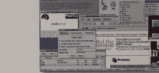

## Linux 用户指南

RH4021

9781881728988

书中包含更多关于这一迷人主题的内容
