# isbn_9788131713525

> “来自现实世界应用的现实世界代码”

开源技术彻底改变了计算领域。许多大规模项目在全球范围内投入使用，例如 Apache、MySQL 和 Postgres，程序员使用多种语言编写应用程序，包括 Perl、Python 和 PHP。这些技术应用于许多不同的系统，从专有系统、Linux 系统、传统 UNIX 系统到大型机。

*Prentice Hall 开源软件开发系列*旨在为您提供这些开源技术中最好的内容。您不仅会学习如何在项目中使用它们，还会从它们中学习。通过查看来自真实应用的真实代码，您将学习全球开源开发者的最佳实践。

### 目前系列中的书目包括：

- *Linux® 调试与性能调优：技巧与技术*
  - Steve Best
  - 0131492470，平装，©2006
- *理解 AJAX：使用 JavaScript 创建富互联网应用程序*
  - Joshua Eichorn
  - 0132216353，平装，©2007
- *嵌入式 Linux 入门*
  - Christopher Hallinan
  - 0131679848，平装，©2007
- *SELinux 实例详解*
  - Frank Mayer, David Caplan, Karl MacMillan
  - 0131963694，平装，©2007
- *从 UNIX 到 Linux® 移植*
  - Alfredo Mendoza, Chakrati Skawratananon, Artie Walker
  - 0131871099，平装，©2006
- *Linux 编程实例：基础*
  - Arnold Robbins
  - 0131429647，平装，©2004
- *Linux® 内核入门：针对 x86 和 PowerPC 架构的自上而下方法*
  - Claudia Saizberg, Gordon Fischer, Steven Smolski
  - 0131181637，平装，©2006

> *献给我的母亲 Edythe，她的勇气、自信和大度一直是我们所有人的灵感源泉。*

## 前言

计算机无处不在。

当然，对于在过去 25 年左右没有与世隔绝的人来说，这一事实并不令人惊讶。而且你很可能知道，计算机不仅仅在我们的桌面上、厨房里，而且越来越多地出现在我们的客厅里，承载着我们的音乐收藏。它们还在我们的微波炉、普通烤箱、手机以及便携式数字音乐播放器中。

如果你正在读这本书，你很可能对这些嵌入式计算机系统了解很多，或者有兴趣了解更多信息。

直到不久以前，嵌入式系统的性能并不强，它们运行的是与行业标准操作系统大不相同的专用、专有操作系统。（此外，针对它们的开发难度也大得多。）如今，嵌入式计算机的性能与现代家用电脑一样强大，甚至更强。（例如，考虑一下高端游戏控制台。）

随着这种性能的到来，运行像 Linux 这样功能齐全的操作系统的能力也随之而来。在嵌入式产品中使用像 Linux 这样的系统是非常合理的。庞大的开发者社区使其成为可能。开发环境和部署环境可以惊人地相似，这使得你作为开发者的生活容易得多。你既拥有基于虚拟内存的系统提供的受保护地址空间的安全性，又拥有多用户、多进程系统的强大功能和灵活性。这是一笔稳赚不赔的交易。

因此，世界各地的公司正在许多设备上使用 Linux，例如 PDA、家庭娱乐系统，甚至，相信与否，手机！

## 推荐语

我对这本书感到兴奋。它为希望将其嵌入式系统应用于 Linux 的开发者提供了一份出色的“学习曲线指南”。本书清晰、文笔优美且组织得当；克里斯的知识和理解力在每一处都体现得淋漓尽致。它不仅信息丰富且实用——阅读它也是一种享受。

我希望你们两人既能学到一些东西，又能同时获得乐趣。我知道我是做到了。

阿诺德·罗宾斯  
系列编辑

## 前言

虽然有许多优秀的书籍涵盖了 Linux，但没有一本书能像本书这样，如此多地汇集了专门针对嵌入式 Linux 开发者的信息和建议维度。确实，有一些非常好的书籍专门论述了 Linux 内核、Linux 系统管理等领域。你会在这本书中找到我对许多被认为处于各自领域顶尖水平的书籍的参考引用。

本书中呈现的大部分材料都源于我在过去几年里以嵌入式 Linux 顾问的身份以及目前作为 Monta Vista Software（领先的嵌入式 Linux 发行版供应商）现场应用工程师的职务所收到的来自开发工程师的问题。

嵌入式 Linux 为经验丰富的软件工程师带来了几个独特的挑战。首先，那些拥有多年遗留实时操作系统（RTOS）经验的人，很难将其思维方式从那些环境转变为 Linux。其次，有经验的应用开发者在理解交叉开发环境的相对复杂性时往往会有困难。

尽管这是一本入门读物，旨在面向新的嵌入式 Linux 开发者，但我相信即使是那些在嵌入式 Linux 方面经验丰富的开发者，也会发现我在过去几年里学到的一些有用的技巧和方法。

## 给执业嵌入式开发者的实用建议

本书包含了我认为嵌入式工程师在嵌入式 Linux 环境中快速上手所需了解的内容。与关注 Linux 内核内部机制不同，本书的内核章节专注于内核的项目特性，而将内部机制留给其他优秀的教材。你将学习内核源代码树的组织和布局。你将发现组成内核镜像的二进制组件，以及它们如何加载并在嵌入式系统中发挥什么作用。我最喜欢的图表之一是图 5-1，它以示意图形式展示了复合内核镜像的构建过程。

在本书中，你将学习构建系统是如何工作的，以及如何将你自己项目中所需的自定义更改整合到 Linux 内核中。你将发现用于驱动 Linux 内核源代码树中不同架构和功能配置的机制，更重要的是，如何修改该系统以根据你的源码需求进行自定义。我们还详细讨论了内核命令行机制。你将学习它是如何工作的，如何根据需求配置内核的运行时行为，以及如何将此功能扩展到你自己的项目中。你将学习如何导航内核源代码，以及如何针对与嵌入式系统相关的特定任务配置内核。你将学到许多对你嵌入式项目有用的技巧，从引导加载器、系统初始化、文件系统、闪存内存到高级内核和应用调试技术。

## 目标读者

本书旨在面向具备 C 语言编程实用知识的程序员。我假设你对局域网和互联网有初步的了解。你应该理解并识别 IP 地址以及它在简单局域网中是如何使用的。我还假设你了解十六进制和八进制数制系统，以及它们在这类文本中的常见用法。

本书探讨了与 C 编译和链接相关的几个高级概念，因此，你对普通 C 编程中链接器的作用至少要有初步的了解将大有裨益。对 GNU make 操作和语义的了解也将证明是有益的。

## 本书不是什么

本书不是一本详细的硬件教程。嵌入式开发者面临的困难之一是当今正在使用的巨大硬件设备多样性。现代 32 位处理器（带有一些集成外设）的用户手册很容易超过 1,000 页。没有捷径可走。如果你需要从程序员的观点理解硬件设备，你将需要花很多小时坐在你最喜欢的阅读椅上，阅读硬件数据表和参考指南，并且还要花更多的小时编写和测试这些硬件设备的代码！

这也不是一本关于 Linux 内核或内核内部机制的书。在本书中，你不会学到用于实现 Linux 虚拟内存管理政策和程序的内存管理单元（MMU）的复杂性；关于这个主题已经有一些很好的书籍了。我们鼓励你利用每章末尾的“额外阅读建议”部分。

## 使用约定

文件名和代码语句以 `Courier` 字体呈现。由读者发出的命令以**粗体 Courier** 字体表示。新术语或重要概念以*斜体*呈现。

当你看到以三个点开头的路径名时，这指的是一个知名但未指定的顶层目录。顶层目录取决于上下文，但几乎普遍指的是 Linux 源代码的顶层目录。例如，`.../arch/ppc/kernel/setup.c` 指的是位于 Linux 源代码树架构分支中的 `setup.c` 文件。实际路径可能是类似于 `~/sandbox/linux.2.6.14/arch/ppc/kernel/setup.c` 的内容。

## 本书组织结构

- **第 1 章，“简介”**，简要介绍了驱动 Linux 在嵌入式环境中快速采用的因素。介绍了与嵌入式 Linux 相关的几个重要标准和组织。
- **第 2 章，“你的第一次嵌入式体验”**，向读者介绍了许多嵌入式 Linux 概念，这些概念是我们在后续章节中构建的基础。
- **第 3 章，“处理器基础”**，我们介绍了用于构建嵌入式 Linux 系统的更流行处理器和平台的高层视图。我们检查了许多主要处理器制造商选定的产品。所有主要的架构系列都有代表。
- **第 4 章，“Linux 内核——不同的视角”**，从略有不同的角度审视 Linux 内核。不是内核理论或内部机制，我们查看其结构、布局和构建构造，以便你开始学习在这个大型软件项目中导航，更重要的是，学习你的自定义努力必须集中在哪里。这包括对内核构建系统的详细覆盖。
- **第 5 章，“内核初始化”**，详细说明了 Linux 内核的初始化过程。你将学习架构特定和引导加载器特定的镜像组件如何连接成内核 proper 的镜像，以便下载至闪存并由嵌入式引导加载器启动。在这里获得的知识将帮助你根据自己的嵌入式应用程序需求定制 Linux 内核。


# 第 6 章 “系统初始化”
继续详细检查初始化过程。当 Linux 内核完成其自身的初始化后，应用程序以预定方式继续初始化过程。完成第 6 章后，你将拥有定制自己的用户空间应用程序启动序列的必要知识。

# 第 7 章 “引导加载器”
专门讨论引导加载器及其在嵌入式 Linux 系统中的作用。我们检查了流行的开源引导加载器 U-Boot，并提供了一个移植示例。我们简要介绍了今天使用的其他引导加载器，以便你可以针对你的特定需求做出知情的选择。

# 第 8 章 “设备驱动程序基础”
介绍了 Linux 设备驱动程序模型，并提供了足够的背景知识，以便启动关于设备驱动程序的伟大文本之一，该文本列在章节末尾的“额外阅读建议”中。

# 第 9 章 “文件系统”
介绍了当今嵌入式系统中使用的更流行的文件系统。我们包括了对 JFFS2 的覆盖，这是一种重要的嵌入式文件系统，用于闪存内存设备。本章包括构建你自己的文件系统镜像的简要介绍，这是嵌入式 Linux 开发者面临的更困难的任务之一。

# 第 10 章 “MTD 子系统”
探索了内存技术设备（MTD）子系统。MTD 是 Linux 文件系统和硬件内存设备（主要是闪存内存）之间的一个极其有用的抽象层。

# 第 11 章 “BusyBox”
介绍了 BusyBox，它是构建小型嵌入式系统最有用的实用工具之一。我们描述了如何根据你的特定需求配置和构建 BusyBox，并详细覆盖了 BusyBox 环境特有的系统初始化。附录 C，“BusyBox 命令”，列出了来自近期 BusyBox 版本的可用 BusyBox 命令。

# 第 12 章 “嵌入式开发环境”
详细考察了典型交叉开发环境的独特需求。本章介绍了几种提高嵌入式开发人员生产力的技术，包括功能强大的 NFS 根挂载开发配置。

# 第 13 章 “开发工具”
审视了许多有用的开发工具。介绍了使用 gdb 进行调试，包括对核心转储分析的介绍。还呈现并解释了更多工具，例如包括 strace、ltrace、top 和 ps，以及内存分析器 mtrace 和 ealloc。本章以对重要的二进制工具的介绍作为结束，包括功能强大的 readelf 工具。

# 第 14 章 “内核调试技术”
对许多用于在 Linux 内核内部调试的实用技术进行了详细检查。我们介绍了内核调试器 KGDB 的使用，并展示了结合 gdb 和 KGDB 作为调试工具时的许多有用调试技术。其中包括使用硬件 JTAG 调试器的介绍，以及当内核无法启动时分析故障的一些技巧。

# 第 15 章 “调试嵌入式 Linux 应用程序”
将调试上下文从内核转移到您的应用程序。我们继续基于前两章的 gdb 示例进行构建，并展示了多线程和多进程调试的技术。

# 第 16 章 “移植 Linux”
介绍了与将 Linux 移植到您的定制板相关的问题。我们通过一个简单的示例进行讲解，并突出了在定制 PowerPC 板上生成可用的 Linux 内核所采取的步骤。本章提出了几个重要的概念，这些概念曾让许多 Linux 内核移植的新手陷入困境。结合第 13 章和第 14 章中介绍的技术，读完本章后，您应该准备好处理自己的定制板移植工作了。

# 第 17 章 “Linux 与实时”
对嵌入式 Linux 中更令人兴奋的发展之一进行了介绍：通过 CONFIG_RT 选项配置实时功能。我们涵盖了 RT 可用的功能以及如何在设计中利用它们。我们还介绍了在您的应用程序配置中测量延迟的技术。

附录涵盖了 GNU 通用公共许可证、U-Boot 可配置命令、BusyBox 命令、SDRAM 接口考量、开源开发人员的资源，以及针对一种更流行的硬件 JTAG 调试器 BDI-2000 的示例配置文件。

## 跟随练习

如果您能在本书的页面和您喜爱的 Linux 工作站之间分配时间，您将从本书中获益最多。找一台旧的 x86 计算机来实验嵌入式系统。更好的是，如果您可以访问基于另一种架构的单板计算机，请使用它。通过学习一个非常大的代码库（Linux 内核）的布局和组织，您将受益匪浅，并且随着您在内核中四处摸索并边做边学，您将获得大量的知识和经验。

查看代码并尝试理解本书中生成的示例。尝试不同的设置、配置选项和硬件设备。您可以在知识方面获得很多收获，而且这非常有趣！

## GPL 版权声明

本书中引用的部分开源代码受许多个人和公司贡献者的版权保护。此处引用的代码是根据 GNU 通用公共许可证或 GPL 的条款获得许可的。

附录 A 包含了 GNU 通用公共许可证的文本。

## 致谢

我不断被开源开发人员的宽容所惊叹。我被我们社区中远超我自身能力的才华所折服。在这个项目过程中，我向 Linux 和开源社区的许多人提出了问题。大多数时候，我的问题得到了快速回答，并伴有鼓励。没有特定的顺序，我想向以下对 Linux 和开源社区的成员表达我的感激之情，他们为我的问题提供了答案：

Dan Malek 为第 2 章“您的第一个嵌入式体验”的部分内容提供了灵感。

Dan Kegel 和 Daniel Jacobowitz 耐心地回答了我的工具链问题。

Scott Anderson 提供了第 14 章“内核调试技术”中介绍的 gdb 宏的原始想法。

Brad Dixon 通过他自己的观点继续挑战和扩展我的技术视野。

George Davis 回答了我的 ARM 问题。

Jim Lewis 对 MTD 内容提供了评论和建议。

Cal Erickson 回答了我关于 gdb 使用的问题。

John Twomey 就第 3 章“处理器基础”提供了建议。

Lee Revell、Sven-Thorsten Dietrich 和 Daniel Walker 就实时 Linux 内容提供了建议。

非常感谢 AMCC、Embedded Planet、Ultimate Solutions 和 United Electronic Industries 为示例提供硬件。非常感谢我的雇主 Monta Vista Software，容忍我偶尔的分心，并为部分示例提供软件。在项目过程中，许多人贡献了想法、鼓励和支持。我对他们也心怀感激。

我想向我的主要审查团队表达真诚的谢意，他们及时阅读了每一章，并提供了极好的反馈、评论和想法。感谢 Arnold Robbins、Sandy Tarrace、Kurt Lloyd 和 Rob Farber。非常感谢 Arnold 帮助我这个新手学习编写技术书籍的技巧。虽然我们已尽力消除错误，但任何残留的错误完全归我所有。

我想感谢 Mark L. Taub 使这个项目得以完成，以及他的鼓励和无限的耐心！我希望感谢制作团队，包括 Kristy Hart、Jennifer Cramer、Krista Hansing 和 Cheryl Lenser。

最后，非常感谢 Cary Dillman，她在每章写作时都进行了阅读，并在整个项目过程中提供了不断的鼓励和她偶尔的牺牲。

—Chris Hallinan

## 关于作者

**Christopher Hallinan** 目前是 Monta Vista Software 的现场应用工程师，居住在马萨诸塞州并在那里工作。Chris 在网络和通信市场度过了 25 年多，主要担任各种产品开发角色，在硬件与软件交汇的领域建立了深厚的背景。在加入 Monta Vista 之前，Chris 作为独立的 Linux 顾问工作了四年，提供定制 Linux 板移植、设备驱动程序和引导加载程序。Chris 通过向流行的 U-Boot 引导加载程序贡献代码而进入开源社区。在不摆弄 Linux 的时候，他通常可以一边唱歌一边弹奏泰勒或马丁吉他。

# 第 1 章


## 引言

### 本章中

- 为什么选择 Linux？第 2 页
- 当今的嵌入式 Linux 第 3 页
- 开源与 GPL 第 3 页
- 标准及相关机构 第 5 页
- 章节摘要 第 7 页

T 从专有操作系统转向开放系统，在许多传统嵌入式操作系统（OS）公司的董事会中引起了不小的轰动。出于许多坚实的原因，**Linux** 正在被采用为许多产品中的操作系统，超出了其在服务器应用程序中的传统领域。这些*嵌入式系统*的例子包括蜂窝电话、DVD 播放器、视频游戏、数码相机、网络交换机和无线网络设备。很有可能 **Linux** 已经存在于您的家中或汽车里。

### 1.1 为什么选择 Linux？

由于众多的经济和技术优势，我们看到 **Linux** 在嵌入式设备中的采用率正在强劲增长。这一趋势已跨越几乎所有市场和技术。**Linux** 已被用于全球公共交换电话网络、全球数据网络、无线蜂窝手机以及操作这些网络的设备中的嵌入式产品。**Linux** 在汽车应用、游戏和 PDA 等消费产品、打印机、企业交换机和路由器以及许多其他产品中取得了成功。嵌入式 **Linux** 的采用率仍在继续增长，且看不到尽头。

嵌入式 **Linux** 增长的一些原因如下：

- **Linux** 已成为传统专有嵌入式操作系统的一个成熟的、高性能的、稳定的替代方案。
- **Linux** 支持种类繁多的应用程序和网络协议。


- **Linux** 是可伸缩的，从小型面向消费者的设备到大型、重型、运营商级的交换机和路由器。
- **Linux** 可以部署而无需传统专有嵌入式操作系统所要求的版税。
- **Linux** 吸引了大量活跃的开发人员，从而能够快速支持新的硬件架构、平台和设备。
- 越来越多的硬件和软件供应商，包括几乎所有顶级制造商和 ISV，现在都支持 **Linux**。

出于这些及其他原因，我们目睹了 Linux 在许多常见家用物品中的采用率正在加速增长，范围从高清电视机到蜂窝手机。

## 1.2 如今的嵌入式 Linux

Linux 在嵌入式领域取得了显著增长，这或许并不令人意外。事实上，你正在阅读本书这一事实就表明，它已经影响了你自己的生活。由于许多公司仍然自行构建嵌入式的 Linux 发行版，因此很难估算市场规模。

LinuxDevices.com 是由 Rich Lehrbaum 创立的热门新闻和信息门户网站，该网站每年对嵌入式 Linux 市场进行一次调查。在其最新调查中，他们报告称 Linux 已成为每年数千种新设计中使用的占主导地位的操作系统。实际上，近半数的受访者报告称在嵌入式设计中使用 Linux，而排名次之的竞争操作系统据报道仅被约八分之一的受访者使用。曾经主导嵌入式市场的商业操作系统据报道被不足十分之一的受访者使用。即使你认为有理由反驳这些结果，但没有人能忽视当今嵌入式 Linux 市场所具有的势头。

## 1.3 开源与 GPL

推动 Linux 采用的基本因素之一是它是*开源*的。Linux 内核在 GNU GPL[1]（通用公共许可证）条款下授权，这导致了一个流行的误解，即 Linux 是免费的。[2] 事实上，GNU GPL 的第二段声明：“当我们谈论自由软件时，我们指的是自由，而不是价格。” GPL 许可证相当简短且易于阅读。其中最重要的关键特性包括：

- 该许可证具有自我延续性。
- 该许可证授予用户运行程序的自由。
- 该许可证授予用户研究和修改源代码的权利。
- 该许可证授予用户分发原始代码或其修改版本的许可。
- 该许可证授予你分发 GPL 软件的任何接收者这些相同的权利。

当软件作品在 GPL 条款下发布时，它必须永远附带该许可证。[3] 即使代码被大量修改，这是被许可且甚至受到许可证鼓励的，GPL 强制要求它必须以相同的许可证发布。此特性的意图是保证每个人都能访问软件，即使是软件的修改版本（或通常所说的衍生作品）。

无论软件是如何获得的，GPL 都授予被许可人无限的分发权，无需支付版税或单件费用。这并不意味着供应商不能对 GPL 软件收费——这是一种非常合理且常见的商业做法。这意味着一旦拥有 GPL 软件，就可以对其进行修改和再分发，无论它是衍生（修改）作品还是非衍生作品。然而，根据 GPL 许可证的定义，修改作品的作者如果决定分发该作品，则有义务在 GPL 条款下发布该作品。衍生作品的任何分发，例如出货给客户，都会触发这一义务。

关于开源运动的历史和文化的迷人而富有洞察力的看法，请阅读本章末尾引用的 Eric S. Raymond 的著作。

### 1.3.1 免费与自由

在关于开源自由性质的讨论中，经常重复两个流行短语：“自由如自由”（free as in freedom）和“免费如啤酒”（free as in beer）。（作者特别喜欢后者。）GPL 许可证的存在旨在保证特定软件体的“自由如自由”。它保证你使用、研究和修改它的自由。它还保证你分发的修改代码的任何接收者也享有这些自由。这一概念已被相当广泛地理解。

经常听到的一个误解是 Linux 是“免费如啤酒”。确实，你可以免费获取 Linux。你可以在几分钟内下载 Linux 内核。然而，正如任何专业开发经理所理解的那样，任何要集成到设计中的软件都伴随着某些成本。这些包括获取、集成、修改、维护和支持的。再加上获取和维护正确配置的工具链、库、应用程序以及与你选择的架构兼容的专用交叉开发工具的成本，你很快就会意识到，开发部署基于嵌入式 Linux 系统所需的软件组件是一项非平凡的锻炼。

## 1.4 标准及相关机构

随着 Linux 在桌面、企业和嵌入式市场细分中继续获得市场份额，新的标准和组织正在出现，以帮助影响 Linux 的使用和接受。本节作为介绍您可能希望熟悉的标准的资源。

### 1.4.1 Linux 标准基（LSB）

可能单个最相关的标准是 Linux 标准基（Linux Standard Base，LSB）。LSB 的目标是建立一组旨在增强不同 Linux 发行版之间应用程序互操作性的标准。目前，LSB 涵盖多种架构，包括 IA32/64、32 位和 64 位 PowerPC、AMD64 以及其他。标准分为核心组件和各个架构组件。

LSB 指定了 Linux 发行版的通用属性，包括对象格式、标准库接口、最小命令和实用程序集及其行为、文件系统布局、系统初始化等。

您可以从第 1.5.1 节“额外阅读建议”中给出的链接了解有关 LSB 的更多信息，该部分位于本章末尾。

### 1.4.2 开源开发实验室（OSDL）

开源开发实验室（Open Source Development Labs，OSDL）成立旨在帮助加速 Linux 在一般市场中的接受度。根据其使命宣言，OSDL 目前为 Linux 社区提供企业级测试设施和其他技术支持。重要的是，OSDL 资助了几个工作组来定义标准并参与针对三个重要市场细分的特性开发。接下来的三个小节介绍了这些举措。

#### 1.4.2.1 OSDL：运营商级 Linux

全球许多最大的网络和电信设备制造商正在开发或出货以 Linux 为操作系统运行运营商级设备。运营商级设备的显著特性包括高可靠性、高可用性和快速可服务性。这些供应商使用冗余、热插拔架构、容错特性、集群以及通常是实时性能来设计产品。

OSDL 运营商级 Linux 工作组制定了一份规范，定义了运营商级设备的一组要求。当前版本的规范涵盖七个功能领域：

- **可用性**——提供增强可用性的要求，包括在线维护操作、冗余和状态监控
- **集群**——促进冗余服务的要求，如集群成员管理的数据检查点
- **可服务性**——远程服务和维护的要求，如 SNMP 以及对风扇和电源的诊断监控
- **性能**——定义性能和可扩展性、对称多处理、延迟等要求
- **标准**——定义 CGL 合规设备应遵循的标准的要求
- **硬件**——与高可用硬件相关的要求，如刀片服务器和硬件管理接口
- **安全性**——提高整体系统免受各种威胁的安全性要求

#### 1.4.2.2 OSDL：移动 Linux 计划

在本书撰写之时，全球市场上已有几部基于嵌入式 Linux 构建的移动手机（蜂窝电话）。据广泛报道，基于 Linux 的手机出货量已达数百万部。唯一确定的是还有更多即将推出。这预示着这将是一个曾经由专有实时操作系统承担角色的爆炸性市场细分。这有力地说明了 Linux 为商业嵌入式应用做好准备的程度。

[1] 参见附录 A“GNU 通用公共许可证”以获取许可证的完整文本。
[2] 大多数专业开发经理都同意：你可以免费下载 Linux，但在嵌入式平台上开发和部署任何操作系统都有成本（通常是一笔可观的成本）。有关成本要素的讨论，请参见第 1.3.1 节“免费与自由”。
[3] 如果所有版权持有者都同意，理论上软件可以以新许可证发布，这确实是一个非常不太可能的场景！

OSDL 赞助了一个名为 Mobile Linux Initiative 的工作组。根据 OSDL 网站的信息，其目的是加速 Linux 在下一代移动手机及其他语音/数据合一的便携式设备上的采用。该工作组关注的领域包括开发工具、I/O 与网络、内存管理、多媒体、性能、电源管理、安全性和存储。

## 1.4.2.3 服务可用性论坛

如果你正在为那些对高可靠性、可用性、可服务性（RAS）至关重要的环境构建产品，你应该了解服务可用性论坛（Service Availability Forum，SA Forum）。该组织在定义用于载体级及其他商用设备系统管理的通用接口集方面发挥着主导作用。SA Forum 的网站是 www.saforum.org。

## 1.5 本章总结

- Linux 在嵌入式产品开发商和制造商中的采用仍在加速。
- Linux 在嵌入式设备中的使用正以令人兴奋的速度增长。
- 在本章中，我们介绍了推动 Linux 在嵌入式市场增长的许多因素。
- 本章介绍了多个影响嵌入式 Linux 的标准和相关组织。

### 1.5.1 推荐延伸阅读

《大教堂与集市》  
Eric S. Raymond  
O'Reilly Media, Inc., 2001

*Linux 标准基础项目*  
www.linuxbase.org

开源开发实验室有限公司  
www.osdl.org

# 第 2 章


本章内容

- 是否为嵌入式系统 第 10 页
- 嵌入式系统的结构 第 12 页
- 存储考量 第 19 页
- 嵌入式 Linux 发行版 第 32 页
- 本章总结 第 34 页


理解特定任务的最佳路径往往是对大局有良好的把握。许多基础概念可能对嵌入式系统开发的新手来说具有挑战性。本章将带你游览一个典型的嵌入式系统及其开发环境，重点介绍使这些系统开发变得独特且经常具有挑战性的概念和组件。

## 2.1 是否为嵌入式系统？

嵌入式系统通常与几个关键属性相关联。我们不一定将台式计算机称为嵌入式系统。但请考虑一个位于远程数据中心、正在执行关键监控和报警任务的台式计算机硬件平台。假设这个数据中心通常没有人员值守。这对该硬件平台施加了不同的要求。例如，如果断电后恢复供电，我们希望该平台能够在无人工干预的情况下恢复其职责。

嵌入式系统形态各异，从最大的多机架数据存储或网络 powerhouse 到微型模块，如你的个人 MP3 播放器或手机。嵌入式系统的一些常见特征包括：

- 包含处理引擎，如通用微处理器
- 通常针对特定应用或目的进行设计
- 包含简单的（或没有）用户界面——例如汽车发动机点火控制器
- 通常资源有限——例如具有较小的内存占用且没有硬盘
- 可能存在电源限制，例如需要由电池供电
- 通常不用于通用计算平台
- 通常内置应用软件，而非由用户选择
- 出厂时即预集成所有预期的应用硬件和软件
- 通常用于无需人工干预的应用场景

最常见的是，与典型的台式计算机相比，嵌入式系统资源受限。嵌入式系统通常内存有限，硬盘较小或没有，有时甚至没有外部网络连接。通常唯一的用户界面是一个串口和一些 LED。这些问题以及其他问题可能给嵌入式系统开发者带来挑战。

### 2.1.1 BIOS 与引导加载程序

当电源首次应用于台式计算机时，一个名为 `BIOS` 的软件程序立即接管处理器。从历史上看，`BIOS` 是 Basic Input/Output Software（基本输入/输出软件）的缩写，但由于其执行的功能比原始实现复杂得多，该缩写已产生了其独特的含义。`BIOS` 实际上可能存储在闪存中（稍后描述），以方便 `BIOS` 程序本身的现场升级。

`BIOS` 是一组复杂的系统配置软件例程，了解硬件架构的低级细节。我们大多数人并不了解 `BIOS` 的范围及其功能，但它是台式计算机的关键部分。当电源接通时，`BIOS` 首先获得处理器的控制权。其主要职责是初始化硬件，特别是内存子系统，并从 PC 的硬盘加载操作系统。

在典型的嵌入式系统中（假设其不是基于行业标准 x86 PC 硬件平台），`引导加载程序`（`bootloader`）是执行这些相同功能的软件程序。在你自己的定制嵌入式系统中，你的开发计划必须包括针对你的电路板开发特定的引导加载程序。幸运的是，有几个良好的开源引导加载程序可供定制用于你的项目。这些将在第 7 章“引导加载程序”中介绍。

你的引导加载程序在开机时执行的一些重要任务如下：

- 初始化关键硬件组件，如 `SDRAM` 控制器、`I/O` 控制器和图形控制器
- 初始化系统内存，为将控制权移交给操作系统做准备
- 根据需要为外设控制器分配系统资源，如内存和中断电路
- 提供一种机制来定位和加载你的操作系统映像
- 加载操作系统并将控制权移交给它，传递可能需要的任何启动信息，如总内存大小、时钟速率、串口速度和其他低级硬件特定配置数据

这是对典型嵌入式系统引导加载程序执行任务的非常简化的总结。需要记住的重要要点是：如果你的嵌入式系统基于定制设计的平台，则这些引导加载程序功能必须由你，即系统设计者提供。如果你的嵌入式系统基于商用现货（COTS）平台，例如 `ATCA` 机箱，¹通常引导加载程序（以及通常的 Linux 内核）已包含在电路板上。第 7 章详细讨论了引导加载程序。

## 2.2 嵌入式系统的结构

图 2-1 显示了一个典型嵌入式系统的框图。这是一个高级硬件架构的非常简单示例，可能存在于无线访问点中。该系统以一个 32 位 RISC 处理器为中心。闪存用于非易失性程序和数据存储。主内存是同步动态随机存取内存（`SDRAM`），根据应用不同，可能包含从几兆字节到几百兆字节不等的容量。一个实时时钟模块，通常由电池备份，保持当前时间（日历/挂钟，包括日期）。本例包括以太网和 `USB` 接口，以及用于通过 `RS-232` 进行控制台访问的串口。`802.11` 芯片组实现无线调制解调器功能。

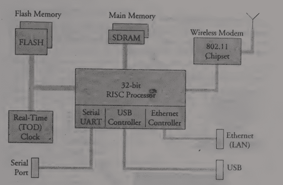

嵌入式系统中的处理器通常执行许多超出传统 CPU 的功能。图 2-1 中假设的处理器包含用于串行接口的集成 `UART`，以及集成的 `USB` 和以太网控制器。许多处理器都包含集成外设。我们将在第 3 章“处理器基础知识”中查看几个集成处理器的示例。

### 2.2.1 典型的嵌入式 Linux 开发环境

通常，嵌入式 Linux 新手提出的第一个问题是：开始开发需要哪些条件？为了回答这个问题，我们来看一个典型的嵌入式 Linux 开发配置（参见图 2-2）。

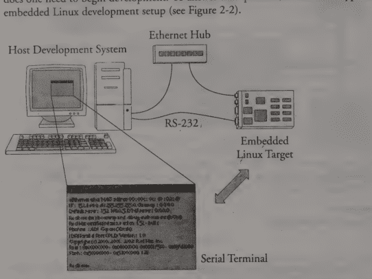

**图 2-2**

嵌入式 Linux 开发配置

这里展示了一种非常常见的配置。我们有一个主机开发系统，运行着您喜欢的桌面 Linux 发行版，例如 Red Hat、SUSE 或 Debian Linux。我们的嵌入式 Linux 目标板通过 `RS-232` 串口电缆连接到开发主机。我们将目标板的以太网接口插入到本地以太网集线器或交换机中，开发主机也通过以太网连接到该设备。开发主机包含您的开发工具和实用程序以及目标文件——通常是从嵌入式 Linux 发行版获取的。

在此示例中，我们到嵌入式 Linux 目标的主要连接是通过 `RS-232` 连接。使用串口终端程序与目标板进行通信。`Minicom` 是最常用的串口终端应用程序之一，几乎在所有桌面 Linux 发行版中都可以找到。

### 2.2.2 启动目标板

当首次通电时，随目标板提供的引导加载程序（`bootloader`）立即接管处理器。它执行一些非常底层的硬件初始化，包括处理器和内存设置、控制串口的 `UART` 初始化以及以太网控制器的初始化。清单 2-1 显示了从串口接收到的字符，这是目标板上电后的结果。在此示例中，我们选择了一块来自 AMCC 的目标板，即昵称为 Yosemite 的 PowerPC 440EP 评估板。这基本上是一个参考设计，包含 AMCC 440EP 嵌入式处理器。它出厂时预装了 `U-Boot` 引导加载程序。

#### 清单 2-1

初始引导加载程序串口输出

```
U-Boot 1.1.4 (Mar 18 2006 - 20:36:11)

AMCC PowerPC 440EP Rev. B
Board: Yosemite - AMCC PPC440EP Evaluation Board
VCO: 1066 MHz
CPU: 533 MHz
FLB: 133 MHz
OPB: 66 MHz
EPB: 66 MHz
PCI: 66 MHz

I2C:   ready
DRAM:  256 MB
FLASH: 64 MB

PCI:   Bus Dev  Vendid  Devid  Class  Int
In:    serial
Out:   serial
Err:   serial
Net:   ppc_4xx_eth0, ppc_4xx_eth1
=>
```

当 Yosemite 板通电时，`U-Boot` 会执行一些底层硬件初始化，其中包括配置串口。然后它打印一行横幅，如清单 2-1 的第一行所示。接下来显示处理器名称和修订版本，随后是一个标识板卡类型的文本字符串。这是开发人员输入到 `U-Boot` 源代码中的一个字面字符串。

然后 `U-Boot` 显示内部时钟配置（该配置在任何串口输出显示之前就已经完成）。完成后，`U-Boot` 根据其静态配置指令配置任何硬件子系统。在这里，我们看到 `U-Boot` 正在配置 `I2C`、`DRAM`、`FLASH`、`PCI` 和网络子系统。最后，`U-Boot` 等待通过串口的控制台输入，由 `=>` 提示符指示。

### 2.2.3 引导内核

既然 `U-Boot` 已经初始化了硬件、串口和以太网网络接口，它在其短暂但有用的生命周期中只剩下一个任务：加载并启动 Linux 内核。所有引导加载程序都有一个命令来加载并执行操作系统镜像。清单 2-2 展示了 `U-Boot` 手动加载并启动 Linux 内核的常见方式之一。

#### 清单 2-2

加载 Linux 内核


```
=> tftpboot 200000 uImage-440ep
ENET Speed is 100 Mbps - FULL duplex connection
Using ppc_4xx_eth0 device
TFTP from server 192.168.1.10: our IP address is 192.168.1.139
Filename 'uImage-amcc'.
Load address: 0x200000
Loading: ###############
################
done
Bytes transferred: 962773 (eb0d5 hex)

=> bootm 200000
##### Booting image at 00200000 ...
 Image Name: Linux-2.6.13
Image Type: PowerPC Linux Kernel Image (gzip compressed)
Data Size: 962709 Bytes = 940.1 kB
Load Address: 00000000
Entry Point: 00000000
Verifying Checksum ... OK
Uncompressing Kernel Image ... OK
Linux version 2.6.13 (chris@juno1) (gcc version 4.0.0 (DENX ELDK 4.0 4.0.0.0))
L #2 Thu Feb 15 19:10:13 EST 2006
AMCC PowerPC 440EP Yosemite Platform
...
< Lots of Linux kernel boot messages, removed for clarity >
...
amcc login: <<< This is a Linux kernel console command prompt>
```

` tftpboot` 命令指示 U-Boot 使用 TFTP 协议通过网络将内核镜像 `uImage-440ep` 加载到内存中。在这种情况下，内核镜像位于开发工作站上（通常是连接串口到目标板的同一台机器）。`tftpboot` 命令被传入了一个地址，即内核镜像将在目标板内存中加载的物理地址。现在不用担心细节；我们在第 7 章中会更详细地介绍 U-Boot。

接下来，发出 `bootm`（从内存镜像启动）命令，指示 U-Boot 从 `bootm` 命令指定的地址启动我们刚刚加载的内核。此命令将控制权转移给 Linux 内核。假设您的内核配置正确，这将导致 Linux 内核启动到您的目标板上的控制台命令提示符，如登录提示所示。

请注意，`bootm` 命令是 U-Boot 的丧钟。这是一个重要的概念。与桌面 PC 中的 BIOS 不同，大多数嵌入式系统的架构设计使得当 Linux 内核接管控制权时，引导加载程序停止存在。内核会声明引导加载程序之前使用的任何内存和系统资源。将控制权交还给引导加载程序的唯一方法是重新启动板卡。

还有一个最后的观察值得注意。清单 2-2 中直到并包含这一行在内的所有串口输出都是由 U-Boot 引导加载程序产生的：

> 正在解压缩内核镜像 ... OK

其余的启动消息是由 Linux 内核产生的。稍后我们会对此有更多说明，但值得注意 U-Boot 在哪里停止，以及 Linux 内核镜像在哪里接管。

### 2.2.4 内核初始化：概述

当 Linux 内核开始执行时，在其相当全面的启动过程中会输出大量状态消息。在本文讨论的示例中，Linux 内核在发出登录提示之前输出了 100 多行。为了清楚说明讨论的观点，清单 2-3 省略了这些内容。

> ² 此处及其他您将使用的服务器将在第 12 章“嵌入式开发环境”中详细介绍。

清单 2-3 重现了登录提示前的最后几行输出。这项练习的目标不是深入探讨内核初始化的细节（这在第 5 章“内核初始化”中有介绍），而是为了高层理解正在发生什么，以及在嵌入式系统上启动 Linux 内核需要哪些组件。

#### 清单 2-3

Linux 最终启动消息

```
…
Looking up port of RPC  100003/2 at 192.168.0.9
Looking up port of RPC  100005/1 at 192.168.0.9
VFS: Mounted root (nfs filesystem).
Freeing init memory:  232k
INIT: version 2.78 booting
…
coyote login:
```

在串口终端上发出登录提示之前不久，Linux 挂载了一个根文件系统。在清单 2-3 中，Linux 执行了所需步骤，通过以太网从 IP 地址为 192.168.0.9 的机器上的 NFS 服务器远程挂载其根文件系统。通常，这是您的开发工作站。根文件系统包含组成 GNU/Linux 系统的应用程序、系统库和实用程序。

在此讨论中，一个重要观点不应被低估：Linux 需要文件系统。许多传统嵌入式操作系统不需要文件系统，这对于从传统嵌入式操作系统过渡到嵌入式 Linux 的工程师来说是一个常见的惊喜。文件系统由一组预定义的系统目录和文件组成，这些文件以特定的布局位于硬盘驱动器或其他介质上，Linux 内核将其挂载为根文件系统。

请注意，Linux 可以从其他设备挂载根文件系统。当然，最常见的是像您在 Linux 工作站上做的那样，将硬盘分区挂载为根文件系统。确实，当您把嵌入式 Linux 装置送出大门并远离您的开发环境时，NFS 是无用的。然而，随着您阅读本书的深入，您将逐渐欣赏 NFS 根挂载作为开发环境的强大功能和灵活性。

### 2.2.5 第一个用户空间进程：init

在继续之前，还需要说明另一个重要的点。请注意清单 2-3 中的这一行：

```
INIT: version 2.78 booting.
```

直到此刻，内核本身一直在执行代码，在一个被称为*内核上下文*的环境中执行 numerous 初始化步骤。在这种运行状态下，内核拥有所有系统内存，并对所有系统资源拥有完全的控制权。内核可以访问所有物理内存以及所有 I/O 子系统。

当 Linux 内核完成其内部初始化并挂载其根文件系统后，默认行为是生成一个名为 `init` 的应用程序。当内核启动 `init` 时，通常说它正在*用户空间*或用户空间上下文中运行。在这种运行模式下，用户空间进程对系统的访问权限受限，必须使用内核系统调用请求内核服务，例如设备或文件 I/O。这些用户空间进程（或程序）运行在一个由内核随机选择⁴并管理的虚拟内存空间中。内核与处理器中的专用内存管理硬件协作，为用户空间进程执行虚拟地址到物理地址的转换。这种架构最大的好处是，一个进程中的错误不会破坏另一个进程的内存空间，这是遗留嵌入式操作系统中的常见陷阱，可能导致难以追踪的 bug。

如果这些概念看起来很陌生，请不要惊慌。本节的目标是描绘一个大致的画面，随着你阅读本书的深入，你将获得更详细的知识。这些及其他概念将在后续章节中详细介绍。

> ⁴ 实际上它并不是随机的，但就讨论的目的而言，可以将其视为随机。此话题将在后面详细讨论。

## 2.3 存储考量

嵌入式系统最具挑战性的方面之一是大多数嵌入式系统的物理资源有限。虽然你桌面上的 Pentium 4 机器可能拥有 180GB 的硬盘空间，但发现嵌入式系统仅拥有其中一小部分是件很常见的事。在许多情况下，硬盘通常被更小、更便宜的不可易失性存储设备所取代。硬盘体积庞大，有旋转部件，对物理冲击敏感，并且需要多种电源电压，这使得它们不适合许多嵌入式系统。

### 2.3.1 Flash 存储器

几乎每个人都很熟悉⁵用于各种消费类设备（如数码相机和 PDA，两者都是嵌入式系统的绝佳例子）的 CompactFlash 模块。这些模块可以被视为固态硬盘，能够在极小的足迹中存储兆字节——甚至吉字节级别的数据。它们没有运动部件，相对坚固，并且工作在单一通用电源电压上。

存在多家 Flash 存储器制造商。Flash 存储器有多种物理封装和容量。看到仅有 1MB 或 2MB 不可易失性存储的嵌入式系统并不罕见。嵌入式 Linux 系统更典型的存储需求范围从 4MB 到 256MB 或更多。越来越多的嵌入式 Linux 系统拥有吉字节级别的不可易失性存储。

Flash 存储器可以在软件控制下写入和擦除。虽然硬盘技术仍然是最快的可写介质，但 Flash 的写入和擦除速度随着时间推移有了显著改进，尽管 Flash 的写入和擦除时间仍然慢得多。硬盘和 Flash 存储器技术之间存在一些根本性的差异，你必须理解这些差异才能正确使用该技术。

Flash 存储器被划分为相对较大的可擦除单位，称为擦除块。Flash 存储器的一个定义性特征是其数据写入和擦除的方式。在典型的 Flash 存储芯片中，数据可以在软件控制下从二进制 1 更改为二进制 0，每次更改 1 位/字，但要使位从 0 变回 1，必须擦除整个块。出于这个原因，块通常被称为擦除块。


典型的 Flash 存储器件包含许多擦除块。例如，一个 4MB 的 Flash 芯片可能包含 64 个每个 64KB 的擦除块。Flash 存储器也提供非均匀擦除块大小，以促进灵活的数据存储布局。这些通常被称为 boot block 或 boot sector Flash 芯片。通常，bootloader 存储在小块中，而内核和其他必需数据存储在较大的块中。图 2-3 展示了典型*top boot* Flash 的块大小布局。

> ⁵ 参见 www.compactflash.org。

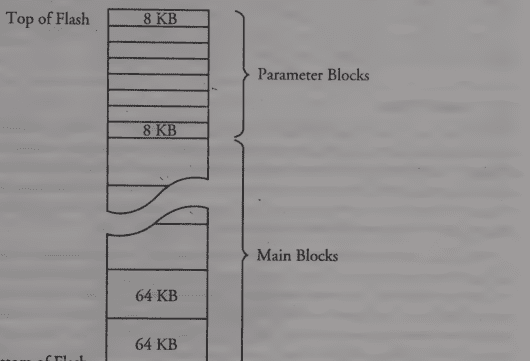

**图 2-3**

**Boot block Flash 架构**

要修改存储在 Flash 存储阵列中的数据，必须完全擦除包含该修改数据所在的块。即使块中只有 1 字节需要更改，整个块也必须被擦除并重写。与传统的硬盘扇区大小相比，Flash 块大小相对较大。相比之下，典型的高性能硬盘具有 512 或 1024 字节的可写扇区。其后果可能显而易见：由于每次更新必须写回 Flash 的数据量相对较大，更新 Flash 存储器中数据的写入时间可能是硬盘的许多倍。这些写入周期在极端情况下可能需要几秒。

> 请记住，你可以逐字节将 1 更改为 0，但你必须擦除整个块才能将任何位从 0 更改回 1。

另一个必须考虑的 Flash 存储器限制是 Flash 存储单元写入寿命。Flash 存储单元在故障之前具有有限的写入循环次数。虽然循环次数相当大（通常每个块为 100K 次循环），但很容易想象一个设计不良的 Flash 存储算法（甚至是一个 bug）可能会迅速摧毁 Flash 设备。不言而喻，你应该避免配置系统日志记录器输出到基于 Flash 的设备。

### 2.3.2 NAND Flash

NAND Flash 是一种相对较新的 Flash 技术。当 NAND Flash 进入市场时，前几节中描述的传统 Flash 存储器被称为 NOR Flash。这些区别涉及内部 Flash 存储单元架构。NAND-Flash 器件通过提供较小的块大小，克服了传统（NOR）Flash 的一些限制，从而实现更快、更高效的写入，以及通常更高效的 Flash 阵列使用。

NOR Flash 器件以类似许多微处理器外设的方式与微处理器接口。也就是说，它们拥有并行数据线和地址线，直接 ${ }^{7}$ 连接到微处理器的数据/地址总线。Flash 阵列中的每个字节或字都可以以随机方式单独寻址。相比之下，NAND 器件通过一种各厂商不同的复杂接口串行访问。NAND 器件呈现出更接近传统硬盘及相关控制器的操作模型。数据以串行突发方式访问，其大小远小于 NOR Flash 块大小。NAND Flash 的写入循环寿命比 NOR Flash 大一个数量级，尽管擦除时间短得多。

总而言之，NOR Flash 可由微处理器直接访问，甚至可以直接从 NOR Flash 执行代码（但由于性能原因，这种情况很少发生，且仅在资源极其稀缺的系统上发生）。事实上，许多处理器无法像对 DRAM 那样对 Flash 进行指令缓存访问。这进一步影响了执行速度。相比之下，NAND Flash 更适合用于文件系统格式的大容量存储，而不是原始二进制可执行代码和数据存储。

### 2.3.3 Flash 的使用

嵌入式系统设计人员在 Flash 存储器的布局和使用时有许多选择。在最简单的系统中，资源没有过度受限，原始二进制数据（可能是压缩的）可以存储在 Flash 器件上。启动时，存储在 Flash 中的文件系统映像被读取到 Linux ramdisk 块设备中，作为文件系统挂载并仅从 RAM 访问。当 Flash 中的数据很少需要更新，且确实需要更新的数据相对于 ramdisk 的大小较小，且 Flash 中的数据很少需要更新时，这通常是一个很好的设计选择。重要的是要认识到，ramdisk 中文件的任何更改在重新引导或电源循环后将丢失。

图 2-4 展示了一种常见的 Flash 存储器组织方式，这是在一个动态数据不可易失性存储需求较少且不频繁的简单嵌入式系统中典型的组织方式。

**Flash 顶部**

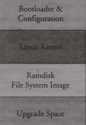


Bootloader 通常放置在 Flash 存储阵列的顶部或底部。在 bootloader 之后，分配空间用于 Linux 内核映像和 ramdisk 文件系统映像，⁶ 其中包含根文件系统。通常，Linux 内核和 ramdisk 文件系统映像是压缩的，bootloader 在引导周期中处理解压缩任务。

> ⁶ 我们在第 9 章“文件系统”中详细讨论 ramdisk 文件系统。

对于需要在重启和断电周期之间保存的动态数据，可以专门划出一小块 Flash 区域，或者使用另一种类型的非易失性存储<sup>9</sup>。这是嵌入式系统的典型配置，用于满足存储配置数据的需求，例如面向消费市场的无线接入点。

### 2.3.4 Flash 文件系统

通过在 Flash 设备上管理数据，采用类似于硬盘上数据组织的方式使用 Flash 文件系统，可以克服前几段中描述的简单 Flash 布局方案的局限性。早期针对 Flash 设备文件系统的实现由一个简单的块设备层组成，该层模拟了常见硬盘的 512 字节扇区布局。这些简单的仿真层允许以文件格式而非未格式化的批量存储方式来访问数据，但它们存在一些性能局限性。

对 Flash 文件系统的首批改进之一是引入磨损均衡。如前所述，Flash 块的写入寿命是有限的。磨损均衡算法用于将写入操作均匀分布在 Flash 内存的物理擦除块上。

Flash 架构带来的另一个限制是在电源故障或过早关闭期间数据丢失的风险。考虑到 Flash 块的大小相对较大，而通常写入的平均文件大小相对于块大小往往要小得多。您之前了解到，Flash 块必须一次写入一个块。因此，要写入一个 8KB 的小文件，必须擦除并重写整个 Flash 块，其大小可能是 64KB 或 128KB；在最坏的情况下，完成此操作可能需要几十秒。这为因电源故障而导致数据丢失打开了一个相当大的风险窗口。

当今使用的较流行的 Flash 文件系统之一是 JFFS，即日志型 Flash 文件系统 2（Journaling Flash File System 2）。它具有若干重要特性，旨在提高整体性能、延长 Flash 寿命并降低电源故障时数据丢失的风险。最新 JFFS2 文件系统中的显著改进包括改进的磨损均衡、用于在给定文件大小中压缩更多数据的压缩和解压缩，以及对 Linux 硬链接的支持。我们将在第 9 章“文件系统”中详细讨论这一点，并在第 10 章“MTD 子系统”中再次讨论内存技术设备（MTD）子系统。

<sup>9</sup> 实时时钟模块通常包含少量的非易失性存储，串行 EEPROM 也是少量数据非易失性存储的另一种常见选择。

### 2.3.5 内存空间

几乎所有传统的嵌入式操作系统都将系统内存视为并管理为单一的大型、平坦地址空间。也就是说，微处理器的地址空间从 0 开始，直到其物理地址范围的顶端。例如，如果一个微处理器有 24 条物理地址线，其内存顶端将是 16MB。因此，其十六进制地址范围从 `0x00000000` 到 `0x00ffff`。硬件设计通常将 DRAM 放置在范围的底部，并将 Flash 内存从顶部向下放置。DRAM 顶端和 FLASH 底端之间未使用的地址范围将被分配用于寻址板上的各种外围芯片。这种设计方法通常由微处理器的选择决定。图 2-5 是简单嵌入式系统典型内存布局的示例。

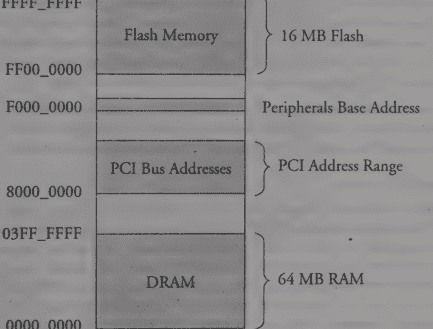

**图 2-5**

典型的嵌入式系统内存映射

在基于传统操作系统的传统嵌入式系统中，操作系统和所有任务<sup>10</sup> 对系统中的所有资源具有平等的访问权限。一个进程中的 bug 可能会抹去系统任何地方的内存内容，无论这些内容是属于它自己、操作系统、另一个任务，甚至是地址空间中的某个硬件寄存器。尽管这种方案最有价值的特征是简单性，但它导致了难以诊断的 bug。

高性能微处理器包含称为内存管理单元（MMU）的复杂硬件引擎，其目的是使操作系统能够对其地址空间及其分配给进程的地址空间进行高度管理和控制。这种控制主要体现为两种形式：访问权限和内存转换。访问权限允许操作系统为特定任务分配特定的内存访问权限；内存转换允许操作系统虚拟化其地址空间，这有许多好处。

Linux 内核利用这些硬件 MMU 来创建*虚拟内存*操作系统。虚拟内存的最大好处之一是，通过呈现系统拥有比实际存在更多的内存的表象，可以更有效地利用物理内存。另一个好处是，内核可以对其分配给任务或进程的每个系统内存范围强制执行访问权限，以防止某个进程错误地访问属于另一个进程或内核本身的内存或其他资源。

让我们看看其工作原理的一些细节。虚拟内存系统的复杂性教程超出了本书的范围。<sup>11</sup> 相反，我们考察虚拟内存系统对嵌入式系统开发者的影响。


<sup>10</sup> 在本讨论中，*任务*一词用于指代任何执行线程，无论使用何种机制来生成、管理或调度它。

### 2.3.6 执行上下文

Linux 开始运行时执行的第一个主要任务之一，就是配置处理器上的硬件内存管理单元（MMU）以及用于支持它的数据结构，并启用地址转换。当此步骤完成后，内核在其自己的虚拟内存空间中运行。内核开发者在较新版本中选择的核心虚拟地址默认为 `0xC0000000`。在大多数架构中，这是一个可配置参数。<sup>12</sup> 如果我们查看内核符号表，我们会发现内核符号链接在以 `0xC0xxxxxx` 开头的地址处。因此，每当内核在内核空间执行代码时，处理器的指令指针将包含此范围内的值。

在 Linux 中，我们根据给定线程<sup>13</sup> 执行的环境，指的是两个明显分离的操作上下文。完全在内核中执行的线程被称为在*内核上下文*中操作，而应用程序则被称为在*用户空间上下文*中操作。用户空间进程只能访问其拥有的内存，并使用内核系统调用来访问文件和设备 I/O 等特权资源。一个例子可能使这一点更清楚。

考虑一个打开文件并发出读请求的应用程序（见图 2-6）。读函数调用在用户空间中的 C 库 `read()` 函数中开始。然后 C 库向内核发出读请求。该读请求导致从用户程序到内核的上下文切换，以处理文件数据的请求。在内核内部，读请求导致硬盘访问，以请求包含文件数据的扇区。

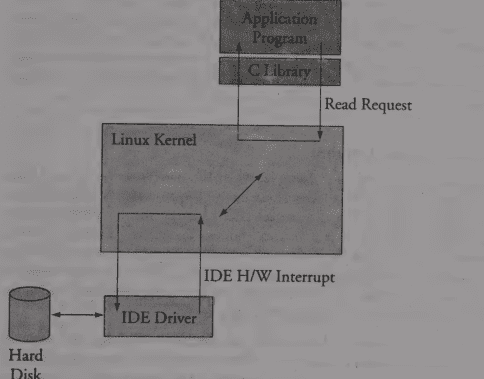

**图 2-6**  
简单的文件读取请求

通常，硬盘读取是异步发送给硬件本身的。也就是说，请求被提交给硬件，当数据准备就绪时，硬件会中断处理器。等待数据的应用程序程序会被阻塞在等待队列上，直到数据可用。稍后，当硬盘数据准备就绪时，它会发出硬件中断。（此描述为了说明目的而故意简化。）当内核收到硬件中断时，它会暂停正在执行的任何进程，并继续从驱动器读取等待的数据。这是一个执行线程在内核上下文中操作的例子。

总结这段讨论，我们确定了两个一般的执行上下文：用户空间和内核空间。当应用程序服务例程（ISR）执行导致上下文切换并进入内核的系统调用时，它代表某个进程执行内核代码。您经常听到这被称为内核中的进程上下文。相比之下，处理 IDE 驱动器的中断服务例程（ISR）（或任何其他 ISR）是内核代码，但不代表任何特定进程执行。在这种操作上下文中存在若干限制，包括 ISR 不能阻塞（睡眠）或调用可能导致阻塞的内核函数的限制。有关这些概念的进一步阅读，请参阅本章末尾的 2.5.1 节“额外阅读建议”。

### 2.3.7 进程虚拟内存

当生成一个进程时——例如，当用户在 Linux 命令提示符下输入 `ls` 时——内核为该进程分配内存并为其分配一段虚拟内存地址。由此产生的地址值与内核中的值以及其他正在运行的进程没有固定关系。此外，板上的物理内存地址与进程看到的虚拟内存之间也没有直接相关性。实际上，由于分页和换入换出，进程在其生命周期内占据主内存中多个不同的物理地址是很常见的。

列表 2-4 是久负盛名的“Hello World”，经过修改以说明前面的概念。此示例的目的是说明内核分配给进程的地址空间。此代码在 AMCC Yosemite 板（本章前面描述过）上编译和运行。该板包含 256MB 的 DRAM 内存。

#### 列表 2-4

#### 嵌入式风格的 Hello World

```c
#include <stdio.h>

int bss_var;              /* Uninitialized global variable */
int data_var = 1;         /* Initialized global variable */

int main(int argc, char **argv)
{
    void *stack_var;          /* Local variable on the stack */

    stack_var = (void *)main; /* Don't let the compiler */
                              /* optimize it out */

    printf("Hello, World!  Main is executing at %p\n", stack_var);
    printf("This address (%p) is in our stack frame\n", &stack_var);

    /* bss section contains uninitialized data */
    printf("This address (%p) is in our bss section\n", &bss_var);

    /* data section contains initialized data */
    printf("This address (%p) is in our data section\n", &data_var);

    return 0;
}
```

#### 列表 2-5

#### Hello 的输出

```text
root@amcc:~# ./hello
Hello, World!  Main is executing at 0x10000418
This address (0x7ff8eb0) is in our stack frame
This address (0x100101c) is in our bss section
This address (0x10010a18) is in our data section
root@amcc:~#
```

列表 2-5 展示了该程序产生的控制台输出。请注意，名为 `hello` 的进程认为它正在高内存区域（刚刚*高于* 256MB 边界（`0x10000418`））的某个地方执行。还要注意，堆栈地址位于 32 位地址空间的大致中间位置，远远超出了我们 256MB 的 RAM（`0x7ff8eb0`）。这怎么可能呢？在这些系统中，DRAM 通常是连续的。对于一般的观察者来说，看起来我们大约有 2GB 的 DRAM 可供使用。这些*虚拟地址*是由内核分配的，并由 Yosemite 板上可用内存 256MB 范围内的某处物理 RAM 作为支撑。

虚拟内存系统的一个特点是，当可用的物理 RAM 低于指定的阈值时，内核可以将内存页面交换到批量存储介质上，通常是硬盘驱动器。内核检查其活动内存区域，确定内存中最近最少使用的区域，并将这些内存区域交换到磁盘，以便为当前进程释放它们。嵌入式系统的开发人员通常由于性能或资源限制而在嵌入式系统上禁用交换。例如，在大多数情况下，使用相对缓慢且写寿命有限的 Flash 内存设备作为交换设备是荒谬的。如果没有交换设备，您必须仔细设计应用程序，使其在可用物理内存的限制内运行。

### 2.3.8 交叉开发环境

在为嵌入式系统开发应用程序和设备驱动程序之前，我们需要一套工具（编译器、实用工具等），这些工具将生成适用于目标系统的正确格式的二进制可执行文件。考虑一个在你的桌面 PC 上编写的简单应用程序，例如传统的“Hello World”示例。在桌面创建源代码后，你调用随桌面系统附带（或你购买并安装的）编译器来生成二进制可执行映像。该映像文件格式正确，可以在其上编译的机器上执行。这被称为*本地*编译。也就是说，使用桌面系统上的编译器，你生成将在该桌面系统上执行的代码。

请注意，*本地*并不意味着架构。实际上，如果你有一个在目标板上运行的工具链，你可以本地编译适用于目标架构的应用程序。事实上，测试新内核和定制板的一个很好的方法是在其上反复编译 Linux 内核。

在交叉开发环境中开发软件要求在你的开发主机上运行的编译器输出一个与编译它所在的桌面开发工作站不兼容的二进制可执行文件。这些工具存在的主要原因是，由于资源（通常是内存和 CPU 性能）限制，在嵌入式系统上本地开发和编译软件往往不切实际或不可能。

这种方法中存在许多隐藏的陷阱，常常会让嵌入式开发的新手措手不及。当某个程序被编译时，编译器通常知道如何查找头文件，以及在哪里查找可能成功编译所需的库。为了说明这些概念，让我们再次查看“Hello World”程序。上面列表 2-4 中再现的示例使用以下命令行进行编译：

```text
gcc -Wall -o hello hello.c
```

从列表 2-4 中，我们看到包含了文件 `stdio.h`。该文件不在 `gcc` 命令行中指定的 `hello.c` 文件所在的同一目录中。那么编译器如何找到它们？此外，`printf()` 函数未在 `hello.c` 文件中定义。因此，当 `hello.c` 被编译时，它将包含对该符号的未解析引用。链接器如何在链接时解析此引用？

编译器内置了定位头文件的默认值。当遇到对头文件的引用时，编译器搜索其默认位置列表以定位文件。存在类似的过程，链接器用于解析对外部符号 `printf()` 的引用。链接器默认知道搜索 C 库 (`libc-*`) 以解析未解析的引用。再次说明，这种默认行为内置于工具链中。


现在假设你正在构建一个目标为 PowerPC 嵌入式系统的应用程序。显然，你需要一个交叉编译器来生成与 PowerPC 处理器架构兼容的二进制可执行文件。如果你使用交叉编译器发出类似的编译命令来编译上面的 `hello.c` 示例，你的二进制可执行文件可能会意外地与你的开发系统上的 x86 版本的 C 库链接在一起，以尝试解析对 `printf()` 的引用。当然，运行这个错误的混合可执行文件（包含 PowerPC 和 x86 二进制指令的混合[^14]）的结果是可以预测的：崩溃！

解决这一困境的方法是指示交叉编译器在非标准位置查找以获取头文件和特定于目标的库。我们在第 12 章“嵌入式开发环境”中更详细地讨论了这一主题。这个示例的意图是说明本地开发环境与针对嵌入式系统交叉编译的开发环境之间的区别。这只是交叉开发环境复杂性之一。相同的解决方案也适用于交叉调试，正如你将在第 14 章“内核调试技术”中看到的。适当的交叉开发环境对你的成功至关重要，涉及比编译器多得多的内容，我们将在第 12 章“嵌入式开发环境”中很快看到。

[^14]: 实际上，它甚至无法编译或链接，更不用说运行了。

## 2.4 嵌入式 Linux 发行版

到底什么是发行版？Linux 内核启动后，它期望找到并挂载一个根文件系统。当挂载了合适的根文件系统后，启动脚本会启动系统所需的一组程序和实用工具。这些程序经常调用其他程序来执行特定任务，例如生成登录 shell、初始化网络接口以及启动用户的应用程序。这些程序中的每一个都对系统有特定要求。大多数 Linux 应用程序程序依赖一个或多个系统库。其他程序需要配置文件和日志文件，等等。总之，即使是一个小的嵌入式 Linux 系统也需要在*根文件系统*上的适当目录结构中填充许多数十个文件。

全功能的桌面系统在根文件系统上有数千个文件。这些文件来自通常按功能分组的*软件包*。软件包通常使用包管理器进行安装和管理。Red Hat 的包管理器 (`rpm`) 是一个流行的例子，广泛用于在 Linux 系统上安装、删除和更新软件包。如果你的 Linux 工作站基于 Red Hat，包括 Fedora Core 系列，在命令提示符下输入 `rpm -qa` 将列出你系统上安装的所有软件包。

一个软件包可以包含许多文件；事实上，一些软件包包含数百个文件。完整的 Linux 发行版可以包含数百甚至数千个软件包。以下是一些你可能在嵌入式 Linux 发行版中找到的软件包示例及其用途：

- *initscripts*—包含基本的系统启动和关闭脚本。
- *apache*—实现流行的 Apache Web 服务器。
- *telnet-server*—包含实现 Telnet 服务器功能所需的文件，允许你建立到嵌入式目标的 Telnet 会话。
- *glibc*—标准 C 库
- *busybox*—通常在 UNIX/Linux 系统上找到的几十种流行命令行实用工具的紧凑版本。[^15]

[^15]: 该软件包足够重要，值得拥有自己的章节。第 11 章“BusyBox”详细介绍了 BusyBox。

这就是 Linux 发行版这一术语被普遍使用时所指的目的。一个典型的 Linux 发行版包含若干张光盘，上面装满了有用的程序、库、工具、实用程序和文档。安装一个发行版通常会为用户提供一个完全可用的系统，该系统基于一组合理的默认配置选项，并且可以根据特定需求进行定制。您可能熟悉一些流行的桌面 Linux 发行版，例如 RedHat 或 Suse。

面向嵌入式目标的 Linux 发行版在几个方面存在显著差异。首先，嵌入式发行版中的可执行目标二进制文件无法在您的 PC 上运行，而是针对您的嵌入式系统的架构和处理器。当然，如果您的嵌入式 Linux 发行版目标是 x86 架构，则此说法不适用。桌面 Linux 发行版往往包含许多面向典型桌面用户的 GUI 工具，如花哨的图形时钟、计算器、个人时间管理工具、电子邮件客户端等。嵌入式 Linux 发行版通常会省略这些组件，转而提供面向开发人员的专用工具，例如内存分析工具、远程调试设施等许多其他工具。

桌面和嵌入式 Linux 发行版之间的另一个显著区别在于，嵌入式发行版通常包含交叉工具，而非本地工具。例如，嵌入式 Linux 发行版附带的 `gcc` 工具链运行在您的 x86 桌面 PC 上，但生成的是在目标系统上运行的二进制代码。工具链中的许多其他工具也是类似配置的：它们在开发主机（通常是 x86 PC）上运行，但操作的是 ARM 或 PowerPC 等外部架构。

### 2.4.1 商业 Linux 发行版

有几家供应商提供商业嵌入式 Linux 发行版。主要的嵌入式 Linux 供应商已经向市场提供嵌入式 Linux 发行版多年。Linuxdevices.com，一个流行的嵌入式 Linux 新闻和信息门户网站，已经整理了一份可商用的嵌入式 Linux 发行版的综合列表。虽然该列表有些陈旧，但仍是一个非常有用的起点。您可以在 `www.linuxdevices.com/articles/AT9952405558.html` 找到他们的汇编内容。

### 2.4.2 自行构建的 Linux 发行版

您可以选择自行组装嵌入式项目所需的所有组件。您将不得不决定风险是否值得付出努力。如果您纯粹出于兴趣参与嵌入式 Linux，例如作为爱好或大学项目，这种方法可能是一个不错的选择。然而，请计划花费大量时间来组装项目所需的所有工具和实用程序，并确保它们都能相互协同工作。

首先，您需要一个工具链。`gcc` 和 `binutils` 可以从 `www.lfs.org` 和世界各地的其他镜像站点获得。两者都是编译您的项目的内核和用户空间应用程序所必需的。这些工具主要以源代码形式分发，您必须编译这些工具以适应您的特定交叉开发环境。这些实用程序的最新“稳定”源码树通常需要进行修补，尤其是当它们将用于 x86/IA32 架构之外时。补丁通常可以在与基本包相同的位置找到。挑战在于发现您需要针对您的特定问题和/或架构使用哪个补丁。

## 2.5 本章小结

本章以宏观视角涵盖了多个主题。现在，您对后续章节的材料有了正确的视角。在后续章节中，这一视角将被扩展，以开发在您下一个嵌入式项目中取得成功所需的技能和知识。

- 嵌入式系统具有一些共同属性。通常资源有限，用户界面简单或不存在，且通常针对特定目的设计。
- 引导加载程序（bootloader）是典型嵌入式系统中的关键组件。如果您的嵌入式系统基于定制设计的电路板，您必须将引导加载程序作为设计的一部分提供。通常，这只是对现有引导加载程序进行移植。
- 启动定制电路板需要多个软件组件，包括引导加载程序、内核和文件系统映像。
- 闪存（Flash memory）在嵌入式 Linux 系统中被广泛用作存储介质。我们介绍了闪存的概念，并将在第 9 章和第 10 章中深入探讨这一主题。
- 应用程序，也称为进程，生活在内核分配给它的独立虚拟内存空间中。应用程序被认为运行在用户空间。
- 一个装备齐全且配置正确的交叉开发环境对嵌入式开发人员至关重要。我们将在第 12 章中专门用一整章来讨论这一重要主题。
- 您需要一个嵌入式 Linux 发行版才能开始开发您的嵌入式目标。嵌入式发行版包含许多组件，这些组件已针对您选择的架构进行了编译和优化。

### 2.5.1 延伸阅读建议

*Linux Kernel Development, 2nd Edition*

Robert Love

Novell Press, 2005

*Understanding the Linux Kernel*

Daniel P. Bovet & Marco Cesati

O'Reilly & Associates, Inc., 2002

*Understanding the Linux Virtual Memory Manager*

Bruce Perens

Prentice Hall, 2004

# 第 3 章

## 处理器基础


**本章内容**

- 独立处理器 `第 38 页`
- 集成处理器：片上系统 `第 43 页`
- 硬件平台 `第 61 页`
- 本章小结 `第 62 页`

在本章中，我们提供一些基本信息，帮助您应对浩瀚的嵌入式处理器选择海洋。我们审视市场上的一些处理器及其包含的功能类型。首先重点介绍独立处理器。这些通常是功能最强的处理器，需要外部芯片来形成完整的系统。接下来，我们将介绍许多在 Linux 下受支持的集成处理器中的一部分。最后，我们将看看当今使用的一些常见硬件平台。

在特定的嵌入式设计中，可供选择的嵌入式处理器字面上多达几十种。为了本章的目的，我们将可用的讨论限制在那些包含硬件内存管理单元（MMU）的处理器，以及当然在 Linux 下受支持的处理器。Linux 的一个基本架构设计方面是它是一个虚拟内存操作系统。[^1] 在不包含 MMU 的处理器上使用 Linux 会放弃内核更有价值的架构特性之一，且这超出了本书的范围。

[^1]: Linux 支持一些不包含 MMU 的基本处理器，但这不被视为 Linux 的主流用途。

### 3.1 独立处理器


独立处理器指的是专门用于处理功能的处理器芯片。与集成处理器相反，独立处理器需要额外的支持电路才能进行基本操作。在许多情况下，这意味着围绕处理器的芯片组或定制逻辑，以处理 DRAM 控制器、系统总线寻址配置以及键盘控制器和串行端口等外部外围设备等功能。独立处理器通常提供最高的整体 CPU 性能。

存在许多在嵌入式系统中得到广泛应用的 32 位和 64 位实现方式[^2]。其中包括 IBM PowerPC 970FX、Intel Pentium M 和 Freescale MPC74xx 宿主处理器等。

[^2]: 32 位和 64 位指的是处理器主要设施（如执行单元、寄存器文件和地址总线）的本地宽度。

### 3.1 独立处理器

在这里，我们展示了主要独立处理器制造商的每个产品样本。这些处理器在 Linux 下得到很好的支持，并已用于许多嵌入式 Linux 设计中。

#### 3.1.1 IBM 970FX

IBM 970FX 处理器核心是一款高性能、支持 64 位的独立处理器。970FX 采用*超标量*架构。这意味着核心能够同时获取、发射并获得多条指令的结果。这是通过流水线架构实现的，该架构提供了同时处理多条指令流的效果。根据其中包含的指令流和操作，IBM 970FX 最多包含 25 级流水线。

970FX 的一些关键特性如下：

-   流行的 PowerPC 架构的 64 位实现
-   深度流水线设计，适用于高性能计算应用
-   静态和动态电源管理功能
-   多种睡眠模式，以最大限度地减少电源需求并延长电池寿命
-   动态可调时钟频率，支持低功耗模式
-   针对高性能、低延迟存储管理进行优化

IBM 970FX 已被集成到许多高端服务器刀片和计算平台中，包括 IBM 自己的刀片服务器平台。

#### 3.1.2 Intel Pentium M

x86 架构无疑是其中一种最流行的架构，其 32 位和 64 位变种（更正确地称为 IA32 和 IA64）已被用于各种应用中的嵌入式设备。在最常见的形式中，这些平台基于各种商用现货（COTS）硬件实现。许多制造商供应各种外形因子的 x86 单板计算机和完整平台。参见第 3.2 节“集成处理器：片上系统”，请参阅本章稍后的相关讨论，内容涉及当今更常用的平台。

英特尔奔腾 M 已广泛应用于各种笔记本电脑，并在嵌入式产品中占据了一席之地。与 IBM 970FX 处理器类似，奔腾 M 采用的是超标量架构。这些特性使其在嵌入式应用中极具吸引力：

-   奔腾 M 基于流行的 x86 架构，因此得到了大量硬件和软件供应商生态系统的广泛支持。
-   与其他 x86 处理器相比，它的功耗更低。
-   高级电源管理功能支持低功耗运行模式和多种睡眠模式。
-   动态时钟速度功能增强了诸如待机等电池供电操作的性能。
-   片上热监测功能可在高温情况下自动过渡到较低功耗模式，以降低功耗。
-   设计了多个频率和电压工作点（可动态选择），以最大化便携式设备的电池寿命。

其中许多特性对于嵌入式应用特别有用。嵌入式产品要求具备便携式或电池供电配置并不罕见。由于其在电源和热管理方面的特性，奔腾 M 在这一应用领域颇受欢迎。

#### 3.1.3 飞思卡尔 MPC7448

飞思卡尔 MPC7448 包含所谓第四代 PowerPC 内核，通常称为 G4。³ 这款高性能 32 位处理器常见于网络和电信应用中。多家制造商生产符合行业标准平台规格的刀片服务器，其中包括这款以及其他类似的独立飞思卡尔处理器。我们将在本章稍后的第 3.3 节“硬件平台”中探讨这些平台。

³ 飞思卡尔目前的文献将 G4 内核称为 e600 内核。

凭借其在此处强调的高级功能集，MPC7448 在多种信号处理和网络应用中广受欢迎：

-   运行时钟速率超过 1.5GHz
-   1MB 板载 L2 缓存
-   高级电源管理功能，包括多种睡眠模式
-   高级 AltiVec 向量执行单元
-   用于低功耗配置的电压缩放

MPC7448 包含一项名为 AltiVec 的飞思卡尔技术，旨在实现极快的算法计算和其他数据处理应用。AltiVec 单元由一个包含 32 个非常宽（128 位）寄存器的寄存器文件组成。这些 AltiVec 寄存器内的每个值都可视为由多个元素组成的向量。AltiVec 定义了一组指令，以便在核心 CPU 指令处理的同时有效地并行处理这些向量数据。AltiVec 操作包括诸如横向求和、乘加、同时数据分发（存储）以及数据聚集（加载）指令等计算。

程序员利用 AltiVec 硬件实现了常见的信号处理和网络元件中的极快软件计算。示例包括快速傅里叶变换、如滤波等数字信号处理、MPEG 视频编码和解码，以及快速生成加密协议（如 DES、MD5 和 SHA1）。

飞思卡尔独立处理器系列中的其他芯片包括 MPC7410、MPC7445、MPC7447、MPC745x 和 MPC7xx 系列。

#### 3.1.4 配套芯片组

像前面描述的独立处理器这样的处理器需要支持逻辑来连接并启用外部外围设备，如主系统内存（DRAM）、ROM 或 Flash 内存、如 PCI 这样的系统总线，以及其他外设，如键盘控制器、串行端口、IDE 接口等。这种支持逻辑通常由配套芯片组实现，这些芯片组甚至可能是专门为某个处理器家族设计的。

例如，奔腾 M 由一个名为 855GM 的此类芯片组提供支持。855GM 芯片组是图形和内存的主要接口——因此后缀为-GM。855GM 已针对配合奔腾 M 使用进行了优化。图 3-1 展示了这种硬件设计中处理器与芯片组之间的关系。

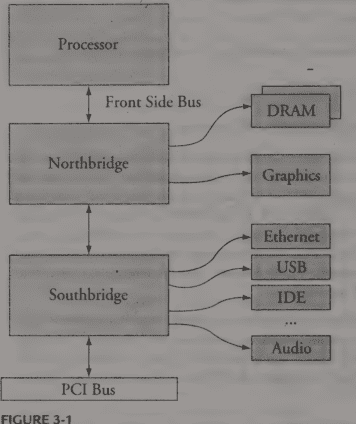

**图 3-1**

处理器/芯片组关系

注意描述这些芯片组时常用的术语。英特尔 855GM 通常被称为*北桥*芯片的示例，因为它直接连接到处理器的高速前端总线（FSB）。另一个提供 I/O 和 PCI 总线连接的配套芯片同样被称为*南桥*芯片，这与其在架构中的位置有关。在这些硬件架构中，南桥芯片（实际上是 I/O 控制器）负责提供如图 3-1 中所示的接口，包括以太网、USB、IDE、音频、键盘和鼠标控制器。

在 PowerPC 方面，用于 PowerPC 的 Tundra Tsi110 主机桥是支持独立 PowerPC 处理器的芯片组示例。Tsi110 支持许多常见独立 PowerPC 处理器的几种接口功能。Tundra 芯片支持飞思卡尔 MPC7448 和 IBM PPC 750xx 系列处理器。这些处理器可以使用 Tundra 芯片为以下外设提供直接接口：

-   DDR DRAM，集成内存控制器
-   以太网（Tundra 提供四个千兆以太网端口）
-   PCI Express（支持 2 个 PCI Express 端口）
-   PCI/X（PCI 2.3、PCI-X 和 Compact PCI [cPCI]）
-   串行端口
-   I2C
-   可编程中断控制器
-   并行端口

存在许多芯片组制造商，包括 VIA 科技、Marvell、Tundra、nVidia、英特尔等。Marvell 和 Tundra 主要服务于 PowerPC 市场，而其他公司则专注于英特尔架构。基于众多独立处理器（如英特尔 x86、IBM 或飞思卡尔 PowerPC）之一的硬件设计，需要配套芯片组来与系统设备接口。

Linux 作为嵌入式操作系统的一大优势是能够快速支持新的芯片组。Linux 目前支持此处提到的那些芯片组，以及许多其他芯片组。请查阅 Linux 源代码和配置工具以获取有关所选芯片组的信息。

## 3.2 集成处理器：片上系统

在前一节中，我们重点介绍了独立处理器。尽管它们用于许多应用，包括一些大处理能力的处理引擎，但绝大多数嵌入式系统都采用某种集成处理器，即片上系统（SoC）。可以选择的集成处理器多达几十甚至上百种。*存在*许多选择。我们考察了来自行业领导者的几款产品，并查看了一些使每个系列独具特色的功能。与独立处理器部分一样，我们仅关注拥有强大 Linux 支持的集成处理器。

存在几种主要的处理器架构，每种架构都有集成 SoC 的实例。PowerPC 在许多与网络和电信相关的嵌入式应用中一直是传统领导者，而 MIPS 可能在低端消费级设备市场占据领先地位。⁴ ARM 用于许多蜂窝电话。这些代表了在嵌入式 Linux 系统中广泛使用的主要架构。然而，正如你将在第 4 章“Linux 内核：不同的视角”中看到的，Linux 今天支持超过 20 种不同的硬件架构。

### 3.2.1 PowerPC

PowerPC 是一种由来自苹果、IBM 和摩托罗拉半导体部门（现已作为独立实体分拆为飞思卡尔半导体）的工程师共同设计的精简指令集计算机（RISC）架构。有许多优秀文档详细描述了 PowerPC 架构。请参阅本章末尾的“延伸阅读建议”作为起点。

PowerPC 处理器已进入各类嵌入式产品。从汽车、消费和网络应用到最大的数据和电信交换机，PowerPC 是嵌入式应用中最流行的架构之一。由于这种普及度，众多制造商针对 PowerPC 提供了大量的硬件和软件解决方案。

### 3.2.2 AMCC PowerPC


本书稍后的一些示例基于 AMCC PowerPC 440EP 嵌入式处理器。440EP 是一种流行于许多网络和通信产品中的集成处理器。以下列表突出了 440EP 的一些特性：

- 片上双数据率（DDR）SDRAM 控制器
- 集成 NAND Flash 控制器
- PCI 总线接口
- 双 10/100Mbps 以太网端口
- 片上 USB 2.0 接口
- 多达四个用户可配置的串行端口
- 双 I²C 控制器
- 可编程中断控制器
- 串行外设接口（SPI）控制器

⁴ 这些是作者基于市场观察形成的个人观点，并非基于任何科学数据。

## 3.2 集成处理器：片上系统

- 可编程定时器
- 用于调试的 JTAG 接口

这确实是一个完整的片上系统 (SoC)。图 3-2 是 AMCC PowerPC 440EP 嵌入式处理器的框图。通过添加存储芯片和物理 I/O 硬件，围绕这个集成微处理器可以构建一个完整的高端嵌入式系统，且所需的接口电路极少。

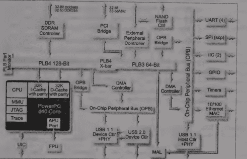

图 3-2  
AMCC PPC 440EP 嵌入式处理器  
(由 AMCC 公司提供)

许多制造商提供参考硬件平台，使开发人员能够探索处理器或其他硬件的功能。本书稍后的示例（第 14 章“内核调试技术”和第 15 章“嵌入式 Linux 应用程序调试”）是在 AMCC Yosemite 板上运行的，该板是公司的参考平台，包含图 3-2 中所示的 440EP。

PowerPC 处理器有多种产品配置可供选择。如图 3-2 所示，AMCC 440EP 包含许多常见产品所需的足够 I/O 接口，且额外电路极少。由于该处理器包含集成浮点单元 (FPU)，它非常适合网络附加成像系统、通用工业控制和网络设备等产品。

AMCC 的 PowerPC 产品系列包括由两个经过验证的内核驱动的多种配置。他们的 405 内核产品有带以太网控制器和不带以太网控制器的配置。所有 405 内核配置都集成了 SDRAM 控制器、用于串行端口的双 UART、用于底层板级管理通信的 PCI、通用 I/O 引脚和集成定时器。AMCC 405 内核集成处理器在不需要硬件 FPU 的广泛应用中，基于经过验证的内核提供了经济实惠的性能。

AMCC 基于 440 内核的产品提高了性能水平并增加了外设。我们在示例中介绍的 440EP 包含硬件 FPU。440GX 增加了两个三倍速 10/100/1000MB 以太网接口（除了两个 10/100Mbps 以太网端口外）以及用于高性能网络应用的 TCP/IP 硬件加速。440SP 为 RAID 5/6 应用提供硬件加速。所有这些处理器都有成熟的 Linux 支持。表 3-1 总结了 AMCC 405xx 系列的特点。

#### 表 3-1
AMCC PowerPC 405xx 亮点总结

| 特性 | 405CR | 405EP | 405GP | 405GPr |
|---|---|---|---|---|
| 内核/速度 | PowerPC 405<br>133–266MHz | PowerPC 405<br>133–333MHz | PowerPC 405<br>133–266MHz | PowerPC 405<br>266–400MHz |
| DRAM 控制器 | SDRAM/133 | SDRAM/133 | SDRAM/133 | SDRAM/133 |
| 以太网 10/100 | N | 2 | 1 | 1 |
| GPIO 引脚 | 23 | 32 | 24 | 24 |
| UART | 2 | 2 | 2 | 2 |
| DMA 控制器 | 4 通道 | 4 通道 | 4 通道 | 4 通道 |
| I²C 控制器 | Y | Y | Y | Y |
| PCI 主机控制器 | N | Y | Y | Y |
| 中断控制器 | Y | Y | Y | Y |

请访问 AMCC 网站 `www.amcc.com/embedded` 以获取完整详细信息。

表 3-2 总结了 AMCC 440xx 系列处理器的特性。

#### 表 3-2
AMCC PowerPC 440xx 亮点总结

| 特性 | 440EP | 440GP | 440GX | 440SP |
| :--- | :--- | :--- | :--- | :--- |
| 内核/速度 | PowerPC 440<br>333–667MHz | PowerPC 440<br>400–500MHz | PowerPC 440<br>533–800MHz | PowerPC 440<br>533–667MHz |
| DRAM 控制器 | DDR | DDR | DDR | DDR |
| 以太网 10/100 | 2 | 2 | 2 | 经由 GigE |
| 千兆以太网 | N | N | 2 | 1 |
| GPIO 引脚 | 64 | 32 | 32 | 32 |
| UART | 4 | 2 | 2 | 3 |
| DMA 控制器 | 4 通道 | 4 通道 | 4 通道 | 3 通道 |
| I²C 控制器 | 2 | 2 | 2 | 2 |
| PCI 主机控制器 | Y | PCI-X | PCI-X | 三个 PCI-X |
| SPI 控制器 | Y | N | N | N |
| 中断控制器 | Y | Y | Y | Y |

### 3.2.3 Freescale PowerPC

Freescale 半导体拥有具有集成外设的广泛 PowerPC 处理器产品线。该制造商目前正在推广其 PowerPC 产品组合，主要围绕三个广泛的垂直市场领域：网络、汽车和工业。Freescale PowerPC 处理器在网络市场领域取得了巨大的成功。这一系列处理器在从低端到高端的多种网络设备中具有广泛的吸引力。

在最近的新闻稿中，Freescale 半导体宣布其已发货超过 2 亿颗集成通信处理器。[^3] 这种成功部分归功于公司的 PowerQUICC 产品线。PowerQUICC 架构已经发货十多年。它基于与 QUICC 引擎集成的 PowerPC 内核（在 Freescale 文献中也被称为通信处理器模块或 CPM）。QUICC 引擎是一个独立的 RISC 处理器，旨在从主 PowerPC 内核中卸载通信处理任务，从而使 PowerPC 内核能够专注于控制和管理应用。QUICC 引擎是一个复杂但高度灵活的通信外设控制器。

在其当前形式中，PowerQUICC 涵盖四个通用系列。为了方便起见，在我们讨论这些 PowerQUICC 产品时，我们将它简称为 PQ。

PQ I 系列包括最初的基于 PowerPC 的 PowerQUICC 实现，由 MPC8xx 系列处理器组成。这些集成通信处理器运行在 50–133MHz，具有嵌入式 PowerPC 8xx 内核。PQ I 系列已用于 ATM 和以太网边缘设备，如家庭和小型办公室 (SOHO) 市场的路由器、住宅网关、ADSL 和电缆调制解调器以及类似应用。

CPM 或 QUICC 引擎集成了两个独特且强大的通信控制器。串行通信控制器 (SCC) 是一种灵活的串行接口，能够实施许多基于串行的通信协议，包括以太网、HDLC/SDLC、AppleTalk、同步和异步 UART、IrDA 和其他位流数据。

串行管理控制器 (SMC) 是一个模块，支持类似的串行通信协议，并包括对 ISDN、串行 UART 和 SPI 协议的支持。

利用这些 SCC 和 SMC 的组合，可以创建非常灵活的 I/O 组合。内部时分复用器甚至允许这些接口实现 T1 和 E1 I/O 等通道化通信。

[^3]: 在 Freescale 网站上，导航至“媒体中心”、“新闻稿”。这份新闻稿日期为 2005 年 10 月 31 日，发自德克萨斯州奥斯汀。

表 3-3 总结了 PQ I 产品线的部分示例。

#### 表 3-3
Freescale 精选 PowerQUICC I 亮点

| 特性 | MPC856 | MPC860 | MPC875 | MPC885 |
| --- | --- | --- | --- | --- |
| 内核/速度 | PowerPC 8xx<br>高达 80MHz | PowerPC 8xx<br>高达 80MHz | PowerPC 8xx<br>高达 133MHz | PowerPC 8xx<br>高达 133MHz |
| DRAM 控制器 | Y | Y | Y | Y |
| USB | Y | N | Y | Y |
| SPI 控制器 | Y | Y | Y | Y |
| I²C 控制器 | Y | Y | Y | Y |
| SCC 控制器 | 2 | 4 | 1 | 3 |
| SMC 控制器 | 2 | 2 | 1 | 1 |
| 安全引擎 | N | N | Y | Y |
| 专用快速以太网控制器 | N | N | 2 | 2 |


Freescale PowerPC 产品线的下一个台阶是 PowerQUICC II。PQ II 采用了公司的 G2 PowerPC 内核，该内核源自 603e 嵌入式 PowerPC 内核。这些集成通信处理器运行在 133-450MHz，具有多个 10/100Mbps 以太网接口、安全引擎、ATM 和 PCI 支持等众多功能。PQ II 包括 MPC82xx 产品。

PQ II 在 QUICC 引擎中增加了两种新类型的控制器。FCC 是全双工快速串行通信控制器。FCC 支持 100Mbps 以太网和高达 45Mbps 的 T3/E3 等高速通信。MCC 是多通道控制器，支持 128KB × 64KB 的通道化数据。

表 3-4 总结了精选 PowerQUICC II 处理器的亮点。

#### 表 3-4
Freescale 精选 PowerQUICC II 亮点

| 特性 | MPC8250 | MPC8260 | MPC8272 | MPC8280 |
| :--- | :--- | :--- | :--- | :--- |
| 内核/速度 | G2/603e<br>150-200MHz | G2/603e<br>100-300MHz | G2/603e<br>266-400MHz | G2/603e<br>266-400MHz |
| DRAM 控制器 | Y | Y | Y | Y |
| USB | N | N | Y | 经由 SCC4 |
| SPI 控制器 | Y | Y | Y | Y |
| I²C 控制器 | Y | Y | Y | Y |
| SCC 控制器 | 4 | 4 | 3 | 4 |
| SMC 控制器 | 2 | 2 | 2 | 2 |
| FCC 控制器 | 3 | 3 | 2 | 3 |
| MCC 控制器 | 1 | 2 | 0 | ? |

基于 Freescale PowerPC e300 内核（源自 G2/603e），PowerQUICC II Pro 系列运行在 266–667MHz，并支持千兆以太网、双数据率 (DDR) SDRAM 控制器、PCI、高速 USB、安全加速等。这些是 MPC83xx 系列处理器。PQ II 和 PQ II Pro 系列处理器已被设计用于各种设备，如 LAN 和 WAN 交换机、集线器和网关、PBX 系统以及许多具有类似复杂性和性能要求的其他系统。

PowerQUICC II Pro 包含三个没有 QUICC 引擎的系列成员，以及两个基于 QUICC 引擎更新版本的产品。MPC8358E 和 MPC8360E 都添加了一个新的通用通信控制器，支持多种协议。

表 3-5 总结了 PQ II Pro 家族中部分成员的特点。

#### 表 3-5
飞思卡尔精选 PowerQUICC II Pro 亮点

| 特性 | MPC8343E | MPC8347E | MPC8349E | MPC8360E |
| :--- | :--- | :--- | :--- | :--- |
| 内核/速度 | e300 | e300 | e300 | e300 |
| | 266–400MHz | 266–667MHz | 400–667MHz | 266–667MHz |
| DRAM 控制器 | Y- DDR | Y- DDR | Y- DDR | Y- DDR |
| USB | Y | 2 | 2 | Y |
| SPI 控制器 | Y | Y | Y | Y |
| I²C 控制器 | 2 | 2 | 2 | 2 |
| 以太网 10/100/1000 | 2 | 2 | 2 | 通过 UCC |
| UART | 2 | 2 | 2 | 2 |
| PCI 控制器 | Y | Y | Y | Y |
| 安全引擎 | Y | Y | Y | Y |
| MCC | 0 | 0 | 0 | 1 |
| UCC | 0 | 0 | 0 | 8 |

PowerQUICC 家族的高端是 PQ III 处理器。这些处理器的运行速度介于 600MHz 和 1.5GHz 之间。它们基于 e500 内核，支持千兆以太网、DDR SDRAM、RapidIO、PCI 和 PCI/X、ATM、HDLC 等。该家族包含 MPC85xx 产品线。这些处理器已应用于高端产品，如无线基站控制器、光边缘交换机、中心局交换机以及类似设备。

表 3-6 强调了 PQ III 家族的一些成员。

#### 表 3-6
PQ III 家族亮点

| 特性 | MPC8540 | MPC8548E | MPC8555E | MPC8560 |
| :--- | :--- | :--- | :--- | :--- |
| 内核/速度 | e500 | e500 | e500 | e500 |
| | 最高 1.0GHz | 最高 1.5GHz | 最高 1.0GHz | 最高 1.0GHz |
| DRAM 控制器 | Y- DDR | Y- DDR | Y- DDR | Y- DDR |
| USB | N | N | 通过 SCC | N |
| SPI 控制器 | N | N | Y | Y |
| I²C 控制器 | Y | Y | Y | Y |
| 以太网 10/100 | 1 | 通过 GigE | 通过 SCC | 通过 SCC |
| 千兆以太网 | 2 | 4 | 2 | 2 |
| UART | 2 | 2 | 2 | 通过 SCC |
| PCI 控制器 | PCI/PCI-X | PCI/PCI-X | PCI | PCI/PCI-X |
| Rapid IO | Y | Y | N | Y |
| 安全引擎 | N | Y | Y | N |
| SCC | – | – | 3 | 4 |
| FCC | – | – | 2 | 3 |
| SMC | – | – | 2 | 0 |
| MCC | – | – | 0 | 2 |

### 3.2.4 MIPS

您可能会惊讶地发现，基于 MIPS 架构的 32 位处理器已经出货 20 多年了。MIPS 架构由斯坦福大学的一个工程团队于 1981 年设计，该团队由约翰·亨尼西（John Hennessy）博士领导，他后来创立了 MIPS 计算机系统公司（MIPS Computer Systems, Inc.）。该公司已演变为现在的 MIPS 技术公司（MIPS Technologies），其主要角色是设计并授权 MIPS 架构和内核。

许多公司都获得了 MIPS 内核的授权，其中一些已成为嵌入式处理器市场的巨头。MIPS 是一种精简指令集计算（RISC）架构，其 32 位和 64 位实现已广泛应用于许多流行产品。MIPS 处理器出现在各种产品中，从高端设备到消费类电子产品。众所周知，MIPS 处理器驱动着许多知名的消费类电子产品，如索尼高清电视、Linksys 无线接入点以及流行的索尼 PlayStation 2 游戏机。

MIPS 技术公司的网站列出了 73 家目前正在使用 MIPS 处理器内核制造产品的授权商。其中一些公司是家喻户晓的名字，例如索尼（Sony）、德州仪器（Texas Instruments）、思科的 Scientific Atlanta（领先的有线电视机顶盒制造商）、摩托罗拉（Motorola）等。当然，其中最大且最成功的公司之一是 Broadcom 公司。

#### 3.2.5 Broadcom MIPS

Broadcom 是有线电视机顶盒、有线电视调制解调器、HDTV、无线网络、千兆以太网和 IP 语音（VoIP）等市场的主要 SOC 解决方案供应商。Broadcom 的 SOC 在这些市场非常受欢迎。我们之前提到，即使您自己不知道，您的家中很可能也有 Linux。如果有，它很可能运行在基于 Broadcom MIPS 的 SOC 上。

2000 年，Broadcom 收购了 SiByte Inc.，这形成了该公司目前销售的通信处理器产品系列。这些处理器目前以单核、双核和四核配置出货。该公司仍称它们为 SiByte 处理器。

单核 SiByte 处理器包括 BCM1122 和 BCM1125H。它们都基于 MIPS64 内核，运行速度在 400–900MHz 之间。它们包含片上外设控制器，如 DDR SDRAM 控制器、10/100Mbps 以太网和 PCI 主机控制器。两者都包含 SBMux 串行配置接口、PCMCIA 和两个用于串口连接的 UART。BCM1125H 包含一个三倍速 10/100/1000Mbps 以太网控制器。这些处理器最令人印象深刻的特性之一是它们的功耗。两者在 400MHz 运行时功耗预算均为 4W。


双核 SiByte 处理器包括 `BCM1250`、`BCM1255` 和 `BCM1280`。同样基于 MIPS64 内核，这些处理器的运行频率从 600MHz（`BCM1250`）到最高 1.2GHz（`BCM1255` 和 `BCM1280`）。这些双核芯片包含集成的外设控制器，如 DDR SDRAM 控制器、各种千兆以太网控制器组合、64 位 PCI-X 接口，以及 SMBus、PCMCIA 和多个 UART 接口。与单核同类产品一样，这些双核实现也具有低功耗特性。例如，`BCM1255` 在 1GHz 运行时功耗预算为 13W。

四核 SiByte 处理器包括 `BCM1455` 和 `BCM1480` 通信处理器。与其他 SiByte 处理器一样，它们基于 MIPS64 内核。内核运行频率可从 800MHz 到 1.2GHz。这些 SOC 包含集成的 DDR SDRAM 控制器、四个独立的千兆以太网 MAC 控制器和 64 位 PCI-X 主机控制器，并包含 SMBus、PCMCIA 和四个串行 UART。

表 3-7 总结了精选的 Broadcom SiByte 处理器。

### 表 3-7
Broadcom 精选 SiByte 处理器亮点

| 特性 | `BCM1125H` | `BCM1250` | `BCM1280` | `BCM1480` |
| :--- | :--- | :--- | :--- | :--- |
| 内核/速度 | SB-1 MIPS64 | 双核 SB-1 MIPS64 | 双核 SB-1 MIPS64 | 四核 SB-1 MIPS64 |
| | 400–900MHz | 600–1000MHz | 800–1200MHz | 800–1200MHz |
| DRAM 控制器 | Y- DDR | Y- DDR | Y- DDR | Y- DDR |
| 串行接口 | 2–55Mbps | 2–55Mbps | 4 UART | 4 UART |
| SMBus 接口 | 2 | 2 | 2 | 2 |
| PCMCIA | Y | Y | Y | Y |
| 千兆以太网 (10/100/1000Mbps) | 2 | 3 | 4 | 4 |
| PCI 控制器 | Y | Y | Y PCI/PCI-X | Y PCI/PCI-X |
| 安全引擎 | N | N | N | N |
| 高速 I/O (HyperTransport) | 1 | 1 | 3 | 3 |

#### 3.2.6 AMD MIPS

Advanced Micro Devices（AMD）在嵌入式 MIPS 控制器市场中也发挥着重要作用。该公司 2002 年收购 Alchemy Semiconductor 获得了几个基于 MIPS32 内核和架构的热门单芯片集成 SOC。AMD 的 Alchemy 产品线基于流行的 MIPS32 内核。所有产品都具有相对较低的功耗和高水平的片上系统集成。

`Au1000` 和 `Au1100` 的运行频率为 266–500MHz。两者都具备片上 SDRAM 控制器和用于连接 Flash 和 PCMCIA 等外部设备的独立总线控制器。表 3-8 总结了当前的 Alchemy 产品线。

### 表 3-8
AMD Alchemy MIPS 亮点总结

| 特性* | `Au1000` | `Au1100` | `Au1200` | `Au1500` | `Au1550` |
| :--- | :--- | :--- | :--- | :--- | :--- |
| 内核/速度 | MIPS32 | MIPS32 | MIPS32 | MIPS32 | MIPS32 |
| | 266–500MHz | 333–500MHz | 333–500MHz | 333–500MHz | 333–500MHz |
| DRAM 控制器 | SDRAM | SDRAM | DDR SDRAM | SDRAM | DDR SDRAM |
| 以太网 10/100 | 2 | 1 | – | 2 | 2 |
| GPIO 引脚 | 32 | 48 | 48 | 39 | 43 |
| UARTs | 4 | 3 | 2 | 2 | 3 |
| USB 1.1 | 主机 + 设备 | 主机 + 设备 | USB 2.0 | 主机 + 设备 | 主机 + 设备 |
| AC-97 音频 | 1 | 1 | 通过 SPC | 1 | 通过 SPC |
| I²S 控制器 | 1 | 1 | 通过 SPC | – | 通过 SPC |
| SD/MMC | N | 2 | 2 | N | N |

\*其他外设包括 IrDA 控制器、LCD 控制器、2 个 SPC、电源管理、DMA 引擎、RTC、摄像头接口、LCD 控制器、加密/解密硬件加速、PCI 主机控制器、4 个 SPC 和安全引擎。

#### 3.2.7 其他 MIPS

正如我们之前指出的，MIPS 技术公司的授权商网页上列出了近 100 家当前的 MIPS 授权商，网址为 `www.mips.com/content/Licensees/ProductCatalog/licensees`。遗憾的是，在此篇幅内无法涵盖所有授权商。您不妨从 MIPS 技术公司的网站开始搜索，以了解 MIPS 处理器厂商的广泛情况。

例如，ATI 科技在其 Xilleon 机顶盒芯片家族中使用了 MIPS 内核。Cavium Network 的 Octeon 家族在各种多核处理器实现中使用了 MIPS64 内核。Integrated Device Technology, Inc.（IDT）有一个名为 Interprise 的集成通信处理器家族，基于 MIPS 架构。PMC-Sierra、NEC、东芝等公司也有基于 MIPS 的集成处理器。所有这些以及其他更多产品都在 Linux 下得到良好支持。

### 3.2.8 ARM

ARM 架构在消费电子市场中占据了非常大的市场份额。许多流行且如今随处可见的产品都包含 ARM 内核。一些知名例子包括索尼 PlayStation Portable (PSP)、Apple iPod Nano、任天堂 Game Boy Micro 和 DS、Tom Tom GO 300 GPS 以及内置 Linux 的摩托罗拉 E680i 移动电话。根据 ARM 公司背景介绍（`www.arm.com/miscPDFs/3822.pdf`），包含 ARM 内核的处理器驱动着世界上大多数数字蜂窝电话。

ARM 架构由 ARM Holdings, plc 开发，并授权给全球各地的半导体制造商。许多世界领先的半导体公司已获得 ARM 技术授权，并正在出货基于多种 ARM 内核之一的集成处理器。

#### 3.2.9 TI ARM

德州仪器（Texas Instruments）在 OMAP 系列集成处理器中使用 ARM 内核。这些处理器包含许多集成外设，旨在作为各种消费类产品（如蜂窝手持机、PDA 和类似的多媒体平台）的单芯片解决方案。除了通常发现的接口外

> 据报道，这是 2005 年圣诞购物季在美国销量最高的玩具。

集成处理器，例如 UART 和 I²C，OMAP 设备包含大量专用接口，包括以下各项：

- LCD 屏幕和背光控制器
- 蜂鸣器驱动器
- 摄像头接口
- MMC/SD 卡控制器
- 电池管理硬件
- USB 客户端/主机接口
- 无线电调制解调器接口逻辑
- 集成 2D 或 3D 图形加速器
- 集成安全加速器
- S-Video 输出
- IrDA 控制器
- 用于直接电视（PAL/NTSC）视频输出的 DAC
- 用于视频和音频处理的集成 DSP

许多流行的蜂窝手机和 PDA 设备均基于 TI OMAP 平台进行市场推广。由于其基于 ARM 内核，这些处理器目前均受 Linux 支持。表 3-9 比较了 TI OMAP 家族中一些较新的成员。

### 表 3-9
TI ARM OMAP 亮点汇总

| 特性 | `OMAP1710` | `OMAP2420` | `OMAP2430` | `OMAP3430` |
|---|---|---|---|---|
| 内核/速度 | ARM926 TE | ARM11 | ARM1136 | ARM Cortex A8 |
| | 最高 200MHz | 330MHz | 330MHz | 550MHz |
| DRAM 控制器 | Y | Y | Y | Y |
| UART | Y | Y | Y | Y |
| USB | 客户端 + 主机 | 客户端 + 主机 | 客户端 + 主机 | 客户端 + 主机 |
| FC 控制器 | Y | Y | Y | Y |
| MMC-SD 接口 | Y | Y | Y | Y |
| 键盘控制器 | Y | Y | Y | Y |
| 摄像头接口 | Y | Y | Y | Y |
| 图形加速器 | 2D | 2D/3D | 2D/3D | Y |
| 集成 DSP | TM320C55x | TM320C55x | N | N |
| 视频加速硬件 | N | 成像视频加速器 (IVA) | 成像视频加速器 (IVA 2) | 成像视频加速器 (IVA 2+) |


| 安全加速器 | Y | Y | Y | Y |

| 音频编解码器支持 | Y | Y | Y | Y |

| 蓝牙 & RF 调制解调器支持接口 | Y | Y | Y | Y |

| LCD 控制器 | Y | Y | Y | Y |

| 显示控制器 | N | PAL/NTSC VGA/QVGA | PAL/NTSC VGA/QVGA | PAL/NTSC QVGA/XGA |

### 3.2.10 Freescale ARM

ARM 架构的成功通过以下事实得到了更明显的体现：竞争架构的主要制造商已获许可使用 ARM 技术。作为一个主要例子，Freescale Semiconductor 已为其 i.MX 应用处理器系列获许可使用 ARM 技术。这些流行的基于 ARM 的集成处理器在多媒体消费设备（如便携式游戏平台、PDA 和蜂窝手机）中取得了广泛的行业成功。

Freescale ARM 产品组合包括 i.MX21 和 i.MX31 应用处理器。i.MX21 配备 ARM9 内核，而 i.MX31 配备 ARM11 内核。与它们的 TI 同类产品一样，这些 SoC 包含便携式消费电子设备多媒体需求所需的许多集成外设。i.MX21/31 包含以下一些集成接口：

- 图形加速器
- MPEG-4 编码器
- 键盘和 LCD 控制器
- 摄像头接口
- 音频复用器
- IrDA 红外 I/O
- SD/MMC 接口
- 众多外部 I/O，如 PCMCIA、USB、DRAM 控制器以及用于串行端口连接的 UART

### 3.2.11 Intel ARM XScale

Intel 制造和营销多种基于 ARM v5TE 架构的集成处理器。Intel 将该架构命名为 XScale。这些产品被归类为几个应用领域。表 3-10 按应用类型总结了 XScale 家族。

#### 表 3-10

##### Intel XScale 处理器汇总

| 类别 | 应用 | 示例处理器 |
|---|---|---|
| 应用处理器 | 蜂窝手机和 PDA | PXA27x, PXA29x |
| I/O 处理器 | 存储、打印、遥测等应用中的高速数据处理 | IOP331/332/333 |
| 网络处理器 | 网络和通信数据平面处理、快速分组处理等 | IXP425, IXP465, IXP2350, IXP2855 |

许多消费类和网络产品都使用 Intel XScale 架构处理器开发。一些知名例子包括 Garmin 的 GPS iQue M5、Hewlett-Packard 的 iPAd、Palm (Treo) 和 Motorola (A760) 的智能手机，以及许多其他产品。Linux 目前支持所有这些处理器。

Intel 的网络处理器用于高性能网络设备中，这些设备需要快速的数据路径处理。例子包括深度分组检查、数据加密/解密、分组过滤和信号处理。这些网络处理器每个都包含一个 ARM 内核，并耦合一个或多个专用处理引擎，称为网络处理引擎 (`NPE`)。这些 `NPE` 专门用于实时线速下的特定数据路径操作。从意义上讲，`NPE` 是一个微处理器，因为它可以与 ARM 内核中的执行线程并行执行微编码算法。有关此强大集成处理器家族的更多信息，请参考 Intel 网站 `www.intel.com`。

### 3.2.12 其他 ARM

超过 100 家半导体公司正在开发基于 ARM 技术的集成解决方案——数量太多，无法在此一一列出。许多公司提供专门的应用处理器，服务于垂直市场，如手持机市场、存储区域网络、网络处理以及汽车市场等，还有更多领域。这些公司包括 Altera、PMC-Sierra、三星电子、飞利浦半导体、富士通等。请访问 ARM Technologies 网站 `www.arm.com` 获取更多 ARM 被许可方和信息。

### 3.2.13 其他架构

我们已经介绍了嵌入式 Linux 系统中广泛使用的主要架构。然而，为了完整性，您应该了解 Linux 中还有其他受支持的架构。最近的 Linux 快照揭示了 25 个架构分支（子目录）。在某些情况下，架构的 64 位实现与其 32 位对应版本是分开的。在其他情况下，移植版本不是最新的或不再维护。

Linux 源代码树包含 Sun Sparc 和 Sparc64、Tensilica 的 Xtensa、NEC 的 v850 的移植版本，仅举几例。花几分钟时间浏览 Linux 内核的架构分支，以了解 Linux 已移植的架构范围。然而，请注意，并非所有这些架构在任意特定快照中都是最新的。您可以比较肯定主要架构是相对较新的，但唯一确定的方法是关注 Linux 社区的发展或咨询您最喜欢的嵌入式 Linux 供应商。附录 E，“开源资源”，包含一份您可以咨询的资源列表，以帮助您跟上 Linux 发展的最新进展。

## 3.3 硬件平台

通用硬件参考平台的概念并不新鲜。久负盛名的 PC/104 和 VMEbus 是两个经受住了嵌入式市场时间考验的硬件平台例子。[^1] 更近期的成功平台包括 CompactPCI 及其衍生产品。

[^1]: VMEbus 严格来说并不是一个硬件参考平台，但基于 Eurocard 物理标准，多厂商之间的兼容性水平使其够格获得这一标签。

### 3.3.1 CompactPCI

CompactPCI (`cPCI`) 硬件平台基于 PCI 电气标准和 Eurocard 物理规范。`cPCI` 具有以下一般特性：

- 3U 或 6U 高度的垂直卡片
- 用于固定和弹出卡片的闩锁系统
- 支持前面板或后面板 I/O 连接
- 高密度背板连接器
- 用于支持热插拔的交错电源引脚
- 众多厂商的支持
- 与标准 PCI 芯片组兼容

您可以在 PCI 工业计算机制造商组 (`PICMG`) 的 `cPCI` 网页 `www.picmg.org/compactpci.stm` 上查看 `cPCI` 架构的亮点并获取规格说明。

### 3.3.2 ATCA

成功的 `cPCI` 的继任者，高级电信计算架构 (`ATCA`) 是围绕 `PICMG 3.x` 系列规范设计的架构和平台的名称。许多顶级硬件制造商是或开发新的基于 `ATCA` 的平台。`ATCA` 平台的主要应用是载波级电信交换和传输设备，以及高端数据中心服务器和存储设备。

`ATCA` 平台正在引领行业趋势，逐渐远离内部专有的硬件和软件平台。许多电信和网络市场的大型设备制造商已缓慢地从自定义、内部设计的硬件平台转向其他方案。这种趋势在软件平台中也很明显，从操作系统到所谓的中间件（如高可用性和协议栈解决方案）。缩小规模和上市时间压力是推动这一趋势的两个关键因素。

`ATCA` 由若干 `PICMG` 规范定义。表 3-11 总结了这些规范。

| 规范 | 摘要 |
|:--- |:--- |
| PICMG 3.0 | 机械规范，包括互连、电源、冷却和基础系统管理 |
| PICMG 3.1 | 以太网和光纤通道交换矩阵接口 |
| PICMG 3.2 | Infiniband 交换矩阵接口 |
| PICMG 3.3 | StarFabric 接口 |
| PICMG 3.4 | PCI Express 接口 |
| PICMG 3.5 | RapidIO 接口 |

本节描述的平台是当今任何关于嵌入式 Linux 平台的讨论中最相关的。特别是对于 `ATCA`，行业正越来越多地转向商业现货（COTS）技术。`ATCA` 和 Linux 都在这一行业趋势中扮演着日益重要的角色。

## 3.4 本章摘要

- 许多独立处理器在 Linux 下得到支持。其中最广泛支持的是 IA32/IA64 和 PowerPC 架构。这些独立处理器被用作构建块，以构建高性能计算引擎。我们介绍了来自 Intel、IBM 和 Freescale 的若干示例。
- 集成处理器，即片上系统（SOC），主导了嵌入式 Linux 格局。许多供应商和几种流行架构用于嵌入式 Linux 设计。本章按架构和制造商介绍了其中一些最流行的架构。
- 一种日益流行的趋势是远离专有硬件和软件平台，转向商业现货（COTS）解决方案。两个在嵌入式 Linux 系统中广泛使用的流行平台：`cPCI` 和 `ATCA`。

### 3.4.1 延伸阅读建议

PowerPC 32 位架构参考手册：

*Programming Environments Manual for 32-Bit Implementations of the PowerPC Architecture—Revision 2*

Freescale Semiconductor, Inc.

`www.freescale.com/files/product/doc/MPCFPE32B.pdf`

PowerPC 64 位架构参考：

The *Programming Environments Manual for 64-Bit Microprocessors—Version 3.0*

International Business Machines, Inc.

PowerPC 架构简要总结：

A *Developer’s Guide to the POWER Architecture*

Brett Olsson, Processor Architect, IBM Corp.


Anthony Marsala, Software Engineer, IBM Corp.

www-128.ibm.com/developerworks/linux/library/l-powarch/

Intel XScale 总结页面

www.intel.com/design/intelxscale/

# 第 4 章

## Linux 内核——另一种视角

本章内容

- 背景 第 66 页
- Linux 内核构建 第 70 页
- 内核构建系统 第 79 页
- 获取 Linux 内核 第 96 页
- 本章摘要 第 97 页

> 如果你想了解内核内部机制，市面上有很多关于内核设计和操作的优质书籍。本章及全书其他章节的 4.5.1 节“延伸阅读建议”中介绍了几本这样的书。然而，关于从项目角度如何看待内核的组织结构和布局，相关著述极少。如果你正在寻找为新的嵌入式项目添加定制支持的正确位置，该怎么做？你如何知道哪些文件对你的架构很重要？

乍一看，理解 Linux 内核以及如何为特定平台或应用配置它似乎是一项几乎不可能的任务。在最近的 Linux 内核快照中，Linux 内核源代码树由超过 20,000 个文件组成，包含超过六百万行代码——而这仅仅是个开始。你仍然需要工具、根文件系统和许多 Linux 应用程序才能构建一个可用的系统。

本章介绍 Linux 内核，涵盖内核的组织方式以及源代码树的结构。然后，我们考察构成内核镜像的组件，并讨论内核源代码树的布局。接着，我们详细介绍内核构建系统以及驱动内核配置和构建系统的文件。本章最后通过考察完整嵌入式 Linux 系统所需的内容来结束。

### 4.1 背景

Linus Torvalds 在芬兰赫尔辛基大学就读时编写了 Linux 的原始版本。他的工作始于 1991 年。同年 8 月，Linus 在 **comp.os.minix** 上发布了这条如今著名的公告：

```
From: torvalds@klaava.Helsinki.FI (Linus Benedict Torvalds)
Newsgroups: comp.os.minix
Subject: What would you like to see most in minix?
Summary: small poll for my new operating system
Message-ID: <1991Aug25.205708.954@klaava.Helsinki.FI>
Date: 25 Aug 91 20:57:08 GMT
Organization: University of Helsinki
```

大家好，使用 minix 的各位 -

> 我正在做一个（免费的）操作系统（只是一个爱好，不会像 gnu 那样庞大和专业），适用于 386(486) AT 克隆机。自四月以来，它一直在酝酿中，现在开始准备就绪。希望得到任何关于人们喜欢/不喜欢 minix 中哪些方面的反馈，因为我的操作系统在某种程度上与其相似（由于实际原因，文件系统的物理布局相同，以及其他方面）

> 我目前移植了 bash(1.08) 和 gcc(1.40)，一切似乎都能正常工作。这意味着我将在几个月内得到一些实用的东西，我希望知道大多数人希望有什么功能。欢迎提出建议，但我不会承诺实现它们 :-) 

> Linus (torvalds@krucna.helsinki.fi)

> P.S. 是的 - 它不含任何 minix 代码，并且具有多线程文件系统。它不具备可移植性（使用 386 任务切换等），并且可能永远不会支持除 AT 硬盘以外的任何东西，因为我只有那些 :-)。

自最初发布以来，Linux 已发展为一个功能齐全的操作系统，具有强健性、可靠性，以及可与最优质的商业操作系统相媲美的高级功能。据一些估计，Web 上超过一半的互联网服务器是由 Linux 服务器驱动的。在线搜索巨头 Google 使用一组运行容错版 Linux 的低成本 PC 来实现其流行搜索引擎，这已不是秘密。

#### 4.1.1 内核版本

你可以在许多地方获取 Linux 内核及互补组件的源代码。你当地的书店可能拥有几个作为 Linux 书籍配套 CD-ROM 的版本。你也可以从互联网上的许多位置下载内核本身，甚至完整的 Linux 发行版。Linux 内核的官方网站位于 www.kernel.org。你经常听到术语 *mainline source* 或 *mainline kernel*，指的是 kernel.org 上找到的源代码树。

本书编写期间，Linux 版本 2.6 是当前版本。在开发周期早期，开发者选择了一种编号系统，旨在区分用于开发和实验的内核源代码树与用于稳定、生产就绪内核的源代码树。编号方案包含主版本号、次版本号和序列号。在 Linux 版本 2.6 之前，如果次版本号是偶数，则表示生产内核；如果是奇数，则表示开发内核。例如：

- Linux 2.4.x---生产内核
- Linux 2.5.x---实验（开发）
- Linux 2.6.x---生产内核

目前，Linux 2.6 内核没有单独的开发分支。所有新功能、增强和修复都通过一系列把关人，他们最终过滤并将更改推送到由 Andrew Morton 和 Linus Torvalds 维护的顶层 Linux 源代码树。

了解你正在使用的内核版本非常容易。内核源代码树中顶层 `makefile`¹ 的前几行详细说明了特定实例所代表的精确内核版本。对于 2.6.14 生产内核，它看起来像这样：

```
VERSION = 2
PATCHLEVEL = 6
SUBLEVEL = 14
EXTRAVERSION =
NAME=Affluent Albatross
```

在同一个 `makefile` 的后半部分，这些宏被用来形成一个版本级宏，如下所示：

```
KERNELRELEASE=$ {VERSION} . $ {PATCHLEVEL} . $ {SUBLEVEL} $ {EXTRAVERSION}
```

该宏在内核源代码树的多个地方用于指示内核版本。事实上，版本信息的使用频率之高，以至于内核开发者专门从 `makefile` 中的版本宏派生出一组宏。这些宏位于 Linux 内核源代码树中的 `.../include/linux/version.h`²。它们在下面的列表 4-1 中重现。

**列表 4-1**

**内核包含文件：.../include/linux/version.h**

```
#define UTS_RELEASE "2.6.14"
#define LINUX_VERSION_CODE 132622
#define KERNEL_VERSION(a,b,c) (((a) << 16) + ((b) << 8) + (c))
```

你可以在运行中的 Linux 系统的命令行提示符下像这样检查内核版本：

```
$ cat /proc/version
Linux version 2.6.13 (chris@pluto) (gcc version 4.0.0 (DENX ELDK 4.0.0.0)) #2 Thu Feb 16 19:30:13 EST 2006
```

关于内核版本的最后一点说明：通过自定义 `EXTRAVERSION` 字段，可以轻松地在你自己的内核项目中跟踪内核版本。

¹ 我们稍后会讨论内核构建系统和 `makefile`。

² 在本书中，任何路径前的三个点用于指示在你系统中到达顶层 Linux 源代码树所可能采取的任何路径。

例如，如果你正在为某个新的内核功能开发增强功能，你可能会将 `EXTRAVERSION` 设置为类似以下内容：

```
EXTRAVERSION=-foo
```

稍后，当你使用 `cat /proc/version` 时，你会看到 Linux 版本 2.6.13-foo，这将有助于你区分自己内核的开发版本。

### 4.1.2 内核源代码库

内核源代码的官方主页是 [www.kernel.org](http://www.kernel.org)。在那里，你可以找到当前和历史版本的 Linux 内核，以及大量的补丁。位于 [ftp.kernel.org](http://ftp.kernel.org) 的主要 FTP 库包含一直回溯到 Linux 1.0 版本的子目录。该网站是 Linux 内核内持续开发活动的主要焦点。

如果你从 kernel.org 下载一个较新的 Linux 内核，你会发现在源代码树中有针对 25 种不同架构和子架构的文件。其他几个开发树支持主要架构。其中一个原因 simply 是内核开发人员和变更的数量之巨。如果每个架构上的每个开发人员都向 kernel.org 提交补丁，维护者将被变更和补丁管理淹没，从而无法进行任何功能开发。正如任何参与内核开发的人都会告诉你的那样，已经非常忙碌了！


在主线 `kernel.org` 源码之外，还有其他几个公共源码树存在，主要用于特定架构的开发。例如，正在处理 MIPS 架构的开发人员可能会在 [www.linux-mips.org](http://www.linux-mips.org) 找到一个合适的内核。通常，在架构树中完成的工作最终会提交到 `kernel.org` 的内核。大多数架构开发人员努力尽可能频繁地与主线内核同步，以跟上新的开发。然而，将个人的补丁包含进主线内核并不总是直接的，并且总会有滞后。事实上，在任何一个给定的时间点，架构内核树之间都存在差异。

如果你想知道如何为你的特定应用找到内核，最好的方法是获取最新的稳定 Linux 源码树。检查是否存在对你特定处理器的支持，然后搜索 Linux 内核邮件列表中任何与你应用程序相关的补丁或问题。此外，找到最符合你兴趣的邮件列表，并搜索该存档。

附录 E，“开源资源”，包含关于内核源代码库、邮件列表等的几个良好参考和信息来源。

## 4.2 Linux 内核构建

在接下来的几个章节中，我们将探讨 Linux 内核的布局、组织和构建。掌握这些知识，你会发现在这个庞大、复杂的代码库中导航变得容易得多。随着时间的推移，源码树的组织已经有了重大改进，特别是在架构分支中，该分支包含对众多架构和特定机器的支持。在本书撰写期间，正在进行一项努力，将 `ppc` 和 `ppc64` 架构分支合并为一个共同的 `powerpc` 分支。尘埃落定后，会有很多改进，包括消除重复代码、更好的文件组织以及功能分区。

### 4.2.1 顶级源代码目录

我们在书中频繁提到顶级源代码目录。在所有情况下，我们指的是内核源代码树中包含的最高级目录。在任何给定机器上，它可能位于任何地方，但在桌面 Linux 工作站上，它通常位于 `/usr/src/linux-x.y.z`，其中 `x.y.z` 表示内核版本。在整个书中，我们使用简写 `.../` 来表示顶级内核源代码目录。

顶级内核源代码目录包含以下子目录。（为了清晰和简洁，我们省略了此列表中的非目录项，以及用于源代码控制的目录。）

`arch` `crypto` `Documentation` `drivers` `fs` `include` `init` `ipc` `kernel` `lib` `mm` `net` `scripts` `security` `sound` `usr`

这些子目录中的许多包含额外的几个层级的子目录，里面装有源代码、`makefiles` 和配置文件。Linux 内核源代码树中最大的分支无疑是在 `.../drivers` 下。在这里你可以找到以太网网卡、`USB` 控制器以及 Linux 内核支持的众多硬件设备的支持。正如你可以想象的那样，`.../arch` 子目录是第二大，包含对 20 多种独特处理器架构的支持。

在顶级 Linux 子目录中发现的其他文件包括顶级 `makefile`、一个隐藏配置文件（`*dot-config*`，在第 4.3.1 节“Dot-Config”中介绍）以及各种其他不参与构建本身的信息文件。最后，在成功构建后，在顶级内核源代码树中发现两个重要的构建目标：`*System.map*` 和内核本体，`*vmlinux*`。两者稍后都会描述。

### 4.2.2 编译内核

理解像 Linux 这样的大量软件可能是一项艰巨的任务。它太大，无法简单地“逐步执行”代码来跟踪正在发生的事情。多线程和抢占增加了分析的复杂性。事实上，即使定位入口点（进入内核时执行的第一行代码）也可能是具有挑战性的。理解大型二进制映像结构的一个更有用的方法是检查其构建组件。

内核构建系统的输出产生几个常见的文件，以及一个或多个特定架构的二进制模块。无论架构如何，常见文件始终都会构建。两个常见文件是 `System.map` 和 `vmlinux`，前面已介绍。前者在内核调试期间很有用，并且特别有趣。它包含内核符号及其各自地址的可读列表。后者是一个特定架构的 `ELF`³ 可执行格式文件。它由顶级内核 `makefile` 为每个架构生成。如果内核是用符号调试信息编译的，它将包含在 `vmlinux` 映像中。在实践中，虽然它是一个 ELF 可执行文件，但通常 *从不* 直接引导此文件，你很快就会看到。

Listing 4–2 是执行 `make` 命令后在配置为 ARM `XScale` 架构的最新内核树中产生的输出片段。内核源代码树配置为基于 Intel `IXP425` 网络处理器的 ADI Engineering Coyote 参考板，使用以下命令：

```
make ARCH=arm CROSS_COMPILE=xscale_be- ixp4xx_defconfig
```

此命令不构建内核；它为该架构准备内核源代码树，包括针对此架构和处理器初始默认配置。它构建一个默认配置（`dot-config` 文件），该配置基于 `ipx4xx_defconfig` 文件中的默认值来驱动内核构建。我们将在第 4.3 节“内核构建系统”中更多关于配置过程。

Listing 4-2 展示了构建内核的命令。此处仅显示构建输出的前几行和后几行以供讨论。

**Listing 4-2: 内核构建输出**

```
$ make ARCH=arm CROSS_COMPILE=xscale_be- zImage
CHK    include/linux/version.h
HOSTCC scripts/basic/fixdep
.
.  <此处省略了数百行输出>
.
LD     vmlinux
SYSLMAP System.map
SYSLMAP .tmp_System.map
OBJCOPY arch/arm/boot/Image
Kernel: arch/arm/boot/Image is ready
AS     arch/arm/boot/compressed/head.o
GZIP   arch/arm/boot/compressed/piggy.gz
AS     arch/arm/boot/compressed/piggy.o
CC     arch/arm/boot/compressed/misc.o
AS     arch/arm/boot/compressed/head-xscale.o
AS     arch/arm/boot/compressed/big-endian.o
LD     arch/arm/boot/compressed/vmlinux
OBJCOPY arch/arm/boot/zImage
Kernel: arch/arm/boot/zImage is ready
Building modules, stage 2.
```

首先，注意构建的调用。所需的架构（`ARCH=arm`）和工具链（`CROSS_COMPILE=xscale_be-`）都在命令行上指定。这强制 `make` 使用 XScale 工具链来构建内核映像，并使用内核源代码树中特定于 `arm` 的分支来构建依赖于架构的部分。我们还指定了一个称为 `zImage` 的目标。该目标在许多架构中很常见，并在第 5 章“内核初始化”中描述。

你可能注意到的下一件事是，用于每个步骤的实际命令已被隐藏，并用简写符号替换。这样做的动机是清理构建输出，以便更关注中间构建

问题，特别是编译器警告。在早期的内核源码树中，每个编译或链接命令都会以非常冗长的方式输出到控制台，每个步骤往往需要占用好几行。最终结果几乎无法阅读，编译器警告在杂乱的输出中悄无声息地被忽视了。新系统无疑是一个改进，因为构建过程中的任何异常都能被轻松发现。如果你想要或需要看到完整的构建步骤，可以在 `make` 命令行上定义 `V=1` 来强制输出详细信息。

为了清晰起见，我们在图 4-2 中省略了大部分实际的编译和链接步骤。（这次特定的构建在构建过程中有超过 900 个单独的编译和链接命令。这会让列表变得非常长。）在所有中间文件和库归档构建并编译完成后，它们被整合到一个名为 `vmlinux` 的大型 ELF 构建目标中。虽然它是架构特定的，但这个 `vmlinux` 目标是一个通用目标——它为所有受支持的 Linux 架构生成。

### 4.2.3 内核本体：vmlinux

请注意图 4-2 中的这一行：

```
LD /arch/arm/boot/compressed/vmlinux
```

`vmlinux` 文件是实际的*内核本体*。它是一个完全独立、单体的映像。`vmlinux` 二进制文件中不存在未解析的外部引用。当在适当的上下文中执行时（由设计用于引导 Linux 内核的引导加载器触发），它会启动其所在的板卡，留下一个完全功能正常的内核。

秉持着“要理解系统，首先必须理解其组成部分”的哲学，让我们来看看 `vmlinux` 内核对象的构建过程。

图 4-3 复制了构建过程中导致 `vmlinuz` ELF 对象生成的实际链接阶段。我们用换行符（由 UNIX 行续接字符 `\` 指示）对其进行了格式化以使其更易于阅读，但除此之外，它是构建过程中图 4-2 所示的 `vmlinuz` 链接步骤产生的确切输出。如果你是手动构建内核，这就是你会在命令行上发出的链接命令。

#### 图 4-3

#### 链接阶段：vmlinux


```
xscale_be-ld -ES -p --no-undefined -X -o vmlinux \
-T arch/arm/kernel/vmlinux.lds \
arch/arm/kernel/head.o \
arch/arm/kernel/init_task.o \
--start-group \
usr/built-in.o \
arch/arm/kernel/built-in.o \
arch/arm/mm/built-in.o \
arch/arm/common/built-in.o \
arch/arm/mach-lpx4x0/built-in.o \
arch/arm/nwfpe/built-in.o \
kernel/built-in.o \
mm/built-in.o \
fs/built-in.o \
ipc/built-in.o \
security/built-in.o \
crypto/built-in.o \
lib/lib.a \
arch/arm/lib/lib.a \
lib/built-in.o \
arch/arm/lib/built-in.o \
drivers/built-in.o \
sound/built-in.o \
net/built-in.o \
--end-group \
.tmp_kallsyms2.o
```

### 4.2.4 内核映像组件

从图 4-3 中可以看出，`vmlinux` 映像由几个复合二进制映像组成。目前，理解每个组件的目的并不重要。重要的是理解内核由哪些组件构成的顶层视图。图 4-3 中链接命令的第一行指定了输出文件（`-o vmlinux`。）第二行指定了*链接脚本文件*（`-T vmlinux.lds`），这是一个详细的配方，说明了内核二进制映像应如何链接。^[4]

图 4-3 中的第三行及后续行指定了组成结果二进制映像的对象模块。请注意，指定的第一个对象是 `head.o`。该对象是从 `/arch/arm/kernel/head.S` 汇编而来的，这是一个架构特定的汇编语言源文件，执行非常底层的内核初始化。如果你在寻找内核执行的第一行代码，在这里开始搜索是有意义的，因为这是由该链接阶段创建的二进制映像中最终找到的第一段代码。我们在第 5 章中详细讨论内核初始化。

下一个对象 `init_task.o` 设置了内核所需的初始线程和任务结构。紧接着是一大批对象模块，每个都有一个共同的名字：`built-in.o`。然而，你会注意到每个 `built-in.o` 对象来自内核源码树的特定部分，如 `built-in.o` 对象名称前的路径组件所示。这些是包含在内核映像中的二进制对象。一个示意图可能会让这一点更清晰。

> [^4]: 链接脚本文件具有独特的语法。详细情况可在 GNU 链接器的文档中找到。

图 4-1 说明了 `vmlinux` 映像的二进制构成。它包含链接阶段每一行对应的部分。由于空间考虑，它未按比例绘制，但你可以看到每个功能组件的相对大小。

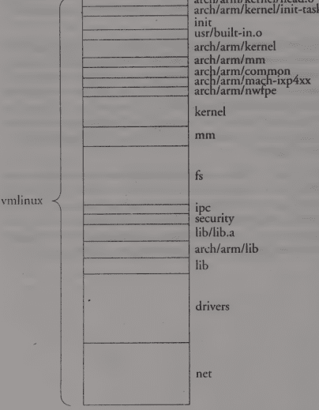

**图 4-1**

`vmlinux` 映像组件

最大的三个二进制组件分别是文件系统代码、网络代码和所有内置驱动程序，这可能并不令人惊讶。如果你将内核代码和架构特定的内核代码结合在一起，这是第二大二进制组件。在这里，你可以找到调度器、进程和线程管理、计时器管理以及其他核心内核功能。当然，内核包含一些架构特定的功能，如底层上下文切换、硬件级中断和计时器处理、处理器异常处理等。这在 `.../arch/arm/kernel` 中可以找到。

请记住，我们看的是内核构建的一个具体示例。在这个特定示例中，我们构建的是一个特定于 ARM XScale 架构的内核，更具体地说，是 ADI Engineering 参考板上的 Intel IXP425 网络处理器。你可以在图 4-1 中看到机器特定的二进制组件为 `arch/arm/mach-ixp4xx`。每种架构和机器类型（处理器/参考板）在内核的架构特定部分都有不同的元素，因此 `vmlinux` 映像的构成略有不同。当你理解了一个示例后，你会发现很容易导航其他示例。

为了帮助你理解内核源码树中功能的划分，表 4-1 列出了图 4-1 中的每个组件，以及每个构成 `vmlinux` 映像的二进制元素的简短描述。

#### 表 4-1

`vmlinux` 映像组件描述

| 组件 | 描述 |
| :--- | :--- |
| `arch/arm/kernel/head.o` | 内核架构特定的启动代码。 |
| `init_task.o` | 内核所需的初始线程和任务结构。 |
| `init/built-in.o` | 主要的内核初始化代码。见第 5 章。 |
| `usr/built-in.o` | 内置的 initramfs 映像。见第 5 章。 |
| `arch/arm/kernel/built-in.o` | 架构特定的内核代码。 |
| `arch/arm/mm/built-in.o` | 架构特定的内存管理代码。 |
| `arch/arm/common/built-in.o` | 架构特定的通用代码。因架构而异。 |
| `arch/arm/mach-ixp4xx/built-in.o` | 机器特定的代码，通常是初始化。 |
| `arch/arm/nwfpe/built-in.o` | 架构特定的浮点模拟代码。 |
| `kernel/built-in.o` | 内核本身的通用组件。 |
| `mm/built-in.o` | 内存管理代码的通用组件。 |
| `ipc/built-in.o` | 进程间通信，如 SysV IPC。 |
| `security/built-in.o` | Linux 安全组件。 |
| `lib/lib.a` | 杂项辅助函数的归档。 |
| `arch/arm/lib/lib.a` | 架构特定的通用设施。因架构而异。 |
| `lib/built-in.o` | 内核通用辅助函数。 |
| `drivers/built-in.o` | 所有内置驱动程序——而非可加载模块。 |
| `sound/built-in.o` | 声音驱动程序。 |
| `net/built-in.o` | Linux 网络。 |
| `.tmp_kallsyms2.o` | 符号表。 |

当我们谈论内核本体时，指的就是这个 `vmlinux` 映像。如前所述，很少有平台直接引导此映像。首先，它几乎总是被压缩的。至少，引导加载器必须解压缩该映像。许多平台要求在该映像上附加某种存根（stub）来执行解压缩。在第 5 章的后面部分，你将了解该映像如何为不同的架构、机器类型和引导加载器进行打包，以及引导它的要求。

### 4.2.5 子目录布局

既然你已经了解了构建系统如何控制内核映像，让我们来看看一个具有代表性的内核子目录。列表 4-4 详细展示了 `mach-ixp425` 子目录的内容。该目录位于源代码树的 `…/arch/arm` 架构特定分支下。

#### 列表 4-4

#### 内核子目录

```text
$ ls -l linux-2.6/arch/arm/mach-ixp425
total 92
-rw-rw---- 1 chris chris 11892 Oct 10 14:53 built-in.o
-rw-rw-r-- 1 chris chris 6924 Sep 29 15:39 common.c
-rw-rw-r-- 1 chris chris 3525 Oct 10 14:53 common.o
-rw-rw-r-- 1 chris chris 13062 Sep 29 15:39 common-pci.c
-rw-rw-r-- 1 chris chris 7504 Oct 10 14:53 common-pci.o
-rw-rw-r-- 1 chris chris 1728 Sep 29 15:39 coyote-pci.c
-rw-rw-r-- 1 chris chris 1572 Sep 29 15:39 coyote-pci.o
-rw-rw-r-- 1 chris chris 2118 Oct 10 14:53 coyote-setup.c
-rw-rw-r-- 1 chris chris 2180 Oct 10 14:53 coyote-setup.o
-rw-rw-r-- 1 chris chris 2042 Sep 29 15:39 ixp425-pci.c
-rw-rw-r-- 1 chris chris 3656 Sep 29 15:39 ixp425-setup.c
-rw-rw-r-- 1 chris chris 2761 Sep 29 15:39 Kconfig
-rw-rw-r-- 1 chris chris 259 Sep 29 15:39 Makefile
-rw-rw-r-- 1 chris chris 3102 Sep 29 15:39 prpcm1100-pci.c
```

列表 4-4 中目录的内容包含了许多内核源代码子目录中常见的组件：`Makefile` 和 `Kconfig`。这两个文件驱动了内核的配置和构建过程。让我们来看看它是如何运作的。

## 4.3 内核构建系统


Linux 内核的配置和构建系统相当复杂，对于一个包含超过六百万行代码的软件项目来说，这是意料之中的。在本节中，我们将为需要定制构建环境的开发人员讲解内核构建系统的基础知识。

最近的 Linux 内核快照显示内核源代码树中有 800 多个 `Makefile`^5。这个数字听起来可能很大，但当你理解构建系统的结构和操作方式后，可能就不会觉得它那么大了。自 Linux 2.4 及更早版本的时代以来，Linux 内核构建系统已经得到了重大更新。对于那些熟悉旧版内核构建系统的读者，我们确信你会认为新的 Kbuild 系统是一个巨大的改进。我们在本节中将讨论限制在基于 Kbuild 的此版本及后续版本的内核上。

> ^5 并非所有这些 `Makefile` 都直接参与内核的构建。例如，有些用于构建文档文件。

### 4.3.1 dot-config（点配置文件）

如前所述，`dot-config` 文件是构建 Linux 内核映像的配置蓝图。在 Linux 项目的初期，你可能需要花费大量精力来构建一个适合嵌入式平台的配置。有许多编辑器，包括基于文本和图形的编辑器，都是专门用于编辑内核配置的。此配置过程的输出会被写入名为 `.config` 的配置文件，该文件位于顶层 Linux 源代码目录中，并驱动内核构建。

你可能已经投入了大量时间来完善你的内核配置，因此你会想要保护它。有几个 `make` 命令会在没有任何警告的情况下删除此配置文件。最常见的是 `make mrproper`。这个 `make` 目标旨在将内核源代码树恢复到原始、未配置的状态。这包括从源代码树中移除所有配置数据——是的，它会删除你的 `.config` 文件。

正如你可能知道的那样，在 Linux 中，以点开头的任何文件名都是隐藏文件。令人遗憾的是，如此重要的文件被标记为隐藏；这已经让不止一位开发者感到痛苦。如果你在备份 `.config` 文件之前执行了 `make mrproper`，你也会体会到同样的痛苦。（已经被警告过——请备份你的 `.config` 文件！）

`.config` 文件是定义集合，具有简单的格式。列表 4-5 展示了最近一次 Linux 内核版本中 `.config` 文件的一个片段。

#### 列表 4-5

**Linux 2.6 .config 的片段**

```text
#### USB support
#
CONFIG_USB=m
#### CONFIG_USB_DEBUG is not set

#### Miscellaneous USB options
#
CONFIG_USB_DEVICEFS=y
#### CONFIG_USB_BANDWIDTH is not set
#### CONFIG_USB_DYNAMIC_MINORS is not set

#### USB Host Controller Drivers
#
CONFIG_USB_EHCI_HCD=m
#### CONFIG_USB_EHCI_SPLT_ISO is not set
#### CONFIG_USB_EHCI_ROOT_HUB_TT is not set
CONFIG_USB_OHCI_HCD=m
CONFIG_USB_UHCI_HCD=m
```

要理解 `.config` 文件，你需要了解 Linux 内核的一个基本方面。Linux 具有整体式结构。也就是说，整个内核被编译和链接为一个单一静态链接的可执行文件。然而，将一组源代码编译并增量链接^6为适合动态插入到运行中内核的单个对象模块是可能的。这是支持大多数常见设备驱动器的常用方法。在 Linux 中，这些被称为可加载模块（loadable modules）。它们也通称为设备驱动器。在内核启动后，会调用一个特殊的应用程序来将可加载模块插入到运行中的内核中。

> ^6 增量链接是一种用于生成旨在再次链接到另一个对象中的对象模块的技术。通过这种方式，增量链接后未解析的符号不会产生错误——它们将在下一个链接阶段得到解析。

有了这些知识，让我们再来看看列表 4-5。这个配置文件（`.config`）的片段展示了 USB 子系统配置的一部分。第一个配置选项 `CONFIG_USB=m` 声明 USB 子系统将包含在此内核配置中，并且它将被编译为动态可加载模块（`=m`），以便在内核启动后的某个时候加载。另一个选择是 `=y`，在这种情况下，USB 模块将被编译并静态链接，作为内核映像本身的一部分。最终，它将出现在你在列表 4-3 和图 4-1 中看到的 `.../drivers/built-in.o` 复合二进制文件中。敏锐的读者会意识到，如果驱动器被配置为可加载模块，其代码并不包含在内核主体中，而是作为一个独立的对象模块、一个可加载模块，在内核启动后插入到运行中的内核中。

请注意列表 4-5 中的 `CONFIG_USB_DEVICEFS=m` 声明。此配置选项的行为略有不同。在这种情况下，`USB_DEVICEFS`（作为配置选项的常见缩写）不是一个独立的模块，而是 USB 驱动器中需要启用或禁用的功能。它不一定导致编译进内核主体的模块（`=y`）；相反，它启用一个或多个功能，通常表示为包含在整体 USB 设备驱动器模块中的额外对象模块。通常，配置编辑器中的帮助文本，或配置编辑器呈现的层级结构，会使这种区别变得清晰。

### 4.3.2 配置编辑器

早期的内核使用一个简单的命令行驱动脚本来配置内核。即使对于配置参数数量少得多的早期内核来说，这也相当繁琐。这种命令行界面风格仍然受到支持，但使用它至少可以说是乏味的。来自最近内核的典型配置需要从命令行回答 600 多个问题，对脚本的每个查询输入你的选择并按下 Enter 键。此外，如果你犯了错误，没有回退的方法；你必须从头开始再次进行。如果你在第 599 个条目上犯了错误，那可能会令人深感沮丧！

在某些情况下，例如在没有图形的嵌入式系统上构建内核，使用命令行配置工具是不可避免的，但这位作者会不遗余力地寻找绕过它的方法。

内核配置子系统使用几个图形前端。事实上，最近的 Linux 内核版本包含 10 个这样的配置目标。以下从 `make help` 的输出中直接摘录的文字对这些目标进行了总结：

- `config`——使用基于行的程序更新当前配置

- `menuconfig`——使用基于菜单的程序更新当前配置

- `xconfig`——使用基于 QT 的前端更新当前配置

- `gconfig`——使用基于 GTK 的前端更新当前配置

- `oldconfig`—使用提供的 `.config` 作为基础来更新当前配置

- `randconfig`—生成一个新配置，对所有选项随机给出答案

- `defconfig`—生成一个新配置，对所有选项采用默认答案

- `allmodconfig`—生成一个新配置，尽可能地将所有选项设置为模块

- `allyesconfig`—生成一个新配置，接受所有选项（均为 yes）

- `allnoconfig`—生成一个最小化的新配置

上述前四个 makefile 配置目标都会调用某种形式的配置编辑器，正如列表中所描述的那样。由于篇幅限制，本章及其他章节的讨论将仅聚焦于基于 GTK 的图形前端。请注意，你可以使用任意你喜欢的配置编辑器，并得到相同的结果。

通过在内核顶层目录下输入命令 `make gconfig` 来启动配置编辑器。图 4-2 展示了当运行 `gconfig` 时向开发人员呈现的顶层配置菜单。从这里开始，可以访问每一个可用的配置参数，以生成自定义的内核配置。

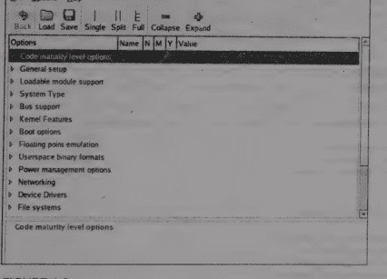

#### 图 4-2

顶层内核配置

如前所述，你可以使用任意你喜欢的配置编辑器，例如 `make xconfig` 或 `make menuconfig`。

当退出配置编辑器时，系统会提示你是否保存更改。如果你选择保存更改，全局配置文件 `.config` 将被更新（如果该文件尚不存在，则会被创建）。这个 `.config` 文件（前文已介绍）通过顶层 makefile 驱动内核构建。你会注意到，在这个 makefile 中，`.config` 文件是通过 `#include` 语句直接读取的。

大多数内核软件模块也通过 `.config` 文件间接读取配置，方法如下。在构建过程中，`.config` 文件会被处理成一个位于 `../include/linux` 目录下的 C 头文件，名为 `autoconf.h`。这是一个自动生成的文件，绝不应直接编辑，因为每次运行配置编辑器时所做的编辑都会丢失。许多内核源文件使用 `#include` 预处理器指令直接包含此文件。列表 4-6 复现了该头文件中与上文 USB 示例相对应的部分。请注意，对于列表 4-5 中 `.config` 文件片段中的每一项，都会在 `autoconf.h` 中创建一个对应的条目。这就是内核源码树中的源文件引用内核配置的方式。

#### 列表 4-6


```c
/* Linux autoconf.h */
/*
 * USB support
 */
#define CONFIG_USB_MODULE 1
#undef CONFIG_USB_DEBUG

/*
 * Miscellaneous USB options
 */
#define CONFIG_USB_DEVICEFS 1
#undef CONFIG_USB_BANDWIDTH
#undef CONFIG_USB_DYNAMIC_MINORS

/*
 * USB Host Controller Drivers
 */
#define CONFIG_USB_EHCI_HCD_MODULE 1
#undef CONFIG_USB_EHCI_SPLIT_ISO
#undef CONFIG_USB_EHCI_ROOT_HUB_TT
#define CONFIG_USB_OHCI_HCD_MODULE 1
#define CONFIG_USB_UHCI_HCD_MODULE 1
```

如果你还没有这样做过，请在你的内核源码顶层目录中执行 `make gconfig`，并在这个配置工具中四处看看，以了解 Linux 开发人员可用的众多子章节和配置选项。只要你不显式保存更改，这些更改在退出配置编辑器时就会丢失。许多配置参数包含有用的说明文本，这有助于你理解不同的配置选项。

### 4.3.3 Makefile 目标

如果你在顶层 Linux 源码目录下输入 `make help`，你会看到一个可以从源码树生成的目标列表。`make` 最常见的用法是不指定任何目标。这将生成内核 ELF 文件 `vmlinux` 以及你所选架构的默认二进制映像（例如，x86 的 `bzImage`）。不指定目标运行 `make` 还会构建配置中指定的所有设备驱动程序模块（内核可加载模块）。

许多架构和机器类型需要特定的针对架构和所用引导加载程序的二进制目标。其中一个更常见的架构特定目标是 `zImage`。在许多架构中，这是可以在目标嵌入式系统上加载和运行的默认目标映像。新手常犯的一个错误是指定 `bzImage` 作为 `make` 目标。`bzImage` 目标特定于 x86/PC 架构。与流行误解相反，`bzImage` 并不是一个经 bzip2 压缩的映像。它是一个大的 `zImage`。无需深入探讨传统 PC 架构的细节，只需知道 `bzImage` 仅适用于具有行业标准 PC 风格 BIOS 的 PC 兼容机器即可。

#### 列表 4-7

#### Makefile 目标


# make ARCH=arm help

```bash
$ make ARCH=arm help
Cleaning targets:
 clean - remove most generated files but keep the config
 mrproper - remove all generated files + config + various backup files

Configuration targets:
 config - Update current config utilising a line-oriented program
 menuconfig - Update current config utilising a menu based program
 xconfig - Update current config utilising a QT based front-end
 gconfig - Update current config utilising a GTK based front-end
 oldconfig - Update current config utilising a provided .config as base
 randconfig - New config with random answer to all options
 defconfig - New config with default answer to all options
 allmodconfig - New config selecting all modules when possible
 allyesconfig - New config where all options are accepted with yes
 allnoconfig - New minimal config

Other generic targets:
 all - Build all targets marked with [*]
 * vmlinux - Build the bare kernel
 modules - Build all modules
 modules_install - Install all modules
 dir/ - Build all files in dir and below
 dir/file.[o]s - Build specified target only
 -dir/file.ko - Build module including final link
 rpm - Build a kernel as an RPM package
 tags/TAGS - Generate tags file for editors
 cscope - Generate cscope index
 kernelrelease - Output the release version string

Static analysers
 buildcheck - List dangling references to vmlinux discarded sections and init sections from non-init sections
 checkstack - Generate a list of stack hops
 namespacecheck - Namespace analysis on compiled kernel

Kernel packaging:
 rpm-pkg - Build the kernel as an RPM package
 binrpm-pkg - Build an rpm package containing the compiled kernel and modules

- deb-pkg - Build the kernel as a deb package
- tar-pkg - Build the kernel as an uncompressed tarball
- targz-pkg - Build the kernel as a gzip compressed tarball
- tarbz2-pkg - Build the kernel as a bzip2 compressed tarball

Documentation targets:

- man - Linux kernel internal documentation in different formats:
  - xmldocs (XML DoCbook), pedocs (Postscript/PDF), pdfdocs (PDF)
  - htmldocs (HTM), man docs (pages, use installmandocs to install)

Architecture specific targets (arm):

- zImage - Compressed kernel image (arch/arm/boot/zImage)
- Image - Uncompressed kernel image (arch/arm/boot/Image)
- xipImage - XIP kernel image, if configured (arch/arm/boot/xipImage)
- bootpImage - Combined zImage and initial RAM disk

- install - Install initrd image via make variable INITRD=<path>
- zinstall - Install uncompressed kernel
- install - Install compressed kernel
  - Install using (your) ~/bin/installkernel or
  - (distribution) /sbin/installkernel or
  - Install to $(INSTALL_PATH) and run lilo

- assabet_defconfig - Build for assabet
- badge4_defconfig - Build for badge4
- bast_defconfig - Build for bast
- cerfcube_defconfig - Build for cerfcube
- clips7500_defconfig - Build for clips7500
- colli_defconfig - Build for colli
- corgi_defconfig - Build for corgi
- ebsa110_defconfig - Build for ebsa110
- edb7211_defconfig - Build for edb7211
- emx2611_defconfig - Build for emx2611
- ep80219_defconfig - Build for ep80219
- epax10d_h_defconfig - Build for epax10dH
- foodbridge_defconfig - Build for foodbridge
- fortunet_defconfig - Build for fortunet
- h3600_defconfig - Build for h3600
- h7201_defconfig - Build for h7201
- h7202_defconfig - Build for h7202
- hackkit_defconfig - Build for hackkit
- integrator_defconfig - Build for integrator
- igi1244_defconfig - Build for igi1244
- iq80321_defconfig - Build for iq80321
- iq80331_defconfig - Build for iq80331
- iq80332_defconfig - Build for iq80332
- ixdp2400_defconfig - Build for ixdp2400
- ixdp2401_defconfig - Build for ixdp2401
- ixdp2800_defconfig - Build for ixdp2800
- ixdp2801_defconfig - Build for ixdp2801
- ixp4xx_defconfig - Build for ixp4xx
- Jornada720_defconfig - Build for jornada720
- lart_defconfig - Build for lart
- lpd7a400_defconfig - Build for lpd7a400
- lpd7a404_defconfig - Build for lpd7a404
- lubbock_defconfig - Build for lubbock
```


## 4.3 内核构建系统

`1us17200_defconfig` - 为 1us17200 构建

`mainstone_defconfig` - 为 mainstone 构建

`mx3ads_defconfig` - 为 mx3ads 构建

`neponset_defconfig` - 为 neponset 构建

`netxwander_defconfig` - 为 netxwander 构建

`omap_h2_1610_defconfig` - 为 omap_h2_1610 构建

`pleb_defconfig` - 为 pleb 构建

`poodle_defconfig` - 为 poodle 构建

`pxa255-idp_defconfig` - 为 pxa255-idp 构建

`rpc_defconfig` - 为 rpc 构建

`s3c2410_defconfig` - 为 s3c2410 构建

`shannon_defconfig` - 为 shannon 构建

`shark_defconfig` - 为 shark 构建

`simpad_defconfig` - 为 simpad 构建

`smdk2410_defconfig` - 为 smdk2410 构建

`spitz_defconfig` - 为 spitz 构建

`versatile_defconfig` - 为 versatile 构建

```
make V=0|1 [targets] 0 => 安静构建 (默认), 1 => 详细构建
make O=dir [targets] 将所有输出文件定位到 "dir"，包括 .config
make C=1 [targets] 使用 $CHECK (sparse) 检查所有 c 源代码
make C=2 [targets] 强制使用 $CHECK (sparse) 检查所有 c 源代码
```

执行 `make` 或 `make all` 来构建所有标记为 [*] 的目标。

有关更多信息，请参阅 `../README` 文件。

你其中很多目标可能永远不会用到。然而，知道它们的存在是有用的。正如你在列表 4-7 中看到的，带有星号的目标是默认构建的。注意作为 `*.defconfig` 列出的众多默认配置。回顾第 4.2.2 节“编译内核”，我们用于预配置一个原始内核源树的命令：我们调用 `make` 并指定一个架构和一个默认配置。该默认配置是 `*_defconfig`，它出现在这个 ARM 目标列表中。这是发现特定内核版本和架构的所有可用默认配置的好方法。

### 4.3.4 内核配置

`Kconfig`（或具有相似根名并带有扩展名的文件，如 `Kconfig.ext`）存在于近 300 个内核子目录中。`Kconfig` 驱动其子目录内所含功能的配置过程。`Kconfig` 的内容由配置子系统解析，该子系统向用户呈现配置选项，并包含与特定配置参数相关的帮助文本。

配置实用工具（如前面介绍的 `gconfig`）从 `arch` 子目录的 `Kconfig` 文件开始读取 `Kconfig` 文件。它由 `Kconfig` 中的 `makefile` 调用，其中包含一个看起来像这样的 `r` 条目：

```
gconfig: $(OBJ)/gconf
\t\$ arch/$(ARCH)/Kconfig
```

根据你正在构建的架构，`gconfig` 将此特定于架构的 `Kconfig` 读取为顶层配置定义。`Kconfig` 中包含许多看起来像这样的行：

```
source 'drivers/pci/Kconfig'
```

此指令告诉配置编辑器实用程序从内核源树中的其他位置读取另一个 `Kconfig` 文件。每个架构包含许多这样的 `Kconfig` 文件；合在一起，它们决定了在内核配置时向用户呈现的完整菜单选项集。每个 `Kconfig` 文件都可以自由地在源树的不同部分引入额外的 `Kconfig` 文件。配置实用程序——在这种情况下是 `gconfig`——递归地读取 `Kconfig` 文件链并构建配置菜单结构。

列表 4-8 是与 ARM 架构相关的 `Kconfig` 文件的部分树视图。在本示例所基于的较新的 Linux 2.6 源树中，内核配置由 170 个独立的 `Kconfig` 文件定义。为了节省空间和保持清晰，此列表省略了其中大部分——其目的是展示整体结构。在此树视图中列出所有文件将占用本文的几页篇幅。

#### 列表 4-8

ARM 架构 Kconfig 的部分列表

```
arch/arm/Kconfig <<<<<< (顶层 Kconfig)
|-- init/Kconfig
|-- ... 
|-- arch/arm/mach-iop3xx/Kconfig
|-- arch/arm/mach-ipx/dxx/Kconfig
|-- net/Kconfig
|   `--> net/ipv4/Kconfig
|       `--> net/ipv4/ipv5/Kconfig
|-- ... 
--> drivers/char/Kconfig
|-- drivers/serial/Kconfig
|-- ... 
--> drivers/usb/Kconfig
|   `--> drivers/usb/core/Kconfig
|   `--> drivers/usb/host/Kconfig
|-- ...
--> lib/Kconfig
```

查看列表 4-8，文件 `arch/arm/Kconfig` 将包含类似如下的行：

```
source "net/Kconfig"
```

文件 `net/net/Kconfig` 将包含类似如下的行：

```
source "net/ipv4/Kconfig"
```

……等等。

如前所述，这些 `Kconfig` 文件共同决定了在内核配置期间向用户呈现的配置菜单结构和配置选项。图 4-3 是从列表 4-8 中的示例编译的 ARM 架构配置实用工具 (`gconfig`) 的一个示例。

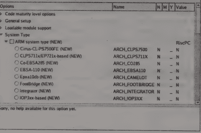

#### 图 4-3

`gconfig` 配置界面

### 4.3.5 自定义配置选项

许多嵌入式开发人员向 Linux 内核添加功能支持，以支持他们特定的定制硬件。这方面的一个最常见示例是给定硬件平台的多个版本，每个版本都需要在内核源树中配置某些编译时选项。开发人员不必为每个硬件版本维护单独的内核源树版本，而是可以添加配置选项来启用其自定义功能。

前面段落中描述的配置管理架构使得定制和添加功能变得容易。快速查看典型的 `Kconfig` 文件可以看到配置脚本语言的结构。作为一个例子，假设你有两个基于 IXP425 网络处理器的硬件平台，你的工程团队将它们命名为 Vega 和 Constellation。每块板都有专门的硬件，必须在内核启动阶段早期进行初始化。让我们看看向内核配置过程中向开发人员呈现的选项集中添加这些配置选项是多么简单。列表 4-9 是顶层 ARM `Kconfig` 文件的一个片段。

#### 列表 4-9

```
Snippet from .../arch/arm/Kconfig
source “init/Kconfig”

menu “System Type”

choice
	prompt “ARM system type”
	default ARCH_RPC

config ARCH_CLPS7500
	bool “Cirrus-CL-PS7500F00”

config ARCH_CLPS711X
	bool “CLPS711x/EP721x-based”

...

source “arch/arm/mach-ixp4xx/Kconfig”
```

在这个取自顶层 ARM 架构 `Kconfig` 的 `Kconfig` 片段中，你看到定义了菜单项 系统类型。在 ARM 系统类型 提示之后，你看到一个与 ARM 架构相关的选项列表。在文件的后面部分，你看到引入了 IXP4xx 特定的 `Kconfig` 定义。在此文件中，你可以添加你的自定义配置开关。列表 4-10 重现了这个文件的一个片段。同样，为了可读性和方便起见，我们省略了不相关的文本，以省略号表示。

#### 列表 4-10

文件片段：`arch/arm/mach-ixp4xx/Kconfig`


```
menu "Intel IXP4xx Implementation Options"

comment "IXP4xx Platforms"

config ARCH_AVILA
        bool "Avila"
        help
          Say 'Y' here if you want your kernel to support...

config ARCH_ADI_COYOTE
        bool "Coyote"
        help
          Say 'Y' here if you want your kernel to support
          the ADI Engineering Coyote...

#### (These are our new custom options)
config ARCH_VEGA
        bool "Vega"
        help
          Select this option for "Vega" hardware support

config ARCH_CONSTELLATION
        bool "Constellation"
        help
          Select this option for "Constellation"
          hardware support
...
```

图 4-4 展示了这些更改的结果，当运行 `gconfig` 实用工具（通过 `make ARCH=arm gconfig`）时出现。由于这些简单的更改，配置编辑器现在包含了我们两个新硬件平台的选项。^9^ 很快，你将看到如何使用源树中的此配置信息来有条件地选择包含对新板支持的对象。

^9^ 我们故意删除了 ARM 系统类型和 Intel IXP4xx 实现选项下的许多选项，以便图片能容纳在页面上。

#### 图 4-4

自定义配置选项

当运行配置编辑器（在这些示例中为 `geconf`）并选择支持其中一个自定义硬件平台后，前面介绍的 `.config` 文件将包含用于新选项的宏。与所有内核配置选项一样，每个选项前都有 `CONFIG_` 前缀，以标识其作为内核配置选项的身份。因此，定义了两个新的配置选项，并且它们的状态已记录在 `.config` 文件中。列表 4-11 展示了包含新配置选项的新 `.config` 文件。

#### 列表 4-11

自定义 `.config` 文件片段

```
...
#### IXP4xx Platforms
#
#### CONFIG_ARCH_AVILA is not set
CONFIG_ARCH_ADL_CCOYTE is not set
CONFIG_ARCH_VEGA=y
#### CONFIG_ARCH_CONSTELLATION is not set
#### CONFIG_ARCH_IXDP425 is not set
#### CONFIG_ARCH_PRMC1100 is not set
...
```

请注意，有两个与 Vega 和 Constellation 硬件平台相关的新配置选项。如图 4-4 所示，你选择了支持 Vega；在 `.config` 文件中，你可以看到代表选中 Vega 板并将其值设为 'y' 的新 `CONFIG_option`。还要注意，与 Constellation 相关的 `CONFIG_option` 存在但未选中。

### 4.3.6 内核 Makefiles

在构建内核时，Makefiles 会扫描配置并决定针对给定的配置进入哪些子目录以及编译哪些源文件。为了完成为两个自定义硬件平台 Vega 和 Constellation 添加支持的示例，让我们查看读取此配置并根据自定义内容采取相应操作的 makefile。

由于本示例涉及特定于硬件的选项，假设这些自定义内容由两个名为 `vega_setup.c` 和 `constellation_setup.c` 的硬件设置模块表示。我们将这些 C 源文件放在了内核源代码树的 `.../arch/arm/mach-ixp4xx` 子目录中。列表 4-12 包含来自近期 Linux 版本中该目录的完整 makefile。

#### 列表 4-12

来自 `.../arch/arm/mach-ixp4xx` 内核子目录的 Makefile

```
#### Makefile for the linux kernel.
#
obj-y  += common.o common-pci.o
obj-$$(CONFIG_ARCH_IXDP4XX)  += ixdp425-pci.o ixdp425-setup.o
obj-$$(CONFIG_MACH_IXDPG425)  += ixp4g425-pci.o coyote-setup.o
obj-$$(CONFIG_MACH_ADL_COYOTE)  += coyote-pci.o coyote-setup.o
obj-$$(CONFIG_MACH_GTWX5715)  += gtwx5715-pci.o gtwx5715-setup.o
```

你可能会惊讶于这个 makefile 的简单性。内核构建系统的开发投入了大量工作，原因正是如此。对于仅需为自定义硬件添加支持的普通开发人员来说，内核构建系统的设计使这类自定义变得非常直接。10

> 10 实际上，内核构建系统非常复杂，但大多数复杂性都巧妙地对普通开发人员隐藏了起来。因此，添加、修改或删除配置相对容易，无需成为专家。

查看这个 makefile，基于配置选项有条件地引入新的硬件设置例程需要做什么可能显而易见。只需在 makefile 底部添加以下两行即可：

```
obj-$(CONFIG_ARCH_VEGA)     += vega_setup.o
obj-$(CONFIG_ARCH_CONSTELLATION) += constellation_setup.o
```

这些步骤完成了针对假设示例中自定义硬件的设置模块的简单添加。使用类似的逻辑，你现在应该能够自行对内核配置/构建系统进行修改。

### 4.3.7 内核文档

Linux 源代码树本身就包含大量信息。由于 `.../Documentation` 目录下的 42 个子目录中近有 650 个文档文件，要读完所有内容确实非常困难。阅读这些材料时要谨慎：鉴于内核开发和发布的快速节奏，这些文档很快就会过时。尽管如此，它们通常提供了一个极好的起点，你可以以此为基础深入了解特定的内核子系统或概念。

不要忽视 Linux 文档项目（Linux Documentation Project），其网址为 `www.tldp.org`，那里可以找到特定文档或 man 页面的最新版本。¹¹ 本章末尾的建议阅读列表重复列出了 Linux 文档项目的 URL，以便于参考。与前述讨论特别相关的是内核 `.../Documentation/kbuild` 子目录中的 Kbuild 文档。

不提及 Google 的内核文档讨论是不完整的。很快，*“Google”一词* 将作为动词出现在韦氏词典（Merriam Webster’s）中！很有可能，许多你可能提出的问题之前已经有人提出并回答了。花时间熟练掌握在互联网上搜索问题答案的技巧。你会发现许多邮件列表和其他信息库，其中充满了与你特定项目或问题相关的有用信息。附录 E 包含了一个有用的开源资源列表。

> ¹¹ 始终假设功能的发展速度快于相应的文档，因此将文档视为指南，而非不可辩驳的事实。

## 4.4 获取 Linux 内核

通常，你可以通过三种方式为硬件平台获取嵌入式 Linux 内核：你可以购买合适的商业嵌入式 Linux 发行版；如果你能找到适合你特定架构和处理器的发行版，可以下载免费的嵌入式发行版；或者你可以找到最接近你应用的开源 Linux 内核并自行移植。我们在第 16 章“移植 Linux”中讨论 Linux 移植。

虽然将开源内核移植到你的自定义板上并不一定困难，但它代表了在工程/开发资源上的巨大投入。这种方法让你可以访问免费软件，但正如我们在第 1 章“简介”中讨论的那样，在开发项目中部署 Linux 远非免费。

### 4.4.1 我还需要什么？

本章重点介绍了 Linux 内核本身的布局和构建。你可能已经发现，Linux 只是基于 Linux 的嵌入式系统中很小的一个组成部分。除了 Linux 内核外，开发、测试和启动你的嵌入式 Linux 设备还需要以下组件：

- 移植并配置用于你特定硬件平台的 Bootloader

- 为你选择的架构提供的交叉编译器及相关工具链

- 包含许多包的文件系统——这些包是为你的原生硬件架构/处理器编译的二进制可执行文件和库

- 用于你板上任何自定义设备的设备驱动程序

- 开发环境，包括主机工具和实用程序

- 为你的特定处理器和板启用的 Linux 内核源代码树

这些是嵌入式 Linux 发行版的组成部分。

## 4.5 本章小结

- Linux 内核已有 10 多年历史，已成为许多架构的主流且支持良好的操作系统。

- Linux 开源之家位于 `www.kernel.org`。几乎每个版本的内核都可以在那里找到，追溯至 Linux 1.0。


- 我们留给其他优秀的书籍去描述 Linux 内核的理论和操作。在这里，我们讨论了它是如何构建的，并确定了构成映像的组件。将内核分解为可理解的部分是学习如何在这个大型软件项目中导航的关键。

- 本章涵盖了内核构建系统以及修改构建系统以促进变更的过程。

- 存在多个内核配置编辑器。我们选择了一个并研究了它是如何驱动的，以及如何修改其中的菜单和菜单项。这些概念适用于所有图形前端。

- 内核本身附带了一个包含大量有用内核文档的完整目录结构。这是理解和导航内核及其操作的有用资源。

- 本章以对获取嵌入式 Linux 发行版的可用选项的简要介绍结束。

### 4.5.1 延伸阅读建议

Linux 内核 HOWTO：

www.tldp.org/HOWTO/Kernel-HOWTO

内核 Kbuild 文档：

http://sourceforge.net/projects/kbuild/

Linux 文档项目：

www.tldp.org/

*工具接口标准 (TIS)* 可执行与链接格式 (*ELF*) 规范，版本 1.2

*TIS* 委员会，1995 年 5 月

Linux 内核源码树：

`…/Documentation/kbuild/makefiles.txt`

Linux 内核源码树：

`…/Documentation/kbuild/kconfig-language.txt`

*Linux 内核开发*，第 2 版

Robert Love

Novell 出版社，2005 年

# 第 5 章


## 内核初始化

## 本章内容

- 复合内核镜像：Piggy 及其伙伴 ... 第 100 页
- 控制流的初始化过程 ... 第 109 页
- 内核命令行处理 ... 第 114 页
- 子系统初始化 ... 第 121 页
- init 线程 ... 第 123 页
- 本章小结 ... 第 128 页

当嵌入式 Linux 系统通电时，会启动一系列复杂的事件序列。几秒钟后，Linux 内核开始运行，并根据系统 init 脚本的指定生成了一系列应用程序。这些活动的重要组成部分由系统配置管理，并受嵌入式开发者的控制。

本章考察 Linux 内核初始事件序列。我们将详细查看内核初始化过程中使用的机制和进程。我们将描述 Linux 内核命令行及其在启动时用于定制 Linux 环境的用法。借助这些知识，您将能够定制和控制初始化序列，以满足您特定嵌入式系统的要求。

## 5.1 复合内核镜像：Piggy 及其伙伴

在嵌入式系统上电时，引导加载程序首先获得处理器控制权。在引导加载程序完成一些低级别硬件初始化后，控制权传递给 Linux 内核。这可以是手动的事件序列，以便于开发过程（例如，用户在引导加载程序提示符处输入交互式 load/boot 命令），也可能是典型生产环境中的自动化启动序列。我们专门在第 7 章“引导加载程序”中讨论了这一主题，因此将有关引导加载程序的详细讨论推迟到该章节。

在第 4 章“Linux 内核：不同的视角”中，我们考察了构成 Linux 内核镜像的组件。请记住，为每种架构构建的常见文件之一是名为 `vmlinux` 的 ELF 二进制文件。这个二进制文件就是单体内核本身，也就是我们所说的内核主体。实际上，当我们查看 `vmlinux` 链接阶段的构建时，我们指出了可能查找第一行代码的位置。在大多数架构中，它位于一个名为 `head.S` 或类似名称的汇编语言源文件中。在内核的 PowerPC (`ppc`) 分支中，根据处理器不同，存在多个版本的 `head.S`。例如，AMCC 440 系列处理器由名为 `head_44x.S` 的文件初始化。

某些架构和引导加载程序能够直接引导 `vmlinux` 内核镜像。例如，基于 PowerPC 架构和 U-Boot¹ 引导加载程序的平台通常可以直接引导 `vmLinux` 镜像（稍后您会看到，这是从 ELF 转换为二进制格式之后的结果）。在其他架构和引导加载程序组合中，可能需要额外的功能来设置适当的上下文，并提供加载和引导内核所需的实用工具。

列表 5-1 详述了基于 ADI Engineering Coyote 参考平台（包含 Intel IXP425 网络处理器）的硬件平台²内核构建过程的最后步骤序列。此列表使用内核构建系统的安静输出形式，这是默认设置。如第 4 章所述，这是一种有用的简写符号，允许更多关注构建过程中的错误和警告。

```
$ make ARCH=arm CROSS_COMPILE=xscale_be_ zimage
many build steps omitted for clarity
LD
SYMAPP
OBJCOPY
Kernel:
AS
GZIP
AS
CC
AS
LD
OBJCOPY
Kernel:
Building modules (stage 2):
```

### 列表 5-1 最终内核构建序列：ARM/IXP425 (Coyote)

在列表 5-1 的第三行中，`vmlinux` 镜像（内核主体）被链接。随后，处理了许多额外的目标模块。其中包括 `head.o`、`piggy.o` 和特定于架构的 `head-xscale.o` 等。（标签标识了每一行发生了什么。例如，`AS` 表示调用汇编器，`GZIP` 表示压缩，等等。）一般来说，这些目标模块特定于给定架构（在本例中为 ARM/XScale），并包含在此特定架构上引导内核所需的低级别实用程序例程。表 5-1 详述了列表 5-1 中的组件。

### 表 5-1 ARM/XScale 低级别架构对象

| 组件 | 功能/描述 |
|---|---|
| `vmlinux` | 内核主体，ELF 格式，包含符号、注释、调试信息（如果使用了 `-g` 编译）和架构通用组件。 |
| `System.map` | `vmlinux` 模块的基于文本的内核符号表。 |
| `Image` | 二进制内核模块，剥离了符号、注释和说明。 |
| `head.o` | 特定于 ARM 处理器的 ARM 通用启动代码。引导加载程序将此对象作为控制权的传递目标。 |
| `piggy.gz` | 使用 gzip 压缩的 `Image` 文件。 |
| `piggy.o` | 以汇编语言格式存在的 `piggy.gz` 文件，以便可以与随后的目标 `misc.o` 链接（参见正文）。 |
| `misc.o` | 用于解压缩内核镜像（`piggy.gz`）的例程，在某种程度上架构中也是熟悉的启动消息 “Uncompressing Linux... Done” 的来源。 |
| `head-xscale.o` | 特定于 XScale 处理器家族的处理器初始化。 |
| `big-endian.o` | 一个微小的汇编语言例程，用于将 XScale 处理器切换到大端模式。 |
| `vmlinux` | 复合内核镜像。请注意，这是一个不幸的命名选择，因为它与内核主体的名称重复；两者并不相同。这个二进制镜像是内核主体与此表中的对象链接后的结果。解释参见正文。 |
| `zImage` | 引导加载程序加载的最终复合内核镜像。参见下文。 |

> ¹ 如果内核镜像本身需要额外支持，您将需要修改 U-Boot。参见第 7 章“引导加载程序”。
> ² 术语 piggy 最初用于描述“piggyback”（搭便车）概念。在这种情况下，二进制内核镜像搭载在引导加载程序之上，以生成复合内核镜像。

插图有助于您理解这种结构以及接下来的讨论。图 5-1 显示了图像组件及其在构建过程中向可引导内核镜像的演变。以下各部分将详细描述组件和过程。

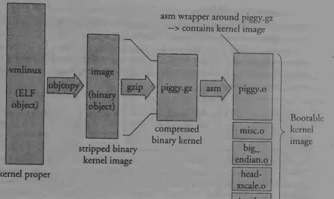

### 图 5-1 复合内核镜像构建

#### 5.1.1 Image 对象

在 `vmlinux` 内核 ELF 文件构建完成后，内核构建系统继续处理表 5-1 中描述的目标。`Image` 对象由 `vmlinux` 对象创建。`Image` 基本上是从 `vmlinux` ELF 文件中剥离冗余部分（注释和说明）以及可能存在的调试符号后的文件。用于此的命令如下：

```
xscale_be-objcopy -O binary -R .note -R .comment -S \
 vmlinux arch/arm/boot/Image
```

在前面的 `objcopy` 命令中，`-O` 选项告诉 `objcopy` 生成二进制文件，`-R` 选项删除名为 `.note` 和 `.comment` 的 ELF 部分，而 `-S` 选项是剥离调试符号的标志。注意 `objcopy` 将 `vmlinux` ELF 镜像作为输入，并生成名为 `Image` 的目标二进制文件。总之，`Image` 只不过是二进制形式、剥离了调试符号以及 `.note` 和 `.comment` ELF 部分的内核主体。

### 5.1.2 架构对象

沿着构建序列继续，会编译出一系列小型模块。其中包括几个汇编语言文件（如 `head.o`、`head-xscale.o` 等），它们执行低级别的架构和处理器特定任务。表 5-1 对每个对象进行了总结。特别值得注意的是创建名为 `piggy.o` 对象的序列。首先，使用该 `gzip` 命令对映像文件（二进制内核映像）进行压缩：


```
gzip -f -9 < vml > piggy.gz
```

这会创建一个名为 `piggy.gz` 的新文件，它仅仅是二进制内核映像的压缩版本。你可以在图 5-1 中直观地看到这一点。接下来的部分相当有趣。名为 `piggy.S` 的汇编语言文件被汇编，其中包含对压缩后的 `piggy.gz` 的引用。本质上，二进制内核映像被搭载（piggybacked）到一个低级别的汇编语言引导加载程序（bootstrap loader）中。[^3] 这个引导加载程序初始化处理器和所需的内存区域，解压缩二进制内核映像，并将其加载到系统内存中的正确位置，然后才将控制权移交给它。列表 5-2 完整复现了 `.../arch/arm/boot/compressed/piggy.S`。

### 列表 5-2

```
汇编文件 piggy.S

.section .piggydata,$alloc
.globl input_data
input_data:
.incbin "arch/arm/boot/compressed/piggy.gz"
.globl input_data_end
input_data_end:
```

这个小型汇编语言文件虽然简单，但产生了一种并不显而易见的复杂性。该文件的目的是让汇编器将压缩后的二进制内核映像作为一个名为 `.piggydata` 的 ELF 节发出。这是由 `.incbin` 汇编器预处理器指令触发的，可以将其视为汇编器版本的 #include 文件。总之，这个汇编语言文件的净结果是包含压缩的二进制内核映像作为程序 ELF 输出的一部分，从而允许程序在运行时加载和解压内核映像。

[^3]: 不要与引导加载器（bootloader）混淆。引导加载程序（bootstrap loader）可以被视为第二级加载器，而引导加载器（bootloader）本身可以被视为第一级加载器。

### 5.1.3 引导加载程序（Bootstrap Loader）

不要与引导加载器（bootloader）混淆，许多架构使用引导加载程序（或第二级加载器）将 Linux 内核映像加载到内存中。一些引导加载程序会对内核映像执行校验和验证，大多数会执行内核映像的解压缩和重定位。在此上下文中，引导加载器（bootloader）和引导加载程序（bootstrap loader）之间的区别很简单：引导加载器（bootloader）在开机时控制主板，并不以任何方式依赖 Linux 内核。相比之下，引导加载程序（bootstrap loader）的主要生命周期目的是作为主板级引导加载器（bootloader）和 Linux 内核之间的胶水。引导加载程序（bootstrap loader）负责为内核提供适当的运行上下文，并执行解压缩和重定位内核二进制映像所需的步骤。这类似于 PC 架构中主加载器和从加载器的概念。

图 5-2 清晰地展示了这一概念。引导加载程序与内核映像拼接在一起进行加载。

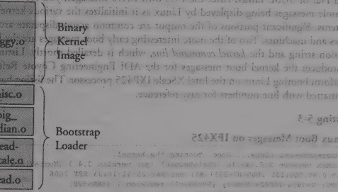

**图 5-2**

ARM XScale 的复合内核映像

在我们正在研究的示例中，引导加载程序由图 5-2 中显示的二进制映像组成。此引导加载程序执行的功能包括：

- 低级汇编处理器初始化，包括支持启用处理器内部指令和数据缓存、禁用中断以及设置 C 运行时环境。这些包括 `head.o` 和 `head-xscale.o`。
- 解压缩和重定位代码，体现在 `misc.o` 中。
- 其他处理器特定的初始化，例如 `big-endian.o`，它为特定处理器启用大端模式。

值得注意的是，前几节中我们检查的细节是特定于 ARM/XScale 内核实现的。每种架构都有不同的细节，但概念是相似的。使用与这里类似的分析方法，你可以了解你自己架构的要求。

### 5.1.4 启动消息

也许你曾见过 PC 工作站启动 Red Hat 或 SUSE Linux 等桌面 Linux 发行版。在 PC 自身的 BIOS 消息之后，你会看到 Linux 在初始化各种内核子系统时显示的一连串控制台消息。输出的很大一部分在不同架构和机器之间是通用的。两个更有趣的早期启动消息是内核版本字符串和内核命令行，稍后将详细说明。列表 5-3 复现了 ADI Engineering Coyote 参考平台在 Intel XScale IXP425 处理器上启动 Linux 的内核启动消息。该列表已加上行号以便参考。

### 列表 5-3

**IXP425 上的 Linux 启动消息**


# 内核启动日志

```
1 Uncompressing Linux... done, booting the kernel.
2 Linux version 2.6.14-c1h (chris@pluto) (gcc version 3.4.3 (MontaVista 3.4.3-L_25.0.30.0501131 2005-07-23)) #11 Sat Mar 25 11:16:33 EST 2006
3 CPU: XScale-IXP425 Family [69054d1c] revision 1 (ARMv5TE)
4 Machine: ADI Engineering Coyote
5 Memory policy: ECC disabled, Data cache writeback
6 CPU0: D VIVT undefined 5 cache
7 CPU0: I cache: 32768 bytes, associativity 32, 32 byte lines, 32 sets
8 CPU0: D cache: 32768 bytes, associativity 32, 32 byte lines, 32 sets
9 Built 1 zonelist(s)
10 Kernel command line: console=ttyS0,115200 ipbootp root=/dev/nfs
11 FBD hash table entries: 512 (order: 9, 8192 bytes)
12 Console: colour dummy device 80x30
13 Denity cache hash table entries: 16384 (order: 4, 65536 bytes)
14 Inode-cache hash table entries: 16384 (order: 3, 32768 bytes)
15 Memory: 64MB = 64MB total
16 Memory: 62592KB available (1272K code, 339K data, 112K init)
17 Mount-cache hash table entries: 512
18 CPU: Testing write buffer coherency: ok
19 smpboot thread 0 started up
20 NBP: Registered protocol family 16
21 PCI: IXP4xx is host
22 PCI: IXP4Xx Using direct access for memory space
23 PCI: bus0: Fast back to back transfers enabled
24 dmacomice: registered device 0000:00:0f.0 on pci bus
25 NetWinder Floating Point Emulator V0.97 (double precision)
26 UPS52 version 2.2. (NAND) (C) 2001-2003 Red Hat, Inc.
27 Serial: 8250/16550 driver $Revision: 1.90 $ 2 ports, IRQ sharing disabled
28 ttyS0 at MMIO 0xc0001000 (irq = 13) is a XScale
29 io scheduler noop registered
30 io scheduler anticipatory registered
31 io scheduler deadline registered
32 io scheduler cfq registered
33 RARiDiS driver initialized: 16 RAM disks of 8192K size 1024 blocksize
34 loop: loaded (max 8 devices)
35 eepro100.c:v1.09-L-9/29/99 Donald Becker
L http://www.scyd.com/network/eeepro100.html
36 eepro100.c: $Revision: 1.36 $ 2000/11/17 Modified by Andrey V. Savochkin
L<saw@saw-sw.com.sg> and others
37 e0: 0000:00:0F.0, 00:0E:OC:0B:02:F8, IRQ 28.
38 Board assembly 741462-016, Physical connectors present: RJ45
39 Primary interface chip i82555 PHY #1.
40 General self-test: passed.
41 Serial subsystem-self-test: passed.
42 Internal registers self-test: passed.
43 ROM checksum self-test: passed (0xB51F404).
44 IXP4Xx-Flash.0: Found x 16 devices at 0x0 in 16-bit bank
45 Intel/Sharp Extend Query Datas Device At 0xc031
46 Using buffer write method
47 cf1_cmcsmbst_0001: Erase suspend on write enabled
48 Searching for RedBoot partition table in IXP4Xx-Flash.0 at offset 0xefe000
49 5 RedBoot partitions found on MTD device IXP4Xx-Flash.0
50 Creating 5 MTD partitions on "IXP4Xx-Flash.0":
51 0xc0000000-0xd0600000: "RedBoot"
52 0xc0010000-0xc0260000: "MyKernel"
53 0xc0030000-0xc0900000: "RootFS"
54 0xc0fc000-0xc0fc1000: "RedBoot confg"
```

55 mtd: 分区 "RedBoot config" 未结束于一个擦除块 -- 强制设为只读

0x000fe0000-0x00100000 : "FIS 目录"

56 NET: 已注册协议族 2

57 IP 路由缓存哈希表项: 1024 (order: 0, 4096 字节)

58 TCP 已建立哈希表项: 4096 (order: 2, 16384 字节)

59 TCP 绑定哈希表项: 4096 (order: 2, 16384 字节)

60 TCP: 哈希表已配置 (已建立 4096 绑定 4096)

61 TCP reno 已注册

62 TCP bic 已注册

63 NET: 已注册协议族 1

64 正在发送 BOOTP 请求 . 成功

65 IP-Config: 从 192.168.1.10 获取 BOOTP 响应, 我的地址是 192.168.1.141

66 IP-Config: 完成:

67 device=`eth0`, addr=192.168.1.141, mask=255.255.255.0, gw=255.255.255.25

68 5.255,

 host=192.168.1.141, domain=, nis-domain=(无),

69 bootserver=192.168.1.10, rootserver=192.168.1.10,

70 rootpath=/home/chris/sandbox/coyote=target

71 正在查询 192.168.1.10 上 RPC 100003/2 的端口

72 正在查询 192.168.1.10 上 RPC 100005/1 的端口

73 VFS: 已挂载根文件系统 (nfs 文件系统)。

74 释放 init 内存: 112K

75 挂载 proc

76 启动系统日志记录器

77 配置 lo

78 *启动 inetd

79 / #

## 启动信息说明

内核在启动过程中会产生大量有用的信息，如列表 5-3 所示。在接下来的几个章节中，我们将详细研究这些输出。第 1 行由本章前面介绍过的引导加载程序生成。该消息由位于 `.../arch/arm/boot/compressed/misc.c` 中的解压加载器生成。

列表 5-3 的第 2 行是内核版本字符串。它是内核自身输出的第一行。内核在进入 `start_kernel()` 时执行的前几行 C 代码之一（位于 `.../init/main.c`）如下：

```
printk(linux_banner);
```

这一行产生了上述输出——即内核版本字符串，也就是列表 5-3 中的第 2 行。该版本字符串包含了一些与内核映像相关的特定数据点：

- 内核版本: `Linux version 2.6.10-cl`


- 编译内核时的用户名/机器名
- 工具链信息: `gcc` version `3.4.3`, 由 MontaVista Software 提供
- 构建编号
- 编译日期和时间

这些信息在开发阶段和后期的生产阶段都非常有用。除了一项之外，其他所有条目都是不言自明的。构建编号只是开发人员添加到版本字符串中的一个工具，用于表明从一次构建到下一次构建，除了日期和时间之外，还有更实质性的东西发生了变化。这是开发人员以一种通用和自动化的方式跟踪构建的方法。你会注意到在这个例子中，这是该系列中的第十一次构建，如列表 5-3 第 2 行中的 `#11` 所示。版本字符串存储在一个顶层 Linux 目录中的隐藏文件中，名为 `.version`。它由位于 `.../scripts/mkversion` 中的构建脚本和顶层 `makefile` 自动递增。简而言之，它是一个每当内核中有任何实质性内容重新构建时就会自动递增的版本字符串。

## 5.2 控制流的初始化流程

现在，既然我们已经了解了复合内核映像的结构和组件，让我们来看看在一个完整的启动周期中，从引导加载程序到内核的控制流。正如我们在第 2 章“你的第一个嵌入式体验”中讨论的那样，引导加载程序是驻留在系统非易失性存储器（Flash 或 ROM）中的低级组件，它在电源接通后立即接管控制权。它通常是一个小型、简单的例程集合，主要设计用于执行低级初始化、启动映像加载和系统诊断。它可能包含用于检查和修改内存内容的内存转储和填充例程。它还可能包含低级板卡自检例程，包括内存和 I/O 测试。最后，引导加载程序包含用于加载并将控制权传递给另一个程序（通常是操作系统，如 Linux）的逻辑。

本章示例所基于的 ARM XScale 平台包含 Redboot 引导加载程序。当首次接通电源时，该引导加载程序被调用，并继续加载操作系统（OS）。当引导加载程序找到并加载 OS 映像（该映像可能驻留在本地 Flash 中、硬盘上，或通过局域网或其他设备）时，控制权被传递给该映像。

在这个特定的 XScale 平台上，引导加载程序将控制权传递给引导加载程序中标签为 `start` 的 `head.o` 模块。这在图 5-3 中有图示。

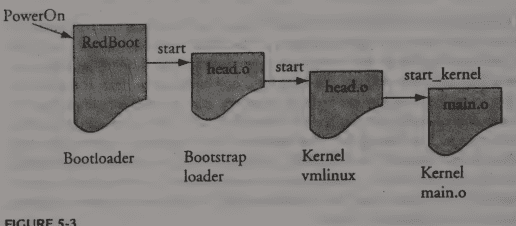

### 图 5-3

ARM 启动控制流

如前所述，前置到内核映像中的引导加载程序有一个主要职责：创建适当的环境来解压和重定位内核，并将控制权传递给它。控制权直接从引导加载程序传递给内核主体，传递给大多数架构中称为 `head.o` 的模块。不幸的是，这是一个历史遗留问题，因为引导加载程序和内核主体都包含一个名为 `head.o` 的模块，这对新的嵌入式 Linux 开发人员来说是一个混淆的来源。引导加载程序中的 `head.o` 模块更适当地被称为 `kernel_bootstrap_loader_head.o`，尽管我怀疑内核开发人员不会接受这个补丁。事实上，最近的 Linux 2.6 源代码树中包含多达 37 个名为 `head.s` 的源文件。这是你需要熟悉内核源代码树的另一个原因。

请参考图 5-3 获取控制流的图形化视图。当引导加载程序完成其任务后，控制权传递给内核主体的 `head.o`，然后从那里传递给 `main.c` 中的 `start_kernel()`。

#### 5.2.1 内核入口点: head.o

内核开发人员的意图是保持架构特定的 `head.o` 模块非常通用，没有任何特定的机器⁴依赖。该模块源自汇编语言文件 `head.S`，位于 `.../arch/<ARCH>/kernel/head.S`，其中 `<ARCH>` 被替换为给定的架构。本章中的示例基于 ARM/XScale，如您所见，其中 `<ARCH>` = `arm`。

`head.o` 模块执行架构和通常 CPU 特定的初始化，为内核主体做准备。CPU 特定的任务在处理器系列中尽可能保持通用。机器特定的初始化在其他地方进行，您很快就会了解到。除了其他低级任务外，`head.o` 执行以下任务：

- 检查有效的处理器和架构
- 创建初始页表项
- 启用处理器的内存管理单元（MMU）
- 建立有限的错误检测和报告
- 跳转到内核主体，`main.c` 的开头

这些功能包含一些隐藏的复杂性。许多嵌入式开发新手尝试单步调试此代码的一部分，结果发现调试程序迷失了方向。尽管汇编语言的复杂性和虚拟内存的硬件细节超出了本书的范围，但关于这个复杂模块有几点值得注意。

当控制权首次从引导加载程序传递给内核的 `head.o` 时，处理器在 x86 术语中处于我们以前称为实模式的状态。实际上，处理器*程序计数器*⁵（或其他任何寄存器）中包含的逻辑地址是驱动到处理器电气内存地址引脚上的实际物理地址。不久之后，当处理器的寄存器和内核数据结构被初始化为启用内存转换时，处理器的内存管理单元（MMU）被打开。突然，处理器看到的地址空间被从下方拉出，并被内核开发人员确定的任意虚拟寻址方案所取代。这创造了一种复杂性，只有通过详细分析汇编语言结构和逻辑流，以及对 CPU 及其硬件地址转换机制的详细知识的详细分析才能真正理解。简而言之，物理地址在 MMU 启用的那一刻被逻辑地址所取代。这就是为什么调试器不能像普通代码那样单步通过此部分代码的原因。

第二个值得注意的点是内核启动过程早期阶段的有限可用映射。许多开发人员在尝试为其特定平台修改 `head.s` 时陷入了这个限制。⁶ 其中一个场景可能是这样的。假设你有一个硬件设备，需要在启动周期的非常早期加载固件。一种可能的解决方案是将必要的固件静态编译到内核映像中，然后通过指针引用它来下载到你的设备中。然而，由于此时进行的有限内存映射，你的固件映像很可能存在于启动周期这一早期阶段尚未映射的范围之外。当此代码执行时，由于你试图访问处理器内部未创建有效映射的内存区域，它会生成页错误。更糟糕的是，在这一早期阶段尚未安装页错误处理程序，因此你得到的只是一次无法解释的系统崩溃。在启动周期的这一早期阶段，你基本上可以保证没有任何错误信息来帮助你找出哪里出了问题。

如果可能，明智的做法是推迟任何自定义硬件初始化，直到内核启动之后。通过这种方式，你可以依赖众所周知的设备驱动模型来访问自定义硬件，而不是尝试定制复杂得多的汇编语言启动代码。在这一级别使用了众多未记录的技术。一个常见的例子是绕过可能已记录也可能未记录的硬件勘误（errata）。如果你必须修改早期启动汇编语言代码，将在开发时间、成本和复杂性方面付出更高的代价。硬件和软件工程师应在硬件开发的早期阶段讨论这些事实，因为即使是微小的硬件更改也可能带来软件开发时间的显著节省。

认识到虚拟内存环境中施加在开发人员身上的约束非常重要。许多经验丰富的嵌入式开发人员对这种环境知之甚少，而前面提出的场景只是等待新手开发人员的一个小陷阱示例

⁶ 强烈不建议为你的自定义平台修改 `head.s`。几乎总是有更好的方法。请参阅第 16 章“移植 Linux”，获取更多信息。

架构。几乎所有现代 32 位及更大规模的微处理器都配备了用于实现虚拟内存架构的内存管理硬件。虚拟内存机器的一个最重要的优势在于，它有助于分离开发团队以编写大型复杂应用程序，同时保护其他软件模块以及内核本身免受编程错误的影响。

### 5.2.2 内核启动：main.c

内核自身的 `head.o` 模块执行的最后一项任务是将控制权传递给用 C 语言编写的主内核启动文件。我们将在本章剩余的大部分篇幅中探讨这个重要的文件。

对于每种架构，语法和方法论各不相同，但每种架构的 `head.o` 模块都有一个类似的构造，用于将控制权传递给真正的内核。对于 ARM 架构，它看起来可能简单如下：

```
b start_kernel
```

对于 PowerPC，它看起来类似于这样：

```
lis r4,start_kernel@h
ori r4,r4,start_kernel@l
lis r3,MSR_KERNEL@h
ori r3,r3,MSR_KERNEL@l
mtspr SRR0,r4
mtspr SRR1,r3
rfi
```

在不深入探讨特定汇编语言语法细节的情况下，这两个示例导致的结果是相同的。控制权从内核的第一个对象模块（`head.o`）传递给位于 `.../init/main.c` 中的 C 语言例程 `start_kernel()`。在这里，内核开始过上独立自主的生活。

任何希望深入理解 Linux 内核的人，都应该仔细研究 `main.c` 文件，了解其由哪些组件构成，以及这些组件是如何初始化和/或实例化的。`main.c` 执行 Linux 内核的所有启动工作，从初始化第一个内核线程，一直到挂载根文件系统并执行第一个用户空间 Linux 应用程序。

函数 `start_kernel()` 是 `main.c` 中迄今为止最大的函数。Linux 内核的大部分初始化工作都在此例程中完成。我们在这里的目的是突出那些在嵌入式系统开发背景下将证明有用的特定元素。值得重申的是：如果你想更好地理解 Linux 内核作为一个系统，那么研究 `main.c` 是一种很好的时间投入方式。

在 `.../init/main.c` 的 `start_kernel()` 函数中发生的早期事项之一是调用 `setup_arch()`。该函数接受单个参数，即之前介绍并在下一节详述的*内核命令行*指针。


```
setup_arch($command_line);
```

此语句调用了一个特定的架构设置例程，该例程负责执行每个主要架构中通用的初始化任务。除其他功能外，`setup_arch()` 调用的函数用于识别特定的 CPU，并提供一种机制来调用高级别 CPU 特定的初始化例程。其中一个由 `setup_arch()` 直接调用的函数是 `setup_processor()`，它位于 `.../arch/arm/kernel/setup.c` 中。该函数验证 CPU ID 和修订版，调用 CPU 特定的初始化函数，并在启动时在控制台显示几行信息。

列表 5-3 中第 3 到 8 行的输出示例展示了这一点。在这里，你可以看到直接从处理器核心读取的 CPU 类型、ID 字符串和修订版。随后是处理器缓存类型和大小的详细信息。在这个例子中，IXP425 拥有 32KB 的 I（指令）缓存和 32KB 的 D（数据）缓存，以及内部处理器缓存的其他实现细节。

架构设置例程的最后一些操作之一是执行任何机器相关的初始化。针对这一点的确切机制因架构而异。对于 ARM，你可以在 `.../arch/arm/mach-*` 系列目录中找到机器特定的初始化代码，具体取决于你的机器类型。MIPS 架构也包含针对支持的平台特有的目录。对于 PowerPC，存在一个机器相关的结构体，其中包含指向许多常见设置函数的指针。我们将在第 16 章“移植 Linux”中更详细地探讨这一点。

## 5.3 内核命令行处理

在架构设置之后，`main.c` 执行通用的早期内核初始化，然后显示内核命令行。列表 5-3 的第 10 行在此复制，以便参考。

```
kernel command line: console=ttyS0,115200 ip=bootp root=/dev/nfs
```

在这个简单的示例中，被引导的内核被指示以 115Kbps 的波特率在串行端口设备 `ttyS0`（通常是第一个串行端口）上打开控制台设备。它还被指示从 BOOTP 服务器获取其初始 IP 地址信息，并通过 NFS 协议挂载根文件系统。（我们将在第 12 章“嵌入式开发环境”中稍后介绍 BOOTP，在第 9 章“文件系统”和第 12 章中介绍 NFS。目前，我们将讨论局限于内核命令行机制。）

Linux 通常由引导加载器（或 bootstrap loader）通过一系列参数启动，这些参数现在被称为内核命令行。虽然我们实际上不是通过 shell 的命令提示符来调用内核的，但许多引导加载器可以以一种类似于这个众所周知模型的方式向内核传递参数。在一些其引导加载器不感知 Linux 的平台上，内核命令行可以在编译时定义，并成为内核二进制映像的一部分硬编码。在其他平台上（例如运行 Red Hat Linux 的桌面 PC），用户可以通过配置内核而不必重新编译即可修改命令行。引导加载器（在桌面 PC 情况下为 Grub 或 LILO）从配置文件构建内核命令行，并在引导过程中将其传递给内核。这些命令行参数是引导机制，用于设置特定机器正常引导所需的初始配置。

在整个内核中定义了众多的命令行参数。内核源代码中的 `.../Documentation` 子目录包含一个名为 `kernel-parameters.txt` 的文件，其中列出了按字典顺序排列的内核命令行参数列表。请记住之前关于内核文档的警告：内核的变化速度远快于文档。将此文件作为指南，但不要将其视为权威参考。该文件记录了 400 多个不同的内核命令行参数，但不能被视为全面的列表。要做到全面，你必须直接参考源代码。

内核命令行参数的基本语法相当简单，从列表 5-3 中的示例也可以看出。内核命令行参数可以是单个文本单词、键=值对，或者是键 = 值_1, 值_2, ... 键和多值格式。如何加工处理这些数据取决于信息的消费者。命令行是全局可用的，并根据需要被许多模块处理。如前所述，`main.c` 中的 `setup_arch()` 以内核命令行作为其唯一参数被调用。这是为了向架构和机器特定代码的相关部分传递架构特定的参数和配置指令。

设备驱动程序作者和内核开发人员可以为自己的特定需求添加额外的内核命令行参数。让我们看看其机制。

不幸的是，使用和内核命令行参数处理涉及一些复杂性。第一个是原始机制正在被弃用，转而采用更强大的实现方式。第二个复杂性是，我们需要理解*链接器脚本文件*的复杂性才能完全理解该机制。

#### 5.3.1 `__setup` 宏

作为使用内核命令行参数的示例，考虑控制台设备的指定。我们希望该设备在引导周期的早期被初始化，以便在引导期间为控制台消息提供一个目标。此初始化发生在一个名为 `printk.o` 的内核对象中。该模块的 C 源文件位于 `.../kernel/printk.c`。控制台初始化例程被称为 `console_setup()`，并以其唯一的参数作为内核命令行参数字符串。

挑战在于以模块化和通用的方式将内核命令行上指定的控制台参数通信给需要此数据的设置和设备驱动程序例程。进一步复杂化这个问题的是，通常命令行参数需要在早期，即在需要这些参数的模块之前（或及时）被需要。位于 `main.c` 中的启动代码，即内核命令行主要处理发生的地方，不可能知道数百个内核命令行参数中每一个的目标函数，而不被所有这些参数消费者的知识所污染。需要一种灵活且通用的方式将这些内核命令行参数传递给它们的消费者。

在 Linux 2.4 及更早的内核中，开发人员使用一个简单的宏来生成并非那么简单的代码序列。尽管它正在被弃用，但 `__setup` 宏在内核中仍被广泛使用。接下来我们使用列表 5-3 中的内核命令行来演示 `__setup` 宏的工作原理。

从上一个内核命令行（列表 5-3 的第 10 行）中，这是传递给内核的第一个完整命令行参数：

```
console=ttyS0,115200
```

就本例而言，参数的实际含义并不重要。我们这里的目的是说明该机制，因此如果你不明白参数或其值，请不要担心。

代码清单 5-4 是 `.../kernel/printk.c` 中的一段代码片段。由于该函数主体与讨论内容无关，因此已被省略。代码清单 5-4 中最相关的部分是最后一行，即对 `__setup` 宏的调用。该宏期望两个参数；在这种情况下，它接收一个字符串字面量和一个函数指针。传入 `__setup` 宏的字符串字面量恰好是与控制台相关的内核命令行前八个字符（即：`console=`）并非巧合。

### 代码清单 5-4

**控制台设置代码片段**

```c
/*
 *      Setup a list of consoles.  Called from init/main.c
 */
static int __init console_setup(char *str)
{
        char name[sizeof(console_cmdline[0].name)];
        char *s, *options;
        int idx;

/*
 * Decode str into name, index, options.
 */

        return 1;
}
__setup("console", console_setup);
```

你可以将这个宏视为内核命令行 `console` 参数的注册函数。实际上，它意味着：**当在内核命令行中遇到 `console=` 字符串时，调用由第二个 `__setup` 宏参数表示的函数——在本例中，即 `console_setup()` 函数。** 但这条信息是如何传递给早期设置代码的呢？这些外部代码并不知晓控制台函数。该机制既巧妙又有些复杂，并依赖于链接器构建的列表。

细节隐藏在一系列宏中，这些宏旨在隐藏向部分目标代码添加*段属性*（以及其他属性）的语法繁琐性。其目标是构建一个关联了字符串字面量和函数指针的静态列表。编译器会在最终的 vmlinux ELF 镜像中，将一个单独命名的 ELF 段中输出此列表。理解这项技术至关重要；它在内核的多个地方用于特殊目的处理。

让我们现在考察在 `__setup` 宏情况下是如何实现这一点的。代码清单 5-5 是来自头文件 `../include/linux/init.h` 的一部分代码，它定义了 `__setup` 宏系列。

### 代码清单 5-5

**来自 `init.h` 的 `__setup` 宏定义系列**


```c
#define __setup_param(str, unique_id, fn, early) \
        static char __setup_str_##unique_id[] __initdata = str; \
        static struct obs_kernel_param __setup_##unique_id \
                __attribute_used__ \
                __attribute__((__section__(".init.setup"))) \
                __attribute__((aligned(sizeof(long)))) \
                = { __setup_str_##unique_id, fn, early }

#define __setup_null_param(str, unique_id)                \
        __setup_param(str, unique_id, NULL, 0)

#define __setup(str, fn)                                  \
        __setup_param(str, fn, fn, 0)
```

代码清单 5-5 正是作者定义的语法繁琐性！回顾代码清单 5-4，我们对原始 `__setup` 宏的调用如下所示：

```c
__setup("console=",  console_setup);
```

经过一些简化，以下是宏展开后编译器预处理器生成的结果：

```c
static char __setup_str_console_setup[] __initdata = "console=";
static struct obs_kernel_param __setup_console_setup
        __attribute_((__section__(".init.setup")))
        { __setup_str_console_setup, console_setup, 0};
```

为了使其更具可读性，我们按照 UNIX 行延续字符 `\` 所示，将第二行和第三行拆开了。

我们有意省略了两个编译器属性的描述，因为它们对本文讨论没有提供任何额外洞察。简而言之，`__attribute_used__`（其本身是一个隐藏更多语法繁琐性的宏）告诉编译器即使优化器确定该函数或变量未被使用，也要输出该函数或变量。⁸ `__attribute__((aligned))` 告诉编译器将结构体对齐到特定边界，在本例中为 `sizeof(long)`。

> ⁸ 通常，如果变量被定义为 `static` 且从未在编译单元中被引用，编译器会发出警告。由于这些变量未被显式引用，若无此指令，警告将会被触发。

## 5.3 内核命令行处理

简化后剩下的就是该机制的核心。首先，编译器生成一个名为 `__setup_str_console_setup[]` 的字符数组，初始化为包含字符串 `console=`。其次，编译器生成一个包含三个成员的结构体：一个指向内核命令行字符串（即刚声明的数组）的指针，一个指向设置函数本身的指针，以及一个简单的标志。这里的魔术关键在于附加在该结构体上的段属性。该属性指示编译器将此结构体输出到 ELF 对象模块中的一个特殊段，名为 `.init.setup`。在链接阶段，所有使用 `__setup` 宏定义的结构体都被收集并放置到这个 `.init.setup` 段中，实际上创建了一个这些结构体的数组。代码清单 5-6 是 `.../init/main.c` 中的一部分，展示了如何访问和使用这些数据。

### 代码清单 5-6

**内核命令行处理**

```c
1  extern struct obs_kernel_param __setup_start[], __setup_end[];

2  static int __init obsolete_checksetup(char *line)
3  {
4      struct obs_kernel_param *p;

5      p = __setup_start;
6      do {
7          int n = strlen(p->str);
8         if (!strncmp(line, p->str, n)) {
9             if (p->early) {
10                 /* Already done in parse_early_param
11                  * (Needs exact match on param part) */
12                 if (line[n] == '\0' || line[n] == '=' )
13                     return 1;
14             } else if (!p->setup_func) {
15                 printk(KERN_WARNING "Parameter %s is obsolete, "
16                        "ignored\n", p->str);
17                 return 1;
18             } else if (p->setup_func(line + n))
19                 return 1;
20         }
21         p++;
22     } while (p < __setup_end);
23     return 0;
24 }
```

检查这段代码应该相当直接，只需做一些解释。该函数以一个单一的命令行参数被调用，该参数在 `main.c` 的其他地方解析。在我们讨论的例子中，*arg* 将指向字符串 `console=ttyS0,115200`，这是内核命令行的一个组成部分。两个外部结构体指针 `__setup_start` 和 `__setup_end` 在链接器脚本文件中定义，而不是在 C 源代码或头文件中。这些标签标记了放置在对象文件的 `.init.setup` 段中的 `obs_kernel_param` 结构体数组的起始和结束位置。

代码清单 5-6 中的代码通过指针 `p` 扫描所有这些结构体，以查找匹配当前内核命令行参数的内容。在本例中，代码正在搜索字符串 `console=` 并找到了匹配项。从相关的结构体中，函数指针元素返回指向 `console_setup()` 函数的指针，该函数以参数的剩余部分（字符串 `ttyS0,115200`）作为其唯一参数被调用。此过程对内核命令行中的每个元素重复执行，直到内核命令行完全耗尽。

刚刚描述的技术——将对象收集到唯一命名的 ELF 段中的列表——在内核中有很多地方使用。该技术的另一个例子是使用 `__init` 宏系列将一次性初始化例程放入对象文件中的公共段。其近亲 `__initdata`，用于标记一次性使用的数据项，被 `__setup` 宏使用。使用这些宏标记为初始化的函数和数据被收集到一个特别命名的 ELF 段中。后来，在这些一次性初始化和数据对象使用完毕后，内核会释放这些项占用的内存。你可能在启动过程的最后部分见过一条熟悉的内核消息，说：“Freeing init memory: 296K。” 结果可能因情况而异，但使用 `__init` 宏系列的付出换来三百多千字节是值得的。这就是之前 `__setup_str_console_setup[]` 声明中 `__initdata` 宏的目的。

你可能一直在纳闷为什么符号名称前带有 `obsolete_`。这是因为内核开发者正在用一个更通用的机制替换内核命令行处理机制，该机制用于注册启动时和可加载模块参数。目前，有数百个参数是用 `__setup` 宏声明的。然而，新的开发预计将使用内核头文件 `../include/linux/moduleparam.h` 中定义的函数系列，特别是

`module_param*` 宏。关于这些宏的详细说明将在第 8 章 “设备驱动基础” 中结合设备驱动的介绍进行阐述。

新机制通过在解析例程中包含一个未知函数指针参数来保持向后兼容性。因此，对于 `module_param*` 基础架构而言未知的参数被视为未知参数，处理过程将回退到由开发者控制的旧机制。通过检查 `.../kernel/params.c` 中编写良好的代码以及 `.../init/main.c` 中的 `parse_args()` 调用，可以很容易理解这一点。


值得提到的最后一点是 `__setup` 宏创建的 `obs_kernel_param` 结构中 `flag` 成员的用途。检查清单 5-6 中的代码应该能使人清楚地理解这一点。结构体中称为 `early`（早期）的 `flag` 用于指示该特定命令行参数是否已在启动过程的更早阶段被消费。某些命令行参数旨在启动过程的非常早期阶段被消费，而此 `flag` 提供了一种早期解析算法的机制。你会在 `main.c` 中发现一个名为 `do_early_param()` 的函数，它遍历链接器生成的由 `__setup` 生成的结构体数组，并处理每个标记为早期消费的项。这使开发者能够控制该处理在启动过程中的执行时机。

## 5.4 子系统初始化

许多内核子系统是由 `main.c` 中找到的代码初始化的。有些是显式初始化的，例如对 `init_timers()` 和 `console_init()` 的调用，这些需要在非常早期调用。其他子系统则使用与前面描述的 `__setup` 宏非常相似的技术进行初始化。简而言之，链接器构建了指向各种初始化例程的函数指针列表，并使用一个简单的循环依次执行它们。清单 5-7 展示了其工作原理。

### 清单 5-7

**示例初始化例程**

```c
static int __init customize_machine(void)
{
    /* 定制平台设备，或添加新设备 */
    if (init_machine)
        init_machine();
    return 0;
}
arch_initcall(customize_machine);
```

此代码片段来自 `.../arch/arm/kernel/setup.c`。它是一个简单的例程，旨在为特定电路板提供定制钩子。

#### 5.4.1 `__initcall` 宏

注意清单 5-7 中初始化例程的两个重要事项。首先，它是使用 `__init` 宏定义的。如前所述，此宏应用段属性，声明该函数将被放置在 vmlinux ELF 文件中名为 `.init.text` 的段中。请记住，将此函数放置在目标文件的特殊段中的目的是，当不再需要该内存空间时，可以将其回收。

其次需要注意的是函数定义紧接其后的宏：`arch_initcall(customize_machine)`。此宏是 `.../include/linux/init.h` 中定义的一组宏的一部分。这些宏在清单 5-8 中复现如下。

### 清单 5-8

**initcall 宏族**

```c
#define __define_initcall(level,fn) \
static initcall_t __initcall_##fn __attribute_used__ \
__attribute__("__section__(".initcall" level ".init")) = fn

#define core_initcall(fn)             __define_initcall(1,fn)
#define postcore_initcall(fn)         __define_initcall(2,fn)
#define arch_initcall(fn)             __define_initcall(3,fn)
#define subsys_initcall(fn)           __define_initcall(4,fn)
#define fs_initcall(fn)               __define_initcall(5,fn)
#define device_initcall(fn)           __define_initcall(6,fn)
#define late_initcall(fn)             __define_initcall(7,fn)
```

类似于前面详述的 `__setup` 宏，这些宏根据函数名声明一个数据项，并使用段属性将此数据项放置到 vmlinux ELF 文件中一个独特命名的段中。这种方法的好处是，`main.c` 可以调用子系统的一个任意初始化函数，而它对该子系统一无所知。唯一的其他选择，如前所述，是在 `main.c` 中污染代码，使其知晓内核中的每个子系统。

正如你在清单 5-8 中看到的，段的名称是 `.initcallN.init`，其中 N 是定义为 1 到 7 之间的级别。该数据项被分配为宏中命名的函数的地址。在由清单 5-7 和 5-8 定义的示例中，该数据项如下所示（通过省略段属性简化）：

```c
static initcall_t __initcall_customize_machine = customize_machine;
```

此数据项被放置在内核的目标文件中名为 `__initcall_init` 的段中。级别 `N` 用于提供初始化调用的顺序。使用 `core_initcall()` 宏声明的函数在所有其他函数之前调用。使用 `postcore_initcall()` 宏声明的函数接下来调用，以此类推，而使用 `late_initcall()` 声明的是最后调用的初始化函数。

以类似于 `__setup` 宏的方式，你可以将这组 `*_initcall` 宏视为内核子系统初始化例程的注册函数，这些例程需要在内核启动时运行一次，然后不再使用。这些宏提供了一种机制，使初始化例程在系统启动期间执行，并在例程执行后丢弃代码并回收内存。开发者还被提供了多达七个级别来控制何时执行初始化例程。因此，如果你有一个子系统依赖于另一个子系统的可用性，你可以使用这些级别来强制这种顺序。如果你对内核中的字符串 `[a-z]*_initcall` 执行 `grep`，你会发现这组宏被广泛使用。

关于 `*_initcall` 宏族的最后一点说明：多个级别的使用是在 2.6 内核系列的开发期间引入的。较早的内核版本使用 `__initcall()` 宏来达成此目的。此宏仍在广泛使用，特别是在设备驱动中。为了保持向后兼容性，此宏已被定义为 `device_initcall()`，而后者被定义为级别 6 的 initcall。

### 5.5 init 线程

`.../init/main.c` 中的代码负责让内核“活”起来。在 `start_kernel()` 执行一些基本内核初始化并显式按名称调用早期初始化函数后，第一个内核线程被生成。该线程最终成为名为 `init()` 的内核线程，进程 ID `PID` 为 1。正如你将了解到的，`init()` 成为用户空间中所有 Linux 进程的父进程。在启动序列的这个阶段，两个不同的线程正在运行：由 `start_kernel()` 表示的线程和现在的 `init()` 线程。前者在完成其工作后继续成为空闲进程。后者成为 init 进程。这可以在清单 5-9 中看到。

#### 清单 5-9. 创建内核 init 线程

```c
static void __init init (void)
{ 
    static struct kernel_lock task_lock;
    static int count;

    release_kernel_lock;

    kernel_thread(init, NULL, CLONE_FS | CLONE_FILES);

    num_dequeueable_policies();

    unlock_kernel_lock();
    preempt_enable_no_resched();
}
```

为了让你回顾我们上面讨论的内容，清单 5-8 中栈的值表明我们当前处于中断处理程序的上下文中。当中断结束时，控制权传递给 `schedule()`，最终切换到另一个进程。下一个执行的进程可能有关联的栈，也可能没有。如果有，该栈将由内核设置。例如，这发生在由 `init()` 内对 `kernel_thread()` 的调用创建的进程启动时。该进程被称为 pid 1。它由 `init()` 中调用 `kernel_thread()` 创建。此调用位于中断处理程序的上下文中。当中断结束时，控制权传递给 `schedule()`，最终切换到另一个进程。下一个执行的进程可能有关联的栈，也可能没有。如果有，该栈将由内核设置。例如，这发生在由 `init()` 内对 `kernel_thread()` 的调用创建的进程启动时。

`start_kernel()` 函数调用 `rest_init()`，如清单 5-9 所示。内核的 init 进程由调用 `kernel_thread()` 生成。`init()` 继续完成其余的系统初始化，而由 `start_kernel()` 开始的执行线程在 `cpu_idle()` 的调用中永远循环。

这种结构的原因很有趣。你可能注意到 `start_kernel()` 是一个相对较大的函数，被标记为 `__init` 宏。这意味着它占用的内存将在内核初始化的最终阶段被回收。有必要在回收其内存之前退出该函数及其占用的地址空间。答案是 `start_kernel()` 调用 `rest_init()`，如清单 5-9 所示，这是一小块内存，并成为空闲进程。


### 5.5.1. 通过 initcalls 进行初始化

当生成 `init()` 时，最终会调用 `do_initcalls()`，这是负责调用所有使用 `__initcall` 系列宏注册的初始化函数的函数。该代码以简化形式复现于列表 5-10。

###### 列表 5-10

通过 initcalls 进行初始化

```c
void do_initcalls(void)
{
    char *initcall __read_mostly initsrc[] __initdata =
        {__initcall_start, __initcall_end};

    for (; initcall < initsrc[1]; initcall++) {
        if (initcall_debug) {         /* 如果已设置 */
            print_symbol("Calling initcall %6s: ", initcall);
            printk("(%ld)\n", (unsigned long) initcall);
        }
        (*initcall)();
    }
}
```

这段代码不言自明，除了标记循环边界的两个标签：`__initcall_start` 和 `__initcall_end`。在任何 C 源文件或头文件中都找不到这些标签。它们在链接 `vmlinux` 时使用的链接脚本文件中定义。这些标签标记了使用 `__initcall` 系列宏填充的初始化函数列表的起始位置和结束位置。通过查看顶层内核目录中的 `System.map` 文件，可以看到每个标签。如列表 5-8 所述，它们都以字符串 `__initcall` 开头。

如果你想知道 `do_initcalls()` 中的调试打印语句有何作用，可以通过设置内核命令行参数 `initcall_debug` 来在启动过程中观察这些调用的执行。此命令行参数启用了列表 5-10 中所示调试信息的打印。只需在内核命令行参数中添加 `initcall_debug` 即可启用此诊断输出。

> 你可能需要降低系统的默认日志级别才能看到这些调试消息。这在许多关于 Linux 系统管理的参考资料中都有描述。无论如何，你应该能在内核日志文件中看到它们。

以下是启用这些调试语句时会看到的示例：

```
Calling initcall 0xc00168f4: try_class_init+0x0/0x3c()
Calling initcall 0xc000c32c: customize_machine+0x0/0x2c()
Calling initcall 0xc000c4f0: topology_init+0x0/0x24()
Calling initcall 0xc000e8f4: coyote_mci_init+0x0/0x20()
PCI: IXP4xx is host
PCI: IXP4xm Using direct access for memory space
...
```

请注意对 `customize_machine()` 的调用，即列表 5-7 中的示例。调试输出包含函数的虚拟内核地址（本例中为 0xc000c32c）和函数的大小（本例中为 0x2c）。这是一种查看内核初始化细节的有用方式，特别是各个子系统和模块被调用的顺序。即使是在配置适度的嵌入式系统上，也会以这种方式调用几十个这样的初始化函数。在这个取自 ARM XScale 嵌入式目标的示例中，对各个内核初始化例程共有 92 次这样的调用。

##### 5.5.2 启动的最后步骤

在生成 `init()` 线程且所有各种初始化调用完成后，内核执行启动序列的最后步骤。这些步骤包括释放初始化函数和数据使用的内存，打开系统控制台设备，以及启动第一个用户空间进程。列表 5-11 复现了 `main.c` 中内核 `init()` 的最后步骤。

###### 列表 5-11

`main.c` 中的内核启动最后步骤

```c
if (execute_command) {
    run_init_process(execute_command);
    printk(KERN_WARNING "Failed to execute %s. Attempting "
           "defaults...\n", execute_command);
}

run_init_process("/sbin/init");
run_init_process("/etc/init");
run_init_process("/bin/init");
run_init_process("/bin/sh");

panic("No init found. Try passing init= option to kernel.");
```

请注意，如果代码执行到 `init()` 函数的末尾，会导致内核 *恐慌*。如果你曾在嵌入式系统或自定义根文件系统上进行过实验，毫无疑问你已经遇到过这个非常常见的错误信息，它通常作为控制台的最后一行输出。这是关于 Linux 和嵌入式系统的各种公共论坛上最常问的问题之一。

无论如何，这些 `run_init_process()` 命令中必须有一个无错误地执行。`run_init_process()` 函数在成功调用时不会返回。它用新进程覆盖调用进程，实际上是用新进程替换当前进程。它使用熟悉的 `execve()` 系统调用来实现此功能。最常见的系统配置会将 `/sbin/init` 作为用户空间[^1]初始化进程生成。我们将在下一章深入研究此功能。

嵌入式系统开发人员的一个选择是使用自定义的用户空间初始化程序。这就是前一段代码片段中条件语句的目的。如果 `execute_command` 非空，它指向一个包含要在用户空间执行的自定义用户提供的命令的字符串。开发人员在内核命令行上指定此命令，并通过我们在本章前面讨论的 `__setup` 宏进行设置。一个结合了本章讨论的几个概念的内核命令行示例可能如下所示：

```
initcall_debug init=/sbin/myinit console=ttyS1,115200 root=/dev/hda1
```

此内核命令行指示内核显示遇到的所有初始化例程，将初始控制台设备配置为 115 kbps 的 `/dev/ttyS1`，并执行名为 `/sbin/myinit` 的自定义用户空间初始化进程，该进程位于根文件系统的 `/sbin` 目录中。它指示内核从设备 `/dev/hda1`（即第一个 IDE 硬盘）挂载其根文件系统。请注意，通常内核命令行上参数的顺序无关紧要。下一章将涵盖用户空间系统初始化的细节。

[^1]: “Userland”（用户空间）是一个常用术语，指用户空间中的任何程序、库、脚本或其他东西。

### 5.6 本章摘要

- Linux 内核项目庞大而复杂。理解最终镜像的结构和组成对于学习如何定制自己的嵌入式项目至关重要。

- 许多体系结构将特定于体系结构的引导加载程序拼接到内核二进制镜像上，以建立 Linux 内核所需的适当执行环境。我们介绍了引导加载程序的构建步骤，以将此功能与内核本身区分开来。

- 理解初始化控制流将有助于加深你对 Linux 内核的了解，并为你提供如何根据特定需求进行定制见解。

- 我们在 `head.o` 中找到了内核入口点，并跟踪控制流向第一个内核 C 文件 `kernel1`。我们查看了一个启动系统及其产生的消息，以及许多重要初始化概念的概述。

- 介绍了内核命令行处理以及声明和处理内核命令行参数的机制。其中包括对使用链接器生成的表调用任意未知设置例程的一些高级编码技术的详细查看。

- 启动的最后阶段步骤产生第一个用户空间进程。理解此机制及其选项将使你能够定制和排除嵌入式 Linux 启动问题。

#### 5.6.1 延伸阅读建议

- GNU 编译器集合文档：

  http://gcc.gnu.org/onlinedocs/gcc/

- 使用 LD，GNU 链接器

  http://www.gnu.org/software/binutils/manual/ld-2.9.1/ld.html

- 内核文档：

  .../Documentation/kernel-parameters.txt

# 第 9 章

## 系统初始化

在本章中：

- **根文件系统** 第 130 页

- **内核的最后启动步骤** 第 136 页

- **Init 进程** 第 139 页

- **初始 RAM 磁盘** 第 145 页

- **使用 inittabs** 第 152 页

- **关机** 第 153 页

- **本章摘要** 第 154 页

在第二章“你的第一个嵌入式体验”中，我们指出 Linux 内核本身仅是任何嵌入式 Linux 系统的一小部分。在内核完成自身初始化后，它必须挂载根文件系统并执行一组由开发者定义的初始化例程。本章将探讨内核启动后系统初始化的详细情况。


我们首先查看根文件系统及其布局。接下来，我们将构建并研究一个最小化的系统配置。在本章的后半部分，我们将为最小化系统配置添加功能，以生成有用的嵌入式系统配置示例。我们将通过介绍初始内存盘（initial ramdisk，即 `initrd`）及其操作和使用来完成对系统初始化的覆盖。本章最后还将简要介绍 Linux 的关机逻辑。

### 6.1 根文件系统

在第五章“内核初始化”中，我们考察了 Linux 内核在初始化过程中的行为。我们多次提到了挂载根文件系统。Linux 与许多其他高级操作系统一样，需要一个根文件系统才能实现其服务的优势。虽然完全可以在没有文件系统的环境中使用 Linux，但这几乎没有意义，因为 Linux 的大部分特性和价值都会丧失。这就好比将整个系统应用程序都塞进一个过重的设备驱动程序或内核线程中一样荒谬。

根文件系统是指挂载在文件系统层级底部的文件系统，简单地指定为 `/`。正如你将在第九章“文件系统”中发现的，即使是小型的嵌入式 Linux 系统通常也会在不同位置挂载多个文件系统。在第九章中介绍的 proc 文件系统就是一个例子，它是一个挂载在根文件系统下 `/proc` 位置的专用文件系统。根文件系统仅仅是挂载在文件系统层级底部的第一个文件系统。

你很快会看到，根文件系统对 Linux 系统有特殊的请求。Linux 期望根文件系统包含用于启动系统、初始化网络和服务控制台等、加载设备驱动程序以及挂载额外文件系统的程序实用工具。

#### 6.1.1 FHS：文件系统层级标准

几位内核开发者编写了一个规范，用以管理 UNIX 文件系统的组织和布局。文件系统层级标准（FHS）在 Linux 发行版和应用程序之间建立了一个最小的兼容性基准。你将在本章末尾的 6.7.1 节“建议阅读”中找到对该标准的引用。鼓励你查阅 FHS 标准，以便更好地了解 UNIX 文件系统组织布局的布局及其理由。

许多 Linux 发行版的目录布局与 FHS 标准中描述的紧密匹配。该标准的存在是为了在不同 UNIX 和 Linux 发行版之间提供共同基础的一个要素。FHS 标准允许你的应用软件（和开发人员）预测文件系统上某些系统元素（包括文件和目录）在哪里可以找到。

#### 6.1.2 文件系统布局

当空间是一个关注点时，许多嵌入式系统开发人员会在一个可引导设备（如闪存）上创建一个非常小的根文件系统，然后从另一个设备（也许是硬盘或网络 NFS 服务器）挂载一个较大的文件系统。实际上，直接在原始的小文件系统上挂载一个较大的根文件系统也不少见。当我们稍后在本章中检查 *初始内存盘*（*initrd*）时，你会看到一个这样的例子。

一个简单的 Linux 根文件系统可能包含以下顶级目录条目：

- `bin`
- `dev`
- `etc`
- `lib`
- `sbin`
- `usr`
- `var`
- `tmp`

表 6-1 详细说明了这些根目录条目中最常见的内容。

**表 6-1**

顶级目录目录

| 目录 | 内容 |
|-----------|----------|
| `bin`       | 二进制可执行文件，系统上所有用户均可使用¹ |
| `dev`       | 设备节点（参见第八章“设备驱动基础”） |
| `etc`       | 本地系统配置文件 |
| `lib`       | 系统库，如标准 C 库以及许多其他库 |
| `sbin`      | 通常保留给系统超级用户账户使用的二进制可执行文件 |
| `usr`       | 用于应用程序的二级文件系统层级，通常是只读的 |
| `var`       | 包含可变文件，如系统日志和临时配置文件 |
| `tmp`       | 临时文件 |

Linux 文件系统层级的最顶层由单独的正斜杠字符 (`/`) 引用。例如，要列出根目录的内容，你会输入：

```
$ ls /
```

这将产生类似于以下内容的列表：

```
root@coyote:# ls /
bin dev etc home lib mnt opt proc root sbin tmp usr var
root@coyote:#
```

此目录列表包含用于额外功能的目录条目，包括 `/mnt` 和 `/proc`。请注意，我们在引用这些目录条目时在前面加上了正斜杠，表明通往这些顶级目录的路径是从根目录开始的。

#### 6.1.3 最小文件系统

为了说明根文件系统的要求，我们创建了一个最小的根文件系统。此示例是在使用 XScale 处理器的 ADI 工程 Coyote 参考板上生成的。清单 6-1 是此最小根文件系统上 `tree` 命令的输出。

**清单 6-1**

最小根文件系统的内容

```
|-- bin
|   |-- busybox
|   |-- sh -> busybox
|   ...
|-- dev
|   |-- console
|-- etc
|   |-- init.d
|       |-- rcS
|-- lib
|   |-- ld-2.3.2.so
|   |-- ld-linux.so.2 -> ld-2.3.2.so
|   |-- libbc-2.3.2.so
|   |-- libc.so.6 -> libc-2.3.2.so
```

此根配置使用了 `busybox`，这是一个适用于嵌入式系统的著名且得名的工具包。简而言之，`busybox` 是一个独立的二进制文件，为许多常见的 Linux 命令行实用工具提供支持。`busybox` 对嵌入式系统如此重要，以至于我们专门将第十一章“BusyBox”用于介绍这个灵活的实用工具。

请注意，我们在清单 6-1 中的最小文件系统示例中只有五个目录中的八个文件。这个极小的根文件系统启动后，为用户提供了一个在串行控制台上完全功能正常的命令提示符。`busybox`²中已启用的任何命令都可供用户使用。

从 `/bin` 开始，我们有 `busybox` 可执行文件和指向 `busybox` 的软链接 `sh`。你很快就会明白为什么这是必要的。`/dev` 中的文件是一个设备节点³，用于打开控制台设备以进行输入和输出。虽然并非绝对必要，但 `/etc/init.d` 目录中的 `rcS` 文件是 `busybox` 启动时处理的默认初始化脚本。包含 `rcS` 可以消除 `busybox` 在 `rcS` 缺失时发出的警告信息。

> ² `BusyBox` 命令在第十一章中涵盖。  
> ³ 设备节点在第八章中详细解释。

最后需要的目录条目和文件集合是两个库：GLIBC (`libc-2.3.2.so`) 和 Linux 动态加载器 (`ld-2.3.2.so`)。GLIBC 包含标准 C 库函数，如 `printf()` 以及大多数应用程序依赖的许多其他函数。Linux 动态加载器负责将二进制可执行文件加载到内存中，并执行应用程序对共享库函数引用所需的动态链接。包括两个额外的软链接，`ld-linux.so.2` 指回 `ld-2.3.2.so`，`libc.so.6` 引用 `libc-2.3.2.so`。这些链接为库本身提供了版本免疫和向后兼容性，并且在所有 Linux 系统中都可以找到。

这个简单的根文件系统生成了一个完全功能正常的系统。在测试此的 ARM/XScale 板上，这个小型根文件系统的大小约为 1.7MB。值得注意的是，其中超过 80% 的大小包含在 C 库本身中。如果你需要为嵌入式系统减小其大小，你可能想要调查 http://libraryopt.sourceforge.net/ 上的库优化工具。

#### 6.1.4 根文件系统的挑战

嵌入式设备的根文件系统挑战很简单就可以解释。克服它却没那么简单。除非你有幸在拥有较大硬盘或较大板载 Flash 存储的嵌入式系统上开发，否则你可能会发现很难将你的应用程序和实用工具放入单个 Flash 内存设备中。尽管 Flash 存储成本继续下降，但总会有降低成本和缩短上市时间的竞争压力。Linux 作为嵌入式操作系统持续受欢迎的一个最大原因是庞大且不断增长的 Linux 应用软件库。

裁剪根文件系统以适应给定的存储空间要求可能令人望而生畏。许多包和子系统由数十甚至数百个文件组成。除了应用程序本身之外，许多包还包括配置文件、库、配置实用工具、图标、文档文件、与国际本地化相关的语言环境文件、数据库文件等等。来自 Apache 软件基金会的 Apache Web 服务器是嵌入式系统中常见的流行应用程序的一个例子。某个流行嵌入式 Linux 发行版的基础 Apache 包包含 254 个不同的文件。此外，它们并不都是简单复制

### 6.1.5 试错法

直到最近，填充根文件系统内容的唯一方法就是使用试错法。也许可以通过创建一组脚本来实现这一过程的自动化，但关于给定功能需要哪些文件的知识仍然必须来自开发人员。可以使用 Red Hat 包管理器（`rpm`）等工具在根文件系统上安装包。`rpm` 在给定包内具有合理的依赖项解析能力，但它很复杂且学习曲线陡峭。此外，使用 `rpm` 不太适合构建小型根文件系统，因为它在从安装中剥离不必要的文件（如文档和包中未使用的实用工具）方面的能力有限。

### 6.1.6 自动化文件系统构建工具


主要的嵌入式 Linux 发行版供应商提供非常强大的工具，旨在自动化在 Flash 或其他设备上构建根文件系统的任务。这些工具通常是图形化的，使开发人员能够按应用程序或功能选择文件。它们具有剥离包中不必要的文件（如文档和其他不需要的文件）的功能，许多工具还具有在单个文件级别进行选择的能力。这些工具可以生成多种文件系统格式，以便后续安装到您选择的设备上。有关这些强大工具的详细信息，请联系您喜欢的嵌入式 Linux 发行版供应商。

## 6.2 内核的最后启动步骤

在上一章中，我们介绍了内核在系统启动最后阶段所执行的步骤。为了方便起见，以下列出了 `.../init/main.c` 中的最后一段代码（列表 6-2）。

**列表 6-2**

**来自 main.c 的最后启动步骤**

```c
if (execute_command) {
    run_init_process(execute_command);
    printk(KERN_WARNING "Failed to execute %s.  Attempting "
            "defaults...\n", execute_command);
}

run_init_process("/sbin/init");
run_init_process("/etc/init");
run_init_process("/bin/init");
run_init_process("/bin/sh");

panic("No init found.  Try passing init= option to kernel.");
```

这是内核在启动最后阶段生成的名为 `init` 的内核线程的最终事件序列。`run_init_process()` 是围绕 `execve()` 函数的一个小包装器，该函数是一个内核系统调用，具有相当有趣的行为。如果在调用过程中未遇到错误条件，`execve()` 函数将永远不会返回。调用线程正在执行的内存空间会被被调用程序的内存映像覆盖。实际上，被调用程序直接替换了调用线程，包括继承其进程 ID（`PID`）。

这种初始化序列的结构在 Linux 内核开发中很久没有变化过。事实上，Linux 1.0 版本就包含了类似的构造。本质上，这是用户空间[^1]处理的开始。从列表 6-2 中可以看出，除非 Linux 内核成功执行这些进程之一，否则内核将停止，并显示 `panic()` 系统调用中传递的消息。如果您从事嵌入式系统工作已有相当长的一段时间，特别是如果您有处理根文件系统的经验，那么您对这个内核 `panic()` 及其消息肯定非常熟悉！如果您在 Google 上搜索这个 `panic()` 错误消息，您会发现关于这个常见问题解答（FAQ）的一页又一页的搜索结果。完成本章后，您将精通排查这种常见故障。

注意这些进程的一个关键要素：它们都是预期驻留在类似列表 6-1 中所示结构的根文件系统上的程序。因此，我们知道我们必须至少满足内核对能够在其自身环境中执行的 `init` 进程的要求。

查看列表 6-2，这意味着至少一个 `run_init_process()` 函数调用必须成功。可以看到，内核尝试按遇到顺序执行四个程序之一。如列表所示，如果这四个程序均未成功，正在启动的内核将发出令人恐惧的 `panic()` 函数调用并就此终止。请记住，这段来自 `.../init/main.c` 的代码在启动时只执行一次。如果它没有成功，内核除了抱怨并停止外几乎无能为力，这是通过 `panic()` 函数调用来实现的。

[^1]: 实际上，现代 Linux 内核在启动序列的早期就会为专门的活动创建一个类似用户空间的环境，这超出了本书的范围。

### 6.2.1 第一个用户空间程序

在大多数 Linux 系统中，`/sbin/init` 由内核在启动时生成。这就是为什么它从列表 6-2 中首先被尝试的原因。实际上，这成为了第一个运行的用户空间程序。复习一下，该序列如下：

- 挂载根文件系统

- 生成第一个用户空间程序，在本讨论中即成为 `init`

在我们的例子中，最小根文件系统（如列表 6-2 所示），生成用户空间程序的前三次尝试都将失败，因为我们在文件系统的任何地方都没有提供名为 `init` 的可执行文件。回想列表 6-1，我们有一个名为 `sh` 的软链接，指向 `busybox`。您现在应该明白那个软链接的用途了：它使 `busybox` 被内核作为初始进程执行，同时也满足了来自用户空间的通用 shell 可执行文件的要求。[^2]

[^2]: 当 `busybox` 通过 `sh` 符号链接调用时，它会生成一个 shell。我们在第 11 章中详细介绍了这一点。

### 6.2.2 解决依赖项

仅仅在文件系统中包含像 `init` 这样的可执行文件并期望它能启动是不够的。对于您放在根文件系统上的每个进程，您还必须满足其依赖项。大多数进程有两类依赖项：那些用于解决动态链接可执行文件中未解析引用的依赖项，以及应用程序可能需要的外部配置或数据文件。我们有工具来查找前者，但后者只能通过对所涉应用程序至少有一点粗略的了解来提供。

一个例子有助于说明这一点。`init` 进程是一个动态链接的可执行文件。要运行 `init`，我们需要满足其库依赖项。为此开发了一个工具：`ldd`。要了解给定应用程序需要哪些库，只需在二进制文件上运行您的交叉版本 `ldd`：

```bash
$ ppc_4xxFP-ldd init
libc.so.6 => /opt/eldk/ppc_4xxFP/lib/libc.so.6
ld.so.1 => /opt/eldk/ppc_4xxFP/lib/ld.so.1
$
```

从这个 `ldd` 输出中，我们可以看到此示例中的 PowerPC `init` 可执行文件依赖于两个库。它们是标准 C 库（`libc.so.6`）和 Linux 动态加载器（`ld.so.1`）。

为了满足可执行文件的第二类依赖项，即它可能需要的配置和数据文件，对于了解子系统工作原理几乎没有替代品。例如，`init` 预期从位于 `/etc` 下的名为 `inittab` 的数据文件中读取其运行配置。除非您使用内置此知识的工具，如前述 6.1.6 节“自动化文件系统构建工具”中所述的工具，否则您必须提供该知识。

### 6.2.3 自定义初始进程

值得注意的是，开发人员可以控制启动时执行的初始进程。这是通过内核命令行参数实现的。列表 6-2 中 `panic()` 函数调用内的文本对此进行了暗示。基于第 5 章中的内核命令行，以下是带有开发人员指定的 `init` 进程的示例：

```
console=ttyS0,115200 ip=bootp root=/dev/nfs init=/sbin/myinit
```

以这种方式在内核命令行中指定 `init=`，你就必须在根文件系统的 `/sbin` 目录中提供一个名为 `myinit` 的二进制可执行文件。这将是内核启动过程完成后获得控制权的第一个进程。

## 6.3 初始化进程

除非你正在做非常规的事情，否则你永远不会需要提供定制的初始进程，因为标准 `init` 进程的功能非常灵活。`init` 程序与我们稍后研究的启动脚本一起，实现了通常被称为*System V Init* 的系统，这源于使用此架构的原始 UNIX System V。我们现在将研究这个强大的系统配置和实用工具。

在上一节中，我们看到 `init` 是内核在启动过程完成后生成的第一个用户空间进程。正如你将了解到的，正在运行的 Linux 系统中的每个进程都与系统中运行的另一个进程具有子进程与父进程的关系。`init` 是 Linux 系统中所有用户空间进程的终极父进程。此外，`init` 为所有其他进程提供默认的继承环境参数集，包括诸如 `PATH` 和 `CONSOLE` 等参数。

其主要角色是在特殊配置文件的指导下生成额外的进程。此配置文件通常存储为 `/etc/inittab`。

`init` 具有*运行级别*的概念。运行级别可以被视为一种系统状态。每个运行级别由进入该运行级别时启用的服务和生成的程序定义。

在任意给定时刻，`init` 只能处于单个运行级别中。`init` 使用的运行级别包括从 0 到 6 的运行级别以及一个称为 S 的特殊运行级别。运行级别 0 指示 `init` 停止系统，而运行级别 6 会导致系统重启。对于每个运行级别，通常提供一组启动和关闭脚本，定义系统在每个运行级别应采取的操作。要针对给定运行级别执行的操作由稍后描述的 `/etc/inittab` 配置文件确定。

在许多发行版中，有几个运行级别被保留用于特定用途。表 6-2 详细列出了在大多数 Linux 发行版中常见的运行级别及其用途。

### 表 6-2：运行级别

| 运行级别 | 用途 |

| :--- | :--- |

| 0 | 系统关机（halt） |

| 1 | 用于维护的单用户系统配置 |

| 2 | 用户定义 |

| 3 | 通用多用户配置 |

| 4 | 用户定义 |

| 5 | 启动时带有图形用户界面的多用户模式 |

| 6 | 系统重启（reboot） |


运行级别脚本通常位于名为 `/etc/rc.d/init.d` 的目录下。在这里，你会找到大多数启用和禁用单个服务的脚本。可以通过调用脚本并向其传递适当的参数（例如 `start`、`stop` 或 `restart`）来手动配置服务。清单 6-3 显示了重启 nfs 服务的示例。

### 清单 6-3：NFS 重启

```
$ /etc/rc.d/init.d/nfs restart
Shutting down NFS mountd:                             [  OK  ]
Shutting down NFS daemon:                               [  OK  ]
Shutting down NFS quotas:                               [  OK  ]
Shutting down NFS services:                              [  OK  ]
Starting NFS services:                                    [  OK  ]
Starting NFS quotas:                                      [  OK  ]
Starting NFS daemon:                                      [  OK  ]
Starting NFS mountd:                                      [  OK  ]
```

如果你曾使用过 Red Hat 或 Fedora 等桌面 Linux 发行版，你一定在系统启动期间看到过类似的行。

运行级别由在该运行级别启用的服务定义。大多数 Linux 发行版在 `/etc` 下包含一个目录结构，其中包含指向 `/etc/rc.d/init.d` 中服务脚本的符号链接。这些运行级别目录通常以 `/etc/rc.d` 为根。在此目录下，你会找到一系列运行级别目录，包含每个运行级别的启动和关闭规范。`init` 只需在进入和退出运行级别时执行这些脚本。脚本定义了系统状态，`inittab` 指示 `init` 将哪些脚本与给定运行级别关联。清单 6-4 包含了 `/etc/rc.d` 下方的目录结构，该结构分别驱动指定运行级别进入和退出时的运行级别启动和关闭行为。

### 清单 6-4：运行级别目录结构

```
$ ls -l /etc/rc.d
total 96
drwxr-xr-x 2 root root 4096 Oct 20 10:19 init.d
-rwxr-xr-x 1 root root 2352 Mar 16 2004 rc
drwxr-xr-x 2 root root 4096 Mar 22 2005 rc0.d
drwxr-xr-x 2 root root 4096 Mar 22 2005 rc1.d
drwxr-xr-x 2 root root 4096 Mar 22 2005 rc2.d
drwxr-xr-x 2 root root 4096 Mar 22 2005 rc3.d
drwxr-xr-x 2 root root 4096 Mar 22 2005 rc4.d
drwxr-xr-x 2 root root 4096 Mar 22 2005 rc5.d
-rwxr-xr-x 1 root root 949 Dec 31 16:36 rc.local
-rwxr-xr-x 1 root root 2559 Jan 11 2005 rc.sysinit
```

每个运行级别由包含在 `rcN.d` 中的脚本定义，其中 `N` 是运行级别。在每个 `rcN.d` 目录中，你会找到许多按特定顺序排列的符号链接。这些符号链接以 `K` 或 `S` 开头。以 `S` 开头的指向使用启动指令调用的服务脚本；以 `K` 开头的指向使用关闭指令调用的服务脚本。一个包含很少服务的示例可能如清单 6-5 所示。

### 清单 6-5：示例运行级别目录

```
lrwxrwxrwx 1 root root 17 Nov 25 2004 S10network -> ../init.d/network
lrwxrwxrwx 1 root root 16 Nov 25 2004 S12syslog -> ../init.d/syslog
lrwxrwxrwx 1 root root 16 Nov 25 2004 S56xinetd -> ../init.d/xinetd
lrwxrwxrwx 1 root root 16 Nov 25 2004 K50xinetd -> ../init.d/xinetd
lrwxrwxrwx 1 root root 16 Nov 25 2004 K88syslog -> ../init.d/syslog
lrwxrwxrwx 1 root root 17 Nov 25 2004 K90network -> ../init.d/network
```

在这个例子中，我们指示启动脚本在进入这个假设的运行级别时启动三个服务：`network`、`syslog` 和 `xinetd`。由于 `S*` 脚本带有数字标记并有序，它们将按此顺序启动。类似地，当退出此运行级别时，将终止三个服务：`xinetd`、`syslog` 和 `network`。以类似的方式，这些服务将按照符号链接文件名中 `K` 后面的两位数顺序终止。在实际系统中，肯定会有更多条目。你也可以包含自己自定义应用程序的条目。

执行这些服务启动和关闭脚本的顶层脚本在 `init` 配置文件中定义，我们现在将研究它。

#### 6.3.1 inittab

当 `init` 启动时，它读取系统配置文件 `/etc/inittab`。此文件包含每个运行级别的指令，以及适用于所有运行级别的指令。大多数 Linux 工作站上的手册页以及几本涵盖系统管理的书籍都对此文件和 `init` 的行为进行了详细记录。我们并不试图复制这些页面；我们专注于开发人员如何为嵌入式系统配置 `inittab`。若要详细了解 `inittab` 和 `init` 如何协同工作，请在大多数 Linux 工作站上输入 `man init` 和 `man inittab` 查看手册页。

让我们看看一个简单的嵌入式系统的典型 `inittab`。清单 6-6 包含一个简单的 `inittab` 示例，适用于支持单个运行级别以及关机和重启的系统。

##### 清单 6-6：简单的 inittab 示例

```
##### /etc/inittab

##### 默认运行级别（在此例中为 2）
id:2:initdefault:

##### 这是要运行的第一个进程（实际上是一个脚本）。
s1::sysinit:/etc/rc.sysinit

##### 进入运行级别 0 时执行我们的关机脚本
10:0:wait:/etc/init.d/sys.shutdown

##### 进入运行级别 2 时执行我们的正常启动脚本
12:2:wait:/etc/init.d/runlvl2.startup

##### 此行执行重启脚本（运行级别 6）
16:6:wait:/etc/init.d/sys.reboot

##### 此条目在控制台上生成一个登录 shell
##### Respawn 意味着每次被终止时它都会重新启动
con:2:respawn:/bin/sh
```

这个非常简单的 `inittab` 脚本描述了三个独立的运行级别。每个运行级别都关联一个脚本，开发人员必须为每个运行级别的期望操作创建该脚本。当 `init` 读取此文件时，第一个执行的脚本是 `/etc/rc.sysinit`。这由 `sysinit` 标签表示。然后 `init` 进入运行级别 2，并执行定义为运行级别 2 的脚本。从这个例子来看，这将是 `/etc/init.d/runlvl2.startup`。正如你可能从清单 6-6 中的 `:wait:` 标签猜到那样，`init` 会等待脚本完成后再继续。当运行级别 2 的脚本完成后，`init` 在控制台上生成一个 shell（通过 `/bin/sh` 符号链接），如清单 6-6 的最后一行所示。`respawn` 关键字指示 `init` 每次检测到 shell 退出时都重新启动它。清单 6-7 显示了启动期间的样子。

##### 清单 6-7：启动消息示例

```
...
VFS: Mounted root (nfs filesystem).
Freeing init memory: 304K
INIT: version 2.78 booting
This is rc.sysinit
INIT: Entering runlevel: 2
This is runlvl2.startup
#
```

此例中的启动脚本除了为了说明目的而宣告自身之外什么也不做。当然，在实际系统中，这些脚本会启用执行有用工作的功能和服务！鉴于本例中的简单配置，你将在 `/etc/init.d/runlvl2.startup` 脚本中为你的特定小部件启用服务的应用程序，并执行相反操作——禁用你的


应用、服务和设备——在你的关机脚本和/或重启脚本中。在下一节中，我们将探讨一些典型的系统配置以及启动脚本中启用这些配置所需的条目。

### 6.3.2 示例 Web 服务器启动脚本

虽然这个示例启动脚本很简单，但它旨在说明其工作机制，并指导您设计自己的系统启动和关机行为。该示例基于 `busybox`，其初始化行为与 `init` 略有不同。这些差异在第 11 章中有详细阐述。

在包含 Web 服务器的典型嵌入式设备中，我们可能希望有多个服务器可用于维护和远程访问。在此示例中，我们启用了用于 HTTP 和 Telnet 访问的服务器（通过 `inetd`）。列表 6-8 包含了一个简单的 `rc.sysinit` 脚本，用于我们假设的 Web 服务器设备。

#### 列表 6-8

Web 服务器 `rc.sysinit`

```
#!/bin/sh

echo "This is rc.sysinit"

busybox mount -t proc none /proc

#### Load the system loggers
syslogd
klogd

#### Enable legacy PTY support for telnetd
busybox mknod /dev/pts
busybox mknod /dev/ptmx c 5 2
busybox mount -t devpts devpts /dev/pts
```

在这个简单的初始化脚本中，我们首先启用 `proc` 文件系统。这个有用子系统的详细信息在第 9 章中介绍。接下来，我们启用系统日志记录器，以便在运行期间捕获系统信息。这在出现问题时特别有用。最后的条目启用了 UNIX PTY 子系统的支持，这是实现本示例中使用的 Telnet 服务器所必需的。

列表 6-9 包含运行级别 2 启动脚本中的命令。该脚本包含启用我们希望设备可用的任何服务的命令。

#### 列表 6-9

```
Example Runlevel 2 Startup Script
#!/bin/sh
echo "This is runlvl2.startup"
echo "Starting Internet Superserver"/inetd
echo "Starting web server"
webd &
```

请注意，这个运行级别 2 启动脚本实际上有多简单。首先，我们启用所谓的 Internet 超级服务器 `inetd`，它拦截并为常见的 TCP/IP 请求生成服务。在我们的示例中，我们通过名为 `/etc/inetd.conf` 的配置文件启用了 Telnet 服务。然后我们执行 Web 服务器，这里称为 `webd`。这就是全部了。虽然很简单，但这是 Telnet 和 Web 服务的可用配置。

为了完成此配置，您可能需要提供一个关机脚本（请参阅列表 6-6），在这种情况下，它会在系统关机之前终止 Web 服务器和 Internet 超级服务器。在我们的示例场景中，这就足以实现干净地关机。

## 6.4 初始 RAM 磁盘

Linux 内核包含一种机制，用于挂载早期的根文件系统，以执行某些与启动相关的系统初始化和配置。这种机制被称为 `initial RAM disk`（初始 RAM 磁盘），或简称为 `initrd`。必须将此功能的支持编译到内核中。这个内核配置选项在内核配置工具中的 Block Devices（块设备），RAM disk support（RAM 磁盘支持）下。图 6-1 显示了 `initrd` 配置的示例。

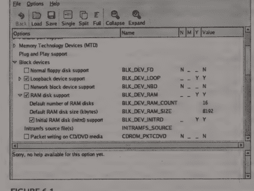

图 6-1

Linux 内核配置工具

### 6.4.1 初始 RAM 磁盘的用途

初始 RAM 磁盘是一个小型自包含的根文件系统，通常包含在启动周期完成之前加载特定设备驱动程序的指令。在 Red Hat 和 Fedora Core 等 Linux 工作站发行版中，使用初始 RAM 磁盘在挂载真正的根文件系统之前加载 EXT3 文件系统的设备驱动程序。`initrd` 经常用于加载访问真正的根文件系统所需的设备驱动程序。

### 6.4.2 使用 initrd 启动

要使用 `initrd` 功能，在大多数架构上，引导加载程序介入并将 `initrd` 镜像传递给内核。一种常见场景是，引导加载程序将压缩的内核镜像加载到内存中，然后将 `initrd` 镜像加载到可用内存的另一部分。在此过程中，引导加载程序负责在将控制权传递给内核之前将 `initrd` 镜像的加载地址传递给内核。具体机制因架构、引导加载程序和平台实现而异。然而，内核必须知道 `initrd` 镜像的位置，以便加载它。

某些架构和平台构建单个复合二进制镜像。当引导加载程序没有特定的 Linux 支持来加载 `initrd` 镜像时，会使用这种方案。在这种情况下，内核和 `initrd` 镜像只是简单地连接在一起。您会在内核的 `makefiles` 中找到这种复合镜像的引用，称为 `bootpImage`。目前，这只用于 `arm` 架构。

那么，内核如何知道在哪里找到 `initrd` 镜像？除非引导加载程序有特殊机制，通常只需通过内核命令行将 `initrd` 镜像的起始地址和大小传递给内核就足够了。以下是包含 TI OMAP 5912 处理器的流行 ARM 基于参考板的内核命令行示例。

```
console=ttyS0,115200 root=/dev/nfs
nfsroot=192.168.1.9:/home/chris/sandbox/omap-target \
initrd=0x10800000,0x14af47
```

上面的内核命令行被分成几行以适配电给的空间。在实际操作中，它是单行，各个元素用空格分隔。这个内核命令行定义了以下内核行为：

- 指定在设备 `ttyS0` 上以 115 千波特率设置单个控制台

- 通过 NFS（网络文件系统）挂载根文件系统

- 在主机 `192.168.1.9` 上（从目录 `/home/chris/sandbox/omap-target`）找到 NFS 根文件系统

- 从物理内存位置 `0x10800000` 加载并挂载初始 RAM 磁盘，其大小为 `0x14AF47`（1,355,591 字节）

关于此示例的一个额外说明：几乎 universally，`initrd` 镜像是压缩的。内核命令行上指定的大小是压缩镜像的大小。

### 6.4.3 引导加载程序对 initrd 的支持

让我们看一个基于流行 U-Boot 引导加载程序在 ARM 处理器上运行的简单示例。该引导加载程序已设计支持 Linux 内核。使用 U-Boot，很容易将 `initrd` 镜像与内核镜像一起包含。列表 6-10 考察了一个包含初始 RAM 磁盘镜像的典型启动序列。

#### 列表 6-10

使用 RAM 磁盘支持启动内核

```
#### tftpboot 0x10000000 kernel-lImage
...
Load address: 0x10000000
Loading: ##################################### done
Bytes transferred = 1069092 (105024 hex)

#### tftpboot 0x10800000 inrtrd-uboot
...
Load address: 0x10800000
Loading: ##################################### done
Bytes transferred = 282575 (44c f hex)

#### bootm 0x10000000 0x10800040
Uncompressing kernel...............done.
...
RAMDISK driver initialized: 16 RAM disks of 16384K size 1024 blocksize
...
RAMDISK: Compressed image found at block 0
VFS: Mounted root (ext2 filesystem).
Greetings: this is linuxrc from initial RAMDisk
Mounting /proc filesystem

BusyBox v1.00. (2005.03.14-16:37+0000) Built-in shell (ash)
Enter `help' for a list of built-in commands.

#### (<<< Busybox command prompt)
```


在这里，列表 6-10 让我们瞥见了 U-Boot 引导加载程序，我们将在下一章中详细考察。`tftpboot` 命令使 U-Boot 从 tftp 服务器下载内核镜像。内核镜像被下载并放置在该目标系统内存的 `256MB` 地址（`0x10000000 hex`7）底部。然后，第二个镜像，即初始 RAM 磁盘镜像，从 tftp 服务器下载到更高内存地址的内存中（在本示例中为 `256MB + 8MB`）。最后，我们发出 U-Boot 的 `bootm` 命令，这是“从内存启动”的命令。`bootm` 命令接受两个参数：Linux 内核镜像的地址，后面可选地跟一个表示初始 RAM 磁盘镜像位置的地址。

7 恰好在这块特定的板上，我们的物理 SDRAM 从 256MB 开始。

特别留意 U-Boot 引导加载器的一项特性。它完全支持通过以太网连接加载内核和 ramdisk 映像。这是一个非常实用的开发配置。你也可以通过其他方式将内核和 ramdisk 映像加载到板卡上。你可以使用基于硬件的闪存编程工具将它们刷入 Flash 存储器，或者使用串口通过 RS-232 下载内核和文件系统映像。然而，由于这些映像通常很大（内核可能约 1 MB，而 ramdisk 可能高达数十 MB），如果你采用这种基于以太网的 TFTP 下载方法，可以节省大量的工程时间。无论选择哪种引导加载器，请确保它支持通过网络下载开发映像。

### 6.4.4 initrd 魔法：linuxrc

当内核启动时，它会检测到 *initrd* 映像的存在，并将压缩的二进制文件从 RAM 中指定的物理位置复制到合适的内核 ramdisk 中，并将其挂载为根文件系统。*initrd* 的“魔法”来源于 *initrd* 映像中一个特殊文件的内容。当内核挂载初始 ramdisk 时，它会查找一个名为 *linuxrc* 的特定文件。内核将此文件视为脚本文件，并执行其中包含的命令。这种机制使系统设计者能够指定 *initrd* 的行为。列表 6-11 包含一个示例 *linuxrc* 文件。

#### 列表 6-11: 示例 linuxrc 文件

```
#!/bin/sh

echo 'Greetings: this is linuxrc from Initial Ramdisk'
echo 'Mounting /proc filesystem'
mount -t proc /proc /proc

busybox sh
```

在实际应用中，该文件将包含在挂载真实根文件系统之前所需的指令。一个例子可能是加载 CompactFlash（CF 卡）驱动程序，以从 CompactFlash 设备获取真实的根文件系统。为了示例的目的，我们只是生成一个 busybox shell 并暂停启动过程以便检查。你可以看到列表 6-10 中由这个 busybox shell 产生的 # 命令提示符。如果在此处输入 *exit* 命令，内核将继续其启动过程直到完成。

在内核将 ramdisk 从物理内存复制到内核 ramdisk 后，它将此物理内存返回给可用内存池。你可以将其视为将 initrd 映像从硬编码地址的物理内存转移到内核自己的虚拟内存中（以内核 ramdisk 设备的形式）。

关于列表 6-11 的最后一点评论：其中挂载 /proc 文件系统的 mount 命令似乎在“proc”一词的使用上显得冗余。该命令也可以这样工作：

```
mount -t proc none /proc
```

注意，`mount` 命令的设备字段已更改为 `none`。由于 proc 文件系统不关联任何物理设备，`mount` 命令会忽略设备字段。`-t proc` 足以指示 `mount` 将 `/proc` 文件系统挂载到 `/proc` 挂载点上。我使用前者作为一种心理提醒，表明我们实际上是将内核伪设备（`/proc` 文件系统）挂载到 `/proc` 上。`mount` 命令会忽略这个参数。请使用你偏好的方法。

### 6.4.5 initrd 管道机制

作为 Linux 启动过程的一部分，内核必须定位并挂载一个根文件系统。在启动过程的后期，内核在一个名为 `prepare_namespace()` 的函数中决定挂载什么以及在哪里挂载。如果在内核中启用了 initrd 支持（如图 6-1 所示），并且内核命令行如此配置，内核将从物理内存中解压缩 initrd 映像，并最终将此文件的内容复制到 ramdisk 设备 (`/dev/ram`) 中。此时，我们已经在内核 ramdisk 上拥有了一个合适的文件系统。在文件系统被读取到 ramdisk 后，内核有效地将此 ramdisk 设备挂载为其根文件系统。最后，内核生成一个内核线程来执行 initrd 映像上的 `linuxrc` 文件。[1]

当 `linuxrc` 脚本执行完成后，内核卸载 initrd 并继续系统启动的最后阶段。如果真实根设备有一个名为 `/initrd` 的目录，Linux 会将 initrd 文件系统挂载到此路径（在此上下文中称为 *mount point* 挂载点）。如果此目录不存在于最终根文件系统中，*initrd* 映像将被直接丢弃。

如果内核命令行包含一个指定 ramdisk 的 `root=` 参数（例如 `root=/dev/ram0`），之前描述的 *initrd* 行为会在两个重要方面发生变化。首先，会跳过对 *linuxrc* 可执行文件的处理。其次，不会尝试将另一个文件系统挂载为根。这意味着你可以拥有一个以 *initrd* 为唯一根文件系统的 Linux 系统。这对于极简的系统配置很有用，其中唯一的根文件系统就是 ramdisk。在 kernel 命令行上放置 `/dev/ram0` 允许完整的系统初始化完成，并以 *initrd* 作为最终根文件系统。

[1] 出于必要（篇幅）考虑，这是对事件序列的极其简化的描述。实际机制在概念上是相似的，但为了清晰起见，省略了几个重要细节。建议查阅内核源代码以获取更多细节。参见 `.../init/main.c` 和 `.../init/do_mounts.c`。

### 6.4.6 构建 initrd 映像

构建合适的根文件系统映像是嵌入式系统更具挑战性的方面之一。创建正确的 *initrd* 映像更具挑战性，因为它需要很小且专门化。在本节中，我们考察 *initrd* 的要求和文件系统内容。

列表 6-12 是通过在本书示例 *initrd* 映像上运行 `tree` 工具生成的。

#### 列表 6-12: 示例 initrd 的内容

```text
|-- bin
|   |-- busybox
|   |-- echo -> busybox
|   |-- mount -> busybox
`-- sh -> busybox
|-- dev
|   |-- console
|   |-- ram0
`-- ttyS0
|-- etc
|-- linuxrc
`-- proc
```

4 个目录，8 个文件

如你所见，它确实非常小；其非压缩形式占用不到 500KB 的空间。由于它基于 busybox，它拥有许多功能。因为 busybox 是静态链接的，它不依赖于任何系统库。你将在第 11 章中了解更多关于 busybox 的内容。

## 6.5 使用 initramfs

initramfs 是一种相对较新（Linux 2.6）的机制，用于执行早期用户空间程序。在概念上，它类似于前文描述的 initrd。其目的也类似：使能够在挂载真实根文件系统之前加载可能需要的驱动程序。然而，它在重要方面与 initrd 机制不同。

initrd 和 initramfs 之间的技术实现细节存在显著差异。例如，initramfs 在调用 `do_basic_setup()` 之前加载，这提供了一种机制，可以在其驱动程序加载之前为设备加载固件。更多细节可参考该子系统的 Linux 内核文档，其内容相对较新。参见 `.../Documentation/filesystems/ramfs-rootfs-initramfs.txt`。[2]

[2] `do_basic_setup()` 从 `.../init/main.c` 调用并调用 `do_initcalls()`。这会调用驱动程序模块初始化例程。这在第 5 章中已有详细描述，并在列表 5-10 中展示。

从实用角度来看，initramfs 更容易使用。initramfs 是一个 cpio 归档，而 initrd 是一个压缩的文件系统映像。这一简单差异促成了 initramfs 的易用性。它集成在 Linux 内核源代码树中，在构建内核映像时自动构建。对其进行修改比构建和加载新的 initrd 映像要容易得多。列表 6-13 展示了 Linux 内核 `.../usr` 目录的内容，initramfs 映像即在此处构建。列表 6-13 的内容是在内核构建后显示的。

## 6.6 关机

### 列表 6-13: 内核 initramfs 构建目录


```
$ ls -l
total 56
-rw-rw-r-- 1 chris chris 834 Mar 25 11:13 built-in.o
-rw-rwx--x 1 chris chris 11512 Mar 25 11:13 gen_init_cpio
-rw-rw-r-- 1 chris chris 10587 Oct 27 2005 gen_init_cpio.c
-rw-rw-r-- 1 chris chris 512 Mar 25 11:13 initramfs_data.cpio
-rw-rw-r-- 1 chris chris 133 Mar 25 11:13 initramfs_data.cpio.gz
-rw-rw-r-- 1 chris chris 786 Mar 25 11:13 initramfs_data.o
-rw-rw-r-- 1 chris chris 1024 Oct 27 2005 initramfs_data.S
-rw-rw-r-- 1 chris chris 113 Mar 25 11:13 initramfs_list
-rw-rw-r-- 1 chris chris 1619 Oct 27 2005 Kconfig
-rw-rw-r-- 1 chris chris 2048 Oct 27 2005 Makefile
```

`initramfs_list` 文件包含将包含在 `initramfs` 归档中的文件列表。最近 Linux 内核的默认设置如下所示：

```
dir /dev 0755 0 0
mod /dev/console 0600 0 0 c 5 1
dir /root 0700 0 0
```

这会生成一个小的默认目录结构，包含顶层目录 `/root` 和 `/dev`，以及代表控制台的单个设备节点。向此文件中添加内容以构建你自己的 initramfs。你还可以通过内核配置机制指定 initramfs 文件的源。在你的内核配置中启用 `INITRAMFS_SOURCE` 并将其指向开发工作站上的某个位置；内核构建系统将使用这些文件作为 initramfs 映像的源。

此构建目录的最终输出是 `initramfs_data.cpio.gz` 文件。这是一个包含你指定的文件（通过 `initramfs_list` 或通过 `INITRAMFS_SOURCE` 内核配置选项）的压缩归档。此归档链接到最终的内核映像中。这是 initramfs 相对于 initrd 的另一个优势：与 initrd 不同，启动时不需要加载单独的 initrd 映像。

嵌入式系统的有序关机在设计中常被忽视。不恰当的关机可能影响启动时间，甚至可能损坏某些类型的文件系统。使用 EXT2 文件系统时更常见的抱怨之一是（原文在此处截断）

在多年来许多桌面 Linux 发行版中作为默认配置）是指在非计划断电后启动时执行 `fsck`（文件系统检查）所花费的时间。拥有大容量磁盘系统的服务器可能需要数小时才能对一组大型 EXT2 分区进行完整的 `fsck` 检查。

每个嵌入式项目很可能都有其自身的关机策略。对某个项目有效的策略，对另一个项目未必有效。关机流程的规模可以涵盖从完整的 System V 关机方案，到简单的用于停机或重启的脚本。有许多 Linux 实用工具可以辅助关机过程，包括 `shutdown`、`halt` 和 `reboot` 命令。当然，这些工具必须适用于你所选择的架构。

关机脚本应终止所有用户空间进程，这将导致关闭那些进程使用的所有打开的文件。如果使用 `init`，发出命令 `init 0` 将停止系统。一般来说，关机过程首先向所有进程发送 `SIGTERM` 信号，以通知它们系统正在关闭。短暂的延迟确保所有进程都有机会执行其关机操作，如关闭文件、保存状态等。然后，所有进程会被发送 `SIGKILL` 信号，这将导致它们被终止。关机过程应尝试卸载任何已挂载的文件系统，并调用特定架构的停机或重启例程。结合 `init` 使用的 Linux `shutdown` 命令即表现出这种行为。

## 6.7 本章总结

- 所有 Linux 系统都需要一个根文件系统。由于各应用程序之间存在复杂的依赖关系，从头构建它们可能比较困难。
- 文件系统层次结构标准为开发人员提供了指导，以布局文件系统，从而实现最大的兼容性和灵活性。
- 我们提供了一个最小文件系统的示例，说明了根文件系统是如何创建的。
- Linux 内核的最后引导步骤定义并控制 Linux 系统的启动行为。根据你的嵌入式 Linux 系统的需求，有多种机制可供选择。
- 详细介绍了 `init` 进程。这个强大的系统配置和控制实用工具可以作为你自己嵌入式 Linux 系统的基础。我们介绍了基于 `init` 的系统初始化，以及示例启动脚本配置。
- 初始内存盘（Initial ramdisk）是一个 Linux 内核特性，允许在挂载最终根文件系统并派生 `init` 之前，进一步自定义启动行为。我们介绍了使用该强大特性的机制和示例配置。
- `initramfs` 简化了初始内存盘机制，同时提供类似的早期启动功能。它更容易使用，无需加载独立的映像，并且在每次内核构建时自动构建。

### 6.7.1 延伸阅读建议

**文件系统层次结构标准**

由 freestandards.org 维护

www.pathname.com/fhs/

**引导过程、Init 和关机**

Linux 文档项目

http://tldp.org/LDP/intro-linux/html/sect_04_02.html

**Init 手册页**

Linux 文档项目

http://tldp.org/LDP/sag/html/init.html

**System V init 的简要说明**

http://docs.kde.org/en/3.3/kdeadmin/ksysv/what-is-sysv-init.html

*引导 Linux：历史与未来*

Werner Almesberger

www.almesberger.net/cv/papers/ols2k-9.ps


# 第 7 章

## 引导加载器

## 本章内容

- 引导加载器的作用 第 158 页
- 引导加载器的挑战 第 159 页
- 通用引导加载器：Das U-Boot 第 164 页
- 移植 U-Boot 第 172 页
- 其他引导加载器 第 183 页
- 本章总结 第 186 页

前面的章节已经提及甚至提供了引导加载器操作的示例。作为嵌入式系统的一个关键组件，引导加载器为其他系统软件的生成提供了基础。本章首先探讨引导加载器在系统中的作用。随后，我们介绍引导加载器的一些常见功能。在此基础上，我们将详细研究一种用于嵌入式系统的流行引导加载器。最后，本章通过介绍几种更流行的引导加载器来结束。

目前有许多引导加载器在使用。在有限的篇幅内，即使是对于最受欢迎的引导加载器，也难以详细涵盖。因此，我们选择解释基于开源社区中适用于 PowerPC、MIPS、ARM 及其他架构的流行引导加载器之一的概念，并以其为例进行说明：即 U-Boot 引导加载器。

## 7.1 引导加载器的作用

当处理器板首次通电时，在运行甚至最简单的程序之前，必须初始化硬件的许多元素。每种架构和处理器都有一套预定义的操作和配置，其中包括从板载存储设备（通常是闪存）获取一些初始化代码。这个早期初始化代码是引导加载器的一部分，负责激活处理器及相关硬件组件。

大多数处理器都有一个默认地址，在通电和复位释放后，从此地址获取代码的前几个字节。硬件设计人员利用此信息来安排板上闪存的布局，并选择闪存响应的地址范围。这样，当首次通电时，代码可以从一个已知且可预测的地址获取，从而建立软件控制。

引导加载器提供这种早期初始化代码，并负责初始化板卡，以便其他程序可以运行。这种早期初始化代码几乎总是用处理器的本地汇编语言编写。仅凭这一点就带来了许多挑战，我们在下文中将探讨其中的一些。

当然，在引导加载器完成了基本的处理器和平台初始化之后，其主要作用就变成了启动一个完整的操作系统。它负责定位、加载并将执行权移交给主操作系统。此外，引导加载器可能具有高级功能，例如验证操作系统映像、升级自身或操作系统映像，以及根据开发人员定义的策略在多个操作系统映像中进行选择的能力。与传统的 PC-BIOS 模型不同，当操作系统接管控制权时，引导加载器会被覆盖并停止存在。[^1]

[^1]: 一些嵌入式设计会保护引导加载器并提供回调到引导加载器例程的功能，但这几乎从来不是好的设计方法。Linux 比引导加载器功能强大得多，因此这样做通常意义不大。

## 7.2 引导加载器的挑战

即使是写在 C 语言中的简单“Hello World”程序也需要大量的硬件和软件资源。应用程序开发人员不需要知道或关心这些细节，因为 C 运行时环境透明地提供了这些基础设施。引导加载器开发人员没有这种奢侈。引导加载器所需的每种资源都必须在被使用之前经过仔细初始化和分配。其中最明显的例子之一是动态随机存取存储器（DRAM）。


### 7.2.1 DRAM 控制器

DRAM 芯片不能像其他微处理器总线资源那样直接读取或写入。它们需要专门的硬件控制器来启用读/写周期。为了使问题更加复杂，DRAM 必须不断刷新，否则其中包含的数据将会丢失。刷新是通过系统地在 DRAM 中顺序读取每个位置，并在 DRAM 制造商规定的时序规范内完成来实现的。现代 DRAM 芯片支持许多操作模式，例如用于高性能应用的突发模式和双数据率。配置 DRAM、使其在制造商的时序规范内保持刷新，并响应来自处理器的各种读/写命令，是 DRAM 控制器的职责。

设置 DRAM 控制器是嵌入式开发新手感到沮丧的源头。这需要深入了解 DRAM 架构、控制器本身、正在使用的特定 DRAM 芯片以及整体硬件设计。虽然这超出了本书的范围，但感兴趣的读者可以通过查阅本章末尾的参考文献来深入了解这一重要概念。附录 D “DRAM 接口考量” 提供了关于这一重要主题的更多背景知识。

在嵌入式系统中，直到 DRAM 控制器和 DRAM 本身被正确初始化之前，几乎什么也无法发生。引导加载程序必须执行的首要任务之一就是启用内存子系统。初始化完成后，内存即可作为一种资源被使用。事实上，许多引导加载程序在内存初始化后执行的早期操作之一，就是将自身复制到 DRAM 中以实现更快的执行速度。

### 7.2.2 闪存与 RAM

引导加载程序固有的另一个复杂性在于，它们必须存储在非易失性存储器中，但通常会被加载到 RAM 中执行。同样，这种复杂性源于可供引导加载程序依赖的资源水平。在一个运行 Linux 等操作系统的完全正常工作的计算机系统中，编译程序并调用非易失性存储器中的程序相对容易。运行时库、操作系统和编译器协同工作，创建将程序从非易失性存储器加载到内存并转移控制权所需的必要基础设施。前述的 “Hello World” 程序就是一个完美的例子。编译后，只需在命令行输入可执行文件（`helloworld`）的名称即可将其加载到内存中并执行（当然，前提是假设该可执行文件存在于你的 PATH 路径中某处）。

当引导加载程序在开机时获得控制权时，这种基础设施并不存在。相反，引导加载程序必须创建自己的运行上下文，并在需要时将自身移动到 RAM 中的合适位置。此外，从只读介质执行的要求引入了额外的复杂性。

### 7.2.3 映像复杂性

作为应用程序开发人员，当我们为喜欢的平台开发应用程序时，无需担心二进制可执行文件的布局。编译器和二进制实用程序已预先配置好，用于构建包含给定架构所需正确组件的二进制可执行映像。链接器将启动（序言）和关闭（尾声）代码放入映像中。这些对象为你的应用程序设置适当的执行上下文，通常从应用程序中的 `main()` 开始。

对于典型的引导加载程序来说，情况绝非如此。当引导加载程序获得控制权时，没有上下文或先前的执行环境。在典型系统中，在引导加载程序初始化处理器及相关硬件之前，可能根本不存在 DRAM。请考虑这意味着什么。在典型的 C 函数中，所有局部变量都存储在栈上，因此像清单 7-1 中的简单函数是无法使用的。

**清单 7-1**

**简单的 C 函数**

```c
int setup_memory_controller(board_info_t *p)
{
    unsigned int *dram_controller_register = p->dc_reg;
    ...
}
```

当引导加载程序在开机时获得控制权时，没有栈，也没有栈指针。因此，类似于清单 7-1 的简单 C 函数很可能导致处理器崩溃，因为编译器将生成代码在栈上创建并初始化指针 `dram_controller_register`，而此时栈尚不存在。引导加载程序必须在调用任何 C 函数之前创建这个执行上下文。

当编译和链接引导加载程序时，开发人员必须对映像的构建和链接方式行使完全的控制权。如果引导加载程序需要从闪存重定位到 RAM，这一点尤为重要。必须向编译器和链接器传递一组参数，以定义最终可执行映像的特征和布局。两个主要特征共同增加了最终二进制可执行映像的复杂性。

带来复杂性的第一个特征是需要将启动代码组织成与处理器引导序列兼容的格式。根据处理器和硬件架构的不同，可执行代码的前几个字节必须位于闪存中的预定义位置。例如，AMCC PowerPC 405GP 处理器从硬编码地址 `0xFFFF_FFFC` 获取其第一条机器指令。其他处理器使用类似但细节不同的方法。一些处理器在开机时可配置为根据硬件配置信号，从几个预定义位置之一寻找代码。

开发人员如何指定二进制映像的布局？向链接器传递一个*链接器描述文件*，也称为*链接器命令脚本*。这个特殊文件可以被视为构建二进制可执行映像的配方。清单 7-2 包含了一个现有链接器描述文件的片段，该文件正用于一个流行的引导加载程序中，我们稍后将会讨论。

**清单 7-2**

**链接器命令脚本——复位向量放置**

```ld
SECTIONS
{
    .resetvec 0xFFFF_FFFC :
    {
        *(.resetvec)
    } = 0x0xff
...
```

对链接器命令脚本语法的完整描述超出了本书的范围。感兴趣的读者请参阅本章末尾引用的 GNU LD 手册。查看清单 7-2，我们可以看到二进制 ELF 映像输出节定义的开头部分。它指示链接器将名为 `.resetvec` 的代码节放置在输出映像的固定地址，起始位置为 `0xFFFF_FFFC`。此外，它指定该节的其余部分应填充为全 1（`0xFF`）。这是因为擦除后的闪存内存阵列包含全 1。该技术不仅减少了闪存内存的磨损，还显著加快了该扇区的编程速度。

清单 7-3 是来自最近 U-Boot 发行版中定义 `.resetvec` 代码节的完整汇编语言文件。它包含在一个名为 `.../cpu/ppc4xx/resetvec.S` 的汇编语言文件中。请注意，在只有 32 位地址位数的机器上，此代码节的长度不能超过 4 字节。这是因为无论存在何种配置选项，此节中只定义了一条指令。

**清单 7-3**

**.resetvec 的源代码定义**

```assembly
/* Copyright Montavista Software Incorporated, 2000 */
#include <config.h>
.section .resetvec,"ax"
#if defined(CONFIG_440)
    b start_440
#else
#if defined(CONFIG_BOOT_PCI) && defined(CONFIG_MIP405)
    b start_pci
#else
    b start
#endif
#endif
```

即使没有汇编语言编程经验，这个汇编语言文件也很容易理解。根据特定的配置（由 `CONFIG_*` 宏指定），会生成一条无条件分支指令（在 PowerPC 汇编器语法中为 b），跳转到主代码体中的相应起始位置。该分支位置是一个 4 字节的 PowerPC 指令，正如我们在清单 7-2 的链接器命令脚本片段中所见，这个简单的分支指令被放置在输出映像中闪存的绝对地址 `0xFFFF_FFFC`。如前所述，PPC 405GP 处理器从此硬编码地址获取其第一条指令。这就是开发人员为这种特定的架构和处理器组合定义并提供第一组代码序列的方式。

### 7.2.4 执行上下文

导致引导加载程序映像复杂性的另一个主要原因是缺乏执行上下文。当清单 7-3 中的指令序列开始执行时（请记住，这些是开机后的第一条机器指令），运行程序可用的资源几乎为零。硬件设计的默认值确保了从闪存内存获取数据正常工作，且系统时钟具有某些默认值，但其他方面几乎无法假设。[^2] 每个处理器的复位状态通常由制造商良好地定义，但主板的复位状态则由硬件设计者定义。

事实上，大多数处理器在启动时没有可用的 DRAM 来临时存储变量，或者更糟糕的是，没有使用 C 程序调用约定所必需的栈。如果你被迫在没有 DRAM 因此也没有栈的情况下编写 “Hello World” 程序，它将与传统 “Hello World” 示例大相径庭。

这一限制给旨在初始化硬件的初始代码体带来了重大挑战。因此，引导加载程序在启动时执行的早期任务之一是配置足够的硬件，以启用至少少量的 RAM。一些为嵌入式用途设计的处理器具有少量的片上静态 RAM。这正是我们一直在讨论的 PPC 405GP 的情况。当 RAM 可用时，可以使用该 RAM 的一部分来分配栈

RAM；并且可以构造一个适当的上下文来运行 C 等高级语言。这使得处理器的其余部分和平台初始化可以用汇编语言以外的语言来编写。

## 7.3 通用引导加载程序：Das U-Boot

目前有许多开源和商业的引导加载程序可用，还有许多自行设计的一次性设计也在广泛使用。这些引导加载程序在功能上大多具有某种程度的共性。例如，它们都具备加载和执行其他程序（特别是操作系统）的能力。大多数通过串口与用户交互。对各种网络子系统（如以太网）的支持虽然不太常见，但这是一个非常强大的功能。

许多引导加载程序针对特定的架构。引导加载程序支持多种架构和处理器的能力，对于大型开发组织来说可能是一个重要特性。一个开发组织同时拥有跨越多个架构的多种处理器并不少见。在多个平台上投入单一引导加载程序，最终会降低开发成本。


在本节中，我们将研究一个在嵌入式 Linux 社区中变得非常流行的现有引导加载程序。该引导加载程序的官方名称是 Das U-Boot。它由 Wolfgang Denk 维护，并托管在 SourceForge 上，地址为 http://u-boot.sourceforge.net/。U-Boot 支持多种架构，并拥有大量采用它用于项目并为其开发做出贡献的嵌入式开发人员和硬件制造商。

### 7.3.1 系统配置：U-Boot

为了使引导加载程序在许多处理器和架构上都有用，需要某种配置引导加载程序的方法。与 Linux 内核本身一样，引导加载程序的配置是在编译时完成的。这种方法显著降低了引导加载程序的复杂性，而复杂性本身是一个重要特征。

就 U-Boot 而言，针对特定配置由针对目标平台的单个头文件以及源代码树中的一些符号链接驱动，这些符号链接根据目标板、架构和 CPU 选择正确的子目录。在为 U-Boot 支持的平台之一进行配置时，请发出以下命令：

```
$ make <platform>_config
```

这里，`platform` 是 U-Boot 支持的众多平台之一。这些平台配置目标列在顶层 U-Boot makefile 中。例如，要为包含 TI OMAP 5912 处理器的 Spectrum Digital OSK 进行配置，请发出以下命令：

```
$ make omap5912osk_config
```

这将配置 U-Boot 源代码树，使用适当的符号链接选择 ARM 作为目标架构，ARM926 内核，并将 5912 OSK 作为目标平台。

为此平台配置 U-Boot 的下一步是编辑该板特定的配置文件。此文件位于 U-Boot 的 `../include/configs` 子目录中，称为 `omap5912osk.h`。随 U-Boot 发行版提供的 README 文件描述了配置的详细信息，是获取此信息的最佳来源。

U-Boot 的配置是使用定义在板特定头文件中的配置变量完成的。配置变量有两种形式。配置*选项*是通过 `CONFIG_XXXX` 形式的宏选择的。配置*设置*是通过 `CFG_XXX` 形式的宏选择的。通常，配置选项（`CONFIG_XXX`）可由用户配置，并启用特定的 U-Boot 操作功能。配置设置（`CFG_XXX`）通常是硬件相关的，需要对底层处理器和/或硬件平台有详细的了解。针对特定 U-Boot 配置由一个专门用于该特定平台的头文件驱动，其中包含适合底层平台的配置选项和设置。U-Boot 源代码树中包含一个目录，这些板特定的配置头文件就位于该目录中。它们可以在 U-Boot 顶层源目录的 `../include/configs` 中找到。

通过在板配置文件中添加定义，可以选择许多功能和运行模式。列表 7-4 包含了一个基于 PPC 405GP 处理器的虚构板的部分配置头文件。

**列表 7-4**

**部分 U-Boot 板配置头文件**

```c
#define CONFIG_405GP     /* 处理器定义 */
#define CONFIG_4XX     /* 子架构规范，4xx 系列 */

#define CONFIG_SYS_CLK_FREQ  33333333  /* PLL 频率 */
#define CONFIG_BAUDRATE      9600
#define CONFIG_PCI     /* 启用 PCI 支持 */
...
#define CONFIG_COMMANDS     (CONFIG_CMD_DFL | CFG_CMD_DHCP)
...
#define CFG_BASE_BAUD      691200

/* 下表包含支持的波特率 */
#define CFG_BAUDRATE_TABLE \
 (1200, 2400, 4800, 9600, 19200, 38000, 57600, 115200, 230400)

#define CFG_LOAD_ADDR      0x100000  /* 默认加载地址 */
...
/* 内存 Bank 0 (Flash Bank 0) 初始化 */
#define CFG_EBC_PB0AP      0x9B015480
#define CFG_EBC_PB0CR      0xFFF18000

#define CFG_EBC_PB1AP      0x02815480
#define CFG_EBC_PB1CR      0xFFF018000
...
```

列表 7-4 展示了如何为特定板配置 U-Boot。实际的板配置文件可能包含数百行类似于此的代码。在这个例子中，你可以看到 CPU、CPU 系列（4xx）、PLL 时钟频率、串口波特率和 PCI 支持的定义。我们包含了配置变量（`CONFIG_XXX`）和配置设置（`CFG_XXX`）的示例。最后几行是初始化外部总线控制器内存 bank 0 和 1 所需的实际处理器寄存器值。你可以看到，这些值只能来自对板和处理器的详细了解。

U-Boot 的许多方面都可以使用这些机制进行配置，包括将编译到 U-Boot 中的功能（如 DHCP 支持、内存测试、调试支持等）。该机制可用于告诉 U-Boot 给定板上有多少内存和什么类型的内存，以及该内存映射在哪里。感兴趣的读者可以通过直接查看 U-Boot 代码，特别是出色的 README 文件，了解更多信息。

### 7.3.2 U-Boot 命令集

U-Boot 支持超过 60 个标准命令集，利用 `CFG_*` 宏启用超过 150 个独特命令。在 U-Boot 中，通过配置设置（`CFG_*`）宏的使用来启用命令集。关于最近 U-Boot 快照的完整列表，请查阅附录 B，“U-Boot 可配置命令”。这里只列出了一些，以让你了解可用的功能：

| 命令集 | 命令 |
| ----------------- | ------------------------------------------------- |
| `CFG_CMD_FLASH` | 闪存内存命令 |
| `CFG_CMD_MEMORY` | 内存转储、填充、复制、比较等 |
| `CFG_CMD_DHCP` | DHCP 支持 |
| `CFG_CMD_PING` | Ping 支持 |
| `CFG_CMD_EXT2` | EXT2 文件系统支持 |

列表 7-4 中的以下行定义了由板特定头文件驱动，在特定 U-Boot 配置中启用的命令：

```
#define CONFIG_COMMANDS (CONFIG_CMD_DFL | CFG_CMD_DHCP)
```

你不必在自己的板特定配置头文件中逐个键入每个 `CFG_*` 宏，你可以从 U-Boot 源代码中预定义的默认命令集开始。宏 `CONFIG_CMD_DFL` 定义了此默认命令集。`CONFIG_CMD_DFL` 指定了默认的 U-Boot 命令集列表，例如 `tftpboot`（从 tftp 服务器引导映像）、`bootm`（从内存引导映像）、内存实用程序如 `md`（显示内存）等。要启用你特定的命令组合，你可以从默认开始，并根据需要添加和减去。列表 7-4 中的示例在默认基础上添加了 DHCP 命令集。你可以以类似的方式减去：

```
#define CONFIG_COMMANDS (CONFIG_CMD_DFL & ~CFG_CMD_NFS)
```

查看 `../include/configs/` 中的任何板配置头文件作为示例。

### 7.3.3 网络操作

许多引导加载程序包括对以太网接口的支持。在开发环境中，这是一个巨大的省时工具。通过串口

通过 10Mbps 以太网链路进行传输可能仅需几秒钟，而通过串口则可能需要几分钟。此外，串口链路更容易受到行为不规范的串口终端产生的错误影响。

启动加载器（bootloader）中一些较为重要的特性包括对 BOOTP、DHCP 和 TFTP 协议的支持。对于不熟悉这些协议的人，BOOTP（引导程序协议）和 DHCP（动态主机配置协议）是使具有以太网端口的目标设备能够从中央服务器获取 IP 地址及其他网络相关配置信息的协议。TFTP（简单文件传输协议）允许目标设备从 TFTP 服务器下载文件（例如 Linux 内核映像）。本章末尾列出了这些协议规范的参考书目。第 12 章“嵌入式开发环境”中描述了这些服务的服务器。

图 7-1 展示了目标设备与 BOOTP 服务器之间的信息交换流程。客户端（在本例中为 U-Boot）发起一个广播包以寻找 BOOTP 服务器。服务器通过包含客户端 IP 地址及其他信息的回复包进行响应。最有用的数据包括用于下载内核映像的文件名。

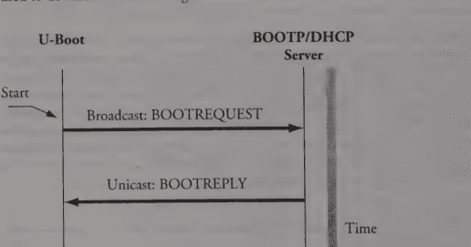

**图 7-1 BOOTP 客户端/服务器握手过程**

在实际应用中，独立的专用 BOOTP 服务器已不复存在。您喜爱的 Linux 发行版中自带的 DHCP 服务器也支持 BOOTP 协议数据包。


DHCP 协议是在 BOOTP 的基础上构建的。它可以向目标设备提供多种配置信息。在实践中，信息交换的范围往往受限于目标设备/启动加载器的 DHCP 客户端实现。列表 7-5 包含了一个 DHCP 服务器配置块的示例，该示例标识了单个目标设备。这是来自 Fedora Core 2 DHCP 实现中的一个 DHCP 配置文件片段。

#### 列表 7-5

#### DHCP 目标规范

```
host coyote {
    hardware ethernet 00:0e:0c:00:82:f8;
    netmask 255.255.255.0;
    fixed-address 192.168.1.21;
    server-name 192.168.1.9;
    filename "coyote=zImage";
    option root-path "/home/chris/sandbox/coyote-target";
}
...
```

当此 DHCP 服务器接收到来自与列表 7-5 中硬件以太网地址匹配的设备的数据包时，它会通过向该设备发送此目标规范中的参数进行响应。表 7-1 描述了目标规范中的各个字段。

#### 表 7-1

#### DHCP 目标参数

| DHCP 目标参数 | 用途 | 备注 |
|---|---|---|
| `host` | 主机名 | DHCP 配置文件中的符号标签 |
| `hardware ethernet` | 以太网硬件地址 | 目标以太网接口的底层以太网硬件地址 |
| `fixed-address` | 目标 IP 地址 | 目标设备将采用的 IP 地址 |
| `netmask` | 目标子网掩码 | 目标设备将采用的 IP 子网掩码 |
| `server-name` | TFTP 服务器 IP 地址 | 目标设备将用于发送文件传输、根文件系统请求等请求的 IP 地址 |
| `filename` | TFTP 文件名 | 启动加载器可用于启动二级映像（通常是 Linux 内核）的文件名 |

当目标板上的启动加载器完成 BOOTP 或 DHCP 交换后，之前描述的那些参数将用于进一步的配置。例如，启动加载器使用目标 IP 地址将其以太网端口绑定到该 IP 地址。然后，启动加载器使用 `server-name` 字段作为目标 IP 地址，请求 `filename` 字段中包含的文件，在大多数情况下，这代表一个 Linux 内核映像。虽然这是最常见的用途，但相同的场景也可以用于下载并执行制造测试和诊断固件。

需要注意的是，DHCP 协议支持的参数远多于表 7-1 中详述的那些。这些只是您在嵌入式系统中可能会遇到的较为常见的参数。有关完整细节，请参阅本章末尾引用的 DHCP 规范。

### 7.3.4 存储子系统

许多启动加载器除了支持从常规的 Flash 内存启动映像外，还支持从多种非易失性存储设备启动映像。支持这类设备的难点在于硬件和软件的双重复杂性。例如，要访问硬盘上的数据，启动加载器必须拥有 IDE 控制器接口的设备驱动程序代码，并且需要了解底层的分区方案和文件系统。这并非易事，且通常是更适合完整操作系统承担的任务。

尽管存在底层的复杂性，但仍存在从这类设备加载映像的方法。最简单的方法仅是支持硬件。在这种方案中，假设不需要了解文件系统。启动加载器仅从设备的绝对扇区进行原始加载。这种方法可以通过在 IDE 兼容设备（如 CompactFlash）上指定从扇区 0 开始的一个未格式化分区来使用，并在不施加任何结构限制的情况下加载在那里找到的数据。这是加载内核映像或其他二进制映像的理想配置。设备上的其他分区可以格式化为特定的文件系统，并包含完整的文件系统。在内核启动后，可以使用设备驱动程序来访问这些附加分区。

U-Boot 可以从指定的原始分区或具有文件系统结构的分区加载映像。当然，电路板必须具有受支持的硬件设备（IDE 子系统），并且 U-Boot 必须相应配置。在板级特定配置文件中添加 `CFG_CMD_IDE` 可以启用 IDE 接口支持，而添加 `CFG_CMD_BOOTM` 可以启用从原始分区启动的支持。如果您正在将 U-Boot 移植到自定义电路板，您将不得不修改 U-Boot 以理解您特定的硬件。

### 7.3.5 从磁盘启动：U-Boot

如上一节所述，U-Boot 支持多种从磁盘子系统启动内核映像的方法。这个简单的命令展示了其中一种受支持的方法：

```
=> diskboot 0x400000 0 0
```

要理解这种语法，您首先需要了解 U-Boot 如何对磁盘设备进行编号。本例中的 `0:0` 指定了设备和分区。在这个简单示例中，U-Boot 对该设备（IDE 设备 `0`）上找到的第一个分区执行映像的原始二进制加载。映像被加载到物理地址 `0x400000` 的系统内存中。

在内核映像被加载到内存后，使用 U-Boot 的 *bootm* 命令（从内存启动）来启动内核：

```
=> bootm 0x400000
```

## 7.4 移植 U-Boot

U-Boot 变得如此流行的原因之一是新平台支持起来非常容易。每个板级移植必须提供一个从属的 makefile，该文件向构建过程提供板级特定的定义。这些文件都命名为 `config.mk`，并位于 U-Boot 顶层源目录下的 `.../board/xxx` 子目录中，其中 `xxx` 指定特定的电路板。

截至最近的一个 U-Boot 1.1.4 快照，`.../boards` 子目录下有超过 240 个不同的板级配置文件被命名为 `config.mk`。在同一版本的 U-Boot 中，支持 29 种不同的 CPU 配置（以相同方式统计）。请注意，在某些情况下，CPU 配置涵盖了一个芯片系列，例如 `ppc4xx`，它支持 PowerPC 4xx 系列中的多个处理器。U-Boot 支持当今使用的各种流行 CPU 和 CPU 系列，以及基于这些处理器的大量参考电路板集合。

如果您的电路板包含受支持的 CPU 之一，那么移植 U-Boot 是非常直接的。如果您必须添加新的 CPU，请做好付出更多努力的心理准备。好消息是，在您之前可能已经有人完成了大部分工作。无论您是移植到新 CPU 还是基于现有 CPU 的新电路板，请研究现有的源代码以获取具体指导。确定哪个 CPU 与您的最接近，并克隆该 CPU 特定目录中找到的功能。最后，修改生成的源代码以添加针对您新 CPU 需求的具体支持。

### 7.4.1 EP405 U-Boot 移植

相同的逻辑也适用于将 U-Boot 移植到新电路板。让我们看一个例子。我们将使用包含 AMCC PowerPC 405GP 处理器的 Embedded Planet EP405 电路板。本例中使用的特定电路板由 Embedded Planet 提供，配有 64MB 的 SDRAM 和 16MB 的板载 Flash。设计还包含许多其他设备。

第一步是查看我们能有多接近现有的电路板。U-Boot 源代码树中的许多电路板支持 405GP 处理器。对板级配置头文件进行一次快速的 grep 搜索，可以将选择范围缩小到支持 405GP 处理器的那些：

```
$ cd .../u-boot/include/configs
$ grep -l CONFIG_405GP *
```

在最近的一个 U-Boot 快照中，有 25 个板级配置文件被配置为 405GP。在检查了几个之后，`AR405.h` 配置被选作基准。它包含对 LXT971 以太网收发器的支持，而 EP405 上也使用了该收发器。目标是在开源精神的指引下，通过借用他人的成果来最大限度地减少开发工作。让我们先着手解决简单的步骤。将板级配置文件复制到一个新的文件中，并使用适合你板级的名称。我们将我们的文件命名为 `EP405.h`。这些命令是从顶层 U-Boot 源代码树中发出的。

```
$ cp ../include/configs/AR405.h ../include/configs/EP405.h
```

然后创建板级特定目录，并复制 AR405 板级文件。我们目前还不确定是否需要所有这些文件。那一步稍后再进行。将文件复制到你的新板级目录后，根据你的板级名称适当地编辑文件名。

```
$ cd board      <<< 从顶层 U-Boot 源目录
$ mkdir ep405
$ cp emd/ar405/* ep405/
```

现在来到了困难的部分。Jerry Van Baren，一位开发者和 U-Boot 贡献者，在 U-Boot 邮件列表的一封邮件帖子中详细描述了一个幽默但现实的过程，用于移植 U-Boot。他在 C 中记录的完整过程可以在 U-Boot 的 README 文件中找到。以下内容以 Jerry 的风格和精神总结了移植过程中困难的部分：

```
while (!running) {
	do {
		添加 / 修改源代码
	} until (compiles);
	调试;
...
```


这里总结的 Jerry 的过程，是简单的真相。当你选择了一个移植的基准后，你必须添加、删除和修改源代码，直到它编译通过，然后调试它，直到它能无错误地运行！没有神奇的公式。将任何引导加载器移植到新板级需要对硬件和软件的许多领域有了解。其中一些学科，如设置 SDRAM 控制器，是相当专业且复杂的。几乎所有这些工作都涉及对底层硬件的详细知识。最终结果：做好花上许多有趣的小时深入阅读你的处理器硬件参考手册的准备，以及板上众多其他组件的数据表。

### 7.4.2 U-Boot Makefile 配置目标

现在我们已经有了开始使用的代码基础，我们必须对顶层 U-Boot makefile 进行一些修改，以添加新板级的配置步骤。检查这个 makefile 后，我们发现有一个用于配置 U-Boot 源代码树以支持各种板级的部分。我们现在添加对我们新板级的支持，以便我们可以构建它。由于我们的板级源自 ESD AR405，我们将使用该规则作为构建我们自己的规则模板。如果你跟随 U-Boot 源代码，你会发现这些规则在 makefile 中是按其配置名称的字母顺序排列的。我们将成为好的开源公民，并遵循这一做法。我们将配置目标命名为 `EP405_config`，再次与 U-Boot 约定保持一致。

```
EBONY_config: unconfig
	@./mkconfig $(@_config=$) ppc ppc4xx ebony
+EP405_config: unconfig
+	@./mkconfig $(@_config=$) ppc ppc4xx ep405
+
ERIC_config: unconfig
	@./mkconfig $(@_config=$) ppc ppc4xx eric
```

我们新的配置规则已插入，如以 `+` 字符开头（统一 diff 格式）的三行所示。

在完成上述步骤后，我们有了一个代表起点的 U-Boot 源代码树。它可能甚至无法干净地编译，而这应该是我们的第一步。至少编译器可以给我们一些关于从何处开始的指导。

### 7.4.3 EP405 处理器初始化

你的新 U-Boot 移植必须首先正确完成的任务是初始化处理器和内存（DRAM）子系统。复位后，405GP 处理器核心设计为从 `0xFFFF_FFC` 开始取指执行指令。核心尝试执行此处找到的指令。由于这是内存范围的顶部，此处找到的指令必须是无条件分支指令。

该处理器核心还硬编码配置了上部 2MB 内存区域，以便在无需编程外部总线控制器的情况下可以访问该区域，而 Flash 内存通常连接到此控制器。这强制要求分支到此地址空间内的位置，因为在我们的引导加载器代码初始化其他内存区域之前，处理器无法寻址其他地方的内存。我们必须分支到 `0xFFE0_0000` 或更高的位置。我们是如何知道所有这些的？因为我们阅读了 405GP 用户手册！

上一段描述的 405GP 处理器核心的行为对硬件设计者提出了要求，以确保在开机时，非易失性存储器（Flash）映射到所需的上部 2MB 内存区域。此初始内存区域的某些特性在复位时假设默认值。例如，这个上部 2M 区域将配置为 256 个等待状态，三个周期的地址到片选延迟，三个周期的片选到输出使能延迟，以及七个周期的保持时间。³ 这允许硬件设计者在选择适当的设备或方法在复位后直接将指令代码传递给处理器时拥有最大的自由度。

我们在 Listing 7-2 中已经看到复位向量是如何安装到 Flash 顶部的。当配置为 405GP 时，我们的代码前几行将位于文件 `.../cpu/ppc4xx/start.s` 中。U-Boot 开发者打算让这段代码是*处理器通用的*。理论上，此文件中不应需要板级特定的代码。你将看到这是如何实现的。

我们不需要深入理解 PowerPC 汇编语言，就能理解 `start.s` 中的逻辑流程。许多常见问题（FAQs）已发布到 U-Boot 邮件列表，关于修改低级汇编。在几乎所有情况下，如果你正在移植到许多受支持的处理器之一，则不需要修改此代码。这是成熟的代码，有许多成功的移植在其上运行。你需要（至少）为你的移植修改板级特定代码。如果你发现自己正在故障排查或修改一个已经存在了一段时间的处理器的高级启动汇编代码，你最有可能走错了路。

Listing 7-6 复现了 `start.s` 中*4xx 架构*的一部分。

#### 列表 7-6

#### U-Boot 4xx 启动代码

```c
#if defined(CONFIG_405GP) || defined(CONFIG_405CR) ||
defined(CONFIG_405) || defined(CONFIG_405EP)
/*--------...
```

/* 清除并设置一些寄存器。 */

/*-------------------------- */

addi    r4,r0,0x0000

mtspr    sgr,r4

mtspr    dcrw,r4

mteer    r4     /* 清除异常综合征寄存器 */

mttcr    r4     /* 清除定时器控制寄存器 */

mtxer    r4     /* 清除定点异常寄存器 */

mtevr    r4     /* 清除异常向量前缀寄存器 */

addi    r4,r0,0x1000  /* 设置 ME 位（机器异常） */

oris     r4,r4,0x0002 /* 设置 CE 位（关键异常） */

mtmsr    r4     /* 修改 MSR */

addi    r4,r0,(0XFFFF-0x10000) /* 设置 r4 为 0XFFF1FFFF（dbar 的状态通过设置位为 1 来清除） */

mtdbar    r4    /* 清除/复位 dbar */

/*-------------------------- */

/* 使 I 和 D 缓存失效。为定义的内存区域启用 I 缓存 */

/* 以加快速度。暂时保持 D 缓存禁用。稍后它将 */

/* 基于用户选择的菜单选项进行启用/保持禁用。 */

/* 注意 I 缓存也可能基于菜单选项稍后被禁用。 */

/* 参见 misc/lib/main.c。 */

/*-------------------------- */

invalidate_icache

bl  invalidate_dcache

/*-------------------------- */

/* 启用两个 128MB 可缓存区域。 */

/*-------------------------- */

addis    r4,r0,0x8000

addi     r4,r4,0x0001

mticr    r4     /* 指令缓存 */

isync

addis    r4,r0,0x0000

addi     r4,r4,0x0000

mtdcr    r4     /* 数据缓存 */

```

在 405GP 处理器中执行的 start.S 中的第一组代码大约从源文件的三分之一处开始，在那里少数几个处理器寄存器被清除或设置为某些初始值。然后指令和数据缓存被失效，并启用指令缓存以加快初始加载。设置了两个 128MB 的可缓存区域，一个在内存的高端（Flash 区域），另一个在底部（通常是系统 DRAM 的起始位置）。U-Boot 最终被复制到该区域的 RAM 中，并从此处执行。这样做的原因是性能：从 RAM 进行的原始读取速度比从 Flash 读取快一个数量级（甚至更多）。然而，对于 4xx CPU，还有一个更微妙的原因来启用指令缓存，我们将很快就会发现。

### 7.4.4 板级特定初始化

任何板级特定初始化的第一次机会出现在 `.../cpu/ppc4xx/start.S` 中，就在可缓存区域初始化完成之后。在这里，我们找到了对外部汇编语言例程 `ext_bus_cntrlr_init` 的调用。

```assembly

bl ext_bus_cntrlr_init /* 板级特定总线控制器初始化 */

```

该例程定义在 `.../board/ep405/init.S` 中，位于针对您主板的新板级特定目录中。它提供了早期基于硬件的初始化的钩子。这是为我们 EP405 平台定制的文件之一。此文件包含用于初始化 405GP 外部总线控制器以适用于我们应用的板级特定代码。列表 7-7 包含了该文件功能的核心部分。这是初始化 405GP 外部总线控制器的代码。

#### 列表 7-7

外部总线控制器初始化

```assembly

.globl ext_bus_cntrlr_init

ext_bus_cntrlr_init:

	mflr		r4		/* 保存链接寄存器	*/

	bl		..getAddr

..getAddr:

	mflr		r3		/* 获取 _this_ 地址	*/

	mtlr		r4		/* 恢复链接寄存器	*/

	addi	r4,0,14	/* 预取 14 个缓存行... */

	mctr r4		/* ...以容纳此函数	*/

				/* 缓存 (8xI4=12 条指令)	*/

..ebcloop:

	icbm	r0, r3	/* 预取 [r3] 的缓存行 */
```


`addi	r3, r3,32	/* 移动到下一个缓存行	*/`

`bdnz	..ebcloop	/* 继续执行 14 个缓存行 */`

/*-------------------------------------------*/

/* 延迟以确保对 ROM 的所有访问完成 */

/* 在更改 bank 0 时序之前			*/

/* 200微秒应该足够了				*/

/* 200,000,000 (cycles/sec) x .000200 (sec) = */

/* 0x9C40 个周期 */

/*----*----*----*----*----*----*----*----*----*----*----*----*----*----*/

```
addis r3,0,0x9C40

ori r3,r3,0x0000 /* 确保 200微秒已经过 */

mtctr r3

...spinl: ...

spinl: bdnz .spinlp /* 自旋循环 */

/* 现在执行此函数的实际工作 */

/* 内存 Bank 0 (Flash 和 SRAM) 初始化 */

addi r4,0,pb0ap /* *ebcfga = pb0ap; */

mtdcr ebcfga,r4

addis r4,0,EBC0_B0AP0h /* *ebcfgd = EBC0_B0AP; */

ori r4,r4,EBC0_B0AP0l

mtdcr ebcfgd,r4

addi r4,0,pb0cr /* *ebcfga = pb0cr; */

mtdcr ebcfga,r4

addis r4,0,EBC0_B0CR0h /* *ebcfgd = EBC0_B0CR; */

ori r4,r4,EBC0_B0CR0l

mtdcr ebcfgd,r4

/* 内存 Bank 4 (NVBRAM & BCSR) 初始化 */

addi r4,0,pb4ap /* *ebcfga = pb4ap; */

mtdcr ebcfga,r4

addis r4,0,EBC0_B4AP0h /* *ebcfgd = EBC0_B4AP; */

ori r4,r4,EBC0_B4AP0l

mtdcr ebcfgd,r4

addi r4,0,pb4cr /* *ebcfga = pb4cr; */

mtdcr ebcfga,r4

addis r4,0,EBC0_B4CR0h /* *ebcfgd = EBC0_B4CR; */

ori r4,r4,EBC0_B4CR0l

mtdcr ebcfgd,r4

blr /* 返回 */
```

选择列表 7-7 中的示例是因为它典型地展示了底层处理器初始化中涉及的微妙复杂性。重要的是要意识到这段代码运行的上下文。它从 Flash 执行，此时任何 DRAM 都尚不可用。没有栈。这段代码正准备对控制其对本身正在执行的 Flash 访问的控制器进行根本性的修改。对于该特定处理器，有充分的文档记录表明，在修改 Flash 所连接的外部总线控制器时，从 Flash 执行代码可能会导致错误的读取，进而导致处理器崩溃。

解决方案显示在这个汇编语言例程中。从标签 `..getAddr` 开始，接下来的七条汇编语言指令，代码基本上使用 `icbi` 指令将自身预取到指令缓存中。当整个子程序成功读取到指令缓存中后，它就可以继续对外部总线控制器进行必要的更改，而不用担心崩溃，因为它正在直接从内部指令缓存执行。虽然微妙，但很巧妙！随后是一个短暂的延迟，以确保所有请求的指令缓存读取已完成。

当预取和延迟完成后，代码继续配置内存 Bank 0 和内存 Bank 4 以适配我们的主板。这些值来自对底层组件及其在主板上互连方式的详细知识。感兴趣的读者可以查阅本章末尾的“延伸阅读建议”，以获取 PowerPC 汇编器和 405GP 处理器的所有细节，本示例即由此衍生。

请考虑在不完全理解这里正在发生什么的情况下修改此代码。也许你添加了几行代码，使其大小超出了预取到缓存的范围。它很可能会崩溃（更糟糕的是，它可能偶尔才崩溃），但使用调试器逐步执行此代码不会提供任何关于原因的线索。

板级特定初始化的下一个机会是在从处理器的数据缓存中分配临时栈之后。这是在 `.../cpu/ppc44x/start.S` 大约第 727 行分支去初始化 SDRAM 控制器的地方：`bl sdr_init`。

执行上下文现在包括一个栈指针和一些用于本地数据存储的临时内存——也就是说，一个部分 C 上下文，允许开发者使用 C 语言来完成设置系统 SDRAM 控制器和其他初始化任务等相对复杂的任务。在我们的 EP405 移植中，`sdr_init()` 代码位于 `.../board/ep405/ep405.c`，并针对此特定主板和 DRAM 配置进行了定制。由于该主板没有使用市售的内存 SIMM，因此无法动态确定 DRAM 的配置，而 U-Boot 支持的其他许多主板是可以动态确定的。它是硬编码在 `ddram_size` 中的。

许多现成的内存 DDR 模块都有一个 SPD (Serial Presence Detect) PROM，其中包含定义内存模块参数的参数。这些参数可以通过 I2C 在程序控制下读取，并用作确定内存控制器正确参数的输入。U-Boot 支持此技术，但可能需要修改才能适用于你的特定主板。在 U-Boot 源代码中可以看到其许多使用示例。配置选项 `CONFIG_SPD_EFFRONT` 启用了此功能。你可以 grep 此选项以查找其使用示例。

### 7.4.5 移植总结

至此，你可以体会到将引导程序移植到硬件平台的一些困难。对于底层硬件的详细知识是无可替代的。当然，我们希望尽量减少为此任务所需的时间投入。毕竟，我们通常不是根据我们对给定处理器每个硬件细节的理解程度来支付报酬的，而是根据我们按时提供可行解决方案的能力。事实上，这是开源蓬勃发展的主要原因之一。我们刚才看到了将 U-Boot 移植到新硬件平台是多么容易——不是因为我们是对该处理器世界级的专家，而是因为在此之前，许多人已经完成了大部分艰苦的工作。

列表 7-8 是完成 U-Boot EP405 基本移植的新文件或修改文件的完整列表。当然，如果存在 U-Boot 中没有支持的新硬件设备，或者我们移植到一个 U-Boot 尚未支持的新 CPU，那么这将是一个更大规模的工作。这里要强调的一点，尽管有重复之嫌，是对于硬件（CPU 和子系统）和底层软件（U-Boot）的详细知识是无可替代的，才能在合理的时间内成功完成移植。如果你带着这种心态开始项目，你将获得成功的结果。

#### 列表 7-8

U-Boot EP405 移植的新 diff 或更改的文件

```bash
$ diff -purN u-boot u-boot-ep405/ | grep +++

+++ u-boot-ep405/board/ep405/config.mk

+++ u-boot-ep405/board/ep405/ep405.c

+++ u-boot-ep405/board/ep405/ep405.h

+++ u-boot-ep405/board/ep405/flash.c

+++ u-boot-ep405/board/ep405/init.S

+++ u-boot-ep405/board/ep405/Makefile

+++ u-boot-ep405/board/ep405/u-boot.lds

+++ u-boot-ep405/include/config.h

+++ u-boot-ep405/include/config.mk

+++ u-boot-ep405/include/configs/EP405.h

+++ u-boot-ep405/include/configs/ppc405.h

+++ u-boot-ep405/Makefile
```

请记住，`.../board/ep405` 目录中的所有文件都是从另一个目录衍生而来的。确实，在这次移植中，我们没有任何从零开始创建的文件。我们借鉴了前人的工作，并在必要时进行定制以实现我们的目标。

### 7.4.6 U-Boot 镜像格式

现在，我们已经有了适用于 EP405 主板的可用引导程序，我们可以在上面加载和运行程序。理想情况下，我们希望运行 Linux 等操作系统。为此，我们需要理解 U-Boot 所需的镜像格式。U-Boot 期望在镜像文件上有一个小标题，用于标识镜像的几个属性。U-Boot 使用 `mkimage` 工具（U-Boot 源代码的一部分）来构建此镜像标题。

最近的 Linux 内核发行版内置支持直接构建可由 U-Boot 启动的镜像。内核源代码树的 ARM 和 PPC 分支都支持一个名为 `uImage` 的目标。让我们看看 PPC 的情况。以下 Linux 内核 PPC makefile `.../arch/ppc/boot/images/Makefile` 中的片段包含构建名为 `uImage` 的 U-Boot 目标的规则：

```makefile
quiet_cmd_uimage = UIMAGE $@

cmd_uimage = $(CONFIG_SHELL) $(MKIMAGE) -A ppc \
```


```
-O linux -T kernel -C gzip -a 00000000 -e 00000000 \
-n 'Linux-S$(KERNELRELEASE)' -d $^ $@
```

## 7.5 其他引导加载程序

这里我们介绍一些更流行的引导加载程序，描述它们可能使用的应用场景，并对其特性进行总结。这不打算是一份详尽的教程，因为要做到这一点需要专门写一本书。感兴趣的读者可以查阅本章末尾的“延伸阅读建议”以做进一步学习。

### 7.5.1 Lilo

Linux 引导加载程序，即 `Lilo`，曾广泛用于桌面 PC 平台的商业 Linux 发行版；因此，它的根源在于 Intel `x86/IA32` 架构。`Lilo` 有几个组件。它有一个主引导自举程序（primary bootstrap program），位于可引导磁盘驱动器的第一个扇区上。⁴ 主引导加载程序受限于磁盘扇区大小，通常是 512 字节。因此，其主要目的仅仅是加载次级引导加载程序（secondary loader）并将控制权移交给它。次级引导加载程序可以跨越多个分区，并完成了引导加载程序的大部分工作。

`Lilo` 由配置文件和一个作为 `lilo` 可执行文件一部分的工具驱动。该配置文件只能在宿主操作系统的控制下读取或写入。也就是说，主引导加载程序或次级引导加载程序中的早期引导代码都不引用该配置文件。配置文件中的条目在系统安装或管理期间由 `lilo` 配置工具读取和处理。列表 7-10 是一个简单的 `lilo.conf` 配置文件的示例，描述了一个典型的 Linux 和 Windows 双启动安装环境。

#### 列表 7-10
**示例 Lilo 配置：`lilo.conf`**

```
#### This is the global lilo configuration section

#### These settings apply to all the “image” sections.

boot = /dev/hda

timeout=50

default=linux
```

> ⁴ 这主要是出于历史原因。从 PC 早期开始，BIOS 程序仅加载磁盘驱动器的第一个扇区并将控制权移交给它。

```
#### # This describes the primary kernel boot image
#### # lilo will display it with the label `linux'
image=/boot/myLinux-2.6.11.1
label=linux
initrd=/boot/myInitrd-2.6.11.1.img
read-only
append="root=LABEL=/"

#### # This is the second OS in a dual-boot configuration
#### # This entry will boot a secondary image from /dev/hda1
other=/dev/hda1
optional
label=that_other_os
```

此配置文件指示 `Lilo` 配置工具使用第一个硬盘 (`/dev/hda`) 的主引导记录。它包含一个延迟指令，在超时之前（本例中为 5 秒）等待用户按键。这给了系统操作员选择要启动的操作系统图像列表的机会。如果系统操作员在超时之前按下 Tab 键，`Lilo` 会提供一个列表供选择。`Lilo` 使用 `label` 标签作为显示每个图像所用的文本。

图像通过配置文件中的 *image* 标签定义。在列表 7-10 给出的示例中，主（默认）图像是名为 *myLinux-2.6.11.1* 的 Linux 内核图像。`Lilo` 从硬盘加载此图像。然后它加载第二个文件用作初始内存磁盘（initial ramdisk）。该文件是 *myInitrd-2.6.11.1.img*。`Lilo` 构建包含字符串 `"root=LABEL=/"` 的内核命令行，并在执行时将其传递给 Linux 内核。这指示 Linux 在启动后从哪里获取其根文件系统。

### 7.5.2 GRUB

许多当前的商业 Linux 发行版现在都附带 `GRUB` 引导加载程序。`GRUB`，即 `GRand Unified Bootloader`（大型统一引导加载程序），是一个 GNU 项目。它具有 `Lilo` 中未见的许多增强功能。`GRUB` 和 `Lilo` 之间最大的区别在于 `GRUB` 理解文件系统和内核图像格式的能力。此外，`GRUB` 可以在启动时读取和修改其配置。`GRUB` 还支持通过网络启动，这在嵌入式环境中可能是一个巨大的资产。`GRUB` 在启动时提供一个命令行接口来修改启动配置。

与 `Lilo` 类似，`GRUB` 由配置文件驱动。然而，与 `Lilo` 的静态配置不同，`GRUB` 引导加载程序在启动时读取此配置。这意味着可以根据不同的系统配置在启动时修改配置的行为。

列表 7-11 是一个 `GRUB` 配置文件的示例。这是撰写本稿件的 PC 上的配置文件。`GRUB` 配置文件名为 `grub.conf`，通常放置在一个专门用于存储启动图像的小分区中。在获取此示例的机器上，该目录称为 `/boot`。

#### 列表 7-11
**示例 GRUB 配置文件：`grub.conf`**

```
default=0

timeout=3

splashimage=(hd0,1)/grub/splash.xpm.gz

title Fedora Core 2 (2.6.9)

	root (hd0,1)

	kernel /vmlinuz-2.6.9 ro root=LABEL=/ rhgb proto=imps quiet

	initrd /initrd-2.6.9.img

title Fedora Core (2.6.5-1.358)

	root (hd0,1)

	kernel /vmlinuz-2.6.5-1.358 ro root=LABEL=/ rhgb quiet

title That Other OS

	rootnoverify (hd0,0)

	chainloader +1
```


GRUB 首先向用户展示可供启动的图像列表。列表 7-11 中的 `title` 条目是呈现给用户的图像名称。`default` 标签指定如果在规定时间内未按任何键则启动哪个图像，本例中为 3 秒。图像的计数从零开始。

与 Lilo 不同，GRUB 实际上可以读取给定分区上的文件系统以从其中加载图像。`root` 标签指定根分区，`grub.conf` 配置文件中的所有文件名都基于此分区。在此示例配置中，根分区是第一个硬盘驱动器上的第 1 号分区，指定为 `root(hd0, 1)`。分区的编号从零开始；这是第一个硬盘上的第二个分区。

图像指定为相对于指定根目录的文件名。在列表 7-11 中，默认启动图像是 Linux 2.6.9 内核，以及一个名为 `initrd-2.6.9.img` 的匹配初始内存磁盘图像。注意，GRUB 语法将内核命令行参数与内核文件指定放在同一行上。

### 7.5.3 更多引导加载程序

许多其他引导加载程序已经找到了特定的应用利基。例如，Redboot 是另一个开源引导加载程序，Intel 和 XScale 社区已将其用于基于 Intel IXP 和 PXA 处理器系列的各种评估板。Micromonitis 被 Cogent 等板级供应商使用。YAMON 在 MIPS 圈子里很受欢迎。³ LinuxBIOS 主要用在 X86 环境中。通常，当您考虑引导加载程序时，应该预先考虑一些重要因素：

- 它是否支持我选定的处理器？
- 它是否已移植到类似我板卡的板子上？
- 它是否支持我需要的功能？
- 它是否支持我打算使用的硬件设备？
- 是否存在一个庞大的用户社区，我可以在那里获得支持？
- 是否有我可以购买支持的商业供应商？

这些是您在考虑嵌入式项目使用哪种引导加载程序时必须回答的一些问题。除非您正在使用全新的处理器进行处于技术“前沿”的工作，否则您可能会发现，已经有人在将引导加载程序移植到您选定的平台方面完成了大部分艰苦工作。利用本章末尾的资源来帮助做出最终决定。

> ³ 为了承认现存的引导加载程序数量之多，YAMON 用户指南自称是“又一个 MONitor”（Yet Another MONitor）。

## 7.6 本章摘要

- 引导加载程序在嵌入式系统中的作用怎么强调都不为过。它是上电后第一个获得控制权的软件组件。

### 7.5 其他引导加载程序（上一页内容更正与合并）

*注：以下来自第 213 页的内容似乎是 7.5 节讨论的一部分，或者是在 OCR 页面断裂处被截断的 7.4 小节的一部分。它描述了 U-Boot 的 `mkimage` 参数。*

忽略语法复杂性，理解该规则调用了由变量 `$(MKIMAGE)` 标识的 shell 脚本。该 shell 脚本使用所示参数执行 U-Boot `mkimage` 实用程序。`mkimage` 实用程序创建 U-Boot 头部并将其前置到提供的内核图像中。参数定义如下：

- `-A` 指定目标图像架构
- `-O` 指定目标图像操作系统——在此情况下为 Linux
- `-T` 指定目标图像类型——在此情况下为内核
- `-C` 指定目标图像压缩类型——在此情况下为 `gzip`
- `-a` 将 U-Boot `loadaddress`（加载地址）设置为指定值——在此情况下为 0
- `-e` 将 U-Boot 图像入口点设置为提供的值
- `-n` 用于向人类用户标识图像的文本字段
- `-d` 要前置头部的可执行图像文件

几个 U-Boot 命令使用此头部数据既用于验证图像的完整性（U-Boot 还在头部中放入一个 CRC 签名），又用于指示各种命令如何处理该图像。U-Boot 有一个名为 `iminfo` 的命令，它读取图像头部并显示目标图像的图像属性。列表 7-9 包含通过 U-Boot 的 `tftpboot` 命令将 `uImage`（为 U-Boot 格式化的可引导 Linux 内核图像）加载到 EP405 板卡并对该图像执行 `iminfo` 命令的结果。

### 列表 7-9
**U-Boot `iminfo` 命令**

```
=> tftpboot 400000 uimage-ep405

TFTP Speed 100 Mbps = FULL duplex connection

TFTP from server 192.168.1.9; our IP address is 192.168.1.33

Filename 'uimage-ep405'.

Load address: 0x400000

     Loading: ##########   done

Bytes transferred = 891228 (d995c hex)

=> iminfo

### Checking Image at 04040000 ... 

   Image Name:   Linux-2.6.11.6

   Image Type:   PowerPC Linux Kernel Image (gzip compressed)

   Data Size:    891164 Bytes = 870.3 kB

   Load Address: 00000000

   Entry Point:  00000000

              Verifying Checksum ... OK

=>
```


### 7.6.1 延伸阅读建议

*   本章考察了引导加载程序的作用，并发现了引导加载程序必须存在的受限执行环境。
*   Das U-Boot 已成为许多处理器架构中流行的通用引导加载程序。它支持大量的处理器、参考硬件平台和定制板卡。
*   U-Boot 使用一系列位于板级特定头文件中的配置变量进行配置。附录 B 列出了近期 U-Boot 版本中支持的所有标准 U-Boot 命令集列表。
*   将 U-Boot 移植到基于受支持处理器新板卡的过程相对简单。在本章中，我们逐步介绍了向具有类似 U-Boot 支持的板卡进行典型移植的步骤。
*   当必须完成引导加载程序的修改或移植时，对处理器和硬件平台的详细知识是无可替代的。
*   我们简要介绍了当今正在使用的其他引导加载程序，以便您能够根据特定需求做出明智的选择。

### 参考文献

*   *应用笔记：同步 DRAM 简介*  
    迈威科技（Maxwell Technologies）  
    `www.maxwell.com/pdf/me/app_notes/Intro_to_SDRAM.pdf`
*   *使用 ld，GNU 链接器*  
    自由软件基金会（Free Software Foundation）  
    `www.gnu.org/software/binutils/manual/ld-2.9.1/ld.html`
*   *TQM8xxL 的 DENX U-Boot 和 Linux 指南 (DULG)*  
    Wolfgang Denx 等人，Denx 软件工程  
    `www.denx.de/twiki/bin/view/DULG/Manual`
*   RFC 793，“简单文件传输协议”  
    互联网工程任务组（The Internet Engineering Task Force）  
    `www.ietf.org/rfc/rfc793.txt`
*   RFC 951，“引导协议”  
    互联网工程任务组（The Internet Engineering Task Force）  
    `www.ietf.org/rfc/rfc951.txt`
*   RFC 1531，“动态主机配置协议”  
    互联网工程任务组（The Internet Engineering Task Force）  
    `www.ietf.org/rfc/rfc1531.txt`
*   PowerPC 405GP 嵌入式处理器用户手册  
    国际商业机器公司（IBM）
*   32 位 PowerPC 体系结构编程环境手册  
    飞思卡尔半导体公司（Freescale Semiconductor, Inc.）
*   Lilo 引导加载程序  
    `www.tldp.org/HOWTO/LILO.html`
*   GRUB 引导加载程序  
    `www.gnu.org/software/grub/`

# 第 8 章


**本章内容**

*   设备驱动程序概念 第 190 页
*   模块工具 第 199 页
*   驱动程序方法 第 205 页
*   综合应用 第 209 页
*   设备驱动程序与 GPL 第 211 页
*   本章小结 第 211 页

系统设计中最具挑战性的方面之一是以合理的方式划分功能。在 UNIX 和 Linux 中常见的设备驱动程序模型为应用程序代码与硬件或内核设备之间的功能划分提供了自然的架构。在本章中，我们将深入理解该模型以及 Linux 设备驱动程序架构的基础知识。阅读完本章后，您将拥有坚实的基础，以便使用本章末尾列出的优秀书籍之一继续深入研究设备驱动程序。

本章首先介绍 Linux 设备驱动程序概念以及内核源代码树中驱动程序的构建系统。我们考察了 Linux 设备驱动程序架构，并展示了一个简单的工作驱动程序示例。我们介绍了用于加载和卸载内核模块的用户空间工具。¹ 我们展示了一个简单应用程序，以说明应用程序与设备驱动程序之间的接口。本章以关于设备驱动程序和 GNU 公共许可证的讨论结束。

### 8.1 设备驱动程序概念

许多经验丰富的嵌入式开发人员最初可能会难以理解虚拟内存操作系统中设备驱动程序的概念。这是因为许多流行的传统实时操作系统并没有类似的架构。虚拟内存以及内核空间与用户空间的引入，常常会带来经验丰富的嵌入式开发人员所不熟悉的复杂性。

设备驱动程序的一个基本目的就是将用户的程序与关键内核数据结构和硬件设备隔离开来，防止直接访问。此外，编写良好的设备驱动程序会向用户隐藏硬件设备的复杂性和差异性。例如，一个希望向硬盘写入数据的程序无需关心磁盘驱动器使用的是 512 字节还是 1024 字节的扇区。用户只需打开一个文件并发出写命令。设备驱动程序处理这些细节，并将用户与硬件设备编程的复杂性和风险隔离开来。设备驱动程序为各种硬件设备提供了一致的用户接口。它构成了熟悉的 UNIX/Linux 约定的基础，即一切都必须表示为文件。

> ¹ 在此处，术语“模块”和“设备驱动程序”互换使用。

### 8.1.1 可加载模块

与其他一些操作系统不同，Linux 具有在运行时添加和移除内核组件的能力。Linux 被构建为具有定义良好的接口的单片内核，允许在启动后动态添加和移除设备驱动程序模块。这一特性不仅为用户增加了灵活性，而且被证明对设备驱动程序开发工作极具价值。假设您的设备驱动程序行为良好，您可以在开发周期中随时从运行中的内核插入和移除设备驱动程序，而不必每次发生更改时都重启内核。

可加载模块对嵌入式系统具有特殊的重要性。可加载模块增强了现场升级能力；模块本身可以在运行系统中的更新而不需要重启。模块可以存储在除根（启动）设备以外的其他介质上，而根设备可能会受到空间限制。

当然，设备驱动程序也可以静态编译到内核中，对于许多驱动程序来说，这是完全合适的。例如，考虑一个配置为从通过网络连接的 NFS 服务器挂载根文件系统的内核。在这种场景中，您配置网络相关驱动程序（TCP/IP 和网络接口卡驱动程序）被编译到主内核映像中，以便在启动期间可用于挂载远程根文件系统。您可以使用如第 6 章“系统初始化”中所述的初始 ramdisk 功能，作为替代方案，而不必将这些驱动程序作为内核本身的一部分静态编译。在这种情况下，必要的模块和加载它们的脚本将包含在初始 ramdisk 映像中。

可加载模块在内核启动后安装。启动脚本可以加载设备驱动程序模块，模块也可以在被需要时“按需加载”。内核具有在请求需要特定模块的服务时请求该模块的能力。

在讨论内核模块时，术语从未标准化。许多术语一直被互换使用来讨论可加载内核模块。在本章及后续章节中，术语*设备驱动程序*、*可加载内核模块 (LKM)*、*可加载模块*和*模块*都用来描述可加载内核设备驱动程序模块。

### 8.1.2 设备驱动程序架构

基本的 Linux 设备驱动程序模型为 UNIX/Linux 系统开发人员所熟悉。尽管设备驱动程序模型不断演进，但在 UNIX/Linux 演进过程中，一些基本结构几乎保持不变。设备驱动程序大致分为两个基本类别：*字符设备*和*块设备*。字符设备可以被视为顺序数据的串行流。字符设备的例子包括串行端口和键盘。块设备的特征在于能够向可寻址介质的随机位置读写数据块。块设备的例子包括硬盘和软盘驱动器。

### 8.1.3 最小设备驱动程序示例

由于 Linux 支持可加载设备驱动程序，演示一个简单的设备驱动程序骨架相对容易。清单 8-1 展示了一个可加载设备驱动程序模块，其中包含被运行中的内核加载和卸载所需的最小结构。

**清单 8-1：最小设备驱动程序**

```c
/* Example Minimal Character Device Driver */

#include <linux/module.h>

static int __init `hello_init`(void)

{

    `printk`("Hello Example Init\n");

    return 0;

}

static void __exit `hello_exit`(void)

{

    `printk`("Hello Example Exit\n");

}

`module_init`(`hello_init`);

`module_exit`(`hello_exit`);

`MODULE_AUTHOR`("Chris Hallinan");

`MODULE_DESCRIPTION`("Hello World Example");

`MODULE_LICENSE`("GPL");
```


清单 8-1 中的骨架驱动程序包含了足够的结构，以便内核能够加载和卸载该驱动程序，并调用初始化和退出例程。让我们看看这是如何实现的，因为它说明了对于设备驱动程序开发有用的某些重要的高级概念。

设备驱动程序是一种特殊的二进制模块。与独立的二进制可执行应用程序不同，设备驱动程序不能简单地从命令提示符中执行。2.6 内核系列要求二进制文件采用特殊的“内核对象”格式。正确构建后，设备驱动程序二进制模块包含 `.ko` 后缀。创建 `.ko` 模块对象所需的构建步骤和编译器选项可能相当复杂。在这里，我们概述了一组步骤，以便利用 Linux 内核构建系统的强大功能，而不要求你成为该系统的专家，这超出了本书的范围。

### 8.1.4 模块构建基础设施

设备驱动程序必须针对其将运行的内核进行编译。虽然可以加载并执行针对不同内核版本构建的内核模块，但除非你确定该模块不依赖于新内核的任何特性，否则这样做是有风险的。最简单的方法是在内核自身的源代码树中构建该模块。这确保了当开发者更改内核配置时，其自定义驱动程序会自动使用正确的内核配置进行重新构建。当然，也可以在内核源代码树之外构建驱动程序。然而在这种情况下，你负责确保你的设备驱动程序构建配置与你要运行该驱动程序的内核保持同步。这通常包括编译器开关、内核头文件位置以及内核配置选项。

对于清单 8-1 中介绍的示例驱动程序，为了使该示例驱动程序能够构建，对标准的 Linux 内核源代码树进行了以下更改。我们将详细解释每一步。

- 从顶层 Linux 源目录开始，在 `drivers/char` 下创建一个名为 `examples` 的目录。
- 在 kernel configuration 中添加一个菜单项，以启用 `examples` 的构建，并指定是内置还是可加载的内核模块。
- 将新的 `examples` 子目录添加到 `drivers/char/Makefile` 中，具体取决于第 2 步中创建的菜单项。
- 为新的 examples 目录创建一个 makefile，并添加要编译的 `hello1.o` 模块对象，具体取决于第 2 步中创建的菜单项。
- 最后，根据清单 8-1 创建驱动程序 `hello1.c` 源文件。

在 `.../drivers/char` 子目录下添加 `examples` 目录是不言而喻的。创建此目录后，会在该目录中创建两个文件：来自清单 8-1 的模块源文件本身以及 `examples` 目录的 makefile。`examples` 的 makefile 非常简单。它只包含这一行：

```
obj-$(CONFIG_EXAMPLES) += hello1.o
```

向内核配置实用程序添加菜单项稍微复杂一些。清单 8-2 包含一个补丁，当该补丁应用于近期 Linux 发行版的 `.../drivers/char/Kconfig` 文件时，会添加一个配置菜单项以启用我们的 `examples` 配置选项。对于不熟悉 diff/patch 格式的那些读者来说，清单 8-2 中每个由单个加号 (+) 字符开头的行都会插入到指定的行之间（那些没有前导 + 字符的行）。

#### 清单 8-2
用于 Examples 的 Kconfig 补丁

```
diff -u ~/base/linux-2.6.14/drivers/char/Kconfig

./drivers/char/Kconfig

--- ~/base/linux-2.6.14/drivers/char/Kconfig

+++ ./drivers/char/Kconfig

@@ -4,6 +4,12 @@

 menu "Character devices"

+config EXAMPLES

+	tristate "Enable Examples"

+	default M

+	--help---

+	Enable compilation option for driver examples

+

 config VT

 	bool "Virtual terminal" if EMBEDDED

 select INPUT
```

当该补丁应用于近期 Linux 内核 `.../drivers/char` 子目录中的 `Kconfig` 时，结果是一个名为 `CONFIG_EXAMPLES` 的新内核配置选项。回顾我们在第 4 章“Linux 内核——一种不同的视角”中关于构建 Linux 内核的讨论，配置实用程序按如下方式调用（此示例假设 ARM 架构）：

```bash
$ make ARCH=ARM CROSS_COMPILE=xscale_be- gconfig
```

在使用类似上述命令调用配置实用程序后，我们新的“Enable Examples”配置选项出现在“Character devices”菜单下，如补丁所示。因为它被定义为 `tristate`（三态），内核开发者可以从三个选项中进行选择：

- **(N) No.** 不编译 `examples`。
- **(Y) Yes.** 编译 `examples` 并将其链接到最终的内核映像中。
- **(M) Module.** 将 `examples` 编译为动态加载模块。

图 8-1 显示了添加了新配置选项后的 `gconfig` 屏幕结果。复选框中的短横线 (-) 选中了 (M)odule，如右侧 M 列所示。复选框中的勾选标记选中了 (Y)es，表示驱动程序模块应作为内核本体的一部分进行编译。空的复选框表示未选中该选项。

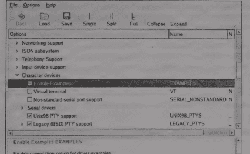

**图 8-1**
带有 Examples 模块的内核配置

既然我们已经添加了配置选项以启用编译我们的示例设备驱动程序模块，我们需要修改 `drivers/char` 中的 makefile，以便指示构建系统如果配置中存在 `CONFIG_EXAMPLES` 配置选项，则进入我们新的 `examples` 子目录。清单 8-3 包含了针对近期 Linux 发行版中 makefile 的补丁。

#### 清单 8-3
用于 Examples 的 Makefile 补丁

```
diff -u ~/base/linux-2.6.14/drivers/char/Makefile

../drivers/char/Makefile

--- ~/base/linux-2.6.14/drivers/char/Makefile

+++ ../drivers/char/Makefile

@@ -88,6 +88,7 @@

obj-$(CONFIG_DRM) += drm/

obj-$(CONFIG_PCMCIA) += pcmcia/

obj-$(CONFIG_IPMI_HANDLER) += ipmi/

+obj-$(CONFIG_EXAMPLES) += examples/

obj-$(CONFIG_HANGCHECK_TIMER) += hangcheck-timer.o
```

清单 8-3 中的补丁向位于 `drivers/char` 中的 makefile 添加了一行（前面带有 + 字符）。额外的上下文行是为了让补丁实用程序确定在哪里插入新行。我们的新 `examples` 目录被添加到此 makefile 中已经搜索的目录列表的末尾，这似乎是一个合乎逻辑的位置。除了保持一致性和可读性外，位置并不重要。

完成本节中的步骤后，构建示例设备驱动程序的基础设施已经就位。这种方法的美妙之处在于，每当调用内核构建时，驱动程序都会自动构建。只要选择了清单 8-3 中定义的配置选项（无论是 M 还是 Y），驱动程序模块就会包含在构建中。

为任意的 ARM 系统构建时，构建模块的命令行可能如下所示：

```
$ make ARCH=arm CROSS_COMPILE=scale_be- modules
```

#### 清单 8-4
模块构建输出

```
$ make ARCH=arm CROSS_COMPILE=scale_be- modules
CHK		include/linux/version.h
make[1]: 'arch/arm/kernel/asm-offsets.s' is up to date.
make[1]: 'include/asm-arm/mach-types.h' is up to date.
CC [M]  drivers/char/examples/hello1.o
Building modules, stage 2.
MODPOST
LD [M]  drivers/char/examples/hello1.ko
```


### 8.1.5 安装你的设备驱动程序

现在该驱动程序已经构建完成，我们可以在运行中的内核上加载和卸载它，以观察其行为。在加载模块之前，我们需要将其复制到目标系统上的适当位置。虽然我们可以将其放在任何想要的位置，但对于内核模块在运行的 Linux 系统上的存放位置，已经形成了一种约定。与模块编译类似，让内核构建系统为我们完成这一工作是最简单的。`Makefile` 目标 `modules_install` 会自动将模块以逻辑布局放置在系统中。你只需要提供期望的位置作为默认路径的前缀。

在标准的 Linux 工作站安装中，你可能已经知道设备驱动程序模块位于 `/lib/modules/<kernel-version>/...`，其排序方式类似于 Linux 内核树中的设备驱动程序目录层次结构。¹ 默认情况下，`<kernel-version>` 字符串是通过在你的目标 Linux 系统上执行命令 `uname -r` 生成的。如果你不向内核构建系统提供安装前缀，你的模块将安装在你自己的工作站的 `/lib/modules/...` 目录中。这可能不是你本来的意图。你可以指向主目录中的一个临时位置，并手动将模块复制到目标文件系统。或者，如果你的目标嵌入式系统使用 NFS 根挂载到本地开发

> ¹ 此路径由 Red Hat 和 Fedora 发行版使用，也是本章末尾引用的文件系统层次结构标准所要求的。其他发行版可能使用文件系统中不同的位置来存放内核模块。

工作站时，你可以将模块直接安装到目标文件系统。以下示例假设采用后者。

```bash
$ make ARCH=arm CROSS_COMPILER=pacable_be- \
    INSTALL_MOD_PATH=/home/chris/sandbox/coyote-target \
    modules install
```

这将把你所有的模块放置到目录 `coyote-target` 中，在这个示例系统中，该目录通过 NFS 导出，并挂载为目标系统的根目录。[3]

### 8.1.6 加载你的模块

完成所有必要步骤后，我们现在可以加载并测试设备驱动程序模块了。列表 8-5 展示了在嵌入式系统上加载随后卸载设备驱动程序时产生的输出。

#### 列表 8-5
#### 加载和卸载模块

```bash
$ modprobe hello1     # 加载驱动程序
Hello Example Init
$ modprobe -r hello1  # 卸载驱动程序
Hello Example Exit
$
```

你应该能够将输出与我们在列表 8-1 中找到的设备驱动程序源代码对应起来。除了通过 `printk()` 向内核日志系统打印消息（我们在控制台上看到这些消息）[4] 之外，该模块不做其他工作。当模块被加载时，模块初始化函数会被调用。我们使用 `module_init()` 宏指定在插入模块时将被执行的初始化函数。我们将其声明如下：

```c
module_init(hello_init);
```

在我们的初始化函数中，我们只是打印出强制要求的问候消息并返回。在实际的设备驱动程序中，这是你执行初始资源分配和硬件设备初始化的地方。类似地，当我们卸载模块（使用 `modprobe -r` 命令）时，我们的模块退出例程会被调用。

如列表 8-1 所示，退出例程使用 `module_exit()` 宏指定。

这就是一个能够在实际内核中进行活插入的骨架设备驱动程序的全部。在随后的章节中，我们将为可加载设备驱动程序模块引入额外的功能，以说明用户空间程序如何与设备驱动程序模块进行交互。

## 8.2 模块工具

我们在列表 8-5 中简要介绍了模块工具。在那里，我们使用模块工具 `modprobe` 从 Linux 内核中插入和移除设备驱动程序模块。有许多小型工具用于管理设备驱动程序模块。本节将介绍这些工具。建议你查阅每个工具的手册页以获取完整的详细信息。事实上，那些对深入了解 Linux 可加载模块感兴趣的人应该查阅这些工具的源代码。本章末尾的 8.6.1 节“附加阅读建议”包含了可以找到这些工具的参考资料。

### 8.2.1 insmod

`insmod` 工具是向运行中的内核插入模块的最简单方法。你提供一个完整的路径名，`insmod` 完成工作。例如：

```bash
$ insmod /lib/modules/2.6.14/kernel/drivers/char/examples/hello1.ko
```

这将模块 `hello1.ko` 加载到内核中。输出将与列表 8-5 中显示的一样——即 Hello 消息。`insmod` 工具是一个简单的程序，不需要也不接受任何选项。因为它没有搜索模块的逻辑，所以需要完整的路径名。大多数时候，你会使用稍后描述的 `modprobe`，因为它具有更多的功能和能力。

### 8.2.2 模块参数

许多设备驱动程序模块可以接受参数来修改其行为。示例包括启用调试模式、设置详细报告或指定模块特定选项。`insmod` 工具通过在模块名称后指定参数（在某些上下文中也称为选项）来接受参数。列表 8-6 展示了我们修改后的 `hello1.c` 示例，添加了一个用于启用调试模式的单一模块参数。

#### 列表 8-6
#### 带参数的示例驱动程序

```c
/* Example Minimal Character Device Driver */
#include <linux/module.h>
static int debug_enable = 0; /* Added driver parameter */
module_param(debug_enable, int, 0); /* and these 2 lines */
MODULE_PARM_DESC(debug_enable, "Enable module debug mode.");
static int __init hello_init(void)
{
    /* Now print value of new module parameter */
    printk("Hello Example Init - debug mode is %s\n",
        debug_enable ? "enabled" : "disabled");
    return 0;
}
static void __exit hello_exit(void)
{
    printk("Hello Example Exit\n");
}
module_init(hello_init);
module_exit(hello_exit);
MODULE_AUTHOR("Chris Hallinan");
MODULE_DESCRIPTION("Hello World Example");
MODULE_LICENSE("GPL");
```

我们的示例设备驱动程序模块增加了三行代码。第一行声明了一个用于保存调试标志的静态整数。第二行是一个在 `.../include/linux/moduleparam.h` 中定义的宏，它将模块参数注册到内核模块子系统。第三行新代码是一个宏，它将与参数关联的字符串描述注册到内核模块子系统。当我们稍后在本章中检查 `modinfo` 命令时，这个目的将变得清晰。

如果我们现在使用 `insmod` 插入我们的示例模块，并添加 `debug_enable` 选项，我们应该会看到基于列表 8-6 中修改后的 `hello1.c` 模块的结果输出。

```bash
$ insmod /lib/modules/.../examples/hello1.ko debug_enable=1
Hello Example Init - debug mode is enabled
```

或者，如果我们省略可选的模块参数：

```bash
$ insmod /lib/modules/.../examples/hello1.ko
Hello Example Init - debug mode is disabled
```

### 8.2.3 lsmod

`lsmod` 工具也相当简单。它只是显示已插入内核的模块的格式化列表。较新的版本不接受参数，只是格式化 `/proc/modules` 的输出。[5] 列表 8-7 是 `lsmod` 输出的一个示例。

#### 列表 8-7
#### lsmod 示例输出格式

```bash
$ lsmod
Module                Size Used by
ext3                  121096 0
jbd                    49656 1 ext3
loop                   12712 0
hello1                 1412 0
$
```


注意标有 *used by* 的最右列。此列表明设备驱动程序模块正在使用，并显示依赖链。在这个示例中，`jbd` 模块（用于日志文件系统例程）正被 `ext3` 模块使用，`ext3` 是许多流行 Linux 桌面发行版中默认的日志文件系统。这意味着 `ext3` 设备驱动程序依赖于 `jbd` 的存在。

### 8.2.4 modprobe

这正是 `modprobe` 的巧妙之处所在。在列表 8-7 中，我们可以看到 `ext3` 和 `jbd` 模块之间的关系。`ext3` 模块依赖于 `jbd` 模块。`modprobe` 工具可以发现这种关系并以正确的顺序加载依赖模块。以下命令加载 `jbd.ko` 和 `ext3.ko` 两个驱动程序模块：

```bash
$ modprobe ext3
```

`modprobe` 工具具有若干命令行选项，用于控制其行为。如前所述，`modprobe` 可用于移除模块，包括给定模块所依赖的模块。这里有一个模块移除的示例，同时移除 `jbd.ko` 和 `ext3.ko`：

```bash
$ modprobe -r ext3
```

`modprobe` 工具由一个名为 `modprobe.conf` 的配置文件驱动。这使得系统开发人员可以将设备与设备驱动程序关联。对于一个简单的嵌入式系统，`modprobe.conf` 可能为空，或者包含非常少的行。`modprobe` 工具编译时带有一组默认规则，在没有有效的 `modprobe.conf` 的情况下建立默认值。仅使用 `-c` 选项调用 `modprobe` 会显示 `modprobe` 使用的默认规则集。

列表 8-8 代表了一个典型的 `modprobe.conf`，它可能出现在包含两个以太网接口的系统中；一个是基于 Prism2 芯片组的无线适配器，另一个是典型的 PCI 以太网卡。该系统还包含一个基于集成 Intel 声卡芯片组的声子系统。

#### 列表 8-8
#### 典型的 modprobe.conf 文件

```bash
$ cat /etc/modprobe.conf
alias eth0 orinoco_pci
options eth0 orinoco_debug=9
alias eth0 e100
alias snd-card-0 snd-intel8x0
options snd-card-0 index=0
$
```

当内核启动并发现无线芯片组时，此配置文件指示 `modprobe` 加载 `orinoco_pci` 设备驱动程序，绑定到内核设备 `eth1`（注：原文如此，逻辑上通常对应新发现设备），并向设备驱动程序传递可选的模块参数 `orinoco_debug=9`。在发现声卡硬件时也会采取相同操作。注意与声卡驱动程序 `snd-intel8x0` 关联的可选参数。

### 8.2.5 depmod

`modprobe` 如何了解给定模块的依赖关系？`depmod` 实用程序在此过程中发挥着关键作用。当执行 `modprobe` 时，它会搜索模块安装位置处的一个名为 `modules.dep` 的文件。`depmod` 实用程序创建此模块依赖项文件。

该文件列出了内核构建系统所配置的所有模块列表，以及每个模块的依赖项信息。它是一种简单的文件格式：每个设备驱动程序模块在文件中占据一行。如果该模块有依赖项，则这些依赖项按照模块名称后面的顺序列出。例如，在清单 8-7 中，我们看到 `ext3` 模块依赖于 `jbd` 模块。`modules.dep` 中的依赖项行看起来像这样：

```
ext3.ko jbd.ko
```

在实际操作中，为避免歧义，每个模块名称前都带有其文件系统中的绝对路径。为了可读性，我们省略了路径信息。一个更复杂的依赖链，例如 sound 驱动程序，可能看起来像这样：

```
snd-intel8x0.ko snd-ac97-codec.ko snd-pcm.ko snd-timer.ko \
snd.ko soundcore.ko snd-page-alloc.ko
```

同样，为了可读性，我们移除了前面的路径组件。`modules.dep` 文件中的每个模块文件名都是一个绝对文件名，包含完整的路径信息，并且位于单独的一行上。前面的示例被截断为两行，以适合本页的空间。

通常，`depmod` 在内核构建期间自动运行。然而，在交叉开发环境中，你必须拥有一个 `depmod` 的交叉版本，该版本知道如何读取以目标架构原生格式编译的模块。或者，大多数嵌入式发行版都有一种方法以及 init 脚本条目，用于在每次启动时运行 `depmod`，以确保模块依赖项保持最新。

### 8.2.6 rmmod

这个实用程序也相当简单。它只是从运行中的内核中移除一个模块。将模块名称作为参数传递给它。无需包含路径名或文件扩展名。例如：

```
$ rmmod hello1
Hello Example Exit
```

在这里需要理解的一个有趣点是，当你使用 `rmmod` 时，它会执行模块的 `*_exit()` 函数，如前面的示例所示，来自清单 8-1 和 8-6 中的 our `hello1.c` 示例。

应该注意的是，与 `modprobe` 不同，`rmmod` 不会移除依赖模块。请使用 `modprobe -r` 来执行此操作。

### 8.2.7 modinfo

你可能已经注意到清单 8-1 中骨架驱动程序的最后三行，以及清单 8-6 中稍后的部分。这些宏的作用是放置标签在二进制模块中，以方便其管理和维护。清单 8-9 是在我们的 `hello1.ko` 模块上执行 `modinfo` 的结果。

#### 清单 8-9
#### modinfo 输出

```
$ modinfo hello1
filename:	/lib/modules/.../char/examples/hello1.ko
author:	Chris Hallinan
description:	Hello World Example
license:	GPL
vermagic:	2.6.14 ARMv5 gcc-3.3
depends:	
parm:	debug_enable:Enable module debug mode. (int)
$
```

第一个字段是显而易见的：它是设备驱动程序模块的完整文件名。为了此清单的可读性，我们再次截断了路径。接下来的几行直接源于清单 8-6 末尾找到的描述性宏——即文件名、作者和许可证信息。这些只是供模块实用程序使用的标签，并不影响设备驱动程序本身的行为。你可以从 `modinfo` 的手册页和 `modinfo` 源代码本身了解更多关于 `modinfo` 的信息。

`modinfo` 的一个非常实用的功能是了解模块支持哪些参数。从清单 8-9 中，你可以看到该模块仅支持一个参数。这是我们之前在清单 8-6 中添加的那个，`debug_enable`。该清单给出了名称、类型（在这种情况下是 `int`）以及我们使用 `MODULE_PARAM_DESC()` 宏输入的描述性文本字段。这非常方便，特别是对于那些你可能没有轻松访问源代码的模块。

## 8.3 驱动程序方法

在简要介绍模块实用程序时，我们已经覆盖了很多内容。在本章剩余的章节中，我们将描述从用户空间程序（你的应用程序代码）与设备驱动程序通信的基本机制。

我们已经介绍了负责模块一次性初始化和退出处理的两种基本方法。回顾清单 8-1，这些是 `module_init()` 和 `module_exit()`。我们发现这些例程在模块插入或从运行中的内核移除时被调用。现在，我们需要一些方法从我们的应用程序中与我们设备的驱动程序进行接口。毕竟，我们使用设备驱动程序的两个更重要的原因是隔离用户免受在内核空间中编写代码的危险，并呈现一种统一的与硬件或内核级别设备通信的方法。

### 8.3.1 驱动程序文件系统操作

当设备驱动程序加载到活动内核中后，我们必须采取的第一个行动是为后续操作准备驱动程序。`open()` 方法用于此目的。在驱动程序打开后，我们需要用于读写驱动程序的例程。提供 `release()` 例程用于在操作完成后进行清理（基本上是 close 调用）。最后，提供了一个特殊的系统调用，用于与驱动程序进行非标准通信。这被称为 `ioctl()`。清单 8-10 将此基础设施添加到我们的示例设备驱动程序中。

#### 清单 8-10
#### 向 Hello.c 添加文件系统操作

```
#include <linux/module.h>
#include <linux/fs.h>
#define HELLO_MAJOR 234
static int debug_enable = 0;
module_param(debug_enable, int, 0);
MODULE_PARM_DESC(debug_enable, "Enable module debug mode.");
struct file_operations hello_fops;
static int hello_open(struct inode *inode, struct file *file)
{
	printk("hello_open: successful\n");
	return 0;
}
```


```c
static int hello_release(struct inode *inode, struct file *file)
{
    printk("hello_release: successful\n");
    return 0;
}

static ssize_t hello_read(struct file *file, char *buf, size_t count,
                          loff_t *ptr)
{
    printk("hello_read: returning zero bytes\n");
    return 0;
}

static ssize_t hello_write(struct file *file, const char *buf,
                           size_t count, loff_t *ppos)
{
    printk("hello_read: accepting zero bytes\n");
    return 0;
}

static int hello_ioctl(struct inode *inode, struct file *file,
                       unsigned int cmd, unsigned long arg)
{
    printk("hello_ioctl: cmd=%ld, arg=%ld\n", cmd, arg);
    return 0;
}

static int __init hello_init(void)
{
    int ret;
    printk("Hello Example Init - debug mode is %s\n",
           debug_enable ? "enabled" : "disabled");
    ret = register_chrdev(HELLO_MAJOR, "hello", &hello_fops);
    if (ret < 0) {
        printk("Error registering hello device\n");
        goto hello_fail1;
    }
    printk("Hello: registered module successfully!\n");
    /* Init processing here... */
    return 0;
hello_fail1:
    return ret;
}

static void _exit hello_exit(void)
{
    printk("Hello Example Exit\n");
}

struct file_operations hello_fops = {
    .owner = THIS_MODULE,
    .read = hello_read,
    .write = hello_write,
    .ioctl = hello_ioctl,
    .open = hello_open,
    .release = hello_release,
};

module_init(hello_init);
module_exit(hello_exit);

MODULE_AUTHOR("Chris Hallinan");
MODULE_DESCRIPTION("Hello World Example");
MODULE_LICENSE("GPL");
```

这个扩展的设备驱动程序示例包含许多新行。从上到下，我们必须添加一个新的内核头文件，以获取文件系统操作的定义。我们还为设备驱动程序定义了一个主设备号。注意给设备驱动程序作者的说明：这不是分配设备驱动程序主设备号的正确方式。请参阅 Linux 内核文档 `…/Documentation/devices.txt` 或有关设备驱动程序的优秀书籍，以获取有关主设备号分配的指导。对于这个简单的示例，我们只是选择一个我们知道在我们的系统上没有使用的编号。

接下来我们看到四个新函数的定义，即我们的 `open`、`close`、`read` 和 `write` 方法。为了符合良好的编码实践，我们采用了一致的命名方案，该方案不会与内核中的任何其他子系统发生冲突。我们的新方法分别称为 `hello_open()`、`hello_release()`、`hello_read()` 和 `hello_write()`。就这个简单练习而言，它们是不执行任何操作的函数，只是向内核日志子系统打印一条消息。

请注意，我们还在 `hello_init()` 例程中添加了一个新的函数调用。这一行将我们的设备驱动程序注册到内核中。通过该注册调用，我们传递了一个包含指向所需方法的指针的结构体。内核使用这个类型为 `struct file_operations` 的结构体，将我们的特定设备功能与文件系统发出的相应请求绑定在一起。当应用程序打开由我们的设备驱动程序表示的设备并请求 `read()` 操作时，文件系统会将通用的 `read()` 请求与我们模块的 `hello_read()` 函数关联起来。以下各节将详细研究此过程。

### 8.3.2 设备节点与 mknod

为了理解应用程序如何将请求绑定到由我们的设备驱动程序表示的特定设备，我们必须理解设备节点的概念。设备节点是 Linux 中的一种特殊文件类型，用于表示一个设备。几乎所有 Linux 发行版都将设备节点保存在一个共同位置，由文件系统层次标准${}^{6}$指定，即名为 `/dev` 的目录中。使用一个专用工具在文件系统中创建设备节点。这个工具叫做 `mknod`。

节点创建的一个示例是说明其功能及其传达信息的最佳方式。与我们简单的设备驱动程序示例保持一致，让我们创建合适的设备节点以对其进行测试：

```bash
$ mknod /dev/hello1 c 234 0
```

在目标嵌入式系统上执行此命令后，我们最终会得到一个新文件 `/dev/hello1`，它代表我们的设备驱动程序模块。如果我们把这个文件列表打印到控制台，它看起来像这样：

```bash
$ ls -l /dev/hello1
crw-rw---- root root 234,0 Jul 14 2005 /dev/hello1
```

我们传递给 `mknod` 的参数包括我们设备驱动程序的主设备号、次设备号和名称。我们选择的名称是 `hello1`。由于我们在演示字符驱动程序的使用，我们使用 `c` 来表示这一点。主设备号是 `234`，这是我们为这个示例选择的编号，次设备号是 `0`。

就其本身而言，设备节点只是我们文件系统中的另一个文件。然而，由于它作为设备节点的特殊地位，我们使用它来绑定到已安装的设备驱动程序。如果应用程序进程发起一个 `open()` 系统调用，并指定我们的设备节点作为路径参数，内核将搜索具有与设备节点匹配的主设备号的有效已注册设备驱动程序——在我们的情况下，是 `234`。这就是内核将我们的特定设备关联到设备节点的机制。

正如大多数 C 程序员所知，`open()` 系统调用或其任何变体返回一个引用，文件描述符，我们的应用程序使用该引用发起后续的文件系统操作，如 `read`、`write` 和 `close`。然后，这个引用被传递给各种文件系统操作，如 `read`、`write` 或其变体。

${}^{6}$ 对此标准的引用可以在本章末尾的“延伸阅读建议”中找到。

对于那些对次设备号目的感到好奇的人来说，它是使用单个设备驱动程序处理多个设备或子设备的机制。它不被操作系统使用；它只是简单地传递给设备驱动程序。设备驱动程序可以按任何它认为合适的方式使用次设备号。例如，在多端口串行卡中，主设备号将指定驱动程序。次设备号可能指定同一驱动程序在多端口卡上处理的多个端口之一。感兴趣的读者建议查阅关于设备驱动程序的优秀文本以获取更多详细信息。

## 8.4 整合所有内容

既然我们有了一个骨架设备驱动程序，我们可以加载它并对其进行测试。列表 8-11 是一个简单的用户空间应用程序，用于测试我们的设备驱动程序。我们已经看过如何加载驱动程序。只需编译它并发出 `make modules_install` 命令将其放置到文件系统中，如前所述。

### 列表 8-11 测试我们的设备驱动程序

```c
#include <stdio.h>
#include <stdlib.h>
#include <sys/types.h>
#include <sys/stat.h>
#include <fcntl.h>
#include <unistd.h>
int main(int argc, char **argv)
{
    /* 我们的文件描述符 */
    int fd;
    int rc = 0;
    char rd_buf[16];
    printf("%s: entered\n", argv[0]);
    /* 打开设备 */
    fd = open("/dev/hello1", O_RDWR);
    if (fd == -1) {
```


```c
perror("open failed");

rc = fd;

exit(-1);

}

printf("%s: open: successful\n", argv[0]);

/* 发起读取 */

rc = read(fd, rd_buf, 0);

if (rc == -1) {

perror("read failed");

close(fd);

exit(-1);

}

printf("%s: read: returning %d bytes!\n", argv[0], rc);

close(fd);

return 0;

}
```

这个简单的文件在 ARM XScale 系统上编译后，演示了通过设备节点将应用程序与设备驱动程序绑定。与设备驱动程序一样，它不做任何有用的工作，但通过练习我们在列表 8-10 设备驱动程序中引入的一些方法，它确实演示了这些概念。

首先，我们对之前创建的设备节点发起一个 `open()` 系统调用${}^{7}$。如果打开成功，我们通过向控制台发送消息来表示这一点。接下来，我们发起一个 `read()` 命令，并在成功时再次向控制台打印消息。请注意，读取 0 个字节就内核而言是完全可接受的，并且在实际操作中，表示文件结束或无数据条件。您的设备驱动程序定义该特殊条件。完成后，我们简单地关闭文件并退出。列表 8-12 捕获了在 ARM XScale 目标上运行此示例应用程序的输出：

### 列表 8-12 使用示例驱动程序

```bash
$ modprobe hello1

Hello Example Init - debug mode is disabled

Hello: registered module successfully!

$ ./.use-hello

./.use-hello: entered

./.use-hello: open: successful

./.use-hello: read: returning zero bytes!

$
```


实际上，`open()` 调用是 Linux `sys_open()` 系统调用周围的 C 库包装函数。

## 8.5 设备驱动程序与 GPL

围绕设备驱动程序问题以及 GNU 公共许可证条款如何适用于设备驱动程序，存在大量的讨论和辩论。第一个测试是众所周知的：如果你的设备驱动程序（或任何软件）基于现有的 GPL 软件，甚至只是一部分，它被称为*衍生作品*。例如，如果你从一个当前的 Linux 设备驱动程序开始并修改它以满足你的需求，这肯定被认为是一个衍生作品，你有义务根据 GPL 的条款授予该修改后的设备驱动程序许可证，并遵守其所有要求。

辩论就由此产生。首先，免责声明。这不是法律意见，作者不是律师。截至撰写本文时，其中一些概念尚未在法庭上得到测试。法律界和开源社区的主流观点认为，如果一项作品能够被证明${}^{8}$是独立衍生的，且给定的设备驱动程序不需要假设对 Linux 内核的“亲密知识”，开发人员可以按任何他们认为合适的方式授予许可。如果对内核进行了修改以适应驱动程序的特定需求，它被视为衍生作品，因此受 GPL 约束。

在开源社区中，存在着大量且不断增长的信息，涉及这些问题。看来，在将来某个时候，这些概念将在法律法庭上得到测试，并将确立判例。这需要多长时间是谁都无从猜测。如果你有兴趣更好地理解 Linux 和开源周围的法律问题，你可能会喜欢 `www.open-bar.org`。

${}^{8}$ 这种做法并非开源独有。版权和专利侵权是所有开发人员持续关注的问题。

## 8.6 本章总结

本章对设备驱动程序的基础知识以及它们如何融入 Linux 系统的架构进行了高层次概述。掌握了基础知识，新的设备驱动程序读者可以投身于一本献给设备驱动程序编写者的优秀著作中。请查阅 8.6.1 节以获取参考资料。

- 设备驱动程序在不受特权保护的用户应用程序和关键内核资源（如硬件和其他设备）之间强制实施合理的分离，并向应用程序呈现一个众所周知的统一接口。
- 加载设备驱动程序所需的最小基础设施只有几行代码。我们展示了这个最小基础设施，并在此基础上构建了一个简单的驱动程序模块外壳。
- 配置为可加载模块的设备驱动程序可以在内核启动后插入到运行中的内核中并从其中移除。
- 模块工具用于管理设备驱动程序模块的插入、移除和列表。我们涵盖了用于这些功能的模块工具的详细信息。
- 你文件系统上的设备节点提供了你的用户空间应用程序和设备驱动程序之间的粘合剂。
- 驱动程序方法实现了在 UNIX/Linux 设备驱动程序中常见的 `open`、`read`、`write` 和 `close` 功能。通过示例（包括一个用于测试这些驱动程序方法的简单用户应用程序）解释了这种机制。
- 我们以介绍内核设备驱动程序与开源 GNU 公共许可证之间的关系来结束本章。

### 8.6.1 延伸阅读建议

- Linux Device Drivers, 3rd Edition
  Alessandro Rubini and Jonathan Corbet
  O’Reilly Publishing, 2005

- Filesystem Hierarchy Standard
  Edited by Rusty Russell, Daniel Quinlan, and Christopher Yeoh
  The File Systems Hierarchy Standards Group
  `www.pathname.com/fhs/`

- Rusty’s Linux Kernel Page: Module Utilities for 2.6
  Rusty Russell
  `http://kernel.org/pub/linux/kernel/people/rusty/`

# 第9章

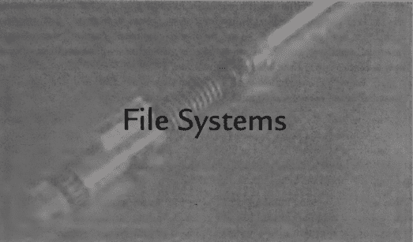

## 本章内容

- Linux 文件系统概念 第 214 页
- ext2 第 216 页
- ext3 第 221 页
- ReiserFS 第 224 页
- JFFS2 第 225 页
- cramsfs 第 228 页
- 网络文件系统 第 230 页
- 伪文件系统 第 234 页
- 其他文件系统 第 240 页
- 构建简单文件系统 第 242 页
- 本章小结 第 243 页

嵌入式开发者做出的最重要的决策之一，就是部署哪些文件系统。有些文件系统优化的是性能，有些则优化的是空间大小。还有的优化的是在设备或电源故障后的数据恢复能力。本章介绍了 Linux 系统上常用的主要文件系统，并探讨了它们在嵌入式设计中的特性。本章无意深入探讨每个文件系统的内部技术细节。相反，本章将审查与每个所展示文件系统相关的使用特性和开发问题。在第 9.11.1 节“延伸阅读建议”中提供的参考资料，可供感兴趣的读者查阅。

从早期 Linux 桌面发行版中最流行的文件系统开始，我们利用第二扩展文件系统（ext2）引入一些概念，为后续讨论奠定基础。接下来，我们将查看其继任者第三扩展文件系统（ext3），它是当前许多流行的桌面 Linux 发行版的默认文件系统。

在介绍了一些基础知识后，我们将考察多种专用文件系统，包括那些优化数据恢复和存储空间的，以及那些专为在 Flash 内存设备上使用而设计的。我们将介绍网络文件系统（NFS），随后讨论更重要的伪文件系统，包括 proc 文件系统和 sysfs。

## 9.1 Linux 文件系统概念

在深入研究各个文件系统的细节之前，让我们先看一下 Linux 系统上数据存储的全貌。在我们第 8 章“设备驱动基础”中对设备驱动的研究中，我们考察了字符设备的结构。一般来说，字符设备以串行流的形式存储和检索数据。字符设备最基础的例子是串行端口或磁带驱动器。相比之下，块设备以固定大小的数据块为单位存储和检索数据。例如，典型的 IDE 硬盘控制器一次可以传输 512 字节的数据到物理介质上的特定可寻址位置。文件系统基于块设备构建。

### 9.1.1 分区

在开始讨论文件系统之前，我们先引入分区（Partitions），即文件系统所在的物理设备的逻辑划分。在最顶层，数据以分区的形式存储在物理设备上。分区是物理介质（硬盘、Flash 内存）的逻辑划分，其数据按照给定分区类型的规范进行组织。一个物理设备可以有一个覆盖其所有可用空间的单个分区，也可以根据特定任务划分为多个分区。分区可以被视为一个逻辑磁盘，可以写入完整的文件系统。

图 9-1 展示了分区与文件系统之间的关系。

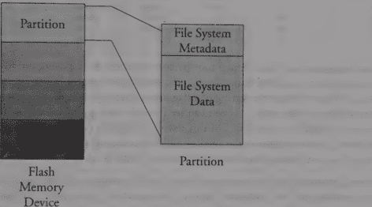

**图 9-1**
**分区与文件系统**

Linux 使用一个名为 `fdisk` 的工具来操作块设备上的分区。在许多 Linux 发行版中找到的较新的 `fdisk` 工具识别 90 多种不同的分区类型。在实践中，Linux 系统上常用的只有少数几种。常见的分区类型包括 Linux、FAT32 和 Linux Swap。

**列表 9-1**
**使用 fdisk 显示分区信息**

```
#### fdisk /dev/sdb

Command (m for help): p

Disk /dev/sdb: 49 MB, 49349120 bytes

4 heads, 32 sectors/track, 753 cylinders

Units = cylinders of 128 * 512 = 65536 bytes
```


| 设备 | 引导 | 起始 | 结束 | 块数 | Id | 系统 |
|---|---|---|---|---|---|---|
| `/dev/sdb1` | * | 1 | 180 | 11504 | 83 | Linux |
| `/dev/sdb2` | | 181 | 360 | 11520 | 83 | Linux |
| `/dev/sdb3` | | 361 | 540 | 11520 | 83 | Linux |
| `/dev/sdb4` | | 541 | 753 | 13632 | 83 | Linux |

在本讨论中，我们使用 `fdisk` 工具在该设备上创建了四个分区。其中一个被标记为可引导，由标记为 Boot 列中的星号表示。这仅仅是代表设备分区表的数据结构中标志的设置。从列表中可以看出，`fdisk` 使用的逻辑存储单位是柱面。[^1] 在此设备上，一个柱面包含 64KB。另一方面，Linux 将最小存储单位表示为逻辑块。您可以从列表中推断出，一个块是 1024 字节的单位。

在 CompactFlash 以此方式分区后，代表每个分区的设备都可以使用您选择的文件系统类型进行格式化。当分区被格式化为给定的文件系统类型时，Linux 可以从该分区挂载相应的文件系统。

## 9.2 ext2

基于列表 9-1 的例子，我们需要格式化使用 `fdisk` 创建的分区。为此，我们使用 Linux 的 `mke2fs` 工具。`mke2fs` 类似于熟悉的 DOS `format` 命令。此工具在指定分区上创建类型为 ext2 的文件系统。`mke2fs` 专用于 ext2 文件系统；其他文件系统有它们自己版本的此类工具。列表 9-2 捕获了此过程的输出。

[^1]: “柱面”（cylinder）这一术语借用于旋转介质的存储单位。它由磁盘设备给定扇区下一组磁头下的数据组成。这里用于与现有文件系统工具的兼容性。

**列表 9-2**
**使用 `mke2fs` 格式化分区**

```
#### mke2fs /dev/sdb1 -L CFlash_Boot_Vol

mke2fs 1.37 (21-Mar-2009)

Filesystem label=CFlash_Boot_Vol

OS type: Linux

Block size=1024 (log=0)

Fragment size=1024 (log=0)

2880 inodes, 11504 blocks

575 blocks (5.00%) reserved for the super user

First data block=1

Maximum filesystem blocks=11796480

2 block groups

8192 blocks per group, 8192 fragments per group

1440 inodes per group

Superblock backups stored on blocks:

	8193

Writing inode tables: done

Writing superblocks and filesystem accounting information: done

This filesystem will be automatically checked every 39 mounts or

180 days, whichever comes first. Use tune2fs -c or -i to override.

#
```

列表 9-2 包含了大量与 ext2 文件系统相关的细节，是理解其操作特性的绝佳起点。注意，此分区被格式化为 ext2 类型，卷标签为 CFlash_Boot_Vol。它是在 Linux 分区（OS Type:）上创建的，块大小为 1024 字节。分配了空间用于 2,880 个 inode，占用 11,504 个块。inode 是代表单个文件的基本数据结构。关于 ext2 文件系统内部结构的更详细信息，请参阅本章末尾的第 9.11.1 节。

查看列表 9-2 中 `mke2fs` 的输出，我们可以确定存储设备组织方式的某些特性。我们已经知道块大小是 1024 字节。如果对于您的特定应用程序有必要，可以指示 `mke2fs` 以不同的块大小格式化 ext2 文件系统。当前的实现允许 1,024、2,048 和 4,096 字节的块大小。

块大小始终是性能最佳的折衷方案。一方面，在包含许多文件的磁盘上，较大的块大小会浪费更多空间，因为每个文件必须适配整数的块数。超过 `block_size` 的剩余碎片必须

即使只有 1 个字节，也会占用整个完整的块。另一方面，非常小的块大小会增加文件系统管理描述块到文件映射的元数据的开销。只有在特定的硬件实现上进行基准测试，才是确保你选择了最佳块大小的唯一方法。

### 9.2.1 挂载文件系统

在创建文件系统之后，我们可以将该文件系统挂载到正在运行的 Linux 系统上，前提是我们拥有该硬件设备的访问权限，并且内核已针对我们的特定文件系统类型进行了编译，无论是作为编译在内核中的模块还是动态加载模块。以下命令将之前创建的 ext2 文件系统挂载到我们指定的挂载点：

```bash
#### mount /dev/sdb1 /mnt/flash
```

此示例假设我们在目标 Linux 机器上创建了一个名为 `/mnt/flash` 的目录。这被称为挂载点，因为我们正在此文件系统层级中的该点安装（挂载）文件系统。我们正在挂载前文描述的 Flash 设备，内核将其分配给设备 `/dev/sdb1`。在典型的 Linux 桌面（开发）机器上，我们需要拥有 root 权限才能执行此命令。² 挂载点是你文件系统中的任何位置，你决定将其作为新挂载设备的顶层（根目录）。在上面的示例中，要引用 Flash 设备上的任何文件，必须使用 `/mnt/flash` 作为路径前缀。

`mount` 命令是一个功能强大的命令，有许多选项。`mount` 接受的许多选项取决于挂载操作的目标文件系统类型。大多数情况下，对于内核已知的正确格式化的文件系统，`mount` 可以确定文件系统的类型。随着本章的进行，我们将提供更多关于 `mount` 命令的使用示例。

清单 9-3 显示了一个为任意嵌入式系统配置的 Flash 设备的目录内容。

##### 清单 9-3

Flash 设备列表

```bash
$ ls -l /mnt/flash

total 24

drwxr-xr-x 2 root root  1024 Jul 18 20:18 bin

drwxr-xr-x 2 root root  1024 Jul 18 20:18 boot

drwxr-xr-x 2 root root  1024 Jul 18 20:18 dev

drwxr-xr-x 2 root root  1024 Jul 18 20:18 etc

drwxr-xr-x 2 root root  1024 Jul 18 20:18 home

drwxr-xr-x 2 root root  1024 Jul 18 20:18 lib

drwx------ 2 root root 12288 Jul 17 13:02 lost+found

drwxr-xr-x 2 root root  1024 Jul 18 20:18 proc

drwxr-xr-x 2 root root  1024 Jul 18 20:18 root

drwxr-xr-x 2 root root  1024 Jul 18 20:18 sbin

drwxr-xr-x 2 root root  1024 Jul 18 20:18 tmp

drwxr-xr-x 2 root root  1024 Jul 18 20:18 usr

drwxr-xr-x 2 root root  1024 Jul 18 20:18 var

$
```

清单 9-3 展示了嵌入式系统的根文件系统顶层（根目录）可能呈现的样子。第 6 章“系统初始化”提供了有关如何确定根文件系统内容的指导和示例。

### 9.2.2 检查文件系统完整性

`e2fsck` 命令用于检查 ext2 文件系统的完整性。文件系统可能因多种原因损坏，但最常见的原因是意外的电源故障或未先关闭所有打开的文件和卸载文件系统就故意断电。Linux 发行版在关机序列中执行这些操作（假设系统有序关机）。然而，在处理嵌入式系统时，意外断电很常见，我们需要针对这些情况提供某种防御措施。`e2fsck` 是我们使用 ext2 文件系统时应对意外断电的第一道防线。

清单 9-4 展示了在先前示例中的 CompactFlash 上运行 `e2fsck` 的输出。它已被格式化并正确卸载；应该没有错误。

#### 清单 9-4

干净的文件系统检查

```bash
#### e2fsck /dev/sdb1

   e2fsck 1.37  (21-Mar-2005)

CFlash_Boot_Vol: clean, 23/2880 files, 483/11504 blocks

#
```


`e2fsck` 实用程序检查文件系统的多个方面以检查一致性。如果没有发现问题，`e2fsck` 会发出类似清单 9-4 中所示的消息。请注意，`e2fsck` 应仅在未挂载的文件系统上运行。虽然可以在已挂载的文件系统上运行，但这可能会对磁盘或 Flash 设备上的内部文件系统结构造成严重损坏。

为了创建一个更有趣的示例，清单 9-5 是在 CompactFlash 设备仍然挂载的情况下将其从插槽中拔出而创建的。我们在从系统中移除该设备之前，故意在该设备上创建了一个文件并进行了编辑会话。这可能会导致描述该文件的数据结构以及包含文件数据的实际数据块损坏。

#### 清单 9-5

损坏的文件系统检查

```bash
#### e2fsck -y /dev/sdb1

   e2fsck 1.37  (21-Mar-2005)

/dev/sdb1 was not cleanly unmounted, check forced.

Pass 1: Checking inodes, blocks, and sizes

Inode 13, i_blocks is 16, should be 8.  Fix? yes

Pass 2: Checking directory structure

Pass 3: Checking directory connectivity

Pass 4: Checking reference counts

Pass 5: Checking group summary information

/dev/sdb1: ***** FILE SYSTEM WAS MODIFIED *****

/dev/sdb1: 25/2880 files (4.0% non-contiguous), 488/11504 blocks

#
```

从清单 9-5 中，你可以看到 `e2fsck` 检测到 CompactFlash 未被干净地卸载。此外，你可以看到 `e2fsck` 检查期间对文件系统的处理。`e2fsck` 实用程序对文件系统执行五次遍历，检查内部文件系统数据结构的各个元素。与文件相关的错误由 inode 13 标识，由于 `e2fsck` 命令行中包含了 `-y` 标志，该错误已自动修复。

当然，在真实系统中，你可能不会这么幸运。某些类型的文件系统错误无法使用 `e2fsck` 修复。此外，嵌入式系统设计师应理解，如果电源移除时未正确关机，启动周期可能会被扫描启动设备并修复任何错误所需的时间延迟。事实上，如果这些错误无法修复，系统启动将被中断，并指示需要手动干预。此外，值得注意的是，如果文件系统很大，文件系统检查 `fsck` 可能需要数分钟甚至数小时，特别是对于大型的多千兆字节文件系统。

防止文件系统损坏的另一种防御措施是确保写入操作在发生后立即提交到磁盘。`sync` 实用程序可用于强制将所有排队的 I/O 请求提交到各自设备。最小化因意外电源丢失或驱动器故障导致数据损坏的脆弱窗口的策略之一是在每次文件写入后或根据应用程序需求在战略上发出 `sync` 命令。这里的权衡当然是性能惩罚。延迟磁盘写入是所有现代操作系统中使用的性能优化。有效使用 `sync` 会抵消这种优化。

`ext2` 文件系统已成熟为 Linux 系统快速、高效且健壮的文件系统。然而，如果你需要日志文件系统额外的可靠性，或者在不干净关机后的启动时间是设计中的问题，你应该考虑 `ext3` 文件系统。

## 9.3 ext3

`ext3` 文件系统已成为一个强大、高性能且健壮的日志文件系统。它目前是许多流行的桌面 Linux 发行版的默认文件系统，例如 Red Hat 和 Fedora Core 系列。

`ext3` 文件系统基本上是 `ext2` 文件系统的扩展，增加了日志功能。日志是一种技术，其中对文件系统的每个更改都记录在特殊文件中，以便从已知的日志点进行恢复。`ext3` 文件系统的主要优点之一是其能够在不干净关机后直接挂载的能力。如上一节所述，

³ 文件系统中的文件由称为 `inode` 的内部 `ext2` 数据结构表示。

当系统意外关闭，例如在电源故障期间，系统将强制进行文件系统一致性检查，这可能是一个耗时的操作。对于 `ext3` 文件系统，由于日志可以直接重放以确保文件系统的一致性，因此无需进行一致性检查。

尽管不深入探讨超出本书范围的设计细节，但值得简要说明日志文件系统的工作原理。日志文件系统包含一个特殊文件（通常对用户隐藏），用于存储文件系统元数据^4 以及文件数据本身。这个特殊文件被称为日志。每当文件系统发生变更（如写操作）时，变更首先被写入日志。文件系统驱动程序确保在将实际变更提交到存储介质（例如磁盘或闪存）之前，日志写入已经提交。一旦变更被记录在日志中，驱动程序会将变更发布到介质上的实际文件和元数据。如果在介质写入期间发生电源故障并触发重启，恢复文件系统一致性所需做的仅仅是重放日志中的变更。

`ext3` 文件系统最重要的设计目标之一是与 `ext2` 文件系统保持向后和向前兼容。可以在不重新格式化或重写磁盘上所有数据的情况下，将 `ext2` 文件系统转换为 `ext3` 文件系统，再转回 `ext2`。让我们来看看这是如何实现的。^5 清单 9-6 详细说明了该过程。

#### 清单 9-6：将 ext2 文件系统转换为 ext3 文件系统

```bash
#### mount /dev/sd1 /mnt/flash    # Mount the ext2 file system
#### tune2fs -j /dev/sd1          # Create the journal

tune2fs 1.37 (21-Mar-2005)

Creating journal inode: done

This file system will be automatically checked every 23 mounts or

180 days, whichever comes first. Use tune2fs -c or -i to override.

#
```

请注意，我们首先将文件系统挂载到 `/mnt/flash` 仅用于说明目的。通常，我们会在未挂载的 `ext2` 分区上执行此命令。当文件系统已挂载时，`tune2fs` 的设计行为是创建一个名为 `.journal` 的日志文件，这是一个隐藏文件。在 Linux 中，以点号（`.`）开头的文件被视为隐藏文件；大多数 Linux 命令行文件工具会静默忽略此类文件。从清单 9-7 中，我们可以看到 `ls` 命令使用了 `-a` 标志，该标志指示 `ls` 工具列出所有文件。

#### 清单 9-7：ext3 日志文件

```bash
$ ls -al /mnt/flash

total 1063

drwxrwxrwx  15 root root    1024 Aug 25 19:25

drwxr-xr-x   5 root root    4096 Jul 18 19:49 ..

drwxr-xr-x   2 root root    1024 Aug 14 11:27 bin

drwxr-xr-x   2 root root    1024 Aug 14 11:27 boot

drwxr-xr-x   2 root root    1024 Aug 14 11:27 dev

drwxr-xr-x   2 root root    1024 Aug 14 11:27 etc

drwxr-xr-x   2 root root    1024 Aug 14 11:27 home

drwxr-xr-x   1 root root 1048576 Aug 25 19:25 .journal

drwxr-xr-x   2 root root    1024 Aug 14 11:27 lib

drwxr-xr-x   2 root root   12288 Aug 14 11:27 lost+found

drwxr-xr-x   2 root root    1024 Aug 14 11:27 proc

drwxr-xr-x   2 root root    1024 Aug 14 11:27 root

drwxr-xr-x   2 root root    1024 Aug 14 11:27 sbin

drwxr-xr-x   2 root root    1024 Aug 14 11:27 tmp

drwxr-xr-x   2 root root    1024 Aug 14 11:27 usr

drwxr-xr-x   2 root root    1024 Aug 14 11:27 var
```


现在，由于我们已在闪存模块上创建了日志文件，它实际上已格式化为 `ext3` 文件系统。下次系统重启或在新创建的 `ext3` 文件系统所在的分区上运行 `e2fsck` 工具时，日志文件将自动变为不可见。其元数据存储在为此目的保留的 `inode` 中。只要您能看到 `.journal` 文件，修改或删除该文件都是危险的。

有时可以在不同的设备上创建日志文件，这是可行的，有时也是有益的。例如，如果您的系统上有多个物理设备，您可以将 `ext3` 日志文件系统放在第一个驱动器上，而将日志文件放在第二个驱动器上。无论您的物理存储是基于闪存还是旋转介质，这种方法都有效。要从现有的 `ext2` 文件系统创建日志文件系统，且日志文件位于单独的分区中，请按以下方式调用 `tune2fs`：

```bash
tune2fs -J device=/dev/sda1 /dev/sdb1
```

若要使此操作有效，必须已经用日志文件格式化了日志将驻留的设备——它必须是 `ext3` 文件系统。

## 9.4 ReiserFS

`ReiserFS` 文件系统在诸如 `SuSE` 和 `Gentoo` 等某些桌面发行版中颇受欢迎。截至本文撰写时，`Reiser4` 是该日志文件系统的当前版本。与 `ext3` 文件系统类似，`ReiserFS` 保证给定的文件系统操作要么完全完成，要么完全不完成。与 `ext3` 不同，`Reiser4` 为系统程序员引入了一个 `API`，以保证文件系统事务的原子性。考虑以下示例：

数据库程序正在忙于更新数据库中的记录。向文件系统发出了几次写入。电源在第一次写入后但在最后一次写入完成前丢失。日志文件系统保证元数据变更已存储到日志文件中，因此当系统再次通电时，内核至少可以建立文件系统的一致状态。也就是说，如果文件 `A` 在电源故障前报告为 `16KB`，故障后仍将被报告为 `16KB`，并且代表该文件的目录项（实际上是 `inode`）正确记录了文件的大小。然而，这并不意味着文件数据已被正确写入文件；它仅表示文件系统中没有错误。事实上，数据库程序很可能在上一个场景中丢失了数据，如果要恢复，则需由数据库逻辑来恢复丢失的数据。

`Reiser4` 实现了高性能的“原子”文件系统操作，旨在保护文件系统的状态（其一致性）以及涉及在文件系统操作中的数据。`Reiser4` 提供了一个用户级 `API`，使数据库管理器之类的程序能够发出保证要么完全成功要么以类似方式失败的文件系统写命令，从而不仅保证文件系统一致性得以维持，而且保证在系统崩溃后文件中没有残留的部分数据或垃圾数据。

有关 `ReiserFS` 的更多细节和实际软件，请访问本章末尾第 9.11.1 节引用的主页。

## 9.5 JFFS2

闪存在嵌入式产品中被广泛使用。由于闪存技术的特性，由于较大的写入时间导致电源丢失时更容易发生数据损坏，其效率天生较低。这种低效源于块大小。闪存设备的块大小通常以几十或几百千字节衡量。闪存每次只能擦除一个块，尽管写入通常可以每次执行 1 字节或 1 字。要更新单个文件，必须擦除并重写整个块。

众所周知，任何给定的 Linux 机器（或其他操作系统）上的文件大小分布包含许多比大文件更小的文件。图 9-2 中的直方图（使用 `gnuplot` 生成）说明了典型 Linux 开发系统上的文件大小分布。

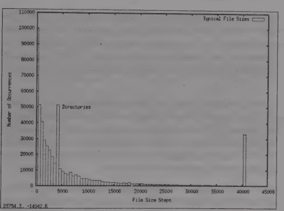

**图 9-2**

以字节为单位的文件大小

---
[^4]: 元数据是关于文件的数据，而非文件数据本身。示例包括文件的日期、时间、大小、使用的块等。
[^5]: 以这种方式转换文件系统应被视为仅限于开发活动。

从图 9-2 可以看出，文件大小的绝大部分集中在远低于 `10KB` 的水平。`4096` 处的峰值代表目录。目录项（也是文件本身）的长度恰好为 `4096` 字节，且数量众多。超过 `40,000` 字节的峰值是测量产生的假象。它统计的是大约 `40KB` 以上文件数量的计数，即测量量化的终点。值得注意的是，绝大多数文件都非常小。

小文件大小给闪存文件系统的设计者带来了独特的挑战。由于闪存必须每次擦除整个块，而且闪存的块大小通常是较小文件大小的许多倍，因此闪存容易受到耗时块重写的限制。例如，假设正在使用 `128KB` 的闪存块来容纳大约几十个 `4096` 字节或更小的文件。现在假设需要修改其中一个文件。这会导致闪存文件系统使整个 `128KB` 块失效，并将块中的每个文件重新写入到一个新擦除的块中。这可能是一个耗时的过程。

由于闪存写入可能耗时（远慢于硬盘写入），这增加了因突然断电而导致数据损坏的窗口期。意外断电在嵌入式系统中是常见事件。例如，如果在重写上一段中提到的 `128KB` 数据块期间断电，可能会导致该块中所有几十个文件丢失。

`JFFS2` 应运而生。上述讨论的问题以及其他问题在很大程度上已通过第二代日志闪存文件系统（`JFFS2`）的设计得到缓解或消除。最初的 `JFFS` 由瑞典的 `Axis Communications AB` 设计，专门针对当时常见的闪存设备。`JFFS` 了解闪存架构以及设备施加的更重要架构限制。

闪存文件系统的另一个问题是闪存具有有限的使用寿命。典型的闪存设备规格要求最少 `100,000` 次写入周期，而最近，`1,000,000` 次周期的设备已成为主流。此规格适用于闪存设备的每个块。这种不寻常的限制要求将写入操作均匀分布在闪存设备的块上。`JFFS2` 使用一种称为磨损平衡的技术来实现此功能。

构建 `JFFS2` 镜像相对简单。一如既往，必须确保内核支持 `JFFS2`，并且开发工作站包含 `mkfs.jffs2` 工具的兼容版本。`JFFS2` 镜像是从包含文件系统镜像所需文件的目录中构建的。清单 9-8 展示了为设计用作根文件系统的闪存设备配置的典型目录结构。

### 清单 9-8
`JFFS2` 文件系统的目录布局

```
$ ls -l

total 44

drwxr-xr-x  2 root root 4096 Aug 14 11:27 bin

drwxr-xr-x  2 root root 4096 Aug 14 11:27 dev

drwxr-xr-x  2 root root 4096 Aug 14 11:27 etc

drwxr-xr-x  2 root root 4096 Aug 14 11:27 home

drwxr-xr-x  2 root root 4096 Aug 14 11:27 lib

drwxr-xr-x  2 root root 4096 Aug 14 11:27 proc

drwxr-xr-x  2 root root 4096 Aug 14 11:27 root

drwxr-xr-x  2 root root 4096 Aug 14 11:27 sbin

drwxr-xr-x  2 root root 4096 Aug 14 11:27 tmp

drwxr-xr-x  2 root root 4096 Aug 14 11:27 usr

drwxr-xr-x  2 root root 4096 Aug 14 11:27 var

$
```

当填入适当的运行时文件后，此目录布局可作为 `mkfs.jffs2` 命令的模板。`mkfs.jffs2` 命令从目录树（如清单 9-8 所示）生成格式正确的 `JFFS2` 文件系统镜像。使用命令行参数将目录位置以及接收 `JFFS2` 镜像的输出文件名称传递给 `mkfs.jffs2`。默认情况下，从当前目录创建 `JFFS2` 镜像。清单 9-9 展示了构建 `JFFS2` 镜像的命令。

### 清单 9-9
`mkfs.jffs2` 命令示例

```
mkfs.jffs2 -d ./jffs2-image-dir -o jffs2.bin
ls -l
```


在我们示例中，清单 9-8 的目录结构和文件位于 `jffs2-image-dir` 目录中。我们任意选择从文件系统镜像所在的上级目录执行 `mkfs.jffs2` 命令。使用 `-d` 标志，我们告诉 `mkfs.jffs2` 命令文件系统模板的位置。使用 `-o` 标志为输出文件命名，结果生成的 JFFS2 镜像将写入该文件。生成的镜像 `jffs2.bin` 将在第 10 章“MTD 子系统”中，当我们检查 JFFS2 文件和 MTD 子系统时使用。

应该指出的是，任何支持写入操作的基于闪存的文件系统都面临可能导致底层闪存设备过早失效的条件。例如，启用配置为向基于闪存的文件系统写入数据的系统日志记录器（`syslogd` 和 `klogd`）可能会因持续写入而轻易使闪存设备不堪重负。某些类别的程序错误也可能导致持续写入。必须小心将闪存写入限制在闪存设备寿命允许范围内。

## 9.6 cramfs

根据 `cramfs` 项目的 `READ_ME` 文件，`cramfs` 的目标是“将文件系统压缩到小型 ROM 中”。`cramfs` 文件系统对于包含持有静态数据和程序的小型 ROM 或 FLASH 内存的嵌入式系统非常有用。再次引用 `cramfs` README 文件，“`cramfs` 旨在简单小巧，并且能很好地压缩内容。”

`cramfs` 文件系统是只读的。它使用名为 `mkcramfs` 的命令行实用程序创建。如果开发工作站上没有该实用程序，您可以从本章末尾的链接下载。与 JFFS2 一样，`mkcramfs` 从命令行指定的目录构建文件系统镜像。清单 9-10 详细说明了构建 `cramfs` 镜像的步骤。我们使用与清单 9-8 相同的文件系统结构来构建 JFFS2 镜像。

### 清单 9-10
`mkcramfs` 命令示例

```
#### mkcramfs

usage: mkcramfs [-h] [-v] [-b blksize] [-e edition] [-i file] [-n name] dirName outfile

  -h print this help

  -E make all warnings errors (non-zero exit status)

  -b blksize use this blocksize, must equal page size

  -e edition use edition number (part of fsid)

  -i file insert a file image into the filesystem (requires >= 2.4.0)

  -n name set name of cramfs filesystem

  -p pad by 512 bytes for boot code

  -s sort directory entries (old option, ignored)

  -v be more verbose

  -x make explicit holes (requires >= 2.3.39)

  dirName root of the directory tree to be compressed

  outfile output file

$ mkcramfs .../cramfs.image

warning: gids truncated to 8 bits (this may be a security concern)

$ ls -l .../cramfs.image

-rw-rw-rw- 1 chris chris 1019904 Sep 19 18:06 .../cramfs.image
```

最初在没有命令行参数的情况下发出 `mkcramfs` 命令以重现用法信息。由于没有该实用程序的 man 页面，这是了解其用法的最佳方式。随后，我们指定当前目录 `.` 作为 `cramfs` 文件系统文件的来源，并指定一个名为 `cramfs.image` 的文件作为目标，发出命令。最后，我们列出了刚创建的文件，看到一个名为 `cramfs.image` 的新文件。

请注意，如果内核配置了 `cramfs` 支持，您可以在 Linux 开发工作站上挂载此文件系统镜像并检查其内容。当然，由于它是只读文件系统，您无法修改它。清单 9-11 演示了在名为 `/mnt/flash` 的挂载点上挂载 `cramfs` 文件系统。

### 清单 9-11
检查 `cramfs` 文件系统

```
$ mount -o loop cramfs.image /mnt/flash

$ ls -l /mnt/flash

total 6

drwxr-xr-x 1 root root  704 Dec 31  1969 bin

drwxr-xr-x 1 root root    0 Dec 31  1969 dev

drwxr-xr-x 1 root root  416 Dec 31  1969 etc

drwxr-xr-x 1 root root    0 Dec 31  1969 home

drwxr-xr-x 1 root root  172 Dec 31  1969 lib

drwxr-xr-x 1 root root    0 Dec 31  1969 proc

drwx------ 1 root root    0 Dec 31  1969 root

drwxr-xr-x 1 root root  272 Dec 31  1969 sbin

drwxrwxrwt 1 root root    0 Dec 31  1969 tmp

drwxr-xr-x 1 root root  124 Dec 31  1969 usr

drwxr-xr-x 1 root root  212 Dec 31  1969 var
```

你可能已经注意到，在执行 `mkcrampfs` 命令时，出现了有关组 ID（GID）的警告信息。`crampf` 文件系统使用非常简明的元数据来减小文件系统的大小并提高执行速度。`crampf` 文件系统的其中一个“特性”是将组 ID 字段截断为 8 位。而 Linux 使用的是 16 位组 ID 字段。结果就是，组 ID 大于 255 的文件会被截断，并触发清单 9-10 中所示的警告。

尽管 `crampf` 文件系统在最大文件大小、最大文件数量等方面受到一定限制，但它非常适合引导 ROM，因为只读操作和快速压缩恰好是其理想特性。

## 9.7 网络文件系统

在 UNIX 环境中开发过的读者，无疑会对网络文件系统（Network File System，简称 NFS）非常熟悉。正确配置后，NFS 允许你在 NFS 服务器上导出一个目录，并像在本地文件系统中一样，将该目录挂载到远程客户端机器上。这在大型 UNIX/Linux 机器网络中非常有用，对于嵌入式开发者来说更是万全之策。在目标板卡上使用 NFS，嵌入式开发者可以在开发和调试期间访问大量的文件、库、工具和实用程序，即使目标嵌入式系统资源受限也是如此。

与其他文件系统一样，你的内核必须配置 NFS 支持，包括服务器端功能和客户端功能。NFS 服务器和客户端功能是在内核配置中独立配置的。

配置和调优 NFS 的详细说明超出了本书的范围，但简要介绍有助于说明 NFS 在嵌入式环境中有多有用。本章末尾的 9.11.1 节提供了关于 NFS 详细信息的指引，包括完整的 NFS-Howto。

在启用了 NFS 的开发工作站上，有一个文件包含你希望通过网络文件系统导出的每个目录的名称。在 Red Hat 和其他发行版中，此文件位于 `/etc` 目录中，名为 `exports`。清单 9-12 展示了一个示例 `/etc/exports`，这可能是在用于嵌入式开发的开发工作站上找到的。

### 清单 9-12
`/etc/exports` 的内容

```bash
$ cat /etc/exports

##### /etc/exports

/home/chris/sandbox/coyote-target *(rw,sync,no_root_squash)

/home/chris/workspace *(rw,sync,no_root_squash)

$
```

此文件包含 Linux 开发工作站上两个目录的名称。第一个目录包含用于 ADI Engineering Coyote 参考板的目标文件系统。第二个目录是一个通用工作区，包含针对嵌入式系统的项目。这是任意的；你可以按自己的意愿进行设置。

在启用了 NFS 的嵌入式系统上，以下命令将 NFS 服务器导出的 `.../workspace` 目录挂载到我们选择的挂载点：

```bash
$ mount -t nfs pluto:/home/chris/workspace /workspace
```


注意关于此命令的一些重要点。我们指示 `mount` 命令将一个远程目录（在一台名为 `pluto` 的机器上）挂载到一个名为 `/workspace` 的本地挂载点。为了使此语法生效，嵌入式目标必须满足两个要求。首先，为了识别符号机器名称 `pluto`，目标必须能够解析该符号名称。最简单的做法是在目标的 `/etc/hosts` 文件中放置一个条目。这允许网络子系统将符号名称解析为其对应的 IP 地址。目标 `/etc/hosts` 文件中的条目看起来像这样：

```text
192.168.10.9    pluto
```

第二个要求是嵌入式目标的根目录中必须有一个名为 `/workspace` 的目录。这被称为挂载点。之前的 `mount` 命令使 NFS 服务器的 `/home/chris/workspace` 目录的内容在嵌入式系统的 `/workspace` 路径上可用。

这非常有用，特别是在交叉开发环境中。假设你正在为你的嵌入式设备处理一个大项目。每次你对项目进行修改时，都需要将该应用程序移动到目标上以便测试和调试。按照上述方式使用 NFS，假设你在主机的 NFS 导出目录中工作，更改会立即在目标嵌入式系统上可用，无需上传新编译的项目文件。这可以大大加快开发速度。

### 9.7.1 基于 NFS 的根文件系统

将你的项目工作区挂载到目标嵌入式系统上对开发和调试非常有用，因为它便于快速访问更改和用于源码级调试的源代码。当目标系统资源严重受限时，这一点尤为有用。当你完全从 NFS 服务器挂载嵌入式系统的根文件系统时，NFS 作为开发工具的优势尽显。从清单 9-12 中，注意 `coyote-target` 条目。你开发工作站上的此目录可能包含数百或数千个与你的目标架构兼容的文件。

面向嵌入式系统的主要嵌入式 Linux 发行版提供了数万个为选定目标架构编译和测试的文件。为了说明这一点，清单 9-13 包含清单 9-12 中引用的 `coyote-target` 目录的目录列表。

#### 清单 9-13
#### 目标文件系统示例摘要

```bash
$ du -h --max-depth=1
724M . /usr
4.0K . /opt
39M . /lib
12K . /dev
27M . /var
4.0K . /tmp
3.6M . /boot
4.0K . /workspace
1.8M . /etc
4.0K . /home
4.0K . /mnt
8.0K . /root
29M . /bin
32M . /sbin
4.0K . /proc
64K . /share
855M .
$ find -type f | wc -l
29430
```

此目标文件系统包含了不到一吉字节的目标为 ARM 架构的二进制文件。从列表中可以看到，这超过了 29,000 个二进制、配置和文档文件。这几乎不可能装入嵌入式系统中常见的平均闪存设备！

这就是 NFS 根挂载的强大之处。出于开发目的，如果你的嵌入式系统加载了你在 Linux 工作站上熟悉的所有工具和实用程序，它只会提高生产力。事实上，可能几十个你从未见过的命令行工具和发展工具可以帮助你的开发计划节省时间。你将在第 13 章“开发工具”中了解更多关于这些有用工具的内容。

使你的嵌入式系统能够在启动时通过 NFS 挂载其根文件系统相对简单。首先，你必须为目标内核配置 NFS 支持。还有一个配置选项用于启用 NFS 远程目录的根挂载。这在图 9-3 中有所说明。

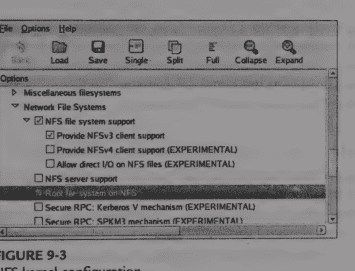

#### 图 9-3
NFS 内核配置

注意，已选择了 NFS 文件系统支持，以及“基于 NFS 的根文件系统”支持。选择这些内核配置参数后，剩下的就是 somehow 向内核传递信息，使其知道在哪里寻找 NFS 服务器。可以使用几种方法来实现这一点，有些方法取决于所选的目标架构和引导加载程序。至少，可以在内核命令行上传递适当的参数，以在开机时配置其 IP 端口和服务器信息。典型的内核命令行可能如下所示：

`console=ttyS0,115200 ip=bootp root=/dev/nfs`

这告诉内核期望通过 NFS 获取根文件系统，并从 BOOTP 服务器获取相关参数（服务器名称、服务器 IP 地址和要挂载的根目录）。这是项目开发阶段常见且极其有用的配置。如果你正在静态配置目标的 IP 地址，你的内核命令行可能如下所示：

```bash
console=ttyS0,115200 \
ip=192.168.1.139:192.168.1.1:192.168.1.1:255.255.255.0:coyote:eth0:off \
nfroot=192.168.1.1:/home/chris/sandbox/coyote \
root=/dev/nfs
```

当然，这一切都在一行上。`ip=` 参数定义在 `.../net/ipv4/ipconfig.c` 中，其语法如下，全部在一行上：

`ip=<client-ip>:<server-ip>:<gw-ip>:<netmask>:<hostname>:<device>:<PROTO>`

在这里，`client-ip` 是目标的 IP 地址；`server-ip` 是 NFS 服务器的地址；`gw-ip` 是网关（路由器），以防 `server-ip` 位于不同的子网；`netmask` 定义 IP 寻址类。`hostname` 是作为目标主机名传递的字符串；`device` 是 Linux 设备名称，例如 `eth0`；`PROTO` 定义用于获取初始 IP 参数的协议。

## 9.8 伪文件系统

在内核配置菜单中，有一些文件系统属于伪文件系统的类别。它们共同提供了一系列适用于广泛应用的功能。有关更多信息，特别是关于 `proc` 文件系统的信息，花一个下午时间探索这个有用的系统设施会有所帮助。在适当的地方，本章末尾的 9.11.1 节可以找到额外阅读材料的参考。

### 9.8.1 Proc 文件系统

`/proc` 文件系统因其原始目的而得名，这是一个允许内核通信关于 Linux 系统上每个运行进程的信息的接口。随着时间的推移，它已经发展成熟，提供了许多...

而非处理信息。此处我们仅介绍重点内容；关于 `/proc` 文件系统的完整讲解则留作读者的练习。

`/proc` 文件系统已成为除最简单 Linux 系统外所有系统的（即使是嵌入式系统）一种虚拟必需品。许多用户级功能依赖 `/proc` 文件系统的内容来完成其工作。例如，在未指定任何参数的情况下运行 `mount` 命令，会根据 `/proc/mounts` 提供的信息列出当前正在运行的系统上所有活跃的挂载点。如果 `/proc` 文件系统不可用，`mount` 命令将静默返回。列表 9-14 在 ADI Engineering Coyote 开发板上说明了这一点。

#### 列表 9-14
挂载对 `/proc` 的依赖

```
#### mount
rootfs on / type rootfs (rw)
/dev/root on / type nfs
(tw/v2,rsize=4096,wsize=4096,hard,udp,nolock,addr=192.168.1.19)
tmpfs on /dev/shm type tmpfs (rw)
/proc on /proc type proc (rw,nosuid)
< Now unmount proc and try again ...>
#### umount /proc
#### mount
#
```

请注意，在列表 9-14 中，`/proc` 本身被列为已挂载的文件系统，其类型为 `proc`，挂载在 `/proc` 上。这并非双关语；你的系统必须在顶级目录树中拥有一个名为 `/proc` 的挂载点，作为 `/proc` 文件系统的挂载目标。6 要挂载 `/proc` 文件系统，请像挂载其他文件系统一样使用 `mount` 命令：

```
$ mount -t proc /proc /proc
```

根据 `man` 手册页，`mount` 命令的一般形式为 `mount [-t fstype] something somewhere`。在上次调用中，我们可以用 `none` 替代 `/proc`，如下所示：

```
$ mount -t proc none /proc
```


> 6 当然，你可以将 `/proc` 挂载到文件系统中喜欢的任何位置，但所有需要 proc 的工具（包括 `mount` 本身）都期望它被挂载在 `/proc`。

这看起来不太像双关语了。`something` 参数并非严格必要，因为 `/proc` 是一个伪文件系统，而不是真正的物理设备。然而，像前面的例子那样指定 `/proc` 有助于提醒我们，我们正在将 `/proc` 文件系统挂载到 `/proc` 目录（或者更确切地说，是挂载到 `/proc` 挂载点）上。

当然，此时或许显而易见，要获得 `/proc` 文件系统的功能，必须在内核配置中启用它。此内核配置选项可以在“文件系统”子菜单中的“伪文件系统”类别中找到。

内核中运行的每个用户进程都由 `/proc` 文件系统中的一个条目表示。例如，第 6 章中介绍的 `init` 进程总是被分配进程 ID (`PID`) 为 1。`/proc` 文件系统中的进程由一个目录表示，该目录以 `PID` 数字作为其名称。例如，`PID` 为 1 的 `init` 进程将由 `/proc/1` 目录表示。列表 9-15 展示了在我们的嵌入式 Coyote 开发板上该目录的内容。

#### 列表 9-15
init 进程 `/proc` 条目

```
#### ls -1 /proc/1
total 0

-rw-------    1 root root    0 Jan  1 00:25 auxv

-r--r--r--    1 root root    0 Jan  1 00:21 cmdline

lrwxrwxrwx    1 root root    0 Jan  1 00:25 cwd -> /

-rw-r--r--    1 root root    0 Jan  1 00:25 environ

lrwxrwxrwx    1 root root    0 Jan  1 00:25 exe -> /sbin/init

dr-x------    2 root root    0 Jan  1 00:25 fd

-r--r--r--    1 root root    0 Jan  1 00:25 maps

-rw-r--r--    1 root root    0 Jan  1 00:25 mem

-r--r--r--    1 root root    0 Jan  1 00:25 mounts

-rw-r--r--    1 root root    0 Jan  1 00:25 oom_adj

-r--r--r--    1 root root    0 Jan  1 00:25 oom_score

lrwxrwxrwx    1 root root    0 Jan  1 00:25 root -> /

-r--r--r--    1 root root    0 Jan  1 00:21 stat

-r--r--r--    1 root root    0 Jan  1 00:25 statm

-r--r--r--    1 root root    0 Jan  1 00:21 task

dr-xr-xr-x    3 root root    0 Jan  1 00:25 status

-rw-r--r--    1 root root    0 Jan  1 00:25 wchan
```

这些条目存在于 `/proc` 文件中，针对每个正在运行的进程，包含许多有用的信息，特别是在分析和调试进程时。例如，`cmdline` 条目包含用于

## 9.8 伪文件系统

调用进程的完整命令行，包括任何参数。`cwd` 和 `root` 目录包含进程当前工作目录和当前根目录的视图。

对于系统调试来说，更有用的条目之一是 `maps`。它列出了分配给程序的每个虚拟内存段，以及每个段的属性。列表 9-16 展示了我们示例中 `init` 进程的 `/proc/1/maps` 的输出。

#### 列表 9-16
来自 `/proc` 的 `init` 进程内存段

```
#### cat /proc/1/maps
00008000-0000f000 r-xp 00000000 00:0a 9537567 /sbin/init

00016000-00017000 rw-p 00006000 00:0a 9537567 /sbin/init

00017000-0001b000 rwxp 00017000 00:00 0

40000000-40017000 r-xp 00000000 00:0a 9537183 /lib/ld-2.3.2.so

40017000-40018000 rw-p 40017000 00:00 0

4001f000-40028000 rw-p 00017000 00:0a 9537183 /lib/ld-2.3.2.so

40020000-40141000 r-xp 00000000 00:0a 9537518 /lib/libc-2.3.2.so

40141000-40148000 ---p 00121000 00:0a 9537518 /lib/libc-2.3.2.so

40148000-40144000 rw-p 00120000 00:0a 9537518 /lib/libc-2.3.2.so

40144000-4014f000 rw-p 40144000 00:00 0

befe8000-bf000000 rwxp befe8000 00:00 0
#
```

这些信息的实用性显而易见。你可以在前两个条目中看到 `init` 进程本身的程序段。你还可以看到 `init` 进程使用的共享库对象所使用的内存段。其格式如下：

`vstart-vmend attr pgoffset devname inode filename`

这里，`vstart` 和 `vmend` 分别是起始和结束虚拟内存地址；`attr` 指示内存区域属性，如读、写和执行，并告知该区域是否可共享；`pgoffset` 是该区域的页偏移量（一个内核虚拟内存参数）；`devname` 显示为 `xx:xx`，是内核对该内存区域关联的设备 ID 的表示。那些未与文件关联的内存区域也未与设备关联，因此显示为 `00:00`。最后两个条目是与给定内存区域关联的 `inode` 和文件。当然，如果没有文件，则没有与之关联的 `inode`，此时显示为零。这些通常是数据段。

为每个进程列出其他有用的条目。`status` 条目包含关于运行中进程的有用状态信息，包括诸如父进程 `PID`、用户和组 ID、虚拟内存使用统计、信号和权限等项目。更多详细信息可从章节末尾的参考资料中获得。

一些常用的 `/proc` 条目包括 `cpuinfo`、`meminfo` 和 `version`。`cpuinfo` 条目列出了内核关于系统中正在运行的处理器发现的属性。`meminfo` 条目提供关于系统总内存的统计信息。`version` 条目镜像了 Linux 内核版本字符串，以及用于构建内核的编译器和机器信息。

内核提供了更多有用的 `/proc` 条目；我们仅触及了此有用子系统表面。许多实用程序被设计用于提取和报告 `/proc` 文件系统中包含的信息。两个流行的例子是 `top` 和 `ps`，每个嵌入式 Linux 开发人员都应熟悉。这些将在第 13 章中介绍。用于与 `/proc` 文件系统交互的其他实用程序包括 `free`、`pkill`、`pmap` 和 `uptime`。更多详情请参见 `procps` 软件包。

### 9.8.2 sysfs

与 `/proc` 文件系统类似，`sysfs` 并不代表实际的物理设备。相反，`sysfs` 对特定的内核对象（如物理设备）进行建模，并提供了一种将设备与设备驱动程序关联的方法。典型 Linux 发行版中的某些代理依赖于 `sysfs` 上的信息。

通过直接查看 `sysfs` 导出的目录结构，我们可以了解导出了哪些类型的对象。列表 9-17 展示了我们的 Coyote 开发板上顶层 `/sys` 目录。

#### 列表 9-17
顶层 `/sys` 目录内容

```
$ dir /sys
total 0

drwxr-xr-x   21 root     root       0 Jan 1 00:00 block

drwxr-xr-x    6 root     root       0 Jan 1 00:00 bus

drwxr-xr-x   10 root     root       0 Jan 1 00:00 class

dr-xr-xr-x    5 root     root       0 Jan 1 00:00 devices

drwxr-xr-x    2 root     root       0 Jan 1 00:00 firmware

dr-xr-xr-x    2 root     root       0 Jan 1 00:00 kernel

drwxr-xr-x    5 root     root       0 Jan 1 00:00 module

drwxr-xr-x    2 root     root       0 Jan 1 00:00 power
```


如前所述，`sysfs` 为每个主要的系统设备类提供子目录，包括系统总线。例如，在 `block`（块）子目录下，每个块设备都由一个子目录项表示。顶级目录下的其他目录也是如此。

`sysfs` 存储的大多数信息采用了一种更适合机器而非人类阅读的格式。例如，要发现 PCI 总线上的设备，可以直接查看 `/sys/bus/pci` 子目录。在我们带有单个 PCI 设备（以太网卡）的 Coyote 板上，该目录看起来像这样：

```bash
$ ls /sys/bus/pci/devices/
0000:00:0f.0 -> ../../../../devices/pci0000:00/0000:00:0f.0
```

此条目实际上是一个指向 `sysfs` 目录树中另一个节点的符号链接。在此处，我们特意对 `ls` 的输出进行了格式化，以便在保持单行显示的同时说明这一点。该符号链接的名称是内核对 PCI 总线的表示，它指向名为 `pci0000:00`（即 PCI 总线表示）的 `devices` 子目录，其中包含若干子目录和文件，代表着这个特定 PCI 设备的属性。如你所见，这些数据相当难以发现和解析。

存在一个有用的实用程序用于浏览 `sysfs` 文件系统目录结构。它名为 `systool`，来自在 `sourceforge.net` 上可找到的 `sysfsutils` 包。以下是 `systool` 显示前述 PCI 总线的方式：

```bash
$ systool -b pci
Bus = "pci"
    0000:00:0f.0 8086:1229
```

再次看到了总线和设备（`0f`）的内核表示，但这次工具显示了从 `/sys/devices/pci0000:00/0000:00:0f.0` 分支（`/sys` 中存储这些属性的位置）获取的供应商 ID（`8086` = Intel）和设备 ID（`1229` = eepro100 以太网卡）。在不带参数运行的情况下，`systool` 会显示顶层系统层次结构。清单 9-18 是来自我们 Coyote 板的示例。

### 清单 9-18
`sysfs` 的输出

```bash
$ sysfs
Supported sysfs buses:
        i2c
        ide
        pci
        platform
Supported sysfs classes:
        block
        i2c-adapter
        i2c-dev
        input
        mem
        misc
        net
        pci_bus
        tty
Supported sysfs devices:
        pci0000:00
        platform
        system
```

从这个清单中可以看到，`sysfs` 提供了各种各样的系统信息。许多实用程序使用这些信息来确定系统设备的特征或执行系统策略，例如电源管理和热插拔功能。

## 9.9 其他文件系统

Linux 下支持众多文件系统。篇幅有限，无法涵盖所有。但是，你应该了解嵌入式系统中常见的一些其他重要文件系统。

`ramfs` 文件系统最好从实现它的 Linux 源代码模块的角度来理解。清单 9-19 复制了该文件的前几行。

### 清单 9-19
Linux `ramfs` 源代码模块注释

```c
/*
* Reusable simple ram filesystem for Linux.
*
* Copyright (C) 2000 Linus Torvalds.
    2000 Transmeta Corp.
*
* Usage limits added by David Gibson, Linuxcare Australia.
* This file is released under the GPL.
*/
/*
* NOTE! This filesystem is probably most useful
* not as a real filesystem, but as an example of
* how virtual filesystems can be written.
*
* It doesn't get much simpler than this. Consider
* that this file implements the full semantics of
* a POSIX-compliant read-write filesystem.
*/
```

编写此模块的主要目的是作为虚拟文件系统如何编写的示例。此文件系统与现代 Linux 内核中找到的 `ramdisk`（内存磁盘）功能的主要区别之一在于，它具有根据使用情况进行收缩和扩展的能力。`ramdisk` 不具备此特性。此源代码模块紧凑且编写精良。这里呈现它是为了其教育价值。鼓励大家学习这个优秀的示例。

`tmpfs` 文件系统与 `ramfs` 相似且相关。与 `ramfs` 一样，`tmpfs` 中的一切都存储在内核虚拟内存中，并且 `tmpfs` 的内容在断电或重启时丢失。`tmpfs` 文件系统适用于文件的快速临时存储。我在 `midi`/`音频` 应用程序中将 `tmpfs` 挂载到 `/tmp`，以加速音频子系统所需的临时对象的创建和删除。这也是保持 `/tmp` 目录整洁的好方法——其内容在每次重启时都会丢失。挂载 `tmpfs` 与其他虚拟文件系统类似：

```bash
# mount -t tmpfs /tmpfs /tmp
```

与其他虚拟文件系统（如 `/proc`）一样，之前挂载命令中的第一个参数 `/tmpfs` 是一个“空操作”（no-op）——也就是说，它可以是单词 `none` 并且仍然可以正常工作。不过，这是一个很好的提醒，表明你正在挂载一个名为 `tmpfs` 的虚拟文件系统。

## 9.10 构建简单文件系统

构建一个简单的文件系统映像很简单。这里我们演示使用 Linux 内核的回环设备（`loopback device`）。回环设备允许将普通文件用作块设备。简而言之，我们在普通文件中构建一个文件系统映像，并使用 Linux 回环设备像挂载任何其他块设备那样挂载该文件。

要构建一个简单的根文件系统，从一个包含全零的固定大小文件开始：

```bash
# dd if=/dev/zero of=.my-new-fs-image bs=1k count=512
```

此命令创建一个 `512KB` 的文件，其中除了零什么都没有。我们将文件填充为零，以便稍后有助于压缩，并为文件系统中的未初始化数据块提供一致的数据模式。使用 `dd` 命令时要小心。在没有边界（`count=`）或边界不当的情况下执行 `dd` 可能会填满你的硬盘并可能导致系统崩溃。`dd` 是一个强大的工具；请像对待它应有的尊重那样使用它。以 root 身份执行 `dd` 等命令时的简单打字错误已摧毁了无数文件系统。

当我们获得新的映像文件后，我们实际上需要格式化该文件，使其包含特定文件系统定义的数据结构。在此示例中，我们构建了一个 `ext2` 文件系统。清单 9-20 详细说明了该过程。

### 清单 9-20
创建 `ext2` 文件系统映像

```bash
# /sbin/mke2fs .my-new-fs-image
mke2fs 1.35 (28-Feb-2004)
.my-new-fs-image is not a block special device.
Proceed anyway? (y,n) y
Filesystem label=
OS type: Linux
Block size=1024 (log=0)
Fragment size=1024 (log=0)
64 inodes, 512 blocks
25 blocks (4.88%) reserved for the super user
First data block=1
1 block group
8192 blocks per group, 8192 fragments per group
64 inodes per group
Writing inode tables: done
Writing superblocks and filesystem accounting information: done
This filesystem will be automatically checked every 24 mounts or 180 days, whichever comes first. Use tune2fs -c or -i to override.
#
```


与 `dd` 一样，`mke2fs` 命令可能会破坏你的系统，因此请小心使用。在此示例中，我们要求 `mke2fs` 格式化一个文件，而不是其原本打算使用的硬盘分区（块设备）。因此，`mke2fs` 检测到了这一事实并要求我们确认操作。确认之后，`mke2fs` 开始向该文件写入 ext2 超级块和文件系统数据结构。然后，我们可以使用 Linux 回环设备像挂载任何其他块设备一样挂载此文件：

```bash
mount -o loop ./my-new-fs-image /mnt/flash
```

此命令将文件 `./my-new-fs-image` 作为文件系统挂载到名为 `/mnt/flash` 的挂载点上。挂载点名称并不重要；你可以将其挂载到任何你喜欢的地方，只要该挂载点存在即可。使用 `mkdir` 创建你的挂载点。

一旦新建的映像文件作为文件系统挂载成功，我们就可以自由地对其进行更改。我们可以添加和删除目录，创建设备节点等。我们可以使用 `tar` 将文件复制或移出。更改完成后，它们会被保存在文件中，前提是你没有超出设备大小。请记住，使用此方法时，大小在创建时即固定且无法更改。

## 9.11 本章小结

- 分区是物理设备的逻辑划分。Linux 下支持多种分区类型。
- 在 Linux 中，文件系统挂载在挂载点上。根文件系统挂载在文件系统层级的根目录，并被称为 `/`。
- 流行的 ext2 文件系统成熟且快速，经常出现在嵌入式和其他 Linux 系统中，例如 Red Hat 和 Fedora Core 系列。
- ext3 文件系统基于 ext2 文件系统增加了日志记录功能，以提供更好的数据完整性和系统可靠性。
- ReiserFS 是另一种流行的高性能日志记录文件系统，出现在许多嵌入式和其他 Linux 系统中。
- JFFS2 是优化用于 Flash 内存的日志记录文件系统。它包含有利于 Flash 的功能，例如磨损平衡以延长 Flash 内存的使用寿命。

### 9.11.1 额外阅读建议

- `cramfs` 是一个只读文件系统，非常适合小型系统的启动 ROM 以及其他只读程序和数据。
- `NFS` 是嵌入式开发者最强大的开发工具之一。它可以将工作站的能力带入你的目标设备。学习如何将 NFS 用作嵌入式目标的根文件系统。其便利性和节省的时间将物有所值。
- Linux 上有很多伪文件系统可用。这里介绍了一些更重要的伪文件系统，包括 proc 文件系统和 sysfs。
- 基于 RAM 的 tmpfs 文件系统有许多嵌入式系统用途。与传统 ramdisk 相比，其最显著的改进是能够动态调整自身大小以满足操作需求。

**“第二代扩展文件系统（ext2）的设计与实现”**
Rémy Card、Theodore Ts'o 和 Stephen Tweedie
首次发表于 *第一届荷兰国际 Linux 研讨会* 论文集
可在 http://e2fsprogs.sourceforge.net/ext2intro.html 获取

**“非技术视角下的 EXT2 文件系统内部结构”**
Randy Appleton
www.linuxgazette.com/issue21/ext2.html

**白皮书：*Red Hat 的新日志文件系统：ext3***
Michael K. Johnson
www.redhat.com/support/wpapers/redhat/ext3/

**ReiserFS 主页**
www.namesys.com/

**“JFFS：日志式闪存文件系统”**
David Woodhouse
http://sources.redhat.com/jffs2/jffs2.pdf

**cramfs 项目的 README 文件**
无署名（假设为项目作者）
http://sourceforge.net/projects/cramfs/

**NFS 主页**
http://nfs.sourceforge.net

**/proc 文件系统文档**
www.tldp.org/LDP/lkmpg/2.6/html/c7/12.htm

***文件系统性能：Solaris 操作系统、UFS、Linux ext3 和 ReiserFS***
一份技术白皮书
Dominic Kay
www.sun.com/software/whitepapers/solaris10/fs_performance.pdf

# 第 10 章

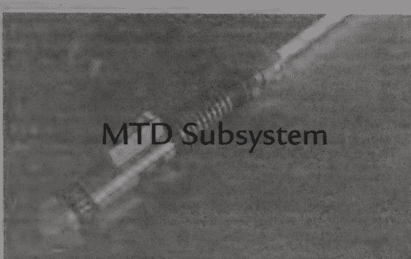

## 本章内容

- 启用 MTD 服务
- MTD 基础知识
- MTD 分区
- MTD 工具
- 章节总结

内存技术设备（MTD）子系统的出现源于支持各种类似内存设备（如闪存芯片）的需求。市场上有多种不同类型的闪存芯片，以及许多编程方法，部分原因在于支持了许多专用和高性能模式。MTD 层架构使得低层设备复杂性可以与使用内存设备的高层数据组织和存储格式分离。

在本章中，我们介绍 MTD 子系统，并提供一些简单的使用示例。首先，我们查看内核支持 MTD 服务所需的配置。我们介绍了在启用了 MTD 的开发工作站上进行的一些简单操作，以此作为理解该子系统基础的方法。在本章中，我们将整合 MTD 和 JFFS2 文件系统。

接下来，我们介绍与 MTD 层相关的分区概念。我们考察了从引导加载程序构建分区的细节，以及它们是如何被 Linux 内核检测到的。本章继续简要介绍 MTD 工具。最后，我们将所有内容整合起来，使用闪存中的 JFFS2 文件系统映像启动目标板。

### 10.1 启用 MTD 服务

要使用 MTD 服务，我们的内核必须配置为启用 MTD。MTD 有许多配置选项，其中一些可能会令人困惑。理解众多选择的最佳方法是简单地开始使用它们。为了说明 MTD 子系统的机制以及它如何融入系统，我们从一些非常简单的示例开始，你可以在 Linux 开发工作站上执行这些操作。图 10-1 显示了启用最基本的 MTD 功能所需的内核配置（通过通常的 `make ARCH=<arch> xconfig` 调用）。列表 10-1 显示了由图 10-1 中所示选择产生的 `.config` 文件条目。

#### 列表 10-1
**.config 中的基本 MTD 配置**

```
CONFIG_MTD=y
CONFIG_MTD_CHAR=m
CONFIG_MTD_BLOCK=m
CONFIG_MTD_MTDRAm=y
CONFIG_MTDRAm_TOTAL_SIZE=8192
CONFIG_MTDRAm_ERASE_SIZE=128
```

MTD 子系统通过第一个配置选项启用，该选项通过图 10-1 中显示的第一个复选框（内存技术设备 (MTD) 支持）选中。图 10-1 中配置中的下两个条目启用了从用户空间对 MTD 设备（如闪存）进行特殊的设备级访问。第一个（`CONFIG_MTD_CHAR`）启用字符设备模式访问，本质上是以逐字节顺序读写为特征的顺序访问。第二个（`CONFIG_MTD_BLOCK`）启用以块设备模式访问 MTD 设备，这是磁盘驱动器使用的访问方法，一次读取或写入多字节数据块。这些访问模式允许使用熟悉的 Linux 命令读写闪存中的数据，正如你稍后将要看到的。

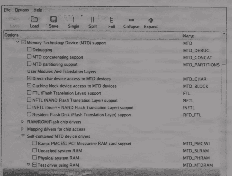

**图 10-1**
MTD 配置

`CONFIG_MTD_MTDRA` 元素启用了一个特殊的测试驱动程序，即使我们没有可用的 MTD 设备（如闪存），也可以让我们检查 MTD 子系统。与此配置选择相关联的是 RAM 基于测试驱动程序的参数：设备大小和擦除大小。在此示例中，我们指定了 8192KB 的总大小和 128KB 的擦除大小。此测试驱动程序的目标是模拟闪存设备，主要促进 MTD 子系统的测试和开发。由于闪存是使用固定大小的擦除块架构设计的，测试驱动程序也包含擦除块的概念。你稍后会看到如何使用这些参数。

##### 10.1.1 构建 MTD

任何近期的 Linux 内核快照都包含 MTD。然而，如果你需要利用自你的内核版本发布以来添加的 MTD 功能，你必须下载并构建 MTD 驱动程序和工具。由于 MTD 包既包含内核组件又包含用户空间程序，将 MTD 包放在单独的项目目录中并将其连接到你的内核源代码树是有用的。整合 MTD 和你的内核源代码树的最简单方法是使用 MTD 包提供的脚本。

从本章末尾给出的位置下载 MTD 包。使用 `tar` 工具将存档解压到你选择的目录中。进入该目录并运行 `patchkernel.sh` 脚本。该脚本提供几个选项。不带参数执行脚本以获取详细用法说明。列表 10-2 显示了如何安装内核组件。

###### 列表 10-2
**为 MTD 修补内核**

```
$ ./patchkernel.sh -2 ../sources/linux-2.6.10-mtd
Patching ../sources/linux-2.6.10-mtd
Include JFFS2 file system: jffs2
Include JFFS3 file system (experimental): no
```


Method: in

<< Will actually create symbolic links

Can we start now ? [y/N]y

$

```

使用 `-2` 参数调用 `patchkernel.sh` 脚本表示我们需要支持 JFFS2 文件系统。我们将内核源目录路径提供为 `.../sources/linux-2.6.10-mtd`。默认情况下，`patchkernel.sh` 不会将任何文件复制到内核源目录。相反，它从内核源代码树创建指向 MTD 子目录本身的符号链接。这样，你可以为开发工作站上的任意数量的内核维护一个共同的 MTD 源代码树。这允许 MTD 内核驱动程序使用内核构建系统进行构建，包括有关你特定内核配置的信息。

### 10.2 MTD 基础知识

现在我们已经在内核中启用了简单的 MTD 配置，我们可以检查该子系统如何在我们的 Linux 开发工作站上工作。使用上一节中配置的测试 RAM 驱动程序，我们可以使用 MTD 设备挂载 JFFS2 映像。假设你按照第 9 章“文件系统”中的详细说明创建了 JFFS2 映像，你可能会想挂载并检查它。Linux 内核不支持直接在回环设备上挂载 JFFS2 文件系统映像，如 ext2 和其他文件系统映像所支持的那样。因此，我们必须使用另一种方法。这可以通过在启用了 MTD 的开发 Linux 工作站上使用 MTD RAM 测试驱动程序来实现，如图 10-1 所示。列表 10-3 说明了步骤。

#### 列表 10-3
**在 MTD RAM 设备上挂载 JFFS2**

```
#### modprobe jffs2

#### modprobe mtdblock

#### modprobe mtdram

#### dd if=jffs2.bin of=/dev/mtdblock0

4690+1 records in

4690+1 records out

#### mkdir /mnt/flash

#### mount -t jffs2 /dev/mtdblock0 /mnt/flash

#### ls -l /mnt/flash

total 0

drwxr-xr-x 2 root root 0 Sep 17 22:02 bin

drwxr-xr-x 2 root root 0 Sep 17 21:59 dev

drwxr-xr-x 7 root root 0 Sep 17 15:31 etc

drwxr-xr-x 2 root root 0 Sep 17 15:31 home

drwxr-xr-x 2 root root 0 Sep 17 15:31 proc

drw------- 2 root root 0 Sep 17 15:31 root

drwxr-xr-x 2 root root 0 Sep 17 22:02 sbin

drwxrwxrwt 2 root root 0 Sep 17 15:31 tmp

drwxr-xr-x 2 root root 0 Sep 17 15:31 usr

drwxr-xr-x 14 root root 0 Sep 17 15:31 var

#
```

从清单 10-3 中，首先我们安装 Linux 内核所需的、用于支持 JFFS2 和 MTD 子系统的可加载模块。我们加载 JFFS2 模块，随后加载 `mtdblock` 和 `mtdram` 模块。在必要的设备驱动程序加载完成后，我们使用 Linux 的 `dd` 命令，通过 `mtdblock` 设备将我们的 JFFS2 文件系统镜像复制到 MTD RAM 测试驱动程序中。本质上，我们正使用系统 RAM 作为支持设备来模拟一个 MTD 块设备。

在我们的 JFFS2 文件系统镜像被复制到 MTD 块设备后，我们可以使用 `mount` 命令按清单 10-3 所示的方式挂载它。在 MTD 伪设备被挂载后，我们可以以任何选择的方式操作该 JFFS2 文件系统镜像。使用此方法的唯一限制是我们无法扩大镜像的大小。镜像的大小受两个因素限制。首先，当我们配置 MTD RAM 测试设备时，我们为其设定的最大尺寸为 8MB。¹ 其次，当我们创建 JFFS2 镜像时，我们使用 `mkfs.jffs2` 实用工具固定了镜像的大小。镜像的大小由我们在创建时指定的目录内容决定。请回顾第 9 章的清单 9-9，以回忆我们的 `jffs2.bin` 镜像是如何构建的。

认识到使用此方法检查 JFFS2 文件系统内容的局限性很重要。考虑一下我们所做的事情：我们将一个文件的内容（JFFS2 文件系统二进制镜像）复制到一个内核块设备（`/dev/mtdblock0`）中。然后我们将该内核块设备（`/dev/mtdblock`）作为 JFFS2 文件系统挂载。完成这些操作后，我们可以使用所有传统的文件系统实用工具来检查甚至修改该文件系统。像 `ls`、`df`、`du`、`mv`、`rm` 和 `cp` 这样的工具都可以用来检查和修改文件系统。然而，与回环设备不同，我们复制的文件与已挂载的 JFFS2 文件系统镜像之间没有连接。因此，如果我们在进行更改后卸载文件系统，这些更改将会丢失。如果想保存更改，必须将它们复制回文件中。其中一种方法如下所示：

```
#### dd if=/dev/mtdblock0 of=your-modified-fs-image.bin
```

此命令创建一个名为 `your-modified-fs-image.bin` 的文件，其大小与配置时指定的 `mtdblock0` 设备相同。在我们的例子中，它将 是 8MB。由于缺乏合适的 JFFS2 编辑设施，这是一种检查并修改 JFFS2 文件系统的完全有效的方法。更重要的是，它说明了 MTD 子系统的原理，且无需在开发系统上使用真实的 Flash 内存。现在让我们看看一些包含 Flash 物理设备的硬件。

> ¹ 该大小是在我们在 Linux 内核配置中启用 MTD RAM 测试设备时，在内核配置中固定的。

### 10.2.1 配置 MTD

要在板上的 Flash 内存上使用 MTD，必须正确配置 MTD。以下列表包含为板、Flash 和 Flash 布局配置 MTD 时必须满足的要求。

- 指定 Flash 设备上的分区
- 指定 Flash 的类型和位置
- 为选定的芯片配置合适的 Flash 驱动程序
- 使用适当的驱动程序配置内核

这些步骤中的每一步都在以下各节中详细探讨。

## 10.3 MTD 分区

给定硬件平台上大多数 Flash 设备被划分为几个部分，称为分区，类似于典型桌面工作站硬盘上的分区。MTD 子系统提供对这种 Flash 分区的支持。必须配置 MTD 子系统以支持 MTD 分区。图 10-2 说明了 MTD 分区支持的配置选项。

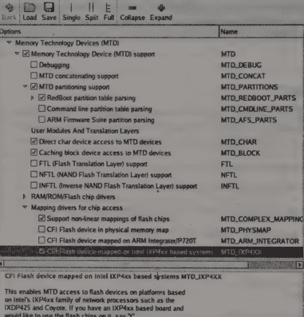

**图 10-2**
MTD 分区支持的内核配置

存在几种将分区数据传递给 Linux 内核的方法。当前支持以下几种方法。你可以在图 10-2 的 MTD 分区支持下查看每种方法的配置选项。

- Redboot 分区表解析
- 内核命令行分区表定义
- 板特定映射驱动程序

MTD 还允许没有分区数据的配置。在这种情况下，MTD 仅将整个 Flash 内存视为单个设备。

### 10.3.1 Redboot 分区表分区

定义和检测 MTD 分区的一种较常见方法源自于早期实现之一：Redboot 分区。Redboot 是许多嵌入式板上发现的引导加载程序，尤其是像 ADI Engineering Coyote 参考平台这样的 ARM XScale 板。

MTD 子系统定义了一种在 Flash 设备本身存储分区信息的方法，概念类似于硬盘上的分区表。在 Redboot 分区的情况下，开发者预留并指定一个 Flash 擦除块来保存分区定义。选择一个映射驱动程序，该驱动程序在启动期间调用分区解析函数以检测 Flash 设备上的分区。图 10-2 显示了我们的示例板的映射驱动程序；它是定义 `CONFIG_MTD_IXP4XX` 的最后一个高亮条目。

照例，仔细查看示例有助于阐明这些概念。我们首先查看 Coyote 平台上 Redboot 引导加载程序提供的信息。清单 10-4 捕获了 Redboot 引导加载程序在开机时输出的一部分。

**清单 10-4**
**开机时的 Redboot 消息**

```
Platform: ADI Coyote (XScale)

IDE/Parallel Port CPLD Version: 1.0

Copyright (C) 2000, 2001, 2002, Red Hat, Inc.

RAM: 0x00000000-0x04000000, 0x0001f960-0x03fd1000 available

FLASH: 0x50000000 - 0x51000000, 128 blocks of 0x00020000 bytes each.

...
```


这告诉我们，该板上的 RAM 物理映射从地址 `0x00000000` 开始，而 Flash 映射在物理地址 `0x50000000` 到 `0x51000000` 之间。我们还可以看到 Flash 有 128 个块，每个块为 `0x00020000`（128KB）。

Redboot 包含一个用于创建和显示 Flash 上分区信息的命令。清单 10-5 包含 `fis list` 命令的输出，这是 Redboot 引导加载程序中可用的 Flash Image System 命令族的一部分。

### 清单 10-5
**Redboot Flash 分区列表**

```
RedBoot> fis list

Name FLASH addr Mem addr Length Entry point

RedBoot 0x50000000 0x50000000 0x00006000 0x00000000

RedBoot config 0x50FC0000 0x50FC0000 0x00001000 0x00000000

FIS directory 0x50FB0000 0x50FE0000 0x00002000 0x00000000

RedBoot>
```

从清单 10-5 中，我们可以看到 Coyote 板在 Flash 上定义了三个分区。名为 RedBoot 的分区包含可执行的 Redboot 引导加载程序镜像。名为 RedBoot config 的分区包含由引导加载程序维护的配置参数。最后一个名为 FIS directory 的分区保存有关分区表本身的信息。

在正确配置的情况下，Linux 内核可以检测并解析此分区表，并创建代表 Flash 上物理分区的 MTD 分区。清单 10-6 重现了上述 ADI Engineering Coyote 板启动时输出的启动消息的一部分，该板启动的 Linux 内核配置了对检测 Redboot 分区的支持。

### 清单 10-6
**Linux 启动时检测 Redboot 分区**

```
...
IXP4XX-Flash0: Found 1 x16 devices at 0x0 in 16-bit bank
 Intel/Sharp Extended Query Table at 0x0031
 Using buffer write method
 cfi_cmdset_0001: Erase suspend on write enabled
 Searching for RedBoot partition table in IXP4XX-Flash0 at offset 0xfe0000
 3 RedBoot partitions found on MTD device IXP4XX-Flash0
 Creating 3 MTD partitions on "IXP4XX-Flash0":
 0x00000000-0x00006000 : "RedBoot"
 0x000fc000-0x000fc1000 : "RedBoot config"
 0x000fe000-0x00100000 : "FIS directory"
...
```

清单 10-6 中的第一条消息是在通过通用闪存接口（CFI）驱动程序检测到 Flash 芯片时打印的，该驱动程序通过 `CONFIG_MTD_CFI` 启用。CFI 是确定闪存芯片特征的行业标准方法，例如制造商、设备类型、总大小和擦除块大小。请参阅本章末尾第 10.5.1 节“附加阅读建议”，其中提供了 CFI 规范的指引。

CFI 通过内核配置实用程序在 *Memory Technology Devices (MTD)* 顶级菜单下启用。在 *RAM/ROM/Flash* 芯片驱动下，选择 *Detect flash chips by Common Flash Interface (CFI)* 探针，如图 10-3 所示。

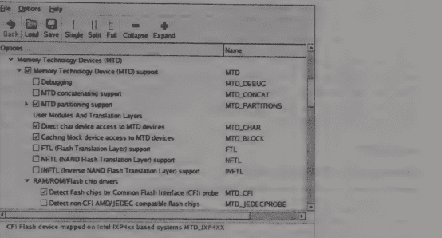

**图 10-3**  
用于 MTD CFI 支持的内核配置

如清单 10-6 所示，Flash 芯片通过 CFI 接口进行检测。由于我们还启用了 `CONFIG_MTD_REDBOOT_PARTS`（参见图 10-2），MTD 会扫描 Flash 芯片上的 Redboot 分区表。请注意，该芯片已被枚举，设备名称为 *ixp4xx-Flash0*。您可以从清单 10-6 中看出，Linux 内核已检测到 Flash 芯片上的三个分区，正如之前使用 Redboot 中的 `fis list` 命令所枚举的那样。

当基础设施如本文所述那样就位后，Linux 内核会自动检测并创建代表这三个 Flash 分区的内核数据结构。在内核完成初始化后，可以在 `/proc` 文件系统中找到这些证据，如清单 10-7 所示。

### 清单 10-7
**内核 MTD Flash 分区**

```
root@coyote:~# cat /proc/mtd
dev:    size   erasesize  name
mtd0: 00060000 00020000 "RedBoot"
mtd1: 00001000 00020000 "RedBoot config"
mtd2: 00020000 00020000 "FIS directory"
```

我们可以轻松创建一个新的 Redboot 分区。我们在本例中使用 Redboot FIS 命令，因此本书中不详细介绍 Redboot 命令。但是，感兴趣的读者可以查阅本章末尾 10.5.1 节中列出的 Redboot 用户文档。清单 10-8 显示了创建新 Redboot 分区的详细信息。

### 清单 10-8
**创建新的 Redboot 分区**

```
RedBoot> load -r -v -b 0x0108000  coyote-40-z=Image
Using default protocol (TFTP)
Raw file loaded 0x01080000-0x0114dccb, assumed entry at 0x01080000
RedBoot> fis create -b 0x01008000 -l 0x014c5d0 -f 0x50100000 MyKernel
 ... Erase from 0x50100000-0x50260000: ............
 ... Program from 0x01080000-0x0114dcb0 at 0x50100000: ............
 ... Unlock from 0x50fe0000-0x51000000: .
 ... Erase from 0x50fe0000-0x51000000: .
 ... Program from 0x03ff0000-0x03fffe00 at 0x50fe0000:
 ... Lock from 0x50fe0000-0x51000000:
```

首先，我们加载将用于创建新分区的映像。我们在本例中使用内核映像。我们将其加载到内存地址 `0x01080000`。然后，我们使用 Redboot `fis create` 命令创建新分区。我们已指示 Redboot 在从 `0x50100000` 开始的 Flash 区域中创建新分区。您可以看到 Redboot 首先擦除该 Flash 区域，然后写入内核映像。在最后的序列中，Redboot 解锁其目录区域，并更新 FIS 目录以包含新分区信息。清单 10-9 显示了带有新分区的 `fis list` 输出。请将其与清单 10-5 中的输出进行比较。

### 清单 10-9
新 Redboot 分区列表

```
RedBoot> fis list
```

| 名称 | Flash 地址 | 内存地址 | 长度 | 入口点 |
| :--- | :--- | :--- | :--- | :--- |
| RedBoot | 0x50000000 | 0x50000000 | 0x00060000 | 0x00000000 |
| RedBoot config | 0x50FC0000 | 0x50FC0000 | 0x00001000 | 0x00000000 |
| FIS directory | 0x50FE0000 | 0x50FE0000 | 0x00020000 | 0x00000000 |
| MyKernel | 0x50100000 | 0x50100000 | 0x00160000 | 0x00100000 |

当然，当我们启动 Linux 内核时，它会发现这个新分区，我们可以按需对其进行操作。精明的读者可能已经意识到这个新分区的另一个好处：我们现在可以从 Flash 而不是每次都通过 tftp 加载来启动内核。命令如下所示。只需将分区的 Flash 起始地址和要传输到 RAM 的映像长度作为参数传递给 Redboot `exec` 命令即可。

```
RedBoot> exec -b 0x50100000 -l 0x145cd0
Uncompressing Linux...done, booting the kernel.
```


### 10.3.2 内核命令行分区

如 10.3 节“MTD 分区”中所述，原始 Flash 分区信息可以通过其他方法传递给内核。事实上，最直接的方法（尽管可能不是最简单的方法）是手动直接在内核命令线上传递分区信息。当然，正如我们之前所学，一些引导加载器使这变得很容易（例如 `U-Boot`），而其他引导加载器则在启动时没有向内核传递内核命令行的机制。在这些情况下，内核命令行必须在编译时配置，因此更改起来更加困难，每次修改分区时都需要重新编译内核本身。

要在 MTD 子系统中启用命令行分区，您的内核必须配置为此支持。您可以在图 10-2 的 MTD 分区支持部分看到此配置选项。选择用于解析命令行分区表的选项，该选项定义了 `CONFIG_MTD_CMDLINE_PARTS` 选项。

清单 10-10 显示了在内核命令线上定义分区的格式（摘自 `.../drivers/mtd/cmdlinepart.c`）。

**清单 10-10**
**内核命令行 MTD 分区格式**

```
mtdparts=<mtddev>[;<mtddef>]

* <mtddef>     := <mtd-id>[:<partdef>][;<partdef>]

* <partdef>    := <size>[<offset>][<name>][ro]

* <mtd-id>     : 用于映射驱动/设备 (mtd-name) 的唯一名称

* <size>       : 标准 Linux 内存大小，或者 "-" 表示所有剩余空间

* <name>       : ' NAME '
```

通过内核命令行传递的每个 `mtddef` 参数定义一个单独的分区。如清单 10-10 所示，每个 `mtddef` 定义包含多个部分。您可以指定唯一的 ID、分区大小以及从 Flash 开始处的偏移量。您还可以传递分区名称，并可选地传递只读属性。参考我们在清单 10-5 中的 Redboot 分区定义，我们可以如下在内核命令线上静态定义这些分区：

```
mtdparts=MainFlash:384K(Redboot),4K(config),128K(FIS),-(unused)
```

使用此定义，内核将实例化四个 MTD 分区，其 MTD ID 为 `MainFlash`，包含的大小和布局与在清单 10-5 中发现的大小和布局相匹配。

### 10.3.3 映射驱动

定义您的板级特定 Flash 布局的最终方法是使用专用的板级特定映射驱动。Linux 内核源代码树中包含许多映射驱动示例，位于 `.../drivers/mtd/maps`。其中任何一个都是创建您自己的驱动的良好示例。实现细节因架构而异。

映射驱动是一个合适的内核模块，包含 `module_init()` 和 `module_exit()` 调用，如第 8 章“设备驱动程序基础”中所述。典型的映射驱动很小且易于浏览，通常包含不到几十行 C 代码。

清单 10-11 复制了 `.../drivers/mtd/maps/pq2fads` 的一部分。此映射驱动定义了 Freescale PQ2FADS 评估板上的 Flash 设备，该板支持 MPC8272 和其他处理器。

**清单 10-11**
**PQ2FADs Flash 映射驱动**

```c
static struct mtd_partition pq2fads_partitions[] = {

	{
#define CONFIG_ADS8272

		.name		= "HRCW",

		.size		= 0x040000,

		.offset	= 0,

		.mask_flags = MTD_WRITEABLE,	/* force read-only */
	}, {
		.name		= "User FS",

		.size		= 0x5c0000,

		.offset	= 0x40000,

	}
#else
		.name		= "User FS",

		.size		= 0x060000,

		.offset	= 0,
#endif
	}, {
		.name		= "uImage",

		.size		= 0x010000,

		.offset	= 0x600000,

		.mask_flags = MTD_WRITEABLE,	/* force read-only */
	}, {
		.name		= "bootLoader",

		.size		= 0x040000,

		.offset	= 0x700000,

		.mask_flags = MTD_WRITEABLE,	/* force read-only */
	}, {
		.name		= "bootLoader env",

		.size		= 0x40000,

		.offset	= 0x740000,

		.mask_flags = MTD_WRITEABLE,	/* force read-only */
	}
};

/* pointer to MPC855ADS board info data */
extern unsigned char __res[];

static int __init init_pq2fads_mtd(void)
{
	bd_t *bd = (bd_t *)__res;
	physmap_configure(bd->bi_flashstart, bd->bi_flashsize,
					PQ2FADS_BANK_WIDTH, NULL);
	physmap_set_partitions(pq2fads_partitions,
					sizeof (pq2fads_partitions)/
					sizeof (pq2fads_partitions[0]));
```

（续）

### 10.3.4 Flash 芯片驱动程序

MTD 支持各种各样的 Flash 芯片和设备。你选定的芯片很可能也已被支持。最常见的 Flash 芯片支持前文提到的通用闪存接口（`CFI`）。较旧的 Flash 芯片可能支持 JEDEC，这是一种较旧的闪存兼容性标准。图 10-4 展示了来自最新 Linux 内核快照的内核配置。该版本支持许多类型的闪存。

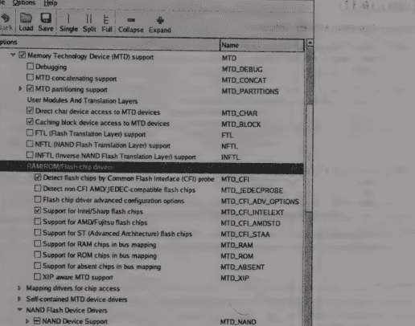

#### 图 10-4
Flash 设备支持

如果你的 Flash 芯片不受支持，你必须自己提供一个设备文件。以 `../drivers/mtd/chips` 中的众多示例之一作为起点，自定义或创建你自己的 Flash 设备驱动程序。更甚的是，除非该芯片刚刚引入且具有某种混乱的接口，否则很有可能已经有人编写了驱动程序。

### 10.3.5 特定于板卡的初始化

除了映射驱动程序外，你的特定于板卡（平台）的设置必须提供基础定义，以实现 MTD Flash 系统的正确操作。清单 10-12 复现了 `../arch/arm/mach-1px4xxx/coyote-setup.c` 的相关部分。

#### 清单 10-12
**Coyote 特定板卡设置**

```
static struct flash_platform_data coyote_flash_data = {
  .map_name = "cfi_probe",
  .width = 2,
};

static struct resource coyote_flash_resource = {
  .start = COYOTE_FLASH_BASE,
  .end = COYOTE_FLASH_BASE + COYOTE_FLASH_SIZE - 1,
  .flags = IORESOURCE_MEM,
};

static struct platform_device coyote_flash = {
  .name = "IXP42X-Flash",
  .id = 0,
  .dev = {
    .platform_data = &coyote_flash_data,
  },
  .num_resources = 1,
  .resource = &coyote_flash_resource,
};

...

static struct platform_device *coyote_devices[] __initdata = {
  &coyote_flash,
  &coyote_uart
};

static void __init coyote_init(void)
{
  ...
  platform_add_devices(coyote_devices,
                       ARRAY_SIZE(coyote_devices));
}
...
```


在清单 10-12 中，仅复现了 `coyote-setup.c` 平台初始化文件的相关部分。从底部开始，`coyote_init()` 函数调用 `platform_add_devices()`，指定在此文件前面定义的 Coyote 特定设备。你会注意到在 `coyote_init()` 例程上方定义了两个设备。我们在本次讨论中感兴趣的是 `coyote_flash`。这个 `struct platform_device` 类型的结构体包含了 Linux 内核和 MTD 子系统所需的所有重要细节。

`coyote_flash` 结构体中的 `.name` 成员将我们的平台特定 Flash 资源绑定到同名的映射驱动程序。你可以在映射驱动程序文件 `.../drivers/mtd/maps/ixp4xx.c` 中看到这一点。`.resource` 成员传达了板上 Flash 的基地址。包含 `.platform_data` 成员的 `.dev` 成员将我们的 Flash 设置绑定到芯片驱动程序。在此例中，我们指定我们的板卡将使用 CFI 探测方法，该方法在内核配置中指定为 `CONFIG_MTD_CFI`。你可以在图 10-4 中看到此配置选项。

根据你的架构和板卡不同，你可以使用类似的方法来定义你自己板卡的 Flash 支持。

## 10.4 MTD 实用工具

MTD 包包含许多用于设置和管理 MTD 子系统的系统实用工具。这些实用工具与主 MTD 子系统分开构建，后者应该在你的 Linux 内核源码树内构建。这些实用工具可以像任何其他交叉编译的用户空间代码一样进行构建。

使用这些实用工具时必须谨慎，因为并没有针对错误的保护措施。一位数字的输入错误可能会擦除你硬件平台上的引导加载程序（bootloader），这肯定会搞砸你的一天，除非你已进行备份并知道如何使用 JTAG Flash 编程器重新刷写它。

遵循本书一贯的做法，我们无法提供足够的篇幅来涵盖每个 MTD 实用工具。我们突出显示最常见和最有用的一些，并将其余部分留给读者自行探索。最近的 MTD 快照包含 20 多个二进制实用工具。

`flash_*` 系列实用工具可用于对 MTD 分区进行原始设备操作。其中包括 `flashcp`、`flash_erase`、`flash_info`、`flash_lock`、`flash_unlock` 等。希望它们的名称描述得足够清晰，能让你了解其功能。当分区被定义并枚举为内核设备后，这些用户空间实用工具中的任何一个都可以在分区上运行。我们再次强调之前发出的警告：如果你在包含引导加载程序的分区上执行 `flash_erase`，你将拥有一个昂贵的硅制镇纸（即硬件无法启动）。如果你打算这样实验，最好备份你的引导加载程序映像，并知道如何使用硬件 JTAG 仿真器或其他 Flash 编程工具重新刷写它。

我们在清单 10-8 中创建的新分区（*MyKernel*）出现在运行在 Coyote 板卡上的内核中，详见清单 10-13。在这里，你可以看到我们创建的新分区实例化为内核设备 `mtd1`。

### 清单 10-13
**内核 MTD 分区列表**

```
root@coyote:~# cat /proc/mtd

dev:    size erasesize name

mtd0: 00060000 00020000 "RedBoot"

mtd1: 00160000 00020000 "MyKernel"  

mtd2: 00001000 00020000 "RedBoot config"

mtd3: 00020000 00020000 "FIS directory"
```

使用 MTD 实用工具，我们可以对新创建的分区执行许多操作。以下显示了在分区上执行 `flash_erase` 命令的结果：

```
$ flash_erase /dev/mtd1

Erase Total 1 Units

Performing Flash Erase of length 131072 at offset 0x0 done
```

要将新的内核映像复制到此分区，请使用 `flashcp` 命令：

```
root@coyote:~# flashcp /workspace/coyote-40-zImage /dev/mtd1
```

处理根文件系统分区时情况变得更有意思一些。我们可选择使用引导加载程序或 Linux 内核将初始映像放置到 RedBoot 闪存分区中。首先，我们使用 RedBoot 创建一个新的分区来存放我们的根文件系统。以下命令在闪存中创建一个名为 `RootFS` 的新分区，起始物理内存为 0x50300000，长度为 30 个块。请记住，在这块 Flash 芯片上，块（通常称为擦除单元）大小为 128KB。

```
RedBoot> fis create -f 0x50300000 -l 0x5060000 -n RootFS
```

接下来，我们启动内核并将根文件系统映像复制到命名为 `RootFS` 的新分区中。这通过目标板卡上的 Linux 命令提示符执行以下命令完成。请注意，这假设你已经将文件系统映像放置在板卡可访问的目录中。

正如本书中多次提到的，NFS 是开发的最佳选择。

```
root@coyote:-# flashcp /roothfs.ext2 /dev/mtd2
```

文件系统的大小可以从几兆字节到我们在此分区上允许的最大值，因此这可能花费一些时间。请记住，此操作涉及将映像编程（有时称为“刷写”）到 Flash 存储器中。复制完成后，我们可以将分区挂载为文件系统。清单 10-14 显示了该过程。

### 清单 10-14
**将 MTD Flash 分区挂载为 ext2 文件系统**

```
root@coyote:-# mount -t ext2 /dev/mtdblock2 /mnt/remote ro

root@coyote:-# ls -l /mnt/remote

    total 16

drwxr-xr-x    2 root     root          1024 Nov 19  2005 bin

drwxr-xr-x    2 root     root          1024 Nov 26  2005 boot

drwxr-xr-x    2 root     root          1024 Nov 19  2005 dev

drwxr-xr-x    5 root     root          1024 Nov 19  2005 etc

drwxr-xr-x    2 root     root          1024 Oct 26  2005 home

drwxr-xr-x    3 root     root          1024 Nov 19  2005 lib

drwxr-xr-x    3 root     root          1024 Nov 19  2005 mnt

drwxr-xr-x    2 root     root          1024 Oct 26  2005 opt

drwxr-xr-x    2 root     root          1024 Oct 26  2005 proc

drwxr-xr-x    2 root     root          1024 Nov 19  2005 sbin

drwxr-xr-x    2 root     root          1024 Oct 26  2005 srv

drwxr-xr-x    2 root     root          1024 Oct 26  2005 sys

drwxr-xr-x    2 root     root          1024 Oct 26  2005 tmp

drwxr-xr-x    6 root     root          1024 Nov 19  2005 usr

drwxr-xr-x    2 root     root          1024 Nov 19  2005 var

root@coyote:-#
```


清单 10-14 有两个重要的细微之处。请注意，我们在 `mount` 命令命令行中指定了 `/dev/mtdblock2`。这是 MTD 块驱动程序，它使我们能够以块设备的方式访问 MTD 分区。使用 `/dev/mtd2` 作为说明符会指示内核使用 MTD 字符设备。`mtdchar` 和 `mtdblock` 都是伪设备，分别用于提供基于字符或基于块的对底层 Flash 分区的访问。由于 `mount` 期望一个块设备，你必须使用块设备说明符。图 10-1 显示了启用这些访问方法的内核配置。相应的内核配置宏是 `CONFIG_MTD_CHAR` 和 `CONFIG_MTD_BLOCK`。

第二个微妙之处在于在挂载命令中使用只读（`ro`）命令行开关。使用 MTD 块仿真驱动程序从 Flash 挂载 ext2 镜像以供只读使用是完全可以接受的。然而，使用 `mtdblock` 驱动程序向 ext2 设备写入是不受支持的。这是因为 ext2 不知道 Flash 擦除块的存在。若要访问基于 Flash 的文件系统，我们需要使用具备 Flash 知识的文件系统，例如 `JFFS2`。

### 10.4.1 JFFS2 根文件系统

创建 `JFFS2` 根文件系统是一个直接的过程。除了压缩之外，`JFFS2` 还支持磨损均衡（wear leveling），这是一个旨在通过将写循环均匀分布在设备各块上来延长 Flash 寿命的功能。正如第 9 章所指出的那样，Flash 内存的写循环次数是有限的。在你采用的任何基于 Flash 的文件系统中，磨损均衡都应被视为必备功能。正如本书其他地方所提到的，你应该将 Flash 内存视为一种偶写介质。具体而言，你应该避免允许任何需要频繁写入的过程指向 Flash 文件系统。特别注意诸如 `syslog` 之类的日志记录程序。

我们可以利用在 Redboot RootFS 分区上使用的 ext2 镜像，在我们的开发工作站上构建 `JFFS2` 镜像。压缩带来的好处将立竿见影。我们在上一个 RootFS 示例中使用的镜像是一个 ext2 文件系统镜像。以下是以长格式（`-l`）列出的结果：

```
$ ls -l rootfs.ext2

-rw-r--r--    1 root root  6291456 Nov 19 16:21 rootfs.ext2
```

现在，让我们使用 MTD 软件包中的 `mkfs.jffs2` 实用工具将此文件系统镜像转换为 `JFFS2`。列表 10-15 展示了该命令及其结果。

#### 列表 10-15：将 RootFS 转换为 JFFS2

```
$ mount -o loop rootfs.ext2 /mnt/flash/

$ mkfs.jffs2 -r /mnt/flash -e 128 -b -o rootfs.jffs2

$ ls -l rootfs.jffs2

-rw-r--r--    1 root root  2401512 Nov 20 10:08 rootfs.jffs2

$
```

首先，我们在开发工作站上的任意挂载点，通过回环设备挂载 ext2 文件系统镜像。接着，我们调用 MTD 实用工具 `mkfs.jffs2` 来创建 `JFFS2` 文件系统镜像。`-r` 标志告诉 `mkfs.jffs2` 根文件系统镜像的位置。`-e` 指示 `mkfs.jffs2` 在假设 128KB 块大小的情况下构建镜像。默认值是 64KB。如果 Flash 设备的块大小与镜像的块大小不同，`JFFS2` 将无法表现出最高效的行为。最后，我们显示一个长列表，并发现生成的 `JFFS2` 根文件系统镜像体积减少了 60% 以上。当我们处理有限的 Flash 内存时，这是对宝贵的 Flash 资源使用量的大幅缩减。

请注意在列表 10-15 中传递给 `mkfs.jffs2` 的一个重要命令行标志。`-b` 标志是 `-big-endian` 标志。这指示 `mkfs.jffs2` 实用工具创建一个适用于大端目标使用的 `JFFS2` Flash 镜像。由于我们要针对 ADI Engineering Coyote 板，该板包含一个以大端模式运行的 Intel IXP425 处理器，因此这一步骤对于正常运行至关重要。如果你没有指定大端模式，当内核尝试解析本质上是一堆乱码的 `JFFS2` 文件系统超级块时，你会看到几屏内核抱怨信息。²有人能猜到我是如何记住这个重要细节的吗？

与前面的示例类似，我们可以使用 `flashcp` 实用工具将此镜像复制到我们的 Redboot RootFS Flash 分区。然后我们可以使用 `JFFS2` 根文件系统启动 Linux 内核。列表 10-16 提供了在目标硬件上运行 MTD 实用工具的详细信息。

#### 列表 10-16：将 JFFS2 复制到 RootFS 分区

```
root@coyote:~# cat /proc/mtd

dev:    size   erasesize  name

mtd0: 00060000 00002000 "RedBoot"

mtd1: 00160000 00020000 "MyKernel"

mtd2: 00600000 00020000 "RootFS"

mtd3: 00001000 00020000 "RedBoot config"

mtd4: 00002000 00020000 "FIS directory"

root@coyote:~# flash_erase /dev/mtd2

Erase Total 1 Units

Performing Flash Erase of length 131072 at offset 0x0 done

root@coyote:~# flashcp /rootfs.jffs2 /dev/mtd2

root@coyote:~#
```

> ² 内核可以配置为使用错误字节序的 MTD 文件系统运行，代价是性能降低。在某些配置（如多处理器设计）中，这可能是一个有用的特性。

需要注意的是，你必须在内核配置中启用 `JFFS2` 文件系统。执行 `make ARCH=<arch> gconfig`，并在文件系统、杂项文件系统中选择 `JFFS2`。另一个有用的提示是在 MTD 实用工具上使用 `-v`（详细）标志。这会在 Flash 操作期间提供进度更新和其他有用信息。

我们已经了解了如何使用 Redboot `exec` 命令启动内核。列表 10-17 详细说明了加载并使用我们的新 `JFFS2` 文件系统作为根来启动 Linux 内核的命令序列。

#### 列表 10-17：使用 JFFS2 作为根文件系统启动

```
RedBoot> load -r -v -b 0x01000000 coyote-zImage

Using default protocol (TFTP)

Raw file loaded 0x01000000-0x114decb, assumed entry at 0x01000000

RedBoot> exec -c "console=ttyS0,115200 rootfstype=jffs2 root=/dev/mtdblock2"

Using base address 0x01000000 and length 0x00145ecc

Uncompressing Linux:.... done, booting the kernel.

...
```


## 10.5 本章总结

- 内存技术设备（MTD）子系统在 Linux 内核中提供了对 Flash 内存等内存设备的支持。
- 必须在你 Linux 内核配置中启用 MTD。本章中的几个图详细说明了配置选项。
- 作为 MTD 内核配置的一部分，必须为你的 Flash 芯片选择合适的 Flash 驱动程序。图 10-4 展示了最近的 Linux 内核快照中支持的一组芯片驱动程序。
- 你的 Flash 内存设备可以作为单个大型设备进行管理，也可以划分为多个分区。
- 有几种方法可用于向 Linux 内核传达分区信息。这些包括 Redboot 分区信息、内核命令行参数和映射驱动程序。
- 映射驱动程序与架构特定的板级支持提供的定义一起，向内核定义你的 Flash 配置。
- MTD 附带了一些用户空间实用工具，用于管理 Flash 设备上的镜像。
- 日志型 Flash 文件系统 2（JFFS2）是 MTD 子系统的绝佳伴侣，适用于小型、高效的基于 Flash 的文件系统。在本章中，我们构建了一个 JFFS2 镜像并将其作为根文件系统挂载在我们的目标设备上。

### 10.5.1 延伸阅读建议

- MTD Linux 主页：www.linux-mtd.infradead.org/
- Redboot 用户文档：http://ecos.sourceforge.net/ecos/docs-latest/redboot/redboot-guide.html
- 通用 Flash 内存接口规范：AMD 公司，www.amd.com/us-en/assets/content_type/Downloadable/Assets/cfi_r20.pdf

# 第 11 章


本章内容

- BusyBox 简介 第 274 页
- BusyBox 配置 第 275 页
- BusyBox 操作 第 278 页
- 本章总结 第 288 页

BusyBox 的手册页声明 BusyBox 是“嵌入式 Linux 的瑞士军刀”。这是一个贴切的描述，因为 BusyBox 是大量标准 Linux 命令行实用工具的小型高效替代品。它通常作为资源有限的嵌入式平台的基础。

本章介绍 BusyBox，并为自定义你自己的 BusyBox 安装提供了良好的起点。

我们之前已在多处提及 BusyBox。在本章中，我们将详细介绍这个有用的软件包。在简要介绍 BusyBox 之后，我们将探索 BusyBox 配置实用工具。这用于根据你的特定需求定制 BusyBox。然后，我们将讨论交叉编译 BusyBox 软件包的要求。

我们将考虑 BusyBox 的操作问题，包括它在嵌入式系统中的使用方式。我们将检查 BusyBox 的初始化序列，并解释这与标准 System V 初始化的不同之处。在本节中，我们还提供一个初始化脚本示例。在看到在目标系统上安装 BusyBox 的步骤后，你将了解一些 BusyBox 命令及其局限性。

## 11.1 BusyBox 简介

BusyBox 在嵌入式 Linux 社区中获得了极大的 popularity。它配置、编译和使用都非常简单，并且有潜力显著减少支持大量常见 Linux 实用工具所需的总体系统资源。BusyBox 为许多传统的全功能实用工具（在大多数桌面和嵌入式 Linux 发行版中都能找到）提供了紧凑的替代品。示例包括文件实用工具，如 `ls`、`cat`、`cp`、`dir`、`head` 和 `tail`；通用实用工具，如 `dmesg`、`kill`、`halt`、`fdisk`、`mount`、`umount`；以及更多其他工具。BusyBox 还支持更复杂的操作，如 `ifconfig`、`netstat`、`route` 和其他网络实用工具。

BusyBox 是模块化的，高度可配置的，可以根据你的特定需求进行定制。该软件包包含一个类似用于配置 Linux 内核的配置实用工具，因此会显得相当熟悉。

BusyBox 中的命令通常比其全功能对应物更简单的实现。在某些情况下，只有常用命令行参数的一小部分支持该选项。但在实际应用中，你会发现 BusyBox 提供的命令功能子集对于大多数通用嵌入式需求来说已经绰绰有余。

### 11.1.1 BusyBox 易于使用

如果你能够配置并构建 Linux 内核，你会发现 BusyBox 的配置、构建和安装非常简单。这些步骤是相似的：

1. 运行配置实用程序并启用你选择的功能
2. 运行 `make dep` 来构建依赖树
3. 运行 `make` 来构建软件包
4. 在目标系统上安装二进制文件和一系列符号链接¹

你可以在开发工作站或目标嵌入式系统上构建并安装 BusyBox。BusyBox 在两种环境中同样运行良好。然而，在开发工作站上安装时，必须小心将其隔离在工作目录中，以免覆盖系统的启动文件或主要实用程序。

## 11.2 BusyBox 配置

为了启动 BusyBox 配置，使用的命令与 Linux 内核中用于基于 ncurses 库的配置实用程序的命令相同：

```bash
$ make menuconfig
```

图 11-1 展示了顶层的 BusyBox 配置界面。

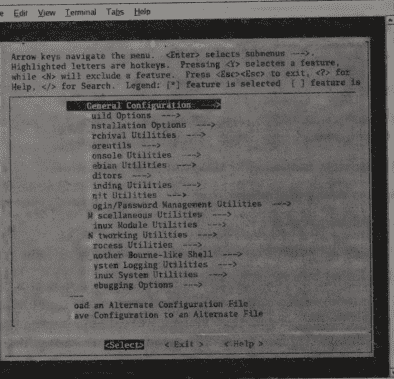

### 图 11-1
顶层 BusyBox 配置菜单

篇幅有限，无法涵盖每个配置选项。然而，其中一些选项值得一提。一些更重要的 BusyBox 配置选项位于 **Build Options**（构建选项）下。在这里，你会找到对 BusyBox 应用进行交叉编译所需的配置选项。列表 11-1 详细列出了最近一个 BusyBox 版本快照中 **Build Options**（构建选项）下的选项。请从顶层 BusyBox 配置实用程序中选择 Build Options（构建选项）以导航到该屏幕。

### 列表 11-1
**BusyBox 构建选项**

```text
[ ] Build BusyBox as a static binary (no shared libs)

[ ] Build with Large File Support (for accessing files > 2 GB)

[ ] Do you want to build BusyBox with a Cross Compiler?

( ) Any extra CFLAGS options for the compiler?
```

第一个选项对于构建极简嵌入式系统非常有用。它允许将 BusyBox 静态编译和链接，从而在目标系统的运行时不需要任何动态加载的库（例如 `libc-2.3.3.0`）。如果没有此选项，BusyBox 需要一些库才能运行。我们可以使用 `ldd` 命令轻松确定 BusyBox（或任何其他二进制文件）在目标系统上需要哪些库。列表 11-2 包含在我的桌面 Linux 工作站上显示的输出。

### 列表 11-2
BusyBox 库依赖

```bash
$ ldd busybox

     linux-gate.so.1 =>  (0x00ffffe000)

     libc.so.6 => /lib/tls/libc.so.6 (0x42c70000)

     /lib/ld-linux.so.2 => /lib/ld-linux.so.2 (0x42c57000)
```


请注意，使用默认配置编译的 BusyBox 实用程序需要列表 11-2 中的三个共享库。如果我们选择将 BusyBox 构建为静态二进制文件，`ldd` 只会发出一条消息，告诉我们 BusyBox 二进制文件不是一个动态可执行文件。换句话说，它不需要任何共享库来解决可执行文件中的未解析依赖项。由于不需要共享库，静态链接在根文件系统上产生的占用空间更小。然而，在没有共享库的情况下构建嵌入式应用意味着你的应用程序将无法使用任何熟悉的 C 库函数。

我们将在下一节中讨论列表 11-1 中的其他选项。

### 11.2.1 交叉编译 BusyBox

如本章开头所述，BusyBox 的作者打算让该软件包在交叉开发环境中使用，因此在此类环境中构建 BusyBox 非常简单。在大多数情况下，唯一的要求是指定开发工作站上交叉编译器的前缀。这是在 BusyBox 配置实用程序的 Build Options（构建选项）中通过选择“使用交叉编译器构建 BusyBox”选项来指定的。随后，你会看到一个用于输入交叉编译器前缀的选项。你输入的前缀取决于你的交叉开发环境。一些示例包括 `xscale_be-` 或 `ppc-linux`。我们将在下一章讨论嵌入式开发环境时更详细地介绍这一点。

列表 11-1 中的最后一个选项是用于你可能想要在编译器命令行中包含的任何额外标志。这可能包括生成调试信息的选项（`-g`）、设置优化级别的选项（例如 `-O2`），以及其他可能因你的特定安装和目标系统而异的编译器选项。

## 11.3 BusyBox 操作

当你构建 BusyBox 时，最终会得到一个名为 `busybox` 的二进制文件。BusyBox 可以通过二进制文件名本身调用，但更常见的是通过符号链接启动。当在不带命令行参数的情况下调用 BusyBox 时，它会列出通过配置启用的功能列表。列表 11-3 显示了这样的输出（格式已略微调整以符合页面宽度）。

### 列表 11-3

```text

BusyBox Usage

root@cayote # ./busybox

BusyBox v1.01 (2005.12.03-18:00+0000) multi-call binary

Usage: busybox [function] [arguments]...

   or [function] [arguments]...

BusyBox is a multi-call binary that combines many common Unix

utilities into a single executable.  Most people will create a

link to busybox for each function they wish to use and BusyBox

will act like whatever it was invoked as!

Currently defined functions:

i, ash, basenames, bunzip2, busybox, bzcat, cat, chgrp, chmod,

chown, chroot, chvt, clear, cmp, cp, cut, date, dd, dealioct,

df, dirname, dmesg, du, echo, egrep, env, expr, false, fpreg,

find, free, grep, gunzip, gzip, halt, head, hexdump, hostname,

id, iconfig, init, install, kill, killall, klogd, linuxrc, ln,

logger, ls, mkdir, mknod, mktemp, more, mount, mv, openvt, pidof,

ping, pivot_root, poweroff, ps, pwd, readlink, reboot, reset,

rm, rmdir, route, sed, sh, sleep, sort, strings, swapon, swapoff,

sync, syslogd, tail, tar, tee, test, time, touch, tr, true, tty,

ttyun, uname, uniq, unzip, uptime, usleep, vi, wc, wget, which,

whoami, xargs, yes, zcat

```

从列表 11-3 中，你可以看到这个 BusyBox 构建中启用的功能列表。它们按字母顺序排列，从 `ash`（一种针对小内存占用优化的 shell）到 `zcat`（一种用于解压缩文件内容的实用程序）。这是该特定 BusyBox 快照中默认启用的实用程序集。

要调用特定功能，请在命令行上执行 `busybox` 并传入一个已定义的功能。因此，要显示当前目录中的文件列表，请执行以下命令：

```bash

[root@coyote]# ./busybox ls

```

列表 11-3 中 BusyBox 使用说明消息的另一个重要内容是程序的简短描述。它将 BusyBox 描述为一个多调用二进制文件，将许多通用实用程序合并到一个可执行文件中。这就是之前提到的符号链接的用途。BusyBox 旨在通过以其将执行的功能命名的符号链接来调用。这消除了输入两个单词的命令来调用特定功能的负担，并向用户提供了一组与同名实用程序熟悉的命令。列表 11-4 和 11-5 应该能清楚地说明这一点。

### 列表 11-4

BusyBox 符号链接结构—顶层

```bash

[root@coyote]$ ls -l /

total 12

drwxrwxr-x 2 root  root  4096 Dec 3 13:38 bin

lrwxrwxrwx 1 root  root    11 Dec 3 13:38 linuxrc -> bin/busybox

drwxrwxr-x 2 root  root  4096 Dec 3 13:38 sbin

drwxrwxr-x 4 root  root  4096 Dec 3 13:38 usr

```

列表 11-4 展示了通过 `make install` 命令由 BusyBox 软件包构建的目标目录结构。可执行文件 `busybox` 位于 `/bin` 目录中，并且符号链接已填充到结构的其余部分，指回 `/bin/busybox`。列表 11-5 扩展了列表 11-4 中的目录结构。

### 清单 11-5

BusyBox 符号链接结构——树形详情

```
[root@coyote]$ tree

. bin
|-- ash -> busybox
|-- busybox
|-- cat -> busybox
|-- cp -> busybox
|-- ...
|-- zcat -> busybox
|-- linuxrc -> bin/busybox
. sbin
|-- halt -> ../bin/busybox
|-- ifconfig -> ../bin/busybox
|-- init -> ../bin/busybox
|-- klogd -> ../bin/busybox
|-- ...
|-- syslogd -> ../bin/busybox
. usr
|-- bin
|-- .. -> ../bin/busybox
|-- basename -> ../bin/busybox
|-- ...
|-- xargs -> ../bin/busybox
|-- yes -> ../bin/busybox
. sbin
|-- chroot -> ../../bin/busybox
```

为了易读性并避免三页长的清单，清单 11-5 的输出内容已被大幅截断。每一行包含省略号 (...) 的行表示该清单已被修剪，仅显示给定目录的前几条和后几条条目。实际上，根据您使用 BusyBox 配置工具启用的功能，这些目录中可以填充超过 100 个符号链接。

请注意 `busybox` 可执行文件本身，它是 `/bin` 目录中的第二项条目。同样在 `/bin` 目录中，还有指向 `busybox` 的符号链接，如 `ash`、`cat`、`cp` ... 一直到 `zcat`。再次说明，为了易读性，本清单中 `cp` 和 `zcat` 之间的条目已被省略。有了这种符号链接结构，用户只需输入工具的实际名称即可调用其功能。例如，要使用 `busybox` 的 `ifconfig` 工具配置网络接口，用户可能输入类似以下的命令：

```
$ ifconfig eth1 192.168.1.14
```


这将通过 `ifconfig` 符号链接调用 `busybox` 可执行文件。`BusyBox` 会检查它是如何被调用的——也就是说，它读取 `argv[0]` 以确定执行什么功能。

### 11.3.1 BusyBox 初始化

请注意清单 11-5 中名为 `init` 的符号链接。在第 6 章“系统初始化”中，您学习了 `init` 程序及其在系统初始化中的作用。回顾一下，内核将尝试执行名为 `/sbin/init` 的程序，作为内核初始化的最后一步。`BusyBox` 模拟 `init` 功能没有任何理由不行，而清单 11-5 中展示的系统正是这样配置的。`BusyBox` 处理 `init` 功能。

`BusyBox` 处理系统初始化的方式与标准 System V `init` 不同。使用第 6 章中描述的 System V (SysV) 初始化的 Linux 系统需要 `/etc` 目录中可访问的 `inittab` 文件。`BusyBox` 也读取 `inittab` 文件，但 `inittab` 文件的语法不同。一般来说，如果您使用 `BusyBox`，则不应需要使用 `inittab`。我同意 `BusyBox` 手册页的观点：如果您需要运行级别，请使用 System V 初始化。²

让我们看看这在嵌入式系统上是什么样子的。我们创建了一个基于 `BusyBox` 的小型根文件系统。我们配置 `BusyBox` 使用静态链接，从而消除了对任何共享库的需求。清单 11-6 包含此根文件系统的树形列表。我们使用第 9 章“文件系统”第 9.10 节“构建简单文件系统”中概述的步骤构建了这个小文件系统。我们不再在此处详细说明该过程。我们简单文件系统中的文件如清单 11-6 所示。

² 我们在第 6 章中详细讨论了 System V 初始化的细节。

#### 清单 11-6
#### 最小化 BusyBox 根文件系统

```
$ tree

. bin
|   |-- busybox
|   |-- cat -> busybox
|   |-- dmesg -> busybox
|   |-- echo -> busybox
|   |-- hostname -> busybox
|   |-- ls -> busybox
|   |-- ps -> busybox
|   |-- pwd -> busybox
|   `-- sh -> busybox
. console
. etc
. proc
4 directories, 10 files
```

这个基于 `BusyBox` 的根文件系统占用的空间仅略大于 `busybox` 本身的大小。在此配置下，使用静态链接并支持近 100 个工具，`BusyBox` 可执行文件的大小不到 1MB：

```
$ ls -1 /bin/busybox
-rwxr-xr-x 1 root root 824724 Dec 3 2005 /bin/busybox
```

现在让我们看看这个系统的运行状态。清单 11-7 捕获了此基于 `BusyBox` 的嵌入式系统在启动时的控制台输出。

#### 清单 11-7
#### BusyBox 默认启动

```
...
Looking up port of RPC 100003/2 on 192.168.1.9
Looking up port of RPC 100005/1 on 192.168.1.9
VFS: Mounted root (nfs filesystem).
Freeing init memory: 96k
Bummer, could not run '/etc/init.d/rcS': No such file or directory
Please press Enter to activate this console.
BusyBox v1.01 (2005.12.03-19:09+0000) Built-in shell (ash)
Enter 'help' for a list of built-in commands.
-sh: can't access tty; job control turned off
/ #
```

清单 11-7 的示例是在一个配置为 NFS 根挂载的嵌入式板上运行的。我们在工作站上导出了一个包含清单 11-6 中详述的简单文件系统映像的目录。在启动过程的最后步骤中，目标板上的 Linux 内核通过 NFS 挂载根文件系统。当内核试图执行 `/sbin/init` 时，它失败了，因为我们的文件系统上没有 `/sbin/init`。然而，如我们所见，内核也会尝试执行 `/bin/sh`。在我们配置了 `BusyBox` 的目标上，这成功了，并且 `busybox` 通过根文件系统上的符号链接 `/bin/sh` 启动。

`BusyBox` 显示的第一件事是它找不到 `/etc/init.d/rcS` 的抱怨。这是 `BusyBox` 搜索的默认初始化脚本。代替使用 `inittab`，这是基于 `BusyBox` 的嵌入式系统的首选初始化方法。

当完成初始化后，`BusyBox` 显示一个提示，要求用户按 Enter 键以激活控制台。当它检测到 Enter 键时，它会执行一个等待用户输入的 `ash` shell 会话。关于作业控制关闭的最后一条消息是我们在串行终端上创建系统控制台的结果。Linux 内核包含代码，如果检测到串行终端上的控制台，则禁用作业控制。

这个示例产生了一个可工作的系统，有近 100 个 Linux 工具可用，包括核心工具、文件工具、网络支持以及一个功能相当完善的 shell。您可以看到，这个简单的软件包提供了一个强大的平台，用于构建您自己的系统应用程序。当然，需要注意的是，如果没有对 `libc` 和其他系统库的支持，您将面临实施应用程序的巨大任务。您必须为典型的 C 程序依赖的所有常用系统调用和其他库函数提供支持。或者，您可以将您的应用程序静态链接到其依赖的库，但如果您有超过两个应用程序使用这种方法，您的应用程序很可能会超过动态链接并在目标上有共享库时的组合大小。

### 11.3.2 示例 rcS 初始化脚本

在 `BusyBox` 启动交互式 shell 之前，它会尝试执行名为 `/etc/init.d/rcS` 的脚本中的命令，如清单 11-7 所示。这就是在 `BusyBox` 系统中您的应用程序“苏醒”的地方。清单 11-8 提供了一个简单的 `rcS` 初始化脚本。

```
#!/bin/sh

echo "Mounting proc"
mount -t proc /proc /proc

echo "Starting system loggers"
syslogd
klogd

echo "Configuring loopback interface"
ifconfig lo 127.0.0.1

echo "Starting inetd"
xinetd

##### start a shell
busybox sh
```

这个简单脚本大多不言自明。首先，重要的是在其预留的挂载点 `/proc` 上挂载 `/proc` 文件系统。这是因为许多工具从 `/proc` 文件系统获取信息。第 9 章对此有更完整的解释。接下来，我们尽早启动系统日志记录器，以捕获任何启动问题。在系统日志守护进程之后，我们配置系统的本地回环接口。同样，许多传统的 Linux 设施假设存在回环接口，如果您的系统配置了套接字支持，您应该启用这个伪接口。我们在启动 shell 之前做的最后一件事是启动 Internet 超级服务器 `xinetd`。这个程序在后台监听任何配置的网络接口上的网络请求。例如，要初始化到该板的 telnet 会话，`xinetd` 会拦截 telnet 连接请求并生成一个 telnet 服务器来处理该会话。

代替启动 shell，您可以从这个 `rcs` 初始化脚本启动自己的应用程序。清单 11-8 是一个启用了 Telnet 的目标板运行基本服务（如系统和内核日志记录器）的简单示例。

### 11.3.3 BusyBox 目标安装

只有当您理解符号链接的用途和目的时，关于 `BusyBox` 安装的讨论才能进行。`BusyBox` 的 `makefile` 包含一个名为 `install` 的目标。执行 `make install` 会创建一个包含 ... 的目录结构

#### busybox 可执行文件和符号链接树
此环境需要迁移到你的目标嵌入式系统的根目录中，并包含完整的符号链接树。符号链接树消除了为每个命令 *输入* `busybox` 命令的需要。相反，要查看给定目录中的文件列表，用户只需输入 *`ls`* 即可。符号链接按前面所述执行 `busybox`，并调用 *`ls`* 功能。请参见列表 11-4 和列表 11-5，以查看符号链接树。请注意，`BusyBox` 构建系统仅为你通过配置实用程序启用的功能创建链接。

为你的根文件系统填充必要的符号链接树的最简单方法是让 `BusyBox` 构建系统为你完成这项工作。只需在你的开发工作站上挂载根文件系统，并将一个 *`PREFIX`* 传递给 `BusyBox` `makefile`。列表 11-9 展示了该过程。

#### 列表 11-9
###### 在根文件系统上安装 BusyBox

```bash
$ mount -o loop brootfs.ext2 /mnt/remote
```


```
$ make PREFIX=/mnt/remote install

/bin/sh applets/install.sh /mnt/remote

/mnt/remote/bin/ash -> busybox

/mnt/remote/bin/cat -> busybox

/mnt/remote/bin/chgrp -> busybox

/mnt/remote/bin/chmod -> busybox

/mnt/remote/bin/chown -> busybox

...

/mnt/remote/usr/bin/xargs -> ../../bin/busybox

/mnt/remote/usr/bin/yes -> ../../bin/busybox

/mnt/remote/usr/sbin/chroot -> ../../bin/busybox

------------------------------------------------------------------

You will probably need to make your busybox binary

setuid root to ensure all configured applets will

work properly.

------------------------------------------------------------------

$ chmod +s /mnt/remote/bin/busybox

$ ls -l /mnt/remote/bin/busybox

-rwsr-xr-x 1 root root 863188 Dec 4 15:54 /mnt/remote/bin/busybox
```

首先，我们将根文件系统二进制映像挂载到我们期望的挂载点——在本例中，是`/mnt/remote`，这是我的常用选择。然后，我们调用 BusyBox 的`make install`命令，并传入一个指定符号链接树和 busybox 可执行文件放置位置的`PREFIX`。正如你在列表中看到的，makefile 调用一个名为`applets/install.sh`的脚本来完成大部分工作。该脚本遍历包含所有已启用 BusyBox applet 的文件，并在我们使用`PREFIX`指定的路径下为每一个创建符号链接。该脚本非常健谈；它为创建的每个符号链接输出一行。为了简洁起见，只显示了前几个和后几个符号链接公告。列表中的省略号代表我们省略的内容。

关于 setuid 的消息也由安装脚本显示，以提醒你可能需要将你的 busybox 可执行文件设置为 setuid root。这是为了允许需要 root 访问权限的 BusyBox 功能在由非 root 用户调用时也能正常工作。这并非严格必要，特别是在嵌入式 Linux 环境中，系统中通常只有一个 root 账户。如果你的安装需要这样做，所需命令`chmod +s`在列表 11-9 中已展示。

此安装步骤的结果是，`busybox`二进制文件和符号链接树已安装在我们的目标根文件系统上。最终结果看起来与列表 11-4 非常相似。

值得注意的是，BusyBox 还有一个选项，可以在运行时在目标系统上启用创建此符号链接树。此选项在 BusyBox 配置中启用，并通过执行带有`-install`选项的`busybox`在运行时调用。为了让此支持工作，你必须在目标系统上挂载`/proc`文件系统。

#### 11.3.4 BusyBox 命令
在最近的 BusyBox 快照中，197 个命令（也称为 applet）在手册页中有记录。它提供了对相当复杂的 shell 脚本的足够支持，包括对 Bash shell 脚本的支持。BusyBox 支持`awk`和`sed`，这些通常在 Bash 脚本中发现。BusyBox 支持网络实用程序，如`ping`、`ifconfig`、`traceroute`和`netstat`。一些命令专门包含以支持脚本，包括`true`、`false`和`yes`。

请花一点时间浏览附录 C，“BusyBox 命令”，在那里你可以找到每个 BusyBox 命令的摘要。完成之后，你将更好地理解 BusyBox 的功能以及它如何适用于你自己的嵌入式 Linux 项目。

正如本章开头所述，与全功能对应项相比，许多 BusyBox 命令仅包含有限的功能集和选项。通常，你可以通过在运行时调用带有`--help`选项的命令来获取任何给定 BusyBox 命令的帮助。这会生成一个使用说明，简要描述每个支持的命令选项。BusyBox 的`gzip` applet 是一个 BusyBox 命令支持有限选项集的有用示例。列表 11-10 显示了在 BusyBox 目标上`gzip --help`的输出。

##### 列表 11-10
```text

BusyBox gzip Applet Usage

-------------------------------------------------------

/ # gzip --help

BusyBox v1.01 (2005.12.01-21:11+0000) multi-call binary

Usage: gzip [OPTION]... [FILE]...

Compress FILE(s) with maximum compression.

When FILE is '-' or unspecified, reads standard input. Implies -c.

Options:

-c    Write output to standard output instead of FILE.gz

-d    Decompress

-f    Force write when destination is a terminal
```


BusyBox 的 `version` 的 `gzip` 仅支持三个命令行选项。其全功能对应项支持 15 种不同的命令行选项以上。例如，全功能的 `gzip` 实用程序支持 `--list` 选项，该选项生成命令行上每个文件的压缩统计信息。BusyBox `gzip` 不存在此类支持。这对于嵌入式系统通常不是显著限制。我们提供这些信息以便你在决定使用 BusyBox 时做出明智的选择。当需要实用程序的全部功能时，解决方案很简单：在 BusyBox 配置中删除对该特定实用程序的支持，并将标准 Linux 实用程序添加到你的目标系统中。

## 11.4 章节摘要
- BusyBox 是嵌入式系统的一个强大工具，它在一个多调用二进制文件中替代了许多常见的 Linux 实用程序。
- BusyBox 可以显著减小根文件系统映像的大小。
- BusyBox 易于使用且具有许多有用的功能。
- 配置 BusyBox 很直接，使用类似于 Linux 配置接口的界面。
- 根据特定需求，BusyBox 可以配置为静态链接或动态链接的应用程序。
- 使用 BusyBox 进行系统初始化略有不同；这些差异在本章中已涵盖。
- BusyBox 支持许多命令。附录 C 列出了来自近期发布的所有可用 BusyBox 命令。

### 11.4.1 延伸阅读建议
- BusyBox 项目主页：[www.busybox.net/](www.busybox.net/)
- BusyBox 手册页：[www.busybox.net/downloads/BusyBox.html](www.busybox.net/downloads/BusyBox.html)

# 第 12 章

## 嵌入式开发环境


## 本章内容
- 交叉开发环境 ... 第 290 页
- 主机系统要求 ... 第 295 页
- 托管目标板 ... 第 296 页
- 章节摘要 ... 第 306 页

在你的宿主开发系统上启用的配置和服务可能会对你作为嵌入式开发人员的成功产生巨大影响。本章探讨了交叉开发环境的独特需求，以及嵌入式开发人员需要知道的工具和技术，以提高生产力。

我们首先检查典型的交叉开发环境。使用熟悉的“hello world”示例，我们详细说明了基于宿主机的应用程序与面向嵌入式系统的目标应用程序之间的重要差异。我们还查看了本地应用程序开发与嵌入式应用程序开发的工具链之间的差异。然后，我们提出了主机系统要求，并详细说明了主机系统中一些重要元素的使用。最后，我们以一个由基于网络的主机托管目标板的示例结束本章。

#### 12.1 交叉开发环境
对于嵌入式开发的新手来说，常常会在原生和交叉开发环境之间的概念和差异上感到困难。事实上，通常有三个编译器以及标准头文件如 `stdlib.h` 的三个（或更多）版本。在没有正确的工具和基于主机的实用程序的情况下，在目标嵌入式系统上调试应用程序可能很困难。你必须管理并分离设计用于在主机系统上运行的文件和实用程序，以及你打算在目标上使用的文件和实用程序。

在此上下文中使用术语 `host`（主机）时，我们指的是位于你的桌面上并运行你最喜欢的 Linux 桌面发行版的开发工作站。1 相反，当我们使用术语 `target`（目标）时，我们指的是你的嵌入式硬件平台。因此，`native development`（原生开发）表示在主机系统上编译和构建应用程序。交叉开发表示在主机系统上编译和构建将在嵌入式系统上运行的应用程序。牢记这些定义将帮助你在本章中保持正轨。

图 12-1 展示了典型交叉开发环境的布局。通过一个或多个物理连接，主机 PC 连接到目标板。它最多

> 1 Webster’s 将 `nonsense` 定义为“一个荒谬的或违背良好常识的想法”。我认为在非 Linux/UNIX 主机上开发嵌入式 Linux 平台是毫无意义的。

如果目标设备上同时具备串口和以太网口，那么这种设置会非常方便。稍后当我们讨论内核调试时，您会意识到第二个串口可以成为一个非常有价值的资源。

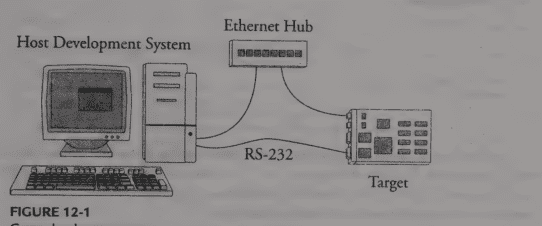

**图 12-1**
交叉开发环境设置

在最常见的场景中，开发者在主机上拥有一个连接到 RS-232 串口的串行终端，可能还有一个或多个到目标板的 Telnet 终端会话，以及一个或多个使用以太网作为连接介质的调试会话。这种交叉开发环境提供了很大的灵活性。基本思想是，主机系统提供运行编译器、调试器、编辑器和其他实用程序所需的处理能力，而目标系统仅执行为其设计的应用程序。是的，您当然可以在目标系统上运行编译器和调试器，但我们假设您的主机系统包含更多的资源，包括 RAM、磁盘存储和互联网连接。事实上，许多嵌入式目标板没有人类输入设备或输出显示屏幕，这种情况并不少见。

##### 12.1.1 “Hello World”—嵌入式

一个配置正确的交叉开发系统向普通应用开发者隐藏了大量的复杂性。通过查看一个简单的示例，有助于揭示和解释其中的一些奥秘。当我们编译一个简单的“Hello World”程序时，工具链（编译器、链接器和相关实用程序）会对我们构建程序所使用的主机系统以及我们编译的程序做出许多假设。实际上，这些并非假设，而是一组编译器用来构建正确二进制的规则。

**Listing 12-1** 复现了一个简单的 "hello world" 程序。

**列表 12-1**
再次 Hello World

```c

#include <stdio.h>

int main(int argc, char **argv)

{

    printf("Hello World\n");

    return 0;

}

```

即使是非专业的应用开发者也会意识到这个 C 源文件中的一些重要要点。首先，`printf()` 函数在此文件中被引用但未定义。如果我们省略了包含 `printf()` 函数原型的 `#include` 指令，编译器会发出常见的信息：

```
hello.c:5: warning: implicit declaration of function 'printf'
```

这引发了一些有趣的问题：

- 文件 `stdio.h` 位于何处，它是如何被找到的？
- `printf()` 函数位于何处，该引用在二进制可执行文件中是如何被解决的？

不知何故，编译器似乎*知道*如何组装一个可以从命令行执行的正确二进制文件。为了进一步复杂化问题，最终的可执行文件包含启动和关闭序言代码，这些代码我们从未见过，但链接器会自动将其包括在内。这些序言处理诸如传递给程序的环境和参数、启动和关闭的维护工作、退出处理等细节。

要构建 "hello world" 应用程序，我们可以使用一个简单的命令行来调用编译器，类似于：

```
$ gcc -o hello hello.c
```

这将生成名为 `hello` 的二进制可执行文件，我们可以直接从命令行执行它。编译器引用的默认值提供了关于在哪里找到包含文件的指导。类似地，链接器知道如何通过包括对定义该函数的库的引用来解决对 `printf()` 函数的引用。当然，这是标准 C 库。

我们可以查询工具链以查看所使用的某些默认值。**列表 12-2** 是 `cpp` 在传入 `-v` 标志时输出的部分列表。您可能已经知道，`cpp` 是 `gcc` 工具链中的 C 预处理器组件。我们添加了一些格式（仅空白字符）以提高可读性。

**列表 12-2**
默认本机 `cpp` 搜索目录

```text

$ cpp -v

Reading specs from /usr/lib/gcc-lib/i386-redhat-linux/3.3.3/specs

Configured with: ../configure --prefix=/usr --mandir=/usr/share/man --infodir=/usr/share/info --enable-shared --enable-threads=posix --disable-checking --disable-libmud-exceptions --with-system-zeiib --enable-cxa-rtix --host=i386-redhat-linux

Thread model: posix

gcc version 3.3.3 20040412 (Red Hat Linux 3.3.3-7)

/usr/lib/gcc-lib/i386-redhat-linux/3.3.3/cc1 -E -quiet -v -

ignoring nonexistent directory `/usr/i386-redhat-linux/include'

`#include "..."` search starts here:

`#include <...>` search starts here:

/usr/local/include

/usr/lib/gcc-lib/i386-redhat-linux/3.3.3/include

/usr/include

End of search list.

/usr/lib/
```


这个简单的查询产生了一些非常有用的信息。首先，我们可以看到编译器是如何使用熟悉的`./configure`工具进行配置的。默认线程模型是`posix`，它决定了如果您使用线程函数，您的应用程序将链接哪个线程库。最后，您看到了`#include`指令的默认搜索目录。

但如果我们要为不同的架构构建`hello.c`，例如 PowerPC 怎么办？当我们使用主机机器上的交叉编译器为 PowerPC 目标编译应用程序时，我们必须确保编译器不使用默认的`host`包含目录或库路径。使用配置正确的交叉编译器是第一步，拥有一个设计良好的交叉开发环境是第二步。

**列表 12-3** 是一个流行的开源交叉开发工具链的输出，该工具链被称为嵌入式 Linux 开发套件（ELDK），由 Denx Software Engineering 组装和维护。这个特定的安装是为 PowerPC 82xx 工具链配置的。同样，我们在输出中添加了一些空白以提高可读性。

### 列表 12-3
**默认交叉搜索目录**

```text

$ ppc_82xx-gcc -v

Reading specs from /opt/eldk/usr/bin/../lib/gcc-lib/ppc-linux/3.3.3/specs

Configured with: ../configure --prefix=/usr --mandir=/usr/share/man --infodir=/usr/share/info --enable-shared --enable-threads=posix --disable-checking --with-system-zeiib --enable_cxa_atexit --with-newlib --enable-languages=c,c++ --disable-libgcc --host=i386-redhat-linux --target=ppc-linux

Thread model: posix

gcc version 3.3.3 (DENX ELDK 3.1.1 3.3.3-10)

/opt/eldk/usr/bin/../lib/gcc-lib/ppc-linux/3.3.3/cc1 -E -quiet -v -iprefix /opt/eldk/usr/bin/../lib/gcc-lib/ppc-linux/3.3.3/ -D_unix -D_gnu_linux -D_linux -Dunix -D_unix -Dlinux -D_linux -Asystem=unix -Asystem=posix -mcpu=603

ignoring nonexistent directory /opt/eldk/usr/ppc-linux/sys-include

ignoring nonexistent directory "/opt/eldk/usr/ppc-linux/include"

#include "..." search starts here:

#include <...> search starts here:

/opt/eldk/usr/lib/gcc-lib/ppc-linux/3.3.3/include

/opt/eldk/ppc-82xx/usr/include

End of search list.

```

在这里，您可以看到包含目录的默认搜索路径现在已调整为指向您的交叉版本，而不是本机包含目录。这个看似晦涩的细节对于能够开发应用程序并为您的嵌入式系统编译开源包至关重要。它甚至是对于熟悉应用开发但刚接触嵌入式系统的经验丰富的应用开发者来说，也是最令人困惑的主题之一。

您的开发工作站必须包含几个重要的组件和系统。当然，您需要一个配置正确的交叉工具链。您可以自行下载和编译一个，或者获取可用的众多商业工具链之一。自行构建超出了本书的范围，虽然有一些很好的参考资料可用。有关建议，请参阅本章末尾的第 12.4.1 节“补充阅读建议”。

您需要的下一个重要项目是针对您的嵌入式系统架构的 Linux 发行版。这包括数百甚至可能数千个文件，这些文件将填充您的嵌入式系统的文件系统。同样，选择是自行构建或获取商业发行版之一。互联网上可用的更流行的嵌入式系统发行版之一是前面提到的 ELDK。ELDK 可用于某些 PowerPC 和其他嵌入式目标。从头构建嵌入式 Linux 发行版本身就需要一本同等大小的书，因此超出了我们在这里的讨论范围。

总之，您的开发主机需要四种独立且不同的能力：

-   交叉工具链和库
-   目标系统软件包，包括程序、实用程序和库
-   主机工具，如编辑器、调试器和实用程序
-   用于托管目标板的服务器，将在下一节中介绍

如果您在工作站上安装了一个预先构建的嵌入式 Linux 开发环境，无论是商业版本还是开源社区中免费提供的版本，工具链和组件已经预先配置好以协同工作。例如，工具链已使用默认目录搜索路径进行配置，这些路径匹配您开发工作站上目标头文件和系统库的位置。如果您的需求包括在开发工作站上支持多个架构和处理器，情况就会变得复杂得多。这就是嵌入式 Linux 发行版存在的原因。

#### 12.2.1 硬件调试探针

除了前面列出的组件外，您还应考虑某种类型的硬件辅助调试工具。这包括一个连接至主机（通常通过以太网）并通过板载调试连接器连接至目标系统的硬件探针。目前市面上有许多此类解决方案。我们将在第 14 章“内核调试技术”中详细探讨这一主题。

### 12.3 托管目标板

回顾图 12-1，您会注意到从目标嵌入式板到主机开发系统之间存在一条以太网连接。这并非绝对必要，事实上，一些较小的嵌入式设备没有以太网接口。然而，这是例外而非常态。在目标板上具备以太网连接的价值简直物超所值！

在开发内核时，您需要多次向嵌入式板编译并下载内核。许多嵌入式开发系统和引导加载程序都支持 TFTP，并假设开发者会使用它。TFTP 是一种用于在 TFTP 服务器和 TFTP 客户端之间传输文件的轻量级协议，类似于 FTP。

使用引导加载程序中的 TFTP 来加载内核将为您节省无数等待串行下载的时间，即使是在较高的串行波特率下也是如此。而且加载 ramdisk 可能花费更长的时间，因为 ramdisk 镜像根据需求可能增长到几十兆字节甚至更多。在配置和使用 TFTP 上投入的时间一定会得到回报，强烈建议采用。很少有设计在开发期间无法容纳一个以太网端口的空间，即使在生产阶段将其移除也是如此。

#### 12.3.1 TFTP 服务器

在您的 Linux 开发主机上配置 TFTP 并不困难。当然，具体细节可能因您为开发工作站选择的 Linux 发行版而异。这里提供的指导方针基于 Red Hat 和 Fedora Core Linux 发行版。

TFTP 是一种 TCP/IP 服务，必须在您的工作站上启用。要启用 TFTP 服务，您必须指示服务器响应传入的 TFTP 数据包并启动您的 TFTP 服务器。在许多 Linux 发行版中，这是通过编辑 xinetd Internet 超级服务器使用的配置文件来实现的。例如，在 Red Hat 和 Fedora 桌面 Linux 发行版中，该文件为`/etc/xinetd.d/tftp`。清单 12-4 包含来自 Fedora Core 2 开发工作站的 TFTP 配置，用于启用 TFTP 服务。为了适应页面排版，内容稍作重新排列。

**清单 12-4 TFTP 配置**

```
##### default: off

##### description: The tftp server serves files using the trivial

##### file transfer protocol.  The tftp protocol is often used to

##### boot diskless workstations, download configuration files to

##### network-aware printers, and to start the installation process

##### for some operating systems.

service tftp

{

    socket_type         = dgram

    protocol            = udp

    wait                = yes

    user                = root

    server              = /usr/sbin/in.tftpd

    server_args         = -c -s /tftpboot

    disable             = no

    per_source          = 11

    cps                 = 100 2

    flags               = IPv4

}
```


在此典型设置中，TFTP 服务已被启用（`disable = no`），并配置为提供位于此工作站 `/tftpboot` 目录中的文件。当 `xinetd` Internet 超级服务器接收到传入的 TFTP 请求时，它会查阅此配置并启动指定的服务器（`/usr/sbin/in.tftpd`）。由 `*server_args*` 指定的命令行参数会传递给 `*in.tftpd*` 进程。在这种情况下，`-c` 开关告知 `*in.tftpd*` 切换到指定目录（`/tftpboot`），而 `-s` 标志允许创建新文件。这对于从目标系统向服务器写入文件非常有用。

请查阅随您的桌面发行版提供的文档，以获取针对您环境的具体细节。

### 12.3.2 BOOTP/DHCP 服务器

在开发主机上拥有 DHCP 服务器可以简化嵌入式目标的配置管理。我们此前已说明了为什么在目标硬件上使用以太网接口是一个好主意。当 Linux 在目标板上启动时，它需要先配置以太网接口，该接口才真正有用。此外，如果您在目标板上使用 NFS 根挂载配置，Linux 需要在引导过程完成之前配置目标的以太网接口。我们在第 9 章“文件系统”中详细讨论了 NFS。

一般来说，Linux 在启动过程中可以使用两种方法来初始化其以太网/IP 接口：

- 在 Linux 内核命令行或默认配置中硬编码以太网接口参数
- 配置内核在启动时自动检测网络设置

出于显而易见的原因，后一种选择是最灵活的。DHCP 或 BOOTP 是您的目标和服务器用于实现网络设置自动检测的协议。关于 DHCP 或 BOOTP 协议的细节，请参见本章末尾的第 12.4.1 节。

DHCP 服务器控制其已配置管理的 IP 子网的 IP 地址分配，以及已配置参与该过程的 DHCP 或 BOOTP 客户端。DHCP 服务器监听来自 DHCP 客户端（如您的目标板）的请求，并在引导过程中将地址及其他相关信息分配给客户端。典型的 DHCP 交互过程（见清单 12-5）可以通过启动带有 `-d` 调试开关的 DHCP 服务器，并在目标机器请求配置时观察输出来进行检查。

**清单 12-5 典型的 DHCP 交互过程**

```
tgt> DHCPDISCOVER from 00:09:5b:65:1d:d5 via eth0

srv> DHCPOFFER on 192.168.0.9 to 00:09:5b:65:1d:d5 via eth0

tgt> DHCPREQUEST for 192.168.0.9 (192.168.0.1) from 00:09:5b:65:1d:d5 via eth0

srv> DHCPACK on 192.168.0.9 to 00:09:5b:65:1d:d5 via eth0
```

该序列以客户端（目标）传输广播帧尝试发现 DHCP 服务器开始。这就是所显示的 DHCPDISCOVER 消息所表示的内容。如果服务器已如此配置并启用，它将通过向客户端提供 IP 地址来响应。这由 DHCPOFFER 消息所证明。然后客户端通过本地测试该 IP 地址来响应。测试包括向 DHCP 服务器发送 DHCPREQUEST 数据包，如图所示。最后，服务器通过确认将 IP 地址分配给客户端来响应，从而完成目标的自动配置。

值得注意的是，正确配置的客户端会记住由 DHCP 服务器分配的最后一个地址。下次启动时，它将跳过 DHCPDISCOVER 阶段并直接进入 DHCPREQUEST 阶段，假设它可以复用服务器先前分配的相同 IP 地址。启动中的 Linux 内核不具备这种能力，每次启动时都会发出相同的序列。

配置主机的 DHCP 服务器并不困难。通常，我们的建议是查阅随您的桌面 Linux 发行版提供的文档。在 Red Hat 或 Fedora Core 发行版中，单个目标的配置条目可能如清单 12-6 所示。

**清单 12-6 DHCP 服务器配置示例**

```
##### Example DHCP Server configuration
allow bootp;

subnet 192.168.1.0 netmask 255.255.255.0 {
  default-lease-time 1209600;   # two weeks
  option routers 192.168.1.1;
  option domain-name-servers 1.2.3.4;
  group {
    host pdnal {
      hardware ethernet 00:30:bd:2a:26:1f;
      fixed-address 192.168.1.68;
      filename "uImage-pdna";
      option root-path "/home/chris/sandbox/pdna-target";
    }
  }
}
```

这是一个简单的示例，仅用于展示您可以传递给目标系统的信息类型。目标的 MAC 地址与其分配的 IP 地址之间存在一对一的映射。除了固定的 IP 地址外，您还可以向目标传递其他信息。在此示例中，将默认路由器和 DNS 服务器地址传递给目标，以及一个您选择文件的文件名，和一个用于内核挂载 NFS 根的文件系统路径。该文件名可能被您的引导加载程序用于从 TFTP 服务器加载内核镜像。您还可以配置 DHCP 服务器从预定义范围分配 IP 地址，但使用如清单 12-6 中所示的固定地址非常方便。

您必须在 Linux 开发工作站上启用 DHCP 服务器。这通常通过主菜单或命令行完成。请查阅您自己的 Linux 发行版的文档，以获取适合您环境的细节。例如，要在 Fedora Core 2 Linux 发行版上启用 DHCP 服务器，只需在根命令提示符下键入以下命令：

```
/etc/init.d/dhcpd start (or restart)
```

每次启动开发工作站时都必须执行此操作，除非您配置为自动启动。

安装 DHCP 服务器涉及许多细微之处，因此除非您的服务器位于私有网络上，否则建议在与自己的服务器上线之前先与系统管理员沟通。如果您与企业局域网共存，很有可能会干扰其自身的 DHCP 服务。

### 12.3.3 NFS 服务器

为您的目标板使用 NFS 根挂载是一种非常强大的开发工具。这种配置在开发过程中的一些优势包括：

- 您的根文件系统不受板卡自身有限资源（如闪存）的大小限制。
- 开发过程中对应用程序文件所做的更改可立即供目标系统使用。
- 您可以在开发和调试根文件系统之前调试和启动内核。

## 12.3 主机目标板

配置 NFS 服务器取决于你正在使用的桌面 Linux 发行版。与本章节中描述的其他服务一样，你必须查阅你自己的 Linux 发行版的文档，以了解适用于你配置的具体细节。NFS 服务必须从启动脚本、图形化菜单或命令行中启动。例如，在 Fedora Core 2 Linux 桌面上，以 root 身份从命令行提示符启动 NFS 服务的命令如下：

```
$ /etc/init.d/nfs start (或 restart)
```

每次启动你的桌面 Linux 工作站时，你都必须执行此操作。（此服务和其他服务可以在开机时自动启动——请查阅你的桌面 Linux 发行版的文档。）除了启用该服务外，你的内核必须以支持 NFS 的方式编译。尽管 DHCP 和 TFTP 都是用户空间实用程序，但 NFS 需要内核支持。这一点在你的开发工作站和目标板上都是正确的。图 12-2 说明了内核中 NFS 的配置选项。请注意，有针对 NFS 服务器和客户端支持的配置选项。此外，还有一个根文件系统位于 NFS 的选项。你的目标内核必须配置此选项以支持 NFS 根挂载操作。

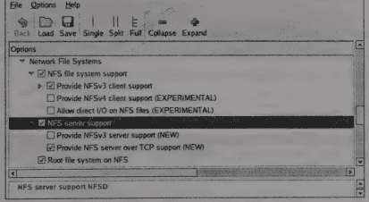

**图 12-2**
NFS 内核配置

NFS 服务器从其服务器上位于导出文件（`exports file`）获取指令。它通常位于 `/etc/exports`。列表 12-7 是一个简单的导出条目的示例。

**列表 12-7**
简单的 NFS 导出文件

```
$ cat /etc/exports
##### /etc/exports
/home/chris/sandbox/coyote-target *(rw,sync,no_root_squash)
/home/chris/sandbox/pdha-target *(rw,sync,no_root_squash)
/home/chris/workspace *(rw,sync,no_root_squash)
```


我工作站上的这些条目允许客户端远程挂载显示的三个目录中的任意一个。目录规范之后的属性指示 NFS 服务器允许来自任何 IP 地址 (`*`) 的连接，并以给定的属性（具有 `no_root_squash` 的读/写）挂载相应的目录。后一个属性允许具有 root 权限的客户端在给定目录上行使这些权限。在嵌入式系统工作时，通常只需要 root 账户，因此通常需要此设置。

你可以直接从工作站测试你的 NFS 配置。假设你已启用 NFS 服务（需要同时启用 NFS 服务器和客户端组件），你可以像挂载任何其他文件系统一样挂载本地 NFS 导出：

```
mount -t nfs localhost:/home/chris/workspace /mnt/remote
```

如果此命令成功，且 `.../workspace` 中的文件在 `/mnt/remote` 上可用，则你的 NFS 服务器和配置工作正常。

### 12.3.4 目标 NFS 根挂载

通过 NFS 根挂载挂载你的目标并不困难，并且如前所述，这是一个非常有用的开发配置。然而，在它能工作之前，必须有一系列细节是正确的。所需的步骤如下：

1. 配置你的 NFS 服务器，并为你的架构导出适当的目标文件系统。
2. 配置你的目标内核，包含 NFS 客户端服务和位于 NFS 上的根文件系统。
3. 启用目标以太网接口的内核级自动配置。
4. 通过内核命令行或静态内核配置选项提供目标以太网 IP 配置。
5. 提供启用 NFS 的内核命令行。

我们在解释 NFS 服务器配置时，在图 12-2 中展示了内核配置。你必须确保你的目标内核配置已启用 NFS 客户端服务，特别是，你必须启用“位于 NFS 上的根文件系统”选项。具体而言，确保你的内核具有 `CONFIG_NFS_FS=y` 和 `CONFIG_ROOT_NFS=y`。显然，如果你打算启动 NFS 根挂载，则不能将 NFS 配置为可加载模块。

内核级自动配置是内核配置工具中“网络”选项卡下的一个 TCP/IP 配置选项。在你的目标内核上启用 `CONFIG_IP_PNP`。选择后，你会看到几个自动配置选项。选择之前描述的 BOOTP 或 DHCP。图 12-3 说明了内核级自动配置的内核配置。

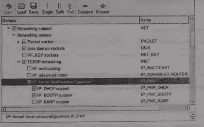

**图 12-3**
内核级自动配置

当你的服务器和目标内核配置好之后，你需要通过前面描述的其中一种方法提供你的目标以太网配置。如果你的引导加载程序支持内核命令行，那么这是最简单的方法。以下是支持 NFS 根挂载的内核命令行可能看起来的样子：

```
console=ttyS0,115200 root=/dev/nfs rw ip=dhcp \
nfsroot=192.168.1.9:/home/chris/sandbox/pdna-target
```

### 12.3.5 U-Boot NFS 根挂载示例

U-Boot 是一个支持可配置内核命令行的引导加载程序的好例子。使用 U-Boot 的非易失性环境功能，我们可以将内核命令行存储在一个专门为此目的命名的参数中。要在 U-Boot 中启用 NFS 命令行，我们执行以下操作（在串行终端中全部在一行）：

```
setenv bootargs console=ttyS0,115200 root=/dev/nfs rw \
ip=dhcp nfsroot=192.168.1.9:/home/chris/sandbox/pdna-target
```

然后我们通过 TFTP 服务器加载内核。列表 12-8 显示了在 PowerPC 嵌入式目标上这可能看起来的样子。

**列表 12-8**
通过 TFTP 服务器加载内核

```
=> tftpboot 200000 uImage-pdna           <<< 在 U-Boot 提示符处输入

使用 FEC ETHERNET 设备

从服务器 192.168.1.9 进行 TFTP； 我们的 IP 地址是 192.168.1.68

文件名 'uImage-pdna'。

加载地址: 0x200000

加载: #############################################
    #############################################
    #####################################

完成

传输的字节数 = 911984 (dea70 hex)

=>
```

当我们引导内核时，我们会看到有关我们的 NFS 根挂载配置的具体证据。列表 12-9 复制了内核启动消息中的选定输出以说明这一点。此输出已进行了格式化（省略了许多行并添加了空格）以便阅读。

**列表 12-9**
**使用 NFS 根挂载引导**

```
解压内核映像 . . . 成功

Linux 版本 2.6.14 (chris@pluto) (gcc 版本 3.3.3
L(DENX ELDK 3.1.1 3.3.3-10)) #1 Mon Jan 2 11:58:48 EST 2006

.
内核命令行: console=ttyS0,115200 root=/dev/nfs rw
nfsroot=192.168.1.9:/home/chris/sandbox/pdna-target ip=dhcp

发送 DHCP 请求 . . . 成功

IP-配置: 从 192.168.1.9 收到 DHCP 响应，我的地址是 192.168.1.68

IP-配置: 完成:
	设备=eth0，地址=192.168.1.68，掩码=255.255.255.0，
	网关=255.255.255.255，主机=192.168.1.68，域=
	错误域=(无)，启动服务器=192.168.1.9，
	根服务器=192.168.1.9，
	根路径=/home/chris/sandbox/pdna-target

.

.
查找 192.168.1.9 上 RPC 100003/2 的端口
查找 192.168.1.9 上 RPC 100005/1 的端口
VFS: 已挂载根文件系统 (nfs 文件系统)。

BusyBox v0.60.5 (2005.06.07-07:03+0000) 内置 shell (msh)
输入 'help' 查看内置命令列表。

#
```

从列表 12-9 中，首先我们看到内核横幅，接着是内核命令行。我们在这个内核命令行中指定了四个项目：

- 控制台设备 (`/dev/console`)
- 根设备 (`/dev/nfs`)
- NFS 根路径 (`/home/chris/sandbox/pdna-target`)
- IP 内核级自动配置方法 (`dhcp`)

紧随其后，我们看到内核试图通过 DHCP 进行内核级自动配置。当服务器响应且 DHCP 交换完成时，内核在下面的行中显示检测到的配置。你可以从该列表中看到，DHCP 服务器已将目标 IP 地址分配为 `192.168.1.68`。将检测到的设置与列表 12-6 中指定的设置进行比较。那类似于导致此配置的 DHCP 服务器配置。

当内核完成 IP 自动配置后，它就能够使用提供的参数挂载根文件系统。你可以从以 VFS（虚拟文件子系统）消息结尾的三行中看到这一点，该消息宣布它已挂载根 NFS 文件系统。在挂载 NFS 根文件系统后，初始化按照第 5 章“内核初始化”中描述的方式完成。

也可以以静态方式将目标 IP 设置传递给内核，而不是让内核从 DHCP 或 BOOTP 服务器获取 IP 设置。IP 设置可以直接通过内核命令行传递。在这种情况下，内核命令行可能看起来类似这样：

```
console=ttyS0,115200
ip=192.168.1.68:192.168.1.9::255.255.255.0:pdna:eth0:off
root=/dev/nfs rw nfsroot=192.168.1.9:/home/chris/pdna-target
```


## 12.4 本章总结

- 开发环境的许多功能极大地促进了嵌入式交叉开发的效率。其中大多数属于工具和实用程序类别。我们将在下一章中详细涵盖这一方面，其中涵盖开发工具。
- 配置正确的开发主机是嵌入式开发人员的关键资产。
- 用于交叉开发的工具链必须正确配置，以匹配你主机系统的目标 Linux 环境。
- 你的开发主机必须安装目标组件，以便你的工具链和二进制实用程序可以引用。这些组件包括目标头文件、库、目标二进制文件及其相关配置文件。简而言之，你需要组装或获取一个嵌入式 Linux 发行版。
- 配置目标服务器，如 TFTP、DHCP 和 NFS，将极大地提高你作为嵌入式 Linux 开发人员的生产力。本章介绍了每种配置的示例。

### 12.4.1 延伸阅读建议

- GCC 在线文档
  http://gcc.gnu.org/online docs/

- 构建和测试 gcc/glibc 交叉工具链
  http://kegel.com/crosstool/

- TFTP 协议，版本 2
  RFC 1350
  www.ietf.org/rfc/rfc1350.txt?number=1350

- 自举协议 (BOOTP)
  RFC 951
  www.ietf.org/rfc/rfc0951.txt?number=951

- 动态主机配置协议
  RFC 2131
  www.ietf.org/rfc/rfc2131.txt?number=2131

# 第 13 章


## 本章内容

- GNU 调试器 (GDB) 第 310 页
- 数据显示器调试器 第 317 页
- cbrowser/cscope 第 319 页
- 跟踪和分析工具 第 321 页
- 二进制实用工具 第 340 页
- 其他二进制实用工具 第 346 页
- 本章小结 第 349 页

典型的嵌入式 Linux 发行版包含许多有用的工具。有些工具复杂且需要很高的熟练度才能掌握。其他一些则很简单，几乎被嵌入式系统开发者忽略了。某些工具可能需要针对特定环境进行定制。许多工具可以“开箱即用”，无需太多努力即可为开发者提供有用的信息。本章展示了嵌入式 Linux 工程师可用的最重要（且常被忽视）工具的一个横截面。

不可能提供本章中介绍的这些工具和实用程序的完整细节。那将需要单独的一本整书！我们不是要提供一个完整的参考手册，而是旨在提供对每个工具基本用法的介绍。我们鼓励你对这些以及其他重要的开发工具进行深入的研究。每个工具的手册页（或其他文档）是一个很好的起点。

首先介绍 GNU 调试器 (GDB)，随后简要介绍数据显示器调试器，这是 GDB 的一个图形前端。接下来，我们介绍一系列旨在让开发者观察程序行为和整个系统状态的实用工具。其中包括 `strace`、`ltrace`、`top` 和 `ps`，这些工具常被缺乏经验的 Linux 开发者忽视。然后，我们介绍一些核心转储和内存分析工具。本章最后介绍一些更有用的二进制实用工具。

### 13.1 GNU 调试器 (GDB)

如果你花大量时间开发 Linux 应用程序，你无疑会花许多时间熟悉 GNU 调试器。`GDB` 可以说是开发者工具箱中最重要的工具。它有着悠久的历史，其功能已经蓬勃发展，包括对多种架构和微处理器提供低级别硬件特定的调试支持。应该注意的是，`GDB` 的用户手册几乎和本书一样大。我们在此处的意图是介绍 `GDB` 以帮你入门。我们鼓励你去研究稍后在第 13.7.1 节“延伸阅读建议”中引用的用户手册。

由于这是一本关于嵌入式 Linux 开发的书，我们使用编译为交叉调试器的 `GDB` 版本。也就是说，调试器本身在你的开发主机上运行，但它理解为其在编译时配置的架构的二进制可执行文件。在接下来的几个示例中，我们使用针对与 Red Hat Linux 兼容的开发主机编译的 `GDB`，以及一个 XScale (ARM) 目标处理器。虽然我们使用短名 **gdb**，但我们展示的是基于 Monta Vista 嵌入式 Linux 发行版中针对 ARM XScale 的交叉-gdb 的示例。该二进制文件名为 `xscale_be-gdb`。它仍然是 `GDB`，只是针对交叉开发环境进行了配置。

`GDB` 调试器是一个复杂的程序，在构建过程中有许多配置选项。我们无意提供关于构建 `gdb` 的指导，这在其他文献中已有覆盖。就本章而言，我们假设你已获得一个针对你将要使用的架构和主机开发环境配置好的可工作的 `GDB`。

#### 13.1.1 调试核心转储

将 `GDB` 从工具箱中拿出的最常见原因之一是评估 **核心转储**。这迅速且容易，并且通常能立即导致对出错代码的识别。当应用程序产生故障时（例如访问其不拥有的内存位置），就会生成核心转储。许多条件可以触发核心转储，¹ 但 `SIGSEGV`（段错误）是迄今为止最常见的。`SIGSEGV` 是 Linux 内核在用户进程进行非法内存访问时生成的 **信号**。当此信号生成时，内核终止该进程。然后，如果已启用，内核会转储核心映像。

要启用核心转储的生成，你的进程必须拥有启用核心转储的资源限制。这可以通过使用 `setrlimit()` 函数调用设置进程的资源限制来实现，或者从 BASH 或 BusyBox shell 命令提示符使用 `ulimit`。在嵌入式系统的初始化脚本中经常会看到以下这一行，以在进程出错时启用核心转储的生成：

```
$ ulimit -c unlimited
```

这个 BASH 内置命令用于设置核心转储的大小限制。在上一个实例中，大小被设置为无限制。

当应用程序产生段错误时（例如，写入其允许范围之外的内存地址），Linux 终止该进程并生成核心转储（如果已启用）。核心转储是进程在发生段错误时的运行快照。

¹ 有关哪些信号生成核心转储的定义，请参见 `./kernel/signal.c` 中的 `SIG_KERNEL_COREDUMP_MASK`。

在你的二进制文件中启用调试符号会有所帮助。如果在构建期间启用了调试符号（`gcc -g`），`GDB` 会产生更有用的输出。然而，即使二进制文件是在没有调试符号的情况下编译的，仍然可以确定导致段错误的事件序列。如果没有调试符号的帮助，你可能需要做更多的调查工作。你必须手动将虚拟地址与程序内的位置进行关联。

列表 13-1 显示了使用 `GDB` 进行核心转储分析会话的结果。输出格式已稍作调整以适应页面。我们使用了一些演示软件故意产生段错误。这是产生段错误的进程（名为 `webs`）的输出：

```
root@coyote:/workspace/webdemo$ ./webs

Segmentation fault (core dumped)
```

##### 列表 13-1

使用 `GDB` 进行核心转储分析

```
$ xscale_be-gdb webs core

GNU gdb 6.3 (MontaVista 6.3.2-0.0.22.0501131 2005-07-23)

Copyright 2004 Free Software Foundation, Inc.

GDB is free software, covered by the GNU General Public

License, and you are welcome to change it and/or distribute cop-

ies of it under certain conditions.

Type "show copying" to see the conditions.

There is absolutely no warranty for GDB.  Type "show warranty"

for details.

This GDB was configured as "--host=i686-pc-linux-gnu --target=armv5teb-

1.montavista-linuxebf"...

Core was generated by `./webs`.

Program terminated with signal 11, Segmentation fault.

Reading symbols from /opt/monstavista/pro/.../libc.so.6...done.

Reading symbols from /opt/monstavista/pro/.../libc.so.6

Reading symbols from /opt/monstavista/pro/.../ld-linux.so.3...done.

Loaded symbols for /opt/monstavista/pro/.../ld-linux.so.3

#0  0x00012ac4 in ClearBlock (RealBigBlockPTr=0x0, l=100000000) at led.c:43

43      *ptr = 0;
(gdb) 1

38

39 static int ClearBlock(char * BlockPtr, int l)
{
  char **ptr;
```


### 13.1.2 调用 GDB

列表 13–1 的第一行显示了如何从命令行调用 GDB。因为我们要进行交叉调试，我们需要针对我们的主机和目标系统编译的交叉版本 GDB。我们按照所示方式调用我们的交叉-gdb 版本，并传递给 `xscale_be-gdb` 二进制文件名，后跟核心转储文件名——在本例中，仅为 `core`。在 GDB 打印几行描述其配置和其他信息的横幅行之后，它打印终止的原因：信号 11，即段错误的指示。² 随着 GDB 加载二进制文件、它依赖的库以及核心文件，随后还有几行。GDB 启动时打印的最后一行是程序发生故障时的当前位置。带有 `#0` 字符串前缀的行表示栈帧（在名为 `ClearBlock()` 的函数中虚拟地址 `0x00012ac4` 处的栈帧零）。带有 `43` 前缀的下一行是来自名为 `led.c` 的文件中出错源文件行的行号。从这里，GDB 显示其命令提示符并等待输入。

为了提供一些上下文，我们输入 `gdb list` 命令，使用其缩写形式 `l`。GDB 在无歧义的情况下识别命令缩写。在此处，程序错误开始显现。根据 GDB 对核心转储的分析，出错行是：

```
43 *ptr = 0;
```

接下来，我们对 `ptr` 变量发出 `gdb p ptr` 命令，再次缩写为 `p`。正如你在列表 13–1 中所见，指针 `ptr` 的值为 `0`。因此我们得出结论，段错误的原因是解引用了一个空指针，这是一种常见的编程错误。从这里，我们可以选择使用 `backtrace` 命令来查看导致此错误的调用链，这可能会将我们带回错误的真正源头。列表 13-2 显示了这些结果。

#### 列表 13-2
#### 回溯命令

```
(gdb) bt
#0  0x00012ac4 in ClearBlock (RealBigBlockPtr=0x0, l=100000000) at led.c:43
#1  0x00012b08 in InitBlock (ptr=0x0, n=100000000) at led.c:48
#2  0x00012b50 in ErrorInHandler (wp=0x325c8, urlPrefix=0x2f648 "/Error",
    webDir=0x2f660 "", arg=0, url=0x34f30 "/Error", path=0x34d68 "/Error",
    query=0x3212d8 "") at led.c:61
#3  0x000126cc in webIOEventHandler (wp=0x325c8) at handler.c:273
#4  0x00014518 in webSetInput (wp=0x325c8, ptext=0xbefffc40,
    pnbtegs=0xbefff6c38) at webs.c:664
#5  0x0001ed00 in websReadEvent (wp=0x325c8) at webs.c:362
#6  0x0001ed34 in webSocketEvent (sid=1, mask=2, ipp=206280) at webs.c:319
#7  0x00019740 in socketDoEvent (sp=0x34fc8) at sockGen.c:903
#8  0x00019598 in socketProcess (sid=1) at sockGen.c:845
#9  0x00012be8 in main (argc=2, argv=0xbeffee14) at main.c:99
(gdb)
```

回溯显示了从用户的程序入口 `main()` 开始的完整调用链。回溯的每一行前面都有一个栈帧编号。你可以使用 `gdb` 的 `frame` 命令切换到任意指定的栈帧。列表 13-3 就是一个示例。在这里，我们切换到栈帧 2 并显示该帧中的源代码。与之前的示例一样，以 `(gdb)` 开头的行是我们向 GDB 发出的命令，而其他行则是 GDB 的输出。

#### 列表 13-3
#### 在 GDB 中移动栈帧

```
(gdb) frame 2
#2  0x00012b50 in ErrorInHandler (wp=0x325c8, urlPrefix=0x2f648 "/Error",
    webDir=0x2f660 "", arg=0, url=0x34f30 "/Error", path=0x34d68 "/Error",
    query=0x3212d8 "") at led.c:61
    return InitBlock(p, size);
61      return InitBlock(p, size);
(gdb) l
56

57

58            size = 10000 * sizeof(BigBlock);
59            p = malloc(size);
60            if (p) */
61 return InitBlock(p, size);
62 /* else return (0); */
63 }
64

(gdb)
```

你可以看到，借助通过 `list` 命令获取的源代码的帮助，追踪代码回到错误空指针的来源并不会困难。事实上，精明的读者会注意到我们为这个示例制造的段错误的根源。从列表 13-3 中，我们看到对 `malloc()` 调用返回值的检查已被注释掉。在这个示例中，`malloc()` 调用失败了，导致在调用链中两个栈帧之后对空指针进行操作。尽管这个示例既人为设计又微不足道，但使用 GDB 和核心转储采用类似方法追踪此类崩溃通常非常轻松。你还可以通过查看函数调用中的参数值来看到空指针。这通常会直接将你带到空指针产生的帧。

### 13.1.3 GDB 调试会话

我们通过展示一个典型的调试会话来结束对 GDB 的介绍。在之前演示程序崩溃时，我们可以选择逐步执行代码以缩小故障原因的范围。当然，如果你获取了核心转储，你应该总是从那里开始。然而，在其他情况下，你可能希望设置断点并逐步执行正在运行的代码。列表 13-4 详细说明了如何启动 GDB 以准备调试会话。请注意，程序必须在使用 `gcc` 命令行时启用调试标志进行编译，GDB 在此上下文中才实用。回顾第 12 章“嵌入式开发环境”中的图 12-1；这是一个交叉调试会话，GDB 在你的开发主机上运行，调试在你的目标板上运行的程序。我们在第 15 章“调试嵌入式 Linux 应用程序”中介绍了远程应用调试的完整细节。

#### 列表 13-4
#### 启动 GDB 调试会话

```
$ xscale_de-gdb --silent webs
(gdb) target remote 192.168.1.21:2001
0x40000790 in ?? ()
(gdb) b main
Breakpoint 1 at 0x12b74: file main.c, line 78.
(gdb) c
Continuing.
Breakpoint 1, main (argc=1, argv=0x8effee04) at main.c:78
78                hopen(NULL, (60 * 1024), B_USE_MALLOC);
(gdb) b ErrorHandler
Breakpoint 2 at 0x12b30: file led.c, line 57.
(gdb) c
Continuing.
Breakpoint 2, ErrorHandler (wp=0x311e0, urlPrefix=0x2f48 "//Error",
webDirs=0x2f560 "", arg=0, url=0x31e88 "/Error", path=0x31918 "/Error",
query=0x311ae8 "") at led.c:57
57                size = 10000 * sizeof(BigBlock);
(gdb) next
59        p = malloc(size);
(gdb) next
61                return InitBlock(p, size);
(gdb) p p
$1 =(unsigned char *) 0x0
(gdb) p size
$2 =  100000000
(gdb)
```

```
42   for (ptr = BlockPtr; (ptr - BlockPtr) < l; *ptr++)

43      *ptr = 0;

44 return 0;

45 }

46 static int InitBlock(char * ptr, int n)

47 {

(gdb) p ptr

$1 = 0x0

(gdb)
```


通过这个简单的调试会话，首先我们使用 `gdb target` 命令连接到我们的目标板。我们在第 15 章中更详细地介绍了远程调试。当我们连接到目标硬件时，我们使用 `gdb break`（简写为 `b`）命令在 `main()` 处设置断点。然后我们发出 `gdb continue`（简写为 `c`）命令以恢复程序的执行。如果我们有任何程序参数，可以在调用 GDB 时在命令行上发出它们。

我们命中了设置在 `main()` 处的断点，并在 `ErrorHandler()` 处设置了另一个断点，随后再次发出简写的 `continue` 命令。当命中这个新断点时，我们开始使用 `next` 命令逐步执行代码。在那里我们遇到了对 `malloc()` 的调用。在跟随 `malloc()` 调用之后，我们检查返回值，并发现如空返回值所示的失败。最后，我们打印 `malloc()` 调用中参数的值，看到正在请求一个非常大的内存区域（1 亿字节），导致失败。

虽然微不足道，但本节中的 GDB 示例应该能够使初学者立即熟练使用 GDB。我们很少有人真正精通 GDB——它非常复杂，具有许多功能。在第 13.2 节“数据显示调试器”中，我们介绍了一个 GDB 图形前端，可以帮助不熟悉 GDB 的人轻松过渡。

关于 GDB 的最后一点说明：毫无疑问，你已注意到 GDB 在首次调用时在控制台上显示的许多横幅行，如列表 13-1 所示。在这些示例中，正如前面所述，我们使用了来自 Monta Vista 嵌入式 Linux 发行版的交叉 `gdb`。横幅行包含嵌入式开发者必须了解的重要信息：GDB 的主机和目标规范。从列表 13-1 中，当我们调用 GDB 时看到以下输出：

```
This GDB was configured as "--host=i686-pc-linux-gnu \
--target=arm5teb-montavista-linuxaueI"
```

在此实例中，我们调用的 GDB 版本是编译为在 Linux PC 上执行的——具体来说，是运行 GNU/Linux 操作系统的 `i686` 处理器。同样关键的是，这个 GDB 实例是编译用于调试由 `arm5teb` 大端工具链生成的 ARM 二进制代码的。

嵌入式开发新手最常犯的错误之一是在尝试调试目标可执行文件时使用了错误的 GDB。如果某些事情不对劲，你应该立即检查你的 GDB 配置，以确保它适合你的环境。你不能使用本地 GDB 来调试目标代码！

## 13.2 数据显示调试器

数据显示调试器（DDD）是 GDB 和其他命令行调试器的图形前端。除了简单地查看源代码和逐步执行调试会话外，DDD 还有许多高级功能。图 13-1 是 DDD 主屏幕的截图。

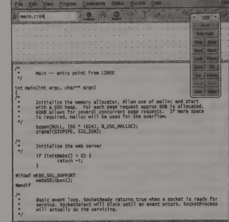

### 图 13-1
数据显示调试器

DDD 的调用方式如下：

```
$ ddd --debugger xscale_be-gdg webs
```

如果没有 `--debugger` 标志，DDD 将尝试在你的开发主机上调用本地 GDB，这不是你在计划调试目标系统上的应用程序时想要的。DDD 命令行中的第二个参数是你要调试的程序。有关更多细节，请参阅 DDD 的手册页。

使用如图 13-1 所示的命令工具，你可以逐步执行程序。你可以以图形方式或通过 DDD 屏幕底部的 GDB 控制台窗口设置断点。对于目标调试，你必须首先使用 `target` 命令将你的调试器连接到目标系统，如我们在列表 13-4 中所做的那样。此命令在 `ddd` 主屏幕的 GDB 窗口中发出。

连接到目标后，你可以执行与前一个示例中描述的序列类似的命令来隔离程序故障。图 13-2 展示了此调试会话后期阶段的 DDD 显示界面。

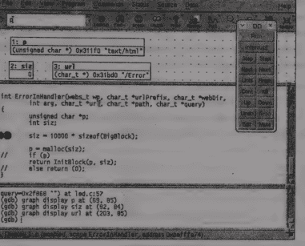

### 图 13-2
DDD 中的调试会话

请注意，在图 13-2 中，我们启动了某些重要程序变量的显示，这些变量可以帮助我们缩小段错误（segmentation fault）的原因范围。我们可以使用图中所示的命令工具，在单步执行程序时监视这些变量。

DDD 是 GDB 的一个强大的图形前端。它相对易于使用，并且在许多开发主机上得到广泛支持。请参阅本章末尾的 13.7.1 节，其中包含 GNU DDD 文档的链接。

## 13.3 cbrowser/cscope

我们在此提及 `cbrowser`，是因为对该便捷工具的支持已经进入了 Linux 内核源代码树。³ `cbrowser` 是一个简单的源代码浏览工具，它使得在大型源代码树中跟随符号进行跳转变得很容易。

> ³ 实际上，`cbrowser` 使用的基础引擎的支持位于 Linux 构建系统中。

Linux 内核的 `makefile` 支持构建 `cbrowser` 所使用的数据库。以下是来自最近一个 Linux 内核快照的示例调用：

```
$ make ARCH=ppc CROSS_COMPILE=ppc_82xx- cscope
```

这会生成 `cbrowser` 使用的 `cscope` 符号数据库。`cscope` 是引擎；`cbrowser` 是图形用户界面。如果你愿意，可以单独使用 `cscope`。它由命令行驱动，功能非常强大，但在如今这种点击操作的时代，对于导航大型源代码树来说，并不像 `cbrowser` 那样快速或简便。如果 `vi` 仍然你最喜爱的编辑器，那么 `cscope` 可能正适合你！

要调用 `cbrowser`，进入包含 `cscope` 数据库的目录，然后直接输入 `cbrowser` 命令而不带任何参数。图 13-3 展示了一个示例会话。有关这两个有用工具的更多信息，请参阅本章末尾 13.7.1 节列出的参考文献。

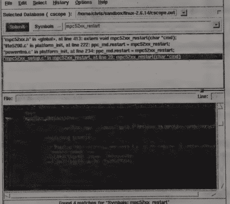

### 图 13-3
`cbrowser` 运行中

## 13.4 跟踪与性能分析工具

许多有用的工具可以为你提供系统的各种视图。一些工具提供高层视角，例如系统上正在运行哪些进程以及哪些进程消耗了最多的 CPU 带宽。其他工具可以提供详细分析，例如内存在哪里被分配，或者更有用的是，内存在哪里发生泄漏。接下来的几个小节将介绍此类工具和实用程序中最重要的一些。我们只能对这些工具进行简要介绍；如果需要更多细节，将在适当的地方提供参考。

### 13.4.1 strace

这个有用的系统跟踪实用程序几乎存在于所有 Linux 发行版中。`strace` 捕获并显示 Linux 应用程序程序执行的每个内核系统调用的有用信息。`strace` 特别方便，因为它可以在没有源代码的程序上运行。与 GDB 不同，不需要以调试符号编译程序。此外，`strace` 可以成为一个非常有洞察力的教育工具。正如手册页所陈述的那样：“学生、黑客和过度好奇的人会发现在跟踪即使是普通的程序时，可以了解关于系统及其系统调用的大量知识。”

在为本章前面的 GDB 部分准备示例软件时，我决定使用一个我不熟悉的项目，即 GoAhead web 服务器的早期版本。第一次尝试编译和链接该项目导致了一个有趣的 `strace` 示例。从命令行启动应用程序后，控制台静默地返回控制权。没有产生任何错误消息，查看系统日志也没有发现任何线索！它只是无法运行。

`strace` 迅速定位了问题。对该软件包调用 `strace` 的输出结果展示在列表 13-5 中。由于篇幅限制，该输出的许多行已被删除。未经编辑的输出超过一百行。

#### 列表 13-5
`strace` 输出：GoAhead Web 演示

```
01 root@coyote:/home/websdemo$ strace ./websdemo
02 execve("./websdemo", ["./websdemo"], [/* 14 vars */]) = 0
03 uname (sys="Linux", node="coyote", ...) = 0
04 brk(0)
05 open("/etc/ld.so.preload", O_RDONLY)
    = -1 ENOENT (No such file or
    directory)
06 open("/etc/ld.so.cache", O_RDONLY)
    = -1 ENOENT (No such file or
    directory)
07 open("/lib/libc.so.6", O_RDONLY)
    = 3
08 read(3, "177ELFN1211001000010101
010312480000000001013224...", 1024)
    L = 1024
09 fstat64(0x3, 0xffffc68)
    = 0
10 mmap(0xffffe000, 1379388, PROT_READ|PROT_EXEC, MAP_PRIVATE, 3, 0) = 0xffffe000
11 mprotect(0xffffe000, 97340, PROT_NONE)
    = 0
```


12 `mmap`(0xfffff000, 61440, `PROT_READ`| `PROT_WRITE`| `PROT_EXEC`, `MAP_PRIVATE`| `MAP_FIXED`, 
    L 0xfffff000, 0xfffffe00)

13 `mmap`(0xffffe000, 7228, `PROT_READ`| `PROT_WRITE`| `PROT_EXEC`, `MAP_PRIVATE`| `MAP_FIXED`, 
    L_MAP_ANONYMOUS, -1, 0) = 0xffffe000

14 `close`(3)
    = 0

15 `brk`(0)
    = 0x0031050

16 `brk`(0x0032050)
    = 0x0032050

17 `brk`(0x0033000)
    = 0x0033000

18 `brk`(0x00041000)
    = 0x00041000

19 `rt_sigaction`(`SIGPIPE`, (`SIG_IGN`), (`SIG_DFL`), 8) = 0

20 `stat`("./umconf.txt", 0xffff58)
    = -1 `ENOENT` (No such file or
    directory)

21 `uname`({sys="Linux", node="coyote", ...}) = 0

22 `gettimeofday`({3301, 178955], NULL}
    = 0

23 `getpid`()
    = 156

24 `open`("/etc/resolv.conf", `O_RDONLY`)
    = 3

25 `fstat64`(0x3, 0xfffff8)
    = 0

26 `mmap`(NULL, 4096, `PROT_READ`, 
    `MAP_PRIVATE`| `MAP_ANONYMOUS`, -1, 0) =
    L_0x30017000

27 `read`(3, "#\n\# resolv.conf This file is th"..., 4096) = 83

28 `read`(3, "", 4096)
    = 0

29 `close`(3)
    = 0

...   <<<< Lines 30-61 removed for brevity

82 `socket`(`PF_INET`, `SOCK_DGRAM`, `IPPROTO_IP`)
    = 3

83 `connect`(3, {sa_family=`AF_INET`, sin_port=htons(53), sin_addr=inet_addr
L("0.0.0.0")}, 28) = 0

84 `send`(3, "\267\x1\0\0\1\0\0\0\0\0c0cyote\0\0\1\0\1", 24, 0) = 24

85 `gettimeofday`({3301, 549644}, NULL)
    = 0

86 `poll`([{fd=3, events=`POLLIN`, revents=`POLLERR`}], 1, 5000) = 1

87 `lso`(3, 0x04667, 0xffff6a8)
    = 0

88 `recvfrom`(3, OX\267\110, 1024, 0, 0xffffe068, 0xffffe6ac) = -1 `ECONNREFUSED`
L (Connection refused)

89 `close`(3)
    = 0

90 `socket`(`PF_INET`, `SOCK_DGRAM`, `IPPROTO_IP`)
    = 3

91 `connect`(3, {sa_family=`AF_INET`, sin_port=htons(53), sin_addr=inet_addr
L("0.0.0.0")}, 28) = 0

92 `send`(3, "\267\x1\0\0\1\0\0\0\0\0c0cyote\0\0\1\0\1", 24, 0) = 24

93 `gettimeofday`({3301, 552839], NULL)

94 `poll`({{fd=3, events=`POLLIN`, revents=`POLLERR`}}, 1, 5000) = 1

95 `lioctl`(3, 0x4004667f, 0x7ffffe6a8) = 0

96 `recvfrom`(3, 0x7fff51f0, 1024, 0, 0x7fff668, 0x7fff6ac) = -1 `ECONNREFUSED`
   (Connection refused)

97 `close`(3) = 0

98 `exit`(-1) = ?

99 root@cayout:\~/home\smbd#

```
为了提高列表的可读性，`strace` 产生的输出被添加了行号。该命令的调用位于第 01 行。最简单的方法是，直接在你要检查的程序前面加上 `strace` 命令。列表 13-5 中的输出就是这样产生的。

此跟踪的每一行都代表 `websdemos` 进程向内核发起系统调用。我们不需要分析和理解跟踪中的每一行，尽管这样做确实很有教育意义。我们要寻找任何异常，以帮助确定程序无法运行的原因。在前几行中，Linux 正在设置程序将执行的环境。我们看到几个对 `/etc/ld.so.*` 的 `open()` 系统调用，这是 Linux 动态链接器加载器（`ld.so`）在做它的工作。事实上，第 06 行是我得到此嵌入式开发板未正确配置的线索。应该有一个由运行 `ldconfig` 产生的链接器缓存。（链接器缓存可以显著加快搜索共享库引用的速度。）随后通过在目标上运行 `ldconfig` 解决了这个问题。

直到第 19 行都是更基础的内务工作，主要由加载器和 `libc` 初始化完成。请注意第 20 行，程序正在寻找一个配置文件，但未找到。当软件运行时，这可能是一个重要问题。从第 24 行开始，程序开始设置和配置它所需的适当网络资源。第 24 到 29 行打开并读取了一个包含 DNS 服务解析主机名指令的 Linux 系统文件。本地网络配置活动一直持续到第 81 行。其中大部分活动包括为程序本身构建网络基础设施所需的网络设置和配置。出于简洁和清晰的原因，列表的这一部分已被删除。

特别注意从第 82 行开始的网络活动。在这里，程序试图建立一个到全零 IP 地址的 TCP/IP 连接。为方便起见，第 82 行在此复制如下：

```
socket(PF_INET, SOCK_DGRAM, IPPROTO_IP) = 3
```

⁴ 有关为目标系统创建链接器缓存的详细信息，请参阅 `ldconfig` 的手册页。

关于**列表 13-5**中有几点值得注意。我们可能不了解每个系统调用的所有细节，但我们可以大致了解正在发生的事情。`socket()` 系统调用类似于文件系统中的 `open()` 调用。在这种情况下，由等号（=）表示的返回值代表一个 Linux 文件描述符。知道这一点后，我们可以将第 82 行到第 89 行 `close()` 系统调用之间的活动与文件描述符 3 关联起来。

我们对这组相关的系统调用感兴趣，因为我们在第 88 行看到一条错误信息：“Connection refused”（连接被拒绝）。此时，我们仍然不知道程序为何无法运行，但这看起来异常。让我们来调查一下。第 82 行，对 `socket()` 的系统调用，建立了 IP 通信的端点。第 83 行相当奇怪，因为它试图建立一个到包含全零 IP 地址的远程端点（套接字）的连接。我们不需要是网络专家也能怀疑这可能会引起麻烦。[^5] 第 83 行提供了另一个重要线索：端口参数被设置为 53。快速搜索 TCP/IP 端口号会发现，端口 53 是域名服务，即 DNS。

第 84 行提供了又一条线索。我们开发板的主机名是 `coyote`。这可以在**列表 13-5** 第 01 行的命令提示符中看到。显然，此活动是对我们开发板主机名的 DNS 查找，并且正在失败。作为一个实验，我们在目标系统的 `/etc/hosts`[^6] 文件中添加了一个条目，将本地定义的主机名与开发板的本地分配 IP 地址关联起来，如下所示：

```
coyote    192.168.1.21    #The IP address we assigned
```

瞧：我们的程序开始正常工作。虽然我们可能不知道确切的原因（TCP/IP 网络专家可能会知道）这会导致程序失败，但我们的 `strace` 输出让我们了解到，对我们板子名称的 DNS 查找正在失败。当我们修复了这一点后，程序愉快地启动并开始提供网页服务。回顾一下，这是一个没有源代码可供参考的程序，并且其二进制图像中未编译符号。使用 `strace`，我们确定了程序故障的原因，并实施了解决方案。

[^5]: 有时全零地址在此上下文中是合适的。但是，由于我们正在调查程序为何异常退出，因此应将其视为可疑对象。

[^6]: 有关此系统管理文件的详细信息，请参阅 man `hosts`。

### 13.4.2 strace 变体

*strace* 实用程序有许多命令行选项。其中更有用的一个功能包括选择要跟踪的系统调用的子集。例如，如果您只想查看给定进程的网络相关活动，请发出以下命令：

```
$ strace -s trace-network process_name
```


这将生成所有网络相关系统调用的跟踪，例如 `socket()`、`connect()`、`recvfrom()` 和 `send()`。这是一种查看给定程序网络活动的强大方法。还有几个其他子集可用。例如，您可以使用 `open()`、`close()`、`read()`、`write()` 等查看程序的文件相关活动。其他子集包括进程相关系统调用、信号相关系统调用和 IPC 相关系统调用。

值得注意的是，`strace` 能够处理跟踪生成额外进程的程序。使用 `-f` 选项调用 `strace` 会指示 `strace` 跟踪使用 `fork()` 系统调用创建的子进程。`strace` 命令存在无数种可能性。掌握这个强大实用程序的最佳方法是使用它。对于这一点以及我们介绍的所有工具，务必查找并阅读最新的开源文档。在这种情况下，在大多数 Linux 主机上执行 `man strace` 将产生足够的材料让您实验一下午！

使用 `strace` 的一个非常有效的方法是使用 `-c` 选项。该选项生成应用程序的高级配置文件。使用 `-c` 选项，`strace` 汇总每个系统调用的统计信息，包括它被遇到的次数、返回错误的次数以及花费在每个系统调用中的时间。**列表 13-6** 是运行 `strace -c` 于前一个示例中的 `webs demo` 的一个例子。

**列表 13-6**
**使用 strace 进行配置分析**

| root@coeates$ strace -c ./webs |
| :--- | :--- | :--- | :--- | :--- |
| % time | seconds | usecs/call | calls | errors syscall |
| :--- | :--- | :--- | :--- | :--- |
| | | | | send |
| 29.80 | 0.034262 | 189 | 181 | |
| 18.46 | 0.021226 | 1011 | 21 | 10 open |
| 14.31 | 0.016231 | 130 | 125 | read |
| 11.37 | 0.013651 | 506 | 27 | 8 stat64 |
| 5.88 | 0.006762 | 193 | 35 | select |
| 5.28 | 0.006072 | 76 | 80 | fcntl64 |
| 3.47 | 0.003994 | 65 | 61 | time |
| 2.79 | 0.003205 | 3205 | 1 | execve |
| 1.71 | 0.001970 | 30 | 22 | 3 recv |
| 1.62 | 0.001866 | 85 | 22 | close |
| 1.61 | 0.001856 | 169 | 11 | shutdown |
| 1.39 | 0.001585 | 144 | 11 | accept |
| 0.41 | 0.000470 | 94 | 5 | mmap2 |
| 0.26 | 0.000301 | 100 | 3 | mprotect |
| 0.24 | 0.000281 | 94 | 3 | brk |
| 0.17 | 0.000194 | 194 | 1 | 1 access |
| 0.13 | 0.000150 | 150 | 1 | lseek |
| 0.12 | 0.000142 | 47 | 3 | uname |
| 0.11 | 0.000132 | 132 | 1 | listen |
| 0.11 | 0.000128 | 128 | 1 | socket |
| 0.09 | 0.000105 | 53 | 2 | fstat64 |
| 0.08 | 0.000097 | 97 | 1 | muname |
| 0.06 | 0.000064 | 64 | 1 | getcwd |
| 0.05 | 0.000063 | 63 | 1 | bind |
| 0.05 | 0.000054 | 54 | 1 | setsockopt |
| 0.04 | 0.000048 | 48 | 1 | rt_sigaction |
| 0.04 | 0.000046 | 46 | 1 | gettime64day |
| 0.03 | 0.000038 | 38 | 1 | getpid |
| 100.00 | 0.114985 | | 624 | 22 total |

这是获取应用程序消耗时间和发生错误位置的高层视图的非常有用的方法。某些错误可能是应用程序正常操作的一部分，但其他错误可能会消耗您未预期的时间。从**列表 13-6** 中，我们可以看到持续时间最长的系统调用是 `execve()`，这是 shell 用来生成应用程序的调用。如您所见，它只被调用了一次。另一个有趣的观察结果是 `send()` 系统调用是使用最频繁的系统调用。这是合理的，因为该应用程序是一个小型 Web 服务器。

请记住，与我们这里讨论的其他工具一样，`strace` 必须针对您的目标架构进行编译。`strace` 在您的目标板上执行，而不是在您的开发主机上。您必须使用与您的架构兼容的版本。如果您购买商业嵌入式 Linux 发行版，应确保该工具包含您所选架构的版本。

### 13.4.3 ltrace

`ltrace` 和 `strace` 实用程序关系密切。`ltrace` 实用程序针对库调用所做的，就是 `strace` 针对系统调用所做的。它的调用方式类似：在要跟踪的程序前加上跟踪器实用程序，如下所示：

```
$ ltrace ./example
```

**列表 13-7** 复现了 `ltrace` 在一个执行少量标准 C 库调用的小型示例程序上的输出。

**列表 13-7**
**ltrace 输出示例**

```
$ ltrace ./example

__libc_start_main(0x8048594, 1, 0xbffff944, 0x80486b4, 0x80486fc

L_unfinished(>)

malloc(256)                             = 0x804a008

getenv("HOME")                           = "/home/chris"

strcpy(0x804a008, "/home", 5)            = 0x804a008

fopen("foo.txt", "w")                    = 0x804a110

printf("$HOME = %s\n", "/home/chris")      $HOME = /home/chris

}                             = 20

printf(0x804a110, "$HOME = %s\n", "/home/chris") = 20

fclose(0x804a110)           = 0

remove("foo.txt")            = 0

free(0x804a008)             = <void>

+++ exited (status 0) +++

$
```

对于每个库调用，都会显示调用的名称，以及调用参数的不同部分。与 `strace` 类似，随后会显示库调用的返回值。与 `strace` 一样，该工具可用于没有源代码的程序。

与 `strace` 一样，各种开关会影响 `ltrace` 的行为。您可以显示每个库调用时程序计数器的值，这有助于理解应用程序的程序流程。与 `strace` 一样，您可以使用 `-c` 来汇总并报告计数、错误和时间统计信息，使其成为有用的简单配置分析工具。**列表 13-8** 显示了使用 `-c` 选项运行我们简单示例程序的结果。

#### 列表 13-8：使用 ltrace 进行性能分析

```
$ ltrace -c ./example

$HOME = /home/chris

%

time        seconds  uses/call calls function

24.16 0.000231        231   1 printf

16.53 0.000158        158   1 fclose

16.00 0.000153        153   1 fopen

13.70 0.000131        131   1 malloc

10.67 0.000102        102   1 remove

9.31 0.000089         89   1 fprintf

3.35 0.000032         32   1 getenv

3.14 0.000030         30   1 free

3.14 0.000030         30   1 strncpy

100.00 0.000956 9 total
```


`ltrace`工具仅适用于编译为使用动态链接共享库对象的程序。这是通常的默认设置，因此，除非在编译时明确指定`-static`，否则你可以对生成的二进制文件使用`ltrace`。与`strace`类似，你必须使用已针对目标架构编译的`ltrace`二进制文件。这些实用程序在目标系统上运行，而不是在主机开发系统上运行。

### 13.4.4 ps

除了`strace`和`ltrace`之外，嵌入式系统开发者最常忽略的工具莫过于`top`和`ps`。鉴于每种工具可用的众多选项，我们完全可以为此写整整一章来介绍这些有用的系统性能分析工具。它们几乎在所有嵌入式 Linux 发行版中都可以使用。

这两种实用程序都使用了在第 9 章“文件系统”中描述的`/proc`文件系统。如果你知道要查找什么以及如何解析所得到的信息，那么它们所传达的许多信息都可以从`/proc`文件中得知。这些工具将这些信息以方便人类阅读的格式呈现出来。

`ps`实用程序列出机器上所有正在运行的进程。然而，它非常灵活，可以定制以提供关于运行机器及其上运行进程的大量有用数据。例如，`ps`可以显示每个进程的调度策略。这对于采用实时进程的系统特别有用。

不带任何选项时，`ps`显示与调用该命令的用户具有相同用户 ID 的所有进程，并且只显示与发出命令的终端相关的进程。当该用户和终端生成了许多作业时，这非常有用。

向`ps`传递选项可能会令人困惑，因为`ps`支持多种标准（如 POSIX 与 UNIX）以及三种不同的选项风格：BSD、UNIX 和 GNU。通常，BSD 选项是单个或多个字母，没有破折号。UNIX 选项是熟悉的破折号-字母组合，而 GNU 使用由双破折号引出的长参数格式。有关你的`ps`实现的详细信息，请参阅`man`手册页。

每个使用`ps`的人可能都有一个首选的调用方式。一个特别有用的通用调用方式是`ps aux`。这显示了系统上的每个进程。列表 13-9 是来自运行中的嵌入式目标板的示例。

#### 列表 13-9：进程列表

```
$ ps aux

USER      PID  %CPU %MEM   VSZ  RSS TTY  STAT START    TIME COMMAND

root        1   0.0  0.8  1416  508 ?    S    00:00  0:00 init [3]

root        2   0.0  0.0    0    0 ?    S?   00:00  0:00 [ksoftirqd/0]

root        3   0.0  0.0    0    0 ?    S<   00:00  0:00 [khelper/0]

root        4   0.0  0.0    0    0 ?    S    00:00  0:00 [events/0]

root        5   0.0  0.0    0    0 ?    S<   00:00  0:00 [khelper/]

root       10   0.0  0.0    0    0 ?    S<   00:00  0:00 [kthread]

root       21   0.0  0.0    0    0 ?    S<   00:00  0:00 [khblockd/0]

root       62   0.0  0.0    0    0 ?    S    00:00  0:00 [pdflush]

root       63   0.0  0.0    0    0 ?    S    00:00  0:00 [pdflush]

root       65   0.0  0.0    0    0 ?    S<   00:00  0:00 [aio/0]

root       36   0.0  0.0    0    0 ?    S    0:00    [kswapd]

root       64   0.0  0.0    0    0 ?    S    0:00    [kswapd0]

root      617   0.0  0.0    0    0 ?    S    0:00    [khubd]

root      638   0.0  0.0    0    0 ?    S    0:00    [kthread]

root      834   0.0  0.7 1568  444 ?    Ss   0:00    /sbin/portmap

bin       861   0.0  0.0    0    0 ?    S    0:00    [lockd]

root      868   0.0  0.9 1488  596 ?    Ss   0:00    /sbin/syslogd -r

root      876   0.0  0.7  412  456 ?    Ss   0:00    /sbin/klogd -x

root      884   0.0  1.1 1660  700 ?    Ss   0:00    /usr/sbin/rpc.statd

root      896   0.0  0.9 1688  584 ?    Ss   0:00    /usr/sbin/inetd

root      909   0.0 2.2 2412 1372 ?    Ss   0:00    /usr/sbin/xinetd

telnetd   953   0.1 1.1 1736  732 ?    S<   05:58  0:00 in.telnetd

root      954  0.2 2.1 2384 1348 pts/0 S   05:58  0:00 -bash

root      960   0.0 1.2 2312  772 pts/0 R+ 05:59  0:00 ps aux
```

这只是使用`ps`查看输出数据的众多方式之一。以下文本解释了各列的含义。

- `USER`和进程 ID (`PID`)字段应该是不言自明的。
- `%CPU`字段表示自进程生命周期开始以来的 CPU 利用率百分比；因此，CPU 使用率几乎永远不会达到 100%。
- `%MEM`字段表示进程的常驻内存足迹与可用物理内存总量的比率。
- `VSZ`字段是以千字节为单位的进程虚拟内存大小。
- `RSS`是常驻集大小，表示进程已使用的非交换物理内存，同样以千字节为单位。
- `TTY`是进程的终端。

本示例中的大多数进程不与控制终端关联。生成列表 13-9 的`ps`命令是从 Telnet 会话发出的，由`pts/0`终端设备指示。

`STAT`字段描述了这个快照产生时进程的状态。在此，`S`表示进程正在睡眠，等待某种类型的事件，通常是 I/O。`R`表示进程处于可运行状态（即，如果没有更高优先级的等待，调度器可以自由地让它控制 CPU）。状态字母左侧的左括号表示该进程具有更高的优先级。

最后一列是命令名称。括号中列出的是内核线程。还有更多的符号和选项可用；有关完整细节，请参阅`ps`的`man`手册页。

### 13.4.5 top

`ps`是当前系统的一次性快照，而`top`会定期截取系统及其进程状态的快照。与`ps`类似，`top`也有许多命令行和配置选项。它是交互式的，并且在运行期间可以重新配置，以定制显示以满足你的特定需求。

在没有选项的情况下启动时，`top`以一种与列表 13-9 中介绍的`ps aux`命令非常相似的方式显示所有运行中的进程，并每 3 秒更新一次。当然，`top`的这一方面以及其他许多方面都是用户可配置的。`top`屏幕的前几行显示系统信息，也每 3 秒更新一次。这包括系统运行时间、用户数量、关于进程数量及其状态的信息等更多内容。

列表 13-10 展示了`top`在默认配置下的状态，这是在没有参数情况下从命令行执行`top`的结果。

#### 列表 13-10

```
top

top - 06:23:14 up 6:23,  2 users,  load average: 0.00, 0.00, 0.00

Tasks: 24 total,   1 running,  23 sleeping,   0 stopped,   0 zombie

Cpu(s): 0.0% us,  0.3% sy,  0.0% ni, 99.7% id,  0.0% wa,  0.0% hi,  0.0% si

Mem:  62060k total,  12792k used,   44768k free,   1164k cached

Swap:       0k total,        0k used,        0k free,        0k cached

  PID USER   PR NI  VIRT  RES  SHR S %CPU %MEM    TIME+ COMMAND

  978 root   16  0  1924  952 780 R   0.3   1.5   0:01.22 top

    1 root   16  0  1416  508 452 S   0.0   0.8   0:00.47 init
```


```
    2 root    5 -10   0    0    0 S   0.0   0.0   0:00.00 keventirqd/0

    3 root    5 -10   0    0    0 S   0.0   0.0   0:00.00 desched/0

    4 root   -2  -5   0    0    0 S   0.0   0.0   0:00.00 events/0

    5 root   -2  -5   0    0    0 S   0.0   0.0   0:00.09 khelper

   10 root   18  -5   0    0    0 S   0.0   0.0   0:00.00 kthread

   21 root   20  -5   0    0    0 S   0.0   0.0   0:00.00 blkdeiod/0

   62 root   20   0   0    0    0 S   0.0   0.0   0:00.00 kdiush

   63 root   15   0   0    0    0 S   0.0   0.0   0:00.00 pidflush

   65 root   19  -5   0    0    0 S   0.0   0.0   0:00.00 kid/0

   36 root   25   0   0    0    0 S   0.0   0.0   0:00.00 kapid

   64 root   25   0   0    0    0 S   0.0   0.0   0:00.00 kawpd/0

   61 root   25   0   0    0    0 S   0.0   0.0   0:00.00 mdblockd

   638 root   15   0   0    0    0 S   0.0   0.0   0:00.34 rpciod

   834 bin    15   0  1568 444 364 S   0.0   0.7   0:00.00 portmap

   861 root   20   0  3144   0    0 S   0.0   0.0   0:00.00 koiod

   868 root   16   0 1488 596 504 S   0.0   1.0   0:00.11 sysloadg

   876 root   19   0 1416 456 396 S   0.0   0.7   0:00.02 kircd

   884 root   18   0  1660  700 612 S   0.0   1.1   0:0*.02 rpc.statd

   896 root   16   0  1668 584 504 S   0.0   0.9   0:00.00 inetd

   988 root   15   0 2412 1372 1092 S   0.0   2.2   0:00.34 bash

  953 telnetd 16   0  1736  736 616 S   0.0   1.2   0:00.27 telnetd

  954 root   15   0 2384 1348 1096 S   0.0   2.2   0:00.16 bash
```

清单 13-10 中的默认列包括进程 ID（`PID`）、用户、进程优先级、进程 `nice` 值、进程使用的虚拟内存、驻留内存占用量、任务使用的共享内存量，以及其他与前述 `ps` 示例中描述的字段相同的列。

篇幅所限，我们只能对这些实用工具做简要介绍。鼓励您花一个下午时间阅读 `top` 和 `ps` 的手册页（`man pages`），以探索其功能的丰富性。

### 13.4.6 mtrace

`mtrace` 包是一个简单的实用工具，用于分析和报告应用程序中对 `malloc()`、`realloc()` 和 `free()` 的调用。它易于使用，并且可能有助于发现应用程序中的问题。与本章中描述的其他用户空间工具一样，您必须为当前架构配置并编译 `mtrace` 包。`mtrace` 是一个安装在目标系统上的 `malloc` 替换库。您的应用程序通过一个特殊函数调用启用它。您的嵌入式 Linux 发行版应包含 `mtrace` 包。

为了演示这个实用工具，我们创建了一个简单的程序，它在简单的链表上创建动态数据。每个列表项都是动态生成的，我们放在链表上的每个数据项也是如此。清单 13-11 重现了这个简单的链表结构。

#### 清单 13-11

简单线性链表

```c
struct blist_s {
    struct blist_s *next;
    char *data_item;
    int item_size;
    int index;
};
```

每个列表项都使用 `malloc()` 动态创建，如下所示，随后被放置在链表的末尾：

```c
struct blist_s *p = malloc( sizeof(struct blist_s) );
```

链表中的每个可变大小的数据项也是动态生成的，并在放置在链表末尾之前被添加到列表项中。这样，每个列表项都是通过两次调用 `malloc()` 创建的：一次用于列表项本身（即刚才显示的 `struct blist_s`），另一次用于可变数据项。然后我们生成了包含可变字符串数据的 10,000 条记录在链表中，导致对 `malloc()` 进行了 20,000 次调用。

要使用 `mtrace`，必须满足三个条件：

- 源文件中必须包含头文件 `mcheck.h`。
- 应用程序必须调用 `mtrace()` 来安装处理程序。
- 环境变量 `MALLOC_TRACE` 必须指定一个可写文件的名称，追踪数据将写入该文件。

当满足这些条件时，对任何被追踪函数的每次调用都会在由 `MALLOC_TRACE` 定义的原始追踪文件中生成一行。追踪数据看起来像这样：

```
@ ./mt_ex: {0x80486ec} + 0x804a5f8 0x10
```

`@` 符号表示追踪行包含地址或函数名。在上一个示例中，程序正在执行方括号内的地址 `0x80486ec`。使用二进制工具或调试器，我们可以轻松地将此地址与某个函数关联起来。加号（`+`）表示这是一个分配内存的调用。对 `free()` 的调用将由减号表示。下一个字段表示正在分配或释放的内存位置的虚拟地址。最后一个字段是大小，这在每次内存分配调用中都会包含在内。

这种数据格式对用户体验不太友好。因此，`mtrace` 包包含一个实用工具，用于分析原始追踪数据并报告任何不一致之处。在最简单的情况下，Perl 脚本只需打印一行，消息为“没有内存泄漏”。清单 13-12 展示了检测到内存泄漏时的输出内容。

#### 清单 13-12

`mtrace` 错误报告

```
$ mtrace ./mt_ex mtrace.log
Memory not freed:
  Address       Size  Caller
  0x0804aa70    0x0a  at /home/chris/temp/mt_ex.c:64
  0x0804abc0    0x10  at /home/chris/temp/mt_ex.c:26
  0x0804ac60    0x10  at /home/chris/temp/mt_ex.c:26
  0x0804acc8    0x0a  at /home/chris/temp/mt_ex.c:64
```


如您所见，这个简单的工具可以帮助您在问题发生前发现潜在故障，也可以在问题发生后找到它。请注意，该 Perl 脚本显示了每个未针对给定内存位置进行相应 `free()` 调用的 `malloc()` 调用的文件名和行号。这需要编译器通过传入 `-g` 标志生成的可执行文件中包含调试信息。如果没有找到调试信息，脚本将仅报告调用 `malloc()` 的函数的地址。

### 13.4.7 dmalloc

`dmalloc` 承接 `mtrace` 的功能。`mtrace` 包是一个简单、相对非侵入性的包，最适用于简单检测 `malloc`/`free` 不平衡的条件。`dmalloc` 包能够检测更广泛范围的动态内存管理错误。与 `mtrace` 相比，`dmalloc` 具有高度的侵入性。根据配置情况，`dmalloc` 可能会让您的应用程序速度大幅降低。如果您怀疑内存错误是由竞争条件或其他时序问题引起的，那么 `dmalloc` 绝对不是一个合适的工具。`dmalloc`（以及程度较轻的 `mtrace`）肯定会改变您应用程序的时序。

`dmalloc` 是一个功能强大的动态内存分析工具。它具有高度可配置性，因此也相对复杂。学习和掌握这个工具需要一些时间。然而，从 QA 测试到 bug 修复，它可能会成为您最喜欢的开发工具之一。

`dmalloc` 是一个调试版 `malloc` 库替换。使用 `dmalloc` 必须满足以下条件：

- 应用程序代码必须包含 `dmalloc.h` 头文件。
- 应用程序必须链接 `dmalloc` 库。
- `dmalloc` 库和实用程序必须安装在您的嵌入式目标上。
- `dmalloc` 库引用的某些环境变量必须在目标上运行您的应用程序之前定义。

虽然不是严格必要的，但您应该在应用程序程序中包含 `dmalloc.h`。这允许 `dmalloc` 在输出中包含文件和行号信息。

将您的应用程序链接到您选择的 `dmalloc` 库。根据您在包配置期间的选择，`dmalloc` 包可以配置为生成几个不同的库。在下面的示例中，我们选择使用 `libdmalloc.so` 共享库对象。将库（或指向它的符号链接）放置在编译器可以找到的路径中。编译应用程序的命令可能如下所示：

```bash
$ ppc-82mx-gcc -g -Wall -o mtest_ex -L../dmalloc-5.4.2/ \
    -ldmalloc mtest_ex.c
```

此命令行假设您将 `dmalloc` 库 (`libdmalloc.so`) 放在了命令行中 `-L` 开关搜索的位置——即当前目录上方的 `../dmalloc-5.4.2` 目录。

要在目标上安装 `dmalloc` 库，请将其放置在您喜欢的位置（例如 `/usr/local/lib`）。您可能需要配置系统以找到此库。在我们示例的 PowerPC 系统中，我们将路径 `/usr/local/lib` 添加到 `/etc/ld.so.conf` 文件，并调用 `ldconfig` 实用程序来更新库搜索缓存。

准备的最后一步是设置一个环境变量，`dmalloc` 库使用该变量来确定将启用的调试级别。该环境变量包含一个调试位掩码，将多个特性拼接成一个便捷的变量。您的配置可能看起来像这样：

```bash
DMALLOC_OPTIONS=debug=0x4f4ed03,inter=100,log=dmalloc.log
```

这里，`debug` 是调试级别位掩码，`inter` 设置间隔计数，`dmalloc` 库在此间隔处执行对其自身和堆的大量检查。`dmalloc` 库将其日志输出写入由 `log` 变量指示的文件。

`dmalloc` 包附带一个实用程序，用于根据传入的旗标生成 `DMALLOC_OPTIONS` 环境变量。前面的示例是通过以下 `dmalloc` 调用生成的。`dmalloc` 包中的文档对此有相当详细的说明，因此我们不再在此重复。

```bash
$ dmalloc -p check-fence -1 dmalloc.log -i 100 high
```

当这些步骤完成后，您应该能够针对 `dmalloc` 调试库运行您的应用程序。

`dmalloc` 产生相当详细的输出日志。清单 13-13 重现了一个示例程序的 `dmalloc` 日志输出，该程序故意生成一些内存泄漏。

#### 清单 13-13

`dmalloc` 日志输出

```
2592: 4002: Dmalloc version '5.4.2' from 'http://dmalloc.com/'
2592: 4002: flags = 0x4fe4503, logfile 'dmalloc.log'
2592: 4002: interval = 100, addr = 0, seen # = 0, limit = 0
2592: 4002: starting time = 2592
2592: 4002: process pid = 442
2592: 4002: Dumping Chunk Statistics:
2592: 4002: basic-block 4096 bytes, alignment 8 bytes
2592: 4002: heap address range: 0x30015000 to 0x30040000, 237568 bytes
2592: 4002: user blocks: 18 blocks, 73652 bytes (38%)
2592: 4002: admin blocks: 29 blocks, 118784 bytes (61%)
2592: 4002: total blocks: 47 blocks, 129512 bytes
2592: 4002: alloc calls: 2003, realloc 0, free 1999
2592: 4002: realloc calls: calloc 0, memalign 0, valloc 0
2592: 4002: free calls: new 0, delete 0
2592: 4002: current memory in use: 52 bytes (4 pnts)
2592: 4002: total memory allocated: 27546 bytes (2003 pnts)
2592: 4002: max in use at one time: 27546 bytes (2003 pnts)
2592: 4002: max allocated with 1 call: 376 bytes
2592: 4002: max unused memory space: 37542 bytes (57%)
2592: 4002: top 10 allocations:
2592: 4002: total-size count in-use-size count source
2592: 4002: 16090 1000 32 2 mttest_ex.c:36
2592: 4002: 20890 1000 20 2 mttest_ex.c:74
2592: 4002: 256 1 0 4 mttest_ex.c:54
2592: 4002: 27146 201 52 1 Total of 3
2592: 4002: Dumping Not-Freed Pointers Changed Since Start:
2592: 4002: not freed: '0x300204a8[51] (10 bytes)' from 'mttest_ex.c:74'
2592: 4002: not freed: '0x30020588[51] (16 bytes)' from 'mttest_ex.c:36'
2592: 4002: not freed: '0x30020688[51] (16 bytes)' from 'mttest_ex.c:36'
2592: 4002: not freed: '0x300208a8[51] (10 bytes)' from 'mttest_ex.c:74'
2592: 4002: total-size count source
```


`2592: 4002:        32    2 mtest_ex.c:36`
`2592: 4002:        20    2 mtest_ex.c:74`
`2592: 4002:        52    4 Total of 2`
`2592: 4002: ending time = 2592, elapsed since start = 0:00:00`

需要注意的是，此日志是在程序退出时生成的。`dmalloc` 有许多选项和运行模式；可以配置 `dmalloc` 在检测到错误时打印输出行。

输出日志的前半部分报告了关于堆的高层统计信息以及应用程序的整体内存使用情况。为每个 `malloc` 库调用生成了总计，例如 `malloc()`、`free()` 和 `realloc()`。有趣的是，此默认日志报告了前 10 个分配及其发生的源位置。这对于整体系统级性能分析可能非常有用。

在日志的末尾，我们可以看到应用程序中存在内存泄漏的证据。可以看到 `dmalloc` 库检测到四个内存实例，这些内存被分配后显然从未释放。由于我们包含了 `dmalloc.h` 并使用调试符号进行编译，日志中显示了内存分配的源位置。

正如我们在本章中介绍的其他工具一样，篇幅有限，只能对这个非常强大的调试工具做简要介绍。`dmalloc` 可以检测许多其他条件和限制。例如，`dmalloc` 可以检测当已释放的指针被写入时。它可以判断指针是否被用于访问其边界之外但在应用程序允许的地址范围内的数据。事实上，可以通过 `malloc` 调用系列配置 `dmalloc` 来记录几乎任何内存事务。`dmalloc` 是一个工具，只要熟练掌握它，其回报肯定会多倍于付出的努力。

### 13.4.8 内核错误（Kernel Oops）

虽然内核错误（oops）严格来说不是一个工具，但它包含了许多有用的信息，有助于您排查原因。内核错误是由多种内核错误引起的，从进程产生的简单内存错误（在大多数情况下完全可恢复）到硬性内核恐慌（panic）。近期的 Linux 内核支持显示符号信息，除了原始十六进制地址值外。列表 13-14 复现了来自 PowerPC 目标的内核错误。

#### 列表 13-14
内核错误

```text
$ modprobe loop

Oops: kernel access of bad area, sig: 11 [#1]

NIP: C0000D58 LR: C0085650 SP: C7787E80 REGS: c7787d40 TRAP: 0300   Not tainted

MSR: 00009032 EE: 1 PR: 0 FP: 0 ME: 1 IR/DR: 11

DAR: 00000000, DSISR: 22000000

TASK = c7d187b0[123] 'modprobe' THREAD: c7786000

Last syscall: 128

GPR0:  000000CC C787BE70 C7D187B0 00000000 C7CD25CC FFFFFFFF 00000000 80808081

GPR8:  00000001 C034AD80 C036D41C C034AD80 C035AB0 1001E3c0 00000000 00000000

GPR16: 00000000 00000000 00000000 1001708B 100013E0 C9040000 C903DFD8 C9040000

GPR24: 00000000 C9040000 C9040000 00000940 C778A000 C7CD25C0 C7CD25C0 C7CD25cc

NIP [c000d058] strcpy+0x10/0x1c

LR [c0085650] register_disk+0xec/0xf0

Call trace:

[c00e17cc] add_disk+0x58/0x74

[c90061e0] loop_init+0x1e0/0x430 [loop]

[c002f890] sys_init_module+0x1f4/0x280

[c00040a0] ret_from_syscall+0x0/0x44

Segmentation fault
```

请注意，寄存器转储在适当时包含了符号信息。您的内核必须启用 `KALLSYMS` 才能提供此符号信息。图 13-4 显示了“常规设置”主菜单下的配置选项。

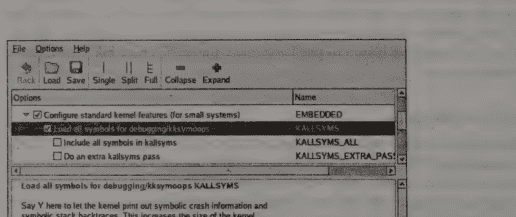

**图 13-4**
错误（oops）的符号支持

内核错误（oops）消息中的许多信息直接与处理器相关。要对底层架构有一定了解才能完全理解错误消息。

分析列表 13-14 中的错误，我们立刻看到错误是由于“内核访问了坏区域，信号：11”而生成的。我们从本章前面的示例中已经知道，信号 11 是段错误。

第一部分是一个摘要，显示了错误的原因、一些重要的指针以及有问题的任务。在列表 13-14 中，`NIP` 是下一条指令指针，它在错误消息的后面解码。这指向导致错误的代码。`LR` 是 PowerPC 寄存器，通常表示当前执行子例程的返回地址。`SP` 是堆栈指针。`REGS` 指示包含寄存器转储数据的内核地址，`TRAP` 指示此错误消息相关的异常类型。参考第 7 章“引导加载程序”末尾提到的 PowerPC 架构参考手册，我们可以看到 `TRAP 0300` 是 PowerPC 数据存储中断，由数据内存访问错误触发。

在错误消息的第三行，我们看到了额外的 PowerPC 机器寄存器，例如 `MSR`（机器状态寄存器）及其某些位的解码。在下一行，我们看到了 `DAR`（数据访问寄存器），它通常包含导致错误的内存地址。`DSISR` 寄存器的内容可以与 PowerPC 架构参考配合使用，以发现关于异常具体原因的许多详细信息。

错误消息还包含任务指针和解码的任务名称，以便快速确定在发生错误时正在运行什么任务或线程。我们还看到了详细的处理器寄存器转储，可用于提供额外的线索。再次强调，我们需要了解架构和编译器寄存器用法才能解释寄存器值中的线索。例如，PowerPC 架构使用 `r3` 寄存器作为 C 函数的返回值。

错误消息的最后部分提供了带有符号解码的堆栈回溯（如果内核中启用了符号）。利用这些信息，我们可以构建导致违规条件的事件序列。

在这个简单的示例中，我们从这个错误消息中学到了大量信息。我们知道这是一个 PowerPC 数据存储异常，由数据内存访问错误（而非指令获取内存访问）引起。`DAR` 寄存器告诉我们产生此异常的数据地址是 `0x00000000`。我们知道是 `modprobe` 进程产生了该错误。从回溯和 `NIP`（下一条指令指针），我们知道它是在对 `strcpy()` 的调用中，可以直接追溯到 `loop.ko` 模块中的 `loop_init()` 函数，而 `modprobe` 正在尝试在异常发生时插入该模块。鉴于这些信息，追踪此错误空指针解引用的来源应该相当简单。

## 13.5 二进制工具

二进制工具，或称为 `binutils`，是任何工具链的关键组件。事实上，要构建编译器，您必须首先成功构建 `binutils`。在本节中，我们简要介绍了嵌入式开发人员需要了解的最有用的工具。与本章中的大多数其他工具一样，这些是交叉工具，必须构建为在您的开发主机上运行，同时操作目标您所选架构的二进制文件。或者，您可以编译或获取这些工具在目标上运行的版本，但我们将这些示例假设为交叉开发环境。

### 13.5.1 readelf

`readelf` 实用程序检查您的目标 ELF 二进制文件的组成。这对于构建针对 ROM 或闪存内存的映像特别有用，在这些情况下需要显式控制映像布局。它也是一个学习工具链如何构建映像以及了解 ELF 文件格式的好工具。

例如，要在 ELF 映像中显示符号表，请使用此命令：

```bash
$ readelf -S <elf-image>
```

要发现并显示您的 ELF 映像中的所有段，请使用此命令：

```bash
$ readelf -e <elf-image>
```

使用 `-S` 标志列出您的 ELF 映像中的段头。您可能会惊讶地发现，即使一个简单的七行“Hello World”程序也包含 38 个独立的段。其中一些您可能会熟悉，例如 `.text` 和 `.data` 段。列表 13-15 包含了我们的“Hello World”示例中段的局部列表。为简单起见，我们只列出了嵌入式开发人员可能熟悉或相关的段。

## 13.5 二进制实用工具

##### 清单 13-15

**readelf 节头**

```
$ ppc82x-readelf -S hello-ex

There are 38 section headers, starting at offset 0x32f4:
```


### 节头

| [ 编号] | 名称  |   类型 |   地址 |   偏移 |   大小 |  ES | 标志 链接 | 信息 |  对齐 |
|---|---|---|---|---|---|---|---|---|---|
| [ 1] | .text |   PROGBITS |  100002f0 | 0002f0 | 000568 | 00 |  AX |    0 |   4 |
| ... |   |   |   |   |   |   |   |   |   |
| [13] | .rodata | PROGBITS |  10000878 | 000878 | 000068 | 00 |   A |    0 |   4 |
| [15] | .data |   PROGBITS |  100108e0 | 0008e0 | 00000c | 00 |  WA |    0 |   4 |
| ... |   |   |   |   |   |   |   |   |   |
| [22] | .sdata | PROGBITS |  100109e0 | 0009e0 | 00001c | 00 |  WA |    0 |   4 |
| [23] | .sbss |   NOBITS |  100109fc | 0009fc | 000000 | 00 |  WA |    0 |   1 |
| ... |   |   |   |   |   |   |   |   |   |
| [25] | .bss  |   NOBITS |  10010a74 | 0009fc | 00001c | 00 |  WA |    0 |   4 |

`.text` 节包含可执行程序代码。`.rodata` 节包含程序中的常量数据。`.data` 节通常包含由 C 库序言代码使用的已初始化全局数据，并可能包含来自应用程序的大型已初始化数据项。`.sdata` 节用于较小的已初始化全局数据项，且仅存在于某些体系结构上。某些处理器体系结构在已知内存区域属性时可以利用优化的数据访问。`.sdata` 和 `.sbss` 节启用了这些优化。`.bss` 和 `.sbss` 节包含程序中未初始化的数据。这些节在程序映像中不占用空间——其内存空间在程序启动时由 C 库序言代码分配并初始化为零。

我们可以转储其中任意节并显示其内容。对于在 C 程序中函数外声明的以下这一行，我们可以检查它如何放置在 `.rodata` 节中：

```
char *hello_rodata = "This is a read-only data string\n";
```

执行 `readelf` 命令，指定我们想要从清单 13-15 中转储的节号：

```
$ ppc_22xx-readelf -n 13 hello-ex

Hex dump of section '.rodata':

0x10000878 100189e0 10000488 1000050c 1000058c ................

0x10000888 00020001 546e6973 20697320 61207265 ...This is a read-

0x10000898 61242d6f 666c7920 20737461 726c63
```

我们可以看到，我们声明的已初始化全局变量在 `.rodata` 节中表示，与程序中定义的所有常量字符串在一起。

#### 13.5.2 使用 readelf 检查调试信息

`readelf` 的一个更有用的特性是显示 ELF 文件中包含的调试信息。在编译过程中发出 `-g` 编译器标志时，编译器会在生成的 ELF 文件中的一系列节中生成调试信息。我们可以使用 `readelf` 显示 ELF 文件中的这些 ELF 节头：

```
$ ppc-linux-readelf -S ex_sync | grep debug

[28] .debug_aranges PROGBITS 00000000 0000c38 0000b58 80 0 0 8

[29] .debug_pubnames PROGBITS 00000000 000ef0 00007a 00 0 0 1

[30] .debug_info PROGBITS 00000000 000d5a 000079b 00 0 0 1

[31] .debug_abbrev PROGBITS 00000000 001505 000020 00 0 0 1

[32] .debug_line PROGBITS 00000000 00170c 0000354 00 0 0 1

[33] .debug_frame PROGBITS 00000000 001ae0 000080 00 0 0 4

[34] .debug_str PROGBITS 00000000 001ae0 000014d 00 0 0 1
```

使用带有 `--debug-dump` 选项的 `readelf`，我们可以显示这些 `.debug_*` 节中任意一个的内容。在第 14 章“内核调试技术”中，当我们讨论调试优化内核代码的挑战时，你会发现这些信息如何有用。

调试信息可能非常大。显示 Linux 内核 ELF 文件 `vmlinux` 中的所有调试信息会产生超过六百万行的输出。尽管看起来可能令人望而生畏，但至少熟悉调试信息会使你成为一名更好的嵌入式工程师。

##### 清单 13-16

**部分调试信息转储**

```
$ ppc-linux-readelf -debug-dump=info ex_sync

1 The section .debug_info contains:

2

3 Compilation Unit @ 0:

4 Length: 109

5 Version: 2

6 Abbrev Offset: 0

7 Pointer Size: 4

8 <0x0>: Abbrev Number: 1 (DW_TAG_compile_unit)

9 DW_AT_stmt_list : 0

10 DW_AT_low_pc : 0x10000368

11 DW_AT_high_pc : 0x1000038c

12 DW_AT_name :

13 DW_AT_comp_dir : /var/tmp/BUILD/glibc-2.3.3/csu

14 DW_AT_producer : GNU AS 2.15.94

15 DW_AT_language : 32769 (MIPS assembler)

...

394 <1x>5a1>: Abbrev Number: 14 (DW_TAG_subprogram)

395 DW_AT_sibling : <5fa>

396 DW_AT_external : 1

397 DW_AT_name : main

398 DW_AT_decl_file : 1

399 DW_AT_decl_line : 9

400 DW_AT_prototyped : 1

401 DW_AT_type : <248>

402 DW_AT_low_pc : 0x100004b8

403 DW_AT_high_pc : 0x10000570

404 DW_AT_frame_base : 1 byte block: 6f (DW_OP_reg31)

...

423 <2x>5e9>: Abbrev Number: 16 (DW_TAG_variable)

424 DW_AT_name : mybuf

425 DW_AT_decl_file : 1

426 DW_AT_decl_line : 11

427 DW_AT_type : <600>

428 DW_AT_location : 2 byte block: 91 20 (DW_OP_breg: 32)
```


由 *DWARF2* 标签 `DW_TAG_compile_unit` 标识的第一条记录识别了该 PowerPC 可执行文件的第一个编译单元。它是一个名为 `start.s` 的文件，它提供 C 程序的启动序言。由 `DW_TAG_subprogram` 标识的下一条记录识别了用户程序的开始，即熟悉的函数 `main()`。此 DWARF2 调试记录包含对找到 `main()` 的文件的文件名和行号的引用。清单 13-16 中的最后一条记录识别了 `main()` 例程中一个名为 `mybuf` 的局部变量。同样，此记录提供了行号和文件。你可以从这些信息中推断出 `main()` 位于源文件的第 9 行，而 `mybuf` 位于第 11 行。ELF 文件中的其他调试记录通过 DWARF2 `DW_AT_decl_file` 属性关联文件名。

你可以通过本章末尾 `13.7.1` 节中给出的参考了解 DWARF2 调试信息格式的所有细节。

### 13.5.3 objdump

`objdump` 实用工具与 `readelf` 工具有相当大的重叠。然而，`objdump` 的一个更有用的特性是其显示反汇编目标代码的能力。清单 13-17 提供了对简单“hello world” PowerPC 版本 `.text` 节反汇编的示例。为了节省空间，我们仅包含 `main()` 例程。整个转储，包括 C 库序言和尾声，将占用许多页。

#### 清单 13-17

**使用 objdump 进行反汇编**

```
$ ppc_82xx-objdump -S -M powerpc:common -d .text hello

...

100004d8: <main>:

100004d8:  94 21 ff e0    stwu   r1,-32(r1)

100004dc:  7c 08 02 e0    mfLR   r0

100004e0:  93 e1 00 1c    stw    r31,28(r1)

100004e4:  90 01 00 24    stw    r0,36(r1)

100004e8:  7c 3f 00 78    mr     r31,r1

100004ec:  90 7f 00 08    stw    r3,8(r31)

100004f0:  90 9f 00 0c    stw    r4,12(r31)

100004f4:  3d 2f 10 00    lis    r9,4096

100004f8:  38 f9 08 54    addi   r15,r9,2132

100004fc:  4c c6 31 82    crclr  4*cr*==eq

10000500:  48 01 05 11    bl     100109c0
```

```
    <.bss_start+0x60>:

    100004b4: 38 00 00 00 li r0,0

    100004b8: 7c 03 03 78 mr r3,r0

    100004bc: 81 61 00 00 lwz r11,0(r1)

    100004c0: 80 0b 00 04 lwz r0,4(r11)

    100004c4: 7c 08 03 a6 mtlr r0

    100004c8: 83 c6 ff fc lwz r31,-4(r11)

    100004cc: 7d 61 5b 78 mr r1,r11

    100004d0: 4e 80 00 20 blr
```

简单 `main()` 例程中的许多代码是堆栈帧的创建和销毁。对 `printf()` 的实际调用由清单中心地址 `0x100004b0` 附近的分支链接（`bl`）指令表示。这是一个 PowerPC 函数调用。由于该程序被编译为动态链接对象，除非在运行时与共享库 `printf()` 例程链接，否则我们将没有 `printf()` 函数的地址。如果我们将其编译为静态链接对象，我们将看到调用 `printf()` 的符号和相应地址。

### 13.5.4 objcopy

`objcopy` 格式化并可选择转换二进制目标文件的格式。该实用工具对于生成 ROM 或 Flash 驻留映像代码非常有用。在第 7 章中介绍的 U-Boot 引导加载程序使用 `objcopy` 从最终的 ELF 文件生成二进制和 s-record⁹ 输出格式。此示例用法说明了 `objcopy` 的功能及其用于构建 Flash 映像的用途。

```
$ ppc_82xx-objcopy --gap-fill=0xff -O binary u-boot u-boot.bin
```

此 `objcopy` 调用显示了如何为 Flash 内存准备映像。输入文件——在此示例中为 `u-boot`——是完整的 ELF U-Boot 映像，包括符号和重定位信息。`objcopy` 实用工具仅获取包含程序代码和数据的相关节，并将映像放入指定的输出文件中，此处指定为 `u-boot.bin`。

Flash 内存在其擦除状态下全为 1。因此，用全 1 填充二进制映像中的间隙可以提高编程效率并延长 Flash 内存的寿命，因为当今的 Flash 内存写入次数有限。这是通过 `objcopy` 的 `--gap-fill` 参数完成的。

> 9 S-record 文件是二进制文件的 ASCII 表示，被许多设备编程器和软件二进制实用工具使用。

这只是 `objcopy` 的一个简单使用示例。该实用工具可用于生成 s 记录并在不同格式之间进行转换。有关完整详细信息，请参阅 man 手册页。

## 13.6 杂项二进制实用工具

你的工具链中包含几个其他有用的实用工具。学习使用这些实用工具非常简单。你会发现这些有用的工具有很多用途。

### 13.6.1 strip

`strip` 实用工具可用于从二进制文件中删除符号和调试信息。这通常用于在嵌入式设备上节省空间。在交叉开发模型中，将剥离后的二进制文件放置在目标系统上，并在开发主机上保留未剥离的版本非常方便。使用这种方法，符号可在开发主机上用于交叉调试，同时在目标上节省空间。`strip` 有许多选项，在 man 手册页中有描述。

### 13.6.2 addr2line

当我们强调列表 13-12 中的 `mtrace` 时，你看到 `mtrace` 分析脚本的输出包含文件和行号信息。`mtrace` Perl 脚本使用 `addr2line` 实用工具读取可执行 ELF 文件中包含的调试信息，并显示与地址对应的行号。使用相同的 `mtrace` 示例可执行文件，我们可以找到虚拟地址的文件名和行号：

```
$ addr2line -f -e mt_ex 0x08047c6

put_data

/home/chris/examples/mt_ex.c:64
```

请注意，函数 `put_data()` 也与文件和行号一起列出。这表明地址 `0x08047c6` 位于 `mt_ex.c` 文件的第 64 行，在 `put_data()` 函数中。这对于由多个文件名组成的大型二进制文件（例如 Linux 内核）甚至更有用：

```
$ upc_822x6-addr2line -f -e vminfo 0000495c

mpc52xx_restart

arch/ppc/syslib/mpc52xx_setup.c:41
```


这个特定示例突出了本章中反复提到的要点之一：这是一个特定于架构的工具。你必须使用配置和编译以匹配你正在使用的目标二进制文件架构的工具。与交叉编译器一样，`addr2line`是一个交叉工具，是二进制实用工具包的一部分。

### 13.6.3 strings

`strings`实用工具检查二进制文件中的ASCII字符串数据。当源代码或调试符号可能不可用时，这对于检查内存转储特别有用。你经常会发现，通过将字符串追溯到导致问题的二进制文件，可以缩小崩溃原因的范围。虽然`strings`有一些命令行选项，但学习和使用它很容易。有关更多详细信息，请参阅`man`手册页。

### 13.6.4 ldd

虽然严格来说不是二进制实用工具，但`ldd`脚本是嵌入式开发人员的另一个有用工具。它是C库包的一部分，存在于几乎所有Linux发行版上。`ldd`列出给定目标文件或文件的共享对象库依赖项。我们在第11章“BusyBox”中介绍了`ldd`。请参见列表11-2了解使用示例。`ldd`脚本在开发`ramdisk`镜像时特别有用。在各种嵌入式Linux邮件列表中询问的最常见故障之一是在挂载根文件系统后发生的内核恐慌：

> VFS: Mounted root (nfs filesystem).  
> Freeing unused kernel memory: 96k init  
> Kernel panic - not syncing: No init found.  Try passing init=option to kernel...

最常见的原因之一是根文件系统镜像（无论是`ramdisk`、Flash还是NFS根文件系统）没有内核试图执行的二进制文件所需的支持库。使用`ldd`，你可以确定每个二进制文件需要哪些库，并确保将它们包含在你的`ramdisk`或其他根文件系统镜像中。在之前的内核恐慌示例中，`init`确实位于文件系统中，但Linux动态加载器`ld.so.1`缺失。使用`ldd`非常简单明了：

```
$ escalate_bus-ldd init  

libc.so.6 => /opt/mvl/.../lib/libc.so.6 (0xdead1000)  

ld-linux.so.3 => /opt/mvl/.../lib/ld-linux.so.3 (0xdead2000)
```

这个简单示例表明`init`二进制文件需要两个动态库对象：`libc`和`ld-linux`。两者都必须位于你的目标上，并且必须可被你的`init`二进制文件访问——也就是说，它们必须可读且可执行。

### 13.6.5 nm

`nm`实用工具显示目标文件中的符号。这对于各种任务都有用。例如，在交叉编译大型应用程序时，你会遇到未解析的符号。你可以使用`nm`找到包含这些符号的目标模块，然后修改你的构建环境以包含它。

`nm`实用工具为每个符号提供属性。例如，你可以发现该符号是局部的还是全局的，或者它是否仅在特定的目标模块中定义或引用。列表13-18复制了在对U-Boot ELF图像`u-boot`运行`nm`的输出中的几行。

#### 列表 13-18
使用`nm`显示符号

```
$ ppc_85xx-nm u-boot

...

fff23140 b _bss_address

fff24c98 B BootFile

fff06d64 T BootRequest

fff00118 t boot_warm

fff21010 d border

fff23000 A __bss_start

...
```


注意这些 U-Boot 符号的链接地址。它们是为 Flash 设备链接的，该设备位于此特定板上内存映射的最高部分。此列表仅包含几个示例符号，用于讨论目的。中间列是符号类型。大写字母表示全局符号，小写字母表示局部符号。B 表示符号位于 `.bss` 节中。T 表示符号位于 `.text` 节中。D 表示符号位于 `.data` 节中。A 表示此地址是绝对的，不受额外链接阶段的修改。此绝对符号表示 `.bss` 节的起始位置，并用于在启动时清除 `.bss` 的代码，这是 C 执行环境所要求的。

### 13.6.6 prelink

`prelink` 实用工具通常用于启动时间重要的系统中。动态链接的 ELF 可执行文件在程序首次加载时必须进行运行时链接。这在大型应用程序中可能花费大量时间。`prelink` 为提供未解析库引用的先验知识而准备共享库和依赖它们的对象文件。实际上，这可以减少给定应用程序的启动时间。man 手册页提供了有关此实用工具使用的完整详细信息。

## 13.7 本章小结

- GNU 调试器（`GDB`）是一个复杂且功能强大的调试器，具有多种功能。我们介绍了基础知识，让你入门。
- `GDB` 的 `DDD` 图形前端将源代码和数据显示与 `GDB` 命令行接口功能集成在一起。
- `cbrowser` 是理解大型项目的有用辅助工具。它使用 `cscope` 数据库快速查找和显示 C 源代码中的符号和其他元素。
- Linux 由许多性能分析和跟踪工具支持。我们介绍了一些，包括 `strace`、`ltrace`、`top` 和 `ps`，以及内存分析器 `mtrace` 和 `dmalloc`。
- 嵌入式开发人员经常需要构建自定义图像，例如引导加载程序和固件图像所需的图像。对于这些任务，`binutils` 的知识不可或缺。我们介绍了 `binutils` 中的许多实用工具，包括 `readelf`、`objdump`、`objcopy` 以及许多其他实用工具。

### 13.7.1 延伸阅读建议

- `GDB`：GNU 项目调试器：
  www.gnu.org/software/gdb/gdb.html
- *GDB Pocket Reference*
  Arnold Robbins
  O’Reilly Media，2005
- 数据显示调试器：
  www.gnu.org/software/dd/
- `cbrowser` 主页：
  http://cbrowser.sourceforge.net/
- `cscope` 主页：
  http://cscope.sourceforge.net/index.html
- `dmalloc`——调试 Malloc 库：
  http://dmalloc.com/
- *工具接口标准（TIS）可执行文件和链接格式（ELF）规范*
  版本 1.2
  TIS 委员会，1995 年 5 月
- 工具接口标准：
- *DWARF 调试信息格式规范*
  版本 2.0
  TIS 委员会，1995 年 5 月

# 第 14 章


## 本章内容

- 内核调试的挑战（第 352 页）
- 使用 KGDB 进行内核调试（第 353 页）
- 调试 Linux 内核（第 360 页）
- 硬件辅助调试（第 385 页）
- 当无法启动时（第 392 页）
- 本章小结（第 397 页）

在达成开发时间表方面，决定性因素往往归结为发现和修复缺陷（bugs）的效率。在 Linux 内核内部进行调试可能极具挑战性。无论采取何种方式，内核调试始终复杂。本章探讨了其中的一些复杂性，并提出了改进内核和设备驱动程序中调试技能的思路与方法。

### 14.1 内核调试的挑战

调试现代操作系统涉及许多挑战。虚拟内存操作系统有其独特的挑战。我们可以用在线仿真器（in-circuit emulator）替换处理器的时代已经一去不复返了。处理器变得速度极快且极其复杂。此外，流水线架构隐藏了重要的代码执行细节，部分原因是总线上的内存访问顺序可能与代码执行顺序不同，特别是由于指令流的内部缓存。除了非常粗粒度的级别外，通常不可能将外部总线活动与内部处理器指令执行关联起来。

在调试 Linux 内核代码时，你会遇到的一些挑战包括：

- Linux 内核代码在许多领域针对执行速度进行了高度优化。
- 编译器使用优化技术，使 C 源代码与实际机器指令流的关联变得复杂。内联函数就是这样一个很好的例子。
- 单步执行经过编译器优化的代码通常会产生不寻常且意想不到的结果。
- 虚拟内存将用户空间内存与内核内存隔离，这使得各种调试场景特别困难。
- 某些代码无法通过传统调试器进行单步执行。
- 由于启动代码靠近硬件且可用资源有限（例如，没有控制台、有限的内存映射等），因此特别难以调试。

Linux 内核已成熟为一个性能极高的操作系统，能够与最好的商业操作系统竞争。内核中的许多领域无法仅通过阅读源代码就轻松分析。理解特定领域的代码流通常需要架构和详细设计方面的知识。市面上有几本好书详细描述了内核设计。关于推荐书目，请参阅第 14.6.1 节“额外阅读建议”。

`GCC` 是一个优化编译器。默认情况下，Linux 内核使用 `-O2` 编译器标志进行编译。这会启用许多优化算法，从而改变代码的基本结构和顺序。[^1] 例如，Linux 内核大量使用*内联*函数。内联函数是用 `inline` 关键字声明的小函数，其结果是该函数直接包含在执行线程中，而不是生成函数调用及其相关开销。[^2] 内联函数需要至少 `-O1` 优化级别。因此，你不能关闭优化，而关闭优化对于更轻松的调试是理想的。

在 Linux 内核的许多领域中，单步执行代码是困难或不可能的。最明显的例子是修改*虚拟内存设置*的代码路径。当你的应用程序发起导致进入内核的系统调用时，这会导致进程看到的地址空间发生变化。事实上，任何涉及处理器异常的转换都会改变操作上下文，并且可能难以或无法单步执行。

### 14.2 使用 KGDB 进行内核调试

两种流行方法允许在 Linux 内核内进行符号级别的源代码调试：

- 使用 `KGDB` 作为远程 `gdb` 代理
- 使用硬件 JTAG 探针来控制处理器

我们在第 14.4 节“硬件辅助调试”中介绍 JTAG 调试。

`KGDB`（Kernel GDB）是一组 Linux 内核补丁，通过其远程串行协议提供与 `gdb` 的接口。`KGDB` 实现了一个 `gdb` 存根（stub），它与运行在你主机开发工作站上的 *交叉 gdb* 进行通信。直到最近，目标机上的 `KGDB` 还需要串行连接到开发主机。某些目标支持通过以太网连接 `KGDB`，但这相对较新。主线的 kernel.org 内核尚未完全支持 `KGDB`。你需要将 `KGDB` 移植到你选定的目标，或者获取包含 `KGDB` 支持的选择特定架构和平台的嵌入式 Linux 发行版。目前大多数可用的嵌入式 Linux 发行版都支持 `KGDB`。

图 14-1 描述了 `KGDB` 调试设置。最多使用三个到目标板的连接。以太网用于启用来自主机的 NFS 根挂载和 telnet 会话。如果你的板子在 Flash 中有 ramdisk 映像并将其挂载为根文件系统，你可以消除以太网连接。

一个串口专用于开发主机系统上运行的 `gdb` 与 `KGDB` 之间的连接，而可选的第二个串口作为控制台。只有一个串口的系统会使 `KGDB` 的使用略显繁琐。

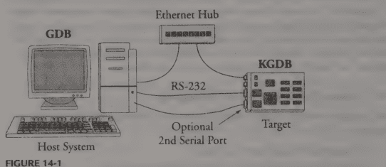

**图 14-1**
`KGDB` 调试设置

正如你在图 14-1 中看到的，调试器（你的 `gdb` 交叉版本）运行在你的开发主机系统上。`KGDB` 是运行在你的目标系统上的内核的一部分。`KGDB` 实现了将 `gdb` 与你的目标板接口化的挂钩（hooks），以启用设置断点、检查内存和启用单步程序执行等功能。

#### 14.2.1 KGDB 内核配置

`KGDB` 是一个内核特性，必须在你的内核中启用。`KGDB` 从“内核黑客”（Kernel Hacking）菜单中选择，如图 14-2 所示。作为配置的一部分，你必须选择 `KGDB` 使用的串口。请注意，从图 14-2 中我们还可以看到，我们启用了编译内核时包含调试信息的选项。这会在构建过程中添加 `-g` 编译器标志，以启用符号调试。

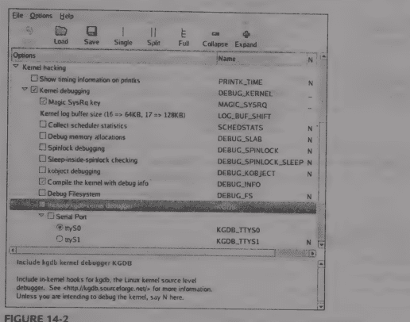

**图 14-2**
`KGDB` 的内核配置

#### 14.2.2 支持 KGDB 的目标启动

在内核构建完支持 `KGDB` 后，必须启用它。不幸的是，启用它的方法在所有架构和实现中尚未统一。一般来说，通过内核命令行向内核传递命令行开关来启用 `KGDB`。如果 `KGDB` 支持已编译进内核但未通过命令行开关启用，则不起作用。当启用 `KGDB` 时，内核在启动周期的非常早期会停止在一个启用 `KGDB` 的断点上，以便你使用 gdb 连接到目标。图 14-3 显示了当 `KGDB` 启用时生成初始断点的逻辑。

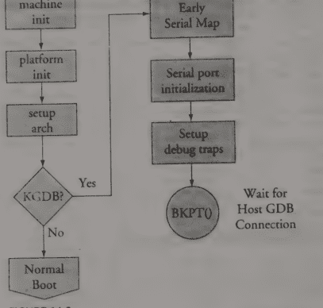

**图 14-3**
`KGDB` 逻辑

`KGDB` 需要一个串口来连接主机。[^3] 设置 `KGDB` 的第一步是在启动过程中非常早地启用一个串口。在许多架构中，在访问之前必须将硬件 UART 映射到内核内存中。地址范围映射后，初始化串口。安装调试陷阱处理器，以允许处理器异常陷入调试器。

清单 14-1 显示了启用 `KGDB` 启动时的终端输出。此示例基于 AMCC 440EP 评估套件（Yosemite 板），该套件附带 U-Boot 引导加载程序。

[^1]: 关于优化级别的详细信息，请参阅本章末尾第 14.6.1 节“额外阅读建议”中引用的 GCC 手册。
[^2]: 内联函数类似于宏，但具有编译时类型检查的优势。
[^3]: 尽管之前有关于通过以太网使用 KGDB 的评论。

##### 清单 14-1

##### 使用 U-Boot 启动启用了 KGDB 的内核

```text

```


=> set bootargs console=ttyS1,115200 root=/dev/nfs rw ip=eth0 gdb

=> bootm 200000

##### Booting image at 00200000 ...

Image Name: Linux-2.6.13

Image Type: PowerPC Linux Kernel Image (gzip compressed)

Data Size: 1064790 Bytes = 1 MB

Load Address: 00000000

Entry Point: 00000000

Verifying Checksum ... OK

Uncompressing Kernel Image ... OK

$T0440:$C00a5ec:01:c0205fa0:$d9 <<< See text

```
```

启动序列的大部分内容我们在第 7 章“引导加载器”中介绍 U-Boot 时已经熟悉过。该内核启动序列有两个独特之处：启用 KGDB 的命令行参数以及内核解压后出现的奇特文本字符串。

回顾第 7 章，内核命令行由 U-Boot 的 `bootargs` 环境变量定义。注意，我们添加了 `gdb` 参数，该参数指示内核强制设置一个早期断点并等待宿主调试器（你的 `cross-gdb`）连接。

如图 14-3 所示，内核检测到 `gdb` 参数的存在，并试图将控制权传递给远程（基于主机的）调试器。这由清单 14-1 中串口转储的 ASCII 字符序列证实。如果你对这个 `gdb` 远程串口协议感到好奇，它在本章末尾引用的 `gdb` 手册中有记载。在这个例子中，KGDB 正在发送一个停止响应数据包，向主机上的远程 `gdb` 会话报告断点陷阱。这两个 32 位参数指示了程序位置和堆栈帧。

现在内核已设置好并等待主机调试器，我们可以开始调试会话。我们从主机开发工作站调用 `cross-gdb`，并通过 `gdb` 的远程协议连接到目标机。在此示例中，我们正在共享串口，因此必须在尝试与 `gdb` 连接之前断开目标机的终端仿真器。清单 14-2 强调了 `gdb` 连接过程。这假设我们已经退出终端仿真器并释放了串口供 `gdb` 使用。

##### 清单 14-2

连接至 KGDB

```text
$ ppc_4xx-gdb --silent vmlinux

(gdb) target remote /dev/ttyS0

Remote debugging using /dev/ttyS0

Breakinist () at arch/ppc/kernel/ppc-stub.c:825

825 }

(gdb) l

820 return;

821 }

822 }

823 asm(" .globl breakinist \n\
824 breakinist: .long 0x7d821008");

825 }

826 }

827 #ifdef CONFIG_KGDB_CONSOLE

828 /* Output string in GDB O-packet format if GDB has connected.
If nothing
829 output. returns 0 (caller must then handle output). */

(gdb)
```

这里我们执行了三个操作：

- 调用 `gdb` 并传入内核 ELF 文件 `vmlinux`
- 在 `gdb` 中使用 `target remote` 命令连接到目标机
- 发出 `list` 命令，使用其简写形式显示我们在源代码中的位置

冒着指出显而易见之事的危险，我们传给 `gdb` 的 `vmlinux` 镜像必须来自产生目标内核二进制的同一内核构建。它也必须使用 `-g` 编译器标志编译以包含调试信息。

当我们发出 `target remote` 命令时，`gdb` 通过显示程序计数器（`PC`）的位置来响应。在此示例中，内核停止在文件 `.../arch/ppc/kernel/ppc-stub.c` 第 823 行中内联汇编语句定义的断点处。当我们发出 `continue`（`c`）命令时，如所示，执行从第 825 行开始恢复。

#### 14.2.3 有用的内核断点

我们已经在目标板上的内核建立了调试连接。当我们发出 `gdb` 的 `continue`（`c`）命令时，内核将继续启动，如果没有问题，启动过程将完成。在许多架构和处理器上使用 KGDB 有一个小限制。在支持非常早期的内核调试（例如，在完整的基于中断的串口驱动安装之前）的需求与希望保持 KGDB 调试引擎本身非常复杂（因此是稳健和可移植的）之间进行了工程权衡。KGDB 使用一个简单的轮询串口驱动程序，在内核运行时没有开销。作为这种实现的缺点，串口上的传统 `Ctrl-C` 或 `Break` 序列将不起作用。因此，除非遇到断点或其他故障，否则将无法停止正在运行的内核执行。

因此，定义一些系统范围的断点已成为常见做法，这些断点提供了暂停当前线程执行的能力。清单 14-3 中重点介绍了两个最常见的断点。

##### 清单 14-3

常用内核断点

```text
(gdb) b panic

Breakpoint 1 at 0xc00161b8: file kernel/panic.c, line 74.

(gdb) b sys_sync

Breakpoint 2 at 0xc005a8c8: file fs/buffer.c, line 296.

(gdb)
```

使用 `gdb` 的断点命令，再次使用其简写形式，我们输入了两个断点。一个在 `panic()`，另一个在同步系统调用入口 `sys_sync()`。前者允许调试器在稍后的事件导致恐慌时被调用。这使得能够检查恐慌发生时的系统状态。第二种是一种有用的方法，可以通过在目标硬件上运行的终端中输入 `sync` 命令，从用户空间停止内核并陷入调试器。

我们现在准备好继续我们的调试会话。我们在目标机上运行了一个启用 KGDB 的内核，暂停在 KGDB 定义的早期断点处。我们使用基于主机的交叉调试器——在此情况下作为 `ppc4xx-gdb` 调用——建立了与目标机的连接，并且我们已经输入了一对有用的系统断点。现在我们可以将调试活动指向手头的任务。

一个注意事项：根据定义，我们不能使用 KGDB 在 `.../arch/ppc/setup.c` 中用于建立启用 KGDB 的内核与我们主机上的 `cross-gdb` 之间连接的 `breakpoint()` 函数之前的代码进行单步调试。

图 14-3 是关于 KGDB 获得控制权之前执行的代码的大致指南。调试这些早期代码需要使用硬件辅助调试探针。我们将在 14.4 节“硬件辅助调试”中简要介绍这个主题。

## 14.3 调试 Linux 内核

你可能单步调试内核代码的一个更常见原因是修改或定制你自定义板子的平台相关代码。让我们看看如何使用 AMCC Yosemite 板子来做到这一点。我们在平台相关的架构设置函数处设置一个断点，然后继续直到遇到该断点。清单 14-4 显示了该序列。

##### 清单 14-4

调试架构设置代码

```text
(gdb) b yosemite_setup_arch

Breakpoint 3 at 0xc021a488:
   file arch/ppc/platforms/4xx/yosemite.c, line 308.

(gdb) c

Continuing.
Can't send signals to this remote system. SIGILL not sent.

Breakpoint 3, yosemite_setup_arch () at arch/ppc/platforms/4xx/yosemite.c:308

308                 yosemite_set_emacdata();

(gdb) l

303 . . }

304

305 static void __init

306 yosemite_setup_arch(void)

307 {

308                 yosemite_set_emacdata();

309

310         im400px_get_clocks(&clocks, YOSEMITE_SYSCLK, 6 * 1843200);

311         ocp_sys_info.opb_bus_freq = - clocks.opb;

(gdb)
```


当遇到 `yosemite_setup_arch()` 处的断点时，控制权传递给 `gdb`，位置在 `yosemite.c` 的第 308 行。`list`（`l`）命令显示了以第 308 行断点为中心的源代码列表。`gdb` 在 `continue`（`c`）命令之后显示的警告信息可以安全忽略。这是 `gdb` 测试远程系统功能的一部分。它首先向目标机发送一个 `remote continue_with_signal` 命令。该目标板的 KGDB 实现不支持此命令；因此，目标机对其进行了 NAK 响应。

`gdb` 通过显示此信息消息并发出标准的远程 `continue` 命令来响应。

### 14.3.1 gdb 远程串口协议

`gdb` 包含一个调试开关，使我们能够观察开发主机上的 `gdb` 与目标机之间使用的远程协议。这对于理解底层协议以及排查表现出异常或错误行为的目标机非常有用。要启用此调试模式，请发出以下命令：

```text
(gdb) set debug remote 1
```

启用远程调试后，观察 `continue` 命令的执行过程和 `gdb` 采取的步骤是很有启发性的。清单 14-5 说明了在启用远程调试的情况下使用 `continue` 命令。

##### 清单 14-5
继续远程协议示例

```text
(gdb) c
Continuing.
Sending packet: $mC000000,4#80...Ack
Packet received: c022d200
Sending packet: $mC000000,4:7d821008#0...Ack
Packet received: OK
Sending packet: $mC0016de8,4#f8...Ack
Packet received: 38600001
Sending packet: $mC0016de8,4:7d821008#e0...Ack
Packet received: OK
Sending packet: $mC005bd5c,4#23...Ack
Packet received: 38600001
Sending packet: $mC005bd5c,4:7d821008#0b...Ack
Packet received: OK
Sending packet: $mC021a488,4#c8...Ack
Packet received: 4bffbad
Sending packet: $mC021a488,4:7d821008#b0...Ack
Packet received: OK
Sending packet: $c#63...Ack
<< program running, gdb waiting for event
```

虽然一开始看起来很吓人，但这里发生的事情很容易理解。简而言之，`gdb` 正在恢复目标机上的所有断点。回顾清单 14-3，我们输入了两个断点，一个在 `panic()`，一个在 `sys_sync()`。在清单 14-4 中稍后，我们在 `yosemite_setup_arch()` 处添加了第三个断点。因此，有三个活动的用户指定断点。

这些可以通过发出 `gdb info breakpoints` 命令来显示。通常，我们使用简写形式。

```
(gdb) i b
Num Type Disp Enb Address What
1 breakpoint keep y 0xc0016d8 in panic_at kernel/panic.c:74
2 breakpoint keep y 0xc005bd5c in sys_sync at fs/buffer.c:296
3 breakpoint keep y 0xc021a488 in yosemite_setup_arch at
arch/ppc/platforms/4x0s/yosemite.c:308
breakpoint already hit 1 time
(gdb)
```

现在将之前列出的断点地址与列表 14-5 中 `gdb` 远程 `$m` 数据包中的地址进行对比。`$m` 数据包是一个“读取目标内存”命令，而 `$M` 数据包是一个“写入目标内存”命令。对于每个断点，`gdb` 会从目标内存中读取断点的地址，将其存储在主机本地（以便稍后恢复），并将其替换为 PowerPC 陷阱指令 `twge r2, r2`（`0x7d821008`），这将导致控制权交还给调试器。图 14-4 说明了此操作。

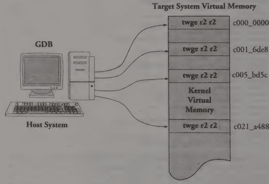

图 14-4
`gdb` 在目标内存中插入断点

您可能已经注意到，`gdb` 正在更新四个断点，而我们要只输入了三个。位于目标内存位置 `0x000_0000` 的第一个断点是由 `gdb` 在启动时自动设置的。此位置是 ELF 文件中链接的内核映像的基地址——基本上就是 `_start`。它相当于用户空间调试中在 `main()` 处的断点，这是由 `gdb` 自动完成的。其他三个断点是我们之前输入的那些。

当发生将控制权交还给 `gdb` 的事件时，也会发生相反的情况。列表 14-6 详细说明了当我们遇到 `yosemite_setup_arch()` 处的断点时发生的行为。

##### 列表 14-6
远程协议：断点命中

```
Packet received: T0440;c021a468;01:c020ff90;
Sending packet: $mC0000000,4#80...Ack    <<< Read memory @c0000000
Packet received: 7d821008
Sending packet: $mC0000000,4:c02d2d00#87...Ack    <<< Write memory
Packet received: OK
Sending packet: $mC016de8,#8...Ack
Packet received: 7d821008
Sending packet: $mC016de8,4:38600001#d4...Ack
Packet received: OK
Sending packet: $mC05bd5c,#23...Ack
Packet received: 7d821008
Sending packet: $mC05bd5c,4:38600001#cf...Ack
Packet received: OK
Sending packet: $mC021a468,#c8...Ack
Packet received: 7d821008
Sending packet: $mC021a468,4:4bffbbad#d1...Ack
Packet received: OK
Sending packet: $mC021a494,c#f3...Ack
Packet received: 90010024d46fffdda3fa0c022
Breakpoint 3, yosemite_setup_arch () at arch/ppc/platforms/4xx/yosemite.c:308
308    yosemite_set_emacdata();
(gdb)
```

`$t` 数据包是 `gdb` 停止响应数据包。当遇到断点时，由目标发送给 `gdb`。在我们的示例中，`$t` 数据包返回了程序计数器和寄存器 `r1` 的值。^[4] 其余的活动与列表 14-5 中的活动相反。PowerPC 陷阱断点指令被移除，`gdb` 将原始指令恢复到其各自的内存位置。

> [^4]: 正如前面所指出的，`gdb` 远程协议的详细信息在本章末尾第 14.6.1 节“建议阅读”中引用的 `gdb` 手册中有所介绍。

### 14.3.2 调试优化后的内核代码

在章节开头，我们说过，在内核代码调试中确定的挑战之一是编译器优化。我们注意到，Linux 内核默认使用优化级别 `-O2` 进行编译。在到目前为止的示例中，我们使用 `-O1` 优化来简化调试任务。这里我们说明优化如何使调试复杂化的诸多方式之一。

相关的互联网邮件列表中散布着关于看似损坏的工具的问题。有时，发帖者报告说他们的调试器在单步向后执行，或者他们的行号与源代码不匹配。这里我们举一个例子，来说明优化编译器给源代码级调试带来的复杂性。在这个例子中，`gdb` 报告断点命中时的行号与我们源文件中的行号不匹配，这是由于函数内联导致的。

为了进行此演示，我们使用与列表 14-4 中相同的调试代码片段。然而，对于这个示例，我们使用编译器优化标志 `-O2` 编译了内核。这是 Linux 内核的默认设置。列表 14-7 显示了此调试会话的结果。

#### 列表 14-7
优化后的架构设置代码

```
$ ppc_44x-gdb --silent vmlinux
(gdb) target remote /dev/ttyS0
Remote debugging using /dev/ttyS0
breakinst () at arch/ppc/kernel/ppc-stub.c:825
825          })   ..
```


```
(gdb) b panic

Breakpoint 1 at 0xc00161b8: file kernel/panic.c, line 74.

(gdb) b sys_sync

Breakpoint 2 at 0xc005a8c8: file fs/buffer.c, line 296.

(gdb) b yosemite_setup_arch

Breakpoint 3 at 0xc020f438: file arch/ppc/platforms/4xx/yosemite.c, line 116.

(gdb) c

Continuing.

Breakpoint 3, yosemite_setup_arch ()

    at arch/ppc/platforms/4xx/yosemite.c:116

116    def = ocp_get_one_device(OCP_VENDOR_IBM, OCP_FUNC_EMAC, 0);

(gdb) 1

117    struct ocp_def *def;

118    struct ocp_func_emac_data *emacdata;

119

120    /* Set mac_addr and phy mode for each EMAC */

121    def = ocp_get_one_device(OCP_VENDOR_IBM, OCP_FUNC_EMAC, 0);

122    emacdata = def->additions;

123    memcpy(emacdata->mac_addr,  __res_b1-enetaddr, 6);

124    emacdata->phy_mode = PHY_MODE_RMII;

(gdb) p yosemite_setup_arch

$1 = {void (void)} 0xc020f41c <yosemite_setup_arch>
```

回顾列表 14-4，注意函数 `yosemite_setup_arch()` 实际上位于文件 `yosemite.c` 的第 306 行。将其与列表 14-7 进行比较。我们命中了断点，但 gdb 报告断点位于文件 `yosemite.c` 的第 116 行。乍一看，这似乎是调试器与相应源代码之间行数的不匹配。这是 gdb 的一个 bug 吗？首先，让我们确认编译器为调试信息生成了什么。使用第 13 章“开发工具”中描述的 `readelf` 工具，我们可以检查编译器为此函数生成的调试信息。

```
$ ppc_44x-readelf --debug-dump=info vmlinux | grep -u6 \
yosemite_setup_arch | tail -n 7

DW_AT_name    : (indirect string, offset: 0x9c04): yosemite_setup_arch

DW_AT_decl_file : 1

DW_AT_decl_line : 307

DW_AT_prototyped : 1

DW_AT_low_pc    : 0xc020f41c

DW_AT_high_pc   : 0xc020f794

DW_AT_frame_base : 1 byte block: 51     (DW_OP_reg1)
```

我们不需要成为阅读 DWARF2 调试记录的专家，也能认识到所讨论的函数报告在我们的源文件的第 307 行。我们可以使用在第 13 章中也介绍的 `addr2line` 实用工具来确认这一点。使用从列表 14-7 中 gdb 得出的地址：

```
$ ppc_44x-addr2line -e vmlinux 0xc020f41c

arch/ppc/platforms/4xx/yosemite.c:307
```

> [^5]: 记得使用您的交叉编译版本的 readelf——例如，对于 PowerPC 44x 架构使用 `ppc_44x-readelf`。

> [^6]: 有关 Dwarf 调试规范的参考资料在本章末尾第 14.6.1 节“建议阅读”中。

此时，gdb 正在报告我们的断点位于 `yosemite.c` 文件的第 116 行。为了理解正在发生的事情，我们需要查看 gdb 报告的函数的汇编器输出。列表 14-8 是在对 `yosemite_setup_arch()` 函数发出 `disassemble` 命令后从 gdb 获得的输出。

#### 列表 14-8
反汇编函数 `yosemite_setup_arch`

```
(gdb) disassemble yosemite_setup_arch

0xc020f41c <yosemite_setup_arch+0>:  mfir   r0

0xc020f420 <yosemite_setup_arch+4>:  stwu  r41,-48(r1)

0xc020f424 <yosemite_setup_arch+8>:  li    r4,512

0xc020f428 <yosemite_setup_arch+12>: li    r5,0

0xc020f42c <yosemite_setup_arch+16>: li    r3,4116

0xc020f430 <yosemite_setup_arch+20>: stmw r25,20(r1)

0xc020f434 <yosemite_setup_arch+24>: stw   r0,52(r1)

0xc020f438 <yosemite_setup_arch+28>: bl    0xc000d344

<ocp_get_one_device>

0xc020f43c <yosemite_setup_arch+32>: lwz   r31,32(r3)

0xc020f440 <yosemite_setup_arch+36>: ltr   r4,-16350

0xc020f444 <yosemite_setup_arch+40>: li    r8,2

0xc020f448 <yosemite_setup_arch+44>: addi  r4,r4,21460

0xc020f44c <yosemite_setup_arch+48>: li    r5,6

0xc020f450 <yosemite_setup_arch+52>: lis   r29,-16350

0xc020f454 <yosemite_setup_arch+56>: addi  r3,r31,48

0xc020f458 <yosemite_setup_arch+60>: lis   r25,-16350

0xc020f45c <yosemite_setup_arch+64>: bl    0xc000c708

<memcpy>

0xc020f460 <yosemite_setup_arch+68>: stw   r28,44(r31)

0xc020f464 <yosemite_setup_arch+72>: li    r4,512

0xc020f468 <yosemite_setup_arch+76>: li    r5,1

0xc020f46c <yosemite_setup_arch+80>: li    r3,3116

0xc020f470 <yosemite_setup_arch+84>: addi  r26,r25,15104

0xc020f474 <yosemite_setup_arch+88>: bl    0xc000d344

<ocp_get_one_device>

0xc020f478 <yosemite_setup_arch+92>: lis   r4,-16350

0xc020f47c <yosemite_setup_arch+96>: lwz   r31,32(r3)

0xc020f480 <yosemite_setup_arch+100>: addi  r4,r4,21534

0xc020f484 <yosemite_setup_arch+104>: li    r4,6

0xc020f488 <yosemite_setup_arch+108>: addi  r3,r31,48

0xc020f48c <yosemite_setup_arch+112>: bl    0xc000c708

<memcpy>

0xc020f490 <yosemite_setup_arch+116>: lis   r4,1017

0xc020f494 <yosemite_setup_arch+120>: lis   r5,168

0xc020f498 <yosemite_setup_arch+124>: stw   r28,44(r31)

0xc020f49c <yosemite_setup_arch+128>: ori   r4,r4,16558

0xc020f4a0 <yosemite_setup_arch+132>: ori   r5,r5,49152

0xc020f4a4 <yosemite_setup_arch+136>: addi  r3,r29,-15380
```


`0xc020f4a8 <yosemite_setup_arch+140>`: `addi`  `r29`,`r29`,`-15380`

`0xc020f4ac <yosemite_setup_arch+144>`: `bl`    `0xc020e338`

```
```

## 14.3 调试 Linux 内核

`<ibm440gx_get_clocks>`
`0xc020f4b0 <yosemite_setup_arch+148>`: `li` `r0`, `0`
`0xc020f4b4 <yosemite_setup_arch+152>`: `lis` `r11`, `-16352`
`0xc020f4b8 <yosemite_setup_arch+156>`: `ori` `r0`, `r0`, `50000`
`0xc020f4bc <yosemite_setup_arch+160>`: `lwz` `r10`, `12(r29)`
`0xc020f4c0 <yosemite_setup_arch+164>`: `lis` `r9`, `-16352`
`0xc020f4c4 <yosemite_setup_arch+168>`: `stw` `r0`, `8068(r11)`
`0xc020f4c8 <yosemite_setup_arch+172>`: `lwz` `r4`, `92(r26)`
`0xc020f4cc <yosemite_setup_arch+176>`: `stw` `r10`, `8136(r39)`
`0xc020f4d0 <yosemite_setup_arch+180>`: `mctlr` `r0`
`0xc020f4d4 <yosemite_setup_arch+184>`: `bctrl`
`0xc020f4d8 <yosemite_setup_arch+188>`: `li` `r5`, `64`
`0xc020f4dc <yosemite_setup_arch+192>`: `mr` `r31`, `r3`
`0xc020f4e0 <yosemite_setup_arch+196>`: `li` `r4`, `-4288`
`0xc020f4e4 <yosemite_setup_arch+200>`: `li` `r3`, `0`
`0xc020f4e8 <yosemite_setup_arch+204>`: `bl` `0xc00c0c08`
`<ioemap64>`
汇编转储结束。
`(gdb)`

再次说明，我们不必精通 PowerPC 汇编语言也能理解这里发生的事情。请注意 PowerPC `bl` 指令相关的标签。在 PowerPC 助记符中，这是一个函数调用。符号化的函数标签是关键数据点。经过初步分析，我们看到在这个汇编列表的开始部分有几次函数调用：

| 地址 | 函数 |
| --- | --- |
| `0xc020f438` | `ocp_get_one_device()` |
| `0xc020f45c` | `memcpy()` |
| `0xc020f474` | `ocp_get_one_device()` |
| `0xc020f48c` | `memcpy()` |
| `0xc020f4ac` | `ibm440gx_get_clocks()` |

列表 14-9 复制了源文件 `yosemite.c` 的部分内容。将我们在 `gdb` 反汇编输出中找到的函数相关联，我们可以看到那些标签出现在 `yosemite_set_enmacda()` 函数中，大约就在 `gdb` 遇到 `yosemite_setup_arch()` 断点时报告的行号附近。理解这一异常的关键在于注意到 `yosemite_setup_arch()` 开头的子程序调用。编译器内联了一个函数调用，它调用了 `yosemite_set_enmacdata()` 而不是生成预期的函数调用（如果简单检查源代码的话应该是这样）。这种内联导致当 `gdb` 命中断点时，行号出现了不匹配。尽管 `yosemite_set_emacdata()` 函数没有使用 `inline` 关键字声明，但 GCC 为了性能优化内联了该函数。

### 列表 14-9: 源文件 yosemite.c 的部分内容

```c

109 static void __init yosemite_set_emacdata(void)

110 {

111 struct ocp_def *def;

112 struct ocp_func_emac_data *emacdata;

113

114 /* 为每个 EMAC 设置 mac_addr 和 phy 模式 */

115

116 def = ocp_get_one_device(OCV_VENDOR_IBM, OCV_FUNC_ENAC, 0);

117 emacdata = def->additions;

118 memcpy(&emacdata->mac_addr, __res.bi_enetaddr, 6);

119 emacdata->phy_mode = PHY_MODE_RMII;

120

121 def = ocp_get_one_device(OCV_VENDOR_IBM, OCV_FUNC_ENAC, 1);

122 emacdata = def->additions;

123 memcpy(&emacdata->mac_addr, __res.bi_enetladdr, 6);

124 emacdata->phy_mode = PHY_MODE_RMII;

125 }

126 ...

304

305 static void __init

306 yosemite_setup_arch(void)

307 {

308 yosemite_set_emacdata();

309

310 ibm440gx_get_clocks(&clocks, YOSEMITE_SYSCLK, 6 * 1843200);

311 ocp_sys_info.opb_bus_freq = clocks.opb;

312

313 /* 在 calibrate_delay() 运行之前初始化为某个 -safe 值 */

314 loops_per_jif = 50000000/HZ;

315

316 /* 设置 PCI 主机桥 */

317 yosemite_setup_hose();

318

# ifdef CONFIG_BLK_DEV_INITRD

319 if (initrd_start)

320 ROOT_DEV = Root_RAM0;

321 else

322 # endif

323 # ifdef CONFIG_ROOT_NFS

324 ROOT_DEV = Root_NFS;

325 # else

326 ROOT_DEV = Root_HDA1;

327 # endif

328

329 yosemite_early_serial_map();

330

331 /* 识别系统 */

332 printf( "AMCC PowerPC " BOARDNAME " Platform\n" );

333 }

```

总结前面的讨论：

- 我们在 `gdb` 中为 `yosemite_setup_arch()` 设置了断点。
- 当断点命中时，我们发现自己在源文件的第 116 行，这与定义断点的函数相距甚远。
- 我们生成了 `yosemite_setup_arch()` 代码的反汇编列表，并发现了这段代码分支跳转到的标签。
- 将这些标签与我们的源代码进行对比，我们发现编译器将 `yosemite_set_emacdata()` 子程序内联到了我们设置断点的函数中，这造成了潜在的混淆。

这解释了当命中 `yosemite_setup_arch()` 中的原始断点时，`gdb` 报告的行号问题。

编译器采用许多不同类型的优化算法。本示例仅展示了其中一种：函数内联。每种优化都会以不同的方式使调试器（人类和机器）感到困惑。挑战在于理解机器层面上正在发生什么，并将其转化为我们开发者原本意图的行为。你现在可以看到，在调试时使用尽可能低的优化级别所带来的好处。

### 14.3.3 gdb 用户自定义命令

你可能已经意识到，`gdb` 在启动时会寻找一个名为 `.gdbinit` 的初始化文件。首次调用时，`gdb` 加载此初始化文件（通常位于用户的主目录中）并执行其中的命令。我最喜欢的组合之一是连接到目标系统并设置初始断点。在这种情况下，`.gdbinit` 的内容如下所示，参见列表 14-10。

#### 列表 14-10: 简单的 gdb 初始化文件

```
$ cat - ./.gdbinit

set history save on

set history filename -/.gdb_history

set output-radix 16

define connect

##### target remote bdi:2001

target remote /dev/ttyS0

b panic

b sys_sync

end
```


这个简单的 `.gdbinit` 文件启用了在用户指定文件中保存命令历史的功能，并设置了打印数值的默认输出基数。然后，它定义了一个名为 `connect` 的 `gdb` 用户自定义命令。用户自定义命令也常被称为宏。当在 `gdb` 命令提示符处输入该命令时，`gdb` 将通过指定方法连接到目标系统，并将系统断点设置为 `panic()` 和 `sys_sync()`。其中一种方法被注释掉了；我们将在第 14.4 节中讨论这种方法。

`gdb` 用户自定义命令的创造性应用是无止境的。在内核中调试时，检查全局数据结构（如任务列表和内存映射）通常很有用。这里我们介绍几个有用的 `gdb` 用户自定义命令，它们可以显示你在内核调试期间可能需要访问的特定内核数据。

### 14.3.4 有用的内核 gdb 宏

在内核调试期间，查看系统中正在运行的进程以及这些进程的一些系统属性通常很有用。内核维护了一个由 `struct task_struct` 描述的任务链表。链表中的第一个任务的地址包含在内核全局变量 `init_task` 中，它代表内核启动时生成的初始任务。每个任务包含一个 `struct list_head`，将任务链接在一个循环链表中。这两个无处不在的内核结构在以下头文件中描述：

```
struct task_struct            .../include/linux/sched.h
struct list_head              .../include/linux/list.h
```

使用 `gdb` 宏，我们可以遍历任务列表并显示有关任务的有用信息。很容易修改宏以提取你感兴趣的数据。这也是学习内核内部细节的非常有用的工具。

我们在列表 14-11 中检查的第一个宏很简单，它搜索内核的 `task_struct` 结构链表，直到找到给定的任务。如果找到，它会显示该任务的名称。

#### 列表 14-11: gdb find_task 宏

```
##### 辅助函数，根据 PID 或
##### task_struct 的地址查找任务。
##### 结果被设置到 $t
define find_task
##### 大于 _end 的地址：内核数据...
##### ...用户传入的地址
if ((unsigned)$arg0 > (unsigned)_end)
set $t=(struct task_struct *)$arg0
else
##### 用户输入了数字 PID
##### 遍历任务列表以找到它
set $t=&init_task
if (init_task.pid != (unsigned)$arg0)
find_next_task $t
while (!init_task::$t && $t->pid != (unsigned)$arg0)
find_next_task $t
end
if ($t == &init_task)
printf "Couldn't find task; using init_task\n"
end
end
printf "Task \"%s\":\n", $t->comm
end
```

将此文本放入你的 `.gdbinit` 文件并重启 `gdb`，或者使用 `gdb` 的 `source` 命令 `source` 它。我们稍后在列表 14-15 中解释 `find_next_task` 宏。

调用方法如下：

```
(gdb) find_task 910
Task "syslogd":
```

或者

```
(gdb) find_task 0xC0FFDE470
Task "bash":
```

第 4 行定义了宏的名称。第 7 行决定了输入参数是一个 PID 以零开头的数字条目，限制在几百万以内还是一个 `task_struct` 地址，该地址必须大于 Linux 内核映像本身的末尾，由符号 `_end` 定义。⁸ 如果它是一个地址，唯一需要执行的操作就是将其转换为正确的类型，以便引用相关的 `task_struct`。这在第 8 行完成。正如第 3 行的注释所述，该宏返回一个被强制转换为指向结构体 `task_struct` 的指针的 `gdb` 便利变量。

如果输入参数是一个数字 PID，则会遍历列表以找到匹配的 `task_struct`。第 12 行和第 13 行初始化循环变量 `gdb` 的宏命令语言中没有 `for` 语句，第 15 行至第 17 行定义了搜索循环。`find_next_task` 宏用于提取链表中下一个 `task_struct` 的指针。最后，如果搜索失败，会设置一个合理的返回值即 `init_task` 的地址，以便它可以被其他宏安全使用。

基于列表 14-11 中的 `find_task` 宏，我们可以轻松创建一个简单的 `ps` 命令，用于显示系统中正在运行的每个进程的有用信息。

##### 列表 14-12
`gdb` 宏：打印进程信息

```
1 define ps
2     # 打印列标题
3     task_struct_header
4     set $t=$init_task
5     task_struct_show $t
6     find_next_task $t
7     # 遍历列表
8     while $init_task!=$t
9         # 显示每个任务的有用信息
10        task_struct_show $t
11        find_next_task $t
12    end
13 end
15 document ps
16 Print points of interest for all tasks
17 end
```

⁸ 符号 `_end` 在最终链接时定义在链接器脚本文件中。

这个 `ps` 宏类似于 `find_task` 宏，不同之处在于它不需要输入参数，并添加了一个宏 `task_struct_show` 来显示每个 `task_struct` 中的有用信息。第 3 行打印带有列标题的横幅行。第 4 行至第 6 行设置循环并显示第一个任务。第 8 行至第 11 行遍历每个任务，对每个任务调用 `task_struct_show` 宏。

还要注意包含了 `gdb` 的 `document` 命令。这允许 `gdb` 用户通过从 `gdb` 命令提示符发出 `help ps` 命令来获取帮助，如下所示：

```
(gdb) help ps
   Print points of interest for all tasks
```

##### 列表 14-13
`gdb ps` 宏输出

```
(gdb) ps
Address    PID State    User_NIP    Kernel-SP device comm
0xc01D3750    0 Running    0x0FF6B85C 0xcC205B90 (none) swapper
0xc04ACB10    1 Sleeping   0x0FF6B85C 0xcC4FFCE0 (none) init
0xc04AC770    2 Sleeping   0xcC501E90 (none) ksoftirqd/0
0xc04AC3D0    3 Sleeping   0xcC0531E30 (none) events/0
0xc04AC030    4 Sleeping   0xcC0533E30 (none) khelper
0xc04ACBB0    5 Sleeping   0xcC0533E30 (none) kthread
0xc04CD790   23 Sleeping   0xcC05FD830 (none) kbiclockd/0
0xc04CD3F0   45 Sleeping   0xcC60EB50 (none) pdflush
0xc04CD050   46 Sleeping   0xcC06FF850 (none) kfifup
0xc045B7B0   48 Sleeping   0xcC0732E30 (none) aio/0
0xc045B850   47 Sleeping   0xcC0701E20 (none) kswapd0
0xc045B410   629 Sleeping  0xcC0781E60 (none) kswapd0
0xc0504B70   663 Sleeping  0xcCFC993E30 (none) rpidl0/0
0xc0FFD00D   675 Sleeping  0x0FF6EB85C 0xcCFC8DCE0 (none) udevd
```


```
0xcF955B1D   879 Sleeping  0x0FF0B85C 0xcCFC517DB0 (none) portmap

0xcFC24090   910 Sleeping  0x0FF0B85C 0xcCFC61BCE0 (none) syslogd

0xcFB4490   918 Sleeping  0x0FF6B9C 0xcCF65D070 (none) klogd

0xcFEB30B0   948 Sleeping  0x0FF0B85C 0xcCFC8E0 (none) rpc.statd

0xcFCFDE810   960 Sleeping  0x0FF6E85C 0xcCFC5C7CE0 (none) inetd

0x0CFC24B70 964 Sleeping 0x0FEBEBEAC 0xC44FDBD0 (none) mwltd

0x0CFCB3B90 973 Sleeping 0x0F0F66C7C 0xC4CF7CD0 ttyS1 getty

0x0CFCB57F0 974 Sleeping 0x0CF4B485C 0xC4CF5E850 (none) in.telnetd

0x0CFCB470 979 Sleeping 0x0F0E6950 0xC4CF675D80 tty0 bash

0x0CFCBDB80 982: Running 0x0FEFEBOC 0xC4CF73870 tty0 sync

(gdb)
```

该 `ps` 宏的大部分工作是由 `task_struct_show` 宏完成的。如 列表 14-13 所示，`task_struct_show` 宏显示每个 `task_struct` 的以下字段：

- Address—进程的 `task_struct` 地址
- PID—进程 ID
- State—进程的当前状态
- User_NIP—用户态下一条指令指针
- Kernel_SP—内核栈指针
- device—与此进程关联的设备
- comm—进程（或命令）名称

修改该宏以显示特定内核调试任务中感兴趣的项目相对容易。唯一的复杂性在于宏语言的简单性。由于 gdb 的用户定义命令语言中不存在如 `str1en` 这样的函数等效物，屏幕格式必须由手工完成。

列表 14-14 复制了生成之前列表的 `task_struct_show` 宏。

### 列表 14-14
gdb `task_struct_show` 宏

```
1  define task_struct_show

2     # task_struct 地址和 PID

3     printf "0x%08X %5d", $arg0, $arg0->pid

4

5     # 在当前任务上放置一个 `<` 标记

6     if ($arg0 == `current`)

7     # 对于 PowerPC，寄存器 r2 指向 `current` 任务

8     if ($arg0 == $r2)

9       printf "<"

10     else

11       printf " 

12end

13

14# State

15if ($arg0->state == 0)

16  printf "Running "

17else

18  if ($arg0->state == 1)

19    printf "Sleeping "

20  else

21    if ($arg0->state == 2)

22      printf "DiskSleep "

23    else

24      if ($arg0->state == 4)

25        printf "Zombie "

26      else

27        if ($arg0->state == 8)

28          printf "Stopped "

29        else

30          if ($arg0->state == 16)

31            printf "WPaging "

32          else

33            printf "%2d       ", $arg0->state

34          end

35        end

36      end

37    end

38  end

39

40

41# User NIP

42if ($arg0->thread_regs)

43  printf "0x%08X ", $arg0->thread_regs->nip

44else

45  printf "*"

46end

47

48# 显示内核栈指针

49printf "0x%08X ", $arg0->thread.ksp

50

51# device

52if ($arg0->signal->tty)

53  printf "%s  ", $arg0->signal->tty->name

54else

55  printf "(none)"

56end

57

58# comm

59printf "%s\n", $arg0->comm

60end
```

第 3 行显示 `task_struct` 的地址。第 8 行至第 12 行显示进程 ID。如果这是当前进程（即命中断点时正在此 CPU 上运行的进程），它会标记一个 `<` 字符。

第 14 行至第 39 行解码并显示进程的状态。随后显示用户进程下一条指令指针（NIP）和内核栈指针（SP）。最后，显示与进程关联的设备，接着是进程名称（存储在 `task_struct` 的 `->comm` 元素中）。

值得注意的是，如第 7 行和第 8 行所示，该宏依赖于架构。通常，这类宏高度依赖于架构和版本。只要底层结构发生变更，就必须更新这类宏。然而，如果你花大量时间使用 `gdb` 调试内核，这种回报通常是值得付出努力的。

为了完整性，我们展示了 `find_next_task` 宏。其实现并不直观，值得解释。（假设你可以轻松推导出完成本节所示 `ps` 宏所需系列的 `task_struct_header`。它只是一行将列标题以正确数量的空白符排列起来。）列表 14-15 展示了在我们 `ps` 和 `find_task` 宏中使用的 `find_next_task` 宏。

### 列表 14-15
gdb `find_next_task` 宏

```
define find_next_task

##### Given a task address, find the next task in the linked list

set $t = (struct task_struct *)$arg0

set $offset=( (char *)&$t->tasks - (char *)$t)

set $t=(struct task_struct *) ( (char *)$t->tasks.next- (char *)$offset)

end
```

该宏执行的功能很简单。实现方式稍微不那么直白。目标是返回 `->next` 指针，它指向链表中的下一个 `task_struct`。然而，`task_struct` 结构是通过名为 `tasks` 的结构体 `list_head` 成员的地址链接的，而不是像常见做法那样通过 `task_struct` 本身的起始地址链接。因为 `->next` 指针指向列表中下一个 `task_struct` 中任务结构元素的地址，我们必须减去以获取 `task_struct` 本身的顶部地址。我们从 `->next` 指针中减去的那个值

这是该指针地址到 `task_struct` 顶部的偏移量。首先我们计算该偏移量，然后使用该偏移量来调整 `->next` 指针，使其指向 `task_struct` 的顶部。图 14-5 应能使这一点清晰明了。

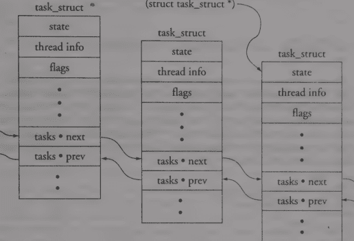

### 图 14-5
任务结构列表链接

现在，我们将呈现最后一个宏，该宏在下一节讨论调试可加载模块时会非常有用。列表 14-16 是一个简单的宏，用于显示内核当前已安装的可加载模块列表。

### 列表 14-16
gdb 列出模块宏

```gdb
1  define lsmod

2    printf "Address\t\tModule\n"

3    set $m = (struct list_head *) &modules

4    set $done=0

5    while (! $done )

6	# list_head is 4-bytes into struct module

7	set $mp=(struct module *)((char *)$m->next - (char *)4)

8	printf "0x%08X\t%s\n", $mp, $mp->name

9	if ( $mp->list->next == &modules)

10		set $done=1

11	end

12	set $m=$m->next

13	end
```


14 end

15

16 `document lsmod`

17 List the loaded kernel modules and their start addresses

18 end

```
```

这个简单的循环从内核的全局变量 `modules` 开始。该变量是一个结构体 `list_head`，标志着可加载模块链表的起点。唯一的复杂性与列表 14-15 中描述的相同。我们必须从结构体 `list_head` 指针中减去一个偏移量，以指向结构体 `module` 的顶部。这在第 7 行执行。此宏生成了一个简单的模块列表，包含结构体 `module` 的地址和模块的名称。以下是其使用示例：

```gdb
(gdb) lsmod

Address       Module

0xD1012A80    ip_conntrack_tftp

0xD10105A0    ip_conntrack

0xD102F9A0    loop

(gdb) help lsmod

List the loaded kernel modules and their start addresses

(gdb)
```

像这里介绍的宏是非常强大的调试辅助工具。你可以以类似的方式创建宏来显示内核中任何易于访问的内容，特别是维护为链表的主要数据结构。示例包括进程内存映射信息、模块信息、文件系统信息以及计时器列表等。这里介绍的信息应该能让你入门。

### 14.3.5 调试可加载模块

使用 KGDB 最常见的原因是调试可加载内核模块，即设备驱动程序。可加载模块的一个更方便的特性是，在大多数情况下，对于每个新的调试会话，都不需要重启内核。你可以启动一个调试会话，进行一些更改，重新编译并重新加载模块，而无需经历完整内核重启带来的麻烦和延迟。

调试可加载模块的复杂之处在于获取模块对象文件中包含的符号调试信息。由于可加载模块在加载到内核时是动态链接的，对象文件中包含的符号信息在调整符号表之前是没有用的。

回顾我们之前的示例，看看我们如何为内核调试会话调用 `gdb`：

```bash
$ ppc-4xx-gdb vmlinux
```

这会在你的主机上启动一个 `gdb` 调试会话，并从 Linux 内核 ELF 文件 *vmlinux* 中读取符号信息。当然，你不会在这个文件中找到任何可加载模块的符号。可加载模块是单独的编译单元，并作为独立的单体 ELF 对象链接。因此，如果我们打算对可加载模块进行任何源级调试，我们需要从其 ELF 文件中加载调试符号。`gdb` 通过其 `add-symbol-file` 命令提供此功能。

`add-symbol-file` 命令从指定的对象文件中加载符号，假设模块本身已经加载。然而，我们面临“鸡和蛋”的困境。在可加载模块被加载到内核并且发出 `add-symbol-file` 命令读取模块的符号信息之前，我们没有任何符号信息。然而，在模块加载之后，为模块的 `init` 及相关函数设置断点进行调试已经太迟了，因为它们已经执行完毕。

解决这一困境的方法是在负责加载模块的内核代码中放置一个断点，位置在链接完成后但初始化函数被调用之前。这项工作由 `.../kernel/module.c` 完成。列表 14-17 复现了 `module.c` 的相关部分。

#### 列表 14-17
`module.c`：模块初始化

```c
1901    down(&notify_mutex);

1902    notifier_call_chain(&module_notify_list, MODULE_STATE_COMING, mod);

1903    up(&notify_mutex);

1904

1905         /* Start the module */

1906         if (mod->init != NULL)

1907                 ret = mod->init();
1908         if (ret < 0) {
1909                 /* buggy routine failed: abort.  Try to protect us from
1910                    buggy refcounters. */
1911                 mod->state = MODULE_STATE_GOING;
...
```

我们使用 `modprobe` 实用工具加载模块，该工具在第 8 章“设备驱动程序基础”的列表 8-5 中演示过，看起来像这样：

```bash
$ modprobe loop
```

此命令发出一个特殊的系统调用，指示内核加载该模块。模块加载从 `module.c` 中的 `sys_init_module()` 开始。在模块被加载到内核内存并动态链接后，控制权传递给模块的 `_init` 函数。这在列表 14-17 的第 1906 和 1907 行中显示。我们在这里设置断点。这使我们能够将符号文件添加到 `gdb`，随后在模块中设置断点。我们使用 Linux 内核的环回驱动程序 `loop.ko` 来演示此过程。此模块不依赖于其他模块，并且演示起来相当简单。

列表 14-18 显示了启动 `loop.ko` 调试会话的 `gdb` 命令。

#### 列表 14-18
启动模块调试会话：`loop.ko`

```gdb
1  $ ppc-linux-gdb --silent vmlinux
2  (gdb) connect
3  breakpoint () at arch/ppc/kernel/ppc-stub.c:825
4  825

5  Breakpoint 1 at 0xc00161b8: file kernel/panic.c, line 74.
6  Breakpoint 2 at 0xc005a8c8: file fs/buffer.c, line 296.
7  (gdb) b module.c:1907
8  Breakpoint 3 at 0xc003430c: file kernel/module.c, line 1907.
9  (gdb) c
10 Continuing.
11 >>> Here we let the kernel finish booting
12    and then load the loop.ko module on the target

14 Breakpoint 3, sys_init_module (uaddr=0x3029000, len=0x2473e,
15    uargs=0x10016338 "") at kernel/module.c:1907
16 1907

         ret = mod->init();
17 (gdb) 1mod
18 Address           Module
19 0xd102f9a0        loop
20 (gdb) set $m=(struct module *)0xd102f9a0.
21 (gdb) p $m->module_core
22 $1 = (void *) 0xd102000
23 (gdb) add-symbol-file ./drivers/block/loop.ko 0xd102000
24 add symbol table from file "./drivers/block/loop.ko" at
25    .text_addr = 0xd102000
26 (y or n) y
27 Reading symbols from /home/chris/sandbox/linux-2.6.13-amcc/
28 drivers/block/loop.ko... done.
```


从第 2 行开始，我们使用在列表 14-10 中早期创建的 `gdb` 用户定义宏 `connect` 来连接目标板并设置我们的初始断点。然后我们添加 `module.c` 中的断点，如第 7 行所示，并发出 `continue` 命令（`c`）。现在内核完成引导过程，我们在目标机中建立 `telnet` 会话并加载 `loop.ko` 模块（未显示）。当环回模块被加载时，我们立即命中断点 #3。`gdb` 然后显示第 14 到第 16 行所示的信息。

在此点，我们需要发现 Linux 内核链接我们的模块 `.text` 段的地址。Linux 将此地址存储在模块信息结构体 `struct module` 的 `module_core` 元素中。使用我们在列表 14-16 中定义的 `1mod` 宏，我们获取与我们的 `loop.ko` 模块相关的 `struct module` 的地址。这在第 17 到第 19 行中显示。现在我们使用此结构体地址从 `module_core` 结构体成员中获取模块的 `.text` 地址。我们将此地址传递给 `gdb` 的 `add-symbol-file` 命令，`gdb` 使用此地址调整其内部符号表，以匹配模块链接到内核中的实际地址。从那里，我们可以以通常方式继续，在模块中设置断点，单步执行代码，检查数据等。

我们以在环回模块的初始化函数中放置断点的演示来结束本节，以便我们可以单步执行模块的初始化代码。这里的复杂性在于，内核将模块的初始化代码加载到单独分配的内存部分，以便在使用后可以释放。回顾第 5 章“内核初始化函数”中我们对 `__init` 宏的讨论。此宏展开为一个编译器属性，指示链接器将标记的代码部分放入一个特殊命名的 ELF 段。本质上，

使用此属性定义的函数将被放置在一个名为 `.init.text` 的独立 ELF 段中。其用法类似于以下示例：

```c
static int __init loop_init(void)
```

此调用会将编译后的 `loop_init()` 函数放入 `loop.ko` 目标模块的 `.init.text` 段中。当模块被加载时，内核会为模块的主体分配一块内存，该内存由名为 `module_core` 的 `struct module` 成员指向。随后，内核还会分配另一块独立的内存来存放 `.init.text` 段。在调用初始化函数后，内核会释放包含该初始化函数的内存。由于目标模块被拆分成了这种结构，我们需要告知 `gdb` 这种寻址方案，以便能够对初始化函数使用符号数据进行调试。⁹ 列表 14-19 演示了这些步骤。

### 列表 14-19

调试模块 init 代码

```text
$ ppc_64x-gdb -silent vmlinux
(gdb) target remote /dev/ttyS0
Remote debugging using /dev/ttyS0
breakinst () at arch/ppc/kernel/ppc-stub.c:825
825
<< 在调用模块 init 之前设置断点 >>
(gdb) b module.c:1907
Breakpoint 1 at 0x0036418: file kernel/module.c, line 1907.
(gdb) c
Continuing.
Breakpoint 1, sys_init_module (umod=0xd102ef40, len=0x2c3b, uargs=0x10016338 ***)
at kernel/module.c:1907
1907	ret = mod->init();
<< 从 struct module 中发现 init 的寻址方式 >>
(gdb) 1smod
Address	Module
0xd1022f40	loop
(gdb) set $m=(struct module *)0xd102ef40
(gdb) p $m->module_core
$1 = (void *) 0xd102b000
(gdb) p $m->module_init
$2 = (void *) 0xd1031000
```

⁹ 截至本文撰写时，`gdb` 中存在一个 bug，导致此技术无法正常工作。希望在你阅读此内容时，该问题已得到修复。

```text
< 现在使用 core 和 init_addr 加载符号文件 >
(gdb) add-symbol-file ./drivers/block/loop ko 0xd102000 -s init.text
0xd1031000
add symbol table from file "../drivers/block/loop ko" at
.text_addr = 0xd102000
.init.text_addr = 0xd1031000
(y or n) y
Reading symbols from /home/chris/sandbox/2.6.13-
-amc/drivers/block/loop ko . done.
(gdb) b loop_init
Breakpoint 3 at 0x031000: file drivers/block/loop c, line 1244.
(gdb) c
Continuing.
<< 断点命中，继续调试模块 init 函数 >>
Breakpoint 3, 0xd1031000 in loop_init() file drivers/block/loop c, line 1244
1244         if (max_loop < 1 || max_loop > 256) {
(gdb)
```

### 14.3.6 使用 printk 进行调试

使用 `printk` 调试内核和设备驱动程序代码是一种常用技术，这主要是因为 `printk` 已经演变为一种非常健壮的方法。你可以在几乎任何上下文中调用 `printk`，包括中断处理程序。`printk` 是内核版本中熟悉的 C 库函数 `printf()` 的对应物。`printk` 定义在 `./kernel/printk.c` 中。

理解使用 `printk` 进行调试的局限性非常重要。首先，`printk` 需要一个控制台设备。此外，虽然控制台设备在内核初始化阶段尽可能早地被配置，但在控制台设备初始化之前，有许多调用 `printk` 的操作。我们将在第 14.5 节“当无法启动时”中介绍一种应对此限制的方法。

`printk` 函数允许添加一个字符串标记，用于标识给定消息的严重级别。头文件 `.../include/linux/kernel.h` 定义了八个级别：

```c
#define KERN_EMERG    "<0>" /* system is unusable */
#define KERN_ALERT    "<1>" /* action must be taken immediately */
#define KERN_CRIT     "<2>" /* critical conditions */
#define KERN_ERR      "<3>" /* error conditions */
#define KERN_WARNING  "<4>" /* warning conditions */
#define KERN_NOTICE   "<5>" /* normal but significant condition */
#define KERN_INFO     "<6>" /* informational */
#define KERN_DEBUG    "<7>" /* debug-level messages */
```

一条简单的 `printk` 消息可能如下所示：

```c
printk("foo! entered w/%s\n", arg);
```

如果省略严重性字符串，内核将分配一个默认的严重级别，该级别定义在 `printk.c` 中。在较新的内核中，这被设置为严重级别 4，即 `KERN_WARNING`。指定具有严重级别的 `printk` 可能如下所示：

```c
printk(KERN_CRIT "vmalloc failed in foo()\n");
```


默认情况下，所有带有预定义 *日志级别* 的 `printk` 消息都会显示在系统控制台设备上。默认日志级别定义在 `printk.c` 中。在最近的 Linux 内核中，其值为 7。这意味着任何重要性高于 `KERN_DEBUG` 的 `printk` 消息都会显示在控制台上。

你可以通过多种方式设置默认的内核日志级别。在启动时，你可以通过在启动时向内核传递适当的内核命令行参数来指定目标板上的默认日志级别。`main.c` 中定义的三个内核命令行选项会影响默认日志级别：

- `debug`——将控制台日志级别设置为 10
- `quiet`——将控制台日志级别设置为 4
- `loglevel=`——将控制台日志级别设置为你选择的值

使用 `debug` 实际上会显示所有 `printk` 消息。使用 `quiet` 会显示所有严重级别为 `KERN_ERR` 或更高级别的 `printk` 消息。

`printk` 消息可以记录到目标板上的文件或通过网络传输。使用 `klogd`（内核日志守护程序）和 `syslogd`（系统日志守护程序）来控制 `printk` 消息的记录行为。这些流行的实用程序在许多手册页和 Linux 参考资料中都有描述，这里不再赘述。

### 14.3.7 Magic SysReq 键

这个有用的调试辅助工具是通过一系列特殊的预定义按键序列调用的，这些序列直接向内核发送消息。对于许多目标架构和板卡，你在串行端口上使用简单的终端模拟器作为系统控制台。对于这些架构，Magic SysReq 键被定义为一个中断字符后跟一个命令字符。请参阅你所使用的终端模拟器的文档，了解如何发送中断字符。许多 Linux 开发者使用 `minicom` 终端模拟器。对于 `minicom`，中断字符是通过输入 `Ctrl-A F` 发送的。以这种方式发送中断后，你有 5 秒钟的时间输入命令字符，否则命令将超时。

这个有用的内核工具对于开发和调试非常有帮助，但也会导致数据丢失和系统损坏。事实上，`b` 命令会立即重启系统，没有任何通知或准备。打开的文件不会关闭，磁盘不会同步，文件系统不会卸载。当发出重启 (`b`) 命令时，控制权会以极其突然和令人震惊的方式立即传递给你的体系结构的复位向量。使用这个强大的工具风险自负！

此功能在 Linux 内核文档子目录中有一个名为 `sysrq.txt` 的文件中得到了很好的文档化。在那里你可以找到许多架构的细节以及可用命令的描述。

例如，设置刚刚讨论的内核日志级别的另一种方法是使用 Magic SysReq 键。命令是一个 0 到 9 的数字，这将导致默认日志级别被设置为该命令的数字。从 minicom 中，按 `Ctrl-A F` 后跟一个数字，例如 9。在终端上显示如下：

```text
$ SysRq : Changing Loglevel
    loglevel set to 9
```

命令可用于转储寄存器、关闭系统、重启系统、转储进程列表、将当前内存信息转储到控制台等。有关详细信息，请参阅任何最新 Linux 内核中的文档文件。

此功能最常在你的系统因某些原因锁定或挂起时使用。通常，Magic SysReq 键提供了一种从 otherwise 死掉的系统中获取一些信息的方法。

## 14.4 硬件辅助调试

至此，你很可能已经意识到，你无法使用 `KGDB` 调试非常早期的内核启动代码。这是因为 `KGDB` 要在大多数低级硬件初始化代码执行之后才进行初始化。此外，如果你被指派负责调通全新的板卡设计并移植引导加载程序和 Linux 内核，那么拥有一个硬件调试探针无疑是调试这些早期板卡移植阶段问题的最有效手段。

你可以从各种硬件调试探针中进行选择。本节示例中使用的是 Abatron 公司制造的 `BDI-2000` 单元（参见 `www.abatron.ch`）。由于使用了联合测试行动组（JTAG）最初用于集成电路边界扫描测试的低级通信方式，这些单元通常被称为 JTAG 探针。

JTAG 探针包含一个用于连接目标板的小型连接器。它通常是一种简单的方脚排针和扁平电缆的组合。大多数现代高性能 CPU 都包含一个 JTAG 接口，旨在提供这种软件调试功能。JTAG 探针连接到该 CPU JTAG 接口。JTAG 探针的另一端通常通过以太网、USB 或并口连接到你的主机开发系统。图 14-6 详细说明了 Abatron 单元的设置。

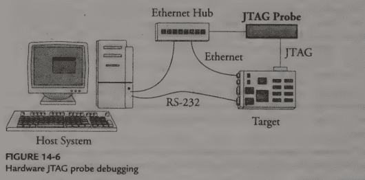

JTAG 探针的设置可能很复杂。这是其连接的 CPU 复杂性的直接结果。当目标板通电且其 CPU 退出复位状态时，几乎没有完成任何初始化。事实上，许多处理器至少需要少量初始化才能执行任何操作。有许多方法可将初始配置输入到 CPU 中。一些 CPU 通过读取硬件配置字或特定引脚的初始值来了解其上电配置。其他 CPU 则依赖于从诸如 Flash 等简单的非易失性存储设备中读取默认位置的数据。在使用 JTAG 探针时，特别是对于引入新的板级设计，必须在执行其他操作之前完成最低限度的 CPU 和板级初始化。许多 JTAG 探针依赖于此初始化所需的配置文件。

Abatron 单元使用配置文件来初始化其连接的目标硬件，以及定义调试器的其他操作参数。该配置文件包含用于初始化 CPU、内存系统和其他必要板级硬件的指令。开发人员有责任根据自己板级设计定制该配置文件，加入适当的指令。关于配置命令语法的细节可在 JTAG 探针的文档中找到。然而，只有嵌入式开发人员才能创建给定板级设计所需的独特配置文件。这需要详细了解 CPU 和板级设计特性。就像为新板卡创建定制 Linux 移植版一样，这项任务没有任何捷径或替代品。

附录 F《示例 BDI-2000 配置文件》包含了一个针对基于 Freescale 半导体 MPC5200 嵌入式控制器的定制板卡 Abatron 配置文件示例。在该附录中，你可以看到定制板卡所需的设置。请注意大量用于描述各种寄存器和初始化细节的注释。这使得随着时间的推移更容易更新和维护，并且有助于你首次就正确完成配置。

硬件探针通常有两种用途。大多数探针具有某种用户界面，使开发人员能够使用探针的功能。例如，编程 Flash 或下载二进制映像。第二种用法是作为 `gdb` 或其他源码级调试器的前端。我们将演示这两种使用场景。

### 14.4.1 使用 JTAG 探针编程 Flash

许多硬件探针包括编程各种 Flash 存储芯片的能力。Abatron `BDI-2000` 也不例外。`BDI-2000` 配置文件包含一个 `[FLASH]` 部分，用于定义目标 Flash 的特性。有关示例请参考附录 F。`[FLASH]` 部分定义了特定设计中使用的 Flash 芯片的属性，例如芯片类型、设备大小及其数据总线宽度。还定义了内存中的位置以及描述芯片存储组织方式的某种方法。

当更新 Flash 的一部分时，你通常希望保留同一 Flash 其他部分的内容。在这种情况下，你的硬件探针必须具有限制擦除扇区数量的方法。对于 Abatron 单元，这是通过对每个要擦除的扇区添加以关键字 `ERASE` 开头的行来实现的。当通过其 telnet 用户界面向 Abatron 单元发出擦除命令时，所有通过 `ERASE` 规范定义的扇区将被擦除。列表 14-20 演示了擦除目标板上的部分 Flash，随后编程新的 U-Boot 引导加载程序映像。

#### 列表 14-20：擦除和编程 Flash

```
$ telnet bdi
Trying 192.168.1.129...
Connected to bdi (192.168.1.129).
Escape character is '^}'.
BDI Debugger for Embedded PowerPC
================================
...
(large volume of help text)
uei> erase
Erasing flash at 0xfff00000
Erasing flash at 0xfff10000
Erasing flash at 0xfff20000
Erasing flash at 0xfff30000
Erasing flash at 0xfff40000
Erasing flash passed
uei> prog 0xfff00000 u-boot.bin BIN
Programming u-boot.bin  please wait ....
Programming flash passed
uei>
```


首先，我们建立到 Abatron BDI-2000 的 telnet 会话。经过一些初始化后，我们会看到一个命令提示符。当发出擦除命令时，Abatron 会为配置文件中定义的每个部分显示一行输出。根据附录 F 中显示的配置，我们定义了五个擦除扇区。这为 U-Boot 引导加载程序二进制文件预留了多达 256KB 的空间。

`prog` 命令显示了其全部三个可选参数。这些参数指定了新映像要加载的内存位置、映像文件的名称以及文件的格式——在本例中，是一个二进制文件。你可以在 BDI-2000 配置文件中指定这些参数。在这种情况下，该命令简化为不带参数的 `prog`。

此示例仅触及了这两个 BDI-2000 命令的表面。还支持许多更多的使用组合和功能。每个硬件 JTAG 探针都有自己指定 Flash 擦除和编程功能的方式。请查阅你特定设备的文档以获取具体细节。

### 14.4.2 使用 JTAG 探针进行调试

而不是通过其用户界面直接与 JTAG 探针交互，许多 JTAG 探针可以与你的源码级调试器进行接口连接。硬件探针支持的最流行的调试器无疑是 `gdb` 调试器。在此使用场景中，`gdb` 被指示通过外部连接（通常是以太网连接）与目标开始调试会话。调试器不通过用户界面直接与 JTAG 探针通信，而是在自身和 JTAG 探针之间来回传递命令。在此模型中，JTAG 探针使用 `gdb` 远程协议代表调试器控制硬件。再次参考图 14-6 了解连接详情。

JTAG 探针对于引导加载程序和早期启动代码的源码级调试特别有用。在此示例中，我们演示了使用 `gdb` 和 Abatron BDI-2000 在 PowerPC 目标板上调试 U-Boot 引导加载程序的部分代码。

许多处理器包含调试寄存器，其中具备设置传统地址断点（当程序到达特定地址时停止）以及数据断点（在条件访问指定内存地址时停止）的能力。当调试驻留在 Flash 等只读内存中的代码时，这是设置断点的唯一方法。然而，这些寄存器通常数量有限。许多处理器仅包含一个或两个这样的寄存器。在使用硬件断点之前，必须理解这一限制。以下示例说明了这一点。

使用如图 14-6 所示的设置，假设目标板上的 U-Boot 存储在 Flash 中。如我们在第 7 章中介绍引导加载程序时所述，你了解到 U-Boot 和其他引导加载程序通常会在启动后尽快将自己复制到 RAM 中。这是因为从 RAM 进行硬件读取（和写入）循环比典型的只读内存设备（如 Flash）快几个数量级。这带来了两个具体的调试挑战。首先，我们不能修改只读内存的内容（以插入软件断点），因此我们必须依赖处理器支持的断点寄存器来实现此目的。

第二个挑战来自于这样一个事实：只有执行上下文之一（Flash 或 RAM）可以由 `gdb` 读取符号调试信息的 ELF 可执行文件来表示。在 U-Boot 的情况下，它针对其初始存储的 Flash 环境进行了链接。早期代码会重定位自身并执行必要的地址调整。这意味着我们需要处理

`gdb` 在这两种执行上下文中均可使用。清单 14-21 展示了这样一个调试会话的示例。

##### 清单 14-21
使用 JTAG 探针调试 U-Boot

```
$ ppc-linux-gdb --silent u-boot

(gdb) target remote bdi2001

Remote debugging using bdi:2001

_start () at /home/chris/sandbox/u-boot-1.1.4/cpufmips5xxx/start.S:91

91 r21, BOOTFLAG_COLD /* Normal Power-On */

Current language: auto; currently asm

<< Debug a flash resident c code snippet >>

(gdb) mon break hard

(gdb) b board_init_f

Breakpoint 1 at 0xfff0457c: file board.c, line 366.

(gdb) c

Continuing.

Breakpoint 1, board_init_f (bootflag=0x7fc3afc) at board.c:366

366 gd = (gd_t *) (CFG_INIT_RAM_ADDR + CFG_GBL_DATA_OFFSET);

Current language: auto; currently c

(gdb) bt

#0 board_init_f (bootflag=0x1) at board.c:366

#1 0xfff0456c in board_init_f (bootflag=0x1) at board.c:353

(gdb) i frame

Stack level 0, frame at 0xf000bf50:

pc = 0xfff0457c in board_init_f (board.c:366); saved pc 0xfff0456c

called by frame at 0xf000bf78

Source language c.

Arglist at 0xf000bf50, args: bootflag=0x1

Locals at 0xf000bf50, Previous frame's sp is 0x0

<< Now debug a memory resident code snippet after relocation >>

(gdb) del 1

Discard symbol table from '/home/chris/sandbox/u-boot-1.1.4-powerdna/u-boot'?

(y or n) y

No symbol file now.

(gdb) add-symbol-file u-boot 0x7fa8000

add symbol table from file "u-boot" at

.text_addr = 0x7fa8000

(y or n) y

Reading symbols from u-boot...done.

(gdb) b board_init_r

Breakpoint 2 at 0x7fac6c0: file board.c, line 608.

(gdb) c

Continuing.

Breakpoint 2, board_init_r (id=0x7f85f84, dest_addr=0x7f85f94) at board.c:608

608 /* Initialize RAM version of global data */

(gdb) i frame

Stack level 0, frame at 0x7f85f38:

pc = 0x7fac6c0 in board_init_r (board.c:608); saved pc 0x7fac6b0

called by frame at 0x7f85f68

source language c.

Arglist at 0x7f85f38, args: id=0x7f85f84, dest_addr=0x7f85f84

Locals at 0x7f85f38, Previous frame's sp is 0x0

(gdb) mon break soft

(gdb)
```


请仔细研究这个示例。有一些细微之处确实值得花时间理解。首先，我们使用 `target remote` 命令连接到 Abatron BDI-2000。在这种情况下，IP 地址是 Abatron 设备的地址，由符号名称 `bdi` 表示。[^10] Abatron BDI-2000 使用 2001 端口进行远程 gdb 协议连接。

接下来，我们使用 gdb 的 `mon` 命令向 BDI-2000 发出指令。`mon` 命令告诉 gdb 将命令的其余部分直接传递给远程硬件设备。因此，`mon break hard` 将 BDI-2000 设置为硬件断点模式。

然后，我们在 `board_init_f` 处设置一个硬件断点。这是一个在地址 `0xffe10457c` 处仍从 Flash 内存运行时执行例程。断点定义完成后，我们发出继续命令 `c` 以恢复执行。立即触发了 `board_init_f` 处的断点，我们可以自由进行通常的调试活动，包括单步执行代码和检查数据。你可以看到，我们发出了 `bt` 命令来查看堆栈回溯，并使用了 `i frame` 命令来检查当前堆栈帧的详细信息。

现在，我们再次继续执行，但这次我们知道 U-Boot 会将自身复制到 RAM 并从 RAM 中的副本恢复执行。因此，我们需要在保持调试会话活跃的同时改变调试上下文。为了实现这一点，我们丢弃当前的符号表（不带参数的 `symbol-file` 命令），并使用 `add-symbol-file` 命令再次加载相同的符号文件。这次，我们指示 gdb 将符号表偏移，以匹配 U-Boot 重定位到内存中的位置。这确保了我们的源代码和符号调试信息与实际的内存驻留映像相匹配。

加载新符号表后，我们可以向执行时已知将驻留在 RAM 中的位置添加断点。这就是其中一个微妙复杂之处所在。因为我们知道 U-Boot 当前在 Flash 中运行，但即将将自身移动到 RAM 并跳转到基于 RAM 的副本，所以我们仍必须使用硬件断点。考虑一下如果我们在此时使用软件断点会发生什么。gdb 忠实地将断点操作码写入指定的内存位置，但 U-Boot 在将自身复制到 RAM 时会覆盖它。最终结果是断点从未被触发，我们开始怀疑我们的工具坏了。在 U-Boot 进入 RAM 副本并且我们的符号表已更新以反映基于 RAM 的地址后，我们可以自由使用基于 RAM 的断点。这体现在清单 14-21 中的最后一个命令，它将 Abatron 设备设置回软断点模式。

为什么我们要关心使用硬件断点还是软件断点？如果我们拥有无限的硬件断点寄存器，我们就不会关心了。但情况并非如此。以下是在调试会话期间用完处理器支持的硬件断点寄存器时的表现：

```
(gdb) b flash_init

Breakpoint 3 at 0x7fbe01e: file flash.c, line 70.

(gdb) c

Continuing.

warning: Cannot insert breakpoint 3:

Error accessing memory address 0x7fbe0: Unknown error 4294967295.
```

由于我们是远程调试，只有在我们尝试在输入额外断点后恢复执行时，才会被告知资源限制。这是因为 gdb 处理断点的方式。当触发断点时，gdb 恢复所有在特定内存位置具有原始操作码的断点。当它恢复执行时，它会恢复指定位置的断点操作码。您可以通过启用 gdb 的远程调试模式来观察这种行为：

```
(gdb) set debug remote 1
```

## 14.5 当无法启动时

服务于嵌入式 Linux 的各大邮件列表中问得最频繁的问题之一大概是这样的：

> 我试图在我的板上启动 Linux，但在控制台打印出以下消息后卡住了：
>
> "Uncompressing Kernel Image . . . OK."（解压缩内核映像 . . . 完成）

嵌入式 Linux 漫长且有时令人沮丧的学习曲线就此开始！许多可能出错的环节都可能导致这种常见的故障。凭借一些知识和 JTAG 调试器，有办法确定出了什么问题。

### 14.5.1 早期串行调试输出

您可能拥有的第一个工具是 `CONFIG_SERIAL_TEXT_DEBUG`。这个 Linux 内核配置选项在启动过程的非常早期添加了调试消息支持。目前，此功能仅限于 PowerPC 架构，但没有什么能阻止您在其他架构中复制此功能。清单 14-22 提供了此功能在 PowerPC 目标上使用 U-Boot 引导加载器的使用示例。

#### 清单 14-22
早期串行文本调试

```
#! Booting image at 00200000 ...

Image Name: Linux-2.6.14

Created: 2005-12-19 22:24:03 UTC

Image Type: PowerPC Linux Kernel Image (gzip compressed)

Data Size: 607149 Bytes = 592.9 kB

Load Address: 00000000

Entry Point: 00000000

Verifying Checksum ... OK

Uncompressing Kernel Image ... OK

#mach(): Done <- = Start of messages enabled by

#hw:enter <- = CONFIG_SERIAL_TEXT_DEBUG

#hw:hwinit

#hw:mapin

#hw:setio

#hw:exit

setup_arch: enter

setup_arch: bootmem

arch: exit

arch: real exit
```

使用此功能，您通常可以判断您的板子在启动过程中卡在哪里。当然，您可以在内核的其他地方添加自己的早期调试消息。这里是在 `.../arch/ppc/mm/init.c` 中发现的用法示例：

```
/** Map in all of RAM starting at KERNELBASE **/
if (ppc_md.progress)
    ppc_md.progress("#hw:mapin", 0x301);
mapin_ram();
```

OMCC Yosemite 平台是此基础设施的一个绝佳示例。查阅 Linux 源码树中的以下文件[^11]，以了解此调试系统的实现细节：

| 文件 | 函数 | 目的 |
| --- | --- | --- |
| gen550_dbg.c | gen550_init | 串行端口设置，由 yosemite.c 平台初始化调用 |
| gen550_dbg.c | gen550_progress | 低级串行输出例程 |
| ibm44x_common.c | ibm44x_platform_init | 将平台特定的进度例程绑定到通用 ppc 机器相关基础设施 |

### 14.5.2 转储 printk 日志缓冲区

在 14.3.6 节讨论 `printk` 调试时，我们指出了这种方法的某些局限性。`printk` 本身是一个非常稳健的实现。它的一个缺点是，在启动序列中控制台设备初始化之前，您无法看到任何 `printk` 消息。通常，当您的板子在启动时挂起时，许多消息都卡在 `printk` 缓冲区中。如果您知道在哪里找到它们，通常可以确定导致启动挂起的准确问题。事实上，很多时候您会发现内核遇到了导致调用 `panic()` 的错误。`panic()` 的输出可能已被转储到 `printk` 缓冲区中，您通常可以确定出错的代码行。

使用 JTAG 调试器实现这一点效果最好，但使用引导加载程序及其内存转储功能在重置后显示 `printk` 缓冲区的内容仍然是可能的。重置可能会导致内存内容出现一些损坏，但日志缓冲区文本通常非常可读。

`printk` 存储其消息文本的实际缓冲区在 `printk` 源文件 `.../kernel/printk.c` 中声明。

```
static char __log_buf[__LOG_BUF_LEN];
```

[^11]: 所有这些文件名都是唯一的，因此无需完整的路径名引用即可找到。

## 14.5 当系统无法启动时

我们可以通过 Linux 内核映射文件 `System.map` 轻松确定此缓冲区的位置。

```
% grep __log_buf System.map

   c022e548 b _log_buf
```


如果系统恰好在启动时挂起，即在显示“Uncompressing Kernel Image... OK”消息后，请重新启动并使用引导加载程序检查缓冲区。由于内核虚拟内存和物理内存之间的关系在特定架构上是固定且恒定的，我们可以进行简单的转换。之前显示的 `__log_buf` 地址是内核虚拟地址；我们必须将其转换为物理地址。对于这个特定的 PowerPC 架构，该转换是减去常数 `KERNELBASE` 地址 `0xc0000000` 的简单运算。这是我们在内存中探测以读取 `printk` 日志缓冲区内容（如果有的话）的地方。

清单 14-23 展示了使用 U-Boot 内存转储命令的输出示例。

#### 清单 14-23
打印原始 `printk` 日志缓冲区

```
=> md 22e548

0022e548: 3c3354dc 696e7578 20766557 273696f65e    <5>linux version

0022e5b4: 20322e36 2e313320 28633872 6979406a      2.6.13 (chr@s

0022e5c4: 756e6f6f 72292028 676363 76657273        jun) (gcc

0022e5d4: 696f6e20 332e342e 3320284d 6f6e7461      version 3.4.3 (Monta

0022e5e4: 56697374 6120332e 342e332c 62352e30      Vista 3.4.3-25.0

0022e5f4: 2673702e 303953031 3953832 2532035       .70.0501961 2005

0022e604: 2831332d 32313329 20235331 20537565      ~12~18) #11 Tue

0022e614: 20466562 20313420 32313430 35333036      Feb 14 21:05:06

0022e624: 20455374 20323036 3640343c 36414443      EST 2006.<4>AMC

0022e634: 4320506f 77655225 43304c63 30455220      C PowerPC 440EP

0022e644: 59667365 6d741465 2050666c 74666572      Yosemite Platform.

0022e654: 68030343 344e6e20 6e666e25 2030205d      7>On node 0.

0022e664: 6f746161 70616775 73343365 53353333      totalpages: 65536

0022e674: 0ac3c7f3e 2020464d 41720b6f 66653a2d    pages, LIFO zone:

0022e684: 36353553 36207061 67657328 204d4443      '5536 pages. L:'

0022e694: 4f206174 7463383a 33310a33 373e2020      0 bact...'?:

=>

0022e6a4: 466f726d 616c207a 6f6e653a 20332020      Normal zone: 0

0022e6b4: 6f746573 7c20204d 46462562 66746368      HighMem zone:

0022e6c4: 3a310a3c 373e2020 48696768 6d656d        1.0 pages

0022e6d4: 7a666c64 3a202020 70616765 733a2020      1.0 pages

0022e6e4: 49646620 62617463 6333336d 36343643      Built 1 zonelist

0022e6f4: 75696e6c 74313270 66666565 69737473

0022e704: 0a3c353e 4b65722e 656c2063 6f6d6d61    .<5>Kernel command

0022e714: 6664206c 696e653a 20636f6e 736f6c65    line: console

0022e724: 3d747479 53302e31 31353230 32020769    =ttyS0_115200

0022e734: 67743d2f 6465762f 66657320 72772069    root=/dev/nfs rw

0022e744: 703d6468 63703a3c 3d35049 44206861    ip=dhcp.<5>PID

0022e754: 73682074 61626c65 50456674 62696573    hash table entries

0022e764: 3a204820 34383238 64726465 74323031    : 2048 (order):

0022e774: 312c2033 32737538 20627974 6573290a    11, 32768 bytes).

0022e784: 00000000 00000000 00000000 00000000    ............

0022e794: 00000000 00000000 00000000 00000000    ............

=>
```

阅读起来不太美观，但数据在那里。我们可以看到，在这个特定的示例中，内核在初始化 PID 哈希表条目后的某处崩溃了。通过额外使用 `printk` 消息，我们可以开始缩小实际崩溃源的范围。

如本例所示，这是一种无需额外工具即可使用的技术。如果你正在处理新的板级移植，你可以看到启动期间某种早期串行端口输出的重要性。

### 14.5.3 KGDB 在恐慌时

如果启用了 KGDB，内核会在错误异常时将控制权传回给 KGDB。在某些情况下，错误本身会很明显。要使用此功能，必须已经在 KGDB 和 `gdb` 之间建立连接。当异常条件发生时，KGDB 向 `gdb` 发出 Stop Reply 数据包，指示陷入调试处理器的原因以及发生陷入条件的地址。清单 14-24 说明了该序列。

##### 清单 14-24
使用 KGDB 捕获 Panic 时的崩溃

```
$ ppc -4x2-gdb --silent vmlinux

(gdb) target remote /dev/ttyS0

Remote debugging using /dev/ttyS0

Malformed response to offset query, qOffsets

(gdb) target remote /dev/ttyS0

Remote debugging using /dev/ttyS0

breakinst () at arch/ppc/kernel/ppc-stub.c:825

825

(gdb) c

Continuing.

<< KGDB gains control from panic() on crash >>

Program received signal SIGSEGV, Segmentation fault.

0x00215d6c in pcibios_init () at arch/pci/pci.c:1263

1263  *(int *)-1 = 0;

(gdb) bt

#0  0x00215d6c in pcibios_init () at arch/pci/pci.c:1263

#1  0x0020e7c8 in do_initcalls () at init/main.c:563

#2  0x0020e7c4 in do_basic_setup () at init/main.c:605

#3  0x0001374 in init (unused=0x20) at init/main.c:677

#4  0x00049d0 in kernel_thread ()

Previous frame inner to this frame (corrupt stack?)

(gdb)
```


本例中的崩溃是通过在一个无效内存位置（全为 1）进行简单写入而人为制造的。我们首先从 `gdb` 到 `KGDB` 建立连接，并允许内核继续启动。请注意，我们甚至没有费心设置断点。当崩溃发生时，我们看到有问题的代码行，并获取了有助于确定其原因的清晰回溯。

## 14.6 本章摘要

- Linux 内核调试在许多方面都很复杂，特别是在交叉开发环境中。理解如何驾驭这些复杂性是成功内核调试的关键。
- `KGDB` 是一个非常有用的内核级 `gdb` 存根，可以在 Linux 内核和设备驱动程序内部进行直接的符号源级调试。它使用 `gdb` 远程协议与基于主机的交叉 `gdb` 进行通信。
- 理解（并最小化）编译器优化有助于理解通过执行编译器优化代码时看似奇怪的调试器行为。
- `gdb` 支持用户定义命令，这对于自动化繁琐的调试任务（如迭代内核链表和访问复杂变量）非常有用。
- 内核可加载模块为源级调试带来了独特的挑战。模块的初始化例程可以通过在 `module.c` 中在调用 `module->init()` 处设置断点来进行调试。
- `printk` 和 `Magic SysReq` 键提供额外的工具来帮助隔离内核开发和调试期间的问题。
- 通过 `JTAG` 探针进行硬件辅助调试，使得在其他调试方法繁重或不可能时，可以调试驻留在 Flash 或 ROM 中的代码。
- 在支持此功能的架构上启用 `CONFIG_SERIAL_TEXT_DEBUG` 是调试新内核移植的强有力工具。
- 检查 `printk` `log_buf` 通常会导致在启动时静默内核崩溃的原因。
- `KGDB` 在内核恐慌时将控制权传递给 `gdb`，使你能够检查回溯并隔离内核恐慌的原因。

### 14.6.1 延伸阅读建议

* Linux Kernel Development, 2nd Edition
  Robert Love
  Novell Press, 2005

* The Linux Kernel Primer
  Claudia Salzberg Rodriguez et al.
  Prentice Hall, 2005

* “Using the GNU Compiler Collection”
  Richard M. Stallman and the GCC Developer Community
  GNU Press, a division of Free Software Foundation
  http://gcc.gnu.org/onlinedocs/

* KGDB Sourceforge home page
  http://sourceforge.net/projects/KGDB

* Debugging with GDB
  Richard Stallman, Roland Pesch, Stan Shebs, et al.
  Free Software Foundation
  www.gnu.org/software/gdb/documentation/

* Tool Interface Standards
  DWARF Debugging Information Format Specification
  Version 2.0
  TIS Committee, May 1995

# 第 15 章

## 嵌入式 Linux 应用程序调试

**本章内容**

- 目标机调试 第 400 页
- 远程（交叉）调试 第 400 页
- 使用共享库进行调试 第 405 页
- 多任务调试 第 411 页
- 其他远程调试选项 第 417 页
- 本章摘要 第 419 页

在上一章中，我们探讨了 `GDB` 在调试内核代码以及驻留在 Flash 中的代码（例如引导加载程序代码）时的用法。在本章中，我们将继续介绍 `GDB` 在用户空间应用程序代码调试中的应用。我们将扩展对远程调试及其在此特殊调试环境中使用的工具和技术的内容。

### 15.1 目标机调试

我们已经在第 13 章“开发工具”中探讨了几个重要的调试工具。`strace` 和 `ltrace` 可用于观察和表征进程的行为，并常常能定位问题。`dmalloc` 有助于隔离内存泄漏并剖析内存使用情况。`ps` 和 `top` 都可用于检查进程状态。这些相对较小的工具旨在直接在目标硬件上运行。

在嵌入式系统上调试 Linux 应用程序代码有其独特的挑战。你的嵌入式目标机上的资源通常有限。RAM 和非易失性存储的限制可能会阻止你运行基于目标机的开发工具。你可能没有以太网端口或其他高速连接。你的目标嵌入式系统可能没有图形显示器、键盘或鼠标。

这正是你的交叉开发工具和 `NFS` 根挂载环境可以发挥巨大作用的地方。许多工具，尤其是 `GDB`，其架构设计允许在你的开发主机上执行，同时实际调试远程目标机上的代码。`GDB` 可用于交互式调试你的目标代码，或执行由应用程序崩溃生成的核心文件的事故后分析。我们在第 13 章中介绍了应用程序核心转储分析的细节。

### 15.2 远程（交叉）调试

交叉开发工具主要是为了克服嵌入式平台的资源限制而开发的。一个使用符号调试信息编译的中尺寸应用程序很容易超过几兆字节。通过交叉调试，繁重的任务可以在你的开发主机上完成。当你在开发主机上调用你的 `GDB` 交叉版本时，你传入一个带有符号调试信息的 `ELF` 文件。在目标机上，你可以剥离 `ELF` 文件中所有不必要的调试信息，以使生成的映像保持最小尺寸，没有任何理由不这样做。

> 请记住使用你的 `strip` 交叉版本，例如 `ppc_82zx-strip`。

我们在第 13 章介绍了 `readelf` 实用工具。在第 14 章“内核调试技术”中，我们使用它检查带有符号调试信息编译的 `ELF` 文件中的调试信息。列表 15-1 包含了一个针对 ARM 架构编译的相对较小的 Web 服务器应用程序的 `readelf` 输出。

#### 列表 15-1

##### 示例程序的 ELF 文件调试信息

```
$ xscale_be-readelf -S webdemo

There are 39 section headers, starting at offset 0x3dfd0:

Section Headers:

 [Nr] Name          Type            Addr     Off    Size   ES Flg Lk Inf Al

 [ 0]               NULL           00000000 000000 000000 00      0   0  0

 [ 1] .interp       PROGBITS       00000154 000154 000013 00      A   0  1

 [ 2] .note.ABI-tag NOTE           00000168 000168 000020 00      A   0  4

 [ 3] .note.numapolicy NOTE         00000188 000188 000074 00      A   0  4

 [ 4] .hash         HASH           000001fc 0001fc 00002c 04      A   5  0  4

 [ 5] .dynsym       DYNSYM         00000828 000428 000460 10      A   6  1  4

 [ 6] .dynstr       STRTAB         00000888 000888 000211 00      A   0  0  1

 [ 7] .gnu.version  VERSYM         00000a9a 000a9a 0000c8 02      A   5  0  2

 [ 8] .gnu.version_r VERNEED       00000b28 000b28 000020 00      A   6  1  4

 [ 9] .rel.plt      REL            00000b48 000b48 000218 08      A   5 11  4

[10] .init         PROGBITS       00000d60 000d60 000018 00      AX  0   0  4

[11] .plt          PROGBITS       0000d7b8 000d78 000038 04      AX  0   0  4

[12] .text         PROGBITS       000090b0 0010b0 019fe4 00      AX  0   0  4

[13] .fini         PROGBITS       00023094 01b094 000010 00      AX  0   0  4

[14] .rodata       PROGBITS       000230a0 01b0a0 002340 00      A   0   0  8
```


[15] `.ARM.exidx`    `PROGBITS`       `00025480` `01d480` `000000` `00`      `A`   `0`   `0`  `1`

[16] `.ARM.exidx`    `ARM_EXIDX`      `00025480` `01d480` `000000` `00`      `AL`  `12`  `0`  `4`

[17] `.eh_frame_hdr` `PROGBITS`       `00025488` `01d488` `00001c` `00`      `A`   `0`   `0`  `4`

[18] `.eh_frame`     `PROGBITS`       `000254b4` `01d4b4` `00007c` `00`      `A`   `0`   `0`  `4`

[19] `.init_array`   `INIT_ARRAY`     `0002d530` `01d530` `000004` `00`      `WA`  `0`   `0`  `4`

[20] `.fini_array`   `FINI_ARRAY`     `0002d534` `01d534` `000004` `00`      `WA`  `0`   `0`  `4`

[21] `.jcr`          `PROGBITS`       `0002d538` `01d538` `000004` `00`      `WA`  `0`   `0`  `4`

[22] `.dynamic`      `DYNAMIC`        `0002d53c` `01d53c` `0000d0` `08`      `WA`  `6`   `0`  `4`

[23] `.got`          `PROGBITS`       `0002d60c` `01d60c` `000018` `04`      `WA`  `0`   `0`  `4`

[24] `.data`         `PROGBITS`       `0002d728` `01d728` `0003c0` `00`      `WA`  `0`   `0`  `8`

[25] `.bss`          `NOBITS`         `0002da88` `01da88` `0001c8` `00`      `WA`  `0`   `0`  `4`

[26] `.comment`      `PROGBITS`       `00000000` `01da88` `000940` `00`      `A`   `0`   `0`  `1`

[27] `.debug_aranges` `PROGBITS`      `00000000` `01ea28` `000040` `00`      `A`   `0`   `0`  `8`

[28] `.debug_pubnames` `PROGBITS`     `00000000` `01eb88` `001aae` `00`      `A`   `0`   `0`  `1`

[29] `.debug_info` `PROGBITS` `00000000` `020376` `013d27` `00` `0` `0` `1`

[30] `.debug_abbrev` `PROGBITS` `00000000` `03409d` `002e4e` `00` `0` `0` `1`

[31] `.debug_line` `PROGBITS` `00000000` `03647b` `0043a2` `00` `0` `0` `1`

[32] `.debug_frame` `PROGBITS` `00000000` `03a820` `003880` `00` `0` `0` `4`

[33] `.debug_str` `PROGBITS` `00000000` `03d7b0` `000673` `00` `0` `0` `1`

[34] `.note.gnu.arm.ident` `NOTE` `00000000` `03de18` `00001c` `00` `0` `0` `4`

[35] `.debug_ranges` `PROGBITS` `00000000` `03e355` `000018` `00` `0` `0` `1`

[36] `.shstrtab` `STRTAB` `00000000` `03de4d` `000183` `00` `0` `0` `1`

[37] `.symtab` `SYMTAB` `00000000` `03e5e8` `0048d0` `10` `38` `773` `4`

[38] `.strtab` `STRTAB` `00000000` `0431b8` `0021fb` `00` `0` `0` `1`

Key to Flags:

`W` (write), `A` (alloc), `X` (execute), `M` (merge), `S` (strings)

`i` (info), `L` (link order), `G` (group), `x` (unknown)

`o` (extra OS processing required) `os` (OS specific), `p` (processor specific)

从列表 15-1 中可以看出，有许多节包含调试信息。还有一个 `.comment` 节，其中包含超过 2KB（`0x940`）的信息，这些信息对于应用程序的功能并非必需。此示例文件的大小，包括调试信息在内，超过 275KB。

```
$ ls -l webdemo

-rwxrwxr-x 1 chris chris 283511 Nov 8 18:48 webdemo
```

如果使用 `strip` 实用工具剥离此文件，我们可以将其大小最小化，以保留目标系统上的资源。列表 15-2 显示了结果。

#### 列表 15-2
##### 剥离目标应用程序

```
$ xscale_bs-strip -s -R .comment -o webdemo-stripped webdemo

$ ls -l webdemo*

-rwxrwxr-x 1 chris chris 283491 Apr 9 09:19 webdemo

-rwxrwxr-x 1 chris chris 123156 Apr 9 09:21 webdemo-stripped
```

在这里，我们从可执行文件中剥离了符号调试信息和 `.comment` 节。我们使用 `-o` 命令行开关指定剥离后的二进制文件的名称。你可以看到，剥离后的二进制文件的大小不到其原始大小的一半。当然，对于较大的应用程序，这种空间节省可能更加显著。最近编译的一个带有调试信息的 Linux 内核大于 18MB。剥离后如列表 15-2 所示，生成的二进制文件略大于 2MB！

为了以这种方式进行调试，你将剥离版本的二进制文件放置在目标系统上，并在你的开发工作站上保留一份包含调试所需符号信息的本地未剥离副本。你在目标板上使用 `gdbserver` 来提供返回开发主机的接口，在那里你对未剥离的二进制文件运行完整版的 GDB。

### 15.2.1 gdbserver

使用 `gdbserver` 允许你从开发工作站而不是在目标嵌入式 Linux 平台上运行 GDB。这种配置显然有很多好处。首先，你的开发工作站通常具有比嵌入式平台远更多的 CPU 算力、内存和硬盘存储空间。此外，被调试应用程序的源代码通常存在于开发工作站上，而不是嵌入式平台上。

`gdbserver` 是一个运行在目标板上的小程序，允许对板上的进程进行远程调试。在目标板上调用它时，需指定要调试的程序，以及它将监听来自 GDB 连接请求的 IP 地址和端口号。列表 15-3 显示了目标板上的启动序列。

#### 列表 15-3
**在目标板上启动 gdbserver**

```
$ gdbserver localhost:2001 webdemo-stripped

Process webdemo-stripped created; pid = 197

Listening on port 2001
```

这个特定示例启动了配置为监听端口 2001 上的以太网 TCP/IP 连接的 `gdbserver`，准备调试名为 `webdemo-stripped` 的剥离二进制程序。

从我们的开发工作站，我们启动 GDB，将包含我们要调试的符号调试信息的二进制可执行文件的名称作为参数传入。GDB 启动后，我们发出命令连接到远程目标板。列表 15-4 显示了这一序列。

#### 列表 15-4：启动远程 GDB 会话

```
$ nscale_dev-gdb -q webdemo

(gdb) target remote 192.168.1.141:2001

Remote debugging using 192.168.1.141:2001

0x40000790 in ?? ()

(gdb) p main

    <<< display address of main function

$1 = (int (int, char \*)\*) 0x12b288 <main>

(gdb) b main

    <<< Place breakpoint at main()

Breakpoint 1 at 0x12b280: file main.c, line 72.

(gdb)
```

列表 15-4 中的序列在开发主机上启动了交叉 GDB。当 GDB 正在运行时，我们发出 gdb `target remote` 命令。此命令使 GDB 从开发工作站向目标板建立 TCP/IP 连接，连接至指定 IP 地址的 2001 端口。当 `gdbserver` 接受连接请求时，它会打印出类似以下内容的一行：

```
Remote debugging from host 192.168.0.10
```


现在，GDB 已连接到目标板上的 `gdbserver` 进程，随时准备接受来自 GDB 的命令。会话的其余部分与您本地调试应用程序时完全相同。这是一个强大的工具，允许您在调试会话中利用开发工作站的强大功能，而在目标板上只保留一个相对不显眼的、较小的 GDB 桩（stub）以及正在被调试的程序。如果您想知道，针对此特定 ARM 目标的 `gdbserver` 仅为 54KB。

```
root@cyote:~# ls -l /usr/bin/gdbserver

-rwxr-x 1 root root 54344 Jul 23 2005 /usr/bin/gdbserver
```

有一个注意事项，这也是许多邮件列表中常见问题列表（FAQ）的主题。您必须在开发主机上使用被配置为交叉调试器的 GDB。这是一个二进制程序，它在开发工作站上运行，但能理解为另一种架构编译的二进制可执行映像。这是一个重要且常被忽视的事实。您不能使用原生 GDB（例如典型 Red Hat Linux 安装中提供的那种）来调试 PowerPC 目标。您必须拥有针对您的主机和目标组合配置好的 GDB。

当调用 GDB 时，它会显示一个包含多行信息的横幅，然后显示其编译配置。列表 15-5 是本书某些示例中使用的 GDB 的例子，该 GDB 属于由 MontaVista Software 提供的嵌入式 Linux 发行版的一部分，并配置为用于 PowerPC 交叉开发。

#### 列表 15-5：调用交叉 GDB

```
$ ppc_R23xx-gdb

GNU gdb 6.0 (MontaVista 6.0-8.0.4.0300532 2003-12-24)

Copyright 2003 Free Software Foundation, Inc.

gdb is free software, covered by the GNU General Public License, and

you are welcome to change it and/or distribute copies of it under

certain conditions. Type "show copying" to see the conditions.

There is absolutely no warranty for GDB. Type "show warranty" for

details.

This GDB was configured as "--host=i686-pc-linux-gnu
--target=powerpc-hardhat-linux".
(gdb)
```

请注意此 GDB 启动信息的最后几行。这是编译进此版本 GDB 的配置。它被编译为在运行 GNU/Linux 的 Pentium (`i686`) PC 主机上执行，并用于调试为运行 GNU/Linux 的 PowerPC 处理器编译的二进制程序。这是由横幅文本中显示的 `--host` 和 `--target` 变量指定的，也是构建 GDB 时传递给 `./configure` 的配置字符串的一部分。

### 15.3 使用共享库进行调试

现在您已经了解了如何在主机上使用 GDB、在目标上使用 `gdbserver` 来启动远程调试会话，我们将注意力转向共享库和调试符号的复杂性。除非您的应用程序是静态链接的可执行文件（使用 `-static` 链接器命令行开关链接），否则您应用程序中的许多符号将引用位于应用程序内部的代码例程。明显的例子包括使用标准 C 库例程，如 `fopen`、`printf`、`malloc` 和 `memcpy`。不太明显的例子可能包括调用特定于应用程序的函数，例如 `jack_transport_locate()`（JACK 低延迟音频服务器中的一个例程），它调用了标准 C 库之外的库函数。

为了让这些例程的符号可用，您必须满足 GDB 的两个要求：

- 您必须拥有可用的库的调试版本。
- GDB 必须知道在哪里找到它们。

如果您没有可用的库调试版本，您仍然可以调试您的应用程序；您只是无法获得由您的应用程序调用的库例程的调试信息。通常情况下，这是完全可以接受的，除非您正在开发嵌入式项目中作为部分内容的共享库对象。

回顾列表 15-4，我们在远程目标上调用了 GDB。在 GDB 通过 `target remote` 命令连接之后，GDB 发出了两行响应：

```
Remote debugging using 192.168.1.141:2001

0x40000790 in ?? ()
```

这确认了 GDB 已连接到指定 IP 地址和端口的目标。然后 GDB 报告程序计数器的位置为 `0x40000790`。为什么我们看到的是问号而不是符号位置？因为这是 Linux 动态加载器 `ld-*.x.y.z.so`，并且在这个特定平台上，我们没有针对此共享库的调试符号。我们怎么知道这一点？

回想我们在第 9 章“文件系统”中介绍的 *proc* 文件系统。其中一个更有用的条目是每进程目录结构中的 *maps* 条目（参见第 9 章中的列表 9-16）。我们从列表 15-3 中的 `gdbserver` 输出知道了目标应用程序的进程 ID (`PID`)。我们的进程被分配了 PID `197`。基于此，我们可以看到进程启动后正在使用的内存段，如列表 15-6 所示。

#### 列表 15-6：初始目标内存段映射

```
root@coyote:~# cat /proc/197/maps

00008000-00020000 r--p 00000000 00:04 4852444 /websdemo-stripped
0002d000-0002d000 rw-p 0001d000 00:04 4852444 /websdemo-stripped
40000000-40017000 r-xp 00000000 00:04 4882583 /lib/ld-2.3.3.so
4001e000-40020000 rw-p 00016000 00:04 4882583 /lib/ld-2.3.3.so
bedf9000-bedfe000 rwxp bedf9000 00:00 0 [stack]
root@coyote:~#
```

在这里我们看到目标 `webssdemo-stripped` 应用程序占据两个内存段。第一个是位于 `0x8000` 的只读可执行段，第二个是位于 `0x2d000` 的读写数据段。第三个内存段是我们感兴趣的。它是 Linux 动态链接器的可执行代码段。注意它从地址 `0x40000000` 开始。如果我们进一步调查，可以确认 GDB 实际上停留在动态链接器的第一行代码处，此时我们的应用程序代码尚未执行。使用我们的交叉版本 `readelf`，我们可以按如下方式确认链接器的起始地址：

```
$ xscale_be-readelf -S 1d-2.3.3.so | grep .text

[ 9] .text PROGBITS 00000790 0000790 012e6c 00 RX 0 0 16
```

根据这些数据，我们得出结论，GDB 在启动时报告的地址是 `1d-2.3.3.so`（Linux 动态链接器/加载器）的第一条指令。如果您没有某个进程或共享库的符号调试信息，可以使用此技术来大致了解您的代码在哪里。

请记住，我们正在开发主机上执行这个交叉 `readelf` 命令。因此，`ld-2.3.3.so` 文件本身是一个 XScale 二进制对象，必须对您的开发主机可访问。通常，此文件位于您的开发主机上，并且是安装在您主机上的嵌入式 Linux 发行版的一部分。

##### 15.3.1 GDB 中的共享库事件

GDB 可以提醒您共享库事件。这对于理解您的应用程序行为或 Linux 加载器的行为，或者在您需要调试或单步执行的共享库例程中设置断点，都非常有用。列表 15-7 说明了这种技术。通常，会显示库的完整路径。此列表经过编辑以提高可读性。

#### 列表 15-7：在共享库事件时停止 GDB

```
$ xscale_be-gdb -q webssdemo
(gdb) target remote 192.168.1.141:2001
Remote debugging using 192.168.1.141:2001
0x40000790 in ?? ()
(gdb) 1 shared
		<< Display loaded shared libs
No shared libraries loaded at this time.
(gdb) b main
		<< Break at main
Breakpoint 1 at 0x12b80: file main.c, line 72.
```


```
(gdb) c
```
继续执行。

在 `main.c:72` 处触发断点 `1`，`main` (`argc=0x1`, `argv=0xbcec7fdc4`)
`72` `int localvar = 9;`

```
(gdb) i shared
```
  起始地址      结束地址    符号已读取   共享对象库
`0xa40003300`   `0xa4002660c` 是         `/opt/mv1/.../lib/tls/libc.so.6`
`0xa4000790`    `0x400133fc`  是         `/opt/mv1/.../lib/ld-linux.so.3`

```
(gdb) set stop-on-solib-events 1
(gdb) c
```
继续执行。

因共享库事件而停止

```
(gdb) i shared
```
  起始地址      结束地址    符号已读取   共享对象库
`0xa40033300`   `0xa4002660c` 是         `/opt/mv1/.../lib/tls/libc.so.6`
`0xa4000790`    `0xa00133fc`  是         `/opt/mv1/.../lib/ld-linux.so.3`
`0xa4012ba8`    `0xa40132104` 是         `/opt/mv1/.../libmss_files.so.2`
`(gdb)`

首先，当调试会话刚开始时，当然还没有加载任何共享库。您可以通过第一条 `i shared` 命令看到这一点。该命令显示当前已加载的共享库。当我们在应用程序的 `main()` 函数上设置断点时，我们可以看到此时已加载了两个共享库。它们分别是 Linux 动态链接器/加载器和标准 C 库组件 `libc`。

从此时开始，我们发出 `set stop-on-solib-event` 命令并继续程序执行。当应用程序尝试执行来自另一个共享库的函数时，该库会被加载。如果您想知道，程序遇到了 `getostbyname()` 函数，并导致了下一个共享对象的加载。

此示例阐明了重要的交叉开发概念。运行在目标设备上的二进制应用程序（ELF 映像）包含其用于解析外部引用的所需库的信息。我们可以使用第 11 章“BusyBox”中介绍的 `ldd` 命令轻松查看此信息，并在第 13 章中进行了详细说明。列表 15–8 显示了在目标板上调用的 `ldd` 的输出。

### 列表 15-8

### 在目标板上执行的 ldd

```
root@coyote:/workspace$ ldd webdemo

		libc.so.6 => /lib/tls/libc.so.6 (0xa40020000)

	/lib/ld-linux.so.3 (0x40000000)

root@coyote: /workspace$
```

请注意，目标设备上的共享库路径是从根文件系统 `/lib` 开始的绝对路径。但是，运行在您的宿主开发工作站上的 GDB 无法使用这些路径来查找库。您应该意识到，这样做会导致宿主 GDB 加载来自错误架构的库。您的宿主很可能是 x86 架构，而在此示例中，目标是 ARM XScale 架构。

如果您调用交叉版本的 `ldd`，您将会看到预配置在您的工具链中的路径。² 您的工具链必须了解这些文件在宿主开发系统上的位置。³ 列表 15-9 对此进行了说明。同样，为了提高可读性，我们对列表进行了编辑；长路径已被缩写。

### 列表 15-9

### 在开发宿主上执行的 ldd

```
$ xscale_be-ldd webdemo

    libc.so.6 => /opt/mvl/.../xscale_be/target/lib/libc.so.6 (0xdead1000)

    ld-linux.so.3 => /opt/mvl/.../xscale_be/target/lib/ld-linux.so.3 (0xdead2000)

$ (gdb) show solib-absolute-prefix

加载绝对共享库符号文件的前缀是

"/opt/mvl/pro/devkit/arm/xscale_be/target".
```

您的交叉工具链应预先配置了这些库的位置。您的宿主 GDB 不仅需要知道它们的位置，而且，当然，您的编译器和链接器也需要这些知识。³ GDB 可以使用 `show solib-absolute-prefix` 命令告诉您它被配置为在哪里查找这些库：

您可以使用 GDB 命令 `set solib-absolute-prefix` 和 `set solib-search-path` 设置或更改 GDB 搜索共享库的位置。如果您正在开发自己的共享库模块，或者您的系统上有自定义的库位置，您可以使用 `solib-search-path` 指示 GDB 在哪里查找您的库。有关这些及其他 GDB 命令的更多详细信息，请参阅本章末尾第 15.6.1 节“额外阅读建议”中引用的在线 GDB 手册。

关于 `ldd` 的最后一点说明。您可能注意到了列表 15-8 和 15-9 中库关联的地址。`ldd` 显示这些代码段的起始加载地址，就好像程序被 Linux 动态链接器/加载器加载时的样子。在目标设备上执行时，列表 15-8 中的地址完全合理，我们可以将这些地址与目标设备上正在运行的进程的 `/proc/<pid>/maps` 列表相关联。列表 15-10 显示了这个目标进程完全加载并运行后的内存段。

### 列表 15-10

### 目标设备上 `/proc/<pid>/maps` 中的内存段

```
root@cycote:~ # cat /proc/197/maps

00008000-00026000 r-xp 00019000 00:0e 4852444    /workspace/webdemo-stripped

0002d000-0002e000 rw-p 0001d000 00:0e 4852444    /workspace/webdemo-stripped

0002e000-0005f000 rwxp 00000000 00:00 0          [heap]

40000000-40017000 r-xp 00000000 00:0a 4982583    /lib/ld-2.3.3.so

40017000-40019000 rw-p 40017000 00:0a 4982583    /lib/ld-2.3.3.so

4001f000-40020000 rw-p 00017000 00:0a 4982583    /lib/ld-2.3.3.so

40022000-40112000 r-xp 00000000 00:0a 4982651    /lib/tls/libc-2.3.3.so

40113000-40120000 ---p 00013000 00:0a 4982651    /lib/tls/libc-2.3.3.so

40120000-40124000 rw-p 0000f800 00:0a 4982651    /lib/tls/libc-2.3.3.so

40124000-40126000 rw-p 0001c000 00:0a 4982651    /lib/tls/libc-2.3.3.so

40126000-40128000 rw-p 0000e000 00:0a 4982651    /lib/tls/libc-2.3.3.so

40128000-4012a000 rw-p 40128000 00:00 0

4012a000-40133000 r-xp 00000000 00:0a 4982652    /lib/tls/libm.so.2

40130000-40133000 rw-p 00008000 00:0a 4982652    /lib/tls/libm.so.2

root@cycote:~ #
```


请注意目标 `ldd` 输出（列表 15-8）与该进程在 `/proc` 文件系统中显示的内存段之间的关联。Linux 加载器的起始位置（`.text` 段的开头）是 `0x40000000`，而 `libc` 的起始位置在 `0x40020000`。这些是应用程序的这些部分被加载的虚拟地址，并由目标端调用的 `ldd` 报告。然而，列表 15-9 中交叉版本 `ldd` 报告的加载地址（`0xdead1000` 和 `0xdead2000`）仅仅是为了提醒您，这些库无法在您的宿主系统上加载（它们是 ARM 架构的二进制文件），这些加载地址只是占位符。

## 15.4 调试多任务

通常，处理多线程执行时，开发者面临两种不同的调试场景。进程可以存在于自己的地址空间中，也可以与其他执行线程共享地址空间（以及其他系统资源）。前者（不共享公共地址空间的独立进程）必须使用单独的独立调试会话进行调试。您可以使用目标系统上的多个进程配合 `gdbserver`，并在开发宿主上使用单独的 GDB 调用协调多个协作但独立的进程的调试会话。

### 15.4.1 调试多进程

当在 GDB 下调试的进程使用 `fork()` 系统调用¹生成新进程时，GDB 可以采取两种行动。它可以继续控制和调试父进程，或者它可以停止调试父进程并附加到新形成的子进程。您可以使用 `set follow-fork-mode` 命令控制此行为。这两种模式是跟随父进程和跟随子进程。默认行为是 GDB 跟随父进程。在这种情况下，子进程在成功的 fork 后立即执行。

列表 15-11 重现了一个简单程序的片段，该程序从其 `main()` 例程 fork 多个进程。

#### 列表 15-11

```
. 使用 `fork()` 生成子进程

 ...

 	for( i=0; i<MAX_PROCESSES; i++ ) {

	  /* 创建子进程 */

	  pid[i] = fork();     /* 父进程获取非零 PID */

	  if ( pid[i] == -1 ) {

	    perror("fork failed");

	    exit(1);

	  }

 }
```

¹ 我们将使用“系统调用”一词，但在此上下文中，`fork()` 实际上是 C 库函数，该函数进而调用 Linux `sys_fork()` 系统调用。

### 15.4.2 调试多线程应用程序

```c
 if ( pid[i] == 0 ) {   /* Indicates child's code path */
    worker_process();    /* The forked process calls this */
}

/* Parent's main control loop */
while ( 1 ) {
...
}
```

这个简单的循环使用 `fork()` 系统调用创建 `MAX_THREADS` 个新进程。每个新派生的进程都会执行由 `worker_process()` 函数定义的一段代码。当在默认模式下由 GDB 运行时，GDB 会检测到新执行线程（进程）的创建，但仍然附着在父进程的线程上。列表 15-12 展示了这个 GDB 会话。

#### 列表 15-12

GDB 在 follow-fork-mode = parent 模式下

```text
(gdb) target remote 192.168.1.141:2001
0x4000790 in ?? ()
(gdb) b main
Breakpoint 1 at 0x888: file forker.c, line 104.
(gdb) c
Continuing.
[New Thread 356]
[Switching to Thread 356]
Breakpoint 1, main (argc=0x1, argv=0xbe807dd4) at forker.c:104
104           time(&start_time);
(gdb) b worker_process
Breakpoint 2 at 0x9784: file forker.c, line 45.
(gdb) c
Continuing.
Detaching after fork from child process 357.
Detaching after fork from child process 358.
Detaching after fork from child process 359.
Detaching after fork from child process 360.
Detaching after fork from child process 361.
Detaching after fork from child process 362.
Detaching after fork from child process 363.
Detaching after fork from child process 364.
```

请注意，生成了八个子进程，其 PID 值从 357 到 364。父进程实例化为 PID 356。当命中 `main()` 中的断点时，我们在 `worker_process()` 例程处设置了一个断点，每个子进程在执行 `fork()` 时都会运行该例程。让程序从 main 继续运行，我们可以看到每个新进程都被调试器生成并分离了。它们从未命中断点，因为 GDB 附着在主进程上，而主进程从不执行 `worker_process()` 例程。

如果您需要调试每个进程，必须运行一个独立的 GDB 会话，并在子进程被 `forked()` 后附着到该子进程上。本章末尾引用的 GDB 文档概述了一种有用的技术，即在子进程中放置一个 `sleep()` 调用，以便有时间将调试器附着到新进程上。（附着到新进程的方法在 15.5.2 节“附着到正在运行的进程”中解释。）

如果您只需要跟踪子进程，请在父进程到达 `fork()` 系统调用之前将 `follow-fork-mode` 设置为 follow child。列表 15-13 展示了这一点。

#### 列表 15-13

```text
GDB in follow-fork-mode = child
(gdb) target remote 192.168.1.141:2001
0x40000790 in ?? ()
(gdb) set follow-fork-mode child
(gdb) b worker_process
Breakpoint 1 at 0x8784: file forker.c, line 45.
(gdb) c
Continuing.
[New Thread 401]
Attaching after fork to child process 402.
[New Thread 402]
[Switching to Thread 402]
Breakpoint 1, worker_process () at forker.c:45
45          int my_pid = getpid();
(gdb) c
Continuing.
```

这里我们看到父进程实例化为 PID 401。当通过 `fork()` 系统调用生成第一个子进程时，GDB 静默地从父线程的执行中分离，并附着到新生成的 PID 为 402 的子进程上。此时 GDB 控制第一个子进程，并遵守在 `worker_process()` 处设置的断点。然而，请注意，由列表 15-11 中的代码片段生成的其他子进程未被调试，并继续运行直到完成。

总之，以这种方式使用 GDB，您一次只能调试单个进程。您可以穿过 `fork()` 系统调用进行调试，但必须决定在 `fork()` 调用后跟踪哪个执行线程，是父线程还是子线程。如本节的引言所述，如果您必须同时调试多个协作进程，可以使用多个独立的 GDB 会话。

如果您的应用程序使用 POSIX 线程库来处理其线程功能，GDB 具有额外的能力来处理多线程应用程序的并发调试。Native Posix Thread Library (`NPTL`) 已成为 Linux 系统（包括嵌入式 Linux 系统）中*事实上的*标准线程库。本讨论的其余部分假设您正在使用这个线程库。

在本节中，我们使用一个演示程序，它在一个简单的循环中通过 `pthread_create()` 库函数生成若干线程。在线程生成后，`main()` 例程只需等待键盘输入以终止应用程序。每个线程在屏幕上显示一条简短消息，并睡眠一段预定的时间。列表 15-14 展示了目标板上的启动序列。

#### 列表 15-14

目标线程演示启动

```text
root@cyote:~/workspace$ gdbserver localhost:2001 ./tdemo
Process ./tdemo created; pid = 671
Listening on port 2001
Remote debugging from host 192.168.1.10
```


--------  Previous three lines displayed by gdbserver

`tdemo` `main()` entered: My pid is 671

Starting worker thread 0

Starting worker thread 1

Starting worker thread 2

Starting worker thread 3

```

正如我们之前的示例所示，`gdbserver` 为应用程序的运行做准备，并等待来自基于主机的交叉 GDB 的连接。当 GDB 连接时，`gdbserver` 通过 `Remote debugging...` 消息报告连接。现在我们在主机上启动 GDB 并连接。列表 15-15 重现了会话的这一半。

#### 列表 15-15

主机 GDB 连接到目标线程演示

```text

$ xsc4e_be-gdb -q tdemo

(gdb) target remote 192.168.1.141:2001

0x00000790 in ?? ()

(gdb) b tdemo.c:97

Breakpoint 1 at 0x88ec: file tdemo.c, line 97.

(gdb) c

Continuing.

[New Thread 1059]

[New Thread 1060]

[New Thread 1061]

[New Thread 1062]

[New Thread 1063]

[Switching to Thread 1059]

Breakpoint 1, main (argc=0x1, argv=0xbefffdd4) at tdemo.c:98

98		int c = getchar();

(gdb)

```

这里我们连接到目标（导致列表 15-14 中的“Remote debugging…”消息），在生成新线程的循环刚刚结束处设置断点，然后继续。当新线程创建时，GDB 显示通知及线程 ID。线程 1059 是 `tdemo` 应用程序，直接通过 `main()` 函数执行其工作。线程 1060 到 1063 是通过调用 `pthread_create()` 创建的新线程。

当 GDB 命中断点时，它显示消息 [Switching to Thread 1059]，表明这是遇到断点的执行线程。它是调试会话中的活动线程，在 GDB 文档中被称为当前线程。

GDB 允许我们在线程之间切换并执行常规的调试操作，例如设置更多断点、检查数据、显示回溯信息以及处理当前线程中的各个栈帧。列表 15-16 提供了这些操作的示例，直接延续我们在列表 15-15 中开始的调试会话。

#### 列表 15-16

GDB 在线程上的操作

```text

...

(gdb) c

Continuing.

          <<<< Ctrl-C to interrupt program execution

Program received signal SIGINT; interrupt.

0x400db9c0 in read () from /opt/mv1/.../lib/tls/libc.so.6

(gdb) i threads

  5  Thread  1063    0x400bc714 in nanosleep ()

    from /opt/mv1/.../lib/tls/libc.so.6

  4  Thread  1062    0x400bc714 in nanosleep ()

    from /opt/mv1/.../lib/tls/libc.so.6

  3  Thread  1061    0x400bc714 in nanosleep ()

    from /opt/mv1/.../lib/tls/libc.so.6

  2  Thread  1060    0x400bc714 in nanosleep ()

    from /opt/mv1/.../lib/tls/libc.so.6

* 1  Thread  1059    0x400db9c0 in read ()

    from /opt/mv1/.../lib/tls/libc.so.6

(gdb) thread 4

<<<< Make Thread 4 the current thread

[Switching to thread 4 (Thread 1062)]

#0  0x400bc714 in nanosleep ()

    from /opt/mv1/.../lib/tls/libc.so.6

(gdb) bt

#0  0x400bc714 in nanosleep ()

    from /opt/mv1/.../lib/tls/libc.so.6

#1  0x400bcda4 in __sleep (seconds=0x0) at sleep.c:137

#2  0x00000867 in go_to_sleep (durations=0x5) at tdemo.c:18

#3  0x00000710 in worker_2_job (random=0x5) at tdemo.c:36

#4  0x00008814 in worker_thread (threadargs=0x2) at tdemo.c:67

#5  0x4002524 in start_thread (arg=0xfffff4) at pthread_create.c:261

#6  0x400e8fa0 in clone () at ../sysdeps/unix/sysv/linux/arm/clone.S:82

#7  0x400e8fa0 in clone () at ../sysdeps/unix/sysv/linux/arm/clone.S:82

(gdb) frame 3

#3  0x00000710 in worker_2_job (random=0x5) at tdemo.c:36

36        go_to_sleep(random);

(gdb) 1

<<<< Generate listing of where we are

31

32

33    static void worker_2_job(int random)

34    {

35      printf("t2 sleeping for %d\n", random);

36      go_to_sleep(random);

37    }

38

39    static void worker_3_job(int random)

40    {

(gdb)

```

有几点值得提及。GDB 为每个线程分配一个唯一的整数值，并使用这些值来引用各个线程。当某个线程命中断点时，进程中的所有线程都会被暂停以便进行检查。GDB 使用星号 (*) 标记当前线程。你可以为每个线程设置唯一的断点——当然，前提是它们存在于唯一的上下文中。如果你在所有线程都会执行到的公共代码部分设置断点，那么首先命中该断点的线程是任意的。

本章末尾引用的 GDB 用户文档包含更多关于多线程环境调试的有用信息。

### 15.4.3 调试引导程序/闪存代码

调试驻留于闪存中的代码面临着其特有的挑战。最明显的限制在于 GDB 和 `gdbserver` 在设置目标断点时的协作方式。在第 14 章讨论 GDB 远程串行协议时，你学习了断点是如何插入到应用程序中的。GDB 用特定于架构的操作码替换断点位置的操作码，从而将控制权传递给调试器。然而，在 ROM 或 Flash 中，GDB 无法覆写操作码，因此这种设置断点的方法在此处无效。

大多数现代处理器都包含若干个调试寄存器，可以用来绕过这一限制。这些功能必须得到架构和处理器特定的硬件探针或桩的支持。调试驻留于 Flash 和 ROM 中的代码最常用的技术是使用 JTAG 硬件探针。这些探针支持设置特定于处理器的硬件断点。第 14 章详细讨论了这一主题。请参阅第 14.4.2 节“使用 JTAG 探针进行调试”以获取详细信息。

### 15.5 其他远程调试选项

有时你可能想使用串行端口进行远程调试。对于其他任务，你可能会发现将调试器附加到一个已经运行的进程很有用。这些简单但有用的操作在此详细说明。

5 请回顾第 14 章的列表 14-5。

#### 15.5.1 通过串行端口调试

通过串行端口进行调试相当简单。当然，你的目标板上必须有一个空闲的串行端口，即未被其他进程（如串行控制台）使用的端口。你的宿主机也受同样的限制约束，必须有一个可用的串行端口。如果这两个条件都能满足，只需将传递给 `gdbserver` 的 IP:Port 规范替换为串行端口规范即可。从基于宿主机的 GDB 连接到目标时，使用相同的技术。

在目标机上：

```
root@coyote:/workspace # gdbserver /dev/ttyS0 ./tdemo

Process ./tdemo created; pid = 698

Remote debugging using /dev/ttyS0
```

在你的宿主机上：


$ `xscale_be-gdb` -g `tdemo`

(gdb) `target remote /dev/ttyS1`

Remote debugging using `/dev/ttyS1`

0x40000790 in ?? ()

#### 15.5.2 附加到正在运行的进程

通常，连接到正在运行的进程并检查其状态比杀死该进程并重新启动它更有优势。使用 `gdbserver`，这很简单：

```
root@coyote:/workspace # ps ax | grep tdemo

1030 pts/0 0:00 Sl+ ./tdemo

root@coyote:/workspace # gdbserver localhost:2001 --attach 1030

Attached: pid = 1030

Listening on port 2001
```

当你完成对受调试进程的检查后，可以发出 GDB 的 `detach` 命令。这会将 `gdbserver` 从目标上的应用程序分离，并终止调试会话。应用程序将从它停止的地方继续运行。这是一种检查运行中程序的非常有用的技术。但请注意，当你附加到进程时，它会暂停，等待你的指令。除非通过 `continue` 命令或 `detach` 命令指示它，否则它不会恢复执行。另外注意，你几乎可以在任何时候使用 `detach` 命令来结束调试会话，让应用程序继续在目标上运行。

### 15.6 本章摘要

- 远程（交叉）调试利用主机开发工作站的资源来完成繁重的工作，从而保留通常稀缺的目标资源，实现符号级调试。
- `gdbserver` 运行在目标系统上，充当运行在开发主机上的交叉 GDB 与目标上受调试进程之间的粘合剂。
- 主机上的 GDB 通常通过以太网上的 IP 连接向运行在目标上的 `gdbserver` 发送和接收命令。GDB 远程串行协议用于 GDB 和 `gdbserver` 之间。
- GDB 可以在共享库事件上暂停，并在可用时自动加载共享库符号。你的工具链应配置为指向交叉开发系统上的默认路径。或者，你可以使用 GDB 命令来设置共享库对象的搜索路径。
- GDB 可以通过多个并发的 GDB 会话来调试多个独立的进程。
- GDB 可以配置为在 `fork()` 系统调用后跟随 `fork` 出来的进程。其默认模式是继续调试父进程——即 `fork()` 的调用者。
- GDB 具有辅助调试使用 POSIX 线程 API 编写的应用程序的功能。当前默认的 Linux 线程库是原生 POSIX 线程库（NPTL）。
- GDB 支持附加到正在运行的进程以及从中分离。

#### 15.6.1 延伸阅读建议

- **GDB: The GNU Project Debugger**
  - 在线文档
  - http://sourceware.org/gdb/onlinedocs/
- **GDB Pocket Reference**
  - Arnold Robbins
  - O’Reilly Media, 2005

# 第 16 章


**本章内容**

- Linux 源码组织结构 第 422 页
- 为自定义板定制 Linux 第 424 页
- 平台初始化 第 431 页
- 将所有部分整合在一起 第 439 页
- 本章摘要 第 442 页

将 Linux 移植到新的硬件平台并非难事。Linux 源码树包含针对 20 多种架构和更多独立处理器的众多板级移植支持。知道从哪里开始往往是最难的部分。

本章介绍了将 Linux 移植到支持基本以太网和串行控制台操作的自定义板的基础知识。我们从架构和平台角度审视 Linux 源码的组织结构。然后深入早期内核初始化代码，以了解为平台初始化提供的机制。最后，我们查看针对自定义 PowerPC 硬件平台的典型移植工作。

### 16.1 Linux 源码组织结构

不久以前，Linux 的各个版本都有许多不同的“家”¹。PowerPC 版本的 Linux 有一个专门的存放处，ARM 版本也有一个，等等。这并非出于设计，而是出于必要性。将各种架构的基础设施和特性合并到主线内核需要时间，而拥有一个独立的源码树意味着可以更快地获取特定架构的最新特性。

内核开发人员已经付出巨大努力来统一 Linux 内核源码，以便将这些不同的架构整合到一个共同的源码树中。除了少数例外，目前的 Linux 2.6 源码情况就是如此。可以直接从 www.kernel.org 下载并编译适用于各种处理器和行业标准参考板的可用内核。

#### 16.1.1 架构分支

在第 4 章“Linux 内核：另一种视角”中，我们介绍了 Linux 内核源码树的总体结构。本章的大部分时间都在研究 Linux 内核源码的架构特定分支。列表 16-1 展示了来自近期内核快照的 `.../arch` 目录的内容。正如我们在第 4 章中指出的，`.../arch` 子目录在尺寸上是第二大，而在最近的 Linux 版本中，在文件数量上是最大的（不包括 `.../include` 目录）。只有 `.../drivers` 子目录在尺寸上更大。

1 这里的“家”是指公共源码仓库，例如互联网上的 Web 服务器。

##### 列表 16-1

##### Linux 内核 ./arch 目录列表

```
[chris@pluto linux]$ ls ./arch

alpha cris i386 m68k parisc s390 sparc v850

arm frv ia64 m68knommu ppc sh sparc64 x86_64

arm26 h8300 m32r mips ppc64 sh64 um xtensa
```

从这个列表中，你可以看到 Linux 内核支持 24 个独立的架构。为了方便讨论，我们将每个架构称为一个架构分支。

每个架构分支都有一些共同的组件。例如，每个顶级架构分支都包含一个 `Kconfig` 文件。正如你在第 4 章中回顾的那样，`Kconfig` 驱动内核配置实用工具。当然，每个顶级架构分支还有一个相应的 `makefile`。所有顶级架构都包含一个 `kernel` 子目录，因为许多内核特性是依赖于架构的。除了两个分支外，其他分支都包含一个 `mm` 子目录。这里是查找依赖于架构的内存管理代码的地方。

许多顶级架构分支包含一个 `boot` 子目录，它通过其自身的 `makefile` 用于构建该架构特定的可启动目标。许多分支还包含 `mach-*` 子目录。这些子目录用于保存特定机器或硬件平台的代码。在架构分支中频繁出现的另一个子目录是 `configs`。这个子目录存在于许多更流行的架构中，包含每个支持的硬件平台的默认配置。

在本章的其余部分中，我们将讨论和示例集中在 PowerPC 架构上。它是其中最受欢迎的一种，支持许多处理器和电路板。列表 16-2 显示了近期 Linux 内核版本中 `.../arch/ppc` PowerPC 分支的 `configs` 目录的内容。

##### 列表 16-2

##### PowerPC configs 目录内容

```
[chris@pluto linux]$ ls ./arch/ppc/configs/

adr8720_defconfig iM88_defconfig prpmc750_defconfig

apus_defconfig kattan_defconfig prpmc800_defconfig

bamboo_defconfig lites200_defconfig radstone_defconfig

bsep_defconfig ltope_defconfig redwood5_defconfig

bubinga_defconfig luan_defconfig redwood6_defconfig

chestnut_defconfig mbx_defconfig rpx8620_defconfig

common_defconfig mpcc844x_sys_defconfig rpcxcl1f_defconfig

cpci405_defconfig mpc8540_ads_defconfig rpxlite_defconfig

epb5690_defconfig mpc8548_cds_defconfig sandwich_defconfig

ebony_defconfig mpc8548_cds_defconfig sparc_defconfig

ep405_defconfig mpc8550_ads_defconfig stx_gp3_defconfig

ep560_defconfig mpc86xs_ads_defconfig syacamore_defconfig

ev5260_defconfig mpc885ads_defconfig TQM823L_defconfig

ev64260_defconfig mvm56100_defconfig TQM8620_defconfig

ev64360_defconfig ocotea_defconfig TQM850L_defconfig

FADS_defconfig pmac_defconfig TQM860L_defconfig
```


`gemini_defconfig` `power3_defconfig` `walnut_defconfig`

`hdpu_defconfig` `pgius_defconfig`

```
PowerPC 架构分支的 configs 目录中的每个条目都代表对特定硬件平台的一个移植。例如，`walnut_defconfig` 定义了 AMCCS Walnut PPC405 评估平台的默认配置。`mpc8540_ads_defconfig` 文件代表了 Freescale MPC8540 ADS 评估板的默认配置。正如在第 4 章中描述的，要为这些参考平台构建内核，首先必须使用这些配置默认值来配置你的内核源码树，如下所示：
```

```
$ make ARCH=ppc CROSS_COMPILE=ppc_85xx- mpc8540_ads_defconfig
```

这种 `make` 的调用方式（从顶层 Linux 目录开始）使用 Freescale MPC8540 ADS 评估板的默认配置来配置内核源码树。

Linux 内核源码树的一个方面尚未实现显著的统一，即每个架构处理平台特定文件的方式。在 PowerPC 分支中，你会找到一个 `plat5` 目录，其中包含平台特定代码。浏览此目录，你会看到许多以各自硬件平台命名的源文件。在 `.../arch/ppc/platforms` 下还有几个子目录，用于特定 PowerPC 变体。

相比之下，ARM 分支包含一系列 `mach-*` 目录，每个代表一个特定的硬件平台，而 MIPS 分支则有一组以特定平台命名的子目录。

## 16.2 为你的电路板定制 Linux

当我们在第 7 章“引导加载程序”中将 U-Boot 移植到新的硬件平台时，我们找到了与新电路板最接近的配置，并借鉴了该移植方案。我们使用类似的技术将 Linux 移植到我们的新电路板上。我们假设所选的 CPU 已受到内核支持。移植到新的 CPU 具有更大的挑战性，并且超出了本书的范围。

我们选择将 Linux 移植到基于 Freescale MPC5200 32 位嵌入式 PowerPC 处理器的定制控制电路板。查看近期 Linux 版本的默认配置（如列表 16-2 所示），我们发现其中一个包含 MPC5200 CPU。由于看起来这是唯一支持该处理器的配置，我们将其作为基线。

我们用于此练习的硬件平台由 United Electronic Industries 提供。该电路板称为 PowerDNA Controller。它有一个简单的框图，包含板载 Flash 存储器、动态 RAM、串行端口以及各种 I/O 设备，大多集成在 MPC5200 处理器中。图 16-1 是 PowerDNA Controller 的框图。

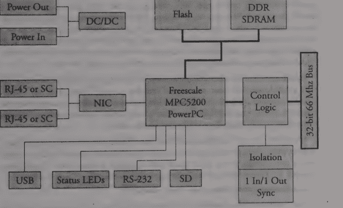

### 图 16-1
UEI PowerDNA Controller 电路板

#### 16.2.1 先决条件和假设

当 Linux 内核从引导加载程序获得控制权时，它做一些基本假设。其中最重要的是引导加载程序必须已经初始化 DRAM 控制器。Linux 不参与芯片级 SDRAM 控制器的设置。Linux 假设系统 RAM 存在且完全功能正常。我们要针对的 PowerDNA Controller 包含 U-Boot 引导加载程序，该程序已初始化了 CPU、DRAM 和最小系统运行所需的其他相关硬件。

引导加载程序还应该初始化系统内存映射。这通常是通过一组处理器寄存器完成的，这些寄存器定义了给定内存地址范围内哪些片选信号是活动的。Freescale MPC5200 用户指南的第 3 章描述了用于此任务的寄存器。

引导加载程序可能还有额外的与硬件相关的初始化任务。在某些电路板上，内核假设串行端口已配置好。这使得能够向串行端口显示早期内核启动消息，远在内核自身的串行驱动程序安装之前。一些架构和硬件平台包含诸如 `_serial_putc()` 等功能，它可以将字符串发送到由引导加载程序或某些简单的早期内核设置代码预先配置的串行端口。你可以在 PowerPC 架构分支中使用 `grep` 搜索 `CONFIG_SERIAL_TEXT_DEBUG` 来找到这方面的例子。

总之，将 Linux 移植到我们新电路板的基本先决条件是：一个引导加载程序已被移植并安装在我们的电路板上，且任何特定于电路板的低级硬件初始化已完成。对于 Linux 有直接设备驱动程序支持的设备，如以太网控制器或 I2C 控制器，初始化这些设备并不是必须的；内核会处理这些设备。

为你的电路板配置并构建 Linux 内核是一个好主意，该电路板应尽可能接近你自己的电路板。这为你提供了一个已知的良好起点——一个为你自己的电路板配置的、编译无错误的 Linux 内核源码树。回想第 5 章“内核初始化”中编译 Linux 2.6 内核的命令：

```bash
$ make ARCH=ppc CROSS_COMPILE=ppc_82xx- uImage
```

此命令行产生一个与 U-Boot 引导加载程序兼容的 Linux 可启动映像。`uImage` 目标指定了这一点。

### 16.2.2 自定义内核初始化

既然我们已经有了一个作为起点的基线内核源代码树，让我们确定一下为我们的特定板卡进行定制从哪里开始。我们发现，对于 PowerPC 架构，板卡相关的文件位于一个名为 `.../arch/ppc/platforms` 的目录中。当然，这并非严格必要，但如果你打算将你的补丁提交给 Linux 内核开发社区以供考虑，适当的格式和一致性很重要！

我们在 `platforms` 目录中找到了一个名为 `lite5200.c` 的文件。这是一个相当简单的文件，包含两个数据结构和五个函数。列表 16-3 展示了该文件中的函数。

### **列表 16-3**
**来自 5200 平台文件的函数**

```
lite5200_show_cpuinfo() /* Prints user specified text string */

lite5200_map_irq() /* Sets h/w specific INT logic routing */

lite5200_setup_cpu() /* CPU specific initialization */

lite5200_setup_arch() /* Arch. specific initialization */

platform_init() /* Machine or board specific init */
```

让我们看看这些函数是如何被使用的。我们在第 5 章中简要检查了低层内核初始化。在这里，我们查看特定架构的细节。不同架构之间的细节有所不同，但当你能够掌握其中一个架构时，学习其他架构就会更容易。

在第 5 章中，我们看到了上电时的早期控制流。引导加载器（bootloader）将控制权传递给内核的引导加载程序，后者通过内核的 `head.o` 模块将控制权传递给 Linux 内核。平台特定的初始化从这里开始。列表 16-4 重现了 `.../arch/ppc/kernel/head.S` 中的相关行。

### **列表 16-4**
**调用早期机器初始化**

```
...
/*
 * Do early bootinfo parsing, platform-specific initialization,
 * and set up the MMU.
 */
    mr r3,r31
    mr r4,r30
    mr r5,r29
    mr r6,r28
    mr r7,r27
    bl    machine_init
    bl    MMU_init
...
```

在这里你可以看到对 `machine_init` 的汇编语言调用。特别重要的是寄存器 `r3` 到 `r7` 的设置。这些寄存器预期包含众所周知的值，你很快就会看到。它们早在启动序列中就被存储到 PowerPC 通用寄存器 `r27` 到 `r31` 中。这里它们从这些存储值中重新加载。

`machine_init()` 函数在一个名为 `setup.c` 的 C 文件中定义，位于同一个架构特定的内核目录中：`.../arch/ppc/kernel/setup.c`。此例程的开头在列表 16-5 中重现。

### **列表 16-5**
**setup.c 中的 machine_init() 函数**

```c
void __init
machine_init(unsigned long r3, unsigned long r4, unsigned long r5,
             unsigned long r6, unsigned long r7)
{
#define CONFIG_CMDLINE
    strcpy(cmd_line, CONFIG_CMDLINE, sizeof(cmd_line));
#undef /* CONFIG_CMDLINE */
#ifdef CONFIG_6xx
    ppc_md.power_save = ppc6x_idle;
#endif
#ifdef CONFIG_POWER4
```


```c
ppc_md.power_save = power4_idle;

#endif

platform_init(r3, r4, r5, r6, r7);

if (ppc_md.progress)

    ppc_md.progress("id mach(): done", 0x200);

}
```

这个简单的函数中包含了一些非常有用的知识。首先，请注意 `machine_init()` 的参数代表 PowerPC 通用寄存器 `r3` 到 `r7`。² 你看到它们在 `machine_init()` 的机器语言调用之前被初始化。正如你在列表 16-5 中看到的，这些寄存器值未经修改地传递给 `platform_init()`。我们需要为我们的平台修改这个函数。（我们稍后会对此多说几句。）

² 按照惯例，C 语言中的参数通过这些 PowerPC 寄存器传递。

列表 16-5 还包含一些机器特定的电源管理函数调用。如果你的内核配置了 PowerPC 6xx 支持（在你的 `.config` 文件中定义了 `CONFIG_6xx`），指向机器特定电源管理函数（`ppc6xx_idle`）的指针会被存储在一个结构中。类似地，如果你的内核配置了 PowerPC G5 核心（`CONFIG_POWER4`），指向其机器特定电源管理例程的指针会被存储在同一个结构成员中。这个结构在第 16.3.3 节“机器相关调用”中有描述。

### 16.2.3 静态内核命令行

在列表 16-5 中重现的 `machine_init()` 函数中，一个比较有趣的操作是存储默认的内核命令行。如果你的内核配置中启用了 `CONFIG_CMDLINE`，此操作就会被启用。在某些平台上，引导加载器不提供内核命令行。在这种情况下，内核命令行可以被静态编译进内核中。图 16-2 说明了与此相关的配置选项。

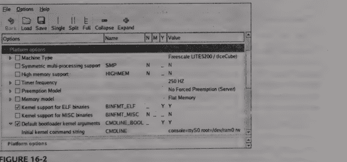

#### 图 16-2
默认内核命令行

在图 16-2 的配置中启用“Default bootloader kernel arguments”（默认引导加载器内核参数），并按照所示编辑“Initial kernel command string”（初始内核命令行字符串）。这会导致 `.config` 文件中出现一组条目，如列表 16-6 所示。

### **列表 16-6**
**默认内核命令行的配置**

```
...

CONFIG_CMDLINE_BOOL=y

CONFIG_CMDLINE="console=ttyS0 root=/dev/ram0 rw"

...
```

列表 16-6 中的省略号表示我们只取了 `.config` 文件的一小部分片段。当这些配置符号被内核构建系统处理后，它们会变成 `.../include/linux/autoconf.h` 文件中的条目，如列表 16-7 详细所述。

### **列表 16-7**
**autoconf.h 文件中默认内核命令线的条目**

```
...

#define CONFIG_CMDLINE_BOOL 1

#define CONFIG_CMDLINE "console=ttyS0 root=/dev/ram0 rw"

...
```

现在回到列表 16-5，我们有以下行：

```c
strcpy(cmd_line, CONFIG_CMDLINE, sizeof(cmd_line));
```

你可以看到，这个基于内核的字符串复制函数将 `CONFIG_CMDLINE` 定义的字符串复制到名为 `cmd_line` 的全局内核变量中。这很重要，因为在启动序列的早期，许多函数和设备驱动程序可能需要检查内核命令行。全局变量 `cmd_line` 隐藏在 `.data` 段的开头，定义在汇编文件 `.../arch/ppc/kernel/head.S` 中。

这里有一个微妙的细节值得提及。回到列表 16-4，我们可以看到 `machine_init` 的汇编语言调用发生在 `MMU_init` 的调用之前。这意味着我们从 `machine_init` 中能够执行的任何代码都是在对内存访问支持有限的上下文中执行的。如今许多包含 MMU 的处理器，如果不通过处理器中的硬件寄存器进行一些初始映射，就无法访问任何内存。³ 通常，在启动时会提供一小部分内存，以容纳内核和 ramdisk 镜像的加载和解压。尝试访问这些早期限制之外的代码或数据将会失败。每个架构和平台可能具有不同的内存访问早期限制。8 到 16MB 左右的数值并不罕见。我们必须记住，我们从 `machine_init` 执行的任何代码，包括我们的平台初始化，都发生在这个上下文中。如果你在新内核移植调试过程中遇到数据访问错误（PowerPC DSI 异常⁴），你应该立即怀疑你没有正确映射代码试图访问的内存区域。

³ AMCC PPC405 就是这种情况的一个完美例子。鼓励感兴趣的读者检查该处理器中的 BAT 寄存器。

⁴ 有关 PowerPC DSI 异常的详细信息，请参考本章末尾引用的《编程环境手册》。

## 16.3 平台初始化

以下是对早期初始化期间代码流程的快速回顾。图 16-3 显示了从引导加载程序或引导加载程序到你的平台初始化代码的执行流程。

From bootloader


### 图 16-3
平台初始化控制流

`head.S` 和 `setup.c` 文件都位于 PowerPC 架构的 `.../arch/ppc/kernel` 目录中。我们的自定义平台初始化文件将放置在 `.../arch/ppc/platforms` 目录中。在图 16-3 中，它由文件 `myplat.c` 表示。现在我们处于一个可以详细检查平台特定初始化文件的位置。

在列表 16-3 中，我们列出了 `lite5200.c` 平台初始化文件中的函数。除了 `platform_init()` 之外，所有函数都声明为 `static`。因此，如图 16-3 所示，这是平台初始化文件的入口点。该文件中的其余函数仅在文件内部被引用。

让我们来看看入口函数 `platform_init()`。列表 16-8 重新列出了来自 `lite5200.c` 文件的 `platform_init()` 函数。

### 列表 16-8

#### Lite5200 platform_init 函数

```c
void __init
platform_init(unsigned long r3, unsigned long r4,
           unsigned long r5, unsigned long r6,
           unsigned long r7)
{
  /* Generic MPC52xx platform initialization */
  /* TODO Create one and move a max of stuff in it.
     Put this init in the syslib */
  struct bi_record *bootinfo = find_bootinfo();
  if (bootinfo)
    parse_bootinfo(bootinfo);
  else {
    /* Load the bd_t board info structure */
    if (r3)
      memcpy((void*)&__res, (void*)(r3+KERNELBASE),
             sizeof(bd_t));
    #ifdef CONFIG_BLK_DEV_INITRD
    /* Load the initrd */
    if (r4) {
      initrd_start = r4 + KERNELBASE;
      initrd_end = r5 + KERNELBASE;
    }
    #endif
    /* Load the command line */
    if (r6) {
      *(char *)(r7+KERNELBASE) = 0;
      strcpy(cmd_line, (char *)(r6+KERNELBASE));
    }
  }
  /* PPC Sys identification */
  identify_ppc_sys_by_id(mfspr(SPRN_SVR));
  /* BAT setup */
  mpc52xx_set_bat();
  /* No ISA bus by default */
  isa_io_base         = 0;
  isa_mem_base        = 0;
  /* Powersave */
  /* This is provided as an example on how to do it.  But you
   * need to be aware that NAP disable bus snoop and that may
```


* be required for some devices to work properly, like USB

*... */

  /* powersave_nap = 1; */

  /* Setup the ppc_md struct */

  `ppc_md.setup_arch` = `lite5200_setup_arch`;

  `ppc_md.show_cpuinfo` = `lite5200_show_cpuinfo`;

  `ppc_md.show_percpuinfo` = NULL;

  `ppc_md.init_IRQ`       = `mpc52xx_init_irq`;

  `ppc_md.get_irq`       = `mpc52xx_get_irq`;

  #ifdef CONFIG_PCI

  `ppc_md.pci_map_irq` = `lite5200_map_irq`;

  #endif

  `ppc_md.find_end_of_memory` = `mpc52xx_find_end_of_memory`;

  `ppc_md.setup_io_mappings` = `mpc52xx_map_io`;

  `ppc_md.restart`   = `mpc52xx_restart`;

  `ppc_md.power_off` = `mpc52xx_power_off`;

  `ppc_md.halt`      = `mpc52xx_halt`;

  /* No time keeper on the LITE5200 */

  `ppc_md.time_init`    = NULL;

  `ppc_md.get_rtc_time` = NULL;

  `ppc_md.set_rtc_time` = NULL;

  `ppc_md.calibrate_decr`   = `mpc52xx_calibrate_decr`;

  #ifdef CONFIG_SERIAL_TEXT_DEBUG

  `ppc_md.progress`          = `mpc52xx_progress`;

  #endif

}

这个函数包含了该平台所需的大量定制内容。它首先查找由引导加载程序提供的板级特定数据。我们将推迟到第 16.3.2 节“板级信息结构”中再讨论这些细节。

接下来，如果你的内核配置了初始 RAM 磁盘（initrd），那么 RAM 磁盘映像的起始和结束地址将被保存。请注意，按照惯例，它们是通过 PowerPC 通用寄存器 `r4` 和 `r5` 传递的。将 initrd 地址通过这些寄存器传递是引导加载程序的责任。稍后，内核将使用这些地址从原始内存（引导加载程序放置的位置或非易失性闪存映像）中加载 initrd 映像到内部内核 RAM 磁盘结构。

接下来我们看到了一段代码，用于存储内核命令行，其地址通过寄存器 `r6` 和 `r7` 传递给 `platform_init()`，分别标记起始地址和结束地址。这与前面描述的存储静态内核命令行的方法在一个特定细节上有所不同：这个内核命令行是从引导加载程序传递给 `platform_init()` 的，而不是编译进内核的。

复制 initrd 和内核命令行非常直接。基本上，从引导加载程序传入的寄存器包含了这些数据结构的内存地址。然而，有一个小的微妙之处。你可能已经对常量 `KERNELBASE` 的作用产生了好奇。理解这一点是掌握引导序列中较复杂部分的关键。

引导加载程序提供的地址是物理地址。这意味着它们是数据驻留在内存芯片中的实际硬件地址。引导加载程序通常在没有虚拟内存支持的情况下运行。然而，内核本身静态链接到一个众所周知的、用户可配置的基地址。这个地址就是 `KERNELBASE`。（该值本身与讨论无关——它是用户可配置的，但几乎从未从默认值 `0xC0000000` 更改。）

这在 `head.S` 中设置了一个有趣的情况。当内核被解压缩并重新定位到 RAM（通常位于位置 0）时，它所有的代码和数据符号都链接在内核的虚拟地址 `KERNELBASE` 上。通过检查内核构建过程中生成的内核符号映射文件 `System.map`，可以看到这一点。然而，在启用 MMU 之前的执行上下文是这样的：物理地址就是实际的硬件地址。这意味着，在启用 MMU 和虚拟内存映射之前的所有代码必须是可重定位的，并且对符号的访问必须经过修正。这涉及到在访问符号地址时添加一个偏移量。一个例子可以使这一点更清晰。

- 初始 RAM 磁盘（initrd）在第 6 章中介绍过。
- 我们在第 4 章中介绍了 `System.map` 文件。

#### 16.3.1 早期变量访问

假设在引导过程很早期的一个代码段需要访问变量 `cmd_line`——那么早以至于我们正在执行 1:1 真实到物理的映射。如前所述，这个变量定义在 `head.S` 中，在内核链接时会进入 .data 段。从 Linux 内核的 `System.map` 文件中，你可以找到 `cmd_line` 的链接地址：

```bash
$ cat System.map | grep cmd_line
c0150000 D cmd_line
```

如果我们在真实 = 物理模式（MMU 禁用）下运行，并使用其符号访问此变量，我们将试图读取或写入大于 3GB 的地址。大多数较小的嵌入式系统在这个区域没有任何 RAM，结果将是未定义的或导致崩溃。即使在那个地址有物理 RAM，在引导过程这么早期也不大可能被映射并可访问。因此，我们必须调整对该变量的引用才能访问它。

列表 16-9 重新列出了来自 `head.S` 的一个代码片段，它正是这样做的。

##### 列表 16-9

##### 变量引用修正

```assembly
relocate_kernel:
addis r9,r26,klimit@ha /* fetch klimit */
lwz r25,klimit@l(r9)
addis r25,r25,-KERNELBASE8h
```

PowerPC `head.S` 中的这段代码片段是我们所描述问题的一个很好的例子。变量 `klimit` 表示内核映像的末尾。它在其他地方被定义为 `char *klimit`。因此，它是一个指针——它是一个包含地址的地址。在列表 16-9 中，我们获取 `klimit` 的地址，将其与之前计算并传入 `r26` 的偏移量相加，并将结果值存入寄存器 `r9`。此时，寄存器 `r9` 包含调整后的 `klimit` 地址的高 16 位，低 16 位为零。该地址由之前计算并传入寄存器 `r26` 的偏移量进行了调整。

在下一行中，`lwz` 指令使用寄存器 `r9` 和 `klimit` 的偏移量（`klimit` 地址的低 16 位）作为有效地址，从中加载寄存器 `r25`。（记住，`klimit` 是一个指针，我们关心的是 `klimit` 指向的值）。此时，寄存器 `r25` 保存了存储在变量 `klimit` 中的指针。在列表 16-9 的最后一行，你从 `r25` 中减去内核链接的基地址（`KERNELBASE`），以将指针调整为我们的实际物理地址。如果用 C 语言表示，看起来是这样的：

```c
unsigned int *tmp;            /* represents r25 */
tmp = *klimit;
tmp -= KERNELBASE;
```

总之，我们引用了存储在 `klimit` 中的指针，并调整了其值到我们的真实（物理）地址，以便使用其内容。当内核启用 MMU 和虚拟寻址时，我们就不再需要担心这个问题了——内核将在其链接的地址处运行，无论它实际位于物理内存的何处。

### 16.3.2 板级信息结构

许多引导加载程序用于 PowerPC 平台，但目前仍然没有统一的方法来传递板级特定数据，例如串口波特率、内存大小以及引导加载程序已配置的其他低级硬件参数。来自列表 16-8 的平台初始化文件支持两种不同的方法：存储为 `struct bi_record` 的数据和存储为 `struct bd_info` 的数据。两种方法提供类似的结果：硬件特定数据通过这些结构从引导加载程序传递给内核。

来自列表 16-8，以下是保存引导加载程序提供的硬件配置的代码片段：

```c
struct bi_record *bootinfo = find_bootinfo();
if (bootinfo)
    parse_bootinfo(bootinfo);
else {
    /* Load the bd_t board info structure */
    if (r3)
        memcpy((void*)&__res, (void*)(r3+KERNELBASE),
               sizeof(bd_t));


- 每种方法都有其自身的渊源。结构体 `bd_info` 起源于 U-Boot，而结构体 `bi_record` 是统一所有平台的一次尝试。这两种方法都受许多平台支持。

首先，我们搜索一个特殊的标签，该标签将数据结构标识为结构体 `bi_record`。如果找到该标签，则将 `bootinfo` 指针设置为 `bootinfo` 记录的起始地址。从那里开始，解析这些记录并收集与硬件相关的数据。可以通过检查 `.../arch/ppc/kernel/setup.c` 来观察这一过程。目前，`bi_records` 可以包含内核命令行、`initrd` 镜像的起始和结束地址、机器类型以及内存大小。当然，你可以根据自己的需求进行扩展。

如果未找到 `bi_record` 数据，PowerPC 架构期望这些数据以 U-Boot 板级信息结构体的形式存在，即 `bd_info`。构建此数据结构并将在寄存器 `r3` 中传递其地址是引导加载程序（bootloader）的责任。目前，`bd_info` 结构中可获得许多硬件信息，包括 DRAM、FLASH、SRAM、处理器时钟频率、总线频率、串行端口波特率设置等信息。

可以在 `.../include/asm-ppc/bootinfo.h` 中检查 `bi_record` 结构，而 `bd_info` 结构则可在 `.../include/asm-ppc/ppcboot.h` 中找到。

平台初始化程序负责利用可能用于完成硬件设置或将其传递给内核的任何数据。例如，`plat_form_init()` 设置了一个指向函数的指针，该函数的名称揭示了其用途。列表 16-8 中的代码在此重现如下：

```c
ppc_md.find_end_of_memory = mpc52xx_find_end_of_memory;
```

查看位于 `.../arch/ppc/syslib/mpc52xx_setup.c` 中的函数 `mpc52xx_find_end_of_memory()`，我们发现了以下内容：

```c
u32 ramsz1e = _res.bi_memsize;

if (ramsize == 0) {
  ... /* 用另一种方式查找 */
}
return ramsz1e;
```

上述 `_res` 数据结构是板级信息结构体，其地址由引导加载程序通过上述寄存器 `r3` 传递给我们。可以看到，通用设置代码保存了引导加载程序传入的*剩余*数据（通常称为残余数据），但如何使用这些内容由机器或平台特定的代码决定。

### 16.3.3 机器相关调用

内核在初始化或操作期间所需的许多常规例程都是依赖架构和机器（CPU）的。在列表 16-8 中重现的 `platform_init()` 函数中，我们看到了以下内容：

```c
/* 设置 ppc_md 结构 */
ppc_md.setup_arch    = lite5200_setup_arch;
ppc_md.show_cpuinfo   = lite5200_show_cpuinfo;
ppc_md.show_percpuinfo   = NULL;
ppc_md.init_IRQ       = mpc52xx_init_irq;
ppc_md.get_irq       = mpc52xx_get_irq;
#ifndef CONFIG_PCI
ppc_md.pci_map_irq    = lite5200_map_irq;
#endif
ppc_md.find_end_of_memory = mpc52xx_find_end_of_memory;
ppc_md.setup_io_mappings  = mpc52xx_map_io;
ppc_md.restart    = mpc52xx_restart;
ppc_md.power_off  = mpc52xx_power_off;
ppc_md.halt        = mpc52xx_halt;
```

类似这些行构成了 `platform_init()` 函数的其余部分。此处，平台特有的大部分需求都需要传递给 Linux 内核。类型为 `struct machdep_calls` 的全局变量 `ppc_md` 提供了挂钩，以便轻松地为 PowerPC 平台定制 Linux 内核。该变量在 `.../arch/ppc/kernel/setup.c` 中声明。PowerPC 特有的内核分支中的许多地方都通过此结构间接调用函数。例如，列表 16-10 重现了 `.../arch/ppc/kernel/setup.c` 的一部分，其中包含对重启、断电和停机函数的支持：

#### 列表 16-10
通用 PowerPC 机器函数

```c
void machine_restart(char *cmd)
{
#ifndef CONFIG_NVRAM
nram_sync();
#endif
ppc_md.restart(cmd);
}
```

```c
void machine_power_off(void)
{
#ifdef CONFIG_NVRAM
    nvram_sync();
#endif
    ppc_md.power_off();
}
void machine_halt(void)
{
#ifdef CONFIG_NVRAM
    nvram_sync();
#endif
    ppc_md.halt();
}
```

这些函数通过 `ppc_md` 结构进行调用，并包含这些函数的机器或平台特定变体。可以看出，其中一些函数是机器特定的，来自函数的 `mpc52xx_*` 变体。这些函数的示例包括 `mpc52xx_restart` 和 `mpc52xx_map_io`。其他函数则特定于硬件平台。平台特定例程的示例包括 `lite5200_map_irq` 和 `lite5200_setup_arch`。

## 16.4 将所有内容整合起来

现在我们有了参考起点，可以为自己的定制板卡创建必要的文件和函数。我们复制 Lite5200 平台文件作为基准，并根据我们的定制 PowerPC 平台进行修改。我们将新的平台命名为 *PowerDNA*。我们将为该定制移植执行以下步骤：

- 1. 在 `.../arch/ppc/Kconfig` 中添加一个新的配置选项。
- 2. 将 `lite5200.*` 复制为 `powerdna.*` 作为基准。
- 3. 根据我们的平台适当编辑新的 `powerdna.*` 文件。
- 4. 编辑 `.../arch/ppc/Makefile` 以有条件地包含 `powerdna.o`。
- 5. 编译、加载和调试！

你在第 4 章中学习了如何向 Kconfig 添加配置选项。我们新的 PowerDNA 移植的配置选项在列表 16-11 中详细说明。

### 列表 16-11
PowerDNA 的配置选项

```
config POWERDNA
    bool "United Electronics Industries PowerDNA"
    select PPC_MPC52xx
    help
        支持 UEI PowerDNA 板卡
```

此 Kconfig 条目添加在 LITES200 条目下方，因为它们是相关的。图 16-4 展示了调用配置工具时的结果。

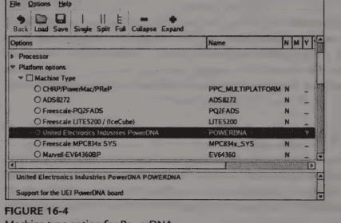

**图 16-4**
PowerDNA 的机器类型选项

请注意，当用户选择 POWERDNA 时，会执行两个重要操作：

- 1. `CONFIG_PPC_MPC52xx` 配置选项会自动被选中。这是通过列表 16-11 中的 `select` 关键字实现的。
- 2. 定义了一个新的配置选项 `CONFIG_POWERDNA`，它将驱动我们的构建配置。

> 为节省空间，我们在图 16-4 中临时移除了 LITES200 之前的许多机器类型。

下一步是复制最接近我们平台的文件，作为新平台初始化文件的基础。我们已经决定 Lite5200 平台符合要求。将 `lite5200.c` 复制为 `powerdna.c`，将 `lite5200.h` 复制为 `powerdna.h`。困难的部分随之而来。使用硬件规格、原理图以及你拥有的关于硬件平台的任何其他数据，根据你的硬件适当编辑新的 `powerdna.*` 文件。让代码能够编译，然后继续进行新内核的引导和调试。这里没有捷径，也没有替代经验的方式。这是移植工作的艰苦部分，但至少你现在知道从哪里开始。

第 14 章“内核调试技术”中介绍了许多内核调试的技巧和技术。

为了总结我们的移植工作，列表 16-12 详细说明了为使 Linux 在 PowerDNA 板上运行而添加或修改的文件。

### 列表 16-12
PowerDNA 新增或修改的内核文件

```text
linux-2.6.14/arch/ppc/configs/powerdna_defconfig
linux-2.6.14/arch/ppc/Kconfig
```


`linux-2.6.14/arch/ppc/platforms/Makefile`

`linux-2.6.14/arch/ppc/platforms/powerdna.c`

`linux-2.6.14/arch/ppc/platforms/powerdna.h`

`linux-2.6.14/drivers/net/fec_mpc52xx/fec.c`

`linux-2.6.14/drivers/net/fec_mpc52xx/fec.h`

`linux-2.6.14/drivers/net/fec_mpc52xx/fec_phy.h`

`linux-2.6.14/include/asm-ppc/mpc52xx.h`

第一个文件是默认配置，它基于默认值启用了快速的内核配置。通过如下方式调用 `make` 即可启用它：

```text
$ make ARCH=ppc CROSS_COMPILE=<cross- prefix> powerdna_defconfig
```

我们已经讨论过对 Kconfig 文件的更改。对 makefile 的修改很简单——其目的是添加基于 `CONFIG_POWERDNA` 的新内核配置支持。更改内容包括添加一行：

```text
obj-$(CONFIG_POWERDNA)		+= powerdna.o
```


更改的核心在于 `powerdna.{c,h}` 文件以及对 FEC（快速以太网控制器）层的修改。`powerdna.c` 与其派生文件 `lite5200.c` 之间存在细微差异。有两个主要问题需要修改。首先，由于 PowerDNA 设计中未使用 PCI，因此禁用了 PCI。这需要一些细微的调整。其次，PowerDNA 设计中包含了一个非托管的以太网物理层芯片，这需要硬件设置和 FEC 层进行少量修改。这部分工作构成了移植工作的主体。补丁文件由 1120 行代码组成，但其中大部分是默认配置，这只是为了方便开发人员，并非严格必需。去掉这部分后，补丁减少到 411 行。

#### 16.4.1 其他架构

我们考察了特定平台如何融入内核的详细信息，以及用于移植到新板卡的现有设施。本章的参考资料和讨论源自内核的 PowerPC 架构分支。其他架构在各种硬件平台如何整合的许多细节方面有所不同，但概念是相似的。当你学会了如何导航单一架构后，你就具备了学习其他架构细节的知识和工具。

## 16.5 本章总结

- 将 Linux 移植到基于 Linux 支持的 CPU 的定制板卡上可能相对简单。在 Linux 代码库和硬件平台方面，经验和知识无可替代。
- 从基于已支持硬件平台的工作参考配置开始，为你的修改提供了极好的基础。
- 理解初始化代码的流程是轻松移植工作的关键。我们尽一切努力保留所有通用内核代码不变，仅修改平台本身所必需的文件。本章的重要组成部分就是致力于此早期与平台初始化相关的控制流程。
- 在继续之前，请务必二次确认你的底层硬件平台初始化是正确的。例如，如果你发现自己在调试 Linux 小块分配器的某个晦涩部分，那你很可能是在硬件内存初始化上搞错了什么。
- 本章主要关注 Linux 内核的 PowerPC 架构分支。学习一个架构的细节为理解其他架构铺平了道路。

### 16.5.1 延伸阅读建议

- 32 位 PowerPC 架构实现编程环境手册
  - MPCFPE32B/AD 12/2001 REV 2
  - 飞思卡尔半导体公司 (Freescale Semiconductor, Inc.)
- MPC5200 用户指南
  - MPC5200UG Rev 3 01/22/005
  - 飞思卡尔半导体公司 (Freescale Semiconductor, Inc.)


# 17


## Linux 与实时

本章内容

- 什么是实时？ 第 446 页
- 内核抢占 第 449 页
- 实时内核补丁 第 453 页
- 调试实时内核 第 460 页
- 本章总结 第 467 页

### 17.1 什么是实时？

当 Linux 最初在 Intel i386 处理器上诞生时，没有人预料到 Linux 会在服务器应用中取得如此大的成功。这一成功促使 Linux 被移植到许多不同的架构，并被开发者用于从蜂窝手机到电信交换机的嵌入式系统。不久以前，如果你的应用程序有实时要求，你可能不会将 Linux 列入操作系统的候选名单。但随着实时 Linux 的发展，这已经全部改变了，在很大程度上是由音频和多媒体应用推动的。

在本章中，我们首先简要回顾实时 Linux 功能的历史发展。然后，我们查看实时程序员可用的设施，以及如何使用这些设施。

#### 17.1.1 软实时

大多数人认为软实时意味着操作有一个截止期限，但如果错过了截止期限，体验的质量可能会降低（但并非致命）。你的桌面工作站就是软实时要求的完美例子。当你编辑文档时，你期望立即在屏幕上看到按键的结果。当播放你最喜欢的 `.mp3` 文件时，你期望获得高保真音频，音乐中没有咔哒声、爆破声或中断。

一般来说，人类无法看到或听到几十毫秒以下的延迟。当然，人群中的音乐家会告诉你，比这更小的延迟也会使音乐产生色彩变化。如果这些所谓的软实时事件错过了截止期限，结果可能不理想，导致体验的“质量”水平降低，但并非灾难性的。

#### 17.1.2 硬实时

硬实时以错过截止期限的结果为特征。在硬实时系统中，如果错过了截止期限，结果往往是灾难性的。当然，灾难性是一个相对术语。如果你的嵌入式设备控制着喷气式飞机引擎的燃油流量，错过响应飞行员输入或操作特性变化的截止期限可能会导致灾难性后果。

请注意，截止期限的持续时间与实时特性无关。对原子钟的滴答进行服务就是一个例子。只要滴答在下一次滴答前的 1 秒窗口内得到处理，数据就保持有效。错过某次滴叉的处理可能会使我们的全球定位系统偏差数英尺甚至数英里！

鉴于此，我们借鉴了软实时和硬实时的常用定义集合。对于软实时系统，如果错过截止期限，计算或结果的价值就会降低。对于硬实时系统，如果错过单个截止期限，系统就被视为失败，并可能产生灾难性后果。

#### 17.1.3 Linux 调度

UNIX 和 Linux 在设计进程调度时都追求公平。也就是说，调度器尽力在所有需要 CPU 的进程之间分配可用资源，并保证每个进程都能取得进展。这一设计目标与实时进程的需求背道而驰。实时进程必须在准备好运行后尽快运行。实时意味着具有可预测且可重复的延迟。

#### 17.1.4 延迟

实时进程通常与物理事件相关联，例如来自外围设备的中断到达。图 17-1 说明了 Linux 系统中的延迟组成部分。延迟测量从接收我们要处理的中断时开始。这在图 17-1 中由时间 `t:0` 表示。稍后，中断被处理，控制传递给中断服务例程 (ISR)。这在图 17-1 中由时间 `t:1` 表示。这种中断延迟几乎完全由最大中断关闭时间¹决定——即在硬件中断被禁用的执行线程中所花费的时间。

> ¹ 我们忽略了中断处理的上下文切换时间，因为与中断关闭时间相比，它通常可以忽略不计。

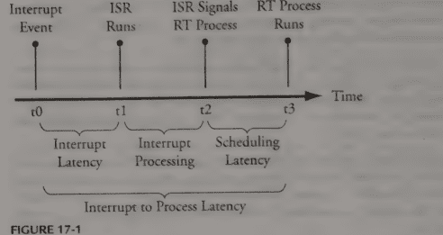

**图 17-1**
延迟组成部分

良好的设计实践是最大限度地减少实际中断服务例程中执行的处理。确实，这个执行上下文的能力有限（例如，ISR 不能调用阻塞函数，即可能睡眠的函数），因此，希望仅仅服务硬件设备，并将数据处理留给 Linux 的*下半部*（bottom half），也称为软中断（softIRQs）。

当中断服务例程/下半部完成处理后，通常的情况是唤醒一个正在等待数据的用户空间进程。这在图 17-1 中由时间 `t₂` 表示。在稍后的某个时间点，实时进程被调度器选中运行并获得 CPU。这在图 17-1 中由时间 `t₃` 表示。调度延迟主要受等待 CPU 的进程数量及其优先级影响。为进程设置实时属性会使其获得比普通 Linux 进程更高的优先级，并允许它成为下一个被选中运行的进程，假设它是等待 CPU 的最高优先级实时进程。最高优先级且准备运行的实时进程（未阻塞在 I/O 上）始终会运行。你很快就会看到如何设置此属性。

² Robert Love 在他的书 *Linux 内核开发*中详细解释了下半部处理。请参阅本章末尾的第 17.5.1 节“延伸阅读建议”中的参考。

## 17.2 内核抢占

在 Linux 1.x 的早期阶段，内核不支持抢占。这意味着，当用户空间进程请求内核服务时，在该进程阻塞（进入睡眠状态）等待某些操作（通常是 I/O）或内核请求完成之前，任何其他任务都无法被调度运行。使内核具备可抢占性³意味着，当一个进程在内核中运行时，另一个进程可以抢占第一个进程并允许其运行，即使第一个进程尚未完成其内核内的处理。图 17-2 对此进行了说明。

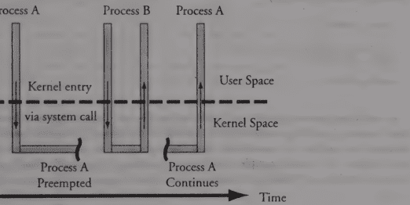

在此图中，进程 A 通过系统调用进入内核。也许它是针对控制台或文件等设备调用了 `write()`。当代表进程 A 在内核中执行时，更高优先级的进程 B 被中断唤醒。内核抢占进程 A 并将 CPU 分配给进程 B，即使进程 A 既没有阻塞也没有完成其内核处理。

### 17.2.1 抢占的阻碍因素

使内核完全可抢占的挑战在于识别内核中所有必须防止被抢占的位置。这些是内核中的*临界区*，在这些区域中不允许发生抢占。例如，假设图 17-2 中的进程 A 正在内核中执行文件系统操作。在某个时间点，代码可能需要向代表文件系统上文件的内核内数据结构写入数据。为了保护该数据结构免受损坏，该进程必须禁止所有其他进程访问该共享数据结构。列表 17-1 使用 C 语言语法说明了这一概念。

**列表 17-1**
**锁住临界区**

```
...
preempt_disable();

/* 临界区 */

update_shared_data();

...
preempt_enable();
...
```


如果我们没有以这种方式保护共享数据，正在更新共享数据结构的进程可能会在更新过程中被抢占。如果另一个进程试图更新相同的共享数据，数据损坏几乎是肯定的。一个经典的例子是两个进程直接操作公共变量并根据其值做出决策。图 17-3 说明了这种情况。

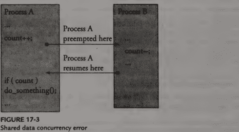

在图 17-3 中，进程 A 在更新共享数据之后但在基于其做出决策之前被中断。按照设计，进程 A 无法检测到它已被抢占。进程 B 在进程 A 再次获得运行机会之前改变了共享数据的值。如你所见，进程 A 将基于由进程 B 确定的值做出决策。如果这不是你期望的行为，你必须围绕共享数据（在本例中是对变量 `count` 的操作和决策）在进程 A 中禁用抢占。

### 17.2.2 抢占模型

内核抢占的第一个解决方案是在内核代码中的战略性位置设置检查点，在这些位置已知可以安全地抢占当前执行线程。这些位置包括系统调用的入口和出口、某些内核锁的释放，以及从中断处理返回。在这些点的每一个，都使用类似于列表 17-2 中的代码来执行抢占。

**列表 17-2**
**Linux 2.4 + 抢占补丁的抢占检查**

```
/*

 * 此代码在内核中的战略性位置执行

 * 在这些位置已知可以安全地抢占当前执行线程

 */

if (kernel_is_premptable() && current->need_resched)
    preempt_schedule();

...

/*

 * 此代码位于 .../kernel/sched.c 中，并从上述

 * 战略性位置调用

 */

#define CONFIG_PREEMPT
asmlinkage void preempt_schedule(void)
{
    while (current->need_resched) {
        ctx_sw_off();
        current->state |= TASK_PREEMPTED;
        schedule();
        current->state &= ~TASK_PREEMPTED;
        ctx_sw_on_no_preempt();
    }
}
#endif
```

列表 17-2 中的第一段代码（从实际代码简化而来）在之前描述的战略性位置被调用，在这些位置已知内核可以安全地被抢占。列表 17-2 中的第二段代码是应用了抢占补丁的早期 Linux 2.4 内核的实际代码。这个有趣的 `while` 循环通过调用 `schedule()` 触发上下文切换，直到所有抢占请求都得到满足。

尽管这种方法降低了 Linux 系统中的延迟，但它并不理想。从事低延迟工作的开发人员很快意识到需要“翻转逻辑”。在早期的抢占模型中，我们有以下内容：

- Linux 内核本质上不可抢占。
- 抢占检查散布在内核中已知的安全抢占的战略性位置。
- 仅在这些已知安全的点启用抢占。

为了进一步显著降低延迟，我们希望在一个可抢占的内核中实现以下内容：

- Linux 内核在到处都可完全抢占。
- 仅在临界区周围禁用抢占。

自原始可抢占内核补丁系列以来，内核开发人员一直朝着这个方向发展。然而，这并非易事。它涉及到仔细研究整个内核源代码库，精确分析哪些数据必须保护免受并发访问，并且仅在这些位置禁用抢占。用于此的方法是对内核进行插桩以测量延迟，找到最长的延迟代码路径，并修复它们。由于在打破“锁”方法论上所做的工作，较新的 Linux 2.6 内核可以配置为支持极低延迟的应用程序。

### 17.2.3 SMP 内核

值得注意的是，创建高效多处理器架构的许多工作也惠及实时系统。SMP 挑战比单处理器挑战更复杂，因为存在额外的并发元素需要保护。在单处理器模型中，同一时间只能有一个任务在内核中执行。防止并发的保护仅涉及防止中断或异常处理。在 SMP 模型中，除了来自中断和异常处理的威胁外，内核中可能存在多个执行线程。

早期的 Linux 2.x 内核就开始支持 SMP。**大内核锁**（BKL）被用来保护从单处理器到 SMP 操作转换期间的并发。BKL 是一个全局自旋锁，它防止任何其他任务在内核中执行。Robert Love 在他出色的著作 *Linux Kernel Development*（Novell Press, 2005）中，将 BKL 形容为内核的“红发私生子”。在描述 BKL 的特性时，Robert 开玩笑地将“邪恶”加入他的属性列表中！

基于 BKL 的早期 SMP 内核实现导致调度效率显著降低。发现其中一个 CPU 可能在很长一段时间内保持空闲。导致高效 SMP 内核的大部分工作也直接惠及实时应用程序——主要是降低了延迟。用更细粒度的锁替换 BKL，仅围绕实际需要保护的共享数据，显著降低了抢占延迟。

### 17.2.4 抢占延迟的来源

实时系统必须能够在指定的时间上限内处理其实时任务。实现一致的低抢占延迟对实时系统至关重要。导致抢占延迟的两个最大贡献者是中断上下文处理以及禁用了中断的临界区处理。你已经了解到，大量的工作都集中在减少临界区的大小（从而持续时间）上。这就留下了中断上下文处理作为下一个挑战。这通过 Linux 2.6 实时补丁得到了回答。

## 17.3 实时内核补丁

对硬实时的支持并不在主线 kernel.org 源代码树中。为了启用硬实时，必须应用一个补丁。实时内核补丁是几个旨在减少 Linux 内核延迟的项目的累积结果。该补丁有许多贡献者，目前由 Ingo Molnar 维护；你可以在 http://people.redhat.com/~mingo/realtime-preempt 找到它。自早期 2.6 内核以来，2.6 Linux 内核的软实时性能已有显著改善

> ^{3} 有趣的是，关于*preemptable*的正确拼写存在许多争议。我谨采纳 Rick Lehtbaum 在 www.linuxdevices.com/articles/AT5136316996.html 上进行的调查结论。

发行版本。在 2.6 版本首次发布时，2.4 版 Linux 内核在软实时性能方面要好得多。自 Linux 2.6.12 左右以来，在速度较快的 x86 处理器上，单数位毫秒级的软实时性能已轻松实现。若要在此基准之上获得可重复的性能表现，则需要使用实时补丁。

实时补丁为 Linux 内核增加了几个重要特性。图 17-4 展示了应用实时补丁后抢占模式的配置选项。

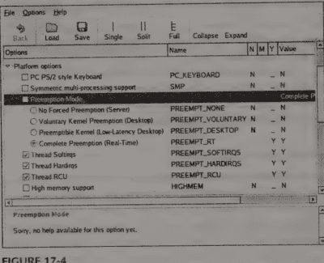

**图 17-4**
应用实时补丁后的抢占模式

实时补丁增加了一种名为 PREEMPT_RT（抢占实时）的第四种抢占模式。这四种抢占模式如下：

- **PREEMPT_NONE**：无强制抢占。整体延迟平均良好，但偶尔可能出现较长的延迟。最适合以整体吞吐量为首要设计标准的应用程序。
- **PREEMPT_VOLUNTARY**：降低延迟的第一阶段。在内核的战略位置放置额外的显式抢占点以降低延迟。以整体吞吐量的一定损失换取更低的延迟。
- **PREEMPT_DESKTOP**：此模式启用内核中除临界区内部处理之外的所有位置的抢占。此模式适用于音频和多媒体等软实时应用。以整体吞吐量换取进一步的延迟降低。
- **PREEMPT_RT**：增加了来自实时补丁的特性，包括用可抢占互斥锁替换自旋锁。这使得内核中除 `preempt_disable()` 保护的区域外，所有地方都允许非自愿抢占。此模式显著平滑了延迟（抖动）的变化，并为时间关键的实时应用提供了低且可预测的延迟。

如果内核配置中启用了内核抢占，可以通过在内核命令行中添加以下内核参数在启动时禁用它：

```text
preempt=0
```


### 17.3.1 实时特性

使用 `CONFIG_PREEMPT_RT` 启用了多个新的 Linux 内核特性。从图 17-4 中，我们可以看到几个新的配置设置。这里描述了这些以及其他实时 Linux 内核补丁的特性。

#### 17.3.1.1 自旋锁转换为互斥锁

实时补丁将系统中的大多数自旋锁转换为互斥锁。这以略微降低吞吐量为代价减少了整体延迟。将自旋锁转换为互斥锁的好处是它们可以被抢占。如果进程 A 持有锁，且优先级更高的进程 B 需要同一把锁，当进程 A 持有的是互斥锁时，进程 A 可以被进程 B 抢占。

#### 17.3.1.2 作为内核任务的 ISR

选择 `CONFIG_PREEMPT_HARDIRQ` 后，中断服务例程（ISR）被强制在进程上下文中运行。由于 ISR 变成了可调度实体，这使开发人员能够控制 ISR 的优先级。因此，它们也可以被抢占，以便首先处理更高优先级的硬件中断。

> 也称为 HARDIRQs。

这是一个强大的特性。一些硬件架构不执行中断优先级。那些执行优先级的架构可能不会按与指定的实时设计目标一致的方式执行优先级。使用 `CONFIG_PREEMPT_HARDIRQ`，您可以自由定义每个 IRQ 运行的优先级。

通过 `/proc` 文件系统或在启动时在内核命令行中输入参数，可以在运行时禁用 ISR 线程化。如果在配置中启用，除非另行指定，否则默认启用 ISR 线程化。

要在运行时禁用 ISR 线程化，请以 root 身份发出以下命令：

```bash
##### echo '0' > /proc/sys/kernel/hardirq_preemption
```

要验证设置，请如下显示：

```bash
##### cat /proc/sys/kernel/hardirq_preemption
1
```

要在启动时禁用 ISR 线程化，请在内核命令行中添加以下参数：

```text
hardirq-preempt=0
```

#### 17.3.1.3 可抢占的 Softirq

`CONFIG_PREEMPT_SOFTIRQ` 通过在软中断守护进程 `ksoftirqd` 的上下文中运行软中断来降低延迟。`ksoftirqd` 是一个正确的 Linux 任务（进程）。因此，它可以与其他任务一起进行优先级设置和调度。如果内核配置为实时模式且启用了 `CONFIG_PREEMPT_SOFTIRQ`，`ksoftirqd` 内核任务会被提升至实时优先级以处理软中断。清单 17-3 展示了最近 Linux 内核中负责此功能的代码，位于 `.../kernel/softirq.c` 中。

> 参阅本章末尾引用的《Linux Kernel Development》，以了解有关 softirqs 的更多信息。

**清单 17-3**

将 `ksoftirqd` 提升为实时状态

```c
static int ksoftirqd(void * __bind_cpu)
{
        struct sched_param param = { .sched_priority = 24 };
        printk("ksoftirqd started up.\n");
#ifdef CONFIG_PREEMPT_SOFTIRQS
        printk("softirq RT prio: %d.\n", param.sched_priority);
        sys_sched_setscheduler(current->pid, SCHED_FIFO, &param);
#else
        set_user_nice(current, -10);
#endif
...
```

在这里我们看到，如果在内核配置中启用了 `CONFIG_PREEMPT_SOFTIRQS`，`ksoftirqd` 内核任务将通过 `sys_sched_setscheduler()` 内核函数被提升为实时任务（`SCHED_FIFO`），实时优先级为 24。

SoftIRQ 线程化可以在运行时通过 `/proc` 文件系统以及通过启动时的内核命令行禁用。如果在配置中启用，除非另行指定，否则默认启用 SoftIRQ 线程化。要在运行时禁用 SoftIRQ 线程化，请以 root 身份发出以下命令：

```bash
##### echo '0' >/proc/sys/kernel/softirq_preemption
```

要验证设置，请如下显示：

```bash
##### cat /proc/sys/kernel/softirq_preemption
1
```

要在启动时禁用 SoftIRQ 线程化，请在内核命令行中添加以下参数：

```text
softirq-preempt=0
```

#### 17.3.1.4 可抢占的 RCU

RCU（Read-Copy-Update，读-复制-更新）是 Linux 内核中的一种特殊形式的同步原语，专为频繁读取但很少更新的数据而设计。您可以将 RCU 视为优化的读锁。实时补丁添加了 `CONFIG_PREEMPT_RCU`，通过使某些 RCU 区段可抢占来提高延迟性能。

> 访问 `www.rdrop.com/users/paulmck/RCU/` 可深入讨论 RCU。

### 17.3.2 O(1) 调度器

`O(1)` 调度器自 Linux 2.5 时代就已存在。在此提及它是因为它是实时解决方案的关键组件。与之前的 Linux 调度器相比，`O(1)` 调度器是一个显著改进。它在具有许多进程的系统中扩展性更好，并有助于提供更低的整体延迟。

如果您想知道，`O(1)` 是一阶系统的数学术语。在此上下文中，这意味着做出调度决策所需的时间不依赖于给定运行队列中的进程数量。旧的 Linux 调度器不具备此特性，其性能随着进程数量的增加而下降。

### 17.3.3 创建实时进程

通过设置调度器用作其调度算法一部分的进程属性，可以将进程指定为实时。清单 17-4 展示了通用方法。

**清单 17-4**

创建实时进程

```c
#include <sched.h>
#define MY_RT_PRIORITY MAX_USER_RT_PRIO /* 最高可能值 */
int main(int argc, char **argv)
{
  int rc, old_scheduler_policy;
  struct sched_param my_params;
  /* 传递零指定调用者（我们）的策略 */
  old_scheduler_policy = sched_getscheduler(0);
  my_params.sched_priority = MY_RT_PRIORITY;
  /* 传递零指定调用者（我们）的 pid */
  rc = sched_setscheduler(0, SCHED_RR, &my_params);
  if ( rc == -1 )
    handle_error();
}
```

> 再次建议您参阅 Robert Love 的书籍，其中对 `O(1)` 调度器进行了出色的讨论，以及一段关于算法复杂度的精彩长篇论述，`O(1)` 符号即源自于此。

该代码片段在调用 `sched_setscheduler()` 时执行了两个操作。它将调度策略更改为 `SCHED_RR`，并将其优先级提高至系统允许的最大值。Linux 支持三种调度策略：

- `SCHED_OTHER`：普通 Linux 进程，公平调度
- `SCHED_RR`：具有时间片的实时进程——也就是说，如果它没有阻塞，调度器会允许其运行一段确定的时间
- `SCHED_FIFO`：实时进程，一直运行直到其阻塞或显式让出处理器，或者直到另一个更高优先级的 `SCHED_FIFO` 进程变为可运行状态

`sched_setscheduler` 的手册页提供了关于这三种不同调度策略的更多详细信息。

### 17.3.4 临界区管理

在编写内核代码（例如自定义设备驱动程序）时，你会遇到必须防止并发访问的数据结构。保护关键数据最简单的方法是禁用临界区周围的可抢占性。尽可能缩短关键路径，以保持系统的最大延迟处于较低水平。列表 17-5 展示了一个示例。

#### 列表 17-5

**在内核代码中保护临界区**

```c
/*
* Declare and initialize a global lock for your
* critical data
*/
DEFINE_SPINLOCK(my_lock);
...
int operate_on_critical_data()
{
...
spin_lock(&my_lock);
...
/* Update critical/shared data */
...
spin_unlock(&my_lock);
...
}
```


当一个任务成功获取自旋锁时，可抢占性被禁用，获取自旋锁的任务被允许进入临界区。在发生 `spin_unlock` 操作之前，不会发生任何任务切换。`spin_lock()` 函数实际上是一个宏，根据内核配置，它有几种不同的形式。它们定义在顶层（架构无关的定义）的 `../include/linux/spinlock.h` 中。当内核应用了实时补丁时，这些自旋锁会被提升为互斥锁，以便在持有自旋锁时允许抢占更高优先级的进程。

由于实时补丁对设备驱动和内核开发者来说在很大程度上是透明的，因此可以使用熟悉的构造函数来保护临界区，如列表 17-5 所述。这是实时补丁对实时应用的一个主要优势；它保留了关于锁和中断服务例程的众所周知的语义。

在列表 17-5 中像那样使用宏 `DEFINE_SPINLOCK` 可以保持未来的兼容性。这些宏定义在 `../include/linux/spinlock_types.h` 中。

## 17.4 调试实时内核

几个配置选项促进了实时打补丁内核的调试和性能分析。它们在下文中的子章节中有详细说明。

### 17.4.1 软死锁检测

要启用软死锁检测，请在内核配置中启用 `CONFIG_DETECT_SOFTLOCKUP`。此功能允许检测在没有任何上下文切换的情况下在内核模式中长期运行的情况。此功能存在于非实时内核中，但用于检测非常高延迟的路径或软死锁条件非常有用。要使用它，只需启用该功能，并监视控制台或系统日志上的任何报告。报告将类似于以下内容：

> BUG: soft lockup detected on CPU0

当内核发出此消息时，通常伴随有回溯（back-trace）以及其他信息，如进程名称和 PID。其外观类似于带有处理器寄存器的内核 oops 消息。有关详细信息，请参阅 `../kernel/softlockup.c`。此信息可用于帮助追踪死锁条件的来源。

### 17.4.2 可抢占性调试

要启用可抢占性调试，请在内核配置中启用 `CONFIG_DEBUG_PREEMPT`。此调试功能允许检测不安全使用可抢占性语义的情况，例如可抢占计数下溢以及在无效上下文中尝试睡眠。要使用它，只需启用该功能，并监视控制台或系统日志上的任何报告。以下是启用可抢占性调试时可能出现的报告的一小部分样本：

```text

BUG: <me> <cmpid>, possible wake_up race on <proc> <pid>

BUG: lock recursion deadlock detected! <more info>

BUG: nonzero lock count <n> at exit time.

```

还有更多可能的消息——这些只是可以检测到的问题类型的几个例子。这些消息将帮助你避免在使用实时内核特性时出现死锁和其他错误或危险的编程语义。有关这些消息及其发出条件的更多详细信息，请浏览 Linux 内核源文件 `.../kernel/rt-debug.c`。

### 17.4.3 调试唤醒时序

要启用唤醒时序，请在内核配置中启用 `CONFIG_WAKEUP_TIMING`。此调试选项允许测量从高优先级进程被唤醒到其在 CPU 上被调度的时间。使用它很简单。配置后，测量功能是禁用的。要启用测量，请执行以下 root 操作：

```bash

$ echo '0' > /proc/sys/kernel/preempt_max_latency

```

当此 `/proc` 文件被设置为零时，每个后续的唤醒时序最大结果都会写入此文件。要读取当前最大值，只需显示该值：

```bash

$ cat /proc/sys/kernel/preempt_max_latency

84

```

只要内核配置中启用了任何延迟测量模式，`preempt_max_latency` 始终会更新为最大延迟值。它无法被禁用。向此 `/proc` 变量写入 0 只会将最大值重置为零，以重新开始累积测量。

### 17.4.4 唤醒延迟历史

要启用唤醒延迟历史，请在 `CONFIG_WAKEUP_TIMING` 也启用的同时启用 `CONFIG_WAKEUP_LATENCY_HIST`。此选项将 `CONFIG_WAKEUP_TIMING` 启用的所有唤醒时序测量结果转储到文件中以便稍后分析。稍后当我们检查中断关闭历史时，将展示此文件及其内容的示例。

- `CRITICAL_PREEMPT_TIMING`：测量在禁用抢占期间在临界区花费的时间。
- `PREEMPT_OFF_HIST`：与 `WAKEUP_LATENCY_HIST` 类似。收集抢占关闭的时序测量结果到二进制文件中以便稍后分析。

### 17.4.5 中断关闭时序

要启用最大中断关闭时序测量，请配置你的内核以启用 `CRITICAL_IROSOFF_TIMING`。此选项测量在中断被禁用期间在临界区花费的时间。此功能的工作方式与唤醒延迟时序相同。要启用测量，请执行以下 root 操作：

```bash

$ echo '0' > /proc/sys/kernel/preempt_max_latency

```

当此 `/proc` 文件被设置为零时，每个后续的中断关闭时序最大结果都会写入此文件。要读取当前最大值，只需显示该值：

```bash

$ cat /proc/sys/kernel/preempt_max_latency

97

```

你会注意到，唤醒延迟和中断关闭延迟的延迟测量都使用同一个 `/proc` 文件进行启用和显示。这意味着，当然，一次只能配置一种测量，否则结果可能无效。由于这些测量会增加显著的运行时开销，因此无论如何一次性启用它们都是不明智的。

### 17.4.6 中断关闭历史

启用 `INTERRUPT_OFF_HIST` 提供了与 `WAKEUP_LATENCY_HIST` 类似的功能。此选项将中断关闭时序测量结果收集到文件中以便稍后分析。这些数据以直方图格式格式化，bin（箱）的范围从 0 微秒到略高于 10,000 微秒。在刚才给出的示例中，我们观察到从该特定样本看最大延迟为 97 微秒。因此，我们可以得出结论，直方图形式的延迟数据在 97 微秒的 bin 之后将不会包含任何有用信息。

历史数据通过读取一个特殊的 "/proc" 文件获得。此输出重定向到一个常规文件用于分析或绘制如下所示：

```bash

$ cat /proc/latency_hist/interrupt_off_latency/cpu0 > hist_data.txt

```

#### 列表 17-6

**中断关闭延迟历史（头部）**

```text

$ cat /proc/latency_hist/interrupt_off_latency/cpu0 | head

#Minimum latency: 0 microseconds.

#Average latency: 1 microseconds.

#Maximum latency: 97 microseconds.

#Total samples: 6099595

#There are 0 samples greater or equal than 10240 microseconds

         samples

#usecs

0		13475417

1		38914907

2		2714349

3		442308

...

```

从列表 17-6 中我们可以看到最小值和最大值、所有值的平均值以及样本总数。在这种情况下，我们累积了略多于 6000 万个样本。直方图数据位于摘要之后，包含多达约 10,000 个 bin。我们可以轻松地使用 gnuplot 绘制这些数据，如图 17-5 所示。

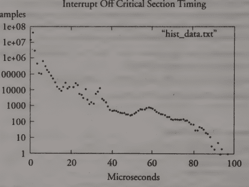

图 17-5
中断关闭延迟数据

### 17.4.7 延迟跟踪

`LATENCY_TRACE` 配置选项启用与最近一次最大延迟测量相关的内核跟踪数据生成。该数据也可通过 `/proc` 文件系统访问。延迟跟踪有助于隔离最长延迟的代码路径。对于每次新的最大延迟测量，都会生成一个相关联的跟踪，以便于追踪对应最大延迟的代码路径。

清单 17-7 复现了一个 78 微秒最大延迟的示例跟踪。与其他测量工具一样，通过在 `/proc/sys/kernel/preempt_max_latency` 中写入 0 来启用测量。

## 17.4 调试实时内核

#### 清单 17-7：中断关闭最大延迟跟踪

```bash

$ cat /proc/latency_trace

preemption latency trace v1.1.5 on 2.6.14-rt-intoff-tim_trace

-----------------------------------------------------------------

latency: 78 us, #50/50, CPU#0 | (Mirt VP:0, KP:0, SP:1 HP:1)

-----------------------------------------------------------------
```


| task: `softirq-timer/0-3` (`uid:0 nice:0 policy:1 rt_prio:1`)

-----------------------------------------------------------------

         --> `CPU#`

          |____--> `irqs-off`

          |        |____--> `need-resched`

          |        |       | `hardirq/softirq`

          |        |       |  |____--> `preempt-depth`

          |        |       |  |      |

          |        |       |  |    `delay`

`cmd`       `pid`        `time`     | `caller`

                                |

`cat-6637`  `0D..`   `00us` : `common_interrupt` (`01`)

`cat-6637`  `0D.h.`   `2us` : `do_IRQ` (`c013491c 0 0`)

`cat-6637`  `0D.hi`   `3us+` : `mask_and_ack_8259A` (`_do_IRQ`)

`cat-6637`  `0D.h.`   `10us` : `redirect_hardirq` (`_do_IRQ`)

`cat-6637`  `0D.h.`   `12us` : `handle_IRQ_event` (`_do_IRQ`)

`cat-6637`  `0D.h.`   `13us` : `timer_interrupt` (`handle_IRQ_event`)

`cat-6637`  `0D.h.`   `15us` : `handle_tick_update` (`timer_interrupt`)

`cat-6637`  `0D.h`    `16us` : `do_timer` (`handle_tick_update`)

...      `<we're in the timer interrupt function>`

`cat-6637`  `0D.h.`    `22us` : `run_local_timers` (`update_process_times`)

`cat-6637`  `0D.h.`    `22us` : `raise_softirq` (`run_local_timers`)

`cat-6637`  `0D.h`     `23us` : `wakeup_softirqd` (`raise_softirq`)

...      `<softirq work pending - need to preempt if signaled>`

`cat-6637`  `0Dmh.`    `34us` : `wake_up_process` (`wakeup_softirqd`)

`cat-6637`  `0Dmh.`    `35us` : `rcu_pending` (`update_process_times`)

`cat-6637`  `0Dmh`     `39us` : `scheduler_tick` (`update_process_times`)

`cat-6637`  `0Dmh`     `39us` : `sched_clock` (`scheduler_tick`)

`cat-6637`  `0Dmh`     `41us` : `task_timeslice` (`scheduler_tick`)

`cat-6637`  `0Dmh`     `42us+` : `preempt_schedule` (`scheduler_tick`)

`cat-6637`  `0Dmh`     `45us` : `note_interrupt` (`_do_IRQ`)

`cat-6637`  `0Dmh`     `45us` : `enable_8259A_irq` (`_do_IRQ`)

`cat-6637`  `0Dmh`     `47us` : `preempt_schedule` (`enable_8259A_irq`)

`cat-6637`  `0Dmh`     `48us` : `preempt_schedule` (`_do_IRQ`)

`cat-6637`  `0Dmh`     `48us` : `irq_exit` (`_do_IRQ`)

`cat-6637`  `0Dm.`     `49us` : `preempt_schedule_irq` (`need_resched`)

`cat-6637`  `0Dm.`     `50us` : `_schedule` (`preempt_schedule_irq`)

...      `<here is the context_switch to softirq-timer thread>`

`<...>3`       `0D..2`  `74us+` : `__switch_to` (`_schedule`)

`<...>3`       `0D..3`  `76us` : `__switch_to` (`cat-6637`) (`74 62`)

`<...>3`       `0D..2`  `77us` : `_schedule` (`schedule`)

`<...>3`       `0D..2`  `78us` : `trace_irqs_on` (`_schedule`)

...      `<output truncated here for brevity>`

为了清晰起见，我们大幅精简了此清单，但此跟踪的关键要素显而易见。此跟踪源自定时器中断。在硬中断线程中，除了为稍后的软中断上下文排队一些工作外，几乎什么都没做。这在 23 微秒处的 `wakeup_softirqd()` 函数中可以看到，这是中断处理的典型情况。这会触发 `need_resched` 标志，如跟踪中第二个字段第三列的 `n` 所示。在 49 微秒时，经过定时器软中断的一些处理后，调度器被调用于抢占。在 74 微秒时，控制权传递给实际运行在此特定内核中的 PID 为 3 的 `softirqd-timer/0` 线程。（进程名称被截断以适合字段宽度，显示为 `<...>`。）

清单 17-7 中的大多数字段含义显而易见。`irqsoff` 字段在中断关闭的代码段中包含一个 `D`。由于此延迟跟踪是中断关闭跟踪，我们看到整个跟踪中都有此指示。`need_resched` 字段反映内核 `need_resched` 标志的状态。`n` 表示应在最早的机会运行调度器，而句点 (`.`) 表示此标志未激活。`hardirq/softirq` 字段指示在硬中断上下文中执行的线程用 `h` 表示，在软中断上下文中执行的线程用 `s` 表示。`preempt-depth` 字段指示内核 `preempt_count` 变量的值，这是内核内锁嵌套层级的指示器。只有当此变量为零时，才可以发生抢占。

### 17.4.8 调试死锁状况

`DEBUG_DEADLOCKS` 内核配置选项启用检测并报告与内核中信号量和自旋锁相关的死锁状况。启用后，潜在的死锁状况将以类似于以下的方式报告：

```text
BUG: lock recursion deadlock detected!
.
.
.
```


在宣布检测到死锁的横幅行之后，会显示大量信息，包括锁描述符、锁名称（如果可用）、锁文件和名称（如果可用）、锁所有者、当前持有锁者等。使用此调试工具，可以立即确定引起故障的进程。当然，修复它可能没那么容易！

### 17.4.9 锁定模式的运行时控制

`DEBUG_RT_LOCKING_MODE` 选项启用了运行时控制，可将实时互斥锁切换回非可抢占模式，实际上将实时内核（作为互斥锁的自旋锁）的行为更改回基于自旋锁的内核。与我们在此介绍的其他配置选项一样，此工具应被视为仅在开发环境中使用的开发辅助工具。

同时启用所有这些调试模式没有意义。正如你可能想象的那样，大多数这些调试模式都会增加内核的大小并带来显著的额外处理开销。它们旨在作为开发辅助工具使用，应在生产代码中禁用。

## 17.5 章节总结

- Linux 越来越多地用于需要实时性能的系统。例子包括多媒体应用以及机器人、工业和汽车控制器。
- 实时系统以截止时间（deadlines）为特征。当未满足截止时间导致不便或客户体验下降时，我们将其称为软实时。相比之下，硬实时系统在错过截止时间时被视为失败。
- 内核抢占是 Linux 内核中解决系统整体延迟的第一个重要特性。
- 近期的 Linux 内核支持多种抢占模式，范围从不可抢占到全实时抢占。
- 实时补丁为 Linux 内核添加了几个关键特性，从而实现了可靠的低延迟。
- 实时补丁包含几个重要的测量工具，有助于调试和表征实时 Linux 实现。

### 17.5.1 延伸阅读建议

*Linux Kernel Development*, 2nd Edition  
Robert Love  
Novell Press, 2005

# 附录 A


这是 GLP 许可证的精确副本，由自由软件基金会授权并出版。电子副本可在 www.fsf.org 获取。

版本 2，1991 年 6 月

版权所有 © 1989, 1991 自由软件基金会，Inc.

51 Franklin Street, Fifth Floor, Boston, MA 02110-1301, USA

每个人都允许逐字复制和分发此许可文档的副本，但不允许更改它。

## 前言

大多数软件的许可证旨在剥夺你共享和修改它的自由。相比之下，GNU 通用公共许可证旨在保证你共享和修改免费软件的自由——确保软件对所有用户都是自由的。此通用公共许可证适用于自由软件基金会的大多数软件，以及作者承诺使用它的任何其他程序。（自由软件基金会的其他一些软件改由 GNU 宽通用公共许可证覆盖。）你也可以将其应用于你的程序。

当我们谈论免费软件时，我们指的是自由，而不是价格。我们的通用公共许可证旨在确保你有权分发免费软件的副本（如果你愿意，可以为这项服务收费），确保你获得源代码或在你想要时可以获得它，确保你可以修改软件或在新免费程序中使用其部分；并且让你知道你可以做这些事情。

为了保护你的权利，我们需要制定禁止任何人否认你这些权利或要求你放弃这些权利的限制。这些限制转化为你在分发软件副本或修改软件时承担的特定责任。

例如，如果你分发此类程序的副本，无论免费还是收费，你都必须向接收者提供你拥有的所有权利。你必须确保他们也能获得或获取源代码。你还必须向他们展示这些条款，以便他们知道他们的权利。

我们分两步保护你的权利：(1) 对软件进行版权保护，以及 (2) 提供此许可证，给予你复制、分发和/或修改软件的法律许可。

此外，为了保护每位作者的权益以及我们的权益，我们要求确保每个人都理解，本自由软件没有保修。如果该软件被他人修改并传递，我们希望其接收者知道他们获得的不是原始版本，这样，由他人引入的任何问题都不会反映在原始作者的声誉上。

最后，任何自由程序都不断受到软件专利的威胁。我们希望避免这样一种危险：自由程序的分发者 individually 获取专利许可，从而实际上使该程序成为专有软件。为了防止这种情况，我们已明确，任何专利都必须为每个人免费使用进行许可，或者完全不进行许可。

复制、分发和修改的具体条款和条件如下。

## 复制、分发和修改的条款和条件

- 0. 本许可证适用于任何包含版权声明的文件或其他作品，该声明由版权持有者发布，说明其可以根据本通用公共许可证的条款进行分发。下文中的“程序”指任何此类程序或作品，而“基于程序的作品”指程序本身或在版权法下的任何衍生作品：也就是说，包含程序或其一部分的作品，无论是逐字逐句还是经过修改和/或翻译成另一种语言。（在此之后，翻译在不限制的情况下包含在“修改”一词中。）每个被许可人被称为“您”。

复制、分发和修改以外的活动不在此许可证的范围内；它们超出其范围。运行程序的行为不受限制，且程序的输出仅在内容构成基于程序的作品时才受覆盖（无论是否通过运行程序产生）。是否如此取决于程序的功能。

- 1. 您可以复制和分发程序的源代码的逐字副本，以任何介质，只要您在每个副本上显著且适当地发布适当的版权声明和保修免责声明；保持所有提及本许可证和无任何保修的通知完整；并向程序的其他接收者提供本许可证的副本以及程序。

您可以对复制物理传输行为收取费用，并且您可以选择以费用为代价提供保修保护。

- 2. 您可以修改您的程序副本或程序的某些部分，从而形成基于程序的作品，并在上述第 1 节的条款下复制和分发此类修改或作品，前提是您还满足所有这些条件：

    - a. 您必须使修改的文件带有显眼的通知，说明您更改了文件以及任何更改的日期。
    - b. 您必须使您分发或发布的任何作品，其中全部或部分包含或衍生自程序或其任何部分，作为整体以免费方式向所有第三方许可本许可证的条款。
    - c. 如果修改后的程序在运行时通常读取交互命令，您必须使其在以普通方式开始运行此类交互式使用时，打印或显示声明，包括适当的版权声明和没有保修的通知（或者，说明您提供保修）以及用户可以按这些条件重新分发程序的通知，并告知用户如何查看本许可证的副本。（例外：如果程序本身是交互式的，但通常不打印此类声明，则基于程序的作品不需要打印声明。）

这些要求适用于修改后的作品整体。如果该作品的可识别部分未衍生自程序，并且可以合理地被视为独立和单独的作品本身，那么当您作为单独作品分发这些部分时，本许可证及其条款不适用于这些部分。但是，当您将这些部分作为基于程序的作品的整体的一部分进行分发时，整体的分发必须基于本许可证的条款，其对其他被许可人的许可扩展至整个整体，因此扩展至每一部分，无论谁编写。

因此，本节的目的不是主张权利或反驳您对完全由您编写的作品的权利；相反，其目的是行使控制基于程序的衍生或集体作品分发的权利。

此外，仅将未基于程序的其他作品与程序（或基于程序的作品）聚合在存储或分发介质的卷上，不会使其他作品进入本许可证的范围。

- 3. 您可以复制和分发程序（或在第 2 节下基于它的作品）的目标代码或可执行形式，在上述第 1 节和第 2 节的条款下，前提是您还执行以下任一操作：

    - a. 伴随提供完整的相应机器可读源代码，必须按照上述第 1 节和第 2 节的条款在通常用于软件交换的介质上进行分发；或者，
    - b. 伴随提供书面报价，有效期至少三年，向任何第三方，以不超过您物理执行源代码分发成本的收费，提供完整的机器可读相应源代码副本，按照上述第 1 节和第 2 节的条款在通常用于软件交换的介质上进行分发；或者，
    - c. 伴随提供您收到的关于提供相应源代码分发报价的信息。（此替代方案仅允许用于非商业分发，并且仅在您按照上述 b 小节收到以目标代码或可执行形式提供此类报价的程序时。）

作品的源代码是指制作修改的优先形式。对于可执行作品，完整的源代码是指其包含的所有模块的所有源代码，加上任何相关的接口定义文件，加上用于控制编译和安装可执行文件的脚本。然而，作为特殊例外，分发的源代码无需包含通常与可执行文件运行的操作系统的主要组件（编译器、内核等）一同分发的任何内容（无论是源代码还是二进制形式），除非该组件本身伴随可执行文件。

如果通过提供从指定位置复制的访问来分发可执行或目标代码，那么提供从相同位置复制源代码的等效访问即视为源代码的分发，即使第三方不被迫将源代码与目标代码一同复制。

- 4. 除本许可证明确规定的情况外，您不得复制、修改、重新许可或分发程序。任何试图以其他方式复制、修改、重新许可或分发程序的行为无效，并将自动终止您在本许可证下的权利。然而，根据本许可证从您那里获得副本或权利的各方，只要该各方完全遵守，其许可证将不会被终止。

- 5. 您不需要接受本许可证，因为您未签署它。但是，没有其他内容授予您修改或分发程序或其衍生作品的权限。如果您不接受本许可证，这些行为在法律上是禁止的。因此，通过修改或分发程序（或任何基于程序的作品），您表明您接受本许可证以执行此操作，以及所有其关于复制、分发或修改程序或基于作品的条款和条件。

- 6. 每次您重新分发程序（或任何基于程序的作品）时，接收者自动从原始许可人获得根据这些条款和条件复制、分发或修改程序的许可证。您不得对接收者行使在此授予的权利施加进一步限制。您对第三方遵守本许可证的合规性不负责。

如果作为法院判决、专利侵权指控或任何其他原因（不仅限于专利问题）的结果，你被施加了某些条件（无论是通过法院命令、协议还是其他方式），而这些条件与本许可证的条件相矛盾，这些条件并不能免除你履行本许可证条件的义务。如果你无法同时满足本许可证下的义务和其他相关义务来进行分发，那么结果是你可能完全不能分发该程序。例如，如果专利许可证不允许所有直接或通过你间接获取副本的人免费再分发该程序，那么满足专利许可证和本许可证两者的唯一方式就是完全停止分发该程序。

如果本节的任何部分在特定情况下被裁定无效或不可执行，则该节的其余部分仍应适用，且该节在整体上也应在其他情况下适用。

本节的目的并非诱导你侵犯任何专利或其他财产权主张，或质疑任何此类主张的有效性；本节的唯一目的是保护自由软件分发系统的完整性，该系统是通过公共许可证实践来实现的。许多人依赖于该系统的一致应用，对通过该系统分发的广泛软件做出了慷慨的贡献；是否愿意通过其他系统分发软件由作者/捐赠者自行决定，被许可人不能强加这种选择。

本节的目的是明确阐述其余本许可证所认为的后果。

如果程序的分发和/或使用在某些国家因专利或受版权保护的接口而受到限制，将程序置于本许可证下的原始版权持有人可以添加明确的地理分发限制，排除这些国家，以便分发仅在这些未被排除的国家内部或国家之间进行。在这种情况下，本许可证将作为写在本许可证正文中一样并入该限制。

9. 自由软件基金会可能会不时发布修订版和/或新版本的通用公共许可证。这些新版本在精神上将与当前版本相似，但可能在细节上有所不同，以解决新的问题或关切。

每个版本都赋予一个独特的版本号。如果程序指定了适用于它的本许可证的版本号以及“任何后续版本”，你有权选择遵循该版本或自由软件基金会发布的任何后续版本的条款和条件。如果程序未指定本许可证的版本号，你可以选择自由软件基金会发布的任何版本。

10. 如果你希望将程序的部分内容整合到分发条件不同的其他自由程序中，请写信给作者请求许可。对于由自由软件基金会版权保护的软件，对此有例外。我们的决定将由两个目标指导：保护我们所有自由软件衍生物的自由状态，以及促进软件的一般共享和重用。

## 无保证

11. 由于程序是免费许可的，在适用法律允许的范围内，程序不提供任何保证。除非书面另有声明，版权持有人和/或其他方按“现状”提供该程序，不提供任何形式的保证，无论是明示的还是默示的，包括但不限于对适销性和特定用途适用性的默示保证。关于程序质量和性能的全部风险由你承担。如果程序被证明是有缺陷的，你承担所有必要的维护、修理或纠正的成本。

12. 在任何情况下，除非适用法律要求或书面协议约定，任何版权持有人，或任何可能按上述允许的方式修改和/或再分发程序的其他方，对你因使用或无法使用程序（包括但不限于数据丢失、数据不准确或由你和第三方遭受的损失）或程序无法与其他程序配合工作所造成的损害（包括任何一般、特殊、偶然或后果性损害）不承担责任，即使该持有人或其他方已被告知此类损害的可能性。

## 附录 B.


U-Boot 拥有超过 60 个可配置命令。这些命令在最近的 U-Boot 快照中被总结如下表 B-1。除了这些之外，还有大量非标准命令，其中一些依赖于特定硬件或是实验性的。要获取完整且最新的列表，请参阅源代码。这些命令定义在 U-Boot 顶级源代码目录中的 `.../include/cmd_confdefs.h` 头文件中。

### 表 B-1 U-Boot 可配置命令

| 命令集 | 命令 |
|---|---|
| CFG_CMD_BDI | bdinfo |
| CFG_CMD_LOADS | loads |
| CFG_CMD_LOADB | loadb |
| CFG_CMD_IMI | iminfo |
| CFG_CMD_CACHE | icache, dcache |
| CFG_CMD_FLASH | flinfo, erase, protect |
| CFG_CMD_MEMORY | md, mw, nm, mw, cp, cmp, crc, base, loop, mtest |
| CFG_CMD_NET | bootp, tftpboot, rarpboot |
| CFG_CMD_ENV | saveenv |
| CFG_CMD_KGDB | kgdb |
| CFG_CMD_PCMCIA | PCMCIA 支持 |
| CFG_CMD_IDE | IDE 硬盘支持 |
| CFG_CMD_PCI | pciinfo |
| CFG_CMD_IRQ | irqinfo |
| CFG_CMD_BOOTD | bootd |
| CFG_CMD_CONSOLE | coninfo |
| CFG_CMD_EEPROM | EEPROM 读写支持 |
| CFG_CMD_ASKENV | 查询环境变量 |
| CFG_CMD_RUN | 运行环境变量中的命令 |
| CFG_CMD_ECHO | 回显参数 |
| CFG_CMD_I2C | I2C 串行总线支持 |
| CFG_CMD_REGINFO | 寄存器转储 |
| CFG_CMD_IMGAG | IMMR 寄存器转储支持 |
| CFG_CMD_DATE | 支持 RTC、日期/时间等 |
| CFG_CMD_DHCP | DHCP 支持 |
| CFG_CMD_BEDBUG | 包含 BedBug 调试器 |
| CFG_CMD_FDC | 软盘支持 |
| CFG_CMD_SCSI | SCSI 支持 |
| CFG_CMD_AUTOSCRIPT | 自动脚本支持 |
| CFG_CMD_MII | MII 支持 |
| CFG_CMD_SEGETEODCR | 4xx 上的 DCR 支持 |
| CFG_CMD_BSP | 板级特定功能 |
| CFG_CMD_ELF | ELF (VxWorks) 加载/启动命令 |
| CFG_CMD_MISC | 杂项功能，如 sleep |
| CFG_CMD_USB | USB 支持 |
| CFG_CMD_DOC | 磁盘芯片（Disk-on-chip）支持 |
| CFG_CMD_JFFS2 | JFFS2 支持 |
| CFG_CMD_DTF | 数字温度计和恒温器 |
| CFG_CMD_SDRAM | SDRAM DIMM SPD 信息打印 |
| CFG_CMD_DIAG | 诊断 |
| CFG_CMD_FPGA | FPGA 配置支持 |
| CFG_CMD_HWFLOW | RTS/CTS 硬件流控 |
| CFG_CMD_SAVES | 保存 S 记录转储 |
| CFG_CMD_SPI | SPI 实用工具 |
| CFG_CMD_FDOS | 软盘 DOS 支持 |
| CFG_CMD_VFD | VFD 支持 (TRAB) |
| CFG_CMD_NAND | NAND 支持 |
| CFG_CMD_BMP | BMP 支持 |
| CFG_CMD_PORT10 | 端口 I/O |
| CFG_CMD_PING | Ping 支持 |
| CFG_CMD_MMC | MMC 支持 |
| CFG_CMD_FAT | FAT 支持 |
| CFG_CMD_TMLLS | 列出所有找到的映像 |
| CFG_CMD_ITEEST | 整数（和字符串）测试 |
| CFG_CMD_NFS | NFS 支持 |
| CFG_CMD_REISER | Reiserfs 支持 |
| CFG_CMD_CDP | Cisco 发现协议 |
| CFG_CMD_XIMG | 加载多映像的一部分 |
| CFG_CMD_UNIVERSE | Tundra Universe 支持 |
| CFG_CMD_EXT2 | EXT2 支持 |
| CFG_CMD_SNTP | SNTP 支持 |
| CFG_CMD_DISPLAY | 显示支持 |

## 附录


BusyBox 拥有许多有用的命令。以下是最近一个 BusyBox 快照中记录的命令列表。

| 命令 | 描述 |
| :--- | :--- |
| addgroup | 向系统添加组 |
| adduser | 向系统添加用户 |
| adjtimex | 读取并可选地设置系统时间基准参数 |
| ar | 从 ar 归档中提取或列出文件 |
| arping | 通过 ARP 请求/应答 ping 主机 |
| ash | ash shell（命令解释器） |
| awk | 模式扫描和处理语言 |
| basename | 从文件中去除目录路径和后缀 |
| bunzip2 | 解压缩文件（如果未指定输入文件，则解压缩标准输入） |
| bzcat | 解压缩到标准输出 |
| cal | 显示日历 |
| cat | 连接文件并将其打印到标准输出 |
| chgrp | 更改每个文件的组归属 |
| chmod | 更改文件访问权限 |
| chown | 更改文件的所有者和/或组 |
| chroot | 在设置根目录为新根的情况下运行命令 |
| chvt | 将前台虚拟终端更改为 /dev/ttyN |
| clear | 清屏 |
| cmp | 比较文件 |
| cp | 复制文件 |
| cpio | 从 cpio 归档中提取或列出文件 |
| crond | BusyBox 版本的 cron 守护进程 |
| crontab | 管理 crontab 控制文件 |
| cut | 将每个输入文件中选定的字段打印到标准输出 |
| date | 显示或设置系统时间 |
| dc | 微型 RPN 计算器 |
| dd | 根据选项转换和格式化以复制文件 |

## 附录 C • BusyBox 命令

486

| 命令 | 说明 |
| :--- | :--- |
| deallocvt | 释放未使用的虚拟终端 /dev/ttyN |
| delgroup | 从系统中删除组 |
| deluser | 从系统中删除用户 |
| devfsd | 用于管理 devfs 权限和旧设备名称符号链接的已废弃守护进程 |
| df | 打印文件系统已用空间和可用空间 |
| dirname | 去除文件名的非目录后缀 |
| dmesg | 打印或控制内核环形缓冲区 |
| dos2unix | 将文件从 DOS 格式转换为 UNIX 格式 |
| dpkg | 用于安装、移除和管理 Debian 包的实用工具 |
| dpkg-deb | 对 Debian 包（debs）执行操作 |
| du | 汇总每个文件和/或目录使用的磁盘空间 |
| dumpkmap | 将二进制键盘翻译表打印到标准输出 |
| dumpleases | 显示由 udhcpd 授予的 DHCP 租约 |
| echo | 将指定的 ARGS 打印到标准输出 |
| env | 打印当前环境变量或在设置后运行程序 |
| expr | 将表达式的值打印到标准输出 |
| false | 返回退出代码 FALSE (1) |
| fbset | 显示和修改帧缓冲设置 |
| fdflush | 强制软盘驱动器检测磁盘更改 |
| fdformat | 对软盘进行低级格式化 |
| fdisk | 更改分区表 |
| find | 在目录层次结构中搜索文件 |
| fold | 将每个文件中的输入行进行换行处理 |
| free | 显示系统空闲和已用内存量 |
| freerandisk | 释放指定 randisk 使用的全部内存 |
| fsckminix | 对 MINIX 文件系统执行一致性检查 |
| ftpget | 通过 FTP 获取远程文件 |
| ftput | 通过 FTP 将本地文件存储到远程机器上 |
| getopt | 解析命令选项 |
| getty | 打开 tty，提示输入登录名，然后调用 /bin/login |
| grep | 在每个文件或标准输入中搜索 PATTERN |
| gunzip | 解压缩文件（或标准输入） |
| gzip | 以最大压缩率压缩文件 |
| halt | 停止系统 |
| hdparm | 获取/设置硬盘参数 |
| head | 将每个文件的前 10 行打印到标准输出 |
| hexdump | 以用户指定的二进制、八进制、十六进制、字符或十进制格式转储文件 |
| hostid | 打印该机器唯一的 32 位标识符 |
| hostname | 获取或设置主机名 |
| httpd | 监听传入的 HTTP 服务器请求 |
| hwclock | 查询和设置硬件时钟（RTC） |
| id | 打印 USERNAME 或当前用户的信息 |
| ifconfig | 配置网络接口 |
| ifdown | 取消配置接口 |
| ifup | 配置接口 |
| inetd | 监听网络连接并启动程序 |
| init | BusyBox 版本的 init。 |
| insmod | 将指定的内核模块加载到内核中 |
| install | 复制文件并设置属性 |
| ip | TCP/IP 配置实用工具 |
| ipaddr | 操作接口地址 |
| ipcalc | 根据 IP 地址计算 IP 网络设置 |
| iplink | 操作接口设置 |
| iproute | 显示/设置路由表项 |
| iptunnel | BusyBox iptunnel 实用工具 |
| kill | 向指定进程发送信号（默认为 SIGHUP） |
| killall | 向指定进程发送信号（默认为 SIGHUP） |
| klogd | 内核日志记录器 |
| lash | BusyBox LArE Shell（命令解释器） |
| last | 显示最近登录系统的用户列表 |
| length | 打印指定 STRING 的长度 |
| ln | 创建名为 LINKNAME 或 DIRECTORY 的符号链接指向指定的 TARGET |
| loadfont | 从标准输入加载控制台字体 |
| loadmap | 从标准输入加载二进制键盘翻译表 |
| logger | 将 MESSAGE 写入系统日志 |
| login | 在系统上开始新的会话 |
| logname | 打印当前用户的名称 |
| logread | 显示来自 syslogd 的消息 |
| losetup | 将 LOOPDEVICE 与文件关联 |
| ls | 列出目录内容 |
| lsmod | 列出当前加载的内核模块 |
| makedevs | 创建一系列块设备或字符特殊文件 |
| mdsum | 打印或检查 MD5 校验和 |
| mesg | 控制对终端的写入权限 |
| mkdir | 创建目录项 |
| mkfifo | 创建命名管道（等同于 mknode name p） |
| mkfsminix | 创建 MINIX 文件系统 |
| mknod | 创建特殊文件（块设备、字符设备或管道） |
| mkswap | 准备磁盘分区以用作交换分区 |
| mktemp | 基于 TEMPLATE 创建临时文件 |
| modprobe | 用于高级模块加载和卸载 |
| more | 用于逐屏查看文件的过滤器 |
| mount | 挂载文件系统 |
| mt | 控制磁带驱动器操作 |
| mv | 重命名和/或移动文件 |
| nameif | 在处于 down 状态时重命名网络接口 |
| nc | Netcat 打开到 IP:port 的管道 |
| netstat | netstat 显示 Linux 网络信息 |
| nslookup | 查询名称服务器以获取给定主机的 IP 地址 |
| od | 以八进制和其他格式转储文件 |
| openvt | 在新的虚拟终端上启动命令 |
| passwd | 更改用户密码 |
| patch | BusyBox 的 patch 实现 |
| pidof | 获取指定名称进程的 PID |
| ping | 向网络主机发送 ICMP ECHO_REQUEST 数据包 |
| ping6 | 向网络主机发送 ICMP ECHO_REQUEST 数据包 |
| pivot_root | 更改根文件系统 |
| poweroff | 停止系统并要求内核关闭电源 |
| printf | 根据用户格式格式化和打印参数 |
| ps | 报告进程状态 |
| pwd | 打印当前工作目录的完整文件名 |
| rdate | 从远程主机获取并可能设置系统日期和时间 |
| readlink | 显示符号链接的值 |
| realpath | 返回给定参数的绝对路径名 |
| reboot | 重启系统 |
| renice | 在允许的优先级范围内更改运行中进程的优先级 |
| reset | 重置屏幕 |
| rm | 删除（unlink）文件 |
| rmdir | 如果目录为空，则删除目录 |
| rmmod | 从内核中卸载指定的内核模块 |
| route | 编辑内核的路由表 |
| rpm | 操作 RPM 包 |
| rpm2cpio | 输出 rpm 文件的 cpio 归档 |
| run-parts | 运行目录中的一组脚本 |
| rx | 使用 xmodem 协议接收文件 |
| sed | Busybox 流编辑器实现 |
| seq | 将数字范围打印到标准输出 |
| setkeycodes | 设置内核的扫描码到按键码映射中的条目 |
| sha1sum | 打印或检查 SHA1 校验和 |
| sleep | 延迟指定时间 |
| sort | 对指定文件中的文本行进行排序 |
| start-stop-daemon | 用于启动和停止服务的程序 |
| strings | 显示二进制文件中的可打印字符串 |
| stty | 显示和修改终端设置 |
| su | 更改用户 ID 或成为 root |
| sulogin | 单用户登录 |
| swapoff | 禁用虚拟内存页面交换 |
| swapon | 启用虚拟内存页面交换 |
| sync | 将所有缓冲的文件系统块写入磁盘 |
| sysctl | 在运行时配置内核参数 |
| syslogd | Linux 系统和内核日志实用工具 |
| tail | 将每个文件的最后 10 行打印到标准输出 |
| tar | 从 tar 文件中创建、提取或列出文件 |
| tee | 将标准输入复制到每个文件以及标准输出 |
| telnet | BusyBox Telnet 客户端实现 |
| telnetd | BusyBox Telnet 服务器实现 |
| test | 检查文件类型并比较值，返回退出状态 |
| tftp | 使用 TFTP 协议传输文件 |
| time | 测量程序使用的时间 |
| top | 提供处理器活动的实时视图 |
| touch | 更新给定 FILE[s] 的最后修改日期 |
| tr | 翻译、压缩和/或删除字符 |
| tracroute | 跟踪 IP 数据包遵循的路由 |
| true | 返回退出代码 TRUE (0) |
| tty | 打印连接到标准输入的终端的文件名 |
| udhcpc | BusyBox DHCP 客户端实现 |
| udhcpd | BusyBox DHCPD 服务器实现 |
| umount | 卸载文件系统 |
| uname | 打印某些系统信息 |
| uncompress | 解压缩 Z 文件 |
| uniq | 从 INPUT 中丢弃连续相同行中除一行以外的所有行 |
| unix2dos | 将文件从 UNIX 格式转换为 DOS 格式 |
| unzip | 从 ZIP 归档中提取文件 |
| uptime | 显示自上次启动以来的时间 |
| usleep | 暂停 n 微秒 |
| uudecode | 解码 uuencoded 文件 |
| uuencode | 对文件进行 uuencode 编码 |
| vconfig | 允许创建和移除虚拟以太网设备 |
| vi | BusyBox vi 编辑器 |
| vlock | 锁定虚拟终端，解锁需要密码 |
| watch | 定期执行程序 |
| watchdog | 定期写入指定的看门狗设备 |
| wc | 打印每个文件的行数、字数和字节数 |
| wget | 通过 HTTP 或 FTP 获取文件 |
| which | 在当前路径中查找命令 |
| who | 打印当前用户名及相关信息 |
| whoami | 打印与当前有效用户 ID 关联的用户名 |
| xargs | 对标准输入给出的每个项目执行命令 |
| yes | 重复输出包含所有指定 STRING(s) 或 y 的行 |
| zcat | 解压缩到 stdout |

# 附录 D


本附录内容

- SDRAM 基础 第 492 页
- 时钟 第 494 页
- SDRAM 配置 第 495 页
- 总结 第 500 页

乍一看，编程配置 SDRAM 控制器似乎是一项艰巨的任务。确实，已经开发了许多种同步动态随机存取存储器（DRAM）技术。在对性能和密度的无穷追求中，开发人员设计了许多不同的架构和操作模式。

在本章关于 SDRAM 接口注意事项的讨论中，我们将考察 AMCC PowerPC 405GP 处理器。在阅读过程中，您可能需要参考用户手册副本。该文档在第 D.4.1 节“延伸阅读建议”中被引用。

### D.1 SDRAM 基础

为了理解 SDRAM 配置，有必要了解 SDRAM 设备操作的基础知识。在没有深入硬件设计细节的情况下，SDRAM 设备被组织为单元矩阵，其中一部分地址位用于行寻址，另一部分用于列寻址。图 D-1 对此进行了说明。

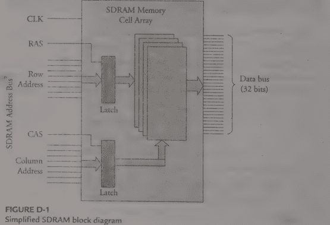

**图 D-1**
简化的 SDRAM 框图

在内存矩阵内部，电路相当复杂。简化的读操作示例如下：通过在线地址线上放置行地址，然后在列地址线上放置列地址来引用特定的内存位置。经过一段时间（延迟）后，由行和列输入寻址的位置中存储的数据会被传输到处理器数据总线。

处理器在 SDRAM 地址总线上输出行地址，并置位其行地址选通（RAS）信号。经过一段允许 SDRAM 电路捕获行地址的预编程短延迟后，处理器输出列地址并置位其列地址选通（CAS）信号。SDRAM 控制器将实际物理内存地址转换为行地址和列地址。许多 SDRAM 控制器都可以配置行和列的位宽；PPC405GP 就是其中之一。稍后您将会发现，这是 SDRAM 控制器配置的一部分。

这个例子大大简化了，但概念是一样的。例如，突发读取一次读取四个内存位置，它输出一个单一的 RAS 和 CAS 周期，内部的 SDRAM 电路会自动为突发读取的后续三个位置递增列地址，从而消除了处理器发出四个独立 CAS 周期的需求。这只是一个性能优化的例子。理解这一点最好的方法是仔细研究实际内存芯片的细节。一个编写良好的数据表示例包含在第 D.4.1 节“延伸阅读建议”中。

#### D.1.1 SDRAM 刷新

SDRAM 由单个晶体管和电容器组成。晶体管提供电荷，而电容器的任务是保持（存储）单个单元的值。出于本文讨论范围之外的一些原因，电容器只能保持该值一小段时间。动态内存的基本概念之一是，代表每个单元的电容器必须定期重新充电以保持其值。这被称为 SDRAM 刷新。

刷新周期是一种特殊的内存周期，它既不读取也不写入内存数据，只是执行所需的刷新周期。SDRAM 控制器的主要职责之一是确保及时发出刷新周期，以满足芯片的要求。

芯片制造商规定了最小刷新间隔，设计人员的工作是保证满足这一间隔。通常，SDRAM 控制器可以直接配置以选择刷新间隔。这里介绍的 PowerPC 405GP 有一个专门用于此目的寄存器。我们将很快看到这一点。

### D.2 时钟

*同步*一词意味着 SDRAM 设备的数据读和写周期与来自 CPU 的时钟信号同步。SDR SDRAM 在 SDRAM 的每个时钟周期都进行读取和写入。DDR SDRAM 在每个时钟周期进行两次读取和写入，一次在时钟的上升沿，一次在下降沿。

现代处理器具有复杂的时钟子系统。许多处理器具有多个用于系统不同部分的时钟频率。典型的处理器使用相对低频的晶振生成时钟源作为其主时钟信号。处理器内部的锁相环（PLL）生成 CPU 的主时钟（我们在比较处理器速度时所指的时钟频率）。由于 CPU 通常比内存子系统运行得快得多，处理器会生成主 CPU 时钟的亚倍数（分频），以馈送至 SDRAM 子系统。您需要为特定的 CPU 和 SDRAM 组合配置这种时钟比率。

处理器和内存子系统时钟必须正确配置，您的 SDRAM 才能正常工作。您的处理器手册中有关于时钟设置和管理的章节，您必须查阅该章节以正确设置您的特定板卡设计。

AMCC 405GP 是其功能集处理器的典型代表。它接受单个晶振生成的时钟输入源，并生成其子系统所需的几个内部和外部时钟。它生成 CPU、PCI 接口、板上外围总线（OPB）、处理器本地总线（PLB）、内存时钟（MemClk）以及若干用于计时器和 UART 等外围模块的内部时钟。典型的配置可能如表 D-1 所示。

#### 表 D-1
典型的 PPC405GP 时钟配置

| 时钟 | 频率 | 备注 |
| :--- | :--- | :--- |
| 晶振参考 | 33MHz | 提供给处理器的基本参考 |
| CPU 时钟 | 133MHz | 源自处理器内部 PLL，由硬件引脚跳线和寄存器设置控制。 |
| PLB 时钟 | 66MHz | 源自 CPU 时钟，通过硬件引脚跳线和寄存器设置配置。用于内部处理器本地总线之间的高速模块数据交换。 |
| OPB 时钟 | 66MHz | 源自 PLB 时钟，通过寄存器设置配置。用于不需要高速连接的外围器件的内部连接。 |
| PCI 时钟 | 33MHz | 源自 PLB 时钟，通过寄存器设置配置。 |
| MemClk | 100MHz | 直接驱动 SDRAM 芯片。源自 CPU 时钟，通过寄存器设置配置。 |

时钟设置方面的决定通常需要在硬件设计阶段做出。引脚跳线选项决定了处理器上电时的初始时钟配置。通常可以通过设置处理器内部专门用于时钟和子系统控制的寄存器中可访问的分频位，来控制派生时钟。在我们这里基于 405GP 给出的示例中，最终时钟配置由引脚跳线和固件配置决定。引导加载程序（bootloader）的职责是在上电后尽早设置初始分频值和任何其他可通过处理器寄存器位配置的时钟选项。

### D.3 SDRAM 配置

时钟配置完成后，下一步是配置 SDRAM 控制器。控制器因处理器而异，但最终结果总是相同的：你必须提供正确的时钟和定时值，以启用 SDRAM 子系统的性能并使其优化。

与本书中的其他内容一样，没有替代方案可以取代对你试图配置的硬件的深入理解。对于 SDRAM 来说尤其如此。探索 SDRAM 的设计超出了本附录的范围，但必须理解一些基础知识。许多制造商关于 SDRAM 设备的数据表包含有用的技术描述。强烈建议你熟悉这些数据表的内容。你不需要拥有硬件工程学位来理解正确配置 SDRAM 子系统所需的操作，但你需要投入一些精力去理解。

在这里，我们研究在 405GP 处理器上如何配置 SDRAM 控制器，该配置由我们在第 7 章“引导加载程序”中介绍的 U-Boot 引导加载程序完成。回顾第 7 章，U-Boot 提供了一个钩子，用于从位于 4xx 特定 cpu 目录中 start.S 文件内的汇编语言启动代码中初始化 SDRAM。请回顾第 7 章第 7.4.4 节“特定板卡的初始化”。列表 D-1 复现了 U-Boot 的 `.../cpu/ppc4xx/sdram.c` 文件中的 `sdram_init()` 函数。

**列表 D-1**

```c
```


```c
/**
 * ppc4xx sdram_init() from U-Boot
 */

void sdram_init(void)
{
    ulong sctrl;
    ulong rtr;
    int i;

    /*
     * Support for 100MHz and 133MHz SDRAM
     */
    if (get_bus_freq() > 100000000) {
        /* 133 MHz SDRAM */
        sctrl = 0x01074015;
        rtr = 0x07E00000;
    } else {
        /* default: 100 MHz SDRAM */
        sctrl = 0x0086400D;
        rtr = 0x05E00000;
    }
    for (i=0; i<NUM_BOCF; i++) {
        /* Disable memory controller. */
        mtdram0(mem_mccp01, 0x00000000);
        /* Set MBOCF for bank 0. */
        mtdram0(mem_nbOcf, mbOcf[i].reg);
```

### D.3 SDRAM 配置

```c
34 mtsdram0(mem_edtrl, edtr1);
35 mtsdram0(mem_rtr, rtr);

37 udelay(200);

/*
 * Set memory controller options reg, MCOPT1.
 * Set DC_EN to '1', and BRD_PRF to '01' for 16 byte PLB
 * Burst read/prefetch.
 */
44 mtsdram0(mem_mcopt1, 0x80800000);
45 udelay(100000);

47 if (get_ram_size(0, 0, mb0cf[1].size) == mb0cf[1].size) {
    /* OK, size detected -> all done */
    return;
}

}
```

第一个操作读取 `405GP` 处理器上的引脚固定设置，以确定 SDRAM 时钟的设计值。在这种情况下，我们可以看到 `accommodates` 两个可能的值：`100MHz` 和 `133MHz`。基于此选择，将选择一些常量，这些常量稍后将在该函数中用于设置 SDRAM 控制器中相应的寄存器位。

从第 24 行开始，使用一个循环来为最多五个预定义内存大小的每一个设置参数。目前，U-Boot 包含支持单个内存银行的逻辑，其大小可以是 `4MB`、`16MB`、`32MB`、`64MB` 或 `128MB`。这些大小在 `mb0cf` 表中定义，该表位于 `.../cpu/ppc4xx/sdram.c` 中。该表根据 `405GP` 内存银行配置寄存器所需的值，将这些内存大小中的每一个与一个常量关联起来。该循环执行以下操作：

```c
for (i = each possible memory bank size, largest first) {
    select timing constant based on SDRAM clock speed;
    disable SDRAM memory controller;
    configure bank 0 with size[i], timing constants[i];
    enable SDRAM memory controller;
    run simple memory test to dynamically determine size;
    /* This is done using get_ram_size() */
    if ( tested size == configured size )
        done;
}
```

这种简单的逻辑仅根据 SDRAM 时钟速度和 U-Boot 中硬编码表中的配置内存银行大小，在 SDRAM 控制器中插入正确的时序常量。利用这一说明，你可以轻松地将银行配置值与 `405GP` 参考手册中的对应项进行关联。对于 `64MB` 的 DRAM 大小，内存银行控制寄存器设置如下：

```
Memory Bank 0 Control Register = 0x000a4001
```

PowerPC `405GP` 用户手册描述了表 D-2 中内存银行 0 控制寄存器的字段。

#### 表 D-2
405GP 内存银行 0-3 配置寄存器字段

| 字段 | 值 | 注释 |
| :--- | :--- | :--- |
| 银行地址 (BA) | 0x00 | 此银行的起始内存地址。 |
| 大小 (SZ) | 0x4 | 此内存银行的大小——在本例中为 64MB。 |
| 寻址模式 (AM) | 0x2 | 决定内存的组织结构，包括行和列位数的数量。在本例中，模式 2 = 12 个行地址位，以及 9 或 10 个列地址位，以及多达四个内部 SDRAM 银行。此数据在 405GP 用户手册的表格中提供。 |
| 银行使能 (BE) | 0x1 | 由该寄存器配置的银行的使能位。405GP 中有四个这样的内存银行配置寄存器。 |

此表中的值必须由设计者根据板上使用的内存模块选择来确定。

让我们看一个时序示例，以获取更多关于典型 SDRAM 控制器时序要求的详细信息。假设 SDRAM 时钟速度为 `100MHz`，内存大小为 `64MB`，则清单 D-1 中 `sdram_init()` 函数选择的时序常量如下所示：

```
SDRAM Timing Register = 0x36346884
Refresh Timing Register = 0x35200000
```


PowerPC 405GP 用户手册描述了表 D-3 中 SDRAM 时序寄存器的字段。

#### 表 D-3
405GP SDRAM 时序寄存器字段

| 字段 | 值 | 注释 |
| :--- | :--- | :--- |
| CAS 延迟 (CASL) | 0x1 | SDRAM CAS 延迟。此值直接来自 SDRAM 芯片规格。它是芯片在发出读取命令（CAS 信号）到数据在数据总线上可用之间所需的时钟周期延迟。在本例中，0x1 代表两个时钟周期，如 405GP 用户手册所示。 |
| 预充电命令到下一次激活 (PTA) | 0x1 | SDRAM 预充电命令使给定的行失效。相比之下，激活命令使给定的行可用于随后的访问，例如在突发周期期间。此时序参数强制执行预充电到后续激活周期之间的最小时间间隔，并由 SDRAM 芯片决定。正确的值必须从 SDRAM 芯片规格中获取。在本例中，0x1 代表两个时钟周期，如 405GP 用户手册中确定。 |
| 读/写到预充电命令最小值 (CTP) | 0x2 | 此时序参数强制执行给定的 SDRAM 读或写命令到后续预充电命令之间的最小时间延迟。正确的值必须从 SDRAM 芯片规格中获取。在本例中，0x2 代表三个时钟周期，如 405GP 用户手册中确定。 |
| SDRAM 命令提前量 (LDF) | 0x1 | 此时序参数强制执行地址或命令周期到银行选择周期断言之间的最小时间延迟。正确的值必须从 SDRAM 芯片规格中获取。在本例中，0x1 代表两个时钟周期，如 405GP 用户手册中确定。 |

U-Boot 示例（清单 D-1）中配置的最后一个时序参数是刷新时序寄存器值。此寄存器需要单个字段来确定由 SDRAM 控制器执行的刷新间隔。表示该间隔的字段被视为以 SDRAM 时钟频率运行的简单计数器。在此例中，我们假设 SDRAM 时钟频率为 100MHz。在我们的示例中编程到此寄存器中的值是 `0x05f0_0000`。根据 PowerPC 405GP 用户手册，我们确定这将产生每 15.2 微秒一次的刷新请求。与其他时序参数一样，此值由 SDRAM 芯片规格决定。

典型的 SDRAM 芯片需要对每一行执行一次刷新周期。每行必须在制造商规定的最小时间内完成刷新。在 D.4.1 节“延伸阅读建议”中引用的芯片中，制造商规定每 64 毫秒内必须刷新 8,192 行。为了满足此特定设备的规格，这要求每 7.8 微秒生成一个刷新周期。

### D.4 总结

SDRAM 设备相当复杂。本附录提出了一个非常简单的示例，以帮助你理解 SDRAM 控制器配置的复杂性。SDRAM 控制器执行关键功能，必须正确设置。深入研究规格并消化所呈现的信息是没有替代方案的。本附录中引用的两份示例文档是极好的起点。

#### D.4.1 延伸阅读建议

- AMCC 405GP 嵌入式处理器用户手册
  - AMCC 公司
  - www.amcc.com/Embedded/

- Micron Technology, Inc.
  - Synchronous DRAM MT48LC64M4A2 数据表
  - http://download.micron.com/pdf/datasheets/dram/sdram/256MSDRAM.pdf

# 附录 E


## 源代码仓库和开发者信息

网络上有几个位置专注于 Linux 开发。以下是各种架构和项目的最重要网站列表：

- 主要内核源代码树
  - www.kernel.org
- 主要内核 GIT 仓库
  - www.kernel.org/git
- PowerPC 相关的开发和邮件列表
  - http://ozlabs.org/
- MIPS 相关开发
  - www.linux-mips.org
- ARM 相关的 Linux 开发
  - www.arm.linux.org.uk
- 大量开源项目的主要家园
  - http://sourceforge.net

## 邮件列表

数百甚至数千个邮件列表服务于 Linux 和开源开发的各个方面。以下是一些值得考虑列表。确保在发布到这些列表之前熟悉邮件列表礼仪。

大多数这些列表维护可搜索的存档。这是你应该咨询的第一个地方。在绝大多数情况下，你的问题已经被提问并回答了。从这里开始阅读，获取关于如何最好地使用公共邮件列表的建议：

- Linux 内核邮件列表 FAQ
  - www.rux.org/lkml
- 服务于各种 Linux 内核相关邮件列表的列表服务器
  - http://vger.kernel.org
- Linux 内核邮件列表——非常高的流量，仅限内核开发
  - http://vger.kernel.org/vger-lists.html#linux-kernel

## Linux 新闻与发展

许多新闻网站都值得偶尔浏览。以下是一些更受欢迎的网站列表。

- LinuxDevices.com
  - www.linuxdevices.com
- PowerPC 新闻及其他信息
  - http://penguinppc.org
- 通用 Linux 新闻与发展动态
  - www.lwn.net

## 开源洞察与讨论

以下公共网站包含有关开源法律问题的有用信息和教育内容。

- www.open-bar.org

# 附录 F

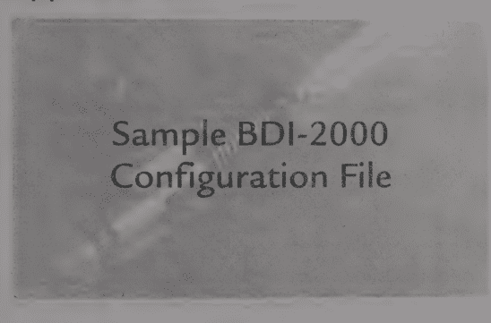

### BDI-2000 示例配置文件

```
; bdiGDB configuration file for the UEI PPC 5200 Board

; Revision 1.0

;Revision 1.1 (Added serial port setup)

--------------------------------------------------

; 4 MB Flash (Am29DL233)
; 128 MB Micron DDR DRAM

[INIT];

; init core register
WR$R  MSR   0x00003002  ;MSR : FP,ME,RI
WR$2  0x80000000  0x00808000  ;MBAR: internal registers at 0x80000000
         ; Default after RESET, MBAR sits at 0x80000000
         ; because it's FOR value is 0x0000_8000 ()
WSFR   311   0x80000000  ; MBAR: save internal register offset
                        ; SPR311 is the MBAR in G2_LE
WSFR   279   0x80000000  ;SPRG7: save internal memory offsetReg: 279
; Init CDM (Clock Distribution Module)
; Hardware Reset config {
;  ppc_pll_cfg0.4]= 01000b
;   XLB:Core -> 1:3
;   Core:f(WCO)-> 1:2
;   XLB:f(WCO)-> 1:6
;
; xlb_clk_sel = 0 -> XLB_CLK=f(sys)/ 4 = 132 Mhz
;
;  sys_pll_cfg_1 = 0 -> NOP
; sys_pll_cfg_0 = 0 -> f(sys) = 16x SYS_XTAL_IN = 528 Mhz
;
;
; CDM Configuration Register
WR$2  0x8000200c  0x01000101
      ; enable DDR Mode
      ; ipb_clk_sel = 1 -> XLB_CLK/ 2 (ipb_clk = 66 Mhz)
      ; pci_clk_sel = 01 -> IPB_CLK/2
; CS0 Flash
WR$2  0x80000004  0x0000fe00  ;CS0 start = 0xff000000 - Flash memory is on
CS0
WR$2  0x80000008  0x0000ffff  ;CS0 stop = 0xffffff
; IPBI Register and Wait State Enable
WR$2  0x80000054  0x00050001  ;CSB: enable CS0, disable CSBOOT,
                              ;Wait state enable\,
                              ; CS2 also enabled
WM$2  0x8000300  0x0004d530  ;BOOT ctrl
```


; bits 0-7: `WaitP` (try `0xff`)

; bits 8-15: `WaitX` (try `0xff`)

; bit 16: Multiplex or non-mux'ed (`0x0` = non-muxed)

; bit 17: reserved (Reset value = `0x1`, keep it)

; bit 18: Ack Active (`0x0`)

; bit 19: CE (Enable) `0x1`

; bits 20-21: Address Size (`0x11` = 25/6 bits)

; bits 22:23: Data size field (`0x01` = 16-bits)

; bits 24:25: Bank bits (`0x00`)

; bits 26-27: WaitType (`0x11`)

; bits 28: Write Swap (`0x0` = no swap)

; bits 29: Read Swap (`0x0` = no swap)

; bit 30: Write Only (`0x0` = read enable)

; bit 31: Read Only (`0x0` = write enable)

### CS2 Logic Registers

```
WM32 0x80000014 0x0000e00e
WM32 0x80000018 0x0000efff
```

; LEDs:

; LED1 - bits 0-7

; LED2 - bits 8-15

; LED3 - bits 16-23

; LED4 - bits 24-31

; off = `0x01`

; on = `0x02`

```
mm 0xe00e2030 0x02020202 1
```
all on

```
mm 0xe00e2030 0x01020102 1
```
2, on off

```
WM32 0x8000308 0x0045b30
```
; CS2 Configuration Register

; bits 0-7: WaitP (try `0xff`)

; bits 8-15: WaitX (try `0xff`)

; bit 16: Multiplex or non-mux'ed (`0x0` = non-muxed)

; bit 17: reserved (Reset value = `0x1`, keep it)

; bit 18: Ack Active (`0x0`)

; bit 19: CE (Enable) `0x1`

; bits 20-21: Address Size (`0x10` = 24 bits)

; bits 22:23: Data size field (`0x11` = 32-bits)

; bits 24:25: Bank bits (`0x00`)

; bits 26-27: WaitType (`0x11`)

; bits 28: Write Swap (`0x0` = no swap)

; bits 29: Read Swap (`0x0` = no swap)

; bit 30: Write Only (`0x0` = read enable)

; bit 31: Read Only (`0x0` = write enable)

```
WM32 0x80000318 0x01000000
```
; Master LFC Enable

### init SDRAM controller

; For the UEI PPC 5200 Board,

; Micron 46V32M16-7SE (8 MEG x 16 x 4 banks)

; 64 MB per Chip, for a total of 128 MB

; arranged as a single *space* (i.e. 1 CS)

; with the following configuration:

; 8 Mb x 16 x 4 banks

; Refresh count: 8K (A0..12) 13 bits

; Row addressing: 8K (A0..9) 10 bits

; Bank Addressing: 4 (BA0..1) 2 bits

; Key Timing Parameters: (−75℉)

; Clockrate (CL=2) 133 Mhz

; DO Window 2.5 ns

; Access Window: +/- 75 ns

; DQS − DQ Skew: +0.5 ns

; t(REFI): 7.8 us MAX

; Initialization Requirements (General Notes)

; The memory Mode/Extended Mode registers must be

; initialized during the system boot sequence. But before

; writing to the controller Mode register, the mode_en and

; cke bits in the Control register must be set to 1. After

; memory initialization is complete, the Control register

; mode_en bit should be cleared to prevent subsequent access

; to the controller Mode register.

; SDRAM init sequence

; 1) Setup and enable chip selects

; 2) Setup config registers

; 3) Setup TAP Delay

; Setup and enable SDRAM CS

```
WM32 0x8000034 0x000001a
```
;SDRAM CS0, 128MB @ `0x00000000`

```
WM32 0x8000038 0x0800000
```
;SDRAM CS1, disabled @ `0x08000000`

```
WM32 0x8000108 0x73723930
```
;SDRAM Config 1 Samsung

; Assume CL=2

; bits 0-3: srdr2zp in clocks (`0x6`)

; bits 507: swt2rwp: in clocks -> Data sheet suggests

; 0x3 for DDR (`0x3`)

; bits 8-11: rd_latency -> for DDR `0x7`

; bits 13-15: act2rw -> `0x2`

; bit 16: reserved

; bits 17-19: prereact -> `0x2`

; bits 20-23: ref2act -> `0x09`

; bits 25-27: wr_latency -> for DDR `0x03`

; bits 28-31: Reserved

```
WM32 0x800010c 0x46770000
```
;SDRAM Config 2 Samsung

; bits 0-3: bdr2zp -> for DDR `0x4`

; bits 4-7: bwt2rwp -> for DDR `0xf`

; bits 8-11: bdrd2wt -> `0x6`

; bits 12-15: burst_length -> `0x07` (bl - 1)

; bits 16-13: Reserved

; Setup initial Tap delay

```
WM32 0x80000204 0x18000000
```
; Start in the end of the range (24 = `0x18`)

Samsung

```
WM32 0x80000104 0xf10f0f00
```
;SDRAM Control (was `0xd14f0000`)

; bit 0: mode_en (1=write)

; bit 1: cke (MEM_CLK_EN)

; bit 2: ddr (DDR mode on)

; bit 3: ref_en (Refresh enable)

; bits 4-6: Reserved

; bit 7: hi_addr [XIA[4:7] as row/col

; must be set to 11 'cuz we need 13 RA bits

; for the Micron chip above

; bit 8: reserved

; bit 9: drive_rule - `0x0`

; bit 10-15: ref_interval, see UM `0x0f`

; bits 16-19: reserved

; bits 20-23: dgs_oel[3:0] (not sure)


## SDRAM 控制

`; but I think this is req'd for DDR 0xf`

`; bits 24-28: Reserv'd`

`; bit 29:'1 = soft refresh`

`; bit 30 1 = soft_precharge`

`; bit 31: reserved`

`WM32`   `0x80000104`  `0xf10f0f02` ;SDRAM Control: precharge all

`WM32`   `0x80000104`  `0xf10f0f04` ;SDRAM Control: refresh

`WM32`   `0x80000104`  `0xf10f0f04` ;SDRAM Control: refresh

`WM32`   `0x80000100`  `0x01800000`  ; SDRAM Mode Samsung

`reg` `0x0`

`; bits 0-1: MEM_MRA - selects std or extended MODE`

`; bits 2-13: MEM_MA (see DDR DRAM Data sheet)`

`; bits 2-7: Operating Mode -> 0x0 = normal`

`; bits 8-10: CAS Latency (CL) -> Set to CL=2 for`

`DDR` (`0x2`)

`; bit 11: Burst Type: Sequential for PMS5200 ->`

`0x0`

`; bits 12-14: Set to 8 for RPC5200 -> 0x3`

`; bit 15: cmd = 1 for MODE REG WRITE`

`WM32`    `0x80000104`  `0x710f0f00` ;SDRAM Control: Lock Mode Register (was
`0x514f0000`)

### Initialize the serial port

`; Pin Configuration`

`WM32`  `0x00000b00`  `0x00008004`  ; UART1

`; Reset PSC`

`WB8`   `0x80002008`  `0X10`  ; Reset - Select MRL

`WM16`  `0x80002004`  `0`   ; Clock Select Register - 0 enables both Rx &
Tx Clocks

`WM32`   `0x80002040`   `0`             ; STCR - UART Mode

`WM32`   `0x80002000`   `0x13`          ; Write MR1 (default after reset)
                                      ; 8-bit, no parity

`WM32`   `0x80002000`   `0x07`          ; Write MR2 (after MR1) (one stop bit)

`WM32`   `0x80002018`   `0x0`           ; Counter/Timer Upper Reg (115.2KB)

`WM32`   `0x8000201c`   `0x12`          ; Counter/Timer Lower Reg (divider = 18)

`; Reset and enable serial port Rx/Tx`

`WM32`   `0x80002008`   `0x20`

`WM32`   `0x80002008`   `0x30`

`WM32`   `0x80002008`   `0x05`

`; define maximal transfer size`

`TSZ4`   `0x80000000`   `0x80003FFF`   ; internal registers

`; define the valid memory map`

`MMAP`   `0x00000000`   `0x07ffffff`   ; Memory range for SDRAM

`MMAP`   `0xF8000000`   `0x3ffffff`    ; ROM space

`MMAP`   `0xE0000000`   `0xE000eFFF`   ; PowerPC logic

`MMAP`   `0x80000000`   `0x8fffffff`   ; Default MBAR

`MMAP`   `0xC0000000`   `0XCfffFFFF`   ; Linux Kernel

## TARGET

`CPUType`    `5200`          ; CPU 类型
`JTAGClock`  `0`             ; 使用 16 MHz JTAG 时钟
`WORKSPACE`  `0x80008000`    ; 用于快速下载的地址空间
`Wakeup`     `1000`          ; 给予复位完成时间
`Startup`    `reset`
`Memdelay`   `-2000`         ; 额外的内存访问延迟
`BootAddr`   `0xffe00100`
`RegList`    `All`
`DebugMode`  `Soft` ; 或 hard
`PowerUp`    `1000`
`WakeUp`     `500`
`MMU`        `XLAT`
`PTBase`     `0x000000f0`

## HOST

`IP`       `192.168.1.9`
`Format`   `elf`
`Load`     `manual`          ; 手动加载代码或在复位后自动加载
`Prompt`   `uei>`

## FLASH

`ChipType`  `AM29BX16`      ; Flash 类型 (AM29F | AM29BX8 | AM29BX16 | I28BX8 | I28BX16)
`ChipSize`  `0x00400000`    ; 单个 flash 芯片的字节大小
`Buswidth`  `16`            ; flash 内存总线的位宽 (8 | 16 | 32)

## WORKSPACE

`WORKSPACE` `0x80008000` ;内部 SRAM 中的工作空间

`FILE` `u-boot.bin`

`FORMAT` `BIN` `0xFFFF00000`

`ERASE` `0xFFF00000` ;擦除闪存的一个扇区

`ERASE` `0xFFF10000` ;擦除闪存的一个扇区

`ERASE` `0xFFF20000` ;擦除闪存的一个扇区

`ERASE` `0xFFF30000` ;擦除闪存的一个扇区

`ERASE` `0xFFF40000` ;擦除闪存的一个扇区

## REGS

`FILE` `$reg5200.def`


# 索引

页码后跟 `$n$` 表示脚注。

### 符号

- `/arch` 子目录，移植 Linux，422-424
- `@`（at 符号），333
- `/etc/exports` 文件，230-231
- `/`（正斜杠），132
- `.`（句点），223
- `+`（加号），333
- `/proc` 文件系统，234-238
  - cpuinfo 条目，238
  - init 进程，236-237
  - maps 条目，237
  - 挂载依赖，235
  - 挂载，235
- `$T` 数据包，363
- `/workspace` 目录，挂载，231
- 32 位，38$n$
- 64 位，38$n$
- 855GM 芯片组，41

### A

- AMCC PowerPC 处理器，44-46
- AMD MIPS 处理器，55
- apache 包，32
- applets，286
- 应用程序
  - 调试
    - 附加到运行中的进程，418
    - 通过串行端口，418
  - Flash 驻留代码，调试，417
  - 多进程，调试，411-414
  - 多线程应用程序，调试，414-417
  - 带共享库，调试，405-411
  - 目标应用程序
    - 调试，400
    - 使用 gdbserver 调试，403-405
    - 去符号化，400-403
- `/arch` 子目录，移植 Linux，422-424
- 架构分支，移植 Linux，422-424
- 架构对象，复合内核镜像，104-105
- 架构
  - 硬件架构示例（嵌入式系统），12-13
  - 初始化控制流，114
  - Linux 支持的架构，60-61
- 访问权限，26
- `add-symbol-file` 命令，379
- `addr2line`，346-347
- 地址断点，389
- 地址空间，25-26
- 高级电信计算架构 (ATCA) 平台，61-62
- Alchemy 处理器，55
- AltiVec 硬件，41
- ARM 处理器，56, 60
  - Freescale ARM 处理器，58–59
  - Intel ARM XScale 处理器，59–60
  - TI ARM 处理器，56–57
- at 符号 (@)，333
- ATCA 平台，61–62

### B

- `backtrace` 命令，314
- BDI-2000 示例配置文件，506–511。参见 ITAG 探针
- `bd_info` 结构体，437
- 大内核锁 (BKL)，453
- `bin` 目录，132
- 二进制实用工具，340
  - `addr2line`，346–347
  - `ldd`，347–348
  - `nm`，348
  - `objcopy`，345–346
  - `objdump`，344–345
  - `prelink`，349
  - `readelf`，340–344
  - `strings`，347
  - `strip`，346
- `binutils`，340
- BIOS，与引导加载程序的区别，11–12
- `bi_record` 结构体，437
- BKL（大内核锁），453
- 块设备，192
- 块大小，217
- 板级特定信息，移植 Linux，436–437
- 板级特定初始化
  - MTD，263–265
  - U-Boot 移植示例，177–180
- 板。参见硬件平台；U-Boot 移植
- 引导块 Flash 芯片，20
- 启动消息，106–109
- 启动。参见构建系统（内核）；初始化
  - 调试启动过程，417
  - 转储打印日志缓冲区，394–396
  - 串行调试输出，393–394
  - 使用 KGDB 捕获崩溃，396–397
- 使用 U-Boot 从磁盘启动，171
- `initrd`，146–149
- 启用 KGDB 启动，355–358

### bootloaders

- 与 BIOS 的区别，11–12
- 启动内核，16–17
- 与自举加载程序的区别，105
- DRAM 控制器设置，159–160
- 执行上下文，163–164
- GRUB，184, 186
- 镜像编译和链接，160–163
- 初始化控制流，109–110
  - 架构设置，114
  - `head.o` 模块，111–113
  - `main.c` 模块，113
- 与 `initrd`，146–149
- Lilo，183–184
- 内存地址，434
- 非易失性存储与 RAM，160
- 移植 Linux 先决条件，426
- 作用，158–159
- 选择，186
- 启动目标板，15–16
- U-Boot，164
- 从磁盘启动，171
- 启用 KGDB 启动，357
  - 命令集，167
  - 可配置命令，480
  - 配置，164–166
  - 使用 ITAG 探针调试，390
- 镜像格式，181-182
- `initrd` 支持，147-149
- 内核，启动，16-17
- 网络协议，167-170
- NFS 根挂载示例，304-306
- 非易失性存储，170-171
- 移植，172-181
- 目标板，启动，15-16
- `boom` 命令，17
- BOOTP（引导协议），U-Boot 网络操作，167-170
- BOOTP 服务器，托管目标板，298-300
- 自举加载程序，105-106
- 下半部分处理，448
- 断点
  - 硬件断点与软件断点，392
  - 使用 KGDB，358-360
  - 远程调试，361-364
  - 类型，389
- Broadcom MIPS 处理器，53-54
- 浏览 `sysfs` 文件系统，239-240
- 构建编号，109
- 构建输出（内核），71-73
- 构建系统（内核），79
  - 复合内核镜像，100-102
  - 架构对象，104-105
  - 启动消息，106-109
  - 自举加载程序，105-106
  - Image 对象，103
  - 配置编辑器，82-85
  - dot-config 文件，80-82
  - Kconfig 文件，88-94
  - makefile 目标，85-88
  - makefiles，94-95
- 构建
  - 设备驱动程序，193-197
  - 文件系统，242-243
    - cramfs，228-229
    - JFFS2，227-229
  - `initrd` 镜像，151-152
  - MTD（存储技术设备）
    - 服务，250-251
    - 根文件系统，135
- BusyBox，274-275
  - 命令，286-287, 484
  - 配置，275-277
  - 交叉编译，277
  - 定义，133
  - 示例 rcS 初始化脚本，283-284
  - 可执行文件，280
  - init，281-283
  - 操作，278-280
  - 根文件系统，281-284
  - 目标安装，284-286
- `busybox` 包，32
- `bzlImage` 目标，85

### C

- 运营商级 Linux，标准，6
- `cbrowser`，319-320
- CFI（通用闪存接口）驱动程序，256-257
- 字符设备，192
- 子进程，调试，413
- chipsnets，41-43
- SDRAM 时钟，494-495
- 命令行，内核命令行，114-121
- 命令集，U-Boot，167
- 命令行分区（MTD），259-260
- 命令
  - `backtrace`，314
  - BusyBox，286-287, 484
  - 可配置命令，U-Boot，480
  - `continue`，316
  - `fs list`，255-256
  - `gdb frame`，314
  - `gdb print`，313
  - `mkfs.jffs2`，227
  - 用户定义命令
    - 列表，370-378
    - `.gdbinit` 文件，369-370
- `module_init()`，262
- 商业嵌入式 Linux
  - 发行版，33
- 通用闪存接口（CFI）驱动程序，256-257
- CompactFlash 模块，20
- CompactPCI 平台，61
- 编译器，交叉开发环境，30-32
- 编译
  - 引导加载程序镜像，160-163
  - 内核，71-73
  - 编译期间的优化，353
- 复合内核镜像，100-102
  - 架构对象，104-105
  - 启动消息，106-109
  - 自举，105-106
  - Image 对象，103
- `.config` 文件，80-82。参见配置文件；内核配置
- MTD（存储技术设备）
  - 配置，248-249
  - 可配置命令，U-Boot，480
- 配置
  - BusyBox，275-277
  - KGDB，355
  - 内核配置，Kconfig 文件，88-94
  - MTD（存储技术设备）
    - 服务，248-250
    - 子系统，253
  - U-Boot，164-166
- 配置编辑器，82-85
- 配置文件
  - BDI-2000 示例配置文件，506-511
  - JTAG 探针，387
- 配置规则，U-Boot 移植示例，174
- `CONFIG_MTD_CHAR` 元素（MTD 配置），249
- `CONFIG_SERIAL_TEXT_DEBUG`，393-394
- 连接
  - 到 KGDB，358
  - JTAG 探针，386
- 上下文。参见执行上下文
- `continue` 命令，316
  - 远程调试，361
- 控制器（SDRAM），设置，495-500
- 控制器板。参见硬件平台
- 转换
  - 将 ext2 文件系统转换为 ext3 文件系统，222-223
  - 将自旋锁转换为互斥锁，455
- 核心转储，调试，311-313
- Coreyote，板级 MTD 初始化，264
- `coryte_init()` 函数，264
- `cPCI` 平台，61
- `cpuno` 条目（`/proc` 文件系统），238
- CPU，移植 U-Boot。参见 U-Boot 移植

# 索引

- `cramfs` 文件系统，228-230
  - 创建，228-229
  - 目录结构，229
- 崩溃，使用 KGDB 进行追踪，396-397
- 临界区
  - 实时内核补丁中的管理，459-460
  - 防止内核抢占，449-451
- 交叉编译 BusyBox，277
- 交叉调试。参见 远程调试
- 交叉开发环境，30-32，290-291
  - 你好世界（嵌入式），291-294
- `cscope`，320
- 自定义配置选项，90-94
- 自定义化
  - 内核初始化，427-429
  - 平台特定代码，360-361
- 磁道，216n

### D

- Das U-Boot。参见 U-Boot
- 数据断点，389
- `dd` 实用工具，242
- DDD（数据显示调试器），317-319
- 死锁条件，调试，466
- 调试会话
  - DDD，319
  - GDB，315-317
- `initcalls` 中的调试语句，125
- 调试
  - 应用程序
    - 附加到运行中的进程，418
    - 驻留 Flash 的代码，417
    - 多进程，411-414
    - 多线程，414-417
    - 远程调试，400-405
    - 通过串行端口，418
  - 使用共享库，405-411
  - 目标应用程序，400
  - 核心转储，311-313
  - 硬件辅助调试，296
  - 内核
    - 挑战，352-353
    - 自定义平台特定代码，360-361
    - 转储 printk 日志缓冲区，394-396
    - `.gdbinit` 文件，369-370
    - 使用 JTAG 探针，385-392
    - 使用 KGDB，353-360，396-397
    - 可加载模块，调试，378-383
    - 宏，列表，370-378
    - 使用 Magic SysRq 键，384-385
    - 优化与，364-369
    - 使用 printk 函数，383-384
    - 远程调试，361-364
    - 串行调试输出，393-394
    - 实时内核，460
      - 死锁条件，466
      - 中断关闭历史，462-464
      - 中断关闭时序，462
      - 延迟追踪，464-466
      - 抢占调试，461
      - 锁定模式的运行时控制，467
      - 软锁定检测，460
      - 唤醒延迟历史，462
      - 唤醒时序，461
- 默认内核命令行，429-431
- 删除，配置文件，80
- Denk, Wolfgang，164
- 依赖项
  - `dempod` 实用工具，203
  - 解决，138
- `dempod` 实用工具，203
- 衍生作品，211

### D（续）

- `detach` 命令，418
- 检测 Redboot 分区，256
- `dev` 目录，132
- 开发设置示例（嵌入式 Linux），14
- 设备驱动程序，81。另参见 可加载模块
  - 块设备，192
  - 构建基础设施，193–197
  - 字符设备，192
  - 设备节点，208–209
  - 测试，209–210
  - GPL 与，211
  - 安装，197–198
  - 加载和卸载，198–199
  - 主设备号，207
  - 方法，205–207
  - 最小设备驱动程序示例，192–193
  - 次设备号，209
  - 目的，190
  - 实用工具，199
- `depmod`，203
- `insmod`，199
- `lsmod`，201
- `mkmod`，208–209
- `modinfo`，204
- `modprobe`，201–202
- 参数，199–201
- `rmmod`，203–204
- 设备节点，208–209
- DHCP（动态主机控制协议），U-Boot 网络操作，167–170
- DHCP 服务器，托管目标板，298–300

- 目录
  - 安装设备驱动程序，197–198
  - 内核中的子目录，79
  - 顶级源目录，70–71
- 磁盘子系统，使用 U-Boot 从其中引导，171
- 发行版工程，134–135
- 发行版，32–34
- `dramillo`，334–337，400
- 自制嵌入式 Linux 发行版，34
- 内核文档，95
- `dot-config` 文件，80–82。另参见 配置文件；内核配置
  - MTD（存储技术设备）配置，248–249
- DRAM 控制器，设置，159–160
- 驱动程序。另参见 设备驱动程序
  - CFI（通用 Flash 接口）驱动程序，256–257
  - MTD Flash 芯片驱动程序，262–263
  - MTD 映射驱动程序，260–262
- 动态主机控制协议（DHCP），U-Boot 网络操作，167–170
- 动态随机存取存储器（DRAM）控制器，设置，159–160
- 动态可加载模块，81

### E

- `e2fsck` 实用工具，219–221
  - 干净文件系统检查，219
  - 损坏文件系统检查，220–221
- `e600` 核心，40–41
- 早期串行调试输出，393–394
- 早期变量访问，435–436

- **ELDK（嵌入式 Linux 开发工具包）**，293-295
- 嵌入式 Linux。另参见 嵌入式系统；Linux
  - 优点，2-3
  - 所需组件，96
  - 开发设置示例，14
  - 发行版，32-34
  - 使用统计，3
- 嵌入式 Linux 开发工具包（ELDK），293-295
- 嵌入式系统
  - BIOS 与引导加载程序，11-12
  - 特征，10-11
  - 交叉开发环境，30-32
  - 硬件架构示例，12-13
  - 内核
    - 引导，16-17
    - 初始化，17-18
    - 用户空间进程，19
  - 处理器。参见 处理器
  - 其中的存储，19
    - 地址空间，25-26
    - 执行上下文，26-28
  - Flash 文件系统，24
  - Flash 存储器，20-24
    - NAND Flash 存储器，22
  - 进程虚拟内存，28-30
  - 目标板，启动，15-16
- 启用
  - KGDB，355-358
  - MTD（存储技术设备）
    - 服务，248-250
  - 远程调试，361-364
- 环境，交叉开发环境，290-294

- **EP405 板（U-Boot 移植示例）**，172-181
  - 板级特定初始化，177-180
  - makefile 配置规则，174
  - 处理器初始化，174-177
- **擦除块（Flash 存储器）**，20-21
- **etc 目录**，132
- **/etc/exports 文件**，230-231
- 事件，GDB 中的共享库事件，407-411
- **可执行文件**，BusyBox，280
- **执行上下文**，26-28
  - 引导加载程序，163-164
- **execve() 函数**，136
- **测试设备驱动程序**，209-210
- **exports 文件（etc 目录）**，230-231
- **ext2 文件系统（第二代扩展文件系统）**，216
  - 完整性检查，219-221
    - 干净文件系统检查，219
    - 损坏文件系统检查，220-221
  - 转换为 ext3，222-223
  - inodes，221n
  - 挂载，218
  - 将 MTD Flash 分区挂载为，267
  - 分区，格式化，216, 218
- **ext3 文件系统（第三代扩展文件系统）**，221
  - 将 ext2 文件系统转换为，222-223
  - 定义，221
  - 日志文件，223-224

### F

- **fdisk 实用工具**，215-216
- **FHS（文件系统层次结构标准）**，131

- 设备驱动程序的文件系统操作方法，205-207

- 文件系统，214
  - 构建，242-243
  - crAMFS，228-230
    - 创建，228-229
    - 目录结构，229
  - ext2（第二代扩展文件系统），216
    - 完整性检查，219-221
    - 转换为 ext3，222-223
    - 挂载，218
    - 将 MTD Flash 分区挂载为，267
    - 分区格式化，216-218
  - ext3（第三代扩展文件系统），221
    - 将 ext2 文件系统转换为，222-223
    - 定义，221
    - 日志文件，223-224
  - Flash 文件系统，24
  - 硬盘分区
    - 块大小，217
    - 定义，214
    - 显示信息，215-216
    - 格式化，216-218
    - 类型，215
  - inodes，221n
  - JFFS2（日志型 Flash 文件系统），225-228
    - 构建，227
    - 在 MTD 子系统上创建，268-270
    - 目录结构，226
    - 在 MTD 子系统上挂载，251-253
  - 日志型文件系统，222
  - NFS（网络文件系统），230-232
    - /etc/exports 文件，230-231
    - 内核配置，233-234
    - 挂载，231
    - 根文件系统，232-234
  - /proc，234-238
    - cpuinfo 条目，238
    - 初始化进程，236-237
    - maps 条目，237
    - 挂载依赖，235
    - 挂载，235
  - ramfs，240-241
  - ReiserFS，224
  - 根文件系统
    - 构建，135
    - 定义，130
    - 发行版工程，134-135
    - FHS（文件系统层次结构标准），131
    - 最小文件系统，132-134
    - 挂载，18, 32
    - 顶级目录，131-132
  - sysfs，238-240
    - 浏览，239-240
    - 顶级目录，238-239
  - tmpfs，241

- 文件
  - dot-config 文件，80-82
    - MTD（存储技术设备）配置，248-249
  - ext3 日志文件，223
    - 隐藏文件，223
    - 列表，223

- find, next_task 宏，376-377
- find_task_task 宏，371-372
- fis list 命令，255-256
- Flash 芯片驱动程序（MTD），262-263
- Flash 文件系统，24

### F

- Flash Image System 命令，255-256
- Flash 内存，20-22
  - NAND Flash，22
  - 用法，23-24
- 使用 JTAG 探针进行 Flash 编程，387-388
- 驻留在 Flash 中的代码，调试，417
- flashcp 实用工具 (MTD)，266-267
- flash* 实用工具 (MTD)，265
- flash_erase 实用工具 (MTD)，265-266
- 控制流 (初始化)，109-110
  - 架构设置，114
  - head.o 模块，111-113
  - main.c 模块，113
- fork() 系统调用，多进程调试，411-414
- 分区格式化，216-218
- 正斜杠 (/)，132
- free，与 freedom 的区别，4-5
- freedom，与 free 的区别，4-5
- Freescale ARM 处理器，58-59
- Freescale MPC7448 处理器，40-41
- Freescale PowerPC 处理器，47-52
- 函数
  - coyote_init()，264
  - init_pq2fads_mtd()，262
  - 内联函数，353
  - 内核调试及其关系，364-369
  - physmap_configure()，262

### G

- G4 核心，Freescale MPC7448 处理器，40-41
- GCC，优化，353
- GDB (GNU 调试器)，310-311
  - 参见 also debugging
  - 核心转储，311-313
  - 作为交叉调试器，404
  - 调试会话，315-317
  - 与 JTAG 探针的接口，389-392
  - 调用，313-315
  - KGDB (内核 GDB)，353-354
    - 启用 KGDB 启动，355-358
    - 断点，358-360
    - 内核配置，355
    - 捕获崩溃，396-397
  - 共享库事件，407-411
- gdb frame 命令，314
- gdb print 命令，313
- .gdbinit 文件，369-370
- gdbserver，403-405
  - 附加到运行中的进程，418
- General Public License. 参见 GPL
- glibc 包，32
- GNU Debugger. 参见 GDB
- GNU gnu license (GPL)，470-477
- GPL (General Public License)，3-5
  - 设备驱动及其关系，211
- GPL (GNU 通用公共许可证)，470-477
- GRUB (GRand Unified Bootloader)，184-186

### H

- 硬盘
  - 柱面，216
  - 分区
    - 块大小，217
    - 定义，214
    - 显示信息，215-216
    - 格式化，216-218
    - 类型，215
- 硬实时，446-447
- 硬件架构示例 (嵌入式系统)，12-13
- 硬件断点，389
  - 与软件断点的对比，392
- 硬件平台，61
  - ATCA，61–62
  - 板级特定初始化
  - MTD，263–265
  - U-Boot 移植示例，177–180
  - CompactPCI，61
  - 将 Linux 移植到，424–425
  - 板级特定信息，436–437
  - 定制内核初始化，427–429
  - 默认内核命令行，429–431
  - 早期变量访问，435–436
  - 最终步骤，439–442
  - 机器相关调用，438–439
  - 平台初始化，431–434
  - 先决条件，426
- 硬件辅助调试，296
- 硬件调试探针，使用其进行内核调试，385–387
  - gdb 与 JTAG 探针的接口，389–392
  - 编程 Flash，387–388
- head.o 模块，初始化控制流，111–113
- hello world (嵌入式)，交叉开发环境，291–294
- Hennessey, John，52
- 隐藏文件，223
- 宿主系统要求，295
- 托管目标板，296
  - BOOTP 服务器，298–300
  - DHCP 服务器，298–300
  - NFS 服务器，300–302
  - 目标 NFS 根挂载，302–303
  - TFTP 服务器，296–297
  - U-Boot NFS 根挂载，304–306

### I

- IBM 970FX 处理器，39
- image (内核). 参见 vmlinux (内核主体)
- U-Boot 的映像格式，181–182
- Image 对象，复合内核映像，103
- 映像，引导加载程序映像，编译和链接，160–163
- include 文件，交叉开发环境，30–32
- 增量链接，81
- init 宏，120
- init 进程
  - BusyBox，281–283
  - 在内核引导过程中，136–139
  - inittab，142–144
  - /proc 文件系统，236–237
  - 运行级别，139–142
  - 启动脚本示例，144–145
  - 用户空间进程，19
- init 线程，123–124
  - 最终引导步骤，126–127
  - initcalls 及其关系，125–126
- initcall 宏，122–123
- initcalls，通过其进行初始化，125–126
- initial RAM disk. 参见 initrd
- 初始化
  - 板级特定初始化，U-Boot 移植示例，177–180
  - init 线程，123–124
    - 最终引导步骤，126–127
    - initcalls 及其关系，125–126
  - 使用 JTAG 探针，386
  - 内核初始化. 参见 kernel，初始化
  - 平台初始化，移植 Linux，431–434
  - 处理器初始化，U-Boot 移植示例，174–177
  - 子系统初始化，121–123
  - 系统初始化. 参见 system initialization
- 初始化代码，调试可加载模块，381–383
- 初始化文件，gdb，369–370
- 初始化控制流，109–110
  - 架构设置，114
  - head.o 模块，111–113
  - main.c 模块，113
- initramfs，152–153
- initrd，145–146
  - 引导，146–149
  - 构建映像，151–152
  - 与 initramfs 的对比，152–153
  - linuxrc 文件及其关系，149–150
  - 挂载根文件系统，150–151
- init 脚本包，32
- inittab 系统配置文件，142–144
- init_pq2fads_mtd() 函数，262
- init_task 全局变量，370
- 内联函数，353
  - 内核调试及其关系，364–369
- inode，221
- insmod 实用工具，199
- 安装
  - BusyBox
    - 在根文件系统上，285
    - 目标安装，284–286
  - 设备驱动，197–198
- 集成处理器，43
  - AMCC PowerPC，44–46
  - AMD MIPS，55
  - ARM，56, 60
  - Broadcom MIPS，53–54
  - Freescale ARM，58–59
  - Freescale PowerPC，47–52
  - Intel ARM XScale，59–60
  - Linux 支持的架构，60–61
  - MIPS，52–53, 56
  - PowerPC，44
  - TI ARM，56–57
- 文件系统完整性，ext2 文件系统，219–221
  - 清洁文件系统检查，219
  - 损坏文件系统检查，220–221
- Intel Pentium M 处理器，39–40
- Intel ARM XScale 处理器，59–60
- interrupt off history，启用，462–464
- interrupt off timing，启用，462
- interrupt service routine (ISR)，28, 447
- 中断，延迟与实时，447–448
- 调用 GDB，313–315
- ioctl() 方法 (设备驱动)，205
- ISR (interrupt service routine)，28, 447
- ISR 线程化，455–456

### J

- JPEG 支持，262
- JFS2 (Journaling Flash File System 2)，24, 225–228
  - 构建，227–228
  - 在 MTD 子系统上创建，268–270
  - 目录结构，226
  - 在 MTD 子系统上挂载，251–253
- journal 文件 (ext3)，223–224
- 日志文件系统，222
  - ext3
    - 将 ext2 文件系统转换为此，222
    - 定义，221
    - journal 文件，223–224
  - JFFS2 (Journaling Flash File System 2)，24, 225–228
    - 构建，227–228
    - 在 MTD 子系统上创建，268–270
    - 目录结构，226
    - 在 MTD 子系统上挂载，251–253
  - ReiserFS，224
- Journaling Flash File System 2. 参见 JFFS2
- JTAG 探针
  - BDI-2000 示例配置文件，506–511
  - 使用其进行内核调试，385–387
  - gdb 与 JTAG 探针的接口，389–392
  - 编程 Flash，387–388

### K

- Kbuild. 参见 build system (kernel)
- Kconfig 文件，88–90
  - 自定义选项，90–94
- 内核
  - 架构分支，移植 Linux，422–424
  - 引导，16–17
  - 构建系统，79
  - 复合内核映像，100–109
  - 配置
    - 编辑器，82–85
    - dot-config 文件，80–82
    - Kconfig 文件，88–94
    - makefile 目标，85–88
    - makefiles，94–95
    - MTD (Memory Technology Devices) 子系统，250–251
    - NFS (Network File System)，233–234
  - 调试
    - 挑战，352–353
    - 定制平台特定代码，360–361
    - 转储 printk 日志缓冲区，394–396
    - .gdbinit 文件，369–370
    - 使用 JTAG 探针，385–392
    - 使用 KGDB，353–360, 396–397
    - 可加载模块调试，378–383
    - 宏，列表，370–378
    - 使用 Magic Sysrq 键，384–385
    - 优化及其关系，364–369
    - 使用 printk 函数，383–384
    - 远程调试，361–364
    - 串行调试输出，393–394
  - 默认内核命令行，429–431
  - 文档，95
  - init 进程，136–139
  - init 线程，123–124
    - 最终引导步骤，126–127
    - initcalls 及其关系，125–126
  - 初始化，17–18
    - 定制，427–429
    - 初始化控制流，109–110
      - 架构设置，114
      - head.o 模块，111–113
      - main.o 模块，113
  - 挂载根文件系统，150–151
  - 获取，96
  - 组织结构，70
    - 构建输出，71–73
    - 子目录，79
    - 顶级源目录，70–71
    - vmlinux (内核主体)，73–78
  - 实时内核，调试，460
    - 死锁条件，466
    - interrupt off history，462–464
    - interrupt off timing，462
    - 延迟跟踪，464–466

# 索引

### K

-   抢占调试, 461
-   锁定模式运行时控制, 467
-   软锁死检测, 460
-   唤醒延迟历史记录, 462
-   唤醒时序, 461
-   实时内核补丁, 453-455
    -   自旋锁转换为互斥量, 455
    -   创建实时进程, 458-459
    -   临界区管理, 459-460
    -   中断服务例程（ISR）线程化, 455-456
    -   O(1) 调度器, 458
    -   RCU（读-复制-更新）, 457
    -   SoftIRQ（软中断）线程化, 456-457

## S

-   源代码仓库, 69-70
-   子系统初始化, 121-123
-   用户空间进程, 19
-   版本, 67-69

### K

-   内核命令行, 114-121
-   内核上下文, 19, 27
-   内核 GDB。参见 KGDB
-   内核错误（Oops）, 337-340
-   内核抢占, 449
    -   相关模型, 451-452
    -   预防措施, 449-451
-   内核本体（vmlinuz）, 73-74
    -   组成部分, 75-78
-   复合内核映像, 100-102
    -   体系结构对象, 104-105
    -   启动消息, 106-109
    -   引导加载程序, 105-106
    -   Image 对象, 103
-   内核级自动配置, 303
-   KERNEL.BASE 常量, 343
-   KGDB（内核 GDB）, 353-354
    -   启用 KGDB 启动, 355-358
    -   断点, 358-360
    -   内核配置, 355
    -   捕获崩溃, 396-397
-   ksoftirqd 任务, 456

### L

-   延迟。另参见实时
    -   内核抢占模型, 451-452
    -   抢占延迟及其来源, 453
    -   实时相关, 447-448
-   启用延迟跟踪, 464-466
-   ldd 命令, 347-348
    -   共享库事件, 408-410
-   lib 目录, 132
-   库，调试共享库, 405-411
-   设备驱动程序许可, 211
-   Lilo, 183-184
-   行号，调试期间不匹配, 364-369
-   链接器命令脚本, 161-162
-   链接器脚本文件, 75
-   链接引导加载程序映像, 160-163

### L

-   Linux。另参见嵌入式 Linux
    -   发行版, 32-34
    -   GPL（通用公共许可证）, 3-5
    -   首次公告, 66-67
    -   标准
        -   Linux 标准基地（LSB）, 5
        -   开放源代码开发实验室（OSDL）, 5-6
-   Linux 文档项目, 95
-   Linux 内核开发（Love）, 453
-   Linux 内核。参见内核
-   Linux 加载程序（LILO）, 183-184
-   Linux 调度与实时, 447
-   Linux 标准基地（LSB）, 5
-   Linux 支持的体系结构, 60-61
-   linuxrc 文件与 initrd, 149-150
-   列出文件, 223

## 列表

-   向 hello.c 添加文件系统操作, 205
-   ../arch/arm/Kconfig 片段, 91
-   arch/arm/mach-ixp4xx/Kconfig 文件片段, 92
-   汇编文件页面, 104
-   默认内核命令行的 autoconfh 条目, 430
-   回溯命令, 314
-   基于 .config 的基本 MTD 配置, 248
-   启动支持 RAM 磁盘的内核, 148
-   以 JFFS2 作为根文件系统启动, 270
-   使用 U-Boot 启用 KGDB 启动, 357
-   使用 NFS 根挂载启动, 305
-   BusyBox 构建选项, 276
-   BusyBox 默认启动, 282
-   BusyBox gzip applet 用法, 287
-   BusyBox 库依赖项, 277
-   BusyBox 符号链接结构——顶层, 279
-   BusyBox 符号链接结构——树状详情, 280
-   BusyBox 用法, 278
-   调用早期机器初始化, 427
-   检查类似于 Linux 2.4 + 抢占补丁的抢占, 451
-   干净的文件系统检查, 220
-   常见内核断点, 359
-   默认内核命令行的配置, 430
-   PowerDNA 配置选项, 440
-   连接 KGDB, 358
-   控制台设置代码片段, 117
-   继续远程协议示例, 361
-   将 ext2 文件系统转换为 ext3 文件系统, 222
-   将 RootFS 转换为 JFFS2, 268
-   复制 JFFS2 到 RootFS 分区, 269
-   使用 GDB 分析核心转储, 312
-   正确的文件系统检查, 220
-   Coyote 特定板卡设置, 264
-   创建实时进程, 458
-   创建内核 init 线程, 124
-   自定义 .config 文件片段, 93
-   调试体系结构设置代码, 360
-   调试模块初始化代码, 382
-   默认交叉编译目录, 294
-   默认本地 cpp 搜索目录, 293
-   在 Linux 启动时检测 Redboot 分区, 256
-   DHCP 目标规范, 169
-   JFFS2 文件系统目录布局, 227
-   反汇编 yosemite_setup_arch 函数, 366
-   使用 objdump 进行反汇编, 344
-   使用 fdisk 显示分区信息, 216
-   使用 nm 显示符号, 348
-   dmalloc 日志调试, 336
-   原始 printk_log_buffer 转储, 395
-   早期串行文本调试, 393
-   示例程序的 ELF 文件调试信息, 401
-   擦除和编程 Flash, 388
-   /etc/exports 内容, 231
-   检查 cramfs 文件系统, 229
-   示例 DHCP 服务器配置, 299
-   示例驱动程序用法, 210
-   带参数的示例驱动程序, 200
-   示例跟踪输出, 327
-   测试我们的设备驱动程序, 209
-   ext2 文件系统映像创建, 242
-   ext3 日志文件, 223
-   外部总线控制器初始化, 177
-   来自 initch 的 __setup 宏定义族, 118
-   来自 main.c 的最终启动步骤, 136
-   来自 main.c 的最终内核启动步骤, 126
-   最终内核构建序列：ARM/IXP425, 101
-   Flash 设备列表, 219
-   使用 mke2fs 格式化分区, 217
-   来自 5200 平台文件的函数, 427
-   gdb find_next_task 宏, 376
-   gdb find_task 宏, 371
-   GDB follow-fork-mode = child, 413
-   GDB follow-fork-mode = parent, 412
-   gdb list modules 宏, 377
-   gdb 宏：打印进程信息, 372
-   GDB 线程操作, 416
-   gdb ps 宏输出, 373
-   gdb task_struct show 宏, 374
-   通用 PowerPC 机器函数, 438
-   grub.conf 示例配置文件, 185
-   Hello 输出, 29
-   Hello World，嵌入式风格, 29
-   Hello, World Again, 292
-   宿主 GDB 连接目标线程演示, 415
-   init 进程 /proc 条目, 236
-   来自 /proc 的 init 进程内存段, 237
-   initch 宏族, 122
-   初始引导加载程序串行输出, 15
-   初始目标内存段映射, 406
-   初始化例程示例, 121
-   通过 initchalls 进行初始化, 125
-   启动模块调试会话：loop.ko, 380
-   启动 GDB 调试会话, 316
-   initr 示例内容, 151
-   initab 简单示例, 142
-   在根文件系统上安装 BusyBox, 285
-   中断关闭延迟历史记录（头部）, 463
-   中断关闭最大延迟跟踪, 465
-   调用 cross-gdb, 405
-   ARM 体系结构 Kconfig 部分列表, 89
-   用于示例的 Kconfig 补丁, 194
-   内核构建输出, 72
-   内核命令行 MTD 分区格式, 260
-   内核命令行处理, 119
-   内核包含文件 ...include/linux/version.h, 68
-   内核 iniramfs 构建目录, 153
-   内核 MTD Flash 分区, 258
-   内核 MTD 分区列表, 266
-   Kernel Ops, 338
-   内核子目录, 79
-   在开发主机上执行 ldd, 409
-   在目标板上执行 ldd, 408
-   lilo.conf：示例配置, 183
-   link.elf：vmlinux, 74
-   链接器命令脚本——重置向量放置, 162
-   linux 2.6 .config 片段, 81
-   Linux autoconf.h, 84
-   IXP425 上的 Linux 启动消息, 106
-   Linux 最终启动消息, 18
-   Linux 内核 /arch 目录列表, 423
-   Linux ramfs 源模块注释, 241
-   Linux 文件示例, 149
-   Lite5200 platform_init 函数, 432
-   加载和卸载模块, 198
-   通过 TFTP 服务器加载内核, 304
-   加载 Linux 内核, 16
-   锁定临界区, 450
-   lsmod 示例输出格式, 201
-   来自 .../arch/arm/mach-ixp4xx 内核子目录的 Makefile, 94
-   用于示例的 makefile 补丁, 196
-   makefile 目标, 86
-   来自目标 /proc/ / pid/ / maps 的内存段
-   最小 BusyBox 根文件系统, 282
-   最小设备驱动程序, 192
-   最小根文件系统内容, 133
-   mkcramfs 命令示例, 228
-   mkfs.jffs2 命令示例, 227
-   modinfo 输出, 204
-   modprobe.conf 文件, 202
-   模块构建输出, 197
-   module.c：模块初始化, 379
-   /proc 挂载依赖, 235
-   将 JFFS2 挂载到 MTD RAM 设备, 251
-   将 MTD Flash 分区挂载为 ext2 文件系统, 267
-   在 GDB 中移动堆栈帧, 314
-   mtrace 错误报告, 334
-   新的 Redboot 分区列表, 259
-   NFS 重启, 140
-   优化后的体系结构设置代码, 364
-   部分调试信息转储, 343
-   部分 U-Boot 板卡配置头文件, 166
-   为 MTD 修补内核, 250
-   源文件 yosemite.c 的部分, 368
-   PowerDNA 新内核文件或修改的文件, 441
-   U-Boot 中的 ppcxxx_s dram_init(), 496
-   PQ2FADs Flash 映射驱动程序, 261
-   进程列表, 329
-   使用 ltrace 进行性能分析, 328
-   使用 kgprof 进行性能分析, 326
-   将 kgfsirt 提升为实时状态, 457
-   保护内核代码中的临界区, 459
-   readelf 段头, 341
-   Redboot Flash 分区列表, 256
-   开机时的 Redboot 消息, 255
-   Redboot 分区创建, 258
-   远程协议：断点命中, 363
-   runlevel 2 启动脚本示例, 145
-   runlevel 目录示例, 141
-   runlevel 目录结构, 141
-   简单 C 函数, 161
-   简单 gdb 初始化文件, 370
-   简单线性链表, 332
-   简单 NFS 客户端列表, 302
-   简单 rc5 BusyBox 启动脚本, 284
-   .reserve.c 的源定义, 162
-   使用 fork() 生成子进程, 411
-   在目标板上启动 gdbserver, 403
-   启动消息列表, 143
-   在共享库事件上停止 GDB, 407
-   跟踪输出：GoAhead Web 演示, 321
-   去除目标应用程序符号, 402
-   syslog 输出, 240
-   使用 KGDB 捕获恐慌崩溃, 396
-   目标文件系统示例摘要, 232
-   目标线程演示启动, 414

# 索引

## T
- TFTP 配置，297
- top，331
- /sys 顶层目录内容，238
- 典型的 DHCP 交换，298

## U
- U-Boot 4xx 启动代码，175
- 使用 JTAG 探针调试 U-Boot，390
- U-Boot EP405 移植的新增或修改文件，181
- U-Boot iminfo 命令，182
- 变量引用修正，435
- Web 服务器 rc.sysinit，144

### L
- list_head（结构体），370
- LKM（可加载内核模块）。参见设备驱动程序
- 可加载模块，81。另见设备驱动程序
  - 调试，378–383
  - 定义，191
  - lsmod 宏，377–378
  - 加载设备驱动程序，198–199
  - 加锁，BKL（大内核锁），453。另见实时
  - 加锁模式，运行时控制，467
  - 锁住进程，449–451
- 日志文件，转储日志缓冲区，394–396
- 日志记录，用于内核调试，383–384
- loop.ko，调试，380
- Love, Robert，453
- ls 实用工具，223
- LSB（Linux 标准基），5
- lsmod 宏，201, 377–378
- ltrace，327–328, 400

### M
- 机器相关调用，移植 Linux，438–439
- machine_init() 函数，428
- 宏
  - 列表，370–378
  - .gdbinit 文件，369–370
  - module_init()，262
- Magic SysReq 键，用于内核调试，384–385
- main.c 模块，控制流初始化，113
- 主线内核。参见内核
- 设备驱动程序的主设备号，207
- make 命令，删除 .config 文件，80
- makefile 配置规则，U-Boot 移植示例，174
- makefile 目标，85–88
- makefiles，内核构建系统，94–95
- malloc()，316
- 映射驱动程序（MTD），260–262
- maps 条目（proc 文件系统），237
- 内存。参见嵌入式系统中的存储；SDRAM
- 来自引导加载程序的内存地址，434
- 内存管理单元（MMU），26
  - 处理器，38
- 内存映射，移植 Linux，430
- 内存空间，25–26
- 内存技术设备子系统。参见 MTD 子系统
- 内存转换，26
- 消息，启动消息，106–109
- 元数据，222
- 方法，设备驱动程序方法，205–207
- 最小设备驱动程序示例，192–193
- 最小根文件系统，132–134
- 设备驱动程序的次设备号，209
- MIPS 处理器，52–56
  - AMD MIPS，55
  - Broadcom MIPS，53–54
- mkramps 实用工具，228–229
- mke2fs 实用工具，216-218, 243
- mkfs.jffs2 命令，227
- mkimage 工具，U-Boot 镜像格式，181-182
- mknod 实用工具，208-209
- MMU（内存管理单元），26
  - 处理器，38
- 移动 Linux，相关标准，6-7
- modinfo 实用工具，204
- modprobe 实用工具，201-202
- 模块。参见设备驱动程序；可加载模块
- module_init() 宏，262
- linuxrc 文件中的 mount 命令，150
- 挂载点，218
- mount 实用工具，218
  - ext2 文件系统，218
  - NFS（网络文件系统），231
  - /proc 文件系统，235
  - tmpfs 文件系统，241
- 挂载文件系统
  - ext2 文件系统，218
  - JFFS2，251-253
  - NFS（网络文件系统），231
  - /proc 文件系统，235
  - 根文件系统，18, 32, 150-151
  - tmpfs，241
- MTD（内存技术设备）
  - 子系统，248
  - 特定板卡的初始化，263-265
  - 构建，250-251
  - CFI（通用闪存接口）驱动程序，256-257
  - 配置，253
  - 创建，258-259
  - 检测，256
  - 启用，248-250
  - 闪存芯片驱动程序，262-263
  - 闪存分区，257
  - 创建 JFFS2 根文件系统，268-270
  - 内核命令行分区，259-260
  - 映射驱动程序，260-262
  - 挂载为 ext2 文件系统，267
  - 在其上挂载 JFFS2，251-253
  - RedBoot 分区，255
    - fis list 命令，255-256
    - 开机时的消息，255
  - 实用工具，265-268
- mtrace，332-334
- 多进程，调试，411-414
- 多线程应用程序，调试，414-417
- 互斥锁，将自旋锁转换为互斥锁，455

### N
- NAND 闪存，22
- 本机编译，30
- 本机开发，290
- Native Posix 线程库（NPTL），414
- 网络文件系统。参见 NFS
- 网络协议，U-Boot 及其相关内容，167-170
- NFS（网络文件系统），230-232
  - /etc/exports 文件，230-231
  - 内核配置，233-234
  - 挂载，231
  - 根文件系统，232-234
- NFS 服务器，托管目标板，300-302
- nm 命令，348
- 节点，208-209
- 非易失性存储
  - RAM 与其对比，160
  - U-Boot 及其相关内容，170-171

### O
- NOR 闪存。参见闪存
- 北桥芯片，42
- NPTL（Native Posix 线程库），414
- O(1) 调度器，458
- objcyp，345-346
- objdump，344-345
- 开源，定义，3-5
- 开源开发实验室（OSDL），5-6
- open() 方法（设备驱动程序），205, 208
- 优化
  - 内核调试及其相关内容，364-369
  - 编译时，353
- 选项。参见参数
- 源代码组织，移植 Linux，422
- OSDL（开源开发实验室），5-6

### P
- 软件包，32
- panic() 系统调用，136-137
- 参数
  - 用于设备驱动程序，199-201
  - 内核命令行，114-121
- 父进程，调试，412
- 分区
  - 块大小，217
  - 定义，214
  - 显示信息，215-216
  - 格式化，216-218
  - MTD（内存技术设备）分区，253-254
    - 特定板卡的初始化，263-265
    - 闪存芯片驱动程序，262-263
    - 内核命令行分区，259-260
    - 映射驱动程序，260-262
    - 挂载为 ext 文件系统，267
    - RedBoot 分区，255-259
  - 类型，215
- 修补内核，250-251
- patchkernel.sh 脚本，构建 MTD（内存技术设备）子系统，250-251
- 句号（.），223
- physmap_configure() 函数，262
- PIC/CMG 规范，62
- 平台特定代码，定制，360-361
- 平台特定文件，424
- 平台。参见硬件平台
- platform_init() 函数，432, 438
- 加号（+），333
- 移植
  - Linux，424-425
    - 体系结构分支，422-424
    - 特定板卡信息，436-437
    - 定制内核初始化，427-429
    - 默认内核命令行，429-431
    - 早期变量访问，435-436
    - 最后步骤，439-442
    - 机器相关调用，438-439
    - 平台初始化，431-434
    - 先决条件，426
    - 源代码组织，422
  - U-Boot，172
    - 特定板卡的初始化，177-180
    - EP405 示例，172-181
    - Makefile 配置规则，174
    - 处理器初始化，174-177
- PowerPC 处理器，44
  - AMCC PowerPC，44-46
  - config 目录，423
  - Freescale PowerPC，47-52
- PowerQUICC 架构（Freescale PowerPC 处理器），47-52
- PQ2FADs 闪存映射驱动程序，260-262
- 抢占调试，461
- 抢占延迟，来源，453
- 抢占模式，实时内核补丁，454-455
- 内核抢占，449。另见实时
  - 模型，451-452
  - 防止，449-451
- PREEMPT_DESKTOP 抢占模式，455
- PREEMPT_NONE 抢占模式，454
- PREEMPT_RT 抢占模式，455
- PREEMPT_VOLUNTARY 抢占模式，454
- prelink，349
- 先决条件
  - 宿主系统，295
  - 移植 Linux，426
- 防止内核抢占，449-451
- printi( ) 函数，292
- printf 函数
  - 转储日志缓冲区，394-396
  - 用于内核调试，383-384
- /proc 文件系统，234-238
  - cbufino 条目，238
  - init 进程，236-237
  - maps 条目，237
  - 挂载依赖，235
  - 挂载，235
- 进程上下文，28
- 进程虚拟内存，28-30
- 进程
  - 多进程，调试，411-414
  - 实时进程，创建，458-459
  - 运行中的进程，附加到，418
- 处理器初始化，U-Boot 移植示例，174-177
- 处理器
  - 硬件平台，61
    - ATCA，61-62
    - CompactPCI，61
  - 集成处理器，43
    - AMCC PowerPC，44-46
    - AMD MIPS，55
    - ARM，56, 60
    - Broadcom MIPS，53-54
    - Freescale ARM，58-59
    - Freescale PowerPC，47-52
    - Intel ARM XScale，59-60
    - Linux 支持的体系结构，60-61
  - MIPS，52-56
  - PowerPC，44
  - TI ARM，56-57
  - 独立处理器，38
    - 芯片，41-43
      - Freescale MPC7448，40-41
      - IBM 970FX，39
      - Intel Pentium M，39-40
- 性能分析
  - ltrace，328
  - strace，326
- 使用 JTAG 探针编程闪存，387-388

# 索引

ps 宏，328–330，372–374，400

**伪文件系统**
- /proc 文件系统，234–238
- cpuidle 条目，238
- init 进程，236–237
- maps 条目，237
- 挂载依赖，235
- 挂载操作，235
- sysfs 文件系统，238–240
  - 浏览，239–240
  - 顶级目录，238–239

**Q–R**
QUICC 引擎（Freescale PowerPC 处理器），47–52

RAM，与非易失性存储器的对比，160

randisk。*参见* initrd

ramfs 文件系统，240–241

rc5 初始化脚本，BusyBox，283–284

RCU（读取-复制-更新），457

read( ) 方法（设备驱动程序），207

readelf，340–342
- 检查调试信息，342–344

**实时**
- 调试*实时内核*，460
- *死锁条件*，466
- 中断*关闭历史*，462–464
- 中断*关闭时序*，462
- 延迟*跟踪*，464–466
- 抢占*调试*，461
- 运行时*锁模式控制*，467
- 软*死锁检测*，460
- 唤醒*延迟历史*，462
- 唤醒*时序*，461

硬*实时*，446–447

内核*抢占*，449
- *模型*，451–452
- 防止抢占，449–451
  - 延迟*与抢占的关系*，447–448
  - Linux*调度与抢占*，447
- 抢占*延迟来源*，453

*实时内核补丁*，453–455
- 将*自旋锁转换为互斥锁*，455
- 创建*实时进程*，458–459
- 关键*部分管理*，459–460
- ISR*线程化*，455–456
- O(1)*调度器*，458
- RCU*（读取-复制-更新）*，457
- SoftIRQ*线程化*，456–457

SMP*内核与实时*，452–453

软*实时*，446

**实时内核，*调试*，460**
- *死锁条件*，466
- *中断关闭历史*，462–464
- *中断关闭时序*，462
- *延迟跟踪*，464–466
- *抢占调试*，461
- *运行时锁模式控制*，467
- *软死锁检测*，460
- *唤醒延迟历史*，462
- *唤醒时序*，461

**实时内核*补丁*，453–455**
- 将*自旋锁转换为互斥锁*，455
- 创建*实时进程*，458–459
- 关键*部分管理*，459–460
- ISR*线程化*，455–456
- O(1)*调度器*，458
- RCU*（读取-复制-更新）*，457
- SoftIRQ*线程化*，456–457

*创建实时进程*，458–459

Red Hat 包管理器*(rpm)*，135

Redboot 分区（MTD），255
- CFI（通用闪存接口）驱动程序，256–257
- 创建，258–259
- 检测，256
- fis list 命令，255–256
- 闪存分区，257
  - 启动时的消息，255

刷新周期，DRAM，493–494

ReiserFS 文件系统，224

release( ) 方法（设备驱动程序），205

远程调试
- 启用，361–364
- 针对此配置的 GDB，404
- 使用 gdbserver，403–405
- 剥离目标应用程序符号，400–403

要求
- 主机系统的要求，295
- 移植 Linux 的要求，426

rmmod 实用工具，203–204

根文件系统
- 构建，135
- BusyBox，281–282
- 定义，130
- 发行版工程，134–135
- FHS（文件系统层级标准），131
- 最小文件系统，132–134
- 挂载，18，32，150–151
- NFS（网络文件系统），232–234
- 顶级目录，131–132

rpm（Red Hat 包管理器），135

运行级别，139–142

附加到正在运行的进程，418

运行时锁模式控制，467

S

SA Forum（服务可用性论坛），7

sample BDI-2000 配置文件示例，506–511

sbin 目录，132

SCC（串行通信控制器），48

调度，与实时的关系，447

调度策略，459

SCHED_FIFO 调度策略，459

SCHED_OTHER 调度策略，459

SCHED_RR 调度策略，459

SDRAM（同步动态随机存取存储器），492
- 时钟，494–495
- 控制器设置，495–500
- 操作概览，492
- 刷新周期，493–494

第二扩展文件系统。参见 ext2 文件系统

选择引导加载程序，186

串行通信控制器（SCC），48
- 串行调试输出，393–394

串行管理控制器（SMC），48

串行端口，调试应用程序，418

服务可用性论坛（SA Forum），7

setup 宏，116–121

共享库，调试，405–411

GDB 中的共享库事件，407–411

关闭过程，153–154

SiByte 处理器，53–54

单步执行代码，353

SMC（串行管理控制器），48

SMP 内核，与实时的关系，452–453

SOC（片上系统）。参见集成处理器

软死锁检测，460

软实时，446

SoftIRQ 线程化，456–457

软件断点，与硬件
- 断点的对比，392

源代码组织，移植 Linux，422

source 命令，371

Linux 内核源代码库，69–70

南桥芯片，42

自旋锁，转换为互斥锁，455

spin_lock( ) 函数，460

堆栈帧，在 GDB 中移动，314

独立处理器，38
- 芯片组，41–43
- Freescale MPC7448，40–41
- IBM 970FX，39
- Intel Pentium M，39–40

标准
- Linux 标准基（LSB），5
- 开源开发实验室（OSDL），5–6

启动远程 GDB 会话，404

启动脚本，Web 服务器启动脚本
- 示例，144–145

静态内核命令行，429–431

嵌入式系统中的存储，19
- 地址空间，25–26
- 执行上下文，26–28
- 闪存文件系统，24
- 闪存内存，20–24
  - NAND 闪存，22
- 进程虚拟内存，28–30
- 嵌入式根文件系统的要求，134–135
- 存储子系统，U-Boot 及其关联，170–171

strace，321–326，400

strings，347

strip，346

剥离目标应用程序，400–405

结构体，370

子目录
- 在内核中，79
- 顶级源目录下的，70

子系统，初始化，121–123

超标量架构，39

交换，30

符号信息，调试
- 可加载模块，379

runlevel 目录中的符号链接，141

symlink，278

sync 实用工具，221

同步动态随机存取存储器。*参见* SDRAM

syscall，326

sysfs 文件系统，238–240
- 浏览，239–240
- 顶级目录，238–239

系统初始化
- init 进程
  - initab，142–144
  - 运行级别，139–142
  - 启动脚本示例，144–145
- initrams，152–153
- inittab，145–146
- 引导，146–149
- 构建镜像，151–152
- linuxrc 文件及其关联，149–150
- 挂载根文件系统，150–151
- 内核 init 进程，136–139
- 根文件系统
  - 构建，135
  - 定义，130
  - 发行版工程，134–135
  - FHS（文件系统层级标准），131
  - 最小文件系统，132–134
  - 顶级目录，131–132

片上系统（SOC）。参见集成处理器

System V Init，139

系统，主机系统要求，295

systool 实用工具，239–240

T

目标应用程序
- 调试，400
- 使用 gdbserver，403–405
- 剥离，400–403

目标板
- 托管，296
  - BOOTP 服务器，298–300
  - DHCP 服务器，298–300
  - NFS 服务器，300–302
  - 目标 NFS 根挂载，302–303
  - TFTP 服务器，296–297
  - U-Boot NFS 根挂载，304–306
- 启动，15–16

目标安装，BusyBox，284–286

目标 NFS 根挂载，托管目标板，302–303

task_struct 宏，370

task_struct_save 宏，374–376

telnet-server 包，32

Texas Instruments ARM 处理器，56–57

TFTP（简单文件传输协议），U-Boot 网络操作，167–170

TFTP 服务器，托管目标板，296–297

tftpboot 命令，17

第三扩展文件系统。参见 ext3 文件系统

线程
- init 线程，123–124
- 最终引导步骤，126–127
- initcalls 及其关联，125–126
- ISR 线程化，455–456
- 多线程应用程序，调试，414–417
- SoftIRQ 线程化，456–457

TI ARM 处理器，56–57

时序寄存器（SDRAM），499

tmp 目录，132

tmpfs 文件系统，241

top，330，400

顶级目录，131–132

顶级源目录，70–71

Torvalds，Linus，66

跟踪工具
- dmalloc，334–337
- 内核 oops，337–340
- Trace，327–328
- mtrace，332–334
- ps，328–330
- strace，321–326
- top，330–332

使用 KGDB 捕获崩溃，396–397

简单文件传输协议。参见 TFTP

Tundra Tsi110 PowerPC 芯片组主机桥，42

tune2fs 实用工具，223

U

U-Boot，164
- 从磁盘引导，171
- 启用 KGDB 引导，357
- 命令集，167
- 可配置命令，480
- 配置，164–166
- 使用 JTAG 探针进行调试，390
- 镜像格式，181–182
- initrd 支持，147–149
- 内核，引导，16–17
- 网络协议，167–170
- NFS 根挂载示例，304–306
- 非易失性存储，170–171
- 移植，172

# 索引

- 板级特定初始化，177-180
- EP405 示例，172-181
- makefile 配置规则，174
- 处理器初始化，174-177
- 目标板，启动，15-16
- U-Boot NFS 根文件系统挂载，托管目标板，304-306
- 上传设备驱动程序，198-199
- 用户空间上下文，27
- 用户空间进程，19
- 用户定义的命令。参见宏
- usr 目录，132

- mount，218
- ext2 文件系统，218
- NFS（网络文件系统），231
- /proc 文件系统，235
- tmpfs 文件系统，241

- MTD（内存技术设备）子系统，265-268
- sync，221
- systool，239-240
- tune2fs，223

### V

- Van Baren, Jerry, 173
- var 目录，132
- 变量，早期变量访问，435-436

- 虚拟内存，26
- 执行上下文，26-28
- 进程虚拟内存，28-30
- vmlinux（内核主体），73-74
  - 组件，75-78
  - 复合内核映像，100-102
  - 架构对象，104-105
  - 引导消息，106-109
  - 引导加载器，105-106
  - Image 对象，103

### W-Z

- 唤醒延迟历史记录，启用，462
- 唤醒计时，启用，461
- 网页分级，24
- 磨损服务器启动脚本示例，144-145
- /workspace 目录，挂载，231
- 写进程，立即提交到磁盘，221
- x86 处理器，Intel Pentium M，39-40
- zImage 目标，85

- 实用程序
- 二进制实用程序，340
- addr2line，346-347
- ldd，347-348
- nm，348-
- objcopy，345-346
- objdump，344-345
- prelink，349
- readelf，340-344
- strings，347
- strip，346
- dd，242
- 设备驱动程序实用程序，199
- depmod，203
- insmod，199
- lsmod，201
- mkmod，208-209
- modinfo，204
- modprobe，201-202
  - 参数，199-201
- rmmod，203-204

- e2fsck，219-221
  - 干净文件系统检查，219
  - 损坏文件系统检查，220-221
- fdisk，215-216
- ls，223
- mkcryptfs，228-229
- mke2fs，216-218, 243

---

# Embedded Linux® 入门

## 一种实用的现实世界方法

### Christopher Hallinan

- 成功运用嵌入式 Linux：
- 面向每位嵌入式开发人员和工程师的综合现实世界指南

本书汇集了构建高效、高价值的基于 Linux 的嵌入式产品所必需的知识。这些信息从未像现在这样在同一个地方被汇集过。凭借多年作为嵌入式 Linux 顾问和应用领域工程师的经验，Christopher Hallinan 为您提供了解决您最可能遇到的具体技术问题的方案，演示了如何构建高效的嵌入式 Linux 环境，并展示了如何尽可能高产地使用它。

Hallinan 首先介绍了一个典型的基于 Linux 的嵌入式系统，引入了关键概念和组件，并指出了 Linux 与传统嵌入式环境之间的差异。他从嵌入式开发者的角度出发，彻底解决了从内核构建和初始化到引导加载程序、设备驱动程序到文件系统等一系列问题。

Hallinan 全面介绍了日益流行的 BusyBox 实用程序；演示了将 Linux 移植到自定义板上的逐步操作过程；并介绍了通过 CONFIG_RT 进行的实时配置——这是当今嵌入式 Linux 最令人兴奋的进展之一。您将找到使用开发工具分析和调试嵌入式系统的特别详细的覆盖范围——包括内核调试的艺术。

- 比较领先的嵌入式 Linux 处理器
- 理解 Linux 内核初始化过程的细节
- 了解引导加载程序在嵌入式 Linux 系统中的特殊作用，特别强调 U-Boot
- 使用嵌入式 Linux 文件系统，包括 JFFS2——其中包含构建 Flash 驻留文件系统映像的详细指南
- 理解用于闪存（和其他）内存设备的内存技术设备子系统
- 掌握 gdb、KGDB 和硬件 JTAG 调试
- 学习许多在 Linux 内核内进行调试的技巧和技术
- 在交叉开发环境中最大化您的生产力
- 准备您的整个开发环境，包括 TFTP、DHCP 和 NFS 目标服务器
- 配置、构建和初始化 BusyBox 以支持您独特的需求

**作者简介**
CHRISTOPHER HALLINAN，MontaVista 软件公司现场应用工程师，在工程和工程管理到营销和业务发展的各种职位上工作了 20 多年。他曾在嵌入式 Linux 市场作为独立开发顾问工作了四年。他的作品曾出现在杂志上，包括 *Telecommunications Magazine*（电信杂志）、*Fiber Optics Magazine*（光纤杂志）和 *Aviation Digest*（航空摘要）。

www.prehallprofessional.com/opensourceudev


本版本在印度制造，仅授权在印度、孟加拉国、不丹、巴基斯坦、尼泊尔、斯里兰卡和马尔代夫销售。


```
