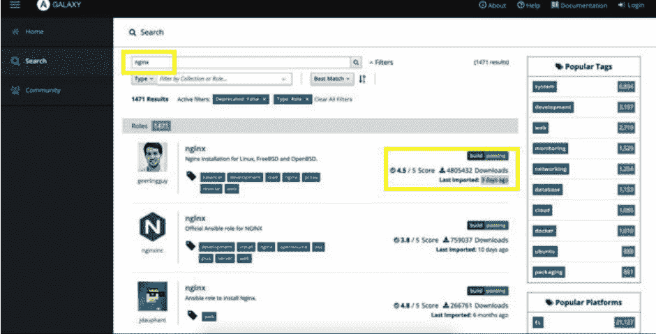
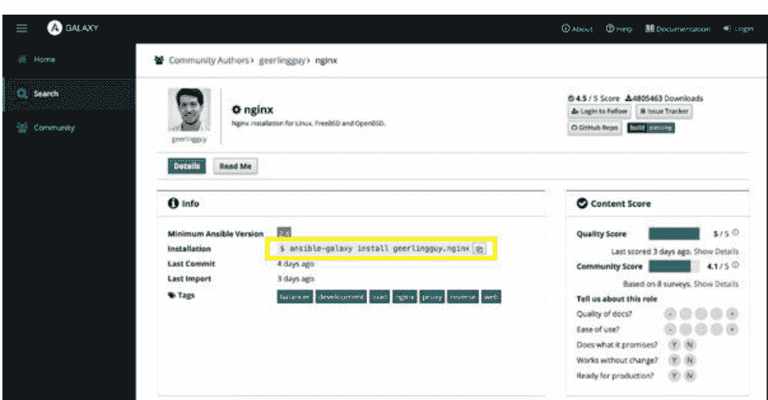

# Ansible IT基础设施自动化使用指南：网络、Windows、Linux及云运维自动化指引（英文版）

## 献辞

### 纳兹玛与齐玛尔

我的妻子与女儿，感谢你们允许我为追求热爱而牺牲陪伴家人的时间。

## 关于作者

`Waqas Irtaza`是一位经验丰富的IT专业人士，过去11年一直深耕基础设施领域。他的职业生涯从系统管理起步，后续转向网络、无线及云管理领域。职业生涯后期，他开始将多元的基础设施经验应用于基础设施自动化工作。他几乎获得了所有主流科技厂商的认证：思科、微软、AWS、PMI、EC-Council以及Linux基金会。他的自动化之路从编写小型Python与shell脚本起步，后续逐步开发复杂脚本，实现IT基础设施日常重复工作的自动化。Ansible为他带来了惊喜，因为复杂的IT任务可以通过简单的Ansible playbook实现管理。Ansible的简洁性与多元化特性促使他撰写了本书。工作之余，Waqas喜欢骑行和骑马，此外还致力于帮助、指导和培养年轻人开启技术领域的职业生涯。

## 关于审阅者

`Sumit Jaiswal`拥有10年开发领域行业经验，核心开发技术涵盖Python、C++与C#。他目前任职于Ansible自动化团队，担任高级软件工程师，负责网络与安全领域的内容开发工作。他是开源项目的爱好者。

## 致谢

我要感谢几位在我撰写本书期间给予持续支持的人。首先，我要感谢我的妻子纳兹玛和女儿齐玛尔，在我耗费无数个周末和夜晚写作时包容我——如果没有她们的支持，我根本无法完成这本书。如果没有我的直线经理约翰·丹尼尔先生和技术指挥中心经理马诺吉·帕尼克先生的支持，这本书也不会诞生。我向阿联酋航空集团技术指挥中心（TCC）的团队致以诚挚谢意，尤其感谢艾哈迈德·胡马云·扎希尔先生，感谢你们提供宝贵的见解与专业意见。最后，我要感谢BPB出版公司给予我撰写首本著作的机会。

## 前言

Ansible是一款强大的开源自动化语言，同时也是独特的部署与编排工具。Ansible不仅为许多其他自动化解决方案的核心能力提供了效率更高的无缝替代方案，还致力于解决其他尚未解决的重大IT挑战。Ansible是一款开源自动化工具或平台，用于配置管理、应用部署、服务编排、基础设施预置等IT任务。如今自动化至关重要：IT环境日益复杂，且往往需要快速扩展，系统、网络和云管理员以及开发人员若需手动完成所有工作，将难以跟上节奏。自动化简化了复杂的基础设施任务，不仅让开发人员的工作更易管理，还能让他们将精力集中在能为组织创造价值的其他任务上。换言之，自动化释放了时间，提升了效率。如上所述，Ansible在自动化工具领域快速崛起。

我刚开始学习Ansible时，曾翻阅过几本相关书籍，发现要厘清Ansible概念需要来回查阅不同资料。因此，我决定撰写一本涵盖基础设施管理所有方面的书籍。本书从Ansible基础知识讲起，无自动化经验的读者也可以从这里入门。掌握基础知识后，每一章都为对应技术量身设计。本书共7章，你将学到以下内容：

- 第1章：实验环境搭建、Ansible入门与核心概念
- 第2章：结合实例理解Ansible临时命令与playbook。本章同时涵盖核心概念与实操方法。
- 第3章：本章涵盖Ansible高级概念，帮助读者编写专业级playbook。
- 第4章：网络管理核心章节。本章将介绍网络管理员常用的单行临时命令，后续部分会专门讲解针对网络管理的Ansible高级概念。
- 第5章：系统管理核心章节，涵盖Linux与Windows基础设施自动化。
- 第6章：DevOps与云管理员核心章节。除Docker和Kubernetes外，本章还涵盖公有云与私有云的Ansible自动化。
- 第7章：最后一章，将介绍Ansible的建议与最佳实践。

### 彩色图片下载

请点击链接下载本书的**彩色图片**：https://rebrand.ly/f936d4

### 勘误

BPB出版公司对自己的工作深感自豪，始终遵循最佳实践以确保内容准确，为订阅者提供优质的阅读体验。我们的读者是我们的镜子，我们通过读者的反馈来反思并修正出版过程中可能出现的人为错误。为维护内容质量，也为了帮助可能因未预见的错误遇到困难的读者，请通过以下邮箱联系我们：`errata@bpbonline.com`

感谢您对BPB出版公司大家庭的支持、建议与反馈。

您知道吗？BPB为所有出版的图书提供电子版本，支持PDF和ePub格式。您可以在`www.bpbonline.com`升级到电子版，作为纸质版图书的购买者，您有权享受电子版折扣。如需了解更多详情，请通过`business@bpbonline.com`与我们联系。此外，您还可以阅读大量免费技术文章，订阅多种免费通讯，获取BPB图书与电子书的专属折扣与优惠。

### BPB 正在寻找像你这样的作者

如果你有兴趣成为BPB的作者，请访问`www.bpbonline.com`立即申请。

我们已与数千名像你一样的开发者和科技领域专业人士合作，帮助他们向全球科技社区分享自己的见解。

你可以提交通用申请，申请我们正在招募作者的特定热门主题，或是提交你的原创想法。

本书的代码包也托管在GitHub上。如果代码有更新，我们会在现有GitHub仓库中同步更新。

我们丰富的图书和视频目录中还有其他代码包可获取。快来查看吧！

### 盗版举报

如果你在互联网上发现任何形式的我方作品盗版，我们将非常感谢你提供相关网址或网站名称。

请通过`business@bpbonline.com`联系我们，并附上相关材料的链接。

### 有意成为作者

如果你有擅长的主题，且有撰写或参与编写图书的兴趣，请访问。

### 读者评价

请留下评价。当你阅读并使用完本书后，何不在你购买的网站留下评价呢？

潜在读者可以看到并参考你的客观评价做出购买决策，我们BPB也能了解你对我们产品的看法，我们的作者也能看到你对其著作的反馈。

感谢！若要了解更多关于BPB的信息，请访问！

## 第1章

### 快速上手Ansible

Ansible是一款简单的开源自动化工具，可实现应用程序部署、基础架构服务编排、云资源预置及其他多种IT工具的自动化。Ansible完全无代理，即它通过SSH连接受管节点实现管控。当前绝大多数技术都把SSH作为默认管理工具，无论是公有云平台、私有云平台、网络设备，还是本地部署的ESX、Windows或Linux服务器，都概莫能外，因此Ansible的应用场景十分广泛。此外，如果需要其他远程连接方式，也提供了对应的可选方案。接下来就让我们开启本书的阅读之旅，先了解本章的概览内容。

#### 结构

本章将涵盖以下主题：

- Ansible简介
- 实验环境搭建
- Ansible核心概念
- YAML基础

#### 目标

学完本章后，你将能够完成以下操作：

- 了解Ansible流行的原因
- 安装Ansible并配置运行环境
- 了解Ansible的组件构成
- 了解YAML语法规范

#### Ansible简介

如果你是系统管理员、网络管理员，或是任何从事IT行业的人员，想必都曾在工作中处理过大量重复性任务：比如配置成千上万台路由器和交换机、创建新的虚拟机、应用配置、批量给服务器打补丁、执行迁移、部署应用，甚至是做安全与合规审计。所有这些重复性任务都需要在数千台不同的设备上执行相似命令，同时还要保证事件执行的顺序正确。聪明的人会编写脚本来自动化这些任务，但这需要编码技能；普通的IT管理员没有专业的编码能力，而有良好编码技能的IT开发人员又缺乏扎实的基础架构知识。而Ansible正好填补了这中间的空白。Ansible是一款功能强大的IT自动化工具，学习门槛极低，足够简单，适合所有IT从业人员使用；同时又足够强大，能够实现最复杂部署的自动化。

与Ansible相关的产品主要有以下几款：

- **Ansible**：一款开源自动化平台。
- **Ansible Galaxy**：一个拥有大量社区创建角色目录的网站。
- **Ansible Tower**：一款面向Ansible的Web应用程序与REST API解决方案。

本书的核心内容是Ansible核心功能。

Ansible的常见使用场景包括：

- 配置管理
- 部署
- 编排
- 资源预置

接下来我们通过示例了解这些使用场景。假设你的环境中有若干台服务器，需要按照特定顺序完成打补丁和重启操作，其中一部分是应用服务器，另一部分是数据库服务器。那么你需要先给所有服务器打补丁，之后先关闭应用服务器，再关闭数据库服务器；等数据库服务器启动完成并上线后，再启动应用服务器。你只需要编写一个Ansible剧本，几分钟就能完成这个流程，之后每次需要执行补丁更新时，直接调用该Ansible剧本即可。

同理，如果你需要为网络中所有交换机启用端口安全功能，这类工作在整个网络中属于重复性劳动，且如果需要在数千台交换机上执行该操作，仅需一个简单的Ansible剧本就能完成这个任务。

接下来我们看一个复杂的示例。假设我们需要搭建一套横跨公有云、私有云，且包含数百台虚拟机的复杂基础架构。使用Ansible，你可以在Azure或AWS这类公有云上预置主机，也可以在OpenStack或基于VMware的基础架构上预置私有云主机，之后还可以在这些系统上配置应用、搭建系统间的通信链路。Ansible内置了大量支持这类操作及更多其他场景的模块，我们会在后续章节中详细介绍。下图可以清晰展示Ansible的核心组件：

**图 1.1：** Ansible 核心组件

为便于理解，以下是各 Ansible 组件的定义：

### Ansible 控制节点

Ansible 控制节点是任何安装了 Ansible 的机器，必须是 Linux 系统，不能是 Windows 系统。这是唯一需要安装 Ansible 的机器。

### Ansible 托管节点

Ansible 托管节点是我们希望通过 Ansible 管理的服务器或任意 IT 设备，也被称为托管主机。托管主机上无需安装 Ansible。

#### 清单

清单是主机的列表，我们可以通过嵌套主机、创建分组来实现规模扩展，支持静态清单和动态清单，相关内容我们后续会讲解。

##### Playbook

Playbook 是有序的已保存任务列表，可重复执行，它支持变量、循环和条件语句，为 Ansible 赋予了可编程特性，采用 YAML 格式编写。

### 实验环境搭建

Ansible 的安装非常简单，只需几条命令就能获得功能完整的 Ansible 控制节点。但我们的目标不仅是安装 Ansible，还要了解基础设施要求，搭建功能完整的实验环境来配合后续的实践示例，接下来我们按照以下步骤准备实验环境。

#### Ansible 基础设施准备

我们将从零开始在笔记本上搭建完整的实验环境，为此我们会使用名为 **Oracle VirtualBox** 的虚拟化工具，它开源且兼容 Windows、Linux、macOS 各类操作系统。我们首先会在笔记本上安装 Oracle VirtualBox，之后安装 CentOS 或 Ubuntu 操作系统；我已经在 Ubuntu 上创建了 1 个 Ansible 控制节点，4 个托管节点（2 个 CentOS、2 个 Ubuntu）。下图展示了 VirtualBox 中的虚拟机：

**图 1.2：** VirtualBox 中的虚拟机

如果你的笔记本配置不高，不需要 4 个托管节点，单台 Linux 主机也可同时作为控制节点和托管节点。CentOS/Ubuntu 的安装不在本文讨论范围内，网上有大量相关教程可供参考，我们会在操作系统安装完成后讲解 Ansible 的安装。以下是开始安装 Ansible 前所有主机的基础配置：

**图 1.3：** 基础配置

Ansible 使用 IP 地址也能正常运行，但不够专业，因此我们会将 IP 地址解析为主机名（此项非强制要求）。我们可以把以下内容复制到所有 Linux 系统的`/etc/hosts`文件中，将主机名对应到各自的 IP 地址：

```hosts
#Ansible Control Node
10.0.0.100 master
#Ansible Managed node on Centos
10.0.0.10 cen_node_01
10.0.0.11 cen_node_02
#Ansible Managed node on Ubuntu
10.0.0.20 ubu_node_01
10.0.0.21 ubu_node_02
```

**图 1.4：** 用于名称解析的 Hosts 文件

复制完成后，我们就可以通过对应主机名 ping 通所有服务器，此时我们的基础设施已经可以安装 Ansible 了。

#### Ansible 安装

本节将介绍 Ansible 控制节点的安装方法，同时讲解 Ansible 托管节点的所有可用配置选项，我们开始吧。

##### 控制节点配置

Ansible 仅在控制节点上需要安装，安装流程非常简单，只需几条命令就能获得功能完整的 Ansible 控制节点，你只需要前往 Ansible 官方文档按照给出的步骤操作即可。下图来自 Ansible 官方文档，展示了针对不同操作系统的多种安装选项：

**图 1.5：** Ansible 安装选项

从下图中可以看到，我们针对不同操作系统提供了多种安装选项。我们的 Ansible 控制节点使用的是 Ubuntu 系统，因此执行以下命令即可安装 Ansible：

```bash
$ sudo apt update
```

```bash
$ sudo apt install software-properties-common
```

```bash
$ sudo apt-add-repository --yes --update ppa:ansible/ansible
```

```bash
$ sudo apt install ansible
```

##### 验证 Ansible 安装

在 Ansible 控制节点上执行以下命令即可确认 Ansible 是否安装成功：

```bash
ansible@master:~$ ansible --version
ansible 2.9.6
config file = /etc/ansible/ansible.cfg
configured module search path = ['/home/ansible/.ansible/plugins/modules', '/usr/share/ansible/plugins/modules']
ansible python module location = /usr/lib/python3/dist-packages/ansible
executable location = /usr/bin/ansible
python version = 3.8.2 (default, Jul 16 2020, 14:00:26) [GCC 9.3.0]
ansible@master:~$
```

##### 托管节点配置

Ansible 在托管节点方面提供了多种选项，甚至不需要对托管节点做任何配置就能使用 Ansible，我们只需要远程机器的 SSH 连接权限和具有权限的用户即可。这是 Ansible 相较于其他需要所有托管节点安装客户端软件的自动化工具的显著优势：比如你有上千台托管服务器的基础设施，仅安装客户端软件本身就是一项庞大的工作；况且如果你管理的是网络设备，根本不允许安装任何客户端软件。Ansible 托管节点的多种配置选项让它成为独特的自动化工具，几乎可以自动化所有支持 SSH 访问的 IT 设备，接下来几节会介绍托管节点配置的可用选项。

###### 免密登录

这是 Linux 系统非常实用的功能，允许管理员登录远程服务器时无需输入密码。试想如果你管理上千台服务器，每次登录都要输入密码，非常耗时且繁琐。要配置免密登录，我们需要完成以下步骤：

- 在 Ansible 控制节点上执行以下命令生成 SSH 密钥，所有输入项直接按 *Enter* 选择默认选项即可完成密钥创建：

```bash
$ ssh-keygen
```

- 执行以下命令将 SSH 密钥复制到所有托管节点：

```bash
$ ssh-copy-id ansible@cen_node_01
$ ssh-copy-id admin1@cen_node_02
$ ssh-copy-id ansible@ubu_node_01
$ ssh-copy-id ansible@ubu_node_02
```

- 执行上述命令时，系统会最后一次要求输入密码，如果命令执行无报错，说明免密登录配置完成，可通过以下命令验证：

```bash
$ ssh cen_node_01 hostname
$ ssh cen_node_02 hostname
$ ssh ubu_node_01 hostname
$ ssh ubu_node_02 hostname
```

**我们特意没有配置 ubu_node_02 的免密登录，用于观察报错，后续讲解清单文件时会修复该问题。**

###### 通过 SSH 凭证管理主机

该配置方式非常易用，因为不需要对托管节点做任何配置，在编写路由器、交换机等网络设备的 Playbook 时尤为实用。如果在清单文件中添加以下内容，Ansible 就会使用这些凭证登录托管节点：

```ini
[all:vars]
ansible_connection=ssh
ansible_port=22
ansible_user=admin
ansible_pass=P@$$word123
```

###### Ansible Vault


通过 SSH 管理主机是不错的方案，但密码会以明文存储，存在较大的安全风险，因此 Ansible 自带 `Ansible Vault` 功能，会对凭证进行加密，仅在登录前解密，相关内容我们后续章节会详细讲解。

如果你跟着实验步骤操作，可以将以下脚本复制到文件中，赋予可执行权限后运行，即可实现所有虚拟机的自动启停。

此脚本可在任意 Linux 系统或 macOS 上运行。在 Windows 系统上运行时，你可能需要稍作调整。

```
# Start all VM (Run where VirtualBox is Installed)
vboxmanage list vms
vboxmanage startvm master
vboxmanage startvm cen_node_01
vboxmanage startvm cen_node_02
vboxmanage startvm ubu_node_01
```

```
# Stop Ansible Infrastructure (Run on Master)
ssh 10.0.0.10 "sudo poweroff"
ssh 10.0.0.11 "sudo poweroff"
ssh 10.0.0.20 "sudo poweroff"
ssh 10.0.0.21 "sudo poweroff"
poweroff
```

**图1.6：** 自动化虚拟实验室搭建的命令

### Ansible 核心概念

此时你应该已经搭建好了功能完备的 Ansible 实验环境，其中包含 1 台名为 `master` 的主控节点，以及 4 台被管节点。`Ping` 命令是任何网络中用于检测连通性的通用命令，而 Ansible 的 `ping` 模块功能完全一致。若我们使用 `ping` 模块测试实验环境，就会从活跃节点收到如下回复。无需担心，后续我们会详细介绍每个模块及其所需的参数，目前你只需运行以下命令：

```
ansible@master:~$ ansible all -m ping
[WARNING]: provided hosts list is empty, only localhost is available. Note that the implicit localhost does not match 'all'
ansible@master:~$ ansible localhost -m ping
localhost | SUCCESS => {
    "changed": false,
    "ping": "pong"
}
```

**图1.7：** `ping` 模块的输出结果

以下是理解 Ansible 必备的核心概念：

- `Ansible` 资产清单
- `Ansible` 配置文件
- `Ansible` 模块

### Ansible 资产清单

Ansible 会同时针对你基础设施中的多台被管节点执行操作，其操作对象是被称为资产清单（`inventory`）的列表或列表组。一旦你定义了资产清单，就可以通过匹配模式选择需要 Ansible 执行操作的节点或节点组。默认的资产清单存储位置如下：

运行脚本时，我们可以指定自定义的资产清单位置，因此如果不同节点上有多个脚本，我们可以为每个脚本配置专属的资产清单文件进行区分。在资产清单文件中，可以填写主机 IP 地址、主机名，或者创建包含主机名/IP 地址的节点组：

`all` 是特殊的默认组，包含资产清单中的所有主机。允许在不同组中重复添加主机，也允许创建嵌套组，还支持按范围添加主机，示例如下：

```
[db]
db[01:50].example.com
```

上述资产清单表示 `db` 组包含 50 台主机，主机名从 `db01.example.com` 到 `db50.example.com`。字母范围的规则同理，示例如下：

```
[db]
db-[a:f].example.com
```

上述资产清单表示 `db` 组包含 6 台主机，主机名从 `db-a.example.com` 到 `db-f.example.com`。

#### 资产清单中的变量

如需修改 web 服务器的默认 HTTP 端口，可以使用以下变量：

```
[atlanta]
host1 http_port=80 maxRequestsPerChild=808
host2 http_port=303 maxRequestsPerChild=909
```

如果需要修改 SSH 专属配置，可以使用以下变量：

```
Host3.example.com:5309 #Change SSH user for specific host
host1.example.com ansible_connection=ssh ansible_user=myuser ansible_pass="PWD"
```

```
host2.example.com ansible_connection=ssh ansible_user=myotheruser
```

针对实验环境，我们采用以下示例资产清单。

#### 示例资产清单文件

我们针对以下两种场景提供示例文件：

- 1 台作为主控节点，4 台作为被管节点
- 单台 VM 同时作为主控节点和被管节点

#### 1 台主控节点+4 台被管节点的场景

以下是我们实验环境的资产清单文件，其中包含 4 台被管节点：

```
[centos]
cen_node_01
cen_node_02

[ubuntu]
ubu_node_01
ubu_node_02 ansible_user=admin1 ansible_pass=Pass@123
```

> **此处使用 `ansible_pass` 仅用于学习目的，生产环境中切勿以明文形式存储密码，后续章节我们会对此进行优化。如果你还记得，我们之前排除了未配置免密登录的 `ubu_node_02` 节点，此处我们在资产清单中提供 SSH 凭证来解决该问题。**

#### 单台 VM 同时作为主控节点和被管节点的场景

如果你的笔记本配置较低，无法运行多台 VM，可以使用单台 Linux VM 同时作为 Ansible 的主控节点和被管节点。若你采用单 VM 方案，需要使用如下资产清单文件：

```
Localhost ansible_connection=localhost
```

#### 变量说明

以下变量名含义明确，后续章节编写复杂脚本时会用到：

- 要连接的主机名称，若该名称与你希望设置的别名不一致时使用
- SSH 连接端口号，当端口非默认值时使用
- 连接主机时使用的用户名
- 连接主机进行身份验证时使用的密码
- 等同于 `ansible_sudo`，用于强制提权

在当前目录中使用上述示例资产清单后，会得到如下输出：

```
ansible@master:~/.ansible$ ansible -i inventory centos -m ping
cen_node_01 | SUCCESS => {
    "ansible_facts": {
        "discovered_interpreter_python": "/usr/bin/python"
    },
    "changed": false,
    "ping": "pong"
}
cen_node_02 | SUCCESS => {
    "ansible_facts": {
        "discovered_interpreter_python": "/usr/bin/python"
    },
    "changed": false,
    "ping": "pong"
}
ansible@master:~/.ansible$
```

### Ansible 配置文件

执行 Ansible 命令或 playbook 时，Ansible 会查找存储了相关参数的 `Ansible.cfg` 配置文件，查找顺序如下：

1. **优先级1：** 若设置了 `ANSIBLE_CONFIG` 环境变量，则读取该变量指向的文件
2. **优先级2：** 当前目录下的 `ansible.cfg` 文件
3. **优先级3：** 用户主目录下的 `ansible.cfg` 文件
4. **优先级4：** `/etc/ansible/ansible.cfg`（默认存储位置）

Ansible 会按上述顺序查找，仅使用第一个找到的配置文件，其余会被忽略。安装 Ansible 时，会在默认位置生成配置文件。建议为每个脚本或一组脚本配置专属的配置文件，否则 Ansible 会使用默认配置文件。后续如果有人修改了默认配置文件的参数，你所有的脚本都会受影响，排查问题也会变成极其麻烦的任务。下一节我们会介绍一些基础参数，其余参数会在后续章节讲解：

- `Inventory=`：可以直接在配置文件中指定资产清单文件，无需在脚本执行时额外传入
- `Forks=`：表示需要建立的并行连接数量，默认值为 5。调大该值可以缩短脚本处理时间，但会给 Ansible 服务器和网络带来更大负载
- `sudo_user=`：由于日常任务通常不会使用 `root` 用户，此处可以将提权执行的 `sudo` 用户修改为其他拥有管理员权限的用户
- `gathering=`：该选项用于收集主机的更多信息，是非常实用的功能，后续章节会详细介绍
- `timeout=`：该参数用于设置 SSH 超时时间（单位：秒），实验环境设置为 10 秒即可，生产环境需要调整为 30 秒甚至 60 秒。否则高负载主机上可能会收到超时提示

### Ansible 模块

本节我们会详细介绍部分 Ansible 模块，这是为了后续能练习开发更有实际意义的 Ansible 剧本。Ansible 模块按功能分为不同类别，如前所述，Ansible 提供了数百个模块，主要分为以下几类：

- 云服务模块
- 集群模块
- 命令模块
- 加密模块
- 数据库模块
- 文件模块
- 身份认证模块
- 资产清单模块
- 消息模块
- 监控模块
- 网络工具模块
- 网络模块
- 通知模块
- 打包模块
- 远程管理模块
- 源代码管理模块
- 存储模块
- 系统模块
- 实用工具模块
- Web 基础设施模块
- Windows 模块

让我们来讨论一些 Ansible 模块的重要分类，如下所示：

### 系统

系统模块是需要在系统层面执行的操作，例如修改系统中的用户和组、修改 IP 表与防火墙配置、处理逻辑卷组、挂载操作，或是处理服务。例如启动、停止或重启系统中的服务。

### 命令

命令模块用于在主机上执行命令或脚本。这些可以是使用 `command` 模块执行的简单命令，或是交互式执行。你也可以使用 `script` 模块在主机上运行脚本。

### 文件

文件模块可辅助处理文件。例如，使用 `ACL` 模块设置和获取文件的 ACL 信息，使用 `archive` 和 `unarchive` 模块压缩和解压文件，使用 `find` 模块搜索文件，使用 `replace` 模块修改现有文件的内容。

### 数据库

数据库模块可辅助处理各类数据库，例如 MongoDB、MSSQL、MySQL 或 PostgreSQL，支持添加或删除数据库、修改数据库配置等操作。

### 云

云模块为各类云服务商提供了海量的模块集合，仅亚马逊、Azure、Docker、谷歌、OpenStack 和 VMware 就是其中的一部分。针对这些云服务商都有大量可用模块，支持你执行各类任务，例如创建和销毁实例、执行配置变更、网络与安全管理、管理容器、数据中心、集群、社交网络、VSAN 等，还有更多功能。

### Windows

Windows 模块可帮助你在 Windows 环境中使用 Ansible。其中一些模块包括：用于复制文件的 `Win_copy`，以及在 Windows 机器上执行命令的 `Win_command`。还有大量其他模块可用于处理 Windows 上的文件，例如创建 IIS 网站、使用 MSI 安装程序安装软件、通过注册表编辑器修改注册表、管理 Windows 中的服务和用户。这些只是几个分类下的部分模块，还有更多模块，你可以在 `docs.ansible.com` 上找到完整的列表以及每个模块的详细说明。接下来我们详细了解一下其中一些模块，学习如何使用它们。

### 命令

这是默认模块，如果你没有特别指定任何模块，就会使用这个模块。它仅在被管理节点上安装了 Python 时才能工作。`command` 模块接收命令名称，后跟一个以空格分隔的参数列表。这些参数将在所有节点上执行的命令。命令不会通过 shell 处理，因此像 `$HOME` 这样的变量和像 `&` 这样的操作将无法使用。

### Shell

它同样仅在被管理节点安装了 Python 时才能工作。它和 `command` 模块几乎完全一致，但会在远程节点上通过 shell 运行命令。因此，像 `$HOME` 这样的变量和像 `&` 这样的操作可以正常使用。

### RAW

该模块和 Shell、command 模块功能相同，但关键点是它不需要远程机器上安装 Python。这个模块仅在少数场景下适用且非常有用。常见的场景是在默认未安装 Python 的系统上安装 Python，另一个场景是管理未安装 Python 的设备，例如路由器和交换机。传递给 `RAW` 的参数会直接通过配置好的远程 shell 运行。

### PING

这是一个简单的测试模块，成功连通时会始终返回 `ping` 响应。它在 playbook 中没有实际用途，但可用于验证登录能力以及已配置的 Python 可用性。**这不是 ICMP ping**，只是一个简单的 Ansible 测试模块，需要在远程节点上安装 Python。

### Copy

`copy` 模块用于将文件从本地或远程机器复制到远程机器上的指定位置。

### 文件

该模块用于设置文件、符号链接或目录的属性，也可用于删除文件、符号链接或目录。

### YUM/APT

该模块可使用对应 Linux 的包管理器执行安装、升级、降级、移除以及列出软件包和软件包组的操作。这只是冰山一角，我们还有数千个此类模块，可用于特定场景，例如云、系统、存储、监控、数据库和网络管理。我们将在后续章节中介绍这些模块。

### YAML 基础认知

这是 Ansible 中最后一个理论概念。我计划在本章讲解完所有理论，后续章节将全部是实操。理解 YAML 是编写 Ansible playbook 的必要前提。Ansible playbook 是使用 YAML 格式编写的文本/配置文件。因此，在接触 Ansible playbook 之前，我们会花一些时间了解 YAML 语法。所有 YAML 文件都可以选择以 `---` 开头、以 `...` 结尾，这是 YAML 格式的一部分，用于标记文档的启止。以下为 YAML 的组成部分。以下是 YAML 列表格式的示例：

```yaml
---
# A list of fruits
- Apple
- Orange
- Banana
- Mango
...
```

以下是 YAML 字典格式的示例：

```yaml
# An employee record
martin:
  name: Waqas Irtaza
  job: Engineer
  skill: Automation
```

字典以简单的 `键: 值` 形式表示（冒号后必须跟一个空格）。正确的缩进至关重要，否则会出现如下所示的语法错误：

### 正确语法

```yaml
# An employee record
User:
  name: Waqas Irtaza
  job: Engineer
  skill: Automation
```

### 错误语法

```yaml
# An employee record
User:
name: Waqas Irtaza
job: Engineer
skill: Automation
```

字典是无序的，列表是有序的，请参考以下示例了解列表和字典的主要区别。

### 字典

以下示例展示了 YAML 字典的对比：

```yaml
# An employee record
user:
  name: Waqas Irtaza
  skill: Automation
  job: Engineer
```

```yaml
# An employee record
user:
  name: Waqas Irtaza
  job: Engineer
  skill: Automation
```

### 列表

以下示例展示了 YAML 列表的对比：

```yaml
---
# A list of fruits
- Apple
- Orange
- Banana
- Mango
...
```

```yaml
---
# A list of fruits
- Apple
- Banana
- Orange
- Mango
...
```

更复杂的数据结构也是可行的，例如字典列表、值为列表的字典，或是两者的混合。以下示例帮助你了解复杂数据结构：

```yaml
# Employee records
- Waqas:
    name: Waqas Irtaza
    job: Engineer
    skills:
      - python
      - Ansible
- John:
    name: John Smith
    job: Developer
    skills:
      - lisp
      - fortran
```

字典和列表也可以用缩写形式表示：

```yaml
# Directory
user: {name: Waqas Irtaza, job: Engineer, skill: Ansible}
```

```yaml
# List/Array
['Apple', 'Orange', 'banana', 'Mango']
```

对于 YAML 中的字符串，除非包含特殊字符，否则无需用双引号包裹。以上就是编写 Ansible playbook 所需了解的 YAML 全部内容。我们将在后续章节中使用此 YAML 格式。

### 总结


本章我们讲解了 Ansible 的理论知识。Ansible 是自动化 IT 基础设施的最简单方式，它使用 SSH 端口进行管理，这是 IT 基础设施管理的默认行业标准。被管理节点零配置是 Ansible 的独有特性。

我们讨论了 Ansible 的组件以及它们如何协同工作，还介绍了 Ansible 的安装选项、被管理节点的配置方法以及安装测试方法。Ansible 提供了多种配置被管理节点的选项，我们已对所有选项进行了详细讲解。

Ansible 清单是一个文件，用于存储被管理节点的详细信息。Ansible 模块是为特定任务和基础设施编写的代码，Ansible 已经提供了数千个现成可用的模块。Ansible 模块针对特定网络设备、云平台以及 IT 的几乎所有主要领域而编写。

Ansible 脚本使用 YAML 编写，YAML 是一种人类可读的数据序列化语言，通常用于配置文件。YAML 的重要组件是列表和字典，其中字典是无序的，列表是有序的。

下一章中，我们将学习并实践 Ansible 即席模式，编写适用于日常活动的高效自动化脚本，我们将学习 Ansible playbook 的基础知识，了解条件语句、变量、循环等不同的编程选项，以及更多内容。

### 选择题

#### 什么是 Ansible？

- 自动化平台
- 编程语言
- 编程语言解释器的图形界面
- 虚构设备

#### Ansible 引擎使用什么语言编写？

- Ruby
- DSL
- Python
- YAML

#### 使用 Ansible 的优势有哪些？

- 无代理
- 极低开销
- 高性能
- 以上全部

#### Ansible 的使用场景有哪些？

- 安全与合规策略集成
- 持续交付自动化工作流
- 简化编排
- 应用部署
- 配置管理
- 简化资源调配
- 以上全部

#### Ansible 用于主机管理的默认协议是什么？

- SMTP
- HTTP
- Telnet
- SSH

#### Ansible 配置文件的名称是什么？

- host
- inventory
- `ansible.cfg`
- `ansible_config.cfg`

#### Ansible 配置文件的优先级顺序是什么？

- `ANSIBLE_CONFIG` 环境变量
- 当前目录下的 `ansible.cfg`
- 用户主目录下的 `ansible.cfg`
- `/etc/ansible/ansible.cfg`

选项：

- 1234
- 3124
- 1324
- 4321
- 以上都不是

### 选择题答案

- A
- C
- D
- G
- D
- C
- C

### 要点提示

Ansible 本身使用 Python 编写，但 Ansible 剧本使用 YAML 编写。默认情况下，Ansible 使用 SSH 管理主机。Ansible 配置文件的位置和优先级非常重要。`command`、`shell` 和 `raw` 都是用于在远程主机上执行命令的模块；不过 `command` 模块不支持环境变量，`raw` 模块用于远程主机未安装 Python 的场景。

### 关键术语

本章使用并定义了以下关键术语：

- `Ansible control`：即 Ansible 控制节点，指安装了 Ansible 的服务器，必须是 Linux 机器。
- `Ansible manage`：即 Ansible 管理节点，指通过 Ansible 管理的服务器/设备。
- `Ansible inventory`：即 Ansible 主机清单，指服务器/设备的列表。
- `Ansible configuration`：即 Ansible 配置，指修改 Ansible 的默认参数。
- `Ansible playbook`：即 Ansible 剧本，指用于特定任务的预构建脚本。

## 第 2 章：Ansible 基础

在开始使用 Ansible 之前，我们先回顾一下上一章学习的内容。我们讨论了 Ansible 为何是流行的自动化工具，也讲解了 Ansible 的基础设施要求与组件，此外还详细介绍了 Ansible 安装和 YAML 语法。

本章将介绍 Ansible 的实际使用场景，讲解 Ansible 节点及其适用时机，我们会拿实际任务用 Ansible 实现自动化。学完本章后，你将能够用 Ansible 自动化处理基础重复性任务。

### 本章结构

本章将涵盖以下主题：

- Ansible 即席模式
- 即席模式示例
- Ansible 剧本
- Ansible 变量
- Ansible 中的条件语句
- Ansible 中的循环
- Ansible 处理器
- Ansible Vault

### 学习目标

学完本章后，你将能够完成以下操作：

- 使用 Ansible 即席模式实现自动化
- 编写 Ansible 剧本实现自动化
- 理解 Ansible 用户自定义变量、内置变量及条件语句
- 理解并使用 Ansible 中不同类型的循环
- 理解并使用 Ansible 处理器
- 理解并使用 Ansible Vault

### Ansible 即席模式

Ansible 即席模式是用于自动化单任务的命令行工具。它快速易用，但不可复用，因为每次使用时都需要提供所需的参数。仅需一条即席命令就能自动化管理数千台服务器，这体现了 Ansible 的强大能力。

Ansible 即席模式的实际使用场景包括管理用户、复制文件、重启服务器、安装或卸载软件包等。所有 Ansible 模块都可以在即席模式下使用，默认模块为 `command` 模块。以下是一个即席命令示例：

```bash
$ ansible [pattern] -i inventory-file -m [module] -a "[module options]"
```

下面我们介绍各个输入项，方便理解。

#### 模式

模式可以帮助我们从清单文件中筛选特定的主机或组。下表列出了定位清单主机和组的常用模式：

| groups: |
|---|
| groups: |
| groups: |
| groups: |
| groups: |
| groups: |
| groups: |
| groups: |
| groups: |
| groups: |
| groups: |
| groups: |
| groups: |
| groups: |
| groups: |
| groups: |

*表 2.1：Ansible 模式*

掌握基础模式后，你可以按任意顺序组合它们。下面的示例演示了这一点：

```text
webservers:dbservers:&staging:!phoenix
```

我们使用通配符模式从清单文件中定位主机，所有匹配通配符的主机都会被选中。通配符模式可用于 IP 或 FQDN。下面的示例演示了通配符的强大能力：

```text
192.168.* *.example.com *.com
```

我们还可以同时混合使用通配符模式和组。下面的示例将演示这一点：

```text
webservers:dbservers:&staging:!phoenix
```

此时需要明确一点：如果模式无法匹配清单文件中的任何主机，将显示以下错误：

```text
[WARNING]: No inventory was parsed, only implicit localhost is available
[WARNING]: Could not match supplied host pattern, ignoring: *.not_in_inventory.com
```

#### 清单

上一章我们已经花了大量时间了解 Ansible 清单的所有相关内容。`-i` 选项用于为 Ansible 即席模式指定清单文件。如果已经在 Ansible 配置文件中定义了清单文件路径，就无需在此处再次指定。

#### 模块

上一章我们已经讨论过模块。对于 Ansible 即席模式，`-m` 选项用于提供模块名称，`-a` 用于提供模块参数。我们后续会提供大量示例来明确这一点。

#### 即席模式示例

本节我们将提供多个实用的示例，了解即席模式的强大用处。本章大部分示例可用于任何生产环境。我们来看看这些示例。

##### 检查主机状态

上一章我们已经使用过 `ping` 模块。执行该模块时如果主机在线，输出中会返回 `PONG` 消息。以下是 `ping` 模块的输出示例：

```text
ansible@master:~/ansible/Chapter-02$ ansible cen_node_01 -i inventory -m ping

cen_node_01 | SUCCESS => {
    "ansible_facts": {
        "discovered_interpreter_python": "/usr/bin/python"
    },
    "changed": false,
    "ping": "pong"
}

ansible@master:~/ansible/Chapter-02$
```

这是在执行其他命令前检查主机是否在线的快速方式。

##### 重启服务器

如前所述，`-m` 选项用于选择模块，`-a` 用于指定模块参数。不过如果没有明确指定任何模块，Ansible 会使用 `COMMAND` 模块。

目前我们已经完成了 Ansible 环境的搭建，清单文件中包含了被管理主机的详细信息。要重启特定组中的所有服务器，例如我们可以使用以下命令：

```bash
$ ansible centos -i inventory -a "/sbin/reboot"
```

按照 Ansible 配置文件的默认设置，Ansible 默认有 5 个并行连接。这意味着如果重启 10 台服务器，Ansible 会先重启 5 台，再重启另外 5 台。该参数可配置，我们既可以在配置文件中修改，也可以通过命令行提供。例如，如果要并行重启 `20` 台服务器，使用以下命令：

```bash
$ ansible centos -i inventory -a "/sbin/reboot" -f 20
```

Ansible 默认以当前用户账户运行。如果要连接为其他用户，例如当前用户没有 `sudo` 权限，可以使用以下命令：

```bash
$ ansible centos -i inventory -a "/sbin/reboot" -f 10 -u username
```

### 处理主机环境变量

众所周知，只有管理员拥有重启特定服务器的权限，因此我们需要进行权限提升才能重启服务器。

进行权限提升时会用到以下命令：

```bash
$ ansible centos -i inventory -a "/sbin/reboot" -f 10 -u username --become [--ask-become-pass]
```

如果你添加 `--ask-become-pass` 参数，Ansible 就会提示你输入用于权限提升的密码。

截至目前，我们所有的示例使用的都是默认的 `command` 模块，该模块不支持环境变量。我们已在[第一章：快速上手 Ansible](#)中讨论过相关内容。这里我们举一个例子来更好地说明这一点。

要使用其他模块，需要通过 `-m` 参数指定模块名称。例如，使用 `shell` 模块时，需要用以下命令：

```bash
$ ansible centos -i inventory -m shell -a 'echo $HOME'

cen_node_01 | CHANGED | rc=0 >>
/home/ansible

cen_node_02 | CHANGED | rc=0 >>
/home/admin1

ansible@master:~/ansible/Chapter-02$
```

### 文件管理

文件管理也是大多数系统管理员日常需要处理的常规工作。Ansible 可以出色地完成这类任务：例如，如果你有一个文件需要复制到多台服务器上，只需一条 Ansible ad-hoc（即席）命令就能完成。以下是将文件复制到所有 `[centos]` 主机的示例：

```bash
$ ansible centos -i inventory -m copy -a "src=/etc/hosts dest=/tmp/hosts"
```

> 你能感受到 Ansible 的强大之处吗？

假设我们需要将文件复制到数千台服务器上，用 Ansible 只需一条命令就能完成。

`file`（文件）模块允许修改文件的所有权和权限。我们不仅可以复制文件，还能修改文件的权限和 Owner 相关信息，这一点非常重要。

假设你要为某个应用自动化执行文件复制操作，而应用用户没有管理员权限，如果我们仅复制文件，文件的 Owner 会是执行自动化的用户，该应用将无法使用这个文件。不过，我们可以修改文件权限，实现整个流程的自动化。

修改权限和 Owner 信息的命令如下：

```bash
$ ansible centos -i inventory -m copy -a "src=/etc/hosts dest=/tmp/hosts mode=622"
```

```bash
$ ansible centos -i inventory -m copy -a "src=/etc/hosts dest=/tmp/hosts mode=622 owner=app_user group=app_user"
```

`file` 模块的功能还不止于此，它还可以创建目录，示例如下：

```bash
$ ansible centos -i inventory -m copy -a "src=/var/application dest=/tmp/application mode=755 owner=app_user group=mapp_user state=directory"
```

我们还可以通过以下命令从 Ansible 托管节点递归删除文件：

```bash
$ ansible centos -i inventory -m copy -a "src=/tmp/application state=absent"
```

### 包管理

软件的安装和卸载也可以通过 Ansible ad-hoc 命令完成。Ansible 提供了多个包管理模块，可用于管理软件包。对于 Debian 和 Red Hat 系列操作系统，`yum` 和 `apt` 是最常用的模块。使用这两个模块安装软件的语法如下：

```bash
$ ansible centos -m yum -a "name=httpd state=present"
$ ansible ubuntu -m apt -a "name=apache2 state=present"
```

`yum` 和 `apt` 模块的输入参数是相同的，因此后续示例中我们仅使用其中一个。

我们还可以通过以下命令强制 Ansible 仅安装指定版本的软件包：

```bash
$ ansible centos -m yum -a "name= httpd-2.2.26 state=present"
```

要确保安装最新版本的软件包，可以使用以下命令：

```bash
$ ansible centos -m yum -a "name=httpd state=latest"
```

我们还可以卸载软件包，或确保指定的软件包未安装在 Ansible 托管节点上，具体命令如下：

```bash
$ ansible centos -m yum -a "name=httpd state=absent"
```

几乎所有包管理器都有对应的 Ansible 模块。如果你使用的是较老或过时的系统，没有对应的 Ansible 模块，那么可以使用 Ansible 的 `command` 模块来安装软件包。此外，如果你熟悉 Python，还可以自己编写对应的包管理模块。

### 用户与组管理

Ansible ad-hoc 模式也可用于创建、删除和管理用户账号，创建用户的 ad-hoc 命令如下：

```bash
$ ansible centos -i inventory -m user -a "name=alex password=password here"
```

同理，我们可以通过以下命令删除用户：

```bash
$ ansible centos -i inventory -m user -a "name=alex state=absent"
```

### 服务管理

我们可以使用 `service` 模块在 Ansible 托管节点上启动、停止服务。以下示例分别展示了在 CentOS 主机上启动、停止和重启 HTTP 服务的命令：

```bash
$ ansible centos -i inventory -m user -a "name=httpd state=started"
```

```bash
$ ansible centos -i inventory -m user -a "name=httpd state=stopped"
```

```bash
$ ansible centos -i inventory -m user -a "name=httpd state=restarted"
```

### 信息采集

信息采集是 Ansible 的另一项实用功能，它可以收集托管节点的信息并存储为变量，这些变量可用于编写灵活、复杂的自动化任务。以下简单命令可用于获取托管节点上的所有变量：

```bash
$ ansible centos -i inventory -m setup
```

上述命令会输出大量信息，但这些信息会显示在 Ansible 控制台中，并不适合查阅如此多的数据。因此，我们可以使用以下命令将所有采集到的信息存储到文件中：

```bash
$ ansible centos -i inventory -m setup --tree /tmp/facts
```

该命令的巧妙之处在于，它会为每个托管主机创建独立的文件，以主机名命名，并保存到指定目录中。

上述命令有助于了解整体变量信息，但当你需要查找特定变量时，例如仅显示内存相关的信息，可以使用以下命令：

```bash
$ ansible centos -i inventory -m setup -a 'filter=ansible_*_mb'
```

要仅显示特定网卡的相关信息，可以使用以下命令：

```bash
$ ansible centos -i inventory -m setup -a 'filter=ansible_eth[0-2]'
```

我们将在本章后续部分介绍信息采集的相关内容，并讲解如何在编写 playbook 时使用这些信息。至此，你应该已经了解了 Ansible ad-hoc 模式的基本用法。

### Ansible 播放清单


Ansible ad-hoc 模式适合执行单个任务，但大多数人更倾向于使用 playbook，因为它支持执行多个任务、使用变量、条件语句等更多功能。通常情况下，我们自动化的某一项活动并非单个任务，而是一系列任务的集合。Ansible playbook 允许我们使用一种名为 YAML 的易于理解的语言，组织所有这些任务。

前一章我们已经了解了 Ansible 的基础知识，现在让我们通过一个非常简单的任务来了解 playbook 的编写方法。接下来我们执行两条 Linux 命令，示例如下。

## Ansible playbook 示例

```yaml
---
- hosts: centos
  tasks:
    - name: Execute uname
      shell: uname -a>/tmp/ansible_output.txt
    - name: Execute Whoami
      shell: whoami >>/tmp/ansible_output.txt
```

### 说明

我们为代码添加行号，方便理解 playbook 的编写方式。再次强调，空格数量在 YAML 格式中至关重要：

```text
1  ---
2
3  - hosts: centos
4    tasks:
5      - name: Execute a uname command on Linux
6        shell: uname -a>/tmp/ansible_output.txt
7
8      - name: Execute Whoami Command on Linux
9        shell: whoami >>/tmp/ansible_output.txt
```

### 重要注意事项

以下是编写 Ansible playbook 的重要注意事项，请反复阅读直至完全掌握：

- playbook 以三个连字符（`---`）开头。
- 第 3 行的连字符后有 1 个空格，冒号后有 1 个空格。
- 第 4 行的 `tasks` 前有 2 个空格。
- 第 5 行的连字符前有 3 个空格，连字符后有 1 个空格，冒号后也有 1 个空格。
- 第 6 行的模块名称前有 5 个空格，冒号后有 1 个空格。
- 第 7 行可以看到我们可以随意添加任意数量的空行来整理 playbook。
- 第 8 行和第 9 行是第 5 行和第 6 行的重复内容。

理解 YAML 的缩进规则非常重要。别担心，写完两三个 playbook 之后你就会适应了。

```shell
ansible@master:~/ansible/Chapter-02$ ansible-playbook my_first_pb -i inventory
PLAY [centos] ********************************************************************************************************************************
TASK [Gathering Facts] ********************************************************************************************************************************
ok: [cen_node_02]
ok: [cen_node_01]
TASK [Execute uname] ********************************************************************************************************************************
changed: [cen_node_01]
changed: [cen_node_02]
TASK [Execute Whoami] ********************************************************************************************************************************
changed: [cen_node_01]
changed: [cen_node_02]
PLAY RECAP ********************************************************************************************************************************
cen_node_01 : ok=3 changed=2 unreachable=0 failed=0 skipped=0 rescued=0 ignored=0
cen_node_02 : ok=3 changed=2 unreachable=0 failed=0 skipped=0 rescued=0 ignored=0
```

```shell
ansible@master:~/ansible/Chapter-02$ ssh cent_node_01
Last login: Tue Sep 15 17:53:01 2020 from master
[ansible@cent_node_01 ~]$ cat /tmp/ansible_output.txt
Linux cent_node_01 3.10.0-1127.8.2.el7.x86_64 #1 SMP Tue May 12 16:57:42 UTC 2020 x86_64 GNU/Linux
ansible
[ansible@cent_node_01 ~]$ exit
```

## 重要注意事项

以下是输出中需要重点关注的事项：

- playbook 通过 `ansible-playbook my_first_pb -i inventory` 命令执行。
- 信息采集（Gathering Facts）是需要重点关注的环节，我们之后会详细讲解。
- 我们为任务设置的任意名称，都会显示在对应任务的前方。
- 在最后的验证命令中，我们确认所有目标主机上的命令都执行成功。

## Ansible 变量

Ansible 中的变量概念和其他编程语言中的一致：它是存储数据的内存位置的符号名称。

Ansible 中的变量分为两类，我们分别了解一下：

- 用户自定义变量
- 内置变量

### 用户自定义变量

我们通过示例来了解用户自定义变量。我们会创建两个变量，并用 `echo` 命令打印它们。

在 Ansible 中，变量通过双花括号引用。

#### Playbook

以下是示例 playbook：

```yaml
---
- hosts: centos
  vars:
    - name: Waqas Irtaza
    - address: Dubai UAE
  tasks:
    - name: Print variables
      shell: echo "My name is {{name}} and I am located in {{address}} > /tmp/ansible-output.txt"
```

#### 输出

以下是运行 playbook 后的输出：

```shell
ansible@master:~/ansible/Chapter-02$ ssh cen_node_01
Last login: Tue Sep 15 19:12:29 2020 from master
[ansible@cent_node_01 ~]$ cat /tmp/ansible-output.txt
My name is Waqas Irtaza and I am located in Dubai UAE
[ansible@cent_node_01 ~]$
ansible@master:~/ansible/Chapter-02$ ssh cen_node_02
Last login: Tue Sep 15 16:51:53 2020 from master
[ansible@cent_node_02 ~]$ cat /tmp/ansible-output.txt
My name is Waqas Irtaza and I am located in Dubai UAE
[ansible@cent_node_02 ~]$
```

这只是帮你理解变量的基础示例，我们之后会频繁使用到变量。

### 内置变量

如果你还记得，我们在第一个 Ansible playbook 的输出中跳过了信息采集部分，我们在这里详细讲解。

Ansible 在主机上执行命令之前，会采集大量关于主机的有用信息，并将其保存到内置变量中。

我们可以在 playbook 中使用这些变量，让 playbook 更灵活通用。

要获取所有内置变量的完整列表，可以使用以下 ad-hoc 命令，我们在 ad-hoc 模式章节中讲解过该命令：

```shell
ansible -i inventory cen_node_01 -m setup
```

输出内容非常多，这里不再赘述。我们可以使用过滤器获取指定信息。

例如，如果我们想查询主机的操作系统，可以使用以下命令：

```shell
ansible -i inventory cen_node_01 -m setup -a "filter=*family*"
```

此外，如果需要查询 IP 地址相关信息，可以使用以下过滤器：

```shell
ansible -i inventory cen_node_01 -m setup -a "filter=*ip*"
```

希望你已经理解这个概念。同理，我们可以获取大量重要的主机信息，例如：

- CPU 类型
- 操作系统
- 内存（RAM）
- IP 地址
- CPU 核心数
- 网络接口

我们可以在 playbook 中使用这些变量来做智能判断。

例如，如果我们在 playbook 中使用 `yum` 模块，要知道 `yum` 命令在 Ubuntu 主机上是无法使用的。

所以我们可以编写条件语句，检查操作系统相关的内置变量，让命令仅在 CentOS 主机上执行。

我们会在条件语句章节看到这个示例。

内置变量在 playbook 中的使用方式和用户自定义变量完全一致。

建议你运行前面的 `setup` 命令，尝试使用不同的内置变量。

## Ansible 输出

Ansible 有一个专门用于处理输出的模块，名为 `register`，它可以帮助我们将任务的输出存储到变量中。

一旦输出被存储到变量中，我们就可以直接显示它，或按需修改它。

输出的格式为 JSON，和 YAML 略有不同。

### 示例 Playbook

以下是示例 playbook：

```yaml
---
- hosts: centos
  tasks:
    - name: Execute whoami command
      shell: whoami
      register: whoami_output
    - name: Display the output
      debug:
        var: whoami_output.stdout_lines
```

### 输出

以下是运行 playbook 后的输出：

```shell
TASK [Display the output] *************************************************************************
ok: [cen_node_02] => {
    "whoami_output.stdout_lines": [
        "admin1"
    ]
}
ok: [cen_node_01] => {
    "whoami_output.stdout_lines": [
        "ansible"
    ]
}
```

输出变量 `whoami_output` 包含任务的完整 JSON 输出，但如你所见，我们访问的是存储了所需标准输出的 `stdout_lines` 字段。

如果需要捕获错误信息，我们也可以访问 `stderr_lines` 字段。

`debug` 模块会在 playbook 执行过程中打印信息，用于调试变量或表达式，不会中断 playbook 的执行。

它有三个主要参数：

- `msg`：要打印的自定义消息。
- `var`：要显示的变量名；使用该参数时，变量名不需要加花括号。
- `verbosity`：控制 debug 任务执行时机的参数值；如果设为 3，则该任务仅在使用了 `-vvv`（或更高等级）详细模式标志时才会执行。

例如，以下 playbook 可以生成同样的输出：

```yaml
---
- hosts: centos
  tasks:
    - name: Execute whoami command
      shell: whoami
      register: whoami_output
    - name: Display the output
      debug:
        msg: "{{ whoami_output.stdout_lines }}"
```

## Ansible 中的条件语句

Ansible 中的条件语句和其他编程语言中的看起来差别很大，但功能是一致的。

条件语句的第一部分是普通任务，第二部分是条件；只有条件判断结果为真时，任务才会执行。

我们使用特殊的 `when` 关键字来定义条件。

条件语句的结构如下：

- 任务：
  - 名称：任意描述（可选）
  - 模块：模块参数
  - `when`：条件

我们通过实际示例来理解，以下是 Ansible 示例 playbook：

```yaml
---
- hosts: all
  become: yes
  tasks:
```

### 在 Debian 主机上安装 apache2（忽略 CentOS 主机）

```yaml
- name: Install apache2 on Debian/Ubuntu machines
  apt:
    name: apache2
    state: latest
  when: ansible_os_family == "Debian"
  register: apt_output
- name: Display the console output
  debug:
    var: apt_output
```

### 在 CentOS 主机上安装 httpd（忽略 Ubuntu 主机）

```yaml
- name: Install httpd on CentOS machines
  yum:
    name: httpd
    state: latest
  when: ansible_os_family == "RedHat"
  register: yum_output
- name: Display the console output
  debug:
    var: yum_output
```

我们可以使用 `sudo`，因为安装过程需要 `sudo` 权限，使用 `sudo` 可以让我们获得 root 用户身份。此外，我们还可以像下面示例中那样检查多个条件：

```yaml
- name: "Shut down CentOS 6 systems"
  command: /sbin/shutdown -t now
  when:
    - ansible_facts['distribution'] == "CentOS"
    - ansible_facts['distribution_major_version'] == "6"
```

## Ansible 中的循环

循环的概念在 Ansible 中和在其他编程语言中是一致的。循环用于最小化重复代码，基于预定义的条件或逻辑重复执行代码。任何网络或系统管理任务，当需要在 N 台服务器上执行时，都可以通过 Ansible 循环简化。

在 Ansible 中，我们有两种创建循环的方式：`loop` 参数和下面的 `with_*` 循环：

- `with_list`
- `with_items`
- `with_indexed_items`
- `with_flattened`
- `with_together`
- `with_dict`
- `with_sequence`

### `with_subelements`

### `with_nested`/`with_cartesian`

### `with_random_choice`

`loop` 函数是在 Ansible 2.5 及更高版本中添加的。虽然 Ansible 官方文档推荐使用 `loop`，并且有官方文档给出了将 `with_*` 循环替换为 `loop` 的示例，但我发现 `with_*` 循环非常简单，因此本指南将重点介绍这类循环的用法。我们会举一些示例，帮助你了解这些循环的工作原理。

### 在 Ubuntu 主机上安装指定软件

下面的 playbook 将会在 Ubuntu 主机上安装指定的软件列表：

```yaml
---
- hosts: ubuntu
  become: yes
  tasks:
    - name: Install listed packages on ubuntu machines
      apt:
        name: "{{ item }}"
        state: latest
      with_items:
        - nano
        - vim
        - python
        - wget
```

### 显示两个文件的内容

下面的 playbook 将会显示两个文件的内容：

```yaml
---
- hosts: ubuntu
  become: yes
  tasks:
    - name: Display content of files
      debug:
        msg: "{{ item }}"
      with_file:
        - ip.txt
        - host.txt
```

### 打印 0 到 10 的序列

下面的 playbook 将会打印 0 到 10 的序列：


进入`/path/to/xxx`目录，找到`xxx.json`。

在表达式`cvar = avar + bvar`中，加法运算符（`+`）将`avar`与`bvar`相加，得到它们的和`cvar`。

在`List.of(arg0, arg1, arg2)`中，`List`接口的工厂方法`of()`接受一系列的元素，返回包含它们的只读列表。

之后我们这样调用`cmd`命令：`cmd arg0 arg1 arg2`。

```
if (condVar > someVal) {console.log("xxx")}
```


因此，在前述示例中，`{姓名: 'Rony', 组: 'student'}`就是一个项目。不过在这个示例中，项目为字典类型，因此我们可以直接引用字典的键。当在 playbook 中引用`{{ item.name }}`时，会对所有用户名执行遍历，本例中对应的用户名为 Rony、Ali 和 John。类似地，当在 playbook 中引用`{{ item.group }}`时，会对所有用户组名称执行遍历，本例中对应的用户组为 student、teacher 和 teacher。接下来我们再看另一个示例，了解`with_items`的实际应用场景：我们需要卸载两个软件包，并删除与它们关联的文件，以下是示例 playbook：

```yaml
---

- name: Clean-up the FTP and Webserver content
  hosts: centos
  tasks:
    - name: Uninstall Packages
      yum:
        name: "{{ item }}"
        state: absent
      with_items:
        - httpd
        - vsftpd

    - name: Delete FTP and HTTP files
      file:
        path: "{{ item }}"
        state: absent
      with_items:
        - /var/www/html/index.html
        - /var/ftp/pub/README
        - /tmp/www/http_backup.tar
        - /tmp/ftp/ftp_backup.tar
```

在前述示例中，我们使用了两个独立的循环：一个用于提供需要删除的软件包列表，另一个用于提供清理过程中需要删除的文件路径。这类 playbook 非常易于扩展和复用。例如，如果需要新增要删除的软件包，只需将软件包名称添加到对应的`with_items`列表中即可。

### 嵌套循环（with_nested）

嵌套循环即循环中再嵌套循环，在编程语言中是非常常见的设计：通常配合两个列表使用，任务会在第一个列表的每个项目上执行，并与第二个列表的每个项目进行组合。从理论上看可能比较复杂，但实际使用起来非常简单。接下来我们通过以下示例理解这个概念：

```yaml
tasks:
  - name: Add Users in Groups
    user:
      name: "{{ item[0] }}"
      state: present
      groups: "{{ item[1] }}"
    with_nested:
      - ['rony', 'ali', 'john']
      - ['student', 'teacher', 'teacher']
```

嵌套循环实际上是`with_items`的升级版本，尤其适合需要执行多个循环的场景。`with_nested`中的变量用法和`with_items`完全一致。

### when 语句

我们在第 2 章 Ansible 基础中讲解条件语句时已经讲过`when`语句。条件语句允许你在满足指定条件时才执行对应的 Ansible 任务。

### 注册变量

注册变量的核心思想是将任务的输出存储到变量中。任务输出是多值结果，每个值会存储在一个独立的键中。要访问特定值，我们使用`variablename.key`格式。接下来通过以下示例理解这个概念：

```yaml
---

- name: Understand Registering Variables
  hosts: cen_node_01
  tasks:
    - name: Capture the output of who command in a variable
      command: who
      register: loggedin_users

    - name: Check if ansible user is logged in
      shell: echo "Ansible user is logged in"
      when: loggedin_users.stdout.find('ansible') != -1
```

#### 输出

playbook 的执行结果如下：

```output
$ ansible-playbook register_variable.yml -i inventory -v

Using /home/ansible/ansible/Chapter-03/ansible.cfg as config file

PLAY [Understand Registering Variables] *********************************************************************

TASK [Gathering Facts] ok: [cen_node_01]

TASK [Capture the output of who command in a variable] changed: [cen_node_01] => {"changed": true, "cmd": ["who"], "delta": "0:00:00.003309", "end": "2020-10-18 06:48:05.806548", "rc": 0, "start": "2020-10-18 06:48:05.803239", "stderr": "", "stderr_lines": [], "stdout": "ansible pts/0 2020-10-18 06:48 (master)", "stdout_lines": ["ansible pts/0 2020-10-18 06:48 (master)"]}

TASK [shell] changed: [cen_node_01] => {"changed": true, "cmd": "echo \"Ansible user is logged in\"", "delta": "0:00:00.003027", "end": "2020-10-18 06:48:06.106427", "rc": 0, "start": "2020-10-18 06:48:06.103400", "stderr": "", "stderr_lines": [], "stdout": "Ansible user is logged in", "stdout_lines": ["Ansible user is logged in"]}

PLAY RECAP

cen_node_01                  : ok=3 changed=2 unreachable=0 failed=0 skipped=0 rescued=0 ignored=0

$
```

首先要注意的是，我们执行 playbook 时使用了`-v`选项，该选项会输出详细执行信息，可以看到`stdout`输出变量保存了 Linux `who`命令的执行结果。`-v`选项中`v`的数量越多，playbook 运行时的详细输出级别就越高，例如`-vv`和`-vvv`会提供更高级别的执行详情。查看这个 playbook 可知，我们执行了 Linux `who`命令，并将输出保存到了名为`loggedin_users`的变量中，实际的输出值存储在`loggedin_users.stdout`中。接下来第二个任务中，我们使用了该变量的输出，调用 Ansible 内置函数`find()`搜索用户名`'ansible'`。根据`find()`的输出结果，我们可以决定下一步要执行的操作。本例中的 playbook 仅打印了"Ansible user is logged in"，但此处可以替换为任意需要的操作。接下来我们再看一个更实用的示例，可用于日常运维工作，以下是这个 playbook：

```yaml
---

- name: Backup Linux user home directories
  hosts: all
  tasks:
    # TASK 1
    - name: Create a directory for backups
      file:
        path: /var/bkpspool
        state: directory

    # TASK 2
    - name: Retrieve the list of home directories
      command: ls /home
      register: home_dirs

    # TASK 3
    - name: Add home directories in Backup folder
      file:
        path: /var/bkpspool/{{ item }}
        src: /home/{{ item }}
        state: link
      with_items: "{{ home_dirs.stdout_lines }}"
```

前述 playbook 的目标是创建备份文件夹、获取主目录列表，并将所有主目录备份到备份文件夹中。接下来我们逐一讨论每个任务。

#### 任务 1

这个任务非常简单，我们只是创建了路径为`/var/bkpspool`的文件夹。

#### 任务 2

在这个任务中，我们创建了名为`home_dirs`的变量，并将`ls /home`命令的输出保存到该变量中。该命令的输出是`/home`文件夹下的所有目录列表。

#### 任务 3

这是实际执行核心操作的步骤。我们使用了`home_dirs.stdout_lines`变量，为每个项目在备份文件夹中创建一个符号链接。需要注意的一点是，`stdout`和`stdout_lines`都会存储命令输出，但如果你需要逐行获取输出，就使用`stdout_lines`变量；如果需要获取完整的输出内容，就使用`stdout`变量。前一个示例中我们需要逐行格式的输出，因为要使用`with_items`进行遍历。

### 处理器

处理器也是任务控制中的重要概念，前一章我们已经讲解过处理器的相关内容，此处仅梳理其属性作为回顾。处理器是一种条件任务，仅在被其他任务调用时才会运行。它拥有全局唯一的名称，会在 playbook 中所有任务执行完成后触发。playbook 中的一个或多个任务都可以触发处理器。处理器的属性和普通任务完全一致。要触发处理器，playbook 中必须包含通知项，用于调用处理器的名称。一个任务可以触发多个处理器。处理器的执行顺序严格按照处理器部分的编写顺序，而非 playbook 中调用它的顺序。目前为止处理器无法通过`include`语句引入，等我们后续在本章讲解角色和`include`语句时，会澄清这一点。

### 标签

标签也是复杂剧本的重要组成部分。标签在资源层级使用，用于给特定资源命名。`--tags`选项可配合 Ansible 剧本使用，仅运行带有特定标签的资源。当任务文件被包含到剧本中时，可以在包含语句中为其打标签。为角色或包含项打标签时，该标签会作用于角色或包含项的所有内容。要运行带有特定标签的剧本，请使用命令`ansible-playbook --tags <tagname>`。该命令仅会运行与指定标签匹配的资源。我们还可以使用`--跳过标签 'tagname'`来排除带有特定标签的资源。我们有一个名为始终执行的特殊标签，用于确保资源始终执行，除非通过`--跳过标签`明确排除。使用`--tags`选项运行剧本时，最多可以传入三个特定标签作为参数。全部是另一个默认标签，会运行所有任务；这也是 Ansible 的默认行为。标签的替代方案是创建多个剧本。如果你想创建单个大剧本并基于标签拆分，就使用标签；否则就创建多个剧本。下面的示例将说明如何使用标签：

```yaml
---

- name: Understand Ansible Tags
  hosts: centos
  tasks:
    - name: Install network Analysis Packages
      package:
        name: "{{ item }}"
        state: installed
      with_items:
        - nmap
        - wireshark
      tags:
        - network_analysis

    - name: Install lamp packages
      package:
        name: "{{ item }}"
        state: installed
      with_items:
        - httpd
        - mariadb-server
      tags:
        - lamp
```

在本示例中，如果我们只想安装网络分析工具包，就需要使用以下命令：

```bash
$ ansible-playbook ansible_tags.yml -i inventory --tags network_analysis
```

同理，如果我们只想安装 LAMP 工具包，需要使用以下命令：

```bash
$ ansible-playbook ansible_tags.yml -i inventory --tags lamp
```

### 处理错误

Ansible 的默认行为是任务失败时停止执行。我们已经在上一章讨论过，可以使用忽略错误: 是，该选项会忽略错误，让剧本继续运行。处理处理器时，如果某个 play 失败，不会有任何处理器被执行。要解决这个问题，可以在剧本中使用强制处理器: 是。还有一个有趣的选项叫失败时判断条件，用于定义何时判定某个特定命令执行失败。该选项对会产生特定输出的命令非常有用。参考以下样本来理解：

```yaml
tasks:
  - shell: /usr/local/bin/mkusr.sh
    register: mkusr_result
    failed_when: "'password missing' in mkusr_result.stdout"
```

在上面的示例中，仅在注册变量中找到"password missing"字符串时，才会判定该任务执行失败。如果某个模块认为自己更改了目标机器的状态，就会将状态报告为已更改。如果这不是你想要的效果，希望调整该参数，可以使用更改时判断条件=false选项实现。

### 代码块

代码块用于对任务进行逻辑分组，可用于错误处理和条件语句。可以对代码块应用一条语句，从而影响代码块内的所有任务。下面的示例将说明如何在剧本中使用代码块：

```yaml
---

- name: Understand Blocks
  hosts: all
  tasks:
    - name: Installing Apache
      block:
        - package:
            name: "{{ item }}"
            state: installed
          with_items:
            - httpd
            - elinks
            - mod_ssl

        - service:
            name: httpd
            state: started
            enable: true
      when: ansible_distribution == 'CentOS'
```

#### 输出

以下是部分剧本输出：

```bash
skipping: [ubu_node_o1] => (item=httpd)
skipping: [ubu_node_o1] => (item=elinks)
skipping: [ubu_node_o1] => (item=mod_ssl)
skipping: [ubu_node_o2] => (item=httpd)
skipping: [ubu_node_o2] => (item=elinks)
skipping: [ubu_node_o2] => (item=mod_ssl)
changed: [cen_node_o2] => (item=httpd)
changed: [cen_node_o1] => (item=httpd)
changed: [cen_node_o2] => (item=elinks)
changed: [cen_node_o1] => (item=elinks)
changed: [cen_node_o2] => (item=mod_ssl)
changed: [cen_node_o1] => (item=mod_ssl)
```

在上面的示例中，我们在代码块层级使用了条件语句，确保仅在 CentOS 主机上执行安装，跳过 Ubuntu 主机。代码块支持错误处理；如果某个任务失败，就会执行`rescue`代码块中的任务进行恢复。我们还有始终执行任务，无论代码块或`rescue`块中定义的任务成功还是失败，该任务都会运行。参考以下示例，了解代码块中的恢复和始终执行关键字：

```yaml
---

- name: Error handling in Blocks
  hosts: all
  tasks:
    - block:
        - name: Upgrading Database
          shell:
            cmd: /opt/db_scripts/upgrade-database
      rescue:
        - name: Revert If Upgrade failure happens
          shell:
            cmd: /opt/db_scripts/revert-database
      always:
```


- name: Restart the database
  service:
    name: mariadb
    state: restarted

在本示例中，Ansible 的 `block` 选项会升级数据库。如果升级脚本执行正常，就会跳过恢复块，执行始终执行块。如果升级脚本执行失败，就会执行恢复块，撤销所有数据库更改；执行完成后，始终执行块会重启数据库。因此，任意时刻只会执行代码块或恢复块其中之一，但始终执行块无论如何都会执行。

### Ansible 文件拆分
接下来介绍文件拆分。到目前为止，我们一直在同一个清单文件中定义变量，但这并不是最佳实践。最好将这些变量定义在单独的变量文件中。要完成这一步，首先需要在剧本旁创建`host_vars`目录，然后创建一个与服务器同名的文件，本场景中该文件为`cen_node_o2.yml`。如果你还记得我们在 [*第1章 快速入门*](Chapter 1 Up and Running with) 中部署实验环境的内容，就可以通过 Ansible 变量在清单文件中配置凭据。我们会将变量及其值从清单文件移动到这个新文件中。注意要删除 `=` 符号，替换为冒号加一个空格；这是因为新文件采用 YAML 格式。执行 Ansible 剧本时，Ansible 会自动读取该文件中的值，并将其关联到对应主机。因此，文件和服务器同名非常重要，同时文件夹的命名也必须正确，因为 Ansible 会通过该文件夹查找特定主机是否有对应的变量文件。对于主机变量，文件夹必须命名为`host_vars`，组变量文件夹必须命名为`group_vars`；可以在该文件夹中为每个组创建一个单独的文件。以下是我们对实验环境做的修改：

```ini
# cat inventory

[centos]
cen_node_01
cen_node_02

[ubuntu]
ubu_node_01
ubu_node_02
```

```bash
$ tree .
├── ansible.cfg
├── host_vars
│   ├── cen_node_02.yml
│   └── ubu_node_02.yml
└── inventory

1 directory, 4 files
```

```yaml
# cat host_vars/cen_node_o2.yml
ansible_host: 10.0.0.11
ansible_user: admin1
ansible_password: Pass321

# cat host_vars/ubu_node_o2.yml
ansible_host: 10.0.0.21
ansible_user: admin1
ansible_password: Pass321
```

##### Ansible 输出
以下是部分剧本输出：

```bash
$ ansible all -i inventory -a "whoami"
cen_node_01 | CHANGED | rc=0 >> ansible
cen_node_02 | CHANGED | rc=0 >> admin1
ubu_node_01 | CHANGED | rc=0 >> ansible
ubu_node_02 | CHANGED | rc=0 >> admin1
```

### Ansible 包含语句
我们通过示例来理解包含语句：假设我们有一个剧本，包含两组任务——一组用于安装和配置数据库，另一组用于安装和配置 Web 服务器。*如果我们需要在不同剧本中复用这些任务，而需求可能是仅安装数据库或仅安装 Web 服务器，该怎么办？* 因此，我们首先在一个文件夹下创建两个文件，分别命名为`deploy_db.yml`和`deploy_web.yml`；将数据库任务移动到第一个文件中，Web 任务移动到第二个文件中。完成后，我们就可以在剧本的任务下添加包含语句，引入这些外部文件中的任务。

### Ansible 角色
Ansible 角色提供了一种从外部文件加载变量、任务和handler的统一方式。角色的作用是让playbook的规模易于管理。角色使用特定的目录结构，用于存放默认任务、handler、模板和变量。一个角色通常对应一种服务类型，例如我们有适用于Docker、Web服务或数据库服务的角色。针对特定的服务器组，可以创建对应的playbook来引入一个或多个角色。为了管控预期执行逻辑，角色中会设置默认变量，这些变量可以在playbook层面被覆盖。为了让角色使用更便捷，可以从Ansible Galaxy下载社区共享的角色。角色的定义存放在项目目录下创建的专属角色目录中。

#### 角色的目录结构
以下是角色中的重要文件夹，我们来逐一了解这些文件夹的内容：

```shell
$ tree .
.
├── test-role-1
│   ├── defaults
│   │   └── main.yml
│   ├── files
│   ├── handlers
│   │   └── main.yml
│   ├── meta
│   │   └── main.yml
│   ├── README.md
│   ├── tasks
│   │   └── main.yml
│   ├── templates
│   ├── tests
│   │   ├── inventory
│   │   └── test.yml
│   └── vars
│       └── main.yml

9 directories, 8 files
```

##### 默认变量
该文件夹包含一个存储变量默认值的`main.yml`文件。

##### 静态文件
该文件夹存放角色任务中引用的静态文件。

##### 处理程序
该文件夹包含一个存放handler定义的`main.yml`文件。

##### 元数据
该文件夹包含一个存储角色相关信息的`main.yml`文件，信息包括作者、许可证、平台和依赖项。

##### 任务
该文件夹包含一个存放任务定义的`main.yml`文件。

##### 变量
该文件夹包含一个存放角色变量定义的`main.yml`文件。

创建角色时，我们首先需要搭建角色目录结构，无需手动创建，可以使用默认随Ansible安装的`ansible-galaxy`命令来完成。以下命令可以创建角色的目录结构：

```shell
$ ansible-galaxy init test-role-1
```

执行上述命令后，就会创建一个名为`test-role-1`的新文件夹，我们来看看该文件夹的内容：

```shell
$ tree .
.
└── test-role-1
    ├── defaults
    │   └── main.yml
    ├── files
    ├── handlers
    │   └── main.yml
    ├── meta
    │   └── main.yml
    ├── README.md
    ├── tasks
    │   └── main.yml
    ├── templates
    ├── tests
    │   ├── inventory
    │   └── test.yml
    └── vars
        └── main.yml

9 directories, 8 files
```

角色结构化目录创建完成后，我们就可以定义角色内容，然后在playbook中使用这些角色。每个角色都有专属目录，对应的子目录存放在`~/roles`路径下，而非特定项目目录中。因此，如果某个子目录没有使用到，可以留空。

## 角色变量
角色变量在`vars/main.yml`中定义，优先级较高，无法被清单变量覆盖。默认变量可在`defaults/main.yml`中定义，优先级最低。因此，只有当希望变量在其他位置被覆盖时，才需要使用默认变量。

## 定义角色依赖
角色可能存在依赖关系，例如某个角色可能会引入其他角色。依赖关系在角色的`meta/main.yml`中定义：

```yaml
---
dependencies:
  - {role: apache, port: 80}
  - {role: mariadb, dbname: addresses, admin_user: Rony}
```

### 角色的执行顺序
通常情况下，角色中的任务会在使用它的playbook的任务之前执行，但我们有两种方式可以调整执行顺序，具体如下：

`pre_tasks`会在角色应用前执行，`post_tasks`会在所有角色执行完成后运行。以下是一个示例playbook，展示了如何实现上述概念：

```yaml
---
- hosts: cen_node_01
  pre_tasks:
    - debug:
        msg: 'Starting'
  roles:
    - role1
    - role2
    - role3
  tasks:
    - debug:
        msg: Execute After roles'
  post_tasks:
    - debug:
        msg: 'Last Task'
```

## Ansible Galaxy
Ansible Galaxy是获取和发布Ansible角色的社区平台，其官网地址如下：[Ansible Galaxy官网](https://galaxy.ansible.com/)

作为一个社区平台，这里提供了大量可直接下载使用的角色，也可以关注仍处于开发阶段的角色。接下来我们访问该网站，了解如何使用Ansible Galaxy。以下是从官网截取的截图：


**图 3.1：** *Ansible Galaxy*

我们可以进入搜索页查找任意角色，例如我搜索了`nginx`，得到了多个结果，其中排名第一的结果来自`geerlingguy`。选择角色时，角色的评分、下载量和最后导入时间是关键参考因素。如果我们对该角色的统计信息满意，想要使用它，只需点击`nginx`，就会显示以下页面：


**图 3.2：** *Ansible Galaxy geerlingguy Nginx 角色*

我们只需要复制安装命令，在Ansible控制节点上运行即可。以下是我们执行命令后得到的输出：

```shell
$ ansible-galaxy install geerlingguy.nginx
- downloading role 'nginx', owned by geerlingguy
- downloading role from https://github.com/geerlingguy/ansible-role-nginx/archive/2.8.0.tar.gz
+ - extracting geerlingguy.nginx to /home/ansible/.ansible/roles/geerlingguy.nginx
+ - geerlingguy.nginx (2.8.0) was installed successfully
```

从输出可以看出，该角色已经安装在指定路径下，我们可以进入该目录查看角色的内容，以下是文件夹的输出结果：

```shell
$ tree .
├── defaults
│   └── main.yml
├── handlers
│   └── main.yml
├── LICENSE
├── meta
│   └── main.yml
├── molecule
│   └── default
│       ├── converge.yml
│       └── molecule.yml
├── README.md
├── tasks
│   ├── main.yml
│   ├── setup-Archlinux.yml
│   ├── setup-Debian.yml
│   ├── setup-FreeBSD.yml
│   ├── setup-OpenBSD.yml
│   └── setup-RedHat.yml
├── setup-Ubuntu.yml
├── vhosts.yml
├── templates
│   ├── nginx.conf.j2
│   ├─ nginx.repo.j2
│   └── vhost.j2
└── vars
    ├── Archlinux.yml
    ├── Debian.yml
    ├── FreeBSD.yml
    ├── OpenBSD.yml
    └── RedHat.yml

8 directories, 23 files
```

现在我们就可以在playbook中使用这个角色了。

#### Galaxy 命令行工具
`ansible-galaxy search`命令用于搜索角色，为`ansible-galaxy search`提供的参数会在角色描述中匹配搜索。我们可以使用`--platform`和`--galaxy-tags`等选项来缩小搜索结果范围。我们来看以下搜索示例：

```shell
$ ansible-galaxy search 'install nginx' --author 'geerlingguy'
```

找到16个匹配的角色：

| 名称 | 描述 |
|-------|-------------|
| chaos_jetzt.freescout_helpdesk | 安装并配置Freescout帮助台系统。 |
| geerlingguy.certbot | 安装并配置Certbot（用于Let's Encrypt）。 |
| geerlingguy.collectd-signalfx | 适用于Linux的SignalFx Collectd安装工具。 |
| geerlingguy.drupal | 在服务器上部署或安装Drupal。 |
| geerlingguy.fathom | Fathom网站分析工具 |
| geerlingguy.gitlab | GitLab Git Web界面 |
| geerlingguy.munin | 适用于RedHat/CentOS或Debian/Ubuntu的Munin监控服务端。 |
| geerlingguy.nginx | 适用于Linux、FreeBSD和OpenBSD的Nginx安装工具。 |
| geerlingguy.php | 适用于RedHat/CentOS/Fedora/Debian/Ubuntu的PHP环境。 |
| geerlingguy.pimpylog | 适用于Linux的Pimp my Log安装工具 |
| geerlingguy.varnish | 适用于Linux的Varnish工具。 |
| leifmadsen.kibana-4 | 适用于Linux的Kibana 4 |
| monsieurbiz.geerlingguy_php | 适用于RedHat/CentOS/Fedora/Debian/Ubuntu的PHP环境。 |
| Oefenweb.nginx | 在类Debian系统中搭建（最新版本的）NGINX |
| sarathkgit.nginx_geerlingguy | 适用于Linux、FreeBSD和OpenBSD的Nginx安装工具。 |
| ubzyhd.nginx | 用于安装NGINX并应用基础安全加固设置的Ansible角色。 |

获取到角色名称后，可以使用以下命令查看角色信息并安装角色：

```shell
$ ansible-galaxy info geerlingguy.nginx
$ ansible-galaxy install geerlingguy.nginx
```

Ansible Galaxy还提供了其他非常实用的命令，具体如下：要从Ansible控制节点移除角色，使用以下命令：

```shell
$ ansible-galaxy remove geerlingguy.nginx
```

接下来，我们将创建你自定义角色的目录结构，但默认会调用Ansible Galaxy API。我们需要将用户名和角色名称作为参数传入。不过如果你想离线操作，请使用以下参数：

```shell
$ ansible-galaxy init myuser:My_role_name
```

```shell
$ ansible-galaxy init --offline myuser:My_role_name
```

现在，无论是下载还是创建完成角色后，我们都需要了解如何在playbook中使用该角色。我们将创建以下playbook并在其中添加角色：

```yaml
---
- name: How to use role
  hosts: cen_node_01
  roles:
    - geerlingguy.nginx
```

### Ansible 性能优化
在本模块中，我们将讲解Ansible优化的相关内容，这些优化能够提升Ansible的处理速度，改善其整体运行性能。以下是Ansible优化的几个关键参数。

### 主机模式
主机模式是指你在运行playbook或Ansible临时命令时指定的目标主机。最简形式的主机模式就是主机名，只要主机已加入清单，也可以直接使用IP地址。在我们的实验环境中还可以使用主机组，目前有两个分组：CentOS组和Ubuntu组。Ansible还有内置的默认主机组，无需在清单文件中额外声明，Ansible会自动识别清单文件中的所有主机。此外，`all`指代清单中不属于任何主机组的所有主机。可以使用`*`通配符，但不要忘记用单引号包裹。建议所有场景都使用单引号，避免shell误解析特殊字符。示例如下：

```shell


`Ansible '*.example.com' -i inventory --list-hosts`

上述示例会匹配清单中所有带该域名的主机。此外，还支持使用逗号分隔的主机列表。下面的示例会进一步说明一个重要概念：我们可以在匹配逻辑中同时列出不同类型的目标，比如主机、主机组和 IP 地址：

```shell
Ansible 'cen_node_01.example.com,10.0.0.21' -i inventory --list-hosts
```

与号（`&`）可作为逻辑运算符使用，表示同时匹配所有指定的项。在涉及主机组时这个运算符非常实用。举例来说，如果我们有两个主机组，分别是数据库组和 Web 组，需要筛选出两个组的公共主机，就可以使用 `&` 运算符。感叹号（`!`）可作为「非」逻辑运算符，表示排除指定的主机，例如：

```shell
Ansible 'centos,!cen_node_01' -i inventory --list-hosts
```

在这个示例中，会匹配 CentOS 组中的所有主机，但排除`cen_node_01`。

#### 配置委托

有时候 Ansible 的操作范围会超出被管理主机的范畴，此时就需要配置清单中不存在的主机。比如在监控场景中，需要给新增服务器添加远程监控节点，或者在配置 DNS 服务器时需要修改记录，这些主机不一定都在 Ansible 清单中。我们可以直接在目标主机上执行任务，但这种方式效率很低，且需要对所有涉及的主机执行信息采集。

委托功能可作用于不同类型的主机，包括本地主机、play 外的主机，以及清单内或清单外的主机。我们通过下面的示例来看如何使用委托功能：

```yaml
---

- name: Understand Delegation
  hosts: cen_node_01
  tasks:
    - name: Get PS information from remote host
      command: ps
      register: remote_ps
      changed_when: false

    - name: Get PS information from local host
      command: ps
      delegate_to: localhost
      register: local_ps
      changed_when: false

    - name: Print the output for remote PS
      debug:
        msg: "{{ remote_ps.stdout }}"

    - name: Print the output for local PS
      debug:
        msg: "{{ local_ps.stdout }}"
```

由于`localhost`不在我们的清单文件中，因此我们会使用 Ansible 的委托功能在其上执行命令。如果你希望在 Ansible 主节点执行委托命令，委托模块会运行在`delegate_to`指定的主机上。前面的示例已经演示了这个用法；也可以使用`local_action`，它是`delegate_to: localhost`的简写形式，但这个简写仅适用于 Ansible 控制节点。

指定清单内存在的主机很简单，直接使用 IP 地址或主机名即可。如果要指定清单外的主机，需要使用`add_host`模块。需要注意的一点是：不要忘记给`delegate_to`指定的主机配置好用户账号、sudo 权限和 SSH 密钥，因为 Ansible 只能在目标服务器完成身份验证后才能正常工作。

##### 清单外主机的委托

在本场景中，我们将讲解如何处理清单中不存在的主机。不过正如上一节提到的，完成这类操作需要配置认证凭证。访问清单外的主机时，需要在清单中创建临时条目。Ansible 会使用和被管理主机相同的连接类型、连接信息来连接委托主机。为了便于理解，我已将清单中的`ubu_node_01`移除，并执行了以下 playbook：

```yaml
---

- name: Testing Add host
  hosts: localhost
  tasks:
    # Task-1
    - name: Add another host
      add_host:
        name: add_ubuntu
        ansible_host: ubu_node_01
        ansible_user: ansible

    # Task-2
    - name: Check where the command is running
      command: hostname
      delegate_to: add_ubuntu
      register: output1

    # Task-3
    - name: Check how facts are handled
      command: echo "This is {{ inventory_hostname }}"
      delegate_to: add_ubuntu
      register: output2

    - name: Print output from remote host
      debug:
        msg: "{{ output1.stdout }}"

    - name: Print output from delegated host
      debug:
        msg: "{{ output2.stdout }}"
```

以下是各任务的说明：

在 Task-1 中，我们会添加一个清单中不存在的主机，并在该主机上执行任务后将结果注册到变量中。这一步是最容易出问题的部分：我们可能会认为 Ansible 内置变量会提供新添加主机相关的信息，但实际情况并非如此。信息采集功能仅对`localhost`生效，不会对动态添加的主机执行采集。因此我们打印变量输出时，得到的会是`localhost`的信息，而非委托主机的信息。

Ansible 关于信息采集的默认行为是仅在运行 playbook 的主机上采集信息，不会对委托主机采集，这一点非常容易让人困惑。不过我们可以通过`delegate_facts: true`参数，为`delegate_to`指定的主机采集信息。

### Ansible 并行执行

并行执行任务可以提升 Ansible 的运行速度。Ansible 支持在所有主机上并行执行任务，默认会同时给 5 台主机执行任务。这是因为 Ansible 的默认配置中`forks`参数值为 5，配置路径通常为`/etc/ansible/ansible.cfg`，或者是你存放 Ansible 配置文件的其他路径。

如果我们修改`forks`参数的值为其他数值，Ansible 就会同时对应数量的主机并行执行任务。如果我们希望覆盖 Ansible 配置文件中的设置，可以在执行 playbook 或临时命令时使用`--forks`参数。此外 playbook 中还有`serial`关键字，可以将并行任务的数量限制为低于`forks`参数指定的值。

#### 异步任务

默认情况下，Ansible 会等待当前任务执行完成后才会启动下一个任务。但我们可以通过在任务中添加`async`关键字，让任务在后台运行。例如`async: 3600`表示给该任务最多 1 小时的执行时间，这是单个任务允许的最长执行时长。

此外还有`poll: 10`参数，表示 Ansible 会每隔 10 秒轮询一次，检查任务是否执行完成。使用`async`可以让 Ansible 不用等待任务完成就执行下一个任务，从而提升整体 playbook 的执行效率。该功能适合用于备份任务、包更新、大文件下载等场景。

#### Ansible wait_for 模块

该模块可用于在任务中检查指定条件是否满足，常用来验证服务器重启是否成功。在任务中设置`poll: 0`可以通知 Ansible 无需等待该任务执行完成，直接执行下一个任务。同时添加`ignore_errors`参数，可以避免任务失败时报错中断流程。

#### Ansible 异步状态检查

对于启动后即可忘记执行的这类任务，我们可以使用该模块查看任务的当前状态。这使你能够完成剧本中的所有操作，并在任务返回成功结果时结束运行。

## Ansible 故障排除

Ansible 故障排除极其重要，因为当事情未按计划进行时，我们需要了解发生了什么。以下是进行 Ansible 故障排除时的关键主题。

### Ansible 日志记录

默认情况下，Ansible 不记录任何信息，因为它在标准输出中已包含足够信息。我们可以直接在 Ansible 控制台看到错误消息。但如果我们需要将日志保存到文件中，则可以在`ansible.cfg`文件的`[defaults]`部分指定`log_path`以强制将日志写入文件。我们也可以设置`$ANSIBLE_LOG_PATH`环境变量来强制日志记录到文件。

需要注意的一个重要点是，只有 root 用户才能向`/var/log`目录写入日志，因此我们应考虑使用本地剧本目录中的日志文件，或为你的自动化用户授予`/var/log`目录的写入权限。推荐的做法是将日志保存在本地目录中，这样就无需修改系统默认设置。一旦应用这些日志参数，原本输出到 STDOUT 的错误消息将被写入日志文件。

我们还需要在 Ansible 日志上配置`logrotate`。以下示例将演示日志文件的创建。我们在`ansible.cfg`文件的`[defaults]`部分添加了以下高亮行：

```ini
[defaults]
log_path=errorlogs
```

我们没有指定完整路径，因此 Ansible 使用了相对路径，这意味着它将在执行 Ansible 剧本的位置创建日志文件。完成后，你可以运行任何先前创建的剧本，一个新的日志文件将被创建。

## Ansible 常见错误

了解常见错误将有助于排查剧本问题。例如，如果是连接问题，如服务器不可达或凭证错误，这些实际上并非剧本错误。剧本错误可能是语法错误、多余空格或类似问题。

我们可以使用`ansible-playbook --syntax-check playbook_name.yml`命令检查剧本是否存在任何问题。如果你的剧本包含许多任务，那么`--syntax-check`会产生大量输出信息。为避免这种情况，我们可以添加`--step`来逐个执行任务。这样，故障排除将变得更加容易。

Ansible 剧本的输出信息在故障排除时也能提供很好的线索。例如，play 标题会显示当前正在执行哪个 play，而 task 标题则会显示是哪个任务产生了错误。因此，当错误出现时，我们能自动知道是剧本的哪几行出了问题。

此外，我们可以通过添加`-v`、`-vv`、`-vvv`或`-vvvv`来增加日志详细程度，它们分别对应以下详细级别：

- `-v`选项表示输出数据的详细信息。
- `-vv`表示输入和输出数据的详细信息。
- `-vvv`还包括连接到受管主机的信息。
- `-vvvv`则包括插件、用户以及已执行脚本的信息。

通过增加每个级别，我们能获得越来越多的日志用于故障排除。

#### 受管主机故障排除

`ansible-playbook --check playbook.yml`命令用于在不修改目标主机任何内容的情况下执行测试。然而，我们使用的 Ansible 模块必须支持检查模式，因为如果模块不支持检查模式，则不会显示任何内容。

我们也可以使用`check_mode`来指定特定任务是否需要在检查模式下执行。因此，如果设置了`check_mode: yes`，任务将在检查模式下执行；如果设置了`check_mode: no`，任务则不会在检查模式下执行。

##### 用于故障排除的 Ansible 模块

一些 Ansible 模块提供了关于主机状态的额外信息；以下是一些示例：

- `uri`模块可以连接到一个 URL 并检查特定内容。
- `script`模块支持在受管节点上执行脚本。
- `stat`模块可以检查受管节点上是否存在特定文件。
- `assert`模块评估给定的表达式是否为真，并可附带自定义消息。

##### 用于故障排除的 Ansible 临时命令

我们可以在对受管节点运行剧本之前使用 Ansible 临时命令执行快速测试。以下是一些示例：

- 检查是否安装了特定软件包：

  ```bash
  $ ansible cen_node_01 -i inventory -m yum -a "name=httpd state=present"
  ```

- 检查受管主机是否有足够的可用磁盘空间：

  ```bash
  $ ansible cen_node_01 -i inventory -a "df -h"
  ```

- 检查受管主机的内存和交换空间使用情况：

  ```bash
  $ ansible cen_node_01 -i inventory -a "free -h"
  ```

- 检查特定用户是否存在：

  ```bash
  $ ansible cen_node_01 -i inventory -m user -a 'name=ansible'
  ```

- 检查与受管主机的 SSH 连接是否已正确建立：

### Ansible 文件查询

在本节中，我们将讨论查询（lookups）。到目前为止，我们将目标服务器的凭证存储在 inventory 文件或`host_vars`文件夹中。

*如果服务器数量过多，或者这些信息已经存在于其他地方该怎么办呢？*

假设我们将服务器的凭证存储在一个 CSV 文件中，格式为主机名和密码——第一列是主机名，第二列是密码。为了在 Ansible 剧本运行时读取文件内容并获取与主机关联的密码，我们可以使用`lookup`插件。

以下是我们如何使用`lookup`插件：

```jinja
{{ lookup('csvfile', 'cen_node_03', file='tmp/my_servers.csv', delimiter=',') }}
```

例如，在这个例子中，我们传递给`lookup`插件的第一个参数是文件类型，在这里恰好是一个 CSV 文件。还有许多其他可用选项，我们稍后会看到。然后是要查找的值。例如，这里我们想查找关于该服务器的信息，接着是我们正在查看的文件。例如，在这个例子中，文件存储在`tmp`目录下，名为`my_servers.csv`，最后是分隔符，在这个例子中恰好是逗号，因为它是一个 CSV 文件。如果你的文件使用其他分隔符，比如分号之类的，那么你可以在此处指定。因此，这个用于 CSV 文件的相同查询插件也支持多种其他字符分隔的文件格式。

在这种情况下，整个函数或插件将从 CSV 文件中返回密码。

有多种查询插件可用，例如以下几种：

- CSV 文件查询
- INI 文件查询
- Credstash 查询
- DNS 查询
- MongoDB 查询

有关这些信息的详情，可以在 Ansible 文档页面的 *Special topics and lookups* 部分查看。

### Ansible 模板

Ansible 有一个非常有用的模块叫做`template`；它提供了使用模板的能力，在模板中我们可以利用 Ansible 变量和条件来生成特定的数据格式，并最终为每个受管主机提供一个自定义模板。之后，该模板将被传输到受管主机。我们也可以使用`win_template`模块为 Windows 创建特定模板。

模板概念在 DevOps 领域被广泛使用。然而，它也适用于具有 HTTP 或 XML 格式配置文件的网络设备。模板数据是基于`Jinja2`模板生成的。Jinja2 模板是一种面向 Python 开发者的现代模板语言；由于 Ansible 本身是用 Python 编写的，我们可以在此利用 Jinja2 模板化的优势。

Jinja2 模板用于创建 HTML、XML 或其他标记格式，这些格式通过 HTTP 请求返回给用户。在前沿技术中，我们对静态数据的需求减少，而对来自终端用户的动态数据请求增加。因此，Jinja2 模板化被广泛使用。模板由 Jinja2 模板引擎处理。同样，这些模板的格式化方式也是一个重要方面。

要使用此模板，我们至少需要设置以下两个参数：

- `src`：模板文件的源路径，可以是相对路径或绝对路径。
- `dest`：目标路径，即你想将模板复制到受管主机上的位置。此外，如果提供了目录路径，则会创建一个与模板同名的文件。

我们还有一些可选参数，下面来讨论它们以便更好地理解：

- `mode`：此选项用于设置目标文件的权限。
- `group`：此选项用于更改远程主机上文件的所属组。
- `owner`：此选项用于更改远程主机上文件的所有者。
- `force`：默认情况下，此选项设置为`yes`，这意味着如果目标路径已存在同名文件，则目标文件将被覆盖。但是，如果我们明确将此选项设置为`no`，则不会替换现有文件。
- `backup`：如果模板文件已存在且你希望对其进行备份，则使用此参数并将其设置为`yes`。这样，每当控制器节点推送具有相同名称的新文件时，远程主机上的旧文件将被重命名，名称中包含日期和时间。
- `newline_sequence`：我们也可以强制指定换行符序列。要指定用于模板文件的换行符序列，可接受的值是`\n`和`\r\n`。

接下来，我们通过几个示例来理解 Ansible 中模板是如何工作的。

#### 示例 1

在此示例中，我们将把一个纯文本模板传输到受管节点。

##### Playbook

以下是此示例使用的 playbook：

```yaml
---

- name: Template Example 1
  hosts: centos
  tasks:
    - name: understand Ansible Template
      template:
        src: template01.j2
        dest: /tmp/template-01.txt
```


### Ansible 输出

以下是 Ansible playbook 的执行输出：

```
$ ansible-playbook template_example01.yml -i inventory
```

```
PLAY [Template Example 1] ************************************************************************

TASK [Gathering Facts] ************************************************************************

ok: [cen_node_02]

ok: [cen_node_01]

TASK [understand Ansible Template] ************************************************************************

ok: [cen_node_02]

ok: [cen_node_01]

PLAY RECAP ************************************************************************
```

```
cen_node_01 : ok=2 changed=0 unreachable=0 failed=0 skipped=0 rescued=0 ignored=0

cen_node_02 : ok=2 changed=0 unreachable=0 failed=0 skipped=0 rescued=0 ignored=0
```

#### 验证

如果 Ansible playbook 执行正确，模板将被传输到 Ansible 受管节点。我们使用以下命令来验证模板创建情况：

```bash
$ ssh cen_node_01 "cat /tmp/template-01.txt"

This is simple template file

$ ssh cen_node_02 "cat /tmp/template-01.txt"

This is simple template file
```

#### 说明

因此，我们有一个纯文本模板文件，我们想将其传输到受管节点。由于模板和 playbook 在同一文件夹中，我们使用了相对路径，否则我们必须使用完整路径，如`/home/ansible/download/`。示例的其余部分很直接。

### 示例 2

让我们添加一些内置变量或事实（facts），以了解如何将它们集成到我们的模板中。

#### Playbook

以下是此示例使用的 Ansible playbook：

```yaml
---
- name: Template Example 2
  hosts: centos
  tasks:
    - name: understand Ansible Template with FACTS
      template:
        src: template02.j2
        dest: /tmp/template-02.txt
```

#### Jinja2 模板文件

以下是此示例的 Jinja2 模板文件：

```
Server Details for template

**Hostname:** {{ ansible_hostname }}

IP Address: {{ ansible_all_ipv4_addresses }}

Operating system: {{ ansible_distribution }}
```

#### Playbook 验证

我们可以打开目标文件以验证模板是否按要求工作：

```bash
$ ssh cen_node_01 "cat /tmp/template-02.txt"

Server Details for template

Hostname : cent_node_01

IP Address: ['10.0.2.15', '10.0.0.10']

Operating system: CentOS
```

```bash
$ ssh cen_node_02 "cat /tmp/template-02.txt"

Server Details for template

Hostname : cent_node_02

IP Address: ['10.0.2.15', '10.0.0.11']

Operating system: CentOS
```

#### 说明

这是一个重要的示例，它将解释如何将动态数据添加到模板中。因此，这里我们使用了 Ansible 事实（facts），当 playbook 执行时，Ansible 会智能地将这些事实替换为相应受管主机的详细信息。希望到目前为止模板模块的基本概念已经清晰。我们也可以使用自定义变量代替事实（facts），当 playbook 执行时，Ansible 将用实际值替换这些变量。

### Ansible 动态清单

我们已经讨论过 Ansible 清单文件，其中包含主机详细信息；这样的清单称为静态清单。然而，如果 Ansible 必须涵盖所有 IT 领域，那么静态清单在生产环境中是不现实的。在现实世界中，基础设施变化迅速。我们也会添加新节点并移除不需要的节点。这在云和容器环境中尤其常见，节点会根据使用情况被添加和移除。因此，Ansible 提出了一个名为**动态清单**的概念，它可以从基础设施环境中实时获取节点列表。

在现代 IT 环境中，主机节点的来源可以是 AWS、Azure、OpenStack、容器和 LDAP 系统。这些系统有自己的节点列表，Ansible 与这些外部动态清单集成。

在 Ansible 中，我们有以下两种方式连接到外部动态清单：
- **通过脚本**：这是较早的方式，确保了向后兼容性。
- **Ansible 插件**：Ansible 推荐使用插件而非脚本来实现动态清单，因为插件会随 Ansible 核心代码一起更新。

动态清单脚本是用 Python、PHP 等编程语言编写的。使用脚本时，它们从目标源环境（如 AWS、OpenStack、GCP 等）获取实时数据。Ansible 社区已经为大多数平台开发了此类脚本。如果我们有良好的编程技能，也可以编写这样的脚本，但使用脚本文档记录不够完善，且并非每次都成功。通常，我们下载适用于源环境的脚本，并根据脚本提供的指南设置`env`变量。这些脚本由 Ansible 社区维护。大多数脚本是用 Python 编写的，并按照相应的平台规范命名。除了这些 Python 脚本，还有 INI 文件，这些文件用于设置环境，但具体取决于我们使用的脚本。

在 Ansible 中，我们有一组可用的清单插件。同样，我们可以创建自己的插件。通常，清单以 JSON 格式返回项目列表。Ansible 提供了一系列清单插件，使用这些插件我们可以获取运行任何任务或 play 的目标主机列表。例如，我们可以使用以下命令获取我们 Ansible 实例可用的 Ansible 插件列表。这些插件会因我们使用的 Ansible 版本而异：

```bash
$ ansible-doc -t inventory -l
```

```
advanced_host_list    Parses a 'host list' with ranges
auto                  Loads and executes an inventory plugin specified in a YAML config
aws_ec2               EC2 inventory source
```

| 清单源 | 描述 |
|------------------|-------------|
| aws_rds | RDS 实例源 |
| azure_rm | Azure 资源管理器清单插件 |
| cloudscale | cloudscale.ch 清单源 |
| constructed | 基于现有清单，使用 Jinja2 构造变量和组 |
| docker_machine | Docker Machine 清单源 |
| docker_swarm | 用于 Docker Swarm 的 Ansible 动态清单插件 |
| foreman | Foreman 清单源 |
| gcp_compute | Google Cloud Compute Engine 清单源 |
| generator | 使用 Jinja2 从模式构造主机和组 |
| gitlab_runners | 用于 GitLab 运行器的 Ansible 动态清单插件 |
| hcloud | 用于 Hetzner Cloud 的 Ansible 动态清单插件 |
| host_list | 解析“主机列表”字符串 |
| ini | 使用 Ansible INI 文件作为清单源 |
| k8s | Kubernetes (K8s) 清单源 |
| kubevirt | KubeVirt 清单源 |
| linode | 用于 Linode 的 Ansible 动态清单插件 |
| netbox | NetBox 清单源 |
| nmap | 使用 nmap 查找目标主机 |
| online | Online 清单源 |
| openshift | OpenShift 清单源 |
| openstack | OpenStack 清单源 |
| scaleway | Scaleway 清单源 |
| script | 执行返回 JSON 的清单脚本 |

- **toml 源**：使用特定的 TOML 文件作为清单源
- **tower / Tower**：面向 Ansible Tower 的动态清单插件
- **virtualbox**：VirtualBox 清单源
- **vmware_vm_inventory**：VMware 虚拟机清单源
- **vultr**：Vultr 清单源
- **yaml source**：使用特定的 YAML 文件作为清单源

我已经标出了最知名的 Ansible 模块。一旦我们确定了适配自身基础设施的模块名称，就可以使用以下命令获取该插件的更多详细信息：

```
$ ansible-doc -t inventory <plugin_name>
```

要使用 Ansible 插件，我们必须先启用它，`enable_plugins`参数就是用于配置启用项的。以下是 Ansible 自带的默认启用插件列表：

```
[inventory]
enable_plugins = host_list, script, auto, yaml, ini, toml
```

如果插件来自某个集合，我们需要使用其完全限定名：

```
[inventory]
enable_plugins = namespace.collection_name.inventory_plugin_name
```

例如，如果我们要启用`aws_ec2`插件，就需要在清单文件中添加以下内容：

```
#### demo.aws_ec2.yml
plugin: amazon.aws.aws_ec2
```

我们将在后续章节讨论使用 Ansible 进行云运维时，使用动态清单。

### Ansible 过滤器

在 Ansible 中编写 playbook 时，我们需要对数据进行操作、处理和格式化，因为一个任务的输出可能作为下一个任务的输入。例如，如果我们正在编写网络场景的 playbook，第一个任务是检查默认路由，随后使用 Ansible 过滤器获取服务提供商的 IP 地址；拿到 IP 地址后，我们会使用`ping`模块检查网络可达性。

Ansible 的过滤器分为多类，包括 Jinja2 模板过滤器和自定义过滤器。Ansible 的过滤器源自 Jinja2，因此输入数据会在模板表达式内部完成转换。此外，模板渲染过程发生在 Ansible 控制节点上，而非被管理节点。因此，过滤器也会在 Ansible 控制节点上执行。这种方式非常实用，因为需要传输到远程主机的数据量会大幅减少。

Ansible 拥有由 Jinja2 模板引擎驱动的丰富过滤器库。我们将数据输入这些模板，Jinja2 模板引擎会处理数据并输出格式化后的结果。过滤功能在调试过程中非常实用。

### 表 3.1：Jinja2 内置过滤器

接下来我们逐个介绍这些过滤器，了解它们的功能：
- 该过滤器将返回参数的绝对值。
- 该过滤器用于获取对象的属性。
- 该过滤器用于批量处理条目，功能与切片操作类似。
- 该过滤器会将值的首字母大写，其余字母小写。
- 该过滤器会在指定宽度的字段内将值居中显示。
- 如果变量未定义，该过滤器会为其提供默认值。
- `dictsort()`：该过滤器会对字典进行排序，并返回`(键, 值)`键值对。
- 该过滤器会将字符串中的`&`和`"`字符转换为 HTML 安全序列。
- 该过滤器会将值格式化为人类可读的文件大小（例如 200 KB、400 MB 等）。
- 该过滤器将值转换为浮点数。
- 该过滤器可强制启用 HTML 转义。
- 该过滤器会将给定值应用到`printf`格式字符串上，用法与`字符串 % 值`类似。
- 该过滤器会按对象的某个属性对对象序列进行分组，使用 Python 的`groupby`函数。
- 该过滤器会返回字符串的副本，其中每行都缩进四个空格。
- 该过滤器将值转换为整数。
- 该过滤器返回一个由序列中所有字符串拼接而成的字符串，元素间的分隔符默认为空字符串，也可以通过可选参数自定义分隔符。
- 该过滤器返回序列的最后一个条目。
- 该过滤器返回容器中条目的总数。
- 该过滤器将值转换为列表，如果输入是字符串，返回的列表将是字符列表。
- 该过滤器将值转换为小写。
- 该过滤器会对对象序列应用过滤器。
- 该过滤器返回序列中的最大条目。
- 该过滤器返回序列中的最小条目。
- 该过滤器可对变量进行美化打印，在调试中非常实用。
- 该过滤器从序列中返回一个随机条目。
- 该过滤器会对对象序列中的每个对象应用测试，并拒绝通过测试的对象。
- 该过滤器会对对象序列中每个对象的指定属性应用测试，并拒绝通过测试的对象。
- 该过滤器会返回值的副本，其中所有子串的出现都会被替换为参数中提供的新子串。
- 该过滤器会反转对象。
- 该过滤器将数字舍入到指定精度。
- 该过滤器会将值标记为安全，这意味着在启用自动转义的环境中，该变量不会被转义。
- 该过滤器会对对象序列中的每个对象应用测试，仅选择通过测试的对象。
- 该过滤器会对对象序列中每个对象的指定属性应用测试，仅选择测试通过的对象。
- 该过滤器会对迭代器进行切片，返回由这些条目组成的列表的列表。
- 该过滤器会使用 Python 的`sort`函数对对象序列进行排序。
- 该过滤器会将字符串转换为 Unicode 编码（如果尚未转换）。
- 该过滤器将返回值的标题格式版本（每个单词首字母大写）。
- 该过滤器将结构转储为 JSON 格式，因此可以安全地在模板中使用。

