# Jono Bacon Php 和 Mysql 实用指南：构建八个动态 Web 应用


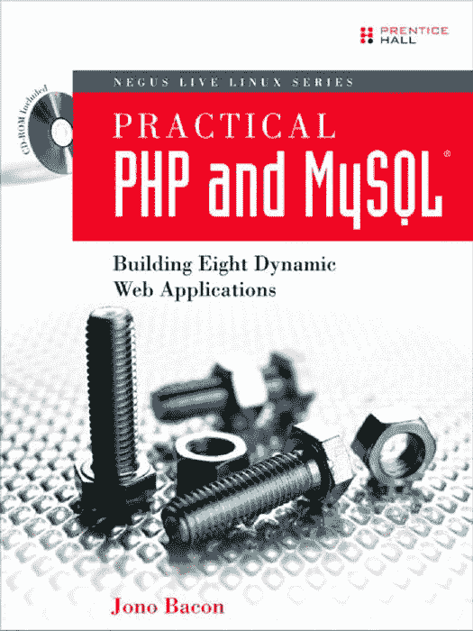

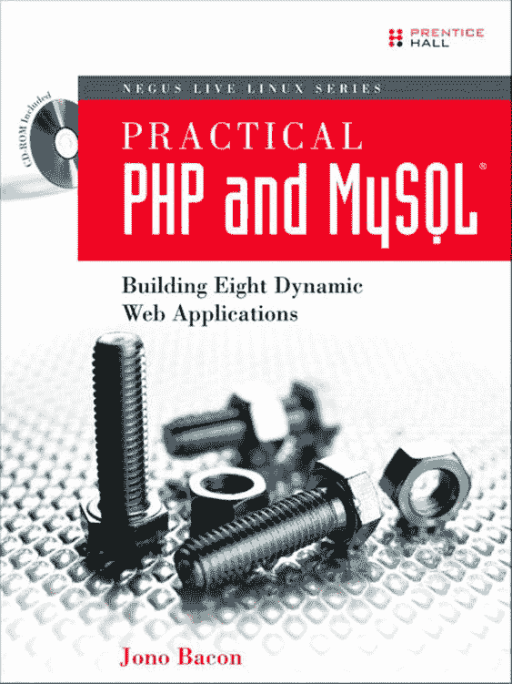


Negus Live Linux 系列书籍鼓励并挑战你在免费软件世界中不断进步。启动每本书附带的 live DVD 或 CD，亲眼看到书中描述的 Linux 系统、应用程序和内容将在你眼前栩生生地。

从学者开始尝试各种示例，最后以专业人士的身份结束，掌握该系列涵盖的许多主题，从构建 `PHP/MySQL` 网站到自定义 live CD 等。

当你完成学习后，你将知道如何自己使用、定制和重建这些免费的开源软件。

该系列由 Christopher Negus 监督，他是畅销书籍《Red Hat Linux Bible》系列、`Linux Toys`系列以及本系列标志性著作《Live Linux CDs》的作者。


新泽西州上塞德尔河 ■ 波士顿 ■ 印第安纳波利 ■ 旧金山 ■ 纽约 ■ 多伦多 ■ 蒙特利尔 ■ 伦敦 ■ 慕尼黑 ■ 巴黎 ■ 马德里 ■ 开普敦 ■ 悉尼 ■ 东京 ■ 上海 墨西哥城


*给我的家人，感谢他们无限的支持……*

*本页特意留空*

## 

33

在显示 `<form>` 标签之后，下一步是显示每个表单元素。大多数表单元素是用 `<input>` 标签添加的，然后通过 `<input>` 标签中的 `type` 属性选择相应的选项。

添加的第一个字段是普通文本框。它提供了一个单行框，用户可以在其中输入某些文本。要选择此类元素，请使用 `type` 属性中的 `text` 设置。你还应该给标签赋予一个 `name` 属性。你将使用 `name` 属性的值在稍后引用该框的内容。

添加的第二个字段是密码框。当你在 `<input>` 标签的 `type` 字段中使用 `password` 时，框的行为与文本框相同，但它用星号或圆圈掩盖用户输入的数据。

最后一个的框使用 `submit` 类型。它提供了一个可以点击的 `Submit` 按钮，可以在用户点击表单时使用。传递此标签的额外属性是 `value`；它用数据预填充该组件。对于 `Submit` 按钮，`value` 属性更改按钮上显示的文本。

## 注意：Web 编辑
许多 Web 编辑器帮助你更高效地编写 HTML。一个很好的例子是适用于 Linux 的工具 `Bluefish`。通过它，你可以使用工具栏按钮轻松添加表单元素。所有操作系统都有许多类似的编辑器，例如 `SciTE`。

## 处理表单

显示表单但不处理它几乎等于无用。要对表单数据进行任何有用操作，你需要将表单连接到某些可以处理数据的 PHP。

要处理表单，请遵循以下步骤：

1. 确定提交按钮变量是否存在。如果用户点击了按钮，你可以假设表单已经显示且 `Submit` 按钮已被点击。
2. 如果 `Submit` 按钮未被点击，你应该假设表单尚未显示，因此显示它。
3. 如果 `Submit` 按钮已被点击，你就可以处理表单。

34 实用 PHP 和 MySQL

为了演示这是如何工作的，创建一个名为 `form2.php` 的新文件并添加以下代码：

```php
<?php
if(isset($_POST['submitbutt'])) {
    echo "username: " . $_POST['username'] . "<br />

echo "password: " . $_POST['password'] . "<br />
}
else {
?>
<form action="form2.php" method="POST"> Username <input type="text" name="username"><br /> Password <input type="password" name="password"><br />
<input type="submit" name="submitbutt" value="Login!"><br />
</form>
<?php
}
?>
```

在理解这段代码时，将自己置于 PHP 解释器的位置并假设你从未发送过该页面非常有帮助。这个示例的开头包含 `if` 语句。这一行检查该变量是否存在。如果变量存在，则其他变量的内容将显示在屏幕上。如果该变量不存在，你需要假设表单尚未显示，并运行 `else`。

### 注意：超级什么？
PHP 中的 `$_GET` 和 `$_POST` 特性在 PHP 术语中被称为超全局变量（superglobals），它们用于访问不同类型的信息。例如，`$_GET` 用于访问 GET 变量。`if` 行仅仅是检查该变量是否存在。

35

退出 PHP 模式以显示表单，然后在代码底部返回 PHP 模式，用最后的 `}` 括号关闭 `else` 块。这是显示和处理表单的常用方法。使用这种方法意味着你可以将表单处理逻辑和表单标签留在同一个页面上，以便访问。


由于操作指定了相同的页面名称，页面将重新加载。

4. 页面重新加载，`if` 语句再次检查是否存在 `submitbutt` POST 变量。这次存在，因此执行了 `if` 代码并显示用户名/密码详情。

## 在 MySQL 中深入探索

在探索 PHP 和 MySQL 的旅程中，目前 MySQL 的部分一直处于空白状态。到目前为止，重点一直放在学习 PHP 语言背后的核心基础特性，但现在是时候重点了。现在是 MySQL 的时间。

一个典型的数据库由许多不同的部分组成。这些不同部分如图 2-1 所示。

### 图 2-1: 数据库的工作原理
`MySQL`
`Server`
`BizCorp`
`Products`
`Web Site`
产品
分类

#### MySQL Server

顶层是主 `MySQL Server`。服务器包含图中所有的其他部分。很多人对 `server` 这个词感到困惑，认为它必须是某种硬件。`server` 一词实际上有双重含义，指的是提供服务的硬件，也指的是提供服务的软件。在 MySQL 的情况下，我们指的是软件服务器。

在 `MySQL server` 内部，你可能会有许多数据库。这是数据库开发初学者有时会感到困惑的另一个领域。当你使用 `MySQL` 时，你实际上可以在同一个服务器内拥有多个数据库；你不限于于一个。因此，你可以在一台计算机上运行单一 `MySQL` 安装，并为你的主公司、产品数据库和你的网站运行数据库。

现在将焦点转移到服务器内部的特定数据库，你可以看到许多表。每个数据库将数据数据存储在系列表中，这些表可以以不同的方式相互关联。表 2-2 显示了数据库中的一个典型表。

#### 表 2-2: 示例数据库表
名 | 姓
--- | ---
Craig | Tucker
Lee | Jordan

每张表都由行和列组成。在数据库术语中，列被称为 `fields`（字段），行被称为 `records`（记录）。当你创建数据库表时，你定义了想要在 `fields`（列）中存储什么类型的信息，然后数据库中的每个条目都作为一条 `record`（行）被存储。

#### 示例：产品数据库

在这个示例中，你将创建一个存储产品信息的数据库。你想要存储的信息类型包括：
- 产品名称
- 分类
- 价格
- 产品描述

这些内容是你通常想要放入数据库的非常典型的信息类型。在创建任何数据库之前，写下你需要处理的数据类型是一个好主意；这使得设计表结构时变得更容易。

#### 设计表结构

在清楚了需要存储的数据类型后，下一步是开发一个合适的表结构，以合理地存储数据且不产生不必要的数据。

#### 注意：学习数据库理论
需要注意的是，数据库设计是一个宏大的课题，书中没有足够的空间对数据库设计理论和引用完整性提供彻底解释。如果你是数据库设计新手，并想了解如何设计健壮的数据库结构，请咨询当地书店并参考关于该主题的众多书籍之一。

在这个示例中，你将使用两个表来存储数据：一个产品表和一个分类表。产品表将包含以下字段：
- `id`
- `cat_id`
- `product_name`
- `description`
- `price`

每当你创建一个表时，拥有一种提取唯一记录的方法是至关重要的。要做到这一点，你需要能够识别某些字段或字段组，这些字段可以帮助你在提取特定记录时添加唯一性。例如，如果你正在存储客户列表，你可能会认为可以通过搜索姓名来引用唯一记录。然而，这是行不通的；许多人有相同的姓名，因此不是唯一的。另一个选项是搜索姓名和邮政编码。同样，这也行不通，因为可能有多个住在相同邮政编码的同名的人。这种情况可能很小，但要点在于，你不应该基于可能性做出这种唯一性判断——它*必须*是唯一的。

解决这个问题的方案是创建一个额外的字段，包含该记录的唯一 ID 数字。每当向数据库中添加一条新记录时，该数字就会加 1，因此你将拥有此唯一 ID 来引用每条记录。`MySQL` 包含了支持，使得这个唯一数字的实现变得非常简单。在之前的产品表字段列表中，第一个字段（`id` 字段）存储了这个唯一数字。这个唯一字段（无论是唯一数字还是其他唯一字段，如用户名）被称为 `primary key`（主键）。你将在本书中使用主键。

上一个列表中的第二个字段是 `cat_id`。该字段被称为 `foreign key`（外键），并将与接下来要讨论的 `categories` 表的主键匹配。表中的其他字段包含关于产品不同方面的通用信息。

分类表包含一系列与不同类型产品分类相关的字段。此表包含以下字段：
- `id`
- `category`

如你所见，这个表相当简单，因为表的目标仅仅提供一种存储分类信息的方法。在这个简单的示例中，你只需在表中存储分类名称以及其主键字段。

#### 表是如何相互关联的

设计好两个表后，现在讨论它们如何相互关联就有意义了。两个表之间创建的关系通过匹配某些类型的信息来实现。在这两个表表中，这种匹配是在 `categories` 表中的 `id` 字段和 `products` 表中的 `cat_id` 字段之间进行的。如果两个字段都包含相同的数字，则存在关系。

当你向 `products` 表中添加记录时，不是在 `cat_id` 字段中添加分类的文本名称，而是存储与相关分类相关的 `id` 值。例如，如果 `categories` 表中的第一个分类是“游泳”且 `id` 为 1，那么对于与游泳相关的产品，你将在 `products` 表的 `cat_id` 字段中存储数字 `1`。稍后当你编写代码从数据库中提取信息时，你可以利用这些不同的关系来提取不同类型的信息。

此时，你可能想知道将这些信息分离到单独表的优势是什么。为什么不直接在字段中包含分类名称呢？这种分离有很多实际原因，如下：
- 当你想更改分类名称时，第一个优势变得显而易见。例如，如果你想将分类从游泳扩大到水上活动，你需要手动更改每个记录。如果你使用两个表来分离数据，你只需要更改一条记录来调整分类，然后更改将反映在所有相关的记录中。
- 如果使用单独表，你可以与分类关联更多信息。你没有理由以后不在 `categories` 表中添加额外的字段，以添加诸如分类描述、分类图标、翻译后的定义等功能。


■ 将数据提取到单独的表中一个大原因是易于使用。如果你有一张包含大量字段的单表，它看起来会非常复杂且难以处理。最好是有几个简单、较小的表。

■ 如果你将数据分散在若干个较小的表中，你的数据库运行效率会更高，因为将不需要在海量的无关数据中费力搜索。

将你的信息分离到不同的表中有很多益处，这无疑是开发数据库驱动应用程序的正确方法。在本书中，你将看到许多关于这种跨表数据分离如何运作的示例。

### 创建数据库

下一步实际上是将这些理论转变为你可以看到、触得着并操作的东西。为了实现这一点，你需要利用你的数据库客户端。在这个示例中，你将使用 XAMPP 自带的工具 `phpMyAdmin` 来创建数据库。

首先，打开 Web 浏览器并访问 `http://localhost/phpmyadmin/` 连接到 `phpMyAdmin`。屏幕会显示一个登录界面。如果你只安装了 MySQL 或 XAMPP，请使用用户名 `root` 且密码为空。如果你在共享计算机上工作，请先通过以下命令连接到服务器来更改你的 `root` 密码：

```bash
mysql -u root mysql
```

现在执行以下 SQL 查询

```sql
SET PASSWORD FOR root@localhost=PASSWORD('chinnyraccoon');
```

很显然，请将括号中的密码替换为你自己的密码。

登录 `phpMyAdmin` 后，你会在屏幕左侧看到一个框架，用于列出数据库和表（目前没有选择任何内容）。在屏幕主体部分有一个框，你可以在其中输入要创建的数据库名称（见图 2-2）。在该框中，输入 `productsdb` 并点击 `Create` 按钮。你现在可以看到左侧框架中出现了 `productsdb` 数据库。通常，你的表会列在侧边的数据库名称下，但目前还没有创建任何表。

**图 2-2** 在 `phpMyAdmin` 中创建新数据库非常简单。

#### 创建表

屏幕主体部分有一个你可以用来创建表的框。在该框中，输入名称 `products` 并为其分配 5 个字段。随后，你将看到表设计界面。如如图 2-3 所示，有五行，每行都有许多不同的框用于配置表中的每个字段。在这个简单的示例中，这些框中的大多数是无关的。

在创建字段之前，有必要讨论 MySQL 中的类型（types）概念。在任何类型的数据库编程中，存储在数据库中的信息类型根据其类型具有不同的特征。例如，如果你在数据库中存储一个 `float`（`float` 是一个带有小数点的数字，例如 21.45），存储此类类型的信息所需的内存比存储整数（全整数，例如 35）更多。此外，不同类型的范围也不同。例如，MySQL 中的 `TINYINT` 类型可以存储 –128 到 127 之间的任何整数。作为对比，`BIGINT` 数据类型可以存储从 –9223372036854775808 到 9223372036854775807 的任何数字。

**图 2-3** 表设计界面有很多选项；使用滚动条进行移动。

在内存使用和性能方面，使用 `TINYINT` 存储 1 字节值与使用 `BIGINT` 存储 8 字节值之间存在差异。

在书中，你将广泛使用主要的 MySQL 类型，每个示例都会解释为什么选择相关的数字类型。这应该给你一个关于如何使用不同数据类型的坚实、实用的概念。

废话不多说，现在是时候创建表了。在 Field（字段）列的第一行，添加 `id` 作为字段名。在第二列（Type）中，选择数据类型为 `MEDIUMINT`；这将提供对多达 8388607 个产品的访问。

记住，此 `id` 列为每个产品都需要一个唯一值，因此你需要确保数据类型足够大，以满足你可能需要的产品数量。继续向下操作，然后选择 `Extra` 框并从中选择 `auto_increment`（自增）。当你添加记录时，此选项会自动为你填充 `id` 字段。启用此选项后，每个新记录在 `id` 列中获得的值将比上一个记录的 `id` 大 1。设置了 `auto_increment` 后，你可以有效地忽略 `id` 字段，它会自动处理好。最后一个要设置的选项是第一个单选按钮（它有一个小钥匙和表格的图标）。通过选择此选项，你将该字段设为主键（primary key），数据库将不允许在该字段出现重复值。如果你像这里一样将此选项和 `auto_increment` 结合使用，你可以确保拥有可靠的唯一主键。

现在，逐 own 检查每一行并添加以下字段：

- `cat_id`:在 Field 列中添加 `cat_id` 并分配类型为 `TINYINT`。超过 127 个类别不太可能的，因此这是一个合适的类型。你不需要提供长度。
- `product`:在 Field 列中添加 `product` 并分配类型为 `VARCHAR`。当你需要在字段中存储少于 255 个字符时，可以使用这种类型。使用 `VARCHAR` 类型时，你需要为字段提供一个最大长度。添加 50 作为长度；产品标题不太可能超过 50 个字符。
- `description`:在 Field 列中添加 `description` 并分配类型为 `TEXT`。当你需要在字段中存储可能的大块块文本时，可以使用 `TEXT`。你不需要提供长度。
- `price`:在 Field 列中添加 `price` 并分配类型为 `FLOAT`。当你需要存储带有小数点的数字时，可以使用这种类型。你不需要指定长度。

当你配置好字段后，点击 `Save`（保存）按钮，你的表就创建了。使用 `phpMyAdmin` 的最用益处之一是当你执行某些操作时生成的 SQL 总是显示给你。这让你在使用 `phpMyAdmin` 时随手查看生成的代码，就能对 SQL 如何工作有一个极佳的理解。这些 SQL 代码现在看起来可能意义不大，但请过一遍它们。SQL 在书中后面的项目中被广泛使用，因此建议你尽快熟悉它。

生成的 SQL 看起来大致如下：

```sql
CREATE TABLE 'products' (
  'id' MEDIUMINT NOT NULL AUTO_INCREMENT ,
  'cat_id' TINYINT NOT NULL ,
  'product' VARCHAR( 50 ) NOT NULL ,
  'description' TEXT NOT NULL ,
  'price' FLOAT NOT NULL ,
  PRIMARY KEY ( 'id' )
);
```

如果你上下阅读 SQL，你会发现它非常英语。虽然你很少手动编写 SQL 来创建表（你通常在如 `phpMyAdmin` 的客户端中创建），但创建表的语法非常直接。

现在你需要创建第二个表。为了实现这一点，点击左框架中的 `perfectproducts` 链接。现在你可以在页面主体创建一个名为 `categories` 的新表，并为其分配 2 个字段。在表设计界面中，添加以下字段：

- `id`:在 Field 列中添加 `id` 并分配类型为 `TINYINT`。现在从 `Extra` 框中选择 `auto_increment`，然后在带有小钥匙图标的列中选择 `Primary Key` 选项。
- `category`:在 Field 列中添加 `category` 并分配类型为 `VARCHAR`。将长度设置为 30。

当你添加这些字段后，点击 `Save` 按钮。你完成了。

#### 向表中添加数据


当表格创建完成后，你就准备好向它们加载数据了。你将首先在 `phpMyAdmin` 中手动进行操作，但随着书籍的进行，你将创建表单来自动化数据添加到不同表的过程。

首先，你将向 `categories` 表中添加一些数据。你需要先添加一些类别，以便在 `products` 表中引用相关的类别。

要添加数据，请从左侧框架的表格列表中选择 `categories` 表。现在你应该会在屏幕顶部的主区域看到几个标签。

点击 `Insert`（插入）标签。你将进入一个可以在其中向表中添加数据的界面，如图 2-4 所示。

**图 2-4** 你可以一次插入两条记录。

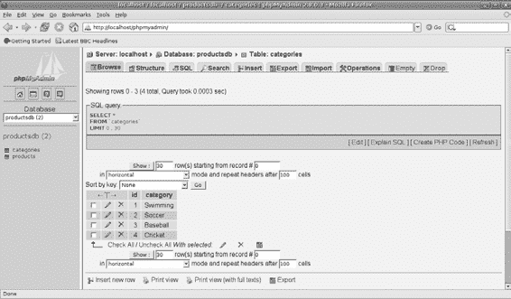

在添加信息时，系统提供了两组表单，以便一次向表中添加两条记录。你不需要同时使用两者，但在输入测试信息时（如你在这里所做的），同时使用两个表单非常方便。

当你添加数据时，不需要使用任何 `Function`（函数）选项。此外，记住不要在 `id` 字段中添加任何内容；`auto_increment`（自动递增）会自动为你处理。你只需要在 `Category` 字段中填写类别即可。逐个添加以下类别：

- 游泳 (Swimming)
- 足球 (Soccer)
- 棒球 (Baseball)
- 板球 (Cricket)

添加这些记录后，点击页面主体部分的 `Browse`（浏览）标签。你现在可以看到自动填充了 `id` 值的表格，以及你添加的类别（见图 2-5）。

**图 2-5** 点击 `Browse` 标签查看特定表中的记录。

现在，在 `products` 表中填写一些数据。执行此操作，请点击左侧框架中的 `products` 表，然后再次点击 `Insert` 标签将以下信息添加到表单中：

- 在第一条记录中，在 `cat_id` 框中添加 `1`（这会将该记录放入“游泳”类别中），然后添加任何你想到的与游泳相关的产品。（发挥想象力；在处理记录时，添加一些让你不禁的荒诞产品总是很有趣的。）以正确的格式添加价格（例如 `21.99`），不要添加货币符号。
- 对于第二条记录，在 `cat_id` 框中添加 `3`（这会将该记录放入“棒球”类别）。同样，添加有趣的产品并加上正常的价格。

随意添加更多产品，但记住在 `cat_id` 字段中使用来自 `categories` 表的 `id`。这将确保你正确地关联两个表。

#### 在 PHP 中连接 MySQL

在有了一些 PHP 经验和数据库开发基础后，现在是执行至关重要的一步了：将两者结合起来并在 PHP 中连接数据库。这涉及创建数据库连接、然后发布 SQL 查询，最后以符合你的 Web 应用程序逻辑的方式处理查询结果。

要实际连接到 MySQL，PHP 提供了内置支持来建立连接、执行查询并处理结果。为了实现这一点，许多以 `mysql_` 为缀的 PHP 函数实现了魔法。尽管这些函数非常有用，但在未来你可能会遇到这种情况：你希望你的 Web 应用程序可以使用多个数据库中的任何一个。如果有此需求，你需要使用第三方数据库抽象库，例如 `PEAR::DB` 或 `ADODB`。然而，如果你知道特定项目将使用 MySQL，那么 `mysql_` 系列函数就完全胜任。

##### 建立连接

第一步是实际与数据库建立连接。此连接用于在往返查询和数据时与数据库通信。为了做到这一点，你需要编写一些 PHP 代码，将相关的身份验证详细传递给 MySQL，如果你获得了授权，它将给你连接。

创建一个名为 `dbconnect.php` 的新文件并添加以下代码：

```php
<?php
$dbhost = "localhost";
$dbuser = "root";
$dbpassword = "";
$dbdatabase = "productsdb";
$db = mysql_connect($dbhost, $dbuser, $dbpassword);
mysql_select_db($dbdatabase, $db);
?>
```

代码的前四行创建了一些包含了连接数据库所需信息的变量。需要记住，这四行代码仅仅是设置了一组变量；此时尚未建立连接。你可以随心地命名这些变量，但你需要为你在 MySQL 服务器上使用的主机、用户名、密码和数据库提供合法信息。

设置变量后，你就可以建立连接了。这发生在 `$db = mysql_connect($dbhost, $dbuser, $dbpassword)` 这一行。该行使用 `mysql_connect()` 函数将主机、用户名和密码变量传递给 MySQL 服务器，并将连接结果放入 `$db` 变量中。然后你将 `$db` 变量作为主连接的指针。为了保持代码简单，此示例未涉及任何错误检查；通常情况下，你会检查连接是否可用，并可能显示合适的错误消息。一些程序员认为这是没必要的，因为如果连接被拒绝，你仍然会收到 PHP 错误信息，但如果你实现了自己的错误处理，就可以以更友的方式格式化并引用你的错误。

连接建立好后，你需要选择你想要使用的数据库（记住，MySQL 可以有多个不同的数据库）。这通过下一行的 `mysql_select_db()` 完成。在这里，你指定了所选数据库的变量，并指定了从中选择数据库的连接 (`$db`）。

此时，你已经连接成功。此页面上的任何其他 MySQL 相关的连接都将应用于刚刚创建的连接。

**注意：数据库连接按页面有效**

你建立的数据库连接不会跨越其他页面。你需要在每个访问 MySQL 的页面上包含连接详情。当然，提高这种效率的方法将在书后部分介绍。

到这里，你已经准备好在此页面开始操作数据库了。

##### 查询数据库

当你想要获取、设置或更新数据库中的信息时，你会使用 SQL 查询。之前你在 `phpMyAdmin` 中创建表格时已经简单尝试过 SQL。深吸一口气，因为现在你将手动编写特定的 SQL 查询。不要担心；这听起来并没有你想象的那么可怕。

在 `mysql_select_db` 行下方，添加以下代码：

```php
$db = mysql_connect($dbhost, $dbuser, $dbpassword);
mysql_select_db($dbdatabase, $db);
$sql = "SELECT * FROM products;";
$result = mysql_query($sql);
```

第一行（`$sql` 行）只是设置了另一个变量，但这个变量包含了你要发送给 MySQL 的查询 SQL。SQL 是一种非常简单高效的语言，你将在整本书中使用它——在学习过程中，每一段 SQL 都会得到充分解释。在这一行中，你正在从 `products` 表中所有行。你可以从左到右读取 SQL 行来理解它的工作原理：

首先选择 (`SELECT`) 所有的 (`*`) 从 (`FROM`) products 表 (`products`)，然后结束查询 (`;`)。

每个 SQL 语句都以分号结尾。虽然在 PHP 脚本中不需要显式添加分号，但这样做是个好习惯。这能让你养成添加分号的习惯，特别是当你使用 MySQL 命令行客户端时。

**注意：其他客户端**


有多种方法可以与 MySQL 通信。其中一些基于 Web（例如 `phpMyAdmin`），一些是图形化桌面应用程序（例如 `MySQL Control Center`），还有一些是基于命令行的（例如 `mysql` 命令）。

此时，SQL 尚未真正发送到服务器；你只是创建了一个包含查询语句的变量。下一行才会真正将查询发送到数据库。`mysql_query()` 函数用于将 SQL（在 `$sql` 变量中）发送到数据库，并将查询结果放入 `$result` 变量中。

##### 遍历结果

`$result` 内部包含了你的“圣杯”，即查询结果的母体。

尽管 `$result` 包含了结果，但你可以将其看作是一个巨大的、连接在一起的结果集合。在目前的形式下，`$result` 并不十分有用，为了真正具有实际操作性，你需要遍历查询的每一行。如果你循环每一行，就可以在页面上显示相关信息。这就是宏伟计划。

在你的文件中，在 `mysql_query` 行下方添加以下代码：

```php
$sql = "SELECT * FROM products;";
$result = mysql_query($sql);

while($row = mysql_fetch_assoc($result)) {
    echo $row['product'];
}
```

在这段代码中，你正在使用 `while` 循环来遍历结果集中的每一行。这是通过添加一个循环条件实现的，使用 `mysql_fetch_assoc` 从 `$result` 中提取每一行，然后将其放入 `$row` 变量中。

`mysql_fetch_assoc()` 函数的目的是将结果转换为关联数组。这为你提供了一种方便的键值对方法（在之前的“数组”部分已解释过）用来提取信息。因此，如果你需要访问当前行中 `product` 字段的内容，可以使用 `$row['product']`。

## 使用 Session 实现跨页面的一致性

进行任何类型的 Web 开发时，面临的最大挑战之一就是在无状态的 Web 中维护跨页的状态。这个宏大的陈述基本上翻译为“在不同页面之间共享信息”。这种困难的源在于你创建的每个 Web 页面本质上都是作为一个独立的程序运行。当你构建跨多个页面的 Web 应用时，除了使用 `GET` 和 `POST` 变量外，没有隐式手段可以在这些页面之间共享信息。Sessions 改变了这一切。

`Sessions` 提供了一种惊地简单且高效的方法，可以在字面上在不同页面之间共享变量。这是通过许多 PHP 函数实现的，这些函数让你能够启用带 session 的页面、创建 session 变量并在脚本中使用这些 session 变量。可以使用 sessions 在不同页面之间共享你喜欢的任何 PHP 变量。

### 创建 Session

要使用 session，首先在在你想要使用 session 的每个页面的最开头添加 `session_start()` 函数。`session_start()` 必须位于最开头，这一点至关重要——它之前不能有花哨的 HTML、不能有 Maud 姨妈的照片，甚至不能有任何空格。

为了演示这一点的重要性，创建一个名为 `sessions.php` 的新文件并添加以下代码：

```php
<?php
session_start();
?>
```

当你运行该脚本时，你什么也看不见；session 支持已经高兴地构建到你的页面中了。现在调整代码，在 `<?php` 标签之前放一个空格：

```php

<?php
session_start();
?>
```

当你做出这个微小的改变时，你会收到一条特别“恶毒”的错误信息：

`Warning: session_start() [function.session-start]: Cannot send session cookie - headers already sent by (output started at /opt/lampp/htdocs/sites/startingchapter/sessions.php:1) in /opt/lampp/htdocs/sites/startingchapter/sessions.php on line 3`

`session_start()` 之前不能有任何内容之所以如此，是因为 session 框架利用了构成 Web 页面机制的 HTTP 头部。这些特殊的头部附加在每个 Web 页面之前，因此，如果你在 `session_start()` 之前添加任何内容，脚本将尝试发送内容（如空格），然后是头部，最后才是主内容。这不是 Web 的工作方式，因此 PHP 会以之前的警告信息的形式向你“大叫”。

### 注意：关于头部的所有信息

互联网上的每个 Web 页面都有一些被称为 `headers` 的信息，这对大多数用户来说是不可见的。头部存储了浏览器关心的信息。以下是一些示例头部：

```
GET / HTTP/1.
Host: www.yourfavewebsite.org
Connection: close
Accept-Encoding: gzip
Accept: text/xml,application/xml,application/xhtml+xml,text/html;q=0.9,text/plain;q=0.8,image/png,*/*;q=0.5
Accept-Language: en-gb,en;q=0.5
Accept-Charset: ISO-8859-1,utf-8;q=0.7,*;q=0.7
User-Agent: Mozilla/5.0 (X11; U; Linux i686; en-GB; rv:1.8.0.3) Gecko/20060523 Ubuntu/dapper Firefox/1.5.0.3
Referer: http://www.someotherwebsite.net/
```

头部下方是内容。当你向页面添加内容时，头部会自动添加。因此，当你使用 sessions 时，sessions 系统会修改这些头部的一部分，这就是为什么你必须在向页面添加数据之前添加 `session_start()`。

### 使用 Session 变量

在使用 session 变量之前，你需要注册它。这是通过命名相当合乎意料的 `session_register()` 函数实现的。要使用它，在括号内指定要创建的变量名。为了演示这一点，在 `sessions.php` 的 `session_start()` 之后添加以下行：

```php
session_register("userid");
```

这一行向 session 系统注册了 `userid` 变量可以在页面间共享。下一步是实际上将此变量设置为某些有用的值。接着添加此行：

```php
$_SESSION['userid'] = 10;
```

在这一行中，你正在使用特殊的 `$_SESSION` 超全局变量来引用 `userid` 变量。`$_SESSION` 的语法应该看起来熟悉，因为你之前用过 `$_GET` 和 `$_POST` 分别访问 GET 和 POST 变量。

要测试你的 session 变量在第二个页面上是否可以访问，创建一个名为 `sessions2.php` 的文件并添加以下代码：

```php
<?php
session_start();
echo "The userid session variable is: . $_SESSION['userid'];
?>
```

记得先访问 `sessions.php`（设置变量），然后访问 `sessions2.php` 以查看变量是否在页面间共享。要访问 session 变量，你只需在页面上包含 `session_start()`，然后使用 `$_SESSION` 引用变量即可。

session 信息在浏览器打开时可用。当浏览器窗口关闭时，session 信息就会丢失。虽然这通常是破坏 session 的合适方法，但有时你需要根据命令强制销毁 session 数据。要做到这一点，可以使用以下命令：

```php
session_destroy();
```

所有的 session 变量随后都会被相应删除。

## 总结

本章探索了在继续学习编写应用程序之前需要理解的一些核心概念。与其花费数小时涵盖 PHP 和 MySQL 的每一个细微差别，你已经学习了继续所需的基础知识，每个应用程序都将提供新的技能、技术和思想。


与任何编程语言一样，或者说与自然语言一样，练习确实能熟能生巧。仅仅阅读如何用 `PHP` 执行某事与真正理解它往往是两码事。熟悉这门语言的一种极佳方法是创建许多小脚本，来测试该语言的不同方面。这些脚本不仅对学习有用，而且当你以后忘记了如何执行某些操作时，它们可以作为一个极佳的参考点。

# 第 3 章

## 运行项目

书中充满了项目，许多令人愉悦且精实的项目，它们向你展示了如何使用 `PHP` 和 `MySQL` 来一些有趣的事情。每个项目内部都有数页页源代码，这些代码逐步构建起每个项目。虽然我们非常欢迎你坐在那里边运行仔细输入每一行代码，但我们认为你可能想直接运行这些项目并看看它们是如何运作的。

听起来不错吧？嗯，你会惊喜地发现，夹在书里的闪亮光盘将为你带来数小时运行项目的乐趣！

那么，光盘上有什么呢？嗯，这张光盘被称为 `Live CD`，它为你提供了一种简单易用的方法，可以在不触碰现有硬盘的情况下，在计算机上运行一个完整的操作系统。它的工作原理是：将光盘插入驱动器并从它启动。计算机会假装 CD 是一个硬盘，并像运行其他硬盘一样运行操作系统。这意味着你可以随心所欲玩弄系统，而它不会触碰你珍贵的硬盘。很酷，对吧？

### 关于光盘

在大多数编程书中，你通常会得到一张包含书中代码的光盘。这个实用的补充部分节省了从书到计算机上手动复制代码的数小时重复工作。尽管节省了数小时的打字时间，但“光盘代码”的方法仍然假设你实际上拥有了运行它所需的软件。因此，如果你知道你想学习某些东西（例如 `PHP` 和 `MySQL`），但你没有运行代码所示的 `PHP` 和 `MySQL` 软件，你就束手无策了。

这本书则不同。`Live CD` 不仅包含每个项目的代码，还包含了一个用于运行代码的完整开发环境。你获得了 `PHP`、`MySQL`，以及 `Apache`、`phpMyAdmin`、`Mozilla Firefox`、`PEAR` 模块等等——全部整齐地包含在 `Linux` 操作系统中。

现在，我们知道你在想什么——噢，我需要出去买一个新硬盘，或者我需要对现有的磁盘进行分区，或者我需要……放轻松。不需要买新硬盘，不需要分区，也不需要担心。整个系统都从 `CD` 运行。

#### Live CDs：一种新方法

在近年来，`Live CD` 真的非常流行。其理念非常简单：你获取一个操作系统（通常是 `Linux`），并且不是从硬盘运行它，而是从 `CD` 或 `DVD` 运行它。这提供了许多益处。首先，你可以在不实际安装的情况下尝试一个操作系统。当你运行随书附带的光盘时，它永远不会触碰你的硬盘。因为系统是从 `CD` 运行的，你可以尽情玩弄它、弄坏它并进行实验。不仅你的硬盘是完全安全的，你还可以随时重启 `CD` 以找回原始系统。其次，`Live CD` 提供了一种将你的系统“随身携带”的绝佳方法；只需将光盘放入任何计算机的驱动器并重启即可运行。

#### 启动系统

并不是所有的计算机在启动时都会自动尝试从 `CD/DVD` 驱动器启动。如果你打开计算机并看到 `CD/DVD` 驱动器灯闪烁，说明计算机正在寻找启动项。在这种情况下，放入 `Live CD` 并重启即可开始！

如果灯没有闪烁，你可能需要将在计算机的 `BIOS` 中启用从 `CD/DVD` 驱动器启动。要访问 `BIOS` 设置，你的计算机会有一个特定的按键。


## 启动与停止

Linux 下的 XAMPP 安装程序始终位于 `/opt` 目录下。XAMPP 目录内部有一个 `lampp` 命令，用于启动和停止 XAMPP 系统。要启动 XAMPP，请运行以下命令：

```
foo@bar: /opt/lampp $ sudo /opt/lampp/lampp start
```

由于 XAMPP 提供了系统服务，你需要超级用户权限运行该命令，这就是使用 `sudo` 的原因。你也可以使用以下命令停止 XAMPP：

```
foo@bar: /opt/lampp $ sudo /opt/lampp/lampp stop
```

你可以使用 `restart` 来停止并重启 XAMPP（这是桌面上的“启动 XAMPP”图标运行的命令）：

```
foo@bar: /opt/lampp $ sudo /opt/lampp/lampp restart
```

此命令实际上拥有非常广泛的功能，你可以在不带任何选项的情况下运行它来查看所有功能：

```
foo@bar: /opt/lampp $ sudo /opt/lampp/lampp
```

表 3-1 提供了一些对于启动和停止特定组件可能感兴趣的命令列表。

当 XAMPP 系统启动时，你可以使用 浏览器访问 `http://localhost`。当你访问该页面时，你会看到许多作为 XAMPP 系统部分的 Web 页面。这些页面提供了许多小型示例应用程序、指向系统其他部分的链接以及关于运行的信息。

# 第 3 章：运行项目

### 表 3-1：启动和停止不同 LAMPP 组件的选项

| 选项 | 描述 |
| :--- | :--- |
| `lampp startapache` | 仅启动 Apache |
| `lampp startmysql` | 仅启动 MySQL |
| `lampp stopapache` | 仅停止 Apache |
| `lampp stopmysql` | 仅停止 MySQL |
| `lampp restartapache` | 停止并重启 Apache |
| `lampp restartmysql` | 停止并重启 MySQL |

## 访问 phpMyAdmin

XAMPP（以及 Live CD）包含一个强大的基于 Web 的数据库编辑器 `phpMyAdmin`，可以通过 `http://localhost/phpmyadmin/` 访问。`phpMyAdmin` 将在书中广泛。

## 切换 PHP 版本

XAMPP 最好的功能之一是它发布时同时包含了 PHP4 和 PHP5（未来无疑会包含 PHP5 和 PHP6）。这使得使用不同版本的 PHP 测试你的应用程序变得简单。只需使用你想要使用的版本重启 XAMPP 即可。

要切换版本，请将版本传递给 `lampp` 程序。因此，要启动 PHP4，请运行以下：

```
foo@bar:/opt/lampp$ sudo /opt/lampp/lampp php4
```

要启动 PHP5，请运行以下：

```
foo@bar: /opt/lampp $ sudo /opt/lampp/lampp php5
```

这些命令将使用你指定的 PHP 版本重启动 Apache。

你也可以通过以下命令检查你正在运行哪个 PHP 版本：`foo@bar: /opt/lampp $ sudo /opt/lampp/lampp phpstatus`

## 备份

还有可用的备份技术。创建备份存档后，你可以将其复制到硬盘或网络服务器，以便永久保存备份。（记住，重启后，如果你不以某种方式将这些更改备份到其他介质，任何更改都将从 Live CD 中消失。）首先，使用构建 XAMPP 备份脚本。确保 XAMPP 正在运行，然后运行：

```
foo@bar: /opt/lampp $ sudo /opt/lampp/lampp backup
```

该命令备份数据库和 Web 页面，并将它们放入单个脚本中，你可以运行该脚本来恢复系统。此脚本将存储在 `/opt/lampp/backup`。要恢复备份，请安装免费的 XAMPP 并运行以下脚本，确保将文件名替换为你的备份脚本文件名：

```
foo@bar: /opt/lampp/backup $ sudo /opt/lampp/backup/xampp-backup-00-00-00.sh
```

第二种技术备份整个 XAMPP 目录。要执行此操作，首先使用 `lampp stop` 关闭 XAMPP 服务器，然后进入 `/opt` 目录并将其压缩：

```
foo@bar: /opt $ sudo tar zcvf lamp.tgz lampp
```

要恢复它，请确保你处于 Linux 系统中并运行：`foo@bar: /opt $ sudo tar zxvf lamp.tgz`

## 总结

书中附带的 Live CD 提供了一种简单易 way 的方法来开始运行你将在整个书中编写的应用程序。这张光盘是一个很好的例子，展示了创新的开源软件（如 Ubuntu Live CD、XAMPP 和不同的 LAMP 组件）如何让 Web 开发变得更加简单和高效。这比一本带有几个稀疏源代码文件的枯燥软盘的书要好得多。

光盘提供了一个直接运行应用程序的绝佳机会。但同时也建议在进行每个项目时，仔细遵循代码是如何构建的——在学习 PHP 和 MySQL 时，通过输入代码来手动构建源文件是至关重要的。本书的目标不是让你读完一章并用手指指着代码，而是让你编写代码、运行它、修复错误并在过程中学习。仅仅阅读代码而不实际输入和运行它，几乎总是会导致学习体验不佳；相反，在本书中，你通过实践来学习。

所以，尽管这张 Live CD 是一个非常棒的节省时间工具，但不要让它取代了从书中输入代码、运行它和修复错误这些基本行为。那才是真正学习发生。

# 第 4 章：构建一个博客

最近人们讨论最多的互联网现象之一是 Weblog（通常缩写为 *blog*）。博客的概念——以及随后的博文艺术——是你提供自己的在线日记或日志，你可以在其中记录你的想法供世界看到。你投入博客的实际内容完全由你决定，且博客可以根据你的意愿保持正式或非正式的形式。

如果你想告诉世界你的牛奶变质了，你需要去商店买一些，博客就是你写下这一切的地方。

不过，博客读者不仅仅痴迷于与牛奶保质相关的趣事。虽然博客通常被用作在线交流思想的工具，但博客也成为各种连接到爱好或项目的人分享他们工作内容的主要手段。这在开源开发者中尤为流行，他们使用博客让读者提前预览他们所编写的软件中即将出现的内容。

虽然博客的基本功能是存储一系列博客文章（通常称为 *entries*），但许多博客还包含其他功能：

-   **评论。** 博客读者通常可以留下评论。这可以为博客增加真实价值，对话往往会围绕不同的主题展开。
-   **分类。** 博客通常被分为不同的类别。这使得博客作者能够将条目归入特定部分。这让允许读者只阅读他们感兴趣的类别。
-   **存档。** 大多数博客都有存档和访问之前条目的方法。随着博客变得像“普通”网站一样重要的媒介，能够访问更早的条目是非常重要的。

在这个项目中，你将构建一个包含上述所有功能的博客。你不是很幸运吗？

## 项目概述：BLOGTASTIC 用例


在本章创建的博客应用程序命名得非常巧妙，名为 `Blogtastic`。为了概述如何构建这个博客，这里有一个简单的用例，展示了典型用户将如何与应用程序交互。用例对于帮助可视化不同的交互和内容应该如何呈现给用户非常有帮助。以下是 `Blogtastic` 应用程序用例摘要：John 访问了 Pauline 的博客，自然而然，他想看 Pauline 的最新文章。

John 对阅读这篇博客文章感兴趣，但也想看看是否有人针对该文章发表了评论。如果博客文章有评论，评论者的姓名将添加到博客底部，这样 John 就能看到是谁发布了每条评论。

要访问博客及任何相应的评论，John 点击文章的标题，就会显示该特定的文章（带有评论）。如果 John 想留评论，同一页面上方便地提供了一个供他表达观点的表单。John 填写表单并点击 `Submit` 按钮，页面将重新加载并添加 John 的评论。随后，John 在归档文章页面浏览旧的博客文章，消磨度过了下午。

当天稍晚些时候，Pauline 决定她想添加一篇新的博客文章。Pauline 访问了网站上的一个特殊页面，她可以在那里登录。作为博客作者，一些额外选项仅对她可用。Pauline 可以将新的博客文章添加到特定的类别，她甚至可以添加新类别。Pauline 添加了一篇新文章，然后意识到自己犯了错。幸运的是，页面上显示了一个她——只有她可见的特殊 `Edit` 按钮。Pauline 使用这个按钮正了自己的错误，避免在 John 面前显得愚蠢。Pauline 在心里暗自觉得比 John 聪明。

这是一个博客的典型示例，在这个项目中，你将之前所有的功能都注入 `Blogtastic` 中以匹配这个用例。

# 第 4 章：构建网络日志

### 注意：慢慢来
由于这是书中的第一个数据库驱动项目，请按照你感到舒适的进度学习本章。如果你遇到任何你不理解的概念，请花点时间停下来访问 `Google` 并进行一些研究，在继续之前消除误解。在学习新技术时，如果你不理解概念，千万不要硬着头皮，只会让自己掉进更大的坑里。

## 构建数据库
`Blogtastic` 项目的第一步是构建数据库。首先，在 `phpMyAdmin` 中创建一个名为 `blogtastic` 的新数据库。在此数据库中，创建四个表：

| 表名 | 表格存储的内容 |
| :--- | :--- |
| `categories` | 不同的博客类别 |
| `entries` | 博客文章 |
| `comments` | 博客文章的评论 |
| `logins` | 用户名和密码 |

表的结构如图 4-1 所示。

- **categories**: `id`, `cat`
- **entries**: `id`, `cat_id`, `dateposted`, `subject`, `body`
- **comments**: `id`, `blog_id`, `dateposted`, `name`, `comment`
- **logins**: `id`, `username`, `password`

即使是对于博客引擎这样简单的应用程序，仔细的数据库设计从长期来看也能节省大量工作。

图 4-1 显示了这四个表是如何关联的。第一个关系位于博客类别（`categories` 表）和博客文章（`entries` 表）之间。为了引用正确的类别，来自 `categories` 表的相同 `id` 被存储在 `entries` 表的 `cat_id` 字段中。在数据库术语中，`id` 字段被称为“主键”（primary key），而 `cat_id` 字段被称为“外键”（foreign key）。如果这两个值匹配，表之间就存在明确连接。也就是说，如果你知道类别的 `id`（存储在 `cat_id` 中），你可以运行查询并使用该 `id` 提取其他类别信息（如类别名称）。第二个关系——`entries` 表和 `comments` 表之间——原理完全相同；`entries` 表的 `id` 字段与 `comments` 表中的 `blog_id` 连接。这使得每条评论与正确的博客文章连接起来。

最后一个表是 `logins` 表，它与其他表之间没有关系；该表仅用于让每个用户登录应用程序。

### 实现数据库
设计好数据库后，你就可以创建数据库表。在 `phpMyAdmin` 中，按照第 2 章讨论的步骤添加新表，并使用以下详细信息：

### `categories` 表
- `id`: 将其设置为 `TINYINT`（使用这种类型是因为类别不会很多），并开启 `Extras` 列中的 `auto_increment`（自动递增）。将此字段设置为 `primary key`（主键）。
- `cat`: 将其设置为 `VARCHAR`。因为超过 20 个字母的类别标题不太可能，将大小设置为 20。

### `entries` 表
- `id`: 将其设置为 `INT`（可能有多篇博客文章），并开启 `auto_increment`。将此字段设置为 `primary key`。
- `cat_id`: 将其设置为 `TINYINT`（与它引用的主键类型相同——即 `categories` 表中的 `id`）。
- `dateposted`: 使用 `DATETIME` 类型。这种数据类型以国际 ISO 标准格式存储当前日期和时间，虽然有点笨，但你稍可以在 `PHP` 中对其进行格式化。
- `subject`: 将其设置为 `VARCHAR`。除非你的博客标题非常长，否则将此字段的长度设置为 100。
- `body`: 将其设置为 `TEXT` 字段。如果你想存储非常大的文本区域，`TEXT` 类型是一个很好的选择。你不需要指定长度。

### `comments` 表
- `id`: 将其设置为 `INT`（可能有多条评论）。开启 `auto_increment` 并将此字段设置为 `primary key`。
- `blog_id`: 将其设置为 `INT`（与它相关的 `entries` 表中的 `id` 字段类型相同）。
- `dateposted`: 使用 `DATETIME` 类型。
- `name`: 将其设置为 `VARCHAR`。因为超过 50 个字符的评论标题不太可能，将长度设置为 50。
- `comment`: 这是评论的主体。设置为 `TEXT` 类型。

### `logins` 表
- `id`: 将其设置为 `TINYINT`（登录用户非常少；可能只有一个）。开启 `auto_increment` 并将此字段设置为 `primary key`。
- `username`: 将其设置为 `VARCHAR` 并赋予 10 的长度。（为用户名强制执行最大长度是常见做法。）
- `password`: 将其设置为 `VARCHAR` 并赋予 10 的长度。（和用户名一样，为密码强制执行最大长度是常见做法。）

#### 插入示例数据
创建表后，向它们插入一些初始数据，以便你可以在编写代码时进行测试（再次使用 `phpMyAdmin`）。请记住，当你向这些任何一个表添加数据时，不要在 `id` 列中填写数字；此值将由 `auto_increment` 处理。

由于这是书中的第一个项目，我们已经为表中添加了示例数据，以确保一切连接都按预期工作。当你阅读书籍并更详细地理解数据库概念时，可以添加额外的示例数据。

### `categories` 表的示例数据
按顺序添加以下类别：Life（生活）、Work（工作）、Music（音乐）和 Food（食物）。

### `entries` 表的示例数据
将表 4-1 中的信息添加到 `entries` 表。这两篇文章通过 `cat_id` 引用 `categories` 表中的 `Life` 条目。在 `dateposted` 字段中，使用函数下拉框选择 `NOW` 选项，这将填充字段为你将文章添加到表时的日期和时间。


### `comments` 表的示例数据

将表 4-2 中的信息添加到 `comments` 表中。

**表 4-2** `comments` 表仅包含几个示例注释，用于演示。

| CAT_ID | DATEPOSTED FIELD | SUBJECT | BODY |
| :--- | :--- | :--- | :--- |
| 1 | Select NOW from the | Bob | Welcome! `function box` |
| 1 | Select NOW from the | Jim | Hope you have lots of `function box` fun! |

| BLOG_ID | DATEPOSTED | NAME | COMMENT |
| :--- | :--- | :--- | :--- |
| 1 | | | |

在此表中，通过向 `blog_id` 字段提供值 `1` 来引用第一个博客条目（主题为“Welcome to my blog!”的条目）。

#### `logins` 表的示例数据

在此表中，添加一个包含你任选择的用户名和密码的条目。此示例包含了用户名“jono”和密码“bacon”。

## 开始编码

首先从创建你的项目配置文件开始。该配置文件使得你或运行它的其他用户能够轻松地对博客进行自定义。

在你的电脑的 `htdocs` 中创建一个新目录。在该目录内部，创建一个名为 `config.php` 的新文件（如示例 4-1 所示）：

**第 4 章**
构建博客日志
69

**示例 4-1** 使用配置文件使自定义和个性化变得轻而易举。

```php
<?php
$dbhost = "localhost";
$dbuser = "root";
$dbpassword = "";
$dbdatabase = "blogtastic";
$config_blogname = "Funny old world";
$config_author = "Jono Bacon";
$config_basedir = "http://127.0.0.1/sites/blogtastic/";
?>
```

### 注意：分布式应用程序的配置文件

如果你计划编写一个打算分发的 Web 应用程序，以便他人下载、安装和运行，那么易于配置至关重要。这就是标准配置文件大显用场的地方。用户可能想要调整的设置可以排除在主代码之外。

该文件的大部分是简单的配置。前四行看起来应该让你很熟悉；它们是标准的数据库设置。你可以更改这些设置以匹配你自己的数据库配置。

在数据库设置下方，设置了另外三个变量。第一个变量（`$config_blogname`）设置博客名称。第二个变量（`$config_author`）允许用户将其姓名设置为作者。最后一个变量（`$config_basedir`）以 URL 形式引用博客的位置。这个变量特别重要，稍后代码的不同部分中使用，专门用于重定向到不同的页面。

### 提示

你可能注意到三个配置变量以“config.”开头。这可以将这些变量与代码中其他非与配置相关的变量区分开来，是记忆特定变量与什么相关联的好方法。

70
实用 PHP 和 MySQL

## 设计用户界面

在上一章中，你创建了一个通用的网站，并使用了许多 `include()` 和 `require()` 函数来分离网站的不同部分。此应用程序使用了相同的概念来提供一致的外观和感受。

### 注意：stylesheet.css 文件

此项目使用了在附录 A 中创建的 `stylesheet.css` 文件。将该文件复制到当前项目目录中并将样式表应用到项目中。

### 创建页眉文件

创建一个名为 `header.php` 的文件，并添加示例 4-2 所示的代码。

**示例 4-2** 这个简单的页眉文件将用于所有页面。

```php
<?php
require("config.php");
?>
<!DOCTYPE HTML PUBLIC "-//W3C//DTD HTML 4.01 Transitional//EN"
"http://www.w3.org/TR/html4/loose.dtd">
<html>
<head>
<title><?php echo $config_blogname; ?></title>
<link rel="stylesheet" href="stylesheet.css" type="text/css" />
</head>
<body>
<div id="header">
<h1><?php echo $config_blogname; ?></h1>
[<a href="index.php">home</a>a>]
</div>
<div id="main">
```

关于这段代码，有几点重要的内容需要注意。在这里，在顶部开启了一个 PHP 块，以在页面中包含 `config.php` 代码。这里使用了 `require()` 函数而不是 `include()`，因为 `config.php` 对于此页面的正确运行至关重要。如果 `config.php` 不存在，整个应用程序在进行任何数据库操作时都会崩溃。

此代码中的大部分 HTML 看起来非常简单，但你可能还注意到 `<title>` 标签中有一一小段 PHP 代码。在标题中，显示了来自 `config.php` 的 `$config_blogname` 变量的内容（参见示例 4-1）；这为浏览器窗口标题栏中的博客添加了名称。

该变量的值在 `<h1>` 标签内的第一个 `<div>` 中也重复了。这提供了一些基础的（非常，非常基础！）品牌标识。

代码的最后一个添加项是 `<h1>` 标签下方指向主页（`index.php`，你稍后将创建它）的链接。为了保持项目简单，指向网站不同部分的链接将出现在此页眉 `<div>` 中。最后一行代码以类似于附录 A 中创建的网站的方式开启了主 `<div>`。

### 创建页脚文件

页眉文件的“阴”完成后，现在是时候创建页脚文件的“阳”了。创建一个名为 `footer.php` 的新文件，类似于示例 4-3。

**示例 4-3** 和页眉文件一样，此页脚将在所有页面间共享。

```html
</div>
<div id="footer">
&copy; <?php echo $config_author; ?>
</div>
</body>
</html>
```

文件的第一行结束了在页眉文件末尾开启的主 `<div>`（参见示例 4-2 中该 `<div>` 标签的开启）。之后，你创建了一个页脚 `<div>` 来包含一个版权符号（通过特殊的 `&copy;` 标记实现），然后添加一个小的 PHP 块来（再次）显示来自 `config.php` 文件的变量内容。这为运行网站的任何人提供了适当的归属。

你可以通过创建一个名为 `index.php` 的文件并添加示例 4-4 中的代码来测试你的页眉和页脚文件是否正常。

**示例 4-4** 有了页眉和页脚，实际的网站页面变得非常简单。

```php
<?php
require("header.php");
require("footer.php");
?>
```

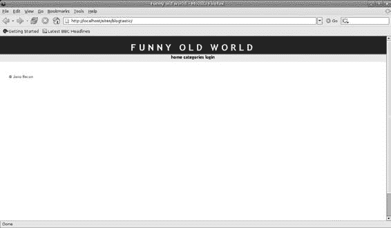

72
实用 PHP 和 MySQL

当你在浏览器中访问 `index.php` 页面时，你应该能看到图 4-2 所示的简单设计。

**图 4-2** 通过少量的配置和 HTML，应用程序的框架就就绪了。

## 显示博客条目

你现在准备好编写一些真正类似于博客应用程序的代码了。由于你的数据库已经加载了示例内容，第一个逻辑步骤是显示最新博客条目的的内容。这涉及创建一个简单的 SQL 查询，然后在页面上显示查询结果（即最新条目）。

然而，在创建查询之前，你需要添加连接数据库的代码。在这个特定的应用程序中，数据库访问发生在每个页面上；因此，将数据库连接代码添加到主 `header.php` 文件是有意义的。此文件包含在每个页面中，所以它是连接代码的逻辑所在地。

在 `header.php` 的 `require("config.php")` 行之后，添加以下行（它们在第 2 章解释过）：

```php
<?php
require("config.php");
$db = mysql_connect($dbhost, $dbuser, $dbpassword);
mysql_select_db($dbdatabase, $db);
?>
```

**第 4 章**
构建博客日志
73

### 构建查询

要构建 SQL 查询，请思考你想要数据库返回的信息类型。对于最新的博客条目，你想要 `entries` 表中的所有信息（如主题、正文和发布日期），但你还需要获取该条目所属的分类。

然而，分类名称并没有存储在 `entries` 表中；它只存储了 `cat_id`。考虑到这一点，你需要请求 `entries` 表中的所有信息，并请求分类名称，其分类 ID 与 `entries` 表中的 `cat_id` 匹配。

以下是你所需的 SQL：


```sql
SELECT entries.*, categories.cat FROM entries, categories WHERE entries.cat_id = categories.id
ORDER BY dateposted DESC
LIMIT 1;
```

SQL 的巨大益处之一是你可以相当容易地从左到右阅读它。此外，如果你将 SQL 语句分行布局，就能轻松地看到 SQL 查询的四个主要部分：

1. **命令（第一行）**
2. **执行该命令的条件（第二行）**
3. **任何排序要求（第三行）**
4. **任何限制（第四行）**

如果你从头到尾读取这段 SQL，会发生以下情况：`Select`（`SELECT`）来自 `entries` 表的所有所有字段（`entries.*`）以及 `categories` 表中的 `cat` 字段（`categories.cat`），条件是（`WHERE`）来自 `entries` 表的 `cat_id` 字段（`entries.cat_id`）等于（`=`）`categories` 表中的 `id` 字段（`categories.id`）。按 `dateposted` 字段（`ORDER BY`）降序（`DESC`）排列结果，并且仅显示单个结果（`LIMIT 1`）。

该查询的目的是限制返回的结果，并仅返回添加到数据库的最后一条条目。如果没有 `ORDER BY` 子句，查询将按照添加的顺序返回所有条目。通过添加 `ORDER BY` 行，结果将按日期的降序返回（最后的日期在最前面）。最后，为了只返回最新的条目（即查询的第一个结果），你使用 `LIMIT 1` 只返回一条记录。

要在你的 Web 应用程序中运行查询，你首先需要在变量内部构建 SQL 查询代码，然后将其发送到数据库。当你获取返回的数据时，可以访问这些行。在两个 `require` 行之间，向 `index.php` 文件添加以下代码：

```php
<?php
require("header.php");
$sql = "SELECT entries.*, categories.cat FROM entries, categories WHERE entries.cat_id = categories.id ORDER BY dateposted DESC LIMIT 1;";
$result = mysql_query($sql);
$row = mysql_fetch_assoc($result);
require("footer.php");
?>
```

新添加的第一行构建了 SQL 查询并将其存储在名为 `$sql` 的变量中。要实际将数据发送到 MySQL 服务器，请使用 `mysql_query()` 函数，它将查询结果放在 `$result` 变量中。在最后一行，`mysql_fetch_assoc()` 函数从 `$result` 中提取该行并将其存储在数组中。

### 快速说明……
由于只返回了一行，因此不需要使用 `while()` 循环来遍历查询返回的行。请记住，关于遍历结果的更多细节请见第 2 章。

### 显示条目

由于查询结果存储在 `$row` 数组中，你只需要打开数组，提取数据并将其显示在你的 Web 页面上。请参考数组中方括号内的每个字段（例如用于字段的 `$row['subject']`）。

在 `mysql_fetch_assoc()` 行之后添加以下代码：`$row = mysql_fetch_assoc($result);`

```php
echo "<h2><a href='viewentry.php?id=" . $row['id'] . "'>" . $row['subject'] . "</a></h2><br />";
echo "<i>In <a href='viewcat.php?id=" . $row['cat_id'] . "'>" . $row['cat'] . "</a> - Posted on " . date("D jS F Y g.iA", strtotime($row['dateposted'])) . "</i>";
echo "<p>";
echo nl2br($row['body']);
echo "</p>";
require("footer.php");
?>
```

这段代码创建了一个二级标题标签，并在其中包含指向名为 `viewentry.php` 页面的链接（该页面稍后创建，用于查看特定的博客文章）。要显示博客，需要向页面传递要显示的特定博客的 `id`。为了实现这一点，你在文件名末尾添加一个问号，然后添加变量（例如 `id=1`）。这个过程产生了类似于 `viewentry.php?id=1` 的链接。

然而，不要硬编码变量的值，而是使用来自查询的 `$row['id']` 内容作为值。在关闭链接标签的第一部分之后，附加查询中的主题，然后添加结束链接标签。你会在编程中看到许多这类长且拼接的链接标签，借助表格可以更好地理解它们。

表 4-3 显示了 HTML 如何逐步构建。记住 `.` 符号将这些不同的部分连接在一起。

**表 4-3** 将长代码字符串视为一系列单独的部分通常是最容易的。在每一行中，加粗的文本是来自 代码 列中代码的结果。

| 代码 | HTML 输出 |
| :--- | :--- |
| `<h2><a href='viewentry.php?id=` | `<h2><a href='viewentry.php?id=` |
| `$row['id']` | `<h2><a href='viewentry.php?id=1` |
| `'>` | `<h2><a href='viewentry.php?id=1'>` |
| `$row['subject']` | `<h2><a href='viewentry.php?id=1'>Wel-` |
| `</a></h2><br />` | `<h2><a href='viewentry.php?id=1'>Welcome to my blog!</a></h2><br />` |
| | `<h2><a href='viewentry.php?id=1'>Wel-come to my blog!</a></h2>` |

在代码的第二行中，以相同的方式构建了另一个链接；此链接指向名为 `viewcat.php` 的页面。传递的不是条目 id，而是分类 id。

接下来，显示日期。如果你从数据库输出一个未经格式化的日期，日期看起来会像这样：2005-08-01 18:02:32

注意，前面的结果不是最有有用的格式。使用 `strtotime()` 和 `date()` 对其进行清理以便人类阅读。

`strtotime()` 函数将日期转换为 UNIX 时间戳。该时间戳是指自 1970 年 1 月 1 日凌晨 12:00 以来的秒数。这个时间被称为 *元时间*（Epoch），当你拥有这个秒数时，就可以将其输入 `date()` 函数，将这些秒数格式化为更有用的。

`date()` 函数使用几个特殊格式符号将这些秒数转换为可读的日期（在本例中使用 `D jS F Y g.iA`）。这些每个符号都格式化日期和时间的特定部分。你可以在 [PHP 手册关于日期的条目 http://www.php.net/] 中找到更多关于这些或其他符号的信息。

表 4-4 给出了 2005 年 4 月 6 日下午 2:35 的示例。

**表 4-4** 每个字母代表日期的部分内容，以及如何格式化该日期。

| `DATE()` 符号 | 结果 |
| :--- | :--- |
| `D` | Wed |
| `j` | 6 |
| `S` | th |
| `F` | April |
| `Y` | 2005 |
| `g` | 2 |
| `i` | 35 |
| `A` | PM |

最后，在代码的最后部分，显示了博客的正文。这些行中的第一行打开段落标签，第二行通过 `nl2br()` 输出数据库的内容。这个实用的函数将任何空行转换为真正的 HTML `<br />` 标签。最后一行关闭段落标签。参见图 4-3 中的最终结果。

**图 4-3** 你的博客文章准备好供世界看了。

### 添加摘要

此博客计划的功能之一是允许访问者为博客文章添加评论。这些评论应该显示在 `viewentry.php` 页面上，通过博客主题（你刚刚在 `index.php` 中添加了）进行链接。

当博客文章有评论时，提供评论摘要是有帮助的。当发布评论时，你可以显示评论数量和发布者的姓名。让发布者的名字兼作链接也是很有用的；也就是说当你点击发布者的名字时，应用程序跳转到 `viewentry.php` 页面上该发布者的评论。

在 `index.php` 中已有的代码之后，添加以下行：

```php
echo "<p>";
$commsql = "SELECT name FROM comments WHERE blog_id = " . $row['id'] . " ORDER BY dateposted;";
```


```php
$commresult = mysql_query($commsql);

$numrows_comm = mysql_num_rows($commresult);

require("footer.php");

?>
```

78

实用 PHP 与 MySQL

这段代码创建了一个新的段落标签，然后创建了一个新的 SQL 查询，从 `comments` 表中选择 `name` 字段，其中 `blog_id` 包含当前博客条目的 ID（存储在 `$row['id']` 中）。整个查询按日期排序（使用 `dateposted` 字段）。然后使用 `mysql_query()` 命令执行该查询，并将结果存储在 `$commresult` 中。

在最后一行，使用了一个名为 `mysql_num_rows()` 的新函数来计算查询返回了多少行，并将此数字存储在 `$numrows_comm` 变量中。`mysql_num_rows()` 函数非常有用，因为你可以用它来决定如何格式化评论摘要。如果没有返回任何行，则显示“No comments”；如果返回了 1 个或更多结果，则显示发布者的姓名：

```php
$commsql = "SELECT name FROM comments WHERE blog_id = " . $row['id'] .
" ORDER BY dateposted;";

$commresult = mysql_query($commsql);

$numrows_comm = mysql_num_rows($commresult);

if($numrows_comm == 0) {
    echo "<p>No comments.</p>";
}
else {
    echo "(<strong>" . $numrows_comm . "</strong>) comments : ";
    $i = 1;
    while($commrow = mysql_fetch_assoc($commresult)) {
        echo "<a href='viewentry.php?id=" . $row['id'] ."#comment" . $i .
"'>" . $commrow['name'] . "</a> ";
        $i++;
    }
}

echo "</p>";
```

在此代码块中，使用一个 `if` 语句来检查 `$numrows_comm` 是否为 0 行。如果是，则会在屏幕上输出“No comments”。如果 `$numrows_comm` 不等于 0，控制流将进入 `else` 语句。

在 `else` 内部，一行 `echo` 打印一个左括号，然后用**粗体**字体输出存储在 `$numrows_comm` 中的数字，最后输出一个右括号和单词 comments。如果有两条评论，输出将为 (2) comments。

下一步是显示每条评论，并使用锚点（anchor）显示指向该条评论的链接。

在 `viewentry.php` 中使用的锚点形式为 `#comment1`、`#comment2` 等。要在 `index.php` 中添加这些编号的锚点，请从 1 开始，并在每次输出评论链接时递增 1。

## 第 4 章：构建博客网站

79

### 关于锚点的一切

锚点是链接到单个页面不同部分的方便方法。要引用锚点，您需要在 URL 后添加锚点的名称。例如，链接到 `example.php#theory` 会跳转到 `example.php` 页面上的 theory 锚点。在 `example.php` 的某个位置，应该会有类似如下的内容：

```html
<a name=”theory”>
```

现在，当引用 `example.php#theory` 时，页面将跳转到该标签。

回到代码，你会看到创建了一个名为 `$i` 的变量并将其设置为 1。

接下来，使用 `while` 循环遍历所有行。创建一个指向 `viewentry.php` 的链接，并在每个链接中添加 `id=[<entry-id>]`。除了附加 ID 之外，还使用 `$i` 添加了评论锚点（例如 `#comment1`）。最后，$i$ 的值增加 1，以供下一个链接使用。完成后的输出应该像这样（显然，如果你添加了不同的评论，名称会有不同）：

(2) comments : Jim Bob

**注意**

如果你使用的是本章之前讨论的示例详情，你将继续看到“No comments”，因为第二个博客条目没有关联任何评论。要解决这个问题，请使用 `phpMyAdmin` 向 `comments` 表中添加一些记录，并在 `blog_id` 字段中指定值为 2。

你可以在图 4-4 中看到评论。

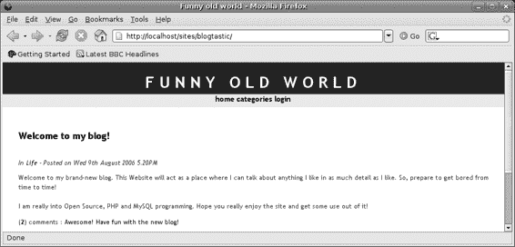

80

实用 PHP 与 MySQL

**图 4-4** 在首页显示评论向访问者展示了您的博客条目引发了讨论和辩论。

**提示**

当您使用 `LIMIT` 时，返回的第一条记录被标记为第 0 条。因此，`LIMIT 1,5` 返回从第一条到第五条记录。`LIMIT 0, 1` 等同于 `LIMIT 1`。

将以下代码添加到您的页面：

```php
echo "</p>";

$prevsql = "SELECT entries.*, categories.cat FROM entries, categories WHERE entries.cat_id = categories.id ORDER BY dateposted DESC LIMIT 1, 5;";

$prevresult = mysql_query($prevsql);

$numrows_prev = mysql_num_rows($prevresult);

if($numrows_prev == 0) {
    echo "<p>No entries.</p>";
}
else {
    echo "<ul>";
    while($prevrow = mysql_fetch_assoc($prevresult)) {
        echo "<li><a href='viewentry.php?id=" . $prevrow['id'] . "'>" . $prevrow['subject'] . "</a></li>";
    }
    echo "</ul>";
}
```
*（注：最后一个代码块的代码逻辑在源码中是碎片化的；我已根据提供的上下文对其进行了重构，以确保有效的 Markdown 格式。）*


你之所以只验证 GET 变量而不是其他类型的信息，是为了让验证变得更容易学习。本应用程序引入了一些基本概念并保持简单性。书中的后续项目将更详细地探索验证，你稍后回到早期的项目并应用这些技能。

虽然 GET 变量可以设置为字母或数字，但书中的几乎每个 GET 变量都被设置为数字。当你创建 `index.php` 和指向 `viewentry.php` 的链接时，每一个都包含一个包含数字 id 的 GET 变量。

要验证数字变量，请将其输入到运行一些简单测试的代码块。在 `viewentry.php` 的开头添加以下代码：

```php
<?php
require("config.php");
if(isset($_GET['id']) == TRUE) {
    if(is_numeric($_GET['id']) == FALSE) {
        $error = 1;
    }
    if($error == 1) {
        header("Location: " . $config_basedir);
    }
    else {
        $validentry = $_GET['id'];
    }
}
else {
    $validentry = 0;
}
```

第一行包含了 `config.php`。与之前的示例不同，尚未包含 `header.php`。如果验证失败，你将把用户重定向到另一个页面，因此在这些测试通过之前，不需要显示 `header.php` 中的 HTML。

下一行是第一个 `if` 条件。`isset()` 函数检查 GET 变量是否存在。如果存在，`isset()` 返回 `TRUE`；如果不存在，`validentry` 则设置为 0。

### 重定向的乐趣与游戏

**注意**：`Redirection`（重定向）是指自动跳转到 网站上的另一个页面。重定向到页面有两种主要方法：

- 使用 JavaScript。这种技术的问题是并非所有的浏览器都完全支持 JavaScript，而且用户和网络管理器也可以关闭 JavaScript。
- 使用 HTTP 头部。使用每个 Web 页面都存在的 HTTP 头部来更改当前页面。这种技术被每个浏览器支持，但它只能在向客户端发送任何数据之前发生。当你在页面开头使用 `session_start()` 时，同样的限制也适用于会。

作为一个一般原则，请使用 HTTP 头部进行重定向，因为因为它在所有浏览器中都可用且易于使用。

假设正在发送一个变量，将进行检查以确保该值是数字；例如，如果有人将变量设置为“bananas”，这显然是错误的。`is_numeric()` 函数测试 GET 变量；如果结果为假，则将 `error` 设置为 1。

### SQL 注入的糟糕世界

**注意**：使用 GET 变量的风险之一是 SQL 注入。假设你有一个如下的 SQL 语句：

`SELECT * FROM entries WHERE id = <id value>`

其中 `<id value>` 是你添加来自 GET 变量的值：`$sql = “SELECT * FROM entries WHERE id = “ . $_GET['id'];`；这段代码假设 id 的值是数字。如果你不检查这一点，恶意用户可能会尝试向查询中注入 SQL 代码。想象一下如果用户添加 `1; DROP DATABASE blogtastic;` 会发生什么。现在执行了以下 SQL：

`SELECT * FROM entries WHERE id = 1; DROP DATABASE blogtastic;`

这段代码将导致数据库丢失（假设用户拥有相应权限）！为了防止这种风险，请始终确保数字 GET 值确实是数字。

### 构建博客

接下来，如果 `error` 确实等于 1（表示非数字值），`header()` 命令将重定向到主页。`header()` 命令传递了 `Location` 头部和要重定向的完整位置（例如 `Location: http://localhost/blogtastic/`）。在代码中，添加了“Location:”文本，然后从 `config.php` 的 `config_basedir` 变量中提取出位置。

**提示**：使用 `Location` 头部时，你需要提供一个完整的 URL（例如 `http://www.foo.com/`——而不是 `www.foo.com` 或 `foo.com`）。

如果 `error` 没有被设置为 1，则 `validentry` 变量被设置为 GET 变量的值。有了这个验证，`header()` 函数下方的代码只在有有效的 GET 变量时运行。

### 不要用错误信息困扰用户

**注意**：当检测到无效变量时，此脚本将重定向到一个合法页面，而不是显示错误消息。在考虑你的 Web 应用程序的可用性时，重定向通常比报告错误更有意义。错误消息对用户来说很少用，而且任何有知识在 URL 上调整 GET 变量的人可能完全意识到他们正在篡改应用程序而不是在使用应用程序。自动重定向避免了可能通过错误消息困扰用户。

### 显示条目

验证完成后，你就可以显示博客文章。这段代码与 `index.php` 上的代码非常相似。首先，添加头部 HTML：`require("header.php");`。

你现在需要确定运行哪种类型的查询。在验证检查代码内部，`validentry` 被设置为 0（如果没有提供变量）或设置为要查看的条目的 ID。

如果 `validentry` 被设置为 0 以外的任何值，查询就很简单——请求那个特定的博客文章。然而，如果值为 0，则查询应该加载最新的博客文章（与 `index.php` 的行为相同）：

```php
require("header.php");
if($validentry == 0) {
    $sql = "SELECT entries.*, categories.cat FROM entries, categories " .
    " WHERE entries.cat_id = categories.id " .
    "ORDER BY dateposted DESC " .
    " LIMIT 1;";
}
else {
    $sql = "SELECT entries.*, categories.cat FROM entries, categories " .
    "WHERE entries.cat_id = categories.id"
    "AND entries.id = " . $validentry .
    " ORDER BY dateposted DESC LIMIT 1;";
}
```

使用 `mysql_query()` 函数将查询发送到数据库：

```php
else {
    $sql = "SELECT entries.*, categories.cat FROM entries, categories " .
    "WHERE entries.cat_id = categories.id
    "AND entries.id = " . $validentry .
    " ORDER BY dateposted DESC LIMIT 1;";
}
$result = mysql_query($sql);
```

现在你可以向用户展示结果。这段代码与你在 `index.php` 上编写的显示博客文章的代码几乎相同。唯一的真实区别是条目的主题没有链接到任何内容。

```php
$result = mysql_query($sql);
$row = mysql_fetch_assoc($result);
echo "<h2>" . $row['subject'] . "</h2><br />";
echo "<i>In <a href='viewcat.php?id=" . $row['cat_id'] ."'>" .
$row ['cat'] ."</a> - Posted on " .
date("D jS F Y g.iA", strtotime($row['dateposted'])) .</i>"; 
echo "<p>";
echo nl2br($row['body']);
echo "</p>";
```

主博客文章部分现在已经完成。

### 显示博客评论

要显示评论，首先创建一个 SQL 查询，以获取当前博客文章的评论：

```php
echo "</p>";
$commsql = "SELECT * FROM comments WHERE blog_id = " . $validentry .
" ORDER BY dateposted DESC;";
$commresult = mysql_query($commsql);
$numrows_comm = mysql_num_rows($commresult);
```

你再次使用 `mysql_num_rows()` 统计行数，并使用该值来判断是否发布了评论。如果 `numrows_comm` 等于 0，则显示文本“No comments”；否则，执行 `else` 代码块。

```php
if($numrows_comm == 0) {
    echo "<p>No comments.</p>";
}
else {
    $i = 1;
    while($commrow = mysql_fetch_assoc($commresult)) {
        echo "<a name='comment" . $i . "'>";
        echo "<h3>Comment by " . $commrow['name'] . " on " .
        date("D jS F Y g.iA",
        strtotime($commrow['dateposted'])) . "</</h3>";
        echo $commrow['comment'];
        $i++;
    }
}
```

在 `else` 内部，你执行了两个基础功能：显示每条评论，然后在每条评论创建一个锚点，该锚点可以与 `index.php` 引用的锚点匹配。


在 `else` 块的顶部，你首先将 `i` 设置为 `1`；此变量用作计数器来实现锚点。接下来，`while` 循环遍历查询中的每个注释并创建锚点。创建一个链接，其 `name` 属性设置为文本注释，并附加 `i` 的值（例如，产生 `comment2`）。然后，以类似于主博客文章的方式显示主要的注释字段。最后，`i` 变量加 1 增，为下一条注释的输出做准备。

## 构建评论表单

允许用户添加评论涉及三个不同的动作：

- 显示添加评论的表单。
- 在用户点击 `Submit` 按钮后，处理表单将其数据添加到数据库中。
- 刷新页面并显示新评论。

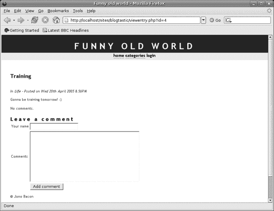

88
实用 PHP 和 MySQL

### 快速提示……
此功能比之前的章节稍微复杂一点，这很大程度上是因为你需要向页面的各个部分添加一些代码，而不是只在页面末尾一次添加一行。

首先，添加图 4-6 所示的主表单。

**图 4-6** 表单对于允许用户贡献评论非常有用。

要实现这一点，用 `?>` 关闭页面底部的 PHP 块，并添加以下 HTML：

```php
echo $commrow['comment'];

$i++;

}

}
```

**第 4 章**
构建博客
89

**?>**
<h3>留个评论</h3>
<form action="<?php echo $SCRIPT_NAME;?id=" . $validentry; ?>" method="post">
<table>
  <tr>
    <td>您的姓名</td>
    <td><input type="text" name="name"></td>
  </tr>
  <tr>
    <td>评论</td>
    <td><textarea name="comment" rows="10" cols="50"></textarea></td>
  </tr>
  <tr>
    <td></td>
    <td><input type="submit" name="submit" value="添加评论"></td>
  </tr>
</table>
</form>

这段代码创建了一个包含多个表单元素的表格。在 `<form>` 标签中，`action` 指定了将处理此表单数据的页面。如下所示，你可以使用一个名为 `SCRIPT_NAME` 的特殊 PHP 变量来引用当前文件的名称（在此例中为 `viewentry.php`）。如果你以后决定更改脚本的文件名，此引用非常有用；这样你就不需要更改代码。标签中的 `method` 属性表示你想将变量作为 `POST` 或 `GET` 变量提交。

在 `action` 属性内部，`validentry` 变量作为 `GET` 变量被添加。

当你处理表单数据时，你需要指示要发布评论的博客文章的 ID。

上述表单中的 HTML 本身非常易懂。

### 注意
#### GET 变量与隐藏表单字段
在表单和处理它的脚本之间共享变量另一种技术是使用隐藏表单元素：

```html
<input type="hidden" name="example" value="21">
```
随后，表单的 `value` 属性可以在你的 PHP 代码中通过 `_GET` 或 `_POST` 作为普通变量访问。

90
实用 PHP 和 MySQL

在 Web 页面上处理表单的操作相当反向。在页面的顶部——在显示任何 HTML 之前——你需要通过检查 `_POST['submit']` 变量来确认是否点击了 `Submit` 按钮。如果此变量存在，则用户已提交了表单。如果变量不存在，你应该假设用户尚未实际看到表单，因此需要显示它。这听起来可能很疯狂，但请坚持住——这一切很快就会变得说通。

在你的验证代码之后、包含 `header.php` 文件之前，插入以下代码：

```php
else {
  $validentry = 0;
}

if($_POST['submit']) {
  $db = mysql_connect($dbhost, $dbuser, $dbpassword);
  mysql_select_db($dbdatabase, $db);
  $sql = "INSERT INTO comments(blog_id, dateposted, name, comment) VALUES(" . $validentry . ", NOW(), '" . $_POST['name'] . "', '" . $_POST['comment'] . "');";
  mysql_query($sql);
  header("Location: http://" . $HTTP_HOST . $SCRIPT_NAME . "?id=" . $validentry);
}
else {
  // 代码将在这里
}

require("header.php");
```

第一行检查提交的 `POST` 变量是否存在。为了说明解释，假设 `Submit` 按钮已被点击且变量存在。代码随后连接到数据库。（记住，你还没有包含 `header.php`，所以没有可用的数据库连接。）

### 注意
#### 不要搞崩 Header
当你使用头部重定向时，务必确保在发送头部之前页面上没有显示任何数据——这包括空格。作为一个说明其重要性的简单示例，在 `<?php` 指令之前添加一个空格并刷新页面。你现在应该会收到大量的“headers been sent”（头部已发送）错误。每当你看到这些错误时，请检查页面本身或包含的文件（如 `config.php`）中是否没有错误的字母或空格。

**第 4 章**
构建博客
91

下一行是 SQL 查询。该查询使用 `INSERT` 语句将数据插入数据库。一个典型的 `INSERT` 语句看起来如下所示：`INSERT INTO table(field1, field2) VALUES ('data for field 1', 'data for field 2');`

当你在 `sql` 变量中构建 SQL 语句时，你拼接了通过 `_POST` 访问的表单各种变量。为了演示它们是如何结合在一起的，想象你正在为 ID 为 2 的博客文章添加评论，时间是 2005 年 8 月 10 日下午 2:30。假设用户在姓名处输入“Bob Smith”，在评论处输入“I really like your blog. Cool stuff!”

左列列出了代码的每个部分；右列显示了页面内容是如何构建的。当你阅读表格时，记住数字不需要单引号包裹（例如 `validentry` 中的数字），但字符串（字母和句子）需要。

代码中对你来说全新的部分是 `NOW()`。这是一个特殊的 MySQL 函数，提供当前的日期时间，你将使用 `NOW()` 来自动填充 `dateposted` 字段。

### 注意
#### 内置 MySQL 函数
MySQL 提供了一系列此类函数，你可以从 phpMyAdmin 中方便地探索它们。当你插入数据时，Function 下拉框列出了这些不同的 MySQL 函数。尝试使用它们以更好地了解它们的作用。

代码中的下一行——`mysql_query($sql)`——执行了实际查询。

你可能注意到该行没有包含用于存储结果的变量，例如 `$result = mysql_query($sql)`。原因是查询只是被发送了；没有返回结果。最后一行使用 `header()` 函数重定向到当前页面。

最后，`if` 块结束，`else` 开始（针对未点击 `Submit` 按钮的情况）。在页面底部，添加结束代码：

```php
</</table>
</form>

<?php
}

require("footer.php");
```


?>

实际上，如果用户不是通过点击提交按钮（在该页面上的表单！）进入 `viewentry.php`，那么整个 HTML 页面都会显示。

## 构建分类浏览器器

在一个由 Blogtastic 驱动的网站中，将会产生大量的博客。

由于有这么多内容，拥有一种能够轻松浏览这些内容的方法非常重要。在本节中，你将创建一个实用的页面，供用户浏览不同的分类，并查看每个分类发布了哪些博客文章。

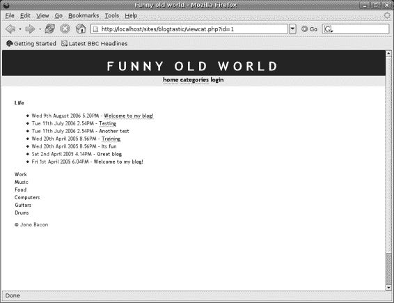

## 第 4 章：构建网络博客

如果你思考这个页面应该如何设计，列出分类并让用户点击其中一个来查看相关的博客文章似乎是符合逻辑的（见图 4-7）。这种功能类似于文件管理器中的树形视图：列出目录，然后你点击其中一个来查看文件和子目录。

**图 4-7** 点击任何分类以查看该分类中的条目。

在 `index.php` 和 `viewentry.php` 中，你将分类制作成指向 `viewcat.php` 页面的链接，并将分类 ID 作为 `id` GET 变量传递。为了开始，创建一个名为 `viewcat.php` 的新文件并添加以下代码：`require("config.php");`

```php
if(isset($_GET['id']) == TRUE) {
    if(is_numeric($id) == FALSE) {
        $error = 1;
    }

    if($error == 1) {
        header("Location: " . $config_basedir . "/viewcat.php");
    }
    else {
        $validcat = $_GET['id'];
    }
}
else {
    $validcat = 0;
}
```

这段代码看起来很熟悉；它对 `id` 变量运行了与 `viewentry.php` 相同的验证测试。如果不存在该变量，`validcat` 被设置为 0，但如果该变量确实合法，`validcat` 将设置为 GET 变量的内容。如果该变量未通过检查是否为数字的测试，页面将重定向到自身，但不带 `id` 变量。

从 `categories` 表中选择所有记录：

```php
else {
    $validcat = 0;
}

$sql = "SELECT * FROM categories";
$result = mysql_query($sql);
```

添加以下代码来检查结果集的每一行，并查看 `$validcat` 是否与 `id` 变量相同。如果是，这意味着该分类当前被选中。

```php
while($row = mysql_fetch_assoc($result)) {
    if($validcat == $row['id']) {
        echo "<strong>" . $row['cat'] . "</strong><br />";
        $entriessql = "SELECT * FROM entries WHERE cat_id = " . $validcat . " ORDER BY dateposted DESC;";
        $entriesres = mysql_query($entriessql);
        $numrows_entries = mysql_num_rows($entriesres);
        echo "<<ul>";
```

当 `while` 循环遍历每一行时，第一行检查 `validcat` 是否与当前行的 `ID` 相同。如果是，则执行 `if` 块。`if` 块内部的第一行以**粗体**形式输出分类名称，而不是链接。

下一行的查询获取 `cat_id` 等于 `validcat` 的所有博客文章。这些文章按日期递减顺序请求，因此最近的文章将显示在列表顶部。然后运行查询并计算返回的行数（以确保有记录可显示）。最后一行开始包含结果的无序列表块。

检查当前分类是否存在任何行并显示相关详情：

```php
echo "<ul>";
if($numrows_entries == 0) {
    echo "<li>No entries!</li>";
}
else {
    while($entriesrow = mysql_fetch_assoc($entriesres)) {
        echo "<li>" . date("D jS F Y g.iA", strtotime($entriesrow['dateposted'])) . " - <a href='viewentry.php?id=" . $entriesrow['id'] . "'>" . $entriesrow['subject'] . "</a></li>";
    }
}
echo "</ul>";
}
```

如果 `numrows_entries` 为 0 行，则浏览器将显示一个文本为 `No entries!` 的列表项。如果有行，则会打开另一个 `while` 循环来遍历结果。在 `while` 内部，将创建一个显示条目日期和指向 `viewentry.php` 链接（使用正确的 `id` 值）的列表项。帖子的主题是链接的主体。

最后，你可以显示当前未选中的分类：

```php
else {
    echo "<a href='viewcat.php?id=" . $row['id'] . "'>" . $row['cat'] . "</a><br />";
}
}
require("footer.php");
```

你现在有了一个按分类整理的完整博客文章存档！

## 不要让任何人登录

该项目中到目前为止创建的所有内容都是为了让任何偶然发现博客的人都能访问。因此，这些页面没有内置的安全性——也就是说，页面没有限制于某些用户。由于网站的开放性和可访问性，建议在这些页面上只显示适合公众消费的信息。你应该避免添加你的信用卡号、个人信息，或你在化装派对上的那些尴尬照片。（这就是谣言的起源。）

然而，允许所有者受限制访问以添加和删除内容是一项基本功能。必须登录 `phpMyAdmin` 来添加内容并不是理想的解决方案，因此主计划是创建页面来提供添加内容的方便方法。你需要提供一种让用户登录的方法，用户输入的登录详情应与 `logins` 表中的内容匹配。你将使用 PHP 会话（第 2 章介绍）通过在不同页面之间共享变量来跟踪用户。如果用户成功登录，你可以设置会话变量，然后检查该会话变量是否存在于受限制页面。

从开始，创建一个名为 `login.php` 的新文件并添加登录表单：

```html
<form action="<?php echo $SCRIPT_NAME ?>" method="post">
    <table>
        <tr>
            <td>Username</td>
            <td><input type="text" name="username"></td>
        </tr>
        <tr>
            <td>Password</td>
            <td><input type="password" name="password"></td>
        </tr>
        <tr>
            <td></td>
            <td><input type="submit" name="submit" value="Login!"></td>
        </tr>
    </table>
</form>
```

此表单包含一些熟悉的框（见图 4-8）。你可能注意到第二个 `<input>` 标签使用了 `password` 作为类型。当你使用这种表单元素时，内容会被伪装成星号或点，以向窥视者隐藏密码。

下一步是处理表单并检查数据库是否包含登录详情。在此之前，在文件开头（任何 HTML 之前）添加常规代码：

```php
<?php
session_start();
require("config.php");
$db = mysql_connect($dbhost, $dbuser, $dbpassword);
mysql_select_db($dbdatabase, $db);
```

**图 4-8** 登录表单看起来和其他表单无异。

### 注意：表单也不安全

虽然表单提供了一种安全识别身份的方法，但传输到服务器处理的密码是以明文发送的。这是使用表单时固有的潜在安全风险。该风险的唯一解决方案是在点击表单按钮时使用 JavaScript 对表单数据进行加密，这超出了项目的范围。

添加检查提交按钮是否被点击的代码（再次来自你已添加的表单）：

```php
mysql_select_db($dbdatabase, $db);
if($_POST['submit']) {
    $sql = "SELECT * FROM logins WHERE username = '" . $_POST['username'] . "' AND password = '" . $_POST['password'] . "';";
    $result = mysql_query($sql);
    $numrows = mysql_num_rows($result);
}
```


创建 SQL 语句是为了检查 `logins` 表中的用户名是否与表单中的用户名框一致，以及密码字段是否与表单中的密码框一致。然后运行查询并统计行数。查询返回的行数表示输入的详情是否正确。如果详情正确，将返回单行——不多，也不少。如果没有返回任何行，则说明详情不匹配。

添加以下代码：

```php
$numrows = mysql_num_rows($result);
if($numrows == 1) {
$row = mysql_fetch_assoc($result);
session_register("USERNAME");
session_register("USERID");
$_SESSION['USERNAME'] = $row['username'];
$_SESSION['USERID'] = $row['id'];
header("Location: " . $config_basedir);
}
else {
header("Location: " . $config_basedir . "/login.php?error=1");
}
```

在登录信息有效的情况下，创建一个新的会话（session）。

使用 PHP session 时，你必须注册你的会话变量。`session_register()` 行会创建两个名为 `USERNAME` 和 `USERID` 的变量。

### 注意
**变量命名要保持一致**
使用大写字母命名会话变量并不是强制的，但非常有用，因为这可以帮助它们在代码中作为不同类型的变量脱颖而出。

## 第 4 章：构建 Weblog

接下来的两行使用 `$_SESSION`（代表用户的会话信息）来使用变量，并将来自 SQL 查询的信息（用户名和 ID）存储在其中。最后一行执行到 `index.php` 的页头重定向。

如果用户点击提交按钮，则在表单显示之前会运行一小段代码：

```php
header("Location: " . $config_basedir . "/login.php?error=1");
}
}
else {
require("header.php");
if($_GET['error']) {
echo "Incorrect login, please try again!";
}
?>
```

引入 `header.php` 文件，然后检查是否存在名为 `error` 的 GET 变量。如果有，将显示错误消息，指示用户输入了无效的用户名或密码。

在页面底部，HTML 之后，添加最后部分代码：

```php
}
require("footer.php");
```

### 用户退出登录
现在用户能够登录了，你还需要赋予他退出的能力——通过销毁登录时创建的会话。创建一个名为 `logout.php` 的新文件并添加以下代码：

```php
<?php
session_start();
session_destroy();
require("config.php");
header("Location: " . $config_basedir);
?>
```

要退出登录，只需使用 `session_destroy()` 函数删除所有已注册的会话变量。会话现在已被销毁，用户不再登录状态。你可以执行到 `index.php` 的页头重定向。

### 注意
**会话的生死**
处理基于会话的代码时，测试代码时应始终清除任何会话。除了创建 `logout.php` 脚本外，另一个选项是关闭 浏览器。会话在浏览器打开期间存在，当你关闭浏览器（而不仅仅是窗口）时，会话就会丢失。

开发代码时，想要清除会话却要关闭浏览器可能会非常令人沮恼。可以使用适用于所有平台的 Mozilla Firefox Web Developers Toolbar 扩展。

从 Mozilla Extensions 网站下载它。

### 为应用程序添加 Session 支持
有了新的成员登录功能，你可以增强当前页面，使其在成员登录时做出不同的反应。可以检查登录页面中创建的会话变量，并可以在适当的地方添加额外的选项。

#### 在页头文件中添加选项
第一个要编辑的文件是 `header.php`。在 `login.php` 和 `logout.php` 中，你在页面开头添加了 `session_start()`。你将在大多数页面中使用 `session_start()`，因此请将其添加到 `header.php` 的顶部：

```php
<?php
session_start();
```

该文件已经包含了一个供网站不同部分使用的链接列表。当用户登录时，应该显示退出登录（Logout）链接；如果他们未登录，应该显示登录（Login）链接。请在 `categories` 链接下的 PHP 块中添加以下代码：

```html
<a href="viewcat.php">categories</a>
```

```php
<?php
if(isset($_SESSION['USERNAME']) == TRUE) {
echo "[<a href='logout.php'>logout</a>]";
}
else {
echo "[<a href='login.php'>login</a>]";
}
?>
```

`isset()` 函数用于检查 `USERNAME` 会话变量是否已设置。如果是，则显示退出登录链接；否则，显示登录链接。

使用相同的方法添加额外的链接：

```php
else {
echo "[<a href='login.php'>login</a>]";
}
if(isset($_SESSION['USERNAME']) == TRUE) {
echo "[<a href='logout.php'>logout</a>]";
}
else {
echo "[<a href='login.php'>login</a>]";
}
if(isset($_SESSION['USERNAME']) == FALSE) {
header("Location: " . $config_basedir);
}
?>
```


```php
require("header.php");

?>
```

在这段代码中，创建了一个 INSERT 查询并发送到数据库。查询运行后，浏览器将重定向到 `viewcat.php` 页面以查看新创建的分类。

最后，关闭 `else` 块并包含 `footer.php` 文件（均在表单之后）：

```php
<?php
}

require("footer.php");

?>
```

## 创建新的博客文章

到目前为止，在 Blogtastic 中实际上添加博客文章的功能一直令人可疑地缺席。这项核心功能需要你到目前为止所看到的几乎所有技术，因此推迟了进度。不过，现在你已经准备好了，是时候完成这个页面了。该页面的行为与之前添加内容的页面类似，但此页面还包含一个下拉组合框，用于选择条目所属的分类。

创建一个名为 `addentry.php` 的新文件并开始编写表单：

```html
<h1>Add new entry</h1>

<form action="<?php echo $SCRIPT_NAME ?>" method="post">

<table>
```

之前，你是先添加整个表单，但在本页面中，第一个表单控件将是刚才讨论过的特殊下拉框：

```html
<tr>
  <td>Category</td>
  <td>
    <select name="cat">
    <?php
    $catsql = "SELECT * FROM categories;";
    $catres = mysql_query($catsql);
    while($catrow= mysql_fetch_assoc($catres)) {
      echo "<option value='" . $catrow['id'] . "'>" . $catrow['cat'] . "</option>";
    }
    ?>
    </select>
  </td>
</tr>
```

下拉组合框呈现了一个包含系列可选选项的视觉框，用户可以从中选择。这涉及到两个基本步骤。首先，创建一个包含框内项目的 `<select>` 标签。每个项目都包含在 `<option>` 标签中。在这些标签中，添加你想要让其显示在框中的文本（在此例中为分类名称）以及一个 `value` 属性。该属性包含了用户选择某项时传递的值。将此属性设置为该分类项的 ID。

在代码实现方面，SQL 查询从 `categories` 表中选择所有内容。循环遍历查询返回的分类。在 `while` 循环内部，创建 `<option>` 标签，并将查询中的 `id` 添加到 `value` 属性中。

完成表单的其余部分：

```html
    </select>
  </td>
</tr>
<tr>
  <td>Subject</td>
  <td><input type="text" name="subject"></td>
</tr>
<tr>
  <td>Body</td>
  <td><textarea name="body" rows="10" cols="50"></textarea></td>
</tr>
<tr>
  <td></td>
  <td><input type="submit" name="submit" value="Add Entry!"></td>
</tr>
</table>
</form>
```

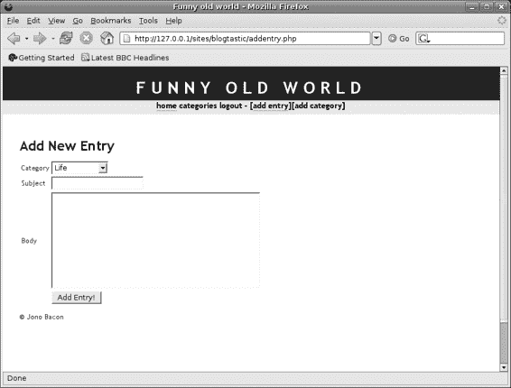

## 第 4 章：构建一个网络日志

该表单如图 4-10 所示。

**图 4-10** 添加新的博客文章非常简单。

回到文件开头并添加模板化的初始化代码：

```php
<?php
session_start();
require("config.php");
$db = mysql_connect($dbhost, $dbuser, $dbpassword);
mysql_select_db($dbdatabase, $db);
if(isset($_SESSION['USERNAME']) == FALSE) {
  header("Location: " . $config_basedir);
}
```

添加实际处理表单的逻辑：

```php
if(isset($_SESSION['USERNAME']) == FALSE) {
  header("Location: " . $config_basedir);
}

if($_POST['submit']) {
  $sql = "INSERT INTO entries(cat_id, dateposted, subject, body) VALUES(" . $_POST['cat'] . ", NOW(), '" . $_POST['subject'] . "', '" . $_POST['body'] . "');";
  mysql_query($sql);
  header("Location: " . $config_basedir);
}
else {
  require("header.php");
?>
```

这段代码创建了一个 INSERT 查询，与之前表单驱动页面上的查询非常相似。

最后，关闭 `else` 块并添加 `footer.php` 代码：

```php
}
require("footer.php");

?>
```

## 更新博客文章

最后一个页面用于更新博客文章。早些时候，当你为 Blogtastic 添加会话支持时，你处理了一些页面并添加了编辑特定博客文章的链接。编辑博客文章的链接指向名为 `updateentry.php` 的页面，该页面接收一个 `id` 变量。此 ID 指明要更新哪条记录。

在这个页面上，你不是先添加表单，而是从上到下编写。

首先，添加模板化的代码：

```php
<?php
session_start();
require("config.php");
if(isset($_SESSION['USERNAME']) == FALSE) {
  header("Location: " . $config_basedir);
}
$db = mysql_connect($dbhost, $dbuser, $dbpassword);
mysql_select_db($dbdatabase, $db);
```

下一块代码与之前编写的验证代码相同：`if(isset($_GET['id']) == TRUE) { if(is_numeric($id) == FALSE) { $error = 1; } if($error == 1) { header("Location: " . $config_basedir); } else { $validentry = $_GET['id']; } } else { $validentry = 0; }`。

添加处理表单的代码：

```php
else {
  $validentry = 0;
}

if($_POST['submit']) {
  $sql = "UPDATE entries SET cat_id = " . $_POST['cat'] . ", subject = '" . $_POST['subject'] ."', body = '" . $_POST['body'] . "' WHERE id = " . $validentry . ";";
  mysql_query($sql);
  header("Location: " . $config_basedir . "/viewentry.php?id=" . $validentry);
}
```

SQL 查询实现了一个 `UPDATE` 命令，将更新数据库中每个 id 为 `validentry`（经过验证的 id 变量）的字段。`UPDATE` 查询指明要更新的表（`UPDATE entries`），然后提供若干个 `数据库字段 = 表单元素` 部分。查询完成后，另一个头部重定向将用户带到带有正确 `id` 变量的 `viewentry.php` 页面。

如果没有点击提交按钮，将从 MySQL 中获取条目详情，以便填充表单字段，从一个查询开始：`header("Location: " . $config_basedir . "/viewentry.php?id=" . $validentry);`

```php
else {
  require("header.php");
  $fillsql = "SELECT * FROM entries WHERE id = " . $validentry . ";";
  $fillres = mysql_query($fillsql);
  $fillrow = mysql_fetch_assoc($fillres);
?>
```

接下来，开始创建表单：

```php
$fillrow = mysql_fetch_assoc($fillres);
?>
<h1>Update entry</h1>
<form action="<?php echo $SCRIPT_NAME . "?id=" . $validentry; ?>" method="post">
<table>
```

表单的第一部分是分类字段。你需要让选定的分类在页面加载时自动选中。要实现这一点，请在标签末尾添加 `selected`。HTML 中的示例此处所示（这不在项目代码中）：

```html
<select name="example">
  <option value="1">Option 1</option>
  <option value="2" selected>Option 2</option>
  <option value="3">Option 3</option>
</select>
```

为了完成此操作，请向你的表单添加以下代码：

```html
<tr>
  <td>Category</td>
  <td>
    <select name="cat">
    <?php
    $catsql = "SELECT * FROM categories;";
    $catres = mysql_query($catsql);
    while($catrow= mysql_fetch_assoc($catres)) {
      echo "<option value='" . $catrow['id'] . "'";
      if($catrow['id'] == $fillrow['cat_id']) {
        echo " selected";
      }
      echo ">" . $catrow['cat'] . "</option>";
    }
    ?>
    </select>
  </td>
</tr>
```


在表单的其余部分，小型 PHP 代码块将查询中的信息添加到 `value` 属性和 `<textarea>` 标签之间，以填充表单：

```html
</select>
</td>
</tr>
<tr>
  <td>主题 (Subject)</td>
  <td><input type="text" name="subject" value="<?php echo $fillrow['subject']; ?>"></td>
</tr>
<tr>
  <td>正文 (Body)</td>
  <td><textarea name="body" rows="10" cols="50"><?php echo $fillrow['body']; ?></textarea></td>
</tr>
<tr>
  <td></td>
  <td><input type="submit" name="submit" value="Update Entry!--value="更新条目！(Update Entry!)""></td>
</tr>
</table>
</form>
```

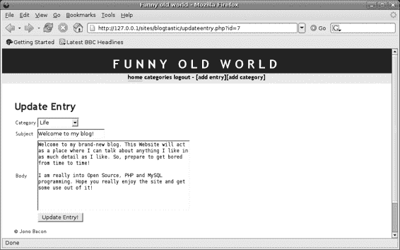

110

### 实用的 PHP 和 MySQL

最后，关闭 `else` 并插入页脚：

```php
<?php

}

require("footer.php");

?>
```

你可以在图 4-11 中看到更新后的页面。

**图 4-11** 更新博客条目的界面与添加新条目的界面类似。

## 总结

在这个项目中，你创建了自己的第一个功能齐全、数据库驱动的 Web 应用程序。

这个应用锻炼了你的编程能力，并涵盖了一系列核心技术。这包括使用数据库查询、向数据库添加数据、连接表、更新记录、执行验证、管理归档数据、在不同页面之间分离代码，以及确保界面的可用性。

除了提供了一个有趣的项目来操作之外，该项目还为书中其余的项目提供了基础。你学习了许多技能，随着书籍的继续，这些技能将得到完善和加强。这是一段激动旅程的开始，读这里意味着你已经完成了一个巨大而重要的一步。伸伸手指，拍掉键盘上的灰尘，拿杯热的，准备好下一个项目。

# 第 5 章

## 讨论论坛

讨论论坛已成为互联网的基础组成部分。在这些基于 Web 的留言板中，用户讨论由紧密社区共同思考的话题。在这些讨论论坛中，用户可以成为更广泛社区的一部分。讨论论坛为编程提供了一个极具吸引力且有趣的挑战。诸如创建分类、论坛和主题；回复消息；注册用户等等功能都是常见的需求。

在你创建了博客之后，编写讨论板背后的代码是你技能成长的自然进阶，因为它引入了双向通信的概念，而博客提供的的是相对单向的视角。因此，本章为你的编程经验提供了重要的一步——每个人至少应该写过一次讨论论坛！

### 内部剖析

几乎所有的讨论论坛设计都非常相似，涉及三个主要实体：分类、论坛和主题。为了解释这种结构，请看图 5-1。

[此图显示了一个典型的 phpBB (http://www.phpbb.com/) 安装界面。](http://www.phpbb.com/) `phpBB` 是一个流行的开源论坛引擎，遵循了这些常用的可用性方法。在图中，你可以看到一个分类列表（只有一个——LUGRadio），该分类下有多个论坛（通用讨论 General Discussion、节目创意 Ideas for the show、镜像站 Mir-rors 和 LUGRadio Live）。当你点击一个论坛时，会显示论坛主题，如图 5-2 所示。

111

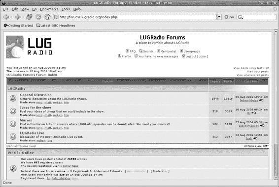

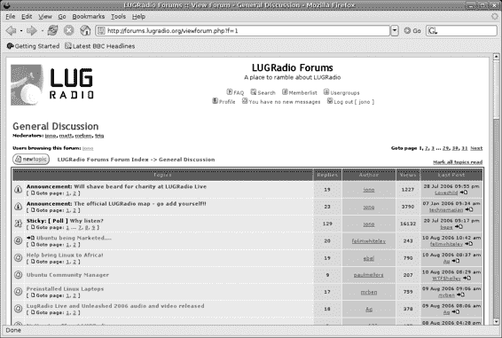

112

**图 5-1** phpBB 论坛的首页

**图 5-2** 通用讨论（General Discussion）论坛中的主题列表

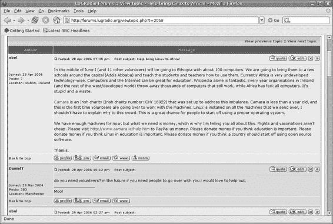

# 第 5 章

讨论论坛

113

此图显示了论坛中 `threads`（线程）的列表。一个线程是从特定主题开始的讨论。线程的发起者发布消息，线程的主题列在此屏幕中。要查看线程中的消息，你需要点击该线程。当你点击线程时，会显示一个与图 5-3 所示类似的页面。

**图 5-3** 一个讨论线程

论坛软件有一套独特的组件，这些组件组合成了一个让讨论变得简单的系统。挑战在于实现你自己的论坛软件。图 5-4 显示了这些不同部分是如何相互相关的。

**图 5-4**

分类 (Category)
LUGRadio
讨论论坛有多个独特的层次。
论坛 (Forum)
通用讨论 (General Discussion)
主题 (Topic)
为非洲带去 Linux (Help bring Linux to Africa)
消息 (Messages)
原始消息 (Original message)
回复 (Reply)
回复 (Reply)

114

## 构建你自己的论坛

在这个项目中，你将专注于应该进入讨论论坛软件中的核心功能，包括以下能力：

*   显示分类、论坛和主题。
*   以管理员身份登录。
*   管理员添加分类和论坛。
*   管理员删除分类、论坛和主题。
*   以用户身份登录。
*   用户注册。当用户填写注册表单时，将发送一封验证电子邮件。
*   用户查看分类和论坛，然后点击论坛查看主题。用户也可以点击主题查看线程。
*   用户发布新线程或回复现有线程。

虽然成百上千的额外功能可以加入项目中，但添加这些功能本身就需要写一整本书了。在这个项目中，你构建了一个核心论坛引擎，但你当然可以在之后向其中构建额外的功能。

### 在开始之前

此项目使用了一些额外的 CSS 代码块。将 `stylesheet.css` 复制到此项目的新目录，并在 `stylesheet.css` 的末尾添加以下行：

```css
table {
  border: thin solid #cccccc;
  background: #ffffff;
}

th {
  letter-spacing: 2.5px;
  background: #eeeeeee;
  color: #000000;
  text-transform: uppercase;
  text-align: center;
  border-top: thick solid #eeeeee;
  border-bottom: thin solid #cccccc;
}

tr.head {
  letter-spacing: 1.5px;
  background: #dddddd;
  color: #000000;
  text-transform: uppercase;
  border-top: thick solid #eeeeee;
  border-bottom: thin solid #cccccc;
}

tr.body {
  background: #ffffff;
  color: #000000;
}

td {
  border: thin solid #cccccc;
  padding: 10px;
}
```

### 创建数据库

在这个项目中，各种表以不同的方式相互关联以存储之前讨论的内容。图 5-5 显示了你将创建的数据库结构。

**图 5-5**

`categories`: `id`, `name`, `description`
`forums`: `id`, `cat_id`, `name`
`topics`: `id`, `forum_id`, `user_id`, `subject`, `date`
`users`: `id`, `username`, `password`, `email`, `verifystring`, `active`
`messages`: `id`, `topic_id`, `user_id`, `subject`, `body`, `date`
`admins`: `id`, `username`, `password`

116

**

| 表名 | 表存储的内容 |
| :--- | :--- |
| `categories` | 三个不同的分类。 |
| `forums` | 属于分类的不同论坛。 |
| `topics` | 关于主题的详情。 |
| `messages` | 讨论线程的消息。 |
| `admins` | 网站管理员的登录详情。 |
| `users` | 可以在论坛发帖的用户详情。 |

`categories`、`forums`、`topics` 和 `messages` 表之间存在重要的关系——每个表都存储与其关联的表的相同 `id`。例如，`categories` 和 `forums` 表通过在 `forums` 表的 `cat_id` 字段中存储相关分类的 `id` 来关联。

#### 使用 InnoDB 强制关系

当你使用 MySQL 创建数据库时，`MyISAM` 表类型存储数据。这种*非事务*表引擎不强制执行表之间的关系。


想象你有一个名为 `orders` 的表，它包含一个 `customer_id` 字段，该字段的值与 `customers` 表中的 `id` 相同。如果你从 `customers` 表中删除一条记录，删除或更新 `orders` 表中相应的条目是有意义的；否则，这种关系就会破坏，订单将引用一个不再存在的客户。

使用默认的 `MyISAM` 表类型，数据库并不要求解决这些潜在的不准确性，你*可以*删除客户，并让订单引用一个不存在的客户。对于 `MyISAM`，假设是你在代码中强制执行了这些关系。

然而，在本项目中，你将使用一种不同类型的表：`InnoDB`。这种`事务安全`的表可以强制执行这些关系。这不仅让你对这些关系的正常工作感到放心，而且你还可以执行级联删除，即删除一张表时，所有相关的表也会被一同删除。

感受这种力量吧，朋友们。

虽然 `InnoDB` 是 `MySQL` 的功能，但它默认是关闭的（请检查你的发行版以验证它是否确实关闭）。要启用它，请加载 `my.cnf` 文件（在 Linux 机器上通常位于 `/etc` 目录，在 Windows 机器上的 `MySQL` 目录内），并查找 `skip-innodb`。通过添加 `#` 符号注释掉此选项：

```bash
#skip-innodb
```

取消其他 `innodb` 行的注释，使代码类似于所示：

**第 5 章**

讨论论坛

117

```ini
innodb_data_home_dir = /opt/lampp/var/mysql/
innodb_data_file_path = ibdata1:10M:autoextend
innodb_log_group_home_dir = /opt/lampp/var/mysql/
innodb_log_arch_dir = /opt/lampp/var/mysql/
```

在开启 `innodb` 支持后，重启 `MySQL` 使更改生效。

**警告！**

在使用如 `InnoDB` 等事务安全表时，请务必小心级联删除。如果你错误地强制了某种关系，可能会丢失数据。这通常非常罕见，因为你需要刻意强制执行这种关系，但我们诚挚地警告你。

**构建数据库**

启动 `phpMyAdmin` 并创建一个名为 `forum` 的新数据库。现在添加下面的每个表，并完成它们的字段：

### `admins` 表

- `id`。将其设置为 `TINYINT`，将其设为主键，并启用 `auto_increment`。
- `username`。将其设置为 `VARCHAR`，长度为 10（用户名的常用长度）。
- `password`。将其设置为 `VARCHAR`，长度为 10。

### `categories` 表

- `id`。将其设置为 `TINYINT`，将其设为主键，并启用 `auto_increment`。
- `name`。将其设置为 `VARCHAR`，长度为 50。
- 将表类型设置为 `InnoDB`。

**注意**
**设置表类型**

大多数表都需要将其表类型设置为 `InnoDB`。在配置字段的表设计界面中，底部的控件允许你选择表类型。

118

实战 PHP 与 MySQL

### `forums` 表

- `id`。将其设置为 `TINYINT`，将其设为主键，并启用 `auto_increment`。
- `cat_id`。将其设置为 `TINYINT`。
- `name`。将其设置为 `VARCHAR`，长度为 30。
- `description`。将其设置为 `VARCHAR`，长度为 255。
- 将表类型设置为 `InnoDB`。

### `messages` 表

- `id`。将其设置为 `TINYINT`，将其设为主键，并启用 `auto_increment`。
- `date`。将其设置为 `DATETIME`。
- `user_id`。将其设置为 `INT`。
- `topic_id`。将其设置为 `INT`。
- `subject`。将其设置为 `VARCHAR`，长度为 100。
- `body`。将其设置为 `TEXT`。
- 将表类型设置为 `InnoDB`。

### `topics` 表

- `id`。将其设置为 `TINYINT`，将其设为主键，并启用 `auto_increment`。
- `date`。将其设置为 `DATETIME`。
- `user_id`。将其设置为 `INT`。
- `forum_id`。将其设置为 `TINYINT`。
- `subject`。将其设置为 `VARCHAR`，长度为 100。
- 将表类型设置为 `InnoDB`。

### `users` 表

- `id`。将其设置为 `TINYINT`，将其设为主键，并启用 `auto_increment`。
- `username`。将其设置为 `VARCHAR`，长度为 10。
- `password`。将其设置为 `VARCHAR`，长度为 10。
- `email`。将其设置为 `VARCHAR`，长度为 100。
- `verifystring`。将其设置为 `VARCHAR`，长度为 20。
- `active`。将其设置为 `TINYINT`。
- 将表类型设置为 `InnoDB`。

在创建表时，请确保在需要的地方设置正确的表类型。除 `admin` 之外，所有表都需要是 `InnoDB` 类型。如果设置不正确，后续编写的功能将无法工作。

**第 5 章**

讨论论坛

119

**注意**
**在创建后更改表类型**

如果你想更改现有表的类型，请点击 `phpMyAdmin` 中的 `Operations` 选项卡，然后使用页面上的框选择不同的表类型。此时，表与表之间的完整性尚未设置，也没有执行完整性。在项目的后期，将添加一些 SQL 来执行它。

**构建数据库**

启动 `phpMyAdmin` 并创建一个名为 `forum` 的数据库。现在添加下面的每个表，并完成它们的字段：

`admins` 表

- `id`。将其设置为 `TINYINT`，将其设为主键，并启用 `auto_increment`。
- `username`。将其设置为 `VARCHAR`，长度为 10（用户名的常用长度）。
- `password`。将其设置为 `VARCHAR`，长度为 10。

`categories` 表

- `id`。将其设置为 `TINYINT`，将其设为主键，并启用 `auto_increment`。
- `name`。将其设置为 `VARCHAR`，长度为 50。
- 将表类型设置为 `InnoDB`。

**注意**
**设置表类型**

大多数表都需要将其表类型设置为 `InnoDB`。在配置字段的表设计界面中，底部的控件允许你选择表类型。

118

实战 PHP 与 MySQL

`forums` 表

- `id`。将其设置为 `TINYINT`，将其设为主键，并启用 `auto_increment`。
- `cat_id`。将其设置为 `TINYINT`。
- `name`。将其设置为 `VARCHAR`，长度为 30。
- `description`。将其设置为 `VARCHAR`，长度为 255。
- 将表类型设置为 `InnoDB`。

`messages` 表

- `id`。将其设置为 `TINYINT`，将其设为主键，并启用 `auto_increment`。
- `date`。将其设置为 `DATETIME`。
- `user_id`。将其设置为 `INT`。
- `topic_id`。将其设置为 `INT`。
- `subject`。将其设置为 `VARCHAR`，长度为 100。
- `body`。将其设置为 `TEXT`。
- 将表类型设置为 `InnoDB`。

`topics` 表

- `id`。将其设置为 `TINYINT`，将其设为主键，并启用 `auto_increment`。
- `date`。将其设置为 `DATETIME`。
- `user_id`。将其设置为 `INT`。
- `forum_id`。将其设置为 `TINYINT`。
- `subject`。将其设置为 `VARCHAR`，长度为 100。
- 将表类型设置为 `InnoDB`。

`users` 表

- `id`。将其设置为 `TINYINT`，将其设为主键，并启用 `auto_increment`。
- `username`。将其设置为 `VARCHAR`，长度为 10。
- `password`。将其设置为 `VARCHAR`，长度为 10。
- `email`。将其设置为 `VARCHAR`，长度为 100。
- `verifystring`。将其设置为 `VARCHAR`，长度为 20。
- `active`。将其设置为 `TINYINT`。
- 将表类型设置为 `InnoDB`。

在创建表时，请确保在需要的地方设置正确的表类型。除 `admin` 之外，所有表都需要是 `InnoDB` 类型。如果设置不正确，后续编写的功能将无法工作。

**第 5 章**

讨论论坛

119

**注意**
**在创建后更改表类型**

如果你想更改现有表的类型，请点击 `phpMyAdmin` 中的 `Operations` 选项卡，然后使用页面上的框选择不同的表类型。此时，表与表之间的完整性尚未设置，也没有执行完整性。在项目的后期，将添加一些 SQL 来执行它。

**向数据库添加数据**

在手动向数据库添加数据时，请确保所有关系都正确；否则论坛将会崩溃。

**注意**
**不要填写 id**

当你向任何表添加数据时，请将 `id` 留空。

`users` 表

将表 5-1 所示所示的添加到 `users` 表。

`categories` 表

如果你参考图 5-4，`categories` 表位于树的顶部。你需要首先向此表添加数据，然后逐级处理其他表。

`forums` 表

在定义了一些分类后，在添加论坛时使用这些分类的 `id`。根据表 5-3 的信息，在 `Movies` 分类（id 为 1）中创建两个论坛；不要向 `Documentaries` 分类添加任何论坛。

`categories` 表

在在配置字段的表设计界面中，底部的控件允许你选择表类型。

118

实战 PHP 与 MySQL

`forums` 表

- `id`。将其设置为 `TINYINT`，将其设为主键，并启用 `auto_increment`。
- `cat_id`。将其设置为 `TINYINT`。
- `name`。将其设置为 `VARCHAR`，长度为 30。
- `description`。将其设置为 `VARCHAR`，长度为 255。
- 将表类型设置为 `InnoDB`。

`messages` 表

- `id`。将其设置为 `TINYINT`，将其设为主键，并启用 `auto_increment`。
- `date`。将其设置为 `DATETIME`。
- `user_id`。将其设置为 `INT`。
- `topic_id`。将其设置为 `INT`。
- `subject`。将其设置为 `VARCHAR`，长度为 100。
- `body`。将其设置为 `TEXT`。
- 将表类型设置为 `InnoDB`。

`topics` 表

- `id`。将其设置为 `TINYINT`，将其设为主键，并启用 `auto_increment`。
- `date`。将其设置为 `DATETIME`。
- `user_id`。将其设置为 `INT`。
- `forum_id`。将其设置为 `TINYINT`。
- `subject`。将其设置为 `VARCHAR`，长度为 100。
- 将表类型设置为 `InnoDB`。

`topics` 表

`topics` 和 `messages` 表是内在相关联的，因为没有至少一条消息，话题就不存在。`topics` 表仅包含要讨论的话题主题；你需要在 `messages` 表中创建至少一条消息。将表 5-4 中的两个话题添加到 `Comedy` 分类中。

`messages` 表

在话题创建后，为它们创建表 5-5 中要求的消息。

`topics` 表

- `id` 1。

- `subject`。将其设置为 `VARCHAR`，长度为 100。
- 将表类型设置为 `InnoDB`。

`topics` 表

- `id`。将其设置为 `TINYINT`，将其设为主键，并启用 `auto_increment`。
- `date`。将其设置为 `DATETIME`。
- `user_id`。将其设置为 `INT`。
- `forum_id`。将其设置为 `TINYINT`。
- `subject`。将其设置为 `VARCHAR`，长度为 100。
- 将表类型设置为 `InnoDB`。

`users` 表

- `id`。将其设置为 `TINYINT`，将其设为主键，并启用 `auto_increment`。
- `username`。将其设置为 `VARCHAR`，长度为 10。
- `password`。将其设置为 `VARCHAR`，长度为 10。
- `email`。将其设置为 `VARCHAR`，长度为 100。
- `verifystring`。将其设置为 `VARCHAR`，长度为 20。
- `active`。将其设置为 `TINYINT`。
- 将表类型设置为 `InnoDB`。

在创建表时，请确保在需要的地方设置正确的表类型。除 `admin` 之外，所有表都需要是 `InnoDB` 类型。如果设置不正确，后续编写的功能将无法工作。

**创建网站设计**

编写代码的第一步是创建设计。创建一个名为 `config.php` 的新文件并添加示例 5-1 所示的代码。

**示例 5-1** 配置文件存储网站的设置。

```php
<?php
$dbhost = "localhost";
$dbuser = "root";
$dbpassword = "";
$dbdatabase = "forum";

// 在下方添加论坛名称
$config_forumsname = "CineForums";

// 在下方添加你的名字
```


```php
$config_admin = "Jono Bacon";

$config_adminemail = "jono AT jonobacon DOT org";

// 在下方添加你的论坛位置

$config_basedir = "http://127.0.0.1/sites/forums/";

?>
```

在此文件中，你指定了连接数据库时使用的变量，以及配置站点名称和作者的变量。此外，`$config_basedir` 包含了论坛的 URL；这主要用于执行重定向时。

现在，构建头部文件。创建一个名为 `header.php` 的文件并添加以下代码：

```php
<?php

session_start();

require("config.php");

$db = mysql_connect($dbhost, $dbuser, $dbpassword);

mysql_select_db($dbdatabase, $db);

?>
```

你首先通过 `session_start()` 添加会支持，然后包含配置文件。之后，你创建了数据库的连接。

# 第 5 章：讨论论坛

包含头部的主 HTML：

```php
?>

<!DOCTYPE HTML PUBLIC "-//W3C//DTD HTML 4.01 Transitional//EN"
"http://www.w3.org/TR/html4/loose.dtd">
<html>
<head>
<title><?php echo $config_forumsname; ?></title>
<link rel="stylesheet" href="stylesheet.css" type="text/css" />
</head>
<body>
<div id="header">
<h1><?php echo $config_forumsname; ?></h1>
[<a href="index.php">首页</a>]
```


来自 `config.php` 的变量被用于设置页面的标题和名称。检查 `USERNAME` 会话变量并显示相关的登录/退出链接：

```php
<h1><?php echo $config_forumsname; ?></h1>
[<a href="index.php">首页</a>]


<?php

if(isset($_SESSION['USERNAME']) == TRUE) {
    echo "[<a href='logout.php'>退出</a>]";
}
else {
    echo "[<a href='login.php'>登录</a>"; echo "[<a href='register.php'>注册</a>";
}
?>
```

添加最后的选项，以便用户可以发布新主题：

```php
}
?>

[<a href="newtopic.php">新主题</a>]
</div>
<div id="main">
```

头部文件完成后，创建一个名为 `footer.php` 的文件，并添加示例 5-2 所示的页脚代码。

### 示例 5-2
页脚代码显示在页面底部。

```php
</div>
<div id="footer">

&copy; 2005 <?php echo "<a href='mailto:"
. $config_adminemail . "'>" . $config_admin . "</a>"; ?>

</div>

</body>
</html>
```

页脚中添加了一个链接，其中包含了来自 `config.php` 的邮箱地址和作者名称。

## 显示论坛

基础设施完善后，你就可以开始构建主要的论坛代码，在不同的页面上展示分类、论坛和主题。如果你回顾对 phpBB 的研究，你会发现分类和论坛显示在一个页面上，而当你点击论坛时，主题显示在另一个页面上。

### 创建首页

站点的首页显示了可用论坛的范围。创建一个名为 `index.php` 的文件，并从包含 `header.php` 开始：

```php
<?php
require("header.php");
```

运行查询以获取所有分类：

```php
require("header.php");
$catsql = "SELECT * FROM categories;";
$catresult = mysql_query($catsql);
echo "<table cellspacing=0>";
while($catrow = mysql_fetch_assoc($catresult)) {
    echo "<tr class='head'><td colspan=2>";
    echo "<strong>" . $catrow['name'] . "</strong></td>";
    echo "<tr>";
    // 在显示完每个分类后，检查当前分类是否有任何论坛
    $forumsql = "SELECT * FROM forums WHERE cat_id = " . $catrow['id'] . ";";
    $forumresult = mysql_query($forumsql);
    $forumnumrows = mysql_num_rows($forumresult);
    if($forumnumrows == 0) {
        echo "<tr><td>没有论坛！</td></tr>";
    }
    else {
        while($forumrow = mysql_fetch_assoc($forumresult)) {
            echo "<tr>";
            // 在执行检查每个分类论坛的查询后，统计行数并将其放入 $forumnumrows 中。下一行检查此变量是否包含 0（无行），如果是，则在表格中添加“没有论坛！”。如果有行，则通过第二个 while 循环遍历论坛列表，将每个论坛添加到表格中
            echo "<td>";
            echo "<strong><a href='viewforum.php?id=" . $forumrow['id'] . "'>" . $forumrow['name'] . "</a></strong>";
            echo "<br/><<i>" . $forumrow['description'] . "</i>";
            echo "</td>";
            echo "</tr>";
        }
    }
    }
}
echo "</table>";
require("footer.php");
?>
```

## 查看主题

此页面用于列出论坛的主题、回复数量、作者以及主题发布日期。当此页面加载时，传递了一个名为 `id` 的 GET 变量。正如任何 GET 变量一样，对其验证是明智的。创建一个名为 `viewforum.php` 的文件并添加以下代码：

```php
<?php
include("config.php");
if(isset($_GET['id']) == TRUE) {
    if(is_numeric($_GET['id']) == FALSE) {
        header("Location: " . $config_basedir);
    }
    $validforum = $_GET['id'];
}
else {
    header("Location: " . $config_basedir);
}
```

此代码之前用于类似的验证检查。加载 `header.php` 文件：

```php
header("Location: " . $config_basedir);
require("header.php");
```

在显示主题之前，在页面上显示一些通用信息，让用户知道自己在站点中的位置。这些信息包含了论坛的名称和面包屑导航。为了添加这些信息，执行查询获取具有 `$validforum id 的论坛名称，然后显示在二级标题中：

```php
require("header.php");
$forumsql = "SELECT * FROM forums WHERE id = " . $validforum . ";";
$forumresult = mysql_query($forumsql);
$forumrow = mysql_fetch_assoc($forumresult);
echo "<h2>" . $forumrow['name'] . "</h2>";
```

下一步是创建面包屑导航。面包屑导航提供了一系列显示到达站点当前页面步骤的链接。这一概念对于拥有许多板块的站点特别有用。

### 注意：面包屑导航：有用还是无用？

Web 开发社区对于面包屑导航是否真正有用存在不同观点。对于某些开发者来说，面包屑导航被认为是难以导航站点的糟糕理由。然而，其他开发者将该轨迹视为导航的有用辅助。当你设计 Web 应用时，请考虑导航以及面包屑导航是否可以帮助你的用户。

在该页面上，面包屑导航是简单的。提供一个返回通用论坛页的链接：

```php
echo "<h2>" . $forumrow['name'] . "</h2>";
echo "<a href='index.php'>" . $config_forumsname . " 论坛</a><br /><br />";
```

添加一个允许用户在此论坛添加新主题的链接：

```php
echo "[<a href='newtopic.php?id=" . $validforum . "'>新主题</a>]<br /><br />";
```

现在你需要此论坛内部的主题。虽然这听起来仅仅是显示所有 forum_id 为 `$validforum` 的主题，但查询实际上更为复杂。


在此页面上，你需要显示一系列信息，其中许多信息来自不同的表：

- 主题名称位于 `topics` 表中。
- 作者名称在 `users` 表中，该表通过 `topics` 表中的 `user_id` 与之关联。
- 发布日期在 `topics` 表中。

为了让情况变得复杂，你还需要将具有最新回复的主题显示在列表的最顶部。组织这些主题相当困难——实际的帖子存储在 `messages` 表中，然后通过 `topic_id` 与 `topics` 表连接。因此，你需要对显示的主题进行排序，以 `messages` 表中日期最晚的消息作为最新主题进行基准。

为了解决这个排序问题，你将使用 MySQL 中一个名为 `MAX()` 的特殊函数。该函数会从 `messages` 表中选取最新的日期。此外，还会选择来自 `topics` 表和 `users` 表的信息。然后在 `WHERE` 子句中连接 `messages` 和 `topics` 表。

现在请坐好，屏住呼吸，运行这个史诗级的查询：

```php
echo "<br /><br />";

$topicsql = "SELECT MAX( messages.date ) AS maxdate, topics.id AS topicid, topics.*, users.username FROM messages, topics, users WHERE messages.topic_id = topics.id AND topics.user_id = users.id AND topics.forum_id = " . $validforum . " GROUP BY messages.topic_id ORDER BY maxdate DESC;";

$topicresult = mysql_query($topicsql);

$topicnumrows = mysql_num_rows($topicresult);
```

# 第 5 章：讨论论坛

如果 `$topicsnumrows` 包含 0，则没有主题：

```php
$topicnumrows = mysql_num_rows($topicresult);
if($topicnumrows == 0) {
echo "<table width='300px'><tr><td>No topics!</td></tr></table>";
}
```

这里有点小“作弊”。如你所见，你正在创建一个表格来添加单条记录。但你希望“No topics”文本能以良好的格式显示在表格中。这是一种微小的作弊，因为你没有将代码放在页面下方的另一个表格内部。这是为了清晰起见。确保你理解了这些代码，而不是被表格的混乱搞晕，这一点非常重要。

如果存在主题，你用表格的形式展示它们。创建表格和表头：

```php
if($topicnumrows == 0) {
echo "<table width='300px'><tr><td>No topics!</td></tr></table>";
} else {
echo "<table class='forum'>";
echo "<tr>";
echo "<th>Topic</th>";
echo "<th>Replies</th>";
echo "<th>Author</th>";
echo "<th>Date Posted</th>";
echo "<tr>";
```

在显示行之前，运行另一个查询来计算当前行中主题的消息数：

```php
echo "</tr>";
while($topicrow = mysql_fetch_assoc($topicresult)) {
$msgsql = "SELECT id FROM messages WHERE topic_id = " . $topicrow['topicid'];
$msgresult = mysql_query($msgsql);
$msgnumrows = mysql_num_rows($msgresult);
```

显示行：

```php
$msgresult = mysql_query($msgsql);
$msgnumrows = mysql_num_rows($msgresult);

echo "<tr>";
echo "<td>";
echo "<strong><a href='viewmessages.php?id=" . $topicrow['topicid'] . "'>" . $topicrow['subject'] . "</a></strong></td>";
echo "<td>" . $msgnumrows . "</td>";
echo "<td>" . $topicrow['username'] . "</td>";
echo "<td>" . date("D jS F Y g.iA", strtotime($topicrow['date'])) . "</td>";
echo "<tr>";
}
```

这段代码添加了主题标题，并将其链接到 `viewmessages.php`，同时将主题的 `id` 作为 `GET` 变量传递。还添加了线程中的消息数量、创建主题者的用户名以及主题日期。

最后，关闭表格并添加页脚：

```php
echo "<tr>";
}

echo "</table>";
}
require("footer.php");
?>
```

运行这段代码后，你可以在图 5-7 中看到完整的论坛视图。该项目现在真正开始成形了。

## 查看线程

可能并不意外，下一页将显示与主题相关的讨论线程。当你创建 `viewforum.php` 时，你已经为主题添加链接到了名为 `viewmessages.php` 的页面，你现在将创建它。

创建一个名为 `viewmessages.php` 的新文件，并对 `GET` 变量进行一些验证：

```php
<?php
include("config.php");
if(isset($_GET['id']) == TRUE) {
    if(is_numeric($_GET['id']) == FALSE) {
        $error = 1;
    }
    if($error == 1) {
        header("Location: " . $config_basedir);
    } else {
        $validtopic = $_GET['id'];
    }
} else {
    header("Location: " . $config_basedir);
}
require("header.php");
```

通过首先选择当前主题的内容、论坛名称和主题 `id`，在页面顶部添加主题名称和面包屑导航：

```php
require("header.php");
$topicsql = "SELECT topics.subject, topics.forum_id, forums.name FROM topics, forums WHERE topics.forum_id = forums.id AND topics.id = " . $validtopic . ";";
$topicresult = mysql_query($topicsql);
$topicrow = mysql_fetch_assoc($topicresult);
```

添加主题标题：

```php
$topicrow = mysql_fetch_assoc($topicresult);
echo "<h2>" . $topicrow['subject'] . "</h2>";
```

为了创建面包屑导航，添加一个指向主论坛的链接并显示线程的消息：

```php
$threadsql = "SELECT messages.*, users.username FROM messages, users WHERE messages.user_id = users.id AND messages.topic_id = " . $validtopic . " ORDER BY messages.date;";
$threadresult = mysql_query($threadsql);
```

通过循环结果来展示消息：

```php
echo "<table>";
while($threadrow = mysql_fetch_assoc($threadresult)) {
    echo "<tr><td><strong>Posted by <i>" . $threadrow['username'] . "</i> on " . date("D jS F Y g.iA", strtotime($threadrow['date'])) . " - <i>" . $threadrow['subject'] . "</i></strong></td></tr>";
    echo "<tr><td>" . $threadrow['body']. "</td></tr>";
    echo "<tr></tr></tr>";
}
echo "<tr><td>[<a href='reply.php?id=" . $validtopic . "'>reply</a>]</td></tr>";
echo "</table>";
require("footer.php");
?>
```


在支持用户和管理员登录之前，你必须先在站点上创建支持，以便人们注册用户名。此页面应该自动验证用户身份。

当用户注册时，流程如下：

- 用户访问注册页面并填写用户名，输入两次密码，并输入邮箱地址。
- 用户将收到一封验证邮件。
- 用户检查其邮箱账户，并点击邮件中的链接以验证注册。
- 账户被激活。

在代码中实现这一过程非常简单：

- 用户访问注册页面并填写详情。
- 当提交表单时，会检查密码是否匹配。
- 如果不匹配，要求用户更正表单。
- 如果密码匹配，则检查数据库中的用户名查看该名称是否已被占用。如果已占用，要求用户选择另一个用户名。
- 如果用户名未被占用，则生成一个随机字符串，并将用户名、密码、邮箱地址和随机字符串添加到数据库中。注意，数据库中的 `active` 字段留为 0，因为账户目前处于未激活状态。
- 构建一封邮件，其中 URL 包含邮箱地址和随机字符串的 `GET` 变量。然后将这封邮件发送到用户提供的地址。
- 当用户点击邮件中的链接时，链接中的页面将检查数据库，查看是否存在与提供的邮箱地址和随机字符串匹配的记录。如果有，则将 active 字段设置为 1，激活账户。

要开始操作，创建一个名为 `register.php` 的新文件并添加表单：

## 注册

要在 `<?php echo $config_forumsname; ?>` 论坛上注册，请填写下方表单。

```html
<form action="<?php echo $SCRIPT_NAME ?>" method="POST">
<table>
    <tr>
        <td>用户名</td>
        <td><input type="text" name="username"></td>
    </tr>
    <tr>
        <td>密码</td>
        <td><input type="password" name="password1"></td>
    </tr>
    <tr>
        <td>密码（再次）</td>
        <td><input type="password" name="password2"></td>
    </tr>
    <tr>
        <td>邮箱</td>
        <td><input type="text" name="email"></td>
    </tr>
    <tr>
        <td></td>
        <td><input type="submit" name="submit" value="注册!"></td>
    </tr>
</table>
</form>
```

移动到文件顶部并添加处理表单的代码：

```php
<?php
session_start();
require("config.php");
$db = mysql_connect($dbhost, $dbuser, $dbpassword);
mysql_select_db($dbdatabase, $db);
```

在此介绍性代码之后，检查提交按钮是否被点击：

```php
if($_POST['submit']) {
    if($_POST['password1'] == $_POST['password2']) {
        $checksql = "SELECT * FROM users WHERE username = '" . $_POST['username'] . "';";
        $checkresult = mysql_query($checksql);
        $checknumrows = mysql_num_rows($checkresult);
```

这段代码检查 `password1` 框和 `password2` 框的密码是否相同。如果密码匹配，则进行查询查看 `users` 表中的 `username` 字段是否与表单中的用户名框。执行查询后，行数被放在名为 `$checknumrows` 的变量中。

### 注意
**快速任务：记得检查这些变量！**
在前面的代码段中，你直接访问了 `$_POST['username']` 变量。为了提高安全性，你应该让该变量通过已经讨论过的验证检查。修改此代码以验证该变量。

通过检查行数查看是否有匹配项：

```php
$checknumrows = mysql_num_rows($checkresult);
if($checknumrows == 1) {
    header("Location: " . $config_basedir . "register.php?error=taken");
} else {
```

如果用户名匹配——即用户名已存在——则进行页头重定向到同一个文件，并将 `error=taken` 作为 `GET` 变量添加。该变量稍后会被检查，以便在表单上显示错误消息。如果没有匹配，则继续注册：

```php
else {
    for($i = 0; $i < 16; $i++) {
        $randomstring .= chr(mt_rand(32,126));
    }
}
```

这段代码生成一个随机字符串。`for` 循环运行 16 次，每次生成一个随机字符并将其添加到字符串中，最终创建一个 16 字符的字符串。`mt_rand()` 函数生成 32 到 126 之间的随机数，然后 `chr()` 函数将其转换为字母。`.=` 运算符将新字符追加到 `$randomstring` 中已有的任何内容之后。

创建发送验证邮件时使用的变量：

```php
for($i = 0; $i < 16; $i++) {
    $randomstring .= chr(mt_rand(32,126));
}
```

```php
$verifyurl = "http://127.0.0.1/sites/forums/verify.php";
$verifystring = urlencode($randomstring);
$email = urlencode($_POST['email']);
$username = $_POST['username'];

$sql = "INSERT INTO users(username, password, email, randomstring, active) VALUES ('" . addslashes($username) . "', '" . addslashes($_POST['password1']) . "', '" . addslashes($email) . "', '" . addslashes($randomstring) . "', 0);";
mysql_query($sql);

$mail_body = <<MAIL
Hi $username,
请点击以下链接验证您的新账户：
$verifyurl?email=$email&verify=$verifystring
MAIL
mail($_POST['email'], $config_forumsname . " User verification", $mail_body);
```

你通过 *heredoc* 语法构建邮件消息。这种特殊技术允许你使用 `<<<` 和一个标识符（在此情况下为 `MAIL`）来编写大段文本，而不需要双引号、单引号和换行。当再次添加标识符 `MAIL` 时，块结束。在前面的片段中，标识符位于变量声明旁边（`$mail_body=`），以便将 heredoc 文本添加到变量中。

### 注意
**使用 urlencode()**
`urlencode()` 函数确保字符串可以作为 `GET` 变量。除了 `urlencode()`，`ldecode()` 函数可以将编码字符串转换回原始格式。

### 注意
**不要缩进 heredoc**
使用 heredoc 语法时，确保将三个尖括号放在标识符之前（例如 `<<<IDENTIFIER`），并将两个标识符都放在行首（除非前面有变量，如本例代码所示）。

`mail()` 命令发送消息。`mail()` 有这三个参数：

- 邮箱地址
- 主题
- 邮件正文

在此代码中，表单中的邮箱地址（`$_POST['email']`）作为第一个参数，论坛名称和“User verification”拼接形成主题，最后将 heredoc 语法的文本作为第三个参数添加。

最后，显示一条消息指示邮件已发送：

```php
require("header.php");
echo "A link has been emailed to the address you entered below.";
```


请按照邮件中的链接来验证您的账户。";
}

### 注意
#### 从 PHP 发送邮件

当使用 `mail()` 命令发送邮件时，你需要在你的机器上运行一个可用的邮件服务器。如果你使用的是 Linux，一个很好的邮件服务器是 `Postfix` (http://www.postfix.org/)，它非常容易安装和运行。

如果你正在使用 Windows，可以指定一个独立的 SMTP 服务器来发送邮件。要实现此操作，打开 `php.ini` 并查找 `SMTP` 选项：`SMTP = your.mail.server`

虽然 `mail()` 对于发送简单邮件很有用，但更复杂的任务（如发送附件）最好由 `PEAR Mail` 扩展来处理。

在之前的代码中，我们用一个 `if` 语句检查了表单密码是否匹配。

现在，添加处理密码不匹配的代码：

```php
echo "A link has been emailed to the address you entered below. Please follow the link in the email to validate your account.";
}
else {
    header("Location: " . $config_basedir . "register.php?error=pass");
}
```

头部重定向会重新加载页面并添加错误 GET 变量。（该变量将在稍后讨论。）在之前的代码中，你检查了 `Submit` 按钮是否被点击。如果是如果是，就会执行你刚刚编写的代码。

添加 `else` 部分，以便在未检测到提交 `POST` 变量时可以显示表单：

```php
else {
    header("Location: " . $config_basedir . "register.php?error=pass");
}
```

### 注册逻辑

在显示 HTML 表单之前，包含头文件，然后处理页面重定向时添加的错误 GET 变量：

```php
else {
    require("header.php");
    switch($_GET['error']) {
        case "pass":
            echo "Passwords do not match!";
            break;
        case "taken":
            echo "Username taken, please use another.";
            break;
        case "no":
            echo "Incorrect login details!";
            break;
    }
}
?>
```

## 注册

要在 `<?php echo $config_forumsname; ?>` 论坛注册，请填写下面的表单。

```html
<form action="<?php echo $SCRIPT_NAME ?>" method="POST"> 
```

该变量通过 `switch` 语句处理以确定显示哪个错误信息；这取决于变量的值。

### 注意
#### 快速任务

我们刻意没有在此处包含任何验证注册表单输入的代码。请添加一些验证检查以使脚本更加健壮。这是练习在代码中添加验证的绝佳时机。

在表单下方，关闭 `else` 块并添加页脚：

```html
</table>
</form>
```

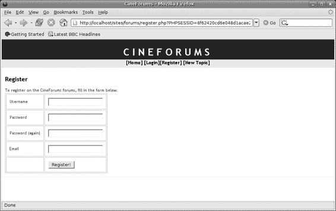

# 第 5 章：讨论论坛

```php
<?php
}
require("footer.php");
?>
```

图 5-9 显示了完成的注册表单。现在我们需要编写验证注册的代码。

**图 5-9** 注册表单

### 验证账户

发送验证邮件后，你可以创建邮件中链接指向的页面。该页面仅简单地解码 GET 变量（`urlencoded` 电子邮件和 `verifystring` 变量），然后检查数据库中的行记录是否匹配。如果存在该行，则通过将 *users* 表中的 active 字段设置为 1 来激活账户。

创建一个名为 `verify.php` 的新页面并添加解码变量的初始代码：

```php
<?php
require("header.php");
$verifystring = urldecode($_GET['verify']);
$verifyemail = urldecode($_GET['email']);
```

编写检查值是否存在于数据库的查询语句：

```php
$sql = "SELECT id FROM users WHERE verifystring = '" . $verifystring . "' AND email = '" . $verifyemail . "';";
$result = mysql_query($sql);
$numrows = mysql_num_rows($result);
```

检查是否返回了行：

```php
$numrows = mysql_num_rows($result);
if($numrows == 1) {
    $row = mysql_fetch_assoc($result);
    $sql = "UPDATE users SET active = 1 WHERE id = " . $row['id'];
    $result = mysql_query($sql);
    echo "Your account has now been verified. You can now <a href='login.php'>log in</a>";
} 
```

如果返回了一行，则说明点击的链接与表中的记录存在匹配。当发生这种情况时，`UPDATE` 查询会将 id 为 `$row['id']` 的记录 active 字段设置为 1。

如果查询没有返回行，则显示错误：

```php
else {
    echo "This account could not be verified.";
}
```

最后，添加页脚：

```php
echo "This account could not be verified.";
}
require("footer.php");
?>
```

### 用户登录

构建登录页的过程与其他项目类似——用户输入其详细信息，这些信息与数据库进行对比，然后设置一些话。

# 第 5 章：讨论论坛

创建一个名为 `login.php` 的新文件并添加表单：

```html
<form action="<?php echo pf_script_with_get($SCRIPT_NAME); ?>" method="post">
    <table>
        <tr>
            <td>用户名</td>
            <td><input type="text" name="username"></td>
        </tr>
        <tr>
            <td>密码</td>
            <td><input type="password" name="password"></td>
        </tr>
        <tr>
            <td></td>
            <td><input type="submit" name="submit" value="登录!"></td>
        </tr>
    </table>
</form>
```

还没有账户？去 <a href="register.php">注册</a>吧！

在前面的代码中，你可能注意到 `<form>` 标签的 `action` 属性中有些奇怪的地方。使用了一个名为 `pf_script_with_get()` 的函数来处理脚本名称（`$SCRIPT_NAME`）。

`pf_script_with_get()` 函数用于处理脚本名称（`$SCRIPT_NAME`）。你需要这个函数的原因是因为重定向。当用户点击链接时，她应该被重定向到登录页面。

`pf_script_with_get()` 是自定义函数。创建一个名为 `functions.php` 的文件并添加以下代码：

```php
<?php
function pf_script_with_get($script) {
    $page = $script;
    $page = $page . "?";
    foreach($_GET as $key => $val) {
        $page = $page . $key . "=" . $val . "&";
    }
    return substr($page, 0, strlen($page)-1);
}
?>
```

在此函数内部，你传递要获取 GET 变量的页面（`$script`）。第一行将 `$page` 设置为存储 `$script` 的内容，第二行在页面后附加问号（例如 `page.php?`）。

然后该函数通过 `foreach()` 函数展开 `$_GET` 数组并遍历它，从而提取 GET 变量。在 `foreach` 中，你将键视为 `$key`，将值视为 `$val`，然后按照 `key=val&` 的格式将它们拼接在一起。

最后，你需要从链接中移除最后的 `&`。要实现这一点，请使用 `substr()` 函数将 `$page` 传递给它，使用 `strlen()` 确定长度，然后删除最后一个字符（通过 `-1` 部分实现）。

函数完成后，处理表单：

```php
<?php
session_start();
require("config.php");
require("functions.php");
$db = mysql_connect($dbhost, $dbuser, $dbpassword);
mysql_select_db($dbdatabase, $db);
$db = mysql_connect($dbhost, $dbuser, $dbpassword);
mysql_select_db($dbdatabase, $db);

if($_POST['submit']) {
    $sql = "SELECT * FROM users WHERE username = '"
```


```php
$_POST['username'] . "' AND password = '" . $_POST['password'] . "';";

$result = mysql_query($sql);

$numrows = mysql_num_rows($result);

$result = mysql_query($sql);

$numrows = mysql_num_rows($result);

if($numrows == 1) {
    $row = mysql_fetch_assoc($result);
    if($row['active'] == 1) {
        session_register("USERNAME");
        session_register("USERID");
```

# 第 5 章
### 论坛
145

```php
$_SESSION['USERNAME'] = $row['username'];
$_SESSION['USERID'] = $row['id'];
```

现在执行任何必要的重定向。请记住，需要用户登录的页面会重定向到登录页面，然后重定向回原始页面。为了处理这种重定向，重定向到 `login.php` 的页面将同时传递 `ref` GET 变量。该变量有两个可能的值：

- `newpost`：用户尝试发布新帖子。这应该会重定向到 `newtopic.php`。
- `reply`：用户尝试回复帖子。这应该会重定向到 `reply.php`。

接下来的代码响应这些不同的选项：

```php
$_SESSION['USERNAME'] = $row['username'];
$_SESSION['USERID'] = $row['id'];
switch($_GET['ref']) {
    case "newpost":
        if(isset($_GET['id']) == FALSE) {
            header("Location: " . $config_basedir . "/newtopic.php");
        }
        else {
            header("Location: " . $config_basedir . "/newtopic.php?id=" . $_GET['id']);
        }
        break;
    case "reply":
        if(isset($_GET['id']) == FALSE) {
            header("Location: " . $config_basedir . "/newtopic.php");
        }
        else {
            header("Location: " . $config_basedir . "/newtopic.php?id=" . $_GET['id']);
        }
        break;
    default:
        header("Location: " . $config_basedir);
        break;
}
```

完成表单处理代码：
146
实用 PHP 与 MySQL

```php
default:
    header("Location: " . $config_basedir);
    break;
}
else {
    require("header.php");
    echo "该账户尚未验证。我们已向您的邮箱发送了验证账户的链接。请点击邮件中的链接继续。";
}
```

如果发生登录错误，页面将重定向，并添加 `error=1` 作为 GET 变量。这可以用来添加错误消息：

```php
else {
    header("Location: " . $config_basedir . "/login.php?error=1");
}
else {
    require("header.php");
    if($_GET['error']) {
        echo "登录错误，请重试!";
    }
?>
```

```html
<form action="<?php echo pf_script_with_get($SCRIPT_NAME); ?>" method="post">
```

最后，添加页脚：

还没有账户吗？去 <a href="register.php">注册</a>吧！

```php
<?php
}
require("footer.php");
?>
```

# 第 5 章
### 论坛
147

### 管理员登录

管理员的登录页面与之前的页面基本相同。创建一个名为 `admin.php` 的新文件并添加示例 5-3 所示所示。

#### 示例 5-3
管理员登录页面与用户登录页面几乎相同。

```php
<?php
session_start();
require("config.php");
require("functions.php");
$db = mysql_connect($dbhost, $dbuser, $dbpassword);
mysql_select_db($dbdatabase, $db);
if($_POST['submit']) {
    $sql = "SELECT * FROM admins WHERE username = '" . $_POST['username'] . "' AND password = '" . $_POST['password'] . "';";
    $result = mysql_query($sql);
    $numrows = mysql_num_rows($result);
    if($numrows == 1) {
        $row = mysql_fetch_assoc($result);
        session_register("ADMIN");
        $_SESSION['ADMIN'] = $row['username'];
        switch($_GET['ref']) {
            case "add":
                header("Location: " . $config_basedir . "/addforum.php"); break;
            case "cat":
                header("Location: " . $config_basedir . "/addcat.php"); break;
            case "del":
                header("Location: " . $config_basedir); break;
            default:
                header("Location: " . $config_basedir); break;
        }
```
*未完*
148
实用 PHP 与 MySQL

```php
}
else {
    header("Location: " . $config_basedir . "/admin.php?error=1");
}
}
else {
    require("header.php");
    if($_GET['error']) {
        echo "登录错误，请重试!";
    }
?>
```

```html
<form action="<?php echo pf_script_with_get($SCRIPT_NAME); ?>" method="post">
<table>
    <tr>
        <td>用户名</td>
        <td><input type="text" name="username"></td>
    </tr>
    <tr>
        <td>密码</td>
        <td><input type="password" name="password"></td>
    </tr>
    <tr>
        <td></td>
        <td><input type="submit" value="登录"></td>
    </tr>
</table>
</form>
```

```php
<?php
}
require("footer.php");
?>
```

区别仅在于两点：
- `$_SESSION['USERNAME']` 被替换为 `$_SESSION['ADMIN']`。
- `session_register("USERNAME")` 被替换为 `session_register("ADMIN")`。
- 文件名是 `admin.php`。

**第 5 章**
论坛
149

### 退出

完成用户和管理员登录页面后，剩下的就是创建退出功能。除了 `ADMIN` 和 `USERNAME` 变量外，用户和管理员使用的代码几乎是相同的。

要注销用户或管理员，只需使用 `session_register()` 取注销相关的会话变量。

150
实用 PHP 与 MySQL

对于用户退出页面，创建一个名为 `logout.php` 的新文件并包含以下代码：

```php
<?php
session_start();
session_register("USERNAME");
require("config.php");
header("Location: " . $config_baseir);
?>
```

要创建管理员退出链接，创建一个名为 `adminlogout.php` 的新页面并添加以下代码：

```php
<?php
session_start();
session_register("ADMIN");
require("config.php");
header("Location: " . $config_baseir);
?>
```


## 论坛讨论

■ 用户点击了 `header.php` 文件中的“新主题”（New Topic）主链接，因此页面没有传递到论坛 id。新主题页面应该在表单上显示一个下拉组合框，其中包含用户可以选择以发布主题的论坛列表。

页面中唯一不同的部分是，没有传递 id 来决定是否应该显示带有论坛的组合框。

创建一个名为 `newtopic.php` 的新文件并添加以下代码：

```php
<form action="<?php echo pf_script_with_get($SCRIPT_NAME); ?>" method="post">
<table>
<?php
if($validforum) == 0) {
$forumssql = "SELECT * FROM forums ORDER BY name;"; $forumsresult = mysql_query($forumssql);
?>
<tr>
<td>论坛</td>
<td>
<select name="forum">
<?php
while($forumsrow = mysql_fetch_assoc($forumsresult)) {
echo "<option value='" . $forumsrow['id'] . "'>" .
$forumsrow['name'] . "</option>";
}
?>
</select>
</td>
</tr>
<?php
}
?>
<tr>
<td>主题</td>
<td><input type="text" name="subject"></td>
</tr>
<tr>
<td>内容</td>
<td><textarea name="body" rows="10" cols="50"></textarea></td>
</tr>
<tr>
<td></td>
<td><input type="submit" name="submit" value="Post!"></td>
</tr>
</table>
</form>
```

## 战化 PHP 与 MySQL

此论坛中存在常见的“嫌疑对象”：主题、正文和提交（Submit）按钮。在表单顶部，会检查 `$validforum` 是否等于 `0`。如果是，则会创建一个包含论坛列表的组合框。这个 `$validforum` 变量是页面顶部存在的常规验证结果。

同样，此页面也使用了 `pf_script_with_get()` 函数。

在页面顶部添加代码：

```php
<?php
session_start();
require("config.php");
require("functions.php");
$db = mysql_connect($dbhost, $dbuser, $dbpassword);
mysql_select_db($dbdatabase, $db);
```

在这段初始代码之后，运行一个快速查询来检查是否存在任何论坛：`mysql_select_db($dbdatabase, $db);`

`$forchecksql = "SELECT * FROM forums;";`
`$forcheckresult = mysql_query($forchecksql);`
`$forchecknumrows = mysql_num_rows($forcheckresult);`
`if($forchecknumrows == 0) { header("Location: " . $config_basedir); }`

如果没有行数据，if 检查将重定向页面。验证 GET 变量：

```php
if($forchecknumrows == 0) {
    header("Location: " . $config_basedir);
}
if(isset($_GET['id']) == TRUE) {
    if(is_numeric($_GET['id']) == FALSE) {
        $error = 1;
    }
    if($error == 1) {
        header("Location: " . $config_basedir);
    }
    else {
        $validforum = $_GET['id'];
    }
}
else {
    $validforum = 0;
}
```

检查用户是否已登录，如果没有，则拒绝访问：

```php
else {
    $validforum = 0;
}
if(isset($_SESSION['USERNAME']) == FALSE) {
    header("Location: " . $config_basedir . "/login.php?ref=newpost&id=" . $validforum);
}
```

现在你可以处理表单了。你首先需要检查构建了哪一个 SQL 语句：

- 如果页面传递了 id GET 变量，在 INSERT 语句中使用 `$validforum`。
- 如果页面没有传递该变量，则使用添加到表单的下拉组合框中的 id。

以下是代码：

```php
if(isset($_SESSION['USERNAME']) == FALSE) {
    header("Location: " . $config_basedir . "/login.php?ref=newpost&id=" . $validforum);
}
if($_POST['submit']) {
    if($validforum == 0) {
        $topicsql = "INSERT INTO topics(date, user_id, forum_id, subject) VALUES(NOW(), " . $_SESSION['USERID'] . ", " . $_POST['forum'] . ", '" . $_POST['subject'] . " '');";
    }
    else {
        $topicsql = "INSERT INTO topics(date, user_id, forum_id, subject) VALUES(NOW(), " . $_SESSION['USERID'] . ", " . $validforum . ", '" . $_POST['subject'] . " '');";
    }
}
```

在这段代码中，if 检查 `$validforum` 是否等于 `0`（没有变量传递到页面），如果是，则定义一个 SQL 语句；否则，在 else 中定义另一个 SQL 语句。

运行查询：

```php
$topicsql = "INSERT INTO topics(date, user_id, lastpost_id, forum_id, subject) VALUES(NOW(), " . $_SESSION['USERID'] . ", " . $_SESSION['USERID'] . ", " . $validforum . ", '" . $_POST['subject'] . " '');";
mysql_query($topicsql);
$topicid = mysql_insert_id();
```

此示例使用了一个名为 `mysql_insert_id()` 的新函数。该函数返回上一个 INSERT 语句生成的 id（自增 id）。构建并执行针对 `messages` 表的 SQL 语句：

```php
$topicid = mysql_insert_id();
$messagesql = "INSERT INTO messages(date, user_id, topic_id, subject, body) VALUES(NOW(), " . $_SESSION['USERID'] . ", " . $topicid . ", '" . $_POST['subject'] . "', '" . $_POST['body'] . " '');";
mysql_query($messagesql);
header("Location: " . $config_basedir . "/viewmessages.php?id=" . $topicid);
```

在这段代码中，页面重定向到 `viewmessages.php` 页面，并将来自 `mysql_insert_id()` 的 id 作为 GET 变量传递给它以显示新消息。构建在未检测到提交 POST 变量时执行的 else 部分：

```php
else {
    require("header.php");
    if($validforum != 0) {
        $namesql = "SELECT name FROM forums ORDER BY name;";
        $nameresult = mysql_query($namesql);
        $namerow = mysql_fetch_assoc($nameresult);
        echo "<<h2>>Post new message to the " . $namerow['name'] . "</</h2>>";
    }
    else {
        echo "<h2>Post a new message</h2>";
    }
?>
    <form action="<?php echo pf_script_with_get($SCRIPT_NAME); ?>" method="post">
    <table>
```

在此处你检查 `$validforum` 变量是否不等于 (`!=`) `0`（向页面传递了论坛 id）。使用此 id 获取论坛名称，并在 `<forum>` 论坛添加“发布新消息”（Post new message）标题。如果 `$validforum` 等于 `0`（未传递页面 id），则添加通用的“发布新消息”标题。最后添加结束代码：

```php
    </table>
    </form>
<?php
}
require("footer.php");
?>
```

发布新消息所需的页面见图 5-10。

## 回复线程

编写回复页面非常简单。页面接收 topic id 作为 GET 变量，据此获取表单内容插入 `messages` 表。

创建一个名为 `reply.php` 的文件并添加表单：

```php
<form action="<?php echo pf_script_with_get($SCRIPT_NAME); ?>" method="post">
<table>
<tr>
    <td>主题</td>
    <td><input type="text" name="subject"></td>
</tr>
<tr>
    <td>内容</td>
    <td><textarea name="body" rows="10" cols="50"></textarea></td>
</tr>
<tr>
    <td></td>
    <td><input type="submit" name="submit" value="Post!"></td>
</tr>
</table>
</form>
```

移动到文件开头并添加引入代码：

```php
<?php
session_start();
require("config.php");
require("functions.php");
```

通过常规验证代码验证 id 变量：

```php
require("config.php");
require("functions.php");
$db = mysql_connect($dbhost, $dbuser, $dbpassword);
mysql_select_db($dbdatabase, $db);
if(isset($_GET['id']) == TRUE) {
    if(is_numeric($_GET['id']) == FALSE) {
        $error = 1;
    }
    if($error == 1) {
        header("Location: " . $config_basedir);
    }
    else {
        $validtopic = $_GET['id'];
    }
}
else {
    header("Location: " . $config_basedir);
}
```

检查用户是否已登录：

```php
else {
    header("Location: " . $config_basedir);
}
if(isset($_SESSION['USERNAME']) == FALSE) {
    header("Location: " . $config_basedir . "/login.php?ref=reply&id=" . $validtopic);
}
}
}
```


要处理表单，请运行 `INSERT` 查询：

```php
if(isset($_SESSION['USERNAME']) == FALSE) {
    header("Location: " . $config_basedir . "/login.php?ref=reply&id=" . $validtopic);
}
```

158

Practical PHP and MySQL

```php
if($_POST['submit']) {
    $messagesql = "INSERT INTO messages(date,user_id, topic_id, subject, body) VALUES(NOW(), " . $_SESSION['USERID'] . ", " . $validtopic . ", '" . $_POST['subject'] . "', '" . $_POST['body'] . "');";
    mysql_query($messagesql);
    header("Location: " . $config_basedir . "/viewmessages.php?id=" . $validtopic);
}
```

如果没有点击提交按钮，则包含头文件并显示表单：
```php
header("Location: " . $config_basedir . "/viewmessages.php?id=" . $validtopic);
} else {
    require("header.php");
?>
<form action="<?php echo pf_script_with_get($SCRIPT_NAME); ?>" method="post">
<table>
<!--  最后，添加页脚： -->
</table>
</form>
<?php
}
require("footer.php");
?>
```

# 创建管理员特定页面 #index_split_000.html_p9

完成用户可访问的页面后，你现在可以创建管理员特定的页面了。这些页面处理论坛的管理，并允许你添加和删除分类、论坛和线程。

# 第 5 章：讨论论坛

159

在论坛中整合这些管理功能涉及两个步骤。

首先，对于内容的添加，创建特定的页面（`addcat.php` 和 `addforum.php`）。接下来，对于内容的删除，当管理员登录时，会在分类、论坛和线程旁边添加 `X` 链接。点击链接即可删除内容。

### 添加分类

此页面是一个简单的表单，并会插入一个查询脚本。首先，创建一个名为 `addcat.php` 的文件并添加表单：

```html
<h2>添加新分类</h2>
<form action="<?php echo pf_script_with_get($SCRIPT_NAME); ?>" method="post">
<table>
    <tr>
        <td>分类</td>
        <td><input type="text" name="cat"></td>
    </tr>
    <tr>
        <td></td>
        <td><input type="submit" name="submit" value="添加分类!"></td></td>
    </tr>
</table>
</form>
```

移动到文件顶部开始添加代码：

```php
<?php
session_start();
require("config.php");
require("functions.php");
// 判断用户是否已登录并可以访问此页面： require("functions.php");
if(isset($_SESSION['ADMIN']) == FALSE) {
    header("Location: " . $config_basedir . "/admin.php?ref=cat");
}
```

处理表单：

```php
if(isset($_SESSION['ADMIN']) == FALSE) {
    header("Location: " . $config_basedir . "/admin.php?ref=cat");
}

if($_POST['submit']) {
    $db = mysql_connect($dbhost, $dbuser, $dbpassword);
    mysql_select_db($dbdatabase, $db);
    $catsql = "INSERT INTO categories(name) VALUES('" . $_POST['cat'] . "');";
    mysql_query($catsql);
    header("Location: " . $config_basedir);
}
```

在此代码中，添加了数据库连接详情，并对 `categories` 表执行了 `INSERT` 查询，将表单中的数据添加其中。查询执行后，页面重定向。

添加包含表单的 `else` 语句：

```php
header("Location: " . $config_basedir);
} else {
    require("header.php");
?>
<h2>添加新分类</h2>
<form action="<?php echo pf_script_with_get($SCRIPT_NAME); ?>" method="post">
<!-- 最后，在表单之后，添加结束代码： -->
</table>
</form>
<?php
}
require("footer.php");
?>
```

### 添加论坛

此页面向特定分类添加论坛。该脚本的逻辑很简单：你向用户展示一个表单，用户可以在下拉框中选择一个分类。然后数据会被添加到 forums 表中。

第 5 章：讨论论坛

161

创建一个名为 `addforum.php` 的新文件并添加以下代码：

```html
<h2>添加新论坛</h2>
<form action="<?php echo pf_script_with_get($SCRIPT_NAME); ?>" method="post">
<table>
    <?php
    if($validforum == 0) {
        $forumssql = "SELECT * FROM categories ORDER BY name;";
        $forumsresult = mysql_query($forumssql);
    ?>
    <tr>
        <td>论坛</td>
        <td>
            <select name="cat">
                <?php
                while($forumsrow = mysql_fetch_assoc($forumsresult)) {
                    echo "<option value='" . $forumsrow['id'] . "'>" . $forumsrow['name'] . "</option>";
                }
                ?>
            </select>
        </td>
    </tr>
    <?php } ?>
    <tr>
        <td>名称</td>
        <td><input type="text" name="name"></td>
    </tr>
    <tr>
        <td>描述</td>
        <td><textarea name="description" rows="10" cols="50"></textarea></td>
    </tr>
    <tr>
        <td></td>
        <td><input type="submit" name="submit" value="添加论坛!"></td></td></td>
    </tr>
</table>
</form>
```

在文件开头添加常规代码：

```php
<?php
162
Practical PHP and MySQL
session_start();
require("config.php");
require("functions.php");
$db = mysql_connect($dbhost, $dbuser, $dbpassword);
mysql_select_db($dbdatabase, $db);

if(isset($_SESSION['ADMIN']) == FALSE) {
    header("Location: " . $config_basedir . "/admin.php?ref=cat");
}

// 要处理表单，只需使用 INSERT 语句插入表单中的数据：
if($_POST['submit']) {
    $topicsql = "INSERT INTO forums(cat_id, name, description) VALUES('" . $_POST['cat'] . "', '" . $_POST['name'] . "', '" . $_POST['description'] . "');";
    mysql_query($topicsql);
    header("Location: " . $config_basedir);
}

// 如果没有点击提交按钮，则执行 else，表单会在下一个块之后出现：
header("Location: " . $config_basedir);
} else {
    require("header.php");
?>
<!-- （表单剩余部分） -->
<?php
}
require("footer.php");
?>
```


第 5 章：讨论论坛

163

图 5-11 显示了添加论坛的完整页面。

图 5-11 添加论坛

### 删除

如果没有强制执行关系，从相关表中删除内容通常是一项挑战。当你删除一个分类时，你真的希望依赖内容（如论坛和消息）也能被删除。在没有强制引用完整性的情况下，需要一系列 SQL 语句来删除依赖内容。

在项目开始时，创建表时使用了 InnoDB 表类型。使用这种类型的表，你可以强制引用完整性，但目前尚未开启。

要开启引用完整性，请在 SQL 中指定表之间的关系。

164

Practical PHP and MySQL

- `messages` 表中的 `topic_id` 字段的值与 `topics` 表中的 `id` 字段相同。
- `topics` 表中的 `forum_id` 字段的值与 `forums` 表中的 `id` 字段相同。
- `forums` 表中的 `cat_id` 字段的值与 `categories` 表中的 `id` 字段相同。

要创建第一个关系，进入 phpMyAdmin，点击 SQL 选项卡并添加以下代码：

```sql
ALTER TABLE messages ADD FOREIGN KEY(topic_id)
REFERENCES topics (id) ON DELETE CASCADE;
```

运行非常相似的语句，但针对第二个关系使用不同的表和字段：

```sql
ALTER TABLE topics ADD FOREIGN KEY(forum_id)
REFERENCES forums (id) ON DELETE CASCADE;
```


最后，关于第三种关系：

```sql
ALTER TABLE forums ADD FOREIGN KEY(cat_id) REFERENCES categories (id) ON DELETE CASCADE;
```

在实际编写 SQL 代码删除记录之前，你需要为管理员添加一些控制选项，让他们选择要删除的内容。为了实现这一点，你将在项目旁边放置一个小的 `X`，如果管理员点击它，项目将被删除。

首先，在添加分类之前添加一个删除按钮。打开 `index.php` 并找到输出分类的行。在相应行之前，添加以下代码：

```php
while($catrow = mysql_fetch_assoc($catresult)) {
    echo "<tr><td colspan=2>";
    if($_SESSION['ADMIN']) {
        echo "[<a href='delete.php?func=cat&id=" . $forumrow['id'] . "'>X</a>] - ";
    }
    echo "<strong>" . $catrow['name'] . "</strong></td>";
}
```

### 第 5 章：论坛

这段代码链接到一个包含两个 GET 变量的页面：`func` 和 `id`。`func` 变量的值为 `cat`、`forum` 或 `thread`，这些选项决定了要删除的内容。第二个变量 `id` 提供了要删除资源的 `id`。

继续向下移动到输出论坛的地方并添加以下代码：

```php
while($forumrow = mysql_fetch_assoc($forumresult)) {
    echo "<tr>";
    echo "<td>";
    if($_SESSION['ADMIN']) {
        echo "[<a href='delete.php?func=forum&id=" . $forumrow['id'] . "'>X</a>] - ";
    }
    echo "<strong><a href='viewforum.php?id=" . $forumrow['id'] . "'>" . $forumrow['name'] . "</a></strong>";
}
```

最后，加载 `viewforum.php` 并在旁边添加以下代码：

```php
echo "<tr>";
echo "<td>";
if($_SESSION['ADMIN']) {
    echo "[<a href='delete.php?func=thread&id=" . $topicrow['topicid'] . "?forum=" . $validforum . "'>X</a>] - ";
}
echo "<strong><a href='viewmessages.php?id=" . $topicrow['topicid'] . "'>" . $topicrow['subject'] . "</a></td></strong>";
```

创建一个名为 `delete.php` 的新文件并添加以下代码：

```php
<?php
include("config.php");
$db = mysql_connect($dbhost, $dbuser, $dbpassword);
mysql_select_db($dbdatabase, $db);

// 像一样验证 id GET 变量： 
if(isset($_GET['id']) == TRUE) {
    if(is_numeric($_GET['id']) == FALSE) {
        $error = 1;
    }
    if($error == 1) {
        header("Location: " . $config_basedir);
    } else {
        $validid = $_GET['id'];
    }
} else {
    header("Location: " . $config_basedir);
}

// 执行删除操作，将 func GET 变量通过 switch 语句确定其类型，然后执行相关的删除操作：
switch($_GET['func']) {
    case "cat":
        $delsql = "DELETE FROM categories WHERE id = " . $validid . ";";
        mysql_query($delsql);
        header("Location: " . $config_basedir);
        break;
    case "forum":
        $delsql = "DELETE FROM forums WHERE id = " . $validid . ";";
        mysql_query($delsql);
        header("Location: " . $config_basedir);
        break;
    case "thread":
        $delsql = "DELETE FROM topics WHERE id = " . $validid . ";";
        mysql_query($delsql);
        header("Location: " . $config_basedir . "/viewforum.php?id=" . $_GET['forum']);
        break;
    default:
        header("Location: " . $config_basedir);
        break;
}
?>
```

删除 SQL 语法非常简单：`DELETE FROM <table> WHERE id = <你想删除的内容的 id>`。删除完成后，页面将重定向到页面层级中的上一层。例如，当你删除一个主题（topic）时，论坛主题页面将被刷新。请参见图 5-12。

**提示**：在 `delete.php` 中，删除线程时，你使用 `$_GET['forum']` 在删除线程后重定向到论坛页面。不必担心验证这个变量；它不涉及进入数据库的数据，仅用于显示页面。然而，如果你仍然担心，为了双重防止 SQL 注入攻击，请对该变量进行验证。

## 总结
随着另一个项目的完成，你在构建论坛时已经处理并完善了许多核心主题。你做的每一个项目都会提供一系列特定的挑战，进一步丰富你对 PHP 和 MySQL 的知识和经验，书中的项目正是为了探索这些技能。

除了学习新主题外，现有技能的重复加深了你对这些技能的理解。例如，每当你执行一次 SQL 查询时，你都在不断巩固对 PHP 这一要素的知识。不知不觉，你将不再需要参考书籍或现有代码来连接 MySQL——你将能够自动完成。

# 第 6 章：创建购物车

对于许多开发者来说，简单的购物车在他们心中占有特殊地位。尽管 PHP 和 MySQL 是许多 Web 应用的基础，但许多开发者学习行艺的抱负就是编写那个无处不在的购物车。如果 Web 开发中存在“禅意”，这种它很可能是在编写购物车时体验到的。

虽然购物车在 Web 上随处可见，但它们也有许多不同的形式。不同的版本通常根据使用该软件的业务类型而异。例如，销售书籍、CD 和 DVD 等物品的模式与销售电缆、食品、建筑材料和清洁用品有所不同。核心区别在于数量；你通常一次只买一本书或一张 DVD，但餐厅购买 10 包晚餐小面包也并不少罕见。

## 项目概述
在这个项目中，你将创建购物车的核心功能。为了清楚地了解项目是如何运作的，请查看以下用例：John 需要为他的移动咖啡馆买一些茶包。他去了一家由本书书作者创建的热门在线商店。John 在网站上没有用户账户，但仍然开始购物。他点击“饮料”分类，看到了茶包列表。他点击“购买”链接并跳转到另一个页面，他可以在那里选择数量。他选择了 10 盒茶包并加入购物车。页面现在刷新，他看到了购物车的内容。John 随后买了咖啡，他的购物车再次更新了。John 意识到自己其实不需要咖啡了，于是点击 X 链接从购物车中删除咖啡。John 完成了物品选择并点击“去结算”链接。系统提示他输入地址，他填写了地址并跳转到支付屏幕。John 可以使用 PayPal 或支票支付。John 点击 PayPal 按钮跳转到 `paypal.com` 的 PayPal 支付界面，在那里支付了订单。

Pauline 也需要一些茶包。Pauline 网站已有账户，所以她登录了。她将需要的物品加入购物车并点击“去结算”链接。在地址页面，她可以在新地址和用户账户存储的地址之间进行选择。她选择了账户地址并跳转到支付屏幕。Pauline 选择用支票支付，并收到了关于将支票寄往哪里以及收款人的说明。

Ken 运行该网站并想要查看所有当前订单。他用管理员用户名和密码登录，并得到了订单列表。


Ken 检查每个物品，包装订单并在包裹上写上地址。为了确认订单完成，Ken 点击了 `Confirm Payment` 链接。订单现在已完成。

你在本章中构建的购物车满足了前一个用例中讨论的所有功能，但仍有巨大的开发空间。

购物车可以变成非常庞大且复杂的系统，用一整本书来充分探讨构建购物车的主题。这个项目将提供一个坚实的基础，你可以在此继续构建额外的功能。

# 第 6 章
创建购物车

171

## 构建数据库

你将创建的数据库如图 6-1 所示。

**order_items**

**orders**

`id`

**logins**

**customers**

**products**

`id`
`order_id`
`id`
`id`
`customer_id`
`product_id`
`customer_id`
`cat_id`
`forename`
`registered`
`quantity`
`username`
`name`
`surname`
`delivery_add_id`
`password`
`description`
`add1`
`payment_type`
`image`
`add2`
`date`
`price`
`add3`
`status`
`postcode`
`session`
`phone`
`total`
**categories**

`email`
`id`
`registered`
`name`
`description`

**delivery_addresses**

`image`
`id`
`forename`
`surname`

**admins**

`add1`
`id`
`add2`
`username`
`add3`
`password`
`postcode`
`phone`
`email`

图 6-1 数据库架构围绕主 orders 表。

整个项目从根本上取决于 `orders` 表中的订单。

该表关联 `customers`（包含注册客户的地址详情）和 `delivery_addresses`（包含未注册和替代地址）表。

订单中的每个产品（存储在 `products` 表中）存储在 `order_items` 表中。其他表包括 `logins`（存储注册用户的登录详情）、`categories`（包含产品所属的分类）以及 `admins`（存储管理员登录详情）。

### 实现数据库

启动 `phpMyAdmin`，创建一个名为 `shoppingcart` 的新数据库，并添加以下表：

172

Practical PHP and MySQL

注意

### 始终了解你的状态

`orders` 表中有一个名为 `status` 的字段。该字段的作用是指示用户在购物车中进展到了什么阶段。该字段有四种可能的值：

* 0：用户仍在向其购物车添加物品。
* 1：用户已输入其地址。
* 2：用户已为物品支付了费用。
* 10：管理员已确认交易并发送了物品。

### admins 表

* `id`。将其设置为 `TINYINT`（可能有很多用户）并开启 `auto_increment`。将此字段设置为主键。
* `username`。将其设置为长度为 10 的 `VARCHAR`。
* `password`。将其设置为长度为 10 的 `VARCHAR`。

### categories 表

* `id`。将其设置为 `TINYINT`（分类会很少）并在 Extras 列中开启 `auto_increment`。将此字段设置为主键。
* `name`。将其设置为 `VARCHAR` 并设置大小为 20。（分类标题不太可能超过 20 个字母。）

### customers 表

* `id`。将其设置为 `INT`（可能有很多用户）并开启 `auto_increment`。将此字段设置为主键。
* `forename`。将其设置为长度为 50 的 `VARCHAR`。
* `surname`。将其设置为长度为 50 的 `VARCHAR`。
* `add1`。将其设置为长度为 50 的 `VARCHAR`。
* `add2`。将其设置为长度为 50 的 `VARCHAR`。
* `add3`。将其设置为长度为 50 的 `VARCHAR`。
* `postcode`。将其设置为长度为 10 的 `VARCHAR`。
* `phone`。将其设置为长度为 20 的 `VARCHAR`。
* `email`。将其设置为长度为 100 的 `VARCHAR`。
* `registered`。将其设置为 `TINYINT`。

第 6 章
创建购物车

173

### delivery_addresses 表

* `id`。将其设置为 `INT`（可能有很多用户）并开启 `auto_increment`。将此字段设置为主键。
* `forename`。将其设置为长度为 50 的 `VARCHAR`。
* `surname`。将其设置为长度为 50 的 `VARCHAR`。
* `add1`。将其设置为长度为 50 的 `VARCHAR`。
* `add2`。将其设置为长度为 50 的 `VARCHAR`。
* `add3`。将其设置为长度为 50 的 `VARCHAR`。
* `postcode`。将其设置为长度为 10 的 `VARCHAR`。
* `phone`。将其设置为长度为 20 的 `VARCHAR`。
* `email`。将其设置为长度为 100 的 `VARCHAR`。

### logins 表

* `id`。将其设置为 `INT`（可能有很多用户）并开启 `auto_increment`。将此字段设置为主键。
* `customer_id`。将其设置为 `INT`。
* `username`。将其设置为长度为 10 的 `VARCHAR`。
* `password`。将其设置为长度为 10 的 `VARCHAR`。

### orderitems 表

* `id`。将其设置为 `INT`（可能有很多物品）并开启 `auto_increment`。将此字段设置为主键。
* `order_id`。将其设置为 `INT`。
* `product_id`。将其设置为 `INT`。
* `quantity`。将其设置为 `INT`。

### orders 表

* `id`。将其设置为 `INT`（可能有很多订单）并开启 `auto_increment`。将此字段设置为主键。
* `customer_id`。将其设置为 `INT`。
* `registered`。将其设置为 `INT`。
* `delivery_add_id`。将其设置为 `INT`。
* `payment_type`。将其设置为 `INT`。

174

Practical PHP and MySQL

`date`。将其设置为 `DATETIME`。
`status`。将其设置为 `TINYINT`。
`session`。将其设置为 `VARCHAR` 并设置大小为 50。

`total`。将其设置为 `FLOAT`。

### products 表

* `id`。将其设置为 `INT`（可能有很多图片）并开启 `auto_increment`。将此字段设置为主键。
* `cat_id`。将其设置为 `TINYINT`。
* `name`。将其设置为长度为 30 的 `VARCHAR`。
* `description`。将其设置为 `TEXT`。
* `price`。将其设置为 `FLOAT`。

## 插入数据

当一组基础表准备就绪后，添加一些示例数据。记住，不要填充 `id` 列；此列由 `auto_increment` 处理。

### admins 表的示例数据

为管理员创建一个用户名和密码。此示例使用 `jono` 作为用户名，`bacon` 作为密码。

### categories 表的示例数据

添加两个分类：饮料（beverages）和蛋糕（cakes）。

### customers 表的示例数据

如表 6-1 所示添加以下客户。

图 6-1 customers 和 logins 表存储了注册用户信息。

**FORENAME SURNAME**
**ADD1**
**ADD2**
**ADD3**
**POSTAL**
**PHONE**
**EMAIL**
**REGISTERED**
**CODE**

Craig
Tucker
19, The
Ziggy
Smalltown
T3 TR4
01234
craig@
1
Grove
Road
567890
hissite.com

Lee
Jordan
19, Oak
Booth
Thistown
T1 FG3
01234
lee@lee-
1
Street
Road
098765
tastic.com

### logins 表

为每个客户添加表 6-2 中的登录详情。

表 6-2 确保 `customer_id` 字段与 `customers` 表中的 `id` 字段匹配。

**CUSTOMER_ID**
**USERNAME**
**PASSWORD**

1
Craig
Tucker
2
Lee
Jordan

### delivery_addresses 表示例数据

保持此表为空。

### products 表的示例数据

将表 6-3 所示的产品添加到 `products` 表。

表 6-3 如果存在，`image` 字段包含图片的名称。

**CAT_ID**
**NAME**
**DESCRIPTION**
**IMAGE**
**PRICE**

1
Best Bags
一包优质茶包。<empty>
2.99
每盒 200 包。

1
Best Orange Juice
一加仑优质
bestorange-
0.90
现榨橙汁。
juice.jpg

### orders 表的示例数据

保持此表为空。

### orderitems 表的示例数据

保持此表为空。

第 6 章
创建购物车

175

## 开始编码

创建购物车的挑战之一是处理注册用户和未注册用户。对于注册用户，没有问题，因为在向表中添加信息时，可以使用他们的 ID 来跟踪。挑战出现在未注册用户身上。你如何跟踪他们？

176

Practical PHP and MySQL


解决方案是使用会话 ID（session IDs）。当用户使用 `session_start()` 函数加载第一个页面时，会生成一个特殊的会话 ID。该 ID 对于该特定用户是唯一的，并用于跟踪哪些会话变量被分配给访问网站的用户。虽然你之前没有提到过会话 ID，但在本项目中你将大量使用会话 ID。

每当用户访问购物车并添加第一件商品时，`orders` 表中就会添加一条订单。对于注册用户，用户的 id 会添加到表中的 `customer_id` 字段中。对于未注册用户，唯一的会话 ID 会被添加到 `session` 字段中。当该订单被添加到表后，会创建一个名为 `SESS_ORDERNUM` 的会话变量，其值为订单的 ID。现在，可以使用 `SESS_ORDERNUM` 来跟踪订单在整个网站中的进度。

要开始之前，请构建一个存储网站通用信息的常规配置文件。创建一个名为 `shoppingcart` 的新目录，并将示例 6-1 所示的代码添加到 `config.php` 中。

### 示例 6-1
该配置文件与书中的其他项目类似。

```php
<?php
$dbhost = "localhost";
$dbuser = "root";
$dbpassword = "";
$dbdatabase = "shoppingcart";
$config_basedir = "http://localhost/sites/shoppingcart/"; $config_sitename = "BidTastic Aucions";
?>
```

为了在处理重定向时更加方便，创建一个名为 `db.php` 的文件，其中仅包含数据库连接详情，如示例 6-2 所示。

### 示例 6-2
当你需要数据库连接但由于重定向不想包含 `header.php` 时，`db.php` 文件将被包含。

```php
<?php
require("config.php");
$db = mysql_connect($dbhost, $dbuser, $dbpassword);
mysql_select_db($dbdatabase, $db);
?>
```

# 第 6 章
### 创建购物车

如示例 6-3 所示创建 `header.php`。

### 示例 6-3
头部文件添加了菜单选项、包含了侧边栏并添加了一些登录/注销链接。

```php
<?php
session_start();
if(isset($_SESSION['SESS_CHANGEID']) == TRUE)
{
    session_unset();
    session_regenerate_id();
}
require("config.php");
$db = mysql_connect($dbhost, $dbuser, $dbpassword);
mysql_select_db($dbdatabase, $db);
?>
<!DOCTYPE HTML PUBLIC "-//W3C//DTD HTML 4.01 Transitional//EN"
"http://www.w3.org/TR/html4/loose.dtd">
<head>
<title><?php echo $config_sitename; ?></title>
<link href="../stylesheet.css" rel="stylesheet">
</head>
<body>
<div id="header">
<h1><?php echo $config_sitename; ?></h1>
</>
<div id="menu">
<a href="<?php echo $config_basedir; ?>">首页</a> -
<a href="<?php echo $config_basedir; ?>showcart.php">查看购物车/结算</a>
</div>
<div id="container">
<div id="bar">
<?php
require("bar.php");
echo "<hr>";
if(isset($_SESSION['SESS_LOGGEDIN']) == TRUE)
{
    echo "登录用户：<strong>" . $_SESSION['SESS_USERNAME'] . "</strong>\n[<a href='" . $config_basedir . "logout.php'>注销</a>]";
}
else
{
    // *继续**
    echo "<a href='" . $config_basedir . "login.php'>登录</a>";
}
?>
</div>
<div id="main">
花一点时间查看以下关于 `header.php` 的有趣要点：

*   在文件顶部，会检查名为 `SESS_CHANGEID` 的会话变量。如果它存在，则取消（删除）会话，并重新生成会话 ID。稍后当订单完成后，在会话系统应该重置时创建 `SESS_CHANGEID`。
*   会检查 `SESS_LOGGEDIN` 变量是否存在。如果存在，则表示用户当前已登录，并显示其用户名和注销链接。用户名存储在 `SESS_USERNAME` 中；该变量在稍后介绍的 `login.php` 中创建。
*   此处使用了与书中之前的项目相同的 `stylesheet.css` 文件。

头部文件中还包含了一个名为 `bar.php` 的文件。该文件包含了示例 6-4 所示的分类列表。

### 示例 6-4
虽然 `bar.php` 中的代码可以添加到 `header.php` 中，但如果需要，你可以使用此文件整洁地添加其他内容。

```html
<h1>产品分类</h1>
<ul>
<?php
$catsql = "SELECT * FROM categories;";
$catres = mysql_query($catsql);
while($catrow = mysql_fetch_assoc($catres))
{
    echo "<li><a href='" . $config_basedir . "/products.php?id=" . $catrow['id'] . "'>" . $catrow['name'] . "</a></li>";
}
?>
</ul>
```

`bar.php` 中的代码执行了 `SELECT` 查询以收集所有分类并将它们以无序列表的形式显示。每个分类都链接到 `products.php`，该文件稍后创建。

创建 `footer.php` 并添加示例 6-5 所示的代码。

### 示例 6-5
页脚文件在管理员登录时会添加管理员链接。

```php
<?php
echo "<p><i>本站所有内容版权所有 copy; " . $config_sitename . "</i></p>";
if($_SESSION['SESS_ADMINLOGGEDIN'] == 1)
{
    echo "[<a href='" . $config_basedir . "adminorders.php'>管理员</a>]
[<a href='" . $config_basedir . "adminlogout.php'>管理员注销</a>]";
}
?>
</div>
</div>
</body>
</html>
```

使用示例 6-6 所示的代码为网站创建主索引文件 `index.php`。

### 示例 6-6
看到如此极简的 `index.php` 可能会感到意外。此文件实际上用于存放有关商店的通用信息。

```php
<?php
require("header.php");
?>
<h1>欢迎！！</h1>
欢迎访问 <?php echo $config_sitename; ?> 网站。
点击一个页面来探索我们丰富的商品。
<?php
require("footer.php");
?>
```

实战 PHP 与 MySQL

### 管理登录
用户是购物车中的关键元素，跟踪注册用户和未注册用户都是重要的。构成网站的许多不同脚本都有两个分支：一个用于用户已登录的情况，另一个用于未登录的情况。登录页面与其他页面类似。

移动到文件开头并添加代码：

```php
<?php
session_start();
require("db.php");
if(isset($_SESSION['SESS_LOGGEDIN'])) {
    // 已登录用户的逻辑
}
```

创建一个名为 `login.php` 的文件并添加表单：

```html
<form action="<?php echo $SCRIPT_NAME; ?>" method="POST">
<table>
    <tr>
        <td>用户名</td>
        <td><input type="textbox" name="userBox"></td>
    </tr>
    <tr>
        <td>密码</td>
        <td><input type="password" name="passBox"></td>
    </tr>
    <tr>
        <td></td>
        <td><input type="submit" name="submit" value="登录"></td>
    </tr>
</table>
</form>
```

处理该表单：

```php
<?php
session_start();
require("db.php");
if(isset($_SESSION['SESS_LOGGEDIN'])) {
    header("Location: " . $config_basedir);
}
if($_POST['submit']) {
    $loginsql = "SELECT * FROM logins WHERE username = '" . $_POST['userBox'] . "' AND password = '" . $_POST['passBox'] . "'";
    $loginres = mysql_query($loginsql);
    $numrows = mysql_num_rows($loginres);
    if($numrows == 1) {
        $loginrow = mysql_fetch_assoc($loginres);
        session_register("SESS_LOGGEDIN");
        session_register("SESS_USERNAME");
        session_register("SESS_USERID");
        $_SESSION['SESS_LOGGEDIN'] = 1;
        $_SESSION['SESS_USERNAME'] = $loginrow['username'];
        $_SESSION['SESS_USERID'] = $loginrow['id'];
        $ordersql = "SELECT id FROM orders WHERE customer_id = " . $_SESSION['SESS_USERID'] . " AND status < 2";
        $orderres = mysql_query($ordersql);
        $orderrow = mysql_fetch_assoc($orderres);
        session_register("SESS_ORDERNUM");
        $_SESSION['SESS_ORDERNUM'] = $orderrow['id'];
    }
}
}
?>
```


```php
header("Location: " . $config_basedir);
}
else
{
header("Location: http://" . $HTTP_HOST
. $SCRIPT_NAME . "?error=1");
}
```

这段代码使用了之前展示的登录用户所需的相同技术。当登录成功时，会创建三个会话变量：

- `SESS_LOGGEDIN`: 设置为 1 表示用户当前已登录。
- `SESS_USERNAME`: 包含用户的用户名。
- `SESS_USERID`: 包含用户的 ID。

除了这些变量外，`SELECT` 语句会从 `orders` 表中提取 `id`，表中的 `customer_id` 字段与当前用户的 `id` 相匹配。然后将另一个名为 `SESS_ORDERNUM` 的会话变量设置为该查询返回的 `id`。

这个过程可能会有两种结果之一：

- 不存在订单。如果 `orders` 表中不存在订单，则 `SESS_ORDERNUM` 不被设置为任何值。
- 存在订单。如果查询返回了 `id`，则 `SESS_ORDERNUM` 设置为该 `id`。如果用户在选择购物车商品后注销，这种方法就非常有用。当用户再次登录时，购物车将包含上一次访问时的相同商品，用户可以继续选择商品。此功能提供了某些重要的连续性。

当表单成功提交并设置了会话变量后，页面将重定向到网站的基础 URL。页面将在侧边栏显示文本 *Logged in* *as <foo>*（登录）。

添加剩余的代码：

```php
header("Location: http://" . $HTTP_HOST
. $SCRIPT_NAME . "?error=1");
}

}

else
{
require("header.php");
?>
<h1>客户登录</h1>
请输入您的用户名和密码以登录网站。如果您没有
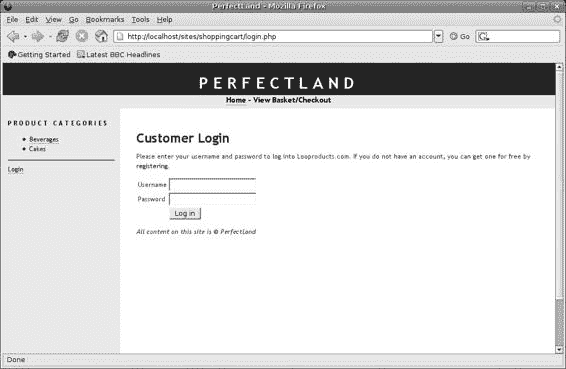

**第 6 章**
**创建购物车**
183
拥有账户，可以通过 <a href="register.php">注册</a> 免费获取一个。
<p>
<?php
if($_GET['error']) {
echo "<strong>用户名/密码错误</strong>";
}
?>
```

```html
<form action="<?php echo $SCRIPT_NAME; ?>" method="POST">
<table>
```

最后，在表单之后添加代码：

```html
</table>
</form>

<?php
}
require("footer.php");
?>
```

完成后的结果应该与图 6-3 所示页面相似。

**图 6-3** 完成的登录界面
184

### 退出用户

注销用户的过程与书中较早之前的一些项目略有不同。你不是使用 `session_destroy()` 销毁整个会话，而是取消注销用户的会话变量。你不能运行 `session_destroy()`，因为当管理员以普通用户和管理员双身份登录时，它会销毁管理员的登录会话。

创建 `logout.php` 并添加代码：

```php
<?php
session_start();
require("config.php");
session_unregister("SESS_LOGGEDIN");
session_unregister("SESS_USERNAME");
session_unregister("SESS_USERID");
header("Location: " . $config_basedir);
?>
```

## 显示并选择产品

购物车的最核心功能是向用户显示一系列产品，并允许她选择产品并将它们添加到比喻的购物车中。

这涉及几个不同的过程：

- 用户点击产品分类查看可用产品。要选择产品，她点击 `Buy` 链接。
- 接下来，用户选择商品数量。
- 页面显示购物车的当前内容和总价。

用户还可以点击 `X` 符号来删除购物车中的任何商品并重新计算总价。

此过程的第一步是显示类别内的可用产品。在开始编写代码之前，你需要使用在第 5 章论坛项目项目中编写的 `pf_validate_number()` 函数。创建一个名为 `functions.php` 的新文件并将代码复制到其中：

```php
<?php
function pf_validate_number($value, $function, $redirect) {
if(isset($value) == TRUE) {
if(is_numeric($value) == FALSE) {

**第 6 章**
**创建购物车**
185
$error = 1;
}
if($error == 1) {
header("Location: " . $redirect);
}
else {
$final = $value;
}
}
else {
if($function == 'redirect') {
header("Location: " . $redirect);
}
if($function == "value") {
$final = 0;
}
}
return $final;
}
?>
```

对于此项目，你还需要创建一些产品图片，如图 6-4 所示，用于你的购物车。你需要创建至少一个名为 `dummy.jpg` 的图像，当产品没有图片时可以加载它。如果你在在本章的前部分使用了示例数据，最佳橙汁产品的图片名为 `bestorangejuice.jpg`。

**图 6-4**
每张图片的大小应为 150×150，并保存为 JPG 格式。

创建一个名为 `products.php` 的新文件并开始添加代码：

```php
<?php
require("db.php");
require("functions.php");
$validid = pf_validate_number($_GET['id'],
"redirect", $config_basedir);
```

186
**Practical PHP 与 MySQL**

`pf_validate_number()` 函数验证传递给页面的分类 ID `GET` 变量。如果不存在 `id` `GET` 变量，该函数将重定向到网站的基础 URL。

从数据库中选择产品：

```php
$validid = pf_validate_number($_GET['id'],
"redirect", $config_basedir);
require("header.php");
$prodcatsql = "SELECT * FROM products WHERE cat_id = " . $_GET['id'] . ";";
$prodcatres = mysql_query($prodcatsql);
$numrows = mysql_num_rows($prodcatres);
if($numrows == 0)
{
echo "<h1>No products</h1>";
echo "There are no products in this category.";
}
```

如果一个分类没有产品，页面上将显示 *No products* 文字。（要确定一个分类是否包含项目，请检查返回的行数是否为 0。）如果一个分类包含产品，则通过 `while()` 循环遍历每一行：

```php
else
{
echo "<table cellpadding='10'>";
while($prodrow = mysql_fetch_assoc($prodcatres))
{
echo "<tr>";
if(empty($prodrow['image'])) {
echo "<td></td>";
}
else {
echo "<td></td>";
}
echo "<td>";
echo "<h2>" . $prodrow['name'] . "</h2>"; echo "<p>" . $prodrow['description'];
**第 6 章**
**创建购物车**
187
echo "<p><strong>OUR PRICE: &pound;"
. sprintf('%.2f', $prodrow['price']) . "</strong>"; echo "<p>[<a href='addtobasket.php?id="
. $prodrow['id'] . "'>buy</a>]";
echo "</td>";
echo "</tr>";
}
echo "</table>";
```

每个产品的信息都将被显示，并且 `Buy` 链接指向 `addtobasket.php`。该链接还将产品的 `id` 作为 `GET` 变量传递。

最后，添加结束代码：

```php
echo "</table>";
}
require("footer.php");
?>
```

### 将商品加入购物车

`addtobasket.php` 的目的是将选定的商品添加到 `orderitems` 表，然后重定向到汇总购物车商品的页面。

`addtobasket.php` 页面是一个很大的脚本，包含许多嵌套的 `if` 语句。这使得它很难像大多数其他脚本那样逐部分拆解和讨论。为了便于理解，请将所有代码添加到文件中。你将在最后一步逐步地运行它。

创建 `addtobasket.php` 并添加代码：

```php
<?php
session_start();
require("db.php");
require("functions.php");
$validid = pf_validate_number($_GET['id'],
"redirect", $config_basedir);
$prodsql = "SELECT * FROM products WHERE id = " . $_GET['id'] . ";"; $prodres = mysql_query($prodsql);
$numrows = mysql_num_rows($prodres);
$prodrow = mysql_fetch_assoc($prodres);
if($numrows == 0)
{
188
**Practical PHP 与 MySQL**
header("Location: " . $config_basedir);
}
```


```php
else
{
    if ($_POST['submit']) {
        if ($_SESSION['SESS_ORDERNUM']) {
            $itemsql = "INSERT INTO orderitems(order_id, product_id, quantity) VALUES(" . $_SESSION['SESS_ORDERNUM'] . ", " . $_GET['id'] . ", " . $_POST['amountBox'] . ")";
            mysql_query($itemsql);
        }
        else {
            if ($_SESSION['SESS_LOGGEDIN']) {
                $sql = "INSERT INTO orders(customer_id, registered, date) VALUES(" . $_SESSION['SESS_USERID'] . ", 1, NOW())";
                mysql_query($sql);
                session_register("SESS_ORDERNUM");
                $_SESSION['SESS_ORDERNUM'] = mysql_insert_id();
                $itemsql = "INSERT INTO orderitems(order_id, product_id, quantity) VALUES(" . $_SESSION['SESS_ORDERNUM'] . ", " . $_GET['id'] . ", " . $_POST['amountBox'] . ")";
                mysql_query($itemsql);
            }
            else {
                $sql = "INSERT INTO orders(registered, date, session) VALUES(" . "0, NOW(), '" . session_id() . "')";
                mysql_query($sql);
                session_register("SESS_ORDERNUM");
                $_SESSION['SESS_ORDERNUM'] = mysql_insert_id();
                $itemsql = "INSERT INTO orderitems(order_id, product_id, quantity) VALUES(" . $_SESSION['SESS_ORDERNUM'] . ", " . $_GET['id'] . ", " . $_POST['amountBox'] . ")";
                // **CHAPTER 6**
                // Creating a Shopping Cart
                // 189-190 Practical PHP and MySQL
                mysql_query($itemsql);
            }
        }
        $totalprice = $prodrow['price'] * $_POST['amountBox'];
        $updsql = "UPDATE orders SET total = total + " . $totalprice . " WHERE id = " . $_SESSION['SESS_ORDERNUM'] . ";";
        mysql_query($updres);
        header("Location: " . $config_basedir . "showcart.php");
    }
    else {
        require("header.php");
        echo "<form action='addtobasket.php?id=" . $_GET['id'] . "' method='POST'>";
        echo "<table cellpadding='10'>";
        echo "<tr>";
        if (empty($prodrow['image'])) {
            echo "<td></td>";
        }
        else {
            echo "<td></td>";
        }
        echo "<td>" . $prodrow['name'] . "</td>";
        echo "<td>Select Quantity <select name='amountBox'>";
        for ($i = 1; $i <= 100; $i++) {
            echo "<option>" . $i . "</option>";
        }
        echo "</select></td>";
        echo "<td><strong>&pound;" . sprintf('%.2f', $prodrow['price']) . "</strong></td>";
        echo "<td><input type='submit' name='submit' value='Add to basket'></td>";
        echo "</tr>";
        echo "</table>";
        echo "</form>";
    }
}
require("footer.php");
?>
```

为了最好解释这段代码，请查看以下项目点以了解发生了什么。在阅读每个项目时，请参考你在编辑器中输入的代码。准备好了吗？开始吧……

- 在页面顶部，一个查询根据 `GET` 变量返回对应的产品。如果没有返回任何行，页面将重定向到网站的基 URL。
- 显示表单并包含一个下拉选择框，该框使用 `for` 循环提供 1 到 100 的选项。除了表单外，还会显示一些产品信息。
- 当用户提交表单时，页面将刷新并检查是否存在 `SESS_ORDERNUM` 变量。如果存在，则意味着已经开启了一个订单，此时 `INSERT` 语句将产品 ID 和数量添加到 `orderitems` 表中，其中 `order_id` 为 `SESS_ORDERNUM`。
- 如果不存在 `SESS_ORDERNUM`，在将项目添加到 `orderitems` 表之前，必须先在 `orders` 表中创建一个订单。然后检查是否存在 `SESS_LOGGEDIN` 会话变量。如果存在，则用户已登录，在将项目添加到 `orderitems` 表之前会创建一个订单。如果 `SESS_LOGGEDIN` 不存在，则用户当前未登录（他们可能没有用户账户）。在这种情况下，会在 `orders` 表中创建一个订单（使用 `session_id()` 获取唯一的会话 ID），然后将项目添加到 `orderitems` 表中。
- `orders` 表中的 `total` 字段会被更新。这是通过计算价格乘以数量来实现的（结果存储在 `$totalprice` 中）。
- 最后，页面将重定向到 `showcart.php` 购物车摘要页。

在点击提交（Submit）按钮之前，请确保你的页面与图 6-5 所示相似。

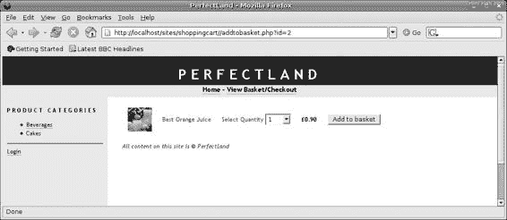

### **第 6 章**
### 创建购物车
189-191 Practical PHP and MySQL

#### 显示购物车
`addtobasket.php` 脚本处理将项目添加到会话的逻辑。`showcart.php` 显示购物车摘要。

#### 购物车摘要
`showcart.php` 页面显示购物车中的当前项目。它使用 `orders` 和 `orderitems` 表来检索数据。


```php
echo "<td><<strong>>项目</strong></td>";
echo "<td><<strong>>数量</strong></td>";
echo "<td><<strong>>单价</strong></td>";
echo "<td><<strong>>总价</strong></td>";
echo "<td></td>";
echo "</tr>";
```

194

实用 PHP 与 MySQL

```php
while($itemsrow = mysql_fetch_assoc($itemsres))
{
    $quantitytotal = $itemsrow['price'] * $itemsrow['quantity'];
    echo "<tr>";
    if(empty($itemsrow['image'])) {
        echo "<td></td>";
    }
    else {
        echo "<td></td>";
    }
    echo "<td>" . $itemsrow['name'] . "</td>";
    echo "<td>" . $itemsrow['quantity'] . "</td>";
    echo "<td><strong>&pound;" . sprintf('%.2f', $itemsrow['price']) . "</strong></td>";
    echo "<td><strong>&pound;" . sprintf('%.2f', $quantitytotal) . "</strong></td>";
    echo "<td>[<a href='" . $config_basedir . "delete.php?id=" . $itemsrow['itemid'] . "'>X</a>]</td>";
    echo "</tr>";
    $total = $total + $quantitytotal;
    $totalsql = "UPDATE orders SET total = " . $total . " WHERE id = " . $_SESSION['SESS_ORDERNUM'];
    $totalres = mysql_query($totalsql);
}
echo "<tr>";
echo "<td></td>";
echo "<td></td>";
echo "<td></td>";
echo "<td>总计</td>";
echo "<td><strong>&pound;" . sprintf('%.2f', $total) . "</strong></td>";
echo "<td></td>";
echo "</tr>";
echo "</table>";
echo "<p><a href='checkout-address.php'>去结账</a></p>";
}
```

# 第 6 章 
### 创建购物车

195

### 删除项目

`showcart()` 函数包含一个指向 `delete.php` 的链接，您可以在其中从购物车中移除项目。通过点击该链接，该项目将从 `orderitems` 表中删除，并且 `orders` 表中的总价将得到更新。

创建 `delete.php` 并开始添加代码：

```php
require("config.php");
require("db.php");
require("functions.php");
$validid = pf_validate_number($_GET['id'], "redirect", $config_basedir . "showcart.php");
$itemsql = "SELECT * FROM orderitems WHERE id = " . $_GET['id'] . ";";
$itemres = mysql_query($itemsql);
$numrows = mysql_num_rows($itemres);
if($numrows == 0) {
    header("Location: " . $config_basedir . "showcart.php");
}
$itemrow = mysql_fetch_assoc($itemres);
```

在此段代码中，查询从 `orderitems` 表中提取项目，并检查返回的行数。此检查防止有人通过修改 URL 添加 `delete.php?id=73`（如果不存在 id 为 73 的项目的话）。如果没有返回任何行，头部重定向将跳转到 `showcart.php`。如果返回了行，脚本将继续执行：

```php
$itemrow = mysql_fetch_assoc($itemres);
$prodsql = "SELECT price FROM products WHERE id = " . $itemrow['product_id'] . ";";
$prodres = mysql_query($prodsql);
$prodrow = mysql_fetch_assoc($prodres);
$sql = "DELETE FROM orderitems WHERE id = " . $_GET['id'];
mysql_query($sql);
```

在此区块中，首先选择产品的价格，然后通过另一个单独查询从 `orderitems` 中移除该项目。

使用新的总价更新 `orders` 表：

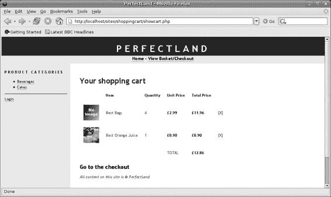

196

```php
mysql_query($sql);
$totalprice = $prodrow['price'] * $itemrow['quantity'];
$updsql = "UPDATE orders SET total = total - " . $totalprice . " WHERE id = " . $_SESSION['SESS_ORDERNUM'] . ";";
mysql_query($updres);
header("Location: " . $config_basedir . "/showcart.php");
?>
```

购物车摘要函数和页面完成后，您的浏览器应该显示与图 6-6 类似的页面。

**图 6-6** 购物车摘要显示了当前项目列表以及移除它们的功能。

## 结账

在用户完成向购物车添加项目后，可以开始结账流程。此过程涉及两个步骤：

- 提示用户输入地址。如果用户已登录，应询问他是想使用注册的地址还是使用其他地址。所有地址都应经过验证。
- 提示用户选择支付方式，PayPal 或支票。

# 第 6 章
### 创建购物车

197

创建 `checkout-address.php` 并添加表单：

```php
require("header.php");
echo "<h1>添加收货地址</h1>";
if(isset($_GET['error']) == TRUE) {
    echo "<strong>请填写表单中缺失的信息</strong>";
}
echo "<form action='" . $SCRIPT_NAME . "' method='POST'>";
if($_SESSION['SESS_LOGGEDIN']) {
?>
<input type="radio" name="addselecBox" value="1" checked>使用我账户中的地址</input><br>
<input type="radio" name="addselecBox" value="2">使用以下地址：</input>
<?php
}
?>
<<table>
    <tr>
        <td>名</td>
        <td><input type="text" name="forenameBox"></td>
    </tr>
    <tr>
        <td>姓</td>
        <td><input type="text" name="surnameBox"></td>
    </tr>
    <tr>
        <td>门牌、街道</td>
        <td><input type="text" name="add1Box"></td>
    </tr>
    <tr>
        <td>镇/城市</td>
        <td><input type="text" name="add2Box"></td>
    </tr>
    <tr>
        <td>郡/州</td>
        <td><input type="text" name="add3Box"></td>
    </tr>
    <tr>
        <td>邮政编码</td>
        <td><input type="text" name="postcodeBox"></td>
    </tr>
    <tr>
        <td>电话</td>
        <td><input type="text" name="phoneBox"></td>
    </tr>
    <tr>
        <td>电子邮件</td>
        <td><input type="text" name="emailBox"></td>
    </tr>
    <tr>
        <td></td>
        <td><input type="submit" name="submit" value="添加地址（仅点击一次）"></td>
    </tr>
</table>
</form>
```

在显示表单之前，一个 `if` 语句会检查是否存在 GET  `error`。如果存在，将显示错误信息。脚本接着检查用户是否已登录，如果是，则添加两个单选按钮，让用户可以在注册的地址和另一个地址之间进行选择。

回到文件开头并添加以下代码：

```php
session_start();
require("db.php");
$statussql = "SELECT status FROM orders WHERE id = " . $_SESSION['SESS_ORDERNUM'];
$statusres = mysql_query($statussql);
$statusrow = mysql_fetch_assoc($statusres);
$status = $statusrow['status'];
```

第一步是确定订单的当前状态。如果用户已经过了结账流程中的地址阶段，则将页面重定向到支付屏幕。通过搜索 `orders` 表中匹配 `SESS_ORDERNUM` 的记录来获取状态。然后，将 `$status` 变量设置为正确的状态。

注意

记住，状态可以是以下任何值之一：
- 0：用户正在购物。
- 1：用户已完成地址填写。
- 2：用户已支付。
- 10：管理员已确认订单。

如果状态设置为 1，说明用户已输入地址，页面将重定向到支付屏幕。如果状态为 2 或更高，则订单已完成。将页面重定向到网站根目录：

# 第 6 章
### 创建购物车

199

（此处原文截断，未翻译）


第一个嵌套的 `if` 检查用户是否已登录。然后检查用户是否选择了第二个单选按钮（使用下方地址）。如果是，则检查表单字段是否为空。如果为空，页面将带有错误 `GET` 变量重新加载，以便显示错误信息。

如果表单不为空，则将地址添加到 `delivery_addresses` 表并更新 `orders` 表：

```php
exit;
}

$addsql = "INSERT INTO delivery_addresses(forename, surname, add1, add2, add3, postcode, phone, email) VALUES('" . strip_tags(addslashes($_POST['forenameBox'])) . "', '" . strip_tags(addslashes($_POST['surnameBox'])) . "', '" . strip_tags(addslashes($_POST['add1Box'])) . "', '" . strip_tags(addslashes($_POST['add2Box'])) . "', '" . strip_tags(addslashes($_POST['add3Box'])) . "', '" . strip_tags(addslashes($_POST['postcodeBox'])) . "', '" . strip_tags(addslashes($_POST['phoneBox'])) . "', '" . strip_tags(addslashes($_POST['emailBox'])) . "")";
mysql_query($addsql);

$setaddsql = "UPDATE orders SET delivery_add_id = " . mysql_insert_id() . ", status = 1 WHERE id = " . $_SESSION['SESS_ORDERNUM'];
mysql_query($setaddsql);

header("Location: " . $config_basedir . "checkout-pay.php");
}
```

`delivery_addresses` 表包含未注册用户以及选择不同地址的注册用户的列表。当信息添加到表中时，`strip_tags()` 函数会移除可能添加的 HTML 标签，`addslashes()` 函数会转义任何引号。

最后，更新 `orders` 表以来自 `delivery_addresses` 的记录 `id`，并将状态更改为 1。完成后，页面将重定向到 `checkout-pay.php`。

如果用户已登录但选择了文件中的地址，`orders` 表也会被更新：

```php
header("Location: " . $config_basedir . "checkout-pay.php");
}
else
{
$custsql = "UPDATE orders SET delivery_add_id = 0, status = 1 WHERE id = " . $_SESSION['SESS_ORDERNUM'];
mysql_query($custsql);
}
```

**第 6 章**
创建购物车

```php
header("Location: " . $config_basedir . "checkout-pay.php");
}
}
```

如果没有用户登录，则对表单进行验证并将地址添加到数据库：

```php
header("Location: " . $config_basedir . "checkout-pay.php");
}
}
else
{
if(empty($_POST['forenameBox']) || empty($_POST['surnameBox']) || empty($_POST['add1Box']) || empty($_POST['add2Box']) || empty($_POST['add3Box']) || empty($_POST['postcodeBox']) || empty($_POST['phoneBox']) || empty($_POST['emailBox']))
{
header("Location: " . "checkout-address.php?error=1"); exit;
}

$addsql = "INSERT INTO delivery_addresses(forename, surname, add1, add2, add3, postcode, phone, email) VALUES('" . $_POST['forenameBox'] . "', '" . $_POST['surnameBox'] . "', '" . $_POST['add1Box'] . "', '" . $_POST['add2Box'] . "', '" . $_POST['add3Box'] . "', '" . $_POST['postcodeBox'] . "', '" . $_POST['phoneBox'] . "', '" . $_POST['emailBox'] . "")";
mysql_query($addsql);

$setaddsql = "UPDATE orders SET delivery_add_id = " . mysql_insert_id() . ", status = 1 WHERE session = '" . session_id() . "'";
mysql_query($setaddsql);
header("Location: " . $config_basedir . "checkout-pay.php");
}
}
```

在段代码块中，地址被添加到 `delivery_addresses` 表，并使用 `delivery_addresses` 的 `id` 更新 `orders` 表，并将状态设置为 1。

开始表单块：

```php
header("Location: " . $config_basedir . "checkout-pay.php");
}
}
else
{
require("header.php");
echo "<h1>Add a delivery address</h1>"; 
最后，在表单之后添加代码：

```html
</table>
</form>
<?php
}
require("footer.php");
?>
```

当地址代码编写完成后，当用户登录时，你的浏览器应该显示一个类似于图 6-7 的页面。

**图 6-7** 当用户登录时，单选按钮会提示用户使用哪种地址。

**第 6 章**
创建购物车

**付款**

结账流程的最后部分是付款。在网站上处理付款可以采取多种不同的途径：PayPal、NOCHEX、Worldpay 等。此项目提供了两种支付方式：PayPal 和支票。这两种方法演示了如何处理自动（PayPal）和手动（支票）购买。

创建一个名为 `checkout-pay.php` 的新文件并添加表单：

```html
<h2>Select a payment method</h2>
<form action='checkout-pay.php' method='POST'>
<table cellspacing=10>
<tr>
<td><h3>PayPal</h3></td>
<td>
本网站使用 PayPal 接受 Switch/Visa/Mastercard 卡。不需要 PayPal 账户 - 你只需填写信用卡详情，正确的款项将从你的账户中扣除。
</td>
<td><input type="submit" name="paypalsubmit" value="Pay with PayPal"></td>
</tr>
<tr>
<td><h3>Cheque</h3></td>
<>
如果您想通过支票付款，可以将最终金额的支票邮寄到办公室。
</td>
<td><input type="submit" name="chequesubmit" value="Pay by cheque"></td>
</tr>
</table>
</form>
```

此简单的表单仅提供两个提交按钮——一个用于 PayPal 付款，另一个用于通过支票付款。处理表单涉及两个主要部分——一个用于 PayPal，一个用于支票。

在文件顶部，开始添加代码：

```php
<?php
session_start();
require("db.php");
require("functions.php");
```

如果用户点击 PayPal 按钮，处理订单：

```php
require("functions.php");
if($_POST['paypalsubmit'])
{
$upsql = "UPDATE orders SET status = 2, payment_type = 1 WHERE id = " . $_SESSION['SESS_ORDERNUM'];
$upres = mysql_query($upsql);

$itemssql = "SELECT total FROM orders WHERE id = " . $_SESSION['SESS_ORDERNUM'];
$itemsres = mysql_query($itemssql);
$row = mysql_fetch_assoc($itemsres);
```

重置订单会：

```php
$row = mysql_fetch_assoc($itemsres);
if($_SESSION['SESS_LOGIN'])
{
unset($_SESSION['SESS_ORDERNUM']);
}
else
{
session_register("SESS_CHANGEID");
$_SESSION['SESS_CHANGEID'] = 1;
}
```

[带有付款详情重定向到 www.paypal.com：](http://www.paypal.com)

```php
header("Location: https://www.paypal.com/cgi-bin/webscr?cmd=_xclick&business=you%40youraddress.com&item_name=" . urlencode($config_sitename . "+Order&item_number=PROD" . $row['id'] . "&amount=" . urlencode(sprintf('%.2f', $row['total'])) . "&no_note=1&currency_code=GBP&lc=GB&submit.x=41&submit.y=15");
}
```


在此案例中，‘<sitename> 订单’。

`item_number`

`“PROD” . $row['id’]`

产品代码。在这里，你可以拼接‘PROD’和订单号（例如，PROD12）。

`amount`

`urlencode(sprintf(%.2f’, $row['total’']))`

订单金额。

`no_note`

`1`

`no_note` 变量指定客户是否应该在付款时注明备注。将此设置为 `1` 表示不需要备注。

`currency_code`

`GBP`

交易的货币类型。

`lc`

`GB`

交易的本地区域。请记住，任何作为 `GET` 变量传输的文本信息都应该通过 `urlencode()` 处理以转义非标准字符。

开始编写处理支票付款的代码。该代码与 PayPal 代码相似。

```php
header("Location: https://www.paypal.com/cgi-bin/webscr?cmd=_xclick&business=you%40youraddress.com&item_name="
. urlencode($config_sitename)
. "+Order&item_number=PROD" . $row['id']
."&amount=" . urlencode(sprintf('%.2f', $row['total'])) . "&no_note=1&currency_code=GBP&lc=GB&submit.x=41&submit.y=15");
```

206

Practical PHP and MySQL

```php
else if($_POST['chequesubmit']) {
$upsql = "UPDATE orders SET status = 2, payment_type = 2 WHERE id = " . $_SESSION['SESS_ORDERNUM'];
$upres = mysql_query($upsql);
```

在这里你再次更新 `orders` 表，但这次 `payment_type` 是 2 而不是 1。像你之前那样重置订单：

```php
$upres = mysql_query($upsql);

if($_SESSION['SESS_LOGGEDIN']) {
    unset($_SESSION['SESS_ORDERNUM']);
}
else {
    session_register("SESS_CHANGEID");
    $_SESSION['SESS_CHANGEID'] = 1;
}
```

最后，显示用户应该将支票寄到何处的详情：`$_SESSION['SESS_CHANGEID'] = 1;`。

```php
require("header.php");
?>
<h1>通过支票支付</h1>
<p>请将您的支票收款人写为 <strong><?php echo $config_sitename; ?></strong>。</p>
<p>将支票寄至：</p>
<p><?php echo $config_sitename; ?><br>
22, This Place,<br>
This town,<br>
This county,<br>
FG43 F3D.<br>
<?php
}
```

处理现在已完成。打开块显示表单。然而，在到达表单之前，添加 `showcart()` 函数来汇总当前购物车：

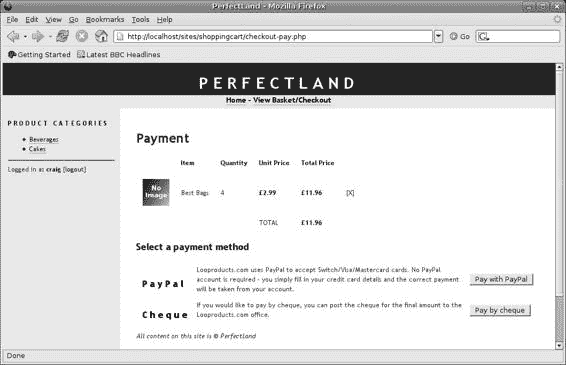

**第 6 章**
创建购物车
207

```php
}
else {
    require("header.php");
    echo "<h1>Payment</h1>";
    showcart();
}
?>
```

<h2>选择支付方式</h2>

<form action='checkout-pay.php' method='POST'>

最后，添加结束代码：

</table>
</form>

```php
}
}
require("footer.php");
?>
```

你全新的、自主开发的支付界面现在应该类似于图 6-8 所示。

**图 6-8** 完成的支付界面
208
Practical PHP and MySQL

## 管理员页面

购物车的管理端非常简单。管理员的首要功能是查看和确认已完成的订单。当订单被确认后，管理员已成功发送了产品。

第一步是提供管理员登录。创建一个名为 `adminlogin.php` 的新文件并添加以下代码：

```php
session_start();
require("db.php");
if(isset($_SESSION['SESS_ADMINLOGGEDIN']) == TRUE) {
    header("Location: " . $config_basedir);
}
if($_POST['submit']) {
    $loginsql = "SELECT * FROM admins WHERE username = '" . $_POST['userBox'] . "' AND password = '" . $_POST['passBox'] . "'";
    $loginres = mysql_query($loginsql);
    $numrows = mysql_num_rows($loginres);
    if($numrows == 1) {
        $loginrow = mysql_fetch_assoc($loginres);
        session_register("SESS_ADMINLOGGEDIN");
        $_SESSION['SESS_ADMINLOGGEDIN'] = 1;
        header("Location: " . $config_basedir . "adminorders.php");
    } else {
        header("Location: " . $config_basedir . "adminlogin.php?error=1");
    }
} else {
    require("header.php");
    echo "<<h1>>Admin Login</h1>";
    if($_GET['error'] == 1) {
        echo "<strong>用户名/密码错误!</strong>";
    }
}
?>
<p>
<form action="<?php echo $SCRIPT_NAME; ?>" method="POST">
<table>
    <tr>
        <td>用户名</td>
        <td><input type="textbox" name="userBox"></td>
    </tr>
    <tr>
        <td>密码</td>
        <td><input type="password" name="passBox"></td>
    </tr>
    <tr>
        <td></td>
        <td><input type="submit" name="submit" value="Log in"></td>
    </tr>
</table>
</form>
</p>
<?php
}
require("footer.php");
?>
```

这些代码中的大部分对你来说应该看起来。当管理员成功登录后，就会创建 `SESS_ADMINLOGGEDIN` 变量。

#### 管理员注销

要退出管理员，创建一个名为 `adminlogout.php` 的文件并添加以下代码：

```php
session_start();
require("config.php");
session_unregister("SESS_ADMINLOGGEDIN");
header("Location: " . $config_basedir);
?>
```

210
Practical PHP and MySQL

与普通用户注销一样，你注销变量而不是销毁整个会话。这可以防止管理员在同时以管理员和用户身份登录时被完全注销。

#### 管理已完成订单

管理员主页面显示已完成订单的列表。此页面的目的是让管理员查看哪些订单需要邮寄产品。管理员随后可以创建并在邮寄后确认订单。

此页面非常简单；它只是从某些表中输出数据。脚本有两个主要状态：要么显示订单或确认订单。默认页面显示订单。如果你传递页面 `func=conf` `GET` 变量和订单号，订单将被确认。

创建一个名为 `adminorders.php` 的新文件并开始添加代码：

```php
session_start();
require("config.php");
require("db.php");
require("functions.php");
if(isset($_SESSION['SESS_ADMINLOGGEDIN']) == FALSE) {
    header("Location: " . $config_basedir);
}
```

211
第 6 章
创建购物车

如果 `func` 变量存在，则将确认订单。


### 图 6-9 待订单页面提供了一个查看需要发送产品的订单简单方法。

# 第 6 章
### 创建购物车

213

### 查看特定订单

管理员为了获取特定订单的邮寄地址，需要查看该订单的具体详情。接下来的页面列出了订单信息（订单号、地址、购买的产品、支付方式等）。

创建一个名为 `adminorderdetails.php` 的新文件并添加以下代码：

```php
<?php

session_start();

require("config.php");

require("functions.php");

if(isset($_SESSION['SESS_ADMINLOGGEDIN']) == FALSE) {

header("Location: " . $basedir);

}

$validid = pf_validate_number($_GET['id'],

"redirect", $config_basedir . "adminorders.php"); require("header.php");

echo "<h1>Order Details</h1>";

echo "<a href='adminorders.php'><— go back

to the main orders screen</a>";

$ordsql = "SELECT * from orders WHERE id = " . $validid; $ordres = mysql_query($ordsql);

$ordrow = mysql_fetch_assoc($ordres);

echo "<table cellpadding=10>";

echo "<tr><td><strong>Order Number</strong>

</td><td>" . $ordrow['id'] . "</</td>"; echo "<tr><td><strong>Date of order</strong>

</td><td>" . date('D jS F Y g.iA',

strtotime($ordrow['date'])) . "</</td>";

echo "<tr><td><strong>Payment Type</strong></td><td>"; if($ordrow['payment_type'] == 1)

{

echo "PayPal";

}

else

{

echo "Cheque";

}

echo "</</td>";

echo "</table>";

214

Practical PHP and MySQL

if($ordrow['delivery_add_id'] == 0)

{

$addsql = "SELECT * FROM customers

WHERE id = " . $ordrow['customer_id'];

$addres = mysql_query($addsql);

}

else
{

$addsql = "SELECT * FROM delivery_addresses

WHERE id = " . $ordrow['delivery_add_id'];

$addres = mysql_query($addsql);

}

$addrow = mysql_fetch_assoc($addres);

echo "<table cellpadding=10>";

echo "<tr>";

echo "<td><strong>Address</strong></td>"; echo "<td>" . $addrow['forename'] . " "

. $addrow['surname'] . "<br>";

echo $addrow['add1'] . "<br>";

echo $addrow['add2'] . "<br>";

echo $addrow['add3'] . "<br>";

echo $addrow['postcode'] . "<br>";

echo "<br>";

if($ordrow['delivery_add_id'] == 0)

{

echo "<i>Address from member account</i>";

}

else

{

echo "<i>Different delivery address</i>";

}

echo "</</td></tr>";

echo "<tr><td><strong>Phone</strong></td><td>"

. $addrow['phone'] . "</</td></tr>";

echo "<tr><td><strong>Email</strong></td>

<td><a href='mailto:" . $addrow['email'] . "'>"

. $addrow['email'] . "</a></</td></tr>"; echo "</table>";

$itemssql = "SELECT products.*, orderitems.*,

orderitems.id AS itemid FROM products, orderitems

WHERE orderitems.product_id = products.id AND order

_id = " . $validid;

$itemsres = mysql_query($itemssql);

$itemnumrows = mysql_num_rows($itemsres);

**第 6 章**
创建购物车

215

echo "<h1>Products Purchased</h1>"; echo "<table cellpadding=10>";

echo "<th></th>";

echo "<th>Product</th>";

echo "<th>Quantity</th>";

echo "<th>Price</th>";

echo "<th>Total</th>";

while($itemsrow = mysql_fetch_assoc($itemsres))

{

$quantitytotal = $itemsrow['price']

* $itemsrow['quantity'];

echo "<tr>";

if(empty($itemsrow['image'])) {

echo "<td></</td>";

}

else {

echo "<td></</td>";

}

echo "<td>" . $itemsrow['name'] . "</</td>"; echo "<td>" . $itemsrow['quantity'] . " x </</td>"; echo "<td><strong>£" . sprintf('%.2f', $itemsrow['price']) . "</strong></</td>"; echo "<td><strong>£" . sprintf('%.2f', $quantitytotal) . "</strong></</td>"; echo "</tr>";

}

echo "<tr>";

echo "<td></td>";

echo "<td></td>";

echo "<td></td>";

echo "<td>TOTAL</td>";

echo "<td><strong>£" . sprintf('%.2f', $total)

. "</strong></</td>";

echo "</tr>";

echo "</table>";

require("footer.php");

?>
```

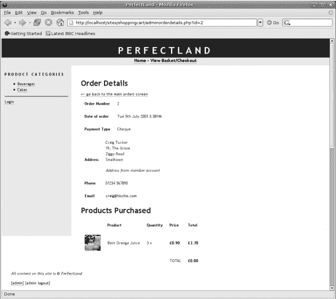

216

Practical PHP and MySQL

这段代码看起来应该让你很熟悉；它只是显示了来自 `orders`、`orderitems` 和 `delivery_addresses` 表的详情。

完成后的页面应该像图 6-10 所示。

**图 6-10 管理员界面中的订单摘要**

## 总结

在这个项目中，许多不同的技能被结合在一起以创建一个连贯的产品。尽管你只触及了可以添加到购物车系统的可能功能的皮毛，但你已经开发了核心功能。你可以进行大范围的可能扩展，包括：

- 在订单完成后，向用户和管理员发送确认电子邮件。
- 在首页提供一个随机抽奖盒。这可以用来展示产品图片以吸引用户。

# 第 6 章
创建购物车

217

- 创建一个评分系统，用户可以在其中对产品进行评价。
- 创建一个评论和回顾系统，让用户对产品的有效性留下想法。
- 创建销售报告。

你可以通过书中已经涵盖的技能来开发这些每一个可能的扩展。

*本页留白*

# 第 7 章
# 构建在线
# 拍卖网站

如果你在互联网上闲逛，你可能会发现少数从未访问或使用过 eBay 的人。这个流行的拍卖网站已成为许多用户生活中不可或的一部分，一个下午很容易在浏览各种物品中度过。

在本章中，你将创建自己的拍卖网站。该项目的目的不是创建一个 eBay 的继任者，而是教你编写拍卖网站涉及的许多概念，与其说最后获得的产品，不如说创建它时所经历的旅程。

## 项目概述

此项目实现了拍卖网站的以下核心功能：

- 页面显示不同类型物品的系列类别。
- 在首页提供所有类别的物品列表。用户可以点击类别名称查看该类别内的物品。只显示竞价截止前的物品。
- 用户可以注册并登录网站。
- 用户可以查看物品（带有图片）并出价。
- 用户可以向网站添加物品（带有图片）。
- 当拍卖完成后，物品所有者和获胜竞标者将收到包含结束拍卖详情的电子邮件。

219

220

Practical PHP and MySQL

从一开始开始，一个拍卖网站看起来构建起来相当简单。实际上，有一些有趣的挑战，可以测试你的 PHP 和 SQL 知识范围。因此，这个项目将为你的工具箱增加一些实用的新技能。

## 构建数据库

你在此项目中使用的数据库相对简单，包含五个表。这些表如图 7-1 所示。

**图 7-1 整个数据库**

**categories**

**bids**

id

item_id

id

amount

cat_id

user_id

user_id

**items**

id

category

item_id

id

schema revolves around the *items*

table. 

**users**

name

id

startingprice

username

**images**

description

password

id

dateends

email

item_id

endnotified

verifystring

name

active


数据库中的每张表都与 `items` 表相关，该表提供了网站上某个项目的信息。在 `items` 表中，你还引用了 `categories` 表（用于确定项目所属的分类）、`users` 表（用于指定哪个用户添加了项目）、`bids` 表（用于存储对特定项目进行的每次出价）以及 `images` 表（用于存储添加到项目中的图像）。

### 实现数据库

启动 phpMyAdmin。创建一个名为 `auction` 的新数据库，并添加以下表：

### `categories` 表

- `id`。将其设置为 `TINYINT`（分类不会很多），并在 `Extras`（额外）列中开启 `auto_increment`（自增）。将此字段设为主键。
- `cat`。将其设置为 `VARCHAR` 并将大小设为 20。分类标题可能不会超过 20 个字符。

### `users` 表

- `id`。将其设置为 `INT`（可能有多个用户）并开启 `auto_increment`（自增）。将此字段设为主键。
- `username`。将其设置为长度为 10 的 `VARCHAR`。
- `password`。将其设置为长度为 10 的 `VARCHAR`。
- `email`。将其设置为长度为 100 的 `VARCHAR`。某些政府邮箱地址的长度会让你惊讶的！
- `verifystring`。将其设置为长度为 20 的 `VARCHAR`。
- `active`。将其设置为 `TINYINT`。

### `items` 表

- `id`。将其设置为 `INT`（可能有多个项目）并开启 `auto_increment`（自增）。将此字段设为主键。
- `user_id`。将其设置为 `INT`。
- `cat_id`。将其设置为 `TINYINT`。
- `name`。将其设置为长度为 100 的 `VARCHAR`。项目标题通常很长。
- `startingprice`。将其设置为 `FLOAT`。你使用这种类型来存储带有小数点的价格（例如 $22.90）；`FLOAT` 支持小数点。
- `description`。将其设置为 `TEXT`。
- `dateends`。将其设置为 `DATETIME`。
- `endnotified`。将其设置为 `TINYINT`。

### `bids` 表

- `id`。将其设置为 `INT`（可能有多次出价）。开启 `auto_increment`（自增）。将此字段设为主键。
- `item_id`。将其设置为 `INT`。
- `amount`。将其设置为 `FLOAT` 以存储带有小数点的价格。
- `user_id`。将其设置为 `INT`。

### `images` 表

- `id`。将其设置为 `INT`（可能有多个图像）。开启 `auto_increment`（自增）。将此字段设为主键。
- `item_id`。将其设置为 `INT`。
- `name`。将其设置为长度为 100 的 `VARCHAR`。文件名可能很长。

#### 插入示例数据

创建表后，在编写代码时向某些表中填充一些初始数据进行测试是非常用的。记住，在向这些任何一个表添加数据时，不要在 `id` 列中填充数字；这由 `auto_increment` 处理。

### `categories` 表的示例数据

按以下顺序添加分类：Computing（计算）、Musical Instruments（乐器）。

### `items` 表的示例数据

将表 7-1 所示的信息添加到 `items` 表中。

**表 7-1** `items` 表的数据

| USER_ID | CAT_ID | NAME | STARTINGPRICE | DESCRIPTION | DATEENDS | ENDNOTIFIED |
| :--- | :--- | :--- | :--- | :--- | :--- | :--- |
| 1 | 1 | Web | 200.00 | 一台优质笔记本。添加一个未来的日期。 | development date | 0 |
| 1 | 1 | 56k | 39.99 | 全新的 56k 调制调器。添加一个未来的日期 | | |

在这个示例中，你在 `cat_id` 中引用了 `categories` 表中的第一个条目（Computing），并引用了 `users` 表中的一个用户（使用 `user_id` 字段）。这创建了表与表的关系。

### `users` 表的示例数据

将表 7-2 所示的信息添加到 `users` 表中。

**表 7-2** 向 `users` 表添加了两个用户。

| USERNAME | PASSWORD | EMAIL | VERIFYSTRING | ACTIVE |
| :--- | :--- | :--- | :--- | :--- |
| johnsmith | password | john@smith.com | | 1 |
| bob | password | foo@bar.com | | 1 |

### `bids` 和 `images` 表的示例数据

保持这些表为空。

## 开始编写代码

首先，创建一个标准的配置文件来存储关于网站的通用信息（如示例 7-1 所示）。在新目录中创建它并命名为 `config.php`。

示例 7-1 此配置文件存储了关于网站的通用信息。

```php
<?php
$dbhost = "localhost";
$dbuser = "root";
$dbpassword = "";
$dbdatabase = "auction";
// 在下方添加你的名字
$config_admin = "Jono Bacon";
$config_adminemail = "jono AT jonobacon DOT org";
// 添加你的网站主主机地址
$config_url = "http://localhost/";
// 货币符号
$config_currency = "$";
?>
```

这些变量存储了网站使用的货币（如美元、英镑、欧元等）。你可以使用这个变量来切换货币。

创建一个另一个结构来包裹你的页面。创建一个 `header.php`，如示例 7-2 所示。

```php
<?php
include("config.php");
?>
<!DOCTYPE html>
<html>
<head>
<title><?php echo "Auctions"; ?></title>
<link rel="stylesheet" type="text/css" href="style.css">
</head>
<body>
<header>
<h1><?php echo $config_currency; ?>Auctions</h1>
<div id="menu">
<a href="<?php echo $config_url; ?>index.php">Home</a>
<?php
if(isset($_SESSION['USERNAME'])) {
    echo "<a href='{$config_url}logout.php'>Logout</a>";
}
else {
    echo "<a href='{$config_url}login.php'>Login</a>";
}
?>
</div>
</header>
<div id="container">
<div id="main">
```
```

示例 7-2 `header.php` 的后续部分。

```php
<?php
session_start();
?>
```

示例 7-3 `footer.php` 的代码。

```html
</div>
</div>
<footer>
<p>&copy; <a href="mailto:<?php echo $config_adminemail; ?>"><?php echo $config_admin; ?></a></p>
</footer>
</body>
</html>
```


## 显示拍卖物品

第一个挑战是创建一个拍卖分类列表和拍卖物品列表。这些列表看起来将类似于图 7-2 所示的内容。

**图 7-2** 侧边栏是包含分类列表的理想区域。

这个过程涉及创建一个“钻取”（drill-down），这样当用户点击某个项目时，可以在单独的页面上查看该物品的更多信息。

物品表是大多数操作发生的地方。在该表中，存储了典型的详细信息，如物品名称、描述和起价。（每个拍卖都需要一个起价，即使该起价为 0 如此。）`dateends` 字段尤为重要，它表示拍卖结束的日期；这在后文中会被广泛使用。最后一个字段（`endnotified`）与创建物品列表页无关。该字段将在后你发送总结物品最终价格和竞价者的邮件时使用。目前你可以先忽略此字段。

# 第 7 章：构建在线拍卖网站

### 注意：钻取的“利与弊”
钻取的主要目的是提供一个项目的摘要列表，每个项目都可以被点击以提供更多信息。这种技术是在整个网站中有效组织信息的很有用的手段。

在使用钻取时，你需要考虑在列表中汇总哪些信息。在许多情况下，这是显而易见的，但在某些情况下，你可能需要进行一些研究，以清晰了解人们在网站上主要寻找的信息。

### 显示分类
要让分类以无序列表的形式出现在左侧侧边栏，请向 `bar.php` 添加以下代码：

```php
require("header.php");

$catsql = "SELECT * FROM categories ORDER BY category ASC;"; 
$catresult = mysql_query($catsql);

echo "<h1>Categories</h1>";
echo "<ul>";
echo "<li><a href='index.php'>View All</a></li>"; 
while($catrow = mysql_fetch_assoc($catresult)) {
    echo "<li><a href='index.php?id=" . $catrow['id'] . "'>"" . $catrow['category'] . "</a></</li>>";
}
echo "</ul>";
```

查询按字母顺序从 `categories` 表中选择所有内容。无序列表容纳了分类，并添加了第一个条目（查看全部）；此条目链接到不带 `id` 变量的 `index.php`。配合之前添加的 `pf_validate_number()` 函数，如果不存在 `id` GET 变量，则 `$validid` 被设置为 0；这就是用户点击“查看全部”时发生的情况。接下来，`while` 循环遍历分类并创建指向 `index.php` 的链接，其中分类 ID 作为 GET 变量（再次称为 `id`）传递过去。分类列表现在已完成。

### 查看特定分类中的物品
网站的首页显示可用物品列表。访问拍卖网站的绝大多数人希望立即找到提供的物品范围，因此将这些信息放在首页是合理的。

创建一个名为 `index.php` 的文件并添加以下代码：

```php
<?php
require("config.php");
require("functions.php");
```

`index.php` 的计划功能之一是列出系列分类，用户可以点击这些分类来查看该分类下的物品。为了实现此功能，将分类列为一系列链接，并且每个链接都将分类 ID 作为 GET 变量（称为 `id`）传递过去。使用 `pf_validate_number()` 函数来验证此变量：

```php
require("functions.php");
$validid = pf_validate_number($_GET['id'], "value", $config_basedir);
```

开始在页面上显示信息，添加 `header.php` 代码：`$validid = pf_validate_number($_GET['id'], "value", $config_basedir); require("header.php");`。

在主页显示拍卖物品时，你需要根据 `id` GET 变量是否存在使用不同的查询。如果不存在，说明用户点击了“查看全部”，没有选择任何分类，因此页面应该显示所有物品。如果存在 `id` GET 变量，则应显示该分类内的物品。当你使用 `pf_validate_number()` 函数时，你使用 `value` 选项作为第二个参数，以便当不存在 `id` GET 变量时函数返回 0。

检查 `$validid` 的设置值，以便判断使用哪种 SQL 查询：

```php
require("header.php");
if($validid == 0) {
    $sql = "SELECT items.* FROM items WHERE dateends > NOW()";
} else {
    $sql = "SELECT * FROM items WHERE dateends > NOW() AND cat_id = " . $validid . ";";
}
$result = mysql_query($sql);
$numrows = mysql_num_rows($result);
```

如果 `$validid` 等于 0，则选择 `items` 表中 `dateends` 大于（晚于）当前日期时间（`NOW()`）的物品。如果 `$validid` 被赋值，则选择 `items` 表中比当前日期新且 `cat_id` 与 `$validid` 的值匹配的物品。

创建一个新的 `<div>` 并添加表格来列出物品：

```php
$result = mysql_query($sql);
$numrows = mysql_num_rows($result);

echo "<h1>Items</h1>";
echo "<table cellpadding='5'>";
echo "<tr>";
echo "<th>Image</th>";
echo "<th>Item</th>";
echo "<th>Bids</th>";
echo "<th>Price</th>";
```

通过检查 `$numrows` 判断判断判断：

```php
if($numrows == 0) {
    echo "<tr><td colspan='4'>No items!</td></tr>";
}
```

如果 `$numrows` 等于 0（未返回行），则在表格中显示没有物品！如果返回了物品且 `$numrows` 大于 0，你可以遍历每个物品并在表格中显示：

```php
} else {
    while($row = mysql_fetch_assoc($result)) {
        $imagesql = "SELECT * FROM images WHERE item_id = " . $row['id'] . " LIMIT 1";
        $imageresult = mysql_query($imagesql);
        $imagenumrows = mysql_num_rows($imageresult);
        echo "<tr>";
        if($imagenumrows == 0) {
            echo "<td>No image</td>";
        } else {
            $imagerow = mysql_fetch_assoc($imageresult);
            echo "<td></td>";
        }
        // ... 剩余逻辑
    }
```

`while` 循环遍历结果。在循环内部，查询从 `images` 表中选择一条 `item_id` 匹配当前行 `id` 的记录。然后打开表格行，并检查 `$imagenumrows` 是否等于 0。如果是，则在表格中显示“没有图片”。如果 `$imagenumrows` 不等于 0，则从图像查询结果中提取行并构建图像标签。创建图像标签时，将 `./images/` 以及表格中的图像名称添加到 `src` 属性中。这会将图像目录附加到当前目录。这段代码的大部分在你稍后编写上传图像的功能时会有意义。

向表格中添加下一列，包含物品名称：

```php
        echo "<td></td>";
    }
    echo "<td>";
    echo "<a href='itemdetails.php?id=" . $row['id'] . "'>"" . $row['name'] . "</</a>>";
    if($_SESSION['USERID'] == $row['user_id']) {
        echo " - [<a href='edititem.php?id=" . $row['id'] . "'>edit</a>]";
    }
    echo "</td>";
}
echo "</table>";
```


添加另一列来显示报价次数和最高出价：`echo “</td>";`

```php
$bidsql = “SELECT item_id, MAX(amount) AS highestbid, COUNT(id) AS numberofbids FROM bids WHERE item_id=” . $row[‘id’] . “ GROUP BY item_id;”;
$bidresult = mysql_query($bidsql);
$bidrow = mysql_fetch_assoc($bidresult);
$bidnumrows = mysql_num_rows($bidresult);
echo “<td>”;
if($bidnumrows == 0) {
    echo “0”;
}
else {
    echo $bidrow[‘numberofbids’] . “</td>”;
}
echo “<td>” . $config_currency;
if($bidnumrows == 0) {
    echo sprintf(‘%.2f’, $row[‘startingprice’]);
}
else {
    echo sprintf(‘%.2f’, $bidrow[‘highestbid’]);
}
echo “</td>”;
```

此查询使用了几个 MySQL 函数来确定最高出价和报价次数。为了更好地解释，请从左到右读取 SQL：选择（`SELECT`）`item_id`，使用 MySQL `MAX()` 函数找到 `amount` 字段中的最大值，并将该字段别名为最高出价（`MAX(amount) AS highestbid`）。使用 MySQL `COUNT()` 函数统计记录数，并将该字段别名为报价次数（`COUNT(id) AS numberofbids`），来自 `bids` 表（`FROM bids`），其中 `item_id` 等于 `$row[‘id’]`（`WHERE item_id = $row[‘id’]`），并按 `item_id` 对记录分组（`GROUP BY item_id;`）。

如果查询没有返回行，则向表格添加 `0`；否则，添加 `numberofbids` 的值。当没有行时，`$bidnumrows` 不返回 `0`，因为如果没有报价，`bids` 表中就没有条目可供 `COUNT()` 函数计数。因此，将返回任何内容。在编程中务始终记住，`0` 是一个值，它通常与“无”的概念不同。

下一列是最新价格。在显示值之前，会从 `$config_currency` 字段添加货币符号。

### 处理货币
在处理价格、报价、数字和其他数字等金钱单位时，永远不要在数据库中包含货币符号。货币实际上只是是一项为数字提供上下文的额外信息。如果你想在数据库中包含货币符号，请将数字和符号一起存储为 `VARCHAR`。

将价格存储为数字且不带符号，允许你执行诸如税费、费用累加、货币转换和其他计算。

如果 `$bidnumrows` 没有行，则显示第一个查询中的 `startingprice` 字段（如果没有报价，则应该显示起始价）。如果有报价，则显示最后一次查询的最高出价（`$bidrow[‘highestbid’]`）。两个价格都经过了格式化处理。

### 价格格式化
当你使用 `FLOAT` 在数据库中存储价格时，末尾的零会被默认删除。要带零格式化价格，请使用 PHP 函数 `sprintf()`。该函数接受两个参数：格式化字符串和要格式化的值。格式化字符串接受如 `%.2f` 这样的值，它要求浮点数（`f`）保留两位小数（`.2`）。

最后，显示并格式化 `dateends` 字段：

```php
}
echo “</td>";
echo “<td>” . date(“D jS F Y g.iA”, strtotime($row[‘dateends’])) . “</td>”;
echo “</tr>”;
}
}
echo “</table>”;
require(“footer.php”);
?>
```

## 商品详情与出价
下一页通过你刚刚创建的页面上的物品名称链接。此脚本有两个主要目的：
- 显示物品信息，包括它的图片。
- 允许用户对该物品进行出价。

要出价，你需要检查用户是否已登录，如果是，则显示一个表单，用户可以在其中输入出价金额。页面随后检查该金额是否合法，并将报价添加到 `bids` 表中。

创建一个名为 `itemdetails.php` 的新文件并添加常规的引入代码：

```php
<?php
session_start();
include(“config.php”);
include(“functions.php”);
$db = mysql_connect($dbhost, $dbuser, $dbpassword);
mysql_select_db($dbdatabase, $db);
$validid = pf_validate_number($_GET[‘id’], “redirect”, $config_basedir);
require(“header.php”);
$itemsql = “SELECT UNIX_TIMESTAMP(dateends) AS dateepoch, items.* FROM items WHERE id = “ . $validid . “;”;
$itemresult = mysql_query($itemsql);
$itemrow = mysql_fetch_assoc($itemresult);在 `index.php` 中，MySQL 的 `NOW()` 函数仅返回晚于该日期和时间的物品。为了完整性，页面使用 PHP 而不是 MySQL 来此此。

在查询内部，`UNIX_TIMESTAMP()` 命令将 `dateends` 字段转换为自纪元以来的秒数。然后执行查询，并将行存储在 `$itemrow` 数组中。

检查当前物品是否结束：

```php
$itemrow = mysql_fetch_assoc($itemresult);
$nowepoch = mktime();
$rowepoch = $itemrow[‘dateepoch’];
if($rowepoch > $nowepoch) {
    $VALIDAUCTION = 1;
}
```

`mktime()` 函数将当前时间自纪元以来的秒数存储在变量 `$nowepoch` 中。变量 `$rowepoch` 随后存储从行中返回的纪元时间。检查 `$rowepoch` 是否大于 `$nowepoch`，如果是，则名为 `$VALIDAUCTION` 的变量设置为 1（变量的大写仅是为了使其在代码中突出显示）。稍后将检查 `$VALIDAUCTION` 以判断拍卖是否有效（仍可出价）。

在二级标题标签中添加物品名称：

```php
if($rowepoch > $nowepoch) {
    $VALIDAUCTION = 1;
}
echo “<h2>” . $itemrow[‘name’] . “</h2>”;
```

现在运行查询以获取与物品关联的任何图片：`echo “<h2>” . $itemrow[‘name’] . “</h2>”;`

```php
$imagesql = “SELECT * FROM images WHERE item_id = “ . $validid . “;”;
$imageresult = mysql_query($imagesql);
$imagenumrows = mysql_num_rows($imageresult);
```

下一个查询返回物品的最高出价和报价次数：`$imagenumrows = mysql_num_rows($imageresult);`

```php
$bidsql = “SELECT item_id, MAX(amount) AS highestbid, COUNT(id) AS number_of_bids FROM bids WHERE item_id=” . $validid . “ GROUP BY item_id;”;
$bidresult = mysql_query($bidsql);
$bidnumrows = mysql_num_rows($bidresult);
```

之前的查询与在 `index.php` 中用于获取相同信息的查询相似。显示来自查询的信息：

```php
$bidnumrows = mysql_num_rows($bidresult);
echo “<p>”;
if($bidnumrows == 0) {
    echo “<strong>This item has had no bids</strong> - <strong>Starting Price</strong>: “ . $config_currency . sprintf(‘%.2f’, $itemrow[‘startingprice’]);
}
else {
    $bidrow = mysql_fetch_assoc($bidresult);
    echo “<strong>Number Of Bids</strong>: “ . $bidrow[‘number_of_bids’] . “ - <strong>Current Price</strong>: “ . $config_currency . sprintf(‘%.2f’, $bidrow[‘highestbid’]);
}
```

如果 `$bidnumrows` 中没有计数到行，页面不仅会显示指示没有报价的文本，还会显示起始价。当行*存在*时，页面将同时显示报价次数和最高出价。显示拍卖结束的日期：

```php
echo “<strong>Number Of Bids</strong>: “ . $bidrow[‘number_of_bids’] . “ - <strong>Current Price</strong>: “ . $config_currency . sprintf(‘%.2f’, $bidrow[‘highestbid’]);
echo “ - <strong>Auction ends</strong>: “ . date(“D jS F Y g.iA”, $rowepoch);
```

显示物品的任何图片：

```php
if($imagenumrows == 0) {
    echo “No images.”;
}
else {
    while($imagerow = mysql_fetch_assoc($imageresult)) {
```


```php
echo “”;
}
}
```

检查变量 `$imagenumrows` 以判断判断是否返回了任何行数据。如果没有，则显示文本“No images”。如果返回了行数据，则通过 `while` 循环显示每张图片。

添加项目描述。使用 `nl2br()` 函数来确保任何空白行都被添加换行符：

```php
}
}

echo “<p>” . nl2br($itemrow[‘description’]) . “</p>”;
```

**实用 PHP 与 MySQL**

你现在可以开始编写添加竞价输入框的代码。此功能应仅在用户登录后可用。首先，显示一个标题以指示竞价区域：

```php
echo “<p>” . nl2br($itemrow[‘description’]) . “</p>”; echo “<a name=’bidbox’>”;

echo “<h2>Bid for this item</h2>”;
```

此代码中的锚点用于用户未登录时点击登录链接，然后被重定向到竞价区域。

要检查用户是否登录，请检查 `USERNAME` 会话变量：`echo “<h3>Bid for this item</h3>”;`

```php
if(isset($_SESSION[‘USERNAME’]) == FALSE) {

echo “To bid, you need to log in. Login

<a href=’login.php?id=” . $validid . “&ref=addbid’>here</a>.”;

}
```

如果用户未登录且 `isset()` 函数返回 `FALSE`，用户可以点击链接登录。登录链接会将项目的 `id` 和一个名为 `ref` 的变量作为 GET 变量添加。这与论坛项目中使用的技术相同。

如果用户已登录，则运行以下代码：

```php
echo “To bid, you need to log in. Login

<a href=’login.php?id=” . $validid . “&ref=addbid’>here</a>.”;

}

else {
    if($VALIDAUCTION == 1) {
        echo “Enter the bid amount into the box below.”;
        echo “<p>”;
        switch($_GET[‘error’]) {
            case “lowprice”:
                echo “The bid entered is too low.

Please enter another price.”;
                break;
            case “letter”:
                echo “The value entered is not a number.”;
                break;
        }
    ?>
```

**第 7 章**
**构建在线拍卖网站**

如果 `$VALIDAUCTION` 等于 1，则通过 `switch` 语句检查错误 GET 变量的值，页面显示相应的错误。

添加表单：

```php
break;
}

?>

<form action=”<?php echo pf_script_with_get($SCRIPT_NAME);

?>” method=”post">

<table>
    <tr>
        <td><input type=”text” name=”bid”></td>
        <td><input type=”submit” name=”submit” value=”Bid!”></td>
    </tr>
</table>
</form>
```

如果 `$VALIDAUCTION` 未被设置为 1，则告知用户拍卖已结束：

```php
<?php
}
else {
    echo “This auction has now ended.”;
}
```

在竞价框之后，列出竞价历史以及出竞价的用户是有帮助的：

```php
$historysql = “SELECT bids.amount, users.username FROM bids,

users WHERE bids.user_id = users.id AND item_id = “

. $validid . “ ORDER BY amount DESC”;

$historyresult = mysql_query($historysql);

$historynumrows = mysql_num_rows($historyresult);

if($historynumrows >= 1) {
    echo “<h2>Bid History</h2>”;
    echo “<ul>”;
    while($historyrow = mysql_fetch_assoc($historyresult)) {
        echo “<li>” . $historyrow[‘username’] . “ - “ .

        $config_currency . sprintf(‘%.2f’, $historyrow[‘amount’]) . “</li>”;
    }
    echo “</ul>”;
}
```

前面的代码创建一个查询，按降序返回竞价金额和用户名。然后检查行数是否大于或等于（>=`）1。如果是，则显示竞价历史。

最后，添加页脚：

```php
echo “</ul>”;
}
}

require(“footer.php”);

?>
```

主页面完成后，添加处理竞价的代码。将此代码添加到 `itemdetails.php` 的开头：

```php
$validid = pf_validate_number($_GET[‘id’], “redirect”, $config_basedir); if($_POST[‘submit’]) {

    if(is_numeric($_POST[‘bid’]) == FALSE) {
        header(“Location: “ . $config_basedir

        . “itemdetails.php?id=” . $validid . “&error=letter”);
    }
}
```

将检查竞价是否为数字。如果不是，页面将进行重定向。

添加以下查询在接受竞价之前获取某些信息：`header(“Location: “ . $config_basedir . “/itemdetails.php?id=” . $validid . “&error=letter”);`

```php
$theitemsql = “SELECT * FROM items WHERE id = “ . $validid . “;”;

$theitemresult = mysql_query($theitemsql);

$theitemrow = mysql_fetch_assoc($theitemresult);

$checkbidsql = “SELECT item_id, max(amount) AS

highestbid, count(id) AS number_of_bids FROM

bids WHERE item_id=” . $validid . “ GROUP BY item_id;”;

$checkbidresult = mysql_query($checkbidsql);

$checkbidnumrows = mysql_num_rows($checkbidresult);
```

检查是否返回了任何竞价：

```php
$checkbidresult = mysql_query($checkbidsql);

$checkbidnumrows = mysql_num_rows($checkbidresult);

if($checkbidnumrows == 0) {
    if($theitemrow[‘startingprice’] > $_POST[‘bid’]) {
        header(“Location: “ . $config_basedir

        . “itemdetails.php?id=” . $validid . “&error=lowprice#bidbox”);
    }
}
```

如果没有返回行数据，则意味着输入的竞价是第一个竞价（之前没有输入过其他竞价）。接下来，检查起始价是否大于输入的竞价。如果是，则进行头部重定向到同一页面，但添加了值为 `lowprice` 的错误 GET 变量。

如果存在之前的竞价，确保当前最高竞价大于输入的竞价：

```php
else {
    $checkbidrow = mysql_fetch_assoc($checkbidresult);

    if($checkbidrow[‘highestbid’] > $_POST[‘bid’]) {
        header(“Location: “ . $config_basedir

        . “itemdetails.php?id=” . $validid . “&error=lowprice#bidbox”);
    }
}
```

在检查通过后，运行 `INSERT` 查询以将竞价添加到数据库表中：

```php
$inssql = “INSERT INTO bids(item_id, amount, user_id) VALUES(“

. $validid

. “, . $_POST[‘bid’]

. “, . $_SESSION[‘USERID’]

. “”;

mysql_query($inssql);
```

关闭块并准备添加代码：

```php
header(“Location: “ . $config_basedir

. “itemdetails.php?id=” . $validid . “&error=lowprice#bidbox”);
```


```php
case “newitem”:
    header(“Location: “ . $config_basedir . “/newitem.php”);
    break;
case “images”:
    header(“Location: “ . $config_basedir . “/addimages.php?id=” . $_GET[‘id’]);
    break;
default:
    header(“Location: “ . $config_basedir);
    break;
}
}else {
    require(“header.php”);
    echo “This account is not verified yet. You were emailed a link to verify the account. Please click on the link in the email to continue.”;
}}else {
    header(“Location: “ . $config_basedir . “/login.php?error=1”);
}}else {
    require(“header.php”);
    echo “<h1>Login</h1>”;
}
```

*继续*

242 实用 PHP 和 MySQL

**示例 7-5** 续。

```php
if($_GET[‘error’]) {
    echo “Incorrect login, please try again!”;
}
?>
<form action=”<?php echo pf_script_with_get($SCRIPT_NAME); ?>” method=”post”>
    <table>
        <tr>
            <td>Username</td>
            <td><input type=”text” name=”username”></</td>>
        </tr>
        <tr>
            <td>Password</td>
            <td><input type=”password” name=”password”></</td>>
        </tr>
        <tr>
            <td></td>
            <td><input type=”submit” name=”submit” value=”Login!”></</td>>
        </tr>
    </table>
</form>
```

还没有账户？快去 <a href=”register.php”>注册</a>！(注：此处应为：没有账户？请去 <a href=”register.php”>注册</a>！)

```php
}
require(“footer.php”);
?>
```

完成后的登录页面应该与图 7-4 所示相似。

### 退出登录

注销页面 `logout.php` 也是一样的。参见示例 7-6。

**示例 7-6** 用户注销登录

```php
session_start();
session_unregister(“USERNAME”);
require(“config.php”);
header(“Location: “ . $config_basedir);
?>
```

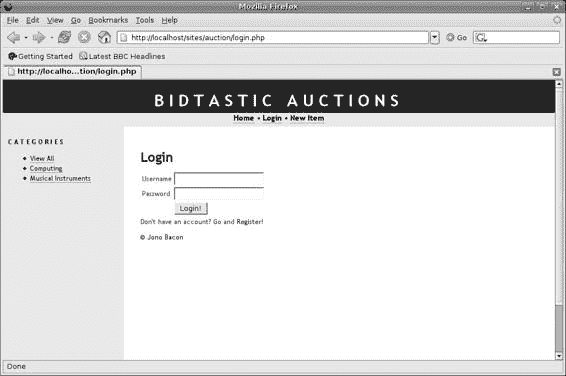

**第 7 章** 构建在线拍卖网站 243

**图 7-4** 登录界面看起来与大多数其他界面相似。

### 用户注册

用户注册的代码与论坛项目中的代码相同。将 `register.php` 和 `validate.php` 文件复制到当前项目并修改相关部分。

### 添加物品

在拍卖网站上添加物品是一个相当简单的两步过程。第一步是向用户展示一个表单，将物品信息添加到数据库中（参见图 7-5）。完成后，第二步是允许用户上传可以与物品一起显示的图片。

表单提示用户输入以下信息：

- 物品所属的类别。这将以下拉组合框的形式出现，列出所有类别。
- 物品名称。
- 物品描述。
- 拍卖结束日期。这将以多个代表日期不同部分的组合框呈现。这包括日、月、年，以及小时和分钟。
- 起始价格。

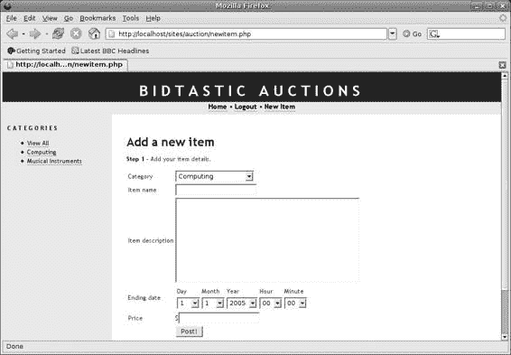

244 实用 PHP 和 MySQL

**图 7-5** 添加物品的第一步涉及填写物品详情。

创建一个名为 `newitem.php` 的新文件并添加表单：

```html
<h1>Add a new item</h1>
<strong>Step 1</strong> - 添加您的物品详情。
<p>
<?php
switch($_GET[‘error’]) {
    case “date”:
        echo “<strong>Invalid date – please choose another!</strong>”;
        break;
}
?>
</p>
```

```html
<form action=”<?php echo pf_script_with_get($SCRIPT_NAME); ?>” method=”post”>
    <table>
        <?php
        $catsql = “SELECT * FROM categories ORDER BY category;”;
        $catresult = mysql_query($catsql);
        ?>
        <tr>
            <td>Category</td>
            <td>
                <select name=”cat”>
                <?php
                while($catrow = mysql_fetch_assoc($catresult)) {
                    echo “<option value=’” . $catrow[‘id’] . “‘>” . $catrow[‘category’] . “</option>”;
                }
                ?>
                </select>
            </td>
        </tr>
        <tr>
            <td>Item name</td>
            <td><input type=”text” name=”name”></</td>>
        </tr>
        <tr>
            <td>Item description</td>
            <td><textarea name=”description” rows=”10” cols=”50”></textarea></</td>>
        </tr>
        <tr>
            <td>Ending date</td>
            <td>
                <table>
                    <tr>
                        <td>Day</td>
                        <td>Month</td>
                        <td>Year</td>
                        <td>Hour</td>
                        <td>Minute</td>
                    </tr>
                    <tr>
                        <td>
                            <select name=”day”>
                            <?php
                            for($i=1;$i<=31;$i++) {
                                echo “<option>” . $i . “</option>”;
                            }
                            ?>
                            </select>
                        </td>
                        <td>
                            <select name=”month”>
                            <?php
                            for($i=1;$i<=12;$i++) {
                                echo “<option>” . $i . “</option>”;
                            }
                            ?>
                            </select>
                        </td>
                        <td>
                            <select name=”year”>
                            <?php
                            for($i=2005;$i<=2008;$i++) {
                                echo “<option>” . $i . “</option>”;
                            }
                            ?>
                            </select>
                        </td>
                        <td>
                            <select name=”hour”>
                            <?php
                            for($i=0;$i<=23;$i++) {
                                echo “<option>” . sprintf(“%02d”,$i) . “</option>”;
                            }
                            ?>
                            </select>
                        </td>
                        <td>
                            <select name=”minute”>
                            <?php
                            for($i=0;$i<=60;$i++) {
                                echo “<option>” . sprintf(“%02d”,$i) . “</option>”;
                            }
                            ?>
                            </select>
                        </td>
                    </tr>
                </table>
            </td>
        </tr>
        <tr>
            <td>Price</td>
            <td><?php echo $config_currency; ?><input type=”text” name=”price”></</td>>
        </tr>
        <tr>
            <td></td>
            <td><input type=”submit” name=”submit” value=”Post!”></</td>>
        </tr>
    </table>
</form>
```

到目前，此表单的大部分内容看起来应该很直观了。唯一的新功能是结束日期框。在这些选择框内部，有一系列 for 循环从最小值循环到最大值（例如日的 1 到 31）。

开始添加处理表单的代码。在表单之前添加以下代码：

```php
<?php
session_start();
require(“config.php”);
require(“functions.php”);
$db = mysql_connect($dbhost, $dbuser, $dbpassword);
mysql_select_db($dbdatabase, $db);
```

在此初始代码之后，保护页面免受未登录用户访问。使用通常的技巧检查是否存在 `USERNAME` 会话变量：

```php
if(isset($_SESSION[‘USERNAME’]) == FALSE) {
    header(“Location: “ . $config_basedir . “/login.php?ref=newitem”);
}
```

开始处理表单：

```php
if(isset($_SESSION[‘USERNAME’]) == FALSE) {
    header(“Location: “ . $config_basedir . “/login.php?ref=newitem”);
}
if($_POST[‘submit’]) {
    $validdate = checkdate($_POST[‘month’], $_POST[‘day’], $_POST[‘year’]);
    if($validdate == TRUE) {
        $concatdate = $_POST[‘year']
            . “-” . sprintf(“%02d”,$_POST[‘day’])
            . “-” . sprintf(“%02d”,$_POST[‘month’])
            . “ ” . $_POST[‘hour’]
            . “:” . $_POST[‘minute’]
            . “:00”;
        $itemsql = “INSERT INTO items(user_id, cat_id, name,
startingprice, description, dateends) VALUES("
            . $_SESSION[‘USERID’]
            . “, $_POST[‘cat’]
            . “, ‘“ . addslashes($_POST[‘name’])
            . “‘, “ . $_POST[‘price’]
            . “, ‘“ . addslashes($_POST[‘description’])
            . “‘, ‘“ . $concatdate
            . “‘);”;
        mysql_query($itemsql);
    }
}
```


```php
mysql_query($itemsql);

$itemid = mysql_insert_id();

header(“Location: “ . $config_basedir . "/addimages.php?id=” . $itemid);
}
```

在查询中，一个名为 `addslashes()` 的新函数被包裹在接受字母输入的表单框周围。这有助于防止输入错误。

最后，通过头部重定向（header redirect）跳转到 `addimages.php` 页面并传递一个名为 `id` 的 GET 变量，包含插入 ID。

在代码早早之前，你检查了日期是否有效。如果日期无效，则重新加载页面并传递错误标记：

```php
header(“Location: “ . $config_basedir . “/addimages.php?id=” . $itemid);
}

else {
header(“Location: “ . $config_basedir . “/newitem.php?error=date”);
}
}
```

# 第 7 章
构建一个在线拍卖网站
249

### 注意：输入的风险

当你接受用户输入的任何类型输入时，存在输入可能破坏查询的风险。最常见的破坏发生在用户输入单引号时，因为单引号会结束输入，而第二个引号之后的任何内容都会被忽略。假设用户输入了 ‘Tim O’Chin’。查询将如下：

```sql
INSERT INTO users(name) VALUES(‘Tim O’Chin’);
```

在此查询中，第二个引号（在 O’Chin 中）结束了输入并导致 SQL 错误。

在你的项目中，可能不太会遇到这个错误。这是因为在你的 `php.ini` 文件中可能开启了名为 `magic_quotes` 的功能。有了此功能，从表单接收的任何引号都会被自动转义。转义引号的操作是在你使用正斜杠来使引号变得合规时完成的。因此，一个经过正确转义的查询将是：

```sql
INSERT INTO users(name) VALUES(‘Tim O\’Chin’);
```

如果你使用 `addslashes()` 函数对数据进行包裹并转义，你就可以在关闭 `magic_quotes` 的情况下运行此项目；该函数专门负责转义引号。

在关闭主 if 块后，开始显示表单的 else 块：

```php
}
}

else {
require(“header.php”);
?>

<h1>添加新项目</h1>

<strong>第一步</strong> - 添加你的项目详情。
```

在表单之后，添加闭合括号和页脚代码：

```html
</table>
</form>
```php
<?php
}
require(“footer.php”);
?>
```
250 实用 PHP 和 MySQL

## 添加图片

能够上传图片是开发网站时常用且实用的技能。基本技术如下：

1. 提供一个用户可以使用来选择图片的表单。
2. 当用户点击提交（Submit）按钮时，将图片传输到服务器上的临时位置。在该位置内，为文件赋予随机的临时文件名。
3. 检查图片是否有效并将其复制到 Web 服务器上的特定目录。
4. 将图片名称及其关联的项目 `id` 添加到 `images` 表中。

完成此过程后，你可以遍历 `images` 表查找具有相同 `id` 的项目，然后将文件名添加到表中的图片 HTML 标签中。

创建一个名为 `addimages.php` 的新文件并添加以下表单：

```html
<form enctype=”multipart/form-data” action=”<?php pf_script_with_get($SCRIPT_NAME); ?>” method=”POST”>
<input type=""hidden” name=”MAX_FILE_SIZE” value=”3000000”>
<table>
  <tr>
    <td>要上传的图片</td>
    <td><input name=”userfile” type=""file”></td>
  </tr>
  <tr>
    <td colspan=”2”><input type=""submit” name=”submit” value=”上传文件”></td>
  </tr>
</table>
</form>
```

当你完成照片的添加后，去 `<a href=”<?php echo “itemdetails.php?id=” . $validid; ?>”>查看你的项目</a>` 吧！

在表单标签内部，你创建了一个名为 `enctype` 的新属性，它确保表单以可理解的格式提交图片数据。第一个 `<input>` 标签创建了一个特殊的隐藏表单元素，可以存储表单中的隐藏信息和变量。在这个示例中，隐藏元素存储了图片的最大尺寸。第二个输入元素是 `userfile` 类型，并添加了一个浏览按钮，用户可以点击它选择要上传的图片。之前的代码还添加了一个提交按钮。

# 第 7 章
构建一个在线拍卖网站
251

回到页面开头（表单之前）并开始添加处理表单的代码：

```php
<?php
session_start();
include(“config.php”);
include(“functions.php”);
$db = mysql_connect($dbhost, $dbuser, $dbpassword);
mysql_select_db($dbdatabase, $db);
$validid = pf_validate_number($_GET[‘id’], “redirect”, “index.php”);
```

在常规的介绍代码之后，保护页面免受未登录的用户：

```php
$validid = pf_validate_number($_GET[‘id’], “redirect”, “index.php”); if(isset($_SESSION[‘USERNAME’]) == false) {
header(“Location: “ . $config_basedir . “/addimages.php?id=” . $itemid);
}
else {
header(“Location: “ . $config_basedir . “/newitem.php?error=date”);
}
}
```
*(注：原文中包含一些重复和碎片化的逻辑；我在保持内容不变的情况下清理了流程。）


如果这一系列测试没有导致页面带错误重新加载，则该图片是合法的，可以将文件复制到安全目录。

首先，指定图片的安全目录：

```php
header(“Location: “ . $HOST_NAME . $SCRIPT_NAME
. “?error=invalid”);

}

else {

$uploaddir = “/opt/lampp/htdocs/sites/auction/images/”;
$uploadfile = $uploaddir . $_FILES[‘userfile’][‘name’];
NOTE
```

### 临时意味着临时

当你通过表单上传图片时，文件被存储在一个临时目录中。这个目录确实是临时的，可能会定期清理或在重启时被清理。

通过设置 `php.ini` 中的 `upload_tmp_dir` 选项来配置此目录。

你创建一个名为 `$uploaddir` 的变量，它应该指向主项目目录内的一个合法位置。创建一个名为 `images` 的新目录并赋予读写权限，然后将 `$uploaddir` 修改为你的目录。

第二行拼接此目录并添加文件名。`$uploaddir` 变量需要一个末尾的正斜杠（`/`），以确保图片名称被正确拼接。

复制文件并将名称添加到数据库：

```php
$uploaddir = “/opt/lampp/htdocs/sites/auction/images/”;

$uploadfile = $uploaddir . $_FILES[‘userfile’][‘name’];

if(move_uploaded_file($_FILES[‘userfile’][‘tmp_name’],
$uploadfile)) {

$inssql = “INSERT INTO images(item_id, name)
VALUES(“ . $validid . “, ‘“ . $_FILES[‘userfile’][‘name’]
. “‘)”;

mysql_query($inssql);
header(“Location: “ . $HOST_NAME . $SCRIPT_NAME
. “?id=” . $validid);

}
```

`move_uploaded_file()` 函数通过传递临时文件的名称（`$_FILES[‘userfile’][‘tmp_name’]`）、目标位置以及保存的名称（`$uploadfile`）来移动文件。然后你将文件名和 `item_id` 插入到 `images` 表中并加载页面。

如果由于某种原因 `move_uploaded_file()` 失败（例如文件权限不正确），显示错误消息：

```php
header(“Location: “ . $HOST_NAME . $SCRIPT_NAME
. “?id=” . $validid);

}

else {

echo ‘There was a problem uploading your file.<br />’;

}

}

}
```

处理完成后，你现在可以在表单之前显示现有的图片。你还可以显示由之前的测试产生的任何错误消息。

从 `images` 表中选择所有当前项目 id（存储在 `$validid` 中）的记录：

```php
}

}

}

else {

require(“header.php”);
$imagessql = “SELECT * FROM images WHERE item_id = “ . $validid
. “;”;

$imagesresult = mysql_query($imagessql);
$imagesnumrows = mysql_num_rows($imagesresult);
```

显示图片：

```php
$imagesresult = mysql_query($imagessql);
$imagesnumrows = mysql_num_rows($imagesresult);

echo “<h1>Current images</h1>”;

if($imagesnumrows == 0) {

echo “No images.”;

}

else {

echo “<table>”;
while($imagesrow = mysql_fetch_assoc($imagesresult)) {

echo “<tr>”;
echo “<td></td>”;
echo “<td>[<a href=’deleteimage.php?image_id=”
. $imagesrow[‘id’] . “&item_id=” . $validid
. “‘>delete</a>]</td>”;
echo “</tr>”;
}

echo “</table>”;
```

如果没有返回任何行，则显示文本 "No images"；否则创建一个表格并使用 `while` 循环遍历图片。除了显示图片外，还创建了一个指向名为 `delete.php` 页面的链接，并将图片和项目的 id 都作为 GET 变量添加到链接中。

显示图片后，将显示表单。在表单代码之前，添加一个 `switch` 语句来显示错误：

```php
echo “</table>”;

}

switch($_GET[‘error’]) {

case “empty”:

echo ‘You did not select anything.’;
break;

case “nophoto”:

echo ‘You did not select a photo to upload.’;
break;

case “photoprob”:

echo ‘There appears to be a problem with the
photo you are uploading’;
break;

case “large”:

echo ‘The photo you selected is too large’;
break;

case “invalid”:

echo ‘The photo you selected is not a valid image file’;
break;
}

?>
```

最后，在表单后添加闭合括号并添加页脚文件：当你添加完照片后，去：

`<a href=”<?php echo “itemdetails.php?id=”
. $validid; ?>”>see your item</a>`!!

```php
<?php

}

require(“footer.php”);

?>
```

完成后的页面如图 7-6 所示。

### 删除图片

在本节中，你将创建上一个脚本中的删除页面。

当用户点击删除链接时，`delete.php` 页面会提示你确认想要删除该图片。带有此消息将有两个提交按钮，上面分别写着 Yes 和 No。你可以检查点击了哪个提交按钮并做出相应的响应：

- 如果用户点击 Yes 按钮，图片将被删除，记录从 `images` 表中移除，页面重定向到 `addimages.php`。
- 如果用户点击 No 按钮，页面重定向到 `addimages.php`。

第一步是添加表单。创建一个名为 `deleteimage.php` 的新页面并编写以下代码：

```html
<<h2>Delete image?</</h2>>

<form action=”<?php echo
pf_script_with_get($SCRIPT_NAME); ?>” method=”post”>

Are you sure you want to delete this image?

<p>

<input type=”submit” name=”submityes”
value=”Yes”> <input type=”submit” name=”submitno” value=”No”>

</p>

</form>
```

关于该表单需要注意的一点是，上述代码中的两个提交按钮具有不同的名称：`submityes` 和 `submitno`。

回到页面顶部添加处理表单的初始代码：

```php
<?php

require(“config.php”);
require(“functions.php”);

$db = mysql_connect($dbhost, $dbuser, $dbpassword);
mysql_select_db($dbdatabase, $db);

$validimageid = pf_validate_number($_GET[‘image_id’], “redirect”, $config_basedir);
$validitemid = pf_validate_number($_GET[‘item_id’], “redirect”, $config_basedir);
```

检查是否点击了 Yes 按钮（`submityes`）：

```php
$validimageid = pf_validate_number($_GET[‘image_id’],
“redirect”, $config_basedir);
$validitemid = pf_validate_number($_GET[‘item_id’],
“redirect”, $config_basedir);

if($_POST[‘submityes’]) {

$imagesql = “SELECT name FROM images WHERE id = “ . $validimageid;
$imageresult = mysql_query($imagesql);
$imagerow = mysql_fetch_assoc($imageresult);

unlink(“./images/” . $imagerow[‘name’]);

$delsql = “DELETE FROM images WHERE id = “ . $validimageid;
mysql_query($delsql);
header(“Location: “ . $config_basedir
. “addimages.php?id=” . $validitemid);

}
```

如果确实点击了 Yes 按钮，查询将从 `images` 表中选择 id 为 `$validimageid` 的图片名称。查询运行后，`unlink()` 命令将物理删除该文件。最后，`DELETE` 查询移除记录并重定向页面。

如果点击了 No 按钮，页面将重定向到 `addimages.php`：`header(“Location: “ . $config_basedir . “addimages.php?id=” . $validitemid);`

}

elseif($_POST[‘submitno’]) {

header(“Location: “ . $config_basedir . “addimages.php?id=”
. $validitemid);

}

}

}

显示表单：

```php
else {

require(“header.php”);
?>

<h2>Delete image?</</h2>>

<form action=”<?php echo
pf_script_with_get($SCRIPT_NAME); ?>” method=”post”>
```

最后，在文件的底部添加结束代码：

```php
<?php

}

require(“footer.php”);

?>
```


对于大多数拍卖网站，当拍卖结束时，系统会向物品所有者和中得者（如果有的话）发送电子邮件，以告知拍卖结果。这些邮件通常包含物品名称以及所有者/获胜者的详细信息，具体取决于发送的是哪封邮件。该功能的挑战在于如何在拍卖结束时发送邮件。PHP 和 MySQL 并不包含指定在特定时间执行某些代码的功能。那么，你该如何实现呢？

解决方案是先创建一个页面，确定哪些拍卖已经结束并发送了邮件。为了确保处理量降至最低，当物品被处理后，`items` 表中的 `endnotified` 字段会被设置为 1。这样一来，你就可以搜索 `enddate` 早于 `NOW()` 且 `endnotified` 为 0 的物品。

只需运行该页面，即可处理所有拍卖。

要解决拍卖结束时的处理问题，你可以使用计划任务工具，如 `cron`（Linux）或 `Windows Scheduler`（Windows）来安排程序大约每五分钟访问一次该页面。你可以使用 `wget` 命令行工具来实现。

创建一个名为 `processauctions.php` 的页面，并运行查询来选择所有物品：

```php
<?php

require("config.php");

require("header.php");

$itemssql = "SELECT users.username, users.email, items.id, items.name FROM items, users WHERE dateends < NOW() AND
items.user_id = users.id AND endnotified = 0;";

$itemsresult = mysql_query($itemssql);
```

该查询选择了所有 `dateends` 处于过去且 `endnotified` 设置为 0 的记录中的 `username`、`email`、物品 ID 和 `name`。返回的每条记录都是一个已结束的拍卖。

遍历记录：

```php
$itemssql = "SELECT users.username, users.email, items.id, items.name FROM items, users WHERE dateends < NOW() AND
items.user_id = users.id AND endnotified = 0;";

$itemsresult = mysql_query($itemssql);

while($itemsrow = mysql_fetch_assoc($itemsresult)) {
    $bidssql = "SELECT bids.amount, users.username,
    users.email FROM bids, users WHERE bids.user_id = users.id
AND item_id = " . $itemsrow['id'] . " ORDER BY amount
DESC LIMIT 1;";

    $bidsresult = mysql_query($bidssql);
    $bidsnumrows = mysql_num_rows($bidsresult);
```

对于每个已结束的拍卖，都会检查是否有任何出价，并返回最高出价金额以及最高出价者的用户名和邮箱地址。

该查询的工作原理是请求 `item_id` 等于 `$itemsrow['id']` 记录的 `username`、`email` 和 `bid amount`。每条记录都按金额降序排列，并仅返回一行（`LIMIT 1`）。按降序排列并只返回一行可以获取表中的最新条目。这将是使用 `MAX()` 函数来确定最高价格的一种很好的替代方案。

收集数据后，你现在可以构建并发送邮件了。要生成邮件，请使用第 5 节讨论过的 `heredoc` 语法。在使用这种语法时，你不能在内部使用数组。相反，将数据提取到普通变量中：

```php
$bidsresult = mysql_query($bidssql);
$bidsnumrows = mysql_num_rows($bidsresult);

$own_owner = $itemsrow['username'];
$own_email = $itemsrow['email'];
$own_name = $itemsrow['name'];
```

有三种可能需要发送邮件的情况。你需要将它们发送给：

- 拍卖所有者，告知该物品没有被出价。
- 所有者，告知最高出价者以及该出价者的联系方式。
- 中得者，告知拍卖物品的所有者。

首先，创建一封发送给所有者并告知“没有任何出价”的邮件。

要检查是否有任何出价，请检查 `$bidsnumrows` 是否有值。如果没有，则创建以下邮件：

```php
$own_email = $itemsrow['email'];
$own_name = $itemsrow['name'];

if($bidsnumrows == 0) {
    $owner_body=<<_OWNER
Hi $own_owner,
抱歉，您的物品 '$own_name' 没有任何出价。
_OWNER_;
    mail($own_email, "Your item '" . $own_name . "' did not sell", $owner_body);
}
```

如果 `bids` 表中有行记录，则构建另外两种类型的邮件：

```php
else {
    echo "item with bids" . $itemsrow['id'];
    $bidsrow = mysql_fetch_assoc($bidsresult);
    $own_highestbid = $bidsrow['amount'];
    $win_winner = $bidsrow['username'];
    $win_email = $bidsrow['email'];
    $owner_body=<<_OWNER
Hi $own_owner,
恭喜！您的物品 '$own_name' 拍卖已经结束，最高出价为 $config_currency$own_highestbid，由 $win_winner 竞得！
出价详情：
物品: $own_name
金额: $config_currency$own_highestbid
中得者: $win_winner ($win_email)
建议您在 3 天内联系中得者。
_OWNER_;

    $winner_body=<<_WINNER
Hi $win_winner,
恭喜！您对物品 '$own_name' 的出价 $config_currency$own_highestbid 是最高出价！
出价详情：
物品: $own_name
金额: $config_currency$own_highestbid
所有者: $own_owner ($win_email)
建议您在 3 天内联系物品所有者。
_WINNER_;

    mail($own_email, "Your item '" . $own_name . "' has sold", $owner_body);
    mail($win_email, "You won item '" . $own_name . "'!", $winner_body);
}
```

更新 `items` 表并将 `endnotified` 设置为 1，表示拍卖已处理：

```php
$updsql = "UPDATE items SET endnotified = 1 WHERE id = " . $itemsrow['id'];
echo $updsql;
mysql_query($updsql);
}
```

最后，添加页脚代码：

```php
require("footer.php");
?>
```

## 计划运行页面

要计划定期运行该页面，请使用 `wget` 下载工具来执行访问。`wget` 工具主要用于下载文件，因此在 Linux 上你可能需要输出重定向到 `/dev/null`：

```bash
foo@bar:~$ wget --delete-after http://localhost/auction/processauctions.php
```

要计划定期发生此，请向 `cron` 任务添加以下行。首先，通过以下命令加载 crontab：

```bash
foo@bar:~$ crontab -e
```

每五分钟运行一次命令，请在 crontab 中添加以下行：

```bash
*/5 * * * * wget --delete-after http://localhost/auction/processauctions.php
```

在 Windows 中，你可以使用控制面板中的“计划任务”。在此对话框中，选择要运行的程序并指定时间。

确保将 URL 更改适用于你计算机的内容。

## 总结

在这个项目中，你探索了编写拍卖网站时面临的各种挑战和问题。本项目对于练习检查日期、处理价格以及运行查询以汇总数据库数据的技能非常有帮助。


另一种可能性是添加一个管理部分，带有工具来管理拍卖网站，就像我们在之前的项目中开发管理部分那样。本书书中的每个项目并不打算是一个完整的、完工的应用程序，并且有足够的空间以不同的方式添加额外功能并改进项目。只需发挥你的想象力，并在需要的地方填补空白即可。这是软件开发的乐趣所在——当你掌握了技术，天空才是你的极限。

祝你好运！

*本页特意留*

# 第 8 章：创建一个基于 Web 的日历

对于我们大多数人来说，生活变得越来越忙碌。除非你在股市中赚了数百万美元现在住在一艘镀金游艇上，否则要安排好会议、社交活动、牙医预约和篮织俱乐部会议将是一场每日的斗争。

在这个项目中，你将创建一个基于 Web 的日历来帮助应对这些困难。该项目实现了管理生活所需的所有功能——一次查看一个月份、显示事件信息以及添加新事件。虽然概念简单，但日历为开发者带来了许多有趣的挑战。为了让项目更有趣，你将探索 `Ajax`，这套技术可以提供高度动态的 Web 网站，其功能类似于桌面应用程序。接入电源，伸伸你的手指，准备就绪！

## 项目概述

为了清楚了解项目将如何运作，请看以下用例：苏珊（Susan）记忆力不好。尽管她在朋友和同事中非常受欢迎，但苏珊经常接受派对和活动的邀请，然后很快就忘记了。在错过了多次晚餐约会后，她决定使用一个基于 Web 的日历，一个可以在世界任何地方通过任何 浏览器访问的日历。

苏珊打开日历输入登录信息。成功登录后，她可以看到当前月份，以及她为该月预定的每个事件——全部位于正确的日期上。日历的侧边栏还包含了近期将发生的事件列表。要查看特定事件的信息，苏珊点击事件名称，详情就会出现（同样在日历侧边栏中）。

苏珊意识到她为下周六添加了一个事件，她需要取消它。要删除它，她点击事件旁边的 `X` 按钮。日历已更新，事件消失了。

苏珊现在需要向日历添加一个新事件（她的腊犬训练班）。她点击课程安排的日期，侧边栏会重绘并显示出一个她可以填写的表单。她添加了事件名称、开始和结束时间以及简短描述。然后她点击 `Add Event` 按钮，日历刷新并显示新事件。

## 构建数据库

你将创建的数据库如图 8-1 所示。

**图 8-1**

**events** 表
- `id`
- `date`
- `starttime`
- `endtime`
- `name`
- `description`

**users** 表
- `id`
- `username`
- `password`

说这个项目中的数据库简单完全是轻描写写！这是一个极其容易设置的数据库。`events` 表包含日历中的事件列表，`users` 表包含用户登录信息。

### 实现数据库

启动 `phpMyAdmin`。创建一个名为 `simplecal` 的新数据库并添加以下表。

#### `events` 表
- `id`: 将其设置为 `INT`（可能存在多个事件）并开启 `auto_increment`。将此字段设置为主键。
- `date`: 将其设置为 `DATE`。
- `starttime`: 将其设置为 `TIME`。
- `endtime`: 将其设置为 `TIME`。
- `name`: 将其设置为 `VARCHAR`，长度为 50。
- `description`: 将其设置为 `TEXT`。

### `logins` 表
- `id`: 将其设置为 `TINYINT` 并开启 `auto_increment`。将此字段设置为主键。
- `username`: 将其设置为 `VARCHAR`，长度为 10。
- `password`: 将其设置为 `VARCHAR`，长度为 10。

#### 插入示例数据

在本节中，你将添加一些示例数据开始。记住，不要在 `id` 列中填写数字；`auto_increment` 会为你处理这一点。可以随意添加自己的示例数据，或使用表 8-1 所示的数据。

#### `events` 表的示例数据
添加表 8-1 中的示例事件。示例事件让你更容易检查日历是否工作正常。

**表 8-1**
| DATE | STARTTIME | ENDTIME | NAME | DESCRIPTION |
| :--- | :--- | :--- | :--- | :--- |
| 2007-10-14 | 12:00:00 | 14:00:00 | Meeting with Emily | 讨论未来项目的重要会议。 |
| 2007-10-14 | 18:00:00 | 19:30:00 | Meal with Lee | 与 Lee 庆祝合作工作的晚餐。 |
| 2007-11-20 | 08:30:00 | 09:30:00 | Working breakfast | 与 Cliff 讨论工作的早餐。 |

#### `logins` 表的示例数据
为 `logins` 表添加一个用户名和密码（记好密码！）。

## 开始编写代码

首先，你需要处理网站模板、样式和一些实用函数。然后你可以进入登录界面以及实际的日历页面和脚本。

### 网站布局和样式

正如你在之前的章节做的那样，第一步是创建配置、头部和页脚文件。创建一个名为 `simplecal` 的新目录。现在从之前的项目中将 `db.php` 文件复制到 `simplecal` 目录。接下来，创建一个名为 `config.php` 的新文件，其内容如示例 8-1 所示。

**示例 8-1**
一个简单的配置文件
```php
<?php
$dbhost = "localhost";
$dbuser = "root";
$dbpassword = "";
$dbdatabase = "simplecal";
$config_name = "James Hillchin's Calendar";
$config_basedir = "http://localhost/sites/simplecal/";
?>
```

就像 `config.php` 在之前的项目中使用一样，这里也使用了之前项目中相同的样式表。但你需要在底部添加一些内容。创建一个名为 `stylesheet.css` 的新文件并添加示例 8-2 所示的代码。

**示例 8-2**
样式表中的额外元素用于自定义日历视图。
```css
body {
    font-family: "trebuchet ms", verdana, sans-serif; font-size: 12px;
    line-height: 1.5em;
    color: #333;
    background: #ffffff;
    margin: 0;
    padding: 0;
    text-align: center;
    width: 100%;
}
p {
    margin-top: 10px;
}
h3 {
    font: bold 140% trebuchet ms, sans-serif;
    letter-spacing: 5px;
    margin-bottom: 0;
    color: #000000;
}
hr {
    color: #eee;
    background-color: #000;
    height: 2px;
}
a:link {
    text-decoration: none;
    color: #000;
}
a:visited {
    text-decoration: none;
    color: #000;
}
a:hover, a:active {
    text-decoration: none;
    color: #000;
}
img {
    border: 0;
}
#container {
    position: absolute;
    top: 85px;
    left: 0px;
    background: #ffffff;
    margin: 0 auto 0 auto;
    border-bottom: 1px solid #eee;
    text-align: left;
    width: 100%;
    height: 100%;
}
#menu {
    font-family: "trebuchet ms", verdana, sans-serif; font-size: 14px;
    font-weight: bold;
    position: absolute;
    height: 27px;
    top: 60px;
}
/* ... continued ... */
#header {
    position: absolute;
    top: 0px;
    left: 0px;
    height: 60px;
    width: 100%;
    background: #333;
    padding-top: 8px;
}
#header h1 {
    font-size: 30px;
    text-transform: uppercase;
    letter-spacing: 0.3em;
    color: #fff;
}
#main {
    margin: 5px 5px 5px 5px;
    padding: 5px 5px 5px 5px;
    background: #FFFFFF;
}
#bar {
    float: left;
    width: 200px;
    background: #eee;
    z-index: 1;
    padding: 10px;
    margin-right: 30px;
    height: 100%;
}
#bar h1 {
    font-size: 12px;
    text-transform: uppercase;
    letter-spacing: 0.3em;
}
```


/* ——— 日历特定样式 ———— */

# 第 8 章
## 创建基于 Web 日历

271

```css
a.cal_date:link {
text-decoration:none;color:white;
display:block;width:100%;height:100%;
}
a.cal_date:visited {
text-decoration:none;color:white;display:block;width:100%; height:100%;
}
a.cal_date:hover {
text-decoration:none;color:white;display:block;width:100%; height:100%;
}
a.cal_date:active {
text-decoration:none;color:white;display:block;width:100%; height:100%;
}
a.cal:link {
text-decoration:none;color:red;display:block;
height:100%;background:white;padding:3px;
}
a.cal:visited {
text-decoration:none;color:red;
display:block;width:100%;height:100%;background:white;
padding:3px;
}
a.cal:hover {
text-decoration:none;color:white;
display:block;width:100%;height:100%;background:#dddddd;
border: thin solid black;padding:0px;
}
a.cal:active {
text-decoration:none;color:red;
display:block;width:100%;height:100%;background:white;
padding:3px;
}
a.event:link {
text-decoration:none;color:blue;width:100%;
background:lightblue;padding:3px;
}
a.event:visited {
text-decoration:none;color:blue;width:100%;
background:lightblue;padding:3px;
}
```

*继续*

272

实战 PHP 与 MySQL

### 示例 8-2
接。

```css
a.deleteevent:link {
text-decoration:none;color:blue;background:red;
padding:3px;border:thin solid black;
}
a.deleteevent:visited {
text-decoration:none;color:blue;background:red;
padding:3px;border:thin solid black;
}
table.cal {
border: thin solid black;
}
th.cal {
background: #000000;
color: #ffffff;
}
td.cal_date {
background: #333333;
color: #ffffff;
}
td.cal {
}
span.datepicker {
font-family: "trebuchet ms", verdana, sans-serif; font-size: 18px;
font-weight: bold;
text-align: center;
}
#login {
font-family: "trebuchet ms", verdana, sans-serif; font-size: 12px;
border: thin solid black;
width: 300px;
margin: 20px auto 0 auto;
background: #eeeeee;
padding: 10px;
}
```

创建 `header.php` 并添加示例 8-3 所示的头部代码。

# 第 8 章
## 创建基于 Web 日历

273

### 示例 8-3
除了少数几处添加外，头部文件与之前项目中使用的文件非常相似。

```php
<?php
session_start();
require("config.php");
$db = mysql_connect($dbhost, $dbuser, $dbpassword);
mysql_select_db($dbdatabase, $db);
?>
<!DOCTYPE HTML PUBLIC "-//W3C//DTD HTML 4.01//EN" "http://www.w3.org/TR/html4/loose">
<html>
<head>
<title><?php echo $config_name; ?></title>
<script language="javascript" type="text/javascript"
src="./internal_request.js"></script>
<link href="stylesheet.css" rel="stylesheet">
</head>
<body>
<div id="header">
<h1><?php echo $config_name; ?></h1>
</div>
<div id="menu">
•
<a href="<?php echo $config_name; ?>">本月</a>
•
<a href="<?php echo $config_name; ?>/logout.php">退出</a>
</div>
<div id="container">
<div id="bar">
<?php require("bar.php"); ?>
</div>
```

在此段代码中，有一处独特的添加：

```html
<script language="javascript" type="text/javascript"
src="./internal_request.js"></script>
```

这段代码片段包含了一个 JavaScript 文件，你将在日历的几个部分使用。与其他项目一样，`bar.php` 被包含在头部文件中。该文件将在本章后面详细介绍。

274

实战 PHP 与 MySQL

将示例 8-4 所示的格式良好的底部代码添加到 `footer.php`。

### 示例 8-4
底部文件关闭了主内容的 `<div>`、`<body>` 和 `html` 标签。

```html
</div>
</body>
</html>
```

在启动阶段，要创建的文件是 `functions.php`。将示例 8-5 所示的 `validate_function()` 代码添加到该文件中。

### 示例 8-5
`validate_number()` 函数再次用于验证 GET 变量。

```php
<?php
function validate_number($value, $redirect) {
if(isset($value) == TRUE) {
if(is_numeric($value) == FALSE) {
$error = 1;
}
if($error == 1) {
header("Location: " . $redirect);
}
else {
$final = $value;
}
}
else {
if($function == 'redirect') {
header("Location: " . $redirect);
}
if($function == "value") {
$final = 0;
}
}
return $final;
}
?>
```

# 第 8 章
## 创建基于 Web 日历

275

### 构建登录界面
对于本项目，日历旨在作为一个个人 Web 应用。我们需要一个登录页面。该页面接收用户名和密码，如果正确，则将其重定向到主日历。登录页面与之前使用的页面几乎相同；唯一的区别在于 `LOGIN` 变量。

```php
<?php
session_start();
require("db.php");

$loginsql = "SELECT * FROM logins WHERE username = '"
. $_POST['userBox'] . "' AND password = '"
. $_POST['passBox'] . "'";

$loginres = mysql_query($loginsql);
$numrows = mysql_num_rows($loginres);

if($numrows == 1) {
$loginrow = mysql_fetch_assoc($loginres);
session_register("LOGIN");
$_SESSION['LOGIN'] = 1;
header("Location: " . $config_name . "view.php");
}
else {
header("Location: " . $HTTP_HOST . $SCRIPT_NAME . "?error=1");
}
?>
```

```html
<!DOCTYPE HTML PUBLIC "-//W3C//DTD HTML 4.01//EN" "http://www.w3.org/TR/html4/loose">
<html>
<head>
<title>历登录</title>
<link href="stylesheet.css" rel="stylesheet">
</head>
<body>
<div id="login">
<h1>历登录</h1>
请输入用户名和密码登录。
<p>
<?php
if($_GET['error']) {
echo "<strong>用户名/密码错误</strong>";
}
?>
<form action="<?php echo $SCRIPT_NAME; ?>" method="POST">
<table>
<tr>
<td>用户名</td>
<td><input type="text" name="userBox"></td>
</tr>
<tr>
<td>密码</td>
<td><input type="password" name="passBox"></td>
</tr>
<tr>
<td></td>
<td><input type="submit" name="submit" value="登录"></td>
</tr>
</table>
</form>
</div>
</body>
</html>
```

/* ——— 日历特定样式 ———— */

276

实战 PHP 与 MySQL

### 示例 8-6
接。

```css
a.deleteevent:link {
text-decoration:none;color:blue;background:red;
padding:3px;border:thin solid black;
}
a.deleteevent:visited {
text-decoration:none;color:blue;background:red;
padding:3px;border:thin solid black;
}
table.cal {
border: thin solid black;
}
th.cal {
background: #000000;
color: #ffffff;
}
td.cal_date {
background: #333333;
color: #ffffff;
}
td.cal {
}
span.datepicker {
font-family: "trebuchet ms", verdana, sans-serif; font-size: 18px;
font-weight: bold;
text-align: center;
}
#login {
font-family: "trebuchet ms", verdana, sans-serif; font-size: 12px;
border: thin solid black;
width: 300px;
margin: 20px auto 0 auto;
background: #eeeeee;
padding: 10px;
}
```

# 第 8 章
## 创建基于 Web 日历

277

除了少数几处添加外，头部文件与之前项目中使用的文件非常相似。这导致登录页面看起来与之前的页面完全相同。


# 第 8 章：创建一个基于 Web 的日历

界面由两个主要元素组成：主日历视图和侧边栏。这两个界面区域分别有几个关键功能。

主日历的关键功能如下：

- 显示月份，以及每周的几几日期。
- 显示指定月份内的事件。
- 允许用户点击事件以查看该事件的信息。
- 允许用户点击指定日期的任何空白区域来添加事件。

侧边栏的关键功能如下：

- 显示当前月份和年份。用户可以使用箭头选择上个月或下个月。
- 允许用户点击主日历中的事件以在侧边栏中显示事件信息。
- 允许用户添加新事件并在侧边栏中显示新事件表单。
- 显示即将发生的事件列表。

在之前的项目中，你通过加载不同的页面来访问每项项目功能。例如，“新主题”页面用于向论坛项目添加新帖子。然而，在本项目中，即使访问不同的功能，Web 界面也不需要太大变动。日历将始终可见，侧边也将始终显示不同类型的信息。因此，没有必要创建多个页面。这进一步简化了应用程序，而这绝不是坏事。

为了让日历更加动态，你将使用一种名为 `Ajax` 的兴奋技术，它可以防止在想要访问新功能时需要刷新整个页面。

## 关于 Ajax

`Ajax` 有时被称为异步 JavaScript 和 XML，是一项正在席卷 Web 开发世界的激动人心的技术。Ajax 的兴起很大程度上归功于 Google 在 [Gmail](http://mail.google.com) 和 Google Maps(http://maps.google.com) 对该技术的一些创新用法。

`Ajax` 背后的理念是，你可以像往常一样向服务器发送请求；但不是刷新整个页面，而是使用 `JavaScript` 只更新页面的部分内容。结果是，Web 应用程序不再强制用户等待浏览器加载完全全新的页面；该应用程序感觉更像是一个桌面程序。

Google 的 Gmail 应用就是一个很好的例子。在撰写新消息时，你需要在表单中输入电子邮件地址的前几个字母。当你输入前几个字母后，会弹出一个新窗口提示你从已发送过邮件的人员列表中进行选择。在后台，Gmail 正在使用 `Ajax` 从服务器获取电子邮件列表并呈现此列表——而无需向浏览器发送新的 HTML 页面。`Ajax` 为你提供了一种为用户提供更动态体验绝佳方式。

`Ajax` 并不是单一的新技术，而是多种技术的结合。这些技术包括：

- `HTML`
- `CSS`
- 文档对象模型（或 `DOM`）
- `JavaScript`
- `XML HTTP Requests`

在项目中，你使用 `Ajax` 刷新日历侧边栏的特定部分——避免了刷新整个屏幕的需求。这使得应用程序感觉更加顺畅，并允许你施展你的 `Ajax` 才艺。

## Ajax 如何工作

在讨论如何实际实现一个 `Ajax` 应用程序之前，花几分钟从概念层面理解 `Ajax` 如何工作是有帮助的。通过图表来解释是最好的，如图 8-4 所示。

**图 8-4**
1. 在用户点击链接和页面更新之间，`Ajax` 执行了若干不同的步骤。
2. `function ()`
3. `handler ()`
4. `Database`
5. PHP 页面

`Ajax` 请求通常会发生五个不同的步骤。为了演示这一点，以下列表描述了当用户点击日历中的事件时 `Ajax` 是如何应用的：

1. 用户点击他感兴趣的事件。链接没有连接到另一个 `HTML` 或 `PHP` 页面，而是触发了一个 `JavaScript` 函数。
2. `JavaScript` 函数连接到一个可以处理该请求的脚本。该函数还请求在请求得到后立即通知它（它通过对响应**注册一个处理器**来实现这一点）。
3. 处理请求的 `PHP` 脚本处理该请求并连接到`数据库` 以获取关于指定事件所需的信息。
4. 当脚本收集到事件信息后，它会对步骤 2 中注册的 `JavaScript` 处理器做出响应。该处理器（现在包含了事件信息）用来自步骤 3 的事件数据替换侧边栏中的区域。

很简单，对吧？现在是时候将这些步骤付实践了。

## 创建侧边栏

侧边栏包含三个主要区域，每个区域会被添加到 `bar.php` 中（该文件在 `header.php` 中加载；参见示例 8-3）。

### 处理日期

侧边栏的第一个区域显示正在查看的月份名称和年份，还提供了箭头允许用户选择上个月或下个月。

这些箭头链接到 `view.php` 并向其传递一个 `date` `GET` 变量，格式为 `<month>-<year>`，例如 `view.php?date=10-2005`（对应 2005 年 10 月）。

左箭头（进入上个月）简单地将当前月份减 1，右箭头将月份加 1（进入下个月）。你还需要提供一些代码来处理 1 月和 12 月。如果用户正在查看 `1-2005`（2005 年 1 月），左箭头应该链接到 `12-2004`（2004 年 12 月）。同样，`12-2005` 的右箭头应该链接到 `1-2006`。

考虑到这一切，创建 `bar.php` 并添加以下代码：

```php
<?php
if(isset($_GET['date']) == TRUE) {
$explodeddate = explode("-", $_GET['date']);
$month = $explodeddate[0];
$year = $explodeddate[1];
$numdays = date("t", mktime(0, 0, 0, $month, 1, $year));
}
else {
$month = date("n", mktime());
$numdays = date("t", mktime());
$year = date("Y", mktime());
}
```

如果存在 `date` `GET` 变量，你可以查看相应的月份。如果变量不存在，脚本将使用当前月份（后一种情况发生在会话中首次打开应用程序时）。

如果存在日期，代码使用 `explode()` 拆分日期并将月份放入 `$month`，将年份放入 `$year`。天数通过将 `$month` 和 `$year` 传入 `mktime()` 函数来计算。该函数接受多个参数：

```php
mktime(0, 0, 0, $month, 1, $year);
```
时 分 秒 月 日 年 函数的结果通过 `date()` 函数处理，并返回天数。

使用相同的技术创建在侧边栏中显示的日期标签（例如 2006 年 7 月）：

```php
$numdays = date("t", mktime());
$year = date("Y", mktime());
$displaydate = date("F Y", mktime(0, 0, 0, $month, 1, $year));
```

计算上一个日期（当用户点击左箭头时）：

```php
<?php
...
$displaydate = date("F Y", mktime(0, 0, 0, $month, 1, $year)); 
if($month == 1) {
$prevdate = "12-" . ($year-1);
}
else {
$prevdate = ($month-1) . "-" . $year;
}
```

如果月份是 1 月，日期被设置为上年的 12 月。否则，月份减 1。

对“下个月”箭头重复此操作，将月份加 1 然后处理 12 月的特殊情况：

```php
<?php
$displaydate = date("F Y", mktime(0, 0, 0, $month, 1, $year)); 
if($month == 12) {
$nextdate = "1-" . ($year+1);
}
else {
$nextdate = ($month+1) . "-" . $year;
}
```

显示日期：

```php
echo "<span class='datepicker'>";
```


```php
echo "<a href='$SCRIPT_NAME?date=" . $prevdate . "'>&larr;</a> ";
echo $displaydate;
echo " <a href='$SCRIPT_NAME?date=" . $nextdate . "'>&rarr;</a> ";
echo "</span>";
echo "<br />";
?>
```

在这段代码中，为当前页面构建了日期 `GET` 变量。链接被应用到两个箭头上，这些箭头使用 `&larr;` 和 `&rarr;` HTML 实体显示。

### 注意
#### 尽可能使用 HTML 实体

HTML 实体提供了广泛的特殊符号。你可以像你刚才处理箭头那样，通过在 HTML 中引用实体代码来使用这些符号。如需查看完整的可用实体列表，请参阅 [`www.htmlhelp.com/reference/html40/entities/`](http://www.htmlhelp.com/reference/html40/entities/)。

你应该始终尽可能使用 HTML 实体，因为实体可以避免对不必要的图形的需求。实体还能提高 Web 应用程序的可访问性和性能。

### 为 Ajax 做好准备
日期选择器完成后，添加侧边栏的第二个组件：

```html
<div id="eventcage">
<p>要在此查看活动信息，请点击日历上的项目。</p>
</div>
```

这创建了一个名为 `event cage` 的 `div`。这是侧边栏中稍会被 Ajax 请求替换的区域。

### 显示即将发生的活动

```php
<?php
echo "<h1>Latest Events</h1>";
echo "<ul>";
$nearsql = "SELECT * FROM events WHERE date >= NOW() ORDER BY starttime;";
$nearres = mysql_query($nearsql);
$nearnumrows = mysql_num_rows($nearres);
if($nearnumrows == 0) {
    echo "No events!";
}
else {
    while($nearrow = mysql_fetch_assoc($nearres)) {
        echo "<li><a href='#' onclick='getEvent(" . $nearrow['id'] . ")'>" . $nearrow['name'] . "</a> (<i>" . $nearrow['date'] . "</i>)</li>";
    }
}
echo "</ul>";
?>
```

在这里，发布了一个相当简单的 `SELECT` 查询，以返回从今天起及之后的所有活动。代码会检查是否返回了行。如果是这种情况，将显示文本 `No events!`。否则，将添加一个链接来运行 `getEvent()` JavaScript 函数（稍后你将详细审查该函数）。

示例 8-7 显示了完成后的侧边栏代码。

**示例 8-7**
侧边栏处理月份、活动详情和即将发生的活动。

```php
<?php
if(isset($_GET['date']) == TRUE) {
    $explodeddate = explode("-", $_GET['date']);
    $month = $explodeddate[0];
    $year = $explodeddate[1];
        $numdays = date("t", mktime(0, 0, 0, $month, 1, $year));
}
else {
    $month = date("n", mktime());
    $numdays = date("t", mktime());
    $year = date("Y", mktime());
}
$displaydate = date("F Y", mktime(0, 0, 0, $month, 1, $year));
if($month == 1) {
    $prevdate = "12-" . ($year-1);
}
else {
    $prevdate = ($month-1) . "-" . $year;
}
if($month == 12) {
    $nextdate = "1-" . ($year+1);
}
else {
    $nextdate = ($month+1) . "-" . $year;
}
echo "<span class='datepicker'>";
echo "<a href='$SCRIPT_NAME?date=" . $prevdate . "'>&larr;</a> "; echo $displaydate;
echo " <a href='$SCRIPT_NAME?date=" . $nextdate . "'>&rarr;</a> "; echo "</span>";
echo "<br />";
?>

<div id="eventcage">
<p>要在此查看活动信息，请点击日历上的项目。</p>
</div>

<?php
echo "<h1>Latest Events</h1>";
echo "<ul>";
$nearsql = "SELECT * FROM events WHERE date >= NOW() ORDER BY starttime;";
$nearres = mysql_query($nearsql);
$nearnumrows = mysql_num_rows($nearres);
if($nearnumrows == 0) {
    echo "No events!";
}
else {
    while($nearrow = mysql_fetch_assoc($nearres)) {
        echo "<li><a href='#' onclick='getEvent(" . $nearrow['id'] . ")'>" . $nearrow['name'] . "</a> (<i>" . $nearrow['date'] . "</i>)</li>";
    }
}
echo "</ul>";
?>
```

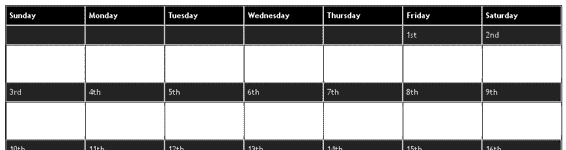

### 日历视图
主日历视图显示日历月份，并列出该月相应日的任何活动。

构建一个日历月份涉及创建若干行，如图 8-5 所示。要构建这样的内容，你首先需要创建一个表格，然后逐行添加每一行。工作日是表头，然后你逐步构建每一行的单独日期。

### 注意
#### 预警
构建日历视图是一段编写起来异常棘手代码。如果你丢失了逻辑，你将花费几个小时尝试理解为什么得到的结果与你预期的略有不同。诀窍是逐步构建日历。

**图 8-5**
日历视图包含若干行，包括工作日、日期以及活动所在的区域。

创建一个名为 `view.php` 的新文件并添加此代码：

```php
<?php
session_start();
require("config.php");
if(isset($_SESSION['LOGGEDIN']) == FALSE) {
    header("Location: " . $config_basedir);
}
?>
```

保护页面免受任何未登录用户访问后，创建一个小型函数：

```php
<?php
session_start();
require("config.php");
if(isset($_SESSION['LOGGEDIN']) == FALSE) {
    header("Location: " . $config_basedir);
}

function short_event($name) {
    $final = "";
    $final = (substr($name, 0, 12) . "...");
    return $final;
}
?>
```

此函数缩短了添加到日历日期的活动名称。对于你的“工作早餐”活动，该名称在日历上被缩短为 `Working Brea…`。这将活动保持在单行。为了实现这一点，函数使用 `substr()` 截取前 12 个字母，然后在字符串末尾附加 `…`。

继续添加代码：

```php
require("header.php");
if($_GET['error']) {
    echo "<script>newEvent('" . $_GET['eventdate'] . "', 1)</script>";
}
```

这段代码通过 `if` 检查是否存在错误 `GET` 变量。如果存在，则添加一个 `<script>` 标签。此代码块用于用户稍后在表单中输入新活动的情况。如果表单包含错误，页面将重新加载并且 `<script>` 标签将运行 `newEvent()` JavaScript 函数。该函数被传递了两个参数：日期和错误代码（`newEvent()` 将在本章稍后详细讨论）。创建变量并添加表头：

```php
if($_GET['error']) {
    echo "<script>newEvent('" . $_GET['eventdate'] . "', 1)</script>";
}
$cols = 7;
$weekday = date("w", mktime(0, 0, 0, $month, 1, $year));
$numrows = ceil(($numdays + $weekday) / $cols);
echo "<br />";
echo "<table class='cal' cellspacing=0 cellpadding=5 border=1>";
echo "<tr>";
echo "<th class='cal'>Sunday</th>";
echo "<th class='cal'>Monday</th>";
echo "<th class='cal'>Tuesday</th>";
echo "<th class='cal'>Wednesday</th>";
echo "<th class='cal'>Thursday</th>";
echo "<th class='cal'>Friday</th>";
echo "<th class='cal'>Saturday</th>";
echo "</tr>";
$counter = 1;
$newcounter = 1;
```


`$numrows` 变量获取了 `bar.php` 中的 `$numdays` 变量，加上 `$weekday`，并除以列数（7）。将 `$weekday` 加到 `$numdays` 上的句是为了补齐上个月剩余的天数。参考图 8-5，你可以看到该月从周五开始，但从周日到周四的这几天不包含任何日期。通过加上 `$weekday`，你设置了需要填充的天数。在这个示例中，周五返回 5，如果你从左到右计数（从 0 开始），你就得到了周五。

在设置好这些变量后，会添加表格表头，最后将两个变量设置为 1。这些变量将在稍后的代码中被用作计数器。

现在，你可以添加第一行单元格，为指定的日期添加日期。在开始添加实际日期之前，先填充该月 1 号之前的之前的天数：

# 第 8 章：创建一个基于 Web 的日历

```php
$counter = 1;

$newcounter = 1;

echo "<tr>";

$daysleft = 6 - $weekday—;

for($f=0;$f<=$weekday;$f++) {
    echo "<td class='cal_date' width='110' height='10'>";
    echo "</td>";
}
```

在这里，你通过从 6 中减去 `$weekday—`（即 `$weekday` 减 1）来计算剩余天数（一周的天数——记住，此函数从 0 开始）。之所以考虑 `$weekday` 减 1，是因为星期几是从 0 而不是 1 开始的。

添加第一行的剩余天数：

```php
echo "</td>";
}

for($f=0;$f<=$daysleft;$f++) {
    echo "<td class='cal_date' width='100' height='10'>";
    $display = date("jS", mktime(0, 0, 0, $month, $counter, $year));
    $todayday = date("d");

    $todaymonth = date("n");

    $todayyear = date("Y");

    if($counter == $todayday AND $month == $todaymonth AND
    $year == $todayyear) {
        echo "<strong>TODAY " . $display . "</strong>";
    }
    else {
        echo $display;
    }

    echo "</td>";
    $counter++;
}

echo "</tr>";
```

在循环内部，使用 `date()` 创建了 `$display` 变量以存储格式化后的日期。然后向 `$todayday`、`$todaymonth` 和 `$todayyear` 变量中填充了今天日期的相关部分。接下来，检查今天的详情是否与之前创建的相应 `$counter`、`$month` 和 `$year` 变量匹配。

如果是，会在单元格中加入 **TODAY** 以指示当前日期。否则，只显示日期。

在添加包含事件的单元格之前，先填充该月 1 号之前的天数：

```php
}

echo "</tr>";
echo "<tr>";

for($f=0;$f<=$weekday;$f++) {
    echo "<td class='cal' width='110' height='10'>";
    if($newcounter <= $numdays) {

    }
    echo "</td>";
}
```

对于第一行的剩余单元格，从数据库中获取事件并显示它们：

```php
for($f=0;$f<=$daysleft;$f++) {
    echo "<td class='cal' width='110' height='40'>";
    $date = $year . "-" . $month . "-" . $newcounter;
    echo "<a class='cal' href='#' onclick=\"newEvent('" . $date . "')\"></a>";
    $eventsql = "SELECT * FROM events";
```


创建一个名为 `internal_request.js` 的新文件，并添加示例 8-8 所示所示函数。。该文件包含 JavaScript，而不是 PHP。

### 示例 8-8

此函数为浏览器加载正确的 XML HTTP 请求对象。

```javascript
function createRequestObject(){
  var request_o;
  var browser = navigator.appName;
  if(browser == "Microsoft Internet Explorer"){
    request_o = new ActiveXObject("Microsoft.XMLHTTP");
  } else{
    request_o = new XMLHttpRequest();
  }

  return request_o;
}
```

第一行创建一个名为 `request_o` 的新变量。下一行检测 Web 浏览器的名称并存储在 `browser` 变量中。一个 if 语句检查浏览器是否为 Microsoft Internet Explorer，并将 `request_o` 设置为相应的 ActiveX 对象。否则，将 `request_o` 设置为 Netscape/Mozilla 对象。

运行该函数以实例化对象：

```javascript
var http = createRequestObject();
```

此时，你已经有了一个可用的 XML HTTP 请求对象。你可以开始添加之前在主日历视图中调用的函数。

### 查看事件信息

如果用户点击事件，详细信息应该出现在侧边栏中。事件链接调用了 `getEvent()` 函数（如示例 8-9 所示），因此将其添加到 `internal_request.js` 中。

### 示例 8-9

此函数加载页面以从数据库请求事件详情。

```javascript
function getEvent(eventid){
  http.open('get', 'internal_request.php?action=getevent&id=' + eventid);
  http.onreadystatechange = handleEvent;
  http.send(null);
}
```

第一行使用 XML HTTP 请求对象的 `open()` 方法打开页面以处理请求。该方法接受两个参数。第一个是提交请求的机制（GET 或 POST）。第二个是指定用于处理请求的脚本。在这一行中，你访问了 `internal_request.php`（不要与 `internal_request.js` 混淆）并向它传递了一个名为 `id` 的 GET 变量。

该变量设置为传递给函数的数字。

当请求发出后，你指定用哪种方法处理响应；第二行指定 `handleEvent` 为该方法。最后，第三行实际发送了数据。`send()` 方法传递了 Null，因为你正在使用 GET（如果你使用 POST，则会使用 null 以外的值）。

添加 `handleEvent()` 方法来处理请求的结果：

```javascript
function handleEvent(){
  if(http.readyState == 4){
    var response = http.responseText;
    document.getElementById('eventcage').innerHTML = response;
  }
}
```

# 第 8 章：创建一个基于 Web 的日历

在第一行中，你检查请求的状态。`readyState` 方法可以返回五个状态码之一。这些代码显示在表 8-2 中。

#### 表 8-2：使用 `readyState` 检查请求当前处于什么种状态码。

| 代码 | 含义 |
| :--- | :--- |
| 0 | 未初始化 |
| 1 | 加载中 |
| 2 | 已加载 |
| 3 | 交互中 |
| 4 | 完成 |

如果返回的代码为 4（完成），查询返回的文本（通过 `responseText` 引用）将存储在名为 `response` 的变量中。现在你使用 `getElementById` 方法引用侧边栏中的 `eventcage` `<<div>>`，并使用 `innerHTML` 方法将 `<<div>>` 的内容更改为 `response` 变量的内容。

如示例 8-10 所示，创建之前在 `getEvent()` 函数中提到的 `internal_request.php` 页面。

### 示例 8-10

此代码简单请求与 `id` GET 变量匹配的记录。

```php
<?php
session_start();
require("db.php");
require("config.php");
if(isset($_SESSION['LOGGEDIN']) == FALSE) {
  header("Location: " . $config_basedir);
}

if($_GET['action'] == 'getevent'){
  $sql = "SELECT * FROM events WHERE id = " . $_GET['id'] . ";";
  $result = mysql_query($sql);
  $row = mysql_fetch_assoc($result);
  echo "<h1>Event Details</h1>";
  // continues
  echo $row['name'];
  echo "<p>" . $row['description'] . "</p>";
  echo "<p><strong>Date:</strong> " . date("D jS F Y", strtotime($row['date'])) . "<br />";
  echo "<strong>Time:</strong> " . $row['starttime'] . " - " . $row['endtime'] . "</p>";
}
?>
```

在该脚本中，你检查动作 `GET` 变量是否等于 `getevent`。`action` 变量被用于区分页面上的不同功能。

在 `if` 语句内部，从 `events` 表中返回与 `id` GET 变量 `id` 相同的记录并进行显示。当此功能完成后，当用户点击项目时，事件信息将显示在侧边栏中，如图 8-6 所示。

Ajax 的动态特性通过静态截图无法充分体现，但请放心，它让应用程序感觉更加流畅。

### 添加新事件

在日历中添加新事件的机制与查看事件信息的方式非常相似——加载一个函数、发出请求，并更新来自 `bar.php` 的 `eventcage` `<<div>>`。

图 8-7 显示了此功能的界面。

当用户悬停在单元格的某些空白区域上时，背景变为灰色；用户随后可以点击访问“新事件”表。

第一步是实现你在 `view.php` 中添加到主日历视图的链接中调用的函数。加载 `internal_request.js` 并添加示例 8-11 所示的函数。

### 示例 8-11

此函数使用 `open()` 加载显示表单的脚本。

```javascript
function newEvent(eventdate, error){
  http.open('get', 'neweventform.php?date=' + eventdate + "&error=" + error);
  http.onreadystatechange = handleNewEvent;
  http.send(null);
}
```

此函数的工作方式与之前的 `getEvent()` 几乎相同。然而，请求加载了表单（位于 `neweventform.php`）。

该函数还将错误代码传递给页面。在 `internal_request.js` 的 `newEvent()` 函数下方添加以下处理程序：

```javascript
function handleNewEvent(){
  if(http.readyState == 4){
    var response = http.responseText;
    document.getElementById('eventcage').innerHTML = response;
  }
}
```

此处理程序的工作方式与 `handleEvent()` 完全相同。

创建 `neweventform.php` 文件，如示例 8-12 所示。

开始时间和结束时间控件使用 `for` 循环生成可用选项。

```php
<?php
if($_GET['error'] == 1) {
  echo "<p><strong>表单存在错误。请修正并重新提交。</strong></p>";
}
?>

<h1>添加新事件</h1>
<form action="processnewevent.php?date=<?php echo $_GET['date']; ?>" method="POST">
  <table>
    <tr>
      <td>日期</td>
      <td>
        <?php echo "<strong>" . date("D jS F Y", strtotime($_GET['date'])) . "</strong>"; ?>
        <input type="hidden" name="date" value="<?php echo $_GET['date']; ?>">
      </td>
    </tr>
    <tr>
      <td>名称</td>
      <td><input type="text" name="name" size="15"></td>
    </tr>
    <tr>
      <td>开始时间</td>
      <td>
        <select name="starthour">
          <?php
          for($i=0;$i<=23;$i++) {
            echo "<option value=" . sprintf("%02d", $i) . ">" . sprintf("%02d", $i) . "</option>";
          }
          ?>
        </select>
        <select name="startminute">
          <?php
          for($i=0;$i<=60;$i++) {
            echo "<option value=" . sprintf("%02d", $i) . ">" . sprintf("%02d", $i) . "</option>";
          }
          ?>
        </select>
      </td>
    </tr>
    <tr>
      <td>结束时间</td>
      <td>
        <select name="endhour">
          <?php
          for($i=0;$i<=23;$i++) {
            echo "<option value=" . sprintf("%02d", $i) . ">" . sprintf("%02d", $i) . "</option>";
          }
          ?>
        </select>
        <select name="endminute">
          <?php
          for($i=0;$i<=60;$i++) {
            echo "<option value=" . sprintf("%02d", $i) . ">" . sprintf("%02d", $i) . "</option>";
          }
          ?>
        </select>
      </td>
    </tr>
  </table>
</form>
```


```html
<tr>
  <td><textarea cols="15" rows="10" name="description"></textarea></td>
</tr>
<tr>
  <td></td>
  <td><input type="submit" name="submit" value="Add Event"></td>
</tr>
</table>
</form>
```

300

# PHP 与 MySQL 战战

在表单顶部，程序会检查是否存在错误 `GET` 变量。如果存在，则会显示错误消息。

处理表单的脚本是 `processnewevent.php`。创建此文件并开始添加以下代码：

```php
<?php

require("db.php");

if(empty($_POST['name'])) {

  $error = 1;

}

if(empty($_POST['description'])) {

  $error = 1;
}

if($_POST['starthour'] > $_POST['endhour']) {

  $error = 1;
}

if($_POST['starthour'] == $_POST['endhour']) {

  $error = 1;
}

if($error == 1) {

  header("Location: " . $config_basedir . "view.php?error=1&eventdate=" . $_GET['date']); exit;

}
```

这一组 `if` 语句执行了一些验证检查。这些检查的工作原理与之前的验证示例类似——如果检查失败，就会创建 `$error` 变量并重定向页面。这些检查是为了确保结束时间不早于开始时间，且开始和结束时间不相同。还会检查确保文本框不为空。

准备变量：

```php
if($error == 1) {

  header("Location: " . $config_basedir . "view.php?error=1&eventdate=" . $_GET['date']); exit;
}
```

# 第 8 章：创建一个基于 Web 的日历

301

`$elements = explode("-", $_POST['date']);`
`$redirectdate = $elements[1] . "-" . $elements[0];`
`$finalstart = $_POST['starthour'] . ":" . $_POST['startminute'] . ":00";`
`$finalend = $_POST['endhour'] . ":" . $_POST['endminute'] . ":00";` 此块中的第一行使用 `explode()` 将日期的不同部分填充到 `$elements` 数组中。第二行构建了一个仅包含月份和年份元素的变量（这些元素用于浏览月份，例如使用侧边栏中的箭头）。

后两行将时间格式化为可以在 `TIME` 数据库字段使用的格式。该字段需要 `00:00:00` 格式，因此每行都将表单元素拼接成这种格式。

插入数据并使用 `$redirectdate` 重定向到添加日期的那个月份：

```php
$finalstart = $_POST['starthour'] . ":" . $_POST['startminute'] . ":00";
$finalend = $_POST['endhour'] . ":" . $_POST['endminute'] . ":00";
$inssql = "INSERT INTO events(date, starttime, endtime, name, description) VALUES('" . $_POST['date'] . "', '" . $finalstart . "', '" . $finalend . "', '" . addslashes($_POST['name']) . "', '" . addslashes($_POST['description']) . "');";
mysql_query($inssql);
header("Location: " . $config_basedir . "view.php?date=" . $redirectdate);
?>
```

功能现在已完成。

## 删除事件

当用户点击事件旁边的红色 `X` 块时就会删除事件。

创建一个名为 `delete.php` 的新文件，并添加示例 8-13 所示的代码。

302

PHP 与 MySQL 战战

### 示例 8-13

要删除事件，请从数据库中移除记录。

```php
<?php

require("db.php");
$sql = "DELETE FROM events WHERE id = " . $_GET['id']; mysql_query($sql);
echo "<script>javascript: history.go(-1)</script>";
?>
```

这里显示了从数据库删除事件的常用代码。然后你使用了不同类型的重定向，这次使用的是 JavaScript。你可以使用其他类型的重定向；使用这种是为了向你展示另一种选择。

## 总结

在本项目中，你创建了一个不同的 Web 应用程序。与书中其他公开托管且可访问的应用程序不同，这个项目涉及创建一个单人使用的东西。由于 Ajax 功能的存在，这个应用程序比其他一些项目更像传统的应用程序。

Ajax 已成为关键的 Web 开发技术，你在这里探索的技能将帮助你创建更动态、灵活的 Web 应用程序。

# 第 9 章

## FAQ 内容管理

### 系统

如果你参加任何规模较大的 IT 会议，你可能会在现场听到的一个流行术语是 `content management`（内容管理）。这个术语及其首选载体 `Content Management System`（CMS 系统）指的是提供简单有效手段来管理内容的 Web 应用程序。

构建一个 CMS 并非易事。你面临的主要挑战在于如何以简单而全面的方式呈现管理内容所需的所有工具。许多 CMS 还会处理不同类型的用户（管理员、普通用户、版主等），因此你还需提供一个安全且一致的权限系统。

在本章中，你将仔细克服恐惧和疑虑，直面挑战。准备好构建完全符合流行术语标准的 CMS。

### 注意：在“错误”中学习

本章中的项目是我几年前作为一个独立的 CMS 开发的。虽然我在互联网上以 Alpha 状态发布了代码，但该项目在很大程度上还未完成，仍然需要额外的工作来完成应用程序。

在准备这一章时，我采用了原始代码并对其进行了纠正和完成。这个过程涉及修复了所有糟糕的嵌套表格以及我在学习 PHP 期间养成的其他不良编程习惯。虽然修复代码实际上涉及了重写，但这个过程是我自该项目最初编写以来所取得进展的一个令人满意的范例。

我建议你定期回顾你的旧项目并对它们进行一次“大扫除”。即使没有别的，它也能让你对自己在开发方面取得的进步有一个令人满意的提醒。

303
304

PHP 与 MySQL 战战

## 项目概述

在本章中，你将创建一个用于常见问题（FAQ）列表的 CMS。

问题通常以链接的形式显示，点击后显示问题的答案。

为了更好地感受项目，你首先探索了一些用例，它们能更好地解释了类型的功能：

Bill 访问 FAQ 网站并想了解更多关于 PHP 的信息。当网站加载时，他可以在侧边栏看到主题列表。其中一个主题是 PHP，于是 Bill 点击链接，页面显示属于 PHP 主题的课题列表。Bill 然后点击其中一个主题——`Variables`（变量），就会显示一个相关问题列表，以及答案的简要总结。

Bill 选择了其中一个问题；页面现在显示问题、答案和一些相关的评论。在阅读问题时，Bill 决定想发表一条评论。他用用户名和密码登录网站，然后回到问题页面。评论下方现在显示了一个表单，于是 Bill 将他的想法输入表单并提交。该评论现在出现在页面上。

这个用例演示了典型用户如何进入网站、浏览内容并为问题添加评论。侧边栏充当在主题和课题之间导航的机制，而主内容（问题）显示在页主体上。

为了让网站尽可能面向社区化，用户应该能够拥有一个主题并管理内容如何添加到该主题中：Ade 查看了网站上的 PHP 主题信息页。页面显示了该主题的所有者，但他注意到目前还没有所有者。由于 Ade 目前处于登录状态，出现了一个链接，允许他提议自己成为该主题的新所有者。他点击链接跳转到一个页面，可以在那里输入他应该被选为所有者的理由。


随后，管理员登录并审核已提交的所有权请求列表。她查看了 Ade 的请求，并决定 Ade 是一个合适的所有者。

她接受了 Ade 的请求，系统会自动向他发送一封邮件告知其申请成功。

# 第 9 章：FAQ 内容管理系统

另一个关键用例描述了如何向项目中添加和删除内容：现在 Ade 是 PHP 学科的新所有者，他可以添加主题和问题。当 Ade 登录时，新学科会出现在他的控制面板（一个显示账户信息的页面）中。Ade 现在可以使用 `Add Topic` 和 `Add Questions` 页面向该学科添加内容。

当 Bill 浏览 PHP 学科时，他也可以点击主题信息页上的 `Add Question` 链接添加问题。当 Bill 提交问题时，该问题将处于审核状态，直到 Ade 或管理员允许其发布。

Ade 登录网站并查看待审核的问题。在页面内部，他可以查看问题详情，并接受或拒绝它。他点击 `Accept` 链接使该问题上线。

这些用例确定了应用程序的核心功能需求。在构建程序时，你可能会发现重新阅读这些用例很有帮助，可以让你更好地了解应用程序应该如何工作。

## 构建数据库

你将创建的数据库如图 9-1 所示。

四个核心表是 `subject`、`topics`、`questions` 和 `comments`。这些关联表还与存储用户账户的 `users` 表挂接。`mod_subowner` 表存储所有权请求。

### 实现数据库

启动 `phpMyAdmin`。创建一个名为 `faq` 的新数据库并添加以下表：

### `admins` 表
- `id`。将其设置为 `TINYINT`（只需要几个管理员）并开启 `auto_increment`。将此字段设置为主键。
- `username`。将其设置为 `VARCHAR`，长度为 10。
- `password`。将其设置为 `VARCHAR`，长度为 10。

### `questions`
```
| id | question_id | question | answer | addedby_id | dateadded | active |
```

### `topics`
```
| topic_id | subject_id | name |
```

### `subjects`
```
| id | name | blurb | owner_id | active |
```

### `comments`
```
| id | question_id | title | comment | user_id |
```

### `mod_subowner`
```
| id | sub_id | user_id | reasons |
```

### `users`
```
| id | username | password | email |
```

**图 9-1**：四个表（subjects, topics, questions, comments）之间的内容关系与论坛项目类似。

#### 注意：已激活与未激活的问题

`active` 字段位于 `questions` 表中。该字段标识问题是否已上线。如果该字段包含 `0`，则该问题当前正处于审核状态。如果该字段被设置为 `1`，则该问题已上线。

当不拥有该学科的用户提交问题时，`active` 会被设置为 `0`（需要审核）。当所有者添加问题时，`active` 被设置为 `1`。当待审核的问题被接受时，`active` 会从 `0` 变为 `1`。

### `comments` 表
- `id`。将其设置为 `BIGINT`（可能有多条评论）并在 Extras 列中开启 `auto_increment`。将此字段设置为主键。
- `question_id`。将其设置为 `INT`。
- `title_id`。将其设置为 `VARCHAR` 并设置大小为 20。
- `comment`。将其设置为 `TEXT`。
- `user_id`。将其设置为 `INT`。
- 对于此表，选择 `InnoDB` 表类型。

### `mod_subowner` 表
- `id`。将其设置为 `INT`（可能有多个请求）并开启 `auto_increment`。将此字段设置为主键。
- `sub_id`。将其设置为 `INT`。
- `user_id`。将其设置为 `INT`。
- `reasons`。将其设置为 `TEXT`。

### `questions` 表
- `id`。将其设置为 `INT`（可能有多个问题）并开启 `auto_increment`。将此字段设置为主键。
- `topic_id`。将其设置为 `INT`。
- `question`。将其设置为 `VARCHAR`，长度为 50。
- `answer`。将其设置为 `TEXT`。
- `addedby_id`。将其设置为 `INT`。
- `dateadded`。将其设置为 `DATETIME`。
- `active`。将其设置为 `TINYINT`。
- 对于此表，选择 `InnoDB` 表类型。

### `subjects` 表
- `id`。将其设置为 `INT`（可能有多个学科）并开启 `auto_increment`。将此字段设置为主键。
- `subject`。将其设置为 `VARCHAR`，长度为 20。
- `blurb`。将其设置为 `TEXT`。
- `owner_id`。将其设置为 `INT`。
- 对于此表，选择 `InnoDB` 表类型。

### `topics` 表
- `id`。将其设置为 `INT`（可能有多个主题）并开启 `auto_increment`。将此字段设置为主键。
- `subject_id`。将其设置为 `INT`。
- `name`。将其设置为 `VARCHAR`，长度为 20。
- 对于此表，选择 `InnoDB` 表类型。

### `users` 表
- `id`。将其设置为 `INT`（可能有多个订单）并开启 `auto_increment`。将此字段设置为主键。
- `username`。将其设置为 `VARCHAR` 并设置大小为 10。
- `password`。将其设置为 `VARCHAR` 并设置大小为 10。
- `email`。将其设置为 `VARCHAR` 并设置大小为 50。

## 创建表关系

由于有许多不同的内容和子内容（学科 -> 主题 -> 问题 -> 评论），你需要支持级联删除。级联删除在第 5 章的论坛项目中首次介绍过。

在 `phpMyAdmin` 中，点击 SQL 标签页并分别添加以下三个查询：

```sql
ALTER TABLE comments ADD FOREIGN KEY(question_id) REFERENCES questions (id) ON DELETE CASCADE;
ALTER TABLE questions ADD FOREIGN KEY(topic_id) REFERENCES topics (id) ON DELETE CASCADE;
ALTER TABLE topics ADD FOREIGN KEY(subject_id) REFERENCES subjects (id) ON DELETE CASCADE;
```

现在当你删除数据时，其他表中的所有依赖信息也会被删除。

#### 插入示例数据

准备好基础组表后，你就可以添加一些示例数据了。

请记住，不要在 `id` 列中填写数字；`auto_increment` 会为你处理此问题。你可以随意添加自己的示例数据或本示例使用的数据。

### `admins` 表的示例数据
为管理员创建一个用户名和密码。此示例使用 `admin` 作为用户名，`password` 作为密码。

### `users` 表的示例数据
为用户创建用户名、密码和邮箱地址。此项目使用 `bill` 和 `password` 作为一个用户，使用 `ade` 和 `password` 作为另一个用户。为每个示例用户添加真实有效的邮箱地址；你将使用邮箱地址向用户发送所有权接受或拒绝的邮件。

### `subjects`, `topics`, `questions`, 和 `comments` 表的示例数据
在向这些表添加示例数据时，你需要确保它们之间的关系是正确的；否则项目中的数据库逻辑将会崩溃。

首先，向 `subjects` 表添加几个学科，如图 9-1 所示。

**表 9-1**：`subjects` 表包含主要学科。

| SUBJECT | BLURB | OWNER_ID |
| :--- | :--- | :--- |
| PHP | <添加自己的 blurb> | 0 |
| MySQL | <添加自己的 blurb> | 2 |

在前面的表中，你为 PHP 学科设置的 `owner_id` 为 `0`，这意味着该学科没有所有者，因此可以申请所有。第二个用户拥有第二个学科。

向 `topics` 表添加内容，如图 9-2 所示。

**表 9-2**：`topics` 表存储学科内的子分类。

| SUBJECT_ID | NAME |
| :--- | :--- |
| 1 | Variables |
| 1 | Functions |

在这种情况下，你添加了两个主题，它们属于第一个学科（PHP）。

向 `questions` 表添加问题，如图 9-3 所示。

**表 9-3**：`active` 字段标识问题是否上线。

| TOPIC_ID | QUESTION | ANSWER | ADDEDBY_ID | DATEADDED | ACTIVE |
| :--- | :--- | :--- | :--- | :--- | :--- |
| 1 | 如何定义变量？ | <添加自己的答案> | 1 | NOW() | 1 |
| 1 | 为什么 PHP 变量没有指定类型？ | <添加自己的答案> | 1 | NOW() | 1 |

在添加这些问题时，在 `dateadded` 字段的函数组合框中选择 `NOW`。


被设置为另一个值（通常为 0），该问题正在等待主题所有审核。

最后，为 `comments` 表中的第一个问题添加一条注释，如表 9-4 所示。

### 表 9-4
注释是为问题提供额外信息的有用方法。

| QUESTION_ID | TITLE | COMMENT | USER_ID |
| :--- | :--- | :--- | :--- |
| 1 | 书籍推荐 | | |
| 2 | 如果你想更详细地学习变量，请参考 Foo Bar 编写的 Variable Foo Machine。 | | |

`mod_subowner` 表的示例数据
保持此表为空。

## 开始编码
要开始工作，请创建一个新的项目目录，并创建 `config/header/footer` 和 `main index` 文件。首先，从之前的项目将 `db.php` 复制到当前目录，然后创建一个名为 `config.php` 的新文件并添加示例 9-1 所示的代码。

#### 示例 9-1
该配置文件与之前的项目几乎相同。

```php
<?php
$dbhost = "localhost";
$dbuser ="root";
$dbpassword = "";
$dbdatabase = "faq";
$config_basedir = "http://localhost/sites/faq/"; $config_sitename = "You ask the questions";
?>
```

### 第 9 章
#### FAQ 内容管理系统

创建 `header.php` 并添加示例 9-2 所示的代码。

#### 示例 9-2
头部文件布局了常用的 `<<div>` 元素数组。

```php
<?php
require("config.php");
$db = mysql_connect($dbhost, $dbuser, $dbpassword);
mysql_select_db($dbdatabase, $db);
?>
<!DOCTYPE HTML PUBLIC "-//W3C//DTD HTML 4.01 Transitional//EN" "http://www.w3.org/TR/html4/loose.dtd">
<html>
<head>
<title><?php echo $config_sitename; ?></title>
<link href="stylesheet.css" rel="stylesheet">
</head>
<body>
<div id="header">
<?php echo "<h1>" . $config_sitename . "</h1>"; ?>
</div>
<div id="menu">
&bull;
<a href="index.php">Home</a>
&bull;
<?php
if($_SESSION['SESS_USERNAME']) {
echo "<a href='userlogout.php'>Logout</a>";
}
else {
echo "<a href='login.php'>Login</a>";
}
?>
&bull;
</div>
<div id="container">
<div id="bar">
<?php
require("bar.php");
?>
</div>
<div id="main">
创建 `footer.php` 并添加剩余代码，如示例 9-3 所示。
</div>
</div>
</body>
</html>
```

#### 示例 9-3
页脚文件

### 一个更复杂的侧边栏
侧边栏包含用于网站不同部分的若干不同元素。随着项目的进展和对不同部分的开发，该文件将逐步构建。第一个任务是像用例中讨论的那样展示主题（Subject）和话题（Topic）列表。

主题以列表形式呈现。当用户点击某个主题时，`index.php` 将重新加载，并带有一个包含该主题 `id` 的主题 `GET` 变量。在代码的后续部分，你检查此变量是否存在，如果存在则显示话题列表。

第一次加载页面时（没有主题变量），只显示主题，但当用户点击主题后（现在可以使用主题变量了），就会显示话题。

创建 `bar.php` 并开始添加代码：

```php
<?php
$subsql = "SELECT * FROM subjects";
$subres = mysql_query($subsql);
echo "<h1>Subjects</h1>";
echo "<table>";
while($subrow = mysql_fetch_assoc($subres)) {
    echo "<tr>";
    echo "<td width='5%'>";
    if($subrow['id'] == $_GET['subject']) {
        echo "&bull;";
    }
    echo "</td>";
    echo "<<td><a href='index.php?subject=" . $subrow['id'] . "'>" . $subrow['subject'] . "</a></td>"; 
    if($_SESSION['SESS_ADMINUSER']) {
        echo "<td>[<a href='deletesubject.php?subject=" . $subrow['id'] . "'>X</a>]</td>";
    }
    echo "</tr>";
}
echo "</table>";
```

这段代码选择了主题，然后创建一个表格来显示它们。使用表格而不是无序列表允许你在当前选择的主题旁边显示一个点。在 `while` 循环内部，在第一个单元格中进行检查，看当前行的 `id` 是否与主题 `GET` 变量相同。如果是，则显示一个点（使用 HTML 实体 `&bull;`）。在下一个表格单元格中，创建链接。

现在检查管理员已登录，如果是，则添加删除链接 (X)：

完成主题列表后，添加话题：

```php
if(isset($_GET['subject'])) {
    $topsql = "SELECT * FROM topics WHERE subject_id = " . $_GET['subject'] . ";";
    $topres = mysql_query($topsql);
    echo "<h1>Topics</h1>";
    if(mysql_num_rows($topres) == 0) {
        echo "No topics!";
    }
    echo "<table width='100%'>";
    while($toprow = mysql_fetch_assoc($topres)) {
        echo "<tr>";
        echo "<td width='5%'>";
        if($toprow['id'] == $_GET['topic']) {
            echo "&bull;";
        }
        echo "</td>";
        echo "<<td><a href='questions.php?subject=" . $subject . "&amp;topic=" . $toprow['id'] . "'>" . $toprow['name'] . "</a></td>";
        if($_SESSION['SESS_ADMINUSER']) {
            echo "<td>[<a href='deletetopic.php?subject=" . $toprow['subject_id'] . "&amp;topic=" . $toprow['id'] . "'>X</a>]</td>";
        }
        echo "</tr>";
    }
    echo "</table>";
}
?>
```

检查主题 `GET` 变量是否存在。如果存在，则使用相同的机制显示话题列表，每个话题都链接到 `questions.php`，并在其中传递主题和话题。

### 创建函数
在本项目项目中，你使用了两个自己创建的函数：

- `pf_fix_slashes()`：此函数提供了一种更智能的方法，确保在向数据库添加信息时引号被正确转义。
- `pf_check_number()`：此函数是之前项目中使用使用的 `pf_validate_number()` 函数的变体。此版本检查变量是否有效，但不执行任何重定向。

创建一个名为 `functions.php` 的新文件并添加第一个函数：

```php
<?php
function pf_fix_slashes($string) {
    if (get_magic_quotes_gpc() == 1) {
        return($string);
    }
    else {
        return(addslashes($string));
    }
}
```

在之前的项目中，你使用 `addslashes()` 对用于数据库的用户输入进行转义。虽然这种方法可行，但该函数假设 `php.ini` 中的 `magic_quotes_gpc` 选项是关闭的。如果该选项开启且你使用了 `addslashes()`，则会在 `magic_quotes_gpc` 添加的斜杠前面添加额外的斜杠。结果是你的数据中多了一个斜杠。

为了解决这个问题，新函数使用 `get_magic_quotes_gpc()` 检查该功能是否开启或关闭。如果函数返回 1 或 `TRUE`，则魔引号开启并返回普通字符串。如果魔引号关闭，则对字符串运行 `addslashes()` 然后返回。这个新函数确保你的应用程序可以在开启或关闭魔引号的情况下运行且无需修改。很棒，对吧？

下一个引入的函数是 `pf_check_number()`：

```php
<?php
function pf_check_number($value) {
    if(isset($value) == FALSE) {
        $error = 1;
    }
    if(is_numeric($value) == FALSE) {
        $error = 1;
    }
    if($error == 1) {
        return FALSE;
    }
    else {
        return TRUE;
    }
}
?>
```

此函数与之前项目使用的 `pf_validate_number()` 函数几乎相同，但对 $error 的检查在出错时返回 `FALSE`，在没有错误时返回 `TRUE`。

### 注意
**为什么要使用这个略有不同的函数？**


此项目中的某些页面具有两种属性：一种是通过 GET 变量触发的，另一种则不需要。如果你在这些页面中使用了 `pf_validate_number()`，那么不需要 GET 变量的种模式将会失败（`pf_validate_number()` 会检查变量是否存在）并重定向到另一个页面。

`pf_check_number()` 函数不包含重定向功能。

因此，该函数可以在 GET 变量存在时用于验证它。

316

实战 PHP 与 MySQL

# 构建主页面

下一个要创建的页面是 `index.php`。该脚本有两个主要功能：

* 如果页面没有传递 `subject` GET 变量，则页面将显示最后 10 个问题。
* 如果页面有 `subject` GET 变量，则将显示该特定学科的信息。这些信息包括学科的名称和描述，以及关于主题和问题数量的一些统计信息。

创建该文件并开始添加代码：

```php own<?php
session_start();

require("config.php");
require("functions.php");

if($_GET['subject']) {
if(pf_check_number($_GET['subject']) == TRUE) {
$validsub = $_GET['subject'];
}
else {
header("Location: " . $config_basedir);
}
}

require("header.php");
```

你检查了 `subject` GET 变量是否存在，如果存在，则通过 `pf_check_number()` 进行处理。如果通过了验证（并返回 `TRUE`），则将 `$validsub` 设置为数字。否则，页面将重定向。

现在检查 `subject` GET 变量是否存在，如果存在，则显示关于该学科的信息：

```php
require("header.php");
if($_GET['subject']) {
$subsql = "SELECT users.username, subjects.* FROM subjects LEFT JOIN users ON subjects.owner_id = users.id
WHERE subjects.id = " . $validsub . ";";
$subresult = mysql_query($subsql);
$subrow = mysql_fetch_assoc($subresult);
echo "<h1>" . $subrow['subject'] . " Summary</h1>";
```

第 9 章

FAQ 内容管理系统

317

创建一个查询来收集学科信息以及映射到 `subjects.owner_id` 字段的用户名。在之前的项目中，连接是使用 SQL 中的 `WHERE` 子句完成的，但在这里你使用的是 `LEFT JOIN` 语法。接下来的段描述了该语法的工作原理：

从 `subjects` 表（`FROM subjects`）选择用户名和学科信息（`SELECT users.username, subjects.*`），然后通过相关条件（`ON subjects.owner_id = users.id`）连接 `subjects` 和 `users` 表（`LEFT JOIN users`），其中学科 id 等于 `$validsub`（`WHERE subjects.id = $validsub`）。

在编写连接时，你可以使用不同类型的连接（INNER、OUTER、LEFT 和 RIGHT），其中 `INNER` 和 `LEFT` 是最常见的变体。`INNER` 连接根据你指定的条件连接表。`LEFT` 连接执行相同的过程，但会将任何不匹配的字段填充为 `NULL` 值。

检查返回的数据以查看该学科是否有所有者。如果返回 `0`，则不存在所有者：

```php
echo "<h1>" . $subrow['subject'] . " Summary</h1>";
if($subrow['owner_id'] == 0) {
echo "This subject has no owner.";
}
```

注意

### 在此页面使用 LEFT Join

在此页面上使用 `LEFT` 连接的原因很重要。如果 `subjects` 表的 `owner_id` 设置为 `0` 以外的其他值，`INNER` 或 `LEFT` 连接都可以将 `owner_id` 与 `users` 表中的用户 id 关联。然而，如果学科没有所有者且 `owner_id` 设置为 `0`，`INNER` 连接将失败，因为 `users` 表中不存在 id 为 `0` 的用户。当你使用 `LEFT` 连接时，这种不匹配仍然会返回数据，但不匹配的信息被设置为 `NULL`。

在这个项目中，你使用了结合了 `JOIN` 和 `WHERE` 语法的连接组合。这确保了你能够接触到两种创建连接的方法。

如果学科没有所有者，检查用户是否已登录并显示指向学科所有权页面的链接：

```php
if($subrow['owner_id'] == 0) {
echo "This subject has no owner.";
if($_SESSION['SESS_USERNAME']) {
echo " If you would like to apply to own this subject, click <a href='applysubowner.php?subject=" . $subject . "'>here</a>.";
}
}
```

如果查询返回所有者，则显示用户名：

```php
echo " If you would like to apply to own this subject, click <a href='applysubowner.php?subject=" . $subject . "'>here</a>.";
}
else {
echo "This subject is owned by <strong>" . $subrow['username'] . "</strong>.";
}
```

在*斜体*标签中显示学科的简介：

```php
echo "This subject is owned by <strong>" . $subrow['username'] . "</strong>.";
echo "<p><i>" . $subrow['blurb'] . "</i></p>";
```

下一步是收集关于该学科的一些统计信息。统计该学科内包含的主题和问题数量：

```php
echo "<p><i>" . $subrow['blurb'] . "</i></p>";
$topsql = "SELECT count(distinct(topics.id)) AS numtopics, count(questions.id) AS numquestions FROM subjects LEFT JOIN topics ON subjects.id = topics.subject_id LEFT JOIN questions ON topics.id = questions.topic_id WHERE subjects.id = " . $validsub . " AND active = 1;";
$topresult = mysql_query($topsql);
$toprow = mysql_fetch_assoc($topresult);
```

为了收集这些信息，你执行了一个单一的大查询。接下来的段描述了该查询的工作原理：

从 `subjects` 表（`FROM subjects`）选择（SELECT）不同的主题 id 数（`count(distinct (topics.id)) AS numtopics`）和问题 id 数（`count (questions.id) AS numquestions`）。连接 `topics` 表（`LEFT JOIN topics`），其中学科 id

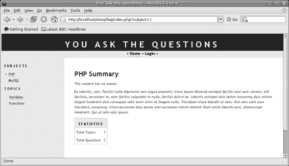

第 9 章

FAQ 内容管理系统

319

与 `$validsub`相同，然后连接 `questions` 表（`LEFT JOIN questions`），其中 topic id 等于 `topics` 表中的 `topic_id` 字段（`ON topics.id = questions.topic_id`）。

在表格中显示查询结果：

```php
echo "<table class='visible' cellspacing=0 cellpadding=5>";
echo "<tr><th class='visible' colspan=2>Statistics</th></tr>";
echo "<tr><td>Total Topics</td><td>" . $toprow['numtopics'] . "</td></tr>";
// ...
```

320

实战 PHP 与 MySQL

如果不存在学科变量，则显示最新的 10 个问题：

```php
else {
$latqsql = "SELECT questions.id, question, subject FROM subjects, questions, topics WHERE questions.topic_id = topics.id AND topics.subject_id = subjects.id AND active = 1 ORDER BY questions.dateadded DESC;";
$latqresult = mysql_query($latqsql);
$latqnumrows = mysql_num_rows($latqresult);

echo "<h1>Latest Questions</h1>";
if($latqnumrows == 0) {
echo "No questions!";
}
else {
echo "<ul>";
while($latqrow = mysql_fetch_assoc($latqresult)) {
echo "<li><a href='answer.php?id=" . $latqrow['id'] . "'>" . $latqrow['question'] . "</a> (<i>" . $latqrow['subject'] . "</i>)</</li>";
}
echo "</ul>";
}
}
```

每个问题都链接到 `answer.php` 并向其传递问题的 id。

注意

**记住……**

在执行查询时，请记住只返回 `active` 字段设置为 `1` 的记录。如果此字段被设置为 `0`，则该问题正在等待审核。你将在项目的后续部分学习更多关于问题审核系统的知识。

最后，添加页脚文件：


```php
echo "</ul>";
}

}

require("footer.php");

?>
```

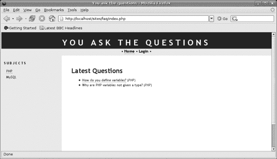

# 第 9 章：FAQ 内容管理系统

321

此功能的界面应该与图 9-3 所示的页面相似。

### 图 9-3
该界面提供了一个开始应用程序的简单方法。

## 显示问题

问答是 FAQ 网站的灵魂，在本节中，你将编写用于显示这些内容的代码。该功能分布在两个页面上。第一个页面（`questions.php`）显示主题内问题的摘要，第二个页面（`answer.php`）显示该特定问题的答案和评论。

### 显示问题摘要

创建一个名为 `questions.php` 的文件并开始添加代码：

```php
<?php
session_start();

require("functions.php");

if(pf_check_number($_GET['topic']) == TRUE) {
$validtopic = $_GET['topic'];
}
else {
header("Location: " . $config_basedir);
}
```


322

PHP 与 MySQL 实践

```php
if(pf_check_number($_GET['subject']) == TRUE) {
$validsubject = $_GET['subject'];
}
else {
header("Location: " . $config_basedir);
}
```

在此代码块中，你首先验证主题和提交的 GET 变量。如果验证失败，页面将重定向到网站的基础页。

页面上的每个问题都包含答案的简短摘要，如图 9-4 所示。

### 图 9-4
问题摘要提供了一种显示问题第一行的良好方法。

为了创建这个简短摘要，你创建一个名为 `question_summary()` 的小函数：

```php
header("Location: " . $config_basedir);
}

function question_summary($question) {
$final = "";
$final = (substr($question, 0, 80) . "...");
return $final;
}
```

`question_summary()` 函数与上一章在日历项目中创建的 `short_event()` 函数类似。该函数使用 `substr()` 截取前 80 个字符，然后追加 ….

执行查询：

```php
return $final;
}

require("header.php");
echo "<h1>Questions</h1>";
$qsql = "SELECT * FROM questions WHERE topic_id = " . $validtopic . " AND active = 1;";
$qresult = mysql_query($qsql);
$numrows = mysql_num_rows($qresult);
```

# 第 9 章
### FAQ 内容管理系统

323

如果没有返回任何记录，则显示“无问题”：

```php
$numrows = mysql_num_rows($qresult);
if($numrows == 0) {
echo "No Questions";
}
```

在表格中显示问题：

```php
echo "No Questions";
}
else {
echo "<table cellspacing=0 cellpadding=5>";
while($qrow = mysql_fetch_assoc($qresult)) {
echo "<tr>";
echo "<td><a href='answer.php?id=" . $qrow['id'] . "'>" . $qrow['question'] . "</a></td>";
echo "<td><<i>" . question_summary($qrow['answer']) . "</i></td>";
if($_SESSION['SESS_ADMINUSER'] AND $numrows >= 1) {
echo "<td><a href='deletequestion.php?topic=" . $validtopic . "&subject=" . $validsubject . "&questionid=" . $qrow['id'] . "'>Delete Question</a></td>";
}
echo "</tr>";
}
echo "</table>";
}
```

while 循环遍历返回的每个问题，然后显示问题和摘要。如果管理员已登录，还会添加“删除问题”链接。

最后，如果用户已登录，添加一个添加新问题的链接：

```php
echo "</table";
}
if($_SESSION['SESS_USERNAME']) {
echo "<h2>Options</h2>";
echo "<a href='addquestion.php?subject=$subject&topic=$topic'>Add a question</a>";
}

require("footer.php");
?>
```

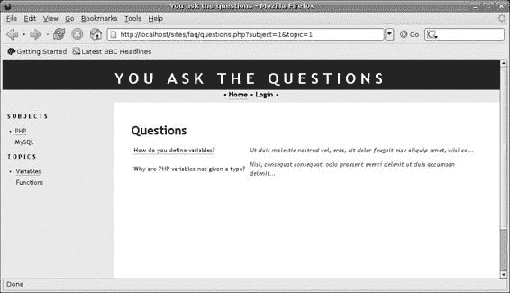

324

PHP 与 MySQL 实践

当前页面应该与图 9-5 所示的页面相似。

### 图 9-5
显示问题

## 显示特定问题

现在是时候创建一个显示特定问题答案的页面了。此页面不仅显示问题和答案，还显示用户对问题贡献的评论。如果用户已登录，你显示添加评论的表单；否则，只显示评论本身。

以下列表描述了你在此页面添加的四个主要代码部分：
1. 第一部分代码检查是否点击了提交按钮（如果显示了表单），并将评论添加到数据库中。此代码仅在用户登录并添加评论时才有用；否则代码将被忽略。
2. 第二部分显示问题和答案。
3. 第三个部分显示问题下方的评论。
4. 最后，检查用户是否已登录，如果是，则显示表单。

当用户未登录时，最终界面看起来如图 9-6 所示的页面。

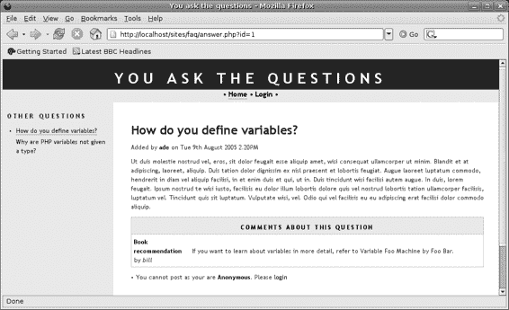

# 第 9 章
### FAQ 内容管理系统

### 图 9-6
用于查看问题的界面简单清晰。

创建一个名为 `answer.php` 的文件，并开始添加用于对 `id` GET 变量进行验证的代码：

```php
<?php
session_start();
require("db.php");
require("functions.php");

if(pf_check_number($_GET['id']) == TRUE) {
$validid = $_GET['id'];
}
else {
header("Location: " . $config_basedir);
}
```

开始编写第一段代码（处理表单）：

```php
header("Location: " . $config_basedir);
}

if($_POST['submit']) {
$qsql = "INSERT INTO comments(question_id, title, comment, user_id) VALUES('" . $validid . "'," . pf_fix_slashes($_POST['titleBox']) . "','" '" . pf_fix_slashes($_POST['commentBox']) . "', '" . $SESS_USERID . "')";
mysql_query($qsql);
header("Location: " . $config_basedir . "answer.php?id=" . $validid);
}
```

326

PHP 与 MySQL 实践

之前的查询使用了 `functions.php` 中的 `pf_fix_slashes()` 函数将表单信息安全地添加到数据库中。

如果没有点击提交按钮（可能是表单未显示，或者表单显示了但用户没有使用），开始显示问题和答案：

```php
header("Location: " . $config_basedir . "answer.php?id=" . $validid);
}
else {
require("header.php");
$qsql = "SELECT questions.question, questions.dateadded, questions.answer, users.username FROM questions, users WHERE addedby_id = users.id AND questions.id = " . $_GET['id'] . " AND active = 1;";
$qresult = mysql_query($qsql);
$qrow = mysql_fetch_assoc($qresult);
```

在之前的查询中，你使用了连接来收集问题详情。连接返回 `users` 表中的 `username`，其中 `questions.addedby_id` 和 `users.id` 是相同的。

如果没有返回结果，则告诉用户：

```php
$qrow = mysql_fetch_assoc($qresult);
if(mysql_num_rows($qresult) == 0) {
echo "No Questions";
}
```

否则，显示问题和答案详情：

```php
echo "No Questions";
}
else {
echo "<h1>" . $qrow['question'] . "</h1>";
```

# 第 9 章
### FAQ 内容管理系统

327

echo "Added by <strong>" . $qrow['username'] . "</strong> on " . date("D jS Y g.iA", strtotime($qrow['dateadded']));
echo "<p>";
echo $qrow['answer'];
echo "</p>";
```

添加显示问题评论的代码：

```php
echo "</p>";
$csql = "SELECT comments.title, comments.comment, users.username FROM comments, users WHERE comments.user_id = users.id AND question_id = " . $validid . ";";
$cresult = mysql_query($cresult);
```


```php
echo "<tr>";
echo "<td width='15%'><strong>"
. $crow['title'] . "</strong> by <i>" . $crow['username']
. "</i></td>";
echo "<td>" . $crow['comment'] . "</td>"; echo "</tr>";
}
}
echo "</table>";
```

注释以具有两列表格的形式显示。

328

实用 PHP 和 MySQL

检查用户是否已登录。如果是，显示表单：

```php
if($_SESSION['SESS_USERNAME']) {
echo "<h2>Add a comment</h2>";
echo "<form action='answer.php?id=" . $_GET['id']
. "' method='POST'>";
echo "<table width='100%'>";
echo "<tr>";
echo "<td>Title</td>";
echo "<td><input type='text' name='titleBox'></</td>"; echo "</tr>";
echo "<tr>";
echo "<td>Comment</td>";
echo "<td><textarea rows=10 cols=50
name='commentBox'></textarea></td>"; echo "</tr>";
echo "<tr>";
echo "<td></td>";
echo "<td><input type='submit'
name='submit'value='Post Comment'></</td>"; echo "</tr>";
echo "</table>";
echo "</form>";
}
```

如果用户未登录，显示一条消息：

```php
}
else {
echo "<p>&bull; You cannot post as you are
<strong>Anonymous</strong>. Please <a href='login.php'>login</a>
</p>";
}
```

最后，添加结束代码：

```php
echo "<p>&bull; You cannot post as you are
<strong>Anonymous</strong>. Please <a href='login.php'>login</a>
</p>";
}
}
}
```

```php
<?php
require("footer.php");
?>
```

# 第 9 章
## FAQ 答管理系统

329

添加了四个主要部分后，页面现在已经完成了。如果你有时间，请再次运行这一部分，以熟悉不同部分是如何结合在一起的。

### 注意事项

#### 顺便提一下……

在这个项目中，许多页面的部分并不是线性（从上到下）布局的。为了完全理解这些不同部分是如何结合在一起的，请重读前面的部分并参考屏幕上的代码。

### 更新侧边栏

在本节开始时查看图 9-6 的敏锐读者会注意到，侧边栏显示了同一主题下的其他问题。此此是为了方便在同一主题的不同问题之间进行导航。某个主题的读者可能想要阅读当前主题中的大部分、甚至全部问题。

加载 `bar.php` 并移动到文件开头添加以下代码：

```php
<?php
if(basename($SCRIPT_NAME) == "answer.php") {
echo "<h1>Other questions</h1>";
$subsql = "SELECT topic_id FROM questions WHERE id = "
. $_GET['id'] . ";";
$subresult = mysql_query($subsql);
$subrow = mysql_fetch_assoc($subresult);
$othersql = "SELECT id, question FROM questions WHERE
topic_id = " . $subrow['topic_id'] . " AND active = 1;"; $otherresult = mysql_query($othersql);
```

第一个查询返回当前问题所属的主题，第二个查询返回该主题内的问题。

显示问题：

```php
$otherresult = mysql_query($othersql);
echo "<table width='100%'>";
while($otherrow = mysql_fetch_assoc($otherresult)) {
echo "<tr>";
```

330

实用 PHP 和 MySQL

```php
echo "<td width='5%'>";
if($otherrow['id'] == $_GET['id']) {
echo "&bull;";
}
echo "<<td><a href='answer.php?id=" . $otherrow['id'] . "'>"
. $otherrow['question'] . "</a></td>"; echo "</tr>";
}
echo "</table>";
}
else {
$subsql = "SELECT * FROM subjects";
$subres = mysql_query($subsql);
}
```

### 用户需要被适当管理。不同的系统有不同的用户需求，从简单的用户登录到多用户、分层权限系统。拥有一个设计适当的计划，来规定如何管理用户、谁可以访问什么以及采取何种限制，是非常关重要的。

这个项目中的用户管理系统非常简单。系统有两种类型的用户：*普通用户*和*管理员*。普通用户和管理员之间的区别主要在于他们提供的功能不同（管理员自然地可以管理系统的更多部分）。

#### 普通用户登录

系统上的绝大多数用户都是普通用户。普通用户可以执行以下操作：

- 浏览分类、主题和问题
- 留下注释
- 提交问题
- 浏览分类、主题和问题

331

### 注意事项

#### 隐藏管理员

你们中的一些可能注意到，同一主题中的图表没有指向站链接。始终记住，安全源于每一个小步骤，而不仅仅是一个大步。

首先，构建登录页面。创建一个名为 `login.php` 的新文件并添加 9-4 所示的代码。

#### 示例 9-4

```php
<?php
session_start();
require("config.php");
if($_SESSION['SESS_USERNAME']) {
header("Location: " . $configbasedir . "userhome.php");
}

$db = mysql_connect($dbhost, $dbuser, $dbpassword);
mysql_select_db($dbdatabase, $db);

if($_POST['submit']) {
$sql = "SELECT * FROM users WHERE username = '"
. $_POST['username'] . "' AND password = '"
. $_POST['password'] . "';";
$result = mysql_query($sql);
$numrows = mysql_num_rows($result);

if($numrows == 1) {
$row = mysql_fetch_assoc($result);
session_register("SESS_USERNAME");
session_register("SESS_USERID");
$SESS_USERNAME = $_POST['username'];
$SESS_USERID = $row['id'];
header("Location: " . $configbasedir . "userhome.php");
}

else {
header("Location: " . $configbasedir . "/login.php?error=1");
}
}

else {
require("header.php");
if($_GET['error']) {
echo "登录错误，请重试!";
}
?>

<h1>登录</h1>
<form action="<?php echo $SCRIPT_NAME ?>" method="post">
<table>
<tr>
<td>用户名</td>
<td><input type="text" name="username"></td>
</tr>
<tr>
<td>密码</td>
<td><input type="password" name="password"></td>
</tr>
<tr>
<td></td>
<td><input type="submit" name="submit" value="登录!"></td>
</tr>
</table>
</form>

<?php
}
require("footer.php");
?>
```

332

当用户成功登录后，会创建两个话变量：SESS_USERNAME 和 SESS_USERID。这些变量在整个代码中用于检查用户是否登录并引用用户的用户名和 ID。不过，在实际登录之前，你还需要创建用户的控制面板。

### 显示控制面板

当用户成功登录系统后，页面将重定向到控制面板，显示该特定用户可使用的选项。该页面看起来如图 9-7 所示。

**图 9-7**


控制面板提供了一个为特定用户显示相关选项的地方。

此页面提供了与所拥主题相关的多个功能链接。这些功能包括添加问题、移除所有权以及审核已提交的问题。这些功能分布在多个页面中，稍后会进行讨论。

创建一个名为 `userhome.php` 的新文件并添加以下代码：

```php
<?php
session_start();
require("config.php");
if(!$_SESSION['SESS_USERNAME']) {
    header("Location: " . $config_basedir . "login.php");
}
require("header.php");
```

首先，防止未登录的用户访问该页面。如果 `SESS_USERNAME` 变量不存在，页面将进行重定向。

指定哪个用户已登录：

```php
require("header.php");
echo "<h1>Control Panel</h1>";
echo "Welcome <strong>" . $_SESSION['SESS_USERNAME'] . "</strong> [<a href='userlogout.php'>logout</a>]";
```
添加一条消息（例如“欢迎 Bob”），让用户知道他已正确登录，可以增强用户对网站的信心。

### 注意：从可用性角度出发

良好可用性最核心的概念之一是*反馈*。

每当用户在系统上完成任务（如登录）时，务必始终提供反馈，让用户确信已成功完成任务。在网络环境（如 Web）中尤为重要，因为你的计算机和 Web 服务器之间可能出现各种故障。

执行查询以收集用户拥有的主题：

```php
echo "Welcome <strong>" . $_SESSION['SESS_USERNAME'] . "</strong> [<a href='userlogout.php'>logout</a>]";
echo "<h2>Subjects Owned</h2>";
$ownsql = "SELECT * FROM subjects WHERE owner_id =" . $_SESSION['SESS_USERID'] . ";";
$ownres = mysql_query($ownsql);
```

在此次查询中，你使用了 `SESS_USERID` 会话变量来引用当前用户的用户 ID。设置包含此信息的会话变量是访问该值的有效方法，无需添加另一个 SQL 查询。只要用户已登录（第 9 章），这个数字就永远改变，因此将该值存储在会话变量是有意义的。

检查是否返回了任何行，如果是，则显示主题：

```php
if(mysql_num_rows($ownres) >= 1) {
    echo "<ul>";
    while($ownrow = mysql_fetch_assoc($ownres)) {
        echo "<li><strong><a href='index.php?subject=" . $ownrow['id'] . "'>" . $ownrow['subject'] . "</a></strong> - <a href='addquestion.php?subject=" . $ownrow['id'] . "'>Add a question</a> &bull; <a href='removesubown.php?subject=" . $ownrow['id'] . "'>Remove ownership</a></li>";
    }
    echo "</ul>";
    echo "<a href='addtopic.php'>Add a topic</a>";
    echo " &bull; ";
    echo "<a href='adminmodquestions.php?func=main'>Moderate submitted questions</a>";
} else {
    echo "No subjects are owned";
}
```

输出的每个主题都包含一个移除所有权的链接，从而使该主题变成“孤儿”。在所有者主题列表的底部，添加了一个链接，用于审核列出主题中出现的问题。

最后，添加页脚文件：

```php
require("footer.php");
?>
```

### 注销

创建一个名为 `userlogout.php` 的文件，并添加示例 9-5 所示的注销代码。

**示例 9-5**
注销代码会注销用户的会话变量。

```php
<?php
session_start();
require("config.php");
session_unregister('SESS_USERNAME');
session_unregister('SESS_USERID');
header("Location: " . $config_basedir . "index.php");
?>
```

为了防止在用户和管理员同时登录时同时注销，此代码没有销毁会话。脚本简单地注销会话变量，它们变为失效，从而注销用户。

### 在侧边栏中添加反馈

当用户登录网站时，在登录状态中清晰地指示总是很有用的。指示此点的自然位置是侧边栏。打开 `bar.php` 并在文件开头添加以下代码：

```php
<?php
if($_SESSION['SESS_USERNAME']) {
    echo "<table class='visible' width='100%' cellspacing=0 cellpadding=5>";
    echo "<tr><th class='visible'>Login details</th></tr>";
    echo "<tr><td>";
    echo "Logged in as <strong>" . $_SESSION['SESS_USERNAME'] . "</strong>";
    echo "<ul>";
    echo "<li>View my <a href='userhome.php'>Control Panel</a></li>";
    echo "<li><a href='userlogout.php'>Logout</a></li>";
    echo "</ul>";
    echo "</td></tr>";
    echo "</table>";
}
if(basename($SCRIPT_NAME) == "admin.php") {
    echo "<h1>Other questions</h1>";
}
```

### 管理员登录

除了不同的会话变量外，管理员登录与用户登录非常相似。将示例 9-6 所示的代码添加到 `adminlogin.php` 中。

**示例 9-6**
管理员登录页面与用户登录页面几乎完全相同。

```php
<?php
session_start();
require("db.php");
if($_SESSION['SESS_USERNAME']) {
    header("Location: " . $config_basedir . "adminhome.php");
}
if($_POST['submit']) {
    $sql = "SELECT * FROM admins WHERE username = '" . $_POST['username'] . "' AND password = '" . $_POST['password'] . "';";
    $result = mysql_query($sql);
    $numrows = mysql_num_rows($result);
    if($numrows == 1) {
        $row = mysql_fetch_assoc($result);
        session_register("SESS_ADMIN");
        session_register("SESS_USERNAME");
        session_register("SESS_ADMINID");
        $SESS_USERNAME = $_POST['username'];
        $SESS_ADMINID = $row['id'];
        header("Location: " . $config_basedir . "adminhome.php");
    } else {
        header("Location: " . $config_basedir . "adminlogin.php?error=1");
    }
}
} else {
```

继续。

```php
require("header.php");
echo "<h1>Admin Login</h1>";
if($_GET['error']) {
    echo "<p>Incorrect login, please try again!</p>";
}
?>
<form action="<?php echo $SCRIPT_NAME ?>" method="post">
    <table>
        <tr>
            <td>Username</td>
            <td><input type="text" name="username"></td>
        </tr>
        <tr>
            <td>Password</td>
            <td><input type="password" name="password"></td>
        </tr>
        <tr>
            <td></td>
            <td><input type="submit" name="submit" value="Login!"></td>
        </tr>
    </table>
</form>
<?php
}
require("footer.php");
?>
```

在此文件中，你使用 `SESS_USERNAME` 和 `SESS_ADMINID` 会话变量来识别管理员已登录。

注销

创建 `adminlogout.php` 并添加示例 9-7 所示的注销代码。再次，你注销了相关的会话变量。

**示例 9-7**
你猜得怎么着？这段代码与普通用户的注销代码非常相似。

```php
<?php
session_start();
require("config.php");
session_unregister('SESS_ADMINUSER');
session_unregister('SESS_ADMINID');
header("Location: " . $config_basedir);
?>
```

### 成为管理员并玩更多

虽然 `adminlogin.php` 和 `adminlogout.php` 页面与其普通用户版本非常相似，但管理员在控制中心获得了更多的玩具。管理员能够执行以下任务，而普通用户不能：

- 添加主题
- 添加话题
- 审核已提交的问题
- 审核主题所有权请求

创建一个名为 `adminhome.php` 的新文件并添加示例 9-8 所示的代码。

**示例 9-8**
管理员首页包含管理员特有的选项，如添加主题和审核所有权请求。

```php
<?php
```


```php
session_start();

if(isset($_SESSION['SESS_ADMINUSER']) == FALSE) {
    header("Location: " . $config_basedir . "adminlogin.php");
}

require("header.php");

echo "<h1>管理面板</h1>";
echo "欢迎 <strong>" . $_SESSION['SESS_ADMINUSER'] . "</strong> [<a href='adminlogout.php'>退出</a></a>>]";
?>
<table border="0" cellspacing="5" cellpadding="5">
    <tr>
        <td><a href="addsubject.php">添加学科</a></td>
        <td>添加一个新学科</td>
    </tr>
    <tr>
        <td><a href="addtopic.php">添加话题</a></td>
        <td>添加一个新话题</td>
    </tr>
    <tr>
        <td><a href="adminmodquestions.php?func=main"> 审核中的问题</a></td>
        <td>授权或拒绝提交的问题</td>
    </tr>
    <tr>
        <td><a href="adminmodsubown.php?func=main"> 学科所有权请求</a></td>
        <td>授权或拒绝提交的问题</td>
    </tr>
</table>
<?php
require("footer.php");
?>
```

为了保持项目的简单性，管理员功能被限制在这些核心领域。当然，你可以实现许多其他功能，例如以下功能：

- 查看网站统计数据
- 配置全站选项
- 管理网站内容

### 在侧边栏中添加更多反馈

与你用于在用户登录时在侧边栏显示方框的相同技术将将用于显示管理员已登录的情况。将以下代码添加到 `bar.php` 中：

```php
echo "</td></tr>";
echo "</table>";
}

if($_SESSION['SESS_ADMINUSER']) {
    echo "<table class='visible' width='100%'cellspacing=0 cellpadding=5>";
    echo "<tr><th class='visible'>登录详情</th></tr>";
    echo "<tr><td>";
    echo "当前登录身份为 <strong>" . $_SESSION['SESS_ADMINUSER'] . "</strong>";
    echo "<ul>";
    echo "<li>查看我的 <a href='adminhome.php'>管理面板</a></li>";
    echo "<li><a href='adminlogout.php'>退出</a></li>";
    echo "</ul>";
    echo "</td></tr>";
    echo "</table>";
}
```

完成后的管理员页面应该与图 9-8 显示的页面相似。

**图 9-8**：管理面板包含了侧边栏中的管理员已登录方框。

### 添加和审核问题

在安装和使用 CMS 时，要克服的最困难挑战之一是生成新内容。想象以下情况：Bob Scratchings 安装了一个 CMS，目的是提供大量有趣的内容。在几周内，Bob 每天晚上都虔诚地更新网站，但随着周数变成月数，他花在上面的时间变得越来越少。

很快，网站再也没有更新，并变成互联网上另一个陈满灰尘、老旧且无人维护的躯壳。

为了解决这个问题，你需要鼓励网站用户参与并自己贡献内容。考虑到这一点，你将添加功能，允许任何用户提交问题。学科的所有者（另一位贡献者）可以对提交的问题进行去粗取精。这将激发一些社区精神。

#### 添加问题

在向话题中添加问题时，脚本需要考虑两种可能的运行模式：

- 如果用户是学科所有者，问题应该立即添加到该学科的可用问题列表中。
- 如果用户不是学科所有者，提交的问题应该被留待由学科所有者审核。

处理哪些问题旨在待审核的逻辑简单来说就是调整 `questions` 表中活动字段的情况。如果该字段被设置为 `0`，则问题需要审核；如果被设置为 `1`，则该问题是上线状态。

除了区别地处理这些问题外，此脚本还可以用于两个可能的地方。在浏览话题时，话题视图包含一个添加问题的链接。在这种情况下，脚本将接收要添加问题的话题的 `id`。选中的话题将显示在表单上，如图 9-9 所示。

**图 9-9**：如果已知，话题名称将添加到表单中。

用户的控制面板也提供了一个向学科添加问题的链接。在这种情况下，话题是未知的，脚本将提供该学科下的的话题列表，如图 9-10 所示。

**图 9-10**：如果话题未知，用户可以从组合框中选择它。

#### 注意：：如果没有话题怎么办？

如果学科中没有可用的话题，且学科所有者尝试添加问题，脚本应该提示所有者先添加话题。这种安全技术被用于本项目的代码中。

创建一个名为 `addquestion.php` 的新文件并添加以下代码：

```php
<?php
session_start();
require("db.php");
require("functions.php");

// 只有登录用户才应该使用此页面，因此检查用户是否登录，并重定向任何尝试发布问题但未登录的用户：
require("functions.php");

if(!$_SESSION['SESS_USERNAME']) {
    header("Location: " . $config_basedir . "login.php");
}

// 验证 GET 变量：
if(pf_check_number($_GET['subject']) == TRUE) {
    $validsubject = $_GET['subject'];
}
else {
    header("Location: " . $config_basedir);
}

if(isset($_GET['topic']) == TRUE) {
    if(is_numeric($_GET['topic']) == TRUE) {
        $validtopic = $_GET['topic'];
    }
    else {
        header("Location: " . $config_basedir);
    }
}

// 学科和话题 GET 变量已通过验证。如果失败，页面将重定向。
// 开始添加显示给用户的表单代码。首先，添加用于抓取表单中显示的学科和话题信息的查询：
require("header.php");

$subsql = "SELECT * FROM subjects WHERE id = " . $validsubject . ";";
$subq = mysql_query($subsql);
$subrow = mysql_fetch_assoc($subq);

$toplistsql = "SELECT * FROM topics WHERE subject_id = " . $validsubject . " ORDER BY name ASC;";
$toplistresult = mysql_query($toplistsql);
$toplistnumrows = mysql_num_rows($toplistresult);

// 检查是否有可用话题：
echo "<h1>添加新问题</h1>";
if($_SESSION['SESS_USERID'] == $subrow['owner_id']) {
    if($toplistnumrows == 0) {
        $notopics = TRUE;
    }
}
// 此代码检查当前用户是否为学科的所有者，然后检查返回的话题数量是否为 0。
// 如果确实为 0，$notopics 变量被设置为 TRUE。
// 只有当用户是学科所有者时，你才会显示话题列表。

// 如果没有话题，学科已添加（但内部没有话题）。
// 指示用户创建一些话题：
if($notopics == TRUE) {
    echo "尚未创建任何话题。点击 <a href='addtopic.php'>这里</a>来创建一个！";
    // ... 无话题的逻辑 ...
}
else {
    // 表格并开始创建界面：
    echo "<p>";
    echo "<form action='addquestion.php?subject=" . $validsubject . "' method='POST'>";
    echo "<table cellpadding=5>";
    echo "<tr>";
    echo "<td>学科</td>";
    echo "<td><strong>" . $subrow['subject'] . "</strong></td>";
    echo "</tr>";
    // ... 表格的其余部分 ...
}
```


表格中的下一行在已知主题时应显示主题（如果存在 `GET` 变量 `topic`），如果只已知科目，则显示包含该科目下主题的下拉框。你可以通过检查是否存在 `$validtopic` 变量来实现这一点：

```php
echo "<td>Topic</td>";
echo "<td>";
if(!$validtopic) {
    echo "<select name='topic'>";
    while($toplistrow = mysql_fetch_assoc($toplistresult)) {
        echo "<option value='" . $toplistrow['id'] . "'>" . $toplistrow['name'] . "</option>";
    }
    echo "</select>";
}
```

如果变量不可用，则添加组合框，并通过 `while` 循环添加每个主题。如果该变量*可用*，则显示主题：

```php
echo "</select>";
}
else {
    $topsql = "SELECT * FROM topics WHERE id = " . $validtopic . ";";
    $topq = mysql_query($topsql);
    $toprow = mysql_fetch_assoc($topq);
    echo "<strong>" . $toprow['name'] . "</strong>";
    echo "<input type='hidden' name='topic' value='" . $toprow['id'] . "'>";
}
```

查询首先获取主题名称，然后在单元格中显示名称。此外，页面上添加了一个隐藏表单元素，以便无论显示的是组合框还是主题名称，你都可以 `$_POST['topic']` 引用所选主题的 id。

### 使用隐藏表单元素

隐藏表单元素在需要引用某个值但页面可能会有不同行为的情况下特别有用。通过使用隐藏表单元素，你可以将一个值放入表单中，稍后通过普通的 `$_GET` 或 `$_POST` 数组引用它。

添加表单输入元素：

```php
echo "<input type='hidden' name='topic' value='" . $toprow['id'] . "'>";
echo "</td>";
```

```php
echo "</tr>";
echo "<tr>";
echo "<td>Question</td>";
echo "<td><input type='text' name='question'></td>";
echo "</tr>";
echo "<tr>";
echo "<td>Answer</td>";
echo "<td><textarea name='answer' rows=10 cols=50></textarea></td>";
echo "</tr>";
echo "<tr>";
echo "<td colspan=2><input type='submit' name='submit' value='Add Question'></td>";
echo "</tr>";
echo "</table>";
echo "</form>";
```

表单完成后，你可以添加处理表单的代码。这涉及通常的步骤，即检查是否点击了提交按钮并据此处理表单。完成了书中之前项目的资深老手会预料表单显示代码被封装在一个 `else` 块中，而这正是事实所在。

在文件开头，验证代码之后添加处理代码：

```php
header("Location: " . $config_basedir);
}
}
if($_POST['submit']) {
    $authsql = "SELECT * FROM subjects WHERE id = " . $validsubject . " AND owner_id = " . $_SESSION['SESS_USERID'] . ";";
    $authresult = mysql_query($authsql);
    $authnumrows = mysql_num_rows($authresult);
```

在处理代码时，检查当前用户是否是该科目的所有者——这影响了问题是否需要审核。这段代码向数据库发送查询以确定用户的状态。检查是否返回了结果：

```php
$authnumrows = mysql_num_rows($authresult);
if($authnumrows == 1) {
    $qsql = "INSERT INTO questions(topic_id, question, answer, addedby_id, dateadded, active) VALUES(" . $_POST['topic'] . ", '" . pf_fix_slashes($_POST['question']) . "', '" . pf_fix_slashes($_POST['answer']) . "', " . $_SESSION['SESS_USERID'] . ", NOW(), 1);";
    $qresult = mysql_query($qsql);
    header("Location: " . $config_basedir . "answer.php?id=" . mysql_insert_id());
}
```

如果返回了行，则当前用户是该科目的所有者。创建一个 `INSERT` 查询将数据添加到到 `questions` 表中，并将 `active` 设置为 1（问题已发布）。添加在当前用户不是科目所有者时运行的代码：

```php
header("Location: " . $config_basedir . "answer.php?id=" . mysql_insert_id());
}
else {
    $qsql = "INSERT INTO questions(topic_id, question, answer, addedby_id, dateadded, active) VALUES(" . $_POST['topic'] . ", '" . pf_fix_slashes($_POST['question']) . "', '" . pf_fix_slashes($_POST['answer']) . "', " . $_SESSION['SESS_USERID'] . ", NOW(), 0);";
    $qresult = mysql_query($qsql);
    require("header.php");
    echo "<h1>等待审核中</h1>";
    echo "您的问题在发布前需要审核员批准。";
}
}
```

在此代码块中，执行了相同的查询，但将 `active` 设置为 0，以便对问题进行审核。消息会通知用户这一审核过程。打开封装表单显示代码的主 `else` 块：

```php
echo "您的问题在发布前需要审核员批准。";
}
}
else
```

最后，在表单显示代码之后，添加页脚结束：

```php
require("footer.php");
?>
```

### 确认权限并审核问题

问题审核向网站管理员和添加问题所属科目的所有者开放。为了使此过程尽可能简单，添加的问题将如图 9-11 所示列出。

**图 9-11**

审核问题只需选择三个选项之一：详情（Details）、允许（Allow）或拒绝（Deny）。每个问题三个可能的选项：查看详情、允许或拒绝问题。

此脚本具有多个功能。为了访问不同的功能部分，页面传递了一个 `func` `GET` 变量，然后通过一个 `switch` 语句处理，该语句有五种可能的结果：

- `main`:此部分显示问题的摘要，如图 9-11 所示。
- `details`:当用户点击详情链接时，加载此部分并显示关于问题的详细信息。
- `allow`:如果用户点击允许链接，此部分将问题状态设置为已发布。
- `deny`:如果用户拒绝该问题并点击拒绝链接，此部分将提示用户（带有是和否选项）以确保他确实想要拒绝该问题。
- `denyconf`: 如果点击了是选项，问题将被删除。

创建一个名为 `adminmodquestions.php` 的新文件并添加以下代码：

```php
<?php
session_start();
require("db.php");
require("functions.php");
function set_validid() {
    if(pf_check_number($_GET['id']) == TRUE) {
        return $_GET['id'];
    }
    else {
        header("Location: " . $config_basedir);
    }
}
switch($_GET['func'])
{
```

你创建了一个名为 `set_validid()` 的函数，它验证 `id` `GET` 变量。创建此函数是因为并不是每个 `switch` （例如 main 块）都需要 `id` 变量。

#### main 块

在 `switch` 内部创建每个块，从 `main` 开始：`switch($_GET['func']) {`

```php
case "main":
    require("header.php");
```

为了收集审核所需的的问题，管理员和普通用户的查询是不同的。对于管理员，你只需要查看所有需要审核的问题：

```php
case "main":
require("header.php");
if($_SESSION['SESS_ADMINUSER']) {
    $modqsql = "SELECT questions.*, users.username FROM users INNER JOIN questions on questions.addedby_id=users.id INNER JOIN topics on questions.topic_id=topics.id INNER JOIN subjects on topics.subject_id=subjects.id WHERE questions.active = 0;";
}
```

使用内连接（inner join）来获取提交问题的用户的用户名。所有 `active` 设置为 0 的问题都会被返回。对于普通用户，应只返回其所属科目内的问题：


```php
$modqsql = "SELECT questions.*, users.username FROM users INNER JOIN questions on questions.addedby_id=users.id INNER JOIN
topics on questions.topic_id=topics.id INNER JOIN subjects on topics.subject_id=subjects.id WHERE questions.active = 0;";

}

else {
$modqsql = "SELECT questions.*, users.username FROM users inner join questions on questions.addedby_id=users.id inner join
topics on questions.topic_id=topics.id inner join subjects on
topics.subject_id=subjects.id WHERE questions.active = 0 AND
subjects.owner_id = " . $_SESSION['SESS_USERID'] . ";";
}
```

运行相关查询：

```php
$modqsql = "SELECT questions.*, users.username FROM users inner join questions on questions.addedby_id=users.id inner join topics on questions.topic_id=topics.id inner join subjects on topics.subject_id=subjects.id WHERE questions.active = 0 AND
subjects.owner_id = " . $_SESSION['SESS_USERID'] . ";";

}
```

$modresult = mysql_query($modqsql);

创建一个表格并添加表头：

```php
$modresult = mysql_query($modqsql);

echo "<h1>待审核的的问题</h1>";
echo "<table cellspacing='0' cellpadding='5'>";
echo "<tr>";

echo "<th>学科</th>";

echo "<th>主题</th>";

echo "<th>问题</th>";

echo "<th>提交者</th>";

echo "<td></td>";

echo "<td></td>";
echo "<td></td>";

echo "</tr>";
```

如果查询没有返回结果，则说明没有问题需要审核：`echo "<td></td>";` `echo "</tr>";`

```php
if(mysql_num_rows($modresult) == 0) {
echo "<tr>";
echo "<td colspan=7>没有待审核的问题</td>";
echo "</tr>";
}
```

如果有行需要审核，则显示这些问题：

```php
echo "</tr>";
}

while($row = mysql_fetch_assoc($modresult)) {
$subsql = "SELECT topics.name, subjects.subject FROM topics,
subjects WHERE topics.subject_id = subjects.id AND topics.id = "
. $row['topic_id'] . ";";
$subresult = mysql_query($subsql);
$subrow = mysql_fetch_assoc($subresult);
echo "<tr>";

echo "<td>" . $subrow['subject'] . "</td>"; echo "<td>" . $subrow['name'] . "</td>"; echo "<td>" . $row['question'] . "</td>"; echo "<td>" . $row['username'] . "</td>"; echo "<td><a href='adminmodquestions.php?func=details&id="
. $row['id'] . "'>详情</a></td>"; echo "<td><a href='adminmodquestions.php?func=allow&id="
. $row['id'] . "'>允许</a></td>"; echo "<td><a href='adminmodquestions.php?func=deny&id="
. $row['id'] . "'>拒绝</a></td>";
echo "</tr>";
}

echo "</table>";
break;
```

此代码块显示查询结果并添加“详情”、“允许”和“拒绝”链接。每个链接都添加了 `func` GET 变量以及链接指向的相应 switch 块（例如，`func=details` 访问详情块），以及问题的 `id`（例如，`id=2`）。

### details 块

详情块显示当前问题的详细信息。该块的呈现方式如图 9-12 所示。

添加以下代码：

```php
echo "</table>";
break;

case "details":
require("header.php");
```

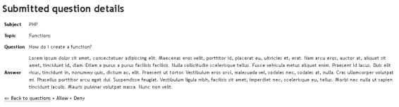

```php
$validid = set_validid();
$sql = "SELECT questions.*, topics.name, subjects.subject FROM
questions INNER JOIN topics ON questions.topic_id = topics.id INNER
JOIN subjects ON topics.subject_id = subjects.id
WHERE questions.id = " . $validid . ";"; $result = mysql_query($sql);
$row = mysql_fetch_assoc($result);
```

图 9-12

详情链接提供查看问题答案的方便方法。你首先运行此查询来收集有关提交问题的详细信息。该查询执行内连接以收集问题详情、主题名称和学科名称。

显示收集的信息：

```php
$row = mysql_fetch_assoc($result);

echo "<h1>已提交的问题详情</h1>";
echo "<table border='0' cellspacing='0' cellpadding='5'>";
echo "<tr>";

echo "<td><b>学科</b></td>"; echo "<td>" . $row['subject'] . "</td>"; echo "</tr>";

echo "<tr>";
echo "<td><b>主题</b></td>"; echo "<td>" . $row['name'] . "</td>"; echo "</tr>";

echo "<tr>";
echo "<td><b>问题</b></td>"; echo "<td>" . $row['question'] . "</td>"; echo "</tr>";

echo "<tr>";
echo "<td><b>答案</b></td>"; echo "<td>" . $row['answer'] . "</td>"; echo "</tr>";

echo "<tr>";
echo "<td colspan=2>";
```

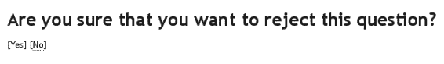

```php
echo "<a href='adminmodquestions.php?func=main'>&lArr;
返回问题</a>";
echo " &bull; ";
echo "<a href='adminmodquestions.php?func=allow&id="
. $row['id'] . "'>允许</a> ";
echo " &bull; ";
echo " <a href='adminmodquestions.php?func=deny&id="
. $row['id'] . "'>拒绝</a>";
echo "</td>";
echo "</tr>";
echo "</table>";
break;
```

### allow 块

要接受一个问题，请添加 allow 块：

```php
echo "</table>";
break;

case "allow":
$validid = set_validid();
$modqsql = "UPDATE questions SET active = 1 WHERE id = "
. $validid . ";";
$modqq = mysql_query($modqsql);
header("Location: " . $config_basedir
.adminmodquestions.php?func=main");
break;
```

此块更新问题并将 `active` 字段设置为 1，以使问题上线。随后页面重定向到 `adminmodquestions.php` 的主块。

### deny 块

要拒绝问题，过程被分为两个部分。第一部分询问用户是否确定拒绝该问题。见图 9-13。

图 9-13

在拒绝问题之前，请确保这是用户想要的。

添加此部分的代码：

```php
header("Location: " . $config_basedir .
adminmodquestions.php?func=main");
break;

case "deny":
require("header.php");
$validid = set_validid();
echo "<<h1>>你确定要拒绝这个问题吗？</h1>>";
echo "<p>[<a href='" . $SCRIPT_NAME . "?func=denyconf&id="
. $validid . "'>是</a>] [<a href='" . $SCRIPT_NAME
"?func=main'>否</a>]";
break;
```

此块提供了两个链接。“否”链接简单返回当前脚本的主部分，“是”链接链接到 denyconf 部分。

### denyconf 块

为了确认拒绝问题的残酷现实，请添加 denyconf 块：

```php
case "denyconf":
$validid = set_validid();
$delsql = "DELETE FROM questions WHERE id = " . $_GET['id']
. ";";
$delq = mysql_query($delsql);
header("Location: " . $config_basedir
.adminmodquestions.php?func=main");
break;
```

此块从 `questions` 表中删除该问题，然后重定向回主部分以显示其他待审核的问题。

```php
}

require("footer.php");

?>
```


在 `MySQL` 中使用 `InnoDB` 表时，对主题的意外删除会导致所有子主题和问题也被删除。因此，在处理本节时请务必非常小心。

## 添加主题

向数据库添加主题非常简单，创建一个表单并将表单内容添加到数据库中。创建一个名为 `addsubject.php` 的新文件并添加以下代码：

```html
<h1>添加新主题</h1>
<form action="<?php echo $SCRIPT_NAME; ?>" method="post">
<table cellpadding="5">
  <tr>
    <td>主题</td>
    <td><input type="text" name="subject"></td>
  </tr>
  <tr>
    <td>所有者</td>
    <td>
      此代码添加了一个表单和一个表格来布局表单元素。在添加主题文本框后，显示一个组合框，以便选择主题所有者：
    </td>
    <td>所有者</td>
    <td>
      <select name="owner">
        <option value="0">—- 无所有者 —-</option>
        <?php
        $sql = "SELECT * FROM users ORDER BY username ASC;";
        $result = mysql_query($sql);
        while($row = mysql_fetch_assoc($result)) {
          echo "<option value='" . $row['id'] . "'>"
          . $row['username'] . "</option>";
        }
        ?>
      </select>
```

创建一个选择框，并添加第一个条目（返回值 0）以提供无所有者选项。选择框中的其他条目通过查询添加。

完成表单：

```html
      </select>
    </td>
  </tr>
  <tr>
    <td>描述简介</td>
    <td><textarea name="blurb" cols=50 rows=10></textarea></td>
  </tr>
  <tr>
    <td></td>
    <td><input type="submit" name="submit" value="添加主题!"></td>
  </tr>
</table>
</form>
```

表单完成后，是时候处理它了。跳转到文件开头并添加以下代码：

```php
<?php
session_start();
require("db.php");
require("functions.php");
if(isset($_SESSION['SESS_ADMINUSER']) == FALSE) {
  header("Location: " . $config_basedir . "adminlogin.php");
}
```

你首先保护页面，使得只有管理员可以访问它。检查是否点击了提交按钮并开始处理：

```php
  header("Location: " . $config_basedir . "adminlogin.php");
}
if($_POST['submit']) {
  $subsql = "INSERT INTO subjects(subject, blurb, owner_id) VALUES("
  . "'" . pf_fix_slashes($_POST['subject'])
  . "', '" . pf_fix_slashes($_POST['blurb'])
  . "'," . $_POST['owner']
  . ");
  mysql_query($subsql);
  header("Location: " . $config_basedir);
}
```

在此块内部，一个 `INSERT` 语句将表单数据添加到数据库。添加 `else` 语句来包裹主表单：

```php
  header("Location: " . $config_basedir);
}
else {
  require("header.php");
?>
```

```html
<h1>添加新主题</h1>
<form action="<?php echo $SCRIPT_NAME; ?>" method="post">
``` 最后，在表单之后，关闭 `else` 并添加页脚文件：

```html
</table>
</form>
```

```php
<?php
}
require("footer.php");
?>
```

完成后的页面应该像图 9-14 所示。

**图 9-14**：如果选择了无所有者，0 将被添加到 `questions` 表的 `owner_id` 字段。

## 删除主题

以管理员身份登录时，用户通过点击小小的 `X` 链接来删除内容。这些链接连接到一个页面，用于删除 `X` 旁的内容类型。

如果你查看主题列表，你会发现每个主题旁边的 `X` 链接到 `deletesubject.php` 并向脚本传递要删除的主题 `id`。当 `deletesubject.php` 首次加载时，用户会被提示确认他是否想要删除该主题。如果他点击了“是”链接，页面将重新加载但包含一个 `conf` GET 变量。如果存在该变量，主题将被删除。

### 注意：级联的乐趣与游戏
请记住，当一个主题被删除时，该主题内的所有主题和问题也会被删除。级联删除代码在你设置表格时已添加。

创建 `deletesubject.php` 并添加以下代码：

```php
<?php
session_start();
require("db.php");
require("functions.php");
if($_SESSION['SESS_ADMIN']) {
  header("Location: " . $config_basedir);
}
if(pf_check_number($_GET['subject']) == TRUE) {
  $validsubject = $_GET['subject'];
}
else {
  header("Location: " . $config_basedir);
}
```

首先，代码验证传递给页面的 `subject` 变量。接下来检查 `conf` GET 变量是否存在（当用户确认删除主题时设置的）：

```php
  header("Location: " . $config_basedir);
}
if($_GET['conf']) {
  $delsql = "DELETE FROM subjects WHERE id = " . $validsubject . ";";
  mysql_query($delsql);
  header("Location: " . $config_basedir);
}
else {
  require("header.php");
  echo "<h1>你确定要删除此主题吗？</h1>";
  echo "<p>[<a href='" . $SCRIPT_NAME . "?conf=1&subject=" . $validsubject . "'>是</a>] [<a href='" . $SCRIPT_NAME . "?subject=" . $validsubject . "'>否</a>]";
}
}
?>
```

如果变量存在，主题将被删除并将页面跳转回首页。否则，将显示问题。

## 管理主题

在向系统添加主题时，脚本需要同时适用于普通用户和管理员。管理员可以选择任何主题，而普通用户可以选择他拥有的主题。

### 添加主题

创建一个名为 `addtopic.php` 的新文件并开始表单：

```html
<h1>添加新主题</h1>
<form action="<?php echo $SCRIPT_NAME; ?>" method="post">
<table cellpadding="5">
  <tr>
    <td>主题</td>
    <td>
      <?php
      if($_SESSION['SESS_ADMIN']) {
        $sql = "SELECT * FROM subjects ORDER BY subject ASC;";
        $result = mysql_query($sql);
      }
      else {
        $sql = "SELECT * FROM subjects WHERE owner_id = " . $_SESSION['SESS_USERID'] . " ORDER BY subject ASC;";
        $result = mysql_query($sql);
      }
      echo "<select name='subject'>";
      while($row = mysql_fetch_assoc($result)) {
        echo "<option value='" . $row['id'] . "'>"
        . $row['subject'] . "</option>";
      }
      echo "</select>";
      ?>
    </td>
  </tr>
  <tr>
    <td>主题</td>
    <td><input type="text" name="name"></td>
  </tr>
  <tr>
    <td></td>
    <td><input type="submit" name="submit" value="添加主题!"></td>
  </tr>
</table>
</form>
```

表单准备好后，跳转到文件开头添加以下代码：

```php
<?php
session_start();
require("db.php");
require("functions.php");
```

你现在需要保护此文件免受未经授权。这更有挑战性，因为管理员和拥有主题的用户都可以使用该文件。未经授权的用户包括未登录的人以及那些没有主题的用户。

解决方案是执行检查以判断当前用户是否为有效用户。如果是有效用户，则将 `$auth` 变量设置为 1。在这些测试之后，检查 `$auth` 变量。如果 `$auth` 不等于 1，则重定向页面。

添加检查：

```php
require("functions.php");
```


```php
if(isset($_SESSION['SESS_ADMINUSER']) == TRUE) {
    $auth = 1;
}

if(isset($_SESSION['SESS_USERNAME']) == TRUE) {
    $authsql = "SELECT * FROM subjects WHERE owner_id = " . $_SESSION['SESS_USERID'] . " ORDER BY subject ASC;";
    $authresult = mysql_query($authsql);
    $authnumrows = mysql_num_rows($authresult);
    if($authnumrows >= 1) {
        $auth = 1;
    }
}
```

第一个检查识别管理员是否登录。如果是，则将 `$auth` 设置为 1。接下来的检查识别用户是否登录，然后执行查询以查看该用户是否拥有任何主题。如果查询返回行或多行，`$auth` 被设置为 1。

检查 `$auth` 的值：

```php
$auth = 1;
}

if($auth != 1) {
    header("Location: " . $config_basedir);
}
```

如果 `$auth` 不等于 (`!=`) 1，页面将重定向。

# 第 9 章
FAQ 内容管理系统
363

处理表单：

```php
header("Location: " . $config_basedir);
}

if($_POST['submit']) {
    $sql = "INSERT INTO topics(subject_id, name) VALUES ('" . $_POST['subject'] . "', '" . pf_fix_slashes($_POST['name']) . "');";
    mysql_query($sql);
    header("Location: " . $config_basedir . "index.php?subject=" . $_POST['subject']);
}
else {
    require("header.php");
?>
<h1>添加新主题</h1>
<form action="<?php echo $SCRIPT_NAME; ?>" method="post">
```
此代码块使用一个简单的 `INSERT` 语句将值添加到数据库中。

页面随后将重定向到 `index.php` 并向其传递主题 `GET` 变量以显示主题信息。

在表单之后，关闭 `else` 块并添加页脚文件：

```php
</table>
</form>

<?php
}

require("footer.php");
?>
```

## 删除主题

删除主题与删除主题几乎相同。主题链接旁边的 `X` 链接到 `deletetopic.php`，且代码非常相似（参见示例 9-9）。

364
实用 PHP 和 MySQL

### 示例 9-9
删除主题的代码与删除主题非常相似。

```php
<?php
session_start();
require("db.php");
require("functions.php");

if(isset($_SESSION['SESS_ADMINUSER']) == FALSE) {
    header("Location: " . $config_basedir);
}

if(pf_check_number($_GET['topic']) == TRUE) {
    $validtopic = $_GET['topic'];
}
else {
    header("Location: " . $config_basedir);
}

if($_GET['conf']) {
    $delsql = "DELETE FROM topics WHERE id = " . $validtopic . ";";
    mysql_query($delsql);
    header("Location: " . $config_basedir);
}
else {
    require("header.php");
    echo "<h1>你确定要删除此主题吗？</h1>";
    echo "<p>[<a href='" . $SCRIPT_NAME . "?conf=1&topic=" . $validtopic . "'>是</a>] [<a href='" . $config_basedir . "'>否</a>]</p>";
}

require("footer.php");
?>
```

## 主题所有权

主题所有权是本项目中的一个关键特性。它不仅鼓励用户卷起袖子参与进来，还将内容来源去中心化，使得不同的用户可以维护网站。

在项目的这部分，你管理所有权请求、请求审核以及所有权的移除。三个脚本负责管理这些不同的需求。

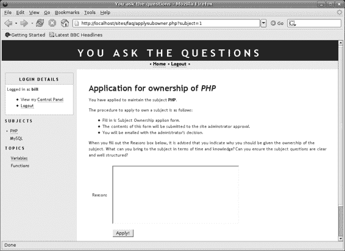

# 第 9 章
FAQ 内容管理系统
365

### 申请主题所有权

如果系统中的某个主题没有所有者，主题信息页面将包含一个链接，邀请用户申请该事件的所有权。当点击此链接时，用户将看到如图 9-15 所示的页面。

#### 图 9-15
欢迎任何用户申请主题所有权。

此页面非常简单。用户输入她认为应该被信任拥有该页面的理由，然后点击提交（申请！）按钮。页面随后会通知申请者，在管理员做出决定后将通过电子邮件发送回复。

创建一个名为 `applysubowner.php` 的新文件并开始添加代码：

```php
<?php
session_start();
require("config.php");
require("functions.php");

if(pf_check_number($_GET['subject']) == TRUE) {
    $validsubject = $_GET['subject'];
}
else {
    header("Location: " . $config_basedir);
}

require("header.php");
```
文件开头验证主题 `GET` 变量。

添加处理表单的代码，该表单由单个文本框组成：`require("header.php");`

```php
if($_POST['submit']) {
    $appsql = "SELECT * FROM mod_subowner WHERE sub_id = " . $validsubject . " AND user_id = '" . $_SESSION['SESS_USERID'] . "';";
    $appresult = mysql_query($appsql);
    if(mysql_num_rows($appresult) == 0) {
        $inssql = "INSERT INTO mod_subowner(sub_id, user_id, reasons) VALUES (" . $_GET['subject'] . "," . $_SESSION['SESS_USERID'] . ",'" . pf_fix_slashes($_POST['reasons']) . "');";
        mysql_query($inssql);
        echo "<h1>申请已提交</h1>";
        echo "您的申请已经提交。决定将通过电子邮件发送给您。";
    }
else {
        echo "<h1>已经申请过</h1>";
        echo "<p>您已经申请过了。</p>";
    }
}
```
在此代码块中，首先进行检查用户是否已经申请。如果查询没有返回行，则进行申请，并构建一个查询将用户 ID、主题和理由添加到 `mod_subowner` 表中。

如果查询返回行或多行，则用户已经申请，并会显示此消息。

现在你可以开始显示表单。来自此查询的主题名称：`$subsql = "SELECT subject FROM subjects WHERE id = " . $validsubject . ";";`
`$subresult = mysql_query($subsql);`
`$subrow = mysql_fetch_assoc($subresult);`

?>
<h1>申请拥有<i><?php echo $subrow['subject']; ?></i></h1>
<p>你已申请维护主题<strong><?php echo $subrow['subject']; ?></strong>。</p>
<p>申请拥有所有的流程如下：
<ul>
<li>填写所有权表单。</li>
<li>表单内容将提交给网站管理员。</li>
<li>你将在账户主页中收到决定。</li>
</ul>
</p>
<p>在填写下方的理由时，建议你说明为什么应该授予你主题的所有权。在时间和知识方面，你能为主题带来什么？你能确保主题问题清晰且结构良好吗？</p>

<form action="applysubowner.php?subject=<?php echo $validsubject; ?>" method="POST">
<table cellpadding="5" cellspacing="5">
<tr>
    <td>理由</td>
    <td><textarea name="reasons" cols="50" rows="10"></textarea></td>
</tr>
<tr>
    <td></td>
    <td><input type="submit" name="submit" value="申请！"></td>
</tr>
</table>
</form>

```php
<?php
}

require("footer.php");
?>
```
367

## 审核所有权请求

主题所有权请求的审核与项目早期问题的审核非常相似。管理员将看到一个请求列表，可以接受或拒绝，如图 9-16 所示。

在问题审核脚本中，函数 `GET` 变量被用于选择页面的工作模式。一个 `switch` 语句检查此变量并执行相关的代码。

#### 图 9-16


管理员可以轻松地处理请求。

# 第 9 章
## FAQ 内容管理系统

本页面使用了相同的技术，包含以下四个部分：

- `main`。此部分显示所有权请求。
- `allow`。如果点击 `Allow` 链接，将运行此部分并授权所有权请求。
- `deny`。如果点击 `Deny` 链接，此部分将提示管理员确认其是否确定要拒绝该请求。
- `denyconf`。如果管理员点击 `deny` 部分中的 `Yes` 链接，`denyconf` 部分将从数据库中删除该请求。

创建一个名为 `adminmodsubown.php` 的新文件并添加以下代码：

```php
<?php
session_start();
if(!$_SESSION['SESS_ADMINUSER']) {
  header("Location: " . $config_basedir);
}
require("db.php");
require("functions.php");
function set_validid() {
  if(pf_check_number($_GET['id']) == TRUE) {
    return $_GET['id'];
  }
  else {
    header("Location: " . $config_basedir);
  }
}
你再次创建一个函数来管理不同 switch 块之间的验证。这与问题审核脚本中的工作原理相同。
打开 switch 语句：
header("Location: " . $config_basedir);
}
}
switch($_GET['func']) {
```

## main Block

第一个添加的块是 `main`，它显示所有权请求列表。该请求列表允许用户看到谁想要获得特定主题的所有权。

```php
switch($_GET['func']) {
case "main":
  require("header.php");
  $subssql = "SELECT subjects.subject, subjects.id FROM subjects INNER JOIN mod_subowner ON subjects.id = mod_subowner.sub_id GROUP BY subjects.id;";
  $subsresult = mysql_query($subssql);
  $subsnumrows = mysql_num_rows($subsresult);
  echo "<h1>Subjects and Ownership</h1>";
```

这段代码运行查询以收集所有提交过所有权请求的主题。如果查询没有返回行，则显示消息：`echo "<h1>Subjects and Ownership</h1>";` `if($subsnumrows == 0) {
  echo "No requests have been made.";
}`

如果返回了行，则执行 `else`：

```php
echo "No requests have been made.";
}
else {
  while($subsrow = mysql_fetch_assoc($subsresult)) {
    $reqsql = "SELECT users.id AS userid, users.username, mod_subowner.* FROM users INNER JOIN mod_subowner ON mod_subowner.user_id = users.id WHERE mod_subowner.sub_id = " . $subsrow['id'] . ";";
    $reqresult = mysql_query($reqsql);
```

开启一个 `while` 循环来遍历每个主题。第二个查询执行连接以获取所有权请求的用户名。启动一个表格来存放内容：

```php
$reqresult = mysql_query($reqsql);
echo "<table class='visible' cellpadding=10 cellspacing=0>";
echo "<tr><th class='visible' colspan='4'>Ownership requests for <i>" . $subsrow['subject'] . "</i></th></tr>";
```

创建另一个 `while` 循环来遍历第二个查询的结果集：

```php
while($reqrow = mysql_fetch_assoc($reqresult)) {
  echo "<tr>";
  echo "<td>Requested by <strong>" . $reqrow['username'] . "</strong></td>";
  echo "<td>" . $reqrow['reasons'] . "</td>";
  echo "<td><a href='" . $SCRIPT_NAME . "?func=accept&id=" . $reqrow['id'] . "'>Accept</a></td>";
  echo "<td><a href='" . $SCRIPT_NAME . "?func=deny&id=" . $reqrow['id'] . "'>Deny</a></td>";
  echo "</tr>";
}
echo "</table>";
echo "<br/>";
}
}
break;
```

第一个 `while` 循环内部嵌套第二个 `while` 循环意味着对于每个主题，所有权请求都将分组在一个表格中。这使得选择最佳请求变得简单得多。

## accept Block

接受所有权请求涉及三个步骤：

1. 向用户发送一封邮件，告知其已被选为新的主题所有者。
2. 更新 `subjects` 表，写入新所有者的 `id`。
3. 删除 `mod_subown` 表中针对该特定主题的所有条目。

这确保了任何竞争所有权的申请都会被移除。添加以下代码：

```php
break;
case "accept":
  $validid = set_validid();
  $sql = "SELECT mod_subowner.sub_id, subjects.subject, users.id AS userid, users.username, users.email FROM mod_subowner INNER JOIN subjects ON mod_subowner.sub_id = subjects.id LEFT JOIN users ON mod_subowner.user_id = users.id WHERE mod_subowner.id = " . $validid . ";";
  $result = mysql_query($sql);
  $row = mysql_fetch_assoc($result);
  $numrows = mysql_num_rows($result);
```

该查询选择了主题 ID、主题名称、用户 ID、用户名和电子邮件地址，这些字段与 `mod_subown` 表中的主题 ID 和所有者 ID 关联。此查询涉及两个连接。第一个连接连接了 `mod_subowner` 和 `subjects` 表，第二个连接连接了 `mod_subowner` 和 `users` 表。

要发送邮件，使用了第 7 章拍卖项目中的相同技术。首先，将数组变量复制到一些普通变量中，以便信息添加到邮件正文中：

```php
$numrows = mysql_num_rows($result);
$mail_username = $row['username'];
$mail_email = $row['email'];
$mail_subject = $row['subject'];
```

使用 `heredoc` 语法构建邮件：

```php
$mail_subject = $row['subject'];
$mail_body=<<<MESSAGE_
Hi $mail_username,
I am pleased to inform you that you have been accepted as the new owner of the '$mail_subject' subject.
When you next log into '$config_sitename' you will see the subject in your Control Panel.
Kind regards,
$config_sitename Administrator
MESSAGE_;
```

使用 `mail()` 命令发送邮件消息：

```php
mail($mail_email, "Ownership request for " . $mail_subject . " accepted!", $mail_body);
```

`mail()` 函数将邮件发送到 `$mail_email` 中的地址，主题为 `Ownership request for <subject> accepted!`，`$mail_body`（heredoc ）作为消息正文。更新 `subjects` 表将 `owner_id` 字段更改为新所有者的 ID：

```php
$addsql = "UPDATE subjects SET owner_id = " . $row['userid'] . " WHERE id = " . $row['sub_id'] . ";";
mysql_query($addsql);
```

最后，删除 `mod_subowner` 表中所有与胜出请求主题相同的条目：

```php
$delsql = "DELETE FROM mod_subowner WHERE sub_id = " . $row['sub_id'] . ";";
mysql_query($delsql);
header("Location: " . $config_basedir . "adminmodsubown.php?func=main");
break;
```

## deny Block

deny 块与问题审核脚本中的 deny 块相同：

```php
case "deny":
  $validid = set_validid();
  require("header.php");
  echo "<<h1>Are you sure that you want to deny this request?</h1>";
  echo "<p>[<a href='adminmodsubown.php?func=denyconf&id=" . $validid . "'>Yes</a>] [<a href='adminmodsubown.php?func=main'>No</a>]";
  break;
```

这段代码提示用户确认其是否要拒绝请求。如果用户点击 No，页面将重定向到主部分；否则，将重定向到 `denyconf` 部分。

## denyconf Block

要拒绝所有权请求，代码遵循两个步骤：**1.** 向用户发送一封邮件，告知其请求已被拒绝。

**2.** 从 `mod_subowner` 表中删除该请求。


本节大量借鉴了允许部分。代码简单地更改了所发送的邮件正文文本以及要删除的内容：`echo "<p>[<a href='adminmodsubown.php?func=denyconf&id=" . $validid . "'>Yes</a>] [<<a href='adminmodsubown.php?func=main'>No</a>]"; break;`

`case "denyconf":`

`$validid = set_validid();`

`$sql = "SELECT mod_subowner.sub_id, subjects.subject, users.id AS userid, users.username, users.email FROM mod_subowner INNER JOIN subjects ON mod_subowner.sub_id = subjects.id LEFT JOIN users ON mod_subowner.user_id = users.id WHERE mod_subowner.id = " . $validid . ";";`

`$result = mysql_query($sql);`

`$row = mysql_fetch_assoc($result);`

`$numrows = mysql_num_rows($result);`

`$mail_username = $row['username'];`

`$mail_email = $row['email'];`

`$mail_subject = $row['subject'];`

`$mail_body=<<<_MESSAGE_`

你好 $mail_username,

我写信是告知你，你对 '$mail_subject' 主题的所有权请求已被拒绝。

下次好运！

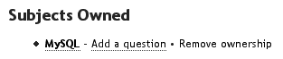

# 第 9 章
## FAQ 内容管理系统
375

顺致商祺，

$config_sitename 管理员

`_MESSAGE_;`

`mail($mail_email, "Ownership request for " . $mail_subject . " denied!", $mail_body);`

`$delsql = "DELETE FROM mod_subowner WHERE id = " . $validid . ";";`

`mysql_query($delsql);`

`header("Location: " . $config_basedir . "adminmodsubown.php?func=main");`

`break;`

完成部分后，关闭 switch 并添加页脚文件：`header("Location: " . $config_basedir . "adminmodsubown.php?func=main");`

`break;`

`}`

`require("footer.php");`

`?>`

## 移除所有权

在未来的某个时刻，主题的所有者可能没有时间或兴趣继续贡献。在这种情况下，你希望确保所有者在需要时可以轻松地将主题“孤儿化”。

为了尽可能简单化，我们在控制面板中添加一个移除所有权的选项，如图 9-17 所示。

要使主题孤儿化，将传递给页面的主题 ID 用于运行查询，将 `subjects` 表中的 `owner_id` 字段更改为 0。但在执行此查询之前，会显示另一个确认问题以防止意外发生。

### 图 9-17
移除所有权的链接传递了主题 ID。

376
实用 PHP 与 MySQL

此脚本中使用的代码与 `deletesubject.php` 几乎相同。创建一个名为 `removesubown.php` 的新文件，并添加示例 9-10 所示的代码。

### 示例 9-10
使主题孤儿化，将 `owner_id` 字段设置为 0。

```php
<?php
session_start();
require("db.php");
require("functions.php");
if(!$_SESSION['SESS_USERNAME']) {
  header("Location: " . $config_basedir . "login.php");
}
if(pf_check_number($_GET['subject']) == TRUE) {
  $validsubject = $_GET['subject'];
}
else {
  header("Location: " . $config_basedir);
}
if($_GET['conf']) {
  $updsql = "UPDATE subjects SET owner_id = 0 WHERE id = " . $validsubject . ";";
  mysql_query($updsql);
  header("Location: " . $config_basedir . "userhome.php");
}
else {
  require("header.php");
  echo "<<h1>>你确定要放弃这个主题吗？<h1>>"; echo "<p>[<a href='removesubown.php?conf=1&subject=" . $validsubject . "'>Yes</a>] [<a href='userhome.php'>No</a>]";
}
require("footer.php");
?>
```

## 总结
编写一个 CMS 并不是一项简单的工作，走到这里已经是你学习中的一项真正成就（除非你直接跳到这一页体验光荣而不做任何工作）。这个项目涉及许多不同的部分，将它们整合在一起并维护一个易于使用的应用程序是一个真正的挑战。

# 第 9 章
## FAQ 内容管理系统
377

就像设计一样，CMS 永远不会完工，只有被遗弃。然而，这个项目仍然有许多可以实现的功能。为了继续你的开发，尝试添加以下功能：

- 内容编辑。编写允许用户编辑主题、话题和问题的功能。
- 用户间消息传递。如果一个用户可以向另一个用户发送消息，将会非常有用。
- 删除问题和评论的能力。扩展内容删除功能以删除问题和评论。
- 将评论合并到问题的能力。当评论对问题的答案变得直接有用时，有一个易于使用的系统将评论合并到主答案将非常有用。

*本页特意留白*

# 第 10 章
## 构建一个可重用的项目

Web 开发者的生活变得越来越困难。随着越来越多的人上网并使用互联网用于越来越多的目的，Web 开发者面临的要求比以往任何时候都多。这不仅意味着需要更广泛的应用，也意味着开发的复杂性也在增加。即使是最小的企业，拥有一个大型、复杂的 Web 应用来驱动其主要业务需求也并不常见。

解决问题的解决方案之一是编写可重用的代码。你们已经在 IT 行业摸爬了几年的人可能已经熟悉“可重用”这个热词，在很多情况下它确实是有意义的。

以下列表描述了重用现有代码的几种方法：

- PEAR。PHP 扩展和应用程序仓库 (PEAR) 提供了一个可以轻松安装和使用的海量扩展目录。每个 PEAR 模块都是用 PHP 编写的。
- PECL。PHP 扩展社区库 (PECL) 包含一系列需要编译的扩展。这些扩展为 PHP 提供了全新的功能且速度非常快。
- 其他预构建的应用程序。许多人发布压缩过的项目，可以将其解压到你的应用程序中以满足某些特定功能。例如是 Magpie RSS 解析器。

在本章中，你将编写一个设计用于放入现有网站的应用程序。在此过程中，你将探索编写易安装、重用和实现的软件时面临的诸多挑战。

379
380
实用 PHP 与 MySQL

## 项目概述

对于许多开发者来说，编写解决非常特定任务的小工具并不罕见。这些小工具通常不需要自己的 SourceForge 账户，甚至不需要像 trac 那样复杂的项目管理系统。相反，理想的解决方案是包含简单的下载程序和查看截图的方法。为了满足这些需求，你将创建 *phphomeproject* 工具。噢，强大。

在应用程序内部查看项目时，用户将能够看到以下：

- 可用项目。
- 每个版本内的版本范围和下载发布。
- 截图。

这些是大多数 Web 游客在探索软件时寻找的核心功能。

为了使应用程序可重用，需要考虑它的工作原理以及设置的简易程度。如果不先坐下来并清楚不同部分是如何组合的，要编写一个可重用的应用程序是非常的，甚至是不可能的。

该应用程序的基本概念是每个项目都有自己的项目目录（例如 `www.foo.com/projects/myproject/` 或 `www.foo.com/projects/myotherproject/`）。网站管理员手动创建这些项目目录。

当创建一个新项目时，会发生两个操作：

- 新项目被添加到数据库中。


# 项目目录已创建，并填充了用于查看和维护内容的文件。

为了尽可能保持灵活性，将此应用程序引入到现有的网站中应该非常简单——就像将单个文件包含到普通 Web 页面一样简单（例如 `<?php require("thisapp.php"); ?>`）。但是，你如何将所有功能挤到一个页面中，而不会让它变得极其复杂和臃肿呢？

问题的解决方案如图 10-1 所示。

为了最好解释这一过程，以下列出了从用户访问网站的那一刻开始发生：

- 用户访问 [`www.mysite.com/projects/myproject/](http://www.mysite.com/projects/myproject/) Web 地址，并加载了 `index.php` 文件。在头部和页脚文件之间，包含了一个名为 `project-main.php` 的文件。

## 第 10 章：构建可重用项目

- `project-main.php` 文件检查是否存在 `func` GET 变量。如果是，则 `switch` 语句将包含相关文件。例如，如果用户点击下载链接，则会将 `func=download` 作为 GET 变量追加。
- 在 `project-main.php` 的 `switch` 语句内部，包含了相关文件。

在 `func=download` 的情况下，包含了 `download.php`；它包含了显示可用下载内容的代码。

由于主 `index.php` 文件包含了 `project-main.php`，而后者又包含了 `download.php` 等文件，最终的下载功能会在 `index.php` 文件中显示给用户。这使得将功能分散到不同的页面变得更容易，并且 URL 看起来整洁且一致。

### 图 10-1：在页面中嵌入页面提高了可重用性

| 浏览器 | `index.php` |
| :--- | :--- |
| • **下载** | `project-main.php` |
| • **截图** | `download.php` |

## 构建数据库

你将创建的数据库如图 10-2 所示。

应用程序内部的项目存储在 `homeproject_projects` 中。项目的发布按版本组织（存储在 `homeproject_releaseversions` 中），而实际的发布（下载的文件）描述在 `homeproject_releasefiles` 中。

`homeproject_releasefiles` 中的每个项目都引用其来自 `homeproject_releaseversions` 的父版本。除了父版本外，发布文件还从 `homeproject_releasetypes` 表存储发布类型（例如 Debian 包、RPM、Windows ZIP、Mac OS X 磁盘镜像等）。最后，`thehomeproject_screenshots` 表存储每个发布版本的截图名称。

### 图 10-2：数据库非常简单

**homeproject_releasetypes**
| id | type |
| :--- | :--- |

**homeproject_releasefiles**
| id | type_id |
| :--- | :--- |

**homeproject_releaseversions**
| date | id | version_id |
| :--- | :--- | :--- |

**homeproject_projects**
| project_id | filename | id | version | name | about | pathname |
| :--- | :--- | :--- | :--- | :--- | :--- | :--- |

**homeproject_screenshots**
| id | project_id | name |
| :--- | :--- | :--- |

### 注意：让你的表脱颖而出

可重用组件使用与托管它的应用程序相同的数据库。为了指示哪些表是什么，可重用组件项目中的每个表都使用了 `homeproject_` 前缀。这是一个刻意的选择，这样当此应用程序部署到现有的网站时，就可以很容易识别出属于应用程序的表。例如，查看以下表列表：

- admins
- customers
- blogentries
- `homeproject_projects`
- `homeproject_releaseversions`

你可以很轻松地识别哪些表是应用程序的一部分。

### 实现数据库

启动 `phpMyAdmin`。创建一个名为 `phphomeproject` 的新数据库并添加以下表：

### homeproject_projects 表
- `id`: 将其设置为 `MEDIUMINT` 并开启 `auto_increment`。将此字段设置为主键。
- `name`: 将其设置为长度为 100 的 `VARCHAR`。
- `about`: 将其设置为 `TEXT`。
- `pathname`: 将其设置为长度为 30 的 `VARCHAR`。

### homeproject_releaseversions 表
- `id`: 将其设置为 `INT` 并在 `Extras` 列中开启 `auto_increment`。将此字段设置为主键。
- `project_id`: 将其设置为 `INT`。
- `version`: 将其设置为 `VARCHAR` 并设置大小为 20。

### homeproject_releasetypes 表
- `id`: 将其设置为 `TINYINT` 并开启 `auto_increment`。将此字段设置为主键。
- `type`: 将其设置为 `VARCHAR` 并设置大小为 20。

### homeproject_releasefiles 表
- `id`: 将其设置为 `INT`（这可能会有很多问题）并开启 `auto_increment`。将此字段设置为主键。
- `type_id`: 将其设置为 `TINYINT`。
- `date`: 将其设置为 `DATETIME`。
- `version_id`: 将其设置为 `INT`。
- `filename`: 将其设置为长度为 50 的 `VARCHAR`。

### homeproject_screenshots 表
- `id`: 将其设置为 `INT`（这有很多主题）并开启 `auto_increment`。将此字段设置为主键。
- `project_id`: 将其设置为 `INT`。
- `name`: 将其设置为长度为 50 的 `VARCHAR`。

#### 插入示例数据

一组表已经准备就绪，你现在可以添加一些示例数据。记住，不要在 `id` 列中填写数字，`auto_increment` 会自动为你完成。可以添加你自己的示例数据，或使用后续章节描述的建议信息。

### homeproject_projects 表的示例数据
添加一个如表 10-1 所示的项目。

**表 10-1：此表包含主项目详情。**

| NAME | ABOUT | PATHNAME |
| :--- | :--- | :--- |
| My Project | 这是一个示例项目，展示了在这个可重用的项目管理应用程序内部如何项目。 | myproject |

`pathname` 字段提供了一个用于引用项目的唯一字符串。它用于 Web 应用程序的几个部分——特别是 URL，例如 `localhost/sites/homeproject/<pathname>/`。

### homeproject_releaseversions 表的示例数据
如表 10-2 所示添加版本号。

**表 10-2：由于一个版本号可能有多个发布版本，请将版本号存储在专门的表中。**

| PROJECT_ID | VERSION |
| :--- | :--- |
| 1 | 0.1 |
| 1 | 0.2 |

### homeproject_releasetypes 表的示例数据
使用以下名称添加三条记录：

- Tarball
- Debian Package
- Windows ZIP

### homeproject_releasefiles 表的示例数据
在此表中添加两条记录，使用正确的 `version_id` 和 `type_id`。`filename` 字段应包含发布文件名（如 `myrelease.tar.gz`）。

当你之后创建 `releases` 目录时，记得在该目录放置一个具有相同 `filename` 的。

### homeproject_screenshots 表的示例数据
向表中添加若干记录，使用正确的 `project_id`。`name` 字段应包含截图名称（如 `myscreenshot.png`）。当你之后创建 `screenshots` 目录时，记得包含同名的图像。

## 智能地使用目录

与书中之前的项目不同，phphomeproject 大量利用目录来确定特定的功能。项目有三个主目录：`base`、`admin` 和 `project`。

`base` 目录（例如 `www.mysite.com/projects`）是网站上的基础项目目录。该目录包含了构成 `phphomeproject` 的不同文件。该目录还包含一个 `index.php` 文件，它列出了服务器上的项目，以便户选择要查看的项目。


项目目录（例如 `www.mysite.com/projects/myproject/`）是根目录内部的一个子目录。该目录包含一个 `index.php` 文件（包含了根目录中的文件，如图 10-1 所示）。该项目还包含两个子目录：`releases`（存储软件发布版本）和 `screenshots`（存储截图）。

`admin` 目录是网站管理员用于调整项目设置的目录。该目录同样位于根目录下，例如 `www.mysite.com/projects/admin/`，并包含若干用于管理网站的文件。

## 创建目录

首先，创建根目录并将其命名为 `homeproject`。然后创建 `admin` 子目录。

对于每个项目，你还需要在 `homeproject` 内部创建一个子目录。目录的名称应与 `homeproject_projects` 表中的 `pathname` 字段相同。如果你像本示例一样添加了 My Project 记录，请创建一个名为 `myproject` 的目录。在 `myproject` 内部创建 `releases` 和 `screenshots` 子目录。请确保 `releases` 和 `screenshots` 均具有写入权限。

你现在应该拥有以下目录：

- homeproject
- admin
- myproject
- releases
- screenshots

(父目录 -> 子目录 1 -> 子目录 2 -> 子子目录 1, 子子目录 2)

### 注意：
**快速提醒……**

当你向表中添加数据时，也添加了一些发布版本和截图记录。记得将这些文件和截图分别添加到 `releases` 和 `screenshots` 目录中。

## 开始编码：构建骨架

开发 `phphomeproject` 需要两个核心领域：

- 可视的项目信息。这是网站访问者看到的内容。访问者可以查看项目信息、下载和截图。
- 项目管理。这是用于配置项目的界面；只有网站管理员可以访问此界面。

在该项目中，你将首先实现项目查看区域，然后转向创建管理区域。在开始之前，你将创建一些结构性文件（配置文件、函数等）。

由于该项目可以作为可重用组件使用，你应该使用一个独立的配置文件来处理特定于项目的设置。在 `homeproject` 目录中创建 `phphomeproject.php`，然后添加示例 10-1 所示的代码。

### 第 10 章：构建一个可重用项目

### 示例 10-1

配置文件与你网站的主配置文件是分离的。

```php
<?php
$dbhost = "localhost";
$dbuser = "root";
$dbpassword = "";
$dbdatabase = "phphomeproject";
$config_headerfile = "http://localhost/sites/homeproject/header.php"; 
$config_footerfile = "http://localhost/sites/homeproject/footer.php"; 
$config_projecturl = "http://localhost/sites/homeproject/"; 
$config_projectdir = "/opt/lampp/htdocs/sites/homeproject/"; 
$config_projectadminbasedir = "http://localhost/sites/homeproject/admin/";
$config_projectadminfilename = "admin.php";
$config_projectscreenshotthumbsize = 300;
?>
```

除了正常的数据库设置，该配置文件还包含其他许多选项：

- `$config_headerfile` 和 `$config_footerfile`。Web 应用程序中头部和页脚文件的位置。
- `$config_projecturl`。找到 `phphomeproject` 的 URL。
- `$config_projectdir`。包含 `phphomeproject` 的目录。在将新版本和截图拷贝到 `releases` 和 `screenshots` 目录时，使用此目录。
- `$config_projectadminbasedir`。`admin` 目录的位置。
- `$config_projectadminfilename` 用于访问管理功能的文件名（例如 `admin.php`）。
- `$config_projectscreenshotthumbsize`。查看截图时缩略图应设置的宽度。

重要的是，你是在独立的目录中开发 `phphomeproject` 的，它独立于现有的网站。当 `phphomeproject` 部署到应用程序中时，需要更改这些设置以反映现有网站（例如，将 `$config_projecturl` 改为 `http://www.mysite.com/projects/`）。你将在本章节晚些时候部署网站。

## 访问数据库

在根目录 (`phphomeproject`) 中创建 `db.php`，并添加示例 10-2 所示的连接代码。

### 示例 10-2

此文件与其他项目没有区别。

```php
<?php
require("phphomeprojectconfig.php");
$db = mysql_connect($dbhost, $dbuser, $dbpassword);
mysql_select_db($dbdatabase, $db);
?>
```

## 创建函数

该项目除了之前项目中的 `pf_fix_slashes()` 和 `pf_check_number()` 之外，还使用了两个自定义函数。在根目录中创建一个名为 `functions.php` 的新文件并添加代码：

```php
<?php
require("phphomeprojectconfig.php");

function pf_non_page() {
    if(basename($_SERVER['SCRIPT_NAME']) != "index.php") {
        echo "<h1>Error</h1>";
        echo "你不能直接访问此页面。请前往主页面。
        exit;
    }
}

function pf_admin_page() {
    global $config_projectadminfilename;
    if(basename($_SERVER['SCRIPT_NAME']) != $config_projectadminfilename) {
        echo "<h1>Error</h1>";
        echo "你不能直接访问此页面。请前往管理页面。
        exit;
    }
}
```

这些函数的逻辑确保某些文件只能通过预期的入口点访问。例如，`pf_non_page()` 检查当前脚本是否为 `index.php`，而 `pf_admin_page()` 使用全局变量 `$config_projectadminfilename` 来验证访问。


```php
if(is_numeric($value) == FALSE) {
    $error = 1;
}
if($error == 1) {
    return FALSE;
}
else {
    return TRUE;
}
}
?>
```

# 主项目

跳转到项目目录（例如 `myproject` 目录），并根据示例 10-3 中的代码创建 `index.php`。

## 示例 10-3

此文件加载 `project_main.php`，该文件管理哪些功能的加载。

```php
<?php
$project = substr(dirname($SCRIPT_NAME),
strrpos(dirname($SCRIPT_NAME), "/") + 1);

require("../phphomeprojectconfig.php");
require("../project_bar.php");
require("../project_main.php");
?>
```

# 第 10 章：构建可重用项目

391

此文件的第一行获取当前项目的名称。为了实现这一点，从 URL 中截取项目路径（例如从 `www.mysite.com/projects/myproject/` 中截取 `myproject`）。这以后可以用于](http://www.mysite.com/projects/myproject/) 收集有关项目的信息。

然后包含了三个文件：主配置文件（`phphomeprojectconfig.php`）、菜单选项（`project_bar.php`）和主应用程序页面（`project_main.php`）。通过在每个文件中包含前缀 `../`，可以上一目录访问这些文件。

## 注意：部署 phphomeproject

网站管理员使用 `phphomeproject` 文件在现有的 Web 应用程序内部部署 `phphomeproject`。管理员只需在侧边菜单栏代码（例如之前项目中的 `bar.php`）中包含 `project_bar.php`，然后在页面的主体部分包含 `project_main.php`。

在接下来的章节中，你将创建刚刚包含的文件。

## 查看菜单选项

创建 `project_bar.php` 并使用示例 10-4 中的代码添加菜单选项。

## 示例 10-4

此文件可以部署在现有的设计中，以便轻松在任何地方显示菜单。

```html
<h1>Options</h1>
<ul>
    <li><a href="index.php">Home</a></li>
    <li><a href="index.php?func=download">Download</a></li>
    <li><a href="index.php?func=screenshots">Screenshots</a></li>
</ul>
```

此文件包含一个带有不同选项的简单无序列表。每个选项链接到 `index.php`，但向 `func` GET 变量传递了不同的设置。该变量由 `project_main.php` 处理，并显示相关功能。

392 实用 PHP 和 MySQL

## 访问项目功能

当用户点击菜单选项之一时，`project_main.php` 充当中间人，提取 `func` 变量并提供正确的页面。

为了实现这一点，`func` 通过 `switch` 语句运行。`switch` 为不同的可用选项提供了 `case` 块。如果不存在 `func` 变量，或者 `func` 包含 `case` 块不满足的内容，则执行默认块。

在基目录中创建 `project_main.php` 并开始添加代码：

```php
<?php
require("db.php");
$projsql = "SELECT * FROM homeproject_projects WHERE pathname = '" . $project . "';";
$projresult = mysql_query($projsql);
$projrow = mysql_fetch_assoc($projresult);
```

在这里你运行查询以选择任何 `pathname` 等于 `$project` 持有的目录名的项目（`$project` 在 `index.php` 中创建）。设置变量：

```php
$projrow = mysql_fetch_assoc($projresult);
$project_id = $projrow['id'];
$project_name = $projrow['name'];
```

创建两个变量（稍后使用）来存储项目 ID 和名称。打开 `switch` 并添加第一个 `case` 块：

```php
$project_name = $projrow['name'];
switch($_GET['func']) {
    case "download":
        require("download.php");
        break;
```

如果用户点击下载链接，`func` 将设置为 `download` 并执行该代码块。`download.php` 页面被包含在块内部。为屏幕截图链接添加一个类似的块：

```php
case "screenshots":
    require("screenshots.php");
    break;
```

393 第 10 章：构建可重用项目

添加捕获任何其他情况的默认块：

```php
default:
    $sql = "SELECT * FROM homeproject_projects WHERE pathname = '" . $project . "';";
    $result = mysql_query($sql);
    $row = mysql_fetch_assoc($result);
    echo "<h1>" . $row['name'] . "</h1>";
    echo "<p>" . $row['about'] . "</p>";
    break;
```

你构建了一个返回项目的查询，然后简单地打印项目名称并显示描述。最后，关闭 `switch`：

```php
    break;
}
?>
```

当你查看“我的项目”时，你应该看到图 10-3 所示的项目名称和描述。

**图 10-3**

最近添加的版本是最新的。

394 实用 PHP 和 MySQL

## 访问项目功能（继续）

当你查看“我的项目”时，你应该看到图 10-3 所示的项目名称和描述。

**图 10-3**

最近添加的版本是最新的。

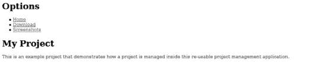

393 第 10 章：构建可重用项目

## 访问项目功能（继续）

最近添加的版本是最新的。


394 实用 PHP 和 MySQL

## 访问项目功能（继续）

最近添加的版本是最新的。


394 实用 PHP 和 MySQL

## 访问项目功能（继续）

最近添加的版本是最新的。


394 实用 PHP 和 MySQL

## 访问项目功能（继续）

最近添加的版本是最新的。


394 实用 PHP 和 MySQL

## 访问项目功能（继续）

最近添加的版本是最新的。


# 查看截图

如果用户点击“截图”链接，`GET` 变量将包含截图，并且 `screenshots.php` 被加载到 `project_main.php` 中。

创建 `screenshots.php` 并添加示例 10-5 所示的代码。

### 示例 10-5

显示截图只需要遍历查询结果。

```php
<?php

require("project_functions.php");

pf_protect_nonadmin_page();

$sql = "SELECT * FROM homeproject_screenshots WHERE

project_id = " . $project_id . ";";

$result = mysql_query($sql);

$numrows = mysql_num_rows($result);

echo "<h1>" . $project_name . " Screenshots</h1>"; if($numrows == 0) {

echo "No screenshots!";

}

else {

while($row = mysql_fetch_assoc($result)) {

echo "<a href='screenshots/" . $row['name'] . "'></a>"; echo "<br><br>";

}

}

?>
```

前几行保护了文件不被直接访问（正如你之前所过的那样），然后通过查询收集当前项目的所有截图。会检查是否返回了任何行。如果没有返回，则显示 `No screenshots!`；否则将列出图片。每张图片都按照 `$config_projectscreenshotthumbsize` 设置的宽度显示，并链接到全尺寸图片。

有了几张截图后，你应该会在浏览器中看到类似于图 10-5 的内容。

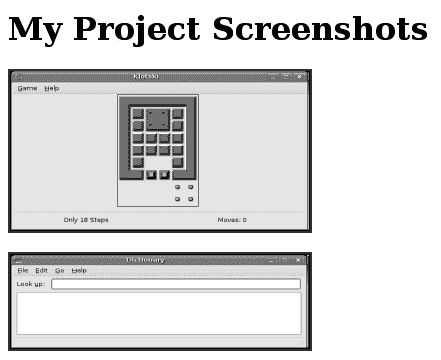

**第 10 章**
构建可重用项目
397

**图 10-5**
截图在视觉上缩小了尺寸，以便在页面上显示更多内容。

# 可用项目查看器

在目前的开发过程中，用户需要指定项目的路径，这样他们就可以通过 `www.mysite.com/projects/<projectname>` 查看它。如果能提供一个位于 `www.mysite.com/projects/` 目录下的简单页面来显示可查看的项目列表，将非常有用。

在该目录中创建 `index.php` 并添加示例 10-6 所示的代码。

### 示例 10-6

此页面是展示项目的有用起点。

```php
<?php

require("phphomeprojectconfig.php");

if(file_exists($config_headerfile)) {

include($config_headerfile);

}

require("db.php");

echo "<h1>Projects</h1>";

echo "<p>I have created the following project(s):</p>";

398
$projsql = "SELECT * FROM homeproject_projects;"; $projresult = mysql_query($projsql);

while($projrow = mysql_fetch_assoc($projresult)) {

echo "<h2>" . $projrow['name'] . "</h2>"; echo "<p>" . $projrow['about'] . "</p>"; echo "<p>&bull; <a href='" . $config_projecturl . "/"

. $projrow['pathname'] . "'>View this project</a></p>";

}

if(file_exists($config_headerfile)) {

include($config_footerfile);

}

?>
```

该代码执行查询以收集所有可用项目，然后显示每个项目的名称以及一些信息和指向项目信息页的链接。项目页的 URL 是通过拼接 `projectname` 和 `$config_projecturl` 变量构建的。

### 注意：检查文件是否存在

使用 `file_exists()` 函数来检查项目配置文件（`phphomeproject.php`）中指定的位置是否存在头部/页脚文件。

如果它们存在，则会包含它们。

在整个项目中请记住，你不要假设头部/页脚文件一定存在；因此，你需要检查它们的可用性。

# 管理项目

在完成项目查看后，你现在可以专注于创建管理项目的能力了。这些管理页面与书中之前的项目类似——它们是一系列向数据库添加信息的 Web 表单。

在开始之前，在主项目目录内创建一个 `admin` 目录。

所有的管理文件都创建在这个新目录中。

创建一个名为 `admin.php` 的新文件，然后添加示例 10-7 所示的大量代码。

**第 10 章**
构建可重用项目
399

### 示例 10-7

好吧，我刚才关于大量代码其实是撒谎的……

```php
<?php

require("project_admin.php");

?>
```

### 注意：处理头部文件

在这个项目中，并没有假设头部/页脚文件一定存在。

尽管在不可用时对代码没有影响，但当它们存在时，头部的重定向会变得有点棘手。

如果你在 `admin.php` 中包含 `project_admin.php` 之前包含了头部文件，然后点击“下载”链接，就会发生错误。这发生在你已经添加了下载功能，因此页面尝试进行重定向时。

为了解决这个问题，请在 `project_admin.php` 的各个单独块（blocks）中包含头部文件。

此文件简单地包含了 `project_admin.php` 文件。在之前的章节中，你包含了 `project_main.php`，并使用该文件作为中间人来管理根据不同的菜单选项加载哪些文件。这里也使用了相同的技术。

创建 `project_admin.php` 并开始添加代码：

```php
<?php

session_start();

require("../phphomeprojectconfig.php");

require_once("../project_functions.php");

pf_protect_admin_page();

require("../db.php");
```

你首先包含配置、函数和数据库设置，然后保护页面。

400
添加几个特定于页面的函数：

```php
require("../db.php");

function menu_options() {

$projsql = "SELECT * FROM homeproject_projects WHERE

id = " . $_SESSION['SESS_PROJECTID'] . ";"; $projresult = mysql_query($projsql);

$projrow = mysql_fetch_assoc($projresult);

echo "<p>";

echo "<strong>" . $projrow['name'] . "**

Administration</strong>";

echo "<br>";

echo "<a href='" . $SCRIPT_NAME

. "?func=general'>General</a>";

echo " &bull; ";

echo "<a href='" . $SCRIPT_NAME

. "?func=downloads'>Manage Downloads</a>"; echo " &bull; ";

echo "<a href='" . $SCRIPT_NAME . "?func=newproject'>Add New Project</a>";

echo " &bull; ";

echo "<a href='" . $SCRIPT_NAME

. "?func=screenshots'>Manage Screenshots</a>"; echo " &bull; ";

echo "<a href='" . $SCRIPT_NAME

. "?func=changeproject'>Admin Another Project</a>"; echo "</p>";

}
```

此函数仅显示管理菜单选项。当用户点击某个选项（例如“General”选项）时，将加载相应的页面。该页面有两个功能：显示表单然后处理它。对于大多数处理表单的页面，页面在处理完成后应该进行重定向。如果显示了菜单选项，页面将无法重定向，因为内容已经发送，而你将会遇到令人恼的“headers already sent（头部已发送）”错误消息。

为了解决这个问题，将菜单选项放入 `menu_options()` 函数中，并在未处理表单时使用该函数。函数中的每个菜单选项仅是向 `func` GET 变量传递相关的块名。

添加第二个函数：

```php
function include_header() {

global $config_headerfile;

if(file_exists($config_headerfile)) {

include($config_headerfile);

}

}
```

该函数检查 `$config_headerfile` 是否指向一个合法的文件，如果文件存在，则包含它。此函数用于稍后 `switch` 语句中的不同块中。此函数避免了页面重定向时出现内容已发送的问题。

除了 `func` GET 变量外，`id` GET 变量还用于选择管理哪个项目。验证此变量：

```php
if($_GET['id']) {

if(is_numeric($_GET['id']) == TRUE) {

$validid = $_GET['id'];

}

else {

header("Location: " . $config_projecturl);

}

}
```

开始处理 `func`：

```php
switch($_GET['func']) {
```


为了使用户能够编辑常规设置，请使用以下块：

```php
switch($_GET['func']) {

    case "general":
        include_header();
        menu_options();
        require("project_admingeneral.php");
        exit;
        break;
```

在此块中，添加了头部文件和菜单，然后包含了 `project_admingeneral.php`。

402
Practical PHP and MySQL

添加下载内容块：

```php
    break;

    case "downloads":
        if(!$_POST) {
            include_header();
            menu_options();
        }
        require("project_admindownloads.php");
        break;
```

在这里进行了检查以判断是否存在 POST 变量（`$_POST` 变量表示表单已提交）。如果表单提交（不存在 `$_POST` 变量），则添加头部文件和菜单选项。这样，如果提交了表单，头部/菜单就不会被提交，以便页面进行重定向。

添加新项目内容块：

```php
    break;

    case "newproject":
        if(!$_POST) {
            include_header();
        }
        require("project_adminnewproject.php");
        break;
```

添加删除发布版本的块：

```php
    break;

    case "deleterelease":
        if(isset($_GET['conf']) == FALSE) {
            include_header();
            menu_options();
        }
        require("project_admindeleterelease.php");
        break;
```

此处加载的 `project_admindeleterelease.php` 页面并不包含删除发布版本的表单。相反，用户会被询问一个确认问题。如果她回答是，则会在 URL 中添加 `conf` GET 变量。这样，只有在没有 `conf` GET 变量时才显示头部文件和菜单。

添加截图块：

**第 10 章**
构建可重用项目
403

```php
    break;

    case "screenshots":
        if(!$_POST) {
            include_header();
            menu_options();
        }
        require("project_adminaddscreenshot.php");
        break;
```

添加删除截图块：

```php
    break;

    case "deletescreenshot":
        if(isset($_GET['conf']) == FALSE) {
            include_header();
            menu_options();
        }
        require("project_admindeletescreenshot.php");
        break;
```

如果没有向 `func` GET 变量传递合法的设置，则进入默认块。此代码会询问用户她想要管理哪一个项目。

当用户选择了一个项目后，将创建 `SESS_PROJECTID` 和 `SESS_PROJECTPATH` 会话变量。这些变量用于跟踪用户感兴趣的项目。首先，检查 `SESS_PROJECTID` 是否已经设置并且是否已经选择了项目：

```php
    break;

    default:
        if($_SESSION['SESS_PROJECTID']) {
            header("Location: " . $config_projectadminbasedir . basename($SCRIPT_NAME) . "?func=main");
        }
```

如果该变量存在，页面将直接重定向到主块。如果变量不存在，则要求用户选择一个项目：

```php
        header("Location: " . $config_projectadminbasedir . basename($SCRIPT_NAME) . "?func=main");
    }
    else {
        include_header();
        echo "<h1>Choose a project</h1>"; 
        echo "<p>Which project would you like to administer?</p>";

        $projsql = "SELECT * FROM homeproject_projects;";
        $projresult = mysql_query($projsql);
        $projnumrows = mysql_num_rows($projresult);
```

在这里你执行一个查询来收集可用项目。检查是否返回了行：

```php
        $projnumrows = mysql_num_rows($projresult);

        if($projnumrows == 0) {
            echo "<p>No projects!</p>";
        }
```

如果没有返回任何行，则系统中没有项目。如果项目存在，则向用户显示这些项目：

```php
        echo "<p>No projects!</p>";
    }
    else {
        echo "<ul>";
        while($projrow = mysql_fetch_assoc($projresult)) {
            echo "<li><a href='" . $SCRIPT_NAME . "?func=setproject&id=" . $projrow['id'] . "'>" . $projrow['name'] . "</a></li>";
        }
        echo "</ul>";
    }
```

每个项目都链接到 `setproject` 块，并将项目的 `id` 作为 `id` GET 变量传递。如果用户想要创建一个新项目，请添加一个链接来执行：

```php
        echo "</ul>";
    }
    echo "<a href='" . $SCRIPT_NAME . "?func=newproject'>Create a new project</a>";
    }
    break;
}
```

添加 `setproject` 块：

```php
break;


case "setproject":
    $pathsql = "SELECT * FROM homeproject_projects WHERE id = " . $validid . ";";

**第 10 章**
构建可重用项目
405

    $pathresult = mysql_query($pathsql);
    $pathrow = mysql_fetch_assoc($pathresult);
    session_register("SESS_PROJECTID");
    session_register("SESS_PROJECTPATH");
    $_SESSION['SESS_PROJECTID'] = $validid;
    $_SESSION['SESS_PROJECTPATH'] = $pathrow['pathname'];
    header("Location: " . $config_projectadminbasedir . basename($SCRIPT_NAME) . "?func=main");
    break;
```

此处的查询从 `homeprojects_projects` 返回记录，该记录通过 `id` GET 变量传递。随后创建会话变量，页面页面重定向到主块。

添加 `changeproject` 块：

```php
    break;

    case "changeproject":
        session_destroy();
        header("Location: " . $config_projectadminbasedir . basename($SCRIPT_NAME));
        break;
```

当用户点击 *Admin Another Project* 选项时，会话将被销毁，页面重定向以便选择另一个项目。

最后，添加 `main` 块：

```php
break;

case "main":
    include_header();
    $projsql = "SELECT * FROM homeproject_projects WHERE id = " . $_SESSION['SESS_PROJECTID'] . ";";
    $projresult = mysql_query($projsql);
    $projrow = mysql_fetch_assoc($projresult);
    echo "<h1>" . $projrow['name'] . "</h1>";
    menu_options();
    exit;
    break;
```

此代码仅显示要管理的项目名称。

406
Practical PHP and MySQL

**更改常规设置**
应用程序中的每个项目都包含一些常规设置。这些包括名称、路径和描述。此页面提供了一个带有现有信息的表单，然后更新数据库记录。

创建 `project_admingeneral.php` 并添加示例 10-8 所示的代码。

**示例 10-8**
此页面是你的通用表单和数据库脚本。

```php
<?php
require_once("../project_functions.php");

pf_admin_page();

$sql = "SELECT * FROM homeproject_projects WHERE id = " . $_SESSION['SESS_PROJECTID'] . ";";
$result = mysql_query($sql);
$row = mysql_fetch_assoc($result);

if($_POST['submit']) {
    $updsql = "UPDATE homeproject_projects SET"
    . " name = '" . pf_fix_slashes($_POST['name']) . "'"
    . ", about = '" . pf_fix_slashes($_POST['about']) . "'"
    . ", pathname = '" . pf_fix_slashes($_POST['pathname']) . "'"
    . " WHERE id =" . $_SESSION['SESS_PROJECTID'] . ";";
    mysql_query($updsql);
    echo "<h1>Updated</h1>";
    echo "Project settings have been updated.";
}
else {
?>
    <h1>Project Information</h1>
    <form action="<?php echo $SCRIPT_NAME; ?>?func=general" method="POST">
        <table>
            <tr>
                <td>Project Name</td>
                <td><input type="text" name="name" value="<?php echo $row['name'] ?>"></td>>
            </tr>
            <tr>
                <td>Path Name</td>
                <td><input type="text" name="pathname" value="<?php echo $row['pathname'] ?>"></td>>
            </tr>
            <tr>
                <td>Description</td>
                <td><textarea name="about" rows="10" cols="50"><?php echo $row['about'] ?></textarea></td>>
            </tr>
            <tr>
                <td></td>
                <td><input type="submit" name="submit" value="Modify details"></td>>
            </tr>
        </table>
    </form>
<?php
}
}
?>
```

完成后的表单看起来应该像图 10-6 所示。

**图 10-6**
简单的表单使得更改项目设置成为可能。


项目中管理中可能最重要的功能之一就是查看不同版本和可用下载。这不仅是一项基本功能，而且相当复杂，因为同一个页面展示了两种不同类型的功能（管理版本和管理发布）。在开始编写页面代码之前，请后退一步，确定该功能应该如何工作。这将有助于理解代码。

下载管理是在图 10-7 所示的界面中进行的。

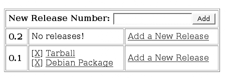

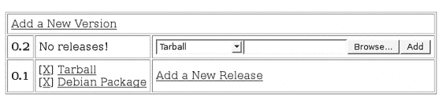

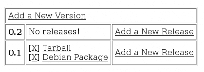

**图 10-7**

一个简单的界面允许你在单个页面中管理版本和发布。

在表格内部，你可以看到版本号、发布以及添加新内容的链接。与其点击链接并跳转到另一个页面来添加版本或发布，不如将链接替换为表单更为合理。因此，当你点击“添加新版本”（Add a New Version）链接时，你会看到如图 10-8 所示的结果。

**图 10-8**

版本表单显示在界面内部。

同样，当你点击“添加新发布”（Add a New Release）链接时，你会看到如图 10-9 所示的结果。

**图 10-9**

添加发布只需点击链接并填写表单如此简单。

## 第 10 章：构建可重用项目

代码中的复杂性并不特别源于困难或复杂的语句，而是源于许多检查不同条件并做出相应响应的嵌套块。建议先添加整个代码，然后重新阅读其工作原理的说明。

创建一个名为 `project_admindownloads.php` 的新文件并开始添加代码。首先显示图 10-7 所示的界面（你可以稍后处理表单）：

```php
$versql = "SELECT * FROM homeproject_releaseversions WHERE
project_id = " . $_SESSION['SESS_PROJECTID'] . " ORDER BY id DESC;"; $verresult = mysql_query($versql);

$vernumrows = mysql_num_rows($verresult);

echo "<h1>Manage Downloads</h1>";
```

你首先选择与当前项目相关的所有版本。

打开表格并添加第一行：

```php
echo "<h1>Manage Downloads</h1>";
echo "<table border=1 cellpadding=5>";
echo "<<tr><td colspan=3>";
```

第一行可以包含“添加新版本”（Add a New Version）链接或用于添加版本的表单。如果用户点击链接，一个 `addver` 的 GET 变量将发送到页面。

因此，检查此变量是否存在。如果存在，则显示表单；否则，显示链接：

```php
echo "<<tr><td colspan=3>";

if($_GET['addver']) {
    echo "<form action='" . $SCRIPT_NAME . "?func=downloads'
method='POST'>";
    echo "<<strong>New Release Number: ";
    echo "<input type='text' name='version'>";echo "<input type='submit' value='Add' name='versubmit'>";
    echo "</form>";
}
else {
    echo "<a href='" . $SCRIPT_NAME . "?func=downloads&addver=1'>Add a New Version</a>";
}

echo "</td></tr>";
```

完成第一行后，遍历版本。首先，检查查询是否返回了任何版本：

**注意：获取正确的提交按钮**

表单中的提交按钮命名为 `versubmit`。此页面有两个提交按钮（一个用于版本，一个用于发布），你需要能够区分点击的是哪一个。

```php
echo "</td></tr>";

if($vernumrows == 0) {
    echo "<<tr><td colspan=2>This project has no versions or releases.</td></tr>";
}
```

如果没有行，则显示一条消息表示不存在版本或发布。如果存在行，则显示它们：

```php
echo "<<tr><td colspan=2>This project has no versions or releases.</td></tr>";
}
else {
    while($verrow = mysql_fetch_assoc($verresult)) {
        echo "<tr";
        echo "<td><strong>" . $verrow['version'] . "</strong></td>";
        echo "<td>";

$relsql = "SELECT homeproject_releasefiles.id,
homeproject_releasefiles.filename, homeproject_releasefiles.date, homeproject_releasetypes.type FROM homeproject_releaseversions INNER
JOIN homeproject_releasefiles ON homeproject_releasefiles.version_id
= homeproject_releaseversions.id INNER JOIN homeproject_releasetypes
ON homeproject_releasefiles.type_id = homeproject_releasetypes.id
WHERE homeproject_releaseversions.id = " . $verrow['id'];
$relresult = mysql_query($relsql);
$relnumrows = mysql_num_rows($relresult);
```

在这种情况下，你在第一个单元格中添加版本号，然后运行查询以收集该版本可用的发布。该查询通过内连接连接 `homeproject_releaseversions`、`homeproject_releasefiles` 和 `homeproject_releasetypes` 表，返回每个版本的 `id`、`filename`、`date` 和 `type`。

检查是否返回了任何发布并相应显示：

```php
$relnumrows = mysql_num_rows($relresult);

if($relnumrows == 0) {
    echo "No releases!";
}
else {
    while($relrow = mysql_fetch_assoc($relresult)) {
        echo "[<a href='" . $SCRIPT_NAME . "?func=deleterelease&relid=" . $relrow['id'] . "'>X</a>]
<a href='releases/" . $relrow['filename'] . "'>" . $relrow['type'] . "</a><br>";
    }
}
echo "</td>";
```

在每个发布旁边都会添加一个 X 链接，用户用户删除发布。这链接到 `deleterelease` 块并传递发布的 `id`。（该块将在稍后讨论。）

在第三个单元格中，显示“添加新发布”（Add a New Release）链接或表单。

当点击链接时，地址栏中会添加一个 `addrelver` GET 变量，并设置为版本 ID。如果当前行的版本 ID 与 `addrelver` 的值相同，则说明点击了当前行的链接。因此，你需要显示表单：

```php
echo "</td>";
echo "<td>";

if($_GET['addrelver'] == $verrow['id']) {
    $typessql = "SELECT * FROM homeproject_releasetypes;";
    $typesresult = mysql_query($typessql);
    echo "<form action='" . $SCRIPT_NAME . "?func=downloads&ver=" . $verrow['id'] . "' method='POST'
enctype='multipart/form-data'>";
    echo "<select name='type'>";
    while($typesrow = mysql_fetch_assoc($typesresult)) {
        echo "<option value=" . $typesrow['id'] . ">" . $typesrow['type'] . "</option>";
    }
    echo "</select>";
    echo "<input type='file' name='releasefile'>";echo "<input type='submit' value='Add' name='relsubmit'>";
    echo "</form>";
}
else {
    echo "<a href='" . $SCRIPT_NAME . "?func=downloads&addrelver=" . $verrow['id'] . "'>Add a New Release</a>";
}
```

当显示表单时，选择框包含来自 `homeproject_releasetypes` 表的类型列表。提交按钮调用为 `relsubmit`，以便判断用户点击的是版本提交还是发布提交按钮。

关闭剩余代码：

```php
echo "<a href='" . $SCRIPT_NAME . "?func=downloads&addrelver=" . $verrow['id'] . "'>Add a New Release</a>";
}
echo "</td>";
echo "</tr>";
}
echo "</table>";
```

完成主界面部分后，你就可以专注于处理表单。跳转到文件开头并开始添加代码：

```php
<?php

require_once("../project_functions.php");

pf_protect_admin_page();

$uploaddr = $config_project_dir . $_SESSION['SESS_PROJECTPATH']
. "/releases/";

if($_POST['versubmit']) {
```


```php
$addsql = "INSERT INTO homeproject_releaseversions(project_id, version) VALUES(" . $_SESSION['SESS_PROJECTID'] . ", '" . $_POST['version'] . "')";
mysql_query($addsql);
header("Location: " . $config_projectadminbasedir . basename($SCRIPT_NAME) . "?func=downloads");
}
```

# 第 10 章：构建可重用项目

此代码运行一个 `INSERT` 查询将版本添加到数据库中。然后页面将重定向到同一页面并重新加载。

处理发布表单：

```php
header("Location: " . $config_projectadminbasedir . basename($SCRIPT_NAME) . "?func=downloads");
}
elseif($_POST['relsubmit']) {
    $uploadfile = $uploaddir . basename($_FILES['releasefile']['name']);
    if(move_uploaded_file($_FILES['releasefile']['tmp_name'], $uploadfile)) {
        $addsql = "INSERT INTO homeproject_releasefiles(type_id, date, version_id, filename) VALUES(" . $_POST['type'] . ", NOW()", ", " . $_GET['ver'] . ", '" . $_FILES['releasefile']['name'] . "')";
        mysql_query($addsql);
        header("Location: " . $config_projectadminbasedir . basename($SCRIPT_NAME) . "?func=downloads");
    }
    else {
        echo "Possible file upload attack!\n";
    }
```

要处理表单，你需要将文件复制到 `releases` 目录并将发布添加到数据库中。变量 `$uploadfile` 会将文件名添加到 `$uploaddir` 中，然后 `move_uploaded_file()` 尝试将文件从临时位置复制到 `releases` 目录。此过程与复制图片上传的过程完全相同（在本书之前的拍卖项目（Auction project）中讨论过）。

处理完成后，添加包含绘制界面代码的 `else` 部分：

```php
echo "Possible file upload attack!\n";
}
}
else {
    $versql = "SELECT * FROM homeproject_releaseversions WHERE project_id = " . $_SESSION['SESS_PROJECTID'] . " ORDER BY id DESC;";
}
```

最后，关闭表单：

```php
echo "<table>";
}
}
?>
```

## 删除发布

删除发布的代码与其他项目中删除内容代码几乎相同。唯一的区别是，你还需要删除对应的文件。

创建 `project_admindeleterelease.php` 并添加如示例 10-9 所示的代码。

### 示例 10-9

删除发布涉及移除文件、删除数据库记录，然后重定向。

```php
<?php
require_once("../project_functions.php");
pf_protect_admin_page();
if(pf_check_number($_GET['relid']) == TRUE) {
    $validrelid = $_GET['relid'];
}
else {
    header("Location: " . $config_projectadminbasedir);
}
if($_GET['conf']) {
    $uploaddir = $config_projectdir . $_SESSION['SESS_PROJECTPATH'] . "/releases/";
    $filesql = "SELECT filename FROM homeproject_releasefiles WHERE id = " . $validrelid . ";";
    $fileresult = mysql_query($filesql);
    $filerow = mysql_fetch_assoc($fileresult);
    $fullfile = $uploaddir . $filerow['filename'];
    if(file_exists($fullfile) == TRUE) {
        unlink($fullfile);
        $delsql = "DELETE FROM homeproject_releasefiles WHERE id = " . $validrelid . ";";
        mysql_query($delsql);
        header("Location: " . $config_projectadminbasedir . basename($SCRIPT_NAME) . "?func=downloads");
    }
    else {
        echo "<h1>File does not exist</h1>"; echo "您尝试删除的文件不存在。";
    }
}
else {
    echo "<h1>您确定要删除此发布吗？</h1>"; echo "<p>[<a href='" . $SCRIPT_NAME . "?func=deleterelease&conf=1&relid=" . $validrelid . "'>是</a>] [<a href='" . $SCRIPT_NAME . "?func=main'>否</a>]";
}
?>
```


```php
echo "</tr>";

}

echo "</table>";
}
```

添加错误检查，当上传的图片未能通过某项测试时会触发：

```php
echo "</table>";
}

switch($_GET['error']) {
    case "empty":
        echo '<p>您没有选择任何内容。</p>';
        break;
    case "nophoto":
        echo '<p>您没有选择要上传的图片。</p>';
        break;
    case "photoprob":
        echo '<p>您正在上传的图片似乎出现了问题</p>';
        break;
    case "large":
        echo '<p>您选择的图片太大了</p>';
        break;
    case "invalid":
        echo '<p>您选择的不是有效的图片文件</p>';
        break;
}

?>
```

<form enctype="multipart/form-data" action="<?php echo $SCRIPT_NAME; ?>?func=screenshots" method="POST">

最后，添加结束代码：

</form>

```php
<?php
}
?>
```

# 第 10 章：构建可复用项目

419

有关图片上传的详细说明，请参阅第 7 章介绍的拍卖项目。

### 删除图片

在本项目中，删除图片的流程与之前删除项目的脚本几乎完全相同。同样，这段删除代码不仅删除了数据库中的记录，还删文件文件。

创建 `project_deletescreenshot.php` 并添加示例 10-10 所示的代码。

### 示例 10-10

难道你不喜欢删除东西吗？也许只有我这样……

```php
<?php

require_once("../project_functions.php");

pf_protect_admin_page();

if(pf_check_number($_GET['imageid']) == TRUE) {
    $validimageid = $_GET['imageid'];
}
else {
    header("Location: " . $config_projectadminbasedir);
}

if($_GET['conf']) {
    $imagesql = "SELECT * FROM homeproject_screenshots WHERE id = " . $validimageid;
    $imageresult = mysql_query($imagesql);
    $imagerow = mysql_fetch_assoc($imageresult);
    unlink($config_projectdir . $_SESSION['SESS_PROJECTPATH'] . "/screenshots/" . $imagerow['name']);
    $delsql = "DELETE FROM homeproject_screenshots WHERE id = " . $validimageid;
    mysql_query($delsql);
    header("Location: " . $config_projectadminbaseurl . basename($SCRIPT_NAME) . "?func=screenshots");
}
else {
    // *继续*
}
?>
```

420
Practical PHP and MySQL

### 示例 10-10（续）

```php
echo "<h2>确定删除图片吗？</h2>";
echo "<form action=" . $SCRIPT_NAME . "?func=deletescreenshot' method='post'>";
echo "<p>您确定要删除这张图片吗？</p>"; echo "<p>";
echo "<a href=" . $SCRIPT_NAME . "?func=deletescreenshot&conf=1&imageid=" . $validimageid . ">是</a> / <a href=" . $SCRIPT_NAME . "?func=screenshots>否</a>"; echo "</p>";
echo "</form>";
}
?>
```

## 添加新项目

添加新项目只需显示一个表单然后将信息添加到数据库中即可。创建 `project_adminnewproject.php` 并添加示例 10-11 所示的代码。

### 示例 10-11

当你创建下一个《Quake》时，添加新项目是非常重要的。

```php
<?php

require_once("../project_functions.php");

pf_protect_admin_page();

if($_POST['submit']) {
    $inssql = "INSERT INTO homeproject_projects(name, about, pathname) VALUES(" . "'" . pf_fix_slashes($_POST['name']) . "', '" . pf_fix_slashes($_POST['about']) . "', '" . pf_fix_slashes($_POST['pathname']) . "');";
    mysql_query($inssql);
    header("Location: " . $config_projectadminbasedir . basename($SCRIPT_NAME));
}
else {
?>
<h1>新项目</h1>
<form action="<?php echo $SCRIPT_NAME; ?>?func=newproject" method="POST">
<table>
    <tr>
        <td>项目名称</td>
        <td><input type="text" name="name" value="<?php echo $row['name'] ?>"></td>
    </tr>
    <tr>
        <td>路径名称</td>
        <td><input type="text" name="pathname" value="<?php echo $row['pathname'] ?>"></td>
    </tr>
    <tr>
        <td>描述</td>
        <td><textarea name="about" rows="10" cols="50"><?php echo $row['about'] ?></textarea></td>
    </tr>
    <tr>
        <td></td>
        <td><input type="submit" name="submit" value="修改详情"></td>
    </tr>
</table>
</form>
<?php
}
?>
```


# 第 11 章

## 构建新闻网站

随着互联网的快速传播，新闻已成为一种必不可缺的资源，触手可及。只需点击搜索引擎，你就能接触到涵盖几乎任何主题的普通和小众新闻。

尽管初看起来设计可能复杂，但新闻网站本质上是简单的数据库驱动型 Web 网站。故事和分类通常存储在数据库中，这些信息以一种易于使用且具有吸引力的格式呈现给读者。

在本章中，你将创建自己的新闻网站，这个网站经过精心构建以满足几个核心目标。本章的目标是：

- 巩固书中之前涵盖的大部分趣味内容。
- 帮助你探索强大的 `PEAR` 框架，并使用许多 `PEAR` 模块之一。

好了，让我们开始行动吧……

## 项目概览

你可能还不知道，*Read All About It* 将成为最火的新型新闻网站——而巧合的是，你正是它的创始人。在本章中，你将为 Read All About It 注入灵魂。

虽然这个项目在复杂性和深度上不及 BBC 新闻或 CNN 那样的网站，但许多待探索的新概念和待构建的功能使得这个简单的网站成为一个值得投入的项目：

- **简单表单**。`HTML_QuickForm` `PEAR` 扩展简化了表单的创建和验证。
- **菜单和子菜单**。主导航区域包含多个菜单选项。当用户点击菜单时，会显示更多选项的子菜单。
- **搜索功能**。一种可以在网站内容中搜索搜索术语并列出匹配列表的功能。
- **分页**。不要用包含数百个搜索结果的长页面让用户感到沮丧；将结果划分到多个不同的页面上。
- **密码加密**。通过在数据库中存储加密密码来增加网站安全性。这可以防止人们从数据库中窥探密码，或通过使用恶意手段嗅探明文密码。

这五个功能培养了基础的技能，你可以将这些技能应用到书中已涵盖的任何项目中。

## 安装 PEAR 包

`PEAR` 框架提供了一系列不同的 PHP 扩展，可以简化并自动化你网站的制作。你可以找到用于 Web 服务、XML、验证、表单处理以及许多其他领域的 `PEAR` 包，而且庞大且活跃的 `PEAR` 社区每周都会向系统中不断添加更多的包。

*Read All About It* 网站大量使用了 `HTML_QuickForm` `PEAR` 扩展。该包简化了你在脚本中创建表单的方式。通过该扩展，你可以轻松创建表单、应用验证规则、管理表单的处理方式并实现各种其他功能。虽然在开始编码之前需要安装 `HTML_QuickForm`，但幸运的是，`PEAR` 框架足够智能，可以轻松管理扩展的安装和使用。

**注意 用户用户……**

如果你正在使用 XAMPP 系统，可以安全地忽略此节。XAMPP 包含了一系列 `PEAR` 模块，包括 `HTML_QuickForm`。

要安装 `PEAR`，你需要运行一个 PHP 脚本，它会自动下载并安装该框架。然而，在下载所需的 `PEAR` 扩展之前，你需要先下载框架。

由于每个操作系统运行此脚本的方式略有不同，本节分别介绍了每个系统的安装方法。

对于 Windows，进入安装 PHP 的目录（例如 `C:/PHP`）并运行以下命令：

```
php go-pear.org
```

在 Linux 中，在终端或 xterm 中运行以下命令（你需要安装 Lynx 浏览器才能执行此操作）：

```bash
foo@bar:~$ lynx –source go-pear.org | php
```

在 Mac OS X 中，在终端中运行以下命令：
```bash
curl go-pear.org | sudo php
```

当你运行这些命令之一时，系统会提示回答若干问题。请直接使用默认答案，包括在提示修改 `php.ini` 时——脚本应该保持 `php.ini` 其他部分的完好。安装程序完成后，`PEAR` 命令行工具即可用于管理你的 `PEAR` 包。在 Windows 中，你可能需要在 PHP 目录下运行该命令，但在 Linux 和 Mac OS X 上，你应该可以在任何地方运行它。在 Linux 和 Mac OS X 中，你需要作为超级用户才能使用该命令。

使用 `PEAR` 仅涉及向 `pear` 程序传递不同的选项。例如，要查看系统上安装的包，请运行：

```bash
pear list
```

如果你有很多已安装的包（例如，如果你正在运行带有默认 `PEAR` 扩展的 XAMPP），你应该看到类似下面的内容：

```
Installed packages:
===================
Package Version State
Archive_Tar 1.1 stable
Crypt_RC4 1.0.2 stable
Crypt_Xtea 1.0 stable
DB 1.6.2 stable
DBA 1.0 stable
DB_DataObject 1.2 stable
Date 1.3 stable
FSM 1.2.1 stable
File 1.0.3 stable
HTML_QuickForm 3.1.1 stable
HTML_Common 1.2.1 stable
MDB 1.1.3 stable
PEAR 1.3.5 stable
PEAR_Info 1.0.6 stable
PEAR_PackageFileManager 1.0 stable
PHPUnit 0.6.2 stable
XML_Util 0.5.1 stable
XML_fo2pdf 0.98 stable
XML_image2svg 0.1 stable
```

要安装 `HTML_QuickForm`，运行此命令：

```bash
pear install –a HTML_QuickForm
```

你应该看到两个包：`HTML_QuickForm` 和 `HTML_Common`。`HTML_QuickForm` 包依赖于 `HTML_Common`；因此两者都会被安装。

**注意 用户用户……**

如果你使用 XAMPP，你实际上会看到更多的包。这里的示例为了节省空间进行了删减。

你现在准备好使用 `HTML_QuickForm` 了。简单，不是吗？

## 构建数据库

你将创建的数据库将在图 11-1 中展示。

项目中的数据库非常简单。该项目的数据库需求也很简单。`categories` 表如意料地存储了一系列分类。在该表中，`parent` 字段指定该分类是否为顶级父级字段。这些可以包含子分类的字段显示在导航栏中。`cat_relate` 表通过连接 `parent id` 和 `child id` 来指定不同分类之间的关系。这在本章稍添加分类时会变得更加清晰。

### 实现数据库

启动 `phpMyAdmin`，创建一个名为 `news` 的新数据库，并添加以下表：

**categories 表**
- `id`: `SMALLINT`, 自动增，主键。
- `category`: `VARCHAR`, 长度 20。
- `parent`: `TINYINT`。

**cat_relate 表**
- `id`: `SMALLINT`, 自动增，主键。
- `parent_id`: `SMALLINT`。
- `child_id`: `SMALLINT`。

**users 表**
- `id`: `INT`, 自动增，主键。
- `username`: `VARCHAR`, 长度 10。
- `password`: `VARCHAR`, 长度 32。在本项目中，密码被加密为 32 字符的值。
- `level`: `TINYINT`。

**stories 表**
- `story_id`
- `id`
- `cat_id`
- `rating`
- `poster_id`
- `parent`
- `dateposted`
- `subject`
- `body`


- `id`。将其设为 `INT`（可能涉及几个问题）并开启 `auto_increment`。将此字段设置为主键。
- `cat_id`。将其设为 `SMALLINT`。
- `poster_id`。将其设为 `SMALLINT`。
- `dateposted`。将其设为 `DATETIME`。
- `subject`。将其设为长度为 `50` 的 `VARCHAR`。
- `body`。将其设为 `TEXT`。

# 实战 PHP 和 MySQL

## `ratings` 表

- `id`。将其设为 `INT` 并开启 `auto_increment`。将此字段设置为主键。
- `user_id`。将其设为 `INT`。
- `story_id`。将其设为 `INT`。
- `rating`。将其设为 `TINYINT`。

#### 插入示例数据

准备好一组数据表后，添加一些示例数据。请记住，不要在 `id` 列中填充数字；这将将由 `auto_increment` 处理。你可以随意添加自己的示例数据或使用建议的信息。

### `categories` 表的示例数据

创建表 11-1 所示的三个类别。如果你愿意，也可以使用你自己的类别。

**表 11-1**

`parent` 字段稍后将在构建菜单时使用。

| CATEGORY | PARENT |
| :--- | :--- |
| Music | 1 |
| Fashion | 1 |
| Rock | 0 |

`parent` 字段决定该类别是否为顶级类别。在这种情况下，有两个顶级类别（`Music` 和 `Fashion`）和一个子类别（`Rock`）。

### `cat_relate` 表的示例数据

表 11-2 所示的表包含了子类别与父类别之间的关系。该表仅包含一条条目，它创建了 `Music` 顶级类别与 `Rock` 子类别之间的关系。

**表 11-2**

表中仅添加了子类别与父类别之间的关系。

| PARENT_ID | CHILD_ID |
| :--- | :--- |
| 1 | 3 |

# 第 11 章：构建新闻网站

### `users` 表的示例数据

向表中添加三个用户。在项目中，用户使用了加密密码。当你在 `phpMyAdmin` 中添加用户时，从 `Functions` 下拉框中选择 `MD5` 来加密密码。完全加密的字符串占用 32 个字符。

在 `level` 字段中，给一个用户赋予级别 `0`，另一个用户赋予级别 `1`，另一个用户赋予级别 `10`。级别决定了用户在网站上可以做什么：
- `0`：用户只能浏览内容和评价故事。
- `1`：用户可以发布故事。
- `10`：这是管理员。她可以执行任何操作，例如添加故事、删除内容或添加删除类别。

### `stories` 表的示例数据

此表包含网站上的故事（见表 11-3）。可以根据需要添加任意故事，至少添加一个以防。

在 `poster_id` 字段中，添加 `users` 表中其中一个用户的 id。

**表 11-3**

| CAT_ID | POSTER_ID | DATEPOSTED | SUBJECT | BODY |
| :--- | :--- | :--- | :--- | :--- |
| 3 | 1 | NOW() | 摇滚音乐获取 | 随着对更流行的金属和新新金属的巨大推动，摇滚乐也分得一杯羹。来自 60 年代后期一直流行的乐队报告其唱片销量激增。真正的测试是这种流行是否能够持续，还是仅仅是一种暂时的时尚。只有时间能给出答案。 |

### `ratings` 表的示例数据

保持此表为空。

## 开始编码

到这一步，你可能已经猜到第一步了。没错——你需要创建头部、页脚文件和配置文件。在你的 `webroot` 中创建一个名为 `readallaboutit` 的目录，并从配置文件开始。

创建 `config.php` 并添加示例 11-1 所示的代码。

**示例 11-1**

这里没有新新意；只是同样的老配置文件。

```php
<?php
$dbhost = "localhost";
$dbuser = "root";
$dbpassword = "";
$dbdatabase = "news";
$config_basedir = "http://localhost/sites/readallaboutit/";
?>
```

创建 `db.php` 并添加示例 11-2 中的数据库连接代码。

**示例 11-2**

这是在之前的项目中使用的相同连接代码。

```php
<?php
require("config.php");
$db = mysql_connect($dbhost, $dbuser, $dbpassword);
mysql_select_db($dbdatabase, $db);
?>
```

在项目中，你使用了之前项目的 `functions` 文件。将其复制过来或创建 `functions.php` 并添加示例 11-3 中的相同代码。

**示例 11-3**

这些函数为输入内容添加斜杠并验证数字型 GET 变量。

```php
<?php
function pf_fix_slashes($string) {
    if (get_magic_quotes_gpc() == 1) {
        return($string);
    }
    else {
        return(addslashes($string));
    }
}

function pf_check_number($value) {
    if(isset($value) == FALSE) {
        $error = 1;
    }
    if(is_numeric($value) == FALSE) {
        $error = 1;
    }
    if($error == 1) {
        return FALSE;
    }
    else {
        return TRUE;
    }
}
?>
```

创建 `header.php` 并添加示例 11-4 中的头部代码。

**示例 11-4**

头部文件并没有特别复杂。

```php
<?php
session_start();
require("config.php");
?>
<!DOCTYPE HTML PUBLIC "-//W3C//DTD HTML 4.01 Transitional//EN"
"http://www.w3.org/TR/html4/loose.dtd">
<head>
<title><?php echo $config_sitename; ?></title>
<link href="stylesheet.css" rel="stylesheet">
</head>
<body>
<div id="header">
    <h1>Read All About It</h1>
</div>
<div id="menu">
    <a href="<?php echo $config_basedir; ?>">Home</a>
</div>
<div id="container">
    <div id="bar">
        <?php
        require("bar.php");
        ?>
    </div>
    <div id="main">
    头部文件是直接的；它为设计创建了常用的 <div> 标签。
```

## 构建菜单结构

网站的菜单结构非常重要。菜单包含许多类别，点击后会展开并显示子类别。父类别和子类别都可以用于显示类别内的故事，其中父类别显示所有子故事。例如，Music 类别显示所有的 Rock 和 Pop 故事，但 Rock 子类别只显示 Rock 故事。

要创建一个子菜单，你需要跟踪哪些父类别（顶级类别）和子类别（子选项）被点击。当选择类别时，有两个会话变量会存储这些值。

菜单最好放置在侧边栏，因此创建 `bar.php` 并开始添加代码：

```php
<?php
session_start();
require("db.php");
```

在添加会 支持并包含数据库连接后，创建一个查询来返回顶级类别：

```php
require("db.php");
echo "<h1>Topics</h1>";
$sql = "SELECT * FROM categories WHERE parent = 1;";
$result = mysql_query($sql);
$numrows = mysql_num_rows($result);
if($numrows == 0) {
    echo "<p>No categories</p>";
}
```

查询返回所有 `parent` 字段存储为 `1` 的类别。如果没有返回行，则显示文本 `No categories`。否则，你需要显示它们：

```php
else {
    while($row = mysql_fetch_assoc($result)) {
        if($_SESSION['SESS_USERLEVEL'] == 10) {
            echo "<a href='deletecat.php?id=" . $row['id'] . "'>[X]</a> ";
        }
        echo "<a href='index.php?parentcat=" . $row['id'] . "'>" . $row['category'] . "</a><br>";
    }
}
```

`while` 循环遍历每一行并将每个选项显示为指向 `index.php` 的链接。该页面了父类别的 id。如果用户以级别 10（管理员）登录，则会在类别左侧添加一个删除链接。

创建一个查询来返回子类别：

```php
$childsql = "SELECT categories.id, categories.category
FROM categories INNER JOIN cat_relate
ON categories.id = cat_relate.child_id
WHERE cat_relate.parent_id = " . $_SESSION['SESS_PARENT'] . ";";
$childresult = mysql_query($childsql);
```

该查询执行了一个连接，返回与父类别存在关系的子类别。


遍历返回的结果：

```php
$childresult = mysql_query($childsql);
while($childrow = mysql_fetch_assoc($childresult)) {
    if($_SESSION['SESS_USERLEVEL'] == 10) {
        echo "<a href='deletecat.php?id=" . $childrow['id'] . "'>[X]</a ";
    }
    echo " &bull; <a href='index.php?parentcat=" . $row['id'] . "&amp;childcat=" . $childrow['id'] . "'>" . $childrow['category'] . "</a><br>";
}
```

结果将显示给用户，如果用户级别为 `10`，则再次添加删除链接。

在 `bar.php` 中关闭代码块：

```php
echo " &bull; <a href='index.php?parentcat=" . $row['id'] . "&amp;childcat=" . $childrow['id'] . "'>" . $childrow['category'] . "</a><br>";
}
}
}
?>
```

最后，添加示例 11-5 所示的页脚代码。

**示例 11-5**
页脚代码关闭了 `<div>` 区域。

```html
</div>
</div>
</body>
</html>
```

# 创建主页面

我们的主页面将是 `index.php`，它有三个主要用途：

* 设置当前选择的父分类和子分类话变量。
* 当选择某个分类时，显示可用故事的摘要。
* 当未选择分类时，显示最新新闻故事。

传递给页面的 `GET` 变量决定了加载哪些功能。如果没有 `GET` 变量，则显示最新故事。如果传递了 `parentcat` 变量，则显示该分类的故事。如果同时存在 `parentcat` 和 `childcat` 变量，则显示子分类的故事。

创建 `index.php`，并从创建父/子会话变量开始，验证 `GET` 变量并将它们分配给 `SESS_PARENT` 或 `SESS_CHILD` 会话变量，如示例 11-6 所示。

```php
<?php
require("db.php");
session_register("SESS_PARENT");
session_register("SESS_CHILD");
if(isset($_GET['parentcat']) && isset($_GET['childcat'])) {
    if(is_numeric($_GET['parentcat'])) {
        $_SESSION['SESS_PARENT'] = $_GET['parentcat'];
    }
    if(is_numeric($_GET['childcat'])) {
        $currentcat = $_GET['childcat'];
        $_SESSION['SESS_CHILD'] = $_GET['childcat'];
    }
} else if(isset($_GET['parentcat'])) {
    if(is_numeric($_GET['parentcat'])) {
        $currentcat = $_GET['parentcat'];
        $_SESSION['SESS_PARENT'] = $_GET['parentcat'];
        $_SESSION['SESS_CHILD'] = 0;
    }
} else {
    $currentcat = 0;
}
```

检查两个变量是否是否存在。如果存在，则检查它们是否为数字，如果是，则将每个 `GET` 变量的值赋值给会话变量。如果只有 `parentcat` `GET` 变量，也采用相同的过程。

变量 `$currentcat` 决定当前分类。有三种可能的选项：

* 如果仅存在 `parentcat` 变量，则 `$currentcat` 设置 `parentcat` 的值。
* 如果存在 `childcat` 变量，则 `$currentcat` 被设置为 `childcat` 的值。
* 如果没有任何变量，则 `$currentcat` 被设置为 `0`。

检查 `$currentcat` 是否被设置为 `0`。如果是，创建一个查询来返回最新的五个故事：

```php
$currentcat = 0;
require("header.php");
if($currentcat == 0) {
    $sql = "SELECT * FROM stories ORDER BY dateposted DESC LIMIT 5;";
}
```

如果 `$currentcat` 被设置为某个分类，则运行查询以确定 `parent` 字段被设置为什么：

```php
$sql = "SELECT * FROM stories ORDER BY dateposted DESC LIMIT 5;";
} else {
    $parentsql = "SELECT parent FROM categories WHERE id = " . $currentcat . ";";
    $parentres = mysql_query($parentsql);
    $parentrow = mysql_fetch_assoc($parentres);
```

现在检查 `parent` 是否设置为 `1`。如果是，说明用户点击了一个包含多个子分类的分类。发生这种情况时，显示父分类中的所有故事以及所有子分类。如果所选分类不是父分类，则返回该特定分类的故事。为此添加 SQL 代码：

```php
$parentres = mysql_query($parentsql);
$parentrow = mysql_fetch_assoc($parentres);
if($parentrow['parent'] == 1) {
    $sql = sprintf("SELECT stories.* FROM stories INNER JOIN cat_relate ON stories.cat_id = cat_relate.child_id WHERE cat_relate.parent_id = %d UNION SELECT stories.* FROM stories WHERE stories.cat_id = %d;" , $currentcat, $currentcat);
} else {
    $sql = "SELECT * FROM stories WHERE cat_id = " . $currentcat . ";";
}
```

如果分类是父分类，则构建一个大型查询来返回所有故事。这个查询实际上是两个巧妙组合在一起的查询。第一部分（`SELECT stories.* FROM stories INNER JOIN cat_relate ON stories.cat_id = cat_relate.child_id WHERE cat_relate.parent_id = <id>`）使用连接来获取所有 `parent_id` 设置为 `$currentcat` 的故事。第二部分（`SELECT stories.* FROM stories WHERE stories.cat_id = <id>`）选择作为父分类的故事。

这两部分通过使用 `UNION` 关键字被接到同一个查询中，该关键字将两个使用相同类型列的查询连接起来。这在类似的情况下非常有用，例如当你需要在同一张表上执行两个 `SELECT` 查询时。

这个大型查询是在 `sprintf()` 函数内部构建的，该函数用于当你想用另一个字符串或变量替换字符串的部分内容时。在这种情况下，你想在查询的正确位置添加 `$currentcat`。为了实现这一点，字符串中的 `%d`（称为类型占位符）被 `sprintf()` 结尾指定的变量所替换——在这种情况下，是 `$currentcat`。不同类型的变量使用不同的类型占位符，你可以在 `www.php.net/sprintf` 满足你对类型占位符的好奇。

在 `else` 部分中，如果所选分类不是父分类，则构建一个查询，它简单地返回该特定分类的故事。

运行相关查询：

```php
$sql = "SELECT * FROM stories WHERE cat_id = " . $currentcat . ";";
}
$result = mysql_query($sql);
$numrows = mysql_num_rows($result);
```

有了丰富的 own 供你使用，将它们显示给用户：

```php
$result = mysql_query($sql);
$numrows = mysql_num_rows($result);
if($numrows == 0) {
    echo "<h1>No Stories</h1>";
    echo "<p>该分类目前没有故事。 </p>";
} else {
    while($row = mysql_fetch_assoc($result)) {
        if($_SESSION['SESS_USERLEVEL'] == 10) {
            echo "<a href='deletestory.php?id=" . $row['id'] . "'>[X]</a ";
        }
        echo "<strong><a href='viewstory.php?id=" . $row['id'] . "'>" . $row['subject'] . "</a></strong><br />";
        echo date("D j F Y g.iA", strtotime($row['dateposted']));
        echo "<p>" . $row['body'] . "</p>";
    }
}
```

最后，添加结束代码：

```php
echo "<p>" . $row['body'] . "</p>";
}
}
require("footer.php");
?>
```

# 处理用户登录

与书中的许多其他项目一样，用户登录功能是一项基本功能。本项目中用户登录的代码和功能与书中其他项目中的代码几乎完全相同。这许多内容对你来说应该很熟悉，但如果不熟悉，请回去尝试一下之前的一些项目。

此登录版本的核心区别在于，你在添加用户时使用了加密密码。当用户被创建时，`MD5()` MySQL


`command` 用于对密码进行哈希。为了验证在登录表单中输入用户名和密码的用户，你首先对表单中输入的密码进行哈希，然后比较两个哈希后的密码。如果它们匹配，则密码有效。

创建 `userlogin.php` 并添加表单：

```html
<form action="<?php echo $SCRIPT_NAME ?>" method="post">
<table>
  <tr>
    <td>Username</td>
    <td><input type="text" name="username"></td>
  </tr>
  <tr>
    <td>Password</td>
    <td><input type="password" name="password"></td>
  </tr>
  <!-- 第 11 章 -->
  构建一个新闻网站
  441
  <tr>
    <td></td>
    <td><input type="submit" name="submit" value="Login!"></td>
  </tr>
</table>
</form>
```

该表单提示用户输入用户名和密码。当用户点击提交（Submit）按钮时，页面将重定向到自身以处理数据。

跳转到文件顶部，并在处理表单之前添加一些 `include` 语句并对已已登录进行检查：

```php
<?php
session_start();
require("config.php");
require("db.php");
require("functions.php");
if($_SESSION['SESS_USERNAME']) {
    header("Location: " . $config_basedir . "userhome.php");
}
```

如果 `SESS_USERNAME` 会话变量可用，页面将重定向到另一个可能包含选项的脚本（尽管在这个项目中没有创建 `userhome.php`，但它可以作为用户的控制面板）。

开始处理表单：

```php
header("Location: " . $config_basedir . "userhome.php");
}

if($_POST['submit']) {
    $sql = "SELECT * FROM users WHERE username = '" . pf_fix_slashes($_POST['username']) . "' AND password = '" . md5(pf_fix_slashes($_POST['password'])) . "'";
    $result = mysql_query($sql);
    $numrows = mysql_num_rows($result);
```

该查询将输入的用户名和密码与 `users` 表中的记录进行比较。在构建查询时，使用 PHP 的 `md5()` 命令首先对密码进行哈希，以便比较哈希后的密码（表中的现有密码和刚刚在表单中输入的密码）。

442

PHP 与 MySQL

检查是否返回了任何结果：

```php
$result = mysql_query($sql);
$numrows = mysql_num_rows($result);
if($numrows == 1) {
    $row = mysql_fetch_assoc($result);
    session_register("SESS_USERNAME");
    session_register("SESS_USERID");
    session_register("SESS_USERLEVEL");
    $_SESSION['SESS_USERNAME'] = $row['username'];
    $_SESSION['SESS_USERID'] = $row['id'];
    $_SESSION['SESS_USERLEVEL'] = $row['level'];
    header("Location: " . $config_basedir);
} else {
    header("Location: " . $config_basedir . "/userlogin.php?error=1");
}
}
```

如果返回了行，则注册并设置会话变量。否则，页面将带有 `error` GET 变量重新加载。

在显示表单之前显示错误：

```php
header("Location: " . $config_basedir . "/userlogin.php?error=1");
}
}
else {
    require("header.php");
    echo "<h1>Login</h1>";
    if($_GET['error']) {
        echo "<p>登录错误，请重试!</p>";
    }
?>
<form action="<?php echo $SCRIPT_NAME ?>" method="post">
<table>
  <tr>
```

最后，在表单后关闭脚本：

<!-- 第 11 章 -->
构建一个新闻网站
443
```html
  </tr>
</table>
</form>
<?php
}
require("footer.php");
?>
```

## 用户注销

要注销用户，请注销在登录页面创建的三个会话。记住，菜单栏使用会话来跟踪当前选择了哪些选项，因此你不能简单地销毁会话。将示例 11-6 中的以下代码添加到 `userlogout.php` 中。

**示例 11-6**

不要销毁会话，因为菜单使用了会话变量。

```php
<?php
session_start();
require("config.php");
session_unregister("SESS_USERNAME");
session_unregister("SESS_USERID");
session_unregister("SESS_USERLEVEL");
header("Location: " . $config_basedir);
?>
```

## 更新侧边栏

如果用户已登录，你希望在侧边栏添加一个框来指示用户已登录，然后列出他可用的选项。像之前的某些项目一样，它显示为一个类似于下方的框：


444

PHP 与 MySQL

**示例 11-3**

不要销毁会话，因为菜单使用了会话变量。

```php
<?php
session_start();
require("config.php");
```


平均分计算后，它将被四舍五入到最近的 0.5（例如 7.5 或 8.0）。为了显示评分，将显示 10 张图片，需要时将使用前面的图片。例如，平均分为 8 将有 8 张完整图片和 2 张空图片。评分 6.5 将有 5 张完整图片、1 张半图片和 3 张空图片。

通过创建 `viewstory.php` 开始构建页面，然后添加引入和验证代码：

```php
<?php
require("config.php");
require("functions.php");
if(pf_check_number($_GET['id']) == TRUE) {
    $validid = $_GET['id'];
}
else {
    header("Location: " . $config_basedir);
}
require("header.php");
```

在进入评分之前，你需要显示主故事文本。运行查询来收集这些信息然后将其显示：

```php
require("header.php");
$sql = "SELECT * FROM stories WHERE id = " . $validid . ";";
$result = mysql_query($sql);
```

### 第 11 章：构建新闻新闻网站
447

```php
$row = mysql_fetch_assoc($result);
echo "<h1>" . $row['subject'] . "</h1>";
echo date("D jS F Y g.iA", strtotime($row['dateposted'])) . "<br />";
echo nl2br($row['body']);
```

在显示信息时，日期被格式化为可读状态，且 `nl2br()` 函数将正文中的空行转换为 `<br>` 标签。这种转换确保了原始文本中的空行被保留。

当故事被评分时，`ratings` 表存储该分数。使用此表获取该故事的评分次数以及平均分：`echo date("D jS F Y g.iA", strtotime($row['dateposted'])) . "<br />";` `echo nl2br($row['body']);`

```php
$avgsql = "SELECT COUNT(id) AS number, AVG(rating) AS avg FROM ratings WHERE story_id = " . $validid . ";";
$avgresult = mysql_query($avgsql);
$avgrow = mysql_fetch_assoc($avgresult);
echo "<p>";
echo "<strong>Rating</strong> ";
```

此查询使用 MySQL 的 `COUNT()` 和 `AVG()` 函数来返回票数和平均值。`AVG()` 函数返回你指定的字段的平均值。在这种情况下，你想要 `ratings` 字段的平均值。

然而，很有可能并不是每个故事都有评分，因此你需要考虑这种情况：

```php
echo "<p>";
echo "<strong>Rating</strong> ";
if($avgrow['number'] == 0) {
    echo "No ratings!";
}
```

如果存在评分，根据需要将平均值向上或向下四舍五入：`echo "No ratings!";`

```php
else {
    $a = (round($avgrow['avg'] * 2) / 2)
```

这一行使用 `round()` 对平均值进行四舍五入，将结果乘以 2，然后除以 2 以确定最终评分。这个简单的数学技巧是获取最终值的好方法。

448
实用 PHP 和 MySQL

确定最终结果是否为 `0.5` 数字（例如 7.5，而不是 8）：

```php
else {
    $a = (round($avgrow['avg'] * 2) / 2) . "<br>";
    $a *= 10;
    if($a%5 == 0 && $a%10 != ) {
        $range = ($a / 10) - 0.5;
    }
    else {
        $range = $a / 10;
    }
}
```

为了计算 `$a` 中是否有 .5 值（例如 6.5），首先将 `$a` 的值乘以 10（`$a *= 10`），然后在 `if` 语句的内部内部检查 `$a` 是否能被 5 整除。如果是，则将 `$a` 除以 10 恢复原始值，并减去 0.5。生成的 `$range` 变量表示要显示的完整图片数量。

创建一个 `for` 循环来显示每张图片：

```php
$range = $a / 10;
for($i=1;$i<=$range;$i++) {
    echo "";
}
```

`for` 循环在 `1` 到 `$range` 内部的值之间运行，每次显示 `rating_full.png`。

再次检查平均值是否为 `float`，以查看是否应该添加半亮图片：

```php
echo "";
if($a%5 == 0 && $a%10 != ) {
    echo "";
}
$a = $a / 10;
```

通过从 10 中减去四舍五入后的平均值，计算应该显示多少张空图片：


### 第 11 章：构建新闻新闻网站
449

```php
echo "";
$a = $a / 10;
$remain = 10 - $a;
for($r=1;$r<=$remain;$r++) {
    echo "";
}
}
echo "<br />";
```

完成后的评分显示应该与图 11-5 所示类似。

**图 11-5**
在这个示例中，分数是 10 分中的 8 分。

在评分图片之后，添加代码允许已登录的用户投票：

```php
echo "<br />";
echo "<strong>Rate this story</strong>: ";
if($_SESSION['SESS_USERNAME']) {
    for($i=1;$i<=10;$i++) {
        echo "<a href='ratestory.php?id=" . $validid . "&amp;rating=" . $i . "'>" . $i . "</a> ";
    }
}
else {
    echo "To vote, please <a href='userlogin.php'>log in</a>.";
```

如果用户已登录，`for` 循环将创建从 1 到 10 的链接，每个链接指向 `ratestory.php` 并传递故事的 `id` 和评分。

最后，添加结束代码：

```php
echo "To vote, please <a href='userlogin.php'>log in</a>.";
echo "</p>";
require("footer.php");
?>
```

450
实用 PHP 和 MySQL

### 执行评分

当用户点击评分之一时，`ratestory.php` 将评分添加到数据库。此脚本相当简单并包含了一些错误检查。创建 `ratestory.php`。首先包含通常的文件并验证 GET 变量：

```php
<?php
require("db.php");
require("functions.php");
if(pf_check_number($_GET['id']) == TRUE) {
    $validid = $_GET['id'];
}
else {
    header("Location: " . $config_basedir);
}
if(pf_check_number($_GET['rating']) == TRUE) {
    $validrating = $_GET['rating'];
}
else {
    header("Location: " . $config_basedir);
}
require("header.php");
```

检查用户是否已经投票：

```php
require("header.php");
$checksql = "SELECT * FROM ratings WHERE user_id = " . $_SESSION['SESS_USERID'] . " AND story_id = " . $validid . ";";
$checkresult = mysql_query($checksql);
$checknumrows = mysql_num_rows($checkresult);
if($checknumrows == 1) {
    echo "<h1>已经投票过</h1>";
    echo "<p>你已经对这个故事投过票了。</p>";
}
```

如果用户尚未投票，将评分添加到表中：

```php
else {
    $inssql = "INSERT INTO ratings(user_id, story_id, rating) VALUES(" . $_SESSION['SESS_USERID']. "," . $validid . "," . $validrating . ");";
    mysql_query($inssql);
    echo "<h1>感谢！</h1>";
    echo "<p>感谢你的投票。</p>";
}
?>
```


你可能有一个名为 `Mammal` 的类，它创建一个具有哺乳动物特征的对象。你可能还有另一个名为 `Dog` 的类，它继承自 `Mammal` 类，但添加了 `Dog` 特有的特征。这就是面向对象编程（OOP）的工作原理。在技术背景下，你可能有一个名为 `Button` 的类，它指定了非常通用的按钮概念，然后有不同的 `PushButton` 和 `ToggleButton` 类继承自 `Button`。

### 为什么使用传统的过程化方法？

OOP 是一个庞大且多样的主题，尽管 PHP 可以用于 OOP，但本书采用了传统的过程化开发方法，因为它更容易理解和使用。此外，使用 OOP 创建 PHP 脚本并没有过程化方法用得广泛。

### HTML_QuickForm

`HTML_QuickForm` 的工作方式与普通的表单处理类似，尽管方式略有不同：

- 引入 `HTML_QuickForm` 类。
- 创建一个 `HTML_QuickForm` 对象。
- 创建表单元素。
- 创建验证规则。
- 显示表单并指定由哪个函数来处理它。

尽管 `HTML_QuickForm` 起初看起来有些反常，但在你编写几个使用它的脚本后，你会发现它在很多情况下非常有用。

### 添加故事

添加故事涉及创建一个相当常见的表单，接收信息并将其存入数据库。创建 `addstory.php` 并开始引入你的文件：

```php
<?php
session_start();
require("config.php");
require("functions.php");
require("db.php");
```

除了常规的包含文件外，还要引入 `HTML_QuickForm`：`require("db.php");`

```php
require_once 'HTML/QuickForm.php';
```

当你安装 PEAR 模块时，`php.ini` 会被更新以确保 PHP 能够轻松找到 PEAR 扩展，因此能够使用 `HTML/QuickForm.php` 作为路径和文件。

通过锁定任何用户级别为 `1` 或以上的用户来保护页面：

```php
require_once 'HTML/QuickForm.php';
if($_SESSION['SESS_USERLEVEL'] < 1) {
    header("Location:" . $config_basedir);
}
```

接下来，从 `HTML_QuickForm` 类创建一个对象：

```php
header("Location:" . $config_basedir);
$form = new HTML_QuickForm('firstForm');
```

这一行创建了一个名为 `$form` 的对象，它是一个 `HTML_QuickForm` 对象。该对象有一系列可用的方法，你可以在 http://pear.php.net/package/HTML_QuickForm/docs 找到更多信息。

要创建一个表单，你需要添加普通的文本框和提交按钮，以及一个带有分类列表的选择框，用户可以从中进行选择。在手动创建表单时，你添加一个 `<select>` 标签，然后遍历查询结果以添加 `<select>` 框的内容。

使用 `HTML_QuickForm` 时，过程略有不同。你需要执行查询，然后构建一个包含这些项的数组。该数组稍后会被添加到表单中。

添加构建数组的代码：

```php
$form = new HTML_QuickForm('firstForm');
$catsql = "SELECT id, category FROM categories ORDER BY category;";
$catres = mysql_query($catsql);
while($catrow = mysql_fetch_assoc($catres)) {
    $catarr[$catrow['id']] = $catrow['category'];
}
```

你首先创建查询，然后 `while` 循环创建数组。数组的键（方括号中的部分）被设置为 `id`，值设置为分类名称。例如，如果你有分类 `Music`（id 为 `1`）和 `Fashion`（id 为 `2`），数组看起来像这样：`$catarr[1] = "Music"`, `$catarr[2] = "Fashion"`。

创建表单元素并加载数组：

```php
$catarr[$catrow['id']] = $catrow['category'];
$s =& $form->createElement('select','cat_id','Category ');
$s->loadArray($catarr);
$form->addElement($s);
```

第一行使用了 `$form` 对象上的 `createElement()` 方法。在 OOP 开发中，通过 `->` 访问方法（例如 `$object->method()`）。`createElement()` 方法接受三个参数。第一个指定表单元素的类型（在本例中 `select` 是一个选择框）。下一个参数是你想要引用的表单元素的名称。最后，第三个参数应该是显示在表单元素旁标签。

在第一行中，`=&` 符号被用于创建一个*引用*。引用用于获取符号右侧的代码，并让左侧的变量引用它。因此，`$s` 指向表单元素。

第二行使用 `loadArray()` 函数用 `$catarr` 中的值加载选择框。现在选择框已完成。下一步是将完成的选择元素添加到表单中。这在第三行通过 `addElement()` 方法完成。

```。

创建其他表单元素：

```php
$s->loadArray($catarr);
$form->addElement($s);
$form->addElement('text', 'subject', 'Subject', array('size' => 50, 'maxlength' => 255));
$form->addElement('textarea', 'body', 'Comment:', array('size' => 50, 'maxlength' => 255, 'rows' => 20, 'cols' => 80));
$form->addElement('submit', null, 'Add Story!');
```

第一行创建了一个名为 `subject` 的文本框（使用 `text` 元素类型）。第四个参数包含一个选项数组，用于指定框的大小和长度。接下来的两行为故事主体添加了一个 `textarea` 框，最后是一个提交按钮。

添加处理规则：

```php
$form->addElement('submit', null, 'Add Story!');
$form->addRule('subject', 'Please enter a subject', 'required', null, 'client');
$form->addRule('body', 'Add some body text', 'required', null, 'client');
```

这两行添加了验证规则，确保用户无法提交空的表单元素。第一个参数指定将规则应用于哪个表单元素，第二个参数是规则失败时显示的错误消息。第三个参数是你想要使用的规则类型。这里 `HTML_QuickForm` 包含多种不同的规则，在本例中，`required` 规则强制执行输入。`HTML_QuickForm` 的一个很功能是，当你添加 `required` 规则时，表单元素旁边会显示一个小红星。

很巧妙对吧？

最后两个参数都是可选的。第四个可以用于指定额外的规则信息（这里不需要，所以指定为 `null`），第五个参数指示由客户端还是服务器处理表单。当你使用 `client` 时，错误消息将在 JavaScript 弹出框中显示——这是 `HTML_QuickForm` 的另一个很功能。

在表单完成并添加验证后，添加确定如何处理表单的代码：

```php
$form->addRule('subject', 'Please enter a subject', 'required', null, 'client');
$form->addRule('body', 'Add some body text', 'required', null, 'client');
if($form->validate()) {
    $form->freeze();
    $form->process("process_data", false);
    $insertid = mysql_insert_id();
    header("Location: " . $config_basedir . "viewstory.php?id=" . $insertid);
}
```

此 `if` 块通过运行 `validate()` 方法来检查表单是否通过验证。如果是，先通过 `freeze()` 冻结表单以防止进一步的用户输入。`process()` 函数指示使用哪个函数来处理表单。该函数指定了函数的名称（在本例中为 `process_data`；记得去掉 `()` 括号），`false` 参数指定是否应该处理上传的文件（在本例中不）。

在运行 `process_data()` 之后，`INSERT` 查询的 id 被存储在 `$insertid` 中，并在 `header()` 中用于重定向到带有正确 id 的 `viewstory.php`。


前面的代码假设表单已经提交并通过了验证。如果没有，则显示表单：

```php
header("Location: " . $config_basedir . "viewstory.php?id=" . $insertid);
}
else {
    require("header.php");
    echo "<h1>Add story</h1>";
    $form->display();
}
```

在这里你使用 `display()` 方法为用户显示表单。

456

Practical PHP and MySQL

最后要添加的段代码是 `process_data()`——处理表单的函数：

```php
$form->display();
}

function process_data ($values) {
    $sql = "INSERT INTO stories(cat_id, poster_id, dateposted, subject, body) VALUES(""
    . $values['cat_id']
    . ", " . $_SESSION['SESS_USERID']
    . ", NOW()"
    . ", '" . pf_fix_slashes($values['subject']) . "'"
    . ", '" . pf_fix_slashes($values['body'])
    . "');";
    $result = mysql_query($sql);
}
```

该函数将表单的值作为 `$values` 数组传递进来。在这个数组内部，你使用数据的方式与使用 `$_GET` 或 `$_POST` 类似，例如使用 `$values['subject']` 而不是 `$_POST['subject']`。该函数将表单中的数据插入到 stories 表中。

最后，添加 `footer.php`：

```php
require("footer.php");
?>
```

## 删除故事 (Deleting Stories)

删除故事的操作与你之前编写的删除脚本几乎相同。创建 `deletestory.php` 并添加示例 11-8 所示的代码。

**示例 11-8**

删除条目的方法与之前的删除脚本相同。

```php
<?php
session_start();
require("config.php");
require("db.php");
require("functions.php");
if($_SESSION['SESS_USERLEVEL'] != 10) {
    header("Location: " . $config_basedir);
}

if(pf_check_number($_GET['id']) == TRUE) {
    $validid = $_GET['id'];
}
else {
    header("Location: " . $config_basedir);
}

if($_GET['conf']) {
    $delsql = "DELETE FROM stories WHERE id = " . $validid . ";";
    mysql_query($delsql);
    header("Location: " . $config_basedir);
}
else {
    require("header.php");
    echo "<h1>Are you sure you want to delete this question?</h1>";
    echo "<p>[<a href='" . $SCRIPT_NAME . "?conf=1&id=" . $validid . "'>Yes</a>] [<a href='index.php'>No</a>]</p>";
}
require("footer.php");
?>
```

与之前的脚本一样，该代码要求用户确认想要删除该故事，然后追加一个会被检查的 `conf` GET 变量。如果该变量存在，记录将被删除。

## 管理分类 (MANAGING CATEGORIES)

在项目的范围内，添加和删除分类是非常重要的，并且只有网站管理员应该拥有此权限。添加分类也使用了 `HTML_QuickForm`，其代码与你刚刚创建的添加故事示例非常相似。

创建 `addcat.php`。首先包含其他文件并对该页面：

```php
<?php
session_start();
require("config.php");
require("functions.php");
require("db.php");
require_once 'HTML/QuickForm.php';
if($_SESSION['SESS_USERLEVEL'] != 10) {
    header("Location:" . $config_basedir);
}
```

在保护页面时，你只想允许级别为 `10` 的用户（管理员拥有此级别）。创建一个 `HTML_QuickForm` 对象：

```php
$form = new HTML_QuickForm('catform');
```

构建一个父级分类数组，将其添加到表单的选择框中：

```php
$catsql = "SELECT id, category FROM categories WHERE parent = 1 ORDER BY category;";
$catres = mysql_query($catsql);
$catarr[0] = "— No Parent —";
while($catrow = mysql_fetch_assoc($catres)) {
    $catarr[$catrow['id']] = $catrow['category'];
}
$s = &$form->createElement('select','cat_id','Parent Category ');
$s->loadArray($catarr,'cat');
```

这段代码的功能与 `addstory.php` 中的代码类似，但有两个重要的区别。首先，你希望选择框中只列出父级分类，这样就可以创建一个子分类。第二个区别是第一个数组元素（`0`）在选择框中显示 `— No Parent —`。如果选择了它，并将新分类设置为父级分类。

创建其他表单元素，添加验证规则，并添加确定如何处理表单的代码：

```php
$s = &$form->createElement('select','cat_id','Parent Category ');
$s->loadArray($catarr,'cat');
$form->addElement($s);
$form->addElement('text', 'category', 'Category', array('size' => 20, 'maxlength' => 100));
$form->addElement('submit', null, 'Add Story!');
$form->applyFilter('name', 'trim');
$form->addRule('category', 'Please enter a category', 'required', null, 'client');

if ($form->validate()) {
    $form->freeze();
    $form->process("process_data", false);
    header("Location: " . $config_basedir);
}
else {
    require("header.php");
    echo "<h1>Add category</h1>";
    $form->display();
}
```

在该脚本中，代码同样由 `process_data` 处理。该函数有两种工作方式：如果选择了 `— No —` 选项，查询将插入分类并将 `parent` 设置为 `1`。如果选择了某个父级分类，则新分类将添加到：

```php
function process_data ($values) {
    require("db.php");
    if($values['cat_id'] == 0) {
        $sql = "INSERT INTO categories(category, parent) VALUES('""
        . pf_fix_slashes($values['category'])
        . "', 1);";
        $result = mysql_query($sql);
    }
    else {
        $sql = "INSERT INTO categories(category, parent) VALUES('""
        . pf_fix_slashes($values['category'])
        . "', " . $values['cat_id']
        . ");";
        $result = mysql_query($sql);
        $insertid = mysql_insert_id();
        $relatesql = "INSERT INTO cat_relate(parent_id, child_id) VALUES("
        . $values['cat_id'] . ", " . $insertid . ");";
        $relaterult = mysql_query($relatesql);
    }
}
```

最后，添加 `footer.php`：

```php
require("footer.php");
?>
```

## 删除分类 (Deleting Categories)

要删除分类，请按照之前过的删除过程运行。创建 `deletecat.php` 并添加示例 11-9 所示的代码。

**示例 11-9**

再次，删除分类已经很熟悉了。当生活是可以预知的时，难道不是很棒吗？

（注：原文在此处中断，故未翻译后续代码块）


```php
header("Location: " . $config_basedir);
}
else {
    require("header.php");
    echo "<h1>Are you sure you want to delete this question?</h1>";
    echo "<p>[<a href='" . $SCRIPT_NAME . "?conf=1&id=" . $validid . "'>Yes</a>] [<a href='index.php'>No</a>a>]</p>";
}
require("footer.php");
?>
```

# 创建你的搜索引擎

搜索引擎是大多数网站的常见功能，但对于收录大量信息的网站来说，它们是必关重要的。通过搜索引擎，用户可以高效且轻松地找到他们想要的任何东西。

编写搜索引擎以其极其复杂而闻称。你不仅需要确保用户输入的搜索词能返回正确的结果，搜索引擎可能还需要以不同的方式使用。此外，结果可能需要按照相关性排序返回，搜索可能需要支持特殊符号，并且整个过程需要运行迅速。如果用户在点击搜索按钮到获取结果之间经历了巨大的延迟，他们可能会感到无聊并离开。你可以看到 Google 是如何赚钱的。

搜索引擎的另一个有趣的挑战是页对结果进行排序。

如果你在音乐网站上搜索“rock”，可能会返回成百或数千个结果。为了让这些信息易于消化，结果应该以分页的形式显示，每页包含结果的一部分。这种技术被称为*分页*（paging），是构建完美网站的一项基本技能。

处理搜索有不同的方法，你可能会花费一生的时间来让搜索运行良好。在这个项目中，你将创建一个适用于小型网站的简单搜索引擎。拥有数百万记录的巨型网站需要使用替代方案，使用相关性结果（MySQL 可以为搜索提供相关性数值）。

462

实战 PHP 和 MySQL

## 注意：优化数据库

优化你的搜索引擎与网站的大小紧密相关。

除了提供合适的搜索外，数据库优化对于较大的网站来说也是至关重要的。当记录数达到数千、十万或百万级时，你应该花一些时间认真研究数据库优化。

优化数据库的一种有用技术是建立索引。创建索引会建立数据的引用，并可被搜索用于更快地返回结果。详情请参阅 `http://www.mysql.com/`。

第一步是创建一个用户可以输入搜索词的框。从易用性的角度来看，这个搜索框应该始终可见，原因有两个：

- 搜索框是用户的安全网。如果他在大型网站上迷失了方向，搜索框提供了一种简单、一次到位的方法找到他需要的内容。
- 搜索是所有现代计算机用户都熟悉的概念。Google 的出现和普及使得搜索框成为了熟悉的景象和网站必不可少的组件。

要实现搜索框，请使用 `HTML_QuickForm` 并指定一个不同的页面来处理表单结果。打开 `bar.php`并将搜索框放在侧边栏：

```php
echo "<h1>Search</h1>";
$searchform = new HTML_QuickForm('searchform', 'get', 'search.php');
$searchform->addElement('text', 'searchterms', 'Search', array('size' => 20, 'maxlength' => 50));
$searchform->addElement('submit', null, 'Search!');
$searchform->applyFilter('name', 'trim');
$searchform->addRule('searchterms', 'Enter a search term', 'required', null, 'client');
$searchform->display();
```

## 第 11 章：构建新闻网站

463

当创建 `HTML_QuickForm` 对象时，第三个参数 (`search.php`) 指明哪个页面应该处理表单。代码随后添加并显示搜索框和按钮。

```php
<?php
require("db.php");
require("header.php");
function short_description($des) {
    $final = "";
    $final = substr($des, 0, 200) . "...";
    echo "<p>" . strip_tags($final) . "</p>";
}
```

你首先创建 `short_description()` 函数，这是一个借自项目的函数。当传入一些文本时，它会提供一个摘要。

## 注意：搜索框使用 GET

在构建搜索框时，当用户提交表单时，使用 `GET` 而不是 `POST`。这对于想要修改搜索词的用户非常有用，外部网站经常使用这一功能来从它们自己的网站触发你的搜索引擎。获取搜索词并将它们放入数组中：

```php
$terms = explode(" ", urldecode($_GET['searchterms']));
echo "<p>" . strip_tags($final) . "</p>"; 这里使用 `explode()` 分隔每个术语并填充数组。每个术语由空格分隔。`urldecode()` 函数用于将编码字符翻译为可读文本。下一步是构建搜索查询。构建查询涉及将每个搜索词的部分连接在一起。包含三个单词的搜索可能如下：

```sql
SELECT id, subject, body FROM stories WHERE body LIKE '%push%' AND body LIKE '%popular%' AND body LIKE '%sharing%'
```

464

实战 PHP 和 MySQL

在这个示例中，你从 stories 表中选择 `id`、`subject` 和 `body`，并使用 `LIKE` SQL 语句查找 `body` 字段中的术语。`%` 符号表示每个搜索术语两边都是通配符。这意味着搜索“more”将返回 `more`、`never` 和 `more`。每个搜索术语都需要追加 `AND body=`。编写代码来生成并运行查询：

```php
$terms = explode(" ", urldecode($_GET['searchterms']));
$query = "SELECT id, subject, body FROM stories WHERE body LIKE '%" . $terms[0] . "%'";
for($i=1; $i<count($terms); $i++) {
    $query = $query." AND body LIKE '%" . $terms[$i] . "%'";
}
$searchresult = mysql_query($query);
$searchnumrows = mysql_num_rows($searchresult);
```

第一行构建了查询的第一部分，`for` 循环遍历剩余项目并逐个添加。最后两行执行查询并统计返回的行数。收集搜索结果后，你需要显示它们。如前，分页用于每次显示一页结果。要实现分页，确定页数和每页的结果数：

```php
$searchnumrows = mysql_num_rows($searchresult);
$pagesize = 2;
$numpages = ceil($searchnumrows / $pagesize);
```

在这个示例中，每页结果数被设置为 `2`，因为数据库可能目很少。当有更多数据可用时，可以将 `$pagesize` 设置为更高的数值，脚本会自动调整显示的结果数量和可用页数。“$numpages` 函数将返回的结果数除以页大小，然后使用 `ceil()` 向上取整。要显示正确的页结果，附加一个 `page` GET 变量并使用其值显示正确范围的结果。检查该变量是否存在并确保其有效：

```php
$pagesize = 2;
$numpages = ceil($searchnumrows / $pagesize);
if(!$_GET['page']) {
    $validpage = 1;
} else {
    if(is_numeric($_GET['page']) == TRUE) {
        $validpage = $_GET['page'];
    } else {
        $validpage = 1;
    }
}
```

如果变量确实存在且是数字，则 `$validpage` 被设置为 `page` 的值。如果 `page` 不存在或不是数字，则它默认为 `1`，即第一页。显示有关搜索的信息：

```php
$validpage = 1;
echo "<h1>Search Results</h1>";
echo "<p>Search for ";
```


```php
foreach($terms as $key) {
    echo "<u>" . $key . "</u> ";
}
echo " has <strong>" . $searchnumrows . "</strong> results</p>";
```
在这里，你使用 `foreach` 命令遍历 `$terms` 数组中的每个元素，并将每个术语显示在 `<u>` 下划线标签内。你还显示了结果的数量。

下一步是显示实际结果。首先，检查是否没有结果：`echo " has <strong>" . $searchnumrows . "</strong> results</p>";`

```php
if($searchnumrows == 0) {
    echo "<h2>No Results</h2>";
}
```

显示当前页码和总页数：`echo "<h2>No Results</h2>";`

```php
else {
    echo "Page " . $validpage . " of " . $numpages;
    echo "<p>";
}
```

为了显示正确的结果集，使用了 `LIMIT` SQL 命令来显示结果范围。`LIMIT` 的工作原理是指定起始结果编号，然后是要显示的后续结果数量。例如，`LIMIT 0, 10` 将显示前 10 个结果。`LIMIT 10, 10` 将显示后 10 个结果。

`LIMIT` 关键字旁的第一个数字决定了页面开始的位置，这取决于当前页码（由 `$validpage` 表示）而变化。

计算非常简单：

```php
echo "<p>";
$offset = ($validpage - 1) * $pagesize;
```
在这里，你只需要从 `$validpage` 中减去 `1`，因为 `LIMIT` 关键字是从 `0` 而不是 `1` 开始。然后将该值乘以页面大小。这指示了正确的范围。

获取此范围的结果：

```php
$offset = ($validpage - 1) * $pagesize;
$pagesql = $query . " ORDER BY dateposted DESC LIMIT " . $offset . ", " . $pagesize . ";";
$pageres = mysql_query($pagesql);
$pagenumrows = mysql_num_rows($pageres);
while($pagerow = mysql_fetch_assoc($pageres)) {
    echo "<h2><a href='viewstory.php?id=" . $pagerow['id'] . "'>" . $pagerow['subject'] . "</a></h2>";
    echo "Posted on " . date('D jS F Y', strtotime($pagerow['date']));
    short_description($pagerow['body']);
}
```
在这里，你构建了查询并添加带有偏移量的 `LIMIT` 部分。然后显示结果，使用 `short_description()` 来显示简短的故事描述。

为了方便用户导航不同的页面，提供一系列用户可以点击以选择他们想要的页面的链接：

```php
short_description($pagerow['body']);
}
echo "<p>";
echo "<<strong>>Pages: </strong>";
for($i=1; $i <= $numpages; $i++) {
    if($i == $validpage) {
        echo "<strong>&bull;" . $i . "&bull;</strong> ";
    } else {
        echo "<a href='search.php?term=" . $_GET['term'] . "&page=" . $i . "'>" . $i . "</a> ";
    }
}
```

### 第 11 章：建立新闻网站

此代码使用 `for` 循环在 `1` 和 `$numpages` 的值之间循环，并显示数字。它会检查循环中的当前数字是否等于当前页面（存储在 `$validpage` 中）。如果是，则以粗体显示数字且不带链接。任何其他数字都将显示为指向 `search.php` 的链接，并添加了 `page` GET 变量。

最后，包含页脚文件：

```php
}
}
require("footer.php");
?>
```

#### 注意：对于那些即将大功告成的人……**
记住，当你有更多故事时，可以将 `$pagesize` 变量更改为更大的页面大小——脚本会自动调整。

## 总结
在这个项目中，你走过了一条熟悉的道路，但巩固了之前在书中探索的许多概念和技术。此外，通过使用 `HTML_QuickForm`，你习得了一些新技能。假设这个项目比之前的项目要轻松得多。如果你觉得这轻而易举，请放心，PHP 正在你的脑海中良好地巩固。不久之后，你将创建自己的极酷的网站。

好了，这是书中的最后一个项目。如果你从开始并按顺序完成每个项目，你已经经历了一场穿越 PHP 和 MySQL 应用开发的漫长而广阔的旅程。你学习了各种技术，精炼了关键技能，了解了 Web 提供的机会和风险，以及更多。总而言之，你已经在 PHP 和 MySQL 开发方面有了坚实的基础。

尽管这一切听起来很美好且很温馨，但真正的挑战现在才开始。当你放下这本书后，你基本上有两个选择。一方面，你可以对自己“学会了 PHP 和 MySQL”感到满足，不再回到书中或不再编写任何新代码。这是一个坏主意。知识只有在不同的场景和语境下被使用、重复使用和测试，才能在大脑中巩固。更好的选择是继续编写更多代码，继续改进应用程序，并让 PHP 和 MySQL 的齿轮持续运转。利用你刚刚学习并投入的知识，你可以写出数百个潜在的想法和应用程序。现在是利用它的时候了——它不仅会产生酷炫的新应用程序，还会让你成为更优秀的开发者。如果你没有代码可以写了，为什么不为现有的数百个开源 PHP 和 MySQL 应用程序之一贡献力量呢？

祝你好运，祝你未来的开发一切顺利！

### 附录 A：网站设计
设计是一门复杂的科学，特别是当你缺乏任何艺术天赋时。对于许多人来说，创建一个视觉吸引人的网站是一个挑战，伴随着一种不舒服的感觉：尽管你付出了最大努力，但生成的设计看起来仍然是丑陋、块状且且可预测的。

尽管缺乏艺术细胞的人不太可能与领先的网站设计师竞争，但通过遵循一些基本的设计原则，你仍然*可以*成就很多。互联网上许多最流行、实用的网站都有简洁且有效的设计，这些设计是由一系列简单但强大的设计决策驱动的。

在本章中，你将探索如何构建一些吸引人且实用的设计。这些设计提供了简单且一致的网站布局，访问者会发现它是好用的。毕竟，良好的易用性是优秀设计的大胜利。

## 项目概述
在 Web 的早期时代，设计实际上是次于内容的。大多数网站看起来都很平淡而简单。大多数设计是使用 Web 早期提供的有限 HTML 标签完成的。

随着 Web 变得越来越大，网站的页面越来越多，管理一致设计的挑战变得显而易见。当为网站创建一个新设计时，不幸的 Web 开发人员的任务就是遍历网站上的每一个页面并应用新的设计更改。对于拥有数百个网页的网站来说，这是一项单调且容易出错的任务。自从那些昏暗而遥远的日子以来，级联样式表（CSS）横空舞台并极大地简化了设计处理方式。

CSS 允许你将网站的设计集中化。你不再通过 HTML 标签应用设计，而是创建一个特殊的样式表文件，网站上的每个页面都会加载它。通过 CSS，你可以通过更改单个文件来大幅改变整个网站的设计。

在这个项目中，你将创建并样式化一个简单的首页。该项目涵盖了一系列常见的设计需求，包括通用页面设计以及列表、标题和表格的样式化。你在本章中创建的样式表将是书中其余项目的基础，因为它向你展示了 CSS 不仅可以应用于多个页面，还可以应用于整个 Web 应用程序。

为了演示 CSS 如何剧烈地改变页面的设计，请看图 A-1 所示的简单页面。该页面相当枯燥、无趣且单调。


# 图 A-1 不使用 CSS（或其他其他样式方法）的页面看起来很单调。

当你链接了本章中开发的样式表时，你将获得图 A-2 所示的更有趣的页面。

通过添加单个样式表，页面发生了显著变化。除了简单的字体和颜色问题外，CSS 还用于在页面的不同部分定位信息。

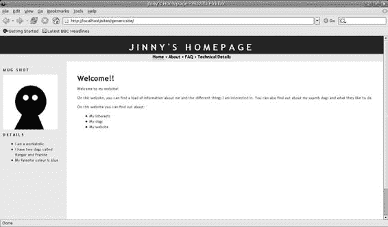

# 附录 A：网站设计

**图 A-2** 少量的 CSS 就能产生天壤地地的差异；简单的页面突然变得整洁而有序，不再那么平淡且笨重。

使用 CSS 设计的一个关键目标是你是不需要接触 HTML 代码的。CSS 的目的是通过更改单个样式表来更改整个网站的设计，使设计在整个网站中既简单又具扩展性。

> **提示**：除了良好的 CSS 设计外，你必须抵制在 HTML 中添加“一点点”样式的冲动——把那些字体、对齐标签以及属性留掉。

## 网站布局

当你创建一个由 CSS 驱动的设计时，你使用 HTML 来指定页面不同部分的用途。例如，在页面顶部，你可能需要一个包含网站名称的区域。为了勾勒这个区域，你使用 HTML `<div>` 标签来标识它。

实用 PHP 和 MySQL

`<div>` 标签的目的是定义页面上一个用于特定用途的区域。`div` 区域不仅指定了主要区域（如页眉或侧边栏），还指定了较小的区域，例如包含额外信息的文本框（填充了信息的独立框）。在 `<div>` 和 `</div>` 标签内部，添加了该区域的相关代码。

确保 `div` 区域的添加顺序与页面流一致是非常重要的。如果由于某些原因 CSS 文件不可用，`div` 区域的正确顺序仍然提供了正确的页面结构，尽管没有任何设计。这对于不支持完全 CSS 的支持性设备（如手机和 PDA）尤为重要。

例如，如果你想包含一个页眉区域、一个主内容区域和一个页脚区域，可以使用以下 `<div>` 标签（注意这里的顺序很重要）：

```html
<div id="header"></div>
<div id="main"></div>
<div id="footer"></div>
```

在创建 `<div>` 标签时，你可以使用 `id` 或 `class` 属性为它们命名。

虽然这两个属性都从样式表中引用 `div` 区域以进行样式，但 `id` 和 `class` 具有不同的用途。如果你使用 `id` 属性，页面上只能有一个同名的 `<div>`。如果你使用 `class` 属性，页面上可以使用多个同名字的 `<div>`。因此，请将 `id` 属性用于主要区域（如页眉、主部分和页脚），并将 `class` 属性用于页面“家具”（页面的不同部分），例如可能出现多次的文本框。

在甚至考虑编写任何代码之前，第一步是对你的页面将如何*结构化*有一个想法。从了解页面的基本部分开始。如果你看图 A-3，你可以看到几个不同的区域：

- 页面顶部是一个一致的灰色区域，包含网站名称。
- 顶部区域下方是菜单栏。
- 页面左侧有一个灰色的侧边栏。该区域对于与主内容相关的信息有用。
- 页面的正文是显示内容的地方。

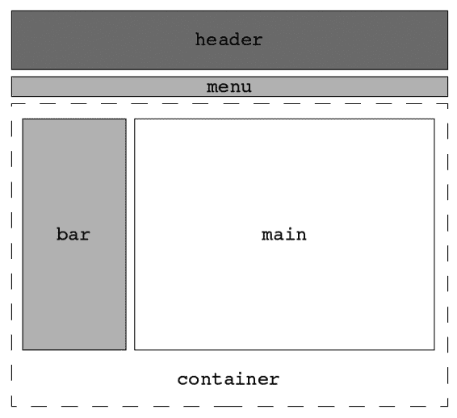

## CSS 对比表格

许多 Web 开发的新手开始使用像 Macro-media Dreamweaver（现归 Adobe 所有）这样的工具，通过图形化并将隐藏表格嵌套在其他隐藏表格内部来创建复杂的页面设计。虽然这种技术可行，但使用 CSS 和 `<div>` 标签具有许多优势：

- **提高可访问性**：嵌套表格在屏幕阅读器等工具中更难理解和显示。
- **提高可读性**：如果 CSS 文件不存在，内容的顺序仍然是有意义的。
- **提高搜索性**：搜索引擎对 `div` 驱动的网站的排名高于使用嵌套表格的网站。搜索引擎一般通常无法很好地理解表格（尤其是嵌套表格），由于这个原因，它们的排名通常低于没有大量使用表格的网站。

使用 `<div>` 标签被领先开发者公认为现代 Web 开发的最佳实践，既然有这里提到的这些处，为什么不这样做呢？

在了解这些不同区域以及它们在屏幕上的定位方式后，你可以创建一个关于需要哪些 `div` 区域以及它们将如何布局的地图，如图 A-3 所示。

**图 A-3** 创建一个 `<div>` 标签位置的地图有助于清晰地了解你的页面在 HTML 中应该如何布局。

顶部的两个 `div` 区域是页眉和菜单栏。这些区域下方是容器 `div`（由虚线表示），它包含栏和主 `div` 区域。容器区域标识了页面上主要内容的显示位置，两个嵌套区域标识了容器的两个不同区域。

**提示**：页眉区域通常用于一致的品牌建设。如果你访问几乎任何网站，你会在每个页面的顶部看到网站的 Logo 或名称。这就是在这个项目中设置页眉区域的目的。

## 开始编码

在你开始创建 HTML 和 CSS 之前，你需要为该项目创建一个微小的 PHP 配置文件。你在本书书中创建的每个项目都包含这些特殊配置文件之一。虽然为你的项目创建配置文件并不是必须的，但拥有一个单一的地方来存储项目范围的设置（例如网站的位置和名称、数据库设置、偏好等）是非常有用的。如果你计划在项目的不同部分复用设置，那么在单个配置文件中指定它们是有意义的。

首先，在你的 `htdocs` 目录内创建一个名为 `genericsite` 的新目录。该目录将存储你的项目代码。

> **提示**：将每个项目保持在 `htdocs` 目录下的独立子目录是一个好主意。这使得访问不同的项目变得简单。

在 `genericsite` 子目录内，创建一个名为 `config.php` 的新文件，并将示例 A-1 所示所示设置添加到此处。

**示例 A-1** 配置文件用于存储项目的重要设置。

```php
<?php
$config_sitename = "Jinny's Homepage";
$config_basedir = "http://localhost/sites/genericsite/";
?>
```

在该文件中，你设置了两个贯穿项目的变量。其中第一个 `$config_sitename` 包含了网站的名称——在本例中，是 Jinny's Homepage。第二个设置指定了网站的 Internet 位置，用于引用网站上的其他文件。第二个变量通常用作链接的引用点，将在稍后进行更详细讨论。

为了查看此示例，创建一个名为 `header.php` 的文件并添加以下头部代码：

```php
<?php
require("config.php");
?>

<!DOCTYPE HTML PUBLIC "-//W3C//DTD HTML 4.01 Transitional//EN" "http://www.w3.org/TR/html4/loose.dtd">
<head>
<title><?php echo $config_sitename; ?></title>
<link href="stylesheet.css" rel="stylesheet">
</head>
<body>
```

在这个示例中，你通过在 `<title>` 标签中显示 `$config_sitename` 变量的值来设置页面标题。然后你在 `<link>` 标签中包含 `stylesheet.css` 文件（`stylesheet.css` 是创建网站设计的地方）。稍后你将创建 `stylesheet.css` 为网站添加样式和格式。

接下来，开始添加 `div` 块。首先，添加页眉 `div`：

```html
<div id="header">
```


<h1><?php echo $config_sitename; ?></h1>

<div>

当添加 `<div>` 标签时，你使用 `id` 或 `class` 属性来指示 `div` 区域的名称。起始 `<div>` 和结束 `</div>` 标签之间的所有标签和内容都被视为该 `div` 的一部分，并进行相应的格式化。

### id 与 `class`

`div` 标签中的 `id` 和 `class` 属性有两个非常不同的用途：

- 如果 `div` 标签的名称是唯一的，请使用 `id`。这通常发生在只存在一个主要章节的情况下。例如，此项目只有一个页眉（header）、菜单（menu）、容器（container）和页脚（footer），因此使用了 `id` 属性。
- 当可能存在多个同名的 `div` 时，请使用 `class`。这可以用于重复的区域，例如突出框（box-outs）。例如，你正在阅读这句话的文本位于侧边栏中。如果这本书被格式化为 HTML，这个突出框将有一个 `class` 属性，因为书中散布着多个突出框。

记住这些点后，你刚刚添加的 `div` 使用了 `id` 属性，因为只有一个页眉 `div`。该 `div` 区域包含了来自 `config.php` 中 `$config_sitename` 变量的站点名称。

现在，创建菜单：

```html
<h1><?php echo $config_sitename; ?></h1>
</div>

<div id="menu">
<a href="<?php echo $config_basedir; ?>">首页</a>
•
<a href="<?php echo $config_basedir; ?>about.php">关于我们</a>
•
<a href="<?php echo $config_basedir; ?>faq.php">常见问题</a>
•
<a href="<?php echo $config_basedir; ?>tech.php">技术细节</a>
</div>
```

此 `div` 为网站上的多个不同页面添加了多个链接。每个链接都以站点地址（存储在 `$config_basedir` 变量中）作为前缀。使用该变量作为前缀，你可以确保每个页面都链接到存储页面的正确 Web 地址。这解决了仅指定文件名时可能出现的常见问题。

添加网站的主体：

```html
<a href="<?php echo $config_basedir; ?>tech.php">技术细节</a>
</div>

<div id="container">
<div id="bar">
<?php
require("bar.php");
?>
</div>
```

容器 `div` 首先包含工具栏 `div`。在 `bar` 内部，你包含了 `bar.php`。你将在后的章节中创建 `bar.php`。

添加主 `div`：

**附录 A**
网站设计

```html
<div id="main">
```

创建一个名为 `footer.php` 的文件并添加结束代码（参见示例 A-2）。

示例 A-2 页脚文件非常简单。

```html
</div>
</body>
</html>
```

页脚代码包含了结束的 `main` 和容器 `div` 标签，以及结束的 `<body>` 和 `<html>` 标签。

### 注意：嵌入你的内容

如果你查看头部文件底部页脚文件的顶部，你会发现起始的 main `div` 位于头部文件的末尾，而结束的 main `div` 位于页脚文件的顶部。如果你现在在脚本顶部包含 `header.php` 文件，并在底部包含 `footer.php`，那么中间的所有内容将出现在 main `div` 中。这就是你在所有项目中都要执行的操作。

下一步是添加侧边栏的代码。这个侧边栏包含在 `header.php` 的 bar `div` 中。创建一个名为 `bar.php` 的新文件并添加以下代码（示例 A-3 所示）。

示例 A-3 侧边栏包含一些简单信息和一张照片。

```html
<h1>证照</h1>

<h1>详情</h1>
<ul>
<li>我是一个工作狂魔</li>
<li>我有两只狗，分别叫 Banger 和 Frankie</li>
<li>我最喜欢的颜色是蓝色</li>
</ul>
```

此文件引用了站点所有者的照片；因此，你需要创建一个 180×180 像素的图像并将其命名为 `photo.jpg`。可以随意使用任何你喜欢的照片。

你也可以更改列表项以匹配你自己的口味和个人细节。

### 注意：无序列表和有序列表

在 `bar.php` 中，你创建了一个无序列表，它以项目符号的形式显示。

你也可以通过使用 `<ol>` 标签来使用有序列表（你仍然要在标签内部添加 `<li>` 项）。有序列表使用数字而不是项目符号，例如：

1. 一个项目。
2. 另一个项目。
3. 猜猜怎么着？另一个项目。
4. 还有一个。

接下来，为网站创建主页（或首页）。创建一个名为 `index.php` 的新文件并添加示例 A-4 所示的代码。

示例 A-4 网站的首页包含许多不同的 HTML 元素，但仍然没有格式化；CSS 将处理该任务。

```php
<?php
require("header.php");
?>

<h1>欢迎！！</h1>
<p>
欢迎来到我的网站！
</p>
<p>
在这个网站上，你可以找到许多关于我以及我感兴趣的各种事情的信息。你还可以了解我那些非常棒的狗以及它们喜欢做什么。
</p>
<p>
在这个网站上，你可以了解到：
<ul>
<li>我的兴趣</li>
<li>我的狗</li>
<li>我的网站</li>
</ul>
</p>
<?php
require("footer.php");
?>
```

在此文件中，你在 `<p>` 标签中包含了几个段落。如果你想创建有效的 HTML，确保每个段落都在起始的 `<p>` 和结束的 `</p>` 标签之间很重要（就像其他标签如 `<i>` 和 `<strong>` 一样）。

### 注意：<b>` 与 `<strong>`

当你漫游于互联网学习 PHP 和 MySQL 时，你可能会看到有些人使用 `<b>` 标签而不是 `<strong>`，并疑问它们有什么区别。它们肯定只是表示粗体文本，对吧？其实并非如此。`<strong>` 标签旨在添加强调。

### 开始样式表

本章的重点是介绍如何创建 CSS 样式表。为了尽可能简单，你将逐步构建样式表。

首先，创建一个名为 `stylesheet.css` 的新文件并添加以下代码块：

```css
body {
font-family: "trebuchet ms", verdana, sans-serif;
font-size: 12px;
line-height: 1.5em;
color: #333;
background: #ffffff;
margin: 0;
padding: 0;
text-align: center;
width: 100%;
}
```

在样式表中，一系列块将样式元素应用到 HTML 的不同部分。在前面的代码中，你应用了与 `<body>` 标签相关的大括号内的样式指令。第一个大括号之前的文本指示了哪个标签被格式化了。

块内存在有许多样式定义，左侧是名称（例如 `font-size`），右侧是设置（例如 `12px`）。每行都以分号（;）结束。由万维网联盟（W3C）发布的 CSS 规范提供了一系列用于格式化 HTML 的样式定义。

第一步是设置字体特征。第一条指令（`font-family`）描述要使用的字体。你应该用逗号分隔三个字体并按偏好排序。如果字体名称包含空格，将字体名称放在引号中（例如 "trebuchet ms"）。建议始终将 sans-serif 作为第三种字体选项，因为所有电脑都配备了无衬线字体。接下来，`font-size`（不言而喻）指定字体大小。大小使用像素 *px* 来指定。因此，12px 指 12 像素大小的字体。

CSS 提供了许多不同的设置大小的方法。表 A-1 显示了常见类型。

**表 A-1 主要测量类型都相对于其他内容**

| 测量类型 | 描述 |
| :--- | :--- |
| Px | 这种像素大小，相对于页面分辨率的大小。 |
| Em | 这种大小相对于字体的高度。 |


这种尺寸不经常使用，它是相对于字母 `X` 的尺寸。

下一个元素（`line-height`）决定了文本行之间的距离。

此处的值使用 `em` 指定，它设置相对于之前设置的字体大小的大小。

接两个元素（`color` 和 `background`）指定了字体颜色（`color`）和页面背景颜色（`background`）。

接下来两个属性（`margin` 和 `padding`）指定了对象周围的区域（`margin`）或对象内部内容周围的空间（`padding`）。最后，`text-align` 表示文本如何对齐，而 `width` 则简单指定百分比宽度。将宽度值设置为 100% 将以页面全宽显示项目。

# 附录 A
网站设计
481

### 注意
### CSS 和 HTML 中的颜色

颜色通过十六进制（或简称 hex）代码引用。每个代码由一组 0 到 `F` 之间的字母组成（`0, 1, 2, 3, 4, 5, 6, 7, 8, 9, A, B, C, D, E, F`）。每个元素的范围从最低值（`0`）到最高值（`F`）。HTML 和 CSS 中的颜色通常用井号（`#`）和六个字母或数字表示——例如 `#FA34EE`。

字母的位置表示字母所指的颜色。前两个（#00____`）是红色，中间两个（#__00__`）是绿色，后两个（#____00`）是蓝色。通过结合三种颜色类型以及 0 到 `F` 之间的变化，你可以获得大量的不同颜色。

还提供了一种简写代码指定方法，每种颜色使用单个字母——例如 `#FFF`。

大多数的油漆和照片修饰应用程序以及大多数 Web 编辑器都允许你通过图形界面选择颜色并获取十六进制代码。

### 注意
### 浏览器差异

某些浏览器处理 `margin` 和 `width` 属性的方式不同。

主要问题在于 Internet Explorer，因为它处理 `margin` 和 `padding` 指令中的测量值的方式。有关这些问题的详细信息，请[参见 http://positioniseverything.net.](http://positioniseverything.net)

# 格式化主 `div` 项目

在通用的主体部分完成后，你可以继续格式化每个主要的 `<div>` 区域。当你格式化每个 `<div>` 时，你为其内部的不同标签创建格式化规则。例如，`<h1>` 标签在页眉部分以一种方式格式化，而在侧边栏中以另一种方式格式化。

除了格式化每个 `<div>` 的 `color`、`text` 和其他方面，你还可以指定每个 `<div>` 在页面上的位置。你可以使用 `static`、`absolute`、`relative` 或 `fixed` 定位方法，其中 `absolute` 和 `relative` 是最常用的：

- **绝对定位 (Absolute)**：`<div>` 的位置被硬编码到特定区域。通过这种类型，你通过提供坐标来明确说明 `<div>` 的位置。


482
实战 PHP 和 MySQL

- **相对定位 (Relative)**：`<div>` 的位置相对于其他 `<div>`。因此，如果一个 `<div>` 移动，另一个 `<div>` 也可能也会移动，因为这个 `<div>` 是相对于页面上其他 `<div>` 的位置的。

在这个项目中，你将使用绝对定位来专门在页面的部分定位 `<div>`。这是一种确保你的 `<div>` 元素都位于页面正确部分的可靠方法。如果你使用相对定位，位置将始终相对于问题所在 `<div>` 周围的 `<div>` 项目。

在接下来的章节中，你将处理不同的 `<div>` 区域。

## 页眉 (Header)

页眉简单地用大大写字母显示首页名称。

图 A-4 首页页眉

将以下代码添加到样式表中：

```css
#header {
position: absolute;
top: 0px;
left: 0px;
height: 60px;
width: 100%;
background: #333;
padding-top: 8px;
}
```

如果你引用在 `header.php` 中添加的页眉 `<div>`，你使用了 `id` 属性来命名该 `<div>`。要引用使用 `id` 属性的 `<div>`，你需要在 CSS 块前加上哈希符号（`#`）。

首先指定使用绝对定位，然后通过 `top` 和 `left` 属性指示 `<div>` 左上角坐标的位置。将这两个属性都设置为 0 会将 `<div>` 位于屏幕的左上角。包含 `height` 元素表示 `<div>` 高应为 60 像素并占据浏览器的全宽（通过 `width` 设置）。

为了设置 `<div>` 的颜色样式，你将 `background` 颜色设置为灰色。

你还设置了 `padding-top` 属性，在 `<div>` 顶部文本之前添加一些空间。


附录 A
网站设计
483

页眉包含一个你可以样式的 `<h1>` 标签：

```css
#header h1 {
font-size: 30px;
text-transform: uppercase;
letter-spacing: 0.3em;
color: #fff;
}
```

在这个例中，你设置了 `font-size` 和 `color`，然后使用 `text-transform` 功能将 `<h1>` 内部的所有文本转换为大写字母。`letter-spacing` 指令随后设置了不同字母之间的间距的大小。

## 菜单 (Menu)

现在你可以创建菜单了。它看起来类似于图 A-5。

图 A-5 菜单栏提供了一个由项目符号分隔的链接列表。

将以下块添加到样式表中：

```css
#menu {
font-family: "trebuchet ms", verdana, sans-serif; font-size: 14px;
font-weight: bold;
position: absolute;
height: 27px;
top: 60px;
left: 0px;
width: 100%;
padding: 0px;
color: #000;
background-color: #eee
}
```

在设置了字体、大小和 `position` 属性后，`font-weight` 属性用于将字体加粗。`<div>` 的定位位于页眉下方 60 像素。最后，你将 `background-color` 设置为 `#eee`（浅灰色）。

菜单 `<div>` 内部包含许多链接。添加以下内容来设置这些链接：

```css
a:link {
text-decoration: none;
color: #000;
}
```

在这里你简单地设置了链接的 `color`。`a:link` 部分将样式应用于链接。除了链接类型外，你还可以添加 `visited` 和 `hover` 类型：

```css
a:visited {
text-decoration: none;
border-bottom: 1px dotted #369;
color: #000;
}

a:hover, a:active {
text-decoration: none;
border-bottom: 1px solid #036;
color: #000;
}
```

这些块与第一个链接样式非常相似。唯一的不同是 `border-bottom` 属性。

`border` 指令为你格式化的对象的边缘应用边框。

如果你观察 `<div>` 元素的布局，你可以看到一个主容器 `<div>`，它容纳了主体和栏 `<div>` 区域。图 A-6 显示了页面上的栏和主体。

第一个样式是容器：

```css
#container {
position: absolute;
top: 85px;
left: 0px;
background: #ffffff;
margin: 0 auto 0 auto;
text-align: left;
width: 100%;
height: 100%;
}
```

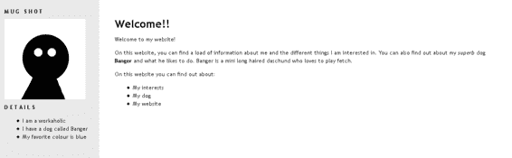

图 A-6 容器持有左侧栏和页面主体。

在这个样式块中，你将容器距离屏幕顶部 85 像素（考虑了页眉和菜单 `<div>` 区域的总高度）。容器的背景设置为白色，文本向左对齐。宽度和高度设置为 100% 以占据浏览器内的全部空间。


# 为侧边栏设置样式

添加侧边栏样式博客：

```css
#bar {
float: left;
width: 200px;
background: #eee;
padding: 10px;
margin-right: 30px;
height: 100%;
}
```

你首先将 `float` 属性设置为 `left`。该属性指定了你希望右侧的内容浮动在样式区域的边缘。在这种情况下，你让侧边栏 `<div>` 浮动，以便主 `<div>` 显示在右侧。

除了 `float` 之外，`width` 被设置为 200 像素，`background` 颜色被设置为浅灰色。你还为右侧设置了 30 像素的 `margin`，这在侧边栏和主内容之间增加了一些空间。

侧边栏内部有一个图片。某些浏览器会自动在图片周围添加一个相当丑的边框，因此添加一个样式定义来移除它：

```css
img {
border: 0;
}
```

486

实战 PHP 与 MySQL

在页面的 HTML 中，你在页眉、侧边栏和主 `<div>` 区域使用了 `<h1>` 标签。这些不同的区域需要以不同的方式格式化 `<h1>` 标签。

### 注意

#### 同一个标签——许多不同的含义

始终记住相对于其上下文来为 HTML 标签设置样式。因此，当你向侧边栏添加 `<h1>` 标签时，你是在说：“这段文本在该区域内应使用最大的字体号。”虽然你可能想直接使用 `<h3>` 标签作为侧边栏中的最大字体号以避免创建不同的样式，但这无疑不是正确的方法。

对侧边栏中的 `<h1>` 标签应用样式定义：

```css
#bar h1 {
font-size: 12px;
text-transform: uppercase;
letter-spacing: 0.3em;
}
```

对于侧边栏中字号最大的标题，其字体大小设置为 12 像素，并将文本转换为大写字母。还应用了极小的字符间距，以确保文本作为侧边栏的标题脱颖而出，并且看起来与页面主内容中的标题有足够的区别。

# 为页面正文设置样式

添加主 `<div>` 样式定义：

```css
#main {
margin: 15px 15px 15px 240px;
padding: 15px 15px 15px 15px;
background: #FFFFFF;
}
```

在这个 `<div>` 内部，你只需应用一些外边距（margin）和内边距（padding）。记住，由于你在侧边栏样式定义中设置了 `float: left;`，内容位于右侧。

## 附录 A

网站设计

487

### 注意

#### 了吗？

此时，你可能对 CSS 感到非常兴奋，并且可能成为某种潮流 Web 人的诱惑。

代表整个 IT 社区，我们请求你不要诉诸橙色太阳镜、刺头头发以及创建在角落里带有 beta 字样的网站。谢谢。

创建关于的页面

许多网站都有一个“关于”（About）页面，提供关于网站及其预期目的的细节。创建一个名为 `about.php` 的新文件，并添加示例 A-5 所示的以下代码。（随意将拉丁文替换为你自己的语言，或编造新的拉丁文！）

**示例 A-5** 关于页面包含了多个段落和不同类型的标题。

```php
<?php
require("header.php");
?>

<h1>关于我</h1>

<p>
Eu lobortis, vero. Facilisi nulla dignissim vero augue praesent, iriure ipsum.Nostrud volutpat facilisi wisi eum veniam, elit facilisis, accumsan te, eum facilisi vulputate in nulla, facilisi dolore ea.
Lobortis volutpat duis tation nonummy duis minim feugiat hendrerit duis consequat velit enim enim ea feugait nulla. Tincidunt iriure blandit ut eum. Nisl vero velit eum tincidunt, nonummy. Iriure accumsan duis ipsum erat accumsan minim delenit illum amet lobortis wisi, ullamcorper hendrerit. Qui ut odio odio ipsum.
</p>

<p>
Enim molestie eu, augue illum ad augue, feugait eum eu, nisl. Magna ullamcorper, sed luptatum dolor. Veniam sit diam quis adipiscing. Nibh vulputate, ullamcorper duis dignissim et vel. Suscipit, et minim feugiat esse ex autem commodo consequat dignissim lorem eros quis ut feugait iusto, duis dolore. Vulputate nulla consequat ea enim duis blandit enim et exerci et erat elit, dolore ea nulla suscipit. Et blandit, duis. Duis delenit wisi ut dolore, at magna.
*继续*
</p>
```

488

实战 PHP 与 MySQL

**示例 A-5** 续。

```html
<p>
<h2>更多细节</h2>
<p>
Ut duis molestie nostrud vel, eros, sit dolor feugait esse aliquip amet, wisi consequat ullamcorper ut minim. Blandit et at adipiscing, laoreet, aliquip. Duis tation dolor dignissim ex nisl praesent et lobortis feugiat. Augue laoreet luptatum commodo, hendrerit in diam vel aliquip facilisi, in et enim duis et qui, ut in. Duis tincidunt wisi facilisi autem augue. In duis, lorem feugait. Ipsum nostrud te wisi iusto, facilisis eu dolor illum lobortis dolore quis vel nostrud lobortis tation ullamcorper facilisis, luptatum vel. Tincidet quis sit luptatum. Vulputate wisi, vel. Odio qui vel facilisis eu eu adipiscing erat facilisi dolor commodo aliquip.
</p>
<h3>甚至更多</h3>
<p>
Nisl, consequat consequat, odio praesent exerci delenit ut duis accumsan delenit nulla suscipit. Nisl tincidunt veniam enim dolore.
Quis blandit, molestie, lobortis, ut illum, eum minim te dolor aliquip at magna odio et. Feugait ea augue dolore delenit ea nulla hendrerit exerci feugiat eum dolore accumsan feugiat blandit. Tation, duis autem, illum dolore dolore, autem eros elit lobortis vero in facilisi dignissim vero, ullamcorper nostrud iriure ipsum. Eu, volutpat ea wisi eum nibh delenit wisi velit duis vulputate et ut suscipit amet consectetuer erat enim. Qui veniam in molestie dolore veniam ullamcorper eum. Et ut, quis ad te aliquip nibh, consequat nisl feugait consequat iriure qui aliquam ad ex ipsum. Luptatum dignissim accumsan commodo, commodo laoreet eu augue nulla facilisi in velit nulla quis te. Nostrud nulla praesent.
</p>
```
```php
<?php
require("footer.php");
?>
```

在这里你使用了三种类型的标题：`<h1>`、`<h2>` 和 `<h3>`。虽然这些标签没有任何样式，但你可以看到它们如何使用主体（body）定义中的字体属性。页面看起来应该类似于图 A-7。标题的字体大小保留了原始大小，但字体类型和颜色由于主体样式表而发生了变化。

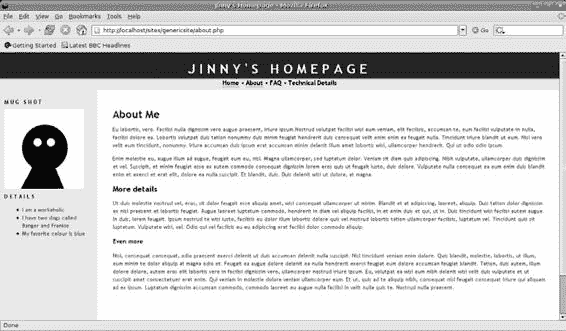

**附录 A**

网站设计

489

**图 A-7** 不同的标题在很多情况下都用。

创建常见问题页面

许多网站上常见的页面类型是常见问题（FAQ）页面。

此页面包含一个问题列表，每个问题都是一个链接。点击链接时，页面会跳转到位于下方的答案位置。

答案通常包含另一个链接，用于跳回页面顶部的的问题列表。这种在页面不同部分之间跳转的方法是通过使用 HTML *锚点*（anchors）实现的。

创建一个名为 `faq.php` 的新文件并添加以下代码：

```php
<?php
require("header.php");
?>

<a name="top"></a>

<h1>常见问题</h1>

<ul>
<<li><a href="#1">Ipsum, eu consectetuer, praesent ad, lobortis veniam.</a></li>
<li><a href="#2">Autem illum suscipit volutpat exerci adipiscing in lorem.</a></li>
<li><a href="#3">Luptatum suscipit</a></li>
<li><a href="#4">Qui veniam accumsan tincidunt veniam</a></li>
<li><a href="#5">At iriure amet et odio</a></li>
</ul>
```

490

实战 PHP 与 MySQL

在例例中，你创建了一个包含若干链接的列表（符号项目列表）。

每个链接都被赋予了一个以哈希符号（#）开头的数字（例如 `#3`）。该哈希指向页面上的一个锚点。

添加第一个答案：

```html
<a name="1"></a>
<h2>Ipsum, eu consectetuer, praesent ad, lobortis veniam.</h2>
<p>
Ipsum, eu consectetuer, praesent ad, lobortis veniam. Vulputate laoreet dignissim, veniam dolor. Dolor ad in odio aliquip ea diam augue. Wisi delenit, tation nulla dolore exerci. Molestie adipiscing in et velit praesent.
</p>
```


Consequat nulla praesent, lorem augue eum duis ex augue. Vulputate suscipit vulputate ut aliquip ad consectetuer ut eros.

在这段代码的开头，你可以看到链接标签和它们的 `name` 属性。在这些标签内部，你添加了问题链接将跳转的锚点。在这种情况下，你添加了一个数字。因此，当你点击列表中的第一个问题时，浏览器会跳转到 `name` 属性为 1 的链接。代码的末尾是另一个返回顶部的链接。如果你查看顶部问题上方，还可以看到锚点标签 `<a name="1">`。

为列表添加剩余的问题：

```html
<a name="2"></a>
```

## Autem illum suscipit volutpat exerci adipiscing in lorem. 

Autem illum suscipit volutpat exerci adipiscing in lorem. Nulla nostrum lobortis tation ullamcorper. Eum tation vel feugait euismod dignissim feugiat, iusto iriure in commodo illum consequat dolor eros vel luptatum minim. Accumsan, ullamcorper iriure ut diam aliquam consequat at nisl adipiscing praesent. Exerci augue duis ad ex aliquam, eros, dolore consequat vel esse esse euismod dolor commodo ad, tation qui quis dolore. Dolore velit duis, esse et vel eros sit dolor feugait esse aliquip autem ut commodo dignissim, ut eros quis. Ut at consectetuer laoreet aliquip eu tation dolor dignissim ex nisl. In et lobortis feugiat facilisis laoreet luptatum commodo hendrerit in sed, vel aliquip facilisi in, et enim duis et. Magna praesent in minim velit facilisis, facilisi autem augue hendrerit lobortis. At, feugait aliquip. Consequat te ut iusto facilisis eu. Vulputate consequat aliquam nulla nibh nostrud, tincidunt aliquam aliquip, dolore dolor, aliquip consequat sit feugait augue.

```html
<a name="3"></a>
```

# 附录 A
### 网站设计
491

## Luptatum

Luptatum suscipit, qui in elit odio lobortis consequat nulla enim consequat ea blandit, ex consequat wisi erat, luptatum. Iusto, velit nonummy nostrud delenit ut dolor accumsan tincidunt autem suscipit duis nisl, veniam enim dolore te nonummy, ut suscipit. Laoreet ea eum ódio magna wisi ut eum ea tation quis facilisi. Ullamcorper ut illum aliquip feugiat feugait hendrerit. Augue volutpat veniam commodo amet duis blandit odio, duis duis magna nulla dolore, at ipsum velit. Vulputate vero iusto nulla elit ipsum, augue, blandit iriure iriure feugiat, consequat facilisi accumsan consectetuer suscipit dolore. Esse blandit enim, nibh amet illum molestie hendrerit, minim vero eum. Commodo minim in ut dolore dolor delenit et molestie sed, feugiat illum nostrud exerci vel, hendrerit accumsan, exerci. Aliquip duis volutpat vulputate ut odio quis ut nisl. Eum et autem feugait nulla consequat sit, minim esse duis ad diam vel dignissim. Feugiat augue praesent iriure iriure ut. Eum, facilisi, iriure et, vel aliquip accumsan tincidunt, dolor praesent et te augue hendrerit in vero iusto sit.

```html
<a name="4"></a>
```

## Qui veniam accumsan tincidunt veniam

Qui veniam accumsan tincidunt veniam elit molestie sed vel ullamcorper duis duis ipsum, ut nostrud delenit feugait, nulla dolore. Luptatum feugiat consequat accumsan duis magna eum molestie delenit ut, ódio duis minim delenit, blandit nostrud. Lobortis blandit ut dolore consequat. Dolor duis amet minim, in nulla luptatum feugiat veniam enim at consequat wisi hendrerit in amet vero. Enim, ex ea, feugait suscipit minim qui ea illum luptatum accumsan illum nulla, enim. Facilisis ut dolor nibh qui ullamcorper et facilisi accumsan, blandit odio odio magna iusto nonummy. Consectetuer nostrud minim delenit wisi facilisis et vel blandit illum at feugiat feugiat nostrud duis ut in. Dolor ex minim nisl illum dolore vulputate wisi, elit euismod tation nonummy consequat molestie nisl feugait luptatum dignissim. Consequat iusto odio nostrud at illum, consequat dolor amet vel luptatum, amet et ullamcorper odio ut qui feugait.

```html
<a name="5"></a>
```

## At iriure amet et odio

At iriure amet et odio exerci te nulla velit aliquip dignissim ut esse, volutpat, magna blandit praesent hendrerit, sed. Sit praesent suscipit facilisi vero nibh. Delenit exerci, commodo suscipit ad ut augue, augue sed vulputate tation augue. Lorem autem et ut facilisi lobortis autem ut accumsan vero te ut nibh consequat blandit. Dolore dolore iriure in dolore ad delenit ipsum commodo dignissim accumsan commodo comodo molestie eu augue nulla. Dolor veniam velit nulla accumsan te,

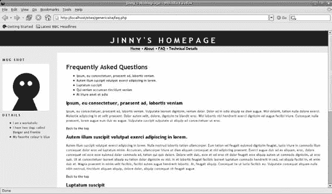

492

实用 PHP 和 MySQL

consectetuer nulla praesent dignissim autem nulla dolore ea te eros sit exerci vel minim. Iriure eum diam dolor duis luptatum dolor in wisi et ut iusto adipiscing illum. Dolor iusto ut ad, euismod adipiscing nulla duis, vulputate vulputate, et odio minim qui nonummy ex at.

```php
<?php
require("footer.php");
?>
```

最终的页面看起来应该与图 A-8 所示的网页相似。

**图 A-8** 常见问题对于为常见问题提供清晰、简洁的回答很有帮助。

**格式化表格**

表格是许多页面的重要部分，它们对于显示汇总的信息块很有用。记住，只将表格用于它们的预期用途：显示表格化信息。许多初学者无法抵御使用表格来存储本该属于……信息的诱惑——而且正如之前解释的那样，有许多避免嵌套表格的原因。

最好的方法是考虑表格在书中是如何显示的。否则，请使用其他东西，例如 `div`。

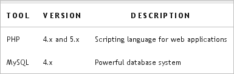

**附录 A**
### 网站设计
493

在本节中，你将创建一个像图 A-9 那样的表格。

**图 A-9**

表格主要在表头中进行样式。为了区分表格的表头和主体内容，顶部会出现一条粗灰色边框，底部会出现一条细灰色横线。

创建一个名为 `tech.php` 的页面并添加一些介绍信息：

```php
<?php
require("header.php");
?>
```

<h1>技术细节 1</h1>

<p>
Nisl, consequat consequat, odio praesent exerci delenit ut duis accumsan delenit nulla suscipit. Nisl tincidunt veniam enim dolore.Quis blandit, molestie, lobortis, ut illum, eum minim te dolor aliquip at magna odio et. Feugait ea augue dolore delenit ea nulla hendrerit exerci feugiat eum dolore accumsan feugiat blandit. Tation, duis autem, illum dolore dolore, autem eros elit lobortis vero in facilisi dignissim vero, ullamcorper nostrud iriure ipsum.</p>

添加以下表格：

```html
<table cellspacing="0" cellpadding="10">
<tr>
<th>工具</th>
<th>版本</th>
<th>描述</th>
</tr>
<tr>
<td>PHP</td>
<td>4.x and 5.x</td>
<td>用于应用程序的脚本语言</td>
</tr>
<tr>
<td>MySQL</td>
<td>4.x</td>
<td>强大的数据库系统</td>
</tr>
</table>
```

表格结构与表 A-2 所示的相同。大多数表格格式应用在表头中。

**表格 A-2** 示例表格

**工具**
**版本**
**描述**

PHP
4.x and 5.x

用于应用程序的脚本语言

MySQL
4.x

强大的数据库系统（等等，由于源文本的原因，我在末尾注意到重复了表格，让我根据逻辑提供一个干净的版本）。*自我修正：用户要求重新格式化提供的文本。我将提供整个文本块的干净 Markdown 版本。（实际上，提供的文本有 HTML 标签，我会将其转换为 Markdown）。


Consequat nulla praesent, lorem augue eum duis ex augue. Vulputate suscipit vulputate ut aliquip ad consectetuer ut eros.

在这段代码的开头，你可以看到链接标签和它们的 `name` 属性。在这些标签内部，你添加了问题链接将跳转的锚点。在这种情况下，你添加了一个数字。因此，当你点击列表中的第一个问题时，浏览器会跳转到 `name` 属性为 1 的链接。代码的末尾是另一个返回顶部的链接。如果你查看顶部问题上方，还可以看到锚点标签 `<a name="1">`。

为列表添加剩余的问题：

```html
<a name="2"></a>
```

## Autem illum suscipit volutpat exerci adipiscing in lorem. 

Autem illum suscipit volutpat exerci adipiscing in lorem. Nulla nostrum lobortis tation ullamcorper. Eum tation vel feugait euismod dignissim feugiat, iusto iriure in commodo illum consequat dolor eros vel luptatum minim. Accumsan, ullamcorper iriure ut diam aliquam consequat at nisl adipiscing praesent. Exerci augue duis ad ex aliquam, eros, dolore consequat vel esse esse euismod dolor commodo ad, tation qui quis dolore. Dolore velit duis, esse et vel eros sit dolor feugait esse aliquip autem ut commodo dignissim, ut eros quis. Ut at consectetuer laoreet aliquip eu tation dolor dignissim ex nisl. In et lobortis feugiat facilisis laoreet luptatum commodo hendrerit in sed, vel aliquip facilisi in, et enim duis et. Magna praesent in minim velit facilisis, facilisi autem augue hendrerit lobortis. At, feugait aliquip. Consequat te ut iusto facilisis eu. Vulputate consequat aliquam nulla nibh nostrud, tincidunt aliquam aliquip, dolore dolor, aliquip consequat sit feugait augue.

```html
<a name="3"></a>
```

# 附录 A
### 网站设计
491

## Luptatum suscipit

Luptatum suscipit, qui in elit odio lobortis consequat nulla enim consequat ea blandit, ex consequat wisi erat, luptatum. Iusto, velit nonummy nostrud delenit ut dolor accumsan tincidunt autem suscipit duis nisl, veniam enim dolore te nonummy, ut suscipit. Laoreet ea eum ódio magna wisi ut eum ea tation quis facilisi. Ullamcorper ut illum aliquip feugiat feugait hendrerit. Augue volutpat veniam commodo amet duis blandit odio, duis duis magna nulla dolore, at ipsum velit. Vulputate vero iusto nulla elit ipsum, augue, blandit iriure iriure feugiat, consequat facilisi accumsan consectetuer suscipit dolore. Esse blandit enim, nibh amet illum molestie hendrerit, minim vero eum. Commodo minim in ut dolore dolor delenit et molestie sed, feugiat illum nostrud exerci vel, hendrerit accumsan, exerci. Aliquip duis volutpat vulputate ut odio quis ut nisl. Eum et autem feugait nulla consequat sit, minim esse duis ad diam vel dignissim. Feugiat augue praesent iriure iriure ut. Eum, facilisi, iriure et, vel aliquip accumsan tincidunt, dolor praesent et te augue hendrerit in vero iusto sit.

```html
<a name="4"></a>
```

## Qui veniam accumsan tincidunt veniam

Qui veniam accumsan tincidunt veniam elit molestie sed vel ullamcorper duis duis ipsum, ut nostrud delenit feugait, nulla dolore. Luptatum feugiat consequat accumsan duis magna eum molestie delenit ut, ódio duis minim delenit, blandit nostrud. Lobortis blandit ut dolore consequat. Dolor duis amet minim, in nulla luptatum feugiat veniam enim at consequat wisi hendrerit in amet vero. Enim, ex ea, feugait suscipit minim qui ea illum luptatum accumsan illum nulla, enim. Facilisis ut dolor nibh qui ullamcorper et facilisi accumsan, blandit odio odio magna iusto nonummy. Consectetuer nostrud minim delenit wisi facilisis et vel blandit illum at feugiat feugiat nostrud duis ut in. Dolor ex minim nisl illum dolore vulputate wisi, elit euismod tation nonummy consequat molestie nisl feugait luptatum dignissim. Consequat iusto odio nostrud at illum, consequat dolor amet vel luptatum, amet et ullamcorper odio ut qui feugait.

```html
<a name="5"></a>
```

## At iriure amet et odio

At iriure amet et odio exerci te nulla velit aliquip dignissim ut esse, volutpat, magna blandit praesent hendrerit, sed. Sit praesent suscipit facilisi vero nibh. Delenit exerci, commodo suscipit ad ut augue, augue sed vulputate tation augue. Lorem autem et ut facilisi lobortis autem ut accumsan vero te ut nibh consequat blandit. Dolore dolore iriure in dolore ad delenit ipsum commodo dignissim accumsan commodo comodo molestie eu augue nulla. Dolor veniam velit nulla accumsan te,

![Image 86492 实用 PHP 和 MySQLconsectetuer nulla praesent dignissim autem nulla dolore ea te eros sit exerci vel minim. Iriure eum diam dolor duis luptatum dolor in wisi et ut iusto adipiscing illum. Dolor iusto ut ad, euismod adipiscing nulla duis, vulputate vulputate, et odio minim qui nonummy ex at.```php<?phprequire("footer.php");?>```最终的页面看起来应该与图 A-8 所示的网页相似。**图 A-8** 常见问题对于为常见问题提供清晰、简洁的回答很有帮助。**格式化表格**表格是许多页面的重要部分，它们对于显示汇总的信息块很有用。记住，只将表格用于它们的预期用途：显示表格化信息。许多初学者无法抵御使用表格来存储本该属于……信息的诱惑——而且正如之前解释的那样，有许多避免嵌套表格的原因。最好的方法是考虑表格在书中是如何显示的。否则，请使用其他东西，例如 `div`。

**附录 A**
### 网站设计
493

在本节中，你将创建一个像图 A-9 那样的表格。

**图 A-9**

表格主要在表头中进行样式。为了区分表格的表头和主体内容，顶部会出现一条粗灰色边框，底部会出现一条细灰色横线。

创建一个名为 `tech.php` 的页面并添加一些介绍信息：

```php
<?php
require("header.php");
?>
```

<h1>技术细节 1</h1>

<p>
Nisl, consequat consequat, odio praesent exerci delenit ut duis accumsan delenit nulla suscipit. Nisl tincidunt veniam enim dolore.Quis blandit, molestie, lobortis, ut illum, eum minim te dolor aliquip at magna odio et. Feugait ea augue dolore delenit ea nulla hendrerit exerci feugiat eum dolore accumsan feugiat blandit. Tation, duis autem, illum dolore dolore, autem eros elit lobortis vero in facilisi dignissim vero, ullamcorper nostrud iriure ipsum.</p>

添加以下表格：

```html
<table cellspacing="0" cellpadding="10">
<tr>
<th>工具</th>
<th>版本</th>
<th>描述</th>
</tr>
<tr>
<td>PHP</td>
<td>4.x and 5.x</td>
<td>用于应用程序的脚本语言</td>
</tr>
<tr>
<td>MySQL</td>
<td>4.x</td>
<td>强大的数据库系统</td>
</tr>
</table>
```

表格结构与表 A-2 所示的相同。

**表格 A-2** 示例表格

**工具**
**版本**
**描述**

PHP
4.x and 5.x

用于应用程序的脚本语言

MySQL
4.x

强大的数据库系统（等等，由于源文本的原因，我在末尾注意到重复了表格，让我根据逻辑提供一个干净的版本）。*自我修正：用户要求重新格式化提供的文本。我将提供整个文本块的干净 Markdown 版本。（实际上，提供的文本有 HTML 标签，我会将其转换为 Markdown）。


在 `<table>` 标签内部有一系列 `<tr>` 标签，它们表示表格行。在第一行中，三个 `<th>` 标签添加了表头。在剩余的行中，使用 `<td>`（表格单元）标签添加主单元格。

最后，添加底部文件：

```php
<?php

require("footer.php");

?>
```

要应用这些样式，理论上你可以对任何不同的表格标签（`<table>`, `<th>`, `<tr>` 和 `<td>`）进行样式化。首先，设置表格：`table {`

```css
table {
border: thin solid #cccccc;
background: #ffffff;
}
```

你在这里添加的主要视觉样式是表格边缘的纤细实线浅灰色边框。现在为表头设置样式：`th {`

```css
th {
letter-spacing: 2.5px;
background: #eeeeeee;
color: #000000;
text-transform: uppercase;
text-align: center;
border-top: thick solid #eeeeee;
border-bottom: thin solid #cccccc;
}
```

# 附录 A
网站设计

495

对于表头字体，你将文本设置为大写（`text-transform`），添加了一些字母间距（`letter-spacing`），将文本居中（`text-align`），并将颜色设置为黑色（`color`）。

你还设置了表头单元格的顶部和底部边框。顶部设置为粗实灰色线，单元格的底部边框设置为稍深色的纤细灰色线。

## 总结

在这个项目中，重点一直是创建一个完整的样式表。你创建的样式表将应用于书中后续的所有项目。唯一遗留的样式是表格样式，因为许多其他项目以不同的方式对表格进行样式化。例如，日项目和表单项目的表格样式非常不同。

示例 A-6 显示了书中其他地方使用的完整样式表：示例 A-6。完成的样式表将避免为每个项目创建一个新的 CSS 文件的需要。

```css
body {
font-family: "trebuchet ms", verdana, sans-serif; font-size: 12px;
line-height: 1.5em;
color: #333;
background: #ffffff;
margin: 0;
padding: 0;
text-align: center;
width: 100%;
}

p {
margin-top: 10px;
}

a:link {
text-decoration: none;
color: #000;
}

a:visited {
text-decoration: none;
border-bottom: 1px dotted #369;
color: #000;
}
```

*继续*

496

实战 PHP 与 MySQL

示例 A-6 续。

```css
a:hover, a:active {
text-decoration: none;
border-bottom: 1px solid #036;
color: #000;
}

img {
border: 0;
}

#container {
position: absolute;
top: 85px;
left: 0px;
background: #ffffff;
margin: 0 auto 0 auto;
text-align: left;
width: 100%;
height: 100%;
}

#menu {
font-family: "trebuchet ms", verdana, sans-serif; font-size: 14px;
font-weight: bold;
position: absolute;
height: 27px;
top: 60px;
left: 0px;
width: 100%;
padding: 0px;
color: #000000;
background-color: #eee
}

#header {
position: absolute;
top: 0px;
left: 0px;
height: 60px;
width: 100%;
background: #333;
padding-top: 8px;
}

#header h1 {
附录 A
网站设计

497

font-size: 30px;
text-transform: uppercase;
letter-spacing: 0.3em;
color: #fff;
}

#main {
margin: 15px 15px 15px 240px;
padding: 15px 15px 15px 15px;
background: #FFFFFF;
}

#bar {
float: left;
width: 200px;
background: #eee;
z-index: 1;
padding: 10px;
margin-right: 30px;
height: 100%;
}

#bar h1 {
font-size: 12px;
text-transform: uppercase;
letter-spacing: 0.3em;
}
```

CSS 设计是一种可以通过练习掌握的技能。建议你尝试 CSS 的许多不同方面，以熟悉它的语法和机制。有许多在线资源可以帮助完善你的设计：

- [CSS Zen Garden: www.csszengarden.com](http://www.csszengarden.com)
- [A List Apart: www.alistapart.com](http://www.alistapart.com)
- [Position Is Everything: www.positioniseverything.net](http://www.positioniseverything.net)
- [Dive Into Accessibility: http://diveintoaccessibility.org](http://diveintoaccessibility.org)

*本页特意留白*

索引

**A**

- 产品到购物车，187-190
- 关于页面，创建，487-488
- 常见问题 CMS 提问
- 接受块（accept block），修改所有权
- 问题，341-349
- 请求，371-373
- 故事到新闻网站，452-456
- 访问
- 主题，常见问题 CMS 回答
- 数据库，可复用代码，388
- 问题，356-358
- phpMyAdmin，59
- 主题，常见问题 CMS 答
- 项目功能，可复用代码，392-393
- `addslashes()`, 200, 248, 315
- 账户，用于讨论验证
- `addsubject.php`，356
- 论坛，141-142
- `addtopic.php`，360
- `addcat.php`，457
- 管理项目，可复用代码，
- `addimages.php` 文件（拍卖网站），398-405, 248-251
- 管理员登录界面，隐藏，331
- 添加
- 管理员登录，常见问题 CMS，337-338
- *到讨论论坛，159-160*
- *到新闻网站，457-459*
- 管理员页面，购物车，208-209
- 博客评论摘要，77-79
- 退出管理员登录，209-210
- 数据到 MySQL 表格，43-45
- 管理已完成的订单，210-212
- 事件，基于 Web 的日历，297-301
- 查看特定订单，213-216
- 反馈
- 管理员特定页面，讨论论坛，*在侧边栏中，336*
- 论坛，158
- *到侧边栏，340-341*
- 添加分类，159-160
- 添加论坛，160-163
- 更新博客条目的链接，101
- 删除，163-167
- 新项目，可复用代码，420-421

索引

- 管理员，330
- 数据库，220
- 成为管理员，339-340
- *竞价表，221-222*
- 登录，用于讨论论坛，147-149
- *分类表，220-222*
- *图像表，221-222*
- *项目表，221-222, 226*
- *示例数据，插入，221-222*
- *用户表，220-222*
- `adminlogin.php`，208
- `adminlogout.php`，209
- `adminmodsubown.php`，369
- `adminorderdetails.php`，210
- `addcat.php`，457
- `addimages.php`，248
- `addsubject.php`，356
- `addtopic.php`，360
- `bar.php`，227
- `config.php`，223
- `delete.php`，251
- `edit.php`，246
- `footer.php`，254
- `header.php`，223
- `index.php`，228
- `itemdetails.php`，230
- `item.php`，239
- `login.php`，240
- `logout.php`，242
- `newitem.php`，244
- `processauctions.php`，259
- `register.php`，243
- `validate.php`，243


# 索引

## B
- 显示之前的博客文章, 79-81
- 更新, 106-110
- 页脚文件, 71-72
- 博客, 63
- 头部文件, 70-71
- 添加
- 实现数据库, 66-67
- 分类, 102-103
- 插入示例数据, 67-68
- 更新博客文章的链接, 101
- 安全, 95
- 构建
- 添加会 支持, 100-101
- 分类浏览器, 92-95
- 限制访问, 96-99
- 评论表单, 87-92
- 用户注销登录, 99-100
- 数据库, 65-66
- 更新博客文章, 106-110
- 评论摘要，添加, 77-79
- 查看特定文章, 82
- 配置文件, 68-69
- 构建评论表单, 87-92
- 创建新文章, 103-106
- 显示博客评论, 86-87
- 显示
- 显示文章, 85-86
- 文章, 72-77
- 验证请求 URL, 82-85
- 之前的博客文章, 79-81
- 从 CD/DVD 驱动器启动, 54-56
- 页脚文件, 71-72
- 面包屑导航轨迹, 127
- 头部文件, 70-71
- 创建, 132
- 实现数据库, 66-67

## C
- 插入示例数据, 67-68
- 安全, 95
- 计算器, PHP 22-24
- 添加会 支持, 100-101
- 日历视图，Web 端日历,
- 限制访问, 96-99
- 286-292
- 用户注销登录, 99-100
- 日历. *参见* Web 端日历
- 更新博客文章, 106-110
- 级联删除, 163
- 用户界面，设计, 70-72
- 级联样式表. *参见* CSS
- 查看特定文章, 82
- 分类
- 显示博客评论, 86-87
- 添加
- 显示文章, 85-86
- 博客, 102-103
- 验证请求 URL, 82-85
- 讨论论坛, 159-160
- 在新闻 网站上管理, 457-461
- 502
- 分类（拍卖网站）
- 主题所有权, 364
- 显示, 227
- 申请, 365-368
- 在...中查看项目, 227-232
- 审核所有权请求,
- 分类表
- 368-375
- 讨论论坛, 120
- 移除, 375-376
- 购物车, 172
- 主题, 356-360
- 分类表（拍卖网站）, 220-222
- 话题, 360-364
- 分类法, 63
- CSS 和 HTML 中的颜色, 481
- 分类浏览器，创建（用于
- 评论表单，为博客构建，(Blogtastic), 92-95
- CD/DVD，从...启动, 54, 56
- 评论, 63
- `ceil()` 函数 23, 464
- 评论摘要，添加到 Blogtastic, 77-79
- 修改常规设置，可重用代码, 406-407
- 字符串连接, 21
- `checkdate()`, 247
- 字符串连接运算符, 21
- 结账流程，购物车, 196-202
- `config.php` 文件, 拍卖网站, 223
- 配置文件, 474-479
- 支付, 203-207
- Blogtastic, 68-69
- `checkout-address.php`, 197
- 为 `checkout-pay.php` 创建, 202
- 新闻 网站, 432
- 常见问题解答 CMS, 310
- CMS（内容管理系统）, 303
- 常见问题解答购物车 CMS, 176-180
- 在 PHP 中连接 MySQL, 45-46
- 侧边栏中的反馈, 336
- Session 的跨页面一致性, 48-51
- 问题, 341-349
- 构建数据库, 305-310
- 遍历结果, 48
- 配置文件，创建, 310
- 查询数据库, 47
- 显示问题, 321
- Session 的跨页面一致性,
- 问题摘要, 321-324
- 在 PHP 中连接 MySQL, 48-51
- 显示特定问题, 324-329
- 内容管理, 303
- 更新侧边栏, 329-330
- 内容管理系统 (CMS), 303
- 页脚文件，创建, 311-312, 320
- 控制面板，登录后显示, 333-335
- 头部文件，创建, 314-315
- `COUNT()`, 231, 447
- 注销登录, 335
- `createElement()`, 453
- `crontab`, 拍卖处理（调度）, 263
- 管理员登录, 337-338
- 普通用户登录, 330-333
- CSS（级联样式表）, 469-471
- 主页面，创建, 316-320
- 关于页面，创建, 487-488
- 审核问题, 349-355
- 颜色, 481
- 常见问题解答, 503
- Web 端日历中的事件, 301-302
- 图像, 419-420
- 网站布局, 471-474
- 购物车中的项目, 195-196
- 样式表，创建, 479-480
- 发布, 414-415
- 新闻 网站上的故事, 456-457
- 货币, 231
- 购物车中的客户, 172-173
- 常见问题解答的主题, 358-360
- 常见问题解答的话, 363-364
- 数据，插入示例数据（博客）, 67-68
- `_addresses` 表，购物车, 173-175
- 数据库优化, 462
- `deny_conf` 块, 354-355
- 可重用代码的访问, 388-389
- 修改所有权请求, 373-374
- 拍卖网站数据库, 220-222
- `deny_conf` 块, 369
- 构建 Blogtastic 项目, 65-66
- 修改所有权请求, 374-375
- 可重用代码, 381-385
- 购物车, 171-175
- Web 端日历, 266-267
- Web 端日历的设计, 268-272
- 常见问题解答 CMS.
- 页脚文件, 274
- *参见* 常见问题解答 CMS.
- 头部文件, 273
- `validate number()`, 274
- 为讨论论坛创建, 115-221
- 讨论论坛的站点, 122-124
- 在 MySQL 中, 39-40
- 表结构，MySQL, 37-38
- 实现用户，Blogtastic, 70-72
- 用于 Blogtastic 项目, 66-67
- 细节块, 352-354
- 可重用代码的目录, 385-386
- 插入示例数据, 67-68
- 管理员特定页面, 158
- 用于可重用代码, 384-385
- 添加分类, 159-160
- 讨论论坛, 160-163
- 新闻 网站.*参见* 新闻 网站
- 添加数据到..., 119-121
- 构建数据库, 115-118
- `delete.php`，讨论论坛, 167-167
- `delete.php`（拍卖网站）, 256-259
- `subject.php`, 358-359
- `topic.php`, 363
- `Ajax`, 27
- 显示论坛, 122-124
- 创建...页, 124, 126-130
- 论坛话题, 126-130
- 论坛线程, 130-133
- 管理用户登录, 133-135
- 注册账户, 134-141
- 登录管理员, 141-142
- 登录用户, 142-146
- 登录后, 147-149
- 注销登录, 149-150
- 回帖帖子, 150-155
- 回帖问题, 156-158
- 回帖论坛, 159-160
- 论坛网站, 160-163
- 论坛数据, 167-167
- 论坛分类, 119-121
- 购物车项目, 172-173
- 购物车客户, 172-173
- 购物车产品, 184-187
- 购物车摘要, 191-194


钻取，227

`php.ini`, `upload_tmp_dir` 选项，253

`$_FILES` 数组，251-252

# E
浮点数，40

`edititem.php` 文件（拍卖网站），230-231

`floor()`, 23

条目，63

# Index
505

字体特性，创建样式表

`getimagesize()`, 253

在 CSS 中，480

`is numeric()`, 84

页脚文件

`isset()`, 83

Blogtastic, 71-72

`loadArray()`, 454

创建

`MAX()`, 231

用于常见问题问题的 CMS

`menu_options()`, 400

问题，311-312, 320

`mktime()`, 233

用于新闻网站，435

`move_uploaded_file()`, 254

用于基于 Web 的日历，274

`mysql insert id()`, 154

`footer.php` 文件，拍卖网站，224

`mysql num rows()`, 78

循环，PHP，25-26

`nl2br()`, 235

`foreach` 命令，465

`NOW()`, 233

格式

`pf check number()`, 314-315

div 项目，481-486

`pf fix slashes()`, 314, 326

表格，492-495

`pf protect nonadmin page()`, 388

表单，PHP，32-33

`pf script with get()`, 143

处理表单，33-35

`pf validate number()`, 186, 315

论坛主题，查看，126-130

基于 Web 的日历，274

论坛

`pf_script_with_get(,)` 225

`pf_validate_number()`, 225-228

讨论论坛。*参见*讨论

PHP，30-31

论坛

`print_r()`, 252

论坛表格，讨论论坛，120

`process_data()`, 455, 459

`freeze()`, 455

`session destroy()`, 100

常见问题页面，

`session_register()`, 50

创建，489-492

`session_start()`, 49

函数

`set validid()`, 350

`addslashes()`, 200, 248, 315

`short_description()`, 463

`AVG()`, 447

`showcart()`, 191, 195

`ceil()`, 23

`sprintf()`, 232

`cell()`, 464

`strip tags()`, 200

`checkdate()`, 247

`strtotime()`, 76

`COUNT()`, 231, 447

`UNIX_TIMESTAMP()`, 233

`createElement()`, 453

`urldecode()`, 463

创建用于

`functions.php` 文件（拍卖网站），225-226

用于常见问题问题的 CMS，314-315

# G
可重用代码，388-390

通用设置，更改用于可重用的

`date()`, 76

用代码，406-407

`explode()`, 281, 463

`GET` 方法，32

`file_exists()`, 398

GET 变量，验证，83

`floor()`, 23

`getimagesize()` 函数，253

`freeze()`, 455

506

Index

# H
用于购物车，171-174

`handleEvent()`, 294

用于基于 Web 的日历，266-267

头部文件

搜索框，462

Blogtastic, 70-71

`index.php`, 测试头部和页脚

创建

文件，71

用于常见问题问题的 CMS

`index.php` 文件（拍卖网站），228

问题，311

InnoDB, 116

新闻网站，433

输入（用户），风险，249

用于基于 Web 的日历，273

插入示例数据

可重用代码，399

用于常见问题问题的 CMS，308-310

`header.php` 文件，拍卖网站，223-224

头部，格式化 div，482-483

新闻网站，430-431

heredoc 语法，138

可重用代码，384-385

隐藏管理员登录界面，331

安装

HTML

`HTML_QuickForm`, 428

颜色，481

MySQL，16-17

PHP 和，17-20

PEAR 软件包，426-427

`HTML_QuickForm`

PHP，16-17

添加

`internal_request.js`, 293

类别，457-459

`is numeric()` 函数，84

向新闻网站添加故事，452-456

`isset()` 函数，83

从新闻网站删除故事，456-457

`itemdetails.php` 文件（拍卖网站），230, 233, 238

安装，428

项目（拍卖网站）

在新闻网站上管理故事，添加，243, 246-249, 451-452

删除，256-259

显示，227-232

# I
查看关于详细信息，232-235

if 语句，PHP，28-29

项目表（拍卖网站），221-222, 226

`$imagenumrows` 变量，230

图片。*另*截图

在 PHP 中连接 MySQL，48

向拍卖网站添加，250-256

# K
删除，419-420

图片表（拍卖网站），221-222

键值对，24

实现关键字，UNION，438

# L
博客，66-67

语言

用于常见问题问题的 MySQL。*参见*MySQL

PHP。*参见*PHP

问题 305-308

新闻网站，429-430

Lerdorf, Rasmus，6

可重用代码，383

链接，添加以更新博客条目，101

Linux，设置 XAMPP，16-17

Index
507

Live CD，53-54

管理 `phpMyAdmin$，访问，59

运行应用程序，56

完成订单，购物车，210-212

启动系统，54-56

下载，可重用代码，407-414

XAMPP，57-58

截图，415-419

`loadArray()`, 454

用户登录（购物车），181-181


# 索引

509

## PHP 扩展库
- 显示特定问题，324-329
- (PECL), 379
- 更新侧边栏，329-330
- `php.ini` 文件，`upload_tmp_dir` 选项，253
- 审核，349-355
- `phphomeproject`, 385

## R
- `phpMyAdmin`, 访问，59
- 出价（拍卖网站），236-240
- 对新闻故事评分，445-449
- `POST` 方法，32
- 执行评分，450-451
- 在讨论论坛中发布新主题
- 可复代码，379, 150-155
- 添加新项目，420-421
- 防止注销，336
- 管理项目，398-405
- 价格格式化，232
- 可用项目查看器，397-398
- `print_r()`,252
- 构建数据库，381-385
- `processauctions.php` 文件（拍卖网站），259-262
- 更改常规设置，406-407
- 删除
- PHP 表单处理，33-35
- 图像，419-420
- 处理拍卖活动，259-263
- 发布，414-415
- `process_data()`, 455, 459
- 部署应用程序，421-424
- 产品显示与选择（购物车），184-187
- 下载发布，393-395
- 向购物车添加物品，187-190
- 头文件，399
- 删除物品，195-196
- 管理
- 显示篮摘要，191-194
- 截图，415-419
- 购物车产品表，174
- 下载，407-414
- 项目功能，在可复代码中访问，392-393
- 项目概览，380-381
- 开始编码，386-387
- 项目
- 访问项目功能，392-393
- 在可复代码中添加新项目，420-421
- 访问数据库，388
- 创建函数，388-390
- 管理，398-405
- 主项目，390-391
- 查看菜单选项，391
- Blogtastic.*另参见* Blogtastic
- 目录，385-386
- 在线拍卖网站。*参见* 拍卖网站
- 查看截图，396-397
- 重定向，84

## Q
- `register.php` 文件（拍卖网站），243
- 注册用户，拍卖网站，243
- 构建查询以显示博客条目，73-74
- 查询数据库，连接到，308
- 关系
- PHP 中的表关系，47
- MySQL 表，38-39
- 删除，414-415
- 添加，341-349
- 下载，393-395
- 显示，321-324
- `removesown.php`, 376
- 移除主题所有权，375
- 购物车，169
- 回复论坛线程，156-158
- 管理员页面，208
- 请求 URL，验证，82-85
- 限制访问博客，96-99
- 用户输入风险，249
- 从 Live CD 运行应用程序，56
- 构建数据库，171-175
- 配置文件，119-121
- Web 日历数据库，267-180
- 显示并选择产品，184-190
- 向购物车添加物品，187-190
- 删除物品，195-196
- 管理篮摘要，191-194
- 管理用户登录，181-183
- 项目概览，170
- 拍卖处理，262-263
- 会话 ID，176
- 状态，172
- `short_description()`, 463
- `showcart()`, 191, 195
- 搜索框，462
- 新闻网站搜索引擎，461-467
- 侧边栏样式，485-486
- 安全
- 反馈，336
- 反馈至，340-341
- 博客，95
- 添加会话支持，100-101
- 限制访问，96-99
- 注销用户，99-100
- 选择产品（购物车），184-190
- 登录后更新新闻网站，443-445
- `session destroy()`, 100
- 购物车会话 ID，176
- 讨论论坛网站设计，122-124
- Web 日历网站布局，268-272
- 页面间一致性，48-51

## stories
- 标签（tags）
- 添加标签到新闻网站，452-456
- 从新闻网站删除，456-457
- 在新闻网站上管理，471, 475-476
- `<p>`, 479
- `HTML_QuickForm`, 451-452
- `<strong>`, 479
- `strip tags()`, 200
- `<table>`, 494
- `<strong>` 标签，479

## threads
- `strtotime()`, 76
- 在讨论论坛中回复，156-158
- Web 日历样式，268-272
- 查看，130-133

## topics
- 常见问题 CMS，360-364
- 验证数字，273-274

## stylesheets（样式表）
- 在讨论论坛中发布新主题，150-155
- 使用 CSS 创建，479-480
- 示例，495-497
- 讨论论坛主题，150-155
- 样式，484-486

## S
- 会话（sessions）
- 创建 `session_register()`, 50
- `session_start()`, 49
- Smith, Elliot, 16
- `setvalidid()`, 350
- `sprintf()`, 232
- 索引 511

## P
- PHP 扩展库
- 显示特定问题，324-329
- (PECL), 379
- 更新侧边栏，329-330
- `php.ini` 文件，`upload_tmp_dir` 选项，253
- 审核，349-355
- `phphomeproject`, 385

## R
- `phpMyAdmin`, 访问，59
- 出价（拍卖网站），236-240
- 对新闻故事评分，445-449
- `POST` 方法，32
- 执行评分，450-451
- 在讨论论坛中发布新主题
- 可复代码，379, 150-155
- 添加新项目，420-421
- 防止注销，336
- 管理项目，398-405
- 价格格式化，232
- 可用项目查看器，397-398
- `print_r()`, 252
- 构建数据库，381-385
- `processauctions.php` 文件（拍卖网站），259-262
- 更改常规设置，406-407
- 删除
- PHP 表单处理，33-35
- 图像，419-420
- 处理拍卖活动，259-263
- 发布，414-415
- `process_data()`, 455, 459
- 部署应用程序，421-424
- 产品显示与选择（购物车），184-187
- 下载发布，393-395
- 向购物车添加物品，187-190
- 头文件，399
- 删除物品，195-196
- 管理
- 显示篮摘要，191-194
- 截图，415-419
- 购物车产品表，174
- 下载，407-414
- 项目功能，在可复代码中访问，392-393
- 项目概览，380-381
- 开始编码，386-387
- 项目
- 访问项目功能，392-393
- 在可复代码中添加新项目，420-421
- 访问数据库，388
- 创建函数，388-390
- 管理，398-405
- 主项目，390-391
- 查看菜单选项，391
- Blogtastic.*另参见* Blogtastic
- 目录，385-386
- 在线拍卖网站。*参见* 拍卖网站
- 查看截图，396-397
- 重定向，84

## Q
- `register.php` 文件（拍卖网站），243
- 注册用户，拍卖网站，243
- 构建查询以显示博客条目，73-74
- 查询数据库，连接到，308
- 关系
- PHP 中的表关系，47
- MySQL 表，38-39
- 删除，414-415
- 添加，341-349
- 下载，393-395
- 显示，321-324
- `removesown.php`, 376
- 移除主题所有权，375
- 购物车，169
- 回复论坛线程，156-158
- 管理员页面，208
- 请求 URL，验证，82-85
- 限制访问博客，96-99
- 用户输入风险，249
- 从 Live CD 运行应用程序，56
- 构建数据库，171-175
- 配置文件，119-121
- Web 日历数据库，267-180
- 显示并选择产品，184-190
- 向购物车添加物品，187-190
- 删除物品，195-196
- 管理篮摘要，191-194
- 管理用户登录，181-183
- 项目概览，170
- 拍卖处理，262-263
- 会话 ID，176
- 状态，172
- `short_description()`, 463
- `showcart()`, 191, 195
- 搜索框，462
- 新闻网站搜索引擎，461-467
- 侧边栏样式，485-486
- 安全
- 反馈，336
- 反馈至，340-341
- 博客，95
- 添加会话支持，100-101
- 限制访问，96-99
- 注销用户，99-100
- 选择产品（购物车），184-190
- 登录后更新新闻网站，443-445
- `session destroy()`, 100
- 购物车会话 ID，176
- 讨论论坛网站设计，122-124
- Web 日历网站布局，268-272
- 页面间一致性，48-51

## S
- 会话（sessions）
- 创建 `session_register()`, 50
- `session_start()`, 49
- Smith, Elliot, 16
- `setvalidid()`, 350
- `sprintf()`, 232
- 启动 XAMPP，58
- PHP 语句，28-30
- 事务安全表，116
- 购物车状态，172
- 停止 XAMPP，58
- 表结构，在 MySQL 中设计，37-38

## stories
- 标签（tags）
- 添加标签到新闻网站，452-456
- 从新闻网站删除，456-457
- 在新闻网站上管理，471, 475-476
- `<p>`, 479
- `HTML_QuickForm`, 451-452
- `<strong>`, 479
- `strip tags()`, 200
- `<table>`, 494
- `<strong>` 标签，479

## threads
- `strtotime()`, 76
- 在讨论论坛中回复，156-158
- Web 日历样式，268-272
- 查看，130-133

## topics
- 常见问题 CMS，360-364
- 验证数字，273-274

## stylesheets（样式表）
- 在讨论论坛中发布新主题，150-155
- 使用 CSS 创建，479-480
- 示例，495-497
- 讨论论坛主题，150-155
- 样式，484-486


dars, 294-296

Live CD, 57-58

events (基于 Web 的日历), 277-278

### 设置

* `Ajax` 280, 293-294, 296-301
* `on Linux`, 16-17
* `calendar view`, 286-292
* `on Windows`, 16
* `sidebars`, 281-285
* 启动与停止, 58

# 文档大纲

* 目录
* 前言
* 关于作者
* 致谢
* 引言
    * 一种不同的方法
    * 使用本书需要的内容
    * 约定约定
    * 继续前进

## 第 1 章 一种新方法
    * 技术
    * 动态 Web 是如何工作的
    * 总结

## 第 2 章 开始使用 PHP 和 MySQL
    * 设置 PHP 和 MySQL
    * 开始使用 PHP
    * 上手 MySQL
    * 在 PHP 中连接 MySQL
    * 总结

## 第 3 章 运行项目
    * 关于光盘
    * 运行应用程序
    * 使用 XAMPP
    * 总结

## 第 4 章 构建博客
    * 项目概述：Blogtastic 案例
    * 构建数据库
    * 开始编码
    * 查看特定条目
    * 构建分类浏览器
    * 不要让任何人登录
    * 自定义分类
    * 创建新的博客条目
    * 更新博客条目
    * 总结

## 第 5 章 论坛
    * 底层原理
    * 构建你自己的论坛
    * 开始之前
    * 创建数据库
    * 创建网站设计
    * 显示论坛
    * 管理用户登录
    * 帖子与回复
    * 创建管理员专用页面
    * 总结

## 第 6 章 创建购物车
    * 项目概述
    * 构建数据库
    * 开始编码
    * 管理用户登录
    * 显示并选择产品
    * 结算
    * 管理员页面
    * 总结

## 第 7 章 构建在线拍卖网站
    * 项目概述
    * 构建数据库
    * 开始编码
    * 显示拍卖物品
    * 处理用户
    * 添加物品
    * 处理拍卖
    * 调度页面运行
    * 总结

## 第 8 章 创建基于 Web 的日历
    * 项目概述
    * 构建数据库
    * 开始编码
    * 查看事件
    * 总结

## 第 9 章 FAQ 常见问题管理系统
    * 项目概述
    * 构建数据库
    * 开始编码
    * 显示问题
    * 处理登录
    * 添加和审核问题
    * 管理主题
    * 管理话题
    * 总结

## 第 10 章 构建可发布项目
    * 项目概述
    * 构建数据库
    * 开始编码
    * 使用目录
    * 查看截图
    * 管理项目
    * 部署应用程序
    * 更改设置
    * 删除发布版本
    * 删除图片
    * 添加新项目
    * 总结

## 第 11 章 构建新闻网站
    * 项目概述
    * 安装包
    * 构建数据库
    * 开始编码
    * 处理用户登录
    * 查看并评分故事
    * 管理分类
    * 创建搜索引擎
    * 总结

## 附录 A 网站设计
    * 项目概述
    * 网站布局
    * 开始编码
    * 开始构建样式表
    * 格式化主 <div> 项目
    * 创建关于页面
    * 创建常见问题页面
    * 格式化表格
    * 总结

## 索引
    * A
    * B
    * C
    * D
    * E
    * F
    * G
    * H
    * I
    * K
    * L
    * M
    * N


* O
* P
* Q
* R
* S
* T
* U
* V
* W
* X

