# 够用的 UNIX


---


---

# 前言

## 什么是 UNIX？

一提到计算机，大多数人往往想到的是计算机硬件——即包含电路板、中央处理器（CPU）、存储芯片等部件的物理设备。然而，同样重要的是软件——即告诉硬件执行任务的程序。没有软件，计算机只是一个装着电线盒子。

操作系统是一种重要的软件，负责管理计算机的资源。你可以将操作系统视为整个计算机系统（包括硬件和软件）的主控程序。

本书将介绍 UNIX 操作系统。UNIX 正迅速成为工业、政府和教育领域的标准计算机操作系统。它在学术界尤其流行：根据 UNIX 的发源地 AT&T 的说法，目前美国每所主要大学都至少有一台运行 UNIX 的计算机系统。

## 哪个版本的 UNIX？

尽管 UNIX 起源于 AT&T 贝尔实验室，但其后续的大量开发工作是在加州大学伯克利分校进行的。计算机制造商也参与其中，推出了基于 UNIX 主题的自有变种。示例包括 IBM 的 AIX、苹果计算机公司的 A/UX、惠普公司的 HP-UX、Sun 微系统公司的 SunOS、数字设备公司的 ULTRIX，以及微软的 XENIX。

这些 UNIX 版本非常相似。大多数都可以追溯其血统至 AT&T UNIX 或伯克利 UNIX；有些则是两者的混合体。本书介绍了几乎在所有 UNIX 系统上都存在的特性，并特别强调 AT&T System V 和伯克利系统分发版（BSD）4.3 UNIX 共有的特性。

## 谁应该读这本书？

本书旨在为那些希望获得 UNIX 实用知识而不必成为 UNIX 专家的人提供帮助。它特别适合那些正在修读第一门计算机编程课程的科学、工程或商业专业学生。

## 本书涵盖的内容？

本书涵盖了 UNIX 操作系统的基础知识。它包含八个主要部分：

- **第一部分 UNIX 简介**
- **第二部分 UNIX 文件系统**
- **第三部分 UNIX Shell（壳层）**
- **第四部分 VI 编辑器**
- **第五部分 UNIX 网络**
- **第六部分 启动文件**
- **第七部分 壳层脚本**
- **第八部分 UNIX 下的编程**

**简介。** 在第一部分中，你将找到 UNIX 操作系统的概览，并学习开始使用它所需的知识。

**UNIX 文件系统。** UNIX 在称为文件的集合中组织信息。在第二部分中，你将学习如何创建、命名、重命名、复制和删除文件。你还将了解 UNIX 如何跟踪你的文件。

**UNIX 壳层（Shell）。** UNIX 中解释用户命令并将其传递给计算机的部分称为壳层。已经为 UNIX 编写了许多不同的壳层；其中最流行的三种是 Bourne Shell（AT&T System V UNIX 的标准配置）、C Shell（伯克利 UNIX 的标准配置）和 Korn Shell。这些壳层将在第三部分中进行探讨。

**VI 编辑器。** 你可以使用称为编辑器的实用程序来创建或修改 UNIX 文件。最流行的 UNIX 编辑器名为 vi（读作“vee-eye”），将在第四部分中讨论。

**UNIX 网络。** 近年来，互联网和万维网在全球范围内的增长是惊人的。UNIX 系统在这一发展中占据着相当大的比重。第五部分介绍了互联网和万维网工具。

**启动文件。** UNIX 操作系统的一大巨大优势在于其灵活性。启动文件包含壳层启动执行时要运行的命令。第六部分将考察启动文件。

**壳层脚本。** UNIX 壳层也是一种高级编程语言。包含 UNIX 壳层程序的文件称为壳层脚本。第七部分将描述壳层脚本。

**UNIX 下的编程。** 大多数 UNIX 系统包含 C 和 Fortran 编程语言。许多系统还包含 Pascal 以及 C++、BASIC、Lisp 和 COBOL 等其他语言。UNIX 还提供了一系列用于编程的软件工具。第八部分将讨论 UNIX 编程，重点介绍 C、Fortran 和 Pascal。

## 如何使用本书

任何刚开始接触 UNIX 的人都应该依次阅读第一、二、三和第四部分。其余部分可以按任意顺序阅读。如果你对互联网和万维网感兴趣，请阅读第五部分。如果你想了解壳层脚本和启动文件，请阅读第六和第七部分。如果你主要感兴趣于使用 UNIX 进行 C、FORTRAN 或 Pascal 编程，请阅读第八部分。

本书的每一部分都从一个章节开始，该章节在不要求使用计算机的情况下解释材料。其他章节称为“教程”。这些教程旨在供你在计算机终端前阅读。你应计划在每个教程上花大约一个小时的时间在终端前操作。

在每节末尾，你将找到一些简短的练习。为了从本书中获益最大，请务必完成所有练习。

## 致谢

许多人在本书的准备工作中提供了帮助。以下审稿人在书稿发展的各个阶段阅读了手稿，并提供了有益的意见和建议：

- 埃里克·P·布鲁姆（Eric P. Bloom）
  波士顿大学
- 乔兰卡·比耶多夫（Gioranka Bjedov）
  普渡大学
- 唐纳德·L·格林威尔（Donald L. Greenwell）
  东肯塔基大学
- 乔·哈加里（Joe Hagarty）
  拉利谷社区学院
- 约翰·卡罗尔（John Carroll）
  圣地亚哥州立大学
- 陈达伟（Tat W. Chan）
  费耶特维尔州立大学
- 理查德·J·伊斯顿（Richard J. Easton）
  印第安纳州立大学
- 约翰·K·埃斯特尔（John K. Estell）
  托莱多大学
- 查尔斯·弗兰克（Charles Frank）
  北肯塔基大学
- 万桑特·G·霍纳瓦尔（Vasant G. Honavar）
  爱荷华州立大学
- 比尔·马纳里斯（Bill Manaris）
  西南路易斯安那大学
- 约翰·斯卢米克（John Slumick）
  匹兹堡大学-布拉福德分校
- 亚历山大·斯托费尔（Alexander Stoffel）
  梅维尔州立大学
- 威廉·A·沃德（William A. Ward）
  南阿拉巴马大学

如果没有 M. G. 斯卡布鲁（M. G. Scarbrough）博士——同事兼朋友——的宝贵协助，本书就不可能问世。


## 第一部分：UNIX 简介

### 1 UNIX 简介

随便翻开一本典型的计算机杂志，你肯定会看到这样的广告：

> *你是不幸的计算机软脚虾吗？成为**高级用户**！抓住这台被关押的最强大的工作站。MegaMicro 2001 由惊人快速的 64 位、150-MHz AlphaBeta CPU 驱动，以性感的新型号提供 150-MIPS 的性能。MegaMicro 2001 配有 28 MB 主内存和一个巨大的 2-GB 磁盘...*

以此类推。或者可能是这样的：

> *MicroFRIENDLY 宣布 HARMONIX 操作系统的最新版本，这是有史以来用户最友好的系统。MicroFRIENDLY HARMONIX 是 System V UNIX 的完全 POSIX 兼容版本，带有 Berkeley 实用工具。MicroFRIENDLY HARMONIX 完整配备了基于 X 窗口系统和 Motif 窗口管理器的 GUI，使客户端-服务器计算变得简单、和谐且**友好**。*

在本章中，你将了解这些广告的含义。你还将对 UNIX 有一个概览——它是什么，它是如何工作的，以及它能为你做些什么。

#### 1.1 计算机硬件

计算机的形状、尺寸和类型令人眼花缭乱。尽管存在差异，几乎所有计算机都具有以下四个基本组件（见图 1-1）：

- **中央处理单元（CPU）**。CPU 执行计算并操纵数据。
- **主内存（*主内存、内部内存*）**。这是 CPU 查找指令和处理数据的地方。主内存速度快，但能存储的量有限。
- **大容量存储（外部内存、二级内存）**。计算机不立即需要的信息被放入大容量存储或二级内存中，它通常比主内存慢，但能存储多得多的数据。最常见的大容量存储设备是磁盘。
- **输入/输出（I/O）设备**。I/O 设备用于将信息传入和传出计算机。最常见的 I/O 设备包括键盘、鼠标、视频显示器和打印机。

其他设备——如终端、打印机、扫描仪等——有时也连接到计算机。这些通常被称为*外围设备*。

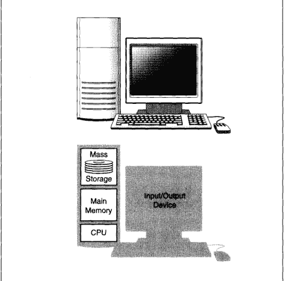

##### 位、字节、赫兹、MIPS 和 Flops

计算机内存通常以位和字节衡量。*位*（Bit）是*二进制数字*（binary digit）的缩写；一个*位*可以存储 0 或 1。*字节*（Byte）是八位的组合；一个字节可以存储一个字符。以下前缀用于表示更大的数量：

- kilo- (K) "千" ($10^3$)
- mega- (M) "百万" ($10^6$)
- giga- (G) "十亿" ($10^9$)

因此，1 兆字节（Mbyte 或 MB）大约相当于 100 万个字节的内存。100 万个字节可以存储 100 万个字符，或者大约 500 页打字稿文本。

CPU 可能根据其一次处理的位数来评估。例如，32 位 CPU 一次操纵 32 位。另一种说法是，该 CPU 具有 32-*位字长*。

CPU 处理单词的速率由*时钟速度*决定。*时钟速度*以*兆赫兹*（*MHz*）表示；1 *兆赫兹* = 每秒 100 万个脉冲。在其他条件相同的情况下，字长更大且时钟速度更高的 CPU 速度更快。

计算机的速度有时以每秒执行的算术操作次数来表示。这以*flops* 衡量，即*每秒浮点操作*（floating-point operations per second）的缩写。或者，计算机的速度可能通过每秒执行的*指令*数量来表示。这以*MIPS* 衡量，即*每秒百万条指令*（millions of instructions per second）的缩写。

> 有时这些前缀是作为近似值使用的——见练习 6。

#### 1.2 单用户还是多用户？

图 1–1 中表示的计算机是*单用户*计算机，也称为*个人计算机*或*工作站*。它有一个键盘和一个视频显示器，旨在同时仅服务一个人。这是小型计算机的常见配置。

另一方面，大型计算机系统通常拥有比一个人能充分使用的更多处理能力。这些计算机通常被设置为*多用户系统*，如图 1–2 所示。注意，多用户计算机具有与单用户计算机相同的四个基本部分：CPU、主内存、大容量存储和输入/输出设备。（图 1–2 中显示的 *I/O* 设备是*终端*，由键盘和视频监视器组成。）

> 工作站的性能优于典型的个人计算机。

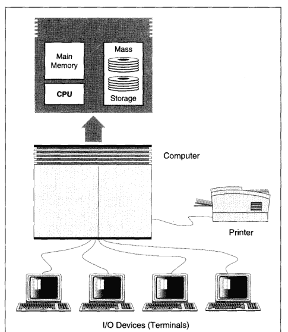

**图 1-2** 多用户计算机系统。该系统设置为同时处理多达四名用户。有些系统可以同时服务数百名用户。

#### 1.3 计算机网络

容纳多个用户的另一种方法是将两台或多台计算机连接在一起形成*网络*。图 1-3 显示了一个由三个工作站（称为*主机*）、一台打印机以及另一台没有视频显示设备但带有磁盘的称为*文件服务器*的计算机组成的网络。在这种情况下，三个主机中的每一个只有有限的二级内存，而是依赖连接到服务器的磁盘。（服务器通过为工作站提供大容量存储来服务它们。）

> 服务器是为其他硬件（或软件）提供服务的计算机硬件（或软件）。

近年来，计算机网络变得非常流行。原因之一——和许多其他事情一样——是简单的经济学。通过允许用户共享昂贵的资源（如打印机），网络的建立和运行相对经济。

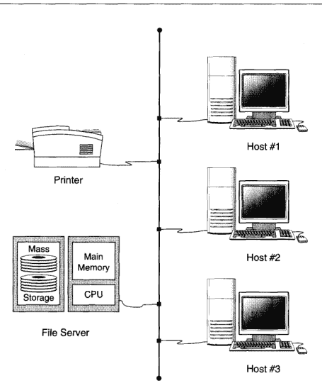

**图 1-3** 计算机网络。该网络包括四台计算机，其中一台是服务器，为其他三台提供磁盘存储。

#### 1.4 操作系统

尽管计算机硬件很重要，但没有*软件*——告诉 CPU 做什么的编码指令——它将无能为力。一种特别重要的软件类型是*操作系统*（OS），它执行三个关键功能：

- OS 控制连接到计算机的所有各种外围设备（打印机、磁盘驱动器、终端等）。
- OS 处理用户与计算机之间的通信，将用户命令传递给计算机，并将计算机消息返回给用户。
- OS 管理其他程序的存储和运行方式。

一些操作系统是*专有*的，意味着它们被设计为仅在某些类型的计算机上工作。例如，MS-DOS——1980 年代最受欢迎的操作系统——是为具有 Intel CPU 的机器设计的。同样，原始的 Apple Macintosh 系统仅在使用 Motorola CPU 的机器上运行。

相比之下，UNIX 操作系统是非专有的——它可以在各种计算机系统上运行。表达这一点的一种方式说是说 UNIX 是一个*可移植*的操作系统。你还会听到人们说 UNIX 是一个*开放*系统。无论你选择如何表述，UNIX 是当今世界领先的可移植（或开放）操作系统。

#### 1.5 多任务和时间共享

UNIX 是一个*多任务*操作系统，这意味着它使计算机能够同时处理多项任务。使用 UNIX，你可以在“前台”处理另一项任务时，在“后台”运行多个程序。

多任务是如何工作的？虽然有些计算机实际上可以同时执行多项任务，但其他计算机不能。然而，通过在任务之间快速切换，这里做一点那里做一点，计算机可以制造出同时做许多事情的错觉。这种技术称为*时间共享*，它之所以可行是因为 (a) 计算机非常快，以及 (b) UNIX 负责调度将要做什么以及何时做。

UNIX 还具备同时与多名用户交互的能力——换句话说，它是一个*多用户*操作系统。这种能力在必须服务大量用户的大型主机计算机上尤为重要；没有它，每个人都将不得不轮流等待使用计算机。

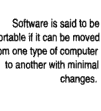


## UNIX 的起源

UNIX 的故事始于一个失败的操作系统、一群热爱乐趣且时间充裕的计算机科学家，以及一款名为“太空旅行”（Space Travel）的电脑游戏。那个失败的操作系统是 Multics，它是由通用电气（General Electric）、麻省理工学院（MIT）和 AT&T 贝尔实验室共同发起的一个项目。Multics 被构想为一次伟大的技术飞跃：一个交互式的多用户操作系统，将在现有可用系统的基础上领先数年。但该项目野心过大，到 1969 年时，很明显 Multics 陷入了大麻烦。贝尔实验室不得不勉强从项目中撤出，这让贝尔实验室的研究人员们无事可做。

其中一位研究人员，肯·汤普逊（Ken Thompson），编写了“太空旅行”这款游戏，它允许 Multics 用户驾驶一艘虚构的宇宙飞船前往太阳系的主要天体。在等待贝尔管理层批准几个新的研究项目期间，汤普逊决定通过重写“太空旅行”来保持忙碌，使其能在一台很少使用的实验室里的 PDP-7 小型计算机上运行。他请到了丹尼斯·里奇（Dennis Ritchie）的帮助，里奇是另一位也参与过 Multics 项目的贝尔实验室计算机科学家。

这绝非易事。所有的编程工作都必须在另一台机器上完成，然后通过穿孔纸带传输到 PDP-7 上。没过多久，汤普逊就希望 PDP-7 能拥有自己的操作系统，在某些方面类似于 Multics，但要简单得多。于是他编写了一个。这就是第一个 UNIX 操作系统，尽管它直到次年才获得这个名字。（这个名字最初是“Unics”，是 Multics 名字的一个双关语。后来被改成了 UNIX。）

PDP-7 只有大约 9 Kbytes 的主内存，甚至比今天的一些手持计算器还要少。汤普逊和里奇申请了一台更大的计算机。作为交换，他们提议为贝尔实验室专利部门制作一个基于 UNIX 的文字处理系统。他们得到了这台新计算机——一台拥有 24 K 主内存的 PDP-11——并在 1971 年交付了该文字处理系统。该系统立即取得了成功，UNIX 也随之正式发布。

UNIX 最初是用汇编语言编写的，这是一种原始的编程语言。由于每种类型的计算机都有自己独有的汇编语言，早期的 UNIX 版本只能在 PDP-7 和密切相关的机器上运行。但在 1973 年，UNIX 用 C 语言重写，C 语言是由丹尼斯·里奇发明的一种高级编程语言。用 C 语言编写程序要容易得多；同样重要的是，C 语言被设计为一种可移植的语言，不依赖于任何特定的计算机硬件。因此，UNIX 本身也变成了一个可移植的操作系统。

## 1.6 UNIX 的主要组件

UNIX 操作系统由四个主要部分组成：

-   **内核（Kernel）。** *内核* 是计算机的主控程序。它驻留在计算机的主内存中，并管理计算机的资源。正是内核处理了提供多任务处理所需的切换。
-   **Shell。** UNIX 中解释用户命令并将其传递给内核的部分被称为 *Shell*。目前常用三种不同的 Shell：Bourne Shell、Korn Shell 和 C Shell，本书将对它们进行讨论。
-   **文件系统。** UNIX 将信息组织成称为 *文件* 的集合。你可以将几乎任何类型的信息放入文件中——你编写的程序、备忘录、等待分析的数据、你下一部小说的初稿，甚至是一封写给母亲的信。文件可以被组合成称为 *目录文件* 的集合，通常称为 *目录*。
-   **实用程序（Utilities）。** *实用程序* 是包含在 UNIX 操作系统标准部分中的一个有用的软件工具。实用程序通常被称为 *命令*。UNIX 提供了用于文本编辑和格式设置、编程、数据库管理、通信等的实用程序。

## 1.7 窗口与图形用户界面

如果你只能在监视器上同时看到一个进程的输出，就很难充分利用像 UNIX 这样的多任务操作系统。幸运的是，大多数最新的 UNIX 系统都具有将监视器屏幕划分为多个区域的能力，这些区域被称为 *窗口*（图 1-4），每个窗口都表现得像一个独立的监视器。使用窗口系统，你可以在一个窗口中阅读电子邮件，在另一个窗口中撰写回复，同时在第三个窗口中运行电子表格程序。

典型的窗口系统还提供所谓的 *图形用户界面*（GUI 或 "gooey"），它允许你不仅处理字符数据，还可以处理图像。要在 GUI 下运行特定程序，你可能使用鼠标等指点设备来选择代表该程序的 *图标*（符号），而不是必须记住并输入命令。由于大多数人发现处理图像和指点设备更容易，GUI 变得非常流行。

如果你使用过 Apple Macintosh 或运行 Microsoft Windows 或 OS/2 的 PC，那么你已经熟悉了窗口和 GUI。在 UNIX 系统中，GUI 通常基于 X 窗口系统（简称为 "X"），它最初由麻省理工学院开发。

## 1.8 窗口管理器

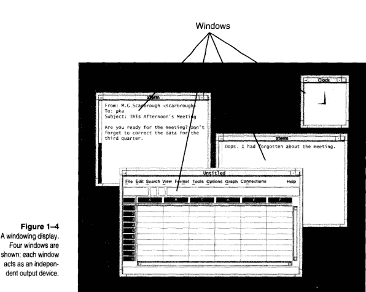

服务器是为其他软件（或硬件）提供服务的软件（或硬件）。

X 窗口系统根据所谓的 *客户端-服务器模型* 工作。换句话说，X 通过为其他程序（客户端）提供图形用户界面而充当服务器。这使得 X 特别适用于网络计算，因为客户端和服务器可以运行在单独的计算机上。

虽然 X 窗口系统使得创建图形用户界面成为可能，但 X 并不规定窗口必须是什么样子，或者用户如何操作它们。这是 *窗口管理器* 的工作。窗口管理器决定了 GUI 的“外观和感觉”，控制窗口的外观，并决定这些窗口如何打开、关闭、调整大小、重新调整大小和移动。

三种窗口管理器 commonly used：

-   *Tab Window Manager (twm)*。最初在麻省理工学院开发，并作为 X 窗口系统的一部分提供，twm 是一个“原原本本”的窗口管理器，提供的装饰很少。尽管如此，有经验的 UNIX 程序员喜欢 twm，因为它可以配置以适合个人喜好。
-   *Open Look Window Manager (olwm)*。Sun Microsystems 是 Open Look 最坚定的推动者，但其他制造商通常没有采用它。
-   *Motif Window Manager (mwm)*。Motif 由开放软件基金会（OSF）开发，该基金会由几家领先的 UNIX 供应商组成。Motif 的设计目标是使其“外观和感觉”类似于 IBM 展示管理器和 Microsoft Windows，这两种都是个人电脑中广泛使用的 GUI。

本书重点介绍 Motif Window Manager (mwm)，它正成为 X 窗口系统的标准 GUI。

## 1.9 X 终端

X 窗口系统被设计为可移植的。因此，X 几乎可以在所有类型的计算机上运行，从 Macintosh 到 PC 再到超级计算机。这极大地促成了它的成功。

基于字符的终端通常被称为哑终端。

然而，X 无法在传统的基于字符的终端上运行，因为支持图形用户界面需要大量的计算能力。这导致了 X 终端这种混合输入/输出设备的开发，它拥有 CPU 和足够的内部内存来运行 X，但本身并不是一台完整的计算机。X 终端比基于字符的终端昂贵，但比完整的 UNIX 工作站便宜。

## 1.10 练习

1.  确保你能够定义以下术语：

| 术语 1 | 术语 2 | 术语 3 |
| :--- | :--- | :--- |
| 硬件 | 兆（mega-） | 多任务处理 |
| 软件 | 吉（giga-） | 时间共享 |
| CPU | 字长 | 内核 |
| 主内存 | 时钟速度 | Shell |
| 辅助内存 | 浮点运算次数（flops） | 文件 |
| 大容量存储 | MIPS | 文件系统 |
| 外部内存 | 服务器 | 目录 |
| I/O 设备 | 客户端 | 实用程序 |
| 外设 | 主机 | 命令 |
| 网络 | 操作系统 | 窗口 |
| 位（bit） | 专有的 | GUI |
| 字节（byte） | 可移植的 | 图标 |
| 千（kilo-） | 开放的 | 窗口管理器 |

2.  大多数计算机系统的主要硬件组件是什么？

3.  UNIX 操作系统的主要组件是什么？

4.  说出三种最常用的 X 窗口管理器。

5.  说出三种最常见的 UNIX Shell。

6.  在提及计算机内存容量时，计算机科学家通常只是近似地使用 kilo-、mega- 和 giga- 等前缀。例如，一千字节的内存并不恰好是 1,000 字节，而是 $2^{10}$ 字节。同样，一兆字节实际上是 $2^{20}$ 字节，一吉字节实际上是 $2^{30}$ 字节。一千和 $2^{10}$ 之间的区别是多少？一百万（$10^6$）和 $2^{20}$ 之间的区别是多少？十亿（$10^9$）和 $2^{30}$ 之间的区别是多少？


## 2 你的 UNIX 账户

在某种程度上，UNIX 就像你的当地银行。正如你需要一个银行账户才能从银行取款（合法地），你也需要一个账户才能使用 UNIX 计算机。在本章中，你将了解获取并开始使用 UNIX 账户所需知道的知识。

### 2.1 你的系统管理员

每家银行都有一个经理，负责制定银行政策、开设和关闭客户账户、平衡账目，并确保银行平稳运行。当然，经理不一定亲自做所有这些工作，但经理有责任确保有人去做。

同样，大多数 UNIX 安装环境都有一个*系统管理员*，负责确保系统平稳运行（至少在大多数时候是这样）。系统管理员的职责包括：

- 硬件配置。
- 安装软件，包括 UNIX 操作系统。
- 启动系统（并在必要时关机）。
- 监控系统使用情况。
- 备份用户文件。
- 创建新的用户账户。
- 故障排除。

系统管理员不一定亲自完成所有这些工作——大型计算机安装环境通常将这些职责分配给几个人。因此，当你读到“系统管理员”时，请将其理解为“系统管理员或其助手之一”。

### 2.2 你的账户名

大型 UNIX 安装环境可能服务数百甚至数千名用户，每位用户都有属于自己的账户。为了识别这些账户，每个账户都会被赋予一个唯一的名称，该名称通常以某种方式基于用户的真实姓名或昵称。例如，对于一位名叫 John P. Jones 的用户，以下都是可能的账户名：

- j_pjones
- jonesjp
- jones
- johnp
- jpj
- sparky

分配账户名的政策各不相同。在某些组织中，系统管理员为你选择名称；在其他组织中，你可以在遵守某些规则的前提下自己选择。以下是相当典型的规则：

- 选择一个至少三个字符长、但不超过八个字符长的名称。
- 确保没有其他账户拥有相同的名称。
- 选择一个与你的真实姓名或昵称在某种程度上相关的账户名。
- 仅使用数字和小写字母；不要包含大写字母或标点符号。

当你在计算机上开始工作会话时，你需要通过提供你的账户名来*登录*：

```
login:
```

因为你登录时使用账户名，所以你的账户名通常被称为*你的登录名或登录*。

### 2.3 你的密码

你的登录名是公开信息。为了防止未授权使用你的账户，计算机还会向你索要一个*秘密密码*：

```
password:
```

通过输入你的密码，你向计算机验证你确实是该账户所属的人。

系统管理员很可能会为你选择第一个密码。之后，你可以（也应该）选择自己的密码。好的密码是你容易记住但别人难以猜到的密码。以下是一些选择密码的一般指导原则：

- 选择一个至少六个字符长的密码。（密码可以长到你喜欢的程度，但某些系统只检查前八个字符。）
- 组合使用数字、大写字母、小写字母和标点符号。
- 使密码易于记忆，但避免使用常见的名字和单词。
- 不要使用你的社会保障号、电话号码、登录名或登录名的任何变体（正向或反向）。
- 确保新密码与旧密码有显著差异。

选择密码的策略有多种。一种是故意拼错一个容易记住的单词或名字。例如，Ch*cago 或 ch*cago 都不适合做密码。但以下故意拼错的单词可以：

ch*KagoH
Ch*.CAG_O
Sheekago
She?kago

另一种策略是从一个容易记住的短语中每个单词的首字母组成密码。包含标点符号是个好主意。例如：

N*My*d! (*Not in My yard you don't!*)
Ihnybt*f (*I have not yet begun to fight*)
H*otr (*Home, home on the range*)
wt*dat*p (*where the deer and the antelope play*)

你的密码是你账户的主要保护防线。任何发现你密码的人都可以对你的账户做任何事情——包括删除你所有的文件。因此，确保你的密码安全至关重要。

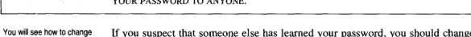

如果你怀疑其他人知道了你的密码，你应该立即更改。实际上，为了安全起见，偶尔更改密码也是个不错的选择。

### 2.4 其他账户信息

当你的账户创建时，系统管理员除了登录名和密码外，还会设置以下信息：

- **主目录。** 你的主目录是你所有其他文件和目录的存放位置。主目录有一个名称，与你的登录名相同。
- **组 ID。** 你可能被分配到一个用户组。在某些组织中，组被设置以便同一部门或参与相同项目的用户可以轻松共享文件。
- **登录 Shell。** 三种 UNIX shell 常用：Bourne Shell、C Shell 和 Korn Shell。系统管理员会选择其中一种，在你登录时自动启动。

当你收到你的 UNIX 账户时，务必询问你被分配了哪些组（如果有的话）以及你的登录 shell 是什么。

### 2.5 更多需要询问的问题

你应该向系统管理员询问以下额外问题：

- 我将使用哪个版本的 UNIX？
- 我将使用哪种终端？其 term info 代码是什么？
- 擦除、中断、停止和继续键是哪些？
- 我可以使用哪些打印机？
- 我如何访问系统？

本章的其余部分将解释每个问题的含义。

### 2.6 UNIX 的版本

当我们说 UNIX 时，我们实际上指的是一个操作系统家族。大多数都可以追溯到 AT&T System V 或 Berkeley Software Distribution (BSD) UNIX：

| 名称 | 供应商 | 基于 |
| :--- | :--- | :--- |
| AIX | 国际商业机器公司 | AT&T System V |
| A/UX | 苹果电脑 | AT&T System V |
| Dynix | Sequent | BSD |
| HP-UX | 惠普 | BSD |
| Irix | 硅谷图形公司 | AT&T System V |
| Linux | 自由软件基金会 | |
| NextStep | Next | BSD |
| OSF/1 | 数字设备公司 | BSD |
| SCO UNIX | 圣克鲁斯操作 | AT&T System V |
| Solaris | 太阳微系统 | AT&T System V |
| SunOS | 太阳微系统 | BSD UNIX |
| Ultrix | 数字设备公司 | BSD UNIX |
| Unicos | Cray | AT&T System V |
| UnixWare | Novell | AT&T System V |
| XENIX | 微软 | AT&T System III |

请记住，这些 UNIX 版本非常相似；如果你学会了使用其中一个，你应该能轻松使用其他任何一个。

> 询问你的系统管理员你的系统是基于 AT&T 还是 BSD UNIX。

### 为什么有这么多 UNIX 版本？

当 UNIX 在 20 世纪 70 年代于 AT&T 贝尔实验室开发时，AT&T 仍受联邦法律限制，无法在计算机行业开展竞争。由于公司无法从 UNIX 中获利，他们免费提供。

UNIX 在大学和学院中变得非常流行，既用于教学也用于研究。（低廉的价格无疑与这种普及有关。）早期版本的 UNIX 仍然相当粗糙，因此学术计算机科学家引入了自己的改进。加州大学伯克利分校的计算机系统研究小组在这方面尤为突出，他们开始制作自己的 UNIX 版本。到 1982 年，Berkeley Software Distribution (BSD) UNIX 在与 AT&T 版本的受欢迎程度上并驾齐驱。

与此同时，许多计算机公司生产了自己的 UNIX 版本，通常从 AT&T 和 Berkeley UNIX 中借用特性。当然，每个版本都有自己的名称，通常以 x 结尾（如 AIX、A/UX、HP-UX、Irix、Ultrix 和 XENIX，仅举几例）。曾经市场上有多达 200 种 UNIX 变体。

尽管在大多数方面相似，许多 UNIX 版本的差异足以让程序员、供应商和用户头疼。为了简化每个人的工作，成立了一个行业组织来定义 UNIX 标准。第一个可移植操作系统接口 (POSIX) 标准于 1988 年正式通过。自那以后，大多数主要的 UNIX 操作系统供应商一直根据 POSIX 标准修改其系统。

AT&T 也意识到标准化的必要性。1989 年，AT&T System V（“System 5”）Release 4 出现。System V Release 4（简称“SVR4”）结合了四种最受欢迎的 UNIX 衍生版本的最好特性，即 SVR3、4.3BSD、SunOS 和 Microsoft Xenix。

1993 年，伯克利计算机系统研究小组宣布随着 4.4BSD 的发布将停止运营。然而，开放软件基金会 (OSF)——包括 IBM、数字设备公司和惠普等主要计算机制造商的联盟——继续基于 BSD UNIX 的操作系统工作。


## 2.7 终端类型与 Terminfo 代码

作为一个开放系统，UNIX 必须能够与各种 I/O 设备协同工作。UNIX 系统包含一个数据库，用于描述其可使用的多种不同终端的运行特性。这被称为 terminfo（“终端信息”）或 termcap（“终端能力”）数据库。登录时，系统可能会要求你通过指定其 terminfo（或 termcap）代码来指示你正在使用的终端设备类型。以下是一些常见终端的代码：

| **制造商** | **型号** | **代码** |
| :--- | :--- | :--- |
| 数字设备公司 | VT100 | vt100 |
| 惠普 | 2621 | hp2621 |
| 国际商业机器公司 | 3164 | ibm3164 |
| 利雅-西格勒 | ADM 3 | adm3 |
| 三洋 | 55 | sanyo55 |
| 电视技术 | 925 | tvi925 |
| 泰克 | 4015 | tek4015 |
| Wyse 科技 | 50 | wyse50 |

## 2.8 特殊键

图 2–1 展示了一个典型的计算机键盘。它拥有与打字机相同的字母、数字和标点符号键。它还包含一些传统打字机上没有的特殊键。以下五个键特别值得注意：

- **RETURN**：也称为 **ENTER** 或 **NEWLINE** 键，用于向 shell 发送命令。
- **ESCAPE**：该键可能标记为 **ESC**，通常位于键盘左上角附近。
- **ERASE**：使用不同的键来擦除字符。在许多系统中，此功能由 **BACKSPACE** 或 **DELETE** 键，或按键组合执行。
- **BREAK**：此键有时在登录过程中使用。
- **CONTROL**：在某些终端上，这可能标记为 **CTRL**。它与其它键结合使用以执行特殊功能。

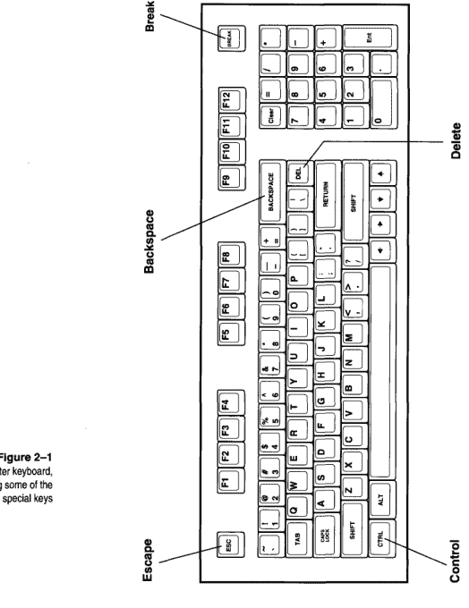

在这些键中，CONTROL 键值得特别说明。大量的 UNIX 命令是通过按住 CONTROL 键并同时按下另一个键来执行的。例如，在许多终端上，可以通过按键组合 **CONTROL-H** 调出擦除功能。

在印刷品中提到这种按键组合时，你通常会看到符号 ^H，其中尖角符号 (^) 代表 CONTROL 键。

在后文中，你将了解到许多涉及 CONTROL 键的功能。就目前而言，有四个特殊功能你应该咨询：

| 功能 | 目的 | 按键组合 | 替代方案 |
| :------- | :------ | :--------------- | :---------- |
| erase | 删除一个字符 | CONTROL-H | ^H, BACKSPACE |
| interrupt | 停止一个程序 | CONTROL-C | ^C, DELETE |
| stop | 冻结终端 | CONTROL-S | ^S, ? |
| continue | 解冻终端 | CONTROL-Q | ^Q, ? |

请注意，删除字符或中断程序可能有不止一种方式。如附录 A 所示，UNIX 提供了一种方式来更改调用这些功能的按键。

### 2.9 打印机代码

几乎每个 UNIX 系统都配有一台用于产生纸介输出的打印机。（纸介输出被称为硬拷贝。）大型计算机设施可能有许多台打印机。单独的打印机通过代码名称识别，这通常反映了设备的类型和位置。例如，假设连接到你的 UNIX 系统的一台打印机是位于 12 号房间的 Apple LaserWriter 360。系统管理员可能会为这台打印机分配以下代码名称之一：

- `alw360-12`
- `1w360r12`
- `room121w`

你明白意思了。关于打印机命名没有标准规则，因此向你的系统管理员询问属于你系统的打印机名称是个好主意。

### 电传打字机与终端

当 Thompson 和 Ritchie 重写 UNIX 以在贝尔专利部的 PDP-11 上运行时，主要输入/输出设备是电传打字机终端。这些是缓慢且嘈杂的机电设备，其输出产生在纸卷上。

电传打字机键盘具有常规的打字机键，用于大写和小写字母、数字和标点符号。它还有一个特殊的"Control"键，与其它键结合使用以执行特殊功能。（例如，按住 Control 键并输入字母 B 会发出铃声。）

虽然电传打字机现在已过时，但它们并未完全被遗忘。较新的 I/O 设备的键盘仍然有一个 Control 键，与其它键结合使用以执行特殊功能。在 UNIX 的词汇表中，缩写 tty（Teletype 的简称）仍被用来表示"终端"。并且"print"仍被用来表示"在终端上显示输出"，尽管如今大多数终端打印到视频屏幕而非纸上。

### 2.10 练习

1. 确保你可以定义以下术语：
   - 系统管理员
   - 账户名
   - 登录名
   - 登录
   - 正在登录
   - 密码
   - 主目录
   - 组
   - 登录 shell
   - BSD
   - System V
   - terminfo 代码
   - termcap 代码
   - control 键
   - 中断
   - tty
   - print
   - 硬拷贝

2. 你将使用哪个版本的 UNIX？它是基于 AT&T 还是基于 BSD UNIX？

3. 你系统中的用户登录名是如何分配的？你可以选择自己的登录名，还是有一个被分配给你？

4. 你系统中选择密码的规则是什么？牢记这些规则，选择两个或三个稍后要使用的密码。（不要写下你的密码或向任何人透露。）

5. 对于名为 Glynda Jones Davis 的人，其登录名、电话号码和社保号分别为 gjdavis、555-2525 和 632-10-6854，下列哪些会是良好的密码？解释你的理由。
   - cat
   - Smith
   - 5552525
   - KRoo2
   - 7cattz
   - Glynda
   - Glynda7
   - s1vagjg
   - Jones
   - jones
   - NotSmith
   - t1pPecanoe
   - tylerTwo
   - t555s632
   - 532106854
   - kangaroo
   - trouble
   - trubble

6. 你将使用哪种终端？它的 terminfo（或 termcap）代码是什么？

7. 哪些键用于擦除输入、中断程序、冻结终端和解冻终端？

8. 你可以使用哪台打印机？它的代码名称是什么？

# 3 教程：入门

在本章中，你将学习如何登录到你的 UNIX 账户，更改你的密码，并尝试使用基于字符的终端执行一些 UNIX 命令。如果你使用的是 X 终端或工作站，你可能希望跳过本章并继续阅读第 4 章。

如果尚未操作，请向你的讲师、系统管理员或顾问咨询关于设置账户的问题。你需要以下信息：

- 你的登录名
- 你的密码
- 你将使用的计算机名称

## 3.1 开启电源

如果你的终端已经开启，请跳至 3.2 节。

有些终端旨在始终保持开启，不应关闭。通过查看屏幕并不总能确定——你的系统可能有一个屏幕保护程序，当终端闲置一段时间后，该程序会空白化显示。因此，第一步是尝试“唤醒”屏幕：

1. **按空格键或 (RETURN) 键。** 这通常足以取消屏幕保护。如果成功，请继续前往 3.2 节，“获取登录提示”。
2. **找到电源开关并将其打开。** 开关可能隐藏在键盘的前缘下方或终端的后面板上。（看看你是否能找到电源线——开关可能靠近线缆进入终端的位置。）打开终端。
3. **允许终端预热。** 过一会儿，你应该会在终端屏幕上看到一条小闪烁线或矩形。这是光标。它显示下一个输入的字符将出现在哪里。

## 3.2 获取登录提示

现在你必须引起计算机的注意。你想要的是计算机向你显示一个 *登录提示*，表明它已准备好让你登录：

```
login:
```

你如何获得登录提示取决于你的终端是连接到一个还是许多计算机主机。如果你的终端连接到一个主机，请尝试以下程序来获取登录提示：

1. 多次按 **RETURN**。这可能足以使计算机显示登录提示：
   `(RETURN)`
   `login:`
2. 如果登录提示未出现，尝试按 **BREAK** 或 **RESET**。某些系统可能要求你按 **BREAK** 然后按 **RETURN**。
   `(BREAK)` `(RESET)` `(BREAK)` `(RETURN)`
3. 如果步骤 1 和 2 不起作用，请咨询你的系统管理员。

如果你的终端连接到一个终端服务器，你需要选择一台主机计算机。如何做到这一点取决于你的系统。以下程序相当典型：

1. 多次按 **RETURN**。通常这就足以让终端服务器显示其提示。终端服务器提示因系统而异；以下是一些示例：
   `(RETURN)`
   `Which computer?`
   `Dial:`
   `UNIVERSITY-NET>`
2. 在提示处输入主机计算机的名称。如果你想处理一台名为 `merlin` 的机器，你将在提示处输入此名称：
   `Which computer?merlin`
   **(RETURN)**
   
   所选的主机计算机应以登录提示响应：
   **(RETURN)**
   `login:`
3. 如果步骤 1 和 2 不起作用，请咨询你的系统管理员。

## 3.3 登录

如果你已达到这一步，你应该在屏幕上看到一个登录提示：

```
login:
```

如果你已经在终端屏幕上看到这个，请跳至 3.3 节。


## 3.3 快速入门

1. **输入你的登录名并按下 RETURN 键**。如果登录名为 jsmith，则应在提示符后输入：

```
log in: jsmith (RETURN)
```

不要输入 jsmith（除非这就是你的登录名）。在此处输入你的登录名。

计算机将通过提示你输入密码来作出响应：

```
password:
```

2. **输入你的密码并按下 RETURN 键**。

```
password:
```

在此处输入你的密码；密码不会显示在屏幕上。

请注意，**你的密码不会显示在屏幕上**。其目的是防止他人从你身后窥视并窃取你的密码。（你稍后将会了解如何修改密码。）

3. **如果你输入登录名或密码时出错，请重复步骤 1 和 2**。计算机将告知你登录不正确，并给予你再次登录的机会：

```
Login incorrect
log in:
```

## 3.4 消息

一旦你成功访问计算机，它可能会打印各种消息，包括：

- UNIX 系统类型。
- 来自系统管理员的当日消息。
- 邮件警报，告知你有电子邮件等待接收。

如果你有邮件，稍后你将了解如何阅读它们。

## 3.5 设置终端类型

一些 UNIX 系统配置为在登录时要求你指定终端类型。如果你的系统属于此类，它会显示如下提示：

```
Set terminal type (vt100):
```

或者：

```
TERM (vt100):
```

括号中的 **terminfo** 代码代表*默认终端类型*；计算机假定这就是你正在使用的终端。

1. **如果你的终端与默认类型匹配，只需按下 [RETURN] 键**。然后跳到下一节，“UNIX Shell 提示符”。
2. **否则，输入你所使用的终端类型的 terminfo 代码**。（这是你应当向系统管理员获取的信息。）确保在输入代码后按下 [RETURN] 键。

## 3.6 UNIX Shell 提示符

此时，你应该能看到一个*Shell 提示符*，这只是 Shell 告诉你它已准备好接收指令的方式。如果你的登录 Shell 是 C Shell，提示符可能是一个百分号：

```
%
```

如果你使用 Bourne Shell 或 Korn Shell 作为登录 Shell，通常的提示符是一个美元符号：

```
$
```

偶尔也会使用其他符号作为 Shell 提示符，包括井号 (#)、大于号 (>)、星号 (*)、at 符号 (@) 和冒号 (:)。

有些系统配置为将主机名作为提示符的一部分，如下所示：

```
merlin %
```

在本书中，我们将使用以下内容作为“通用”提示符，以代替百分号或美元符号：

```
$
```

*在以下示例中，不要输入提示符符号。*

## 3.7 终端故障排查

有时你的终端不会按预期工作。有两个问题尤其常见：

- *你输入的所有内容都以大写字母显示。* UNIX 系统表现得好像你的终端无法处理小写字母。
- *通常的退格键不起作用。* 例如，你可能想使用 [BACKSPACE] 键来删除字符。

如果出现其中任何问题，请参考附录 A，“驯服你的终端”。

## 3.8 更改你的密码

好的密码是你容易记住但别人难以猜到的。系统管理员分配的初始密码通常不符合这些标准。经常更改密码以防止账户被未授权使用是个好主意。如果你还没有这样做，请花一分钟时间思考一个密码。

1. **在 Shell 提示符下输入 `passwd` 命令**。注意这里是 `passwd`，而不是 `password`：

   ```
   $ passwd (RETURN)
   ```

   系统将提示你输入旧密码：

   ```
   Old password:
   ```

2. **输入你的旧密码，然后按下 [RETURN] 键**。与往常一样，你的密码不会显示在屏幕上：

   ```
   Old password: ████████
   ```

   然后计算机将要求你输入新密码：

   ```
   New password:
   ```

3. **输入你的新密码，然后按下 [RETURN] 键**。与往常一样，你的密码不会显示在屏幕上：

   ```
   New password: ████████
   ```

   为确保你没有犯错，计算机将要求你重复输入新密码：

   ```
   Retype new password:
   ```

4. **重复输入你的新密码**。如果这次没有和之前完全一致，系统将不接受新密码，你必须重新开始：

   ```
   Retype new password: ████████
   ```

当 Shell 提示符出现时，你就知道新密码已被接受：

```
$
```

## 3.9 尝试一些 UNIX 命令

接下来，尝试几个 UNIX 命令来看看它们是如何工作的。

1. **从 date 命令开始**。在提示符后输入 `date`，然后按下 [RETURN] 键：

   ```
   $ date (RETURN)
   ```

   计算机将响应日期和时间。例如，如果你在 1999 年 8 月 13 日星期五晚上 8:35（东部标准时间）执行此命令，输出将类似于：

   ```
   Fri  Aug 13  20:35:41 EST  1999
   ```

   请注意，这是宿主计算机所在时区的时间，并且时间是以 24 小时制给出的。

2. **接下来，尝试 who 命令**。输入 `who`，然后按下 [RETURN] 键：

   ```
   $ who (RETURN)
   ```

   计算机将响应当前登录到系统的用户列表。例如：

   | Login | Terminal | Date | Time |
   | :--- | :--- | :--- | :--- |
   | root | console | Aug 13 | 08:11 |
   | adams | tty16 | Aug 13 | 07:01 |
   | pgw | tty03 | Aug 13 | 18:15 |
   | ben | tty18 | Aug 13 | 11:32 |
   | jeff | tty12 | Aug 13 | 09:45 |

   首先列出用户的登录名，接着是标识用户所连接的线路或*端口*的代码。也显示了用户登录的日期和时间。

3. **尝试 who am i 命令**。此命令会在屏幕上打印你的登录名：

   ```
   $ who am i (RETURN)
   ```

## 3.10 阅读你的邮件

如果你收到一条消息告诉你已收到电子邮件，现在是阅读邮件的时候了。

1. **输入启动邮件程序的命令**。命令取决于你使用的是基于 AT&T System V 的 UNIX 系统还是 Berkeley (BSD) UNIX：

   AT&T System V:
   ```
   $ mailx (RETURN)
   ```

   BSD:
   ```
   $ mail (RETURN)
   ```

   系统将响应消息列表。例如：

   ```
   U  1  wards  Thu  Aug 12 15:27  554/26358  "Class Roster"
   N  2  aadams  Fri  Aug 13  8:59  40/1527  "Lunch"
   N  3  gwc  Fri  Aug 13  9:47  15/440  "Research Notes"
   &
   ```

   第一列中的 *U* 表示上次登录时留下的未读消息；*N* 表示新消息。消息被编号（在本例中为 1 到 3）。显示发送者的登录名，以及消息接收的日期和时间，还有消息包含的行数和字符数（行数/字符数）。最后，消息的主题用引号标出。最后一行的 & 符号是*邮件提示符*。

2. **阅读你的消息**。只需在邮件提示符后输入消息编号并按下 [RETURN] 键：

   ```
   &2 (RETURN)
   ```

   这将显示第二条消息：

   ```
   Message 2:
   From aaadams  Fri  Aug 13 8:59:01 1999
   Date:  Fri  Aug 13  8:59:01
   From:  aaadams  (Abigail Adams)
   To:  (Your login name)
   Subject:  Lunch

   Let's get together for lunch at 12:45 today. Okay?
   &
   ```

3. **退出邮件实用程序**。在邮件提示符处输入 *x*（代表“退出”）将使你退出邮件实用程序，消息将保留在邮箱中：

   ```
   &x (RETURN)
   ```

电子邮件——包括发送、保存和删除邮件的方法——将在第五部分中详细讨论。

## 3.11 阅读 UNIX 手册

许多 UNIX 系统都配备了详细的在线手册，你可以使用 `man` 命令阅读。手册描述了系统中可用的命令。要查看如何做到这一点，请尝试以下命令：

```
$ man cal [RETURN]
```

`cal` 命令是我们将在后续章节中使用的；它在屏幕上显示日历。如果你的系统有在线手册，你应该能看到 `cal` 的描述。（关于如何理解手册的更多信息，请参见附录 B。）否则，你将看到如下消息：

```
man: Command not found.
```

## 3.12 注销

当你结束在计算机上的工作时，必须“注销”。这告诉系统你已使用完毕。

> **警告**
> 切勿在未先注销的情况下离开终端。在某些 UNIX 系统中，即使终端关闭，你的账户仍将保持打开状态。这会引来不怀好意者进入系统并制造麻烦。

1. **如果你使用的是 C Shell，请尝试 `logout` 命令：**

   ```
   % logout [RETURN]
   ```

2. **如果你使用的是 Bourne 或 Korn Shell，请尝试 `exit` 命令：**

   ```
   $ exit [RETURN]
   ```

3. **如果 `logout` 和 `exit` 都不起作用，请尝试 ^D**。记住，^D 符号意味着你应该按住 **CONTROL** 键并输入字母 *D*：

   ```
   $ CONTROL-D
   ```

4. **如有必要，从终端服务器注销**。如果你在选择计算机主机之前曾登录终端服务器，可能还需要从终端服务器注销。

5. **如果似乎什么都不起作用，请寻求帮助**。切勿在未先注销的情况下离开。


# 入门指南

## 3.13 命令摘要

以下列出的每个命令均在 shell 提示符处输入。

**修改您的密码**

- `passwd`（回车）修改密码

**其他 UNIX 命令**

- `date`（回车）打印当前日期和时间
- `who`（回车）打印当前登录用户的列表
- `who am i`（回车）打印您的登录信息
- `man cal`（回车）显示描述 `cal` 命令的手册页

**退出登录**

- `logout`（回车）C Shell 的退出登录命令
- `exit`（回车）Bourne 或 Korn Shell 的退出登录命令
- `^D` 可选的退出登录命令

### 3.14 练习

1. 确保您能够定义以下术语：
   - 光标（cursor）
   - 登录 shell（login shell）
   - shell
   - 默认邮件（default mail）
   - 提示符（prompt）
   - shell 提示符（shell prompt）
2. 连接到您的 UNIX 系统的终端有哪些类型？检查几种不同的终端，并找到（回车）、（控制）、（退格）、（转义）和（中断）键，以及开/关开关。
3. 看看您的终端是否有一个标有“NO SCROLL”的键。该键通常用于“冻结”终端显示。按下该键并在键盘上输入您的名字。屏幕上发生了什么？现在再次按下该键。您看到了什么？
4. 在许多终端上，`^S` 键组合会“冻结”终端。尝试这个键组合并在键盘上输入一些内容。发生了什么？键组合 `^Q` 会“解冻”终端，从而逆转 `^S` 的效果。请试一试。
5. 您的键盘上是否有一个标有“CAPS LOCK”或“CASE”的键？如果有，按下该键并在键盘上输入一些内容。这个键的作用是什么？
6. UNIX 是*区分大小写*的；它区分大写字母和小写字母。尝试下面列出的命令并注意每个命令的作用（如果有的话）：
   - `WHO [回车]`
   - `CAL 1999 [回车]`
   - `DATE [回车]`
   - `WHO AM I [回车]`

# 4 教程：X 入门

在本章中，您将学习如何使用 X 终端或工作站登录到您的 UNIX 账户，修改您的密码，并尝试一些 UNIX 命令。如果您尚未这样做，请咨询您的讲师、系统管理员或顾问关于设置账户事宜。您需要以下信息：

- 您的登录名
- 您的密码
- 您将使用的计算机名称

本章假设您的系统已设置好自动启动 X 服务器和窗口管理器。如果您的系统并非如此，您需要自行启动它们。在这种情况下，您应根据第 3.1 节到第 3.7 节中介绍的过程进行登录；然后参阅附录 C，“启动 X 和 Motif”。

## 4.1 登录显示管理器

控制您登录过程的 X 程序称为显示管理器。

1. 唤醒显示器。大多数 X 终端都配备了屏幕保护程序，该程序在屏幕空闲一段时间后会将屏幕置黑。通常，按下按键或移动鼠标即可取消屏幕保护。

显示管理器将生成一个登录屏幕，其外观可能类似于图 4-1。

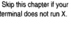

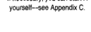

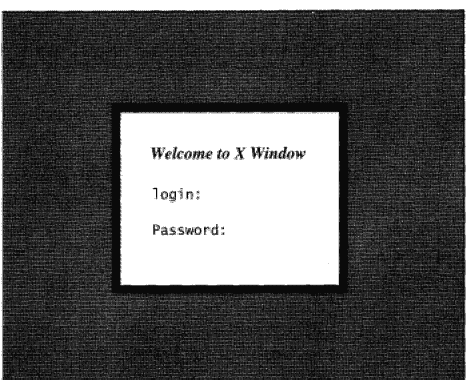

**图 4–1**
登录屏幕。您的显示管理器呈现的屏幕外观可能略有不同。

2. **输入您的登录名并按回车。** 如果您的登录名是 `jsmith`，您将在提示符后输入：

   login: `jsmith`（回车）

   *不要输入 `jsmith`（除非那是您的登录名）。在此处输入您的登录名。*

3. **输入您的密码并按回车。**

   password: [已编辑]

   *在此处输入您的密码；它不会在屏幕上显示。*

注意，您的密码不会在屏幕上显示。其目的是防止他人从您身后看到并获取您的密码。（您将稍后学习如何更改密码。）

尽管这里显示“登录错误”，但如果您的密码错误，也会显示相同的消息。

4. 如果您在输入登录名或密码时出现了错误，请重复步骤 2 和 3。计算机将通知您登录不正确，并为您提供再次登录的机会：

   Login incorrect
   login:

根窗口也称为“桌面”。

## 4.2 根窗口

一旦您成功登录，计算机可能需要一分钟或左右的时间来启动 Motif 窗口管理器（mwm）。最终，在变暗的背景上应会显示一个窗口，如图 4-2 所示。该背景称为根窗口。较小的窗口是一个 xterm 窗口。（根据系统管理员如何配置窗口管理器，您还可能看到其他一些窗口。）

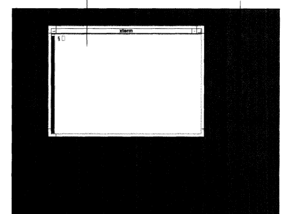

xterm 窗口

“根”窗口

**图 4–2**
根窗口和 xterm 窗口。

## 4.3 xterm 窗口

您将在 xterm 窗口中完成大部分工作。xterm 的名称是“X Terminal”的缩写，顾名思义，xterm 窗口的作用类似于传统的终端屏幕。图 4–3 展示了 xterm 窗口的一些组成部分。（在本章稍后部分，您将了解它们的功能。）

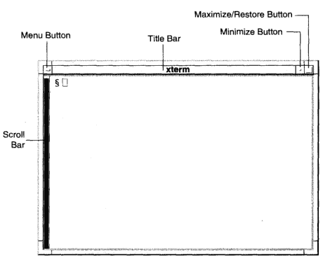

**图 4–3** xterm 窗口的组成部分。

## 4.4 熟悉鼠标

如果您之前使用过个人计算机，您无疑对使用 GUI 的鼠标很熟悉。当您在鼠标垫或桌面上移动鼠标时，屏幕上的箭头形指针也会随之移动。

与许多个人计算机不同——这些计算机通常使用仅有一个或两个按钮的鼠标——Motif 窗口管理器是为三键鼠标设计的（图 4–4）。

不幸的是，没有普遍接受的标准来设定鼠标按钮的功能——每个系统都可以根据管理员（或用户）的个人偏好进行配置。以下排列方式相当典型：

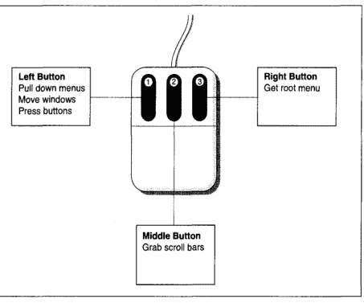

您可能需要尝试一下才能发现鼠标按钮的工作方式。

- **左按钮（按钮 #1）。** 左按钮通常用于命令选择和激活。这包括下拉菜单、选择菜单项、移动窗口以及按屏幕上的按钮。
- **中按钮（#2）。** 在某些系统中，此按钮用于抓取和操作窗口滚动条。
- **右按钮（#3）。** 此按钮传统上用于调出弹出菜单。

有三种激活鼠标按钮的方法：

- **单击。** 按下并快速释放按钮。
- **双击。** 快速连续两次按下并释放按钮。
- **拖动。** 按住按钮的同时移动鼠标。

## 4.5 下拉窗口菜单

窗口菜单提供了许多有用的命令，用于更改窗口的大小和位置。要了解此菜单如何工作——并练习使用鼠标——请尝试调整 xterm 窗口的大小：

1. 将指针移动到窗口菜单按钮。该按钮位于 xterm 窗口的左上角：

   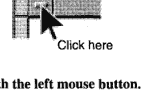

2. 用鼠标左键单击一次。将出现一个菜单：

   - 这被称为*下拉菜单*，因为它是从窗口框架下拉出来的。

   

   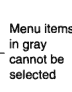

   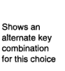

3. 用鼠标左键在**最大化**上单击一次。

   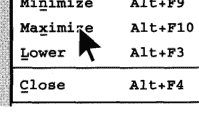

最大化命令使**xterm** 窗口扩展到其完整大小。请注意，您也可以通过使用单字母命令快捷键或备用键组合来执行相同的操作。

4. 用鼠标左键在**还原**上单击一次。

   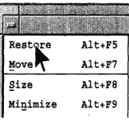

xterm 窗口将恢复到其先前的大小。再次请注意，您也可以通过使用单字母命令快捷键或备用键组合来执行相同的操作。

您将在下一节中了解更多关于其他窗口菜单选项的内容。现在，您只需关闭该菜单即可。

## 4.6 窗口菜单选项

在继续之前，让我们回顾一下窗口菜单上提供的各个选项的含义：

- **还原**。在窗口最大化后将其恢复为原始大小。
- **移动**。允许您将窗口移动到根窗口中的不同位置。（此选项不常使用。）
- **大小**。允许您更改窗口的大小。（此选项不常使用。）
- **最小化**。将窗口转换为图标。（这有时被称为“图标化”命令。）您可以通过单击图标来还原窗口。
- **下移**。将当前窗口移动到其它窗口后面。
- **关闭**。此命令关闭并消除窗口，通常停止在其中运行的任何程序。请小心不要将此与最小化命令混淆，最小化会将窗口缩小为图标。（为了混淆视听，在某些窗口系统中，“关闭”的作用确实与“最小化”相同。）

请记住，图标是一张小图片或符号。


## 4.7 获取弹出菜单

另一种菜单——“弹出”菜单——在你点击根窗口时会出现。此类菜单提供的选项取决于系统管理员如何配置你的系统。请花一分钟检查这些菜单：

- 1. **将指针移动到根窗口。**
- 2. **使用右键（#3）打开菜单。** 根据系统的配置方式，你可能需要按住鼠标按钮。（如果没有显示菜单，请尝试另一个按钮。）注意你在菜单上看到了什么。它可能看起来像这样：

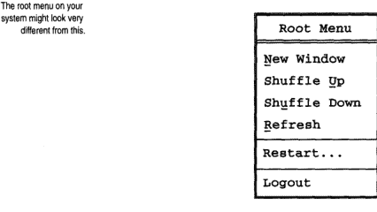

在继续之前，请确保你理解窗口菜单上提供的各种选项：

- • **新窗口（New Window）。** 此选项启动另一个窗口，通常是一个 xterm 窗口。
- • **向上洗牌（Shuffle up）。** 就像洗牌一样，对窗口进行洗牌会将一些窗口放到其他窗口的后面。“向上洗牌”命令将最前面的窗口放到根窗口上其他窗口的后面。然后第二个窗口变为活动窗口。
- • **向下洗牌（Shuffle down）。** 这会将最后面的窗口移到前面，并放置在根窗口上其他窗口的前面。然后该窗口变为活动窗口。
- • **刷新（Refresh）。** 有时屏幕上的图像会混乱。刷新功能会让计算机重新绘制窗口。
- • **重启（Restart）。** 这停止当前的 mwm 会话并在其位置启动另一个会话。
- • **注销（Logout）。** 当你想停止在这台机器上工作时，会使用此命令。这关闭所有窗口并停止你正在运行的任何程序。
- 3. **关闭菜单。** 在某些系统中，只需释放按钮即可完成此操作。其他系统要求你点击菜单的标题栏。
- 4. **使用左键打开菜单。** 当指针位于根窗口时，按下（如有必要，请按住）左键。使用你在弹出菜单上看到的内容。
- 5. **关闭菜单并使用中键打开另一个菜单。** 再次注意你看到的内容。在许多系统中，此菜单提供登录到网络中其他机器的选项。

应用程序是执行某些有用功能的程序。

## 4.8 X 实用工具

在你检查各种弹出菜单时，你可能发现了一个允许你选择各种 X 实用工具（也称为 X 工具或客户端）的菜单。一些更常见的 X 实用工具列表如下：

- xbill: 当电子邮件到达时通知你
- xcalc: 调出屏幕计算器
- xclock: 在其自己的窗口中启动一个时钟
- xedit: 启动一个简单的文本编辑器
- xterm: 启动另一个 xterm 窗口

如果没有 **xterm** 或 **新窗口** 菜单选项，请跳过本节。

## 4.9 从根菜单启动 xterm

既然你已经看到了如何获取根弹出菜单，你就准备好启动另一个 xterm 窗口了：

- 1. **将指针移动到根窗口。**
- 2. **按下并显示适当菜单的按钮。** 这将显示具有 **xterm** 或 **新窗口** 选项的菜单。
- 3. **在不释放按钮的情况下，将指针向下滑动到新窗口或 xterm 命令。** 该命令将被高亮显示。
- 4. **释放按钮。** 请耐心等待——窗口启动可能需要几秒钟时间。

以类似的方式启动菜单上列出的其他 X 实用工具之一——例如 **xcalc**、**xclock** 等。（我们留作练习供你尝试这些。）

## 4.10 键盘焦点

虽然你可能同时打开了多个 **xterm** 窗口，但在同一时刻只有一个窗口可以接收来自键盘的输入。接收输入的窗口被称为具有*键盘焦点*；这有时被称为*活动窗口*。大多数窗口管理器会改变活动窗口边框和/或标题栏的颜色或阴影，以将其与其他窗口区分开来。

有两种方法可以选择将获得键盘焦点的窗口：

- **指向即聚焦方法（Point-to-focus method）。** 在某些系统中，仅仅将指针移动到 xterm 窗口就会将焦点更改到该窗口。（这也被称为*指向即输入方法*。）
- **点击即聚焦方法（Click-to-focus method）。** 某些系统要求你指向一个窗口并点击鼠标左键。（这也称为*点击即输入方法*。）

现在花一点时间确定你的系统采用哪种方法。

## 4.11 UNIX Shell 提示符

如果你查看 xterm 窗口中的内容，你会看到一个*Shell 提示符*，这仅仅是 Shell 告诉你它已准备好接收你的指令的方式。如果你的登录 Shell 是 C Shell，提示符可能是一个百分号：

```
%
```

如果你使用的是 Bourne Shell 或 Korn Shell 作为登录 Shell，通常的提示符是一个美元符号：

```
$
```

其他符号偶尔也用作 Shell 提示符，包括磅符号（*#*）、“大于”符号（*>*）、星号（*\*）、“at”符号（*@*）和冒号（*:*）。一些系统设置为将主机名包含在提示符的一部分中，例如：

```
merlin %
```

在这本书中，我们将使用以下作为我们的“通用”提示符，代替百分号或美元符号：

```
$\%
```

在接下来的示例中，不要输入提示符符号。

## 4.12 使用命令行启动 xterm

你已經看到如何使用弹出菜单启动新的 **xterm** 窗口。还有另一种方法可以打开新窗口：

- 1. 选择其中一个 xterm 窗口作为活动窗口。
- 2. 在 Shell 提示符处输入 xterm 命令。注意命令末尾的 & 符号。这告诉 Shell 在“后台”运行该命令。

务必包含 & 符号。
```
$ xterm &
```
- 3. 等待新窗口启动。

## 4.13 调整窗口大小

你可以通过拖动其角来轻松改变窗口的大小或形状：

- 1. 将指针移动到窗口边框的右下角。指针的形状将改变。

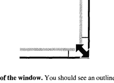

- 2. 拖动窗口角。你应该看到新窗口位置的轮廓。

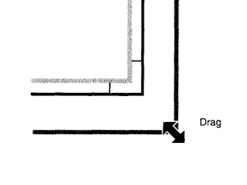

- 3. 释放鼠标按钮。

## 4.14 移动窗口

移动 xterm 窗口也非常简单：

- 1. **将指针移动到窗口标题栏。**

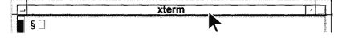

- 2. **拖动窗口到新位置。** 你应该看到新窗口位置的轮廓。
- 3. **释放鼠标按钮。**

## 4.15 最小化和恢复窗口

在 Motif 中，Minimize 意味着将窗口图标化。Close 意味着消除窗口。

在 Motif 窗口管理器下，窗口菜单上的 **Minimize** 命令将窗口转换为图标。这有时被称为“图标化”窗口。此操作不应与 Close 命令混淆，后者完全消除了窗口。（并非所有窗口管理器都符合这种用法。如果你使用不同的窗口管理器，你可能会发现 Close 命令会将窗口图标化。）

- 1. **选择一个 xterm 窗口作为活动窗口。**
- 2. **打开窗口菜单。** 记住，这是通过点击窗口边框左上角的窗口菜单按钮完成的。
- 3. **选择 Minimize 选项。** 窗口将缩小为一个图标。
- 4. **双击图标。** 这将恢复窗口到其先前的大小。

## 4.16 更改密码

回顾 2.3 节关于选择密码的内容。

一个好的密码是你容易记住但别人难以猜出的密码。通常，系统管理员分配的初始密码不符合这些标准。为了防止未授权使用你的账户，经常更改密码是个好主意。如果你还没有这样做，你应该花一分钟时间思考一个密码。

- 1. **选择一个 xterm 窗口作为活动窗口。**
- 2. **在 Shell 提示符处输入 passwd 命令。** 注意这是 *passwd*，


## 4.17 尝试一些 UNIX 命令

接下来，尝试几条 UNIX 命令以了解它们是如何工作的。

1.  **选择一个 xterm 窗口作为活动窗口。**
2.  **输入 `date` 命令。** 在提示符后输入 `date`，然后按 (RETURN) 键：
    ```
    $ date (RETURN)
    ```
    计算机将响应日期和时间。例如，如果你在 1999 年 8 月 13 日星期五晚上 8:35（美东标准时间）输入此命令，输出内容可能如下：
    ```
    Fri Aug 13 20:35:41 EST 1999
    ```

    请注意，这是宿主计算机所在区域的时间，且时间采用 24 小时制表示。

3.  接下来，尝试 `who` 命令。输入 `who`，然后按 (RETURN) 键：
    ```
    $ who (RETURN)
    ```
    计算机将响应当前登录到系统中的用户列表。例如：
    ```
    root console Aug 13 08:11
    adams tty16 Aug 13 07:01
    pgw tty03 Aug 13 18:15
    ben tty18 Aug 13 11:32
    jeff tty12 Aug 13 09:45
    ```
    用户登录名首先列出，随后是标识用户所连接线路或端口的代码。同时还会显示用户登录的日期和时间。

4.  尝试 `who am i` 命令。该命令会在屏幕上打印你的登录名：
    ```
    $ who am i (RETURN)
    ```

## 4.18 阅读你的邮件

如果你收到了电子邮件，现在就是阅读的时候了。

1.  选择一个 xterm 窗口。
2.  输入启动邮件程序的命令。该命令取决于你使用的是基于 AT&T System V 的 UNIX 系统还是 Berkeley (BSD) UNIX：
    ```
    AT&T System V:
    $ mailx (RETURN)

    BSD:
    $ Mail (RETURN)
    ```
    系统将响应一条消息列表。例如：
    ```
    U 1 warms Thu Aug 12 15:27 554/26358 "Class Roster"
    N 2 adams Fri Aug 13 8:59 40/1527 "Lunch"
    N 3 gwc Fri Aug 13 9:47 15/440 "Research Notes"
    ```
    第一列中的 U 表示上次登录遗留下来的未读消息；N 表示新消息。消息按顺序编号（本例中为 1 到 3）。显示发送者的登录名，以及接收该消息的日期、时间、消息包含的行数和字符数（行数/字符数）。最后，用引号给出消息的主题。最后一行的 & 是邮件提示符。

3.  **阅读你的消息。** 只需在邮件提示符后输入消息编号并按 ENTER 键：
    ```
    &2 ENTER
    ```
    这将显示第二条消息：
    ```
    Message 2:
    From aaadams Fri Aug 13 8:59:01 1999
    Date: Fri Aug 13 8:59:01
    From: aaadms (Abigail Adams)
    To: (Your login name)
    Subject: Lunch
    Let's get together for lunch at 12:45 today. Okay? &
    ```

4.  **退出邮件工具。** 在邮件提示符处输入 `x`（代表 "exit"）将使你退出邮件工具，消息保留在邮箱中：
    ```
    &x ENTER
    ```

电子邮件——包括发送、保存和删除邮件的方式——将在第五部分中进行更详细的讨论。

### 4.19 阅读 UNIX 手册

许多 UNIX 系统都配备了详细的在线手册，你可以使用 `man` 命令来阅读。该手册描述了系统中可用的命令。为了了解操作过程，请尝试以下命令：

```
$ man cal ENTER
```

`cal` 命令将在后续章节中使用；它在屏幕上显示日历。如果你的系统有在线手册，你应该能看到关于 `cal` 的描述。（关于如何理解手册的更多信息，请参见附录 B。）否则，你将看到消息 `man: Command not found.`。

## 4.20 注销

当你完成计算机工作时，必须“注销”。这告诉系统你已停止使用它。

> 切勿在未先注销的情况下离开终端。在某些 UNIX 系统中，即使终端已关闭，你的账户仍可能保持开放状态。这会招致不怀好意的人进入系统并造成麻烦。

不幸的是，注销流程因系统而异。（如有疑问，请咨询你的系统管理员。）

-   如果根菜单上出现 **Logout 或 Exit**，请选择此选项。你可能需要等待一分钟，但最终登录屏幕应该会显示出来。
-   如果你看到 **一个标记为 Logout 的图标，请双击该图标**。这要么注销你，要么打开另一个窗口。
-   如果你看到 **一个标记为 Logout 的窗口，请双击该窗口**。等待查看登录屏幕是否出现。

这里列出的每个命令都在 xterm 窗口中的 shell 提示符处输入。

**更改你的密码**

`passwd` (RETURN) — 更改密码

**打开一个 xterm 窗口**

`xterm &` (RETURN)

**其他 UNIX 命令**

-   `date` (RETURN) — 打印当前日期和时间
-   `who` (RETURN) — 打印当前登录用户列表
-   `who am i` (RETURN) — 打印你的登录信息
-   `man cal` (RETURN) — 显示描述 cal 命令的手册页

## 4.22 练习

1.  确保你能定义以下术语：
    -   display manager
    -   screen saver
    -   desktop
    -   root window
    -   mouse
    -   click
    -   double-click
    -   drag
    -   menu
    -   pull-down menu
    -   maximize
    -   minimize
    -   pop-up menu
    -   root window
    -   icon
    -   keyboard focus
    -   active window

2.  查看你的终端是否有一个标记为“NO SCROLL”的键。该键旨在“冻结”终端显示。按下它并输入你的名字。屏幕上发生了什么？现在再次按下该键。你看到了什么？

3.  在许多终端上，`^S` 键组合会“冻结”终端。尝试这个键组合并在键盘上输入一些内容。发生了什么？键组合 `^Q` 会“解冻”终端，反转 `^S` 的效果。请尝试一下。

4.  你的键盘上是否有标记为“CAPS LOCK”或“CASE”的键？如果有，按下它并在键盘上输入一些内容。这个键的作用是什么？

5.  UNIX 区分大小写：它区分大写字母和小写字母。尝试下列命令并注意每个命令的作用（如果有的话）：
    -   `WHO` (RETURN)
    -   `CAL 1999` (RETURN)
    -   `DATE` (RETURN)
    -   `WHO AM I` (RETURN)

6.  `xbiff` 实用程序通过蜂鸣声并抬起邮箱图标上的旗标来通知你有新邮件到达。请尝试一下。如果 `xbiff` 不可用为菜单选项，你可以通过输入以下命令来启动它：
    ```
    xbiff &
    ```

7.  使用 `xcalc` 客户端程序进行实验。如果它不可用为菜单选项，你可以使用以下命令启动 `xcalc`：
    ```
    xcalc &
    ```

8.  尝试 `xclock` 客户端程序。如果它不可用为菜单选项，你可以使用以下命令启动 `xclock`：
    ```
    xclock &
    ```

# 第二部分：UNIX 文件系统

## 5 UNIX 文件系统

UNIX *文件* 是相关信息的集合——从巧克力蛋糕食谱到计算机程序。普通的 UNIX 文件被组织成称为*目录*的特殊文件。普通文件和目录文件之间的区别很简单：普通文件存储信息；目录存储普通文件和其他目录。在本章中，你将学习 UNIX 系统如何跟踪你的文件和目录。

### 5.1 主目录和工作目录

当你第一次登录到 UNIX 账户时，你进入的是所谓的*主目录*。这是你存放任何创建的文件或目录的地方。你的主目录的名称与你的登录名相同。

登录到主目录后，你可以自由移动到系统中的其他目录。你当时所在的工作目录被称为*当前目录*或*工作目录*。首次登录时，你的工作目录就是你的主目录。

系统中的每个用户都有一个主目录。在典型的大型 UNIX 系统上，可能有数百个这些主目录，每个主目录包含数十个其他文件和目录。

### 5.2 UNIX 文件树

图 5–1 是一个典型 UNIX 系统的简化图。它看起来像一棵倒置的树，根部在顶部。实际上，最顶部的目录，即包含所有其他目录的那个，被称为*根*。其他各种目录位于根目录内部：


### 5.2 UNIX 文件树

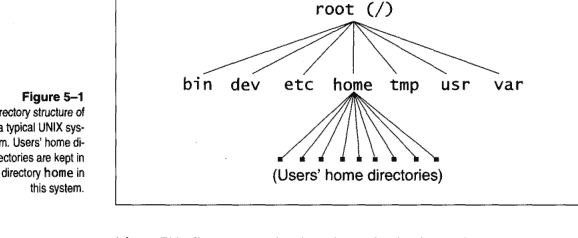

**bin** 此目录包含 Shell 软件以及最常用的 UNIX 命令。虽然 `bin` 是“二进制”（binary）的缩写，但你不妨将其视为存放实用软件工具的“箱子”（bin）。

**dev** 名称是“设备”（devices）的缩写；此目录存放操作终端和打印机等外围设备所需的软件。

**etc** 此目录存放各种管理文件，包括被授权使用系统的用户列表以及他们的密码。

**home** 用户的家目录保存在这里。在一些大型系统中，可能有几个目录用于存放用户文件。

**tmp** 临时文件通常保存在此目录中。

**usr** 某些版本的 UNIX 将用户的家目录保留在 `usr` 中；其他版本则在此保留有用的东西，如联机手册页。

**var** 包含经常变动的信息的文件保存在 `var` 目录中。一个例子是用户邮箱，通常位于 `/var/mail` 目录中。

尽管你的特定 UNIX 系统配置可能略有不同，但所有 UNIX 系统顶部都有一个根目录。

目录有时被称为另一个目录的“父”目录或“子”目录。例如，`root` 是 `bin`、`dev`、`etc`、`home`、`tmp`、`usr` 和 `var` 的父目录；反过来，这些目录又是 `root` 的子目录。（子目录通常称为*子目录*。）请注意，除 `root` 外的每个目录都恰好有一个父目录，但可能有多个子目录。

### 5.3 文件和目录名称

每个文件和目录都有一个名称。你的家目录名称与你的登录名相同，通常你不能重命名它。但是，你创建的其他任何文件和目录都必须选择名称。UNIX 文件名可由以下字符中的任意 1 到 14 个字符组合而成：

- 大写字母 (A 到 Z)
- 小写字母 (a 到 z)
- 数字 (0 到 9)
- 句号 (.)，下划线 (_)，逗号 (,)

文件名不应包含空格或以下任何特殊字符：
& * \ | [ ] { } $ < > ( ) # ? ' \", ; ^ ! ~ %

选择一个合理简短的名称是个好主意（以节省打字量），并且该名称应能传达文件内容的信息。此外，避免使用 UNIX 命令名作为文件名。

本书遵循以下约定：普通文件名用小写字母表示，而用户家目录内的目录名首字母大写。这将帮助你一眼区分目录和普通文件。

### 5.4 绝对路径名

要在当前目录中使用文件，你只需要文件的名称。然而，如果文件位于其他目录中，你需要知道文件的*路径名*。路径名是显示文件在文件系统中位置的地址。

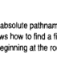

*绝对或完整*路径名给出文件相对于文件系统顶部的位置。最简单的完整路径名是根目录的，它由一个斜杠表示：

/

根的子目录的绝对路径名，如 5-1 图所示，是

/bin /dev /etc
/home /tmp /usr
/var

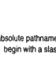

注意，每个路径名都以斜杠 ( / ) 开头，这告诉你路径从根开始。

# UNIX 文件系统

**5.4 绝对路径名**

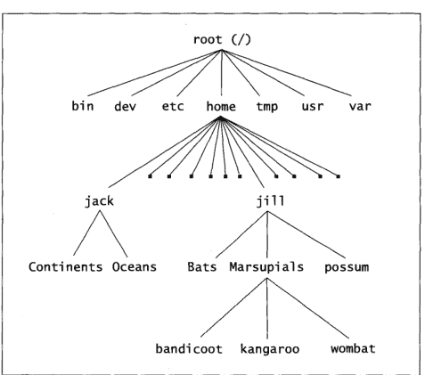

**图 5-2 jack 和 jill 的家目录。大型 UNIX 系统可能包含数百个家目录。**

图 5-2 展示了 **home** 及其包含的两个用户家目录（**jack** 和 **jill**）。你之前已经看到，**home** 的路径名是

**/home**

用户目录 **jill** 的完整路径名是

**/home/jill**

这被称为 **jill** 的路径名，因为它告诉你要遵循什么路径才能从根目录到达 **jill**。在这种情况下，路径从根目录出发，到目录 **home**，最后到 **jill**。继续深入，子目录 **Marsupials** 的绝对路径名是

**/home/jill/Marsupials**

普通文件也有绝对路径名。例如，文件 **wombat** 的路径名是

**/home/jill/Marsupials/wombat**

这意味着 wombat 可以通过从根开始，向下移动到 home 目录，然后到用户目录 jill，再到目录 Marsupials，最后到达文件 wombat 本身来找到。

你可能已经注意到，斜杠 (/) 在编写这些路径名时具有两个用途。序列中的第一个斜杠代表根；其他斜杠仅作为文件名之间的分隔符。

正如你现在可以轻松想象的那样，完整路径名可能变得很长且笨拙。有一种简写符号允许你缩写某些绝对路径名。单独一个波浪号 (>) 代表你的家目录的路径名；波浪号位于用户名之前代表该用户的家目录。因此，

- > = 你的家目录的绝对路径名
- >jack = jack 的家目录的绝对路径名

### 5.5 相对路径名

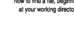

通常情况下，你感兴趣的是文件或目录相对于你当前工作目录的位置。相对路径名从工作目录开始，而不是从根目录开始。

在写出相对路径名时，单点或圆点 (.) 是你的当前工作目录的简写符号。类似地，两个点 (..) 用于表示工作目录的父目录——即目录结构中位于其上方的那个。这些通常称为点 (dot) 和双点 (dotdot)。因此

- . ("dot") = 当前工作目录
- .. ("dotdot") = 工作目录的父目录

对于当前目录中的文件，相对路径名很简单：它就是文件的名称。假设你正在图 5-2 中显示的 jack 目录中工作。jack 中两个目录的相对路径名将是

Continents Oceans

jack 的父目录是 home。因此，home 的相对路径名将是

..

假设你现在想要找到包含 home 的目录（即根目录）的相对路径名。从 jack 目录来看，这将是

../..

要从 jack 目录找到 Marsupials 目录，你首先要移动到 home（由双点表示），然后向下到 jill，最后向下到 Marsupials 本身。将所有这些放在一起，相对路径名变成

../jill/Marsupials

尽管绝对路径名总是以斜杠 (/，代表根目录) 开头，但相对路径名以点 (.)、双点 (..) 或你当前工作目录中的文件或目录名称开头。

### 5.6 列出文件

你现在知道如何书写绝对路径名和相对路径名，但你可能合理地想知道这有什么好处。为了回答这个问题，考虑路径名如何与一些 UNIX 命令一起使用。从 `ls` ("list") 命令开始。

假设 jack 在他的家目录中工作，他想提醒自己家目录中有哪些文件。他会键入命令

```
$ ls
```

响应将是

Continents Oceans

现在假设 jack 想知道 jill 的 Marsupials 目录中有什么。从他的家目录，他会使用 `ls` 命令加上 Marsupials 的路径名：

```
$ ls ../jill/Marsupials
```

计算机的回答将是

bandicoot kangaroo wombat

因此，不离家的情况下，jack 可以列出远处目录中的文件——甚至属于另一个用户的目录——只要他知道该目录的路径名。

### 5.7 隐藏文件和目录

隐藏（或不可见）文件在使用简单的 `ls` 命令时不会被列出的文件。如果文件或目录的名称以句号开头，它将被隐藏。例如，

`.hidden .jim .lost .profile .login . ..`

都将是隐藏的——它们不会被简单的 `ls` 命令列出。要列出目录中的所有文件，包括隐藏文件，需要使用 `ls -a` ("list all") 命令。假设例如 jack 在他的家目录中工作，并且他键入

```
$ ls -a
```


## 5.8 重命名和移动文件

`ls` 命令接受一个路径名；现在考虑一个使用两个路径名的命令。`mv`（“move”）命令的一般形式为

```
mv pathname1 pathname2
```

这可以解释为“将位于 pathname1 的文件移动到由 pathname2 指定的位置。” 要查看这是如何工作的，请考虑吉尔（Jill）如何使用 `mv` 来整理她的家目录。

文件名 `possum` 是错误的，因为该动物的正确名称是“opossum”（负鼠）。如果吉尔仍然在她的家目录中工作，文件 `possum` 的路径名就是该文件名。要在不改变其位置的情况下更改文件名，她只需使用新名称运行 `mv`：

```
$ mv possum opossum (Return)
```

这告诉 UNIX：“将当前目录中 possum 的内容移动到当前目录中名为 opossum 的文件。” 由于不存在现有的 `opossum` 文件，系统会创建一个新文件，而旧文件名会消失。

接下来，吉尔想起 `opossum` 是一种有袋动物，因此应该将其移动到 `Marsupials` 目录中。`mv` 命令可以做到这一点：

```
$ mv opossum Marsupials (Return)
```

这意味着“将 opossum 从当前目录移动到 Marsupials 目录。” 因此，吉尔可以使用 `mv` 命令两次，第一次用于重命名文件，第二次用于将其移动到另一个目录。最终结果如图 5-3 所示。

类似地，如果杰克（Jack）使用该命令配合吉尔的 `Marsupials` 目录的路径名，他可能会看到以下内容：

```
$ ls -a ../jill/Marsupials (Return)

. . bandicoot kangaroo wombat
```

请注意，点 (.) 和双点 (..) 都是隐藏目录的名称，并且当杰克使用 `ls -a` 命令时，两者都会显示出来。请记住，点只是当前目录的另一个名称，而双点指向当前目录的父目录。

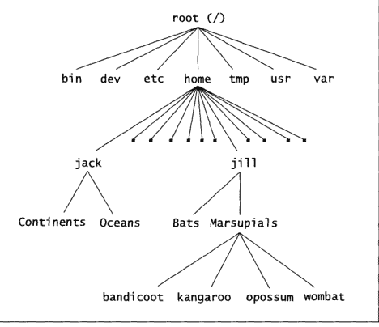

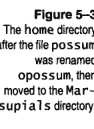

吉尔也可以使用以下命令同时移动并重命名文件：

```
$ mv possum Marsupials/opossum (Return)
```

这意味着“将 possum 的内容移动到 Marsupials 目录中名为 opossum 的文件。”

### 5.9 创建文件

创建 UNIX 文件有四种常见方法：

- 1. 复制现有文件。
- 2. 将 UNIX 实用程序的“标准输出”重定向。
- 3. 使用文本编辑器打开新文件。
- 4. 编写一个打开新文件的计算机程序。

在这些方法中，(1) 和 (2) 在本章中讨论；(3) 将在本书后文中介绍。

### 5.10 复制文件

`cp`（“copy”）命令的形式为：

```
cp pathname1 pathname2
```

这意味着“复制位于 `pathname1` 的文件，并将副本放置在由 `pathname2` 指定的位置。” 假设 *Jack* 对袋熊（wombats）产生了突发的兴趣，并请求 *Jill* 提供一份她关于该主题的文件副本。从她的家目录出发，*Jill* 使用命令：

```
$ cp Marsupials/wombat ../../jack/Continents (Return)
```

来创建 *wombat* 文件的副本并将其放入 `Continents` 目录。结果如图 5-4 所示。

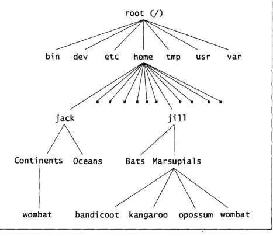

### 5.11 通过重定向创建文件

创建新文件的第二种方法是重定向命令的输出。换句话说，UNIX 不将命令的结果显示在屏幕上，而是将结果放入文件中。作为一个例子，假设吉尔移动到她的 Marsupials 目录并发出 `ls` 命令：

```
$ ls (Return)

bandicoot  kangaroo  opossum  wombat
```

现在假设她希望将此列表重定向到一个名为 `filelist` 的文件中。她使用 *输出重定向符号* `>` 来执行此操作：

```
$ ls > filelist (Return)
$
```

这次，屏幕上没有显示任何内容，因为输出被重新路由到文件中。在 UNIX 术语中，信息从 *标准输出*（终端屏幕）重定向到了文件。如果吉尔现在列出她的文件，她将看到目录中有一个名为 `filelist` 的新文件：

```
$ ls (Return)

bandicoot  filelist  kangaroo  opossum  wombat
```

重定向功能强大且方便，但也可能具有危险性。如果你将输出重定向到一个已存在的文件，该文件的原始内容将丢失。如果你想在保留原始内容的情况下向现有文件末尾添加内容，可以使用 *追加* 操作，这需要两个重定向符号（`>>`）：

```
$ ls >> filelist (Return)
$
```

### 5.12 访问权限

UNIX 操作系统旨在让用户轻松共享文件。然而，有时你并不希望他人复制、移动甚至查看你文件和目录的内容。你可以轻松控制对你家目录中文件的访问。要了解这是如何做到的，请参考附录 D，“访问权限”。

### 5.13 练习

1. 为 UNIX 文件和目录命名有哪些规则？
2. 以下哪些是普通 UNIX 文件的有效名称？请解释。
   - foo
   - guess?
   - book.chap1
   - BOOK.chap2
   - 2good2Btrue
   - {bad}
   - >right>
   - <left<
   - name
   - rank*
   - serial#
   - !up!
   - e1_paso
   - w.lafayette
   - New York
   - /slash\
   - .hideNseek
   - .357
   - 747
   - passwd
3. 以下哪些是有效的目录名称？请解释。
   - doo_wa
   - dir1
   - Dir2
   - Directory.3
   - *HooK
   - |Line|
   - "Sinker"
   - Money.$
   - Game
   - Set
   - Match
   - Sticks
   - [Groucho]
   - 'Chico'
   - Harpo.#
   - Kar!?
   - .hideNseek
   - .357
   - 747
   - passwd

练习 4 到 11 指的是前面图 5-4 中所示的假设 UNIX 文件系统。（提示：在解题过程中绘制目录结构可能会很有帮助。）这些练习应按顺序完成。

4. **root**、**bin**、**jill** 和 **kangaroo** 的绝对路径名是什么？
5. 假设 **Marsupials** 现在是你的工作目录。**root**、**bin**、**jill** 和 **kangaroo** 的相对路径名是什么？
6. **Jack** 有两个子目录，**Continents** 和 **Oceans**。（a） **Continents** 和 **Oceans** 的绝对路径名是什么？（b）从 **Oceans** 出发，**root**、**etc** 和 **bandicoot** 的相对路径名是什么？
7. 想象 **Jack** 设置了额外的子目录来保存地理信息。**Continents** 包含 **Africa**、**Arctica**、**Asia**、**Australia**、**Europe**、**Namerica** 和 **Samerica**。这些目录中的每一个都包含针对各个国家或地区的子目录。例如，**Namerica** 包含子目录 **Canada**、**CentralAm**、**Mexico** 和 **USA**。假设所有文件和目录都在其适当的位置，给出以下目录的绝对路径名：(a) **Norway**；(b) **India**；(c) **Egypt**；(d) **Argentina**。
8. 假设 Jack 的工作目录是 USA。展示他如何通过使用单个命令行且在每种情况下使用相对路径名来完成以下任务：(a) 列出属于 Jill 的 *Marsupials* 目录的内容；(b) 列出 *Australia* 的内容；(c) 复制 Jill 的文件 *kangaroo*，并在他的 *Australia* 目录下将其命名为 *kangaroo*。
9. 使用绝对路径名重复上一题。
10. 目录 *Canada* 有十二个子目录，分别对应十个省份和两个地区中的每一个。假设 Jack 的工作目录是 *Samerica*。展示他如何通过使用单个命令行且在每种情况下使用相对路径名来完成以下任务：(a) 列出 *BC* 的内容，这是 *Canada* 中不列颠哥伦比亚省（British Columbia）的目录；(b) 将 *Vancouver*（不列颠哥伦比亚省）的文件副本放在 *jill* 目录中。
11. 使用绝对路径名重复上一题。


## 6 教程：处理文件

在本章中，你将学习如何创建、查看、复制、重命名和打印文件。你的所有操作都将在主目录中进行——你将在下一章看到如何创建子目录。

### 6.1 打印日历

本章中的许多示例都使用了 UNIX 实用程序 `cal`，它可以显示公元 1 年至公元 9999 年间的任何月份或年份的日历。要了解其工作原理，请尝试以下示例：

- 1. **打印指定月份的日历。** 例如，要显示 1999 年 5 月的日历，请输入命令

```
$ cal 5 1999 (RETURN)
```

计算机将显示日历：

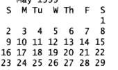

- 2. **打印整个年份的日历。** 要做到这一点，指定年份但不要指定月份：

```
$ cal 1999 (RETURN)
```

### 6.2 通过重定向创建文件

1999 年的日历应该已经显示在你的屏幕上，尽管它可能滚动得太快，你无法读完所有内容。别担心，稍后你将看到如何将此日历保存到一个文件中，以便你可以随时查看。

诸如 `cal` 命令等许多 UNIX 命令将其输出打印到标准输出，通常是计算机屏幕。但是，UNIX shell 允许你重定向这些命令之一的输出，使其发送到文件而不是屏幕。

- 1. **为文件选择一个名称。** 记得使用相对简短且描述性强的文件名。对于保存 1999 年日历的文件，合适的名称可能是 `1999`。
- 2. **输入 `cal` 命令，后跟重定向运算符（`>`）和文件名。** 要将 1999 年的日历放入文件 `1999`，请输入

```
$ cal 1999 > 1999 (RETURN)
```

这次，日历不会显示在屏幕上；相反，`cal` 的标准输出被重定向到了文件 `1999`。

- 3. **列出当前工作目录中的文件名。** 如何知道新文件是否已创建？你可以使用 `ls` 命令列出工作目录中的文件来检查：

```
$ ls (RETURN)
```

新文件的名称应该会出现：

```
1999
```

> **警告**
> 由于主目录中不存在名为 `1999` 的文件，重定向操作创建了一个。但是，如果你已经有一个名为 `1999` 的文件，新信息将替换文件中原本的内容。

### 6.3 使用 `cat` 查看文件

假设你想查看文件的*内容*，而不仅仅是它的名称。一种方法是用 `cat`（“catenate”）命令。

- **输入 `cat`，后跟文件名。** 因此，要查看 `1999` 文件，请输入

```
$ cat 1999 (RETURN)
```

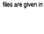


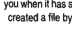

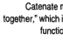

这显示了文件，但滚动速度太快，前几行无法阅读。幸运的是，UNIX 提供了一种更便捷的文件查看方式。

### 6.4 使用 more 查看

`more` 命令允许你一次一屏地显示文件。

- 1. **输入 more 命令和文件名。** 要查看文件 `1999`，请输入命令行

```
$ more 1999 (RETURN)
```

这将一次显示能够容纳在屏幕上尽可能多的文件内容。如果整个文件无法容纳，屏幕下方角落会出现一条消息，告诉你还有更多内容待查看：

```
--More--
```

- 2. **要查看更多内容，按空格键。** 这将显示下一屏。
- 3. **要在未查看完整个文件的情况下退出，输入 q 或 Q（代表 quit）。** 不需要按 (RETURN)：

```
q
```

当你看到 UNIX shell 提示符时，你就知道已经退出了 `more` 程序：

```
$
```

### 6.5 使用 pg 查看

许多 UNIX 系统提供 `pg`（“page”）命令作为 `more` 的替代方案。

- 1. **输入 pg 命令和文件名。** 要查看文件 `1999`，请输入命令行

```
$ pg 1999 (RETURN)
```

这将一次显示能够容纳在屏幕上尽可能多的文件内容。如果整个文件无法容纳，屏幕底部会出现一个冒号（`:`）指示还有更多内容待查看：

```
:
```

- 2. **要查看更多，按 (RETURN)。** 这将显示文件的下一屏。
- 3. **要在未查看完整个文件的情况下退出，输入 q 或 Q（代表 quit）。** 不需要按 (RETURN)。

```
q
```

当你看到 UNIX shell 提示符时，你就知道已经退出了 `pg` 程序：

```
$
```

### 6.6 使用 `cat` 连接文件

你之前使用 `cat` 命令来查看文件的内容。当给出单个文件名时，`cat` 仅显示该文件的内容；当一起使用两个或多个文件名时，`cat` 依次显示所有文件。这可用于合并多个文件的内容。

你的下一个任务是使用 `cat` 制作 1999 年夏季月份的日历。首先，使用 `cal` 实用程序创建三个文件：

```
$ cal 6 1999 > june99 (RETURN)
$ cal 7 1999 > july99 (RETURN)
$ cal 8 1999 > august99 (RETURN)
```

- 1. 使用 `cat` 查看文件。输入 `cat` 命令，后跟文件名：

```
$ cat june99 july99 august99 (RETURN)
```

文件的内容将依次显示，一个接一个：

```
June 1999
S M Tu W Th F S

1 2 3 4 5
6 7 8 9 10 11 12
13 14 15 16 17 18 19
20 21 22 23 24 25 26
27 28 29 30

July 1999
S M Tu W Th F S
1 2 3
4 5 6 7 8 9 10
11 12 13 14 15 16 17
18 19 20 21 22 23 24
25 26 27 28 29 30 31

August 1999
S M Tu W Th F S
1 2 3 4 5 6 7
8 9 10 11 12 13 14
15 16 17 18 19 20 21
22 23 24 25 26 27 28
29 30 31
```

- 2. **再次使用 cat，但将输出重定向到另一个文件。** 例如，要创建一个名为 *summer99* 的文件，请输入命令

```
$ cat june99 july99 august99 > summer99 (RETURN)
```

这会创建一个新的包含三个月日历的文件。注意这里需要重定向运算符。

- 3. **列出文件。** 新文件应该会出现：

```
$ ls (RETURN)
1999 july99 june99 august99 summer99
```

### 6.7 追加到文件

UNIX shell 允许你将信息添加到现有文件的末尾，此操作称为*追加*。

- **输入命令、追加运算符和文件名。** 要将 1999 年 9 月的日历追加到文件 *summer99*，请输入以下行，确保使用追加符号（`>>`）：

```
$ cal 9 1999 >> summer99 (RETURN)
```

如果你使用的是普通重定向符号（`>`），9 月的日历将替换文件中已有的 6 月、7 月和 8 月的日历。相反，9 月的日历被添加到了 *summer99* 文件的末尾。

### 6.8 使用 cp 复制文件

`cp`（“copy”）命令用于复制文件。我们将使用它来创建文件 *summer99* 的副本。

- 1. **为副本想一个名字。** UNIX 文件命名的一般规则适用。对于包含 1999 年夏季日历的文件，合适的名称可能是 *SUMM99*。
- 2. **输入 cp 命令，后跟原文件名和副本名。** 要创建 *summer99* 的副本并命名为 *SUMM99*，请输入

```
$ cp summer99 SUMM99 (RETURN)
```

在这种情况下，由于不存在名为 *SUMM99* 的文件，因此会创建一个。

- 3. **验证新文件是否出现。** UNIX 不会提醒你文件已复制，因此你必须自己使用 `ls` 命令检查：

```
$ ls (RETURN)
```

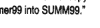

计算机将列出当前目录中的所有文件，包括新文件：

```
1999 SUMM99 august99 july99 june99 summer99
```

这个示例有一个小问题：本书的惯例是使用小写字母作为文件名，而目录名使用大写字母。（你不必这样做，但这有助于区分文件和目录。）SUMM99 是一个普通文件，而不是目录，所以在下一节中你将给它换一个不同的名字。

### 6.9 使用 mv 重命名文件

`mv`（“move”）命令用于重命名文件。（它也用于将文件移动到其它目录，如下一章所述。）

- 1. **为文件选择一个新名称。** 通常，你应该选择简短且具有描述性的名称。对于包含 1999 年夏季日历的文件，合适的名称可能是 `vacation99`。
- 2. **输入 mv 命令，后跟旧名称和新名称。** 要将 SUMM99 重命名为 vacation99，请输入命令行

```
$ mv SUMM99 vacation99 (RETURN)
```

- 3. **验证新文件名是否出现在目录中。** 由于 UNIX 不会告诉你文件已重命名，你必须自己使用 `ls` 命令检查：

```
$ ls (RETURN)
```

计算机将列出当前目录中的所有文件：

```
1999 aug99 july99 june99 summer99 vacation99
```

`cp`（复制）和 `mv`（移动）之间的区别在于，`cp` 创建一个新文件，保留旧文件不变，而 `mv` 只是重命名旧文件。

### 6.10 在默认打印机上打印

你可能经常需要文件的硬拷贝输出。你如何产生这种输出取决于你拥有的打印机数量和类型，以及你使用的 UNIX 类型。

- **输入简单的行式打印机命令，后跟文件名。** 如果你使用的是 Berkeley UNIX，输入 `lpr`（“line printer”）命令：

```
$ lpr 1999 (RETURN)
```

在 AT&T UNIX 中，输入 `lp` 命令：


### 6.11 在其他打印机上打印

如果您的计算机系统连接了多台打印机，前一小节中使用的简单行式打印机命令将把文件发送到默认打印机。您可以使用 `-P` 或 `-d` 选项来指定另一台打印机。为此，您首先需要知道您要使用的打印机的代码；请咨询您的讲师、顾问或系统管理员。

-   输入行式打印机命令，并指定打印机和要打印的文件。在 Berkeley UNIX 上，您需要输入以下命令，并确保将适当的打印机代码插入到 `code` 的位置：

    ```
    $ lpr -Pcode 1999 (RETURN)
    ```

    请注意，`-P` 之前和文件名之前有空格，但 `-P` 和打印机代码之间没有空格。

    在 AT&T UNIX 上，您需要输入以下命令，并将打印机代码插入到 `code` 的位置：

    ```
    $ lp -dcode 1999 (RETURN)
    ```

    同样地，`-d` 之前和文件名之前有空格，但 `-d` 和打印机代码之间没有空格。

### 6.12 删除不需要的文件

当文件不再有用时，您应该将其删除，以免占用宝贵的存储空间。这是通过 `rm`（“remove”，即删除）命令完成的，该命令接受要删除文件的路径名。既然您可能不需要 1999 年夏季日历的两份副本，请删除其中一份。

1.  **使用 `ls` 命令检查文件名。** 由于在许多系统中，文件一旦被删除就无法恢复，因此务必确认文件名是一个好主意：

    ```
    $ ls (RETURN)
    ```

    ```
    1999 august99 july99 june99 summer99 vacation99
    ```

2.  **输入 `rm`，后跟文件的路径名。** 要删除 `vacation99`，请输入命令行

    ```
    $ rm vacation99 (RETURN)
    ```

3.  **验证文件是否已消失。** UNIX 不会告诉您文件已被删除，因此您需要使用 `ls` 命令自行检查：

    ```
    $ ls (RETURN)
    ```

    ```
    1999 august99 july99 june99 summer99
    ```

### 6.13 命令摘要

每条命令都在 UNIX shell 提示符后输入，并以 `RETURN` 结束。请注意，`file`、`file1` 和 `file2` 可以是简单的文件名或路径名。

#### 制作日历

-   `cal m year`：显示年份 year 中第 m 个月的日历
-   `cal year`：显示年份 year 的日历
-   `cal year > file`：将年份 year 的日历重定向到文件 file
-   `cal year >> file`：将年份 year 的日历追加到文件 file

#### 列出和查看文件

-   `ls`：列出工作目录中的文件
-   `cat file`：一次性显示文件 file 的内容
-   `more file`：一次显示一屏文件 file 的内容；按空格键继续或按 q 键退出
-   `pg file`：类似于 `more`。按 `RETURN` 查看下一屏，按 q 退出

#### 打印文件

-   `lpr file`：将文件 file 发送到默认行式打印机（BSD UNIX）
-   `lp file`：将文件 file 发送到默认行式打印机（AT&T UNIX）
-   `lpr -Pcode file`：将文件 file 发送到由代码 code 指定的打印机（BSD）
-   `lp -Dcode file`：将文件 file 发送到由代码 code 指定的打印机（AT&T）

#### 复制、重命名和删除文件

-   `cp file1 file2`：将 file1 复制到 file2；保留文件的两份副本
-   `mv file1 file2`：将 file1 移动（即重命名）为 file2；仅保留 file2
-   `rm file`：删除（即移除）文件 file

### 6.14 练习

1.  选择 UNIX 文件名的规则是什么？

2.  由于需要对日历进行某些调整，1752 年 9 月是一个非常不寻常的月份。它有什么特别之处？

3.  `echo` 命令接受您输入的一行并在屏幕上将其重复显示。因此，如果您输入

    ```
    echo This is fun!(RETURN)
    ```

    计算机将响应为

    This is fun!

    将此短语重定向到名为 `fun` 的文件中。

4.  使用命令 `who`、`who am I` 和 `date`，向 `fun` 文件追加一个列表，列出当前登录计算机的用户、您的登录名以及当前日期。

5.  隐藏文件的名称以句点（.）开头。使用 `cal` 实用程序和重定向运算符（`>`）创建一个名为 `.hidden` 的文件，然后使用 `ls` 列出您的文件。您看到 `.hidden` 文件了吗？现在尝试 `ls -a` 命令。`.hidden` 出现了吗？您还看到了哪些其他隐藏文件条目？

6.  许多 UNIX 系统提供一个名为 `file` 的实用程序，它根据内容对文件进行分类。该实用程序检查文件并试图确定它可能包含什么类型的信息。`file` 使用的一些分类包括

    | ascii text | c program text | commands |
    | :--- | :--- | :--- |
    | data | directory | empty |
    | English text | executable | |

    在您的系统中的文件和目录上尝试 `file` 命令。`file` 总是能正确地对文件进行分类吗？

## 7 教程：处理目录

目录是包含其他文件和目录的文件。在本章中，您将学习如何创建目录、在目录之间移动文件、重命名文件以及删除不再需要的目录。

### 7.1 目前的目录结构

如果您仔细遵循了书中的示例并完成了所有章节末的练习，您的文件系统应与图 7-1 所示的结构相似。此时，您的主目录中没有子目录。现在，您已准备好在主目录内创建新的子目录。

图 7-1
完成前一章后的文件系统。

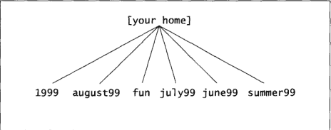

### 7.2 创建子目录

现在是时候创建一个目录来保存您在上一章中制作的日历了。为此，我们使用 `mkdir`（“make directory”，即创建目录）命令。

1.  为新目录选择一个合适的名称。目录命名的规则与文件相同。（但是，在本书中，我们将新创建的目录名称首字母大写，以便与普通文件区分开来。）对于保存日历的目录，一个描述性的名称将是 `Cal`。
2.  输入 `mkdir`，后跟新目录的名称。请记住将目录名称首字母大写：

    ```
    $ mkdir Cal (RETURN)
    ```

3.  使用 `ls` 命令查看新目录是否存在：

    ```
    $ ls (RETURN)
    ```

    新目录名称应该会出现，以及您之前创建的文件名称：

    ```
    1999 Cal august99 fun july99 june99 summer99
    ```

    （如果您一直遵循书中的示例，您的文件系统应与图 7-2 相似。）

    > 请注意，目录名称 `Cal` 与 `cal` 命令不同——记住，UNIX 区分大小写。

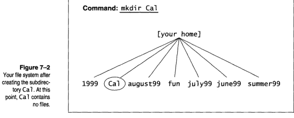

### 7.3 在目录之间移动文件

> 回想一下，您之前使用过 *mv* 来重命名文件。

当一个新子目录刚创建时，它不包含任何文件。在本节中，您将学习如何使用 *mv*（“move”，即移动）命令将文件移动到新子目录，您之前使用该命令来重命名文件。

1.  **输入 *mv* 命令、文件名称和目标目录的名称。** 要将 `1999` 放入目录 *Cal*，请输入命令行

    ```
    $ mv 1999 Cal (RETURN)
    ```

    这将把 `1999` 放入 *Cal* 中（见图 7-3）。

2.  **列出主目录中的文件。** 检查 `1999` 是否确实已移动：

    ```
    $ ls (RETURN)
    ```

    由于 `1999` 文件现在位于 *Cal* 子目录内，因此不会出现：

    ```
    Cal august99 fun july99 june99 summer99
    ```

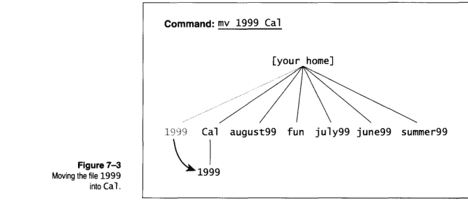

### 7.4 使用路径名创建目录

您的下一个任务是创建一个子目录在 `Cal` 内，用于保存月度日历。对于此目录，一个好的描述性名称是 `Months`。由于这是要放入 `Cal` 内的，所以相对于您的主目录，新目录的路径名将是 `Cal/Months`。

-   输入 **`mkdir` 命令，后跟*新目录的路径名*。因此，要在目录 `Cal` 内创建目录 `Months`，请输入

    ```
    $ mkdir Cal/Months (RETURN)
    ```

随着 `Months` 的创建，您的目录结构应与图 7-4 所示的相似。

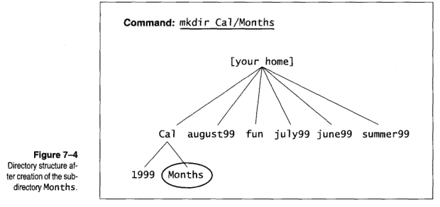


### 7.5 使用路径名移动文件

在本节中，你将使用路径名指定文件的新位置，从而将一个文件移动到 Months 目录中。

- 1. **输入 `mv` 命令、文件名以及新的路径名。** 因此，要将文件 `june99` 移动到 `Months` 中，请输入：
  ```
  $ mv june99 Cal/Months [RETURN]
  ```
  此时，你的目录结构应类似于图 7–5 所示。

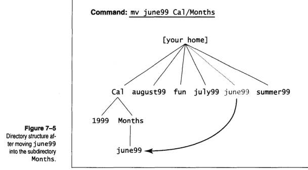

- 2. **列出当前目录中的文件。** `ls` 命令应显示 `june99` 不再位于当前目录：
  ```
  $ ls [RETURN]
  Cal august99 fun july99 summer99
  ```

### 7.6 使用路径名移动并重命名文件

在本节中，你将使用一条命令来移动并重命名文件，使用路径名同时指定文件的新位置和新名称。

- 1. **输入 `mv` 命令、文件名以及新的路径名。** 要将文件 `august99` 移动到 `Months` 中并重命名为 `aug99`，请输入：
  ```
  $ mv august99 Cal/Months/aug99 [RETURN]
  ```
  该操作的结果如图 7–6 所示。

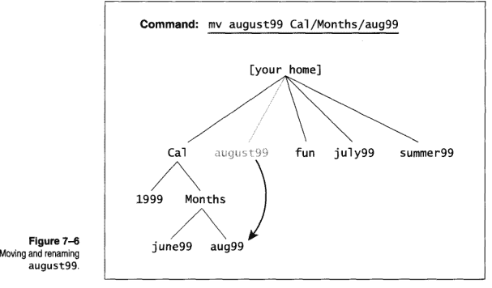

### 7.7 在远程目录中工作

正如你所见，简单的 `ls` 命令仅列出当前工作目录中的文件和目录。要列出其他目录中的文件，必须向 `ls` 提供该目录的路径名。正如你将在本节中看到的，你可以在不离开主目录的情况下处理 `Months` 目录中的文件。

- 1. **输入 `ls` 命令，后跟你要查看的目录的路径名。** 因此，要查看 `Months` 的内容，请输入：
  ```
  $ ls Cal/Months [RETURN]
  ```
  你应该看到
  ```
  aug99 june99
  ```

- 2. **输入 `cat` 命令，后跟你要查看的文件的 pathname。** 你可以使用带有适当路径名的 `cat` 命令从主目录查看文件 `aug99` 的内容：
  ```
  $ cat Cal/Months/aug99 [RETURN]
  ```
  `aug99` 的内容将显示在屏幕上：
  ```
  August 1999
  S M Tu W Th F S
  1  2  3  4  5  6  7
  8  9 10 11 12 13 14
  15 16 17 18 19 20 21
  22 23 24 25 26 27 28
  29 30 31
  ```

### 7.8 更改工作目录

你可以使用 `cd`（"change directory"，更改目录）命令配合目标目录的路径名来更改当前的工作目录。

- 1. **输入 `cd` 命令，后跟目标目录的路径名。**
  因此，要移动到子目录 `Months`，请输入：
  ```
  $ cd Cal/Months [RETURN]
  ```
  这将 `Months` 设置为你的工作目录。

### 7.9 返回主目录

要返回主目录，你*可以*使用 `cd` 配合主目录的绝对路径或相对路径。但是，有一种更简单的方法。

- 1. **不带路径名输入 `cd` 命令。** 无论你在文件结构中的哪个位置，这都将把你带回主目录：
  ```
  $ cd [RETURN]
  ```

### 7.10 打印工作目录

正如你可能想象的那样，在大型 UNIX 系统的数百个目录中很容易迷失方向。`pwd`（"print working directory"，打印工作目录）命令始终显示当前工作目录的绝对路径名。

- 1. 输入 `pwd`。这将打印出相对于根目录的位置：
  ```
  $ pwd [RETURN]
  ```

### 7.11 删除目录

不再需要的目录可以使用 `rmdir`（"remove directory"，删除目录）命令删除。除非目录先被清空（移除其中的文件和其他目录），否则无法删除它。这是一个安全功能，旨在防止你意外丢弃那些本想保留的文件。

- 1. **输入 `rmdir` 命令，后跟目录的路径名。** 要删除子目录 `Cal`，请输入：
  ```
  $ rmdir Cal [RETURN]
  ```
  如果目录包含文件，shell 将回复类似以下信息：
  ```
  rmdir: Cal: Directory not empty
  ```

- 2. **如有必要，使用 `rm` 删除目录中的任何文件。** 然后重复步骤 1。
  由于你需要 `Cal` 目录来完成练习，因此请暂时不要删除它。

### 7.12 命令摘要

每个命令都在 UNIX 提示符后输入，并以 RETURN 结束。`Dir` 和 `file` 分别代表目录和文件的路径名。

- `mkdir Dir` 创建路径名为 Dir 的目录
- `mv file Dir` 将 file 移动到目录 Dir 中
- `cd Dir` 更改到路径名为 Dir 的目录
- `cd` 更改到主目录
- `rmdir Dir` 删除（即 remove）目录 Dir
- `pwd` 打印工作目录的路径名

### 7.13 练习

- 1. UNIX 目录的命名规则是什么？
- 2. 你的主目录的绝对路径名是什么？
- 3. 创建一个新目录 `M15c`，并将文件 `fun` 移动到该新目录中。
- 4. 在不离开主目录的情况下，在 `Cal` 内部创建一个名为 `Vacations` 的目录。然后将 `summer99` 移动到这个新目录中。
- 5. 在完成上述练习 2 到 4 后，绘制你的目录结构草图。

**第三部分：UNIX SHELL**

# 8 UNIX SHELL

*Shell* 是 UNIX 命令处理器。当你输入命令并按下 **Return** 键时，是 shell 解释该命令并执行相应的操作。在本章中，你将看到 shell 是如何工作的，以及如何让 shell 更好地为你工作。

## 8.1 你的登录 Shell

大多数系统上有三种常见的 UNIX shell：Bourne Shell（缩写为 sh）、C Shell（csh）和 Korn Shell（ksh）。当你的 UNIX 账户被创建时，系统管理员为你选择了 shell。这被称为你的*登录 shell*，因为这是你每次登录时使用的 shell。

一旦你使用了系统上可用的各种 shell，你可能会决定更改你的登录 shell。在某些系统上，你可以自己使用 `csh/chsh`（"change shell"，更改 shell）命令来做到这一点；在其他系统上，必须由系统管理员为你进行更改。

## 8.2 Shell 如何处理命令

整个过程可以总结如下：

- 1. **Shell 在屏幕上显示一个提示符号。** 提示告诉你 shell 已准备好接收你的命令。
- 2. **你输入一个命令。** 当你输入时，shell 存储这些字符，并将它们回显到终端屏幕上。
- 3. **你输入 Return。** 这是让 shell 解释命令并开始处理它的信号。
- 4. **Shell 寻找合适的软件来运行你的命令。** 在大多数情况下，它寻找与命令同名的文件。如果 shell 找不到正确的软件，它会给你一个错误消息；否则，shell 请求内核运行它。
- 5. **内核运行请求的软件。** 在命令运行期间，shell“进入睡眠”状态。当内核完成时，它会“唤醒”shell。
- 6. **Shell 再次显示提示符号。** 这表明 shell 再次准备好接收你的命令。

这里是一个指出 UNIX 术语中程序（program）和进程（process）之间区别的好时机。*程序*是包含在文件中的一组编码指令。`ls` 命令就是一个程序的例子：它只是包含在文件 `*/bin/ls*` 中的一系列计算机指令。同样，你的登录 shell 也只是驻留在 `*/bin*` 目录中的另一个程序。


*进程*是你让计算机运行一个程序时得到的结果。因此，当你发出 `ls` 命令时，计算机通过运行 `*/bin/ls*` 文件中的程序创建一个 `ls` 进程。同样，当你登录时，计算机查找包含 shell 程序的文件并为你创建一个 shell 进程。

要记住的重要一点是，只有一个 `ls` 程序的副本，但可能存在许多活动的 `ls` 进程。同样地，每个 shell 程序只有一个副本，但可能存在许多活动的 shell 进程。

## 8.3 选项和参数

典型的 UNIX 命令可以接受一个或多个选项，这些选项会修改命令的行为。例如，`ls` 命令接受许多选项：

| 命令 | 效果 |
| :--- | :--- |
| ls | 列出当前目录中的文件（隐藏文件除外） |
| ls -a | 列出当前目录中的所有文件，包括隐藏文件 |
| ls -F | 标记文件：在每个目录后显示斜杠 (/)，在每个可执行文件后显示星号 (*) |
| ls -l | 打印文件的“长”列表（隐藏文件除外） |
| ls -r | 按逆序列出 |
| ls -s | 按大小列出文件 |
| ls -t | 按最后修改时间列出文件 |
| ls -u | 按最后访问时间列出文件 |


注意，每个选项前面都有一个连字符。

大多数命令允许你指定多个选项。因此，要准备一个包含目录 `Dir` 中所有文件的反向长列表，并标记目录和可执行文件，你可以输入

$ ls -a -l -r -F Dir (Return)

或者你可以组合这些选项：

$ ls -alrF Dir (Return)

顺便说一句，跟随命令名称的任何内容——包括选项和文件名——通常都被称为参数。

### 8.4 标准输入、输出和错误

每当你运行一个 UNIX 命令时，操作系统都会打开三个用于输入和输出的标准通道：

-   标准输入。标准输入（或 stdin）是程序通常查找输入的位置。
-   标准输出。标准输出（或 stdout）是程序发送其输出的位置。
-   标准错误。标准错误（或 stderr）用于程序显示错误消息。

### 8.5 重定向

大多数时候，我们将术语“标准输入”和“标准输出”分别用作键盘和终端屏幕的同义词。但是，Shell 允许你重定向标准输出，使输出进入文件而不是屏幕。例如，你已经见过如何使用输出重定向运算符 (>) 来创建一个包含日历的文件：

$ cal 1999 > calendar.file (Return)

你可以使用追加运算符 (>>) 向文件添加输出：

$ cal 2000 >> calendar.file (Return)

也可以重定向标准输入，使进程从文件而不是键盘获取输入。例如，mail 命令允许你发送和读取电子邮件。要将文件 `my.message` 的内容发送给用户 `jones`，你可以输入命令行

$ mail jones < my.message (Return)

你可以在同一命令行中组合输入和输出重定向。例如，以下命令行调用 *wc* 实用程序来统计文件 `input` 中的行数、单词数和字符数，然后将结果重定向到文件 `output`：

$ wc < input > output (Return)

### 8.6 命令分组

通常，你一次输入一个命令，每个命令后跟着一个 (Return)，这是 Shell 开始工作的信号。但是，如果你用分号分隔命令，可以在同一行放置多个命令。因此，命令行

$ who; ls; cal (Return)

与下面三个独立的命令行效果相同

$ who (Return)
$ ls (Return)
$ cal (Return)

当你希望将输出重定向到文件时，命令分组特别有用。你可以分三步为 1999 年的夏天制作日历：

$ cal 6 1999 > summer99 (Return)
$ cal 7 1999 >> summer99 (Return)
$ cal 8 1999 >> summer99 (Return)

你可以仅用一行完成相同的事情：

$ (cal 6 1999; cal 7 1999; cal 8 1999) > summer99 (Return)

注意括号；这些是确保六月、七月和八月的日历都被重定向到同一文件所必需的。假设你省略了括号，如下所示：

$ cal 6 1999; cal 7 1999; cal 8 1999 > summer99 (Return)

在这种情况下，六月和七月的日历将显示在屏幕上，只有八月的日历会被重定向到文件中。

### 8.7 管道

假设你想依次显示 1999、2000 和 2001 年的日历。你可以输入命令行

$ cal 1999; cal 2000; cal 2001 (Return)

这会在标准输出上打印日历，但它们滚动得如此快，以至于你无法阅读。解决这个问题的一个方法是将输出重定向到文件：

$ (cal 1999; cal 2000; cal 2001) > temp (Return)

现在你可以使用 `more` 或 `pg` 实用程序查看 `temp` 的内容：

$ more temp (Return)

或者

$ pg temp (Return)

这样可以工作，但这要求你创建一个临时文件，只是为了查看命令的输出。你可以使用所谓的*管道*来避免创建文件，管道将一个实用程序的输出连接到另一个实用程序的输入。垂直线 (|) 是管道符号。你将 *command1* 的输出管道传输到 *command2*，如下所示：

command1 | command2

因此，为了查看 1999、2000 和 2001 年的日历，我们可以将 `cal` 实用程序的输出通过管道传输到 `more` 或 `pg`：

$ (cal 1999; cal 2000; cal 2001) | more (Return)

或者

$ (cal 1999; cal 2000; cal 2001) | pg (Return)

注意这与使用 > 或 >> 进行重定向的区别。重定向将实用程序的输出放入文件中；而管道操作将输出定向到另一个实用程序。

### 8.8 三通 (Tees)

*tee* 允许你在将输出通过管道传输到另一个命令的同时，将命令的输出保存到文件中。我们可以将 **command1** 的输出发送到文件 **outfile** 和 **command2**，如下所示：

command1 | tee outfile | command2

因此，命令行

$ (cal 2000; cal 2001) | tee calfile | more (Return)

在通过 *more* 在终端屏幕上显示 2000 年和 2001 年日历的同时，将这些日历的副本放入文件 *calfile* 中。

### 8.9 过滤器

**过滤器**从其标准输入获取数据流，以某种方式转换数据，并将结果发送到标准输出。以下是一些在 UNIX 系统中常见的过滤器。

| 过滤器 | 功能 |
| :--- | :--- |
| cat | 连接并显示文本 |
| comm | 比较已排序的文件，选择或拒绝两个文件共有的行 |
| crypt | 编码或解码文本 |
| cut | 从输入行中剪切出选定的字段 |
| diff | 显示两个文件之间的逐行差异 |
| egrep | 使用完整正则表达式搜索文本中的模式 |
| fgrep | 搜索文本中的字符串 |
| fmt | 格式化文本 |
| grep | 在文件中搜索模式 |
| head | 显示文件的开头（头部） |
| more | 一次显示一屏文本 |
| nl | 对行进行编号 |
| paste | 合并文本行 |
| pg | 一次显示一屏文本 |
| pr | 格式化和打印文本 |
| sort | 排序和/或合并文本 |
| spell | 检查拼写错误 |
| tail | 显示文件的最后部分 |
| tr | 转换字符 |
| uniq | 显示文件中唯一的行 |
| wc | 统计文本中的行数、单词数和字符数 |

过滤器通常与管道和 tee 一起使用。考虑 **sort** 实用程序，正如你可能预期的那样，它对其输入进行排序。假设你想按登录名字母顺序列出当前登录到你自己机器上的用户。你可以通过将 **who** 的输出通过管道传输到 **sort** 来做到这一点：

$ who | sort (Return)

你还可以给 **sort** 提供一个要排序的文件名：

$ sort poems (Return)

这将按行的第一个字符字母顺序对文件 `poems` 的行进行排序。

### 8.10 通配符

输入和重新输入文件名可能会很麻烦，特别是当名称很长或数量非常多时。你可以使用通配符来缩写文件名，通配符是可以代表其他字符的字符（就像一副扑克牌中的 Joker 可以代表牌组中的其他牌一样）。通配符符号是星号 (*)、问号 (?) 和方括号 [ ]。为了了解如何使用这些符号，假设你有一个名为 `Fun` 的目录，其中包含以下文件：

-   backgammon
-   backpacking
-   baseball
-   basketball
-   biking
-   blackjack
-   boxing
-   bridge
-   camping
-   canoeing
-   checkers
-   chess
-   crossword
-   dancing
-   eating
-   fencing
-   fishing
-   football
-   golf
-   hearts
-   hiking
-   karate
-   poker
-   rugby
-   sailing
-   skiing
-   softball
-   swimming
-   team1
-   team2
-   team3
-   team4
-   teamA
-   teamB
-   teamC
-   teamD
-   teamM
-   teamW
-   teamX
-   teamY
-   teamZ
-   track
-   wrestling

星号 (*) 是迄今为止最常用的通配符。它匹配任何字符或字符串，包括空格。如你所见，目录 `Fun` 包含大量文件。使用通配符，当你只对其中少数几个感兴趣时，可以避免列出它们。例如，命令

$ ls f* (Return)

将导致 Shell 仅列出以 f 开头的文件：

fencing fishing football

命令

$ ls *ball (Return)

将导致 Shell 列出以 ball 结尾的文件：

baseball basketball football softball


你并不局限于使用单个星号。例如，命令 `$ ls *ack*` [回车] 将列出包含字母序列 *ack* 的文件名：

backgammon backpacking blackjack track

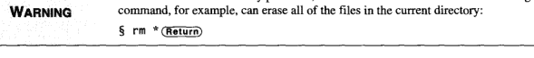

星号通配符非常强大，必须谨慎使用。例如，以下命令可能会清除当前目录中的所有文件：

```bash
$ rm *
```

- 问号匹配单个字符。

问号 (?) 通配符每次只匹配一个字符。例如，`$ ls ?iking` [回车]

biking hiking

- 方括号指定要匹配的字符。

方括号 `[ ]` 用于指示 Shell 匹配方括号内出现的任何字符。例如：

```bash
$ ls team[ABXYZ]
```

teamA teamB teamX teamY teamZ

你还可以指定字符范围，而不是列出每个字符：

```bash
$ ls team[1-4]
```

team1 team2 team3 team4

你可以组合使用通配符 `*`、`?` 和 `[ ]`。假设你想列出目录 Fun 中所有以字母 *a*、*b* 或 *c* 开头的文件。以下命令可以做到：

```bash
$ ls [abc]*
```

带括号的字母告诉 Shell 查找任何以 *a*、*b* 或 *c* 开头的文件名。星号匹配其他的任意字母序列。结果列表为：

backgammon backpacking baseball basketball biking blackjack
boxing bridge camping canoeing checkers chess crossword

同样，要列出所有文件名以 *m* 到 *z* 之间任意字母结尾的文件，可以使用以下命令：

```bash
$ ls *[m-z]
```

星号匹配任意字符序列；方括号只匹配文件名末尾出现的从 *m* 到 *z* 的字母。

backgammon checkers chess hearts

## 8.11 引号中的特殊字符

你应该记得，UNIX 文件名不应包含以下特殊字符：
& * \ % [ ] { } $ > < ( ) ? ? ' ' / ; ^ ! ~ %

到现在你应该已经清楚为什么这些字符对 Shell 有特殊含义了。但有时这可能会成为一个问题。你可能希望在日常意义上使用一个特殊字符。例如，考虑以下命令行：

```bash
$ echo What time is it?
```

Shell 会将问号解释为通配符，并尝试找到一个匹配的文件名。除非你恰好有一个以 it 开头的三字符文件名，否则 Shell 无法找到匹配项，并会报错：

```bash
$ echo: No match.
```

如果你希望 Shell 将问号作为问号处理，而不是作为特殊字符，你必须为其加上引号。一种方法是在问号前立即写一个反斜杠 (\)：

```bash
$ echo What\ time\ is\ it\?
```

> 如果没有反斜杠，? 将被视为通配符。

```bash
$ echo What\ time\ is\ it\?
```

这将产生如下输出：
`What time is it?`

请注意，输出中不包含反斜杠；它的唯一目的是取消问号的特殊含义。反斜杠仅对单个字符有效。因此，要产生如下输出：
`**** STARS ****`

你需要在每个特殊字符前放置一个反斜杠：

```bash
$ echo \*\*\*\*\ STARS \*\*\*\*
```

像这样逐个为每个特殊字符加引号可能很麻烦。作为一种替代方法，你可以使用单引号一次性对整串字符加引号：

```bash
$ echo '**** STARS ****'
```

这里使用的单引号 ('...') 不应与反引号 (`...`) 混淆。反引号也被称为 *重音符号* (grave accent marks)，用于包裹你希望 Shell 执行的命令。因此，以下命令行：

```bash
$ echo It is now `date`.
```

```bash
$ echo '**** STARS ****'
```

> 如果没有单引号，星号将被视为通配符。

```bash
$ echo It is now `date`.
```

> 反引号执行 date 命令。

将产生类似这样的输出：

```
It is now Fri Aug 13 16:04:41 EST 1999.
```

其中 Shell 执行了 date 实用程序并将结果包含在 echo 的输出中。相比之下，如果你省略了反引号，会发生什么：

```bash
$ echo It is now date. (Return)
It is now date.
```

双引号比单引号功能弱。

双引号 ("...") 类似于单引号，但功能较弱。在字符串周围加上双引号会取消除了美元符号 ($)、反引号 (`...`) 或反斜杠 (\\) 之外任何字符的特殊含义。

引号引用特殊字符的不同方式总结如下，其中 string 代表一串字符：

| 引号 | 效果 |
| :--- | :--- |
| \\ | 取消下一个字符的特殊含义 |
| `'string'` | 取消 `string` 中任何字符的特殊含义 |
| `"string"` | 取消除 $, '`', 和 \\ 之外任何字符的特殊含义 |
| `` `string` `` | 执行 `string` 中的任何命令；输出替换 `` `string` `` |

## 8.12 后台处理

可以无人值守运行的进程通常被放在后台。

正如我们之前所说，UNIX 是一个多任务操作系统，这意味着它可以同时为你运行多个程序。你可以启动一个命令并将其放入“后台”，使其在你前台处理另一个命令时继续运行。

运行后台进程很简单：在按下（回车）之前，在命令行末尾输入一个 & 符号（&）。假设有一个耗时长运行程序叫做 longrun。你可以用以下命令在后台运行该程序：

```bash
$ longrun & (Return)
```

如果你正在运行 Bourne Shell，你将会看到类似以下内容：

```
3216
$
```

如果你正在运行 C Shell 或 Korn Shell，你将会看到类似以下内容：

```
[1]       3216
$
```

3216 是进程标识号 (PID)。[1] 是作业号；3216 是 PID。

无论你使用哪种 Shell，它都会为每个在后台运行的进程分配一个进程标识号或 PID。C Shell 和 Korn Shell 还会分配一个作业号，即方括号中的数字。然后提示符会告诉你，即使 longrun 尚未完成，Shell 已准备好处理另一条命令行：

如果你想在中途终止一个后台作业，PID 就很重要了。这是通过 kill 命令完成的。例如，要杀死后台进程号 3216，你会使用以下命令：

```bash
$ kill 3216 (Return)
```

顺便说一下，某些难以终止的进程需要更强的手段。使用带有 -9 选项的 kill 通常可以处理它们：

```bash
$ kill -9 3216 (Return)
```

## 8.13 作业控制

所有三种常见的 Shell 都允许你使用 & 符号（&）在后台运行进程，并使用 kill 命令消除它们。此外，C Shell 和 Korn Shell 拥有一种称为作业控制的功能，它允许你暂时停止进程，将后台进程移至前台，并将前台进程移至后台。

## 8.14 练习

- 1. 确保你能定义以下每个术语：
  - shell program process
  - option argument standard input
  - standard output grave accent redirection
  - pipe tee filter
  - metacharacter wildcard quote
  - background process foreground process process id number
  - PID job number job control

- 2. 以下每个命令会做什么？
  - `echo *`
  - `echo /*`
  - `echo \*`
  - `echo "a*"`
  - `echo */`
  - `rm *` [小心--不要尝试这个!]

对于练习 3-6，假设你的工作目录包含以下文件：

- backgammon  backpacking  baseball   basketball
- biking       blackjack    boxing     bridge
- camping      canoeing     checkers   chess
- crossword    dancing      eating     fencing
- fishing      football     golf       hearts
- hiking       karate       poker      rugby
- sailing      skiing       softball   swimming
- team1        team2        team3      team4
- teamA        teamB        teamC      teamD
- teamM        teamW        teamX      teamY
- teamZ        track        wrestling

- 3. 你如何使用 `cat` 显示以 `ing` 结尾的文件内容？

- 4. 你如何列出包含 `x` 或 `X` 的文件（在这种情况下，是 **boxing** 和 **teamX**）？

- 5. 你如何显示文件名中包含 `o` 的文件内容？

- 6. 你如何仅使用一条命令显示文件 **backgammon**、**backpacking** 和 **blackjack** 的内容？


## 9 教程：使用 Shell

在本章中，你将获得使用 shell 作为命令解释器的经验。你将练习命令分组；使用通配符、过滤器、管道（pipes）和分流器（tees）；以及后台运行命令。

### 9.1 命令分组

首先，你应该尝试在同一个命令行上分组几个命令，使用分号作为命令之间的分隔符。然后重复此操作，但将输出重定向到一个文件：

- 1. **在一行中输入命令，用分号分隔。** 你可以使用以下命令行打印你的工作目录、当前月份的日历以及当前日期和时间：
```
$ pwd; cal 5 1999; date Return
```

- 2. **再次运行相同的命令，但将输出重定向到一个文件。** 务必在命令外加括号：
```
$ (pwd; cal 5 1999; date) > out1.tmp Return
$ 
```

由于输出被重定向到了 out1.tmp 而不是标准输出，因此屏幕上除了提示符外没有任何显示。

- 3. **使用 cat 命令检查文件内容。**
```
$ cat out1.tmp Return
```

你应该看到类似以下内容：

> 如果没有括号，只有 date 的输出会进入该文件。

```
/home/yourlogin
      May  1999
S M Tu W Th F S
           1
2  3  4  5  6  7  8
9 10 11 12 13 14 15
16 17 18 19 20 21 22
23 24 25 26 27 28 29
30 31
Thu May 6  13:21:46  EST  1999
```

### 9.2 使用 cat 创建文件

`cat` 命令是 UNIX 实用程序中**最**简单——也最有用——的一个。你之前已经使用过 `cat` 来查看和合并（"concatenate"）文件。正如你将在本节中看到的那样，`cat` 也可以作为文本编辑器的“快速而简陋”的替代品。

- 1. 在*没有*输入文件的情况下调用 `cat`，*将输出重定向到你想要创建的文件*。如果 `cat` 没有给出要读取的输入文件，它将从标准输入读取。因此，要创建一个名为 `out2.tmp` 的文件，请输入：

```
$ cat > out2.tmp
```

此时，你应该看到屏幕上没有任何反应，因为 `cat` 正在等待你输入文本。

- 2. *输入你想放入文件的文本*。例如：

```
My Bonnie looked into the gas tank.
The contents she wanted to see.
I lit a match to assist her:
Oh, bring back my Bonnie to me!
```

- 3. *生成文件结束（EOF）信号*。通过输入以下内容完成：

```
Control - D
$
```

提示符告诉你 `cat` 已经完成，你回到了 shell。

- 4. *检查文件*。`cat` 命令将显示文本已存储在文件中：

```
$ cat out2.tmp
```

你应该看到类似以下内容：

> `cat` 在标准输出上打印任何作为参数指定的文件的内容。


My Bonnie looked into the gas tank,  
The contents she wanted to see.  
I lit a match to assist her:  
Oh, bring back my Bonnie to me!

你还可以通过输入连字符（`-`）而不是文件名，显式表示你要**cat** 读取标准输入。试一试：

- 1. **用连字符代替输入文件调用 cat，并将输出重定向到你想要创建的文件。** 因此，要创建一个名为 `out3.tmp` 的文件，请输入：

```
$ cat - > out3.tmp
```

连字符告诉 cat 从标准输入读取。

此时，你应该看到屏幕上没有任何反应，因为**cat** 正在等待你输入文本。

- 2. **输入你想放入文件的文本。** 例如：


There once was a fellow named Frank,  
Who drove around town in a tank.  
It was noisy and dark,  
And quite hard to park,  
But it got him good rates at the bank.

- 3. **生成文件结束（EOF）信号。** 通过输入以下内容完成：

```
Control - D
```

- 4. **检查文件。** **cat** 命令将显示文本已存储在文件中：

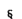

```
$ cat out3.tmp
```

你应该看到类似以下内容：


There once was a fellow named Frank,  
who drove around town in a tank.  
It was noisy and dark,  
and quite hard to park.  
But it got him good rates at the bank.

保留 `out1.tmp`、`out2.tmp` 和 `out3.tmp`——你将在本章后面用到它们。

**cat** 实用程序不是文本编辑器的替代品——**cat** 不允许你修改或删除文件中的文本——但它在创建短文本文件时可能很有用。

### 9.3 使用通配符

如果你仔细完成了前面的章节，你的目录中现在应该有 3 个新文件，命名为 `out1.tmp`、`out2.tmp` 和 `out3.tmp`。

- 使用**cat** 命令和星号通配符 (*) 检查文件。因此，要查看以 *out* 开头的文件，请输入：
```
$ cat out*
```

- 要查看所有以 .tmp 结尾的文件，请输入以下命令行：
```
$ cat *.tmp
```

- 使用**cat** 命令和问号 (?) 检查文件。回想一下，问号匹配单个字符。因此，要查看 out1.tmp、out2.tmp 和 out3.tmp 文件，请输入：
```
$ cat out?.tmp
```

- 文件名 out1.tmp、out2.tmp 和 out3.tmp 仅有一个字符不同——第四个位置的数字——而问号可以代表任何数字。

- 使用**cat** 命令和方括号检查文件。方括号可用于表示字母或数字的范围。要查看 out1.tmp、out2.tmp 和 out3.tmp 文件，请输入：
```
$ cat out[1-3].tmp
```

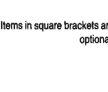

### 9.4 使用 wc

*wc*（“word count”）过滤器计算文件或文件集中的行数、单词数和字符数。它的通用形式如下：
```
wc [-lcw] filelist
```
其中 *filelist* 是一个或多个文件路径名的列表。你可以应用选项，使 wc 仅打印行数 (-l)、单词数 (-w) 或字符数 (-c)。*wc* 命令非常容易使用：

- 输入**wc** 命令和**文件名**。在 out2.tmp 文件上试一试：
```
$ wc out2.tmp
```

- 这将产生以下输出：
```
4 27 133 out2.tmp
```
表明 out2.tmp 文件中有 4 行、27 个单词和 133 个字符。（对于 wc 来说，“单词” simply 是由空格、制表符或换行符跟随的任何字符组。）

- 对**多个文件**运行**wc** 命令。试试这个命令行：
```
$ wc out[2-3].tmp
```

这在 `out2.tmp` 和 `out3.tmp` 上运行 `wc`，产生以下输出：
```
4  27   133  out2.tmp
5  33   160  out3.tmp
9  60   293  total
```
注意 `wc` 分别显示了每个文件的行、单词和字符计数，以及两个文件的总和。

### 9.5 使用 grep

`grep` 过滤器逐行搜索其标准输入中的字符模式。任何包含所需模式的行都会打印到标准输出。`grep` 的格式为：
```
grep [-cinv] pattern [filelist]
```

模式可以是一个简单的单词或字符串，也可以是一个正则表达式。正则表达式是一种紧凑的表示法，用于指定一般的字符串，这与通配符表示一组文件名的方式非常相似。我们不会在这本书中使用正则表达式。

- **在一组文件中搜索特定的单词。** 因此，要在文件 `out1.tmp`、`out2.tmp` 和 `out3.tmp` 中搜索包含单词 `tank` 的行，你可以使用以下命令：
```
$ grep tank *.tmp
```
包含模式 `tank` 的任何行都会列在屏幕上：
```
out2.tmp:My Bonnie looked into the gas tank,
out3.tmp:who drove around town in a tank.
```

- **使用行号选项进行搜索。** `-n` 选项使 `grep` 打印包含模式的行的行号：
```
$ grep -n tank *.tmp
```
单词 `tank` 出现在 `out2.tmp` 的第一行和 `out3.tmp` 的第二行。因此，grep 打印：
```
out2.tmp:1:My Bonnie looked into the gas tank,
out3.tmp:2:who drove around town in a tank.
```

- **使用仅列出选项进行搜索。** 这使得 `grep` 仅列出包含模式的文件名称。例如：
```
$ grep -l Bonnie *.tmp
out2.tmp
```


### 9.6 使用 sort

### 反转测试的逻辑

`-v` 选项会使 grep 列出不*包含*模式的行。例如，

```bash
$ grep -v dark out3.tmp<Return>
```

There once was a fellow named Frank,
who drove around town in a tank.
and quite hard to park.
But it got him good rates at the bank.

### 基本用法

正如你所预期的，sort 对文件或文件集合中的行进行排序。它还可以在不排序的情况下合并两个或更多文件。sort 命令的一般格式为：

```bash
sort [-bcdfimMnortuyz] [±field] [filelist]
```

如你所见，sort 接受相当数量的选项，但本节只会讨论其中少数几个。*字段*是由空白符界定的一段字符序列。（例如，文本行中的各个单词可以被视为字段。）排序通常根据每行的第一个字段进行，但你可以指定检查其他字段。

### 对文件的第一个字段执行简单排序

以下命令行将列出 out1.tmp、out2.tmp 和 out3.tmp 的内容：

```bash
$ sort *.tmp<Return>
          1
May 1999
Oh, bring back my Bonnie to me!
The contents she wanted to see.
and quite hard to park.
who drove around town in a tank.
2   3   4   5   6   7   8
9 10 11 12 13 14 15
S  M Tu  W Th  F  S
/home/yourlogin
16 17 18 19 20 21 22
23 24 25 26 27 28 29
30 31
But it got him good rates at the bank.
I lit a match to assist her:
It was noisy and dark,
My Bonnie looked into the gas tank,
There once was a fellow named Frank,
Thu  May  6  13:12:46 EST  1999
```

排序顺序也称为*排序序列*。在你理解 **sort** 实用程序所采用的排序顺序之前，这可能会显得有些奇怪。这因系统而异，但以下是一个典型的顺序：

1. 控制字符
2. 空白字符（即空格和制表符）
3. 数字
4. 大写字母
5. 小写字母

你可以应用各种选项来修改排序顺序。以下是一些可能性：

- **sort -b**：忽略前导空格
- **sort -f**：将大写字母和小写字母折叠在一起（忽略大小写）
- **sort -n**：数字排序
- **sort -r**：反转常规顺序（例如，Z 在 a 之前）

### 按第一个字段排序，忽略前导空格和大小写

指定字段偏移量 `+0` 将使 sort 检查每行的第一个字段：

```bash
$ sort -bf +0 *.tmp<Return>
/home/yourlogin
1
16 17 18 19 20 21 22
2 3 4 5 6 7 8
23 24 25 26 27 28 29
30 31
9 10 11 12 13 14 15
and quite hard to park.
But it got him good rates at the bank.
I lit a match to assist her:
It was noisy and dark,
May 1999
My Bonnie looked into the gas tank,
Oh, bring back my Bonnie to me!
S M Tu W Th F S
The contents she wanted to see.
There once was a fellow named Frank,
Thu May 6 13:21:46 EST 1999
who drove around town in a tank.
```

### 按文件的第二个字段排序

指定字段偏移量 `+1` 将使 sort 跳过每行的第一个字段并检查第二个字段。请在 out3.tmp 文件上尝试此操作：

```bash
$ sort -bf +1 out3.tmp<Return>
    who drove around town in a tank.
    But it got him good rates at the bank.
    There once was a fellow named Frank,
      and quite hard to park.
    It was noisy and dark.
```

sort 实用程序的功能远不止我们在此能详细说明的范围。如果你想知道更多，请查阅 UNIX 手册。

### 9.7 管道与分流器（PIPES AND TEES）

管道将一个实用程序的标准输出连接到另一个实用程序的标准输入。分流器（tee）允许你获取命令的输出，并将其同时定向到一个文件和另一个命令。在本节中，你将练习使用管道和分流器。

- **每页查看 2000 年和 2001 年的日历。** 以下命令行之一可以做到：

```bash
$ (cal 1999; cal 2000; cal 2001) | more<Return>
```

或者：

```bash
$ (cal 1999; cal 2000; cal 2001) | pg<Return>
```

- **查看 2000 年和 2001 年的日历，并创建一个包含这些日历的文件。** 这需要用到一个 tee 和两个管道：

```bash
$ (cal 2000; cal 2001) | tee calfile | more<Return>
```

- **每页列出根目录子目录中的文件。** 以下命令之一均可将 ls 的输出通过管道传递给 more 或 pg 实用程序：

```bash
$ ls -a /* | more<Return>
```

或者：

```bash
$ ls -a /* | pg<Return>
```

- **列出根目录子目录中的文件，并创建一个包含此列表的文件。** 这可以使用两个管道和一个 tee 来完成：

```bash
$ ls -a /* | tee root.list | more<Return>
```

这将根目录及其子目录的列表放入文件 `root.list` 中，同时该列表也会显示在终端屏幕上。

- **统计根目录子目录中的文件数量。** 这可以通过以下命令行完成：

```bash
$ ls -a /* | wc -l <Return>
```

- **按大小对根目录子目录的长列表进行打印。** 长文件列表中的第五个字段通常显示文件大小。要按第五个字段排序，请跳过前四个字段（+4）：

```bash
$ ls -al /* | sort -nr +4 | more<Return>
```

- **准备根目录子目录的长列表；按大小排序；并将其发送到标准输出和一个文件中。** 长文件列表中的第五个字段通常显示文件大小。要按第五个字段排序，请跳过前四个字段（+4）：

```bash
$ ls -al /* | sort -nr +4 | tee list.by.size | more<Return>
```

- **在根目录的子目录中查找一个文件。** 因此，要查找文件 passwd，请输入命令行：

```bash
$ ls -a /* | grep passwd<Return>
```

### 9.8 睡眠

sleep 不是一个过滤器。

sleep 命令创建一个进程，该进程“睡眠”指定的时间段。换句话说，sleep 在返回到 shell 之前等待指定的秒数。其一般格式为：

```bash
sleep n
```

其中 `n` 是一个非负整数，表示进程要睡眠的秒数。

- **运行 sleep 命令。** 要睡眠 15 秒，请输入：

```bash
$ sleep 15<Return>
```

- **使用 sleep 延迟另一个命令的执行。** 这是 sleep 实用程序的一个常见应用。例如：

```bash
$ (sleep 60; echo I am awake now)<Return>
```

- **等待进程结束。** 当 sleep 结束时，echo 将打印一条消息：

I am awake now

### 9.9 中断前台进程

如果你以通常的方式（即在前台）启动一个长时间运行的进程，如 `sleep`，那么在该进程结束之前，你无法处理任何其他命令。如果由于某种原因你不想等待那么久，你必须中断该进程。这是通过 **Ctrl**-**C** 键组合完成的。

1. **启动进程。** 例如：
   ```bash
   $ (sleep 120; echo I am awake now) [Return]
   ```
2. **中断进程。** 输入：
   ```bash
   [Control] - C
   ```
   这将中断 `sleep` 并调用 `echo` 命令：
   ```bash
   ^C I am awake now
   $
   ```

### 9.10 运行后台进程

正如我们之前所说，UNIX 允许你“后台”运行一个进程，同时你在前台处理另一个任务。这对于长时间运行的进程非常有用，尤其是那些不需要你注意的进程。作为此类长时间运行进程的一个例子，我们将再次使用 `sleep` 命令。

1. **在后台启动一个长时间运行的进程。** 例如：
   ```bash
   $ (sleep 60; echo I am awake now)& [Return]
   ```
   如果你正在运行 Bourne shell，你应该会看到类似以下内容：
   ```bash
   3271
   ```
   在这个例子中，shell 分配了一个进程标识符（PID）号 3271。（你系统上的实际 PID 可能不同。）

   如果你正在运行 C Shell 或 Korn Shell，你应该会看到类似以下内容：
   ```bash
   [1]     3271
   ```
   在这里，[1] 是作业号，3271 是 PID。

   shell 将显示一个提示符，让你知道它已准备好接受更多命令：
   ```bash
   $
   ```

2. **检查进程状态。** 输入 `ps`（“process status”，进程状态）命令以查看正在发生的事情：
   ```bash
   $ ps [Return]
   ```


你可能会看到类似以下内容（PID 会不同）：

```
PID TTY TIME COMMAND
1140 p0 0:01 sh
3271 p0 0:00 sleep 60
3290 p0 0:00 ps
$
```

注意这里有三个进程：shell（本例中为 sh）；sleep；以及 ps 命令本身。

- **3 等待进程结束。** 大约 60 秒后，你应该会得到如下消息：

```
I am awake now
$
```

### 9.11 终止后台进程

有时需要终止后台进程。这是通过 kill 命令完成的。要了解其工作原理，请尝试之前部分中使用的同一后台进程。

- **1 启动后台进程。** 请务必记下 PID：

```
$ (sleep 60; echo Stop this command) & Return
3310
$
```

- **2 终止进程。** 输入 kill、一个空格和 PID 号：

```
$ kill 3310 Return
```

某些系统会在后台作业被终止时通知你：

```
Terminated (sleep 60; echo Stop this command)
$
```

### 9.12 使用作业控制（C Shell 和 Korn Shell）

C Shell 和 Korn Shell 的**作业控制**功能在处理后台进程时提供了额外的灵活性。在本节中，你将了解如何使用作业控制来挂起作业、将其移至后台，并在必要时终止它。

- **1 在前台启动进程。** 为了练习，像之前一样使用 sleep 工具：

Bourne shell 没有作业控制。

```
$ (sleep 120; echo I am awake now)  Return
```

- **2 停止（挂起）作业。** 这通过按键组合 **(Control)-②** 完成。

Shell 会告知你作业已停止：

```
^Z
Stopped (user)
```

- **3 检查作业状态。** 输入 jobs 命令：

```
$ jobs  Return
```

这会将每个作业及其状态按作业编号列出。在这种情况下，只有一个作业：

```
[1]  +  Stopped (user)  ( sleep 120; echo I am awake now )
```

- **4 将停止的作业移至后台。** 使用 bg（“background”）命令和作业编号。注意作业编号前的百分号（%）：

```
$ bg %1  Return
```

Shell 会指示该进程现在正在后台运行（注意 &）：

```
[1]  ( sleep 120; echo I am awake now ) &
```

- **5 终止作业或允许其完成。** 要终止编号为 1 的作业，请输入：

```
$ kill %1  Return
```

Shell 将显示一个提示符：

```
$
```

- **6 检查作业状态。** 如果你终止了作业，jobs 命令将显示其已被终止：

```
$ jobs  Return
[1]  Terminated  ( sleep 120; echo I am awake now )
$
```

## 9.13 命令摘要

| 命令 | 描述 |
| :--- | :--- |
| **统计行数、字数和字符数** | |
| `wc file(s)` | 统计文件中的行数、字数和字符数 |
| `wc -l file(s)` | 统计文件中的行数 |
| **搜索** | |
| `grep pattern file(s)` | 打印文件中包含 pattern 的行 |
| `grep -n pattern files(s)` | 同上，但同时也打印行号 |
| `grep -l pattern files(s)` | 打印包含 pattern 的文件名 |
| `grep -v pattern file(s)` | 打印文件中不包含 pattern 的行 |
| **排序** | |
| `sort file(s)` | 按照常规排序顺序对文件进行排序 |
| `sort -b file(s)` | 排序时忽略前导空格 |
| `sort -f file(s)` | 排序时将小写转换为大写（不区分大小写排序） |
| `sort -n file(s)` | 按数值排序 |
| `sort -r file(s)` | 反向排序（9 在 0 之前，Z 在 A 之前，等等） |
| `sort +n file(s)` | 对第 n+1 个字段排序（跳过前 n 个字段） |
| **休眠** | |
| `sleep n` | 休眠 n 秒 |
| **前台和后台处理** | |
| `^C` | 中断（终止）前台进程 |
| `^D` | 生成文件结束信号 |
| `^Z` | 停止（挂起）前台进程 |
| `command &` | 在后台运行命令 |
| `ps` | 获取进程状态 |
| `kill n` | 终止后台进程 n |
| **作业控制** | |
| `bg %n` | 将作业 n 移至后台 |
| `fg %n` | 将作业 n 移至前台 |
| `jobs` | 列出所有作业的状态 |
| `kill %n` | 终止作业 n |

## 9.14 练习

- sleep 命令计时有多准确？尝试以下命令来找出答案：
    ```
    (date; sleep 60; date)
    ```

- 参考 cat 的 man 条目，确定以下每个命令应该执行什么操作：
    - `cat -e file`
    - `cat -s file`
    - `cat -t file`
    - `cat -u file`
    - `cat -v file`
    - `cat -vet file`

- 参考 grep 的 man 条目，确定以下每个命令应该执行什么操作：
    - `grep -c pattern file`
    - `grep -i pattern file`
    - `grep -l pattern file`
    - `grep -n pattern file`
    - `grep -v pattern file`

- 参考 sort 的 man 条目，确定以下每个命令应该执行什么操作：
    - `sort -d`
    - `sort -m`
    - `sort -M`
    - `sort -n`
    - `sort -o`
    - `sort -r`
    - `sort -t`
    - `sort -u`
    - `sort -y`
    - `sort -z`
    - `sort -nr`

- -R（“recursive”）选项使 ls 不仅列出指定目录中的文件，还列出任何子目录中的文件。你如何使用此选项与适当的管道和过滤器组合，来确定某个文件是否存在于你的账户中？

# 第四部分：VI 编辑器

## 10 VI 编辑器

文本编辑器是你可用于创建和修改文件的程序。UNIX 系统通常提供多种文本编辑器的选择，其中 vi 编辑器最为常见。在本章中，你将了解一般的 UNIX 文本编辑器，特别是 vi。

### 10.1 文本编辑器与文字处理软件

在学习文本编辑器是什么之前，你应该理解它不是什么。文本编辑器不是文字处理软件。诚然，文本编辑器和文字处理软件都用于创建和编辑文本文件，但相似之处仅此而已。

文字处理软件通常比文本编辑器功能更多。除了向文件添加文本外，大多数文字处理程序允许你控制文本的外观——页面布局、段落样式、字体等——当它被打印时。使用某些文字处理程序，你可以创建表格和数学公式，并插入图形。

相比之下，文本编辑器仅仅做那一件事：编辑文本。大多数文本编辑器具有有限的文本格式化能力。一般来说，文本编辑器并不是为了打印格式化文本而设计的。

### 10.2 UNIX 文本编辑器

大多数 UNIX 系统上有许多不同的文本编辑器可用：

- **vi**（发音为“vee-eye”）——这个编辑器由加州大学伯克利分校的研究生 Bill Joy 编写（他后来成为 Sun Microsystems 的联合创始人之一）。虽然最初仅在 Berkeley UNIX 上找到，但 vi 现在是大多数 UNIX 系统上的标准编辑器。

- **emacs**。最初由 MIT 的 Richard Stallman 编写，**emacs** 是一个功能强大、特性丰富的编辑器，以其灵活性而闻名：**emacs** 可以个性化以符合用户的个人品味。在窗口系统在 UNIX 上变得普及之前，**emacs** 的某些版本就支持窗口功能。

- **pico**。许多人认为 **pico** 是广泛可用的 UNIX 编辑器中最容易使用的。其菜单结构使其对初学者特别友好。

- **xedit**。这个 X 客户端是一个简单的基于窗口的文本编辑器。它在大多数运行 X 的系统上可用。

由于 *vi* 很可能存在于几乎所有 UNIX 系统上，因此它是本书重点介绍的编辑器。

### 10.3 文本编辑器的工作原理

无论您选择哪种文本编辑器，编辑文本文件的过程可以概括如下：

- 1. 你启动编辑器并提供要编辑的文件名。
- 2. 如果你指定了一个现有文件，编辑器会为其创建一个副本，并将该副本放在称为工作缓冲区（work buffer）的临时工作空间中。如果你在创建新文件，编辑器只是打开一个空的工作缓冲区。
- 3. 你使用编辑器命令添加、删除和/或更改工作缓冲区中的文本。当你对所做的更改满意时，你告诉编辑器“写入文件”。
- 4. 编辑器将工作缓冲区的内容保存到文件中。如果你正在编辑现有文件，编辑器会用缓冲区中的更新版本替换原始文件。

注意，你不是直接在文件上工作，而是在缓冲区中的副本上工作。这意味着如果你在不将更改写入文件的情况下离开编辑器，这些更改将丢失，且原始文件不会被修改。

### 10.4 行编辑器和屏幕编辑器

所有编辑器做的事情大致相同，但有些明显比其他更容易使用。最初的 UNIX 编辑器 *ed* 被称为*行编辑器*，因为它在缓冲区中逐行进行更改。使用行编辑器进行更改时，你必须首先指定要进行更改的行，然后指定


### 10.5 vi 模式

……改变自身。即使是微小的改动，这也可能需要大量的工作。此外，由于你一次只处理一行或几行，要记住这些改动如何融入整体文本可能非常困难。


另一方面，*全屏编辑器*允许你查看并操作工作缓冲区中所能容纳在屏幕上的任意部分。你可以轻松地在屏幕上移动光标，对字符、单词、段落以及行进行修改。你所做的任何修改都清晰可见，因为屏幕会立即更新。而且，由于你可以同时查看许多行，因此可以清楚地看到这些修改如何影响文本的其他部分。*vi* 编辑器是一种最初为伯克利 UNIX 编写的屏幕编辑器，但如今几乎在所有 UNIX 系统中都可以找到。

要使用 vi，你必须了解其操作模式（图 10-1）。当你最初进入 *vi* 编辑器时，它被设置为*命令模式*。这意味着 *vi* 会将所有按键视为*编辑命令*，而不是要输入到文件中的文本。在*命令模式*下，按下 **<Return>（回车键）**、**<Backspace>（退格键）** 或空格键只会移动光标，而不会向文本中引入新行或空格。

要向文件中添加文本，你必须切换到*插入模式*，你可以使用以下任何命令来实现：

- *i*    在当前光标位置的左侧插入文本
- *I*    在当前行的左侧插入文本
- *a*    在光标右侧追加文本
- *A*    在当前行的末尾追加文本
- *R*    替换（覆盖输入）现有文本
- *o*    在当前行下方打开新行并将光标移动至该处
- *O*    在当前行上方打开新行并将光标移动至该处

这些*插入模式*命令中的任何一个都不会显示在屏幕上，但之后输入的内容都会显示。按下 **<Esc>** 键会使 vi 返回到*命令模式*。

通常，在向文件中添加文本时使用*插入模式*，而在其他所有情况下（在文件中移动、删除文本等）使用*命令模式*。

初学者使用 vi 时最常见的困难之一是记不住当前处于哪种模式。如有疑问，请按几次 **<Esc>** 键以返回到*命令模式*。（如果终端发出蜂鸣声或屏幕闪烁当你按下 **<Esc>** 时，这是一个信号，表明你正处于*命令模式*。）

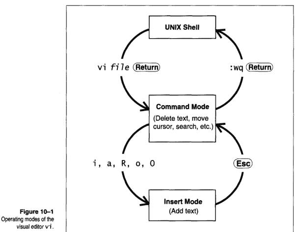

### 10.6 缓冲区与更多缓冲区

回想一下，vi 实际上是在文件的工作缓冲区副本上工作的。在使用 vi 时，你还可以访问其他缓冲区。共有 36 个这样的缓冲区：

- 未命名缓冲区
- 命名缓冲区 "a", "b", "c", . . . , "z"
- 编号缓冲区 "1", "2", "3", . . . , "9"

未命名缓冲区有时被称为通用缓冲区。当你修改或删除文本时，旧文本不会立即被丢弃。相反，vi 将旧材料移动到未命名缓冲区，并在那里保留，直到你修改或删除更多材料。这样做的优点是允许你改变主意，使用“撤销”命令恢复已删除的文本：

```
u
```

这会将旧文本放回其原来的位置。由于 vi 只有一个未命名缓冲区，撤销命令只能恢复你最近做的更改；之前的更改将丢失。

命名缓冲区和编号缓冲区对于在文件或不同文件之间移动文本块非常有用。例如，在第 12 章中，你将从文件的一个位置移动四行文本到另一个位置。你通过将光标定位在文本块的开头并发出以下命令来完成此操作

```
"a4yy
```

反向阅读时最好理解此命令：yy 代表“yank（提取/复制）”，在此意味着“复制”；4 指四行文本；"a（双引号-a）指定一个特定的命名缓冲区。因此，此命令告诉 vi 复制四行文本并将其放入命名缓冲区“a”中。

要从命名缓冲区检索文本，将光标放置在你希望文本所在的位置，并输入命令

```
"ap
```

该命令告诉 vi 将命名缓冲区“a”内容的“副本”放入工作缓冲区（put）。

请记住，缓冲区只是临时存储位置；一旦你离开 vi，其内容就会丢失。

### 10.7 拼写与查找

为了帮助那些偶尔拼错单词的人，UNIX 提供了 spell 实用工具。（严格来说，spell 不是 vi 的一部分，但由于你通常会将 spell 和 vi 一起使用，所以我们在这里讨论它。）spell 遍历文件，并将每个单词与 UNIX 单词列表（有时称为“字典”）进行检查。当 spell 遇到不在单词列表上的单词或字符组时，它会将其显示在屏幕上。

虽然 spell 非常有用，但它也有其局限性。它无法检测语法错误或使用不当的单词。（很少有拼写检查器能做到这一点。）因此，如果你本意是“down（下）”却写成了“up（上）”，或者本意是“weight（重量）”却写成了“wait（等待）”，spell 无法帮助你。

名为 look 的相关实用工具允许你在 spell 使用的单词列表中查找单词。你将在第 12 章中学习如何使用 look 和 spell。

### 10.8 练习

1. 确保你能够定义以下术语：
   - 文本编辑器
   - 文字处理器
   - 缓冲区
   - 光标
   - 工作缓冲区
   - 命名缓冲区
   - 未命名缓冲区
   - 提取 (yank)
   - 放入 (put)
2. 指定你将使用哪种 vi 模式来：(a) 删除一行；(b) 提取一行；(c) 覆盖旧文本；(d) 移动光标；(e) 在当前光标位置上方的新行中添加文本。
3. 如何从 vi 命令模式切换到插入模式？又如何切回？
4. 下面的 UNIX 命令做什么？
   ```
   look pre (Return)
   spell file1 (Return)
   vi file2 (Return)
   ```
5. 描述当给出以下 vi 命令时会发生什么：
   ```
   "z10yy
   "kp
   u
   ```
6. 你的系统上有哪些可用的文本编辑器？

# 11 教程：使用 VI 进行编辑

在本章中，你将了解如何使用 vi 编辑器创建和编辑新文件。如果你还没有这样做，请登录并设置你的终端。然后按照示例操作。

## 11.1 打开新文件

1. **为新文件选择一个名称**。名称应具有描述性。因此，包含诗歌的文件的一个好名称可能是 **poems（诗歌）**。
2. **输入 vi 命令，后跟新文件的名称**。要创建一个名为 **poems** 的文件，输入命令行
   ```
   $ vi poems (Return)
   ```
   如果你的终端设置正确，你应该看到类似这样的内容：

   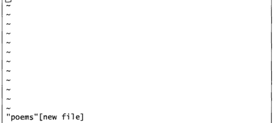

   波浪号 (~) 标记工作缓冲区中的空行。

   波浪号 (~) 用于标记工作缓冲区中的空行。第一行的方框代表 *光标*，它显示新文本将输入的位置。（光标的实际外观取决于你使用的特定终端类型。）

## 11.2 插入文本

* i * 不会出现在屏幕上。

1. **切换到插入模式。** 这是使用 *i*（“插入”）命令完成的。输入 `i`
   此命令不会显示在屏幕上，但你随后输入的所有内容都会显示。
2. **将文本输入到工作缓冲区。** 试着输入以下诗句（暂时忽略任何错误——你稍后会看到如何纠正它们）：
   ```
   Mary had a little lamb, {Return}
   A little cheese. {Return}
   A little ham. {Return}
   Burp!
   ```
   虽然这些行显示在终端屏幕上，但它们尚未保存在文件中。请记住，你必须将这些行从缓冲区“写入”文件中以保存它们。

## 11.3 将文本写入文件

1. 按 {Esc} 返回到 **命令模式**：
   `{Esc}`
2. **输入 Write 命令。** 输入一个冒号 (*:*)、一个 *w* 和一个 {Return}。注意，当你输入冒号时，光标会跳到屏幕底部：
   ```
   :w {Return}
   ```
   计算机将响应一条消息，显示保存在文件中的行数和小字符数：
   ```
   "poems" [New file] 4 lines, 61 characters
   ```
   此命令在你输入时显示在屏幕底部。
3. **离开 vi 编辑器。** 这是使用“退出”命令完成的。
   ```
   :q {Return}
   ```
   计算机将以 shell 提示符作为回应，让你知道你已经退出 *vi* 并回到 UNIX shell：


## 11.4 移动光标

在编辑文件时，你通常需要在文件中移动光标。在 vi 中移动光标始终是在**命令模式**下进行的。

- **使用 vi 重新打开文件**。要打开名为 poems 的文件，输入以下命令：
  ```
  $ vi poems (Return)
  ```
  这将使 vi 将文件内容复制到工作缓冲区，然后在屏幕上显示该内容：
  ```
  Mary had a little lamb,
  A little cheese,
  A little ham.
  Burp!
  ~
  ~
  ~
  ~
  ~
  ~
  ~
  "poems" 4 lines, 61 characters
  ```
  请注意，光标位于工作缓冲区中的第一个字符上。

- **将 vi 切换到命令模式**。如果你不确定当前处于哪种模式，只需按 `Esc` 键即可进入命令模式。

- **使用方向键移动光标**。许多计算机键盘都有方向键——也称为*光标控制键*——它们会按照指示的方向每次移动一个空格：
  - *这些键在你的机器上可能无法正常工作。*
  - ← ↓ ↑ →

- **使用替代的光标控制键移动光标**。在命令模式下，可以使用 h、j、k、l、空格键、退格键、连字符（-）和回车键来替代方向键：
  - *在许多终端上，长按某个键会使其功能快速重复。当需要快速浏览文件时，这非常有用。*
  - h 向左移动一个空格
  - j 向下移动一个空格
  - k 向上移动一个空格
  - l 向右移动一个空格
  - (Space) 向右移动一个空格
  - (Backspace) 向左移动一个空格
  - (Return) 向下移动到下一行的行首
  - - 向上移动到上一行的行首

练习使用各种光标控制键，直到你熟悉它们的工作方式。

## 11.5 替换文本

你已经了解了如何使用 vi 编辑器创建新的文本文件。现在你将要学习如何通过输入新文本来覆盖旧文本，从而编辑现有文本。

- **如果文件已关闭，请使用 vi 编辑器打开它**。要编辑文件 poems，输入：
  ```
  $ vi poems (Return)
  ```
  这将把文件 poems 的副本放入工作缓冲区，并在屏幕上显示出来供你查看。

- **如有必要，将 vi 置于命令模式**。当你调用 vi 编辑器时，它应该以命令模式启动。你始终可以通过按 `Esc` 来确保 vi 处于命令模式：
  `Esc`

- **将光标移动到你打算替换的文本处**。使用上一节中讨论的方向键和/或替代光标控制键。在 poems 文件中，你可能想将 Burp! 替换为更合适的词。（玛丽非常有礼貌，绝不会在餐桌上打嗝。）将光标向下移动到第四行，并将其定位在 *Burp* 中的 *B* 上。

- **输入 Replace 命令**。在命令模式下，输入一个大写的 R（代表 "Replace"）。R 不会显示在屏幕上，但它会使 vi 从命令模式进入插入模式。
  `R`

- **输入新文本**。此时你输入的任何内容都将覆盖旧文本。要将 *Burp!* 替换为 *Delicious!*，输入：
  ```
  Delicious!
  ```
  注意 *Delicious!* 是直接覆盖在不当的 *Burp!* 之上的。

- **返回命令模式**。按 `Esc` 键可使 vi 返回命令模式：
  `Esc`

此时，你已经对工作缓冲区中的文本进行了更改，但这些更改尚未保存到文件中。

## 11.6 写入文件并退出编辑器

如果你想保存对工作缓冲区所做的更改，你必须将这些更改“写入”文件中。（请记住，编辑器始终操作的是文件的副本。）

- **将 vi 置于命令模式**。按 `Esc` 键。

- **要保存你的工作，请将更改写入文件**。从命令模式开始，按冒号 (:) 键，然后按 *w* 键。注意，当你按下冒号时，光标会跳到屏幕底部：
  ```
  :w Return
  ```
  这显示在屏幕底部。编辑器会向你显示已写入文件的行数和字符数：
  ```
  "poems" 4 lines, 66 characters
  ```
  注意，光标回到了你最后输入的那个字符处。这将允许你继续编辑文件，如果你愿意的话。

- **如果你已经完成了对文件的处理，请退出编辑器**。这是使用“退出”命令完成的。
  ```
  :q Return
  ```
  计算机将用 shell 提示符响应，以告知你已退出 vi 并返回到 UNIX shell：
  ```
  $
  ```
  如果你尝试在未保存更改的情况下退出文件，计算机将显示以下消息
  ```
  No write since last change (:! overrides)
  ```
  有时，你可能会决定不保存所做的更改。在这种情况下，不要将更改写入文件，而是输入以下命令
  ```
  :q! Return
  ```

## 11.7 添加文本

在本节中，你将学习如何使用 a（“append”/添加）命令向文件中添加文本。

- **如果文件尚未打开，请重新打开它**。要编辑文件 *poems*，输入：
  ```
  $ vi poems Return
  ```
  这将把文件 poems 的副本放入工作缓冲区，并在屏幕上显示出来供你查看。

- **如有必要，将 vi 置于命令模式**。记住，你始终可以通过按 `Esc` 来确保 vi 处于命令模式：
  `Esc`

- **将光标移动到你想要添加文本的位置**。请记住，Append 命令会在光标位置的右侧添加文本。

- **输入 Append 命令**。只需输入字母 a：
  `a`
  现在输入以下各行（在每行末尾按 `Return` 以开始新的一行）：
  ```
  Mary had a polar bear (Return)
  Whose fur was white as snow, (Return)
  And everywhere that big bear went (Return)
  The people (Return)
  let it go. (Return)
  ```

- **返回命令模式**。按 `Esc`：
  `Esc`

- **如果你已完成编辑，请将内容写入文件并退出编辑器**。你可以一步完成，输入：
  ```
  :wq (Return)
  ```
  计算机将响应一条消息，告诉你写入了多少行和字符到文件中：
  ```
  "poems" 9 lines, 175 characters
  ```
  提示符 ($) 表示你已返回到 UNIX shell：
  ```
  $
  ```

## 11.8 连接两行

在 vi 中，J（“join”/连接）命令允许你将两行连接在一起。

- **如果文件尚未打开，请打开它**。要编辑文件 poems，输入：
  ```
  $ vi poems (Return)
  ```
  这将把文件 poems 的副本放入工作缓冲区，并在屏幕上显示出来供你查看。请注意，在这个示例中，诗歌的最后两行应该是需要连接在一起的行：
  ```
  The people
  let it go.
  ```

- **如有必要，按 `Esc` 将 vi 置于命令模式**。

- **将光标移动到你想要连接的两行中的第一行**。光标可以放在该行的任何位置：
  ```
  The people
  let it go.
  ```

- **输入 Join 命令**。只需输入大写字母 J：
  `J`
  计算机将连接这两行：
  ```
  The people let it go.
  ```

- **如果你已完成，请将更改写入文件并退出编辑器**。
  ```
  :wq Return
  ```
  计算机将告诉你写入了多少行和字符到文件中：
  ```
  "poems" 8 lines, 174 characters
  ```
  提示符 ($) 表示你已返回到 UNIX shell：
  ```
  $
  ```

## 11.9 插入文本的更多方法

还有四个插入模式命令经常非常有用：

- **A**：在当前行的末尾添加文本
- **I**：在当前行的开头插入文本
- **o**：在当前行下方打开一个新行，并将光标移动到那里
- **O**：在当前行上方打开一个新行，并将光标移动到那里

本章末尾的练习将给你机会尝试这些命令。

## 11.10 纠正错误

每个人都会偶尔犯错误，因此 vi 贴心地提供了多种纠正错误的方法。这些命令仅在命令模式下有效。（如有疑问，按 `Esc` 以进入命令模式。）

- `x`：删除一个字符
- `dd`：删除整行
- `u`：撤销最近的更改
- `U`：撤销对当前行所做的所有更改
- `:q`：退出而不保存更改

*要删除单个字符，将光标移动到该字符上并按 x 键。要删除整行，输入 dd。要删除 n 行（其中 n 是任意正整数），将光标移动到要删除的第一行，然后输入 n dd。*

如果你做了一个更改，然后觉得应该取消，你可以使用 u（"undo"/撤销）命令来撤销最近的更改：
```
Esc u Return
```
如果你想撤销当前正在处理的行的多个更改，你可以使用 U（"Undo"/完全撤销）命令将当前行恢复到之前的状态：
```
Esc U Return
```
然而，请注意，只要你不离开该行，U 就能起作用；如果你移到另一行，你就无法再使用 U 命令来撤销更改。

如果你做了太多更改，无法仅用 u 或 U 命令撤销，你始终可以使用以下命令：
```
Esc :q! Return
```
该命令将退出文本编辑器，不保存任何更改。

## 11.11 命令摘要

你已经学会了使用许多重要的 vi 命令，它们列在下一页。请注意，以冒号 (:) 开头的命令显示在屏幕底部，并且后面必须跟 `Return`。另外请注意，vi 命令模式中的其他命令在输入时不会显示在屏幕上。


## **打开、写入和关闭文件（使用 `Return` 键）**

- `vi file` 打开文件（UNIX shell 命令）
- `:w` 将更改写入文件
- `:q` 退出 vi
- `:wq` 将更改写入文件并退出 vi
- `:q!` 退出而不将更改写入文件

## **插入文本（vi 命令模式）**

- `a` 在当前光标位置的右侧添加文本
- `i` 在光标左侧插入文本
- `O` 在当前行上方打开一个新行
- `o` 在当前行下方打开一个新行
- `R` 替换（直接覆盖）文本
- `Esc` 返回命令模式

## **移动光标（vi 命令模式）**

- `←↓↑→` 向指示方向移动一个空格
- `h` 向左移动一个空格
- `j` 向下移动一个空格
- `k` 向上移动一个空格
- `l` 向右移动一个空格
- `Spacebar` 向右移动一个空格
- `Backspace` 向左移动一个空格
- `Return` 移动到下一行的开头
- `-` 移动到上一行的开头

## **纠正错误（vi 命令模式）**

- `x` 删除一个字符
- `dd` 删除整行
- `ndd` 删除 *n* 行
- `u` “撤销”最近一次的更改
- `U` “撤销”当前行上的所有更改

## 11.12 练习

1. 如果你的文件 poems 中有任何拼写错误，请使用 vi 编辑器进行更正。

2. 你已经看到 vi 命令 `a` 允许你插入文本到当前光标位置的右侧。命令 `A` 也用于插入文本，但是在当前行的末尾。使用 vi 编辑器，打开文件 poems，输入 `A`，并输入以下内容：

   **这** *演示了* **A** 命令。

3. vi 命令 `I`（“Insert”）允许你插入文本。它与 `i`（“insert”）命令有何不同？

4. vi 命令 `o`（“open”）在当前光标位置下方打开一个空行。请尝试此命令。

5. vi 命令 `O`（“Open”）在当前光标位置上方打开一个空行。请尝试此命令。

6. 使用 vi 编辑器，创建一个名为 `747art` 的新文件，并输入以下引言，确保每次光标接近屏幕右边缘时按 `Return` 键：

   很难否认，尽管很少有人说出来，但在这个世纪初，或者可能在19世纪，创作冲动被重新引导，从一些正常的艺术渠道转向了与工程和科技相关的新领域。除了其实用性之外，一架波音747飞机比我们在当代博物馆中所谓的“艺术品”是更令人印象深刻的审美对象。

   --Tom Bethell

   确保在退出 vi 编辑器之前将此内容写入文件。（附加题：你同意 Bethell 先生的观点吗？）

7. 大多数计算机终端都有一个名为 `wraparound` 的有用功能。做一个实验来找出你的终端是否具备此功能：

   a. 打开一个名为 `wrap` 的新文件，开始输入 Tom Bethell 的引言，但这次不要在光标到达屏幕末尾时按 `Return` 键。相反，继续输入并观察发生什么。如果当你输入时，光标自动移动到下一行，那么你的终端具有换行功能——它将长行换行以适应屏幕。然而，如果你输入时光标保持在行尾，那么你的终端缺乏换行功能。

   b. 继续输入完整的 Bethell 引言，不要按 `Return` 键。（如果你的终端没有换行功能，这可能会有点困难，但尽你所能。）将引言写入文件并退出 vi 编辑器。

   c. 重新打开文件 wrap。你在屏幕上看到了多少行和字符？编辑器说文件中有多少行和字符？（教训 #1：你在屏幕上看到的不一定是你文件中得到的。教训 #2：如果你想开始新行，请按 Return 键——不要依赖换行功能。）

# 12 教程：更多 VI 编辑

你在前一章中已经学到了足够的 vi 编辑器知识来创建和编辑文件。现在，你将看到一些非常有用的附加功能。

如果你想跟随本章的示例，请使用 `R`（“替换”）命令在上一章创建的文件 poems 中引入几个拼写错误的单词：

```
Poem #1
Marge had a wit tle wamb,
A wit tle cheese,
A wit tle ham.
Delisious!
```

```
Poem #2
Mary had a polar bear
Whose fur was white as snow,
And everywhere that big bear went
The people let it go.
```

确保将这些更改写入文件。

### 12.1 使用 spell

spell 是一个检查拼写的 UNIX 实用程序。与作为文字处理器或文本编辑器一部分提供的许多拼写检查器不同，spell 是一个完全独立的程序。因此，你在使用 vi 编辑文件时不会同时使用 spell。

1. 如果你正在 vi 中工作，请写入文件并退出编辑器。输入 `(Esc) :wq (Return)`

2. 在 shell 提示符下，输入 `spell` 命令和文件名。

   ```
   $ spell poems (Return)
   ```

   spell 实用程序会搜索文件并打印出未出现在 UNIX 单词列表中的任何单词：

   - Delisious
   - Marye
   - wamb
   - witttle

   请注意，尽管 witttle 在文件中出现三次，但 spell 只列出了一次。同样，spell 捕捉到了 Marye 的非典型拼写；单词列表包含许多专有名词。但 spell 漏掉了一些单词：beer, fir, and bare。原因很简单：这些是 spell 单词列表中的合法单词。记住，spell 并不是真正检查拼写错误；相反，它查找与其单词列表不匹配的字符组合。因此，它无法检测出在上下文中使用的错误单词。

### 12.2 查找单词

如果你对某个单词的拼写不确定，可以使用 `look` 实用程序在 UNIX 单词列表中检查其拼写。假设你想知道如何拼写 relief。是“ri”在“ef”之前还是“ef”在“ri”之前？

- 在 UNIX shell 提示符下，输入 `look`，后面跟着你要查询的单词：

  ```
  $ look relief (Return)
  ```

  如果该单词出现在 UNIX 单词列表中，look 会在屏幕上打印它：

  ```
  relief
  ```

  如果该单词不在列表中，look 将不打印任何内容。相反，你会看到 UNIX shell 提示符：

  ```
  $ 
  ```

- 你还可以使用 `look` 来查看 UNIX 单词列表中以特定字母序列开头的所有单词。
  - 在 UNIX shell 提示符下，输入 `look`，后面跟着感兴趣的词前缀。例如，要查看以 re 开头的单词，输入

    ```
    $ look re (Return)
    ```

### 12.3 查找文本

vi 编辑器可以定位文件中的特定单词或字符组合。这在纠正拼写错误时非常有用。例如，spell 在文件 poems 中识别出拼写错误的单词 Delicious。

- 如果文件尚未打开，请打开它。假设你要更正文件 poems 中拼写错误的单词。输入

  ```
  $ vi poems (Return)
  ```

- 如有必要，将 vi 切换到命令模式。

- 输入斜杠 (/)，后面跟着你要查找的单词或字符。请注意，当你输入斜杠时，光标会跳转到屏幕底部：

  ```
  /Delicious (Return)
  ```

  当你按 (Return) 时，光标将移动到该单词所在的位置。然后你可以使用 vi 的编辑命令来编辑文本。

- 要搜索同一单词或字符的更多出现位置，返回命令模式并输入斜杠。无需再次输入该单词：

  ```
  (Esc) / (Return)
  ```

  当 vi 找不到该单词的其他实例时，它会告诉你：

  ```
  Pattern not found
  ```

- 要从当前光标位置在文件中向后搜索，使用问号 (?)：

  ```
  (Esc)?wittle (Return)
  ```

  这将找到单词 wittle 的一个出现位置。要检查下一个出现位置，输入

  ```
  (Esc)? (Return)
  ```

### 12.4 全局替换

向前搜索 (/) 和向后搜索 (?) 命令提供了一种快速查找文件中错误的方法。一旦找到错误，你可以使用 vi 编辑器命令进行必要的更改。虽然这种方法在只需做一两个更改时效果很好，但使用全局替换命令进行更改会更快捷。


### 12.5 在文件中跳转

1. 如有必要，将 vi 切换到命令模式。
2. 输入全局替换命令、要替换的文本以及新文本。因此，要将所有 *while* 替换为 *little*，请输入 `:%s/while/little/g`（回车）。
3. 将更改写入文件。

如果你尚未完成此操作，现在可能花一点时间修正你 poems 文件中的错误是个好主意。

### 12.5 在文件中跳转

vi 编辑器提供了一种方便的方式，可以快速将光标移动到文件中的特定行。

1. 如有必要，使用 vi 打开文件。
2. 在命令模式下，输入行号和 Go 命令。因此，要转到文件的第七行，请输入 `7G`，其中 G 代表“Go”（前往）。
3. 要转到文件底部，请输入 G。无需行号：`G`

你还可以跳到当前位置的上方或下方特定行数的位置：

- 要向后跳转，请输入你希望跳转的行数，后跟一个减号（-）。因此，要从当前位置向后跳转 9 行，请输入 `9-`
- 要向前跳转，请输入你希望跳转的行数，后跟一个加号（+）。因此，要从当前位置向前跳转 5 行，请输入 `5+`

### 12.6 设置行号

当然，如果你要向前或向后跳转到特定行，能够给行编号会很有帮助。

1. 将 vi 切换到命令模式。
2. 输入设置行号命令。输入命令 `:set nu`（回车）。

行号会出现在屏幕上，但不会写入工作缓冲区或文件。

这会在左侧页边距显示行号：

```text
1  Poem #1
2  Mary had a little lamb,
3  A little cheese,
4  A little ham.
5  Delicious!
6
7  Poem #2
8  Mary had a polar bear
9  Whose fur was white as snow,
10 And everywhere that big bear went
11 The people let it go.
```

虽然行号显示在屏幕上，但它们实际上并未放入工作缓冲区或文件中。

3. 要移除行号，请输入取消行号命令。必须在命令模式下执行：
   `:set nonu`（回车）

### 12.7 剪贴（Yank）和粘贴（Put）

你偶尔可能需要在一个文件或两个不同文件之间移动大块文本。这是通过将文本临时复制到命名缓冲区或编号缓冲区来实现的。回忆一下，有 26 个命名缓冲区和 9 个编号缓冲区：

- 命名缓冲区 "a"、"b"、"c"……"z"
- 编号缓冲区 "1"、"2"、"3"……"9"

在 UNIX 术语中，“yank”（剪贴）是将文本复制到命名或编号缓冲区的进程；“put”（粘贴）是将文本重新复制回来的进程。

1. 使用 vi 打开文件。如果你一直跟着示例操作，请打开 *poems* 文件。
2. 在命令模式下，将光标移动到你希望复制的第一行。要复制第二首诗，将光标移动到该诗的第一行：`Mary had a polar bear`
3. 将这些行剪贴到一个命名缓冲区中。因此，要将四行复制到命名缓冲区 "a"，请输入以下命令（无需按 `Return`）：`"a4yy`

此操作不会在屏幕上显示。

最好从后向前解读这条命令。它剪贴（`yy`）四行文本（4），并将它们放入命名缓冲区 "a"。虽然命令本身不会显示在屏幕上，但计算机通常会在屏幕底部显示一条消息：

`4 lines yanked`

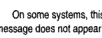

### 12.8 粘贴文本

一旦你将文本剪贴到缓冲区，文本将保留在该缓冲区中，直到你放入更多文本覆盖它或退出编辑器。你可以将（复制）缓冲区中的文本粘贴到文件中：

1. 将光标移动到你希望粘贴文本的位置。在当前示例中，将光标向下移动到文件的最后一行。
2. 将命名缓冲区的行放入工作缓冲区。以下命令会将命名缓冲区 `a` 内容的副本粘贴到当前光标位置下方。
   `"ap`


**Poem #2** 的四行应该会出现。计算机还会告诉你放置了多少行：

`4 lines`

如果你尝试对一个空的缓冲区执行粘贴命令，计算机将响应类似以下的错误消息

`Nothing in register a`


命名缓冲区的内容不会因粘贴操作而改变；如果你愿意，你可以再粘贴另外四行到文本中。

3. 将更改写入文件。

> **警告**
> 请记住，缓冲区只是临时存储位置；一旦退出 vi，其内容就会丢失。

### 12.9 在文件之间移动文本

命名缓冲区和编号缓冲区用于将文本从一个文件转移到另一个文件。

1. 如有必要，将 vi 切换到命令模式。
2. 将光标移动到你想要转移的第一行。假设你想将四行诗复制到一个新文件中。确保光标位于你希望转移的那些行的第一行。

此操作不会在屏幕上显示。

3. 将这些行剪贴到一个命名缓冲区中。要将四行剪贴到缓冲区 "m" 中，请输入 `"m4yy`

计算机将打印剪贴的行数：

`4 lines yanked`

4. 输入编辑文件命令，后跟接收剪贴文本的文件名。因此，要将文本放入文件 *stuff*，请输入 `:e stuff`（回车）

这告诉编辑器你希望编辑文件 *stuff*。编辑器将关闭文件 *poems* 并尝试打开名为 *stuff* 的文件。如果你当前目录下没有名为 *stuff* 的文件，编辑器将打开一个空的工作缓冲区：

`"stuff" No such file or directory`

5. 粘贴这些行。要将 "m" 的内容放入新打开的工作缓冲区，请输入 `"mp`

你应该会在屏幕上看到类似以下内容：

```text
1
2 Mary had a polar bear
3 Whose fur was white as snow,
4 And everywhere that big bear went
5 The people let it go.
4 lines
```

6. 将这些行写入文件。按通常的方式操作：`(Esc) :w`（回车）

编辑器将告诉你刚创建的新文件的大小：

`"stuff" [New file] 5 lines, 108 characters`

7. 根据需要编辑文件，然后退出编辑器。

### 12.10 命令总结

必须在 **spell** 命令以及每个以斜杠（`/`）、问号（`?`）或冒号（`:`）开头的 vi 命令之后按 (**Return**）。此处列出的其他命令都不需要按 (**Return**)。

### 检查拼写（UNIX shell 命令）

- **spell file**
  - 列出在 **file** 中发现的拼写错误单词
- **look word**
  - 在 UNIX 单词列表中查找 **word**
- **look pre**
  - 在 UNIX 单词列表中查找以 **pre** 开头的单词

### 搜索单词（vi 命令）

- **/word**
  - 在文件中向前搜索 **word** 的第一次出现
- **/**
  - 继续向前搜索 **word** 的下一次出现
- **?word**
  - 在文件中向后搜索 **word** 的第一次出现
- **?**
  - 继续向后搜索 **word** 的下一次出现

### 跳转到行（vi 命令模式）

- **n+**
  - 向前（向下）跳转 **n** 行
- **n-**
  - 向后（向上）跳转 **n** 行
- **nG**
  - 跳转到行号 **n**
- **G**
  - 跳转到文件底部

### 行号（vi 命令模式）

- **:set nu**
  - 在屏幕上设置行号
- **:set nonu**
  - 移除行号

### 剪贴与粘贴（vi 命令模式）

- **"knyy**
  - 将 **n** 行剪贴（复制）到缓冲区 "**k**" 中
- **"kp**
  - 将缓冲区 "**k**" 的内容粘贴到当前行下方

### 替换（vi 命令模式）

- **:s/old/new/g**
  - 在文件中将 **old** 替换为 **new**

### 编辑另一个文件（vi 命令模式）

- **:e file**
  - 编辑 **file**


### 12.11 练习

- 在你之前章节中创建的文件上使用 `spell`。如果 `spell` 报告某个文件有错误，打开该文件并使用搜索命令查找拼写错误的单词。进行必要的更正。

- 使用 `look` 确定以下内容是否存在于 UNIX 单词列表中：(a) 你的名字；(b) 你的姓氏；(c) 副总统的姓氏；(d) 喀布尔（Kabul），阿富汗的首都；(e) herpetologist（爬虫动物学家）；(f) ornithology（鸟类学）。

- 良好的 UNIX 密码的要求之一是它不能是普通的单词或名字。某些 UNIX 安装程序不接受内部单词列表中的任何单词。使用 `look` 查看以下密码中是否有被列出的：(a) Hi54Luck；(b) 4Tune8；(c) 1DayMay8；(d) Much2Gr8；(e) 14DRoad；(f) FOR@ward；(g) gin/GER；(h) hydro.GEN。

- 在之前的练习中，你创建了一个名为 `747art` 的文件。打开此文件，并使用搜索命令定位以单词 `Quite` 开头的句子。选中包含此完整句子的行。（你可能还需要从上一句中提取几个单词。）使用 `edit` 命令将这些行传输到新文件 `art` 中。

- 有一种之前全局替换命令的变体，你可能会觉得有用：

```
:%s/wittle/little/gc (Return)
```

命令末尾的 `c` 代表“确认”。在此选项下，编辑器将向你显示每个更改，并在实际执行更改之前询问你是否确认：

```
Marty had a wittle wamb
AAAAAAAAAA
```

如果你想要执行更改，请输入 `y`（是）；否则，请输入 `n`（否）。

# 第五部分：UNIX 网络

## 13 UNIX 网络

网络是由互连在一起以共享信息和资源的计算机组成的组。在本章中，你将学习计算机网络。你还将学习允许你与其他计算机用户通信的各种程序。

### 13.1 局域网 (LAN)

计算机网络通常根据其规模和地理覆盖范围进行分类。局域网或 LAN 由彼此靠近的计算机组成——通常位于同一栋建筑物内。

如图 13–1 所示，局域网可以以多种配置进行布局，这些配置通常被称为拓扑。这些布局各有优缺点；然而，从普通计算机用户的角度来看，它们看起来都非常相似。

没有公认的定义来说明网络必须多么“本地”才能资格被认定为局域网。有些局域网可能足够大，足以覆盖一个大学校园甚至整个城市——尽管你可能偶尔会听到校园网 (CAN) 或城域网 (MAN) 这些术语来描述这些网络。任何比这更大的网络通常被称为广域网或 WAN。

创建 WAN 的最常见方式是将两个或更多局域网连接在一起，如图 13–2 所示。这些局域网可能位于相距遥远的地点，也许在不同的城市甚至不同的大陆上。每个局域网都配备了一台称为网关的专用计算机，用于处理与组成网络的其它局域网之间的通信。在许多情况下，网关通过称为骨干的高速度数据通道进行通信。

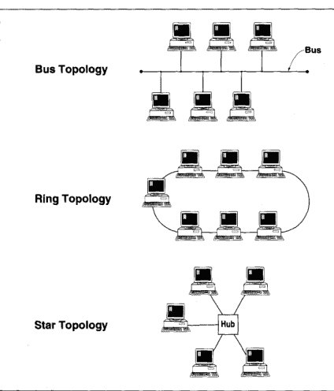

图 13-1  
*局域网 (LAN) 的典型拓扑。*

### 13.2 互联网

互联网是网络的集合。

将网络互连以形成更大网络的过程称为*互联网互连*。以这种方式创建的网络本身可以再次互连以形成更大的网络。这一过程重复许多次后的最终结果，是创建了一个称为*互联网*的超级互联网。目前它已连接到世界各地数千个其他网络。互联网允许用户交换电子邮件、传输文件，并登录到地球上几乎任何地方的远程机器上工作。

互联网源于一个政府研究项目。（参见“互联网简史”。）但政府并不拥有互联网。事实上，没有人比拥有他们特定的局域网或广域网对互联网拥有更多的所有权。整个互联网也没有总统、首席执行官或董事会。（然而，组成互联网的许多网络是由总统、首席执行官和/或董事会管理的。）互联网最接近的中央管理权威是一个名为互联网协会 (ISOC) 的自愿国际组织。在 ISOC 旗帜下运作的各种咨询委员会和特设工作组定期发布维持互联网运转所需的规则和标准。

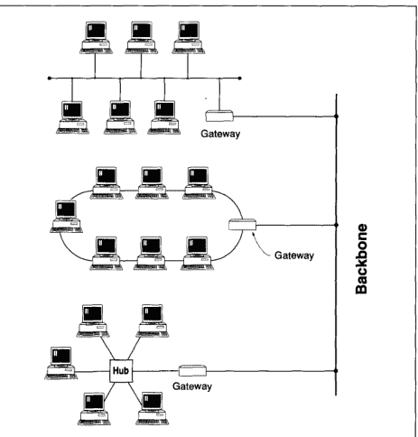

图 13-2  
由连接到高速骨干的几个局域网组成的广域网 (WAN)。

## 互联网简史

现在被称为互联网的东西起源于由高级研究计划局 (ARPA)（美国国防部的一个机构）赞助的工作。在 20 世纪 60 年代末，ARPA 开始对创建一个即使部分节点失效（如战争中或其他国家紧急情况下可能发生的那样）也能运行的远程网络感兴趣。拟议的网络将使用一种称为*分组交换*的通信方法，在这种方法中，消息被分解为称为*分组*的单位并通过网络发送，以便在目的地重组。如果网络的一部分失效，分组会自动重新路由到系统的正常工作部分。

ARPA 授予马萨诸塞州咨询公司博尔特·贝兰尼克和纽曼（Bolt Beranek and Newman）合同，开发用于新分组交换网络的软件。该网络被称为 ARPANET，于 1969 年开始运营。最初，它连接了位于加州大学洛杉矶分校 (UCLA)、斯坦福大学、加州大学圣巴巴拉分校和犹他大学的四台计算机。其他主机很快被添加进来，在整个 20 世纪 70 年代，每年大约有二十台。

互联网发展的一个关键步骤发生在 1974 年。Vinton Cerf 和 Robert Kahn 描述了计算机如何使用 *TCP/IP*（传输控制协议/互联网协议）进行通信。这些协议在 ARPANET 上进行了测试，并最终成为全球互联网的基础。

虽然由国防部资助，但 ARPANET 本质上仍然是一个民用研究项目。因此，它并不真正适合武装部队的日常需求。一个名为 MILNET 的独立军用网络于 1983 年成立。三年后的 1986 年，国家科学基金会 (NSF) 创建了 NSFNET，以提供访问五个国家超级计算中心的权限。NSFNET 拥有一个高速的跨大陆骨干。

ARPANET、MILNET 和 NSFNET 由不同的机构资助和管理；然而，它们也是互连的，并将它们视为单一实体变得很常见。1991 年，国会通过《高性能计算法案》使其正式化，该法案将所有政府资助的网络合并为一个国家研究教育网，或 NREN。

1993 年通过了《国家信息基础设施法》，以促进私营部门对互联网的发展。政府资金减少，维护互联网骨干的成本转移给了 MCI、Sprint 和美国在线等商业运营商。

互联网近期的增长是惊人的。它花了二十年时间达到 10 万台主机，但不到三年时间就超过了 100 万台主机。自那以后，主机数量大约每一年翻一番，而且看不到尽头。

### 13.3 互联网协议

几乎每种类型的计算机系统都可以通过互联网通信。这是可能的，因为使用互联网的每个人都同意遵守某些通信规则或协议，这些规则或协议控制消息如何发送、接收和解释。其中最重要的是传输控制协议 (TCP) 和互联网协议 (IP)，它们通常被合并在一起，通过其缩写 TCP/IP 来引用。

TCP 和 IP 专为通过专用的高速传输线进行通信而设计。两种旨在用于传统电话线的替代协议是串行线路互联网协议 (SLIP) 和点对点协议 (PPP)。许多商业互联网提供商为不需要（或无法负担）完整 TCP/IP 连接的用户提供 SLIP 连接。

## 其他值得注意的网络

ARPANET 不向公众开放；其大多数主机计算机属于国防承包商或进行政府资助研究的大学。但 ARPANET 的研究人员并非唯一对网络感兴趣的人。20 世纪 70 年代和 80 年代见证了许多其他广域网的发展，其中一些至今仍然存在：

- **Telenet**。不要与 **telnet** 程序混淆，Telenet 是 ARPANET 的商业版本，创建于 1974 年。

- **Usenet**。始于 1979 年，作为杜克大学和北卡罗来纳大学之间共享信息的“电子公告板”，Usenet 发展成为一个连接全球超过 200,000 名 UNIX 用户的去中心化网络。Usenet 以其电子新闻组而闻名。

- **BITNET**。这个名字是“Because It's Time Network”（是时候网络了）的缩写。BITNET 于 1981 年在新约克市立大学 (CUNY) 启动。此后，它已扩展到包括全球 2,000 多台计算机。BITNET 处理电子邮件、终端到终端的消息以及文件传输。

- **uucp**。缩写 uucp 代表“UNIX to UNIX copy”（UNIX 到 UNIX 复制）。这实际上不是一个网络，而是一组旨在通过普通长途电话线分发 UNIX 软件更新和电子邮件的程序。然而，有些人确实会谈论“uucp 网络”。


## 13.4 IP 地址和域名

互联网上的每个主机都有一个唯一的地址。互联网或 IP 地址由四个用句号（通常称为“点”）分隔的数字组成：

**128.46.126.96**

该特定地址属于一台名为 `fairway` 的工作站，它是普渡大学工程计算网络 (ECN) 的一部分。该主机还有一个唯一的名称，称为*域名*：

`fairway.ecn.purdue.edu`

该名称包含四个部分：

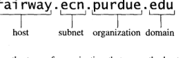

*域* 指示拥有该主机和子网的组织类型。美国常用的常见域包括：

- **com**: 商业组织
- **edu**: 教育机构
- **gov**: 政府机构
- **int**: 国际组织
- **mil**: 军事机构
- **net**: 网络支持组织
- **org**: 非营利组织

位于美国以外地区的主机的域名通常指示该主机所在的 国家或地区。部分地理域名如下所示：

- AR: 阿根廷
- AU: 澳大利亚
- AT: 奥地利
- BR: 巴西
- CA: 加拿大
- CL: 智利
- CN: 中国
- DK: 丹麦
- FI: 芬兰
- FR: 法国
- DE: 德国
- IN: 印度
- ID: 印度尼西亚
- IL: 以色列
- IT: 意大利
- JP: 日本
- MX: 墨西哥
- NL: 荷兰
- NZ: 新西兰
- NO: 挪威
- PK: 巴基斯坦
- PH: 菲律宾
- RU: 俄罗斯
- SA: 沙特阿拉伯
- ES: 西班牙
- SE: 瑞典
- CH: 瑞士
- TW: 台湾
- GB: 英国
- US: 美国

## 13.5 电子邮件

你将在下一章学习如何使用 Mail 和 Mailx。

UNIX 操作系统最流行的功能之一是电子邮件 (e-mail 或 E-mail)，它允许你与其他用户交换文本消息。有三个标准的 UNIX 邮件程序：

- 原始 UNIX 邮件程序 `mail`。尽管已被功能更强大的邮件程序所取代，但 `mail` 仍然存在于大多数 UNIX 系统中。
- 伯克利邮件程序 `Mail`。该程序功能更多，比原始的 `mail` 程序更易于使用。
- System V 邮件程序 `mailx`。`x` 代表“扩展”。`mailx` 程序基于伯克利的 `Mail`。

在这些程序中，原始的 `mail` 程序不常用。（实际上，一些系统被配置为使得 `mail` 命令调用其他邮件程序之一。）除了这些标准邮件程序外，你的系统可能还提供其他邮件程序的选择：

- `elm`。由 Dave Taylor 于 1986 年编写，`elm` 邮件程序是一个功能强大的、基于菜单的标准 UNIX 邮件程序的替代方案。
- `pine`。由编写 `pico` 文本编辑器的同一群人开发，`pine` 旨在作为 `elm` 的易用替代方案。（`pine` 的名称代表“pine is not e.l.m.”，意为 pine 不是 elm。）
- `RMAIL`。`RMAIL` 程序内置于某些版本的 `emacs` 文本编辑器中。
- `mh`。与这里列出的其他邮件程序不同，`mh` 实际上是一组程序的集合，而不是单个程序。它起源于兰德公司 (Rand Corporation)，特别适用于处理大量邮件。一个名为 `xmh` 的相关程序为 `mh` 提供了在 X Window System 下运行的图形用户界面。

## 13.6 互联网邮件地址

无论你偏好哪种邮件程序，你都需要知道如何向其他用户发送邮件。互联网邮件地址由接收者的登录名组成，后跟“@”符号，以及接收者主机计算机的域名：

```
obadiah@fairway.ecn.purdue.edu
```

这里，登录名是 `obadiah`，主机计算机的完整域名是 `fairway.ecn.purdue.edu`。这是普渡大学以外的人向 `obadiah` 发送邮件时会使用的地址。然而，普渡大学的用户不需要完整的地址。表 1 展示了邮件地址的一些变化形式。一般经验法则是：

> *你可以省略地址中与你自己相同的那些部分。*

### 表 1：向 obadiah@fairway.ecn.purdue.edu 发送邮件

| 发送者 | 使用的地址 | 注释 |
| :--- | :--- | :--- |
| dinah@host1.podunkst.edu | obadiah@fairway.ecn.purdue.edu | 发送者在普渡大学外部 |
| micha@merlin.cc.purdue.edu | obadiah@fairway.ecn | 发送者在普渡大学，但不在 ecn 子网上 |
| joe1@atoms.ecn.purdue.edu | obadiah@fairway | 发送者在 ecn 网络上，但在不同的主机上 |
| eve@fairway.ecn.purdue.edu | obadiah | 发送者和接收者都在 fairway 机器上 |

## 13.7 其他传统网络服务

网络提供的某些最常见服务如下：

- **远程计算。** rlogin ("远程登录") 和 telnet 允许你登录到远程计算机主机。rlogin 在两个 UNIX 主机之间工作；telnet 可用于与 UNIX 或非 UNIX 主机通信。这两个程序都在第 15 章中描述。
- **文件传输。** rcp ("远程复制") 和 ftp ("文件传输协议") 程序旨在通过互联网将文件从一台计算机传输到另一台计算机。这些程序在第 16 章中讨论。
- **网络新闻。** Usenet 最有趣——也是信息量最大——的功能之一是电子新闻服务。Usenet 新闻阅读器 rn ("阅读新闻") 在第 17 章中讨论。


## 13.8 互联网导航

互联网的巨大发展增加了你需要查找信息的地方数量。这导致了被称为*导航器*或*浏览器*的程序的 development，旨在提供更轻松的互联网资源访问方式。其中流行度最高的之一是 gopher，它最初由明尼苏达大学（“金色地鼠”的主场）开发。

gopher 软件是根据客户端-服务器模型设计的。客户端是在本地主机上运行的程序；这就是当你调用 gopher 命令时运行的程序。为了获取信息，客户端联系服务器程序，该程序可能在远程计算机上运行。

gopher 服务器呈现一个菜单，其中每个条目要么指向信息文件，要么指向另一个菜单。菜单条目甚至可以指向位于其他地方的另一个主机上的信息。如果你选择一个导致远程主机的选项，gopher 软件会负责联系该主机上的 gopher 服务器；大部分琐碎的工作由它为你完成。

## 13.9 万维网

万维网 (WWW) 不是一个独立的网络，而是以*超文本文档*的形式在互联网上呈现信息的一种方式。超文本文档可以包含指向其他文档的链接——就像 gopher 菜单上的一个条目可以指向另一个菜单一样。然而，WWW 远远超出了 gopher。gopher 文档完全基于文本，而 WWW 文档可以以文本、图形、视频或音频形式呈现信息。


Web 基于客户端-服务器模型运行。Web 客户端是一个程序——称为*浏览器*——它在你的本地主机上运行。为了获取信息，你的浏览器与通常运行在称为 *Web 站点* 的远程计算机上的服务器程序进行通信。这是一个五步过程。

1. 你指示本地主机上的客户端程序获取一个 Web 文档。
2. 客户端定位远程 Web 站点。
3. 客户端通过互联网发送对你指定文档的请求。
4. Web 站点上的服务器通过互联网发送该文档的副本。
5. 你的客户端程序格式化文档并显示供你查看。

有大量的 Web 浏览器可用，而且新的浏览器层出不穷。最容易受欢迎——至少目前为止——的是 Netscape。你将在第 19 章学习如何使用 Netscape。

## 13.10 通用资源定位符

万维网上的每个信息页面都有自己的唯一标识符，称为*通用资源定位符* (URL)，它告诉浏览器在哪里找到该页面以及如何读取它。例如，位于华盛顿特区国会图书馆有一个 WWW 服务器。其 URL 是：

```
http://cweb.loc.gov/homepage/1chp.html
```


## ASCII、HTML、HTTP、GIF、JPEG、MPEG 和 MIME

似乎每一次技术进步都会引发新一轮缩语的涌现。以下是一些与互联网和万维网相关的重要缩语精选：

- **ASCII**（美国标准信息交换码）。计算机使用数字——具体来说是二进制数——来表示所有数据。一种标准的数值表示文本的方案是*美国标准信息交换码*（*American Standard Code for Information Interchange*），更通俗地称为 ASCII（发音为“ask-key”）。该代码将大写字母、小写字母、数字和常用标点符号表示为 7 位二进制数。尽管大多数用户实际上看不到 ASCII 表示，但你可能会听到有人谈论“ASCII 文件”。这只是指仅包含文本的文件——例如没有图形、视频或音频。
- **HTML**（超文本标记语言）。许多万维网文档都基于*超文本标记语言*（*Hypertext Markup Language*，HTML）。HTML 文档包含有关网页如何由 Web 浏览器解释和显示的指令。已经开发了各种版本的 HTML，包括 SHTML，即*安全超文本标记语言*（*Secure Hypertext Markup Language*），旨在为 Web 上的金融交易提供安全性。
- **HTTP**（超文本传输协议）。为了相互通信，Web 客户端和服务器遵循一组称为*超文本传输协议*（*Hypertext Transport Protocol*，HTTP）的规则。你自己不需要了解 HTTP 的任何细节——你的浏览器会处理这些细节——但你在通过 Web 请求文档时经常会使用这个缩语。
- **GIF**（图形交换格式）。图形——包括绘图、图表和照片——的存储和传输方式与文本不同。*图形交换格式*（*Graphic Interchange Format*，或称 GIF，发音为“jif”）由 CompuServe 在 20 世纪 80 年代开发，用于通过网络高效传输图像。GIF 采用文件压缩技术来最小化图形文件的大小。（不幸的是，GIF 压缩算法限制了图像中可使用的颜色数量。）GIF 文件通常通过*后缀*.gif* 来识别。
- **JPEG**。虽然 GIF 是 Web 上最广泛使用的图形格式，但它并非唯一。一个行业组织*联合图像专家组*（*Joint Photographic Experts Group*，JPEG）定义了一种针对彩色照片压缩优化的替代文件格式。JPEG 文件名通常带有*后缀*.jpeg* 或*.jpg*。
- **MPEG**。这种由*运动图像专家组*（*Motion Picture Experts Group*）定义的 MPEG 文件格式常用于传输压缩的视频和音频数据。MPEG 文件通过*后缀*.mpeg* 来识别。
- **MIME**。最初，UNIX 邮件程序仅限于文本（ASCII）消息。一些较新的邮件程序还可以处理 MIME（*多用途互联网邮件扩展*，*Multi-Purpose Internet Mail Extensions*），这是一种在电子邮件中包括多媒体对象的标准。

缩语 http 是“Hypertext Transport Protocol”（超文本传输协议）的简写，表明该信息页面包含超文本。以 ftp: 开头的 URL 指的是可以通过 ftp 访问的文档。同样，前缀 gopher: 表示可以通过 gopher 访问的文档。大多数 Web 浏览器都可以处理 http、ftp 和 gopher 文档。

双斜杠（//）位于网站（或主机计算机）的域名之前，在本例中该域名为 1cweb.loc.gov。

单个斜杠（/）标志着包含该文档的文件绝对路径名的开始。在本例中，路径名是 /homepage/1chp.html。这个路径名的解释与你之前看到的 UNIX 路径名完全相同。

## 13.11 练习

1. 请确保你能定义以下术语：
   - 网络
   - WAN（广域网）
   - 互连网
   - TCP/IP
   - 域
   - URL（统一资源定位符）
   - GIF（图形交换格式）
   - LAN（局域网）
   - 网关
   - Internet（互联网）
   - SLIP（串行线路互联网协议）
   - 电子邮件
   - ASCII（美国标准信息交换码）
   - JPEG
   - CAN（控制器局域网）
   - 骨干网
   - 数据包
   - PPP（点对点协议）
   - 浏览器
   - HTML（超文本标记语言）
   - MPEG
   - MAN（城域网）
   - 拓扑
   - 协议
   - IP 地址
   - 超文本
   - HTTP（超文本传输协议）
   - MIME

2. 你的计算机是否是局域网的一部分？如果是，有多少其他机器连接到同一个网络？它们位于哪里？

3. 你的系统是否可以访问互联网？如果可以，你的主机互联网地址是什么？它的域名是什么？

4. 你的电子邮件地址是什么？

## 14 教程：使用电子邮件

在本章中，你将看到如何使用标准的 UNIX 邮件程序 `Mail` 和 `mailx` 来发送和接收文本消息。

造成混淆的一个原因是，在某些系统上，`mail` 命令会调用 `Mail` 或 `mailx`；而在其他系统上，`mail` 命令会调用较旧的 UNIX 邮件程序。

### 14.1 发送电子邮件

如果你刚开始使用一个新的 UNIX 账户，不太可能有人已经给你发送过电子邮件。不过，你可以从给自己发送消息开始。

1. 输入 Mail 命令，后跟收件人的邮件地址。如果你使用的是 AT&T UNIX，请尝试 `mailx` 程序：

```
$ mailx address
```
在此处输入收件人的邮件地址。

如果你使用的是 BSD UNIX，请键入：
```
$ Mail address
```
在此处输入收件人的邮件地址。

计算机将提示你输入消息的主题：
```
Subject:
```

2. 指定主题。为你的消息输入简短的描述或标题：
```
Subject: Test Message #1
```

3. 输入消息正文。邮件程序的编辑功能有限：你每次只能编辑一行，并且无法返回去编辑之前的行。因此，在开始新行之前，请确保每一行都是正确的：

*别惊慌。*（*Return*）
*这只是一个测试。*（*Return*）

4. **当消息完成时，发送它。** 这是通过开始新行，然后按（*Control*-*D*）（表示“完成”）来实现的：

（*Return*）
（*Control*-*D*）

在某些系统上，计算机会询问你是否想给任何人发送副本（Cc）：

Cc: 

5. **发送副本（如果有）。** 输入应收到你消息副本的任何人的登录名。如果你不打算向任何人发送副本，只需按（*Return*）。

Cc: （*Return*）

UNIX 提示符告诉你已返回到 UNIX shell：
```
$
```

### 14.2 邮寄文件

由于邮件程序的编辑功能有限，使用 *vi* 编辑器创建一个包含你消息的文件，然后邮寄该文件通常更为方便。在本节中，你将看到如何使用电子邮件发送文件的副本。

1. **使用文本编辑器创建一个文件。**

2. **将文件重定向到电子邮件程序。** 要将文件 *poems* 发送到账户 *login*，请键入：

```
$ mailx login < poems (*Return*)
```
或者：
```
$ Mail login < poems (*Return*)
```
输入重定向箭头（*<*) 告诉邮件程序从文件 *poems* 的内容中获取输入。

> 警告 务必使用输入重定向箭头（*<*），而不是输出重定向箭头（*>*）。使用错误的箭头可能会破坏文件的内容。

### 14.3 在邮件程序中使用 vi

在发送邮件前编辑消息的一种方法是从邮件程序调用 vi 编辑器。然后你可以使用 vi 命令来编辑消息。

1. 启动邮件程序并输入收件人地址。为了练习，你可以指定自己为收件人：

```
$ mailx yourlogin (Return)
```
或者：
```
$ Mail yourlogin (Return)
```
你会被要求输入主题：

2. 指定主题。

```
Subject: Another Test Message (Return)
```

3. 输入你的消息。例如：

```
There once was a fellow named Lester,
Whose knowledge grew lesser and lesser.
It at last grew so small,
He knew nothing at all;
So they hired him as a professor.
```

4. 启动 vi 编辑器。开始新行，然后输入波浪号（~），接着输入 v（代表 vi），然后按 RETURN：

```
(Return)
~v (Return)
(Return)
```
这将调出 vi 编辑器并将你的消息放入缓冲区：

```
There once was a fellow named Lester,
Whose knowledge grew lesser and lesser.
It at last grew so small,
He knew nothing at all;
So they hired him as a professor.
~
~
~
/tmp/Re24223 6 lines, 163 characters
```

5. 使用 vi 命令编辑消息。如果你正在跟随示例操作，可以尝试将“Lester”更改为“Chester”。


# 使用电子邮件

6. 编辑完成后，将更改保存到文件中并退出编辑器。使用常规命令执行此操作：

```
(Esc) :wg (Return)
```

这样你会回到邮件程序中。你可能会看到某种提示：

```
( continue )
```

7. 发送消息。按常规方式操作即可：

```
(Return)
(Control-D)
```

系统可能会要求你指定副本（碳拷贝）。

```
Cc:
```

8. 发送副本（如果有）。如果你不想发送任何副本，请按 `(Return)`：

```
Cc: (Return)
```

这将使你退出邮件程序并返回到 UNIX 外壳：

```
$
```

## 14.4 你的邮箱

邮件程序使用两种类型的邮箱。你的*系统邮箱*是一个文件，用于保存你已接收但未阅读、删除或保存到另一个文件的邮件。在许多系统中，此文件位于 `/var/spool/mail` 目录中，并且与你用户 ID 同名。例如，如果你的用户 ID 是 *jdoe*，那么你的系统邮箱就是文件 `/var/spool/mail/jdoe`。

除了系统邮箱外，你可能还有一个*个人邮箱*。这是你主目录中名为 `mbx` 的文件。当你退出邮件程序时，你已阅读但未删除或保存在其他文件中的邮件消息会自动放入你的 `mbx` 文件中。

如果你使用的是 Bourne Shell 或 Korn Shell，你的 Shell 会定期检查你的系统邮箱，并通知你任何新消息：

```
New mail has arrived.
```

你还可以使用 `biff` 或 `xbiff` 程序在新邮件到达时提醒你。这些程序将在练习中讨论。

### 14.5 阅读你的邮件

你可以使用发送消息时所用的同一个电子邮件程序来阅读系统邮箱中的消息：

1. **启动邮件程序而不指定收件人**。具体操作取决于你的系统使用的是 `mail` 还是 `mailx`：

   - `$ mail` `Return`
   - 或者
   - `$ mailx` `Return`

邮件程序将列出你系统邮箱中的消息：

```
>U 1 yourlogin Thu Nov 22 15:27 11/321 "Test Message"
 N 2 yourlogin Thu Nov 22 15:35 11/321 "Test Message #2"
 N 3 yourlogin Thu Nov 22 15:42 20/442
&
```

第一列中的 `>` 指向当前消息。`U` 表示以前未读的消息；`N` 表示新消息。消息编号（本例中为 1 到 3）。显示了发件人的登录名和地址，以及消息接收的日期和时间、消息包含的行数和字符数（行数/字符数）。消息主题用引号标出。

最后一行的 `&` 是*邮件提示符*。它告诉你邮件程序正在等待你的指令。一些系统使用问号（`?`）作为提示符。

2. **如有必要，列出下一屏的消息**。如果你的邮箱中的消息太多无法在一屏上列出（也许是因为你有很多追求者或者你一直没有处理邮件），你可以通过在邮件提示符下输入 `z` 来列出下一屏：

   ```
   &z Return
   ```

   通过在邮件提示符下输入 `z-`（`z` 加连字符），你可以再次列出上一屏的消息：

   ```
   &z- Return
   ```

   要列出当前屏的消息，在邮件提示符下输入 `h`：

   ```
   &h Return
   ```

3. **选择要阅读的消息**。为此，只需在提示符下输入消息编号并按 `Return`。例如，要查看第二条消息，请输入：

   ```
   &2 Return
   ```

这将显示第二条消息：

```
Message 2:
From yourlogin Day Month Time Year
Date: Day Month Time Year
From: yourlogin (Your name)
To: (Your login name)
Subject: Test Message #2

Don't be alarmed. This is only a test.
&
```

在转发之前，邮件程序会在消息顶部添加一些额外行。这些行构成了*邮件头*，其中包含发送者姓名、登录名和地址等信息。请注意，邮件头使得发送匿名邮件变得困难！

阅读完消息后，你可以对它进行多种操作。无需退出邮件程序，你可以回复消息、将其保存为文件或删除它。

## 14.6 回复消息

迅速回复收到的任何电子邮件是个好主意。当你仍在邮件程序中时，请使用 R（“Reply”，回复）命令。

1. **输入 Reply 命令并指定消息编号**。因此，要回复第二条消息，请输入：

   ```
   &R2 (Return)
   ```

   这告诉邮件程序你想要回复发送第二条消息的用户。邮件程序会处理回复的寻址，甚至会为你填入 Subject 字段。

   ```
   Subject: Re: Test Message #2
   ```

2. **输入你的消息**。这与之前相同：

   ```
   What a relief.
   ```

3. **发送消息**。按 `(Return)`，然后按 `(Control)-D`：

   ```
   (Return)
   (Control)-D
   ```

## 14.7 保存消息

你可能希望保留一些消息以备将来参考。你可以使用 s（“save”，保存）命令将消息保存在文件中。

- 输入 **Save** 命令，后跟**消息编号**。因此，要将消息 1 保存到名为 `message1.file1` 的文件中，请输入：

  ```
  &s1 message1.file1 (Return)
  ```

这会在你的主目录中创建一个名为 `message1.file1` 的新文件，并将消息文本（包括邮件头）放入其中。（如果你的主目录中已经有一个名为 `message1.file1` 的文件，消息将追加到该文件末尾。）原始消息将从你的系统邮箱中删除。邮件程序会告知你消息已保存。

## 14.8 删除消息

有些消息不值得保存。你应该使用 d（“delete”，删除）命令删除这些消息。

1. 输入 **Delete** 命令，后跟**消息编号**。例如，要删除第三条消息，请输入：

   ```
   &d3 (Return)
   ```

   通常，邮件程序不会告诉你它已删除消息。相反，它只会显示一个邮件提示符：

   ```
   &
   ```

2. **检查消息是否已删除**。h（“headers”，头）命令将列出邮箱中剩余的消息：

   ```
   &h (Return)
   ```

   已删除的消息将不再出现在邮件头列表中。

## 14.9 恢复已删除的消息

如果你误删了想要找回的消息怎么办？如果你尚未退出邮件程序，可以使用 **Undelete** 命令检索已删除的消息。

- 输入 **Undelete** 命令，后跟**消息编号**。例如，要恢复第三条消息，请输入：

  ```
  &u3 (Return)
  ```

## 14.10 退出邮件程序

x 命令在你不小心删除了想保留的消息时很有用。

阅读完邮件后，有两种常见的退出电子邮件程序的方式，区别在于对邮箱中消息的处理方式。q（"quit"）命令将你已阅读但未删除的消息放入主目录中名为 **mbox** 的文件。未读消息保留在系统邮箱中。x（"ex-it"）命令退出邮件程序而不更改邮箱，恢复所有已删除的消息。

其中，q 命令更常用：

- **输入 q，然后 ⏎ (Return)：**

  ```
  &q ⏎ (Return)
  ```

  某些版本的邮件程序会告知你有多少消息保存在邮箱中，多少消息被放入你的 mbox 文件：

  ```
  Saved 3 messages ...
  ```

## 14.11 阅读你的 mbox 文件

你的 **mbox** 文件接收你已阅读但未删除或保存在其他文件中的消息。使用带有 -f（"file"）选项的邮件程序，你可以像处理系统邮箱中的消息一样，阅读和处理 **mbox** 文件中的消息。

1. **使用 -f 选项启动邮件程序。**

   - `$ mail -f ⏎ (Return)`
   - 或者
   - `$ mailx -f ⏎ (Return)`

   邮件程序将列出你 **mbox** 中的消息。

2. **处理消息**。你可以使用常规的邮件命令来阅读、回复和删除消息。

3. **退出邮件程序**。q 或 x 命令都可以做到这一点。


## 14.12 获取帮助

当你忘记 mailx 或 Mail 使用哪些命令时，可以在邮件提示符后输入 `?`（“帮助”）命令。这将显示一个命令列表。

- h 打印活动消息头
- m [用户列表] 向特定用户发送邮件
- n 跳转到下一条消息并输入
- p [消息列表] 打印消息
- pre [消息列表] 将消息退回系统邮箱
- q 退出（mbox 中未解决的消息）
- R [消息列表] 仅回复消息发件人
- r [消息列表] 回复发件人和收件人
- s [消息列表] 将消息追加到文件
- t [消息列表] 显示消息（同 print）
- top [消息列表] 显示消息的顶部行
- u [消息列表] 取消删除消息
- v [消息列表] 使用显示编辑器编辑消息
- w [消息列表] 追加到文件，不包含 from 行
- x 退出，不更改系统邮箱
- z 显示下一页消息头
- z- 显示上一页消息头
- ! shell 转义

[消息列表] 由整数、相同类型的范围或空格分隔的用户名组成。如果省略，Mail 将使用当前消息。

## 14.13 获取地址

在你向某人发送邮件之前，必须知道他的登录名。如果你可以直接询问对方的登录名，那就没问题。否则，你可能需要猜测登录名，然后使用 `finger` 命令来确认你的猜测。`finger` 会告诉你使用特定登录名的人的真实姓名。

如果不带参数使用，`finger` 会列出当前登录到系统的所有用户。

- 输入 `finger` 命令，并将该用户的登录名作为参数。

第一次，你可以尝试在自己的登录名上试一试：

```
$ finger yourlogin <Return>
```

你应该会看到关于该用户的信息：
Login name: yourlogin
In real life: Your Name
Your office:
Phone: 555-5555

然而，如果 `finger` 命令不可用，系统会说明这一点：
`finger:` Command not found

某些版本的 `finger` 可以根据姓氏告诉你用户的登录名。

- 输入 `finger` 命令，并将该用户的姓氏作为参数。

第一次，你可以尝试在自己的姓氏上试一试：

```
$ finger yourname <Return>
```

这应该会产生一个拥有你姓氏的用户列表或某种错误信息。

## 14.14 write 和 talk

`write` 和 `talk` 在附录 E 中讨论。

`write` 和 `talk` 实用程序允许登录到系统的两个用户互相发送输入的消息。如果某人试图以这种方式与你联系，你将收到类似以下的消息：
Message from george on tty10
要了解如何使用 `write` 或 `talk` 进行响应，请参阅附录 E。

## 有用且古朴的邮件惯例

尽管电子邮件方便，但它缺乏印刷文字或口语的表现力。电子邮件不允许你使用**粗体**或*斜体*字体来强调，也不允许通过语音语调来表示讽刺或讥笑。

常见的做法是使用全大写来表示强调。（但要小心——排他性或无差别的的大写使用会使文本难以阅读。）另一种强调文本的方法是将它放在星号之间，例如 *\*like this\**。

许多人使用*笑脸*或*表情符号*，这些是字符组合，当从 $90^{\circ}$ 角度看时旨在暗示一张脸。例如，:-) 代表一张笑脸，常被用作一种表示“开玩笑”的方式。下面列出了几种更常见的笑脸——还有数百种其他的：

- -:) 微笑（表示幽默或讽刺）
- ;-) 眨眼（狡猾的幽默或讽刺）
- :-( 皱眉（悲伤）

由于一些收件人可能觉得它们烦人，因此应谨慎使用笑脸（如果真的要用的话）。

最后，赶时间的人通常缩写某些短语以节省打字。以下是常见电子邮件缩写的示例：

- BTW 顺便说一下
- FAQ 常见问题
- FAQL 常见问题列表
- FOAF 朋友的朋友
- FYA 供你娱乐
- FYI 供你参考
- IMHO 以我卑微的意见
- IMO 以我的意见
- MOTAS 相应性别的人
- MOTOS 异性的人
- WRT 关于

与笑脸一样，这些缩写应谨慎使用。它们适用于非正式消息，但在其他情况下应避免使用。

## 14.15 命令摘要

本章讨论的一些命令是 UNIX shell 命令，其他命令仅在 mail 或 mailx 内工作。所有这些命令都必须以 <Return> 结尾。

### 在你的邮箱中阅读邮件（UNIX shell 命令）

- mail 列出收到的电子邮件消息（Berkeley UNIX）
- mailx 列出收到的电子邮件消息（AT&T UNIX）

### 在你的 mbox 文件中阅读邮件（UNIX shell 命令）

- mail -f 列出存储在 mbox 文件中的消息（Berkeley UNIX）
- mailx -f 列出存储在 mbox 文件中的消息（AT&T UNIX）

### 删除、保存和回复（Mail 或 mailx 命令）

- dn 删除消息编号 n
- sn 将消息编号 n 保存到文件中
- Rn 回复消息编号 n 的发送者
- rn 与 Rn 相同，但还回复所有收到原始消息的人

请注意，在某些系统上，R 和 r 的作用可能相反。

### 发送邮件（UNIX shell 命令）

- mail jdoe 向用户 jdoe 发送消息（BSD UNIX）
- mailx jdoe 向用户 jdoe 发送消息（AT&T System V UNIX）

### 邮寄文件（UNIX shell 命令）

- mail jdoe < file 将文件邮寄给用户 jdoe（BSD UNIX）
- mailx jdoe < file 将文件邮寄给用户 jdoe（AT&T System V UNIX）

### 使用 vi 编辑消息（Mail 或 mailx 波浪号转义）

- ~v 调用 vi 程序编辑当前消息

### 识别用户

- finger user 获取登录名为 user 的用户的真实姓名

## 14.16 练习

1. 找到你的计算机（或同一网络）上有账户的人，并练习使用 `mailx` 或 `Mail` 交换消息。
2. 正如你所见，s（“保存”）命令在邮件程序内部用于将消息追加到文件。w（“写入”）命令也将消息追加到文件。给自己发一条消息，然后使用 w 命令将其放入文件中。退出邮件程序并检查新文件的内容。w 和 s 之间有什么区别？
3. 邮件 S（“保存”）命令会将邮件消息保存到一个与发送者登录名同名的文件中。（如果该文件已存在，消息将被追加到文件中。）试试 S 命令。
4. 邮件程序 `mailx` 和 `Mail` 使用了所谓的*波浪号转义*。这些是以波浪号 (~) 开头的邮件命令。你已经看到了如何使用波浪号转义序列 `~v` 使用 `vi` 编辑器编辑消息。了解其他波浪号转义。启动邮件程序，就像你要发送消息一样。但是，不要输入消息，而是输入波浪号转义序列 `~?` (<Return>) 以显示波浪号转义列表。以下波浪号转义做什么？
    - `~p`
    - `~h`
    - `~q`
    - `~r`
    - `~S`
    - `~x`
5. 你看到了如何使用重定向运算符在命令行上邮寄文件。因此，要将文件 `myfile` 发送给用户 `fred@host`，你会输入
    ```
    $ Mail fred@host < myfile <Return>
    ```
    或者
    ```
    $ mailx fred@host < myfile <Return>
    ```
    当 `fred` 收到消息时，它没有主题。你可以使用 `-s`（“主题”）选项来补救，如下所示：
    ```
    $ Mail -s "This is the subject" fred@host < myfile <Return>
    ```
    或者
    ```
    $ mailx -s "This is the subject" fred@host < myfile <Return>
    ```
    通过给自己邮寄文件来尝试 -s 选项。
6. 电子邮件消息在到达目的地之前可能会经过许多中间站点。-v（“详细”）选项允许你跟踪消息的递送进度：
    ```
    $ Mail -v fred@host <Return>
    ```
    或者
    ```
    $ mailx -v fred@host <Return>
    ```
    尝试 -v 选项，最好是在一条长距离旅行的消息上。
7. **from** 命令列出系统邮箱中的邮件头，而实际上并不启动邮件程序。试一试：
    ```
    $ from <Return>
    ```
8. **biff** 实用程序在你收到邮件时提醒你。（信不信由你，这个实用程序是以加州大学伯克利分校计算机科学系一名研究生养的一只狗命名的。）你可以使用命令行激活 **biff**
    ```
    $ biff y <Return>
    ```
    要停用 **biff**，输入
    ```
    $ biff n <Return>
    ```
    当新邮件到达时，**biff** 将打印一条通知，包括发送者的登录名、主题行和消息的前几行。试一试。
9. X 客户端 **xbiff** 在屏幕上创建一个邮箱的图片。当你收到新邮件时，**xbiff** 会发出声音并升起邮箱上的旗子。你可以使用命令启动 **xbiff**
    ```
    $ xbiff & <Return>
    ```
    如果你正在*运行* X，试试 **xbiff**。
10. 研究附录 E，了解 **write** 和 **talk** 如何工作。然后找到你的计算机（或同一网络）上有账户的人，并练习使用 **write** 或 **talk** 交换消息。


## 15 教程：远程登录

在本地主机上运行 `rlogin` 或 `telnet` 实用程序，你可以登录并操作拥有账户的远程计算机系统。二者的区别在于：`rlogin` 实用程序仅允许你连接到另一个 UNIX 系统；而 `telnet` 也可以连接到非 UNIX 主机。`telnet` 还可以用于访问某些不需要你在远程主机上拥有账户的互联网服务。

### 15.1 运行 rlogin

在本节中，你将了解如何使用 `rlogin` 登录到远程 UNIX 主机上的账户。（如果在其他机器上没有账户，你可以使用本地账户进行练习。）

- 1. **启动 `rlogin` 程序，指定远程主机和远程登录名称。** 例如，如果你在远程 UNIX 主机 `merlin.podunku.edu` 上有一个名为 `jsmith` 的账户，你应该输入：
  ```
  $ rlogin merlin.podunku.edu -l jsmith <Return>
  ```
  在某些系统中，这样就足以进入远程系统，无需密码。其他系统则要求你输入密码：
  ```
  password:
  ```
- 2. **如有必要，输入你用于远程主机的密码。** 该密码可能与你本地主机上使用的密码不同。
- 3. **当你完成远程账户的操作后，请注销该账户。** 以下其中一个命令应该有效（参见第 3 章）：
  ```
  $ logout <Return>
  $ exit <Return>
  $ CONTROL-D
  ```

### 15.2 运行 telnet

在本节中，你将了解如何使用 `telnet` 登录到拥有账户的远程主机——无论是 UNIX 还是非 UNIX 计算机。（如果在其他机器上没有账户，你可以使用本地账户进行练习。）

- 1. **启动 `telnet` 程序。**
  ```
  $ telnet <Return>
  ```
  你将收到 `telnet` 提示符：
  ```
  telnet>
  ```
- 2. **输入 `Open` 命令，后接远程机器的 Internet 地址。** 例如，如果你在 `merlin.podunku.edu` 上有一个账户，你应该输入：
  ```
  telnet> open merlin.podunku.edu <Return>
  ```
  `telnet` 程序将尝试连接到远程主机。如果连接成功建立，远程主机将显示登录提示符：
  ```
  Trying ... 
  Connected to merlin.podunku.edu.
  Escape character is '^]'
  login:
  ```
  **SunOS UNIX (merlin.podunku.edu)**
- 3. **登录到你的远程账户。** 遵循第 3 章“入门”中所述的步骤。一旦登录成功，你就可以在远程主机上运行常规 UNIX 命令（但不能运行 X 窗口系统）。

### 15.3 telnet 命令

当你使用 `telnet` 登录时，你大概注意到了关于“转义字符”的消息，可能看起来像这样：

```
Escape character is '^]'
```

这意味着 `telnet` 程序使用 `Control-]` 键组合作为转义序列。（不要将其与用于 `vi` 编辑器的 `Esc` 键混淆。）`telnet` 转义字符允许你暂停在远程主机上的工作，并向 `telnet` 程序本身发出命令。

- 1. **输入 `telnet` 转义字符。** 在大多数系统上，这是 `^]` 组合：
  ```
  $ Control-]
  ```
  计算机将以 `telnet` 提示符响应：
  ```
  telnet>
  ```
- 2. **显示 `telnet` 命令列表。** 在提示符后输入问号（`?`）：
  ```
  telnet> ? <Return>
  ```
  程序将响应一个命令列表：
  ```
  close     close current connection
  display    display operating parameters
  mode       line-by-line or character-at-a-time mode
  open       connect to a site
  quit       exit telnet
  send       transmit special characters
  set        set operating parameters
  toggle     toggle operating parameters
  z          suspend telnet
  ?          print help information
  ```
- 3. **显示详细的命令描述。** 要获取这些命令中任何一个的更多信息，请输入命令名后接问号：
  ```
  telnet> close ? <Return>
  ```
  `telnet` 程序将显示 `close` 命令的描述：
  ```
  close closes current connection
  ```
  这并没有告诉你比你已经知道的更多信息。但是，其他一些命令提供了更多详细信息；花一点时间试一试。
- 4. **退出 `telnet` 命令模式。** 这是在 `telnet` 提示符处按下 `Return` 键实现的：
  ```
  telnet> <Return>
  ```
  这将把你带回你的远程 UNIX 账户。

### 15.4 结束 telnet 会话

一旦你在远程主机上完成工作，你应该从该机器注销并结束 `telnet` 会话。

- 1. **从远程账户注销。** 这是按常规方式进行的（参见第 3 章）。以下其中一个命令应该有效：
  ```
  $ logout <Return>
  $ exit <Return>
  $ (CONTROL)-D
  ```
  当你注销后，你将看到一个 `telnet` 提示符：
  ```
  telnet>
  ```
  此时，如果你愿意，可以使用 `open` 命令打开另一个远程会话。
- 2. **退出 `telnet` 程序。** 在提示符后输入 `quit`：
  ```
  telnet> quit <Return>
  ```
  你将看到一个 UNIX shell 提示符：
  ```
  $
  ```

### 15.5 快捷方法

运行 `telnet` 会话有一种更快捷的方式：

- 1. **输入 `telnet` 命令，后接远程机器的 Internet 地址。** 例如，如果你在主机 `merlin.podunku.edu` 上有一个账户，你应该输入：
  ```
  $ telnet merlin.podunku.edu <Return>
  ```
  最终，你将看到 `login` 提示符：
  ```
  login:
  ```
- 2. **像往常一样登录到你的远程账户。**
- 3. **完成后，关闭连接。**
  ```
  telnet> close <Return>
  ```
  这通常会将你从远程账户注销并退出 `telnet`。你应该看到 UNIX shell 提示符：
  ```
  $
  ```

### 15.6 连接到 Guest 账户

通常，你必须在使用 `telnet` 连接的任何远程主机上拥有账户。然而，互联网上创建了一些特殊的 `telnet` 账户来为公众提供服务。登录此类账户有两种方式。

第一种——也许是最常见的方法——要求你使用 `telnet` 连接到主机计算机，然后使用特殊的登录名称和密码登录到该账户。（许多系统不需要密码。）例如，美国国家航空航天局（NASA）维护一个名为“Spacelink”的公共服务，提供有关 NASA 过去、当前和计划活动的信息。你可以使用 `telnet` 连接到此服务：

```
$ telnet spacelink.msfc.nasa.gov <Return>
```

当你到达服务器时，它会提示你登录：

```
login:
```

使用的登录名是 `guest`；该特定服务不需要密码。

第二种方法是通过由数字指定的特殊“端口”使用 `telnet` 登录服务器。通常无需提供登录名或密码。例如，密歇根大学维护一个提供地理信息（包括美国城镇和城市的纬度、经度、海拔和邮政编码）的服务器。你可以通过以下命令访问此服务器：

```
$ telnet martini.eecs.umich.edu 3000 <Return>
```

注意数字 3000；这是端口号。

这些命令都是在 UNIX 提示符后输入的，并且每个命令都以 **Return** 结束。`host` 代表远程主机的地址。

**远程登录命令 (UNIX shell 提示符)**

| 命令 | 描述 |
| :--- | :--- |
| `rlogin host` | 登录到名为 `host` 的远程 UNIX 计算机 |
| `telnet host` | 登录到名为 `host` 的远程计算机 |
| `telnet` | 启动 `telnet` 程序 |

**Telnet 命令 (Telnet 提示符)**

| 命令 | 描述 |
| :--- | :--- |
| `open host` | 打开与计算机 `host` 的连接 |
| `?` | 打印 `telnet` 帮助 |
| `close` | 关闭与远程主机的连接 |
| `quit` | 退出 `telnet` 会话 |

- 1. 如果你在远程 UNIX 机器上有一个账户，使用 `rlogin` 登录到该账户。
- 2. 如果你在连接到网络的非 UNIX 机器上有一个账户，使用 `telnet` 登录到该账户。
- 3. 使用 `telnet` 登录 NASA 的“Spacelink”公共服务器。该服务器上有哪些类型的信息可用？
- 4. 使用 `telnet` 登录密歇根大学的地理服务器。关于你居住的城市或城镇，有哪些类型的信息可用？


## 16 教程：文件传输

rcp（“远程复制”）和 ftp（“文件传输协议”）都允许你在拥有账户的两个计算机系统之间传输文件。rcp 工具专为在两个 UNIX 系统之间工作而设计；而 ftp 还可以从非 UNIX 主机获取文件。此外，ftp 还可用于从公共文件服务器获取文件。

### 16.1 运行 rcp

在本节中，你将学习如何使用 rcp 从远程 UNIX 主机获取文件。要使 rcp 正常工作，必须满足以下三个条件：

-   你必须在远程 UNIX 主机上拥有账户。
-   两台主机必须相互“信任”。
-   你必须有复制该文件的权限。

假设满足这些条件，复制文件的过程非常简单：

-   输入 rcp 命令，指定远程主机和远程文件，然后是本地主机和新文件名。例如，如果你想从远程 UNIX 主机 farhost.xyz.edu 复制文件 myfile，你应输入：

```bash
$ rcp farhost.xyz.edu:myfile .:mycopy
```

-   注意，不需要密码。如果你在远程主机上没有账户，或者主机之间不相互信任，rcp 工具将直接拒绝工作。

### 16.2 运行 ftp

在本节中，你将学习如何使用 ftp 从远程主机（无论是 UNIX 还是非 UNIX 计算机，且你拥有账户）复制文件。

1.  **启动 ftp 程序。**
    -   `$ ftp` (回车)
    -   你将收到 ftp 提示符：`ftp>`

2.  **输入 open 命令，后跟远程机器的 Internet 地址。** 因此，如果你在 farhost.xyz.edu 上有账户，请键入：
    -   `ftp>` `open farhost.xyz.edu` (回车)
    -   ftp 程序将尝试连接到远程主机。如果连接成功，远程主机将提示你输入登录名：
        ```text
        Connected to farhost.xyz.edu.
        220 farhost.xyz.edu FTP server (Version4.179) ready.
        Name (farhost.xyz.edu):
        ```

3.  **输入你的登录名。** 如果远程账户和本地账户的登录名不同，请务必使用远程账户的登录名。例如，如果你在远程主机上有一个名为 smithj 的账户，你应键入：
    -   `Name (farhost.xyz.edu):` smithj (回车)
    -   *注意：在此处输入你的登录名。除非你的实际登录名确实是 smithj，否则不要输入 "smithj"。*
    -   远程主机将提示你输入密码：
        ```text
        331 Password required for smithj
        Password:
        ```

4.  **输入你的密码。** 当然，输入时密码不会在屏幕上显示。
    -   `Password:` XXXXXXXX
    -   *注意：在此处输入你的密码；它不会显示在屏幕上。*
    -   登录成功时你会收到通知：
        ```text
        230 User smithj logged in.
        ftp>
        ```

### 16.3 ftp 帮助

ftp 程序接受几十种命令。幸运的是，其中一条命令是 help，它列出并描述了一组 ftp 命令。

-   在 ftp 提示符下输入 help 命令。有两种方法可以做到。要么键入单词 help，要么键入单个问号 (?)：
    -   `ftp> ?` (回车)

-   计算机将返回一个命令列表：

| | | |
| :--- | :--- | :--- |
| account | dir | put |
| append | disconnect | rmdir |
| ascii | form | runique |
| binary | glob | send |
| bell | hash | sendport |
| bye | help | status |
| case | lcd | struct |
| cd | ls | sunique |
| cdup | macdef | tenex |
| close | mdelete | trace |
| cr | mdir | type |
| delete | mode | user |
| debug | pwd | verbose |
| get | | |
| lls | | |

*(注：由于 OCR 表格碎片化，根据标准 FTP 命令和网格布局，列表中出现的命令包括：account, dir, put, append, disconnect, rmdir, ascii, form, runique, binary, glob, send, bell, hash, sendport, bye, help, status, case, lcd, struct, cd, ls, sunique, cdup, macdef, tenex, close, mdelete, trace, cr, mdir, type, delete, mode, user, debug, pwd, verbose, get, nput, quit, lls, nmap。 部分 OCR 条目混乱如 "$", "$$", "nput" (可能是 "put" 或 "nput" 的非标准变体), "nmap" (可能是 "nmap" 或 "map"?), "tenex", "sunique"。 以下是基于通常在这些教科书中看到的列格式对命令的清理表示，尽可能保留 OCR 中发现的唯一标识符，但纠正明显错误如根据上下文建议的 "nput" -> "put"，然而 "nput" 不是标准命令，可能是 "put" 的误读或特定变体。 观察网格：
Col 1: account, append, ascii, binary, bell, bye, case, cd, cdup, close, cr, delete, debug
Col 2: dir, disconnect, form, glob, hash, help, lcd, ls, macdef, mdelete, mdir, mode, pwd
Col 3: put, rmdir, runique, send, sendport, status, struct, sunique, tenex, trace, type, user, verbose
*更正*：OCR 文本中有 `$` 和 `+`，可能是伪影。 命令 `nput` 可能是 `put` 或 `input` 的误读？ 不，标准是 `put`。 `nmap`？ `macdef` 在那里。 `tenex` 在那里。 `sunique` 在那里。 `runique` 在那里。
让我们根据提供的 OCR 文本重建表格，清理代表列标记或噪声的 `$` 和 `+` 等垃圾字符。

| | | |
| :--- | :--- | :--- |
| account | dir | put |
| append | disconnect | rmdir |
| ascii | form | runique |
| binary | glob | send |
| bell | hash | sendport |
| bye | help | status |
| case | lcd | struct |
| cd | ls | sunique |
| cdup | macdef | tenex |
| close | mdelete | trace |
| cr | mdir | type |
| delete | mode | user |
| debug | pwd | verbose |
| get | | |

*(自我更正表格内容)*：表格的 OCR 文本很混乱。
第 1 行：`$` | dir | nput | rmdir -> 可能是：(空白/account) | dir | put | rmdir
第 2 行：`$` | disconnect | nmap | runique -> 可能是：append | disconnect | (nmap? 可能没有) | runique
实际上，让我们看看这个时期（UNIX System V 或类似）的标准 FTP 命令列表。
标准命令：account, append, ascii, binary, bell, bye, case, cd, cdup, close, cr, delete, debug, dir, disconnect, form, get, glob, hash, help, lcd, ls, macdef, mdelete, mdir, mode, nlist, nmap, ntrans, open, passive, prompt, proxy, put, pwd, quit, quote, recv, remotehelp, rename, reset, rget, rmdir, rput, rstatus, runique, send, sendport, status, struct, sunique, tenex, trace, type, user, verbose, ?
OCR 表格在某些行中有 4 列？ 不，看起来是 3 或 4 列。
让我们只列出在 OCR 块中发现的命令，清理后，作为一个 Markdown 表格。 如果 OCR 太乱无法保证确切的列对齐，我将以干净的列表形式列出该块中发现的唯一命令，或者如果对齐不明确，就简单地列出它们。 然而，指令说“转换为 Markdown 表格”。 我会尽量对齐。

| | | |
| :--- | :--- | :--- |
| account | dir | put |
| append | disconnect | rmdir |
| ascii | form | runique |
| binary | glob | send |
| bell | hash | sendport |
| bye | help | status |
| case | lcd | struct |
| cd | ls | sunique |
| cdup | macdef | tenex |
| close | mdelete | trace |
| cr | mdir | type |
| delete | mode | user |
| debug | pwd | verbose |
| get | | |

*注：OCR 中包含 "nput", "nmap", "ntrans"。 "nput" 可能是 "put" 或其中的拼写错误。 "nmap" 和 "ntrans" 是有效的非交互命令。 如果它们清晰出现，我会包含 "nmap" 和 "ntrans"。 在 OCR 块中： `nput` (第 1 行第 3 列？), `nmap` (第 2 行第 3 列？), `ntrans` (第 2 行第 4 列？)。
让我们仔细阅读 OCR 表格部分：
`! | dir | nput | rmdir`
`$ | disconnect | nmap | runique`
`account | form | ntrans | send`
...
似乎有 4 列。
Col 1: account, append, ascii, binary, bell, bye, case, cd, cdup, close, cr, delete, debug
Col 2: dir, disconnect, form, glob, hash, help, lcd, ls, macdef, mdelete, mdir, mode, pwd
Col 3: put (OCR: nput), nmap, ntrans, send, sendport, status, struct, sunique, tenex, trace, type, user, verbose
Col 4: rmdir, runique
这变得越来越复杂，难以猜测确切的布局。 我将命令以排序列表或尽可能清晰的表格形式呈现，但鉴于幻觉列对齐的风险，我将坚持使用 OCR 文本中可见的项目，并将它们格式化为干净的列表或最佳效果的表格。
实际上，查看 OCR：
第 1 行：(伪影) dir nput rmdir
第 2 行：(伪影) disconnect nmap runique
第 3 行：account form ntrans send
第 4 行：append get open status
第 5 行：ascii glob prompt struct
第 6 行：bell hash proxy sunique
第 7 行：binary help sendport tenex
第 8 行：bye lcd put trace
第 9 行：case ls pwd type
第 10 行：cd macdef quit user
第 11 行：cdup mdelete quote verbose
第 12 行：close mdir recv ?
第 13 行：cr mkdir remotehelp
第 14 行：delete mls rename
第 15 行：debug mode reset
这看起来像 4 列。 让我们将其格式化为 4 列表格。

| | | | |
| :--- | :--- | :--- | :--- |
| account | dir | put | rmdir |
| append | disconnect | nmap | runique |
| ascii | form | ntrans | send |
| binary | get | open | status |
| bell | glob | prompt | struct |
| bye | hash | proxy | sunique |
| case | help | sendport | tenex |
| cd | lcd | put* | trace |
| cdup | ls | pwd | type |
| close | macdef | quit | user |
| cr | mdelete | quote | verbose |
| delete | mdir | recv | ? |
| debug | mkdir | remotehelp | |
| | mls | rename | |
| | mode | reset | |

*(注：OCR 中的 "nput" 可能对应 "put"。 "nmap" 和 "ntrans" 是有效的。 我会将 "nput" 更正为 "put"，因为这可能是 OCR 对 "put" 或标准列表中不存在的特定命令的误读，但 "put" 后来出现了。 我将使用所写的术语，但如果标准且明显是拼写错误，我会更正。 "nmap" 是标准的。 "ntrans" 是标准的。 "tenex" 是标准的。 "sunique" 是标准的。)*

-   获取命令的描述。 输入 help 或 ? 命令，后跟你感兴趣的命令。 例如，要获取 delete 命令的描述，输入命令行：
    -   `ftp> ? delete` (回车)

-   程序将返回该命令的简短描述，让你了解如何使用它：
    -   `delete delete remote file`

### 16.4 获取文件

使用 ftp 的原因之一是从远程主机获取文件的副本。这是通过 get 命令完成的。

-   移动到包含你想要文件的远程目录。 就像 UNIX shell 一样，ftp 使用 cd 命令来更改工作目录。 因此，如果你想从子目录 Marsupials 获取文件，你将键入：
    -   `ftp> cd Marsupials` (回车)

    根据 ftp 在你的系统上的设置方式，你可能会看到类似这样的消息：
    -   `250 CWD command successful.`

-   列出文件以找到你想要的那个。 在 ftp 中，就像在 UNIX shell 中一样，你可以使用 ls 命令来完成此操作：
    -   `ftp> ls` (回车)

    此命令将列出远程主机当前目录中的文件。 它通常告诉你在网络上传输了多少字节的传输信息：
    ```text
    200 PORT command successful.
    150 Opening ASCII mode data connection for file list.
    bandicoot
    kangaroo
    opossum
    wombat
    226 Transfer complete
    38 bytes received in 0.0042 seconds (8.9 Kbytes/sec)
    ```

-   选择文件传输模式。 就 ftp 而言，有两种类型的文件。 ASCII 文件包含文本；二进制文件包含其他类型的信息（如图形、音频录音或压缩文本）。 根据文件中的信息类型，在 ftp 提示符下输入 ascii 或 binary：
    -   `ftp> ascii` (回车)

    ftp 程序将确认你的选择：
    -   `200 Type set to A.`
    -   `ftp>`

-   获取文件。 输入 get 命令，后跟原始文件的名称，然后是你想要给本地副本起的名称。 例如，假设你想获取远程主机上文件 wombat 的副本，并且你想在本地主机上将其命名为 wombat.copy。 你将输入这一行：
    -   `ftp> get wombat wombat.copy` (回车)

在大多数情况下，ftp 将通知你传输成功：
```text
200 PORT command successful.
150 Opening ASCII mode data connection for wombat (7014 bytes)
226 Transfer complete
7224 bytes received in 0.8 seconds (8.8 Kbytes/sec)
ftp>
```

### 16.5 发送文件

使用 ftp，你还可以从本地主机向远程主机发送文件——这是上一节所述操作的逆过程。这是通过 put 命令完成的。

1.  **指定文件类型。** 记住，ftp 区分包含文本的 ASCII 文件和包含其他类型信息（如图形、音频等）的二进制文件。 通过在 ftp 提示符下输入 ascii 或 binary 选择正确的文件传输模式：
    -   `ftp> ascii` (回车)

    ftp 程序将确认你的选择：
    -   `200 Type set to A.`
    -   `ftp>`

2.  **发送文件。** 输入 put 命令，后跟原始文件的名称，然后是你想要给远程副本起的名称。 例如，假设你想从本地主机发送文件 meeting.events 的副本，并且你想在远程主机上将其命名为 meeting.events.copy。 你将输入这一行：
    -   `ftp> put meeting.events meeting.events.copy` (回车)

    ftp 将通知你传输成功：
    ```text
    200 PORT command successful.
    150 Opening ASCII mode data connection for meeting.events
    226 Transfer complete
    local: meeting.events   remote: meeting.events.copy
    2878 bytes received in 0.033 seconds (86 Kbytes/sec)
    ftp>
    ```

### 16.6 结束 ftp 会话

一旦你在远程主机上的工作完成，你应该结束 ftp 会话。

-   **退出 ftp 程序。** 在 ftp 提示符下输入 quit：
    -   `ftp> quit` (回车)

    你将看到一个 UNIX shell 提示符：
    -   `$`

### 16.7 一种快捷方法

运行 ftp 会话有一种更快的方法：

1.  **输入 ftp 命令，后跟远程机器的 Internet 地址。** 因此，如果你在主机 farhost.xyz.edu 上有账户，你将键入：
    -   `$ ftp farhost.xyz.edu` (回车)

2.  **像往常一样登录到你的远程账户。** 这将需要你在相应的提示符下输入你的登录名和密码。

3.  **完成后，使用 quit 命令关闭连接。**
    -   `ftp> quit` (回车)

    这将登出并退出 ftp。 你应该看到一个 UNIX shell 提示符：
    -   `$`

### 16.8 使用匿名 ftp 获取文件

最初，ftp 旨在允许你在拥有账户的两台计算机之间传输文件。 然而，匿名 ftp 允许你从没有账户的主机获取文件。 这些主机被称为公共 ftp 服务器。

例如，Internet 网络信息中心——称为 InterNIC——是 AT&T、通用原子公司（General Atomics）和网络解决方案公司（Network Solutions, Inc.）的联合运营机构，作为 Internet 操作信息的中央清算所。 InterNIC 提供了大量你可以通过匿名 ftp 获取的信息。

1.  **启动 ftp 程序并指定你需要的服务器。** 例如，要访问 InterNIC 的公共 ftp 服务器 ds.internic.net，你将输入命令：
    -   `$ ftp ds.internic.net` (回车)


## 传输文件

### 16.8 通过匿名 FTP 获取文件

当你连接到服务器时，它会进行身份识别并提示你输入登录名：

```
Connected to ds.internic.net.
220-      InterNIC Directory and Database Services
220-
200-Welcome to InterNIC Directory and Database Services
```

> 此处会出现各种警告和免责声明。

200 ds.internic.net FTP 服务器已就绪。  
Name (ds.internic.net:yourlogin):

1.  **在提示符处输入访客登录名。** 某些服务器要求你输入 “guest” 作为登录名；其他服务器则要求输入 “anonymous”。对于 InterNIC 服务器，请使用 “anonymous”：

```
Name (ds.internic.net:yourlogin): anonymous <回车>
```

> 有些服务器要求你输入 “guest” 作为登录名。

服务器将通知你它已接受该登录名；它可能还会提示你输入密码：

```
331 Guest login ok, send ident as password.
Password:
```

某些系统不需要密码；其他系统则使用 “guest” 或 “anonymous”。InterNIC 服务器要求你输入你的互联网标识符。

2.  **如有必要，输入访客密码。** InterNIC 服务器要求你输入你的互联网（即电子邮件）地址。因此，如果你的互联网地址是 jsmit@merlin.podunku.edu，你就需要在提示符处输入此地址：

```
Password: ████
```

> 在此处输入所需的访客密码；它不会显示在屏幕上。

3.  使用 *ftp* 命令查找并传输文件。

4.  完成后，像之前一样退出 *ftp*。

### 16.9 文件压缩程序

为了节省存储空间并减少通过网络传输文件所需的时间，大文件通常会被压缩。根据文件类型和压缩技术的不同，压缩后的文本文件所占用的内存可能仅为原始文件所需内存的 *40%*。

压缩文件通常通过文件名后缀与普通文件区分开来，该后缀指示了用于压缩该文件的程序。以下是一些更常见的压缩/解压缩程序及其文件名后缀：

| 压缩程序 | 解压缩程序 | 文件后缀 | 示例文件名 |
|---|---|---|---|
| compress | uncompress | .Z | textfile.Z |
| cpio | cpio | .cpio | textfile.cpio |
| gzip | gunzip | .gz | textfile.gz |
| pack | unpack | .z | textfile.z |
| Stuffit | unsit | .Sit | textfile.Sit |
| Paktit | unpit | .pit | textfile.pit |
| PKZIP | PKUNZIP | .ZIP | textfile.ZIP |
| tar | tar | .tar | textfile.tar |

严格来说，*tar* 和 *cpio* 并不是压缩程序；它们是*文件归档程序*。这类程序可以将多个文件和目录组合成一个单一的文件——称为*归档文件*——以便存储在磁带上或跨互联网传输。归档文件在传输前通常会被压缩。

在列出的程序中，*compress* 和 *tar* 是 UNIX 系统上最常见的。使用 *tar* 和 *compress* 对文件或一组文件进行压缩准备的过程相当简单，你在接下来的几个章节中将会看到。

### 16.10 创建归档文件

*tar* 程序通常用于准备多个文件和目录以供存储或传输。如果你只处理一个文件，可能不会麻烦地使用 *tar*；在这种情况下，请跳过本节。

1.  **使用 *tar* 创建归档文件。** 要对目录中的所有文件进行归档，请运行 *tar* 程序并使用 `-cf` 选项，指定归档文件的名称以及要处理的目录。因此，要创建一个名为 `marsupials.tar` 的归档文件，其中包含 `Marsupials` 目录中的文件，你需要输入：

```
$ tar -cf marsupials.tar Marsupials (回车)
```

在这里，`-c` 表示“创建”；`f` 表示后面跟随一个 `tar` 文件名。

2.  **检查 `tar` 文件是否已创建。** 输入 `ls` 命令列出文件：

```
$ ls (回车)
```

你应该看到原始目录和 `tar` 文件的名称：

`Marsupials marsupials.tar`

请注意，`tar` 不会修改原始目录。

3.  **验证 `tar` 文件的内容。** 这是通过 `-t`（“目录表”）选项完成的：

```
$ tar -tf marsupials.tar (回车)
```

`tar` 程序将列出被捆绑在一起以形成归档文件的文件。

### 16.11 压缩文件

UNIX 系统上最常见的压缩程序是 `compress`，其操作非常简单：

1.  **压缩文件。** 这是通过输入 `compress` 命令并跟上要压缩的文件名来完成的：

```
$ compress marsupials.tar (回车)
```

2.  **检查压缩文件是否已创建。** 再次输入 `ls` 命令列出文件：

```
$ ls (回车)
```

你应该看到原始目录和新压缩文件的名称：

`Marsupials marsupials.tar.Z`

`compress` 程序会自动添加 `.Z` 后缀。

一旦文件被压缩，它就准备好通过 `ftp` 传输了。在使用 `ftp` 发送压缩文件时，请务必指定 **二进制**（而非 **ASCII**）文件传输类型。

### 16.12 解压缩文件

一旦压缩文件被传输到目的地，它必须被解压缩。`uncompress` 命令用于恢复经过 `compress` 处理的文件。如果你正在处理一个压缩的 `tar` 文件，你应该在取消打包之前先进行 `uncompress`。

1.  输入 `uncompress` 命令，并跟上要恢复的文件名。文件应具有 `.Z` 后缀：

```
$ uncompress marsupials.tar.Z (回车)
```

2.  列出文件。压缩文件将消失，被其未压缩版本取代：

```
$ ls (回车)
marsupials.tar
```

在本例中，未压缩的文件是一个 `tar` 文件；接下来你应该恢复它。

### 16.13 恢复 tar 文件

`tar` 命令使用 `-x`（“提取”）选项来恢复归档文件：

1.  输入 `tar -xf` 命令。输入 `tar -xf`，并跟上 `tar` 文件的名称以及你希望解包文件放置的目录名称：

```
$ tar -xf marsupials.tar Marsupials (回车)
```

2.  列出文件。

```
$ ls (回车)
Marsupials marsupials.tar
```

请注意，`tar` 文件没有被移除。

### 16.14 使用 archie 查找文件

你现在知道如何从匿名 `ftp` 服务器检索和解压缩文件，但如何找到你想要的文件呢？`archie` 程序由蒙特利尔麦吉尔大学开发，提供了一种类比互联网连接的匿名 `ftp` 服务器搜索方式。

运行 `archie` 最简单的方法是通过互联网导航器，如 `gopher` 或 WWW 浏览器。（`archie` 通常可作为菜单选项提供。）然而，也可以从 UNIX 命令行运行 `archie`；如果你感兴趣，请参考系统手册。

### 16.15 命令摘要

**远程复制命令 (UNIX shell 提示符)**

- `rcp farhost:file .:mycopy`: 从远程 UNIX 主机 farhost 复制文件；将 mycopy 放在当前工作目录 (.) 中。

**文件传输命令 (UNIX shell 提示符)**

- `ftp host`: 登录名为 host 的远程计算机
- `ftp`: 启动 ftp 程序

**ftp 命令 (ftp 提示符)**

- `open host`: 打开到计算机 host 的连接
- `?`: 打印 ftp 帮助
- `quit`: 关闭到远程主机的连接

**tar 命令 (UNIX Shell 提示符)**

- `tar -cf file.tar`: 从目录 Original 的内容创建名为 file.tar 的 tar 文件
- `tar -tf file.tar`: 打印名为 file.tar 的 tar 文件的目录表。
- `tar -xf file.tar`: 从 file.tar 中提取文件。

**compress 命令 (UNIX Shell 提示符)**

- `compress file`: 压缩 file 并创建名为 file.Z 的新文件
- `uncompress file.Z`: 恢复 file.Z

### 16.16 练习

1.  确保你能定义以下术语：
   - 匿名 ftp
   - 归档文件
   - ASCII 文件
   - 二进制文件
   - tar 文件

2.  使用 ftp 的帮助命令确定以下命令的作用：
   - append
   - bell
   - bye
   - cd
   - cdup
   - delete
   - dir
   - disconnect
   - lcd
   - ls
   - mdelete
   - mkdir
   - mls
   - nput
   - pwd
   - recv
   - remotelp
   - rmdir

3.  作为匿名 ftp 提供内容的示例，主机 ames.arc.nasa.gov 上有大量关于水肺潜水（scuba diving）的信息。以 “anonymous” 身份登录，看看你是否有办法获取关于新墨西哥州水肺潜水的相关信息。

4.  可以通过主机 explorer.arc.nasa.gov 使用匿名 ftp 获取有关 NASA 及其项目的信息。以 “anonymous” 身份登录，并尝试获取与成为宇航员要求相关的常见问题（FAQ）列表。

5.  可以通过主机 ftp.cac.psu.edu 使用匿名 ftp 获取家谱信息。以 “anonymous” 身份登录，看看你是否有办法获取给初学家谱学家的有用提示列表。

6.  威斯康星大学的计算机科学家 Larry Landweber 收集关于国际网络连接的数据。他维护着一个连接到 Internet、BITNET、FIDONET 或 uucp 的国家的列表。通过从 ftp.cs.wisc.edu 使用匿名 ftp 获取此列表。


## 17 教程：阅读新闻

在本章中，你将学习如何使用 `rn`（“read news”）处理 Usenet 新闻。虽然其他新闻阅读器——如 `trn`、`nn`、`tin` 和 `xrn`——功能更多，但 `rn` 的优势在于它在 UNIX 系统上更为普及。一旦你掌握了 `rn`，学习使用其他替代工具就不会有困难。

### 17.1 Usenet 新闻组及层次结构

每天都有数万条消息发布在 Usenet 上。为了让你能够跟上这一信息量，网络新闻按主题组织成新闻组。有数千个新闻组，它们进一步组织成七个称为层次的顶级组：

| 层次 | 描述和示例 |
| :--- | :--- |
| **comp** | `comp`（“计算机”）层次包含数百个专门讨论计算机问题的新闻组。例如：<br>`comp.ai`，`comp.sys.mac`<br>`comp.compilers`，`comp.unix.questions`<br>`comp.lang.c` |
| **misc** | 涉及无法整齐归入其他任何层次的主题的组被放入 `misc`（“杂项”）类别。一些示例：<br>`misc.headlines`，`misc.misc`<br>`misc.jobs.offered`，`misc.taxes` |
| **news** | `news` 层次中的组涉及 Usenet 本身的运营。该层次包含几个旨在面向 Usenet 新用户的新闻组：<br>`news.newusers.questions`，`news.announce.important`<br>`news.announce.newusers`，`news.newusers.newgroups` |

**阅读新闻**

*17.2 其他新闻组及层次结构*

**rec**  
`rec`（“娱乐”）层次由致力于爱好、体育、艺术和其他休闲活动的新闻组组成。一些 `rec` 新闻组包括：
`rec.arts.tv` `rec.humor`
`rec.birds` `rec.music.classical`
`rec.games.chess` `rec.scuba`

**sci**  
`sci`（“科学”）层次包含涉及科学和研究问题的新闻组。以下是该层次中一些典型的新闻组：
`sci.astronomy` `sci.lan.japan`
`sci.bio.technology` `sci.skeptic`
`sci.engr.chem` `sci.math.symbolic`

**soc**  
涉及社会问题的新闻组位于 `soc` 层次中。以下是该层次中新闻组的随机样本：
`soc.couples` `soc.misc`
`soc.culture.jewish` `soc.politics`
`soc.men` `soc.women`

**talk**  
`talk` 层次中的新闻组为人们提供辩论、交谈、交换信息或仅仅畅所欲言的地方：
`talk.bizarre` `talk.religion.misc`
`talk.philosophy.misc` `talk.politics.misc`

### 17.2 其他新闻组及层次结构

前一节中描述的七个主要层次构成了 Usenet 的核心，并且广泛可用。还有许多其他层次可能在你的系统上可用，也可能不可用；这通常取决于你的系统管理员。以下是一些最常见且流行的替代层次：

**alt**  
该层次包含“替代”新闻组。正如以下样本所示，它们涵盖了广泛的主题：
`alt.angst` `alt.personals`
`alt.books.reviews` `alt.postmodern`
`alt.fishing` `alt.religion.computers`
`alt.individualism` `alt.stupidity`

**biz**  
`biz`（“商务”）层次由讨论商务问题的组组成。与其他新闻组不同，许多 `biz` 组允许发布广告、新产品公告以及其他商业材料。以下是 `biz` 新闻组的抽样：
`biz.sco.announce`
`biz.jobs.offered`
`biz.clarinet.sample`

- **ieee**：该层次由电气和电子工程师协会（IEEE）赞助，包含十几个涉及该组织感兴趣话题的组。
- **k12**：`k12` 层次由讨论与教学（从幼儿园到 12 年级）相关话题的新闻组组成。
- **clar1**：Clarinet 是由美联社（United Press International）运营的商业新闻服务。该服务不是免费的，因此与其他一些组相比，在你的系统上不太容易找到。

除了这些国家级新闻组外，还有许多地方和区域性组。例如，许多大学校园都有与特定系或课程相关的地方新闻组。

> 如果你主目录中已经有了 `.newsrc` 文件，请跳过本节。

### 17.3 创建 .newsrc 文件

准备使用 `rn` 新闻阅读器的第一步是创建一个 `.newsrc`（“news run-commands”）文件。该文件将保存你希望关注的新闻组列表。

1. 启动 `rn` 程序。
   ```bash
   $ rn (Return)
   ```

   如果你以前没有运行过 `rn`，它会显示一条欢迎消息，通常看起来像这样：

   ```text
   *** NEWS NEWS ***

   Welcome to rn. There are more options to rn than you want to think about,
   so we won't list them here. If you want to find out about them, read the
   manual page(s). There are some important things to remember, though:
   * Rn is not a modified readnews. Don't expect the commands to be identical.
   * Rn runs in cbreak mode. This means you don't have to type carriage
     return on single-character commands.
   * At ANY prompt in rn, you may type 'h' for help. There are many different
     help menus, depending on where you are.
   * Typing a space at any prompt means to do the normal thing.

   This particular message comes from /usr/local/bin/rn/private/newsnews. You
   will not see it again.
   [Press space bar to continue.]
   ```

2. 如有必要，按空格键继续。如果 `rn` 未找到 `.newsrc`，它将为你创建一个：

   ```text
   Trying to set up a .newsrc file--running newsetup...
   Creating .newsrc to be used by news programs.
   Done.
   ```

   最终，`rn` 会告诉你其中某个新闻组有未读文章，并询问你是否想要阅读它们：

   ```text
   ****** 4 unread articles in alt.stuff--read now? [ynq]
   ```

3. 退出 `rn` 程序。在提示符处输入 `q`：

   ```text
   ****** 4 unread articles in alt.stuff--read now? [ynq]q
   ```

   在 `rn` 退出之前，它会为你创建一个 `.newsrc` 文件。

### 17.4 订阅新闻组

现在你应该在你的主目录中有一个 `.newsrc` 文件。下一步是编辑 `.newsrc` 文件以“订阅”你感兴趣的新闻组。

1. 使用文本编辑器打开 `.newsrc` 文件。
   ```bash
   $ vi .newsrc {Return}
   ```
   你会看到一行又一行看起来像这样的条目：
   ```text
   news.admin.hierarchies:
   news.admin.misc:
   news.admin.policy:
   ```
   等等。新闻组名称后面的冒号（`:`）表示你已订阅该组；你会注意到你已订阅了所有组。由于你很可能不想关注所有组，你必须“取消订阅”它们。这是通过将冒号替换为感叹号（`!`）来实现的。

2. 使用文本编辑器的全局查找和替换命令来取消订阅。以下 `vi` 命令行将搜索文件中的冒号（`:`）并将其替换为感叹号（`!`）：
   ```vim
   :%s/://!g {Return}
   ```
   这将取消所有订阅，让你可以选择感兴趣的组。

3. 在文件中搜索你想要的组。例如，组 `news.newusers.questions` 旨在帮助新用户。使用 `vi` 搜索命令找到此组：
   ```vim
   /news.newusers.questions! {Return}
   ```
   `vi` 将跳转到包含此新闻组名称的行。

4. **订阅该组。** 将感叹号（`!`）更改为冒号（`:`）。因此，要订阅 `news.newusers.questions`，你应该有：
   `news.newusers.questions:`

5. **根据需要重复步骤 3 和 4。** 作为新手用户，你应该考虑订阅以下新闻组：
   - `news.announce.newusers`
   - `news.announce.important`
   - `news.answers`
   - `news.newusers.newsgroups`
   - `alt.internet.services`

6. **完成后，保存更改并退出编辑器。** 按常规方式操作：
   `Esc: wq Return`

## 17.5 阅读新闻

既然你已设置了 `.newsrc` 文件并订阅了新闻组，你就可以开始阅读新闻了。

1. **启动新闻阅读器程序。**
   ```bash
   $ rn Return
   ```
   `rn` 程序将检查你的 `.newsrc` 文件，找出你订阅了哪些新闻组。然后，它将检查这些组中的未读文章，并询问你是否想阅读它们：
   `9 unread articles in alt.internet.services--read now? [ynq]`

2. **列出新闻组中文章的标题。** 在提示符处输入等号（`=`）：
   `=`
   
   `rn` 程序将打印未读文章的标题，每个标题都由一个数字标识：
   ```text
   75068 Frequently Asked Questions (FAQ)
   75069
   75070
   ```


## 17.6 保存新闻文章

偶尔，你可能希望保存一份 Usenet 文章的副本。`Save` 命令会将文章的副本保存到一个名为 `News` 的目录中的文件里，该目录位于你的主目录下。

- 1. 保存文章。在提示符处，输入 `s`（代表“save”，即保存），随后输入将包含该文章的文件名：

```
--what next? [npq]s newsfile   (Return)
```

新闻阅读器会告知你该文件不存在，并询问你是否希望使用“邮箱格式”创建一个文件。

```
File /home/yourlogin/News/newsfile does not exist--
use mailbox format? [ynq]
```

- 2. 选择邮箱格式。在提示符处，输入 `y`（代表“yes”，即“是”）。

```
use mailbox format? [ynq]y   (Return)
```

## 17.7 退出新闻阅读器

- • 完成操作后，退出新闻阅读器。在提示符处输入 `q`（代表“quit”，即退出）：

```
End of article 75072 (of 75305)--what next? [npq]q   (Return)
```

## 17.8 发布新闻文章

当你习惯了阅读 Usenet 新闻后，你可能会想要发布自己的文章。要了解如何做到这一点，你应该阅读以下文章，这些文章定期发布在 `news.answers` 新闻组中：

- “什么是 Usenet？”
- “如何与 Usenet 社区合作入门指南”
- “发布 Usenet 新闻的规则”
- “关于 Usenet 常见问题解答”
- “Usenet 写作风格提示”

## 17.9 练习

- 1. 确保你能够定义以下术语：
    - hierarchy（层次结构）
    - newsgroup（新闻组）
    - news reader（新闻阅读器）
- 2. 你最喜欢的爱好、消遣或娱乐活动是什么？浏览 `rec` 层次结构中的新闻组，寻找一个处理该活动的群组。如果你找到了合适的新闻组，请订阅它。
- 3. 获取并阅读以下文章，这些文章定期发布在 `news.answers` 新闻组中：
    - “什么是 Usenet？”
    - “如何与 Usenet 社区合作入门指南”
    - “发布 Usenet 新闻的规则”
    - “关于 Usenet 常见问题解答”
    - “Usenet 写作风格提示”
- 4. 阅读上一练习中列出的文章后，向你关注的一个新闻组发布一篇文章。
- 5. 菜单驱动的新闻阅读器 `rn`（没有新闻 [即是好消息]！）比 `rn` 更受许多用户青睐。查阅 man 页面了解 `rn` 的工作原理，然后使用它处理你喜爱的某个新闻组中的文章。在你看来，`rn` 与 `rn` 相比如何？
- 6. 在 Usenet 术语中，*thread*（线程）一词既指新闻主题，也指处理该主题的一系列文章。线程化新闻阅读器，如 `trn`（*threaded read news*，线程化读取新闻）和 `tin`，按主题和日期对文章进行排序，这使得跟随一个线程变得更加容易。阅读相应的 `man` 页面以了解 `trn` 或 `tin` 的工作原理，然后使用其中一个阅读你喜爱的某个新闻组中的文章。
- 7. X 客户端 `xrn` 是一个基本的基于窗口的新闻阅读器。如果你的系统上可用 `xrn`，请使用它阅读你喜爱的某个新闻组中的文章。
- 8. 邮件阅读器 `pine` 也可用作新闻阅读器。如果你已经使用 `pine` 阅读邮件，也请尝试用它阅读新闻。

## 18 教程：使用 Gopher 导航

本章将向你展示如何使用 `gopher` 在 Internet 上导航，这是一个将信息组织成菜单层级的客户端-服务器浏览器。

### 18.1 联系远程 Gopher 服务器


在本节中，你将看到如何联系明尼苏达大学的 `gopher` 服务器。该服务器运行在主机 `gopher.mic.ro.umn.edu` 上：

- 1. 启动 `gopher`，并指定服务器 Internet 地址。输入：

```
$ gopher gopher.mic.ro.umn.edu Return
```

`gopher` 将显示一个菜单作为响应：

```
University of Minnesota Gopher v2.1.1

-->
    1. Information About Gopher/
    2. Computer Information/
    3. Discussion Groups/
    4. Fun & Games/
    5. Internet file server (ftp) sites/
    6. Libraries/
    7. News/
    8. Other Gopher and Information Servers/
    9. Phone Books/
    10. Search Gopher Titles at the University of Minnesota <?>
    11. Search lots of places at the University of Minnesota <?>

    Press ? for Help, q to Quit, u to go up a menu      Page: 1/1
```

箭头光标（→）标记当前菜单选择；换句话说，如果你按下 Return，你将获得箭头指示的选项。行尾的斜杠（`/`）标记了一个导致另一个菜单的条目。问号 `<?>` 表示该选择将导致一个搜索程序。

- 2. **将光标移动到你想要的选项。** `j`、`k`、`l` 和 `h` 键移动光标；在某些终端上，你还可以使用箭头键：
    - `k` 或 `↑` 向上移动到下一行
    - `j` 或 `↓` 向下移动到下一行
    - `h` 或 `←` 移动到上一个菜单
    - `l` 或 `→` 选择菜单项

    将光标移动到 `Fun and Games`（趣味与游戏）选择项：

```
-->	4. Fun & Games/
```

- 3. **选择该选项。** 如果箭头光标准确指向你所需的选项，请按下 Return：

```
-->	4. Fun & Games/ Return
```

`gopher` 服务器将显示另一个选项菜单：

| 菜单项 |
| :--- |
| **Fun & Games** |
| --> 1. Games/ |
| 2. Humor/ |
| 3. Movies/ |
| 4. Music/ |
| 5. Recipes/ |
| Press ? for Help, q to Quit, u to go up a menu | Page: 1/1 |

- 4. **进行下一个菜单选择。** 假设你想看看有哪些可用的 `gopher` 食谱。你可以像之前那样将光标移动到所需的选择，也可以通过数字指定该选择。输入数字（在此情况下为 `5`）：

```
View item number: 5 Return
```

将出现另一个菜单：

```
Recipes
-->  1.  Search Recipes  ?<>
  2.  Appetizers/
  3.  Balls/
  4.  Beverages/
  5.  Breads/
  6.  Casseroles/
  7.  Classics/
  8.  Dairy/
  9.  Desserts/
  10.  Italian/
  11.  Meats/
  12.  Misc/
  13.  Noodles/
  14.  Oriental/
  15.  Others/
  16.  Pancakes/
  17.  Rice/
  18.  Salads/
  19.  Sauces/
  20.  SeaFood/
  21.  Soups/
  22.  TexMex/
  23.  Truffles/
  24.  Veggies/
  25.  usenet/

  Press ? for Help, q to Quit, u to go up a menu    Page: 1/2
```

注意屏幕右下角的页码：

```
Page: 1/2
```

这告诉你正在查看此特定菜单的第一页，共两页。

- 5. **查看下一个菜单页面。** 要查看多页菜单的下一页，请按空格键：

```
(Spacebar)
```

菜单的下一页将出现：

```
Recipes
  19. Sauces/
  20. SeaFood/
  21. Soups/
  22. TexMex/
  23. Truffles/
  24. Veggies/
  25.  usenet/

  Press ? for Help, q to Quit, u to go up a menu

Page: 2/2
```

- 6. 如果需要，返回到以前的菜单。按 `u` 可以返回到上一个菜单。
- 7. 根据需要重复步骤 4 到 6。请随意探索菜单结构。

### 18.2 邮件、打印或保存文本文件

有时，你会找到一个希望保留以备将来参考的文本文件。每当 `gopher` 显示此类文件时，它也会显示一个提示：

```
Press <RETURN> to continue, <m> to mail, <s> to save, or <p> to print:
```

其含义应该显而易见。例如，如果你想将文件副本通过邮件发送给自己，请按 `m` 键。

### 18.3 跳转到主菜单

当你完成了对明尼苏达 `gopher` 服务器提供的各种菜单的搜索后，你可以返回到你开始的主菜单：

- 按 `m` 键。这是跳回主菜单的命令：

```
m
```

因此，如果你一直在明尼苏达大学的 `gopher` 服务器上工作，你将被返回到之前看到的主菜单。


## 18.4 在 Gopherspace 中搜索

翻阅 Gopher 菜单可能很有趣，但有时您可能希望以更高效的方式查找所需信息。Gopher 有几种方式可以搜索您想要的条目。最简单的方法是找到一个指向搜索程序的菜单项。例如，上述显示的明尼苏达大学主 Gopher 菜单中有一个选项允许您搜索该服务器上的菜单：

10. Search Gopher Titles at the University of Minnesota <?>

注意该行末尾的标签 <?>；这标记了一个调用搜索程序的菜单选项。使用此类程序相当简单：

- 1. **找到带有搜索选项的菜单。** 例如，假设您想了解明尼苏达大学有哪些与“地震”相关的信息。您首先要访问明尼苏达大学 Gopher 服务器的主菜单。
- 2. **选择搜索选项。** 在上方显示的明尼苏达菜单中，选项 10 是您需要的。

View item number: 10 (Return)

将出现一个搜索框：

```
+-------------------------------+
| Search Gopher Titles at       |
| Words to search for           |
| [earthquakes                 |
| [Help: ^-] [Cancel: ^G]       |
+-------------------------------+
```

- 3. **将关键字输入搜索框。** 因此，如果您对“earthquakes”感兴趣，请将其作为关键字输入。然后按 **Return**。

```
+-------------------------------+
| Search Gopher Titles at       |
| Words to search for           |
| [earthquakes                 |
| [Help: ^-] [Cancel: ^G]       |
+-------------------------------+
```

搜索程序将返回一个包含标题中有“earthquake”一词的条目列表的菜单。

- 4. **选择您感兴趣的条目。**

## 18.5 退出 Gopher

- 1. **输入 Quit 命令。** 在提示符处输入 *q*（代表“退出”）：

      Press ? for help, q to Quit, u to go up a menu q
      Gopher 程序会询问您是否确实想要退出：
      Really quit? [y or n]

- 2. **确认您想要退出的意图。** 在提示符处输入 *y*（代表“是”）：

      Really quit? [y or n]y

### 18.6 联系默认服务器

本章迄今看到的所有示例都涉及位于明尼苏达大学的 Gopher 服务器。然而，您不必总是联系明尼苏达服务器。事实上，如果您的机构拥有自己的 Gopher 服务器，它通常会被设置为您的默认服务器。在大多数情况下，这是您首先要联系的服务器。从那里，您可以轻松前往明尼苏达服务器或世界上任何其他 Gopher 服务器。

- 启动 Gopher 时不指定服务器。输入 gopher 并按 Return：
  - $ gopher Return
  - 这应该会让您联系到您的默认 Gopher 服务器。

### 18.7 设置书签

如果您发现自己一次又一次返回到相同的 Gopher 位置，您可以通过设置书签来跟踪这些位置。书签会直接将您带到标记的位置，从而免去您导航穿过大量菜单的麻烦。

- 1. 前往您想要设置书签的位置。
- 2. 添加书签。输入 a（代表 "add"）：
  a
  这将弹出一个对话框。
- 3. 在对话框中为书签输入一个名称。选择一个描述性名称并输入到框中。
- 4. 完成后按 Return。

### 18.8 选择书签

一旦设置了书签，它将出现在 Gopher 菜单上。您随时可以调出此菜单来选择书签：

- 1. 输入 View 命令。输入 v（代表 "view"）：
  v
  应该会出现一个 Gopher 菜单，显示您的书签。
- 2. 从菜单中选择一个书签。您可以像选择 Gopher 菜单上的其他任何条目一样选择书签。这将直接带您到标记的位置。

### 18.9 命令摘要

**启动 Gopher（UNIX  shell 提示符）**

| 命令 | 描述 |
| :------ | :---------- |
| gopher | 启动 Gopher |

**Gopher 命令（Gopher 提示符）**

| 命令 | 描述 |
| :------ | :---------- |
| k 或 ↑ | 向上移动一行 |
| j 或 ↓ | 向下移动一行 |
| h 或 ← | 返回上一个菜单 |
| l 或 → | 选择菜单项 |
| u | 向上返回一个菜单 |
| ? | 打印 Gopher 帮助 |
| v | 查看书签 |
| a | 添加书签 |
| q | 退出 Gopher 会话 |

### 18.10 练习

- 1. 使用 Gopher 查找爱达荷州波卡特洛（Pocatello）的当前天气预报。下雨或下雪的概率是多少？
- 2. 您能找到拥有 Truesdell 著 *Rational Thermodynamics* 一书的学院或大学图书馆吗？那么 King 著 *Freeze-Drying of Foods* 呢？
- 3. 新墨西哥州拉斯克鲁塞斯（Las Cruces）的 Rio Grande Downtown Mall 目前正在放映哪些电影？（提示：新墨西哥州立大学位于拉斯克鲁塞斯。）
- 4. 美国增长最快的十个大都市区是哪些？
- 5. LISTSERV 是什么？`bit.listserv.techwr-l` 中的第一篇文章是什么？（提示：试试密歇根大学的 Gopher 服务器。）
- 6. 您可以在哪里找到地震信息？华盛顿州最近记录的地震震级是多少？
- 7. 当您所在地方是中午时，厄瓜多尔加拉帕戈斯群岛的当地时间是几点？
- 8. 什么是 Electronic Newsstand（电子报亭），它是什么时候成立的？订阅 *Dr. Dobb's Journal: Software Tools for Professional Programmers* 的费用是多少？

# 19 教程：浏览万维网

> 您无法在没有 GUI 的情况下使用 Netscape，但您可能可以使用基于文本的浏览器，如 Lynx——见练习 12。

在本章中，您将学习如何使用 Netscape，这是一款功能强大的万维网（WWW）浏览器。Netscape 并不是唯一可用的 WWW 浏览器，但它是最广泛使用的。Netscape 的版本适用于 Apple Macintosh、运行 Microsoft Windows 的 IBM 兼容个人计算机，以及运行 X 窗口系统的 UNIX 机器。

警告一句：似乎万维网上没有任何东西能保持长久不变。因此，如果某些 Web 文档不再位于我们所说的位置，或者其外观与所示不完全一致，请不要感到惊讶。

## 19.1 启动 Netscape

启动 Netscape 浏览器基本上有两种方法，具体取决于您的系统管理员如何设置您的账户。

- 1. **如有必要，启动 X 和窗口管理器。** 您将无法在仅文本显示上使用 Netscape。
- 2. **在某个弹出菜单上选择 Netscape 选项。** 当然，这假设您的系统提供了这样的选项。
- 3. **如果 Netscape 不可用为菜单选项，请从命令行启动程序。** 在 shell 提示符处，输入 netscape，一个 & 符号和 Return。

```
$ netscape & (Return)
```

Netscape 启动可能需要一两分钟。最终，您会看到您的*默认主页*；在大多数情况下，这将如 19-1 图所示，是 Netscape 公司的主页。注意，此页面的 URL 显示在标记为 "Location" 的框中。

# 浏览万维网

## 19.2 Netscape 窗口


您应该花点时间熟悉 Netscape 窗口的各个部分（19–2 图）。请务必能够定位并识别以下内容：

- **菜单栏。** 窗口顶部附近的菜单栏提供了九个下拉菜单。从左到右阅读，这些是 File、Edit、View、Go、Bookmarks、Options、Directory、Window 和 Help 菜单。
- **工具栏按钮。** 菜单栏下方的一排中有九个按钮。这些是 Back、Forward、Home、Reload、Images、Open、Print、Find 和 Stop 按钮。
- **Netscape 公司徽标。** 它位于工具栏按钮的右侧。
- **位置字段。** 当前显示页面的 URL 出现在此区域。
- **目录按钮。** 这些按钮提供了指向有趣信息和有用工具的链接。Handbook 和 Net Search 特别有用。


- **内容区域。** 每当您从网站接收到一个页面时，该页面就会在此处显示。

- **消息状态栏。** 每当浏览器通过 Web 发送或接收信息时，它会在消息状态栏中打印一条相应的消息，以告知您正在发生的事情。

- **邮件图标。** 点击此图标会弹出一个电子邮件窗口。


## 19.3 通过 URL 指定文档

如果您知道某个 WWW 文档的统一资源定位符（URL），那么获取该文档非常容易。当您刚开始使用 Netscape 时，国会图书馆主页是一个很好的起点。

1. 找到“打开”按钮。此按钮位于 Netscape 窗口顶部的工具栏附近：


2. 点击“打开”按钮。将出现一个对话框：


3. 在方框中输入 URL。对于国会图书馆，URL 是
   `http://lcweb.loc.gov/homepage/1chp.html`

4. 点击 **打开**。或者，您也可以按 URL 末尾的 (Return) 键。国会图书馆主页可能需要大约一分钟的时间才能显示。在此期间，“流星”会在 Netscape 标志上移动，并且进度条的颜色会发生变化，以表示程序正在运行。同时，消息状态栏中会出现一条消息。最终，您应该能看到国会图书馆的主页。

## 19.4 选择超文本链接

超文本链接在 Web 页面上显示为带下划线的文本、按钮或图标（图 19-3）。点击这些链接中的任何一个，都会将您引导到另一个超文本文档。


**图 19-3** 超文本链接。带下划线的文本、按钮和图标用于指示指向其他文档的链接。

请注意，当光标放置在活动链接上时，它会变成指向手形的形状：

现在花点时间探索国会图书馆服务器提供的超文本文档。

## 19.5 查看缓存文档

当 Netscape 客户端从 Web 获取文档时，它会将该文档的副本放入一个名为 *缓存* 的临时存储区域。您可以通过按下 Netscape 工具栏中的“前进”和“后退”按钮返回到缓存中的文档：

这些按钮可以让您在最近访问的页面之间移动。


试用“后退”和“前进”按钮来重新查看您从国会图书馆获取的超文本文档。

## 19.6 设置书签

在使用 WWW 一段时间后，您可能有一些希望频繁访问的 Web 页面。与其每次都输入 URL，您可以创建一个菜单链接——称为书签——直接指向该页面。设置书签很容易：

1. 转到您想要标记的页面。
2. 展开书签菜单。此菜单位于 Netscape 窗口的顶部附近。
3. 点击“添加书签”。新的书签将被添加到列表中。

一旦您标记了一个页面，只需从书签列表中选择该页面即可返回该页面。

## 19.7 阅读手册

Netscape 提供了更多无法在一章中涵盖的功能。幸运的是，Netscape 还提供了一本在线手册，用作教程和参考。在本节中，您将了解如何使用手册的索引。

1. 点击手册按钮。Netscape 窗口中将出现一个新页面。手册有三个主要部分：
   - 教程
   - 参考
   - 索引
2. 向下滚动到索引部分。您将看到一系列超文本链接，按字母顺序排列：
   A B C D E F G H I J K L M N O P Q R S T U V W X Y Z
3. 选择感兴趣的链接。例如，假设您想知道如何打印 Web 页面。您应该点击 P 代表“打印”。
4. 向下滚动到所需的文章。

## 19.8 搜索 Web

已经创建了许多服务来帮助您在全世界信息网（WWW）上查找信息。Netscape 浏览器有一个内置按钮，允许您调用最常用的搜索引擎。

例如，假设有人告诉您，有一些网站显示户外摄像头的实时画面。让我们看看您可能如何找到这样的网站。

1. 点击网络搜索按钮。网络搜索页面将出现。
2. 选择一个搜索引擎。例如，点击 Infoseek 指南，并等待 Infoseek 窗口出现。此窗口将显示一个对话框。
3. 在方框中输入适当的关键词。如果您对外部摄像头感兴趣，输入 *outdoor cameras*（户外摄像头）是合理的。（单独使用 *camera* 这个词可能太宽泛了。）试试看。
4. 点击“立即搜索”按钮。或者，您可以按 `Return`。无论哪种方式，Infoseek 指南都会显示一个与户外和摄像头相关的主题列表，以及指向特定网站的链接列表。请注意，Infoseek 根据网站与搜索关键词的匹配程度对网站进行“评分”，并相应地列出网站。
5. 选择一个超链接。向下查看链接列表，找到一个似乎提供您所寻找内容的链接。

## 19.9 退出 Netscape

1. 展开文件菜单。此菜单位于 Netscape 窗口的左上角附近。
2. 选择退出选项。

## 19.10 练习

1. 学习 Netscape 手册中的以下章节：
   - “学习 Netscape”
   - “图形元素”
   - “难题解答”
2. 参考手册了解如何在打印机上或文件中打印 Web 文档。
3. 参考手册确定如何使用 Netscape 读取电子邮件和网络新闻。
4. 参考手册确定查找、重新加载和图片按钮的功能。
5. 试用 Netscape 的“新内容”和“酷内容”按钮。这些按钮的作用是什么？
6. *PC 杂志* 维护了一份由其编辑选出的前 100 名网站列表。请在 http://www.pcmag.com 查看该列表。
7. 查找以下组织的主页：
   - Apple Computer
   - 波音飞机公司
   - 杨百翰大学
   - 新墨西哥州立大学
   - 普渡大学工程学院
   - 史密森学会
   - Sun 微型系统公司
   - 白宫
8. 查找位于新墨西哥州南部的 Apache 点天文台的地图和照片。
9. 杨百翰大学 Clyde 大楼 350 房间里有什么？
10. 您可能注意到，Infoseek 指南提供一个标记为“快速提示”的链接。选择此链接并了解搜索方法。然后搜索 Web 以获取以下信息：
    - 危地马拉的国内生产总值（GDP）
    - 山姆·休斯敦的传记数据
    - 加利福尼亚大学伯克利分校计算机科学系自动售货机中目前可买到的软饮料
    - 《牛津英语词典》的零售价
    - 豪兰岛的地图
    - 业余望远镜制作者设备和用品的零售商
    - 美国的暴力犯罪率
    - 您选择的行业的职位空缺
    - 硫酸铜（CuSO₄）的材料安全数据表
    - 当前天气报告
11. 试用 Web 上可用的其他搜索工具之一：
    - Alta Vista (http://altavista.digital.com)
    - Clearinghouse (http://www.lib.umich.edu/chhome.html)
    - Excite (http://www.excite.com)
    - Galaxy (http://galaxy.tradewave.com)
    - Inktomi (http://inktomi.berkeley.edu)
    - Lycos (http://www.lycos.com)
    - Open Text Web Index (http://www.opentext.com:8080)
    - Yahoo (http://www.yahoo.com)
12. 如果您的系统没有图形用户界面，您就不能运行 Netscape。然而，有许多基于文本的 WWW 浏览器不需要 GUI，其中最受欢迎的一个名为 `lynx`。参考系统的手册页查看 `lynx` 的工作原理，然后使用它访问国会图书馆的主页。


## 20 启动文件

启动文件包含 shell 在启动运行时执行的命令。启动文件通过执行诸如设置终端、自定义 shell 提示符以及提醒即将发生的事件等常规任务，极大地提高了 shell 的便利性和灵活性。

### 20.1 登录和 Shell 初始化文件

启动文件有两种类型。登录初始化文件包含在你首次登录时执行的命令。如果你的登录 shell 是 Bourne Shell (sh) 或 Korn Shell (ksh)，该文件将被命名为 `.profile`；如果你的登录 shell 是 C Shell (csh)，则被称为 `.login`。

第二种启动文件是 shell 初始化文件，它包含在新启动 ksh 或 csh 进程时执行的命令。如果你使用 ksh 或 csh 作为登录 shell，那么在你登录时就会发生这种情况。此外，每次你将 ksh 或 csh 作为子 shell 启动时也会发生这种情况。请记住，你只需输入命令行即可将 ksh 作为子 shell 运行：

```
$ /bin/ksh (Return)
```

当你这样做时，新的 ksh shell 进程会在一个名为 `.kshrc` 的文件中查找命令。

同样，你可以使用命令行将 csh 作为子 shell 运行：

```
$ /bin/csh (Return)
```

新的 csh 进程会在一个名为 `.cshrc` 的文件中查找命令。

### 20.2 迄今为止的启动文件

#### 控制文件

请注意，各种启动文件都是隐藏文件——它们的名称以点号（.）开头——这意味着它们不会通过简单的 `ls` 命令列出。大多数隐藏文件用于控制系统的工作方式。因此，它们有时被称为 *控制文件*。下面列出了一些常见的控制文件及其内容的说明：

- `.cshrc`    当新 shell 启动时要执行的命令（仅限 *csh*）
- `.exrc`    `vi` 编辑器的设置
- `.forward`    邮件转发的地址
- `.kshrc`    当新 shell 启动时要执行的命令（仅限 *ksh*）
- `.login`    当你登录时要执行的命令（仅限 *csh*）
- `.logout`    当你注销时要执行的命令（仅限 *csh*）
- `.mailrc`    邮件别名
- `.mwmrc`    配置 Motif 窗口管理器的命令（*mwm*）
- `.newsrc`    已读的新闻组和消息列表
- `.plan`    `finger` 命令显示的信息
- `.profile`    当你登录时要执行的命令（*sh* 和 *ksh*）
- `.xinitrc`    配置 X Window 系统的命令

请记住，登录 shell 有时会为你启动一个子 shell。例如，当你运行自己的程序或 shell 脚本时，登录 shell 实际上会调用一个子 shell 来运行该程序。当你使用括号将几个命令分组在一起时，也会发生同样的情况。在这两种情况下，新的子 shell 都会执行它在 `.kshrc` 或 `.cshrc` 文件中找到的命令。

让我们来总结一下关于启动文件学到的内容：

- `sh` 使用一个启动文件，名为 `.profile`。该 shell 只在你首次登录时执行一次此文件中的命令。
- `ksh` 使用两个启动文件。当你首次登录时，它会执行 `.profile` 和 `.kshrc` 中的指令。之后，每个 `ksh` 子 shell 都会执行 `.kshrc` 中的命令。
- *csh* 也使用两个启动文件。当你首次登录时，它会执行 *.cshrc* 和 *.login* 中的指令。之后，每个 *csh* 子 shell 都会执行它在 *.cshrc* 中找到的命令。

### 20.3 变量

启动文件最重要的用途之一是设置 shell 所使用的变量的值。*变量* 是一个可以保存值的命名存储位置。shell 常用三种类型的变量：

- *环境变量*。也称为 *特殊 shell 变量*、*关键字变量*、*预定义 shell 变量* 或 *标准 shell 变量*，它们保存 shell 正常运作所需的计算机系统信息。
- *用户创建变量*。你可以为自己的变量命名并为其赋值。这些也被称为 *个人变量*。
- *位置参数*。这些用于 shell 程序中。

在本章中，我们将讨论环境和用户创建的变量。我们将在第 23 章讨论 shell 脚本时讨论位置参数。

### 20.4 环境变量

环境 shell 变量为 shell 提供有关你的账户设置方式的信息。以下是一些常见的环境变量：

| 变量 | 内容 |
| :--- | :--- |
| HOME | 你的主目录路径名 |
| PATH | shell 查找命令的目录 |
| TERM | 你的终端的 termcap 代码 |
| USER | 你的用户名 |
| PWD | 你的当前工作目录 |
| MAIL | 你的系统邮箱路径名 |
| SHELL | shell 的路径名 |

### 20.5 设置环境变量

当你登录时，一些标准 shell 变量（如 **HOME** 和 **SHELL**）会自动为你设置。其他变量（如 **TERM**）你可能需要自己设置。这通常在你的登录初始化文件中完成。

如果你使用 `sh` 或 `ksh` 作为登录 shell，你可以在你的 `.profile` 中放置指令来设置 shell 变量的值。例如，你可以通过在 `.profile` 中包含以下命令行将终端类型设置为 vt100：

等号周围没有空格。

```
TERM=vt100
```

这一行足以告诉登录 shell 你正在使用 vt100，但你还需要将此信息传递给可能创建的任何子 shell。要做到这一点，你必须在 `.profile` 中包含 `export` 命令：

```
export TERM
```

这将确保子 shell 获得 `TERM` 的值。如果由于某种原因你不希望子 shell 知道你正在使用什么类型的终端，你可以简单地省略 `export` 命令。

`csh` 的工作方式略有不同。你可以通过在 `.login` 文件中放入 `setenv`（“设置环境”）命令来一次设置终端类型并“导出”它：

setenv 不采用等号（=）。

```
setenv TERM vt100
```

### 20.6 列出环境变量

一旦设置了标准 shell 变量的值，就有几种方法可以查看其值。如果你使用 `sh` 或 `ksh`，不带参数的 `set` 命令将列出所有环境变量的值：

(sh 或 ksh)

```
$ set (Return)
```

如果你使用 `csh`，`setenv` 命令将实现相同的功能：

(csh)

```
$ setenv (Return)
```

你也可以使用 `echo` 命令一次查看单个变量的值。例如，以下命令行将显示 `TERM` 的当前值：

```
$ echo $TERM (Return)
vt100
```

注意 `TERM` 前面的美元符号（$）；这是一个特殊字符，告诉 `echo` 你希望查看变量 `TERM` 的 *内容*，而不仅仅是它的名称。如果你省略了美元符号，你会看到以下内容：

```
$ echo TERM (Return)
TERM
```

### 20.7 搜索路径

在第 8 章中，我们总结了 shell 处理命令的方式：

1. **shell 在屏幕上显示提示符符号。** 提示符告诉你 shell 已准备好接收你的命令。
2. **你输入一条命令。** 当你输入时，系统存储这些字符并将其回显到终端屏幕。
3. **你按下 ⟨Return⟩（回车）。** 这是 shell 解释命令并开始处理它的信号。
4. **shell 查找合适的软件来运行你的命令。** 在大多数情况下，它查找一个与命令同名的文件。如果 shell 找不到合适的软件，它会给你一个错误消息；否则，shell 请求内核运行它。
5. **内核运行请求的软件。** 在命令运行期间，shell “去睡觉”。当内核完成时，它“唤醒” shell。
6. **shell 再次显示提示符符号。** 这表明 shell 再次准备好接收你的命令。

shell 如何知道在哪里查找要运行的软件（步骤 4）？答案是 shell 检查环境变量 PATH 的值。此变量保存 *搜索路径*，这是一组路径名列表，告诉 shell 在哪里查找。

如果你使用 sh 或 ksh，搜索路径的路径名由冒号（:）分隔。PATH 变量可以这样设置：


```
PATH=/bin:/usr/bin:/usr/yourlogin/bin:
export PATH
```

这告诉 shell 首先在 /bin 目录中查找。如果它在该目录中找不到合适的软件，它将搜索 /usr/bin，然后是 /usr/yourlogin/bin，最后是当前目录。（在路径开头或结尾单独放置冒号，或者在路径中连续放置两个冒号，告诉 shell 搜索当前目录。）

csh 搜索路径使用空格而不是冒号来分隔目录路径名，并使用 setenv 命令设置 PATH 的值：


```
setenv PATH ( /bin /usr/bin /usr/yourlogin/bin . )
```

这告诉 csh 搜索 /bin，然后是 /usr/bin，然后是 /usr/yourlogin/bin，最后是当前目录（.）。


# 启动文件

### 20.8 用户定义变量

除了标准 Shell 变量外，你可以定义自己的变量。这通过给变量赋予一个名称和值来完成。例如，假设你经常使用像 `/usera/george/bin/stuff` 这样长的目录名，并且不希望每次都手动输入它。如果你使用的是 `sh` 或 `ksh`，你可以在 `.profile` 中放入以下行，以定义一个变量来保存该路径名：

```text
stuff=/usera/george/bin/stuff
```

`sh` 和 `ksh` 都不允许在等号周围使用空格。

这创建了一个名为 `stuff` 的变量，并赋予它路径名作为值。该变量仅对登录 Shell 可见；如果你希望它在任何子 Shell 中也可用，你就必须将其“导出”：

```text
export stuff
```

（如果你是 `ksh` 用户，也可以通过在 `.kshrc` 文件中定义该变量，使 `stuff` 在子 Shell 中可用。）

`csh` 处理用户定义变量时有所不同。要创建变量 `stuff`，你可以在 `.login` 文件中使用 `set` 命令：

`csh` 允许在等号周围使用空格。

```text
set stuff = /usera/george/bin/stuff
```

这将为登录 Shell 定义 `stuff`，但该定义不会传递到任何子 Shell。如果你希望你的子 Shell 也能使用该变量，你有两个选择。首先，你可以在 `.login` 文件中使用 `setenv` 命令：

不要使用等号配合 `setenv`。

```text
setenv stuff /usera/george/bin/stuff
```

或者，你可以在 `.cshrc` 文件中使用 `set` 命令：

```text
set stuff = /usera/george/bin/stuff
```

记住，`.cshrc` 中的任何命令都会在启动新的 Shell 进程时执行，包括子 Shell。

定义了变量 `stuff` 并赋予其值后，你可以使用它来节省按键次数。例如，你可以使用以下命令行列出目录 `/usera/george/bin/stuff` 中的文件：

```text
$ ls $stuff<Return>
```

注意变量名称前面的美元符号。

传统上，用户定义的变量名使用小写字母拼写，以便将其与标准 Shell 变量区分开来。

### 20.9 日历实用程序

不要将此与在屏幕上显示日历的 cal 实用程序混淆。

大多数 UNIX 系统都提供 **calendar** 实用程序，这是一种电子日程簿，可以提醒你重要的任务、约会、项目截止日期等。如果你想使用 **calendar**，必须在启动文件中包含以下行：

```text
calendar
```

该命令告诉 UNIX 搜索一个名为 **calendar** 的文件，查找包含今天或明天日期的任何行；然后这些行将在屏幕上显示。（在周末，它也会显示星期日的消息。）假设你想在 4 月 12 日记得给亚当·史密斯打电话。你可能会在 **calendar** 中放入以下行，该行将在你于 4 月 11 日登录时显示：

```text
Call Adam Smith April 12
```

当你于 4 月 12 日登录时，同一行也会显示。以下任何一条消息都会产生相同的效果：

```text
Call Adam Smith on 4/12
April 12: call Adam Smith
Call Adam Smith on Apr 12
```

日期可以出现在行中的任何位置，它可以被完整拼写（April 12）、缩写（Apr 12）或写成数字（4/12）。但是，必须将月份放在日期之前。（不要写 12 April, 12 Apr, 或 12/4。）如果你包含年份，它将被忽略；**calendar** 总是假设当前年份。

### 20.10 历史机制 (csh 和 ksh)

Bourne Shell 没有历史机制。

C Shell 和 Korn Shell 的另一个有用功能是 **history** 机制，它跟踪你最近发出的命令，并为你提供一种快速重复这些命令的方法。

你可以指定希望 **history** 为你记住多少条命令。如果你是 **csh** 用户，可以通过在 **.cshrc** 文件中放入以下行，将 **history** 设置为记住最近十条命令：

```text
set history = 10
```

要将 **ksh** 设置为记住最近十条命令，你需要在 **.kshrc** 文件中放入以下行，以设置变量 **HISTSIZE** 的值：

```text
HISTSIZE=10
```

csh 允许在等号周围使用空格。

ksh 不允许在等号周围使用空格。

如果你没有给 **HISTSIZE** 变量赋值，*ksh* 默认将记住 128 条命令。

一旦 *history* 机制设置好，输入
$ history (Return)
将产生一个编号列表，列出你最近使用的十条命令，包括 *history* 本身：

- 1  who | sort
- 2  ls
- 3  cal
- 4  cd
- 5  ls -l
- 6  mkdir Stuff
- 7  cd Stuff
- 8  vi newstuff
- 9  spell newstuff
- 10 history

你可以按编号重复这些命令中的任意一个。在 *csh* 中，你只需输入一个感叹号 (!) 后跟编号。因此，要重复 *history* 列表中的第 5 个命令，你会输入
$ !5 (Return)

> 重复第 5 个命令 (*csh*。)

该命令将像再次输入一样出现在屏幕上：
!s -1

你可以通过输入两个感叹号来重复最近的命令：
$ !! (Return)

> 重复最后一个命令 (*csh*。)

*ksh* 的 *history* 命令使用 *r*（代表“repeat”）而不是感叹号。因此，要重复 *history* 列表中的第 5 个命令，你会输入：
$ r 5 (Return)

> 重复第 5 个命令 (*ksh*。)

该命令将在屏幕上回显：
ls -1

你可以通过不带编号输入 *r* 命令来重复最近的命令：
$ r (Return)

> 重复最后一个命令 (*ksh*。)

### 20.11 命令别名 (csh 和 ksh)

C 和 Korn Shell 允许你重命名 UNIX 命令。重命名后的命令——称为 *alias*——可用于缩短长命令或保护你免受意外删除重要文件的伤害。大多数用户会在他们的 Shell 初始化文件（`.cshrc` 或 `.kshrc`）中设置一个别名列表，以便每次启动新 Shell 时自动定义这些别名。

`alias` 命令用于在 `csh` 中定义别名。在 `.cshrc` 文件中放入以下行，告诉 Shell 将 m 视为 `mailx` 命令的别名：

```text
(csh)
	alias m mailx
```

`alias` 命令在 `ksh` 中的工作方式略有不同。在 `.kshrc` 文件中放入以下行，可以为 `mailx` 命令创建一个 ksh 别名：

```text
(ksh)
	alias m='mailx'
```

一旦设置好别名，你就可以使用以下命令行向用户 bfranklin 发送邮件

```text
$ m bfranklin (Return)
```

你可以使用 `unalias` 命令移除别名：

```text
$ unalias m (Return)
```

### 20.12 保护现有文件 (csh 和 ksh)

命令别名的一个常见用途是保护文件免受意外删除。当你在使用 `cp`、`mv` 或 `rm` 命令时指定 `-i`（“interactive”）选项时，如果你尝试执行会销毁现有文件的操作，系统将要求你确认你的意图。例如，假设你尝试使用 `rm -i` 命令删除一个名为 `oldfile` 的文件：

```text
$ rm -i oldfile (Return)
```

该命令将提示你确认这是你想要执行的：

```text
rm: remove oldfile?
```

如果你输入 y（代表“yes”），文件将被删除。否则，不会采取任何操作。如果你尝试覆盖现有文件，`-i` 选项在 `cp` 或 `mv` 命令中也以类似的方式工作。

如果你是 `csh` 用户，可以通过在 `.cshrc` 文件中放入以下行，为 `rm` 创建一个“安全”别名：

```text
(csh)
	alias rm 'rm -i'
```

如果你使用 `ksh`，你会将此行放入你的 `.kshrc` 文件：

```text
(ksh)
	alias rm='rm -i'
```

或者，你可以使用 `-x` 选项将命令导出到所有子 Shell，在 `.profile` 中放入以下行：

```text
alias -x rm='rm -i'
```

`-x` 选项导出别名（ksh）。

### 20.13 注释行

*comment* 是启动文件（或程序）中的文本，当文件执行时 Shell 会忽略它。注释对于提醒你文件的用途很有用。在 Shell 启动文件中，注释以井号 (#) 开始。例如，

```text
# This is a comment line
```

### 20.14 练习

- 1. 确保你能定义以下术语：
    - 启动文件
    - 登录初始化文件
    - Shell 初始化文件
    - 子 Shell
    - 变量
    - 特殊 Shell 变量
    - 环境变量
    - 别名

- 2. 确保你能解释以下每个文件的功能或内容：
    - .cshrc
    - .exrc
    - .forward
    - .kshrc
    - .login
    - .logout
    - .mailrc
    - .mmwrc
    - .newsrc
    - .plan
    - .profile
    - .xinitrc

- 3. 确保你能解释以下每个变量的用途：
    - HOME
    - MAIL
    - PATH
    - PWD
    - SHELL
    - TERM

- 4. 假设一个 sh 用户想创建一个名为 *myhome* 的变量，用于保存其主目录的路径名。
    - a. 应该将什么命令放入登录初始化文件，以便 *myhome* 仅可被登录 Shell 使用？
    - b. 什么命令可确保 *myhome* 对所有子 Shell 可用？（变量 HOME 包含主目录的路径名。）

- 5. 假设 ksh 是登录 Shell，重复上一个问题。

- 6. 假设 csh 是登录 Shell，重复上一个问题。


## 21 教程：使用 SH 或 KSH 启动文件

如果你是 C shell 用户，请跳过本章。

如果你使用 Bourne Shell (sh) 或 Korn Shell (ksh)，你的登录初始化文件将被命名为 `.profile`。如果你是 Korn Shell 用户，你可能还有一个名为 `.kshrc` 的 shell 初始化文件。在本章中，你将学习如何创建和修改此类文件。

### 21.1 使用 `set` 列出变量

- 列出环境变量的当前设置。这可以通过不带参数的 `set` 命令来完成：

```
$ set (Return)
```

shell 将显示变量列表及其当前设置。你可能会看到以下一些变量：

`$` 是 `sh` 和 `ksh` 的默认提示符，并将在本章中使用。

| 变量 | 内容 |
| :--- | :--- |
| HOME | 你的主目录路径名 |
| MAIL | 你的系统邮箱路径名 |
| PATH | shell 查找命令的目录 |
| PS1 | “提示字符串 1”——主要提示符（默认：$） |
| PS2 | “提示字符串 2”——次要提示符（默认：>） |
| PWD | 你当前的工作目录 |
| SHELL | shell 的路径名（/bin/sh 或 /bin/ksh） |
| TERM | 你终端的 *termcap* 代码 |
| USER | 你的用户名 |

### 21.2 使用 `echo` 显示变量值

你可以使用 `echo` 命令逐个检查这些变量的值。

- **输入 `echo` 命令，指定你要检查的变量。** 你必须输入美元符号 ($) 作为变量名的前缀。因此，要查看 PS2 变量的内容，请输入

```
$ echo $PS2 (Return)
```

PS2 包含次要提示符。其默认值为

```
>
```

如果你省略美元符号前缀，则显示的是变量的*名称*，而不是其内容：

```
$ echo PS2 (Return)
PS2
```

### 21.3 次要提示符

次要提示符是一个符号，表示 shell 正在等待你完成一条不完整的命令行。在本节中，你将看到它是如何工作的。

1. **输入一条不完整的命令行。** 尝试输入以下行，确保不要输入任何结束引号：

```
$ echo "This is an (Return)
```

由于你没有提供结束引号，shell 假设还有更多内容，并显示存储在 PS2 中的次要提示符：

```
>
```

2. **输入命令行的其余部分。** 务必在按 (Return) 之前用双引号结束它：

```
>incomplete command line." (Return)
```

shell 将回显整个消息：

```
This is an incomplete command line.
```

### 21.4 创建启动文件的备份

创建 `.profile` 的第一步是查看你是否已经有这样的文件。如果是，你应该准备一个备份副本。

1. 如有必要，进入你的主目录。请记住，不带参数的 `cd` 命令会带你进入主目录：

```
$ cd (Return)
```

2. 列出主目录中的所有文件。输入 `ls -a`（“列出 - 所有”）命令：

```
$ ls -a (Return)
```

如果你看到一个名为 `.profile` 的文件，这意味着在你的账户创建时已在你的主目录中放置了该文件。在编辑此文件之前，你可能需要咨询你的导师或系统管理员。如果你是 `ksh` 用户，也请注意你是否已经有 `.kshrc` 文件。

3. 创建现有启动文件的备份副本。

```
$ cp .profile .profile.BAK (Return)
$ cp .kshrc .kshrc.BAK (Return)
```

### 21.5 登录消息

在本节中，你将创建一个 `.profile` 文件（或编辑现有文件），以便每次登录时在屏幕上显示一条消息。你将使用 `echo` 命令来完成此操作。

1. 尝试登录消息。输入

```
$ echo "Your wish is my command, Oh Great One." (Return)
```

shell 应响应相应的消息：

```
Your wish is my command, Oh Great One.
```

2. 使用你的文本编辑器打开 `.profile` 文件。

```
$ vi .profile (Return)
```

3. 插入一条显示修改日期的注释。将以下行放在 `.profile` 的顶部：

```
# This file was last modified on [today's date].
```

行首的 `#` 使这成为一条注释。这展示了注释的典型用法，即告知你文件最后编辑的时间。

4. 将消息命令添加到文件中。

```
echo "Your wish is my command, Oh Great One."
```

5. **写入文件并退出编辑器。**

### 21.6 运行启动文件

此时，你*可以*注销并重新登录，以检查你的 `.profile` 是否有效。然而，有一种更简单的方法：使用“点”命令。

- **运行“点”命令。** 输入一个点号、一个空格和文件名：

```
$ . profile (Return)
```

这将导致 shell 执行 `.profile` 中的命令，仿佛你刚刚登录了一样。你应该能看到登录消息：

```
Your wish is my command, Oh Great One.
```

每次登录时，shell 都会显示此消息，除非你从 `.profile` 中更改或删除它。

### 21.7 更改提示符符号

`sh` 或 `ksh` 的默认主要提示符符号是美元符号 ($)。你可以通过更改变量 `PS1` 的值来更改提示符符号。在本节中，你将尝试各种提示符，然后编辑 `.profile` 以显示其中一个新提示符。

1. **更改 PS1 变量的值。** 输入以下行，确保等号周围没有空格：

```
$ PS1=# (Return)
```

这将把你的 shell 提示符更改为英镑符号（井号）：

```
#
```

2. **尝试另一个提示符。** 如果你给提示字符串加引号，可以在其中包含空格和特殊字符：

```
# PS1="Your Majesty? " (Return)
```

提示符将变为新的字符串：

```
Your Majesty?
```

3. **在提示符中包含 shell 变量。** 一些用户喜欢将主目录的路径名显示为提示符的一部分。请记住，你的主目录路径名由 shell 存储在名为 `HOME` 的变量中。尝试以下命令（不要输入 `Your Majesty?`——它是提示符）：

```
Your Majesty? PS1="$HOME > " (Return)
```

放在 `$HOME` 前面的美元符号告诉 shell 将 `$HOME` 的内容放入提示符中。现在你的提示符应显示主目录的绝对路径名，后面跟着一个箭头（`>`）。例如，如果你的主目录的绝对路径名是 `/home/you`，那么提示符现在将是

```
/home/you >
```

让我们把这个提示符放入你的 `.profile` 中。

4. 使用文本编辑器编辑启动文件。将以下内容添加到 `.profile`：

```
PS1="$HOME > "
export PS1
```

5. 写入文件并退出编辑器。

6. 使用“点”命令运行 `.profile` 中的命令。

```
/home/you > . .profile (Return)
```

你的提示符现在应由主目录的路径名组成，后面跟着一个箭头。因此，如果你的主目录是 `/home/you`，你将看到登录消息，然后是提示符

```
/home/you >
```

### 21.8 设置终端类型

每次登录时都要设置终端是个麻烦事——尤其是如果你一直使用同一种类型的终端。你可以在 `.profile` 文件中设置终端。

1. **编辑你的 `.profile` 以设置终端类型。** 插入以下行，用你终端的 *termcap* 代码替换 `vt100`：

```
TERM=vt100
export TERM
echo "Terminal set to $TERM"
```

2. 写入并退出编辑器。

3. 对 `.profile` 应用“点”命令：

```
/home/you > . .profile (Return)
```

你的登录消息应该会先出现，然后是关于终端类型的消息：

```
Terminal set to vt100
```

### 21.9 创建日历文件

`calendar` 实用程序会提醒你即将到来的事件。这要求你的主目录中有一个 `calendar` 文件，并且你需要修改 `.profile` 以读取 `calendar` 文件。

1. **使用文本编辑器编辑你的 `.profile`。** 添加以下行：

```
calendar
```

2. **将更改写入文件并退出编辑器。**

3. **使用文本编辑器创建一个 `calendar` 文件。** 请务必使用小写字母拼写的 `calendar`。否则，shell 无法识别该文件。

4. **向 `calendar` 文件添加一条消息。** 在消息中包含今天的日期：

```
This is a test for [today’s date]
```

5. **将更改写入 `calendar` 文件并退出编辑器。**

6. **使用“点”命令运行 `.profile` 文件。**

```
/home/you > . .profile (Return)
```

你应该看到登录消息、关于终端类型的消息，以及 `calendar` 消息：

```
Your wish is my command, Oh Great One.
Terminal set to vt100
This is a test for [today’s date]
```

*以 Apr 12、Apr 12 或 4/12 的格式书写日期。*

### 21.10 创建 .kshrc 文件（仅限 ksh）

如果你是 `ksh` 用户，你可以创建一个名为 `.kshrc` 的 shell 初始化文件。此文件通常用于设置命令别名和 `history` 机制。然而，在做此操作之前，你需要编辑 `.profile`：

1. **使用文本编辑器编辑 `.profile`。** 将以下行添加到文件中：

```
ENV=$HOME/.kshrc
export ENV
```

这告诉 `ksh` 它应在你的主目录中查找 `.kshrc`。如果未设置 `ENV` 变量，`ksh` 将不会执行 `.kshrc`。

2. **写入并退出编辑器。**

3. **使用文本编辑器编辑 `.kshrc` 文件。** 首先插入一条注释行，注明今天的日期：


## 21.11 创建别名（ksh）

`.kshrc` 的一个用途是创建别名。在本节中，您将为 **history** 命令创建一个单字母别名。

- 1. **使用文本编辑器编辑 `.kshrc` 文件。** 向该文件中添加以下行以创建 **history** 命令的别名：

    ```
    alias -x h=history
    ```

    -x 选项告知 alias 将该别名导出到所有子 shell。

- 2. **将更改写入文件并退出编辑器。**

- 3. **使用“点”命令运行 `.kshrc` 文件。**

    ```
    /home/you > .kshrc {Return}
    ```

此时，别名应该已经设置好。在下一节中，您将看到如何使用该别名来运行 **history** 命令。

## 21.12 使用 history 机制（ksh）

**history** 机制会保留您最近使用的命令列表，并允许您查看和重复列表中的命令。

- 1. **使用其别名运行 history 命令。** 输入 `h` 后跟 `{Return}` 来运行 **history** 命令：

    ```
    /home/you > h {Return}
    ```

如果您正确设置了 **history** 的别名，您应该看到一个最近执行命令的编号列表。请注意，**history** 命令本身将作为列表中的最后一项出现：

```
1     set
2     echo $PS2
3     echo PS2
4     echo "This is an incomplete command line."
5     ls -a
6     echo "Your wish is my command, Oh Great One."
7     vi .profile
8     . .profile
9     PS1=#
10    echo "Your Majesty? "
11    PS1="$HOME >"
12    vi .profile
13    . .profile
14    vi .profile
15    . .profile
16    vi .profile
17    vi calendar
18    vi .kshrc
19    . .kshrc
20    h
```

- 2. **重复列表中最最近的命令**。通过在提示符后输入 *r* 来执行此操作。请尝试一下：

    `/home/you > r (Return)`

    您应该看到另一个命令列表，就像之前一样：

    ```
    1 set
    2 echo $PS2
    3 echo PS2
    4 echo "This is an incomplete command line."
    5 ls -a
    6 echo "Your wish is my command, Oh Great One."
    7 vi .profile
    8 . .profile
    9 PS1=#
    10 PS1="Your Majesty? "
    11 PS1="$HOME >"
    12 vi .profile
    13 . .profile
    14 vi .profile
    15 . .profile
    16 vi .profile
    17 vi calendar
    18 vi .kshrc
    19 . .kshrc
    20 h
    21 h
    ```

- 3. **通过编号重复命令。** 因此，要重复列表中的第六个命令，请输入

    `/home/you > r 6 (Return)`

    命令行将显示在屏幕上，并且该命令将得到运行。

    `echo "Your wish is my command, Oh Great One."`
    Your wish is my command, Oh Great One.

- 4. **通过输入命令行的首字母来重复命令。** 因此，要重复以字母 *s* 开头的命令行，请输入

    `/home/you > r s(Return)`

    以 *s* 开头的最近命令是 *set* 命令；它应该列出环境变量的值。

    `set`

## 21.13 命令摘要

### 检查变量的值

- `set`：列出所有变量的值
- `echo $var`：打印变量 *var* 的值

### 设置变量的值

- `var=value`：将变量 *var* 设置为 *value*
- `var="A string"`：将字符串 *A string* 存储在变量 *var* 中
- `export var`：将 *var* 的内容导出到所有子 shell

### 执行启动文件

- `. profile`：执行 .profile

### 更改提示符

- `PS1="Prompt string"`：将主要提示符设置为 *Prompt string*
- `export PS1`

### 创建命令别名（ksh）

- `alias c=command`：定义 *c* 为 *command* 的别名
- `alias -x c=command`：定义 *c* 为 *command* 的别名并导出
- `unalias c`：移除 *c* 作为 *command* 的别名

### 使用 history 机制（ksh）

- `history`：打印 *history* 列表
- `r`：重复 *history* 列表中最近的事件
- `r n`：重复 *history* 列表中的第 *nth* 个事件
- `r abc`：重复以字母 *abc* 开头的最近事件

## 21.14 练习

- 1. date 命令打印当前日期和时间。向您的 .profile 添加以下行，确保使用反引号包围 date：

    `echo "The date and time are `date`."`

    退出编辑器并使用“点”命令运行 .profile。会发生什么？

- 2. 在前面的练习中，反引号是必需的，以告诉 shell 将 date 解释为命令而不是单词。如果省略反引号会发生什么？请试一试。打开 .profile 并移除 date 的反引号：

    `echo "The date and time are date"`

    退出编辑器并使用“点”命令运行 .profile。会发生什么？（现在打开该文件并替换回反引号。）

- 3. 您的搜索路径是什么？

- 4. 您的 shell 的完整路径名是什么？

- 5. rm、cp 和 mv 命令很危险，因为它们可能会覆盖或删除现有文件。-i（“交互式”）选项会要求您确认这是您想要的。如果该选项对您可用，请将以下行添加到您的 .kshrc 文件中：

    ```
    alias -x rm="rm -i"
    alias -x cp="cp -i"
    alias -x mv="mv -i"
    ```

- 6. 解释如果将以下行放在您的 .kshrc 文件中会发生什么：

    ```
    alias -x m=more
    alias -x f=finger
    alias -x ls="ls -R"
    ```

- 7. 大多数用户设置他们的 history 机制以记住大约 100 个命令。要自己这样做，打开您的 .kshrc 文件并插入此行：

    `HISTSIZE=100`

    如果您未设置 HISTSIZE 变量，ksh 默认将记住最近 128 个命令。

# 22 教程：使用 csh 启动文件

如果您使用 C Shell（csh）作为您的登录 shell，您的登录初始化文件将命名为 `.login`，而您的 shell 初始化文件将命名为 `.cshrc`。在本章中，您将学习如何创建和修改这些文件。

### 22.1 列出环境变量

- 列出环境变量的当前设置。这是通过不带参数使用 `setenv` 命令来完成的：

    ```
    % setenv
    ```

    Shell 将显示一个变量及其当前设置的列表。您可能会看到的一些变量包括以下内容：

| **变量** | **内容** |
| :----------- | :----------- |
| HOME        | 您的主目录的路径名     |
| MAIL        | 您的系统邮箱的路径名      |
| PATH        | shell 查找命令的目录 |
| Pwd         | 您当前的工作目录        |
| SHELL       | shell 的路径名 (/bin/csh)        |
| TERM        | 您的终端的 termcap 代码   |
| USER        | 您的用户名                       |

您可以使用 `echo` 命令逐一检查这些变量的值。

### 22.2 检查特殊的 csh 变量

- 1. **输入 `echo` 命令，指定您要检查的变量。**
    您必须在变量名前输入美元符号（$）作为前缀。因此，要查看 `SHELL` 变量的内容，请输入

    `% echo $SHELL (Return)`

    这将显示 `csh` 的绝对路径名：
    `/bin/csh`

    如果省略美元符号前缀，将显示变量的*名称*，而不是其内容：
    `% echo SHELL (Return)`
    `SHELL`

    C Shell 使用与 Bourne Shell 和 Korn Shell 相同的环境变量，但它也有一些自己的特殊 shell 变量。您可以使用 `set` 命令检查这些变量的设置。

- 1. **不带参数输入 `set` 命令。**

    `% set (Return)`

    这将列出特殊 shell 变量及其当前设置。例如：

| 变量 | 内容 |
|---|---|
| `cwd` | 当前工作目录的路径名 |
| `history` | history 列表的大小 |
| `home` | 您的主目录的路径名 |
| `path` | shell 查找命令的目录 |
| `prompt` | 当前提示符符号（默认：%） |
| `shell` | shell 的路径名（`/bin/csh`） |
| `term` | 您的终端的 termcap 代码 |
| `user` | 您的用户名 |

请注意，`csh` 的特殊变量使用小写字母编写，以与环境变量区分开来。

> 这些特殊 shell 变量仅由 csh 使用，而不是 sh 或 ksh。


### 22.3 设置特殊 csh 变量

`set` 命令用于给变量赋值。

- **输入 set 命令。** 例如，若要设置 history 变量的值，请输入以下内容：
  ```
  % set history = 100 <Return>
  ```
- **使用 echo 检查设置。**
  ```
  % echo $history <Return>
  ```
  这应该会显示存储在 history 中的值：
  100

特殊 csh 变量 `home`、`path`、`shell`、`term` 和 `user` 与其大写对应变量具有特殊关系。当您更改小写变量的值时，大写变量的值也会随之更改。例如，如果您更改 `term` 的值，`TERM` 的值会自动更改以匹配。

### 22.4 备份启动文件

创建或编辑 `.login` 或 `.cshrc` 的第一步是查看您是否已经拥有此类文件。如果有，您应该准备备份副本。

- **如有必要，进入您的主目录。** 请记住，不带参数的 `cd` 命令会将您带到主目录：
  ```
  % cd <Return>
  ```
- **列出主目录中的所有文件。** 输入 `ls -a`（“list -all”）命令：
  ```
  % ls -a <Return>
  ```
  如果您看到名为 `.login` 和 `.cshrc` 的文件，这些文件很可能是在您的账户创建时放置到主目录中的。在编辑它们之前，您可能需要咨询您的讲师或系统管理员。
- **为现有的启动文件制作备份副本。**
  ```
  % cp .login .login.BAK <Return>
  % cp .cshrc .cshrc.BAK <Return>
  ```

### 22.5 登录消息

在本节中，您将创建一个 `.login` 文件（或编辑现有文件），以便在每次登录时在屏幕上显示消息。您将使用 `echo` 命令来实现这一点。

- **尝试登录消息。** 输入：
  ```
  % echo "Your wish is my command, Oh Great One." <Return>
  ```
  shell 应该会响应相应的消息：
  Your wish is my command, Oh Great One.
- **使用文本编辑器打开 .login 文件。**
  ```
  % vi .login <Return>
  ```
- **插入显示修改日期的注释。** 在 `.login` 的顶部放入以下行：
  ```
  # This file was last modified on [today's date].
  ```
  行首的 `#` 使其成为注释。这展示了注释的典型用途，即告知您文件最后编辑的时间。
- **将消息命令添加到文件中。**
  ```
  echo "Your wish is my command, Oh Great One."
  ```
- **写入文件并退出编辑器。**

### 22.6 运行启动文件

此时，您*可以*注销并重新登录，以查看您的 `.login` 是否有效。然而，有一种更简单的方法：使用 *source* 命令。

- **对文件运行 source 命令**。因此，要运行 `.login` 中的命令，请输入：
  ```
  % source .login <Return>
  ```
  这将导致 shell 执行 `.login` 中的命令，就好像您刚刚登录一样。您应该看到登录消息：
  Your wish is my command, Oh Great One.
  除非您更改或删除 `.login` 中的此消息，否则 shell 将在每次您登录时显示此消息。

### 22.7 更改提示符符号

csh 的默认主提示符符号是百分号（`%`）。您可以通过更改变量 *prompt* 的值来更改提示符符号。在本节中，您将尝试各种提示符，然后编辑 `.login` 以显示其中一种新提示符。

- **更改 prompt 变量的值。** 输入以下行：
  ```
  % set prompt = # <Return>
  ```
  这将把您的 shell 提示符更改为磅号：
  ```
  #
  ```
- **尝试另一种提示符。** 如果对提示字符串加引号，您可以在其中包含空格和特殊字符：
  ```
  # set prompt = 'Your Majesty?' <Return>
  ```
  提示符将更改为新的字符串：
  ```
  Your Majesty?
  ```
- **在提示符中包含 shell 变量。** 一些用户喜欢将主目录的路径名作为提示符的一部分显示。请记住，主目录的路径名由 shell 存储在名为 `home` 的变量中。尝试以下命令（不要输入 Your Majesty?——它是提示符）：
  ```
  Your Majesty? set prompt = "$home > " <Return>
  ```
  `home` 前面的美元符号告诉 shell 将 `home` 的内容放入提示符中。现在，您的提示符应该会显示您主目录的绝对路径名，后面跟着一个箭头（`>`）。例如，如果您的主目录的绝对路径名是 `/home/you`，那么现在的提示符将是
  ```
  /home/you >
  ```
  让我们将此提示符放入您的 `.login` 中。
- **使用文本编辑器编辑启动文件。** 将以下内容添加到 `.login`：
  ```
  set prompt = "$home > "
  ```
- **写入文件并退出编辑器。**
- **使用 source 命令运行 .login 中的命令。**
  ```
  /home/you > source .login <Return>
  ```
  您的提示符现在应由主目录的路径名组成，后面跟着一个箭头。因此，如果您的主目录是 `/home/you`，您会看到您的登录消息，然后是提示符
  ```
  /home/you >
  ```

### 22.8 设置终端类型

每次登录时都需要设置终端很麻烦——尤其是如果您一直使用同一种终端。您可以在 `.login` 文件中设置终端。

- **编辑您的 .login 以设置终端类型。** 插入以下行，用您终端的 termcap 代码替换 `vt100`：
  ```
  set term = vt100
  echo "Terminal set to $term"
  ```
- **写入并退出编辑器。**
- **对 .login 应用 source 命令：**
  ```
  /home/you > source .login <Return>
  ```
  您的登录消息应该会出现，然后是消息：
  ```
  Terminal set to vt100
  ```

### 22.9 创建日历文件

日历实用程序会提醒您即将到来的事件。这需要您在主目录中有一个日历文件，并且您修改 `.login` 以读取该日历文件。

- **使用文本编辑器编辑您的 .login。** 添加以下行：
  ```
  calendar
  ```
- **将更改写入文件并退出编辑器。**
- **使用文本编辑器创建一个日历文件。** 请务必使用 `calendar` 的确切拼写，且使用小写字母。否则，shell 将无法识别该文件。
- **向日历文件中添加一条消息。** 在消息中包含今天的日期：
  ```
  This is a test for [today’s date]
  ```
- **将更改写入日历文件并退出编辑器。**
- **使用 source 命令运行 .login 文件。**
  ```
  /home/you > source .login <Return>
  ```
  您应该看到您的登录消息、关于终端类型的消息以及日历消息：
  ```
  Your wish is my command, Oh Great One.
  Terminal set to vt100
  This is a test for [today’s date]
  ```

### 22.10 创建 .cshrc 文件

如果您是使用 csh 的用户，您可以创建一个名为 `.cshrc` 的 shell 初始化文件。该文件通常用于设置命令别名和历史机制。在本节中，您将创建一个用于 history 命令的单字母别名。

- **使用文本编辑器编辑 .cshrc 文件。** 首先插入一行注释，给出今天的日期：
  ```
  # This file was last modified on [today's date]
  ```
- **使用文本编辑器定义一个别名。** 将以下行添加到 `.cshrc` 文件中，为 history 命令创建别名：
  ```
  alias h history
  ```
- **将更改写入文件并退出编辑器。**
- **使用 source 命令运行 .cshrc 文件。**
  ```
  /home/you > source .cshrc <Return>
  ```

此时，别名应该已经设置好。在下一节中，您将看到如何使用该别名来运行 history 命令。

### 22.11 使用历史机制

历史机制保存您最近使用的命令列表，并允许您查看和重复该列表中的命令。

- **使用其别名运行 history 命令。** 输入 `h` 后跟 Return 以运行 history 命令：
  ```
  /home/you > h <Return>
  ```
  如果您正确设置了 history 的别名，您应该看到一个最近执行的命令的编号列表。请注意，history 命令本身将作为列表中的最后一项出现：
  ```
  1  set history = 100
  2  echo $history
  3  cd
  4  ls -a
  5  cp .login .login.BAK
  6  cp .cshrc .cshrc.BAK
  7  echo "Your wish is my command, Oh Great One."
  8  vi .login
  9  source .login
  10 set prompt = #
  11 set prompt = 'Your Majesty? '
  ```


### 22.11 复习（续）

12. `vi .login`
13. `source .login`
14. `vi .login`
15. `source .login`
16. `vi calendar`
17. `source .login`
18. `vi .cshrc`
19. `. .cshrc`
20. `h`

2. **重复列表中的最近一条命令。** 这是在提示符后输入两个感叹号来实现的。试一试：

   `/home/you > !!` 按回车键

   你应该会看到和之前一样的另一份命令列表。

3. **通过编号重复命令。** 例如，要重复列表中的第七条命令，请输入：

   `/home/you > !7` 按回车键

   命令行将显示在屏幕上，并且该命令将被执行。

   `echo "Your wish is my command, Oh Great One."`
   `Your wish is my command, Oh Great One.`

4. **通过输入命令行的首字母来重复命令。** 因此，要重复以字母 $s$ 开头的命令行，请输入：

   `/home/you > !s` 按回车键

   以 $s$ 开头的最近一条命令是 *source* 命令：

   `source .login`

### 22.12 命令摘要

**查看变量的值**

| 命令 | 描述 |
| :--- | :--- |
| `setenv` | 列出环境变量的值 |
| `set` | 列出特殊 `csh` 变量的值 |
| `echo $var` | 打印变量 `var` 的值 |

**设置变量的值**

| 命令 | 描述 |
| :--- | :--- |
| `set var = value` | 将变量 `var` 设置为 `value` |
| `set var = "A word"` | 将字符串 `A word` 存储在变量 `var` 中 |
| `setenv VAR value` | 将环境变量 `VAR` 设置为 `value` |

**执行启动文件**

| 命令 | 描述 |
| :--- | :--- |
| `source .login` | 执行 `.login` |

**更改提示符**

| 命令 | 描述 |
| :--- | :--- |
| `set prompt = "Prompt string"` | 将提示符设置为 `Prompt string` |

**创建命令别名 (csh)**

| 命令 | 描述 |
| :--- | :--- |
| `alias c command` | 将 `c` 设置为 `command` 的别名 |
| `unalias c` | 移除 `c` 作为 `command` 的别名 |

**使用历史机制 (csh)**

| 命令 | 描述 |
| :--- | :--- |
| `history` | 打印 `history` 列表 |
| `!!` | 重复 `history` 列表中最近的事件 |
| `!n` | 重复 `history` 列表中的第 `n` 个事件 |
| `!abc` | 重复以字母 `abc` 开头的最近事件 |

### 22.13 练习

1. `date` 命令打印日期和当前时间。将以下一行添加到你的 `.login` 中，并确保在 `date` 周围使用反引号：

   ```
   `echo "The date and time are `date`."`
   ```

   退出编辑器，并使用 `source` 命令运行 `.login`。会发生什么？

2. 上一个练习中需要反引号是为了告诉 shell 将 date 解释为命令，而不是单词。如果省略反引号会发生什么？试一试。打开你的 `.login` 并移除 `date` 周围的反引号：

   ```
   echo "The date and time are date"
   ```

   退出编辑器，并使用 `source` 命令运行 `.login`。会发生什么？（现在打开该文件并替换回反引号。）

3. 你的搜索路径是什么？

4. 你的 shell 的完整路径名是什么？

5. 更改你的提示符，使其始终显示当前工作目录。

6. `rm`、`cp` 和 `mv` 命令是危险的，因为它们可能覆盖或删除现有文件。`-i`（“交互”）选项会询问你是否确认这是你想要的操作。如果 `-i` 选项对你可用，请在你的 `.cshrc` 文件中放入以下行：

   ```
   alias rm "rm -i"
   alias cp "cp -i"
   alias mv "mv -i"
   ```

7. 解释如果将以下行放在你的 `.cshrc` 文件中会发生什么：

   ```
   alias m more
   alias f finger
   alias ls 'ls -R'
   ```

8. 为了防止文件被重定向操作覆盖，请在你的 `.cshrc` 中放入以下行：

   ```
   set noclobber
   ```

   它是否按预期工作？

# 第七部分：SHELL 脚本

## 23 SHELL 脚本

到目前为止，你一直通过键盘向 UNIX shell 输入命令。在这种使用方式下，shell 被称为命令解释器。shell 也可以作为高级编程语言使用。你不必在响应 shell 提示符时逐条输入命令，而是可以将多条命令放入一个文件中，由 shell 一次性执行。由 shell 命令组成的程序称为 *shell 脚本*。本章将向你介绍 Bourne Shell 的 shell 脚本。

### 23.1 简单的 Shell 脚本

假设你创建了一个名为 `commands` 的文件，包含以下内容：

```shell
# A simple shell script
cal
date
who
```

该文件的第一行以 `#` 符号开头，这表示*注释行*。`#` 后面的任何内容都会被 shell 忽略。其余三行是 shell 命令：第一行产生当前月份的日历，第二行显示当前日期和时间，第三行列出当前登录到你的系统的用户。

让 Bourne Shell (`sh`) 执行这些命令的一种方法是输入：

```
$ sh < commands
```

重定向运算符 `<` 告诉 shell 从文件 `commands` 读取，而不是从标准输入读取。然而，事实证明，在这种情况下，重定向符号并不是必需的。因此，你也可以通过输入以下内容来运行该命令文件：

```
$ sh commands
```

### 23.2 子 Shell

有没有办法设置 `commands`，使得你可以运行它而不必显式地调用 shell？换句话说，你能否在不先输入 `sh`、`csh` 或 `ksh` 的情况下运行 `commands`？答案是肯定的，但你首先必须使该文件*可执行*。`chmod` 实用程序可以做到这一点：

```
$ chmod u+x commands
```

参数 `u+x` 告诉 `chmod`，你要为用户 (u) 添加 (+) 执行 (x) 文件中 shell 脚本的权限。现在你只需要输入文件名：

```
$ commands
```

shell 就会运行文件中的命令。

当你告诉 shell 运行像 `commands` 文件这样的脚本时，你的登录 shell 实际上会调用另一个 shell 进程来运行该脚本。（**请记住，** shell 只是另一个程序，而 UNIX 可以同时运行多个程序。）父 shell 会等待其子进程完成，然后接管并给你一个提示符：

```
$
```

顺便提一下，子 shell 可以与其父 shell 不同。例如，你可以将 `csh` 或 `ksh` 作为你的登录 shell，但使用 `sh` 来运行你的 shell 脚本。许多用户实际上就是这样做的。当到了运行脚本的时候，`csh` 或 `ksh` 只是调用 `sh` 作为子 shell 来完成任务。

我们将始终使用 `sh` 来运行 shell 脚本。为了确保使用 `sh`，我们将在每个 shell 脚本文件的顶部包含以下行：

```
#!/bin/sh
```

因此，我们的 `commands` 文件看起来会像这样：

```shell
#!/bin/sh
# A simple shell script
cal
date
who
```

### 23.3 Shell 作为编程语言

示例脚本 `commands` 几乎微不足道——它所做的不过是执行三条简单的命令，这些命令你也可以轻松地输入到标准输入中。实际上 shell 可以做更多。事实上，它是一种成熟的编程语言，具有与其他编程语言相同的许多特性，包括：

- 变量
- 输入/输出函数
- 算术运算
- 条件表达式
- 选择结构
- 循环结构

我们将按顺序讨论这些特性。

### 23.4 变量

在 Bourne Shell 脚本中，通常使用三种类型的变量：

- *环境变量*。有时也被称为特殊 shell 变量、关键字变量、预定义 shell 变量或标准 shell 变量，它们用于定制运行环境以适合你的需求。示例包括 `TERM`、`HOME` 和 `MAIL`。
- *用户创建的变量*。这些是你自己创建的变量。
- *位置参数*。这些由 shell 用于存储命令行参数的值。

其中，环境变量和用户创建的变量已经介绍过了。然而，位置参数是新的，由于它们在 shell 编程中非常有用，我们现在将详细研究它们。

位置参数也被称为*只读变量*或*自动变量*，因为 shell 为你自动设置了它们。它们“捕获”将被 shell 脚本使用的命令行参数的值。位置参数编号为 0, 1, 2, 3,... , 9。为了说明我们的用法，请考虑以下 shell 脚本，并假设它包含在一个名为 `echo_args` 的可执行文件中：

```shell
#!/bin/sh
# Illustrate the use of positional parameters
echo $0 $1 $2 $3 $4 $5 $6 $7 $8 $9
```


## 23.5 使用 read 语句进行输入

假设你通过输入以下命令行来运行脚本：

```
$ echo.args We like UNIX. (Return)
```

Shell 会将命令名称（"echo.args"）存储在参数 $0 中；它将参数 "We" 放入参数 $1；将 "like" 放入参数 $2，将 "UNIX." 放入参数 $3。由于这就处理了所有参数，其余的参数保持为空。然后脚本打印变量的内容：

```
echo.args We like UNIX.
```

如果用户输入了超过九个参数会怎样？位置参数 $* 包含所有参数 $1, $2, $3, ..., $9，以及这九个参数之外的任何参数。因此，我们可以重写 echo.args 以处理任意数量的参数：

```
#!/bin/sh
# Illustrate the use of positional parameters
echo $*
```

参数 $# 包含用户输入的参数量。我们可以再次修改脚本 echo.args 以使用此参数：

```
#!/bin/sh
# Illustrate the use of positional parameters
echo You typed $# arguments: $*
```

假设我们随后输入以下命令行

```
$ echo.args To be or not to be (Return)
```

计算机将回应

```
You typed 6 arguments: To be or not to be
```

> $* 不包含 $0，因此 echo.args 既不被计数也不被打印。

位置参数对于捕获命令行参数很有用，但它们有一个限制：一旦脚本开始运行，位置参数就不能用于从标准输入获取更多信息。为此，你必须使用 read 语句。让我们修改前面的程序以使用 read：

```
#!/bin/sh
# Illustrate the use of positional parameters, user-defined
# variables and the read command.
echo 'What is your name?'
read name
echo "Well, $name, you typed $# arguments:"
echo "$*"
```

在这个脚本中，`name` 是一个用户定义的变量。`read` 命令获取用户的响应并将其存储在 `name` 中。通过此修改，脚本 `echo.args` 的工作方式大致如下：

```
$ echo.args To be or not to be (Return)
```

Shell 脚本会通过提示你输入姓名来回应：

What is your name?

假设你输入

Rumpelstiltskin (Return)

计算机将回应

```
Well, Rumpelstiltskin, you typed 6 arguments:
To be or not to be
```

## 23.6 set 命令

你输入的位置参数有时被称为*只读变量*，因为当你向脚本输入参数时，shell 为你设置了它们的值。然而，你也可以使用 `set` 命令来设置它们的值。为了说明这一点，考虑以下 shell 脚本，我们假设它位于文件 `setdate` 中：

```
#!/bin/sh
# Demonstrate the set command
set `date`
echo "Time: $4 $5"
echo "Day: $1"
echo "Date: $3 $2 $6"
```

假设 `setdate` 已通过 `chmod` 命令被设为可执行，我们可以通过输入命令来运行该脚本

```
$ setdate (Return)
```

输出看起来会像这样：

```
Time: 10:56:08 EST
Day: Fri
Date: 13 Aug 1999
```

发生了什么？考虑以下命令行

```
set `date`
```

反引号运行 `date` 命令，产生的输出类似于：

```
Fri Aug 13 10:56:08 EST 1999
```

这不会出现在屏幕上。相反，**set** 命令捕获输出并将其存储在位置参数 **$1** 到 **$6** 中：

```
$1  contains  Fri
$2  contains  Aug
$3  contains  13
$4  contains  10:56:08
$5  contains  EST
$6  contains  1999
```

## 23.7 使用 expr 工具进行算术运算

Shell 并非为数值工作设计——如果你需要进行大量计算，应考虑使用 C、FORTRAN 或 Pascal。尽管如此，**expr** 工具可用于对整数执行简单的算术运算。（**expr** 不是一个 shell 命令，而是一个独立的 UNIX 工具；不过，它最常出现在 shell 脚本中。）要在 shell 脚本中使用它，你只需在表达式周围加上反引号。例如，让我们编写一个简单的脚本 **add**，用于将作为参数输入的两个数字相加：

```
#!/bin/sh
#  Add  two  numbers
sum=`expr  $1  +  $2`
echo  $sum
```

在这里，我们定义了一个变量 **sum** 来保存操作结果。（注意加号周围的空格，但等号周围没有。）要运行此脚本，我们可以输入以下行：

```
$  add  4  3<Return>
```

第一个参数 (4) 存储在 **$1** 中，第二个参数 (3) 存储在 **$2** 中。然后 **expr** 工具将这些量相加，并将结果存储在 **sum** 中。最后，**sum** 的内容在屏幕上回显：

```
7
$
```

**expr** 命令仅适用于整数（即整数）。它可以执行加法 (+)、减法 (-)、乘法 (*)、整数除法 (/) 和整数取模 (%)。

## 23.8 控制结构

通常，shell 按顺序处理脚本中的命令，按照它们在文件中书写的顺序一个接一个地处理。然而，通常你会希望改变命令的处理方式。你可能希望根据情况选择运行某个命令或另一个命令；或者你可能希望多次运行某个命令。

为了改变命令的正常顺序执行，shell 提供了多种控制结构。有两种*选择结构*，允许在替代命令之间进行选择：

- * if/then/elif/else/fi
- * case

有三种*重复或迭代结构*用于多次执行命令：

- * for
- * while
- * until

## 23.9 if 语句和 test 命令

if 语句允许你根据某些条件选择是否运行某个特定命令（或命令组）。这种结构的最简单版本具有通用形式

```
if conditional expression
then
    command(s)
fi
```

当 shell 遇到这样的结构时，它首先检查条件表达式是否为真。如果是，shell 运行在 then 和 fi（只是 if 反向拼写）之间发现的任何命令。如果条件表达式不为真，shell 跳过 then 和 fi 之间的命令。这是一个使用简单 if 语句的 shell 脚本示例：

```
#!/bin/sh
set 'date'
if test $1 = Fri
then
    echo "Thank goodness it's Friday!"
fi
```

在这里，我们在条件表达式中使用了 `test` 命令。表达式

```
test $1 = Fri
```

检查参数 `$1` 是否包含 `Fri`；如果包含，`test` 命令报告条件为真，并打印该消息。

`test` 命令可以执行多种测试；它所接受的一些参数如下所列：

| 参数 | 测试为真如果... |
| :--- | :--- |
| `-d file` | file 是一个目录 |
| `-f file` | file 是一个普通文件 |
| `-r file` | file 可读 |
| `-s file` | file 大小大于零 |
| `-w file` | file 可写 |
| `-x file` | file 可执行 |
| `n1 -eq n2` | 整数 n1 等于整数 n2 |
| `n1 -ge n2` | 整数 n1 大于或等于整数 n2 |
| `n1 -gt n2` | 整数 n1 大于整数 n2 |
| `n1 -le n2` | 整数 n1 小于或等于整数 n2 |
| `n1 -ne n2` | 整数 n1 不等于整数 n2 |
| `n1 -lt n2` | 整数 n1 小于整数 n2 |
| `s1 = s2` | 字符串 s1 等于字符串 s2 |
| `s1 != s2` | 字符串 s1 不等于字符串 s2 |

## 23.10 elif 和 else 语句

通过将 if 与 **elif**（“否则如果”）和 **else** 语句结合，我们可以使选择结构变得更加复杂。这是一个简单的例子：

```
#!/bin/sh
set 'date'
if test $1 = Fri
then
    echo "Thank goodness it's Friday!"
elif test $1 = Sat || test $1 = Sun
then
    echo "You should not be here working."
    echo "Log off and go home."
else
    echo "It is not yet the weekend."
    echo "Get to work!"
fi
```

在这里，首先测试第一个条件表达式以查看这一天是否是星期五。如果是，则打印消息“Thank goodness it's Friday!”，并且 shell 脚本结束。如果不是，则测试第二个条件表达式。注意，我们在这个表达式中使用了 OR 运算符 (||) 来测试这一天是否是星期六或星期日，在这种情况下，将打印第二组消息，脚本结束。否则，打印第三组消息。

我们可以通过包含更多 **elif** 子句来制作更复杂的选择结构。关于此类结构需要注意的重要事情是，只能选择其中一个选项；一旦选定，其余选项被跳过。

## 23.11 case 语句

Shell 提供了另一种选择结构，在某些 UNIX 系统上可能比 **if** 语句运行得更快。这就是 **case** 语句，它具有以下通用形式：

```
case word in
pattern1    command(s) ;
pattern2    command(s) ;
...
patternN    command(s) ;
endcase
```

**case** 语句将 word 与 pattern1 进行比较；如果匹配，shell 运行第一行上的命令(s)。否则，shell 逐个检查剩余的模式，直到找到一个与 word 匹配的模式；然后运行该行上的命令(s)。


这里是一个使用 **case** 语句的简单 shell 脚本：

```sh
#!/bin/sh
set `date`
case $1 in
Fri)  echo "Thank goodness it's Friday!";;
Sat | Sun)  echo "You should not be here working";
            echo "Log off and go home!";;
*)  echo "It is not yet the weekend.";
    echo "Get to work!";;
esac
```

关于这种结构有几点需要注意。首先，命令之间使用分号 (;) 分隔，而一组命令的结束用两个分号 (;; ) 表示。在 **case** 语句中使用的 **OR** 符号是*单个*垂直线 (*|*)，而不是 *if* 语句中使用的双垂直线 (*||*)。最后一个模式 (*\**) 表示*默认情况*，如果没有匹配到其他模式，则会选中该情况。

### 23.12 for 循环

有时我们想要反复运行一条命令（或一组命令）。这被称为*迭代*、*重复*或*循环*。最常用的 shell 重复结构是 *for* 循环，其一般形式为

```sh
for variable in list
do
    command(s)
done
```

下面是 *for* 循环的一个简单应用：

```sh
#!/bin/sh
#   for name in $*
do
        finger $name
done
```

在每次 *for* 循环迭代中，用户定义的变量 *name* 会取列表 *$\*** 中下一个参数的值。然后该值被用作 **finger** 命令的参数。假设该脚本包含在可执行文件 *fingerall* 中，你可以通过输入文件名，随后输入你想查询的登录名来运行它：

```sh
$ fingerall johnp maryl frederick[Return]
```

### 23.13 while 循环

`while` 循环的一般形式为

```sh
while condition
do
    command(s)
done
```

只要条件为真，`do` 和 `done` 之间的命令就会被执行。下面是一个使用 `expr` 工具与 `while` 循环将消息打印十次的 shell 脚本示例：

```sh
#!/bin/sh
# Print a message ten times
count=10
while test $count -gt 0
do
    echo $*
    count=`expr $count - 1`
done
```

### 23.14 until 循环

另一种迭代结构是 `until` 循环。其一般形式为

```sh
until condition
do
    command(s)
done
```

此循环会持续执行 `do` 和 `done` 之间的命令，直到条件为真。我们可以使用 `until` 循环代替 `while` 循环重写上一个脚本：

```sh
#!/bin/sh
# Print a message ten times
count=10
until test $count -eq 0
do
    echo $*
    count=`expr $count - 1`
done
```

### 23.15 练习

- 1. 确保你能定义下列每个术语：
  - shell 脚本
  - 注释
  - 子 shell
  - 子进程
  - 位置参数
  - 选择结构
  - 默认情况
  - 重复结构
  - 迭代
  - 循环

- 2. 如果你尚未这样做，请阅读附录 D 中关于 chmod 工具的介绍。假设你有一个名为 myFile 的文件。写出你用来完成以下任务的命令：
  - a. 使 myFile 对所有人可执行（但不可读或不可写）。
  - b. 允许所有者读取、写入或执行 myFile；允许组读取或执行该文件；允许其他所有人仅执行该文件。
  - c. 为组成员添加写权限。
  - d. 移除所有人的所有权限。（你为什么想要这样做？）

## 24 教程：创建 shell 脚本

在本章中，我们将展示一系列使用前一章节中讨论的编程特性的 shell 脚本。在列出每个脚本的实际代码之前，我们将按照 man 页面的一般大纲，展示脚本的名称、脚本使用方法的简要概述以及脚本的大纲。

### 24.1 使文件可执行：chex

如果你计划编写大量 shell 脚本，你会发现拥有一个使文件可执行的脚本非常方便。如果我们为这样一个脚本编写自己的 man 页面，它可能长这样：


**清单 24–A**
chex 脚本的概述。

shell 脚本本身显示在清单 24–1B 中。花点时间研究大纲，然后创建该脚本：

### 24.2 为 wc 的输出添加标签：mywc

**清单 24–1B**
chex 脚本。

```sh
#!/bin/sh
# Make a file executable
chmod u+x $1
echo $1 is now executable:
ls -l $1
```

- 1. **使用文本编辑器创建脚本文件。** 打开一个名为 chex 的文件，并输入清单中显示的脚本。完成后保存并退出文件。
- 2. **使 chex 文件可执行。** 这需要更改文件的访问权限。一种方法是告诉 shell 让 chex 运行自身。尝试这条命令行：

```sh
$ sh chex chex (Return)
```

这告诉 shell 运行 chex，并将 chex 本身作为参数。结果是 chex 使自己变得可执行。该命令的输出看起来像这样：

```sh
chex is now executable:
-rwxr-xr-x 1 yourlogin 59 Date time chex
```

现在你可以使用 chex 来更改其他文件的保护权限。

wc（“word count”）过滤器计算文件中的单词数、行数和字符数。例如，尝试在你刚刚创建的 chex 文件上运行 wc：

```sh
$ wc chex (Return)
5 17 84 chex
$
```

输出告诉我们文件 chex 有 5 行、17 个单词和 84 个字符。这些是非常有用的信息，但如果输出带有标签，使用起来会更方便。

**清单 24–2A**
mywc 脚本的概述。

```sh
NAME
mywc-labeled word count
SYNOPSIS
mywc filename
DESCRIPTION
This is the outline for mywc:
Select sh
Run wc on $1 and capture output with set
Print the filename ($4)
Print the number of lines ($1)
Print the number of words ($2)
Print the number of characters ($3)
```

实现该大纲的 shell 脚本显示在清单 24–2B 中。

**清单 24–2B**
mywc 脚本。

```sh
#!/bin/sh
# Label the output from wc
set `wc $1`
echo "File: $4"
echo "Lines: $1"
echo "Words: $2"
echo "Characters: $3"
```

- 1. 使用文本编辑器创建脚本文件。打开一个名为 mywc 的文件，并输入清单 24-2B 中显示的脚本。完成后保存并退出文件。
- 2. 使脚本可执行。使用 chex 来实现：
  ```sh
  $ chex mywc <Return>
  mywc is now executable:
  -rwxr-xr-x 1 yourlogin 59 Date time mywc
  ```
- 3. 测试新脚本。你可以在文件 chex 上运行 mywc：
  ```sh
  $ mywc chex <Return>
  File: chex
  Lines: 5
  Words: 17
  Characters: 84
  ```

### 24.3 安全删除文件：del

`rm` 命令可能非常危险，因为它允许你删除文件，但没有提供恢复你可能误删的文件的办法。如果你是 `csh` 或 `ksh` 用户，你可以为带有 `-i`（“交互”）选项的 `rm` 创建一个别名；它会询问你确定是否要删除所提及的文件。但是 `sh` 不允许使用别名。让我们创建一个脚本来模拟 `rm -i` 命令的效果。该脚本还将告诉你已经采取了什么操作。

**清单 24-3A**
`del` 脚本的概述。

```sh
NAME
del - delete a file interactively
SYNOPSIS
del filename
DESCRIPTION
This is the outline for `del`:
Select `sh`
Get the filename from the command line (`$1`)
If there is no file with that `name`
print an error message.
Otherwise
Ask if the user wants to delete the file
Read the user’s choice (y/n)
If the choice is yes (y)
remove the file & print a message
otherwise
print a message
```

研究大纲后，创建该脚本：

- 1. **使用文本编辑器创建脚本文件。** 打开一个名为 `del` 的文件，并输入清单 24-3B 中显示的脚本。完成后保存并退出文件。
- 2. **使脚本可执行。** 使用 `chex` 来实现：
  ```sh
  $ chex del (Return)
  del is now executable:
  -rwx-r-x- 1 yourlogin 347  Date time  del
  ```
- 3. **测试新脚本。** 在一个你不再需要的文件上使用 `del`。


## 清单 24-3B
del 脚本

```sh
#!/bin/sh
# Delete a file interactively
filename=$1
if test ! -f $filename
then
    echo "There is no file \"$filename\"."
else
    echo "Do you want to delete \"$filename\"?"
    read choice
    if test $choice = y
    then
        rm $filename
        echo "\"$filename\" deleted."
    else
        echo "\"$filename\" not deleted."
    fi
fi
```

### 24.4 每日提醒系统：tickle

我们已经看到如何使用 calendar 实用程序来提醒自己重要事件。calendar 的一个局限在于，你必须单独输入每个事件及其日期。对于每天或每周发生的一次性例行事件，这可能是一个问题。对于提醒自己此类事件，下面的 tickle 脚本非常有用。它使用 date 命令来检查星期几，然后打印出相应的消息。

**清单 24-4A**
tickle 脚本概要。

> NAME
> tickle--每日提醒服务
> SYNOPSIS
> tickle
> DESCRIPTION
> 以下是 tickle 的概要：
> 选择 sh
> 使用 set 捕获来自 date 的输出
> 打印消息
> 检查天数 ($1) 并打印相应的消息

```bash
#!/bin/sh
# A daily reminder service
set `date`
echo "Remember for today:"
case $1 in
  Mon) echo "Plan the week.";;
  Tue) echo "Take clothes to the cleaners.";;
  Wed) echo "Attend group meeting.";;
  Thu) echo "Make plans for the weekend."
        echo "Pick up clothes at the cleaners.";;
  Fri) echo "Answer e-mail.";;
  Sat) echo "You should not be here working."
        echo "Finish your work and log off.";;
  Sun) echo "Call Grandma and Grandpa.";;
esac
```

**清单 24-4B**
tickle 脚本。

研究完概要后，创建脚本：

- 1. 使用文本编辑器创建脚本文件。打开一个名为 *tickle* 的文件并输入清单 24-4B 中显示的脚本。完成后保存并退出文件。

- 2. 使脚本可执行。使用 *chex* 来实现这一点：
  ```
  $ chex tickle (Return)
  ```
  *tickle* 现在可执行：
  ```
  -rwxr-xr-x 1 yourlogin 457 Date time tickle
  ```

- 3. 测试新脚本。输入 *tickle* 命令：
  ```
  $ tickle (Return)
  ```
  这应该会打印出当天相应的消息。但是，我们还没有结束。如果你必须记得输入 "*tickle*" 才能使用它，那么提醒服务就没太大用处。最好让 shell 每次登录时自动运行该脚本。

- 4. 如有必要，将文件 *tickle* 移至你的主目录。回想一下，变量 *HOME* 包含你的主目录路径：
  ```
  $ mv tickle $HOME (Return)
  ```

- 5. 修改你的登录初始化文件以执行 *tickle*。使用文本编辑器，将以下行添加到你的 *.login* 或 *.profile* 中：
  ```
  tickle
  ```

- 6. 执行你的登录初始化文件。根据需要使用 source 或 "dot" 命令：
  ```
  $ source .login (Return)
  $ . .profile (Return)
  ```
  你的 tickle 消息应该会显示出来。

### 24.5 改进的拼写检查程序：myspell

spell 程序非常有用，但它有一个严重的局限：它列出文件中（可能）拼写错误的单词，但不会告诉你在文件中的什么位置存在拼写错误的单词。清单 24-5A 概述了一个可以解决此问题的脚本。

**清单 24-5A**
myspell 脚本概要。

```text
NAME
    myspell -- an improved spelling-checker

SYNOPSIS
    myspell file

DESCRIPTION
    Here is the outline for myspell:

        Select sh
        Run spell on the file; for each misspelling
        do
            Run grep to find lines with misspellings
            Print the misspelled word
            Print the line(s) containing the misspellings
        done
```

**图 24-5B**
myspell 脚本。

```sh
#!/bin/sh
# An improved spelling-checker
file=$1
for word in `spell $file`
do
    line=`grep -n $word $file`
    echo "          "
    echo "Misspelled word: $word"
    echo "$line"
done
```

研究完概要后，创建脚本：

1. 使用文本编辑器创建脚本文件。打开一个名为 *myspell* 的文件并输入清单 24-5B 中显示的脚本。完成后保存并退出文件。
2. **使脚本可执行。** 使用 *chex* 来实现这一点：
   ```
   $ chex myspell (Return)
   ```
   *myspell* 现在可执行：
   ```
   -rwxr-xr-x 1 yourlogin 140 Date time myspell
   ```
3. **测试新脚本。** 在包含拼写错误的文件上尝试 *myspell*：
   ```
   $ myspell file (Return)
   ```

### 24.6 多次回显参数：echo.by

标准的 *echo* 命令只回显一次其参数。这里提供的脚本回显用户选择次数的参数。

**清单 24-6A**
*echo.by* 脚本概要。

```text
NAME
	echo.by-echo the arguments n times
SYNOPSIS
	echo.by n arguments(s)

DESCRIPTION
	Here is the outline for echo.by:

		Select sh
		Get $count from the command line ($1)
		Use shift to get rid of the first argument
		Get the message from the command line ($*)

		While $count is greater than 0
		do
			print the message
			subtract 1 from $count
		done
```


请确保你理解了清单 24-6A 中的概要，然后创建脚本：

1. **使用文本编辑器创建脚本文件。** 打开一个名为 *echo.by* 的文件并输入清单 24-6B 中显示的脚本。完成后保存并退出文件。
2. **使脚本可执行。** 使用 *chex* 来实现这一点：
   ```
   $ chex echo.by (Return)
   ```


```shell
#!/bin/sh
# Echo a line n times
count=$1
shift
message=$*

while test $count -gt 0
do
    echo $message
    count=`expr $count - 1`
done
```

*echo.by* 现在可执行：
```shell
-rwxr-xr-x 1 yourlogin 111 Date time echo.by
```

3. **测试新脚本。** 尝试以下操作：
   ```shell
   $ echo.by 5 Play it again, Sam. (Return)
   ```
   第一个参数 (5) 将被读取，然后命令行剩余的其余部分将重复五次：
   ```shell
   Play it again, Sam.
   Play it again, Sam.
   Play it again, Sam.
   Play it again, Sam.
   Play it again, Sam.
   ```

### 24.7 练习

1. 编写一个 shell 脚本 *cnohex*，通过移除文件的执行权限来逆转 *chex* 的效果。
2. 编写一个 shell 脚本 *private*，使用 *chmod* 更改文件的访问权限，使得只有所有者可以读取、写入或执行它。请务必在输出中标记说明对文件做了什么。
3. 编写一个 shell 脚本 *public*，逆转你在上一个练习中编写的 *private* 脚本的效果。
4. 修改 *del* 脚本，使其检测用户是否指定了要删除的目录。（提示：使用带有 *-d* 选项的 *test* 来测试目录。）
5. 重写 `tickle` 以使用 `if/then/elif.../fi` 结构。
6. 重写 `echo.by` 以使用 `until` 循环。
7. 如果尚未这样做，请编写并运行上一章中的示例 shell 脚本。

## 第八部分：
## UNIX 下的编程

# 25 UNIX 下的编程

UNIX 最初是由专业程序员编写供其他专业程序员使用的。因此，UNIX 提供了许多出色的编程工具也就不足为奇了。传统上，UNIX 系统配备了 C 编程语言。（UNIX 本身是用 C 编写的。）许多 UNIX 系统还提供 Fortran 和 Pascal 语言以及其他语言。

在本章中，我们将看到如何编写和运行 UNIX 下的 Fortran、Pascal 和 C 程序。

### 25.1 编程语言

*计算机程序* 是一组编码指令，告诉计算机如何执行某些任务。计算机（目前）不理解英语或任何其他人类语言。相反，计算机响应的是所谓的*机器语言*，其中一切均由二进制数表示——0 和 1 的组合。例如，考虑程序片段以二进制形式可能呈现的样子：

```text
00000000011000110000000000000011000
00000000000000000000111000000010010
00000000011100010000110000001000000
00100000110001100000000000000000001
```

显然，使用像这样的二进制代码进行编程是繁琐的。更好的替代方案是使用*汇编语言*进行编程，它符号化地表示机器的每个二进制指令。例如，前面的四行二进制代码可以用以下四行汇编语言表示：

```text
mult $6, $6
mflo $7
add $2, $7, $2
addi $6, $6, 1
```


虽然汇编语言比二进制要先进了一步，但掌握起来仍然相当困难。此外，用汇编语言编写的程序不具备可移植性，因为每种计算机都有其自身的汇编语言。

幸运的是，高级编程语言的出现使编程变得更加容易。例如，前面提到的汇编语言代码可以用 C 语言写成如下形式：

```
sum = sum + i * i ;
i = i + 1 ;
```

这不仅比汇编语言代码更容易编写和理解，而且具有更好的可移植性，因为 C 语言程序几乎可以在任何类型的计算机上运行。

## 25.2 程序设计

创建程序的第一步是设计它。也就是说，你需要规划程序要做的事情以及如何做。这也许是编程中最重要的也是最困难的部分。整卷书都曾专门探讨过这一主题；显然，在这本短书中我们只能触及皮毛。

程序设计通常从定义待解决的问题开始。为了说明这一点，让我们看看如何设计一个计算数字倒数的程序。这个问题定义起来很简单：

> 问题：创建一个程序，计算用户在键盘上输入的数字的倒数；将结果显示在终端屏幕上。

程序设计中常用的一种工具是*伪代码*，它是用简化的英语编写的代码大纲。伪代码的排版类似于实际程序的结构。因此，我们的倒数程序的伪代码可能如下：

```
prompt the user for a number x
read x
calculate 1/x
display the answer
```

## 25.3 源代码

一旦你对程序设计感到满意，就可以开始使用编程语言编写问题的解决方案了。示例 25-1 展示了用 C 语言编写的倒数程序的样子。

**示例 25-1**
用于计算倒数的 C 代码。

```
/* Compute reciprocals */

#include <stdio.h>

main()
{
    double x, recip;
    printf("This program computes reciprocals.\n");
    printf("Enter a number: ");
    scanf("%lf", &x);
    recip = 1.0/x;
    printf("The reciprocal of %f is %f.\n", x, recip);
}
```

用高级语言编写的程序通常称为源代码。通常，你会使用 vi 等文本编辑器创建一个包含源代码的文件。你需要遵循该文件的一般命名规则，但还有一条额外的规则：包含源代码的文件始终有一个后缀，指示其使用的编程语言。后缀 .c 表示 C 语言源代码，后缀 .p 表示 Pascal 源代码，后缀 .f 表示 Fortran 代码。因此，对于我们的计算倒数的程序，我们可以有：

- recip.c（C 语言版本）
- recip.p（Pascal 版本）
- recip.f（Fortran 版本）

## 25.4 编译与链接

- Fortran 和 Pascal 都没有预处理器。

完成源代码后，你必须将其翻译成机器语言。这被称为编译代码，执行此任务的程序称为编译器。如果你在使用 C 语言编程，编译实际上是一个三步过程：

1. 预处理。预处理器遍历你的源代码并对代码进行某些修改。
2. 编译。编译器将修改后的源代码翻译成机器语言。编译器的输出称为目标代码。
3. 链接。虽然目标代码由机器语言组成，但它还不是一个完整的程序。链接器将你的目标代码与系统软件库中的代码合并，以生成可执行代码。

计算机不能思考，所以你必须为它进行思考。

运行时错误更常被称为*缺陷*。

## 25.5 程序执行

包含可执行代码的文件由链接器命名为 a.out（除非你指定了其他名称）。要执行程序，你只需输入：

```
$ a.out
```

如果你*想要*保存可执行代码，可以使用 mv 命令为该文件指定一个合适的名称。

## 25.6 错误

编程中最容易做的事情就是犯错。编程错误有几种类型：

- **逻辑错误。** 计算机执行的是你告诉它要做的，而不是你想要它做的。如果你指定了错误的问题解决方法——例如，本该做除法时却做了乘法——你的程序可能会运行并产生输出，但输出将是错误的。
- **语法错误。** 当你违反编程语言的某条规则时，就会产生语法错误。这类错误通常被称为编译错误，因为在尝试编译程序时，它们会被编译器检测到。
- **运行时错误。** 比语法错误更隐蔽的是那些逃过编译器检测的错误。这些被称为运行时错误，因为它们通常直到你运行程序几次后才会被发现。（而且有时甚至不会发现——许多运行时错误从未被追踪到。）

## 25.7 调试

严重的运行时错误，例如除以零或对负数开平方，可能会导致程序崩溃。当这种情况发生时，程序停止运行，并且 UNIX shell 会向你发送某种错误消息。通常，这些消息信息量不大：它们告诉你程序崩溃了，但并不总是告诉你原因。

当程序因运行时错误而中止时，系统会产生核心转储（core dump），这是一个包含程序故障时主存储器“快照”的文件。这被放入名为 core 的文件中。

核心文件包含机器代码，因此这不是你会试图直接阅读的东西。然而，大多数 UNIX 系统都包含名为调试器的特殊程序，旨在帮助你消灭程序中的缺陷。调试器可以使用核心文件中的信息来确定缺陷是什么以及发生的位置。许多 UNIX 系统上都有的一种调试器叫做 dbx；它在附录 F 中有描述。

## 25.8 make 实用工具

在编写大型程序时，通常的做法是将源代码分割到几个不同的文件中。这允许不同的程序员处理程序的不同部分。每次只改变和重新编译程序的一部分，比每次做小改动时都要重新编译整个程序要高效得多。make 程序用于跟踪组成大型程序的文件，并在需要时重新编译程序的部分。尽管**make** 最常与程序一起使用，但对于更新由多个文件组成的任何项目也很有用。

## 25.9 其他编程工具

大多数 UNIX 系统都配备了一组编程实用工具，其中大多数设计用于创建 C 程序：

| 实用工具 | 描述 | 功能 |
| :--- | :--- | :--- |
| cb | C 美化器 | 格式化 C 源代码 |
| cflow | 流程分析器 | 显示 C 程序中的控制流 |
| ctrace | 执行跟踪器 | 跟踪 C 程序的执行 |
| cxref | C 跟踪器 | 列出 C 程序中变量的引用 |
| lint | C 验证器 | 警告潜在的缺陷、可移植性问题 |
| prof | 性能分析器 | 测试效率 |
| time | 程序计时器 | 测量程序执行时间 |
| timex | 程序计时器 | 测量程序执行时间 |

## 25.10 练习

1. 确保你能定义以下术语：
   - 计算机程序
   - 伪代码
   - 预处理器
   - 链接器
   - 运行时错误
   - 机器语言
   - 编译器
   - 目标代码
   - 逻辑错误
   - 核心文件
   - 汇编语言
   - 源代码
   - 可执行代码
   - 语法错误
   - 调试器

2. 为计算平方根的程序编写伪代码。

## 26 教程：使用 C 语言编程

在阅读本章时，手边备一本 C 语言书是个好主意。

C 是 UNIX 的“母语”——UNIX 操作系统的大部分是用 C 编写的。因此，对于许多应用程序来说，C 是 UNIX 程序员的首选语言也就不足为奇了。在本章中，你将看到如何利用使 C 语言编程成为可能的一些特性。本章并不打算教你 C 语言；为此，你应该查阅标准的 C 语言教科书。

### 26.1 hello.c 程序

我们将从示例 26–1 中显示的程序开始，该程序在标准输出上打印一条消息。

**示例 26–1**
hello.c 程序。

```
/* Traditional first C program. */

#include <stdio.h>

main()
{
    printf("Hello, world!\n");
}
```

让我们更详细地检查这个程序：

- `/* Traditional first C program. */`
  出现在 /* 和 */ 之间的任何文本都被视为注释，并被编译器忽略。注释是为程序员和稍后可能阅读程序的任何人提供便利而包含的。

- `#include <stdio.h>`


位于第一列且以井号（#）开头的行被视为预处理器的指令。这些通常被称为预处理指令或控制行。在这种情况下，该指令告知预处理器在编译前将文件 stdio.h（“标准输入/输出头”文件）的内容包含到程序中。尖括号 < > 告诉预处理器在“通常位置”查找 stdio.h，对于大多数 UNIX 系统而言，这个目录是 /usr/include。你还可以通过双引号包围文件的路径名，告诉预处理器包含你自己编写的文件。因此，这一行

`#include “/home/mylogin/myfile.h”`

将指示预处理器在编译前将 /home/mylogin/myfile.h 包含到程序中。

- `main()`

C 程序由一个或多个称为函数的单元组成。每个 C 程序都必须包含一个名为 main() 的函数，程序的执行从这里开始。我们知道 main() 是函数的名称，是因为括号的存在。

- `{`

每个函数体以左大括号开始。大括号也用于在函数体内将代码行组合在一起。

- `printf("Hello, world!\n");`

printf() 是一个标准的 C 库函数，用于在标准输出上“打印”输出。函数的参数是一组由双引号包围的字符，称为字符串常量或字符串字面量。在字符串末尾（但在双引号内部）是两个字符 \n，它们共同代表换行符（NEWLINE 或 Return）。整行由分号终止。

- `}`

函数体以右大括号结束，它与函数体开头的左大括号相匹配。如果你省略了其中任何一个大括号，编译器会将其视为错误。

## 26.2 创建和运行 hello.c

1. **创建一个源文件。** 使用 vi 编辑器创建一个名为 hello.c 的文件：

   `$ vi hello.c` (Return)

   按照列表 26-1 中所示的确切内容输入程序，然后将文件写入磁盘并退出编辑器。

2. **编译源代码。** 标准的 C 编译器名为 `cc`。要编译该文件，只需输入 `cc` 后跟文件名。请记住，文件名必须以 `.c` 结尾：

   `$ cc hello.c` <Return>

3. **如有必要，纠正任何编译器错误并重复步骤 2。** 如果编译器因语法错误而无法编译你的代码，它会尝试告诉你错误所在的位置。重新打开文件并纠正错误。

4. **运行程序。** 默认情况下，链接器将可执行文件命名为 `a.out`。要运行程序，请输入

   `$ a.out` <Return>
   你应该看到消息
   `Hello, world!`
   `$`
   程序结束后会显示 shell 提示符，表明 shell 已准备好接收你的下一条命令。


## 26.3 编译过程回顾

回想一下你用于编译 `hello.c` 程序的命令：
`$ cc hello.c` <Return>

`cc` 命令看似简单，但它启动了一个相当复杂的事件链，涉及三个独立的程序：

1. C 预处理器遍历文件 `hello.c` 并查找预处理指令，这些指令由开头的井号（`#`）标记。预处理器执行请求的更改，并将修改后的代码传递给编译器。
2. 编译器将 C 代码翻译为对象代码，并将其放入名为 `hello.o` 的文件中。（如果存在语法错误，编译器将不会生成对象代码；相反，它会尝试告诉你错误在哪里。）
3. 链接器将你的对象代码与程序可能需要从标准库中调用的任何代码结合起来，以生成可执行代码。在这种情况下，程序调用了库函数 `printf()`。可执行代码被放入名为 `a.out` 的文件中。（在某些情况下，对象文件 `hello.o` 会被自动删除。）

## 26.4 重命名可执行文件

请注意，包含可执行代码的文件由链接器命名为 a.out。如果你想保存可执行代码，必须使用 mv 命令为该文件指定另一个名称——否则，下次使用 cc 编译器时它会被覆盖。

1. **使用 mv 命令重命名可执行文件。** 通常的做法是使可执行代码与源代码具有相同的名称，但不带 .c 后缀：

   `$ mv a.out hello` <Return>

2. **运行程序。** 输入可执行文件的新名称：

   `$ hello` <Return>
   `Hello, world!`
   `$`

我们将看到，你可以使用带有 -o 选项的 cc 一次性编译源代码并重命名可执行文件：

`$ cc hello.c -o hello` <Return>

请注意，参数可以以不同的顺序书写：

`$ cc -o hello hello.c` <Return>

## 26.5 recip.c 程序

我们的下一个程序计算用户在键盘上输入的数字的倒数。该程序的伪代码大纲如列表 26–2A 所示；相应的 C 代码如列表 26–2B 所示。

**列表 26–2A**
recip.c 程序的伪代码。

- 打印一条关于程序功能的简短消息
- 提示用户输入一个整数 n
- 读取 n
- 计算 1/n
- 显示结果


```c
/* Compute reciprocals */
#include <stdio.h>

main()
{
    int n, recip;
    printf("This program computes reciprocals.\n");
    printf("Enter a number: ");
    scanf("%d", &n);
    recip = 1/n;
    printf("The reciprocal of %d is %d.\n", n, recip);
}
```

该程序介绍了一些前一个程序中没有的新特性：

- `int n, recip;`
  这是一个**声明**。它告诉编译器创建两个用于保存整数（`int`）的变量，并将它们命名为 `n` 和 `recip`。C 语言要求你在所有变量使用前进行声明。

- `scanf("%d", &n);`
  `scanf()` 是一个标准的 C 库函数，用于从标准输入获取输入。在这个例子中，该函数接受两个参数，`"%d"` 和 `&n`。第一个参数（`"%d"`）被称为*控制字符串*；它告诉编译器输入的格式。在这种情况下，格式规范 `%d` 代表单个十进制整数。第二个参数（`&n`）告诉 `scanf()` 将读取的整数存储在变量 `n` 中。与号（`&`）是地址运算符；在此上下文中它是必需的。

  > 一个常见的错误是省略地址运算符 `&`。

- `recip = 1/n;`
  这就是我们计算倒数的方式。计算机首先将整数 1 除以变量 `n` 的内容，然后将结果赋值给变量 `recip`。在 C 语言中，`=` 被称为**赋值运算符**；它告诉编译器获取右侧表达式的值并将其赋值给左侧的变量。

- `printf("The reciprocal of %d is %d.\n", n, recip);`
  这是另一个 `printf()` 函数调用，但有所不同。这次有三个参数而不是一个。第一个参数是一个包含两种格式（`%d` 和 `%d`）的字符串。另外两个参数是变量（`n` 和 `recip`）。`printf()` 函数打印字符串，并用 `n` 和 `recip` 的内容替换两种格式。

## 26.6 创建和运行 recip.c

1. **创建一个源文件。** 使用 vi 编辑器创建一个名为 `recip.c` 的文件：

   ```
   $ vi recip.c  Return
   ```
   
   按照列表 26-2B 中所示的确切内容输入程序，然后将文件写入磁盘并退出编辑器。

2. **编译源代码。** 可执行文件的默认名称是 a.out。你可以使用带有 -o 选项的 cc 指定另一个名称。对于可执行文件，让我们使用名称 `recip`（不带 .c 后缀）：

   ```
   $ cc -o recip recip.c  Return
   ```
   
   这告诉 cc 编译 `recip.c` 并将可执行文件放入 `recip` 文件中。

3. **如有必要，纠正任何语法错误并重复步骤 2。**

4. **运行程序。** 要运行程序，请输入可执行文件的名称：

   ```
   $ recip  Return
   ```
   
   你应该看到一条消息和一个提示符：

   > This program computes reciprocals.
   > Enter a number:

5. **在提示符处输入一个数字。** 尝试数字 2：

   ```
   Enter a number: 2  Return
   ```
   
   程序将响应：

   > The reciprocal of 2 is 0.
   > `$`
   
   这显然是错误的；2 的倒数是 1/2，而不是 0。实际上，只有当你输入 -1 或 1 作为输入时，`recip.c` 才会给出正确答案。这与计算机存储和使用整数的方式有关。要修复这个缺陷，你应该修改程序，使用类型为 `float` 或 `double` 的变量，而不是类型为 `int` 的变量。（我们将此作为一个练习留给读者。）

## 26.7 算术异常和核心转储

`recip.c` 程序如何处理除以零的情况？

1. **运行程序。**

   ```
   $ recip  Return
   ```
   
   程序将打印一条消息和一个提示符：


### 26.8 配置 recip.c 以进行调试

虽然你不能像读取普通 UNIX 文本文件那样读取核心文件，但你可以使用 dbx 等调试器来检查该文件并确定导致程序崩溃的原因。

- **使用调试选项编译程序。** 在大多数编译器中，-g 选项表示“调试”：
  ```
  $ cc -g recip.c (Return)
  ```

这会使编译器在编译后的代码中包含额外的信息，这些信息可被 dbx 使用。如果你想了解如何使用 dbx，请参阅附录 F。

### 26.9 sqroot.c 程序

我们的下一个程序用于计算用户在键盘上输入的数字的平方根。该程序的伪代码大纲如列表 26-3A 所示，而 C 代码本身则如列表 26-3B 所示。


- **列表 26-3A**
  sqroot.c 程序的伪代码。
- **列表 26-3B**
  sqroot.c 程序的 C 代码。

该程序引入了一些有趣的新元素：

- `#include <math.h>`
  此控制行告诉预处理器在编译之前将文件 `math.h`（标准数学头文件）的内容包含到程序中。与之前一样，尖括号 `< >` 告诉预处理器在“通常的位置”（很可能是目录 `/usr/include`）中搜索该文件。

- `double n, root;`
  此声明告诉编译器创建两个变量以存储 `double` 值，并将它们的名称命名为 `n` 和 `root`。

- `scanf("%lf", &n);`
  此 `scanf()` 函数调用中的控制字符串包含格式说明符 `%lf`，它代表“长浮点数”，即 `double` 的同义词。

- `root = sqrt(n);`
  此语句调用库函数 `sqrt()` 来计算 `n` 的平方根，然后将结果赋值给变量 `root`。

### 26.10 创建并运行 sqroot.c

1. **创建一个源文件。** 使用 vi 编辑器创建一个名为 sqroot.c 的文件：
   ```
   $ vi sqroot.c (Return)
   ```
   按照列表 26-3B 中显示的内容准确输入程序，然后写入文件并退出编辑器。

2. **编译源代码。** 程序 sqroot.c 使用了数学库函数 sqrt()。-lm 选项告诉链接器将来自数学库的编译代码与你的目标代码结合：
   ```
   $ cc -o sqroot sqroot.c -lm (Return)
   ```
   请注意，-lm 选项位于命令行的末尾，因为它是给链接器的指令，而不是给编译器的。

3. 如有必要，纠正任何语法错误并重复步骤 2。

4. **运行程序。** 要运行程序，请输入可执行文件的名称：
   ```
   $ sqroot (Return)
   ```
   程序将打印一条消息和提示符：
   > This program computes square roots.
   > Enter a number:

5. **测试程序。** 在提示符处输入 4：
   > Enter a number: 4 (Return)

   你应该会看到类似以下内容：
   > The square root of 4 is 2.
   > $

### 26.11 Trip 程序

我们的下一个示例程序说明了使用独立的源文件来组合大型程序。大型程序通常由多名程序员共同完成；通常每位程序员都各自处理自己的文件，然后这些文件被组装成一个完整的程序。

将程序的源文件放在同一个目录中是方便的。

1. **创建一个目录来存放程序。** 使用 mkdir 创建一个名为 Trip 的目录：
   ```
   $ mkdir Trip (Return)
   ```

2. **移动到新目录。**
   ```
   $ cd Trip (Return)
   ```
   组成 Trip 程序的所有文件都将放在 Trip 目录中。

### 26.12 main.c 函数

每个 C 程序必须有一个 main() 函数，执行从这里开始。如列表 26-4 所示，main() 是一个简单的函数。main() 所做的就是调用另外两个函数，indiana() 和 chicago()。

- **列表 26-4**
  main.c 文件的 C 代码。

```c
/* Illustrate multiple source files */
void chicago(void);
void indiana(void);
main()
{
    chicago();
    indiana();
    chicago();
}
```

这里有一个需要注意的新特性：
`void chicago(void);`
这是一个函数原型（也称为函数声明）。它告诉编译器函数 chicago() 不接受任何参数，并且不返回任何值。

### 26.13 创建并编译 main.c

正如我们刚才所见，main() 是一个简单的函数。它所做的只是调用另外两个函数，indiana() 和 chicago()。我们尚未编写这两个函数中的任意一个，因此程序尚不完整。尽管如此，我们仍然可以将 main.c 通过编译器进行检查以发现语法错误并生成目标文件。

1. **使用文本编辑器创建一个新的源文件。** 打开一个名为 main.c 的文件并输入列表 26-4 中显示的代码。

2. **编译该函数但不进行链接。** 调用 cc 时使用 -c（“仅编译”）选项：
   ```
   $ cc -c main.c (Return)
   ```

如果编译成功，这将创建一个名为 main.o 的目标文件。另一方面，如果编译器检测到文件中的错误，它将给你一个错误消息，并且不会创建目标文件。

3. **如有必要，纠正文件中的错误并重复步骤 2。**

### 26.14 创建并编译 chicago.c

列表 26–5 显示了 chicago() 函数的源代码。

- **列表 26–5**
  chicago.c 文件的 C 代码。

```c
/* The chicago( ) function */

void chicago(void)
{
    printf("\nI'm waiting at O'Hare International.\n");
    printf("the busiest airport in the world.\n");
}
```

1. **创建一个源文件。** 使用你的文本编辑器创建一个名为 chicago.c 的文件：
   ```bash
   $ vi chicago.c
   ```

2. **按照列表 26–5 中输入 C 代码。**

3. **编译但不链接。** 调用 cc 时使用 –c（“仅编译”）选项：
   ```bash
   $ cc -c chicago.c
   ```

4. **如有必要，纠正语法错误并再次编译。**

5. **验证目标文件已创建。** 列出文件应该显示源文件和目标文件：
   ```bash
   $ ls
   chicago.c  chicago.o  main.c  main.o
   ```

### 26.15 创建 indiana.c 和 indy.c

我们还没有完成该程序。列表 26–6 和 26–7 显示了 indiana() 和 indianapolis() 的 C 代码。

- **列表 26-6**
  indiana.c 文件的 C 代码。

```c
/* The indiana() function */

void indianapolis(void);
void indiana(void)
{
    printf("\nBack home again, Indiana.\n");
    indianapolis();
    printf("\nWander Indiana--come back soon.\n");
}
```

- **列表 26-7**
  indy.c 文件的 C 代码。

```c
/* The indianapolis() function */

#define POP90  1.2   /* Population in millions */

void indianapolis(void)
{
    printf("\nWelcome to Indianapolis, Indiana.\n");
    printf("Population: %f million.\n", POP90);
}
```

在列表 26-7 中引入的最有趣的功能可能是 `#define` 预处理器指令：

```c
#define POP90  1.2   /* Population in millions */
```

此指令告诉预处理器在文件中搜索，并将字符串 **POP90** 的每次出现替换为 1.2，即印第安纳波利斯 1990 年的人口（以百万计）。

1. **创建源文件 indiana.c 和 indy.c。** 像之前一样使用你的文本编辑器输入列表 26-6 和 26-7 中显示的 C 代码。
2. **编译（但不链接）文件 indiana.c 和 indy.c。** 如有必要，请回顾上一节以提醒自己如何做到这一点。

### 26.16 链接并运行 Trip 程序

如果你所做的一切都正确，你现在应该在目录 **Trip** 中拥有四个 C 源代码文件和四个目标代码文件。在本节中，你将看到如何链接这些目标文件以创建一个可执行文件。


### 26.17 一步完成编译与链接

1.  **验证目标文件是否存在。** 输入 `ls` 命令：

   ```
   $ ls <Return>
   ```

   你应该会看到类似这样的内容：

   ```
   chicago.c  indiana.c  indy.c  main.c
   chicago.o  indiana.o  indy.o  main.o
   ```

2.  **链接目标文件以生成可执行文件。** `cc` 命令可以完成这项工作：

   ```
   $ cc *.o <Return>
   ```

   这将创建一个名为 `a.out` 的可执行文件。

3.  **运行程序。** 只需输入可执行文件的名称：

   ```
   $ a.out <Return>
   ```

   输出结果将类似于以下内容：

   ```
   I'm waiting at O'Hare International,
   the busiest airport in the world.

   Back home again, Indiana.

   Welcome to Indianapolis, Indiana.
   Population: 1.20000 million.

   Wander Indiana--come back soon.

   I'm waiting at O'Hare International,
   the busiest airport in the world.
   ```

在上一节中，你链接了四个之前编译过的目标代码文件。然而，没有必要将编译和链接步骤分开。在本节中，你将看到如何一次性编译和链接多个源文件。

1.  **编译并链接源代码。** `cc` 命令可以执行此操作：

   ```
   $ cc *.c <Return>
   ```

   这将创建一个名为 `a.out` 的可执行文件。

2.  **像之前一样运行程序。**

   ```
   $ a.out <Return>
   ```

### 26.18 使用 make 维护程序

将大型程序拆分为多个源文件的一个优势是，它允许你修改并重编译一个源文件，而不必重新编译整个程序。UNIX 的 make 程序有助于跟踪你在程序文件中所做的更改。通过阅读附录 G，你可以了解 make 的相关知识。

### 26.19 命令总结

这些命令均在 shell 提示符下输入，并以按回车（Return）键结束。

- `cc file.c`：编译并链接 file.c 中的源代码
- `cc -c file.c`：仅编译而不链接；输出到 file.o
- `cc -g file.c`：编译 file.c；为调试器做准备
- `cc -o file file.c`：编译 file.c；将可执行代码放入 file
- `cc file.c -o file`：与上一条命令相同
- `cc file.c -lm`：编译 file.c 并与标准数学库中的代码链接

### 26.20 练习

1. 大多数系统上可用的 `cc` 编译器接受许多选项。参考 UNIX 手册以确定以下每个命令的作用：
   - `cc -c source.c`
   - `cc -O source.c`
   - `cc -S source.c`
   - `cc source -lname`

2. `system()` 函数允许 C 程序执行 UNIX 命令。例如，语句 `system("date");` 会运行 UNIX 的 `date` 命令。修改 `hello.c` 程序，使其显示日期，列出主目录中的文件以及登录系统的用户，然后打印消息 "Hello, world!"

3. 重写 `recip.c` 以使用 `double` 或 `float` 变量。（清单 25-1 展示了可以这样做的示例。）

4. 参考你的 C 语言书籍了解如何格式化 `printf()` 的输出。使用 `%f`、`%e` 和/或 `%g` 格式修改 `sqrt_root.c`，以控制输出行的间距。

5. 即使你重写了 `recip.c` 以使用 `double` 或 `float` 数据，它可能仍然无法正确处理零输入。阅读你的 C 语言书籍中关于 `if-else` 语句的内容，然后重写 `recip.c` 程序，以便在用户输入零时打印消息 "The reciprocal of 0 is not defined"。

6. C 是一种功能非常强大的语言，但 C 编译器传统上对某些类型的错误检查较为宽松。UNIX 提供了一种名为 `lint` 的工具，它可以发现编译器可能遗漏的错误。`lint` 不产生可执行代码。相反，它检查你的源代码并打印关于不良编程习惯和潜在可移植性问题的警告。要在源文件 `file.c` 上运行 `lint`，输入以下命令：

   ```
   $ lint file.c <Return>
   ```

   对本章中你创建的每个 C 源文件运行 `lint`，并注意它给出的消息类型。请注意，`lint` 往往非常挑剔，并经常警告你一些实际上并不是错误的东西。

7. 参考你的 C 语言书籍了解如何修正上一步练习中 `lint` 警告的问题。

8. `cb`（"C 格式化器"）实用程序会将 C 源代码格式化为符合标准布局风格之一。你可以使用以下命令格式化 `file.c` 并将结果放入 `file2.c`：

   ```
   $ cb file.c > file2.c <Return>
   ```

   使用 `man` 命令了解 `cb` 接受的各种选项。然后在其中一个源文件上尝试此实用程序。

9. `ctrace` 实用程序接受 C 源代码并插入额外的 `printf()` 语句以辅助调试。你可以这样运行 `ctrace`：

   ```
   $ ctrace sqrt_root.c > sqrt_root.trace.c <Return>
   ```

   然后你可以以通常方式编译和运行 `sqrt_root.trace.c`：

   ```
   $ cc sqrt_root.trace.c
   $ a.out <Return>
   ```

   额外的 `printf()` 语句将显示程序的可执行语句以及变量更改时的值。在其中一个源文件上尝试 `ctrace`，看看它是如何工作的。

10. `time` 实用程序测量执行程序或 shell 脚本所需的时间。你可以使用以下命令对 `a.out` 的执行进行计时：

    ```
    $ time a.out <Return>
    ```

    使用 `man` 命令了解 `time` 是如何工作的。然后在其中一个源文件上尝试此实用程序。

## 27 教程：使用 FORTRAN 编程

> 在阅读本章时，手边备一本 Fortran 书籍是个好主意。

Fortran（"FORmula TRANslation"）是首批也是最成功的编程语言之一。尽管它开发于 20 世纪 50 年代，但在过去多年中已多次更新，并且仍然深受科学家和工程师的欢迎。Fortran 的最新版本称为 Fortran 90；然而，最广泛使用的版本仍然是 Fortran 77。Fortran 77 和 Fortran 90 均不是 UNIX 的标准组成部分，但 UNIX 系统上通常能找到其中一种或两者都有。

在本章中，你将看到如何在 UNIX 系统上编写、编译和运行 Fortran 77 程序。本章并非旨在教你 Fortran 语言；为此，你应该查阅标准的 Fortran 教材。

### 27.1 hello.f 程序

我们将以清单 27-1 中所示的程序开始，该程序在标准输出上打印一条消息。


```
* First Fortran program.
*234567

PROGRAM HELLO
WRITE(*,*) 'Hello, world!'
END
```

让我们更详细地研究这个程序：

- `* First Fortran program.`
  第一列以星号 (*) 开头的任何文本行都被视为注释，并被编译器忽略。注释是为了程序员的利益以及日后可能阅读该程序的其他人。

- `*234567`
  这是另一行注释，旨在帮助你识别前七个列。Fortran 77 要求语句必须从第七列开始。

- `PROGRAM HELLO`
  `PROGRAM` 语句标志着程序的开始，并为程序命名（`HELLO`）。传统上，Fortran 语句完全以大写字母书写，这一做法延续至今，尽管许多 Fortran 编译器也接受小写字母。因此，在许多编译器上，`PROGRAM` 语句也可以写为 `program hello`。

- `WRITE(*,*) 'Hello, world!'`
  `WRITE` 语句用于在屏幕上打印输出。

- `END`
  `END` 语句标志着程序的结束。

### 27.2 创建和运行 hello.f

1.  **创建源文件。** 使用 vi 编辑器创建一个名为 `hello.f` 的文件。
   - `$ vi hello.f <Return>`
   - 严格按照清单 27-1 中所示输入程序，然后写入文件并退出编辑器。

2.  **编译源代码。** 标准的 Fortran 编译器称为 **f77**。要编译该文件，只需输入 **f77** 后跟文件名。记住，文件名必须以 `.f` 结尾。
   - `$ f77 hello.f <Return>`

3.  **如有必要，修正编译器错误并重复步骤 2。** 如果编译器因语法错误无法编译你的代码，它会尝试告诉你错误所在。重新打开文件并修正错误。

4.  **运行程序。** 默认情况下，链接器将可执行文件的名称设为 `a.out`。要运行程序，输入：
   - `$ a.out <Return>`
   - 你应该会看到如下消息：
     ```
     Hello, world!
     ```


当程序执行完毕时，会显示 shell 提示符，表明 shell 已准备好接收您的下一条命令：
$ 

### 27.3 编译过程回顾

回忆一下您用于编译 hello.f 程序的命令：
$ f77 hello.f (回车)

f77 命令看似简单，但它启动了一个相当复杂的事件链，涉及三个独立的程序：

- Fortran 77 编译器遍历文件 hello.f 中的源代码，并执行 PARAMETER 语句中指定的某些替换（如果有的话）。
- Fortran 77 编译器将 Fortran 源代码转换为目标代码，并将其放置在一个名为 hello.o 的文件中。（如果存在语法错误，编译器将不会生成目标代码；相反，它会尝试告诉您错误的位置在哪里。）
- 链接器将您的目标代码与您的程序可能需要从 UNIX 标准库中获取的任何代码结合，以生成可执行代码。可执行代码被放置在一个名为 a.out 的文件中。（在某些情况下，目标文件 hello.o 会自动删除。）

编译器处理的是代码的副本；它实际上并不会修改 hello.f。

### 27.4 重命名可执行文件

请注意，链接器将包含可执行代码的文件命名为 a.out。如果您想保存可执行代码，必须使用 mv 命令为该文件赋予另一个名称——否则，在您下次使用 f77 编译器时，它将被覆盖。

- **使用 mv 命令重命名可执行文件。** 一种常见的做法是给予可执行代码与源代码相同的名称，但不带 .f 后缀：
  $ mv a.out hello (回车)

- **运行程序。** 输入可执行文件的新名称：
  $ hello (回车)
  Hello, world!
  $

正如我们将看到的，您可以使用 `f77` 配合 `-o` 选项，一次性完成源代码的编译和可执行文件的重命名：

f77 hello.f -o hello (回车)

### 27.5 recip.f 程序

我们的下一个程序计算用户在键盘上输入的数字的倒数。该程序的伪代码大纲如清单 27-2A 所示；相应的 Fortran 代码如清单 27-2B 所示。

**清单 27-2A**
recip.f 程序的伪代码。

```
*Print a brief message about what the program does*
*Prompt the user for an integer n*
*Read n*
*Calculate 1/n*
*Display the answer*
```

**清单 27-2B**
recip.f 程序的 Fortran 代码。

```
C Compute reciprocals
C 1234567

   PROGRAM RECIP
   INTEGER N, RECIP

   WRITE(*,*) 'This program computes reciprocals.'
   WRITE(*,*) 'Enter a number: '
   READ(*,*) N
   RECIP = 1/N
   WRITE(*,*) 'The reciprocal of ', N, ' is ', RECIP
   END
```

### 27.6 创建和运行 recip.f

1. 创建源文件。使用 `vi` 编辑器创建一个名为 `recip.f` 的文件：
   $ vi recip.f (回车)
   
   严格按照清单 27-2B 所示输入程序，然后写入文件并退出编辑器。

2. **编译源代码。** 可执行文件的默认名称是 a.out。您可以使用 f77 配合 `-o` 选项指定其他名称。对于可执行文件，让我们使用名称 recip（不带 .f 后缀）：
   
   $ f77 -o recip recip.f (回车)
   
   这指示 f77 编译 recip.f 并将可执行文件放入 recip 文件中。

3. **如有必要，纠正任何语法错误并重复步骤 2。**

4. **运行程序。** 要运行程序，请输入可执行文件的名称：
   
   $ recip (回车)
   
   您应该看到一条消息和一个提示符：
   
   This program computes reciprocals.
   Enter a number:

5. **在提示符处输入一个数字。** 尝试输入数字 2：
   
   Enter a number:
   2 (回车)
   
   程序将响应：
   
   The reciprocal of 2 is 0
   $
   
   这显然是错误的：2 的倒数是 1/2，而不是 0。事实上，recip.f 只在您输入 -1 或 1 作为输入时给出正确答案。原因与计算机存储和使用整数的方式有关。为了修复这个缺陷，您应该修改程序以使用 REAL 类型的变量，而不是 INTEGER 类型。（我们将其作为练习留给读者。）

### 27.7 算术异常和核心转储

recip.f 程序如何处理除以零？

1. **运行程序。**
   
   $ recip (回车)
   
   程序将打印一条消息和一个提示符：
   
   This program computes reciprocals.
   Enter a number:

2. **在提示符处输入零。**
   
   Enter a number:
   0 (回车)

### 27.8 为 recip.f 设置调试

Fortran 编程

您应该收到一条错误消息，类似以下内容：
Arithmetic exception (core dumped)

发生了什么？这不难弄清楚。除以零是一个未定义的操作，导致程序崩溃。

3. **检查是否有核心文件。** 如果您列出目录中的文件，您应该看到一个名为 core 的文件：
   
   $ ls (回车)
   
   由于您无法读取核心文件，而且它占用大量空间，因此应该将其删除。

4. **删除核心文件。**
   
   $ rm core (回车)

虽然您不能像读取普通 UNIX 文本文件那样读取核心文件，但您可以使用 dbx 等调试器检查该文件，以确定导致程序崩溃的原因。

- **使用调试选项编译程序。** 对于大多数编译器，-g 选项表示“调试”：
  
  $ f77 -g recip.f (回车)
  
  这会使编译器在编译后的代码中包含额外信息，这些信息可供 dbx 使用。如果您想了解如何使用 dbx，请参阅附录 F。

### 27.9 Trip 程序

我们的下一个示例程序说明了使用独立源文件来组装大型程序的用法。大型程序往往由多名程序员共同完成；通常每位程序员会在自己的文件上工作，然后将这些文件组装成一个完整的程序。

将程序的源文件分组存放在同一个目录中是方便的。

1. **创建一个目录来存放程序。** 使用 mkdir 创建一个名为 Trip 的目录：
   
   $ mkdir Trip (回车)

2. **进入新目录。**
   
   $ cd trip (回车)
   
   构成 Trip 程序的所有文件都将放在 Trip 目录中。

### 27.10 main.f 程序

Trip 程序将包含一个 MAIN 程序和几个子程序。MAIN 程序的 Fortran 代码如清单 27–3 所示。

```
* Trip
* 1234567
PROGRAM MAIN
   CALL CHICAGO()
   CALL INDIANA()
   CALL CHICAGO()
END
```


### 27.11 创建和编译 main.f

MAIN 调用两个子程序：INDIANA 和 CHICAGO。我们尚未编写这两个子程序中的任何一个，因此程序尚不完整。尽管如此，我们仍然可以将 main.f 通过编译器进行编译，以检查语法错误并生成目标文件。

- **1 使用文本编辑器创建新的源文件。** 打开一个名为 main.f 的文件，并输入清单 27–3 中显示的代码。
- **2 编译函数而不进行链接。** 调用 f77 并加上 -c（“仅编译”）选项：
  
  $ f77 -c main.f (回车)
  
  如果编译成功，将创建一个名为 main.o 的目标文件。另一方面，如果编译器检测到文件中的错误，它将给出错误消息，并且不会创建目标文件。
- **3 如有必要，纠正文件中的错误并重复步骤 2。**

### 27.12 chicago.f 子程序

清单 27–4 显示了子程序 CHICAGO 的源代码。

关于此程序中 WRITE 语句的两个有趣特征值得注意：

- WRITE(*,*) 'I'm waiting at O'Hare International,

**清单 27-4**
chicago.f 文件的 Fortran 代码。

```
* 1234567
SUBROUTINE CHICAGO
WRITE(*,*)'I'm waiting at O'Hare International,
     +the busiest airport in the world.'
END
```

单引号或撇号（‘…’）被放置在字符串周围。如果您想在字符串中包含单引号或撇号，必须将两个单引号放在一起。（请注意，这是两个单引号，而不是双引号符号。）

- • +the busiest airport in the world.'

在 Fortran 代码行的第六列放置除空格或零以外的任何字符，都表示它是上一行的延续。这非常有用，因为 Fortran 语句不允许超过第 72 列。

### 27.13 创建和编译 chicago.f

1. **创建源文件。** 使用您的文本编辑器创建一个名为 chicago.f 的文件：
   $ vi chicago.f (回车)
2. **按照清单 27-4 所示输入 Fortran 代码。**
3. **编译而不进行链接。** 调用 f77 并加上 -c（“仅编译”）选项：
   $ f77 -c chicago.f (回车)
4. **如有必要，纠正语法错误并重新编译。**
5. **验证目标文件已创建。** 列出文件应显示源文件和目标文件：
   $ ls (回车)
   chicago.f chicago.o main.f main.o

### 27.14 创建和编译 indiana.f 和 indy.f

程序尚未完成。清单 27-5 和 27-6 显示了 INDIANA 和 INDY 的 Fortran 代码。


### 27.15 链接和运行 Trip 程序

列表 27–6 中展示的最有趣的功能之一是 **PARAMETER 语句**：

```fortran
PARAMETER (POP90 = 1.2)
```

这条语句使 Fortran 编译器搜索子程序，并将字符串 `POP90` 的每个出现位置替换为 1.2，即 1990 年印第安纳波利斯的人口（以百万计）。

- 1. **创建源文件** `indiana.f` **和** `indy.f`。使用你的文本编辑器输入列表 27–5 和 27–6 中所示的 Fortran 代码，就像之前做的那样。
- 2. **编译（但不要链接）文件** `indiana.f` **和** `indy.f`。如有必要，回顾前一节以提醒你如何操作。

### 27.15 链接和运行 Trip 程序

如果你正确完成了一切，你现在应该在目录 `Trip` 中有四个 Fortran 源代码文件和四个目标代码文件。在本节中，你将看到如何链接目标文件以创建一个可执行文件。

- 1. **验证目标文件是否存在。** 输入 `ls` 命令：

```bash
$ ls <Return>
```

你应该看到类似以下内容：

```
chicago.f    indiana.f    indy.f     main.f
chicago.o    indiana.o    indy.o     main.o
```

- 2. **链接目标文件以制作可执行文件。** `f77` 命令可以做到这一点：

```bash
$ f77 *.o
```

这将创建一个名为 `a.out` 的可执行文件。

- 3. **运行程序。** 只需输入可执行文件的名称：

```bash
$ a.out
```

输出将是类似以下内容：

> 我在奥黑尔国际机场等待，
> 世界上最繁忙的机场。
>
> 再次回到家乡，印第安纳州。
>
> 欢迎来到印第安纳州印第安纳波利斯。
> 人口：1.20000 百万。
>
> 在印第安纳州漫步——很快回来。
>
> 我在奥黑尔国际机场等待，
> 世界上最繁忙的机场。

### 27.16 一步完成编译和链接

在上一节中，你链接了四个之前编译过的目标代码文件。然而，没有必要将编译和链接步骤分开。在本节中，你将看到如何一次性编译和链接多个源文件。

- 1. **编译并链接源代码。** `f77` 命令可以做到这一点：

```bash
$ f77 *.f
```

这将创建一个名为 `a.out` 的可执行文件。

- 2. **像以前一样运行程序。**

```bash
$ a.out
```

### 27.17 使用 make 维护程序

将一个大程序分解为多个源文件的一个优点是，它允许你修改和重新编译一个源文件，而无需重新编译整个程序。UNIX `make` 程序有助于跟踪你在程序文件中所做的更改。你可以通过阅读附录 G 来了解 `make`。

### 27.18 命令摘要

这些命令中的每一个都在 shell 提示符下输入，并以 Return 终止。

| 命令 | 描述 |
| :--- | :--- |
| `f77 file.f` | 编译并链接 file.f 中的源代码 |
| `f77 -c file.f` | 编译但不链接；将输出放入 file.o |
| `f77 -g file.f` | 编译 file.f；为调试器设置 |
| `f77 -o file file.f` | 编译 file.f；将可执行代码放入 file |
| `f77 file.f -o file` | 同上 |

### 27.19 练习

- 1. 大多数系统上可用的 `f77` 编译器接受许多选项。参考 UNIX 手册以确定你的 Fortran 编译器将接受哪些选项。
- 2. 重写 `recip.f` 以使用 REAL 变量。
- 3. 参考你的 Fortran 书以了解如何格式化输出。使用格式化输出修订 `recip.f`，以控制输出行的间距。
- 4. 即使你重写了 `recip.f` 以使用 REAL 数据，它可能仍然无法正确处理零输入。阅读你的 Fortran 书关于 IF-THEN 语句的内容，然后重写 `recip.f` 程序，以便如果用户输入零，则打印消息“0 的倒数未定义”。
- 5. 编写一个名为 `sqroot.f` 的程序，用于计算用户在标准输入中输入的值的平方根。（参考你的 Fortran 书以了解如何计算平方根。）
- 6. `time` 实用程序测量执行程序或 shell 脚本所需的时间。你可以使用命令行  
  ` $ time a.out <Return>`  
  对 `a.out` 的执行进行计时。使用 `man` 命令了解 `time` 的工作原理。然后尝试将实用程序用于你的某个源文件。

# 28 教程：Pascal 编程

Pascal 由 Niklaus Wirth 在 1960 年代末和 1970 年代初开发，用于教授良好的编程风格。它自那时以来已成为最流行的计算机语言之一。虽然 Pascal 不是 UNIX 的标准部分，但在许多 UNIX 系统上都能找到它。

在本章中，你将看到如何编写、编译和运行 Pascal 程序。这并不旨在教你 Pascal；为此，你应该查阅标准的 Pascal 教材。事实上，在阅读本章时手边放一本 Pascal 书是个好主意。

## 28.1 hello.p 程序

我们将从列表 28–1 中所示的程序开始，该程序在标准输出上打印一条消息。

**列表 28–1 hello.p 程序。**

```pascal
(* Traditional first Pascal program. *)
program HelloWorld(output);
begin
  writeln('Hello, world!')
end.
```

让我们更详细地检查这个程序：

- `(* Traditional first Pascal program. *)`
  出现在 `(*` 和 `*)` 之间的任何文本都是*注释*，并被编译器忽略。注释是为了方便程序员以及任何后来阅读程序的人而包含的。

- `program HelloWorld(output);`
  每个 Pascal 程序必须以单词 *program* 开头，这是 Pascal 中的*保留字*。这意味着 *program* 在 Pascal 中有预定义的含义，程序员不能以其他方式使用它。每个程序还必须有一个名称或*标识符*——在本例中为 *HelloWorld*。预定义文本文件 *output* 代表标准输出。行末的分号（`;`）用于分隔语句。

- `begin`
  程序体的开始由保留字 *begin* 指示。

- `writeln('Hello, world!')`
  *writeln* 是一个标准 Pascal 过程，用于在标准输出上“写入”一行。过程的参数是由单引号包围的一组字符，称为*字符串*。

- `end.`
  程序体以保留字 *end* 和一个句点（`.`）结束。

## 28.2 创建和运行 hello.p

- 1. **创建源文件。** 使用 `vi` 编辑器创建一个名为 `hello.p` 的文件：

  ```bash
  $ vi hello.p <Return>
  ```

  完全按照列表 28–1 中所示输入程序，然后将文件写入并退出编辑器。

- 2. **编译源代码。** 在大多数系统上，Pascal 编译器被称为 `pc`。要编译文件，只需输入 `pc` 后跟文件名。请记住，文件名必须以 `.p` 结尾：

  ```bash
  $ pc hello.p <Return>
  ```

- 3. **如有必要，纠正任何编译器错误并重复步骤 2。** 如果编译器由于语法错误无法编译你的代码，它会试图告诉你错误的位置。重新打开文件并纠正错误。

- 4. **运行程序。** 默认情况下，可执行文件名为 `a.out`。要运行程序，请输入

  ```bash
  $ a.out <Return>
  ```

  你应该看到消息

  ```
  Hello, world!
  $
  ```

## 28.3 重命名可执行文件

当程序结束时会出现 shell 提示符，表示 shell 已准备好接收你的下一条命令。

请注意，包含可执行代码的文件被命名为 `a.out`。如果你想保存可执行代码，必须使用 `mv` 命令给这个文件另一个名称——否则，下次使用 `pc` 编译器时它将被覆盖。

- 1. **使用 `mv` 命令重命名可执行文件。** 常见做法是将可执行代码赋予与源代码相同的名称，但没有 `.p` 后缀：

  ```bash
  $ mv a.out hello
  ```

- 2. **运行程序。** 输入可执行文件的新名称：

  ```bash
  $ hello
  Hello, world!
  $
  ```

正如我们将看到的，你可以使用带有 `-o` 选项的 `pc` 一次性编译源代码并重命名可执行文件：

```bash
$ pc hello.p -o hello
```

请注意，参数可以以不同的顺序书写：

```bash
$ pc -o hello hello.p
```

## 28.4 recip.p 程序

我们的下一个程序计算用户在键盘上输入的数字的倒数。此程序的伪代码大纲显示在列表 28–2A 中；相应的 Pascal 代码显示在列表 28–2B 中。


## 列表 28-2B

`recip.p` 程序的 Pascal 代码。

```pascal
{ Compute reciprocals }
program reciprocal(input, output);
var n, recip: integer;
begin
writeln('This program computes reciprocals.');
write('Enter a number: '); 
readln(n);
recip := 1 div n;
writeln('The reciprocal of ', n, ' is ', recip);
end.
```

该程序引入了前一个程序中未涉及的几个特性：

-   `{ Compute reciprocals }`
    写注释的一种替代方式是使用花括号 `{...}` 包围注释。

-   `var n, recip: integer;`
    这是一个**声明**。它指示编译器创建两个变量 (var) 来存储整数，并将它们命名为 `n` 和 `recip`。Pascal 要求在使用所有变量之前必须先声明它们。该行末尾放置一个分号，以将其与后续行分隔开。

-   `write('Enter a number: ');`
    `write` 是一个标准的 Pascal 过程，用于在标准输出上写入数据。与 `writeln` 不同，`write` 在打印完成后不会另起一行。

-   `readln(n);`
    该 `readln` 语句从标准输入获取用户输入，并将其存储在变量 `n` 中。

-   `recip := 1 div n;`
    该行计算倒数。计算机首先将整数 `1` 除以变量 `n` 的内容，然后将结果赋值给变量 `recip`。在 Pascal 中，`div` 用于两个整数的除法。符号对 `:=` 被视为一个运算符，称为*赋值运算符*。它将表达式 `1 div n` 的值赋值给变量 `recip`。

-   `writeln('The reciprocal of ', n, ' is ', recip)`
    这是一个带有四个参数的 `writeln`。它将打印字符串 `"The reciprocal of "`，接着是变量 `n` 的值，字符串 `" is "`，最后是变量 `recip` 的值。

## 28.5 创建并运行 recip.p

1.  **创建源文件。** 使用 *vi* 编辑器创建一个名为 `recip.p` 的文件：

    ```bash
    $ vi recip.p Return
    ```

    按照列表 28-2B 所示准确输入程序，然后写入文件并退出编辑器。

2.  **编译源代码。** 可执行文件的默认名称是 `a.out`。您可以使用 *pc* 的 *-o* 选项指定其他名称。对于可执行文件，让我们使用名称 *recip*（不带 *.p* 后缀）：

    ```bash
    $ pc -o recip recip.p Return
    ```

    这指示 *pc* 编译 `recip.p` 并将可执行代码放入文件 `recip` 中。

3.  **如有必要，纠正任何语法错误并重复步骤 2。**

4.  **运行程序。** 要运行程序，请输入可执行文件的名称：

    ```bash
    $ recip Return
    ```

    您应该会看到一条消息和一个提示符：

    > 本程序计算倒数。
    > 请输入一个数字：

5.  **在提示符后输入一个数字。** 尝试数字 2：

    > 请输入一个数字：2 Return

    程序的响应将是：

    > 2 的倒数是 0
    > $

    这显然是错误的：2 的倒数是 1/2，而不是 0。事实上，只有当输入为 `-1` 或 1 时，`recip.p` 才会给出正确答案。其原因与计算机存储和使用整数的方式有关。要修复此缺陷，您应修改程序，使其使用*实数*类型变量而不是*整数*类型变量。（我们将其作为练习留给读者。）

## 28.6 算术异常与核心转储

`recip.p` 程序如何处理除以零的情况？

1.  **运行程序。**

    ```bash
    $ recip Return
    ```

    程序将打印一条消息和一个提示符：

    > 本程序计算倒数。
    > 请输入一个数字：

2.  **在提示符后输入零。**
    请输入一个数字：0 (Return)
    您应该会收到一条错误消息，内容如下：

    > 算术异常（核心转储）

    发生了什么事？这并不难理解。除以零是一个未定义的操作，导致程序崩溃。

3.  **检查核心文件。** 如果您列出目录中的文件，您应该会看到一个名为 `core` 的文件：
    `$ ls (Return)`
    由于您无法读取*核心*文件，并且它占用了大量空间，因此应该删除它。

4.  **删除核心文件。**
    `$ rm core (Return)`

## 28.7 为 recip.p 设置调试

虽然您不能像读取普通 UNIX 文本文件那样读取核心文件，但您可以使用诸如 `dbx` 之类的调试器检查该文件并确定导致程序崩溃的原因。

-   **使用调试选项编译程序。** 对于大多数编译器，`-g` 选项表示“调试”：
    `$ pc -g recip.p (Return)`
    这会使编译器在编译后的代码中包含额外信息，供 `dbx` 使用。如果您想了解如何使用 `dbx`，请参阅附录 F。

## 28.8 命令摘要

以下每个命令都在 shell 提示符处输入，并以 `(Return)` 结束。

| 命令 | 描述 |
| :--- | :--- |
| `pc file.p` | 编译并链接 `file.p` 中的源代码 |
| `pc -g file.p` | 编译 `file.p`；为调试器设置 |
| `pc -o file file.p` | 编译 `file.p`；将可执行代码放入 `file` |
| `pc file.p -o file` | 同上 |

## 28.9 练习

1.  大多数系统上的 `pc` 编译器接受多个选项。参考 UNIX 手册以确定您的 Pascal 编译器接受的选项。
2.  重写 `recip.p` 以使用 `real` 变量。确保使用实数除法运算符 `/` 而不是整数除法运算符 `div`。
3.  即使您已重写 `recip.p` 以使用 `real` 变量，它可能仍无法正确处理零输入。阅读您的 Pascal 书籍关于 `if-then` 语句的内容，然后重写 `recip.p` 程序，使得当用户输入零时，打印消息“0 的倒数未定义”。
4.  由于数字前有很大的空格，`recip.p` 的输出并不如可能的那样美观。参考您的 Pascal 书籍了解如何格式化输出，然后修改 `recip.p` 以控制输出行的间距。
5.  `time` 实用程序测量执行程序或 shell 脚本所需的时间。您可以使用命令行 `time a.out (Return)` 对 `a.out` 的执行进行计时。使用 `man` 命令了解 `time` 的工作原理。然后在该实用程序上试用您的一个源文件。
6.  编写一个 Pascal 程序 `sroot.p`，以计算用户在键盘上输入的数字的平方根。（参考您的 Pascal 书籍了解如何计算平方根。）

# 附录

# 附录 A：驯服您的终端

*stty*（"set terminal"）命令允许您设置影响终端操作的参数。在本附录中，您将看到如何使用 *stty* 执行以下任务：

-   设置终端以处理小写输入。
-   定义删除键。
-   确保终端正确回显您的输入。

## A.1 纠正仅大写输出

有时系统可能会表现您的终端只能处理大写字母。（如果在登录前不小心按下了 "Caps Lock" 键，可能会出现这种情况。）以下命令将修正该问题：

```bash
$ stty -lcase Return
```

## A.2 定义删除键

大多数用户期望 `Backspace` 键删除命令行中的字符。（其他人更喜欢使用 `Delete` 或 `(Control)-(H)`。）以下命令将 `Backspace` 设置为字符删除键：

```bash
$ stty erase <Backspace> Return
```

以下命令将 `Delete` 设置为字符删除键：

```bash
$ stty erase <Delete> Return
```

要将 `(Control)-(H)` 键组合设置为字符删除键，请使用命令行：

```bash
$ stty erase ^h Return
```

注意，脱字符 (^) 用于表示 Control 键。

## A.3 设置终端回显

当您在键盘上输入字符时，系统应将它们回显到终端屏幕上（除非您正在输入密码）。如果您输入的内容没有出现在屏幕上，您可以使用以下命令开启回显：

```bash
$ stty echo Return
```

另一方面，如果每个字符都被回显两次，您应该关闭回显：

```bash
$ stty -echo Return
```


## B 附录：UNIX 手册

UNIX 系统在一部名为《UNIX 程序员手册》或《用户参考手册》，或简称为《用户手册》的厚重文档中有详细描述。您的 UNIX 安装可能包含此手册的印刷版（纸质版）、在线版（电子版），或两者皆有。

UNIX 手册以晦涩难读著称。有人说，如果你能读懂手册，那你就不需要手册了。这话说得有些夸张，但手册内容简练，需要花些时间才能适应。即便如此，熟悉手册也是一个好主意——它会非常有用。

### B.1 手册的组织结构

大多数 UNIX 手册包含八个部分：

- 第 1 部分 用户命令
- 第 2 部分 UNIX 和 C 系统调用
- 第 3 部分 库调用
- 第 4 部分 设备驱动程序和特殊文件
- 第 5 部分 文件格式和惯例
- 第 6 部分 游戏
- 第 7 部分 杂项
- 第 8 部分 系统管理命令和流程

您系统的手册组织方式可能略有不同。（例如，有些发行版删除了系统中的游戏部分，这种情况并不罕见。）

除了通常的八个手册部分外，您还可能找到描述 UNIX 系统的补充文章和技术论文。这些通常被归集在一起，称为类似“UNIX 系统使用文档”、“UNIX 用户补充材料”或“UNIX 程序员手册，第 2 卷”。我们不会过多讨论手册的这部分内容——如果您碰巧找到一份副本，可以翻阅一下，看看是否有您感兴趣的内容。

### B.2 使用 man 命令

如果您的系统有在线手册，您可以使用 man 命令阅读它，其通用形式为

```
$ man command (Return)
```

例如，要阅读 cal 命令的手册条目，您应输入

```
$ man cal (Return)
```

如果您的系统有在线手册，此命令将列出 cal 的手册页，如列表 B-1 所示。

### B.3 手册条目的组织结构

所有手册条目遵循大致相同的格式。让我们来查看 cal 命令条目的各个部分：

- **CAL (1) 用户命令 CAL (1)**

第一行以命令名称开头并以命令名称结尾，全部大写（CAL）。括号中的数字（1）表示该条目所在的手册部分。

- **名称**
    cal – 显示日历

接下来列出名称和对该命令的一行描述。

- **概要**
    cal [ [ month ] year ]

这可能是手册页中最有用的部分。它展示了命令的实际使用方法。方括号 [ ] 中的内容表示可选。在这种情况下，方括号表明您可以单独使用 cal 命令，仅提供年份，或同时提供月份和年份。因此，以下每个命令都是合法的：

CAL(1) 用户命令 CAL(1)

名称

cal - 显示日历

概要

cal [ [ month ] year ]

描述

cal 显示指定年份的日历。如果也指定了月份，则仅显示该月份的日历。如果均未指定，则显示当前月份的日历。

year 可以是 1 到 9999 之间的数字。请注意，'cal 78' 指的是公元初期，而不是 20 世纪。此外，年份始终被视为从一月开始，尽管这在历史上显得天真。

month 是 1 到 12 之间的数字。

生成的日历适用于英国及其殖民地。

试试 1752 年 9 月。

**列表 B-1**
*cal 命令的手册页。*

```
$ cal[Return]
$ cal 1999[Return]
$ cal 5 1999[Return]
```

某些命令接受各种选项，这些选项通常以连字符开头。选项将在这里与其他参数一起显示。

- **描述**

接下来是对命令的书面描述。根据命令的不同，该描述可能短至一段，也可能长达数页。

### B.4 其他类别

cal 命令的手册条目比较简单，因为 cal 命令本身比较简单。其他命令的条目可能包含更多的标题。根据命令的不同，您可能会看到一个或多个以下内容：

- **文件**——在此标题下列出命令使用或创建的文件。
- **另请参阅**——此条目将引导您查阅手册中与当前主题相关的其他条目。
- **诊断**——某些 UNIX 命令会生成错误消息。此标题下将描述较重要或较晦涩的错误消息。
- **缺陷**——信不信由你，某些 UNIX 命令包含小错误——通常称为“bug”——这些错误已被识别但尚未消除。如果您运气好，此类缺陷将在此列出。

### B.5 阅读较长的手册页

cal 的手册条目可能完全适合在您的屏幕上显示。其他手册条目太长，无法一次性在典型的终端屏幕上显示。例如，试试阅读描述 man 本身的手册条目：

```
$ man man (Return)
```

如果整个手册条目太长而无法放在屏幕上，您可以通过 more 或 pg 实用程序将 man 命令的输出进行管道传输：

```
$ man man | more (Return)
```

或

```
$ man man | pg (Return)
```

垂直线称为*管道符号*。

## C 附录：启动 X 和 Motif

如果您的系统没有自动启动 X 服务器和窗口管理器的显示管理器，您需要手动启动它们。要做到这一点，您首先应根据 3.1 至 3.5 节介绍的流程登录。

### C.1 启动 X

1. **寻找屏幕上是否有窗口的迹象。** 如果您看到一个或多个窗口，则 X 服务器已在运行，您可以跳到第 C.2 节。
2. **启动 X。** 以下其中一个命令应该有效：

```
$ xinit (Return)
$ startx (Return)
$ openwin (Return)
```


3. **等待 xterm 窗口出现。** 它的外观应类似于图 C-1 中所示的窗口。

### C.2 启动 Motif 窗口管理器

1. **如有必要，选择 xterm 窗口。** 使用鼠标将指针移动到 xterm 窗口。
2. **启动窗口管理器。** 输入以下命令行：

```
$ mwm & (Return)
```

命令行末尾的 & 符号使 mwm 在“后台”运行。（请记住，UNIX 是一个多任务操作系统。）这样，mwm 将不会干扰您运行的其他程序。

327


图 C-1
一个 xterm 窗口。

### C.3 注销

某些系统配置允许您通过菜单选项注销。如果您的系统不提供此选项，注销可能稍微复杂一些。

1. **退出窗口管理器。** 其中一个弹出菜单上应有一个标记为“Exit”（退出）或“Quit”（结束）的选项。在某些情况下，此选项还将停止 X 并注销您。
2. **如有必要，停止 X。** 关闭原始的 xterm 窗口即可实现此操作。
3. **如有必要，注销。** 以下其中一个命令应该有效：

```
$ logout \(Return\)
$ exit \(Return\)
$ \(Control-D\)
```

询问您的系统管理员关于注销流程是个好主意。

## D 附录：访问权限

您可以对自己文件所做的任何操作，您都有可能对属于其他用户的文件执行。显然，如果每个人都能未经许可修改他人的文件，那就糟糕了。为了防止混乱并保护隐私，UNIX 允许用户限制对其文件的访问。

### D.1 长列表

要查看文件或目录的访问权限，请使用 `ls -l`（“长格式列表”）命令：

```
$ ls -l (Return)
```

您应该会看到类似以下内容的列表：

```
drwxrwx---   2 you  engr    12 Apr   1 15:53 Cal
-rw-rw----     1 you  engr   997 Mar  31 10:53 fun
-rw-rw----     1 you  engr   401 Mar  31 10:30 summer99
```

让我们来解读第一个列表项：


- **文件类型。** 最左侧位置的 *d* 表示目录。普通文件在此位置将是连字符 (-)。


## D.2 访问权限

-   **访问权限。** 这九个位置显示谁有权对文件或目录执行什么操作。稍后将对此进行更多介绍。
-   **链接数。** *链接*是文件或目录的别名。目录文件至少有两个链接，因为每个目录都包含一个指向自身的隐藏项“点”（dot）作为别名。大多数普通文件只有一个链接。你可以自己创建更多链接，尽管这超出了本书的范围；如果你感兴趣，请查阅 `ln` 命令的手册条目。
-   **所有者。** 这是拥有该文件的用户的*登录名*。
-   **所有者所属的组。** *组*是一组用户，文件的所有者属于其中某个组。（在 Berkeley 系统上，`ls -l` 不会列出组名；若要查看，必须使用 `ls -lg` 命令。）
-   **大小。** 文件的大小以字节为单位给出。
-   **日期和时间。** 此处显示文件最后修改的日期和时间。
-   **文件名。** 文件或目录的名称列在最后。

显示访问权限的九个条目值得仔细查看：

```
rwxrwx---
```

基本上，普通文件可以做三件事：

-   **读取。** 查看（但不更改）文件内容。
-   **写入。** 更改文件内容。
-   **执行。** 如果文件包含程序，则运行该程序。

同样，对目录可以做三件事：

-   **读取。** 使用 `ls` 命令列出目录内容。
-   **写入。** 通过创建新文件或删除现有文件来更改目录内容。（编辑现有文件需要对该文件具有写权限。）
-   **执行。** 使用 `ls -l` “搜索”目录。此外，还可以从其他目录移动到该目录，以及从该目录复制文件。

在决定谁可以访问文件时，UNIX 将用户分为三类：

-   **所有者。** 文件或目录的所有者。
-   **组。** 属于该用户组的其他用户。
-   **公众。** 系统中的所有其他用户。

前三个权限显示所有者可以做什么；接下来的三个显示组可以做什么；最后三个显示公众可以做什么。例如，

-   `rwxrwx---`
    -   所有者具有读取、写入和执行权限
    -   组具有读取、写入和执行权限
    -   公众无权限
-   `rw-rw----`
    -   所有者具有读取和写入权限
    -   组具有读取和写入权限
    -   公众无权限
-   `r--r--r--`
    -   所有者仅具有读取权限
    -   组仅具有读取权限
    -   公众仅具有读取权限

### D.3 更改文件模式

访问权限有时被称为文件或目录的*模式*。要更改模式，请使用 **chmod**（“更改模式”）命令。chmod 使用以下符号：

-   u 文件的所有者
-   g 组
-   o 其他人（公众）
-   a 所有人（所有者、组和公众）
-   = 分配权限
-   + 添加权限
-   - 移除权限

几个例子将帮助你了解如何使用 **chmod**。若要授予所有者执行权限而不更改其他任何权限，请使用方法如下：

```
$ chmod u+x 文件名 (回车)
```

注意 u 和 + 之间、以及 + 和 x 之间没有空格。

若要移除组成员的读取和写入权限，请使用方法如下：

```
$ chmod g-rw 文件名 (回车)
```

以下命令将授予所有人读取权限，同时移除其他所有权限：

```
$ chmod a=r 文件名 (回车)
```

若要授予所有人读取和写入权限，可以使用：

```
$ chmod a=rw 文件名 (回车)
```

## E 附录：写入和对话

**write** 和 **talk** 工具彼此相似，因为它们都允许你与已登录系统的用户直接通信。你们任何人在键盘上输入的内容都会同时显示在两个屏幕上。这两个工具中，**write** 不太方便，因为如果你们同时尝试输入，消息可能会变得混乱。**talk** 则会分隔消息，即使你们同时输入也是如此。

### E.1 发送和接收消息

使用 **write** 或 **talk** 是一个五步过程：

1.  **第一个用户请求与第二个用户进行会话。** 例如，假设用户 **george** 希望与 **martha** 通信。为此，他应该输入：
   ```
   $ talk martha 回车
   ```
   或者
   ```
   $ write martha 回车
   ```
2.  **第二个用户收到通知。** 因此，如果 **martha** 已登录并正在接收消息，她将会收到警报：
   ```
   来自 george 的消息...
   ```
3.  **第二个用户同意回复。** **martha** 必须输入：
   ```
   $ talk george 回车
   ```
   或者
   ```
   $ write george 回车
   ```
4.  **两个用户交换消息。** 任何用户输入的内容都会显示在两个终端上。大多数使用 write 的人都会约定好一次只有一人输入，并用 o（代表“完”）来标志思路的结束。
5.  **完成后，断开通信。** 要退出 talk，其中一方必须输入 (Control)-<E>。然而，要退出 write，两个用户都必须输入 (Control)-<D>。

### E.2 拒绝和接受消息

你可以使用以下命令拒绝接受 write 或 talk 消息：

```
$ msg n
```

这是“消息——否”的缩写。任何尝试使用 write 或 talk 与你建立联系的人都会收到以下消息：

```
对方拒绝接收消息。
```

（不过，电子邮件仍然可以送达。）若要再次接受消息，请使用以下命令：

```
$ msg y
```

## F 附录：使用 DBX

标准 UNIX 调试器 dbx 可以调试用 C、Fortran 或 Pascal 编写的程序。要使用 dbx，你必须使用 -g 选项编译你的程序。例如，要调试 C 程序 recip.c，请使用以下命令：

```
$ cc -g recip.c (回车)
```

编译程序。完成此操作后，你可以对可执行文件运行 dbx：

```
$ dbx a.out (回车)
```

计算机将用一个隐晦的消息响应（你可以忽略它），例如：

```
正在读取符号信息...
```

然后它会显示一个提示符，表明你已进入 dbx：

```
(dbx)
```

### F.1 获取 dbx 帮助

首先要尝试的是 help 命令。在 dbx 提示符下输入：

```
(dbx) help (回车)
```

计算机应响应列出各种 dbx 命令：

**命令摘要**

*执行和跟踪*
-   catch
-   clear
-   cont
-   delete
-   ignore
-   next
-   rerun
-   run
-   status
-   step
-   stop
-   trace
-   when

### F.2 运行程序

等等。花一点时间浏览整个列表。你可能会注意到一些 UNIX shell 命令（`cd`、`pwd`、`setenv`、`sh`），以及一些其他你可能猜到用途的命令。（例如，`edit` 会调出文本编辑器，让你可以在 dbx 内部编辑源文件。）我们不会试图讲解所有可用的命令；仅使用以下十二个命令就可以做很多事情：

-   cont
-   display
-   help
-   print
-   quit
-   rerun
-   run
-   sh
-   step
-   stop
-   trace
-   where

你可以使用 `help` 命令来查找有关这些命令的更多信息。尝试对 `help` 本身使用 `help`：

```
(dbx) help help (回车)
```

你应该会看到 `help` 命令的简要说明。（注意 `<cmd>` 代表任何 dbx 命令，`<topic>` 代表任何主题，等等。）尽管 `help` 命令没有提供关于任何命令的很多信息，但这总比什么都没有好。

运行程序的命令，恰如其分地，是 `run`。尝试这个：

```
(dbx) run (回车)
```

除了 dbx 本身打印的一些额外信息外，你的程序应该像往常一样运行：

```
正在运行: a.out
(访问 ID 3431)
此程序计算倒数。
输入一个数字:
```

输入数字 1 并按 (回车)：

```
输入一个数字: 1 (回车)
```

输出应与以下内容类似：


```
1 的倒数是 1。
执行完成，退出代码为 1
(dbx)
```

消息“退出代码为 1”仅仅告诉你程序已成功完成。


## F.2 在 DBX 内部运行程序

在 dbx 内部运行一个程序似乎并没有太大用处——毕竟，直接运行程序而不先调用调试器来完成任务要容易得多。dbx 允许你做的是逐行执行该程序，并在变量和表达式的值发生变化时检查它们。

### F.3 列出源代码

list 命令会向你展示源代码。试一试：

```
(dbx) list 1, 15 Return
```

这告诉 dbx 你希望查看从第 1 行到第 15 行的源代码。dbx 会显示该文件，并在显示时为行号编号。（实际上这些行号并没有被添加到源文件中。）

### F.4 设置断点

断点是程序中你希望执行暂停的位置。可以使用 stop 命令来设置断点。让我们在 第 8 行设置一个断点：

```
(dbx) stop at 8 Return
```

dbx 会告诉你断点已设置：

```
stop at "recip.c":8
```

现在使用 run 命令开始执行：

```
(dbx) run Return
```

程序将运行直到到达第 8 行，然后在此停止。dbx 随后将显示第 8 行：

```
Running: a.out
stopped in main at line 8 in file "recip.c"
8 printf("This program calculates reciprocals.\n");
(dbx)
```

### F.5 单步执行程序

此时，你可以使用 cont（"continue"）命令恢复程序的执行，但更富教学意义的做法是逐行单步执行程序。step 命令允许你这样做：

```
(dbx) step Return
```

你应该看到类似以下内容：

```
This program computes reciprocals.
stopped in main at line 9 in file "recip.c"
9 printf("Enter a number:");
(dbx)
```

请注意，你首先看到的是由上一条语句打印出的那行内容。再次单步执行，但这次单步执行两行：

```
(dbx) step 2 Return
```

由第 9 行产生的提示符现在出现了：

```
Enter a number:
```

输入 1 并按下 Return 键。

```
Enter a number: 1 Return
```

程序像往常一样读取该数字。然后它继续执行程序的下一行并停止：

```
stopped in main at line 11 in file "recip.c"
11 recip = 1/n;
(dbx)
```

### F.6 打印表达式

print 命令允许你检查变量的值。例如，要查看 n 的值，你可以输入：

```
(dbx) print n Return
```

dbx 将响应 n 的当前值：

```
n = 1
(dbx)
```

再次单步执行：

```
(dbx) step
stopped in main at line 12 in file "recip.c"
12 printf("The reciprocal of %d is %d.\n", n, recip);
```

使用 print 检查 n 和 recip 两者的值：

```
(dbx) print n, recip Return
n = 1
recip = 1
(dbx)
```

使用 cont 命令继续程序的执行；这将运行完剩余的行而不停顿：

```
(dbx) cont Return
```

你应该看到类似以下内容：

```
The reciprocal of 1 is 1.
execution completed, exit code is 1
(dbx)
```

程序现在已经运行完毕，但你仍然在 dbx 内部。使用 quit 命令退出 dbx：

```
(dbx) quit Return
```

### F.7 跟踪变量和函数

trace 命令会在变量值发生变化时打印它们的值，并显示程序中函数的调用。启动 dbx：

```
$ dbx a.out
```

dbx 提示符告诉你你在 dbx 中：

```
Reading symbolic information...
(dbx)
```

我们想要跟踪 main() 函数中 n 的值：

```
(dbx) trace n in main
```

dbx 将确认跟踪已设置：

```
(2) trace n
(dbx)
```

我们还希望跟踪 recip 的值：

```
(dbx) trace recip in main
(3) trace recip
(dbx)
```

让我们也跟踪对 main() 函数的调用：

```
(dbx) trace main
(4) trace main
```

现在运行程序：

```
(dbx) run Return
```

dbx 将运行程序，显示变量的值并显示对函数的调用：

```
Running: a.out
(process id 3558)
main called from function _start
initially (at line "recip.c":8): recip = -26843620
initially (at line "recip.c":8): n = 0
This program computes reciprocals.
Enter a number:
```

在提示符处输入数字 1，并注意变量值的变化是如何被打印出来的：

```
Enter a number: 1 Return
after line "recip.c":10: n = 1
after line "recip.c":11: recip = 1
The reciprocal of 1 is 1.
main returns 1
execution completed, exit code is 1
```

输入 rerun 命令：

```
(dbx) rerun Return
```

dbx 将再次运行程序：

```
Running: a.out
(process id 3565)
main called from function _start
initially (at line "recip.c":8): recip = -26843620
initially (at line "recip.c":8): n = 0
This program computes reciprocals.
Enter a number:
Enter zero to cause an error:
```

```
Enter a number: 0 Return
terminating signal 8 SIGFPE
```

退出 dbx：

```
(dbx) quit Return
```

使用 ls 命令查看是否创建了一个 core 文件：

```
$ ls Return
```

### F.8 使用 where

你无法直接读取 core 文件，但 dbx 可以。具体来说，dbx 中的 where 命令允许你查明错误发生在程序的哪里。针对 a.out 和 core 文件启动 dbx：

```
$ dbx a.out core Return
```

你可能会看到在 dbx 提示符出现之前有几次警告信息：

```
Reading symbolic information...
core header file read successfully.
Reading symbolic information...
Reading symbolic information...
Reading symbolic information...
program terminated by signal FPE (integer divide by zero)
Current function is main
  11        recip = 1/n;
(dbx)
```

这告诉你已经知道的事实，即 core 文件是由除零错误生成的。它还表明这发生在 main() 函数的第 11 行。某些版本的 dbx 要求你使用 where 命令来确定错误发生的位置：

```
(dbx) where Return
[1] .div(0x1, 0x0, 0x4, ...
[2] main(), line 11 in "recip.c"
(dbx)
```

dbx 提示符前的最后一行告诉你，错误发生在 main() 函数的第 11 行。

### F.9 在 dbx 中运行 Shell 命令

sh 命令允许你在仍然位于 dbx 内部时运行 shell 命令。使用此命令配合 rm 来删除 core 文件：

```
(dbx) sh rm core Return
```

现在使用 sh 和 ls 检查 core 文件是否确实已被移除：

```
(dbx) sh ls Return
```

## G 附录：使用 MAKE 维护程序

UNIX 的 **make** 程序旨在通过跟踪源文件中所做的任何更改来管理大型多文件项目。它允许你修改并重编译一个源文件，而无需重编译整个程序。

### G.1 makefile

**make** 程序会在名为 **makefile** 或 **Makefile** 的文件中查找其指令。对于 **Trip** 目录中的程序，创建一个名为 **makefile** 的文件，并输入清单 G–1 中所示的行。

```
# Makefile for the Trip program

trip: main.o chicago.o indiana.o indy.o
	cc -o trip main.o chicago.o indiana.o indy.o

main.o: main.c
	cc -c main.c

chicago.o: chicago.c
	cc -c chicago.c

indiana.o: indiana.c
	cc -c indiana.c

indy.o: indy.c
	cc -c indy.c

clean:
	rm *.o
```

清单 G–1
Trip 程序的 Makefile。

让我们考虑一下这个文件的一些有趣特性：

-   `# Makefile for the Trip program`
    这是一行*注释*。*make* 会忽略井号（#）之后的所有内容。

-   `trip: main.o chicago.o indiana.o indy.o`
    这被称为一条*依赖行*。它表明文件 **trip** 依赖于目标文件 **main.o**、**chicago.o**、**indiana.o** 和 **indy.o**。注意，依赖行必须从第一列开始。

-   `(TAB)cc -o trip main.o chicago.o indiana.o indy.o`
    这是一条*动作行*。它跟在依赖行之后，显示了文件 **trip** 如何由文件 **main.o**、**chicago.o**、**indiana.o** 和 **indy.o** 创建。在这种情况下，**cc** 链接目标文件并将可执行文件放入 **trip**。动作行必须以制表符（Tab）开头。

-   `chicago.o: chicago.c`
    这是另一条依赖行，表明 **chicago.o** 依赖于源文件 **chicago.c**。

-   `(TAB)cc -c chicago.c`
    这是一条*动作行*，表明 **chicago.o** 是通过使用 **cc** 的 **-c** 选项编译 **chicago.c** 而生成的。

-   `clean:`
    这条依赖行表明“clean”不依赖于任何文件。这是一个*空依赖*的例子。在这种情况下，“clean”不是一个文件的名称，而是一个命令，你可以通过键入以下内容来运行它：
    ```
    $ make clean Return
    ```
    然后 *make* 会浏览 *makefile*，找到空依赖“clean”，并执行下一动作行上的命令。

-   `(TAB)rm *.o`
    这条动作行将删除任何以 .o 结尾的文件——换句话说，就是目标文件。这是 *make* 在你键入以下内容时将执行的操作：
    ```
    $ make clean Return
    ```


### G.2 运行 make

使用 make 的第一步是删除第一次编译 Trip 程序时生成的可执行文件和目标文件。请尝试使用 `ls` 命令查看 Trip 目录中的文件：

```
$ ls (Return)
```

你应该会看到类似以下内容：

```
a.out    indiana.c    indy.o     main.o
chicago.c  indiana.o    main.c    makefile
chicago.o  indy.c
```

现在删除旧的目标文件：

```
$ make clean (Return)
```

makefile 中的 "clean" 依赖项会导致执行以下命令行：

```
rm *.o
```

现在使用 `ls` 命令列出 Trip 目录中剩余的文件：

```
$ ls (Return)
```

你应该会看到：

```
a.out    indiana.c    main.c
chicago.c  indy.c     makefile
```

请注意，make 没有对旧的可执行文件 a.out 做任何操作，因为它没有被指示这样做。

接下来，使用 make 编译程序。只需输入 `make` 并按 (Return)：

```
$ make (Return)
```

然后 make 会遵循 makefile 中的指令编译程序：

```
cc -c main.c
cc -c chicago.c
cc -c indiana.c
cc -c indy.c
cc -o trip main.o chicago.o indiana.o indy.o
```

请注意，文件的编译顺序并不一定与它们在 makefile 中出现的顺序完全相同；相反，make 会自行判断哪些文件应该先编译。请尝试使用 `ls` 命令查看 Trip 目录中的文件：

```
$ ls (Return)
```

你应该会看到类似以下内容：

```
a.out    indiana.c    indy.o     makefile
chicago.c  indiana.o    main.c    trip
chicago.o  indy.c       main.o
```

`trip` 包含新的可执行代码，你只需输入 `trip` 然后按 **Return** 即可运行它：

```
$ trip (Return)
```

当你开始修改任何源文件时，使用 `make` 来编译文件的优势就会显现出来。完成后，你只需要输入 `make`，`make` 将自动重新编译只有那些需要重新编译的文件。如果你没有对程序做任何更改，`make` 将不会采取任何行动。要了解这是如何工作的，请再次运行 `make` 试试：

```
$ make (Return)
```

假设你没有对文件做任何更改，你应该会看到类似这样的消息：

'trip' is up to date. (Return)

## 索引

### 符号

- " (双引号) 100
- # (替代 shell 提示符) 30, 46
- # (在注释中) 230, 233, 253
- #!/bin/sh 254
- $ (Bourne 或 Korn Shell 提示符) 30, 46
- $ (变量值) 100, 224, 232, 242
- $# (参数数量) 256
- $* (命令行参数) 256, 262
- % (C Shell 提示符) 30
- & (后台处理) 47, 100
- & (邮件提示符) 33, 51, 165
- @ (替代 shell 提示符) 30, 46
- * (Fortran 注释) 299
- * (通配符) 98
- . (当前目录) 61, 62, 63
- . ("dot" 命令) 234, 270
- .. (父目录) 61, 62, 63
- / (在路径名中) 61, 62
- ; (替代 shell 提示符) 30, 46
- ‖ (pg 提示符) 71
- < (输入重定向) 253
- > (替代 shell 提示符) 30, 46
- > (输出重定向) 66, 70
- >> (追加输出) 73
- ? (邮件帮助) 169
- ? (邮件提示符) 165
- ? (telnet 帮助) 177
- ? (通配符) 98
- @ (替代 shell 提示符) 30, 46
- [] (通配符) 98
- \ (反斜杠) 100
- ^\ (telnet 转义序列) 177
- ^D (注销) 34
- ^Q 组合键 34, 35
- ^S 组合键 53
- ` (反引号) 100, 257
- | (OR 运算符) 262
- | (管道) 95, 326
- || (OR 运算符) 261
- ~ (邮件转义) 163, 173
- ~ (在路径名中) 61

### A

- a.out 280, 285, 300
- A/UX 19
- 绝对路径或完整路径名 59
- 账户
  - 登录名 16
  - 名称 16
  - 密码 16
- 活动窗口 46
- 高级研究计划局 (ARPA) 152
- AIX 19
- alias 命令 239
- 别名 229, 237, 239
- America Online 152
- 美国信息交换标准代码 (ASCII) 158
- 与号 (&) 100
- 匿名 ftp 186
- 追加 (>>) 73
- Apple Computer 19
- Apple Macintosh 8, 10
- archie 190
- 归档文件 188
- 参数 93
- ARPA (高级研究计划局) 152
- ARPANET 152
- ASCII (美国信息交换标准代码) 158
- ASCII 文件 184, 185
- 汇编语言 9, 277
- 星号通配符 (*) 98
- AT&T 186
- AT&T 贝尔实验室 9, 20
- AT&T System V 19, 20
- 自动变量 255

### B

- 骨干网 149, 152
- 后台处理 8, 100
  - 运行窗口 47
- 反引号 (`) 99, 257
- Backspace 键 21, 30
- Berkeley Mail 155
- Berkeley Software Distribution (BSD) UNIX 19
- bifit 实用工具 174
- 二进制数字 5
- 二进制文件 184, 185, 189
- 二进制数 277
- 位 5
- BITNET 153
- 书签 207
- Bourne Shell (sh) 91
  - $ 提示符 30, 46
  - .profile 222, 231, 233
  - 注释 230, 233
  - exit 命令 34
  - export 命令 224
  - 注销 34, 35, 52
  - 提示符 30
  - PS1 变量 231, 234, 239
  - PS2 变量 231, 232
  - shell 提示符 30, 46
- (Break) 键 21
- 浏览器 156, 157
- 缓冲区 141, 142
- 漏洞 280
- 字节 5

### C

- C 语言编程 9, 277-298
  - a.out 285
  - 算术异常 288
  - cb ("C 美化器") 297
  - cc ("C 编译器") 命令 285
  - cc -g 289
  - cc -Im 291
  - cc -O 286, 288
  - 编译器 285
  - core 288
  - ctrace 实用工具 297
  - 可执行代码 285
  - hello.c 283
  - indiana.c 293
  - indy.c 293
  - 库函数 284, 287, 290
  - 链接器 285
  - lint 297
  - main() 函数 284
  - main.c 292
  - make 296, 343
  - 目标代码 285
  - 预处理器 284, 285
  - recip.c 286
  - sqroot.c 289
  - stdio.h 284
  - system() 函数 296
  - time 实用工具 298
  - Trip 291
- C Shell (csh) 91, 242
  - % 提示符 30, 46
  - .cshrc 222, 223, 241, 243
  - .login 222, 223, 241, 243
  - .logout 222
  - /bin/csh 221, 242
  - alias 229
  - 环境变量 241
  - 历史 227, 242
  - 作业号 112
  - 注销 34, 35
  - noclobber 250
  - 提示符 30
  - setenv ("设置环境") 命令 224
  - shell 提示符 30, 46
  - 启动文件 241-250
  - 变量 242
- 缓存 213
- cal ("日历") 命令 34, 51, 69, 70, 76
- calendar 实用工具 227, 236
- 校园局域网 (CAN) 149
- 大小写敏感性 36, 54
- cat ("连接") 命令 70, 86, 85
- cb ("C 美化器") 实用工具 297
- cc ("C 编译器") 命令 285
- cd ("更改目录") 命令 85, 183, 184
- 中央处理单元 (CPU) 3, 5, 8
  - 时钟速度 5
  - flops 5
  - MIPS 5
  - 字长 5
- Cert, Viton 152
- 更改目录 85
- 更改密码 31, 35, 53
- 子项 58
- chmod ("更改模式") 命令 254, 329
- 文件分类 77
- 点击聚焦 46
- 客户端 11
- 客户端-服务器模型 11, 156
- 时钟速度 5
- 排序序列 109
- 命令参数 93
- 命令 10
- 注释 230, 233, 253, 283, 299, 311
- 编译器和编译 279
- 控制文件 222
  - .cshrc 222, 223, 241, 243
  - .exrc 222
  - .forward 222
  - .kshrc 222, 231, 233, 236
  - .login 222, 223, 241, 243
  - .logout 222
  - .mailrc 222
  - .newsrc 195, 222
  - .plan 222
  - .profile 222, 231, 233
  - .xinitrc 222
- **Control** 键 21, 23
- 复制文件 65, 76
- core 280
- cp ("复制") 命令 65, 73, 76
  - cp -i ("交互式复制") 240, 250
- CPU—参见 中央处理单元
- Cray 19
- 创建文件 64
- csh—参见 C Shell
- ctrace 实用工具 297
- 当前目录 57, 61
- 光标 27
- cwd ("更改工作目录") 命令 242

### D

- date 命令 32, 35, 49, 53, 99, 240, 257, 270
- dbx 281, 335
  - 断点 337
  - 使用 -g 选项编译 335
  - cont ("继续") 命令 337
  - core 文件 340, 341
  - edit 命令 336
  - help 命令 335
  - list 命令 337
  - print 命令 338
  - quit 命令 339
  - run 命令 336-337
  - sh 命令 340
  - step 命令 337
  - stop 命令 337
  - trace 命令 339
  - where 命令 341
- 调试器 280
- 默认打印机 74, 75
- 默认终端类型 30
- **Delete** 21
- 对话框 212
- Digital Equipment Corporation 19, 21
- 目录 10, 57
  - /bin 58
  - /dev 58
  - /etc 58
  - /home 58
  - /tmp 58
  - /usr 58
  - /var 58
  - 绝对路径名 59
  - 更改 85
  - 子项 58
  - 创建 80, 82, 86
    - 创建子目录 80
  - 当前 57, 61
  - dot (.) 61
  - dotdot (..) 61
  - 文件树 57
  - 完整路径名 59
  - 隐藏 62
  - 主目录 18, 57
  - 不可见 62
  - 制作 80, 86
  - 模式 331
  - 移动文件 81, 86
  - 名称 59
  - 父目录 58
  - 路径名 59
  - 删除 86
  - 根 57, 58
  - 子目录 58
  - 工作目录 57, 61, 86, 191
- 显示管理器 37
- 美元符号 ($) 224, 232, 242
- 域名 154
- dot (.) 61, 62, 63
  - dot (.) 命令 234, 270
- dotdot (..) 61, 62, 63
- 双引号 ("...") 100
- Dynix 19

### E

- echo 命令 99, 232, 239, 241, 242
- ed (文本编辑器) 120
- 电子邮件 155
  - & 提示符 33, 165
  - .forward 222
  - .mailrc 222


## 索引

- ? (“帮助”) 命令 169
- ? 提示符 165
- ~（波浪号转义） 163, 173
- d (“删除”) 命令 167
- 删除邮件 167
- 使用 vi 编辑 163
- 退出邮件程序 168
- -f (“文件”) 选项 168
- 文件 162
- 获取帮助 169
- h (“头部”) 命令 165, 167
- 输入重定向 (<) 162
- Internet 地址 155
- 离开邮件 168
- 离开邮件程序 168
- 列出邮件头部 165, 167
- Mail 155
- 邮件头部 166
- 邮件提示符 165
- mailx 155
- mail15 实用工具 155
- mbox 164, 168
- 个人邮箱 164
- 提示符 33, 51
- q (“退出”) 命令 168
- 退出 168
- R (“回复”) 命令 166
- 读取消息 32, 50
- 读取 mbox 168
- 回复消息 166
- S (“保存”) 命令 173
- s (“保存”) 命令 167, 173
- 保存消息 167
- 发送文件 162
- 发送邮件 161
- 主题： 提示符 161, 166
- 系统邮箱 164
- 波浪号 (~~) 转义 163, 173
- W (“写入”) 命令 173
- x (“退出”) 命令 168
- elm 155
- emacs 120, 155
- 电子邮件—参见 电子邮件 155
- 表情符号 171
- 环境变量 223, 231, 241, 255
- (Erase) 键 21, 30, 321
- 擦除字符 23
- (Escape) 键 21
- 可执行文件 254
- exit 命令 34
- export 命令 224, 226, 239
- expt 实用工具 263
- 外部存储器 4
- F77—参见 Fortran
- 字段 108
- 文件压缩 188
- 文件名后缀 188
- 文件树 57
- file 实用工具 77
- 文件和文件系统 10, 57
  - 另见 目录
  - 绝对路径名 59
  - 追加输出 (>>) 73
  - 追加 73
  - 归档文件 188
  - cat (“拼接”) 命令 70, 76
  - 压缩 188
  - 控制文件 222
  - 复制 65, 73, 76
  - cp (“复制”) 命令 73, 76
  - 创建 64
  - 通过重定向创建 66, 70
  - 删除 75, 76
  - 目录文件—参见 目录
  - 文件树 57
  - file 实用工具 77
  - 完整路径名 59
  - 硬拷贝 23, 74
  - 隐藏 62, 222
  - 主目录 18
  - 不可见 62, 222
  - 列表显示 62, 76
  - lp (“行打印机”) 命令 74, 76
  - ls (“列表”) 命令 62, 76
  - 模式 331
  - more 命令 71, 76
  - 移动 63, 76, 81, 86
  - mv (“移动”) 命令 74, 76
  - 名称 59
  - 路径名 59, 60
  - pg (“分页”) 命令 71, 76
  - 打印 74, 76
  - 重定向 70
  - 移除 75, 76
  - 重命名 63, 74, 76
  - rm（“移除”）命令 75, 76
  - 斜杠 (/) 62
  - tar（“磁带归档”）文件 188
  - 使用 cat 查看 76
  - 使用 more 查看 71, 76
  - 使用 pg 查看 71, 76
- 过滤器 96
- finger 命令 170, 222
  - plan 222
- 翻转 5
- Fortran 编程 277, 299
  - 算术异常 303
  - c（“仅编译”）选项 305
  - chicago, f 305
  - 核心转储 303
  - f77 301, 309
  - f77 -c 305
  - f77 -g 304
  - f77 -o 302, 303
  - -g（“调试”）选项 304
  - hello, f 299
  - indiana, f 306
  - indy, f 306
  - 链接器 301
  - MAIN 305
  - main, f 305
  - make 实用工具 308
  - -o 选项 302, 303
  - 目标代码 301
  - recip, f 302
  - 源文件 300
  - time 实用工具 309
  - Trip 程序 304
- 自由软件基金会 19
- 冻结终端 53
- ftp（“文件传输协议”） 156, 181
  - 匿名 186
  - ASCII 文件 184, 185
  - 二进制文件 184, 185, 189
  - 关闭连接 191
  - 来宾登录 187
  - 公共服务器 186
  - quit 命令 191
  - WWW 浏览器 159
- 完整路径名 59
- 全屏编辑器 121
- 函数 284
- 网关 149
- General Atomics 186
- 通用缓冲区 123
- GIF—参见 图形交换格式 158
- 吉 (G) 5
- gopher 208
  - ? (帮助) 208
  - a (添加书签) 208
  - 书签 207, 208
  - 客户端 156
  - 默认服务器 207
  - h (光标左移) 208
  - j 或 ← (移至上一菜单) 208
  - j (光标下移) 208
  - k 或 ↑ (移至下一行) 208
  - l 或 → (选择菜单项) 208
  - 邮件文本文件 204
  - 移动光标 208
  - 打印文本文件 204
  - q (退出命令) 208
  - 退出 206, 208
  - 保存文本文件 204
  - 搜索 205, 206
  - 服务器 156
  - u (上一级菜单) 208
  - v (查看书签) 208
  - WWW 浏览器 159
- 图形交换格式 (GIF) 158
- 图形用户界面 (GUI) 10
  - IBM 演示管理器 12
  - 图标 10
  - 外观和感觉 12
  - Microsoft Windows 10, 12
  - Motif 窗口管理器 (mwm) 12
  - 鼠标 10
  - 指点设备 10
- 重音符—参见 反引号
- 组 18, 330
- 组合命令 94
- 来宾账户 179
- 图形用户界面—参见 图形用户界面
- 硬拷贝 23, 74
- 硬件 3, 8
  - 另见 特定设备
  - 中央处理器 (CPU) 3
  - CPU 5
  - 外部存储器 4
  - 外部存储 4
  - 四个基本组件 3
  - 宿主计算机 6, 28
  - 输入/输出 (I/O) 设备 4, 5
  - 内部存储器 3
  - 键盘 4, 5
  - 磁盘 7
  - 主存储器 3, 5
  - 大容量存储 4, 5
  - 鼠标 4
  - 多用户系统 5
  - 网络 6
  - 外围设备 4
  - 个人计算机 5
  - 电源开关 27
  - 主存 3
  - 打印机 4
  - 辅助存储器 4
  - 终端 4, 5
  - 视频显示屏 4
  - 视频监视器 5
  - 工作站 5
- 赫兹 5
- 惠普 19, 21
- 隐藏文件和目录 62, 222
  - 另见 控制文件，启动文件
  - 点 ( . ) 61, 62, 63
  - 点双 ( .. ) 61, 62, 63
  - 列表显示 63
  - ls -a (“列出全部”) 命令 62, 63
- 层次结构 193
- 历史机制 227, 237, 239, 242
  - l (重复) 228
  - r (“重复”) 228
- history 变量 242
- HISTSIZE 变量 240
- 主目录 18, 57
- HOME 变量 223, 231, 234, 241
- home 变量 242
- HP-UX 19
- HTML—参见 超文本标记语言
- 超文本文档 157, 213
- 超文本标记语言 (HTML) 158
- 超文本传输协议 (HTTP) 158
- IBM 19
- IBM 演示管理器 12
- 图标 10
- Infoseek 指南 215
- 输入重定向 (<-) 162
- 输入/输出 (I/O) 设备 4, 5
  - 硬拷贝 23
  - 键盘 4
  - 鼠标 4, 40
  - 打印机 4, 23
  - 视频显示屏 4
- 内部存储器 3
- 国际商业机器 21
- Internet 150
  - ARPANET 152
  - 骨干网 152
  - 域名 154
  - 历史 152
  - MILNET 152
  - NSFNET 152
  - PPP (点对点协议) 153
  - SLIP (串行线路互联网协议) 153
  - TCP 153
  - TCP/IP 152, 153
- Internet 网络信息中心 (InterNIC) 186
- Internet 协议 (IP) 153
- Internet 协会 (ISOC) 151
- 互联网互联 150
- InterNIC 186
- 中断程序 23
- 不可见文件—参见 隐藏文件和目录
- IP 153
- IP 地址 154
- IP 修复 19
- 作业控制 101
- 作业号 112
- 联合摄影专家组 (JPEG) 158
- 罗伯特·卡恩 152
- 内核 10, 92, 225
- 键盘 4, 5
- 键盘焦点 46
- kill 命令 101
- 千 (K) 5
- 科恩 shell (ksh) 91
  - $ 提示符 46
  - .kshrc 222, 231, 233, 236
  - .profile 222, 231, 233
  - /bin/ksh 221
  - alias 229, 237
  - 注释 230, 237
  - export 命令 224
  - history 227, 237
  - 注销 34, 35
  - 提示符 30, 46
  - PS1 变量 231, 234, 239
  - PS2 变量 231, 232
  - ksh—参见 科恩 Shell
- 局域网 (LAN) 149
- 学习西格勒 21
- 库 284
- 行编辑器 120
- 链接 328
- Linux 19
- 列出文件 62
- 列出登录用户 35, 53
- 局域网 (LAN) 149
  - 拓扑 149
- 登录 16, 28
- 远程登录 180, 191
- 注销 34, 52
  - Bourne Shell (sh) 35
  - C Shell (csh) 35
  - Korn Shell (ksh) 35
- 逻辑错误 280
- 登录初始化文件 221
- 登录消息 29
- 登录名 16, 29, 38
- 登录提示符 28
- 登录 shell 18, 91
- logout 命令 34
- 外观和感觉 12
- look 实用工具 123, 138, 144
- 查询单词 138
- lp (“行打印机”) 命令 74, 76
- lpr (“行打印机”) 命令 74, 76
- ls (“列表”) 命令 62, 63, 76, 222, 307
- ls -a (“列出-全部”) 命令 62, 63, 233, 243
- ls -1 (“列出-长”) 命令 329
- 机器语言 277
- MAIL 变量 223, 231, 241
- 邮件—参见 电子邮件
- 主存储器 3, 5
- 主菜单 204
- make 343
  - 操作行 344
  - clean 345
  - 注释行 344
  - 依赖行 344
  - 空依赖 344
- Makefile 343
- makefile 343
- man (“手册”) 命令 34, 35, 51, 53, 324
- 手册 34, 51
- 大容量存储 4, 5
- 麻省理工学院 (MIT) 9, 10, 12
- mbox 164, 168
- 麦吉尔大学 190
- MCI 152
- 兆 (M) 5
- 存储器
  - 外部 4
  - 内部 3
  - 磁盘 7
  - 主存 3
  - 主存 3
  - 辅助存储器 4
- 菜单
  - 弹出式 44
  - 下拉 42
  - 窗口 42
- mesg n (“消息否”) 命令 334
- mesg y (“消息是”) 命令 334
- 城域网 (MAN) 149
- mh (邮件处理程序) 155
- Microsoft 19
- Microsoft Windows 12
- MILNET 152
- MIME (多用途互联网邮件扩展) 158
- MIPS 5


# 索引

## M
- MIT 9, 10, 12
- mkdir (“make directory”/创建目录) 命令 80, 86
- Mode 329
- more 命令 71, 76, 95, 326
- Motif 窗口管理器 (mwm) 12, 39, 40
    - 关闭（消除）窗口 43, 48
    - 拖拽窗口 47, 48
    - 窗口最小化（图标化） 48
    - 注销选项 44
    - 降低窗口层级 43
    - 最小化窗口 43, 48
    - 移动窗口 43
    - 新窗口选项 44
    - 弹出菜单 44
    - 刷新选项 44
    - 调整窗口大小 43
    - 重启选项 44
    - 恢复窗口 43
    - 还原窗口 48
    - 根窗口 44
    - 下移洗牌选项 44
    - 上移洗牌选项 44
    - 窗口菜单 42
    - xterm 窗口 42
- Mouse 4, 40
    - 单击 41
    - 双击 41, 48
    - 拖拽 41
- 移动文件 63, 81
- MS-DOS 8
- 多用户操作系统 5
- Multics 9
- 多用途互联网邮件扩展 (MIME) 158
- 多任务处理 8, 10, 100
- 多用户操作系统 8
- mv (“move”/移动) 命令 63, 74, 76, 86, 280, 301, 313
- mv -i (“move interactively”/交互式移动) 240, 250

## N
- 命名缓冲区 122, 141
- 国家研究和教育网络 (NREN) 152
- 国家科学基金会 (NSF) 152
- 导航器 156
- Netscape 157
    - 后退按钮 213
    - 书签 214
    - 按钮 213
    - 缓存 213
    - 公司标志 210
    - 内容区域 211
    - 默认主页 209
    - 对话框 212
    - 目录按钮 210
    - 前进按钮 213
    - 手册 214
    - 超文本链接 213
    - 图标 213
    - 位置字段 210
    - 标志 210
    - 邮件图标 211
    - 菜单栏 210
    - 消息状态字段 211
    - 指向手指图标 213
    - 搜索 214, 215
    - 工具栏按钮 210
    - 带下划线的文本 213
    - 统一资源定位器 (URL) 212
    - 窗口 210
- 网络
    - Network Solutions, Inc. 186
    - 计算机网络 6, 149
        - 骨干网 149
        - BITNET 153
        - 校园网 (CAN) 149
        - 网关 149
        - 主机 6
        - 局域网 (LAN) 149
        - 城域网 (MAN) 149
        - 服务器 6
        - 拓扑结构 149
        - UNIX 到 UNIX 拷贝 153
    - USENET 153
    - uucp 153
    - 广域网 (WAN) 149
- 新闻组 193
- News—参见 USENET 新闻
- Next 19
- NextStep 19
- nn (“No news [is good news]”/没有消息就是好消息) 199
- 新闻阅读器 156
- Novell 19
- NREN 152
- NSFNET 152
- 编号缓冲区 122, 141

## O
- 目标代码 279
- Open Look 窗口管理器 (olwm) 12
- 开放软件基金会 (OSF) 12
- 开放系统 8
- 操作系统 8
    - Apple Macintosh 8, 10
    - 后台处理 8
    - MS-DOS 8
    - Multics 9
    - 多任务处理 8
    - 多用户 8
    - 开放 8
    - OS/2 10
- 可移植性 8, 9
- 专有 8
- 三个基本功能 8
- 时间共享 8
- OS/2 10
- OSF/1 19
- OS—参见 操作系统
- 输出重定向符号 (>) 66

## P
- 数据包和分组交换 152
- 父目录 58
- 父 Shell 254
- Pascal 277
    - a.out 312, 313
    - 算术异常 315
    - 赋值运算符 314
    - 核心转储 315
    - -g (“debug”/调试) 选项 316
    - hello.p 311
    - 标识符 312
    - -o 选项 313, 315
    - pc -g 选项 316
    - pc -o 313
    - 程序名称 312
    - recip.p 313
- passwd (“change password”/更改密码) 命令 31, 35, 49, 53
- 密码 16, 29, 38
    - 更改 31, 35, 48
    - 选择 17
- PATH 变量 223, 225, 231, 241
- path 变量 242
- 路径名 59, 60
- pc (“Pascal compiler”/Pascal 编译器) 命令 317
- PDP-11 9
- PDP-7 9
- 外设 4, 8
- 个人电脑 5
- 个人变量 223
- pg (“page”/分页) 命令 73, 76, 95, 326
- pico 120
- PID (进程标识号) 101
- 管道和 T 型分支 94, 95, 96, 110, 326
- 点对点聚焦 46
- 点对点协议 (PPP) 153
- 弹出菜单 44
- 可移植操作系统接口 (POSIX) 20
- 端口 32, 50, 179
- 位置参数 223, 255
- 电源开关 27
- 预处理器 279
- 主存储器 3
- 打印机 4, 8
- 打印机代码 23, 75
- 打印日期和时间 35, 53
- 打印文件 76
- 屏幕打印 24
- 进程 92
- 进程标识号 (PID) 101, 112
- 程序 277
- 编程
    - a.out 280
    - 缺陷 280
    - 编译错误 280
    - 编译器 279
    - 核心内存 280
    - 核心转储 280
    - dbx 281
    - 调试器 280
    - 可执行代码 279
    - 链接器 279
    - 逻辑错误 280
    - make 281
    - 目标代码 279
    - 预处理器 279
    - 运行时错误 280
    - 源代码 279
    - 语法错误 280
    - 文本编辑器 279
- 程序与进程的区别 92
- 提示符 30, 46, 234, 242
    - $ ($ 或 ksh) 30, 46
    - %(csh) 30, 46
    - & (mail) 33, 51
    - : (替代 Shell 提示符) 46
    - > (替代 Shell 提示符) 46
    - @ (替代 Shell 提示符) 46
    - 更改 234
    - 登录 28
    - 进程 153

## Q
- 引号 99
    - 反引号 (‘ . . . ’) 99, 100
    - 反斜杠 (\) 100
    - 双引号 (“ . . . ”) 100
    - 单引号 (‘ . . . ’) 99

## R
- Rand 邮件处理器 (mh) 155
- rcp (“remote copy”/远程拷贝) 命令 156, 181
- read 语句 256
- 只读变量 255, 257
- 重定向 66
    - 追加输出 (>>) 95
    - 输入 (<) 253
    - 输出 (>) 66, 95
    - Shell 脚本 257
- 正则表达式 107
- 相对路径名 61
- 删除目录 86
- 删除文件 76
- 重命名文件 63, 76
- (Return/回车) 键 21
- Ritchie, Dennis 9
- rlogin (“remote login”/远程登录) 命令 156, 175, 180, 191
- rm (“remove”/移除) 命令 75, 76
- rm -i (“remove interactively”/交互式移除) 240, 250
- RMAIL 变量 155
- rmdir (“remove directory”/移除目录) 命令 86
- rn (“read news”/阅读新闻) 新闻阅读器 156
- 根目录 57, 61
- 根窗口 39, 44
- 运行时错误 280

## S
- Santa Cruz Operation (SCO) 19
- Sanyo 21
- SCO UNIX 19
- 屏幕保护程序 27, 37
- 搜索路径 225
- 辅助存储器 4
- 次要提示符 232
- 安全超文本标记语言 (SHTML) 158
- 选择结构 259
- Sequent 19
- 串行线路互联网协议 (SLIP) 153
- 服务器 11
    - 文件服务器 6
    - 终端 28, 34
- set 命令 224, 226, 231, 239, 242, 257
- setenv (“set environment”/设置环境) 命令 224, 226
- 设置终端类型 29
- Shell 10, 91
    - 反引号 (‘ . . . ’) 99
    - Bourne Shell (sh) 91
    - C Shell (csh) 91
    - 大小写敏感性 36, 54
    - 双引号 (“ . . . ”) 100
    - 环境变量 223
    - 重音符号—参见 反引号
    - 命令分组 94
    - kill 命令 101
    - Korn Shell (ksh) 91
    - 注销 34, 35
    - 登录 Shell 18, 91
    - 父进程 254
    - 管道 95, 96, 110
    - 进程标识号 (PID) 101
    - 提示符 30
    - 重定向 95
    - 单引号 (‘ . . . ’) 99
    - 标准 Shell 变量 223
    - 树形结构 95, 96, 110
    - 变量 223
- Shell 初始化文件 221
- Shell 提示符 30
- Shell 脚本 253
    - # (注释) 253
    - $# (命令行参数数量) 256
    - $* (命令行参数) 262
    - case 语句 261
    - chex 265
    - chnoex 273
    - 注释 230, 253
    - 控制结构 259
    - 默认 case 262
    - del 268
    - do 263
    - done 263
    - echo.by 272
    - elif 261
    - else 261
    - 可执行 254
    - expr 实用工具 263
    - fi 259
    - for 循环 262
    - 使用 read 输入 256
    - 迭代 262
    - 迭代结构 259
    - myspell 271
    - mywc 266
    - OR ( ) 262
    - OR ( ) ) 261
    - 私有 273
    - 公有 273
    - read 语句 256
    - 只读变量 257
    - 重复结构 259
    - 选择结构 259
    - set 命令 257
    - 子 Shell 254
    - test 命令 260, 273
    - then 259
    - tickle 269
    - until 循环 263
- SHELL 变量 223, 231, 241
- shell 变量 242
- sh—参见 Bourne Shell 91
- SHTML (安全超文本标记语言) 158
- Silicon Graphics 19
- 单引号 ('...' ) 99
- 单用户系统 5
- 大小 43
- 斜杠 ( / ) 61, 62
- SLIP (串行线路互联网协议) 153
- 表情符号 171
- 软件 8
- Solaris 19
- sort 实用工具 96, 97
    - 排序顺序 109
    - 字段 108
    - 选项 108
- 源代码 278
- source 命令 244, 270
- Space Travel 9
- spell 实用工具 123, 137, 138, 144
- Sprint 152
- 标准错误 (stderr) 93
- 标准输入 (stdin) 93, 253
- 标准输出 (stdout) 66, 93
- 标准 Shell 变量 223
- 启动文件 221
    - .kshrc 233, 236
    - .login 223, 241, 243
    - .profile 222, 231, 233
    - .xinitrc 222
    - alias 229
    - 美元符号 ($ ) 224
    - 环境变量 223
    - export 命令 224
    - 历史 227
    - PS1 变量 234, 239
    - PS2 变量 232
    - 次要提示符 232
    - setenv ("set environment") 命令 224
    - Shell 初始化文件 221
    - 标准 Shell 变量 223
- stderr—参见 标准错误
- stdin—参见 标准输入
- stdio.h (“standard input/output header”/标准输入/输出头文件) 284
- stdout—参见 标准输出
- 停止（冻结）终端 23
- 存储
    - 外部存储器 4
    - 大容量 4
- stty (“set terminal”/设置终端) 命令 321
- 子目录 58
    - 创建 80
- 子 Shell 221, 222, 254
- Sun Microsystems 12, 19
- SunOS 19
- 语法错误 280
- 系统管理员 15, 28, 39


## 索引

- T
- 标签窗口管理器 (twm) 12
- talk 实用程序 331
- tar (“磁带归档”) 程序 188
- TCP/IP (传输控制协议/互联网协议) 152, 153
- Tees 95, 96, 110
- Tektronix 21
- Telnet 153
- 电传终端 24
- 电视终端 (Televideo) 21
- telnet 156, 176, 180, 191
- ? (帮助命令) 177
  - close 命令 177
  - 转义字符 176
  - 来宾账户 179
  - help (帮助) 命令 (?) 177
  - open 命令 176, 177, 180, 191
  - 建立连接 180, 191
  - 端口号 179
  - quit (退出) 命令 178, 180
- TERM 变量 223, 224, 231, 241
- term 变量 242
- terccap (“终端能力”) 代码 21
- 终端 4, 5
  - **Ctrl** 键 21
  - **C-s** 键 21
  - 冻结 53
  - 中断键 23
  - Lear-Sigler 21
  - RETURN (回车) 键 21
  - Sanyo 21
  - 停止（冻结） 23
  - Tektronix 21
  - 电传 (Teletype) 24
  - 电视终端 (Televideo) 21
  - terccap 代码 21
  - terminfo 代码 21
  - tty 24
  - 解冻 53
  - VT100 21
  - Wyse Technology 21
- 终端服务器 28, 34
- terminfo (“终端信息”) 代码 21, 30
- 文本编辑器 119
- Thompson, Ken 9
- 线程 199
- 波浪号转义序列 173
- time 实用程序 298
- 时间共享 8
- 拓扑结构 149
- 传输控制协议 (TCP) 153
- tty 24

- U
- ULTRIX 19
- una1ias 命令 239
- 解冻终端 23, 53
- Unixos 19
- 通用资源定位符 (URL) 157, 212
- 加利福尼亚大学伯克利分校 20
- 明尼苏达大学 201, 204
- UNIX 10
  - AT&T System V 19
  - 主要组件 10
  - 起源 9
  - shell (外壳) 10
- UnixWare 19
- 无名缓冲区 122
- USENET 153
- USENET 新闻 156
  - .newsF.c 195, 222
  - 层次结构 193
  - 新闻组 193
  - nn (“没有新闻 ![没有好消息]”) 199
  - rn (“阅读新闻”) 新闻阅读器 ]56
  - 线程 199
- USER 变量 223, 231, 241
- user 变量 242
- 用户创建变量 223, 255
- 实用程序 10
- uucp 153

- V
- 变量 223, 242
  - $ (变量内容) 224
  - 自动变量 255
  - 环境变量 255
  - 位置参数 255
  - 只读 255
  - 设置值 239
  - 用户创建 255
- vi (“可视”) 编辑器 119, 121, 133
  - - (向上移动光标) 140
  - + (向下移动光标) 140
  - .exrc 222
  - / (搜索) 139, 144
  - :e (“编辑文件”) 命令 143, 144
  - :q (“退出”) 命令 126, 133
  - :q! (“退出”) 命令 132, 133
  - :s (“替换”) 命令 124
  - :w (“写入”) 命令 126, 133
  - :wq (“写入并退出”) 命令 133
  - ? (搜索) 命令 139, 144
  - ← ↑ → 键 133
  - A (“大写追加”) 命令 131, 134
  - a (“追加”) 命令 121, 129, 130, 131, 133
  - 添加文本 121, 129, 133
  - 缓冲区 122, 142
  - 命令模式 121
  - 复制文本 123, 141
  - 纠正错误 132
  - 光标 126
  - 光标控制键 127
  - dd (“删除行”) 命令 132, 133
  - 编辑另一个文件 144
  - 编辑电子邮件 163
  - **强调** 126
  - G (“前往”) 命令 140, 144
  - 通用缓冲区 123
  - 全局替换 139, 144, 145
  - h (向左移动光标) 127, 133
  - I (“大写插入”) 命令 131
  - i (“插入”) 命令 121, 126, 133
  - 插入模式 121
  - 插入文本 121, 126
  - j (向下移动光标) 127, 133
  - 跳转到某行 140, 144
  - k (向上移动光标) 127, 133
  - l (向右移动光标) 127, 133
  - 行号 144
  - Ma11x 或 Ma11 163
  - 模式 121
  - 移动文本 142
  - 移动光标 127, 144
  - 命名缓冲区 122, 123, 141, 142
  - 编号缓冲区 122, 123, 141, 142
  - o (“Open line above” [在上方打开新行]) 命令 121, 131, 133
  - o (“open line below” [在下方打开新行]) 命令 121, 131, 133
  - 打开新文件 125
  - 打开新行 121
  - p (“放置”) 命令 123, 144
  - 放置文本 141, 144
  - 退出 vi 133
  - 不保存更改直接退出 133
  - R (“大写替换”) 命令 121, 133, 137
  - 寄存器 142
  - 替换文本 121, 128
  - 检索文本 123
  - 返回命令模式 121
  - 搜索 139, 144
  - set non (“no numbers” [不设行号]) 141
  - set nu (“set numbers” [设置行号]) 命令 140, 144
  - 设置行号 140
  - 替换 144
  - 波浪号 (~) 126
  - 直接覆盖输入文本 121
  - U (“大写撤销”) 命令 132
  - u (“撤销”) 命令 123, 132, 133
  - 撤销命令 123
  - 无名缓冲区 122
  - 写入并退出 133
  - 将更改写入文件 133
  - x (“删除字符”) 命令 132, 133
  - 提取文本 123, 141, 144
  - Y (“大写提取”) 命令 123, 144
- 视频监视器 5
- 可视编辑器—参见 vi
- VT100 21

- W
- WAN—参见 广域网
- wc (“字数统计”) 过滤器 106, 266
- 网站 157
- who an i 命令 32, 35, 50, 53
- who 命令 32, 35, 50, 53
- 广域网 (WAN)
- 通配符 97
  - 星号 (*) 97, 98
  - 方括号 [] 98
  - 组合使用 98
  - 美元符号 ($) 100
  - 问号 (?) 97, 98
- 窗口管理器 11
  - 外观和感受 12
- 窗口菜单选项
  - 注销 44
  - 新建窗口 44
  - 刷新 44
  - 重启 44
  - 向下洗牌 44
  - 向上洗牌 44
- 窗口和窗口系统 10
  - 外观和感受 12
- 单词列表 123
- 文字处理软件 119
- 字长 5
- 工作缓冲区 120
- 工作目录 57, 61
  - 打印 86
- 工作站 5
- 万维网 (WWW) 157
  - 浏览器 156, 157
  - 缓存 213
  - ftp 文档 159
  - gopher 文档 159
  - 图形交换格式 (GIF) 158
  - 超文本标记语言 (HTML) 158
  - 超文本传输协议 (HTTP) 158
  - Infoseek 指南 215
  - 联合图像专家组 (JPEG) 158
  - 安全超文本标记语言 (SHTML) 158
  - 通用资源定位符 (URL) 157, 212
  - 网站 157, 159
- 回绕 134
- write 和 talk 实用程序 333
  - `mesg n` (“消息无”) 命令 334
  - `mesg y` (“消息有”) 命令 334
- WWW—参见 万维网
- Wyse Technology 21
- `xclock` 实用程序 45
- `xedit` (文本编辑器) 45
- XENIX 19
- xmh 155
- X—参见 X 窗口系统
- `xterm` (“X 终端”) 45
  - 移动窗口 48
  - 恢复窗口 43
  - 从命令行启动 46
  - 从根菜单启动 45

## X

- X 终端 12, 40
- X 窗口系统 10, 11
  - `.xinitrc` 222
  - 活动窗口 46
  - 桌面 39
  - 显示管理器 37
  - 键盘焦点 46
  - 注销 52
  - 最大化窗口 42
  - 恢复窗口 43
  - 根窗口 39
  - 窗口管理器 11
  - `X terminal` (X 终端) 40
  - `xterm` 窗口 39, 40, 42
- `xbiff` 实用程序 45, 174
- `xcalc` 实用程序 45

**探索我们的**  
**网站**  
http://www.lrwin.com  
ISBN 0-256-21276-7  
90000  
9 780256 212761  
07-6611-02


