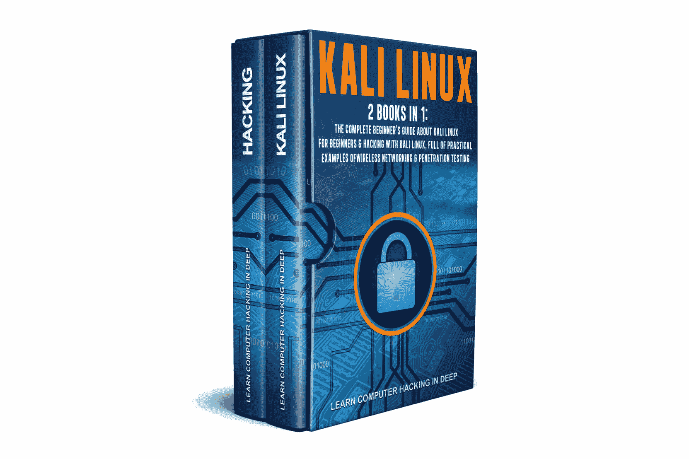

# Kali Linux：2本合1





© 版权所有 2019 Learn Computer Hacking In Deep - 保留所有权利。

本电子书的唯一目的是提供有关特定主题的相关信息，在这些方面，我们已尽一切合理努力确保其准确性和合理性。尽管如此，通过购买本电子书，您同意以下事实：无论书中做出了任何此类声明，作者以及出版商对此处包含的主题均非专家。因此，书中提出的任何建议或推荐纯粹出于娱乐目的。建议您在采取书中讨论的任何建议或技术之前，务必先咨询专业人士。

这是一份具有法律约束力的声明，被出版商协会和美国律师协会均认为有效且公平的，并且在美国境内应被视为具有法律约束力。

对此处发现的任何内容（包括任何特定或扩展信息）进行复制、传输和倍增，无论这些信息最终用于何处，都属于非法行为。这包括物理、数字和音频版本的作品复制版，除非事先获得出版者的明确同意。保留所有其他权利。

此外，下文所述页面中发现的信息在叙述事实时应被认为是准确且真实的。因此，对所提供信息的任何使用（无论正确或错误）将使出版者不对其直接范围之外所采取的行为承担任何责任。无论如何，在任何情况下，原作者或出版商均不应对此处讨论的任何信息可能导致的任何损害或困境承担任何形式的责任。

此外，后续页面中的信息仅供参考，因此应被认为是通用的。根据其性质，这些信息的呈现方式不对其长期有效性或中期质量提供任何保证。书中提到的商标均未获得书面许可，绝不能被视为商标持有者的背书。

## 免费下载此书有声版

如果你喜欢在途中听声书，我有一个好消息要告诉你。你只需注册免费的 30 天 Audible 试用，即可免费下载这本书的有声版！详情见下文！


### Audible 试用福利

作为 Audible 客户，你将在 30 天免费试用期间获得以下福利：

- 本书的免费 Audible 声书副本
- 试用结束后，你每个月将获得 1 个积分，可用于任何声书
- 如果你不使用积分，积分会自动滚动到下个月
- 可从 Audible 200,000 多部作品中选择
- 使用 Audible App 在多个设备上随处畅听
- 对任何你不喜爱的声书进行轻松、无忧的更换
- 即使取消会员，也可以永久保留你的声书
- 以及更多福利

点击下方链接开始！

- [前往 Audible 美国官网](https://www.audible.com/pd/B084P22F95/?source_code=AUDFPWS0223189MWT-BK-ACX0-182017&ref=acx_bty_BK_ACX0_182017_rh_us)
- [前往 Audible 英国官网](https://www.audible.co.uk/pd/B084NVMJ8D/?source_code=AUKFrDlWS02231890H6-BK-ACX0-182017&ref=acx_bty_BK_ACX0_182017_rh_uk)
- [前往 Audible 法国官网](https://www.audible.fr/pd/B084NT3W84/?source_code=FRAORWS022318903B-BK-ACX0-182017&ref=acx_bty_BK_ACX0_182017_rh_fr)
- [前往 Audible 德国官网](https://www.audible.de/pd/B084PBWD45/?source_code=EKAORWS0223189009-BK-ACX0-182017&ref=acx_bty_BK_ACX0_182017_rh_de)

## 第一本书

# 引言

恭喜你下载了《初学者 Kali Linux：计算机黑客攻击与编程指南——包含使用 Kali Linux 进行无线网络攻击和渗透测试的实用示例，帮助理解网络安全基础》电子书。看到你对了解 Kali Linux 的基础知识及其在当今技术世界中的用途表现出极大兴趣，我感到非常高兴。它可以被视为当今世界上最有效的软件之一。许多人认为 Kali Linux 是计算和网络领域人士的巨大福音。

Kali Linux 作为一个安全审计软件运行，同时也从网络和黑客攻击的角度工作。这款强大的软件包含了大量的安全功能，以及如安全研究、逆向工程和渗透测试等基于信息的任务。计算机取证也是该软件的一部分。

该软件是 Linux 家族的一员。Linux 发行版主要关注网络安全。

# 第 1 章：安装和下载 Kali Linux

如果你选择信息安全作为你的职业选择，你最需要的事情是安装一个主要作为安全系统管理员操作系统。一个合适的操作系统将帮助你执行与信息安全相关的各种任务，并让耗时较的工作变得非常简单。在当今的信息安全世界中，你可以找到各种操作系统，其中 Kali Linux 被认为是最好的。


它是渗透测试和信息安全领域的极佳工具。今天，大多数渗透测试人员以及关注系统安全和各种网络评估的伦理黑客都在使用它。

在所有其他 Linux 发行版中，Kali Linux 是当今安全审计领域应用广泛的最优秀且领先的发行版之一。Kali Linux 是唯一一个与网络安全和伦理黑客相关的操作系统。它配备了大量与命令行黑客相关的工具，这些工具对于各种与信息安全相关的工作是至关重要的。

Kali Linux 最常用于计算机取证、系统应用安全、渗透测试以及与网络安全相关的工作。Kali Linux 还是专为伦理黑客设计的主要操作系统。

## 如何下载 Kali Linux？

Kali Linux 是一款开源软件。这意味着该操作系统可以完全使用和利用，并且完全免费。因此，可以从操作系统的官方网站轻松下载 Kali Linux。你可以通过下一节中提到的各种技术来安装它。你会遇到同一系统的多个版本，可以根据你的需求安装其中某一个。

在下载安装文件时，你还会遇到一些用于安全工作的十六进制数字。你需要正确检查已下载镜像文件的完整性。你还需要检查安装文件的 `SHA-256` 指纹。

## 如何在你的电脑上安装 Kali Linux？

在电脑上安装 Kali Linux 的整个过程非常简单。你可以选择任何可用的安装操作系统的选项。最常用的安装选项包括：

*   使用硬盘安装操作系统。
*   借助 Kali Linux 可启动的 USB 启动盘安装操作系统。
*   借助 `VMware` 或 `VirtualBox` 安装操作系统。
*   借助双系统启动安装操作系统。

在你的系统上安装 Kali Linux 的所有可用选项中，借助 `VirtualBox` 并使用可启动的 USB 启动盘安装操作系统是最常见的。如果你想使用 `VMware` 或 `VirtualBox` 安装操作系统，你的系统至少需要 20GB 的空闲硬盘空间以及至少 4GB 的内存。

### 借助虚拟化软件安装 Kali Linux

* 在开始安装过程之前，你需要安装如 `VMware` 之类的虚拟化软件。你也可以选择其他选项，例如：
* `VirtualBox`，它是 Oracle 的产品。完成虚拟化软件完成后，从应用程序文件夹启动该软件。
* 你需要下载操作系统的安装文件，可以从官方网站轻松获取。之后，启动虚拟机。为此，打开在你系统上安装的虚拟化软件的主页，然后从选项中选择 `Create New Virtual Machine`（新建虚拟机）。
* 创建新虚拟机后，选择 Kali Linux 操作系统的 `iso` 文件或镜像，随后需要选择客户操作系统。你还需要配置与虚拟机相关的每一个细节，例如 Kali Linux。选择 Kali Linux `VM` 后，你现在可以轻松地启动与 Kali Linux 相关的虚拟机。选择 `VM` 后，点击绿色的 `Power`（电源）按钮。
* `VM` 启动后，你将看到弹出的菜单，你需要在 `GRUB` 菜单中选择所需的安装模式。选择 `Graphical Installation`（图形化安装）然后选择 `Continue`（继续）。
* 随后的屏幕将要求你确定与区域相关的信息，例如你希望用于 Kali Linux 的首选语言、所在位置、键盘布局等。
* 完成所有这些操作后，你需要为 Kali Linux `VM` 设置一个强密码。随后，安装程序会要求你选择时区，然后在磁盘分区步骤暂停。你可以为 `VM` 选择 `Entire Disk Space`（使用整个磁盘空间）或 `Create Separate Partition`（创建独立分区）。
* 你需要保存所有更改，但不要继续执行过程，因为这将完全擦除磁盘上的所有数据。因此，在继续之前请务必先确认设置。
* 之后，你会被要求安装 `GRUB` 引导加载程序。选择 `Yes`，然后选择用于保存启动 Kali Linux `VM` 所需信息的设备。
* 点击 `Finish`（完成），安装程序将完成最后的阶段程序。
* 操作系统也可以借助可启动的 USB 启动盘安装。

## 第二章：安装故障排除

在渗透测试和伦理黑客方面，Kali Linux 已证明是一个相当可靠的软件。但有时系统会崩溃，导致重新安装它变成一项枯燥的工作。Kali Linux 安装失败背后可能有多种可能性。这可能包括 `iso` 下载不完整或损坏、目标机器磁盘空间不足等许多问题。

Kali Linux 的安装程序确实非常可靠，但遇到 Bug 或外部问题（如镜像源故障、网络问题等）是非常常见的。因此，在这种情况下，你只需要对安装过程进行简单的故障排除，以便继续进行。

每当 Kali Linux 安装程序失败时，都会弹出一个“Installation Step Failed”（安装步骤失败）的屏幕。此时，你需要知道 Kali Linux 安装程序在各种虚拟控制台上运行：主屏幕运行在第五个控制台（对于图形界面安装程序，使用 `CTRL+Alt+F5`）或第一个控制台（对于文本界面安装程序，使用 `Shift+F4`）。

在这两种情况下，通过 `CTRL+Shift+F4` 看到的第四个控制台将帮助显示安装程序内部具体发生了什么的所有相关日志。你可以通过更详细的错误信息轻松评估安装程序问题的原因，例如“the log screen of installer”（安装程序的日志屏幕），这表明目标机器空间不足，安装程序无法继续该步骤。

### 安装程序的日志屏幕

第三个和第二个控制台（分别为 `CTRL+Shift+F3` 和 `CTRL+Shift+F2`）托管了 Shell，可用于详尽尽地进一步调查当前状况。大多数命令行工具都由 `BusyBox` 提供，因此功能集有些有限。它们对于解决你在安装 Kali Linux 期间可能遇到的大部分问题已经足够了。

当你点击主屏幕 `Installation Failure`（失败）上的 `Continue`（继续）时，安装程序将带你回到一个你在正常情况下可能看到的屏幕，即 Kali Linux 安装程序的 `Main Menu`（主菜单）。此屏幕将让你逐个启动安装步骤。如果你能通过访问安装程序 Shell 来修复问题，就可以轻松重新开始失败的步骤。

### 在安装程序 Shell 中可以做什么

在安装程序 Shell 中，你可以通过命令 `debconf-get` 和 `debconf-set` 轻松检查并修改 `debconf` 数据库。这些命令用于测试前面的值。你可以使用 `more` 或 `cat` 查看任何文件，例如位于 `/var/log/syslog` 的完整安装日志。你还可以使用 `nano` 编辑正在安装到系统的任何文件。


如果您仍然无法解决安装问题，可以提交错误报告。错误报告需要包含安装程序的日志，您可以通过主菜单中的 `Save Debug Logs` 选项轻松获取这些日志。

通过这种方式，您可以以多种方式导出日志，例如到挂载的文件系统、软盘或 Web 页面。保存调试日志最方便的方法是让 Kali Linux 安装程序启动一个用于存放日志文件的 Web 服务器。您可以从位于同一网络内的任何其他计算机上启动网络浏览器，然后下载所有可用的日志文件。

## 其他故障排除方法

还有其他简单的方法可以排查 Kali Linux 的安装问题。让我们来看看。

- **下载官方版本的 Kali Linux 镜像**：确保您已从官方网站下载了 Kali Linux 的 `ISO` 文件。镜像文件有多种格式，如 `ISO` 文件、ARM 镜像和 VMware 镜像。`ISO` 文件提供两种格式：32 位和 64 位。VMware 镜像预装了 VMware 虚拟机。VMware 镜像的格式为 32 位 PAE。对于 ARM 镜像，目前完全无法提供一种能够适用于所有 ARM 设备的单一镜像格式。在 Kali Linux 网站上，您可以找到各种设备的 ARM 镜像，如 `rk3306 mk/ss808`、`ODROID-U2/X2`、`Samsung Chromebook`、`Raspberry Pi` 等。

- **验证下载镜像的 SHA1 校验和**：在下载 Kali Linux 镜像时，确保您检查了下载旁提供的 `SHA1SUMS.gpg` 和 `SHA1SUMS` 文件。在验证镜像校验和之前，请确保 `SHA1SUMS` 文件是唯一由 Kali 生成。

- **验证安装步骤**：如果您使用 DVD 安装 Kali Linux，请尝试最慢速度刻录 DVD。确保您已禁用系统上的防火墙或防病毒软件，以免其中断写入过程。如果遇到磁盘空间不足错误，请尝试增加磁盘磁盘空间。检查您为安装 Kali Linux 分配的空间。最佳选项是分配至少 20 GB 的空间以及交换分区（swap）空间。您还可以通过删除并重新划分磁盘上的空空间来排除安装故障。您也可以让安装程序自动对磁盘上的空空间进行分区，这可能会解决您的问题。

# 第 3 章：Kali Linux 外部启动驱动

Kali Linux 是信息安全领域久名大远的名字。它由 Offensive Security 资助并维护，该公司是渗透测试和信息安全相关服务的提供者。Kali Linux 已成为黑客攻击的首选发行版。在几分钟内，您就可以拥有一个功能良好的渗透测试箱，以及在其他任何地方都找不到的工具集。Kali Linux 预装了大量工具，减轻了安装其他工具的压力。

## 运行 Kali Linux 的各种可用选项

您可以选择在您的系统上完全安装 Kali Linux。但在大多数情况下，您用于渗透测试或伦理黑客攻击的系统可能要求您仍然保留 Windows 或任何其他操作系统作为主操作系统。在这种情况下，您所能做的就是使用虚拟化工具，然后在虚拟机中运行 Kali Linux。然而，如果运行 Windows 或其他操作系统的系统内存不足，可能会导致虚拟机频繁崩溃。另一个选项是在安装了 Kali Linux 的外部 USB 驱动器上运行它。此选项带来的唯一问题是缺乏加密。

## 哪种是最佳选项？

从加密的外部可启动 USB 驱动器上安装并运行 Kali Linux 被视为最佳选项。但您还需要确保其安全。因此，为了做到，您需要遵循以下步骤。

- 首先使用由相关公司拥有的 USB 驱动器。

- 使用驱动器的完全磁盘加密，在 1 TB USB 驱动器上对 Kali Linux 进行完整安装。

- 然后您需要加密 USB 驱动器上的数据。由于内置驱动器也使用不同形式的加密处于加密状态，当从 USB 启动操作系统时，内置驱动器也将无法访问。

- 由于您使用的 USB 驱动器归公司所有，使用的所有数据都存储在该公司的硬件中。

- 项目结束后，您可以将外部 USB 驱动器交回公司，并将所有测试信息和数据返回给客户。

## 在 USB 驱动器上开始 Kali Linux

要启动过程，您需要下载 Kali Linux 安装程序的 `ISO` 文件，然后将镜像刻录到您使用的外部 USB 驱动器上。将外部 USB 驱动器插入要运行 Kali Linux 的机器上。确保在启动系统之前插入 USB 驱动器。

- **设置驱动器**：您需要的下一步是设置驱动器、对其进行加密并分区。会出现一个对话框，要求您选择安装所需的分区类型。选择 `Guided-Use Entire Disk`（引导使用整个磁盘）获得获得性能。与仅加密 `/home` 目录相比，这有助于完全加密 USB 驱动器。始终记住，在渗透测试时，Kali Linux 工具会将所有数据存储在主目录之外的各个地方。下一个屏幕将要求您选择要安装的磁盘。此时，确保您选择了要安装 Kali Linux 的 USB 驱动器，而不是系统的任何本地驱动器。如果您选择了任何本地驱动器，将删除该驱动器上的操作系统。选择 USB 驱动器后，点击 `Continue`（继续）。

- 下一个窗口将询问您如何对 USB 驱动器分区。选择 `All Files on one partition`（所有文件在一个分区）并点击 `Continue`。

- 接下来，将要求您保存分区的所有信息，然后开始磁盘分区过程。当您选择继续时，USB 驱动器上的所有数据将被删除。因此，在点击 `Continue` 之前，请选择 `Yes`。

- 磁盘加密过程将与分区过程一起开始。驱动器先清除后加密。整个过程将需要一段时间。如果您使用 64 GB 的 USB 驱动器，加密需要 30 分钟。如果您使用 1 TB 的 USB 驱动器，加密大约需要 10 小时。

- 过程完成后，将要求您提供一个用于加密的密码（passphrase）。确保使用强密码，因为在启动 Kali Linux 时将需要使用它。

- 接下来，确认更改并选择 `Finish Partitioning`（完成分区）。

- 现在系统将开始分区过程，过程完成后，安装系统将启动。

- 系统还会询问您是否要使用任何网络镜像（Network Mirror）。点击 `Yes`，这将选择您位置附近的存储镜像，并有助于以后加速更新过程。

## 启动 Kali Linux

将 USB 驱动器插入机器并启动。在启动过程中，打开启动菜单并选择您想要使用的 USB 驱动器。现在您将需要输入密码，输入成功后，系统将启动。

# 第 4 章：基础知识


在我们开始学习 Kali Linux 的其他方面之前，你有必要学习一下 Linux 自带的一些基础工具和命令。让我们来看一些最基础的组件。

## 核心 Linux 终端命令

与市场上提供的其他操作系统（特别是 Linux）相比，当提到“命令”（Command）这一术语时，指的是为用户 Shell 中内置的应用程序或功能的命令行指令。然而，这种区别对于终端用户来说意义不大。

两者的使用方式相同。你只需要在终端模拟器中输入这些单词，它就会提供结果作为输出。

### 用于文件系统管理的 Linux 命令

- `ls`: 此命令有助于列出当前目录下的所有内容。当你为其提供一个路径时，它将仅列出该路径的特定内容。你需要了解的一些有用选项是 `-l` 和 `-a`：`-l` 以长列表格式显示信息，包含更详细的信息，并显示以点（dot）开头的隐藏文件。
- `cat`: 当提供单个文件时，此命令有助于以标准格式将该文件的内容打印到输出中。当你同时提供多个文件时，它会将它们合并，然后将输出重定向到一个完全的新文件中。最有用的选项是 `-n`，它有助于对行进行编号。
- `cd`: 此命令有助于从当前目录跳转到另一个指定的目录。当你不带任何参数使用此命令时，它将返回主目录。当你使用带有两个点的命令（如 `cd..`）时，它将返回到当前目录的上一级；使用带有连字符的命令（如 `cd –`）将返回到当前目录之前的目录，无论其相对于当前目录的位置。
- `pwd`: 此命令有助于打印当前目录。当你的提示符不包含此特定信息时，此命令非常有用。它对于 BASH 编程非常有用，用于获取将要执行代码的目录引用。
- `mkdir`: 此命令用于创建新目录。最方便的开关是 `-p`，如果特定结构尚不存在，它可以帮助创建整个特定性质的结构。
- `file`: `file` 命令有助于指示文件类型。由于 Linux 系统中的文件并没有义务必须具有与系统相关的扩展名才能运行，因此用户有时很难获取文件的确切类型。此命令有助于解决与 Linux 相关的此类问题。
- `cp`: 此命令复制所有目录和文件。由于此命令默认不会递归复制目录，请务必在使用此命令时加上 `-a` 或 `-r`。`-a` 命令在复制的同时有助于保留所有权、模式和时间戳。
- `mv`: 它用于重命名或移动目录和文件。重命名和移动可以被视为单次操作，重命名只是将单个文件以不同的名称移动到相同的位置。
- `rm`: `rm` 命令用于删除目录和文件。这是一个你需要了解的核心命令，因为没有这个命令你无法删除任何杂物。然而，在使用此命令时必须格外留心，因为此命令会永久删除文件和目录。与其他命令不同，此命令不会将删除的文件和目录存储在其他地方以便你事后提取。一旦它们消失，就永远消失了。因此，在这种情况下，配合命令使用 `-r` 关是非常重要的。
- `ln`: 此命令用于在文件之间创建符号链接或硬链接。软链接或符号链接类似于 Windows 的快捷方式，提供了访问任何特定文件夹或文件的非常方便的方法。
- `chmod`: 它有助于更改用户的权限。权限包括对文件的写入、查看和执行。任何用户都可以更改其拥有的文件的用户权限。
- `chown`: 此命令用于更改文件的所有权。只有 root 用户才能使用此命令并更改文件所有权。为了递归更改目录内所有文件的所有权，你可以使用带有 `-R` 的命令。
- `find`: 此命令用于在整个文件系统中搜索特定的目录或文件。此命令在本质上非常强大，不仅是因为它具有搜索能力，还因为它允许用户对匹配或不匹配的文件执行任何形式的命令。
- `locate`: 与 `find` 相反，`locate` 命令通过数据库搜索文件名的模式。这种数据库由整个文件系统的快照组成。
- `du`: `du` 命令用于显示目录或文件的大小。在各种有用选项中，`-s` 提供摘要而非整个列表，`-h` 将报告的尺寸转换为更符合人类阅读习惯的格式，`-d` 有助于控制目录的递归深度。
- `df`: 此命令用于显示磁盘的使用情况。此命令的默认输出列出了每一个文件系统，报告它们的大小，以及已用空间和可用空间。你可以为此命令添加 `-h` 以获取更符合人类阅读习惯的格式报告。
- `dd`: 此命令有助于根据主页转换并复制特定文件。你需要为此命令提供源和目的，它将分别复制文件。
- `mount/unmount`: 这对命令执行文件系统的挂载和卸载功能。整个范围可以从 USB 闪存到 ISO 镜像。

### 用于文本处理的 Linux 命令

- `more/less`: 这两个命令在功能上有些相似，允许用户按屏幕分页轻松查看文本。假设某些命令产生了非常大的输出（例如对文件使用 `cat`），模拟器需要一些时间滚动整个文本。当你使用这些命令中的任何一个时，现在可以轻松地滚动文本了。与 `more` 相比，`less` 更新，因此现在不再使用 `more`。
- `head/tail`: 这也是一对命令，但它们都有各自的用途。`head` 命令有助于输出文件第一行的行数，而 `tail` 命令通过提供任何文件最后一行的行数作为输出。这些命令的默认输出行数为十，可以通过选项 `-n` 进行控制。另一个可以与此命令一起使用的开关是 `-f`。
- `grep`: 此命令有助于搜索文本中的模式。在默认功能下，此命令查看标准输入，但用户可以轻松指定要搜索的文件。模式可以是正则表达式，也可以是普通字符串。它还可以打印匹配或不匹配的行以及它们的上下文。当你运行一个提供大量信息作为输出的命令时，只需使用此命令即可魔法。
- `sort`: 此命令用于根据各种标准对文本行进行排序。与此命令一起使用的有用开关包括 `-n`（有助于对字符串的数值进行排序）、`-r`（有助于反转提供的输出）以及其他多种。在排序 `du` 命令的输出时可以使用此命令，当你想要完全按照大小降序排列文件时。
- `wc`: `wc` 命令用于统计单词数、行数、字节数和字符数。


- `diff`: 此命令通过逐行比较帮助显示两个不同文件之间的精确差异。

## 进程管理 Linux 命令

- `kill`/`xkill`/`pkill`/`killall`: 所有这些命令都用于杀死并终止任何进程。它们之间的区别在于接受的输入类型不同。`kill` 命令接受进程 ID（PID），`xkill` 命令允许用户点击窗口来关闭该窗口，而 `killall` 和 `pkill` 则仅接受进程名称。
- `ps`/`pgrep`: 在之前的命令中已经提到 `kill` 需要进程 ID。这可以通过使用 `ps` 命令来获取，它可以帮助打印与当前活跃进程相关的信息。`pgrep` 命令的工作方式特殊：你只需要提供进程名称，它将返回进程 ID。
- `top`/`htop`: 这两个命令的功能相似，都能帮助显示进程。它们也可以被看作控制台系统的监控器。
- `time`: 此命令作为一个进程运行。你可以将其看作程序执行时的秒秒表。

## 用户和 BASH 环境的 Linux 命令

- `su`/`sudo`: 这两个命令是实现相同目标的不同方式——以其他用户的身份运行命令。完全取决于你所使用的发行版类型，你可能见过其中一个，但实际上这两个命令都是可用的。两个命令之间的区别在于，`su` 将用户切换到另一个用户，而 `sudo` 仅以其他用户的权限运行命令。
- `date`: 与 `time` 命令不同，此命令帮助按照标准输出格式打印时间及日期。输出也可以根据用户的指定进行格式化，并包含所有信息：月、日和年。
- `alias`: 此命令帮助创建和更改指向其他命令的别名。这意味着你可以轻松为新命令提供新名称，或者重命名已有的命令。这对于缩写长命令字符串非常有用，长字符串在记忆时可能会产生问题。
- `uname`: 它帮助输出系统的一些基本信息。通过将此命令与 `-a` 配合，你可以获取内核信息以及主机名和处理器架构。
- `uptime`: 此命令将告诉你系统运行持续的时间。它并不重要，但可以帮助查找系统的总运行时间。
- `sleep`: 此命令帮助在特定时间后关闭系统。

## 用户管理 Linux 命令

- `useradd`, `usermod`, `userdel`: 所有这些命令都将帮助你添加、修改和删除用户账户。如果你是系统的唯一用户，可能并不需要这些命令。但如果系统同时被多个用户使用，这些命令就会非常有用。
- `passwd`: 此命令允许你更改用户账户的密码。作为 root 用户，你可以重置所有普通用户的密码，但你无法查看密码。定期更改密码是极其重要的。

## 文档/帮助 Linux 命令

- `man` `/whatis`: `man` 命令通过调出特定命令的手册提供帮助。大多数命令都附有 man 页（帮助页）。`whatis` 命令通过提供手册某些特定部分的单行摘要提供帮助。
- `whereis`: 此命令告诉用户可执行二进制文件的所在位置，前提是二进制文件位于用户的路径内。它可以找到存在的源代码和帮助页。

## 网络 Linux 命令

- `ip`: 此命令通过提供系统的 IP 地址提供帮助。
- `ping`: `ping` 命令是一个重要的诊断工具。它可以轻松测试你是否连接到互联网或路由器。它还可以帮助指示连接质量。

## Linux 命令行

命令行可以认为是 Linux 系统的优势之一。CLI（命令行界面）允许用户完全脱离发行版的限制。它还让与系统的交互任务变得简单得多。Ubuntu 的衍生版本使用相同的代码基础，但它们都带了一套完全不同的工具来执行相同的工作。相似发行版上的各种桌面环境需要不同的方式来执行相同形式的任务。作为用户，你可能需要忘记已经熟悉的过程，然后重新学习执行相同操作的过程，因为它们在不同发行版之间会切换。Linux 命令行节省了 GUI 也会消耗的系统资源。因此，如果你在运行较慢的系统上工作，使用命令行比使用 GUI 更好。

很多人认为命令行非常困难；然而其实不是。它就像给朋友发消息一样简单，你只需要向系统输入你想做什么即可。

### 获取 Shell（外壳）

Shell 无非一个将输入的文本转换为计算机系统可以执行的指令或命令形式的程序。你可以使用各种形式的命令来执行相同的任务。Linux 中可以找到各种 shell，但所有 shell 中最流行是由 GNU 项目编写的 BASH。另一种现代 shell 形式是 `zsh`，你可以轻松地为你的发行版安装它。

如果你在桌面环境中工作，你需要一个终端模拟器（terminal emulator），为了在特定界面内模拟终端。不同形式的发行版自带自己的模拟器：KDE 带有 `Konsole`，而 Gnome 带有 `Gnome terminal`。

### 一些基础命令

当你打开终端模拟器时，默认你处于登录用户的家目录下。你可以轻松地找到登录用户的用户名以及主机名。`$` 表示你以普通用户身份登录，而 `#` 表示你已以 root 身份登录。除非你正在进行任何形式的管理任务或在 root 目录之外进行操作，否则永远不要以 root 身份运行。

这将更改你已经工作过的所有目录及其文件的权限，并将 root 变为所有目录的所有者。你可以使用 `ls` 命令轻松列出所有可用目录及其内部的文件。

如果你需要更改任何目录，请使用 `cd` 命令。你还可以使用 `tab` 键，它可以帮助自动完成路径。你可以使用斜杠 `/` 来进入目录。如果你想进入当前目录的子目录，不需要提供整个路径。要查看目录的内容，不需要切换目录。只需使用 `ls` 命令查看特定目录的内容即可。

### 一些高级命令行

大多数从事 Linux 命令行工作的开发者都熟悉基础形式的命令，如 `cd`、`ls`、`tail`、`head`、`cat`、`grep`、`find`、`sort` 等许多。高级用户将需要了解如何使用 `awk` 和 `sed` 这样的“大怪兽”工具，甚至是 perl 单行命令（perl-oneliners）。拥有 BASH 脚本的高级知识后，你会发现想象力是唯一的限制。让我们来看一些高级形式的命令行。


- `watch`: 这个命令表现得像非常漂亮的程序，它可以定期执行一个程序并在全屏上输出该程序的内容。如果你将该命令放在引号内部，你也可以一次运行多个命令，例如 `watch –n 1 ‘ ls –la ; echo ; vmstat ; echo; df ’.`。这整条命令将执行完整的列出，显示内存统计信息以及磁盘空间。所有这些内容都将用空行隔开，并在每秒重复一次。这是观察大文件复制以及监控磁盘空间以防出现任何形式的问题的极佳方法。
- `curl`: 大多数 PHP 开发者都熟悉 php 的 cURL 扩展，该扩展也适用于 Linux 的命令行界面。你不需要编写任何其他额外的 PHP 程序，只需使用此命令行即可。你需要的所有选项都可用。输入 `man curl` 即可找到所有可能的工具。
- `logsave`: 这个工具在本质上非常重要，它可以帮助捕获程序的输出并将其发送到日志文件中。它还会添加开始和结束的时间戳。你可以添加 `–a` 参数来追加日志文件内容。
- `lsof`: 这个命令代表 list open files（列出打开的文件）。它显示系统当前打开的所有文件。它对于确定哪些进程在使用某个特定文件，或者显示单个进程的所有可用文件都非常有帮助。
- `strace`: `strace` 命令可以帮助追踪特定程序向 Linux 内核发的所有系统调用。这意味着你可以看到程序何时被打开、关闭、读取、写入、访问文件以及许多其他操作。这在某种程度上就像是在没有任何形式遮盖的情况下运行整个程序。例如，`strace –ff –e trace=open /usr/sbin/apache 2` 将追踪 `apache2` 程序并输出所有的打开调用。
- `z* tools`: 你经常需要对已压缩的文件进行 `diff`、`grep` 或 `cat` 操作。你不需要使用解压后的文件，只需通过用 `zgrep` 替换 `grep`、用 `zdiff` 替换 `diff` 以及用 `zcat` 替换 `cat` 等其他各种命令，就可以将这些文件视为已经解压的状态了。
- `iconv`: 这个命令有助于将以某种方式编码的文件转换为另一种格式。
- `nc`: 这个命令能够胜任一切，也可以用于检查服务的请求并确保发送了正确的头信息。

# 查找内容

大多数人使用图形化文件管理器来查找 Linux 中的文件，例如 Gnome 中的 `Nautilus`、Xcece 中的 `Thunar` 以及 KDE 中的 `Dolphin`。然而，你也可以使用命令行查找 Linux 中的各种内容，这甚至不取决于你所使用的桌面管理器类型。

## 使用 `find` 命令

`find` 命令允许你搜索已经知道可能文件名的文件。该命令简单的形式是根据你的搜索标准搜索当前目录下的所有文件，然后是同名的子目录。你可以通过名称、组、所有者、类型、日期、权限以及各种其他标准来搜索文件。在命令后输入点（`.`）如 `find.`，这将列出在当前目录下发现的所有文件。为了找到匹配某些特定模式的文件，你可以使用参数 `–name.`。你可以提供文件名的元字符（如 `*`），但你需要在它们前面加反斜杠 `\` 或将其包含在引号内。如果 `find` 命令无法找到任何符合你标准的文件，它将不会产生输出。

## 使用 `locate` 命令

与 `find` 相比，`locate` 命令快得多，因为它使用了一个构建好的数据库，而 `find` 命令是在真实系统的所有实际文件和目录进行搜索。

该命令返回一个包含特定字符组的所有路径名称的大列表。该命令最简单的形式是找到从根目录开始的文件系统中的所有文件。如果你想找到包含你提供的特定且唯一搜索标准的所有目录或文件，请配合命令使用参数 `–b`，如：`locate –b ‘\yourdata’`。命令行中使用的反斜杠充当通配符（globbing character），提供了一种方法将非特定性质文件名中的通配符字符扩展为一组特定性质的文件名。

通配符（Wildcard）无非是一个符号，在评估整个表达式时，它可以被轻松替换为一个或多个字符。最广泛使用的通配符符号形式是 `?`（表示单个字符）和 `*`（表示长字符串）。`mlocate` 命令是 `locate` 命令的新形式。它有助于索引整个文件系统。然而，搜索结果仅包含当前用户有权访问的文件每当你更新 `mlocate` 数据库时，它都会保留数据库的时间戳信息。

## 使用 `which` 命令

该命令返回执行任何命令时所调用的可执行文件的确切路径。

`which` 命令对于查找任何可执行文件的位置非常有用，其目的是在用户桌面、任何面板或桌面管理器中的其他地方为程序创建快捷方式。`which` 命令默认只会显示第一个匹配的可执行文件。为了显示所有匹配的可执行文件，你需要配合命令使用 `–a` 参数。

# 修改文件

Linux 及其各种操作系统提供的许多功能之一就是用于创建以及编辑文本文件的工具。现在可以找到各种文本编辑器，每个 Linux 用户都有自己的个人喜好。让我们来看看 Linux 中一些著名的文本编辑器。

### 文本编辑器

如果你是 Windows 用户，你一定熟悉名为 Notepad 的经典文本编辑器。Linux 也为用户提供了类似的程序，如 `gedit`、`NEdit` 和 `geany`。所有这些程序都是免费的，且都提供相似的服务。此类程序带有语法高亮功能，可以方便地编辑源代码以及使用任何标记语言（如 CSS 或 HTML）的文档。

- `NEdit`: 这是一个简单的文本编辑器，类似于 Notepad。它带有 Motif 风格的界面。
- `Geany`: 它是一个 Linux 文本编辑器，类似于 Windows 的 Notepad++。它带有标签页形式的界面，用于处理多个打开的文件，并具有诸如在边距显示行号等其他功能。它使用 GTK+ 工具包。
- `Gedit`: 这是 GNOME 桌面环境默认的文本编辑器。它是可以在任何类型的 Linux 系统上轻松使用的最佳文本编辑器之一。

### 基于终端的文本编辑器

当你从 Linux CLI 中工作时，你有广泛的文本编辑器可以选择。让我们来看看其中一些。

- `pico`: 这个文本编辑器最初是作为构建在 `pine` 的基于文本的电子邮件程序中的编辑器的。这个文本编辑器后来作为一个独立的程序用于编辑和修改文本文件。该文本编辑器的现代版本被称为 `alpine`。在基于 Linux 的系统上，你可以使用命令安装此文本编辑器：

```
sudo apt-get install alpine-pico
```


- `nano`: 这可以被视为文本编辑器 `pico` 的 GNU 版本，可以看作是不同名称下的相似程序。你可以通过命令：`sudo apt-get install nano` 在任何基于 Linux 的系统上安装 `nano`。
- `vim`: 这代表“改进版 vi”（vi improved），它作为一个文本编辑器，也被大多数计算机专业人士使用。第一次使用这个文本编辑器的控制可能会感到有些困惑。当你熟悉它后，它可以让执行最复杂的编辑任务变得非常快速和简单。如果你想在任何基于 Linux 的系统上安装 `vim`，可以使用命令：`sudo apt-get install vim`。
- `emacs`: 这是一个非常复杂且高度可定制的文本编辑器，它带有一个用于 Lisp 编程语言的内置解释器。它专门供从事 `Scheme` 等 Lisp 方言工作的计算机专业人士使用。如果你需要在你的 Linux 系统上安装 `emacs`，请使用命令：`sudo apt-get install emacs`。

## 将命令输出重定向到文本文件

当你使用 Linux 命令行时，有时可能需要在不实际运行文本编辑器的情况下创建甚至修改任何文本文件。以下是一些你可以用于此目的的命令。

### 使用 touch 命令创建空文件

为了创建空文件，你可以使用 `touch` 命令。该命令在假设文件内容已更改但实际上没有发生变化的情况下，帮助更新文件的 `mtime`（修改时间）和 `atime`（访问时间）属性。当你 `touch` 任何实际上并不存在的文件，系统将创建该文件而而不在文件中放入任何形式的数据。你可以使用如下命令：`touch myfile.txt`。只有当该文件已不存在时，此命令才会创建一个名为 `myfile.txt` 的新空文件。

### 将文本重定向到任何文件

有时你可能需要将命令的输出结果保存到特定文件中。为了轻松实现这一目标，你需要使用符号 `>` 将结果输出重定向到某些特定文件。例如，`echo` 命令用于将文本作为输出。因此，命令将是：`echo "example text"`。此命令将在你的屏幕上打印文本，然后返回命令行提示符。要将此相同输出重定向到文件，你可以使用 `>`。例如，`echo "example text">myfile.txt`。这将文本 "example text" 放入名为 `myfile.txt` 的文件中。如果文件 `myfile.txt` 不存在，它将由系统创建。如果它已经存在，该文件的所有内容都将被覆盖；它将破坏该文件的原有内容并用新文本替换它。

### 重定向到任何文件的末尾

重定向操作符 `>>` 与 `>` 类似。然而，该命令不是仅仅覆盖文件内容，而是将新数据附加到该文件的末尾位置。例如，`ls –l>>directory.txt`。此命令将获取 `ls-l` 的输出并将其添加到文件 directory 中。如果文件不存在，它将由系统创建。如果它已存在于系统中，`ls-l` 的输出将附加到文件末尾，位于现有文件内容的一行之后。

## 添加和删除软件

如果你已经使用基于 Linux 的系统很长时间，你一定知道在 Linux 中有多种方法实现相同的功能。这包括通过命令行在基于 Linux 的机器上安装软件应用程序。大多数 Linux 用户选择通过 CLI（命令行界面）在系统中安装新软件。从 CLI 安装软件最常用的方法之一是通过软件仓库，那里是软件文件存储的地方。这是通过使用包管理器完成的。所有基于 Linux 的软件都以包的形式分发，包无非与包管理系统相关的文件。每种 Linux 发行版都带有一个包管理系统，但它们并不都相同。

### 什么是包管理系统？

包管理系统由一组工具以及各种文件格式组成，共同用于安装、更新和卸载基于 Linux 的软件。最常见的两种包管理系统来自 Debian 和 Red Hat。CentOS、Red Hat 和 Fedora 使用 `rpm` 文件系统，其文件格式为 `.rpm`；而 Ubuntu、Mint 和 Debian 使用 `dpkg` 文件系统，其文件格式为 `.deb`。所有这些系统的主要区别在于你安装和维护它们的方式。

`.deb` 或 `.rpm` 文件的内部内容有些类似于旧的归档文件（如 `.zip`），包含了应用程序代码、软件安装方法、依赖项以及需要放置配置的位置。执行并读取上述所有指令的软件被称为包管理器。

### Ubuntu, Debian, Mint 以及其他

Ubuntu、Debian、Mint 以及其他 Debian 发发行版使用 `.deb` 格式文件以及 `dpkg` 包管理系统。通过此系统安装应用程序有两种。

你可以使用 `apt` 应用安装仓库，也可以使用 `dpkg` 应用从 `.deb` 文件安装应用。让我们看看如何执行这两个功能。

使用 `apt` 命令安装应用程序非常简单：

```
$ sudo apt upgrade
```

如果你只想更新一个应用程序：

```
$ sudo apt update app_name
```

如果要在系统中要安装的应用程序在 Debian 仓库中没有直接提供，而是以 `.deb` 下载形式形式可用：

```
$ sudo dpkg –i app_name.deb
```

### Red Hat, Fedora 和 CentOS

Red Hat 默认使用多种包管理系统。所有这些系统都使用自己的术语，但它们之间以及与 Debian 使用的工具仍然有些相似。例如，你可以使用 `dnf` 或 `yum` 管理器来安装应用程序。

```
$ sudo yum install app_name
```

$ sudo dnf install app_name
```

`.rpm` 格式的应用程序也可以通过 `rpm` 命令在系统中进行升级。

```
$ sudo rpm –i app_name.rpm
```

如果你想从系统中删除某些不需要的应用程序，那么：

```
$ sudo yum remove app_name
```
$ sudo dnf remove app_name
```

当你想要更新应用程序时：

```
$ yum update
```
$ sudo dnf upgrade – refresh
```

### 从 Linux 系统卸载软件

你可以通过软件仓库在 Linux 系统中安装软件。要查看系统中所有安装的包，你可以使用 `dpkg` 命令，然后按下 `Ctrl+Alt+T` 打开终端窗口。因此，你可以使用命令：

```
dpkg – list
```

你可以在终端窗口中滚动查看已安装软件包的完整列表，以找到你想从系统中卸载的内容。

要卸载包或程序，你需要使用 `apt-get` 命令，它是用于安装以及处理所有已安装程序的基本命令。例如，此命令将卸载 `gimp` 并通过 `-- purge` 命令删除其所有配置：

```
sudo apt-get -- purge remove gimp
```


你需要在此处输入密码，然后按回车键。卸载程序的过程将开始，屏幕上将显示需要执行的操作所需的摘要。如果系统询问你是否继续该过程，请输入‘y’然后按回车键。进程将继续进行。进程完成后，在提示符中输入‘exit’并按回车键。这将关闭终端窗口。如果你不想删除配置文件，只需省略 `--purge` 命令即可：

```
sudo apt-get remove gimp
```

当你卸载任何程序时，可能存在其他依赖于该已卸载程序集的软件包。F 

对于若要移除系统中的任何未使用的软件包，你可以使用 `autoremove` 命令：

```bash
sudo apt-get autoremove
```

你也可以将两个命令结合，用于删除任何程序及其不再被使用的依赖项：

```bash
sudo apt-get purge --auto-remove gimp
```

如果你的系统空间不足，使用 `clean` 命令删除所有下载的归档文件：

```bash
sudo apt-get clean
```

此命令还会删除 `/var/cache/apt/archives/` 下的缓存。

因此，在 Linux 上使用命令行安装和卸载软件是一项非常简单快捷的工作。

# 控制文件和目录权限

对于大多数 Linux 用户来说，习惯文件的权限和所有权可能有些些挑战性。假设在此种使用水平下，使用命令行是必须的。尽管还有其他更强大、更灵活的选项，但选择复杂的命令并不总是必要的。在桌面一些用户友好界面的帮助下，你可以轻松地转为很少或不使用命令行。管理文件所有权和权限也是可能的。

文件夹和文件的管理可以从文件管理器内部轻松完成。但在我们离开图形界面 (GUI) 之前，你需要对它的操作有一个具体的理解。所以，让我们从命令行开始。

## 命令行：文件权限

与修改文件所有权权限相关的命令有：

- `chmod`: 用于更改权限
- `chown`: 用于更改所有权

这两个命令都不难使用。对你来说，理解这一点非常重要：唯一能够更改文件权限或所有权的用户是 root 用户或当前所有者。因此，如果你是用户 B，在不寻求 root 或 `sudo` 帮助的情况下，你无法对 A 拥有的文件夹和进行任何更改。例如：

在名为 `/DATA/SHARE` 的数据分区上创建了一个新文件夹。用户 A 和 B 都需要该文件夹的写入和读取权限。实现此目标有很多方法。如果 A 和 B 是当前系统上的两个用户，你可以轻松地更改所有文件和文件夹的权限以允许他们访问。你可以使用以下命令完成：

```bash
sudo chmod -R ugo+rw /DATA/SHARE
```

在此命令中，每个子命令的拆解如下：

- `sudo`: 该命令用于在任何采用 `sudo` 的系统上获取命令的全局管理员权限。
- `chmod`: 该命令用于修改权限。
- `-R`: 该命令修改父文件夹及其包含子对象的所有权限。
- `ugo+rw`: 该命令提供组、用户和其他人的写入和读取访问。

在此命令中，`u` 代表用户，`g` 代表组，`o` 代表其他。`o`（其他）条目是最危险的，因为它将为所有人授予文件和文件夹权限。可以为文件夹或文件提供的权限有：

1. `r`: 读取
2. `w`: 写入
3. `x`: 执行

使用 `-R` 选项非常重要。如果你在 `SHARE` 目录下有各种子文件和文件夹，并且你想让权限从父对象应用到后续子对象，你必须使用 `-R` 选项，以确保相同的权限应用到父对象包含的最深层文件夹。

## 命令行：文件所有权

更改文件和文件夹的所有权也非常简单快捷。假设 A 为 B 移动了一个文件夹到名为 `SHARE` 的目录，但 A 仍然拥有所有权。这整个过程可以通过一个非常简单的命令来修改：

```bash
sudo chown -R B /DATA/SHARE
```

整条命令行可以拆解为：

- `sudo`: 该命令持有管理员权限，因为你正在处理一个另一个用户拥有的文件或文件夹。
- `chown`: 该命令用于更改所有权。
- `-R`: 该命令作为递归开关，确保所有子对象获得相同的所有权更改。
- `B`: 这是文件/文件夹的新所有者。
- `/DATA/SHARE`: 这是正在被修改的目录。

## GUI：文件权限

假设你需要允许所有人获得 `EXAMPLE` 文件夹的写入和读取权限。要在你的 Linux 发行版的文件管理器执行此操作，你需要遵循以下所有步骤：

- 打开你的 Linux 发行版。
- 导航到此例中的目标文件或文件夹。
- 右键点击该文件夹或文件。
- 点击菜单中的 `Properties`（属性）。
- 选择 `Permissions`（权限）选项卡。
- 在 `Others`（其他）选项卡中选择 `Access Files（访问文件）选项。
- 点击 `Create and Delete Files（创建并删除文件）。
- 为封装的文件选择 `Change Permissions（更改权限）。
- 弹出的窗口中你需要在 `Files` 标签下选择 `Read`（读取）和 `Write`（写入）选项，并在 `Folders` 标签下选择 `Create and Delete Files`。
- 选择 `Change`（更改）。
- 点击 `Close`（关闭）。

当你需要修改不属于你的文件夹的权限时，技巧就派上用场了：


- 打开终端窗口。
- 输入命令：`sudo -i`。
- 输入命令：`Nautilus`。

`sudo -i` 命令将为你提供对 `sudo` 的持久访问，除非你输入 `Exit` 命令来移除访问。一旦打开 `Nautilus`，你可以轻松地修改文件夹或文件的权限，即使该文件或文件夹不属于你。

## GUI：所有权修改

你可以通过以下步骤通过 `Nautilus` 修改文件的所有权：

- 在 `Nautilus` 窗口中找到文件或文件夹。
- 右键点击文件/文件夹。
- 选择 `Permissions` 选项卡。
- 从 `Owner` 的下拉菜单中点击 `New Owner`（新所有者）。
- 选择 `Close`。

# 管理用户环境变量

Linux 新手觉得最难管理的用户环境变量的最常见领域可能也是最晦涩的。尽管 Windows 环境也带有环境变量，但大多数用户自己管理自己的变量。为了充分利用 Linux 操作系统的性能，为了获得最佳性能、便利性和隐蔽性，你首先需要理解并管理所有的环境变量。环境变量是在特定用户环境中使用的变量形式。在大多数情况下，环境将是 `BASH` shell。

每个用户连同 root 都带有一组特定的环境变量，这些变量在被修改之前都设置为某些默认值。你可以轻松地更改这些值，以使你的系统运行更高效并自定义你的工作环境。

### 查看环境变量


你可以通过简单输入 `env` 来查看所有的环境变量。你需要了解，所有可用的环境变量都是大写的，例如 `PATH`、`SHELL`、`HOME` 等。你也可以创建自己的的一组用户定义变量，这将在稍后进行讨论。命令列表将打印出你系统特有的各种变量。在大多数情况下，此命令列表非常长，无法在单个页面中显示。要逐行查看所有变量，你可以使用 `More` 命令来打印输出。

在使用 `More` 命令后，整个变量列表将填满一个屏幕并停止。它将等待你按下 `Enter` 键以进到下一行。你可以一直这样做，直到找到你正在寻找的任何变量。当你连续多次按下 `Enter` 键时，你会发现一个名为 `HISTSIZE` 的变量。当你再次按下 `Enter` 时，它将一个接一个带你查看这些每一个变量。当你使用 `More` 命令查看输出时，可以输入 `q` 退出，然后返回命令提示符。

与其通过滚动这个长变量列表来寻找你感兴趣的变量（这是一项枯燥的工作），你也可以使用 `grep` 命令，它作为一个过滤命令，将帮助你轻松找到所需的变量。

## 查看变量的值

`set` 命令将显示所有变量的，但如果你想查看存储在变量中的值，你需要输入关键字 `echo`，后面需要跟上 `$` 符号以及变量名，例如：

```
echo $HISTSIZE
```

`$` 符号表示你想要操作内部可用的变量值，而不是变量的标签。

## 导出环境变量

当你修改任何环境变量时，该修改仅对特定的环境 set 有效。在这种情况下，该环境是 `BASH` shell。这意味着当你关闭终端时，你对这些变量所做的任何修改将丢失，并恢复到默认值。

如果你希望新的变量值在你的下一次终端会话以及之后的终端会话中保留，你需要导出这些变量。你可以认为这是将全新的变量值从当前变量导出到剩余系统中，以确保它在每个环境中可用。你可以通过以下方式轻松地做到：

```
export HISTSIZE
```

现在，当你离开环境时，`HISTSIZE` 的变量值被设置为零。然而，你可以通过输入内容轻松将 `HISTSIZE` 的值恢复到原来的设置，例如 1000：

```
HISTSIZE=1000
export HISTSIZE
```

## 修改 shell 提示符

Kali 默认 shell 提示符格式如下：

`username@hostname:present_directory>`

如果你是 root 用户，提示符将翻译为：

`root@kali:present_directory`

你也可以更改命令提示符，这默认是设置 `PS1` 变量的值。这个特定变量带有一组特定的占位符，用于放置在提示符中的所有信息。它包括：

- `\u`: 当前用户名
- `\h`: 主机名
- `\W`: 当前工作目录

你可以通过以下方式在终端中为 `PS1` 更改提示符：

```
PS1= “Best Man:#”
```

现在，每当你打开终端时，它都会首先显示 Best Man。你需要注意的是，当你打开第一个终端（即 `PS1`）时，提示符将是 Best Man，但第二个终端数字仍然是由默认提示符设置的。

## 修改 PATH 变量

`PATH` 变量被认为是所有中最重要的。这个变量最终控制了 shell 查找你输入的命令（如 `ls`、`cd`、`echo` 等许多命令）的位置。如果 `BASH` shell 无法在你路径的任何目录中找到你的命令，它将返回“command not found”的错误信息。如果你想将一个名为 `newtool` 的全新工具安装到目录 `/root/newtool` 中，你可以通过输入将其添加到 `PATH` 变量中：

```
PATH=$PATH:/root/newtool
echo $PATH
```

新工具将被添加。

# 第 5 章：Kali Linux 的现实应用和其他实用工具

如果你想成为一名伦理黑客，它不像成为软件开发人员或程序员那么容易。伦理黑客也称为渗透测试员，需要对各种领域有适当的理解。

你不仅需要各种编程语言（如 `C++`、`C` 和 `Python`）的深入知识，还需要关于 Linux 环境的高级知识来开始伦理黑客。

Kali Linux 是一个 Linux 发行版，带有大约 600 个预装工具，专门用于渗透测试。作为渗透测试世界的初学者，这听起来可能令人厌烦。一个初学者如何学会使用所有 600 个工具呢？然而，所有工具背后的真相是，你不需要掌握所有的工具。这主要是因为 Kali Linux 带有各种具有相同目的和概念的工具。让我们来看看 Kali Linux 为伦理黑客目的提供的一些最佳工具。

## MacChanger

MAC 地址可以被任何系统的合法地址。有许多原因导致更改 MAC 地址很重要。MacChanger 有助于在渗透测试期间更改 MAC 地址，例如对开启了 MAC 过滤的任何无线网络进行渗透测试。使用 MacChanger 需要遵循此命令：

```
~$ macchanger [options] networkDevice
```

可用的选项有：

- `-h, --help`: 打印帮助
- `-V, --version`: 打印版本后退出
- `-e, --ending`: 不更改厂商的字节
- `-s, --show`: 打印 MAC 地址后退出
- `-a, --another`: 设置类似的随机厂商 MAC
- `-p, --permanent`: 重置为原始形式的永久硬件 MAC
- `-A`: 设置任意类型的随机厂商 MAC
- `-r, --random`: 设置完全随机类型的 MAC 地址
- `-l, --list`: 打印已知的厂商
- `-m, --mac=XX:XX:XX:XX:XX:XX`: 将 MAC 地址设置为 XX:XX:XX:XX:XX:XX

## Nmap

它作为一个网络映射工具工作。它允许用户发现任何网络内活动的主机，然后收集与渗透测试任务相关的所有形式的信息。该工具的主要功能是：

- 它有助于主机发现。它可以轻松识别网络中的主机。
- 它具有端口扫描功能。它允许你列出远程或本地主机上所有开放的端口。
- 它有助于收集与任何连接设备的操作系统以及硬件相关的信息。
- 它还有助于确定任何应用程序的名称和版本。
- 它通过 Nmap 脚本引擎 `NSE` 扩展了 Nmap 的默认功能。

## Netcat

这是一个网络探索工具，在安全领域闻名，并在系统和网络管理领域为人所知。它主要用于检查入站和出站网络以及探测端口。与 `C` 或 `Perl` 等编程语言或 `BASH` 脚本一起使用时也有用。该工具的主要功能是：

- 它对 `TCP` 和 `UDP` 端口进行分析。
- 它对入站和出站网络进行嗅探。
- 它有助于 `DNS` 的反向和正向分析。
- 它对远程和本地端口进行扫描。
- 它与标准终端输入完全集成。
- 它带有 `TCP` 和 `UDP` 隧道模式。

## Unicornscan


这是一种用于信息收集和数据关联的安全信息工具。它带有对 `UDP` 和 `TCP` 端口的异步扫描，并具有发现网络模式的功能，这有助于发现远程主机的形式。它还能提供有关它们运行的所有软件的详细信息。该工具的主要功能是：

- 它对 `TCP` 端口执行异步扫描。
- 它对 `UDP` 端口执行异步扫描。
- 它对 `TCP`  banner 执行异步检测。
- 它可以检测操作系统系统服务以及应用程序状态。
- 它具有使用自定义数据集的能力。
- 它还支持 `SQL` 的关系型输出。

### Fierce

它是一种用于网络映射和端口扫描的工具。它还可以用于发现跨多个网络不连续的 `IP` 空间以及主机名。它与 `Unicornscan` 和 `Nmap` 相似，但与这两个不同的是，`Fierce` 专门用于企业网络。在渗透测试人员定义目标网络后，该工具将对选定的域运行各种测试以检索信息，这些信息可以用于后续阶段的分析和利用。该工具的主要功能包括：

- 它具有更改 `DNS` 服务器以进行反向查询的能力。
- 它执行内部和外部 `IP` 范围扫描。
- 它执行 `IP` 范围以及整个 `Class C` 的扫描。
- 它帮助将功能记录到文件系统中。
- 它发现名称服务器并还能发现区域传输攻击。
- 它具有使用自定义或内置文本列表进行暴力破解的能力。

Linux 中还有许多其他工具，可以帮助渗透测试以及伦理黑客攻击。每种工具都有自己的一套易用性，任何渗透测试人员都可以轻松地使用。

# 第 6 章：Linux 编程

在 Linux 上编程被用于创建接口、应用程序、软件和程序。Linux 代码通常用于桌面、嵌入式系统以及实时程序。Linux 是一个开源操作系统内核，兼容 `Perl`、`C++`、`Java` 以及其他各种编程语言。

## Linux 是如何工作的？

Linux 作为一个操作系统的内核，也可以被自由分发和共享。操作系统（OS）是帮助用户连接到计算机硬件的接口，并支持应用程序和程序的运行。内核无非是操作系统的核心，因为它管理着硬件和软件组件之间的所有通信。

## Linux 程序员的职责是什么？

开始 Linux 编程需要使用如 `GBU` 编译器和调试器等工具。它们有助于创建用于存储数据的应用程序、构建 `GUI` 以及编写脚本。与 Linux 相关的高级应用程序允许程序员开发与 Linux 相关的软件。他们还优化已有的程序，并编写具有各种复杂功能的新程序，如多进程处理、多线程、进程间通信以及硬件设备交互。

## Linux 的用途

Linux 今日被广泛应用于各种服务器、计算机安全系统和计算机系统架构。它被广泛用于实时程序以及 `PDAs` 和手机的嵌入式系统。Linux 编程也导致了各种应用程序。

## 如何开发内核模块？

在开始 Linux 核心编程之前，增加你的知识和 Linux 编程专业知识的最佳方法是从开始编写内核模块。模块是独立开发的，与 Linux 内核一起工作作为一个紧凑的操作系统。内核模块由各种内容组成，例如多个硬件外围设备驱动、文件管理器以及操作系统的其他低级功能。

进入内核模块的门槛比开发 Linux 内核要低得多。有许多模块由不同的个人和团队开发。因此，在开发入口没有特定的守门人。

## Linux 编程的逻辑拆解

当你使用某些主要形式的操作操作系统时，你是在间接地与 shell 交互。如果你使用 `Linux Mint`、`Ubuntu` 或其他适当的 Linux 发行版，你每次使用终端时都会与 shell 交互。让我们讨论一下 Linux 编程的拆解，它由 Linux shell 以及 shell 脚本组成。

在在我们开始之前，你需要熟悉一些术语：

- `Kernel`
- `Shell`
- `Terminal`

### 什么是内核？

内核无非是一个作为操作系统核心的程序。它对系统中所有元素具有整体控制权。它有助于基于 Linux 管理系统的各种资源：

- 文件管理
- 进程管理
- `I/O` 管理
- 内存管理
- 设备及其他组件的管理

一个完整的 Linux 系统可以拆解为：`Kernel + 安装脚本 + 其他管理脚本 + `GNU` 系统库和实用程序`。

### 什么是 shell？

Shell 是一种特殊的用户程序，有助于为与操作系统相关的服务提供适当的接口。shell 接受人类可读的用户命令，然后将其转换为内核可以理解的内容。它可以被视为命令语言的解释器，有助于执行从键盘等输入设备或系统文件读取的命令。当用户登录系统或启动终端时，shell 启动。

shell 可以被归分为两个不同的类别：

- 图形 shell
- 命令行 shell

图形 shell 为基于 `GUI` 或图形用户界面的程序操作提供了各种手段。这是通过允许关闭、打开、调整大小和移动窗口等操作，以及在窗口之间切换焦点来实现。`Ubuntu` 操作系统和 `Windows` 操作系统可以被认为是很好的示例，它们为用户提供了 `GUI` 以与各种程序交互。

用户可以通过 `CLI` 或命令行界面访问 shell。Linux 中提供了一种名为终端的特殊程序，用于输入人类的 `ls`、`cat` 等许多其他命令并对其进行执行。最终结果将直接显示在终端上，用户可以直接看到。假设你执行了命令 `ls` 并带有选项 `-l`。这这将以长列表的形式列出当前工作目录下的所有可用文件。

如果你只是初学者，配合命令行 shell 工作可能会变得有点困难，因为很难同时记住一大堆命令。它在本质上是非常强大的，它还允许用户将所有命令存储在一个特定文件中，然后一起执行所有命令。通过这种方式，任何形式的重复任务都可以轻松实现自动化。这些文件在 Linux 系统中通常被称为 `Shell Scripts`。

在 Linux 系统中，有多种类型的 shell 可供用户使用：

- `BASH`: 也称为 `Bourne Again Shell`，被广泛应用于基于 Linux 的系统。它被 Linux Linux 系统默认登录 shell。如果你愿意，也可以在 Windows 操作系统中安装它。


# Shell 概述

-   **CSH**: 也称为 C shell，它使用 C shell 的语法，其用法与 C 语言大同小。
-   **KSH**: 也称为 Korn shell，它是 `POSIX` Shell 标准的基础。

每种 Shell 的工作方式都相同，但它们都能理解各种命令并提供各种内置函数。

## Shell 脚本编写

通常情况下，Shell 本质上是交互式的，这意味着它们可以接受用户输入的命令作为输入并执行这些命令。

然而，你可能需要或想要以例行方式执行执行大量命令，这样你就不需要每次都在终端中输入所有命令了。由于 Shell 也可以从文件输入的形式接收命令，你也可以将命令写在文件中，然后在 Shell 中执行它们，以避免重复任务。所有这些文件被称为 Shell 程序或 Shell 脚本（Shell Scripts）。Shell 脚本的结构与 MS-DOS 中的批处理文件相似。每个 Shell 脚本都以 `.sh` 文件扩展名保存，例如 `yourscript.sh`。

Shell 脚本拥有与其他所有编程语言类似的语法。如果你已经熟悉 `C`、`C++` 或 `Python` 等任何编程语言，那么开始 Shell 脚本编写将变得更容易。Shell 脚本包含：

-   **Shell 关键字**: 包括 `else`、`if`、`break` 等许多。
-   **Shell 命令**: 包括 `ls`、`cd`、`echo`、`touch`、`pwd` 等。
-   **控制流**: 包括 `if..then..else`、`shell` 和 `case` 循环等。

你可以使用 Shell 脚本来避免重复工作，从而实现自动化。它也有助于监控，并允许为 Shell 添加各种新功能。

## 在 Linux 上使用 C 语言编程

Linux 正成为开发者的编程天堂。这主要是因为 Linux 的开源特性以及作为一个完全免费的操作系统。Turbo C 编译器是用于编译程序的旧形式编译器。在 Linux 上也可以完成同样的任务创建一个新的编程环境。让我们看看如何使用 `C` 编写、编译和运行程序，在 Linux 中开始编程。

如果你还没有在系统中安装任何如 `Ubuntu` 之类的 Linux 发行版，可以通过系统上安装任何虚拟机（如 `VirtualBox`）来实现。这是由 Oracle 设计的一个产品，允许用户在计算机系统上运行任何形式的虚拟机。这意味着你可以轻松地在 Apple 或 Windows 系统上运行 Linux。下载完虚拟机后，将其安装到你的计算机上，然后重启系统，最后创建一个全新的虚拟机。创建虚拟机：

-   点击 `New` 按钮创建新虚拟机。
-   为你的虚拟机提供适当的。
-   将操作系统选择为 `Linux` 和 `Ubuntu 64 bit`。
-   点击 `Next`。
-   点击 `Create Virtual Hard Disk`。
-   点击 `Create`。

### 如何在 Linux 上安装 C 语言？

-   打开终端窗口。前往 `Applications`（应用程序），然后点击 `Accessories`（附件），最后点击 `Terminal`（终端）。这将打开一个新的终端窗口。
-   为了在系统中运行 `C` 程序，你需要安装必要的包。要实现这一点，你需要在终端窗口中输入命令：
```bash
sudo apt-get install build-essential
```
现在它会提示输入管理员密码。正确输入密码后，安装过程将开始。为了安装这些包，你需要连接互联网。完成需要一些时间，取决于网络速度。
-   现在你可以编写并运行你想要的程序了。

### 如何在 Linux 中编写基于 C 的程序？

在 Linux 中编写 `C` 程序请遵循以下步骤：

-   打开任何文本编辑器，如 `gedit`。你可以通过输入命令 `gedit prog.c` 来实现。
-   编写程序。例如：
```c
#include<stdio.h>int main(){ printf(“Hello”); return 0;}
```
-   然后用 `.c` 扩展名保存程序。
-   你需要编译程序。
-   然后你可以运行或执行程序。

## 深度编程

-   在终端窗口中输入下面的命令来打开文本编辑器。
```bash
gedit prog.c
```
-   文本编辑器打开后，你现在可以编写程序了。
-   编写程序完成后，保存并关闭文本编辑器。
-   你可以如下所示编译程序：
```bash
gcc prog.c –o prog
```
-   如果你的程序中没有错误，屏幕上将不会显示任何内容。如果程序中有任何形式的错误，将会显示出来。你还需要再次打开文本编辑器，重复所有步骤删除错误并保存。
-   运行程序输入此命令：
```bash
./prog
```
-   程序运行后，你可以在另一个终端窗口看到程序输出。

## 在 Linux 中使用 C++ 编程

`C` 可以被视为一种过程化的编程语言。它由 Dennis Ritchie 在 1969 年至 1973 年间开发。最初，它是作为编写完整操作系统的编程语言开发的。`C++` 语言的主要特点是对系统内存的底层访问、一组非常简单易用的关键字以及非常清晰的风格。所有这些特征使得 `C++` 语言非常适合各种系统编程，如操作系统甚至编译器开发。第一步包括安装一些开发工具以及几个应用程序，如 `GCC,GNU, C++` 编译器，用于编译程序和在 Linux 中执行整体代码。`C` 和 `C++` 有某些相似之处，为了理解 `C++`，让我们先看看 `C`。

如果你需要，也可以使用命令验证已安装的工具集：
```bash
cc –v
```

现在让我们考虑一个名为 `Sort.c` 的非常简单的 `C` 程序文件：
```c
int main( void )
{
 \printf( “Hello! Sort\n” );
return 0;
}
```
编译这个简单的程序你可以使用：
```bash
cc filename.c -0 executable_file_name
```
在此命令中，`filename.c` 是 `C` 程序文件，`-0` 用于显示代码中的错误。如果代码没有错误，它将生成一个名为 `executable_file_name` 的可执行文件。
```bash
cc Sort.c -0 sortoutput
```
在此处，`sortoutput` 是生成的本质上可执行的文件。所以你可以这样执行它：
```bash
./sortoutput
```

### 关于 C++ 的程序文件

`C++` 是一种为了通用编程而开发的编程语言，如今被广泛用于竞赛编程。

它具有面向对象、命令式和泛型编程特性。你可以在各种操作系统平台上运行 `C++`，如 `Linux`、`Windows`、`Mac`、`Unix` 等。在我们开始 `C++` 编程之前，你需要在你的计算机系统中设置一个适当的环境，用于编译和运行基于 `C++` 的程序。你可以使用此命令验证所有安装的 `C++` 工具：
```bash
g++ -- version
```

让我们考虑一个非常简单的 `C++` 程序：
```cpp
// main function
// where the execution
// of program starts
int main()
{
// print Hello Universe!
cout<< “Hello Universe!\n”;
return 0;
}
```
编译这整个代码你可以使用：
```bash
g++ filename.cpp -0 executable_file_name
```


# 在 Linux 中安装 C++ 编译器

如果你正在使用基于 Linux 的系统，如 CentOS、Red Hat、Fedora 或其他系统，你可以以 root 用户身份输入此命令安装 C++ 编译器：

```
yum install –y gcc-c++*
```

为了验证 GCC 编译器是否已正确安装在系统中，请使用：

```bash
rpm –qa | grep –i c++
```

你也可以使用 `which` 命令：

```bash
which c++
```

# 在 Linux 上编写第一个 C++ 程序

- 从终端窗口开始，使用 `vim` 命令打开一个新文件进行编辑：

```bash
vim hello.cc
```
- 在 `vim` 编辑器中，你现在可以输入你的 C++ 程序或代码了。
- 完成后，保存并退出文件。
- 若要编译新的 C++ 程序，你需要在终端中输入此命令：

```bash
c++ hello.cc
```

如果编译过程运行过程中没有任何错误，屏幕上将不会打印任何形式的输出。

- 当前目录下将创建一个可执行文件，默认名为 `a.out`。
- 若要运行该程序，你可以像执行 Linux 中任何可执行文件一样，执行生成的这个执行文件。

## 如何指定生成的可执行文件的名称？

在不指定任何特定选项的情况下编译 C++ 程序，将生成一个名为 `a.out` 的可执行文件。如果你想为你选择的可执行文件指定特定名称，有两种方法：第一，是在创建后重命名默认的 `a.out`；第二是在编译时使用 `-o` 选项指定可执行文件的文件名。

```bash
c++ hello.cc –o /opt/hello.run
```

## 在 C++ 程序中执行系统命令

在需要时通过执行操作系统的命令来与编译系统进行通信是非常重要的。`system()` 函数允许你从 C++ 代码中运行系统命令。为了让编译器能够正确识别所有这些函数并以正确的方式进行编译，需要调用 `stdlib.h` 库文件。

## 核心总结

- 在 Linux 机器上编写 C 或 C++ 程序，你需要 `GCC` 编译器。
- 所有的 C++ 程序都保存并写为 `.cc` 格式的文件。
- 所有生成的可执行文件都可以以类似于执行 Linux 或 Unix 可执行文件的方式进行运行。
- `system` 函数用于从 C++ 代码中运行系统命令。
- `g++` 和 `c++` 命令都对 C++ 源文件进行编译和链接。

# 在 Linux 中使用 Python 编程

Python 是现代编程语言之一，在开发社区中受到了大量关注。它由 Guido von Rossum 于 1990 年开发。它类似于 Java，程序一旦编写，就可以轻松地运行在任何类型的操作系统上。如果你是第一次在 Linux 中开始编程，Python 是你入门的绝佳选择。它具有较低的学习曲线，并有一套优雅的编码系统。

## 安装 Python

像 Ubuntu 等基于 Linux 的发行版预装了命令行版本，这使得开始 Python 之旅变得非常简单快捷。事实上，Linux 社区的许多人开发了许多 Python 脚本和工具集。

你可以通过图形化交互式开发环境、IDLE 或命令行版本开始这一过程。

## 从命令行编写 Python

打开你的终端窗口，然后输入引号内的 `'python'`。这将在交互模式下打开 Python。这种模式对于初始阶段的学习非常有帮助，但你可能想使用 `Vim`、`Gedit` 或 `Emacs` 等文本编辑器来编写代码。只要你以 `.py` 扩展保存代码，就可以在终端窗口中执行它们。大多数编程都从那个非常老的老兵开始：Hello Universe 或 World 程序。因此，我们也从这里开始。

在命令提示符处，输入 `print "Hello Universe"` 然后按回车。你可以很容易地看到命令在命令旁边被打印出来。从命令行运行脚本只需输入：`python my_script.py`。如果你想退出命令行，输入 `exit()` 或直接按 `Ctrl+d`。

## 使用 IDLE 编写 Python

如果你考虑直接从命令行编写一个长程序，可以从 IDLE 开始。只需打开终端窗口并输入：`idle'`。你现在会看到 Python 的图形 shell 已加载。若要编写 Python 脚本，只需点击 File（文件）然后 New Window（新建窗口）。

这将打开一个类似于记事本的文本编辑器。然后，你只需要输入这段代码：

```python
#linuxversion.py
# 获取用户输入版本并响应
name= raw_input("Which release of Linux do you see")
print "Even I like", name, " – Linux is great!"
```

这条命令中发生了各种事情。前两个带有 `#` 符号的行仅仅是注释。第三行将使用从 `raw_input` 函数收集的输入，然后将其赋值给变量 `name`。

最后，`print` 语句将返回结果。你可以将文件保存为 `.py` 扩展，然后从可用菜单选择 Run（运行）后的 Run Module（运行模块）来运行你的程序。

注意，许多编程语言通常会忽略任何空白字符（即代码之间的间距）。但在 Python 中，如果出现任何形式的不当间距，可能会导致语法错误。因此，请确保正确输入空格以以便正常运行代码。

## Python 编程

人们常说系统管理员需要非常精通脚本语言。

虽然大多数人非常习惯使用 `BASH` 来运行脚本，但用 Python 替代它实际上可以增加许多优势。Python 允许用户访问所有命令行工具，并利用了面向对象的编程结构。大多数 Linux 发行版中都可以找到 `2.x` 和 `3.x` 版本的 Python。要进入 Python shell，只需在你的终端模拟器中输入 `python3` 或 `python`。退出 shell 只输入 `quit()`。

需要注意的是，虽然 Python 的 `2.x` 版本今天仍在使用，但它已不再被积极维护。出于这个原因，最好切换到 `3.x`。两个版本的 Python 在语法上存在某些差异。

你可以在 Python 中执行各种算术运算以及对文本字符串进行操作。如果你需要，甚至可以将操作结果赋值给变量，然后在屏幕上显示。Python 提供的一个非常实用的功能是拼接：你只需要为打印函数提供一个由逗号分隔的变量或字符串值列表，它将返回由列表项按顺序组成的完整句子。你还可以混合不同类型的变量，并且在给任何变量分配了一个特定值后，你可以在后续阶段更改数据类型而不会出现任何问题。

你可以在 Python 中轻松创建列表。列表无非是一个有序的项目集合，且不要求具有相同的数据类型。要创建一个名为 `bandsRock` 的空列表，你需要使用方括号配合命令如下：

```python
bandsRock=[]
```


要将列表中的任何项添加到末尾，请使用 `append()`。要从列表中删除任何项，您可以轻松地将特定元素传递给方法 `remove()`，或将该项在列表中的正确位置传递给 `pop()`。在输入项目名称并加上点 `.` 后，可以使用 `Ctrl+space` 显示任何对象的可用方法的完整列表。

# 在 Linux 上使用 Java 编程

Java 是最受欢迎的编程语言之一。它被广泛用于开发几乎所有领域的软件，从手机到电缆电视盒，一直扩展到大型企业信息系统。编写 Java 源代码、编译然后运行的整体概念在大多数操作系统中大体相同。

Java 是一门最初由太阳微型系统公司（Sun Microsystems）开发的编程语言。它属于编译型编程语言的范畴，程序员编写源代码，然后将其提交给编译器，编译器将检查程序的语法并生成一个你可以运行的完整文件。例如，当你使用 Google Chrome 浏览器时，从真谛上说，你正在运行所有由软件开发者使用的编译器生成的程序。

在很大程度上，过去的编程语言需要你为想要运行程序的每一个新操作系统重新编译所有的源代码。例如，为在 Windows 上运行而编译的程序在没有重新编译的情况下，不会在带有 Linux 的系统上运行。由于操作系统和硬件元素之间的巨大差异，这一过程的执行非常困难且复杂。Java 的主要动力之一是希望能够只编写一套源代码，然后让生成的程序具有在不同的操作系统或运行环境中运行的能力。

Java 之所以具有“编写一次，随处运行”的能力，仅仅是因为编译器将特定文件中的整个源代码翻译成名为“字节码”（Byte Code）的文件，该文件可以在任何形式的支持的 `JRE` 或 Java 运行环境（Java Runtime Environment）下运行。

Java 的开发过程涉及以下步骤：

- 编写 Java 源代码并将其保存在一个或多个纯文本文件中。所有这些文件通常以 `.java` 格式结尾。
- 运行 Java 编译器（`javac`）将你编写的源代码编译成字节码文件。字节码的文件名通常以 `.class` 结尾。
- 将字节码提交给 `JRE` 后运行程序。

## 下载 Java 开发包

要使用 Java 进行任何编程工作，你将需要下载并安装 Java 开发包或 `JDE`（JDK）。在大多数情况下，当你在系统中遇到 Java 的安装时，意味着安装了 Java 运行环境或 `JRE`。在本示例中，你需要 `JDK`，它带有名为 `javac` 的特殊程序，用于将 Java 源代码编译成类文件。你可以从 `Oracle` 官网下载 `JDK`。

在下载 `JDK` 时，请确保下载的版本与你当前使用的操作系统匹配。在这种情况下，如果你正在使用 Linux，请下载 Linux OS 支持的文件。大多数 Linux 发行版（如 Ubuntu、Debian、Red Hat 等）带有软件仓库工具，有助于自动化下载和安装步骤。例如，在 Ubuntu 和 Debian 发行版中，使用 `apt-get` 命令下载并安装 `JDK`，如下：

```bash
sudo apt-get install openjdk-7-jdk
```

在 Fedora、CentOS 以及其他使用 `YUM` 的发行版下安装 `OpenJDK`，可以使用此命令：

```bash
yum install java-1.7.0-openjdk
```

`apt-get` 和 `yum` 安装程序都会在用户无需执行任何额外任务的情况下下载、安装并配置 `JDK`。

## 编写和编译 Java 程序

Java 编程语言是编译语言的一种，程序员编写源代码，然后将其提交给编译器。编译器本质上是一个将源代码转换为字节码的程序。

结果生成的字节码通过 `JRE` 执行。你可以使用任何文本编辑器编写 Java 源代码，例如 Windows 中的 `Notepad`，以及 Linux 中用于编辑源代码文件的 `pico` 或 `nano` 编辑器。要开始编写 Java 程序，请遵循以下步骤：

- 在 Linux 中打开 shell 提示符。你也可以通过在 Linux 中按下 `ALT+Ctrl+T` 实现这一点。
- 使用 `gedit` 程序创建一个新文件，只需输入：
```bash
gedit HelloUniverse.java
```
- `gedit` 程序将打开并创建一个文件。
- 输入你的 Java 源代码。
- 完成源代码编写后，确保你已保存文件。
- 退出 `gedit` 程序。
- 现在是时候使用 `javac` 编译器编译程序了。命令为：`javac HelloUniverse.java`
- 如果语法没有错误，编译器将顺利运行。
- 现在你可以通过运行 `Java` 然后后跟程序名来运行你创建的示例程序。

Java 编程还包含另一个名为“类”（`class`）的组件。它是一个巨大的函数集合，执行各种工作，并带有可能处理的各种数据的模板。在刚才提到的程序示例中，`HelloUniverse` 就是程序的 `class`。

# 在 Linux 上使用 BASH 脚本

BASH 是一种命令语言解释器。它广泛存在于各种类型的系统中，并作为大多数 Linux 或 GNU 系统的默认命令解释器。BASH 与 shell 一起工作。shell 本质是一个宏处理器，允许非交互式或交互形式的命令执行。在 BASH 中，脚本允许执行自动命令，而这些命令通常情况下会以交互形式逐个执行。

## Bash Shell 基础

shell 允许用户通过命令与计算机交互。它还有助于存储和检索数据、处理信息以及其他若干任务。例如，你可以输入 `cal`、`date`、`pwd` 或 `ls` 等命令并按回车键。你刚刚的操作是通过 shell 与系统交互以获取当前的日期和时间。

这是通过使用 `date` 完成的，使用 `cal` 查看日历，使用 `pwd` 查看你当前工作的目录位置，然后通过 `ls` 获取位于其中的目录和文件的完整列表。

## 什么是脚本？

为了正确理解脚本，首先将 shell 与你使用的文本编辑器结合起来，例如使用 `.vi` 创建名为 `task.sh` 的新文件，该文件将包含上述所有命令，每条命令位于不同的行上。完成后，你需要使用 `chmod` 命令配合 `+x` 选项使新文件具有完全可执行权限。最后，你只需要在名称前加上 `./` 即可执行新脚本。

通过适当的脚本编写，任何形式的 shell 交互都可以脚本化和自动化。现在还可以使用 `cron` 时间调度器在每天指定的任何时间自动执行新的 shell 脚本 `task.sh`，并在每次执行时将脚本的输出存储到特定文件中。

## BASH 基础


到目前为止，我们讨论了 shell 和脚本。但是，`BASH` 呢？正如我们之前讨论过的，`BASH` 是许多 Linux 或基于 GNU 系统的默认解释器形式。这就是为什么我们的上一个 shell 脚本即使在没有定义 `bash` 为最终解释器的情况下也能运行的原因。

你可以执行此命令来查找默认解释器是什么：

```bash
$ echo $SHELL
```

```
/bin/bash
```

你也可以找到其他几种 shell 解释器，如 C shell、Korn shell 以及其他各种。要将脚本解释器定义为 `BASH`，你首先需要使用 `which` 命令找到其可执行二进制文件的完整路径。该命令需要以 shebang 或 `# !` 为前缀。你需要将其插入到脚本的第一行。虽然还有其他定义 shell 解释器的方法，但这被认为是最佳选择。

## 文件权限与命名

为了执行 shell 脚本，你需要使用命令 `chmod +x FILENAME` 使你的文件处于可执行状态。无论文件扩展名的后缀是什么，新创建的任何形式的文件默认都不是可执行形式。在基于 Linux 或 GNU 的系统上，使用 `file` 命令来识别文件类型。

## 脚本执行

简单来说，bash 脚本无非一个简单的文本文件，其中包含了需要从上到下按顺序执行的指令。指令的解释方式取决于定义的 shebang 或执行脚本的过程。

还有另一种执行 bash 脚本的方法，即按显式顺序调用 bash 解释器，例如通过 `$ bash date.sh`。通过显式地调用可执行二进制文件，`date.sh` 的文件内容被加载并被解释为 bash shell 脚本。

## 简单备份 Shell 脚本

可以通过 bash shell 终端成功执行的任何命令都可以以与 bash 脚本部分相似的形式存在。通过终端直接执行命令与在 shell 脚本中执行命令之间没有本质区别，区别在于 shell 脚本为单个进程中的各种命令提供了非交互形式的执行方式。大多数命令都接受参数和选项。命令选项用于修改命令的行为，以产生另一种形式的输出结果，这些结果以 `-` 开头。参数可以指定针对目标（如目录、文件、文本等）的命令执行。

你可以使用 `man` 命令显示任何所需命令的手页。例如，为了显示 `ls` 命令的手页，你可以执行命令 `man ls`。退出手页可以按 `q` 键。

## 变量

变量可以被视为编程的核心本质。它允许程序员存储数据、并在整个脚本中重用并修改相同数据。你可以使用变量创建一个全新的脚本，如 `welcome.sh`。

## 输入与输出

在 Linux/GNU 命令行上执行的命令要么需要输入、产生输出或显示错误消息。这是 shell 脚本的基本概念，泛指与 Linux 或 GNU 命令行操作。每当你执行一个命令时，会有三种可能的结果：第一种可能是产生输出，第二种可能是生成错误，第三种可能性可能不会产生任何形式的输出。

# 第 7 章：网络基础

在如今这个万物皆有科技的世界，网络已成为建立新业务或组织的强制性组件。网络有助于通过各种形式与终端（或者说是主机或主系统）一组相关设备或系统进行无缝连接。它对于全球所有服务提供者、企业和消费者同时通信和互连具有至重要的地位。

网络概念伴随着几乎所有的事物出现，如短信、电话通话、视频流等。

网络的操作涉及一系列严肃的技能，这在很大程度上取决于其复杂性。例如，在一个大型企业中，有多个节点，并且对网络安全有要求，如管理员功能、加密及其他等。另一方面，任何在家中结合网络和互联网进行日常工作的人，都可以轻松设置，并解决无线网络本质的若干基础性问题。

## 网络基础

为了正确理解网络的功能及其组件，你需要了解一些基础知识。计算机系统网络由几个元素组成，这些元素有助于整体的运行。

## 网络类型

计算机网络可以分为两大类：有线和无线。在谈到有线网络时，它需要一种物理形式的网络，用于在两个节点之间传输信息。对于办公场所和家庭的数字通信，由于其整体的成本效益和耐用性，使用了以太网线。今天，光纤也被用于跨越距离的数据传输。

光纤提供的速度比以太网线更快。然而，与光纤相比，以太网线要便宜得多。

在无线形式的网络中，利用电波通过空气进行数据传输。在这种情况下，设备之间无需任何种电缆即可连接。无线局域网（Wireless LAN）被广泛用于无线网络领域。今天可以找到各种替代方案，如蓝牙、卫星、蜂窝网络、微波等。

经过各种实践经验发现，与无线网络模式相比，有线网络形式具有更好的速度、安全性和可靠性。但是，无线网络比有线网络具有更大的扩展性、移动性和灵活性。两种类型的网络都根据网络的物理层进行分类。也可以根据网络的构建和设计结构、网络覆盖以及涵盖 SDN（软件定义网络）的方法进行区分。网络还可以根据规模、广域网、局域网、存储区域网、环境及其他等方面进行分类。

## 网络系统及其类型

当你遇到网络系统时，你会发现两种类型：开放和闭合。在开放系统中，整个系统与网络保持连接，随时准备任何类型的通信。在闭合系统中，系统与网络断开，你无法与网络连接。

## 网络组件

网络系统需要适当物理网络的基础设施。它由几个网络组件组成，如交换机、路由器、访问点以及一些基础形式的固件，固件最终有助于其他连接组件的运行。


其他组件还包括用于网络安全、监控和管理的软件。任何类型的网络在很大程度上取决于其协议及其标准，用以执行离散形式的任务或为了与各种数据类型进行通信。所谓协议，是指一组适当的算法或规则，定义了与通信相关的不同实体如何在网络中相互连接的方式。你可以在网络中找到多种类型的协议，如 `ARP`、`IP`、`TCP`、`FTP`、`DHCP` 等。

IP 语音（Voice over IP）或 `VoIP` 用于将 `IP` 语音流量直接传输到终点，该协议也支持这一点。`TCP/IP` 被认为是互联网协议族，负责基于 `IP` 在网络上传输数据。`IP` 地址可以被视为逻辑形式的地址，它在网络中所有系统中充当网络地址的作用。它有助于为网络中的每个设备设置唯一的标识形式。网络中发现的 `IP` 地址采用 32 位结构。`IPV4` 由 `IANA` 分配给网络中的所有系统。

每个网络主机的物理形式地址被称为 `MAC` 地址。它与网络接口卡（或 `NIC`）相连。你可以找到 48 位或 12 个半字节（nibble）的 `MAC` 地址。`MAC` 地址是在制造时分配给设备的。

# 第 8 章：代理与代理链

随着技术的进步，黑客的数量每天都在增加。谈到黑客时，有些是好的，另一些可以被认为是坏的。大多数坏黑客使用黑客手段来窃昂贵的机密信息、为了钱，甚至有些人仅仅是为了好玩。坏黑客倾向于通过传播有害恶意软件和其他恶意物品在网络安全世界中制造混乱。好的黑客也可能为了钱而黑客，但他们以正确的方式这样做，例如参与漏洞赏金活动，帮助他人妥善备份所有

随着技术的进步，黑客的数量每天都在增加。在谈到他们丢失的数据时，学习系统内部可能的漏洞让管理员意识到可能的威胁等。

“黑客”并不意味着他们是那些可以进入网络安全世界任何形式受限区域的人；他们也是管理公司或组织安全的 IT 专家。大多数黑客在黑客时需要保持匿名状态，他们总是努力让自己难以被发现。黑客使用多种类型的工具来隐藏身份，如 `VPN`（虚拟专用网络）、`RDP`（远程桌面协议）和代理服务器 `ProxyServers`）。

为了完全匿名地执行渗透测试并降低被检测的总体概率，黑客需要使用某种中间机制，其自身的 `IP` 地址将留在目标系统中。黑客通过使用代理来实现这一目的。代理服务器或代理是一种专用的软件或计算机系统，它也运行在计算机系统上，并在客户端服务器和终端设备（如计算机系统）之间充当自己的中间人。通过代理连接互联网，客户端系统的 `IP` 地址将不会显示，而是将显示代理服务器的 `IP` 地址。这有助于在客户端直接连接互联网时提供更多的隐私。

## ProxyChains 的特性

`ProxyChains` 的主要特性是：

- 它支持 `SOCKS4`、`SOCKS5` 以及基于 `HTTP CONNECT` 的代理服务器。
- `ProxyChains` 可以与列表中的任何其他代理混合。
- `ProxyChains` 支持多种链式方法，例如：随机（random），即从配置文件的列表中随机选择任何代理；或者按照类似的列表顺序进行链式代理，通过文件中的换行将不同形式的代理相互分开。它还带有一个动态（dynamic）选项，`ProxyChains` 只通过那些本质在线的代理。它排除了任何形式的不可达或失效代理。这种形式的代理被称为智能（smart）选项。
- 你可以将 `ProxyChains` 与 `sendmail`、`squid` 等许多服务器配合使用。
- `ProxyChains` 还通过代理解析 `DNS` 的能力。
- 它可以处理任何形式的 `TCP` 客户端应用程序，如 `telnet`、`nmap` 等。

## ProxyChains 的语法

与其运行简单的渗透测试或直接使用你的 `IP` 地址创建各种目标请求，你可以使用 `ProxyChains` 来涵盖并处理所有工作。你只需要为每个任务添加 `proxychains` 命令。这将启用 `ProxyChains` 服务。

例如，你想使用 `Nmap` 配合 `ProxyChains` 扫描网络中的某些可用主机及其端口，命令看起来如下：

```
proxychains nmap 192.168.0.0/25
```

该命令语法的分解为：

- `proxychains`: 这将告诉机器运行 `ProxyChains` 服务。
- `nmap`: 告诉 `ProxyChains` 要执行哪些任务。
- `192.168.0.0/25` 或其他参数: 这是任何形式的工具或任务所需的参数，在这种情况下，它是 `Nmap` 运行扫描所需的扫描范围。

## 如何使用 ProxyChains？

在开始使用 `ProxyChains` 之前，你需要为 `ProxyChains` 设置配置文件。你还需要一个代理服务器列表。`ProxyChains` 的配置文件位于 `/etc/proxychains.conf`。用你选择的任何文本编辑器打开 `proxychains.conf` 文件，然后设置整体配置。默认设置下，`proxychains` 将直接通过你主机上的 `127.0.0.1` 端口 `9050` 串所有总流量，这是 `Tor` 的默认配置。如果你也在使用 `Tor`，你可以保持这一切原样。如果你不使用 `Tor`，你需要注释掉这一行。

现在你需要添加更多代理。互联网上可以找到许多免费代理服务器。注释掉默认为 `Tor` 设置的代理。如果你不使用它，请在 `Proxychains` 的配置文件上添加代理并保存。

## 随机链 (Random_Chain) VS 动态链 (Dynamic_Chain)

`Random_Chain` 允许你从列表中随机选择 `IP` 地址。每次你使用 `ProxyChains` 时，代理链对目标看起来都不同，从而增加了追踪来源流量的难度。

在 `Dynamic_Chain` 中，你可以通过列表每个代理运行流量，如果任何代理没有响应或宕机，失效代理将被完全跳过，自动进入列表中的下一个代理而不会给出错误信息。每个连接都是通过链代理完成的。列表中的每个代理都按照它们在列表中出现的顺序进行链。

# 第 9 章：虚拟专用网络

虚拟专用网络或 `VPN` 是在互联网上直接建立一种超安全连接形式以及另一种网络形式的最新技术之一。`VPNs` 现在被广泛用于访问在不同地区受限的网站，保护所有浏览活动免受公共 Wi-Fi 的窥探等许多其他用途。今天，`VPNs` 广受欢迎，但在大多数情况下，它并不是


被用于其开发时的目的。它的设计初目的是通过网络以一种更安全、更可靠的方式与业务网络连接。

它进入市场的目标还包括让用户能够仅从家里就能访问他们的业务网络。这种技术通过转发网络内所有形式的流量来运行，提供了许多益处，例如远程访问本地网络资源、绕过某些地区对网络任何形式的审查等。如今在市场上找到的许多操作系统也预装了 `VPN`。

## 使用 VPN 的益处

`VPN` 的原理非常简单明了。它通过互联网将用户直接连接到其他某些计算机系统或服务器来工作。然后，它允许用户通过绕过并使用该服务器或计算机的互联网连接来浏览互联网上的可用内容。因此，让 `VPN` 变得更有趣的地方在于，如果你连接到了另一个省份或国家的计算机，它将显示你也来自同一个国家。因此，你现在就可以通过 `VPN` 访问任何内容，以及那些你通常情况下无法访问的内容。

你可以将 `VPN` 用于广泛的用途：

● 你可以使用 `VPN` 来绕过任何基于省份或地理位置的任何网站限制。你还可以使用 `VPN` 进行音频和视频流媒体。
● 你可以观看任何形式的在线流，如 `Netflix`、`Hulu` 等。
● 你可以在下载种子文件（torrent）时保护自己免受雷达的监控。
● 你可以保护自己不连接到任何类型的有害 `Wi-Fi` 热点。
● 通过简单的隐藏你系统的实际位置，你可以在上网时获得更多的隐私。

大多数 `VPN` 用户使用这种技术来绕过地理位置限制，通过使用某些其他省份的网络来访问被限制的内容。它还被用于通过种子文件（torrent）访问和下载内容。然而，在访问任何形式的公共 `Wi-Fi`（如火车站或咖啡馆提供的网络）时，`VPNs` 确实非常有帮助。

## 如何获取 VPN？

你需要的 `VPN` 完全取决于你的用途和需求。你可以从为自己或在家里创建一个 `VPN` 服务器开始。如果你想从公司里创建一个 `VPN`，你也可以这样做。在现实世界中，人们寻找 `VPN` 是为了访问在各个国家和地区被禁止的限制内容，如种子文件。如果你只是想要一个 `VPN` 来浏览受限形式的内容，你可以根据自己的需求从互联网下载一个。

## VPN 是如何工作的？

当你开始将任何设备（如平板电脑、智能手机、笔记本电脑或台式电脑）连接到 `VPN` 时，你的设备系统将表现得就像与 `VPN` 服务器来自同一个本地网络一样。一组网络流量将通过安全连接的形式直接传递给 `VPN`。由于你的系统表现就像它也来自服务器类似的网络，因此当你从世界的其他部分访问它时，它将允许你以高度安全的方式访问该同一本地网络的所有资源。你也可以像你正处于 `VPN` 的精确所在地一样浏览互联网，如果你在使用任何公共 `Wi-Fi` 或你想访问任何类型的地理限制性网站，这将带有一些额外形式的权限。

当你通过连接到虚拟专用网络（VPN）并开始浏览互联网时，你的设备将联系 `VPN` 网络，且其本质上是绝对安全且加密的。`VPNs` 通过转发用户请求来提供帮助，然后通过安全连接带回网站的响应。例如，如果你使用来自英国的 `VPN` 访问 `Netflix` 内容，`Netflix` 将看到你的连接仅来自英国的任何州。

你也可以可以在移动时访问任何业务网络。当你移动时，本地网络资源完全不会暴露，它通过改进网络安全来提供帮助。

# 第 10 章：无线网络简介

当我们谈论网络时，一个最热门的话题是无线网络。它允许人们在没有电缆或电线的情况下连接互联网。这一切由于无线网络才成为可能。在无线网络中，所有设备通过无线电波与交换机或路由器连接。因此，它可以被视为一种移动形式的网络。无线网络具有一些非常有趣的特性，将在本章中进一步讨论。那么，让我们从无线网络开始。

## 使用 Kali Linux 进行黑客攻击和渗透测试

每个组织和公司都有某些弱点，这些弱点可能是恶意的。为了防止所有黑客进入你的系统，你唯一的方法就是定期检查基础设施的安全性。你还需要确保基础设施中不存在任何形式的漏洞。为了实现这些功能，渗透测试是最终可以帮助你的东西。它帮助你检测系统中的漏洞，并将这些信息发送给组织管理员进行修复。

### 关于渗透测试的细节

渗透测试是一种用于测试系统以确定第三方是否可以渗透系统的方法。道德黑客攻击与渗透测试经常被混淆，因为它们具有非常相似的目的，且功能上也大同小异。在渗透测试中，测试人员扫描系统寻找任何形式的系统漏洞、缺陷、风险和恶意内容。


渗透测试使用的技术可能无法处理所有的安全疑虑，但它可以帮助减少系统受到攻击的概率。渗透测试确保组织或公司绝对免受所有形式的威胁和漏洞的影响，并帮助提供免御网络攻击的安全保障。它还确保组织的防御系统正常工作，并足以公司或组织阻止攻击和威胁。它还指出了组织需要更改的安全措施，以防御系统免受攻击和漏洞。所有关于渗透测试的报告都会交由系统管理员。

# Metasploit

Metasploit 仅仅是一个用于渗透测试的框架，它实际上让黑客概念变得简单得多。对于大多数攻击者和安全防御者来说，它被视为一种重要的工具。你只需要将 Metasploit 指向目标，选择任何你喜欢的漏洞利用（exploit），选择你想要投放的载荷（payload），然后按回车即可。然而，它的本质并不如此随意，因此你需要从头开始。在黄金时代，渗透测试的概念带有许多重复性的劳动，而这些现在通过使用 Metasploit 实现了自动化。

你需要什么？收集信息、获取访问权限、维持持久性还是规避所有形式的检测？Metasploit 可以被视为黑客的瑞士军刀；如果你选择将信息安全作为未来的职业，那么你就需要详细了解这个框架。Metasploit 框架的核心是免费的，并且预装在 Kali Linux 软件中。

## 如何使用 Metasploit？

Metasploit 可以与 SNMP 扫描、`Nmap` 以及 Windows 补丁枚举等其他工具无缝集成。它还带有一个连接 Tenable 漏洞扫描器 `essus` 的桥接。你能想到的大多数侦察工具都可以与 Metasploit 集成，从而使得在安全盾上找到可能的弱点成为可能。一旦你识别了系统中的漏洞，就可以在巨大且可扩展的数据库中寻找漏洞利用点，这将有助于攻破最强的盔甲并让你进入系统。就像奶酪配葡萄酒一样，你也可以将漏洞利用与载荷配对，以适应任何手头任务。

大多数黑客都在寻找 shell（外）。在攻击基于 Windows 的系统时，合适的载荷是充当 `Meterpreter` 以及一种内存形式的交互式 shell。Linux 拥有自己的一套 shellcode（shell 代码），这取决于所使用的漏洞利用。一旦进入目标机器，Metasploit 的弹匣就提供了一套完整的后渗透工具，包括权限提升、哈希传递、屏幕截屏、数据包嗅探、隧道攻击和键盘记录器工具。如果你需要，当目标机器意外重启时，也可以轻松设置一个正确形式的后门。

Metasploit 每年都会加载越来越多的功能，以及一个用于识别二进制文件中潜在安全缺陷的模糊器（fuzzer），以及长长的辅助性模块列表。我们到目前为止讨论的只是使用 Metasploit 可以做到的高层愿景。整个框架本质上是模块化的，可以很容易扩展，并且拥有活跃的社区支持。如果它没有实现你想要，你可以轻松地调整它以满足你的需求。

## 如何学习 Metasploit？

你可以找到各种廉价或免费的资源来学习 Metasploit。学习 Metasploit 的最好方法是下载 Kali Linux，然后安装到虚拟机以便在目标上进行练习。

维护 Kali Linux 并运行 OSCP 认证的组织 Offensive Security 提供了一个包含 Metasploit 培训的免费课程，名为 `Metasploit Unleashed`。

## 在哪里下载 Metasploit？

你可以在黑客软件 Kali Linux 中找到 Metasploit。但如果你愿意，也可以从 Metasploit 官方网站单独下载。Metasploit 可以用于基于 Windows 和 `nix` 的系统。你可以在 GitHub 上找到 Metasploit Framework 的源码。Metasploit 在互联网上也有各种形式存在。

# 数据存储（Datastore）

数据存储可以认为是 Metasploit 框架的核心元素。它仅仅是一个包含多个命名值的表，允许用户轻松配置 Metasploit 内的组件行为。数据存储允许接口配置任何设置、定义参数的漏洞利用以及用于修补操作码的载荷。它还允许 Metasploit 框架在模块选项之间内部传递。你可以找到两种数据存储：使用 `setg` 定义的全局数据存储，以及使用 `set` 在模块层级定义的模块数据存储。

# SQL 注入与 Wi-Fi 破解

谈到网络攻击时，最常用的形式之一是 SQL 注入攻击。在这种情况下，攻击者执行威胁或无效格式的 SQL 语句，用于控制 Web 应用程序的数据库服务器。它还用于在用户完全不知的情况下修改、删除或添加数据库中的记录。这最终损害了数据的完整性。避免或防止 SQL 注入的最重要步骤是输入验证。

### SQL 注入及其类型

今天你可以发现多种类型的 SQL 注入。让我们来看一下。

- 经典或带内 SQL 注入：
    1. 基于错误（Error-based）：攻击者利用数据库生成的错误来攻击数据库。
    2. 基于 Union（Union-based）：在此处 `UNION` 运算符用于组合返回给 HTTP 的响应。
- 推断型或盲注 SQL 注入：
    1. 基于布尔（Boolean）：基于真或假的返回结果。
    2. 基于时间（Time-based）：发送 SQL 注入强制数据库在之前之前。
- 带外（Out of band）：当攻击者无法使用类似形式的通道进行攻击和收集结果时，就会发生。

### 用于 SQL 注入的工具

有多种工具用于执行 SQL 注入。

- `SQLMap`：此工具用于自动形式的 SQL 注入，有助于接管数据库。
- `jSQL Injection`：这是一个基于 Java 的工具，用于 SQL 注入。
- `Blind-SQL-BitShifting`：它通过位移（BitShifting）进行盲注 SQL 注入。
- `BBSQL`：一种盲注形式的 SQL 注入利用工具。
- `explo`：机器和人类可读的 Web 漏洞测试格式。
- `Whitewidow`：用于检查 SQL 数据库漏洞的扫描工具。
- `Leviathan`：作为一个音频工具包运行。
- `Blisqy`：用于利用 HTTP 请求头中基于时间的 SQL 注入。

### SQL 注入的检测工具

名为 Spider testing tool 的工具被广泛用于通过 `POST` 或 `GET` 请求手动识别 SQL 注入漏洞。如果你能解决代码中的漏洞，就可以轻松地防止 SQL 注入。你也可以使用 Web 漏洞扫描器来识别代码中的所有缺陷并进行修复，以防止 SQL 注入。


Wi-Fi，或无线网络，是当今世界用于网络连接最首选的介质。然而，由于其普及，无线网络也面临着各种攻击以及若干种安全问题。如果攻击者获得了对网络连接的完全访问权限，他们就可以从任何附近的位置嗅探到数据包。攻击者利用嗅探工具寻找 `SSIDs`，然后破解 Wi-Fi 或无线网络。在成功破解后，攻击者可以监控所有连接到同一网络 `SSID` 的设备。如果你使用 `WEP` 认证，它可能会受到字典攻击。攻击者利用 `RC4` 加密算法创建流加密器，而这些加密器是很容易破解的。如果你使用 `WPA` 认证，则可能会受到 `DOS` 以及字典攻击。

# 破解 Wi-Fi 的工具

为了破解 `WEP`，攻击者使用多种工具，如 `WEPcrack`、`Aircrack`、`Kismet`、`WEPDecrypt` 等。破解 `WPA` 时，黑客使用 `Cain`、`Abel` 和 `CowPatty` 等工具。还有其他通用用于破解无线网络系统的工具，如 `wireshark`、`Airsort`、`Wifiphisher`、`Netstumbler` 等。攻击者现在甚至能够通过无线网络系统破解手机平台。`Android` 被认为是最常见的手机平台，但它非常受到某些特定漏洞的影响，这最终使得攻击者更容易利用设备安全并从中窃取数据。对移动设备最危险的威胁是第三方应用程序、电子邮件木马、无线攻击和短信。

# 如何进行 Wi-Fi 攻击？

大多数无线网络攻击是通过建立虚假接入点（Access Points）来实现的

- **双胎胎攻击 (Evil Twin attack)**：在这种攻击中，黑客设置一个与公司附近的 `AP` 名称相同的虚假接入点。当公司的任何员工连接到该接入点时，该员工会在不知不觉的情况下提供实际接入点的所有认证详情。因此，黑客可以轻易破解整个连接。
- **信号干扰 (Signal jamming)**：黑客可以通干扰网络信号轻易破坏网络连接。这是通过使用各种产生噪声的工具实现的。
- **配置错误攻击 (Misconfiguration attack)**：当网络路由器使用默认配置形式、弱加密方式、弱凭据和算法进行设置时，攻击者可以轻易破解网络。
- **热点攻击 (Hotspot attack)**：攻击者设置与任何公共 Wi-Fi 接入点 `SSID` 名称相同的虚假热点或接入点。当任何用户在不知不觉的情况下连接到该接入点时，黑客可以轻易访问实际网络。

# 如何进行有效的攻击

“黑客”一词并不意味着它总是负面的。只有当你对背后的过程有清晰的认知时，你会对攻击的整个过程有一个良好的理解。你不仅可以学习攻击过程，还能让你的系统受到更多外部攻击的保护。大多数时候，当攻击者尝试访问组织或公司的服务器时，通常是通过 5 个适当的步骤完成的。让我们这些步骤。

- **侦察 (Reconnaissance)**：这可以被视为攻击过程的第一步。在此阶段，攻击者利用所有可用手段收集有关主要目标系统的各种形式的相关信息。相关信息集可能包括对目标的正确识别、服务器的 `DNS` 记录、目标所在的 `IP` 地址范围、网络以及其他各个方面。简单来说，攻击者试图收集各种信息，连同网站或服务器的联系方式。攻击者可以使用如 `maltego` 等多种形式的搜索引擎来实现，或者通过对目标系统进行研究，或者使用如 `HTTPTrack` 等各种工具下载完整网站以便在后期进行枚举。

通过执行所有这些步骤，攻击者将很容易地确定组织内所有员工的，找到指定的岗位以及员工的电子邮件地址。

- **扫描 (Scanning)**：在收集有关目标的所有相关信息后，攻击者现在开始扫描过程。在此阶段，攻击者利用拨号器、端口扫描器、漏洞扫描器、扫描器和网络映射器等各种工具来扫描目标网站或服务器数据。在这一步中，攻击者试图寻找所有实际上有助于执行成功攻击的信息，例如系统的 `IP` 地址、服务器内的用户账户和计算机名称。黑客完成基础信息的扫描后，他们开始测试目标网络以寻找可能的攻击途径。他们可能还会使用如 `Kali Linux` 的几种方法进行网络映射。

黑客还会搜索任何自动电子邮件系统，通过该系统向目标公司的员工发送某些虚假查询邮件，例如向公司人事发送关于职位查询的邮件。

- **获取访问 (Access gaining)**：这是所有步骤中最重要的一步。在此阶段，攻击者根据第一步和第二步收集的所有相关信息，设计目标网络的蓝图。在黑客完成数据枚举和系统扫描之后，他们现在将移动到获取系统访问权限，这将基于收集的信息。

- 例如，攻击者可能决定使用钓鱼攻击。攻击者总是尝试保持安全，可能采用非常简单的攻击来获取系统的整体访问权限。攻击者还可能从 IT 部门终端渗透系统。黑客利用公司真实的电子邮件地址发送钓鱼邮件。通过使用此钓鱼邮件 ID，攻击者将向技术人员发送邮件，邮件中包含某些形式的特殊程序以及用于收集登录密码和 ID 的钓鱼网站。为此此，攻击者可以使用手机应用、网站邮件或其他方法，然后要求员工使用他们的凭据登录新网站。

当黑客使用这种方法时，他们已经在后台运行了一个特殊类型的程序，也称为 `Social Engineering Toolkit`（社会工程工具包），用于向用户发送带有服务器地址的邮件。

- **维持服务器访问 (Maintaining access to the server)**：在攻击者获得目标服务器访问权限后，他们将尝试一切可能的方法确保他们访问服务器的安全，以便进行未来的攻击和利用。由于攻击者现在拥有服务器的完全访问权限，他可能还将服务器作为他自己的基地来启动其他几种形式的攻击。当攻击者获得整个系统的访问权限并拥有该系统时，这种系统被称为 `僵尸系统 (zombie system)`。黑客还可能通过创建一个新的管理员账户来隐藏在服务器中，这样他可以在无人知情的情况下与系统混合。为了保持访问系统的安全，黑客会追踪所有长时间未使用的账户，然后将所有这些账户的提升提升自己这里。


当黑客确保系统内没有人察觉到他的存在时，他开始拷贝该服务器上的所有数据，以及联系人、消息、机密文件等许多内容，供未来之用。

- **清除痕迹**：在开始攻击之前，黑客会规划好关于身份的整个轨迹，以便任何人都无法追踪到他们。攻击者首先修改系统的 MAC 地址，然后通过 `VPN` 运行整个系统，这样就不会有人追溯到他们的真实身份。

## 结论

当你完成了这本电子书全部内容的学习后，你现在已经对黑客概念以及与之相关的流程有了非常清晰的认识。你一定也获得了许多关于 `Kali Linux` 属性、功能和用法的知识。在完成本书后，你将能够构建出所有必要的工具以及组件，用于为你的业务或个人用途设置一个安全可靠的网络服务器。请始终记住一点：你对你的网络或服务器上发生的一切事情负责。

通过 `Kali Linux` 及其相关工具的帮助，你将能够对你的网络安全界面拥有完全控制权。整本电子书不仅涉及 `Kali Linux` 的方面，还讨论了网络基础知识及其安全性。借助 `Kali Linux`，你能够执行定期的渗透测试，这将最终决定你系统的安全性。

所以，如果你正在考虑提高网络服务器的安全性，请立即在本书电子书和 `Kali Linux` 的帮助下开始行动。记住，你才是那个真正可以建立或摧毁网络安全墙的人。

如果你发现这本书对你的业务有任何帮助，请在亚马逊上留下评价。

# 第 2 卷

## 介绍

`Kali Linux` 是世界上广为人知的渗透测试平台，被安全专家应用于广泛的专业领域。这包括渗透测试、犯罪现场调查、侦查以及脆弱性评估。它是长时间完善的成果，也是平台不断发展的产——从 `WHoppiX` 到 `WHAX`，再到 `Back Track`，现在演变为一个利用了 `Debian GNU/Linux` 许多功能以及全球动态开源网络的渗透测试框架。

`Kali Linux` 的创建并不是为了成为一个简单的工具集合，而是一个灵活的框架，专家渗透分析师、安全爱好者、学生和新手都可以对其进行修改以适应他们的特定需求。

### 为什么选择这本书？

`Kali Linux` 不仅仅是基于标准 `Debian` 引入的一系列不同的数据安全工具，并经过预配置以便让你立即上手。要充分利用 `Kali`，关键在于对其强大的 `Debian GNU/Linux` 基础（它支持所有这些卓越工具）有深入的理解，并弄清楚如何部署它们来为你服务。

尽管 `Kali` 无疑是多用途的，但它的本质目的是为了协助渗透测试。

本书的目的不是为了让你在使用 `Kali Linux` 时感到从容。此外，它有助于提高你的理解并简化你的体验，这样当你忙于渗透测试且时间紧迫时，你就不必为了浪费宝贵的分钟去安装新程序或启用另一个系统管理程序而感到压力。在本书中，我们将先让你熟悉 `Linux`。之后，随着我们熟悉 `Kali` 的细节，我们将进一步深入。

#### 了解 Linux，以便你确切知道内部发生了什么。

拥有这些信息非常重要，尤其是当你试图在紧迫的时间限制下工作时。在设置环境、调查问题、努力让某个工具听你差遣、解析设备输出或在更大规模的情况下使用 `Kali` 时，需要这些信息并不是不常的。

### 这本书适合你吗？

如果你渴望投入充满智力且不可迷的数据安全领域，并已正式选择 `Kali Linux` 作为一个核心平台，那么这本书将会在你的旅程中提供帮助。它的编写目的是帮助首次使用 `Linux` 的用户试图加强对 `Kali` 基础理解的 `Kali` 用户。它也适用于那些已经使用 `Kali` 长期但希望系统化自己的学习、增加对 `Kali` 的利用并填补知识空白的人员。

此外，这本书还可以作为那些寻求 `Kali Linux 认证专业人员` 认证的指南、专门参考和学习辅助。

## 术语

在审查渗透测试时，经常会使用各种基础术语。不同的职业、特定的声誉甚至来自同一小组的人对该领域使用的术语的理解略有不同。因此，本书将使用以下术语及相关定义。

### 渗透测试 (Pentesting)

渗透测试是分析师在特定且授权的规则内采用的方法、程序和技术，试图绕过数据框架的安全，包括克服该框架协调的安全措施。这种测试与评估框架的技术、法规和操作设置及控制有关。

定期的渗透测试仅评估原始状态的数据框架安全性。目标系统的管理员和工作人员可能会意识到正在进行渗透测试。

### 红队 (Red Team), 红队对抗 (Red Teaming)

红队在程序和方法上模拟潜在敌人。

这些小组通常比渗透测试小组更大，拥有丰富的经验。渗透测试本身通常是“红队演习”的一个子部分，但这些活动测试了组织安全设备的不同元素。红队经常通过技术、社交和物理方法攻击组织。他们经常使用与黑客客（Black Hat Hackers）相似的程序，以测试组织或数据框架针对这些反派角色的防御能力。除了渗透测试外，红队还将执行社会工程攻击，包括网络钓鱼和鱼叉钓鱼，以及包括翻垃圾桶和开锁在内的物理攻击以获取数据和访问权限。通常，目标组织的员工不会意识到正在进行“红队演习”。

### 道德黑客 (Moral Hacking)

道德黑客（Ethical Hacker）是专家级渗透分析师，为了框架所有者或拥有数据框架的利益而攻击框架。对于本书而言，道德黑客与渗透测试同义。

### 白帽 (White Hat)

白帽是“道德黑客”或相信能提高数据框架安全的哲学的电脑安全专业人员的俚语。

### 黑帽 (Dark Hat)

黑帽是一个术语，指利用特殊方法在未经许可绕过框架安全以执行不道德行为的人员。渗透测试人员和红队人员经常使用黑帽的策略，在执行授权的活动或测试时模仿这些人。黑帽未经授权且非法地进行其活动。


暗帽（Dark Hat）指的是一种游走于白帽和黑帽界之间的特殊专家。这些人经常尝试在未经授权的情况下绕过数据框架的安全重点，但其目的并非为了利益，而是为了让框架管理员意识到他们发现的缺陷。暗帽通常没有测试框架的授权，但他们通常并不追求金钱相关的收益。

## 无能性评估、漏洞分析

无能性评估（Powerlessness Assessment）用于评估数据框架的安全设置。此类评估包含了对已应用于框架中或缺失的安全补丁的评估。漏洞分析团队（`VAT`）可能位于数据框架之外，也可能是数据框架支持人员的一部分。

## 安全控制评估

安全控制评估（Security Controls Assessment）旨在评估数据框架与明确的合法或行政需求的一致性。这些要求的示例包括但不限于《联邦信息安全管理法》（`FISMA`）、支付卡行业标准（`PCI`）以及《健康保险流通与责任法案》（`HIPAA`）。安全控制评估被作为证据集（`BOE`）的一部分，组织利用其来批准数据框架在生成环境中运行。某些框架要求渗透测试作为安全控制评估的主要部分。

## 恶意用户测试、恶意用户测试

在恶意用户测试中，评估人员接受扮演具有恶意的内部人员、怀恨的客户或滥用者的工作。在这些测试中，评估人员会被授予已批准的普通用户或管理客户的权限，通常作为一个测试账户。评估人员将利用这些权限尝试绕过安全限制，查看未经授权访问的记录文件和设置，更改不应更改的设置，并将自己的权限提升到超过记录应拥有的水平。恶意客户测试模拟了叛变内部人员的行为。

## 社会工程学

社会工程攻击通常会对数据框架或客户造成伤害。社会工程师利用人们帮助他人的本能来获取进入数据框架的机会。常见的社会工程策略包括试图让帮助区域审查员重置客户账户密码，或让终端客户泄露密码，从而使社会工程师能够登录未经授权的账户。其他社会工程策略还包括钓鱼和鱼叉式钓鱼。

### 钓鱼

在`Phishing`（音同 "angling"）中，社会工程师试图让目标个人泄露个人数据，如客户姓名、账号密码和密码。这通常通过利用来自合作伙伴、银行和客户服务人员的看似真实但虚假的消息来实现。不同类型的钓鱼试图让客户点击虚假超链接，从而在对方不知情的情况下向其目标电脑引入恶意代码。这种恶意软件将用于用于从电脑中提取信息或利用该电脑攻击他人。钓鱼通常不是针对特定客户，而是可能是邮件列表上的任何人或具有特定邮箱扩展名的用户，例如带有 `@foo.com` 扩展名的客户。

### 鱼叉式钓鱼

`Lance Phishing`（鱼叉式钓鱼）是一种目标明确的钓鱼。例如，攻击者可能会发现组织首席执行官（`CEO`）或其他官员的电子邮件地址，并仅针对这些个人进行钓鱼。

### 翻垃圾桶（Dumpster Diving）

在翻垃圾桶中，评估人员搜阅框架客户丢弃的垃圾，寻找有助于进一步了解目标的数据。这些数据可能是框架设置或配置、网络拓扑、程序变和硬件组件，甚至是客户名称和密码。该术指的是进入巨大的垃圾容器，或者只要敞口的办公室垃圾桶能产生有价值的数据，就“跳入”其中。

### 现场 CD、现场光盘或现场版操作系统

现场 CD 或现场光盘是指包含整个完整运行操作系统的光盘。这些光盘对许多评估人员非常有帮助，并且可以调整以包含特定的程序段、设置和工具。虽然现场光盘通常出现在 `Linux` 发行版中，多年年来发布了一些 `Microsoft Windows` 版本。根据数据框架的设置，现场光盘可能是评估人员或分析师带入评估的主要硬件，因为目标框架的电脑可以从现场光盘启动。这使得框架的一个资源能够对抗框架本身。

# 第 1 章：Kali 历史

`Kali Linux` 是 Offensive Security 发布的最新现场版安全应用程序。此版本包含了 300 多个安全和渗透测试工具，分为渗透分析人员和其他评估数据框架的人员经常使用的辅助小组。与 Offensive Security 之前的版本完全不同，`Kali Linux` 使用 `Debian 7.0` 作为基础。`Kali Linux` 延续了其前身 `Backtrack` 的谱系，并由类似的团队维护。正如 Offensive Security 所述，名称的更改意味着组织对 `Backtrack` 版本的全面重构。相对于之前的 `Backtrack` 的巨大改进使得更名变得合理，表明这不仅仅是 `Backtrack` 的另一个版本。`Backtrack` 本身是对从 White Hat 和 `SLAX`（`WHAX`）以及 `Auditor`获得的两个安全工具的改进。在此领域，`Kali Linux` 是商业安全检查和渗透评估工具的最新体现。

### 下载和安装 Kali Linux

**本章数据** - 本节将介绍如何获取 Kali Linux，这是可用的最强大的渗透工具箱之一。

**部分概述及核心学习要点** - 本节将澄清 `Kali Linux` 在以下设备上的下载和安装过程：

- 硬盘
- 优存盘（USB 内存棒）
- SD 卡

### Kali Linux

介绍操作系统（例如微软的 Windows、苹果的 OS X 或如 `Debian` 和 `Ubuntu` 等开源平台）可能对某些人来说很自然，但有必要对这一过程进行更新。那些从未介绍过操作系统系统的人不必担心，本节的后续部分将解释如何查找、下载和介绍 `Kali Linux`。

`Kali Linux` 在许多方面都非常出色。然而，该发行版最重要的特性是能够从硬盘安装后运行，也可以作为现场光盘启动，以及默认包含的特定应用程序的数量和种类。现场光盘是安装在包含光盘（CD）、数字视频光盘（DVD）或蓝光光盘的介质上的操作系统。作为渗透分析师，启动现场光盘的能力非常重要。


拥有系统邻近机器访问权限的用户可以使用现场系统（live circles）来利用这些机器，无论入口分析器对所引入的工作框架是否有记录。该框架将引导到现场盘而非邻近硬盘；也就是说，如果机器安排得当，渗透分析器此时将接近邻近系统上的大量资产，同时不会在邻近机器的硬盘上留下证据。在 `Kali Linux` 中引入的产品对于入口分析器来说功能极其强大。当然，`Kali Linux` 提供了 400 渗透测试和安全工具、软件包和应用程序，并可以根据需要包含更多。

# 框架信息

每个工作框架由于其底层建立和配置会有细微差异；尽管如此，大多数基于 Linux/Unix 的平台本质上是相似的。在引入 `Kali Linux` 时，与其他 Linux 工作框架一样，安装前的配置至关重要。以下是引入 `Kali Linux` 时一些要点的要概述。

- 工作框架将运行在 PC 还是工作站上？
- 需要多大的硬盘？
- 可用的硬盘是否有足够的可用空间？
- 需要多少硬盘分区？
- 执行日志是一个考虑的问题吗？
- 安全是一个考虑的问题吗？

## 选择安装的硬件平台

通常情况下，工作框架安装在 PC 的硬盘上。对于工作框架，例如 `Kali Linux`，由于持续的可用性和大容量设备的合理性，能够将工作框架安装到优存盘（也称为闪存驱动）和 SD 卡中。无论使用什么引入工作框架的容量，决定将其安装在独立的 PC（例如实验室 PC）上或一个将考虑灵活配置的 PC 上都是重要的。

如果将使用某些设备（如强大的显卡）来破解密码，建议在个人计算机上安装 `Kali Linux`。如果需要将工作框架从一个客户站点传输到另一个站点，或者希望测试远程设备，则建议使用 PC。工作框架的建立对于 PC 和个人计算机是等同的。

## 硬盘选择

不夸张，但“大小确实会产生影响”。通用指南是：硬盘越大越好。本书建议使用至少有 120 GB 空间的硬盘。即使是这也很快就会满，特别是考虑到密码破解、取证调查或需要大量控制、证据、日志和报告存储或分类的渗透测试项目。由于一般的商业和政府安全评估需要，工作框架会被清理、删除或完全移除，以保持设置处于基准状态。这种做法在安全网络中被认可，因为需要对客户信息进行合法处理，并限制可能损害组织声誉的企业数据泄露。

### 分配硬盘

分区是通过设置特定的分区大小和划分将文件系统隔离到硬盘特定部分的演示。分区可以防止工作框架被接管框架的日志文件破坏，并在特定情况下提供更高的安全性。工作框架在根本上被有效地分为两个不同的部分。

主分区是交换区域（swap area），用于内存分页和容量。后续分区分配给其他所有内容，并采用文件结构，例如扩展文件系统 3 (`ext3`) 或扩展文件系统 4 (`ext4`)。在 PC 上，特别是那些工作框架会被多次加载的设备，进一步划分并不重要。对于修改过的环境或将拥有日益稳定的工作框架的 PC，有必要至少分离临时 (`tmp`) 文件。

硬盘驱动分区和 PC 双系统不在本书的范围内，将不予提供。主要的例外是附录 A，其中介绍了使用名为 `Tribal Chicken` 的第三方应用程序进行的重新循环。

## 安装期间的安全

`Kali Linux` 是一个功能极其强大的工作框架，拥有许多预装设备，可以破坏 PC 或配置基础架构。当被不当或不诚实使用时，它还会导致被视为犯罪或违法的行为。因此，密码是基本的。虽然密码是最基本的安全实践，但许多管理员和安全专家经常忽视或忽略密码的使用。基本的安全实践，例如合法地使用密码，对于确保你的 `Kali Linux` 安装不被其他人员可能偶然或恶意地对个人、PC 或系统造成损害至关重要。

## 下载 Kali

`Kali Linux` 是 Linux 的一种分发，以 ISO（读作：eye-so）记录格式下载。它应该从另一台 PC 下载，然后在安装之前刻录到光。在编写本书时，可以从 `http://www.kali.org/downloads/` 下载 `Kali Linux`。

任务、设计和特殊用例文档也可以在 Kali 的官方网站 `http://www.kali.org/official-documentation/` 上找到。还有一个庞大且动态的网络，用户可以在那里提问并帮助他人解决困难。建议注册该站点以访问由 `Hostile Security`（`Kali Linux` 的开发者）管理的论坛。`Hostile Security` 还会发送有关更新和网络数据的消息。

确保选择正确的版本（`i386` 5 32 位，`amd64` 5 64 位）。受信任的 `Kali Linux` 镜像不在本书范围内。如果你想熟悉 `Kali`，或者需要一个为了更多控制的沙箱，那么 `VMware` 下载对于这些情况是理想的。点击合适的下载链接继续你的选择。

对于 Microsoft Windows 7 用户，双击完成后的下载将显示 `Burn ISO Wizard`。按照提示完成从 ISO 镜像到可安装的 DVD 的转换。Linux 用户应使用适当的光盘消耗程序打开 ISO，例如 `K3b`。

# 第 2 章：硬盘安装

接下来的章节将提供一个旨在简单操作的文字和图形化安装指南。为了在框架的硬盘上成功引入 `Kali`，甚至引导到现场系统，将基本输入输出系统 (`BIOS`) 设置为从光盘启动非常重要。要开始安装，将 CD 放入 PC 的 CD 槽并引导 PC 从光盘启动。支持虚拟化技术的客户端（例如 `VMware's Player` 或 `Oracle's Virtual box`）也会发现本指南直接并支持创建 `Kali Linux` 的虚拟化版本。


# 启动 Kali
使用启动了 Kali Linux 启动盘的 PC 启动将显示一个类似于图的屏幕。本指南所使用的 Kali Linux 版本为 1.0.5 64-Bit；在不同时期下载的版本可能略有不同；尽管如此，其图形化安装程序在本质上是非常相似的。每个新版本的 Kali Linux 都有相应的更新版指南可以在 [`www.kali.org/`](http://www.kali.org/) 找到，强烈建议在安装前或有疑问时访问该网站获取适用于您版本的最新文档。

Kali Linux 以“备用光盘”（也称为 Live ISO）的形式发行，这意味着可以直接从光盘运行操作系统，而无需安装到硬盘上。从备用启动盘运行 Kali 可以确保框架正常运行且所有工具都将可用；然而，所显示的操作系统是非持久性的（non-determined）。非持久性意味着一旦关闭 PC，任何内存中的数据、保存的设置、文件以及可能重要的工作或研究都可能会丢失。在非持久性状态下运行 Kali 需要极大的关注、熟练的操作以及对 Linux 指令和操作系统的良好理解。这种技术最适合在不删除 PC 硬盘上已安装的当前操作系统的情况下学习 Linux 操作系统。

另一个不在本书范围内的安装是“带语音合成的安装”。这是 Kali 和 Debian 框架的一个新功能。如果你有支持语音合成的设备，可以通过语音控制安装。本本将重点介绍当前的图形化安装；为此，请选择图形化安装并按 Enter 键。

## 安装—设置默认值

以下屏幕将允许选择系统的默认语言、区域和控制台语言。选择合适的设置并继续运行安装程序。当 PC 开始预配置 Kali Linux 安装时，整个安装过程中屏幕上会出现不同的进度条。对于大多数屏幕，选择默认设置是合适的。

## 安装—初始网络设置

图中显示了基本系统网卡的底层配置和基本设置。通过在框中输入选择主机名并点击 Continue（继续）。主机名应该是唯一的，因为在相同的系统上，具有相同主机名的 PC 可能会导致系统管理冲突。

在选择主机名并点击 Continue 按钮后，下一个屏幕将请求 PC 的完全限定域名（FQDN）。这对于加入空间环境非常重要，但对于大多数实验室环境来说有些过度。在本指南中，FQDN 被特意留空，可以通过点击 Continue 按钮来跳过。

### 密码

向导中的下一个提示将请求一个 root 级别的秘密短语。默认密码是：`toor`；在任何情况下，必须选择另一个包含以下每一项的密钥：大写字母、小写字母、数字和符号。密码对用户来说应该是不可识别的且不能被轻易破解。建议密码至少为 10 个字符。例如，如果用户曾经踢过中学足球，则不建议像 `soccer22` 这样的密码。可以使用各种基本表达式生成密码进行检查。以下是几个强密码的示例：

- `St0n(3)b@tt73` “Stone Battle”
- `P@p3r0kCur5#` “Paper, Rock, Curse”
- `m!gh7yP@jjjama% h` “Forceful Pajamas”

在输入您的秘密短语时，它将以圆点的形式显示。这是典型操作，可以防止您的密码显示在 PC 屏幕上。在输入两次相同的强密码后，点击 Continue 继续进入程序。

设置系统时钟会显示选择时区的提示。点击合适的时区和 Continue 按钮。

## 分区磁盘

在设置 Linux 操作系统时，分区的方法非常多，甚至可以就此主题写一本书。本指南将关注最核心的安装：引导分区。

几张图片显示了最初显示的默认设置。在特定的图形之前将没有可选内容。现在，可以通过点击 Proceed（继续）加速安装，直到分区完成。检查安装向导的每个步骤是明智的。

几张图片显示了安装过程中划分硬盘的各种选择。不建议工作站、优盘或 SD 卡使用 `LVM`（逻辑卷管理）。`LVM` 用于多个硬盘，专门建议用于高级用户。应选择“Guided—user entire disk”。点击 Continue 继续安装过程。图中显示了已选择安装的硬盘。

根据您的设备和 Kali Linux 版本，安装体验可能会有所不同。将选择安装的硬盘；如果需要，点击 Continue 按钮继续安装过程。由于本书是为 Kali Linux 发行版的新用户设计的：“所有文件在一个分区中（建议新用户使用）”是最佳选项并应选择。点击 Continue 按钮继续安装过程。

在向导的此时，分区方案已完成并显示出来供您审阅。一个包含整个框架、用户和脚本文件的关键分区将作为一个分区创建。随后将创建一个交换空间（swap space）。交换区是虚拟系统内存，在 PC 的中央处理器（`CPU`）和随机存储器（`RAM`）之间交换文件。所有 Linux 系统都建议设置交换区，通常做法是将交换区设置为 PC 上安装的物理 RAM 大小或其一点半倍。如图所示，将为您选择“完成分区并把更改写入磁盘”。点击 Continue 继续安装过程。某幅图是提交硬盘布局前的最后一种可能检查。如果需要，以后可以更改分区估值，但如果操作不当可能会对您的操作系统造成巨大损坏。向导中的此提示提醒您，您将把新定义的分区表信息写入预定义的硬盘。选择 `YES` 并点击 Continue 继续安装过程。

在点击向导分区区域最后一个提示的 Continue 后，硬盘分区将开始。图中显示正在进行实际安装。根据您所拥有的设备，此过程可能需要几分钟到一小时或更多。

## 配置包管理器

包管理器是操作系统安装的重要组成部分。包管理器指的是 Kali Linux 获取更新和安全补丁的仓库。建议使用随 Kali Linux ISO 附的系统镜像，因为这是包管理器最新的更新源。图中显示将选择 `YES`。点击 Continue 继续安装过程。

如果使用代理，请在向导的下一个提示中适当位置输入配置数据或留空。点击 Continue。

## 引入 GRUB 加载程序


通用引导加载程序 (GRUB) 是每次 PC 启动时将显示的主屏幕。这允许在启动时检查特定设置、即时更改，并在工作框架加载之前修改设置。虽然 GRUB 对于某些受驱动的客户端来说并非必须，但我们强烈建议大多数类型的设备使用它。点击“YES”引入 GRUB，然后点击“继续”（Continue）。

# 完成安装

现在从 PC 中取出光盘并重启。当出现提示时，执行相应操作，然后点击继续（Continue）按钮完成安装。

重启后，将显示欢迎屏幕。使用之前在安装过程中设置的预定义密码以 root 用户登录。欢迎使用 Kali Linux！

# U 存盘安装

USB 内存设备（通常称为优存盘）是一种通过 USB 接口连接到 PC 的简单存储设备。本书建议使用存储空间至少为 8GB 的 USB 设备，理想情况下大大。新 PC 可以从 USB 设备启动。如果选择了此备选项，请确保所使用的 PC 支持从 USB 设备启动。

随后的章节将介绍如何在 Microsoft Windows PC 或 Linux 阶段下，在优存盘上安装 Kali Linux。请务必查看 Kali Linux 官方主页上的文档以获取此步骤的更新。

关于将优存盘作为启动设备使用，有两个关键术语很重要：持久性和非持久性。持久性是指你的设备在机器关闭后保留任何写入或修改过的记录的能力。非持久性是指设备在机器重启或关闭时丢失所有设置、自定义内容和记录。对于本书而言，从 Windows 阶段安装的 Kali Linux 优存盘是非持久的，而从 Linux 阶段安装将是持久的。

## Windows（非持久性）

所需应用程序——Win32 Disk Imager: `http://sourceforge.net/ventures/win32diskimager/`

在下载 Kali Linux ISO 之前，将优存盘插入 PC 并等待 Windows 识别它，观察分配的驱动器号。接下来，打开 Win32 Disk Imager。点击信封图标浏览并选择 Kali ISO 文件，然后点击“确定”（OK）按钮。从设备下拉列表中选择正确的驱动器号。最后点击“启动”（Start）按钮。

当 Win32 Disk Imager 完成消耗 ISO 后，重启 PC 并在 BIOS POST 菜单中选择优存盘。大多数制造商都有从 USB 设备启动的各种策略；请务必查看 PC 制造商的文档。

## Linux（持久性）

在构建持久性优存盘时，大小确实会有影响！优存盘容量越大越好。此外，取决于你组装此 USB 设备的 Linux 版本，请确保已安装 `GParted` 应用程序。如果你在安装 `GParted` 时遇到问题，请检查你工作框架的文档。如果未安装 `GParted`，以下后续技术之一可能对你的 Linux 安装是至关重要的：

- 良好的 apt-get install gparted
- fitness apt-get install gparted
- yum install gparted

下载 Kali Linux ISO 后，插入你的优存盘。打开终端窗口并通过以下方向确认 USB 设备区域。`lsblk -I udisks | awk '{print $1}'`

显示命令输出为 `/dev/sdb1`。USB 设备的输出可能根据 PC 的设置和设计而异。随后，将 "sdb" 替换为正确的标识符并删除末尾的任何数字。使用 `dd` 命令将 Kali ISO 镜像移动到 USB 设备。`dd if=5 kali_linux_image.iso of=5/dev/sdb bs=5 512k` 现在启动 `Gparted`。`gparted/dev/sdb`。驱动器现在应该有一个包含刚刚引入的 Kali 镜像的分区。

通过点击文件菜单栏中的分区（Partition）菜单并选择“新建”（New）来为 USB 添加另一个分区。不同设备制造商的输出可能会有细微差异。通常，方法如下：

- 点击灰色的“未分配”（unallocated）空间。
- 从分区下拉菜单中点击“新建”（New）。
- 使用滑块或物理确定驱动器大小。
- 将文件系统设置为 `ext4`。
- 点击“添加”（Add）。
- 从主窗口的“编辑”（Edit）下拉菜单选择“应用所有操作”（Apply All Operations）。
- 提示时点击“确定”（Okay）。这可能需要一些时间。

使用以下命令包含持久性功能。
```
mkdir/mnt/usb
mount /dev/sdb2 /mnt/usb
echo "/persistence" > /mnt/usb/persistence.conf
umount/mnt/usb
```

LiveUSB 的创建已完成。重启 PC 并从优存盘启动。

# SD 卡安装

微型设备，例如 RaspberryPi 和 Google 的 Chrome Notebook，适用于在 SD 卡上运行。这些小设备可用于许多；人们仅限于自己的想象力。这些设备，例如 Raspberry Pi，其优点是它们廉价且在开源社区中极受欢迎，让各地的手工爱好者能够快速获得资源。

在 ARM 设备上引入 Kali Linux 有一个缺点；镜像是定制的，必须为每种设备进行定义。

ARM 设备的镜像位于 Kali 的官方下载页面，`http://www.kali.org/downloads/`。检查你的设备是否有可下载的支持的镜像。

以下提供了为良好的 ARM 工程类设备引入 Kali Linux 的简短指南：

1. 从 Kali 官方网站下载合适的镜像 (`http://www.kali.org/downloads/`)。
2. 插入空白 SD 卡。通过以下命令确认挂载区域。`lsblk -I vfat`（假设后续阶段为 `/dev/sdb`）。
3. 将 `Kali.img` 文件移动到 SD 卡。`dd if=5 kali.img of=/dev/sdb bs=5 512k`
4. 在拔出设备之前卸载并同步任何写入任务。`umount/dev/sdb`
5. 拔出 SD 卡。
6. 将包含 Kali Linux 镜像的 SD 卡插入你的 ARM 工程计算设备并从 SD 卡启动。

在本节中，涵盖的主题将允许用户将 Kali Linux 到大多数 PC、工作站、优存盘和小型计算设备上。引入 Kali Linux 就像骑自行车；做一次，你以后通常永远不会忘记如何引入 Kali。查看 Kali 官方网站上的文档和网络消息快报，以获取安全网络中开发的新的更新、版本和进展。与其他安全专家、专家和程序员建立联系和交流可以并且将会扩展视野，帮助你更深入地研究新任务，并在可能时解答问题。

# 编程、补丁与升级

### 本章数据
- APT 软件包处理工具
- Debian 包管理器
- Tar 包
- 安装 Nessus 的实用指南

### 章节概览和核心学习点
此部分将探索使用 APT 软件包处理工具 (`apt-get`) 和 Debian 软件包管理器 (`dpkg`) 维护、更新和安装自定义及第三方应用程序所需的重要程序。

# 第 3 章：合适的软件包处理工具


处理软件包的 APT 工具被称为 "apt get"，它是一个轻量级且令人惊叹的命令行设备，用于引入和移除程序包。`apt get` 会监控随所需条件引入的所有内容，这些条件是其他程序实现正常功能所需的额外程序包。例如，渗透测试人员的亲密伙伴 Metasploit 依赖于一种名为 `Ruby` 的特定编程语言。如果没有引入 `Ruby`，Metasploit 将无法运行；因此，`Ruby` 是 `Metasploit` 的依赖项。

`apt get` 不仅监控引入程序的条件。它还会在有可用可用时监控形成和埋藏条件。当软件包不再有价值或已损坏时，`apt get` 将在下次刷新时提醒用户，并提示移除旧软件包。

`apt get` 可以是一个极其简单、也可以是极其复杂的工具。软件包的组织对于确保 Kali Linux 正常运行以及确保软件包处于最新状态至关重要。虽然 Kali Linux 的普通用户不需要了解 `apt get` 的内部操作，但有几个每个用户应该了解的基础知识。

## 引入应用程序或软件包

引入额外的程序是 `apt get` 命令最核心的功能，而且非常简单。下面的语法结构提供了 `introduce` 子命令的基本用法示例：

```bash
apt get introduce {package_name}
```

尝试引入 "gimp;"，一个图像处理软件包：`apt get introduce gimp`

## 更新

偶尔应该检查在 Kali Linux 上引入的不同应用程序和软件包的源（或仓库）是否有更新。在引入任何新软件包之前应该检查更新，在执行对框架、应用程序或软件包的升级操作之前也是必要的。执行刷新的命令是：`apt get update`

## 重构

没有任何系统是完美的。每个主要的框架系统都处于持续进展、改进和修复执行文件的状态，以提供新功能或修复漏洞。更新功能将下载并引入新引入程序的所有新版本。所有基于 Linux 的系统的伟大之处在于它们是开源的，这意味着地球上的任何人都可以向系统的发行版提交新代码，以帮助改进系统用于漏洞检测或开发需求的功能。这使得补丁的更新比微软等公司巨头更快。如前所述，在运行重构之前必须安装更新。要更新 Kali，使用以下指令：

```bash
apt get update
```

## 发行升级

发行更新工作与重构工作类似。此功能同样会寻找特殊标记软件包及其条件的热点，正如发行版分配的包含最新版本的的新软件包一样。例如，在执行发行重构工作时，整个 Kali 系统将从版本 1.0 升级到版本 1.n 或 2.n 等。使用以下命令更新 Kali：`apt get dist-update`

## 移除

`apt get` 可用于减少系统的印象，或在移除特定程序时使用。还建议卸载所有未使用、不再满足需求或对你的系统冗余的软件包。例如，如果系统不需要 `Leaf cushion` 应用程序，那么就移除它。如果以后需要引入该应用程序，通常会再次引入，尽管忽略无用的东西是理想的。可以使用以下命令移除应用程序或软件包：`apt get expel {package_name}`

尝试移除 "leafpad" 之后重新安装该应用程序：

```bash
apt get expel leafpad
apt get introduce leafpad
```

## 自动移除

一段时间后，系统的应用程序软件包会被更优的版本所取代。自动移除功能将移除为了系统最佳功能而不再需要的旧软件包。建议在重构或发行升级之前执行自动移除工作。使用以下命令运行自动移除：

```bash
apt get autoremove
```

## 清理

移除（expel）和清理（cleanse）之间的区别是什么？`expel` 功能不会破坏任何设计文件，如果以后需要这些文件，它们将保留在你的硬盘上。这对于应用程序特别有用，例如 `MySQL`、`Samba Server` 或 `Apache`。配置文件对于应用程序的运行至关重要。有时，需要从系统中移除整个应用程序文档（甚至是该应用程序的设计文件），以便从干净状态重新引入并启动，或者清除所有潜在敏感数据的痕迹。从系统中清理应用程序将一次性彻底消除软件包及其所有相关配置文件。使用 `cleanse` 功能时不要太粗心；当使用错误或在不适当的应用程序上使用它是危险的，因为所有相关记录都将从系统中移除。可以使用以下语法结构清理：`apt get cleanse {package_name}`

## 清洁

软件包从源下载到系统，解包，然后引入。软件包将留在系统中，直到另有通知。

在应用程序建立后，这些软件包不再是必要的。一段时间后，这些软件包可能会占用磁盘空间并应该被清理。可以使用以下结构启动完美功能：`apt get clean`

## 自动清理

自动清理同样像完美功能一样清理系统。它应该用于系统的重构和发行升级，因为 `autoclean` 功能将移除已被新版本取代的旧软件包。例如，假设应用程序 `Y` 版本 1 被引入系统，在系统升级后，应用程序 `Y` v1 被应用程序 `Y` v2 取代。`autoclean` 功能将仅清理版本 1，而完美功能将移除两个版本的应用程序软件包。以下结构将启动自动清理工作：`apt get autoclean`

## 汇总

软件包的组织与高效运行密切相关。以下是用户可以使用指令，以确保所有可能的修复、软件包和更新都是前瞻性且就绪的：

1. `apt get update && apt get upgrade && apt get dist-upgrade`
2. `apt get autoremove && apt get autoclean`

命令行中的 `&&` 允许连续运行多个方向。

## Debian 软件包管理器

Linux 的主要版本（或发行版）拥有独特的软件包框架。Kali Linux 基于 `Debian 7.0` 框架，可能需要外部应用程序，例如 Tenable 的 `Nessus`。

`Nessus` 是一个漏洞扫描应用程序，可以从适用于 `Debian 软件包管理器` 的预包文档中引入。`Nessus` 的使用将在扫描章节中探讨。在下载此类程序时，寻找文件名结尾的 `.deb` 扩展名。

使用 `Debian 软件包管理器` 相比 `APT` 没有优势。`aptget` 程序是专门为管理 Debian 软件包编写的。


必须从卖家处购买的外部应用程序无法自由访问，且良好的来源可能无法找到下载和安装的包。Kali Linux 在不引入额外产品的情况下不具备处理 RPM（红帽软件包）的能力，且建议在基于 Debian 的框架上使用 RPM。

## 介绍

在下载 `.deb` 软件包后，应使用 `dpkg` 命令来引入该包。大多数 `.deb` 软件包都是自包含的，并且包含了程序有效运行所需的全部条件。在某些情况下，特别是对于管理授权程序，卖家可能要求在安装前需要额外的步骤，并通常会提供有关在该框架上正确安装的指南。在开始安装之前，务必检查卖者的文档：

```
dpkg - I {package_name.deb}/{target_directory}
```

## 卸载

卸载包（`- r`）或清理包（`- P`）的工作方式与 APT 基本相同，并遵循类似的处理包的范例：`dpkg - r {package_name.deb}`

使用 Debian 软件包管理器清理包与卸载操作类似，可以通过以下命令启动：

```
dpkg - p {package_name.deb}
```

## 检查已安装软件包

APT 相比 Debian 软件包管理器的一个超能力是解析已安装或已卸载程序的当前状态。当使用 `dpkg` 的 `list` 命令时，输出将显示行头的几个字符代码，表明包的当前安装状态。当针对 Leafpad 应用程序包运行时，附图显示该包已卸载，但配置文件仍然可用。

在运行命令 `dpkg - P leafpad` 后，该包的设计文档也被卸载了。图 3.2 显示了 Leafpad 应用程序包从框架中完全清理后的对比输出。要搜索已安装或卸载程序的状态，请使用此结构：`dpkg - l {package_name}`

通过以下命令可以在屏幕上逐点显示有关已安装包的详细数据：

请注意大小写的使用。小写的 `"p"` 将数据打印到屏幕上。大写的 `"P"` 将在不询问“确定吗？”的情况下从框架中清理包。

# 第 4 章：Tar 包 (Tarball)

Tar 起于 Unix 框架早期，其名称源于它的功能，最初用于将多个文档组合到磁带存档（TAR）。

并不是每个人都需要将各种记录移动到磁带的能力。然而，他们可能需要 `tar` 应用程序的功能，即创建一个包含不同文档的容器文档。这使得文档传输更加简单。此外，这些文档可以使用 `gunzip (gzip)` 压缩以减小它们的总体尺寸。来自外部或开源活动的某些包可以以 tar 包格式下载，并可以通过 `.tar` 记录扩展或用于压缩 tar 包的 `.tar.gz` 来有效区分。

在渗透测试期间，会捕获大量的过滤存档、屏幕截图、重写内容和客户文档。使用 Tar 包框架考虑了更简单的收集、传输和支付，一切都在此范围内。非常建议将所有渗透测试的记录在保护区域内保留 5 年，或根据执行工作所在地法律时限规定的日期。客户可能还对维护要求有规定，这些规定应在渗透测试的责任范围（ROE）中说明。ROE 将将在公告部分进行探讨。如果一个组织或承包商的渗透测试非常频繁，文档数量可能会迅速堆积并很快就会变得失控。Tar 包（特别是压缩后的）提供了一种控制方案，可以保持记录分离，并考虑了更简单的强化和管理。

## 创建 Tar 包

创建一个 tar 包记录可以是简单或复杂的。请记住，`tar` 命令的首要功能旨在将记录发送到 TAR。对于 tar 包框架的现代用法，请查看 tar 包的手册页（`man tar`）。此本书仅包含 tar 包记录的基本格式；尽管如此，这些信息是有用的并且可以适用于任何基于 Linux 的平台。以下提供了用户可以创建一个示例 tar 包所需的步骤概述。

1. 为你的文档创建一个索引。在这种情况下，使用 `mkdir` 命令创建 `tar-demo1` 目录：`mkdir tar-demo1`
2. 接下来在此索引中创建各种记录，这些记录可用于描述 tar 方向。在这种情况下，将使用正确的星号（`.`）创建一个内容为“Hi world.”的记录。此文档将命名为 record1，可以通过更改最后一个数字以类似的方式创建多个记录。按此类创建记录也将把你的文档移动到指定的注册表中，在此情况下为 `tar-demo1`：`echo "Hi World". tar-demo1/file1 echo "Hi World". tar-demo1/record 2`
3. 进入你想要创建 tar 包的目录。在本例中，它是 `tar-demo1` 索引：
```
cd tar-demo1
```
4. 使用包含当前目录内的文档创建另一个 tar 包。
在此模型中，使用引用符号（`*`）表示此索引中的所有内容都应添加到 tar 文档中：
```
tar - cf tarball-demo.tar *
```
5. 使用 `tar - tf` 命令列出 tar 包的内容：
```
tar - tf tarball-demo.tar
```

## 从 Tar 包提取文件

从 tar 包中移除记录的步骤只需一、二、三；然而，数据放置的位置是关键。从 tar 包中提取的文档被设置在工作目录中。如果 tar 包是从根索引提取的，那就是文档将存放的地方。建议尽早建立结构；因此，所有 tar 包用户在提取记录时应使用 `- C` 选项。`- C` 选项允许用户确定文档去的位置。

1. 为要提取的记录创建一个索引。在这种情况下，创建的目录名为 `tar-demo2`：
```
mkdir /root/tar-demo2
```
2. 将记录集中到特定目录：
```
tar - xf /root/tar-demo1/tarball-demo.tar - C /root/tar-demo2/
```
3. 确保所有记录已移除到上一个步骤指定的目录中：
```
ls /root/tarball-demo2/
```

## 打包 Tar 包

Tar 包可以在创建期间使用各种算法进行打包。使用的一种标准是 `gunzip`，也称为 `gzip`。这通过以下命令完成。

1. 为你的文档创建一个目录。在这种情况下创建了 `tar-demo3` 目录：
```
mkdir tar-demo3
```
2. 现在将你的记录移动到索引。如上，使用 echo 命令创建演示的文档：
```
echo "Hi World". tar-demo3/file1
```
3. 进入你想要放置 tar 包的目录。再次，在本模型中，使用了 `tar-demo3` 目录：
```
cd tar-demo3
```
4. 使用包含当前目录内的文档创建另一个 tar 包。


这是使用 `tar` 命令的 `-czf` 选项完成的。`tar` 方向的选项确保了 tar 包的准确创建。`c` 选项创建一个新记录，`z` 确保记录被打包（或压缩），而 `f` 意味着紧随选项后的名称（`tarball-demo.tar.gz`）将用作新文档的名称。再次，引用标记（`*`）告诉 `tar` 此索引中的所有内容都应该记录在新的 tar 记录中：

```
tar - czf tarball-demo.tar.gz *
```

通过 `t` 和 `f` 选项发布 tar 包的内容。`t` 显示应该显示的记录内容（或组合到屏幕上），再次 `f` 表明文档名称将紧跟在选项之后：

```bash
tar - tf tarball-demo.tar
```

从压缩的 tar 包中提取文档的操作与从非压缩 tar 包中提取的操作完全相同。主要变化是使用 `x` 表示 `tar` 应该移除 tar 包的内容。虽然不是强制要求的，但标准做法是使用 `.gz` 后缀命名记录，以向他人表明 tar 包是压缩过的。注意此模型中的记录有两个点（`.tar.gz`）；这在 Linux 环境下是完全足够的，并且是压缩 tar 文档的标准：

```bash
tar - xf {tarball_file.tar.gz} - C {directory_for_files}
```

# 第 5 章：安装 Nessus 实用指南

Viable 是安全领域备受赞誉的名字，它提供了一个名为 Nessus 的出色漏洞过滤应用程序。该应用程序有两个版本，提供不同程度的实用性和支持。这些分别是 Nessus Professional 和 Home 版。专业版提供了多得多的合规检查、SCADA 和配置检查模块，非常适合团队使用。对于本书，将使用家庭版馈源的 Nessus 漏洞扫描器。Nessus 将在过滤部分进一步检查，但现在介绍 Nessus 将巩固本节的内容。

## 安装 Nessus 之前刷新并清理系统

在 windows 终端中输入以下指令：

```bash
well-suited get update && well-suited get redesign && able get dist-overhaul able get autoremove && well-suited get autoclean
```

## 介绍并配置 Nessus

从 [`www.nessus.org/download`](http://www.nessus.org/download) 下载 Nessus 5.0 或更高版本。

为 32 位或 64 位框架选择 Debian 软件包。阅读许可协议并点击 Agree 按钮。如果不接受协议，Nessus 将无法工作。请注意文档下载的位置，因为在完成安装时将需要它。

从终端窗口输入以下内容：

```bash
dpkg - I B/{Download_Location}/Nessus-{version}.deb
```

在附录中可以找到关于使用 Tribal Chicken 设置渗透测试域结构的更详尽配置指南。

## 结语

本节确保了在 Kali Linux 框架上管理软件包的重要基本能力。`Able` 是一项强大的命令行工具，用于自动化软件包管理、更新和修复。Debian 软件包管理器（`dpkg`）是 `APT` 用于软件包管理的基础框架。通过对这些工具的基本理解和通用熟悉，任何人都可以保持应用程序的最新。

如需前沿地使用本节中的工具，请在终端窗口内部或通过各自的官方网站查阅手册页。这些工具可以为任何人创建一个理想的域，或者在没有任何简报或后悔的情况下摧毁整个框架。在客户熟练使用这些工具之前，在不同的系统或虚拟域中进行实际训练是一个非常好的主意。

# 设计 Kali Linux

本章数据 - 使用默认的 Kali Linux 设置可能有助于适应环境，但调整关键设置以提高此阶段的利用率通常是重要的。

### 章节概述和核心学习点

本部分将阐明：

* 系统管理的技术要点
* 使用图形化 UI 配置组织接口
* 使用命令行配置组织接口
* 使用图形化 UI 配置远程网卡
* 使用命令行配置远程网卡
* 启动、停止和重启 Apache 服务器
* 引入 FTP 服务器
* 启动、停止和重启 SSH 服务器
* 挂载外部媒体
* 刷新 Kali
* 升级 Kali
* 包含 Debian 存储

关于本章 - 网络是计算机和其他现代电子设备相互通信的方式。这可以被看作设备之间的街道，并带有规则和要求（惯例）、交通规则（规则集和配置）、支持小组（组织管理）、执法（组织安全）以及私有街道（防火墙端口和协议限制——同样也是安全的一部分）。在接下来的章节中，将描述系统管理的原理，以及为了在 Kali 中正确配置网络而应该采取的措施。

系统管理是一个复杂的点，本部分仅仅开始揭示网络。这里介绍的解释仅用于概述和揭示有效配置 Kali Linux 系统部分所需的各个。要对系统管理有更深入的理解，请参考 Michael Gallo 和 William Hancock 编写的第二版《Networking Explained》。本说明将为用户提供对最重要的系统部分的基本理解。

## 网络基础

系统管理可以被认为是计算机之间电子街道的连接。这些街道可以是物理的，最常见的是 5 类或 6 类（`CAT 5` 或 `CAT 6`）链路或光纤链路。远程系统管理利用独特的无线电发射器和接收器从物理系统引导无形任务。

无论介质如何，物理或远程系统管理都有相似的基础部分。首先，至少有两个设备将通信，例如，Adam 的计算机将与 Bill 的计算机通信。为了实现这一点，他们需要工作在正确介质上的交换设备。对于这种模型，Adam 将接入与 Bill 关联的等物理 `CAT5` 的系统。如果设置正确，只要双方的协议和设置正确，Bill 可以使用远程网卡，而 Adam 可以使用有线网卡。为了使其准确工作，Adam 和 Bill 都应该接入类似的系统部分，并使用类似远程交换机的设备，以关联不同的物理介质类型（有线和远程）。


构成一个尖端组织由许多部分组成，而完全清晰地配置系统管理远超本书的涉及范围。本文将介绍的小型系统部分足以描述如何配置网络网卡。这个小系统仅由 Adam 和 Bill 使用的两台 PC、一台连接到链路调制解调器的有线交换机以及连接所有设备的的链路（在此模型中均为 CAT5 线）组成。交换机的内部互联网协议（IP）地址为 `192.168.1.1`，这对于小型家庭办公室（SOHO）和家庭系统的默认设置来说非常常见。该交换机通过其外部连接到互联网，使用互联网服务提供商（ISP）分配的 IP 地址，这将使 Adam 和 Bill 在有效配置系统网卡后能够上网。在此模型中，交换机还提供了动态主机配置协议（DHCP）、基本的防火墙功能和域名系统（DNS），这些内容将在稍后进行更详细的讨论。该系统如图 4.3 所示，并将作为后续所有部分使用的基础系统。

## 私有地址
交换机的内部接口（或网络网卡）的 IP 地址为 `192.168.1.1`；这被称为私有位址，因为它无法在互联网上使用。对于图中黑盒所通信的内部系统来说，这种地址是正常的，类似于 `DHCP` 分配的地址，例如分配给 Adam 和 Bill PC 的 IP 地址。表格记录了用于内部或私有系统的普通私有 IP，这些地址无法在互联网上使用。

为了访问互联网，交换机执行一种称为网络地址转换（`NAT`）的魔法操作，将 Adam 和 Bill 使用的 IP 转换为互联网上可以使用地址。这通常是互联网供应商分配给交换机的地址，并将分配到外部接口（另一个网络网卡）。如果客户端在没有 `NAT` 交换机的情况下在互联网上使用这些地址，连接将会失败，因为互联网路由器和其他设备会忽略这些私有 IP 地址。

## 默认网关
交换机隔离了内部和外部这两个系统，并提供了一些安全功能，类似于简单的防火墙。此外，交换机提供了从私有系统到公共网络（通常是互联网）的出口。因此，交换机的内部接口 IP 地址就是 Adam 和 Bill 系统的出口。该地址被称为默认网关，将在以后为客户端两台 PC 设计网卡时使用。理解默认网关的一种很好方法是将其看作是社区出去的唯一街道。任何需要离开社区的人都需要知道这条街道在哪里。系统 PC（通过网络网卡）需要知道离开社区组织的出口在哪里；这就是默认网关。

## 域名服务器
PC 之间通过数字进行通信，而人类则更擅长使用单词和表达式进行交流。为了让通信有效进行，PC 通常使用域名服务器或域名系统（`DNS`）。本书将在稍后更详尽地介绍 `DNS`，因此本节仅将对 `DNS` 进行概述。根本上，域名服务器将人类友好的名称（如 `www.syngress.com`）解析为 PC 和系统管理部分更容易处理的 IP 地址。`DNS` 与域名服务器同义，提供人类友好名称与 PC 友好位置之间的解析。例如，当一台 PC 需要与另一台 PC（例如 Web 服务器）通信时，它最初应该将可读位置解析为可以发送消息的 PC 友好地址。用户在他们的首选程序中输入 `www.syngress.com`，PC 就会将此位置发送到 `DNS` 机器。`DNS` 将返回网站页的 IP 地址（`69.163.177.2`）。客户端 PC 然后将使用此 IP 地址与 Syngress Web 服务器通信，用户即可与 Syngress 网站进行交互。如果没有这项服务，人们将记住每个网站特殊的 IP 地址。这意味着人们需要记住 `69.163.177.2`，而不是 `syngress.com`。手动配置网络网卡需要 `DNS` 或域名服务器的标识符。

## DHCP
对于纯粹的系统魔法，没有能比得上 `DHCP` 的。对于设置了自动配置 `DHCP` 的 PC，客户端只需连接到运行的系统链路并开始工作即可。这是在 PC 在系统上启动通信时，通过发送寻找 `DHCP` 服务器的通信请求来实现的。服务器响应并向请求的 PC 分配配置方案。这包括 PC 的 IP 地址（仅限网卡，但在本文解释中这有点太细了）、默认网关、域名服务器（或多个服务器）以及默认子网掩码。

通常情况下，这是配置网络网卡的极佳方法。如果你正在进行渗透测试，使用 `DHCP` 配置网卡会向所有人报告你正在进入系统，这通常不是一件值得感谢的事。

## 基础子网划分
子网划分是一个可能让许多人困惑的主题，因此在书中，子网划分被描述为以理想方式组织网络的最佳方法，以节省 IP 地址。这是通过应用掩码实现的，掩码会过滤 PC IP 地址的一部分，允许系统被识别出来。回到 Syngress 模型，IP 地址为 `69.163.177.2`，如果我们处于一个少于 255 个客户端的小系统中，我们可以使用 C 类子网掩码 `255.255.255.0`。在应用掩码时，地址的某些被置零而其他部分被保留，使得系统上的 PC 知道自己处于哪个系统。再次，子网掩码的一个基本示例仅使用 `255` 和 `0` 两个数字字节；因此，为了区分系统，任何与 `255` 关联的地址部分都不会发生变化，因此 IP 地址的前三个字节（`69, 163, 177`）都与 `255` 关联，从而允许这些数字通过验证。任何与 `0` 关联的数字都会完全置零，因此地址的最后一个字节（即 `2`）会被偏移导致变为 `0`。因此，通过将 `255.255.255.0` 子网掩码应用于地址 `69.163.177.2`，我们发现系统地址是 `69.163.177.0`。在大多数小型系统中，`255.255.255.0` 子网掩码运行良好，而较大的系统将需要不同的子网掩码，以便为特定数量的网络主机提供服务。

## Kali Linux 默认设置
如前所述，大多数渗透测试工程师和白帽程序员不需要他们的网卡在 PC 连接系统时报告其在系统上的身份。这正是 Kali Linux 在配置并连接到系统时所执行的。在进行渗透测试时，必须在连接到系统之前禁用网卡以避免这种不必要的额外通信。通过包含硬盘、优 盘或 SD 卡的自定义引导，这种自动系统配置可以更改。另一种更改方法是构建用于手动系统设置的自定义 Live 系统。这些技术都将在第 5 章“调整 Kali Linux”中进行。

## 使用图形用户界面配置网络接口


在 Linux 中配置系统网卡（也称为系统连接器）以前是一个必须通过命令行完成的程序。从最近开始，这种情况已经发生了变化，Kali Linux 也是如此。Kali Linux 拥有强大的图形用户界面（GUI），可以使用直观的对话框设计许多基本设置。

通过点击 UI 右上角的`Applications（应用程序），然后选择`System Tools（系统工具）、`Preferences（偏好设置）和`Network associations（网络关联），可以有效打开系统设置对话框。点击`System associations`，将显示`System associations`对话框，并选择`Wired（有线）选项卡。另一方面，右键点击屏幕右上角的两个 PC 并选择`Alter Associations（修改关联），也会进入类似的对话框。通常情况下，PC 只需要配置一个系统网卡，但在引入不同的网卡（NIC）时，确保你正在配置正确的网卡。此模型将配置 `Wired association 1`，如果你喜欢，可以将名称更改为更有意义的内容，即 PC 中的主物理网卡。在选择要更改的关联并点击`Edit（编辑）按钮后，会显示配置对话框。这将弹出该关联的编辑框，并默认选中`Wired`选项卡。此选项卡显示设备的介质访问控制（MAC）地址，该地址在设备的整个使用周期内通常保持不变（更多关于 MAC 地址的信息，请参见 MAC 地址的注释）。设备的标识符同样显示在 MAC 地址后的框中。在这种情况下，设备标识符为 `eth0`，其中 `eth` 是 Ethernet 的缩写，`0` 是 PC 中的主卡。配置网卡的编号分组从 0 开始而不是 1，因此 PC 中的第二个网卡将是 `eth1`。

通过选择`802.1x Security（802.1x 安全）`选项卡、`IPv4 Settings（IPv4 设置）`或`IPv6 Settings（IPv6 设置）`选项卡可以创建`Wired`以太网设置。本书将重点介绍目标选项卡的 IP 版本 4 (IPv4) 设置。选中后，可以配置 PC 的 IP 地址（`192.168.1.66`）、`Subnet Mask（子网掩码）`或`Netmask（网络掩码）`（`255.255.255.0`）、`Gateway（网关）`（`192.168.1.1`）以及`DNS servers（DNS 服务器）`（`192.168.1.1`）。可以通过逗号分隔来使用多个 DNS 服务器。点击`Save（保存）`按钮可以保存配置并使其动态化。

## 使用命令行配置网络接口

了解如何从命令行配置或重新配置系统连接器至关重要。当不使用 Linux 图形界面，或者你通过终端窗口远程连接到框架时，这非常有价值。在入门测试中，许多情况下命令行是进行设置更改的首选方案。

这些操作应以具有`root` 提升权限的客户端身份执行。在活动设备上执行这些更改是一种良好的方法，而使用`sudo` 命令进行执行是配置 Kali Linux 的另一种方法。权限提升后，即可配置系统网卡。

通过以下命令检查 PC 系统网卡的状态以及每个网卡的状态：

```
ifconfig -a
```

这将显示 PC 上所有系统网卡的当前配置。在图 4.7 中显示了两个系统地址：`eth0`（主以太网卡）和 `lo`（环回或内部接口）。该连接器的设置是使用图形界面设置的。使用命令行更改这些设置非常简单。

### 启动和停止接口

可以使用`ifconfig` 命令的`up` 选择启动接口，或使用`down` 选择停止接口，同时指定要停止或启动的接口。相应的命令将停止主以太网连接器。

以下命令将启动主以太网连接器。

```
ifconfig eth0 up
```

使用以下命令可以将该连接器的 IP 地址从当前配置 `192.168.1.66` 更改为 `192.168.1.22`：

```
ifconfig eth0 192.168.1.22
```

也可以使用以下命令利用命令行更改系统网卡。这将将 IP 地址设置为 `192.168.1.22` 并将子网掩码设置为 `255.255.0.0`。

```
ifconfig eth0 192.168.1.22 netmask 255.255.255.0
```

在命令行处完整配置系统网卡比使用图形 UI 需要更多工作，因为设置设置并非全部存储在同一区域。默认网关的包含或更改（在此情况下为 `192.168.1.2`）使用以下命令：

```
route include default gw 192.168.1.2
```

通过修改 `/etc` 索引下的 `resolv.conf` 记录来更改名称服务器（或 DNS）设置。可以通过使用你喜好的文本编辑器修改记录，或者直接在命令行中使用相应的命令来实现：

```bash
echo nameserver 4.4.4.4 > /etc/resolv.conf
```

上述命令将删除当前的名称服务器并将其替换为 `4.4.4.4`。要包含额外的名称服务器，相应的命令将把新的名称服务器地址添加到 `resolv.conf` 中已记录的地址之后。

当 PC 执行名称查询时，它将按照请求中记录的顺序检查前三个名称服务器。

```bash
echo nameserver 8.8.8.8 >> /etc/resolv.conf
```

## 从提示符使用 DHCP

配置系统网卡最简单的方法可能是使用 DHCP 服务来配置网卡。在这种情况下，DHCP 服务器将为网卡提供所有所需的设置。这对于大多数终端用户很有帮助，当待配置的框架在 DHCP 服务器数据库中注册时，这并非理想。使用以下命令在入门测试时禁用程序 DHCP 设置。此模型使用了`nano` 编辑器；也可以使用其他文本工具。

```bash
nano /etc/network/interfaces
```

添加以下行：
```
auto eth0
iface eth0 inet static
address {IP_Address}
netmask {netmask}
gateway {Gateway_IP_Address}
```

保存内容文件并退出以完成调整。可能需要重启以太网接口以启用此配置。

在命令行输入以下命令来配置主系统网卡：

```
dhclient eth0
```

这将根据 DHCP 服务器提供的设置自动配置系统网卡。

## 使用 GUI 配置无线网卡

可以使用之前图形化设置以太网接口时的 GUI 来练习配置远程网卡。在这种情况下，不要选择`Wired` 选项卡，而是在网络连接对话框中选择`Wireless（无线）`选项卡。

从此选项卡选择`Add（添加）按钮，这将显示一个标题为“Alter Wireless association 1”的对话框（假设这是主远程连接器）。

此对话框有四个选项卡用于启用远程网卡的设置。此对话框包含了设计框架远程网卡的各种设置。

### 关联名称

关联设置默认为“Remote association”，后跟正在配置的连接器数量，在此情况下为 Wireless association。

1. 此名称可以更改为更有意义的内容，例如 customer 1 remote association。

### 自动关联复选框


当勾选“自然关联”复选框时，框架将在 PC 启动且没有客户端协调的情况下尝试与远程系统建立接口。像之前描述的 `DHCP` 一样，这对大多数 Linux 客户端可能有所帮助。然而，对于渗透分析器来说，这通常不是最佳选择，因为它可能会暴露分析器在系统中的位置。如果没有选择该复选框，分析器将物理地启用远程连接器。

## 远程标签页集标识符

管理集标识符 (`SSID`）是用于区分远程系统的系统名称。每个系统将有一个唯一的 `SSID` 来区分该系统，客户将使用此名称与系统进行关联。在具有核心通道的系统中，`SSID` 由通道决定，且所有客户必须使用该 `SSID` 与系统建立接口。在具有多个通道的系统中，`SSID` 必须在每个通道上相同以启用通信。

## 模式

远程卡可以设计为两种模式：即时或基础模式。即时系统通常是指在没有核心通道执行管理功能的情况下 PC 之间的普通远程关联。

在这些关联中，每个远程关联都必须经过安排以协调彼此 PC 的远程设置从而建立关联。在基础模式下，核心通道处理与关联系统的客户以及管理集中的不同 PC 关联。所有客户都必须设计为协调通道中描述的设置。这两种选择之间的根本区别在于，在指定的系统管理中没有核心组织，而通道在框架模式下负责监督管理关联。

## 基础服务集标识符

基础服务集标识符 (`BSSID`) 用于框架模式以识别通道的介质控制 (`MAC`) 地址。与 `SSID` 不同，每个通道将有一个特殊的 `BSSID`，因为每个通道都应该有一个独立的 `MAC` 地址。

## 设备 MAC 地址

设备 `MAC` 地址字段用于将此配置绑定到物理远程连接器上。当 PC 拥有多个远程连接器时，这非常有利。该字段的下拉菜单将填充有远程动态连接器的 `MAC` 位置。请为您正在设计的连接器选择正确的 `MAC` 地址。

## 克隆 MAC 地址

通常，入口分析器并不希望使用 PC 上所使用的连接器的真实 `MAC` 地址。这可能是为了规避简单的安全策略，例如 `MAC` 地址过滤，即仅允许具有特定 `MAC` 地址的框架与系统关联。这同样可以伪装您的远程连接器，使其在表面上来自另一个制造商，以匹配远程系统上使用的那些远程卡。

## 最大传输单元

最大传输单元 (`MTU`) 是一种系统管理设置，用于决定与 PC 通信的系统包的大小。很多时候，`MTU` 可以设置为程序且运行良好。在应用程序需要特定 `MTU` 的情况下，请阅读该应用程序的文档以决定 `MTU` 并在此处设置。

## 远程安全标签安全下拉菜单

`Security` 下拉区域用于选择验证远程系统的策略。对于指定的系统，由系统客户决定正确的安全设置，确保每个客户的安全设置与系统中的其他 PC 协调。在框架模式下，每个客户都必须设计为协调通道的安全设置。

### 有线等效隐私

有线等效隐私 (`WEP`) 是一种较旧的安全技术，利用基本的加密技术提供与有线框架相同的安全性。`WEP` 使用 10 或 26 位十六进制密钥来验证通信。`WEP` 加密标准存在安全漏洞，允许渗透分析器有效破解大多数 `WEP` 加密密钥。动态 `WEP` 利用 `IEEE 802.1x` 中说明的端口安全措施为远程系统提供额外的安全性。

### 轻量级扩展认证协议

轻量级扩展认证协议 (`LEAP`) 由 Cisco 系统创建，旨在比不安全的 `WEP` 策略提供更高的安全性。Jump 类似于动态 `WEP`。

### Wi-Fi 保护访问

Wi-Fi 保护访问 (`WPA`) 是一种创新技术，通过临时性密钥完整性协议 (`TKIP`) 和可靠性检查提高远程系统的安全性。使用 `WPA` 的系统比受 `WEP` 保护的远程系统更能抵抗攻击。基础的 `WPA` 标准随着 `WPA2` 的出现通过使用更先进的加密技术得到了升级。在 `WPA` 个人模式下，每个 PC 都使用由单词或密码生成的密钥进行设计。`WPA` 任务需要核心的远程认证拨入用户服务 (`RADIUS`) 服务器和 `802.1x` 端口安全措施。虽然 `WPA` 任务设置起来复杂，但它提供了额外的安全性。

## 密码和密钥

如果从下拉菜单中选择 `WEP` 或 `WPA` 个人作为安全技术，请在密码/密钥字段中输入安全密钥。勾选 `Show secret word/key` 复选框以确认所使用的密钥已正确编写。在不需要显示密码的情况下，请留空勾选复选框。某些系统使用转换密码或密钥的策略。如果是，通过选择正确的列表为每个列表输入密码或密钥，然后为该文件输入正确的密钥或密码。

系统可能有开放式框架或共享密钥验证。在共享密钥验证中，通道向尝试关联的 PC 发送一个测试时消息。关联的 PC 随后使用 `WEP` 密钥加密内容并将编码内容返回给通道。

此时，如果接口 PC 使用的加密密钥提供了加密字符串，通道将允许关联。开放式框架验证则允许 PC 在没有这种测试和响应机制的情况下关联，取决于 PC 使用了正确的 `SSID`。在这两种，当使用 `WEP` 密钥验证通道时，通信通道即完成。虽然共享密钥验证看起来更安全，但实际上并不安全，因为测试消息和编码内容响应是以明文发送的，允许任何监控远程通道的人捕获测试和响应。由于 `WEP` 密钥被用于加密测试，捕获测试和响应可以导致 `WEP` 密钥被破解。

Jump 安全使用客户端名称和密码。选择 `LEAP` 时，应将这些输入相应的字段中。

动态 `WEP` 和 `WPA` 任务需要不同的设置、授权和设计来管理。这些设置在此不再涵盖；但如果您正在加入一个使用这些技术作为安全的系统，请输入正确的细节并提供正确的授权。

## IPv4 设置标签页

当 `Wireless` 和 `Wireless Security` 标签中的数据填写完成后，即可完成 `IPv4` 配置。设计这些设置的过程与之前描述配置物理以太网关联的过程相同。

当所有必要数据输入后，点击 `Save` 按钮保存设置。设置保存后，PC 将尝试与系统建立接口。这通过屏幕右上角的真实状态来体现。任何错误将在对话框中显示。

## Web 服务器


Kali Linux 包含一个易于配置的 Apache Web 服务器。拥有一个可配置的 Web 服务器对于入侵分析者来说是一个巨大的优势。例如，利用此管理功能，可以创建复制互联网上现有页面的站点。这些目标随后可以用于向目标系统上的客户端提供恶意代码。它们将利用网络钓鱼等社交工程策略，包括搭建用于二级通道的服务器、处理回调，并为不同的恶意程序提供指令。HTTP 管理在入侵测试中可以有多种不同的用途。

### 使用 GUI 启动、停止或重启 Apache 服务器

使用图形用户界面（GUI）是启动、停止或重启/重置 Web 管理的最简单的方法。要执行操作，从 Kali 屏幕顶部的栏选择 `Applications`（应用程序）。从下拉菜单中选择 `Kali Linux`，这将显示一个子菜单。从该菜单中选择 `System Administrations`（系统管理），这将显示另一个菜单；在弹出菜单上选择 `HTTP` 选项。这将显示启动、停止和重启 Apache 管理的选项。

当使用菜单产生选项时，一个方向 shell 将启动并显示服务器的状态。当 Apache 服务器启动或重启时，将显示 Kali Linux 的默认设置。

你可能会看到的错误是，“Couldn't reliably decide the server's fully qualified area name, using `127.0.0.1` for `ServerName`。”此错误目前不会引起任何问题，因为 Web 服务器将根据框架的 IP 地址在系统上可访问。要解决此错误，修改 //and so forth/apache2/ 下的 `apache2.conf` 记录，在该文档末尾的 `ServerName` 之后添加要使用的服务器名称，然后按如下保存记录。

```
ServerName localhost
```

当 Apache 服务器启动或重启后，可以通过在浏览器中输入 PC 的 IP 地址来访问默认站点页面。Kali Linux 发循环包含 `IceWeasle` 浏览器，可以通过点击顶栏上的 `IceWeasle` 符号（一个被白色鼬鼠环绕的蓝色地球）访问。

### 在命令提示符中启动、停止和重启 Apache

可以使用命令 `/and so forth/init.d/apache2` 后接上述活动（stop、start 或 restart）来有效地启动、停止和重启 Apache HTTP 服务器。使用命令行将带来与 GUI 相同的的操作效果。

```
/and so forth/init.d/apache2 start
/and so forth/init.d/apache2 stop
/and so forth/init.d/apache2 restart
```

### 默认 页面

当 Apache 管理准备就绪时，应该更改默认（It works!）站点页面。要执行此操作，制作应在页面显示的 Web 内容并将其保存为 `/var/www/catalog/` 中的 `index.html`。同样，也可以修改此区域当前的 `index.html` 文档并包含新页面。

### FTP 服务器

文件传输协议（FTP）用于在 PC 之间移动文档。注意，`FTP` 不对文档或 PC 之间的通信通道进行加密，因此任何观察系统（或互联网）的人都可以看到 PC 之间的任何记录。

Kali Linux 没有 FTP 服务器，因此可以添加一个以促进框架之间的文档移动。可以包含许多不同的 FTP 服务，其中之一是 `Pure-FTPd` (`ftpd`)；然而，任何支持的 FTP 守护进程都值得考虑。

使用以下命令使用 `apt get` 下载并引入 `Pure-FTPd` 管理。

```
apt get introduce pure-ftpd-basic pure-ftpd
```

这将引入并设置 FTP 管理。为了确保 Pure-FTP 服务器的正常运行，一些细设置是重要的。

```
/etc/and so forth/pure-ftpd/conf/
listen.no
listen.PAMAuthentication no
listen.UnixAuthentication no

ln -s /and so forth/pure-ftpd/conf/PureDB/ /etc/and so forth/pure-ftpd/auth/50pure
```

接下来必须为 FTP 管理创建用户和客户端。首先创建另一个框架组。

接下来包含新创建的组。此命令将不会授予客户端访问主索引或 shell 的权限。

```
useradd -g ftpgroup -d /dev/null -s /ftp ftpuser
```

为 ftp 记录创建一个注册目录。

```bash
mkdir -p /home/pubftp
```

向 ftp 注册目录添加客户端目录。在这种情况下，将创建的客户端 sam 需要一个索引。

```bash
mkdir /home/pubftp/sam
```

现在为 FTP 管理包含客户端和密码。在这种情况下，创建了客户端 sam。

```
passwd-useradd sam -u ftpuser -g ftpgroup -d /home/pubftp/sam
```

需要创建一个简单的密码。

使用以下命令刷新 Pure-FTPd 数据库。

```
passwd-mkdb
```

最后使用后续命令启动 FTP 管理。

```
service pure-ftpd start
```

在启动 Pure-FTPd 后，使用后续命令进行测试是一个明智的想法。

```
ftp {IP_Address}
```

当提示输入客户端名称 sam 和密码时。如果确认成功，说明 FTP 服务器运行正常。如果执行无效，请重启 PC 并再次尝试服务器。

来自 `http://samiux.blogspot.com/2011/08/howto-pure-ftpd` 的指南用于完成使 FTP 实用的步骤。

### SSH 服务器

Secure Shell (SSH) 是从远程区域访问 Kali 框架的一种安全方法。SSH 提供了 PC 之间的加密通信。这对于入侵分析者非常有用，因为它允许记录移动而不被入侵检测系统（IDS）和入侵防御系统（IPS）监控。

### 生成 SSH 密钥

为了安全地使用 SSH，必须生成加密密钥。要生成这些密钥，执行以下操作。

从默认索引移动第一个 SSH 密钥；不要删除它们。

```bash
mkdir -p /etc/ssh/original
mv /etc/ssh/ssh_host_* /etc/ssh/original/
```

创建新的 SSH 密钥。

```bash
dpkg-reconfigure openssh-server
```

启动/重启 SSH 服务。

```
service ssh (start restart)
```

### 从 Kali GUI 处理 SSH 服务

SSH 服务器包含在 Kali GUI 的主要结构中，其获取方式与启动或停止 Apache 服务器类似。要进入 SSH 菜单，从 Kali 屏幕顶部栏选择 `Applications`。从下拉菜单中选择 `Kali Linux`。然后选择 `System Services`；在下一个菜单中选择 `SSH` 选项。

### 从命令行处理 SSH 服务器

也可以在这里启动、停止和重启 SSH 服务器。在执行 `/and so forth/init.d/ssh` 后，按照后续指令进行操作。

```
/and so forth/init.d/ssh start
/and so forth/init.d/ssh stop
/and so forth/init.d/ssh restart
```

### 访问远程系统

当 Kali 框架启动了 SSH 管理后，可以通过在 Linux 框架上输入后续命令远程访问 PC（客户端名称为 sam，远程框架 IP 地址为 192.168.1.66）。

```
ssh sam@192.168.1.66
```

Windows 客户端访问 SSH 将需要一个 SSH 客户端。


其中许多工具都可以在互联网上获取；例如 `putty` 是一种广泛使用的工具，可以从 [`putty.org`](http://putty.org) 获取。介绍客户并提供 Kali Linux PC 的 IP 地址或名称作为登录认证，并与远程 Kali PC 进行交互。

# 外部媒体的设计与访问

在 Kali Linux 中，访问硬盘或优 盘等外部媒体比在之前的 Backtrack 版本要简单得多。总的来说，与通用串行传输 (USB) 接口相关的媒体将由工作框架识别并允许访问。尽管如此，如果没有发生这种情况，可能需要物理地挂载驱动器。

## 物理挂载驱动器

在 Kali Linux 上物理挂载驱动器时必须执行的首要任务是将物理驱动器连接到 PC。接下来打开一个终端并创建一个挂载点。应该为所使用的记录提升挂载点的权限；如果没有使用 root 账户，可以通过 `sudo` 命令实现。随后的命令将在媒体索引中创建一个名为 `newdrive` 的挂载点。

使用 `fdisk` 命令确定你正在连接的驱动器和分区，并查看你正在添加的驱动器的详细信息。主硬盘通常是 `hda`，该驱动器上的主分区是 `hda1`。这种安排适用于与 PC 相关的额外驱动器，第二个为 `hdb`，第三个为 `hdc`。通常情况下，内部驱动器会被标记为 `hda`，因此主外部驱动器将命名为 `hdb`。要将 `hdb` 的主分区挂载到上一步创建的 `newdrive` 索引，请使用以下命令。

```
mount /dev/hdb1 /media/newdrive
```

完成后，可以通过浏览 `newdrive` 索引访问驱动器内容。

```
cd media/newdrive
```

## 刷新 Kali

与其他工作框架一样，Kali 具有刷新工作框架以及所引入的应用程序或包的能力。当包更新可用时，它们将出现在 Kali 商店中。然后可以检查此存档库以确保工作框架和应用程序是最新的。更新通常是解决程序错误或错误的较小修复程序，或者用于包含新的设备功能。可以使用 `apt get` 命令行工具刷新 Kali。

```
apt get update
```

## 重新设计 Kali

与刷新类似，也可以在命令行下使用 `apt get` 工具重新设计 Kali。重构通常是对应用程序或工作框架本身的重大更改。重构提供了新的功能，并且比更新大得多，通常需要框架硬盘上的额外空间 - `apt get upgrade`

# 第 6 章：包含存储源

理所当然地，Kali 会检查其自身仓库中存放的产品以获取更新和重构。这非常有帮助，因为某些更新或重构可能会破坏 Kali 的功能。因此，刷新和重构在添加到官方 Kali 商店之前，会由 Offensive Security 的工程师进行尝试。虽然这通常是很感谢的，但在使用默认 Kali 应用程序配置焦点时，某些应用程序是无法使用的。可能会包含额外的存储库；在这种情况下将包含 Debian 存档库。使用 `nano` 或其他内容管理器打开 `/etc/apt/sources.list`。

```
nano /etc/apt/sources.list
```

打开后，在文件的末尾添加以下注释和两行。

```text
# debian 7 whe (这只是一个注释)
deb http://http.us.debian.org/debian stable main contrib non-free
deb-srch http://http.us.debian.org/debian stable main contrib non-free
```

现在保存文档。在 `nano` 中，通过按住 `Control` 和 `"O"` 键保存记录。按 `Enter` 键以相同的文件名保存，然后使用 `Control` 和 `X` 键退出。这将主 Debian 库添加到 Kali 用于检查更新或重构的库列表中，同时也用于查找要引入的应用程序或包。要应用此更改，使用新存档更新 Kali。

Kali 是一个非常强大的资产，默认引入许多设备。对某些客户来说，使用许多设备可能并不熟悉，因此此部分涵盖了成功使用此及许多其他 Linux 发行版的大量技巧。从配置系统界面到添加 FTP 服务器、包含另一个存储库以及更新工作框架和应用程序，本节涵盖了必须练习才能有效使用此工具集的许多基本任务。维护 Kali 与其他工作框架一样重要，应该定期进行，以确保其工具、应用程序和工作框架本身是最新的。

# 构建渗透测试实验室

### 本章数据内容
- 构建实验室
- Metasploitable2
- 扩展你的实验室
- 奇幻的代码注入彩虹

章节概述和关键学习点 - 这部分将逐步说明如何利用虚拟化创建渗透测试实验室环境，以及在实验室环境中使用 VirtualBox 配置 Metasploitable2 阶段。

 在阅读本章之前：构建实验室

个人如何获得练习、检查和熟悉滥用程序的机会？建立一个实验室并投入其中吧！既然互联网随处可用，为什么要建立实验室呢？这是一个简单的问题，答案也相当简单，因为没有人需要去监狱。想象一下测试不属于你的系统的后果。攻击政府或金融系统（如银行）可能导致 20 年或更长的监禁。

对政府或州法律的无知不能作为数字犯罪的借口。要谨慎，要机敏，建立实验室。本节中的活动基于免费获取的练习应用程序和程序。在进入下一部分之前，构建实验室是非常明智的。

## 低预算构建实验室

在虚拟化时代之前，信息技术 (IT) 专家、安全专业人员和学生都有装满 PC 设备的车库、地下室和其他房间。有时，这些 PC 和系统管理硬件从地板堆到天花板，电费单高得离谱。拥有大量设备是一种痛苦；如果你需要搬家，想象一下带走它们吧。庆幸现在不是这种情况了。无论你的 PC 运行的是 Windows、Mac 还是 Linux 工作框架，处理家庭虚拟化都有两种基本方法。这两个项目都不需要额外费用，并且适用于大多数运行 32 位或 64 位架构的工作框架。

### VMWare Player

#### 优点
- 虚拟机 (VMs) 建立在一个用于 NAT 的虚拟交换机上。许多虚拟机将能够相互通信，并且可以从主机进行访问。
- 默认引入 DHCP，所有虚拟机都可以获取 IP 地址。
- 支持 `Xen`、`XenServer`、`vSphere` 和其他主要虚拟机管理程序的辅助虚拟化。

## 缺点
- 不适用于 Mac、Solaris 或 FreeBSD 工作框架。
- 不考虑现有虚拟机的快照或克隆。
- 某些 Wi-Fi 连接存在困难。

### VirtualBox

#### 优点
- 适用于 Windows、Linux、Mac、Solaris 和 FreeBSD。


#### 优点

- 虚拟机可以克隆（节省时间）。
- 支持日益增多的虚拟硬盘记录类型。这在运行下载的和预构建的虚拟机时特别有帮助。

## 缺点

- 虚拟机之间是相互隔离的，除非在主机上开启了端口转发。
- 不支持 `Xen`、`XenServer`、`vSphere` 或不同类型的虚拟机监控程序所需的嵌套虚拟化。
- 如果虚拟机崩溃，整个虚拟机损坏的概率会更高。

## 简介

本指南专门用于在 `Microsoft Windows 7 专业版` 上引入的 Oracle `VirtualBox` 适配版本 `4.2.16`。选择 `VirtualBox` 而不是 `VMWare Player` 是因为在出现问题时，互联网上有更多资源可以帮助；尽管如此，它需要一些额外的配置。

请记住，在选择虚拟化框架时，最好的测试是你自己的研究。关于哪种最好已经有了很多讨论，最终选择哪一个虚拟化框架取决于个人喜好。同样，与防病毒软件不同，两者都可以引入以满足不同的需求，因此在同一台 PC 上同时引入 `VirtualBox` 和 `VMWare Player` 是可能的。本指南中使用的链接和引用在编写时是有效的。请注意，版本、下载区域和数据可能会随时更改。

## 在 Microsoft Windows 7 上安装 VirtualBox

打开网络浏览器并访问：`[`www.virtualbox.org/wiki/downloads`](https://www.virtualbox.org/wiki/downloads)`

确保输入的网址准确至关重要。

为你的工作框架选择正确的程序版本并开始下载程序。下载完成后，运行可执行文件。图中显示了 `VirtualBox` 安装的欢迎对话框。点击 `Next` 继续。

本教程将不涵盖自定义设置。接受对话框中的默认选项，并点击 `Next` 继续。

### 安装

1. 如图 5.3 所示选择你的设置，并点击 `Next`。出现系统警告，点击 `Yes`。
2. 点击 `Introduce` 按钮。如果弹出用户账户控制 (`UAC`) 窗口，点击 `Yes`。
3. 安装可能会如图 5.6 所示引入驱动程序。点击 `Install` 继续。（可能会发生多次。）

安装完成后，点击 `Finish` 按钮。

`VirtualBox` 安装已完成，如果勾选了“启动 Oracle VM”设置，将打开 `VirtualBox` 管理器。此时虚拟机已创建，可以关闭。

打开网络浏览器返回：`[`www.virtualbox.org/wiki/downloads`](https://www.virtualbox.org/wiki/downloads)`。下载 `VirtualBox 4.2.16 Extension Pack`。下载完成后，双击文件执行它。

点击 `Install` 继续。提示时同意用户许可协议。如果弹出 Windows `UAC` 对话框，点击 `Yes`。安装完成后退出 `VirtualBox`。

## 设置攻击平台

为了在虚拟实验室创建一个运行 Kali Linux 的虚拟机是必要的。以下步骤说明了如何在 `VirtualBox` 中设置 Kali Linux。虚拟机创建后，按照第 2 章所示配置硬盘。在尝试框架或修改 ISO 时，可以按照此设计再次使用该虚拟机。

### 在 VirtualBox 中为 Kali Linux 设置虚拟机

打开 `VirtualBox` 并点击 `New`。

#### 创建虚拟机

1. 给虚拟机指定一个名称，此处使用了 `Kali-Linux-LiveDisc`。将 `Type` 设置为 `Linux`，将 `Variant` 设置为 `Debian` 或相应的变体，并点击 `Next` 继续。
2. 此阶段将运行在虚拟机内存中。将 RAM 大小设置为至少 `2 GB`；如果可用 `4 GB` 更好。
3. 点击 `Next` 继续。下一步选择“创建虚拟硬盘”，点击 `Create` 继续。
4. 选择 `VMDK`（虚拟机磁盘）选项，并点击 `Next` 继续。
5. 选择 `Fixed Size` 选项并点击 `Next`。
6. 默认名称和硬盘大小即可；如果你想在 `VirtualBox` 中创建一个完整的 Kali Linux，请将硬盘大小更改为 `40 GB`。点击 `Create` 继续。
    a. 程序完成后不要运行机器。
7. 选择 `Kali-Linux-LiveDisc` 虚拟机，然后点击 `Settings` 按钮。从左侧菜单选择 `General`，进入 `Advanced` 标签页。将 `Shared Clipboard` 设置为 `Bidirectional`，并将 `Dragn'Drop` 设置为 `Bidirectional`。
8. 选择左侧菜单的 `Storage` 按钮。点击标记为 `Empty` 的 `Controller: IDE "Disc"`。在窗口右侧勾选 `Live CD/DVD`。浏览已下载的 Kali Linux ISO 文件。
9. 选择左侧菜单的 `Network` 按钮，并将 `Attached to` 改为 `Host-only Adapter`。
10. 点击 `OK` 保存更改并返回主界面。

Kali Linux 虚拟机构建完成。

## 第 7 章：Metasploitable

快速预配置了一台具有多种安全漏洞且故意没有任何防御的计算机。这是一个开始计算机安全工作的极佳工具，但不建议作为基础操作系统。虚拟机将为分析师提供许多使用 `Metasploit Framework` 学习渗透测试的机会`Metasploitable2` 是一个预先工作且易于使用的虚拟机。这也是构建虚拟实验室的良好起点，因为本节后续讨论的许多应用程序可以在 `Metasploitable2` 虚拟机上运行。

### 安装 Metasploitable2

打开网络浏览器并访问：`[`sourceforge.net/`](http://sourceforge.net/)`。使用搜索栏查找 `Metasploitable`。在结果中，点击 `Metasploitable2` 连接。点击 `Download` 获取虚拟机。

将下载保存到会被记住的地方。如果没有有效打开，启动 `VirtualBox`。

点击 `New` 按钮创建一个虚拟机。

1. 将虚拟机命名为 `Metasploitable2`并将 `Type` 设置为 `Linux`。将 `Version` 设置为 `Ubuntu`，并点击 `Next` 继续。
2. （在向导之外）将 `Metasploitable2.zip` 文件夹的内容提取到：`C:/clients/%USERNAME%/VirtualBoxVMs/`

Metasploitable2。（回到 VirtualBox 向导）为虚拟机设置内存大小。点击 `Next` 继续。`512 MB` 的 RAM 应该足够；如有必要可以更改大小。
3. 选择“使用现有的虚拟硬盘文件”。使用 `Browse` 按钮选择：`c:/clients/%USERNAME%/VirtualBox VMs/Metasploitable2/Metasploitable.vmdk` 文件。
4. 点击 `Create` 继续；程序完成后不要启动虚拟机。

选择 `Metasploitable2` 虚拟机，然后点击顶部的 `Start` 按钮。


使用默认凭据登录 Metasploitable2：

用户名：`msfadmin`

口令：`msfadmin`

首先需要注意的是，理所当然，这里没有图形用户界面（GUI）。Metasploitable 并不是设计用来用作攻击阶段。目前登录 Metasploitable 的目的是确认其可用性，并确定其 IP 地址，以便稍后可以使用 Kali Linux 对其进行攻击。

检查分配到你虚拟机的 IP 地址。

a. 输入：`ifconfig`

b. 按照惯例，VirtualBox 的 DHCP 服务器租出的 IP 段通常以 `192.168.56.x` 开头。

假设：`192.168.56.101`

启动之前创建的 Kali-Linux-LiveDisc 虚拟机。登录 Kali 之后，打开浏览器（Kali 默认浏览器），访问 Metasploitable 的 IP 地址。

## 扩展实验室

通过 Metasploitable2，学习者不仅可以学习攻击技巧，还可以学习各种存在漏洞的 Web 服务。

1. **phpMyAdmin**——通过 Web 界面管理 MySQL 数据库的工具。`phpMyAdmin` 是一个常用的 PHP 应用程序，允许用户通过浏览器管理 MySQL 数据库。更多信息：[`www.phpadmin.net/`](https://www.phpadmin.net/)

2. **Mutilload**——一个由 OWASP 开发的开源 Web 应用程序，用于安全训练和渗透测试。Mutilload 包含了许多漏洞，可以帮助学习者练习各种攻击技术。

3. **WebDAV**——一种允许客户端通过 HTTP 查看、编辑和删除服务器上文件的扩展协议。在 Metasploitable 中，WebDAV 的配置可以用于远程文件管理。更多信息：[`www.example.org/`](https://www.example.org/) 

4. **DVWA** (Damn Vulnerable Web Application)——一个故意设计成脆弱的 Web 应用程序，供安全人员进行渗透测试。DVWA 包含了许多常见的 Web 漏洞。更多信息：[`github.com/`](https://github.com/) 

5. **Tiki**——一个开源的 Wiki 软件。在 Metasploitable 中，Tiki 包含许多用于测试的漏洞。与其 Wiki 软件，Tiki 是一个包含许多安全漏洞的 PHP 应用程序。更多信息：[`www.tiki.org/`](https://www.tiki.org/)


按下 `CTRL 1 X` 退出并保存记录。`MCIR` 结构并没有完全堆叠。系统设置必须进行调整。打开 VirtualBox 主窗口，选择 `Metasploitable2` 虚拟机，并点击菜单栏上的 `Settings`（设置）按钮。像过去一样，从左侧菜单选择 `Network`（网络）按钮，并将 `Attached to` 设置为：`Host-only Adapter`。点击 `OK` 保存并退出。然后，重置 `Metasploitable2` 虚拟机的系统网卡。

```bash
sudo ifdown eth0
sudo ifup eth0
```

检查 `eth0` 逻辑网卡的新的 IP 地址。

```bash
ifconfig eth0
```

从 `Kali-Linux-LiveDisc` 虚拟机中打开 `IceWeasel`，并访问：`http://{ip address of Metasploitable2 virtual machine}/`。

可以通过网络浏览器访问 `MCIR` 连接。

利用此策略刷新并向 `Metasploitable2` 虚拟机包含新内容。本书稍后部分将讨论如何利用 `Metasploit Framework` 来利用此虚拟机。

# 渗透序言

## 测试生命周期

### 本章数据
- 侦察
- 扫描
- 利用
- 维持访问
- 报告

## 章节概述及核心学习点
本部分将介绍渗透测试生命周期的五个阶段。

#### 生命周期周期序言
大多数人认为，渗透分析师（或程序员）需要做的只是坐在电脑前开始编写一段黑魔法的代码，然后砰的一声，地球上任何一台电脑都瞬间被攻破了。这种位于好莱坞传说中的概括与现实相去甚远。该领域的在发现和滥用电脑框架中的漏洞时，对使用的方法极其严谨。经过一段时间，已经开发出了一套被熟练的道德程序员使用的演示结构。该结构的四个阶段引导渗透分析师完成实验性地滥用数据框架的过程，从而获得一份记录良好的报告，在必要时可以使用该报告来重现测试任务的部分。这种程序为分析师提供了一个框架，并为渗透测试活动制定了高级的设计。每个阶段都扩展了之前的基础，并为随后的进展提供了详细说明。虽然该程序是连续的，但许多分析师会返回之前的阶段来解释发现并确认结果。

过程中的前四个阶段由 Patrick Engebretson 在他的书《黑客技术与渗透测试基础》中描述。这些阶段分别是`侦察阶段`、`扫描阶段`、`利用阶段`以及`和`维持访问阶段`。

本书使用了这些进展，但在 Patrick 的工作基础上增加了一个进展：`报告阶段`。此外，与 EC-Council 在其著名的认证道德黑客（CEH）课程中定义的五阶段过程相比，许多人可能会发现该程序的最后一个阶段“清理痕迹”（Covering Tracks）缺失了。这是刻意为之，以便专注于之前的阶段，并留出部分用于详细说明，这是许多关于该主题的书中被忽略的主题。本书还通过消除生命周期的循环表示，并代之以越来越直观的感知描述，这符合道德程序员通常在普通任务中的体验。这从对目标数据框架的监控开始，结束于渗透分析师或测试小组组长指示数据框架所有者并报告发现的内容。

每个阶段的基本观点都将在本部分介绍，并在专门针对每个阶段的章节中进行更广泛的描述。尽管有这些描述，后续章节还将介绍每个阶段的常用工具。

### 渗透测试生命周期。
第 6 节：渗透测试生命周期简介展示了生命周期的各个阶段。此外，它还对该安全领域的工程师优先使用的工具提供了视角。这些章节将让使用户熟悉这些工具；虽然不会面面俱，但将开始揭示每个工具或策略可以如何帮助引导此类测试。大量的工具或系统有整本书——有时是多本书——专门介绍它们的正确用法和应用。

### 第一阶段：侦察 (RECONNAISSANCE)
在一个灯光昏暗的小房间里，专家和官员正在检查和审查威胁区域的地图。房间的另一侧，其他人盯着电视屏幕上的全球图像歇斯底里地记着笔记。房间里的最后一次会议正在对正在检查的目标的一切内容准备进行细致的评估。虽然这种情况展示了在对潜在目标进行军事观察时可能的操作，但它与渗透分析师在渗透测试生命周期监控期间所做的事情相似。

这一阶段的核心在于掌握与任务相关的系统和网络的一切信息。

这是通过浏览互联网和对目标网络的可用网络进行潜在扫描完成的。在这个阶段，分析师尚未真正进入系统防御，而是识别并报告目标系统可以预期的多少会话数据。

### 第二阶段：扫描 (SCANNING)
在敌军后方，一名孤独的士兵躲在灌木丛和树林中。传回的报告告知其他人关于被观察营地的区域，以及每栋建筑正在进行的工作类型。报告还记录了穿过整个营地的路径以及可见的安全类型。

该模型中的士兵在侦察阶段的检查中获得了一个战略目标。这对于渗透测试生命周期的第二阶段同样有效。分析师将利用第一阶段收集的数据开始真正过滤目标系统和数据框架。在这一阶段使用工具，是对数据框架的系统和框架基础进行更深层次的理解。在这一阶段收集的数据将在利用阶段中使用。

### 第三阶段：利用 (EXPLOITATION)
四名军官穿过一片开阔的地野；月亮只是一个细月并被云雾遮挡，但战斗员在幽灵绿光中看到了一切。他们穿过栅栏上的洞，随后通过一个开放的间接访问进入建筑。在目标处只待了十几分钟后，他们带着有关未来部队发展和未来几个计划的基本数据离开了。

这再次符合道德程序员在利用阶段将做的事。该阶段的计划是进入目标框架并秘密带走数据，利用框架漏洞和演示过的系统。

### 第四阶段：维持访问 (MAINTAINING ACCESS)
根据攻击小组提供的图纸，一群天才建筑师在树线某处发现了之前获取的关键数据所在的房间。这次通过的目的是为了对该空间提供简单的访问。这对于分析师来说等同于框架被滥用于间接访问，并在框架上留下根内核以允许日后访问。

### 第五阶段：报告 (REPORTING)


攻击小组负责在指挥官和高级海军军官面前汇报，澄清了攻击的微妙之处。每个进展都以极其详尽的细节进行了阐述，开发了导致滥用发生的每一个细节。入侵分析师也应该创建详尽的报告，以澄清黑客程序中的每个步骤、被滥用的漏洞以及真正被破坏的框架。此外，通常情况下，可能需要小组中的一名（有时是多名）成员为目标数据框架的高级计划人员和专门工作人员提供逐项准备。

# 提纲

接下来的章节将更详细地澄清这些阶段。每个部分都将提供有关每个阶段所用常规设备的基础数据。通过利用详细的操作程序，用户将理解所阐述阶段的原因和偏好，以及在该阶段最广泛使用的工具。

# 监控

### 本章内容
- 网站镜像
- Google 搜索
- Google 黑客攻击 (Google Hacking)
- 社交媒体
- 招聘网站
- DNS 和 DNS 攻击

**部分**-`概述与关键学习点`-本节将阐明渗透测试周期中观察阶段的基础知识。此程序将使道德程序员能够找到有关目标关联和 PC 框架的数据，这些数据稍后可用于连接 PC 框架。

# 

正如军事组织者在制定战斗方案之前会仔细分析可用数据一样，成功的入侵分析师也应该在引导有效的渗透测试之前，仔细分析可以获取的所有数据。通常，这些数据可以通过使用 `Google` 等互联网位置浏览互联网，以及其他专注于数据共享和在线生活的网站来获取。数据也可以在为客户端程序提供引导的互联网名称服务器上找到。电子邮件可以通过关联进行跟踪，甚至回邮件也能为入侵分析师提供帮助。

创建并分析目标网站的离线副本可以提供重要数据的源泉，并在测试 `ROE`（执行规则）允许的情况下，以后作为社交工程任务的工具。

此阶段始于测试小组对目标的最少思考。提供给小组的详细程度范围很大，从仅知道关联名称和可能的网站地址，到详细且明确的框架数据，包括 IP 地址空间和用于 `ROE` 限制或界定测试范围的创新技术。`ROE` 还可能限制测试小组开展活动的能力，严禁进行社交工程和破坏性活动，例如拒绝服务 (`DoS`) 和分布式拒绝服务 (`DDoS`) 攻击。

目标是尽可能多地获取有关该关联的数据。

关于该关联需要解决的一些问题包括：
- 等级结构，包括逐项的、级别、部门和小组权限范围；
- 层级基础，包括 IP 空间和系统拓扑；
- 所用技术，包括设备阶段和软件包包；
- 代表性的电子邮件地址；
- 授权人员；
- 办公室的物理区域；
- 电话号码。

### 内部代理
可能的专家可能是聘用渗透测试小组的人员或者是关联指定的个人，该人员有权回答有关承诺的任务的问题。那个人不会透露渗透测试正在针对该关联。

# 第 8 章：从目标自己的网站开始

目标的官方网站为构建攻击画像提供了海量数据。例如，许多地方乐于展示权限结构和关键人物的简介。这些应该被用于构建目标画像以及有关关联中关键人物的数据。它们可以用于通过基于网络的社交媒体网站进一步获取数据，并在明确的 `ROE` 允许的情况下进行社交工程。

许多授权网站还包含招聘页面。此页面可以对判断关联中所使用的技术提供帮助。例如，招聘熟悉 `Active Directory` 和 `Windows Server 2012` 的框架主管公告将是一个强有力的指标，表明该关联至少在使用 `Windows Server 2012`。类似的招聘熟悉 `Windows Server 2003` 或 `2000` 管理的主管或大师，会让任何入侵分析师警觉，因为这些阶段与较新的工作框架相比是无力的。

每个网页都应该检查是否有连接网络邮箱的链接，一旦发现就对其进行评估。如果点击链接显示 `Outlook Web Access` 页面，则可以合理假设正在使用 `Microsoft Exchange` 服务器处理电子邮件。如果显示 `Office 365` 页面，则表明电子邮件服务正在被云化，且邮件服务器可能超出了大多数 `ROEs` 的范围。这对于 `Google` 网页邮箱同样有效；尽管如此，这些应在承诺开始之前界定的限制范围内逐项说明。如果对交叉可行性的查询存在限制，则应使用承诺的执行员来确定该问题。

## 网站镜像

有时，复制关联的整个网站以进行离线评估是很有可能的。这可能是为了使用自动化工具扫描术语，或者仅仅是为了在当前网站上的敏感数据发生变化时有一个副本。仅仅拥有网站副本以进行离线监控也是有价值的。像 `wget` 这样的命令行将从网站复制所有的 html 记录并将其存储在本地硬盘上。`wget` 工具包含在 `Kali Linux` 中，是一个简单易用的工具。通过在终端窗口中使用以下命令，将下载整个网站的 html 记录。必须注意的是，`wget` 不复制页面的服务端程序，例如那些使用 `PHP` 内容制作的页面。

```bash
wget m p E K np - v http://foo.com
```

在此模型中，`wget` 命令跟着各种开关或选项。与 `Kali Linux` 上的工具一样，可以参考客户端手册来决定在正在进行的任务中使用该工具。要查看 `wget` 手册页，使用以下命令：`man wget`

进入手册页后，使用向上和向下方向键以及翻页和翻页键来浏览内容。按 `h` 键获取帮助，按 `q` 键离开手册页。对这组开关的 `wget` 手册页进行审计可以发现：
- `-m` 镜像，开启适用于镜像网站的选项；
- `-p` 页面或本质，此选项确保下载所需的文件，包括图片和 css 记录；
- `-E` 更改扩展，这将使所有页面在本地保存为 html 文档；
- `-k` 转换接口，这允许文档转换为离线查看；
- `-K` 保留转换后的副本，将使用 `.orig` 后缀备份原始文件。


从协会网站服务器移动的文档将被放入一个带有复制站点名称的信封中。在复制站点时，下载由 `PHP` 创建或包含 `PHP` 的页面时可能会出现错误。这是因为生成页面的许多代码是由站点页面背后服务器的某些需求激增的内容生成的，而大多数站点克隆应用程序无法访问这些区域。

当下载记录时，非常重要的一点是不要让其他人查看，例如重新发布该站点，这将构成对版权法的侵侵害。

# Google 搜索

Google 搜索的方法是使用引导的管理员来引导通过 Google 进行逐项查找。初次使用 Google 搜索的人可以从位于 [`http://www.google.com/advanced_search](http://www.google.com/advanced_search) 的`Google 高级搜索`页面开始。该页面将帮助新手搜索者完成基本任务。页面的顶部部分将通过包含和排除单词及数字来协助查找网页。页面的底部将帮助利用 Google 管理员筛选结果。搜索者可以使用此页面上的任何字段组合来构建将要使用的查询字符串。使用多个一个字段将产生一个日益不可预测、但逐步深入的查询字符串。

## 包含这些所有词

此字段可用于查找包含交换框中输入单词的页面，而不忽略这些单词在网站页面上的位置。这些单词不需要在请求中组合或相邻，只需在页面的某个地方即可。要进行此查询，在对话框中输入各种术语并点击`高级搜索按钮`。通过这样做，开发搜索页面中输入的单词被转换为查询字符串，然后发送到 Google，就像它们是直接在 Google 首页的搜索字段中输入的一样。

## 确切的单词或短语

在此选项左侧的字段中输入查询词将导致 Google 网页搜索工具发现与输入请求完全相同的单词或表达式。与“包含这些所有词”搜索不同，只有在精确请求中且相邻包含该短语或单词的网页会被包含在结果集中。此查询通过在语句内部设置搜索词来工作。

## 词词中的任何一个

使用此字段时，Google 搜索将发现包含任何一个单词的页面。与“包含这些所有词”字段完全不同，返回的页面并不包含所输入的全部单词。此查询通过在查询框中的术语之间放置 `OR` 连接符来实现。

## 不包含这些词

在此内容框中输入的单词将用于从随后的 Google 搜索中排除页面。任何包含输入单词的页面将从结果集中剔除。此查询通过在结果集中不需要单词或术语之前放置一个短符号来实现。

## 数字范围

通过使用此处的两个内容字段，搜索将发现具有输入范围范围内数字的页面。这种搜索可以通过包含单位来增强，例如，磅 (`lb`)、英里或毫米 (`mm`) 或货币如 `$`。此查询可以通过在主搜索框中在两个数字之间设置两个句点来引导。

## 语言

通过下拉选择器选择语言，随后的页面大部分将使用所选语言。此查询限制器可以用于将结果限制在目标所在地通常通用的语言编写的页面上。例如，通过关注德国网站，正在对德国公司进行渗透测试的小组可以可能地找到与此特定任务相关的信息。

## 地区

通过下拉选择器选择地区，随后的页面将来自分布在所选区域的站点页面。如果使用下拉菜单产生选择，则使用所选区域的搜索结果将包含分布在该地区的页面，而不太考虑所使用的基本语言。通过同时选择语言和地区，可以引导一个逐步深入的搜索。

## 最后更新

通过下拉菜单中选择时间限制，只有在所选时间范围内更新的页面会被记录。这将确保旧的页面被排除在结果之外，并可用于确保随后的页面是在某个关键事件之后。例如，如果渗透测试的中心协会最近完成了与另一家公司的合并或收到了其他创新，搜索可以限制在自事件发生以来，以确保查询结果具有更高的相关性。

## 站点或域名

此内容框在缩小目标列表项目可能是最有用的工具之一。例如，寻找政府协会可能会通过将结果限制在 `.gov` 空间而获益，而寻找 Foo 公司可能会通过将结果限制在 `foo.com` 区域而获益。这种限制也可以在基础 Google 搜索内容框中通过使用限制器 `site` 后跟结果集中应返回的区域或空间来实现。例如，使用 `site:foo.com` 将结果限制为仅来自 `foo.com` 区域的页面。

## 出现的词

使用此下拉菜单可以将搜索问题聚焦在页面的特定部分。明确选择“页面上的任何位置”将在整个互联网目标页面运行搜索，对查询问题关注的位置没有实际限制。

使用“在页面标题中”的搜索将仅关注网页的标题。

具体来说，页面标题是显示在浏览器浏览器标签页中的网站页面部分。此查询也可以通过在搜索框中使用 `intitle: administrator` 在 Google 主页上进行引导。

使用限制器“在页面内容中”将搜索限制为仅限页面内容。它将阻止图片、记录和如标题之类的页面结构等内容。如果这些内容写在页面内容中，查询将在结果中恢复这些内容。例如，如果页面内容中引用了图片，则该图片将返回在索引列表中；这对于内容中的图片标记和链接也有效。在 Google 搜索框中使用 `intext: administrator` 等同于从下拉菜单中选择此选项。

使用“在页面 URL 中”将搜索限制到页面统一资源定位符 (URL)。URL 是显示在浏览器浏览器位置框中的站点页面位置。最后，使用“与页面的链接中”将发现连接到查询标准的页面。此查询可以通过在主 Google 搜索框中利用 `inurl: administrator` 来引导。

# 安全搜索

安全查询有两个选项：“显示最相关的结果”和“过滤明确内容”。过滤显式设置可以从索引列表中减少显式内容的记录和图片。选择显示最相关的结果不会为显式内容过滤结果。

# 级别


阅读级别选择将根据搜索返回的网页内容的多方面特质对结果进行分类。“未显示阅读级别”（no perusing level showed）将在不应用任何阅读级别通道的情况下执行搜索。“使用理解水平解释结果”（explain results with understanding level）将显示所有结果；索引列表中将显示每个页面的阅读级别。Google 的计算不像蓝思（Lexile）等其他评估水平理解工具那样逻辑或精细。然而，它将结果分为这三类（基础、中级和高级）非常有效。在引导渗透测试时，将结果集中在目标的阅读级别上，这非常有帮助。例如，可以将逻辑关联搜索限制在具有特定理解级别的页面上。尝试所有三个级别可能有助于查看不同的索引列表，并从基础理解级别的搜索中获取重要数据。

## Record Type（记录类型）
记录类型可以是渗透分析师可以使用最重要的搜索类型之一。此设置包含特定记录类型的列表项，例如 Microsoft Word 文档的 `.doc` 和 `.docx`，Adobe 归档的 `.pdf`。通常，客户端使用不同的记录类型存储各种类型的数据。常见的用户名、密码和其他类型的记录数据将存储在扩展名为 `.xls` 或 `.xlsx` 的电子表中。下拉菜单提供了许多最广为人知的记录类型，可以使用 `filetype:` 运算符在基础 Google 搜索框中进行任何扩展，例如 `filetype:xls`。

## Utilization Rights（使用权限）
使用权限根据版权和其他重用限制通过重用内容的能力限制查询项。通过选择“允许使用、共享或更改”（Allowed to utilize, share, or change），返回的结果将是带有规定如何重用限制的内容。例如，除非另有规定，否则内容不能被修改。“允许使用、提供或调整”将返回在许可范围内可以修改的页面列表项。结果将允许在无费用的情况下分发内容。选项中带有 `business` 词的选项与不带 `business` 词的选项相似，但返回的结果可以用于商业。

## Aggregating an Advanced Google Search（聚合高级 Google 搜索）
仅使用 Google 页面上的字段可以恢复一些值得的索引列表，但结合使用许多字段将提高渗透分析师发现重要数据的方式。例如，假设 Foo International（一家美国公司）在上个月与另一家机构合并，并提到了你小组的渗透测试。在这种过程中，创建了许多文件来帮助每个组织的人进行转变；可能某个代表在组织网站上展示了层次结构。一个潜在搜索可以使用以下字段和术语：

```
authoritative graph
`language: English`
`district: United States`
`last update: past month`
`site: foo.com`
`document type: pdf`
```
然后，可以通过包含或排除搜索字段或更改选项来进一步精炼结果。例如，将记录类型更改为 PowerPoint（`.ppt`）或删除文档类型可能会恢复所需的结果。

## Google Hacking（Google 黑客攻击）
Google Hacking 是一种由 Johnny Long 发起的方法，它在互联网搜索中使用特定的 Google 算符和术语，通过 Google 网络爬虫返回重要数据。

该策略的核心在于使用专门针对特定表述在 Google 数据库中搜索有关个人和组织的数据。

此过程利用之前描述的 Google 搜索并增强了其结果。

Google Hacking 利用引导的操作符和关联选项创建可以在 Google 网络爬虫中运行的针对性问题。通常，这些目标是收集有关特定进展的信息（如董事会管理），其他搜索则针对客户认证。已经写了一些优秀的书籍完全解释了 Google Hacking，最著名的是 Johnny Long 编写由 `Syngress` 出版的 `Google Hacking for Penetration Testers`。

### Google Hacking Database（Google 黑客数据库）
大量的 Google Hacking 搜索字符串已汇入 Google Hacking 数据库（GHDB）。第一个数据库位于 `http://www.hackersforcharity.org/ghdb/`，Offensive Security 同时在 `http://www.offensive-security.com/network ventures/google-hacking-database/` 也有一个 GHDB，它开发了第一个数据库，并产生了“Googledorks”这一——这是 Google 发现的笨拙或愚蠢者的称呼。编写期间，由 Offensive Security 维护的 GHDB 包含 3350 个 Google Hacks，分为 14 类。其中有 160 多条查询字符串可用于发现包含密码的文档。以下是这些查询字符串中尝试发现 Cisco 密码的示例。

```
power secret phrase j mystery "current arrangement" -intext:the
```
运行此搜索返回了近一百万个目标。考虑到返回的记录中可能不包含真实密码，但有大量的结果确实包含密码文件。此搜索还可以通过包含额外的算符（例如站点或空间管理员作为搜索）来解决个人渗透测试的问题。

## Web Based Life（网络生活）
网络生活已成为许多人日常生活中不可或的一部分。这一现实使得在线网络成为这个渗透测试生命周期内社交数据的宝库。在物理世界受个人保护的数据由这些人个人通过网络社交媒体平台公开地发布。通过使用 `Facebook`、`Instagram`、`Twitter`、`LinkedIn` 等目标，可以创建目标领域人员的完整简介。这有助于社交工程设计。

LinkedIn 在创建层次结构图方面特别有用。用于关联专家，LinkedIn 会经常自动填充目标个人资料中的空白处，包括描述清晰的层次结构图，甚至是电子邮件地址记录。尽管后一项进展通常需要社交工程，因为电子邮件地址在 LinkedIn 上并不公开显示。如果 `ROE`（工作范围规则）允许社交工程，那么寻找曾工作于该机构的人是极佳的数据源。最后，LinkedIn 开始在其网站上发布职位招聘，使得了解目标公司所使用的技术成为可能。

## Make a Doppleganger（制作替身）


旧故事中的“分身”（doppelganger）是一个人灵异的复制品。在开始对在线生活世界进行观察之前，建立一个人设（persona）是正常做法。直接利用安全大师或切入分析者的个人资料对目标进行研究通常不是一个好主意。更好的主意是渗透分析者通过在线社交网络与该协会的人员建立社交联系。如果渗透分析者的人设声称曾在目标协会工作过，或者与该切入分析者试图在 `LinkedIn` 上建立联系的 CEO 读过类似的学校，那么这种做法将变得越来越有吸引力。显然，渗透分析者必须小心不要完全控制一个真实个人的性格，这种做法可能会导致某些人认为发生了欺诈。两个个人拥有相似的名字是可能的。例如，建立一个名为 `John Smith` 的虚构人设，他就读于`威斯康星大学`和一个完全虚构的基础，这并不等同于获取就读该校的真实 `John Smith` 的性格。无论如何，确保你的人设不要渗透到数据造假或虚假陈述中。这意味着，除了其他事情外，不要填写有你人设名称的 `Visa` 申请，也不利用此人设参加合法的并发活动。

使用分身的界限应当从承诺（commitment）开始就明确指出，如果允许社交设计，则应该建立一个当社交构建成为不可或缺的因素时可行的分身。在填写在线生活场所的注册时，渗透分析者应关注使用方法，以确保不会因分身人设违反策略、规则或法律。

## 工作场所

浏览如 `Monster`、`Career Builder` 和 `Dice` 等求职网站，偶尔会带来有趣的发现。就像目标公司网站一样，这些网站可以揭示目标网站所使用的技术创新。通过浏览与相关组织相关的页面，通常会列出应该填充的职位，帮助渗透分析者更好地理解目标。最近，许多公司已开始意识到这一缺陷，并目前在招聘中将职位发布为“公司私有”或其他声明。

## DNS 和 DNS 攻击

域名系统，或 `DNS`，为互联网提供帮助。总来说，人们对于记忆和使用名称（如 `Google.com`）记忆力，而计算机使用如 `173.194.46.19`（Google 的位置之一）这样的数字则更为容易。Web 的分级结构也使用了逐步进的数字八进制。这产生了一个问题，即人类的最佳方案与计算机的最佳方案并不一致。名称服务器通过在计算机和人类之间充当解释器来解决这个问题。

这些名称服务器设置在不同的分级请求中，带有顶级域名（TLD）服务器，提供基础区域，如 `.com`、`.gov`、`.edu` 等许多。在名称服务器优先级链的另一端，每个系统可以有自己的名称服务器，可以通过名称而不是 IP 地址访问本地管理和计算机。

理解名称服务器基本功能最简单的方法是观察计算机和浏览器如何与整个名称服务器框架协作工作。从本地名称服务器到根服务器（或 TLD 之上的名称服务器），每个名称服务器都可以查询其上方的名称服务器或向下面的名称服务器提供数据。如果计算机客户端在浏览器中输入 Google 的地址，将触发一系列操作来将可读的名称解析为对计算机更有价值的数值。这从客户端计算机询问本地名称服务器是否知道 IP 地址对应于 `www.google.com` 开始，如果该名称服务器过去收到过此请求并保留了正确的响应，或者 Google 已经注册在该名称服务器上，就可以立即返回 IP 地址。如果该名称服务器没有保留数据，或者通常没有存储，它会询问下一个名称服务器，如果知道数据则返回，否则继续直到请求到达 TLD 名称服务器，在这种情况下为`.com` 名称服务器。

名称服务器包含大量有用数据，远超网页。例如，名称服务器将包含该区域的邮件服务器或 MX 记录、其他命名计算机或 "A" 记录和其他支持数据。

## 查询名称服务器

根据其总体设计，大多数名称服务器对公众开放。在 `Kali Linux` 终端中输入以下指令将查询分配给本地计算机的名称服务器。

```
nslookup
```

这将导致终端显示一个脱符号（.），表示框架正在等待输入。输入以下指令查询本地名称服务器以确定 Google 页面的 IP 地址。`www.google.com`

这将恢复多个包括权威（主响应）和非权威（遵循非权威标记）的 IP 趋势。

非权威答案是极佳的数据源，正如该术语所示，数据是从服务器的存储中提供的。

### 筛选 Google 查询。

要退出 `nslookup` 使用以下命令。

```
exit
```

`nslookup` 命令将使用为本地机器指定的名称服务器。要显示用于当前 `nslookup` 命令的名称服务器，使用以下命令。

```
nslookup
. server
```

`nslookup` 命令也可以返回其他数据。例如，要扫描所有邮件服务器，输入以下指令。

```
. set sort 5 MX
. google.com
```

这将恢复 Google 区域所有已知的邮件服务器。区分关于目标的各种类型记录是完成监视的一个重要部分。正如前面提到的，`nslookup` 命令自然而然使用私有指定的名称服务器。在 `Kali Linux` 中，名称服务器定义在位于 `/etc/` 目录下的 `resolv.conf` 文件中。使用以下指令识别私有指定的名称服务器。

```
/etc/resolv.conf
```

`nslookup` 使用的名称服务器可以更改为目标区域的名称服务器。首先使用以下指令识别目标名称服务器。

```
nslookup
. set sort 5 ns
. google.com
```

识别出目标名称服务器后，可以使用以下指令将 `nslookup` 使用的名称服务器更改为目标名称服务器之一。此模型将名称服务器设置为 Google 的名称服务器之一。

```
nslookup
. server 216.239.32.10
```

可以使用 `nslookup` 找到各种记录。

## 区域传输

虽然可以使用像 `nslookup` 的程序通过物理移动数据来增加大量数据，但利用区域传输（zone move）可以在更短的时间内获得更多数据。区域传输实际上是从名称服务器转导出所有数据。此过程有助于刷新授权的名称服务器。配置不当的名称服务器不仅允许授权客户进行刷新区域传输，还允许任何需要交换的人。

域名信息 Gopher (`DIG`) 是一个可以用于尝试区域传输的程序。尝试区域传输使用以下指令。

```
burrow @[name server] [domain] axfr
```


无论如何，如果目标名称服务器配置错误，大多数操作将失败。

整个名称服务器记录集将被移动到相邻的 Kali Linux PC 上。在利用这一方向时，空间将是任何主机的更短的区域，例如 `foo.com` 而不是 `www.foo.com`。`axfr` 传输演示了渗入应该要求一个区域传输。如果交换顺利，显示的数据可以被用于添加目标的配置。这将为未来阶段的准入测试提供重要数据。

# 第 9 章：扫描

渗透分析师在完成对某个关联的监视期后，他们将进入检查阶段。在此阶段，渗透分析师可以利用发现关于员工、临时工和数据框架的数据，开始扩展对关联内部物理数据框架结构的视角。像渗透测试生命周期中的任何不同阶段一样，渗透分析师可以按照预期返回之前的阶段，以获取数据来升级在检查阶段累积的数据。

过滤阶段的核心重点是确定与目标关注的系统相关的 PC 和不同设备的明确数据。在整个阶段中，重点是确定枢纽类型（工作站、PC、服务器、组织设备或多功能计算平台）、操作系统、提供的开放管理接口（Web 应用程序、`SMTP`、`FTP` 等），甚至潜在的漏洞。

此层面的漏洞通常被称为“触手可得的果实”。

检查是通过各种设备完成的；本节将集中在可能最知名且最好的设备，包括 `Nmap`、`Hping` 和 `Ness`。此阶段的目标是为渗透测试生命周期的下一阶段：利用建立一个潜在目标列表。

## 理解网络流量

系统流量对某些人来说可能是混乱的；无论如何，都需要对这一主题的基本理解才能从检查阶段获得最大的收益。系统流量是发生在通过各种策略关联的 PC 框架之间的电子通信。今天最广泛使用的系统管理策略是有线和无线以太网。理解以太网通信的关键的标准至关重要。本节将探索端口和防火墙、IP 协议，包括传输控制协议 (`TCP`)、用户数据报协议 (`UDP`) 和互联网控制消息组协议 (`ICMP`)。

## 获取端口和防火墙

保护系统最基本的策略之一是在内部（通常是公司网络）与世界其他部分（如互联网）之间实现防火墙。防火墙只是一个带有至少两个网卡的注册设备，充当系统的守护者。访问控制记录仔细地筛选出站流量（离开）和入站流量（进入）。只有符合入口控制标准的流量才允许通过，其余的被防火墙丢弃。它通过打开或关闭端口来允许或拒绝流量。

端口是用于 PC 到 PC 通信的独特通信通道。有 65,535 个 `TCP` 端口和另外 65,535 个 `UDP` 端口可以用于通信。这些端口中只有少数被分配给特定原因，但不限于此用途。例如，`TCP` 端口 `80` 经常用于使用超文本传输协议 (`HTTP`) 的典型互联网 Web 流量，其他流量也可以通过端口 `80` 进行，互联网流量可以通过不同的端口传输。

一种方法是将端口视为一个巨大的办公场所，入口通向不同的房间。这些房间中的每一个都有一个办公人员，负责特定的展示并监督各种功能。`80` 号套房背后的工作处理进入的网页请求。Web 部门可以移动到另一个办公室，例如 `8080` 号套房的办公室，继续类似的功能，在那里处理 Web 请求。另一个小组可能会移动到 `80` 号套房，这与 Web 请求无关，或者该套房可能会被关闭、上锁并闲置。尝试发现 Web 组的客人需要意识到 Web 组目前位于 `8080` 号套房而不再位于 `80` 号套房。在 Web 组移动后尝试从 `80` 号套房获取 Web 数据的客人将失望并得所需的数据，因为那里会有其他人或办公室会被锁，而拥有正确地址的客人将从 `8080` 号套房的新办公室获得提到的网页。

## 理解 IP 协议

协议是规则，即使在 PC 系统上也是。立法者和高级权威通常有处理协议问题的人员。协议场所的人员确保每个客人或权威消息的执行方式确保消息或客人被有效地获取，位于正确的组织中并带有正确的标题和尊重。

在 PC 世界中，这些协议确保框架之间的通信按照预定义的规则进行。虽然对于所有 PC 框架可用的协议数量惊人，但本节将介绍 Kali Linux 上著名的过滤应用程序最常用的三种用于检查、漏洞发现和渗透测试的协议：`TCP`、`UDP` 和 `ICMP`。

### TCP

用于网络交换的主要协议之一是 `TCP`。

`TCP` 是一种基于连接的通信协议，这意味着交换双方的 PC 知道会话是开启的，并且消息正在连接的双方接收。以前，许多人将此比作电话通话。

## 结论

当你完成本电子书时，你现在可以轻松地对黑客概念以及相关过程建立非常清晰的认知。你还获得了关于 Kali Linux 属性、功能和用的大大量知识。完成本书后，你将能够配置所有必要的工具以及所需的组件，以为你的业务或个人使用设置一个安全可靠的网络。始终记住一点：你是你网络或服务器上发生的一切事情负责的人。

在 Kali Linux 及其相关工具的帮助下，你将对你的网络安全界面拥有完全控制。本电子书不仅关于 Kali Linux 的方面，还讨论了网络基础知识及其安全性。通过 Kali Linux 的帮助，你能够执行定期的渗透测试，最终决定你的系统的安全性。

所以，如果你正在考虑提高网络服务器的安全性，请立即在电子书和 Kali Linux 的帮助下开始。记住，你是真正可以建立或摧毁网络安全墙的人。

如果你发现这本书对你的业务有任何帮助，请在 Amazon 上留下评论。

