# Kali Linux 文档


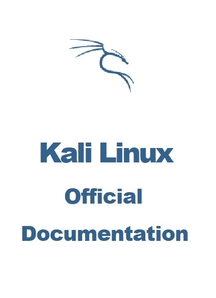

# 介绍


# 00. Kali Linux 介绍

# Kali Linux 默认密码

## Linux root 的默认密码是 toor

### 默认的 root 密码

安装 Kali 期间可以给 `root` 用户设置一个密码。但如果你用的是 live、i386、amd64、VMware 或 ARM 镜像时，`root` 的默认密码是 `toor`。

# 01. 下载 Kali Linux

# 封装定制的 Kali Live ISO

## 打造专属的 Kali ISO – 简介

封装定制的 Kali ISO 简单、有趣且很有意义。你可以用 Debian 的 [live-build](http://live.debian.net/devel/live-build "Debian Live Build") 脚本对 Kali ISO 进行全面的配置。这些脚本以一系列配置文件的方式对镜像进行全面的自动定制，让任何人都可以轻松地打造一个 Live 系统镜像。官方发布的 Kali ISO 也采用了这些脚本。

### 前提

最理想的是在预装 Kali 的环境里定制 Kali ISO。如果不是这样，请务必使用最新版本的 `live-build` 脚本（3.x 分支可用于 Debian wheezy）。

### 准备开始

首先我们要用以下命令搭建好定制 Kali ISO:

```bash
apt-get install git live-build debootstrap kali-archive-keyring
git clone git://kali.org/live-build
cd live-config
lb config
```

### 封装 Kali ISO 的配置（可选）

`config` 目录包含了定制 ISO 的各种自定义选项，这些选项在 Debian [live build 3.x](http://live.debian.net/manual-3.x/html/live-manual/index.html "Debian Live Build") 页面有说明。然而如果你没有耐心，请特别注意配置文件：

- `config/package-lists/kali.list` – 包含要安装在 Kali ISO 里的软件包。你可以指定移除已经安装的软件包，也可以切换你的 Kali ISO 桌面环境（KDE, Gnome, XFCE）。
- `hooks/` – hooks 目录允许我们在不同阶段调用脚本定制 Kali ISO。更多关于 hooks 的信息，参考 [live build](http://live.debian.net/manual-3.x/live-manual/index.html "Debian Live Build")。举个例子，Kali 是这样添加取证模式的引导菜单的：

```bash
cat config/hooks/forensic-menu.binary
#!/bin/sh

cat >> binary/ux/live.cfg <<END
label forensic
    menu Live (forensic mode)
    linux /live/vmlinuz
    initrd /live/initrd.img
    append boot=live noconfig username=root noswap automount
END
```

### 封装 ISO

在封装 ISO 之前，可以指定架构，选择 amd64 或者 i386。还要注意，如果不指定架构，`lb build` 会根据你使用的架构来封装。如果你想在 32 位系统封装 64 位的 ISO，务必打开架构支持：

```bash
dpkg --add-architecture amd64
apt-get update
```

配置 live build 封装 64 位或 32 位 ISO：

```bash
lb config --architecture amd64 # 用于 64 位
# ...
lb config --architecture i386  # 用于 32 位
lb build
```

## 用 Live U 盘安装 Kali Linux

## 用 Live U 盘安装 Kali Linux

使用 Live U 盘安装 Kali Linux 是最简单的方法之一。

### 准备工作

1. [下载 Kali 镜像](https://www.kali.org/get-kali/#linux-get-kali/#kali-live)。
2. 准备一个 U 盘（至少 2GB 空间）。

### 在 Windows 上制作

使用 [BalenaEtcher](https://www.balena.io/etcher/)：
1. 打开 Etcher。
2. 选择下载的 Kali ISO 镜像。
3. 选择你的 U 盘。
4. 点击“写入”。


### 在 Linux 上制作

使用 `dd` 命令：
1. 插入 U 盘并确认设备路径（如 `/dev/sddb`）。
2. 执行命令：

```bash
sudo dd if=kali-iso of=/dev/sdX bs=4M status=progress
```


1. [下载 Kali mini ISO](http://www.kali.org/downloads/ "Download Kali Mini ISO").
2. 把 Kali Linux 刻录到 DVD 光或[制作 Kali Linux 镜像 U 盘](http://cn.docs.kali.org/downloading-cn/%e7%94%a8live-u%e7%9b%98%e5%ae%89%e8%a3%85kali-linux "Kali Linux Live USB Install").
3. 确认你电脑的 BIOS 设置了从 CD/USB 引导

## Kali Linux 安装步骤

当你用 mini ISO 启动时，会出现一个有很多选项的启动界面，本文中，我们将进行简单的基础安装。


接下来会提示你各种设置，例如语言和键盘布局，然后你要为系统设置一个主机名称，在这里我们用了默认的 `kali`。


接下来选择时区，然后会出现分区选项，为了快速起见，本文我们选‘Guided – use entire disk’这个选项，一直按照提示做，直到创建新的分区格局。


为了减少网络流量，默认只选择了一小部分的软件包。如果你要添加另外的服务或功能，可以在这个界面做选择。


至此，安装程序会在系统上下载并安装它所需的软件包。这步花的时间与你的网速有关。最后，会提示你安装 GRUB 以完成整个安装过程。


## 安装后

现在你已经完成了 Kali Linux 的安装，是时候定制你的系统了。官方网站上的[Kali 常见问题](http://cn.docs.kali.org/category/general-use-cn)里有更多信息，你也可以在我们的[用户论坛](http://forums.kali.org/ "Kali Linux Forums)找到更多的技巧。

# 通过网络 PXE 安装 Kali Linux

通过网络([PXE](http://en.wikipedia.org/wiki/Preboot_Execution_Environment "Preboot Execution Environment")) 来启动和安装 Kali，对于一台没有光驱或者 USB 端口的笔记本很有用，甚至对一个企业部署预安装 Kali 都很有用。

## 搭建 PXE 服务器

首先，我们要安装 `dnsmasq` 以提供 DHCP/TFTP 服务，然后编辑 `dnsmasq.conf` 这个配置文件。

```bash
apt-get install dnsmasq
nano /etc/dnsmasq.conf
```

在 `dnsmasq.conf` 文件中，按如下所示启用 DHCP、TFTP 和 PXE 启动，根据你的环境修改 `dhcp-range`：

```
interface=eth0
dhcp-range=192.168.8.100,192.168.8.254,12h
dhcp-boot=pxelinux.0
enable-tftp
tftp-root=/tftpboot/
```

编辑好了之后我们需要重启 `dnsmasq` 服务使之生效。

```bash
service dnsmasq restart
```

### 下载安装 kali PXE 网络启动镜像

现在，我们要创建一个文件夹用于存放 Kali 网络启动镜像，还有我们欲从 Kali 软件源下载的镜像。

```bash
mkdir -p /tftpboot
cd /tftpboot
# for 64 bit systems:
wget http://repo.kali.org/kali/dists/kali/main/installer-amd64/current/images/netboot/netboot.tar.gz
# for 32 bit systems:
wget http://repo.kali.org/kali/dists/kali/main/installer-i386/current/images/netboot/netboot.tar.gz
tar zxpf netboot.tar.gz
rm netboot.tar.gz
```

## 设置要安装 Kali 的机器从网络启动

都配置之后，现在你可以启动你的电脑，然后配置它从网络启动。它会从 PXE 服务器获取到 IP 地址然后启动 kali。

# 加密安装 Kali Linux

有时我们希望采用全盘加密的方式来加密我们的敏感信息。你可以使用 Kali 安装程序把它安装到硬盘或是 U 盘的加密 LVM 逻辑卷。安装过程除了加密 LVM 逻辑卷部分以外，与“常规的 Kali Linux 安装”非常类似。

## 加密安装 Kali Linux 条件

安装 Kali Linux 到你的电脑过程很简单。首先你需要兼容的电脑硬件。最低硬件要求如下，更好的硬件性能会更好。`i386` 镜像默认使用 [PAE](http://en.wikipedia.org/wiki/Physical_Address_Extension "Physical Address Extension") 内核，所以你能在大于 4GB 内存的机器运行它。

### 安装条件
- 安装 Kali Linux 需要少少 8G 硬盘空间。
- `i386` 和 `amd64` 架构，最低 12MB 内存。
- CD-DVD 光驱支持 USB 引导

### 准备安装

1. [下载 Kali Linux](http://cn.docs.kali.org/general-use/%e4%b8%8b%e8%bd%bd%e5%ae%98) "Download Official Images") 然后刻录 DVD 光，或准备一块 Kali Live U 盘。
2. 把 Kali Linux 刻录到 DVD 光或制作 Kali Linux 镜像 U 盘。
3. 确认你电脑的 BIOS 设置了从 CD/USB 引导


安装 Kali Linux 到你的电脑过程非常简单。首先你需要兼容的电脑硬件。Kali 支持 `i386`、`amd64` 和 `ARM` (`armel`和`armhf`) 平台。最低硬件要求如下，硬件性能越好越好。`i386`镜像默认使用 `PAE`内核，所以你能在大于 4GB 内存的机器上运行它。[下载 Kali Linux](http://cn.docs.kali.org/general-use/%e4%b8%8b%e8%bd%bd%e5%ae%98%e6%96%b9kali%e9%95%9c%e5%83%8f "Download Official Kali Images")然后刻录 DVD 盘，或者[准备好一块 Kali Linux Live U 盘](http://docs.kali.org/installation/kali-linux-live-usb-install "Kali Linux Live USB Install")作为安装媒介。如果你的电脑没有 DVD 光驱或者 USB 端口，请参考[Kali Linux 网络安装](http://docs.kali.org/network-install/kali-linux-network-pxe-install "Kali Linux Network PXE Install")

### 安装条件

*   安装 Kali Linux 最少需要 8G 硬盘可用空间。
*   `i386`和`amd64`架构，最低 512MB 内存。
*   CD-DVD 光驱/支持 USB 引导

### 准备安装

1.  [下载 Kali linux](http://cn.docs.kali.org/general-use/%e4%b8%8b%e8%bd%bd%e5%ae%98%e6%96%b9kali%e9%95%9c%e5%83%8f "Download Official Kali Images")。
2.  把 Kali Linux 刻录到 DVD 盘或[制作 Kali Linux 镜像 U 盘](http://docs.kali.org/installation/kali-linux-live-usb-install "Kali Linux Live USB Install")。
3.  确认你电脑的 BIOS 设置了从 CD/USB 引导。

## Kali Linux 安装步骤

1.  开始安装，从你选择的安装媒介启动。你会看到 Kali 的引导界面。选择图形界面安装或者文本模式安装。此处，我们选择图形界面安装。

    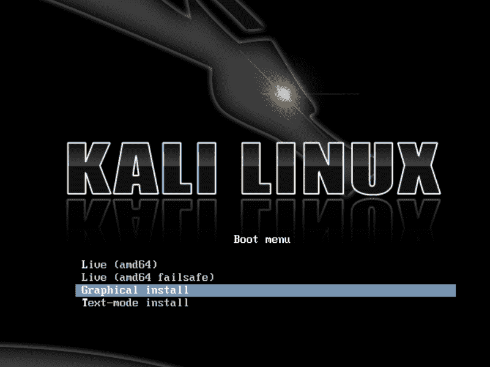

2.  选择你的首选语言和国家。你会被提示为你的键盘配置适当的`Keymap`。

    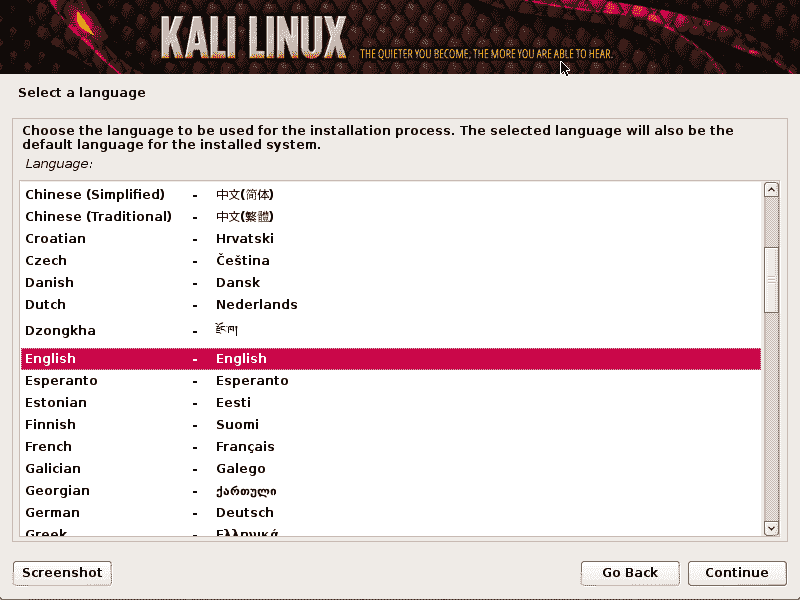

3.  安装器会复制镜象到你的硬盘，探测你的网络接口，然后提示你为你的系统输入主机名。此例，我们输入“Kali”作为主机名。

    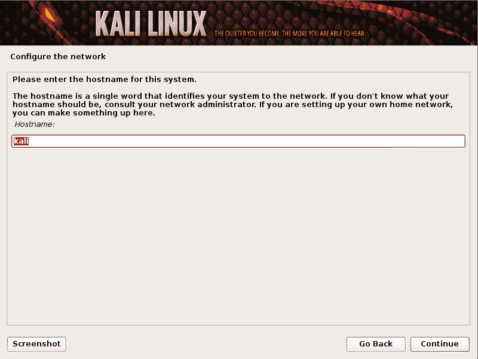

4.  为`root`账户输入一个强健的密码，或需要的话创建额外的账户。

    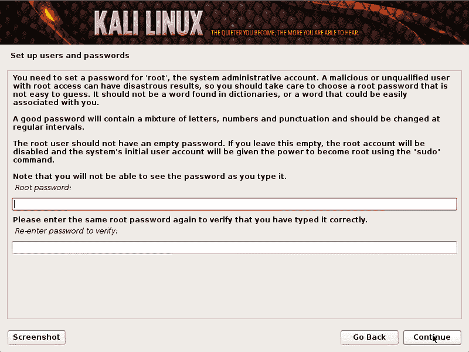

5.  下一步设置时区。

    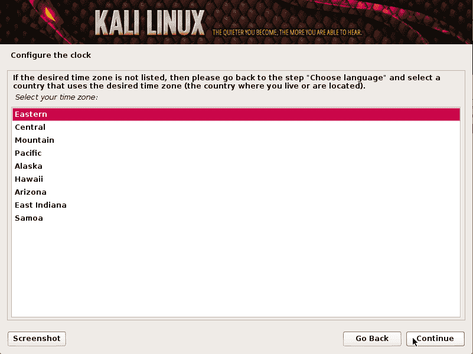

6.  安装器会检测硬盘，并提供 4 个选项。此例，我们使用电脑的整块硬盘，并且不设置`LVM`(逻辑卷管理器)。高级用户可以使用“手动”分区，配置自己的分区结构。

    

7.  接着在安装器作出不可逆的改变之前你会有机会检查硬盘配置。在你点击继续按钮后，安装器将开始工作，并且安装也快接近尾声。

    

8.  配置网络`Mirrors`。Kali 使用中心源发布软件。在必要的时候你需要输入适当的代理信息。

    **注意！如果你选择了“NO”，你将**不能**从 Kali 源安装软件。

    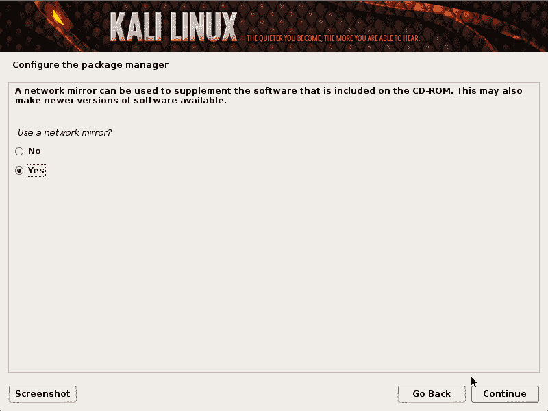

9.  下一步安装`GRUB`。

    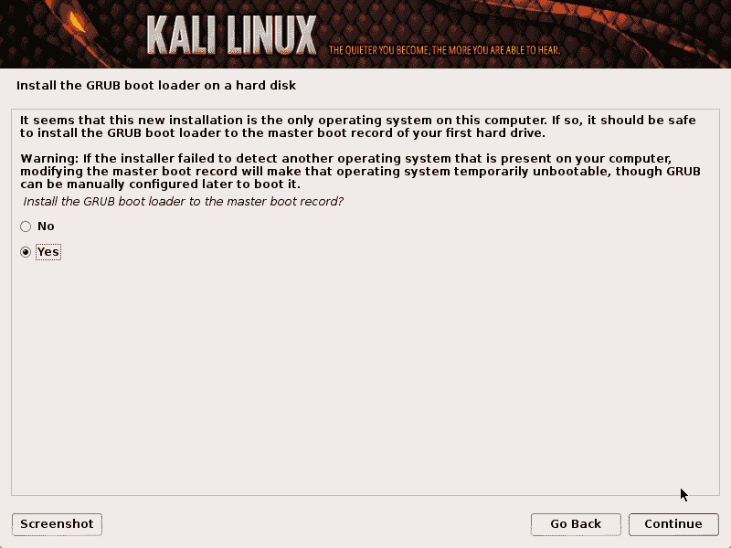

10. 最后，点击继续来重启系统，进入全新安装的 Kali。

    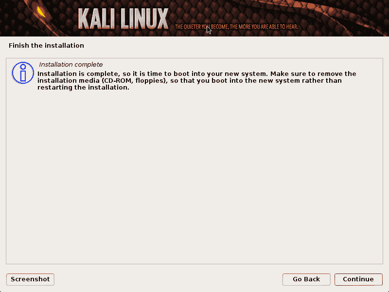

## 安装后

现在你已经完成了 Kali Linux 的安装，是时候定制你的系统了。官方网站上的[Kali 常见问题](http://cn.docs.kali.org/category/general-use-cn)里有更多信息，你还会在[用户论坛](http://forums.kali.org/ "User Forums")里找到更多的小技巧。

# 04. 通过网络安装 Kali Linux

# 05. Kali Linux 常见问题

# Virtual Box 的 Kali Linux 虚拟机

如果你想在`VirtualBOX`里安装 Kali Linux，为了能够顺利安装功能增强工具，请参考如下的指南。

建议使用最新版的`VirtualBOX`，因为可以提升用户体验，包括核心和客户端增强的稳定性。

## 在 Virtual Box 的 Kali Linux 虚拟机安装增强工具

为了与宿主机共享目录，你应该安装 VirtualBox 增强工具。

启动 Kali 虚拟机后，打开一个终端执行如下命令来安装内核头：

```
apt-get update && apt-get install -y linux-headers-$(uname -r)
```

安装完，从 VirtualBox 菜单的“Devices”选择“Guest Additions”挂载 ISO 到虚拟机的光驱。提示自动运行时点击取消。


在终端窗口，复制 CD 里的`VBoxAdditions.run`到本地目录，确认有执行权限然后运行该文件：

```bash
cp /media/cdrom/VBoxAdditions.run /root/
chmod 755 /root/VBoxAdditions.run
cd /root
./VBoxAdditions.run
```


增强工具安装后重启 Kali 虚拟机。现在可以共享宿主机目录了。

## 创建宿机的共享目录

为了给 Kali 虚拟机共享宿主机上的目录，有一些步骤要完成：在虚拟机管理器，选择 Kali 虚拟机然后点击右键菜单的‘Shared Folders’。会弹出一个添加共享目录的窗口。在这个窗口里点击图标，在`Folder Path`文本框显示路径或点击下拉菜单浏览宿主机系统。勾选`Auto-mount`(自动挂载）和`Make Permanent`(永久）框，有提示时点击 OK 按钮。


现在共享目录出现在`/media`里，为了方便进入这个目录你可以创建一个书签。


# 0. 运行 Metasploit Framework

依照[Kali Linux 网络策略](http://docs.kali.org/kali-linux-network-service "Kali Linux Network Services"),Kali 没有自动启动网络服务包括数据库。为了让`Metasploit`(http://www.metploit.com "Metasploit")以数据库的方式运行必要的步骤：

## 启动 Kali 的 PostgreSQL 服务

使用`PostgreSQL`(http://www.postgresql.org "PostgreSQL")作为数据库，先运行它：

```bash
service postgresql start
```

你可以用`ss -ant`输出 PostgreSQL 是否运行，然后确认 5432 端口处于 listening。

```
State Recv-Q Local Address:Port Peer:Port
LISTEN 0 128 :::22 *
LISTEN 0 128 :::5432 *
LISTEN 0 127.0.0.1:5432 *
LISTEN 0 ::5432 *
```

## 启动 Kali 的 asploit 服务

随着 PostgreSQL 的启动和运行，接着我们要运行 Metasploit。第一次运行会创建一个 msf 数据库并运行它。

```bash
service metasploit
```

## 在 Kali 运行 msfconsole

现在 PostgreSQL 和 Metasploit 服务都运行了，可以运行`msfconsole`，然后用`db_status`命令检验数据库的连通性。

```
msfconsole
msf > db_status
```

## 配置 Metasploit 随系统运行

如果你想 PostgreSQL 和 Metasploit 在开机时运行，你可以使用`update-rc.d`启用：

```bash
update-rc.d postgresql enable
update-rc.d metasploit enable
```

## Kali 虚拟机安装 VMware Tools

建议你自己创建一个 Kali Linux 的虚拟机，而不是使用预提供的镜像，进行如下操作以便 Kali 虚拟机成功安装 VMware Tools。你可以选择安装 open-tools，或自带的 VMware tools。

## 安装 open-tools

`open-tools`是在 Kali 虚拟机里实现“VMware Tools”功能容易的方法。

```bash
apt-get install open-tools
```

## 在 Kali 里安装 VMware Tools

如果 open-tools 不能用，或者你更偏于使用 VMware Tools，开始安装一些 VMware Tools 需要的包：

```bash
apt-get install make linux-headers-$(uname -r)
ln -s /src/linux-headers-$(uname -r)/generated/uapi/linux/version.h /usr/src/linux-headers-$(uname -r)/include/linux
```

下一步，点击菜单里的“Install VMware Tools”挂载 VMware Tools 的 ISO。虚拟机的光驱连接到 VMware Tools 后，我们挂载驱动器然后复制 VMware Tools 安装器到`/tmp/`。

```bash
mkdir /mnt/vmware
mount /dev/cdrom /mnt/vmware/
cp -rf /mnt/vmware/VMwareTools* /tmp/
cd /tmp
```

# 06. Kali ARM 文档

# 在 MK/SS808 上安装 Kali ARM

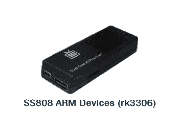

SainSmart SS808 是一种基于`rockchip`芯片的 ARM 设备。它搭载了一个双核 1.6GHz 的 A9 处理，还有 1G 内存，能很好的运行 Kali。

## 存储 Kali 在 SS808 – 简单版

如果你想安装 Kali 到你的 SS808，按照下列步骤:

1.  一张至少 8G 的高速 SD 卡，最好是 Class 10 的。
2.  在我们的[下载区](http://www.kali.org/downloads/ "Kali Linux Downloads")下载 Kali Linux SS808 镜像。


# SS808 上的 Kali – 复杂版

如果你是个开发者，你想修改 Kali Linux SS808 的镜像，包括修改内核配置，查阅我们的文章[“定制 MK/SS808 镜像”](http://docs.kali.org/?p=996 "Custom Kali SS808 Image")。

## 在三星 Chromebook 上安装 Kali


三星 ARM Chromebook 是一台超级本。很具挑战性，但我们的 Kali 镜像在 Chromebook 上运行得很好。

我们的 Chromebook Kali 镜像包含两种引导分区，其中一种的内核强制从 SD 卡引导，另一种的内核强制从 USB 引导。根据你使用哪种类型的 USB 存储媒介，在用 `dd` 命令把镜像克隆到 USB 设备后，确定如何给引导分区标记更高的优先权，本指南的最后阶段将会提及。

## Kali 在 Chromebook 上 – 用户指南

如果你想安装 Kali 到你的 Samsung ARM Chromebook，按照下列步骤：

1. 准备一块高速的 8G SD 卡或 U 盘。
2. 把 Chromebook 设置成开发者模式。
3. 从我们的[下载](http://www.kali.org/downloads/ "Kali Linux Downloads")下载 Kali 的 Samsung ARM Chromebook 镜像。
4. 用 `dd` 命令把镜象文件克隆到 SD 卡。本例中，假设存储设备的设备块名是 `/dev/sdb`。**根据情况，自行更改**。

> **警告！**这步将会擦除 SD 卡内的数据，如果选择了错误的存储设备，会导致硬盘数据丢失。

```
dd if=kali-chromebook.img of=/dev/sdb bs=512k
```

这步需要的时间取决于 USB 存储设备的速度和镜像的大小。

就是这里，你要给分区 1 或是分区 2 标记更高的优先权。数字大则有更高的优先权。如下的例子将把第一个分区（用 `-i` 参数）的优先权设置成 10，因为我们要从 SD 卡引导。

```bash
cgpt repair /dev/sdb
cgpt add -i 1 -S 1 -T 5 -P 10 -l KERN-A /dev/sdb
cgpt add -i 2 -S 1 -T 5 -P 5 -l KERN-B  /dev/sdb
```

使用 `cgpt show` 命令查看分区的列表和引导顺序。

```bash
root@kali:~# cgpt show /dev/sdb
       start        size    part  contents
           0           1          PMBR
           1           1          Pri GPT header
           2          32          Pri GPT table
        8192       32768       1  Label: "KERN-A"
                                  Type: ChromeOS kernel
                                  UUID: 63AD6EC9-AD94-4B42-80E4-798BBE6BE46C
                                  Attr: priority=10 tries=5 successful=1
       40960       32768       2  Label: "KERN-B"
                                  Type: ChromeOS kernel
                                  UUID: 37CE46C9-0A7A-4994-80FC-9C0FFCB4FDC1
                                  Attr: priority=5 tries=5 success=1
       73728     3832490       3  Label: "Linux filesystem"
                                  Type: 0FC63DAF-8483-4772-8E79-3D69D8477DE4
                                  UUID: E9E67EE1-C02E-481C-BA3F-18E721515DBB
   125045391          32          Sec GPT table
   125045423           1          Sec GPT header
```


如果你不是使用 ARM 硬件作为开发环境，为了编译 ARM 内核和模块，你应该先建立[ARM 交叉编译环境](http://cn.docs.kali.org/development-cn/arm%e4%ba%a4%e5%8f%89%e7%bc%96%e8%af%91 "ARM Cross Compilation")。完成后，用如下命令继续。

### 获取 Chromium 内核源代码并放到我们的开发树结构中

```bash
cd ~/arm-stuff
mkdir -p kernel
cd kernel
git clone http://git.chromium.org/chromiumos/third_party/kernel.git -b chromeos-3.4 chromeos
cd chromeos
```

```bash
cat << EOF > kernel.its
/dts-v1/;

/ {
    description = "Chrome OS kernel image with one or more FDT blobs";
    #address-cells = <1>;
    images {
        kernel@1{
   description = "kernel";
            data = /incbin/("arch/arm/boot/zImage");
            type = "kernel_noload";
            arch = "arm";
            os = "linux";
            compression = "none";
            load = <0>;
            entry = <0>;
        };
        fdt@1{
            description = "exynos5250-snow.dtb";
            data = /incbin/("arch/arm/boot/exynos5250-snow.dtb");
            type = "flat_dt";
            arch = "arm";
            compression = "none";
            hash@1{
                algo = "sha1";
            };
        };
    };
    configurations {
        default = "conf@1";
        conf@1{
            kernel = "kernel@1";
            fdt = "fdt@1";
        };
    };
};
EOF
```

### 为内核打补丁，我们以打无线注入补丁为例

```bash
mkdir -p ../patches
wget http://patches.aircrack-ng.org/mac80211.compat08082009.wl_frag+ack_v1.patch -O ../patches/mac80211.patch
wget http://patches.aircrack-ng.org/channel-negative-one-maxim.patch -O ../patches/negative.patch
patch -p1 < ../patches/negative.patch
patch -p1 < ../patches/mac80211.patch
```

### 配置，然后像下面一样交叉编译 Chromium 内核

```bash
export ARCH=arm
export CROSS_COMPILE=~/arm-stuff/kernel/toolchains/arm-eabi-linaro-4.6.2/bin/arm-eabi-

./chromeos/scripts/prepareconfig chromeos-exynos5
# Disable LSM
sed -i 's/CONFIG_SECURITY_CHROMIUMOS=y/# CONFIG_SECURITY_CHROMIUMOS is not set/g' .config 
# If cross compiling, do this once:
sed -i 's/if defined(__linux__)/if defined(__linux__) ||defined(__KERNEL__) /g' include/drm/drm.h

make menuconfig
make -j$(cat /proc/cpuinfo|grep processor|wc -l)
make dtbs
cp ./scripts/dtc/dtc /usr/bin/
mkimage -f kernel.its kernel.itb
make modules_install INSTALL_MOD_PATH=~/arm-stuff/images/root/

# copy over firmware. Ideally use the original firmware (/lib/firmware) from the Chromebook.
git clone git://git.kernel.org/pub/scm/linux/kernel/git/dwmw2/linux-firmware.git 
cp -rf linux-firmware/* ~/arm-stuff/images/root/lib/firmware/
rm -rf linux-firmware
```

```bash
echo "console=tty1 debug verbose root=/dev/mmcblk1p3 rootwait rw rootfstype=ext4" > /tmp/config-sd
echo "console=tty1 debug verbose root=/dev/sda3 rootwait rw rootfstype=ext4" > /tmp/config-usb

vbutil_kernel --pack /tmp/newkern-sd --keyblock /usr/share/vboot/devkeys/kernel.keyblock --version 1 --signprivate /usr/share/vboot/devkeys/kernel_data_key.vbprivk --config=/tmp/config-sd --vmlinuz kernel.itb --arch arm
vbutil_kernel --pack /tmp/newkern-usb --keyblock /usr/share/vboot/devkeys/kernel.keyblock --version 1 --signprivate /usr/share/vboot/devkeys/kernel_data_key.vbprivk --config=/tmp/config-usb --vmlinuz kernel.itb --arch arm
```

## 06. 准备引导分区

```bash
dd if=/tmp/newkern-sd of=$bootp1 # first boot partition for SD
dd if=/tmp/newkern-usb of=$bootp2 # second boot partition for USB

umount $rootp

kpartx -dv $loopdevice
losetup -d $loopdevice
```

## 07. 用 dd 克隆镜像然后标记 USB 为可引导

```bash
dd if=kali-custom-chrome.img of=/dev/sdb bs=512k
cgpt repair /dev/sdb
```

这里，你要给分区 1 还是分区 2 标记更高的权重。数字大的有优先。如下例子将第一个分区（用 `-i` 参数）设置成 10，我们要从 SD 卡引导。

```bash
cgpt add -i 1 -T 5 -P 10 KERN-A /dev/sdb
cgpt add -i 2 -T 5 -P 5 KERN-B /dev/sdb
```

使用 `cgpt show` 命令查看分区的列表和引导顺序。

```bash
root@kali:~# cgpt show /dev/sdb
       start        size    part  contents
           0           1          MBR
           1           1          GPT header
           2          32          GPT table
        8192       32768       1  Label: "KERN-A"
                                  Type: ChromeOS kernel
                                  UUID: 63AD6EC9AD94BE6
                                  Attr: priority=10 tries=5
       40960       32768       2  Label: "KERN-B"
                                  Type: ChromeOS kernel
                                  UUID: 37CE46C90A7A-4994FFCB
                                  Attr: priority=5 tries=1
       73728     38329       3  Label: "Linux filesystem"
                                  Type: 0
                                  UUID: E967EE1C02E481CBA3F
root@kali:~#
```

这个操作完成后，插入 SD 卡/U 盘启动 Chromebook（在开发者引导里按 `CTRL + ALT + U` 进入 Kali），然后运行 `startx`。

## 打造专属 Kali ISO – 简介

封装定制的 Kali ISO 简单有趣。你可以用 Debian 的 [live-build](http://live.debian.net/devel/live-build)脚本对 Kali ISO 进行全面的配置。这些脚本以一系列配置文件的方式对镜像进行定制，轻松打造一个 Live 系统。官方发布的 Kali 也采用了这些脚本。

### 前提

理想的是在预装 Kali 环境里定制 Kali ISO。如果不是这样，请务必使用最新版本的 live-build 脚本（3.x 分支用于 whezy）。

### 准备开始

首先我们要用以下命令搭建好 Kali ISO 环境：

```bash
apt-get install git live-build cdebootstrap kali-archive-keyring
git clone git://git.kali.org/live-build-config
cd live-build-config
lb config
```

### 封装 Kali ISO 的配置（可选）

`config` 目录包含了定制 ISO 的各种自定义选项，这些选项在 [live build 3.x](http://live.debian.net/manual-3.x/html/live-manual.html)页面有文档说明。如果你没有耐心，请特别注意以下的配置文件：

`config/package-lists/kali.list.chroot` – 包含要安装在 Kali ISO 里的软件包列表。你可以指定移除已经安装的软件包。也可以切换你的 Kali ISO 的桌面环境（KDE, Gnome, XFCE, LXDE 等）。

`hooks/**` – hooks 目录允许我们在不同阶段调用脚本封装 Kali Live ISO。更多关于 hooks 的信息，参考[live build 手册](http://live.debian.net/manual/3.x/html/live-manual.html)。举个例子，Kali 是这样添加取证模式的引导菜单的：

```bash
$ cat config/hooks/forensic-menu.binary 
#!/bin/sh

cat >>binary/isolinux/live.cfg <<END

label live-forensic
    menu label Live (forensic mode)
    linux /live/vmlinuz
    initrd /live/initrd.img
    append boot=live noconfig username=root hostname=kali noswap noautomount
END
```

### 封装 ISO

在封装 ISO 之前，可以指定需要的架构，选择 `amd64` 或者 `i386`。还要注意 `lb build` 需要 root 权限。如果不指定架构，live build 根据你现在使用的架构来封装 ISO。

如果你想在 32 位系统封装 64 位的 ISO，务必打开多架构支持：

```bash
dpkg --add-architecture amd64
apt-get update
```

配置 live-build 封装 64 位或 32 位 ISO：

```bash
lb config --architecture amd64 # for 64 bit
# ...or...
lb config --architecture i386  # for 32 bit

lb build
```

最后一个命令需要一些时间，因为它下载所有需要的软件包然后封装 ISO。可以先去喝杯咖啡。

### 为今后封装 ISO 加速

如果你打算经常定制 ISO，你可以把 kali 的缓存在本地便于今后的封装。最简单的就是 `apt-cacherng`，然后在打包时配置 `http_proxy`。

```bash
apt-get install apt-cacherng
/etc/init.d/apt-cacherng start
export http_proxy=http://127.0.0.1:3142/
```

# 定制 Kali 的桌面系统

## 更换 Kali 的桌面环境并不是所有的 Kali 用户都希望使用 Gnome 作为默认的桌面环境，所以我们简化了更换桌面所需的工作。要封装一个定制过桌面环境的专属 Kali 镜像，从这篇文档开始。在你的 ISO 之前，先编辑 `config/package-lists/kali.list.chroot` 的最后部分，加入你选择的桌面环境的相关到这些注释的后面：

```
# Graphical desktops depending on the architecture
# You can replace all the remaining lines with a list of the
# packages required to install your preferred graphical desktop
# or you just comment everything except the packages of your
# preferred desktop.
```

### [KDE]

```bash
kali-defaults
kali-root-login
desktop-base
kde-plasma-desktop
```

### [Gnome]

```bash
gnome-core
kali-defaults
kali-root-login
desktop-base
```

### [LXDE]

```bash
kali-defaults
kali-root-login
desktop-base
lxde
```

### [XFCE]

```bash
kali-defaults
kali-root-login
desktop-base
xfce4
```

### [I3WM]


```
# cheers to 0xerror
xorg
dmenu
conky
i3
```

## MATE

“MATE”桌面默认并没有被包含在我们的源里,集成到 Kali 里需要需要一些操作.

```bash
echo "deb http://repo.mate-desktop.org/debian wheezy main" >> /etc/apt/sources.list
apt-get update
apt-get install mate-archive-keyring
```

```bash
# apt-get install git live-build cdebootstrap
# git clone git://git.kali.org/live-build-config.git
cd live-build-config
mkdir config/archives
echo "deb http://repo.mate-desktop.org/debian wheezy main" > config/archives/mate.list.binary
echo "deb http://repo.mate-desktop.org/debian wheezy main" > config/archives/mate.list.chroot
cp /usr/share/keyrings/mate-archive-keyring.gpg  config/archives/mate.key.binary
cp /usr/share/keyrings/mate-archive-keyring.gpg  config/archives/mate.key.chroot
echo "sleep 20" >> config/hooks/z_sleep.chroot
```

添加 mate 桌面到软件包的列表: 编辑后的`config/package-lists/kali.list.chroot` 应该是这样:

```
xorg
mate-archive-keyring
mate-core
mate-desktop-environment
```

## 重新编译 Kali Linux 内核

有时你可能想添加必要的驱动、补丁、Kali Linux 内核里没有的功能.如下的教程描述如何根据你的需要快速地修改和编译 Kali Linux 内核.请注意目前默认的 Kali Linux 内核已经打过了大量的无线注入补丁.

### 安装编译所需的依赖

开始安装编译内核所需的所有依赖.

```bash
apt-get install kernel-package ncurses-dev fakeroot bzip2
```

### 下载 Kali Linux 内核源代码

下载并解压 Kali Linux 的内核源代码.

```bash
apt-get install linux-source
cd /usr/src/
tar jxpf linux-source-3.7.tar.bz2 
cd linux-source-3.7/
```

### 配置内核

复制 Kali 默认的内核配置文件然后根据你的需要修改.这一步你需要应用各种驱动、补丁、等等…在此例中,我们重新编译一个 64 位内核.

```bash
cp /boot/config-3.7-trunk-amd64 .config
make menuconfig
```

### 编译内核

编译你修改过的内核.需要花的时间和硬件配置有关.

```bash
CONCURRENCY_LEVEL=$(cat /proc/cpuinfo|grep processor|wc -l)
make-kpkg clean
fakeroot make-kpkg kernel_image
```

### 安装内核

内核编译成功后.继续以安装新内核,然后重启.请注意内核版本号可能不同.在此例中,当前的内核版本是 3.7.2,你需要根据情况做相应的修改.

```bash
dpkg -i ../linux-image-3.7.2_3.7.2-10.00.Custom_amd64.deb 
update-initramfs -c -k 3.7.2
update-grub2
reboot
```

重启后,你的新内核应该运行了.如果出错了导致你的内核不能启动,你仍然可以通过启动官方的 Kali Linux 内核来解决问题.

## 从源代码编译包

有时,我们需要从源代码重新编译一个 Kali 包.幸运的是用 APT 下载源代码包,进行必要的修改后再用 Debian 工具重新编译是如此的简单.此例中,为了添加额外的 Mifare Key 硬编码到 mifare 格式化工具，我们将重新编译[libfreefare](https://code.google.com/p/libfreefare/ "libfreefare")这个包.

### 下载包的源代码

```bash
# 获取源包
apt-get source libfreefare
cd libfreefare-0.3.4~svn1469/
```

### 修改包的源代码

按需修改包里面的源代码文件,此例中,我们以修改`mifare-classic-format.c`举例.

```bash
nano examples/mifare-classic-format.c
```

### 检查编译所需的依赖

检查编译包所需的依赖.它们需要在编译包前被安装.

```bash
dpkg-checkbuilddeps
```

输出的结果和如下类似,在于你已经安装了什么包.如果`dpkg-checkbuilddeps`没有任何输出,说明你没有缺少依赖,可以继续编译.

```
dpkg-checkbuilddeps: Unmet build dependencies: dh-autoreconf libnfc-dev
```

### 安装编译所需的依赖

安装上面`dpkg-checkbuilddeps`输出的编译所需的依赖:

```bash
apt-get install dh-autoreconf libnfc-dev
```

### 编译修改过的包

所有安装依赖安装好后,调用`dpkg-buildpackage`来编译是件很容易的事.

```bash
dpkg-buildpackage
```

### 安装新编译的包

如果一切顺利,你就可以安装新编译的包了.

```bash
dpkg -i ../libfreefare*.deb
```

## ARM 交叉编译

本文档说明如何在 kali linux 上配置 ARM 交叉编译环境,是我们多份关于”定制 ARM 镜像”的文档的起点.

### 开发机的配置

编译内核生成镜象通常需要大量硬盘空间.确保你的开发机至少有 50G 可用空间以及足够的内存,CPU 不要差.

### 安装依赖

先安装 ARM 交叉编译所需的依赖.

```bash
apt-get install git-core gnupg flex bison-dev build-essential zip curl zlib1-dev gcc-multilib
```

如果你是 64 位的 Kali Linux 系统,用如下命令添加 i86 到你的环境.

```bash
dpkg --add-architecture i86
apt-get update
apt-get install ia32-libs
```

### 下载 Linaro 工具链

从源下载 Linaro 编译器.

```bash
cd ~
mkdir -p arm-stuff/kernel/toolchains
cd arm-stuff/kernel/toolchains
git clone git://github.com/offensive-security/arm-linux-linaro-4.6.2
```

### 设置环境变量

为了使用 Linaro 编译器,你需要在 session 里设置环境变量.

```bash
export ARCH=arm
export CROSS_COMPILE=~/arm-stuff/kernel/toolchains/arm-linux-linaro-4.6.2/bin/
```

现在你的 ARM 编译环境完成了,可以编译自己的内核.

### 准备 Kali Linux chroot

虽然你可以从[Kali ARM Images](http://www.kali.org/downloads)下载他们的 rootfs,如下展示一个 armhf rootfs 的例子.

### 安装需要的软件和依赖

```bash
apt-get install debootstrap qemu-user-static
```

### 定义架构和定制包

这里定义一些架构(armhf)的环境,下列包将会安装到你的镜像里.所以务必根据需要修改.

```bash
export packages="nmap openssh-server"
export architecture="armhf"
export disk="/dev"
```

### 建立 Kali rootfs

创建一个标准的目录并从 Kali 源获得 rootfs.然后从主机复制`qemu-static`到 rootfs，以便进行下一步.

```bash
cd ~
mkdir -p arm-stuff
cd arm-stuff/
mkdir -p kernel
mkdir -p rootfs
debootstrap --foreign --arch $architecture http://repo.kali.org/kali
cp /usr/bin/qemu-static rootfs/bin/
LANG=C chroot rootfs
/debootstrap/second-stage
```

### 第二步 chroot

这里配置基本的设置，例如 keymaps,默认网络(有需要请修改)..

```bash
cat << EOF > rootfs/debconf.set
console-common select full
EOF

cat << EOF > rootfs/etc/apt/sources.list
deb://repo.kali.org/kali main contrib-free
deb://repo.kali.org/security main contrib-free
EOF

echo "kali" > rootfs/etc/hostname

cat << EOF > rootfs/etc/network/interfaces
auto lo
iface lo loopback
EOF
```

### 第三步 chroot

这里开始定制.表示 root 密码将被设置为,以及修复其它配置.

```bash
mount -t proc rootfs/proc
mount -o bind dev rootfs/dev
mount -o bind dev/pts rootfs/dev/pts
cat << EOF > rootfs/third-stage
#!/bin/bash
debconf-selections < debconf.set
rm -f debconf.set
apt-get update
apt-get -y install git-core binutils ca-certificates
apt-get -y install locales console-common git
echo "root" | chpasswd
sed -i -e 's/KERNEL=="KERNEL=/' /etc/udev/rules/75-persistent-generator.rules
rm -f /etc/udev.d/70-persistent-net.rules
apt-get --yes --force-yes install $packages
rm -f third-stage
EOF
chmod +x rootfs/third-stage
LANG=C chroot rootfs/third-stage
```

### 在 chroot 环境中手动配置

如果有需要,你可以手工在 rootfs 环境进行最终的修改.

```bash
LANG=C chroot rootfs
exit
```

### 清理 chroot 环境里的锁文件

事实上 rootfs 里你已经安装的包可能会产生锁文件(例如在 chroot 环境里运行的服务),需要在关闭 chroot 时释放.在你 umount 之前可能需要在 chroot 环境里停止一些服务.umount proc 和 dev 的命令:

```bash
umount rootfs/proc
umount rootfs/dev/pts
umount rootfs/dev/
```

然而,如果仍然有服务在 chroot 里运行,将会这样的提示:

```
root@rootfs-box:~ umount rootfs/proc
root@rootfs-box:~ umount rootfs/dev/pts
root@rootfs-box:~ umount rootfs/dev/
umount: kali-armhf/dev: device is busy. (In some cases useful info about processes that use the device is found by lsof(8) or fuser(1)) root@rootfs-box:~
```

如果出现这种情况,用如下命令检查哪个文件/服务锁住了 chroot:

```bash
root@rootfs-box:~/arm-stuff/rootfs:~ lsof | grep kali-armhf
...
dbus-daemon 4419 messagebus REG 8,1 236108 15734602 dbus-daemon
dbus-daemon 4419 messagebus REG 8,1 93472 17705250 ld-2.13.so
dbus-daemon 4419 messagebus REG 8,1 100447 17705251 libpthread-2.13.so
dbus-daemon 4419 messagebus REG 8,1 225440 17705240 librt-2.13.so
dbus-daemon 4419 messagebus REG 8,1 893044 17705232 libc-2.13.so ...
```

从输出信息我们看到 dbus 守护进程仍在 chroot 环境里运行.在继续之前,我们需要在 chroot 环境里停止它.如果你已经成功 umount 了 proc 或 dev,请用之前给出的命令重新挂载他们,chroot 到 rootfs 里,然后停止 dbus 服务(别的可能需要停止的服务):

```bash
# mount -t proc rootfs/proc 
# mount -o bind dev rootfs/dev/pts
LANG=C chroot rootfs /etc/init.d/dbus stop
exit
```

### 清理

最后我们运行在 chroot 里的清理脚本释放缓存文件占用的空间,还有需要的清理工作:


```bash
cat << EOF > kali-$architecture/cleanup 
#!/bin/bash rm -rf /root/.bash_history 
apt-get update apt-get clean 
rm -f cleanup 
EOF

chmod +x kali-$architecture/cleanup 
LANG=C chroot kali-$architecture /cleanup
/etc/init.d/dbus stop
umount kali-$architecture/proc 
umount kali-$architecture/dev/pts 
umount kali-$architecture/dev/
cd ..
```

恭喜！你定制的 Kali ARM rootfs 就在`kali-$architecture`目录里了。你可以为往后的工作打包这个目录，或复制到一个镜像文件。

# 08 Kali Linux 疑难排解

# 09 Kali 社区支持

# 给 Kali 提交问题

## 简介

这篇文档指导报告者如何提交一份最佳的问题报告，以便问题能尽快被修复。问题报告者的目的是让 Kali Linux 的开发者重现问题并发现问题。如果 Kali 开发者发现了问题，他们会收集更多信息直到找到问题的根本。否则，他们会要求提供更多信息直到他们能够重现提交者遇到的问题。请记住，我们的开发团队使用英文，所以最好用`英文`提交。

Kali Linux 诞生于对社区的回报。社区促使我们的项目得以更好地持续发展。在你写评论时请记住，为你提供支持的开发者都是无私奉献的志愿者。

想要解决问题，请明确以下要点：

*   你是因为想要解决问题才提交的，所以请提供全面的信息。
*   弄清楚你提交的是事实还是假设。
*   保持问题报告的客观性，只陈述经过适当研究后的事实。
*   不要引用 Wikipedia 和其它非主要资源的结果作为报告。
*   一个`BUG`，不要以不同的报告、不同的人、不同的硬件多次提交。
*   不要把多个问题堆在一起报告，如果可以请分别提交。
*   不要发类似“Me too!”或“+1”这样的评论。
*   不要抱怨修复一个漏洞为何那么久。

## 如何报告问题

Kali Linux 问题追踪系统在[`bugs.kali.org`](http://bugs.kali.org)这篇文档中指导你如何创建账号，如何创建系统资料，以及如何提交一份详细的报告。

### 创建 Kali Linux 问题追踪系统帐户

如果你还没有创建帐户，应该先完成这一步。创建用户后你才可以提交问题报告或对已存在的问题进行评论。

在问题追踪系统页面，点击`Signup for new account`开始创建。

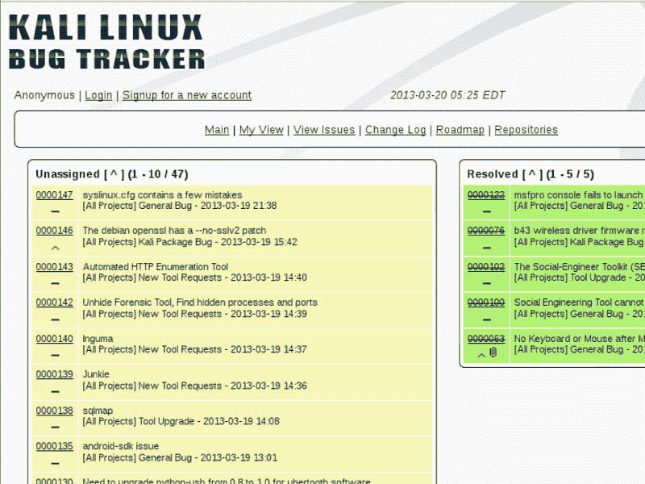

输入用户名和`email`，然后输入验证码。点击`signup`按钮。

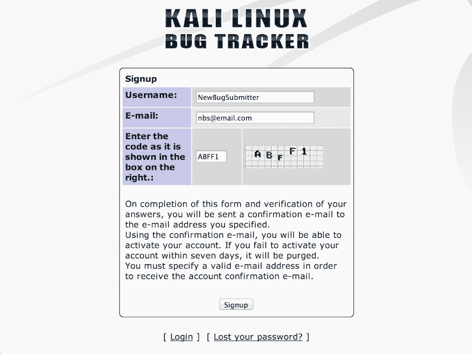

如果成功了，下一步会提示你帐户已经注册好。要激活帐户请回复官方的`email`确认邮件。点击`Proceed`继续到漏洞追踪系统登录页面。

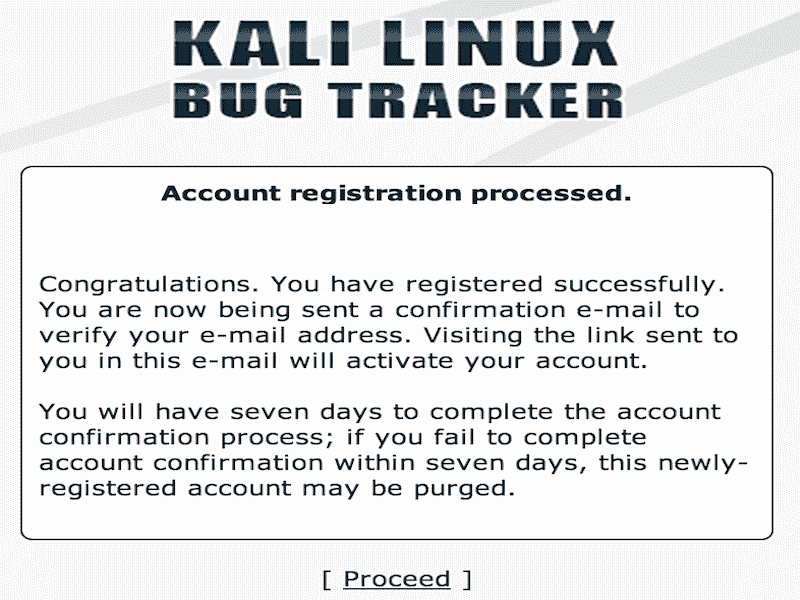

### 在 Kali Linux 问题追踪系统创建资料

不是必须的，但作为帐户的一部分，建议创建一份独特的资料。你可以为每个系统创建自定义资料，或者从默认里选择。这些资料用于报告时定义你的平台、操作系统和版本。

创建或编辑自定义资料，从主页选择`Profiles`。然后你的系统添加具体的信息，完成时点击`Add Profile`按钮。

![kali-tracker-profile-1]添加后，在你创建一个新的问题时会出现`Select Profile`下拉菜单。可以根据需要创建不同的配置文件，只要你在提交问题时选择正确的配置文件。

## 务必不要报告过的问题

开始报告之前，在网站搜索问题相关的关键字。如果存在已经被报告（与硬件无关），请不要重复提交。


*   [security.kali.org](http://security.kali.org) ([镜像列表](http://security.kali.org/README.mirrorlist)): 安全包软件源；
*   [cdimage.kali.org](http://cdimage.kali.org) ([镜像列表](http://cdimage.kali.org/README.mirrorlist)): ISO 镜像源。

当你使用以上的 3 个域名做源时,会自动连接到离你最近的与官方同步的镜像。如果你要手动选择一个镜像，请点击上面域名旁的*镜像列表*，选一个合适你的。

# Kali Linux 镜像的架设

## 要求

要架设一个 Kali Linux 的官方镜像源,你需要一台运行`rsync`和`ssh`，大硬盘 ,大带宽的服务器。截至 2013-03-14，主要安装包软件源大约 160G，ISO 镜像源大约 10G。但应该考虑到这些数字在不停的增长。我们希望你通过`HTTP`、`FTP`或`RSYNC`之一来同步镜像文件，所以必须安装相应的服务。

## 软件包档案的同步推送

当官方源有更新时会用基于 SSH 的触发器 ping 镜像。一般每天 4 次。

如果你还没有专用于镜像的帐号，先创建一个。（本例子中我们专用于镜像的专用用户是“archvsync”）：：

```bash
$ sudo adduser --disabled-password archvsync
Adding user 'archvsync' ...
[...]
Is the information correct? [Y/n]
```

创建用于存放镜像的目录，然后修改目录属主为刚才创建的专用用户：

```bash
$ sudo mkdir /srv/mirrors/kali{,-security,-images}
$ sudo chown archvsync:archvsync /srv/mirrors/kali{,-security,-images}
```

下一步配置`rsync`后台程序(按需启用后台运行)导出这些目录：

```bash
$ sudo sed -i -e "s/ENABLED=false/ENABLED=true/" /etc/default/rsync
$ sudo vim /etc/rsyncd.conf
$ cat /etc/rsyncd.conf
uid = nobody
gid = nogroup
max connections = 25
socket options = SO_KEEPALIVE

[kali]
  path = /srv/mirrors/kali
  comment = The Kali Archive
  read only = true

[kali-security]
  path = /srv/mirrors/kali-security
  comment = The Kali security archive
  read only = true

[kali-images]
  path = /srv/mirrors/kali-images
  comment = The Kali ISO images
  read only = true
$ sudo service rsync start
Starting rsync daemon: rsync.
```

这个文档不包括 WEB 服务器和 FTP 服务器的配置。理论上你应该导出镜像到 [`yourmirror.net/kali`](http://yourmirror.net/kali)，[http://yourmirror.net/kali-security]和[`yourmirror.net/kali-images`](http://yourmirror.net/kali-security 和 http://yourmirror.net/kali-images) (FTP 也一样)。现在是有趣的部分：专用用户处理 SSH 触发器配置和镜像站点的搭建。首先应该用专用用户解压[ftpsync.tar.gz](http://archive.kali.org/ftpsync.tar.gz)：

```bash
$ sudo su - archvsync
$ wget http://archive.kali.org/ftpsync.tar.gz
$ tar zxf ftpsync.tar.gz
```

现在我们要创建两个配置文件。在模板的基础上至少要修改`MIRRORNAME`、`TO`、`RSYNC_PATH`和`RSYNC_HOST`这几个参数：

```bash
$ cp etc/ftpsync.conf.template etc/ftpsync-kali.conf
$ cp etc/ftpsync.conf.template etc/ftpsync-kali-security.conf
$ vim etc/ftpsync-kali.conf
$ grep -E '^[^#]' etc/ftpsync-kali.conf 
MIRRORNAME=`hostname -f`
TO="/srv/mirrors/kali/"
RSYNC_PATH="kali"
RSYNC_HOST=archive.kali.org
$ vim etc/ftpsync-kali-security.conf
$ grep -E '^[^#]' etc/ftpsync-kali-security.conf 
MIRRORNAME=`hostname -f`
TO="/srv/mirrors/kali-security/"
RSYNC_PATH="kali-security"
RSYNC_HOST=archive.kali.org
```

最后一步建立`.ssh/authorized_keys`以便`archive.kali.org`能触发你的镜像：

```bash
$ mkdir -p .ssh
$ wget -O - -q http://archive.kali.org/pushmirror.pub >>.ssh/authorized_keys
```

如果你的`ftpsync.tar.gz`不是解压到 home 目录，那么你要修正`.ssh/authorized_keys`中的`~/bin/ftpsync`为相应的路径。现在发一封包含你的镜像 URL 的 email 到 devel@kali.org，以便把你的镜像加入镜像列表。请明确的指出当镜像出现问题（或要进行更改/协商镜像的配置）时我们该联系谁。与其等待`archive.kali.org`的第一次推送，不如先用离你近的源进行`rsync`初始化同步，选择上面镜像列表里的任意一个镜像。假设你选了`archive-4.kali.org`，那么你应该以专用用户权限运行如下命令：

```bash
$ rsync -qaH archive-4.kali.org::kali /srv/mirrors/kali/
$ rsync -qaH archive-4.kali.org::kali-security /srv/mirrors/kali-security/
$ rsync -qaH archive-4.kali.org::kali-images /srv/mirrors/kali-images/
```

## 手工同步镜像

ISO 镜像源不推送模式，所以你要建立一个每日运行`rsync`任务。我们提供了一个直接用的脚本`bin/mirror-images`，只要配置`etc/mirror-images.conf`，再添加到`crontab`。

```bash
$ sudo su - archvsync
$ cp etc/mirror-images.conf.sample etc/mirror-images.conf
$ vim etc/mirror-images.conf
$ grep -E '^[^#]' etc/mirror-images.conf
TO=/srv/mirrors/kali-images/
$ crontab -e
$ crontab -l
# h  9 * * * ~/bin/mirror-images
```


Offensive Security 商标表示源自我们的产品和服务。我们希望商标只用于辨认 Offensive Security 的产品和服务，以避免用户在与我们交涉的问题上产生误会。

首先，提到 Offensive Security 的商标应该伴随标志符号，已注册的商标用 `™`，未注册的商标用 `®`。如果有疑虑，请参考上面列表使用 `™` 的正确符号。

使用 Offensive Security 商标应该与周围的大写、斜体、粗体或带下划线的文本分开。Offensive Security 商标表示其源自我们的产品和服务。

在书面材料中使用 Offensive Security 商标时，应该提供一个`[此商标]是 Offensive Security 商标`的声明。例如：

“KALI LINUX ™ 是 Offensive Security 的商标.”这个声明可以适当地放在你的文本中、或脚注或者尾注里。

禁止将 Offensive Security 商标用于你的域名，因为这样使用将导致客户误会。在商标策略范围以外的，不得未经 Offensive Security 明确的书面许可使用。

可以用于印制 T 恤、做电脑桌面，或制作别的有 Offensive Security 商标的制品，仅限本人和朋友（未能从中获利）。在没有获得书面许可时，不得把商标用于商业生产（无论是否盈利）。

## 联系

如果你有任何问题或者评论，或者想举报滥用 Offensive Security 商标，请联系我们。

# Kali 和 Debian 的关系

Kali Linux 1.0 基于 [Debian Wheezy](http://www.debian.org/releases/wheezy/ "Debian Wheezy")。因此，大部分的 Kali 包都是从 Debian 源原封不动的导入。还有些比较新的包因为可以提升用户体验或存在必须修复的 `BUG`，所以从不稳定版或者实验版导入。

### 分离包

为了实现一些 Kali 特有的功能，一些包明显的必须被分离。但 Kali 在可能时尽量靠提高上游包的数量来保持分离包的数量最小化（直接整合功能，或添加所需的钩子而不用修改上游包）。

每个被 Kali 分离的包以 Debian 的 [Git 源](http://git.kali.org) 分支的方式维护，简单把 `Git 源` 和 Debian 主分支合并，以便升级一个被分离的包变得很容易。

### 新包

此文前面提到，Kali 了很多新的用于渗透测试和安全审计领域的 Debian 包。依据 [Debian 的自由软件准则](http://www.debian.org/social_contract#guidelines)，这些大部分都是自由软件。Kali 打算把它们贡献给 Debian 并且直接在 Debian 里维护它们。

因此，Kali 包努力遵循 [Debian 策略](http://www.debian.org/doc/debian-policy/)并在 Debian 里表现良好。

