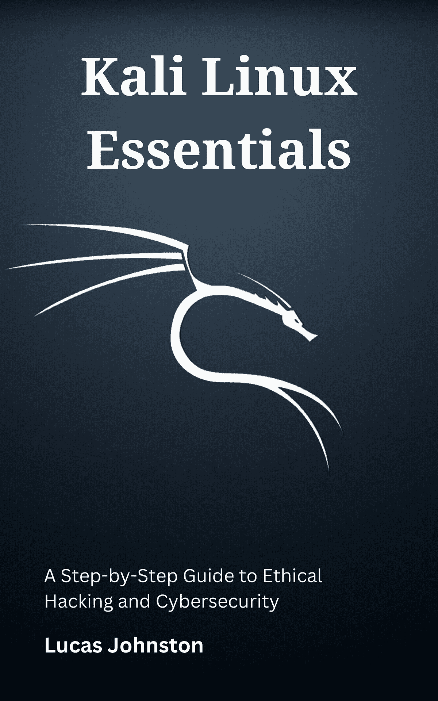

# Kali Linux 基础：道德黑客与网络安全步步指南





在当今互联互通的世界里，数字版图正以前所未有的速度扩张，这带来了无限机遇，遗憾的是，也带来了日益增长的威胁。随着组织和个人越来越依赖技术来处理通信、商业和日常任务，保护我们数字生活的需要比以往任何时候都更加迫切。这正是道德黑客与网络安全艺术大显身手之处。欢迎阅读《Kali Linux 基础：道德黑客与网络安全分步指南》。在这场全面的旅程中，我们将深入探索道德黑客的迷人领域，研究对于保护数字环境不受网络威胁至关重要的工具、技术和实践。无论你是一个有志的网络安全专业人士，还是寻求提升技能的 IT 爱好者，亦仅仅是对道德黑客的世界感兴趣，这本书都旨在成为你的终极伴侣。

## 揭秘 Kali Linux：你的道德黑客之门

本指南的核心是 Kali Linux，这是一个强大且多功能的操作系统，专为渗透测试、漏洞评估和道德黑客攻击定制。凭借其海量的预装工具和资源，Kali Linux 赋予了我们发现漏洞、模拟攻击并最终加固我们所处数字景观的能力。

在我们开启这段旅程时，不仅将揭开 Kali Linux 内工具的神秘面纱，还将提供导航复杂的道德黑客世界所需的实用知识。从理解命令行和侦察技术，到利用网络分析的力量以及剖析恶意软件，每一章都旨在让你具备防御网络威胁的技能，并为更安全的数字生态系统贡献力量。

## 全面的学习体验

这本书不仅仅是一本手册；它是一个平衡了理论与实践实践的全面学习体验。每个概念都解释得非常清晰，随后附有实际示例，引导你通过真实世界的场景。每一章都经过精心设计，在前一章的基础上构建，确保在旅程结束时，你不仅拥有知识，还拥有了应对道德黑客和网络安全挑战的信心。

## 你的道德黑客奥德赛开启了

无论你是好奇的新手还是资深专业人士，《Kali Linux 基础》都旨在成为你在导航复杂的道德黑客世界时值得信赖的伴侣。当你翻页并深入后续章节时，请记住，道德黑客不仅仅是为了入侵系统——更是为了理解漏洞以便更好地防御它们。你在这里获得的技能不仅是工具；它们是保护我们数字未来的钥匙。

所以，让我们一起开启这段奥德赛吧——这段旅程将赋予你知识，让你能够在不断演变的网络安全领域中探索、保护并产生积极影响。当我们深入研究核心概念、工具和技术时，请始终记住，知识越大，责任也越大。

坐好你的位置，系好安全带，让我们进入“Kali Linux 基础”的世界吧。

# 第 1 章：Kali Linux 与道德黑客导论

在一个我们的生活与技术紧密交织的时代，保护我们数字世界的需要比以往任何时候都要显著。欢迎来到道德黑客和网络安全的世界，在这个领域，黑客们戴上白帽来发现漏洞、加固防御并防止网络威胁。这一章标志着你进入道德黑客核心之旅的开始，并向你介绍了你不可或缺的伴侣——Kali Linux。

## 揭秘道德黑客的心态

随着技术的不断演进，网络攻击的方法也在变化。从数据泄露到勒索软件攻击，数字景观充满了潜在危险。在这些挑战中，道德黑客应运而生——这是一类有技能的人，他们利用知识不是为了剥削，而是为了安全。道德黑客受一种心态的驱动，寻求理解对手的战术、技术和程序，所有这些都是为了领先一步并确保数字安全。

## 进入 Kali Linux：你的工具库

在道德黑客工具箱的核心是 Kali Linux，这是一个为了道德黑客攻击和渗透测试目的而精心打造的强大操作系统。Kali Linux 拥有海量的预装工具和资源，是你进军数字防御世界的发射平台。凭借其专门设计的用于模拟和探索漏洞的环境，Kali Linux 赋予了你能够在与恶意行为相同的地形上穿梭，但目标是保护和防御。

## 伦理与技术的协同

道德黑客是伦理领域与技术领域之间的桥梁。它是一门将对系统、网络和漏洞的深度理解与对伦理和法律的坚定承诺相结合的学科。本章将引导你了解道德黑客的基础概念，探索其法律影响，并为接下来的实践旅程铺平道路。

## 你的前程

当你开启这一章及后续章节时，请记住，道德黑客不仅仅关于掌握工具和技术；它关于培养一种拥抱不断学习和适应的心态。数字景观时刻在变化，你的知识和技能也必须演进。以 Kali Linux 为你的指南，以道德黑客为你的指导哲学，你已经准备好深入网络安全，获得保护、防御并对数字世界做出积极贡献的力量。

所以，让我们开始对 Kali Linux 和道德黑客的探索吧，知识变成了力量，技术变成了向善的力量。

## 1.1 道德黑客的演变

道德黑客是一种探测系统和网络以发现漏洞的实践，多年来经历了非凡的演变。最初由好奇驱动的计算机系统探索，已转变为网络安全领域的一门至关重要的学科。这种演变追踪了从其起源到如今作为数字防御不可或缺组成部分的迷人历程。

### 起源：好奇与探索

在计算的早期，黑客概念源于好奇心以及对理解系统内部运作机制的渴望。早期的计算机爱好者在探索的无尽欲望驱动下，开始探测技术的边界。这些先驱者通常是自学的，他们试图通过剖析代码和系统来理解计算机复杂的机制。黑客的最初阶段并没有恶意；相反，它是受对知识的追求和揭开技术谜团的快感驱动的。

### 黑暗面的出现：黑客行为向恶意的转变

随着技术的进步，黑客的方法和动机也随之增长。一部分个人开始为了个人利益或参与恶意活动而利用漏洞。这标志着“黑帽”黑客的出现——即那些将其知识用于破坏性或犯罪目的的人。这些恶意行为者对数字安全构成了重大威胁，社会对黑客的理解也发生了更加阴暗的转折。

### 道德黑客的诞生：一种替代方法


为了应对黑客带来的日益增长的威胁，道德黑客的概念应运而生。其核心思想是将黑客的技能用于防御目的——在漏洞被对手利用之前，主动对其进行识别和修复。“白帽”黑客这一术语的出现，是为了指代那些利用专业知识维护系统安全并抵御网络威胁的人士。这标志着道德黑客方法的正式化，及其与网络安全策略的整合。

## 合法性与专业化

20 世纪 90 年代见证了道德黑客的专业化。机构意识到需要能够从攻击者角度识别并解决漏洞的专家。这导致了专门针对道德黑客的认证和培训计划的建立。首创认证之一——注册道德黑客（`CEH`）的出现，旨在验证从事道德黑客实践的人员技能和专业知识。这种从非正式、好奇驱动的活动向结构化职业的转变，凸显了道德黑客在保护数字资产日益增长的重要性。

## 协作与知识共享

互联网的出现和在线社区的兴起进一步加速了道德黑客的发展。黑客和安全专业人员开始协作并分享见解、技术和工具，以共同增强网络安全。漏洞赏金计划（Bug Bounty programs）等平台通过奖励发现并负责任地披露漏洞的个人，彰显了这种协作精神。这种知识共享导致了无数漏洞的识别和解决，强化了道德黑客在主动防御中的作用。

## 现代时代的道德黑客：一门多能学科

今天，道德黑客已转变为涵盖广泛活动的跨领域学科。从渗透测试、漏洞评估到恶意软件分析和应急响应，道德黑客已成为网络安全每个方面不可或缺的一部分。道德黑客与组织密切合作，识别弱点、模拟攻击并开发加强防御的策略。他们的见解塑造了安全政策，指导了技术实施，并为更具韧性的数字生态系统做出贡献。

## 结论：数字领域的守护者

道德黑客的演变反映了技术本身的发展——从好奇驱动的探索开始，成长为数字防御的关键组成部分。从早期的好奇驱动探索到如今专业化、化的方法，道德黑客已成为数字领域的守护者。通过对恶意行为者操作方式的深度理解，道德黑客通过预先识别和缓解威胁，为更安全的数字世界做出贡献。随着技术的不断演进，道德黑客无疑将继续处于网络安全的前沿，应对不断变化的数字格局带来的挑战。

## 1.2 了解 Kali Linux 及其组件

在道德黑客和网络安全领域，Kali Linux 是一项强大且不可缺的工具。Kali Linux 的开发侧重于性和功能性，已成为安全专业人员、渗透测试员和道德黑客的首选操作系统。本节将深入探讨 Kali Linux 的核心组件，阐明其在网络安全领域的架构、工具和用途。

### Kali Linux 的起源与目的

Kali Linux 最初源于 `Debian` 发行版，其诞生源于对能够满足道德黑客和渗透测试员需求的特殊操作系统的需求。它的主要目标提供一个全面的工具箱，涵盖用于渗透测试、漏洞评估和数字取证各个阶段的各种工具和实用程序。与通用操作系统不同，Kali Linux 为安全专业人员进行了优化，允许他们高效地执行任务，而无需组装各种不同的工具。

### Kali Linux 架构

Kali Linux 基于 `Debian` 的架构，利用了 `Debian` 发行版的稳定性和包管理能力。其模块化设计允许用户根据需要轻松添加或删除工具。该操作系统有多种形式，包括完整的 ISO 镜像和轻量级的 `NetInstaller` 选项。Kali Linux 架构的灵活性确保了它可以适应不同的硬件和用例。

### 庞大的工具集

Kali Linux 的独特之处在于它拥有大量为网络安全各个方面而设计的预装工具。这些工具被组织成类别，以满足不同的安全学科，例如信息收集、漏洞分析、漏洞利用、后渗透等。Kali Linux 工具集涵盖了从网络扫描、渗透测试到数字取证和逆向工程的广泛领域。这个捆绑工具箱消除了安全专业人员搜索、下载和配置单个工具的需要，简化了工作流程，使他们能够专注于当前任务。

### 元包（Metapackages）与工具管理

Kali Linux 使用元包（metapackages）的概念根据特定任务或目标将相关工具组合在一起。元包简化了安装过程，允许用户通过单一命令安装整个工具套件。例如，`kali-linux-full` 元包包含了 Kali Linux 中所有的可用工具，而更特定的元包（如 `kali-linux-web`）侧侧于 Web 应用测试工具。这种方法允许用户根据特定需求定制 Kali Linux 安装，优化资源使用并减少冗余。

### 工具更新与维护

Kali Linux 强调了与最新安全工具和技术保持更新的重要性。它对其工具集提供定期更新，确保安全专业人员能够获取最新、最有效的工具。操作系统还提供了维护系统、应用安全补丁和管理仓库的机制。通过促进工具更新和系统维护，Kali Linux 帮助用户在工作中保持高水平的安全和效率。

## 结论：赋能网络安全专业人员

Kali Linux 是道德黑客和网络安全实践演变的见证。它的架构、庞大的工具集以及对持续改进的关注使其成为全球安全专业人员不可或缺的资源。从资渗透测试员到雄心勃勃的道德黑客，Kali Linux 提供了一个全面的平台，赋能个人进行彻底的评估、识别漏洞并加强数字防御。随着网络安全领域的不断演进，Kali Linux 始终保持在前沿，与数字格局的挑战共同演进。

## 1.3 道德黑客中的法律与伦理考虑

道德黑客是一种旨在识别漏洞和强化网络安全的实践，它在复杂的伦理和法律环境中运行。虽然目标是增强数字防御，但道德黑客必须遵循一系列原则和法规，以确保其行为是负责任、合法并符合网络安全更广泛目标的。本节探讨了道德黑客在从事活动之前必须仔细考虑的法律和伦理因素。

## 定义道德黑客


道德黑客行为涉及刻意渗透系统、网络或应用程序以发现漏洞。道德黑客与恶意黑客之间的主要区别在于其意图——道德黑客的目标是增强安全性，而恶意黑客则是为了个人利益而利用漏洞。这种意图塑造了规范道德黑客行为的伦理框架。

## 知情同意的重要性
道德黑客的核心支柱之一是从受测系统的所有者或管理员处获得“知情同意”。如果没有明确的许可，道德黑客活动可能被视为未经授权的非法行为。同意充当了法律屏障，确保道德黑客的操作在受控环境中进行，并让所有方知晓潜在的风险和收益。

## 合法性与合性
道德黑客必须遵守其业务所在司法管辖区的法律法规。违反与未经授权访问、数据隐私或知识产权相关的法律活动可能会导致法律后果。理解法律边界对于道德黑客避免无意违规并确保其活动在法律框架内进行至关重要。

## 任务范围
明确定义参与任务范围对于道德黑客项目至关重要。该范围概述了道德黑客获授权测试的系统、网络或应用程序。偏离范围可能导致未经授权的访问和潜在的法律后果。拥有详细说明测试范围和访问限制的正式协议是非常关重要的。

## 数据隐私与保密性
道德黑客在评估过程中经常遇到敏感信息。维护这些数据的机性和隐私性至关重要。尊重数据保护法并确保收集的任何数据都经过安全且负责的处理是关键的伦理考虑。未经授权披露敏感信息可能导致声誉损害和法律行动。

## 最小化伤害与干扰
虽然道德黑客的任务是发现漏洞，但他们的行动应尽量减少对系统和操作的伤害与干扰。目标是加强网络安全，而不是制造漏洞或造成破坏。道德黑客应始终努力维护所测系统的完整性和可用性。

## 负责任披露
发现漏洞后，道德黑客必须遵循负责任披露实践。这包括通知系统所有者或管理员漏洞，提供足够的细节来重现问题，并在公开之前给予他们合理的时间来解决问题。负责任披露确保漏洞在被恶意攻击者利用之前得到修复。

## 持续学习与专业精神
道德黑客有责任了解最新的网络安全实践、工具和法规。不断更新自己的技能和知识使他们能够在不断变化的网络安全格局中做出明智决策。保持专业风范并遵守伦理指南增强了道德黑客社区的信誉和诚信。

## 结论：应对伦理与法律迷宫
道德黑客是网络安全领域的一股力量，但伴随着巨大的伦理和法律责任。遵守知情同意、合法性、负责任披露和专业精神等原则，确保道德黑客的行为为更安全的数字环境做出贡献。通过仔细考虑这些伦理和法律因素，道德黑客在维护最高诚信和责任标准的同时，为保护数字格局发挥着关键作用。

## 1.4 Kali Linux 中的基本工具
Kali Linux 在道德黑客和网络安全世界的地位因其丰富的工具集而放大。这些工具是道德黑客识别漏洞、模拟攻击和加固数字防御的武器库。本节深入探讨 Kali Linux 中提供的一些基本工具类别，强调它们的功能以及对道德黑客领域的的贡献。

### 1. 信息收集工具
信息收集是道德黑客的初始阶段，涉及收集数据以了解目标的数字足迹。`Nmap` 等工具可以进行网络扫描，揭示开放端口和服务。`theHarvester` 从公共来源搜索有关域名和电子邮件地址的信息，而 `Shodan` 则搜索连接到的设备。这些工具提供了对目标基础设施和潜在切入点的基础理解。

### 2. 漏洞分析工具
漏洞分析旨在识别可能被攻击者利用的弱点。`Nessus` 和 `OpenVAS` 等工具执行漏洞扫描，确定系统和应用程序中的安全漏洞。`Nexpose` 提供全面的漏洞评估，突出风险并建议修复策略。道德黑客使用这些工具评估漏洞对目标安全态势的潜在影响。

### 3. 利用工具
利用工具模拟攻击以测试安全措施的有效性。`Metasploit` 是一个著名的框架，为渗透测试提供系列利用程序和有效负载（payloads）。它可以帮助道德黑客模拟攻击，以识别恶意攻击者可能利用的入口。`BeEF` 专注于 Web 应用程序漏洞，允许测试人员评估浏览器安全性并收集有关潜在目标的信息。

### 4. 渗透后工具
一旦系统被攻破，渗透后工具帮助道德黑客维持访问并收集进一步的情报。`Meterpreter` 作为 `Metasploit` 的组件，提供了渗透后功能，如文件操作、屏幕捕获和命令执行。道德黑客利用这些工具探索被破坏系统的内容和行为。

### 5. 取证与分析工具
取证工具有助于在安全事件后调查和分析数字证据。`Autopsy` 和 `Sleuth Kit` 促进文件系统分析，恢复被删除的文件和元数据。`Volatility` 专门内存取证，从易性内存中提取信息。这些工具使道德黑客和数字取证专家能够重建事件、发现恶意活动轨迹并对泄露事件获得见解。

### 6. 无线攻击工具
无线网络是攻击者的潜在入口。`Aircrack-ng` 等工具可以评估无线安全，通过捕获包破解 Wi-Fi 密码。`Reaver` 专注于开启 WPS 的网络，利用 WPS 实现中的漏洞。道德黑客使用这些工具评估无线网络抵抗未经授权访问的弹性。

### 7. Web 应用程序测试工具
Web 应用程序是网络攻击的频繁目标。`Burp Suite` 和 `OWASP Zap` 是 Web 漏洞扫描器，可以识别 SQL 注入和跨站脚本等常见缺陷。`Sqlmap` 专门用于 SQL 注入测试，而 `Dirb` 和 `Dirbuster` 则枚举 Web 服务器上的目录和文件。这些工具帮助道德黑客评估 Web 应用程序和 API 的安全性。

### 8. 反向工程工具


逆向工程工具允许道德黑客解析并理解软件及恶意软件。`Ghidra` 是一个开源软件逆向工程框架，而 `IDA Pro` 是一款强大的反汇编器和调试器。这些工具使道德黑客能够分析代码、识别漏洞并揭示恶意软件的内部机制。

## 结论：赋能工具

`Kali Linux` 全面的工具集将道德黑客变为熟练的从业者，通过彻底的评估和主动措施来防御数字格局。`Kali Linux` 提供的工具赋予了道德黑客识别弱点、模拟攻击和加强防御的能力。通过熟练地运用这一武器库，道德黑客正通过一个工具，为更安全的数字世界贡献力量。

## 1.5 设置你的实验室环境

在开启道德黑客之旅之前，创建一个结构良好且受控的实验室环境至关重要。这个受控环境为道德黑客提供了一个安全空间来测试和完善他们的技能，而不会无意中对真实系统造成伤害。本节将引导你完成为道德黑客活动搭建有效实验室环境的过程。

### 1. 定义你的目标
在建立实验室之前，定义目标至关重要。确定你想要培养的技能、想要模拟的攻击类型以及想要探索的漏洞。这种清晰性将指导你的实验室设置，并确保它与你的学习目标一致。

### 2. 选择合适的硬件和软件
你为实验室选择的硬件和软件在创建真实且有效的环境方面起着重要作用。虚拟化工具如 `VMware Workstation`、`VirtualBox` 或 `Hyper-V` 允许你创建模拟不同操作系统的虚拟机（`VMs`）。这些 `VMs` 可以作为你道德黑客活动的目标。

### 3. 构建多种虚拟机
为了创建一个多功能完备的实验室环境，请设置一系列具有不同操作系统的虚拟机。包括 Windows、Linux（如 `Kali Linux`）以及与你的目标相关的其他专用系统。每个 `VM` 都可以代表一个潜在目标，帮助你在各种平台上练习攻击和防御。

### 4. 分段你的实验室网络
在实验室环境中创建网络分段允许你更有效地模拟真实世界的场景。为不同的目的设置单独的网络段，例如生产环境、开发环境和测试环境。这种分可以防止攻击的意外扩散，并确保测试条件的受控。

### 5. 实现网络监控
如 `Wireshark` 等网络监控工具允许你捕获并分析实验室环境内的网络流量。监控网络流量有助于你理解不同系统之间的通信模式，识别漏洞并获得潜在攻击向量的见解。

### 6. 建立基准环境
在进行任何道德黑客活动之前，建立一个代表实验室正常状态的基准环境。在此阶段对你的 `VMs` 快照，以便在需要时恢复到洁净状态。这确保了你在评估攻击影响时有一个对比参考点。

### 7. 实践负责任的测试
实验室环境内的道德黑客活动应始终以负责任的方式进行。为所有测试活动获得明确许可，并确保测试范围与你的目标一致。避免在实验室之外的实时系统上进行测试，因为这可能导致意想不到的后果。

### 8. 记录你的实验室设置
维护实验室设置的详尽文档，包括配置、IP 地址和网络段。如果你将来需要重建或扩展实验室环境，这些文档将简化设置过程。

### 9. 持续改进你的实验室
随着你技能和目标的演进，你的实验室环境也应该相应进行调整。尝试新的工具、技术和攻击场景。不断完善你的实验室设置，以挑战自我，并跟上不断变化的网络安全态势。

## 结论：道德黑客的基础

一个结构良好的实验室环境是磨练和完善道德黑客技能的基础。通过精心设计实验室、选择合适的硬件和软件，并遵循负责任的测试实践，你创建了一个受控空间来探索漏洞、模拟攻击并增强你的网络安全能力。这个环境不仅确保了你和他人的安全，还使你成为一名精通且合道德的黑客。

## 1.6 构建攻击思维和技能集

成为道德黑客的之旅不仅仅在于掌握工具和技术——更在于培养一种与负责任黑客和网络安全原则一致的独特思维和技能。本节深入探讨构建攻击思维和技能集的核心组成部分，强调了区分道德黑客与其恶意对手的品质。

### 1. 好奇心与探究精神
攻击思维源于好奇和探究精神。道德黑客对理解系统如何工作、漏洞如何产生以及如何利用漏洞有着不懈的渴望。这种好奇心驱动了对知识的追求，使道德黑客能够不断探索新技术、攻击向量和防御策略。

### 2. 问题解决能力
道德黑客工作通常涉及处理复杂的谜题和挑战。强大的问题解决能力是不可缺的，它使道德黑客能够解析复杂的系统、识别漏洞，并制定创造性的解决方案来利用或缓解它们。从多个角度观察问题并进行批判性思考的能力是熟练道德黑客的标志。

### 3. 毅力与韧性
道德黑客在旅途中会遇到障碍和挫折。在面对挑战时坚持并保持韧性的能力是一种定义性特征。无论是排除技术故障、破译代码还是绕过安全措施，道德黑客都以韧性和对成功的坚定不移的决心面对问题。

### 4. 学习敏捷性
网络安全领域不断演变，要求道德黑客不断学习和适应。学习敏捷性——快速掌握新概念、技术和工具的能力——至关重要。道德黑客保持关注最新的安全趋势、漏洞和攻击向量，以在他们的角色中保持有效和相关性。

### 5. 同理心与伦理意识
与恶意黑客不同，道德黑客带着同理心和伦理意识行动。他们理解自己的行为对个人、组织以及整个社会可能产生的后果。道德黑客优先考虑负责任和合法的黑客实践，遵循优先考虑隐私、数据保护和受影响福祉的原则。

### 6. 实战经验
攻击技能集是通过实战经验培养的。道德黑客参与实践练习、模拟和真实场景，以应用他们的知识并完善技能。实践经验不仅强化了理论概念，还建立了有效应对不同情况的肌肉记忆。

### 7. 协作与社区参与
道德黑客在协作和社区参与的文化中蓬发展。他们积极参与论坛、在线社区和会议，以分享知识、交换见解并向同伴学习。协作促进了增强网络安全实践和加固数字防御的集体努力。

### 8. 适应能力与灵活性


网络安全的动态性要求具备良好的适应性和灵活性。白帽黑客必须准备好调整策略、适应不断演变的威胁，并探索出现的新技术。他们拥抱变化的意愿确保了他们在瞬息万变的数字格局中依然保持高效。

## 结论：构建白帽黑客身份

构建黑客思维和技能 set 是一场超越技术能力的多方面旅程。白帽黑客不仅精通使用工具，还拥有一种独特的品质，使他们能够以好奇心、创造力和责任感来应对挑战。通过培养这些品质并不断磨炼技能，白帽黑客将成为数字安全的守护者，为更安全、更具韧性的数字世界做出贡献。

# 第 2 章：搭建你的 Kali Linux 环境

欢迎来到关键章节，它将为你进入白帽黑客和网络安全的世界奠定基础。在本章，我们将引导 Kali Linux 安装和配置的领域，为你提供所需的工具，为你的白帽黑客活动创建一个强大且优化的环境。

## 第一步：选择你的路径

在深入白帽黑客领域之前，你必须首先通过建立 Kali Linux 环境来搭建舞台。我们将探索两条主要路径——虚拟机安装和原生安装——每种都有其优点和考虑因素。无论你是寻求一个隔离的测试环境，还是与硬件的无缝集成，你的选择将塑造你的整个白帽黑客旅程。

## 优化你的武器库：工具与更新

一旦完成安装，我们将深入工具和更新的世界。Kali Linux 预装了一系列强大的工具，但白帽黑客领域是动态的，保持工具更新至关重要。我们将引导你完成更新工具、添加新工具的过程，并确保你的工具箱在面对新威胁时随时准备就绪。

## 精调你的环境：配置与定制

一个高效且个性化的环境是你作为白帽黑客成功的关键。在本章中，我们将指导你配置网络设置、优化系统性能并自定义 shell 环境以适应你的偏好。你的 Kali Linux 环境应该感觉是你意图的延伸，使你能够从容穿梭于数字领域。

## 准备遇到机遇：建立正确的思维

除了技术方面，本章还是培养正确思维的机会。白帽黑客不仅仅关于工具和技术；它关乎一种拥抱好奇心、适应性和伦理责任的思维。在你搭建 Kali Linux 环境时，请考虑你行为的潜在影响，以及负责任地利用新学技能造福更大利益的重要性。

## 你的奥德赛开始了

当你开启搭建 Kali Linux 环境的之旅时，请记住你做的每一个选择都塑造了前前的道路。你安装的工具、应用的更新以及你采用的思维都是贡献于你白帽黑客旅程的要素。有了手中的 Kali Linux 能力和面前广阔的数字探索世界，你已准备好迈入精彩的白帽黑客和网络安全世界的第一。

## 2.1 选择正确的 Kali Linux 版本

选择合适的 Kali Linux 版本是一个塑造你白帽黑客活动的关键决策。由于有针对不同需求和偏好定制的多个版本，因此了解可选的选项及其影响至关重要。本节将引导你完成选择符合你目标和要求的正确 Kali Linux 版本的过程。

### Kali Linux Rolling Release 与 Kali Linux Light

Kali Linux 的两个主要版本是 Kali Linux Rolling Release 和 Kali Linux Light。每个版本都有独特的优点和考虑因素，在做出选择之前评估你的目标和优先事项是至关重要的。

#### 1. Kali Linux Rolling Release

Kali Linux Rolling Release 是 Kali Linux 的持续更新版本。它在开发时提供最新的工具、功能和安全更新，确保你始终能够访问白帽黑客领域的尖端能力。该版本对于那些希望领先于新威胁、尝试最新工具并为 Kali Linux 社区的持续改进做出贡献的人来说是理想的。

**Kali Linux Rolling Release 的优点：**
*   访问最新的工具和功能。
*   实时安全补丁。
*   实验前沿技术的能力。
*   有机会为 Kali Linux 的开发和改进做出贡献。

**考虑因素：**
*   持续更新可能会引入不稳定或兼容性问题。
*   定期的更新可能要求在维护系统上投入更多精力。
*   测试新功能可能会导致不可预见的挑战。

#### 2. Kali Linux Light

Kali Linux Light 是 Kali Linux 的极简版本，优先考虑轻量化和精简的环境。该版本适用于那些寻求简单且资源高效设置的人士，对于在旧硬件或资源有限的虚拟机上运行 Kali Linux 特别有用。Kali Linux Light 提供了一套核心工具，同时允许用户根据特定需求定制其工具集。

**Kali Linux Light 的优点：**
*   轻量化且资源高效。
*   非常适合在旧硬件或虚拟机上运行。
*   根据特定需求定制的工具集。
*   针对特殊用例进行了精简。

**考虑因素：**
*   与完整版相比，预装工具较少。
*   可能需要需要手动安装额外工具。
*   与完整版相比，开箱可用功能有限。

### 为你选择正确的版本

在 Kali Linux Rolling Release 和 Kali Linux Light 之间决定取决于你的偏好、目标和技术能力。如果你优先考虑访问最新的工具和功能，并且习惯管理频繁的更新，那么 Kali Linux Rolling Release 是一个合适的选择。另一方面，如果你需要轻量级环境、受到资源限制或偏好定制工具集，Kali Linux Light 提供了一个定制的解决方案。

### 结论：使版本与愿景一致

选择正确的 Kali Linux 版本涉及统一你的白帽黑客目标和技术需求。无论选择动态的 Kali Linux Rolling Release 还是资源高效的 Kali Linux Light，你的决定都塑造了你构建白帽黑客工具箱的基础。评估你的目标，权衡优点和考虑因素，选择一个能让你能够从容应对白帽黑客复杂性的版本。

## 2.2 在虚拟机上安装 Kali Linux

虚拟化技术彻底改变了白帽黑客搭建实验室环境的方式。在虚拟机 (`VM`) 上安装 Kali Linux 为探索漏洞、练习攻击和增强网络安全技能提供了一个受控、隔离的空间。本节提供了使用流行的虚拟化软件在虚拟机上安装 Kali Linux 的分步指南。

#### 1. 选择你的虚拟化软件

选择虚拟化软件，例如 `VMware Workstation`、`VirtualBox` 或 `Hyper-V`。这些平台允许你在宿主机操作系统上创建和管理虚拟机。

#### 2. 下载 Kali Linux ISO


访问 Kali Linux 官网下载 Kali Linux 发行版的 ISO 镜像。根据你的系统架构选择 32 位或 64 位版本。

## 3. 创建新虚拟机
打开你选择的虚拟化软件并创建一个新虚拟机。按照软件提示指定虚拟机的设置，包括内存分配、处理器核心和网络选项。

## 4. 安装 Kali Linux
● a. 当提示选择安装源时，选择使用已下载的 Kali Linux ISO 镜像的选项。
● b. 按照安装向导选择你偏好的语言、键盘布局和时区。
● c. 根据需要配置网络设置、主机名和域名。

## 5. 磁盘分区
● a. 选择“引导式 – 使用整个磁盘”以让安装程序自动对虚拟磁盘进行分区的。
● b. 选择你想安装 Kali Linux 的磁盘。

## 6. 选择分区方案
根据你的偏好和用例选择合适的分区方案。如果你是分区方面的新手，使用默认方案通常足够。

## 7. 配置包管理器
选择一个用于软件包安装的镜像源。如果你不确定，选择安装程序提供的默认镜像源。

## 8. 安装 GRUB 引导程序
将 GRUB 引导程序安装到虚拟磁盘的主引导记录 (MBR) 中。

## 9. 完成安装
按照提示完成安装过程。安装完成后，重启虚拟机。

## 10. 首次启动与设置
重启后，使用你在安装期间设置凭凭登录 Kali Linux 系统。使用包管理器更新包仓库并安装任何可用更新。

## 11. 安装虚拟化工具（可选）
安装你选择的虚拟化软件提供的虚拟化工具。这些工具增强了宿主机与虚拟机操作系统之间的集成，提高了性能和功能。

## 12. 为虚拟机创建快照
为你新安装的 Kali Linux 虚拟机创建一个快照。此快照将作为一个基准，以便在出现问题或实验失败时恢复到它。

### 结论：你的道德黑客乐场
在虚拟机上安装 Kali Linux 为你提供了一个安全且受控的环境，用来磨练道德黑客技能。通过虚拟化设置，你可以练习各种技术、模拟攻击并探索漏洞，而不会有损害真实系统的风险。这一过程让你能够创建一个动态且多用途的道德黑客乐场，支持你在网络安全领域的学习、实验和成长。

## 2.3 原生安装与双启动选项
虽然在虚拟机上安装 Kali Linux 提供了一个受控的环境，但某些道德黑客更倾向于通过原生安装 Kali Linux 或设置双启动系统来获得更浸式的体验。本节将探索原生安装和双启动的选项，让你可以将 Kali Linux 直接集成到你的硬件和工作流中。

## 1. Kali Linux 的原生安装
原生安装 Kali Linux 将其直接安装在你的硬件上，与你现有的操作系统一起。此选项提供了 Kali Linux 的完整功能，但需要对你的数据进行仔细考虑和备份。

**原生安装步骤：**
● a. 从官网下载 Kali Linux ISO 镜像。
● b. 使用 `Rufus` 或 `Etcher` 等工具创建可启动 USB 盘。
● c. 从 USB 盘启动电脑并按照安装过程操作。
● d. 安装期间，选择“引导式 – 使用整个磁盘”选项或手动分区。

**原生安装的优势：**
● 充分利用硬件能力。
● 无虚拟化开销。
● 与你的硬件和环境无缝集成。

**考虑因素：**
● 潜在的数据丢失；安装前请备份数据。
● 与虚拟机相比，环境隔离性较低。
● 可能需要磁盘分区的高级知识。

## 2. Kali Linux 的双启动设置
双启动设置允许你在启动电脑时在多个操作系统之间选择。此选项提供了在主操作系统和 Kali Linux 之间切换的灵活性。

**双启动设置步骤：**
● a. 备份你的数据并创建一个可启动的 Kali Linux USB 盘。
● b. 从 USB 盘启动并按照安装过程操作。
● c. 安装期间，选择“手动”分区选项。
● d. 为 Kali Linux 创建一个独立分区且不影响你的主操作系统。

**双启动的优势：**
● 在使用主操作系统的同时访问 Kali Linux。
● 利用硬件的完整功能。
● 与虚拟化相比，具有更浸式的体验。

**考虑因素：**
● 如果分区不正确，可能会导致潜在的数据丢失。
● 管理多个操作系统可能需要技术知识。
● 意外损坏分区或启动配置的风险。

### 选择适合你的选项
在原生安装和双启动之间做决定取决于你对高级安装程序、数据备份的熟悉程度以及你渴望的集成水平。如果你准备好投入硬件资源并优先考虑浸式体验，原生安装或双启动可能是合适的。

### 结论：定制你的设置
原生安装和双启动为与 Kali Linux 的更深度集成体验提供了选项。每个选项都提供了优势和注意事项，因此请考虑你的目标、技术专长以及管理潜在复杂性的意愿。无论你选择虚拟机、原生安装还是双启动设置，目标都是创建一个支持你的道德黑客之旅的环境，并使你能够开发加强数字防御的技能。

## 2.4 为你的实验室配置网络设置
有效的网络配置对于创建一个功能齐全且安全的实验室至关重要。无论你是使用虚拟机、原生安装还是双启动设置，正确配置网络设置都能确保适当的连接、隔离和受控测试。本节将引导你完成为道德黑客实验室配置网络设置的过程。

## 1. 网络分
将你的实验室环境划分为不同的网络段，以隔离不同类型的流量和活动。常见的分段包括生产、测试、开发和隔离网络。这种分段防止了系统之间的意外交互，并有助于模拟真实场景。

## 2. 虚拟网络设置（针对虚拟机）
如果你使用虚拟机，请在虚拟化软件内设置虚拟网络。配置每台虚拟机连接到适当的虚拟网络。这种方法确保同一网段内的虚拟机可以通信，同时保持不同网段之间的隔离。

## 3. IP 地址分配与子网划分
为实验室内的每个系统分配 IP 地址。使用 `RFC 1918` 定义的私有 IP 地址范围，防止与公共 IP 地址冲突。子网划分允许你将网络进一步分为更小的地址范围以便高效管理。

## 4. DHCP 和静态 IP 地址
对于动态 IP 分配，在实验室内设置 `DHCP`（动态主机配置协议）服务器。该服务器会在设备连接到网络时自动为其分配 IP 地址。或者，为关键系统或需要固定地址的系统分配静态 IP 地址。

## 5. 防火墙与网络分段（针对原生或双启动）


如果你正在使用原生安装或双启动设置，请配置主机系统的防火墙以实施网络分。创建规则来限制不同网络段之间的通信，确保只允许必要的流量。

### 6. VLAN（虚拟局域网）
如果你的网络设备支持 VLAN，请考虑使用它们来创建虚拟局域网以隔离网络流量。VLAN 允许你从物理层面实现网络分，增强隔离性和控制力。

### 7. 网络监控
实施网络监控工具，例如 `Wireshark` 或 `Snort`，以观察实验室内的网络流量。监控有助于你理解通信模式、检测异常并识别潜在的安全问题。

### 8. VPN（虚拟专用网络）
为了增强安全性，请考虑在实验室环境中设置 `VPN`。`VPN` 允许你加密系统之间的通信，即使在实验室环境中也是如此，为应对潜在威胁增加了一额外的保护。

### 9. 访问控制与身份验证
实施强有力的访问控制和身份验证机制，防止未经授权访问你的实验室环境。使用强密码、多因素认证和基于角色的访问控制，确保只有授权的人员才能与你的实验室系统交互。

#### 结论：一个连接良好的实验室
有效配置网络设置对于创建一个既能模拟真实世界状况又能保持隔离与安全的实验室环境至关重要。无论你是在使用虚拟机还是物理安装，适当的网络配置都能增强你实践伦理黑客技术、模拟攻击并以受控且组织化的方式强化防御的能力。通过建立一个连接良好的实验室，你能够让自己自信且胜任地探索网络安全的复杂性。

## 2.5 安装附加工具和存储库
虽然 Kali Linux 自带了一套全面的工具，但伦理黑客领域在不断演变。为了领先于新出现的威胁并增强你的能力，了解如何在 Kali Linux 中安装额外的工具和存储库至关重要。本节将引导你完成扩展伦理黑客工具箱的过程。

### 1. 更新软件包仓库
在安装新工具之前，确保你的 Kali Linux 系统是最新版本。打开终端并运行以下命令：

```
sudo apt update
sudo apt upgrade
```

### 2. 使用 apt 安装工具
Kali Linux 使用 `apt` 包管理器安装软件。要安装额外的工具，请使用以下命令：

```
sudo apt install tool-name
```

将 `tool-name` 替换为你想要安装的工具名称。

### 3. 启用 Kali Linux 官方存储库
Kali Linux 官方存储库包含了大量的工具和实用程序。然而，某些工具可能并未包含。你可以通过编辑 `sources.list` 文件来启用额外的存储库：

```
sudo nano /etc/apt/sources.list
```

取消你想要启用的存储库行的注释（删除 `#` 号）。保存文件并退出。

### 4. 添加第三方存储库
除了 Kali Linux 官方存储库外，你还可以添加提供专业工具的第三方存储库。例如，BlackArch Linux 存储库提供了大量的渗透测试工具。

```
sudo nano /etc/apt/sources.list
```

在文件末尾添加存储库的 URL，保存并退出。然后更新你的存储库列表：

```
sudo apt update
```

### 5. 使用 Git 克隆存储库
许多工具和脚本托管在 `Git` 等版本控制平台上。你可以按照以下步骤将这些仓库克隆到你的系统中：

a. 安装 Git（如果尚未安装）：
```
sudo apt install git
```

b. 克隆存储库：
```
git clone repository-url
```

将 `repository-url` 替换为存储库的实际 URL。

### 6. 手动安装
某些工具可能无法通过仓库获取。在这种情况下，你可能需要手动下载并安装它们。请参考工具的文档获取安装说明。

### 7. 维护你的工具箱
定期更新你安装的工具，以确保你拥有最新版本和安全补丁。使用以下命令更新所有已安装的工具：

```
sudo apt upgrade
```

#### 结论：动态工具箱
扩展伦理黑客工具箱不仅限于 Kali Linux 预装的工具。通过添加新的存储库、安装额外的工具和探索第三方资源，你让你的工具箱保持动态并与不断变化的网络安全格局保持一致。有了不断增长的武器库，你能够更好地应对新挑战并精炼你的伦理黑客技能。

## 2.6 保持 Kali Linux 系统更新
维护最新的 Kali Linux 系统对于确保你的伦理黑客活动保持有效和安全至关重要。定期更新提供了最新的工具、功能和安全补丁，帮助你保持领先于新出现的威胁。本节概述了系统更新的重要性，并提供了保持 Kali Linux 环境更新的指导建议。

### 1. 保持系统更新的好处
- **安全性**：更新通常包含漏洞补丁，确保你的系统受到已知威胁的保护。
- **性能**：更新可以优化系统性能并修复可能影响性的性的。
- **兼容性**：更新的软件确保与最新工具和技术的兼容性。
- **功能**：更新可以引入新功能和改进，以增强你的体验。

### 2. 更新软件包仓库
在执行更新之前，确保你的软件包信息是最新的。打开终端并运行以下命令：

```
sudo apt update
```

### 3. 升级已安装的包
要将已安装的包升级到最新版本，运行以下命令：

```
sudo apt upgrade
```

查看将升级的包列表并确认升级过程。

### 4. 升级整个系统
要升级整个 Kali Linux 系统（包括系统组件和包），请运行以下命令：

```
sudo apt full-upgrade
```

此命令确保所有包都得到升级，包括带有新依赖项的包。

### 5. 更新 Kali Linux 工具
Kali Linux 包含一个更新其工具的特殊机制。要更新所有 Kali Linux 工具，运行以下命令：

```
sudo apt update && sudo apt -y full-upgrade
sudo apt install -y kali-linux-everything
```

此命令将所有 Kali Linux 工具更新到最新版本。

### 6. 更新后重启
在执行更新后，考虑重启系统。重启可确保任何系统级的更改生效，并使你更新后的环境以最佳状态运行。

### 7. 建立定期更新计划
为你的 Kali Linux 环境建立定期更新计划。这确保了你能够持续收到最新的安全补丁和功能更新。

### 8. 准备应对依赖项和变化
有时更新可能会引入新的依赖项或影响影响系统的变化。请保持警惕，并准备好处理更新后出现的任何问题。

#### 结论：韧性且最新的环境
维护最新的 Kali Linux 系统是有效伦理黑客的基石。定期更新让你的工具保持敏锐，防御保持稳固，你的技能与不断变化的网络安全格局保持一致。通过优先考虑系统更新，你培养了一个韧性且最新的环境，让你能够应对伦理黑客领域的挑战和机遇。

# 第 3 章：基础 Linux 命令行和终端使用


在渗透测试和网络安全领域，精通命令行等于开启了一个无与伦比的控制与洞察力世界。欢迎来到这一章，它将为你进入 Linux 核心——命令行界面的旅程奠定基础。在这里，你将开启一段从新手到高手的旅程，使你具备精准且自信地导航和操纵数字景观的技能。

## 揭秘命令行：数字词汇表

命令行界面是通往操作系统核心的门户，提供了与机器核心功能进行直接交互的能力。无论你是在浏览文件系统、操作文件和目录，还是执行强大的命令，命令行都是魔法发生的地方。在本章中，我们将揭开这个界面的神秘纱，分解术语，并为你介绍一种全新的控制与赋能语言。

## 导航基础：探索文件系统

当你迈入命令行世界的第一步时，你将学习导航的艺术——即穿越构成系统的复杂目录和文件网络的能力。通过 `cd`、`ls` 和 `pwd` 等命令，你将获得在文件系统中从容移动的能力，以图形界面完全无法比拟的方式揭示其结构和内容。

## 文本操作与创建：你的数字画布

文本是你作为渗透测试员许多工作的核心，无论是编辑配置文件、编写脚本还是与程序输出交互。在本章中，你将掌握 `cat`、`echo` 和 `nano` 等命令，发现能够让你精确且轻松地操作、创建和管理文本的工具。你的命令行将变成一块数字画布，你可以在上面塑造你的意图。

## 用户管理与权限：导航安全

随着的深入，你将探索用户管理和权限领域——这是网络安全的关键方面。通过 `useradd`、`passwd` 和 `chmod` 等命令，你将学习创建、管理和保护用户账户以及文件访问。理解并控制权限是保护你数字环境的基石，而本章提供了关键。

## 你的旅程由此开始：迎接挑战

除了实践操作，本章邀请你接受精通命令行的挑战。这关乎培养探索和实验的心态，意识到每一个命令都蕴含着发现的潜力。当你深入本章时，请记住，熟练是通过实践增长的，而命令行是一个你的努力可以直接转化为赋能的领域。

## 你的前进之路

当你开启这一章时，请记住精通命令行不仅是一项技术技能——它是一种心态转变，使你能够在更深层次上与你的数字环境交互。命令行不仅仅是为了执行命令；它关乎理解你的机器、学习排除故障并利用简单高效的力量。

凭借你在这里获得的基础知识，你完全有能力应对命令行的复杂性，为深入探索渗透测试和网络安全铺平道路。那么，让我们深入吧，开始你向命令行大师的蜕变。

## 3.1 导航文件系统

有效地导航文件系统是任何渗透测试员的基本技能。Kali Linux 的文件结构为你的网络安全工作提供了丰富的工具、资源和数据库。本节将引导你了解文件系统导航的基础，使你能够遍历目录、访问文件并与你的渗透测试工具包交互。

### 1. 根目录 (`/`)

根目录是文件系统层次结构中的顶层目录。它包含了系统上的所有其他目录和文件。当你登录时，从根目录开始。

### 2. 目录导航

使用 `cd` 命令（更改目录）在目录间导航。以下是一些关键命令：

- `cd directory_name`: 移动到指定的目录。
- `cd ..`: 移动到上一级目录（父目录）。
- `cd /`: 移动到根目录。
- `cd ~`: 移动到你的主目录。

### 3. 列出文件和目录

使用 `ls` 命令列出目录的内容：

- `ls`: 列出当前目录下的文件目录。
- `ls -l`: 列出详细信息（权限、所有者、大小等）。
- `ls -a`: 列出所有文件，包括隐藏文件。
- `ls -la`: 列出带有详细信息的所有文件。

### 4. 文件操作

- `touch filename`: 创建空文件。
- `nano filename`: 使用 `nano` 文本编辑器打开文件。
- `cat filename`: 显示文件内容。
- `cp source destination`: 拷贝文件。
- `mv source destination`: 移动或重命名文件。
- `rm filename`: 删除文件（使用此命令时要小心）。

### 5. 目录操作

- `mkdir directory_name`: 创建新目录。
- `rmdir directory_name`: 空目录。
- `cp -r source_dir destination_dir`: 拷贝目录及其内容。
- `mv source_dir destination_dir`: 移动或重命名目录。
- `rm -r directory_name`: 删除目录及其内容（谨慎使用）。

### 6. 路径表示法

路径描述文件或目录在文件系统中的位置。有两种类型的路径：

- **绝对路径**: 从根目录开始，例如 `/home/user/documents`。
- **相对路径**: 从当前目录开始，例如 `../../downloads`。

### 7. 快捷键

- `.` (点): 代表当前目录。
- `..` (点点): 代表父目录。

### 8. 通配符

通配符是代表一个或多个字符的符号。常见的通配符包括 `*`（匹配任意字符）和 `?`（匹配单个字符）。

## 结论：导航你的渗透测试领域

精通文件系统导航使你能够在 Kali Linux 环境中访问、组织和操纵文件及工具。无论是定位脚本、分析日志还是管理配置，高效遍历文件系统的能力都是你渗透测试旅程的基石。随着你探索每一个目录，你都会揭开新的可能性和洞察，在复杂的网络安全景观中畅行。

# 3.2 文件与目录操作

[/content]高效管理文件和目录是渗透测试员的基础技能。无论你是在整理工具包、分析数据还是编写脚本，这些操作对于最大化你的效率至关重要。本节将深入研究 Kali Linux 中的文件和目录操作，为你提供精简渗透测试任务的技巧。

### 1. 创建和删除文件

**创建文件**: 使用 `touch` 命令创建一个空文件。

```
touch filename
```

**删除文件**: 使用 `rm` 命令时要小心，因为它永久删除文件。

```
rm filename
```

### 2. 管理目录

**创建目录**: 使用 `mkdir` 命令创建一个新目录。

```
mkdir directory_name
```

**删除空目录**: 使用 `rmdir` 命令删除空目录。

```
rmdir directory_name
```

**删除目录及其内容**: 使用带有 `-r` 选项的 `rm` 命令递归删除目录及其内容。

```
rm -r directory_name
```

### 3. 拷贝和移动文件与目录

**拷贝文件**: 使用 `cp` 命令拷贝文件。

```
cp source_file destination
```

**拷贝目录及其内容**: 使用 `-r`（递归）选项拷贝目录。

```
cp -r source_directory destination
```

**移动文件或目录**: 使用 `mv` 命令移动文件或目录（也可用于重命名）。

```
mv source destination
```

### 4. 列出详细信息

**长格式列出**: 使用带有 `-l` 选项的 `ls` 命令列出带有详细信息的文件。

```
ls -l
```


## 5. 显示文件内容

查看文件：使用 `cat`、`less` 或 `more` 等命令显示文件内容。

```bash
cat filename
```

分页查看文件：使用 `less` 命令逐页地查看文件内容。

```bash
less filename
```

## 6. 通配符与模式

通配符 `*`：匹配任意字符序列。

```bash
ls *.txt
```

通配符 `?`：匹配任意单个字符。

```bash
ls file?.txt
```

## 7. 重命名文件和目录

重命名文件或目录：使用 `mv` 命令重命名文件或目录。

```bash
mv old_name new_name
```

### 8. 处理隐藏文件

列出隐藏文件：隐藏文件以点（`.）开头。使用 `ls` 命令的 `-a` 选项列出隐藏文件。

```bash
ls -a
```

## 结论：雕塑你的数字环境

熟练地管理文件和目录能够让你精确地塑造你的伦理黑客环境。通过高效地组织工具、脚本和数据，你可以提升作为伦理黑客的生产力和效能。当你导航、创建、操作和保护这些数字组件时，你不仅在精炼你的技术，还在塑造一个支持你对网络安全进行持续探索和掌握的环境。

# 3.3 文本编辑与处理

在伦理黑客领域，文本编辑是一项基础技能，使能够创建和修改配置文件、脚本和代码。无论是在自定义工具、编写利用程序还是配置设置，精通文本编辑都是至关重要的。本节将深入探讨 Kali Linux 中的文本编辑和处理技术，赋予你塑造和塑型网络安全武器库中基于文本元素的能力。

### 1. Nano：轻量级文本编辑器

Nano 是一个用户友好的文本编辑器，特别适合初。它提供了一个直的界面来编辑文件。

打开文件：使用以下命令在 `Nano` 中打开文件。

```bash
nano filename
```

导航：使用方向键在文件内导航。

编辑：直接在文件中进行更改。

保存：按 `Ctrl + O` 保存更改，然后按 `Enter`。

退出：按 `Ctrl + X` 退出 `Nano`。

### 2. Vim：多功能文本编辑器

Vim 是一个强大且多功能的文本编辑器，深受经验用户的青睐。它提供了丰富的特性和命令。

打开文件：使用以下命令在 `Vim` 中打开文件。

```bash
vim filename
```

模式：`Vim` 有不同的模式（`Normal`、`Insert`、`Visual`、`Command-line`）。

导航与编辑：使用 `h`、`j`、`k`、`l` 键进行导航。按 `i` 进入 `Insert` 模式进行编辑。

保存并退出：在 `Normal` 模式下，输入 `:w` 保存,:q` 退出。保存并退出使用 `:wq`。

不保存退出：在 `Normal` 模式下，输入 `:q!` 不保存退出。

### 3. Sed：流编辑器

SED 是一种解析和转换文本的命令行实用程序。通常用于查找替换操作。

基本语法：`sed` 命令的基本语法为：

```bash
sed 's/old_text/new_text/' input_file
```

示例 - 替换文本：要将文件中所有的 "hello" 替换为 "hi"：

```bash
sed 's/hello/hi/g' filename
```

### 4. Awk：文本处理工具

Awk 是一种用于模式扫描和文本处理的多功能文本处理工具。

基本语法：`awk` 命令的基本语法为：

```bash
awk 'pattern { action }' input_file
```

示例 - 打印字段：要打印文件中每行的第二个字段：

```bash
awk '{ print $2 }' filename
```

### 5. Grep：搜索与过滤

Grep 用于使用正则表达式对文本进行搜索和过滤。

基本语法：`grep` 命令的基本语法为：

```bash
grep 'pattern' input_file
```

示例 - 搜索单词：要在文件中搜索单词 "error"：

```bash
grep 'error' filename
```

## 结论：雕刻文本艺术

文本编辑和处理技能就像是伦理黑客的雕刻工具，允许你刻画和塑造配置、脚本和代码。无论是在精细地完善一个配置文件，还是在编写代码的杰作，你运用文本编辑器和处理工具的能力都是你伦理黑客技艺的核心。当你熟练掌握这些工具时，你就释放了在动态的网络安全格局中创建、适应和创新的潜力。

## 3.4 用户管理与权限

在伦理黑客领域，理解用户管理和权限对于保护你的系统和数据至关重要。管理用户、组和访问权限可以确保你的环境能够抵御未经授权的访问和潜在的渗透。本节将深入探讨 Kali Linux 中用户管理和权限的复杂性，为你开展伦理黑客活动构建坚实的基础。

### 1. 用户与组基础

创建用户：使用 `adduser` 或 `useradd` 命令创建新用户。

```bash
adduser username
```

创建组：使用 `addgroup` 命令创建一个新组。

```bash
addgroup groupname
```

### 2. 修改用户属性

更改密码：使用 `passwd` 命令更改用户的密码。

```bash
passwd username
```

将用户加入组：使用 `usermod` 命令将用户添加到组。

```bash
usermod -aG groupname username
```

### 3. 权限：所有权与访问权限

查看权限：使用带有 `-l` 选项的 `ls` 命令查看文件权限。

```bash
ls -l filename
```

更改所有权：使用 `chown` 命令更改文件或目录的所有权。

```bash
chown new_owner filename
```

更改组所有权：使用带有 `:` 符号的 `chown` 命令更改组所有权。

```bash
chown owner:group filename
```

更改权限：使用 `chmod` 命令更改文件或目录的权限。

```bash
chmod permissions filename
```

### 4. 权限模式

数字模式：使用数值设置权限。每个数字代表用户、组和其他。

```bash
chmod 644 filename
```

符号模式：使用符号 `+`、`-` 或 `=` 配合权限设置权限。

```bash
chmod u+r filename
```

### 5. 特殊权限

Setuid, Setgid, Sticky Bit：可以使用数字或符号模式设置特殊权限。

### 6. 安全系统文件

系统文件通常需要特定的权限来防止未经授权的修改。

修改系统文件时要格外小心，因为错误的更改可能会影响系统的稳定性。

### 7. 使用 Sudo 管理用户

`sudo` 命令允许授权用户以另一个用户（通常是超级用户 `root`）的身份执行命令。

授予 `sudo` 权限的用户可以在不登录 root 的情况下执行管理任务。

### 8. 限制访问

通过仅授予用户其所需的权限，实施最小权限原则。

定期检查和审计用户账户及权限以确保安全。

## 结论：访问与权威的守护者

用户管理和权限是你伦理黑客环境中的访问和权威的守护者。通过专家级地配置用户、组和访问权限，你建立起了防止未经授权进入的屏障，并增强了系统的安全性。就像堡垒是一砖一瓦加固一样，你对用户管理和权限的理解固化了你数字领域的防御，确保只有拥有合法权限的人在其复杂的走廊中穿行。


## 升级已安装的软件包

使用以下命令将所有安装的软件包升级到最新版本。

```bash
sudo apt upgrade
```

### 2. 安装软件

安装软件包：要安装软件包，请使用 `apt install` 命令。

```bash
sudo apt install package_name
```

安装多个软件包：你可以在单条命令中安装多个软件包。

```bash
sudo apt install package1 package2 package3
```

## 3. 移除软件

移除软件包：若要在保留配置文件的情况下移除软件包，请使用 `apt remove` 命令。

```bash
sudo apt remove package_name
```

清除软件包（Purge）：若要把软件包及其配置文件一同移除，请使用 `apt purge` 命令。

```bash
sudo apt purge package_name
```

## 4. 搜索软件包

搜索软件包：使用 `apt search` 命令搜索与特定关键词相关的软件包。

```bash
apt search keyword
```

### 5. 仓库

- Kali Linux 仓库包含了大量的工具和软件包。
- 你可以启用额外的仓库以访问特殊的工具和软件。

## 6. 管理仓库

- `/etc/apt/sources.list` 文件包含仓库列表。
- 通过编辑此文件按需要启用或禁用仓库。

## 7. 安装 .deb 软件包

- Kali Linux 也支持使用 `dpkg` 命令安装 `.deb` 软件包。
- 使用 `dpkg` 来安装、移除或查询已安装软件包的信息。

## 8. 更新 Kali Linux 工具

使用以下命令将 Kali Linux 工具更新到最新版本。

```bash
sudo apt update && sudo apt -y full-upgrade
sudo apt install -y kali-linux-everything
```

## 结论：构建你的军库

软件包管理是你构建和精炼伦理黑客工具箱的纽带。通过如 `apt install` 这样简单的命令，你召唤了新工具来增强你的进攻和防御能力。通过在更新、管理仓库以及对新出现工具上保持警觉，你打造了一个与动态网络安全格局相匹配的不断演化的军库。当你安装、升级和使用软件时，你就掌握了重塑和重新定义你的伦理黑客之旅的力量。

## 3.6 定制你的 Shell 环境

你的 Shell 环境是你在伦理黑客世界中的指挥中心。根据你的喜好和需求对其定制可以极大提高你的生产力和效率。本节将深入探讨在 Kali Linux 中定制 Shell 环境的艺术，使你能够创建一个与你的黑客尝试完美契合的工作空间。

### 1. Shell 基础

- Shell 是用户与操作系统之间的接口。
- Kali Linux 默认使用 `Bash` Shell。

## 2. Shell 配置

- Shell 环境通过各种配置文件进行配置：
- `~/.bashrc`：用户特定的 Bash 设置。
- `/etc/profile`：系统级配置文件设置。

## 3. 定制选项

提示符定制：你可以修改 Shell 提示符的外观。

```bash
PS1="custom_prompt>"
```

环境变量：设置影响 Shell 和其他程序行为的变量。

```bash
export VAR_NAME=value
```

别名（Aliases）：为经常使用的命令创建快捷方式。

```bash
alias ll='ls -l'
```

函数（Functions）：定义自定义的 Shell 函数来执行任务。

```bash
function myfunc() {
# 函数命令
}
```

路径定制：将目录添加到你的 `PATH` 变量中，以便于访问命令。

```bash
export PATH=$PATH:/new/directory
```

## 4. 提示符着色

使用转义代码定制提示符颜色。

示例：为提示符添加颜色：

```bash
PS1="\[\e[32m\]my_prompt> \[\e[m\]"
```

## 5. 配置文件的生效

对 `~/.bashrc` 的更改在启动新的 Shell 会话时生效。

对 `/etc/profile` 的更改会影响所有用户。

### 6. 使用 Oh-My-Zsh（可选）

Oh-My-Zsh 是一个管理 `Zsh` 配置的流行框架。
提供了主题、插件和用户友好的配置系统。

## 7. 备份你的配置

定制 Shell 环境是一个过程；定期备份你的配置文件是一个好主意。

## 结论：属于你自己的工作空间

定制 Shell 环境将它转变为为你黑客需求量身定制的工作空间。通过修改提示符、设置变量、创建快捷方式，甚至探索如 Oh-My-Zsh 等工具，你建立了一个促进你伦理黑客尝试的指挥中心。通过每一次调整和配置，你塑造了一个让你能够以精准和精通驾驭网络安全复杂路径的环境。

# 第 4 章：信息收集与足迹追踪

在伦理黑客的世界中，信息是构建策略和加强防御的基础。欢迎来到本章，本章将深入探讨信息收集和足迹追踪（Footprinting）的艺术——这是伦理黑客中一个至关重要的阶段，它让你能够理解目标、识别漏洞并精确规划你的方法。当你开启这一章时，准备好发现数字足迹的隐藏层并利用侦察的力量。

## 探索的序曲：理解足迹追踪

足迹追踪是收集有关目标系统、网络或组织信息的过程。它是为成功的伦理黑客尝试奠基础的关键第一步。正如侦探寻找线索来破解谜团一样，你作为一名伦理黑客，将探索数字足迹以揭示有价值的见解。从域名和 IP 地址到 WHOIS 记录和网络拓扑结构，足迹追踪阶段提供了有效进行所需的上下文。

## 被动 vs 主动：侦察的艺术

足迹追踪可以分为两种不同的方法：被动侦察和主动侦察。被动侦察是在不直接与目标交互的情况下收集信息，通常通过公开资源。主动侦察则涉及直接探测目标以收集信息。在本章中，你将探索这两种技术，发现它们如何对你的目标环境做出贡献。

## 绘制数字地形：工具与技术

作为一名伦理黑客，你的工具箱充满了有助于发现数字足迹的工具。从 WHOIS 数据库到 DNS 枚举和网络扫描，你将利用一系列工具来拼凑完整的画像。在本章结束时，你将具备导航这一数字地形的技能，获取影响你后续方法的价值信息。

## 信息组装谜：创建配置文件

当你收集并整合信息时，你将开始创建一个配置文件——一个描述目标数字景观的细节细节。该配置涵盖了域名、IP 范围、电子邮件地址等等方面。理解这些元素之间的关系类似于拼凑一个揭示潜在漏洞和探索途径的谜。

## 你的发现之旅：拥抱伦理角色

除了技术之外，本章邀请你拥抱信息收集者的伦理角色。在伦理黑客领域，你发现的信息并非用于恶意，而是为了加强防御和提高意识。你变成了一名数字考古学家，挖掘他人可能忽略的痕迹。你的发现让你能够预判威胁，并确保漏洞在被利用之前得到解决。

## 你的前之路


当你开启信息收集和足迹追踪的旅程时，请记住，你收集的每一条信息都是拼图碎片，共同构出更大的蓝图。你所发现的洞察为后续的道德黑客阶段奠定了基础。凭借本章获得的知识，你现在已经准备好向前迈进，并掌握了策略规划下一步步骤所需的洞察。

# 4.1 被动信息收集 vs 主动信息收集

在道德黑客领域，信息收集是构建成功攻击和防御的基础。理解被动和主动信息收集技术的区别对于导航复杂的数字格局至关重要。本节将深入探讨被动和主动信息收集的细节，为你提供揭示隐藏见和漏洞的工具。

## 1. 被动信息收集

**概述**：被动信息收集涉及在不与目标直接交互的情况下收集数据。其设计目标是隐蔽性和非侵入性。

**技术**：
- **开源情报 (OSINT)**：从社交媒体、论坛、网站和在线数据库等公开来源收集信息。
- **域名系统 (DNS) 分析**：从 `DNS` 记录中提取价值信息，包括子域名、邮件服务器等。
- **WHOIS 查询**：检索域名注册详情、所有权信息和联系详情。
- **Shodan 和 Censys**：索引互联网上连接的设备、服务和协议信息的搜索引擎。
- **被动 DNS**：分析历史 `DNS` 数据以映射关系并发现连接性。

**优点**：
- 隐蔽且非侵入性。
- 不会警报目标。

**缺点**：
- 限于公开可用数据。
- 可能无法提供全面的见解。

## 2. 主动信息收集

**概述**：主动信息收集涉及与目标直接交互以收集数据。它更具主动性，但可能会被目标检测。

**技术**：
- **端口扫描**：识别目标系统上的开放端口和服务。
- **网络映射**：构建网络拓扑和互连设备的视觉化地图。
- **指纹抓取 (Banner Grabbing)**：从横幅或服务响应中提取信息。
- **Ping 扫描 (Ping Sweeping)**：通过发送 `ICMP` 回显请求识别活动主机。
- **漏洞扫描**：识别目标系统或应用程序中的潜在漏洞。

**优点**：
- 提供深入的见解。
- 能够发现隐藏或非公开信息。

**缺点**：
- 可被入侵检测系统检测。
- 可能引起警报并触发防御措施。

### 3. 选择合适的方法

- **被动技术**：适用于初始侦察，可最大限度地降低检测风险。它们提供了公开可用信息的坚实基础。
- **主动技术**：对于更详细的信息收集至关重要，特别是当你旨在识别漏洞和隐藏资产时。然而，它们带有较高的风险。

### 4. 法律与伦理考量

- 始终确保你的信息收集活动符合法律和伦理边界。
- 执行任何主动技术（尤其是涉及扫描或探测的技术）之前，请获得适当的授权。

### 结论：协调信息的揭示

无论是在发现公共数据的线索，还是深入研究复杂的网络架构，被动与主动信息收集之间的相互作用都为你的道德黑客活动铺了道路。通过理解何时该保持谨慎、何时该果断，你协调了一场数据揭示的交响乐，让你能够描绘出目标数字格局的全画像。你使用的每种技术都为你的画布增添了一层，用精确的洞察力引导你的攻击与防御。

# 4.2 使用 WHOIS 和 DNS 工具进行足迹追踪

在道德黑客领域，足迹追踪的艺术涉及收集有关目标数字存在的关键信息。`WHOIS` 和 `DNS`（域名系统）工具是完成此任务不可或缺的仪器，为域名所有权、基础设施和连接性提供了深度见解。本节将深入探讨利用 `WHOIS` 和 `DNS` 工具进行有效足迹追踪的意义和方法，赋予你揭示目标在线身份隐藏层次的知识。

## 理解足迹追踪：初步步骤

在深入研究 `WHOIS` 和 `DNS` 工具细节之前，理解足迹追踪的整体概念至关重要。足迹追踪是道德黑客侦察的初始阶段，调查人员在此寻求收集有关目标的全面数据。这些数据可能包括技术信息（如 `IP` 地址、域名和网络拓扑）以及非技术细节（如社交媒体简介、员工信息和组织隶关系）。目标是创建一个目标数字足迹的整体视图，作为后续黑客阶段的基础。

## 利用 WHOIS：揭示数字身份

`WHOIS` 是一种协议和数据库，提供有关域名注册的信息。它提供了有关注册者联系详情、域名注册日期、过期日期等见解。`WHOIS` 数据是公开访问的，使其成为足迹追踪的宝贵资源。

- **收集注册者信息**：`WHOIS` 查询可以揭示域名注册者的价值细节，如名称、组织、电子邮件地址和电话。这些信息可以提供有关目标身份和隶属关系的线索。
- **发现域名历史**：`WHOIS` 数据通常包含域名所有权变更的历史记录。分析这些历史有助于追踪目标在线呈现的演变。
- **评估域名过期**：了解域名注册的过期日期可以指示目标对其在线呈现的投入程度。过期的域名可能意味着放弃或潜在的漏洞。
- **检测潜在网络威胁**：监控 `WHOIS` 数据可以帮助检测未经授权的更改，例如域名劫持或抢注域名攻击，这些这些可能构成网络安全风险。

## 探索 DNS 工具：绘制数字地形

域名系统 (`DNS`) 充当互联网电话簿，将人类可读的域名翻译为 `IP` 地址。`DNS` 工具提供了映射数字地形并发现目标在线基础设施内部关系的方法。

- **DNS 查询和解析 IP 地址**：`nslookup` 命令允许你检索与域名相关的 `IP` 地址。通过将域名解析为 `IP` 地址，你可以识别活动主机和潜在的攻击面。
- **枚举子域名**：子域名是目标基础设施的重要组成部分。如 `Sublist3r` 或 `Amass` 等工具有助于识别与目标域名相关的子域名。子域名可能指向额外的资产或漏洞。
- **反向 DNS 查询**：该技术涉及查询 DNS 服务器获取与特定 `IP` 地址相关的域名。它可以揭示反向映射的主机名，并提供有关目标托管基础设施的见解。
- **DNS 区域传输**：区域传输如果配置错误，可能会泄露有关目标 `DNS` 配置的大量信息，包括内部主机名和 `IP` 地址。`dig` 等工具有助于识别配置不正确的 `DNS` 服务器。

## 全局足迹追踪：融合 WHOIS 和 DNS 见解

`WHOIS` 和 `DNS` 工具的力量在于它们的协同作用。通过结合从 `WHOIS` 查询和 `DNS` 查询收集的信息，你可以为目标的数字身份和基础设施创建一个更全面的画像。


### 将 WHOIS 数据与 DNS 信息关联
通过 `WHOIS` 获取的数据可以与 `DNS` 信息进行交叉引用，以验证域名所有权和组织属性。

### 识别潜在的攻击向量
从 `WHOIS` 和 `DNS` 工具收集的信息可以识别潜在的漏洞，例如过时的域名或暴露的服务，这些都可以作为攻击的切入点。

### 关系映射
`DNS` 数据可以揭示域名与子域名之间的关系，阐明目标的内部结构和网络拓扑。

### 伦理与法律考量：谨慎行事
虽然 `WHOIS` 和 `DNS` 工具对于道德黑客来说是无价的，但在伦理和法律范围内操作至关重要。请务必确保你的信息收集活动经过授权，并符合相关的法律法规。

### 结论：层层剥茧
`WHOIS` 和 `DNS` 工具就像数字放大镜，揭示了目标在线呈现的复杂层次。通过细致分析 `WHOIS` 数据并遍历 `DNS` 布局，道德黑客获得了揭示隐藏关联、映射互联域名以及识别潜在漏洞的能力。这种足迹探测过程为道德黑客活动奠定了基础，引导后续步骤走向利用弱点和加强防御。随着每一次查询、每次查找和每一项洞察的发现，足迹探测的艺术塑造了一幅蓝图，赋能道德黑客能够精准且精通地航于数字领域。

## 4.3 社会工程与开源情报 (OSINT)

在复杂的网络安全格局中，攻击者和防御者都使用的两种强大力量是社会工程和开源情报（`OSINT`）。这些工具利用人因素和丰富的公共可用数据来发现漏洞、利用程序并获取深层洞察。本节将深入探讨社会工程和 `OSINT` 领域，揭示这些技术如何揭开隐藏的真相并促进道德黑客活动。

## 揭示社会工程的艺术

1. **理解社会工程**：社会工程是通过操纵人类心理来欺骗个人泄露敏感信息、执行操作或破坏安全措施。它利用了信任、恐惧、权威和好奇心等心理特征。
2. **社会工程的类型**：
   - **钓鱼攻击 (Phishing)**：通过欺骗性的电子邮件、消息或网站，诱导受害者泄露敏感信息或下载恶意软件。
   - **伪装攻击 (Pretexting)**：创建一个虚构的情景以提取信息或获取访问权限。
   - **诱饵攻击 (Baiting)**：提供诱人的物品以欺骗个人采取损害安全的行动。
   - **尾随攻击 (Tailgating)**：通过跟随授权人员获得对受限区域的未经授权的物理访问权限。
   - **等价交换 (Quid Pro Quo)**：提供服务或利益以换取敏感信息。
3. **人性漏洞**：社会工程利用了人类固有的脆弱性，例如对权威人物的信任倾向、对便利的渴望以及帮助他人的意愿。
4. **缓解与防御**：教育个人了解各种形式的社会工程，并培养怀疑和谨慎的文化，是防御此类攻击的关键措施。

## 运用 OSINT：公共可用数据的力量

1. **开源情报 (OSINT)**：`OSINT` 涉及从公开访问的源收集信息，如社交媒体、在线论坛、网站和数据库。它有助于创建目标的详尽画像。
2. **OSINT 技术**：
   - **社交媒体分析**：从社交媒体平台提取洞察，以了解目标的兴趣、关联和行为。
   - **网站审查**：检查公开访问的网站，以收集有关组织结构、人员和运营的信息。
   - **论坛和讨论板监控**：分析讨论以识别潜在漏洞、常见问题和内部信息。
   - **元数据检查**：从文件中提取元数据，以获取隐藏细节，如创建日期、位置和作者。
3. **OSINT 的优势**：
   - **全面理解**：`OSINT` 提供了目标数字呈现的全景视图，帮助道德黑客识别潜在的切入点。
   - **主动防御**：通过发现公开的漏洞，防御者可以在恶意分子利用它们之前解决问题。
   - **定制化攻击**：`OSINT` 洞察使攻击者能够制定更具针对性和更具说服力的攻击。
4. **法律与伦理考量**：`OSINT` 活动必须遵守法律和伦理边界。访问非公开数据或使用欺骗手段收集信息可能是非法的。

## 社会工程与 OSINT 的相互作用

1. **技术的协同**：社会工程经常利用 `OSINT` 洞察来创建具有说服力的叙述、建立关系或量身定制的攻击。
2. **防御社会工程和 OSINT**：教育个人了解社会工程战术、推广良好的密码习惯以及限制在网上分享的个人信息量，是关键的防御措施。
3. **伦理影响**：道德黑客必须在范围内操作，确保他们的社会工程和 `OSINT` 活动不会造成伤害或侵犯隐私。

### 结论：来自伦理技术的伦理洞察
社会工程和 `OSINT` 是双刃剑，既带有发现的潜力，也带有被利用的风险。当道德黑客运用这些技术时，他们被赋予了挖掘漏洞和加强防御的责任。对人类心理的理解和收集开源情报的技能构成了一个基础，道德黑客在法律、伦理和负责任使用的原则指导下谨慎地行进。通过利用这些技术的力量，道德黑客在揭示数字欺骗与促进网络安全之间维持微妙的平衡，将道德黑客艺术转化为一种积极改变的力量。

## 4.4 枚举网络服务与资源

在道德黑客活动的复杂格局中，网络枚举是一项关键的侦察步骤。它涉及系统地识别目标网络上的活动主机、开放端口和可用服务。这一过程揭示了数字地形，赋能道德黑客能够理解架构、评估漏洞并制定攻击策略。本节将深入探讨枚举网络服务和资源的艺术，阐明其重要性和方法论。

## 理解网络枚举：网络地图

1. **枚举的本质**：枚举是列出并识别目标网络有用信息的过程。它提供了关于网络结构、服务和潜在漏洞的洞察。
2. **枚举的目标**：
   - **识别活动主机**：确定哪些主机在线并有响应。
   - **端口扫描**：发现开放端口及其关联。
   - **标志抓取 (Banner Grabbing)**：从服务标志或响应中提取信息。
   - **用户枚举**：识别系统或应用程序上的有效用户账户。

## 端口扫描艺术：发现开放端口

1. **端口扫描基础**：端口扫描是一种发现目标主机开放端口的技术。端口是服务的入口，知道哪些端口是的有助于道德黑客定位潜在漏洞。
2. **端口扫描类型**：
   - **TCP 连接扫描**：对每个端口建立完整的连接以确定其状态。
   - **TCP SYN 扫描**：发送 `SYN` 数据包并解释响应以确定开放端口。
   - **UDP 扫描**：尝试识别开放的 `UDP` 端口，`UDP` 不像 `TCP` 端口那样返回确认信息。


### 3. 隐蔽性与攻击性
道德黑客会在最小化检测的隐蔽性扫描与快速收集信息但可能触发布入侵检测系统的攻击性扫描之间进行选择。

### Banner 抓取（Banner Grabbing）：提取服务信息
1. **Banner 抓取**：该技术涉及连接到端口并收集服务发送的 banner 或响应消息。banner 可能包含版本信息或其他有关服务的线索。
2. **Banner 抓取的重要性**：
- 有助于识别特定的特定的软件版本和漏洞。
- 提供对操作系统和应用程序栈的洞察。

### 用户枚举：揭示用户账户
1. **用户枚举**：此过程涉及识别目标系统或应用程序上的有效用户账户。它可以被用于识别潜在的切入点。
2. **用户枚举技术**：
- **SMTP 用户枚举**：对 `SMTP` 服务器测试电子邮件地址以检查它们是否为有效用户。
- **SSH 用户枚举**：尝试使用不同的用户名登录以确定有效账户。
- **Web 应用程序用户枚举**：在登录表单中测试用户账户以识别有效账户。

### 道德与法律考量：谨慎行事
- 始终确保你的网络枚举活动已获得授权并符合道德准则和法律。
- 避免在枚举过程中对目标网络造成干扰或破坏。

## 结论：导航网络版图
网络枚举是引导道德黑客穿越复杂网络版图的指南针。通过系统地发现活动主机、开放端口和可用服务，道德黑客为其后续阶段的工作奠定了基础。每一个被扫描的端口、每个被识别的服务以及每个被揭示的用户账户都构成了一幅全面的地图，使道德黑客能够制定攻击策略并加固防御。在导航数字领域时，道德黑客将枚举既作为探索工具又作为洞察武器，规划出通往道德黑客领域精通的道路。

## 4.5 使用 Nmap 等工具绘制网络拓扑
在道德黑客的复杂领域，理解网络拓扑等比破解堡垒的蓝图。绘制网络内部的互连、设备和路由为攻击者和防御者提供了极具价值的洞察。`Nmap` 作为一种多功能网络扫描工具，在此项工作中充当指南针，引导道德黑客发现隐藏的路径和漏洞。本节深入探讨了使用 `Nmap` 等工具绘制网络拓扑的艺术，揭示了其意义和方法。

### 揭示网络拓扑：连接的蓝图
1. **网络拓扑的意义**：网络拓扑指的是网络内部设备及其连接的布局。理解拓扑对于评估潜在漏洞、识别入口点以及制定攻击或防御策略至关重要。
2. **网络拓扑映射的目标**：
- **识别活动主机**：发现网络上活跃并有响应的设备。
- **映射连接性**：发现设备是如何相互连接的并理解网络架构。
- **评估安全性**：识别网络中的潜在弱点或漏洞。

### 理解 Nmap：网络扫描的瑞士军刀
1. **Nmap 概述**：`Nmap`（Network Mapper）是一种强大且多功能的开源工具，用于网络发现和安全审计。它提供了广泛的扫描技术和功能。
2. **Nmap 中的扫描技术**：
- **TCP 连接扫描 (TCP Connect Scan)**：对每个被扫描端口建立完全连接以确定其状态。
- **TCP SYN 扫描 (TCP SYN Scan)**：发送 `SYN` 包并解释响应以识别开放端口。
- **UDP 扫描 (UDP Scan)**：尝试发现开放的 `UDP` 端口。
- **攻击性扫描 (Aggressive Scan)**：结合各种扫描类型旨在收集全面信息。
3. **使用 Nmap 绘制网络拓扑**：
- **发现主机**：`Nmap` 可以利用 `Ping Scan` 或 `ARP Scan` 等技术识别网络上的活动主机。
- **端口扫描**：`Nmap` 的端口扫描能力可以发现开放端口，显示活动服务。
- **版本检测**：`Nmap` 可以确定运行开放端口上的服务版本，有助于漏洞评估。
- **生成网络地图**：如 `Nmap` 等工具可以生成可视化网络地图，说明设备之间的连接性以及各种主机和服务的关系。

### 使用 Nmap 绘制网络拓扑的优势
- **漏洞识别**：拓扑映射揭示了潜在的入口点和漏洞设备。
- **资源优化**：理解网络布局以优化流量路由和资源分配。
- **安全性评估**：识别可能被攻击者利用的未设备或隐藏路径。
- **防御措施**：利用拓扑洞察增强安全措施并确保适当的分段。

### 道德与法律考量：探索的边界
- 网络拓扑映射应始终在道德边界内进行并获得适当授权。
- 未授权的网络扫描可能会导致干扰或触发安全警报。

## 结论：点亮数字架构
绘制网络拓扑是点亮支撑网络的数字架构的艺术。通过 `Nmap` 等工具，道德黑客获得了扫描、探测和揭示塑造网络安全版图的连接的能力。通过理解网络布局、识别开放端口和评估漏洞，道德黑客利用了进行利用和防御的力量。在导航数字架构时，道德黑客在探索与责任之间维持着微妙的平衡，利用 `Nmap` 等工具规划通往道德黑客世界全面精通的道路。

## 4.6 分析结果并创建信息概况
在道德黑客领域，从侦察到利用的旅程取决于解码和解释收集信息的能力。枚举、扫描和映射工作的成果形成了信息概况的基础。该概况充当道德黑客的蓝图，指导进攻和防御行动的策略与战术。本节深入探讨了分析结果和创建信息概况的艺术，揭示了其意义和方法。

### 解释收集的数据：道德黑客的炼金炉
1. **数据分析的本质**：通过侦察、枚举、扫描和映射工作收集的数据是道德黑客操作的原始材料。有效的分析将这些数据转化为可操作的洞察。
2. **识别模式与异常**：道德黑客分析收集的数据以识别指示潜在漏洞的模式，以及可能意味着安全违规或弱点的异常。
3. **交叉引用与验证**：道德黑客交叉引用来自多个源的数据以验证发现。这种方法有助于确保准确性并最大限度地减少误报的风险。
4. **识别大局**：数据分析不仅限于单个信息片段；它关乎理解各个部分是如何组合在一起以创建一个完整图像的。

### 创建信息概况：制作蓝图
1. **信息概况的元素**：
- **网络架构**：理解设备之间的拓扑结构、互连和关系。
- **开放端口和服务**：识别活动中的服务以及与开放端口相关的潜在漏洞。
- **用户账户和权限**：识别有效用户账户及其在网络中的角色。


- 软件与版本：确定运行中软件的版本，并评估它们的漏洞状态。
- 潜在弱点：识别切入点、潜在攻击向量以及需要加强防御的区域。
- 漏洞映射：根据收集的数据定位漏洞，并识别高优先级目标。

## 2. 结构化信息画像

- 组织与分类：以结构化的方式安排收集的数据，对相关信息进行分组。
- 注释与解释：为每条信息提供背景说明，解释其意义和潜在影响。

## 3. 针对攻防策略的定制化

- 攻攻策略：道德黑客利用信息画像来识别弱点，并计划有针对性的利用。
- 防御策略：组织利用画像来加强安全措施、修补漏洞并缓解风险。

## 4. 实时适应

信息画像不是静态的；它会随着新数据的收集或情况的变化而演变。道德黑客和防御者必须准备好根据新的洞察进行调整。

### 信息画像的好处

- **明智决策**：信息画像为道德黑客提供了做出战略决策所需的知识。
- **效率**：通过利用画像中的洞察，避免在低效的方法上浪费精力和资源。
- **整体理解**：画像提供了目标数字景观的整体视图，有助于进行更有效的规划。

### 伦理与法律考量：行走在道德道路

- 始终在法律和伦理的范围内进行数据分析和画像创建。
- 必须避免未经授权的访问、数据操纵或任何违反隐私的行为。

## 结论：道德黑客的指南针

分析结果和创建信息画像是引导道德黑客穿越网络安全复杂地形的指南针。通过剖析和解释在侦察、枚举、扫描和映射期间收集的数据，道德黑客可以发现隐藏的漏洞、战略性切入点和防御堡垒。信息画像作为蓝图，赋予了道德黑客精确、熟练且负责任地导航数字景观的能力。在构建此画像时，道德黑客行使了洞察的力量，将信息转化为行动，将策略转化为成功。

# 第 5 章：漏洞扫描与评估

在动态的网络安全格局中，识别漏洞类似于发现对手可能利用的隐藏切入点。欢迎来到这一章，它将让你浸入漏洞扫描与评估的领域——这是道德黑客的关键阶段，赋予了你定位弱点、评估风险并为明智的防御策略铺路的能力。当你进入本章时，请准备好利用扫描工具的力量，并培养对安全漏洞的敏锐眼光。

## 漏洞解剖：数字漏洞生态系统

漏洞以多种形式存在，从配置错误、软件漏洞到不安全实践和弱加密等。在本章中，你将深入研究漏洞的复杂性，理解它们的起源和影响。到最后，你将发现每一个漏洞背后都有一个潜在的切入点——根据你的伦理角色，这是你加强防御或利用弱点的机会。

## 扫描器工具箱：漏洞扫描工具简介

作为道德黑客，你的工具箱包含了一系列旨在发现漏洞的工具——这些工具主动探测目标系统的弱点。从 `Nessus` 等综合扫描器到 `OpenVAS` 等专用实用程序，你将熟悉这些提供目标环境中漏洞蓝图的工具。每次扫描都是理解数字景观潜在弱点的一步。

## 扫描实战：追求知识

漏洞扫描不仅仅是运行工具；它是一个涉及周密计划、执行和分析的过程。在本章中，你将学习如何根据你的特定目标定制扫描，调整参数以侧重漏洞检测的不同方面。你还将发现解释扫描结果的艺术，区分虚阳性结果和合法漏洞，并根据其严重程度对发现进行优先级排序。

## 风险与修复：评估体系

一旦识别出漏洞，评估过程将进入一个新阶段：风险评估。在这里，你将衡量每个漏洞的潜在影响及其被利用的可能性。通过分配风险等级，你可以优先考虑精力和资源，专注于构成最大威胁的漏洞。本章赋予了你一套在面对多个漏洞时做出明智决策的方法论。

## 你的探索开始：道德黑客的角色

除了技术技能，本章还邀请你接受漏洞评估员的伦理角色。你不仅是在扫描系统，你还在识别可能导致数据泄露、财务损失和声誉受损的潜在弱点。你的发现是行动的号召——加强防御、修补漏洞，并最终创建一个更安全的数字景观。

## 你的前进之路

当你深入漏洞扫描与评估的世界时，请记住，你进行的每一次扫描都是改进网络安全的一步。你收集的洞察为加固数字环境和提高对潜在威胁的意识提供了路线图。凭借在本章中获得的知识，你现在已准备好面对漏洞，并配备了安全和防御的工具。

## 5.1 理解漏洞与利用

在道德黑客领域，漏洞（vulnerabilities）和利用（exploits）是定义安全破坏与防御格局的核心概念。理解这些概念对于攻击和防御策略都至关重要。本节深入研究漏洞和利用的复杂性，阐明它们的意义、分类以及它们之间的共生关系。

## 解密漏洞：数字装甲中的弱点

1. **漏洞的定义**：漏洞是系统设计、实现或配置中的缺陷或弱点，可能被利用以破坏其安全性。
2. **漏洞的类型**：
- 软件漏洞：源于软件应用程序中的错误、编码错误或安全措施不当。
- 网络漏洞：源于网络协议和设备的配置错误或弱点。
- 人性漏洞：与人类行为或缺乏意识有关，包括糟糕的密码卫生（密码习惯）或易受社会工程攻击的影响。
3. **常见漏洞枚举 (CVE)**：`CVE` 是一个用于识别和命名漏洞的标准化系统。它为讨论和跟踪安全问题提供了通用语言。
4. **零日漏洞**：这些漏洞在供应商发布修复程序或补丁之前被攻击者利用，导致使用户处于无防状态。

## 利用的艺术：突破数字堡垒

1. **利用的定义**：利用（Exploit）是一段软件、代码或技术，它利用漏洞来执行未经授权的操作，例如获取系统访问、窃取数据或执行恶意代码。
2. **利用的类别**：
- 远程利用：攻击者从远程位置（通常通过互联网）利用漏洞。
- 本地利用：攻击者需要对目标系统进行物理或本地访问才能利用漏洞。


- **权限提升利用**：重点关注在被攻击的系统上获取更高级别的访问权限和许可。
- **Metasploit 框架**：`Metasploit` 是一种广泛使用的渗透测试工具，包含了大量的预构建利用程序、负载（payloads）和辅助模块。

## 漏洞与利用之间的舞蹈

1. **共生关系**：漏洞与利用程序是相互关联的。利用程序利用漏洞获取未经授权的访问或执行恶意操作。
2. **漏洞评估与渗透测试 (VAPT)**：
    - **漏洞评估**：识别并分类系统或网络中的漏洞。
    - **渗透测试**：涉及模拟真实攻击以测试系统的防御能力，并发现可能被利用的潜在漏洞。
3. **补丁管理的作用**：定期应用补丁和更新对于最小化被利用的风险至关重要。补丁管理保持系统更新并解决已知漏洞。

## 伦理与负责任的探索

- 伦理黑客在利用漏洞时必须负责任并在法律范围内行动。严禁未经授权的访问或破坏。
- 漏洞利用应在获得适当授权并在受控环境中进行。

## 结论：通过理解构建防御

漏洞与利用程序构成了网络安全的双刃剑。对漏洞的深入理解使伦理黑客和防御者具备加固数字系统所需的洞察。同样，理解利用程序让伦理黑客能够模拟攻击、识别潜在入口，并最终创建更稳健的防御策略。随着漏洞与利用之间的舞蹈持续，伦理黑客将知识作为主要的防御，确保他们的行动符合伦理、负责任，并符合安全数字领域的宏大目标。

## 5.2 使用 Nmap 进行扫描：发现与端口扫描

在伦理黑客领域，`Nmap` 是网络侦察和映射的有力工具。通过其发现和端口扫描功能，`Nmap` 让伦理黑客能够揭示目标系统和服务的隐藏细节。本节深入探讨使用 `Nmap` 进行扫描的艺术，阐明其重要性、方法论及其提供的价值见解。

## Nmap 在网络侦察中的角色

1. **Nmap: 网络映射器**：`Nmap` 是一款多功能开源工具，设计用于网络发现、端口扫描和安全审计。它帮助伦理黑客揭示数字格局并识别潜在漏洞。
2. **网络扫描的重要性**：
    - **发现**：网络扫描可以揭示存活主机、活动服务和可用端口，为进一步探索奠定基础。
    - **漏洞评估**：识别开放端口和活动服务有助于定位攻击的潜在入口点。

## 理解 Nmap 扫描技术

1. **发现扫描**：发现扫描侧重于识别网络上的存活主机，而不深入详细的端口扫描。
    - **Ping 扫描（Ping Sweep）**：`Nmap` 发送 ICMP Echo 请求以识别响应的主机。
    - **ARP 扫描**：利用地址解析协议（`ARP`）发现同一子网内的主机。
2. **端口扫描**：端口扫描涉及识别存活主机上的开放端口和关联服务。
    - **TCP 连接扫描**：完全连接到每个扫描端口以确定其状态。
    - **TCP SYN 扫描**：发送 `SYN` 包并解释响应以识别开放端口。
    - **UDP 扫描**：尝试发现开放的 UDP 端口。
3. **激进扫描**：激进扫描结合了多种扫描技术，以收集有关主机服务的全面信息。
4. **计时与隐身**：`Nmap` 允许配置计时和隐身选项，在彻底扫描与最小化检测风险之间取得平衡。

## Nmap 扫描揭示的见

1. **存活主机识别**：如 `Ping 扫描` 和 `ARP 扫描` 等发现扫描揭发现了网络内的活动主机。
2. **端口可用性**：`Nmap` 的端口扫描技术识别开放端口，揭示活动服务和潜在入口点。
3. **服务版本检测**：`Nmap` 的版本检测功能提供了运行在开放端口上的服务版本的见解，有助于漏洞评估。
4. **网络拓扑**：映射开放端口和服务有助于构建网络拓扑的可视化表示。

## 伦理考量：探索的边界

- 伦理黑客在进行 `Nmap` 扫描之前必须获得适当授权。
- 未经授权的扫描可能会干扰网络操作并触发安全报警。

## 结论：照亮数字格局

`Nmap` 扫描是照亮数字领域黑暗角落的火炬。通过结合发现和端口扫描技术，伦理黑客获得了为其后续工作奠定基础的见解。从识别存活主机到揭示开放端口和服务，`Nmap` 让伦理黑客能够在复杂的网络架构中进行战略移动。当他们使用 `Nmap` 时，伦理黑客行走在探索与责任的路上，利用其功能发现隐藏秘密、加固防御并策略性地规划他们的伦理黑客利用。

## 5.3 识别服务与版本

在伦理黑客复杂的领域中，理解运行在目标系统上的和服务软件版本类似于解码数字实体的 DNA。这种知识让伦理黑客能够评估漏洞、制定攻击策略并加固防御。本节深入探讨识别服务和版本的艺术，揭示其意义、方法论及其提供的价值见解。

## 服务与版本：系统的数字签名

1. **识别服务和版本的本质**：服务是运行在网络系统上的软件应用程序，提供各种功能。识别这些服务及其对应的版本对于漏洞评估和攻击计划至关重要。
2. **服务识别的重要性**：
    - **漏洞评估**：不同的服务版本可能包含不同的安全漏洞。
    - **利用程序选择**：了解服务版本有助于伦理黑客选择合适的利用程序。
    - **系统画像构建**：服务信息有助于构建目标系统的全面画像。

## Banner 抓取（Banner Grabbing）的作用

1. **Banner 抓取**：Banner 抓取是一种用于检索连接到特定端口时服务发送的 Banner 或响应消息的技术。此 Banner 通常包含有关服务及其版本的信息。
2. **Banner 抓取工具**：
    - **Telnet**：可以使用 `Telnet` 连接到特定端口并观察服务 Banner。
    - **Netcat (nc)**：`Netcat` 也可以用于 Banner 抓取，为连接提供更多控制。

## 使用 Nmap 识别服务和版本

1. **Nmap 中的服务检测**：`Nmap` 具备服务检测功能，有助于识别识别服务及其对应的版本。
2. **-sV 选项**：在使用 `Nmap` 时，`-sV` 选项指示工具在扫描过程中执行服务检测。
3. **使用 Nmap 识别服务和版本的优势**：
    - **准确性**：`Nmap` 的服务检测准确且可靠，提供了对运行的服务的见解。
    - **效率**：`Nmap` 内置的功能简化了扫描过程中收集服务流程。

## 服务识别揭示的见

1. **版本信息**：通过识别服务版本，伦理黑客可以获得软件更新以及与特定版本相关的潜在漏洞的知识。


## 2. 服务行为
理解服务行为有助于道德黑客预测服务可能如何对各种交互和输入做出响应。

## 3. 上文洞察：服务识别为网络格局增加了上下文信息，丰富了对目标系统架构的理解。

## 伦理考虑：走伦理之路

- 道德黑客在识别服务和版本时，必须遵守适当的授权和伦理准则。
- 严禁未经授权访问或利用服务信息。

## 结论：解密数字身份

识别服务和版本是破解系统数字身份的艺术。通过横幅抓取（banner grabbing）等技术以及 `Nmap` 等工具的能力，道德黑客获得了揭示数字领域内隐藏特征的力量。这些知识成为漏洞评估、攻击规划和战略决策的基石。当道德黑客透视网络系统的核心时，他们将服务和版本识别视作放大镜，也是钥匙，在复杂的伦理黑客领域中开启了洞察与行动的潜力。

# 5.4 使用如 Nessus 等漏洞扫描器

在不断演变的网络安全格局中，攻击者与防御者之间的战斗是无休止的。像 `Nessus` 这样的漏洞扫描器是道德黑客和防御者强大的盟友，自动化了识别数字堡垒内部缺陷的过程。本节深入探讨使用 `Nessus` 等漏洞扫描器的艺术，揭示它们的重要性、功能以及它们提供的宝贵洞察。

### 漏洞扫描器的角色

1. **漏洞评估**：漏洞扫描器是自动化工具，旨在识别、评估并对系统、网络和应用程序中的安全漏洞进行排序。
2. **漏洞扫描的重要性**：
   - **全面评估**：漏洞扫描器检查系统的各个层，以发现可能被攻击者利用的漏洞。
   - **及时检测**：定期扫描有助于在攻击者利用之前识别并解决漏洞。

### 理解 Nessus：强健的漏洞扫描器

1. **Nessus 概述**：`Nessus` 是一种广泛使用且多功能的漏洞扫描器，帮助道德黑客和安全专业人员识别不同环境中的弱点。
2. **Nessus 能力**：
   - **网络扫描**：`Nessus` 扫描网络以寻找主机、开放端口和服务，提供对潜在漏洞的洞察。
   - **基于凭据的扫描**：有了适当的凭据，`Nessus` 可以访问目标系统并进行深层评估。
   - **补丁管理**：`Nessus` 帮助识别可能导致系统脆弱的补丁或更新。

### 使用 Nessus 运行漏洞扫描

1. **启动扫描**：使用 `Nessus` 需要创建并配置扫描策略，以指定要评估的漏洞范围、深度和类型。
2. **扫描类型**：
   - **主机发现扫描**：识别网络上的存活主机。
   - **端口扫描**：识别开放端口和关联服务。
   - **漏洞扫描**：评估系统的已知漏洞并提供风险评分。
3. **基于凭据的扫描**：利用有效凭据允许 `Nessus` 访问系统并收集更深层的洞察，例如已安装的软件和配置。
4. **扫描报告**：`Nessus` 生成综合报告，提供有关已识别漏洞、严重程度和修复建议的详细信息。

### Nessus 扫描揭示的洞察

1. **漏洞优先级排序**：`Nessus` 为漏洞分配风险分值，帮助道德黑客根据潜在影响优先考虑修复。
2. **合规性审计**：`Nessus` 通过根据预定义的安全策略和标准检查系统，协助合规评估。
3. **持续监控**：使用 `Nessus` 进行定期扫描支持持续漏洞管理，允许组织及时处理新威胁。

## 伦理考虑：负责任的使用

- 道德黑客在使用 `Nessus` 等工具扫描系统之前，必须确保获得适当授权。
- 未经授权的扫描可能会干扰操作或触发安全警报。

## 结论：安全的自动化守护者

像 `Nessus` 这样的漏洞扫描器是安全的自动化守护者，不懈地扫描数字景观以寻找盔甲上的裂。当道德黑客使用这些工具时，他们将自动化转化为优势，最大限度地提高了漏洞评估的效率和准确性。漏洞扫描器提供的洞察成为防御者和道德黑客共同的路线图，指导他们强化数字堡垒并击潜在攻击者。当道德黑客穿梭于漏洞扫描领域时，他们带着保护的责任和发现隐藏威胁的力量向前迈进，确保数字世界保持一个更安全、更可靠的地方。

# 5.5 解释漏洞扫描报告

在复杂的网络安全格局中，漏洞扫描报告是道德黑客和防御者的“罗塞塔石”。这些报告封装了严谨评估的结果，揭示了数字系统内部的弱点。本节深入探讨解释漏洞扫描报告的艺术，阐明其重要性、结构以及它们提供的无价洞察。

### 漏洞扫描报告的本质

1. **漏洞扫描报告的角色**：漏洞扫描报告是详细文档，详细了对系统、网络或应用程序进行的漏洞评估结果。
2. **解释的重要性**：
   - **漏洞评估摘要**：报告提供了已识别漏洞及其严重程度和潜在影响的概述。
   - **可操作的洞察**：解释引导道德黑客和防御者理解漏洞并规划有效的修复。

### 漏洞扫描报告的结构

1. **概述和执行摘要**：高层总结，提供了评估的整体视图，包括漏洞数量及其严重程度。
2. **漏洞详情**：
   - **漏洞名称**：漏洞的具体名称或标识符。
   - **严重性级别**：指示漏洞的潜在影响，通常分为低、中、高或严重。
   - **描述**：对漏洞的解释、其潜在后果以及如何可能被利用。
   - **建议**：解决漏洞的修复步骤或缓解措施。
3. **风险评分**：许多报告为每个漏洞分配数值风险分值，有助于优先级排序和决策。
4. **技术细节**：关于漏洞的深度技术信息，包括受影响的系统、端口和服务。
5. **概念证明 (PoC)**：某些报告包含 PoC，演示了攻击者如何利用该漏洞。
6. **合规性和策略违规**：报告可能会强调违反合规标准或内部安全策略的情况。
7. **修复建议**：针对每个漏洞的具体步骤或建议，通常指向厂商补丁或更多资源的链接。
8. **趋势分析**：某些报告包含历史数据或趋势，以显示安全态势随时间变化的改进或恶化。

### 漏洞扫描报告揭示的洞察

1. **修复优先级排序**：漏洞扫描报告有助于根据严重性和潜在影响优先考虑修复。
2. **攻击面理解**：道德黑客获得了对潜在入口点和攻击向量的洞察。


### 3. 合规性对齐：报告帮助组织确保符合安全标准和合规性要求。

#### 伦理考量：负责任的路径
- 道德黑客必须负责任地解读漏洞扫描报告，仅将这些信息用于授权的用途。
- 未经授权共享或使用扫描报告可能会损害安全和隐私。

#### 结论：加强防御的路线图
解读漏洞扫描报告类似于解码加强数字防御的路线图。当道德黑客和防御者分析这些报告时，他们揭示了潜在弱点的蓝图，并制定了加固策略。通过对漏洞、严重程度和建议的修复步骤的深入洞察，道德黑客将漏洞扫描报告作为其在安全数字景观征程中的指路之星。通过解读，他们将原始数据转化为可操作的智能，确保每一个被识别的漏洞都成为改进的机会，成为迈向更有韧性、更安全的网络世界的一步。

# 5.6 漏洞的优先级与缓解

在动态的网络安全领域，漏洞管理是一场策略与警觉的博弈。道德黑客和防御者面临着如何以优先且高效的方式识别并处理漏洞的挑战。本节将深入探讨漏洞优先级排序和缓解的艺术，阐明战略决策、风险评估以及保护数字资产步骤的重要性。

#### 漏洞管理中的优先级排序艺术
1. **优先级排序的本质**：漏洞的严重程度和潜在影响各不相同。优先级排序是根据风险水平对漏洞进行分类的过程，允许组织有效分配资源。
2. **优先级排序的重要性**：
   - **资源分配**：有限的资源应优先用于处理最关键的漏洞。
   - **风险降低**：通过处理潜在影响最大的漏洞，优先级排序可以降低整体风险暴露。

#### 风险评估与评分
1. **风险评估因素**：
   - **严重性**：成功利用后的潜在影响，通常被分类为低、中、高或危急。
   - **可利用性**：攻击者利用该漏洞的概率。
   - **资产价值**：漏洞可能影响的资产（系统、数据、应用程序）的价值。
   - **攻击面**：漏洞暴露给潜在攻击者的程度。
2. **风险评分**：为漏洞分配数值风险分有助于客观地对其进行比较和优先级排序。

#### 战略缓解方法
1. **补丁管理**：应用供应商提供的补丁和更新是缓解漏洞的主要方法。
2. **变通方案与临时修复**：组织可能会实施临时措施来缓解补丁可用风险。
3. **配置更改**：修改系统配置可以减少漏洞暴露。
4. **网络分**：将关键系统与不关键系统隔离可以限制攻击的扩散。
5. **漏洞修复**：实施特定的更改或修复以解决漏洞。
6. **监控与入侵检测**：检测并响应潜在攻击可以限制漏洞被利用的影响。

#### 建立缓解策略
1. **基于风险的方法**：将资源集中在风险评分较高且潜在影响较大的漏洞上。
2. **及时性**：及时处理关键漏洞，特别是在怀疑存在活跃利用的情况下。
3. **全面评估**：考虑漏洞缓解行动对整个系统的潜在后果。

#### 伦理与负责任的行为
- 道德黑客必须确保他们的漏洞缓解行动是授权且符合伦理的。
- 未经授权的操作或破坏可能导致法律后果。

## 结论：数字韧性的守护者
漏洞的优先级排序和缓解是一个战略棋盘，防御者在上面胜过潜在攻击者。通过评估风险、分配优先级和实施针对性的缓解措施，道德黑客和安全专业人员确保他们的防御在面对潜在威胁时武器充分。漏洞管理的艺术涉及远见、策略以及对保护数字资产的坚定承诺。当道德黑客参与到优先级排序和缓解的复杂舞蹈中时，他们成为了数字韧性的守护者，确保每一步都经过深思熟虑，每项行动都符合伦理，而每一个被解决的漏洞都是迈向更安全、更稳固的网络景观的一步。

# 第 6 章：漏洞利用与后利用技术

欢迎来到这一关键章节，它将带你超越识别和评估的领域，进入战略性行动的世界。在本章中，我们将深入探讨利用和后利用的艺术——这是道德黑客的一个阶段，允许你渗透系统、维持访问并在目标环境中执行你的意图。当你进入这一领域时，请准备好同时探索道德黑客的攻守与防御两面。

#### 道德黑客的双重性：进攻与防御战术
道德黑客包含一种双重性：既能为了评估目的而利用漏洞，同时又能防御这些利用行为。本章弥合了进攻与防御之间的鸿沟，为道德黑客用于发现弱点并随后加强系统以抵御这些弱点的策略提供了见解。当你穿过利用和后利用时，你将获得数字景观的全局视图。

#### 获取未经授权的访问：利用的艺术
利用是漏洞转化为可操作机会的阶段。在这里，你将探索利用安全弱点以获取系统或网络未经授权访问的机制。你将发现道德黑客用来利用漏洞的工具和技术，并强调理解对手可能如何攻破防御的重要性。

#### Metasploit：你的利用与载荷军库
在许多道德黑客活动的核心是 `Metasploit`——这是一个强大的框架，它为道德黑客提供了多样化的利用程序和载荷。在本章中，你将深入 `Metasploit` 的世界，学习如何构制作、定制和投递利用漏洞的利用程序。`Metasploit` 的多功能性使其成为渗透测试和防御模拟的强有力工具。

#### 后利用：维持访问与保持控制
利用不仅限于获取访问——它关乎保留这些访问并维持控制。这就是后利用技术发挥作用的地方。从后门和木马到远程控制和权限提升，你将揭示在受损环境中扩展存在感的方法。在这里获得的知识将使你为针对类似攻击的防御策略提供见解。

#### 隐藏踪迹与负责任的探索：伦理考量
作为道德黑客，你的角色不仅限于渗透。它关乎理解你行动的后果并接受对负责任探索的承诺。本章强调了与利用和后利用相关的伦理考量，确保你的行动符合伦理原则和法律边界。

## 你的前进之路


当你深入探索利用（exploitation）和后渗透阶段的世界时，请记住，道德黑客不仅仅是为了访问系统——它关乎理解漏洞以改进防御。在本章中获得的见解将使你能够从两个方面处理安全问题，让你成为一个全位的道德黑客，不仅能够识别弱点，还能加固这些点。

## 6.1 漏洞利用：技术与工具

在道德黑客领域，漏洞利用是识别与行动之间的桥梁，在这个阶段，漏洞被转化为理解和防御的机会。本节将深入探讨漏洞利用的艺术，阐明道德黑客用以发现弱点和加固数字领域的技术、方法论和工具。

## 漏洞利用的本质

1. **利用定义**：`Exploitation` 是利用已识别的漏洞，在目标系统或网络中获取未经授权的访问、控制或权限的行为。
2. **利用目的**：
- **理解攻击者**：道德黑客使用利用技术来理解攻击者可能如何突破系统。
- **漏洞验证**：`Exploitation` 确认了已识别漏洞的存在和严重性。

## 利用的流程

1. **研究与分析**：道德黑客研究漏洞、其影响以及任何可用的利用程序或攻击技术。
2. **编写利用程序**：`Exploits` 是专门设计用于利用漏洞的代码或技术。它们可以从零开始创建，也可以从现有资源进行改编。
3. **在受控环境中进行测试**：道德黑客在受控环境中测试利用程序，以确保它们按预期运行且不会造成意外损坏。

## 常见的利用技术

1. **远程代码执行**：利用漏洞远程执行代码，获得对目标系统的控制权。
2. **权限提升**：提升用户权限，以对被攻击系统获得更高水平的控制。
3. **缓冲区溢出**：通过过载程序的缓冲区来覆盖内存并执行恶意代码。
4. **SQL 注入**：注入恶意 `SQL` 代码以操纵或从数据库中提取数据。
5. **跨站点脚本 (XSS)**：向 Web 应用程序注入恶意脚本，以危害用户的浏览器。
6. **中间人攻击 (MitM)**：在双方不知情的情况下拦截并更改他们之间的通信。

## 利用工具与框架

1. **Metasploit Framework**：一种强大且广泛使用的渗透测试工具，提供了大量的预构建利用程序、载荷（payloads）和辅助模块库。
2. **利用程序数据库**：在线存储库提供了针对各种漏洞的已知利用程序集合。
3. **自定义利用程序开发**：具有高级编程技能的道德黑客可能会开发针对特定漏洞的自定义利用程序。

## 伦理考虑：负责任的方法

- 道德黑客必须确保其利用活动在授权范围内进行，并出于合法目的。
- 严禁未经授权或恶意的利用，这可能导致法律后果。

## 结论：双刃剑

漏洞利用是一把双刃剑，既暴露了被破解的可能性，也指出了加固的路径。道德黑客以知识武装，以责任指导，运用这把剑刺穿安全的面纱，揭示隐藏的弱点。在这个过程中，他们发现了攻击者可能采用的战术，并获取了塑造防御策略的见解。当道德黑客穿梭于复杂的利用世界时，他们在进攻与防御的边缘上保持平衡，确保他们攻破的每一个访问点都是迈向安全数字领域和保护受托资产的一步。

# 6.2 使用 Metasploit 获取初始访问

在道德黑客的动态领域，`Metasploit Framework` 是一个强大的盟友，为获取系统和网络的初始访问提供了多样化的工具库。本节深入探讨使用 `Metasploit` 获取初始访问的艺术，阐明这一阶段的重要性、方法论以及它为道德黑客提供的战略见解。

## 获取初始访问的重要性

1. **初始访问定义**：获取初始访问是指攻击的一个阶段，道德黑客在此突破第一道防线，为进一步的探索、控制和利用打开大门。
2. **探索入口**：初始访问提供了发现漏洞、评估风险并最终加固目标系统所需的足点。

## 理解 Metasploit Framework

1. **Metasploit 概述**：`Metasploit Framework` 是一个全面的渗透测试工具，提供了大量的模块、利用程序、载荷和辅助工具。
2. **利用模块**：`Metasploit` 包含一个利用模块库，可以自动化利用目标系统漏洞的过程。

## 使用 Metasploit 获取初始访问

1. **选择利用程序**：道德黑客根据识别的漏洞，从 `Metasploit` 库中选择合适的利用模块。
2. **载荷**：`Payloads` 是交付到被攻击系统的代码或脚本，用于建立连接、提供控制并启动后续操作。
3. **阶段性与无阶段载荷**：
- **阶段载荷**：分两个阶段交付，通常涉及下载和执行额外的代码。
- **无阶段载荷**：提供直接交互和控制的单阶段载荷。
4. **设置监听器**：道德黑客在 `Metasploit` 中配置监听器以接收来自被攻击系统的连接。
5. **载荷交付**：一旦在目标系统上执行利用程序，相关的载荷就会被交付。
6. **命令行 Shell 与 Meterpreter**：`Meterpreter` 是一种高级载荷，提供具有扩展功能的交互式外壳。

## 通过初始访问获得的见解

1. **系统交互**：初始访问允许道德黑客与被攻击系统交互，探索其架构并识别潜在的弱点。
2. **权限提升**：根据获得的访问权限级别，道德黑客可能会探索提升权限的技术以获得更深层的控制。
3. **侦察**：有了初始访问，道德黑客可以进行侦察以收集有关目标环境的信息。

## 伦理考虑：边界与授权

- 道德黑客必须确保他们有适当的授权执行初始访问活动。
- 严禁未经授权的访问或破坏，这可能导致法律后果。

## 结论：负责任地开启大

使用 `Metasploit` 获取初始访问是开启探索、见解和控制之门的行为。道德黑客装备 `Metasploit Framework`，负责任地运用这种力量，尊重边界和法律。通过初始访问，他们进入了潜在漏洞的领域，并具备了加固防御所需的战略性理解。当道德黑客参与这一阶段时，他们走在责任的道路上，确保他们突破的每一个访问点都是迈向安全数字景观和保护内部资产的一步。

## 6.3 权限提升与横向移动

在道德黑客领域，获取初始访问只是开始。权限提升和横向移动代表后续阶段，道德黑客在这些阶段提升控制力并在数字地形中移动。本节将深入探讨权限提升和横向移动的艺术，阐明它们的重要性、技术以及它们为道德黑客提供的战略见解。


# 权限提升与横移动的本质

## 1. 权限提升定义
权限提升（Privilege escalation）是指在受攻击系统上增加用户权限的过程，这允许道德黑客访问资源并执行超出初始立足点的的操作。

## 2. 横移动定义
横移动（Lateral movement）是指在获得初始访问后，在网络内部进行横向移动以探索其他系统和资源的技术。

## 高级权限的战略威力

### 1. 权限提升的重要性：
- **更深层的控制**：提升后的权限为道德黑客提供了对受攻击系统更强的控制力。
- **访问敏感数据**：高权限通常授予对敏感文件、数据库和配置的访问权限。

### 2. 横移动的意义：
- **网络探索**：横移动允许道德黑客探索网络，识别额外的漏洞。
- **系统跳跃**：横向移动使黑客即使在某个系统被攻破或离线的情况下也能保持控制。

### 权限提升技术
1. **内核漏洞利用**：利用操作系统内核中的漏洞来获取更高的权限。
2. **配置不当的服务**：利用服务或应用程序中的配置错误来提升权限。
3. **凭据窃取**：获取高权限用户的凭据（如密码）以获得访问。
4. **弱配置**：利用弱配置或策略来提升权限。

## 横移动技术
1. **远程桌面协议 (RDP)**：通过 `RDP` 会话访问其他系统。
2. **哈希传递 (Pass-the-Hash)**：使用哈希后的密码在网络内进行横移动。
3. **票据传递 (Pass-the-Ticket)**：利用 `Kerberos` 票进行横移动。
4. **中间人攻击 (MitM)**：拦截并重定向通信以促进横移动。

## 权限提升与横移动的战略洞察
1. **系统异构性**：道德黑客获得了系统多样性及其漏洞的洞察。
2. **攻击面扩大**：横移动扩大了攻击面，暴露了新的入口。
3. **抑制策略**：理解横移动有助于防御者创建抑制策略以限制攻击的扩散。

## 伦理考量：负责任的探索
- 道德黑客在进行权限提升和横移动活动之前，必须确保获得适当授权。
- 未经授权的操作可能导致破坏、数据丢失或法律后果。

## 结论：移动的精髓
权限提升和横移动是提升控制和穿越网络的艺术。道德黑客在战略洞察的支持下，负责任地利用这些技术来探索和理解数字领域。通过权限提升，他们深化了触角，揭开了隐藏的漏洞并访问了宝贵的资源。通过横移动，他们穿越网络互连的节点，发现了潜在的威胁和防御空间。当道德黑客在权限提升和横移动的复杂性中穿行时，他们带着这样一种理解：移动的精髓既是探索也是责任的旅程，确保他们迈出的每一步都能加强保护和维护数字领域的能力。

# 6.4 使用后门维持持久化

在道德黑客的复杂舞蹈中，维持持久化（maintaining persistence）是在受攻击系统内确保持久立足点的艺术。后门作为隐藏密钥，使道德黑客能够随心所欲地返回并探索。本节深入探讨使用后门维持持久化的艺术，阐述其重要性、技术以及为道德黑客提供的战略洞察。

## 维持持久化的本质
1. **持久化定义**：维持持久化涉及在初始访问被发现并可能被缓解后，创建一种保持对受攻击系统访问和控制的方法。
2. **持久化的性**：
   - **长期探索**：持久化允许道德黑客随时间推移重新访问攻击系统，持续评估漏洞。
   - **规缓解**：即使初始漏洞被修复，后门也能帮助维持访问。

## 理解后门
1. **后门定义**：后门是一个隐藏的入口，提供了一种在不依赖原始漏洞的情况下重新进入受攻击系统的方法。
2. **后门的类型**：
   - **根基工具 (Rootkits)**：通过修改或替换基本系统文件来隐藏恶意活动。
   - **Web 壳 (Webhells)**：提供远程访问和控制的 Web 接口的恶意脚本。
   - **木马 (Trojans)**：看似合法但包含隐藏后门功能的恶意软件。

## 维持持久化的技术
1. **注册表修改**：更改 Windows 注册表项以在系统启动期间执行恶意代码。
2. **计划任务**：创建按指定间隔执行后门代码计划计划。
3. **启动项**：将后门程序添加到系统启动过程中。
4. **恶意服务**：创建在系统引导时启动的恶意服务。
5. **根基工具安装**：安装根基工具以隐藏后门活动并规避检测。

## 维持持久化的战略洞察
1. **持续探索**：后门允许道德黑客随时间推移返回并评估不断变化的漏洞。
2. **规避检测**：通过避免重复利用尝试，维持持久化增加了不被发现的概率。
3. **未来攻击的准备**：后门为未来的潜在攻击或活动提供了立足点。

## 伦理考量：负责任的控制
- 道德黑客在创建和使用后门之前，必须确保获得适当授权。
- 未经授权使用后门可能导致长期破解、数据泄露或法律后果。

## 结论：王国钥匙
使用后门维持持久化等于掌握探索与理解之国的钥匙。道德黑客在战略洞察和责任的指导下，利用这些技术确保对受攻击系统的长期访问。通过后门，他们确保了随时间推移返回、评估和加固数字景观的能力。当道德黑客在维持持久化的复杂世界中穿行时，他们意识到这些钥匙不仅是控制工具，更是伦理责任的象征，确保在破解范围内的每项行动都服务于安全维护数字世界的最终目标。

# 6.5 掩盖踪迹和消除证据

在道德黑客领域，不留痕迹与获得访问和控制同样重要。掩盖踪迹和消除证据是数字伪装的艺术，道德黑客细致地移除任何入侵迹象。本节深入探讨掩盖踪迹和消除证据的艺术，阐述其重要性、技术以及它们为道德黑客提供的战略洞察。

## 掩盖踪迹和消除证据的本质
1. **数字伪装定义**：掩盖踪迹和消除证据涉及移除道德黑客在受攻击系统、网络或应用程序中存在迹。
2. **伪装的重要性**：
   - **缓解检测**：掩盖踪迹减少了被防御者或安全系统检测到的概率。
   - **规避分析**：消除证据会阻碍取证调查，使入侵行为难以溯源。

## 理解伪装技术
1. **清理日志**：道德黑客删除或修改记录其活动的日志和审计跟踪轨迹。
2. **修改时间戳**：更改文件、日志或系统事件的时间戳以制造混乱。


3. **覆盖数据**：擦除或覆盖包含入侵活动痕迹的文件。
4. **移除后门**：道德黑客会关闭入侵期间使用的任何后门或持久访问点。
5. **禁用监控工具**：道德黑客会禁用安全监控工具以避免被发现。

### 来自伪装的战略洞察
1. **降低风险**：伪装活动可以降低被发现的风险，为进一步探索保留机会。
2. **应对迫在眉睫的取证分析**：擦除证据会阻碍事后分析和溯源工作。
3. **防御回避**：伪装技术增强了成功横向移动或未来访问的潜力。

### 伦理考量：负责的隐藏
- 道德黑客在掩盖踪迹和擦除证据之前必须确保已获得适当授权。
- 未经授权操作系统、日志或数据违反了伦理指南，并可能导致法律后果。

### 结论：消失的艺术
掩盖踪迹和擦除证据是在数字领域中消失的艺术，不留任何痕迹。在战略远见和责任感的指导下，道德黑客利用这些技术来确保其活动保持隐藏。通过数字伪装，他们规避了检测，减少了溯溯源，并最大化了对受损系统的控制。当道德黑客在掩盖踪迹和擦除证据的复杂路径上穿行时，他们深知这些行动不仅是为了规避检测，更关乎伦理责任，确保所迈每一步都是对安全和保护数字领域的承诺。

## 6.6 伦理考量与负责任披露
在道德黑客的动态格局中，责任和伦理是确保黑客活动完整性、合法性和积极影响的指导原则。本节将深入探讨伦理考量和负责任披露，阐明它们的重要性、遵循的原则以及为道德黑客提供的战略洞察。

## 伦理考量与负责任披露的本质
1. **道德黑客定义**：道德黑客涉及合法且负责地识别并缓解系统、网络和应用程序中的漏洞，以加强其安全性。
2. **伦理的重要性**：
   - **法律与道德指南针**：伦理确保黑客活动在法律范围内进行，并遵循道德原则。
   - **积极影响**：道德黑客对整体网络安全做出贡献，帮助保护数字资产免受恶意攻击者的侵害。

## 维护伦理原则
1. **授权访问**：道德黑客必须确保他们已获得进行黑客活动的适当授权。
2. **透明性**：与利益相关者就活动的性质和范围保持开放、诚实的沟通。
3. **损害最小化**：道德黑客的目标应是在测试期间尽可能地减少对系统的干扰和潜在损害。
4. **隐私保护**：在测试和披露期间尊重用户隐私和机密性。
5. **遵守法律**：遵守与黑客、数据隐私和网络安全相关的当地及国际法律。

## 负责任披露
1. **负责任披露定义**：负责任披露是以负责且协调的方式向影响组织报告漏洞的过程。
2. **披露流程**：
   - 道德黑客识别并验证漏洞。
   - 联系影响组织的安全团队或联系人。
   - 提供有关漏洞及其潜在影响的详细信息。
   - 在公开之前，留给组织修复漏洞的时间。
3. **协调漏洞披露 (CVD)**：涉及道德黑客、供应商和受影响方的协作方法，以确保及时有效的解决。

### 来自伦理考量与负责任披露的战略洞察
1. **声誉建立**：遵循伦理原则可以增强道德黑客的声誉，有助于赢得社区信任。
2. **法律保护**：在伦理边界内操作可以保护道德黑客免受法律后果。
3. **积极改变**：负责任披露驱动了安全实践的改进并强化了数字防御。

### 伦理考量：守护者的代码
道德黑客必须将合法、责任以及系统和用户的福祉放在优先。

### 结论：数字性的守护者
伦理考量和负责任披露是道德黑客立足的基石。在这些原则的指导下，道德黑客成为数字完整性的守护者，确保他们的行动根于法律、道德和积极影响。通过道德实践，他们强化了网络安全格局，为更安全的数字世界做出贡献，并激励他人遵循负责的探索与保护路径。当道德黑客拥抱伦理考量和负责任披露的支柱时，他们明白自己的行动不仅关乎技术实力，更关乎维护让数字领域变得安全、弹性且值得赖的价值。

# 第 7 章：无线网络黑客
在一个连接定义我们数字生活的时代，无线网络的安全处于中心位置。欢迎来到这一深入探讨无线网络黑客复杂世界的章节——这一领域赋予了道德黑客探索无线网络漏洞并加强其防御的能力。进入本章时，请准备好解开无线安全的复杂性，从加密协议到黑客技术。

## 无线网络的无处不在：安全的必要性
无线网络已成为现代生活中不可或的一部分，使我们能够无缝地连接和通信。然而，这种便利也带来了安全挑战。在本章中，你将探索保护无线网络的重要性，并发现恶意攻击者可以利用的漏洞。作为道德黑客，你的角色是理解并解决这些漏洞，以营造更安全的数字环境。

## 加密与安全协议：破解无线防护
无线安全取决于保护数据传输的加密和身份验证协议。在本章中，你将深入研究如 `WEP`、`WPA` 和 `WPA2` 等加密标准，理解它们的优缺点。通过剖析这些协议，你将具备识别潜在漏洞和破解的能力，从而获得加强无线防御所需的见解。

### Aircrack-ng 及其扩展：无线网络探索工具
无线网络黑客的核心是一套专用工具箱，其中 `Aircrack-ng` 是一个著名的工具。在本章中，你将学习如何利用 `Aircrack-ng` 和其他工具分析无线网络、识别漏洞并可能获得未经授权的访问。这些工具使你能够模拟攻击并发现潜在的入口，同时对无线安全有更深入理解。

## 破解密钥与获取访问：技术与考量
理解无线安全只是等式的一部分；黑入网络需要一套用于利用漏洞的技术工具箱。在本章中，你将探索破解加密密钥、获取网络授权访问以及绕过安全措施的技术。在学习这些技术的同时，你还将深入了解指导道德黑客行为的伦理考量。

## 防御无线网络：从黑客到守护者


道德黑客不仅仅是为了利用漏洞——更是为了理解漏洞以更好地防御这些漏洞。本章强调了道德黑客作为攻击者和防御者的双重角色。通过理解无线黑客技术，你将能够更好地实施稳健的安全措施，有效缓解与无线网络漏洞相关的风险风险。

## 你的旅程开启：伦理方法

当你踏入无线网络黑客领域时，请记住你的行为具有伦理权重。道德黑客是一项植根于责任和问制的实践。你的目标不仅仅是破解，而是为了提升安全性，为构建更安全的数字格局贡献力量。本章提供了以伦理方式探索无线网络并保护其免受潜在威胁的知识和工具。

## 你的前行之路

当你开始探索无线网络黑客时，请记住，你的发现具有塑造无线网络安全态势的力量。你所获得的洞察使你能够保护你正在调查的系统。凭借在本章中学到的知识，你现在准备好作为一名警觉的防御者和负责任的道德黑客，来应对无线网络安全的复杂性了。

## 7.1 无线安全协议：WEP, WPA, WPA2

在数字通信的无线领域，安全协议在保护数据和防止未经授权的访问方面起着至关重要的作用。本节深入探讨无线安全协议的世界，重点关注 `WEP`、`WPA` 和 `WPA2`。它阐明了它们的重要性、漏洞以及它们为努力保护无线网络的道德黑客提供的战略见解。

### 无线安全协议的本质

1. **无线网络安全**：无线安全协议是旨在保护无线网络的加密措施，确保传输数据的机密性、完整性和真实性。
2. **安全协议的重要性**：
    - **数据保护**：安全协议保护敏感信息免受拦截和未经的访问。
    - **访问控制**：它们防止未经授权的用户进入无线网络。

### 理解 WEP（有线等隐私）

1. **WEP 概述**：`WEP` 是最早的无线安全协议之一，提供类似于有线网络的安全。
2. **WEP 的漏洞**：
    - **弱加密**：`WEP` 使用弱的加密算法，使其容易受到破解攻击。
    - **密钥管理问题**：糟糕的密钥管理允许攻击者利用密钥的弱点。

### 过到 WPA（Wi-Fi 保护访问）

1. **WPA 简介**：`WPA` 作为 `WEP` 的替代品引入，解决了其漏洞。
2. **TKIP（临时密钥完整性协议）**：`WPA` 使用 `TKIP` 来增强安全性并加强加密。
3. **WPA 漏洞**：尽管比 `WEP` 有改进，但 `WPA` 仍然面临漏洞，特别是在弱密码的情况下。

### 演变为 WPA2（Wi-Fi 保护访问 2）

1. **WPA2 简介**：`WPA2` 代表了 `WPA` 协议更强更安全的版本。
2. **AES 加密（高级加密标准）**：`WPA2` 使用 `AES` 加密，这种加密更健壮且抗攻击。
3. **CCMP（计数模式密码分组链消息认证码协议协议）**：`CCMP` 确保了数据的机密性和完整性。
4. **预共享密钥 (PSK) 与企业模式**：`WPA2` 可以以 `PSK` 模式（共享口令）或企业模式（使用 `RADIUS` 服务器进行身份验证）运行。

### 来自无线安全协议的战略见解

1. **漏洞意识**：道德黑客必须意识到每个协议相关的漏洞，以准确评估网络安全。
2. **协议选择**：道德黑客可以建议组织从脆弱的协议过渡到更安全的协议。
3. **防御机制**：理解无线安全协议有助于道德黑客制定保护网络和缓解潜在攻击的策略。

### 伦理考虑：增强无线防御

道德黑客必须负责任地使用他们的知识，遵守适当的授权和法律指南。

## 结论：守护电波

无线安全协议是守护电波的盾，保护数据免受窥探并确保无线网络保持安全。道德黑客配备了对 `WEP`、`WPA` 和 `WPA2` 演进的洞察，在引导组织走向更强大的防御方面发挥着至关重要的作用。在探索这些协议的漏洞、优势和复杂性时，道德黑客为不断演变的无线安全格局做出了贡献。在理解和增强无线安全协议的每一步中，他们确保了电波始终是一个受保护的通信和安全连接的领域。

## 7.2 使用 Aircrack-ng 分析无线网络

在道德黑客的世界中，`Aircrack-ng` 是用于分析和评估无线网络安全的强大工具集。本节深入探讨使用 `Aircrack-ng` 的艺术，阐明了它的意义、功能以及它为寻求揭示 Wi-Fi 网络秘密的道德黑客提供的战略见解。

### 分析无线网络的本质

1. **无线网络分析**：分析无线网络涉及评估其安全性、漏洞和风险。
2. **分析的重要性**：
    - **漏洞识别**：分析帮助道德黑客识别无线网络中的弱点。
    - **有效防御**：从分析中获得的洞察有助于制定有效的防御策略。

### 理解 Aircrack-ng

1. **Aircrack-ng 概述**：`Aircrack-ng` 是一个多功能工具包，用于评估 Wi-Fi 网络的安全。
2. **核心功能**：
    - **数据包捕获**：`Aircrack-ng` 捕获来自无线网络的数据包以便分析。
    - **数据包注入**：它可以向网络注入特殊构造的数据包以触发特定的响应。

### 使用 Aircrack-ng 破解 Wi-Fi 加密

1. **WEP 破解**：`Aircrack-ng` 以使用捕获的数据包破解 `WEP` 加密网络而闻名。
2. **WPA/WPA2 破解**：`Aircrack-ng` 与字典或暴力破解攻击配合使用时可以针对弱的 `WPA/WPA2` 密码。
3. **握手捕获**：捕获 `WPA/WPA2` 握手是离线破解密码的关键步骤。
4. **字典攻击**：`Aircrack-ng` 利用字典尝试密码组合。

### 使用 Aircrack-ng 进行无线数据包分析

1. **捕获数据包**：道德黑客使用 `Aircrack-ng`include 的 `airodump-ng` 等工具捕获无线数据包。
2. **分析数据**：`airodump-ng` 提供有关网络信息、客户端、访问点和数据流的洞察。

### 来自 Aircrack-ng 分析的战略见解

1. **漏洞评估**：道德黑客可以评估无线网络的安全性并准确定漏洞。
2. **增强防御**：从 `Aircrack-ng` 分析中获得的洞察有助于制定更强大的网络防御。
3. **安全建议**：道德黑客可以根据 `Aircrack-ng` 的发现提供改进无线安全性的建议。

### 伦理考虑：负责任的网络分析

- 道德黑客在分析无线网络之前必须确保获得适当授权。
- 未经授权的分析可能导致意外的干扰或法律后果。

## 结论：破解 Wi-Fi 的秘密


使用 `Aircrack-ng` 分析无线网络好比破译隐藏在 Wi-Fi 通信中的秘密。道德黑客配备了这套工具包，深入研究无线安全的复杂性，以揭示漏洞，并为组织提供所需的知识，以加固其网络。当道德黑客探索 `Aircrack-ng` 提供的功能、方法论和可能性时，他们深知所获得的每份见解都是通往确保无线连接领域安全的一步，并确保数字电波保持作为安全、可靠通信的堡垒。

## 7.3 破解 WEP 和 WPA/WPA2 密钥

在道德黑客领域，破解加密密钥的能力是一项关键技能，它可以提供对无线网络漏洞的洞察。本节将深入探讨用于破解 `WEP` 和 `WPA/WPA2` 密钥的技术，阐明这些行为的重要性、所涉及的方法论以及它们为道德黑客提供的战略见解。

## 破解加密密钥的核心

1. **密钥破解定义**：破解加密密钥涉及使用各种技术发现用于加密无线网络流量的秘密密钥。
2. **密钥破解的重要性**：
    - **安全评估**：破解密钥有助于道德黑客评估加密机制的强度。
    - **漏洞发现**：密钥破解暴露了攻击者可能利用的弱点。

## 破解 WEP（等效隐私）密钥

1. **WEP 的弱点**：`WEP` 加密受到多种漏洞的影响，包括弱密钥生成和可预测的 `IVs`（初始化向量）。
2. **WEP 破解技术**：
    - **IV 攻击**：捕获足够数量的 `IVs` 以推 `WEP` 密钥。
    - **FMS 攻击**：利用 WEP 使用的 `RC4` 加密算法中的统计缺陷。

## 破解 WPA/WPA2（Wi-Fi 安全访问）密钥

1. **WPA/WPA2 的复杂性**：由于采用了更健壮的加密算法和密钥派生机制，`WPA/WPA2` 加密的设计比 `WEP` 更强。
2. **暴力破解和字典攻击**：
    - **暴力破解**：尝试所有可能的密码组合找到找到。
    - **字典攻击**：使用预先存在的常用密码词列表进行攻击。
3. **预共享密钥 (PSK) 破解**：
    - 捕获 `WPA/WPA2` 握手对于离线密码破解至关重要。
    - 对捕获的握手进行暴力破解或字典攻击以推导出 `PSK`。

## 密钥破解的战略见解

1. **漏洞演示**：道德黑客通过密钥破解展示无线加密机制的潜在漏洞。
2. **风险评估**：从密钥破解中获得的见解有助于评估成功攻击对无线网络产生的潜在影响。
3. **防御强化**：道德黑客通过解决薄弱的加密实践帮助组织增强安全性。

## 伦理考量：负责任破解

道德黑客在尝试破解加密密钥之前必须获得适当授权。未经授权的密钥破解可能导致意外伤害或法律后果。

## 结论：为了防御而解密

破解加密密钥是一场进入无线安全核心之旅，揭开保护数据传输的机制。道德黑客配备密钥破解的知识和技术，通过揭示无线网络的漏洞为网络安全领域做出贡献。当道德黑客应对密钥破解的复杂性时，他们深知自己的行为服务于暴露潜在风险和加固数字堡垒防御恶意攻击的双重目的。随着每一个密钥被破解，他们为更安全、更可靠的无线环境做出了贡献，在这里加密成为防止未经授权访问和数据泄露的强大防御。

## 7.4 非法接入点和去身份认证攻击

在道德黑客的复杂世界中，揭示无线网络中的隐藏威胁对于增强安全性至关重要。本节将深入探讨非法接入点和去身份认证攻击，阐明它们的重要性、方法论以及它们为旨在揭示和缓解无线漏洞的道德黑客提供的战略见解。

## 非法接入点和去身份认证攻击的核心

1. **非法接入点定义**：非法接入点是未经授权的无线接入点，其建立目的是模拟合法网络，通常为了截获或破坏网络流量。
2. **去身份认证攻击定义**：去身份认证攻击涉及向无线客户端发送伪造的去身份认证帧，强制它们断开连接。

## 理解非法接入点

1. **非法 AP 风险**：非法接入点构成了重大的安全风险，可能使网络流量面临截获或未经授权访问的风险。
2. **非法 AP 场景**：
    - **恶性孪生 (Evil Twin)**：非法 `AP` 伪装合法网络以欺骗用户连接。
    - **邻居伪装 (Neighbor Spoofer)**：非法 `AP` 模拟相邻网络以利用用户的习惯。

## 检测非法接入点

1. **无线入侵检测系统 (WIDS)**：`WIDS` 监控无线流量中的未经授权设备和非法 `APs`。
2. **射频 (RF) 扫描**：`RF` 扫描通过分析环境中的无线信号检测未经授权的 `APs`。

## 去身份认证攻击及其意义

1. **去身份认证攻击目的**：
    - **拒绝服务**：去身份认证攻击破坏网络连接，导致服务中断。
    - **强制重验证**：攻击者可以强制设备重新连接，可能暴露身份验证过程中的漏洞。
2. **去身份认证攻击方法**：
    - 攻击者伪造去身份认证帧并发送给目标客户端。
    - 客户端接收伪造帧并断开网络连接。

## 非法 AP 和去身份认证攻击的战略见解

1. **漏洞暴露**：道德黑客暴露了非法 `APs` 和去身份认证攻击引入的漏洞。
2. **防御增强**：从这些攻击中获得的见解有助于组织加强无线安全措施。
3. **入侵缓解**：对非法 `APs` 和去身份认证攻击的知识使道德黑客能够制定防止入侵的策略。

## 伦理考量：负责任探索

- 道德黑客在进行涉及非法 AP 或去身份认证攻击的测试之前必须确保获得授权。
- 未经授权的操作可能会破坏网络并导致法律后果。

## 结论：揭示隐藏威胁

非法接入点和去身份认证攻击是隐藏在无线网络中的威胁，等待着破坏安全并中断连接。道德黑客掌握了这些威胁，深入研究无线安全的复杂性以强化防御。当道德黑客应对非法 `APs` 和去身份认证攻击的格局时，他们深知每一次揭示都是确保电波安全的一步，确保无线通信可靠、安全且不受隐藏威胁的影响。


# 1. 家庭网络安全：保护你自己的无线网络涉及实施各项措施，以确保网络流量的完整性和隐私。

## 2. 家庭网络安全的重要性
- **个人数据保护**：安全防护保护个人数据免受未经授权的访问和拦截。
- **网络可靠性**：适当的安全措施通过防止未经授权的使用，确保了网络连接的可靠性。

## 安全你的无线网络

### 1. 强身份验证
- **唯一的 SSID（服务集标识符）**：选择独特且非通用的网络名称。
- **强密码**：为你的无线网络和路由器管理员界面使用复杂的密码。

### 2. WPA2/WPA3 加密
- **WPA2**：选择 `WPA2` 加密以获得强力保护。
- **WPA3**：如果支持，考虑升级到 `WPA3` 以增强安全性。

### 3. 网络分段
- **访客网络**：创建一个独立的访客网络，将访客设备与主网络隔离。
- **IoT 网络**：对物联网（IoT）设备进行分段，防止它们损害敏感数据。

### 4. 固件更新
定期更新路由器固件，确保其拥有最新的安全补丁。

### 5. 禁用远程管理
关闭远程管理功能，以防止未经授权访问路由器的设置。

## 家庭网络安全的战略洞察
1. **主动防御**：主动实施强有的安全措施可以防止潜在的泄露。
2. **数据隐私**：安全的网络保护你的个人数据免受未经授权的窥视。
3. **降低风险**：应用安全最佳实践可以最大限度地减少未经授权访问的风险。

## 伦理考虑：个人责任
确保你自己的无线网络安全是个人责任，有助于良好的网络安全实践。

## 结论：加固你的数字堡垒
保护你自己的无线网络就像加固一座数字堡垒，坚固的安全墙确保了你的数据安全且连接可靠。通过采取安全措施，你保护网络免受潜在威胁和未经授权的访问，为在线互动营造了安全的环境。当你穿梭于家庭网络安全的世界时，你应当明白，保护网络所采取的每一步不仅有助于你自己的数字健康，也为维护互联数字领域的安全做出了集体努力。

# 7.6 无线攻击最佳实践与法律性

在伦理攻击领域，对知识和安全的追求必须伴随着对伦理行为的坚定承诺以及对法律边界的遵守。本节深入探讨无线攻击的最佳实践和法律考量，阐明了负责任探索的重要性、其提供的战略洞察，以及伦理黑客如何为安全的数字环境做出贡献。

## 无线攻击最佳实践的本质
1. **伦理攻击心态**：无线攻击在符合伦理的情况下进行，涉及探索漏洞以增强安全性。
2. **最佳实践的重要性**：
- **负责任的探索**：最佳实践确保攻击活动是在负责任的方式并在法律范围内进行的。
- **积极影响**：伦理黑客通过发现可以解决的漏洞，为网络安全做出贡献。

## 无线攻击的伦理最佳实践
1. **获取授权**：在进行任何无线攻击活动之前，始终寻求适当授权。
2. **测试许可**：确保你拥有明确许可对非拥有的网络或设备进行安全测试。
3. **尊重隐私**：测试期间避免捕获或访问个人或敏感数据。
4. **记录与报告**：对你的测试活动进行详尽记录，并向利益者提供全面的报告。

## 无线攻击的法律考量
1. **法律遵守**：遵守与攻击、数据隐私和网络安全相关的本地及国际法律。
2. **CFAA（计算机欺诈与滥用法）**：在美国，`CFAA` 概述了与计算机攻击相关的法律规定。

## 伦理无线攻击的战略洞察
1. **积极影响**：遵循伦理最佳实践确保伦理黑客为加强网络安全做出贡献。
2. **声誉建立**：遵循最佳实践可以提升伦理黑客在网络安全社区中的声誉。
3. **责任与信任**：维护伦理行为培养了伦理黑客与寻求其专业的组织之间的信任。

## 伦理考虑：数字守护性的守护者
黑客在维护安全探索与负责任行为之间的平衡起着至关重要的作用。

## 结论：伦理边界，无限潜力
无线攻击最佳实践和法律考量是照亮数字领域伦理探索之路的明灯。在致力于负责任行为的驱动下，伦理黑客通过发现漏洞并协助缓解漏洞，为更安全的在线世界做出贡献。当他们应对伦理攻击的复杂领域时，他们深知自己的行动影响远超单纯的技术能力，塑造着网络安全的未来，并确保他们对知识的追求与诚信和责任的价值观和谐统一。

# 第 8 章：Web 应用程序渗透测试

在数字版图中，Web 应用程序已成为现代互动的命脉，使我们能够连接、交易和通信。然而，强大的功能也伴随着漏洞的可能。欢迎来到本章，我们将深入探讨 Web 渗透测试的复杂艺术——这一领域使伦理黑客能够审视、评估并强化 Web 应用免受潜在攻击的能力。

## Web 应用程序的动态世界：黑客的目标
Web 应用通通海量数据的门户，使其成为网络攻击的首要目标。在本章，我们将探索 Web 应用的多样性，从电子商务平台到社交网络，理解它们被破坏的不同方式。作为一名伦理黑客，你的角色是发现漏洞并协作加强这些数字前线。

## 身份验证与授权：Web 安全的大门
Web 应用的安全始于身份验证和授权的大门。深入探索控制用户访问和数据权限的机制。通过理解身份验证令牌、Cookie 和会话管理的工作原理，你将能够更好地评估它们的漏洞并加强保护敏感信息的防护层。

## OWASP 前十大：漏洞的路线图
开放 Web 应用安全项目（`OWASP`）前十大概述了最关键的 Web 应用安全漏洞。从注入攻击、跨站脚本到不安全的反序列化，这些漏洞构成了伦理黑客必须熟练识别和处理的风险。在本章中，你将探索 `OWASP` 前十大的每种漏洞，获得评估和缓解这些常见威胁的技能。

## Burp Suite：你的 Web 应用测试伴侣


Web 应用程序渗透测试的基石是一个强大的工具包，而 `Burp Suite` 正处于这一领先地位。在本章中，你将深入探索 `Burp Suite` 的世界，学习如何使用它的工具来拦截、分析和操纵 Web 流量。有了 `Burp Suite` 作为伙伴，你将洞察攻击者可能如何利用漏洞，以及如何主动应对这些漏洞。

## 漏洞利用：从攻击者的角度学习

为了有效防御攻击，你必须从攻击者的角度来理解这些攻击。在本章中，你将深入研究利用 Web 应用程序漏洞的技巧，从而深入理解对手可能如何破坏你的系统。通过学习他们的策略，你将能够更好地构建足以抵御其进攻的防御体系。

## 你作为防御者的角色：数字时代的安全

在你处理 Web 应用程序渗透测试的错复杂性时，请记住，你的最终角色是防御者。道德黑客不仅仅是为了发现漏洞——更是利用这些知识来加强安全措施。本章强调了伦理责任的重要性，强调你的行动为创造更安全的数字时代做出了贡献。

## 你的前进之路

当你深入 Web 应用程序渗透测试的世界时，请记住，你的努力对于创建安全的在线体验至关重要。你获得的洞察使你能够识别弱点，并协作构建一个保护敏感数据的数字格局。凭借在本章中获得的知识，你现在已经准备好应对 Web 应用程序安全的复杂性，并配备了保护和防御的工具。

# 8.1 理解 Web 应用程序安全概念

在互联互通的网络世界中，Web 应用程序是通往大量信息和服务的网关。这种便利也伴随着保护这些应用程序免受恶意侵害的责任。本节将深入探讨 Web 应用程序安全概念领域，阐明其重要性、它们所解决的漏洞，以及它们为寻求保护数字前沿的道德黑客提供的战略洞察。

### Web 应用程序安全概念的本质

1. **Web 应用程序安全定义**：Web 应用程序安全涉及保护 Web 应用程序免受可能损害数据或功能的漏洞和攻击。
2. **安全的重要性**：安全的 Web 应用程序确保了敏感数据和服务的机密性、完整性和可用性。

### 理解常见的 Web 应用程序漏洞

1. **注入攻击**：
    - `SQL Injection`：利用输入字段中的漏洞来执行恶意的 `SQL` 查询。
    - `跨站脚本 (XSS)`：向其他用户查看的网站注入恶意脚本。
2. **跨站请求伪造 (CSRF)**：
   通过欺骗用户执行恶意请求，强制用户执行其非意图的操作。
3. **安全配置错误**：
   配置不当的安全设置会导致敏感信息暴露或允许未经授权的。
4. **身份验证与会话管理失效**：
   利用身份验证和会话管理中的缺陷获取授权。
5. **不安全反序列化**：
   操纵序列化数据以反序列化过程中执行恶意代码。
6. **加密不足**：
   未能正确加密敏感数据，导致数据泄露。

### Web 应用程序安全策略

1. **输入验证与过滤**：
   验证并过滤用户输入以防止注入攻击。
2. **防止跨站脚本**：
   对输入进行编码或验证以防止恶意脚本注入。
3. **防止 CSRF**：
   实施基于令牌的保护以防止伪请求。
4. **强身份验证与会话管理**：
   使用强身份验证方法和安全的会话管理实践。
5. **安全测试与补丁管理**：
   定期测试应用程序的漏洞并及时应用补丁。

### 来自 Web 应用程序安全的战略洞察

1. **漏洞意识**：道德黑客理解 Web 应用程序中固有的漏洞。
2. **防御增强**：来自安全概念的洞察指导组织加强其 Web 应用程序。
3. **风险缓解**：道德黑客帮助组织解决漏洞并最小化风险。

### 伦理考虑：数字信任的守护者

道德黑客在维护用户对 Web 应用程序的信任方面发挥着关键作用。

### 结论：数字韧性的哨兵

理解 Web 应用程序安全概念就像成为数字韧性的哨兵，守护通往在线世界的网关免受威胁。道德黑客配备了漏洞知识和保护策略，通过揭示风险和协助组织加强防御，为网络安全领域做出贡献。当道德黑客应对 Web 应用程序安全的复杂性时，他们深知采取的每一个行动都是确保数字生态系统安全、可靠和完整性的一步。

# 8.2 设置 Web 应用程序测试环境

在道德黑客领域，受控的测试环境是发现漏洞和加强防御的竞技场。本节将深入研究搭建 Web 应用程序测试环境的艺术，阐明其重要性、涉及的元素，以及它为寻求破解 Web 应用程序安全秘密道德黑客提供的战略洞察。

### Web 应用程序测试环境的本质

1. **测试环境定义**：Web 应用程序测试环境是一个受控的设置，道德黑客在此模拟真实场景来识别和评估 Web 应用程序中的漏洞。
2. **测试环境的重要性**：
    - `无风险探索`：受控环境最小化了测试期间中断生产系统的风险。
    - `全面分析`：它能够对应用程序漏洞进行彻底测试。

### Web 应用程序测试环境的元素

1. **虚拟机 (VMs)**：
   使用 `VMs` 为测试不同的组件创建隔离环境。
2. **Web 服务器与数据库**：
   安装 Web 服务器（例如 `Apache`, `Nginx`）和数据库（例如 `MySQL`, `PostgreSQL`）以复制生产环境。
3. **测试工具**：
   安装一系列测试工具（例如 `Burp Suite`, `OWASP Zap`）来评估应用程序漏洞。
4. **网络配置**：
   设置网络配置以模拟真实的连接场景。

### 创建安全的测试环境

1. **隔离与分段**：
   将测试环境与生产网络隔离，防止意外数据泄露。
2. **定期备份**：
   备份测试环境，以便在发生测试相关的中断时恢复配置和数据。
3. **监控与审计**：
   实施监控工具以跟踪测试环境内的活动。

### 有效测试的策略

1. **定义目标**：
   明确定义测试目标和范围，以确保全面覆盖。
2. **模拟真实场景**：
   创建复制真实用户交互的用例。
3. **记录发现**：
   对发现的漏洞和所采取的修复步骤维护详细文档。

### 来自测试环境搭建的战略洞察

1. **受控探索**：道德黑客在真实部署之前，在受控环境中探索漏洞。
2. **有效缓解**：安全的测试环境有助于识别漏洞并制定有效的解决方案。


### 3. 持续改进
对环境进行定期测试和完善有助于提高测试效能。

### 伦理考量：负责任的探索
道德黑客在测试应用程序时，必须确保获得适当授权并遵守伦理准则。

### 结论：释放洞察，确保韧性
搭建 Web 应用测试环境就像揭开一个隐藏的维度，在这个维度中，漏洞被发现，防御被构建。道德黑客配备了安全的沙场，通过在漏洞被利用之前识别并缓解漏洞，为网络安全领域做出贡献。当他们应对测试环境的复杂性时，他们深知每一次探索都是为了确保 应用程序在不断变化的网络威胁格局中保持坚韧性的一步。

# 8.3 信息收集与应用结构映射
在道德黑客领域，理解 应用程序的复杂性对于识别漏洞和潜在攻击向量至关重要。本节深入探讨了信息收集和 Web 应用结构映射的艺术，阐明了它们的重要性、方法论以及它们为寻求揭示应用安全隐藏层面的道德黑客提供的战略洞察。

#### 信息收集与应用映射的本质
1. **信息收集定义**：信息收集涉及收集有关 Web 应用程序、组件及其所采用技术的数据。
2. **应用结构映射定义**：应用结构映射涉及理解应用内部的布局、组件和交互。

**信息收集与应用映射的重要性：**
- **漏洞识别**：这些活动可以揭示应用中的潜在漏洞和弱点。
- **战略分析**：从信息收集和映射中获得的洞察有助于道德黑客制定有效的攻防策略。

#### 信息收集技术
1. **被动侦察**：
    - `WHOIS Lookup`：检索域名注册信息。
    - `DNS Enumeration`：收集有关 DNS 记录的信息。
2. **主动侦察**：
    - `Subdomain Enumeration`：识别与目标域名相关的子域名。
    - `Network Scanning`：使用 `Nmap` 等工具扫描活动主机和开放端口。
3. **Web 爬虫**：
    - `Spidering`：使用网络爬虫探索并索引应用的页面。

#### 应用结构映射
1. **创建站点地图**：
   开发站点地图以可视化应用的结构以及页面之间的关系。
2. **应用指纹识别**：
   识别应用使用的技术、框架和软件。
3. **内容发现**：
   定位应用中隐藏或受限的内容。

#### 有效信息收集与映射的策略
1. **定义范围**：
   明确定义信息收集和应用映射活动的范围。
2. **综合性方法**：
   结合使用被动和主动侦察技术以获得全面的理解。
3. **持续监控**：
    - 随着应用的演进，定期更新和完善应用地图。

#### 从信息收集与映射中获得的战略洞察
1. **知情探索**：道德黑客在对应用架构和组件有深度理解的基础上对其进行探索。
2. **攻击面识别**：洞察引导道德黑客识别潜在的攻击向量。
3. **防御制定**：理解应用结构有助于制定防御策略。

### 伦理考量：负责任的探索
道德黑客在进行任何信息收集或应用映射活动之前，必须确保获得适当授权。

### 结论：揭示数字蓝图
信息收集和应用结构映射类似于破译 Web 应用程序的数字蓝图。配备了这些洞察的道德黑客通过发现漏洞和增强防御为网络安全领域做出贡献。当他们应对应用探索的复杂性时，他们深知所迈每一步都揭示了塑造数字格局的隐藏架构，确保用户信赖的应用程序保持安全、韧性且可信。

# 8.4 识别常见的 Web 应用程序漏洞
在动态的 Web 应用世界中，漏洞潜伏在表面下，等待恶意攻击者的利用。道德黑客在发现这些弱点以增强安全方面着着关重要的作用。本节深入探讨了识别常见 Web 应用漏洞的艺术，阐明了它们的重要性、使用的技术以及它们为旨在加强数字防御的道德黑客提供的战略洞察。

#### 识别 Web 应用漏洞的本质
1. **漏洞定义**：Web 应用程序漏洞是可能被利用以损害应用数据或功能的机密性、完整性或可用性的弱点。
2. **漏洞识别的重要性**：
    - **风险缓解**：识别漏洞允许组织在漏洞被利用之前对其处理。
    - **防御增强**：道德黑客通过揭示潜在的攻击向量为网络安全做出贡献。

#### 常见的 Web 应用程序漏洞
1. **注入攻击**：
    - `SQL Injection`：利用输入字段执行恶意的 `SQL` 查询。
    - `Command Injection`：注入并在服务器上执行恶意命令。
2. **跨站脚本攻击 (XSS)**：
    - `Reflected XSS`：注入回显给用户的恶意脚本。
    - `Stored XSS`：注入存储并在其他用户浏览器上执行的脚本。
3. **跨站请求伪造 (CSRF)**：
   通过欺骗用户执行恶意请求，强制用户执行其非意图的操作。
4. **不安全的反序列化**：
   在反序列化过程中操控序列化以执行执行代码。
5. **安全配置错误**：
   配置不当的安全设置导致敏感信息暴露或允许未经授权的访问。

#### 漏洞识别的技术
1. **手动测试**：
   道德黑客手动检查应用的输入、交互和输出是否存在漏洞。
2. **自动化扫描**：
   使用自动化工具（如 `Burp Suite`、`OWASP Zap`）识别常见漏洞。
3. **模糊测试 (Fuzzing)**：
   注入大量随机数据以识别意外的应用程序行为。

#### 有效漏洞识别的策略
1. **综合测试**：
   同时应用手动和自动化测试技术以确保全面覆盖。
2. **真实场景**：
   在真实的使用场景下测试漏洞以模拟潜在的攻击向量。
3. **持续监控**：
   定期测试应用的漏洞，特别是在更新或更改之后。

#### 从漏洞识别中获得的战略洞察
1. **针对性防御**：道德黑客发现漏洞以引导组织加强其防御。
2. **主动缓解**：来自漏洞识别的洞察有助于防止潜在的泄露。
3. **知识传播**：道德黑客通过分享发现和解决方案为网络安全社区贡献。

### 伦理考量：负责任的探索
道德黑客在进行漏洞识别活动之前，必须确保获得适当授权。

## 结论：数字韧性的守护者


识别常见的 Web 应用程序漏洞就像成为数字韧性的守护者，增强应用程序抵御潜在威胁的能力。道德黑客凭借对漏洞的敏锐洞察力，通过增强防御和保护用户数据，为网络安全领域做出贡献。当他们穿梭于应用程序漏洞的领域时，他们深知每一个暴露的弱点都是通向更安全数字世界的一步，在那个世界里，应用程序在面对不断演变的网络风险时能够保持韧性。

## 8.5 漏洞利用与获取控制

在道德黑客的复杂世界中，利用漏洞的行为桥起了“识别”与“缓解”之间的鸿沟。道德黑客深入研究他们发现的漏洞，以理解其潜在影响，并帮助组织强化防御。本节将探讨漏洞利用和获取控制的艺术，阐明其重要性、方法论，以及它们为努力在探索与负责任行动之间寻求平衡的道德黑客提供的战略见解。

## 漏洞利用与获取控制的本质

1. **利用定义**：利用涉及通过已识别的漏洞来从系统或应用程序获取未经授权的访问、控制或信息。
2. **利用的重要性**：道德黑客利用漏洞来评估其潜在影响，并指导组织解决这些问题。

## 漏洞利用的过程

1. **漏洞分析**：道德黑客分析漏洞的性质、影响以及可能的攻击向量。
2. **概念证明 (PoC) 开发**：构建一个 `PoC` 来证明漏洞的可利用性。
3. **影响评估**：评估成功利用的潜在后果。
4. **受控利用**：道德黑客在控制环境中利用漏洞，以理解其影响。

## 受控利用的策略

1. **隔离**：在隔离的测试环境中执行利用活动，以防止产生意外后果。
2. **详细文档记录**：记录利用过程的每一步，包括发现的结果和结果。
3. **法律与伦理考量**：道德黑客必须获得适当的授权并遵守伦理准则。

## 来自利用与控制的战略见解

1. **漏洞理解**：利用加深了对漏洞及其潜在影响的理解。
2. **增强防御**：获得的洞察指导组织加强其安全措施。
3. **缓解计划**：道德黑客帮助组织制定有效的漏洞缓解策略。

## 伦理考量：谨慎跨越

道德黑客在利用漏洞时必须谨慎，并遵守伦理和法律边界。

## 结论：平衡探索与责任

利用漏洞和获取控制是道德黑客开启的一段旅程，其双重目标是理解风险和赋能防御。凭借对漏洞内部机制的洞察力，道德黑客通过确保漏洞不仅被发现，而且被评估和解决，为网络安全领域做出贡献。当他们穿梭于利用的领域时，他们深知自己的每一步都为构建更安全的数字格局做出了贡献，在那个格局中，漏洞不仅被识别，还转变为韧性且加固系统的催化剂。

# 8.6 安全编码实践与缓解策略

在不断演变的网络安全格局中，韧性应用程序的基础在于安全编码实践和有效的缓解策略。道德黑客和开发者在加固数字堡垒抵御潜在入侵方面发挥着协作作用。本节将深入探讨安全编码实践和缓解策略的世界，阐明其重要性、方法论，以及它们为旨在创建安全数字生态系统的道德黑客和开发者提供的战略见解。

## 安全编码实践与缓解策略的本质

1. **安全编码实践定义**：安全编码涉及采用在软件开发过程中尽可能减少漏洞的实践。
2. **安全编码的重要性**：安全编码的应用程序降低了利用风险并增强了整体网络安全。

## 核心安全编码实践

1. **输入验证**：验证所有用户输入以防止注入攻击和数据操纵。
2. **输出编码**：对输出数据进行编码以防止跨站脚本 (`XSS`)漏洞。
3. **正确的身份验证与授权**：实施强身份验证和授权机制。
4. **安全会话管理**：使用安全方法管理用户会话。
5. **错误处理**：实施详细且丰富的错误处理以防止信息泄露。
6. **最小权限原则**：为每个用户或组件授予所需的最小访问级别。

## 漏洞的缓解策略

1. **识别漏洞**：道德黑客使用测试工具和手动分析识别漏洞。
2. **评估影响**：确定每个漏洞对应用程序的潜在影响。
3. **优先缓解**：根据严重程度和潜在后果对漏洞进行优先级排序。
4. **开发并测试修复**：开发者创建补丁来修复漏洞并进行严格测试。
5. **监控与更新**：定期监控应用程序的新漏洞，并根据需要更新软件。

## 有效安全编码与缓解的策略

1. **协作**：促进道德黑客与开发者之间的协作，以确保安全性。
2. **代码审查**：定期进行代码审查，在开发周期早期发现漏洞。
3. **持续改进**：不断更新安全编码实践，以领先于新兴威胁。

## 来自安全编码与缓解的战略见解

1. **预防方法**：安全编码实践从源头上防止漏洞。
2. **快速缓解**：有效的缓解策略最小化了漏洞的潜在影响。
3. **长期韧性**：道德黑客和开发者共同努力，确保应用程序随时间保持安全。

## 伦理考量：共同责任

道德黑客和开发者共同负责创建和维护安全的数字环境。

## 结论：数字信任的构建师

安全编码实践和缓解策略是构建数字信任的基石。装备了这些原则的道德黑客和开发者通过促进安全应用程序开发和对漏洞的快速响应，为网络安全领域做出贡献。当他们穿梭于安全编码和缓解的领域时，他们深知自己的协作努力是数字世界的蓝图，在这个世界里，应用程序是安的堡垒，用户可以信赖地穿越在线格局。

# 第 9 章：社会工程学与人攻击

在网络安全复杂的织锦中，技术只是其中一根；人为因素同样重要。欢迎来到深入探讨社会工程学和人攻击领域——这门学科专注于操纵人类心理以突破防御。当你开始这一章时，请准备好探索说服的艺术、欺骗的心理学以及道德黑客用于揭示人类交互中漏洞的策略。

## 人为因素：关键的网络安全因素


虽然防火墙和加密技术提供了基本的保护，但人类的脆弱性往往是安全链中最薄弱一环。在本章中，我们将探索人类心理学领域，了解信任、好奇和恐惧如何被攻击者利用。道德黑客利用社会工程技术来暴露这些漏洞，并提高人们对潜在后果的意识。

## 理解社会工程技术：操纵工具箱

社会工程包含一套操纵技术工具箱，这些技术利用心理触发因素来实现特定的结果。从钓鱼、假托法（Pretexting）到尾随和诱饵，你将探索道德黑客用来欺骗个人泄露敏感信息或采取损害安全的策略。通过理解这些技术，你将更好地做好识别和防御它们的准备。

## 钓鱼远征：揭露欺骗意图

钓鱼是一种常见的社会工程形式，依赖于欺骗来诱导个人泄露机密。在本章中，你将剖钓鱼攻击，了解恶意行为者如何构建具有说力的信息并利用心理倾向。通过学习他们的策略，你将掌握识别钓鱼尝试所需的技能，并教育他人相关风险。

## 假托法与操纵：编写令人信服的故事

假托法涉及创建一个虚构的场景，以操纵个人披露信息或执行操作。在本章中，你将探索假托法的艺术，发现熟练的操纵者如何编织引人入胜的叙述来欺骗即使警觉的人。通过理解假托法的工作，你将更好地识别并抵抗这些策略。

## 培养伦理责任：道德黑客的角色

作为一名道德黑客，你的使命不仅限于发现漏洞——它关乎提高意识、促进负责任的行为以及培养网络安全文化。本章强调了与社会工程和人类攻击相关的伦理考量。虽然你会探索操纵技术，但你也将理解利用这些知识产生积极改变的重要性。

## 你的前进之路

当你穿梭于社会工程和人类攻击的世界时，请记住你的角色是教育和赋能。你对人类心理和操纵策略的洞察使你既能识别潜在威胁，又能教育他人也这样做。凭借在本章中获得的学知识，你已经准备好应对复杂的社会工程领域，增强个人和组织的防御能力。

## 9.1 社会工程攻击的心理学

在复杂的网络安全领域，仅凭技术并不能掌握破解数字防御的关键。易受操纵的人类因素往往成为安全链中最薄弱的环节。本节深入探讨了社会工程攻击的心理学，阐明了恶意行为者使用的心理策略、他们利用的漏洞，以及为寻求理解和反击这些阴险威胁的道德黑客提供的策略见解。

## 社会工程攻击的本质

1. **社会工程的定义**：社会工程涉及利用人类心理学来操纵个人泄露敏感信息或执行损害安全的操作。
2. **心理学的重要性**：理解人类行为对于理解社会工程攻击的效力至关重要。

## 社会工程中使用的心理策略

1. **权威**：操纵者伪装成权威人物以获得信任和服从。
2. **紧急性**：营造紧迫感迫使个人匆忙行动，跳过批判性思考。
3. **恐惧与恐吓**：灌输恐惧迫使个人披露信息或服从要求。
4. **熟悉感**：表现出熟悉会培养一种虚假的信任感并降低怀疑。
5. **互惠**：提供恩惠或利益会鼓励个人通过提供要求的信息来报答。

## 社会工程攻击中利用的漏洞

1. **信任**：人类天生于信任，使他们容易受到操纵。
2. **认知偏差**：偏差（如依赖启发式方法的倾向）被利用来影响决策。
3. **情绪**：情绪反应可以盖过理性思考，导致冲动行为。
4. **缺乏意识**：个人往往低估了泄露信息的风险。

## 反击社会工程攻击的策略

1. **教育与培训**：定期培训个人识别并应对社会工程策略。
2. **怀疑与验证**：鼓励怀疑精神，并在遵守请求之前对其进行验证。
3. **机密性意识**：教育个人保持敏感信息秘密的重要性。

## 从理解社会工程心理学中获得的策略见解

1. **以人为本的方法**：道德黑客理解技术只是安全等式中的部分；人类因素也必须得到加强。
2. **行为分析**：对人类行为的洞察指导了有效反制措施的设计。
3. **主动防御**：对心理策略的意识使个人能够抵抗操纵。

## 伦理考量：赋能而非剥削

道德黑客利用他们的知识保护个人免受社会工程攻击，而不是利用漏洞。

## 结论：数字韧性的守护者

社会工程攻击的心理学强调了人类行为与网络安全之间复杂的相互作用。道德黑客具备对恶意行为者所利用漏洞的洞察，通过赋予个人抵抗操纵的知识，为网络安全领域做出贡献。当他们穿梭于人类心理的复杂网络时，他们带着这种理解：传递的每一份意识都是迈向数字景观的一步，在这个景观中，个人对于试图突破信任边界和损害安全的微妙力量具有韧性。

# 9.2 假托法与冒充技术

在社会工程领域，假托和冒充的艺术使得恶意行为者能够编织复杂的叙述，操纵个人泄露机密信息或执行违背其直觉的操作。本节深入探讨了假托和冒充的技术，阐明了它们的欺骗策略、它们利用的心理触发因素，以及为寻求暴露和反击这些复杂操纵的道德黑客提供的策略见解。

## 假托法与冒充技术的本质

1. **假托法的定义**：假托法涉及创建一个虚构的场景，以诱导个人的信任和合作。
2. **冒充的定义**：冒充是指伪装成他人以获得信誉并操纵行为。

## 假托法和冒充中的欺骗策略

1. **叙事技巧**：恶意行为者编织令人信服的叙述，以从情感上吸引目标。
2. **建立信任**：建立关系会培养信任并降低怀疑。
3. **定制化**：编写与目标兴趣或关注点产生共的假托。
4. **利用权威**：冒充权威或受信任的人物以获得服从。
5. **情绪操纵**：唤起情绪（如恐惧或同情）来影响决策。

## 利用的心理触发因素

1. **信任**：假托法依赖于人类天信任他人的本性。


2. `Reciprocity`:互惠性：如果目标认为自己欠了人情，可能会觉得应该服从。
3. `Fear of Consequences`:后果恐惧：威胁或潜在的负面结果可以强迫服从。
4. `Social Obligation`:社会义务：伪装者利用了人们遵循权威人物指令的倾向。

## 反击借口攻击和身份伪装的策略

1. `Verify Requests`:验证请求：
鼓励个人对来自未知或意外来源的请求进行验证。
2. `Limit Information Sharing`:限制信息共享：
教育个人泄露敏感信息的风险。
3. `Raise Suspicion Awareness`:提高警惕意识：
训练个人警惕情感操纵和紧急请求。

## 借口攻击和身份伪装技术的策略洞解

1. `Real-World Understanding`:现实理解：道德黑客掌握恶意攻击者采用的细微技术。
2. `Education is Key`:教育是关键：对操纵策略的洞解有助于有效的意识培训。
3. `Empowering Defense`:赋能防御：通过掌握知识，个人可以抵抗并揭露欺骗性尝试。

### 伦理考虑：赋能而非剥削

道德黑客利用他们对操纵技术的理解来教育和保护个人。

## 结论：认知韧性的防御者

借口攻击和身份伪装技术是织进欺骗结构中的丝线，针对个人的认知漏洞。道德黑客凭借对这些策略的洞解，通过建立认知韧性为网络安全领域做出贡献。在穿过操纵的迷宫时，他们深知，培养的每一次意识都是防御试图剥削信任、制造幻象和破坏安全的微妙力量的屏障。

# 9.3 鱼叉式钓鱼和电子邮件欺骗

在社会工程领域，鱼叉式钓鱼和电子邮件欺骗是针对人性漏洞的狡猾技术，它们通过渗透信任来欺骗和操纵。恶意攻击者利用这些方法制定定制化攻击，以绕过传统防御。本节深入探讨了鱼叉式钓鱼和电子邮件欺骗的艺术，阐明了它们复杂的策略、所利用的心理钩子，以及为致力于揭露和反击这些欺骗性手段的道德黑客提供的策略洞解。

## 鱼叉式钓鱼和电子邮件欺骗的本质

1. `Spear Phishing Defined`:鱼叉式钓鱼定义：鱼叉式钓鱼涉及使用看似合法的通信针对特定个人或组织的个性化攻击。
2. `Email Spoofing Defined`:电子邮件欺骗定义：电子邮件欺骗是伪造发者电子邮件地址的行为，使信息看起来来自合法的来源。

## 鱼叉式钓鱼和电子邮件欺骗中的欺骗策略

1. `Personalization`:个性化：攻击者通过个性化信息定制信息以增强可信度。
2. `Urgency and Fear`:紧急性和恐惧：制造紧急感或引发恐惧会迫产生快速且非理性的反应。
3. `Social Engineering Lures`:社会工程诱饵：利用情感触发点或个人兴趣来促成行动。
4. `Mimicking Authority`:模仿权威：冒充权威人物增加信息的合法性。

## 被利用的心理钩子

1. `Trust`:信任：利用受者对熟悉来源的信任来降低警备。
2. `Fear and Urgency`:恐惧和紧急性：利用恐惧和紧急等情绪会盖过理性判断。
3. `Curiosity`:好奇心：设计用于引起好奇的消息会诱发行动。
4. `Reciprocity`:互惠性：将感知利益与服从挂钩会鼓励回报。

## 反击鱼叉式钓鱼和电子邮件欺骗的策略

1. `Training and Awareness`:培训与意识：
进行定期培训以帮助个人识别并应对鱼叉式钓鱼。
2. `Authentication Measures`:认证措施：
实施 `DMARC`、`DKIM` 和 `SPF` 等电子邮件认证技术。
3. `Suspicion Protocol`:怀疑协议：
鼓励个人对意外或可疑请求进行验证。

## 鱼叉式钓鱼和电子邮件欺骗的策略洞解

1. `Insight into Deception`:对欺骗的洞解：道德黑客理解定制欺骗技术的复杂性。
2. `Constructive Defense`:建设性防御：知识为强化防御的主动策略提供支持。
3. `Empowered Vigilance`:赋能警戒：掌握洞解的个人会对操纵性术保持警惕。

### 伦理考虑：加强而非破坏信任

道德黑客利用他们的洞解保护个人和组织免受这些策略的侵害。

## 结论：数字警觉的哨兵

鱼叉式钓鱼和电子邮件欺骗是织进信任结构的欺骗丝线，旨在操纵人类行为。道德黑客配备了这些技术的知识，通过提高数字警觉的哨兵为网络安全领域做出贡献。在穿过定制欺骗的复杂网络时，他们深知，所培养的每一次意识都是防御试图剥削信任、操纵行动和破坏安全的微妙力量的屏障。

## 9.4 诱饵、尾随和翻垃圾桶攻击

在社会工程领域，恶意攻击者不仅利用数字漏洞；他们还针对安全的物理和心理方面。诱饵、尾随和翻垃圾桶攻击是操纵人类行为并从意想不到的角度突破防御的技术。本节深入探讨了诱饵、尾随和翻垃圾桶攻击的艺术，阐明了它们的隐蔽策略、所利用的漏洞，以及为旨在揭露和反击这些隐藏渗透行为的道德黑客提供的策略洞解。

## 诱饵、尾随和翻垃圾桶攻击的本质

1. `Baiting Defined`:诱饵定义：诱饵攻击涉及用人们喜要的事物吸引个人，操纵他们采取损害安全的行动。
2. `Tailgating Defined`:尾随定义：尾随是未经授权的人员物理上跟随授权人员进入受限区域的行为。
3. `Dumpster Diving Defined`:翻垃圾桶攻击定义：翻垃圾桶攻击涉及搜索丢弃材料以收集敏感信息。

## 诱饵、尾随和翻垃圾桶攻击中的欺骗策略

1. `Baiting Temptations`:诱饵诱惑：用诱人的优惠吸引个人以损害安全。
2. `Exploiting Empathy`:利用共情：操纵情感反应（如共情）来获取合作。
3. `Psychological Pressure`:心理压力：使用紧急性或社会义务迫使行动。
4. `Physical Manipulation`:物理操纵：通过社会工程获得未经授权的物理访问。
5. `Information Extraction`:信息提取：从丢弃材料中收集敏感数据。

## 被利用的心理和物理漏洞

1. `Curiosity and Temptation`:好奇心与诱惑：利用人类的好奇心对奖励的渴望。
2. `Trust and Empathy`:信任与共情：利用信任和共情降低警备。
3. `Social Obligation`:社会义务：尾随者利用迫使个人帮助别人的社会规范。
4. `Discarded Data`:丢弃数据：翻垃圾桶攻击者利用对丢弃信息缺乏意识。

## 反击诱饵、尾随和翻垃圾桶攻击的策略

1. `Vigilance and Awareness`:警戒与意识：
训练个人识别并抵御欺骗策略。
2. `Access Controls and Monitoring`:访问控制与监控：
实施访问控制以防止未经的物理访问。
3. `Secure Disposal Practices`:安全处置实践：
教育个人正确丢弃敏感信息的重要性。

## 物理欺骗技术的策略洞解

1. `Multi-Faceted Understanding`:多维度理解：道德黑客掌握了社会工程的多方面性质。
2. `Holistic Preparedness`:整体准备：洞解指导了涵盖物理和数字领域的整体防御策略。
3. `Empowerment through Knowledge`:通过知识赋能：拥有意识的个人会对非常规操纵产生抵抗力。

### 伦理考虑：保护而非操纵

道德黑客利用洞解保护个人免受这些物理和心理策略的侵害。

## 结论：全面安全的守护者


诱饵攻击、尾随攻击和垃圾桶翻找是社会工程中的“暗黑艺术”，它们突破了物理和心理安全的边界。伦理黑客由于掌握了这些技术的知识，通过成为全面安全的守护者，为网络安全领域做出了贡献。当他们在这些非常规渗透的未知领域中航行时，他们深知所传授的每一份意识都是一层保护，用以抵御那些试图破坏信任、利用漏洞和突破安全边界的隐性力量。

## 9.5 缓解社会工程威胁

在不断演变的网络安全格局中，有一个恒不变的因素——人类在操纵面前的脆弱性。随着社会工程威胁的持续存在，组织和个人必须统一知识与警惕性来加强防御。本节将深入探讨缓解社会工程威胁的策略，阐述主动措施、意识提升活动以及这些措施为致力于构建韧性数字堡垒的伦理黑客和防御者提供的战略见解。

## 缓解社会工程威胁的本质

1. **威胁缓解定义**：威胁缓解涉及实施策略以降低社会工程攻击发生的概率和影响。
2. **主动防御**：有效的缓解涉及预防性行动而非事后性响应。

## 主动缓解策略

1. **教育与培训**：向个人普及各种社会工程技术及其识别迹象。
2. **安全策略**：制定并执行涵盖社会工程意识的稳健安全策略。
3. **技术解决方案**：实施电子邮件验证、访问控制和入侵检测系统等技术措施。
4. **应急响应计划**：制定应对社会工程事件的详细计划。

## 提高意识与警惕性

1. **持续培训**：定期开展培训课程，以确保知识留存并更新防御。
2. **模拟演练**：通过模拟社会工程攻击来测试并强化意识。
3. **报告渠道**：建立易于报告可疑活动的渠道。

## 缓解的战略见解

1. **培养安全文化**：伦理黑客理解安全是一项集体的责任。
2. **整合数字与人员安全**：见解弥合了技术防御与心理防御之间的差距。
3. **赋能防御**：知识赋予个人识别和抵御操纵的能力。

## 伦理考量：强化而非利用信任

伦理黑客利用其见解保护个人和组织免受这些威胁。

## 结论：韧性的架构师

缓解社会工程威胁需要伦理黑客、防御者和个人的共同努力。通过利用对操纵方法的见解，伦理黑客通过培养韧性文化为网络安全领域做出了贡献。当他们在复杂的威胁缓解领域中航行时，他们深知所赋予的每一次赋能都能强化数字世界，以抵御那些试图利用人类弱点和破坏信任的阴险力量。

## 9.6 提高意识与教育用户

在网络安全的迷宫中，知识是引导个人和组织向具有抗社会工程威胁韧性的目标的灯塔。提高意识和教育用户是关键策略，旨在赋予个人所需的理解和工具，以抵御操纵。本节将深入探讨提高意识和教育用户的艺术，阐明其重要性、方法论以及这些措施为寻求构建且且警觉数字社区的伦理黑客和网络安全倡导者提供的战略见解。

## 提高意识与教育用户的本质

1. **意识与教育定义**：意识涉及传授有关潜在威胁的知识，而教育则赋予个人识别并有效应对的技能。
2. **知识的角色**：用知识赋予用户是构建数字韧性的基石。

## 提高意识的策略

1. **信息传播**：分发关于各种社会工程策略和真实案例的信息。
2. **意识活动**：组织活动、工作讨会和座座，向个人普及威胁和防御知识。
3. **互动性内容**：创建文章、视频和信息图等互动性内容，以传递核心概念。

## 教育用户的策略

1. **模拟演练**：开展模拟社会工程攻击，训练用户识别操纵的能力。
2. **最佳实践**：教育用户关于验证请求和保护敏感信息的最佳实践。
3. **资源与工具**：提供用户可以利用以增强网络安全的资源和工具。

## 提高意识与教育的战略见解

1. **全方位赋能**：伦理黑客理解知识赋予个人成为主动防御者的能力。
2. **集体责任**：见解引导社区对网络安全承担共同责任。
3. **行为转变**：教育促进行为变化，从而有助于构建更安全的数字环境。

## 伦理考量：指明道路而非操纵

伦理黑客分享知识以加强数字社区抵御操纵的能力。

## 结论：网络素养的冠军

提高意识和教育用户是开启一个个人能够以自信和韧性航于数字世界的关键。伦理黑客凭借对操纵策略的深刻见解，通过倡导网络素养为网络安全领域做出了贡献。当他们照亮通往知识和警的道路时，他们深知分享的每一份意识都是迈向数字景观的一步，在那里，个人将不再欺骗、操纵和破解陷阱的侵害。

# 第 10 章：网络流量分析与嗅探

在数字景观的广阔天地中，信息在互联的网络中不断流动。欢迎来到让你沉浸在网络流量分析和嗅探领域的章节——这一领域让伦理黑客能够检查驱动我们数字交互的数据流。当你进入本章时，请准备揭开网络通信的奥秘，剖析数据包并获取可以同时增强进攻和防御策略的见解。

## 网络通信的交响乐：揭示数据流

网络是数据传输的通道，连接着全球的个人和系统。在本章中，我们将探索网络通信复杂的交响乐，从数据包到协议。作为伦理黑客，你的角色是剖析这些通信，理解它们的模式，并发现可能被攻击者利用的漏洞。

## 数据包分析的角色：解码数据对话

网络流量分析的核心是数据包分析——这门艺术涉及捕获、检查和解释在网络中传输的单个数据包。在本章中，你将深入研究数据包的解剖结构，理解它们包含的信息层级。通过剖析数据包，你将获得系统间对话的见解，揭示潜在的漏洞和被破坏的迹象。

### Wireshark：你的网络流量窗口


网络流量分析领域的一个关键助手是 Wireshark——这是一个能够让你实时捕获和分析网络包的强大工具。在本章中，你将沉浸在 Wireshark 的界面，探索如何捕获、过滤和分析网络流量。通过利用 Wireshark 的功能，你将对网络通信和潜在安全风险有更深入的理解。

## 协议分析与异常：检测异常
网络协议规定了系统之间通信的规则。协议行为的异常可能指示着潜在的安全漏洞。在本章中，你将探索协议分析的复杂性，学习如何识别可能指向恶意活动的不规则之处。通过识别偏离预期行为的偏差，你将能够更好地检测和应对安全威胁。

## 防御与进攻洞察：从分析到策略
网络流量分析提供的洞察超了漏洞检测——它为防御和进攻策略提供了信息。在本章中，你将探索如何利用收集的数据来加强网络防御、检测异常并响应安全事件。此外，你将理解分析网络流量如何帮助你模拟攻击并评估其潜在影响。

## 你的前进之路：伦理使命
当你穿梭于网络流量分析和嗅探的世界时，请记住你的使命是增强网络安全。你获得的洞察不仅是为了利用弱点，更是为了加固防御。本章强调了随这些知识而来的伦理责任，强调你的行动为构建更安全的数字环境做出了贡献。

## 你的旅程继续
当你开始探索网络流量分析和嗅探时，请记住，你获得的洞察对于增强网络安全策略至关重要。你检查的数据流可以揭示漏洞、模式和潜在威胁。凭借在本章中获得的知识，你已经准备好应对复杂的网络流量，并具备了保护和探索的双重技能。

# 10.1 网络流量分析简介
在错综复杂的网络织锦中，网络流量承载着驱动我们互联世界的数字对话。网络流量分析已成为网络安全领域的一项关键技能，使防御者能够揭开数据流中隐藏的秘密并识别潜在威胁。本节作为网络流量分析的介绍，阐明了其重要性、方法论以及它为努力保护数字景观的伦理黑客和防御者提供的策略性洞察。

### 网络流量分析的本质
1. **网络流量分析定义**：网络流量分析涉及捕获、检查和解释在网络中设备之间交换的数据包。
2. **在网络安全中的意义**：网络流量分析是威胁检测、事件响应和数字取证的基石。

### 网络流量分析的方法论
1. **数据包捕获**：捕获跨网络传输的原始数据包。
2. **数据包检查**：分析包内容以提取相关信息。
3. **流量模式**：识别正常和异常的流量模式。
4. **异常检测**：检测偏离预期网络行为的偏差。

### 网络流量分析的策略洞察
1. **早期威胁检测**：伦理黑客理解为分析网络流量有助于识别早期阶段的潜在威胁。
2. **可操作的情报**：从网络流量中得出的洞察有助于为事件响应做出明智决策。
3. **网络格局理解**：网络流量分析揭示了塑造数字世界的动态交互。

### 伦理考量：防御而非入侵
伦理黑客将网络流量分析用于防御目的，而非未经授权的入侵。

### 结论：数据流的守护者
网络流量分析是守卫数字领域大门的哨兵。配备了此类实践洞察的伦理黑客，通过利用数据解密的艺术为网络安全领域做出贡献。当他们穿梭于复杂的网络对话网中时，他们深知揭示的每一层数据都是对防止不可见威胁的一层保护，这些威胁正于数字公路上穿梭，寻找漏洞和破坏安全的机遇。

# 10.2 网络流量的捕获与过滤
在数字通信的广阔天地中，网络流量承载着塑造我们连接世界的数据交响乐。捕获和过滤网络流量是网络流量分析艺术中的基本步骤，使防御者能够剖析对话并发现潜在威胁。本节深入研究捕获和过滤网络流量的技术，阐明了它们的重要性、方法论以及它们为致力于破解数字交响乐的伦理黑客和防御者提供的策略洞察。

### 捕获与过滤网络流量的本质
1. **捕获网络流量定义**：捕获网络流量涉及在数据包通过网络时对其进行拦截和复制。
2. **在网络分析中的意义**：捕获的流量成为防御者描绘网络行为图谱的画布。

### 捕获网络流量的方法
1. **混杂模式**：网络接口捕获所有流量，无论目标何。
2. **端口镜像**：网络设备将流量从一个端口复制到另一个端口以进行分析。
3. **包嗅探工具**：利用软件工具捕获并存储数据包。

### 用于分析的流量过滤
1. **协议过滤器**：根据特定协议（如 `HTTP`、`SMTP` 或 `DNS`）过滤流量。
2. **源和目的过滤器**：关注来自特定 IP 地址或指向特定 IP 地址的流量。
3. **内容过滤器**：分析包含特定关键词或模式的流量。
4. **基于时间的过滤器**：在特定时间窗口捕获流量以进行针对分析。

### 捕获与过滤网络流量的策略洞察
1. **数据分类**：伦理黑客意识到捕获和过滤流量可以进行高效的数据分类。
2. **相关洞察**：从过滤流量中得出的洞察能够实现重点分析。
3. **及时威胁检测**：捕获和过滤加速了威胁检测和事件响应。

### 伦理考量：数据守护
伦理黑客以隐私和法律的承诺对待流量捕获和过滤。

### 结论：数字交响乐中的数据探索家
捕获和过滤网络流量是防御者探索数字对话复杂性的透镜。伦理黑客配备了这些技术的洞察，通过成为数字交响乐中的数据探索家为网络安全领域做出贡献。当他们穿梭于捕获数据的复杂性中时，他们深知分析的每一个包都是安全交响乐中奏出的防御音符，在这个交响乐中，漏洞被暴露，威胁被揭示，受保护的数字世界的和谐得以保留。


在网络流量分析领域，协议充当了设备在数字世界中通信的语言。协议分析和包检测使白帽黑客和防御者能够破解这些语言，揭示穿过网络的数据包的内容、结构和意图。本节深入探讨协议分析和数据包检测的艺术，阐明它们的重要性、方法论，以及为那些致力于发现数字通信细微之处的人提供的战略洞察。

## 协议分析和数据包检测的本质

1. **协议分析定义**：协议分析涉及对数据包进行解析，以理解通信中使用的协议。
2. **在网络分析中的意义**：协议分析揭示了网络对话的内部机制。

## 协议分析和数据包检测的方法

1. **头部检查**：检查包头以识别源、目的和协议信息。
2. **载荷检查**：分析载荷以发现数据内容和结构。
3. **重组**：重组分段包以解释完整消息。
4. **深度数据包检测**：同时分析包头和载荷以提取见解。

## 协议分析和数据包检测的策略

1. **识别常用协议**：理解广泛使用的协议如 `HTTP`、`TCP` 和 `UDP`。
2. **分析加密流量**：采用技术分析加密包并检测异常。
3. **异常检测**：识别包内不寻模式或行为。

## 协议分析和数据包检测的战略洞察

1. **通信洞察**：白帽黑客明白，协议分析揭示了数字对话的语言。
2. **威胁检测**：从包检测中得出的见解有助于识别潜在威胁。
3. **深刻理解**：协议分析对网络行为提供了深刻的理解。

## 伦理考量：平衡知识与隐私

白帽黑客谨慎行事，以平衡分析与隐私考虑之间的关系。

## 结论：数字对话的翻译官

协议分析和数据包检测充当着复杂数字对话的翻译官，允许防御者理解数字领域中交换的消息。拥有这些技术见解的白帽黑客通过成为数字通信的解释者，为网络安全领域做出贡献。当他们导航数据包语言时，他们深知每一个解码的协议和每一个揭示的载荷都是通向更安全数字景观的一步，在这个景观中，漏洞被暴露，威胁被破解，安全通信的交响乐蓬勃发展。

# 10.4 检测异常和入侵尝试

在动态的网络流量世界中，异常和入侵尝试潜伏表面之下，试图突破数字防御。检测这些细微的偏差和未经的的是网络流量分析的关键方面。白帽黑客和防御者利用异常检测技术来揭露隐藏威胁并加固网络安全。本节探索检测异常和入侵尝试的艺术，阐明它们的重要性、方法论，以及为那些守护数字领域的人提供的战略洞察。

## 检测异常和入侵尝试的本质

1. **异常检测定义**：异常检测涉及识别与预期网络行为的偏差。
2. **入侵检测**：异常检测有助于标记潜在的未经授权访问或入侵尝试。

## 检测异常和入侵尝试的方法

1. **建立基准**：创建一个正常网络行为的基准以便对比。
2. **统计分析**：使用统计模型识别偏离基准的偏差。
3. **机器学习**：采用机器学习算法识别指示异常的模式。
4. **基于签名的检测**：利用预定义的签名检测已知的入侵尝试。

## 异常检测的策略

1. **实时监控**：持续监控网络流量的偏差。
2. **用户和实体行为分析 (UEBA)**：分析用户行为以发现异常。
3. **网络流分析**：检查流数据中的不寻常模式或突然激增。

## 检测异常和入侵尝试的战略洞察

1. **主动防御**：白帽黑客明白，检测异常赋予了主动响应威胁的能力。
2. **事件响应见解**：异常检测的见解指导事件响应工作。
3. **动态理解**：检测异常提供了对演进攻击模式的见解。

## 伦理考量：警觉的守护者

白帽黑客在处理检测时致力于隐私和负责任的防御。

## 结论：数字警觉的守护者

检测异常和入侵尝试是白帽黑客和防御者在数字领域的警觉职责。凭借这些技术的见解，他们通过成为数字警觉的守护者为网络安全领域做出贡献。当他们导航复杂的数据流网络时，他们深知每一个被标记的异常、每一个被挫败的非法访问和每一个被破解的模式，都是通向数字景观的一步，在这个景观中，威胁被揭示，漏洞被暴露，安全通信的交响乐盛胜。

# 10.5 Wireshark 和 Tcpdump：分析工具

在网络流量分析领域，`Wireshark` 和 `Tcpdump` 是强大的盟，为防御者和白帽黑客提供了观察塑造互联世界数字对话的窗口。这些工具在捕获和解析数据包方面至关重要，使用户能够从中获取网络行为的深度见解。本节深入探讨 `Wireshark` 和 `Tcpdump` 的功能和意义，阐明它们的方法论、能力以及为挖掘网络流量秘密提供的战略洞察。

## Wireshark 和 Tcpdump 的本质

1. **Wireshark 和 Tcpdump 定义**：`Wireshark` 是图形化的包捕获和分析工具，而 `Tcpdump` 是命令行包捕获实用程序。
2. **在网络分析中的意义**：`Wireshark` 和 `Tcpdump` 提供了捕获和分析数据包以获取见解的方法。

## Wireshark 和 Tcpdump 的方法论

1. **包捕获**：两个工具都能捕获跨网络传输的数据包。
2. **过滤**：`Wireshark` 和 `Tcpdump` 允许用户根据各种标准过滤捕获包。
3. **协议分析**：用户可以分析包内容以理解网络对话。

## Wireshark 和 Tcpdump 的能力

1. **实时分析**：`Wireshark` 提供实时捕获和分析接口。
2. **深度数据包检测**：两个工具都支持对包头和载荷进行深度检查。
3. **协议解码**：`Wireshark` 解码各种协议以便分析。
4. **过滤与搜索**：用户可以过滤并搜索特定的包或模式。

## Wireshark 和 Tcpdump 的战略洞察

1. **颗粒化理解**：白帽黑客明白 `Wireshark` 和 `Tcpdump` 提供了网络行为的细粒度见解。
2. **威胁检测**：从这些工具中得出的见解有助于识别潜在威胁。
3. **高效分析**：`Wireshark` 的图形界面和 `Tcpdump` 的命令行效率增强了分析能力。

## 伦理考量：负责任的使用

白帽黑客负责任地使用 `Wireshark` 和 `Tcpdump`，尊重隐私和法律。

## 结论：网络清晰度的编排者


Wireshark 和 Tcpdump 都是网络清晰度的协调者，为防御者提供了破译数据包交响乐的工具。伦理黑客具备对这些工具的洞察力，通过运用这些工具揭示数字通信的复杂性，为网络安全领域做出贡献。当他们穿过捕获数据的迷宫时，他们深知分析的每一个数据包、解码的每一个模式和暴露的每一个漏洞，都是在网络安全和谐音乐会中奏出的防御音符；在这场音乐中，洞察力战胜了模糊，安全通信的堡垒最终获胜。

# 10.6 防御网络嗅探攻击

在互联通的时代，网络流量的漏洞在那些试图通过嗅探攻击进行利用的人面前无处形。网络嗅探攻击涉及在数据包穿越网络时对其进行拦截和分析，可能会泄露敏感信息。防御这些隐形威胁对于网络安全至关重要。伦理黑客和防御者采取主动措施来加固数字领域免受嗅探攻击。本节探讨了防御网络嗅探攻击的策略，阐明了其重要性、方法论以及它们为防御安全边界的人员提供的战略洞察。

## 防御网络嗅探攻击的本质

1. `网络嗅探攻击定义`：网络嗅探攻击涉及捕获和分析数据包以拦截敏感信息。
2. `防护的重要性`：防止嗅探攻击可以防止对数据未经授权的访问。

## 防御嗅探攻击的策略

1. `加密`：利用加密协议保护传输过程中的数据。
2. `虚拟专用网络 (VPNs)`：使用 VPN 建立安全的通信通道。
3. `安全协议`：采用 `HTTPS` 等安全协议而非 `HTTP`。
4. `网络分段`：分网络以最小化潜在攻击的影响。
5. `入侵检测系统 (IDS)`：实施 IDS 以检测并响应可疑的网络活动。
6. `网络监控`：持续监控网络流量以发现异常。
7. `网络访问控制`：限制授权的人员和设备访问。

## 防御的战略洞察

1. `主动警惕`：伦理黑客理解，防御嗅探攻击需要主动的警惕。
2. `深度防御`：洞察力指导分层安全方法，减少漏洞。
3. `用户教育`：教育用户安全实践会增加额外的一层保护。

## 伦理考量：数据隐私的守护者

伦理黑客以对数据隐私和伦理防御的承诺来对待嗅探攻击防护。

## 结论：数字机密的哨兵

防御网络嗅探攻击是伦理黑客和防御者的职责，他们是守卫数据机密性门户的哨兵。凭借对防护策略的洞察力，他们通过加固防止未经授权访问的隐形盾牌，为网络安全领域做出贡献。当他们应对数字前线时，他们深知实施的每一个加密、建立的每一个安全通道和密封的每一个漏洞，都是迈向数字领域的一步——在那里，信息保持机密，网络保持安全，数据的神圣得以维护。

# 第 11 章：恶意软件分析与反向工程

在不断演变的网络安全格局中，恶意软件（malware）始终是一个强大的对手。欢迎本章节深入探讨恶意软件分析和反向工程的复杂世界——这一领域让伦理黑客能够剖析、理解并最终中化恶意代码带来的威胁。当你进入本章时，请准备好探索恶意软件的内部机制，揭示其意图，并加强对其入侵的防御。

## 恶意代码的威胁：揭示内部的敌人

恶意软件以各种形式出现，从病毒、蠕虫到特洛伊和勒索软件。在本章中，我们将探索恶意代码带来的威胁，理解它是如何渗透系统、破坏数据并干扰操作的。作为一名伦理黑客，你的角色是解码这些威胁，识别它们的能力，并制定策略来减轻它们的影响。

## 恶意软件分析：透视代码

恶意软件分析是剖析恶意软件以理解其行为、功能和目的的过程。在本章中，你将沉浸在恶意软件分析的世界中，探索用于提取和分析代码的技术。通过透视代码，你将发现恶意软件运行机制，获得指导防御策略的洞察。

## 静态与动态分析：恶意软件的两个视角

恶意软件分析包含两种主要方法：静态分析和动态分析。静态分析涉及在不执行代码的情况下对其进行检查，而动态分析涉及在受控环境中观察恶意软件的行为。在本章中，你将探索这两个视角，学习每种技术如何对恶意软件的功能和能力提供独特的洞察。

## 反向工程：解开恶意之谜

反向工程是解构软件以理解其底层结构和逻辑的艺术。在本章中，你将深入研究应用于恶意软件的反向工程技术，学习如何剖析其代码、解码其功能并理解其攻击向量。通过对恶意软件进行反向工程，你将获得用于开发对措施和增强安全的见解。

## 恶意软件家族与变体：识别与分类

恶意软件多种，各有独特的特征和运行方法。在本章中，你将探索常见的恶意软件家族和变体，理解它们的特征和攻击模式。通过识别和分类恶意软件，你能够更好地识别其签名、行为对系统的潜在影响。

## 防御者的角色：从分析到防御

当你穿过恶意软件分析和反向工程的世界时，请记住你的洞察不仅限于发现威胁。它们赋予你增强防御、教育他人潜在风险以及为更安全的数字格局做出贡献的能力。本章强调了与分析和理解恶意代码相关的伦理责任。

## 你的旅程继续

当你开始探索恶意软件分析和反向工程时，请记住你的努力正在为中化威胁和增强网络安全策略做出贡献。你获得的知识赋予了你识别、理解和减轻恶意代码影响的能力。凭借本章的洞察，你已准备好应对恶意软件的复杂性，并拥有了分析和防御的工具。

# 11.1 恶意软件类型：病毒、蠕虫、特洛伊等等

在广阔的网络空间格局中，存在大量的恶意软件，它们试图破坏数字系统的安全完整性。恶意软件以各种形式出现，每种形式都有不同的特征和目的。从感染文件的病毒到自我复制的蠕虫，再到伪装成合法软件的特洛伊，理解多样化的恶意软件对于有效的网络安全至关重要。本节探讨了主要的恶意软件类型，阐明了它们的特征、功能，以及它们为努力挫败其恶意意图的伦理黑客和防御者提供的战略洞察。


## 恶意软件类型的本质

1. **恶意软件定义**：`Malware` 是一种旨在破坏、损坏或未经授权访问数字系统的恶意软件。
2. **恶意软件的多样性**：`Malware` 以多种形式存在，每种形式都是针对特定目标而定制的。

## 常见的恶意软件类型

1. **病毒**：`Viruses` 附带在文件或程序中，并在这些文件被执行时进行复制。
2. **蠕虫**：`Worms` 是自我复制的程序，会在网络中传播，通常会利用漏洞。
3. **木马**：`Trojans` 表现为合法软件，但包含恶意代码，通常会导致未经授权的访问。
4. **勒索软件**：`Ransomware` 加密数据并要求付费以解密。
5. **间谍软件**：`Spyware` 在未经许可的情况下监控并收集用户信息。
6. **广告软件**：`Adware` 显示不希望的广告，通常与合法软件捆绑。
7. **根基包**：`Rootkits` 通过修改或替换系统文件来授予未经授权的系统访问。
8. **僵尸网络**：`Botnets` 是受控设备的网络，通过远程控制以执行协调攻击。
9. **键盘记录器**：`Keyloggers` 记录击键以窃密码等敏感信息。
10. **恶意广告**：`Malvertising` 通过恶意的在线广告投放恶意软件。

## 恶意软件类型的战略洞察

1. **威胁的多样性**：道德黑客意识到不同类型的恶意软件构成了不同的威胁。
2. **针对性防御**：洞察指导针对特定恶意软件开发定制的防御策略。
3. **全面意识**：了解恶意软件类型使防御者能够预测威胁。

## 伦理考量：数字完整性的守护者

道德黑客利用对恶意软件类型的洞察来保护系统和数据免受侵害。

## 结论：数字感染的守护者

理解恶意软件的分类法对于作为数字感染守护者的道德黑客和防御者来说至关重要。凭借对各种恶意软件类型的洞察，他们作为警觉的哨兵为网络安全领域做出了贡献。当他们在恶意软件领域穿行时，他们深知：每一个发现的类型、每一个应对的威胁和每一个缓解的漏洞，都是迈向数字领域的一步，在那个领域，安全战胜入侵，系统和数据的完整性保持完好。

# 11.2 恶意软件分析实验室的建立

在网络安全领域，理解恶意软件的复杂性对于有效的防御和响应至关重要。专门的恶意软件分析实验室作为一个受控环境，用于剖析和研究恶意软件，而不会产生现实世界的后果。建立这样一个实验室需要仔细的计划和对细节的关注。本节将深入探讨创建恶意软件分析实验室的过程，阐明其重要性、组件、方法论以及它为致力于揭示数字威胁秘密的道德黑客和防御者提供的战略洞察。

## 恶意软件分析实验室的本质

1. **恶意软件分析实验室定义**：`malware analysis lab` 是一个旨在安全分析恶意软件的控环境。
2. **分析的重要性**：`malware analysis` 提供关于恶意软件行为、功能和潜在影响的洞察。

## 恶意软件分析实验室的组件

1. **隔离**：将实验室与生产网络隔离，以防止恶意软件传播。
2 ** **硬件**：为实验室配备专用硬件，以避免交叉污染。
3. **虚拟化**：使用 `virtual machines` 在隔离环境中运行恶意软件。
4. **网络分段**：分段实验室网络，防止恶意软件访问外部系统。

## 实验室建立的方法论

1. **选择硬件和软件**：为你的实验室选择合适的硬件和虚拟化软件。
2. **网络配置**：配置网络设置以确保隔离和分段。
3. **安装**：安装分析所需的操作系统和软件。
4. **安全措施**：实施安全措施以防止意外泄露或未经授权的访问。

## 实验室建立的战略洞察

1. **受控环境**：道德黑客理解恶意软件分析实验室为研究提供了一个受控环境。
2. **安全探索**：实验室分析的洞察使得能够在没有现实风险的情况下探索恶意软件行为。
3. **知情防御**：配备良好的实验室为针对不断演变的恶意软件威胁的防御策略提供信息。

## 伦理考量：道德与负责任的使用

道德黑客以负责任使用和法的态度对待恶意软件分析。

## 结论：恶意软件理解的架构师

恶意软件分析实验室是知识的堡垒，使道德黑客和防御者能够构建对恶意软件的深度理解。凭借对实验室建立的理解，他们通过成为恶意软件理解的架构师为网络安全领域做出贡献。当他们在实验室的虚拟大厅中穿行时，他们深知：每一个分析的恶意软件样本、每一个解码的行为和每一个揭示的威胁，都是安全交响乐中奏出的防御音符，在那里，知识战胜了模糊，网络安全的堡垒最终获胜。

## 11.3 静态分析：检查代码和行为

在恶意软件分析领域，静态分析成为基石技术，允许道德黑客和防御者在不执行的情况下剖析恶意软件。通过从静态角度检查恶意软件的代码和行为，分析人员可以获得对其功能、潜在影响和底层漏洞的洞察。本节将深入静态分析的实践，阐明其重要性、方法论以及它为那些寻求破解隐藏在恶意代码中秘密的人提供的战略洞察。

## 静态分析的本质

1. **静态分析定义**：`Static analysis` 涉及在不执行恶意软件的情况下对其进行检查，重点其代码、结构和潜在行为。
2. **分析的重要性**：`Static analysis` 提供关于恶意软件功能的关键洞察，使主动防御成为。

## 静态分析的方法论

1. **代码检查**：审查恶意软件的代码以识别模式和潜在漏洞。
2. **行为分析**：分析代码以理解恶意软件可能采取的潜在行动。
3. **文件头检查**：检查文件头的元数据和恶性迹象。
4. **字符串分析**：识别代码中的可疑字符串、`URLs` 或加密密钥。
5. **反编译**：将编译后的代码逆向工程回高级表示。

## 静态分析的策略

1. **代码分析工具**：利用 `disassemblers`、`decompilers` 和 `hex editors` 等工具。
2. **模式识别**：识别与恶意软件家族常见的技术和签名。
3. **沙箱测试**：将静态分析与沙箱测试相结合以获得全面的视图。

## 静态分析的战略洞察

1. **知情决策**：道德黑客理解静态分析为防御策略提供信息。
2. **漏洞发现**：从分析中获得的洞察揭示代码中的潜在漏洞。
3. **恶意软件分类**：静态分析有助于分类恶意软件类型和行为。

## 伦理考量：知识守护

道德黑客以致力于丰富知识和负责任使用的态度对待静态分析。

## 结论：恶意软件理解的架构师


静态分析是观察恶意软件数字蓝图的窗口，它让道德黑客和防御者能够在不触发其执行的情况下构建深层次的理解。掌握了这种技术的见解后，他们通过成为恶意软件理解的架构师，为网络安全领域做出贡献。当他们在复杂的恶意代码行中穿行时，他们深知，检查的每一行代码、识别的每一个漏洞和解码的每一个行为，都是迈向数字领域的一步——在那个领域里，威胁被揭示，漏洞被暴露，网络安全的堡垒变得更加坚固。

## 11.4 动态分析：安全运行恶意软件

在恶意软件分析的复杂世界中，动态分析作为一种强大的技术脱颖而出，允许道德黑客和防御者在控制环境中释放恶意软件的潜力。通过观察恶意软件运行时的行为，分析师可以洞察其动作、交互以及对系统的潜在影响。本节将深入探讨动态分析的实践，阐明其重要性、方法论以及它为那些希望在不承担现实后果的情况下理解恶意软件动态行为的人士提供的战略见解。

## 动态分析的本质

1. **动态分析定义**：动态分析涉及在控制环境中运行恶意软件，以观察其行为和交互。
2. **分析重要性**：动态分析提供了恶意软件动作的实时见解，有助于威胁检测和响应。

## 动态分析的方法论

1. **隔离环境**：在隔离且控制的虚拟环境中执行恶意软件。
2. **行为观察**：观察恶意软件的交互、网络活动和系统变化。
3. **沙箱测试**：利用沙箱环境包含并监控恶意软件行为。
4. **内存分析**：检查恶意软件与系统内存的交互。
5. **网络流量分析**：分析恶意软件在执行期间产生的网络流量。

## 动态分析的策略

1. **沙箱工具**：使用专为动态分析设计的工具和平台。
2. **行为监控**：持续监控恶意软件的行为和交互。
3. **恶意软件触发**：在控制环境中触发恶意软件以研究其动作。

## 动态分析的战略见解

1. **实时见解**：道德黑客理解到动态分析提供了对恶意软件行为的实时见解。
2. **威胁识别**：来自动态分析的见解有助于识别潜在威胁。
3. **行为映射**：动态分析有助于映射恶意软件的动作和交互。

## 伦理考量：受控探索

道德黑客以负责任的探索和安全的执行为承诺对待动态分析。

## 结论：恶意软件发现的协调者

动态分析是一个舞台，道德黑客和防御者在此协调恶意力量的受控探索。掌握了这种技术的见解后，他们通过成为恶意软件发现的协调者，为网络安全领域做出贡献。当他们在恶意软件的受控执行中穿行时，他们深知，观察到的每一个动作、记录的每一次交互和破密的每一个行为，都是迈向数字领域的一步——在那个领域里，威胁被揭示，漏洞被暴露，网络安全的堡垒在恶意入侵面前屹立不倒。

## 11.5 识别失陷指标 (IoC)

在复杂的网络安全领域，检测失陷迹象对于快速响应和缓解至关重要。失陷指标（`IoC`）是恶意活动留下的数字足迹，为理解潜在的安全泄露提供了见解。道德黑客和防御者利用 `IoC` 来检测和响应事件，加强对数字资产的保护。本节将深入探讨识别 `IoC` 的实践，阐明其重要性、方法论以及它为那些致力于追踪和中和网络威胁的人士提供的战略见解。

## 识别失陷指标的本质

1. **失陷指标定义**：`IoC` 是安全泄露或网络攻击留下的痕迹，揭示了潜在的失陷。
2. **检测重要性**：识别 `IoC` 有助于事件响应、威胁抑制和损害缓解。

## 识别 IoC 的方法论

1. **日志分析**：分析系统日志中的异常活动或模式。
2. **网络流量分析**：检查网络流量是否存在授权的访问或通信。
3. **文件哈希**：将文件哈希与已知的恶意哈希进行比较。
4. **IP 地址和域名**：标记与恶意活动相关的 IP 地址或域名。
5. **行为异常**：识别异常行为，例如授权的访问尝试。
6. **恶意软件签名**：根据已知签名检测恶意软件。

## 识别 IoC 的策略

1. **威胁情报**：利用威胁情报源获取最新的 `IoC` 信息。
2. **安全信息和事件管理 (SIEM)**：利用 `SIEM` 系统关联数据以进行 `IoC` 检测。
3. **持续监控**：实施持续监控以快速识别新出现的 `IoC`。

## 识别 IoC 的战略见解

1. **快速事件响应**：道德黑客理解 `IoC` 识别能够实现快速的事件响应。
2. **见解驱动防御**：来自 `IoC` 的见解使防御策略更加科学。
3. **模式识别**：识别 `IoC` 模式有助于预测未来的威胁。

## 伦理考量：数字防御的守护者

道德黑客作为数字防御的守护者对待 `IoC` 识别，专注于负责任的缓解。

## 结论：数字警觉的哨兵

识别失陷指标是道德黑客和防御者的职责，他们是数字警觉的哨兵。掌握了 `IoC` 识别的见解后，他们通过固固数字景观防御威胁为网络安全领域做出贡献。当他们在潜在泄露留下的数字痕迹中穿行时，他们深知，检测到的每一个 `IoC`、追踪到的每一次失陷和缓解的每一个威胁，都是安全交响乐中奏出的防御音符——在交响乐中，警觉胜过脆弱，数字资产的完整性始终不可摧。

## 11.6 恶意软件研究与分析中的伦理

在网络安全世界中，伦理考量至关重要，即使在理解和反击恶意软件的过程中。恶意软件的研究和分析虽然防御至关重要，但必须以伦理责任来对待。道德黑客和防御者努力在对知识的追求与数字生态健康及数据隐私之间取得平衡。本节将深入恶意软件研究与分析中的伦理领域，阐明其重要性、原则以及它为那些在揭示网络威胁秘密的同时维护诚信的人士提供的战略见解。

## 恶意软件研究与分析中伦理的本质

1. **伦理责任定义**：恶意软件分析中的伦理责任涉及在尊重法律、隐私以及数字环境的潜在影响的情况下进行研究和分析。
2. **伦理的重要性**：维护伦理确保研究和分析在对网络安全做出贡献的同时不造成伤害。

## 恶意软件研究与分析中的伦理原则

1. **知情同意**：在分析或共享恶意软件样本之前获得适当许可。
2. **隐私保护**：在分析期间保护个人和敏感信息。
3. **有限传播**：分享研究发现，但不对有害样本进行广泛传播。


4. 不主动传播：克制不故意传播恶意软件或造成伤害。
5. 法律合规：遵守管理网络活动的当地和国际法律。
6. 负责任披露：在报告漏洞时遵循负责任披露的实践。

## 伦理恶意软件研究与分析策略
1. 受控环境：在隔离环境中进行分析，以防止意外后果。
2. 数据匿名化：对数据进行匿名化处理，以确保维护隐私。
3. 协作：与同行及安全社区合作，获取伦理指导。

## 伦理实践的战略洞察
1. 负责任探索：道德黑客理解，负责任的实践可以确保探索而不产生负面影响。
2. 可信贡献：来自伦理分析的洞察为网络安全提供了可靠的贡献。
3. 建立信任：伦理实践增强了网络安全社区内部信任。

## 伦理考量：数字完整性的守护者
道德黑客以致力于数字完整性和负责任探索的承诺来进行恶意软件的研究与分析。

## 结论：负责任知识的守护者
恶意软件研究与分析中的伦理是致力于负责任获取知识的守护者的领域。凭借对伦理实践的洞察，他们作为负责任知识的守护者为网络安全领域做出贡献。在探索恶意软件的微妙道路上时，他们深知每一个做出的伦理决策、每一个负责任报告的漏洞以及每一项在尊重的范围内分析，都是迈向数字领域的一步——在这个领域，对网络安全的追求受到伦理引导，知识被负责任地利用，对数字环境的防御稳不可破。

# 第 12 章：数字取证与事件响应
在不断演变的网络安全领域，泄露是不可避免的，快速有效响应的能力至关重要。欢迎来到深入探讨数字取证与事件响应动态领域的章节——这一领域使道德黑客有能力调查泄露、分析数字证据并协调响应以减轻安全事件的影响。当你进入本章时，请准备好成为一名数字侦探，揭开网络对手留下的痕迹。

## 事件响应的必要性：缓解泄露后果
在数字时代，泄露不是“是否”会发生的问题，而是“何时”发生的问题。事件响应是管理和缓解安全泄露后果的协调方法。在本章中，我们将探讨事件响应的必要性，理解其阶段以及道德黑客在揭开攻击者留下的数字足迹方面的作用。你的角色是有效且协作地响应，以将损害降最低。

## 数字取证揭秘：拼凑谜图
数字取证是收集、保护和分析数字证据以重构事件并确定泄露起源的艺术。在本章中，你将沉浸在数字取证的世界中，探索用于检查数据追踪、发现恶意软件伪迹和重建攻击时间线的技术。通过拼凑数字谜图，你将获得对对手方法和动机的洞察。

## 事件分析与分级：评估影响和范围
事件分析涉及理解安全泄露的范围和影响。在本章中，你将深入研究分析技术，学习如何识别受损的系统、分析数据丢失范围并评估潜在风险。通过进行有效的事件分级，你将更好地准备分配资源并优先采取减轻损害的行动。

## 取证工具与技术：揭示数字线索
数字取证的基石是一套专用工具箱，旨在揭示攻击者留下的数字线索。在本章中，你将探索用于存储设备镜像、恢复被删除文件、分析网络流量和检测恶意软件伪迹的工具和技术。通过使用这些工具，你将发现为事件响应策略提供参考的信息。

## 事后策略：从泄露中学习
事件响应并不结束于减轻即时威胁——它延伸到事后策略，涉及从泄露中学习以增强未来的防御。在本章中，你将探索进行事后分析、识别根本原因和实施修复措施的重要性。通过从泄露中学习，你将制定防止未来事件的策略。

## 伦理考量与问责：防御者的角色
当你穿梭于数字取证与事件响应的世界时，请记住你的行动具有伦理分量。你发现的信息不仅影响即时响应，还影响更广泛的安全格局。本章强调了引导你作为数字侦探和防御者角色的伦理考量。

## 你的旅程继续
当你开启对数字取证与事件响应的探索时，请记住你的努力有助于缓解泄露并增强网络安全策略。你发现的数字证据讲述了一个故事——一个告知响应、巩固防御并保护数字景观的故事。凭借本章获取的知识，你已经准备好应对事件响应的复杂性，并拥有调查和防御的工具。

## 12.1 数字取证简介
在不断演变的网络安全领域，数字取证是一门至关重要的学科，负责揭开数字交互留下的痕迹。数字取证涉及对电子证据进行系统性的收集、保护和分析，以揭示网络事件和犯罪背后的真相。道德黑客和调查人员利用数字取证技术重建数字时间线、追踪网络足迹并发现隐藏的洞察。本节深入探讨数字取证的基础，阐明其重要性、方法论以及它为致力于拼凑数字证据谜图的人提供的战略洞察。

## 数字取证的本质
1. **数字取证定义**：数字取证是收集、保护和分析电子证据以调查网络事件和犯罪的过程。
2. **调查的重要性**：数字取证在归因行为、识别攻击者和支持法律程序方面起着至关重要的作用。

## 数字取证的方法
1. **证据收集**：从各种来源系统地收集电子证据。
2. **证据保护**：保护收集的证据以确保其完整性。
3. **证据分析**：分析证据以重构事件并发现洞察。
4. **法律记录**：为了法律和调查目的记录发现结果。

## 数字取证的策略
1. **监管链**：维护安全的监管链以保护证据的完整性。
2. **时间线重建**：拼凑数字事件的年代顺序。
3. **数据恢复**：采用技术恢复丢失或被删除的数据。
4. **数据认证**：验证数字证据的真实性。

## 数字取证的战略洞察
1. **揭示真相**：道德黑客理解，数字取证揭示了网络事件背后的真相。
2. **法律支持**：来自数字取证的洞察为法律程序提供支持。
3. **威胁归因**：数字取证有助于将行为归因于特定的个人或实体。


白黑客将数字取证视为数字完整性的守护者，确保证据的准确性与负责任的使用。

## 结论：数字清晰度的架构师

数字取证是网络安全领域中明晰性的灯塔，白黑客和调查人员在其中于复杂的数字证据中穿行。凭借对数字取证的深刻见解，他们通过成为数字清晰度的架构师，为网络安全领域做出贡献。当他们重建数字时间线、破解隐藏模式并追踪网络足迹时，他们深知，每一个收集的证据、每一个揭示的见解和每一个揭示的真相，都是通向一个问责制数字领域的一步——在那里，证据胜过欺骗，正义的堡垒稳不可摧。

## 12.2 数字证据的收集与保护

在数字取证领域，电子证据的严谨收集与保护是揭开网络事件背后真相的基石。数字证据通常脆弱且易变，它包含了揭示数字交互中“谁、什么以及如何”的碎片。白黑客和调查人员采用专门技术，确保这些证据在法律诉程序中的完整性和可采纳性。本节深入探讨收集与保护数字证据的艺术，阐明其重要性、方法论，以及为致力于守护数字世界真相足迹的人们提供的战略见解。

## 数字证据收集与保护的本质

1. **收集与保护的定义**：收集数字证据涉及采集电子制品，而保护则确保其完整性和可采纳性。
2. **完整性的重要性**：数字证据的完整性对于其在调查和法律程序中的信力和可靠性至关重要。

## 数字证据收集与保护的方法论

1. **证据识别**：识别相关的数字证据来源，包括设备、网络和存储介质。
2. **安全收集**：使用符合取证科学的方法收集证据，防止污染或篡改。
3. **哈希处理**：生成加密哈希值以确保收集数据的完整性。
4. **监管链**：记录监管链（Chain of Custody），详细说明谁何时处理了证据。

## 数字证据收集与保护的策略

1. **写保护**：使用写保护保护器或取证复制工具防止证据被篡改。
2. **文档记录**：记录收集过程的详细笔记，包括时间戳和观察结果。
3. **位流镜像**：创建存储介质的取证镜像以确保精确副本。
4. **文档记录与摄影**：通过照片记录设备和连接的物理状态。

## 证据收集与保护的战略见解

1. **法庭采纳性**：白黑客理解，适当的收集和保护确保了证据在法律程序中的可采纳性。
2. **数据完整性**：证据保护带来的见解保证了数字制品的完整性。
3. **重建可能性**：被保护的证据允许对数字事件进行准确重建。

### 伦理考量：证据完整性的守护者

白黑客将证据收集与保护视为真相的守护者，确保准确性和负责任的处理。

### 结论：数字真相的保管人

收集与保护数字证据将白黑客和调查人员转化为数字真相的保管人。凭借对证据完整性的见解，他们通过保护揭示数字交互谜的碎片，为网络安全领域做出贡献。当他们严谨地识别、收集和保护证据时，他们深知，每一个收集的制品、每一个计算的哈希值和每一条维护的监管链，都是通向一个真理主导的数字领域的一步——在那里，真相成为问责的支柱，数字完整性的守护者屹立不倒。

## 12.3 磁盘镜像与数据恢复技术

在数字取证领域，磁盘镜像和数据恢复技术是揭示数字制品中隐藏宝藏的重要工具。磁盘镜像涉及创建存储介质的精确副本，保留每一位数据；而数据恢复技术旨在从受损或删除文件中检索信息。白黑客和调查人员利用这些技术来重建数字时间线、恢复丢失的证据并发现关键见解。本节深入探讨磁盘镜像与数据恢复的艺术，阐明其重要性、方法论，以及为那些致力于挖掘数字景观中隐藏真相的人们提供的战略见解。

### 磁盘镜像与数据恢复的本质

1. **磁盘镜像定义**：磁盘镜像是创建存储介质逐位复制副本的过程，确保数据的保存。
2. **数据恢复定义**：数据恢复涉及从受损、损坏或删除文件中检索信息。

### 磁盘镜像与数据恢复的方法论

1. **取证镜像**：使用专门工具创建存储介质的取证镜像。
2. **哈希验证**：计算哈希值以验证磁盘镜像的完整性。
3. **文件雕刻**：采用文件雕刻技术恢复碎片或部分删除的文件。
4. **未分配空间分析**：分析未分配空间以恢复删除数据的残留物。
5. **内存取证**：分析内存转储以从运行系统中恢复易失性数据。

### 磁盘镜像与数据恢复的策略

1. **位流镜像**：执行位流镜像以确保存储介质的精确副本。
2. **文件签名分析**：使用文件签名识别并恢复特定文件类型。
3. **数据重建**：从碎片重建数据以检索有意义的信息。
4. **监管链记录**：在监管链中记录镜像和恢复过程。

### 镜像与恢复技术的战略见解

1. **完整数据保存**：白黑客理解，磁盘镜像确保了用于分析的完整数据保存。
2. **数据复活**：数据恢复技术的见解允许看似丢失的信息得以“复活”。
3. **隐藏线索的揭示**：磁盘镜像和数据恢复揭示了数字景观中的隐藏线索。

### 伦理考量：数字制品的守护者

白黑客将磁盘镜像和数据恢复视为数字制品的守护者，确保负责任的检索与保护。

### 结论：数字历史的策展人

磁盘镜像和数据恢复技术将白黑客和调查人员转化为数字历史的策展人。凭借对技术的见解，他们通过挖掘数字景观中的隐藏真相为网络安全领域做出贡献。当他们严谨地创建取证副本、复活丢失数据并分析内存转储时，他们深知，每一个镜像的位、每一个恢复的文件和每一个被揭示的隐藏线索，都是通向一个数字领域的一步——在那里，丢失的历史被重建，数字的影子被照亮，数字制品的守护者屹立不倒。

## 12.4 分析系统制品与日志


在复杂的数字取证领域，系统产物和日志是数字环境中发生活动的无价之见证者。这些产物和日志记录了用户交互、系统事件以及随时间推移的变化，为伦理黑客和调查人员提供了丰富的信息。通过分析这些数字足迹，他们可以重建时间线、拼凑行动过程，并破解数字参与者的意图。本节将深入探讨分析系统产物和日志的艺术，阐明其重要性、方法论以及它为那些致力于解码复杂数字轨迹的人们提供的战略洞察。

## 分析系统产物和日志的本质

1. **系统产物和日志的定义**：系统产物和日志是系统或网络内部数字活动、事件和变化的记录。
2. **分析的重要性**：分析这些产物可以提供对数字事件的见解，辅助事件响应和调查工作。

## 分析系统产物和日志的方法论

1. **日志收集**：从各种来源收集日志，例如操作系统、应用程序和网络设备。
2. **时间线重建**：通过关联日志创建按时间顺序排列的序列。
3. **模式识别**：识别日志中的模式、异常和不常活动。
4. **用户活动分析**：分析用户登录、访问时间和操作，以重建用户行为。
5. **系统变更**：检查日志以追溯系统修改、安装和更新。

## 分析系统产物和日志的策略

1. **日志解析**：使用日志解析工具从原始日志文件中提取相关信息。
2. **日志关联**：关联来自不同来源的日志以创建一个全面的时间线。
3. **异常检测**：实施异常检测技术以识别偏离正常行为的情况。
4. **用户归因**：通过分析用户活动，将行动归因于特定用户。

## 日志分析的战略洞察

1. **揭示数字历史**：伦理黑客深知，分析产物和日志能够揭示系统和用户的数字历史。
2. **事件响应**：日志分析提供的见解有助于事件响应，能够采取迅速且准确的行动。
3. **根本原因识别**：日志分析有助于识别系统问题或安全漏洞的根本原因。

### 伦理考量：数字叙事的阐释者

伦理黑客将日志分析视为数字叙事的阐释者，专注于负责任的解读和报告。

## 结论：数字编年史的架构师

分析系统产物和日志将伦理黑客和调查人员转化为数字编年史的架构师。凭借对技术的见解，他们通过解码系统和用户留下的复杂数字轨迹，为网络安全领域做出贡献。当他们严密分析日志、关联事件并重建时间线时，他们深知每一个被追溯的事件、每一个被识别的模式和每一个被解码的意图都是通向数字领域的一步——在这个领域，历史被揭示，行动胜于言语，而数字编年史的架构师则是编织在数字景观中复杂叙事的阐释者。

# 12.5 事件响应工作流与最佳实践

在网络安全领域无处不在的威胁环境中，事件是一个不可避免的现实。有效的事件响应（IR）流程对于减轻这些事件的影响和减少损害至关重要。事件响应涉及一个结构良好的工作流以及对最佳实践的遵循，确保从检测到恢复对事件做出迅速且协调的反应。伦理黑客和防御者依靠这些工作流和实践，在面对数字风暴时指导他们的行动。本节将深入探讨事件响应工作流和最佳实践，阐明其重要性、方法论以及它们为那些致力于应对网络事件动荡局面的人们提供的战略洞察。

## 事件响应工作流与最佳实践的本质

1. **事件响应工作流的定义**：事件响应处理和减轻网络事件影响的结构化方法。
2. **工作流的重要性**：定义良好的工作流可确保对事件做出协调且有效的响应，减少潜在伤害。

## 事件响应工作流步骤

1. **准备**：建立事件响应团队，定义角色并制定事件响应计划。
2. **识别**：通过对系统产物、日志和告警的监控与分析，检测并识别事件。
3. **抑制**：隔离受影响的系统并防止事件进一步扩散。
4. **根除**：识别事件的根本原因并环境中环境中。
5. **恢复**：将受影响的系统恢复到正常状态并验证其功能。
6. **教训总结**：分析事件以理解发生了什么、为什么发生以及未来如何防止。

## 事件响应的最佳实践

1. **快速响应**：迅速行动以检测、评估和抑制事件。
2. **沟通**：在事件响应团队成员和利益相关者之间保持清晰的沟通。
3. **记录**：记录事件响应过程的每一步，包括发现和采取的行动。
4. **法律考量**：在处理事件时确保符合法律和法规要求。
5. **协作**：与法律、IT 和管理等团队进行协作。
6. **持续改进**：根据教训定期审查并更新事件响应计划。

## 事件响应的战略洞察

1. **减轻影响**：伦理黑客理解事件响应工作流可以减轻网络事件的影响。
2. **威胁缓解**：事件响应的见解指导有效的威胁缓解策略。
3. **主动防御**：事件响应培养了应对不断威胁的主动防御方法。

### 伦理考量：恢复的守护者

伦理黑客将事件响应视为恢复的守护者，专注于负责任地减少损害并恢复数字景观。

## 结论：网络韧性的守护者

事件响应工作流和最佳实践将伦理黑客和防御者转化为网络韧性的守护者。凭借对这些方法的见解，他们通过应对网络事件的风暴为网络安全领域做出贡献。当他们遵循工作流、有效沟通并记录行动时，他们深知每一步行动、每一个被抑制的事件和每一个学到的教训都是通向数字领域的一步——在这个领域，韧性战胜困境，响应是经过衡量且迅速的，而恢复的守护者在面对风暴时立场坚定。

# 12.6 法律考量与证据链

在数字取证的复杂世界，法律格局在发现数字真相的过程中起着重要作用。法律考量指导着伦理黑客和调查人员的行动，确保证据的收集、保存和分析符合既定法律和法规。证据链作为该过程中至关重要的组成部分，确保了证据从收集那一刻到提交法律诉讼的完整性。本节将深入探讨法律考量和证据链领域，阐明其重要性、方法论以及它为那些维护数字证据完整性的人们提供的战略洞察。


# 数字取证中的法律考量

1. **法律考量的定义**：数字取证中的法律考量涉及在处理证据时遵守相关法律和法规。
2. **合规性的性**：遵守法律标准可确保证据在法律诉讼中的可采性和可信度。

1. **数据隐私法规**：遵守数据保护法规，以保护个人和敏感信息。
2. **搜查与扣押法律**：理解执行搜索和扣押数字证据的法律要求。
3. **同意**：在对个人设备或网络进行数字取证之前，获得适当的同意。
4. **监管链定义**：监管链是证据处理过程的记录化文档，确保证据的完整性和可采性。
5. **监管链的重要性**：监管链对于维护证据从收集到出庭全过程中的完整性至关重要。

## 确保监管链的方法

1. **文档记录**：记录证据处理的每一步，包括谁在何时接触过该证据。
2. **物理安全**：确保证据的物理安全，防止被篡改或污染。
3. **哈希验证**：使用加密哈希值在每次传输期间验证证据的完整性。
4. **授权人员**：将证据的访问权限仅限制于授权人员。

## 法律合规与监管链的策略

1. **法律专业知识**：咨询法律专家以确保符合相关的法律法规。
2. **完善的文档记录**：维护准确且详细的证据处理记录。
3. **安全存储**：将证据存储在安全环境中，防止未经授权的访问。
4. **限制更改**：尽量减少对证据的更改，以维护其完整性和可采性。

## 法律合规与监管链的战略见

1. **确保完整性**：道德黑客理解法律合规和监管链确保了证据的完整性。
2. **证据信誉**：来自法律合规和监管链的见解有助于提高证据在法上的信誉。
3. **遵循标准**：法律合规和监管链维护了数字取证中的道德标准。

## 伦理考量：法律完整性的守护者

道德黑客将法律合规和监管链视为法律完整性的守护者，确保证据处理的负责任。

## 结论：数字正义的托管

法律考量和监管链将道德黑客和调查人员转化为数字正义的托管。凭借对法律合规和监管链的深刻理解，他们在面对法律审查时通过维护证据的完整性为网络安全领域做出贡献。当他们穿于法律环境中、记录每一次传输并验证证据完整性时，他们深知：维护的每一项法律标准、保留的监管链中的每一个环节以及记录的每一份证据旅程，都是迈向数字领域的一步——在那个领域，正义获胜，数字真理得到维护，而数字正义的守护者将坚定不移。

# 第 13 章：防御策略与网络安全最佳实践

在攻击者与防御者之间复杂的博弈中，追求网络安全的卓越是一项持续的努力。欢迎来到深入探讨防御策略和网络安全最佳实践的章节——这一领域使道德黑客能够加固数字景观、预测威胁并培养安全意识文化。当你进入本章时，请准备好探索网络安全防御的基石，从主动措施到持续改进。

## 网络安全防御的艺术：从被动到主动

瞬息变化的威胁格局要求的不仅仅是被动措施——它需要能够预测和预防攻击的主动策略。在本章中，我们将深入探讨网络安全防御的艺术，理解如何开发识别漏洞、保护资产、检测违入并迅速响应的策略。作为一名道德黑客，你的角色是加固防御并处于不断演变的威胁的领先地位。

## 设计安全：网络韧性的基础

安全应该嵌入到系统和应用程序的架构之中。在本章中，你将探索“设计安全”的概念，学习如何以安全为核心原则开发软件和系统。通过从一开始优先考虑安全，你将建立一个能够抵御攻击并减少违入风险的韧性基础。

## 风险管理与缓解：应对不确定性

风险管理是网络安全防御的基石，涉及对潜在威胁的识别、评估和缓解。在本章中，你将深入风险管理技术，学习如何评估威胁、分析其潜在影响并制定最小化风险的策略。通过理解风险，你将能够更好地分配资源并优先考虑行动。

## 安全意识与培训：赋能人类防火墙

技术本身无法保证安全——它需要个体的积极参与。在本章中，你将探索安全意识和培训的重要性，理解如何教育用户了解威胁、最佳实践和安全行为。通过培养一支警觉且博学的员工队伍，你将创建一个与技术防御互补的强大人类防火墙。

## 应急响应与持续改进：学习循环

应急响应不仅是一种被动措施——它还是持续改进的机会。在本章中，你将把应急响应视为一个学习过程。通过分析事件、识别弱点并实施改进，你将开发出一个能够适应新兴威胁并随时间推加强防御的韧性循环。

## 你作为守护者的角色：塑造网络安全文化

当你穿于防御策略和网络安全最佳实践的世界时，请记住你的角色超越了技术措施——它涉及塑造安全意识文化。本章强调了与防御数字景观和培养具有安全意识的环境相关的伦理责任。

## 你的防御旅程

当你开始探索防御策略和网络安全最佳实践时，请记住，你的努力正在为更安全的数字生态系统做出贡献。你开发的策略、你塑造的文化以及你培养的意识共同作用将风险降至最低并保护数字资产。凭借本章的知识，你已准备好应对网络安全防御的复杂性，并拥有了保护和加固的工具。

# 13.1 构建强大的网络安全态

在互联且不断发展的数字景观中，稳健的网络安全态是防御各种网络威胁的韧性基础。网络安全态包含了一项结合技术、流程和人员的综合策略，以保护数字资产并有效缓解风险。道德黑客和防御者在塑造和维护这种态中发挥着至关重要的作用，确保组织做好应对无处不在的威胁格局的准备。本节深入探讨构建强大网络安全态的艺术，其重要性、方法论以及它为致力于加固数字防御的人士提供的战略见。

## 构建强大的网络安全态的本质

网络安全态是为了保护数字资产和缓解风险而实施的集合措施和策略。


## 2. 韧性的重要性：强大的网络安全态增强应对多种网络威胁的韧性。

### 强大网络安全态的组成部分
1. **风险评估**：通过全面的风险评估识别潜在威胁和漏洞。
2. **威胁检测**：采用先进的检测工具和技术来识别并响应新出现的威胁。
3. **安全架构**：设计并维护安全的网络和系统架构。
4. **访问控制**：实施严格的访问控制以限制未经授权的进入。
5. **安全意识培训**：向员工普及网络安全最佳实践和威胁意识。
6. **事件响应计划**：制定完善的事件响应计划，以采取快速有效的行动。
7. **定期测试与评估**：持续对系统和网络进行测试，以发现漏洞和弱点。
8. **补丁管理**：通过及时补丁和更新保持软件和系统处于最新状态。

字体 构建强大网络安全态的策略
1. **整体方法**：从技术、流程和人的所有角度解决网络安全问题。
2. **主动防御**：通过预测和准备潜在威胁来采取主动姿态。
3. **协作**：与行业同行和网络安全社区合作，共享见解。
4. **持续改进**：根据新兴威胁和不断演的技术定期审查并更新网络安全策略。

### 来自网络安全态的战略洞察
1. **防御对手**：道德黑客深知，强大的网络安全态可以防御各种攻击者。
2. **威胁韧性**：来自强大网络安全态的见解增强了组织应对网络威胁的韧性。
3. **为未来准备**：稳健的网络安全态确保了对未来威胁和挑战做好准备。

### 伦理考量：数字信任的守护者
道德黑客将构建强大的网络安全态视为数字信任的守护者，确保防御的负责任性。

### 结论：数字韧性的架构师
构建强大的网络安全态将将道德黑客和防御者转变为数字韧性的架构师。凭借对这一策略的洞察，他们通过加固数字防御为网络安全领域做出贡献。在评估风险、设计安全架构和教育用户时，他们深知每解决的每一个漏洞、检测到的每一个威胁以及赋能的每一个防御者，都是迈向一个数字领域的脚步——在这个领域中，韧性胜过逆境，对数字环境的信任坚定不，而数字韧性的架构师作为数字领域的守护者屹立不倒。

# 13.2 网络分区与访问控制

在复杂的网络安全环境中，网络分区和访问控制是保护数字资产免受恶意攻击者未经访问和横向移动的关键支柱。网络分区涉及将网络划分为更小的、隔离的分段，以减少泄露的潜在影响，而访问控制则规定谁可以访问这些分段内的特定资源。道德黑客和防御者利用这些技术创建加固的数字边界，减少攻击面并增强整体安全态。本节深入探讨网络分段和访问控制的艺术，阐明其重要性、方法论以及它们为致力于加固数字景观的人士提供的战略洞察。

### 网络分区与访问控制的本质
1. **网络分段定义**：网络分段是将网络划分为更小的、隔离的分段以增强安全的过程。
2. **访问控制定义**：访问控制规定谁可以访问这些网络分段内的特定资源。

### 网络分段与访问控制的重要性
1. **最小化攻击面**：网络分区通过隔离关键资产来减少潜在泄露的范围。
2. **防御横向移动**：访问控制防止网络内部未经授权的横向移动。

### 网络分段策略
1. **微隔离**：将网络划分为具有严格访问控制的细粒度分段。
2. **逻辑分区**：使用 `VLANs` 和虚拟网络隔离不同类型的流量。
3. **物理分区**：从物理上将关键资产与低敏感系统隔离。

### 访问控制策略
1. **基于角色的访问控制 (RBAC)**：根据用户角色和职责分配权限。
2. **最小权限原则**：为用户提供执行任务所需的最低访问级别。
3. **多因素身份认证 (MFA)**：要求通过多种形式验证以访问敏感资源。
4. **网络防火墙**：实施防火墙以过滤分段间的流量并执行访问策略。
5. **入侵检测与防御系统 (IDPS)**：使用 `IDPS` 检测并阻止未经授权的访问尝试。

### 来自网络分区与访问控制的战略洞察
1. **保护数字资产**：道德黑客理解网络分区和访问控制保护了关键数字资产。
2. **防止横向移动**：来自这些技术的见解阻碍了网络内部的横向移动尝试。
3. **加强防御**：网络分区和访问控制加强了整体网络安全防御。

### 伦理考量：数字边界的守护者
道德黑客将网络分区和访问控制视为数字边界的守护者，确保负责任的隔离和访问。

### 结论：数字隔离的架构师
网络分区和访问控制将道德黑客和防御者转变为数字隔离的架构师。凭借对这些策略的洞察，他们通过加固数字边界为网络安全领域做出贡献。在划分网络、执行访问控制和防止横向移动时，他们深知每隔离的每一个分段、阻止的每一个未经授权访问以及加固的每一个边界，都是迈向一个数字领域的脚步——在这个领域中，关键资产受到保护，数字边界坚固，而数字隔离的架构师在面对网络威胁时坚定不容。

# 13.3 入侵检测与防御系统 (IDS/IPS)

在动态的网络安全环境中，入侵检测与防御系统 (`IDS/IPS`) 的角色至关重要。这些系统充当警觉的哨兵，不力地监控网络中的可疑活动、未经授权的访问和潜在威胁。`IDS` 专注于检测异常模式，而 `IPS` 则更进一步，积极阻塞或缓解检测到的威胁。道德黑客和防御者依赖这些系统对不断演变的网络威胁提供实时见解和即时响应。本节深入探讨 `IDS` 和 `IPS` 的世界，阐明其重要性、方法论以及它们为致力于保护数字环境的人士提供的战略洞察。

### 入侵检测与防御系统 (IDS/IPS) 的本质
1. **IDS/IPS 定义**：入侵检测系统 (`IDS`) 监控网络中的可疑活动，而入侵防御系统 (`IPS`) 则积极阻止或缓解已识别的威胁。
2. **警惕的重要性**：`IDS/IPS` 提供对潜在网络威胁的持续警惕，缩短暴露窗口。

### 功能与用例
1. **异常检测**：`IDS/IPS` 分析网络流量寻找可能指示恶意活动的异常。
2. **基于特征的检测**：这些系统将网络流量与已知的攻击模式或特征进行匹配。


3. `基于行为检测`：IDS/IPS 分析正常网络行为模式并对偏离行为发出警报。
4. `实时警报`：IDS/IPS 对潜在威胁生成实时警报，以便快速响应。

## 有效实施 IDS/IPS 的策略

1. `定制化`：根据组织的特定需求定制 IDS/IPS 规则和设置。
2. `网络分段`：在关键网络节点部署 IDS/IPS，以有效监控流量。
3. `持续监控`：确保 24/7 监控，以便快速检测并响应威胁。
4. `响应自动化`：将 IDS/IPS 与事件响应工作流集成，以实施采取行动。

## 来自 IDS/IPS 的战略洞察

1. `警惕防御`：道德黑客深知 IDS/IPS 针对新兴网络威胁提供了高度警惕的防御。
2. `快速缓解`：来自 IDS/IPS 的洞察能够快速缓解威胁，最大限度地减少潜在损害。
3. `主动立场`：利用 IDS/IPS 支持主动的网络安全方法。

## 伦理考量：数字警觉的守护者

道德黑客将 IDS/IPS 视为数字警觉的守护者，确保负责任的监控和响应。

## 结论：网络安全的哨兵

入侵检测与防御系统（IDS/IPS）将道德黑客和防御者转化为网络安全的哨兵。凭借对这些系统的洞察，他们通过保护数字环境为网络安全领域做出贡献。当他们部署和定制 IDS/IPS、分析网络行为并对警报做出快速响应时，他们深知：检测到的每一个潜在威胁、标记的每一个异常以及采取的每一次快速响应，都是迈向一个数字领域的一步——在那里，警觉战胜脆弱，数字守护者时刻守望，网络安全的哨兵在网络威胁的浪潮中坚定不移。

# 13.4 补丁管理与漏洞修复

在动态的网络安全世界中，维护稳健的防御需要尽职的补丁管理和及时的漏洞修复。软件漏洞为网络攻击提供了诱人的入口，因此快速识别和缓解这些缺陷至关重要。补丁管理涉及系统性地应用软件更新，而漏洞修复则处理已识别的缺陷。道德黑客和防御者利用这些策略封堵突破点并加固数字防御。本节将深入探讨补丁管理和漏洞修复的艺术，阐明其重要性、方法论以及为致力于保护数字景观的人士提供的战略洞察。

## 补丁管理与漏洞修复的本质

1. `补丁管理定义`：补丁管理是系统地应用软件更新以解决漏洞的过程。
2. `漏洞修复定义`：漏洞修复涉及减轻或消除软件和系统中的缺陷。

## 快速行动的重要性

1. `漏洞窗口`：快速的补丁管理减少了应对网络攻击的漏洞窗口。
2. `预防突破`：及时的漏洞修复防止攻击者利用已识别的缺陷。

## 补丁管理与漏洞修复策略

1. `补丁优先级`：根据严重程度和潜在影响对关键补丁进行排序。
2. `测试程序`：在将补丁应用于生产系统之前，先在受控环境中进行测试。
3. `自动化工具`：利用自动化补丁管理工具实现高效一致的更新。
4. `持续监控`：采用持续漏洞扫描以识别新缺陷。

## 漏洞修复策略

1. `补丁应用`：快速应用可用补丁以消除已知漏洞。
2. `变通方案`：在补丁可用之前实施临时变通方案以缓解漏洞。
3. `配置管理`：确保正确的系统配置以最大限度地减少攻击面。
4. `最小权限`：为用户分配所需的最小权限以降低潜在风险。

## 来自补丁管理与漏洞修复的战略洞察

1. `加强防御`：道德黑客深知补丁管理和漏洞修复加强了整体网络安全防御。
2. `及时行动`：来自这些策略的洞察能够快速预防突破并缓解漏洞。
3. `持续改进`：有效的补丁管理和漏洞修复有助于形成持续改进的文化。

## 伦理考量：数字完整性的守护者

道德黑客将补丁管理和漏洞修复视为数字完整性的守护者，确保负责任的保护。

## 结论：数字韧性的管家

补丁管理和漏洞修复将道德黑客和防御者转化为数字韧性的管家。凭借对这些策略的洞察，他们通过封堵突破点和加固数字防御为网络安全领域做出贡献。当他们优先考虑补丁、修复漏洞并保持警惕监控时，他们深知：每一个缓解的漏洞、每一个应用的补丁以及每一个封堵的数字突破点，都是迈向一个数字领域的一步——在那里，韧性战胜弱点，数字景观得到加固，数字韧性的管家在不断演变的网络威胁面前坚定。

# 13.5 员工安全意识培训

在复杂的网络安全格局中，人类仍然是加固数字防御的关键因素。安全意识培训赋予员工知识和技能，使其能够识别、缓解和报告潜在的网络威胁。这些培训计划将员工变为第一道防线，加强针对各种网络攻击的人类盾。道德黑客和防御者依靠这些倡议在组织内部建立网络安全警觉文化。本节将深入探讨安全意识培训的世界，阐明其重要性、方法论以及为致力于赋予人类盾的人士提供的战略洞察。

## 员工安全意识培训的本质

1. `安全意识培训定义`：安全意识培训教育员工了解网络安全威胁、最佳实践以及他们在保护数字环境中的角色。
2. `警惕的重要性`：具有安全意识的员工是应对潜在网络攻击的早期警报系统。

## 有效安全意识培训的关键要素

1. `钓鱼意识`：培训员工识别钓鱼邮件，避免成为社交工程攻击的受害者。
2. `密码卫生`：教育员工创建强密码并使用多因素身份验证。
3. `数据处理`：教如何正确处理数据、加密和保护敏感信息。
4. `事件报告`：鼓励员工及时报告任何可疑活动或事件。
5. `安全设备使用`：告知员工安全地使用个人和公司设备。

## 有效安全意识培训的策略

1. `定制化内容`：定制培训内容以适应组织的行业、文化和特定威胁。
2. `定期更新`：持续刷新培训材料，以应对不断演变的威胁和技术。
3. `模拟钓鱼演`：开展模拟钓鱼练习以评估员工的脆弱性并提供即时反馈。
4. `游戏化`：引入游戏化元素，使培训更具吸引力和互动性。

## 来自安全意识培训的战略洞察


1. 强化人类盾牌：道德黑客明白，安全意识培训能够让员工成为防御网络威胁的人类盾牌。
2. 早期检测与缓解：通过培训获得的见使员工能够尽早发现并缓解潜在威胁。
3. 文化转型：安全意识培训培养了网络安全警惕和责任感的文化。

## 伦理考量：数字警觉的守护者
道德黑客以数字警觉守护者的身份对待安全意识培训，确保负责任的教育和赋能。

## 结论：网络韧性的冠军
针对员工的安全意识培训将道德黑客和防御者转变为网络韧性的冠军。凭借对这些计划的深刻见解，他们通过赋能人类盾牌为网络安全领域做出贡献。在他们定制培训内容、进行模拟演练并培养警惕文化时，他们深知：每一个受过教育的员工、每一起报告的事件以及每一种被缓解的网络威胁，都是迈向韧性战胜脆弱性的数字领域的一步；在那个领域，员工作为警觉的冠军屹立，而网络韧性的守护者在不断变化的网络威胁格局中保持坚定。

# 13.6 持续监控与应急响应计划

在不断演变的网络安全格局中，持续监控和应急响应计划的概念是数字韧性的支柱。持续监控涉及对系统和网络进行实时观测以发现潜在威胁，确保快速检测和响应。应急响应计划为在网络事件发生时有效管理和缓解事件提供了结构化的方法。道德黑客和防御者依赖这些实践来维护数字连续性、将影响降至最低并快速恢复正常。本节将深入探讨持续监控和应急响应计划的领域，阐明它们的重要性、方法论以及它们为致力于保护数字景观的人士提供的战略见解。

## 持续监控与应急响应的本质
1. 持续监控定义：持续监控涉及对系统进行实时观测，以检测并响应潜在威胁。
2. 应急响应计划定义：应急响应计划为管理和缓解网络事件提供了结构化的方法。

## 实时警觉的重要性
1. 快速威胁检测：持续监控能够尽早发现潜在的网络威胁，缩短响应时间。
2. 影响最小化：有效的应急响应计划能够最大限度地减少网络事件对数字环境的影响。

## 持续监控策略
1. 入侵检测系统 (IDS)：部署 `IDS` 监控网络流量以发现异常和潜在的入侵。
2. 安全信息和事件管理 (SIEM)：利用 `SIEM` 工具集中收集并分析安全数据，以识别潜在威胁。
3. 异常检测：实施基于行为的异常检测，以识别偏离正常系统的行为。

## 应急响应计划策略
1. 预定义的角色与职责：提前为应急响应团队成员分配角色和职责。
2. 事件分类：根据严重性和潜在影响对事件进行分类，以优先处理响应。
3. 通信协议：建立清晰的通信协议，以确保信息的及时准确共享。
4. 取证调查：概述进行彻底取证调查的程序，以理解事件起源。

## 持续监控与应急响应计划的战略见解
1. 维护数字连续性：道德黑客理解持续监控和应急响应计划维护了数字连续性。
2. 更快的响应：这些实践中的见解能够对潜在威胁和事件做出快速响应。
3. 准备工作与韧性：持续监控和应急响应计划培养了准备就和韧性的文化。

## 伦理考量：数字连续性的守护者
道德黑客以数字连续性守护者的身份对待持续监控和应急响应计划，确保负责任的警觉和响应。

## 结论：网络准备的架构师
持续监控和应急响应计划将道德黑客和防御者转变为网络准备的架构师。凭借对这些实践的见解，他们通过保护数字连续性为网络安全领域贡献。当他们监控网络、检测异常并快速响应事件时，他们深知：每一个检测到的潜在威胁、每一个被缓解的事件以及每一次采取的快速响应，都是迈向准备工作战胜混沌的数字领域的一步；在那个领域，数字景观保持韧性，而网络准备的架构师在面对不可预测的网络威胁时依然保持坚定。

在《Kali Linux 精要：道德黑客与网络安全分步指南》中，你已经开启了一场穿过道德黑客和网络安全复杂格局的转型之旅。从基础概念到高级技术，这本书已经赋予了你以信和专业知识在数字领域穿梭所需的知识和技能。

在整本书书中，你发现了 `Kali Linux` 的力量，这是一种多功能的操作系统，旨在发现漏洞、模拟攻击并最终加强我们的数字环境。你历经了道德黑客的核心组成部分，包括侦察、漏洞评估、利用、利用后渗透等。每一章都阐明了支撑全面网络安全策略的工具、实践和原则。

但这段旅行不仅仅关乎技术；它关乎赋能和责任。作为一名道德黑客，你拥有识别弱点、强化防御以及为我们互联世界的更大安全做出贡献的能力。知识越大，责任越大，你现在拥有了产生积极影响的工具。

记住，道德黑客不仅仅是一种技术技能——它是一种心态。理解漏洞是为了建立更好的防御。是为了保护数字空间和敏感信息。是为了为所有人促进更安全的在线生态系统。

当你合上书时，旅行并没有结束。这仅仅是通往一个持续学习和适应的世界的跳石。继续探索，继续实验，继续与他人分享你的知识。网络安全是一项协作工作，你现在是这项工作的重要部分。

感谢你加入这场教育奥德赛。愿你的道德黑客事业成果丰硕，你的网络安全实践保持警觉，你的影响深远。数字景观等待着你的专业知识，你有能力塑造它的未来。

旅途顺利，道德黑客们。

