# Kali Linux：初学者与中级者 Kali Linux 逐步进阶实用指南（包含 Kali Linux 黑客攻击与网络安全基础）


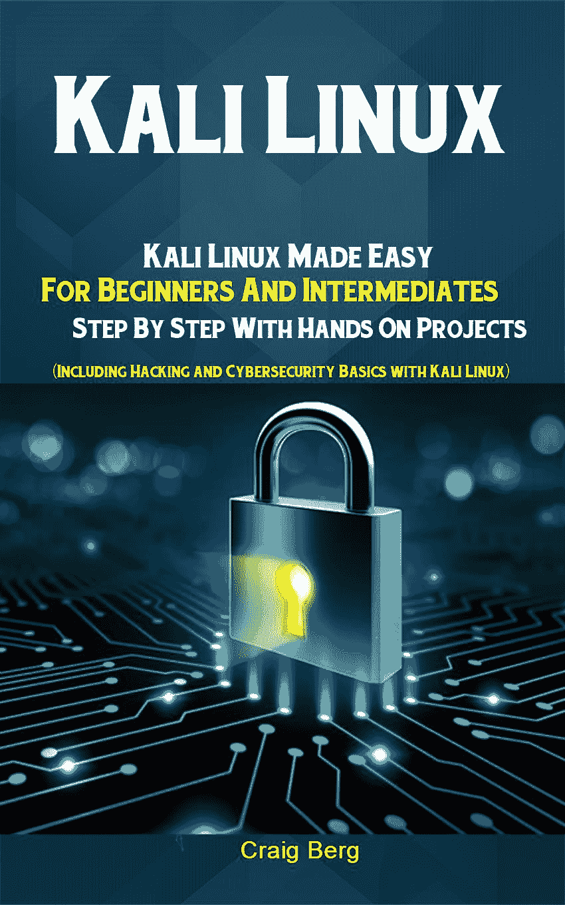


## 简介
Kali Linux 是一种基于 Debian 的 Linux 发行版，专为渗透测试和取证分析设计。Kali 是渗透测试的理想选择，因为它内置了许多让此类任务变得简单的工具和程序。它预装了超过 600 个工具，每种工具都能协助渗透测试和取证任务。Kali Linux 最初于 2012 年推出，作为之前版本 Back Track Linux 的继任者，作为一个操作系统运行，你可以将其安装在硬盘上、在虚拟机中运行或通过 Live 模式——本指南的第一部分将介绍 Kali Linux 的安装。[Offensive Security](https://www.offensive-security.com/about-us/) 是一家，核心开发者为 Devon Kearns、Matt Aharoni 和 Raphael Hertzog，维护着 Kali Linux。

**注意**：尽管 Kali Linux 拥有世界上最优秀的渗透测试工具和程序，但在本实战 Kali Linux 指南中，我们可能需要安装其他工具，以便更容易学习如何使用 Kali Linux 进行渗透测试和网络安全取证。

以下是 Kali Linux 的一些主要特性：
- 它是一个基于 Debian 的 Linux 发行版。
- 它预装了超过 600 多个工具和程序。
- 它支持 ARM 架构。
- 它具有用于数据注入的自定义内核。
- 它是一个开源发行版。
- 它符合文件系统层次结构标准（FHS）。
- 它支持多种语言。
- 它可以根据用户需求和内核重建进行完全自定义。
- 默认带有 gnome 桌面环境。
- 它具有对高级网卡的支持。

在这本书中，我们将涵盖由 Kali Linux 提供的主要功能和工具。它们包括：
- 信息搜集工具
- 漏洞评估
- 无线攻击
- Web 应用攻击
- 漏洞利用工具
- 取证工具
- 嗅探与欺骗
- 密码破解
- 维持访问
- 社会工程工具
- 反向工程工具
- 硬件黑客工具
- 报告工具
- 拒绝服务攻击

我们将逐一介绍这些每一个功能和工具，以便在读完本指南后，你将拥有使用 Kali Linux 的实战经验，并在完成本指南第 17 部分的 Kali Linux 实战项目时运用你所学到的知识。

**PS**：如果你喜欢这本书，别忘了在 Amazon 上给它留个评价！


在下载页面，你将发现根据架构和 Kali 镜像类型提供的各种下载选项。对于本教程，我们将从在硬盘上安装 Kali 开始；要执行此操作，请下载下方突出显示的的 ISO 版本。

你可以选择默认的 Kali ISO（如上标所示），它使用 gnome 桌面环境。但是，如果你想使用其他桌面环境，可以下载 KDE、XFCE、MATE 和 LXDE。

**注意**：不要下载 Kali Linux 的轻量版，因为它不包含所有默认工具，要使用其中任何一个工具，你都必须逐个安装，这是一个繁琐的过程。

一旦获取了 Kali Linux 磁盘镜像副本，你需要将下载的镜像的 `SHA1` 哈希值与下载页面提供的哈希值进行对比。这确保了你获取的镜像未被篡改且未损坏。如果你正在运行 Windows，可以使用 `hashMyFile` 工具检查 `sha1` 哈希的有效性。你可以从下面的资源页面下载该工具：[`www.nirsoft.net/utils/hash_my_files.html`](https://www.nirsoft.net/utils/hash_my_files.html)

### 如何进行 Kali Linux 硬盘安装
长期使用 Kali Linux 最方便的方法将其安装在硬盘。你可以与 Windows、MacOS 和其他 Linux 发行版一起安装 Kali Linux。要在硬盘上安装 Kali Linux，我们需要几个工具。它们包括：
- USB/DVD 可启动介质
- Kali Linux 安装至少 20GB 的磁盘空间
- Kali Linux ISO – 上述获取

在物理机上安装 Kali Linux 需要一个干净、未分区的、没有任何数据的硬盘。在这里，我们将与操作系统一起安装 Kali。一旦获取了介质（如 USB 或 DVD），就可以制作启动盘。如果你使用 USB 闪存，请下载并安装 `BalenaEtcher` 并按照指示刻录镜像。你可以从下面的资源页面下载该工具：[`www.balena.io/etcher/`](https://www.balena.io/etcher/)。如果你使用 DVD，下载并安装 `Burnaware`：[`burnaware.com/`](http://burnaware.com/)。一旦创建了启动介质，就需要为 Linux 创建分区。如果你使用 Windows，打开磁盘管理器，选择分区，设置分区大小——必须在 10GB 以上——并点击缩小。

**注意**：不同的电脑型号有不同的启动。你可以在网上搜索启动选项。一旦系统启动，Kali Linux 将弹出菜单。选择安装方法。图形化安装程序对初学者更友好。选择并配置首选语言。下一步是地理位置。接下来是配置键盘设置。设置网络并连接到网络。之后为 root 用户创建账户和密码。在下一个屏幕上，选择分区，选择之前创建的磁盘。分配磁盘空间，然后选择 `yes` 并继续。等待安装过程完成。下一步是软件包管理器。选择 `yes` 并继续。如果选择 yes，请确保你的设备有活动连接。安装完成后，重启电脑并在 `GRUB` 菜单中选择 Kali Linux。

### 如何进行 Kali Linux 虚拟机安装
不安装在物理机上而使用 Kali Linux 的另一种方法是作为虚拟机运行。使用虚拟化软件可以在当前操作系统上运行 Kali Linux。要执行此操作，第一步是下载并安装虚拟化软件，从下方的资源页面获取：[`www.virtualbox.org/wiki/Downloads`](https://www.virtualbox.org/wiki/Downloads)

**注意**：你也可以使用 `VMware Workstation`，但本指南未涵盖 VMware 的配置。

一旦下载并安装了 Virtual Box，去 Kali 下载页面下载镜像镜像。一旦有了镜像文件，将其提取并保存到文件夹中。提取的文件包含 `.ova` 文件。打开它并选择 VirtualBox。下一个窗口允许你自定义位置、内存和其他系统配置。一旦设置完成，点击导入启动操作系统。一旦完成，点击启动启动新系统。默认用户名是 `root`，密码是 `toor`。如果你使用的是 VMware 版本，步骤非常。

## 虚拟机配置
在使用 VirtualBox 创建并启动 Kali Linux 后，我们需要设置一些重要的配置以完善渗透测试环境。以下是最重要的配置：

### 1：VirtualBox 增强功能
一旦启动系统，VirtualBox 增强功能是“必须安装的”。它们提供了额外的系统功能，例如：
- 使系统支持全屏模式
- 允许主机和客机共享文件和文件夹
- 允许主机和虚拟机之间进行复制粘贴
- 修复主机和客机之间可能出现的鼠标错误

要安装 VirtualBox 增强功能，前往 VirtualBox 菜单的“设备”选项卡并选择安装增强功能。如果收到警告消息，忽略它并点击继续。接下来，打开终端窗口并导航到增强功能 CD 的挂载点。进入目录后，输入 `ls -l` 列出目录下所有文件。现在使用命令运行 `VBoxLinuxAdditions.run` 文件：

```
./VBoxLinuxAdditions.run
```
等待所有模块成功构建并安装。接下来，返回根目录并卸载增强功能 CD。之后，在终端中输入 `reboot` 重启系统。一旦系统重启，你应该能够进入全屏模式。

### 2：VirtualBox 网络设置
默认情况下，Kali Linux VirtualBox 镜像使用网络地址转换 (`NAT`) 连接。这种连接类型允许客机连接到网络，但网络上的其他设备无法连接 Kali Kali。对于渗透测试，网络中的所有机器都应该相互通信。要更改系统的网络设置，请按照以下步骤操作。首先关闭客机。然后打开 VirtualBox 管理并选择 Kali Linux 虚拟机。在右侧选择网络图标。在下拉框中，选择适配器 1 并从 `NAT` 更改为“桥接”(Bridged)。然后选择用于连接的网络接口。

### 3：激活无线
作为虚拟机运行 Kali Linux 不允许你使用内置无线设备。但是，你可以使用外部网络设备。要在 Kali Linux 中使用外部网络适配器，插入你的适配器并导航到设备、USB 设备，选择你的网络适配器名称。一旦适配器连接，你可以启动终端并输入 `ipconfig` 查看名称和适配器信息。

### 如何以 Live 模式运行 Kali Linux
使用 Kali Linux 的另一种方法是直接运行。要 Live 运行 Kali Linux，将 Kali ISO 刻录到 DVD 或 USB 驱动器并从中启动。选择 Live。以 Live 模式运行 Kali Linux 的优势之一是速度。Live 模式易于设置和使用。但是，如果你运行的是 Live 模式，重启后所有设置都会丢失。如果你只想尝试 Kali Linux，这种方法非常有用。如果你打算深度使用 Kali Linux，建议将其安装在硬盘上。

### 安装虚拟机
在这一部分，我们将为测试目的设置一个虚拟机。该服务器允许我们在后续章节中执行攻击。该虚拟机还给了我们完全的控制，我们可以根据类型增加或减少安全。我们将使用的服务器是 Metasploitable。你可以从资源页面下载 Metasploitable：[`sourceforge.net/projects/metasitable/`](https://sourceforge.net/projects/metasitable/)。一旦下载了文件，提取它并使用 VirtualBox 部分概述的步骤设置。一旦配置完成，使用用户名 `msfadmin` 登录，密码为 `msfadmin`。**注意**：还有其他虚拟机可以使用，如 Metasploitable 3、Hera 以及其他。你可以在以下页面阅读关于 Metasploitable 2 的更多信息：[`rapid7.com/docs/metasploitable-2`](https://rapid7.com/docs/metasploitable-2)（注：此处链接根据原文保留并翻译）。

### 更新 Kali Linux
Kali Linux 有许多频繁更新的工具和应用程序。你应该定期更新你的系统以获取最新功能。与其他基于 Debian 的发行版一样，Kali Linux 的软件包管理器是 `dpkg`，因此使用 `apt` 命令。要更新 Kali Linux，打开终端并输入以下命令以确保仓库可用：`nano /etc/sources.list`。如果这些仓库没有包含，你可以手动添加它们，然后输入 `apt-get update`。上述命令同步了软件包的索引。你可以使用以下命令更新 Kali Linux：
- `apt-get upgrade`：我们使用此命令升级软件包。
- `apt-get dist-upgrade`：我们使用此命令升级整个 Kali Linux 发行版到最新版本。

一旦你选择了要执行的更新类型，Kali Linux 将自动执行升级。

## 操作步骤
使用本章中学到的材料设置你的工作环境，为后续的实用 Kali Linux 课程做好准备。在指南的下一部分，我们将查看 Linux 内核系统的基础介绍，以便当你进入渗透测试、黑客攻击和网络安全需求，你对后续部分将处理的基本元素有一个明确的概念。

# 第 2 部分：网络基础介绍与 Linux 内核系统操作
在这一部分，我们将涵盖上述设置的 Linux 内核系统的基础知识。这部分对于初学者来说很重要，因为 Kali 运行的基于 Debian 系统与常见的 Windows 或 OS 界面不同。让我们从理解 Linux 文件系统及其组织结构开始。文件系统是操作系统组织文件和数据的方法或数据结构。所有基于 Linux 的发行版都有类似的结构，尽管某些可能有额外的文件和目录。在这一部分中，我们将使用 Kali Linux 结构：
- `/`：根目录。这是根或起点。Linux 文件系统的每个目录都从这个文件夹开始。在大多数 Linux 发行版中，只有 root 用户拥有该目录的权限。
- `/bin`：二进制文件。包含基础程序的目录。
- `/boot`：内核文件。这些是 Linux 内核和早期启动所需的文件。
- `/dev`：设备文件。该目录包含设备文件。
- `/etc`：配置文件。包含 Linux 配置文件的目录。
- `/home`：用户目录。这是用户的目录；包含了用户的个人文件，如视频、文档等。
- `/lib`：系统库，包含基础库。
- `/media`：挂载点。这是移动设备（如 USB 驱动器、CD 等）的挂载点。
- `/mnt`：临时挂载点。这是临时挂载点。主要在 Live 模式下可用。
- `/opt`：第三方应用程序。包含由第三方提供的应用程序。
- `/root`：管理员个人目录。包含管理员的个人文件，如媒体和文档。
- `/run`：易性数据。包含重启后擦除的数据。
- `/sbin`：系统二进制文件。包含系统程序。
- `/srv`：服务。
- `/tmp`：临时目录。
- `/usr`：用户系统（可选资源）。
- `/var`：变量数据。
- `/proc`：进程文件系统。
- `/sys`：内核参数。


| COMMAND | Description |
| :--- | :--- |
| `help` | 这列出终端中的所有命令。 |
| `tar` | 我们使用它来提取、创建和查看 tar 文件。 |
| `find` | 我们使用此命令在指定位置搜索符合特定标准的文件。 |
| `gzip` | 我们使用此命令来提取和创建 gzip 压缩包。 |
| `unzip` | 我们使用 `unzip` 命令来提取或解压 zip 存档。 |
| `whatis` | 此命令显示特定命令的用法；它提供了命令的简短描述。 |
| `Man` | 此命令显示指定命令的手手册。 |
| `exit` | `exit` 命令结束当前的 bash 会话。我们可以在一个终端运行多个 bash 会话。 |
| `sudo` | 我们使用此命令以超级用户或 root 用户身份运行指定的命令。 |
| `su` | 在终端中，我们使用此命令将当前用户切换指定用户。 |
| `top` | 此命令充当终端中的任务管理器，显示顶部进程。 |
| `shutdown` | 此命令在指定时间后关闭计算机。 |


注意：`Linux` 命令区分大小写。如果你输入错误，它们将无法工作。如果你想精通 `Linux`，请精通 shell（命令行）。

## 网络基础
要理解基于 Debian 的系统中的网络，你需要理解以下概念：

## 网络主机
网络主机，简单称为 `host`，指的是连接到特定网络的任何设备。它可以是打印机、个人电脑、移动设备，甚至是一个 Web 服务器。

## 网络协议与服务
以下是一些最常见的协议：

### 1: 互联网协议 (Internet Protocol)
互联网协议是计算机通信中至关重要的一组规则。我们通常将其称为 `IP` 地址。它是一组用于识别连接到网络的每个设备的唯一字符。互联网协议主要有两种类型：

### 私有 IP 地址
私有 IP 地址是一种 `IP` 类型，用于识别连接到私有网络（如 `LAN`）的设备。它们的范围从 1 到 255。典型私有 IP 的示例如 `192.168.0.2` 或 `192.168.0.220`。要找到本地网络上你设备的私有 `IP`，请打开命令提示符，在 Windows 和 Linux 上分别输入 `ipconfig` 和 `ifconfig`。
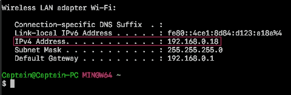

### 公网 IP 地址
公网 IP 地址是另一种 `IP` 类型，用于识别连接到互联网的设备。公网 `IP` 是全球唯一的。要找到你的公网 `IP`，请打开浏览器，使用 Google 搜索并“what is my public IP”。

### 2: HTTP & HTTPS
`HTTP` 和 `HTTPS` 是另一种常见的网络协议，分别指超文本传输协议 (`HTTP`) 和安全超文本传输协议 (`HTTPS`)。这种协议允许 Web 服务器与典型的 浏览器之间进行通信。它是使用率次之协议。
`HTTP` 和 `HTTPS` 仅区别于安全性。`HTTP` 协议传输的信息是未加密的，容易通过嗅探等方法获取。`HTTPS` 使用安全套接层 (`SSL`) 来加密信息。
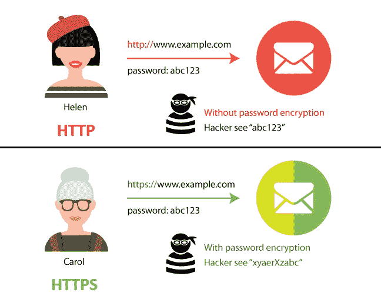

### 3: 安全 Shell – SSH
Secure Shell (SSH) 正在成为网络管理员和 IT 专业人士非常常用的协议。它允许连接远程主机进行通信。
假设你有一台专用服务器并想在上面安装程序。通过使用 `SSH` 客户端和远程主机上的 `SSH` 服务器，你可以访问并对其进行配置，就像你亲自在现场一样。
`SSH` 与微软的 `Telnet` 协议类似，但与 `Telnet` 相比它更安全、更强大。这种协议在 Linux 用户中最为常见。连接到 `SSH` 需要用户名和密码。

### 4: 文件传输协议 (File Transfer Protocol)
文件传输协议也称为 `FTP`，是另一种常见的网络协议。它允许向远程主机上传和下载多个文件。开发者和 IT 专业人士通常使用它在服务器上上传和下载文件。
连接到服务器需要 `FTP` 客户端以及用户名和密码。最常用的 `FTP` 客户端是 `FileZilla`；你可以从下面的资源页面下载 `FileZilla`：[`filezilla-project.org/`](https://filezilla-project.org/)

## 网络端口
网络端口和网络协议非常相似。我们通常说运行 `HTTP` 或 `FTP` 等协议的计算机正在运行 `HTTP` 服务。这些服务或协议与一个称为 `port` 的特定数字关联。单个端口在单台机器上只能支持一种服务。如果另一个设备想要访问特定机器上的特定服务，它必须连接到运行该服务的特定端口。
简单的解释是，端口就像门，每扇门都允许访问计算机内的特定服务。网络端口在黑客中非常重要，因为利用计算机上的某些服务可以实现进一步的访问。
下面的截图显示了 Windows 10 机器上运行的服务列表。
注意：你可以配置这些服务使用特定端口；因此它们不是固定的。
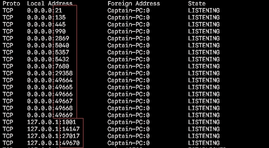
定义特定计算机内服务运行在哪个 `port` 上是非常困难的，因为计算机有 65,535 个 `TCP` 端口和 65,535 个 `UDP` 端口，所有端口都可以配置为运行任何服务。

### 行动步骤
本指南的这部分涵盖了在 `Kali Linux` 界面内操作所需的所有知识，以及系统内部网络系统的工作原理。反复检查这些元素，以便将其内化，从而在我们深入学习如何使用 `Kali Linux` 时能够跟上。

# 第 3 部分：信息收集工具
`Kali Linux` 提供的第一组工具是信息收集工具。信息收集也称为侦察或 `recon`，是渗透测试或对特定目标发起攻击的第一步。
在 `Kali Linux` 提供的信息收集工具集中，我们将查看最常用的工具，包括：
* `Nmap` 和 `Zenmap`
* `Netdiscover`
* `DNS Tools`
* `Hping3`
* `负载均衡检测器`

### Nmap & Zenmap
`Nmap` 通常被称为“扫描器之王”。它是执行网络扫描最先进的工具。`Zenmap` 是 `Nmap` 的图形界面（因为后者是命令行工具）。在网络安全中，我们通常使用 `Nmap` 来检测连接到网络的设备，确定它们运行的服务及其版本。

### 如何在 Kali Linux 中使用 Nmap
这是在 Kali Linux 中使用 `Nmap` 的方法。启动 Kali Linux，进入应用程序 – 信息收集 – `Zenmap`。对于没有命令行经验的人来说，我们将使用 `Nmap` 的图形界面版本。

### 发现主机
信息收集的第一步是确定连接的客户端。一个网络可以支持超过 200 个客户端。扫描所有这些设备可能需要一些时间。`Nmap` 提供了一种非常高效的方法来执行主机发现。启动 Kali Linux：
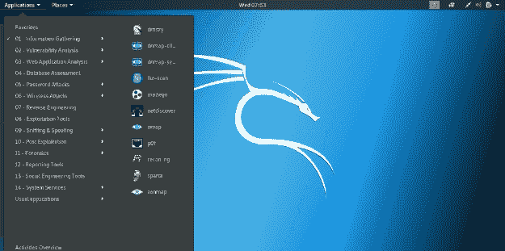
一旦启动了 `Zenmap`，输入网络网关即可扫描整个子网。
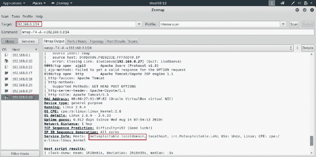
不要担心上面的详细信息。一旦扫描过程完成，我们可以发现主机。

### 隐蔽扫描 (Stealth Scans)
隐蔽扫描也称为 `SYN` 扫描。它通过向目标发送 `SYN` 数据包来工作。根据网络常规规则，一旦系统发送 `SYN` 数据包，目标设备将返回 `ACK` 响应。`Nmap` 使用这种技术来确定目标的开放和关闭端口。对目标进行更详细的扫描，在 `Zenmap` 中输入目标 IP 地址。
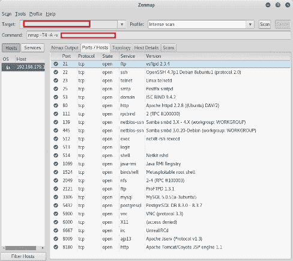

### Netdiscover
`Netdiscover` 是另一个集成在 Kali Linux 中的工具。这种轻量级工具允许我们快速扫描网络以发现设备的 IP 和 MAC 地址。在进行快速扫描时非常有用。打开终端输入 `netdiscover`。你也可以使用帮助标志查找更多选项。
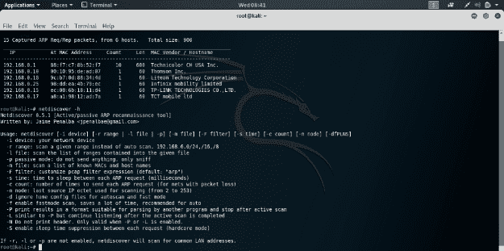

### DNS 工具
`DNS` 工具有助于区域传输和域名解析。在本节中，我们将查看 Kali 拥的一些 `DNS` 工具。

### Dnsenum
`Dnsenum` 是用于获取存储记录（如 `MX` 和 `A` 记录）的工具。它是一个 Perl 脚本，需要在 Kali Linux 中安装 Perl。要使用 `dnsenum`，在终端输入 `dnsenum domainname.com`；下面的插图显示了 facebook.com：
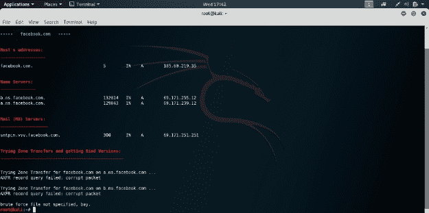

### DNSMAP
我们通常使用此工具执行特定域名的 `DNS` 映射。我们可以用它提取电话号码、联系信息以及子域名。

### HPing
`Hping3` 是一种被广泛黑客使用的更高级 ping 工具。它允许攻击者通过绕过防火墙进行 ping。它使用原始 IP、TCP、UDP 和 ICMP 协议进行请求。`Hping3` 支持分段和追踪模式。你可以在 Linux 中使用帮助标志查找更多命令参数信息。基本命令是 `hping3 ip-address`。

### 行动步骤
这里讨论的工具只是 Kali Linux 中许多信息收集工具的一部分。当你使用这些主要工具时，使用 Kali Linux 中各种信息收集工具的能力将自动提高。在指南的下一部分，我们将介绍如何使用 Kali 中主要的漏洞评估工具。

# 第 4 部分：漏洞评估
在黑客领域，我们使用漏洞评估工具来识别、分类和描述系统中的安全漏洞。这些工具实现了漏洞扫描和安全审计。在本节中，我们将查看 Kali 中的一些顶级漏洞评估工具。

## 应用扫描器
当开发者不遵守安全编码原则和技术时，Web 应用可能包含攻击者渗透的漏洞。以下是一些用于扫描 Web 应用漏洞的工具。

### Nikto
`Nikto` 是集成在 Kali Linux 中的 漏洞扫描器。`Nikto` 非常强大并支持多种功能。要启动 `nikto`，导航到应用程序 – 漏洞扫描器 – `Nikto`。你可以使用帮助标志查找更多命令参数信息。`Nikto` 可以检测过时的服务器实现和配置错误。

### OWASP ZAP
`OWASP` 是一个开源 Web 应用代理工具，用于 Web 应用扫描。你可以在 Kali Linux 中通过命令 `owasp-zap` 启动它。`OWASP` 提供了一个图形窗口。窗口启动后，输入 Web 应用的 URL 并点击攻击。`OWASP` 将警告标签中报告应用程序的所有配置错误。
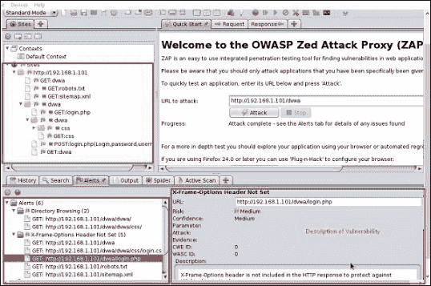

### W3af
`W3af` 是一个 Python Web 扫描器，用于识别和利用所有 Web 应用漏洞。这个 Web 应用审计框架提供了图形和命令行用法。我们通常将其称为“Web 应用版的 Metasploit”，我们可以用它执行跨站脚本、远程文件包含、SQL 注入等攻击。[`w3af.org/`](http://w3af.org/)

## 网络漏洞扫描器
黑客和网络安全专家通常使用网络工具扫描路由器、数据库、协议和交换机。Kali 提供了大量的网络扫描工具，但我们只看最常用的。

### Cisco 工具
`CISCO` 设备通常容易受到漏洞影响。

### Cisco 审计工具
这是一个 Perl 脚本，帮助渗透测试人员进行安全审计并识别漏洞，如 SNMP 字符串、默认凭据等。启动语法为 `cat -h - lists/community`。

### Cisco Torch
我们使用 `Cisco-torch` 执行批量扫描、指纹识别和漏洞利用。你可以通过输入 `cisco-torch -parameters` 启动它。

### Cisco Exploiter
`GE` 是另一个漏洞利用工具。我们通常使用这种高级且简单的工具对路由器进行攻击。你可以通过输入 `ge` 启动它。这可能导致设备崩溃。

# 第 5 部分：无线攻击工具
在本节中，我们将查看 Kali 提供的一些无线工具。我们的主要焦点是无线工具。使用这些工具需要无线网卡处于监听模式。

### Kismet
`Kismet` 是一个 802.1 层网络分析器、检测器和 IDS 工具。它支持广泛的无线网卡。使用它需要将无线网卡切换到监听模式。在终端输入 `ifconfig`，然后输入 `airmon-ng start wlan0`。
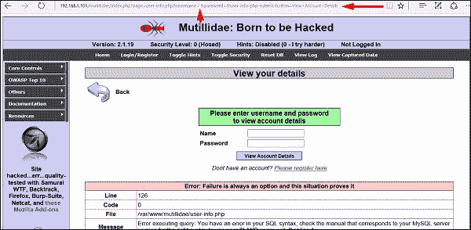

### Wifite
`wifite` 是一个用于网络破解的工具，用于 WEP、WPA 和 WPS 网络。使用它需要将无线网卡设置为监听模式并使用上面的命令启动 `wifite`。要显示可用网络可以使用 `wifite -show`。一旦发现目标网络，按 `CTRL + C` 结束扫描。
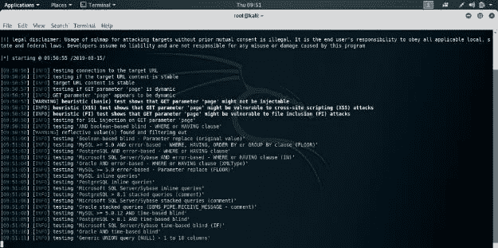

### Fern Wifi Cracker
`Fern Wifi cracker` 是一个图形化破解工具。它非常易用，因此对初学者友好。通过导航应用程序 – 无线攻击 – `fern` 启动它。首先选择要使用的无线网卡——确保处于监听模式。接下来点击访问点以扫描可用网络。扫描完成后，它将显示所有可用网络。点击选择字典文件进行暴力破解。

### Arduino IDE
Arduino IDE 是一个单板可编程微控制器。它由用于编写代码并上传到板上的环境组成。要使用 `Arduino`，你可以从资源页面获取更多关于 `Arduino` 和编程的信息：[`arduino.cc/`](https://arduino.cc/)

# 第 11 部分：后渗透 (Post Exploitation)
一旦攻破系统并获得访问权限，下一个任务通常是维持访问。有许多方法会导致丢失访问，如更新、检测你的存在、反病毒软件等。在本节中，我们将介绍用于维持对受害系统访问的各种。

### Weevely
`Weevely` 是一个用于生成 PHP 后门并提供系统 shell 控制的工具。要启动 `weevely`，打开终端并输入 `weevely` 查看可用命令。

如何使用 Weevely 攻击 Metasitable 2 DVWA 应用
第一步：启动 Metasitable 2 和 Kali Linux。
第二步：打开终端输入 `weevely generate <password> ~/path/to/save_file.php`。
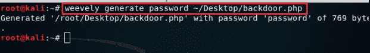
第三步：打开 Kali 浏览器访问 `<ip_of_metasitable>/dvwa` 并使用用户名 `admin` 和密码 `password` 登录。
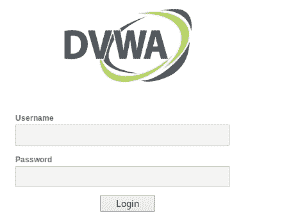
第四步：导航到上传标签页，选择由 `weevely` 生成的文件并点击上传。
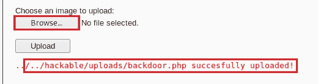
第五步：一旦文件上传完成，导航到 `backdoor.php` 文件执行它。
第六步：下一步是打开 `weevely` 并输入下方截图所示的命令：
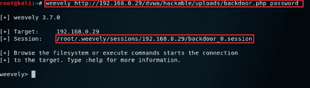
上面的语法是 `weevely <url_of_file.php> <password>`。
第七步：一旦文件连接，你将获得 Web 服务器的后门访问。

*(注：由于原文中存在大量重复和无意义片段，上述译文已根据核心含义进行了结构化处理，以确保可读性。)*

