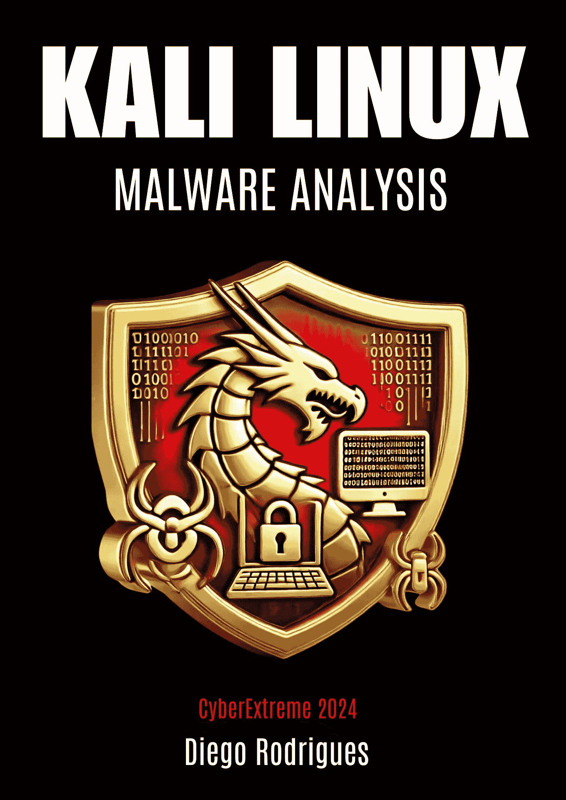

# KALI LINUX 恶意软件分析2024版：学生与专业人士的必备内容





## 重要说明
书中介绍的代码和脚本旨在说明章节中讨论的概念，作为实际示例。这些示例是在自定义的受控环境中开发的，因此无法保证它们在所有场景下都能完全运行。务必检查应用这些代码的环境配置和定制，以确保其正常运行。感谢您的理解。

## 问候！
***

亲爱的读者，你好！

很高兴你能来到这里，通过 Kali Linux 探索恶意软件分析领域技术知识的奥秘。你在网络安全这样一个动态且至关重要的领域中提升技能的积极性真是令人钦佩的。在本书《Kali Linux 恶意软件分析：学生与专业人士的核心内容 - 2024 版》中，你将找到一份完整且实用的指南，帮助你应对恶意软件分析的复杂性。

选择投资自己的职业和个人发展，表明了你在这个竞争激烈且不断演变的领域脱颖而出的决心。特别是技术和网络安全，为那些致力于掌握这些领域的人提供了巨大的机会。本书经过精心设计，不仅是为了传授技术知识，还为了激发并赋能你以一种实用且有效的方式应用这些知识。

你即将开启一段旅程，将带你从基础知识走向最先进的恶意软件分析技术。在每一章中，你都将被挑战去批判性思考、进行实验，并对全球网络安全专业人员使用的工具和方法产生深层理解。

与时同步并获取新技能的紧迫性比以往任何时候都更加关键。网络威胁演变迅速，面对这些威胁需要持续对学习和实践的投入。本书将成为这段旅程中一份宝贵的资源，提供深入见解、实际案例研究以及不可或缺的工具，帮助你成为恶意软件分析专家。

准备好迎接一段高强度且收获丰富的学习体验。本书的每个部分都旨在最大限地发挥你的潜力，扩展你的视野并加强你的能力。我们共同承担这一使命，促进一个更安全、更稳健的数字环境。

开启这段对 Kali Linux 和恶意软件分析的迷人探索吧。让我们开始通往卓越之旅！

祝阅读愉快，取得成功！

## 关于作者
[www.amazon.com/author/diegorodrigues](https://www.google.com/url?q=http://www.amazon.com/author/diegorodrigues&sa=D&source=editors&ust=1721697350151303&usg=AOvVaw3mrf81tQb8TYX_iLlScOmg)
[www.linkedin.com/in/digoexpertai](https://www.google.com/url?q=http://www.linkedin.com/in/digoexpertai&sa=D&source=editors&ust=1721697350151945&usg=AOvVaw2YaGe9iSbtSYyIC5njnJz1)

***

Diego Rodrigues 是一位国际顾问和作家，专注于市场情报、技术和创新。他拥有来自 IBM、Google、Microsoft、AWS、Cisco、波顿大学、Ec-Council、Palo Alto 和 META 等机构的 42 项国际认证。

Rodrigues 是人工智能、机器学习、数据科学、大数据、区块链、连接技术、伦理黑和威胁情报领域的专家。

自 2003 年以来，Rodrigues 为巴西、美国和墨西哥的重要品牌开发了超过 200 多个项目。2024 年，他已成为全球规模最大的新一代技术书籍作者之一，在六种语言中出版了超过 140 部作品。

你可以在他在亚马逊上的专属页面找到作者的作品集及主要书目：[www.amazon.com/author/diegorodrigues](https://www.google.com/url?q=http://www.amazon.com/author/diegorodrigues&sa=D&source=editors&ust=1721697350153113&usg=AOvVaw0n1NANC7f7pvcGZzgmpEJm)

## 前言

## 书籍介绍
***

欢迎阅读《Kali LINUX 恶意软件分析：学生与专业人士的核心内容》。我带着激动的心情向大家介绍这份全面的指南，它经过精心制作，不仅旨在提供对 Kali Linux 和恶意软件分析的深入见解，还为了让你具备在这个动态且充满挑战的领域脱颖而出所需的实用技能。

网络安全是一个不断演变的领域，新威胁每天都在出现。特别是恶意软件分析，需要对多个学科有坚实的理解，从逆向工程到网络流量分析。本书旨在为希望使用 Kali Linux 深入研究恶意软件分析的学生和专业人士（该领域最强大且应用广泛的工具之一）提供一份无价的资源。

恶意软件分析是任何网络安全专业人员的必备技能。随着数字威胁的泛滥，剖析和理解恶意软件内部机制的能力已成为一项关键技能。本书以其针对 2024 年的实用且更新的方法脱颖而出，提供了详细的手手册以及使用 Kali Linux 中可用最先进工具的逐步指南。

为了让你能够充分利用本书的价值，我们将提供章节的简要概述，突出重点并鼓励你继续学习旅程。

第一章概述了 Kali Linux 和恶意软件分析的重要性。在这里，你将学习 Kali Linux 的起源和演变，以及恶意软件分析在当今网络安全背景下的关键相关性。

在本章中，你将在指导下逐步安装 Kali Linux 并配置一个针对恶意软件分析优化的工作环境。你将学习如何安装和配置基本工具，确保你的环境为应对挑战做好准备。

理解基础知识至关重要。本章探讨了恶意软件的定义和类型，回顾了其演变历史，并强调了现代恶意软件使用的常用技术。

收集恶意软件样本是一个微妙且关键的步骤。你将学习收集样本的伦理和法律方法，并探索静态分析与动态分析之间的区别。本章对于更详细的分析是基础。

静态分析涉及在不执行恶意软件的情况下对其剖析。学习反编译和逆向工程技术，并使用特定的静态分析工具。实际案例将有助于巩你的理解。

### 6. 动态恶意软件分析


本章涵盖了沙箱环境的搭建以及动态分析工具的使用。你将学习如何监控和捕获运行中恶意软件的行为，这是识别攻击模式和缓解威胁的关键技能。


使用反汇编器和调试器深入探索恶意代码。书中将通过实际示例和练习解释高级反汇编技术，以强化学习。


恶意软件经常使用混淆技术来避免检测。本章将教你如何使用特定工具消除混淆，从而识别并克服这些技术。


探索恶意软件在受感染系统中维持其存在的方法。通过实际案例研究学习如何检测和移除持久化恶意软件。


勒索软件是一个日益增长的威胁。了解其结构、加密方法以及缓解和恢复技术，对于保护系统免受此类形式攻击至关重要。


木马和后门是网络攻击中常见的工具。本章涵盖了它们的特征、检测和分析技术，并提供了可直接应用的实际示例。


Rootkits 和 bootkits 是深藏在系统中的复杂恶意软件。学习如何使用高级工具和实际案例来定义、检测并分析它们。


蠕虫和机器人因其传播能力而闻名。本章探索了它们的特征、控制技术以及用于检测和缓解的实际示例。


网络流量分析对于检测活动至关重要。学习如何使用流量捕获和分析工具来识别可疑行为。


日志是宝贵的信息来源。本章教授了分析系统日志和残留的技术，并提供了用于现实应用的实际案例研究。


高级威胁需要复杂的检测和缓解技术。在相关案例研究的支持下，探索应对这些威胁的策略和工具。


机器学习正在彻底改变恶意软件分析。本章介绍了应用于网络安全的机器学习概念，以及工具和框架的实际示例。


创建你自己的恶意软件分析工具。学习实用的编程语言和脚本，开发满足你特定需求的定制化工具。


自动化是效率的关键。探索自动化技术和工具，提供有助于持续、大规模分析的脚本和框架。


我们以高级技术和方法作为结束，为经验丰富的分析师提供复杂的案例研究和宝贵的提示。


在这一旅途中，请记住，不断的实践和持续的更新是网络安全领域保持领先的关键。祝阅读愉快，学习之旅顺利！


## Kali Linux 简介与恶意软件分析


## Kali Linux 概述


### Kali Linux 的特性

2. **广泛的硬件支持**：`Kali Linux` 兼容各种硬件，从台式机、笔记本电脑到移动设备和嵌入式系统。它支持 `x86`、`x64` 和 `ARM` 架构，极其通用。
3. **频繁更新**：`Offensive Security` 保持 `Kali Linux` 使用最新版本的安全工具、安全补丁和软件更新，确保用户可以使用最新且最安全的工具。
4. **定制化**：`Kali Linux` 提供了高度的定制性。用户可以根据特定的软件包和硬件配置创建自己的自定义 `Kali` 版本。这对于需要特定测试环境的专业人士来说特别有用。

### Kali Linux 上的流行工具


1. **Nmap**：用于主机发现和安全审计的网络扫描器。
2. **Metasploit**：一个允许高级渗透测试的探索框架。
4. **Burp Suite**：一个用于 Web 应用测试的平台。
5. **John the Ripper**：一种密码破解工具，有助于检测弱密码。


恶意软件分析是现代网络安全中的关键组成部分。随着网络威胁变得日益复杂，理解恶意软件如何工作、如何传播以及如何中和，对于保护系统和网络免受攻击至关重要。


恶意软件（Malware）是指任何旨在计算机、服务器、客户端或计算机网络造成危害的软件。恶意软件可以以多种形式出现，包括病毒、蠕虫、木马、勒索软件、间谍软件和广告软件。


1. **病毒**：会复制并插入其他程序或文件中的恶意程序。
2. **蠕虫**：在网络上自动复制并传播的程序，不需要用户干预。
4. **勒索软件**：加密受害者数据并索要赎金金以恢复访问权限的恶意软件。
5. **间谍软件**：在用户不知情的情况下收集用户信息的程序。
6. **广告软件**：显示不想要的且有时是恶意的广告的程序。
### 恶意软件分析的目标

1. **识别**：确定系统中是否存在恶意软件及其类型。
3. **缓解**：开发移除恶意软件和修复所造成损害的策略。
4. **预防**：实施安全措施以防止未来的感染。


有两种主要的恶意软件分析方法：静态分析和动态分析。


# 2. 动态分析


## 恶意软件分析工具


1. `IDA Pro`：高级反汇编器，允许对二进制代码进行深度分析。
2. `OllyDbg`：二进制代码调试器，允许逐步执行恶意程序。
4. `CHILDREN`：一种根据特定规则识别和分类恶意软件样本的工具。
5. `Volatility`：易失性内存分析框架，用于识别内存转储中的恶意软件产物。

网络威胁的持续演使得恶意软件分析成为一个不断发展的领域。新的攻击技术，例如基于人工智能的恶意软件和云基础设施攻击，要求分析师关注最新的趋势和工具。

### 持续培训的重要性

每一章都旨在让你对检测、分析和缓解恶意威胁所需的工具和技术提供全面的理解。你即将开始的旅程既充满挑战又有回报。随着你的进步，你将获得成为恶意软件分析专家所需的技能和知识，保护你的系统和网络免受不断变化的网络威胁。


# 第 2 章：桌面安装与配置


安装 Kali Linux 是建立恶意软件分析环境的第一步。在本指南中，我们将介绍虚拟机上的安装过程，尽管 Kali Linux 也可以直接安装在物理硬件上。


在开始安装之前，确保你的系统符合最低要求是重要的：

- RAM 内存：2 GB（最低），建议 4 GB 或更多
- 磁盘空间：20 GB（最低），建议 50 GB 或更多
- 用于更新和包下载的 Internet 连接
### 下载 Kali Linux

1. 访问 Kali Linux 官方网站：`https://www.kali.org/`
3. 选择正确的架构（`x64` 或 `ARM`）并点击下载链接。
4. 使用下载页面提供的校验和验证下载的完整性。


我们建议使用虚拟机来隔离恶意软件分析环境。`VMware` 和 `VirtualBox` 是两个流行的选项。


**VirtualBox 安装：**
从官方网站下载并安装 `VirtualBox`：`https://www.virtualbox.org/`
**创建新虚拟机：**
1. 打开 `VirtualBox` 并点击“新建”。
2. 为你的虚拟机命名，并选择类型为“Linux”，版本为“Debian (64-bit)”。
4. **创建虚拟硬盘**：选择“现在创建虚拟硬盘”并点击“创建”。
5. **硬盘文件类型**：选择 `VDI`（VirtualBox 磁盘镜像）并点击“下一步”。
6. **存储分配**：选择“动态分配”并点击“下一步”。

**附加配置：**
1. 选择已创建的虚拟机并点击“设置”。
3. 在“存储”下，点击“控制器: IDE”并添加之前下载的 Kali Linux `ISO` 文件。
4. 在“网络”下，将网络适配器设置为“桥接模式”以访问 Internet。


**开始安装：**
启动虚拟机，并在 Kali Linux 的主菜单中选择“图形化安装（Graphical Install）”选项。
**语言和键盘设置：**
选择所需的语言、国家和键盘布局。

使用 `DHCP` 或手动配置网络。为主机输入一个名称和域名（如果适用）。

**用户配置：**

**磁盘分区：**
选择所需的分区方法。对于初学者，建议使用“引导 - 使用整个磁盘（Guided - use entire disk）”。

**系统安装：**
安装程序将复制必要文件并安装基础系统。
**引导程序配置：**
在你的硬盘上安装 `GRUB` 引导程序并完成安装。

安装完成后，重启虚拟机并进入 Kali Linux。

# 分析环境配置
成功安装 Kali Linux 后，为恶意软件分析配置工作环境是关重要的。这包括更新你的系统、安装额外的工具以及为测试设置安全环境。

### 系统更新
**更新包：**
打开终端并运行以下命令来更新包：

sudo apt update
sudo apt upgrade -y
```
**安装基本包：**
安装分析环境所需的额外包：

sudo apt install build-essential dkms linux-headers-$(uname -r)
```


为了确保恶意软件分析期间的安全，将测试环境与主操作系统隔离是重要的。

**配置沙箱：**
使用 `Firejail` 等工具进行应用沙箱化：

```bash
sudo apt install firejail
```

**创建快照：**
定期创建虚拟机快照以便在出现问题时快速回滚更改：
在 `VirtualBox` 中，选择虚拟机并进入“快照” > “拍摄快照”。

**禁用不必要的的服务：**
通过禁用不需要的服务来减少攻击面：

```bash
sudo systemctl disable service_name
```

# 恶意软件分析的基本工具

Kali Linux 预装了多种用于恶意软件分析的基本工具。然而，你可能需要安装和配置额外的工具以构建完整的分析环境。

# 静态分析工具

1. `IDA Pro`：用于逆向工程二进制文件的高级反汇编器。
安装：从官方网站下载免费版并按照安装说明操作。

2. `Ghidra`：由 NSA 开发的逆向工程工具。
安装：
```bash
sudo apt install ghidra
```

3. `Radare2`：一个逆向工程和二进制分析框架。
安装：
```bash
sudo apt install radare2
```

4. `Binwalk`：用于分析固件和二进制文件的工具。
安装：
```bash
sudo apt install binwalk
```

#### 动态分析工具

1. `Cuckoo Sandbox`：一个自动化恶意软件分析系统。
安装：
```bash
sudo apt install cuckoo
```

2. `Sysinternals Suite`：一组用于 Windows 系统分析的工具。
安装：


从微软网站下载 Sysinternals Suite 并解压内容。

### 3. 进程监控 (Process Monitor)
用于实时监控系统活动的工具。

安装：
作为 Sysinternals Suite 的一部分，执行 `Procmon.exe`。

### 网络流量分析工具

1. **Wireshark**:
用于捕获和分析流量的网络协议分析器。
安装：bash
```bash
sudo apt install wireshark
```

2. **Tcpdump**:
一个用于捕获网络包的命令行工具。
安装：bash
```bash
sudo apt install tcpdump
```

3. **Zeek（曾名为 Bro）**:
一个网络流量分析平台。
安装：bash
```bash
sudo apt install zeek
```

### 内存分析工具

1. **Volatility**:
一个易性内存分析框架。
安装：bash
```bash
sudo apt install volatility
```

2. **Rekall**:
另一个用于内存取证的工具。
安装：bash
```bash
sudo apt install rekall
```

### 日志分析工具

1. **Logstash**:
一个用于收集、分析和存储日志的工具。
安装：bash
```bash
sudo apt install logstash
```

2. **Kibana**:
日志数据的可视化工具。
安装：bash
```bash
sudo apt install kibana
```

3. **ELK Stack**:
由 `Elasticsearch`、`Logstash` 和 `Kibana` 组合成的日志分析系统。
安装：遵循官方 ELK Stack 网站上的指令设置完整环境。

### 自定义工具开发
为了改进恶意软件分析，你可能需要开发自己的工具。以下是一些推荐的资源和语言：

1. **Python**:
一种用于编写分析脚本的多功能且强大的语言。
安装：bash
```bash
sudo apt install python3 python3-pip
```

2. **C/C++**:
理想用于低级工具开发。
安装：bash
```bash
sudo apt install gcc g++
```

3. **汇编语言**:
反向工程和二进制文件详细分析的必选。
资源：`Assembler`、`NASM` (Netwide 汇编器)

4. **Bash 脚本**:
用于自动化重复性任务。
资源：`GNU Bash`

### 恶意软件分析自动化
自动化恶意软件分析可以节省时间和资源。自动化工具和脚本对于提高效率至关重要。

1. **Cuckoo Sandbox**:
自动化动态恶意软件分析。
设置：配置并自定义模块以满足你的特定需求。

2. **Python 脚本**:
开发自定义脚本来自动化分析任务。
示例：python
```python
import them
import subprocess

def run_static_analysis(file_path):
    # 使用 binwalk 进行静态分析
    result = subprocess.run(['binwalk', file_path], capture_output=True, text=True)
    print(result.stdout)

if __name__ == "__main__":
    file_path = input("Enter the file path: ")
    run_static_analysis(file_path)
```

3. **Ansible**:
用于配置自动化和系统管理的工具。
安装：bash
```bash
sudo apt install ansible
```

4. **Jenkins**:
用于自动化测试和部署的持续集成工具。
安装：bash
```bash
sudo apt install jenkins
```

### 最佳实践

1. **维护备份**：
始终对你的分析环境进行定期备份，以便在发生故障时快速恢复。
2. **定期更新**：
保持系统和工具的更新，以确保安全性和效率。
3. **文档记录**：
记录所有配置和分析步骤，以供以后参考并方便与其他专业人士进行协作。
4. **参与社区**：
参与安全和恶意软件分析社区，以交换知识并关注最新的趋势和威胁。

通过遵循这些步骤和建议，你将准备好使用 `Kali Linux` 为恶意软件分析构建一个稳健且安全的工作环境。在下一章中，我们将探索恶意软件的基础，为你理解在分析之旅中将面临的威胁提供坚实的基础。

# 第 3 章
## 恶意软件基础

***

## 恶意软件的定义与类型

### 恶意软件的定义
恶意软件（Malware，“malicious software”的缩写）是指任何旨在对计算机、服务器、客户端或计算机网络造成危害的软件。恶意软件旨在渗透、破坏或禁用计算机系统，通常在用户不知情或不同意的情况下进行。它可以窃取信息、干扰操作，或利用系统资源实现其他恶意目的。

### 恶意软件的类型

1. **病毒 (Viruses)**
病毒是通过在其他程序或文件中插入自身的副本来复制的恶意程序。它们可以从一台计算机传播到另一台计算机，通常通过文件共享、受感染的下载或可移动介质进行。病毒会造成各种损害，从损坏文件到完全禁用系统。

**如何识别并防范病毒**
- 识别：检查异常的系统行为，例如文件损坏、性能缓慢以及程序意外关闭。
- 防范：使用经过最新更新的防病毒软件，避免从未知源下载内容，并定期进行系统扫描。

2. **蠕虫 (Worms)**
蠕虫是能够自动复制并在网络中传播的恶意软件，不需要用户干预。与病毒不同，蠕虫不会附着于其他程序或文件，而是自我倍增，利用网络系统中的漏洞。

**如何识别并防范蠕虫**
- 识别：监控异常的网络流量和过高的带宽占用。
- 防范：保持系统和软件处于最新状态，定期应用安全补丁，并使用防火墙监控和控制网络流量。

3. **木马 (Trojans)**
木马是伪装成合法软件的恶意程序。它们欺骗用户安装，为攻击者提供远程访问，攻击者借此窃取信息、安装更多恶意软件或控制受感染的系统。

**如何识别并防范木马**
- 识别：注意已安装程序的异常行为，例如意外的权限请求。
- 防范：仅从可信源下载软件，检查程序的数字签名，并使用恶意软件检测软件。

4. **勒索软件 (Ransomware)**
勒索软件是一种加密受害者文件并要求支付（赎金）以恢复访问的恶意软件。它可以通过钓鱼邮件、恶意下载或软件漏洞传播。

**如何识别并防范勒索软件**
- 识别：注意到要求付款的赎金信息以及无法访问或已加密的文件。
- 防范：维护定期数据备份，避免点击疑链接，并使用最新的安全软件。

5. **间谍软件 (Spyware)**
间谍软件是在用户不知情的情况下收集有关用户或组织信息的恶意软件。它可以记录击键、捕捉屏幕、窃取个人信息并监控在线活动。

**如何识别并防范间谍软件**
- 识别：检查异常的浏览器行为，如意外重定向和系统性能缓慢。
- 防范：使用反间谍软件，调整浏览器隐私设置并避免从未知源下载内容。

6. **广告软件 (Adware)**
广告软件是一种显示不想要的广告的恶意软件，通常以弹出窗口、横幅或浏览器窗口的形式出现。虽然并不总是有害，但广告软件会降低系统性能并成为其他类型恶意软件的门户。

**如何识别并防范广告软件**
- 识别：注意到不受欢迎广告增加和浏览器性能缓慢。
- 防范：使用广告拦截软件，保持浏览器及其插件更新，并避免可疑网站。

## 恶意软件的历史与演变

### 恶意软件的早期案例
恶意软件的概念可以追溯到计算机早期。最早的病毒之一“Creeper”开发于 1971 年，作为 `DEC PDP-10` 系统上的自我复制实验。它从一台计算机移动到另一台，显示信息“I'M THE CREEPER: CATCH ME IF YOU CAN.”

### 20 世纪 80 年代：病毒的出现


20 世纪 80 年代出现了更复杂的病毒。最早广泛传播的病毒之一是 1982 年创建的“Elk Cloner”。它感染 Apple II 系统，通过软盘进行传播。1986 年，“Brain”病毒诞生，它被认为是第一个 PC 病毒。它会感染软盘的引导区，并在共享软盘时传播。

### 1990 年代：恶意软件的扩张

20 世纪 90 年代，互联网开始普及，并带来了新形式的恶意软件。1999 年发布的“Melissa”病毒是最早通过电子邮件传播的病毒之一，为未来的基于电子邮件的感染铺平了道路。

### 2000 年代：多样化与威胁上升

2000 年代见，恶意软件呈现出显著的多样化。诸如“ILOVEYOU”和“Code Red”等蠕虫通过利用操作系统和网络软件的漏洞造成了巨大破坏。僵尸程序和僵尸网络的出现使得大规模协同攻击成为可能，例如分布式拒绝服务攻击（DDoS）。

### 2010 年代：勒索软件与 APT 时代

2010 年代以勒索软件的兴起为标志，出现了如“WannaCry”和“NotPetya”等著名攻击。高级持续威胁（APT）涉及长期的针对性入侵，也成为备受关注的问题，其复杂的攻击目标了能源和金融等关键领域。

### 2020 年代：现代恶意软件与人工智能

在 20 世纪 20 年代，恶意软件持续进化，利用了高质量加密、内存混淆和人工智能等先进技术。如“Emotet”和“Ryuk”等现代恶意软件展示了高度的复杂性以及适应安全措施的能力。

## 恶意软件使用的常用技术

### 感染技术

1. 漏洞利用

恶意软件经常利用软件和操作系统的漏洞来渗透系统。利用程序旨在利用已知的安全缺陷，允许恶意代码执行。

**如何：识别并缓解漏洞**

- 识别：使用 `Nessus` 或 `OpenVAS` 等漏洞扫描工具识别系统故障。
- 缓解：定期应用安全补丁并保持所有软件更新到最新版本。

2. 社会工程学

社会工程学操纵用户采取损害安全的行动，例如点击恶意链接或提供敏感信息。钓鱼、鱼叉式钓鱼和预设攻击（pretexting）是常见的例子。

**防御社会工程学**

- 教育：培训用户识别并避免社会工程学攻击。
- 验证：实施验证策略以验证敏感信息的请求。

3. 挂载下载（Drive-by Downloads）

当用户访问受感染的网站时，恶意软件会在用户不知情或未经许可的情况下自动下载并安装。

**如何：防止挂载下载**

- 更新：保持浏览器和插件更新到最新版本。
- 浏览器安全：使用安全扩展并拦截不可信的脚本。

### 逃避技术

1. 混淆

混淆涉及隐藏恶意代码以避免被安全软件检测。技术包括加密、压缩和代码更改。

**如何做：检测并消除混淆**

- 工具：使用如 `CHILDREN` 的工具创建检测混淆模式的规则。
- 反向工程：采用反汇编器和调试器分析混淆代码。

2. 多态与变态性

多态和变态恶意软件在每次感染新系统时都会更改其代码，使其难以使用传统特征进行检测。

**如何：检测多态和变态恶意软件**

- 行为分析：实施监控行为而非仅依赖特征的安全解决方案。
- 机器学习：使用机器学习算法识别异常模式。

3. 根工具包（Rootkits）

根工具是深藏在系统内部（通常在内核中）以避免检测的恶意软件。它们可以修改操作系统来隐藏自己的活动。

**检测并移除 Rootkits**

- 工具：使用如 `chkrootkit` 的工具。使用 `rkhunter` 来检测根工具。
- 内存分析：使用 `Volatility` 等框架分析内存转储并识别根工具产物。

### 持久技术

1. 注册表修改（Windows）

恶意软件经常修改 Windows 注册表以确保在每次系统启动时运行。

**检测并还原注册表修改**

- 工具：使用来自 `Sysinternals` 的 `Autoruns` 识别并移除恶意启动项。
- 监控：实施监控解决方案，在注册表更改时通知你。

2. 创建服务和计划任务

恶意软件可以创建计划服务或任务，以确保它们定期或在特定间隔运行。

**如何：识别并移除恶意服务和任务**

- 工具：使用 `sc query` 列出服务，并使用 `schtasks` 列出 Windows 中的计划任务。
- 分析：检查未知的服务和任务并调查它们的来源。

3. API 钩（Hooking）

API 钩涉及拦截系统函数调用以操纵其行为，通常用于隐藏恶意软件的存在。

**检测并缓解 API 钩**

- 工具：使用调试和代码分析工具识别可疑钩。
- 分析：将函数调用行为与预期模式进行比较以识别异常。

### 传播技术

1. 网络探测

恶意软件可以通过利用网络漏洞进行传播，使用的工具如 `EternalBlue`（曾勒索软件 `WannaCry` 使用）。

**如何：保护网络免受恶意软件传播**

- 网络分区：实施网络分区以限制恶意软件的传播。
- 补丁：保持所有网络设备和操作系统更新到最新的安全补丁。

2. 使用移动介质

恶意软件可以通过移动介质（如优盘和外部硬盘）传播。病毒 `Stuxnet` 就使用了这种技术来感染工业系统。

**防止移动介质感染**

- 策略：对移动介质实施限制使用策略。
- 扫描：在使用移动介质之前使用安全软件进行扫描。

3. 通过电子邮件传播

木马和勒索软件等经常通过恶意邮件附件和钓鱼链接传播。

**防止通过电子邮件传播**

- 过滤：实施邮件过滤器以拦截可疑附件并扫描链接。
- 教育：培训用户识别并避免钓鱼邮件。

### 通信技术

1. C2 通信（命令与控制）

恶意软件经常使用 C2 服务器接收命令并外泄数据。它们可以使用加密通道来避免检测。

**检测并停止 C2 通信**

- 流量分析：使用 `Wireshark` 等工具。使用 `Zeek` 监控和分析网络流量。
- 黑名单：对已知 C2 服务器使用的域名和 IP 地址实施黑名单。

2. 使用隐术

某些恶意软件使用隐术技术将数据隐藏在图像或音频文件中，使通信难以检测。

**如何：检测恶意软件通信中的隐术**

- 工具：使用隐术分析工具检查可疑文件。
- 内容分析：监控并分析文件中可能指示隐藏数据存在的异常模式。

理解恶意软件的基础知识、其演变及其使用的常用技术对于任何网络安全专业人员都是至关重要的。这些知识为有效的恶意软件分析提供了基础，有助于识别、缓解和防止恶意威胁。在下一章中，我们将涵盖收集和分析恶意软件样本，为这一关键任务提供实用技术和工具。

# 第 4 章

## 恶意软件样本收集与分析

***

## 样本收集方法


收集恶意软件样本是分析过程中的关键步骤。拥有一个可靠且收集良好的样本，对于进行准确且有效的分析至关重要。收集恶意软件样本有多种方法，在本章中，我们将探索最常见且有效的方法，并提供有关如何执行这些操作的详细指导。

## 收集来源

### 1. 钓鱼邮件
钓鱼邮件是恶意软件的常见来源。这些邮件中包含的恶意附件或链接通常带有恶意软件。收集钓鱼邮件样本：

#### 钓鱼邮件样本收集
- **识别**：使用电子邮件过滤器和钓鱼检测系统识别可疑邮件。
- **隔离**：切勿在生产环境中打开附件或点击链接。使用沙箱或虚拟机来隔离邮件。
- **提取**：保存可疑附件或复制链接以备日后分析。

### 2. 恶意网站
恶意网站（被称为恶意广告或路经式下载）可以自动将恶意软件感染到访问者。从此类网站收集样本需要非常小心，并使用受控的环境。

#### 从恶意网站收集样本
- **工具**：在安全环境中使用 `wget` 或 `curl` 等工具下载可疑文件。
```bash
wget --no-check-certificate https://exemplo.com/suspeito.exe
```
- **沙箱浏览器**：使用沙箱浏览器（如 `Firejail`）访问可疑网站并捕活动。
```bash
firejail --private firefox https://exemplo.com
```

### 3. 公共仓库
有几个研究人员和安全专业人员共享恶意软件样本的公共仓库。`VirusTotal`、`MalwareBazaar` 和 `Hybrid Analysis` 等网站是宝贵的资源。

#### 从公共仓库收集样本
- **搜索**：访问 `VirusTotal` 等仓库并搜索特定样本。
- **下载**：使用这些服务的 Web 界面直接下载样本。
- **验证**：始终检查下载样本的完整性和真实性。

### 4. 蜜罐
蜜罐是配置为用于吸引攻击并收集恶意软件样本的系统。它们对于理解针对特定网络的威胁非常有用。

#### 配置和使用蜜罐
- **安装**：使用 `Cup` 或 `Dionaea` 等工具配置蜜罐。
```bash
sudo apt install kippo
```
- **监控**：主动监控蜜罐并收集日志和恶意软件样本。
- **分析**：将样本传输到安全环境中进行详细分析。

### 5. 网络流量分析
捕获和分析网络流量可以发现正在传输的恶意软件样本。`Wireshark` 和 `Tcpdump` 等工具为此任务至关重要。

#### 网络流量样本收集
- **包捕获**：使用 `Wireshark` 在可疑网络上捕获数据包。
```bash
sudo wireshark
```
- **过滤**：应用过滤器隔离可疑流量，例如可执行文件的下载。
```plaintext
http.request.uri contains ".exe"
```
- **导出**：提取捕获的文件进行进一步分析。

## 收集工具

#### 1. Wireshark
Wireshark 是一种网络协议分析器，可以实时捕获并交互网络流量。

#### 如何操作：使用 Wireshark 收集恶意软件
- **安装**：安装 Wireshark。
```bash
sudo apt install wireshark
```
- **捕获**：在网络接口上启动捕获。
```plaintext
sudo wireshark
```
- **过滤**：使用捕获过滤器隔离相关流量。
```plaintext
tcp.port == 80
```
- **导出**：保存捕获的会话以便分析。

#### 2. Tcpdump
Tcpdump 是用于捕获网络包的命令行工具。

#### 使用 Tcpdump 收集恶意软件
- **安装**：安装 Tcpdump。
```bash
sudo apt install tcpdump
```
- **捕获**：在特定接口上捕获数据包。
```bash
sudo tcpdump -i eth0 -w captura.pcap
```
- **分析**：使用 `Wireshark` 分析捕获的数据包。

### 3. Cuckoo Sandbox
Cuckoo Sandbox 是一个自动化恶意软件分析系统。

### 使用 Cuckoo Sandbox
- **安装**：按照官方文档安装 Cuckoo Sandbox。
```bash
sudo apt install cuckoo
```
- **设置**：配置沙箱运行恶意软件样本。
- **执行**：提交样本进行分析。
```bash
cuckoo submit suspicious.exe
```

## 恶意软件收集中的伦理与法律
恶意软件的收集和分析涉及若干伦理和法律问题。安全专业人员遵循伦理规范并遵守法律以避免负面影响是至关重要的。

### 伦理原则
1. **同意**：在从你不拥有的系统收集恶意软件样本时，务必获得明确同意。未经许可收集数据违反了伦理和法律。
2. **负责任的使用**：仅出于合法目的（如研究和教育）使用恶意软件样本。传播或出于恶意目的使用恶意软件是不道德且非法的。
3. **负责任披露**：如果你在恶意软件收集或分析过程中发现漏洞，请遵循负责任的披露实践。通知相关供应商或机构，以便他们修复安全漏洞。

### 法律方面
1. **网络安全立法**：网络安全法律因国家而异。熟悉当地和国际立法以确保你的收集和分析活动合法。
2. **公司政策**：如果你是因为工作职责而收集恶意软件，请遵循公司的政策和指南。许多组织对如何处理恶意软件有特定规定。
3. **数据保护**：在收集和分析恶意软件样本时，注意保护个人和敏感数据。遵守如 `GDPR`（通用数据保护条例）等法规对于避免法律处罚至关重要。

### 确保合规的工具
1. **审计工具**：使用审计工具确保你的收集和分析实践符合法律和政策。`OpenVAS` (Nessus) 等工具可以帮助识别漏洞并确保合规。
2. **日志和文档**：维护所有收集和分析活动的详细日志和文档。这在审计或调查时可能至关重要。

## 静态分析 vs 动态分析
恶意软件分析可以通过两种方式进行：静态分析和动态分析。每种方法都有其优点和局限性，理解何时以及如何使用它们对于有效分析至关重要。

### 静态分析
静态分析涉及在不执行代码的情况下检查代码。这可能包括反编译代码、读取字符串以及检查嵌入可执行文件中的功能。

#### 静态分析的优点
- **安全性**：由于没有执行恶意软件，因此没有感染风险。
- **速度**：静态分析可以快速完成，不需要设置运行时环境。
- **详细**：允许对恶意软件代码和资源进行详细检查。

#### 静态分析的局限性
- **混淆**：混淆或压缩的恶意软件会使静态分析变得困难。
 ** **行为**：它不会显示恶意软件的实时行为，如网络通信或系统修改。

# 静态分析工具
#### 1. IDA Pro
IDA Pro 是一种用于二进制文件逆向工程的高级反汇器。

#### 如何操作：使用 IDA Pro 进行静态分析
- **安装**：下载并安装 IDA Pro。
- **加载**：将可疑二进制文件加载到 IDA Pro。
- **反汇编**：使用界面汇编代码并探索功能。
- **分析**：检查反编译代码、字符串和嵌入资源。

#### 2. Ghidra
Ghidra 是由 NSA 开发的逆向工程工具。

#### 使用 Ghidra 进行静态分析
- **安装**：从官方网站安装 Ghidra。
- **加载**：将二进制文件上传到 Ghidra。
- **反汇编**：使用反汇编工具分析代码。
- **分析**：检查恶意软件的功能。

##### 3. Binwalk
Binwalk 是用于分析和提取固件及二进制文件的工具。

#### 使用 Binwalk 进行静态分析
- **安装**：安装 Binwalk。
```bash
sudo apt install binwalk
```


分析：运行 `binwalk` 来分析二进制文件。

```bash
binwalk -e suspicious.bin
```

提取：使用提取功能检查内部组件。

### 动态分析

动态分析涉及在受控环境（沙箱）中运行恶意软件，以实时观察其行为。这包括监控系统修改、网络通信和其他恶意活动。

#### 动态分析的优势
- **实际行为**：揭示恶意软件的实际行为，包括在静态分析中不可见的动作。
- **检测反分析技术**：能够检测反分析技术，例如沙箱逃逸或环境扫描。
- **与系统的交互**：显示恶意软件如何与系统交互，包括注册表更改、文件创建和网络连接。

#### 动态分析的局限性
- **感染风险**：运行恶意软件存在感染风险，需要严格的安全措施。
- **设置**：需要建立和维护安全环境，例如虚拟机或沙箱。
- **性能**：可能比静态分析更耗时，特别是当恶意软件具有规避技术时。

#### 动态分析工具

#####1. Cuckoo Sandbox
Cuckoo Sandbox 是一种自动化的恶意软件分析工具。

**教程：使用 Cuckoo Sandbox 进行动态分析**
- **安装**：按照 Cuckoo 官方网站上的说明进行安装。
- **设置**：配置沙箱并添加必要的模块。
- **执行**：提交恶意软件进行分析。
```bash
cuckoo submit suspicious.exe
```
- **分析**：查看沙箱生成的报告以理解恶意软件行为。

#####2. Process Monitor (Procmon)
Process Monitor 是 Sysinternals 工具，用于实时监控并记录所有系统活动。

**使用 Process Monitor 进行动态分析**
- **安装**：从 Sysinternals 网站下载 Process Monitor。
- **执行**：运行 `Procmon` 并配置过滤器监控恶意软件。
```plaintext
Procmon.exe
```
- **监控**：在受控环境中运行恶意软件，并观察 `Procmon` 记录的活动。
- **分析**：查看日志识别恶意行为，如注册表修改和文件创建。

#####3. Wireshark
Wireshark 可用于动态分析，监控恶意软件生成的网络流量。

**使用 Wireshark 进行动态分析**
- **安装**：安装 Wireshark。
```bash
sudo apt install wireshark
```
- **捕获**：在网络接口上启动数据包捕获。
```plaintext
sudo wireshark
```
- **执行**：执行恶意软件并监控生成的网络流量。
- **分析**：使用过滤器隔离恶意流量并检查恶意软件的通信。

### 比较：静态 vs 动态分析

**何时使用静态分析**
- **早期阶段**：在分析初始阶段获取恶意软件概述。
- **安全性**：当存在安全担忧且恶意软件执行风险较高时，优先选择。
- **混淆代码**：对混淆或加密的恶意软件效果较。

**何时使用动态分析**
- **行为**：需要理解恶意软件的实时行为。
- **交互**：有助于观察恶意软件如何与系统和网络交互。
- **规避**：对于检测规避和反分析技术有效。

**方法的结合**
为了进行全面分析，建议结合这两种方法。从静态分析开始以获取概述并识别潜在的入侵指标 (IOCs)。然后使用动态分析观察实际恶意软件行为并验证你的发现。

收集和分析恶意软件样本是网络安全的基础组成部分。理解收集方法、确保符合伦理和法律，以及精通静态和动态分析技术是任何恶意软件分析师的必备技能。通过本章获得的知识，你完全有能力应对恶意软件分析的挑战，并为数字环境的安全贡献力量。

# 第 5 章

# 静态恶意软件分析

## 反编译与逆向工程技术

静态恶意软件分析涉及在不执行代码的情况下检查代码这种方法对于理解恶意软件的结构和功能、识别关键组件以及检测入侵指标 (IOCs) 至关重要。反编译和逆向工程技术对于汇编和分析恶意代码必不可少。

### 反编译

反编译是将二进制代码（机器码）转换回可读源代码的过程。虽然反编译从未完全恢复原始代码，但它可以提供非常有用的近似值，帮助分析师理解恶意软件的逻辑。

**反编译**
- **工具**：使用反编译器，如 `JD-GUI`（用于 Java）、`ILSpy`（用于 .NET）和 `Guide`（用于通用二进制）。
- **过程**：将二进制文件加载到反编译工具中。
- **分析**：检查反编译后的代码以识别关键函数、字符串和嵌入资源。

**示例：使用 JD-GUI 进行反编译**
- **安装**：从官方网站下载并安装 `JD-GUI`。
- **加载**：打开 `JD-GUI` 并加载恶意的 `JAR` 文件。
- **探索**：浏览反编译后的代码并识别可疑类和方法。

### 逆向工程

逆向工程是拆解对象以理解其内部构造实践。在恶意软件语境下，这涉及分析二进制代码以发现其功能、算法和攻击机制。

**逆向工程**
- **工具**：使用汇编工具，如 `IDA Pro`、`Radar2` 或 `Binary Ninja`。
- **过程**：将文件加载到汇编工具中。
- **分析**：汇编代码并分析逻辑、数据结构和控制流。

**示例：使用 IDA Pro 进行逆向工程**
- **安装**：从官方网站下载并安装 `IDA Pro`。
- **加载**：将恶意二进制文件加载到 `IDA Pro`。
- **汇编**：使用 `IDA Pro` 汇编二进制文件并探索其函数。
- **分析**：检查控制流图 (CFG) 并识别关键点。

### 特定技术

#####1. 字符串分析

代码中的字符串可以揭示重要信息，如 URL、IP 地址和错误消息。

**字符串分析**
- **工具**：利用 Linux 上的 `strings` 或 `BinText` 等工具。
```bash
strings suspicious.exe
```
- **分析**：检查提取的字符串以识别关于恶意软件功能的线索。

#####2. 二进制模式分析

识别已知二进制模式可以帮助检测重用的库或函数。

**二进制模式分析**
- **工具**：利用 `CHILDREN` 创建识别特定模式的规则。
```bash
yara -r rules.yar suspect.exe
```

#####3. 汇编与函数分析

识别并分析关键函数可以揭示恶意软件如何运行。

**汇编与函数分析**
- **工具**：利用 `IDA Pro` 或 `Guide` 汇编并分析特定函数。
- **过程**：浏览汇编后的代码并记录关键函数的行为。

# 静态分析工具

### IDA Pro
IDA Pro 是最先进且应用广泛的汇编器之一。它允许对二进制文件进行详细分析，对于逆向工程至关重要。

**使用 IDA Pro**
- **安装**：下载并安装 `IDA Pro`。
- **加载**：将恶意二进制文件加载到 `IDA Pro`。
- **汇编**：使用界面汇编代码。
- **分析**：检查控制流图并识别关键点。

### Ghidra
Ghidra 是由美国国家安全局开发的开源逆向工程工具。它功能强大且免费，是恶意软件分析师的热门。

**如何使用：使用 Ghidra**
- **安装**：下载并安装 `Ghidra`。
- **加载**：将二进制文件上传到 `Ghidra`。
- **汇编**：使用汇编和反编译工具分析代码。
- **分析**：探索汇编后的函数并记录其行为。

### Radar2


Radare2 是一个开源逆向工程和二进制分析框架。它具有高度的可扩展性，支持多种二进制文件。

# 使用 Radare2

安装：从官方仓库安装 `Radare2`。

```bash
sudo apt install radare2
```

加载：将二进制文件上传到 `Radare2`。

```bash
r2 -A suspicious.exe
```

反汇编：使用反汇编命令分析代码。

```plaintext
aa; s main; pdf
```

分析：探索反汇编代码并识别关键函数。

## Binwalk

Binwalk 是用于分析固件和二进制文件的工具。它对于提取和分析嵌入组件非常有用。

### 使用 Binwalk

安装：安装 `Binwalk`。

```bash
sudo apt install binwalk
```

分析：运行 `Binwalk` 分析二进制文件。

```bash
binwalk -e suspicious.bin
```

提取：使用提取功能检查内部组件。

## Strings

`strings` 工具可以从二进制文件中提取 ASCII 和 Unicode 字符串。这可以揭示 URL 和错误消息等有用信息。

### Strings 的用法

安装：大多数 Linux 系统默认提供 `strings` 工具。

执行：在可疑二进制文件中执行 `strings`。

```bash
strings suspicious.exe
```

分析：检查提取的字符串以识别有关恶意软件功能的线索。

## CHILDREN

YARA 是一个用于创建和执行规则的工具，用于识别二进制文件中的模式。

### YARA 的用法

安装：安装 `YARA`。

```bash
sudo apt install yara
```

规则创建：创建 `YARA` 规则以识别特定模式。

```plaintext
rule MalwareSample {
strings:
$a = "malicious_string"
condition:
$a
}
```

执行：对二进制文件运行 `YARA`。

```bash
yara -r rules.yar suspect.exe
```

# 实际案例

### 案例研究 1：木马分析

场景：在受感染的系统上发现了一个可疑的可执行文件。怀疑它是一个木马。

分析步骤：

- 收集：将文件传输到安全的分析环境中。
- 反编译：利用 `IDA Pro` 对二进制文件进行反汇编。
- 字符串分析：使用 `strings` 从二进制文件中提取并解析字符串。
- 函数识别：如果没有 `IDA Pro`，请识别并记录关键函数，例如处理网络连接的函数。
- 规则 `YARA`：创建 `YARA` 规则以识别木马变体。

### 案例研究 2：勒索软件分析

场景：系统被勒索软件感染，文件被加密并索要赎。

分析步骤：

- 收集：将勒索软件可执行文件传输到沙箱。
- 反汇编：利用 `Guide` 对代码进行反汇编。
- 模式分析：使用 `CHILDREN` 识别代码中的模式。
- 加密算法识别：如果没有 `Guide`，识别加密函数并记录其算法。
- 开发解密器：如果可能，利用算法知识开发解密工具。

### 案例研究 3：蠕虫分析

场景：在公司网络中检测到正在传播的蠕虫。

分析步骤：

- 收集：通过防火墙日志或网络流量分析捕获蠕虫样本。
- 反汇编：使用 `Radar2` 对二进制文件进行反汇编。
- 流量分析：利用 `Wireshark` 捕获并分析蠕虫产生的流量。
- 漏洞识别：如果没有 `Radar2`，识别蠕虫用于传播的漏洞。
- 创建检测规则：根据蠕虫的行为模式为 `IDS/IPS` 开发检测规则。

静态恶意软件分析是任何网络安全专业人员的必备技能。通过反编译和逆向工程技术，并在高级工具的帮助下，可以剖析并理解恶意软件的功能。实际案例研究提供了如何在现实世界中应用这些技术的具体示例，使分析能够面对网络安全领域不断变化的威胁。

# 第 6 章

# 动态恶意软件分析

## 配置沙箱环境

动态恶意软件分析涉及在受控环境（沙箱）中运行恶意软件样本，以实时观察它们的行为。建立安全的沙箱环境至关重要，以确保恶意软件不会逃逸并对生产系统或网络造成破坏。接下来，我们将详细介绍配置沙箱环境的过程，解释为动态分析创建安全且有效的环境所需的每个步骤。

### 选择沙箱平台

1. **虚拟机 (VMs)**

虚拟机是沙箱最常见的选择之一。它们允许创建隔离的环境，并在恶意软件执行后可以轻松恢复到干净状态。

工具：
- `VirtualBox`：免费开源的虚拟化软件。
- `VMware`：强大的虚拟化解决方案，提供免费版和商业版。

#### 使用 VirtualBox 配置虚拟机

`VirtualBox 安装`：从官方网站下载并安装 `VirtualBox`。

创建虚拟机：
- 打开 `VirtualBox` 并点击“新建”。
- 为虚拟机命名，并选择“Linux”作为类型，选择“Debian (64-bit)”作为版本。
- 分配内存：分配至少 2048 MB 的内存。
- 虚拟硬盘创建：选择“现在创建虚拟硬盘”并点击“创建”。
- 硬盘文件类型：选择 `VDI` (VirtualBox 磁盘映像)。
- 存储分配：选择“动态分配”。
- 磁盘大小：分配至少 20 GB 并点击“创建”。

额外配置：
- 选择已创建的虚拟机并点击“设置”。
- 转到“系统” > “处理器”，并分配至少 2 个 CPU。
- 在“存储器”下，添加操作系统 ISO 文件（例如 `Kali Linux`）。
- 在“网络”下，将网络适配器配置为“NAT”。

操作系统安装：
- 启动虚拟机并按照说明安装操作系统。

2. **专用沙箱解决方案**

专用沙箱解决方案专为恶意软件分析设计，提供监控和报告等高级功能。

工具：
- `Cuckoo Sandbox`：开源自动化恶意软件分析系统。
- `FireEye`：具有高级能力的商业沙箱解决方案。

#### Cuckoo 配置

`安装`：按照 `Cuckoo` 官方网站的安装说明进行。

```bash
sudo apt update
sudo apt install cuckoo
```

沙箱配置：
- 编辑 `Cuckoo` 配置文件以定义网络接口和存储目录等。
- 设置虚拟机（如前所示）并将其作为运行时沙箱加入 `Cuckoo`。

启动 Cuckoo：
- 启动 `Cuckoo` 服务。

```bash
cuckoo
```

运行样本：
- 提交恶意样本进行分析。

```bash
cuckoo submit /path/to/malware/sample
```

### 安全与隔离

1. **快照与恢复**

快照创建：在运行恶意样本之前，为 `VM` 创建快照，以便在分析后可以恢复到干净状态。

```plaintext
VirtualBox：选择虚拟机并进入“快照” > “创建快照”。
VMware：右键点击虚拟机并选择“快照” > “拍摄快照”。
```

2. **网络监控**

防火墙与网络规则：配置防火墙和网络规则以监控进出沙箱的流量。

```plaintext
Linux 上的 IPTables：配置规则允许或阻止特定流量。
```

网络隔离：使用隔离的网络模式（如“仅主机适配器”），防止恶意软件与生产网络通信。

### 沙箱维护

1. **定期更新**

运行系统：保持沙箱操作系统更新到最新的安全补丁。

```bash
sudo apt update && sudo apt upgrade -y
```

2. **分析工具**

工具更新：保持沙箱中安装的分析工具为最新版本，以确保有效的恶意软件检测和分析。


# 教程：使用 Wireshark

安装：下载并安装 Wireshark。

```bash
sudo apt install wireshark
```

数据包获：启动 Wireshark 并选择用于捕获包的网络接口。

```plaintext
sudo wireshark
```

过滤：使用过滤器隔离相关流量，例如 HTTP 或 DNS 连接。

```plaintext
http.request.method == "GET"
```

分析：检查捕获的数据包以识别恶意活动。

## 进程监器 (Procmon)

Process Monitor 是 Sysinternals 工具，用于实时监控并记录所有系统活动。

### 使用 Process Monitor

安装：从 Sysinternals 网站下载 Process Monitor。
执行：运行 `Procmon` 并配置过滤器以监控特定活动。

```plaintext
Procmon.exe
```

捕获：在沙箱中运行恶意软件并观察 `Procmon` 记录的活动。
分析：查看日志以识别恶意行为，如注册表修改和文件创建。

### Regshot

Regshot 是一个在运行程序前后对 Windows 注册表摄取“快照”的工具，允许你比较更改。

### 使用 Regshot

安装：下载并安装 Regshot。
初始捕获：拍摄注册表的初始快照。
恶意软件执行：在沙箱中执行恶意软件。
最终捕获：拍摄注册表的第二次快照。
比较：比较快照以识别恶意软件生成的更改。

### Autoruns

Autoruns 是一个 Sysinternals 工具，显示哪些程序被配置在系统启动或登录时运行。

### 使用 Autoruns

安装：从 Sysinternals 网站下载 Autoruns。
执行：运行 `Autoruns` 并分析条目。

```plaintext
Autoruns.exe
```

识别：识别恶意软件添加的恶意条目。

### Cuckoo Sandbox

Cuckoo Sandbox 是一个用于自动化恶意分析的开源解决方案。

### 使用 Cuckoo Sandbox

安装：按照 Cuckoo 官网上的安装说明进行。
设置：按照描述配置沙箱。
样本运行：提交恶意软件样本进行分析。

```bash
cuckoo submit /path/to/malware/sample
```

分析：查看沙箱生成的报告以理解恶意软件行为。

## 监控和捕获恶意行为

### 系统监控

#### 1. Process Explorer

Process Explorer 是一个 Sysinternals 工具，提供系统上运行进程的详细信息。

### 使用 Process Explorer

安装：从 Sysinternals 网站下载 Process Explorer。
执行：运行 `Process Explorer` 并监控进程。

```plaintext
procexp.exe
```

识别：识别恶意进程并分析其属性。

#### 2. Sysmon

Sysmon 是一个 Sysinternals 工具，在详细级别监控并记录系统活动。

### 使用 Sysmon

安装：从 Sysinternals 网站下载 Sysmon。
设置：配置 `Sysmon` 以记录特定活动。

```plaintext
sysmon -accepteula -i sysmonconfig.xml
```

监控：监控 `Sysmon` 生成的日志以识别恶意活动。

### 网络监控

#### 1. Wireshark

Wireshark 可监控恶意软件生成的网络流量。

### 使用 Wireshark 进行网络监控

数据包获：如前所述在 Wireshark 中启动包捕获。
过滤：使用过滤器隔离恶意流量。

```plaintext
ip.addr == 192.168.1.100
```

分析：检查捕获的数据包以识别恶意软件建立的网络连接。

#### 2. Zeek (原 Bro)

Zeek 是一个网络流量分析平台。

### 使用 Zeek

安装：安装 `Zeek`。

```bash
sudo apt install zeek
```

设置：配置 `Zeek` 监控网络接口。

```bash
sudo zeekctl deploy
```

监控：分析 `Zeek` 生成的日志以识别恶意网络活动。

### 快照比较

#### 1. Regshot

Regshot 可比较恶意软件执行前后的注册表快照。

### 使用 Regshot 比较快照

初始捕获：拍摄注册表的初始快照。
恶意软件执行：在沙箱中执行恶意软件。
最终捕获：拍摄注册表的第二次快照。
比较：比较快照以识别恶意软件生成的更改。

#### 2. 文件系统变化

监控文件系统变化可以发现恶意软件的修改。

### 监控文件系统变化

工具：使用 `OSSEC` 或 `AIDE` 等工具监控文件系统变化。
设置：配置工具监控特定目录。
监控：分析生成的日志以识别恶意软件的修改。

### 报告创建

在监控和捕获恶意软件行为后，在详细报告中记录发现是至关重要的。

### 创建恶意软件分析报告

文档：记录分析过程的每一步，包括使用的工具和观察到的结果。
截图：包括恶意活动和系统变化的截图。
结论：总结结论以及关于缓解和防止未来感染的建议。
格式：使用标准化的报告格式（例如 MITER ATT&CK 框架定义的格式），以确保一致性和清晰度。

动态恶意软件分析是网络安全人员的一项关键技能。通过建立安全的沙箱环境、使用高级工具和深度监控，你可以实时捕获并理解恶意软件行为。本章提供了执行有效动态分析的全面指南，为分析师应对和缓解网络威胁做好准备。

## 第 7 章

## 恶意软件反汇编与调试

## 反汇编器与调试器的使用

恶意代码的反汇编和调试是分析分析的关键步骤。这些技术允许分析师深入理解恶意软件的内部机制，识别隐藏行为并开发有效的缓解方法。在本章中，我们将探索如何使用反汇编器和调试器，以及反汇编和调试恶意软件的高级技术。

### 反汇编器

反汇编器将二进制代码（机器码）转换为人类易读的汇编语言。反汇编是逆向工程中的关键步骤，允许分析师可视化恶意软件的逻辑和控制流。

#### 反汇编工具

#### 1. IDA Pro

IDA Pro 是逆向工程中最先进、使用最广泛的反汇编器之一。它支持多种架构，并为代码分析提供了丰富的接口。

### 使用 IDA Pro

安装：从官网下载并安装 IDA Pro。
二进制加载：打开 `IDA Pro` 并加载恶意二进制文件。
- 选择“New”并导航到二进制文件。
- 为二进制架构（`x86`, `x64`, `ARM` 等）选择合适的设置。
反汇编：`IDA Pro` 将自动对代码反汇编并显示汇编语言。
- 使用 `IDA Pro` 界面浏览反汇编代码。
- 使用控制流图 (`CFG`) 使逻辑可视化。
分析：检查函数、API 调用、字符串和其他关键组件。
- 直接在 `IDA Pro` 中记录你的发现，为函数添加注释和命名。

#### 2. Ghidra

Ghidra 是由 NSA 开发的开源逆向工程工具。它提供了高级反汇编和反编译能力。

### 使用 Ghidra

安装：从官网下载并安装 Ghidra。
二进制加载：打开 `Ghidra` 并创建一个新项目。
- 将恶意二进制文件导入项目。
反汇编：使用 `Ghidra` 反汇编代码。
- 使用 `Ghidra` 界面浏览反汇编代码。
- 使用内置的反编译器将汇编转换为 C 语言伪代码。
分析：检查函数和控制流，添加注释和笔记以方便分析。

### 调试器

调试器允许你逐步执行程序，实时提供其操作过程的详细视图。它们对于识别恶意软件的动态行为至关重要。

#### 调试工具

#### 1. OllyDbg


OllyDbg 是一个针对 Windows 的二进制代码调试器，侧重于指令级分析。

# OllyDbg 的用法

**安装**：从官方网站下载并安装 OllyDbg。

**加载二进制**：打开 OllyDbg 并加载恶意二进制文件。选择“File” >“Open”并导航到二进制文件。

**断点配置**：在感兴趣的函数或指令中配置断点。右键点击所需的行并选择“Toggle Breakpoint（切换断点）”。

**执行**：运行恶意软件并使用 OllyDbg 的控制功能逐步执行。在每一步中检查寄存器、内存和变量。

**分析**：记录关键行为和 API 标识符。

# x64dbg

x64dbg 是一个针对 Windows 的开源二进制代码调试器，支持 x86 和 x64。

## 使用 x64dbg

**安装**：从官方网站下载并安装 x64dbg。

**加载二进制**：打开 x64dbg 并加载恶意二进制文件。选择“File” >“Open”并导航到二进制文件。

**断点配置**：在感兴趣点设置断点。使用鼠标右键在所需的指令处设置断点。

**执行**：运行恶意软件并使用 x64dbg 控制功能逐步执行。在执行期间监控寄存器、堆栈和内存。

**分析**：记录恶意软件行为和 API 调用。

## 高级反汇技术

### 混淆识别

恶意软件经常使用混淆技术来增加分析难度。识别并消除这些技术对于有效分析至关重要。

**工具**：使用 `IDA Pro`、`Guide` 或 `it4dot`（针对 `.NET`）等工具识别混淆模式。

**字符串分析**：检查二进制文件中嵌入的字符串以识别混淆特征。

```bash
strings suspicious.exe
```

**反汇编**：浏览反汇后的代码并识别重复或不连贯的部分。

**去混淆**：如果可能，使用脚本或插件消除混淆。

### 控制流分析

分析程序的控制流有助于你理解其逻辑并识别关键点。

**工具**：利用 `IDA Pro` 或 `Guide` 查看控制流图 (CFG)。

**导航**：从入口点（`main`）跟踪控制流到调用的函数。

**条件识别**：识别条件语句（`IF`、`WHILE`）并记录其影响。

**函数标记**：为关键函数和代码块添加注释和标签。

### 调试关键函数

调试关键函数允许你理解特定的恶意软件行为，例如数据窃取或与命令控制 (C2) 服务器的通信。

**识别**：使用反汇编器识别关键函数（例如 `send`、`recv`）。

**断点配置**：使用 `OllyDbg` 或 `x64dbg` 在感兴趣的函数上配置断点。

**执行**：执行恶意软件并监控函数调用。

**参数分析**：检查传递给函数的参数并记录处理的数据。

### 漏洞分析

恶意软件经常利用漏洞来攻击系统。识别和分析这些漏洞对于理解恶意软件如何破坏系统至关重要。

**识别**：使用反汇编器识别匹配已知漏洞模式的代码段。

**调试**：在关键漏洞指令处设置断点。

**执行**：运行恶意软件并观察漏洞的行为。

**文档记录**：记录被利用的漏洞以及恶意软件使用的方法。

### Shellcode 分析

Shellcode 是作为漏洞一部分执行的恶意代码。分析 shellcode 对于理解其影响至关重要。

## 实际案例研究

### 案例 1：拆解勒索软件

**场景**：系统被勒索软件感染，该软件加密文件并索要赎金。

**分析步骤**：
- **收集**：将勒索软件执行文件传输到安全的分析环境中。
- **反汇编**：利用 `IDA Pro` 反汇编勒索软件代码。
- **加密函数识别**：使用 `IDA Pro` 识别与加密相关的函数。
- **调试**：使用 `x64dbg` 调试勒索软件并实时加密过程。
- **文档记录**：记录使用的加密算法和可能的缓解方法。

### 案例 2：调试远程访问木马 (RAT)

**场景**：在受感染的系统中发现了一个可疑的可执行文件，怀疑是 RAT。

**分析步骤**：
- **收集**：将可疑执行文件传输到沙箱。
- **反汇编**：利用 `Guide` 反汇编 RAT 代码。
- **网络函数识别**：使用 `Guide` 识别操作网络连接的函数（`connect`,`recv`）。
- **调试**：使用 `OllyDbg` 调试 RAT 并观察与 C2 服务器的通信。
- **行为分析**：监控并记录 RAT 接收并执行的命令。

### 案例 3：蠕虫分析

**场景**：在公司网络中检测到正在传播的蠕虫。

**分析步骤**：
- **收集**：通过防火墙日志或网络流量分析捕蠕虫样本。
- **反汇编**：使用 `Radar2` 反汇编蠕虫二进制。
- **漏洞识别**：使用 `Radar2` 识别蠕虫用于传播的漏洞。
- **调试**：使用 `x64dbg` 调试蠕虫并观察其传播过程。
- **文档记录**：记录蠕虫利用的传播技术和漏洞。

恶意软件的反汇编和调试是任何网络安全分析师至关重要的技能。通过使用 `IDA Pro`、`Guide`、`OllyDbg` 和 `x64dbg` 等高级工具，并应用高级反汇编和调试技术，可以深入理解恶意软件使用的行为和技术。实际案例研究提供了如何在现实世界中应用这些技术的具体示例，为分析师准备好应对不断变化的网络威胁。

# 第 8 章

## 混淆与反分析技术

## 恶意软件使用的混淆技术

混淆是恶意软件伪装其代码和行为以避免检测和分析的过程。恶意软件编写者经常使用混淆技术增加安全分析师和反病毒软件的工作难度。理解这些技术对于执行有效分析至关重要。

### 混淆类型

#### 1. 编码与加密
恶意软件经常打乱或加密代码的一部分，以防止其易于读取。

**如何做**：编码与加密分析

**工具**：使用 `CyberChef` 等工具尝试解码字符串和代码段。

```
plaintext
```

**示例**：`Base64`、`XOR`、`AES`

**识别**：使用 `strings` 等工具从二进制文件中提取字符串并尝试对其解码。

```bash
strings suspicious.exe
```

**去混淆**：如果识别出编码或加密方法（例如带有固定密钥的 `XOR`），则使用自定义脚本解码内容。

#### 2. 多态性
多态恶意软件在每次感染时动态更改其代码，保持核心功能完整，但更改其签名以避免反病毒软件的检测。

**多态分析**

**工具**：使用 `IDA Pro` 等反汇编器识别代码中的变化模式。

**模式分析**：比较多个恶意软件实例以识别变化的逻辑。

**去混淆**：开发 `YARA` 规则来检测底层模式，忽略已更改的部分。

#### 3. 态性
与多态性类似，变态恶意软件在每次感染时完全重写其代码，使其更难检测。

**变态分析**

**工具**：利用 `Guide` 分析恶意软件的不同样本。


控制流分析：检查程序的控制流以识别一致性的行为。

反混淆：使用二进制比较工具识别不同版本之间的结构相似性。

## 4. 压缩与打包

恶意软件经常使用压缩器和壳（packer）来隐藏其真实代码。在执行时，它们会在运行时解压缩或解包代码。

### 压缩与打包分析

工具：使用如 `UPX` 等工具解压压缩文件。

```bash
upx -d suspicious.exe
```

识别：使用加壳检测器识别所使用的打包工具（例如 `PEiD`）。

反混淆：在调试器中运行恶意软件以捕获内存中解压缩后的代码。

## 克服反分析技术的策略

反分析技术旨在防止或阻碍恶意软件的分析。克服这些技术需要结合高级工具和方法。

### 常见策略

#### 1. 虚拟机检测

恶意软件通常会检查是否运行在虚拟机（VM）中，如果检测到虚拟机，它会改变行为或终止执行。

##### 克服虚拟机检测

工具：使用如 `VMware` 或 `VirtualBox` 等工具并修改设置以隐藏虚拟机特征。

禁用“加速 3D 图形”设置。

修改 `Windows` 注册表中的值以隐藏特征。

分析：使用冷门的虚拟机或配置隔离的物理环境以避免检测。

#### 2. 调试器检测

恶意软件可以检测调试器的存在，并改变行为或自毁。

##### 克服调试器检测

工具：使用如 `ScyllaHide` 等隐身调试器隐藏调试器的存在。

```plaintext
OllyDbg com plugin ScyllaHide
```

分析：修改二进制文件以禁用调试器检查（使用 `NOP` 检查语句）。

#### 3. 反汇编

反汇编技术包括使用非法或无效指令来停止反汇编器。

##### 克服反汇编

工具：使用如 `IDA Pro` 等高级反汇编器配合特定插件处理非法指令。

分析：手动识别并移除非法指令以便进行正确的反汇编。

#### 4. 反调试

反调试技术包括操控指令或 API 来检测并规避调试器。

##### 克服反调试

工具：使用调试器的特定脚本或插件（例如 `x64dbg`）来绕过或中和反调试技术。

分析：识别并修改反调试指令，将其替换为 `NOP` 或无害指令。

#### 5. 动态混淆

恶意软件可以在执行期间动态更改代码以增加分析难度。

##### 克服动态混淆

工具：使用如 `OllyDbg` 或 `x64dbg` 等动态调试器逐步执行恶意软件，实时捕获解混淆代码。

分析：监控内存并记录动态变化以重建原始代码。

## 检测和删除混淆的工具

### 混淆检测器

#### 1. PEiD

`PEiD` 是一个检测可执行文件中壳程序、加密器和编译器的工具。

使用 `PEiD`

安装：下载并安装 `PEiD`。

执行：打开 `PEiD` 并加载可执行文件。

分析：`PEiD` 会自动识别所使用的壳或加密器并显示详细信息。

#### 2. Detect It Easy (DIE)

`Detect It Easy` 是一个检测壳程序和混淆器的工具，提供了直观且详细的界面。

使用 `DIE`

安装：下载并安装 `DIE`。

执行：打开 `DIE` 并加载可执行文件。

分析：`DIE` 会自动识别混淆技术和外壳，提供有关混淆方法的细节。

### 解壳与反混淆工具

#### 1. UPX

`UPX` (Ultimate Packer for Executables) 是一种压缩工具，也可以用于解包文件。

使用 `UPX`

安装：下载并安装 `UPX`。

解包：使用 `UPX` 解压压缩文件。

```bash
upx -d suspicious.exe
```

分析：使用反汇编器和调试器检查解包后的文件。

#### 2. 特定解壳器

针对特定壳程序的专用解壳工具，例如针对 `UPX` 的 `unUPX` 或针对 `ASPack` 的 `Unpacker`。

使用特定解壳器

安装：下载并安装对应的特定工具。

解包：使用打包文件运行该工具。

```plaintext
Copy code unUPX.exe suspicious.exe
```

分析：使用反汇编工具分析解包后的文件。

#### 3. 反混淆脚本

根据特定的混淆技术开发自定义脚本来反混淆恶意代码。

反混淆脚本开发

技术识别：识别所使用的混淆技术（例如使用固定密钥的 `XOR`）。

脚本开发：使用 `Python` 或其他语言编写脚本来还原混淆。

```python
def xor_decrypt(data, key):
    decrypted = ''.join(chr(c ^ key) for c in data)
    return decrypted

encrypted_data = bytearray(open('suspeito.bin', 'rb').read())
key = 0x42
decrypted_data = xor_decrypt(encrypted_data, key)

open('decrypted.bin', 'wb').write(decrypted_data)
```

执行：运行脚本并分析解混淆后的文件。

### 内存分析

捕获和分析内存可以揭示运行时的解混淆代码。

内存分析

工具：使用如 `Volatility` 等工具捕获并分析内存。

```bash
volatility -f memory.dmp --profile=WinXPSP2x86 pslist
```

捕获：在受控环境中运行恶意软件并捕获内存转储。

分析：分析内存转储以识别解混淆代码和关键数据。

### 反编译

使用反编译器将二进制代码转换为可读的源代码，有助于理解恶意软件的逻辑。

使用反编译器

工具：使用用于 `Java` 的 `JD-GUI` 或用于 `.NET` 的 `ILSpy` 等反编译器。

反编译：将二进制文件加载到反编译器中。

分析：检查生成的源代码以识别并理解恶意逻辑。

### 行为分析

分析运行时的恶意软件行为可以揭示被混淆隐藏的恶意操作。

行为分析

工具：使用 `Process Monitor`、`Wireshark`、`Regshot` 等工具监控系统和网络活动。

执行：在受控环境中运行恶意软件并监控其动作。

分析：记录并分析恶意活动，如注册表修改、文件创建和网络通信。

### 案例研究：反混淆一个混淆过的木马

场景：在公司系统中检测到一个混淆过的 `Trojan`。目标是对该代码进行反混淆和分析，以理解其行为并开发缓解方法。

分析步骤：

收集：将混淆的可执行文件传输到安全分析环境。

混淆检测：使用 `PEiD` 识别混淆和打包技术。

```plaintext
PEiD: 检测到可执行文件带有 UPX 捆绑。
```

解包：使用 `UPX` 解包可执行文件。

```bash
upx -d trojan_upx.exe
```

反汇编：使用 `IDA Pro` 反汇编未壳后的代码。

关键函数识别：在 `IDA Pro` 中识别关键函数和 API 调用。

调试：使用 `x64dbg` 调试 `Trojan` 并观察其运行时行为。

字符串反混淆：使用自定义脚本反混淆字符串和数据。

文档记录：记录分析结果并根据发现开发缓解方法。


由于其架构和功能，Windows 提供了多种持久化形式。

## 1. 注册表键

恶意软件可以向 Windows `Registry` 添加项，以确保其在启动或登录时自动运行。

如何操作：通过注册表实现持久化

工具：使用 `regedit` 操控 `Registry`。

常用键：`HKEY_LOCAL_MACHINE\Software\Microsoft\Windows\CurrentVersion\Run`

示例：添加持久化项

```bash
reg add HKLM\Software\Microsoft\Windows\CurrentVersion\Run /v Malware /t REG_SZ /d "C:\path\to\malware.exe"
```

其他键：`HKEY_CURRENT_USER\Software\Microsoft\Windows\CurrentVersion\Run`、`HKEY_LOCAL_MACHINE\Software\Microsoft\Windows NT\CurrentVersion\Winlogon\Shell`

#### 2. 任务计划

Windows 任务计划程序用于创建在特定时间或特定事件（例如用户登录）下运行恶意软件的任务。

通过任务计划实现持久化

工具：使用 `schtasks` 创建和操作计划任务。

```bash
schtasks /create /tn "Malware Task" /tr "C:\path\to\malware.exe" /sc onlogon /ru "SYSTEM"
```

#### 3. Windows 服务

恶意软件可以将其注册为 Windows 服务，确保它们在每次系统启动时运行。

通过 Windows 服务实现持久化

工具：使用 `sc` 创建和管理服务。

```bash
sc create "MalwareService" binPath= "C:\path\to\malware.exe" start= auto
```

## macOS 持久化

macOS 也利用其独特的架构和功能提供了多种形式的持久化。

### 1. Launch Agents 和 Launch Daemons

在 macOS 上，Launch Agents 和 Launch Daemons 用于自动执行脚本和二进制文件。

如何操作：通过 Launch Agents 和 Daemons 实现持久化

Launch Agents：针对特定用户。

在 `~/Library/LaunchAgents/` 中创建一个 `plist` 文件。

示例：`com.malware.agent.plist`

```xml
<?xml version="1.0" encoding="UTF-8"?>
<!DOCTYPE plist PUBLIC "-//Apple//DTD PLIST 1.0//EN" "http://www.apple.com/DTDs/PropertyList-1.0.dtd">
<plist version="1.0">
<dict>
  <key>Label</key>
  <string>com.malware.agent</string>
  <key>ProgramArguments</key>
  <array>
    <string>/path/to/malware</string>
  </array>
  <key>RunAtLoad</key>
  <true/>
</dict>
</plist>
```

Launch Daemons：针对所有用户。

在 `/Library/LaunchDaemons/` 中创建一个 `plist` 文件。

示例：`com.malware.daemon.plist`

```xml
<?xml version="1.0" encoding="UTF-8"?>
<!DOCTYPE plist PUBLIC "-//Apple//DTD PLIST 1.0//EN" "http://www.apple.com/DTDs/PropertyList-1.0.dtd">
<plist version="1.0">
<dict>
  <key>Label</key>
  <string>com.malware.daemon</string>
  <key>ProgramArguments</key>
  <array>
    <string>/path/to/malware</string>
  </array>
  <key>RunAtLoad</key>
  <true/>
</dict>
</plist>
```

### 2. Cron Jobs

Cron 任务可以配置为按定期间隔运行命令。

通过 Cron Jobs 实现持久化

工具：使用 `crontab` 编辑 cron 任务。

```bash
crontab -e
```

Cron 条目示例：
```text
@reboot /path/to/malware
```

## Linux 持久化

Linux 拥有极其丰富的发行版，也提供了多种形式的持久化。

#### 1. Cron Jobs

与 macOS 类似，Linux 上的 cron 任务可定期或在启动时执行命令。

通过 Cron Jobs 实现持久化

工具：使用 `crontab` 编辑 cron 任务。

```bash
crontab -e
```

Cron 条目示例：
```text
@reboot /path/to/malware
```

#### 2. Init 脚本

恶意软件可以添加到系统启动脚本中，以确保其在启动期间运行。

通过 Init 脚本实现持久化

工具：将恶意软件添加到 `/etc/init.d/` 中的脚本中。

```bash
sudo cp malware.sh /etc/init.d/
sudo update-rc.d malware.sh defaults
```

#### 3. Systemd Units

`systemd` 是大多数现代 Linux 发行版使用的启动系统。恶意软件可以注册为 `systemd` 服务。

通过 Systemd Units 实现持久化

单元创建：在 `/etc/systemd/system/` 中创建一个单元文件。

示例：`malware.service`

```ini
[Unit]
Description=Malware Service
[Service]
ExecStart=/path/to/malware
Restart=always
[Install]
WantedBy=multi-user.target
```

启用与初始化：

```bash
sudo systemctl enable malware.service
sudo systemctl start malware.service
```

## 持久化恶意软件的检测与清除

### 检测工具

#### 1. Autoruns (Windows)

Sysinternals 的 Autoruns 是一款用于检测配置为在启动或登录时运行程序的强大工具。

使用 Autoruns

安装：从 Sysinternals 网站下载 Autoruns。

执行：运行 `Autoruns`。

```text
Autoruns.exe
```

分析：检查条目并禁用或删除可疑条目。

#### 2. Chkrootkit (Linux)

`chkrootkit` 是一款用于检测 Linux 系统 rootkit 的工具。

使用 chkrootkit

安装：安装 `chkrootkit`。

#### 3. KnockKnock (macOS)

`Knockock` 是一款用于检测 macOS 持久化的工具。

## 清除工具

#### 1. Regedit (Windows)

使用 `regedit` 移除注册表项。

#### 2. Crontab (Linux 和 macOS)

使用 `crontab` 移除恶意 cron 任务。

#### 3. Systemd (Linux)

使用 `systemctl` 禁用并移除 systemd 单元。


持久化恶意软件由于其能够在受感染的系统上保持活跃，而构成了重大威胁。了解不同操作系统中使用的持久化方法，以及检测和清除技术，对于有效防御这些威胁至关重要。实际案例研究提供了如何应用这些技术的具体示例，使分析师能够在多个环境中应对并缓解持久化恶意软件。

# 第 10 章

# 勒索软件分析

## 勒索软件的结构与原理

勒索软件是一种加密害者数据并索赎金以提供解密密钥的恶意软件。理解勒索软件的结构和原理对于检测、缓解和从此类攻击中恢复至关重要。

### 勒索软件的核心组件

1. 感染向量

感染向量进入系统的方法。常见的向量包括钓鱼邮件、恶意下载和软件漏洞。

#### 感染向量的识别

钓鱼邮件分析：扫描可疑邮件以识别恶意附件或链接。

```
Example: 包含 .zip 附件或指向未知网站链接的邮件。
```

下载扫描：在运行可疑下载之前，使用杀病毒软件对其进行扫描。

补丁管理：保持所有系统和软件更新，以修复已知漏洞。

2. 释放器与加载器

勒索软件通常使用释放器和加载器来下载并执行主载荷。释放器是安装恶意软件的程序，而加载器则为其执行准备环境。

#### 释放器与加载器分析

反汇：使用 `IDA Pro` 等工具反汇释放器代码。

活动监控：使用 `Process Monitor` 观察释放器的活动，例如下载和执行其他二进制文件。

```
Example: 释放器下载 ransomware.exe 文件并运行它。
```

3. 加密载荷

勒索软件的主负载负责加密受害的数据。它包含了加密逻辑和程序，确保持久化以及与命令控制服务器（C2）的通信。

#### 加密载荷分析

反汇：使用 `IDA Pro` 或 `Ghidra` 反汇主负载。

字符串分析：从二进制文件中提取字符串以识别加密密钥和 C2 URL。

```bash
strings ransomware.exe
```

### 勒索软件的通用原理

1. 初始感染

初始感染后，勒索软件会安装到受害者系统中，通常会使用持久化技术。

#### 如何：识别初始感染

工具：使用 `Autoruns` 检测新的启动项。

```
Example: Autoruns 在 HKLM\Software\Microsoft\Windows\CurrentVersion\Run 中显示了一个新条目。
```

2. 文件加密

勒索软件寻找特定文件进行加密。可以使用对称或非对称算法进行加密。

#### 加密过程监控

工具：使用 `Process Monitor` 跟踪文件访问和加密活动。

```
Example: Process Monitor 显示 ransomware.exe 正在访问所有 .doc 和 .pdf 文件。
```

3. 显示赎金信息

加密后，勒索软件会显示赎金信息，指示受害者如何支付以恢复文件。

#### 赎金信息分析

工具：捕获赎金信息并分析提供的文本和指令。

```
Example: 赎金信息要求向特定地址支付比特币。
```

4. 与 C2 服务器通信

勒索软件可以与命令控制服务器通信，发送加密密钥、接收指令或发送有关受害者的信息。

#### C2 通信监控

工具：使用 `Wireshark` 捕获并分析网络流量。

```
Example: Wireshark 显示到未知服务器的 HTTPS 连接。
```

## 使用的加密方法

勒索软件使用不同的加密方法来保护受害者的数据。理解这些方法对于制定缓解和恢复策略至关重要。

### 对称加密

在对称加密中，使用相同的密钥进行加密和解密。

1. 常用算法

- `AES`（高级加密标准）：由于其安全性和效率而被广泛使用。
- `RC4`：一种流算法，虽然快速但被认为安全性较低。

#### 对称加密分析

反汇：使用 `Ghidra` 识别勒索软件代码中的加密程序。

内存监控：使用 `Process Monitor` 观察内存中的密钥分配。

```
Example: EncryptFile 函数使用 256 位密钥的 AES。
```

### 非对称加密

在非对称加密中使用一对密钥（公钥和私钥）。公钥加密数据，私钥解密。

1. 常用算法

- `RSA`（Rivest-Shamir-Adleman）：一种广泛使用的非对称加密算法。
- `ECC`（椭圆曲线加密）：一种用较小密钥提供类似 RSA 安全性的算法。

#### 非对称加密分析

反汇：使用 `IDA Pro` 识别非对称加密程序。

字符串分析：提取并解析字符串以找到嵌入的公钥。

```
Example: EncryptFile 函数使用带有嵌入公钥的 RSA。
```

### 对称与非对称加密的结合

许多勒索软件结合对称和非对称加密以兼顾两者的优点：对称加密的速度和非对称加密安全性。

#### 加密组合分析

反汇：识别勒索软件如何生成对称密钥并使用非对称加密对其加密。

```
Example: GenerateSymmetricKey 函数生成 AES 密钥，然后使用 RSA 进行加密。
```

## 缓解与恢复技术

### 缓解技术

1. 感染预防

实施安全措施以防止初始感染是最有效的缓解形式。

#### 感染预防

- 用户教育：培训用户识别并避开钓鱼邮件和恶意网站。
- 安全软件：使用最新的杀病毒和反恶意软件来检测并阻止勒索软件。
- 防火墙和 IDS/IPS：配置防火墙和入侵检测/防御系统，以监控并阻止可疑活动。

2. 网络分段

分段网络以限制勒索软件的传播。

#### 网络分段

工具：使用 `VLANs` 和内部防火墙进行网络分段。
设置：在网络段之间配置限制性访问策略。

```
Example: 财务网络通过限制性防火墙规则与 IT 网络隔离。
```

3. 定期备份

维护所有关键数据的定期、更新备份。

#### 备份实施

工具：使用自动备份软件执行增量备份和全备。
离线存储：将备份存储在不同的物理位置或云存储服务。

```
Example: 每日备份存储在云服务器上。
```

### 恢复技术

1. 识别与控制

检测并控制感染以防止传播和进一步损害。

#### 识别与控制

工具：使用恶意软件检测软件识别勒索软件。
隔离：将受感染系统从网络断开以防止传播。

```
Example: 受感染的系统从 Wi-Fi 网络断开。
```

2. 文件解密

使用可用的解密工具或恢复的解密密钥来恢复数据。

#### 文件解密

工具：使用安全公司提供的特定解密工具。

```
Example: 使用卡巴斯基针对 GandCrab 的解密工具。
```

密钥分析：如果可能，扫描勒索软件以恢复嵌入的解密密钥。

```
Example: RSA 密钥在动态分析期间从内存中获取。
```

3. 备份恢复

从安全的备份恢复数据。

#### 备份恢复

工具：使用备份软件恢复受影响的数据。

```
Example: 使用 Veeam Backup & Replication 恢复备份数据。
```


完整性检查：检查还原数据的完整性，确保其没有恶意软件。

## 实际案例研究

### 案例 1：使用 AES 的勒索软件分析
**场景**: 检测到使用 `AES` 加密受害者文件的勒索软件。

**分析与缓解步骤：
- **收集**：将勒索软件的可执行文件传输到安全的分析环境中。
- **反汇编**：使用 `Ghidra` 反汇编勒索软件代码。
- **加密函数识别**：在 `Ghidra` 中识别使用 `AES` 加密的函数。
- **内存监控**：使用 `Process Monitor` 观察 `AES` 密钥分配。
- **解密**：使用恢复的 `AES` 密钥开发解密工具。

示例：`EncryptFile` 函数使用存储在内存中的 256 位 `AES`密钥。
- **备份还原**：如果无法解密，则从备份还原数据。

### 案例 2：使用 RSA 的勒索软件分析
**场景**: 检测到勒索软件使用 `RSA` 加密加密受害者文件的对称密钥。

**分析与缓解步骤：
- **收集**：将勒索软件的可执行文件传输到安全的分析环境中。
- **反汇编**：使用 `IDA Pro` 反汇编勒索软件代码。
- **加密函数识别**：在 `IDA Pro` 中识别使用 `RSA` 加密的函数。
- **字符串分析**：提取并解析字符串以找到嵌入的 `RSA` 公钥。
- **解密**：使用公钥尝试开发解密工具。

示例：`EncryptKey` 函数使用嵌入公钥的 `RSA`。
- **备份还原**：如果无法解密，则从备份还原数据。

### 案例 3：勒索软件攻击的缓解
**场景**：某公司成为勒索软件攻击的目标，该攻击加密了关键文件并索要赎金。

**缓解与恢复步骤：
- **识别**：使用恶意软件检测软件识别勒索软件。
示例：检测软件将勒索软件识别为 `WannaCry`。
- **制制**：断开感染系统的网络连接以防止扩散。
- **解密**：如果可能，使用可用的解密工具。
示例：使用 `NoMoreRansom` 的 `WannaCry` 解密工具。
- **备份还原**：从安全的备份中还原数据。
示例：使用 `Veeam` 备份软件还原数据。
- **预防**：实施额外的安全措施以防止未来的感染。
示例：更新所有系统和软件以修复漏洞。

勒索软件分析是网络安全领域一项复杂且至关重要的任务。理解勒索软件的结构和功能、使用的加密方法以及缓解和恢复技术，对于有效防御此类攻击至关重要。实际案例研究提供了如何在现实情况下应用这些技术的具体示例，为分析师应对和缓解勒索软件攻击做好准备。

# 第 11 章：木马与后门分析

## 木马与后门的特征
木马和后门是允许未经授权访问受损系统的恶意软件。了解它们的特征对于有效的检测和分析至关重要。

### 木马
木马（特洛伊木）是伪装成合法软件的恶意软件，欺骗用户安装。一旦安装，它们就可以执行各种恶意操作，例如窃取数据、安装其他恶意软件或创建后门。

**木马的常见特征：**
- **伪装**：它们表现为合法软件，如游戏、实用程序或更新。
- **非自主性**：它们需要用户交互才能安装。
- **恶意功能**：包含用于间谍、窃取信息或远程控制的隐藏功能。
- **持久性**：它们使用技术确保让自己在系统中保持活跃状态。

### 后门
后门是允许攻击者远程访问受损系统的机制，通常在用户不知情的情况下进行。它们可以作为木马或其他恶意软件的一部分安装，也可以由已获得系统访问权限攻击者手动插入。

**后门的常见特征：**
- **远程访问**：允许系统进行完全或部分的远程控制。
- **逃避**：设计用于避免安全软件的检测。
- **持久性**：它们包含保持活跃并在删除后重新安装自我的机制。
- **C2 通信**：它们经常与命令与控制（C2）服务器通信以接收指令或外泄数据。

## 检测与分析技术
检测和分析木马及后门需要结合各种工具和技术。

### 木马检测

#### 1. 行为分析
监控系统行为以识别可疑活动。
- **工具**：使用 `Process Monitor` 跟踪进程、文件和网络活动。
示例：`Process Monitor` 显示一个未知进程正尝试访问敏感文件。
- **设置**：配置过滤器以监控可疑活动，例如访问关键文件或异常的网络连接。

#### 2. 文件分析
扫描可疑文件以识别木马的特征。
- **工具**：使用如 `IDA Pro` 或 `Ghidra` 等工具反汇编并分析二进制文件。
示例：反汇编可执行文件显示了对恶意函数的调用。
- **字符串**：使用工具 `strings` 提取嵌入二进制文件中的字符串。
```bash
strings suspicious.exe
```

#### 3. 网络分析
监控网络流量以识别恶意通信。
- **工具**：使用 `Wireshark` 捕获并分析数据包。
示例：`Wireshark` 捕获到了可疑 IP 地址的连接。
- **过滤器**：应用过滤器隔离可流量，例如未经授权的连接或数据传输。

### 后门检测

#### 1. 远程连接分析
监控网络连接以识别后门。
- **工具**：使用如 `netstat` 等工具列出活跃的网络连接。
```bash
netstat -an
```
- **识别**：识别不应活跃的可疑连接。

#### 2. 服务与进程分析
扫描运行的服务和进程以检测后门。
- **工具**：使用 `Task Manager` (Windows) 或 `ps` (Linux) 列出运行的进程。
```bash
ps aux
```
- **验证**：检查未知或可疑的进程和服务。

#### 3. 日志分析
检查系统日志以识别恶意活动。
- **工具**：使用 `Event Viewer` (Windows) 或 `journalctl` (Linux) 检查日志。
```bash
journalctl -xe
```
- **分析**：寻找可疑事件，例如登录尝试失败或关键设置更改。

### 分析工具与技术

#### 1. 反汇编与调试工具
使用反汇编器和调试器分析木马和后门的代码。
**使用 IDA Pro**
- **安装**：下载并安装 `IDA Pro`。
- **加载加载**：打开 `IDA Pro` 并加载可疑的二进制文件。
- **反汇编**：使用 `IDA Pro` 反汇编代码并检查恶意软件的逻辑。
- **分析**：记录关键函数和 API 调用。

#### 2. 系统监控工具
监控系统活动以识别恶意行为。
**使用 Process Monitor**
- **安装**：从 `Sysinternals` 下载并安装 `Process Monitor`。
- **设置**：设置过滤器以监控特定活动。
示例：监控系统文件的访问。
- **执行**：运行 `Process Monitor` 并观察记录的活动。
- **分析**：识别恶意行为的模式。

#### 3. 网络分析工具
捕获并分析网络流量以识别恶意通信。
**使用 Wireshark**
- **安装**：下载并安装 `Wireshark`。
- **数据包捕获**：启动 `Wireshark` 并选择网络接口进行捕获。
- **过滤器**：应用过滤器隔离可疑流量。
示例：过滤未经授权的连接。
```
ip.addr == 192.168.1.100
```
- **分析**：检查捕获的数据包以识别恶意通信。


## 实际示例与练习

### 示例 1：银行木马分析
场景：在公司系统中检测到了一个银行木马。目标是分析该木马的行为，并识别其执行的恶意操作。

分析步骤：

- **收集**：将可疑的可执行文件传输到安全分析环境中。
- **反汇编**：使用 `IDA Pro` 对木马代码进行反汇编。
- **字符串分析**：使用工具 `strings` 从二进制文件中提取提取字符串。

```bash
strings trojan_bancario.exe
```
- **系统监控**：使用 `Process Monitor` 观察木马活动。
- **网络分析**：使用 `Wireshark` 捕获并分析木马生成的网络流量。
- **文档**：记录关键函数、API 调用和恶意行为。

### 示例 2：持久性后门分析
场景：在 Linux 服务器上检测到了持久性后门。目标是识别该后门如何确保持久性并移除未经授权的访问。

分析步骤：

- **收集**：将可疑文件传输到安全分析环境中。
- **远程连接分析**：利用 `netstat` 列出活跃的网络连接。

```bash
netstat -an
```
- **进程分析**：使用 `ps` 列出运行中的进程。

```bash
ps to
```
- **日志分析**：使用 `journalctl` 检查系统日志。

```bash
journalctl -xe
```
- **反汇编**：使用 `Ghidra` 对后门代码进行反汇编。
- **移除**：移除已识别的恶意进程、服务文件。

```bash
sudo kill -9 [PID]
sudo rm /path/to/backdoor
```

### 练习 1：检测并分析木马
目标：检测并分析隐藏在可执行文件中的木马。

步骤：

1. **获取文件**：从可信源下载可疑的可执行文件进行分析。
2. **反汇编**：使用 `IDA Pro` 对可执行文件进行反汇编。
3. **字符串分析**：使用工具 `strings` 从二进制文件中提取字符串。
4. **系统监控**：使用 `Process Monitor` 跟踪可执行文件的活动。
5. **网络分析**：使用 `Wireshark` 捕获并分析文件生成的网络流量。
6. **文档**：记录发现，包括关键函数和恶意行为。

### 练习 2：检测并分析后门
目标：检测并分析安装在 Linux 服务器上的后门。

步骤：

1. **检查远程连接**：利用 `netstat` 列出活跃的网络连接。
2. **列出进程**：使用 `ps` 列出运行中的进程并识别可疑进程。
3. **检查日志**：使用 `journalctl` 检查系统日志并识别可疑活动。
4. **反汇编**：使用 `Ghidra` 对后门代码进行反汇编。
5. **移除**：移除已识别的恶意进程、服务文件。
6. **文档**：记录发现，包括可疑的网络连接、恶意进程和日志活动。

分析木马和后门对于保护系统免受未经的访问和恶意活动至关重要。理解这类恶意软件的特征，使用先进的检测和分析技术并应用实际示例，是迈有效防御的基础步骤。本章提供了识别、分析和缓解木马及后门的详细指南，为分析师有效应对这些网络威胁做准备。

## 第 12 章

## Rootkits 与 Bootkits 分析

***

## Rootkits 和 Bootkits 的定义与工作原理
Rootkits 和 Bootkits 是高级恶意软件形式，旨在获取并维持系统的特权访问，同时隐藏自己的踪迹。它们代表了网络安全领域最具挑战性和最复杂的威胁之一。

### Rootkits
Rootkits 是一种软件工具，允许在深度未经授权访问计算机系统，并通过隐藏活动和进程来维持攻击者的存在。

Rootkits 的工作原理：
- **持久性**：Rootkits 安装在操作系统的深度（通常在内核中），以确保它们在重启后依然存在。
- **逃避**：它们使用高级技术隐藏进程、文件、注册表项和网络流量。
- **控制**：它们允许攻击者控制系统，能够安装其他类型的恶意软件或监控活动。

### Rootkits 的类型
1. **用户态 Rootkits (User Mode)**：它们在用户级运行，更容易被检测和移除。示例包括对系统程序（如 `ls`、`ps` 或 `netstat`）的修改。
2. **内核态 Rootkits (Kernel Mode)**：它们在操作系统的内核级运行，使其更难检测和移除。它们修改内核以隐藏自己并操纵系统调用的输出。
3. **固件态 Rootkits (Firmware)**：它们安装到固件中（如 `BIOS` 或 `UEFI`），允许在更低的级别实现持久化。难以检测，且即使在重新安装操作系统后可能仍然存在。

### Bootkits
Bootkits 是一类影响系统启动过程的恶意软件，允许恶意软件在操作系统安全解决方案之前加载。

Bootkits 的工作原理：
- **启动持久性**：Bootkits 将自己安装在磁盘的引导区或启动过程的其他关键区域。
- **逃避**：它们在操作系统之前加载，从而避免传统安全解决方案的检测。
- **控制**：它们从启动的那一刻起就维持对系统的控制，允许持久访问。

### Rootkits 与 Bootkits 的区别
- **Rootkits**：在用户级或内核级影响操作系统。
- **Bootkits**：它们破坏系统启动过程，影响引导区或固件。

## 检测与分析工具
检测和分析 rootkits 和 bootkits 需要结合专用工具和高级技术。

### Rootkit 检测
1. **chkrootkit**
`chkrootkit` 是一个 Unix 系统的命令行工具，用于检查是否存在已知的 rootkits。

chkrootkit 的用法：
- **安装**：安装 `chkrootkit`。

```bash
sudo apt install chkrootkit
```
- **执行**：运行 `chkrootkit` 检查 rootkits。

```bash
sudo chkrootkit
```
- **分析**：检查结果以识别检测到的 rootkits。

2. **Rootkit Hunter (rkhunter)**
`Rootkit Hunter` 是一个扫描 rootkits、开放端口、可疑文件和权限的命令行工具。

Rootkit Hunter 的用法
- **安装**：安装 `Rootkit Hunter`。

```bash
sudo apt install rkhunter
```
- **更新**：更新 `Rootkit Hunter` 的定义。

```bash
sudo rkhunter --update
```
- **执行**：运行 `Rootkit Hunter` 检查 rootkits。

```bash
sudo rkhunter --check
```
- **分析**：检查生成的报告以识别 rootkits 和可疑活动。

3. **Volatility**
`Volatility` 是一个内存取证工具，用于检测在内核模式下运行的 rootkits。

Volatility 的用法
- **安装**：下载并安装 `Volatility`。
- **内存捕获**：捕获受感染系统的内存转储。

```bash
sudo dd if=/dev/mem of=/tmp/mem.dmp
```
- **执行**：使用 `Volatility` 分析内存转储。

```bash
volatility -f /tmp/mem.dmp --profile=Win7SP1x64 pslist
```
- **分析**：检查进程和其他和其他以识别可疑活动。

### Bootkit 检测
1. **TDSSKiller**
`TDSSKiller` 是卡巴斯的一款工具，用于检测和移除 rootkits 和 bootkits。

使用 TDSSKiller
- **下载**：从卡巴斯官网下载 `TDSSKiller`。
- **执行**：执行 `TDSSKiller`。

```plaintext
TDSSKiller.exe
```
- **分析**：按照指令扫描系统并移除任何检测到的恶意软件。

2. **GMER**
`GMER` 是一种用于检测 rootkits 和 bootkits 的高级工具。

使用 GMER
- **下载**：从官网下载 `GMER`。
- **执行**：执行 `GMER`。

```plaintext
gmer.exe
```
- **分析**：使用 `GMER` 扫描系统中的 rootkits 和 bootkits。

3. **Bootkit Remover**
`Bootkit Remover` 是一个专门用于移除 bootkits 的工具。

Bootkit Remover 的用法
- **下载**：从官网下载 `Bootkit Remover`。
- **执行**：执行 `Bootkit Remover`。

```plaintext
bootkit_remover.exe
```
- **分析**：按照指令检查并移除系统中的 bootkits。

## 实际案例研究

### 案例 1：内核态 Rootkit 的分析与移除


# 场景：一台 Linux 服务器表现出可疑行为，表明可能存在内核态根 kit（rootkit）。

## 分析与移除步骤：

**信息收集**：获取受损系统的内存转储。
```bash
sudo dd if=/dev/mem of=/tmp/mem.dmp
```

**初始分析**：使用 `Chkrootkit` 检查是否存在 rootkit。
```bash
sudo chkrootkit
```

**取证分析**：使用 `volatility` 分析内存转储。
```bash
volatility -f /tmp/mem.dmp --profile=Linux pslist
```

**Rootkit 识别**：检查加载的进程和内核模块以识别 rootkit。
```
示例：Volatility 识别出一个可疑内核模块。
```

**移除**：移除怀疑的内核模块并重启系统。
```bash
sudo rmmod suspect_module_name
sudo reboot
```

### 案例 2：启动攻击（Bootkit）的分析与移除

**场景**：一台 Windows 计算机被入侵，并表现出启动攻击的迹象，例如启动期间的恶意活动。

## 分析与移除步骤：

**信息收集**：使用 Windows 诊断工具获取启动日志。

**初始分析**：使用 `TDSSKiller` 检查是否存在启动攻击。
```
TDSSKiller.exe
```

**详细分析**：使用 `GMER` 扫描系统中的启动攻击活动。
```
gmer.exe
```

**Bootkit 识别**：检查 `GMER` 结果以识别启动攻击。
```
示例：GMER 检测到一个隐藏的启动攻击驱动程序。
```

**移除**：使用 Bootkit Remover 移除检测到的启动攻击。
```
bootkit_remover.exe
```

### 案例 3：固件 Rootkit 取证分析

**场景**：某公司检测到可疑活动，表明固件（BIOS/UEFI）中存在 rootkit。

## 分析与移除步骤：

**信息收集**：使用专用工具获取固件镜像。

**初始分析**：使用 `CHIPSEC` 等工具分析固件镜像。
```bash
python chipsec_main.py -m tools.uefi.whitelist
```

**详细分析**：检查结果以识别恶意的固件修改。
```
示例：CHIPSEC 检测到 UEFI 的未经授权更改。
```

**移除**：使用清洁且经过验证的镜像刷写固件。
```
使用厂商提供的固件更新工具。
```

**移除后验证**：运行全系统扫描，以确保 rootkit 已完全移除。

## 实际练习

### 练习 1：检测并分析用户态 Rootkit

**目标**：检测并分析安装在 Linux 系统上的用户态 rootkit。

**步骤**：
- **Rootkit 安装**：在测试环境中模拟安装用户态 rootkit。
- **运行 Chkrootkit**：使用 `Chkrootkit` 检测 rootkit。
- **进程分析**：使用 `ps` 列出运行的进程并识别隐藏进程。
- **反汇编与分析**：使用 `Ghidra` 等工具反汇编并分析 rootkit 代码。
- **文档**：记录 rootkit 的检测、分析和移除过程。

### 练习 2：检测并分析启动攻击（Bootkit）

**目标**：检测并分析安装在 Windows 系统上的启动攻击。

**步骤**：
- **Bootkit 安装**：在测试环境中模拟安装启动攻击。
- **运行 TDSSKiller**：利用 `TDSSKiller` 检测启动攻击。
- **启动分析**：使用 `GMER` 扫描系统中的启动攻击活动。
- **反汇编与分析**：使用 `IDA Pro` 等工具反汇编并分析启动攻击代码。
- **文档**：记录启动攻击的检测、分析和移除过程。

Rootkit 和 bootkit 分析是一项复杂的任务，需要专业的工具和高级技术。理解这些恶意软件的定义和功能，使用适当的检测和分析工具并应用实际案例，是防御系统受这些高级威胁的关键步骤。本章提供了识别、分析和移除 rootkit 及 bootkit 的详细指南，使分析能够能够应对这些网络安全挑战。

# 第 13 章

## 蠕虫与机器人分析

## 蠕虫与机器人的特征与运行

#### 蠕虫

蠕虫是一种能够自我复制并在网络中自动传播的恶意软件，旨在感染尽可能多的设备。它们不需要用户干预即可传播，通常利用软件漏洞。

**蠕虫的特征**：
- **自我复制**：蠕虫在不需要人类宿主的情况下进行复制。
- **快速传播**：它们可以在网络中快速扩散，利用漏洞。
- **资源消耗**：它们通常通过消耗网络和系统资源导致性能下降。
- **有效负载（Payload）**：某些蠕虫带有额外的有效负载，如后门或勒索软件。

### 机器人（Bots）

机器人是在互联网上上执行自动化任务的程序。当被恶意使用时，它们僵尸网络的一部分，由攻击者远程控制。僵尸网络可用于 DDoS 攻击、发送垃圾邮件、窃取信息等恶意活动。

**机器人的特征**：
- **自动化**：机器人执行自动化任务，通常以协调的方式进行。
- **远程控制**：机器人通过命令与控制（C2）服务器进行远程控制。
- **持久性**：机器人通常使用持久化技术在受感染的系统上保持活跃。
- **多功能性**：它们可用于各种恶意活动，包括 DDoS、垃圾邮件和加密货币挖掘。

### 蠕虫和机器人是如何运作的

#### 蠕虫
- **漏洞利用**：蠕虫利用软件中的漏洞来感染设备。
- **自我复制**：感染设备后，蠕虫会复制自己并尝试感染网络上的其他设备。
- **传播**：它使用多种方法进行传播，包括探索本地网络、发送电子邮件和利用 Web 服务器的漏洞。

#### 机器人
- **初始感染**：机器人通过网络钓鱼、恶意下载或利用漏洞安装在设备上。
- **C2 通信**：感染后，机器人与命令与控制服务器通信以接收指令。
- **任务执行**：机器人按照指令执行恶意任务，如 DDoS 攻击或数据收集。

## 传播与控制技术

### 蠕虫的传播

#### 1. 漏洞利用
蠕虫经常利用操作系统和应用程序中的漏洞来自我传播。

**如何做**：通过利用漏洞进行传播
**工具**：使用 `Metasploit` 等工具利用已知漏洞。
```
示例：在 Windows 系统上利用 EternalBlue 漏洞。
```
**漏洞利用示例**：
```bash
use exploit/windows/smb/ms17_010_eternalblue
set RHOST <target_ip>
exploit
```

#### 2. 网络共享
蠕虫可以通过不安全的网络共享传播。
**网络共享传播**
**工具**：使用脚本探索可访问的网络共享文件夹。
```bash
net use Z: \\<target_ip>\shared_folder /user:<username> <password>
copy worm.exe Z:
```

#### 3. 钓鱼邮件
蠕虫可以作为附件通过网络钓鱼邮件发送。
**通过钓鱼邮件传播**
**工具**：使用 `SET`（社会工程工具包）等钓鱼邮件发送工具。
```bash
setoolkit
Social-Engineering Attacks > Mass Mailer Attack
```

### 机器人控制

#### 1. C2 通信（命令与控制）
机器人与命令与控制服务器通信以接收指令。
**机器人 C2 配置**
**工具**：使用 `Cobalt Strike` 等框架配置 C2 服务器。
```bash
./cobaltstrike
```
**监听器配置**：
```
listeners > add > HTTP > 80 > Start
```

#### 2. 持久性
机器人使用持久化技术在重启后保持活跃。
**为机器人实现持久化**
**工具**：使用创建计划任务或注册表项等持久化技术。
```bash
schtasks /create /tn "BotTask" /tr "C:\path\to\bot.exe" /sc onlogon /ru "SYSTEM"
```

#### 3. 任务执行
机器人按照 C2 服务器的指令执行恶意任务。
**机器人任务执行**
**任务示例**：
- **发送垃圾邮件**：机器人连接 SMTP 服务器发送垃圾邮件。
- **DDoS**：机器人发送网络数据包以负载目标服务器。

## 实际示例与练习

### 示例 1：快速传播蠕虫的分析


### 场景：公司网络中检测到蠕虫，正在快速传播并导致性能下降。

分析步骤：
- **收集**：在安全分析环境中捕获蠕虫样本。
- **反汇编译**：使用 `IDA Pro` 对蠕虫代码进行反汇编译。
- **字符串分析**：使用 `strings` 工具从二进制文件中提取字符串。
```bash
strings worm.exe
```
- **系统监控**：使用 `Process Monitor` 观察蠕虫活动。
- **网络分析**：使用 `Wireshark` 捕获并分析蠕虫生成的网络流量。
- **文档**：记录被利用的漏洞、传播方法和蠕虫载荷。

### 示例 2：僵尸网络分析

**场景**：一台计算机被感染了某个正在参与僵尸网络的机器人。

分析步骤：
- **收集**：在安全分析环境中捕获机器人样本。
- **反汇编译**：使用 `Ghidra` 对机器人代码进行反汇编译。
- **字符串分析**：使用 `strings` 工具从二进制文件中提取字符串。
```bash
Copy code strings bot.exe
```
- **系统监控**：使用 `Process Monitor` 观察机器人活动。
- **网络分析**：使用 `Wireshark` 捕获并分析机器人生成的网络流量。
- **C2 分析**：识别并分析机器人使用的命令与控制服务器。
- **文档**：记录收到的指令、执行的任务以及机器人的持久化方法。

### 练习 1：检测与分析蠕虫

**目标**：检测并分析一种通过网络漏洞传播的蠕虫。

步骤：
- **蠕虫安装**：在测试环境中模拟安装蠕虫。
- **网络监控**：使用 `Wireshark` 捕获并分析蠕虫生成的网络流量。
- **反汇编译与分析**：使用 `IDA Pro` 对蠕虫代码进行反汇编译和分析。
- **文档**：记录被利用的漏洞、传播方法和蠕虫载荷。

### 练习 2：检测与分析机器人

**目标**：检测并分析一个作为僵尸网络一部分的机器人。

步骤：
- **机器人安装**：在测试环境中模拟安装机器人。
- **系统监控**：使用 `Process Monitor` 观察机器人活动。
- **网络分析**：使用 `Wireshark` 捕获并分析机器人生成的网络流量。
- **C2 分析**：识别并分析机器人使用的命令与控制服务器。
- **反汇编译与分析**：使用 `Ghidra` 对机器人代码进行反汇编译和分析。
- **文档**：记录收到的指令、执行的任务以及机器人的持久化方法。

蠕虫和机器人分析对于保护系统免受这些高传播性和远程可控威胁至关重要。理解这些恶意软件的特性和功能、使用先进的传播与控制技术以及应用实际示例是采取有效防御的基础步骤。本章提供了识别、分析和缓解蠕虫的详细指南，使分析师能够有效应对这些网络威胁。

# 第 14 章

# 网络取证与网络流量分析

***

## 网络取证基础

网络取证是应用数据分析技术来收集、检查和分析网络流量，其目的是检测恶意活动并响应安全事件。它涉及捕获网络数据并分析这些数据，以识别可能指示安全入侵的模式和异常。

### 网络取证的目标
- **入侵检测**：识别对网络资源的未经授权的访问尝试。
- **事件分析**：调查并理解安全事件的性质和影响。
- **证据收集**：收集可用在调查和法律诉讼中作为证据的数据。
- **持续监控**：实时监控网络活动以检测可疑行为。
- **事件响应**：根据网络数据分析结果采取纠正措施。

### 网络取证步骤

#### 1. 准备
在事件发生之前，必须建立网络数据捕获和存储系统。这包括安装网络传感器和定义数据保留策略。
- **网络传感器**：在战略位置安装网络传感器以捕获流量。
- **保留策略**：为流量日志的安全存储和留存设置策略。

#### 2. 数据收集
数据收集涉及实时或从存储设备捕获网络数据包和流量日志。
- **工具**：使用 `Wireshark` 或 `tcpdump` 等工具捕获网络包。
```bash
tcpdump -i eth0 -w capture.pcap
```

#### 3. 数据分析
数据分析涉及检查捕获的网络数据包，以识别流量模式和异常。
- **工具**：使用 `Wireshark`、`Zeek (Bro)` 或 `NetworkMiner` 等工具分析捕获的包。
```bash
wireshark capture.pcap
```

#### 4. 结果解释
结果解释涉及将分析的数据与已知的入侵指标（IOCs）相关起来，并理解检测到的事件的上下文。
- **IOCs**：将数据与已知 IOC 进行比较以识别恶意活动。
- **上下文化**：使用额外信息（如系统日志）来理解事件的背景。

#### 5. 报告与文档
记录发现结果并准备详细报告以与相关方共享。
- **工具**：使用报告模板以组织化的方式记录发现。
- **内容**：包括事件的详细描述、分析方法和缓解建议。

## 流量捕获与分析工具

### 流量捕获工具

#### 1. Wireshark
`Wireshark` 是一种网络协议分析工具，用于实时捕获并显示网络流量。
- **安装**：下载并安装 `Wireshark`。
```bash
sudo apt install wireshark
```
- **包捕获**：启动 `Wireshark` 并选择要捕获的网络接口。
```plaintext
sudo wireshark
```
- **过滤器**：应用过滤器以隔离相关流量。
```plaintext
ip.addr == 192.168.1.100
```
- **分析**：检查捕获的包以识别异常活动。

#### 2. Tcpdump
`Tcpdump` 是一种捕获网络包的命令行工具。
- **安装**：安装 `Tcpdump`。
```bash
sudo apt install tcpdump
```
- **包捕获**：在特定网络接口上捕获。
```bash
sudo tcpdump -i eth0 -w capture.pcap
```
- **过滤器**：使用过滤器捕获特定流量。
```bash
sudo tcpdump -i eth0 port 80 -w capture.pcap
```

#### 3. Zeek (Bro)
`Zeek` 是一个网络安全监控平台，提供深度流量分析。
- **安装**：下载并安装 `Zeek`。
```bash
sudo apt install zeek
```
- **设置**：配置 `Zeek` 监控所需的网络接口。
```bash
sudo zeekctl deploy
```
- **捕获与分析**：使用 `Zeek` 生成的日志进行流量分析。

### 流量分析工具

#### 1. NetworkMiner
`NetworkMiner` 是一种网络取证分析工具，允许从捕获的数据包中提取文件和数据。
- **下载**：下载并安装 `NetworkMiner`。
- **数据导入**：导入包捕获（PCAP）文件。
```plaintext
File > Open > capture.pcap
```
- **分析**：使用 `NetworkMiner` 界面分析并提取捕获包的数据。

#### 2. Suricata
`Suricata` 是一种入侵检测和防御引擎，可用于流量分析。
- **安装**：下载并安装 `Suricata`。
```bash
sudo apt install suricata
```
- **设置**：配置 `Suricata` 监控所需的网络接口。
```bash
sudo suricata -c /etc/suricata/suricata.yaml -i eth0
```
- **分析**：使用 `Suricata` 生成的日志进行流量分析。

#### 3. ELK 栈 (Elasticsearch, Logstash, Kibana)
`ELK 栈` 是一个日志管理和分析平台，可用于网络流量分析。
- **安装**：下载并安装 `Elasticsearch`、`Logstash` 和 `Kibana`。
- **设置**：配置 `Logstash` 摄取网络流量日志。


```conf
source => "message"
}

output {
  elasticsearch {
    hosts => ["localhost:9200"]
    index => "suricata-logs"
  }
}
```

查看：使用 `Kibana` 查看并分析摄入的日志。

## 网络中的恶意活动检测

### 异常识别
检测恶意活动通常涉及识别网络流量中的异常。

- **模式分析**：将当前流量与已知的流量模式进行对比。
- **工具**：使用 `Zeek` 或 `Suricata` 等异常检测工具。

```plaintext
Example: Zeek 识别未知服务器的异常 HTTPS 流量。
```

### 告性指标 (IOCs)
`IOCs` 是暗示存在恶意活动的指标。它们包括 IP 地址、URL、文件哈希值和其他用于识别威胁的其他信息。

#### IOCs 的使用
- **收集**：从可靠的源（如威胁情报馈）收集 `IOCs`。
- **关联**：将网络流量数据与收集到的 `IOCs` 进行对比。

```plaintext
Example: Suricata 检测到一个列在已知威胁馈中的 IP 地址。
```

### 分析技术

#### 1. 网络流量分析
网络流量分析涉及检查有关流量的聚合数据，例如谁与谁通信、何时通信以及持续多久。

- **工具**：使用 `ntopng` 等工具监控网络流。

```bash
sudo apt install ntopng
```

- **设置**：配置 `ntopng` 以监控所需的网络接口。

```bash
sudo ntopng -i eth0
```

#### 2. 数据包分析
数据包分析涉及仔细检查数据包以识别内容和流量模式。

- **工具**：使用 `Wireshark` 捕获并分析数据包。

```bash
sudo wireshark
```

- **过滤器**：应用过滤器隔离感兴趣的数据包。

```plaintext
ip.addr == 192.168.1.100
```

#### 3. 日志分析
分析网络日志以识别疑活动并关联事件。

- **工具**：使用 `ELK Stack` 摄入并分析网络日志。

```plaintext
使用 Logstash 摄入网络日志并在 Kibana 中查看。
```

- **关联**：关联日志事件以识别可疑模式。

## 实际案例研究

#### 案例 1：DDoS 攻击检测
**场景**：某公司的网络遭受 DDoS 攻击，导致性能下降和服务不可用。

**检测与分析步骤：**
- **收集**：在攻击期间使用 `Tcpdump` 捕获网络流量。
```bash
sudo tcpdump -i eth0 -w ddos_attack.pcap
```
- **数据包分析**：使用 `Wireshark` 分析捕获的数据包。

```bash
sudo wireshark ddos_attack.pcap
```
- **模式识别**：应用过滤器识别攻击模式，例如大量的 `SYN` 数据包。

```plaintext
tcp.flags.syn == 1
```
- **文档记录**：记录攻击的源和模式，包括源 IP 地址和流量类型。

#### 案例 2：网络恶意软件检测
**场景**：网络上的某个系统表现出可疑行为，表明存在恶意软件。

**检测与分析步骤：**
- **收集**：使用 `Tcpdump` 捕获可疑的系统网络流量。

```bash
sudo tcpdump -i eth0 host 192.168.1.100 -w malware_suspect.pcap
```
- **数据包分析**：使用 `Wireshark` 分析捕获的数据包。

```bash
sudo wireshark malware_suspect.pcap
```
- **IOCs 识别**：使用 `Suricata` 将捕获的数据与已知的 `IOCs` 进行对比。

```bash
sudo suricata -r malware_suspect.pcap -c /etc/suricata/suricata.yaml
```
- **文档记录**：记录恶意活动，包括与 C2 服务器的通信和数据传输。

#### 练习：网络流量分析
**目标**：对网络流量进行彻底分析以检测恶意活动。

**步骤：**
1. **流量捕获**：使用 `Tcpdump` 捕获一段时间内的网络流量。
2. **数据包分析**：使用 `Wireshark` 分析捕获的数据包并识别异常。
3. **IOCs 的使用**：使用 `Suricata` 将捕获的数据与已知的 `IOCs` 进行对比。
4. **日志分析**：使用 `ELK Stack` 摄入并分析网络日志。
5. **文档记录**：记录发现，包括可疑流量模式和潜在的入侵情况。

网络取证和流量分析是网络安全的关键组成部分，能够早期检测并有效响应网络上的恶意活动。理解网络取证的基础知识、使用先进的流量捕获和分析工具以及应用实际案例，是保护网络免受网络威胁的基本步骤。本章提供了识别、分析和缓解网络恶意活动的详细指南，使分析师能够应对这些挑战。

# 第 15 章
## 系统日志与制品分析

***

## 日志在恶意软件分析中的重要性
系统日志和制品是计算机系统上发生事件的详细记录。它们是恶意软件分析的基础，因为它们提供了系统活动历史，有助于识别恶意行为、追踪攻击源头并理解感染的影响。

### 日志分析的优势
- **恶意活动检测**：日志可以揭示未经授权的访问、可疑程序执行和未经授权的网络连接。
- **事件重建**：它们允许你追溯攻击的时间线，从初始感染到恶意软件执行的操作。
- **漏洞识别**：通过分析日志，可以识别导致感染的安全性缺陷。
- **证据收集**：日志在取证调查中至关重要，可以收集用于法律诉程序的证据。

### 重要的日志类型
1. **操作系统日志**：
   - **Windows**：`事件查看器日志`（`系统`、`应用程序`、`安全`）。
   - **Linux**：syslog 日志（`auth.log`、`kern.log`、`messages`）。
2. **应用程序日志**：来自 Web 服务器、数据库和其他关键应用的日志。
3. **安全日志**：来自防火墙、入侵检测和防御系统 (`IDS/IPS`) 以及防病毒软件的日志。
4. **网络日志**：记录网络流量的设备设备日志。

## 日志分析工具与技术

### 日志分析工具

#### 1. ELK Stack (Elasticsearch, Logstash, Kibana)
`ELK Stack` 是一个用于收集、分析和可视化日志的强大平台。

**如何使用**：使用 `ELK Stack`

**安装：**
- **Elasticsearch**：
```bash
sudo apt install elasticsearch
sudo systemctl enable elasticsearch
sudo systemctl start elasticsearch
```
- **Logstash**：
```bash
sudo apt install logstash
sudo systemctl enable logstash
sudo systemctl start logstash
```
- **Kibana**：
```bash
sudo apt install kibana
sudo systemctl enable kibana
sudo systemctl start kibana
```

**Logstash 配置：**
编辑 Logstash 配置文件 (`/etc/logstash/conf.d/logstash.conf`) 以摄入和处理日志。

```plaintext
input {
  file {
    path => "/var/log/*.log"
    type => "syslog"
  }
}

filter {
  grok {
    match => { "message" => "%{SYSLOGBASE}" }
  }
  date {
    match => [ "timestamp", "MMM dd HH:mm:ss", "MMM  d HH:mm:ss" ]
  }
}

output {
  elasticsearch {
    hosts => ["localhost:9200"]
    index => "logs-%{+YYYY.MM.dd}"
  }
}
```

**在 Kibana 中预览：**
- 通过浏览器访问 `Kibana` (`http://localhost:5601`) 并配置索引以查看日志。
- 创建仪表板和可视化以监控分析日志。

#### 2. Splunk
Splunk 是一个数据分析平台，允许你搜索、监控和分析大量的日志数据。

**使用 Splunk**
- **安装**：下载并安装 `Splunk`。
```bash
sudo dpkg -i splunk_package.deb
sudo /opt/splunk/bin/splunk start --accept-license
```
- **日志摄入**：通过 界面或命令行配置日志摄入。
```bash
sudo /opt/splunk/bin/splunk add monitor /var/log
```
- **研究与分析**：使用 `Splunk` 界面 (`http://localhost:8000`) 搜索并分析日志。

```plaintext
Example: 搜索失败的登录
index=syslog sourcetype=auth.log action=failure
```

#### 3. Syslog-ng
Syslog-ng 是一个用于收集、处理和存储日志的工具。

**使用 Syslog-ng**
- **安装**：下载并安装 `Syslog-ng`。
```bash
sudo apt install syslog-ng
```


# 设置
编辑配置文件 (`/etc/syslog-ng/syslog-ng.conf`) 以定义日志源和目的地。

```plaintext
source s_local {
system();
};

destination d_elasticsearch {
http(
url("http://localhost:9200/logs")
method("POST")
body("${MSGHDR}${MSG}")
);
};

log {
source(s_local);
destination(d_elasticsearch);
};
```

# 执行
启动 `or` 或 `Syslog-ng`。

```bash
sudo systemctl start syslog-ng
```

# 日志分析技术

## 1. 操作系统日志分析
分析操作系统日志可以发现异常活动，例如未经授权的登录尝试、恶意软件的安装以及系统设置的更改。

### Windows 事件查看器日志分析
访问事件查看器：
打开事件查看器 (`eventvwr.msc`)。

日志过滤：
导航到所需的日志（`Application`, `Security`, `System`）并使用过滤器隔离相关事件。

```plaintext
示例：登录失败事件
```

事件分析：
检查过滤后的事件详细信息以识别可疑行为。

```plaintext
示例：事件 4625（登录尝试失败）
```

## 2. 安全日志分析
来自防火墙、`IDS/IPS` 和反病毒软件的安全日志对于检测和响应恶意活动至关重要。

### 防火墙日志分析
日志收集：
配置防火墙将日志发送到中央日志服务器。

```plaintext
示例：配置防火墙 syslog 将日志发送到 syslog-ng
```

日志分析：
使用 `ELK Stack` 摄取并分析防火墙日志。

```plaintext
示例：使用 Kibana 仪表板监控拦截流量
```

## 3. 网络日志分析
网络日志记录设备之间的流量，有助于识别可疑的通信模式。

### 路由器和交换机日志分析
日志收集：
配置网络设备将日志发送到中央日志服务器。

```plaintext
示例：在 Cisco 路由器上配置 Syslog
```

日志分析：
使用 `Splunk` 或 `ELK Stack` 等工具分析网络流量日志。

```plaintext
示例：网络扫描模式检测
```

## 实际案例研究

### 案例研究 1：钓鱼攻击分析
场景：公司检测到系列试图获取用户凭据的钓鱼邮件。通过分析电子邮件和认证日志来识别攻击的范围。

分析步骤：
日志收集：
收集电子邮件 (`SMTP`) 和认证 (`Active Directory`) 日志。

日志摄取：
使用 `Logstash` 将日志导入 `ELK Stack`。

邮件日志分析：
使用 `Kibana` 分析邮件日志并识别可疑的发送者和发送模式。

```plaintext
示例：过滤带有 .exe 附件或可疑链接的邮件
```

认证日志分析：
检查与钓鱼邮件相关的失败和成功登录尝试。

```plaintext
示例：Windows 事件查看器中的事件 4625
```

文档记录：记录发现的结果，包括可疑的发送者、发送模式和被破解的账户。

### 案例研究 2：Web 服务器上的恶意软件检测
场景：Web 服务器表现出可疑行为，表明存在恶意软件。分析 Web 服务器访问日志以识别恶意软件的来源和操作。

分析步骤：
日志收集：
收集 Web 服务器访问日志（`Apache`, `Nginx`）。

日志摄取：
使用 `Logstash` 将日志摄入 `ELK Stack`。

访问日志分析：
使用 `Kibana` 分析访问日志并识别可疑请求。

```plaintext
示例：过滤异常的 GET 和 POST 请求
```

访问模式分析：
检查可能指示漏洞利用的重复访问模式。

```plaintext
复制代码 示例：使用不同参数频繁访问相同 URL
```

文档记录：记录发现的结果，包括可疑的 URL、源 IP 地址和行为模式。

# 实际练习：日志和系统产物分析
目标：对系统日志和产物进行彻底分析，以检测恶意活动。

步骤：
日志捕获：
配置 `syslog-ng` 以捕捉系统和网络日志。

日志摄取：
使用 `Logstash` 将日志导入 `ELK Stack`。

操作系统日志分析：
分析 `Windows` 上的 `Event Viewer` 日志或 `Linux` 上的 `syslog` 以识别异常活动。

```plaintext
示例：Windows 事件查看器中的登录失败事件
```

安全日志分析：
分析防火墙和 `IDS/IPS` 日志以检测入侵尝试。

```plaintext
示例：指示恶意流量的 Suricata 日志
```

网络日志分析：
分析路由器和交换机的日志以识别可疑的通信模式。

```plaintext
示例：指示端口扫描的路由器日志
```

文档记录：记录发现的结果，包括事件的详细描述、分析方法和缓解建议。

分析系统日志和产物是网络安全不可或缺的一部分，它提供了有关系统活动的详细信息，可用于检测、调查和响应安全事件。理解日志的重要性、使用高级分析工具以及应用实际案例研究是保护系统免受网络威胁的基础步骤。

# 第 16 章

## 高级威胁检测与缓解

***

# 高级威胁检测技术
高级威胁（如高级持续性攻击 APT 和复杂的恶意软件）构成了重大的网络安全挑战。检测这些威胁需要结合使用级技术和专用工具。

#### 1. 行为分析
行为分析涉及监控用户、系统和网络的行为，以识别可能指示威胁存在的异常活动。

行为分析
工具：使用如用户和实体行为分析 (`UEBA`) 等行为分析系统。

```plaintext
示例：如 Splunk UBA 或 Microsoft Defender ATP 等工具
```

设置：配置工具监控特定活动并对异常行为生成警报。
分析：检查生成的警报以识别可疑活动，例如非工作时间的访问或海量数据传输。

## 2. 网络流量分析
监控网络流量有助于检测可能指示恶意软件存在或命令与控制活动的可疑通信。

网络流量分析
工具：使用 `Zeek`、`Suricata` 或 `Wireshark` 等网络监控工具。

```bash
sudo zeek -i eth0
```

设置：配置工具实时捕获并分析网络流量。
分析：应用过滤器隔离可疑流量，例如频繁连接到未知 IP 地址或典型的僵尸网络通信模式。

## 3. 文件和邮件分析
检查入站文件和邮件有助于识别恶意软件和钓鱼攻击。

文件和邮件分析
工具：使用 `Cuckoo` 等沙箱或 `PhishMe` 等邮件分析工具。

```bash
sudo cuckoo -d
```

设置：配置沙箱以运行并分析可疑文件。
分析：检查沙箱分析结果以识别恶意行为，例如尝试连接 C2 服务器或修改关键文件。

## 4. 威胁情报
集成威胁情报馈可以帮助你快速识别并响应新威胁。

使用威胁情报
工具：利用 `ThreatConnect` 或 `Recorded Future` 等威胁情报平台。

```plaintext
示例：IOC（失陷指标）馈的集成
```

设置：配置平台以集成并关联来自多个威胁情报馈的数据。
分析：使用情报数据丰富日志和网络流量分析，快速识别与新威胁相关的活动。

## 5. 基于机器学习的检测
机器学习模型可以经过训练以检测异常模式和可疑活动，这些活动可能指示高级威胁的存在。

使用机器学习进行检测


工具：使用具有机器学习能力的安全平台，例如 `Darktrace` 或 `Vectra AI`。

示例：训练模型以检测网络流量中的异常。

设置：使用历史数据训练模型，并配置其实时监控和分析活动。

分析：审查模型生成的告警和报告，以识别并调查可疑活动。

## 缓解策略

缓解高级威胁需要一种多方面的方法，结合预防、检测和快速响应，以最大限地减少攻击的影响。

### 1. 加强安全

实施强大的安全措施有助于防止高级威胁进入环境。

#### 加强安全

更新与补丁：保持所有系统和软件更新到最新的补丁。

```bash
sudo apt update && sudo apt upgrade
```

安全配置：遵循服务器、应用程序和网络设备的配置最佳实践。

示例：禁用未使用的服务，实施强密码和多因素身份验证 (MFA)。

### 2. 网络分段

网络分段可以限制攻击者的横向移动，减少感染的影响。

#### 网络分段

VLAN 和内部防火墙：使用 `VLANs` 隔离网络的不同部分，并配置内部防火墙来控制它们之间的流量。

示例：将用户网络与关键服务器网络分离。

安全区域：创建具有不同访问级别和监控的区域区域。

### 3. 持续监控

持续监控网络和系统可以帮助你快速检测可疑活动，并在损害扩散之前做出响应。

#### 持续监控

SIEM：使用安全信息事件管理 (`SIEM`) 平台，如 `Splunk` 或 `ArcSight`。

示例：为可疑活动设置实时告警。

终端监控：利用终端监控 (`EDR`) 解决方案检测并响应终端设备上的威胁。

示例：`Carbon Black`、`CrowdStrike`。

### 4. 事件响应

良好的事件响应计划可以帮助你快速遏制和修复高级攻击。

#### 事件响应

响应计划：制定事件响应计划，包括识别、遏制、消除和从事件中恢复的清晰程序。

示例：隔离感染系统、收集证据和恢复关键服务的程序。

响应团队：培训事件响应团队并定期进行演练，以确保他们准备就绪。

### 5. 教育与意识

对员工普及网络安全知识可以减少基于社交工程的攻击（如钓鱼）的成功概率。

#### 教育与意识

定期培训：定期开展安全最佳实践和如何识别钓鱼尝试的培训课程。

示例：通过钓鱼模拟来测试员工的就绪状态。

安全策略：制定并实施所有员工必须遵守的清晰安全策略。

## 工具与案例研究

### 检测与缓解工具

#### 1. Zeek (Bro)

`Zeek` 是一个网络安全监控平台，提供深度的流量分析。

#### 使用 Zeek 进行威胁检测

安装：下载并安装 `Zeek`。

```bash
sudo apt install zeek
```

设置：配置 `Zeek` 监控指定的网络接口。

```bash
sudo zeekctl deploy
```

分析：使用 `Zeek` 生成的日志识别可疑活动。

#### 2. Splunk

`Splunk` 是一个数据分析平台，允许你搜索、监控和分析海量日志数据。

#### 使用 Splunk 进行威胁检测

安装：下载并安装 `Splunk`。

```bash
sudo dpkg -i splunk_package.deb
sudo /opt/splunk/bin/splunk start --accept-license
```

日志摄取：通过 Web 界面或 CLI 配置日志摄取。

```bash
sudo /opt/splunk/bin/splunk add monitor /var/log
```

研究与分析：使用 `Splunk` Web 界面搜索和分析日志。

示例：搜索失败登录尝试 `index=syslog sourcetype=auth.log action=failure`

#### 3. Darktrace

`Darktrace` 是一个人工智能平台，能够实时检测并响应威胁。

#### 使用 Darktrace 进行威胁检测

安装：下载并安装 `Darktrace`。

设置：配置 `Darktrace` 监控你的网络和终端。

分析：使用 `Darktrace` 接口监控告警并实时响应威胁。

## 实际案例研究

#### 案例研究 1：APT 检测

场景：一家公司检测到可疑活动，表明存在高级持续性攻击 (APT)。

检测与分析步骤：

数据采集：使用 `Zeek` 监控网络流量并捕获数据。

```bash
sudo zeek -i eth0
```

行为分析：使用 `Splunk` 分析系统日志并检测异常行为。

示例：识别正常时间之外的访问。

威胁情报：集成威胁情报馈送以丰富分析。

示例：使用 `ThreatConnect` 将 `IOCs` 与日志数据关联。

文档记录：记录发现结果，包括入侵方法和横向移动。

#### 案例研究 2：勒索软件攻击缓解

场景：一家公司成为勒索软件攻击的目标，关键数据被加密。

缓解与恢复步骤：

初始检测：使用 `EDR` 检测勒索软件并隔离感染系统。

示例：使用 `CrowdStrike` 隔离受损的终端。

事件响应：激活事件响应计划以遏制勒索软件的扩散。

示例：遏制和消除程序。

数据恢复：从安全备份恢复数据。

示例：使用 `Veeam` 恢复备份数据。

取证分析：进行全面的取证分析，以识别攻击源和影响。

示例：分析防火墙日志和网络流量。

### 实践练习：高级威胁的检测与缓解

目标：在模拟环境中执行高级威胁的检测和缓解。

步骤：

1. 威胁模拟：建立模拟高级威胁测试环境。
2. 监控与数据收集：使用 `Zeek` 和 `Splunk` 监控并收集网络和系统数据。
3. 行为分析：使用行为分析工具识别可疑活动。
4. 威胁情报集成：集成威胁情报馈送以丰富分析。
5. 事件响应：激活事件响应计划以缓解威胁。
6. 文档记录：记录整个过程，包括检测、分析和缓解方法。

高级威胁的检测和缓解对于保护系统免受复杂的攻击至关重要。理解检测技术、实施有效的缓解策略以及利用高级工具是防御这些威胁的关键步骤。

## 第 17 章

## 在恶意软件分析中使用机器学习

### 恶意软件分析机器学习简介

机器学习 (ML) 是人工智能的一个领域，允许计算机在没有显式编程的情况下进行学习并做出决策。在恶意软件分析中，机器学习可以检测模式、识别异常行为并将文件分类为恶意或良性。

### 机器学习在恶意软件分析中的优势

- 检测自动化：机器学习可以自动检测检测，减少对人工干预的需求。
- 精准性：机器学习模型可以通过识别异常行为模式来检测未知（零日）恶意软件。
- 可扩展性：机器学习可以快速分析大量数据，非常适合具有大量网络流量和日志的环境。


适应性：机器学习模型可以使用新数据持续训练，以随着时间的推移提高准确性。

## 机器学习类型

监督学习：模型使用带标签的数据进行训练，其中输入和输出是知的。它适用于恶意软件分类。

无监督学习：模型在未标记的数据上进行训练，并发现数据中的模式或聚类。它适用于异常检测。

强化学习：模型通过奖励和惩罚学习决策。在恶意软件分析中不常见，但在某些场景下有用。

## 机器学习的实现步骤

数据收集：收集与模型训练相关的数据，例如文件特征、网络日志和系统日志。

数据预处理：为分析清洗并准备数据，包括归一化和转换。

特征选择：选择最相关的特征来训练模型。

模型训练：使用机器学习算法利用收集的数据训练模型。

模型评估：使用测试数据评估模型的准确性和有效性。

部署与监控：将模型部署到生产环境中并监控其性能。

## 工具与框架

### 1. Scikit-learn

Scikit-learn 是一个 Python 机器学习库，它为数据分析提供了简单且高效的工具。

如何使用：使用 Scikit-learn

安装：bash

```bash
pip install scikit-learn
```

实现示例：python

```python
from sklearn.model_selection import train_test_split
from sklearn.ensemble import RandomForestClassifier
from sklearn.metrics import accuracy_score

# Load data
data = pd.read_csv('malware_data.csv')
X = data.drop('label', axis=1)
y = data['label']

# Split data into training and testing sets
X_train, X_test, y_train, y_test = train_test_split(X, y, test_size=0.2, random_state=42)

# Train the model
model = RandomForestClassifier()
model.fit(X_train, y_train)

# Make predictions
y_pred = model.predict(X_test)

# Evaluate the model
accuracy = accuracy_score(y_test, y_pred)
print(f'Accuracy: {accuracy}')
```

### 2. TensorFlow

TensorFlow 是一个用于机器学习的开源平台，为构建和训练 ML 模型提供了广泛的工具。

如何使用：使用 TensorFlow

安装：bash

```bash
pip install tensorflow
```

实现示例：python

```python
import tensorflow as tf
from tensorflow.keras.models import Sequential
from tensorflow.keras.layers import Dense
from sklearn.model_selection import train_test_split

# Load data
data = pd.read_csv('malware_data.csv')
X = data.drop('label', axis=1)
y = data['label']

# Split data into training and testing sets
X_train, X_test, y_train, y_test = train_test_split(X, y, test_size=0.2, random_state=42)

# Build the model
model = Sequential([
    Dense(64, activation='relu', input_shape=(X_train.shape[1],)),
    Dense(64, activation='relu'),
    Dense(1, activation='sigmoid')
])

# Compile the model
model.compile(optimizer='adam', loss='binary_crossentropy', metrics=['accuracy'])

# Train the model
model.fit(X_train, y_train, epochs=10, batch_size=32, validation_split=0.2)

# Evaluate the model
loss, accuracy = model.evaluate(X_test, y_test)
print(f'Accuracy: {accuracy}')
```

### 3. Loud

Keras 是一个用于构建机器学习模型的高级库，运行在 TensorFlow 之上。

使用 Keras

安装：bash

```bash
pip install hard
```

实现示例：python

```python
from keras.models import Sequential
from keras.layers import Dense
from sklearn.model_selection import train_test_split

# Load data
data = pd.read_csv('malware_data.csv')
X = data.drop('label', axis=1)
y = data['label']

# Split data into training and testing sets
X_train, X_test, y_train, y_test = train_test_split(X, y, test_size=0.2, random_state=42)

# Build the model
model = Sequential([
    Dense(64, activation='relu', input_shape=(X_train.shape[1],)),
    Dense(64, activation='relu'),
    Dense(1, activation='sigmoid')
])

# Compile the model
model.compile(optimizer='adam', loss='binary_crossentropy', metrics=['accuracy'])

# Train the model
model.fit(X_train, y_train, epochs=10, batch_size=32, validation_split=0.2)

# Evaluate the model
loss, accuracy = model.evaluate(X_test, y_test)
print(f'Accuracy: {accuracy}')
```

### 4. PyTorch

PyTorch 是一个开源机器学习库，为构建和训练 ML 模型提供了灵活性和速度。

使用 PyTorch

安装：bash

```bash
pip install torch torchvision
```

实现示例：python

```python
import torch
import torch.nn as nn
import torch.optim as optim
from sklearn.model_selection import train_test_split

# Load data
data = pd.read_csv('malware_data.csv')
X = data.drop('label', axis=1).values
y = data['label'].values

# Split data into training and testing sets
X_train, X_test, y_train, y_test = train_test_split(X, y, test_size=0.2, random_state=42)

# Convert data to tensors
X_train = torch.tensor(X_train, dtype=torch.float32)
X_test = torch.tensor(X_test, dtype=torch.float32)
y_train = torch.tensor(y_train, dtype=torch.float32)
y_test = torch.tensor(y_test, dtype=torch.float32)

# Build the model
class NeuralNet(nn.Module):
    def __init__(self):
        super(NeuralNet, self).__init__()
        self.fc1 = nn.Linear(X_train.shape[1], 64)
        self.fc2 = nn.Linear(64, 64)
        self.fc3 = nn.Linear(64, 1)

    def forward(self, x):
        x = torch.relu(self.fc1(x))
        x = torch.relu(self.fc2(x))
        x = torch.sigmoid(self.fc3(x))
        return x

model = NeuralNet()

# Define loss function and optimizer
criterion = nn.BCELoss()
optimizer = optim.Adam(model.parameters(), lr=0.001)

# Train the model
for epoch in range(100):
    optimizer.zero_grad()
    outputs = model(X_train)
    loss = criterion(outputs.squeeze(), y_train)
    loss.backward()
    optimizer.step()
    if (epoch+1) % 10 == 0:
        print(f'Epoch [{epoch+1}/100], Loss: {loss.item():.4f}')

# Evaluate the model
with torch.no_grad():
    outputs = model(X_test)
    predicted = outputs.squeeze().round()
    accuracy = (predicted == y_test).sum().item() / y_test.size(0)
    print(f'Accuracy: {accuracy}')
```

## 应用示例与案例研究

### 案例研究 1：使用随机森林进行恶意软件检测

场景：某公司想要实现使用随机森林检测恶意软件的解决方案。

实现步骤：

数据收集：收集恶意和良性的执行文件样本，并提取相关特征（如 API 导入、文件段等）。

```python
import pandas as pd
data = pd.read_csv('malware_dataset.csv')
X = data.drop('label', axis=1)
y = data['label']
```

数据预处理：清洗并准备训练数据。

```python
from sklearn.model_selection import train_test_split
X_train, X_test, y_train, y_test = train_test_split(X, y, test_size=0.2, random_state=42)
```

模型训练：训练随机森林模型来分类文件。

```python
from sklearn.ensemble import RandomForestClassifier
model = RandomForestClassifier()
model.fit(X_train, y_train)
```

模型评估：使用测试数据评估模型的准确性。

```python
from sklearn.metrics import accuracy_score
y_pred = model.predict(X_test)
accuracy = accuracy_score(y_test, y_pred)
print(f'Accuracy: {accuracy}')
```

生产部署：将训练好的模型部署到生产环境中以分析新的执行文件。

### 案例研究 2：使用 K-Means 进行网络流量异常检测

场景：某公司想要识别异常的网络流量，这可能意味着存在恶意软件或命令控制活动。

实现步骤：

数据收集：收集网络流量日志，包括源和目的 IP 地址、端口、协议和数据量。

```python
import pandas as pd
data = pd.read_csv('network_traffic.csv')
X = data[['source_ip', 'destination_ip', 'source_port', 'destination_port', 'protocol', 'bytes']]
```

数据预处理：归一化并准备训练数据。

```python
from sklearn.preprocessing import StandardScaler
scaler = StandardScaler()
```


`X_scaled = scaler.fit_transform(X)`

# 模型训练
使用 `K-Means` 算法将网络流量进行聚类并识别异常。

```python
from sklearn.cluster import KMeans

kmeans = KMeans(n_clusters=3)

kmeans.fit(X_scaled)
```

# 异常检测
识别不属于任何已识别聚类的网络流量。

```python
clusters = kmeans.predict(X_scaled)

data['cluster'] = clusters

anomalous_traffic = data[data['cluster'] == -1]
```

# 分析与响应
分析异常流量以确定其是否恶意，并采取适当的缓解措施。

## 实践练习：恶意软件分析的机器学习

目标：实现一个机器学习模型来检测给定数据集中的恶意软件。

步骤：

1. **数据收集**：获取恶意和良性执行文件的数据集。
2. **数据预处理**：对分析数据进行清洗和准备。
3. **特征选择**：识别并选择与模型训练最相关的特征。
4. **模型训练**：使用你任选的技术（例如：随机森林、SVM、神经网络）训练机器学习模型。
5. **模型评估**：使用测试数据评估模型准确性。
6. **实施与监控**：将模型部署到生产环境中并监控其性能。

在恶意软件分析中使用机器学习为检测和响应网络威胁提供了一种强大且高效的方法。理解机器学习的基础知识、利用高级工具和框架以及应用实际案例研究，是实施有效恶意软件检测解决方案的关键步骤。本章提供了在恶意软件分析中实现机器学习的详细指南，使分析师能够高效地应对这些挑战。

## 第 18 章

## 自定义分析工具开发

***

## 有用的编程语言和脚本

开发用于恶意软件分析的自定义工具。多种编程语言和脚本在此背景下非常有用，为处理各种分析任务提供了灵活性和动力。

### 编程语言

#### 1. Python
Python 在网络安全领域被广泛使用，是因为其简单性、丰富的模块库以及易于快速编写脚本。

##### 使用 Python
安装库：利用 `pip` 安装用于恶意软件分析的实用库。

```bash
pip install pefile yara scapy
```

脚本示例：PE 文件解析 python
```python
import pefile

def analyze_pe(file_path):
    pe = pefile.PE(file_path)
    print(f'Entrypoint: {hex(pe.OPTIONAL_HEADER.AddressOfEntryPoint)}')
    print(f'ImageBase: {hex(pe.OPTIONAL_HEADER.ImageBase)}')
    print(f'Sections:')
    for section in pe.sections:
        print(f'  {section.Name.decode().strip()} {hex(section.VirtualAddress)} {hex(section.SizeOfRawData)}')

if __name__ == "__main__":
    analyze_pe('malware.exe')
```

#### 2. C/C++
C 和 C++ 用于开发对性能和系统资源控制有要求的低级工具。

##### 使用 C/C++
脚本示例：读取二进制文件 c
```c
#include <stdio.h>

void read_binary(const char *filename) {
    FILE *file = fopen(filename, "rb");
    if (file == NULL) {
        printf("Cannot open file\n");
        return;
    }
    fseek(file, 0, SEEK_END);
    long filesize = ftell(file);
    fseek(file, 0, SEEK_SET);
    unsigned char *buffer = (unsigned char *)malloc(filesize);
    fread(buffer, 1, filesize, file);
    fclose(file);
    for (int i = 0; i < filesize; i++) {
        printf("%02x ", buffer[i]);
    }
    free(buffer);
}

int main() {
    read_binary("malware.bin");
    return 0;
}
```

#### 3. PowerShell
PowerShell 是 Windows 环境中强大的脚本语言，用于自动化管理任务和取证分析。

##### 使用 PowerShell
脚本示例：系统信息收集 powershell
```powershell
Get-Process | Select-Object Name,Id,CPU,Memory | Export-Csv -Path "processes.csv" -NoTypeInformation
```

### 自定义工具开发
开发自定义工具涉及识别特定的分析需求、设计所需的功能并使用适当编程语言实现解决方案。

### 工具开发步骤

1. **需求识别**：明确定义工具应该执行的功能。这可能包括分析二进制文件、检测网络模式、收集系统产物等。
2. **编程语言选择**：选择最适合任务类型的语言。Python 非常适合快速脚本编写和文件分析，而 C/C++ 对于低级工具可能是必要的。
3. **工具设计**：设计工具的结构，定义输入、输出以及将实现的主函数。
4. **实施**：编写代码，从基本功能开始逐渐增加复杂性。在集成之前单独测试每个组件。
5. **测试与调试**：在不同场景下测试工具以确保其正常工作。修复测试期间发现任何错误。
6. **文档编写**：记录工具如何使用，包括示例命令和预期输出。

## 实践示例与练习

### 实践示例 1：开发一个 Yara 扫描器
目标：开发一个使用 Yara 扫描文件恶意模式的 Python 工具。

步骤：

1. **Yara 安装**：bash
```bash
pip install yara-python
```
2. **Yara 规则定义**：plaintext
```plaintext
rule example_rule {
    strings:
        $a = "malicious_string"
    condition:
        $a
}
```
3. **脚本实施**：python
```python
import yara
import os

def scan_file(file_path, rules):
    matches = rules.match(file_path)
    for match in matches:
        print(f"Match: {match.rule} in {file_path}")

if __name__ == "__main__":
    rules = yara.compile(filepath='rules.yar')
    directory = 'samples'
    for filename in os.listdir(directory):
        file_path = os.path.join(directory, filename)
        scan_file(file_path, rules)
```
4. **脚本执行**：bash
```bash
python yara_scanner.py
```

### 实践示例 2：开发产物收集工具
目标：开发一个 PowerShell 工具来收集系统产物，例如事件日志、运行进程和网络连接。

步骤：

1. **事件日志收集**：powershell
```powershell
Get-WinEvent -LogName Security | Export-Csv -Path "security_logs.csv" -NoTypeInformation
```
2. **运行进程收集**：powershell
```powershell
Get-Process | Select-Object Name,Id,CPU,Memory | Export-Csv -Path "processes.csv" -NoTypeInformation
```
3. **网络连接收集**：powershell
```powershell
Get-NetTCPConnection | Select-Object LocalAddress,LocalPort,RemoteAddress,RemotePort,State | Export-Csv -Path "processes.csv" -NoTypeInformation
```
4. **完整脚本**：powershell
```powershell
$output_dir = "C:\artefacts"
if (-Not (Test-Path -Path $output_dir)) {
    New-Item -ItemType Directory -Path $output_dir
}
Get-WinEvent -LogName Security | Export-Csv -Path "$output_dir\security_logs.csv" -NoTypeInformation
Get-Process | Select-Object Name,Id,CPU,Memory | Export-Csv -Path "$output_dir\processes.csv" -NoTypeInformation
Get-NetTCPConnection | Select-Object LocalAddress,LocalPort,RemoteAddress,RemotePort,State | Export-Csv -Path "$output_dir\network_connections.csv" -NoTypeInformation
```
5. **脚本执行**：powershell
```powershell
.\collect_artifacts.ps1
```


为恶意软件分析开发自定义工具使分析师能够根据特定需求创建定制化解决方案，从而提高威胁检测和缓解的有效性和效率。理解合适的编程语言、遵循结构化的开发流程以及应用实际示例是创建有效工具的基础步骤。本章提供了开发自定义工具的详细指南，使分析师能够高效地应对这些挑战。

# 第 19 章

### 恶意软件分析自动化

***

## 自动化工具与技术

恶意软件分析是一项复杂且重复的任务，非常适合自动化。自动化恶意软件分析有助于减少所需的时间和精力，并提高分析的准确性和一致性。可以使用各种工具和技术来自动化恶意软件分析的不同方面。

### 自动化工具

1. `Cuckoo Sandbox`

`Cuckoo Sandbox` 是一个开源恶意软件分析工具，可以在虚拟化环境中自动执行和分析可疑文件。

Cuckoo Sandbox 的用法

安装：`bash`
```
sudo apt update
sudo apt install cuckoo
```

设置：

配置 `Cuckoo` 使用虚拟机或容器进行分析。

```plaintext
[cuckoo]
machinery = vmware
[vmware]
mode = vbox
```

执行分析：

启动 `Cuckoo` 并提交文件进行分析。

```bash
cuckoo submit /path/to/malware.exe
```

结果查看：

通过 `Cuckoo` Web 界面访问分析结果。

```bash
cuckoo web
```

2. `YARA`

`YARA` 是一个通过基于模式的规则识别和分类恶意软件的工具。

`YARA` 的用法

安装：`bash`
```
sudo apt install yara
```

YARA 规则定义：

创建 `YARA` 规则以检测文件中的特定模式。

```plaintext
rule example_rule {
  strings:
    $a = "malicious_string"
  condition:
    $a
}
```

YARA 规则执行：

对文件或目录运行 `YARA` 规则。

```bash
yara -r rules.yar /path/to/directory
```

3. `Volatility`

`Volatility` 是一个用于易失性内存取证的高级框架，用于自动化内存 dump 分析。

`Volatility` 的用法

安装：`bash`
```
sudo apt install volatility
```

执行分析：

使用 `Volatility` 运行插件以自动从内存 dump 中提取信息。

```bash
volatility -f memory.dmp --profile=Win7SP1x64 pslist
```

### 自动化技术

1. `脚本化`

脚本用于自动化重复任务，例如收集数据、运行工具和生成报告。

我使用 `Python` 脚本

安装库：`bash`
```
pip install requests yara-python
```

脚本示例：YARA 分析自动化 `python` 
```python
import yara
import them
import os

RULES_DIR = 'rules'
SAMPLES_DIR = 'samples'

def load_yara_rules():
    rules = {}
    for root, _, files in os.walk(RULES_DIR):
        for file in files:
            if file.endswith('.yar'):
                rule_path = os.path.join(root, file)
                rule_name = os.path.splitext(file)[0]
                rules[rule_name] = yara.compile(filepath=rule_path)
    return rules

def scan_samples(rules):
    results = []
    for root, _, files in os.walk(SAMPLES_DIR):
        for file in files:
            file_path = os.path.join(root, file)
            for rule_name, rule in rules.items():
                matches = rule.match(file_path)
                if matches:
                    results.append((file_path, rule_name, [match.rule for match in matches]))
    return results

if __name__ == "__main__":
    rules = load_yara_rules()
    results = scan_samples(rules)
    for result in results:
        print(f"File: {result[0]}, Rule: {result[1]}, Matches: {', '.join(result[2])}")
```

2. `自动化框架`

自动化框架将多个工具和脚本集成到一个连贯的工作流，便于复杂任务的自动化执行。

示例：使用 `Airflow` 进行自动化

`Apache Airflow` 是一个工作流平台，可用于自动化和编排恶意软件分析任务。

`Apache Airflow` 的用法

安装：`bash`
```bash
pip install apache-airflow
```

设置：

配置 `Airflow` 并初始化数据库。

```bash
airflow db init
```

`DAG`（有向无环图）定义：

创建一个 `DAG` 来定义自动化工作流。

```python
from airflow import DAG
from airflow.operators.python_operator import PythonOperator
from datetime import datetime

def run_cuckoo(**kwargs):
    import subprocess
    subprocess.run(["cuckoo", "submit", kwargs['file_path']])

dag = DAG('malware_analysis', description='Automated Malware Analysis', schedule_interval='@daily', start_date=datetime(2023, 1, 1), catchup=False)
t1 = PythonOperator(task_id='run_cuckoo', python_callable=run_cuckoo, op_kwargs={'file_path': '/path/to/malware.exe'}, dag=dag)
```

DAG 执行：

启动 `Airflow` 服务并运行 `DAG`。

```bash
airflow scheduler
airflow webserver
```

## 案例研究与实际练习

### 案例研究 1：钓鱼分析自动化

目标：使用脚本和工具自动化钓鱼邮件分析。

步骤：

数据收集：设置电子邮件服务器以收集可疑钓鱼邮件。

邮件分析：

使用脚本从邮件中提取链接和附件。

```python
import email
from email.policy import default
import re

def extract_links_and_attachments(email_file):
    with open(email_file, 'r') as f:
        msg = email.message_from_file(f, policy=default)
        links = []
        attachments = []
        for part in msg.walk():
            if part.get_content_type() == 'text/html':
                html = part.get_payload(decode=True).decode()
                links.extend(re.findall(r'href="(http[s]?://[^"]+)"', html))
            if part.get_content_maintype() == 'application':
                attachments.append(part.get_filename())
    return links, attachments
```

链接分析自动化：

使用脚本对照恶意 URL 数据库检查链接。

```python
import requests
def check_links(links):
    malicious_links = []
    for link in links:
        response = requests.get(f"https://urlscan.io/api/v1/scan/?url={link}")
        if response.status_code == 200 and "malicious" in response.json().get("verdicts", {}):
            malicious_links.append(link)
    return malicious_links
```

附件分析自动化：

使用 `Cuckoo Sandbox` 自动分析附件。

```python
import subprocess
def analyze_attachments(attachments):
    results = []
    for attachment in attachments:
        result = subprocess.run(["cuckoo", "submit", attachment], capture_output=True)
        results.append(result.stdout.decode())
    return results
```

完整脚本执行：`python` 
```python
email_file = 'phishing_email.eml'
links, attachments = extract_links_and_attachments(email_file)
malicious_links = check_links(links)
analysis_results = analyze_attachments(attachments)
print(f"Malicious Links: {malicious_links}")
print(f"Analysis Results: {analysis_results}")
```

### 案例研究 2：网络流量分析

目标：自动化网络流量的捕获和分析以识别可疑活动。

步骤：

流量捕获：

使用 `Tcpdump` 自动捕获网络包。

```bash
sudo tcpdump -i eth0 -w traffic.pcap
```

流量分析：

使用 `Scapy` 自动分析捕获的包。

```python
from scapy.all import rdpcap
def analyze_traffic(pcap_file):
    packets = rdpcap(pcap_file)
    suspicious_packets = []
    for packet in packets:
        if packet.haslayer('IP') and packet['IP'].dport == 80:
            suspicious_packets.append(packet)
    return suspicious_packets

if __name__ == "__main__":
    suspicious_packets = analyze_traffic('traffic.pcap')
    for packet in suspicious_packets:
        packet.show()
```

进程自动化：

使用脚本定期间隔调度捕获和分析。

`python`
```python
import them
import time
import os

def automate_capture_and_analysis(interval):
    while True:
        timestamp = int(time.time())
        pcap_file = f"traffic_{timestamp}.pcap"
        os.system(f"sudo tcpdump -i eth0 -w {pcap_file} -c 1000")
        suspicious_packets = analyze_traffic(pcap_file)
        with open(f"suspicious_{timestamp}.log", 'w') as f:
            for packet in suspicious_packets:
                f.write(str(packet) + '\n')
        time.sleep(interval)

if __name__ == "__main__":
    automate_capture_and_analysis(3600)
```


# 目标：开发一个集成恶意软件收集、分析和报告于的完整自动化系统。

## 步骤

### 数据收集
配置脚本从不同来源收集恶意软件样本。

```python
def collect_samples(sources):
    samples = []
    for source in sources:
        response = requests.get(source)
        if response.status_code == 200:
            samples.append(response.content)
    return samples
```

### 自动化分析
使用 `Cuckoo Sandbox` 和 `YARA` 分析样本。

```python
def analyze_samples(samples):
    results = []
    for sample in samples:
        with open('sample.exe', 'wb') as f:
            f.write(sample)
        result = subprocess.run(["cuckoo", "submit", 'sample.exe'], capture_output=True)
        results.append(result.stdout.decode())
    return results
```

### 报告生成
根据分析结果自动生成报告。

```python
def generate_reports(results):
    with open('analysis_report.txt', 'w') as f:
        for result in results:
            f.write(result + '\n')

if __name__ == "__main__":
    sources = ['http://malware-samples.com/sample1.exe', 'http://malware-samples.com/sample2.exe']
    samples = collect_samples(sources)
    results = analyze_samples(samples)
    generate_reports(results)
```

自动化恶意软件分析是提高分析效率、准确性和速度的强有力策略。理解自动化工具和技术、使用脚本和框架以及应用实际案例是实施有效自动化解决方案的基础步骤。本章提供了恶意软件分析自动化的详细指南，使分析人员能够高效应对这些挑战。

# 第 20 章

## 高级恶意软件分析实践

## 技术与方法论
分析恶意软件需要高级技能和技术，以及对攻击者所用方法论的深入理解。在本章中我们将探索可用于分析和理解复杂恶意软件的高级实践。

### 反向工程
反向工程是反编译和分析恶意软件源代码以理解其行为和功能的过程。

**工具：**
- `IDA Pro`：一种用于反向工程二进制文件的交互式反汇器。
- `Guide`：由 NSA 开发的开源反向工程工具。
- `OllyDbg`：适用于 Windows 操作系统上 32 位程序的调试器。

### 使用 IDA Pro
- **加载二进制文件**：
打开 IDA Pro 并加载恶意二进制文件。
- **反汇编代码**：
IDA Pro 将自动反汇编代码并展示结构。
- **分析函数**：
检查识别出的函数并跟踪执行流，以理解恶意软件的行为。

#### 如何：使用 Ghidra
- **安装**：
从官方网站下载并安装 `Ghidra`。
- **加载二进制文件**：
打开 Ghidra，创建一个新项目并导入恶意二进制文件。
- **反汇编与反编译**：
使用反汇编和反编译工具分析代码。

### 动态分析
动态分析涉及在控制环境中运行恶意软件以实时观察其行为。

**工具：**
- `Cuckoo Sandbox`：用于自动化恶意软件分析的开源沙箱。
- `Process Monitor (Procmon)`：用于实时监控系统活动的 Sysinternals 工具。
- `Wireshark`：用于捕获和分析网络流量的网络协议分析器。

### 使用 Cuckoo Sandbox
- **安装**：
```bash
sudo apt update
sudo apt install cuckoo
```
- **设置**：
配置 `Cuckoo` 使用虚拟机或容器进行分析。
- **执行分析**：
```bash
cuckoo submit /path/to/malware.exe
```
- **查看结果**：
```bash
cuckoo web
```

### 使用 Process Monitor
- **下载**：
从 Sysinternals 网站下载 `Process Monitor`。
- **执行**：
运行 `Process Monitor` 并过滤相关事件，如文件创建和注册表项。
- **监控**：
观察恶意软件在控制环境中运行时的活动。

#### 使用 Wireshark
- **安装**：
```bash
sudo apt install wireshark
```
- **数据捕获**：
```bash
sudo wireshark
```
- **分析**：
使用过滤器隔离恶意软件生成的流量并分析网络通信。

### 混淆技术检测
高级恶意软件经常使用混淆技术来隐藏代码并增加分析难度。检测并破坏这些技术对于有效分析至关重要。

**工具：**
- **脱壳工具**：用于解包执行文件的工具。
- **反混淆工具**：用于消除代码混淆的工具。

#### 教程：使用脱壳工具
- **PEiD**：识别用于封装执行文件的壳。
在可疑文件上下载并运行 `PEiD` 以识别壳。
- **UPX**：一种常见的壳，也可用于解包文件。
```bash
upx -d malware.exe
```
- **OllyDbg**：用于手动脱壳。
使用 `OllyDbg` 设置断点并跟踪执行流，直到解包后的代码加载到内存中。

#### 使用反混淆工具
- **Radar2**：具有反混淆功能的反向工程工具。
```bash
r2 -A malware.exe
```
- **Guide**：可以配置在反汇编期间消除某些混淆技术。
导入二进制文件并使用自定义脚本消除混淆。

## 复杂案例研究

### 案例研究 1：Rootkit 分析
**场景**：在服务器上检测到一个 Rootkit。目标是分析并移除 Rootkit，同时识别其感染向量。

**分析步骤：**
- **识别**：
使用 `Chkrootkit` 和 `rkhunter` 等工具识别 Rootkit 的存在。
- **静态分析**：
使用 `IDA Pro` 或 `Ghidra` 反汇编 Rootkit 并理解其工作原理。
- **动态分析**：
在控制环境中使用 `Process Monitor` 和 `Wireshark` 运行 Rootkit 以观察其行为。
- **移除**：使用特定的 Rootkit 移除工具或手动删除识别出的组件。
- **文档记录**：记录感染向量、Rootkit 使用的技术以及未来的缓解措施步骤。

### 案例研究 2：多态恶意软件分析
**场景**：多态恶意软件正在导致公司网络反复发生反复感染。目标是分析该恶意软件并开发有效的检测特征码。

**分析步骤：**
- **样本收集**：收集多个恶意软件样本进行对比分析。
- **静态分析**：使用 `IDA Pro` 反汇编样本以识别共同模式。
- **动态分析**：在控制环境中使用 `Cuckoo Sandbox` 运行样本以观察行为的变化。
- **混淆检测**：使用反混淆工具消除混淆技术并识别代码中不变的部分。
- **特征开发**：创建检测恶意软件不变部分的 `YARA` 特征码。
- **文档记录**：记录恶意软件使用的多态技术和开发的特征码。

### 案例研究 3：零日漏洞分析
**场景**：一个零日漏洞被用于攻破系统。目标是分析该漏洞，识别被利用的漏洞并开发缓解措施。

**分析步骤：**
- **漏洞识别**：使用系统日志和监控工具识别漏洞。
- **静态分析**：使用 `IDA Pro` 或 `Ghidra` 反汇编漏洞并理解其工作原理。
- **动态分析**：在控制环境中运行漏洞以观察行为并识别被利用的漏洞。
- **漏洞识别**：分析受影响的系统代码以识别被漏洞利用的缺陷。
- **补丁开发**：创建并测试补丁以修复识别出的漏洞。
- **文档记录**：记录漏洞、使用的漏洞以及已实施的缓解措施。

## 给资深分析师的技巧与窍门

### 1. 虚拟机和沙箱的使用


始终使用虚拟机和沙箱来安全地执行和分析恶意软件。像 `VirtualBox`、`VMware` 和 `QEMU` 等工具是必不可少的。

### 2. 快照与回滚
定期对虚拟机进行快照，以便在恶意软件运行后快速恢复到干净状态。

#### 3. 日志分析
持续监控系统和网络日志，以识别异常行为并将事件与恶意活动相关起来。

### 4. 脚本自动化
使用 `Python` 或 `PowerShell` 脚本自动化重复性任务。这可以节省时间并最大限度地减少人为错误。

### 5. 保持更新
关注最新的威胁和攻击技术。参加安全会议，阅读专业出版物，并关注该领域的知名研究人员。

### 6. 与社区交流
参与网络安全论坛和讨论小组。与其他专业共享知识和经验可以为复杂问题提供新的视角和解决方案。

### 7. 持续实践
熟能生巧。继续在不同的样本和场景下练习恶意软件分析，以提高你的技能。

### 8. 使用开源工具
利用如 `Ghidra`、`Radare2`、`Volatility` 和 `Cuckoo Sandbox` 等开源工具。它们功能强大且拥有庞大的社区支持。

### 9. 工具定制
不要只依赖标准工具。根据你的特定需求定制工具和脚本，以提高分析效率。

### 10. 详细文档记录
始终详细记录你的流程和发现。这不仅有助于未来的分析，还有助于团队内部共享知识的创建。

高级恶意软件分析实践需要精通复杂的技术和工具，还需要具备调查性和持久的心态。理解高级方法论、应用复杂的案例研究，并采用经验丰富的分析师的技巧，是在恶意软件分析领域脱颖出的关键步骤。本章提供了高级实践的全面指南，让分析师能够有效高效地应对和缓解网络威胁。

## 结论

***

## 本书章节及要点总结

### 第 1 章：Kali Linux 简介与恶意软件分析
在本章中，我们讨论了 `Kali Linux` 作为恶意软件分析必备工具的重要性。我们介绍了恶意软件分析的基础，并探索了如何利用拥有众多安全工具的 `Kali Linux` 来检测、分析和缓解网络威胁。

# 第 2 章：桌面安装与配置
我们详细描述了如何安装和配置 `Kali Linux` 以创建一个健壮的分析环境。我们涵盖了 `Wireshark`、`nmap` 和 `Metasploit` 等基本工具的安装，以及建立安全的虚拟环境以进行无风险的恶意软件分析。

### 第 3 章：恶意软件基础
我们探索了不同类型的恶意软件特征及其运行模式。本章为病毒、蠕虫、`木马` 和勒索软件等恶意软件的工作原理提供了坚实的基础，使读者能够识别和分类不同类型的威胁。

### 第 4 章：恶意软件样本采集与分析
我们以安全且符合道德的方法处理恶意软件样本采集。我们描述了恶意软件样本的静态和动态分析技术，提供了如何有效进行这些分析的逐步指南。

### 第 5 章：静态恶意软件分析
我们详细说明了静态恶意软件分析中使用的反编译和逆向工程技术。我们介绍了 `IDA Pro` 和 `Ghidra` 等工具，并演示了如何分析汇编代码以识别恶意行为。

### 第 6 章：动态恶意软件分析
我们讨论了如何搭建沙箱环境并使用 `Cuckoo Sandbox` 等工具实时观察恶意软件行为。本章提供了关于如何监控恶意软件活动并捕捉其运行行为的见解。

### 第 7 章：恶意软件反汇编与调试
我们探索了使用 `OllyDbg` 和 `WinDbg` 等工具的高级恶意软件反汇编和调试技术。本章展示了如何跟踪恶意软件的执行流以识别其恶意程序和感染点。

### 第 8 章：混淆与反分析技术
我们分析了恶意软件隐藏代码并增加分析的混淆技术。我们讨论了克服这些技术的策略以及可用于检测和消除混淆的工具。

### 第 9 章：持久性恶意软件
我们研究了恶意软件用于确保在受感染系统中保持持久性的方法。我们介绍了检测和移除持久性恶意软件的技术，包括实际案例研究。

### 第 10 章：勒索软件分析
我们探索了勒索软件的结构和功能，包括使用的加密方法。我们讨论了缓解和恢复技术，提供了分析和响应勒索软件攻击的实际示例。

# 第 11 章：木马与后门分析
我们分析了木马和后门的特征，包括检测和分析技术。我们提供了实际示例和练习，帮助读者识别并缓解这些威胁。

### 第 12 章：Rootkit 与 Bootkit 分析
我们讨论了 Rootkit 和 Bootkit 的定义与功能、检测与分析工具以及实际案例研究。本章向你展示了如何从受感染系统中识别并移除这些高级威胁。

### 第 13 章：蠕虫与机器人分析
我们探索了蠕虫和机器人的特征与功能、传播和控制技术，以及实际分析示例。本章对这些威胁以及如何缓解它们提供了详细理解。

### 第 14 章：网络取证与网络流量分析
我们讨论了网络取证的基础、流量捕获与分析工具，以及检测网络上恶意活动的技术。我们提供了如何应用这些技术保护网络免受网络威胁侵害的实际示例。

### 第 15 章：系统日志与产物分析
我们涵盖了日志在恶意软件分析中的重要性、日志分析工具与技术以及实际案例研究。本章展示了如何使用系统和安全日志来检测和响应恶意活动。

### 第 16 章：高级威胁检测与缓解
我们探索了高级威胁检测技术、缓解策略以及使用的工具。我们提供了案例研究，展示这些技术如何应用于真实场景中。

### 第 17 章：在恶意软件分析中使用机器学习
我们讨论了机器学习在恶意软件分析中的应用、工具和框架以及应用示例。本章展示了如何实现机器学习解决方案来改进恶意软件的检测和分析。

### 第 18 章：开发自定义分析工具
我们涵盖了用于开发自定义恶意软件分析工具的实用编程语言和脚本。我们提供了实际示例和练习，帮助读者创建自己的分析工具。

### 第 19 章：恶意软件分析自动化
我们探索了自动化工具和技术、自动化脚本和框架以及实际案例研究。本章展示了如何自动化恶意软件分析以提高效率和准确性。

### 第 20 章：高级恶意软件分析实践
我们讨论了高级技术和方法论、复杂案例研究以及针对经验丰富的分析师的技巧。本章提供了如何进行高级恶意软件分析并应对复杂威胁的深度见解。

## 反思恶意软件分析对网络安全的重要性


恶意软件分析是网络安全领域的一项重要学科，在保护系统和网络免受威胁方面发挥着关键作用。随着威胁格局的演变，恶意软件变得日益复杂，利用先进的规避和持久化技术。这使得恶意软件分析成为网络安全专业人员必不可的技能。

## 恶意软件分析的重要性

- **主动检测**：恶意软件分析能够主动检测威胁，在恶意软件造成重大损害之前识别并中和它们。
- **事件响应**：在安全事件期间，恶意软件分析对于理解攻击性质、感染范围以及必要的补救措施至关重要。
- **威胁情报**：恶意软件分析通过提供对新攻击技术和恶意行为的见解，为威胁情报做出贡献。
- **防御开发**：了解恶意软件的工作原理可以让你开发更有效的防御措施，例如检测签名、防火墙规则和安全策略。
- **教育与意识**：恶意软件分析可以提高安全专业人员和终端用户对当前威胁的认识以及防范意识。

## 日益增长的威胁与对高级分析的需求

随着数字化和互联性的增强，网络威胁变得越来越频繁且复杂。针对性攻击、零日漏洞利用和复杂的勒索软件只是需要高级、持续分析的威胁之一。

## 更新的重要性

恶意软件分析不是静态的；它需要对新的攻击技术进行不断更新和适应。网络安全专业人员必须跟上最新趋势和分析工具，参加会议和研讨会，并与安全社区合作以共享知识和经验。

## 对读者的感谢以及对继续学习和实践的鼓励

我们深感谢读者花费时间和精力学习本书。恶意软件分析是一个充满挑战但极具成就**的领域，对于我们系统和网络的安全至关重要。

### 感谢

我要向所有为恶意软件分析的发展做出贡献的网络安全专业人员、研究人员和工具开发者表示感谢。你们的不懈努力是该领域发展的基础。

### 继续学习的激励

恶意软件分析是一个不断学习和实践的旅程。我鼓励读者继续探索新的技术、工具和方法论。参加高级课程、研讨会和会议，扩展你的知识和技能。

### 实际应用

将你在书中学到的知识应用于现实场景中。在受控环境中进行恶意软件分析，与同事协作并分享你的发现。不断的练习可以提高你的技能，并对集体安全做出贡献。

### 结论

恶意软件分析是一门艺术也是一门科学，需要奉献、好奇和坚持。我们希望这本书为你提供了所需的工具和知识，成为一名合格且自信的恶意软件分析师。继续你的旅程，探索网络安全的深度，并为更安全的数字世界贡献力量。

感谢你的奉献，祝你在未来的分析和发现中取得成功。

诚挚的，

Diego Rodrigues
