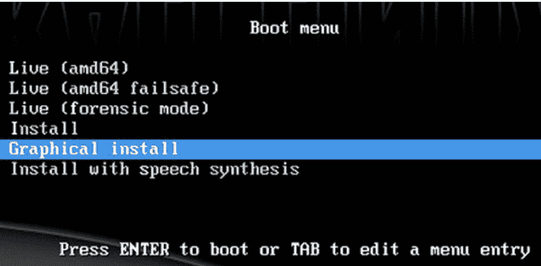
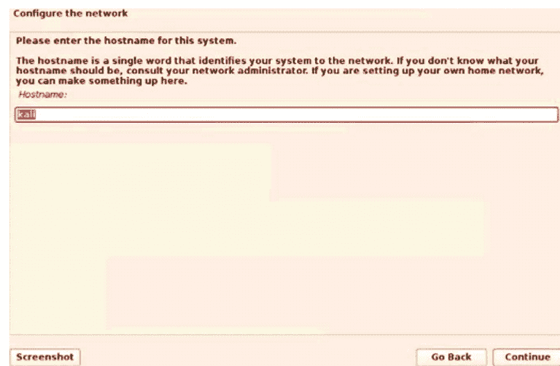
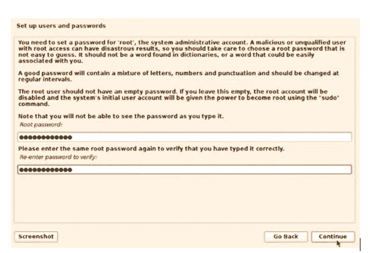
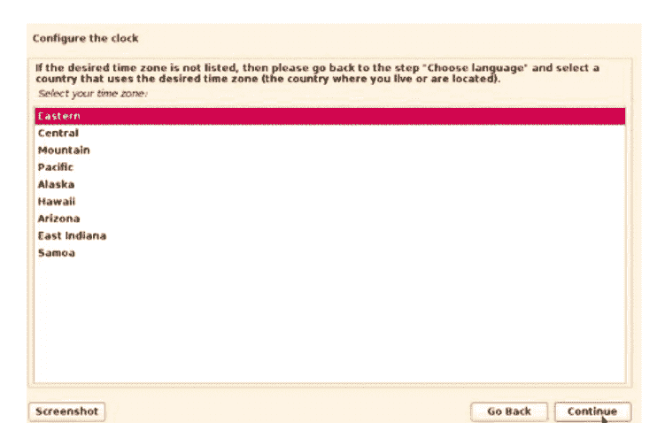
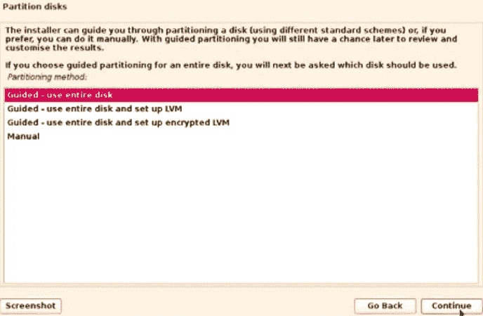
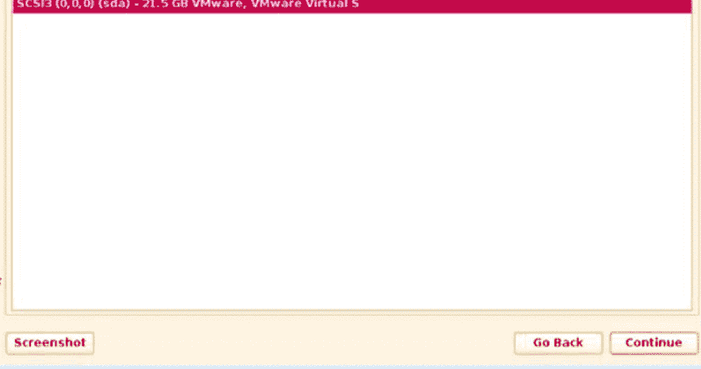
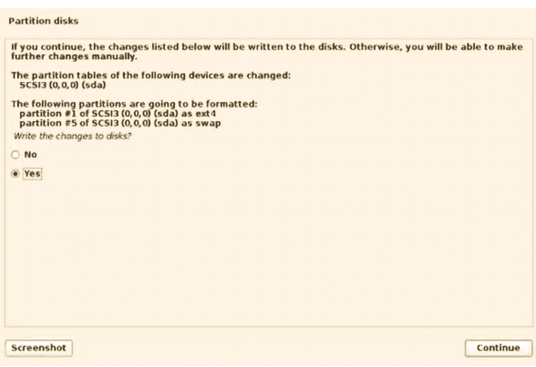
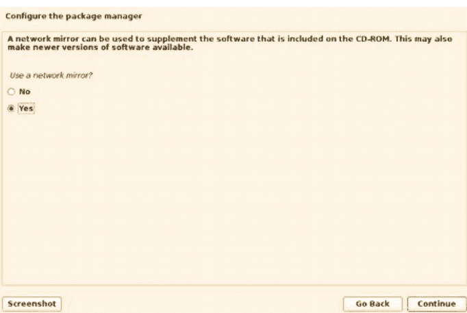
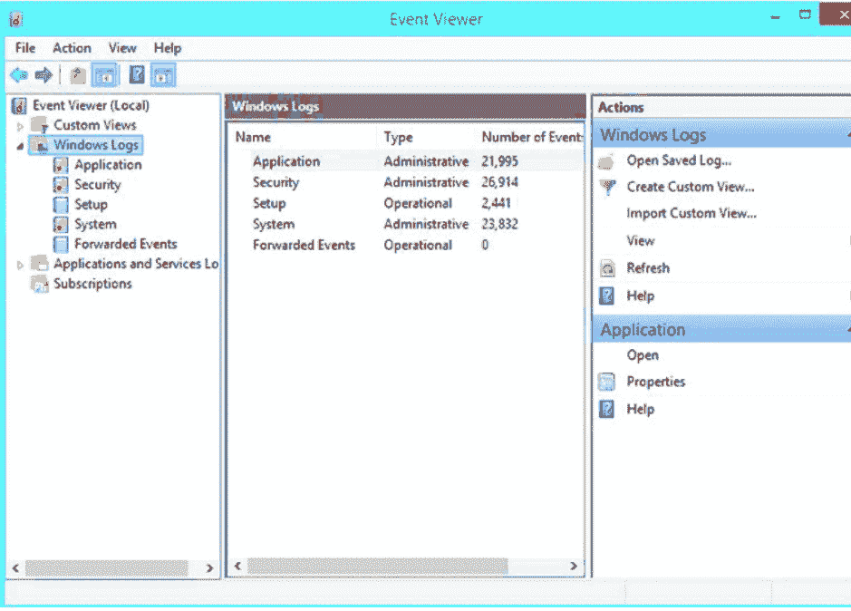
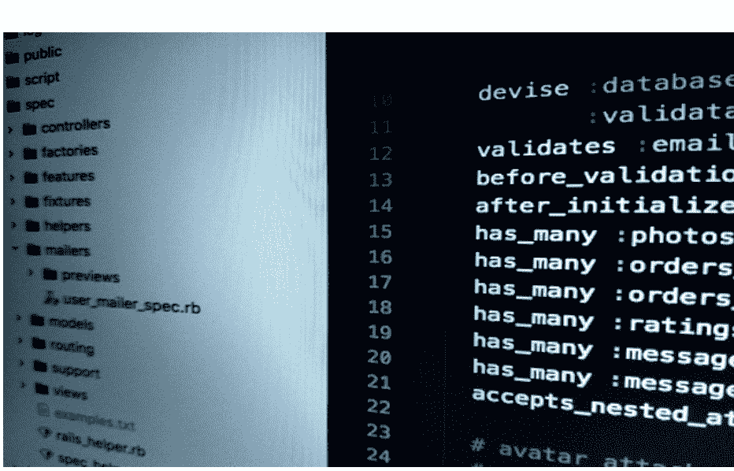

# KALI LINUX：道德黑客与渗透测试艺术大师 (2023 指南)

网络安全基础与道德计算机黑客：

一份完整的分步步初学者指南，包括用于保护网络的无线渗透测试工具


## 序言

诚心感谢你购买《Kali Linux：一份完整的分步初学者指南，学习网络安全基础与道德计算机黑客，包括用于保护网络的无线渗透测试工具》。本书讨论了 Kali Linux 中所有用于进行渗透测试的工具。此外，你将发现此 Debian 安装版中的各种工具是如何工作的。为了有效使用本书，你至少需要对命令行工具、计算机网络和 Linux 管理有基本的了解。这将有助于你更好地理解这里介绍的系列主题。

你将学习黑客如何潜入你的系统以及他们用来窃取信息的技巧。你将学习防御各种黑客策略所需的防御。为了实现这一目标，本书涵盖了许多主题，例如 Kali Linux 简介、Kali Linux 基础、黑客流程、无线网络攻击、Kali Linux 的用途与应用、网络安全简介、网络扫描与管理，以及你在成为专业黑客之路上需要的一些 Web 安全基础知识。

当你翻到这本书的最后一页时，你已经掌握了基础黑客技术的理论和实践原理。你将具备进入计算机系统、应用程序和网络所需的方法。让我说明一下，尽管我们有几本书涵盖了该主题，但你选择了这本。

我对此深表感谢。我们已尽一切努力使书中的信息对你有用且具有启发性。阅读愉快！


## 第1章：Kali Linux 简介

在本章中，你将学习各种种渗透渗透测试主题。它也被称为道德黑客（ethical hacking），被描述为一种技术过程和方法，为专业黑客提供一个平台，以模拟实际黑客在利用信息系统或计算机网络时使用的方法和技术。我们将发现渗透测试员通常遵循的程序，从理解和评估特定目标开始，到实际入侵结束。

本书还涉及了与渗透测试过程中使用的各种工具相关的问题。这些在本章中介绍，但第4章将进行更详细的内容。

在学习如何下载和安装 Kali Linux 的同时，读者还将理解这种 Linux 发行版在现实世界的应用。那么话不多说，让我们开始吧。

Offensive Security 是创建了 Kali Linux 这一优秀发行版的公司。

该公司的最新产品是 Kali Linux。在 Kali（一种 Live 磁盘安全发行版）中，可以找到 300 多种安全和渗透测试工具。如果你熟悉该操作系统，可能会注意到这些工具被分成不同的小组，渗透测试员和其他评估系统的组织经常使用这些小组。与 Offensive Security 制作的过去版本相比，Kali Linux 使用 Debian 7.0 发行版作为基础。

该操作系统与它取代的 Backtrack Linux 拥有共同的家族树。需要注意的是，同一团队也支持它。

根据 Offensive 的说法，更名为 Kali Linux 意味着该操作系统是对 Backtrack 版本的完全重构。重大的升级意味着它不仅仅是 Backtrack 的新版本，而是一个完全全新的操作系统。如果你回想起来，你会记起 Backtrack 是一个源自 White Hat 和 SLAX 的升级版，也被称为 WHAX 和 Auditor，与 Kali 一样。

从技术上说，Kali 是信息安全领域用于渗透和审计评估工具的最新迭代版本。

### Kali Linux 中不同类别的工具

Kali Linux 预装了多种可用于渗透测试的工具。正如我们之前提到的，Kali Linux 中的工具分组合方式便于渗透测试练习。

基本类别列于下方：

- 1) 信息收集工具：

该类别包括在信息收集过程中使用的各种工具。渗透测试员通常对 DNS、操作系统、IDS/IPS、SSL、网络扫描、路由、IP 语音、SMB、电子邮件地址、VPNs 和 SNMP 感兴趣。

- 2) 漏洞评估工具：

这些工具位于此处，通常用于扫描漏洞。我们有工具可以评估思科网络和数据库服务器的漏洞。我们还在该标题下提供了许多模糊测试（fuzzing）工具。

- 3) Web

正如类别名称所示，这些工具与 Web 应用有关。它们由爬虫、Web 应用代理、内容管理系统扫描器、数据库利用和 Web 漏洞扫描器组成。

- 4) 密码攻击工具：

该类别包括用于进行在线和离线密码攻击的工具。

- 5) 利用工具：

这些是用于利用目标环境中发现缺陷的工具。你可以在这里找到数据库、Web 和网络的利用工具。此外，你还可以找到用于社交工程攻击的工具。

- 6) 嗅探与欺骗

这些工具用于监听网络和 Web 流量。此外，我们提供了 Yersinia 和 Ettercap 等网络欺骗工具。

- 7) 访问维护工具：

渗透测试员将利用下面列出的工具保持对目标计算机的访问。无需多说，你需要最高权限才能安装此类类别中的工具。我们有可以用于对操作系统和在线应用程序留后门的工具。该类别还包括隧道设备。

- 8) 报告工具：

该类别包括记录渗透测试技术以及结果和建议的工具。

- 9) 系统服务：

该类别包含了渗透测试操作所需的各种服务。Metasploit 服务、Apache 服务、SSH 服务和 MySQL 服务都是其中的例子。

- 10) 无线攻击：

此部分包含了攻击蓝牙、RFID 和无线设备的技术。

- 11) 逆向工程；

此类工具通常用于软件故障排除或可执行文件进行反汇编。

- 12) 压力测试；

你可以在此类类别中发现所有对你的网络、VOIP 环境、无线网络和 Web 进行压力测试所需的工具。

- 13) 硬件黑客；

此页面包含了你处理 Arduino 和 Android 应用所需的所有工具。

- 14) 取证：

此类类别包含许多通常用于数字取证的工具。硬磁盘镜像的获取、文件碎片提取（file carving）以及最重要的——对从硬盘中提取的镜像进行分析，都是取证的示例。在 Kali Linux Forensics 的启动菜单中，用户必须选择“No Drives”（无驱动）或“Swap Mount”选项才能正确执行这些程序。通过这种方式，操作系统将不会自动挂载驱动器。这意味着驱动器的完整性将得到保护。

请记住这些知识，因为第 5 章将检查其中的某些内容。

### 渗透测试生命周期

目前有几种不同的渗透测试生命周期模型。EC-Council 认证伦理黑客（Certified Ethical Hacker）计划概述并使用的方法论是目前最流行的。渗透测试生命周期的五个阶段包括：侦察、扫描、获取访问、维持访问和掩盖踪迹，按顺序排列。

我们将在书的后部分更详细地检查上述每个阶段。

### 通用渗透测试框架

正如我们之前所说的，Kali Linux 丰富的工具集为我们提供了进行渗透测试和安全评估所需的适应性。如果没有一个良好的框架，渗透测试人员可能会由于测试失败而获得令人不满意的结果。因此，管理人员和技术管理员确保安全测试符合定义的框架至关重要，因为测试的目标是产生有价值的发现。

本文将教你一种通用的测试框架，白盒和黑盒方法论通常都会（此处原文未完整）使用。

你将从中学习渗透测试人员或安全审计员应该采取的正常步骤的基础知识。然而，必须根据正在评估的目标对框架进行适当的修改。为了使评估过程成功，必须采取以下行动。

目标范围 信息收集 目标发现 目标枚举 映射 漏洞 社交工程 目标利用 权限提升 访问维护 报告与文档

1. 在开始对安全进行技术检查之前，通常会对目标进行范围划分。为了完全理解范围，必须对目标网络环境进行观察。此外，审计员可能会被赋予一组特定的实体或单个实体来建立范围。

这一步中通常会做出典型决策包括：

- 哪些元素需要测试？
- 将如何进行测试？
- 运行测试将使用哪些标准？
- 测试程序的限制条件是什么？
- 测试将花费多长时间？
- 想要实现什么目标

任何成功的渗透测试活动都要求测试人员对所测试的技术、其基本原理以及它如何与网络环境交互有深入掌握。

1. 这意味着渗透测试过程的有效性取决于审计员的知识。

2. 信息收集 侦察步骤在范围划分完成后进行。在这种情况下，渗透测试人员将使用免费的站点来了解更多关于目标信息。

社交网络、文章、论坛、博客、公告板、商业或非商业网站、新闻组以及如 MSN Bing 和 Google 等搜索引擎只是人们可以用来寻找相关信息的在线资源。

Kali Linux 还带了许多工具，你可以利用这些工具获取有关目标的网络信息。这些程序使用基本的数据挖掘技术，从 DNS 服务器、电子邮件地址、跟踪路由、电话号码、Who 数据库、个人信息和用户账户收集数据。获取的数据越多，渗透测试成功的概率就越高。


## 3. 目标发现
关键行动包括确定所选目标的网络状态、它们的操作系统，以及在可行的情况下，它们的网络架构。这些细节让渗透测试人员对网络连接设备或尖端技术有深入的理解。因此，他们能够列出网络中当前的所有各种服务。使用所有的 `Kali Linux` 高级网络工具，执行所有这些任务是可行的（识别网络上的活动主机、识别每个主机运行的操作系统并根据每个主机在网络系统中的功能对每个主机进行特征描述）。这些工具使用主动检测方法或被动检测方法。这些是在网络协议的基础上进行的，并且可以操纵以产生有意义的数据。操作系统指纹识别就是这种信息的示例。

## 4. 目标枚举
在过程的这一部分即“目标枚举”中，寻找目标系统上的开放端口将加强之前的工作成果。在检测到开放端口后，将列出活动服务所使用的端口。

黑客或渗透测试人员可以使用端口扫描技术（包括隐身扫描、全开扫描和半开扫描）来检查端口的可见性，提供帮助。对于被防火墙或入侵检测系统保护的主机，这是可以实现的。可以对映射到开放端口的服务进行检查，以协助渗透测试人员或黑客在目标网络的基础中发现现有的漏洞。这表明我们可以以枚举为基础来发现各种网络设备中的漏洞。人们可以通过漏洞进入网络。安全审计员可以使用 `Kali Linux` 的自动化工具进行目标枚举。

## 5. 漏洞映射
在此阶段，我们应该对目标网络有足够的知识。

根据我们识别的服务和端口，我们现在必须检查已发现的漏洞。我们可以借助 `Kali Linux` 的自动化工具实现此阶段的目标。手动漏洞映射是另一个选择。其主要缺点是耗费大量时间并需要专业知识。最佳策略是结合两者，以便安全审计员能够研究已知或未发现的漏洞。

## 6. 社交工程
社交工程是一种利用人员作为攻击向量的攻击。人类通常被视为安全配置中的弱点——攻击者访问系统的入口。攻击者可以入侵目标网络，然后运行恶意代码造成伤害，并偶尔打开后门。这一切都是通过欺骗管理员或用户来实现。社交工程有许多类型。

例如，基于电话的攻击者可能冒充网络管理员向用户索要账户信息。

电子邮件钓鱼是另一种恶意用户用来获取你账户信息的社交工程。

一个人可以冒充合法用户进入物理空间。也是社交工程。这些示例说明了实现必要目标的各种可能性。理解心理学是一项使测试人员或攻击者能够在目标中进行适当变变的技能，这对于任何渗透测试活动的成功至关重要。由于大多数国家都有相关规定，在采取任何行动之前了解这些规定是非常重要的，以免入狱。

## 7. 目标利用
利用现有的许多漏洞形式，我们可以在研究发现的漏洞后攻击你的目标。为了确保现有的漏洞按计划运行，通常需要进行调整或进一步研究。

## 8. 权限提升
一旦获取了目标，渗透实验将被认为是成功的。根据其访问权限，渗透测试人员或审计员现在被允许遍历系统。测试人员能够提升这些权限来

与系统环境兼容的本地利用程序。在使用这些利用程序后，黑客或渗透测试人员现在将能够获得系统级或超级用户权限。测试人员现在可以对连接到局域网的计算机发起进一步攻击。这种技术可以根据目标的范围是非限制的，也可以是受限的。破解各种服务的密码、观察网络流量以及在局域网中使用欺骗技术，都是进一步了解受攻击攻击的其他方法。这表明，获取对目标系统的最高级访问权限是权限提升的首要目标。

## 9. 访问维持
在某些情况下，客户可能会要求渗透测试人员在预定的时间内继续保持对系统的访问权限。这可以用于向网络管理员演示，在不需要进一步渗透方法的情况下，如何实现对系统的未经授权的访问。此外，它有助于减少评估系统安全性而进入系统所需的时间、金钱和资源。人们可以选择选择使用端到端连接方法、代理协议或隐藏隧道技术。通过这种方式，测试人员可以建立后门访问，帮助他们在任何需要的时间内留存在目标系统中。这种进入系统的方法向我们展示了攻击者可能如何在不引起自己注意的情况下留存在目标系统中。

## 10. 报告与文档
如果不提交渗透测试期间发现的漏洞，这项活动就未完成。已经经过验证和利用的漏洞应该经过充分的报告、展示和记录。

这在伦理上是至关重要的，因为这将使网络和系统经理及管理员能够将资源集中在修补其基础设施中的任何安全漏洞上。根据各个合同组织的要求，报告将具有不同的视角。技术人员和企业将能够在定制报告的帮助下识别并分析其 IT 基础设施中的任何弱点。此外，报告可以用于比较目标系统在渗透过程前后的完整性。

让我们来看伦理——我们约定的规则（`rules of engagement`），以确保一切保持合法。审计员和其他信息安全专家必须遵守这些规定。

这些指南规定了应该如何提供渗透测试、如何进行测试、如何确定法律谈判和合同、如何定义测试范围、如何准备测试计划、测试应如何进行以及如何管理一致的报告结构。这些每一个主题都必须经过仔细检查。在整个任务执行期间，需要遵循官方程序和做法。

这些指南包含以下内容，但不限于：

### 1. 测试时间选择
选择一个不会干扰或破坏业务正常运行的测试时间是非常重要的。提前计划并不包括常规工作时间是明智的。

### 2. 测试程序遵循
测试活动期间必须遵循的程序在管理测试过程的规则中概述。组织的管理人员和技术人员参与这些法规的制定，以限制测试程序及其人员和环境。

### 3. 法律协议要求
禁止在未先建立法律协议的情况下，在进入其系统后向客户提供测试服务。这类似于不道德的营销，根据其所在国家的规范和法律，这可能导致常规业务运营的崩溃和痛苦的法律后果。

### 4. 测试范围限制
未经客户明确同意，完全禁止在预定参数之外或任何其他限制之外进行渗透测试。

### 5. 法律合同同意
相关方应同意一份具有法律效力的合同，在证明有非法活动之前限制工作责任。测试技术的细节、紧急联系人、职位描述以及任何潜在的利益冲突都必须以通俗详尽的细节列出。

### 6. 范围明确标识
合同实体以及在过程中施加在身上的任何限制都应在渗透测试范围中明确标识。

### 7. 报告提交要求
测试完成后，必须以一致且易于理解的方式提交报告和结果。所有已知和未知的漏洞都应涵盖在内。此外，必须以机密形式提供给获得批准的人员。

## 术语

我们将遇到渗透测试行业频繁使用的词汇。我们需要对术语给出定义，因为成员、技术人员和专业人士对它们有不同的观点。我们将使用的术语列如下。

### 渗透
根据我们的定义，是指尝试绕过安全措施的方法、过程和程序。通常，整个过程遵循预定义的规则。检查系统的管理、技术和操作设置是渗透的重点。在渗透期间，系统管理员可能不知道此类活动的进行。你会发现“道德黑客”和“渗透测试”这两个术语是通用的。**白帽** 指为了增加所需的性的计算机安全专家或道德黑客。

### 黑帽
指利用其 IT 专业知识未经授权绕过系统安全的人被称为“黑帽”。黑帽通常旨在实施犯罪。红队成员和测试人员在工作中经常使用黑帽技术。这样做是为了模拟恶意人员。

### 灰帽
在生活中，有好人、坏人和处于中间的人。灰帽代表了黑客中的中间地带。在大多数情况下，他们会在未经授权的情况下向管理员报警他们发现的任何漏洞。他们通常不是为了钱。由于他们没有先获得所有者的许可就进行操作，因此是非法的。

### 漏洞评估
这项活动被用于评估系统的安全设置。可以进行的评估类型包括评估系统已安装的安全补丁和缺失的补丁。评估团队可以是外部的，也可以是组织 IT 部门内部的。在这种情况下，评估人员将像内部人员一样表现恶意。当然，他们的内部身份使他们成为可靠的来源。评估人员将获得属于授权用户的真实登录信息；这是一个测试账户。他们将使用这些凭据尝试超越已建立的安全措施。他们可以通过更改该账户不允许查看的设置和文档，并提升其权限超过测试账户本应拥有的权限。结论，恶意用户测试试图模拟

不可信的内部人员可以使用其信任的凭据可能执行的活动。

### 钓鱼攻击
在此类攻击中，攻击者试图说服目标泄露隐私数据，如密码、账号密码和用户名。通常，这会使用具有看似真实的主题行的欺诈邮件来完成。这些邮件可能来自公司、银行或客户服务代表。在另一种类型的钓鱼攻击中，用户被鼓励点击虚假的超链接。通过这种方式，有害软件可以在所有者未察觉的情况下秘密地安装在目标系统上。随后，可以使用恶意软件攻击其他计算机或窃取存储在这些计算机上的数据。钓鱼攻击从其本质上来说是非针对性的。目标可以包括邮件列表上的所有人，或者电子邮件地址具有特定后缀（例如“@kali.com”）的人员。

### 针对性钓鱼（Spear phishing）
是一种目标定义非常窄的钓鱼尝试。例如，攻击者可以进行侦察以找到组织高层执行人员的电子邮件地址。现在就可以专门针对这些人发起钓鱼攻击了。

## 容器挖掘（Container diving）

使用这种方法，渗透测试人员将尝试搜索系统的垃圾。任何用户以及系统管理员都可能是这些垃圾的来源。从从中获得的任何知识对于理解某个目标都非常有帮助。渗透测试人员可能会找到网络拓图、系统设置和配置、硬件组件以及正在使用的软件版本的信息。在运气好的情况下，可能会获得用户凭据，包括用户名和密码。进入大垃圾桶的行为被称为“倾倒”（`dumping`）。此外，办公的小垃圾桶经常包含价值信息。

“`LiveOS`”、“`Live Disk`”和“`Live CD`”这些词都用于描述包含整个操作系统的光盘。`Live disks` 是渗透测试人员和评估人员的价值工具，因为它们可以根据当前的情况进行定制。它们可以自定义为具有特定的设置、资源和软件元素。尽管多年来开发了多个 Microsoft Windows 版本，但发行版中的大多数 live CD 通常是 Linux 的。在大多数评估中，评估人员只需提供一个 live disk。被评估的系统可以从 live disk ，本质上是利用信息系统的资源来对系统本身。


```
<div id="container">
  <!-- Basic Structure Elements of an HTML Document -->
  <!DOCTYPE html>
  <html>
    <!-- The document type declaration is not really a part of the HTML document. The browser renders it as such. -->
    <head>
      <!-- The head is container for all the rest of the HTML pages -->
      <!-- The head section contains meta tags, scripts, styles, and other elements -->
      <!-- The title tag is required for the document -->
      <!-- Title defines the title in the browser bar -->
      <!-- Displays the name of the page in search results -->
      <title>Page Title</title>
    </head>
    <body>
      <!-- The body is where all the content of a web page is displayed -->
      <div id="content-level"></div>
    </body>
</</html>
```

# 第 2 章：Kali Linux 基础

## 获取 Kali

正如我们在引言中提到的，Kali Linux 是一种可以以 ISO 文件格式供下载的 Linux 发行版。你必须从另一台计算机下载它，然后你需要创建一个磁盘并从那里安装它。通过访问 http://www.kali.org/downloads/ 下载这个有趣的 Linux 发行版。你可以在 http://www.kali.org/official-docs/ 上找到关于设置、高级操作和特殊情况的文档，学习如何安装它。我们有一个活跃的社区，如果你需要更多帮助，可以在那里提出任何问题或向需要帮助的人提供协助。这些社区论坛由 Offensive Security 控制，新用户必须注册才能访问它们。

Kali Linux 的开发者是这家安全公司。关于此类，Offensive Security 将发送有关其产品、社区新闻和升级的消息。在下载 Kali Linux 时，务必为你的机器选择合适的架构（`amd64` 64 位或 `i386` 32 位）。由于 Kali 镜像的知识在我提供的资源中已充分涵盖，我将不会在这里讨论它们。要选择并下载镜像，请点击相应的链接。如果你使用 Microsoft Windows，你需要使用 Burn ISO 或程序（想起来有 `Rufus`）刻录镜像。刻录应该持续直到完成。与 Windows 用户类似，Linux 用户可以使用光盘刻录程序（如 `K3b`）转换 ISO 镜像。

## 在硬盘上安装 Kali Linux

你将发现如何以图形化和文本方式安装此操作系统。图形用户界面已设计得尽可能简单。你必须设置你的基本输入输出系统（BIOS），使其能够从生成的光盘启动。通过将 Kali 的光盘闪存器插入 PC。高级用户有可能会使用虚拟化软件，如 Oracle 的 `VirtualBox` 或 VMware 的 `Player`。

## 首次启动 Kali Linux

下方截图中的 PC 已成功从 Kali Linux 磁盘启动。在本书中使用了 64 位的 Kali Linux 1.0.5。你最终会注意到在不同时期下载的 Kali Linux 版本之间会略有不同。除此之外，图形化安装是相似的。



你可以在 http://www.kali.org/ 获取所有发行版的指南。作为结果，在执行之前访问这一点至关重要。除了安装在硬盘上，Kali 也可以直接从包含镜像的磁盘启动。我们将这种称为 live CD。唯一需要注意的是，当计算机关闭时，内存、保存设置和其他工作都可能丢失。在非持久状态下运行 Kali Linux 是学习如何使用它的极方法。你可以看到有语音合成选项。我们不会深入探讨它的细节，但你应该意识到这是 Kali 和 Debian 操作系统的最新升级。如果他们的硬件支持语音合成，用户就可以语音控制安装过程。多么令人兴奋！正如我所指出的，让我们专注于图形化安装。使用方向键滚动并选择 `Graphical Install`，然后按回车键。

## 正在设置默认

接几个面板将要求你为区域、键盘布局和语言选择默认选项。在做出必要的选择后点击继续进入下一阶段。当机器开始真正的 Kali 安装时，将在屏幕上看到许多进度条。对于大多数选择显示，选择默认选项是明智的。

## 网络设置

看下图。你必须对你的主网卡进行基础配置和初始设置。选择主机名。通过提供的框输入这些信息，然后点击继续按钮。为了防止同一网络上的多个机器具有相同的主机名，请选择唯一的主机名。这将减少网络相关问题。确定主机名后点击继续按钮。你需要在屏幕屏幕提供 FDN，即完全限定域名。除非你想加入域环境，否则大多数实验环境都不需要。让我们保持留空。要继续，我们将点击继续选项。



## 配置密码

接下来的屏幕将要求你设置 root 级密码。Kali Linux 的默认密码太简单了。我建议你想出一个难以猜测、强大且无法追溯到用户的新密码。在输入两次密码后点击继续按钮进入下一步。

## 你仍然继续和我们在一起吗？现在让我们设置系统时钟。



设置系统时钟

如下图所示，系统将要求你选择一个时区。要进入下一个安装阶段，请选择相关的选项并点击“继续”（`Continue`）按钮。



时钟配置。

## 磁盘分区

我们可以通过配置分区以多种不同的方式构建 Linux 操作系统。最基础的安装方式“引导分区”（Guided Partitioning）是我们将关注的重点。默认高亮的设置如下图所示。在到达分区磁盘 - 5 之前，不需要选择任何内容。只需一直点击“继续”（`proceed`）按钮直到分区完成。请允许我花一点时间解释安装向导的每个阶段发生了什么。

安装期间，你对计算机硬盘进行分区的几种选项列如下。



分区磁盘 - 2，

如果你是 Kali Linux 的新用户，请选择“所有文件放在一个分区中（推荐新用户使用）”。这是你的最佳选择。要继续安装，请点击“继续”（`Continue`）按钮。

## 分区磁盘

注意，你选择的磁盘上的所有数据都将被擦除，但在你确认确实想进行更改之前不会。

选择要分区的磁盘：



分区磁盘 - 2。

如果你是 Kali Linux 的新用户，请选择“所有文件放在一个分区中（推荐新用户使用）”。这是你的最佳选择。要继续安装，请点击“继续”（`Continue`）按钮。

已选择分区的：

`SCSI3 (0,0,0) (sda)` - VMware, VMware Virtual S: 21.5 GB

磁盘可以使用几种不同方案之一进行分区。如果你不确定，请选择第一个。

分区方案：

所有文件放在一个分区中（推荐新用户使用）

独立的 `/home` 分区

独立的 `/home`, `/usr`, `/var` 和 `/tmp` 分区

## 分区磁盘 - 3。

要继续安装，请一直按继续（`continue`）按钮

分区

这是你当前配置的分区和挂载点的概述。选择分区以修改其设置（文件系统、挂载点等），选择空闲空间创建分区，或选择设备以初始化其分区表。

- 引导分区

- 配置软件 RAID

- 配置逻辑卷管理器 (`LVM`)

- 配置加密卷

- `SCSI3 (0,0,0) (sda)` - 21.5 GB VMware, VMware Virtual S

> #1 主 20.5 GB f `ext4` /

> #5 逻辑 922.7 MB f swap swap

撤销分区更改

完成分区并将更改写入磁盘

## 分区磁盘 - 4。


在引导你通过上述各个阶段后，向导将为你提供一个供你评估的屏幕。主分区现在将形成单个分区，并包含所有的系统、脚本和用户数据。对于交换空间（swap），将创建第二个分区。该系统的虚拟内存将用于计算机中央处理器和随机访问内存之间的页面文件。建议所有运行 Linux 的计算机都配备交换空间。交换区域通常设置为已安装物理随机内存（RAM）容量的 1.5 倍，如果完全相等。对于该机器，你将来到类似这样的屏幕。



## 分区磁盘 - 5

在图中，将被提示“完成分区并将更改写入磁盘”。要开始安装，请选择“是”（Yes）并按下继续按钮。注意，这是你在操作系统安装到硬盘之前检查分区选择的最后机会。如果将来需要，仍然可以更改分区大小。然而，如果你点击继续（partition disks - 5），硬盘的安装和分区将开始。根据计算机硬件，可能需要一小时，也可能只需要几分钟。

## 设置包管理器

你的操作系统将从此仓库获取安全更新和修复。因此，包管理器对于操作系统的运行至关重要。可以使用 Kali 镜像包含的网络镜像。由于它包含了最新的包源，建议使用它。你将选择“是”（YES）选项，如下所示。通过选择继续（Continue）继续安装。



## 包管理器配置

如果你使用代理，需要在安装向导显示的提示处输入配置数据。如下所示，你可以留空。要启动 GRUB 加载器，点击继续（Continue）按钮。


## 配置代理

统一引导加载程序（Unified Bootloader），称为 GRUB，是计算机启动时出现的屏幕名称。GRUB 提供了一个平台，用户可以在操作系统加载之前检查启动选项并进行调整。大多数 Linux 安装强烈建议使用 GRUB，尽管某些用户可能不需要。如图所示已为你选择了“是”（YES）选项以安装 GRUB。点击继续（Continue）按钮进入下一阶段。


## 安装 GRUB 加载器

## Kali Linux 安装已完成

你的安装现在已完成。在移除闪存器或光盘后重启计算机。将被提示重启计算机。要完成安装，点击继续（Continue）按钮。重启后你将得到一个要求登录的欢迎屏幕。使用你之前创建的登录信息。到此结束。来自 Kali Linux 的问候！


## 完成安装

# 为什么你应该使用 Kali Linux

正如我们已经提到的，Kali Linux 预装了完成上述任何任务所需的所有工具。安全审计员、法医调查人员、渗透测试人员和研究人员因此青睐它。

除了攻击网络和网站，Kali 还可以对实体运行开源情报收集（OSINT）。除了道德黑客，Kali Linux 还拥有用于法医查询的工具。这个安全领域正变得同样至重要，因为它收集信息并进行分析，然后利用结果追踪网络犯罪分子。法医调查的使用能够检测并消除活动的恶意产物。它对于管理和计算网络攻击导致的损失也有帮助。隐身现场模式（stealth Live mode）最用于法医，且不在主机系统上留下痕迹（指纹和足迹），是 Kali 的一个关键组件。

## 终端

打开终端（我们在书中将使用的命令行界面）是你使用 Kali 时应该做的第一件事。在 Kali Linux 的桌面的底部可以看到终端图标。

按下 `CTRL+ALT+T` 或双击此图标启动终端。终端启动 shell（外），这是一种允许你在底层操作系统上运行脚本和执行命令的命令行环境。`bash` shell 是 Kali 以及许多其他 Linux 发行版中的默认 shell，是 Linux 许多不同 shell 环境中最广泛使用的。该命令可以用于修改你的密码。

## 基础 Linux 命令

让我们从查看一些让你入门的基础 Linux 命令开始吧。

### 使用 pwd 寻找自己

与 Windows 或 macOS 不同，Linux 命令行并不总是清楚你当前位于哪个目录。你通常需要知道自己的位置以便浏览新目录。`pwd` 命令返回你在目录层次结构中的位置，显示当前工作目录。要找出你在哪里，在终端中输入 `pwd`：在这种情况下，`kali >pwd/root`，Linux 响应 `/root`，表明我在 root 用户目录中。你也应该在 root 用户目录下，由于你从开始 Linux 时是以 root 身份登录的，该目录位于磁盘层次结构顶部（`/`）的下方。`pwd` 将返回你当前所在目录的名称。

### 使用 whoami 检查你的登录

Linux 中唯一的“全能”超级用户或系统管理员被称为 root，它拥有添加用户、修改密码、更改权限等所有权限。自然地，你不希望任何人都拥有这种权限；你想要一个可以依靠且熟悉操作系统的人。你可能希望以 root 身份登录，因为作为一名黑客，你经常需要所有这些权限来执行

你运行所需的程序和指令。使用“whoami”命令，Linux 用户可以确定他们当前登录的身份，如下所示：

```
kali >whoami
root
```

在这种情况下，用户是以 root 身份登录的。

Linux 的一项至关重要的技能是能够在终端中对文件进行导航。

为了完成任何任务，你必须能够导航，以寻找存储在其他文件夹中的程序、文件和目录。在基于 GUI 的系统中，可以直观地看到这些目录，但在使用命令行界面时，其结构是完全基于文本的，且使用文件系统需要输入特定的命令。

### 使用 cd 命令更改目录

要从终端更改目录，请使用 `cd` 命令。这里有一个如何切换到 `/etc` 目录（配置文件的存放位置）的示例：

```
kali >cd /etc
root@kali:/etc
```

现在的提示符现在显示为 `root@kali:/etc`，表示我们已经进入了 `/etc` 目录。要验证这一点，输入 `pwd`：

```
/etc
```

我们使用 `cd` 后紧跟双点（`..`）在文件结构中向上移动一级（朝文件结构的根目录，即 `/`），如下所示：

```
root@kali:/etc# cd..
root@kali:/
```

这让我们回升到 `/etc` 的上一级，但你可以前进任意层级。只需根据你想移动的层级数使用相应数量的双点对即可，例如，你会使用 `..` 向上一级。

你会使用 `..` 向上移动两层。

你会使用 `...` 向上移动三层，以此此类推。

例如，为了前进两层，输入 `cd` 后跟两组双点和一个空格：

```
kali >cd .. ..
```

通过使用 `cd /`（其中 `/` 表示文件系统的根目录），你可以从任何位置轻松进到文件层次结构的根目录。

### 使用 ls (list) 命令列出目录内容

我们可以使用 `ls` (list) 命令来查看组成目录的文件和子目录。这与 Windows 的 `dir` 命令非常相似。

| kali >ls |

| bin | initrd.img | media | run | var |

| :--- | :--- | :--- | :--- | :--- |

| boot | initrd.img.old | mnt | sbin | vmlinuz |

| dev | lib | opt | srv | vmlinuz.old |

| etc | lib64 | proc | tmp | |

| home | lost+found | root | usr | |

此命令显示目录的文件和文件夹的列表。通过在命令后添加目录名称（例如 `ls /etc`），你可以在当前目录之外，还可以在任何特定目录上使用此命令。`.` 显示 `/etc` 目录的内容。你可以在 `ls` 之后添加 `-l` 选项（`l` 代表 long，长）以获取有关文件和目录的额外细节，包括它们的权限、所有者、大小以及最后编辑时间。

长列表（long listing）是这种操作的另一个名称。参见下面的插：

| kali >ls -l |

| total 84 |

| :--- |

| drw-r--r-- 1 root root 4096 Dec 5 11:15 bin |

| drw-r--r-- 2 root root 4096 Dec 5 11:15 boot |

| drw-r--r-- 3 root root 4096 Dec 9 13:10 dev |

| drw-r--r-- 18 root root 4096 Dec 9 13:43 etc |

| --snip--r-- 1 root root 4096 Dec 5 11:15 var |

## 获取帮助


在 Linux 中，几乎每个命令、程序和工具都有一个特定的帮助文件，描述如何使用它。例如，如果我需要关于最佳无线破解程序 `aircrack-ng` 的帮助，我可以输入 `kali >aircrack-ng --help`。注意这里的双横杠。在 Linux 中，习惯上在使用仅带单个字母的单词-横杠选项（如“h”）之前使用双横杠（`--`）。当你输入此命令时，你应该收到使用该工具的说明以及对它的简要描述。你可能可以使用 `-h` 或 `?` 来访问帮助文档。例如，如果我需要使用 Nmap（黑客最好的端口扫描工具）的帮助，将输入 `kali >nmap -h`。遗憾的是，尽管许多应用程序接受这三个选项，但不能保证你正在使用的那个一定有效。所以，如果第一个不起作用，请尝试另一个选项。

## 查找文件

在 Linux 中导航在习惯之前可能很乏味，学习一些命令和技巧会让命令行更加用户友好。你可以在终端使用以下命令来查找内容。

`locate` 可能是最用户友好的搜索命令。当此命令与指定要查找内容的关键词一起使用时，它将在整个文件系统中搜索该术语出现的地方。例如，输入以下内容来搜索 `aircrack-ng`：

```
kali >locate aircrack-ng
/usr/bin/aircrack-ng
/usr/share/applications/kali-aircrack-ng.desktop
/usr/share/directories--
/var/lib/dpkg/info/aircrack-ng.gz
```

然而，`locate` 命令并不是完美的。你从 `locate` 结果获得的信息可能太多而无法处理。`locate` 使用通常每天更新一次的数据库，所以如果你最近生成了文件，在第二天之前可能出现在此列表中。了解这些基础命令的缺点可以帮助你决定何时使用每种。

## 使用 where 命令查找二进制文件

如果你正在寻找一个二进制文件，可以使用此命令来找到它。如果可用，你可以使用此命令找到它。例如：

```
kali >which aircrack-ng
/usr/bin/aircrack-ng
/usr/share/applications/kali-aircrack-ng.desktop
```

## 使用 which 命令在根目录下查找二进制文件

使用 `touch` `Touch` 是创建文件的第二种方法。最初，此命令的目的是允许用户编辑文件的元数据，例如创建或修改日期。但默认情况下，如果文件不存在，此操作会创建文件。

让我们使用 `touch` 命令创建 `newfile`：

```
kali >touch newfile
```

之后，我运行 `ls -l` 查看目录的详细列表，可以看到 `newfile` 已作为一个新文件创建。由于 `newfile` 是空的，请注意它的大小为 0。

创建目录的命令是 `mkdir`，它是 "make directory" 的缩写。输入以下命令创建一个名为 `newdirectory` 的目录：

```
kali >mkdir newdirectory
```

输入以下内容进入此最近创建的目录：

```
kali >cd newdirectory
```

## 复制文件

`cp` 命令用于复制文件。通过这种方式，旧文件将保留在原处，并在新位置创建一个它的副本。在这里，我们将使用 `touch` 在根目录下创建一个名为 `oldfile` 文件，并将其复制到 `/root/newdirectory`，同时重命名原始的 `oldfile` 以保留在原处：

```
kali >touch oldfile
kali >cp oldfile /root/newdirectory/newfile
```

你可以简单地在目录路径末尾添加你想要的名称来选择重命名文件。如果你在复制时没有重命名它，系统默认将保留文件的原始名称。当我们下次导航到 `newdirectory` 时，我们可以发现 `newfile` 是 `oldfile` 的完全副本：

```
kali >cd newdirectory
kali >ls
newfile oldfile
```

## 重命名文件

遗憾的是，与 Windows 等其他操作系统不同，Linux 缺少专门用于重命名文件的命令。然而，它有一个 `mv` (move) 命令。`mv` 命令可用于重命名现有文件或目录或将其移动到不同的位置。你可以输入以下内容将 `newfile` 重命名为 `newfile2`：

```
kali >mv newfile newfile2
kali >ls
oldfile newfile2
```

现在 `newfile2` 已经重命名，当你列出 (`ls`) 该目录时，可能会看到它，但看不到 `newfile`。目录也可以进行同样的操作。

## 删除文件

要删除文件，请如下所示使用 `rm` 命令：

```
kali >rm newfile2
```

你可以通过对目录执行详细列出来验证文件是否已删除。

## 目录

用于删除文件的 `rm` 命令带有一个 `dir`（directory 的缩写）参数，如下：

```
kali >rmdir newdirectory
rmdir:failed to remove 'newdirectory': Directory not empty
```

至关重要的是，`rmdir` 不会删除非空目录，正如示例所示，它会通知你目录非空。在删除目录之前，你必须先删除它的所有内容。这将防止你无意中删除不需要删除的项目。如果你想一次性删除目录及其内容，可以在 `rm` 之后使用 `-r` 选项，如下所示：

```
kali >rm -r newdirectory
```

不过提醒一下：在使用 `rm` 时要务必小心 `-r` 选项，因为很容易误删珍贵的文件和目录。例如，在主目录下使用 `rm -r` 将删除那里的每一个文件和目录；这无疑不是你的本意。

## 查找工具和包

在下载软件包之前，你可以检查它是否已经存在操作系统的仓库（数据存储所在）。`apt` 工具的搜索功能允许你查看该包是否已安装。这里使用了简单的语法：

```
apt-cache search keyword
```

记住，要搜索 `apt-cache`——即存储包名称的位置——我们使用 `apt-cache` 命令。例如，你可以执行下面所示的命令来查找入侵检测系统 Snort。

```
kali>apt-cache search snort
fsnort - Snort-to-iptables rule translator
ipple - IP protocols logger
--snip--
snort - flexible Network Intrusion Detection System
sn-common - flexible Network Intrusion Detection System - common files
--snip--
```

如你所示，“snort”一词出现在许多文件中，但在输出的中心，我们发现了短语“snort - flexible Network Intrusion Detection System”。这正是我们要找的内容。

## 安装软件

既然你已经知道 `snort` 包在仓库中可用，现在可以使用 `apt-get` 获取该程序。在终端中使用 `apt-get` 命令、关键字 `install`，后跟你想要安装的包名，即可从你操作系统的默认仓库安装软件。格式如下：`apt-get install package name`。让我们测试一下。格式如下：：

```
apt-get install snort
Reading package lists... Done
Building tree
Reading state information... Done
The following NEW packages will be installed:
snort
--snip--
Do you want to continue?
```

## 卸载软件

要卸载软件，请使用带有 `remove` 选项的 `apt-get`。可能会看到如下所示的输出。

```
apt-get remove snort
Reading package lists... Done
Building tree
Reading state information... Done
The following packages will be removed:
snort
--snip--
Do you want to continue?
```

要删除软件和配置文件，请使用 `apt-get purge`。你可以在下面看到。

```
apt-get purge snort
Reading package lists... Done
Building tree
Reading state information... Done
The following packages will be removed:
snort
--snip--
Do you want to continue?
```

## 软件包升级


新软件或软件更新版本会定期添加到仓库中。你必须要求它们应用这些更新，因为它们不会自动推给你。升级 (`upgrading`) 与更新 (`updating`) 的区别在于升级是将包提升到仓库的最新版本，而更新则是更改可访问的包列表。通过使用 `apt-get` 命令和 `update` 词，你可以通过 `apt-get update` 升级你的系统。这将检查系统上的每个包查看是否有更新。如果是，将下载更新。见下方的插。

```
kali >apt-get update
Get:1 http://mirrors.ocf.berkeley.edu/kali/kali-rolling InRelease
[30.5kb]
Get:2 http://mirrors.ocf.berkeley.edu/kali kali-rolling/main amd64 Packages
[14.9MB]
Get:3 http://mirrors.ocf.berkeley.edu/kali kali-rolling non-free Packages
[163kb]
Get:4 http://mirrors.ocf.berkeley.edu/kali kali-rolling/contrib amd64 Packages
[107kb]
Fetched 15.2 MB in 1min 4s (236 kB/s)
Reading package lists... Done
```

完成。你的系统软件仓库现在将使用可用程序列表进行刷新。如果更新成功，终端上将显示读取包列表。如上所示，已完成。请注意，仓库名称、值、时间等因素在你的系统中可能会不同。

使用 `apt-get upgrade` 更新系统中已安装的包。在执行 `apt-get upgrade` 之前，你必须以 root 身份登录或使用 `sudo` 命令，因为更新包可能会触发软件的修改。此命令将升级你系统中所有 `apt` 能够升级的包。

意识到，其中仅包含在存储库中的内容，如下例所示。

在系统升级期间，你可能无法一段时间使用你的系统，因为这需要一些时间。

```
kali >apt-get upgrade
Reading package lists... Done
Building dependency tree... Done
Calculating upgrade... Done
The following packages were automatically installed and no longer required:
--snip--
The following packages will be upgraded:
--snip--
1101 upgraded, 0 newly installed, 0 to remove and 318 not upgraded
Need to get 827 MB of archives.
After this operation, 408 MB disk space will be freed.
Do you want to continue? [Y/n]
```

你的系统应该估算软件软件包需要多少硬盘空间，正如你在结果中看到的那样。如果你想继续并有足够的磁盘空间进行升级，请按 `Y`。

# 第3章：黑客过程

针对企业和组织的防御性黑客（包括对计算机或网络上可能威胁的发现）被称为道德黑客，由白帽黑客执行。

道德黑客遵循与所有计划计划相似的独特阶段。制定有计划的道德黑客攻击有助于黑客。道德黑客的过程在各种安全训练书中以多种方式描述，但在我的经验中，它可以分为以下六个阶段：

- 侦察（`reconnaissance`）。
- 可扫描（`Scannable`）。
- 获取访问（`Gaining Access`）。
- 维持访问（`Preserve Access`）。
- 清除痕迹（`Make your tracks clear`）。
- 报告（`Reports`）。

## 文艺复兴

文艺：是什么？根据字典定义，它是为了收集信息而进行的初步调查。军事在敌方领土进行的探索性调查可以作为一个说明。在网络安全领域，侦察是指使用各种方法了解更多关于目标的过程。

道德黑客在整个过程中对三种信息感兴趣：

- 1. 网络。
- 2. 主机
- 3. 用户/参与者。

## 如何分步骤执行侦察练习。

道德黑客的第一阶段通常旨在帮助渗透测试人员理解他们的目标。这属于信息收集的范畴。

此外，我们有被称为侦察的东西，我们将其描述为用于学习和收集有关目标关键细节的一系列方法和程序。它们由扫描、计数和指纹识别组成。遵循下文概述的七个步骤，道德黑客尝试在侦察练习期间尽可能多地了解目标系统；

- 收集初步数据。
- 建立网络范围。
- 确定哪些机器已开启。
- 学习可用的开放端口和访问点。
- 操作系统的指纹识别。
- 检查在不同端口上运行的服务。
- 网络地图。

侦察主要分为两大类。

主动侦察（`Active Reconnaissance`）：通过主动侦察获得的信息是准确的，因为它包含了与你的目标计算机系统直接接触。在未经授权的情况下主动侦察有被发现的。但大多数黑客任务都需要主动侦察。

被动侦察（`Passive Reconnaissance`）：在此过程中，你不会直接连接到计算机系统。这种方法用于在从未与目标系统交互的情况下获取关键数据。

## 枚举（Enumeration）

枚举从真正的意义上说，是对集合中对象相关内容进行系统的列举。创建策略、用户账户、共享和其他资源的列表被称为枚举。这一过程紧接扫描之后，漏洞评估之前。这有助于攻击者制定最有效的获取访问计划。

你可以使用枚举来了解更多关于：

- 用户和组
- 共享路径和网络
- 主机
- 路由图
- 服务配置
- SNMP 端口扫描
- 应用程序和 banner 使用 DNS 细节。

这些工具可以用于枚举。在 Windows 操作系统中，多种工具配合 `Net accounts`、`Net config server`、`Net config workstation` 和 `Net view` 等命令来枚举 NetBIOS 名称。

## 扫描

此过程用于寻找运行的服务、主机和开放端口。假设你想找到一个系统的弱点。为了做到这一点，你需要攻击一个系统。网络扫描被用于道德黑客以发现这些漏洞。相关的团队将他们的精力放在识别这些问题上。我们意识到每个组织都有一个网络。

它们可能被连接到互联网或内部。为了进入这些网络，你必须首先识别一个弱点。我们使用一种网络扫描技术来发现网络中的这些站点。

### 网络扫描的目标

- 帮助识别开放端口、活动主机和目标地址。
- 帮助识别目标主机上运行的服务。
- 帮助识别目标操作系统和系统架构。
- 我们通过扫描来发现漏洞。

网络扫描与侦察的区别是什么？我将利用这个类比来帮助你理解两者之间的差异。假设你是一个被命令带领你的小队对恐怖营地发动攻击的军队指挥官。假设你已经知道了营地在哪里以及周围区域是什么情况。现在，这种知识通常是通过侦察收集的。为了开始攻击，你仍然需要找到入口。我们使用一种网络扫描技术来发现网络中的这些站点。

网络扫描与侦察的区别是什么？我将利用这个类比来帮助你理解两者之间的差异。假设你是一个被命令带领你的小队对恐怖营地发动攻击的军队指挥官。假设你已经知道了营地在哪里以及周围区域是什么情况。现在，这种知识通常是通过侦察收集的。为了开始攻击，你仍然需要找到入口。我们使用一种网络扫描技术来发现网络中的这些站点。

网络扫描与侦察的区别是什么？我将利用这个类比来帮助你理解两者之间的差异。假设你是一个被命令带领你的小队对恐怖营地发动攻击的军队指挥官。假设你已经知道了营地在哪里以及周围区域是什么情况。现在，这种知识通常是通过侦察收集的。为了开始攻击，你仍然需要找到入口。我们使用一种网络扫描技术来发现网络中的这些站点。

网络扫描与侦察的区别是什么？我将利用这个类比来帮助你理解两者之间的差异。假设你是一个被命令带领你的小队对恐怖营地发动攻击的军队指挥官。假设你已经知道了营地在哪里以及周围区域是什么情况。现在，这种知识通常是通过侦察收集的。为了开始攻击，你仍然需要找到入口。我们使用一种网络扫描技术来发现网络中的这些站点。

网络扫描与侦察的区别是什么？我将利用这个类比来帮助你理解两者之间的差异。假设你是一个被命令带领你的小队对恐怖营地发动攻击的军队指挥官。假设你已经知道了营地在哪里以及周围区域是什么情况。现在，这种知识通常是通过侦察收集的。为了开始攻击，你仍然需要找到入口。我们使用一种网络扫描技术来发现网络中的这些站点。

网络扫描与侦察的区别是什么？我将利用这个类比来帮助你理解两者之间的差异。假设你是一个被命令带领你的小队对恐怖营地发动攻击的军队指挥官。假设你已经知道了营地在哪里以及周围区域是什么情况。现在，这种知识通常是通过侦察收集的。为了开始攻击，你仍然需要找到入口。

网络扫描与侦察的区别是什么？我将利用这个类比来帮助你理解两者之间的差异。假设你是一个被命令带领你的小队对恐怖营地发动攻击的军队指挥官。假设你已经知道了营地在哪里以及周围区域是什么情况。现在，这种知识通常是通过侦察收集的。为了开始攻击，你仍然需要找到入口。我们使用一种网络扫描技术来发现网络中的这些站点。

网络扫描与侦察的区别是什么？

常用于检查目标的过滤设置。

## 漏洞扫描


从本质上，我们利用这种网络扫描来寻找网络中的漏洞。漏洞扫描识别由于网络配置错误或编程不当而可能出现的弱点。在继续之前，让我们先来看一些用于网络扫描的工具。

### 网络和端口扫描工具

- 利用 Nmap，可以提取操作系统、数据包过滤器和防火墙类型、网络上的活动主机、服务以及操作系统版本等数据。
- 这种被称为 Angry IP Scanner 的工具可用于查找每个输入范围内可访问的系统的 IP 地址。
- Superscan 是由 McAfee 创建的一款强大工具。除了作为 TCP 端口扫描器外，它还可以用于 ping 操作。
- ZenMap：此扫描器带有一个非常有用的 GUI 工具，可用于识别操作系统版本类型、执行端口扫描、OS 扫描和 ping 扫描。
- Scan Suite 是系列用于 Web 抓取、端口扫描、批量邮件和泛洪攻击的应用程序和程序。尽管该工具有示例版本，但也提供商业版本。
- 用于监听网络流量的著名且强大的工具包括 Wireshark 和 Nmap。使用任何一种工具都可以创建网络分析器。

### 防止扫描的措施

系统管理员可以配置 IDS 和防火墙，在检测扫描的同时阻止扫描尝试。使用唯一规则来保护网络并阻塞不良端口。为了检查端口扫描是否准确检测到任何扫描，用户可能会利用工具。反欺骗规则必须正确配置，安全专家必须确保系统路由器、IDS 和固件都是最新版本。

## 如何访问

访问是攻击中最重要的部分。从危害的角度来说，为了破坏系统，恶意行为者并不总是需要获得其访问权限。例如，拒绝服务攻击（DoS）可以远程启动，并可能突然终止目标上正在运行的任何服务或耗尽所有可用资源。逻辑炸可以用于此。通信线路过载会导致本地资源耗尽。此类利用程序可以跨局域网、互联网或离线进行欺诈或盗窃。

### 会话

由缓冲区溢出引起的基于栈的拒绝服务和分布式拒绝服务。欺骗是复杂的攻击者使用的一种技术，通过伪装成其他系统或外部人员来利用目标系统。他们可以使用这种方法发送填充了错误的数据包。斯摩尔攻击是一种特殊的攻击子类型，试图让受害者做出响应。以下因素对于成功进入目标系统至关重要：
- 获得的第一级访问权限。
- 攻击者的专业水平以及目标系统的架构和配置。

分布式拒绝服务（DDoS）攻击是最大的拒绝服务攻击。这发生在攻击者使用安装在连接到互联网的大量计算机上的僵尸恶意软件发起协调、广泛的拒绝服务攻击时。

## 维持访问

一旦黑客获得了目标系统的访问权限，他们必须投入大量精力确保其持续运行。被劫持的机器可能被攻击者用于隐蔽利用、作为 DDoS 或垃圾邮件操作等额外攻击的发射平台，或用于扫描和攻击其他系统。所有这些行为都可能有害。黑客可以开发嗅探软件来协助捕获所有入站和出口流量。与其他系统的 Telnet 会话和文件传输协议可能是流量的一部分，允许他们将收集到的数据传输到任何位置。对于不想被发现的人来说，有必要执行掩盖踪迹的操作。我们可以使用多种方法来实现。首选技术涉及安装隐蔽通道、根内核程序、木马和后门，以为黑客提供对此类系统的无限制访问。

## 工具与技术

快速访问已受损系统的一种方法是通过使用木马或后门。木马为黑客提供了应用程序级别的访问。这种方法的缺点是目标系统必须首先在本地安装木马。木马具有在基于 Windows 的计算机上设置服务的能力。它们将获得管理函数的访问权限，并能够作为本地系统运行。恶意人员可以使用木马从系统中窃取登录信息、密码和任何其他敏感数据。攻击者安装的后门具有内置的下载和上传功能，就像远程访问木马一样。这种方法使用 80 端口用于 HTTP、443 端口用于 HTTPS 以及 53 端口用于 DNS 来掩盖其流量。

## 隐蔽通道

在这种情况下，数据通过隐蔽通信隧道进行传输。这些路由包括 VoIP、HTTP、DNS 和 ICMP 通道以及其他通道。请注意，你也可以通过我们概述的隐蔽通道发送加密数据。隐蔽通道可能会被发现，但受害者付出巨大的努力。可以使用流数据分析、协议分析和网络特征等工具检测离开网络流量中的异常。要找到这些异常，需要专用工具。请注意，虽然识别隐藏路由是一回事，但阻止它是另一回事。你可以使用以下策略：
- 阻止公司网络外部服务器对 DNS 相关信息的请求。
- 在公司信息边界禁止出口 ICMP。
- 在使用 VoIP RTR 进行数据外泄隧道传输的情况下，调度语音邮件交付延迟。这将允许将语音邮件发送到音频处理器对每个数据包进行检查，以发现任何编码数据，类似于反垃圾邮件软件的工作原理。
- 可以对内部 DNS 服务器、通过 Web 代理的 HTTP 通道和语音邮件交付延迟请求。

## 根内核程序 (Rootkits)

这种恶意软件非常擅长隐藏计算机系统中。这一特征将根内核程序与其他类型的恶意软件区分开来。得益于增强的隐藏能力，它们可以绕过计算机上设置的安全措施。标准恶意软件检测难以识别它们，这是其产生的根本动机。木马通常用于从“用户”级访问权限开始在目标平台上安装根内核程序。一旦进入目标系统，根内核程序将观察密码等登录信息以获取“管理员”级访问权限。这是一种权限提升，由于内核级 rootkit（根kits）可以在操作系统启动之前运行。这类根基程序通过创建秘密通道来获取对受损系统的无限制访问权限，从而绕过加密。根基程序可以通过将代码添加到内核扇区来隐藏自己的踪迹。

当根基程序被安装在内核级时，它们将获得对受攻击系统的完全管理权限。与木马不同，根基程序通常会建立通往操作系统的直接路径。

## 消除根基程序

传统的安全方法（如杀病毒软件）不足以完全根根基程序。作为替代方案，您可以使用专门为此目的设计的应用程序从系统中移除根基程序，例如 Malwarebytes Anti-rootkit、TDSSKiller、Sophos Anti-Rootkit 和 GMER。请记住，根基程序并不总是能从您的机器上被完全消除。上述工具只能减少根基程序给系统留下的负面影响。除了使用工具处理根基程序外，用户还可以选择启动清理程序。在此过程中，会备份关键文件并重新安装操作系统。在大多数情况下，这将确保根基程序从您的计算机中清除。再次强调，这并不意味着删除操作将 100% 成功。尽管并不多见，但 BIOS 级根基程序可以在重装后幸存。无论根基程序如何努力隐藏自己，系统中总会有表明其存在的迹象。这一点非常重要，因为它们的设计初衷是防止攻击者从外部进入建筑内部。

数据外泄是将数据非法移动到组织外部的系统或设备的行为。数据可能来自计算机系统或 IT 服务器。该过程可以手动（通过复制和粘贴）或自动（通过恶意软件）执行。安全公司 McAfee（迈菲）在 2015 年表示，大多数数据外泄案例（约 60%）涉及直接的电子方法。其余 40% 涉及实体媒介，例如抢夺笔记本电脑或使用 USB 驱动器下载数据。有趣的是，很大比例的 40% 涉及到手机。个人健康信息、个人身份信息、财务信息和知识产权是最经常被外泄的数据类型。数据的电子外泄使用各种隧道协议、文件传输协议、Web 协议或电子邮件传输。我们知道文件传输协议（FTP）是一种广泛使用的网络协议，旨在方便文件传输。它在包括数据外泄在内的活动中可能很有帮助。

可以对目标或其他设备（包括麦克风和网络摄像头）改装外围设备，以便观察目标的移动。黑客可以利用 HTTP 文件传输或 Tor 网络来保持匿名。早期检测对于防止黑客窃取您的数据以及保护免受高级持续性威胁（APT）至关重要。组织必须建立有效的威胁情报策略，帮助他们发现与数据外泄相关的疑活动。将本地威胁情报系统连接到全球威胁情报网络，将更容易跟上安全行业的最新进展。让我作为彻底调查的依据。它们是：
- 未经授权/未经许可的端口活动。
- 发送到非公司域的多封邮件。
- 主机邮件发送频率异常高。
- 用户在 Web 上上传活动。通常，非公司网站将接收这些上传。

在我结束本节时，您现在已经知道攻击者必须花时间在目标周围活动以收集有用信息。这表明您需要掌握黑客过程中的“维持访问”周期。

说起来比做起来容易。Kali Linux 中包含了许多工具，可以帮助您保持对目标系统的控制。维持访问等同于未经许可的情况下进入他人的房屋。您很快就会理解，进入房子只是第一步。另一步是持续存在但避免被发现。这可能比第一个挑战更具挑战性。

## 清除我们的痕迹

在这个阶段，我们将发现黑客如何隐藏自己的身份以消除他们可能留下的任何数字证据。显而易见，这是一件坏事。简单来说，这与删除整个黑客过程中发生的活动记录有关。这个子主题将详细介绍，因为对于想要成为熟练黑客的读者来说至关重要。清除足迹后，还有一个程序涉及编写报告，主要由文书工作组成。我们可以仔细检查入侵者留下的数字签名，以确定系统是否被攻击。黑客应该删除任何可能导致其暴露的活动证据。您可能已经注意到渗透测试人员在早期能够规避防火墙和入侵检测系统。然而，此阶段的目标是隐藏任何可能揭示黑客行为性质的线索。

掩盖/清除路径主要涉及：
- 反取证措施，旨在从潜在的事后调查中阻止数字证据的收集。
- 1) 反事件响应方法试图防止实时检测。

反事件响应：反事件响应的基本目标是阻碍、困扰并击败目标公司的事件响应团队。黑客或渗透测试人员在通过此类别的行动被发现后，可能仍能够在其目标内部建立长期脚点。

反事件响应可用于执行重要活动，如：
- 谨慎地部署后门；
- 配置基础设施以允许横移动的灵活性；
- 以及持续更新受感染主机数量。


- 此外，它们的数量不应过多。

在网络上利用多种类型的恶意软件。

通过加快速度，您正在防止响应人员或调查人员跟上正在发生的情况。

繁忙的文件服务器也可以作为数据存放的手段。

在某些情况下，使用 VPN 进行通信可以绕过网络控制。

反事件响应：反事件响应的关键在于防止正在持续或持续攻击被快速识别。这包括伪装恶意软件的来源。而反取证旨在阻碍调查人员获取在后期提交法庭时足够的数字证据。这表明反事件响应操作具有紧迫性，因为大量行动发生在运行系统上。与未来的数字调查人员相比，事件响应人员在采取措施时可能时间有限。

## 反取证

在深入这个主题之前，让我们先定义取证。我们将计算机取证定义为一种科学，其基本目标是使法证人员能够在法庭上收集、保护、分析和展示数字证据。我们将反取证描述为包含目前用于擦除、更改或隐藏数字数据的任何方法和技术。修改、删除或破坏数字证据是反取证的主要目标。从名称就可以看出，它关注的是旨在阻碍最终数字调查并减少证据数量和质量的方法或行动。反取证也被人定义为“试图负面影响犯罪现场证据的质量、数量和存在性，或增加证据检查和分析的复杂”。这些技术和工具经常被网络犯罪分子（如在线色情者、黑客等使用。

造假者、网络恐怖分子和其他网络犯罪分子。显而易见，他们想要消除任何可能让他们陷入证据。

## 证据删除

我们中的某些人非常担心，以至于花钱购买磁盘清理和隐私保护软件，只为了擦除我们不想让别人看到的信息。人们认为硬盘上的所有内容都可以通过这些程序永久删除。用户可以使用“安全删除”选项擦除文件，并专门删除以下类型的数据：注册表项、缩略图、跳转列表（jumplists）、Skype聊天同步等。网络浏览器历史和缓存也是可以删除的信息类型之一。

许多此类清理程序都可以被取证专家使用专业的取证仪器所破解。例如，取证专家感兴趣的内容是可以恢复的。这是因为即使在原始图像被删除后，Windows缩略图中仍包含该图像的较小版本。通过执行我们所谓的“文件雕（file carving）”，即使在缩略图被删除后我们仍然可以恢复它。

跳转列表还可以提供用户使用过的照片、程序、文档和其他各种类型文件的细节。即使是从外部访问的文件，通常也会建立跳转列表。

无论原始文件已被擦除还是外部设备已被带走，它都会继续存在。这些列表通常包含MAC地址、正在查看的项目名称、所访问的文件路径、用于查看文件的应用程序、计算机名称以及访问的时间和日期。这表明跳转列表为访问行为提供了有力证明。手动删除“聊天同步”文件夹的内部数据不会删除Skype历史记录。你可以在文件夹的内容中找到用户交互的碎片信息。尽管这种方法有缺陷（删除），但只要操作得当，它就可以永久删除证据，让取证专家无证可查。

尽管一些作法者可以使用这种技术来规避检测，但隐藏、移动、重命名或更改文件可能显得有些天真。在这里，可以通过重命名或重新定位包含历史的文件，或通过更改文件扩展名来隐藏踪迹。我的朋友们，这不是一项简单的任务。现许多程序可以将文件分割成更小的文件。其他文件的结尾可以遮盖这些划分。黑客可以使用专用工具利用未使用的文件空间（也称为碎片空间，slack space）来隐藏重要数据。此外，黑客可能会将一个文件埋在另一个文件内部（可能是隐写术）。对于可执行文件，这种技术运行得完美。

### 时间标记

调查人员通常不会查看计算机系统上的每一个文件。大多数时候，他们会将数据按时间顺序排列，以便将搜索集中在可能相关的数据上。当攻击已知时，他们想要看到攻击发生后的信息。犯罪分子往往会努力通过更改他们所需的文件的元数据来阻挠这一策略。每个文件最后访问、最后修改和创建的名称及日期经常会被更改。时间标记是一种具有欺骗性的取证方法。一旦进行了修改或转换，计算机或设备就会认为该文件是另一个文件。例如，通过更改mp4文件的名称使其看起来像gif，以定位已移动或重命的文件，取证调查人员通常依赖于他们的经验和专业知识。此外，我们还有信息取证技术可以自动检查硬盘是否存在异常差异。数据雕刻（Data carving）就是这种策略的示例。该技术用于对材料进行彻底且顺序的扫描。数据雕刻之所以有效是因为它可以轻松读取来自介质的低级数据。它独立于文件系统如何显示文件位置和名称。例如，一个mp3文件的标识取决于于它所包含的实际数据流，而不是文件名。

黑客可以使用的最终安全机制是加密。在数字取证方面，加密是一个头疼的问题。通过使用强大的加密方法，数据可能变得不可读，从而对调查人员毫无用处。

## 日志篡改

日志文件通常保存在Windows电脑的事件查看器中。使用“搜索”栏很容易找到。在大多数Linux和UNIX操作系统中，`/var/log`目录存储着日志。



只需通过查看日志文件，系统管理员就可以看到系统中发生的任何有害活动。日志文件有两种不同类型：系统生成的和应用程序生成的日志文件。在操纵日志时，黑客有两种选择：一种方法是完全删除日志，另一种方法是更改其内容。为了防止发现任何网络入侵的迹象，黑客还可以将系统二进制文件替换为木马等恶意软件。

通常情况下，删除日志文件不是好主意，因为这会在日志中留下空白并引发疑问。可以使用日志文件进行有害行为检测。它们可以作为有关系统状况和实际状态的警报方法。记录中的任何异常都可能引起不必要的注意。敏锐的攻击者可能会在日志数据不太可能看到的时候发起攻击，例如周末或深夜。

要篡改日志文件中的数据，攻击者需要root权限。黑客在提升权限后，可以在日志文件内部更改与其活动相关的日志数据。因此，系统管理员的任何调查都不会显示任何异常活动。谨慎的系统管理员通常会配置系统，将所有日志文件发送到远程服务器。总结来说，狡猾是成功的要求之一。在黑客期间避免被发现是不够的。即使在执行实际攻击后，程序也应该继续。任何错误都可能触发雷达，取证小组将立即被定位攻击者。这表明掩盖踪迹的最后阶段极其重要，不应轻视。我们声称黑客使用秘密行动作为一种安全措施来让他们远离危险。问题可能会立即出现，也可能以后出现，例如在调查期间。



# 第章：攻击无线网络

## 无线间谍

使用无线网络有各种益处。然而，这种技术具有许多风险和弱点，黑客可以利用这些。与有线连接相比，信息更容易被黑客拦截，因为它是通过无线电波在空中传输的。如果传输的数据没有加密，或者加密机制不安全，情况尤为如此。

无线网络的基本组件包括：

- 连接到网络的无线访问点；
- 通过无线频率广播的数据；
- 以及客户端设备，如笔记本电脑、平板电脑和其他计算设备。

用户。黑客可以关注这些组件中的任何一个，以破坏安全网络的三个主要目标之一：可用性、完整性和机密性。

## 无线网络攻击

1. 意外攻击 无线网络可能会无意中被攻击。有时无线网络会重叠，导致任何用户都无意中进入另一个网络。这看起来可能无害，但坏黑客可能会利用它获取不应通过这种方式提供的数据。如果重叠的网络是由企业所有，该链接可能被利用来窃取机密信息。
- 2. 恶意关联 当恶意黑客使用自己的设备进入私有网络而非授权的接入点（AP）时，就会发生恶意关联。黑客可以使用软件构建一个“软 AP”，欺骗笔记本电脑的无线网卡使其认为这是一个真实的接入点。这使得黑客能够向消费者发送木马程序、攻击计算机并窃取密码。

每个连接到虚假网络的计算机实际上都处于黑客的完全控制之下。
- 3. 自组网 网络这些网络在没有接入点的情况下将两台无线计算机连接在一起。此类网络很少有有效的防御，使其非常容易受到攻击。
- 4. 非传统网络这些网络包括条形扫描器、蓝牙设备、无线打印机和手持 PDA。由于重点通常在笔记本电脑或接入点上，IT 人员很少保护这些类型的网络。因此，它们容易受到邪恶黑客的侵害。
- 5. MAC 欺骗是一种身份盗用行为，黑客通过检查网络流量来确定哪台计算机可以访问网络。其目标是获取该计算机的网络 MAC（媒体访问控制）地址。许多无线网络包含 MAC 过滤器，将网络访问和使用限制在具有特定 MAC 地址的某些计算机上。为了识别允许的计算机及其 ID，黑客可能会购买可以“嗅探”网络的软件。然后，黑客可以使用此软件结合其他工具，在黑客自己的计算机上使用这些被盗的 MAC 地址。

## 6. “中间人”攻击

这种情况发生在黑客通过将笔记本电脑设置为软接入点来欺骗其他用户使用其电脑时。随后，黑客使用不同的无线网卡将软接入连接到真实的接入点，导致用户必须通过虚假 AP 才能访问真实 AP。黑客现在从他们选择的流量中嗅探任何信息。AirJack 和 LANjack 等软件让这种攻击变得更加简单。这种攻击在没有任何安全性的无线热点上效果良好。

7. 称为拒绝服务（DoS）的攻击发生在黑客反复向单个接入点发送大量请求、命令和消息时，其目的是导致网络崩溃或简单地防止合法用户连接到网络。

8. 网络注入攻击 不过滤流量的接入点会受到恶意黑客的攻击，黑客向其注入伪造的网络重配置命令。这些虚假指令通过关闭整个交换机、路由器和集线器网络，强制每个网络设备进行重启或重新编程。

无线网络认证 无线网络的设计是为了让任何支持无线连接的设备都能访问。因此，通常使用密码来保护网络。WEP 和 WPA 是两种广泛使用的认证方法。


为了给用户提供与有线网络相同的隐私保护，开发了 `WEP`（等同线路隐私，Wired Equivalent Privacy）。它符合 `IEEE 802.11` `WLAN` 要求。通过网络传输的数据使用 `WEP` 加密，以防止窃听。

## WEP 设计缺陷

这种认证方法存在几个严重的设计缺陷：

- 1. 为了检查数据包的完整性，它采用了循环冗余校验 32 位（`CRC32`）。`CRC32` 的问题在于，黑客只需要捕获两个数据包即可访问网络。为了强制系统接受数据包，他们还可以更改校验和和加密流。
- 2. 它使用 `RC4` 加密技术使用带有初始值（`IV`）和密钥的创建流密码。密钥的长度可以介于 40 位到 104 位之间，但 `IV` 长度设置为 24 位。如果使用较短持续时间的密钥，网络将变得更容易受到黑客攻击。
- 3. 由于它使用基于密码的认证方法，黑客可以使用字典攻击。
- 4. 它缺乏中央密钥管理机制，使得在大规模网络中更改密钥极具挑战性。

由于各种安全问题，`WEP` 已经失去了青睐并被 `WPA` 取代。

## 如何破解 WEP 网络

被动攻击或主动破解均可用于利用 `WEP` 网络中的众多安全漏洞。在 `WEP` 认证被破解之前，网络流量不会受到被动攻击的影响。这使得发现它变得更加困难。主动破解更有效，但也更难被检测，因为它倾向于给网络带来更大的压力。

目前有多种工具可用于破解 `WEP`，包括 `Aircrack`，这是一种可以从 `www.aircrack-ng.org` 获取的网络嗅探器。

- `Kismet` — 这种多功能型工具具有嗅探网络流量的能力（包括可见和隐藏网络），甚至可以检测入侵。
- `WebDecrypt` — 它使用字典攻击破解 `WEP` 密钥并生成自己的密钥。可以从 `www.kismetwireless.net/` 下载。
- `WEPCrack` — 这是一个开源实用程序，可以破解密钥密钥，可以从 `www.wepackrack.sourceforge.net/` 下载。从 `www.wedecrypt.sourceforge.net` 获取。

`WPA`（Wi-Fi 保护访问）缩称为 `WPA`。它的创建很大程度上是为了应对 `WEP` 的缺点。`WPA` 使用的 `IV` 比 `WEP` 高出 48 位。使用临时密钥来加密数据包。

## WPA 的漏洞

- 1. 拒绝服务攻击让黑客轻松绕过它。
- 2. 由于其密钥依赖于密码，如果使用弱的密码，就可以进行字典攻击。

## 如何破解 WPA 网络

由于 `WPA` 依赖于密码，如果使用弱的密码，就可以进行字典攻击。可以使用以下程序对 `Wireshark` 等应用程序嗅探的文件进行解码：`Cain and Abel`。

`CowPatty` 是一个使用暴力破解破解预共享密钥的程序。破解网络 `WPA` 和 `WEP` 密钥的方法可以从 `wirelessdefenc.org/Contents/coPattyMain.htm` 下载。

- 1. 确保你的 Wi-Fi 适配器已选择监控模式。

输入以下命令来发现指定的无线网络以及连接到它的任何客户端：`airodump-ng -c [channel] --ssid [target router MAC Address]-b wlan0mon`。将打开一个显示连接到网络的客户端列表的窗口。它们白名单中的 `MAC` 地址也将显示出来。

要访问网络，你必须伪造这些地址。

- 2. 要伪造你自己的地址，请从列表中选择一个白名单中的 `MAC` 地址。先移除监控接口，然后进行伪装。在命令行中输入 `airmon-ng stop wlan0mon 3`。接下来的操作是禁用你想要伪造的 `MAC` 地址的无线接口。在命令行中输入 `ifconfig wlan0 down 4`。之后，你使用 `Macchanger` 程序修改地址。

要输入的命令是 `macchanger -m [New MAC Address] wlan0`。请记住在第 3 步中，你已经禁用了无线接口。

现在是时候再次启动它了。使用以下语法：

`ifconfig wlan0 up`

测试一下现在你的无线适配器 `MAC` 地址已更新为授权用户的地址，网络是否会确认你的连接。无线网络现在应该是可以访问的。

无线网络传输攻击面临的三个主要风险是中断、篡改和拦截。你可以采用信号隐藏技术来阻止恶意黑客监听无线传输。恶意黑客必须先找到无线接入点才能拦截无线广播。公司可以通过关闭接入点正在广播的 `SSID`（服务集标识符）、给 `SSID` 起一个神秘的名称、降低信号强度以仅提供必要的覆盖范围，或将接入点放置远离外墙和窗户的位置，来使这变得更具挑战性。还有一些更先进但更昂贵的方法，例如使用 `TEMPEST`（一种防止无线信号发射的方法）或定向天线将信号限制在特定区域内。

对所有无线流量进行更强的加密 —— 这一点至关重要，特别是对于需要保护其无线传输数据隐私的业务而言。这种措施降低了中间人攻击的概率。

更强的身份验证过程 —— 这应该涵盖用户设备和用户本身。结果是减少了中间人攻击。

## 针对拒绝服务攻击（DoS）的防御措施

尽管恶意黑客偶尔可能会尝试破坏组织的服务器，但 `DOS` 攻击偶尔也可能是无意的。为了减少此类攻击的危险，可以采取以下行动：

- 进行彻底的现场勘测，以定位来自其他设备的信号。在确定接入点应该放置的位置时，请将此作为指南。
- 对网络活动和性能进行常规审计，以识别问题所在。如果有任何干扰设备，需要将其移除。此外，还应采取措施提高问题所在区域的信号强度和覆盖范围。

设置不当的无线接入点提供了严重的漏洞，并可能让敌对黑客获得对敏感数据的未经授权访问。为了保护无线接入点，必须实施以下防御措施：

- 消除任何异常接入点 —— 使用 `802.11i` 是实现此点的最佳方法。
- 使用 `Ix` 阻止未经授权的设备通过 `USB` 端口连接无线网络。
- 确保所有有效的接入点都已正确设置。由于默认设置对公众开放，黑客可以轻松利用它们。
- 使用 `802.11` 对每个设备进行身份验证。`Ix` 协议中的强身份验证措施将阻止未经授权的设备安装后门。在为任何设备分配 `IP` 地址之前，该协议确保了严格的身份验证。

设备 评估无线设备带来的安全风险有两种方法：盗窃/丢失和入侵。

由于笔记本电脑和 `PDA` 经常包含重要和机密数据，必须防止被盗窃和丢失。

当恶意黑客获得设备数据存储的访问权限时，无线客户端设备也容易受到入侵。黑客可以使用该工具攻击其他网络和系统。

保护无线网络最有效的方法是网络加密。

大多数基站、接入点和无线路由器都内置了加密算法，允许网络流量被扰乱。确保你购买的路由器始终具有加密功能。在使用路由器之前，请确保手动激活此选项，因为大多数制造商默认将其关闭。

通过安装反间谍软件、防病毒软件和防火墙软件，确保你的无线网络获得与线缆连接相同的保护。保持所有软件更新状态，并确保你的防火墙始终开启。

关闭路由器的标识广播。无线路由器利用此功能向附近的设备宣布其存在。然而，如果人们已经知道某个网络，就没有需要对其存在进行公告。恶意黑客经常寻找广播标识，以缩小对潜在目标的关注范围。

更改默认标识 —— 每台路由器的制造商都分配了一个默认 `ID`。即使你关闭了标识广播，如果黑客知道公开的默认 `ID`，他们仍然可以针对该网络。

更改标识后，不要忘记在你的电脑中配置新 `ID`。

更改默认密码 —— 制造商为每台路由器分配了默认密码。这是出于初始设备配置的原因。因为很容易找到这些默认密码，请务必将你的路由器密码更改为更难以猜的内容。也努力延长密码的长度。

建立允许连接到网络的设备 —— 将你的路由器设置为仅允许来自某些 `MAC` 地址的连接。然而，不要仅依赖这种方法，因为 `MAC` 伪装仍然是一种可能。

不使用时，关闭任何无线网络。

## 军事与间谍活动

网络间谍活动是在未经目标同意或知情的情况下，获取信息和贸易秘密的行为。这些目标可能是普通人、对手、竞争对手、竞争团体、政府，甚至是敌人。这些目标相当宽泛。它们可能包含军事、政治、经济甚至个人的成分。此外，还采用了多种多样化的方法。为了实现既定目标，黑客可能会利用各种工具，包括恶意软件、破解技术和代理服务器。专业人士可以在其工作站进行在线间谍活动，也可以通过利用经过训练的内鬼和传统间谍进行渗透来完成。这偶尔可能由怀有恶意的初级程序员和黑客执行。众所周知，地球上的每个国家都从事着秘密的网络间谍活动甚至是网络战争。黑客增加了收集外国军事行动情报的效率。因此，黑客在任何国家的防御系统中都会面临重重困难。

## 取证

取证 `Linux` 现场启动环境在过去几年变得越来越流行。该发行版包含了许多基于 `Linux` 的取证工具。通过 `Kali`，取证专家可以执行与其职业相关的所有任务，从初步分检和数据取证到案件管理和彻底分析。

## 反向工程

近期，这种人才在许多领域（包括执法部门）变得至关重要。定位漏洞和创建利用程序的主要技术之一就是反向工程。这是在进攻端。

反向工程可用于分析已防御性攻击特定系统的恶意软件。

在这里，确定某项特技（`tradecraft`）的能力是主要目标。

## 无线攻击

`Kali` 支持多种无线黑客工具。无线网络被广泛使用，这使其成为频繁的攻击目标。作为黑客对各种类型无线网络发起攻击的首选方案，`Kali Linux` 还支持多种无线设备。


密码攻击：当用户遇到身份验证系统时，可以使用 Kali Linux 进行密码攻击。由于此原因，操作系统包含了许多实用的工具和实用程序。为了处理哈希和加密系统，Kali Linux 用户可以使用离线和在线密码攻击。

数据库评估：Kali Linux 能够执行 SQL 注入和凭据窃取等数据库攻击。Kali 丰富的存储库中提供的工具可以测试从数据提取和分析到 SQL 注入的各种攻击向量，这使得这一切成为可能。

再次，Kali Linux 包含了大量熟练黑客或有志之客可以使用的工具，用以访问正在通过网络传输的数据，包括嗅探和伪装工具。如果你想获取并评估刚刚捕获的数据，可以在使用伪装工具伪装成网络授权用户后，使用嗅探工具。

当这些工具结合使用时，它们是致命的。

## 压力测试

你对系统运行压力测试以查看其是否稳定。在这种情况下，你将利用 Kali Linux 提供的许多选项产生比平时更多的流量。通过这种方式，你将理解系统的局限性。用于压力测试的工具可能是开源的，也可能是专有的。对于专家来说，了解用于测试系统可用性的每一个仪器是必要的。

## 硬件破解

硬件破解是 Kali Linux 的另一种用途。Kali Linux 包含了以下工具并可用于此任务。

- `Android SDK` 提供了创建、测试和调试 Android 应用所需的 API 库和开发者工具。
- 用于反向工程锁定、二进制、第三方 Android 应用的工具称为 `apktool`。它允许对 Smali 代码进行逐步调试，并可以在某些更改后重建之前，将资源解码到接近原始的形式。此外，类项目的文件结构以及某些重复操作（如创建 apk 等）的自动化使得该程序的使用变得更加简单。
- `Arduino` 是一个用于电子原型的开源平台。它建立在灵活、易用的硬件和软件基础之上。
- `Sakis3G`：`Sakis3G` 是一个修改过的 脚本，它可以自动与任何运营商或调制解调器建立 3G 连接。你的 USB 或蓝牙调制解调器会自动配置，它甚至可以检测运营商设置。当其他一切都失败时，尝试一下它。
- `Smali` 是用于 Android 使用的 Java 虚拟机实现——dex 格式的汇编器/反汇编器。该语法支持 dex 格式的所有功能，包括注解、调试信息、行信息等。大致基于 Jasmin/dedexer 的语法。


# 第 6 章：网络安全导论

我们将网络安全定义为针对计算机网络、计算机系统以及连接到这些程序的数字攻击的防御。网络攻击通常是为了获取、更改甚至破坏敏感信息。其目标是扰乱公司的正常运营，并试图向受害者索要赎金。

### 机密性、可用性和完整性

“CIA 三要素”这一说法通常被用来指代这三者。它可以被描述为一种旨在指导特定组织内部信息安全策略的模型。我们有时称为 AIC 三要素，以避免与美国中央情报局（CIA）混淆。这三个要素对于安全是最重要的。在我们的情况下，可以认为可用性定义为保证授权人员能够可靠地访问信息，机密性被认为是一组限制访问信息的协议，而完整性则是给出的证明所手信息既准确又可靠的承诺。

机密性：

这大致等同于隐私。有必要采取严密的预防措施在确保机密性的同时，确保适当的人员可以访问信息。相关数据应仅由允许查看它的人访问。根据数据落入未经授权手中可能造成的危害类型和范围对其进行分类是常见做法。

根据这些分类，可以在某些情况下采取严格措施，而在其他情况下则不然。对于那些查看或使用数据的人，可能需要专门培训以保护其机密性。影响这些信息的安全问题通常存在。无疑，这有助于获得授权的人了解各种风险因素并做好防御。培训还可能涵盖社会工程技术和密码相关的最佳实践。

即使他们的动机可能被我们定义为利他的，这也能帮助他们避免违反数据处理法律，这可能会产生严重的后果。例如，确保机密性的极佳方法之一是利用路由号码或账号。为了确保机密性，我们还可以使用数据加密。日益流行的双因素认证典型技术包括密码和用户 ID。有多种选择。它们由生物识别认证和安全令牌（有时称为软令牌或钥匙扣）。

## 完整性 (Integrity)：

三角形的这一部分是确保数据在整个生命周期内都是可靠、一致且准确的。

数据在传输过程中，必须不惜代价地维护其完整性。

必须采取有效措施，防止未经授权的人员更改数据。例如，当发生机密性泄露时，可以使用用户访问限制和文件权限作为应对措施。版本控制可以避免授权用户的无意删除或错误更改。必须建立相应机制来帮助检测由非人类事件（如服务器崩溃或电磁脉冲）引起的数据变化。校验和（Checksums）和加密校验和可用于辅助数据完整性验证过程。最后，可能需要要求包含某种形式的冗余和备份，以帮助系统恢复到之前的状态。

## 可用性 (Availability)：

对所有硬件的持续维护保证了其提供的服务将始终可用。

为了维持一个没有任何软件冲突的稳定操作系统环境，故障设备应立即并得到充分的修复。所有核心系统组件的更新也是另一个需要完成的维护工作方面。此外，还需要确保通信有足够的带宽，并且阻塞发生得极少。

高可用集群、冗余、RAID 甚至故障转移可用于减轻硬件故障的影响。

对于最坏的情况，既快速又灵活的灾难恢复至关重要。既定的灾难恢复策略必须详尽，以具有可行性。

在防止数据丢失或连接中断时，必须考虑到不可预见的事件。自然灾害和火灾就是此类例子。为了防止此类事件导致的数据丢失，可以将备份数据副本安全地保存在地理位置遥远的站点。这些地点还需要防火和防水。我们可以利用额外的安全设备（如代理服务器、防火墙和软件）来防止网络入侵、停机以及由于拒绝攻击导致的数据无法访问等问题。

## 与 CIA 相关的关注

大数据对 CIA 范式构成了巨大挑战。这主要是由于需要保护的数据量巨大、数据格式多样化，最后是数据来源的丰富。重复的数据集和灾难恢复计划推高了已经高昂的成本。

由于收集数据并利用其创建某种形式的有意义的解释是大数据的首要目标，有时监管也并不充分。我们都熟悉爱德华·斯斯诺登（Edward Snowden），他将这个问题公开了。在全球范围内，安全机构获取了大量的个人个人信息。我们还有被称为“物联网隐私”的独特考量，以保护个人信息免于在物联网生态系统中暴露。为了实现网络（包括互联网）上的自主通信，几乎每个逻辑实体或物理实体都可以被赋予一个特殊的标识符。

从某个端点传输的数据并不总是会导致隐私问题。问题在于，当多个端点的碎片化数据可以被访问、汇总和分析时，敏感数据就可以被检索。物联网包含了计算机以外的许多其他联网设备，其本身就构成了重大的安全风险。这些设备经常被配置了弱的默认密码，在某些情况下它们甚至还没有打补丁。如果不妥善保护，物联网可能会被用作独立的攻击向量，或者被集成到独立的攻击向量中。最近，研究人员表明，攻破网络只需要使用 Wi-Fi 灯泡。我们必须考虑正在开发的许多网络功能产品的安全性。

## 加密 (Encryption)

加密是我们所说的将明文或其他数据类型从当前的可读形式转换为编码形式的机制。数据只有具有访问解密密钥的方才能被解密。这一关键步骤通常是为了提供跨网络的完整数据保护。

在互联网上，加密经常被用作一种预防性安全措施，以保护在服务器和浏览器之间传输的敏感用户数据。支付信息、密码和其他个人数据等私有数据都是此类类别的例子。加密是个人和企业都可以使用的安全措施，用于保护存储在计算机、服务器和移动设备上的敏感数据。

## 如何使用加密

使用加密算法和加密密钥的组合来加密明文数据（有时称为未加密数据）。

这会产生一个密文，只有当使用正确的密钥解密时，才能以原始形式查看。相反，解密是加密的反过程。加密步骤是反向执行的。当今时代有两种广泛使用的加密算法。对称加密和非对称加密都被使用。

在使用对称加密过程时，使用单个密钥进行加密。在对称密钥密码中，高级加密标准（AES）经常被采用。它设计的主要目的是保护政府的机密信息。与非对称加密相比，这种方法更快。然而，接收者必须拥有发送者的加密密钥。

需要安全的密钥管理方法。大多数情况下，这使用非对称算法。

此外，还有非对称加密。此外，它被称为公钥加密。在这里使用了两个不同的密钥。然而，它们在数学上是相关的。密钥如下，一个是私钥，另一个是公钥。公钥经常可以分发给每个人。私钥则要求保持私密。RSA 加密算法是非对称加密中经常使用的一种算法。这两个密钥在某种程度上可以加密消息，这意味着用于解密的密钥与用于加密的密钥是相反的。通过使用此功能，我们可以确保电子对话在机密性的同时也是完整的。

## 加密带来的收益 (Gains from Encryption)

加密保护了存储在计算机系统或通过互联网或任何网络传输的数字数据的机密性。根据支付行业数据标准（PCI DSS）等组织的要求，敏感数据必须加密，以防止未经授权的访问。此外，许多标准建议或要求加密。现在的加密算法在确保通信和系统安全方面具有以下关键特征：

- 身份验证 (Authentication)：消息来源可以被确认。
- 完整性 (Integrity)：这与维护完整性有关。也就是说，自消息发送以来，其内容没有被更改或删除。
- 非否认性 (Non-repudiation)：在此背景下，非否认性指的是特定的发送者无法否认其通信。

# 系统冗余


支持我们网络的大多数基础设施极极不稳定。例如，如果路由器由于任何原因损坏，网络将会在长时间内无法使用。企业会采取预防措施来缓解这一情况，确保它们所利用的网络具有足够的冗余，以便在紧急情况下能够正常运行并提供服务。

网络冗余本质上意味着无论发生何种故障，网络都将继续运行。我们可以通过配置额外的网络设备（如集线器、路由器和交换机）来取代故障的设备来实现这一点。我们还有 ISP 冗余，即网络网关连接到多个不同的互联网服务提供商（ISP）。当发生故障时，任何一个 ISP 都会接管工作，就像设备一样。当网络运行良好时，我们可以利用 ISP 共享流量，从而减少网络拥塞。这被称为负载均衡。

防止单点故障的发生。我们不希望系统因为某个关键组件的故障而完全无法运行。任何策略都必须减少这种情况的发生概率。冗余可以减少甚至消除单点故障。

这将确保没有任何单一元素会干扰系统的正常运行。

# 第 7 章：网络管理与扫描

成为一名优秀黑客的关键在于具备从你的系统搜索并连接其他网络设备的能力，随着 WiFi 和蓝牙等无线技术成为常态，定位和管理 WiFi 和蓝牙连接的能力至关重要。无线连接可以被黑入，让入侵者访问设备和私有数据。当然，学习在哪里发现这些设备是第一步。我们在本章中关注的 Linux 中两种最流行的无线技术是 WiFi 和蓝牙。

## 网络扫描

如名称所示，网络扫描是利用计算机网络收集有关 IT 系统数据的过程。我们执行网络扫描主要是为了协助系统维护或安全评估。在发起攻击之前，黑客可能还会进行网络扫描。

我们扫描网络的一些原因

- 识别目标主机上运行的当前 TCP 和 UDP 网络服务。
- 了解位于用户和目标主机之间的过滤系统。
- 通过检查它们的 IP 响应，确定正在使用的操作系统。
- 分析被选定的特定主机的 TCP 序列号的可预测性。这将实现攻击序列预测和 TCP 欺骗。

漏洞扫描和网络端口扫描是网络扫描的两个主要部分。后者指的是通过网络向系统的唯一端口号传输数据包的方法。其目标是寻找特定系统中存在的网络服务。这是识别特定系统问题的极佳方法。通过这种方式，可以解决问题并确保系统的安全性。我们利用一种称为漏洞扫描的技术来发现网络系统中的已知缺陷。可以使用它可以发现操作系统和应用程序软件中的弱点。这些漏洞通常用于渗透计算机系统。

网络端口扫描和漏洞扫描都可以被称为信息收集策略。另一方面，当它们被身份不明的实体使用时，它们可能代表攻击的前奏。这些实体通常具有不良意图。网络扫描的另一种方法是反向映射。它有助于收集与活动主机未关联的 IP 地址。通过这样做，有助于将注意力集中在需要关注的地址上——即那些真实的地址。

获取信息可以采取三个步骤。

足迹探测（`footprinting`）的第二阶段，扫描的第三阶段。这表明网络扫描是攻击者为了获取信息而必须执行的关键阶段之一。

`ifconfig` 是检查和处理活动网络接口的关键工具，可以用于网络扫描。

通过在终端中输入 `ifconfig`，你可以使用它来检查你的活动网络连接状态。

### 使用 ifconfig 命令扫描无线网络

如果你有一个无线适配器，可以利用它获取无线黑客所需的关键数据，例如适配器的 IP 地址、MAC 地址、其所处的模式等。在使用 `airc-ng` 等无线黑客工具时，从从中学习到的信息是非常关重要的。

### 修改你的网络信息

能够修改 IP 地址和其他网络信息将允许你在访问其他网络的同时，在这些网络上表现得一个可靠的设备，这是一项重要技能。例如，你可以在拒绝服务（DoS）攻击中欺骗你的 IP，使攻击看起来来自不同的源，从而避免你的 IP 被捕获进行取证分析。Linux 中的 `ifconfig` 命令用于完成这一简单过程。

#### 修改你的 IP 地址

输入 `ifconfig`、你想要重新分配的接口以及你想要分配给接口的新 IP 地址来更改你的 IP 地址。例如，要给 `eth0` 接口分配 IP 地址 `192.168.181.115`，

```
Kali >ifconfig eth0 192.168.181.115
```

```
kali >
```

如果你操作成功，Linux 将返回命令行界面且什么都不说。这是有利的！随后，当你再次使用 `ifconfig` 检查网络连接时，你应该发现你的 IP 地址已更改为你刚刚分配的新 IP 地址。

#### 修改你的网络掩码和广播地址

`ifconfig` 命令还允许你更改网络掩码（netmask）和广播地址。例如，如果你想给同一个 `eth0` 接口设置掩码 `255.255.0.0` 和广播地址 `192.168.1.255`，可以输入：

```
Kali >ifconfig eth0 192.168.181.115 netmask 255.255.0.0 broadcast 192.168.1.255
kali >
```

再次，假设一切按照计划进行，Linux 将返回一个新的命令提示符。再次输入 `ifconfig` 以确认所有选项都已正确调整。

#### 欺骗你的 MAC 地址

你可以使用 `ifconfig` 命令修改 MAC 地址。由于 MAC 地址是全球唯一的，它经常被安全机制用于防止黑客访问网络或对其进行追踪。更改 MAC 地址并伪装另一个 MAC 地址几乎非常简单，这会破解那些安全程序。因此，它是绕过网络访问控制的有用工具。使用 `ifconfig` 命令的 `down` 选项关闭接口（在本例中为 `eth0`）以伪造你的 MAC 地址。接下来，输入 `ifconfig` 命令，跟随接口名称（`hw` 代表硬件，`ether` 代表以太网）以及新创建的伪 MAC 地址。为了使修改生效，最后必须使用 `up` 选项将接口恢复启动。

IP 地址分配 Linux 有一个 DHCP（动态主机配置协议）服务器，它运行一个守护进程（后台进程），称为 `dhcpd` 或 DHCP 守护进程。连接到子网的所有系统都将由 DHCP 服务器分配 IP 地址。此外，它会在日志中跟踪哪台机器当前分配了哪个 IP 地址。这使其成为取证调查人员在攻击后识别黑客的价值工具。正因为如此，理解 DHCP 服务器如何运作非常有帮助。通常情况下，从局域网连接到互联网需要一个 DHCP 分配的 IP。

在设置静态 IP 地址后，你必须回来获取一个新的 DHCP 分配的 IP 地址。你可以重启电脑来实现，但我将教你一种不需要重启即可获取新 DHCP 方法。通过 DHCP 请求 IP 地址仅需向 DHCP 服务器发送 `dhclient` 请求，然后指定你想要分配地址的接口。不同的 Linux 发行版使用不同的 DHCP 客户端。例如，Kali 使用 `dhclient` 它是基于 Debian 的。

黑客可以通过操纵目标的域名系统（DNS）来获取有关该目标的大量信息。尽管 DNS 的初目的是将域名转换为 IP 地址，但这一互联网的核心组成部分也可以被黑客用来收集有关目标的信息。

像 `google.com` 这样的域名会通过 `dig` DNS 服务翻译为正确的 IP 地址。你的系统将知道如何访问它。如果没有 DNS，我们就必须记住与我们经常访问的网站相关的成上万个 IP 地址。任何有志的黑客都应该知道的命令之一就是 `dig`。它提供了一种编译目标域名 DNS 数据的方法。在攻击之前，获取 DNS 存储数据可能是早期侦察中至关重要的部分。这些信息可能包括目标邮件服务器的 IP 地址、名称服务器（将目标名称转换为 IP 地址的服务器）以及可能的任何子域名。通过包含 `mx` 选项（mail exchange server 的缩写），你还可以使用 `dig` 命令了解更多关于与域名相关的邮件服务器的信息。针对电子邮件系统的攻击需要这些信息可用可用。

### 更改你的 DNS 服务器

有时你可能需要使用不同的 DNS 服务器。你可以通过修改系统的 `/etc/resolv.conf` 明文文件来实现这一点。

在文本编辑器中打开该文件。之后，在命令行中输入编辑器的确切名称，后跟文件的路径和名称。

让我们从查看 WiFi 网络开始。在在此之前，这里是通常使用的各种 WiFi 安全协议的简要介绍。有线隐私（WEP）是最初的，它有严重的缺陷且容易被破解。取而代之的是 WiFi 保护访问（WPA），它安全一些。最后，所有的 WiFi AP（企业级 WiFi 除外）现在都使用 WPA2PSK，它要安全得多，并采用了所有用户共享的预共享密钥（PSK）。

### 基础无线命令

```
ifconfig
```

在基于 Unix 的操作系统中，需要使用 `ifconfig` 来配置网络接口。系统包含此工具用于管理。`ifconfig` 提供了用于配置、探索和管理 TCP/IP 接口参数的工具。`ifconfig` 可以作为一个交互式工具来显示和检查网络接口设置。

总之，`ifconfig` 执行以下任务：启用查看网络设置；执行网络接口的启用和禁用；为网络接口分配广播地址；为网络接口分配 IP 地址、子网掩码和广播地址；以及更改网络接口的 MTU。

更改网络接口的 MAC 地址；开启和关闭混杂模式；从网络接口添加和删除新的别名。

RTNetlink socket 接收的无线事件通过 `ievent` 命令显示。每行显示一个唯一的无线事件（Wireless Event），详细说明所选无线接口上发生的情况。该命令不接受参数。


`iwlist` 命令可以用于搜索可用的无线网络，并显示 `iwconfig` 命令未显示的关于无线网络的任何进一步信息。`iwlist` 用于生成相邻无线接入点的列表，连同它们的 SSID 和 MAC 地址。

## iwspy

此命令用于监控网络节点。它也可以用于监控节点的链路质量。

`ifname` 命令使用各种静态标准为每个接口一致地分配名称，用于重命名无线网络接口。通常，接口名称在本质上是动态的。此命令帮助用户选择网络接口的名称。

这用于报告当前使用的无线网络接入点的 NWID、ESSID 或地址。默认情况下，`iwgetid` 将显示设备的 ESSID。如果不可用，它将输出其 NWID。提供的数据与 `iwconfig` 显示的数据匹配。相比之下，集成到不同的脚本更为简单。

## 识别并使用蓝牙

几乎所有现代小设备、系统和设备都配备了蓝牙。电脑、iPad、智能手机、扬声器、游戏控制器、键盘和平板电脑只是可以使用的设备少数示例。如果一个设备被控制，并且获取了一个向从从设备发送特权信息的平台（其他等），那么进入蓝牙网络的能力可能会导致设备上信息的泄露。因此，为了充分利用蓝牙，我们必须理解它是如何运行的。

你可以从书中中学到一些基础技能，这些技能在扫描和连接蓝牙设备以进行破解时将非常有帮助。

## 蓝牙的工作原理

蓝牙是一种无线通信技术，允许在设备之间无线传输音频或数据。

这发生在相当小的区域内。这项技术的开发是为了取代连接小设备的常用电缆，同时保持它们之间通信的安全性。配对是连接两个蓝牙设备的过程。如果两个设备处于可发现模式，它们几乎总是可以配对。蓝牙设备在可发现模式下会广播关于自身的以下细节：

- 技术信息
- 名称
- 服务列表
- 类别

当蓝牙设备配对时，它们会交换链路密钥。为了在随后的配对中识别另一个设备，设备将保存该密钥。每个设备都有独特的身份，通常是制造商给它的一个名称。当我们想要定位和访问设备时，这些将是有益的信息。

我们将使用 BlueZ 搜索蓝牙信号，BlueZ 是 Linux 程序 `Bluetooth Scanning and Reconnaissance` 提供的蓝牙协议栈实现。大多数 Linux 发行版（包括 Kali Linux）都作为标准功能自带它。BlueZ 具有可以管理和扫描具备蓝牙能力的工具。以下示例说明了这些实用：`hciconfig` 是 Linux `ifconfig` 的蓝牙特定版本。

我们利用名为 `hcitool` 的工具进行查询。请求设备的名称、类别、ID 甚至其时钟信息。这使得设备更加同步。

`hcidump`：由于此工具执行蓝牙嗅嗅，它允许我们记录通过蓝牙信号传输的数据。

检查我们正在使用的蓝牙适配器是否被识别并启用，允许我们利用它来扫描其他设备，作为蓝牙扫描和侦察的第一阶段。

## 使用 hcitool 扫描蓝牙设备

现在我们已经知道蓝牙适配器正在运行，我们可以使用 `hcitool`（另一个 BlueZ 套件工具）来搜索附近的蓝牙设备。

我们可以通过简单的 `scan` 命令来识别通过发现信标通信的蓝牙设备。换言之，即发现模式下的设备。你最可能会遇到在脚本中使用这些命令的蓝牙破解工具。这些命令允许你使用 Python 甚至 bash 脚本来构建自己的工具。

# 第 8 章：网络安全

## 网络安全

网络应用程序和网站遭受安全系统和协议被破坏的风险，与实体商店、房屋和政府建筑一样高。为了应对网络犯罪和 Web 应用程序的攻破，需要强大且值得信赖的安全措施。

这正是网络安全所从事的。对我们来说，网络安全的实际定义是：它是系列协议和安全措施的集合，用于保护您的网站和在线应用程序免受黑客攻击以及未经授权的人员进入您的系统。网络服务、网站和 Web 应用程序都可以通过信息安全的基本划分来保护。

这为在互联网上进行的任何操作提供了基本的安全保障。

在讨论网络保护和/或网络安全时，需要考虑许多因素。一个在线应用程序或网站必须由多种方法和检查点支持以确保其安全性，才能被认为是安全的。我们始终有必须满足的安全需求。这些标准由 OWASP 重点强调并诸实践。丰富的 Web开发者通常遵循 OWASP 指南，并密切关注 Web 黑客攻击数据库，以了解导致网站被黑的漏洞以及其发生机制。

### 网站安全的常见危险

网站可能会以多种方式受到攻击。在继续之前，我们必须首先理解网站安全的一些典型危险。

在规划安全措施期间，我们将尝试防止这些问题并做好准备。在许多问题中，其中一些问题包括垃圾邮件、恶意软件和病毒、WHOIS 域名注册以及 DDoS 攻击。

## 如何让您的网站安全

在了解了典型的安全威胁后，让我们专注于如何防止它们。假设您的网站是安全的是错误的。如果您没有采取任何保护措施，那么您的网站极有可能受到攻击。您必须采取以下行动来提高您网站的安全性：

### 文件上传限制

允许用户向您的网站上传文件是危险的。上传的内容可能包含设计用于利用您网站漏洞的脚本。每次上传都必须视为对网站安全的潜在风险。

### 使用 HTTPS 协议

这向网站访问者发出了信号，表明他们实际上正在与可靠的服务器进行交互。这的字面意思是“没有人可以拦截他们正在进行的交互或他们正在查看的内容”。

### 保护您的计算机

安全从你开始！维护设备的设备安全性至关重要。您的计算机可能会被黑客用作进入您网站的门户。确保您的杀病毒软件已更新最新定义。这道盾牌将保护您免受各种恶意攻击，包括来自文件下载的攻击。恶意软件可能会利用被盗的 FTP 登录信息注入网站。不断扫描设备以检测病毒和间谍软件是至关重要的。

### 修改您的 CMS 默认设置

我们观察到现在的许多攻击通常是自动化的。机器人由恶意个人创建，以帮助他们发现仍在使用默认设置的网站。为他们制造障碍。在安装您拥有的 CMS 时，更改任何存在的默认设置：

评论设置、用户所需控制、信息可见性和文件权限

您可以立即更改上述列出的参数。

### 程序升级

软件必须始终保持最新。这涵盖了许多内容，包括 CMS、插件和 WordPress 软件。更新提供了增强的功能、用于关闭安全漏洞的安全补丁、错误和软件故障的修复，以及其他改进。

### 选择安全的 Web 托管包

共享 Web 托管包更容易被攻破。虽然潜在的成本节约对用户具有吸引力，但安全级别降低了。因此，它们并不是一个安全的选择。不要忘记：廉价意味着昂贵！

### 用户访问限制

大多数网络安全威胁源于人为失误。减少或限制人员的数量可以显著帮助减少错误。并不是每个员工都必须访问您的网站。访问者、Web 设计师和顾问都不具备自动访问的权限。为了保护您的网站，必须使用最小权限原则。

### 修改您的密码

经常更改密码对网络安全很有帮助。

经常更改密码。

### 检查您的安全

在网上，您可以找到一些工具来帮助监控网站的安全。这些工具可以帮助您进行安全审计，有助于识别弱点。通过这样做，您可以在攻击发生前采取措施。

### 创建网站备份

人们说，在警告时要做好准备。做好最坏打算是一个好主意。在这种情况下最坏的情况是您的网站可能被攻破。备份让您放心，因为它在被破解的情况下可以防止数据丢失。

## 结论

请允许我花时间感谢您坚持读完《Kali Linux》。我希望它是启发性的，并且您现在已经准备好应对黑客相关问题。我也希望您已经获得了启动黑客职业所需的知识，或者如果您已经在该领域，可以提升技能。从第一个主题 Kali Linux 简介，到 Kali Linux 基础、黑客流程、无线黑客、Kali Linux 的用途和应用、网络安全简介、网络扫描和管理以及网络安全，我诚地希望您享受了阅读的过程。我希望通过阅读此书，您获得了丰富的实践知识，帮助您成为一名出色的黑客。通过这些，您已经接触了关于针对您的系统的不同类型攻击、其动机以及您可以实施的防御措施的大量理论信息。这些是您成为熟练黑客所需要的初步步骤。
