# Kali Linux 官方文档

## 00. Kali Linux 简介

### 什么是 Kali Linux？

Kali Linux 是一款高级的渗透测试和安全审计 Linux 发行版。

### Kali Linux 特性

Kali 是 BackTrack Linux 的完全重构，完全遵循 Debian 开发标准。我们已经引入了全新的基础设施，对所有工具经过了审查和封装，并使用 Git 作为我们的版本控制系统（VCS）。

- **超过 300 渗透测试工具：** 在审查了 BackTrack 中使用的每种工具后，我们剔除了大量无法工作或有具有类似功能的替代工具的工具。
- **免费且将永远免费：** Kali Linux 与其前身一样是完全免费的，并且将永远免费。你永远不需要为 Kali Linux 付费。
- **开源 Git 树：** 我们是开源的坚实支持者，我们的开发树对所有人可见，对于那些想要调整和重新构建包的用户，所有源代码均可可用。
- **符合 FHS 标准：** Kali 的开发遵循文件系统层次结构标准（FHS），允许 Linux 用户轻松地定位二进制文件、支持文件、库文件等。
- **广泛的无线设备支持：** 我们构建 Kali Linux 是为了支持尽可能多的无线设备，使其能够在各种硬件上正常运行，并与许多 USB 及其他无线设备兼容。
- **针对注入进行定制的自定义内核：** 作为一个渗透测试人员，开发团队经常需要进行无线评估，因此我们的内核包含了最新的注入功能。
- **安全的开发环境：** Kali 团队由少数受信赖的个人组成，他们仅在运行多种安全协议时才提交包并与仓库进行交互。
- **GPG 签名包和仓库：** 所有的 Kali 软件包在构建和提交时都会由个人开发者进行签名，随后存储库也会对这些包进行签名。
- **多语言支持：** 尽管渗透测试工具是用英文编写的，但我们确保了 Kali 具有真正的多语言支持，允许更多用户使用其母语言进行操作，并找到工作所需的工具。
- **完全可定制：** 我们完全理解并非所有人都会同意我们的决定，因此我们让那些更有冒险精神的用户能够尽可能地根据自己的喜好定制 Kali Linux，甚至可以到内核。
- **支持 ARMEL 和 ARMF：** 随着基于 ARM 的系统变得日益普及且廉价，我们知道 Kali 的 ARM 支持需要做到我们能管理范围内尽可能强强大，导致了针对 ARMEL 和 ARMF 系统的可用安装版本。Kali Linux 集成了 ARM 仓库，用于 ARM 的主发行版工具将与发行版的其他部分同步更新。Kali 目前适用于以下 ARM 设备：
  - rk3306 mk/ss808
  - 树莓派 (Raspberry Pi)
  - ODROID U2/X2
  - Samsung Chromebook
  - EfikaMX
  - Beaglebone Black
  - CuBox
  - Galaxy Note 10.1

Kali 专门为渗透测试定制，因此本站上的所有文档均假设用户已具备 Linux 操作系统的知识。

### 我应该使用 Kali Linux 吗？

### Kali Linux 与 Debian 之间的差异

Kali Linux 面向渗透测试和安全审计。因此，Kali Linux 实施了若干核心更改以反映这些需求：

- 1. **设计上即为单用户、root 权限：** 出于安全审计的性质，Kali Linux 设计用于用于“单用户、root 用户”场景。
- 2. **默认禁用网络服务：** Kali Linux 包含 `sysvinit` 钩子，默认情况下禁用网络服务。这些钩子允许我们在 Kali Linux 上安装各种服务，确保无论安装了哪些包，我们的发行版默认情况下都是安全的。蓝牙等额外服务也被默认列入黑名单。
- 3. **自定义 Linux 内核：** Kali Linux 使用上游内核，针对无线注入进行了补丁。

### Kali Linux 适合你吗？

作为发行版开发者，人们可能会期望我们推荐所有人使用 Kali Linux。然而事实是，Kali 是一份专门为专业渗透测试和安全审计设计的 Linux 发行版，因此，对于不熟悉 Kali 的人来说，它**不是**推荐的发行版。

此外，在你的网络中误用安全工具（特别是在未经许可的情况下）可能会造成不可恢复的损害并导致严重后果。

> 如果你正在寻找一个学习 Linux 基础的发行版并需要一个良好的起点，Kali Linux 并不是你的理想选择。你可能希望从 Ubuntu 或 Debian 开始。

### Kali Linux 默认密码

#### Kali Linux 默认 root 密码是 toor

#### 默认 root 密码

在安装过程中，Kali Linux 允许用户为 `root` 用户配置密码。然而，如果你决定启动现场镜像（live image），则 i386、amd64、VMWare 和 ARM 镜像均配置了默认 root 密码 - "`toor`" 不带引号）。

## 01. 下载 Kali Linux

### 下载官方 Kali 镜像

> 警告！务必确保你从官方渠道下载 Kali Linux，并务必根据我们的官方值核对 SHA1 校验和。恶意实体可以很容易地修改 Kali 安装包以包含恶意代码并在非官方渠道托管。

### 官方 Kali Linux 镜像

#### ISO 文件

Kali Linux 提供 32 位和 64 位格式的可启动 ISO 镜像。

- 下载 Kali ISO

#### VMware 镜像

Kali 提供预先安装了 VMware Tools 的预制 VMware 虚拟机镜像。VMware 镜像以 32 位 PAE 格式提供。

- 下载 Kali Vware 镜像

#### ARM 镜像

由于 ARM 架构的特性，无法拥有一个适用于所有设备的镜像。我们提供了适用于以下设备的 Kali Linux 镜像：

- rk3306 mk/ss808
- 树莓派 (Raspberry Pi)
- ODROID U2/X2
- Samsung Chromebook

### 验证下载镜像的 SHA1 校验

当你下载镜像时，请确保下载与之对应的 `SHA1SUMS` 和 `SHA1SUMS.gpg` 文件（即服务器上同一目录下）。

### 确保 SHA1UMS 的来源

在验证镜像校验和之前，你必须确保 `SHA1UMS` 文件是由 Kali 生成的。这就是为什么该文件由 Kali 官方密钥通过 `SHA1SUMS.gpg` 签名。可以通过两种方式下载 Kali 官方密钥：

```bash
$ wget -q - http://archive.kali.org/archive-key.asc | gpg --import
$ gpg --keyserver subkeys.pgp --recv-key 44C6513A8E4FB3D037F75ED4FF07D8BF6
```

一旦拥有 `SHA1SUMS` 和 `SHA1SUMS.gpg`，你可以验证签名：

```bash
$ gpg --verify SHA1SUMS.gpg SHA1SUMS
gpg: Signature made Mar 7 21:26:40 2013 using RSA key 7D8DBF6
gpg: Good signature from "Kali Linux Repository <devel@kali.org>"
```

如果你没有得到“Good signature”信息或密钥 ID 不匹配，你应该停止操作并检查是否从合法的 Kali 镜像下载的。如果 `SHA1UMS` 文件是由 Kali 提供的，你可以验证下载的镜像具有正确的校验和。你可以生成校验和并与 `SHA1SUMS` 中的内容进行手动对比，或使用验证这些校验和的工具。

### 在 Linux 上验证 SHA1 校验

通过手动对比：

```bash
$ shasum kali-linux-1.0-i386.iso
796e32f51d1bf51e838499c32c71a1c92cc052 kali-linux-1.0-i386.iso
$ grep kali-linux-1.0-i386.iso SHA1SUMS
796e32f51d1bf51e838499c32c71a1c952cc052 kali-linux-1.0-i386.iso
```

### 在 OSX 上验证 SHA1 校验和

通过手动对比：

## KALI LINUX

官方 Linux 文档

本 PDF 在 docs.kali.org 上自动生成 - 2013年8月19日

通过使用 `shalsum -c`：

```
grep kali-linux-1.0-i386.iso SHA1SUMS | shalsum
kali-linux-1.0-i386.iso: OK
```


```
$ shasum kali-linux-1.0-i386.iso
796e32f5d1bf51e838499c32671a952cc052 kali-linux-1.0-i386.iso
$ grep kali-linux-1.0-i386.iso SHA1SUMS
796e32f5d1bf51e838499c32671a952cc052 kali-linux-1.0-i386.iso
```

## 在 Windows 上验证 SHA1 校验和

Windows 没有原生计算 SHA1 校验和的功能，因此你需要诸如 Free MD5 SHA1 verifier 等工具来验证你的下载。

## 生成更新的 Kali ISO

Kali Linux 允许你使用 Debian live-build 脚本动态生成更新的 Kali ISO。生成这些镜像最简单的方法是在 Kali Linux 环境内按照如下方式操作。

你首先需要安装 live-build 和 cdebootstrap 软件包：

```
apt-get install live-build cdebootstrap
```

接下来，我们按照以下方式克隆 Kali cimage Git 仓库：

```
git clone git://git.kali.org/live-build-config.git
```

现在，你可以切换到 cimage.kali.org 下的 live 目录并构建你的 ISO。

```
cd live-build-config
lb clean --purge
lb config
lb build
```

> live build 脚本允许对 Kali Linux 镜像进行完全自定义。有关关于 Kali live build 脚本的更多信息，请查看我们的 Kali 定制化页面。

# KALI LINUX

# 02. 构建自定义 Kali 镜像

## 使用 Live Build 构建自定义的 Kali ISO

## 构建你自己的 Kali ISO - 简介

构建自定义的 Kali ISO 是简单、有趣且有回报的。你可以使用 Debian live-build 脚本配置自定义 Kali ISO 构建的几乎每一个方面。这些脚本通过提供一个框架，使用配置集来自动化和自定义镜像构建的所有方面，使使用户能够轻松构建实时系统镜像。我们采用了这些脚本，并将它们用于官方的 Kali ISO 发布。

## 前提条件

理想情况下，你应该在现有的 Kali 环境中构建自定义的 Kali ISO。但是，如果你的情况并非如此，请确保你正在使用最新版本的 live-build（位于 3.x 分支，该分支目标是 Debian whezy）。

## 准备工作

我们需要通过以下命令准备 Kali ISO 构建环境：

```
apt-get install live-build cdebootstrap kali-archive-keyring
git clone git://git.kali.org/live-build-config.git
cd live-build-config
lb config
```

## 配置 Kali ISO 构建（可选）

通过 config 目录，你的 ISO 支持重大的自定义选项，这些选项在 Debian live build 3.x 页面上有详细的文档说明。然而，对于不躁的用户，以下配置文件特别值得关注：

`config/package-lists/kali.chroot` - 包含要在 Kali ISO 中安装的包列表。你可以选择安装特定的包，同时丢弃其他包。这里也是你可以更改 Kali ISO 桌面环境（KDE, Gnome, XFCE, LXDE, 等）的地方。

`hooks/` - 该目录允许我们在 Kali ISO live 构建的各个阶段挂钩脚本。有关挂钩的更多信息，请参阅 live build 手册。例如，Kali 通过这种方式添加其取证菜单：

```
$ cat config/hooks/forensic-menu.binary
#!/bin/sh

cat >>binary/isolinux/live.cfg<<END

label live-forensic
menu label ^Live (forensic mode)
linux /live/vmlinuz
initrd /live/initrd.img
append boot=live nofig username=root hostname=kali noswap noautomount
END
```

## 构建 ISO

在生成 ISO 之前，你可以指定所需的架构，选择 amd64 或 i386。请注意，`lb build` 需要 root 权限。如果你不指定架构，live build 将生成一个与主机架构相同的 ISO。

如果你想在 32 位系统上构建 64 位 ISO，请确保启用了多架构支持：

```
dpkg --add-architecture amd64
apt-get update
```

配置 live-build 生成 64 位或 32 位的 ISO：

```
lb config --architecture amd64 # 用于 64 位
# ...或者...
```

官方 Kali Linux 文档

本 PDF 在 docs.kali.org 上自动生成 - 2013年8月19日

```
lb config --architecture i386 # 用于 32 位
lb build
```

最后一个命令将需要一段时间才能完成，因为它会下载创建你的 ISO 所需的所有包。这段时间正好可以喝咖啡。

## 为旧版 i386 架构构建 Kali Linux

Kali Linux i386 ISO 启用了 PAE。如果你为旧硬件需要默认内核，则需要重新构建 Kali ISO。重建过程与上述过程相似，不同之处在于 i386 参数需要更改。

## 加快未来构建

如果你计划经常构建 Kali ISO，可能需要在本地缓存包。

## 自定义 Kali 桌面

Kali Linux 默认使用 Gnome 环境。

## 自定义 Kali 桌面

尽管 Kali Linux 默认使用 Gnome 环境，但我们意识到并非所有用户都希望使用 Gnome。为了构建你自己的[自定义的 Kali ISO](https://docs.kali.org)，请根据你的选择启动安装介质。Kali Linux 默认不包含桌面环境，因此需要一些额外的项。

# KALI LINUX

# 03. 安装 Kali Linux

## Kali Linux 硬盘安装

## Kali Linux 安装要求

在你的电脑上安装 Kali Linux 是一个简单的过程。首先，你需要兼容的电脑硬件。Kali Linux 支持 i386、amd64 和 ARM（包括 arm 和 armhf）平台。硬件要求如下，但更好的硬件自然会提供更好的性能。i386 有默认 PAE 内核，因此你可以在超过 4GB RAM 的系统上运行。下载 Kali Linux 并将 ISO 刻录或准备 Kali Live USB 盘作为安装介质。如果你的电脑没有光驱或 USB 端口，请查看 Kali Linux 网络安装。

## 安装前提条件

- 安装 Kali Linux 至少 8 GB 磁盘空间。
- 对于 i386 和 amd64 架构，至少 512MB RAM。
- CD-DVD / USB 启动支持

## 安装准备

1. 下载 Kali linux。
2. 将 Kali Linux ISO 刻录到 DVD 或将 Kali Live 制作到 USB 盘。
3. 确保你的电脑设置为从 CD / USB 启动。

## Kali Linux 安装程序

1. 要开始安装，使用你选择的安装介质启动。你将看到 Kali 启动界面。选择*图形*（Graphical）或*文本模式*（Text-Mode）安装。在本例中，我们选择了 GUI 安装。

# KALI LINUX

官方 Kali Linux 文档

此 PDF 在 docs.kali.org 上自动生成 - 2013年8月19日

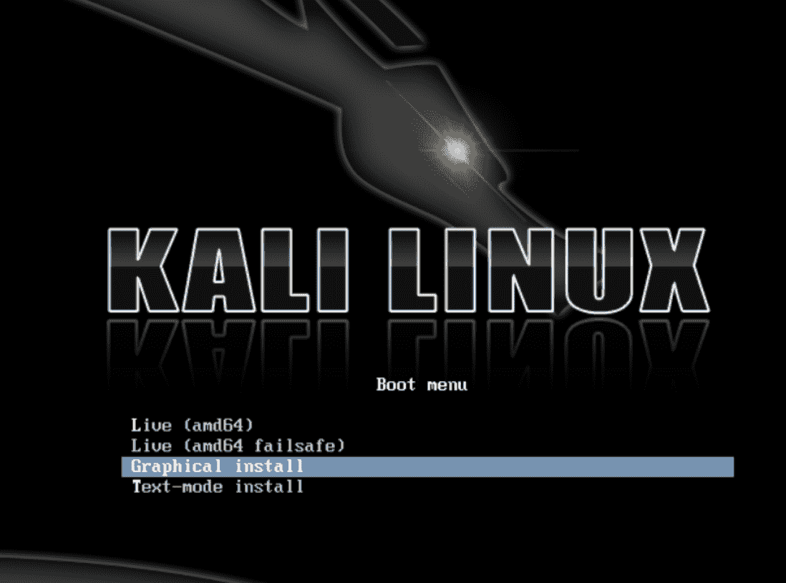

- 2. 选择您偏好的语言，然后选择您的国家/地区。系统还会提示您使用相应的键位配置配置键盘。

# KALI LINUX

官方 Kali Linux 文档  此 PDF 在 docs.kali.org 上自动生成 - 2013年8月19日


## 选择语言

选择用于安装过程的语言。所选语言也将将成为安装后系统的默认语言。

- 中文（简体）-中文
- 中文（繁體）- 中文(繁體)
- 克罗地亚语 - Hrvatski
- 捷克语 - Če
- 丹麦语 - Dansk
- 荷兰语 - Nederlands
- 宗不语 - བོད་ཁ
- 英语 - English
- 内部望语 - Esperanto
- 爱沙尼亚语 - Eesti


- 芬兰语 - Suomi
- 法语 - Français
- 加利西亚语 - Galego
- 格鲁吉亚语 - ქართული
- 德语 - Deutsch

截图 返回 继续

- 3. 安装程序将镜像拷贝到您的硬盘上，探测您的网络接口，然后提示您为系统输入主机名。在下面的示例中，我们将“kali”作为主机名。

# KALI LINUX

## 配置网络

请为此系统输入主机名。

主机名是用于在网络识别系统的单个单词。如果您不知道主机名应该是什么，请咨询您的网络管理员。如果您正在设置自己的家庭网络，

主机名：

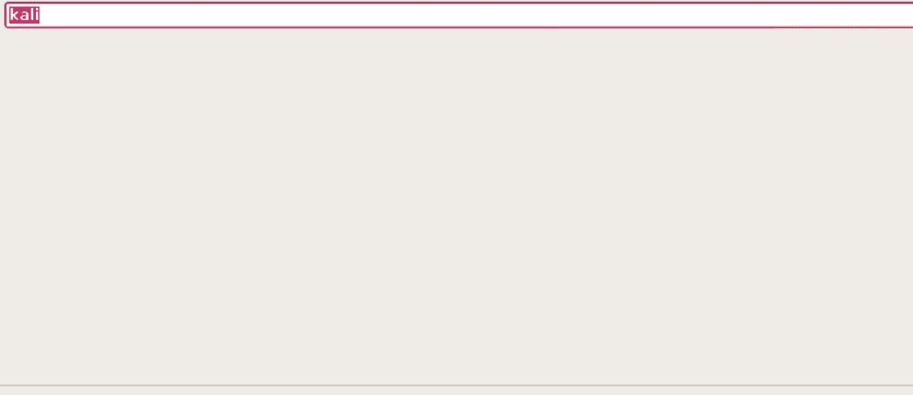

- 4. 为 root 账户输入一个强密码。

# KALI LINUX

## 设置用户和密码

您需要为系统管理账户 'root' 设置密码。具有 root 权限的恶意或不合格用户可能会导致灾难性的结果，因此您应该仔细选择一个不易猜到的的 root 密码。它不应该是字典中的单词，也不应该是容易与您相关联的单词。

良好的密码应包含字母、数字和标点符号的混合，并应定期更改。

root 用户不应有空密码。如果您将其留空，root 账户将被禁用，系统的初始用户账户将获得使用 "`sudo`" 命令成为 root 的权限。

注意，您在输入时将看不到密码。

Root 密码：


请输入相同的 root 密码以验证您的输入是否正确。

重新输入密码以验证：

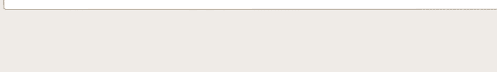

截图 返回 继续

- 5. 接下来，设置您的时区。

# KALI LINUX

官方 Kali Linux 文档

此 PDF 在 docs.kali.org 上自动生成 - 2013年8月19日


## 配置时钟

> 如果所需的时区未列在列表中，请返回“选择语言”步骤，并选择一个使用所需时区的国家（您居住或所在的国家）。

选择您的时区：

- 东部 (Eastern)
- 中部 (Central)
- 山地山区 (Mountain)
- 太平洋 (Pacific)
- 阿拉斯加 (Alaska)
- 夏威夷 (Hawaii)
- 亚利桑那 (Arizona)
- 东印第安州 (East Indiana)
- 萨摩亚 (Samoa)


- 6. 安装程序现在将探测您的磁盘并提供四种选择。在我们的示例中，我们正在使用计算机上的整个磁盘，而不配置 LVM（逻辑卷管理器）。经验丰富的用户可以使用“手动”分区方法进行更细粒度的配置选项。

# KALI LINUX

官方 Kali Linux 文档

此 PDF 在 docs.kali.org 上自动生成 - 2013年8月19日


## 分区磁盘

安装程序可以引导您对磁盘进行分区（使用不同的标准方案），或者如果您愿意，也可以手动进行。使用引导式分区，您稍后仍有机会查看并自定义结果。

如果您选择了对整个磁盘分区，接下来将要求指示使用哪块磁盘。

分区方法：

## 引导式 - 使用整个磁盘

- 引导式 - 使用整个磁盘并设置 LVM
- 引导式 - 使用整个磁盘并设置加密 LVM
- 手动

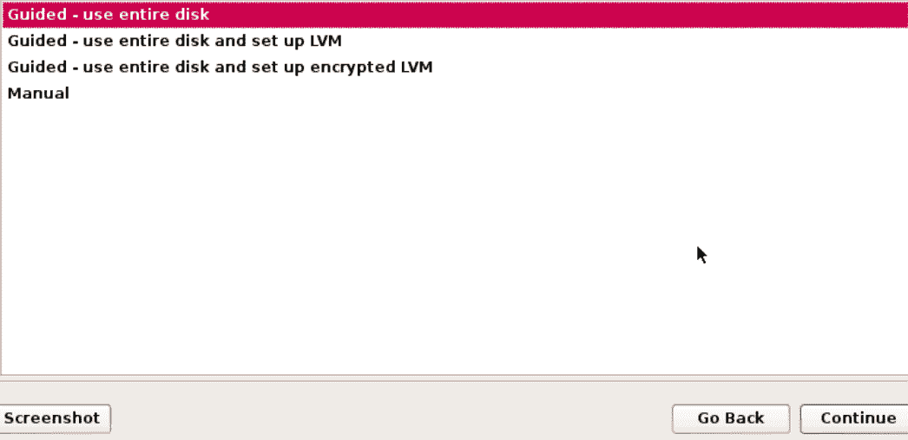

- 7. 接下来，在安装程序做出更改之前，您将有最后一次检查配置的机会。点击继续后，安装程序将运行并将接近完成。

# KALI LINUX

官方 Kali Linux 文档

此 PDF 在 docs.kali.org 上自动生成 - 2013年8月19日


## 分区

如果您继续，安装程序将格式化以下分区。警告：这将破坏磁盘上的所有数据。

以下分区将格式化：

`sda (0,0)` 

`sda1 (0,0) ext4`

`sda5 (0,0) swap`

写入磁盘？

- 否
- 是

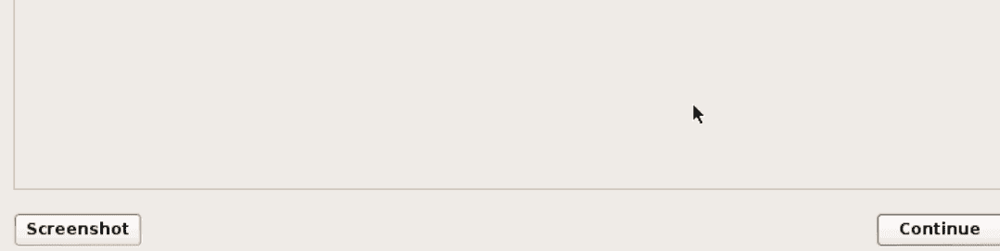

- 8. 接下来，我们需要配置网络镜像。Kali 使用网络镜像来分发软件包。注意！如果您在此屏幕上选择“否”，您将无法从存储库安装软件包。

# KALI LINUX

官方 Kali Linux 文档

此 PDF 在 docs.kali.org 上自动生成 - 2013年8月19日


## 配置包管理器

网络镜像可以补充包含在 CD-ROM 中的软件。

使用网络镜像？

- 否
- 是

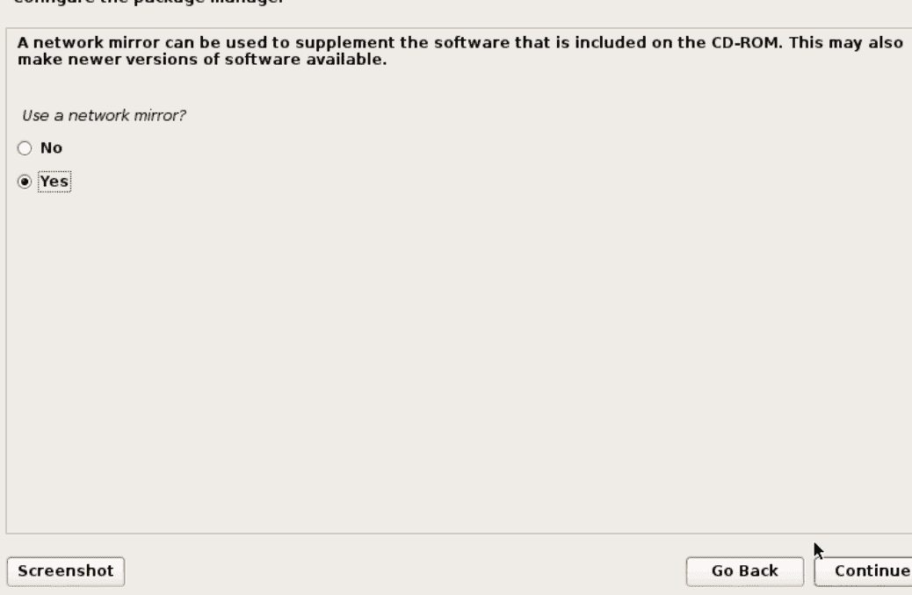

- 9. 接下来，安装 GRUB。

# KALI LINUX

官方 Kali Linux 文档

此 PDF 在 docs.kali.org 上自动生成 - 2013年8月19日


## 在主磁盘上安装 GRUB

似乎此新安装是计算机上唯一的操作系统。如果是这样，将 GRUB 安装到您的主硬盘是安全的。

警告：如果安装程序未能检测到计算机上存在的另一个操作系统，修改主记录会导致该操作系统暂时无法启动，尽管以后可以手动配置。

将 GRUB 引导加载器安装到主记录？

- 否
- 是

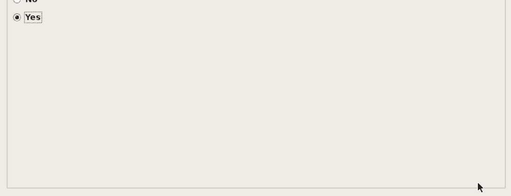

- 10. 最后，点击继续重启到您新的 Kali 安装。

# KALI LINUX

官方 Kali Linux 文档

此 PDF 在 docs.kali.org 上自动生成 - 2013年8月19日


## 完成安装

> 安装完成

安装已完成，是时候进入您的新系统了。请确保移除安装媒体（CD-ROM、软盘），以便进入新系统而不是重新启动安装。

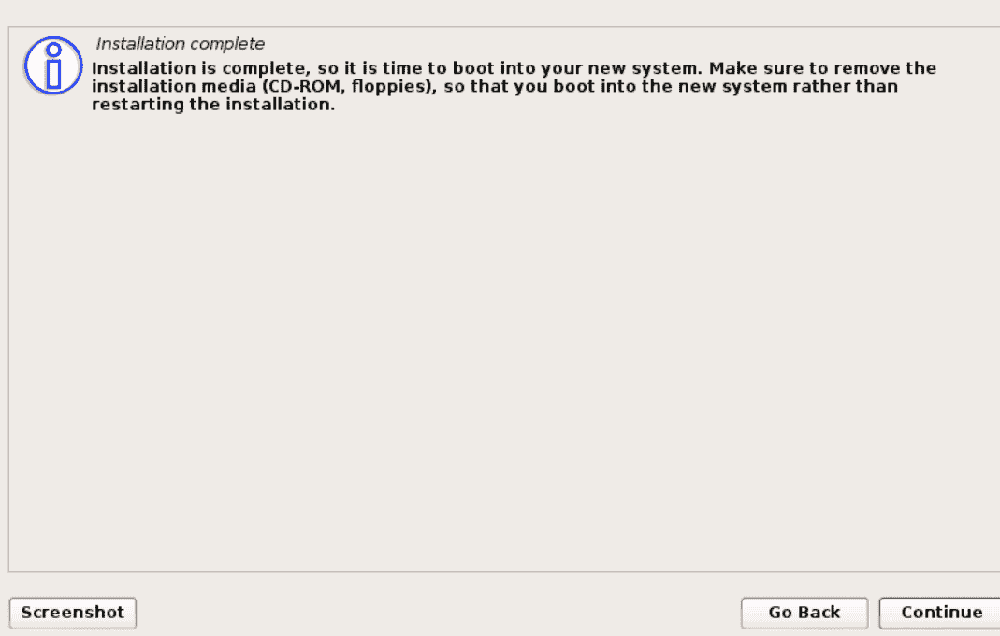

## 安装后

现在您已经安装了 Kali Linux，是时候自定义您的系统了。我们网站的 Kali 通用部分有更多信息，您也可以在用户论坛找到利用 Kali 的技巧。

## 与 Windows 双启动 Kali

## Kali Linux 与 Windows 双启动

在 Windows 旁边安装 Kali 可能非常有用。但是，在设置过程中您需要小心。首先，请确保您已备份了 Windows 安装中的任何重要数据。由于您将修改硬盘，您会希望将备份存储在外部介质上。完成备份后，我们建议您阅读 Kali Linux 磁盘安装，它解释了基本 Kali 安装的正常程序。

在我们的示例中，我们将与 Windows 7 并并安装 Kali，Windows 目前占据了我们计算机上 100% 的磁盘空间。我们将从调整 Windows 分区以减少占用空间开始，然后在新创建的空分区中安装 Kali。

# KALI LINUX

Kali Linux 官方文档

此 PDF 已在 docs.kali.org 上自动生成 - 2023年8月

应用程序 位置

1月26日 周六 下午 7:17

root

计算机


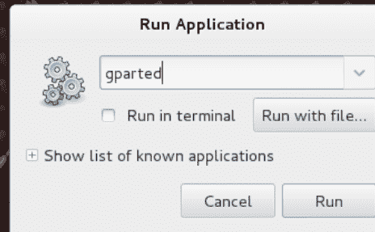


运行应用程序

- 3. 选择您的 Windows 分区。根据您的系统，它通常是第二个较大的分区。在我们的示例中，有两个分区：第一个是系统恢复分区，Windows 实际上安装在 `/dev/sda2`。调整您的 Windows 分区大小，并为 Kali 安装留出足够的空间（至少 8GB）。

# KALI LINUX

Kali Linux 官方文档

此 PDF 已在 docs.kali.org 上自动生成 - 2023年8月19日

应用程序 位置 1月26日 周六 下午 7:18 声器 root

```
/dev/sda - GParted
```

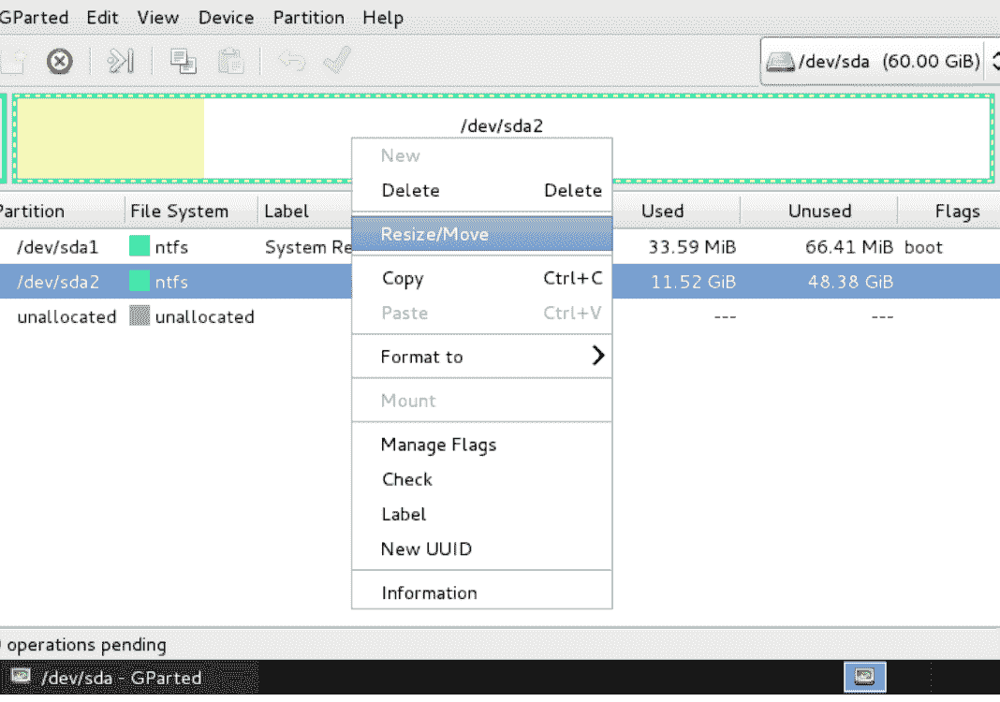


- 4. 一旦调整了 Windows 分区的大小，请确保在磁盘上点击“应用所有操作”。运行 `gparted` 并重启。

# KALI LINUX

Kali Linux 官方文档

此 PDF 已在 docs.kali.org 上自动生成 - 2013年8月19日

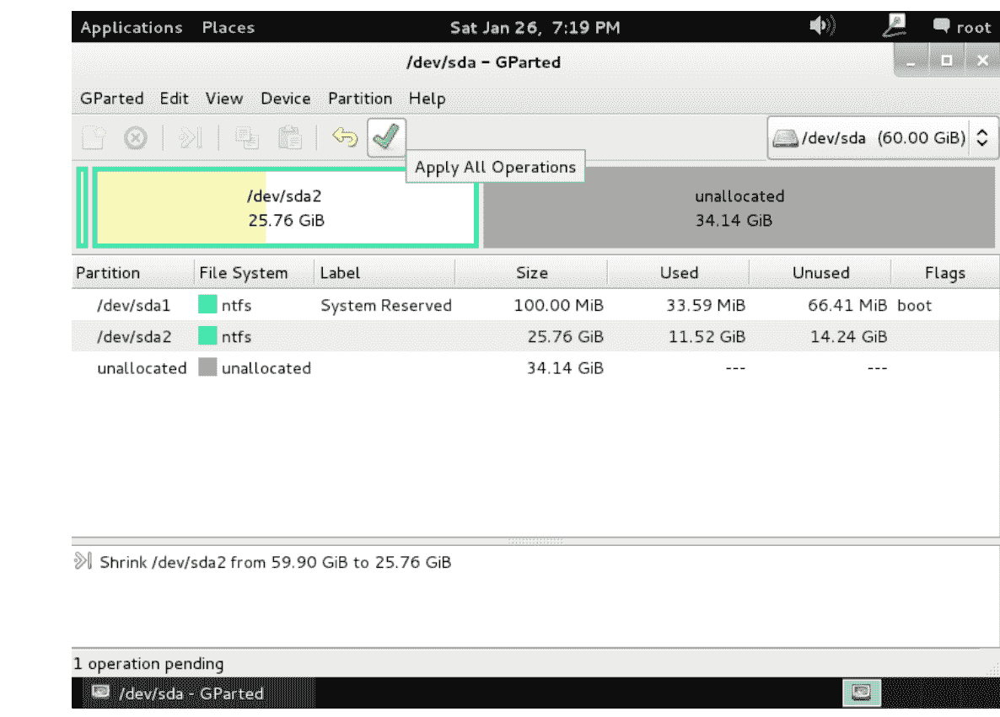

## Kali Linux 安装步骤

- 1. 从此处开始的安装程序与 Kali Linux 硬盘安装相似，直到进入分区阶段，此时您需要选择“引导 - 使用最大的连续空空间”，这是您之前用 `gparted` 创建的空空间。

# KALI LINUX

Kali Linux 官方文档

此 PDF 已在 docs.kali.org 上自动生成 - 2013年8月19日


## 分区磁盘

安装程序可以引导您对磁盘进行分区（使用不同的标准方案），或者如果您愿意，也可以手动进行。使用引导分区后，您之后仍然有机会重新检查并自定义结果。

- 如果您选择对整个磁盘进行引导分区，接下来将询问您应该使用哪块磁盘。

- 分区方法：

| 引导 - 使用最大的连续空空间 |

| 引导 - 使用整个磁盘 |

| 引导 - 使用整个磁盘并设置 LVM |

| 引导 - 使用整个磁盘并设置加密 LVM |

| 手动 |

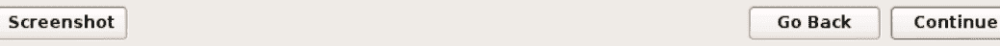

- 2. 安装完成后，重启。您应该会看到 `GRUB` 启动菜单，它将允许您启动到 Kali 或 Windows。

# KALI LINUX

Kali Linux 官方文档

此 PDF 已在 docs.kali.org 上自动生成 - 2013年8月19日

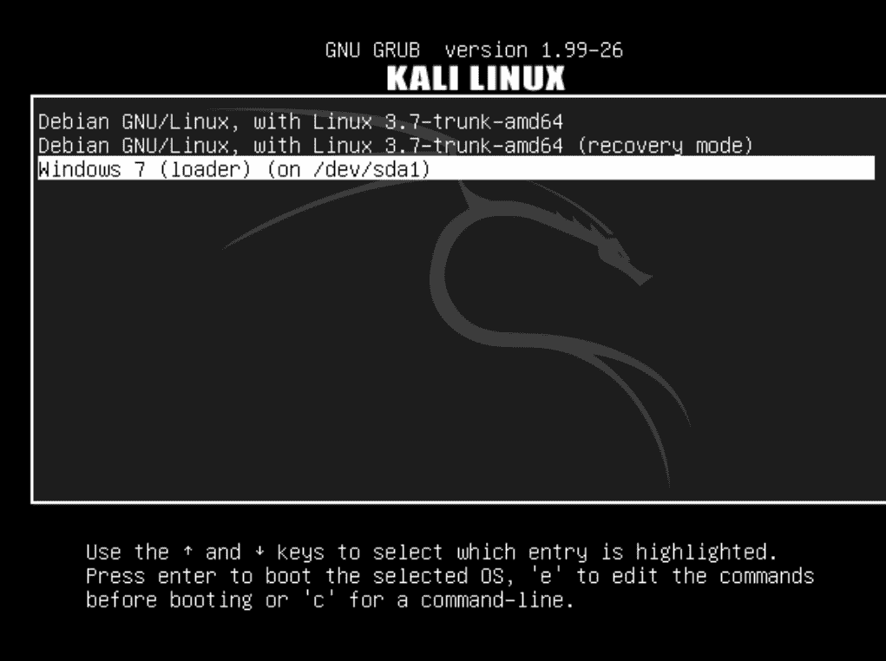

## 安装后

现在您已经完成了 Kali Linux 的安装，是时候自定义您的系统了。我们网站的“Kali 通用”部分有更多信息，您也可以在我们的用户论坛中找到如何充分利用 Kali 的提示。

## Kali Linux Live USB 安装

从 USB 闪盘启动并安装 Kali 是我们最喜欢且最快的运行方法。为了实现这一点，我们首先需要在 USB 驱动器上创建 Kali ISO 镜像。如果您想为您的 Kali Linux USB 闪盘添加持久化（persistence），请在继续创建镜像之前阅读完整文档。

## 准备 USB 拷贝

- 1. [下载 Kali linux](https://www.kali.org/get-kali/)。
- 2. 如果运行 Windows，下载 [Win32 Disk Imager](https://projects.sourceforge.net//)。
- 3. `*nix` 系统不需要特殊的软件。
- 4. 一个 USB 密钥（至少 2GB 容量）。

## Kali Linux Live USB 安装步骤

### 在 Windows 机器上制作 Kali 镜像

- 1. 将 USB 闪盘插入 Windows 端口并启动 `Win32 Disk Imager` 软件
- 2. 选择要制作的 Kali Linux ISO 文件，并验证要覆盖的 USB 驱动器是正确的。

# KALI LINUX

Kali Linux 官方文档

此 PDF 已在 docs.kali.org 上自动生成 - 2013年8月19日

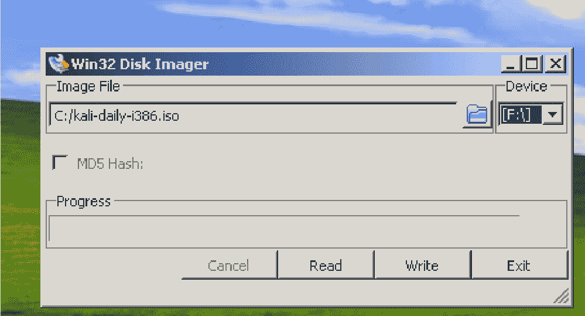

- 3. 镜像制作完成后，安全地弹出 USB 驱动器。

## 在 Linux 机器上制作 Kali 镜像

- 1. 将 USB 闪盘插入 Linux 端口并启动 `Win32 Disk Imager` 软件
- 2. 选择要制作的 Kali Linux ISO 文件，并验证要覆盖的 USB 驱动器是正确的。
- 3. `*nix` 系统不需要特殊的软件。
- 4. 一个 USB 密钥（至少 2GB 容量）。
- 3. 镜像制作完成后，安全地弹出 USB 驱动器。
- 1. 将 USB 闪盘插入 Linux 端口并启动 `Win32 Disk Imager` 软件（这可能是 dd 错误）。

## 为您的 Kali 添加持久化

- 5. 一旦过程完成，挂载持久化分区。
- 6. 将 USB 闪盘插入计算机。确保 BIOS 设置为从 USB 启动。当 Kali 启动界面出现时，在菜单中选择“Live”（不要按回车），并按 Tab 键。这将允许您编辑启动参数。每次需要挂载存储器时，在启动参数末尾添加“persistence”单词。


- 5. 一旦过程完成，挂载持久化分区。
- 6. 将 USB 闪盘插入计算机。确保 BIOS 设置为从 USB 启动。当 Kali 启动界面出现时，在菜单中选择“Live”（不要按回车），并按 Tab 键。这将允许您编辑启动参数。每次需要挂载存储器时，在启动参数末尾添加“persistence”单词。

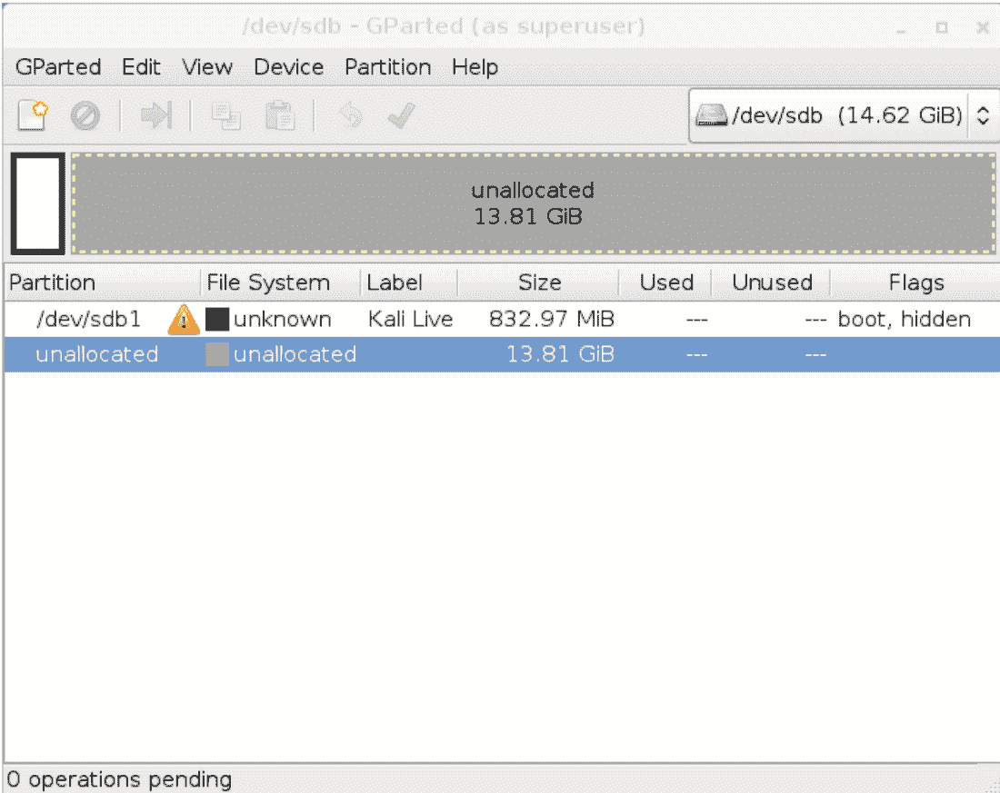

- 5. 一旦过程完成，挂载持久化分区。
- 6. 将 USB 闪盘插入计算机。确保 BIOS 设置为从 USB 启动。当 Kali 启动界面出现时，在菜单中选择“Live”（不要按回车），并按 Tab 键。这将允许您编辑启动参数。每次需要挂载存储器时，在启动参数末尾添加“persistence”单词。
- 5. 一旦过程完成，挂载持久化分区。
- 6. 将 USB 闪盘插入计算机。确保 BIOS 设置为从 USB 启动。当 Kali 启动界面出现时，在菜单中选择“Live”（不要按回车），并按 Tab 键。这将允许您编辑启动参数。每次需要挂载存储器时，在启动参数末尾添加“persistence”单词。

# KALI LINUX

官方 Kali Linux 文档

此 PDF 在 docs.kali.org 上自动生成 - 2013年8月19日

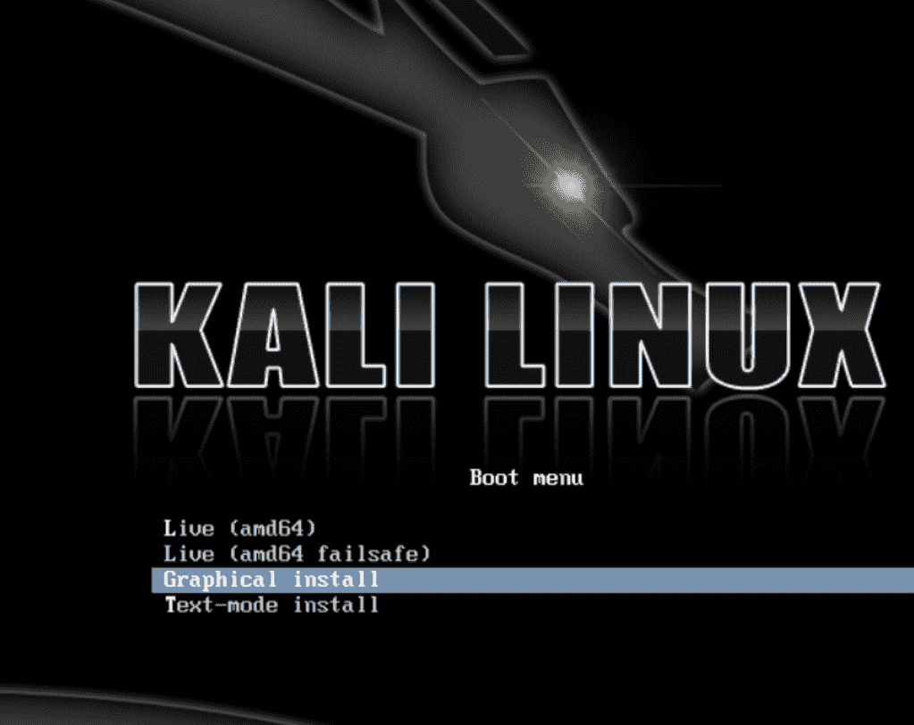

- 2. 选择您偏好的语言，然后选择您的国家/地区。系统还会提示您使用适当的键盘布局配置键盘。

# KALI LINUX

官方 Kali Linux 文档

此 PDF 在 docs.kali.org 上自动生成 - 2013年8月19日


## 选择语言

选择用于安装过程的语言。所选语言也将成为安装后系统的默认语言。

- 中文(简体) - Chinese (Simplified)
- 中文(繁體) - Chinese (Traditional)
- 克罗地亚语 - Hrvatski
- 捷克语 - Čeština
- 丹麦语 - Dansk
- 荷兰语 - Nederlands
- 宗不语 - ྫ
- 英语 - English
- 世界普义语 - Esperanto
- 爱沙尼亚语 - Eesti
- 芬兰语 - Suomi
- 法语 - Français
- 加利西亚语 - Galego
- 格鲁吉语 - ქართული
- 德语 - Deutsch
- 希腊语 - Ελλην

截图 返回 继续

- 3. 安装程序将镜像复制到您的硬盘上，探测您的网络接口，然后提示您为系统输入主机名。在下面的示例中，我们输入“kali”作为主机名。

## KALI LINUX

### 配置网络

请输入此系统的主机名。主机名是用于网络识别系统的单个单词。如果您不知道主机名应该是什么，请咨询您的网络管理员。如果您正在设置自己的家庭网络，

主机名：

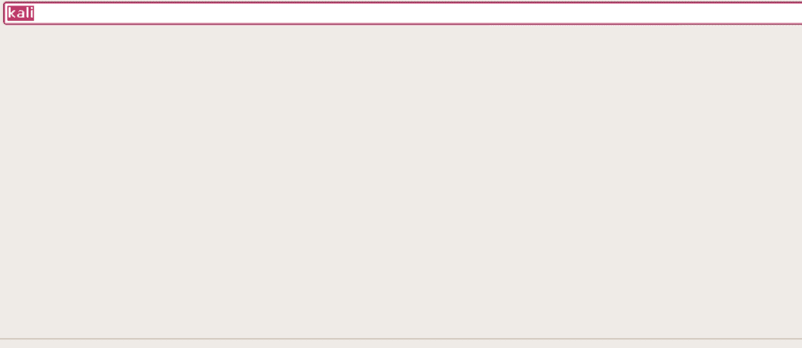

- 4. 为 root 账户输入一个强密码。

## 设置用户和密码

您需要为系统管理账户“root”设置一个密码。具有 root 权限的恶意或不合格的用户可能会导致灾难性的结果，因此您应该仔细选择一个不容易猜的 root 密码。它不应该是字典中的存在的单词，也不应该是可以与您容易关联的单词。

一个好的密码应包含字母、数字和标点符号的混合，并应定期更改。

root 用户不应设置空密码。如果您留空，root 账户将被禁用，系统的初始用户账户将获得使用“sudo”命令成为 root 的权限。

请注意，您在输入密码时无法看到它。

root 密码：


请再次输入相同的 root 密码以验证输入是否正确。

再次输入密码以验证：

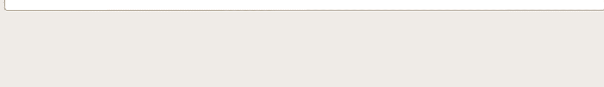

截图 返回 继续

- 5. 接下来设置您的时区。


# KALI LINUX

官方 Kali Linux 文档

此 PDF 在 docs.kali.org 上自动生成 - 2013年8月19日


## 配置时钟

> 如果没有列出所需的时区，请返回“选择语言”步骤，并选择使用所需时区的国家（您居住或所在的国家）。

选择您的时区：
- 东部 (Eastern)
- 中部 (Central)
- 山山区 (Mountain)
- 太平洋 (Pacific)
- 阿拉斯斯加 (Alaska)
- 夏威夷 (Hawaii)
- 亚利桑那 (Arizona)
- 印第安州东部 (East Indiana)
- 萨摩亚 (Samoa)


- 6. 安装程序现在将探测您的磁盘并为您提供四个选择。对于加密的 LVM 安装，请如如下所示选择“引导式 - 使用整个磁盘并设置加密 LVM”选项。

## 分区磁盘

安装程序可以引导您对磁盘进行分区（使用不同的标准方案）；或者如果您愿意，您也可以手动进行。使用引导式分区时，您稍后仍有机会查看并自定义结果。

如果您选择对整个磁盘进行引导式分区，接下来将要求指定使用哪块磁盘。

分区方法：
- 引导式 - 使用整个磁盘
- 引导式 - 使用整个磁盘并设置 LVM
- 引导式 - 使用整个磁盘并设置加密 LVM
- 手动

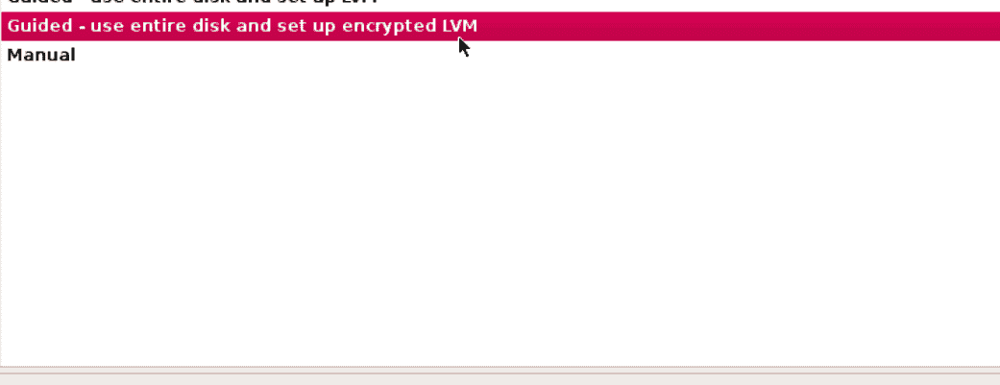

- 7. 选择安装目标驱动器。在这种情况下，我们选择了 USB 驱动器。我们将使用此 USB 驱动器启动加密后的 Kali。

注意，在您确认要进行更改之前，所选磁盘上的所有数据将被擦除。

选择分区的磁盘：
- SCSI (0,0,0) (sda) - 4.0 GB DataTraveler
- SCSI (0,0,0) (sdb) - 21.5 GB Virtual


截图 返回 继续

- 8. 确认您的分区方案并继续安装。

这是已配置分区和挂载点的概述。选择一个分区修改其设置（文件系统、挂载点等），选择一个空闲创建分区或初始化分区表。

配置加密卷
- LVM VG root - 3.5 GB device-mapper (linear) - #1 3.5 GB ext4
- LVM VG swap - 209.7 MB device-mapper (linear) - #1 209.7 MB swap
- 加密卷 (sda5-crypt) - 3.8 GB device-mapper (crypt) - #1 3.8 GB lvm
- SCSI (0,0,0) (sda) - 4.0 GB DataTraveler - #1 primary 25.8 MB /boot - #5 logical 3.8 MB crypto (sda5_crypt)
- SCSI (0,0,0) (sdb) - 21.5 GB Virtual - #1 primary 20.5 GB ext4 - #5 logical 2.7 MB swap

撤销分区更改

完成分区并写入磁盘

截图 帮助 返回 继续

- 9. 接下来，将要求输入加密密码。您需要记住此密码，并在每次启动加密后的 Kali 时使用它。


您需要选择一个密码来加密 SCSI (0,0,0)，分区 #5 (sda)。加密的整体强度很大取决于此密码，因此您应该仔细选择一个不容易猜的密码。它不应该是字典中存在的单词或句子，也不应该是可以与您容易关联的短语。

一个好的密码应包含字母、数字和标点符号。建议密码长度为 20 个字符以上。

加密密码：

再次输入相同的密码以验证输入是否正确。

再次输入密码以验证：

- 10. 配置网络镜像。Kali 使用中央存储分发应用程序。根据需要输入任何代理信息。

> 注意！如果您在此屏幕上选择“否”，您将无法从 Kali 存储库安装包。

## 配置包管理器

网络镜像可补充 CD-ROM 中包含的软件。这也可以提供新版本的软件。

使用网络镜像吗？
- 否
- 是

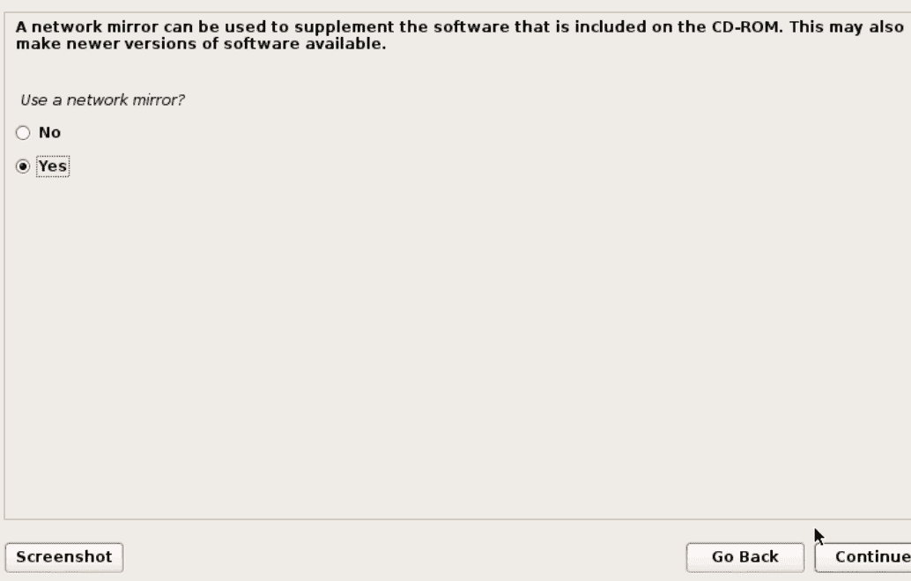

- 11. 接下来，安装 GRUB。

## 在硬盘上安装 GRUB 引导加载程序

似乎此新安装是此电脑上的唯一操作系统。如果是这样，将 GRUB 引导加载程序安装到第一块硬盘的主引导记录应该是安全的。

警告：如果安装程序未能检测到电脑上存在的另一个操作系统，修改主引导记录将导致操作系统暂时无法启动，尽管稍后可以手动配置 GRUB。

将 GRUB 引导加载程序安装到主引导记录？
- 否
- 是


- 12. 最后，点击`继续`重启进入您新的 Kali 安装。如果您使用 USB 设备作为目标驱动器，请确保在 BIOS 中启用了从 USB 设备启动。每次启动时，系统都会要求您输入之前设置的加密密码。

## 完成安装

> 安装完成

安装已完成，现在是进入你的新系统的时间了。请确保移除安装媒体（CD-ROM、软盘），以便你启动的是新系统而不是重新开始安装。

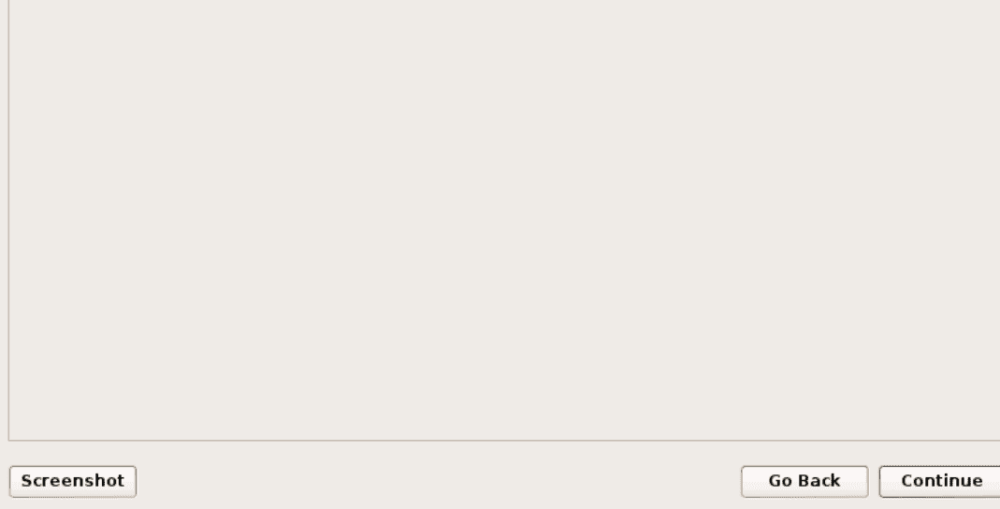

## 安装后操作

现在你已经完成了 Kali Linux 的安装，是时候对你的系统进行定制了。我们网站的 Kali 通用（Kali General Use）部分提供了更多信息，你也可以在我们的用户论坛中找到如何充分利用 Kali 的技巧。

# 04. Kali Linux 网络安装

### Kali Linux Mini ISO 安装

### Kali Mini ISO 安装

Kali mini ISO 是一种安装极简 Kali 系统并“从零开始”安装的便捷方法。mini 安装 ISO 将从我们的仓库下载所有所需的软件包，这意味着你需要快速的网络连接才能使用此方法。

## 安装前提

- 安装 Kali Linux 至少 8 GB 磁盘空间。
- 对于 i386 和 amd64 架构，至少需要 512MB 内存。
- CD-DVD 驱动器 / USB 启动支持

## 准备安装

1. 下载 Kali mini ISO。
2. 将 Kali Linux ISO 刻录到 DVD 或将 Kali Linux Live 写入 USB。
3. 确保你的电脑 BIOS 设置为从 CD / USB 启动。

## Kali Linux 安装程序

当你首次启动 mini ISO 时，将看到一个带有各种选项的小型启动菜单。对于本文，我们将仅进行基础安装。

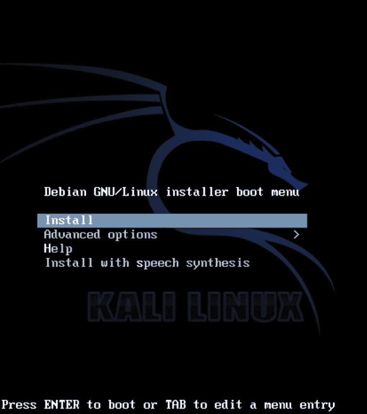

接下来你将被提示各种信息，例如语言和键盘类型，然后你需要为安装选择一个主机名。我们将保持默认的 kali。


此 PDF 并在 docs.kali.org 自动生成 - 2013年8月19日

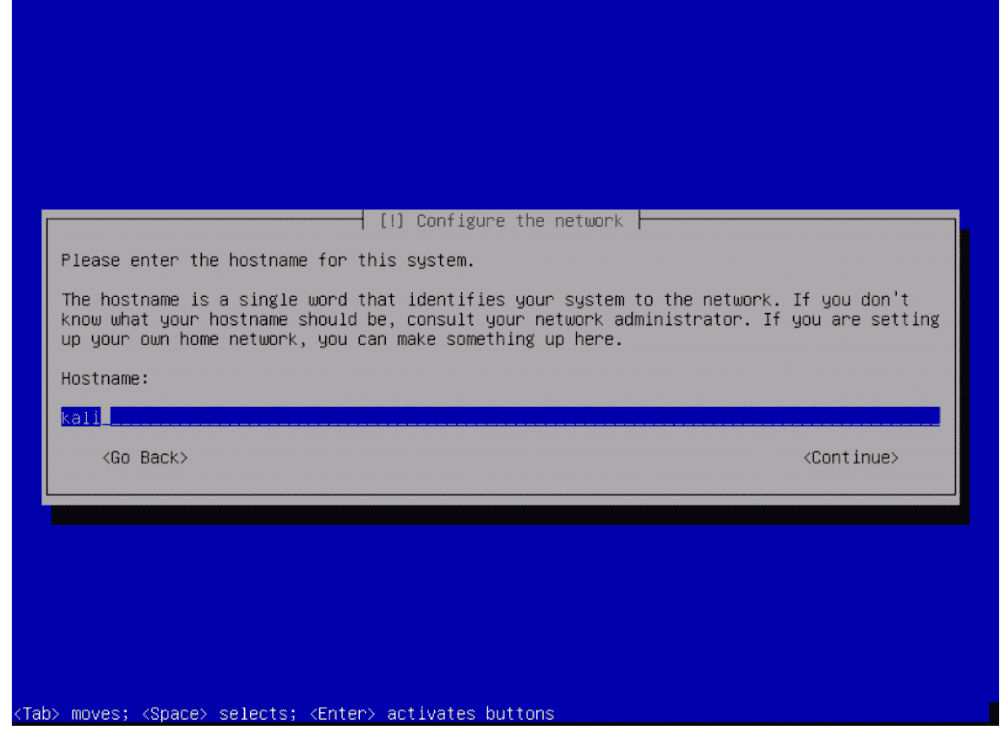

接下来，你需要选择时区，然后将向分分区选项。为了快速运行，我们将使用“引导式 - 使用整个磁盘”并按照提示一路完成，以创建新的分区设置。

# KALI LINUX

## Linux 官方文档

此 PDF 并在 docs.kali.org 自动生成 - 2013年8月19日

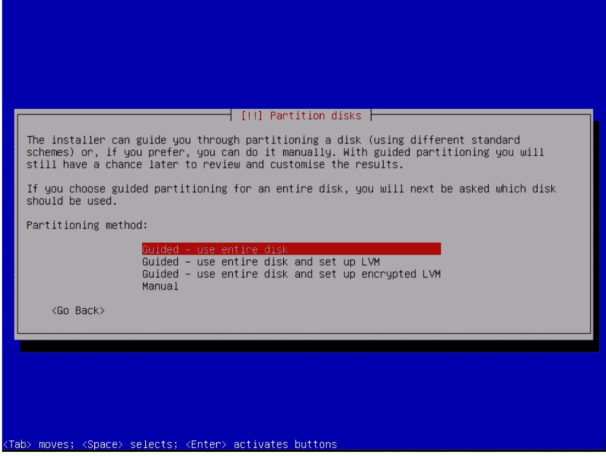

为了减少网络带宽，默认将选择一小部分软件包。如果你想添加不同的服务或功能，这就是你进行选择的区域。

# KALI LINUX

## Kali Linux 官方文档

此 PDF 并在 docs.kali.org 自动生成 - 2013年8月19日

```
[ ] 软件选择
目前仅安装了系统核心。要根据你的需求调整系统，你可以选择安装以下一个或多个预定义的软件集合。

选择要安装的软件：

[ ] Debian 桌面环境
[*] Web 服务器
[*] 打印服务器
[*] SQL 数据库
[ ] DNS 服务器
[ ] 文件服务器
[ ] 邮件服务器
[*] SSH 服务器
[ ] 桌面
[*] 标准系统实用程序

<继续>

<Tab> 移动: <Space> 选择: <Enter> 激活按钮
```

此时此时，安装程序将下载它所需的所有软件包并将它们安装到系统上。取决于你的互联网连接速度，这可能需要一些时间。最后，你将会被提示安装 GRUB 以完成安装。

# KALI LINUX

## Kali Linux 官方文档

此 PDF 并在 docs.kali.org 自动生成 - 2013年8月19日

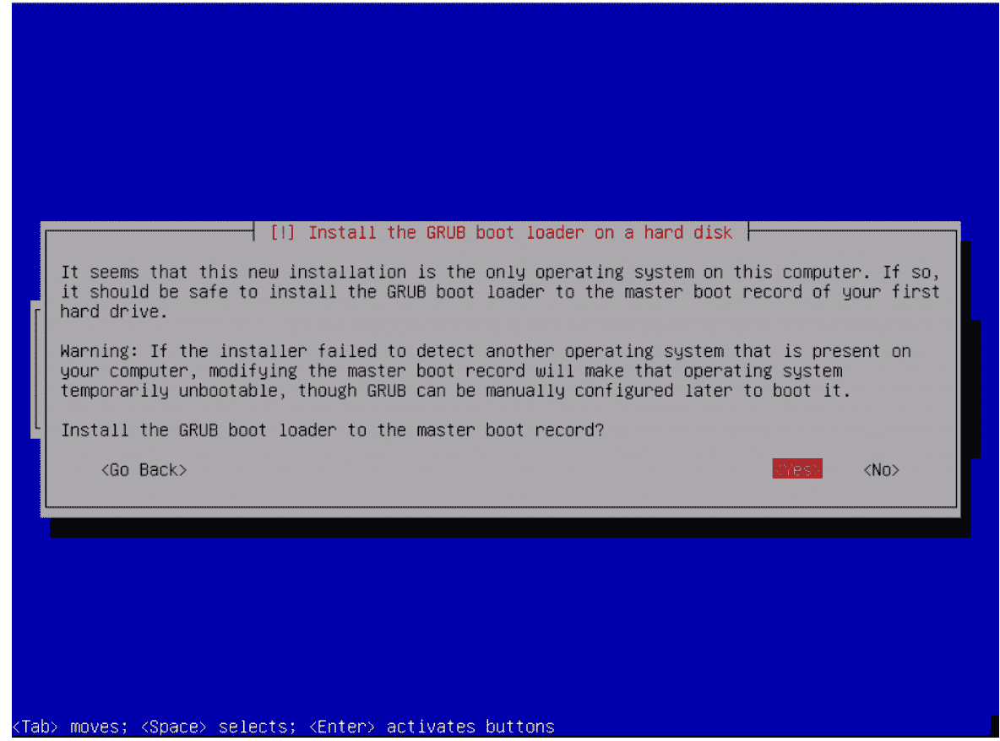

## 安装后操作

现在你已经完成了 Kali Linux 的安装，是时候对你的系统进行定制了。我们网站的 Kali 通用部分提供了更多信息，你也可以在我们的用户论坛中找到如何充分利用 Kali 的技巧。

# Kali Linux 网络 PXE 安装

## 设置 PXE 服务器

通过网络 (PXE) 启动和安装 Kali 对于没有 CDROM 或 USB 端口的单台笔记本电脑非常有用，适用于支持预填充（pre-seeding）的企业部署。

首先，我们需要安装 `dnsmasq` 来提供 DHCP/TFTP。

```bash
apt-get install dnsmasq
```

在 `dnsmasq.conf` 中，我们需要定义以下内容：

```bash
dhcp-range=192.168.1.50,192.168.1.150,255.255.255.0
dhcp-option=3,192.168.1.1
dhcp-option=6,192.168.1.2
```

配置后，需要重启 `dnsmasq`：

```bash
service dnsmasq restart
```

切换到 TTY，这将显示为一个带有登录提示的黑屏幕。我们需要以 `root` 身份登录并按照如下步骤停止 `gdm3` 服务。

```
service gdm3 stop
```

如果您使用的是 64 位的 Kali 系统，您可能想要安装 `ia32-libs` 软件包，以便 NVIDIA 安装程序能够安装 32 位库，尽管这是可选的。如果您选择不这样做，只需在安装程序询问您是否要安装 32 位库时简单地选择 `no` 即可。

```
dpkg --add-architecture i386
apt-get update
apt-get install ia32-libs
```

假设您已将 NVIDIA 驱动下载到 `/root/` 目录，我们需要赋予其执行权限并运行它。

```
chmod 755 NVIDIA-Linux-x86_64-310.44.run
./NVIDIA-Linux-x86_64-310.44.run
```

一旦安装程序完成，您应该重启电脑。系统重新启动后，您可能会看到 NVIDIA 启动界面，这表明驱动程序已正确安装，但情况并非总是如此。为了检查驱动程序是否正常工作，请执行以下命令。

# KALI LINUX

## 官方 Kali Linux 文档

此 PDF 在 docs.kali.org 上自动生成 - 2013年8月19日

```
root@kali:~# glxinfo | grep -i "direct rendering"
direct rendering: Yes
```

虽然利用 Kali 包含的 Cuda 工具超出了本文的范围，但检查并确保它们正常工作始终是一个好主意。以下命令使用 `Oclhashcat-plus` 配合软件包中包含的一些示例文件。

```
cd /usr/share/oclhashcat-plus/
./cudaHashcat-plus.bin -t 32 -a 7 example.hash ?a?a?a example.dict
cudaHashcat-plus v0.14 by atom starting...
```

- Hashes: 共 6494 个，6494 个唯一摘要

- Bitmaps: 16 位，65536 个条目，0xffffff 掩码，262144

- Workload: 256 次循环，80 个加速器

- Watchdog: 温度中止触发器设为 90c

- Watchdog: 温度保持触发器设为 80c

- Device #1: GeForce G210M, 511MB, 146Mhz, 2MCU

- Device #2: GeForce 9400M, 253MB, 1100Mhz, 2MCU

- Device #1: Kernel , /kernels/4318/m0000_a1.sm_12.64.ptx

- Device #2: Kernel , /kernels/4318/m0000_a1.sm_11.64.ptx

为 `example.dict` 生成的数据语句：121028 个单词，129988 个单词，129988 个密钥空间

```
27b7965af0346604148f2a455fe52:mo0000
a48dd0f09abafake632f88e3c641b5f:ap2300000
7becb9427f3ab85ff816f2a88f36a:sail00
1459ccf0940e63051d5a875a88acaaf:pigi00
3baa30486516a5d1260eb521a873bc0:ek110
7a872202667f1f548568596ce999f:davi0123456789
98c627ca129e64dff3bf0fbaabc66:fire0man
```

如您上方输出所示，显卡已被识别，且密码正在成功恢复。

# Kali Linux VirtualBox 虚拟机

如果您决定在 VirtualBox 中安装 Kali Linux，您将需要按照下面的说明来成功安装 Linux 增强功能（Guest Additions）工具。

您必须使用 `4.2.xx` 或更高版本 的 `VirtualBox`，以利用改进之处，包括兼容性更新以及核心应用程序和增强功能稳定性的提升。

## 在 Kali Linux 中安装 VirtualBox 增强功能

为了实现与宿主机系统良好的鼠标和屏幕集成以及文件夹共享，您将需要安装 VirtualBox 增强功能。

一旦进入了 Kali Linux 虚拟机，请打开终端窗口并执行以下命令安装 Linux 内核头。

```
apt-get update && apt-get install -y linux-headers-$(uname -r)
```

完成后，您现在可以挂载增强功能 CD 盘。这可以通过从 VirtualBox 菜单选择“设备”并选择“安装增强功能”来实现。这将 GuestAdditions iso 挂载到您 Kali Linux 虚拟机的虚拟光驱器中。当提示自动运行 CD 时，点击“取消”按钮。


从终端窗口，从增强功能 CD 盘将 `VboxAdditions.run` 文件复制到您的本地系统路径，确保它是可执行的并运行它。

```
cp /media/cd-rom/VboxAdditions.run /root/
chmod 755 /root/VboxAdditions.run
cd /root
./VboxAdditions.run
```

# Kali Linux

## 官方 Kali Linux 文档

此 PDF 在 docs.kali.org 上自动生成 - 2013年8月19日


重启 Kali Linux 虚拟机以完成增强功能的安装。您现在应该拥有完整的鼠标和屏幕集成，以及与宿主机共享文件夹的能力。

## 与宿主机共享文件夹


要在宿主机与 Kali Linux 虚拟机之间共享文件夹需要完成几个步骤。

从 VirtualBox 管理器选择您的 Kali Linux 虚拟机，并点击右侧的“共享文件夹”链接。这将启动一个添加文件夹的弹出窗口。在“文件夹路径”框中提供您想要共享的路径，或点击下拉箭头浏览您的宿主机。选择允许“自动挂载”和“永久”的复选框，并两次点击 OK 按钮。


您的共享文件夹现在将位于 `media` 目录下。您可以创建一个书签或链接以便访问该目录。

## Kali Linux

官方 Kali Linux 文档

此 PDF 在 `docs.kali.org` 上自动生成 - 2013年8月19日

### 书签

- 首页
- 桌面
- 文件系统
- 垃圾箱

### 网络

- 浏览网络


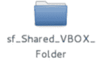

## 启动 Metasploit 框架

与 Kali Linux 网络服务一样，启动时没有运行网络服务（包括数据库服务），因此需要采取几个步骤使 Metasploit 在数据库支持下运行。

### 启动 Kali PostgreSQL 服务

Metasploit 使用 PostgreSQL 作为其数据库，因此需要先启动。

```
service postgresql start
```

您可以通过检查 `ss -ant` 的输出并确保端口 `5432` 正在监听来验证 PostgreSQL 是否运行。

```
State Recv-Q Send-Q Local Address:Port Peer Address:Port
LISTEN 0 128 * ::22 ::*:
LISTEN 0 128 *:*22 ::*:
LISTEN 0 128 127.0.0.1:5432 *:*
LISTEN 0 128 ::1:5432 :::*
```

### 启动 Kali Metasploit 服务

运行 PostgreSQL 后，接下来我们需要启动 `metasploit` 服务。服务首次启动将创建一个 `msf3` 数据库用户和一个名为 `msf3` 的数据库。服务还将根据需要启动 Metasploit RPC 和 Web 服务器。

```
service metasploit start
```

### 在 Kali 中启动 msfconsole

现在 PostgreSQL Metasploit 服务正在运行，您可以启动 `msfconsole` 并使用下所示的 `db_status` 命令验证数据库连接。

```
msfconsole
```

```
msf > db_status
[*] postgresql connected to msf3
msf >
```

### 配置 Metasploit 开机启动

如果您希望 PostgreSQL 和 Metasploit 在启动时运行，可以使用 `update-rc.d` 如下启用服务：

```
update-rc.d postgresql enable
update-rc.d metasploit enable
```

# Kali Linux 取证模式

BackTrack 为操作系统引入了“取证启动”选项，该选项一直持续到 BackTrack 5 现在存在于 Kali Linux 中。由于我们操作系统的普及，“取证启动”选项已被证明非常受欢迎。很多人手里都留着 Kali ISO，当取证需求出现时，可以快速让 Kali Linux 开始工作。Kali 预装了最流行的开源取证软件，当您需要进行开源取证工作时，Kali 是一个非常手手的工具。

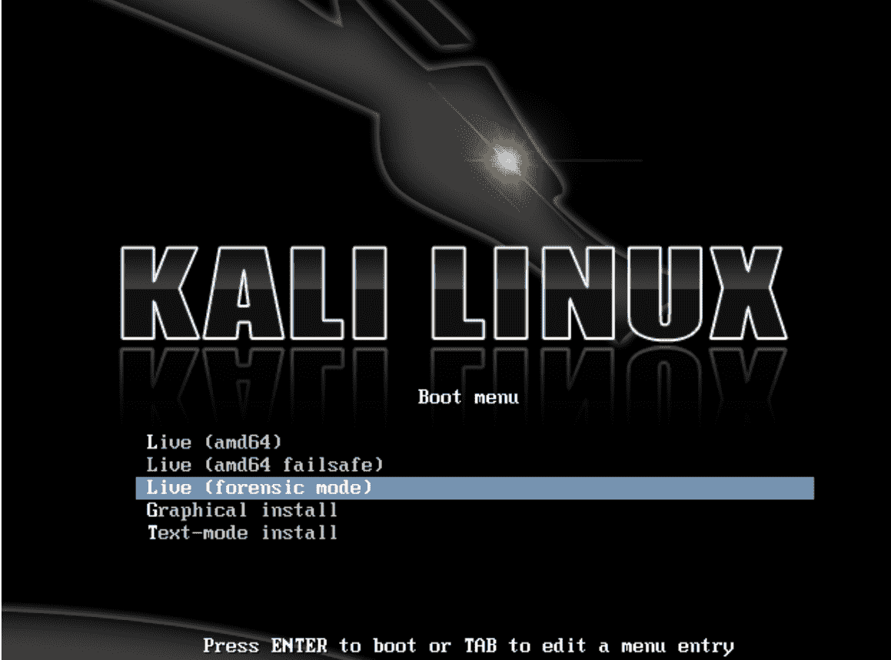

进入取证启动模式时，会发生一些非常重要的更改。

- 1. 首先，内部硬盘不会被接触。这意味着如果有分区，它将不会被使用，且不会挂载内部磁盘。为了验证这一点，我们取了一个标准系统并移除了硬盘。将其连接到商业取证软件包后，我们对硬盘进行了哈希计算。然后我们重新-

将硬盘连接到计算机并以取 取证模式启动 Kali。在运行 Kali 一段时间后，我们关闭了系统，拆下硬盘并再次获取哈希值。这些哈希值是匹配的，表明硬盘在任何时候都没有发生过任何更改。

+ 2. 另一个同样重要的更改是，我们禁用了任何可移动介质的自动挂载。因此，插入优 盘、CD 等设备将不会自动挂载。这一切背后的想法非常简单：在没有用户直接操作的情况下，任何介质都不应该发生任何变化。你作为用户所做的任何操作都由你负责。

如果你对使用 Kali 进行任何类型的真实世界取证感兴趣，我们建议不要仅仅听信我们的话。所有的取证工具都应该始终经过验证，以确保你了解它们在你可能放置它们的任何情况下如何表现。

最后，由于 Kali 专注于提供最全面的开源渗透测试工具，我们可能错过了你最喜欢的开源取证工具。如果是这样，请告诉我们！我们一直在寻找高质量的开源工具并将其添加到 Kali 中以使其变得更好。

## Kali 虚拟机中的 VMware Tools

如果你决定创建自己的 VMware 版 Kali Linux 安装，而不是使用我们的预制 VMware 镜像，你将需要按照下面的说明在你的 Kali 安装中成功安装 VMware Tools。你可以选择安装 `open-vm-tools` 或原生的 VMware tools。

### 安装 open-vm-tools

这可能是获取 Kali VMware 虚拟机获取“VMware tools”功能最简单的方法。

```
apt-get install open-vm-tools
```

### 在 Kali 中安装 VMware Tools

如果 `open-vm-tools` 对你不起，或者你更倾向于使用原生的 VMware tools，请从安装 VMware Tools 安装程序所需的某些包开始：

```
echo cups enabled >> /usr/sbin/update-rc.cd
echo vmware-tools enabled >> /usr/sbin/update-rc.cd

apt-get install gcc make linux-headers-$(uname -r)
in -s /usr/src/linux-headers-$(uname -r)/include/generated/uapi/linux/version.h /usr/src/linux-headers-$(uname -r)/include/
```

接下来，通过从相应的菜单中点击“安装 VMware Tools”来挂载 VMware Tools ISO。一旦 VMware Tools ISO 已附加到虚拟机，我们就挂载硬盘并将 VMware Tools 安装程序复制到 `/tmp/`。

```
mkdir /mnt/vmware
```

## KALI LINUX

官方 Linux 文档

此 PDF 在 `docs.kali.org` 上自动生成 - 2013年8月19日

`mount /dev/cdrom/mnt/vmware/`

`cp -rf /mnt/vmware/VMwareTools* /tmp/`

最后，切换目录到 `/tmp/`，解压 tar 包并启动安装程序：

```
cd /tmp/
tar zxpf VMwareTools-*.tar.gz
cd vmware-tools-distrib/
./vmware-tools-install.pl
```

按照 VMware Tools 安装的提示操作，完成后你就完成了。

### VMware 中鼠标移动缓慢

如果你的鼠标在 Kali Linux VMware 虚拟机中移动缓慢且迟钝，请尝试在 Kali 虚拟机中安装 `xserver-xorg-input-vmmouse` 包。

```
apt-get install xserver-xorg-input-vmmouse
reboot
```

### VMware Tools 无法编译！

这是一个困扰了我们的不幸现实，因为 Kali Linux 使用的是前沿内核，VMware 并不总是支持它。偶尔，可能需要从 [VMware 社区] 搜索“上游兼容 VMware Tools 补丁”。

### 已知问题

截至 2013年3月2日，VMware tools 将可以在内核 3.7 下进行编译，共享文件夹模块除外。已存在补丁可以修复此问题。

# 06. Kali Linux ARM 架构

在 EfikaMX 上安装 Kali ARM


EfikaMX 是一款低端、低成本的 ARM 计算机。尽管规格并不理想，但廉廉的价格使其成为小型 Linux 系统的极极选择。

## EfikaMX 上的原生 Kali - 易用版


如果你只想在你的 EfikaMX 上安装 Kali，请遵循这些说明：

- 获取一张快速的 8 GB（或更多）SD 卡。强烈建议使用 Class 10 卡。
- 从我们的下载区域下载 Kali Linux EfikaMX 镜像。
- 使用 `dd` 工具将此文件镜像到你的 SD 卡。在我们的示例中，我们假设存储设备位于 `/dev/sdb`。**根据需要更改此处。**

> 注意！此过程将擦除你的 SD 卡。如果你选择了错误的存储设备，你可能会擦除计算机的硬盘。

```
root@kali: ~ dd if=kali-1.0.3-efikamx.img of=/dev/sdb bs=512k
```

此过程可能需要一段时间，取决于你的 USB 存储设备速度和镜像大小。一旦 `dd` 操作完成，在插入 SD 卡的情况下启动你的 EfikaMX。你将能够登录 Kali (`root` / ) 并运行 `startx`。就这样。

## EfikaMX 上的 Kali - 详细版

如果你是一个开发者并想要折腾 Kali EfikaMX 镜像，包括内核配置并通常具有冒险精神，请查看自定义 EfikaMX 镜像。

# KALI LINUX

## 在 Beaglebone 上的 Kali ARM 架构

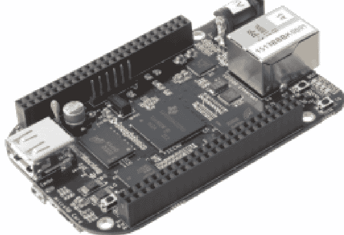

Beaglebone 是一款低端、低成本的 ARM 计算机。尽管规格并不理想，但廉廉的价格使其成为小型 Linux 系统的极极选择。

## Beaglebone 上的原生 Kali - 易用版

如果你只想在你的 Beaglebone 上安装 Kali，请遵循这些说明：

- 1. 获取一张快速的 8 GB（或更多）SD 卡。强烈建议使用 Class 10 卡。
- 2. 从我们的下载区域下载 Kali Linux Beaglebone镜像。
- 3. 使用 `dd` 工具将此文件镜像到你的 SD 卡。在我们的示例中，我们假设存储设备位于 `/dev/sdb`。**根据需要更改此处。**

> 注意！此过程将擦除你的 SD 卡。如果你选择了错误的存储设备，你可能会擦除计算机的硬盘。

```
root@kali: ~ dd if=kali-1.0.3-efikamx.img of=/dev/sdb bs=512k
```

此过程可能需要一段时间，取决于你的 USB 存储设备速度和镜像大小。一旦 `dd` 操作完成，在插入 SD 卡的情况下启动你的 Beaglebone。你将能够登录 Kali (`root` / ) 并运行 `startx`。就这样。

## Beaglebone 上的 Kali - 详细版

如果你是一个开发者并想要折腾 Kali Beaglebone 镜像，包括内核配置并通常具有冒险精神，请查看自定义 Beaglebone 镜像。

## 在 CuBox 上安装 Kali ARM

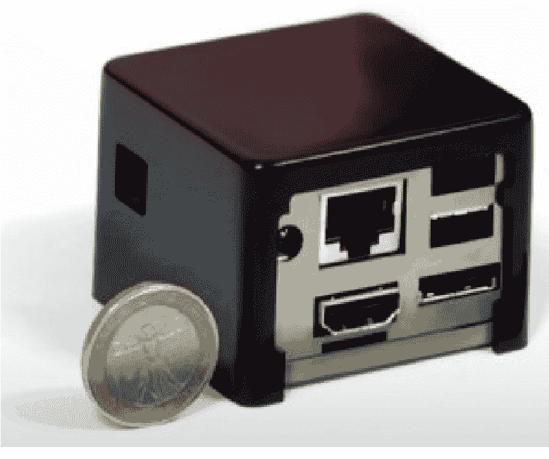

CuBox 是一款低端、低成本的 ARM 计算机。尽管规格并不理想，但廉廉的价格使其成为小型 Linux 系统的极极选择。

## CuBox 上的原生 Kali - 易用版

如果你只想在你的 CuBox 上安装 Kali，请遵循这些说明：

- 1. 你需要在内部 SD 卡上有至少 7 GB 空闲空间用于我们的镜像。
- 2. 如果你尚未执行，请对你的 Samsung Galaxy Note 10.1 进行 root。
- 3. 从我们的下载区域下载 Kali Linux Galaxy Note 10.1 镜像。
- 4. 将下载的 Kali 镜像重命名为 `linux.img` 并将其复制到 `/storage/sdcard0`。

# KALI LINUX

官方 Kali Linux 文档

此 PDF 在 docs.kali.org 上自动生成 - 2013年8月19日

- 1. 从此处下载我们的 `recovery.img` 文件并将其拷贝到 `/storage/sdcard0`。
- 2. 在你的 Galaxy Note 10.1 上获取 root 权限，更改 `/storage/sdcard0` 并备份你的恢复分区：

```
dd if=/dev/block/mmcblk0p6 of=recovery.img_orig
```

- 3. 使用 `dd` 将下载的 `recovery.img` 镜像写入到恢复分区：

**警告！** 此过程将覆盖你的恢复分区。请务必确保你自己在做什么。

如果你在操作过程中失误，可能会导致设备变成“砖头”。

```
dd if=recovery.img of=/dev/block/mmcblk0p6
```

- 4. 将你的 Galaxy Note 10.1 重启到恢复模式。你可以通过**关闭设备**，然后同时按住**电源键**和**音量上键**来实现。当你看到“Samsung Galaxy Note 10.1”文字出现时，**松开电源键但保持音量上键**。这应该引导你进入 Kali 并自动登录 Gnome。`root` 密码为“changeme”（不带引号）！
- 5. 通过进入：应用程序 (Applications) -> 通用辅助 (Universal Access) -> Florence Vital Keyboard 打开屏幕键盘。
- 6. 无线功能可用，但如果不经过某些调整似乎会跳过网络扫描。**如果 Gnome 网络管理器未显示任何无线网络**，只需将你的无线网络添加为“隐藏”网络，你就可以像往常一样连接。
- 7. 你可以在 Galaxy Note 中使用一个名为 Linux Deploy 的优秀 Android 应用程序轻松修改、调试和探索我们的镜像。

# KALI LINUX

官方 Kali Linux 文档

此 PDF 在 docs.kali.org 上自动生成 - 2013年8月19日

## 在 Samsung Chromebook 上安装 Kali


三星 ARM Chromebook 是一款超便携式笔记本电脑。这曾是一项挑战，但我们现在有一个可以在 Chromebook 上运行非常良好的 Kali 镜像。

> 我们的 Kali Chromebook 镜像包含两个启动分区——一个包含硬编码为从 SD 启动的内核，另一个包含硬编码为从 USB 启动的内核。根据你的 USB 存储介质类型，在将镜像 `dd` 写入你的 USB 设备后，请按照本指南最后阶段的说明，将相关的启动分区标记为更高的优先级。

## Chromebook 版 Kali - 用户指南

如果你只是想在你的三星 ARM Chromebook 上安装 Kali，请遵循以下指令：

- 1. 准备一张快速的 8 GB SD 卡或 USB 闪盘。
- 2. 将你的 Chromebook 进入开发者模式。
- 3. 从我们的[下载](downloads) 区域下载 Kali Samsung ARM Chromebook 镜像。
- 4. 使用 `dd` 工具将此文件制作到你的 USB /SD 设备。在我们的示例中，我们使用位于 `/dev/sdb` 的 USB 闪盘。**根据需要更改。**

> 警告！此过程将擦除你的 SD 卡。如果你选择了错误的存储设备，可能会擦除你电脑的硬盘。

```
dd if=kali-chromebook.img of=/dev/sdb bs=512k
```

此过程取决于你的 USB 存储设备速度和镜像大小，可能需要一段时间。

现在你需要标记每个启动分区为 1 或 2 以获得更高的优先级。优先级数字高的数字将优先启动。下面的示例将为第一个分区 (-I) 赋予优先级 10，从而从 SD 卡成功启动。

```
cgpt repair /dev/sdb
cgpt add -i 1 -S 1 -T 5 -P 10 -I KERN-A /dev/sdb
cgpt add -i 2 -S 1 -T 5 -P 5 -I KERN-B /dev/sdb
```

要查看你的分区列表和顺序，请使用命令 `cgpt show`。

```
root@kali:~# cgpt show /dev/sdb
start size part contents
0 1 PMBR
1 1 Pri GPT header
2 32 Pri GPT table
8192 32768 1 Label: "KERN-A"
Type: ChromeOS kernel
UUID: 63AD66C9-AD94-4B42-80E4-798BBE6BE466
Attr: priority=10 tries=5 successful=1
40960 32768 2 Label: "KERN-B"
Type: ChromeOS kernel
```

# KALI LINUX

官方 Linux 文档

此 PDF 在 docs.kali.org 上自动生成 - 2013年8月19日

UUID: 37CE46C9-0A7A-4994-B0FC-C0FCB4FDC1

Attr: priority=5 tries=1 successful=1


73728 3832490 3 Label: "Linux filesystem"

Type: 06C3DAF-8483-4772-8E79-369D8477DE4

UUID: E9E67EE1-C02E-481C-BA3F-E721515DB

125045391 3 Sec GPT table

125045423 1 Sec GPT header

`root@kali:~#`

一旦 `dd` 操作完成，在插好 SD / USB 的情况下启动 Chromebook（不是蓝色的 USB！）。在开发者提示符处，按下 CTRL+ALT+U，这应该引导你进入 Kali。登录 Kali (`root` / `toor`) 并运行 `startx`。大功完成！

## 三星 Chromebook 版 Kali - 开发者指南

如果你是一名开发者并想要折腾三星 Chromebook，包括更改内核配置以及通常上具有冒险精神，请查看我们的自定义 Chromebook 镜像。

# KALI LINUX

官方 Kali Linux 文档

此 PDF 在 docs.kali.org 上自动生成 - 2013年8月19日

## 在 MK/SS808 上安装 Kali ARM

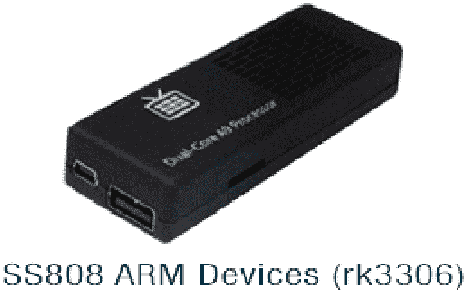

## SS808 ARM 设备 (rk3306)

Smart SS808 是一款基于 Rockchip 的 ARM 设备，有多种形式和型号。它具有双核 1.6 GHz 处理器，运行 Kali 非常良好。

## SS808 官方版 - 简单版

如果你只是想在 SS808 上安装 Kali，请遵循以下指令：
- 1. 准备一张快速的 8 GB SD 卡或 USB 闪盘。
- 2. 将你的 Chromebook 进入开发者模式。
- 3. 从我们的下载区域下载 Kali Samsung ARM Chromebook 镜像。
- 4. 使用 `dd` 工具将此文件镜像制作到你的 USB /SD 设备。在我们的示例中，我们使用位于 `/dev/sdb` 的 USB 闪盘。`根据需要更改。`

> 警告！此过程将擦除你的 SD 卡。如果你选择了错误的存储设备，可能会擦除你电脑的硬盘。

```
dd if=kali-chromebook.img of=/dev/sdb bs=512k
```

此过程取决于你的 USB 存储设备速度和镜像大小，可能需要一段时间。

一旦 `dd` 操作完成，在插好 SD / USB 的情况下启动 Chromebook。在开发者提示符处进入 Kali。登录 Kali (`root` / `toor`) 并运行 `startx`。大功完成！

## SS808 官方版 - 开发者指南

如果你是一名开发者并想要折腾三星 Chromebook，包括更改内核配置以及通常上具有冒险精神，请查看我们的自定义 Chromebook 镜像。

# KALI LINUX

官方 Kali Linux 文档

此 PDF 在 docs.kali.org 上自动生成 - 2013年8月19日

## 在 ODROID U2 上安装 Kali ARM

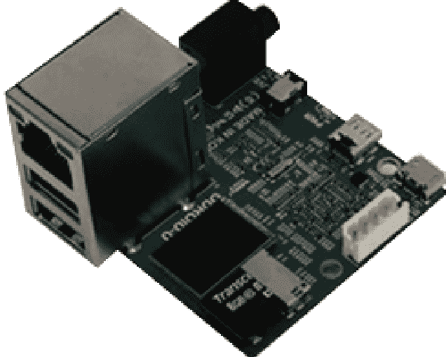

## Odroid U2 / X2

ODROID U2 是一款很棘手的硬件，因为没有控制台输出。理想情况下，购买 ODROID 时你还应该买一根 USB 串口线，用于调试启动过程。尽管如此，这些机器在尺寸、性能和内存可用方面令人印象深刻。

## ODROID U2 版 - 用户指南

如果你只是想在你的强大的 ODROID 上安装 Kali，请遵循以下指令：
- 1. 准备一张快速的 8 GB（及以上）micro 卡。强烈建议使用 Class 10 卡。
- 2. 从下载区域下载 Kali Linux ODROID U2 镜像。
- 3. 使用 `dd` 工具将此文件镜像到你的微 卡。在我们的示例中，我们假设存储设备位于 `/dev/sdb`。`根据需要更改。`

> 警告！此过程将擦除你的 SD 卡。如果你选择了错误的存储设备，可能会擦除你电脑的硬盘。

```
dd if=kali-ordoidu2.img of=/dev/sdb bs=1M
```

此过程取决于你的 USB 存储设备速度和镜像大小，可能需要一段时间。`dd` 操作完成后，在插好 micro 卡的情况下启动 ODROID。你应该会看到一个 Gnome 登录界面——(`root` / `toor`)。大功完成！

## 故障排除

要排排除 ODROID 的启动过程，你需要将 UART 串口线连接到 ODROID。电缆连接后，你可以执行以下命令连接到控制台：

```
screen /dev/ttySAC1 115200
```

# KALI LINUX

官方 Kali Linux 文档

此 PDF 已在 docs.kali.org 上自动生成 - 2013年8月19日

## 在树莓派上安装 Kali ARM

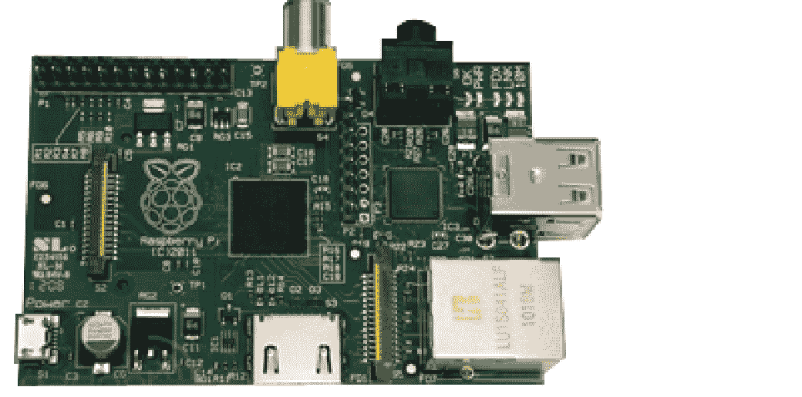

## 树莓派 (Raspberry Pi)

树莓派是一种低端、廉的 ARM 。尽管规格并不理想，但低廉的价格使其成为微型 Linux 系统的极佳选择，而且它的功能远超作为一个多媒体电脑。

## 在树莓派上安装原生 Kali - 简易版

如果你只是想在树莓派上安装 Kali，请遵循以下指令：
- 准备一张良好的 8 GB（或更大）SD 卡。强烈建议使用 Class 10 读卡。
- 从下载区域下载 Kali Linux 树莓派镜像。
- 使用 `dd` 工具将文件写入 SD 卡。在我们的示例中，我们假设存储设备位于 `/dev/sdb`。请根据需要修改此路径。

> 警告！此过程将擦除你的 SD 卡。如果你选择了错误的存储设备，可能会擦除电脑的硬盘。

```
root@kali:~ dd if=kali-pi.img of=/dev/sdb bs=512k
```

此过程的时间取决于你的 USB 存储设备速度和镜像大小。一旦 `dd` 操作完成，插入 SD 卡并启动树莓派。你将登录 Kali (`root` / `root`) 并运行 `startx`。大好了，完成了！

## 树莓派上的 Kali - 详细版

如果你是开发者并想要研究 Kali 树莓派镜像（包括更改内核配置以及进行尝试），请查看我们的“自定义树莓派镜像”文章。

## 准备 Kali Linux ARM chroot

虽然你可以从下载区域下载 Kali ARM 镜像，但有些人更倾向于构建自己的更新引导根文件系统 (`rootfs`)。以下步骤展示了构建 Kaliarmhf `rootfs` 的示例。如有需要请切换到 `armel`。

## 安装所需的工具和依赖

```
apt-get debootstrap qemu-user-static
```

## 定义架构和自定义包

在这里，你为所需的 ARM 架构（`armel` vs `armhf`）定义一些环境变量，并列出镜像中要安装的包。这些包将贯穿全文，因此请确保根据你的需求修改它们。

```
export packages="xfce4 kali-menu wpasupplicant kali-defaults initramfs-tools uboot-mkimage nmap openssh-server"
export architecture="armhf"
```

## 构建 Kali rootfs

我们创建一个标准的目录结构，并从 Kali Linux 仓库引导 ARM `rootfs`。然后，我们将 `qemu-arm-static` 从宿主机复制到 `rootfs` 中，以启动第二阶段的 `chroot`。

```
cd ~
mkdir -p arm-stuff
cd arm-stuff/
mkdir -p kernel
mkdir -p rootfs
cd rootfs
```

# KALI LINUX

官方 Linux 文档 此 PDF 已在 docs.kali.org 上自动生成 - 2013年8月19日

```
debootstrap --foreign --arch $architecture kali-$architecture http://archive.kali.org/kali cp /usr/bin/qemu-arm-static kali-$architecture/usr/bin/
```

## 第二阶段 chroot

在这里，我们配置基础镜像设置，例如键位、存储库、默认网络接口行为（根据需要更改）等。


```bash
cd ~/arm-stuff/roots
LANG=C chroot kali-$architecture/debootstrap/debootstrap --second-stage

cat << EOF > kali-$architecture/etc/apt/sources.list
deb http://http.kali.org/kali kali main contrib non-free
deb http://security.kali.org/kali-security/updates main contrib non-free
EOF

echo "kali" > kali-$architecture/etc/hostname

cat << EOF > kali-$architecture/etc/network/interfaces
auto lo
iface lo inet loopback
auto eth0
iface eth0 inet dhcp
EOF

cat << EOF > kali-$architecture/etc/resolv.conf
nameserver 8.8.8.8
EOF
```

### 第三阶段 chroot

这是你进行自定义用用场。你的 `$packages` 将被安装，并设置了默认的“root”根密码，以及进行了其他配置更改和修复。


# KALI LINUX

官方 Kali Linux 文档 此 PDF 已在 docs.kali.org 上自动生成 - 2013年8月19日

```bash
export MALLOC_CHECK_=0

export LC_ALL=C

export DEBIAN_FRONTEND=noninteractive

mount -t proc proc /kali-$architecture/proc

mount -o bind /dev/kali-$architecture/dev/

mount -o bind /dev/pts /kali-$architecture/dev/pts
```

```bash
cat << EOF > kali-$architecture/defconf
console-common console-data/keymap/policy select Select keymap from full list
console-common console-data/keymap/full select en-latin1-nodekeys
EOF
```

```bash
cat << EOF > kali-$architecture/third-stage
#!/bin/bash
dpkg-divert --add --local --divert /usr/sbin/invoke-rc.d.chroot --rename /usr/sbin/invoke-rc.d
cp /bin/true /usr/sbin/invoke-rc.d
```

```bash
apt-get update
apt-get install locales-all
locale-gen en_US.8
```

# KALI LINUX

Kali Linux 官方文档。此 PDF 于 docs.kali.org 自动生成 - 2013年8月19日

```bash
make -j$(/proc/cpuinfo|grep processor|wc -l)
make modules_install INSTALL_PATH=~/arm-stuff/images/
make uimage
cp arch/arm/boot/~/arm-stuff/images/boot
```

```bash
cat << EOF ~/arm-stuff/images/boot/script
setenv ramdisk unitrd;
setenv kernel uimage;
setenv bootargs console=tty1 root=/dev/mmcblk0p2 roottype=ext4 rw quiet;
${loadcmd} ${ramdiskaddr} ${ramdisk};
if im ${ramdiskaddr}; then; else
setenv bootargs ${bootargs} noinitrd;
setenv ramdiskaddr ""
fi;
${loadcmd} ${kerneladdr} ${kernel};
if im ${kerneladdr}; then
bootm ${kerneladdr} ${ramdiskaddr};
fi;
EOF
```

```bash
mkimage -A arm -T none -C none "Boot.scr for EifikaMX" -d ~/arm-stuff/images/boot/boot.scr
~/arm-stuff/images/boot/boot.scr
```

```bash
umount $bootp
umount $rootp
kpartx -dv $loopdevice
losetup -d loopdevice
```

使用 `dd` 工具将此文件镜像到你的 SD 卡。在我们的示例中，我们假设存储设备位于 `/dev/sdb`。**根据需要更改此处。**

```bash
dd if=kali-custom-efikamx.img of=/dev/sdb bs=1M
```

一旦 `dd` 操作完成，卸载并弹出 SD 卡，然后让你的 EfikaMX 启动到 Kali Linux。

# 自定义 Beaglebone Black 镜像

本文档描述了我们创建 `自定义 Kali Linux Beaglebone Black ARM 镜像` 的方法，并针对开发者。如果你想安装预制的 Kali 镜像，请查看我们的[在 Beaglebone Black 上安装 Kali]() 文章。

### 01. 创建 Kali rootfs

按照我们 Kali 文档中的描述，使用 `armhf` 架构构建 Kali rootfs。在此过程结束时，你应该在 `~/arm-stuff/rootfs/kali-armhf` 中拥有一个填充了数据的 rootfs 目录。

### 02. 创建镜像文件

接下来，我们创建物理镜像文件，该文件将包含我们的 Beaglebone Black rootfs 和启动镜像。

```bash
apt-get install kpartx xz-utils squash
cd ~
mkdir -p arm-stuff
cd arm-stuff/
mkdir -p images
cd images
dd if=/dev/zero of=kali-custom-bbb.img bs=1MB count=7000
```

### 03. 分区并挂载镜像文件

```bash
parted --script kali-custom-bbb.img mklabel msdos
fdisk kali-custom-bbb.img << __EOF___
n
p
+64M
t
te
p
w
__EOF__
```

## Kali Linux

```bash
w
parted --script kali-custom-bbb.img set 1 boot on
fdisk kali-custom-bbb.img << __EOF__
n
p
2
w
__EOF__
```

```bash
loopdevice=`losetup -f --show kali-custom-bbb.img`
device=`kpartx -va $loopdevice|sed -E 's/.*/(loop[0-9]).*/\1/g' | head -1`
device="/dev/mapper/${device}"
boot=${device}p1
root=${device}p2

mkfs.vfat -F 16 $bootp -n boot
mkfs.ext4 $rootp -L kaliroot
mkdir -p boot
mkdir -p root
mount $bootp boot
mount $rootp root
```

### 04. 复制并修改 Kali rootfs/

```bash
rsync -HPavz /root/arm-stuff/rootfs/kali-armhf/ root
echo nameserver 8.8.8.8 > /etc/resolv.conf
```

### 05. 编译 Beaglebone Black 内核和模块

如果你没有使用 ARM 硬件作为开发环境，你还需要设置一个 ARM 交叉编译环境来构建 ARM 内核和模块。完成后，请继续按照以下说明操作。


```bash
cd ~/arm-stuff
wget https://launchpad.net/linaro-toolchain-binaries/trunk/2013.03/+download/gcc-linaro-arm-linux-gnueabihf-4.7-2013.03-20130313_linux.tar.bz2
tar xf gcc-linaro-arm-linux-gnueabihf-4.7-2013.03-20130313_linux.tar.bz2
export CC='pwd'/gcc-linaro-arm-linux-gnueabihf-4.7-2013.03-20130313_linux/bin/arm-linux-gnueabihf-
git clone git://git.de/u-boot
cd u-boot/
git checkout v2013.04 -b beagle-bone-black
wget https://raw.github.com/elif/u-boot/patches/master/v2013.04/0001-am335x-evm.Env.txt-bootz-n-fixes.patch
patch -p1 < 0001-am335x-evm.Env.txt-bootz-n-fixes.patch
make ARCH=arm CROSS_COMPILE=${CC} distclean
make ARCH=arm CROSS_COMPILE=${CC} am335x-evm_config
make ARCH=arm CROSS_COMPILE=${CC}
cd ..

mkdir -p kernel
cd kernel
git clone git://github.com/Robertelson/linux-dev
cd linux-dev/
git checkout origin/v3.8 -b
./build_kernel.sh
mkdir -p patches
wget http://rack-ng.org/mac8021.patch
patch -p1 < patches/mac8021.patch
cd ..
./tools/rebuild.sh
cd ..

```

```bash
cat << EOF > boot/uEnv.txt

mmcroot=/dev/mmblk0p2

mmcrootype=ext4 rootwait

cmd-run loadimage; runfdt; run mmcargs; bootz 0x8020000

EOF

cp -v kernel/linux-dev/deploy/3.8-bone20.zImage boot/

mkdir -p boot/dtbs

tar -xf kernel/linux-dev/deploy/3.8-bone20.dtbs.tar.gz -C boot/

tar -xf kernel/linux-dev/deploy/3.8-bone20.modules.tar.gz -C root/

tar -xf kernel/linux-dev/deploy/3.8-bone20-firmware.tar.gz -C root/lib/firmware/

```

```bash
cat << EOF > root/etc/stab

/dev/mmblk0p2 / auto errors=remount-ro 0 1

/dev/mmblk0p1 /boot auto 0 0

EOF

```

```bash
mount $rootp

kpartx -dv $loopdevice

losetup -d loopdevice

```

使用 `dd` 工具将此文件镜像到你的 SD 卡。在我们的示例中，我们假设存储设备位于 `/dev/sdb`。**根据需要更改此处。**

```bash
dd if=kali-custom-bbb.img of=/dev/sdb bs=1M
```

一旦 `dd` 操作完成，卸载并弹出 SD 卡，启动你的 Beaglebone Black Kali Linux。启动时需要按住“BOOT”按钮，它是靠近 microSD 卡的那个。

# 自定义 CuBox 镜像

本文描述了我们创建自定义 Kali Linux CuBox ARM 镜像的方法，针对开发者。如果你想安装预制的 Kali 镜像，请查看我们的[在 CuBox 上安装 Kali]()

### 01. 创建 Kali rootfs

按照我们 Kali 文档中的描述，使用 `armhf` 架构构建 Kali rootfs。在此过程结束时，你应该在 `~/arm-stuff/rootfs/kali-armhf` 中拥有一个填充了数据的 rootfs 目录。

### 02. 创建镜像文件

接下来，我们创建物理镜像文件，该文件将包含我们的 CuBox rootfs 和启动镜像。

```bash
apt-get install kpartx xz-utils squash

cd ~

mkdir -p arm-stuff

cd arm-stuff/

mkdir -p images

cd images

dd if=/dev/zero of=kali-custom-cubox.img bs=1MB count=7000
```

### 03. 分区并挂载镜像文件

```bash
parted kali-custom-cubox.img --script -- mlabel msdos

parted kali-custom-cubox.img --script -- mkpart primary ext4 0 -1
```

```bash
loopdevice=`losetup -f --show kali-custom-cubox.img`

device=`kpartx -va $loopdevice|sed -E '*/loop([0-9]).*\1/g' | head -1`

device="/dev/mapper/${device}"

rootp=${device}p1
```

```bash
mkfs.ext4 $rootp

mkdir -p root

mount $rootp root
```

### 04. 复制并修改 Kali rootfs

```bash
rsync -HPavz /root/arm-stuff/rootfs/kali-armhf/

echo nameserver 8.8.8.8 > /etc/resolv.conf
```

### 05. 编译 Beaglebone Black 内核和模块

如果你没有使用 ARM 硬件作为开发环境，你还需要设置一个 ARM 交叉编译环境来构建 ARM 内核和模块。完成后，请按照以下说明操作。

```bash
cd ~/arm-stuff

wget https://launchpad.net/linaro-toolchain-binaries/trunk/2013.03/+download/gcc-linaro-arm-linux-gnueabihf-4.7-2013.03-20130313_linux.tar.bz2

tar xf gcc-linaro-arm-linux-gnueabihf-4.7-2013.03-20130313_linux.tar.bz2

export CC='pwd'/gcc-linaro-arm-linux-gnueabihf-4.7-2013.03-20130313_linux/bin/arm-linux-gnueabihf-

git clone git://git.de/u-boot

cd u-boot/

git checkout v2013.04 -b beagle-bone-black

wget https://raw.github.com/elif/u-boot/patches/master/v2013.04/0001-am335x-evm.Env.txt-bootz-n-fixes.patch

patch -p1 < 0001-am335x-evm.Env.txt-bootz-n-fixes.patch

make ARCH=arm CROSS_COMPILE=${CC} distclean

make ARCH=arm CROSS_COMPILE=${CC} am335x-evm_config

make ARCH=arm CROSS_COMPILE=${CC}

cd ..

mkdir -p kernel

cd kernel

git clone git://github.com/Robertelson/linux-dev

cd linux-dev/

git checkout origin/v3.8 -b

./build_kernel.sh

mkdir -p patches

wget http://rack-ng.org/mac8021.patch

patch -p1 < patches/mac8021.patch

cd ..

./tools/rebuild.sh

cd ..
```


```bash
cat << EOF > boot/uEnv.txt
mmcroot=/dev/mmblk0p2
mmcrootype=ext4 rootwait
cmd-run loadimage; runfdt; run mmcargs; bootz 0x8020000
EOF
cp -v kernel/linux-dev/deploy/3.8-bone20.zImage boot/
mkdir -p boot/dtbs
tar -xf kernel/linux-dev/deploy/3.8-bone20.dtbs.tar.gz -C boot/
tar -xf kernel/linux-dev/deploy/3.8-bone20.modules.tar.gz -C root/
tar -xf kernel/linux-dev/deploy/3.8-bone20-firmware.tar.gz -C root/lib/firmware/
```

```bash
cat << EOF > root/etc/stab
/dev/mmblk0p2 / auto errors=remount-ro 0 1
/dev/mmblk0p1 /boot auto 0 0
EOF
```

```bash
mount $rootp
kpartx -dv $loopdevice
losetup -d loopdevice
```

使用 `dd` 工具将此文件镜像到你的 SD 卡。在我们的示例中，我们假设存储设备位于 `/dev/sdb`。**根据需要更改此处。**

```bash
dd if=kali-custom-bbb.img of=/dev/sdb bs=1M
```

一旦 `dd` 操作完成，卸载并弹出 SD 卡，启动你的 Beaglebone Black Kali Linux。

```bash
cat << EOF ~/arm-stuff/images/root/boot/boot.txt
setenv echo="Executing ${device_name} ${partition} ""
setenv unit_no 0
setenv root_device ?

if itest ${device_name}-eq mmc; then
test $root_device -eq && ext4 mmc 0/2 setenv root_device /dev/mmblk0p2
test $root_device -eq && ext4 mmc 0/1 setenv root_device /dev/mmblk0p1
fi

if itest ${device_name}-eq ide; then
test $root_device -eq && ext4 ide 0/1 setenv root_device /dev/sda1
fi

if itest $root_device -ne ? then;
setenv bootargs "console=ttyS0,115200n8 valloc=448M video=devfeb:lcd0:1920x1080-60-edid
cd.d1_enable=1 lcdd1_enable=0 root=${root_device} roottype=ext4"
setenv loadimage "${fstypeload ${device_name} ${partition} 0x002000
${directory}${image_name}"
loadimage &boot 0x002000

echo "! Unable to load ${directory}${image_name} from ${device_name} ${partition} !"
exit
EOF
```

```bash
mkimage -A arm -T script -C none "Boot.script for CuBox" -d ~/arm-stuff/images/root/boot/boot.txt
~/arm-stuff/images/root/boot.scr
```

```
umount /root
kpartx -dv $loopdevice
losetup -d $loopdevice
```

使用 `dd` 工具将此文件镜像到你的 SD 卡中。在我们的示例中，假设存储设备位于 `/dev/sdb`。**根据需要更改此项。**

```bash
dd if=kali-custom-cubox.img of=/dev/sdb bs=1M
```

一旦 `dd` 操作完成，卸载并弹出 SD 卡，然后启动你的 CuBox 进入 Kali Linux。

# 自定义树莓派镜像

本文档描述了我们创建**自定义 Kali Linux 树莓派 ARM 镜像**的方法，目标群体是开发者。如果你想安装预制的 Kali 镜像，请查看我们的[在树莓派上安装 Kali](Install Kali on Raspberry Pi 文章。

## 01. 创建 Kali rootfs

按照我们 Kali 文档中的描述构建 Kali rootfs，使用 `armel` 架构。在此过程结束时，你应该在 `~/arm-stuff/rootfs/kali-armel/` 目录下拥有一个填充了内容的 rootfs 目录。

## 02. 创建镜像文件

接下来，我们创建物理镜像文件，它将包含我们的树莓派 rootfs 和启动镜像。

```bash
apt-get install kpartx xz-utils squashutils
cd ~
mkdir -p arm-stuff
cd arm-stuff/
mkdir -p images
cd images
dd if=/dev/zero of=kali-custom-rpi.img bs=1MB count=7000
```

## 03. 分区并挂载镜像文件

```bash
parted kali-custom-rpi.img --script -- mlabel msdos
parted kali-custom-rpi.img --script -- mkpart primary fat32 0 64
parted kali-custom-rpi.img --script -- mkpart primary ext4 64 -1
```

```bash
loopdevice=`losetup -f --show kali-custom-rpi.img`
device=`kpartx -va $loopdevice | sed -E 's/.*(loop[0-9]).*/\1/g' | head -1`
device="/dev/mapper/${device}"
```

# KALI LINUX

```bash
boot=${device}p1
root=${device}p2

mkfs.vfat $boot
mkfs.ext4 $root
mkdir -p root
mkdir -p boot
mount $root boot
mount $boot boot
```

## 04. 复制并修改 Kali rootfs

```bash
rsync -HPavz /root/arm-stuff/rootfs/kali-armel/ root
echo nameserver 8.8.8.8 > root/etc/resolv.conf
```

## 05. 编译树莓派内核和模块

如果你没有使用 ARM 硬件作为开发环境，你需要设置一个 ARM 交叉编译环境来构建 ARM 内核和模块。完成后，请按照以下指令操作。

```bash
cd ~/arm-stuff
mkdir -p kernel
cd kernel
git clone https://github.com/raspberrypi/tools.git raspberrypi
git clone https://github.com/raspberrypi/linux.git raspberrypi
cd raspberrypi
touch .scmversion
export ARCH=arm
export CROSS_COMPILE=~/arm-stuff/kernel/toolchains/arm-eabi-linaro-4.6.2/bin/arm-eabi-
make bcmpi_cutdown_defconfig
## 配置你的内核！
make menuconfig
make -j$(cat /proc/cpuinfo|grep processor|wc -l)
```

# KALI LINUX

官方 Kali Linux 文档

此 PDF 在 docs.kali.org 上自动生成 - 2013年8月19日

make modules_install INSTALL_MOD_PATH=~/arm-stuff/images/root

cd ~/tools/mkimage/

python imagetool-uncompressed.py ../raspberrypi/arch/arm/boot/Image


```bash
cd ~/arm-stuff/images
git clone git://github.com/raspberrypi/firmware.git rpi-firmware
cp -rf rpi-firmware/boot/* boot/
rm -rf rpi-firmware

cp ~/arm-stuff/kernel/tools/mkimage/kernel.img kgdboc=ttyAMA,115200 console=ttyAMA0,115200 console=tty1
echo "dwc_otg.enable=0 console=ttyAMA0,115200 ... root=/dev/mmblk0p2 roottype=ext4 rootwait" > boot/cmdline.txt
```

```bash
umount $root
umount $boot
kpartx -dv $loopdevice
losetup -d $loopdevice
```

我们使用 `dd` 工具将此文件镜像到你的 SD 卡中。在我们的示例中，假设存储设备位于 `/dev/sdb`。根据需要更改此项。

```bash
dd if=kali-pi.img of=/dev/sdb bs=1M
```

一旦 `dd` 操作完成，卸载并弹出 SD 卡，然后启动你的 Pi 进入 Kali Linux。

# KALI LINUX

官方 Linux 文档

此 PDF 在 docs.kali.org 上自动生成 - 2013年8月19日

# 自定义 Chromebook 镜像

本文档描述了我们创建**自定义 Kali Linux Samsung Chromebook 镜像**的方法，目标群体是开发者。如果你想安装预制的 Kali 镜像，请查看我们的[在 Samsung Chromebook 上安装 Kali](Install Kali on Samsung 文章。

在本指南中，我们创建了一个包含两个启动分区的镜像——其中一个硬编码从 SD 卡启动，另一个硬编码从 USB 启动。根据你的存储介质，按照指南最后阶段的说明，在镜像到 USB 后标记相关的启动分区。

## 01. 创建 Kali rootfs

按照我们 Kali 文档中的描述构建 Kali rootfs，使用 `armhf` 架构。在此过程结束时，你应该在 `~/arm-stuff/rootfs/kali-armhf` 中拥有一个填充了内容的 rootfs。

## 02. 创建镜像文件

接下来，我们创建物理镜像文件，它将包含我们的 Chromebook rootfs 和启动镜像。

```bash
apt-get install kpartx xz-utils gdisk uboot-mkimage vboot-utils
cd ~
mkdir -p arm-stuff
cd arm-stuff/
mkdir -p images
cd images
dd if=/dev/zero of=kali-custom-chrome.img bs=1MB count=7000
```

## 03. 分区并挂载镜像文件

```bash
parted kali-custom-chrome.img --script -- mlabel msdos
parted kali-custom-chrome.img --script -- mkpart primary fat32 0 64
parted kali-custom-chrome.img --script -- mkpart primary ext4 64 -1
gdisk kali-custom-chrome.img --script -- gpt
```

```bash
loopdevice=`losetup -f --show kali-custom-chrome.img`
device=`kpartx -va $loopdevice | sed -E 's/.*(loop[0-9]).*/\1/g' | head -1`
device="/dev/mapper/${device}"
boot1=${device}p1
boot2=${device}p2
root=${device}p3
```

```bash
mkfs.ext4 $root
mkdir -p root
mount $root
```

## 04. 复制并修改 Kali rootfs

使用 `rsync` 将之前引导的 Kali rootfs 复制到挂载的镜像中。

```bash
cd ~/arm-stuff/images/
rsync -HPavz ~/arm-stuff/rootfs/kali-armhf/ root
echo nameserver 8.8.8.8 > root/etc/resolv.conf
```

```bash
mkdir -p root/etc/X11/
cat << EOF > /root/etc/X11/xorg.conf/50-touchpad.conf
Section "InputClass"
Identifier "touchpad"
MatchIsSynaptics
Option "TapButton1" "1"
Option "TapButton2" "3"
Option "TapButton3" "2"
Option "FingerLow" "15"
Option "FingerHigh" "20"
Option "FingerPress" "256"
End
EOF
```

## 05. 编译 Samsung 内核和模块

如果你没有使用 ARM 硬件作为开发环境，你需要设置一个 ARM 环境来构建 ARM 内核和模块。完成后，请按照以下指令操作。

获取 Chromium 内核并将将其放入我们的开发树中：

```bash
cd ~/arm-stuff
mkdir -p kernel
cd kernel
git clone http://git.chromium.org/chromiumos/third_party/kernel.git -b chromeos-3.4 chromeos
cd chromeos
```

# KALI LINUX

官方 Linux 文档

此 PDF 在 docs.kali.org 上自动生成 - 2013年8月19日

```bash
cat << EOF > kernel.its
/dt-v1;
description = "Chrome OS kernel image with one or more blobs";
#address-cells = 0;
images {
  kernel@1 {
    description = "kernel";
    data = "/incbin(arch/arm/boot/zimage)";
    type = "kernel_noload";
    arch = "arm";
    os = "linux";
    compression = "none";
    entry = 0;
  };
  fdt@1 {
    description = "exynos5250-snow.dtb";
    data = "/incbin(arch/arm/boot/exynos5250-snow.dtb)";
    type = "flat_dt";
    arch = "arm"
    compression = "none";
    hash@1 {
      algo = "sha1";
    }
  }
};
configurations {
  default = "conf@1";
  conf@1 {
    kernel = "kernel@1";
    fdt = "fdt@1";
  }
};
EOF
```

# KALI LINUX

官方 Linux 文档

此 PDF 在 docs.kali.org 上自动生成 - 2013年8月19日

在我们的案例中，为内核应用无线注入补丁。

```bash
mkdir -p ../patches
wget http://patches.airrack-ng.org/mac80211.compat08082009.wl_frag+ack_v1.patch -O ../patches/mac80211.patch
wget http://patches.airrack-ng.org/channel-negative-one.patch -O ../patches/negative.patch
```

等待，OCR逻辑有些混乱：

配置，然后如下所示交叉编译 Chromium 内核。


```bash
export ARCH=arm
export CROSS_COMPILE=~/arm-stuff/kernel/toolchains/arm-eabi-linaro-4.6.2/bin/arm-eabi-
./chromeos/scripts/prepareconfig chromos-exynos5
# 禁用 LSM
sed 's/CONFIG_SECURITY_CHROMIUM=y/# CONFIG_SECURITY_CHROMIUM is not set/g' .config
```

```bash
make menuconfig
make -j$(cat /proc/cpuinfo|grep processor|wc -l)
make dtbs
cp ../scripts/dtc/dtc /usr/bin/
mkimage -f kernel.it
make modules_install INSTALL_MOD_PATH=~/arm-stuff/images/root/
```

# KALI LINUX

`echo "console=tty1 debug verbose root=/dev/mmcblk1p3 rootwait rootfstype=ext4" > /tmp/config-sd`

`echo "console=tty1 debug verbose root=/dev/sda3 rootwait rootfstype=ext4" > /tmp/config-usb`

`vbutyl_kernel --pack /tmp/newkern-sd --keyblock /usr/share/vboot/devkeys/kernel.keyblock --version 1`

`--signprivat /usr/share/vboot/devkeys/kernel_data_key.vbprivat --config=/tmp --arch arm`

`vbutyl_kernel --pack /tmp/newkern-usb --keyblock /usr/share/vboot/devkeys/kernel.keyblock --version 1`

`--signprivat /usr/share/vboot/devkeys/kernel_data_key.vbprivat --config=/tmp/config-sd --vmlinuzkernel.itb --arch arm`

## 06. 准备启动分区

`dd if=/tmp/newkern-sd of=$bootp1` # SD 卡第一个启动分区

`dd if=/tmp/newkern-usb of=$bootp2` # USB 第二个启动分区

`mount $rootp`

`kpartx -dv $loopdevice`

`losetup -d $loopdevice`

# 07. 写入镜像并标记 USB 驱动器启动

`dd if=kali-custom-chrome.img of=/dev/sdb bs=512k`

`cgpt repair /dev/sdb`

此时，你需要将启动分区 1 或 2 设置为更高的优先级。数字越高的分区将先启动。下面的示例将为第一个分区 `-i` 赋予优先级 10，从而成功地从 SD 卡启动。

# KALI LINUX

官方 Linux 文档

此 PDF 在 docs.kali.org 上自动自动生成 - 2013年8月19日

```
cgpt add -i 1 -S1 -T5 -P5 10 -I KERN-A /dev/sdb
cgpt add -i 2 -S1 -T5 -P5 -I KERN-B /dev/sdb
```

要查看分区列表和顺序，请使用命令 `cgpt show`。

```
root@kali:~# cgpt show /dev/sdb
start size part contents
0 1 PMBR
1 1 Pri GPT header
2 32 Pri GPT table
8192 32768 1 Label: "KERN-A"
Type: ChromeOS kernel
UUID: 63ADE6C69-AD94-4B42-80E4-798BBE6E4C6
Attr: priority=10 tries=5 successful=1
4090 32768 2 Label: "KERN-B"
Type: ChromeOS kernel
UUID: 37EE46C9-0A7A-4994-80FC-9C0FFCB4FDC1
Attr: priority=5 tries=5 successful=1
73728 3832490 3 Label: "Linux filesystem"
Type: 0FC63DAF-B483-4772-8E79-369D8477DE4E
UUID: E9E67E71-C02E-481C-BA3F-18E721515DBB
125045391 32 Sec GPT table
125045423 1 Sec GPT header
root@kali:~#
```

完成此操作后，在插入 SD/USB 设备的情况下启动你的 Samsung Chromebook。在开发者模式启动界面，按下 CTRL+u 从 USB 存储设备启动。登录 Kali (root / toor) 并运行 `startx`。

# KALI LINUX

官方 Linux 文档

此 PDF 在 docs.kali.org 上自动自动生成 - 2013年8月19日

# 自定义 MK/SS808 镜像

本文档描述了我们创建**自定义 Kali Linux MK/SS808 ARM 镜像**的方法，并针对开发者。如果你想安装预制的 Kali 镜像，请查看我们的 [在 MK/SS808 上安装 Kali]()() 文章。

### 01. 创建 Kali rootfs

按照我们 Kali 文档中的描述构建你自己的 Kali rootfs，使用 **armhf** 架构。在此过程结束时，你应该会在 `~/arm-stuff/rootfs/kali-armhf` 获得填充好的 rootfs 目录。

### 02. 创建镜像文件

接下来，我们创建一个物理镜像文件，它将包含我们的 MK/SS808 rootfs 和启动镜像。

```
apt-get install kpartx xz-utils sharutils
cd ~
mkdir -p arm-stuff
cd arm-stuff/
mkdir -p images
cd images
dd if=/dev/zero of=kali-custom-ss808.img bs=1MB count=7000
```

### 03. 分区并挂载镜像文件

```
parted kali-custom-ss808.img --script -- mlabel mdos
ed kali-custom-ss808.img --script -- mkpart primary ext4 1 -1
```

```
loopdevice=`losetup -f --show kali-custom-ss808.img`
device=`kpartx -va $loopdevice|sed -E '/loop[0-9]).*//'`
device="/dev/mapper/${device}"
root=${device}p1
```

```
mkfs.ext4 $root
mkdir -p root
mount $root
```

### 04. 复制并修改 Kali rootfs

```
rsync -avz ~/arm-stuff/rootfs/kali-armhf/ /root/
echo nameserver 8.8.8.8.root
```

### 05. 编译 r306 内核和模块

如果你没有使用 ARM 硬件作为开发环境，你需要设置 ARM 交叉编译环境来构建内核。完成后，按照以下步骤操作。

```
apt-get install xz-utils
cd ~/arm-stuff
mkdir -p kernel
cd kernel
git clone https://github.com/alok2021/linux-3.0.8 r306-kernel
cd r306-kernel
sed -i "vpu_service/d" arm/plat/Makefile
```


```bash
export ARCH=arm
export CROSS_COMPILE=~/arm-stuff/kernel/toolchains/arm-linux-gnueihf-4.6/bin/arm-linux-gnueihf-
```

### UG802 和 MK802 的基础配置
```bash
make r306_defconfig
```

### MK808 的基础配置
```bash
make r306_defconfig
```

### 配置你的内核
```bash
make menuconfig
```

根据 http://www.armvtech.com/armvtechforum/topic.php?f=66&t=835 配置内核
```bash
mkdir ../initramfs/
wget http://www.armvtech.com/armvtechforum/topic.php?f=66&t=835/initramfs.cpio -O ../initramfs.cpio
```

```bash
mkdir -p ../patches
wget http://patches.aircrept.org/mac8211-v1.patch -O ../patches/mac8211.patch
wget http://patches.aircrept.org/channel-negative.patch -O ../patches/negative.patch
patch -p1 < ../patches/mac8211.patch
patch -p1 < ../patches/negative.patch
```

```bash
./make_kernel.sh
```

```bash
make modules -j$(cat /proc/cpuinfo|grep processor|wc -l)
make modules_install INSTALL_MOD_PATH=~/arm-stuff/images/root
git clone https://git.kernel.org/pub/scm/linux/kernel/git/dmw/linux-firmware.git firmware-git
mkdir -p ~/arm-stuff/images/root/firmware
cp -rf firmware-git/* ~/arm-stuff/images/root/
```

```bash
umount $root
kpartx -dv $loopdevice
losetup -d $loopdevice
```

## 07. 将镜像写入 USB 设备

使用 `dd` 工具此文件写入 SD 卡。在示例中，假设存储设备位于 `/dev/sdb`。根据需要进行更改。

```bash
dd if=kali-custom-ss808.img of=/dev/sdb bs=512k
```

完成 `dd` 操作后，卸载并弹出 SD 卡，进入 Kali Linux 进入 MK/SS808。

# 自定义 ODROID X2 U 镜像

本文描述了我们创建`自定义 Kali Linux ODROID 镜像`的方法，并针对开发者。如果你想安装预制的 ODROID 镜像，请查看我们的 [在 ODROID 上安装 Kali]()() 文章。

### 01. 创建 Kali rootfs

首先按照我们 Kali 文档中的描述使用 `armhf` 架构构建 Kali rootfs。在此过程结束时，你应该会在 `~/arm-stuff/rootfs/kali-armhf` 获得填充好的 rootfs 目录。

### 02. 创建镜像文件

接下来，我们创建一个物理镜像文件，它将包含我们的 ODROID rootfs 和启动镜像。

```bash
apt-get install kpartx xz-utils uboot-mkimage
cd ~
mkdir -p arm-stuff
cd arm-stuff/
mkdir -p images
cd images
dd if=/dev/zero of=kali-custom-odroid.img bs=1MB count=7000
```

### 03. 分区并挂载镜像文件

```bash
parted kali-custom-odroid.img --script -- mklabel mdos
parted kali-custom-odroid.img --script -- mkpart fat32 4096s 266239s
parted kali-custom-odroid.img --script -- mkpart ext4 266240s 100%
```

```bash
loopdevice=`losetup -f --show kali-custom-odroid.img`
device=`kpartx -va $loopdevice|sed -E '/loop[0-9]).*/1/' | head -1`
device="/dev/mapper/${device}"
boot=${device}p1
root=${device}p2
mkfs.vfat $boot
mkfs.ext4 $root
mkdir -p root
mount $root
```

### 04. 复制并修改 Kali rootfs

使用 `rsync` 将你之前引导的 Kali rootfs 复制到挂载的镜像。

```bash
rsync -avz ~/arm-stuff/rootfs/kali-armhf/ /root/
echo nameserver 8.8.8.8 > root/resolv.conf
```

### 05. 编译 r306 内核和模块

如果你没有使用 ARM 硬件作为开发环境，你需要设置 ARM 交叉编译环境来构建内核。完成后，按照以下步骤操作。

编辑 `~/arm-stuff/images/root/etc/inittab` 文件并找到“Example how to put a getty on a serial line”。

```bash
nano root/etc/inittab
```

在该节末尾添加以下行：

```
T1:12345:respawn:/sbin/agetty 115200 ttySAC1 vt100
```

如果你想让串口自动登录 root，请改用以下行：

```
T1:12345:respawn:/bin/login -f root ttySAC1 /dev/ttySAC1 >&1
```

现在，确保 `~/arm-stuff/images/root/etc/udev/links.conf` 文件中有 `ttySAC1` 条目。

```bash
nano root/etc/udev/links.conf
```

如果不存在 `ttySAC1` 条目，请将其添加到文件中，使其如下所示：

```
M null c 1 3
M console c 5 1
M ttySAC1 c 5 1
```

在 `~/arm-stuff/images/root/etc/udev/links.conf` 文件中添加 ttySAC 条目。

```bash
cat << EOF >> root/etc/securetty
ttySAC0
ttySAC1
ttySAC2
EOF
```

在 rootfs 中放置一个基础 `xorg.conf` 文件。

# KALI LINUX

官方 Linux 文档

此 PDF 在 docs.kali.org 上自动生成 - 2013年8月19日

```bash
cat << EOF > root/etc/X11/xorg.conf
# X.Org X X server configuration file for xfree86-video-mali

Section "Device"
Identifier "Mali-Fbdev"
# Driver "mali"
Option "/dev/fb1"
Option "DRI2" "true"
Option "DRI2_PAGE_FLIP" "true"
Option "DRI2_WAIT_VSYNC" "true"
Option "UMP_CACHED" "true"
Option "UMP_LOCK" "false"
EndSection

Section "Screen"
Identifier "Mali-Screen"
Device "Mali-Fbdev"
DefaultDepth 24
EndSection

Section "DRI"
Mode 0666
EndSection
EOF
```

在 rootfs 目录下初始化 init：

```bash
cd ~/arm-stuff/images/root
ln -s /sbin/init init
```

## 05. 编译 ODROID 内核和模块

如果你没有使用 ARM 硬件作为开发环境，你将需要建立 ARM 交叉编译环境来构建 ARM 内核和模块。完成后后，请按照以下说明操作。

我们现在需要获取 ODROID 内核源码并将其放入我们的开发树结构中：


```
cd ~/arm-stuff
mkdir -p kernel
cd kernel
git clone --depth 1 https://github.com/hardkernel/linux.git -b odroid-3.8.y odroid
cd odroid
touch .scmversion
```

配置并交叉编译 ODRROID 内核。

```
export ARCH=arm
export CROSS_COMPILE=~/arm-stuff/kernel/toolchains/arm-eabi-linaro-4.6.2/bin/arm-eabi-

# 针对 ODRROID-X2
make odroidx2_defconfig
# 针对 ODRROID-U2
make odroidu2_defconfig
## 配置你的内核！
make menuconfig
## 并启用
CONFIG_HAVE_KERNEL_LZMA=y
CONFIG_RD_LZMA=y

## 如果是交叉编译，运行此一次
sed -i 's/\'s/if defined(__linux_)/|if defined(__linux_)||defined(__KERNEL_)/ /g' include/uapi/drm/drm.h

make -j$(cat /proc/cpuinfo|grep processor|wc -l)
make modules_install INSTALL_MOD_PATH=~/arm-stuff/images/root/
```

`chroot` `rootfs` 并创建 `initrd`。确保为 `mkinitramfs` 命令使用正确的内核版本/额外版本。在我们的案例中，它是“3.8.13”。

```
LANG=C chroot ~/arm-stuff/images/root/
apt-get install initramfs-tools uboot-mkimage
cd /
## 将示例 "3.8.13" 更改为你当前的 odroid 内核修订版本
mkinitramfs -c lzma -o .initramfs 3.8.13
mkimage -A -O linux -T ramdisk -C none -a 0 -e 0 -n initramfs -d /initramfs /ulnitrd
rm initramfs
exit
```

## 06. 准备启动分区

将内核和生成的 `initrd` 文件拷贝到挂载的启动分区，如下所示。

```
mv ~/arm-stuff/images/root/ulnitrd ~/arm-stuff/images/boot/
cp arch/arm/boot/zImage ~/arm-stuff/images/boot/
```

在启动分区中转出一个 `boot.txt` 文件，它包含了 ODROID 所需的启动参数。

```
cat << EOF > ~/arm-stuff/images/boot/boot.txt
setenv initrd_high "0xffffff"
setenv fdt_high "0xffffff"
setenv bootcmd "fatload mmc 0:1 0x40008000 zImage; fatload mmc 0:1 0x42000000 uinitrd; bootm 0x40008000 0x42000000"
setenv bootargs "console=tty1=ttySAC,115200n8 root=LABEL=kaliroot rootwaitmem=2047M"
boot
EOF
```

生成一个 **boot.scr** 文件，这是启动 ODROID 所必需。

```
mkimage -A arm -T script -C none "Boot.scr for ODROID" -d ~/arm-stuff/images/boot/boot.txt
~/arm-stuff/images/boot.scr
```

卸载根分区和启动分区，然后卸载回环设备。

```
cd ~/arm-stuff/images/
umount $bootp
umount $rootp
kpartx -dv $loopdevice

wget http://www.mdrjet.net/odroid/mirror/old-releases/BSPs/Alpha4/unpacked/boot.tar.gz
tar xzf boot.tar.gz
cd boot
sh setup.sh $loopdevice
cd ..

umount -d $loopdevice
```

现在，将文件镜像到你的存储设备上。我们的设备是 **/dev/sdb**。根据需要更改此项。

```
dd if=kali-custom-odroid.img of=/dev/sdb bs=1M
```

一旦操作完成，将 UART 串口线连接到 ODROID 并插入 microSD 卡启动。通过串口控制台，你将登录 Kali (root) 并运行 `startx`。

如果一切正常且你想让 ODROID 自动启动，请确保在 `.bash_profile` 中使用“autologin”行并添加以下内容：

```bash
## 如果没有 .bash_profile
cat << EOF >> ~/.bash_profile
if [ -z "$DISPLAY" ] && [ $(tty) = /dev/tty1 ]; then
startx
fi
EOF
```

### 8. 安装 Mali 图驱动（可选）

这些步骤是实验性的且未经过完全测试。应该在 Kali 内部执行。

```bash
wget http://developer.arm.com/develop-for-mali/open-source-mali-linux-x11-drivers/

apt-get install build-essential autoconf make libtool xutils-dev libdrm-dev

wget http://developer.arm.com/downloads/DX910/r3p2-01rel0/DX910-SW-99003-r3p2-01rel0.tgz

wget http://developer.arm.com/downloads/DX910/r3p2-01rel0/DX910-SW-99006-r3p2-01rel0.tgz

wget --no-check https://dl.dropbox.com/u/6531725/mali_opengl_hf_lib.tgz
```

```
tar -xzvf mali_opengl_hf_lib.tgz

cp mali_opengl_hf_lib/* /usr/lib/

tar -xzf DX910-SW-99003-r3p2-01rel0.tgz

tar -xzvf DX910-SW-99003-r3p2-01rel0.tgz

cd DX910-SW-99003-r3p2-01rel0/x11/xf86-video-mali-0.0.1/

./autogen.sh
```

```
chmod +x configure
```

```
CFLAGS="-O3 -Wall -Wextra -I/usr/include/libdrm DX910-SW-99006-r3p2-01rel0/driver/src/include" LDFLAGS="-L/usr/lib -IMali -lpthread"

./configure --prefix=/usr --with-includes=/usr --with-libraries=/usr/lib

cp -rf ../../../DX910-SW-99006-r3p2-01rel0/driver/src/include/ump src/

mkdir -p umplock

cd umplock

wget http://service.linux.de/a10_source_1.5/lichee-linux-3.0/modules/mali/DX910-SW-99002-r3p0-04rel0/driver/src/devdrv/umplock/umpl_ioctl.h

cd ..
```

```
make
make install
```

# ARM 交叉编译

本指南将演示如何在 Kali Linux 中设置 ARM 交叉编译环境。该指南是我们许多“自定义 ARM 镜像”文章的起点。

## 设置你的开发机

编译内核和生成镜像通常是以磁盘空间为代价的。确保你的 Kali 开发机器上有至少 50 GB 的可用空间，以及足够的内存和 CPU 性能。

## 安装依赖项

首先安装 ARM 交叉编译所需的依赖项。

```
apt-get install git-core gnupg bison gperf libbsd0-dev build-essential \
```


`zip` `curl` `libncurses5-dev` `zlib1g-dev` `libncurses-dev` `gcc-multilib` `g++-multilib`

如果你运行 64 位 Kali Linux 系统，按照以下方式为你的开发环境添加 i386 架构支持。

```bash
dpkg --add-architecture i386
apt-get update
apt-get install ia32-libs
```

## 下载 Linaro 工具链

从我们的 Git 仓库下载 Linaro 交叉编译器。

```bash
cd ~
mkdir -p arm-stuff/kernel/toolchains
cd arm-stuff/kernel/toolchains
git clone git://github.com/offensive-security/arm-eabi-linaro-4.6.2.git
```

## 设置环境变量

要使用 Linaro 交叉编译器，你需要在会话中设置以下环境变量。

```bash
export ARCH=arm
export CROSS_COMPILE=~/arm-stuff/kernel/toolchains/arm-eabi-linaro-4.6.2/bin/arm-eabi-
```

现在，你的 ARM 交叉编译环境已完成，你可以继续构建你自己的内核了。

## 从源码重构软件包

有时，我们需要从源码重构 Kali 软件包。幸运的是，这只需要通过 `apt-get` 获取包源码，根据需要进行修改，然后使用 Debian 工具进行重构。在例例中，我们将重新编译 `libfree` 包，以便为 `mifare-format` 工具添加一些额外的硬编码 Mifare 访问密钥。

### 下载包源码

```bash
apt-get source libfreefare
cd libfreefare-0.3.4~svn1469/
```

### 修改包源码

对包源码进行所需的更改。在我们的案例中，我们修改了一个示例文件 `mifare-classic-format.c`。

```bash
nano examples/mifare-classic-format.c
```

### 检查构建依赖

检查包可能具有任何构建依赖项。在构建包之前需要安装这些项。

```bash
dpkg-checkbuilddeps
```

输出取决于你已安装的包，应该类似于以下内容。

`checkbuilddeps` 没有输出，这意味着你没有任何遗漏的依赖项，可以继续进行构建。

```bash
dpkg-checkbuilddeps: Unmet build dependencies: dh-autoreconf libnfc-dev
```

### 安装构建依赖

如果需要，请安装任何构建依赖，如 `dpkg-checkbuilddeps` 的输出所示：

```bash
apt-get install dh-autoreconf libnfc-dev
```

### 编译修改后的包

在安装所有依赖项后，调用 `dpkg-buildpackage` 来构建你的新版本是一件简单的事。

```bash
dpkg-buildpackage
```

### 安装新包

如果一切顺利，你应该可以安装新创建的包。

```bash
dpkg -i ../libfreeare*.deb
```

# KALI LINUX

## 重新编译 Kali Linux 内核

有时，你可能想要添加某些官方 Kali Linux 内核未包含的驱动程序、补丁或内核功能。本指南将描述如何根据你的快速修改并重新编译 Kali Linux 内核。请注意，Kali Linux 内核默认已包含全局无线注入补丁。

### 安装构建依赖

首先安装重新编译内核所需的所有构建依赖。

```bash
apt-get install kernel-package ncurses-dev fakeroot bzip2
```

### 下载 Kali Linux 内核源码

下载并提取 Kali Linux 内核源码。

```bash
apt-get install linux-source
cd /usr/src/
tar jpxf linux-source-3.7.tar.bz2
cd linux-source-3.7/
```

### 配置你的内核

复制默认的 Kali Linux 内核 `.config` 文件，然后根据你的需求进行修改。这是你应用各种补丁的阶段。在示例中，我们正在重新编译一个 64 位内核。

```bash
cp /boot/config-3.7-trunk-amd64 .config
make menuconfig
```

### 编译内核

编译你修改后的内核镜像。根据你的硬件情况，这可能需要一些时间。

```bash
export CONCURRENCY_LEVEL=$(cat /proc/cpuinfo|grep processor|wc -l)
make-kpkg clean
fakeroot make-kpkg kernel_image
```

### 安装内核

一旦内核成功编译，继续安装新内核并重启。请注意，内核版本号可能会变化——在我们的示例中，它是 3.7.2。根据当前的内核版本，你可能需要进行相应的调整。

```bash
dpkg -i ../linux-image-3.7.2_3.7.2-10.00.Custom_amd64.deb
update-initramfs -c -k 3.7.2
update-grub2
reboot
```


重启后，你的新内核应该就会运行。如果出现问题且内核无法启动，你仍然可以启动原始官方 Kali 内核并修复问题。

# 08. Kali Linux 故障排除

# 为 Kali Linux 提交 Bug

## 简介

本文文档将指导报告者如何更好地提交 Bug 报告，以便尽快得到处理。报告报告的目标是让 Kali Linux 开发者能够重现问题并看到失败结果。如果 Kali Linux 开发者能够重现，他们将需要在确定根源之前收集额外信息。如果 Kali Linux 开发者无法重现失败，他们将需要额外信息，直到他们获得与提交者相同的结果。请注意，我们的团队最好通过英文阅读提交的内容。

Kali Linux 的诞生是回馈社区的热爱之作。让每个人的事情变得更好的动力驱动着这个项目不断演进。为你提供支持的开发者是出于利他主义的志愿者。在发表评论时请记住这一点。

以下是几个有助于成功解决问题的要点：

- 你报告 Bug 是因为你修复了它，请提供你所能提供的的所有信息。
- 在提交中非常清楚地说明哪些是事实，哪些是假设。
- 保持 Bug 报告客观，仅提供研究所需的事实。
- 不要在提交内容中将维基百科或其他非主要资源作为事实。
- 每个人、每种硬件组合、每个 Bug 提交一份报告。
- 不要将多个问题堆叠在单个报告中，根据需要提交额外的报告。
- 不要发布如“我也一样”或“+1”等没有帮助的评论。
- 不要抱怨修复一个 Bug 需要多长时间。

## 如何报告 Bug

Kali Linux Bug 跟踪器可以在 `http://bugs.kali.org` 找到。本本文档将引导你完成账户创建、创建系统配置以及如何提交详细报告到 Bug 跟踪器中。

### 创建 Kali Linux Bug 跟踪器账户

如果你还没有创建账户，需要先完成此操作。创建账户将允许你提交报告并继续处理现有报告。

在 Bug 跟踪器网站上，点击“Signup for new account”开始流程。

# KALI LINUX

官方 Kali Linux 文档
此 PDF 在 `docs.kali.org` 上自动生成 - 2013年8月19日

# KALI LINUX
BUG 跟踪器

匿名 | 登录 | 注册新账户

2013-03-20 05:25:22 EDT

主页 | 我的视图 | 查看问题 | 更改日志 | 路线图 | 仓库

| 未分配 [^1] (1 - 10 / 47) | 已解决 [^2] (1 - 5 / 5) |
|---|---|
| 000047 | syslinux.cfg 包含一些错误 | 0000122 | mstpro 控制台启动失败 |
| [所有项目] 通用 Bug - 2013-03-19 18:38 | [所有项目] 通用 Bug - 20... |
| 000146 | debian opens 有一个 --nosslv2 补丁 | 000076 | b43 无线驱动固件 r |
| [所有项目] 新请求 - 2013-03-19 15:42 | [所有项目] Kali 包 Bug... |
| 000143 | 自动 HTTP 枚举工具 | 0000103 | 社会工程工具包 (SE... |
| [所有项目] 新请求 - 2013-03-19 14:40 | [所有项目] 工具升级 - 20... |
| 000142 | Unhide 法证工具，查找进程和端口 | 0000109 | 社会工程工具无法... |
| [所有项目] 新请求 - 2013-03-19 14:39 | [所有项目] 通用 Bug - 20... |
| 000140 | Inguama | 0000063 | M... 后没有键盘或鼠标 |
| [所有项目] 新请求 - 2013-03-19 14:37 | [所有项目] 通用 Bug - 20... |
| 000139 | Junkie | | |
| [所有项目] 新请求 - 2013-03-19 14:36 | | |
| 000138 | squidmap | | |
| [所有项目] 工具升级 - 2013-03-19 14:00 | | |
| 000135 | android-sdk 问题 | | |
| [所有项目] 通用 Bug - 2013-03-19 13:01 | | |
| 000130 | 需要将 openssl 从 0.8 升级到 1.0 为 | |

# KALI LINUX

官方 Kali Linux 文档
此 PDF 在 `docs.kali.org` 上自动生成 - 2013年8月19日

# KALI LINUX
BUG 跟踪器

| | |
|---|---|
| 用户名 | NewSubmitter |
| 邮箱 | nbs@email.com |
| 输入右侧框中所示的代码 | ![ABFF1] |

注册
用户名：
邮箱：
在完成表单并验证您的答案后，我们将向您指定的地址发送确认邮件。
你有七天时间完成账户确认流程；如果你在七天内未激活账户，该新注册的账户可能会被删除。
你必须指定有效的电子邮件地址以便接收确认邮件。
注册

[ 登录 ] [ 忘记密码？ ]

如果成功，下一个页面将通知注册已处理。你需要回复确认邮件以激活账户。点击“继续”进入 Bug 跟踪器登录页。

# KALI LINUX

官方 Kali Linux 文档
此 PDF 在 `docs.kali.org` 上自动生成 - 2013年8月19日

# KALI LINUX
BUG 跟踪器

# 账户注册已处理。

恭喜，您注册成功。我们现在向您发送一封确认邮件以验证您的电子邮件地址。访问发送给您的邮件链接将激活您的账户。

你有七天时间完成账户确认流程；如果你在七天内未完成账户确认，该账户将被删除。

[ 继续 ]

## 在 Kali Linux Bug 跟踪器中创建配置

虽然不是必须，但建议在你的 Bug 跟踪器账户中创建一个唯一的配置。你可以为每个系统创建一个自定义配置，也可以从提供的默认配置中选择。这些配置是作为 Bug 报告提交时定义平台、操作系统和版本信息的快捷方式。

# KALI LINUX

官方 Linux 文档
此 PDF 已于 2013年8月19日 自动生成

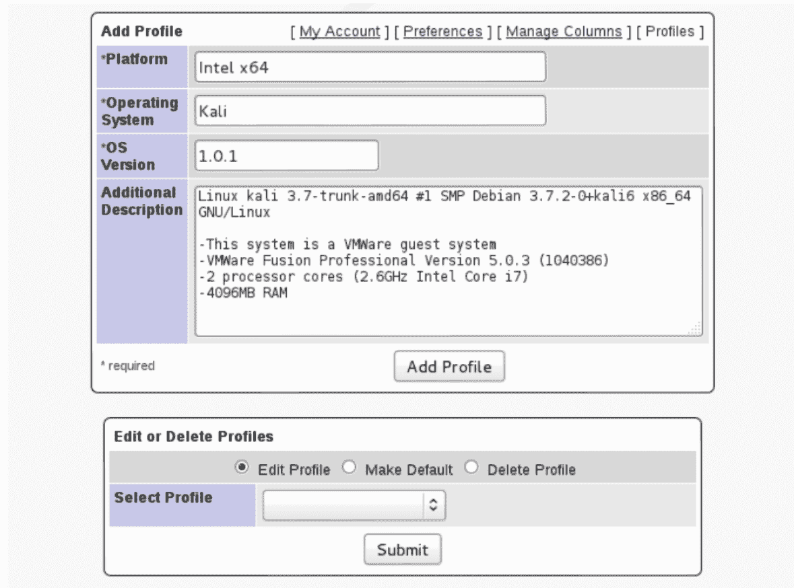

该配置已如所示，当你在创建新的“报告问题”时，它将显示在“选择配置”下拉列表中。
你可以根据需要创建任意数量的不同配置，只需在提交 bug 报告时选择正确的一个即可。

## 确保你没有重复之前的请求

在开始报告之前，请在网站上搜索与你的问题相关的关键词。如果已经存在与硬件无关的现有 bug，请不要重复请求或添加不必要的注释（例如，“我也一样 (Me Too)”或“+1”）。如果该问题已被报告，你可以通过点击 ID 链接查看问题的状态。

如果你认为该问题与硬件有关，请提交包含你特定信息的新报告，即使它们看起来相似。你的硬件可能与另一个报告提交者的硬件并不完全相同。不要因为拥有相同的桌面电脑或笔记本电脑型号就认为你的问题不是唯一的。

© Offensive Security 2013 页码：145 / 175

### 创建报告

要开始你的报告，请登录你的账户并点击落地页上的“报告问题”链接。你需要尽可能地填写多的信息。如果有帮助，请查看文档开头的提示，以确保你的操作符合预期。

报告中的以下字段是必填的：

- 类别 `Category`
- 摘要 `Summary`
- 描述 `Description`

尽管其他字段不是强制性的，但我们建议你在每个选项中尽可能包含多的信息，特别注意以下内容：

- 可复现性 `Reproducibility`
- 选择配置 `Select Profile`
- 重现步骤 `Steps to Reproduce`
- 附加信息 `Additional Information`
- 上传文件（错误日志、截图）

### 决定合适的类别

Kali bug 跟踪器目前共有四 (4) 种可用类别。在开始请求之前，请确保它被正确归类为以下之一：

- 通用 bug `General Bug`
- Kali 软件包 bug `Kali Package Bug`
- 新工具请求 `New Tool Requests`
- 工具升级 `Tool Upgrade`

不要在 bug 跟踪器中请求支持。Kali Linux 提供了几种支持选项，包括 `http://docs.kali.org`、`https://forums.kali.org` 以及 freenode IRC 聊天室 (`#kali-linux`)

### 提供具有描述性的摘要

摘要字段本质上是报告的“名称”，它是 Kali 开发人员和其他访问者首先看到的内容。请提供一个简短且具有描述性的摘要，用来描述该问题或请求。

良好：从仓库安装的 Chromium 软件包无法作为 root 用户运行

糟糕：Chromium 无法工作

摘要不需要包含所有内容，但它应该传达你提交报告的原因。

## 使用 dpkg 查找报告所需的软件包和版本

你可以通过 `dpkg` 标志的组合来查找安装了哪些软件包。在报告中包含这些命令输出的输出信息至关重要。输出也可以放在文件中并上传。（在本文稍后部分将讨论。）

- `search`
- `list`
- `status`

示例输出

```


# KALI LINUX

官方 Linux 文档
此 PDF 已在 `docs.kali.org` 上于 2013年8月19日 自动生成

```
root@kali:~# # which chromium
/usr/bin/chromium
```

```
root@kali:~# # type chromium
chromium is /usr/bin/chromium
```

```
root@kali:~# # dpkg -search /usr/bin/chromium
chromium: /usr/bin/chromium
```

```
root@kali:~# # dpkg --list chromium
Desired=Unknown/Install/Remove/Purge/Hold
| Status=Not-Install/Conf-files/Unpacked/Half-conf/Half-inst/trig-aWait/Trig-pend
| Err=(none)/Reinst-required (Status,Err: uppercase=bad)
| Name      Version      Architecture Description
+ +++++++++++++++++++++++++++++++++++++++++++++++++++++++++++++++++====+
ii chromium      24.0.1312.68 amd64      Google open chromium web
```

```
root@kali:~# # dpkg -status chromium
Package: chromium
Status: install ok installed
Priority: optional
Section: web
Installed-Size: 98439
Maintainer: Debian Chromium Maintainers <pkg-chromium-maint@lists.alioth.debian.org> Architecture:
amd64
Source: chromium-browser
```

Version: `24.0.1312.68-1`

...Output Truncated...


## 构建描述场景

这是你对所报告的内容提供深思熟虑的描述的机会。这是你展现才华并提供尽可能细节和事实的机会。

请确保在适用情况下包含以下内容：
- 任何错误消息的准确且完整的文本（屏幕输出或日志文件）
- 为了产生该问题，你输入的准确内容或采取的操作
- 建议的修复方法，如果你能制作出补丁的话
- 软件包版本以及任何与依赖包相关的信息
- 内核版本、共享 C 库以及任何其他合适的细节
- `uname -a`
- `dpkg -s libc6 | grep ^Version`
- 如果适用，软件版本 - (例如，`python -V`)
- 你的硬件详情
- 如果你报告的是设备驱动程序的问题，请列出系统中的所有硬件
- 为了一个完整的

*(注：后续文本为大量重复内容，已按要求处理，保留核心翻译结构)*

# KALI LINUX

Kali Linux 官方文档
此 PDF 在 docs.kali.org 自动生成 - 2013年8月19日

为了让你体验失败，你必须提供详细的指令，以便他们能够自行使其失败。

请详细描述一切，说明所采取的步骤、你看到的、你所做的以及预期的结果。

尝试通过研究发现问题。如果你能为你的系统提供该问题的解决方案，请在报告 bug 时为开发者提供同样详细的信息。让开发者切切你做了什么非常重要，这样他们才能成功地重复该过程。这不应该阻止你对导致意外行为的症状进行完整的说明。

书写要准确、做到清晰、精确、简洁，以确保开发者不会误解你试图传达的内容。

没有任何开发者会故意故弄，请准备好提供额外信息，如果开发者不需要这些信息，他们不会询问的。

请对你的请求保持耐心，开发者修复你的问题就像和你一样。我们热爱我们所做，并为继续让 Kali 成为最先进的渗透测试发行版感到自豪。

本文根据列出的各种资源编写，并根据我们的需求进行了修改：
- http://www.chiark.greenend.org.uk/~sgtatham/bugs.html - 获取于 2013年3月20日
- https://help.ubuntu.com/community/ReportingBugs - 获取于 2013年3月20日
- http://www.debian.org/Bugs/Reporting - 获取于 2013年3月20日

## 在 Linux 中排查无线驱动问题

如果你不知道要寻找什么，可能会是一个令人沮丧的经历。本文旨在作为一个通用指南，更好地帮助你找到解决无线问题所需的信息。

> 仔细阅读**任何**错误消息，因为它们**非常经常**告诉你哪里出了问题以及如何修复。如果不是，请使用你的 Google-Fu。

### 1. 无接口

字体 愚的问题：它是无线网卡吗？（我们见过几次了）
- 设备插入了吗？
- 它在 `lsusb` 或 `lspci` 中显示吗（手机除外）？你可能需要更新 pci ids 和 usb ids
- `dmesg` 是否包含任何关于驱动和/或故障的信息
- 如果是 Kali 虚拟机，除非你的卡是 USB 的，否则它将无法使用（VMWare/VirtualBox/QEMU 会虚拟化每一个 PCI 设备。它被附加到了虚拟机）
- 如果 `dmesg` 中空无内容且不是虚拟机，那么你可能想尝试最新的 `compat-wireless`（有时你需要固件）-> 检查 Linux-Wireless 驱动

### 2. 有接口但无法进行操作

- 读取错误消息
- 如果没有错误消息，运行 `dmesg | tail`，它很可能会告诉你哪里出了问题
- 可能缺少固件
- 检查 `rfkill` 以及任何硬件开关和 BIOS 选项

### 3. 无监听模式

- STA 驱动（Ralink, Broadcom）以及其他制造商提供的驱动都不监听模式
- `ndiswipper` 不支持监听模式且**永远不支持**。
- Airodump-ng/Wireshark 不显示任何包：检查 `rfkill` 以及任何硬件开关和 BIOS 选项

### 4. 注入

- 使用 `airplay-ng -9` 测试（确保网卡通过 `airmon-ng` 处于监听模式）
- `airmon-ng` 未显示芯片信息：这不是大问题，因为它只是没有从网卡获取信息，并且不会改变网卡的能力
- 只有监听模式但无法注入：检查 `rfkill` 以及任何硬件开关和 BIOS 选项
- 网络管理器有时会干扰 Aircrack 工具。运行 `airmon-ng kill` 来杀死这些进程。

## 其他链接

- 我的卡能用 Aircrack-ng 吗？
- Compat-wireless

# 09. Kali 社区支持

## Kali Linux IRC 频道

Kali Linux 有位于 Freenode 网络上的官方 IRC 频道。官方 IRC 频道是 #kali-linux
在加入频道之前，请花几分钟查看规则和指南

## IRC 规则和指南

我们努力尽可能保持非正式，但如果你能遵守这些，我们将不胜感激！
泛而言之，如果你友好、宽容且理智，你可能不需要任何特定的规则知识就能走得很远——但为了避免疑义，规则就在这里。

### 如何对待其他用户

为了让频道成为我们所有用户喜爱的愉快去处，我们希望所有人尽可能保持友好和宽容。我们要求你克制脏话，并对频道成员和访客表示尊重。如果你发现自己对频道或其他用户感到沮丧，我们鼓励你花点时间做别的事。尽量确保你不要让别人觉得你只是在利用他们——帮助。

### 如何争论

为了让频道成为我们所有用户喜欢的愉快去处，我们希望所有人尽可能保持友好和宽容。我们要求你克制脏话，并对频道成员和访客表示尊重。如果你发现自己对频道或其他用户感到沮丧，我们鼓励你花点时间做别的事。尽量确保你不要让别人觉得你只是在利用他们——帮助。

### 主题

我们努力尽可能保持非正式，但如果你能遵守这些，我们将不胜感激！
泛而言之，如果你友好、宽容且理智，你可能不需要任何特定的规则知识就能走得很远——但为了避免疑义，规则就在这里。

### 寻求帮助

如果你在寻求帮助，首先，谢谢！问题以及由此产生的讨论让 IRC 变得伟大，通过帮助营造氛围，你让所有人受益。

### 提供完整信息

如果你被要求提供更多信息，请准确提供。正确的答案将取决于此。从另一个角度来看：我们对你的问题了解得越多，对我们独立也有益——即使你是在向我们提问，你也可以教我们一些东西！

## 支持或参与非法活动

不言自明，我们不想帮助违法。

## 政治/宗教事务

许多人有坚定的政治/宗教信仰，我们尊重这一点。我们也意识到这些是敏感的话题，与 Kali Linux 无关，且最好在其他地方讨论。

## 破解软件/破解/盗版软件

垃圾信息、刷屏、对其他用户的不尊重或语言攻击、误导性链接、故意错误的答案以及其他未指定的破坏性行为都是不受欢迎的。

但不仅限于未经授权的机器人操作、频道公开日志，以及那些可以公开追踪你的 MP3 播放器播放内容或你的空闲状态的脚本。如果你有超过 5 行文本需要粘贴，请使用 pastebin 处理数据，然后将 URL 粘贴到频道中。

### 与频道工作人员沟通

有时，你可能会被要求将对话转移到其他地方、合理对待他人、将对话引导至特定方向或各种其他事项，以维护频道的氛围和实用性。如果你是此类请求的目标，请尽可能表现得合理；如果你对此有异议，请通过私信联系相关的频道工作人员，而不是在频道中制造噪音。

### 纪律处分

多次违反规则将导致频道工作人员对你进行禁言 (+q)、封禁 (+b)、踢出或其他方式将你从频道中移除。如果你在我们提醒你注意规则后仍被发现故意忽视规则，这一点将尤为适用。许多形式的破坏性行为（如刷屏或恶意作剧）可能会导致在不警告的情况下受到纪律处分。我们尽可能避免使用强制手段，如果你能帮助我们实现这一目标，我们将不胜感激！当工作人员被迫使用权限进行频道管理时，如果你是旁观者，感谢你的理解并耐心等待事件结束，请通过不抱怨、不评论或幸灾乐祸来保持局势尽可能良好。这有助于让刷屏等反社会行为失去吸引力（反应越小，违规行为的回报率就越低），从而对你和我们都有利！

## 官方 Kali Linux 镜像

### 使用官方存储库

Kali 提供三个存储库，这些库在全球范围内设有镜像：
- kali.org (mirrorlist)：主软件包仓库；
- security.kali.org (mirrorlist)：安全软件包仓库；
- cdimage.kali.org (mirrorlist)：包含 ISO 镜像的存储库。

当你使用上述 3 个主机时，你将被自动重定向到离你最近的镜像，该镜像保证是最新的。如果你倾向于手动选择镜像，请点击每个主机名附近的 *mirrorlist* 链接并选择适合你的镜像。

## 设置 Kali Linux 镜像

### 要求

要成为官方 Kali Linux 镜像站，你需要一台拥有大量磁盘空间、良好带宽、rsync 和 SSH 服务器的服务器。截至 2013-03-14，主软件包仓库约为 160 GB，ISO 镜像仓库约为 10 GB，但你可以预计这些数字会定期增长。你预计通过 HTTP 和 RSYNC 提供这些文件，因此你还需要相应的服务。FTP 访问是可选的。

### 软件包存档的推送镜像

镜像基础设施使用基于 SSH 的触发器在需要刷新时 ping 镜像站。目前这种操作每天发生 4 次。

如果你还没有专门用于镜像的账户，请创建一个账户（我们在这里将其命名为 "archvsync"）：

```bash
```


$ sudo adduser --disabled-password archvsync

Adding user 'archvsync' ...n[...]

Is the information correct? [Y/n]

# KALI LINUX

官方 Kali Linux 文档
此 PDF 在 docs.kali.org 上自动生成 - 2023年8月19日

创建包含镜像的目录，并将所有者更改为你刚刚创建的专用用户：

```bash
$ sudo mkdir /srv/mirrors/kali/{.security,-images}
$ sudo chown archvync:archvync /srv/mirrors/kali/{.security,-images}
```

接下来，配置 rsync 守护进程（如果需要请启用）以导出这些目录：

```bash
$ sudo sed -i "s/RSYNC_ENABLE=false/RSYNC_ENABLE=true/" /etc/default/rsync
$ sudo vim /etc/rsyncd.conf
$ cat /etc/rsyncd.conf
uid = nobody
gid = nogroup
max connections = 25
socket options = SO_KEEPPALIVE
[kali]
path = /srv/mirrors/kali
comment = The Kali Archive
read only = true
[kali-security]
path = /srv/mirrors/kali-security
comment = The Kali security archive
read only = true
[kali-images]
path = /srv/mirrors/kali-images
comment = The Kali ISO images
read only = true
$ sudo service rsync start
Starting rsync daemon: rsync.
```

## KALI LINUX

本教程未涵盖 Web 服务器和 FTP 服务器的配置。理想情况下，你应该将镜像导出到 `http://yourmirror.net/kali`、`http://yourmirror.net/kali-security` 和 `http://yourmirror.net/kali-images`（FTP 同样如此）。现在是有趣的部分：处理 SSH 触发器和实际镜像的专用用户的配置。你应该首先在用户账户中解压 `ftpsync.tar.gz`：

```bash
$ sudo su - archsync
$ wget http://archive.kali.org/ftpsync.tar.gz
$ tar zxf ftpsync.tar.gz
```

现在我们需要创建两个配置文件。我们从模板开始，并至少编辑 `MIRRORNAME`、`TO`、`RSYNC_PATH` 和 `RSYNC_HOST` 参数：

```bash
$ cp etc/ftpsync-conf.sample etc/ftpsync-conf
$ cp etc/ftpsync-conf.sample etc/ftpsync-kali-security.conf
$ vim etc/ftpsync-conf-kali.conf
$ grep -E -`[^#]*` hostname -f' etc/ftpsync-kali.conf
MIRRORNAME=
TO="/srv/mirrors/kali/"
RSYNC_PATH="kali-security"
RSYNC_HOST=archive.kali.org
$ vim etc/ftpsync-kali-security.conf
$ grep -E -`[^#]*` hostname -f' etc/ftpsync-kali-security.conf
MIRRORNAME=
TO="/srv/mirrors/kali-security/"
RSYNC_PATH="kali-security"
RSYNC_HOST=archive.kali.org
```

## KALI LINUX

最后一步是设置 `.ssh/authorized_keys` 文件，以便 `archive.kali.org` 能够触发你的镜像：

```bash
$ mkdir -p .ssh
$ wget -O - -q http://archive.kali.org/.pub >> .ssh/authorized_keys
```

如果你没有在家目录下解压 `ftpsync.tar.gz`，你必须向 `devel@kali.org` 发送邮件并提出问题或建议，以帮助我们改进 Kali。我们鼓励你在 `bugs.kali.org` 提交错误报告。

请调整精确时间，以防止大量镜像同时导致 `archive.kali.org` 过载。

### ISO 镜像手动镜像

ISO 镜像仓库不使用推送镜像，因此你必须调度运行：

```bash
39 3 * * * bin/kali-images
```


# 官方 Kali Linux 站点

Kali Linux 有多个站点供用户使用。下列是官方 Kali 站点及其对应的用途。请注意，这些站点是官方 Kali 站点，也是信息的权威来源。

- `www.kali.org`
- `docs.kali.org`
- `forums.kali.org`
- `bugs.kali.org`
- `git.kali.org`

Kali Linux 主站是我们交流 Kali Linux 新闻、基础信息和项目整体更新的主要手段。你可以在这里找到关于 Kali Linux 工具、功能和技巧的帖子。

你现在所在地。我们的文档站点包含了基础的 Kali Linux 相关文档和教程。Kali 引入的变化是巨大的，我们已经涵盖了广泛的常见问题。`docs.kali.org` 的子域名也被认为是官方（文档翻译服务器）。

尽管我们尽力让 Kali Linux 变得完美，但不可预见的 Bug 和错误是不可避免的。当我们收到问题或建议时，我们总是乐意改进并能够有效地这样做。

对于希望密切关注 Kali Linux 进展的用户，或想要知道何时应该运行 `apt-get upgrade` 的人员，我们的 Git 仓库树供公开查阅。

## 社交媒体

- twitter
- facebook

我们不经常发推文，但当我们发布时，它是非常重要的。发布信息和博客文章将推送到我们的 twitter 账号 @KaliLinux。

与我们的 Twitter 账号一样，我们不会在 Kali Facebook 页面上向你推送大量信息，但当我们发布时，它是非常值得的。

## Kali Linux 错误跟踪器

Kali Linux 有一个官方的错误跟踪器，我们的用户可以在向开发者提交漏洞和/或修复，并建议将新工具纳入发行版。任何人都可以注册该网站，但我们要求您审阅以下规则，以确保以正确的信息和正确的格式正确提交漏洞。

- 错误跟踪器**不是**用于支持问题的。
- 使用真实的电子邮件地址，以便在我们需要进一步说明时可以联系您。
- 提供一个具有描述性的主题。
- 提供尽可能详细的信息，包括控制台输出、架构类型和确切版本。
- 工具请求必须附带 URL 以及添加该工具的理由。
- 不要将您的漏洞分配给任何人。开发者将决定由谁分配工单。

## Kali Linux 社区论坛

Kali Linux 拥有官方的社区驱动论坛，位于 `forums.kali.org`

我们欢迎每个人加入 Kali Linux 社区，我们在下方列出了几条简单的规则。请在加入论坛之前花几分钟审阅这些规则。

### 论坛规则

- 注册我们的论坛即表示您同意受以下规则的约束。
- 我们完全不容忍任何非法活动。
- 论坛中提供的任何建议/信息都应用于其预期的法律信息/专业/教育目的。
- 新注册将首先经过审核，这会导致帖子出现有轻微延迟——在入会的前 3 天内，**请勿**报告您的帖子未立即出现的问题。
- 为您的帖子使用合理的标题——不要使用如“请帮帮我!!”或“需要帮助”或“我哪里做错了？”之类的标题。
- 不要跨区域发布——在相关区域发布一次就足够了！
- 在创建新线程之前请搜索之前的帖子。如果您创建的新线程询问了已经问过的问题，如果线程在未通知的情况下被删除，请不要感到惊讶。
- 不要发布关于破解不属于您且您没有权限的网络的帖子。
- 任何宗教、政治或色情引用将不被容忍。
- 这里不需要像“噢！看！！我破解了邻居的无线 AP”或“我如何黑入网络？”之类的帖子。
- 请不要骚扰垃圾信息——它们将被移除/移动/编辑/删除，并且您将被封禁。
- 成员签名**不得包含**任何形式的 URL 链接。
- 我们不会忍忍辱性的、种族主义的任何其他贬性言论，或成员表现得像自封管理员。论坛工作人员在这里为您提供帮助。请使用他们的服务。如果**任何**成员对论坛内**任何**帖子的内容有意见，请使用“报告此帖子”（REPORT THIS POST）按钮——在默认论坛主题下是红色三角形图标，在 Blackberry 论坛主题下是星号图标，位于帖子的右上角。
- 违反论坛规则可能会导致违规处罚，从失去发布权限到临时或永久封禁不等。
- 这些规则可能会更改和/增加。了解任何更改是您的责任。

# 10. Kali Linux 策略

### Kali 与 Debian 的关系

Kali Linux 1.0 是基于 Debian Whezy 的 Debian 衍生版。因此，大多数 Kali 包是从 Debian 仓库中未经修改地导入的。在某些情况下，某些包从未从 Unstable（不稳定版）或 Experimental（实验版）导入，是因为它们改进了用户体验，或者因为需要修复某些漏洞。

### 分支包 (Forked Packages)

某些包显然必须分支以实现某些 Kali 特有的功能，但 Kali 努力通过尽可能导入上游包来将此类包的数量减少到最低（通过直接集成功能，或添加所需的钩子，以便在不实际修改上游包的情况下轻松启用它）。

Kali 分支的每个包都维护在一个带有“debian”分支的 Git 仓库中，这样通过在 master 分支中执行简单的 *merge debian* 就可以轻松更新分支包。

### 新包

除此之外，Kali 还引入了许多新的 Debian 包，这些包专门针对渗透测试和安全审计领域。这些包中很大一部分根据 Debian 的自由软件指南是免费的，Kali 打算将它们贡献给 Debian 并在 Debian 内部直接维护。

因此，Kali 包力求符合 Debian 策略并遵循 Debian 中使用的最佳实践。

### Kali Linux 开源策略

Kali Linux 是一个在其实际部分汇总了数千个免费软件包的 Linux 发行版。作为 Debian 的衍生版，所有软件都符合 Debian 自由软件指南。

作为上述异常，Kali Linux 的非免费部分包含几个不是开源的工具，但 Offensive Security 通过默认许可或与此类供应商的特定许可协议允许重新分发。如果您想构建 Kali 衍生版，应在将其纳入您的发行版之前，审阅每个 Kali 特有的非免费包的许可证（从 Debian 导入的非免费包是可以安全重新分发的）。

重要的是，Kali 为其基础设施或集成提供的软件而进行的所有特定开发都已……

*(注：原文后续存在大量 OCR 重复，译文已提取唯一内容。)*

至少在没有获得书面许可的情况下。

# 联系我们

如果您有任何问题或建议，或者希望举报对 Offensive Security 商标的滥用，请与我们联系。

# Kali Linux Root 用户策略

大多数发行版都鼓励用户在运行操作系统时使用普通用户权限。这是一项明智的安全建议，因为这种行为在用户和操作系统之间提供了额外的安全防护。这对于需要用户权限分离的多用户系统来说尤为如此。

从本质上讲，Kali Linux 是安全和审计平台，许多工具需要以 root 权限运行。通常情况下，使用 Kali Linux 时不太可能处于多用户环境中，因此默认的 Kali 用户是“root”。此外，Kali Linux 不推荐 Linux 初学者使用，因为他们在在使用超级用户账户时更容易犯下破坏性的错误。

# 渗透测试工具策略

# Kali Linux 工具策略

我们意识到有很多工具或脚本可以完成相同的工作。有些比其他的更好用，有些则仅仅取决于个人偏好。基于这种想法，维护一个更新且实用的渗透测试工具库是一项具有挑战性的任务。Kali 开发团队使用以下某些金石测试来决定特定工具是否应该包含在发行版中。

- 该工具在渗透测试环境中是否有用/功能如何？
- 该工具是否包含了其他现有工具的功能？
- 该工具的许可是否允许自由分发？
- 该工具需要多少资源？它能在“标准”环境中运行吗？

根据这些问题的答案以及其他考虑，我们随后决定该工具是否应标记为纳入 Kali。

Kali 开发团队的大多数成员是渗透测试员，因此我们依靠共同经验来选择为 Kali 发行版增加最大价值的工具，同时也会考虑其他因素。专门针对 DOS、DDOS 或匿名性的工具在合法任务中很少使用，因此在 Kali Linux 中不会默认安装它们。

# 新工具请求

我们随时欢迎向发行版中添加新的、更好的工具，但必须为每个工具提供合理的理由。请在提交工具时投入一些思考和努力，而不仅仅是向开发者发送单行请求。可以通过 Kali Linux 错误跟踪器（bug tracker）提交新工具请求。

# KALI LINUX

官方 Linux 文档
此 PDF 已在 docs.kali-org 上自动生成 - 2013 年 8 月 19 日

## Kali 网络服务策略

Kali Linux 处理网络服务的方式与其他大多数发行版不同。最重要的是，Kali 默认不会启用任何外部监听的服务，其目的是最大限度地减少在默认状态下的暴露。

### 默认禁用策略

Kali Linux 默认不允许网络服务在重启后持续存在。当尝试安装一个默认情况下会在 TCP 端口 3142 上启动网络代理服务的工具时，可以看到如下示例：

```
root@kali:~# apt-get install apt-cacher-ng

...
Setting up apt-cacher-ng (0.7.11-1) ...
```


`update-rc.d`: We have no instructions for the apt-cacher-ng init script.

`update-rc.d`: It looks like a network service, we disable it.

...

`root@kali:~#`

注意看 `update-rc.d` 脚本如何默认禁用 `apt-cacher-ng` 守护进程的持久化。

## 服务启动

在某些情况下，我们确实希望某些服务在重启后持续存在。为了实现这一点，可以使用 `update-rc.d` 脚本按如下启用服务的重启持久化：

```
root@kali:~# update-rc.d apt-cacher-ng enable

update-rc.d: using dependency based boot sequencing
```

### 服务白名单和黑名单

服务白名单和黑名单可以在 `/usr/sbin/update-rc.d` 文件中找到。通过该文件，你可以显式允许或拒绝服务以其默认状态自动启动。

```
root@kali:~# tail -95 /usr/sbin/update-rc.d |more

}

__DATA___

## List of blacklisted init scripts

#
apache2 disabled
avahi-daemon disabled
bluetooth disabled
cups disabled
dictd disabled
ssh disabled
...

## List of whitelisted init scripts

#
acpid enabled
acpi-fakeakeey enabled
acpi-support enabled
alsa-utils enabled
anacron enabled
...
```

# KALI LINUX

官方 Kali Linux 文档
此 PDF 已在 `docs.kali.org` 上自动生成 - 2013 年 8 月 19 日

# Kali Linux 安全更新策略

Kali Linux 与 Debian 仓库紧密结合，因此对于 Kali 保持未更改的所有软件包（即绝大多数），其接收安全更新的频率与 Debian 主发行版完全一致。其他软件包由 Kali 团队尽力而为（best-effort basis）提供支持。

```
