# Kali Linux 揭秘：精通渗透测试发行版

## 前言 25

## VirtualBox 26

## VMware 36

## 3. Linux 基础 47

### 3.1 什么是 Linux？它在做什么？ 48

#### 3.1.1 驱动硬件 48

#### 3.1.2 统一文件系统 49

#### 3.1.3 进程管理 50

#### 3.1.4 权限管理 51

### 3.2 命令行 51

#### 3.2.1 如何获取命令行 51

#### 3.2.2 命令基础使用：浏览目录树和管理文件 52

### 3.3 文件系统 54

#### 3.3.1 文件系统层级标准 (FHS) 54

#### 3.3.2 用户家目录 55

### 3.4 有用命令 56

#### 3.4.1 显示和修改文本文件 56

#### 3.4.2 搜索文件及文件内内容 56


### 3.4.3 进程管理

### 3.4.4 权限管理

### 3.4.5 获取系统信息和日志

### 3.4.6 发现硬件

### 3.5 总结

## 4. 安装 Kali Linux

### 4.1 最小安装要求

### 4.2 在硬盘上分步安装

#### 4.2.1 纯安装

##### 启动并开始安装程序

##### 选择语言

##### 选择国家

##### 选择键盘布局

##### 检测硬件

##### 加载组件

##### 检测网络硬件

##### 复制 Live 镜像


### 配置包管理器 (apt) ................................................................................................................................................................................................................................................. . . . . . 81

### 安装 GRUB 引导加载程序 ................................................................................................................................................................................................................................. . . . . . 83

### 完成安装并重启 ................................................................................................................................................................................................................................................. . . . . . 85

#### 4.2.2 在全加密系统上安装 ................................................................................................................................................................................................................................................................. . . . . 85

##### LVM 简介 ................................................................................................................................................................................................................................................................................. . . . . 86

##### LUKS 简介 ................................................................................................................................................................................................................................................................................. . . . . 86

##### 设置加密分区 ................................................................................................................................................................................................................................................................................. . . . . 86

##### 使用加密 LVM 分区 ................................................................................................................................................................................................................................................................................. . . . . 90

#### 4.3 无值安装 ................................................................................................................................................................................................................................................................................................................................................. 91

##### 4.3.1 Preseed 回答 ................................................................................................................................................................................................................................................................................................................................................. 92

###### 参数 ................................................................................................................................................................................................................................................................................. . . . . 92

###### 使用 Preseed ................................................................................................................................................................................................................................................................................................................................................................................................................................. . . . . 93


### 4.3.2 创建 Preseed

## 4.4 安装

## 4.6 总结

# 5. 配置 Kali

### 5.1 配置网络

#### 5.1.1 在桌面上

#### 5.1.2 在命令行中

#### 5.1.3 在命令行中

### 5.2 管理用户和组


### 5.2.1 创建用户

### 5.2.2 修改现有账户或密码

### 5.2.3 禁用账户

### 5.2.4 管理组

## 5.3 配置服务

### 5.3.1 配置特定程序

### 5.3.2 配置远程登录的 SSH

### 5.3.3 配置 PostgreSQL 数据库


# 连接类型和客户端身份验证

# 创建用户和数据库

# 管理 PostgreSQL 群

### 5.3.4 配置 Apache

## 配置虚拟主机

## 常用指令

### 5.4 管理服务


## 5.5 总结

## 6. 自助与寻求帮助

### 6.1 文档来源

#### 6.1.1 手册页 (Manual Pages)

#### 6.1.2 Info 文档

#### 6.1.3 特定软件包文档

#### 6.1.4 网站

#### 6.1.5 docs.kali.org Kali 文档

### 6.2 Kali Linux 社区

#### 6.2.1 forums.kali.org 上的论坛

#### 6.2.2 Freenode 上的 #kali-linux IRC 通道

### 6.3 提交良好的 Bug 报告

#### 6.3.1 一般建议

如何交流

在 Bug 报告中包含什么

其他提示

#### 6.3.2 在哪里提交 Bug 报告

#### 6.3.3 如何提交 Bug 报告

在 Kali 中提交 Bug 报告

在 Debian 中提交 Bug 报告

在其他自由软件软件包中提交 Bug 报告

### 6.4 总结

## 7. 加固与监控 Kali Linux

### 7.1 定义安全策略

### 7.2 可能的安全防护措施

#### 7.2.1 在服务器上

#### 7.2.2 在笔记本电脑上

### 7.3 加固网络服务

### 7.4 防火墙与包过滤

#### 7.4.1 Netfilter 行为

#### 7.4.2 iptables 和 ip6tables 的语法

命令

规则

#### 7.4.3 创建规则

#### 7.4.4 每次启动时加载规则

### 7.5 监控与日志

#### 7.5.1 使用 Logcheck 监控日志

#### 7.5.2 实时监控活动

#### 7.5.3 检测变化

使用 `dpkg --verify` 审计软件包

文件监控：AIDE

### 7.6 总结

## 8. Debian 软件包管理

### 8.1 APT 简介

#### 8.1.1 APT 与 dpkg 之间的关系

#### 8.1.2 理解 `sources.list` 文件

#### 8.1.3 Kali 仓库

- Kali-Rolling 仓库
- Kali-Dev 仓库
- Kali-Bleeding-Edge 仓库
- Kali Linux 镜像

### 8.2 基础软件包交互

#### 8.2.1 初始化 APT

#### 8.2.2 安装软件包

- 使用 `dpkg` 安装软件包
- 使用 APT 安装软件包

#### 8.2.3 升级 Kali Linux

#### 8.2.4 移除并清除软件包

#### 8.2.5 检查软件包

- 查询 `dpkg` 数据库并检查 `deb` 文件
- 使用 `apt-cache` 和 `apt` 查询可用软件包数据库

#### 8.2.6 故障排除

- 处理升级后的问题
- `dpkg` 日志文件
- 使用 `apt` 和 `aptitude` 重新安装软件包
- 利用强制手段修复损坏的依赖
- 前端：`aptitude` 和 `synaptic`
- Aptitude
- Synaptic

### 8.3 高级配置

#### 8.3.1 配置 APT

#### 8.3.2 管理软件包优先级

#### 8.3.3 与多个发行版共同工作

#### 8.3.4 跟踪自动安装的软件包

#### 8.3.5 利用多架构支持

- 启用多架构
- 与多架构相关的变更

#### 8.3.6 验证软件包的真实性

### 8.4 软件包参考：深入研究 Debian 软件包系统

#### 8.4.1 `control` 文件

- 依赖关系：Deps 字段
- Pre-Deps，更严格的 Deps
- Recommends、Suggests 和 Enhances 字段
- 冲突：Conflicts 字段
- 不兼容性：Breaks 字段
- 提供项目：Provides 字段
- 替换文件：Replaces 字段

#### 8.4.2 配置脚本


## 安装与升级脚本序列

## 包移除

### 8.4.3 校验和，配置文件 (Conffiles)

## 8.5 总结

# 9 高级用法

## 9.1 修改 Kali 包

### 9.1.1 获取源码

### 9.1.2 安装构建依赖

### 9.1.3 进行更改


### 应用补丁 227
### 调整构建选项 229
### 打包新的上游版本 229
### 9.1.4 开始构建 231
## 9.2 重新编译 Linux 内核 233
### 9.2.1 简介与前提条件 233
### 9.2.2 获取源码 234
### 9.2.3 编译内核 235
### 9.2.4 编译并构建包 236


## 9.3 构建自定义 Kali Live 镜像

### 9.3.1 安装前提条件

### 9.3.2 构建带有不同桌面环境的 Live 镜像

### 9.3.3 更改已安装包集

### 9.3.4 使用钩子 (Hooks) 调整镜像内容

### 9.3.5 在 ISO 镜像或 Live 文件系统中添加文件

## 9.4 使用 USB 密钥盘为 Live ISO 添加持久化 (Persistence)

### 9.4.1 持久化功能：解释

### 9.4.2 在 USB 密钥盘上设置未加密的持久化


### 9.4.3 在 USB 密钥盘上设置加密的持久化

### 9.4.4 使用多个持久化存储区

## 9.5 总结

### 9.5.1 修改 Kali 包的总结技巧

### 9.5.2 重新编译 Linux 内核的总结技巧

### 9.5.3 构建自定义 Kali Live 镜像的总结技巧

# 10 企业级中的 Kali Linux

## 10.1 通过网络安装 Kali Linux (PXE 启动)

## 10.2 利用配置管理

### 10.2.1 设置 SaltStack

### 10.2.2 在 Minions 上执行命令

### 10.2.3 Salt States 及其他功能

## 10.3 扩展与定制 Kali Linux

### 10.3.1 分叉 Kali 软件包

### 10.3.2 创建配置程序包

### 10.3.3 为 APT 创建软件包仓库

## 10.4 总结

## 11 安全评估简介

## 11.1 评估中的 Kali Linux

## 11.2 评估的类型

### 11.2.1 漏洞评估

- 发生概率
- 影响
- 整体风险
- 总结

### 11.2.2 合规性渗透测试

### 11.2.3 传统渗透测试

### 11.2.4 应用评估

## 11.3 评估的形式化

## 11.4 攻击类型

### 11.4.1 拒绝服务

### 11.4.2 内存损坏

### 11.4.3 Web 漏洞

### 11.4.4 密码攻击

### 11.4.5 客户端攻击

## 11.5 总结

## 12 结论：未来的道路

### 12.1 跟上变化


### 12.2 展出你新学到的知识 302

### 12.3 进一步探索 302

### 12.3.1 向系统管理迈进 303

### 12.3.2 向渗透测试迈进 304

# 索引

# 前言

你根本不知道自己现在有多幸运。

1998年，我还是一个崭露头角的黑客，共同创立了最早的专业白帽客团队之一。我们当时真的是一群孩子，拥有着梦想的工作，拿钱去破解地球上一些最安全的计算机系统和建筑。

这听起来很酷，但现实中，我们的大部分时间都是在键盘前徘徊，武装着职业所需的数字工具。我们使用着一系列“肮脏”程序，这些程序用于绘制网络地图和定位目标；对它们进行扫描、利用和跳转。在某些情况下，我们中的某个人（通常是 Jim Chapple）会编写自定义工具来执行一些棘手的操作，比如 `Class-Class`（这是当时任何其他工具都无法做到的），但大多数时候，我们会使用或修改由黑客社区编写的工具。我们经常使用 `BugTraq`、`AstLaVista`、`Packet Storm`、`w00w`、`SecurityFocus`、`X-Force` 以及其他资源来研究和构建我们的武器库。

由于我们在每个任务上的时间有限，我们必须快速行动。这意味着我们不能花费大量时间在摆弄工具上。这意味着我们必须透彻地掌握核心工具，并让辅助工具随时待命以防万一。这意味着我们的工具必须组织良好、记录齐全并经过测试，这样在实战中才不会有意外。毕竟，如果我们没能进去，就会在客户面前丢脸，而且他们也就不会再那么看重我们的建议了。

正因如此，我花大量时间对工具进行分类。当一个工具发布或更新时，我会执行一套固定的流程。我必须弄清楚它是否能在攻击平台上运行（有些并不能），以及它是否值得（有些并不值）；我必须更新任何依赖于它的脚本并对其进行测试，包括将对上一个版本所做的任何更改迁移。

然后，我会把所有工具整理出来，根据它们在评估期间的用途放在不同的目录中。我会为某些工具编写封装脚本，将某些工具串联起来，并将所有这些整合成一个安全的 CD，以便我们带入敏感区域——因为当客户不允许我们携带攻击机器或从他们的实验室移除介质时。

这个过程是痛苦的，但它是必要的。我们知道自己有能力破解任何网络——只要我们恰当地地运用技能和专业知识，保持良好的组织并高效工作。虽然保持不败败是一种动力，但其核心是为了向那些需要我们破解网络的客户提供服务，以便他们能够填补漏洞，并将资金转向关键但被忽视的信息安全计划。

我们花费了大量时间磨炼技能和专业知识，但如果没有组织和效率，我们将无法取得成功。如果在需要时无法获得正确的工具，我们将会失败。

这就是为什么我花这么多时间对工具进行研究、记录、测试和分类。在 21 世纪之初，这迅速变成了一项令人难以负担的全职工作。得益于互联网，全球攻击面爆炸式增长，攻击工具的种类和数量呈指数级增长，而维护它们所需的精力也随之增加。

从0004年，，不仅作为商业的基础，还作为一个社交平台发生了爆发。计算机变得廉价、更加用户友好且无处不在。存储技术从兆字节扩展到千字节。以太网从每秒数百字节跳跃到每秒兆字节，互联网连接比任何时候都更快、更便宜。电子商务正在兴起，`Facebook` (2004) 和 `Twitter` (2006) 等社交媒体网站上线，`Google` (1998) 也已经成熟到任何人（包括犯罪分子）都能在网上找到任何东西。

研究对团队来说变得至关重要，因为我们必须跟上新的攻击和工具集。我们应对了更多的计算机犯罪，取证工作要求我们在处理潜在证据时必须极其轻微。现场 CD 的出现意味着我们可以在受损的介质上进行取证，而不会损害证据。

我们的小团队必须跟上所有最新的攻击和利用方法；而且我们必须完成我们拿钱的工作——渗透测试，这在当时需求很大。情况变得失控，而在之前，我们花在实战上的时间较少，花更多时间在研究、磨炼工具和规划上。

行业内曾出现过推测。有人认为 `BackTrack` 正在被“收购”，为了获得巨额报酬而将其灵魂卖给了一个毫无面面的精英统治者。`Offensive Security` 正在成长为最受尊敬的培训公司之一以及我们行业的思想领袖，`Kubie` 推测这种成功已经吞噬并边缘化了 `BackTrack` 的核心开发者。然而，事实与此完全不符。

2013 年，`Kali Linux 1.0` 发布了。发布说明中写道：“经过一年的沉默开发后，`Offensive Security` 荣幸地宣布 `Kali Linux` 的发布并公开提供。这是迄为止最先进、稳健且稳定的渗透测试发行版。`Kali` 是 `BackTrack` 更加成熟、安全且适用于企业级的版本。”

`Kali Linux` 并非仅仅是 `BackTrack` 的重新品牌命名。它配备了超过 600 个完全重新打包的工具，显然是一个强大的工具箱，但 `Kali` 的意义远不止于此。`Kali Linux` 是从底层开始构建在 `Debian` 内核之上的。对于不了解的人来说，这可能看起来没什么大不了，但其影响是震撼性的。得益于大量的重新打包工作，`Kali` 用户可以下载每一个工具的源代码；他们根据需要修改并重新构建工具，而无需费力。

## 前言

你为团队订购的高端笔记本电脑刚刚送达，你被要求对它们进行设置。你安装了 `Kali` 并启动其中一台，结果发现它几乎无法使用。尽管 `Kali` 使用了最新的内核，网卡和鼠标无法工作，显卡也对你毫无反应。在 `Kali Live` 模式下，你迅速在控制台中输入 `lspci`，然后查看硬件列表：PCI 桥、USB 控制器、SATA 控制器。通过对各自的型号进行快速 Google 搜索并对比内核版本，发现这些边缘驱动尚未进入主内核。

但一切并非无解。一个计划在你的脑中逐渐形成，你非常感谢自己几周前买的《`Kali Revealed`》这本书。你可以使用 `Kali` 构建系统创建一个自定义 `Kali ISO`，在安装媒体中包含所需的驱动。此外，你还可以包含 `NVIDIA` 驱动以及让 GPU 正常与 `hashcat` 通信所需的 `CUDA` 库，让它在极速破解密码时表现良好。在这里，你甚至可以加入一张带有微软 Logo 的自定义壁纸，以此骚扰你的工作团队。

由于你系统的硬件配置文件相同，你还提供了预设启动选项，以便你的团队可以从 `USB` 盘启动并在无需用户界面的情况下安装 `Kali`——安装过程会自动完成，并全盘加密。

完美！你可以根据需求生成更新版本的 `Kali`，并针对你的硬件进行专门设计和优化。你拯救了局面。任务完成！

随着市场上涌入大量硬件，对于我们这些远离主流操作系统、寻找更精简、更强大或更符合我们工作风格的人来说，这种情况正变得越来越常见。这对于那些对安全领域感兴趣的人（无论是出于迷人的爱好、兴趣还是职业）都为适用。作为新手，他们往往会困惑于环境或操作系统。对于新手来说，`Kali` 是他们首次接触 Linux。

我们在几年前注意到了我们用户群的变化，并发现我们可以通过编写一本结构化的入门书籍来帮助我们的社区，引导用户进入这个世界……

……安全性，同时赋予了他们入门所需的所有 Linux 复杂功能。因此，`Kali Linux` 诞生了——现在在互联网上免费提供给任何对进入该领域感兴趣的人。

然而，随着书稿初具雏形，我们很快发现其中隐藏着未开发的潜力。这是一个比入门书籍更进一步、探索一些更有趣且鲜为人知的特性的绝佳机会。这就是本书书的名字：《`Kali Linux 揭秘`》 (`Kali Linux Revealed`)。在完结时，我们对结果非常满意。这本书满足了我们所有的需求，我很自豪地说，它超出了我们的预期。我们意识到，自己无意中扩大了这本书的用户群。它不再仅仅面向该领域的新手，还包含了为经验测试人员提供的大量信息，帮助他们改进和完善对 `Kali Linux` 的控制——让他们释放出该发行版的全部潜力。无论他们是在企业中部署单台还是成千上万台机器，是进行微小调整还是到内核级别的完全自定义，是构建自己的仓库，还是仅仅触及表面或深入研究那惊人的包管理系统，`Kali Linux` 都提供了路线图。手握此地图，我代表我自己和整个 `Kali Linux` 团队，祝愿拥有一段令人兴奋、收获丰富且“揭示真相”的旅程！2017年2

## 引言

`Kali Linux` 是全球最强大、流行的渗透测试平台，被安全专业人员应用于广泛领域，包括渗透测试、取证、逆向工程和漏洞评估。它是从 `BackTrack` 到现在平台不断精炼和演变的结晶，利用了 `Debian/Linux` 的许多特性以及充满活力的开源社区。`Kali Linux` 的构建并非为了成为简单的工具集合，而是一个灵活的框架，渗透测试人员、安全爱好者和爱好者都可以进行定制以适应他们的特定需求。

## 为什么选择这本书？

`Kali Linux` 不仅仅是安装在标准 `Debian` 基础上的各种安全工具集合，并经过预配置以便让你快速上手。要充分发挥 `Kali` 的作用，深入理解其强大的 `Debian/Linux` 基础非常重要，这些基础支持了所有优秀的工具，并学习如何随心所欲它们。尽管 `Kali` 显然是多用途的，但它的主要设计目的是辅助渗透测试。本书的目标不仅是让你在使用 `Kali` 时感到自如，而且是为了帮助提高你的理解并简化体验，这样当你从事渗透测试且时间紧迫时，就不用担心浪费宝贵的分钟去安装软件或启用新服务。在本书中，我们将向你介绍 Linux，然后通过介绍 `Kali` 特有的细差别来更深入地探讨，让你确切了解内部原理。

## 这本书适合你吗？


如果你渴望投身于知识极其丰富且令人着迷的信息安全领域，并正确地选择了 Kali Linux 作为主要平台，那么这本书将在你的旅程中提供帮助。本书的编写是为了帮助首次使用 Linux 用户、寻求加深对 Kali 基础知识的现有 Kali 用户，以及那些已使用多年但希望正式化学习、扩大用途并填补短板的人。此外，这本书还可以作为那些追求 Kali Linux 专业认证的人士的路线图、技术参考和学习指南。

## 通用方法与书籍结构

本书的设计初衷是让你从一开始就可以上手 Kali。你不需要读完半本书就可以开始。每个主题都以一种非常实用的手册形式涵盖，并且书中充满了示例和截图，以帮助解释变得更加具体。

在第 1 章“关于 Kali Linux”（第 2 页）中，我们定义了一些基本术语并解释了 Kali Linux 的用途。在第 2 章“开始使用 Kali Linux”（第 14 页）中，我们将引导你从下载 ISO 到在计算机上运行 Kali Linux 进行一步步操作。接下来是第 3 章“Linux 基础”（第 48 页），它提供了你对任何 Linux 系统都需要了解的基础知识，例如其架构、安装过程、文件系统层次结构、权限等。

到此时，你已经可以将 Kali Linux 作为一个活动系统供他人使用。通过第 4 章“安装 Kali Linux”（第 66 页），你将学习如何进行永久的 Linux 安装（在你的硬盘上），并通过第 5 章“配置 Kali Linux”（第 104 页）学习如何根据你的喜好进行调整。作为一名常规 Kali 用户，现在是时候熟悉所有 Kali 用户均可用的重要资源了：第 6 章“自力更生与获取帮助”（第 124 页），它将赋予你应对你可能遇到的意外问题的钥匙。

在涵盖了基础之后，书的其余部分深入了高级主题：第 7 章“安全与监控 Kali Linux”（第 150 页）为你提供了确保你的 Linux 安装满足安全要求的提示。接下来，第 8 章“Debian 包管理”（第 170 页）解释了如何充分利用 Debian 包生态系统的潜力。在第 9 章“高级用法”（第 222 页）中，你将学习如何创建一个完全自定义的 Kali Linux 镜像。当你按照第 10 章“企业级 Kali Linux”（第 252 页）在企业中大规模部署 Kali Linux 时，所有主题都变得更加相关。

最后一章第 11 章“安全评估简介”（第 280 页），将你在书中学到的所有内容与安全专业人员的日常工作联系起来。

## Raphaël Herzog 的致谢

我想感谢 Mati Aharoni：2012 年，他联系了我，因为我是几十个 Debian 顾问之一，他想构建一个基于 Debian 的 BackTrack 继任者。我由此开始开发 Kali Linux，从那以后，我一直享受我在 Kali 世界的旅程。

多年来，Kali Linux 越来越接近 Debian GNU/Linux，特别是转向基于 Debian Testing 的 Kali Rolling。我的大部分工作，无论是在 Kali 上还是 Debian 上，都为整个 Debian 生态系统提供了益处。这正是让我日复一日、月复一、年年坚持的动力。

## Jim O'Gorman 的致谢

我想感谢参与此项目的每个人的贡献，而我的贡献只是其中一小部分。这本书就像 Kali 本身一样，是一个许多人共同完成的项目，齐心协力。特别感谢 Raphaël、Devon、Mati、Johnny 和 Ron，他们承担了大部分工作。没有他们，这本书就无法成型。

## Mati Aharoni 的致谢

Kali Linux 首次发布已经过去几年了，从第一天起，我一直梦想着出版一本涵盖整个 Kali 操作系统的官方书籍。因此，最终能看到这样本书出版，对我来说是一个巨大的荣幸。我想诚挚地感谢参与创建这个项目的每个人——包括 Jim、Devon、Johnny，以及 Ron。特别感谢 Raphaël，他在本书书中承担了大部分繁性工作，并为我们的团队带来了他丰富的专业知识。


# 关键词

- Linux 发行版
- Debian 衍生版
- 目的
- 特性
- 策略


## 关于 Kali Linux

| 简史 2 | 与 Debian 的关系 4 | 目的与用场景 5 | Kali Linux 主要特性能 7 |
| | | | | Kali Linux 策略 9 摘要 11 |

`Kali Linux`¹ 是一种基于 `Debian GNU/Linux` 的企业级安全审计 Linux 发行版。Kali 针对安全专业人员和 IT 管理员，使他们能够渗透渗透、取证分析和安全审计。

# 什么是 Linux 发行版？

虽然 Linux 通常用作整个操作系统的名称，但 Linux 只是内核的名称，是一段处理硬件与终端用户应用程序之间交互的软件。

另一方面，Linux 一词指的是构建在 Linux 内核之上的完整操作系统，它通常包含一个安装程序和许多应用程序，这些程序是预装的或通过易于安装的方式安装的。

`Debian GNU/Linux`² 是一种领先的通用 Linux 发行版，以其质量和稳定性闻名。Kali 构建在 Debian 项目的基础上，并添加了超过 300 多个自己的特殊软件包，这些包都与信息安全有关，特别是渗透测试领域。

Debian 是一个自由软件项目，提供操作系统的多个版本，我们经常使用“发行版”一词来指它的特定版本，例如 `Debian Stable`（稳定版）或 `Debian Testing`（测试版）发行版。Kali Linux 如此——例如 `Kali Rolling` 发行版。

# 1.1. 简史

Linux 项目于 2012 年平静开始，当时 Offensive Security 决定将他们原本手动维护的 `BackTrack Linux` 项目替换为一个可以成为真正的 Debian 衍生版³，具备所有所需的基础设施和改进的打包技术。决定在 Debian 发行版之上构建 Kali，是因为它以质量、稳定性和广泛的可用软件而闻名。这就是为什么我（Raphaël）作为 Debian 顾问参与了这个项目。

第一个发布版本（1.0 版本）发生于一年后，即 2013 年 3 月，它是基于当时 Debian 的稳定版“Whezy”构建的。在那一年的开发中，我们打包了数百个与渗透测试相关的应用程序并构建了基础设施。尽管应用程序数量很多，但应用程序列表经过了精细筛选，去掉了不再工作或功能与更好的程序已有功能重复的应用程序。

在版本 1.0 之后的两年里，Kali 发布了许多增量更新，扩展了可用应用程序的范围，并针对新的内核版本改进了硬件支持。通过对持续集成的一些投入，我们确保了所有重要的软件包都处于可安装状态，以便始终能够创建自定义的实时镜像（该发行版的标志）。

¹https://www.kali.org

²https://www.debian.org

³https://wiki.debian.org/Derivatives/Census

2015 年，当 Debian 8 "Jessie" 出世时，我们致力于将 Kali Linux 重新构建到它之上。虽然 Kali Linux 1.x 避免了 `GNOME Shell`（依赖 GNOME 回退方案），但在这一版本中，我们决定接受并增强它：我们添加了一些 Gnome Shell 扩展以获取缺失的功能，最著名的应用程序菜单。这些工作的结果就是 Kali Linux 2.0，于 2015 年 8 月发布。

# GNOME 是 Kali Linux 的桌面环境

桌面环境是一组共享公共工具包的图形化应用程序，旨在工作站上共同使用。它们通常提供应用程序启动器、文件管理器、网络浏览器、电子邮件客户端、办公套件。`GNOME`* 是最流行的桌面环境之一（其他还有 *`KDE`, `Xfce`, `LXDE`, `MATE`*），并被安装在 Kali Linux 提供的主 ISO 镜像中。如果你不喜欢 GNOME，可以轻松地构建一个带有你所选择桌面的自定义 ISO。有关如何操作的说明将在本书后半部分的第 9 章“高级用法”[第 222 页]中介绍。

与此同时，我们增加了努力以确保 Kali Linux 始终拥有最新版本的渗透测试应用程序。遗憾的是，这个目标与使用 Debian Stable 作为发行版的基础略有冲突，因为这要求我们回传许多软件包。这是由于 Debian Stable 优先考虑软件的稳定性，通常会导致从上游更新发布到集成到发行版之间有很长的延迟。考虑到我们对持续的投入，将 Kali Linux 重新构建在 Debian Testing 之上是自然的，这样我们就可以在所有 Debian 包可用时从最新版本受益。Debian Testing 有更激进的更新周期，这更符合 Kali Linux 的哲学。

这本质上就是 Kali Rolling 的概念。虽然该发行版已经存在相当了，但 Kali 2016.1 是第一个采用滚动特性的版本：你每天都能获得最新的更新。滚动发行版有很多优点，但对于我们这些管理 Kali Linux 的人来说，也带来了挑战。


- https://www.gnome.org
- https://www.kde.org
- https://www.xfce.org
- https://www.lxde.org
- https://www.mate-desktop.org

# 1.2. 与 Debian 的关系

Kali Linux 发行版基于 Debian Testing。因此，Kali Linux 中的大部分软件包直接来自该仓库。

## 1.2.1. 软件包流

在 Debian 方面，贡献者每天都在更新软件包并将其上传到 Unstable。从那里开始，一旦解决了问题，软件包就会迁移到 Testing。这种迁移过程确保了 Testing 始终处于可用状态。Testing 的目标与 Kali Linux 的目标非常契合，因此我们选择了它作为基础。为了向发行版添加 Kali 特定软件包（位于我们的 `kali-dev` 仓库），我们遵循两个步骤。首先，我们获取 Debian 并构建 `kali-dev` 仓库。这个仓库会崩溃。

## 1.2.2. 管理与 Debian 的差异

作为一种设计决策，我们尽可能减少分叉软件包的数量。然而，为了实现 Kali 的一些独特功能，必须做出更改。为了限制这些更改的影响，我们努力将其提交给上游，无论是直接集成该功能，还是添加所需的钩子以便在不修改上游包的情况下启用所需的功能。

软件包跟踪器帮助我们跟踪与 Debian 的差异。在任何时候，我们都可以查询哪个软件包被分叉了，它是否与 Debian 同步，或者是否有更新

⁹https://www.debian.org/releases/testing/

¹⁰http://pkg.kali.org/derivative/kali-dev/

这是必要的。我们所有的软件包都维护在 Git 仓库¹¹ 中，其中并列托管着 Debian 分支和 Kali 分支。得益于此，更新一个分支包是一个简单的两步过程：更新 Debian 分支并将其合并到 Kali 分支。

虽然 Kali 中分支包的数量较少，但额外软件包的数量相当多：在 2017 年 4 月，数量接近 400 个。这些软件包大多数是符合 [Debian自由软件指南]¹² 的自由软件，我们的最终目标是尽可能在 Debian 内部维护这些软件包。我们努力遵守 [Debian 政策]¹³ 并遵循 Debian 使用的良好打包实践。遗憾的是，也存在相当例外，在这些情况下几乎无法创建合理的打包。由于时间有限，很少有软件包被推送到 Debian。

### 1.3. 目的与用例

虽然 Kali 的重点可以快速总结为“渗透测试和安全审计”，但这些活动背后涉及许多不同的任务。Kali Linux 被构建为一个框架，因为它包含了许多涵盖极广泛用例的工具（尽管这些工具也可以与渗透测试结合使用）。

例如，Kali Linux 可以在各种类型的计算机上运行：显然包括渗透测试者的笔记本电脑，但也包括希望监控其网络的系统管理员服务器、取证分析师的工作站，以及出乎意料的、通常带有 ARM CPU 的隐身嵌入式设备，这些设备可以被“丢入”无线网络范围内，或“插进”目标用户的计算机中。许多 ARM 设备由于其外型小、功耗低，也是完美的攻击机器。Kali Linux 还可以部署在云端，以快速构建密码破解机器集群，并部署在手机和平板电脑上，以实现真正的便携式渗透测试。

但并不是全部；渗透测试者也需要服务器：在渗透测试团队内部使用协作软件、为钓鱼攻击设置 Web 服务器、运行漏洞扫描工具以及其他活动。

一旦你启动了 Kali，你会很快发现 Kali 的主菜单是按主题组织的，涵盖了渗透测试和其他和其他安全专业人员相关的各种任务和活动，如图 1.1 所示，“Kali Linux 应用程序菜单”[第 6 页]。

¹¹https://gitlab.com/kalilinux/packages

¹²https://www.debian.org/social_contract

¹³https://www.debian.org/doc/debian-policy/

#### Kali Linux 应用程序菜单

这些任务和活动包括：

- 信息搜集：收集有关目标网络及其结构的数据，识别计算机、其操作系统以及它们运行的服务。识别信息系统中潜在的敏感部分。从运行的目录服务中提取各种列表。
- 漏洞分析：快速测试本地或远程系统是否受到已知漏洞或不安全配置的影响。漏洞扫描器扫描包含数千个特征的数据库以识别潜在漏洞。
- Web 应用分析：识别 Web 中的配置错误和安全缺陷。鉴于这些应用程序的公开性使其成为攻击者的理想目标，因此识别并缓解这些问题至关重要。
- 数据库评估：从 SQL 注入到攻击凭据，数据库攻击是攻击者的常用向量。在这里可以找到测试从 SQL 注入到数据提取和分析攻击向量的工具。
- 密码攻击：身份验证系统总是首选向量。在这里可以找到许多有用工具，从在线密码攻击工具到针对加密或哈希系统的离线攻击。
- 无线攻击：无线网络的无处不在意味着它们将永远是一个攻击向量。由于 Kali 对多个网卡提供广泛支持，它是针对多种类型无线网络攻击的明显选择。
- 逆向工程：逆向工程是一项多目的活动。在支持进攻攻击方面，它是漏洞识别和利用开发的主要方法之一。在防御方面，它被用于分析针对性攻击中使用的恶意软件。在此项功能上，目标是识别特定技术手段的能力。
- 利用工具：利用或利用（先前识别出的）漏洞，允许你控制远程机器（或设备）。这种访问随后可以用于进一步的权限提升攻击，既可以在受感染机器的本地进行，也可以在在其本地网络可访问的其他机器上进行。该类别包含许多简化编写利用程序过程的工具和实用程序。

### 1.4. Kali Linux 主要特性

Kali Linux 是一个发行版，包含了数百个软件工具，这些工具专门为其目标用户——渗透测试者和其他安全专业人员身定制。它还带有一个安装程序，可以将 Kali Linux 完全配置为任何计算机上的主操作系统。

这与几乎所有现有 Linux 发行版大相似，但还有其他区分 Kali Linux 的特性，其中许多是针对渗透测试者的特定需求定制的。让我们来看看其中的一些特性。

#### 1.4.1. Live 系统

与大多数 Linux 发行版不同，你下载的主 ISO 镜像不仅仅用于安装操作系统；它还可以用作可引导的 live 系统。换句话说，你可以在不安装它的情况下使用 Kali Linux，只需启动 ISO 镜像（通常是在将镜像复制到 USB 闪盘后）。

live 系统包含了渗透测试者最常用的工具，因此如果你的日常系统不是 Kali Linux，你只需插入磁盘或 USB 闪盘并重启运行 Kali。然而，请记住，默认配置不会在重启之间保留。如果你使用 USB 闪盘配置了持久化（见第 9.4 节，“使用 USB 闪盘为 Live ISO 添加持久化”[第 6 页]），

#### 1.4.2. 取证模式

通常，在进行取证工作时，你希望避免任何会更改系统的活动。为了避免这种行为，Kali Linux 有一种可以从启动菜单启用的取证模式：它将禁用所有功能。

live 系统对于取证目的特别有用，因为可以重启进入 Kali Linux。

#### 1.4.3. 自定义内核

Kali Linux 始终提供基于 Debian unstable 版本的自定义 Linux 内核。这确保了对硬件的良好支持，特别是无线设备。由于许多硬件设备需要最新的固件文件（位于 `/lib/firmware/`），Kali 默认安装所有——包括 Debian 中的那些。

#### 1.4.4. 完全可定制

Kali Linux 由渗透测试者为渗透测试者构建，但我们理解并非所有人都会认同我们的设计决策或内置工具的选择。考虑到这一点，我们始终确保 Kali Linux 可以根据你的需求进行定制。为此，我们发布了构建官方 Kali 镜像的 live-build 配置，你可以根据喜好对其进行定制。Live-build 包含许多修改已安装系统、安装附加包、运行任意命令以及更改预设到 debconf 的值的功能。

#### 1.4.5. 可信的操作系统

安全发行版理应希望知道它是可靠的，并且是公开开发的，允许任何人检查源代码。Kali Linux 由少数知识丰富的开发者开发，他们透明工作并遵循最佳安全实践：他们上传源码包，然后由分布式守护进程构建。随后对软件包进行校验并作为签名存储库的一部分发布。

软件包的工作可以通过用于构建 Kali 源包的打包 Git 仓库¹⁴（包含签名标签）进行完全审查。每个软件包的演进也可以通过 Kali 包跟踪器¹⁵ 进行关注。

#### 1.4.6. 可在广泛 ARM 设备上使用

Kali Linux 为 `arm`、`armhf` 和 `arm64` ARM 架构提供了二进制包。感谢于 Offensive Security 提供的易安装镜像，Kali Linux 可以部署在许多有趣的设备上，从手机和平板到 Wi-Fi 路由器和各种形状的计算机。

### 1.5. Kali Linux 政策

Kali Linux 尽可能遵循 Debian 政策，但在某些领域由于安全专业人员的特殊需求，我们做了显著不同的设计选择。

¹⁴https://gitlab.com/kalilinux/packages

¹⁵https://pkg.kali.org


### 1.5. 默认单 Root 用户

大多数 Linux 发行版都非常明智地鼓励在运行系统时使用非特权账户，并在需要管理权限时使用 `sudo` 工具。这是一项明智的安全建议，在用户与任何可能产生干扰性或破坏性的操作系统命令或操作之间提供了额外的保护层。这对于多用户系统来说尤为如此，因为用户特权分离是一项要求——一个用户的异常行为可能会干扰或破坏许多用户的工作。

Kali Linux 中包含的许多工具只有使用 root 权限才能执行，与其他 Linux 发行版不同，在安装 Kali 时并不会被提示创建一个非特权用户。这一特定政策与大多数 Linux 系统相比有很大差异，往往会让经验丰富的用户感到非常困惑。初学者在使用 Kali 时应格外小心，因为大多数破坏性的错误都发生在以 root 权限操作时。

### 1.5.2. 默认禁用网络服务

与 Debian 不同，Kali Linux 默认禁用了任何在公共网络接口上监听的安装服务，例如 HTTP 和 SSH。

这一决策背后的原理是在渗透测试期间尽可能减少暴露，因为由于意料之外的网络交互而暴露行踪并面临被检测的风险是非常不利的。

你可以通过运行 `systemctl enable service` 来手动启用你选择的任何服务。我们将在书中后后的第 5 章“配置 Kali Linux”[第 104 页] 回到这一点。

### 1.5.3. 精选应用集合

Debian 的目标是成为通用操作系统，对打包的内容限制非常少；相反，只要每个包都有一个维护者即可。

相比之下，Kali Linux 并没有打包所有可用的渗透测试工具。相反，我们的目标是仅提供最优秀的免费许可工具，涵盖渗透测试人员可能想要执行的大多数任务。

作为渗透测试人员的 Kali 开发者驱动了选拔过程，我们利用他们的经验和专业知识来做出明智的选择。在某些情况下，这是一个既定事实，但也有另一些更困难的选择，这些选择完全取决于个人偏好。

以下是对新应用进行评估时所考虑的一些要点：

- 应用程序在渗透测试语境下的有用性
- 应用程序功能的独特性
- 应用程序的许可证
- 应用程序的资源需求

维护一个更新且实用的渗透测试工具库是一项挑战性任务。我们欢迎在 Kali Bug 跟踪器¹⁶ 的专用类别（新工具请求）中提交工具建议。当提交内容良好时，新工具请求的效果最好，包括对为什么该工具很有用的解释、它与其他应用程序的比较等。

## 1.6. 总结

在本章中，我们向你介绍了 Kali Linux，提供了一些历史知识，概述了一些主要功能，并展示了几个用例。我们还讨论了我们在开发 Kali Linux 时采用的一些策略。

总结提示：

- Kali Linux¹⁷ 是一种基于 Debian GNU/Linux 的企业级安全审计 Linux 发行版。Kali 面向安全专业人员和 IT 管理员，使他们能够进行高级渗透测试、取证分析和安全审计。
- 与主流操作系统不同，Kali Linux 是一个滚动发行版（rolling distribution），这意味着你每天都会收到更新。
- Kali Linux 发行版基于 Debian Testing¹⁸。因此，Kali Linux 中的大多数可用包直接来自该 Debian 仓库。
- Kali 的重点可以快速总结为“渗透测试和安全审计”，它有多个用例，包括希望监控网络的系统管理员、取证分析、嵌入式设备安装、无线监控、在移动平台上的安装等。
- Kali 轻松获取各种任务和活动的工具：漏洞分析、Web 应用分析、数据库评估、密码攻击、无线攻击、逆向工程、利用工具、嗅探和欺骗、后渗透工具、取证、报告工具、社会工程工具和系统服务。
- Kali Linux 具有许多高级功能，包括：作为现场（非安装）系统使用、root 和安全取证模式、自定义 Linux 内核、完全自定义系统的能力、可信且基础操作系统、ARM 安装能力，以及各种工具。

# 我的 CPU 是 32 位还是 64 位的？

在 Windows 下，你可以通过运行“系统信息”应用程序（位于辅助工具 > 系统文件夹下）找到它。在“系统摘要”屏幕上，你可以检查“系统类型”字段：64 位 CPU 将显示为“基于 x64 的 PC”，而32 位 CPU 则显示为“基于 x86 的 PC”。

在 OS X MacOS 下，没有标准的应用程序显示此类信息，但你仍然可以从终端 `uname -r` 命令的输出中推断。在具有 64 位内核的系统上，它将返回 64（这只能在 64 位 CPU 上运行），而在 32 位内核系统上，它将返回 1386 或类似的 1886。任何 32 位内核都可以在 64 位 CPU 上运行，但它本身控制着硬件和软件，你可能会发现这种差异。

在 Linux 下，你可以检查 `/proc/cpuinfo` 虚拟文件中的标志。如果它包含 `lm` 属性，那么你的 CPU 就是 64 位的；否则，它是 32 位的。以下命令将告诉你你拥有什么类型的 CPU：

```bash
$ grep -qP 'flags\s*:\.bl/' /proc/cpuinfo && echo 64-bit || echo 32-bit
```

现在你已经知道需要 32 位还是 64 位的镜像了，只剩下最后一步：选择镜像类型。默认的 Kali Linux 镜像和 Kali Light 变体都是 ISO，可以运行现场系统或启动安装过程。它们唯一的区别在于预装应用程序的集合。默认镜像带有 GNOME 桌面，并包含大量的软件包，以适应更多渗透测试人员的需求；而轻量版镜像带有 Xf 桌面（对系统资源的要求低得多），且软件包集合有限，允许你只选择需要的程序。其余镜像使用备选的桌面环境，但带有与主镜像相同的庞大软件包。

一旦你决定了所需的镜像，可以点击相应行中的“ISO”来下载。或者，你也可以通过点击“Torrent”从 BitTorrent 点对点网络下载镜像，前提是你已经安装了关联 .torrent 扩展关联的 BitTorrent 客户端。

当你选择下载 ISO 镜像时，应该注意 sha256sum 列中列出的校验和。下载镜像后，使用此校验和来验证下载的镜像是否与 Kali 开发团队提供的镜像一致（见下一节）。

## 2.1.3. 验证完整性和真实性

安全专业人员必须验证工具的完整性，这不仅是为了保护他们的数据和网络，也是为了保护客户的。虽然 Kali 下载页面受 TLS 保护，但实际下载链接指向一个未加密的 URL，无法防御潜在的中间人攻击。Kali 依赖外部镜像站网络来分发镜像，这一事实意味着你不应该盲目信任镜像。你被指向的镜像可能已被攻破，或者你本身可能是攻击的受害者。

为了缓解这一问题，Kali 项目始终为其分发的镜像提供校验和。但要使这种检查有效，你必须确保你获取的校验和确实是 Kali Linux 开发者发布的校验和。你有多种方法来确定这一点。

### 依赖受 TLS 保护的网站

当你从受 TLS 保护的下载网页获取校验和时，其来源受到 X.509 证书安全模型的间接保证：你在网站看到的内容实际上受请求 TLS 证书的人员控制。现在，你应该生成下载镜像的校验和，并确保它与你从 Kali 网站记录的内容匹配：

```bash
$ sha256sum kali-linux-2017.1-amd64.iso kali-linux-2016.2-amd64.iso
49b1c5769b9022e06d4c0e11ea09d72a2708a0d259e0577310df62e11e9d
```

如果你签名的是 Kali Linux 下载页面上的那一个，那么就是正确的。如果校验和不同，说明存在问题，尽管这并不意味着被攻破或受到攻击；下载在互联网传输过程中偶尔会损坏。尝试从任何官方 Kali 镜像（“cdimage.kali.org”）重新加载，以获取有关可用镜像的更多信息。

### 依赖 PGP 的信任网

如果你不信任 HTTPS 进行身份验证，虽然你有点偏执，但这种担心是有合理的。有很多管理不当的证书颁发机构签发伪造证书，这些证书最终被滥用。你也可能是许多企业网络中实施的“友好”中间人攻击的受害者，该攻击使用自定义的、植入浏览器的信任库向加密网站呈现假证书，允许企业审计员监控加密流量。

对于此类情况，我们还提供了一个 GnuPG 密钥，用于对镜像校验和进行签名。密钥的标识符和指纹在这里：

- pub rsa4096/0ED44FF07D00BDF6 2012-03-05 [SC] [expires: 2018-08-02]

密钥指纹: 0ED44FF07D00BDF6

PGP 信任网是一种验证公钥真实性的方法。它不是依赖中心权威机构，而是用户之间相互签名。如果你信任签署了某个密钥的人，你就可以信任该密钥。

PGP 信任网是一种验证公钥真实性的方法。它不是依赖中心权威机构，而是用户之间相互签名。如果你信任签署了某个密钥的人，你就可以信任该密钥。

PGP 信任网是一种验证公钥真实性的方法。它不是依赖中心权威机构，而是用户之间相互签名。如果你信任签署了某个密钥的人，你就可以信任该密钥。

PGP 信任网是一种验证公钥真实性的方法。它不是依赖中心权威机构，而是用户之间相互签名。如果你信任签署了某个密钥的人，你就可以信任该密钥。


PGP 信任网是一种验证公钥真实性的方法。它不是依赖中心权威机构，而是用户之间相互签名。如果你信任签署了某个密钥的人，你就可以信任该密钥。

## 2.1.4. 将镜像拷贝到 DVD-ROM 或 USB 盘上

除非你想在虚拟机中运行 Kali Linux，否则 ISO 镜像本身的作用非常有限。你必须将其刻录到 DVD-ROM 或拷贝到 USB 盘上，才能让你的机器启动到 Kali Linux。

我们不会介绍如何将镜像刻录到 DVD-ROM，因为该过程因平台和环境而异，但在大多数情况下，右键点击 `.iso` 文件会弹出一个上下文菜单项，执行 DVD-ROM 刻录程序。尝试一下！

> 警告
>
> 在本节中，你将学习如何用 Kali Linux 镜像覆盖任意磁盘。在启动操作之前务必双检目标磁盘，因为一次错误可能会导致数据完全丢失，并可能导致设置无法修复。

### 在 Windows 上创建可启动 Kali USB 盘

作为前提条件，你应该下载并安装 `Win32 Disk Imager`：

- https://sourceforge.net/projects/win32diskimager/

将你的 USB 盘插入 Windows PC，并记录与其关联的驱动器编号（例如 `E:`）。

启动 `Win32 Disk Imager` 并选择要拷贝到 USB 盘上的 Kali Linux ISO 文件。验证所选设备字母是否与分配给 USB 盘的字母一致。一旦确定选择了正确的驱动器，点击 `Write` 按钮，并确认要覆盖 USB 盘的内容，如图 2.2，“运行中的 Win32 Disk Imager”所示。

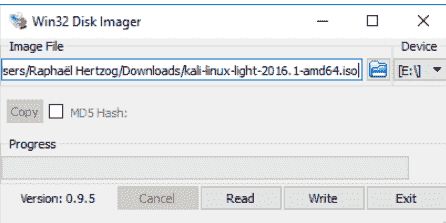

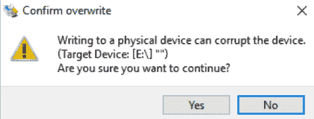

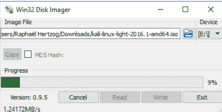

图 2.2 运行中的 Win32 Disk Imager

拷贝完成后，从 Windows 系统中安全地拔出 USB 驱动器。现在你可以使用该 USB 设备启动 Kali Linux 了。

## 在 Linux 上创建可启动的 Kali USB 启动盘

在 Linux 环境中创建可启动的 Kali Linux USB 闪盘非常简单。许多 Linux 发行版默认安装的 GNOME 桌面环境都带有一个磁盘 工具（位于 `gnome-disk-utility` 软件包中，该软件包在标准的 Kali 镜像中已安装）。该程序会显示磁盘列表，并在你插入或拔出磁盘时动态刷新。当你从磁盘列表中选择你的 USB 闪盘时，将出现详细信息，并帮助你确认已选择正确的磁盘。注意，你可以在标题栏中找到它的设备名称，如图 2.3 所示，“GNOME 磁盘”[第 21 页]。

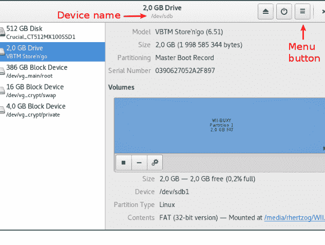

点击菜单按钮，并在弹出的菜单中选择“磁盘镜像...(Disk Image...)”。选择你之前下载的 ISO 镜像，并点击“开始恢复...”，如图 2.4 所示，“恢复磁盘镜像对话框”[第 21 页]。

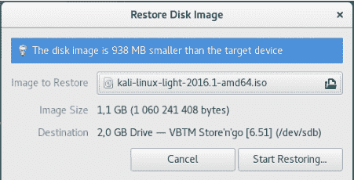

图 2.3 GNOME 磁盘

图 2.4 恢复磁盘镜像对话框

### 在 USB 闪盘上完成镜像拷贝时可以去喝杯咖啡（图 2.5），“镜像恢复进度”[第 22 页]。

| | |

|---|---|

| 型号 | VBTM Store (6.51) |

| | 2.0 GB (1.98 GB 585 344 字节) |

| 分区 | 主引导记录 (Master Boot Record) |

| 序列号 | 0390627052AF2F97 |

| 任务 | 刻录磁盘镜像：63.4% |

| | 1 GB 中的 672.1 MB - 剩余 1 分钟 (3.3 MB/sec) |

图 2.5 镜像恢复进度

## 使用命令行创建启动 USB 驱动器

尽管图形化界面非常直观，但对于命令行用户来说操作同样简单。

当你插入 USB 闪盘时，Linux 内核会检测并为其分配一个名称，该名称会打印在内核日志中。你可以通过检查 `dmesg` 返回的日志来找到它的名称。


```
$ dmesg
[234473.906134] usb 1:2: new high-speed USB device 6 using ehci-pci
[234473.906784] usb 1:2: USB device found, idVendor=08ec, idProduct=0820
[234473.907781] usb 1:2: USB device strings: Mfr=1, Product=<2,
SerialNumber=3
[234473.907741] usb 1:2: Product Store:not
[234473.907777] usb 1:2: Manufacturer: Verbator
[234473.907780] usb 1:2: SerialNumber: 0390627052AF297
[234473.920185] usb-storage 1-1.2: Mass Storage detected
[234473.992017] scsi 7:0: usb-storage 1-1.2:1.0
[234473.993818] scsi 7:0:Direct-Access VBTM Store's 6.51- [sdb] 容量: 0 GiB
[234473.994425] sdb 7:0: Attached generic scsi type 0
[234473.994503] sdb 7:0: [sdb] 390340 512 logical blocks: (2.0 GB-1.86 GiB)
[234473.996663] sdb 7:0: [sdb] 390340 512 logical blocks: (2.0 GB-1.86 GiB)
[234473.997169] sdb 7:0: [sdb]  db333333333322222......33333333733444447777777777777777777777777:0: 777777777777777777777777777777777777777777777777777777777777777777777777777777777777777777777777777777777777777777777777777777777777777777777777777777777777777777777777777777777777777777777777777777777777777777777777777777777777777777777777777777777777777777777777777777777777777777777777777777777777777777777777777777777777777777777777777777777777777777777777777777777777777777777777777777777777777777777777777777777777777777777777777777777777777777777777777777777777777777777777777777777777777777777777777777777777777777777777777777777777777777777777777777777777777777777777777777777777777777777777777777777777777777777777777777777777777777777777777777777777777777777777777777777777777777777777777777777777777777777777777777777777777777777777777777777777777777777777777777777777777777777777777777777777777777777777777777777777777777777777777777777777777777777777777777777777777777777777777777777777777777777777777777777777777777777777777777777777777777777777777777777777777777777777777777777777777777777777777777777777777777777777777777777777777777777777777777777777777777777777777777777777777777777777777777777777777777777777777777777777777777777777777777777777777777777777777777777777777777777777777777777777777777777777777777777777777777777777777777777777777777777777777777777777777777777777777777777777777777777777777777777777777777777777777777777777777777777777777777777777777777777777777777777777777777777777777777777777777777777777777777777777777777777777777777777777777777777777777777777777777777777777777777777777777777777777777777777777777777777777777777777777777777777777777777777777777777777777777777777777777777777777777777777777777777777777777777777777777777777777777777777777777777777777777777777777777777777777777777777777777777777777777777777777777777777777777777777777777777777777777777777777777777777777777777777777777777777777777777777777777777777777777777777777777777777777777777777777777777777777777777777777777777777777777777777777777777777777777777777777777777777777777777777777777777777777777777777777777777777777777777777777777777777777777777777777777777777777777777777777777777777777777777777777777777777777777777777777777777777777777777777777777777777777777777777777777777777777777777777777777777777777777777777777777777777777777777777777777777777777777777777777777777777777777777777777777777777777777777777777777777777777777777777777777777777777777777777777777777777777777777777777777777777777777777777777777777777777777777777777777777777777777777777777777777777777777777777777777777777777777777
```

初始安装完成后，VirtualBox 的主界面类似于图 2.6 “VirtualBox 启动界面” [第 26 页]。

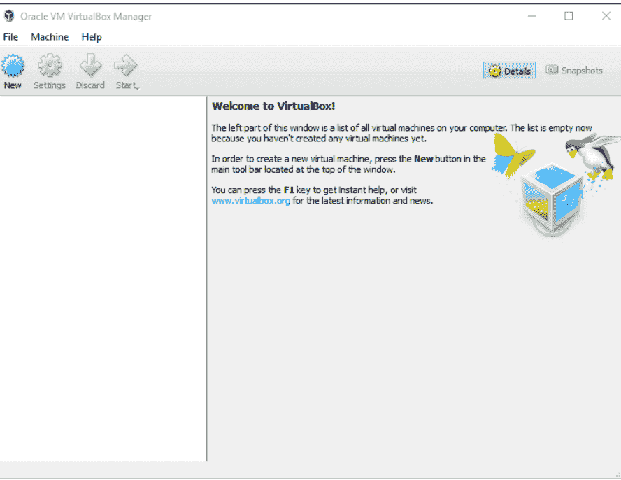

**图 2.6** VirtualBox 启动界面

点击“新建”（图 2.7，“名称和操作系统” [第 27 页]）将启动向导，向导将引导你完成输入新虚拟机所有参数的多个步骤。

## 名称和操作系统

请为新虚拟机选择一个具有描述性的名称，并选择你打算在上面安装的操作系统类型。你选择的名称将贯穿整个 VirtualBox，用于识别这台机器。

| 名称 | Kali Linux |
| 类型 | Linux |
| 版本 | Debian (64-bit) |


图 2.7 名称和操作系统

在第一步（如图 2.7 所示，“名称和操作系统” [第 27 页]），你必须为你的新虚拟机分配一个名称。使用“Kali Linux”。你必须指示将使用哪种操作系统。由于 Kali Linux 基于 Debian GNU/Linux，请选择类型为 Linux，版本为 Debian (32-bit) 或 Debian (64-bit)。虽然任何其他 Linux 版本很可能都可以运行，但这有助于区分你可能安装的各种虚拟机。

## 创建虚拟机

### 内存大小

选择分配给虚拟机的兆字节（MB）内存量（RAM）。

推荐的内存大小为 768 MB。


图 2.8 内存大小

在第二步中，你必须决定为虚拟机分配多少内存。虽然 768 MB 的推荐大小对于作为服务器的 Debian 虚拟机是可以接受的，但对于运行 Kali 桌面系统来说绝对不够，特别是对于 Kali Linux Live 系统，因为 Live 系统需要使用内存来存储对文件系统的更改。我们建议将值增加到 1500 MB（图 2.8，“内存大小” [第 28 页]），并强烈建议你分配不少于 2048 MB 的内存。

### 硬盘

如果你愿意，可以为新机器添加虚拟硬盘。你可以创建一个新的硬盘文件，也可以使用文件夹图标从列表或另一个位置选择一个文件。

如果你需要更复杂的存储设置，可以跳过此步骤，并在虚拟机创建后对机器设置进行更改。

推荐的硬盘大小为 8.00 GB。

- 不添加虚拟硬盘
- 现在创建虚拟硬盘
- 使用现有的虚拟硬盘文件

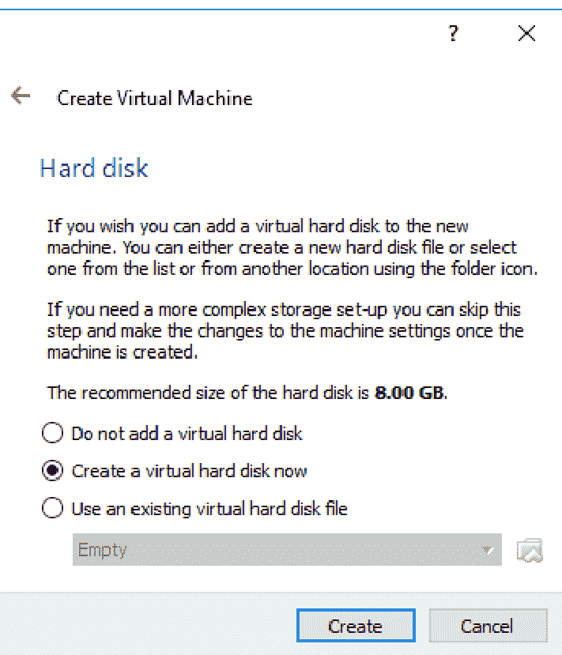

图 2.9 硬盘

在第三步中（如图 2.9 所示，硬盘 [第 29 页]），系统会提示你为新虚拟机选择物理磁盘或硬盘。虽然运行 Kali Linux Live 系统不需要硬盘，但我们将在稍后的第 4 章“安装 Kali Linux” [第 66 页] 中演示添加硬盘的步骤。

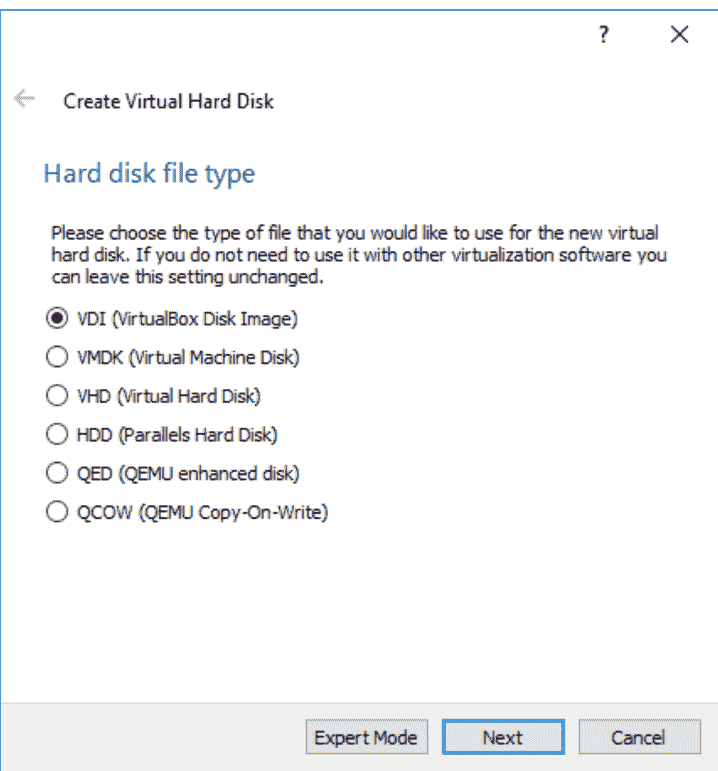

图 2.10 硬盘文件类型

虚拟机的硬盘内容存储在主机上的一个文件中。VirtualBox 能够使用多种格式存储硬盘内容（如图 2.10 所示，**硬盘文件类型** [第 30 页]）：默认的 VDI 对应 VirtualBox 的原生格式；VMDK 是 VMware 使用的格式；QCOW 是 QEMU 使用的格式。保持默认值即可，你没有理由更改它。当你将虚拟机从一个虚拟化工具移动到另一个时，使用多种格式的能力非常有用。

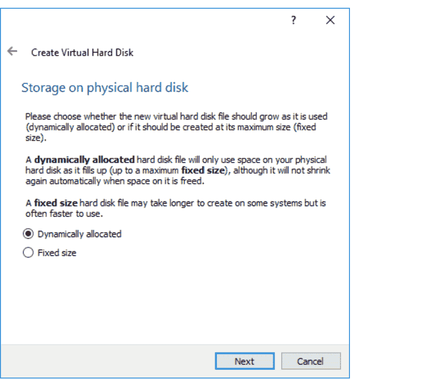

图 2.11 中的解释清楚地描述了动态分配和固定分配的优缺点。在本例中，我们接受默认选择（动态分配），因为我们使用的是带有 SSD 的笔记本电脑。我们不想浪费空间，而且机器本身运行很快，不需要额外的性能提升。

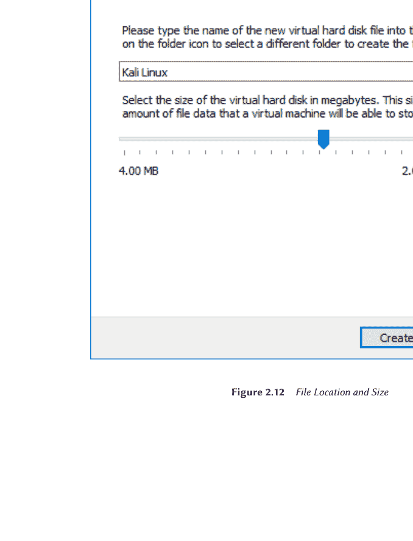

图 2.12 所示的 8 GB 默认硬盘大小（文件位置和大小）对于标准 Kali Linux 安装是不的，因此将其增加到 20 GB。你还可以调整镜像的名称和位置。当你的硬盘空间不足时，这非常方便，允许你将镜像存储在外部驱动器上。

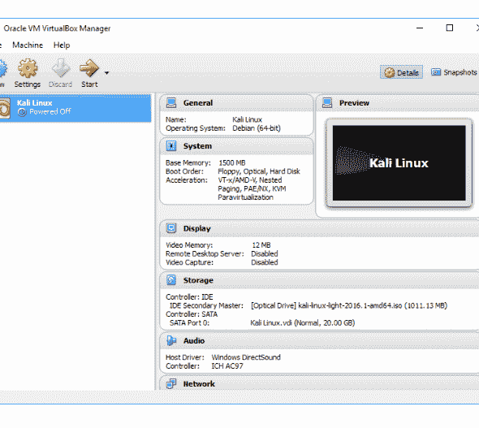

图 2.13 列表中出现了虚拟机

虚拟机已经创建，但你无法运行它，因为没有安装操作系统。你还有一些设置需要调整。点击虚拟机管理器上的“设置”，让我们查看一些实用的设置。

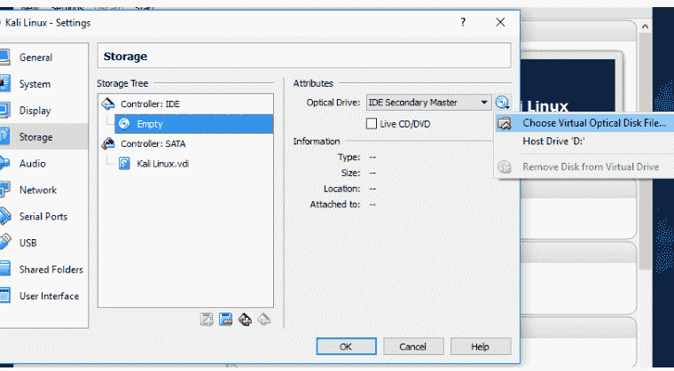

图 2.14 设置

#### 存储

在存储屏幕上（图 2.14，存储 [第 33 页]），你应该将 Kali ISO 镜像关联 CD/DVD。首先在列表中选择 CD-ROM，然后点击右侧的小 CD-ROM 图标选择光盘文件。

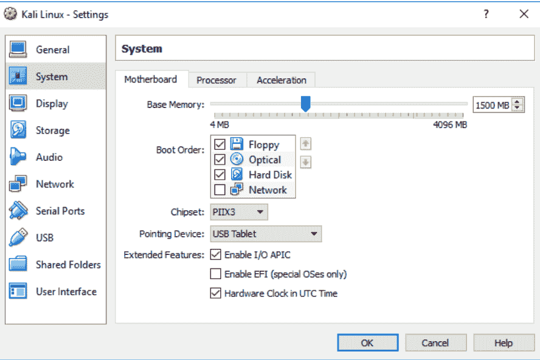

图 2.15 存储设置

#### 系统

在系统屏幕上（图 2.15，系统设置 [第 34 页]），你将找到主板选项卡。确保启动顺序指示系统首先尝试从任何光学设备启动。如果需要，这也是更改分配给虚拟机内存量的选项卡。

#### 处理器

| 通用 | 系统 |
| --- | --- |
| 系统 | 主板 |
| 显示 | 4 CPUs |
| 音频 | 执行限制: 100% |
| 网络 | 1% |
| 扩展功能 | [x] 使用 PAE/NX |
| 串口端口 | |
| 共享文件夹 | |
| 用户界面 | |


图 2.16 处理器

在同一个屏幕的“处理器”选项卡上，你可以调整分配给虚拟机的处理器数量。最重要的，如果你使用 32 位镜像，请启用 PAE/NX，否则 Kali 镜像将无法启动，因为 Kali 用于 i386 的内核变体（686-pae）编译方式需要物理地址扩展（PAE）支持。

还有许多其他参数可以配置，例如网络设置（定义如何处理网络流量），但这些更改足以启动一个运行的 Live 系统了。最后，点击“启动”，虚拟机应该能正常启动，如图 2.17 所示，“Kali 启动界面” [第 36 页]。如果没有，请仔细检查所有设置并重试。

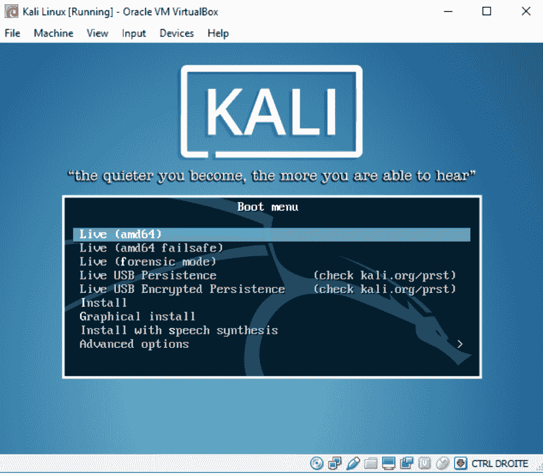

图 2.17 Kali Linux 启动界面

## VMware

VMware Workstation Pro 在功能和用户界面方面与 VirtualBox 非常相似，因为它们都主要为桌面使用设计，但设置新虚拟机的过程略有不同。

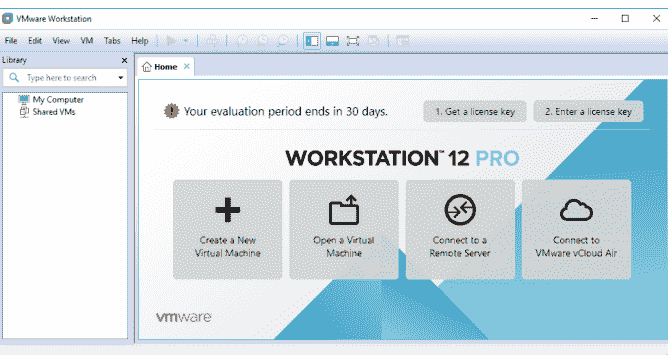

图 2.18 VMware 启动界面

初始屏幕（如图 2.18 所示，“VMware 启动界面” [第 37 页]）显示了一个巨大的“创建一个新虚拟机”，它将通过向导来引导你创建虚拟机。

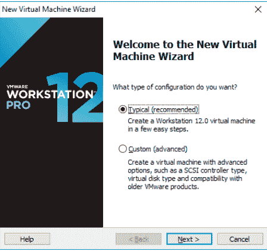

图 2.19 新虚拟机向导

### 新虚拟机向导

#### 安装客体操作系统

虚拟机就像一台物理计算机；它需要一个操作系统。
你将如何安装客体操作系统？

从以下位置安装：

- 安装光盘：
- CD 驱动器 (D:) J_CCSA_V64_FRE_EN_GB_DVS

- 安装程序镜像文件 (iso):
- C:\Users\AphaelHerz\Downloads\kali-linux-light-... 浏览...

> > 无法检测此镜像文件中的是种操作系统。
你需要指定将安装哪种操作系统。

我将稍后安装操作系统。
虚拟机将使用空白硬盘创建。

<  上一步  下一步  > 取消 >

图 2.20 安装客体操作系统

该向导假设你想要立即安装操作系统，并要求你选择包含安装程序的 ISO 镜像（图 2.20，“安装客体操作系统”[第 38 页]）。选择“安装程序镜像文件 (iso)”并点击“浏览”来选择该镜像文件。

#### 选择客体操作系统

在这台虚拟机上将安装哪种操作系统？

客体操作系统

- Microsoft Windows
- Linux
- Novel NetWare
- Solaris
- VMware ESX
- 其他

版本: Debian 8.x 64-bit

<  上一步  下一步  > 取消 >

图 2.21 选择客体操作系统

当从选定的 ISO 镜像无法检测操作系统 (OS) 时，向导会询问打算运行哪种客体 OS 类型。你应该选择选择“Linux”，版本选择“Debian 8.x”，如图 2.21，“选择客体操作系统”[第 38 页]所示。

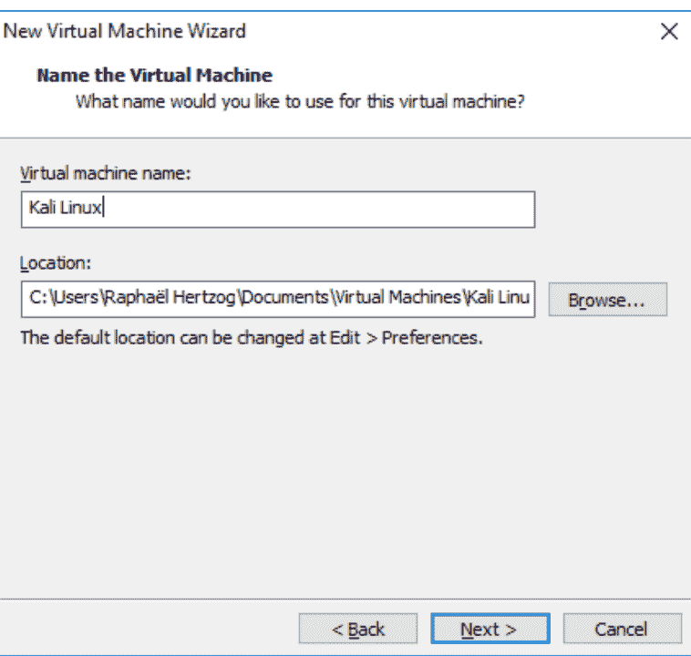

图 2.22 命名虚拟机

选择“Kali Linux”作为新虚拟机的名称（图 2.22，“命名虚拟机”[第 39 页]）。与 VirtualBox 一样，你也可以将 VM 文件存储在其他位置。

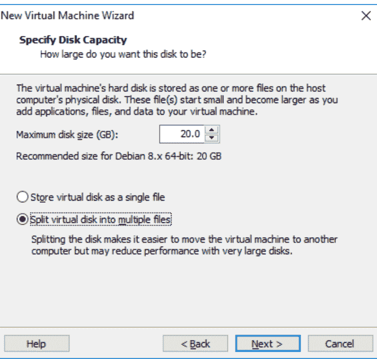

图 2.23 指定磁盘容量

默认硬盘大小为 20 GB（图 2.23，“指定磁盘容量”[第 40 页]）通常足够，但你可以根据你的预期需求进行调整。与可以使用不同大小单文件的 VirtualBox 相，VMware 有能力将磁盘内容存储在多个文件中。在这两种情况下，目标都是为了节省主机的磁盘空间。

#### 准备创建虚拟机

点击“完成”创建虚拟机。然后你就可以安装 Debian 8.x 64-bit。

虚拟机将按照以下设置创建：

| 名称 | Kali Linux |
| --- | --- |
| 路径 | C:\Users\Raphaël Hertzog\Documents\Virtual Machin... |
| 版本 | Workstation 12.0 |
| 操作系统 | Debian 8.x 64-bit |
| 硬盘 | 20 GB, 拆分 (Split) |
| 内存 | 512 MB |
| 网络适配器 | NAT |
| 其他设备 | CD/DVD, USB 控制器, 打印机, 显卡 |


VMware Workstation 现在已配置好创建新虚拟机。它显示了所选选项的摘要，以便你在创建虚拟机之前双检一切。注意，向导选择仅为虚拟机分配 512 MB 内存，这不足以点击“自定义硬件...”（图 2.24，“准备创建虚拟机”[第 41 页]）并调整内存设置，如图 2.25，“配置硬件窗口”[第 42 页]所示。

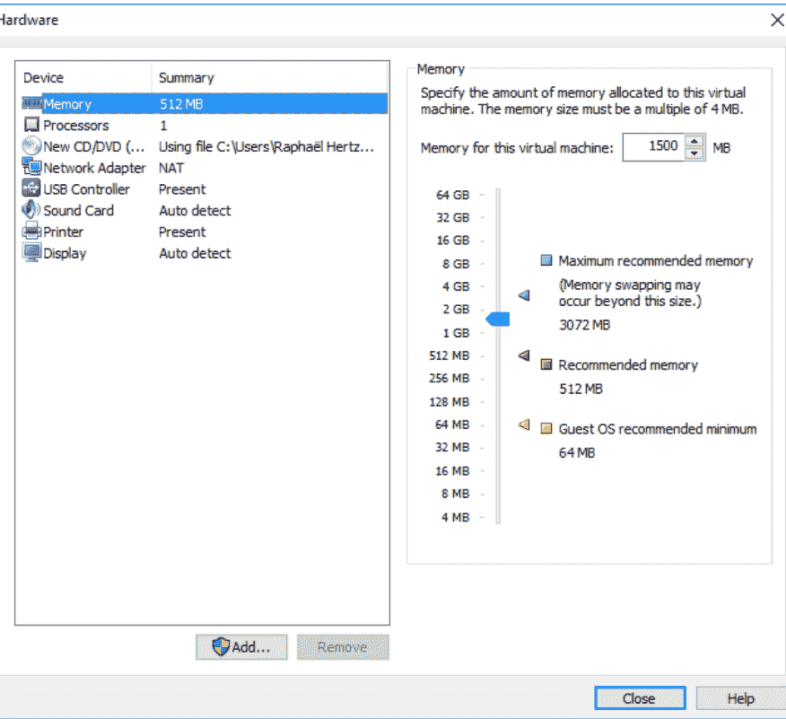

在最后一次点击“完成”（图 2.24，“准备创建虚拟机”[第 41 页]）后，虚拟机现在已配置完成，可以通过点击“打开此虚拟机”来启动，如图 2.26，“Kali Linux 虚拟机已就绪”[第 43 页]所示。

## 2.3. 总结

在本章中，你学习了各种 Kali Linux ISO 镜像，学习了如何验证和下载它们，并学习了如何从各种操作系统创建启动 USB 盘。我们还讨论了如何启动 USB 盘，并回顾了如何配置各种硬件平台上的 BIOS 和启动设置，以便 USB 盘能够启动。

总结提示：

- `kali.org` 是 Kali ISO 的唯一官方下载网站。不要从任何其他网站下载，因为那些下载可能包含恶意软件。

- 始终使用 `sha256sum` 命令验证你下载内容的 sha256sum，以确保你的 ISO 下载的完整性。如果不匹配，请尝试重新下载或使用不同的来源。

- 如果你想在物理机上启动 Kali Linux，必须将 Kali Linux ISO 镜像写入启动介质。在 Windows 上使用 Win32 Disk Imager，在 Linux 上使用 Disk Utility，或在 Mac OS/macOS 上使用 `dd` 命令。写入镜像时要非常小心。选择错误的磁盘可能会永久损坏机器上的数据。

- 配置 PC 上的 BIOS/UEFI 设置屏幕或在 OS X/macOS 上按住 Option 键，允许机器从 USB 驱动器启动。

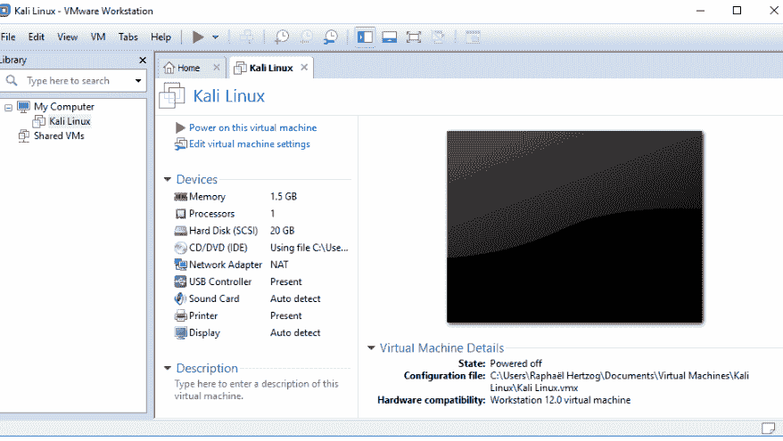

图 2.2 Kali Linux 虚拟机已就绪

- 如果你想尝试 Kali Linux 但还没有准备好在机器上永久安装，或者你有一个强大的系统并想同时运行多个操作系统，那么像 VirtualBox 和 VMware Workstation Pro 等虚拟机程序特别有用。

现在你已经有了可以运行的 Kali Linux 安装，是时候深入研究 Kali 基础和高级操作所需的 Linux 基础知识了。如果你是中高级高级 Linux 用户，可以考虑略读下一章。


## 关键词

- Linux 内核
- 用户空间
- 命令行 bash
- 文件系统层级结构
- Unix 命令


# KALI LINUX
揭秘

## 第 3 章

## Linux 基础

## 目录

- 什么是 Linux 以及它在做什么？ 48
- 命令行 51
- 文件系统 54
- 有用的命令 56
- 总结 62

在精通 Kali Linux 之前，你必须熟悉通 Linux 系统。精通 Linux 将对你大有，因为很大比例的网页、电子邮件和其他互联网服务运行在 Linux 上。

在本节中，我们努力涵盖 Linux 的基础，但假设你已经了解计算机系统，包括 CPU、RAM、主板和硬盘等组件。

## 3.1. 什么是 Linux 以及它在做什么？

“Linux”一词通常用于指整个操作系统，但实际上，Linux 是操作系统内核，它由引导程序启动，而引导程序又由 BIOS/UEFI 启动。内核的角色类似于交响团的指挥——它确保硬件和软件之间的协调。这一角色包括管理硬件、进程、用户、权限和文件系统。

| 用户空间 | 我们使用“用户空间”这一术语将内核之外发生的所有活动归为类。在用户空间运行的程序中，有 GNU 项目的核心实用程序，它们从命令行运行。你可以在脚本中使用它们来自动化许多任务。有关重要命令的更多信息，请参考第 3.4 节，“用的命令”[第 56 页]。 |

### 3.1.1. 驱动硬件

内核的首要任务是控制计算机的硬件组件。当计算机开机或当插入或移除设备时（例如 USB 设备），它会检测并配置这些组件。它还通过简化的编程接口将它们提供给高级软件，以便应用程序可以利用设备而无需处理诸如插入了何种扩展选项之类的细节。编程接口还提供了一个抽象层；这使得视频引用软件能够无论摄像头的制造商和型号都能使用摄像头。软件可以使用 Video for Linux (V4L) 接口，内核会将函数调用转换为摄像头所需的实际硬件命令。

内核通过 `/proc/` 和 `/sys/` 虚拟文件系统导出有关检测到的硬件的数据。通过在 `/dev/` 内创建的文件访问设备。特定文件表示-

> http://www.gnu.org

磁盘驱动器（例如 `/dev/sda`）、分区（`/dev/sda1`）、鼠标（`/dev/input/mouse`）、键盘（`/dev/input/event0`）、声卡（`/dev/snd/*`）、串口（`/dev/ttyS*`）以及其他组件。

设备文件有两种类型：块设备和字符设备。前者具有数据块的特征：它具有固定的大小，你可以访问块中任何位置的字节。后者的行为类似于字符流。你可以读取和写入字符，但不能跳转到指定位置并更改任意字节。要确定设备文件的类型，请检查 `ls -l` 输出的第一个字母。它要么是代表块设备的 `b`，要么是代表字符设备的 `c`：

```


```
$ ls -l /dev/sda /dev/tty50

br-rw---- 1 root disk 8, 00 Mar 21 08:44 /dev/sda

crw-rw---- 1 root dialout 64 Mar 30 08:59 /dev/tty50
```

正如你预期的那样，磁盘驱动器和分区使用块设备，而鼠标、键盘和串口端口使用字符设备。在两种情况下，编程接口都包含了特定于设备的命令，这些命令可以通过 `ioctl` 系统调用调用。

## 3.1.2. 统一文件系统

文件系统是内核的一个重要方面。类 Unix 系统将所有文件合并到一个层次结构中，这允许用户和应用程序通过通过文件其在层次结构中的位置来访问数据。

这个层次结构树的起点是根目录，由字符“/”表示。该目录可以包含命名的子目录。例如，`/` 的家目录子目录是 `/home/`。这个目录反又包含其他子目录，依此类推。每个目录也包含文件，数据将存储在其中。因此，`/home/busy/Desktop/hello.txt` 指的是根目录下 `home` 目录中 `Desktop` 子目录下的名为 `hello.txt` 的文件。内核在这一命名系统与磁盘上的存储位置之间进行转换。

与其他系统不同，Linux 仅有一个层次结构，并且它可以整合来自几块磁盘的数据。其中一个磁盘成为根目录，其他的磁盘挂载到层次结构中的目录上（Linux 命令为 `mount`）。这些磁盘随后在挂载点下可用。这允许将用户的家目录（传统存储在 `/home/` 中）存储在单独的硬盘上，该硬盘将包含 `busy` 目录（以及其他家目录）。你可以将磁盘挂载到 `//`，这些设备将在它们通常的位置访问，而诸如 `/home/busy/Desktop/hello.txt` 的路径将继续有效。

有很多文件系统格式，对应于在磁盘上物理存储数据的多种方法。最广为人的是 `ext2`、`ext3` 和 `ext4`，但存在其他格式。例如，VFAT 是历史上由 DOS 和 Windows 操作系统使用的文件系统。Linux 对 VFAT 的支持允许硬盘在 Kali 下也能被访问。无论如何，在挂载文件系统之前，你必须在磁盘上准备文件系统，此操作被称为格式化。

`mkfs.ext3` 等命令（其中 `mkfs` 代表 `MaKeFileSystem`）处理格式化。这些命令需要一个代表要格式化分区的设备文件作为参数（例如 `/dev/sda1`，第一个驱动器的第一个分区）。此操作是破坏性的，应该只运行一次，除非你想挂载文件系统并重新开始。

还有像 NFS 这样的网络文件系统，它们不在本地磁盘上存储数据。相反，数据通过通过网络传输到服务器，由服务器按需要检索。得益于文件系统的抽象，你不需要担心此磁盘是如何连接的，因为文件仍然以它们通常的层次方式访问。

## 3.1.3. 进程管理

进程是程序的运行实例，它需要内存来存储程序本身及其操作数据。当程序运行时，内核首先留出一些内存，从文件中将可执行代码加载到内存中，然后启动代码运行。它保留有关此进程的信息，其中最可见的是被称为进程标识符（PID）的标识号。

大多数现代操作系统（具有类 Unix 内核的系统，包括 Linux）都能够多任务处理。换句话说，它们允许系统同时运行许多进程。实际上一次只有一个进程在运行，但内核将 CPU 时间划分成小片并轮流运行每个进程。由于这些时间片非常短（毫秒级），它们营造了进程并行运行的假象，尽管它们只在自己的时间间隔内处于激活状态，其余时间处于空闲。内核的工作是调整其调度机制以保持这种假象，同时最大化全局系统性能。如果时间片太长，系统将因频繁切换任务而浪费时间。这些决策可以通过进程优先级进行精化，高优先级进程的运行时间更长，且获得的时间片比低优先级进程更频繁。

| 多处理器系统（及其变体） | 上述的一次只有一个进程在运行的限制并不总是适用：实际的限制是每个核心只能运行一个进程。多处理器、多内核或超线程系统允许多个进程并行运行。尽管如此，仍使用相同的时间分片系统来处理活动进程多于可用处理器核心的情况。这并不稀奇：一个基础系统，即使是大部分空闲的系统，也几乎有几十个正在运行的进程。 |

内核允许同一个程序的多个独立实例运行，但每个实例都只允许访问它自己的时间片和内存。它们的数据保持独立。

## 3.1.4. 权限管理

类 Unix 系统支持多个用户和组。类 Unix 系统支持多个用户和组，允许控制。大多数情况下，登录时是由登录它的用户来标识的。例如，打开一个文件需要检查其权限（更多细节请参见“权限管理”第57页）。

当我们说“命令行”时，指的是一个文本界面，允许你输入命令、执行它们并查看结果。3.2. 命令行

当你的系统正常工作时，访问命令行简单的方法是在图形界面内运行终端（一个图形界面内的文本界面）。3.2.1. 如何获取命令行

例如，Kali Linux 中的默认 shell 可以从应用程序列表启动（将鼠标移动到左上角）。在图形界面损坏的情况下，你仍然可以通过控制台获取命令行（可以通过 `CTRL+F1` 到 `F6` ）。你会得到一个非常基本的登录界面，你在其中输入登录和密码：

```
Kali GNU/Linux tty3

kali-rolling login: root

Password:

Last login: Fri Mar 25 12:30:05 EDT 2016 from 192.168.122.1 on pts/2

Linux kali-rolling 4.4.0-kali-amd4 #1 SMP Debian 4.4.0-1 (2016-03-18) x86_64
```

Kali GNU/Linux包含的程序是自由软件，每个程序的发行条款都在 `/usr/share/doc/*copyright` 的文件中描述。

Kali GNU/Linux 随带的程序没有任何保证，在法律允许范围内。

```
root@kali-rolling:-#
```

> 处理你的输入并执行你的命令的程序被称为 shell（或命令行解释器）。Kali Linux 提供的默认 shell 是 Bash（代表 Bourne Again Shell）。末尾的 “$ 或 “# 字符表示 shell 正在等待你的输入。它还表示 Bash 是否将你识别为普通用户（前者带有美元符号）或超级用户（后者带有井号）。

## 3.2.2. 命令行基础：浏览目录树和管理文件

本节仅对涵盖的命令提供简要概述，所有命令都有许多此处未描述的选项，请参阅各自页面中丰富的文档。在渗透测试中，你通常会在成功利用后获得系统的 shell 权限，而不是图形界面。一旦会话打开`pwd` 命令（代表 print working directory）显示你在文件系统中的当前位置。通过 `cd` 目录命令更改目录（cd 代表 change directory）。当你没有指定目标目录时，将被带到家目录。当你使用 `cd ..` 时，回到先前的工作目录（上一次 `cd` 调用之前的目录）。父目录始终被称为 `..`（两个点），而当前目录始终被称为 `.`（一个点）。

当前目录也被称为 `.` (点)。`ls` 命令允许列出目录的内容。如果你不提供参数，`ls` 将对当前目录进行操作。

```
$ pwd
/home/buxy
$ cd Desktop
$pwd
/home/buxy/Desktop
$ cd
$pwd
/home/buxy/Desktop
$ cd
$pwd
/home/buxy
$ ls
Desktop Downloads Pictures Templates
Documents Music Public Videos
```

你可以使用 `mkdir directory` 创建新目录，并使用 `rmdir directory` 删除现有的（空）目录。`mv` 命令允许移动和重命名文件及目录；使用 `rm file` 删除文件，使用 `cp source-file target` 复制文件。

```
$ mkdir test
$ ls
Desktop Downloads Pictures Templates Videos
Documents Music Public test
$ mv test new
$ ls
Desktop Downloads new Public Videos
Documents Music Pictures Templates
$ rmdir new
$ ls
Desktop Downloads Pictures Templates Videos
Documents Music Public
```

Shell 通过运行在 `PATH` 环境变量列出的目录列表中找到的第一个同名的程序来执行每个命令。通常情况下，这些程序位于 `/bin`、`/sbin`、`/usr/bin` 或 `/usr/sbin`。例如，`ls` 命令位于 `/bin/ls`；而 `which` 命令则报告给定可执行文件的位置。有时命令直接由 Shell 处理，在这种情况下它被称为内置命令（`cd` 和 `pwd` 就属于其中）；`type` 命令允许你查询每个命令的类型。

```
$ echo PATH
```


`/usr/local/sbin:/usr/local/bin:/usr/sbin:/usr/bin:/bin`

```
$ ls
/bin/ls
```

```
$ type rm
rm is /bin/rm
```

```
$ type cd
cd is a shell builtin
```

`echo` 命令的用法是简单的在终端上显示字符串。在这种情况下，它被用于打印环境变量的内容，Shell 在执行命令行之前会自动将变量替换为它们的值。

# 环境变量

环境变量允许存储 Shell 或各种其他程序的全局设置。例如，每个进程都有自己的环境变量（它们是与上下文相关的）。Shell（如登录 Shell [login shells](https )）会声明变量，这些变量将传递给它们执行的其它程序（它们是可继承的）。

这些变量可以在 `/etc/profile` 中全系统定义，也可以在 `~/.profile` 中按用户定义。不特定于命令行解释器的变量被放在 `/etc/environment` 中，因为得益于可插身份模块 (PAM)，这些变量会被注入到所有用户会话中——即使在没有执行 Shell 的情况下也是。

## 3.3. 文件系统

### 3.3.1. 文件系统层次结构标准

与其他 Linux 发行版一样，Kali Linux 的组织符合文件系统层次结构标准 (FHS)，这使得其他 Linux 发行版的用户能够轻松地在 Kali 中找到。FHS 定义了每个目录的用途。顶层目录描述如下。

- `/bin/`：基础程序
- `/boot/`：Kali Linux 内核及其早期启动过程所需的其他文件
- `/dev/`：设备文件
- `/etc/`：配置文件
- `/home/`：用户文件
- `/lib/`：基础库
- `/media/*`：可移动设备（如 CD-ROM、USB 闪盘等）的挂载点
- `/mnt/`：临时挂载点
- `/opt/`：由第三方提供的额外应用程序
- `/root/`：管理员（root）的个人文件
- `/run/`：不跨重启持久的易性运行时数据（尚未包含在 FHS 中）
- `/sbin/`：系统程序
- `/tmp/`：临时文件（此目录在启动时通常会被清空）
- `/usr/`：应用程序（此目录根据根目录相同的逻辑进一步细分为 bin、sbin、lib）。此外，`/usr/share/` 包含与架构无关的数据。`/usr/local/` 目录旨在供管理员手动安装应用程序使用，而不会覆盖由软件包系统 (`dpkg`) 处理的文件。
- `/var/`：由守护进程处理的变量数据。这包括日志文件、队列、池和缓存。
- `/proc/` 和 `/sys` 是 Linux 内核特定的（不属于 FHS）。它们被内核用于将数据导出到用户空间。

#### 3.3.2. 用户主目录

用户主目录的内容没有标准，但仍然有一些值得注意的惯例。了解用户主目录经常用波浪号 (`~`) 指代很有用，命令行解释器会自动将波浪号替换为正确的目录（该目录存储在 `HOME` 环境变量中，其通常值为 `/home/user/`）。

传统上，应用程序配置文件通常直接存储在你的主目录下，但文件名通常以点开头（mqtt 客户端将其配置存储在 `~/.mttrrc` 中）。注意，以点开头的文件名默认是隐藏的；`ls` 命令只有在使用 `-a` 选项时才会列出它们，图形化文件管理器需要显式配置才能显示隐藏文件。

有些程序使用在一个目录中组织的多个配置文件。有些应用程序（如 Firefox 浏览器）也使用其目录存储缓存。

### 3.4. 有用命令

#### 3.4.1. 显示和修改文本

`cat` 命令显示文件内容。它也可以用于合并文件。如果文件太大无法适应屏幕，可以使用分页器如 `less`。编辑器可以修改文件。`>` 输出重定向到文件。

```
$ echo "Kali!"
```


### 3.4.2. 搜索文件

`find` 命令根据标准搜索文件。常用的标准是 `-name`。你也可以在文件名中使用通配符，如 `*`。

`grep` 命令搜索文件内容并提取匹配的正则表达式表达式。

### 3.4.3. 进程管理

`ps` 命令列出当前运行的进程并通过显示 PID 来识别它们。一旦知道进程的 PID，`kill -signal` 命令允许你发送信号（如果你拥有该进程）。存在多种信号，最常见的是 TERM（终止请求）和 KILL（强制杀死）。

命令行解释器也可以在命令后带有 `&` 的情况下在后台运行程序。通过使用该符号，你可以立即恢复 Shell 的控制，尽管命令仍在运行（作为后台进程不可见）。`jobs` 命令列出后台运行的作业；运行 `fg %job-number` 将作业恢复到前台。当命令在前台运行时（无论是正常启动的，还是通过 `fg` 回到前台的），Ctrl+Z 组合会暂停进程并恢复命令行的控制。然后可以使用 `bg %job-number` 在后台重启该进程。

可执行文件与两种特殊权限相关：setuid 和 setgid（用字母 "s" 表示）。注意，我们经常提到“位”（bit），这些布尔值中的每一个都可以用 0 或 1 表示。这两种权限允许任何用户分别以所有者或所属组的权限执行程序。这种机制允许访问需要比你所拥有的权限的功能。

#### setuid 和 setgid 可执行文件

setuid root 程序系统性地以超级用户（root）身份运行，因此确保其安全和可靠至关重要。任何能够成功将 setuid root 程序劫持为其所选择的命令的用户，都可以冒充 root 用户并拥有系统上的所有权限。渗透人员在获得系统访问权限后会经常搜索这类文件，作为提升权限的手段。

目录的处理方式与文件不同。读取权限允许查看其内容列表（文件和目录）；写入权限允许创建或删除文件；执行权限允许穿过目录以访问其内容（例如使用 `cd` 命令）。如果目录中的条目名称是已知的，即使无法读取目录，也可以穿过它，但无法通过已知确切名称来找到它们。

setgid 位适用于目录。在此类目录中新创建的项将自动分配父目录的所有者组，而不是像通常那样继承创建者的组。正因如此，当在多个属于同一专用组的用户之间共享的文件树中工作时，你不需要使用 `group` 命令更改你的主用户组。

> 粘滞位（sticky bit，用字母 "t" 表示）仅在目录中有用。它对于每个人都有访问权限的临时目录（如 `/tmp/`）特别有用；它限制了文件的删除，只有文件所有者或父目录所有者才能删除它们。缺少此位，每个人都可以删除 `/tmp/` 中其他用户的文件。

## 安全
setgid 目录和粘滞位

有三个命令控制与文件相关的权限：

- `chown user file` 更改文件的所有者
- 更改用户和组：`chown user:group file`
- `chgrp group file` 更改所属组
- `chmod rights file` 更改文件的权限

权限有两种表示方法。其中，符号表示法可能是最容易理解和记忆的。它涉及上述字母符号。你可以为每类用户（u/g/o）定义权限，方法是：显式设置（使用 `=`）、添加（使用 `+`）或减去（使用 `-`）。因此 `u=rw,g+rw,o` 赋予所有者读、写、执行权限，为所属组添加读、写权限，并移除其他用户的权限。命令中未通过加减修改的权限保持不变。字母 `a` 代表全部，涵盖了所有用户类别，因此 `a-rx` 赋予所有三类用户相同的权限（读取和执行，但不可写）。

（八进制）数字表示法将每种权限与值关联：4 代表读取，2 代表写入，1 代表执行。我们将每个权限组合与这三个数字之和相关，并按照用户顺序（所有者、组、其他）为每类用户分配一个值。

例如，`chmod 754 file` 将设置以下权限：所有者具有读、写和执行权限（因为 5 = 4 + 2 + 1）；其他用户只读。`0` 表示无；因此 `chmod 600` 允许所有者拥有读取和写入权限，而其他人没有任何权限。最常用的权限是用于可执行文件和目录的 755，以及数据文件的 644。

为了表示特殊权限，你可以根据相同原理在该数字前加上一个数字，其中 setuid、setgid 和粘滞位分别是 4、2 和 1。命令 `chmod 4754` 将 setuid 位与之前描述的权限关联。

注意，使用八进制表示法仅允许一次性设置文件的所有权限；你不能为其添加新权限（例如为组所有者添加读取权限），必须考虑现有权限并计算出新的对应数值。

八进制表示法也用于 `mask` 命令，该命令用于限制新创建文件的权限。当应用程序创建一个文件时，它会分配指示性权限，并知道系统会自动移除用 `umask` 定义的权限。在 shell 中输入 `umask`，你将看到一个类似 0022 的掩码。这仅仅是需要系统性移除的权限的八进制表示（在这种情况下，是组和其他用户的写入权限）。

如果你给它一个新的八进制值，`chmod` 命令将修改该掩码。在 shell 初始化文件（例如 `~/.bash_profile`）中，它将有效更改工作会话的默认掩码。

| 提示 |
| 有时我们必须更改整个文件树的权限。上述命令都有一个 -R 选项，用于对子目录进行递归操作 |

### 递归操作
目录和文件之间的区别有时会导致递归操作出现问题。这就是为什么在目录的符号表示中引入了字母 "X"。它代表一种执行权限，该权限仅适用于目录（而不适用于缺少该权限的文件）。因此，`chmod -R +X directory` 只会为所有用户类别（a）的所有子目录和文件添加执行权限（如果其所有者已经拥有该权限）。

### 3.4.5. 获取系统信息和日志

`free` 命令显示内存信息；`df` 报告文件系统中挂载的每个磁盘的可用空间。`-h` 选项（人类可读）将大小转换为更易读的单位（通常是 mebibytes 或 gibibytes）。类似于，`free` 命令支持 `-m` 和 `-g` 选项，并以 mebibytes 或 gibibytes 显示数据。

```
$ free
| | total | used | free | shared | buff/cache | available |
| --- | --- | --- | --- | --- | --- | --- |
| Mem: | 2052944 | 661232 | 621208 | 5320 | | 770504 |
| Swap: | 0 | 0 | 0 | | | |
| Filesystem | 1K-blocks | Used | Use% | Mounted on | | |
| udev | 1014584 | 0 | 1014584 | 0% | /dev | |
| tmpfs | 205296 | 8940 | 196356 | 5% | / | |
| /dev/vd1 | 3083058 | 1116816 | 1807328 | 39% | / | |
| tmpfs | 1026472 | 456 | 102616 | 1% | /dev/shm | |
| tmpfs | 5120 | 0 | 5120 | 0% | /run/lock | |
| tmpfs | 1026472 | 0 | 1026472 | 0% | /sys/fs/cgroup | |
| tmpfs | 205296 | 36 | 205260 | 1% | /run/user/132 | |
| tmpfs | 205296 | 24 | 205272 | 1% | /run/user/0 | |
```

`id` 命令显示用户的身份及其所属组列表。由于对某些文件或设备的访问可能限于组，检查成员身份是有用的。

```
$ id uid=1000(user) groups=1000(user),27(sudo)
```

`uname -a` 返回单行，，内核名称、主机名、内核版本、机器类型（如 x86_64）以及操作系统名称（GNU/Linux）。该命令的输出明确了你正在运行的内核和硬件平台。

```
$ uname -a
Linux 4.9.0-kali-amd64 #1 Debian 4.9.18-kali (2017-04-04) x86_64 GNU/Linux
```

所有这些命令提供了运行时信息，但当你需要日志来了解电脑上发生了什么时，内核会在每次发生有趣事件（例如插入新 USB 设备、磁盘故障或启动时的硬件检测）向环缓冲区发送消息。你可以通过 `dmesg` 获取内核日志。

Systemd 的 `journal` 还存储了多个日志（守护进程 stdout/stderr 输出、syslog 消息、内核日志），并可以通过 `journalctl` 轻松查询。不带任何参数时，它按时间顺序导出所有可用日志。使用 `-r` 选项将反转顺序，让新消息在前。使用 `-f` 选项会在日志项添加到数据库时持续打印。`-u` 选项可以将日志限制为特定的系统单元（例如 `journalctl -u ssh.service`）。

### 3.4.6. 发现硬件

内核通过 `/proc/` 和 `/sys/` 虚拟文件导出大量硬件细节。多个工具汇总了这些细节。其中 `lspci`（pciutils 包）列出 PCI 设备，`lsusb`（usbt 包）列出 USB 设备，`lspcmia`（pciutils 包）列出 PCMCIA 卡。这些工具对于识别设备的精确型号非常有用。识别可以在互联网上进行更精确的搜索，从而找到相关文档。注意，pciutils 和 usbt 包已安装在基础 Kali 系统中，但必须通过 `apt install pciutils` 安装。我们将在后面的章节讨论更多关于包的安装和管理。

> 示例 3.1 lspci 和 lsusb 提供的信息

```


# `lspci`

```
...
00:2.0 Display controller: Intel Corporation Mobile 915GM/GMS/910GML Express Graphics Controller (rev 03)
00:1.0 PCI bridge: Intel Corporation 82801FB/FBM/FR/FW (ICH6 Family) PCI Express Part 1 (rev 03)
00:1.0 USB Controller: Intel Corporation 82801FB/FBM/FR/FW (ICH6 Family) USB HCI #1 (rev 03)
01:0.0 Ethernet controller: Broadcom Corporation Nettreme BCM5751 Gigabit Ethernet PCI Express (rev 01)
02:0.0 Network controller: Intel Corporation PRO/Wireless 2208BG Network Connection (rev 05)
```

# `lsusb`

```
Bus Bus 002 Device 004: Dell Corp.
Bus Bus 002 Device 008: ID 82c1:9001 Dell Corp.
Bus Bus 002 Device 007: ID 45de:00dd Microsoft Corp.
Bus Bus 002 Device 006: ID 046d:c0d3 Logitech, Inc.
Bus Bus 002 Device 004: ID 413c:0103 Dell Corp. Wireless 350 Bluetooth
```


这些程序都有 `-v` 选项，可以列出更详细（但通常不需要）的信息。最后，`lsdev` 命令（`procinfo` 包）列出设备使用的通信资源。

`lshw` 程序是上述程序的组合，并以分层的方式显示所发现硬件的详细描述。在任何关于支持问题的报告中，你都应该附上它的完整输出。

## 3.5. 总结

在本节中，我们对 Linux 领域进行了一次快速概览。我们讨论了内核和用户空间，回顾了许多 Linux Shell 命令，讨论了进程及其管理方法，回顾了用户和用户组安全概念，讨论了 FHS（文件系统层次结构），并浏览了 Kali Linux 中一些常见的目录和文件。

总结要点：

- Linux 通常被指代整个操作系统，但实际上，Linux 本身是由启动引导加载程序（`boot loader`）启动的操作系统内核，它本身是由 BIOS/UEFI 启动的。
- 用户空间指的是空间之外发生的一切。在用户空间中运行的程序中，有许多来自 GNU 项目²的核心工具，其中大多数设计为从命令行运行（一种允许你输入命令、执行命令并查看结果的文本界面）。Shell 在该界面内执行命令。
- 常用命令包括：`pwd`（打印工作目录）、`cd`（切换目录）、`ls`（文件或目录内容）、`mkdir`（创建目录）、`rmdir`（删除目录）、`mv`、`rm` 和 `cp`（分别移动、删除或复制文件或目录）、`cat`（合并或显示文件）、`less/more`（一次显示一个文件）、`editor`（启动文本编辑器）、`find`（定位文件或目录）、`free`（显示内存信息）、`df`（显示磁盘剩余空间）、`id`（显示用户身份及其所属组列表）、`dmesg`（查看内核日志）以及 `journalctl`（显示所有可用日志）。
- 你可以使用几个命令检查 Kali 系统上的硬件：`lspci`（PCI 设备）、`lsusb`（列出 USB 设备）以及 `lspcmia`（列出 PCMCIA 卡）。
- 进程是程序的一个运行实例，它需要内存来存储程序本身及其运行数据。你可以使用命令如 `ps`（显示进程）、`kill`（杀死进程）、`bg`（将进程发送到后台）、`fg`（将进程发送到前台）和 `jobs`（显示后台进程）来管理进程。
- Unix 类系统是多用户系统。它们支持多个用户和组，并允许根据权限对操作进行控制。你可以管理文件和目录权限，包括：`chmod`（更改权限）、`chown`（更改所有者）和 `chgrp`（更改组）。
- 与其他 Linux 发行版一样，Kali Linux 的组织与文件系统标准（FHS）保持一致，允许来自其他发行版的用户能够熟悉操作环境。
- 传统上，应用程序配置文件存储在你的主目录下，以以点（dot）开头的隐藏文件存在。

现在你已经掌握了 Linux 基础知识，让我们让 Kali Linux 运行起来。

# 第 4 章 安装 Kali Linux

目录
- 最小安装要求 66
- 在硬盘上逐步安装 66
- 无人值安装 91
- ARM 安装 94
- 安装故障排除 95
- 总结 100

在本章中，我们将重点介绍 Linux 的安装过程。首先，我们将讨论最小安装要求（4.1 节，“最小安装” 66），以确保你的真实或虚拟系统已配置好以处理该类型的安装。然后，我们将介绍普通安装的每个安装步骤（4.2 节，“在硬盘上逐步安装” 66），以及涉及全加密系统的更多安装。我们还将浏览哪些方法通过为安装问题提供预定义答案来实现无人值安装（4.3 节，“无人值安装” 91）。我们还将向你如何在各种设备上安装 Kali Linux（4.4 节，“ARM 安装” 94），这扩展了 Kali 在桌面之外的能力。最后，我们将展示在极少数安装失败的情况下该如何处理（4.5 节，“安装故障排除” 95），以便你解决问题并顺利完成。

### 4.1. 最小安装要求

Kali Linux 的安装要求取决于你想要安装的内容。在低端，你可以将 Kali 设置为没有桌面的基础 Shell 服务器，最少只需要 128 MB 内存（建议 512 MB）和 2 GB 磁盘空间。在高端，如果你选择安装带有桌面的 `linux-full` 软件包，至少需要 2048 MB 内存和 20 GB 磁盘空间。除了内存外，你的电脑还需要支持 `amd64`、`i386`、`armhf` 或 `arm64` 架构。

### 4.2. 在硬盘上逐步安装

在本节中，我们假设你有一个 DVD 或 USB 驱动器，并从其启动。

#### 4.2.1. 普通安装

首先，我们将介绍标准安装的内核。

##### 启动并启动安装程序

一旦从 DVD 或 USB 驱动器启动，就会出现引导 `ux` 界面。对于标准安装，你需要通过 Tab 键选择所需的参数来启动程序。

启动后，安装程序将引导你完成每一个步骤。我们将详细查看这些步骤。来自 `.iso` 的安装看起来可能略有不同。我们也会介绍图形化安装的显示界面。

##### 选择语言

如图 4.2 所示（选择语言” 68），安装程序以英语开始，但第一步允许你选择用于后续安装过程的语言。

##### 选择国家

第二个步骤（见 4.3 节，“选择国家” 69）是选择你的国家。结合语言，这些信息将使安装程序能够提供相应的键盘布局。这还会影响时区的配置。

| 使用键盘导航 | 安装过程中的某些步骤需要你输入信息。这些屏幕有多个区域（输入区域、复选框、选项列表、确定和取消按钮），你可以使用 Tab 键进行切换。 |
| | 在图形化模式下，你可以像在安装好的桌面上一样使用鼠标。 |

##### 选择键盘布局

建议的美国英语键盘对应于图 4.4 所示的常用 QWERTY 布局。

##### 硬件检测

在大多数情况下，硬件检测步骤是完全自动的。安装程序检测你的硬件，并尝试识别所使用的启动设备以访问其内容。它加载与检测到的各种硬件组件对应的模块，并挂载启动设备以读取它。

##### 加载组件

一旦启动设备的内容可用，安装程序将加载继续工作所需的所有文件。这包括用于剩余硬件（特别是网卡）的额外驱动，以及安装程序的所有组件。

# 检测网络

在这一步中，安装程序将尝试自动识别网卡并加载相应的模块。如果自动检测失败，你可以手动选择要加载的模块。如果其他方法都失败了，你可以从可移动设备加载特定模块。最后这种解决方案只有在标准内核中未包含适当的驱动程序但在其他地方（如制造商网站）可以找到时才需要需要。对于网络安装（例如从 iso 启动时进行的操作），这一步必须绝对成功。

# 配置网络

为了尽可能实现过程的自动化，安装程序会尝试使用动态主机配置协议（DHCP）对 IPv4 和 IPv6 进行网络配置，如图 4.5 “网络自动配置”所示。


如果自动配置失败，安装程序将提供更多选项：尝试使用常规配置重试、通过声明机器名称尝试 DHCP 配置，或设置静态网络配置。最后一个选项需要提供 IP 地址、子网掩码、网关 IP 地址、机器名称和域名。

# 不使用 DHCP 的配置

如果本地网络配备了 DHCP 服务器，但你并不希望使用它（因为你于在安装期间为机器定义静态 IP 地址），你可以在启动时添加 `netcfg/use_dhcp=false` 选项。你只需要在按下回车键之前按 Tab 键编辑菜单项。

# Root 密码

安装程序会提示密码（图 4.6，“Root 密码”），因为它会自动创建一个超级用户 `root` 账户。安装程序还会确认密码以防止任何输入错误。


# 设置用户和密码

你需要为系统管理员账户 `'root'` 设置一个密码。为了避免因不规范的 root 访问导致灾难性结果，你应该选择一个不容易被猜到的密码。它不应该是字典中的单词，也不应该是容易与你相关联的单词。一个好的密码应该包含字母、数字和标点符号的混合，并应该定期更改。

`root` 用户不应有空密码。如果你将其留空，`root` 账户将被禁用，系统的初始用户账户将获得使用“`sudo`”命令变为 root 的权限。请注意，你在输入密码时看不到它。

Root 密码：
●●●●●
- 显示明文

请再次输入相同的 root 密码以验证输入是否正确。
再次输入密码以验证：
●●●●●
- 显示明文

图 4.6 Root 密码

`root` 用户的密码应该是长的（八个字符或更多）且无法被猜到的，因为攻击者会使用自动化工具针对连接互联网的计算机和服务器，尝试用明显的密码登录。有时攻击者会利用字典攻击，使用许多单词和数字组合作为密码。使用孩子或父母的名字以及出生日期很容易被猜到。

这些备注同样适用于其他用户密码，对于没有管理权限的用户来说，账户被破解的后果没有那么严重。如果你缺乏灵感，不要犹豫使用密码生成器，例如 `pwgen`（在同名软件包中，该包已包含在 Kali的基础安装中）。

# 配置时钟

如果网络可用，系统的内部时钟将从网络时间协议（NTP）服务器更新。这是有益的，因为它确保了日志上的时间戳从第一次启动开始就是正确的。

如果你的国家跨越多个时区，你将被要求选择你想使用的时区，如图 4.7 “时区选择”所示。


图 4.7 时区选择

# 检测磁盘和其他设备

这一步会自动检测可能安装 Kali 的硬盘，每个硬盘都将在下一步（分区）中呈现。

# 分区

分区是安装过程中不可或缺的步骤，它根据计算机的预期功能和这些分区的功能，将硬盘上的可用空间划分为离散的部分（分区）。分区还涉及选择要使用的文件系统。所有决策都将影响性能、数据安全和服务器管理。

分区步骤对新用户来说传统上很困难。然而，必须定义 Linux 文件系统和分区，包括虚拟内存（交换分区），因为它们是系统的基础。如果你已经在机器上安装了另一个操作系统并希望让两者共存，此任务可能会变得复杂。在这种情况下，你必须确保不更改它的分区。

为了适应不同的需求，分区工具提供了几种方法。对于简单的设置，建议使用引导模式。对于高级用户，手动模式提供了对布局的细粒控制。

# 引导式分区

分区工具的第一个屏幕（图 4.8，“选择分区”）提供了几个选项。建议初学者使用引导模式，因为它自动化了复杂的分区过程。你可以选择使用整个磁盘或特定分区。


图 4.8 选择分区

# 手动模式

下一个屏幕（图 4.9，“选择磁盘”）允许你选择安装 Kali 的磁盘。这对于想要手动设置分区的用户非常有用。


图 4.9 选择磁盘

接下来，引导式分区工具提供了三种方法，对应不同的用途，如图 4.10 “引导分区分配”所示。


图 4.10 引导分区分配

- **所有文件在一个分区中**：整个系统树存储在一个文件系统中，对应根目录 `/`。这种简单稳健的分区方案对于个人或单用户系统非常完美。尽管名称如此，实际上会创建两个分区：第一个用于系统，第二个虚拟内存（交换）。
- **独立的 `/home/` 分区**：这类似于，但将文件层次结构分为两个：一个分区包含 Linux 系统 `/`，第二个包含用户目录 `/home/`。这种方法的好处是，如果你必须重新安装系统，可以保留用户数据。
- **独立的 `/home`、`/var` 和 `/tmp` 分区**：适用于服务器和多用户系统。它将文件树分为许多分区：除了根 `/` 和用户账户 `/home/` 分区外，还有服务器软件数据 `/var/` 和临时文件 `/tmp/` 的分区。这样做的好处是终端用户无法通过消耗所有可用硬盘空间来锁定系统。

在选择完分区类型后，安装程序将以分区映射的形式呈现屏幕摘要（图 4.11，“验证分区” [第 77 页]）。你可以通过选择某个分区来单独修改每个分区。例如，如果标准文件系统 `ext4` 不合适，你可以选择另一个文件系统。然而，在大多数情况下，建议的分区方案是合理的，你可以通过选择“完成分区并将更改写入磁盘”来接受它。不言而明，请务智选择，因为这将擦除所选磁盘的内容。


图 4.11 验证分区

**手动分区** 在主“分区磁盘”屏幕（图 4.8，“分区模式的选择” [第 74 页]）上选择“手动”可以获得更大的灵活性，允许你选择更高级的配置，并具体指定每个分区的用途和大小。例如，此模式允许你与其他操作系统并存安装 Kali，启用基于软件的冗余磁盘阵列 `RAID` 以保护数据免受硬盘故障影响，以及在不丢失数据的情况下安全调整分区大小等。

**缩小 Windows 分区** 若要与现有操作系统（Windows 或其他）并存安装 Kali Linux，你需要为专门给 Kali 的分区提供可用且未使用的的硬盘空间。在大多数情况下，这意味着缩小现有的分区并重用空空间。

如果你正在使用手动分区模式，安装程序可以很容易地缩小 Windows 分区。你只需要选择 Windows 分区并输入它的新大小（这对于 FAT 和 NTFS 分区均有效）。

如果你是经验较少的用户且在带有现有数据的系统上操作，请务必小心使用这种设置方法，因为很容易出错导致数据丢失。

手动安装程序的第一个屏幕与图 4.11 所示“验证分区” [第 77 页] 相同，不同之处在于它不包含任何要创建的新分区。添加这些分区由你决定。

首先，你将看到一个进入“引导式分区”的选项，随后是几个配置选项。接下来，安装程序将显示可用的磁盘、分区以及任何未分区的可能空空间。你可以像往常一样选择每个显示的元素并按回车键与其交互。

如果磁盘是全新的，你可能需要创建一个分区表。你可以通过选择磁盘来完成此操作。完成后，你应该看到磁盘内可用的空空间。

为了利用这些空空间，你应该选择它，安装程序将为你提供两种在该空间内创建分区的方法。

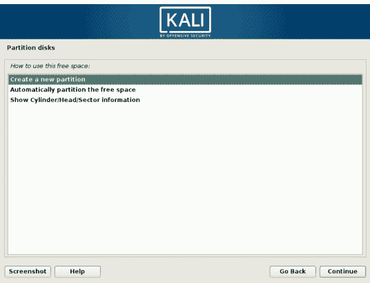

图 4.12 在空空间中创建分区

第一个项目将创建一个具有你选择的特性（包括大小）的单一分区。第二个项目将使用所有空空间，并在引导式分区向导（第 4.2.1.12.1 节，“引导式分区” [第 75 页]）的帮助下其中创建多个分区。当你想要在另一个操作系统并存安装 Kali 但不想管理分区布局时，此选项特别有。。最后一个项目将显示空空间起始和结束的柱面/磁头/扇区号。

当你选择“创建新分区”时，你将进入手动分区序列的核心。选择此选项后，系统将提示你输入分区大小。如果磁盘使用 MSDOS 分区表，你将获得创建主分区或逻辑分区的选项。
（需要知道：你可以有四个主分区但可以有更多的逻辑分区。包含 `/boot` 及其内核内核的分区必须是主分区，逻辑分区位于扩展分区中，而扩展分区会占用四个主分区之一。）然后你应该看到通用的分区配置屏幕：

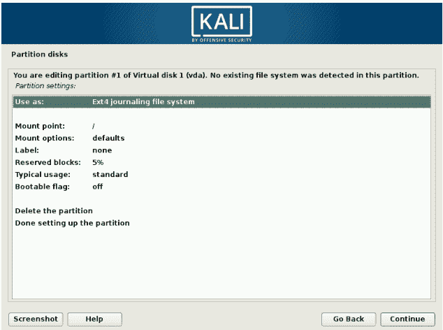

**图 4.13** 分区配置屏幕

为了总结手动分区的这一步，让我们看看对新分区可以做什么。你可以：

- 格式化它并通过选择挂载点将其包含文件树中。挂载点是存放所选分区上文件系统内容的目录。因此，挂载在 `/home/` 上的分区传统上旨在包含用户数据，而“root”则被称为文件树的根，因此是实际托管 Kali 系统的分区的根。
- 将其用作交换分区。当 Linux 内核缺少足够的可用内存时，它会将 RAM 的不活动部分存储在硬盘上特殊的交换分区中。虚拟内存系统使这对应用程序是透明的。为了模拟额外的内存，Windows 使用直接包含在文件系统中的交换（分页）文件。相反，Linux 使用专门为此目的划分的分区，因此被称为交换分区。
- 将其变为“用于加密的物理卷”以保护某些分区上数据的机密性。此情况在引导式分区中是自动的。更多信息请参见第 4.2.2 节，“在完全加密的文件系统上安装” [第 85 页]。
- 将其变为“用于 LVM 的物理卷”（本书未涵盖）。请注意，当你设置加密分区时，引导式分区会使用此功能。
- 将其用作 RAID 设备（本书未涵盖）。
- 选择不使用该分区，并保持其不变。

完成后，你可以通过选择“撤销分区的更改”退出手动分区，或通过从手动安装程序屏幕上选择“完成分区并将更改写入磁盘”将你的更改写入磁盘（图 4.11，“验证分区” [第 77 页]）。

## 拷贝实时镜像

接一步不需要任何用户交互，会将实时镜像的内容复制到目标文件系统，如图 4.14 所示，“拷贝数据” [第 80 页]。

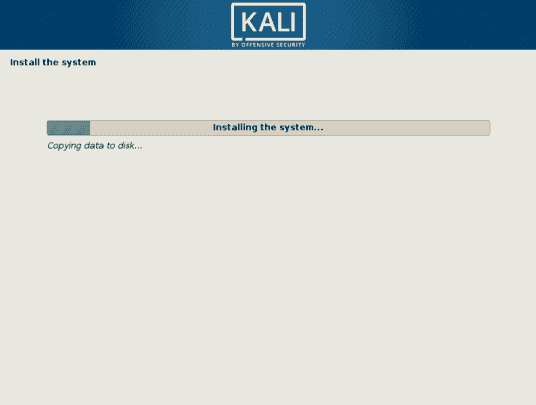

图 4.14 拷贝数据

# 配置软件包管理器 (apt)

为了能够安装额外的软件包，APT 需要配置并告知从哪里查找。在 Kali 中，此步骤大多是非交互的，除非镜像是 `http.org`。你只需确认是否要使用此镜像（图 4.15，“使用网络镜像？” [第 81 页]）。如果不提供代理，安装程序将尝试直接连接互联网。

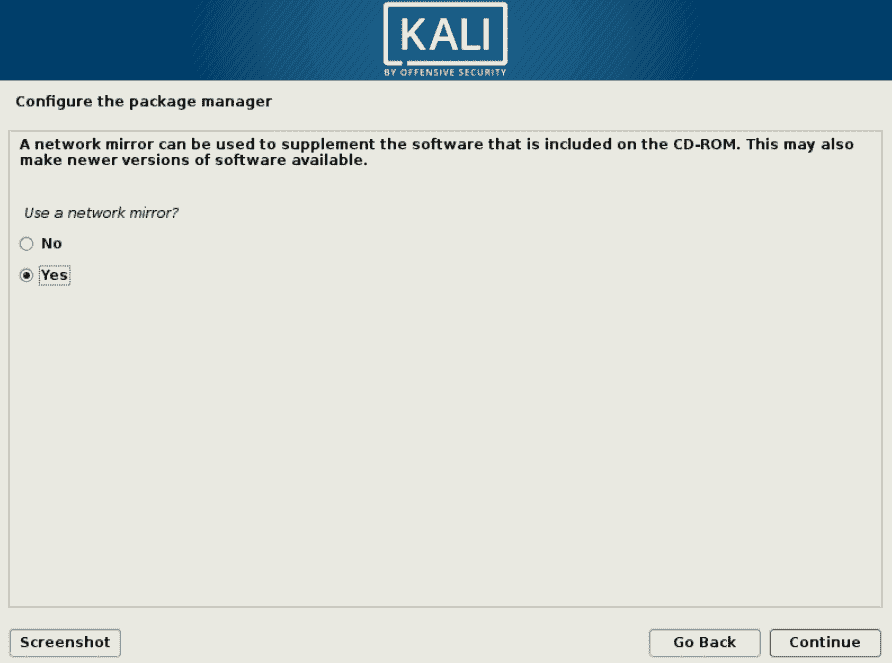

图 4.15 使用网络镜像？

接下来，Packages `.xz` 和 Sources `.xz` 文件将自动下载以更新 APT 识别的列表。

由 BIOS 启动的 GRUB。该程序将 Linux 内核加载到内存中并执行它。引导程序通常提供一个菜单，允许你选择加载的内核或启动的操作系统。

由于技术优越性，GRUB 是 Debian 安装的默认引导程序：它支持大多数文件系统，因此在每次安装新内核后不需要更新，因为它在启动时会读取配置并找到新内核的确切位置。

你应该将 GRUB 安装到主引导记录 `MBR`，除非你已经安装了任何知道如何引导 Kali Linux 的系统。如图 4.17，“在硬盘上安装引导程序” [第 83 页] 所示，修改 MBR 将使依赖于它的未识别操作系统无法启动，直到你修复 GRUB 的配置。

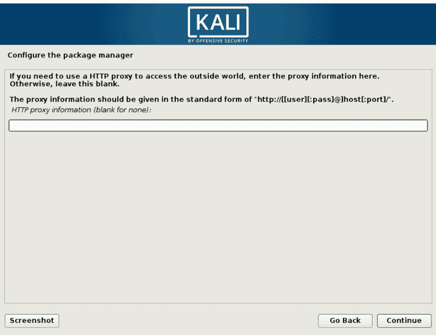

似乎此新安装是该计算机上唯一的操作系统。如果是这样，将 GRUB 引导程序安装到第一个硬盘的主引导记录应该是安全的。

警告：如果安装程序未能检测到计算机上存在的其他操作系统，修改主引导记录将使该操作系统暂时无法启动，尽管以后可以手动配置 GRUB 来引导它。

将 GRUB 引导程序安装到主引导记录？
- 否
- 是

图 4.17 在硬盘上安装引导程序

在此步骤中（图 4.18，“安装引导加载程序的设备”[第 84 页]），你必须选择将 GRUB 安装在哪个设备上。这应该是你当前的启动驱动器。

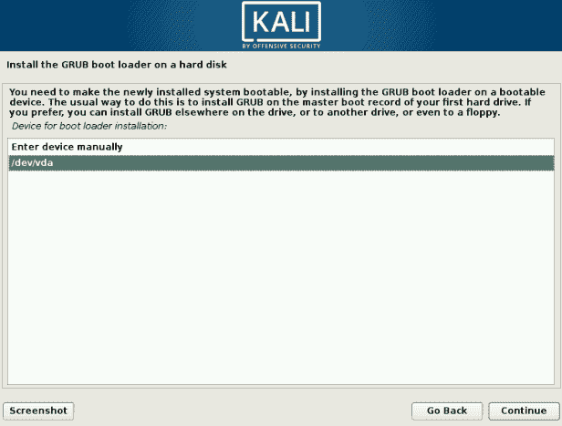

图 4.18 安装引导加载程序的设备

默认情况下，GRUB 提供的启动菜单会显示所有已安装的 Linux 内核以及检测到的任何其他操作系统。这就是为什么你应该接受将其安装在主引导记录（MBR）中的建议。保留旧版本的内核可以确保在最近安装的内核存在缺陷或与硬件适配不佳时，保留启动系统的能力。因此，我们建议你保留几个旧版本的内核。

> **注意：引导加载程序与双系统启动** 安装过程中的此阶段会检测计算机上已安装的操作系统，并自动在启动菜单添加相应的项目。然而，并非所有的安装程序都会这样做。
> 特别是，如果你之后安装（重新安装）Windows，引导加载程序将被擦除。Kali 仍然留在硬盘上，但将无法从启动菜单访问。此时，你必须在内核命令中使用带有 `rescue/enable=true` 参数启动 Kali 安装程序，以重新安装引导加载程序。该操作在 Debian 安装手册中有详细描述。

- http://www.debian.org/releases/stable/amd64/ch0s07.html

# 完成安装并重启

现在安装已完成，程序要求你从光驱器中取出 DVD-ROM（或拔掉你的 USB 驱动器），这样在安装程序重启系统后，你的电脑就可以启动到新的 Kali 系统（图 4.19，“安装完成”[第 85 页]）。

最后，安装程序将进行一些清理工作，例如删除用于创建环境环境特定包。

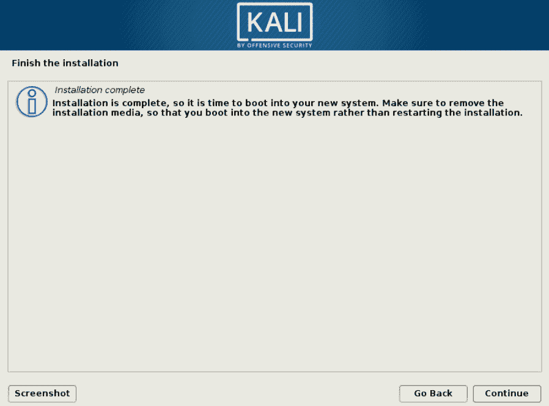

图 4.19 安装完成

## 4.2.2. 在全加密文件系统上安装

为了保证数据的机密性，你可以设置加密分区。如果你的笔记本电脑或硬盘丢失或被盗，这保护保护你的数据。分区工具可以在引导模式和手动模式下帮助你完成这一过程。

引导分区模式将结合使用两种技术：用于加密分区的 Linux 统一密钥设置（LUKS）和用于动态管理存储的逻辑卷管理（LVM）。这两个功能都可以通过手动分区模式进行设置和配置。

## LVM 简介

让我们先来讨论 LVM。使用 LVM 术语，虚拟分区是一个逻辑卷（`logical volume`），它是卷组（`volume group`）的一部分，或者是多个物理卷（`physical volumes`）的关联。物理卷是真实的分区（或通过其他抽象导出的虚拟分区，例如软件 RAID 设备或加密分区）。

由于 LVM 并不区分“物理”分区和“逻辑”分区，它允许你创建跨越多个磁盘的“虚拟”分区（virtual partitions）。这样做的好处有二：分区的大小不再受单个磁盘的限制，而是取决于它们的累积卷容量；而且你可以随时调整分区的大小，例如在添加磁盘之后。

这种技术的工作非常简单：每个卷（无论是物理卷还是逻辑卷）都被分为相同大小的块，LVM 对这些块进行关联。添加新磁盘将导致创建一个新的物理卷，提供可以关联到任何卷组的新块。卷组中的所有分区都可以充分利用额外分配的空间。

## LUKS 简介

为了保护你的数据，你可以在所选的文件系统下方添加一个加密层。Linux（更准确说是 `dm-crypt` 驱动）使用设备映射（device mapper）根据用于存储数据的底层分区创建虚拟分区（其内容受保护）。LUKS 标准化了加密存储。

| 加密交换分区 |
| :--- |
| 当使用加密分区时，密钥存储在内存（RAM）中。由于此，任何能够访问交换分区的人都可以提取密钥，除非系统进入热休眠。因此每次重启系统，你都需要输入这个加密密码。注意安装程序中的警告：你的加密系统的安全性取决于此密码。 |

## 设置加密分区

加密分区的安装过程与标准安装相同，仅在分区步骤中（图 4.20，“引导 - 使用 LVM”[第 87 页]），你将选择“加密整个磁盘并设置 LVM”。其结果是，在提供加密密码之前，系统无法启动。

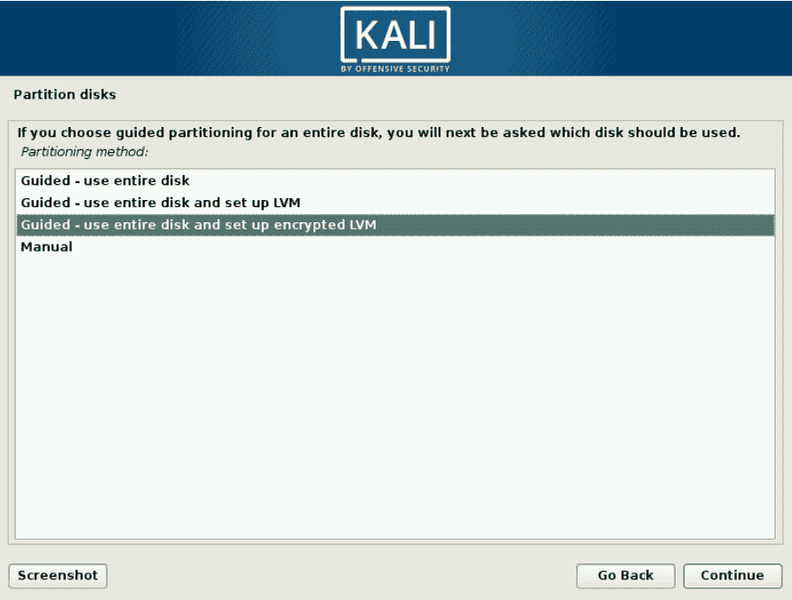

图 4.20 引导 - 使用 LVM

## 分区磁盘

在配置逻辑卷管理器之前，必须确定分区方案。在逻辑卷管理器配置后，不再允许更改。请决定你是否对分区方案满意：将更改写入磁盘？是

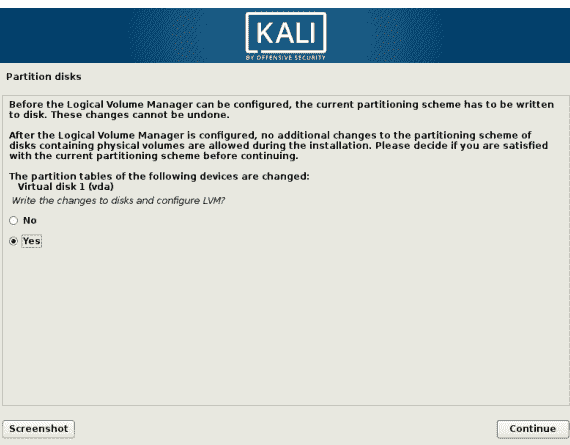

图 4.21 分区表

## 在加密分区上删除数据

接下来，安装程序要求你输入加密密码（图 4.23，“输入密码”[第 89 页]）。为了查看加密分区的内容，你每次重启系统都需要输入此密码。

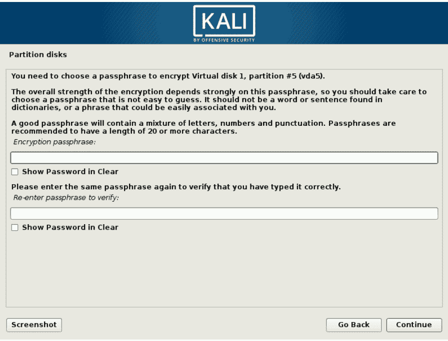

图 4.23 输入密码

分区工具现在可以访问存储在底层分区中的新虚拟分区。LVM 使用此新分区作为物理卷，用同一个密钥保护多个分区（LVM 逻辑卷）。在这里，使用 LVM 不是为了方便扩展存储大小，而是为了方便将加密分区分为多个逻辑卷。

## 加密 LVM 的引导分区结束

接下来，将显示结果的分区方案（图 4.24，“加密 LVM 的引导分区”[第 90 页]），你可以根据需要调整设置。

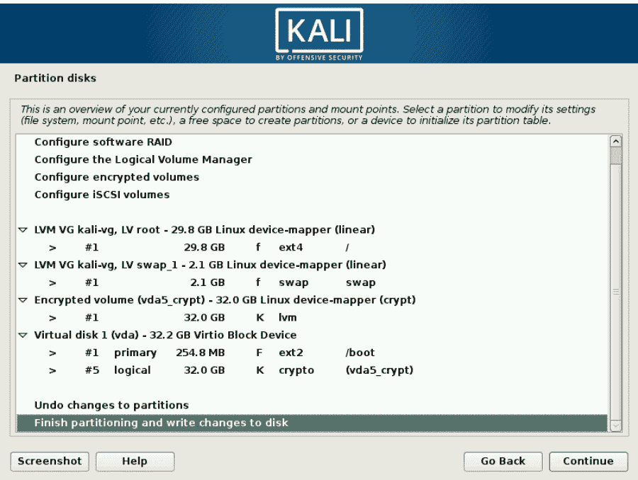

图 4.24 加密 LVM 的引导分区

最后，在验证分区设置后，工具会请求确认对磁盘进行更改，如图 4.25，“要格式化的分区”[第 91 页]所示。

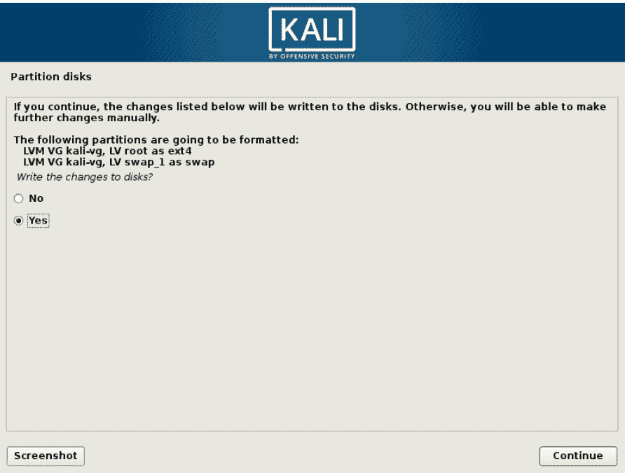

图 4.25 要格式化的分区

最后，安装过程将如常继续，正如第 4.2.1.14 节“配置包管理器 (apt)”[第 81 页]所示。

## 4.3. 无值安装

Debian 和 Kali 安装程序是高度模块化的；在基础层，它们只是按顺序执行许多脚本（封装在微型包 `udeb`——即 µdeb 或 micro-deb 中）。每个脚本都依赖 `debconf`（参见“debconf 工具”[第 214 页]），它与用户交互并存储安装参数。因此，安装程序也可以通过以下方式自动化

`debconf` 预设，一个允许你为安装问题提供无人值答案的函数。

### 4.3.1. 预设答案 (Preseeing Answers)

有多种方法可以为安装程序预设答案。每种方法都有其优缺点。根据预设发生的时间，可以预设的问题类型也所不同。

#### 通过引导启动参数 (With Boot Parameters)

你可以通过位于内核命令行末尾的启动参数来预设任何安装程序问题，这些参数可以通过 `/proc/cmdline` 访问。某些启动加载器会允许你交互式地编辑这些参数（这对于测试目的非常实用），但如果你想让更改持久化，则必须修改启动加载器的配置。

你可以直接使用 `debconf` 问题的完整标识符（例如 `debian-installer/language=en`），也可以对最常用的问题使用缩写（如 `language=en` 或 `hostname=duke`）。请在 Debian 安装手册中查看完整的别名列表。

对于可以预设哪些问题没有限制，因为启动参数从安装过程开始就可用，并且它们在非常早的阶段就会被处理。然而，启动参数的数量限制为 32 个，而且已经有一些被默认占用了。需要注意的是，更改启动加载器的配置有时并非易事。

在第 9.3 节“构建自定义 Kali Live 镜像”（第 237 页）中，你还将学习如何在生成自己的 Kali ISO 镜像时修改 Ininusux 配置。

#### 通过 Initrd 中的预设文件 (With a Preseed File in the Initrd)

你可以在安装程序 `initrd` 的根目录下添加一个名为 `.cfg` 的文件（这是用于启动安装程序的 `initrd`）。通常，这需要重新构建 `debian-installer` 源码包以生成新版本的 `initrd`。然而，`live-build` 提供了一种方便的方法来实现这一点，详细信息在第 9.3 节“构建自定义 Kali Live 镜像”（第 237 页）中进行了介绍。

这种方法对你预设的问题也没有任何限制，因为预设文件在启动后立即可用。在 Kali 中，我们已经利用了这一特性来定制官方 Debian 安装程序的行为。

> https://www.debian.org/releases/amd64/apbs02#preseed-aliases

#### 通过启动介质中的预设文件 (With a Preseed File in the Boot Media)

你可以向启动介质（CD 或 USB 闪存）添加预设文件；预设会在介质挂载后立即发生，这意味着在关于语言和键盘布局的问题之后立即进行。可以使用 `preseed/file` 启动参数来指定预设文件的位置（例如，在 CD-ROM 安装时使用 `/cdrom/preseed.cfg`，在 USB 闪存安装时使用 `/hd-media/preseed.cfg`）。

你可能无法预设语言和国家选项的答案，因为预设文件在过程的后期才加载，此时硬件驱动程序已加载。良好的一方面是，live-build 可以轻松在生成的 ISO 镜像中放入补充文件（见第 9.3 节“构建自定义 Kali Live OS 镜像”，第 237 页）。

#### 通过从网络加载的预设文件 (With a Preseed File Loaded from the Network)

你可以通过 Web 服务器在网络上提供预设文件，并通过添加启动参数 `preseed=http://server/preseed.cfg`（或使用 url 别名）告诉安装程序下载预设文件。

然而，当你使用这种方法时，请记住必须先配置网络。这意味着与网络相关的 `debconf` 问题（特别是主机名和域名）以及所有之前的问题（如语言和国家）无法通过这种方法进行。这种方法通常与启动参数结合使用，用于预设那些特定问题。

这种预设方法是最灵活的，允许你可以在不更改安装介质的情况下更改安装配置。

| 延迟语言、国家、键盘问题 | 为了克服无法预设语言、国家和键盘问题的局限性，你可以添加启动参数 `auto-install=enable-true`（或 `auto=true`）。使用此选项后…… |
| :--- | :--- |
这种预设方法是最灵活的，允许你可以在不更改安装介质的情况下更改安装配置。

| 延迟语言、国家、键盘问题 | 为了克服无法预设语言、国家和键盘问题的局限性，你可以添加启动参数 `auto-install=enable-true`（或 `auto=true`）。使用此选项后…… |
*(注：原文此处似乎存在重复段落或断句，已按原文结构逻辑翻译)*

这种预设方法是最灵活的，允许你可以在不更改安装介质的情况下更改安装配置。

当安装程序失败时，它会显示一个相当没有帮助的界面，如图 4.26 所示的“安装步骤失败”第 96 页]。

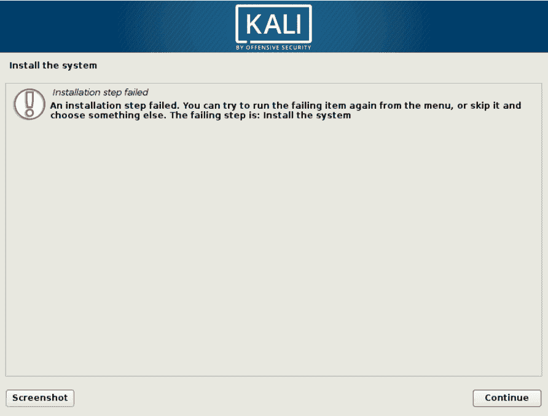

图 4.26 安装步骤失败

此时，了解安装程序使用了多个虚拟控制台是有用的：你看到的主屏幕运行在第五个控制台（对于图形化安装程序，使用 CTRL+Shift+F5），或者运行在第一个控制台（对于文本安装程序，使用 CTRL+Shift+F1）。在这两种情况下，第四个控制台（CTRL+Shift+F4）都会显示正在发生的日志，你通常可以在那里看到更有用的错误信息，例如图 4.27 所示的“安装程序的日志屏幕”第 97 页]，该日志揭示了安装程序磁盘空间不足。

```


`option:`:

Apr 15 19:04:24 main-menu(8331): (process:5559): lib error:

Apr 15 19:04:24 main-menu(8331): (process:5559): `/lib/partman/active_partition/choices`: not found

Apr 15 19:04:24 main-menu(8331): (process:5559):

Apr 15 19:04:24 main-menu(8331): (process:5559): `/lib/partman/choose_partition/60partition_tree/do_option`:

Apr 15 19:04:24 main-menu(8331): (process:5559): lib error:

Apr 15 19:04:24 main-menu(8331): (process:5559): `/lib/partman/active_partition/choices`: not found

Apr 15 19:04:24 main-menu(8331): (process:5559):

Apr 15 19:04:24 main-menu(8331): (process:5559): `/lib/partman/free_space/50new/do_option`:

Apr 15 19:04:24 main-menu(8331): (process:5559): lib 226:

Apr 15 19:04:24 main-menu(8331): (process:5559): `/lib/partman/active_partition/choices`: not found

Apr 15 19:04:24 main-menu(8331): (process:5559):

Apr 15 19:04:24 main-menu(8331): (process:5559): `/lib/partman/free_space/50new/do_option`:

Apr 15 19:04:24 main-menu(8331): (process:5559): lib 226:

Apr 15 19:04:24 main-menu(8331): (process:5559): `/lib/partman/active_partition/choices`: not found

Apr 15 19:04:24 main-menu(8331): (process:5559):

Apr 15 19:04:24 main-menu(8331): (process:5559): (libc1): package doesn't exist (ignored)

Apr 15 19:04:24 base-installer: INFO: Menu item 'live-installer' selected

Apr 15 19:04:24 base-installer: installing squashfs for `/cdrom/live/filesystem/squashfs`

Apr 15 19:04:24 base-installer: auto-install: `kernel-squashfs-4.3.0-kalli-amd64-di`: package doesn't exist (ignored)

Apr 15 19:04:24 kernel: [00485] DEGBUS: kernel [165.79501261]: version 4.4.0 (2009/01/31) Phillip Lougher

Apr 15 19:04:24 kernel: [00485] 165.79501261: module loaded

Apr 15 19:04:45 base-installer: error: The tar process copying the live system failed (only 9238 out of files have been copied, last ...)

Apr 15 19:04:45 base-installer: error: `tar`: write error: No space left on device

Apr 15 19:04:45 main-menu(8331): (process:8491): `tar`: write error: Broken pipes

Apr 15 19:04:45 main-menu(8331): WARNING ==: Configuring 'live-installer' failed with error code 1

在本章中，我们将介绍配置 Kali Linux 的多种方法。首先，第 5.1 节“配置网络”[第 104 页]将展示如何使用图形化环境和命令行配置网络设置。在第 5.2 节“管理 Unix 用户和 Unix 组”[第 107 页]，我们将讨论用户和组，展示如何创建和修改用户账户、密码、禁用账户以及管理组。最后，我们将在 5.3 节“配置服务”[第 109 页]中讨论服务，解释如何设置和维护通用服务，并重点关注三个非常重要的特定服务：SSH、PostgreSQL 和 Apache。

## 5.1. 配置网络

### 5.1.1. 在桌面端使用 NetworkManager

在典型的桌面安装中，你已经安装了 NetworkManager，它可以通过 Gnome 控制中心以及右上角的菜单进行控制和配置，如图 5.1 “网络配置屏幕”[第 104 页]所示。

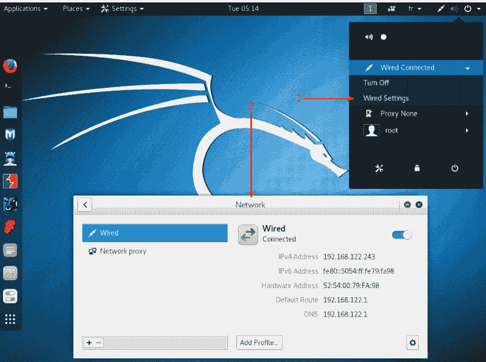

图 5.1 网络配置屏幕

默认配置依赖 DHCP 来获取 IP 地址、DNS 服务器和网关，但你可以使用右下角的齿轮图标以多种方式更改配置（例如：设置 MAC 地址、切换到静态设置、启用或禁用 IPv6，以及添加额外路由）。你可以创建配置文件来保存多个网络配置并在它们之间轻松切换。对于无线网络，其设置会自动与你的公共标识符（SSID）绑定。

NetworkManager 还处理通过移动宽带（无线局域网 WWAN）和使用以太网点对点协议（PPPoE）的调制解调器的连接。此外，它通过专用插件与许多虚拟专用网络（VPN）集成：SSH、OpenVPN VPNC、StrongSwan。检查 `network-manager-*` 软件包；它们大多数默认没有安装。请注意，你需要带有 -gnome 后缀的包才能通过图形化用户界面对其进行配置。

### 5.1.2. 在命令行中使用 Ifup

或者，当你倾向于不使用（或无法访问）图形化桌面时，可以使用已安装的 `ifup` 包来配置网络，该包包含了 `ifup` 和 `ifdown` 工具。这些工具从 `/etc/network/interfaces` 文件中读取定义，并且是在启动时配置网络的 `/etc/init.d/networking` 初始化脚本的核心。

由 `ifupdown` 管理的每个网络设备都可以随时通过 `ifdown <network-device>` 取消配置。然后你可以修改 `/etc/network/interfaces` 并使用 `ifup <network-device>` 将网络重新启动（使用新配置）。

让我们看看我们可以在 `ifupdown` 配置文件中放入什么。主要有两个指令：`auto <network-device>`，它告诉 `ifupdown` 在网络接口可用后自动配置它；以及 `iface <network-device> inet/inet6`，用于配置指定的接口。例如，一个简单的 DHCP 配置如下：

```
auto lo

ace lo inet loopback

auto eth0

iface eth0 inet dhcp
```

注意，回环设备的特殊配置应始终存在于此文件中。对于固定 IP 地址配置，你必须提供更多细节，如 IP 地址、网络掩码和网关 IP：

```
auto eth0

iface eth0 inet static

address 192.168.0.3

netmask 255.255.255.0

broadcast 192.168.0.0

network 192.168.0.0

gateway 192.168.0.1
```

对于无线接口，你必须拥有 `wpasupplicant` 包（Kali 默认包含），它提供了可以在 `/etc/network/interfaces` 中使用的 `wpa-*` 选项。查看 `/usr/share/doc/wpasupplicant/README.gz` 以获取示例和解释。最常用的选项是 `wpa-ssid`（定义要加入的无线网络名称）和 `wpa-psk`（定义密钥）。

```
iface wlan0 inet dhcp

wpa-ssid MyNetwork

wpa-psk secret
```


### 5.1.3. 在命令行中使用 systemd-networkd

`ifupdown` 是 Debian 使用的历史工具，虽然它仍然是服务器或最小安装的默认工具，但有一个新工具：`systemd-networkd`。它与 `systemd` 的集成使其成为非常有吸引力的选择。它不限于 Debian 发行版（与 `ifupdown` 不同），设计得小巧、高效，如果你理解 `systemd` 文件的语法，配置起来相对容易。你通过将 `.network` 文件放入 `/etc/systemd/network/` 来配置 `systemd-networkd`。或者，你可以使用运行时生成的 `/lib/systemd/network/` 目录。`Match` 部分指明配置适用于适的网络接口。你可以通过多种方式指定接口，包括 MAC 地址或设备类型。`Network` 部分定义网络配置。

基于 DHCP 的配置示例：`etc/systemd/network/80-dhcp.network`

```
[Match]

Name=en*

[Network]

DHCP=yes
```

静态配置示例：`etc/systemd/network/10-static.network`

```
[Match]

Name=enps0

[Network]

Address=192.168.0.15/24

Gateway=192.168.0.1

DNS=8.8.8.8
```

注意 `systemd-networkd` 默认是禁用的，如果你想使用它，应该启用它。它还依赖 `systemd-resolved` 进行正确的 DNS 解析，这要求你将 `/etc/resolv.conf` 替换为指向 `/run/systemd/resolve/resolv.conf` 的符号链接。

```
# systemctl enable systemd-networkd

# systemctl enable systemd-resolved

# systemctl start systemd-networkd

# systemctl start systemd-resolved

# ln -sf /run/systemd/resolve/resolv.conf /etc/resolv.conf
```

虽然 `systemd-networkd` 在无线网络集成支持方面存在局限，但你可以依赖现有的符合 `wpa` 配置。然而，它在容器和虚拟机中特别有用，最初是为了那些容器网络配置取决于主机网络配置的环境开发的。在这种情况下，`systemd-networkd` 使管理变得更容易同时支持你可能需要的各种虚拟设备（参见 `systemd-netdev(5)`）。

## 5.2. 管理 Unix 用户和 Unix 组

Unix 用户组数据库由文本文件 `/etc/passwd`（用户列表）、`/etc/shadow`（用户密码）、`/etc/group`（组列表）和 `/etc/gshadow`（组密码）组成。它们的格式分别记录在 `passwd(5)`、`shadow(5)`、`group(5)` 和 `gshadow(5)` 中。虽然可以使用 `vip` 和 `vi` 等工具手动编辑这些文件，但有更高级别的工具可以执行常用操作。

### 5.2.1. 创建用户账户

尽管 Kali 经常以 `root` 用户身份运行，但你可能由于各种原因创建非特权用户账户，特别是将 Kali 作为主操作系统时。添加用户的最典型方法是使用 `adduser` 命令，它接受一个参数：要创建的新用户的用户名。

`adduser` 命令在创建账户之前会询问几个问题，但其用法非常直观。它的配置文件 `/etc/adduser.conf` 包含许多有趣的设置。例如，你可以定义可以使用的用户标识符 `UID` 范围，规定用户是否共享共同组，定义默认设置等。

账户的创建会触发使用 `/etc/skel/` 模板的内容填充用户的家目录。这为用户提供了一组标准目录和配置文件。

在某些情况下，将用户添加到组（主组之外的组）以获得额外权限是很有用的。例如，包含在 `sudo` 组中的用户可以通过 `sudo` 命令获得完全的管理权限。这可以通过如 `adduser` 之类的命令实现。

使用 `getent` 查询用户数据库

`getent`（获取条目）命令使用相应的库函数检查系统数据库（包括这些用户和组），这些函数调用配置在 `/etc/nss.conf` 文件中的名称切换 `NSS` 模块。命令接受一个或两个参数：要检查的数据库名称和可能的搜索键。因此，命令 `getent passwd kaliuser1` 从用户数据库返回请求 `kaliuser1` 的信息。

```
root@kali:~# getent passwd kaliuser1

kaliuser1:x:1001:1001:Kali User:444:123-867-5309:321-867-5309:/home/kaliuser1:/bin/bash
```


### 5.2.2. 修改现有账户或密码

以下命令允许修改数据库中特定字段的信息：

- `passwd` 允许普通用户更改密码，从而更新 `/etc/shadow` 文件。
- `chfn` (更改全名) 为超级用户 (`root`) 保留，修改 GECO 或“通用信息字段”。
- `chsh` (更改 shell) 修改用户的登录 shell。然而，可选范围将局限于 `/etc/shells` 中列出的内容；另一方面，管理员不受此限制，可以将 shell 设置为任何选择的程序。
- `chage` (更改 AGE) 允许管理员通过传递用户作为参数来更改密码过期，或使用 `-l user` 选项列出当前设置。

此外，你也可以使用 `passwd -e user` 命令强制密码过期，这会强制用户在下次登录时更改其密码。

## 5.2.3. 禁用账户

你可能会发现自己需要禁用账户（锁定用户）作为纪律措施、调查目的，或者仅仅在用户长时间或确定缺席的情况下。禁用的账户意味着用户无法登录或访问该机器。该账户在机器上保持完整，不会删除任何文件或数据；只是无法访问。这通过使用命令 `passwd -l user`（lock）来实现。重新启用账户的方法也类似，使用 `-u` 选项（unlock）。

## 5.2.4. 管理 Unix 组

`addgroup` 和 `delroup` 命令分别用于添加或删除组。`groupmod` 命令用于修改组的信息（其 `gid` 或标识符）。`gpasswdwd` 命令更改组的密码，而 `gpasswd -r group` 命令则删除该组。

| 多个组的操作 | 每个用户都可能是多个组的成员。默认情况下，用户的主组在初始用户配置期间创建。默认情况下，用户所属的每个文件以及用户所属主组的文件并不总是理想的；例如，当用户需要在一个其他组共享的目录中工作时。在这种情况下，用户需要使用以下命令之一更改组：`newgrp`（启动一个新的 shell）或 `sg`（使用指定的组执行命令）。这些命令还允许你加入一个你不所属的组。如果该组受保护，则在执行命令前需要提供相应的密码。或者，用户可以在目录上设置 `setgid` 位，这会导致在该目录中创建的文件自动属于正确的组。欲需更多信息，请参阅 setgid 目录和粘位 [第58页]。`id` 命令显示用户的当前状态，包括其个人标识符（`uid` 变量）、当前主组（`gid` 变量）以及所属的组列表（`groups` 变量）。 |

## 5.3. 配置服务

在本节中，我们将查看服务（有时称为守护进程），即作为后台进程运行并为系统执行各种各种功能的程序。我们将从讨论配置文件开始，然后解释一些重要服务（如 SSH、PostgreSQL 和 Apache）的功能以及如何对它们进行配置。

## 5.3.1. 配置特定程序

当你配置一个未知软件包时，必须分阶段进行。首先，你应该阅读软件包维护者编写的文档。`/usr/share/doc/package/README.Debian` 是一个很好的起点。该文件通常包含有关该软件包的信息，包括可能引导你参考其他文档的指针。如果你通过先阅读此文件，可以节省大量时间并避免许多挫败感，因为它详细说明了最常见的错误以及大多数常见问题的解决方案。

接下来，你应该查看软件的官方文档。参考第 6.1 节“文档来源” [第124页] 可以获取如何查找各种文档来源的提示。`dpkg-package` 命令列出了软件包中包含的文件列表；你可以快速识别可用的文档（以及位于 `/etc/` 的配置文件）。此外，`dpkg -s package` 显示软件包的元数据并显示任何推荐或建议的软件包；在其他情况下，你可以找到文档或使用帮助配置软件的实用程序。

最后，配置文件通常通过解释性注释进行自说明，详细说明了每个配置设置的各种值。在某些情况下，你只需在配置文件中取消一行注释即可运行。在其他情况下，`/usr/share/doc/package/examples/` 目录下提供了配置文件示例。它们可以作为你自己的配置文件的基础。

## 5.3.2. 配置 SSH 用于远程登录

SSH 允许你远程登录机器、传输文件或执行命令。它是连接到远程机器的标准工具 (`ssh`) 和服务 (`sshd`)。

虽然默认安装了 `openssh-server` 软件包，但 SSH 服务默认是禁用的，且不会在启动时启动。你可以使用 `systemctl start ssh` 手动启动 SSH 服务，或使用 `systemctl enable ssh` 配置其配置在启动时启动。

SSH 服务有一个相对默认的配置，但考虑到其强大的功能和敏感性，了解你可以在配置文件 `/etc/ssh/sshd_config` 中做什么是有好处的。所有选项在 `sshd_config(5)` 中均有记录。

默认配置禁用了 root 用户的密码登录，这意味着你必须先用 `ssh-keygen` 设置 SSH 密钥。你可以通过将 `PasswordAuthentication` 设置为 `no` 将此扩展到所有用户，你也可以通过更改 `PermitRootLogin yes`（而不是默认的 `prohibit-password`）来取消此限制。SSH 服务默认在端口 22 上监听，你可以通过 `Port` 指令更改它。

要应用新设置，你应该运行 `systemctl reload ssh`。

## 生成新的 SSH 密钥

每个 SSH 服务器都有自己的加密密钥；它们被称为“SSH 主机密钥”，存储在 `/etc/ssh/` 中。如果你希望保持私密性，应该在安装系统时生成它们。

当你通过复制完整的磁盘镜像（而不是 debian-installer）安装系统时，镜像可能包含预生成的 SSH 密钥。你可以通过以下命令完成所有操作：

```
# password

# rm /etc/ssh/ 

# dpkg-reconfigure openssh-server

# service restart
```

## 5.3.3. 配置 PostgreSQL

PostgreSQL 是一个数据库服务器。它允许多个版本的集群。

| 多个 PostgreSQL 版本 | `postgresql.conf` 可以配置各种指令：`listen_addresses` 用于监听的地址，`port` 用于 TCP 端口，以及 `unix_socket_directories` 定义创建套接字的目录 `var/run/postgresql/` |

## 连接类型与身份验证

根据连接方式，客户端以不同的方式进行身份验证。`pg_hba.conf` 配置文件定义了允许在每个套接字上连接的用户以及他们如何进行身份验证。默认情况下，基于文件的套接字连接使用 Unix 账户作为 PostgreSQL 的名称，并假设不需要额外的身份验证。TCP 连接要求用户使用用户名和密码进行身份验证（而不是 Unix 用户名/密码）。

`postgres` 用户是特殊的，对所有数据库具有完全的管理权限。我们将使用此身份创建新的用户和数据库。

## 创建用户和数据库

`createuser` 命令添加新用户，`dropdb` 删除一个。同样，`createdb` 命令添加新数据库，删除一个。这些命令都有自己的页面，但我们在这里讨论一些选项。对于默认集群（运行在 5432）上的每个命令，你可以使用 `--port` 修改替代集群的操作和数据库。

这些命令必须连接到 PostgreSQL 服务器才能工作，并且作为具有执行特定操作权限的用户进行身份验证。实现这一目标的最简单方法是使用 postgres Unix 账户并通过基于文件的套接字连接：

```
# su - postgres

$ createuser -P king_phisher

Enter password for new role:

Enter it again:

$ createdb -T template0 -E UTF-8 -O king_phisher king_phisher
```


在上面的示例中，`-P`选项在创建新的`king_phisher`用户后请求查询密码。查看`createdb`命令，`-O`定义了拥有新数据库的用户（该用户将拥有创建表和授予权限等的完整权利）。我们希望使用 Unicode 字符串，因此添加`-E UTF-8`选项来设置编码，这反过来要求我们使用`-T`来选择另一个数据库模板。

如你所见，连接成功。

## 管理 PostgreSQL 集群

首先，值得注意的是，“PostgreSQL 集群（cluster）”概念是 Debian 特有的扩展，你不会在官方 PostgreSQL 文档中找到该术语的引用。从 PostgreSQL 工具的角度来看，此类集群是运行在特定端口上的数据库服务器实例。

尽管如此，Debian 的`postgresql-common`软件包提供了多个工具来管理此类集群：`pg_createcluster`、`pg_dropcluster`、`pg_ctlcluster`、`pg_upgradecluster`、`pg_renamecluster`和`pg_lsclusters`。我们在这里不会介绍所有的工具，但你可以参考各自的页面获取更多信息。

你必须知道的是，当系统安装了新的 PostgreSQL 大版本时，它会创建一个运行在新端口（通常为 5433）的新集群，你在迁移数据库之前一直使用旧版本。

你可以使用`pg_lsclusters`获取所有集群及其状态。更重要的是，你可以通过`pg_upgradecluster old-version cluster-name`将你的集群自动迁移到最新的 PostgreSQL 版本。为了实现这一操作，你可能需要删除新版本的（空）集群（使用`pg_dropcluster new-version cluster-name`）。在此过程中，旧集群不会被删除，但也不会自动启动。一旦你确认升级后的集群运行正常，就可以将其删除。

## 5.3.4. 配置 Apache

Kali Linux 安装包含了由`apache2`软件包提供的 Apache Web 服务器。作为一种网络服务，它默认是禁用的。你可以通过`systemctl start apache2`手动启动它。

随着越来越多的应用程序以 Web 应用程序的形式发布，掌握一些 Apache 知识对于托管这些应用程序（无论是本地使用还是通过网络提供服务）至关重要。

Apache 是一个模块化服务器，许多功能通过主程序在初始化期间加载的外部模块实现。默认仅启用最常用的模块，运行`a2enmod module`可以轻松启用新模块，运行`a2dismod module`则禁用模块。这些程序实际上在`/etc/apache2/mods-enabled/`中创建（或删除）符号链接，指向实际文件（存储在`/etc/apache2/mods-available/`中）。

有很多可用模块，但有两个值得优先考虑：PHP 和 SSL。带有 PHP 的 Web 应用程序通过`libapache-mod-php`软件包提供的模块由 Apache Web 服务器执行，其安装过程会自动启用该模块。

Apache 2 内置了安全 HTTP (HTTPS) 的 SSL 模块。它首先需要通过`a2enmod ssl`启用，并且必须配置文件中添加所需的指令。`/etc/apache2/sites-available/default-ssl.conf`提供了一个配置示例。更多信息请参阅 http://httpd.apache.org/docs/2.4/mod/mod_ssl.html。

Apache 模块的完整列表可以在网上 http://httpd.apache.org/docs/2.4/mod/index.html 找到。

在默认配置下，Web 服务器监听 80 端口（如`/etc/apache2/ports.conf`配置所示），并默认从`/var/www/html/`目录提供页面（如`/etc/apache2/sites-enabled/000-default.conf`配置所示）。

## 配置虚拟主机

虚拟主机（virtual host）是 Web 的额外实体（例如 www.kali.org 和 www.offensive-security.com），因为 HTTP 请求同时包含了所请求的网站名称和 URL `localhost`（此功能被称为基于名称的虚拟主机）。

Apache 2 的默认配置启用了基于名称的虚拟主机。此外，`/etc/apache2/sites-enabled/000-default.conf`文件中定义了一个默认虚拟主机；如果没有找到匹配客户端发送请求的主机，则将使用此虚拟主机。

> 有关未知虚拟主机的请求将由`/etc/apache2/sites-enabled/000-default.conf`中定义的默认虚拟主机处理。

每个虚拟主机都由`/etc/apache2/sites-available/`中的文件描述。文件名通常为主机名加上`.conf`后缀（例如`www.example.com.conf`）。你可以通过`a2ensite www.example.com`启用虚拟主机。这里是一个监听 80 端口的虚拟主机示例：

```apache
<VirtualHost *:80>
    ServerName www.example.com
    DocumentRoot /var/www/html
    CustomLog /var/log/apache2/access.log combined
    ErrorLog /var/log/apache2/error.log
</VirtualHost>
```

## 常用指令

本节简要回顾了一些常用的 Apache 指令。`Directory`块包含了几个：

```apache
<Directory /var/www>
    Options FollowSymLinks
    Index index.html
</Directory>
```

`Options`指令列出了所有可用选项；None 值禁用所有选项：

- ExecCGI：指示可以执行 CGI 脚本。
- FollowSymLinks：告诉服务器符号链接。
- SymLinksIfOwner：告诉服务器仅当链接与其目标所有者相同时才跟随链接。
- Includes：启用 SSI（服务器端包含）。
- Indexes：告诉服务器列出目录内容。
- MultiViews：启用内容协商。

## 需要身份验证

在某些情况下，需要对网站的部分进行访问限制，以便只有提供用户名和密码的合法用户才能访问。

`.htaccess`文件包含了访问限制，每当连接到其所在的目录时就会执行。这些指令是递归的，范围扩展到所有子目录。大多数出现在`Directory`块中的指令也可以出现在`.htaccess`中。

### 示例 5.3 需要身份验证的 .htaccess 文件

```apache
Require valid-user
AuthName "Private directory"
AuthType Basic
AuthUserFile /etc/apache2/auth/passwd-private
```

示例使用的身份验证系统（Basic）安全性较低，因为密码是明文的（它仅经过 base64 编码，这是一种简单的编码而非加密方法）。还应该注意的是，此机制保护的文档通过网络传输。如果安全性很重要，整个 HTTP 会话应该通过传输层安全协议（TLS）进行加密。

`/etc/apache2/auth/passwd-private`文件包含用户密码列表；通常由`htpasswd`命令操作。例如，以下命令用于添加用户或更改其密码：

```bash
# htpasswd /etc/apache2/auth/passwd-private user
New password:
Re-type new password:
Adding password for user user
```


## 5.4. 管理服务

Kali 使用 `systemd` 作为其初始化系统（init system），它不仅负责启动序列，还永久地作为一个功能齐全的服务管理器，启动并监控服务。

可以使用 `systemctl` 命令对 `systemd` 进行查询和控制。在不带任何参数的情况下，它会运行 `systemctl list-units` 命令，输出活动单元（units）列表。如果你运行 `systemctl status`，输出将显示运行服务的层级概览。对比这两个输出，你会立即发现有多种类型的单元和服务，而其中每种都只是一个。

每个服务都由一个服务单元（service unit）表示，它由通常存放在 `/lib/systemd/system/`、`/run/systemd/system/` 或 `/etc/systemd/system/` 中的服务文件描述；这些文件按重要性递增的列出，最后一个是最后的。每个单元都可能被这些目录中的 `服务名*.conf` 文件修改。这些单元是纯文本文件，其格式灵感来源于 Microsoft Windows 著名的 `*.ini` 文件，键值对分组在 `[section]` 头部之间。在这里我们看到一个 `/lib/system/ssh.service` 的示例服务文件：

```
[Unit]
Description=Secure Shell server
After=network.target audit.service
ConditionPathExists=!/etc/ssh/sshd_not_to_be_run

[Service]
Environment=/etc/default/ssh
ExecStart=/usr/sbin/sshd -D $SSHD_OPTS
ExecReload=/bin/kill -HUP $MAINPID
KillMode=process
Restart=on-failure
RestartPreventExitStatus=255
Type=notify

[Install]
WantedBy=multi-user.target
Alias=sshd.service
```

目标单元（Target units）是 `systemd` 设计的另一个部分。它们代表了你希望通过激活单元所达到的预期状态（对于单元来说，这意味着一个运行的服务）。它们主要作为一种分组对其他单元依赖关系的方式。当系统启动时，它启用单元以达到 `default.target`（它是指向 `graphical.target` 的软链接，而后者依赖于 `multi-user.target`）。因此，这些目标的所有依赖关系在启动期间都会激活。

这种依赖关系通过目标上的 `Wants` 来表示。但你不需要编辑目标单元来添加新的依赖关系，你可以在 `/etc/systemd/system/target-name.target.wants/` 目录下创建一个指向被依赖单元的软链接。这正是 `systemctl enable foo.service` 所做的事情。当你启用一个服务时，你是在告诉系统为服务单元文件 `[Install]` 部分中 `WantedBy` 条目下列出的目标添加一个依赖关系。相反，`systemctl disable foo.service` 会删除软链接，从而删除依赖关系。

`enable` 和 `disable` 命令不会改变服务的当前状态。它们只会影响在下次启动时会发生什么。如果你想立即运行该服务，应该执行 `systemctl start foo.service`。你还可以通过 `systemctl status foo.service` 检查服务的当前状态，它很好地包含了关联日志的最后几行。在更改服务的配置后，你可能希望重新加载（reload）或重启它：这些操作通过 `systemctl reload foo.service` 和 `systemctl restart foo` 完成。

```
# systemctl status postgresql
# postgresql.service - PostgreSQL RDBMS
Loaded: loaded (/lib/systemd/system/postgresql.service); enabled; vendor preset: disabled
Active: inactive (dead)
# ls -al /etc/systemd/system/multi-user.target.wants/postgresql.service
ls: cannot access '/etc/systemd/system/multi-user.target.wants/postgresql.service': No such file or directory
# systemctl enable postgresql
[ ... ]
# ls -al /etc/systemd/system/multi-user.target.wants/postgresql.service
lrrwxr-xr-x 1 root 38 Apr 21 16:21 /etc/systemd/system/multi-user.target.wants/
# postgresql.service -> /lib/systemd/system/postgresql.service
# systemctl status postgresql
# postgresql.service - PostgreSQL RDBMS
Loaded: loaded (/lib/systemd/system/postgresql.service); enabled; vendor preset: disabled
Active: inactive (dead)
# systemctl start postgresql
# systemctl status postgresql
# postgresql.service - PostgreSQL RDBMS
Loaded: loaded (/lib/systemd/system/postgresql.service); enabled; vendor preset: disabled
Active: active (exited) Sun 2016-04-21 16:22:22 EDT; 2s ago
Process: 6355 ExecStart=/bin/true (code=exited, status=SUCCESS)
Main PID: 6355 (code=exited, status=SUCCESS)
```

```
Apr 21 16:22:29 kali-rolling systemd[1]: Starting PostgreSQL RDBMS...
Apr 21 16:22:29 kali-rolling systemd[1]: Started PostgreSQL RDBMS.
```


## 5.5. 总结

在本章中，我们学习了如何配置 Kali Linux。我们配置了网络设置，讨论了用户和组，并介绍了如何创建和修改用户账户、设置密码、禁用账户以及管理组。最后，我们讨论了服务，并解释了如何设置和维护通用服务，特别是 SSH、PostgreSQL 和 Apache。

总结提示：
- 在典型的桌面安装中，你将已经安装了 NetworkManager，可以通过 GNOME 的控制中心对其进行控制和配置。

`shell` 的 `read` 命令与 `read` 系统调用同名。这就是为什么帮助页（manual pages）是按照以下编号章节进行组织的：
- 1. 可以从命令行执行的命令
- 2. 系统调用（内核提供的函数）
- 3. 库函数（由系统库提供）
- 4. 设备（在类 Unix 系统中，这些是特殊文件，通常存于 `/dev/` 目录下）
- 5. 配置文件（格式和约定）
- 6. 游戏
- 7. 宏定义和标准集
- 8. 系统管理命令
- 9. 内核例程

你可以指定要查找的手帮助页章节：要查看 `read` 系统调用的文档，你需要输入 `man 2 read`。当没有显式指定章节时，将显示具有请求名称的手帮助页的第一章节。因此，`man shadow` 返回 `shadow(5)` 是因为第 1-4 节中没有 `shadow` 的帮助页。

当然，如果你不知道命令的名字，手册将大无用处。请尝试使用 `apropos` 命令，它会在你提供的任何关键词中搜索帮助页（更具体地说是它们的短描述）。`apropos` 命令会返回一个帮助页列表，其摘要包含请求的关键词以及帮助页中的单行摘要。如果你选词得当，就能找到需要的命令名称。

## 示例 6.1 使用 apropos 查找 cp

| apropos "copy file" | | |
| :--- | :--- | :--- |
| cp (1) | 复制文件和目录 |
| cpio (1) | 在归文件之间复制文件 |
| gvfs-copy (1) | 复制文件 |
| gvfs-move (1) | 移动文件 |
| hcopy (1) | 从或向 HFS 卷复制文件 |
| install (1) | 复制文件并设置属性 |
| ntfscp (8) | 将文件复制到 NTFS 卷 |

## 通过链接浏览文档

许多帮助页都有一个“另需”（See Also）章节，通常位于文档末尾，它引用了与相似命令相关的其他帮助页或外部文档。即使首选并非最优，你也可以使用该章节找到相关的文档。

除了 `man` 之外，你还可以使用 `konqueror`（ KDE 中）和 `yelp`（GNOME 中）来搜索帮助页。

### 6.1.2 Info 文档

GNU 项目为其大部分程序编写了 info 格式的手册；这就是为什么许多帮助页会引用相应的 info 文档。这种格式具有某些优势，但查看这些文档（也称为 info）的默认程序稍微复杂。建议你使用 `pinfo`（来自 pinfo 软件包）。要安装它，只需运行 `apt update`，然后运行 `apt install pinfo`（见第 8.2.2.2 节，“使用 APT 安装软件包”，第 177 页）。

info 文档具有分级结构，如果你调用 `pinfo`，它将显示第一级的节点列表。通常，节点的名字与相应的命令相同。

你可以使用方向键在节点之间导航。或者，你也可以使用图形浏览器（要友好得多），例如 `konqueror` 或 `yelp`。

在语言翻译方面，info 系统始终是英文，不适合翻译，不像帮助页系统。然而，当你要求 `pinfo` 程序显示一个不存在的 info 页时，它会退回到同名的帮助页（如果存在），而该帮助页可能是翻译过的。

### 6.1.3 特定软件包的文档

每个包都包含自己的文档，即使是文档最详少的程序通常也有一个 `README` 文件，其中包含一些有趣的重要信息。这些文档安装在 `/usr/share/doc/package/` 目录下（其中 `package` 代表包的名字）。如果文档特别大，它可能不会包含在程序的主包中，而是被移动到一个专门的包中，通常名为 `package-doc`。主包通常会推荐该文档包以便你找到找到。

`/usr/share/doc/package/` 目录还包含由 Debian 提供的文件，这些文件通过指定软件包的特殊之处或相对于传统安装的改进来补充文档。`README.Debian` 文件指示了为了符合 Debian 策略所做的所有适配。`changelog.Debian.gz` 文件允许用户跟踪软件包随时间进行的修改；对于理解两个行为不同的安装版本之间发生了什么变化非常有用。最后，有时还有一个 `NEWS.Debian.gz` 文件，记录了可能直接影响管理员的程序重大变化。

### 6.1.4 网站

在很多情况下，你可以找到用于发布免费软件并汇聚开发者和用户社区的网站。这些网站加载了各种形式的相关信息，如官方文档、常见问题（FAQ）和邮件列表存档。在大多数情况下，FAQ 或邮件列表已经解决了你遇到的问题。在搜索信息时，掌握搜索语法极具价值。一个小技巧：尝试将搜索限制在特定域名内，例如困扰你的程序所所属的域名。如果搜索返回的页面过多，或者结果不符合你的需求，请使用关键词 `kali` 或 `debian` 来限制结果并精确定位相关信息。

如果软件返回了非常特定的错误信息，请将其输入搜索引擎（使用双引号，以便搜索完整短语，而不是单个关键词）。在大多数情况下，返回的结果结果将包含你需要的答案。

要加入 IRC 讨论，你必须使用 IRC 客户端，例如 `hexchat`（图形模式）或 `irss`（控制台模式）。`webchat.freenode.net`³ 也提供了一个基于网页的客户端。

虽然加入对话非常简单，但你应该意识到 IRC 频道有自己的规则，并且有频道操作员（其昵称前缀带有 @ 符号），他们可以执行这些规则：他们可以把你踢出频道（如果你继续违背规则，则会被封禁）。`#kali-linux` 也不例外。规则记录在此处：
- ⇒ http://docs.kali.org/community/kali-linux-irc-channel

总结一下这些规则：你必须宽容、友好且理 way。你应该避免离题的讨论。特别是禁止任何有关非法活动、盗版软件/破解/盗版软件、政治和宗教的讨论。请记住，你的 IP 地址将对其他人可见。

如果你想寻求帮助，请遵循“如何避免 RTFM 回答”[124]中列出的建议：先进行研究，然后分享结果。当你被要求提供补充信息时，请准确提供（如果你提供了一些冗长的输出，不要直接粘贴到频道中，而是使用像 Pastebin⁴ 这样的服务并仅发布 Pastebin URL）。

不要期望立即得到回答。虽然 IRC 是一个实时通信平台，但参与者来自世界各地，时区和工作安排各异。有人可能需要几分钟或几小时来回答你的问题。当其他人在回复中包含你的昵称时，你的昵称会被高亮，大多数 IRC 客户端会通知你，因此请保持你的客户端连接并保持耐心。

## 6.3. 提交一份良好的错误报告

如果你解决问题的所有尝试都失败了，那么问题可能是由于程序中的 bug 导致的。你可以搜索错误报告来找到你问题的解决方案，但让我们看看向 Kali、Debian 或直接向上游开发者报告 bug 的流程，让你了解提交报告时所需的流程。

错误报告的目标是提供足够的信息，使（可能）故障程序的开发者或维护者能够重现问题、调试其行为并开发修复程序。这意味着你的错误报告必须包含适当的信息，并且必须指向正确的人或项目团队。报告还必须编写得良好且详尽，以确保更快的响应。

错误报告的具体流程将取决于你提交报告的地方（Kali、Debian、上游开发者），但有一些适用于所有情况的通用建议。在本章中，我们将讨论这些建议。

> ³http://webchat.freenode.net
> ⁴http://pastebin.com

### 6.3.1. 通用建议

让我们讨论一些通用建议和指南，这些建议将帮助你提交一份清晰、全面的错误报告，并增加 bug 被开发者及时解决的概率。

### 如何沟通

**用英文编写你的报告** 自由软件社区是国际性的，除非你认识你的对话者，否则你应该使用简单的英语。如果你是英语母语者，请使用简单的句子，并避免可能对英语能力有限的人来说难以理解的句式。尽管大多数开发者都非常聪明，但并非所有人都具备很强的英语能力。最好不要做任何假设。

**尊重开发者的工作** 记住，大多数自由软件开发者（包括 Kali Linux）都是乐心行善的，他们正利用有限的空闲时间来开发你正在免费使用的软件。许多人出于利他主义而这样做。因此，当你提交错误报告时，请保持尊重（即使该 bug 看起来是开发者的一个显而性错误），不要假设他们欠你一个修复。相反，请感谢他们的配合。

**保持反应迅速并准备提供更多信息** 在某些情况下，开发者会返回向你要求更多信息，或要求你尝试重新创建问题，可能使用不同的选项或更新后的包。你应该尽可能快地回答这些查询。你提交回复的速度越快，他们在初始分析还记忆如新时能够解决问题的概率就越高。

虽然你应该快速响应，但不应该进行得太快：提交的数据必须是正确的，并且必须包含开发者要求的所有内容。如果他们不得不要求第二次请求，他们会很烦恼的。

### 错误报告中应该包含什么

**重现问题的指令** 为了重现问题，开发者需要知道你正在使用什么、从哪里获取以及你是如何安装的。

你应该提供精确的、分步骤的说明，描述如何重现问题。如果你需要使用某些数据来重现问题，请将相应的文件附加到错误报告中。尝试提出重现 bug 所需的最少指令集。

**提供背景并设定你的预期** 解释你正在尝试做什么，以及你期望程序如何运行。

在某些情况下，bug 仅触发是因为你使用程序的方式并不是开发者设计运行的方式。通过解释你试图实现的目标，将允许开发者清晰地看到何时是属于这种情况。

在其他情况下，你描述为 bug 的行为实际上可能是正常行为。请明确说明你期望程序做什么。这会为开发者阐清情况。他们可能会改进行为或改进文档，但至少他们知道你的程序行为困扰了某些用户！

**具体化** 包含你使用的软件版本，可能还包括其依赖项的版本。当你提到你下载的内容时，请包含其完整 URL。

当你收到错误消息时，请按照你看到的原文完整引用它。如果可能，包含你的屏幕输出副本或截图。包含任何相关日志文件的副本，确保你先删除了任何敏感数据。

**提及可能的修复或变通方法** 在提交错误报告之前，你可能尝试过解决问题。解释你尝试了什么以及得到了什么结果。非常清楚哪些是事实，哪些只是你方面的假设。

如果你在网上搜索并发现了一些关于类似问题的解释，你可以提到它们，特别是当你在 Debian bug 跟踪器或上游 bug 跟踪器中发现其他错误报告时。

如果你发现了一种在不触发 bug 的情况下实现结果的方法，请也将其记录。这将有助于其他遇到相同问题的用户。

**长错误报告也是可以的** 两行的错误报告是不够的；提供所有所需信息通常需要几段（有时是几页）文本。

提供你能提供的所有信息。尝试坚持与相关的内容，但如果你不确定，多比少好。

如果你的报告真的很长，花些时间对内容进行结构化，并在开头提供一个简短的摘要。

### 其他贴士

**避免提交重复的错误报告** 在自由软件世界中，所有的 bug 跟踪器都是公开的。问题可以浏览，它们甚至有搜索功能。因此，在提交新报告之前，尝试确定你的问题是否已被其他人报告过。

如果你发现了一个已有的错误报告，请订阅并可能添加补充信息。不要以“我也是”或“+”的形式发布评论；这些没有用处。但如果原始提交者没有提供这一点，你可以指示你愿意进行进一步测试。

如果你没有找到关于你问题的任何报告，尽管提交吧。如果你发现了相关的报告，请务必提到它们。

源自 Kali Linux（或经 Kali Linux 修改）。任何在版本字符串（或包名）中不包含 `kali` 的包都直接源自 Debian（通常为 Debian Testing）。

| 在向 Debian 提交 Bug 之前的双检 | 如果你在从 Debian 导入的包中发现 bug，理想情况下应该在 Debian 侧进行报告和修复。然而，在这样做之前，如果怀疑 Kali 可能通过修改其他包或依赖项导致了 bug，请务必确保该问题在纯净的 Debian 系统上是可复现的。实现此目标最简单的方法是建立一个运行 Debian Testing 的虚拟机。你可以在 Debian 安装程序网站上找到 Debian Testing 的 ISO：\n- https://www.debian.org/devel/debian-installer/\n如果你能在虚拟机中确认该问题，那么你可以在虚拟机内运行 `reportbug` 并按照提供的说明将 bug 提交给 Debian。 |

大多数关于应用程序行为的 bug 报告应直接指向其上游项目，除非遇到集成问题：在这种情况下，bug 是由于软件打包和集成到 Debian 或 Kali 的方式不当导致的。例如，如果应用程序的编译时选项未被包启用，或者应用程序因为缺少库而无法工作（导致包元数据信息中缺少轻量依赖），你可能面临着集成问题。当你不知道自己面临的是哪种问题时，最好的做法是在双方都提交问题并进行交叉引用。

识别上游项目并找到提交 bug 报告的地方通常很容易。你只需要浏览上游网站，该网站在软件包元数据的 `Homepage` 字段中引用：

```bash
```


```
$ dpkg -s spart | grep Homepage:
```
Homepage: https://github.com/SECFOURCE/sparta

## 6.3.3. 如何提交 Bug 报告

## 在 Kali 中提交 Bug 报告

Kali 使用位于 http://bugs.kali.org 的网页版 bug 跟踪器，你可以在那里匿名所有 bug，但如果你想评论或提交新的 bug 报告，你需要注册一个账户。

**注册 Bug 跟踪账户** 作为开始，只需点击 bug 跟踪器网站上的 `Signup` 注册新账户，如图 6.1 所示，“Kali Bug Tracker 启动页”[第 134 页]。

# KALI LINUX BUG 跟踪器

匿名 | 登录 | 注册新账户

2017-06-11 19:31:47 UTC

+ 主 | 我的视图 | 查看问题 | 更改日志 | 路线图

未分配 (1 - 10 / 665)

```
Harvester File.zip 已创建；SEET Event 目录正确
```
[# Projects] Kali 包 Bug - 2017-06-10 15:36:46

```
无法从 USB 启动 live 系统
```
[# Projects] Kali 包 Bug - 2017-06-09 22:21:23

```
OpenSource 崩溃
```
[# Projects] Kali 工具请求 - 2017-06-09 19:13:23

```
未找到 Libreoffice（未找到共享库: liboffice-common.so）
```
[# Projects] Kali 包 Bug - 2017-06-08 03:31:28

```
升级期间崩溃
```
[# Projects] Kali 包 Bug - 2017-06-07 16:37:40

```
apt安装失败，无法安装依赖
```
[# Projects] Kali 包 Bug - 2017-06-07 22:21:33

```
Scapy 在输入特定命令时崩溃
```
[# Projects] Kali 包 Bug - 2017-06-02 20:28:53


# 时间线

2017-06-04 - 2017:
2017-06-04 16:38:49
Hypnus 评论
2017-06-05 10:18:23
Hypnus 评论
2017-06-06 11:10:49
Jart 评论
2017-06-07 22:31:02
Jart 评论
2017-06-08 12:05:22
Jart 关闭了问题
2017-06-09 16:22:10
rhtezog 评论
2017-06-10 19:22:31
rhtezog 评论

接下来，提供用户名、邮箱地址并响应 CAPTCHA 挑战。然后点击 `Signup` 按钮继续（图 6.2，“注册页”[第 134 页]）。

# KALI LINUX BUG 跟踪器

| 注册 | 登录 | 忘记密码？ |
| --- | --- |
| 用户名 | nbs@email.com |
| 邮箱 | |
| 如右所示输入代码 | (生成新代码) |

完成此表单并验证你的答案后，将向提供的邮箱发送一条确认消息。

使用邮件中的链接，你可以激活账户。如果你在七天内未操作，账户可能会被清除。

你必须指定有效的邮箱地址以接收账户确认邮件。


如果成功，下一个页面（图 6.3，“注册页”[第 135 页]）将通知你账户注册已处理，bug 跟踪器将向你提供的地址发送确认邮件。

一旦账户被激活，点击 `Proceed` 进入 bug 跟踪器登录页。

# KALI LINUX BUG 跟踪器

**账户注册已处理。**

恭喜，你注册成功了！现在收到一封确认邮件以验证你的邮箱地址。

你有七天时间完成操作；如果失败，账户可能会被清除。

继续

**图 6.3 注册页**

## 创建报告

要开始报告，点击落地页上的“New Report”。你将看到一个包含许多字段的表单，如图 6.4 所示：

| 输入详情 | |
| --- | --- |
| 类别 | [所有项目] Kali 包 Bug |
| 复现性 | 已尝试 |
| 严重 | 普通 |
| 优先级 | 普通 |
| 产品版本 | |
| 摘要 | |
| 描述 | |
| 重现步骤 | |
| 附加信息 | |
| 上传文件（最大大小：2MB） | 浏览... |
| 查看状态 | 公开 |
| 必填 | |

以下是所有字段的说明：

**类别（必填）** 此字段描述你提交的 bug 类别。可以归属于特定包的报告应提交在 Kali 包 Bug 中。

**复现性** 此字段记录问题是否可以以可预测的方式复现，还是随机发生。

**严重性和优先级** 这些字段最好保持不修改，因为它们主要供开发者使用。可以使用它们根据问题的严重程度和必须处理的优先级对列表进行排序。

**产品版本** 此字段应指示你正在运行的 Kali 版本（或与你运行的版本最接近的）。在不再支持的旧版本上报告问题之前，请仔细考虑。

**摘要（必填）** 这本质上是你的 bug 报告的标题，是人们看到的第一个内容。确保它传达了你提交报告的原因。避免使用如“X无法工作”之类的通用描述，而应选择“X 因错误 Y 失败”。

**描述（必填）** 这是你报告的正文。在这里，你应该输入关于你所经历的问题的所有信息。不要忘记在前节出的所有建议。

**重现步骤** 在此字段中，列出解释触发问题的详细说明。

**附加信息** 在此部分，你可以提供任何认为与该问题相关的额外信息。如果你有该问题的修复方法或规避方案，请在此部分提供。

**上传文件** 并不是所有内容都能用纯文本解释。此字段允许向你的报告附加文件：显示错误的截图、触发问题的示例文档、日志文件等。

**查看状态** 将此字段设置为“公开”，以便所有人都能看到你的 bug 报告。仅在包含未公开安全漏洞信息的安全相关报告时使用“私有”。

## 在 Debian 中提交 Bug 报告

Debian 使用一种（主要是）基于电子邮件的 bug 跟踪系统，称为 Debbugs。要开启一个新的 bug 报告，你需要向 `submit@bugs.debian.org` 发送一封邮件（带有特殊语法）。这将分配一个 bug 编号 XXXXXX 并通知你可以向 XXX@bugs.debian.org 发送额外信息。每个 bug 都与一个 Debian 包相关。你可以浏览所有 bug 的

指定的软件包（包括你正想要报告的 bug）位于 `https://bugs.debian.org/package`。你可以在 `https://bugs.debian.org/XXXXXX` 检查某个特定 bug 的历史记录。

# 设置 reportbug（报告漏洞工具）

虽然你可以通过一封简单的邮件来开启一个新的 bug，但我们建议使用 `reportbug`，因为它能帮助你起草一份包含所有必要信息的详尽报告报告。理想情况下，你应该在 Debian 系统上进行报告（例如，在复现该问题的虚拟机中）。

首次运行 `reportbug` 会启动一个配置脚本。首先，选择一个技能水平。你应该选择“Novice”（新手）或“Standard”（标准）；我们知道后者提供了更细粒度的控制。接下来，选择一个界面并输入你的个人详情。最后，选择一个用户界面。配置脚本将允许你使用本地邮件传输代理、SMTP 服务器，或者在万不得已的情况下使用 Debian SMTP 服务器。

欢迎使用 `reportbug`！看起来你是第一次使用 `reportbug`，我们正在配置它的运行行为。这些设置将保存到文件 `"/root/.reportbug"` 中，你可以进一步编辑它。

请为 `reportbug` 选择默认运行模式。

- 1 novice（新手）提供简单的提示，跳过技术性问题。
- 2 standard（标准）提供更广泛的提示，包括询问一些中等水平用户应该了解的 Debian 内容。
- 3 advanced（高级）与标准模式类似，但假设你对 Debian 有更多了解，包括“incoming”（传入包）。
- 4 expert（专家）跳过大多数引导措施和初步分拣程序。不熟悉 Debian 策略和操作流程的人不应使用此模式。

选择模式：[novice] standard
为 `reportbug` 选择默认界面。

- 1 text 文本一个面向文本的控制台用户界面
- 2 gtk2 一个图形化 (GTK+) 用户界面。
- 3 urwid 一个基于菜单的控制台用户界面

选择界面：text
`reportbug` 是否经常需要直接访问互联网？（除非你清楚自己在做什么并计划通过其他渠道检查是否已经提交了重复报告，否则你应该对此问题回答 yes）。

Y|n[q]? Y
发送 bug 报告时是否使用实名？

[root> Raphael Herzog
发送 bug 报告时应该使用哪些邮箱地址？
（注意，此地址将在 跟踪系统中可见，因此你可能想使用网页邮箱或其他具有良好垃圾邮件过滤能力的地址。）

[root@localhost.domain]> buxy@kali. 这台电脑是否配置了如 Exim、Postfix 或 SMTTP 等“邮件传输代理”（MTA）来发送邮件到互联网？y|N|n[q]? N
输入你的 SMTP 主机名称。通常类似于 "mail.example.org" 或 "smtp.example.org"。如果你需要使用不同的默认端口，请使用 `<host>:<port>` 格式。如果没有直接按回车，将使用 Debian SMTP主机。
> 输入你的代理服务器名称。它应仅使用有效的 HTTP URL，包括（必要的）端口号；例如 http://192.168.1.1:3128/。如果没有请按回。默认设置已写入。如需重新配置，请带有 "--configure" 重新运行 `reportbug`。

设置完成后，即可开始实际的 bug 。系统将提示你输入包名，你也可以直接在命令行中提供包名。

以 root 身份运行 'reportbug' 非常不安全！继续 y|N|n[q]? y
请输入你发现问题的包名，或输入 'other' 来报告更通用的问题。如果你不知道 bug 是什么，请联系 debian-user@lists.org 寻求帮助。
> wireshark

与上述建议相反，如果你不知道修复哪个包，你应该联系 Kali Linux 社区（见第 6.2 节描述）。在下一步中，`reportbug` 会下载针对软件包的 bug 列表，如果你能找到自己的，就可以进行浏览。

*** 欢迎使用 reportbug。使用 ? 获取帮助。 ***
注意：bug 报告将公开存档（包括提交者的邮箱地址）。检测到的字符集：UTF-8 如果此错误，请更改你的区域设置。正在使用 "Rapël Herzog" <buxy@kali.org> 作为你的地址。

正在获取 wireshark 的状态...
正在验证包完整性...
正在检查更新版本...
将报告发送到 Debian（根据 lsb_release）。
正在查询关于 wireshark 的报告...
找到 35 个 bug 报告：

# 严重程度重要的 bug
- 1) #478200 tshark: 在写入... 时似乎忽略了过滤器
- 2) #776206 mergecap: 无法创建输出文件
- 3) #700899 wireshark: 没有标题栏。

# 严重程度普通的 bug
- 1) #451017 ethereal: "Hierarchical Statistics" 提供了误导性信息...
- 2) #572839 wireshark: 没有正确解析...
- 3) #081522 wireshark: 添加 OID...

(24-35) 你上方发现的 bug 是 [Y|N|b|m|r|q|s|f|e]？
y 问题已报告；可以选择地添加额外信息
d (默认) 问题未列在上述列表中；可能需要检查更多
b 在网页浏览器中打开完整的 bug 列表。
m 获取有关 bug 的更多信息（你也可以输入数字而不选择“第一个”）
n 重新显示上次显示的 bug。
q 我无聊了；退出。
s 跳过剩余问题；立即提交一个新报告。
f 使用模式过滤 bug 列表。
e 使用邮件客户端打开报告。
? 显示帮助。

(24-35) 你上方发现的 bug 是 [Y|N|b|m|r|q|s|f|e]？
wireshark 的维护者是 "Balint Reczey <balint@recv.>"

正在查找 wireshark 的依赖...

如果你已经发现了该 bug，你可以选择补充信息，否则受邀提交新报告：

简要描述问题（最多 100 个字符）。这将是 bug 的主题，例如：“无法发送邮件”。
> 不解析协议
重写主题为 wireshark: 不解析协议

在提供一行摘要后，你必须对其严重程度进行评分：

# 你如何评估此问题的严重程度？

critical 会导致无关软件（或整个系统）崩溃，或导致严重的数据丢失，或在安装软件包的系统中引入安全漏洞。

grave 使软件包对大多数或所有用户不可用，导致数据丢失，或引入允许访问用户账户的安全漏洞。

serious 是严重违反 Debian 策略（即问题违反了“必须”或“要求”指令）；可能或不影响软件包的可用性。注意，非严重的策略违规可能是 'normal'、'minor' 或 'wishlist' 级。（软件包维护人员也可以将其他 bug 标记为 'serious'；然而，终端用户不应这样做）。关于严重性问题的标准列表，你可以参考此网页：http://release.debian.org/testing/rc_policy.txt

important 对软件包可用性有重大影响，但没有让所有人完全无法使用。

does-build 防止软件包从源码编译。（这是一个“虚拟严重程度”）。

normal 不损害整个软件包可用性的 bug；例如，特定选项或菜单项的问题。

minor 拼写错误等不影响软件包核心功能的视觉错误。

wishlist 建议和新功能请求。

选择严重程度级别：[normal]

如果你不确定，请保持默认的严重程度 normal。

你还可以为报告标记几个关键词：

以下哪些项适用于此报告？

- 1 d-i 该 bug 与 debian-installer 的开发有关。
- 2 ipv6 该 bug 影响对 IP 6 支持。
- 3 l10n 该 bug 是本地化/国际化问题。
- 4 lfs 该 bug 影响大文件（超过 2GB）的支持。
- 5 newcomer 该 bug 有已知解决方案，但维护者请求他人实现。

6 patch 您正在包含一个用于修复此问题的补丁。
7 upstream 此错误适用于软件包的上游部分。
8 none 无

请选择标签：（一次选择一个）[none]

大多数标签都相当晦涩难懂，但如果您的报告包含一个修复方案，您应该选择 patch（补丁）标签。
完成后，报告程序将打开一个文本编辑器并显示一个模板，您应该对该模板进行编辑（参见示例 6.2，“reportbug 生成的模板”[第 142 页]）。它包含了一些您应该删除的问题，以及自动收集的您的系统信息。请注意前几行的结构。如果这些行要被错误跟踪器解析以供将报告分配给正确的软件包，则不应进行修改。

示例 6.2 reportbug 生成的模板

Subject: wireshark: does not dissect protocol foobar

Package: wireshark
Version: 2.0.2+ga1622e-1
Severity: normal

亲爱的维护者：

> *** 报告者，请在适当的情况下回答这些问题 ***

* 是什么导致了这种情况的发生？
* 你具体做了什么（或没有做什么）是有效的（或无效的）？
* 这一操作的结果是什么？
* 你原本期望的结果又是什么？

> *** 模板结束 - 请删除这些模板行 ***

-- 系统信息：
Debian Release: stretch/sid
APT : testing
APT policy: (500, 'testing')
Architecture: amd64 (x86 64)
Foreign Architectures: i1386

```
```


Kernel: Linux 4.4.0-1-amd64 (SMP w/4 CPU cores)

Locale: `LANG`=fr_FR.utf8, `LC_CTYPE`=fr_FR.utf8 (charm=UTF-8)

Shell: `/bin/sh` linked to `/bin/bash`

Init: systemd (via `/run/systemd/system`)


wireshark 依赖的软件包版本：
`wireshark-qt` 2.0.2+ga16e22e-1

`wireshark` 没有推荐的软件包。

`wireshark` 没有建议的软件包。

- 没有 debconf 信息

一旦您保存报告并关闭文本编辑器，您将返回 `reportbug`，该程序提供了许多其他选项，并提议发送生成的报告。

- 启动合理的-...
报告将发送到“Debian 错误跟踪系统” <submitbugs.debian.org>
在 `wireshark` 上提交此报告 (e 编辑) [Y|n|a|c|e|i|l|m|p|q|d|t|s|?] ? 
Y (默认) 通过电子邮件提交错误报告。
不提交错误报告；而是将其保存到临时文件中（exits 退出报告）。
附加文件。
更改并重新编辑。
重新编辑错误报告。
包含一个文本文件。
将消息通过到分页器。
为报告选择邮件发送程序。
将消息打印到标准输出。
将其保存到临时文件中并退出。
拆分离附件。
添加标签。
添加一个 X-Debugs-CC 接收者（抄送但由 BTS 处理）。

- 显示此帮助。
在 `wireshark` 上提交此报告 (e 编辑) [Y|n|a|c|e|i|l|m|p|q|d|t|s|?] ? 
正在 `/tmp/reportbug-wireshark-backup-20160328-19073-80JJW` 备份报告备份
正在通过 SMTP 连接到 `reportbug.debian.org`...

错误报告已提交到“Debian 错误跟踪系统” <submitbugs.debian.org>
处理后将发送副本：
`buxyo@gmail.com`

如果您想提供额外信息，请等待通过电子邮件接收错误编号：然后您可以将任何额外信息发送到 `nbugs.debian.org`（例如 `99999@bugs.debian.org`），其中 n 是错误编号。通常情况下，您将在一小时内收到一封包含错误报告编号的确认邮件；如果没有收到确认，则说明错误报告过程在某个环节失败了（`reportbug` 或 MFA 失败、BTS 维护等）。

# 在另一个地方提交错误报告

# 关键词

- 安全策略
- 防火墙
- `iptables`
- 监控
- 日志


# KALI LINUX
揭秘

# 第 7 章

# Kali Linux 的安全与监控

- 目录
- 定义安全策略 150
- 可能的安全措施 152
- 加固网络服务 153
- 防火墙或数据包过滤 153
- 监控与日志 161
- 总结 164

当你开始使用 Kali Linux 处理日益敏感且受关注度更高的的工作时，你可能需要更加认真地对待你安装系统的安全性。在本章中，我们将首先讨论安全策略，强调定义策略时需要考虑的各种要点，并概述你的系统以及你作为安全专业人员面临的威胁。我们还将讨论针对笔记本电脑、桌面级系统的安全措施，以及防火墙和数据包过滤。最后，我们将讨论监控工具和策略，并向你展示如何最好实施它们以检测针对你系统的潜在威胁。

## 7.1. 定义安全策略

泛泛而谈安全性是不切实际的，因为这个概念涵盖了极其广泛的概念、工具和程序，其中没有任何一个是通适的。在它们之间做出选择需要对你的目标有精确的认识。加固系统从回答几个问题开始。匆忙实施一组任意的工具可能会导致关注安全性的错误方面。

通常，确定一个特定的目标是最好的。有助于这一决定的良好方法是从以下问题开始：

- 你试图保护什么？取决于你想保护的是计算机还是数据，安全策略将有所不同。如果是后者，你还需要知道是哪些数据。
- 你试图防止什么威胁？是机密数据泄露？意外数据丢失？还是服务中断导致的收入损失？
- 此外，你试图防止谁的？针对系统普通用户的误操作，与针对坚定的外部攻击者小组相比，其安全措施将大不相同。

“风险”一词通常用于统指这三个因素：要保护什么、应该防止什么，以及谁可能导致这种情况。风险建模需要对这三个问题给出答案。根据风险模型，可以构建安全策略并采取具体行动实施该策略。

| 永久性问卷 | 安全市场专家 Bruce Schneider（不仅限于计算机安全）试图用什么来反驳安全领域最强大的迷信之一：“安全是一个过程，而不是一个产品。”随着时间的推移，需要保护的资产在增加，增加了潜在攻击者的可用手段。即使安全策略最初的设计和实施是完美的，你也永远不要固于自封。风险组件在演变，相应的响应也必须随之演变。 |

额外的约束也值得考虑，因为它们可能会限制可用策略的范围。你愿意在多大程度上加固一个系统？这个问题对实施何种策略有重大影响。通常，答案仅由金钱成本定义，但还应该考虑其他因素，例如给系统用户带来的不便程度或性能下降。

一旦完成了风险建模，你就可以考虑数据的彻底破坏（完全擦除文件、粉碎硬盘、将这些比特溶解在酸中等）。如果有额外要求数据必须存储以备将来使用（尽管不一定需要随时访问），并且成本仍然不是考虑因素，那么起点将是将数据存储在世界各地群山下的防弹堡垒中的铱铂合金中，每个堡垒（当然）都受到安全保护并由敌军守卫。

尽管这些例子看起来很极端，但它们仍然是对某些风险的恰当应对，因为它们是考虑了要实现的目标和需要满足的约束的思考过程的结果。只要是基于合理的决策，任何安全策略都与其他策略一样，或更不值得尊重。

回到一个更典型的案例，信息系统可以被分成一致且很大程度上独立的子系统。每个子系统都有自己的需求和约束，因此风险评估和安全策略的设计应该对每个子系统分别进行。一个需要记住的良好原则是：小的攻击面比大的攻击面更容易防御。网络组织也应进行相应的设计：敏感服务应该集中在少数机器上，这些机器应仅通过极少数量的路由或检查点访问。逻辑直白易懂：保护这些检查点以保护所有敏感机器免受外部世界的要容易得多。在这一点，网络过滤（包括通过防火墙）的用途变得显而易见。这种过滤可以使用专用硬件实现，但更灵活的解决方案是使用集成在 Linux 内核中的等软件防火墙。

## 7.2. 可能的安全措施

如前节所述，对于如何加固 Kali Linux 的问题没有单一的答案。这取决于你如何使用它以及你试图保护什么。

### 7.2.1. 针对服务器

如果你在公共访问的服务器上运行 Kali Linux，你可能想通过更改可能配置的默认密码来加固网络服务（见 7.3 节，“加固网络服务”第 153 页），可能还可以通过防火墙限制其访问（见 7.4 节，“防火墙或数据包过滤”第 153 页）。

如果你直接在服务器上分发账户，你可能想使用 `fail2ban` 来防止未经的访问。如果你运行 Web 服务，你可能想使用 `fail2ban` 来限制失败尝试。

### 7.2.2. 针对笔记本电脑

笔记本电脑面临与服务器相同的风险，因为它可能被盗窃或没收。例如，你可能需要全盘加密（见“全加密系统”第 85 页）。

## 7.3. 加固网络服务

通常情况下，禁用你不需要的服务是一个好主意。Kali 让这变得非常简单，因为大多数服务默认都是禁用的。然而，当你启用它们时必须小心：

- 默认没有防火墙，如果它们在所有接口上监听，它们实际上是公开可的。
- 某些服务没有身份凭据并在首次使用时让你设置；另一些服务预设了默认（因此广为人知的）凭据。
- 许多服务以 root 身份运行具有完全管理员权限，因此未经授权访问的后果严重。

### 默认凭据

我们不会列出所有带有默认凭据的工具，你应该检查相应软件包的 README 文件，以及 `docs.kali.org` 和 `tools.kali.org`，查看该服务是否需要特殊的安全维护。

如果你在实时模式下运行，`root` 账户的密码是 `toor`。在更改 `root` 账户密码或调整配置以禁用密码登录之前，你不应该启用 SSH。

注意，Beef 项目（来自已安装的 `beef-xss` 包）也已知在其配置文件中硬编码了默认凭据：用户 `beef`，密码 `beef`。

Linux 内核嵌入了 `netfilter` 防火墙。由于网络和用户需求各不相同，目前没有适用于任何防火墙配置的开箱解决方案。然而，你可以通过 `iptables` 和 `ip6tables` 命令在用户空间中控制 `netfilter`。这两个命令的区别在于，前者作用于 IPv4 网络，而后者作用于 IPv6。由于这两个协议栈可能都会持续使用多年，因此这两个工具可能需要并行使用。你还可以使用非常出色的、基于图形用户界面（GUI）的 `fwbuilder` 工具，它提供了过滤规则的图形化表示。

无论你决定如何配置，`netfilter` 都是 Linux 的防火墙实现，因此让我们仔细查看一下它的工作原理。

### 7.4.1. Netfilter 行为

`Netfilter` 使用四个不同的表，这些表存储了用于调节对数据包进行三类操作的规则：

- `filter`（过滤表）：涉及过滤规则（接受、拒绝或忽略数据包）；
- `nat`（网络地址转换表）：涉及数据包的源地址或目的地址以及端口的转换；
- `mangle`（数据包修饰表）：涉及对 IP 数据包的其他其他修改（包括 ToS——服务类型——字段和选项）；
- `raw`（原始表）：允许在数据包到达连接系统之前对其进行手动修改。

每个表都包含一组称为“链”（`chains`）的规则列表。防火墙使用链根据预定义的情况处理数据包。管理员可以创建其他链，这些链只有在被标准链中的一个（无论是直接还是间接的）引用时才会被使用。

`filter` 表有三个链：

- `INPUT`（输入链）：涉及目标为防火墙本身的数据包；
- `OUTPUT`（输出链）：涉及防火墙发出的数据包；
- `FORWARD`（转发链）：涉及通过防火墙的数据包（既不是源目的）。

下一个表也有三个链：

- `PREROUTING`（路由前链）：在数据包到达时对其修改；
- `POSTROUTING`（路由后链）：在数据包准备发送时对其进行修改；
- `OUTPUT`（输出链）：修改防火墙生成的数据包。

这些链在图 7.1 “Netfilter 链是如何调用的”中所示。

图 7.1 Netfilter 链是如何调用的

每个链都是规则列表；每条规则都是一组条件以及在满足条件时执行的操作。处理数据包时，防火墙会扫描相应的链，当满足某条规则的条件时，它会跳转（因此有 `-j` 选项）到指定的动作以继续处理。最常见的行为是标准化的并存在相应的动作。下面列出了 Netfilter 动作（下文提到的异常除外）：

- `ACCEPT`：允许数据包通过。
- `REJECT`：使用互联网控制消息（ICMP）错误拒绝数据包。
- `DROP`：删除（忽略）数据包。
- `LOG`：通过 `syslog` 记录带有数据包描述的消息。注意，此操作不会中断处理，链的执行将继续到下一条规则。与日志相关的常用参数包括：
  - `--log-level`：带有默认值指示 `syslog` 级别。
  - `--log-prefix`：允许指定前缀以区分日志消息。
  - `--log-tcp-sequence`、`--log-tcp-options` 和 `--log-ip-options`：提取数据并整合到消息中：分别是 TCP 序列号、TCP 选项和 IP 选项。
- `ULOG`：通过 `syslog` 记录消息，这对于处理大量消息具有更好的适应性和更高的效率；注意，此操作也会将处理返回到调用链或给定链中的下一条规则并评估其规则。
- `RETURN`：中断当前链的处理并返回到调用链；如果当前链是标准链，则没有调用链，而是执行默认动作（在 `iptables` 中通过 `-P` 选项定义）。
- `SNAT`（仅在 `nat` 表中）：应用源网络转换（SNAT）。额外的选项描述了要应用的精确更改，包括 `--source-address` 选项，它定义了新的源 IP 地址和或端口。
- `DNAT`（仅在 `nat` 表中）：应用目的地址转换（DNAT）。额外的选项描述了要应用的精确更改，包括 `--to-destination` 选项，它定义了新的目的 IP 地址和或端口。
- `MASQUERADE`（仅在 `nat` 表中）：应用伪装（源 NAT 的特殊情况）。
- `REDIRECT`（仅在 `nat` 表中）：透明地将数据包重定向到防火墙自身的给定端口；这可以用于设置无需客户端配置的透明 Web 代理，因为客户端连接到接收者，而通信实际上通过代理进行。`--to-ports(s)` 选项指示数据包重定向的端口或端口范围。

其他动作（特别是涉及 `mangle` 表的动作）不在本文范围范围内 `iptables(8)` 和 `ip6tables(8)` 页面有一个完整的列表。

| 什么是 ICMP？ | 互联网控制消息协议（ICMP）是用于传输通信辅助信息的协议。它通过 `ping` 命令测试连通性，并发送 ICMP 回显请求消息，接收者应用 ICMP 回显应答消息进行回答。它能信号防火墙拒绝数据包、指示接收器缓冲区溢出、为连接中的后续数据包建议更好的路由等。该协议由若干 RFC 文档定义：RFC7777 和 RFC7792 是最早的，但许多其他扩展了/或修订了该协议。 |

http://www.faqs.org/rfcs/rfc7777.html
http://www.faqs.org/rfcs/rfc792.html

作为参考，接收缓冲区是数据从网络到达到内核处理它之间的一个微小内存区域。如果缓冲区满了，则无法接收数据，ICMP 会信号该问题以减慢其传输速率（理想情况下在一段时间后会达到平衡）。如果缓冲区满了，则无法接收数据，ICMP 会信号该问题以减慢其传输速率（理想情况下在一段时间后会达到平衡）。

### 7.4.2. iptables 和 ip6tables 的语法

`iptables` 和 `ip6tables` 命令用于操作表、链和规则。`-t` 选项指示要操作的表（默认是 `filter`）。

#### 命令

与链交互的主要选项列如下：

- `-L`：列出链中的规则。这通常与 `-n` 选项一起使用以禁用解析（例如，`iptables -n -L INPUT` 将显示输入规则）。
- `-N`：创建一个新链。你可以出于多种目的创建新链，包括测试新的网络服务或隔离攻击。
- `-X`：删除空且未使用的链（例如，`iptables -X ddos-attack`）。
- `-A`：在链末尾添加规则。记住规则是从上到下处理的，因此在添加规则时要记住这一点。
- `-I chain_num`：在 `rule_num` 之前插入规则。与 `-A` 选项一样，在向链中插入新规则时保持处理顺序。
- `-D chain_num`（或 `-D chain`）：删除链中的规则；第一种语法通过编号标识要删除的规则（`iptables -L --line-numbers` 将显示这些编号，如果后者标识其内容）。
- `-F`：刷新链（删除其所有规则）。例如，要删除与输出数据包的所有规则，你需要运行 `iptables -F OUTPUT`。如果未提及链，则表中的所有规则将被删除。
- `-P chain`：定义给定链的默认动作或“策略；注意只有标准链可以有这种策略。要默认丢所有输入流量，你需要运行 `iptables -P INPUT DROP`。

#### 规则

每条规则表示为 `conditions -j action action_options`。如果在同一规则中描述了多个条件，则标准则是这些条件的交集（逻辑与），它比每个单独的条件更具限制性。

`-p protocol` 条件匹配 IP 数据包的协议字段。最常见的值是 `tcp`、`udp`、`icmp` 和 `icmp6`。该条件可以与 TCP 端口的条件进行补充，使用如 `--source-port port` 和 `--destination-port port` 等子句。

#### 否定条件

在条件前加上感叹号（`!`）可以对该条件进行否定。例如，对 `-p` 选项的条件进行否定将匹配“任何非指定协议的数据包”。这种否定也适用于所有其他条件。

`-s address` 或 `-s network/mask` 条件匹配数据包的源地址。相应地，`-d address` 或 `-d network/mask` 匹配目的地址。

`-i interface` 条件选择来自网络接口的包。`-o interface` 选择从特定接口发出的包。

`--state state` 条件匹配数据包在连接中的状态（这需要 `ipt_conrack` 内核模块以进行连接跟踪）。`NEW` 状态描述启动新连接的数据包，`ESTABLISHED` 匹配属于已存在连接的数据包，而 `RELATED` 匹配与现有连接建立新关系的数据包（这对于 FTP 协议“活动”模式下的 `ftp-data` 连接非常有用）。

`iptables` 和 `ip6tables` 有许多可用选项，精通它们需要大量的学习和经验。然而，你最经常使用的选项之一是阻止来自主机或主机范围的恶意网络流量。例如，要静默拦截来自 IP 地址 `10.0.1.5` 和 `31.13.74.0/24` C 类子网的入站流量：

```bash


# iptables -A INPUT -s 10.0.1.5 -j DROP

# iptables -A INPUT -s 31.13.74.0/24 -j DROP

# iptables -n -L INPUT

```
Chain INPUT (policy ACCEPT)
target prot opt source
DROP all 10.0.1.5 0.0.0.0/0
DROP all 31.13.74.0/24 0.0.0.0/0
```

另一个常用的 `iptables` 命令是防止特定服务或端口的网络流量。要允许连接 SSH、HTTP、IMAP，你可以运行以下命令：

```bash
# iptables -A INPUT -m state --state NEW -p tcp --dport 22 -j ACCEPT
# iptables -A INPUT -m state --state NEW -p tcp --dport 80 -j ACCEPT
# iptables -A INPUT -m state --state NEW -p tcp --dport 143 -j ACCEPT
# iptables -n -L INPUT
```

```
Chain INPUT (policy ACCEPT)
target prot opt source
DROP all 10.0.1.5 0.0.0.0/0
DROP all 31.13.74.0/24 0.0.0.0/0
ACCEPT tcp 0.0.0.0/0 0.0.0.0/0 state NEW tcp dpt:22
ACCEPT tcp 0.0.0.0/0 0.0.0.0/0 state NEW tcp dpt:80
ACCEPT tcp 0.0.0.0/0 0.0.0.0/0 state NEW tcp dpt:143
```

清理旧且不必要的规则被认为是良好的习惯。删除 `iptables` 规则最简单的方法是通过行号引用规则，你可以通过 `--line-numbers` 获取这些行号。但要小心，删除一条规则将导致链中后续出现的所有规则重新编号。

```bash
# iptables -n L INPUT --line-numbers
Chain INPUT (POLICY ACCEPT)
num target prot source destination
1 DROP all 10.0.0.1 0.0.0.0/0
2 DROP all 31.13.74/24 0.0.0.0/0
3 ACCEPT tcp 0.0.0.0/0 0.0.0.0/0 state NEW tcp dpt:22
4 ACCEPT tcp 0.0.0.0/0 0.0.0.0/0 state NEW tcp dpt:80
5 ACCEPT tcp 0.0.0.0/0 0.0.0.0/0 state NEW tcp dpt:143
# iptables -D INPUT 2
# iptables -n L INPUT --line-numbers
Chain INPUT (POLICY ACCEPT)
num target prot source destination
1 ACCEPT tcp 0.0.0.0/0 0.0.0.0/0 state NEW tcp dpt:22
2 ACCEPT tcp 0.0.0.0/0 0.0.0.0/0 state NEW tcp dpt:80
3 ACCEPT tcp 0.0.0.0/0 0.0.0.0/0 state NEW tcp dpt:143
```

还有更多特定的条件，取决于上述通用条件。更多信息请参阅 `iptables(8)` 和 `ip6tables(8)`。

### 7.4.3 创建规则

每条规则的都需要调用 `iptables` 或 `ip6tables`。手动输入这些命令非常繁琐，因此通常将它们存储在脚本中，以便在每次机器启动时自动配置。也可以使用如 `fwbuilder` 等高级工具来准备。

```bash
# apt install fwbuilder
```

原理很简单。在第一步中，描述实际规则所需的元素：
- 防火墙本身及其网络接口
- 相应的网络范围
- 服务器
- 托管在服务器上的端口

接下来，通过对对象进行拖拽操作创建规则，如图 7.2 所示的 `fwbuilder` 主窗口。上下文菜单可以更改指定（例如）。然后需要选择并配置动作（action）。

至于 IPv6，你可以为 IPv4 和 IPv6 创建两个规则集，或者只创建一个并让 `fwbuilder` 分配规则。

## 防火墙构建器 - [iptables.fw]

# fwbuilder / Policy

| 源 | 目的 | 服务 | 接口 | 方向 | 动作 | 注释 |
| :--- | :--- | :--- | :--- | :--- | :--- | :--- |
| 1 | Any | udp | 3478-3479 (STUN) | Any | Both Accept | |
| 2 | Any | udp | 5000-5501 (SIP) | Any | Both Accept | |
| 3 | Any | udp | | Any | Both | | Accept |
| 4  Any | Any | | Any | Any | Inbound Accept | |
| 5 | Any | | | | Any | Outbound Accept | |
| 6 | Any | | | | Any | Outbound Accept | |

(img/4d3527b185_0.png)

`fwbuilder` 将生成针对不同系统的脚本，包括 Linux 的 `iptables`、FreeBSD 的 `pf` 以及 OpenBSD 的 `pf`。

## 7.4.4 启动时安装规则

为了在每次机器启动时实现规则，你需要在 `/etc/network/interfaces` 文件的指令中注册脚本。

```text
iface eth0 inet static
  address 192.168.0.1
  netmask 255.255.255.0
  gateway 192.168.0.254
  up /usr/local/etc/iptables.fw
```


此示例假设你使用的是 `ifdown`。如果你使用的是其他工具（如 `NetworkManager` 或 `systemd-networkd`），请参考各自的文档查找在接口后执行脚本的方法。

## 7.5 监控与日志

数据机性和保护是安全的一个重要方面，但确保服务的可用性同样重要。作为管理员和安全从业人员，你必须确保一切运行正常，并且及时检测异常行为和服务下降是你的责任。监控和日志软件在安全这一方面起着关键作用，可以洞察系统和网络发生的情况。

在本节中，我们将审查一些用于监控 Kali 多个方面的工具。

### 7.5.1. 使用 logcheck 监控日志

`logcheck` 程序默认每小时监控文件一次，并将异常日志通过电子邮件发送给管理员进行进一步分析。

被监控的文件列表存储在 `/etc/logcheck/logcheck.logfiles`。如果 `/etc/rsyslog.conf` 文件没有被完全重写，默认值运行良好。

`logcheck` 可以以不同的详细程度进行报告：`paranoid`（偏执）、`server`（服务器）和 `workstation`（工作站）。`paranoid` 非常详细，可能应限制用于特定的防火墙服务器。`server` 是默认模式，推荐大多数服务器使用。`workstation` 为工作站设计，极其简洁，过滤掉比其他选项更多的消息。

在所有情况下，`logcheck` 可能应该经过自定义以排除某些额外消息（取决于安装的服务），除非你真的想接收每小时批日志邮件。由于消息选择机制相当复杂，`/usr/share/doc/logcheck-database/README.logcheck-database.gz` 是必读的（尽管具有挑战性）。

适用的规则可以分为几种类型：

- 属于破解尝试的规则（存储在 `/etc/logcheck/cracking.d/` 目录的文件）；
- 忽略的破解尝试（`/etc/logcheck/cracking.ignore.d/`）；
- 将消息分类为安全警报的规则（`/etc/logcheck/violations.d/`）；
- 忽略的安全警报（`/etc/logcheck/violations.ignore.d/`）；
- 最后，适用于剩余消息的规则（视为系统事件）。

`ignore.d` 文件用于（显而易见的）忽略消息。例如，标记为破解尝试或安全警报的消息（遵循存储在 `/etc/logcheck/violations.d/myfile` 中的规则）只能通过 `/etc/logcheck/violations.d/myfile` 或 `/etc/logcheck/violations.d/myfile-extension` 文件中的规则进行忽略。

除非 `/etc/logcheck/ignore.d {paranoid, server, workstation/}` 目录下的某一个规则规则规定应忽略该事件，否则系统事件将始终发出信号。当然，唯一考虑的目录是那些与详细记录级别等于或大于所选操作模式对应的目录。

## 7.5.2. 实时监控活动

`top` 是一个交互式工具，用于显示当前运行的进程列表。默认排序基于当前的处理器用户使用量，可以通过 `P` 键获取。其他排序顺序包括按内存占用（`M` 键）、按总处理器时间（`T` 键）和进程标识符（`N` 键）。通过输入进程标识符可以杀死进程。`r` 键更改进程的优先级。

当系统似乎过载时，`top` 是查看哪些进程正在竞争处理器时间或消耗过多内存的极佳工具。特别是，检查消耗资源的进程是否与机器已知托管的真实服务相匹配通常很有趣。以 "www-data" 用户身份运行的未知进程应该引起引起关注并进行调查，因为它可能是通过 Web 应用程序的漏洞在系统上安装并执行的软件实例。

`top` 是一个非常灵活的工具，其手册页提供了有关如何自定义显示并使其适应你的个人需求和习惯的详细信息。

`gnome-system-monitor` 图形化工具与 `top` 类似，并提供了大致相同的功能。

## 7.5.3. 检测变化

一旦安装并配置了系统，大多数系统文件在系统升级之前应该保持相对静态状态。因此，监控系统文件的变化是一个好主意，因为任何意外的变化都可能引起警觉并需要调查。本节介绍了几个用于监控系统文件、检测变化，并可选地向系统管理员通知的常用工具。

### 使用 `dpkg --verify` 审核软件包

`dpkg --verify`（或 `dpkg -V`）是一个有趣的工具，因为它会显示已被修改的系统文件（可能由攻击者修改），但对此输出应谨慎对待。为了完成工作，`dpkg` 依赖存储在硬盘上的自己的数据库中的校验和（位于 `/var/lib/dpkg/info/package.md5sums`）。因此，彻底的攻击者会修改这些文件，使其包含被篡改文件的新校验和，或者一个高水平的攻击者会在 Debian 镜像站上破坏软件包。为了防止此类攻击，应使用 APT 的数字签名验证系统（见 8.3.6, 验证软件包的真实性 [第 202 页]）来正确验证软件包。

### 什么是文件指纹？

提醒一下：指纹是一个值，通常是一个数字（尽管是十六进制表示），它包含了文件内容的签名。该签名通过算法（MD5 或 SHA1 是著名的例子）计算得出，该算法在很大程度上保证了即使文件内容发生最微的变化也会导致指纹的变化；这被称为“雪崩效应”。简单的数字指纹可以作为石金测试，用于检查文件内容是否被更改。这些算法是不可逆的；换句话说，对于大多数算法而言，知道指纹无法找到对应的文件。最近的数学进展似乎削弱了这些原理的稳健性，但这并没有受到质疑，因为创建不同内容产生相同指纹似乎是一项艰巨的任务。

`dpkg -V` 将验证所有软件包并为每个未通过验证的文件打印一行。每个字符表示某些特定元数据的一个项。遗憾的是，`dpkg` 不存储大多数测试的元数据，因此会为它们输出标记。目前只有校验和测试可以在第三个字符上产生 5（当失败时）。

```
# dpkg -V

????????? /lib/systemd/system/ssh.service

????????? /c /etc/libvirt/qemu/networks/default.xml

????????? /c /etc/lvm/lvm.conf

????????? /c /etc/salt/roster
```


在上面的示例中，`dpkg` 报告管理员对 SSH 的服务文件进行了修改，而不是使用适当的 `/etc/systemd/system/ssh.service` 覆盖文件（按照任何配置更改，都应该存储在 `/etc` 之下）。它还列出了多个已合法修改的配置文件（通过第二个字段上的字母“c”识别）。

### 监控文件：AIDE

高级入侵检测环境 (`AIDE`) 工具检查文件完整性，并检测与之前记录的有效系统镜像之间的任何变化。镜像存储为数据库（`/var/lib/aide/aide.db`），其中包含系统所有文件的相关信息（指纹、权限、时间戳等）。你可以通过运行 `apt update` 后跟 `apt install aide` 安装 `AIDE`。你首先使用 `aideinit` 初始化数据库；随后它通过 `/etc/cron.daily/aide` 脚本每天运行

### 保护数据库

由于 `AIDE` 使用本地数据库来比较文件状态，结果的有效性直接取决于数据库的有效性。如果攻击者获取了 root 权限，他们将能够替换数据库并掩盖踪迹。防止此种方法是将参考数据存储在只读介质上。当检测到变化时，`AIDE` 会将其记录在日志文件中（`/var/log/aide*.log`）并向管理员发送发现。你可以使用 `/etc/default/aide` 中的选项调整 aide 的行为。`AIDE` 的配置存储在 `/etc/aide/aide.conf` 和 `/etc/aide/aide.conf/d/`（实际上，这些文件仅被 `update-aide.conf` 使用）。配置识别了需要检查文件的哪些属性。例如，日志文件的内容会经常变化，只要这些文件的权限保持不变就可以忽略此类变化，但可执行程序的内容和权限必须保持不变。尽管并不直观，但建议阅读 `aide.conf (5)` 手册以获取更多详细信息。每天会生成 `/var/lib/aide/aide.db`。如果记录的变化是合法的，可以使用它替换参考数据库。

`Tripwire` 与 `AIDE` 非常相似，甚至配置语法也几乎相同。`Tripwire` 提供的主要增加是对配置文件进行签名，以便攻击者无法将其指向另一个版本的参考数据库。

`Samhain` 也提供了类似的功能，以及帮助检测 rootkit 的功能（见侧栏“The cybersecurity and rootkit/rkhunter 软件包” [第 164 页]）。它还可以全局部署在网络并在中央服务器上记录其踪迹（带有签名）。

### The cybersecurity and rootkit/rkhunter 软件包

`checksecurity` 由几个小脚本组成，执行基本检查（搜索空密码、新的 set 文件等）并在检测到这些条件时警告你。尽管其名称直观，但你不应该仅仅依赖它来确保 Linux 系统的安全。

`rootkit` 和 `rkhunter` 软件包检测安装在系统上的某些 rootkit。作为提醒，这些是设计用于隐藏系统被入侵并直接控制机器的软件。这些测试并非 100% 可靠，但它们通常可以引起你对潜在问题的注意。

#### 7.6. 总结

在本章中，我们查看了安全策略的概念，强调了定义此类策略时需要考虑的各种要点，并概述了对你的系统以及你作为安全专业人员个人的威胁。我们还讨论了笔记本电脑和台式电脑的安全措施

...正如防火墙和数据包过滤。最后，我们回顾了监控工具和策略，并展示了如何实现它们以检测对你系统的潜在威胁。

总结提示：

- 花时间定义一个全面的安全策略。
- 如果你在公共可访问的服务器上运行 Kali，请更改任何可能已配置的服务的默认密码（参见第 7.3 节，[加固网络服务](page 153)），并在启动它们之前使用防火墙限制其访问（参见第 7.4 节，[防火墙或数据包过滤](page 153)）。
- 使用 `fail2ban` 来检测并封锁密码猜测攻击和远程暴力破解攻击。
- 如果你运行 Web 服务，请通过 HTTPS 托管它们，以防止网络中间设备嗅探你的流量（这可能包括身份验证 cookie）。
- 真正的风险发生在你从一个客户到另一个客户的过程中。例如，你的笔记本电脑在旅行途中被盗或被海关没收。通过使用全盘加密为应对这些不幸的可能性做好准备（参见第 4.2.2 节，“在全加密文件系统上安装”[page 85]），并考虑使用 n 功能（“添加删除密码以获得额外安全”[page 246]）来保护客户的数据。
- 实施防火墙规则（参见第 7.4 节，“防火墙或数据包过滤”[page 153]），禁止除 VPN 访问之外的所有出站流量。这是一个安全网，以便当 VPN 断开时，你会立即注意到（而不是回退到本地网络访问）。
- 禁用你不使用的服务。Kali 让你很容易地做到这一点，因为所有外部服务默认都是禁用的。
- Linux 内核内置了 `netfilter` 防火墙。配置任何防火墙都没有即插用的方案，因为网络和用户需求各异。然而，你可以通过 `iptables` 和 `ip6tables` 命令从用户空间控制 `netfilter`。
- `logcheck` 程序默认记录每个文件，并将异常消息通过电子邮件发送给管理员以进行进一步分析。
- `top` 是一个交互式工具，用于显示当前运行中进程的列表（list）。
- `dpkg --verify`（或 `dpkg -V`）显示已修改过（可能被攻击者修改过）的系统文件，但它依赖于校验和，而校验和可能会被聪明的攻击者破坏。
- 高级入侵检测环境 (`AIDE`) 工具与之前记录的有效系统镜像对比，检查完整性并检测任何更改。
- `Tripwire` 与 `AIDE` 非常相似，但它使用了一种机制对配置文件进行签名，因此攻击者无法将其指向不同版本的参考数据库。
- 考虑使用 `rkhunter`、`checksecurity` 和 `chkhrootkit` 来帮助检测系统上的 rootkit（根内核程序）。

在下一章中，我们将深入研究 Debian 基础和包管理。你将快速理解 Kali Debian 根源后的力量，并学习开发者是如何利用这种力量的。请注意，下一章的内容相当密集，但如果你想成为 Kali 高级用户，理解 Debian 基础和包管理至关重要。


# 关键词

- `dpkg`
- `apt`
- `sources.list`
- 升级 (`Upgrades`)
- 包仓库 (`Package repositories`)


# KALI LINUX
揭秘

# 第 8 章
Debian 包管理

- APT 简介 170
- 基础包交互 175
- 高级 APT 配置与用法 194
- 包参考：深入研究 Debian 包系统 204
- 总结 216

在学习了 Linux 基础之后，是时候学习基于 Debian 的发行版的包管理系统。在包括 Kali 在内的此类发行版中，包管理系统是核心。

（注：后续部分翻译内容由于提供的原文文本在后半部分存在大量重复且无意义的短语，根据“不要重复输出原文”的原则，此处仅翻译了具有核心逻辑的段落。）

`APT` 从仓库、软件包存储系统或简单来说就是“包源”获取其软件包。`/etc/apt/sources.list` 文件列出了发布 Debian 软件包的各种仓库（或源）。

## 8.1.2 了解 sources.list 文件

`sources.list` 文件是定义包源的配置文件，理解它的布局以及如何配置它至关重要，因为如果没有正确定义的包源列表，`APT` 将无法运行。让我们讨论一下它的语法，看看 Kali Linux 使用的各种仓库，讨论镜像和镜像重定向，然后你就可以准备好使用 `APT` 了。

`/etc/apt/sources.list` 文件的每一行（以及 `/etc/apt/sources.list.d/*` 中的每一行）都包含一个源的描述，由由空格分隔的三个部分组成。注释以字符 `#` 开头。

```
# deb cdrom:[Debian GNU/Linux 2016.1 Kali-rolling_ Official Snapshot amd64 LIVE/
# INSTALL Binary 20160830-11:29/ kali-rolling contrib main non-free
```

```
deb http://kali.kali.org kali-rolling main non-free contrib
```


让我们来看看这个文件的语法。第一个字段指示源的类型：

- `deb`，用于二进制软件包，
- `deb-src`，用于源码。

第二个字段提供源的 URL：它可以由 Debian 镜像或任何由第三方设置的软件包归集组成。URL 可以以 `file://` 开头，表示安装在系统文件层次结构中的本地源；以 `http://` 开头表示可以从 Web 服务器访问的源；或者以 `ftp://` 开头表示在 FTP 服务器上可用的源。URL 可以以 `cdrom:` 开头，用于基于 CD-ROM/DVD 光盘的安装，这种情况较少见，因为基于网络的方法更常见。

`cdrom` 条目描述了你拥有的 CD/DVD-ROM。与其他条目不同，CD-ROM 并不总是可用的，因为必须插入驱动器，且通常一次只能读取一张光盘。由于这些原因，这些源的管理方式略有不同，需要使用 `apt-cdrom` 程序添加，通常带有 `add` 参数执行。后者将会要求将光盘插入驱动器，并浏览其内容寻找 `Packages` 文件。它将使用这些文件更新其可用软件包数据库（此操作通常通过 `apt update` 命令完成）。之后，如果 APT 需要软件包，它将请求光盘。

最后一个字段的语法取决于仓库的结构。在最简单的情况下，你只需要标识所需源的子目录（末尾必须带有斜杠 `/`）（这通常是简单的 `./`，表示没有子目录——软件包直接位于此处）。但在大多数情况下，仓库将像 Debian 镜像一样结构化，多个发行版具有多个组件。在这些情况下，命名所选的发行版，然后是要启用的组件（或部分）。让我们花一点时间介绍这些部分。

Debian 和 Kali 使用三个部分根据作者选择的许可来区分软件包。`main` 所有完全符合 Debian 自由软件指南的软件包。`non-free` 存档则不同，因为它包含不（完全）符合这些原则但仍然可以无限制地分发的软件。`contrib`（贡献）是一组开源软件，如果没有某些非自由元素就无法运行。这些元素可能包括来自 `non-free` 部分软件（如控制台），且 `contrib` 还包括编译时需要构建其部分文件的自由软件。现在，让我们来看看标准的软件包源，或仓库。

### 8.1.3 Kali 仓库

运行 Kali 的系统的标准源列表引用了一个仓库（`kali-rolling`）以及之前提到的三个：`main`、`contrib` 和 `non-free`：

```
# Main repository

deb http://kali.kali.org kali-rolling main non-free
```

让我们来看看各种 Kali 仓库。

#### Kali-Rolling 仓库

这是面向终端用户的主要仓库。它应该始终包含可安装的最新软件包，由一个工具管理，该工具将 Debian Testing 和 Kali 特有软件包合并，其方式确保每个软件包的依赖关系在 `kali-rolling` 中都能得到。换句话说，除非维护器脚本存在任何错误，否则所有软件包应该是可安装的。由于 Debian Testing 每天演进，Kali Rolling 也是。由于我们监控上游发布，Kali 特有的软件包也会定期更新。

#### Kali-Dev 仓库

此仓库不供公共用户使用。它也是 Kali 特有软件包合并到 Debian Testing 的空间，因此如果你需要最近发布尚未到达 `kali-rolling` 的更新，你可能可以从此仓库中获取。不建议普通用户使用。

#### Kali-Bleeding-Edge 仓库

此仓库包含从上游自动构建的软件包。优点是，在提交后不到 24 小时内，你就可以立即访问最新功能和错误修复。缺点是这些软件包尚未经过测试或审核：如果上游更改影响了软件包（添加了新的依赖项），则软件包可能无法正常工作。由于此，该仓库被标记为 APT 不会自动从其处安装软件包，特别是在升级期间。你可以通过编辑 `/etc/apt/sources.list` 或通过在 `/etc/apt/sources.list.d/` 下创建一个如下所示的文件来注册仓库：

```
# Kali Bleeding Edge Repository

deb http://kali.kali.org kali-bleeding-edge main contrib non-free
```


### Kali Linux 镜像

上面的 `sources.list` 引用了 `http.kali.org`：这是一个运行 MirrorBrain 的服务器，它会将你的 HTTP 请求重定向到离你官方镜像。

| 调试镜像 | 如果你对镜像出现问题（例如 `apt update` 失败），你可以使用 `curl -s` 查看你被重定向到了哪里 |
| :--- | :--- |
| `$ curl -sI http://kali.org` | `HTTP/1.1 302 Found` |
| | `Date: Mon, 11 Apr 2016 09:43:21 GMT` |
| | `Server: Apache/2.4.10 (Debian)` |
| | `X-MirrorBrain-Mirror: ftp.free.fr` |
| | `X-MirrorBrain-Realm: country` |
| | `Link: <http://kali.org/README.meta> rel=describedby=type=application/metalink+xml` |
| | `Link: <http://ftp.free.fr/pub/kali/README> rel=duplicate; pri=1; geo=fr` |
| | `Link: <http://de.debian.org/kali/README> rel=duplicate; pri=2; geo=fr` |
| | `Link: <http://ftp.halifax.rwth-aachen.de/kali/README> rel=duplicate; pri=3; geo=de` |
| | `Link: <http://ftp.belnet.be/kali/README> rel=duplicate; pri=4; geo=be` |
| | `Link: <http://ftp2.nluug.nl/os/linux/dist/kali/README> rel=duplicate; pri=5; geo=ml` |
| | `Location: http://ftp.free.fr/kali/README` |
| | `Content-Type: text/html; charset=iso-8859-1` |

如果问题持续，你可以编辑 `/etc/apt/sources.list` 并硬编码另一个已已镜像的名称替换或置于 `http.kali.org` 条之前。

我们还有另一个 MirrorBrain 实例：`http.kali.org` 托管软件包仓库，`cdimage.kali.org` 托管 ISO 镜像。

- http://cdimage.kali.org

如果你想请求官方 Kali Linux 镜像列表，可以在指向 `http.kali.org` 或 `cdimage.kali.org` 的任何有效 URL 后添加 `.mirrorlist`。

- http://http.kali.org/README.mirrorlist
- http://cdimage.kali.org/README.mirrorlist

由于 MirrorBrain 的某些局限性，这些列表并不完整（最显著的是，某些限制特定国家的镜像除非你在该国家，否则不会出现在列表中）。它们包含了最好的镜像：它们维护良好且拥有大量带宽。

## 8.2 基础软件包交互

在对 APT 概况有了基础了解后，让我们来看看基本的软件包交互，包括 APT 的初始化；软件包的安装、删除和清除；以及 Kali Linux 系统的升级。让我们离开命令行，看看一些图形化的 APT 工具。

## 8.2.1. 初始化 APT

APT 是一个庞大的项目和工具集，其原始计划包含了图形化界面。从客户端的角度来看，它以命令行工具 `apt-get` 以及 `apt` 为中心，后来由第三方开发了用于图形化的替代方案，包括 `synaptic` 和 `aptitude`，我们将在稍后讨论这些工具。我们倾向于使用 `apt`，并在随后的示例中使用它。不过，在出现差异时，我们将详细介绍工具之间一些主要的语法区别。

在使用 APT 时，你应该首先通过 `apt update` 下载当前可用的软件包列表。根据你的连接速度，这可能需要一些时间，因为随着 Debian 的开发，各种软件包列表、源列表和翻译文件的体积都在增大。当然，CD/DVD 安装包的安装速度要快得多，因为它们是本地本地的。

## 8.2.2. 安装软件包

得益于 Debian 软件包系统的精心设计，你可以相当地安装软件包（无论是否带有依赖项）。让我们来看看使用 `dpkg` 和 `apt` 安装软件包。

### 使用 dpkg 安装软件包

当你需要安装软件包时，`dpkg` 是你将使用的核心工具（直接或间接通过 APT 使用）。如果你在离线操作，它也是首选，因为不需要互联网连接。记住，`dpkg` 不会安装软件包可能需要的任何依赖项。要用 `dpkg` 安装软件包，只需提供 `-i` 或 `--install` 选项以及 `.deb` 文件的路径。这意味着你已经下载（或通过其他方式获取）了要安装的软件包的 `.deb` 文件。

```
# dpkg -i man-db_2.7.0.2-5_amd64.deb

(Reading database ... 86425 files and directories currently installed)

Preparing to unpack man-db_2.7.0.2-5_amd64.deb ...

Unpacking man-db (2.7.0.2-5) over (2.7.0.2-4) ...

Setting up man-db (2.7.0.2-5) ...

Updating database of manual pages ...

Processing triggers for mime-support (3.58) ...
```

我们可以看到 `dpkg` 执行了不同步骤，并看到在哪个一点可能发生了错误。`-i` 或 `--install` 选项会自动执行两个步骤：解压软件包并运行配置脚本。你可以通过 `--unpack` 和 `--configure` 选项独立执行这两个步骤（正如 `apt` 在后台执行的那样）：

```
# dpkg --unpack man-db-2.7.0.2-amd64.deb

(Reading database ... 86425 files and directories installed.)

Preparing to unpack man-db-2.7.0.2-amd64.deb ...

Unpacking man-db (2.7.0-2) over (2.7.0-5) ...

Processing triggers for mime-support (3.58)

# dpkg --configure man-db

Setting up man-db (2.7.0-2) ...

Updating database of manual pages ...
```

注意，“Processing triggers”（处理触发器）这一行指的是每当软件包在监控的目录中添加、删除或修改文件时都会自动执行的代码。例如，`mime-support` 软件包监控 `/usr/lib/mime/packages`，每当该目录发生变化时（在 `man-db` 的特定案例中为 `/usr/lib/mime/packages/man-db`），就会执行 `update-mime` 命令。

有时 `dpkg` 将无法安装软件包并返回错误。然而，你可以通过各种 `--force-` 选项让 `dpkg` 忽略此错误仅发出警告。使用 `dpkg --force` 帮助将为你显示这些选项的列表。例如，你可以使用 `dpkg` 强制安装 `zsh`：

```
# dpkg -i --overwrite zsh_5.2-5+b1_amd64.deb
```


一个你早晚会遇到的频繁错误是：文件冲突：当一个软件包包含一个已经被另一个软件包安装的文件时，`dpkg` 将拒绝安装它。随后会出现以下类型的消息：

- Unpacking libgdm from .../libgdm3.8.3-2_amd64.deb ...
- `dpkg`: error processing `/var/cache/apt/archives/libgdm3.8.3-2_amd64.deb` (--unpack):
- trying to overwrite `/usr/bin/gdmlexiserver/`, which is also in package gdm3
- 3.4.1-9

在这种情况下，如果你正在替换此文件对你的系统稳定性没有重大风险（通常情况下如此），你可以使用 `--force-overwrite` 来覆盖该文件。

虽然有许多 `--force-*` 选项，但只有 `--force-overwrite` 可能会被经常使用。这些选项是为了特殊情况存在的，最好尽可能不要动它们，以尊重由打包机制实施的规则。不要忘记，这些规则确保了你系统的一致性和稳定性。

### 使用 APT 安装软件包

尽管 `APT` 比 `dpkg` 进得多并且在后台做了很多工作，但你会发现与软件包的交互非常简单。你可以通过简单的 `apt install package` 将软件包添加到系统中。`APT` 将自动安装必要的依赖项：

```bash
# apt install kali-linux-gpu

Reading lists... Done

Building dependency tree

Reading state information... Done

The following additional packages will be installed:

oclgaussrack oclhashcat

The following NEW packages will be installed:

kali-linux-gpu oclgaussrack oclhashcat

0 upgraded, 3 newly installed
```

- 通常是那些你没听过的安全修复

在某些情况下，不升级可能是最好的。例如，升级可能不是一个好主意：

- 如果你无法承担任何故障（例如，因为你要离线，或者你正准备用电脑进行演示）；最好在你有足够的时间排查过程中引入的任何问题时再升级到最新版本。
- 如果最近发生了破坏性变化（或变化仍在进行中），并且你担心所有问题尚未被发现。例如，当新版本的 GNOME 发布时，并不是所有的软件包都会同时更新，你很可能会遇到旧版本和新版本软件包的混合情况。大多数情况下这是没问题的，而且逐步发布这些更新对大家都有帮助，但总总有例外，某些应用程序可能会因为这种差异而损坏。
- 如果 `apt-upgrade` 的输出告诉它将删除你认为对工作很重要的软件包。在这些情况下，你需要审查状况并理解为什么 `apt` 想要破坏系统，在这种情况下，你可能希望等待修复后的版本可用，或者等它们被观察到后，识别出它们的替代品，然后再进行完全升级。

总的来说，我们建议你每周升级一次 Kali。你当然可以每天升级，但比这更频繁并没有意义。即使镜像源每天同步四次，来自 Debian 的更新通常每天只到达一次。

## 8.2.4. 移除和清除软件包

移除软件包比安装软件包要简单得多。让我们来看看如何使用 `dpkg` 和 `apt` 移除软件包。

要使用 `dpkg` 移除软件包，请提供 `-r --remove` 选项，后跟软件包的名称。然而，这种移除并不是完全的：所有的配置文件、维护者脚本、日志文件（系统日志）、守护进程生成的数据（例如 LDAP 服务器目录的内容或 SQL 服务器数据库的内容）以及由软件包处理的大多数其他用户数据都将保持完好。`remove` 选项可以方便地卸载程序并在稍后使用相同的配置重新安装它。还要记住，依赖项不会被移除。考虑这个示例：

```
# dpkg --remove kali-linux-gpu

(Reading database ... 317681 files and directories currently installed).

Removing kali-linux-gpu (2016.3.2) ...
```

你也可以通过 `apt remove package` 从系统中移除软件包。`APT` 将自动删除依赖于正在移除的软件包的软件包。与 `dpkg` 示例一样，配置文件和用户数据不会被移除。

通过给包名添加后缀，你可以使用 `apt`（或 `apt-get aptitude`）在同一命令行中安装某些软件包并移除其他软件包。使用 `apt install command` 时，在你想要移除的软件包名称后添加 `-`。使用 `apt remove command` 时，在你想要安装的软件包名称后添加 `+`。

下一个示例展示了安装 `package1` 和移除 `package2` 的两种方法。

```
# apt install package1 package2-

...

# apt remove package1+ package2

...
```

这也可以用于排除原本会被安装的软件包，例如由于“推荐”（Recommended，后文将讨论）。通常情况下，依赖求解器将使用该信息作为提示来寻找替代方案。

要移除与软件包相关的所有数据，可以使用 `dpkg -P package` 或 `apt purge package` 命令来清除软件包。这将完全移除软件包和所有用户数据，在 `apt` 的情况下，还会删除依赖项。

```
# dpkg -r debian-cd

(Reading database ... 97747 files and directories currently installed.)

Removing debian-cd (3.1.17) ...

# dpkg -P debian-cd

(Reading database ... 97401 files and directories currently installed.)

Removing debian-cd (3.1.17) ...

Purging configuration files for debian-cd (3.1.17) ...
```

> 警告！鉴于清除（purge）的彻底性，请勿轻易执行。你将丢失与该软件包相关的一切。

## 8.2.5. 检查软件包

接下来，让我们来看看用于检查 Debian 软件包的工具。我们将学习 `dpkg`、`apt` 和 `apt-cache` 命令，它们可以用于查询和可视化软件包数据库。

### 查询 dpkg 数据库和检查 .deb 文件

我们将从几个查询内部 dpkg 数据库的 dpkg 选项开始。该数据库位于文件系统的 `/var/lib/dpkg`，包含多个部分，包括配置脚本 (`/var/lib/dpkg/info/`)、软件包安装的文件列表 (`/var/lib/dpkg/info/`) 以及每个安装软件包的状态 (`/var/lib/dpkg/status`)。你可以使用 `dpkg` 与此数据库中的文件进行交互。大多数选项都有长版本（由一个或多个相关单词组成，前面带有双横线 `--）和短版本（单个字母，通常是长版本中某一个单词的首字母，前面带有单个横线 -）。这种约定非常常见，并已包含在 POSIX 标准中。

首先，让我们来看 `--listfiles package`（或 `-L`），它会列出由指定软件包安装的文件：

```
$ dpkg -L base-passwd

/usr

/usr/sbin

/usr/sbin/update-passwd

/usr/share

/usr/share/lintian

/usr/share/lintian/overrides

/usr/share/doc-base

/usr/share/doc-base/users-and-groups

/usr/share/base-passwd

/usr/share/base-passwd/group.master

/usr/share/base-passwd/passwd.master

/usr/share/man

/usr/share/man/pl

/usr/share/man/pl/man8

/usr/share/man/pl/man8/update-passwd.8.gz

[...]

/usr/share/doc

/usr/share/doc/base-passwd

/usr/share/doc/base-passwd/users-and-groups.txt

/usr/share/doc/base-passwd/changelog.gz

/usr/share/doc/base-passwd/copyright

/usr/share/doc/base-passwd/README

/usr/share/doc/base-passwd/users-and-groups
```


# `dpkg` 命令示例

## `dpkg --search` / `-S`

`dpkg --search file`（或 `-S`）查找任何包含参数传递的文件或路径的软件包。例如，查找包含 `/bin/date` 的软件包：

```
$ dpkg -S /bin/date

coreutils: /bin/date
```

## `dpkg --status` / `-s`

`dpkg --status package`（或 `-s`）显示已安装软件包的头部。例如，搜索 `coreutils` 的头部：

```
$ dpkg -s coreutils

Package: coreutils

Essential: yes

Status: install ok

Priority: required

Section: utils

Installed-Size: 13855

Maintainer: Michael Stone <mstone@debian.org>

Architecture: amd64

Multi-Arch: foreign

Version: 8.23-3

Replaces: mktmp, realpath, timeout

Pre-Deps: libacl (= 2.2.46), libc6 (>= 2.17), libelinux1 (>= 2.13.3)

Conflicts:

Description: 此软件包包含了基础文件、shell 和文本处理工具，这些工具预计在每个操作系统上都存在。

具体来说，此软件包包括：

arch base64 basename cat chgrp chmod chroot cksum comm cp

csplit cut date dir colirsame dio env expr factor

flacs fold groups heid id join ln

logname md5sum mdir mktemp nk nice nl nohup nproc numft

odaste pathch prki pwnv printx pxd readpath rpm

drmdir runc sha* sum seq sleep split stat sync tac

tail tee test touch tr truncate tsort tty uname

uniq unlink users virc whi yes

Homepage: http://gnu.org/coreutils
```

## `dpkg -l`

`dpkg -l` 命令显示系统的软件包列表及其安装状态。你也可以对输出使用 `grep` 来搜索某些字段，或者提供通配符（如 `b*`）来搜索匹配特定字符串的软件包。这将显示软件包的摘要。例如，显示所有以 'b' 开头的软件包摘要列表：

```
$ dpkg -l 'b*'
Desired=Unknown/Install/Remove/Purge/Hold
Status=Not/Inst/Conf-files/Unpacked/half-conf/Half-inst/trig-aWait/Trig-pend
// Err?=(none)/Reinst-required (Status,Err: uppercase=bad)
||| Name Version Architecture Description
+++---------- ---------- ---------------------------------------
ii b43-fwcutter 1:019-3 amd64 utility for extracting Broadcom 4
ii backdoor-facto 3.4.2-0kalil all Patch window win32/64 binaries with shel
un backupninja <none> <none> (no description available)
un backuppcc <none> <none> (no description available)
ii baobab 3.22.1-1 amd64 GNOME disk usage analyzer
[...]
```

## `dpkg --contents` / `-c`

`dpkg --contents file.deb`（或 `-c`）命令用于列出特定 `.deb` 文件中的所有文件：

```
$ dpkg -c /var/cache/apt/archives/gpgnu_1.4.18_amd64.deb
drwxr-xr-x root/root      0 2014-12-04 23:03 /
drwxr-xr-x root/root      0 2014-12-04 23:03 /lib/
drwxr-xr-x root/root      0 2014-12-04 23:03 /lib/udev/
drwxr-xr-x root/root      0 2014-12-04 23:03 /lib/udev/rules.d/
-rw-rw-r-- root/root   2711 2014-12-04 23:03 /lib/udev/rules.d/60-gpgnu.rules
drwxr-xr-x root/root      0 2014-12-04 23:03 /usr/
drwxr-xr-x root/root      0 2014-12-04 23:03 /usr/lib/
drwxr-xr-x root/root      0 2014-12-04 23:03 /usr/lib/gpgnu/
-rwxr-xr-x root/root   39328 2014-12-04 23:03 /usr/lib/gpgnu/gpgkeys_ldap
drwxr-xr-x root/root   92872 2014-12-04 23:03 /usr/lib/gpgnu/gpgkeys_hkp
-rwxr-xr-x root/root   47576 2014-12-04 23:03 /usr/lib/gpgnu/gpgkeys_finger
-rwxr-xr-x root/root   86468 2014-12-04 23:03 /usr/lib/gpgnu/gpgkeys_curl
drwxr-xr-x root/root    3499 2014-12-04 23:03 /usr/lib/gpgnu/gpgkeys_mailto
drwxr-xr-x root/root      0 2014-12-04 23:03 /usr/bin/
drwxr-xr-x root/root   60128 2014-12-04 23:03 /usr/bin/gpgsplit
-rwxr-xr-x root/root  1012688 2014-12-04 23:03 /usr/bin/gpgnu
[]
```

## `dpkg --info` / `-I`

`dpkg --info file.deb`（或 `-i`）命令用于显示指定 `.deb` 文件的头信息：

```
$ dpkg -I /var/cache/apt/archives/gpgnu_1.4.18_amd64.deb
 debian package, version 2.0.
size 114832 bytes: control archive=3422 bytes.
1264 bytes,      26 lines control
4521 bytes,      65 lines mdsums
479 bytes,       13 lines * postinst #!/bin/sh
473 bytes,       13 lines * prereinst #!/bin/sh
Package: gnupg
Version: 1.4.18
Architecture: amd64
Maintainer: Debian GnuPG-Maintainers <pkg-gpgnu-maint@lists.debian.org>
Installed-Size: 4888
Deps: gpgv, libbz2-1.0, libc6 (>= 2.15), readline6 (>= 6.0), libusb-0.1-4 (>=2:0.1.12), zlib1 (>= 1:1.14)
Recommends: gpgnu-curl, libaptd-2.4.2 (>= 2.4.7)
Suggests: gpgnu-doc, libpsclient, parcimonie, xonload | imagemagick | eog
Section: utils
Priority: important
Homepage: http://www.gpgnu.org
Description: GNU privacy guard - a free PGP replacement
GnuPG 是 Gnu 用于安全通信和数据存储的工具。
它可以用于加密数据和创建数字签名。
它包含高级的密钥管理功能，并符合 RFC 4880 中描述的建议 OpenPGP Internet 标准。
[...]
```


你还可以使用 `dpkg` 的 `--compare-versions` 选项来比较包的版本号，这通常由外部程序调用，包括 `dpkg` 本身执行的配置脚本。该选项需要三个参数：版本号、比较操作符和第二个版本号。可能的操作符有：`lt`（严格小于）、`le`（小于等于）、`eq`（相等）、`ne`（不等于）、`ge`（大于等于）和 `gt`（严格大于）。如果比较正确，`dpkg` 返回 `0`（成功）；如果不是，它将返回非零值（表示失败）。考虑以下比较：

```
$ dpkg --compare-versions 1.2-3 gt 1.1-4
$ echo $0
$ dpkg --compare-versions 1.2-3 lt 1.1-4
$ echo $1
$ dpkg --compare-versions 2.6.0pre3-1 lt 2.6-1
$ echo $1
```

注意最后一次比较的意外失败：对于 `dpkg` 来说，字符串 `"pre"` 通常表示发布版）没有特殊含义，`dpkg` 仅将其视为字符串，在这种情况下 `"2.6.0pre3-1"` 在字母顺序上大于 `"2.6-1"`。当我们希望包的版本号表示发布版时，我们使用波浪号字符 `"~"`。

```
$ dpkg --compare-versions 2.6.0~3-1 lt 2.6-1
$ echo $0
```

## 使用 apt-cache 查询可用数据库

`apt-cache` 命令可以显示存储在 APT 内部数据库中的信息。这些信息是缓存，因为它们从源文件中收集。这发生在 `apt update` 操作期间。

缓存是一种临时存储系统，用于在常规访问方法开销较大（从性能角度考虑）时加速访问。这一概念适用于许多情况，从核心处理器到高级存储系统。在 APT 的情况下，它在 `/var/lib/apt/lists/` 中存储所有文件的副本，当你需要重新安装它们时，避免下载它们。

为了在频繁升级时避免过度占用磁盘，你应该定期清理 `/var/cache/apt/archives/` 目录。可以使用两个命令来实现：`apt clean`（或 `apt-get clean`）完全移除该目录；`apt autoclean`（`apt-get autoclean`）仅移除镜像源中无法下载的包。另外，在使用其他工具时，`APT::Clean-Installed` 参数可以防止已安装的文件。

`apt-cache` 命令可以执行关键词搜索。它还可以显示包可用版本的头信息。此命令提供了包的描述、依赖关系以及维护者的名称。此功能对于确定通过元包安装的包特别有用，例如 `kali-linux-wireless`、`kali-linux-web` 和 `kali-linux-gpu`。注意 `apt search` 和 `aptitude search` 的工作方式相同。

## 替代方案：search

`apt-cache search` 是一个非常原始的工具，基本上当包含许多关键词时，它通常返回过多的结果或完全没有。

### apt search forensics

找到 5 个结果：

- 100% `autopsy` - SleuthKit 的图形界面

- 82% `forensics-colorize` - 使用颜色显示文件之间的差异

- 73% `diff` - 强大、高效且模块化的数字取证框架

- 53% `gpart` - 猜测分区表，查找丢失的分区

更多术语：`colorize` `file` `disklabel` `autopsy-digital`

更多标签：`admin::forensics` `security::forensics` `role::program` `admin::recovery` `interface::commandline` `admin::boot` `scope::utility`

某些功能较少使用。例如，`apt-cache policy` 显示包源以及单个包的优先级。另一个例子是 `apt-cache dump`，它显示所有包可用版本的头信息。`apt-cache pkgnames` 显示在缓存中出现过一次的所有包列表。

### 8.2.6 故障排除

迟早，你会在与包交互时遇到问题。在本节中，我们将概述你可以采取的一些基础排除步骤，并提供引导你找到潜在解决方案的工具。

## 升级后的问题处理

尽管 Kali-Debian 维护者付出了巨大努力，系统升级并不总是如我们希望的那样顺利。新软件版本可能与旧版本不兼容（例如，它们的默认行为或数据格式可能发生了变化），或者尽管包维护者和 Debian unstable 进行了测试，仍然遗掉了。

### 利用错误报告

你有时会发现新版本的软件完全无法工作。这通常发生在应用程序不是特别流行且测试不足的情况下。要做第一的是查看 Kali 错误跟踪器³ 和 Debian 跟踪系统⁴，检查问题是否已经报告。如果尚未报告，你应该自己报告（参见第 6.3 节“提交错误报告”）以获取详细说明。如果已经已知，错误报告和消息通常是与错误相关的极信息来源。在某些情况下，补丁已经存在并在错误报告本身中提供；你可以在本地重新编译一个修复版本的包（参见第 9.1 节“修改 Kali 包”）并在报告的回复中分享你的见解；在其他情况下，用户可能已经找到了问题的解决方法并分享了见解，这可能帮助你在修复或补丁发布之前绕过问题。在最好的情况下，包可能已经过修复，你可以在错误报告中找到它。

> ³http://bugs.kali.org

> ⁴https://bugs.debian.org

### 降级到可工作版本

当问题是明显的回归（即之前的版本可以正常工作）时，你可以尝试对软件包进行降级。你需要一个旧版本的副本。如果你在 APT 配置的某个存储库中可以访问旧版本，可以使用一个简单的单行命令进行降级（参见第 8.2.2.2 节，“使用 APT 安装软件包”[第 177 页]）。但由于 Kali 采用滚动发布机制，你会在任何时候只能找到每个软件包的单一版本。

你可以尝试找到旧的 `.deb` 文件并使用 `dpkg` 手动安装。旧的 `.deb` 文件可以在以下位置找到：

- 在 `/var/cache/apt/archives/` 下的 APT 缓存中

- 在你常用的 Kali 镜像的 `pool` 目录下（被移除和过时的软件包将保留三天，以避免用户未获得最新软件包而导致的问题）

- 如果受影响的软件包是由 Debian 而非 Kali 提供的，可以在 http://snapshot.debian.org 找到；该服务保留了所有 Debian 包的历史版本

### 处理维护者脚本

有时升级会因为软件包维护者脚本失败（通常是 `postinst`）而中断。在这种情况下，你可以尝试通过编辑有问题的脚本来诊断问题并可能解决它。

我们利用这样一个事实：维护者脚本存储在 `/var/lib/dpkg/info/` 中，并且我们可以查看并修改它们。

由于维护者脚本通常是简单的 shell 脚本，可以在 `shebang` 行之后添加一个 `-x` 行并对它们进行调整（对于 `postinst` 使用 `dpkg --configure -a`），以精确查看正在发生什么以及在何处失败。此输出可以很好地补充你可能正在使用的任何 bug 报告。

凭借这些新获取的知识，你可以选择修复问题，或者将失败的命令转换为可以执行的命令（例如在行末尾添加 `| true`）。

注意，这不适用于失败的 `preinst` 阶段，因为该软件包在软件包安装之前就已经执行了，尚未处于其最终位置。它对 `prerm` 是生效的，尽管你需要执行软件包移除（或相应的升级）来触发它们。

## dpkg 日志文件

`dpkg` 工具在 `/var/log/dpkg` 中记录了所有操作的日志。此日志非常详尽，因为它详细说明了每个软件包的所有阶段。除了提供跟踪 `dpkg` 行为的方法外，它还有助于维护系统的开发历史：你可以找到每个软件包安装或更新的精确时刻，这些信息对于理解最近的行为变化可能极其有用。此外，由于所有版本都被记录下来，很容易与相关软件包的 `changelog.Debian.gz` 甚至与 bug 报告进行交叉比对。


```
# tail /var/log/dpkg.log status installed kali-linux-gpu:amd64 2016.3.2
2016-12-22 09:04:07 status startup packages remove
2016-12-22 09:20:07 status installed kali-linux-gpu:amd64 2016.3.2
2016-12-22 09:20:07 remove kali-linux-gpu:amd64 2016.3.2 <none>
2016-12-22 09:20:07 status half-configured kali-linux-gpu:amd64 2016.3.2
2016-12-22 09:20:07 status half-installed kali-linux-gpu:amd64 2016.3.2
2016-12-22 09:20:07 status config-files kali-linux-gpu:amd64 2016.3.2
2016-12-22 09:20:07 status config-files kali-linux-gpu:amd64 2016.3.2
2016-12-22 09:20:07 status not-installed kali-linux-gpu:amd64 <none>
```

## 使用 --reinstall 重新安装软件包

当你误移除或修改某些文件而不小心损坏系统时，恢复它们最简单的方法是重新安装该软件包。遗憾的是，软件包系统发现该软件包已安装，并礼貌地拒绝重新安装。为了避免这种情况，你会使用 `apt` 和 `apt-get` 命令的 `--reinstall` 选项。以下命令会在 `postfix` 已存在时重新安装它：

```
# apt --reinstall install postfix
```

`aptitude` 命令行略有不同，但通过 `aptitude` 可以实现相同的结果。`dpkg` 命令不会阻止安装，且很少被直接调用。

## 不要使用 --reinstall 从攻击中恢复

使用 `apt --reinstall` 来恢复在攻击期间被修改的软件包无疑无法将系统恢复到原来的状态。在攻击之后，你不能依赖它：`apt` 可能已经被恶意程序替换，攻击者可能已经更改或创建了 `dpkg` 控制之外的文件。记住，你也可以用 `apt` 指定特定的发行版本，这意味着你可以回滚到软件包的旧版本（例如，你知道该版本可以工作），只要该版本在 `sources.list` 中引用的某个源中仍然可用：

## 利用 --force-* 修复损坏的依赖

如果你不小心，使用 `--force-*` 选项或其他故障可能会导致 APT 系列命令无法工作。实际上，由于这些选项中的某些允许在依赖未满足或存在冲突时安装软件包。结果是从观点角度看系统是不一致的，APT 命令将拒绝执行任何除将系统恢复到一致状态以外的操作。这通常会导致类似下面的信息，是在安装新版本的 `libc6` 后得到的：

```
You might want to run 'apt-get -f install' to correct these.
The following packages have unmet dependencies:
desktop: Depends: libc6 (>= 2.5) but 2.3.6 is installed
Try 'apt-get -f install' to fix the broken dependencies.
```

### 8.2. graphical interfaces: aptitude and synaptic

> We will take a look at two of these interfaces: aptitude and synaptic

### Aptitude


## Aptitude

`Aptitude`, shown in Figure 8.1, is an interactive program. When you run `aptitude`, you are shown a list of packages sorted by state (`installed`, `not-installed` or `installed not on mirrors`), while other sections display tasks, virtual packages, and new packages that appeared recently. To facilitate better browsing, others are available. In all cases `aptitude` displays a list combining categories and packages on the screen. Categories are organized through a tree structure, whose branches can be unfolded or folded with the `Enter` `[,]` keys. The `+` key should be used to mark a package for installation, `-` to mark it for removal, and `*` to purge it. Note that these keys can also be used for categories, in which case the corresponding actions will be applied to all lists of available packages and `Shift-u` prepares a global system update. The `g` switches to a summary view of the requested changes (`typing g` will apply the changes), and `q` quits the current view. If you are in the initial view, this will close `aptitude`.

> `aptitude`’s Documentation
> This section does not cover finer details of using `aptitude`, it focuses on giving you a survival kit. `aptitude` is well documented and we advise you to use its complete manual available in the `aptitude-doc-en` package.

👉 `file:///usr/share/doc/aptitude/html/en/index.html`

To search for a package, you can type `/` followed by a search pattern. The name of the package can also be applied to the description (`preceded by -d`), to the section

Chapter 8 — Debian Package Management 191


如果你不小心，使用 `--force-*` 选项或其他故障可能会导致 APT 系列命令无法工作。实际上，由于这些选项中的某些允许在依赖未满足或存在冲突时安装软件包。结果是从观点角度看系统是不一致的，APT 命令将拒绝执行任何除将系统恢复到一致状态以外的操作。这通常会导致类似下面的信息，是在安装新版本的 `libc6` 后得到的：

```
You might want to run 'apt-get -f install' to correct these.
The following packages have unmet dependencies:
desktop: Depends: libc6 (>= 2.5) but 2.3.6 is installed
Try 'apt-get -f install' to fix the broken dependencies.
```

## 8.2. graphical interfaces: aptitude and synaptic

> We will take a look at two of these interfaces: aptitude and synaptic

### Aptitude

`Aptitude`，shown in Figure 8.1, is an interactive program. When you run `aptitude`, you are shown a list of packages sorted by state (installed, not-installed or installed not on mirrors), while other sections display tasks, virtual packages, and new packages that appeared recently. To facilitate better browsing, others are available. In all cases `aptitude` displays a list combining categories and packages on the screen. Categories are organized through a tree structure, whose branches can be unfolded or folded with the Enter [, ] keys. The + key should be used to mark a package for installation, - to mark it for removal, and * to purge it. Note that these keys can also be used for categories, in which case the corresponding actions will be applied to all lists of available packages and Shift-u prepares a global system update. The g switches to a summary view of the requested changes (typing g will apply the changes), and q quits the current view. If you are in the initial view, this will close aptitude.

> aptitude’s Documentation This section does not cover finer details of using aptitude, it focuses on giving you a survival kit. aptitude is well documented and we advise you to use its complete manual available in the aptitude-doc-en package.

👉 `file:///usr/share/doc/aptitude/html/en/index.html`

To search for a package, you can type / followed by a search pattern. The name of the package can also be applied to the description (preceded by -d), to the section

Chapter 8 — Debian Package Management 191

（带有 `-s`），或者文档中的其他特征。相同的模式可以过滤显示的的软件包列表：输入 `l`（作为限制）并回车该模式。

使用 `aptitude` 管理 Debian 软件包的自动标记（参见第 8.4 节，“跟踪自动安装的软件包”[第 199 页]）非常轻而易举。你可以浏览已安装软件包列表并使用 `Shift-m` 将软件包标记为自动，或者使用 `m` 键取消自动标记。自动软件包在软件包列表中用“A”显示。此功能还提供了一种简单的方法，可以可视化机器上正在使用的软件包，而无需关注所有你并不在意的库和依赖项。相关的模式可以配合 `i`（激活过滤模式）使用，例如 `i-M`。它指定了你只想查看已安装的（`-i`）且未标记为自动的（`-M`）软件包。

`Aptitude` 的大部分功能可以通过交互界面以及命令行访问。这些命令行对于 `apt-get-cache` 的普通用户来说会很熟悉。

`aptitude` 的高级功能在命令行中可用。例如，你可以使用与交互版本相同的软件包搜索模式。比如，如果你想清理手动安装的软件包列表，并且你知道本地安装的程序都不需要任何特定的库或 Perl 模块，你可以通过单个命令将相应的软件包标记为自动。

### 在命令行界面使用 aptitude

```bash
# aptitude markauto ‘slibs|sperl’
```

在这里，你可以清楚地看到 `aptitude` 搜索模式系统的威力，它能够即时选择 `libs` 和 `perl` 中的所有软件包。

请注意，如果某些软件包被标记为自动且没有其他软件包依赖于它们，它们将立即被删除（在请求确认后）。

### 管理推荐、建议和任务

`aptitude` 的另一个有趣功能是，它尊重软件包之间的推荐（recommendations），同时允许用户根据具体情况选择不安装它们。例如，`gnome` 软件包推荐 `gdebi`（以及其他包）。当你选择前者进行安装时，后者会被选中（如果系统尚未安装，则会被标记为自动）。输入 `g` 将让这一点变得显而易见：`gdebi` 出现在自动安装以满足依赖关系的软件包列表的待处理摘要屏幕上。然而，你可以在确认操作之前通过取消选择它来决定不安装它。

注意，此推荐跟踪功能不适用于升级。例如，如果新版本的 `gnome` 推荐了一个以前没有推荐的软件包，则该软件包不会被标记为安装。然而，它将列在升级屏幕中，管理员可以选择将其安装。

软件包之间的建议（suggestions）也会被考虑在内，但会根据其特定状态进行调整。例如，由于 `gnome` 建议 `dia-gnome`，后者将显示在待处理摘要屏幕上（在其他软件包建议的软件包部分）。通过这种方式，它是可见的，管理员可以决定是否考虑该建议。由于这只是一个建议而不是依赖项或推荐，该软件包不会被自动选中——它的选择需要人工干预（因此，该软件包不会被标记为自动）。

同样地，请记住 `aptitude` 智能地利用了任务（tasks）的概念。由于任务以类别的形式显示在软件包列表屏幕中，你可以选择整个任务进行安装或删除，或者浏览任务包含的软件包列表以选择较小的子集。

### 更好的求解器算法

在结束本节之前，请注意在解决复杂情况时，`aptitude` 相比 `apt` 拥有更复杂的算法。当请求一组操作且这些组合操作会导致系统不一致时，`aptitude` 会评估几种可能的场景，并按相关性递减的顺序呈现它们。然而，这些算法并不是万无一敌的。幸运的是，始终可以手动选择要执行的操作。当当前选中的操作导致冲突时，屏幕顶部会显示损坏的软件包数量（你可以通过按 `b` 直接导航到这些软件包）。然后你可以手动构建解决方案。特别地，你可以通过选择解决问题的软件包来访问不同的版本，你不应该犹豫使用该功能。当损坏软件包的数量减少到零时，你可以安全地进入待处理操作摘要屏幕进行最后的检查，然后应用它们。

> Aptitude 日志：像 `dpkg` 一样，`aptitude` 在其日志文件 (`/var/log/aptitude`) 中保留已执行的操作。然而，由于两个命令的工作级别非常不同，你无法在各自的日志文件中找到相同的信息。

## Synaptic

`Synaptic` 是一个图形化软件包管理器（如图 8.2 所示，Synaptic 管理器）[第 219 页]。

## 高级配置与用法


在对 `.d` 配置机制有了理解之后，让我们来谈谈如何利用它来配置 APT。正如我们讨论过的，你可以通过类似 `dpkg` 的命令行参数来更改 APT 的行为，如下例所示，它执行了强制覆盖安装的：

```bash
# apt -o Dpkg::options="--force-overwrite" install zsh
```

显然，这非常麻烦，特别是如果你频繁使用选项，但你也可以使用 `.d` 目录配置结构，通过在 `/etc/apt/apt.conf.d/` 目录中添加文件来确保 APT 的某些方面。例如，此（以及任何其他）指令可以

可以轻松地添加到 `/etc/apt/apt.conf/` 中的文件中。该文件的名称是任意的，但通常惯例是使用 `local` 或 `99local`：

```
$ cat /etc/apt/apt.conf/99local
Dpkg::Options {
  "--force-overwrite";
}
```

还有许多其他配置选项，我们显然无法涵盖它们，但我们将涉及网络连通性。例如，如果你只能通过代理访问网络，可以使用类似 `Acquire::proxy="http://yourproxy:3128"` 的行。对于 FTP 代理，请使用 `Acquire::ftp:proxy="ftp://yourproxy"`。

要发现更多配置选项，可以使用 `man apt.conf` 命令阅读 `apt.conf (5)` 手页（有关手册页的详情，参见第 6.1.1 节，“手册页”[第 124 页]）。

## 8.3.2. 管理软件包优先级

APT 配置中最重要的方面之一是对每个软件包源优先级的管理。例如，你可能想通过 Debian Stable 或 Debian Experimental 中的一两个较新软件包来扩展你的 Kali Rolling 系统。可以为每个可用软件包分配一个优先级（同一个软件包可以根据其版本或提供它的发行版具有多个优先级）。这些优先级影响 APT 的行为：对于每个软件包，它将始终选择优先级最高的版本（除非该版本比已安装的版本旧，且其优先级小于 1000 除外）。

APT 定义了默认优先级。每个已安装的软件包版本优先级为 100。未安装的版本默认优先级为 500，但如果它是目标发布版的一部分（通过 `-t` 命令行选项或 `APT::Default-Release` 配置方向定义），它的优先级可能会跳到 990。

你可以通过在 `/etc/apt/preferences` 文件中添加条目来修改优先级，输入受影响软件包的名称、它们的版本、来源（origin）和它们的新优先级。

APT 永远不会安装软件包的旧版本（即版本号低于当前已安装软件包的软件包），除非其优先级高于 1000。APT 将始终安装符合此约束的优先级最高的软件包。如果两个软件包的优先级相同，APT 将安装最新版本（版本号最高的版本）。如果两个相同版本的软件包优先级相同但内容不同，APT 将安装无需增加修订号的最新版本（这通常是需要的）。

更具体地说，优先级小于 0 的软件包永远不会被安装。优先级在 0 到 100 之间的软件包只有在没有安装该软件包的其他版本时才会被安装。优先级在 100 到 500 之间的软件包，只有在没有安装更高版本或另一个发行版中没有可用版本时才会安装。优先级在 501 到 990 之间的软件包，只有在目标发行版中没有安装或可用更高版本时才会安装。优先级在 990 到 1000 之间的软件包将会被安装，除非已安装的版本更高。大于 1000 的优先级将始终导致软件包的安装，即使这会强制 APT 降级到旧版本。

当读取 `/etc/apt/preferences` 时，它首先考虑最具体的条目（通常指定相关的软件包），然后是更通用的条目（包括某个发行版的所有软件包）。如果存在多个通用条目，则使用第一个。可用的选择标准包括软件包名称和提供它的源。每个软件包源都通过 APT 与 `Packages` 文件一起下载的 `Release` 文件中包含的信息来标识。这些文件指定了来源，除非来自 Kali 官方镜像的软件包为 "Kali"，或来自 Debian 官方镜像的软件包为 "Debian"，对于第三方仓库，来源也可以是个人或组织名称。`Release` 文件还提供了发行版的名称及其版本。让我们通过该机制的一些真实案例来查看其语法。

| 优先级 | 说明 |
| :--- | :--- |
| 1 | 相应的软件包几乎不会被安装，因为它们的默认 APT 优先级为 1。这当然是一个特殊情况，旨在防止用户误装前沿性（bleeding edge）软件包。只有通过输入 `apt package=Kali-bleeding-edge` 才能安装这些软件包，假设你已经意识到在边缘生存的风险和潜在边界。仍然可能（尽管不建议）通过通过给 `kali-bleeding-edge/experimental` 的软件包赋予 500 的优先级，将其像对待其他发行版的软件包一样对待它们。 |

| Kali-Bleeding-edge 和 Debian 的优先级 | 软件包: *<br>Pin: release=kali-bleeding-edge<br>Pin-Priority: 500 |

假设你只想使用来自 Kali 的软件包，并且只有在显式请求时才安装 Debian。你可以在 `/etc/apt/preferences`（或任何 `/etc/apt/preferences.d` 中的文件）中编写以下条目：
`Package: *`
`Pin: release o=Kali`
`Pin-Priority: 900`

`Package: *`
`Pin: release o=Debian`
`Pin-Priority: -10`

在最后两个示例中，你看到了 `a=kali-bleeding-edge`，它定义了发行版的名称，以及 `o=Kali` 和 `o=Debian`，它们将范围限制为来源分别为 Kali 和 Debian 的软件包。现在假设你有一台服务器，有几个本地程序依赖于 Perl 5.22 版本，你希望确保升级不会安装该版本。你可以使用此条目：
`Package: perl`
`Pin: version=5.22`
`Pin-Priority: 1001`

在 `/etc/apt/preferences` 中添加注释
`/etc/apt/preferences` 中没有官方的注释语法，但可以通过在每个条目开头添加一个或多个 `Explanation` 字段来提供文本描述：
`Explanation: experimental 中提供的 xserver-xorg-video-intel 软件包可以安全使用`
`Package: xserver-xorg-video-intel`
`Pin: release=experimental`
`Pin-Priority: 500`

## 8.3.3. 与多个发行版工作

由于 APT 是如此强大的工具，你可能会喜欢在不同的发行版中尝试。

即使在混合发行版时偶尔会遇到问题，APT 也能很好地处理（只要 `/etc/apt/sources.list` 是正确的）。我们将通过 `APT::Default-Release` 参数（参见 8.2.3 节）来定义发行版。

一切都取决于 APT 设置的默认优先级。我们将通过以下帮助（参见“使用 apt-cache policy”第 199 页）来解释这种行为。

| 使用 apt-cache policy | 为了更好地理解优先级的机制，请尝试使用 `apt-cache policy` 显示每个软件包源的默认优先级。你也可以使用 `apt-cache policy` 显示软件包的所有可用版本的优先级。 |

假设你安装了来自 Kali Rolling 的软件包版本 1，而版本 2 分别在 Kali Dev 和 Debian Unstable 中可用。已安装的版本优先级为 100，但 Kali Rolling 中可用的版本优先级为 990（因为它是目标发布的一部分）。Kali Dev 和 Debian Unstable 中的软件包优先级为 500（未安装版本的默认优先级）。胜者是优先级为 990 的版本 1。

假设从 Kali Dev 安装了软件包版本 2。版本 1 在 Kali Rolling 中可用，版本 3 在 Debian Unstable 中。版本 1（优先级为 990——低于 1000）因为低于已安装的版本而被丢弃。这只剩下优先级均为 500 的版本 2 和 3。面对这种情况，apt 选择最新版本，即 Debian Unstable 的版本。如果你不想让来自 Kali Dev 的软件包迁移到 Debian Unstable，你必须为来自 Debian Unstable 的软件包分配低于 500 的优先级（例如 490）。你可以修改 `/etc/apt/preferences` 以实现此效果：

```
Package: *
Pin: release=unstable
Pin-Priority: 490
```

## 8.3.4. 跟踪自动安装的软件包

`apt` 的基本功能之一是跟踪仅通过依赖安装的软件包。这些软件包被称为自动软件包，通常包含库。


有了这些信息，在删除软件包时，包管理器可以计算出不再需要的自动软件包列表（因为没有手动安装的软件包依赖于它们）。`apt autoremove`命令将清理这些软件包。

不要使用此命令，因为一旦识别出它们，它们就会自动删除。在所有情况下，工具都会显示一条列出受影响软件包的清晰消息。

将任何你不需要直接软件包标记为“自动”是一个好习惯，这样当它们不再需要时，就会被自动删除。你可以使用`apt-mark package`将指定的软件包标记为自动，而`apt-mark autoremove`则与之相反。`aptitude mark`和`aptitude unmark`的用法相同，尽管它们提供了一次性标记许多软件包的更多功能（见第 8.2.7.1 节，Aptitude 第 190 页）。`aptitude`基于控制台的交互界面也方便移除许多软件包的自动标记。

你可能想知道为什么系统中存在某个自动安装的软件包。你可以通过命令行使用`aptitude why package`获取此信息，`apt`和`apt-get`则没有类似的功能：

```bash
$ aptitude why python-debian
| aptitude Recommends apt-xapian-index
| A apt-xapian-index Depends python-debian (>= 0.1.15)
```

## 8.3.5. 利用多架构

所有 Debian 软件包在其控制信息中都有一个`Architecture`（架构）字段。该字段可以包含“all”（对于与架构无关的软件包）或其目标架构的名称（如`amd64`或`armhf`）。在后一种情况下，默认情况下`dpkg`只有在软件包的架构与`dpkg --print-architecture`返回的主机架构匹配时才会安装该软件包。此限制确保你不会得到为错误架构编译的二进制文件。除了这一点之外，一切都是完美的（某些）计算机可以运行多种架构的二进制文件，无论是原生运行（`amd64`系统可以运行`i386`二进制文件）还是通过模拟器。

### 启用多架构

`dpkg`的多架构支持允许用户定义可以在当前系统上安装的外部架构。这可以通过`dpkg --add-architecture`轻松实现，如下例，为了运行使用`Wine`的应用程序，需要在`amd64`系统上添加`i386`架构。有一个相应的`dpkg --remove-architecture`用于删除对外部架构的支持，但它只能在没有该架构的软件包被安装时才能使用。

```bash
$ dpkg --print-architecture
amd64
```

> https://www.winehq.org/

# wine

看起来缺少 wine32，你应该安装它。

需要先启用 multiarch。请以 root 身份执行 "`dpkg --add-architecture i386 && apt-get update && apt-get install wine32`"

```bash
Usage: wine PROGRAM [ARGUMENTS...] Run指定的程序
  wine --help 显示此帮助并退出
  wine --version 输出版本信息并退出
```

```bash
# dpkg --add-architecture i386
# dpkg --print-foreign-architectures
i386
```

```bash
# apt update
[...]
# apt install wine32
```

```bash
[...]
Setting up libwine:i386 (1.8.6-5) ...
Setting up vdpau-driver-all:i386 (1.1.1-6) ...
Setting up wine32:i386 (1.8-6-5) ...
Setting up libasound2-plugins:i386 (1.1.1-0) *
Processing triggers for libc-bin (2.24-9)
```

```bash
# wine
```

```bash
Usage: wine PROGRAM [ARGUMENTS...] Run指定的程序
  wine --help 显示此帮助并退出
  wine --version 输出版本信息并退出
```

```bash
# dpkg --remove-architecture i386
dpkg: error: cannot remove architecture 'i386' currently in use by the database
# dpkg --print-foreign-architectures
```

```bash
i386
```

`APT`会检测到`dpkg`已配置为支持外部架构，并在更新过程中开始下载相应的`Packages`。外部软件包可以通过`apt install package:architecture`安装。

| 在 amd64 上使用专有的 i386 二进制文件 |

| :--- |

| 多架构有多种情况，但最常见的情况是在 64 位系统 (`amd64`) 上执行 32 位二进制文件，特别是许多流行的专有应用程序（如 Skype）仅提供 32 位版本。 |

### 多架构相关更改

为了让多架构变得有用且可用，库必须重新打包并移动到特定的架构目录，这样就可以安装多个副本（针对不同的架构）。此类软件包包含`Multi-Arch`字段，告诉软件包系统各种架构可以安全地共同安装（并且仅满足相同架构的依赖）。

```bash
$ dpkg -s libwine needs a valid package name but 'libwine' is ambiguous
dpkg-query: error: 'libwine' with more than one installed
```

使用 `--help` 查询软件包。

```bash
$ dpkg -s libwine:amd64 libwine:i386 | grep
```

注意的是，某些软件包具有可以唯一标识的架构。这些软件包与相同架构的实例共享文件；`dpkg`确保所有软件包在位上完全相同。多架构还带来了一些有趣的挑战。一个软件包的所有实例必须具有相同的版本，因此它们必须一起升级。一个依赖也可以允许任何架构来满足它，但外部软件包只能满足此类依赖。

## 8.3.6. 验证软件包真实性

系统升级非常敏感，你真的希望只安装来自 Kali 仓库的官方软件包。为了规这种风险，Kali 提供了防篡密封以确保软件包来自其官方维护者且未被第三方修改。该密封配合加密哈希链工作。由 Kali 镜像提供的`Release`文件包含一个`Packages`列表（包括压缩格式`Packages.gz`和`Packages.xz`），以及`MD5`、`SHA1`和`SHA256`哈希，确保了文件本身未被更改。信任密钥使用`apt-key`命令管理，维护用于验证`Release.gpg`文件的`GPG`公密钥。通常只需要官方密钥。这些密钥由`kali-keyring`软件包自动更新（它将相应的密钥放在`/etc/apt/trusted.gpg.d`）。但是首次安装此软件包需要谨慎：即使软件包已签名，也无法从验证签名。谨慎的管理员在将它们安装到新软件包之前应该验证导入密钥的指纹：

```bash
# apt-key fingerprint
/etc/apt/trusted.gpg.d/debian-archive-jessie-automatic.gpg
```

```bash
4096R/2B890D10 2014-11-21 [expires: 2022-11-19]
Key fingerprint = 126C 0D2A 8D9A 22CA2 7F8AC D736 0D44 0D10
Debian Archive Automatic Signing Key (B/jessie) <ftpmaster@debian.org>
```

```bash
/etc/apt/trusted.gpg.d/debian-archive-jessie-stable.gpg
```

```bash
4096R/C857C9B6 2014-11-21 [expires: 2022-11-19]
Key fingerprint = 0DED 6914 1DCE 4D48 F2E8B 8DDA 9D60 8F68 C857 C906
Debian Archive Automatic Signing Key (B/jessie) <ftpmaster@debian.org>
```

```bash
/etc/apt/trusted.gpg.d/debian-archive-jessie-stable.gpg
```


```bash
4096R/51BE1E7E1 2013-08-17 [expires: 2021-08-15]
Key fingerprint = 755D 33C4 4A99 F1A1 75CB 80F8 6D0F 518E 17E1
Jessie Stable Release Key <debian-release@lists.debian.org>
```

```bash
/etc/apt/trusted.gpg.d/debian-archive-whezy-automatic.gpg
```

```bash
4096R/A73804FA 2010-08-27 [expires: 2018-03-05]
Key fingerprint = 9FED 2BCB 02D3 9DCF 7626 7B6C A0D4 B0F6 4730 414
Debian Archive Automatic Signing Key (6/squeeze) <ftpmaster@debian.org>
```

```bash
/etc/apt/trusted.gpg.d/debian-archive-whezy-stable.gpg
```

```bash
4096R/B908321F 2010-08-07 [expires: 2017-08-05]
Key fingerprint = 0E4E 2DE3 7F1C 0D33 80D0 6448 1591 B9B3 21F9
Whezy Stable Release Key <debian-release@lists.debian.org>
```

```bash
/etc/apt/trusted.gpg.d/debian-archive-whezy-automatic.gpg
```

```bash
4096R/46925553 2012-04-27 [expires: 2028-04-25]
Key fingerprint = A1BD8 0E6D 7F87 F3E3 D6BAF 8B48 0D62 6921 5553
Debian Archive Automatic Signing Key (7.0/whezy) <ftpmaster@debian.org>
```

```bash
/etc/apt/trusted.gpg.d/debian-archive-whezy-stable.gpg
```

```
/etc/apt/trusted.pgp.kali-archive-keyring.gpg
-------
pub 4096R/7D0D0BF6 2012-03-05 [expires: 2018-02-02]
Key fingerprint = 44C6 513A B2E4 B3D3 0875 F7D8 ED44 4F0 7D8D 08F6
uid Kali Linux Repository <devel@kali.org>
sub 4096R/FC00D0CB 2012-03-05 [expires: 2018-02-02]
```

当向 `sources.list` 文件添加第三方软件包源时，APT 需要信任 GPG 认证密钥，否则它将不断报错无法确保来自该存储库软件包的真实性。第一步是获取公钥。大多数情况下，该密钥会以小型文本文件的形式提供，在随后的示例中我们将其之为 `key.asc`。

要将密钥添加到受信任的密钥环中，管理员可以运行 `apt-key add < key.asc`。另一种方法是使用 synaptic 图形界面：在“设置 -> 存储库”菜单中，其身份验证功能提供了从 `.asc` 文件导入密钥的能力。

对于倾向于使用专用应用程序并获取更多关于受信任密钥详情的人来说，可以使用 `gui-apt-key`，这是一个管理受信任密钥环的小型图形界面。

一旦适当的密钥进入密钥环，APT 将在任何风险操作之前检查签名，如果要求安装一个真实性无法确认的软件包，前端将显示警告信息。

## 8.4. 软件包参考：深入研究 Debian 软件包系统

现在是时候真正深入研究 Debian 和 Kali 的软件包系统了。在这一阶段，我们将超越工具和语法，更多地关注软件包系统的核心组件。这种从幕后的视角将帮助你理解 APT 在底层是如何运作的，并让你对如何精简和定制 Kali 系统产生洞察。你不一定能掌握该系统中的所有内容，但这些演示和参考资料将在你对 Kali Linux 系统的熟练程度不断提高的过程中提供帮助。

到目前为止，你已经通过各种与 APT 交互的工具与 APT 包数据进行了交互。接下来，我们将更深入地查看软件包内部以及软件包管理工具使用的内部元信息。

这种文件存档和元信息的组合在 `.deb` 文件的结构中是可见的，它本质上是一个连接了这些文件的存档：

```
$ ar t /var/cache/apt/archives/apt_1.4-beta1_amd64.deb
debian-binary
control.tar.gz
data.tar.xz
```

`debian-binary` 文件包含一个描述存档格式的单一版本号：

```
$ ar p /var/cache/apt/archives/apt_1.4-beta1_amd64.deb debian-binary
2.0
```

`control.tar.gz` 存档包含元信息：

```
$ ar p /var/cache/apt/archives/apt_1.4-beta1-amd64.deb control.tar.gz | tar -tzf -
./
./confiles
./control
./md5sums
./postinst
./postrm
./preinst
./prerm
./shlibs
./triggers
```

以及最后，`data.tar.xz` 存档，压缩格式可能会不同，包含了要安装到文件系统的实际文件：

```
$ ar p /var/cache/apt/archives/apt_1.4-beta1_amd64.deb data.tar.xz | tar -tjf -
./etc/
./etc/apt/
./etc/apt/conf.d/
./etc/apt/apt.conf.d/01autoremove
./etc/apt/preferences.d/
./etc/apt/sources.list.d/
./etc/apt/trusted.gpg/
./etc/cron.daily/
./etc/cron.daily/apt-compat
./etc/kernel/
./etc/kernel/postinst.d/
./etc/kernel/postinst.d/apt-removal
./etc/logrotate.d/
./etc/logrotate.d/apt
./lib/
./lib/systemd/
```

注意，在示例中，你正在查看 APT 存档中的一个 deb 软件包，你的存档可能包含与显示不同的文件。在本节中，我们将介绍包含在每个软件包中的这些元信息，并向你展示如何利用它们。

### 8.4.1. 控制文件

我们将从查看 `control.tar.gz` 中的控制文件开始。控制文件包含了关于软件包最重要的信息。它使用类似于头部的结构，可以通过 `dpkg -I` 查看。例如，`apt` 的控制文件如下：


```
$ dpkg -I apt_1.4-beta_amd64.deb control
Package: apt
Version: 1.4-beta
Architecture: amd64
Maintainer: Debian Team <devel@lists.debian.org>
Installed-Size: 3478
Depends: dpkg (>= 5.0), debian-archive-keyring, system-helpers (>= 1), libapt-pkg (>= 1.3), libc (>= 2.15), deutils (>= 0)
Recommends: gnupg (>= 2)
Suggestions: apt-doc, aptitude, dpkg-dev (>= 1.2), python-base
Breaks: apt-utils (<< 1.3)
Replaces: apt-utils (<< 1.3)
Section: admin
Priority: important
Description: commandline package manager
```
此软件包提供了用于搜索和管理的命令行工具，以及对 `libapt-pkg` 库所有功能的低级访问。
这些包括：

- `apt-get`：用于从经过验证的源检索软件包及其信息，并用于安装、升级和删除软件包及其依赖项
- `apt-cache`：用于查询可用信息和已安装的软件包
- `apt-cdrom`：用于将可移动介质作为软件包源
- `apt-config`：作为配置设置的接口
- `apt-key`：作为管理认证的接口

在本节中，我们将逐步介绍控制文件并解释各种字段。这些字段中的每一项都将让你对软件包系统有更好的理解，为你提供更精细的控制，并为你提供解决可能发生的问题所需的洞察。

## 依赖关系：Depends 字段

软件包依赖关系定义在软件包头部的 `Depends` 字段中。这是软件包为了正常运行需要满足的条件列表——`apt` 等工具使用此信息来安装满足软件包依赖项的、适当版本的所需库。对于每个依赖项，你可以限制限制满足该条件的版本范围。换句话说，可以表达需要版本大于或等于“2.15”的 `libc` 软件包（写作 `libc (>= 2.15)`）。版本比较运算符如下：

- `<<` 小于
- `<=` 小于等于
- `=` 等于（注意“2.6.1”不等于“2.6.1-1”）
- `>=` 大于等于
- `>>` 大于

依赖系统是保证程序安装的一种良好机制，但它在元软件包（meta-packages）上还有另一个用途。元软件包是只描述依赖关系的空软件包。它们促进了由元软件包维护者预先选择的一组一致程序的安装；`apt install meta-package` 将自动使用元软件包的依赖关系安装所有这些程序。`gnome`、`kde-full` 和 `linux-full` 软件包都是元软件包的示例。

## Pre-Depends：更严格的依赖关系

软件包头部 `Pre-Depends` 字段中列出的依赖关系，在执行声明该软件包的安装脚本之前必须先解包并配置。与普通依赖的语法相同，它规定该软件包在配置之前必须解包并配置。

依赖关系对 `apt` 来说是非常严苛的，因为它对软件包的排序施加了严格限制。因此，除非绝对必要，否则不建议使用预依赖。在添加预依赖之前建议咨询其他开发者以寻找替代方案。

## Recommends, Suggestions 和 Enhances 字段

`Recommends` 和 `Suggestions` 字段描述了非强制的依赖。推荐依赖项（最重要的）显著改进了软件包提供的功能，但对其运行并非不可少。建议依赖项（次要）指示某些软件包可以互补并增加各自的效用，但安装其中一个是完全合理的。

除非你知道为什么不需要它们，否则你应该始终安装推荐软件包。相反，除非你知道你需要它们，否则没有必要安装建议软件包。

`Enhances` 字段也描述一种建议，但背景不同。它位于建议的软件包中，而不是受益于该建议的软件包。其意义在于可以在不修改相关软件包的情况下添加建议。因此，程序的所有添加组件、插件和其他扩展都可以出现在被 `apt` 或 `synaptic` 等程序很大忽略的建议列表中。原始目标是让像 `xul-ext-adblock-plus`（一个 Firefox 扩展）的软件包声明 `Enhances: firefox, firefox-esr`，从而出现在与 `firefox` 和 `firefox-esr` 关联的建议列表中。

## Conflicts：Conflicts 字段

`Conflicts` 字段指示一个软件包无法与另一个同时安装。最常见的原因是两个软件包包含同名文件、在相同的传输控制协议 (TCP) 端口上提供相同的服务，或者会互相干扰运行。

如果它与已安装的软件包产生冲突，`dpkg` 将拒绝安装软件包，除非新软件包指定它将替换已安装的软件包，在这种情况下 `dpkg` 将选择用新软件包替换旧软件包。`APT` 总是遵循你的指令：如果你选择安装新软件包，它将自动提卸载造成冲突的软件包。

## 不兼容性：Breaks 字段

`Breaks` 字段的作用与 `Conflicts` 字段相似，但具有特殊的含义。它信号安装某个包将破坏另一个包（或该特定的特定版本）。通常，两个包之间的这种不兼容性是暂时的，而 `Breaks` 关系特指不兼容的版本。

当一个包破坏已安装的包时，`dpkg` 将拒绝安装它，而 `apt` 将尝试通过将将被破坏的包更新到新版本（假设新版本已修复，因此是兼容的）来解决问题。

这种情况可能会发生在没有向后兼容性的更新情况下：即新版本不再与旧版本兼容，并且在没有做特殊规定的情况下导致另一个程序发生故障的情况。`Breaks` 字段有助于防止此类问题的发生。

## 提供项：Provides 字段

该字段引入了非常有趣的“虚拟包”（virtual package）概念。它有许多作用，但其中两个尤为重要。第一个作用是使用虚拟包将通用服务关联起来（该包提供该服务）。第二个作用表示一个包完全替换另一个包，为此，它还可以满足另一个包本应满足的依赖。因此，可以在不需要使用相同包名的情况下创建一个替换包。

| 元软件包与虚拟包 | 必须明确区分元软件包和虚拟包。前者是真实的包（包括 `.deb` 文件），其唯一目的是表达依赖关系。然而，虚拟包并不存在；它们只是根据通用的逻辑标准识别真实包的手段（例如，提供的服务，或与标准程序或预存包的兼容性）。 |

**提供服务**：让我们通过示例来更详细地讨论第一种情况：所有的邮件服务器（如 `postfix` 或 `sendmail`）都被认为提供 `mail-transport-agent` 虚拟包。因此，任何需要此功能才能正常运行的包（例如列表管理器，如 `smartlist` 或 `sympa`）只需在其依赖中声明它需要 `mail-transport-agent`，而不是指定一个巨大且不完整的解决方案列表。此外，在同一台机器上安装两个邮件服务器是没用的，这就是为什么这些包中的每个包都声明与 `mail-transport-agent` 虚拟包存在冲突。系统会忽略包与自身之间的冲突，但这种技术将阻止并排安装两个邮件服务器。

**与另一个包的可交换性**：当一个包的内容包含在较大的包中时，`Provides` 字段也很有趣。例如，`libdigest-md5-perl` Perl 模块是 Perl 5.8 中的可选模块，并在 Perl 5.8 中已作为标准集成。因此，`perl` 包从 5.8 版本起声明了：`libdigest-md5-perl`，这样如果系统有 Perl 5.8（或更高版本），对该包的依赖就会得到满足。`libdigest-md5-perl` 包本身被删除了，因为当移除旧版本的 Perl 时它不再有任何用途。

## 应用

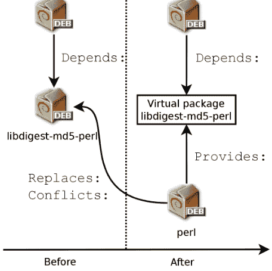

**图 8.3** 使用 `Provides` 字段防止破坏依赖

此功能非常有用，因为永远无法预测开发中的变数，并且能够适应过时软件的重命名和其他自动替换工作。

## 替换文件：Replaces 字段

`Replaces` 字段表示该包包含了另一个包中也存在的文件，但该包有权合法地替换它们。如果没有此指定，`dpkg` 将失败并声称它无法覆盖另一个包的文件（技术上讲，可以使用 `--force-overwrite` 选项这样做，但这不被认为是标准操作）。这允许识别潜在问题，并要求维护者在选择是否添加此类字段之前研究该问题。

当包名更改或一个包包含在另一个包中时，使用此字段是合理的。当维护者决定在同一个源包产生的多个二进制包之间重新分发文件时也会发生这种情况：被替换的文件不再属于旧包，只属于新包。

如果已安装包中的所有文件都被替换，则该包被移除。最后，此字段还鼓励 `dpkg` 在存在冲突时移除被替换的包。

## 8.4.2. 配置脚本

除了控制文件，每个 Debian 包的 `control.tar.gz` 存档可能包含若干脚本（`postinst`, `postrm`, `preinst`, `prerem`），这些脚本由 `dpkg` 在处理包的不同阶段调用。我们可以使用 `dpkg -I` 来显示这些文件在 `.deb` 包存档中的存在形式：

```


`$ dpkg -I /var/cache/apt/archives/zsh_5.3-1_amd64.deb | head`

debian package, version 2.0.

size 811486 bytes: control archive=2557 bytes.

838 bytes      20 lines      control

3327 bytes      43 lines      md5sums

969 bytes      41 lines      * postinst     #!/bin/sh

348 bytes      20 lines      * postrm       #!/bin/sh

175 bytes       5 lines      * preinst      #!/bin/sh

175-...

`$ dpkg -I zsh_5.3-1_amd64.deb reinst`

```
#!/bin/sh

set -e

# Automatically added by dh_installhelper

dpkg-mainscript-helper symlink_to_dir /usr/share/doc/zsh-common 5.0.7 -@
```

Debian Policy 详细描述了这些每一个文件，指定了调用的脚本及其参数。这些序列可能是复杂的，如果其中一个脚本失败，`dpkg` 将尝试通过取消正在进行的安装或移除来返回满意状态（如果可能的话）。

# dpkg 数据库

你可以遍历 `/var/lib/dpkg/` 文件系统的 dpkg 数据库。该目录包含了系统中安装的所有包的运行记录。已安装包的所有配置脚本存储在 `/var/lib/dpkg/info/` 目录下，格式为包名命缀的文件：

```
$ ls /var/lib/dpkg/info/zsh.*
/var/lib/dpkg/info/zsh.list
/var/lib/dpkg/info/zsh.md5sums
/var/lib/dpkg/info/zsh.postinst
/var/lib/dpkg/info/zsh.postrm
/var/lib/dpkg/info/zsh.preinst
/var/lib/dpkg/info/zsh.prerm
```

该目录还包含每个包的 `.list` 扩展文件，包含了属于该包的文件列表：

```
# head /var/lib/dpkg/info/zsh.list
/bin
/bin/zsh
/bin/zsh5
/usr
/usr/lib
/usr/x86_64-linux-gnu
/usr/x86_64-linux-gnu/zsh
/usr/x86_64-linux-gnu/zsh/5.2
/usr/x86_64-linux-gnu/zsh/5.2/zsh
[...]
```

`/var/lib/dpkg/status` 文件包含一系列数据块（RFC 2822 格式），描述了每个包的状态。控制文件的信息被复制到那里。

```
$ /var/lib/dpkg/status
Package: gnome
Version: 3.20-1
Status: install ok
Priority: optional
Section: gnome
Maintainer: Debian GNOME <gnome-maintainers@debian.org>
Architecture: amd64
Installed-Size: 1785
```


让我们讨论配置文件并查看它们是如何交互的。通常，`postinst` 脚本在安装包之前执行，`postrm` 随其后。同样，`prerm` 在移除包之前调用，`postrm` 在之后调用。包的更新等同于移除之前的版本并安装新版本。这些序列在“配置脚本”章节中通过特定名称描述，例如 `old-prerm` 或 `new-postinst`。

| 脚本的符号名称 | 安装和升级脚本序列 |

以下是安装（或更新）期间发生的情况：

- 1. 对于更新，`dpkg` 调用 `old-prerm upgrade new-version`。
- 2. 同样对于更新，`dpkg` 紧接着执行 `new-preinst upgrade old-version`；对于首次安装，`dpkg` 执行 `new-preinst`。如果包已经安装并移除（但未彻底清除，保留了配置文件），它可能会在最后一个参数中添加旧版本。
- 3. 解压新包文件。如果文件已存在，则替换它，但会创建备份副本并临时存储。
- 4. 对于更新，`dpkg` 执行 `old-postrm new-version`。
- 5. `dpkg` 更新所有内部数据（文件列表、配置脚本等）并移除被替换文件的备份。这是不可回头的点：`dpkg` 不再拥有返回先前状态所需的所有元素。
- 6. `dpkg` 更新配置文件，提示你决定自动化此任务是否明智。有关此过程的细节在第 8.4.3 节“检查，配置文件”第 214 页中讨论。
- 7. 最后，`dpkg` 通过执行 `new-postinst configure last-version-configured` 来配置包。

这些序列可能非常混乱，但视觉表示可能有所帮助。Manoj Srivastava 制作这些图表来解释配置脚本是如何调用的。Debian 女性项目开发了类似的图表；它们更容易理解，但不够完整。

- https://people.debian.org/~srivasa/MaintainerScripts
- https://wiki.debian.org/MaintainerScripts

# 软件包移除

以下是卸载软件包时会发生的过程。

- 1. `dpkg` 调用 `prerm remove`。
- 2. `dpkg` 移除软件包的所有文件，但配置文件和配置脚本除外。
- 3. `dpkg` 执行 `postrm remove`。除了 `postrm` 之外，所有的配置脚本都会被移除。如果你没有使用 `purge`（彻底清除）选项，进程将在此处停止。
- 4. 若要对软件包进行彻底清除（使用 `dpkg --purge` 或 `-P` 发布的命令），则配置文件也将被删除，以及特定数量的副本（`*.dpkg-tmp`, `*.dpkg-old`, `*.dpkg-new`）和临时文件；随后 `dpkg` 执行 `post rm`

在某些情况下，软件包可能会使用 `debconf` 从您获取配置信息：上述详细的四个脚本将由一个旨在获取该信息的配置脚本进行补充。在安装期间，该脚本会详细定义 `debconf` 数据库的内容，以供未来之用。该脚本通常由 `apt` 在逐个安装软件包之前执行，以便在过程开始时将所有问题分组在一起。安装前和安装后的脚本可以使用这些信息来根据您的意愿进行操作。

# debconf 工具

`debconf` 工具的创建是为了解决 Debian 中一个反复出现的问题。所有没有基本配置就无法运行的 Debian 软件包以前会在 `postinst` 脚本中通过 `echo` 和 `read` 命令（以及其他类似的脚本）来提问。这迫使安装程序在大型安装或更新期间必须进行看护，以响应不断出现的各种查询。得益于 `debconf`，这些手动交互几乎已被完全废除。

`debconf` 工具具有许多有趣的特性：它要求开发者指定用户交互；它允许对所有显示的字符串进行本地化（所有翻译都存储在描述交互的模板文件中）；它为问题提供了不同的格式（文本模式、图形模式、非交互模式）；它允许创建一个响应中心数据库，以便与多台计算机共享相同的配置。最重要的特性是，所有问题都可以在开始漫长的安装或更新过程之前，一次性列出。在系统自动处理安装时，你可以去忙你自己的事务，而无需一直盯着屏幕等待问题弹出。

# 8.4.3. 校验和，配置文件

除了前几节已提到的维护者脚本和控制数据外，Debian 软件包的 `control.tar.gz` 归包可能包含其他有趣的文件：

```
ar p /var/cache/apt/archives/bash_4.4-2_amd64.deb control.tar.gz | tar -tzf
```

```
./.conffiles
./.control
./md5sums
./postinst
./postrm
./preinst
./prrm
```

第一个 `--md5sums--` 包含所有软件包文件的校验和。它的主要优势是允许 `dpkg --verify` 检查这些文件自安装以来是否被修改过。注意，当此文件不存在时，`dpkg` 将在安装时动态生成（并与其他控制文件一样存储在 `dpkg` 数据库中）。

`conffiles` 列出了必须作为配置文件处理的软件包文件。配置文件可以由管理员修改，`dpkg` 在软件包更新期间尝试保留这些更改。

实际上，在这种情况下，`dpkg` 的行为尽可能智能：如果标准配置文件在两个版本之间没有发生变化，它将什么都不做。然而，如果文件发生了变化，它将尝试更新它。可能有两种情况：要么管理员没有动过此配置文件，在这种情况下 `dpkg` 会询问管理员想使用哪个版本（旧的还是新的）。

# 8.5. 总结

在本节中，我们深入介绍了 Debian 软件包系统，讨论了高级软件包工具 `APT` 和 `dpkg`，学习了基础软件包交互、高级 `APT` 配置，并对 `.deb` 格式进行了简要参考。我们查看了控制文件、配置脚本、校验和以及配置文件。

总结提示：

Debian 软件包是应用程序的压缩归。它包含了应用程序的文件以及元数据，包括应用程序所需的依赖项，以及在软件包生命周期不同阶段（安装、移除、升级）执行命令的脚本。

`dpkg` 工具与 `apt` 和 `apt-get`（`APT` 家族）不同，它不知道所有可以满足软件包依赖的软件包。因此，在管理 Debian 软件包时，你可能会使用这些能够解决依赖问题的工具。

你可以使用 `apt` 安装和删除应用程序、更新软件包，甚至升级整个系统。以下是关于 `APT` 及其配置你应该了解的关键点：

- `sources.list` 是定义软件包源（或包含软件包的仓库）的关键配置文件。
- Debian 和 Kali 使用三个脚本根据作者选择的许可来区分软件包：`main` 所有完全符合 Debian 自由软件指南的软件包；`non-free` 不完全符合自由软件指南但仍然可以无限制地分发的软件；
- `contrib`（贡献）包含了在没有非自由元素无法运行的开源软件。
- Kali 维护着若干个仓库，包括：`kali-rolling`，它是面向终端用户的主要仓库，应该始终包含可安装且最新的软件包；`kali-dev`，供 Kali 开发者使用，不供公众使用；以及 `kali-bleeding-edge`，它通常包含未经测试和未经审核的软件包，这些包是在它们提交到上游 Git（或 Subversion）仓库 24 小时内自动构建的。
- 在与 `APT` 工作时，你应该首先使用 `apt update` 下载当前可用软件包列表。
- 你可以通过简单的 `install package` 命令向系统添加软件包。`APT` 将自动安装必要的依赖项。
- 要删除软件包，请使用 `apt remove package`。它还会删除该包的反向依赖（即依赖于要删除包的包）。
- 要删除与软件包相关的所有数据，可以使用 `apt purge` 命令对包进行“纯净化”（purge）。与删除不同，这不仅会删除软件包，还会删除其配置文件，有时还会删除关联的用户数据。

我们建议定期进行升级以安装最新的安全更新。要进行升级，请使用 `apt update`，然后使用 `apt upgrade`、`apt-get upgrade` 或 `aptitude safe-upgrade`。这些命令会寻找可以在不删除任何包的情况下升级的已安装包。

对于更重要的升级（例如主版本升级），请使用 `apt full-upgrade`。使用此指令时，即使必须移除某些过时的包或安装新的依赖项，`apt` 也会完成升级。这也是你对 Kali Rolling 系统进行常规升级时应该使用的命令。请回顾我们在本章中概述的升级优缺点。

使用了多种工具来检查 Debian 软件包：

- `dpkg --listfiles package` (或 `-L`) 列出由指定软件包安装的文件。
- `dpkg --search file` (或 `-S`) 查找包含参数传递的文件或路径的任何软件包。
- `dpkg --list` (或 `-l`) 显示系统已知的软件包列表及其安装状态。
- `dpkg --contents file.deb` (或 `-c`) 列出特定 `.deb` 文件中的所有文件。
- `dpkg --info file.deb` (或 `-l`) 显示指定 `.deb` 文件的头信息。
- 各种 `apt-cache` 子命令显示存储在 `APT` 终端数据库中的大量信息。

为了避免过度占用磁盘空间，你应该定期对 `/var/cache/apt/archives/` 进行排序。可以使用两个命令来实现：`apt clean` (或 `apt-get clean`) 完全清空目录；`apt autoclean` (apt-get autoclean) 仅移除那些已从镜像中消失而无法下载的软件包。

`synaptic` 是一个图形化软件包管理器，具有整洁高效的图形化界面。

作为高级用户，你可以在 `/etc/apt/conf.d/` 中创建文件来配置 `APT` 的某些方面。你还可以管理软件包优先级、跟踪自动安装的软件包、同时与多个发行版或架构协作、使用加密签名验证软件包，并使用本章概述的技术升级文件。

尽管 Kali/Debian 维护者尽了努力，系统升级并不总是如我们希望的那样顺畅。当这种情况发生时，你可以查看 Kali 追踪器以及 Debian bug 跟踪系统 https://bugs.debian.org/package 来检查问题是否已经报告。你也可以尝试降级软件包，或者调试并修复失败的软件包维护脚本。

> ⁷http://bugs.kali.org
> ⁸https://bugs.debian.org


# 关键词

- 自定义软件包
- 自定义内核
- 自定义镜像
- live-build
- 持久化 (Persistence)


# 深度秘 Kali Linux

# 第 9 章 高级用法

## 目录

- 修改 Kali 软件包 222
- 重新编译 Linux 内核 233
- 构建自定义 Kali Live ISO 镜像 237
- 使用 USB 密钥为 Live ISO 添加持久化功能 240
- 总结 246

Kali 已构建了一个高度模块化且可定制的渗透测试框架，并允许一些相当高级的自定义和用法。自定义可以在多个级别进行，从源代码级别开始。Kali 软件包的源码是公开可的。在本章中，我们将展示如何获取软件包、修改它们并基于它们构建你自己的自定义包。Linux 内核是一个特殊情况，因此它在专门的章节（第 9.2 节，重新编译 Linux 内核）中介绍，在那里我们将讨论查找、配置以及构建相关软件包。

第二个级别的自定义是在构建 live ISO 镜像的过程中。我们将展示 `live-build` 工具提供了许多钩子（hooks）和配置选项来定制生成的 镜像，包括使用自定义 Debian 软件包代替可用软件包的可能性。

我们还将讨论如何在一个 USB 密钥上创建一个具有持久性的 ISO，它可以在重启之间保留文件和操作系统更改。

### 9.1 修改 Kali 软件包

修改 Kali 软件包是 Kali 贡献者的任务，你可能会想为什么要这么费劲。要修改 Kali 软件包，首先要知道源码在 Kali 镜像中是可用的。默认情况下，Kali 不需要获取源包，但你可以轻松在 `/etc/apt/sources.list` 中添加一行 `deb-src` get启用它。

当你想要修改一个包时，必须先获取其源码。这通常通过运行 `apt source` 完成。之后，源软件包由多个文件组成：`.desc`（Debian 控制）、`.tar.gz`、`.bz2`、`.xz` 以及有时 `.diff`。

要修改 Kali 软件包，首先要知道源码在 Kali 镜像中是可用的。默认情况下，Kali 不需要获取源包，但你可以轻松在 `/etc/apt/sources.list` 中添加一行 `deb-src` 来启用它。

### 9.1.1 获取源码

重新构建 Kali 软件包始于获取其源码。源软件包存储在 Kali 镜像中。你可以使用网络浏览器下载它们，也可以使用 `apt` 命令。


cmake contrib examples libfreevare.pc.in NEWS TODO

`$ ls debian`

changelog libfreevare-dev.install rules

compat libfreevare-dev.install source

control libfreevare-bin.install README.Source watch

在此示例中，虽然我们是从 Kali 镜像站获取的源码包，但该包与 Debian 中的包是相同的，因为版本字符串中不包含 "kali"。这意味着没有应用任何 Kali 特有的更改。

如果你需要特定版本的源码包，而该版本目前未在 `/etc/apt/sources.list` 列出的存储库中，那么下载它最简单的方法是访问 `http://pkg.kali.org` 查找并 `.ds` 文件的 URL，并将该 URL 传递给 `dget`（来自 `devscripts` 软件包）。

在找到 `kali-bleeding-edge` 中提供的 `libfreevare` 源码包 URL 后，你可以使用 `dget` 下载它。首先下载 `.ds` 文件，然后了解引用了哪些其他文件，最后从同一个位置下载它们：

```
$ dget http://kali.org/pool/main/lib/libfreevare/libfreevare_0.4.0+0-
git149395248.ffded4d-1.dsc

retrieving http://kali.org/pool/main/lib/libfreevare/libfreevare_0.4.0+0-
git149395248.ffded4d-1.dsc
```

| % | % Received | Average Speed | Time | Time | Time Current |
|---|---|---|---|---|---|
| 100 | 364 | 360 | 852 | 0 | Dload Upload | Left Speed |
| 100 | 1935 | 1935 | 0 | 2650 | 0 | | 19948 |

```
retrieving http://kali.org/pool/main/lib/libfreevare/libfreevare_0.4.0+0-
git149395248.ffded4d.orig.tar.gz
```

```
retrieving http://kali.org/pool/main/lib/libfreevare/libfreevare_0.4.0+0-
git149395248.ffded4d.debian.tar.xz
```

`libfreevare_0.4.0+0-git149395248.ffded4d-1.dsc`
`dscverify: libfreevare_0.4.0+0-git149395248.ffded4d-1.dsc failed signature check:`
`gpg: Signature made Wed Aug 12 06:14:03 2015 CEST`

`gpg:`
`using RSA key 43EF73F4BD809064`
`gpg:`
`Can't check signature: No public key`
`Validation FAILED!`

```
$ dpkg-source -x libfreevare_0.4.0+0-git149395248.ffded4d-1.dsc
gpgv: Signature made Wed Aug 12 06:14:03 2015 CEST
gpgv:
using RSA key 43EF73F4BD809064
gpgv:
Can't check signature: No public key
dpkg-source: warning: failed to verify signature on ./libfreevare_0.4.0+0-git149395248
.ffde4d-1.dsc
```

```
dpkg-source: info: extracting libfreevare in libfreevare-0.4.0+0-git149395248.ffde4d
dpkg-source: info: unpacking libfreevare_0.4.0+0-git149395248.orig.tar.gz
dpkg-source: info: unpacking libfreevare_0.4.0+0-git149395248.ffde4d-1.debian.tar.xz
```

值得注意的是，`dget` 没有自动提取源码包，因为它无法验证源码包上的 PGP 签名。这一步我们通过 `dpkg-source -x dsc-file` 手动完成的。你也可以通过传递 `--allow-unauthenticated` 或 `-u` 选项来强制提取源码。相反，你可以使用 `--download-only` 来跳过源码包的提取。

## 从 Git 获取源码

你可能已经注意到，`apt source` 调用会告诉你用于维护该包的可能 Git 仓库。它可能指向 Debian 存储库或 Kali 存储库。所有 Kali 特有的包都托管在 `git.kali.org/packages/` 的 Kali 存储库中。你可以通过 `git clone https://gitlab.kali.org/packages/source` 从这些仓库中获取源码。

与 `apt source` 获取的结果不同，得到的树结构将不会应用补丁。请查看 `debian/patches` 以了解 Kali 可能所做的更改。

```
$ git clone https://gitlab.kali.org/packages/kali-meta.git
Cloning into 'kali-meta'...
remote: Counting objects: 760, done.
remote: Total 760 (delta 279), reused 0 (delta 0)
Receiving objects: 100% (760/768), 141.01 KiB | 0 bytes/s, down.
Resolving deltas: (279/279), done.
Checking connectivity... done.
$ cd kali-meta
$ ls debian
$ ls debian
changelog control rules source
```

你可以使用 git 仓库作为获取源码的另一种方式，并（在大多数）遵循本节的说明。当 Kali 开发人员处理这些仓库时，他们使用另一种打包工作流，并使用 `from-buildpackage` 系列工具，我们在这里不会涵盖这些工具。你可以在这里了解更多关于这些工具的信息：

### 9.1.2. 安装构建依赖

现在你已经有了源码，但仍然需要安装构建依赖。对于构建所需的二进制包是必要的，但对于你可能在进行更改时想要测试的部分构建也是所要求的。

每个源码包都会在 `debian/control` 文件的 `Build-Depends` 字段中声明其构建依赖。让我们指示 apt 安装它们（假设你处于一个包含解压包的目录中）：

```
sudo apt build-dep ./
```

Using directory '/' to get build dependencies

Reading package lists... Done

Building dependency tree

Reading state information... Done

The following NEW packages will be installed:

autoconf automake autopoint autdevhelper dh-autoreconf dh-strip-nondeterminism gettext libtool-debian libarchive-zip-perl libfile-strip-nondeterminism libtool po-debconf

0 upgraded, 13 installed, 0 to remove and 0 not upgraded.

Need to get 456 KB of archives.

After this operation, 14.6 MB of additional disk space will be used.

Do you want to continue? [Y]

在这个示例中，所有的构建依赖都可以通过 APT 可用的包来满足。这并不总是如此，因为 `kali-rolling` 构建并不保证构建依赖的稳定性。在实践中，二进制包和构建依赖通常紧密耦合的。

### 9.1.3. 更改

我们无法在本节中涵盖对给定包所做的所有更改，这将涉及 Debian 打包的所有细节。然而，我们将涵盖之前介绍的用例，并解释一些不可避免的部分（如维护 changelog）。


要做的第一是更改包的版本号，以便与 Kali 或 Debian 提供的包区分来。为了实现这一点，我们通常会添加一个标识更改实体（人员或公司）的后缀。由于 `busy` 是我的 IRC 名称，我们使用它作为后缀。这种更改通过 `dch` 命令（Debian Changelog 包）来实现，如 `dch --local busy` 的命令会调用编辑器（`sensible-editor`，它运行 `VISUAL` 或 `EDITOR` 环境变量，否则运行 `/usr/bin/editor`），允许你记录由此重建引入的差异。此编辑器显示 `dch` 确实更改了 `debian/changelog` 文件：

```
$ head -n 1 debian/changelog
libfreevare (0.4.0-2) unstable; urgency=low
$ dch --local busy
```

* Enable --with-debug configure option.

* Raphael Hertzog <busy@kali.org> -- Fri, 22 Apr 2016 10:36:00 -0400

libfreevare (0.4.0-2) unstable; urgency=low

* Update debian/copyright.

Fix license to LGPL3+.

## 应用补丁

在我们的一个案例中，我们下载了 pyrit 源码包，并想要应用从上游 git 仓库发现的补丁。这是一个常见操作，应该总是简单的。遗憾的是，补丁的处理方式取决于源码包格式以及 Git 打包工作流。

### 对于解压的源码包

运行 `apt source pyrit`，你会得到 `pyrit-0.4.0` 目录。你可以直接使用 `patch -p1 < patch-file` 应用你的补丁：

```
$ apt source pyrit
[...
$ cd pyrit-0.4.0
$ wget https://github.com/JPaulMora/pyrit/commit/14
→ ec99174b8e8fd2022b6a97c57e19633f12a0-0 /tmp/pyrit-patch
[...]
$ patch -p1 </tmp/pyrit-patch
patching file cpyrt/pcktools.py
```

Hunk #1 在 53 处成功（偏移量 -1 行）。

$ --local doxy "Apply patch to work with scapy 2.3"

此时，你已经手动对源码进行了补丁处理，并且已经可以构建修改后版本的二进制包了（参见第 9.1.4 节，“开始构建” [第 231 页]）。但如果你尝试构建更新后的源码包，你会发现系统关于“意外的上游更改”的报错。这是因为 pyrit（与大多数源码包一样）使用了名为 3.0 (qu) 的 Debian 源码格式，在该格式中，上游代码的更改必须记录在存储于 `debian/patches/` 中的独立补丁，并且 `debian/patches/series` 文件指示了补丁应用的顺序。你可以通过运行 `dpkg-source --commit` 在新的补丁中注册你的更改：

```
$ dpkg-source --commit
dpkg-source: info: local changes detected, the modified files are:
pyrit-0.4.0/cpyrit/pcktools.py
enter the desired patch name: fix-for-scapy-2.3.patch
dpkg-source: info: local changes have been recorded in a new patch: pyrit-0.4.0/debian/
  ► patches/fix-for-scapy-2.3.patch
  tail -n 1 debian/patches/series
fix-for-scapy-2.3.patch
```

### Quilt 补丁序列

这种补丁管理通过一个名为 `quilt` 的工具流行起来，而“3.0 (qu)”格式与该工具兼容——微小的区别在于它使用 `debian/patches` 而不是 `patches/`。该工具可以在同名的包中找到，你可以在这里找到一个很好的教程：

> ► https://raphaelhertzog.com/2012/02/08/how-to-use-quit-to-manage-in-debian-packages/

如果源码包使用的是 1.0 或 3.0 (native) 源码格式，则不需要在补丁中注册你的上游更改。这些更改会自动封装在生成的源码包中。

### 使用 Git 仓库

如果你使用 Git 获取源码包，情况会更加复杂。存在多种 Git 工作流和相关工具，显然，并非所有的 Debian 包都使用相同的工作流和工具。之前解释过的关于源码格式的区别仍然适用，但你必须检查补丁是预先应用到源码树中，还是仅存储在 `debian/patches` 中（在后续情况下，它们在构建时被应用）。

最流行的工具是 `git-buildpackage`。我们用它来管理 git.com/kalilinux/packages 上的所有仓库。当你使用它时，补丁不会预先应用到源码树中，而是存储在 `debian/patches` 中。你可以手动向该目录添加补丁，并在 `debian/patches/series` 中列出它们。`git-buildpackage` 的用户倾向于使用 `gbp pq` 将整个补丁序列视为单个分支，你可以根据喜好对其进行扩展或重新变基（rebase）。查看 `gbp-pq(1)` 了解如何调用它。

`git-dpm`（带有同名的命令）是另一个你可以在其中找到 Git 打包工具。它在 `debian/.git-dpm` 中记录元数据，并通过合并一个根据 `debian/patches` 内容构建并不断重新变基的分支，保持补丁应用在源码树中。

## 调整构建选项

当你想要启用官方包未激活的可选功能或行为，或者当你想自定义在构建时通过 `./configure` 选项或构建环境中设置的变量参数时，通常需要调整构建选项。

在这些情况下，更改通常局限于 `debian/` 目录，它驱动了包构建过程中的步骤。在最简单的情况下，涉及初始配置（`/configure ...`）或实际构建（`MAKE ...` 或 `make ...`）的行很容易识别。如果这些命令没有被显式捕获，它们可能是另一个显式命令的副作用，此时请参考它们的文档以了解更多如何更改默认行为。对于使用 `dh` 的包，你可能需要为 `dh_auto_configure` 或 `dh_auto_build` 命令添加覆盖（override）（参见它们各自的手页以了解如何实现这一点）。

为了让这些解释更具体，让我们将其应用到示例案例中。你决定修改 `libfreebase` 以向 `./configure` 脚本传递 `--enable-debug` 选项，以便从你的现场通信（NFC）工具获得更详细的输出，并针对你的未识别 NFC 卡找到更好的错误报告。由于该包使用 `dh` 驱动构建过程，你（在此情况下是修改）了 `override_dh_auto_configure` 目标。以下是 `libfreebase` `debian/rules` 文件的相应提取：

```
override_dh_auto_configure: --n-without-cutter --disable-silent-rules --enable-debug
  dh_auto_configure
```

## 打包一个新的上游版本

在我们讨论打包上游版本时，让我们来看一个示例。假设你是一个 `set` 用户，注意到一个新的上游版本（7.4.5）尚未出现在 Kali 中（当前版本为 7.4.4）。你想构建一个更新后的包并尝试一下。这是一个小版本更新，你不期望更新在打包层面有任何更改。

要更新源码包，你将新的源码压缩包解压到当前源码包，并将 `debian` 目录复制到新包中。然后你更新 `debian/changelog` 中的版本。


```
$ apt source set
Reading package lists... Done
NOTICE: 'set' is maintained in the 'Git' version control system at https://gitlab.com/kalilinux/packages/set
Please use: git clone https://gitlab.com/kalilinux/packages/set
to retrieve the latest (possibly unreleased) updates to the package.
Need to get 2.3 MB of source.
dpkg-source: warning: failed to verify signature on ./set_7.4.4.dsc
dpkg-source: info: extracting set in set-7.4.4
dpkg-source: info: unpacking set-7.4.4.orig.gz
dpkg-source: info: unpacking set-7.4.4.xz
dpkg-source: info: applying config
$ wget https://github.com/trusted/social-engineer-toolkit/archive/7.4.5.tar.gz -O set_7.4.5.tar.gz
$ tar xvf set_7.4.5.tar.gz social-engineer-toolkit/set-7.4.5/src/wireless/attack.py
$ cp -a set-7.4.4/debian social-engineer-toolkit/set-7.4.5/debian
$ cd social-engineer-toolkit/set-7.4.5
$ dch -v 7.4.5-1 "New upstream release"
```

这就是你现在构建更新包的方法。根据上游版本引入的更改，你可能还需要更改构建运行时依赖并安装新文件。

### 9.1.4 开始构建

当所有更改应用到源码后，你可以开始生成实际的二进制包或 `.deb` 文件。整个过程由 `dpkg-buildpackage` 命令管理，看起来如下：

```
$ dpkg-buildpackage -us -b
dpkg-package: source package libfree
dpkg-package: source version 0.4.0-1
dpkg-package: distribution RELEASE
dpkg-package: created by Raphael Hertzog <raphael@kali.org>
dpkg-package: host architecture amd64
debuild
dpkg-deb: building package 'libfree-dbgsym' in .../libfree-dbgsym_0.4.0-1.amd64.deb
dpkg-deb: building package 'libfree' in .../libfree_0.4.0-1.amd64.deb
dpkg-deb: building package 'libfree-dev' in .../libfree-dev_0.4.0-1.amd64.deb
dpkg-deb: building package 'libfree-bin-dbgsym' in .../libfree-bin-dbgsym_0.4.0-1.amd64.deb
dpkg-deb: building package 'libfree-bin' in .../libfree-bin_0.4.0-1.amd64.deb
dpkg-deb: building package 'libfree-doc' in .../libfree-doc_0.4.0-1.all.deb
dpkg-changes -b ./libfree-doc_0.4.0-1.all.deb
dpkg-changes: binary-only upload (no source included)
dpkg-source -after-build libfree-0.4.0-1
dpkg-package: binary-only upload (no source included)
```

`-uc` 选项静用了某些生成文件（`.dsc`）的签名，因为如果你没有与 `changelog` 文件中身份相同的 GNU 密钥，操作将失败。`-b` 选项请求“仅二进制构建”。在这种情况下，不会创建源码包（`.dsc`），只会创建二进制包（`.deb`）。使用此方法可以避免源码包构建期间的失败：如果你没有在补丁管理系统中正确记录你的更改，它可能会报错并中断构建过程。

如 `dpkg-dev` 消息所示，生成的二进制包现在位于父目录中（源码包上目录）。你可以用 `dpkg -i` 或 `apt install` 安装它们。

```
$ sudo apt install ../libfree_0.4.0-1.amd64.deb \
../libfree-bin-0.4.0-1.amd64.deb
```

Reading package lists... Done

Building dependency tree

Reading state information... Done

Note, selecting 'libfree' instead of '../libfree0_0.4.0-1.amd64.deb'

Note, selecting 'libfree-bin' instead of './libfree-bin_0.4.0-1.amd64.deb'

The following packages will be upgraded:

libfree libfree0

2 upgraded, 0 newly installed, 0 to remove and 0 not upgraded.

Need 0 B/69.4 KB of archives.

After this operation, 2048 B of additional disk space will be used.

我们更倾向于使用 `apt install dpkg -i`，因为它能优雅地处理生成的文件。但在此之前，你必须使用 `dpkg`，因为无法处理任何仓库之外的 `.deb` 文件。

| `dpkg-buildpackage` 包装器 | 多数情况下，Debian 开发者使用更高级的程序 `debbuild`；它像通常一样运行 `dpkg-buildpackage`，但还会调用一个程序（Lintian），该程序运行多次以验证生成的包是否符合 Debian 策略。该脚本会清理环境，防止本地环境变量污染包构建。默认命令是 `devsucripts` 中的工具之一，它们共享一些一致性和配置，以简化维护者的工作。 |

> ³https://www.debian.org/doc/debian-policy/

# 9.2. 重新编译 Linux 内核

Kali 提供的内核包含了尽可能的功能以及最大数量的驱动程序，以覆盖最广泛的现有硬件配置。这就是为什么某些用户倾向于重新编译内核，以便仅包含他们特定需要的内容。这种选择有两个原因：首先，这是优化内存消耗的一种方法，因为所有的内核代码即使从不使用，也会占用物理内存。由于内核的静态编译部分永远不会移动到交换空间（`swap space`），构建了从未使用的驱动程序和功能会导致系统性能整体下降。其次，减少驱动程序和内核功能的数量可以减少安全问题的风险，因为运行的只是可用内核代码的一小部分。

> 重要提示
>
> 如果你选择编译自己的内核，你必须接受后果：Kali 无法为你的自定义内核提供安全更新。通过保留 Kali 提供的内核，你将受益于 Debian 项目准备的更新。

如果你想使用某些以补丁形式提供（未包含在标准内核中）的功能，也需要重新编译内核。

| 《Debian 内核手册》 |  |
|---|---|
| http://kernel-handbook.alioth.debian.org | Debian 内核团队维护着《Debian 内核手册》（也可通过 `debian-kernel-handbook` 包获取），其中包含了关于大多数内核相关任务以及官方 Debian 内核包处理方式的全面文档。如果你需要比本节提供的更多的信息，这是你应该首先查找的地方。 |

## 9.2.1. 简介与准备工作

惊讶的是，Debian 和 Kali 以软件包的形式管理内核，而这并不是传统编译和安装内核的方式。由于内核仍然受软件包系统的控制，因此它可以被干净地删除，或者部署在多台机器上。此外，与这些包相关的脚本自动化了与引导程序（`bootloader`）和 `initrd` 生成器的交互。


上游 Linux 源码包含了构建 Debian 内核包所需的内容，但你仍然需要安装 `build-essential` 包以确保拥有构建 Debian 包所需的工具。此外，内核的配置步骤需要 `libncurses5-dev` 包。最后，`fakeroot` 包将允许在不需要管理员权限的情况下创建 Debian 包。

```
# apt install build-essential libncurses5-dev fakeroot
```

## 9.2.2. 获取源码

由于 Linux 内核源码以包的形式提供，运行 `apt-cache search ^linux-source` 命令应该列出 Kali 封装的最新内核版本。注意，这些包中包含的源码与 Linux Torvalds 和内核开发者在 [https://kernel.org/] 上发布的代码并不精确对应；与所有发行版一样，Debian 和 Kali 应用了许多补丁，这些补丁可能（也可能）进入上游 Linux 版本。这些修改包括来自较新内核版本的修复/功能的回移植（backports）、尚未（完全）合并到上游 Linux 的新功能，甚至是 Debian 或 Kali 特有的更改。

本节其余部分关注 Linux 内核 4.9 版本，但当然，示例可以根据你需要的内核版本进行调整。

在示例中，我们假设已安装 `linux-source-4.9` 二进制包。注意，我们安装的是包含上游源码的二进制包，而没有获取名为 `linux` 的 Kali 包。

```
# apt install Linux-source-4.9
Reading package lists... Done
Building dependency tree
Reading state information... Done
The following additional packages will be installed: readline7
Suggested packages:
libncurses-dev | curses-dev libqt4-dev
The following NEW packages will be installed: readline7 linux-source-4.9
0 upgraded, 3 newly installed, 0 to remove and not upgraded.
Need to get 95.4 MB of archives.
After this operation, 95.8 MB of additional disk space will be used.
Do you want to continue? [Y/n] y
[...
# ls /usr/src/
linux-config-4.9 linux-patch-4.9-rt.patch.xz linux-source-4.9.tar.xz
```

注意该包包含了 `/usr/src/linux-source-4.9.tar.xz`，这是内核源码的压缩包。你必须在一个新的目录下提取这些文件（不要直接在 `/usr/src/` 下，因为编译 Linux 内核不需要特殊权限）。相反，`~/kernel/` 更合适。

```bash
$ mkdir ~/kernel; cd ~/kernel
$ tar -xaf /usr/src/linux-source-4.9.tar.xz
```

## 9.2.3. 配置内核

下一步根据你的需求配置内核。具体步骤取决于目标。

构建取决于内核配置文件。在大多数情况下，你可能会尽可能保留 Kali 建议的配置，它像所有 Linux 发行版一样被安装在 `/boot` 目录。与其从头开始配置，复制 `/boot/config-version` 文件就足够了（该版本应与当前使用的内核版本相同，可以通过 `uname -r` 命令找到）。将副本放置在包含内核源码的目录中的 `.config` 文件中。

```bash
$ cp /boot/config-4.9.0-kali1-amd64 ~/kernel/linux-source-4.9/.config
```

或者，由于内核在 `arch/configs/*-defconfig` 中提供了默认配置，你可以使用类似命令选择配置位置，例如 `x86_64_defconfig`（针对 64 位 PC）或 `i386_defconfig`（针对 32 位 PC）。

除非你需要更改配置，否则你可以在此停止并跳到 9.2.4 编译并构建软件包。如果你需要进行更改，或者决定从头重新配置，你将需要时间来配置内核。内核源码目录中有各种专用接口，可以通过调用 `make` 命令来使用，其中 target 是下面描述的值之一。

`make menuconfig` 会编译并启动一个文本模式内核配置界面（这需要 `libcurses-dev` 包），允许在分级结构中导航许多可用选项。按空格键更改所选选项的值，并验证屏幕底部选中的按钮；`Select` 进入选中的子菜单；`Exit` 关闭当前屏幕并返回层级上层；`Help` 将显示所选选项的详细信息。方向键允许在选项和按钮列表中移动。要退出配置程序，从主菜单选择 `Exit`。程序随后会提议保存你所做的更改；如果你对选择感到满意，请接受。

其他接口具有类似的功能，但在更现代的界面中工作，例如 `make xconfig`（使用 Qt 界面）和 `make gconfig`（使用 GTK+）。前者需要 `libqt4-dev`，后者依赖于 `libgtk2-dev`。

### 处理过时的 .config 文件

当你提供另一个（通常是旧版本）内核生成的 `.config` 文件时，必须更新它。你可以通过 `make oldconfig`，它将交互式地询问与新配置对应的问题。如果你想对所有问题使用默认答案，可以使用 `make oldconfig`。使用 `make nooldconfig`，它将对所有问题假设否定答案。

## 9.2.4. 编译并构建软件包

### 重建前的清理

如果你已经在目录中编译了内核并希望从头重新构建（例如你大幅更改了内核配置），你需要运行 `make clean` 来删除编译文件。`make distclean` 会删除更多文件，包括你的 `.config` 文件，因此请确保已备份了它。

一旦内核配置就绪，简单的 `make deb-pkg` 将生成五个 `.deb` 格式的 Debian 包：

- `linux-image`：包含内核镜像和相关模块；
- `linux-headers`：构建内核模块所需的头文件；
- `linux-firmware`：某些驱动程序所需的固件文件（当你从 Debian 或 Kali 提供的源码构建时，此包可能缺失）；
- `linux-image-dbg`：包含内核及其模块的调试符号；
- `linux-libdev`：包含某些用户空间库（如 GNU C 库）相关的头文件。

版本由上游版本（由 Makefile 中的 `VERSION`、`PATCHLEVEL`、`SUBLEVEL` 和 `EXTRAVERSION` 定义）、`LOCALVERSION` 配置参数以及 `LOCALVERSION` 环境变量拼接定义。包版本使用相同的字符串，并附加一个经常增加的修订版本（存储在 `.version` 中），除非你用 `PKGVERSION` 变量覆盖它。

```bash
$ make deb-pkg LOCALVERSION=$custom deb_PKGVERSION=$(make kernelversion)-1
[...
$ ls *.deb
../linux-headers-4.9.0-kali1-custom-4.9.2-1_amd64.deb
../linux-image-4.9.0-kali1-custom-4.9.2-1_amd64.deb
../linux-image-4.9.0-kali1-custom-dbg-4.9.2-1_amd64.deb
../linux-libdev-4.9.2-1_amd64.deb
```

要实际构建内核，最后一步是使用 `dpkg -i file*.deb` 安装所需的包。`linux-image` 包是必需的；只有当你需要构建外部内核模块时才需要安装 `linux-headers` 包，在你有某些模块时就是如此。

已安装 `*-dkms*` 软件包（通过 `dpkg -l "*-dkms*" | grep ii` 检查）。其他包通常不需要（除非你明确知道需要它们！）。

## 9.3. 构建自定义 Kali ISO 镜像

Kali Linux 开箱即用提供了极其丰富的功能和灵活性。一旦安装了 Kali，通过少量的引导、创意、耐心和练习，你就可以完成各种惊人的壮举。然而，你也可以创建一个包含特定文件或包的 Kali 构建（以扩展或缩小性能和功能），并能够自动执行某些功能的 Kali 版本。例如，Kali ISO of Doom 和 Kali Evil Wireless Access Point 都是依赖于 Kali Linux 自定义构建实现的优秀项目。让我们来看下制作自定义 Kali Linux ISO 镜像的过程吧。


官方的 Kali ISO 镜像使用 `live-build` 构建，这是一组脚本，允许对 Kali 镜像创建的所有方面进行完全自动化和自定义。`live-build` 套件使用目录结构作为配置输入。我们将此配置和一些相关的辅助脚本存储在 `live-build-config` Git 仓库中。我们将使用该仓库作为构建自定义镜像的基础。

在继续之前，你必须知道本节中显示的命令旨在在更新的 Kali Linux 系统上运行。如果在非 Kali 系统上运行或系统版本过旧，这些命令很可能会失败。

### 9.3.1. 安装预备条件

第一步是安装所需的软件包并获取带有 Kali `live-build` 配置的 Git 仓库：

```
# apt install curl live-build
[...]
# git clone https://gitlab.com/kalinux/build-scripts/live-build-config
# cd live-build-config
# ls
  auto build_all.sh build.sh kali-config README
```

此时，你只需运行 `./build.sh --verbose` 即可创建一个更新的（但未修改的）Kali ISO 镜像。构建将需要很长时间才能完成，因为它将下载所有包含的包。完成后，你将在 `images` 目录中找到新的 ISO。

> ^5https://www.offensive-security.com/kali-linux/kali-linux-iso-of-doom

> ⁶https://www.offensive-security.com/kali-linux/kali-linux-evil-wireless-access-port/

> ⁷http://debian-live.alioth.debian.org/live-build/

### 9.3.2. 使用不同的桌面环境构建实时镜像

我们提供的 `build.sh` `live-build` 包装器负责设置 `live-build` 期望找到的配置目录。它可以根据其 `--variant` 选项放置不同的配置。

该包装器通过组合 `kali-config/common` 和 `kali-config/variant-x` 中的文件创建配置目录，其中 X 是通过 `--variant` 参数提供的变体名称。当未显式给出选项时，它将使用 `default` 作为变体名称。

`kali-config` 目录包含最常用桌面环境的目录：

- e17 用于 Enlightenment；
- gnome 用于 GNOME；
- i3wm 用于相应的窗口管理器；
- kde 用于 KDE；
- lxde 用于 LXDE；
- mate 用于 Mate 桌面环境；
- xfce 用于 XFCE。

`light`（轻量级）变体有点特殊；它基于 XFCE，用于生成包含精简应用程序集合的官方“light” ISO 镜像。

你可以使用此命令轻松创建一个使用 KDE 作为桌面环境的实时镜像：

```
# ./build.sh --variant kde --verbose
```

这种变体概念允许一些高层定义的自定义，但如果你花时间阅读《Debian Live 系统手册》，你将发现许多自定义镜像的方法，通过更改 `kali-config` 中相应子目录的内容。接下来的章节将提供更多示例。

### 9.3.3. 更改已安装包集

一旦启动，`live-build` 会安装 `package-lists/*.list.chroot` 文件中列出的所有包。我们提供的默认配置包含一个 `package-lists/kali.list.chroot` 文件，其中列出了 `kali-linux-full`（拉取所有包含包的主元包）。你可以注释掉它，并放入你选择的另一个元包，或者包含一组精确的包。你也可以结合这两种方法，从一个元包开始，并添加你选择的补充包。

> *https://www.xfce.org/*

> *http://debian-live.alioth.debian.org/live-manual/unstable/manual/live-manual.en.html*

通过 `package-lists`，你只能包含官方 Kali 仓库中已有的包。如果你有自定义包，可以通过将 `.deb` 文件放置在 `packages.chroot` 目录将其包含实时镜像中（例如，如果你构建 GNOME 变体，则是 `kali-config/config-gnome/packages.chroot`）。

元包（Meta-packages）是空包，其唯一目的是对许多包有依赖关系。它们使得安装你想要一起安装的包集变得更容易。`kali-linux` 源包构建了 Kali Linux提供的所有元包：

- kali-linux: 基础系统（被所有其他元包拉取）
- kali-linux-full: 默认的 Kali Linux 安装
- kali-linux-all: 所有元包和其他包的元包（几乎包含了 Kali 提供的所有内容，因此非常巨大！）
- kali-linux-sdr: 软件定义无线电 (SDR) 工具
- kali-linux-gpu: GPU 驱动型工具（利用你显卡计算能力的工具）
- kali-linux-wireless: 无线评估和分析工具
- kali-linux-web: Web 应用评估工具
- kali-linux-forensic: 取证工具（寻找已发生事件的证据）
- kali-linux-voip: IP 语音工具
- kali-linux-pwtools: 密码破解工具
- kali-linux-top10: 最受欢迎的工具
- kali-linux-rfid: RFID 工具

当你为 `live-build` 创建自定义包列表时，可以学习这些元包。可用元包的完整列表及其包含的工具可以在此处找到（此处未列出链接）。

| Debconf Seeding of Installed Packages |
| :--- |
| 你可以提供 `preseed/*.cfg` 文件（见第4.3节“创建预seed 文件”）来配置安装的包 |

### 9.3.4. 使用钩（Hooks）更改镜像内容

`live-build` 提供了在构建过程不同阶段执行的钩，以进行内容微调。chroot 钩（Chroot hooks）是你安装在 `hooks/live/*.chroot` 中的可执行脚本，并在 chroot 中运行。虽然 chroot 允许你指定操作系统的根目录，但 chroot 钩也是如此的：你只能使用 chroot 环境中可用的内容。我们这些钩（参考 `kali-config/common/hooks/live-hacks.chroot`）用于自定义 Kali。

二进制钩（Binary hooks）在构建过程结束时（不在任何根目录下）执行（`hooks/*.binary`）。你可以修改 ISO 镜像的内容，但此时实时系统已经生成。我们使用此功能对 Kali 进行了某些更改。

### 9.3.5. 在 ISO 镜像或文件系统中添加文件

另一种非常常见的自定义是在实时系统或 ISO 中添加文件。

你可以通过将文件放在 `includes.chroot` 目录下的预期位置来将其添加到实时系统。例如，我们提供了 `kali-config/common/includes.chroot/usr/lib/live/config/0031-root-password`，它位于实时系统的 `/usr/lib/live/config/0031-root-password`。

你可以通过将文件放在 `includes.binary` 配置目录下的预期位置将其添加到 ISO 镜像。例如，我们提供了 `kali-config/common/includes.binary/isolinus/splash.png` 来覆盖 isolinus 引导程序使用的背景图。

| Live-Boot Hooks |
| :--- |
| 安装为 `/lib/live/config/XXXX-name` 的脚本由 `live-boot` 包的初始化脚本执行。它们重新配置系统的许多方面以适应实时系统。你可以添加自己的脚本在运行时自定义实时系统：这对于实现自定义启动参数特别有用。 |

## 9.4. 为 USB 密钥上的实时 ISO 添加持久化

### 持久化功能：解释

接下来我们将讨论为 Kali USB 密钥添加持久化的步骤。实时系统的本质是瞬态的。存储在实时系统上的所有数据和所做的更改在重启时都会丢失。为了解决这个问题，你可以使用 `live-boot` 的一个名为持久化（persistence）的功能，当启动参数包含 `persistence` 关键字时，该功能会被启用。


由于修改启动菜单是一项艰复杂的任务，Kali 默认包含了两个可以启用持久化的菜单项：Live USB 持久化（Live USB Persistence）和 Live USB 加密持久化（Live USB Encrypted Persistence），如图 9.1 所示，名为“持久化菜单项”[第 241 页]。

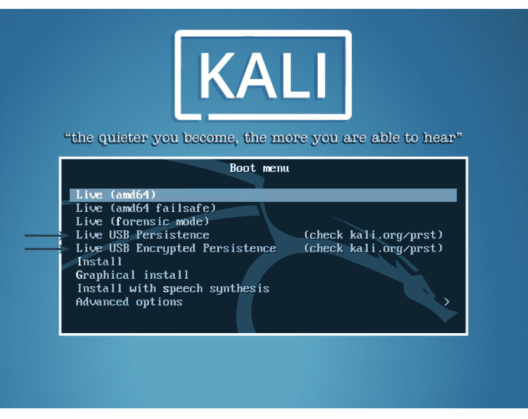

图 9.1 持久化菜单项

启用此功能时，`live-boot` 将扫描所有分区以寻找标记为 `persistence` 的文件系统（可以通过 `persistence-label=value` 启动参数覆盖），安装程序将为在该分区的 `persistence.conf` 文件中列出的目录（每行一个目录）设置持久化。特殊值 `union` 允许通过联合挂载（union mount）实现所有目录的完全持久化，这是一种只存储与底层文件系统相比的更改的叠加层。持久化目录的数据存储在包含相应 `persistence.conf` 文件的文件系统中。

## 9.4.2. 在 USB 盘上设置非加密持久化

在本节中，我们假设你已经按照第 2.1.4 节“在 DVD-ROM 或 USB 盘上拷贝镜像”[第 19 页]的说明准备好了 Kali Live USB 盘，并且使用了一个空间足够大容纳 ISO 镜像（约 3 GB）以及你想要持久化的目录数据的 USB 盘。我们假设 USB 盘被 Linux 识别为 `/dev/sdb`，并且仅包含默认 ISO 镜像中的两个分区（`/dev/sdb1` 和 `/dev/sdb2`）。执行此操作时务必小心。如果你对 USB 盘进行重新分区，可能会损坏数据。

要添加新分区，你必须知道复制到 live 的镜像大小。然后使用 `parted` 创建分区。以下命令分析 ISO 镜像名称 `kali-linux-2016.1-amd64.iso`，假设该文件也存在 USB 盘上：

```
# parted /dev/sdb print
Model: SanDisk Cruiser Edge (scsi)
Disk /dev/sdb: 32,GB
Sector size (logical/physical): 512B/512B
Partition Table: mdos
Disk Flags:

Number Start End Size Type File system Flags
1 32,8KB 2852MB 2852MB primary boot, hidden
2 2852MB 2945MB 93,4KB primary
# start=\$(du --block-size=1MB kali-linux-2016.1-amd64.iso | awk '{print $1}')
# echo "Size of image is $start MB"
Size of image is 2946 MB
# parted -a optimal /dev/sdb mkpart "${start}MB" 100%
Information: You may need to update /etc/fstab.
```

```
# parted /dev/sdb print
Model: SanDisk Cruiser Edge (scsi)
Disk /dev/sdb: 32,GB
Sector size (logical/physical): 512B/512B
Partition Table: mdos
Disk Flags:

Number Start End Size Type File system Flags
1 32,8KB 2852MB 2852MB primary boot, hidden
2 2852MB 2945MB 93,4KB primary
3 2946MB 32,0GB 29,1GB primary
```

有了新的 `/dev/sdb3` 分区后，使用 `mkfs.ext4` 命令（以及通过 `-L` 选项设置标签）将其格式化为标记为 `persistence` 的 `ext4` 文件系统。然后将该分区挂载到 `/mnt` 目录并创建所需的 `persistence.conf` 配置文件。一如既往，格式化任何磁盘时都要倍小心。如果你格式化了错误的磁盘或分区，可能会丢失宝贵信息。

```
# mkfs.ext4 -L persistence /dev/sdb3
mke2fs 1.43-WIP (15-Mar-2016)
Creating filesystem with 7096832 4k blocks and 1776764 inodes
Filesystem UUID: dedede20c4-5239-479a-b115-9561ac8576
Superblock backups stored on blocks:
32768, 98304, 163840, 229376, 294912, 819200, 884736, 105632, 265208, 409600
```

```
Allocating group table: done
Writing inode tables: done
Creating journal (32768 blocks): done
Writing superblocks and accounting information: done
# mount /dev/sdb3 /mnt
# echo "union" > /mnt/persistence.conf
# ls -l /mnt
total 20
drwx-xr-x-- 2 root root 16384 May 10 persistence.conf
-rw-r-- 1 root root 34
```

现在 USB 盘已准备就绪，可以使用“Live USB Persistence”菜单启动。

## 9.4.3. 在 USB 盘上设置加密持久化

`live-boot` 同样能够处理加密分区上的持久化文件系统。通过加密分区创建 LUKS 容器来保护持久化数据，其步骤与非加密持久化类似，不同在于需要使用 `cryptsetup` 来初始化加密分区。在加密分区上挂载持久化时，同样需要在 `persistence.conf` 中配置相应的挂载项。

### 添加“核弹”密码以增强安全性

Kali 提供了一个名为 `cryptsetup-nuke-password` 的软件包，该包通过修改 `cryptsetup` 早期启动脚本来实现一项新功能：你可以设置一个“核弹”密码——当使用时，它将销毁所有用于管理加密分区的密钥。

当你经常旅行并需要一种快速的方法来确保数据无法被恢复时，这非常有用。在启动时，只需输入核弹密码而不是原始密码，任何人（包括你本人）都将无法访问你的数据。

在使用该功能之前，明智之举是为你的加密密钥制作备份副本，并将它们保存在某个安全的地方。

你可以使用此命令配置核弹密码（假设你已经安装了该软件包）：

```
# dpkg-reconfigure cryptsetup-nuke-password
```

关于此功能的更多信息可以在以下教程中找到：

- [https://www.kali.org/tutorials/nuke-kali-linux-luks/](https://www.kali.org/tutorials/nuke-kali-linux-luks/)

## 9.5. 总结

在本章中，我们学习了修改 Kali 源码包，这些是 Kali 中发行的所有应用程序的基础构建模块。我们还发现了如何自定义和安装 Kali 内核。然后，我们讨论了 `live-build` 环境，并探讨了如何构建自定义的 Kali Linux ISO。我们还演示了如何创建加密和未加密的 Kali USB 安装。

### 9.5.1. 修改 Kali 软件包的总结提示

修改 Kali 软件包通常是 Kali 贡献者和开发者的任务，你可能有官方软件包无法满足的特定需求，而了解如何构建修改后的包可能非常有价值，如果你想分享你的更改、在内部部署这些更改，或者干净地将软件回滚到之前的状态。

当你需要修改某个软件时，下载源码、进行更改并使用修改后的软件可能很很有诱惑力。然而，如果你的应用程序需要系统级设置（例如带有 `make install` 步骤），那么它将用 `dpkg` 未知的文件污染你的文件系统，并产生无法通过包依赖关系捕获的问题。此外，这种类型的软件修改在分享时会变得更加繁琐。

在创建一个修改后的软件包时，通用流程总是相同的：获取源码包、解压它、进行你的更改，然后构建软件包。对于每一步，通常都有多个工具可以处理每个任务。

要开始重建 Kali 软件包，首先下载源码包，它由一个 `.dsc`（Debian 源码控制）文件和从该控制文件中引用的额外文件组成。

源码包存储在可以通过 HTTP 的镜像中。获取它们最有效的方法是使用 `apt source-package-name`，这要求你在 `/etc/apt/sources.list` 中添加 `deb-src` 行，并使用 `apt update` 更新索引文件。


此外，你可以使用 `dget`（来自 `debscripts` 软件包）直接下载 `.dsc` 文件及其随附文件。对于源码托管在 `github.com/kalilinux/packages`¹⁰ Git 仓库中的 Kali 特有软件包，你可以通过 `git clone https://github.com/kalilinux/packages/source-package.git` 获取源码。

下载源码后，使用 `sudo apt build-dev /` 安装源码包中列出的构建依赖项中的软件包。此命令必须在软件包的源码目录中运行。

源码包的更新由以下步骤的组合组成：

- 第一步是使用 `dch --local version-identifier` 修改版本号以将你的包与原始包区分开，或者使用 `dch` 修改其他包详情。
- 应用补丁 `-p1 < patch-file` 或修改你的 `quilt` 补丁系列。
- 调整构建选项，通常在软件包的 `debian/rules` 文件或 `debian/directory` 中的其他文件中找到。

在修改源码包后，你可以从源码目录使用 `dpkg-buildpackage -us -uc` 构建二进制包，这将生成一个未签名的二进制包。然后可以使用 `dpkg -i package_name_version_arch.deb` 安装该包。

# 9.5.2. 修改 Kali 软件包的总结提示

修改 Kali 软件包通常是 Kali 贡献者和开发者的任务，你可能有官方软件包无法满足的特定需求，而了解如何构建修改后的包可能非常有价值，如果你想分享你的更改、在内部部署这些更改，或者干净地将软件回滚到之前的状态。

当你需要修改某个软件时，下载源码、进行更改并使用修改后的软件可能很有很有诱惑力。然而，如果你的应用程序需要系统级设置（例如带有 `make install` 步骤），那么它将用 `dpkg` 未知的文件污染你的文件系统，并产生无法通过包依赖关系捕获的问题。此外，这种类型的软件修改在分享时会变得更加繁琐。

在创建一个修改后的软件包时，通用流程总是相同的：获取源码包、解压它、进行你的更改，然后构建软件包。对于每一步，通常都有多个工具可以处理每个任务。

要开始重建 Kali 软件包，首先下载源码包，它由一个 `.dsc`（Debian 源码控制）文件和从该控制文件中引用的额外文件组成。

源码包存储在可以通过 HTTP 的镜像中。获取它们最有效的方法是使用 `apt source-package-name`，这要求你在 `/etc/apt/sources.list` 中添加 `deb-src` 行，并使用 `apt update` 更新索引文件。

此外，你可以使用 `dget`（来自 `debscripts` 软件包）直接下载 `.dsc` 文件及其随附文件。对于源码托管在 `github.com/kalilinux/packages`¹⁰ Git 仓库中的 Kali 特有软件包，你可以通过 `git clone https://github.com/kalilinux/packages/source-package.git` 获取源码。

下载源码后，使用 `sudo apt build-dev /` 安装源码包中列出的构建依赖项中的软件包。此命令必须在软件包的源码目录中运行。

源码包的更新由以下步骤的组合组成：

- 第一步是使用 `dch --local version-identifier` 修改版本号以将你的包与原始包区分开，或者使用 `dch` 修改其他包详情。
- 应用补丁 `-p1 < patch-file` 或修改你的 `quilt` 补丁系列。
- 调整构建选项，通常在软件包的 `debian/rules` 文件或 `debian/directory` 中的其他文件中找到。

在修改源码包后，你可以从源码目录使用 `dpkg-buildpackage -us -uc` 构建二进制包，这将生成一个未签名的二进制包。然后可以使用 `dpkg -i package_name_version_arch.deb` 安装该包。

# 9.5.2. 编译内核的总结提示

作为高级用户，你可能需要重新编译内核，`live-build` 是一组允许对 ISO 镜像进行完全自动化和自定义的脚本。在使用 `live-build` 之前，你的 Kali 系统必须完全更新。

要生成未修改的 Kali ISO 镜像，只需运行 `./build.sh --verbose`。构建将需要长时间，因为它将下载所有包含的包。完成后，你将在 `images` 目录下找到新的 ISO 镜像。如果你在命令行中添加 `--variant`，构建将生成给定变体的 Kali 镜像。这些变体由其配置目录 `kali-config-*` 定义。主镜像是 `gnome` 变体。

有几种方法通过修改 `live-build` 配置目录来定制你的 ISO：

当需要编译内核时，你需要通过 `apt install` 安装 `live-image` 软件包。在 `live-build` 过程中，`live-image` 包含了你需要编译的内核。

# 9.5.3. 构建 Kali ISO 镜像的总结提示

官方 Kali ISO 镜像是用 `live-build` 构建的，这是一个允许对 ISO 镜像创建的所有方面进行自定义的脚本集。

在使用 `live-build` 之前，你的 Kali 系统必须完全更新。

要生成一个更新的未修改 Kali ISO 镜像，只需运行 `./build.sh --verbose`。构建将需要长时间，因为它将下载所有包含的包。完成后，你将在 `images` 目录下找到新的 ISO 镜像。如果你在命令行中添加 `--variant`，构建将生成给定变体的 Kali 镜像。这些变体由其配置目录 `kali-config-*` 定义。主镜像是 `gnome` 变体。

有几种方法通过修改 `live-build` 配置目录来定制你的 ISO：

- 可以通过修改 `package-lists/*.chroot` 在 live ISO 中添加（或删除）软件包。
- 可以通过将 `.deb` 文件放置在软件包 chroot 目录将自定义软件包包含在 镜像中。它们的安装可以通过 `prese/*.cfg` 文件进行预设。
- 你可以通过文件放在 `includes.chroot` 配置目录下方预期的位置将其添加到文件系统。
- 可以通过将其安装为 `hooks/Live/*.chroot` 在 live 系统的 chroot 设置过程中执行脚本。你也可以在生成的 镜像启动时执行脚本：你必须安排它们安装在 `/usr/lib/Live/config/XXX-name`，例如通过依赖 `includes.chroot` 配置目录。
- 《Debian Live Systems Manual》¹² 是 `live-build` 配置和测试的极佳参考。

在 USB 密钥上设置加密和未加密的持久化：创建一个标准的 Kali Live 安装相当简单。虽然这个过程看起来语法很复杂，但为你的便携式安装添加加密和未加密的持久化相对直接，可以显著扩展其功能。

在下一章中，我们将讨论 Kali 如何扩展到企业级。我们将讨论配置管理，并向你展示如何扩展和自定义 Kali Linux，无论你有几台机器还是几千台，都可以轻松部署。

# 关键词

- PXE 安装
- 配置管理
- Saltstack
- 分叉 Kali 软件包
- 配置包
- 软件包仓库


# KALI LINUX

揭秘

# 企业环境中的 Kali Linux

- 通过网络安装 Kali Linux (PXE 启动) 252
- 利用配置管理 255
- 扩展和自定义 Kali Linux 262
- 总结 273

到目前为止，我们已经看到 Kali 是一个强大的 Debian 派发行版，它提供了工业级的安全和加密功能、高级的包管理、多平台能力以及（它最广为人知的）为安全专业人员提供的世界级工具军库。可能并不显而易见的是 Kali 如何从桌面扩展到中等或大规模的部署。在本章中，我们将向你展示如何通过对多个 Kali 实例提供集中化管理和企业级控制来实现扩展。简而言之，阅读本章后，你将能够快速部署针对你的特定需求预先配置的安全 Kali 系统，并感谢 Kali 的（半自动）包更新安装让它们保持同步。

这种规模的扩展需要几个步骤，包括启动 PXE 网络启动、使用高级配置管理工具（SaltStack）、分叉和自定义软件包的能力以及软件包仓库的部署。我们将详细介绍每一步，向你展示如何摆脱“重体力活”，并相对轻松地部署、管理和维护大量的自定义 Kali Linux 实例。如果这还不够，我们还将加入一群小兵（minions）来协助你经营你的帝国。

## 10.1 通过网络安装 Kali Linux (PXE 启动)


正如我们在之前的章节中所看到的，一旦你熟悉了操作，基本的 Kali Linux 安装过程是非常直观的。但如果你必须在多台机器上安装 Kali，标准的设置可能会非常繁琐。坦率地说，你可以通过网络启动计算机来开始 Kali 安装程序。这允许你快速、方便地在许多机器上同时安装 Kali。

首先，你需要从网络启动目标机器。这是通过预启动执行环境（PXE）实现的，它是一种客户端/服务器接口，旨在从网络启动任何即使没有安装操作系统的联网机器。设置 PXE 网络启动需要你至少配置一个文件传输协议（TFTP）服务器和一个 DHCP/BOOT 服务器。你还需要一个 Web 服务器来托管在安装过程中将自动使用的 Debian 镜像。

幸运的是，`dnsmasq` 同时处理 DHCP 和 TFTP，因此你可以依靠单一服务来设置你所需的所有内容。Kali 系统默认安装了（但有时未安装）Apache Web 服务器。

| 分离的 DHCP 和 TFTP 守护进程 |
| :--- |
| 对于复杂的设置，`dnsmasq` 的功能集可能过于局限，或者你可能希望已经在运行 DHCP 守护进程的网络上启用 PXE 启动。在这两种情况下，你都必须配置独立的 DHCP 和 TFTP 守护进程。Debian 安装手册涵盖了用于 PXE 启动的 `is-dhcp-server` 和 `tftpd-hpa` 设置。➡ https://www.debian.org/releases/stable/amd64/ch04s5.html |

为了设置 `dnsmasq`，你必须通过 `/etc/dnsmasq.conf` 对其进行配置。基础配置仅包含几行关键代码：

```bash
# 要处理的网络接口
interface=eth0
# DHCP 选项
# 要分配的 IP 范围
dhcp-range=192.168.101.100,192.168.101.200
# 向客户端公告的网关
dhcp-option=router,192.168.101.1
# 向客户端公告的 DNS 服务器
dhcp-option=dns-server,8.8.8.8,8.8.4.4
# 向客户端公告的启动文件
dhcp-boot=pxlinux.0
# TFTP 选项
enable=tftp
# 提供文件的目录
tftp-root=/tftpboot/
```

配置 `/etc/dnsmasq.conf` 后，你需要在 `/tftpboot` 目录中放置启动文件。Kali Linux 提供了一个专门用于此目的的文件，可以直接将其解压到 `/tftpboot/`。只需为目标机器选择 32 位 (`i86`) 或 64 位 (`amd64`) 标准或图形化安装方法，并选择合适的存档：

- http://http.kali.org/dists/kali-rolling/main/installer-amd64/current/images/netboot/gtk/netboot.tar.gz

- http://http.kali.org/dists/kali-rolling/main/installer-amd64/current/images/netboot/netboot.tar.gz

- http://http.kali.org/dists/kali-rolling/main/installer-i386/current/images/netboot/gtk/netboot.tar.gz

- http://http.kali.org/dists/kali-rolling/main/installer-i386/current/images/netboot/netboot.tar.gz

一旦你选择了存档，创建 `/tftpboot/`，下载存档并解压到该目录：

```bash
# mkdir /tftpboot
# cd /tftpboot
# wget http://http.kali.org/dists/kali-rolling/main/installer-amd64/current/images/
  - netboot/netboot.tar.gz
# tar x netboot.netboot.tar.gz
# ls -l
drwxr-xr-x 3 root root 4096 6 04:43 debian-installer-nextgen
```

```bash
lrwx-xrwx 1 root               47 May 6 04:43 llinux.c32 -> debian-installer/amd64/boot
  - -screens/ldlinux.c32
-rw-r--r-- 1 root             265072 May 6 04:43 netbook.tar.gz
lrwx-xrwx 1 root               33 May 6 04:43 pxselux.0 -> debian-installer/amd64/
  - pxselux.0
lrwx-xrwx 1 root               35 May 6 04:43 pxselux.cfg -> debian-installer/amd64/
  - pxselux.cfg
-rw-rw-r-- 1 root               71 May 6 04:43 version.info
```

解压的文件包含了 `pxelinux` 引导加载程序，它与 `syslinux` 和 `isolinux` 使用相同的配置文件。正因如此，在生成自定义 Kali Live 镜像时，你可以调整 `debian-installer/amd64/boot-screens/` 中的启动文件。

例如，假设你选择了文本安装程序，你可以添加启动参数来预设语言、国家、键盘布局、主机名和域名。你还可以将安装程序指向外部预设 URL 并配置超时，以便在 5 秒内未按任何键时自动启动。要实现此，你首先需要修改 `debian-installer/amd64/txt.cfg` 文件：

```text
label install
menu label Install
kernel debian-installer/amd64/initrd
append quiet=en initrd=debian-installer/amd64/initrd.gz --- language=en
  country keymap hostname and domainname values
```

## 10.2 利用配置管理

由于能够快速在多台机器上安装 Kali，你需要一些帮助来管理安装后的工作。你可以利用配置管理工具将机器管理到任何状态。

Kali Linux 包含了你可能想使用的配置管理工具（`ansible`, `chef`, `puppet`, `saltstack` 等），但在本节中我们将只介绍 SaltStack。

- https://saltstack.com

### 10.2.1 设置 SaltStack

SaltStack 是一种集中配置管理服务：一个 `salt master` 管理许多 `minions`。你应该在所有你想要管理的主机可访问的服务器上安装 `salt-master` 包，并在要管理的主机上安装 `minion`。每个 `minion` 都必须告知去哪里寻找 `master`。只需编辑 `/etc/salt/minion` 并将 `master` 键设置为 Salt master 即可。Salt 使用 YAML 格式的配置文件。

```bash
minion# vim /etc/salt/minion
minion# grep ^master /etc/salt/minion
master# 192.168.122.105
```

每个 `minion` 在 `/etc/salt/minion_id` 中存储一个唯一标识符，默认是主机名。该标识符将用于配置规则，因此在 `minion` 打开到 `master` 的连接之前正确设置它是重要的：

```bash
minion# echo kali-scratch >/etc/salt/minion_id
minion# systemctl enable salt-minion
minion# systemctl start salt-minion
```

当 `salt-minion` 服务运行时，它将尝试连接 Salt `master` 以交换加密密钥。在 `master` 端，你需要接受 `master` 用于标识自身的密钥。后续连接将是自动：

```bash
master# systemctl enable salt-master
master# systemctl start salt-master
master# salt-key --list all
Accepted Keys:
Denied Keys:
unaccepted Keys:
kali-scratch
Rejected Keys:
master# salt-key --accept kali-scratch
```

未接受的密钥：

kali-scratch

继续吗？ [n/Y] y

minion kali-scratch 的密钥已接受。

## 10.2.2 在 Minion 上执行命令


一旦 `minion` 连接上，你就可以从主节点（`master`）在它们上执行命令：

```
master# salt '*' test.ping
kali-scratch:
True
kali-master:
True
```

此命令要求所有 `minion`（`'*'` 是针对所有 `minion` 的通配符）执行测试执行模块中的 `ping` 函数。该函数在成功时返回 `True` 值，这是确保主节点与各种 `minion` 之间连接正常的简单方法。你也可以通过在第一个参数中提供标识符来指定特定的 `minion`，或者通过使用不那么通用的通配符（如 `*-scratch` 或 `kali-*`）指定 `minion` 子集。以下是一个在 `kali-minion` 上执行任意 `shell` 命令的示例：

```
master# salt kali-scratch cmd.shell :uptime
kali-scratch:
05:25:48 44 min, 2 users, load average: 0.00, 0.01, 0.05
Linux kali-scratch 4.5.0-kali-amd64 #1 SMP Debian 4.5.3-2kali1 (2016-05-09) x86_64
GNU/Linux
```

### Salt 模块参考

有很多模块可用于各种用例。我们不会涵盖它们，但完整列表可以在 `https://docs.saltstack.com/en/latest/ref/modules/index.html` 找到。你也可以通过 `salt sys.doc` 命令获取特定 `minion` 上执行模块及其可用函数的描述。运行该命令会返回一个很长的函数列表，但你可以通过传递带有父模块前缀的函数或模块名称参数来过滤列表：

```
master# salt kali-scratch sys.doc disk.usage
disk.usage:
```

- 返回挂载在 `minion` 上的卷的用量信息

最有用的模块之一是 `pkg`，它是一个包管理器抽象，依赖于系统相应的包管理器（Debian 及其衍生版如 Kali 使用 `apt-get`）。

`pkg.refresh_db` 命令更新包列表（即执行 `apt-get update`），而 `pkg.upgrade` 安装所有可用的更新（通常根据接收到的选项执行 `apt-get upgrade` 或 `apt-dist-upgrade`）。`pkg.list` 升级待处理的升级操作（将通过 `pkg.upgrade dist_upgrade=True` 命令执行）。

`service` 模块是服务管理器（Kali 的情况下为 `system`）的抽象，允许你执行所有的 `systemctl` 操作：`service.enable`、`service.disable`、`service.start`、`stop`、`service.restart` 和 `service.reload`：

```
master# salt '*' service.enable ssh
kali-scratch:
True
kali-master:
True
master# salt '*' service.start ssh
kali-master:
True
kali-scratch:
True
master# salt '*' pkg.refresh_db
kali-scratch:
-------
kali-master:
-------
master# salt '*' pkg.upgrade dist_upgrade=True
kali-scratch:
-------
changes:
-------
base-files:
-------
new:
1:2016.2.1
old:
1:2016.2.0
...
zaproxy:
-------
new:
2.5.0-kali3
old:
2.4.3-kali3
comment:
result:
True
```

作为一个更具体的示例，你可以轻松地使用 `dnmap` 设置一个分布式的 Nmap 扫描。在所有 `minion` 上安装该包后，你在第一个终端中启动服务器：

```
server# salt '*' pkg.install dnmap
[...]
server# vim dnmap.txt
server# dnmap_server -f dnmap.txt
```

假设 IP 为 `1.2.3.4`，你现在可以告诉所有 `minion` 启动一个连接到服务器的客户端进程：

```
server# salt '*' cmd.run_bg template='dnmap_client -s 1.2.3.4 -a {{grains.id}}
kali-scratch:

pid:
17137
[]
```

注意，示例使用了 `cmd.run_bg` 在后台运行 `dnmap_client` 命令。不要等待它完成，因为它是一个长时间运行的进程。遗憾的是，当你中断服务器时它不会正常自杀，因此你可能需要手动清理它：

```
server# salt '*' cmd.shell -f dnmap_client
```

## 10.2.3. Salt State 和其他功能

虽然远程执行是一个重要的构建模块，但它只是 SaltStack 功能的极一小部分。

在设置新机器时，你通常会在安装之前运行许多命令和测试来确定系统细节。这些操作被形式化为可重用的配置模板，称为状态文件（`state files`）。状态文件中描述的操作可以通过单个 `state.apply salt` 命令来执行。

为了节省时间，你可以依赖由社区创建并在“Salt formulas”中分发的即插即用状态文件：

- `https://docs.saltstack.com/latest/topics/development/conventions/formulas.html`

还有许多其他功能可以组合使用：

- 动作的计划执行
- 定义响应由 `minion` 触发的事件的动作
- 从 `minion` 收集数据
- 跨多个 `minion` 的操作序列的编排
- 在不安装 `salt-minion` 的情况下通过 SSH 应用状态
- 在云基础设施上进行系统配置并将其纳入管理
- 以及更多

SaltStack 非常庞大，我们在这里无法涵盖所有功能。事实上，有专门针对 SaltStack 的书籍，在线文档也非常详尽。如果你想了解更多关于它的功能，请查看此处：

⇒ `https://docs.saltstack.com/en/latest/`

如果你管理着大量的机器，建议你学习更多 SaltStack，因为在部署新机器时你可以节省大量时间，并且你能够在整个网络中保持一致的配置。

为了让你测试状态文件的具体样子，我们将涵盖一个简单的示例：如何启用 APT 仓库并安装你在第 10.3.3 节“为 APT 创建仓库”[第 269 页]和 10.3.2 节“创建配置包”[第 263 页]中创建的包。你还需要一个 `root` 的 SSH 密钥，以便在出现问题时远程登录。

默认情况下，状态文件存储在主节点的 `/srv/salt` 中；它们是扩展名为 `.sls` 的 YAML 文件。运行命令一样，状态依赖于许多模块：

```
offsec_repository:
  pkgrepo.managed:
  name: deb http://pkgrepo.offsec.com offsec-internal main
  file: /etc/apt/sources.list.d/offsec.list
  key_url: salt://offsec-key.asc
  require_in:
    pkg: offsec-defaults

offsec-defaults:
pkg.installed

ssh_key_for_root:
  ssh_auth.present:
    user: root
  name: offsec-rsa AAAAB3NzaCyc...8C4Nertzogkali
```

`offsec_repository` 状态依赖于 `pkgrepo` 模块。示例使用了该状态中的 `managed` 函数来注册包仓库。通过 `key_url` 属性，让 `salt` 知验证仓库签名所需的（ASCII 格式化的）GPG 密钥可以从 `salt master` 的 `/srv/salt/offsec-key.asc` 获取。`require_in` 属性确保在处理 `offsec-defaults` 之前处理此项，因为后者需要配置好的仓库来安装包。

`offsec-defaults` 状态安装同名的包。这表明名称对于状态来说是一个重要值，尽管它始终可以通过 `name` 属性覆盖（如前一个状态所示）。对于像这样简单的案例，这样做既易读又简洁。

最后一个状态 `ssh_key_for_root`）将 `name` 属性中提供的 SSH 密钥添加到 `/root/.ssh/authorized_keys`。注意我们在这里为了可读性简化了密钥，但你应该在 `name` 属性中放置完整的密钥。

此状态文件可以应用于指定的 `minion`：


```
server# salt kali-scratch state.apply offsec
kali-scratch:
ID: offsec_repository
Function: pkgrepo.managed
Name: deb http://pkgrepo.offsec.com offsec-internal main
Result: True
Comment: Configured package repo 'deb http://pkgrepo.offsec.com offsec-internal main'
Started: 06:00:15.767794
Duration: 4707.35 ms
Changes:
repo:
  deb http://pkgrepo.offsec.com offsec-internal main
ID: offsec-defaults
Function: pkg.installed
Result: True
Comment: The following packages were installed/updated: offsec-defaults
Started: 06:00:21.325184
Duration: 19246.041 ms
Changes:
offsec-defaults:
  new:
    1.0
  old:
```

Name: ssh-rsa AAAAB3NzaCyc2..89C4N rhertzog@kali

Result: True

Comment: 为用户 root 授权主机密钥 AAAAB3NzaCyc2..89C4N 已添加

Started: 06:00:40.582539

Duration: 62.103 ms

Changes:

AAAAB3NzaCyc2..89C4N: New

kali-scratch 摘要

Succeeded: 3 (changed=3)

Failed: 0

Total states run: 3

Total run time: 24.155 s

你也可以通过将其记录在 `/srv/salt/top.sls` 文件中来永久关联到 minion（节点），该文件被 `state.highstate` 命令用于一次性应用所有相关状态：

`/srv/salt/top.sls`

base:

  kali-scratch:

    offsec:

      - offsec

`kali-scratch state.highstate`

kali-scratch:

  ID: offsec_repository

  Function: pkgrepo.managed

  Name: deb http://pkgrepo.offsec.com offsec-main

  Result: True

  Comment: 软件包 'deb://pkgrepo.offsec.com offsec-main' 已配置

  Started: 06:06:20.650

  Duration: 62.805 ms

Changes:

ID: offsec-defaults

  Function: pkg.installed

  Result: True

  Comment: 软件包 offsec-defaults 已安装

  Started: 06:06:21.436

  Duration: 385.092 ms

Changes:

ID: ssh_key_for_root

  Function: ssh_auth.present

  Name: ssh-rsa AAAAB3NzaCyc2..89C4N rhertzog@kali

  Result: True

  Comment: 用户 root 的授权主机密钥 AAAAB3NzaCyc2..89C4N 已存在

  Started: 06:06:21.821

  Duration: 1.936 ms

Changes:

Summary for kali-scratch

Succeeded: 3

Failed: 0

Total states run: 3

Total run time: 449.833 ms

## 10.3. 扩展与自定义 Kali Linux

有时你可能修改 Kali 以适应本地需求。实现这一点的最佳方法是维护你自己的仓库，托管你必须分叉（fork）的 Kali 软件包的修改版本，以及提供自定义配置和额外软件（Kali 未提供的）的补充软件包。

### 10.3.1. 分叉 Kali 软件包

请参阅第 9.1 节关于此主题的解释。如果你有充分的理由，所有软件包都可以被分叉，但你必须意识到分叉软件包是有成本的，因为每当 Kali 发布更新时，你都必须对其进行更新。以下是你可能想要分叉软件包的某些原因：

- 添加补丁以修复漏洞或添加新功能。在大多数情况下，你可能希望将该补丁提交给上游开发者，以便修复漏洞或添加功能。

- 使用不同的选项进行编译（尽管最好先与 Kali 开发者讨论，看看他们是否可以启用所需的选项）。

- 修改配置文件。你有多种选择，例如使用配置管理自动安装修改后的配置文件，或者将文件放在配置目录中（如果可用），或重定向原始配置文件。

- 更新到更高级的上游版本。同样，最好与开发者合作，直接在 Debian 或 Kali 中更新该软件包。

相比之下，以下是分叉软件包的一些不当理由，以及如何处理你问题的建议：

- `kali-meta`：此源包构建了所有 `kali-linux-*` 软件包，特别是 `kali-linux-full`，它定义了默认 Kali ISO 镜像中安装了哪些软件包。

- `desktop-base`：此源包包含了桌面安装中默认使用的各种杂杂文件。如果你想在默认背景中显示你组织的品牌或更改桌面主题，可以考虑分叉此包。

- `kali-menu`：此软件包定义了 Kali 菜单的结构，并为所有应该在 Kali 菜单中列出的应用程序提供 `.desktop` 文件。

### 10.3.2. 创建配置

现在我们已经接触了 Salt 启动，并讨论了使用 SaltStack 进行配置管理以及软件包分叉，是时候将这些过程封装成一个实用的示例，并通过创建一个自定义配置包来扩展场景，以便向多台机器部署自定义配置。

在这个示例中，你将创建一个自定义包，用于设置并使用自己的仓库和 GPG 密钥、分发 SaltStack 配置、推送自定义背景并统一提供默认桌面设置。这看起来可能是一项艰巨的任务（特别是浏览了 Debian 维护者指南），但幸运的是，配置包主要是一个复杂的归归档，将其转换为软件包相当容易。

| 查看示例软件包 | 如果你想查看一个基本上是配置包的软件包，可以考虑 `kali-defaults` 软件包。它并不简单，但具有所有相关特性，并使用了一些高级技术（如 `dpkg-divert`）来替换其他软件包提供的文件。 |

https://www.debian.org/doc/manuals/maint-guide/

`offsec-defaults` 软件包将包含几个文件：

- `etc/apt/sources.list.d/offsec.list`：APT 的源列表项，启用公司内部软件包仓库

- `etc/apt/trusted.gpg.d/offsec.gpg`：用于签名公司内部软件包仓库的 GPG 密钥

- `etc/salt/minion.offsec.conf`：SaltStack 配置文件，指示查找 Salt Master的位置

- `/usr/share/images/offsec/background.png`：带有 Offensive Security Logo 的漂亮背景图片

- `/usr/share/glib-2.0/schemas/90_offsec-defaults.gschema.override`：为 GNOME 桌面提供默认设置的文件

首先创建一个 `offsec-defaults-1.0` 目录并将所有文件放入该目录中。然后运行 `dh_make --native`（来自 `dh-make` 软件包）来添加 Debian 打包指令，这些指令存储在 `debian/` 子目录中。

默认的变更日志（changelog）文件通常是合适的，将“Initial release”（初始发布）替换为更详细的解释应该是：

```
offsec-defaults (1.0) unstable; urgency=medium

* 添加了 salt-minion 的配置文件。

* 添加了 APT 的 sources.list 条目和 APT 信任 GPG 密钥。

* 覆盖了定义背景图片的 gsetting 架构（schema）。

Raphaël Hertzog <bxy@kali.org> 2016年6月16日 周四 18:04:21 +0200
```

在示例中，我们将对控制文件进行修改。我们将 `Section` 字段更改为 `misc`，并移除 `Vcs-Git` 和 `Vcs-Browser` 字段。最后，我们将填充 `Description` 字段：


```
Source: offsec-defaults
Section: misc
Priority: optional
Maintainer: Raphaël Hertzog <bxy@kali.org>
Build-Depends: debhelper(>= 9)
Standards-Version: 3.9.8

Package: offsec-defaults
Architecture: all
Depends: $(misc:Depends)
Description: Default settings for Offensive Security
This package contains multiple files to configure
owned by Offensive Security.
```

它显著地修改了：

* APT 配置
* salt-minion 配置
* 默认桌面设置

`rules` 文件通常包含一组规则，用于在指定的子目录（以二进制包命名）中配置、构建和安装软件。如果该子目录是文件系统的根目录，则其内容将被归档 Debian 软件包中。在这种情况下，文件将安装在 `debian/offsec-defaults/` 子目录下。例如，为了生成一个安装了 `/etc/apt/sources.list.d/offsec.list` 的包，请将文件安装在 `debian/offsec-defaults/etc/apt/sources.list.d/offsec.list`。`rules` 文件作为 Makefile 使用，包含几个标准目标（包括 `clean` 和 `binary`，分别用于清理源码目录和生成二进制包）。

# 什么是 Makefile 文件？

你可能已经注意到 `dh_make` 输出最后关于缺少 Makefile 的信息，以及提到它与 `rules` 文件的相似之处。Makefile 是程序使用的脚本文件；它描述了如何在一个依赖树中从一组文件构建出其他文件的规则。例如，一个程序可以从一组源文件构建。Makefile 文件以以下格式描述这些规则：

```
target: source source2 ...-n  command1
  command2
```

此类规则的解释如下：如果其中一个源文件比目标文件新，则需要使用 `command1` 和 `command2` 生成目标文件。

请注意，命令行必须以制表符（tab）字符开头；同时请注意，当命令行以破折号（-`）开头时，命令的执行失败不会中断整个过程。

尽管该文件是过程的核心，但它只包含了运行 `debhelper` 工具提供的标准命令集所需的极少内容。`dh_make` 生成的文件就是如此。为了安装你所有的文件，我们建议通过创建以下 `debian/offsec-defaults.install` 文件来配置 `dh_install` 命令的行为：

```
apt/offsec.list etc/apt/sources.list.d/
apt/offsec.gpg etc/apt/trusted.gpg.d/
salt/offsec.conf salt/minion.d/
images/background.png usr/share/images/offsec/
```

你也可以用此来获取 getsettings 覆盖文件，`debhelper` 为此提供了专用工具（`dh_installsettings`），因此你可以依赖它。首先，将你的设置放在 `debian/offsec-defaults.settings-override` 中：

```
[org.gnome.desktop.background]
picture-options='zoom'
picture-uri='file:///usr/share/images/offsec/background.png'
```

接下来，在 `debian/rules` 中覆盖 `dh_installsettings`，以将优先级提高到组织覆盖预期的水平（根据手册页，该级别为 90）：

```bash
#!/usr/bin/make -f
```

```
%:
override_dh_installsettings:
  dh_installsettings --priority=90
```

此时，源包已准备就绪。剩下的工作是使用与之前重新构建包的相同方法生成二进制包：从 `offsec-defaults-1.0` 目录中运行 `dpkg-buildpackage -us -uc` 命令：

```
$ dpkg-buildpackage -us -uc
depkg-buildpackage: info: source package offsec-defaults
depkg-buildpackage: info: source version 1.0
depkg-buildpackage: info: source distribution unstable
depkg-buildpackage: info: source changed by Raphael Hertog <buxy@kali.org>
depkg-buildpackage: info: host architecture amd64
depkg-source --before-build offsec-defaults-1.0
fakeroot debian/rules clean
dh clean
dh_testdir
dh_auto_clean
dh clean
depkg-source -b offsec-defaults-1.0: info: using source format '3.0 (native)'
depkg-source: info: building offsec-defaults in offsec-defaults_1.0.tar.xz
depkg-source: info: building offsec-defaults in offsec-defaults_1.0.dsc
debian/rules build
dh build
dh_testdir
dh_auto_config
dh_auto configure
dh_auto build
dh_auto_test
fakeroot debian/rules binary
dh binary
dh_testroot
dh prep
dh_auto_install
dh_install
debian/rules override dh_installsettings
make[1]: Entering directory '/home/rhertzog/kali-book/samples/offsec-defaults-1.0'
dh_installsettings --priority=90
make[1]: Leaving directory '/home/rhertzog/kali-book/samples/offsec-defaults-1.0'
dh_perl
dh_link
dh_strip
dh_fixperms
dh_genchanges
dh_mdsums
dhbuild
dpkg-deb: building package 'offsec-defaults' in '../offsec-defaults_1.0_all.deb'.
dpkg-deb-genchanges >../offsec-defaults_1.0.amd64.changes
dpkg-deb-genchanges: info: including source code
depkg-source --after-build offsec-defaults-1.0
depkg-buildpackage: info: native package (full source included)
```

# 创建包仓库

现在你有了一个自定义包，就可以分发它了。你可以通过 APT 仓库分发它。首先，我们需要创建一个本地目录来存放二进制包：

```bash
mkdir -p ~/deb-repo
cp ../offsec-defaults_1.0_all.deb ~/deb-repo/
```

然后，进入该目录并生成索引：

```bash
cd ~/deb-repo
dpkg-scanpackages . .
```

将该仓库添加到系统的 `/etc/apt/sources.list.d/offsec.list` 中：

```bash
echo "deb [trusted=yes] file:/home/$USER/deb-repo/" | sudo tee /etc/apt/sources.list.d/offsec.list
```

最后，更新软件包列表：

```bash
sudo apt update
```

现在你就可以安装你的自定义包了：

```bash
sudo apt install offsec-defaults
```


组件是发行版的一种子部分，可以在 APT 源中单独启用。`Origin`（来源）和 `Distribution`（发行）字段仅用于信息提示，它们会被原样复制到 Release 文件中。`SignWith` 字段要求 `repropro` 使用列出的标识符对应的 GnuPG 密钥对存储库进行签名（在此处输入指纹以确保你使用的是正确的密钥，而不是另一个与短标识符冲突的密钥）。`AlsoAcceptFor` 设置不是必须的，但它允许处理 `Distribution` 字段值为此处列出的值列表的 `.changes` 文件（如果没有此设置，该字段将仅接受发行版的代号）。

有了这个基础设置，你可以让 `repropro` 生成一个空仓库：

```
$ repropro export
Exporting indices...
$ find \
\n./db
./db/version
./db/references.db
./db/contents.cache.db
./db/checksums.db
./db/packages.db
./db/release.caches.db
./conf
./conf/distributions
./dists
./dists/offsec-internal
./dists/offsec-internal/Release.gpg
./dists/offsec-internal/Release
./dists/offsec-internal/main
./dists/offsec-internal/main/source
./dists/offsec-internal/main/source/Sources.gz
./dists/offsec-internal/main/binary-amd64
./dists/offsec-internal/main/binary-amd64/Packages
./dists/offsec-internal/main/binary-amd64/Release
./dists/offsec-internal/main/binary-amd64/Packages.gz
./dists/offsec-internal/main/binary-i386
./dists/offsec-internal/main/binary-i386/Packages
./dists/offsec-internal/main/binary-i386/Release
./dists/offsec-internal/main/binary-i386/Packages.gz
./dists/offsec-internal/InRelease
```

如你所示，`repropro` 在 `dists` 子目录中创建了仓库元数据。它还在 `db` 子目录中初始化了一个内部数据库。

现在是时候添加第一个软件包了。首先，将由 `offsec-defaults_1.0.tar.xz` 构建生成的文件、包（`offsec-defaults_1.0.dsc`、`offsec-defaults_1_0_all.deb` 和 `offsec-defaults_1_0_amd64.changes`）复制到托管软件包仓库的服务器上的 `/tmp` 中，并运行 `repropro` 来包含该包：

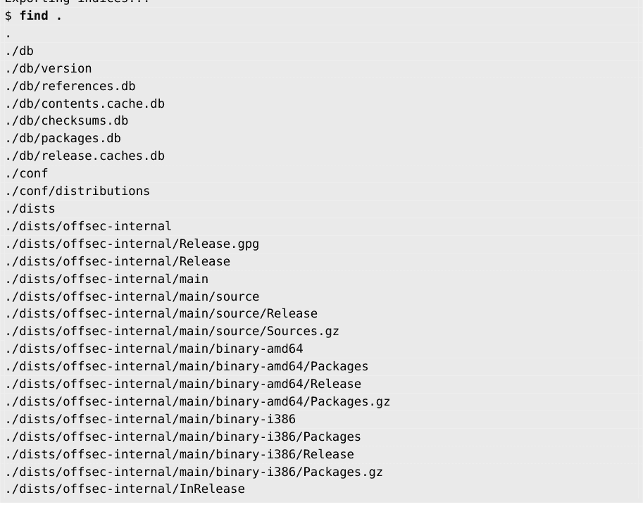

```
$ repropro include offsec-internal /tmp/offsec-defaults_1_0_amd64.changes
Exporting indices...
pool
pool
pool/main
pool/main/o
pool/main/o/offsec-defaults
pool/main/o/offsec-defaults/1_0.dsc
pool/main/o/offsec-defaults/1_0.tar.xz
pool/main/o/offsec-defaults/1_0_all.deb
```

如你所见，它将文件添加到了自己的子目录下的包池（pool）中。`dists` 和 `pool` 目录是你需要通过 HTTP（公开）提供的两个目录，以完成你的 APT 仓库的设置。它们包含了 APT 想要下载的所有文件。

假设你想在虚拟主机 `pkgrepo.offsec.com` 上托管此内容，你可以创建以下 Apache 配置文件，将其设置为 `/etc/apache2/sites-available/pkgrepo.offsec.conf`，并使用 `a2ensite pkgrepo.offsec.conf` 启用它：

```
<VirtualHost *:80>
ServerName pkgrepo.offsec.com
ServerAdmin reproadmin@offsec.com

ErrorLog /var/log/apache2/pkgrepo.offsec.com-error.log
CustomLog /var/log/apache2/pkgrepo.offsec.com-access.log "%h %l %u %t \"%r\" %>s"

DocumentRoot /home/pkgrepo/repropro
<Directory "/home/pkgrepo/repropro">
Options Indexes FollowSymLinks MultiViews
Require all granted
AllowOverride All
</Directory>
</VirtualHost>
```

在需要从此仓库获取包的机器上，对应的 `sources.list` 条如下：

```
deb pkgrepo.offsec.com offsec-internal main

# 如果你需要访问源码包，启用下一行
# deb-src http://pkgrepo.offsec.com offsec-internal main
```

你的包现在已经发布，并且对你的网络主机可用。尽管这个设置过程很漫长，但大部分工作现在已经完成。你可以通过 PXE 启动网络机器，得助于网络交付预设无交互地安装自定义的 Kali Linux 版本，使用 SaltStack 管理你的配置（控制节点！），创建自定义包，并通过你的软件包仓库分发这些包。这为多个 Kali Linux 安装提供了集中化管理和企业级控制。简而言之，你可以快速部署针对特定需求预配置的高安全性 Kali 系统，并得益于 Kali 的半自动安装所有软件包更新来保持其同步。

## 10.4. 总结

Kali Linux 的应用已从桌面扩展到中大规模部署，甚至到了企业级。在本章中，我们涵盖了如何使用 SaltStack 集中管理多个 Kali 安装，从而让你能够快速部署针对特定需求预配置的高安全性 Kali 系统。我们还揭示了如何得助于 Kali 的半自动安装软件包更新来保持其同步。

我们讨论了 `package-for`，它允许你创建自己的自定义的可分发源码包。

总结来说，让我们回顾建立 Salt 主（masters）和节点（minions）所需的主要步骤，这允许对远程主机进行控制和配置。

总结提示：

- 通过 PXE 从网络启动机器，至少需要一个 TFTP 服务器、一个 DHCP 服务器...

既然我们已经涵盖了 Kali Linux 在安装、配置、自定义和部署方面的所有基础知识，让我们转向 Kali Linux 在信息安全领域的角色。


# 关键词

- 评估类型
- 漏洞评估
- 合规性渗透测试
- 传统渗透测试
- 应用程序评估
- 攻击类型
- 拒绝服务（DoS）
- 内存损坏
- Web 漏洞
- 密码攻击
- 客户端攻击


# 安全评估导论

- 评估中的 Kali Linux 281 | 评估类型 283 | 评估的规范化 293 | 攻击类型 294 | 总结 297

到为止，我们涵盖了许多 Kali Linux 特有的功能，你应该对是什么让 Kali 特别之处以及如何完成许多复杂任务有了充分的理解。

在正式使用 Kali 之前，你应该理解一些与安全评估相关的概念。在本章中，我们将介绍这些概念以帮助你入门，并提供帮助你使用 Kali 执行安全评估的参考资料。

首先，值得花些时间来探究在处理信息系统时，“安全”究竟意味着什么。在尝试保护信息系统安全时，你关注的是系统的三个主要属性：

- 机密性（Confidentiality）：没有系统或信息访问权限的执行者是否可以访问系统或信息？
- 完整性（Integrity）：数据或系统是否会以某种非预期的方式被修改？
- 可用性（Availability）：数据或系统是否可以访问，以及预计在什么时候可以被访问？

这些概念共同构成了 CIA（机密性、完整性、可用性）三要素模型，在很大程度上是你在根据标准部署、维护或评估保护系统安全时所关注的主要内容。


同样重要的是，在某些情况下，你可能对 CIA 三要素中某方面的关注远高于其他方面。例如，如果你有一个包含你最秘密想法的个人日记，那么日记的机密性对你来说可能比完整性或可用性重要得多。换句话说，你可能并不担心是否有人向日记写入内容（而不是读取它），或者日记是否始终可以访问。另一方面，如果你正在保护一个跟踪医疗处方的系统，数据的完整性将是最关键的。虽然防止他人阅读某人的用药情况很重要，你能访问这份药物清单也很重要，但如果有人能够更改系统的内容（破坏了完整性），可能会导致危及生命的后果。

当你保护一个系统并发现（问题）时，你必须考虑系统属于这三个概念中的哪一个，或者是哪种组合。这有助于你以更全面的方式理解问题，并允许你对问题进行分类并做出相应的响应。识别出影响 CIA 三要素中单个或多个项的漏洞是可能的。以使用一个具有 SQL 注入漏洞的 Web 应用程序为例：

- 机密性：SQL 注入漏洞允许攻击者提取 Web 应用程序的全部内容，使其拥有读取所有数据的权限，但没有更改信息或禁用数据库访问的能力。
- 完整性：SQL 注入漏洞允许攻击者更改数据库中现有的信息。攻击者无法读取数据或阻止他人访问数据库。
- 可用性：启动长时间查询的 SQL 注入漏洞会消耗服务器上的大量资源。当此查询被启动多次时，会导致拒绝服务（DoS）状况。攻击者没有访问或更改数据以阻止合法用户访问 Web 应用程序的能力。

## 11.2. 评估类型

现在你已经确保你的 Kali 环境已就绪，下一步是确切定义你正在进行何种类型的评估。在最高层面上，我们可以将评估分为四种类型：漏洞评估、合规性测试、传统的渗透测试和应用程序评估。一次任务可能涉及每种类型评估的各种元素，但对它们进行一些详细描述并解释它们与你的 Kali Linux 构建和环境的相关是有价值的。

在深入研究不同类型的评估之前，注意漏洞（vulnerability）和利用程序（exploit）之间的区别很重要。

漏洞被定义为一种缺陷，当被利用时会损害信息系统的机密性、完整性可用性。可能会遇到许多不同类型的漏洞：

- `File Inclusion`：Web应用程序中的文件包含漏洞允许你将本地或远程文件的内容包含在程序的计算中。例如，Web应用程序可能有一个“每日消息（Message of the day）”功能，它可以读取文件内容并包含在网页中显示给用户。当此类功能的程序编写不正确时，它可以允许攻击者修改其网络请求，强制网站包含他们想要的内容。
- `SQL Injection`：SQL注入攻击是指程序的输入验证程序被绕过，允许攻击者为目标程序提供要执行的SQL命令。这是一种命令执行的形式，可能导致潜在的安全问题。
- `Buffer Overflow`：缓冲区溢出是一种绕过输入程序将数据写入缓冲区相邻内存的漏洞。在某些情况下，相邻内存位置可能对目标程序的运行至关重要，通过对覆盖的内存数据进行仔细操作，可以获得代码执行的控制。
- `Race Conditions`：竞态条件是一种利用程序中时序依赖性的漏洞。在某些情况下，程序的工作流取决于特定的事件序列。如果你能够更改这一事件序列，就可能导致漏洞。

另一方面，利用程序（exploit）是一种软件，当使用时会利用特定的漏洞，尽管并非所有漏洞都是可以利用的。利用程序必须创建一个运行的进程，强制其执行非意图的动作，且利用程序的创建可能是复杂的。此外，现代计算平台中存在许多反利用技术，旨在设计使利用漏洞变得更加困难，例如数据执行保护⁵（DEP）、地址空间布局随机化⁶（ASLR）。然而，仅仅由于某个特定漏洞没有公开的利用程序，并不意味着它不存在（或无法被创建）。例如，许多组织出售从不公开的商业化利用程序，因此所有漏洞必须被视为潜在可利用的。

1 https://en.wikipedia.org/wiki/File_inclusion_vulnerability
2 https://en.wikipedia.org/wiki/SQL_injection
3 https://en.wikipedia.org/wiki/Buffer_overflow
4 https://en.wikipedia.org/wiki/Race_condition

### 11.2.1. 漏洞评估

漏洞被认为是一种弱点，可以用某种方式来损害信息系统的机密性、完整性可用性。在漏洞评估中，你的目标是为目标环境内发现的漏洞创建一个简单的清单。目标环境的概念极其重要。你必须确保留在客户的网络范围和需求范围内。评估范围不当可能会导致服务中断、违背与客户的信任，或导致对你和你的雇主采取法律诉讼。

由于其相对简单性，漏洞测试通常在更成熟的环境中定期完成，作为展示其尽职调查的一部分。在大多数情况下，会使用自动化工具（如 Kali Tools 网站中漏洞分析⁷和 Web应用程序⁸类别工具以及 Kali 桌面应用程序）来发现目标环境中的活动系统，识别特征并对其进行枚举，以发现尽可能多的服务器软件、版本、平台等信息。

然后检查这些信息是否具有已知的潜在问题或漏洞的特征。这些特征由数据点组合组成，旨在表示已知问题。使用多个数据点是因为你使用的数据点越多，识别就越准确。存在大量的潜在数据点，包括但不限于：

- `Operating System Version`：软件在一个操作系统版本上存在漏洞但在另一个版本上没有漏洞，这并不罕见。因此，扫描器将尝试尽可能准确地确定哪个操作系统版本托管了目标应用程序。
- `Patch Level`：许多时候，扫描器会尝试尽可能准确地确定哪个操作系统版本托管了目标应用程序。
- `Processor Architecture`：许多软件适用于多种架构，如 x86、x64、ARM、SPARC。

在某些情况下，漏洞仅存在于特定架构，你可以得到以下结果：

- `Software Version`：目标版本是需要的基础项目之一。
- `True Positive`：特征匹配并捕获了真实的漏洞。这些结果是你需要跟进并修正的。
- `False Positive`：特征匹配；但检测到的问题并非真实。在某些情况下，这些通常被视为噪声。
- `True Negative`：特征未匹配且不存在漏洞。这是理想的情况。
- `False Negative`：特征未匹配但确实存在。假阳性已经糟糕，假阴性要糟糕得多。

正如你可以想象的，特征的准确性对于准确的结果至关重要。提供的数据越多，从基于特征的自动扫描中获得准确结果的机会就越大。

在身份验证扫描中，扫描软件将使用凭据对目标进行身份验证。这比其他全面审查所有已安装软件、已应用补丁、运行进程等方式提供了更深层次的可见可见性。

良好的漏洞评估展示了组织内部潜在问题的快照，并提供了衡量随时间变化的指标。这是一种相当轻量级的评估，但尽管如此，许多组织仍会在非工作时间定期执行自动扫描，以避免在白天服务可用性和带宽最关键的时刻出现潜在问题。

正如前面提到的，漏洞扫描会检查许多不同的数据点以获得准确的结果。所有这些检查都会给目标系统带来负载并消耗带宽。遗憾的是，很难确切知道如何了与这些服务相关的检查。这是执行扫描的成本；它将占用系统资源。在运行这些线程时，了解将消耗的资源以及目标系统能够承受的负载是非常重要的。

#### 扫描线程

大多数漏洞扫描器都包含设置每次扫描线程数的选项，这等同于同时进行的并发检查数量。增加线程将直接影响评估平台以及你所交互的网络和目标的负载。在使用这些扫描器时，记住这一点非常重要。为了更快完成扫描，增加线程是很很有吸引力的，但请记住这样做会带来负载的大幅增加。

当漏洞扫描完成后，发现的问题通常会与行业标准标识符相关，如 `CVE` 编号⁹、`EDB-ID`¹⁰ 和厂商公告。这些信息连同漏洞的 `CVSS` 评分¹¹ 用于确定风险评级。在分析扫描结果时，漏报（以及误报）以及任意的风险评级是可能考虑的常见问题。

⁵ https://en.wikipedia.org/wiki/Executable_protection
⁶ https://en.wikipedia.org/wiki/Address_space_randomization
7 https://tools.kali.org/category/vulnerability-analysis
8 https://tools.kali.org/category/web-applications


由于自动化工具使用签名数据库来检测漏洞，任何与已知特征的细微偏差都可能改变结果以及感知漏洞的概率。误报是错误地标记了不存在的漏洞，而漏报则是实际上对漏洞视而不见且不报告它。因此，人们通常认为扫描器的好坏取决于其签名规则库。出于此原因，许多供应商提供多套规则：一套可能供免费用户使用，另一套相当昂贵且更全面，通常卖给企业客户。

漏洞扫描器经常遇到的另一个问题是建议的风险评级的有效性。这些风险评级是在通用的基础上定义的，考虑了许多不同因素，如权限级别、软件类型以及身份验证前或后。根据你的环境，这些评级可能适用也可能不适用，因此不应盲目接受。只有精通系统和漏洞的人才能妥善验证风险评级。

虽然对于风险评级没有通用的共识，但建议将 NIST 特别出版 800-30¹² 作为在环境中评估风险评级及其准确性的基准。NIST SP 800-30 将发现漏洞的真实风险定义为发生概率和潜在影响的结合。

> ⁹https://www.cmitre.org

> ¹⁰https://www.exploit-db.com/about/

> ¹¹https://www.first.org/cvss

> ¹²https://www.csrc.nist.gov/publications/PubsSps.html#800-30

## 发生概率

根据美国国家标准技术研究院（NIST）的定义，发生概率基于特定威胁能够利用特定漏洞的概率，评级可能为低、中、高。

- 高：潜在攻击者技术高超且动机强烈，且为了防止漏洞而采取的措施不足。
- 中：潜在攻击者有动机且有技能，但为了防止漏洞而采取措施可能会阻碍其成功。
- 低：潜在攻击者缺乏技能或缺乏动机，且为了防止漏洞而这些措施部分或完全有效。

## 影响

影响程度通过评估如果相关漏洞被利用或被利用可能造成的损害来确定。

- 高：利用该漏洞可能导致非常严重的财务损失、对组织任务或声誉的严重损害，甚至导致人员受伤、业务中断。
- 中：利用该漏洞可能导致财务损失、对组织任务或声誉的损害或人员受伤。
- 低：利用该漏洞可能导致某种程度的财务损失以及对组织任务和声誉的影响。

## 总体风险

一旦确定了发生概率和影响，你就可以确定总体风险评级，该评级被定义为这两个评级的函数。总体风险可以被评为低、中、高，为负责安全和维护相关系统的人提供指导。

- 高：强要求针对该漏洞实施额外的措施。在某些情况下，允许系统继续运行，但必须尽快设计并实施计划。
- 中：要求针对该漏洞实施额外的措施。必须及时制定实施所需措施的计划。
- 低：系统所有者负责。

最初发现的漏洞，探索该漏洞所提供的访问权限，并利用这种增加的访问权限对目标进行额外的攻击。

这需要对目标环境进行严谨的审查，并结合手动搜索、创造力以及跳出框架的思维来寻找攻击成功的迹象。

在更复杂的场景中，可以以黑盒或白盒的方式交互式地进行应用程序评估：

- 黑盒评估：工具（或评估人员）与应用程序进行交互，除了标准用户的权限外，没有其他特殊知识或访问权限。例如，在 Web 应用程序的情况下，评估人员可能只能访问未登录系统的用户可使用的函数和特性。使用的任何用户账户都应该是普通用户可以自行注册的账户。这将防止攻击者审查任何仅对由管理员创建的用户可用的功能。
- 白盒评估：工具（或评估人员）通常将拥有源代码的完全访问权限、运行应用程序平台的管理员访问权限等。这确保了无论功能位于应用程序的何处，都能完成对所有应用程序功能的完整且全面的审查。这种方式的代价是，评估在任何方面都不是对恶意活动的模拟。

在其他情况下，可能会采取混合方法，即评估人员无法完全访问运行该平台的应用程序源代码，而是由管理员配置用户账户，以便尽可能地访问应用程序功能。

Kali 是进行各种应用程序评估的理想平台。在默认安装中，提供了一系列不同的针对特定应用程序的扫描器。对于更高级的评估，还存在一系列工具、源码编辑器和脚本环境。你可能会发现 Kali Tools28 网站上的“Web应用程序26”和“逆向工程27”部分大有帮助。

## 11.3. 评估的正式化

当你的 Kali 环境准备就绪并确定了评估类型后，你就几乎准备好开始工作了。你的最后一步是确定要完成的工作内容。这至关重要，因为它定义了工作的预期，并授予了进行在其他情况下可能非法的活动的许可。我们将从宏观层面进行介绍，但这是一个非常复杂且重要的步骤，你可能希望与你组织的法律代表讨论寻求协助。

作为正式化过程的一部分，你需要为工作定义交战规则（rules of engagement）。这涵盖了以下项目：

- 你被允许与哪些系统进行交互？确保你不会意外干扰到业务运营至关重要。
- 评估允许在一天中的什么时间以及在什么攻击窗口进行？某些组织喜欢限制评估工作开展的时间。
- 当你发现潜在漏洞时，你是否允许对其进行利用？如果不允许，审批流程是什么？有些组织对利用尝试采取非常控制的方法，而另一些组织则倾向于更具真实感的方法。在工作开始之前明确定义这些预期是最好的。
- 如果发现了重大问题，应该如何处理？有时，组织希望立即获知，，否则通常会在评估结束时再处理。
- 在紧急情况下，你应该联系谁？当发生任何问题时，知道应该联系谁始终是重要的。
- 谁会知道这项活动？如何向他们通报？在某些情况下，组织可能希望通过评估来测试他们的事件响应和检测性能。预先了解这一点是一个好主意，这样你就能知道是否需要在评估方法中采取某种程度的隐蔽性。
- 评估结束时的预期是什么？结果将如何沟通？了解所有方在评估结束时的预期。定义交付物是工作完成后让每个人都满意的最佳方式。

> 26 http://tools.kali.org/category/web-applications

> 27 http://tools.kali.org/category/reverse-engineering

> 28 http://tools.kali.org

此列表并不完整，它只是让你对应该涵盖的细节有一个了解。然而，你应该意识到，良好的法律代表是不可替代的。定义这些项目后，你需要获得适当授权来执行评估，因为在评估过程中你所做的许多活动如果没有获得相应权限的人员的适当授权，可能是非法的。

万一切就绪后，在开始工作之前你还想采取最后一步：验证。永远不要信任你所提供的信任——始终要验证。使用多个信息源来确认内部系统确实由客户所有，并由客户运营。随着云服务的盛行，组织可能会忘记他们实际上并不拥有他们提供的系统。你可能会发现，开始工作之前需要从云服务提供商获得特殊许可。此外，始终要验证 IP 块。不要依靠组织对他们拥有 IP 块的假设，即使他们将其作为目标签署了确认。例如，我们见过有些组织请求对整个类网络范围进行评估，而实际上他们只拥有这些地址的一个子集。通过攻击整个 C 类地址空间，我们是在攻击该组织的邻居网络。“信息收集”菜单下的 OSINT 分析子分类包含许多可以帮助你进行此类验证的工具。

## 11.4. 攻击类型

工作一旦开始，将进行哪些具体的攻击类型？漏洞类型²⁹ 都有其相关的利用技术。本节将涵盖你最经常交互的各种漏洞类型。

无论你查看的是哪种类漏洞，Kali 都让这些工具和利用变得容易寻找。图形用户界面上的 Kali 菜单被分为类别，有助于找到正确的工具。此外，Kali 网站³⁰ 对 Kali 中提供的各种工具进行了全面列表，按类别组织并标记以便浏览。每个条目都包含有关工具的详细信息和示例用法。

> ²⁹ https://www.cvedetails.com/vulnerabilities-by-types.php

> ³⁰ http://tools.kali.org/tools-listing

### 11.4.1. 拒绝服务

拒绝服务攻击利用漏洞导致服务中断，通常通过使易影响进程崩溃。Kali Linux 菜单中的“压力测试”类别包含许多用于此目的的工具。

当许多人听到“拒绝服务攻击”术语时，他们会立即想到从多个源同时向单个目标发送的资源消耗攻击。这就是分布式拒绝服务攻击，DDoS。这类攻击很少是专业安全评估的一部分。

相反，单次拒绝服务攻击通常是不当尝试利用漏洞的结果。如果利用程序编写者发布了部分功能代码或概念证明（PoC）代码并在实际中被使用，它可能会导致拒绝服务。即使是编写良好的利用程序也可能只在特定情况下有效，但在较差的情况下会导致拒绝服务。看起来解决方案是只使用安全且经过测试的代码，或者编写你自己的。即使有这种解决方案，也没有保证，而且这会严重限制评估人员，造成不当的约束，从而导致评估效果大折扣。相反，关键在于避免在现场使用 PoC 代码和未经测试的利用程序，并始终确保律师涵盖了其他意外。


通常情况下，拒绝服务攻击不是故意发起的。大多数自动化漏洞工具会将拒绝服务漏洞标记为低风险，因为它们可以移除一个无法被用于代码执行的运行的服务。然而，必须记住，并不是所有利用程序都是公开的，而且拒绝服务漏洞可能会掩盖更深层次、更严重的威胁。针对已知拒绝服务的代码执行利用程序可能存在但尚未公开。要点是，关注拒绝服务漏洞，并鼓励你的客户无论其（通常较低）威胁评分如何都进行修补。

### 11.4.2. 内存损坏

内存损坏发生在进程内存空间内的位置因编程错误被意外修改。内存损坏通常会导致不可预测的程序行为，但在许多情况下，这些漏洞允许以某种方式操纵进程，从而控制进程执行流，允许攻击者定义的活动。

这些攻击通常被称为缓冲区溢出，尽管这是一种过度简化。最常见的内存损坏类型彼此截然不同，并且有其成功利用所需的特定策略和技术。

- 栈缓冲区溢出：当程序向栈上的缓冲区写入的数据超过了其可用空间时，相邻的内存可能会被损坏，通常会导致程序崩溃。
- 堆损坏（Heap Corruption）：堆内存是在运行时分配的，通常包含运行程序的数据。堆损坏是通过操纵数据，在堆内存指针的链表上进行覆盖而引发的。
- 整数溢出（Integer Overflow）：当应用程序尝试创建一个其分配的存储空间无法容纳的数值时，就会发生此类溢出。
- 格式化字符串（Format String）：当程序接受用户输入并在不检查的情况下对其格式化时，取决于所使用的标记（tokens），内存位置可能会泄露或被覆盖。

### 11.4.3. 网络漏洞

由于现代网站不再是静态页面，而是为用户动态生成的，因此平均网站非常复杂。网络漏洞利用这种复杂性，试图攻击后端的生成逻辑或网站向访问者的呈现方式。

这类攻击非常常见，因为许多组织已经达到了面临的外部服务极少的程度。最常见的 Web 应用程序攻击类型是 SQL 注入和跨站脚本（XSS）。

- SQL 注入：这些攻击利用了编程不当的应用程序，这些程序没有对用户输入进行适当清理，导致能够从数据库中提取信息，甚至完全接管服务器。
- 跨站脚本：与 SQL 注入一样，XSS 攻击是由于对用户输入的清理不当，允许攻击者操纵用户或站点在其浏览器会话上下文中执行代码。

复杂、丰富且复杂的 Web 应用程序非常常见，为恶意分子提供了理想的攻击面。你将在 Web 应用程序分析（Web Application Analysis）类别和 `kali-linux-web` 元软件包中找到大量实用的工具。

### 11.4.4. 密码攻击

密码攻击针对服务的身份验证系统。这些攻击通常分为在线密码攻击和离线密码攻击，你会在密码攻击（Password Attacks）菜单类别中看到这些分类。在在线密码攻击中，会对运行中的系统尝试多个密码。在离线密码攻击中，获取密码的哈希或加密值，攻击者尝试获取明文值。防止此类攻击的方法是处理这一过程在计算上是非常昂贵的，限制了你每秒可以生成的尝试次数。然而，目前存在规避方法，例如使用图形处理器（GPU）来加速可以进行的尝试次数。`kali-linux-gpu` 元软件包包含许多利用这种力量的工具。

最常见的，密码攻击针对的是供应商提供的默认设置。由于这些是众所周知的值，攻击者会扫描这些默认账户，希望获得好运。其他常见攻击使用字典攻击，即创建一个针对目标环境身定制的词汇表，然后对常见、默认或已知账户进行在线密码攻击，按顺序尝试每个单词。

在评估中，理解此类攻击的潜在后果非常重要。首先，由于反复的身份验证尝试，这些攻击通常具有很大的噪声（特征）。其次，在对单个账户执行过多无效尝试后，这些攻击通常会导致账户锁定情况。最后，这些攻击的性能非常慢，导致在尝试使用综合词汇表时遇到困难。

### 11.4.5. 客户端攻击

大多数攻击是针对服务器的，但随着服务变得越来越难以攻击，攻击者选择了更容易的目标。客户端攻击就是这种趋势的结果，攻击者将针对目标组织员工工作站上安装的各种应用程序。社会工程工具（Social Engineering Tools）菜单类别包含许多优秀的应用程序，可以帮助进行此类攻击。

这类攻击最好的利用方式是 2000 年代初非常常见的 Flash、Acrobat Reader 和 Java 攻击。然后，攻击者会诱导访问恶意网页。这些页面将包含特殊代码，触发这些客户端应用程序中的漏洞，导致能够在目标系统上运行恶意代码。

客户端攻击极难防御，需要大量的用户教育、持续的应用程序更新以及网络控制来有效降低风险。

## 11.5. 总结

在本章中，我们简要回顾了 Kali 在信息安全领域的角色。我们讨论了在进入实地保护客户信息之前，保持清洁、运行良好的安装以及使用加密的重要性，以及通过法律代表来保护你和客户利益的重要性。

CIA（机密性、完整性、可用性）三元组的组成部分是你在执行标准部署、维护或评估时，重点保护系统的首要项目。这一概念基础将帮助你识别系统的关键组件，并决定投入多少努力和资源来纠正已发现的问题是值得。

我们讨论了多种类型的漏洞，包括文件包含、SQL 注入、缓冲区溢出和竞态条件。

签名的准确性对于获得有效的漏洞评估结果至关重要。提供的数据越多，基于签名扫描获得准确结果的概率越高，这就是为什么认证扫描如此流行的原因。

由于自动化工具使用签名数据库来检测漏洞，因此有了漏洞评估、合规性测试、传统的渗透测试和应用程序评估。尽管每种评估类型都利用一组核心工具，但许多工具和技术是重叠的。

与其他评估类型相比，漏洞评估相对简单，它由对目标环境中发现的问题进行自动清单组成。在节中，我们讨论了漏洞是一种缺陷，被利用时会损害信息系统的机密性、完整性或可用性。


# 关键词

持续变化

认证

培训


# 结论：前方的道路

| 跟上变化 302 | 展示你新学到的知识 302 | 进一步探索 302 |
| :--- | :--- | :--- |

恭喜你！希望你现在已经对你的 Kali Linux 系统更加熟悉了，并且不再害怕使用它进行任何你所想到的实验。你已经发现了它最有趣的特性，也了解了它的局限性以及规避这些局限的方法。

如果你还没有将所有功能付诸实践，请保留此书作为参考，并在尝试新功能时刷新你的记忆。记住，没有什么比实践（和坚持）更能开发新技能了。正如 Offensive 的培训师们不断重复的那样：更加努力（Try Harder）¹

## 12.1. 跟上变化

对于像 kali-rolling 这样不断变化的发行版，书中的某些部分不可避免会过时。我们将尽力保持更新（至少对于在线版本），但对于大部分内容，我们尝试提供通用的解释，这些解释在未来很长一段时间内都是有效的。

如此，你应该准备好迎接变化，并为可能出现的任何问题寻找解决方案。通过对 Kali Linux 及其与 Debian 关系的深入理解，当你遇到困难时，可以依靠 Kali 和 Debian 社区以及他们的众多资源（错误跟踪器、论坛、邮件列表等）。

不要害怕提交 bug（请参见第 6.3 节，“如何提交一份良好的 bug 报告”[第 129 页]！如果你像我一样，当你完成提交一份良好 bug 报告所需的步骤时（这需要一些时间），你可能已经解决了问题，或者至少找到了一个好的规避方法。而且通过实际修复 bug，你还将帮助到其他受该问题影响的人。

## 12.2. 展示你新学到的知识

你对自己新的 Kali Linux 技能感到自豪吗？你想要确保自己记住了那些真正重要的事情吗？如果你对这些问题中的任何一个回答是是，那么你应该考虑申请 Kali Linux 认证专家（KCP）计划。

这是一项全面的认证，将确保你了解如何在许多现实场景中部署和使用 Kali Linux。它是你简历的锦上添花，也证明了你准备好更进一步。

## 12.3. 进一步探索

本书教了你任何 Kali Linux 用户都应该知道的知识，但为了保持简短，我们做了一些艰难的选择，有很多话题没有被涵盖。

> ¹https://www.offensive-security.com/offsec/say-try-harder/

### 12.3.1. 走向系统管理

如果你想学习系统管理，我们只能建议你查看《Debian 管理手册》（Debian Administrator’s Handbook）：

- https://debian-handbook.info/get/

你将发现许多补充章节，涵盖了常见的 Unix 服务，而我们在书中完全跳过了这些内容。即使是对于在 Kali 书中重用的章节，你也会发现许多关于软件包系统的补充提示（该系统在最底层也得到了更广泛的覆盖）。

Debian 书籍显然深入地介绍了 Debian 社区及其组织方式。虽然这些知识并非至关重要，但当你与 Debian 贡献者交互（例如通过 bug 报告）时，它们非常有用的。

### 12.3.2. 渗透测试

你现在可能已经注意到，本书并没有教你渗透测试。但你学到的东西仍然很重要。你现在准备好充分利用 Kali Linux 这一最好的渗透测试框架了。同时也包含了参加 Offensive Security 培训所需的 Linux 技能。


如果你觉得你还没有准备好参加付费课程，可以从关注 `Metasploit Unleashed` 免费在线培训开始。`Metasploit` 是一个非常流行的渗透测试工具，如果你认真打算学习渗透测试，就必须了解它。

接下来的逻辑步骤将是学习“使用 Kali Linux 进行渗透测试”在线课程，这是通往“Offensive Security 认证专家”`OSCP` 认证的路径。你可以按照自己的节奏学习这门在线课程，但认证实际上是一项艰巨的、持续 24 小时的真实世界渗透测试，在隔离的 VPN 中进行。你准备好接受挑战了吗？

> ²https://www.offensive-security.com/metasploit-unleashed/

> ³https://www.offensive-security.com/information-security-training/

# 索引

- `apt-config`, 235
- `apt-d`, 195
- `apt-cache`, 116
- `apt-dev`, 48
- `apt-apt/conf.d/`, 195
- `apt-apt/preferences`, 196
- `apt-apt/sources.list`, 172
- `apt-apt/trusted.gpg/`, 203
- `apt-group`, 107
- `apt-shadow`, 107
- `apt-network/interfaces`, 305
- `apt-passwd`, 107
- `apt-salt/minion`, 255
- `apt-shadow`, 107
- `apt-ssh/sshd_config`, 110
- `apt-proc`, 48
- `apt-sys`, 48
- `apt-var/lib/dpkg/`, 212
- `apt-var/www/html/`, 114
- `32-bit CPU`, 16
- `64-bit CPU`, 16
- `add a user to a group`, 108
- `addgroup`, 109
- `adduser`, 108
- `administrator password`, 72
- `Advanced Package`, 171
- `aide` `Debian package`, 163
- `AllowOverride`, `Apache` directive, 115, 116
- `analysis vulnerability`, 6
- `web application`, 6
- `ansible`, 255
- `Apache`, 113
- `directives`, 115
- `Apache directives`, 16
- `application assessments`, 291
- `collection`, 10
- `menu`, 5
- `applying a patch`, 227
- `apropos`, 124
- `APT`, 171
- `configuration`, 195
- `header display`, 185
- `initial configuration`, 81
- `interfaces`, 190
- `package search`, 185
- `pinning`, 196
- `preferences`, 176

# A

- `a2dismod`, 113
- `a2enmod`, 113
- `a2ensite`, 114
- `ACCEPT`, 155
- `account creation`, 107
- `disable`, 109
- `modification`, 108
- `activity`, `monitoring`, 126
- `apt`, 176
- `apt build-dep`, 226
- `apt dist-upgrade`, 179
- `apt full-upgrade`, 179
- `apt install`, 177
- `apt purge`, 180
- `apt remove`, 180
- `apt search`, 186
- `apt show`, 186
- `apt source`, 223
- `apt update`, 176
- `apt upgrade`, 179
- `apt-cache`, 185
- `apt-cache dumpavail`, 187
- `apt-cache pknames`, 187
- `apt-cache policy`, 187
- `apt-cache search`, 186
- `apt-cache show`, 186
- `apt-cdrom`, 172
- `apt-get`, 176
- `apt-get dist-upgrade`, 179
- `apt-get install`, 177
- `apt-get purge`, 181
- `apt-get remove`, 180
- `apt-get update`, 176
- `apt-get upgrade`, 179
- `apt-key`, 203
- `apt-mark auto`, 200
- `apt-mark manual`, 200
- `apt-xian-index`, 186
- `apt.conf.d/`, 176, 190
- `aptitude`, 176, 190
- `aptitude dist-upgrade`, 179
- `aptitude full-upgrade`, 179
- `aptitude install`, 177
- `aptitude auto`, 200
- `aptitude purge`, 181
- `aptitude remove`, 180
- `aptitude safe-upgrade`, 179
- `aptitude search`, 186
- `aptitude show`, 186
- `aptitude unmark`, 200
- `aptitude update`, 176
- `aptitude why`, 200

# architecture

- `multi-arch support`, 200
- `ARM installations`, 94

# assessment

- `application`, 291
- `black box`, 292
- `formalization`, 293
- `vulnerability`, 284
- `white box`, 292

# attacks

- `client side`, 297
- `database`, 6
- `denial of service`, 295
- `memory corruption`, 295
- `password`, 296
- `types of`, 294
- `web`, 296
- `wireless`, 6

# auditing, security, 5

# authentication

- `package authentication`, 202
- `AuthName`, `Apache` directive, 116
- `AuthType`, `Apache` directive, 116
- `AuthFile`, `Apache` directive, 116
- `automatic installation`, 91
- `automatically installed packages`, 199
- `avalanche effect`, 163
- `axi-cache`, 186

# B

- `background process`, 65
- `Back`, XXI, 2
- `bg`, 57
- `block device file`, 49
- `booted`, 92
- `boot screen`, 67
- `bootable USB key`, 19
- `bootloader`, 83
- `BOOTP`, 252
- `Breaks`, `header field`, 209
- `broken dependency`, 189
- `Bruce Schneider`, 150
- `brute-force attacks`, 296

# buffer

- `of a kernel`, 233

# C

- `network`
- `proxy`, 82
- `cdimage.kali.org`, 14, 175
- `program configuration`, 110
- `cdrom preseed`, 93
- `conflicts`, 208
- `certification`, 302
- `Conflicts`, `header field`, 208
- `chage`, 108
- `contrib`, `section`, 173
- `chain`, 154
- `control`, 206
- `changelog`, 266
- `control file`, 266
- `changelog.Debian.gz`, 126
- `control sum`, 163
- `character device file`, 49
- `control.tar.gz`, 211
- `checksecurity`, 164
- `copying`, `ISO image`, 19
- `checksums`, 214


- `copyright`, 127
- `chef`, 255
- `copyright file`, 265
- `chfn`, 108
- country selection, 69
- `chgrp`, 58
- `cp`, 53
- `chmod`, 58
- `createdb`, 112
- choice
- creatoruse
- of country, 69
- creation
- of language, 28
- of a PostgreSQL database, 112
- `chown`, 58
- of a PostgreSQL user, 112
- 数据库评估, 6
- 数据库服务器, 111
- `dch`, 226
- `dd`, 22
- `debconf`, 214
- `debconf-get`, 97
- `debconf-get-selections`, 94
- `debconf-set`, 97
- 字典攻击, 296
- 指令, Apache, 115, 116
- DirectoryIndex, Apache 指令, 115
- 禁用账户, 109
- 磁盘按下, 93
- 磁盘 (程序), 20
- `diskutil`, 23
- 发行版, Linux, 2
- `dm-crypt`, 86
- `dmesg`, 60
- `DEBAMAIL`, 265
- `DBFULLNAME`, 265

## Debian
- 与 Kali Linux 的关系, 4
- Debian 管理员手册, 303
- Debian 自由软件指南, 5
- Debian GNU/Linux, 2
- Debian 策略, 5
- `debian-archive-keyring`, 203
- `debian-kernel-handbook`, 233
- `debian-changelog`, 226, 266
- `debian/control`, 266
- `debian/copyright`, 265
- `debian/patches`, 225
- `debian/rules`, 229, 267
- `DNAT`, 155
- `dnsmapq`, 252
- `docs.kali.org`, 127
- 文档, 124, 126
- 下载
- ISO 镜像, 14
- 源, 223
- `dpkg`, 170
- 数据库, 212
- `dpkg --verify`, 162
- 内部操作, 213
- `dpkg-buildpackage`, 231
- `dpkg-deb`, 232
- `dpkg-source --commit`, 227
- 驱动器, USB 驱动器, 19
- `debbuild`, 232
- 默认密码, 155
- `default.target`, 117
- 删除组, 109
- `delgroup`, 109
- 拒绝服务, 295
- 依赖, 207
- Depends, 头部字段, 207
- 桌面环境, 3
- live ISO 期间的选择, 238
- `desktop-base`, 263
- 检测文件系统上的变化, 426
- 设备文件, 49
- `df`, 60
- `dh-make`, 264
- `dh_install`, 267
- DHCP, 252
- DROP, 155
- `dropdb`, 112
- `dropuser`, 112
- 双启动, 84

## E
- `echo`, 54
- 编辑器, 56
- 加密分区, 85
- 加密持久化, 244
- 工程学
- 反向, 6
- 社会工程学, 7
- Enhances, 头部字段, 208
- 环境
- 环境变量, 75
- ExecCGI, Apache 指令, 115
- 执行模块, salt, 256
- 执行权, 57
- 实验性, 197
- Explanation, 198
- 漏洞工具, 27
- `gpasswd`, 109
- GPG 密钥, 17
- `graphical.target`, 117
- `grep`, 56

## F
- `fail2ban`, 152
- 特性, 7
- `fg`, 57
- 文件
- 机密性, 85
- 配置文件, 214
- 文件系统, 49
- 层次结构, 54
- 过滤规则, 154, 157
- `find`, 56
- 指纹, 163
- `groupmod`, 109
- GRUB, 83
- `gui-apt-key`, 204
- 引导式分区, 75
- 防火墙, 153
- FollowLinks, Apache 指令, 115
- 取证学, 7
- 模式, 8
- 形式化, 293
- 格式化磁盘, 49
- 论坛, 128
- `forums.kali.org`, 128
- FORWARD, 154
- `free`, 60
- Freenode, 128
- `fwbuilder`, 160
- 硬件发现, 69
- 堆损坏, 295
- Kali Linux 历史, 2
- HOME, 55
- 目录, 55
- 虚拟主机, 114
- `htpasswd`, 116
- HTTP 代理, 82
- HTTP 服务器, 113
- `http.kali.org`, 174
- HTTPS, 114
- Hyper-V, 25

## G
- 获取源, 223
- `getent`, 108
- `git clone`, 225
- GitHub issues, 144
- GNOME, 3
- `gnome-disk-utility`, 20
- `gnome-system-monitor`, 162
- GNU
- Info, 122

## I
- ICMP, 156
- `id`, 60, 109
- `ifupdown`, 105
- 仿冒, 7
- Includes, Apache 指令, 115
- 不兼容性, 209
- Indexes, Apache 指令, 115
- info, 126
- 信息收集, 6
- itd preseed, 92
- INPUT, 154
- 安装, 66
- 自动, 91
- 的构建依赖, 226
- ARM 设备, 94
- 包安装, 176, 177
- 故障排除, 95
- 无人, 91
- 安装程序前的, 92
- 整数溢出, 295
- 互联网控制消息协议, 156
- `ip6tables`, 153, 157
- `iptables`, 153, 157
- IRC 频道, 128
- dsccp-server, 252
- ISO 镜像
- 认证, 16
- 启动, 24
- 拷贝, 19
- 自定义构建, 237
- 下载, 14
- 镜像, 14
- 变体, 16
- `kali-dev`, 4, 174
- `kali-linux-* meta-packages`, 239
- `kali-menu`, 263
- `kali-meta`, 263
- `kali-rolling`, 4, 173
- KDE, 3
- 内内核, 48
- 编译, 233
- 配置, 235
- 日志, 60
- 源, 234
- APT 认证密钥, 204
- USB 密钥, 19
- 键盘布局, 67
- `kill`, 57
- konquer, 126
- KVM, 25
- 语言选择, 68
- 布局, 67
- `less`, 56
- `libapache-mod-php`, 113
- Linux, 48
- 日志, 60
- `journalctl`, 60

## Kali Linux
- 社区, 128
- 文档, 129
- 下载, 14
- 入门, 14
- 特性, 7
- 元数据包, 239
- 策略, 9
- 与 Debian 的关系, 4
- 仓库, 173
- `kali-archive-keyring`, 203
- `kali-bleeding`, 174, 197
- `kali-defaults`, 263
- 发行版, 2
- 内核, 2, 8
- 内内核源, 234
- live ISO 镜像, 14
- 自定义构建, 237
- `live-boot`, 240
- `live-build`, 240
- 添加文件, 240
- debconf 前的, 237
- 钩子, 239
- 要安装的包, 238
- 加载器
- 引导加载程序, 83
- LOG, 155
- `logcheck`, 161
- 记录, 161
- 逻辑卷管理器, 74
- 远程登录, 110
- `aptitude`, 193
- `dpkg`, 188
- 内内核, 60
- 镜像, 14, 81, 174
- `mkdir`, 53
- `mkfs`, 49
- 包的修改, 222
- 修改权, 57
- 活动, 162
- `ls`, 52
- `isdev`, 61
- `isw`, 61
- `isci`, 61
- `LUKS`, 86


- `LVM`, 86

- `LXDE`, 17

- 文件, 163

- 更多, 56

- 挂载, 49

- 挂载点, 79

- `Multi-Arch`, 200

- `multi-user.target`, 117

- `Views`, `Apache` 指令, 115

- `mv`, 53

- 虚拟机, 234

- 主节, 173

- `make deb-pkg`, 236

- `Makefile`, 267

- `man`, 124

- `netfilter`, 153

- 网络配置, 71, 104

- 与 `ifupdown`, 105

- 与 `NetworkManager`, 104

- 网络安装, 252

- 网络镜像, 81

- 网络预期的, 93

- 网络服务, 10

- 保护, 153

- 配置管理, 255

- 服务, 117

- 手动页, 124

- 手动安装的包, 199

- `NetworkManager`, 104

- `newgrp`, 58

- `NEWS.Debian`, 126

- `non-free`, 节, 173

- `nuke password`, 246

- 权限, 59

- `MASQUADE`, 155

- 主引导记录, 84

- 主节, `salt`, 255

- 进制表示, 59

- `Offensive Security`, 2

- `openssh`, 110

- `Options`, `Apache` 指令, 115

- `OUTPUT`, 154

- 溢出, 295

- `overlay` 文件系统, 241

- `MATE`, 16

- `md5sums`, 214

- 内存损坏, 295

- `Kali` 应用程序, 5

- `meta-package`, 207, 209

- `kali-linux*`, 239

- `Metasploit Unleashed`, 303

- `minion`, `salt minion`, 255

## P

- 数据包

- 组, 57

- 过滤器, 153

- 用户, 57

- `IP`, 153

- `PAE` (物理地址扩展), 35

- 包

- `parted`, 242

- 身份验证, 202

- 二进制包, 170

- 构建, 231

- `swap` 分区, 79

- 配置, 263

- 分区, 74

- 冲突, 208

- 引导式分区, 75

- 内容检查, 184

- 手动分区, 77

- `Debian` 依赖, 207

- `passwd`, 108

- 文件列表, 181

- 密码, 108

- 头部列表, 184

- 攻击, 296

- 不兼容性, 209

- 默认密码, 152

- `info`, 184

- 策略, 152

- 安装, 176, 177

- 密码攻击, 667

- 更改, 226

- `patch`, 227

- 元信息, 204, 206

- 补丁应用, 227

- 修改, 222

- `PATH`, 53

- 优先级, 196

- `PCI`, 288

- `purge`, 181

- 渗透测试

- 移除, 170

- 合规性, 288

- 替换, 269

- 传统的, 289

- 仓库, 210

- 渗透测试, 5

- `seal`, 202

- 权限, 57

- 搜索, 182, 185

- 持久化, 240

- 签名, 172

- 加密, 243

- 源, 172

- 多个存储, 244

- 源包, 170

- `pg_createcluster`, 113

- 状态, 182

- `pg_ctluster`, 113

- 解包, 177

- `pg_dropcluster`, 113

- 版本比较, 185

- `pg_hba.conf`, 111

- 虚拟包, 209

- `pg_lsusters`, 113

- 包跟踪器, 4

- `pg_renamecluster`, 113

- `Packages_xz`, 171

- `pg_upgradecluster`, 113

- 打包

- `PGP` 密钥, 17

- 构建选项, 227

- `PHP`, 113

- 配置包, 263

- `PID`, 进程标识, 70

- 新上游版本, 229

- `Pin`, 198

- `Pin-Priority`, 198

- `pinfo`, 126

- `ping`, 156

- `pinning`, `APT pinning`, 196

- 点, 挂载点, 79

- 渗透后, 7

- `PostgreSQL`, 111

- `postinst`, 211

- `poststrm`, 211

- `POSTROUTING`, 154

- `-dependency`, 207

- `Pre-Depends`, 头部字段, 207

- 偏好, 196

- `preinst`, 211

- `perm`, 211

- `PRORUTING`, 154

- `preseled`, 93

- `preseeding de-installer`, 92

`samhain`, 164

扫描线程, 286

`Schneider`, `Bruce`, 250

软件包搜索, 185

`section`

- `- contrib`, 173

- `main`, 173

- `non-free`, 173

- 安全启动, 24

- 加固, 150

- 一台笔记本电脑, 152

- 一个服务器, 152

- 网络服务, 153

`security`

- 评估, 280

- 审计, 5

- 策略, 150

- 服务文件, `systemd` 文件, 117

- 服务管理, 117

- `setgid` 目录, 58

- `setgid` 权限, 58

- `setuid` 权限, 58

- 设置, 24

`sg`, 109

- `SHA1`, 163

- `SHA256SUMS`, 236

- `shell`, 52

- 缩小分区, 27

- 信号, 57

`signature`

- 软件包签名, 202

- `SNAT`, 155

- 嗅探, 7

社会工程工具, 7

`source`

- 软件包, 172

- `Linux` 内核, 234

- 软件包, 170

- 获取, 223

`source package`

- 编译, 231

进行更改, 226

`sources.list`, 172

`Sources.xz`, 171

欺骗, 7

`SQL` 注入, 296

`SSH`, 110

`SSL`, 114

`state modules`, `salt`, 259

粘滞位, 58

`sudo`, 10

`Suggestions`, 头部字段, 208

`swap`, 79

交换分区, 79

`SymLinkIfOwnerMatch`, `Apache` 指令, 115

`synaptic`, 190, 194

系统管理, 303

系统服务, 7

`system`, 文件系统, 49

`systemctl`, 117

`systemd`, 117

`systemd-network`, 106

`systemd-resolved`, 109

## T

`target`, `systemd target`, 117

`tFTTP`, 252

`tftpd-hpa`, 252

威胁模型, 150

`TLS`, 114

`top`, 162

`tracker`

- 软件包跟踪器, 4

传统渗透测试, 289

训练, 302

`tripwire`, 164

安装故障排除, 95

信任, 信任网, 17

信任密钥, 204

## U

`UEFI`, 24

`ULOG`, 155

`umask`, 59

`uname`, 60

无人值安装, 91

合并挂载, 241

`unit`, 系统单元, 117

`unpacking`

- `- 二进制软件包`, 177

`upgrade`

处理升级后的问题, 187

系统升级, 179

上游版本，打包新版本, 229

`USB` 密钥, 19

`user`

- `- 所有者`, 57

用户空间, 48

## V

`variable`, 环境, 54

`live ISO` 镜像变体, 238

`VDI`, 30

`version`, 比较, 185

`vigr`, 107

`vipw`, 107

虚拟主机, 114

虚拟机, 24

虚拟内存, 79

虚拟软件包, 209

`VirtualBox`, 25

`VMware`, 25

`volume`

- `- 组`, 86

- 逻辑卷, 86

- 物理卷, 86

`vulnerability`

`analysis`, 6

评估, 284

客户端, 297

拒绝服务, 295

内存损坏, 295

密码, 296

扫描, 286

类型, 294

`web`, 296

## W

`WantedBy`, `systemd` 指令, 118

`Wants`, `systemd` 指令, 118

`Web` 访问限制, 116

`Web` 应用程序分析, 6

`Web` 攻击, 296

`Web` 身份验证, 115

信任网, 17

`Web` 服务器, 113

`Win32 Disk Imager`, 19

无线攻击, 6

写权限, 57

## X

`XDG`, 55

`Xen`, 25

`Xfce`, 3

## Y


yelp, 126
