# Kali Linux 入门指南

Johnny Long 前言

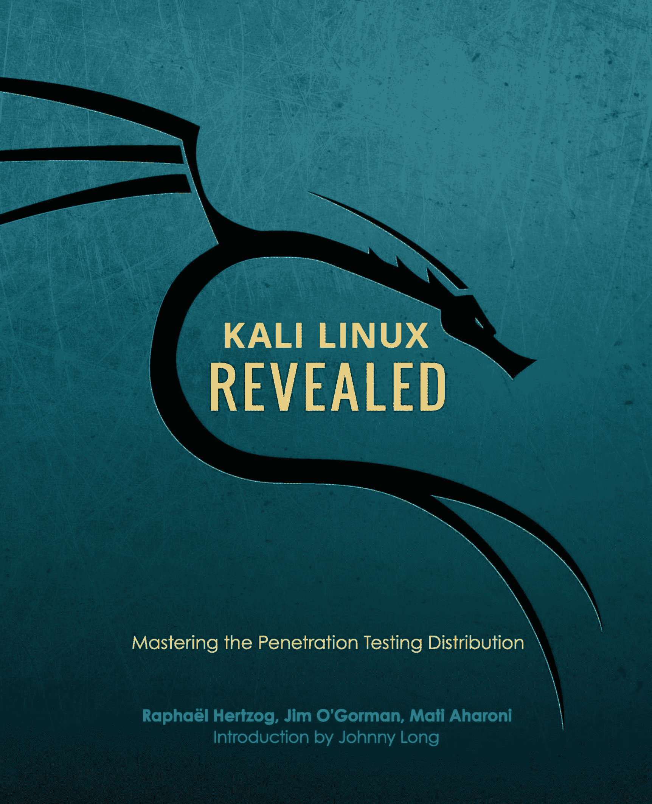

作者：Raphaël Herzog, Jim O’Gorman, Mati Aharoni


于美国打印。

常用指令 ... 115

- 8.1.1 APT 与 dpkg 之间的关系 170
- 8.1.3 Kali 仓库 173
- Kali-Dev 仓库 174
- Kali Linux 镜像站 174
- 8.2.1 初始化 APT 176
- 使用 dpkg 安装软件包 176
- 8.2.3 升级 Kali Linux 179
- 8.2.5 检查软件包 181
- 使用 apt-cache 和 apt 查询可用软件包数据库 185
- 处理升级后的问题 188
- 8.2.6 重装软件包 189
- 8.2.7 前端 190
- 8.3.1 配置 APT 194
- 8.3.3 与多个发行版共同工作 198
- 8.3.5 启用多架构 (Multi-Arch) 200
- 8.4 参考：深入研究 Debian 系统 206
- 冲突 (Conflicts) 208
- 209
- 8.4.2 配置脚本 211
- 软件包移除 214
- 8.5 总结 216

# 9. 高级用法 221

## 9.1 修改 Kali 软件包 222

### 9.1.1 获取源码 223

### 9.1.2 安装构建依赖项 226

### 9.1.3 进行更改 226

应用补丁 (Patch) 227

调整构建选项 229

对新的上游进行打包 229

### 9.1.4 开始构建 230

## 9.2 重新编译 Linux 内核 232

### 9.2.1 简介与准备条件 232

### 9.2.2 获取源码 233

### 9.2.3 配置内核 234

### 9.2.4 编译并构建软件包 235

## 9.3 构建 Kali Live 镜像 236

### 9.3.1 安装前提条件 236

### 9.3.2 构建不同桌面环境的 Live 镜像 237

### 9.3.3 更改已软件包集 237

### 9.3.4 使用钩子 (Hooks) 调整镜像内容 238

### 9.3.5 在 Live ISO 或文件系统中添加文件 239

## 9.4 使用 U 盘为 Live ISO 添加持久化 239

### 9.4.1 持久化功能：解释 239

### 9.4.2 在 U 盘上设置非加密持久化 241

### 9.4.3 在 U 盘上设置加密持久化 242

### 9.4.4 使用多个持久化存储器 243

## 9.5 总结 245

### 9.5.1 修改 Kali 软件包的提示 245

### 9.5.2 重新编译 Linux 内核的提示 246

### 9.5.3 构建 Kali Live 镜像的提示 247

# 10. 企业级 Kali Linux 251

### 10.1.1 通过网络安装 Kali Linux (PXE 启动) 252

## 10.2 利用配置管理 255

10.2.1 设置 SaltStack 255

10.2.2 在 Minion 上执行命令 256

10.2.3 Salt States 及其他功能 258

## 10.3 扩展和自定义 Kali Linux 262

10.3.1 Fork 出 Kali 软件包 262

10.3.2 创建配置包 263

10.3.3 为 APT 创建包仓库 269

## 10.4 总结 273

## 11 安全评估简介 279

11.1 评估中的 Kali Linux 281

11.2 评估类型 283

11.2.1 漏洞评估 284

发生概率 287

影响 287

整体风险 287

总结 288

11.2.2 合规性渗透测试 288

11.2.3 传统渗透测试 289

11.2.4 应用评估 291

11.3 评估的规范化 293

11.4 攻击类型 294

11.4.1 拒绝服务 295

11.4.2 内存损坏 295

11.4.3 Web 漏洞 296

11.4.4 密码攻击 296

11.4.5 客户端攻击 297


### 11.5 总结

## 12 结论：前方的路

### 12.1 跟上变化

### 12.2 展示你新学到的知识

### 12.3 进一步探索

#### 12.3.1 向系统管理发展

#### 12.3.2 向渗透测试发展

# 索引

# 前言

你根本不知道自己是有多幸运。

在 1998 年，我是一个崭露头角的黑客，共同创立了最早的专业白帽黑客团队之一。我们当时真的只是孩子，梦想着理想的工作，被付钱去入侵地球上一些最安全的计算机系统和建筑。

这听起来很酷，但现实中，我们大部分时间都是守在键盘前，手里握着职业所需的数字工具。我们使用着一套杂乱的程序，用于映射网络和定位目标；然后进行扫描、利用并横向移动。在某些情况下，我们中的一人（通常是 Jim Chapple）会编写自定义工具来处理诸如 `Class` 网络之类的复杂任务（在当时没有其他工具能做到这一点），但大多数时候，我们会使用或修改由黑客社区编写的工具。在没有 Google 的那个时代，我们经常访问 BugTraq、AstLaVista、Packet Storm、w0w0w、SecurityFocus、X-Force 以及其他资源来进行研究并构建我们的武器库。

由于每个每个任务的时间有限，我们必须快速行动。这意味着我们不能花费大量时间在摆弄工具上。这意味着我们必须透彻掌握核心工具，并随时准备好辅助工具以备不时需。这意味着我们的工具必须经过良好的组织、记录并经过测试，这样在实战中才不会有意外。毕竟，如果我们没能进去，就会在客户面前丢脸，他们也不会再那么重视我们的建议了。

正因为如此，我花费了……

2005年，`WHOPpiX` 演变为 `WHAX`，基于“更具模块化的 `SLAX` (Slackware) 启动光盘”，拥有扩展并更新的工具集。Muts 和来自黑客社区日益增长的志愿者团队意识到，无论他们的洞察力有多强，也无法预测我们行业的增长和波动，而且他们的 CD 在现场中会有多样化的需求。显而易见，Muts 和他的团队正在实地中使用 `WHAX`，他们似乎致力于让它为我提供服务。

2006年，Muts Moser 及其团队将 `Auditor Security Linux` 和 `WHAX` 合并为一个单一的发行版 `BackTrack`。`BackTrack` 仍然基于 `SLAX` 并持续增长，增加了更多工具、更多框架、扩展的语言支持、广泛的无线支持以及一个深度修改的菜单内核。`BackTrack` 成为领先的安全发行版，但许多人仍将其作为其“真实工具”的备份。

到2009年，Muts 和他的团队的 `BackTrack` 已不再是一个启动光盘，而是一个利用 `Ubuntu` 软件库的全方位基于 `Ubuntu` 的发行版。这一转变标志着一次重大的演进：`BackTrack 4` 有了更新机制。用 Muts 的话来说：“与我们的 `BackTrack` 仓库同步时，你将定期获得发布后的安全工具更新”。

这是一个转折点。`BackTrack` 团队关注了行业中挣扎的渗透测试人员、取证分析师及其他人员。他们的努力节省了无数小时并提供了坚实的基础，使我们能够重新投入战斗，花费更多时间去做重要（且有趣）的事情。结果，社区成员纷纷涌入论坛和 wiki，并加入开发团队。`BackTrack` 真正是一项社区共同的努力，由 Muts 继续负责领导。

`BackTrack 4` 终于成为了一个工业级平台，我和像我一样的人因此松了一口气。我们亲身感受到了 Muts 和他的团队正在承受的“痛苦和折磨”，因为我们曾经历过。因此，我们中的许多人开始将 `BackTrack` 作为我们工作的主要基础。我们，这些仍在琢磨工具的人，编写自己的代码，开发自己的漏洞和技术；我们进行研究和实验；但我们不再花所有时间在收集、更新、验证和组织工具上。

`BackTrack 4 R1` 和 `R2` 是 2010 年的进一步修订，导致了 2011 年 `BackTrack 5` 的从头重建。`BackTrack` 仍然基于 `Ubuntu` 并在每次发布中不断完善，它现在已是一项巨大的工程，需要英雄般的志愿者和社区努力，同时也需要资金支持。Muts 在 2006 年创立了 `Offensive Security`，不仅是为了提供世界级的培训和测试服务，还为了提供一个让 `BackTrack` 开发持续进行的平台，并确保 `BackTrack` 保持开源且免费使用。

`BackTrack` 在 2012 年持续增长和改进（通过 `R1`、`R2` 和 `R3`），保持 `Ubuntu` 核心并增加了数百种新工具，包括物理和硬件利用工具、`VMware` 支持、无数的无线和硬件驱动程序，以及大量的稳定性改进和 Bug 修复。然而，在 `R3` 发布之后，`BackTrack` 的开发变得相对且有些神秘地寂静了。

行业内出现了一些猜测。一些人认为 `BackTrack` 被“收购”了，为了巨额报酬将灵魂出卖给一个无名的邪恶主宰。`Offensive Security` 成长为行业内最受尊敬的培训公司之一和行业领军者，Cubie 推测成功吞噬并边缘化了关键的 `BackTrack` 开发人员。然而，事实与此完全相反。

2013年，`Kali Linux 1.0` 发布。发布公告写道：“在经过一秘密开发后，`Offensive Security` 荣幸宣布发布并公开 `Kali Linux`——这是迄为止最先进、稳健的渗透测试的发行版。`Kali` 是 `BackTrack` 更成熟、更安全且适用于企业级版本。”

`Kali Linux` 不仅仅是 `BackTrack` 的重新命名。它配备了超过 600 种完全重新打包的工具，显然非常接近 `Kali`，但其意义远不止于此。`Kali` 是从零开始基于 `Debian` 核心构建的。对于外行人士来说，这似乎不是什么大事。但其影响是惊人的。得益于大规模的重新打包，`Kali` 用户可以下载每个工具的源码；他们可以根据需要只需几键即可修改并重建工具。与当时的其他操作系统不同，`Kali Linux` 每天与 `Debian` 仓库同步四次，这意味着 `Kali` 用户可以获得实时的包更新和安全修复。`Kali` 开发人员自己也身入斗争，打包并维护许多工具的上游版本，以确保用户始终处于最前沿。由于基于 `Debian`，`Kali` 用户可以直接从仓库引导安装程序或 `ISO`，这为带有预填充文件的完全自定义安装打开了大门。随着定制流量的增加，`Kali` 用户可以修改环境、更改菜单、更换图标，甚至更换窗口环境。大规模的 `ARM` 开发推动了 `Kali Linux` 在广泛硬件平台上的安装开放了大门，包括接入点、单板计算机（树莓派、`ODROID`、`Beaglebone` 和 `Cubieboard`）以及基于 `ARM` 的 `Chromebook`。同样重要的是，`Kali Linux` 拥有了小大版本的升级，这意味着粉丝们永远不需要重新安装 `Kali Linux` 设置。

社区注意到了。在最初五天内，有 90,000 人下载了 `Kali 1.0`。

这是一个开始。2015 年，`Kali 2.0` 发布，随后是了 2016 年的滚动更新。总而言之，“如果说 `Kali 1.0` 专注于构建坚实的基础，那么 `Kali 2.0` 则专注于彻底改进用户体验并维护更新的包和工具。”

## 前言

为你的渗透测试团队订购十六台高端笔记本电脑刚刚送达，你被赋予了设置它们的任务——明天就是外勤任务。你安装了 `Kali` 并启动了其中一台电脑，却发现它几乎无法使用。尽管 `Kali` 拥有尖端的内核，但网卡和鼠标无法工作，而 `NVIDIA` 显卡和 `GPU` 只是目空呆地看着你，因为它们缺少正确安装的驱动程序。

在 `Kali Live` 模式下，你迅速在控制台中输入 `lspci`，然后滚动查看硬件列表：PCI 桥、USB 控制器、SATA 控制器、Realtek 以太网和网络控制器。通过对各自型号进行快速 Google 搜索，并交叉对比 `Kali` 内核版本，发现这些尖端驱动程序尚未进入主线内核。

但一切并非不可挽回。一个计划在你脑海中逐渐成型，你感谢上自己几周前买的《Kali 揭秘》一书。你可以使用 `Kali LiveBuild` 创建一个自定义的 `Kali ISO`，将所需的驱动程序封装到安装媒体中。此外，你还可以包含 `NVIDIA` 显卡驱动以及让那台猛兽级 `GPU` 与 `hashcat` 良好通信所需的 `CUDA` 库，让它在以极速破解密码时顺畅运行。甚至如此，你甚至还可以加入一张带有微软 Logo 的自定义壁纸，用来在工作中困扰你的团队。

由于你的实例的硬件配置完全相同，你还在 `ISO` 中添加了预设启动选项，这样你的团队就可以从 U 盘启动并在无用户交互的情况下安装 `Kali`——安装过程将自动完成，包括全盘加密。

太完美了！你可以根据需求生成更新版本的 `Kali`，专门针对你的硬件进行设计和优化。你扭转了局势。任务完成！


随着大量硬件涌入市场，对于我们这些脱离主流操作系统、寻找更轻量、更强悍或更符合我们工作和风格的人来说，这种情况正变得越来越常见。

这对于那些受安全领域吸引的人尤为适用，无论将其视为一种迷人的爱好、痴迷还是职业。作为新手，他们往往会发现自己困于环境或操作系统。对于许多新手来说，Kali 是他们接触 Linux 的第一个窗口。

几年前，我们意识到了用户用户群的这一变化，并认为可以通过编写一本结构化的介绍性书籍来帮助我们的社区，引导用户进入安全世界，同时赋予他们入门所需的全部 Linux 高级知识。于是，Kali 之书诞生了——现在可以在互联网上免费提供，造福任何想通过 Kali Linux 进入安全领域的人。

然而，当书籍开始成型时，我们很快意识到其中还有未开发的潜力。这是一个极佳的机会，可以超越一本入门级的 Kali Linux 介绍书，探索一些更有趣且鲜为人知的特性。因此，了书的名字定为《Kali Linux 揭秘》（Kali Linux Revealed）。

到最后，我们对结果非常满意。这本书回答了我们所有的需求，我很自豪地说它超出了我们的预期。我们意识到，我们无意中扩大了书籍的潜在用户群；我们本意仅针对安全领域的新手，但也包含了针对经验渗透测试者的大量信息，帮助他们改进和完善对 Kali Linux 的控制——让他们释放出我们发行版的全部潜力。无论他们是在企业中部署单台机器，还是跨越数千台机器，无论是进行微小的配置更改还是到内核级别的完全自定义，是构建自己的仓库、触及表面还是深入研究惊人的 Debian 包管理系统，《Kali Linux 揭秘》都提供了路线图。

手握地图，我谨我我自己和整个 Kali Linux 团队，祝你拥有一段激动、富有成果且“揭秘”的旅程！

Muts，2017年2月

# 引言

Kali Linux 是世界上最强大、最流行的渗透测试平台，被各种专业领域的安全专业人员使用，包括渗透测试、取证、逆向工程和漏洞评估。它是平台不断完善和持续演变的结晶，从 WiFi Linux 到 Kali，再到 BackTrack，现在变成了一个利用 Debian GNU/Linux 许多功能以及全球活力开源社区的完整渗透测试框架。

Kali Linux 的构建并不是为了简单的工具集合，而是一个灵活的框架，专业渗透测试员、安全爱好者、学生和业余爱好者都可以对其自定义以适应他们的特定需求。

# 为什么选择这本书？

Kali Linux 不仅仅是安装在标准 Debian 基础之上并预配置以让你立即运行的各种信息安全工具集合。要充分利用 Kali，深入理解其强大的 Debian GNU/Linux 底层（它支持所有这些出色的工具）并学习如何在你的环境中使用它们非常重要。

尽管 Kali 显然是多用途的，但它主要设计用于辅助渗透测试。这本书的目标不仅是帮助你在使用 Kali Linux 时感到自如，还旨在提高你的理解并简化你的体验，这样当你从事渗透测试且时间紧迫时，你就不需要担心因安装新软件或启用新网络服务而浪费几分钟。在书中，我们将向你介绍 Linux，然后通过介绍 Kali Linux 特有的细微差别来深入探讨，以便你确切知道底层运行着什么。

这些知识是无价的，特别是当你试图在紧迫的时间限制下工作时。在设置环境、排除故障、努力让某个工具听你差遣、解析工具输出或在更大规模的环境中利用 Kali 时，需要这种深度的知识并不不寻常。

# 这本书适合你吗？

如果你渴望投入到智力丰富且迷人的信息安全领域，并正确地选择了 Kali Linux 作为你的主要平台，那么这本书将为你的旅程提供帮助。这本书的编写既能帮助新手用户，也能帮助寻求加深知识、扩展用途的现有 Kali 用户。

# 通用方法与书籍结构

本书的设计旨在让你从一开始就能上手 Kali Linux。你不需要读完半本书就可以开始。每个主题都以非常务实的方式涵盖，书中充满了示例和截图，以帮助解释更加具体。

在第 1 章“关于 Kali Linux”中，我们定义了一些基础术语并解释了 Kali Linux 的目的。在第 2 章“入门 Kali Linux”中，我们引导你从下载 ISO 到在计算机上运行 Kali Linux。接下来是第 3 章“Linux 基础”，提供了了解任何 Linux 系统所需的的基础知识，例如架构、安装、文件系统层次结构、权限等。

到此时，你已经作为 Live 系统使用了一段时间 Kali。通过第 4 章“安装 Kali Linux”，你将学习如何进行正式的 Kali Linux 安装（在磁盘上），通过第 5 章“配置 Kali Linux”学习如何根据你的喜好进行调整。作为一名常用的 Kali 用户，是时候熟悉 Kali 用户可以使用的重要资源了：第 6 章“自我帮助与寻求帮助”赋予了你应对可能遇到的意外问题的钥匙。

在涵盖了基础知识后，书的其余转向了高级主题：第 7 章“安全与监控 Kali Linux”提供了确保你的 Linux 安装符合安全要求的技巧技巧。接下来，第 8 章“Debian 包管理”解释了如何充分利用 Debian 包生态系统的潜力。在第 9 章“高级用法”中，你将学习如何创建一个完全自定义的 Kali Linux ISO 镜像。当你在企业中大规模部署 Kali Linux 时，所有主题都变得更加相关并在第 10 章“企业中的 Kali Linux”中进行了记录。

最后一章第 11 章“安全评估简介”[第 280 页]，将你在书中学到的所有内容与安全专业人员的日常工作联系了起来。

# Raphaël Herzog 的致谢

我要感谢 Mati Aharoni：2012 年，他联系了我，因为我是几十个 Debian 顾问之一，而他想构建一个基于 Debian 的 BackTrack 继任者。这就是我开始开发 Kali Linux，从那以后，我一直非常享受在 Kali 世界的旅程。

多年来，Kali Linux 与 Debian GNU/Linux 变得越来越接近，特别是切换到了基于 Debian Testing 的 Kali Rolling。我的大部分工作，无论是针对 Kali 还是 Debian，都为整个 Debian 生态系统带来了利益。这正是让我能够日复一日、月月复月、年年一年地坚持下去的动力。

编写这本书也是 Mati 提供的一个绝佳机会。这与那种工作不同，但能够帮助他人并分享我关于 Debian/Kali 操作系统的专业知识同样很有回报。在《Debian 管理员手册》（Debian Administrator’s Handbook）的基础上，我希望我的解释能帮助你在这个飞速发展的计算机安全领域入门。

我还要感谢所有参与这本书的 Offensive Security 人员：Jim O’Gorman（部分章节的合著者）、Devon Kearns（审核员）、Ron Henry（技术编辑）、Joe Steinbach 和 Tony Cruise（项目经理）。感谢 Johnny Long 加入并编写了序言，我们最后共同审阅了整本书。

# Jim O’Gorman 的致谢

我要感谢参与此项目的每个人的贡献，而我的贡献只是其中一小部分。这本书就像 Kali Linux 本身一样，是一个许多人共同努力的项目，“众人拾力事半”。特别感谢 Raphaël、Devon、Mati、Johnny 和 Ron，他们承担了大部分工作。没有他们，这本书就无法成型。

# Mati Aharoni 的致谢

Kali Linux 最初发布已经好几年了，从第一天起，我就一直梦想着出版一本涵盖整个 Kali 操作系统的官方书籍。因此，最终看到这样一本书出版，对我来说是一个巨大的荣幸。我诚挚地感谢参与此项目的每个人——包括 Jim、Devon、Johnny 和 Ron。特别感谢 Raphaël，他承担了书中大部分的繁重工作，并将他丰富的专业知识带入我们的团队。


# 关于 Kali Linux

# 目录

- 简介 2
- 与 Debian 的关系 4
- 目的与用例 5
- Kali Linux 主要特性 7
- Kali Linux 策略 9
- 总结 11

Kali Linux 是一种基于 Debian GNU/Linux 的企业级安全审计 Linux 发行版。Kali 面针对安全专业人员和 IT 管理员，使他们能够进行渗透测试、取证分析和安全审计。

# 什么是 Linux 发行版？

虽然它通常被用作内核的名称，即处理硬件与终端用户应用程序之间交互的软件。

另一方面，“Linux 发行版”指的是在 Linux 内核之上构建的完整操作系统，通常包括一个安装程序和许多应用程序，这些程序要么是预装，要么是以简单稳定的方式安装的。

Debian GNU² 是领先的通用 Linux 发行版，以其质量和稳定性闻名。Kali 在 Debian 项目的基础上构建，添加了 300 多个特殊用途软件包，这些包都与信息安全有关，特别是渗透测试领域。


Debian 是一个自由软件项目，提供其操作系统的多个版本，我们经常使用“发行版”一词来指代它的特定版本，例如 Debian Stable（稳定版）或 Debian Testing（测试版）。这同样适用于 Kali Linux——例如 Kali Rolling 发行版。


# 1.1. 简介

Kali 项目于 2012 年悄悄开始，当时 Offensive Security 决定想要替换他们老旧的、手动维护的 BackTrack Linux 项目，代之以一个可以成为真正的 Debian 衍生版³，配备所有所需的基础设施和改进的打包技术。之所以决定在 Debian 发行版之上构建 Kali，是因为它以质量、稳定性和广泛的软件选择而闻名。这也就是为什么我（Raphaël）作为 Debian 顾问参与了这个项目。

第一个版本（1.0 版本）发生于一年后，即 2013 年 3 月，基于当时 Debian 的稳定发行版“Wheeezy”（Squeez）。在开发的第一年里，我们打包了数百个与渗透测试相关的应用程序并构建了基础设施。尽管应用程序数量很大，但应用程序列表经过了精细的筛选，去掉了不再运行或功能与现有更好程序重复的应用程序。

在版本 1.0 之后的两年里，Kali 发布了许多增量更新，扩展了可用应用程序的范围，并由于新内核的发布改进了硬件支持。在对持续改进持续投入下……

+ ¹ https://www.kali.org
+ ² https://www.debian.org
+ ³ https://wiki.debian.org/Derivatives/Census

一直保持可安装状态，并且能够创建自定义的 live 镜像（这是该发行版的标志）。

2015 年，当 Debian 8 "Jessie" 出炉时，我们把 Kali Linux 重新基准在其之上。虽然 Kali Linux 1.x 避免了 GNOME Shell（依赖 GNOME Fallback），但在这一版本中我们决定拥抱并增强它：我们添加了一些 GNOME Shell 扩展以获取缺失的功能，最显著的是应用程序菜单。结果就是 Kali Linux 2.0，它于 2015 年 8 月发布。

## GNOME 是 Kali Linux 的桌面环境

桌面环境是共享公共工具包的图形应用程序集合，旨在工作站上共同使用。它们通常提供应用程序启动器、文件管理器、网络浏览器、办公套件等。

GNOME 是最流行的桌面环境之一（还有 KDE、Xfce、LXDE、MATE），并由 Kali Linux 安装在主 ISO 镜像中。如果你不喜欢 GNOME，可以很容易构建一个带有所选桌面环境的自定义 ISO。相关说明将在本书的第 9 章“高级用法”[第 222 页]。

与此同时，我们加大努力以确保 Kali Linux 始终拥有渗透测试应用程序的最新版本。不幸的是，这个目标与使用 Debian Stable 作为发行版的基础有些出入，因为这需要我们回移植许多软件包。这是由于 Debian Stable 优先考虑软件稳定性，通常会导致从上游更新发布到集成到发行版之间存在延迟。考虑到我们对持续集成的投入，将 Kali Linux 重新基准到 Debian Testing 是非常自然的，这样我们就可以在 Debian 包发布后立即获得最新版本。Debian Testing 的更新周期激进得多，更符合 Kali Linux 的哲学。

这本质上就是 Kali Rolling 的概念。虽然 Kali 2016 是第一个采用这种特性的发行版，你的系统实际上跟踪 Kali Rolling 发行版，每天都会获得新更新。过去，Kali 版本是底层 Debian 发行版的快照，并注入了 Kali 特定软件包。

滚动发行版有很多优点，但也带来了许多挑战，无论是对于我们这些构建发行版的人，还是对于必须应对源源更新流和有时不向后兼容的的用户来说。本书旨在为你提供管理 Kali Linux 安装时可能遇到的一切所需的知识。

* https://www.gnome.org
* https://www.kde.org
* https://www.xfce.org
* https://www.lxde.org
* https://mate-desktop.org

## 1.2. 与 Debian 的关系

Kali Linux 发行版基于 Debian Testing。因此，Kali Linux 中可用的大多数软件包直接来自该 Debian 仓库。

Kali Linux 高度依赖 Debian，但某种意义上说它也是完全独立的，因为我们拥有自己的基础设施，并保留了进行任何所需更改的自由。

### 1.2.1. 软件包的流程

在 Debian 端，贡献者每天都致力于更新软件包并将其上传到 Debian Unstable（不稳定版）发行版。从那里，一旦解决了棘手的 Bug，软件包就会迁移到 Debian Testing（测试版）。迁移过程还确保了 Debian Testing 中不会破坏依赖关系。其目标是让 Testing 始终处于可用（甚至是可以发布的！）状态。

Debian 的目标与 Kali Linux 的目标非常契合，因此我们选择它作为基础。为了在发行版中添加 Kali 特有的软件包并强制注入我们自己的 Kali 软件包，我们遵循两个步骤的过程。

首先，我们获取 Debian 并强制注入我们自己的 Kali 软件包（位于 `kali-dev-only` 仓库）以构建 `kali-dev` 仓库。这个仓库会不时崩溃：例如，在 Kali 特有的软件包针对较新的库进行重新编译之前，它们可能无法被安装。在其他情况下，我们忘记的软件包可能也需要更新，要么为了再次变得可安装，要么为了修复依赖于该分支软件包新版本的另一个软件包的不稳定性。无论何情况下，`kali-dev` 并不是面向终端用户的。

`kali-rolling` 是 Kali Linux 用户预期跟踪的发行版，它通过 `kali-dev` 构建，其方式与 Debian 从 `Debian Unstable` 构建相同。只有当目标发行版能够满足所有依赖关系时，软件包才会迁移。

### 1.2.2. 管理与 Debian 的差异

作为一种设计决策，我们努力尽可能减少分支（forked）软件包的数量。然而，为了实现 Kali 的一些独特功能，必须进行某些更改。为了限制这些更改的影响，我们努力将它们推向上游，通过直接集成功能或添加所需的钩子（hooks），以便在不进一步修改上游软件包的情况下启用所需功能。

Kali Package Tracker10 帮助我们跟踪与 Debian 的差异。任何时候，我们都可以查看哪个软件包被分支了，它是否与 Debian 同步，或者是否需要更新。

> 9 https://www.debian.org/releases/testing/
> 10 https://pkg.kali.org/derivative/kali-dev/

我们所有的软件包都维护在 Git 仓库¹¹ 中，并列托管一个 Debian 分支和一个 Kali 分支。得益于此，更新分支软件包是一个简单的两步过程：更新 Debian 分支并将其合并到 Kali 分支。

虽然 Kali 中分支软件包的数量相对较低，但额外软件包的数量相当高：2017 年 4 月有近 400 个。这些软件包大部分是符合 Debian 自由软件指南¹² 的自由软件，我们的最终目标是尽可能在 Debian 中维护这些软件包。我们极力遵守 Debian 策略¹³ 并遵循 Debian 使用的良好打包实践。遗憾的是，也有相当多的例外，几乎无法创建适当的打包。由于时间紧迫，很少软件包被推送到 Debian。

## 1.3. 目的与用例

虽然 Kali 的重点可以快速总结为“渗透测试和安全审计”，但在这些活动背后还涉及许多不同的任务。Kali Linux 被构建为一个框架，因为它包含了涵盖每种用例的许多工具（尽管在渗透测试期间可能会结合使用）。

例如，Kali Linux 可用于各种类型的计算机：显然可以用于渗透测试员的笔记本电脑，也可以用于想要监控其网络的系统管理员的服务器、取证分析师的工作站，以及更出乎意料的，用于隐身嵌入式设备（通常带有 ARM CPU），这些设备可以被丢弃在无线网络范围内或插入目标用户的计算机中。由于其微小的外形尺寸和低功耗需求，许多 ARM 设备也是极其完美的攻击机器。Kali Linux 还可以部署在云端，以快速构建一个密码破解机集群，并部署在手机和平板电脑上，以实现真正的便携式渗透测试。

但并非如此；渗透测试员还需要服务器：在渗透测试团队内部使用协作软件、为钓鱼攻击设置 Web 服务器、运行漏洞扫描工具以及其他活动。

一旦你启动了 Kali Linux，你会很快发现 Kali Linux 的主菜单按主题组织，涵盖了与渗透测试员和其他安全专业人员相关的各种任务和活动，如图 1.1 所示，“Kali Linux 应用程序菜单”[第 6 页]。


```
¹¹ http://git.kali.org
¹² https://www.debian.org/social_contract
¹³ https://www.debian.org/doc/debian-policy/
```

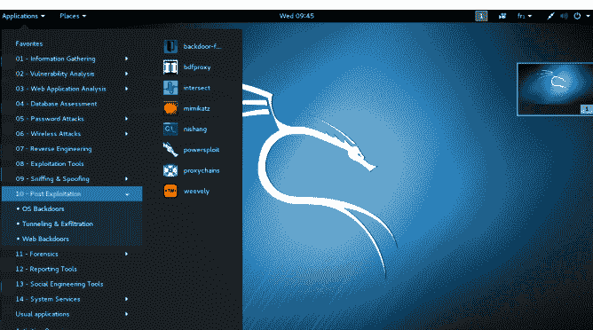

这些任务和活动包括：

- 信息收集：收集有关目标网络及其结构的数据，识别计算机、其操作系统以及它们运行的服务。识别信息系统中潜在敏感的部分。从运行的目录服务中提取各种列表。

- 漏洞分析：快速测试本地或远程系统是否受到已知漏洞或不安全配置的影响。漏洞扫描器使用包含数千签名的数据库来识别潜在漏洞。

- Web 应用分析：识别 Web 应用中的配置错误和安全漏洞。

- 数据库评估：识别数据库中的配置错误和安全漏洞。

- 密码攻击：破解或绕过密码和认证。

- 无线攻击：攻击无线网络。

- 逆向工程：分析软件或硬件以了解其设计。

- 漏洞利用：利用漏洞获取控制。

- 持续利用：维持访问并在网络中移动。

- 嗅探与欺骗：捕获流量或伪造用户。

- 取证：用于数据恢复和分析的数字取证。

- 报告工具：将数据和发现汇总成报告。

- 社会工程学：利用人类行为获取访问权限。

- 系统服务：管理后台应用程序。

## 1.4. Kali Linux 主要功能

Kali Linux 是一个发行版，包含它自己的数百种软件工具集合，这些工具专为其目标用户——渗透测试员和其他安全专业人员量身定制。它还带有一个安装程序，可以在任何计算机上完全设置 Kali Linux 为主操作系统。

这与几乎所有现有 Linux 发行版相似，但 Kali Linux 还有其他与其他不同的特性，其中许多功能是专为渗透测试人员的特定需求定制的。让我们来看看其中的一些特性。

### 1.4.1. 现场化系统 (Live System)

与大多数 Linux 发行版不同，你下载的主 ISO 镜像不仅仅是为了安装操作系统；它还可以作为一个可启动的现场化系统使用。换句话说，你只需要启动 ISO 镜像（通常是在将镜像拷贝到 USB 闪盘后）就可以使用 Kali Linux，而无需安装。

现场化系统包含了渗透测试人员最常用的工具，因此如果你的日常系统不是 Kali Linux，你只需插入磁盘或 USB 闪盘并重启运行 Kali 即可。然而，请记住，默认配置不会保留重启之间的更改。如果你在 USB 闪盘上配置了持久化（请参阅第 9.4 节，“使用 USB 闪盘为 Live ISO 添加持久化” [第 239 页]），你就可以按照自己的喜好调整系统（例如修改配置文件、保存报告、升级软件和安装额外的软件包），并且这些更改将在重启后被保留。

### 1.4.2. 取证模式 (Forensics Mode)

通常，在对系统进行取证时，你希望避免任何以任何方式更改被分析系统数据的活动。遗憾的是，现代桌面环境倾向于尝试自动挂载检测到的任何磁盘，从而干扰这一目标。为了避免这种行为，Kali Linux 具有一个可以从启动菜单启用的取证模式：它将禁用所有功能。

现场化系统对于取证目的特别有用，因为你可以重启电脑进入 Kali Linux 系统，而无需访问或修改其硬盘。

### 1.4.3. 自定义 Linux 内核

Kali Linux 始终提供一个基于 Debian 不稳定版（unstable））的定制化最新 Linux 内核。这确保了稳固的硬件支持，特别是针对各种无线设备。内核经过了补丁处理以支持无线注入，因为许多无线安全评估工具都依赖于此功能。

由于许多硬件设备需要更新的固件文件（位于 `/lib/firmware/` 中），Kali 默认安装了所有这些固件——包括 Debian 非自由（non-free）部分提供的固件。这些固件在 Debian 中默认是不安装的，因为它们是闭源的，因此不属于 Debian 核心部分。

### 1.4.4. 完全可定制

Kali Linux 是由渗透测试人员为渗透测试人员构建的，但我们理解并非每个人都认同我们的设计决策或默认包含的工具选择。考虑到这一点，我们始终确保 Kali Linux 可以根据你的需求和偏好进行定制。为了实现这一点，我们发布了官方 Kali 镜像使用的 `live-build` 配置，以便你可以根据自己的喜好进行定制。得益于 `live-build` 的灵活性，从这个发布的配置开始并根据你的需求实施各种更改是非常容易的。

`live-build` 包含许多功能，用于修改已安装的系统、安装补充文件、安装额外的软件包、任意命令以及更改预留到 `debconf` 的值。

### 1.4.5. 可信的操作系统

安全发行版的用户有理地想要知道它是可以信赖的，并且是在公开监督下开发的，允许任何人检查源代码。Kali Linux 由一个由知识开发者组成的小团队开发，他们以透明的方式工作并遵循最佳安全实践：他们上传源码包，这些包在专用的构建守护进程上构建。软件包经过校验和处理，并作为签名存储库的一部分进行发布。

对软件包进行的工作可以通过用于构建 Kali 源包的打包 Git 仓库¹⁴（其中包含签名标签）进行完全审查。每个软件包的演进也可以通过 Kali 软件包跟踪器¹⁵ 进行关注。

### 1.4.6. 可在广泛的 ARM 设备上运行

Kali Linux 为 `armel`、`armhf` 和 `arm64` ARM 架构提供了二进制包。得益于 Offensive Security 提供的易于的镜像，Kali Linux 可以部署在许多有趣的设备上，从智能手机、平板电脑到 Wi-Fi 路由器以及各种尺寸形状的计算机。

## 1.5. Kali Linux 策略

Kali Linux 尽可能遵循 Debian 策略，但在某些领域，由于安全专业人员的特殊需求，我们做了显著不同的设计选择。

```
¹⁴http://git.kali.org
¹⁵http://pkg.kali.org
```

### 1.5.1. 默认单根用户

大多数 Linux 发行版非常明智地鼓励在运行系统时使用非特权账户，并在需要管理权限时使用 `sudo` 工具。这是一个可靠的安全建议，在用户与任何潜在的破坏性或破坏性的操作系统命令或操作之间提供了额外的保护层。这对于多用户系统来说尤其如此，因为用户特权分离是一项要求——一个用户的错误行为可能会干扰或破坏许多用户的工作。

由于 Kali Linux 中包含的许多工具只能在 root 权限下执行，因此这是默认的 Kali 用户账户。与其他 Linux 发行版不同，在安装 Kali 时，不会提示你创建一个非特权用户。这一特定策略与大多数 Linux 系统相比是一个很大的偏离，对于经验较少的用户来说往往会令人困惑。学者在使用 Kali 时应格外小心，因为大多数破坏性错误都发生在以 root 权限进行操作时。

### 1.5.2. 默认禁用网络服务

与 Debian 不同，Kali Linux 默认禁用任何在公共网络接口上监听的安装服务，例如 HTTP 和 SSH。

这一决策背后的逻辑是在渗透测试期间尽可能减少暴露，因为由于意外的网络交互而宣布你的行踪并增加被检测的风险对测试是有不利的。

你仍然可以通过运行 `systemctl enable service` 手动启用你选择的任何服务。我们将在第 5 章“配置 Kali Linux” [第 104 页] 中回到这一点。

### 1.5.3. 精选应用程序集合

Kali Linux 尽可能遵循 Debian 策略，但在某些领域，由于安全专业的的需要，我们做了显著不同的设计选择。相比之下，Kali Linux 并不打包所有工具。相反，我们的目标是提供最好的工具。

我们在考虑新应用程序时会考虑以下几点：

- 应用程序在渗透测试背景下的有用性

- 应用程序的功能

- 应用程序的许可证

- 资源需求

维护一个更新且实用的渗透工具库是一项挑战。当提交得良好时，我们欢迎在专用类别中提交建议，包括对工具用途的解释、与其他应用程序的对比等。

```
⁶http://bugs.kali.org
```

## 1.6. 总结

在本章中，我们介绍了 Kali Linux，提供了一些历史，回顾了主要功能，并展示了几个用例。我们还讨论了在开发 Kali Linux 时采用的一些策略。

总结提示：

- Kali Linux¹⁷ 是基于 Debian GNU/Linux 的企业级安全审计发行版。Kali 面针对安全专业人员和 IT 管理员，使他们能够进行高级渗透测试、取证分析和安全审计。

- 与主流操作系统不同，Kali Linux 是一个滚动发行版，这意味着你每天都会收到更新。

- Kali Linux发行版基于 Debian Testing⁸。因此，Kali Linux 中的大多数软件包直接来自该 Debian 存储库。

- Kali 的重点可以快速总结为“渗透测试和安全审计”，有几个用例，包括希望监控其网络的系统管理员、取证分析、嵌入式设备安装、无线监控、移动平台安装等。

- Kali Linux 轻松获取用于各种任务和活动的工具：漏洞分析、Web 应用分析、数据库评估、密码攻击、无线攻击、逆向工程、利用工具、嗅探和欺骗、后渗透工具、取证、报告工具、社会工程工具和系统服务。


- Kali Linux 具有许多高级功能，包括：使用现场（非安装）系统、稳健安全的取证模式、自定义 Linux 内核、完全定制系统的能力、可信安全的操作系统、ARM 安装能力、安全的默认网络策略以及精选应用程序。

在下一章中，我们将上手测试 Kali Linux 的现场模式。

```
¹⁷https://www.kali.org
⁸https://www.debian.org/releases/testing/
```


# 开始使用 Kali Linux

- 下载 Kali ISO 镜像 14
- 以 Live 模式启动 Kali ISO 镜像 24
- 总结 43

与其他操作系统不同，Kali Linux 让上手变得非常简单，这归功于它的磁盘是 Live ISO 镜像，这意味着你不需要遵循任何先前的安装程序即可启动下载的镜像。这意味着你可以使用同一个镜像进行测试、作为取证案件中的可启动 USB 或 DVD-ROM 镜像，或者在物理或虚拟硬件上安装永久的操作系统。

正因为这种简单性，人们很容易忘记必须采取某些预防措施。Kali 用户通常是那些心怀不意者的目标，无论是政府资助的团体、有组织犯罪分子还是个人黑客。Kali Linux 的开源特性使得构建和分发伪版本相对容易，因此，养成从原始源下载并验证下载内容的完整性和真实性的习惯至关至关重要。这对于经常访问敏感网络并受托处理数据的安全专业人员来说尤其相关。

## 2.1. 下载 Kali ISO 镜像

### 2.1.1. 在哪里下载

Kali Linux ISO 镜像的官方来源是 Kali 网站的下载部分。由于其流行，许多网站都提供 Kali 镜像下载，但不应被认为是可靠的，它们可能感染了恶意软件，或对你的系统造成不可弥回的损坏。

- → https://www.kali.org/downloads/

该网站使用 HTTPS，这使得伪装变得困难。能够执行中间人攻击是不够的，因为攻击者还需要一个由受害者浏览器信任的传输层安全（TLS）证书颁发机构签名的 www.kali.org 证书。因为证书颁发机构的存在正是为了防止此类问题，它们只向身份经过验证并提供证明其控制相应网站证据的人颁发证书。

| cdimage.kali.org | 下载页面上的链接指向 cdimage.kali.org 域名，该域名会重定向到离你最近的镜像副本，在提高你传输速度的同时减轻 Kali 中央服务器的负担。 |

可以在此处找到可用镜像列表：

- → http://cdimage.kali.org/README.mirrorlist

### 2.1.2. 下载什么

官方下载页面显示了简短的 ISO 镜像列表，如图 2.1 所示，“提供的下载镜像列表”[第15页]。

## 下载 Kali Linux 镜像

我们每几个月生成新的 Kali Linux 镜像并供下载。有关发布历史，请查看 Kali Linux 发布页面或我们的官方事实页面。请注意：你可以在 `cdimage.kali.org/kali-weekly/` 找到非官方的每周更新版本。

| 镜像名称 | 下载 | 大小 | 版本 |
| --- | --- | --- | --- |
| Kali 64 bit | ISO | Torrent | 2.6 | 2017.1 |
| Kali 32 bit | ISO | Torrent | 2.7 | 2017.1 |
| Kali 64 bit Light | ISO | Torrent | 0.8 | 2017.1 |
| Kali 32 bit Light | ISO | Torrent | 0.8 | 2017.1 |
| Kali 64 bit e117 | ISO | Torrent | 2.4 | 2017. |
| Kali 64 bit KDE | ISO | Torrent | 2.7 | 2017.1 |
| Kali 64 bit Mate | ISO | Torrent | 2.6 | 2017.1 |
| Kali 64 bit LXDE | ISO | Torrent | 2.5 | 2017.1 |
| Kali armhf | Image | Torrent | 0.5 | 2017.1 |
| Kali armel | Image | Torrent | 0.4 | 2017.1 |

图 2. 提供的下载镜像列表

所有标记为 32 位或 64 位的磁盘镜像都适用于大多数现代桌面电脑和笔记本电脑中的 CPU。如果你是为了在相当现代机器上使用而下载，它很可能包含 64 位处理器。如果你不确定，请记住所有 64 位处理器都可以运行 32 位指令。你始终可以下载并运行 32 位镜像。然而，反之则不然。请参阅侧边获取更多详细信息。

如果你计划在嵌入式设备、智能手机、Chromebook 或任何带有 ARM 处理器的设备上安装 Kali，必须使用 Linux arm 或 armhf 镜像。

## 我的 CPU 是 32 位还是 64 位？

在 Windows 下，可以通过运行“系统信息”应用程序（位于“附件 > 工具”文件夹中）找到此信息。在“系统摘要”中，你可以检查“系统类型”字段：64 位 CPU 将包含“x64-based PC”，32 位 CPU 将包含“x86-based PC”。

在 OS X/MacOS 下，没有显示此信息的标准应用程序，但你仍然可以从终端上 `uname -r` 命令的输出中推断。它在64 位 CPU 上返回 64，32 位 CPU 上返回 32。因为证书颁发机构的存在正是为了防止此类问题，它们只向身份经过验证并提供证明其控制相应网站证据的人颁发证书。（*注：此处 OCR 文本存在混乱，已根据逻辑流处理*）

在 OS X/MacOS 下，没有显示此信息的标准应用程序，但你仍然可以从终端上 `uname -r` 命令的输出中推断。它在64 位 CPU 上返回 64，32 位 CPU 上返回 32。（*注：此处 OCR 文本存在混乱，已根据逻辑流处理*）

在 Linux 下，你可以检查 `/proc/cpuinfo`。如果看到 "x86_64"，你的 CPU 是 64 位。如果看到 "i686"，它是 32 位。

```bash
grep -i flags /proc/cpuinfo
```

（*注：此处 OCR 文本存在大量重复和干扰，已根据技术上下文进行清理*）


| Kali 64 bit Mate | ISO | Torrent | 2.6 | 2017.1 |
| Kali 64 bit LXDE | ISO | Torrent | 2.5 | 2017.1 |
| Kali armhf | Image | Torrent | 0.5 | 2017.1 |
| Kali armel | Image | Torrent | 0.4 | 2017.1 |

图 2. 提供的下载镜像列表

所有标记为 32 位或 64 位的磁盘镜像都适用于大多数现代桌面电脑和笔记本电脑中的 CPU。如果你是为了在相当现代机器上使用而下载，它很可能包含 64 位处理器。如果你不确定，请记住所有 64 位处理器都可以运行 32 位指令。你始终可以下载并运行 32 位镜像。然而，反之则不然。请参阅侧边获取更多详细信息。

如果你计划在嵌入式设备、智能手机、Chromebook 或任何带有 ARM 处理器的设备上安装 Kali，必须使用 Linux `arm` 或 `armhf` 镜像。

PGP/GPG 安全模型非常独特。任何人都可以用任何身份生成任何密钥，但只有当该密钥被你已经信任的另一个密钥签名时，你才会信任该密钥。当你对密钥进行签名时，你是在证明你是该密钥的持有者，并且你知道关联身份是正确的。你定义了你信任的初始密钥集，这显然包含了你自己的密钥。

该模型有其局限性，因此你可以选择通过 HTTPS（从密钥服务器）下载 Kali 的公钥，并直接决定信任它，因为它的指纹与我们在多处公布的内容（包括就在本书中）相的：

```bash
$ wget -q 0 - https://www.kali.org/archive-key.asc | gpg --import
[ or ]
$ gpg --keyserver hkp://kali.gpgnu.net --recv-key ED44FF07D8D0BF6
gpg: key 0xED44FF07D8D0BF6: public key "Kali Linux Repository <devel@kali.org>"
gpg: Total number processed: 1
gpg:
 imported: 1 (RSA: 1)
[]
$ gpg --fingerprint 7D8D0BF6
[...]
```

获取密钥后，你可以使用它来验证镜像的校验和。下载包含校验和（`SHA256SUMS`）以及相关签名文件（`SHA256SUMS.gpg`）的文件并验证签名：

```bash
$ wget http://cdimage.kali.org/current/SHA256SUMS
[...]
$ wget http://cdimage.kali.org/current/SHA256SUMS
[...]
$ gpg --verify SHA256SUMS.gpg SHA256SUMS
gpg: Signature made: Thu 16 Mar 2017 08:55:45 AM MD
gpg: using RSA key ED44FF07D8D0BF6
gpg: Good signature from "Kali Linux Repository <devel@kali.org>"
```

如果你收到“Good signature”（良好的签名）消息，你就可以信任 `SHA256SUMS` 文件的内容并用它来验证下载的文件。否则，则存在问题。你应该检查是否是从合法的 Kali Linux 下载的文件。

请注意，只要下载的 ISO 位于相同目录，你就可以使用命令行验证下载的文件是否与 `SHA256SUMS` 中列出的校验和一致：

```bash
$ grep kali-linux-2017.1-amd64.iso SHA256SUMS | sha256sum -c
kali-linux-2017.1-amd64.iso: OK
```

如果你得到的不是 OK，说明你下载的文件与 Kali 团队发布的版本不同。它是不可信的，不应使用。

## 2.1.4. 将镜像拷贝到 DVD-ROM 或 U 盘上

除非你打算在虚拟机中运行 Kali Linux，否则 ISO 镜像本身的用途非常有限。你必须将其刻录到 DVD-ROM 或复制到 U 盘上，以便让你的机器启动到 Kali Linux。

我们不会介绍如何将 ISO 镜像刻录到 DVD-ROM，因为该过程随平台和环境的不同而很大，但在大多数情况下，右键点击 `.iso` 文件会弹出一个上下文菜单项，用于执行 DVD-ROM 刻录程序。尝试一下吧！

> > 警告
> 
> 在本节，你将学习如何用 Kali Linux ISO 镜像覆盖任意磁盘。在启动操作之前，务必双击目标磁盘，因为任何失误都可能导致数据完全丢失，并可能对你的设置造成无法修复的损坏。

### 在 Windows 上创建可启动的 Kali U 盘

作为前提条件，你应该下载并安装 `Win32 Disk Imager`：
- `https://sourceforge.net/projects/win32diskimager/`

将你的 U 盘插入 Windows 电脑，并记录与其关联的驱动器标识符（例如“`E:`”）。

启动 `Win32 Disk Imager`，选择你想要复制到 U 盘的 Kali Linux ISO 文件。确认所选设备字母与分配给 U 盘的字母一致。一旦你确定选择了正确的驱动器，点击“`Write`”（写入）并确认要覆盖 U 盘的内容，如图 2.2 “Win32 Disk Imager 的操作演示”[第 20 页]所示。

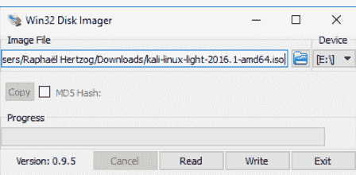
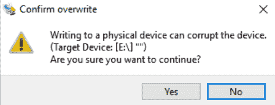
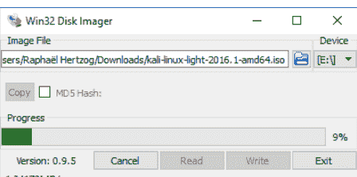

图 2.2 Win32 Disk Imager 的操作演示

拷贝完成后，从 Windows 系统安全地弹出 U 盘。你现在可以使用该 USB 设备启动 Kali Linux。

### 在 Linux 上创建可启动的 Kali U 盘

在 Linux 环境中创建可启动的 Kali U 盘非常简单。许多 Linux 发行版默认安装的 GNOME 桌面环境带有“磁盘”工具（位于 `gnome-disk-utility` 包中，该包在标准 Kali 镜像中已安装）。该程序显示磁盘列表，并在插入或拔出磁盘时动态刷新。当你从列表中选择你的 U 盘时，将显示详细信息，帮助你确认选择了正确的磁盘。注意，你可以在图 2.3 “GNOME 磁盘”的标题栏中找到它的设备名称。

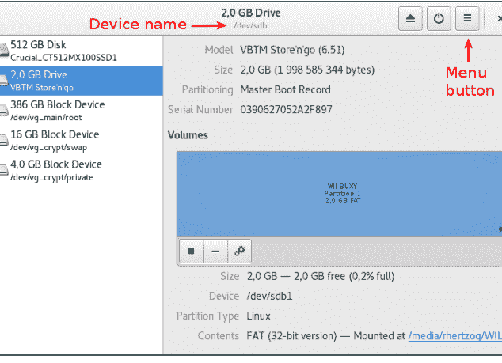

图 2.3 GNOME 磁盘

点击菜单按钮并在弹出窗口中选择“`Restore Disk Image...`”（恢复磁盘镜像...）。选择你下载的 ISO 镜像，并如图 2.4 “恢复磁盘镜像”所示点击“`Starting...`”（开始...）。


图 2.4 恢复磁盘镜像

在向 U 盘拷贝镜像时，可以喝杯咖啡（图 2.5，“镜像进度”）。

| | |
| :--- | :--- |
| 大小 | 2.0 GB (1996185344 bytes) |
| 分区 | 主引导记录 (Master Boot Record) |
| 序列号 | 0390627052AFFB7 |
| 任务 | 剩余 1 GB – 剩余 1 分钟 (3 MB/sec) |

图 2.5 镜像进度

### 通过命令行制作可启动的 U 盘

尽管图形化界面很简单，但对于命令行用户来说操作也很简单。当你插入 USB 时，Linux 内核会检测并分配一个名称，该名称打印在内核日志中。你可以通过检查 `dmesg` 返回的日志找到它。


```bash
$ dmesg
[134] sdb:1:2: New high-speed USB device using ehci-pci
[764] sdb:1:2: New USB device found, vendor=bec, product=0920
[771] sdb:1:2: New USB device strings: Mfr=1, Product=
[741] sdb:1:2: Product: Generic Storage
[777] sdb:1:2: Manufacturer: Verbatim
[780] sdb:1:2: Serial Number: 0390627052AFFB7
[217] scsi 7:0:sdb:usb storage device 1:2:0
[818] scsi 7:0: Direct-Access
[245] sdb:7:0: Attached generic scsi logical type 0
[699] sdb:7:0: [sdb] 390347 512 blocks: (2.00 GB (1.8 GiB))
[663] sdb:7:0: [sdb] Write Protect is off
[699] sdb:7:0: Mode Sensor: 45 00 00 08
[518] sdb:7:0: [sdb] No Caching mode found
[524] sdb:7:0: [sdb] Assuming drive cache: write speed
[075] sdb:7:0: [sdb] ready
[113] sdb:7:0: [sdb] Attached SCSI removable device
```

现在你知道 U 盘是 `/dev/sdb`，可以使用 `dd` 命令拷贝镜像：

```bash
# dd if=kali-linux-light-2017.1-amd64.iso of=/dev/sdb
207078440 records in
207078440 records out
1060241408 bytes (1 GB, 1021 MiB) copied, 3.2 MB/s
```

注意，执行此操作需要 root 权限，并且你应该确保使用的是该 U 盘。在此过程中，你应该确保你的没有任何分区被挂载。该命令还确保在 ISO 所在的目录运行，否则需要提供完整路径。

## 在 OS X/macOS 上制作可启动的 Kali U 盘

作为参考，`if` 代表“输入文件”，`of` 代表“输出文件”。`dd` 命令从输入文件读取数据并将其写入输出文件。它不显示任何进度，因此在运行时必须保持耐心（命令花费超过一小时并不稀奇！）。在 OS X/macOS 上，你还可以在操作期间按下 `CTRL+T` 获取已拷贝数据的统计信息。上述统计信息仅在命令完成后才会显示。

OS X/macOS 基于 UNIX，因此创建可启动 U 盘的过程与 Linux 过程类似。一旦你下载并验证了 Kali ISO 文件，即可使用 `dd` 将其拷贝到 U 盘上。

要识别 U 盘的设备名称，运行 `diskutil list` 来查找系统上的可用磁盘。接下来，插入你的 U 盘并运行 `diskutil` 命令。第二个输出应该列出一个额外的磁盘。你可以通过比较两个命令的输出来确定 U 盘的设备名称。寻找识别你 USB 磁盘的新行，并记录 `/dev/diskX`，其中 `X` 代表磁盘 ID。

你应该确保 U 盘未被挂载，这可以通过显式的卸载命令完成（假设 `/dev/disk6` 是 U 盘的设备名称）：

```bash
$ diskutil unmount /dev/disk6
```

## 2.2. 以实时模式启动 Kali ISO 镜像

### 2.2.1. 在实体机上

作为前提条件，你需要准备一个准备好的 USB 闪盘（详见上一节）或一张刻录了 Kali Linux ISO 镜像的 DVD-ROM。

BIOS/UEFI 负责早期启动过程，可以通过名为 Setup 的软件进行配置。具体来说，它允许用户选择首选的启动设备。在这种情况下，你希望选择 DVD-ROM 驱动器或 USB 驱动器，取决于你创建了哪种设备。

启动 Setup 通常需要在计算机通电后立即按下某个特定键。该键通常是 Del 或 Esc，有时是 F2 或 F10。大多数情况下，在计算机开机、操作系统加载之前，该选项会短暂闪烁。

一旦 BIOS/UEFI 已正确配置为从你的设备启动，启动 Kali Linux 只需插入 DVD-ROM 或插入 USB 驱动器并开启计算机即可。

> 虽然 Kali Linux 镜像可以在 UEFI 模式下启动，但它们不支持安全启动（secure boot）。你应该在 Setup 中禁用该功能。

### 2.2.2. 在虚拟机中

虚拟机对 Kali Linux 用户有许多益处。如果你想尝试 Kali Linux 但尚未准备好将其永久安装在机器上，或者你有一台强大的系统并想同时运行多个操作系统，虚拟机将特别有用。这是渗透测试人员和安全专业人员的热门，他们需要使用 Kali Linux 提供的工具，但仍然希望保留主操作系统的完全访问权限。这还让他们能够存档或安全删除虚拟机及其可能包含的任何客户端数据，而无需重新安装整个操作系统。

虚拟化软件的快照功能使得实验潜在危险的操作很容易（例如恶意软件分析），同时通过恢复之前的快照提供了一种简单的退出方法。

所有主流操作系统都有许多虚拟化工具可用，包括 VirtualBox®、VMware Workstation®、Xen、KVM 和 Hyper-V 等。最终你将使用最适合你的那，但我们将介绍桌面环境下最常用的：VirtualBox 和 VMware Workstation Pro®，它们均运行在 Windows 10 上。如果没有公司策略限制或个人偏好，我们建议先尝试 VirtualBox，因为它是免费的、运行良好的、（大部分是）开源的，并且适用于大多数操作系统。

在接下来的章节中，我们假设你已经安装了适当的虚拟化工具并熟悉其操作。

## 初步说明

为了充分利用虚拟化，你的 CPU 应该具有适当的虚拟化功能，且这些功能没有被 BIOS/UEFI 禁用。在 Setup 界面中双击检查“Intel® Virtualization Technology”和/或“Intel® VT-d Feature”选项。

你还应该拥有 64 位的主机操作系统，例如基于 Debian 的 Linux 发行版使用 `amd64` 架构，基于 RedHat 的 Linux 发行版使用 `x86_64` 架构，Windows 则使用 64 位版本。

如果你缺少任何前提条件，虚拟化工具将无法正常工作，或者将被限制为仅运行 32 位虚拟机操作系统。

由于虚拟化工具在低层挂钩主机操作系统和硬件，它们之间经常存在不兼容之处。不要期望这些工具同时良好运行。此外，请注意 Windows 专业版预装并启用了 Hyper-V，这可能会干扰你选择的虚拟化工具。若要关闭它，请从 Windows 设置中执行“启用或关闭 Windows 功能”。

## VirtualBox

初始安装后，VirtualBox 的主界面类似于图 2.6，“VirtualBox 启动界面”[第 26 页]。

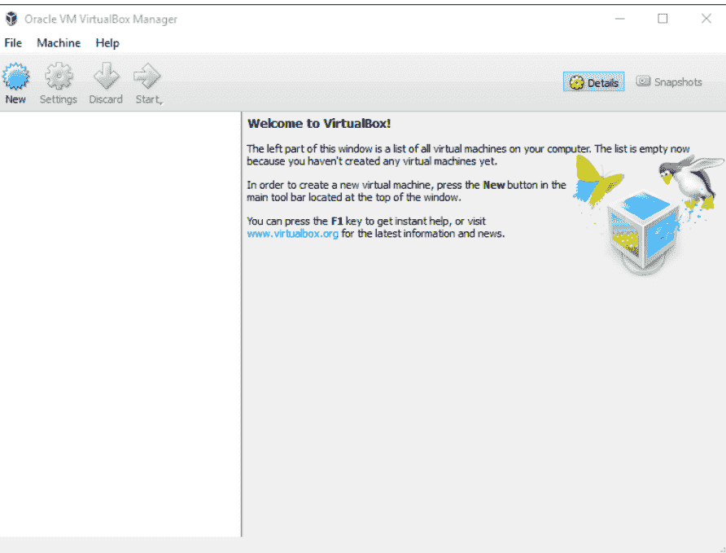

**图 2.6** VirtualBox 启动界面

点击“新建”（New）（图 2.7，“名称和操作系统”[第 27 页]）启动向导，该向导将引导你完成输入新虚拟机所有参数所需的多个步骤。

## 创建虚拟机

### 名称和操作系统

请为新虚拟机选择一个描述性的名称，并选择你打算安装在上面的上的操作系统类型。你选择的名称将在整个 VirtualBox 中用于识别这台机器。

| 名称 | Kali Linux |

| :--- | :--- |

| 类型 | Linux |

| 版本 | Debian (64-bit) |

图 2.7 名称和操作系统

在第一步中（如图 2.7 所示，“名称和操作系统”[第 27 页]），你必须为你的新虚拟机分配一个名称。使用“Kali Linux”。你还必须指定将使用哪种操作系统。由于 Kali Linux 基于 Debian GNU/Linux，请选择类型为 Linux，版本为 Debian (32-bit) 或 Debian (64-bit)。尽管你可能安装了任何其他 Linux 版本，但这有助于区分不同的虚拟机。

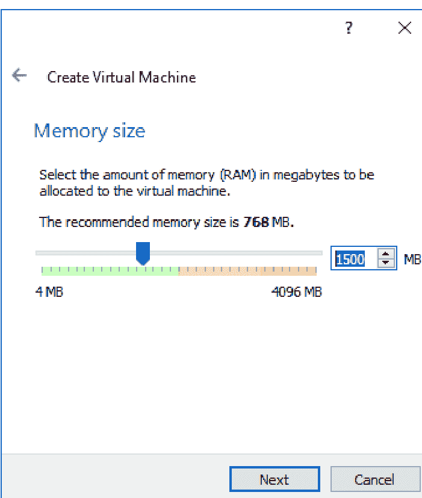

图 2.8 内存大小

在第二步中，你必须决定为虚拟机分配多少内存。对于作为服务器的 Debian 虚拟机，768 MB 的推荐大小是可以接受的，但对于运行 Kali 桌面系统来说绝对不够，特别是对于 Kali Linux 实时系统，因为实时系统使用内存来存储对文件系统的更改。我们建议将该值增加到 1500 MB（图 2.8，“内存大小”[第 28 页]），并强烈建议分配不少于 2048 MB 的内存。

## 创建虚拟机

### 硬盘


如果你希望为新机器添加虚拟硬盘。你可以创建一个新的硬盘文件，或者使用文件夹图标从列表或其他另一个位置选择一个。

如果你需要更复杂的存储设置，可以跳过此步骤，并在虚拟机创建后对机器设置进行更改。

建议的硬盘大小为 8.00 GB。

- 不添加虚拟硬盘
- 现在创建虚拟磁盘
- 使用现有的虚拟磁盘

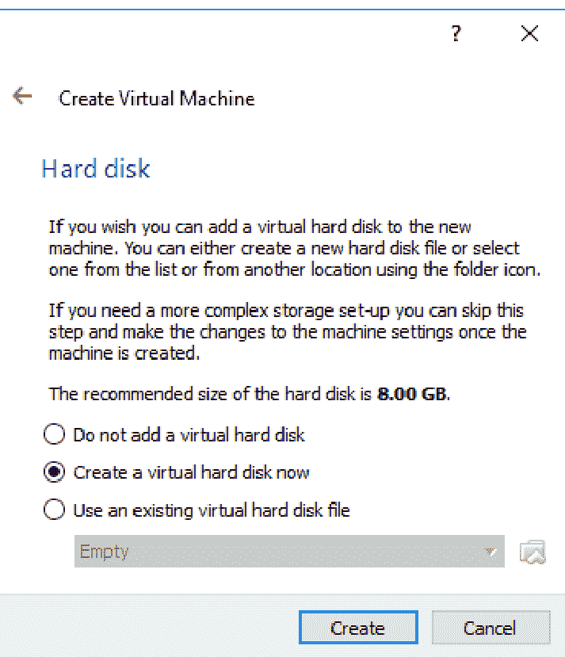

图 2.9 硬盘

在第三步中（如图 2.9 所示，“硬盘”[第 29 页]），你会被提示为你的新机器选择物理或虚拟磁盘。虽然运行 Kali Linux 系统不需要硬盘，但请添加一个以便稍后在 4 章“安装 Kali Linux”[第 66 页]演示安装过程。

## 创建虚拟磁盘

### 硬盘文件类型

请选择你想为新硬盘使用的文件类型。如果你不需要与其他虚拟化软件配合，可以保持此设置。

- VDI (VirtualBox 磁盘镜像)
- VMDK (虚拟机磁盘)
- VHD (虚拟硬盘)
- HDD (Parallels 硬盘)
- QED (QEMU 增强磁盘)
- QCOW (QEMU 写入时复制)

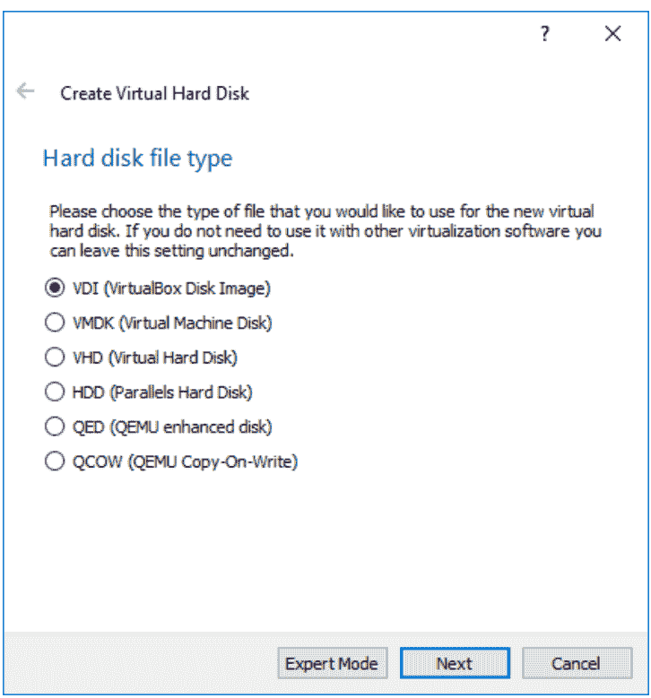

虚拟机硬盘的内容以文件的形式存储在主机上。VirtualBox 能够使用多种格式存储硬盘内容（如图 2.10 所示，“硬盘文件类型”[第 30 页]）：默认值（VDI）对应 VirtualBox 的原生格式；VMDK 是 VMware 使用的格式；QCOW 是 QEMU 使用的格式。保持默认值，因为你没有理由更改它。使用多种格式的能力在将虚拟机从一个虚拟化工具移动到另一个时主要意义。

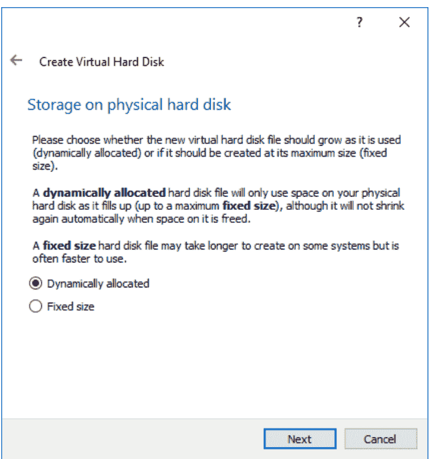

图 2.11 物理硬盘上的存储

图 2.11 中的文本“物理硬盘上的存储”[第 31 页]清楚地描述了动态分配和固定磁盘分配的优缺点。在示例中，我们接受默认选择（动态分配），因为我们正在使用带有 SSD 硬盘的笔记本电脑。我们不想浪费空间，也不需要额外的性能，因为机器本身已经足够快了。

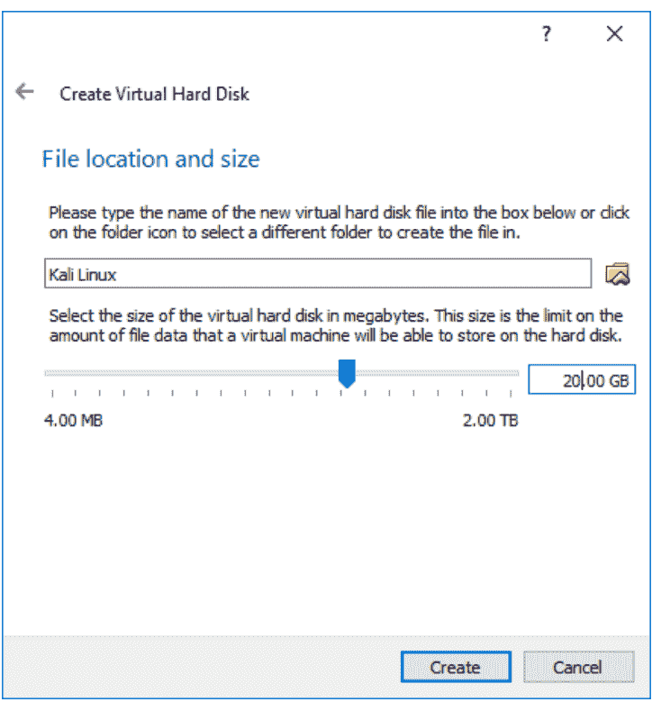

图 2.12 文件位置与大小

图 2.12“文件位置与大小”[第32页]中显示的 8 GB 默认硬盘大小对于 Kali Linux 的标准安装是不够的，因此将其增加到 20 GB。你还可以调整磁盘的名称和位置。当你的硬盘空间不足时，这非常有用，允许你将磁盘镜像存储在外部驱动器上。

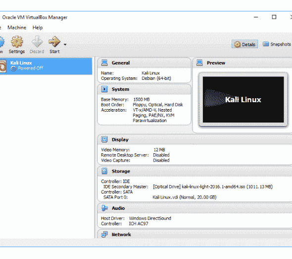

图 2.13 虚拟机出现在列表中

虚拟机已经创建，但你还无法真正运行它，因为还没有安装操作系统。你还有一些设置需要调整。点击虚拟机管理器上的“设置”，让我们回顾一些最实用的设置。

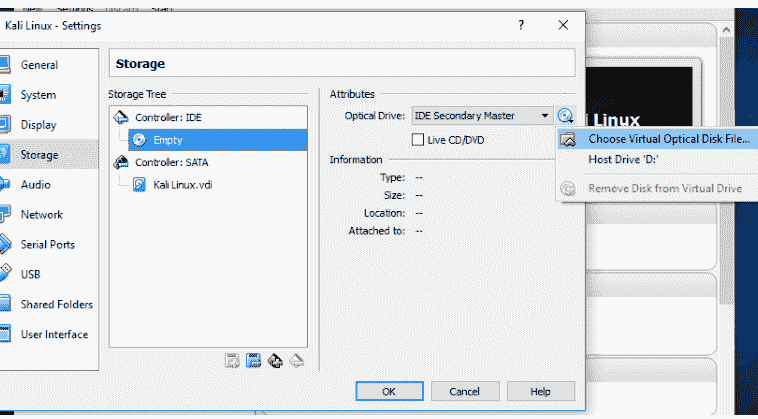

图 2.14 存储设置

第 2 章 — 开始使用 Kali Linux 33

在存储屏幕（图 2.14，“存储设置”[第33页]）中，你应该将 Kali Linux ISO 镜像与虚拟 CD/DVD-ROM 阅读器关联。首先，在存储树列表中选择 CD-ROM 驱动器，然后点击右侧的小型 CD-ROM 图标显示上下文菜单，在其中你可以“选择虚拟光盘文件...”(Choose Virtual Optical Disk File...)

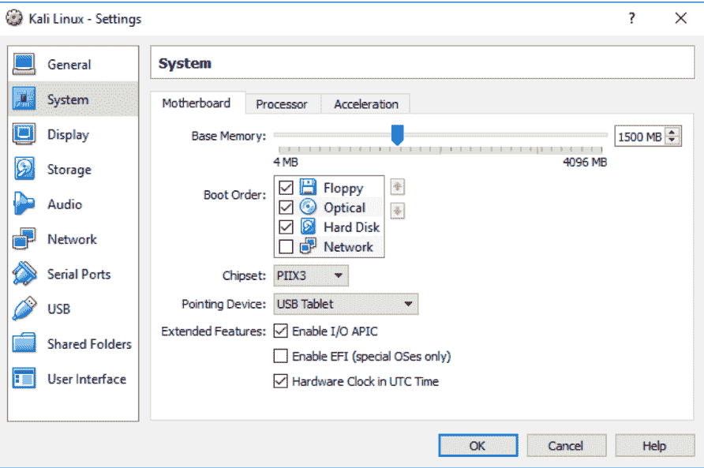

**图 2.15** 系统设置：主板

在系统屏幕（图 2.15，“系统设置：主板”[第34页]）中，你会找到“主板”选项卡。确保启动顺序指示系统将首先尝试从任何光驱启动，然后再尝试硬盘。如果需要，你也可以在此选项卡修改分配给虚拟机的内存容量。


图 2.16 系统设置：处理器

在同一屏幕的“处理器”选项卡中（图 2.16，“系统设置：处理器”[第35页]），你可以调整分配给虚拟机的处理器数量。最重要的是，如果你使用的是 32 位镜像，请启用 PAE/NX，否则 Kali 镜像将无法启动，因为 Kali 为 i386 使用的默认内核变体（名为“686-pae”）的编译方式要求 CPU 支持物理地址扩展（PAE）。

还有许多其他可以配置的参数，例如网络设置（定义如何处理网卡上的流量），但上述更改足以启动一个运行的 Kali Linux 现场系统。最后，点击“启动”(Boot)，虚拟机应该就能正常启动，如图 2.17“VirtualBox 中的 Kali Linux 启动界面”[第36页]所示。如果没有启动，请仔细检查所有设置并重试。

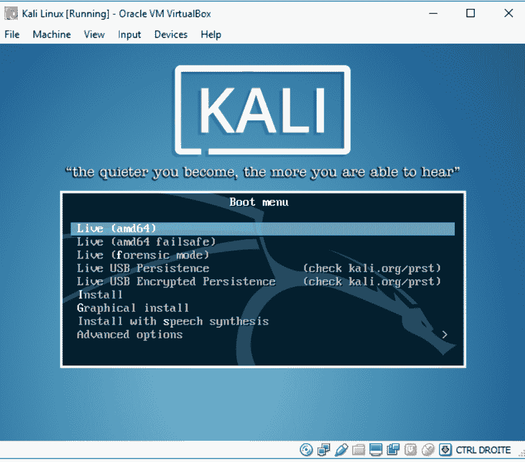

**图 2.17** VirtualBox 中的 Kali Linux 启动界面

VM Workstation Pro 在功能和用户界面方面与 VirtualBox 非常相似，因为它们都主要为桌面使用设计，但创建新虚拟机的设置过程有点不同。

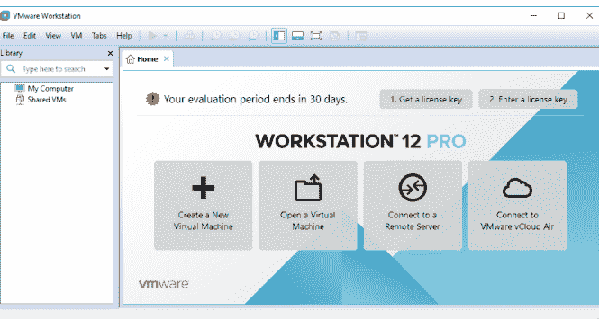

图 2.18 VMware 启动界面

图 2.18“启动界面”[第37页]中显示的初始屏幕显示“创建新虚拟机”(Create a New Machine)，这会启动一个向导引导你创建虚拟机。

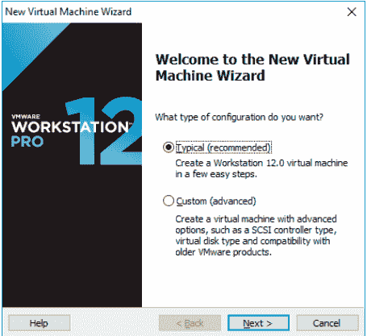

图 2.19 新虚拟机向导

在第一步中，你必须决定在设置过程中显示高级设置。在本例中，“典型安装”没有特殊要求，如图 2.19“新虚拟机向导”[第37页]所示。

# 新虚拟机向导

## 客户操作系统安装

虚拟机就像物理计算机；它需要一个操作系统。如何安装操作系统？

- 安装自：(Install from:)
- 安装磁盘：(Install disc:) CD 驱动器 (D:)
- 安装镜像文件 (iso)： `C:\Users\Raphael Hertig\Downloads\kali-linux-...`

> 无法在此磁盘镜像中检测到操作系统。
> 你需要指定将安装哪个操作系统。
- 我稍后将安装操作系统。
- 虚拟机将创建一个磁盘。


向导假设你想立即安装操作系统，并要求你选择包含安装程序的 ISO 镜像（图 2.20，“操作系统”[第38页]）。选择“安装磁盘文件 (iso)”(Installer disc) 并点击“浏览”(Browse)选择镜像。

# 新虚拟机向导

## 选择客户操作系统

将在此虚拟机上安装哪个操作系统？

客户操作系统

- Microsoft Windows
- Linux
- Solaris
- VMware ESX
- 其他

版本

- Debian 8.x 64-bit


当无法从选定的 ISO 镜像检测操作系统 (OS) 时，向导询问你打算运行哪种客户操作系统类型。你应该为 OS 选择“Linux”，版本选择“Debian 8.x”，如图 2.21“选择客户操作系统”[第38页]所示。

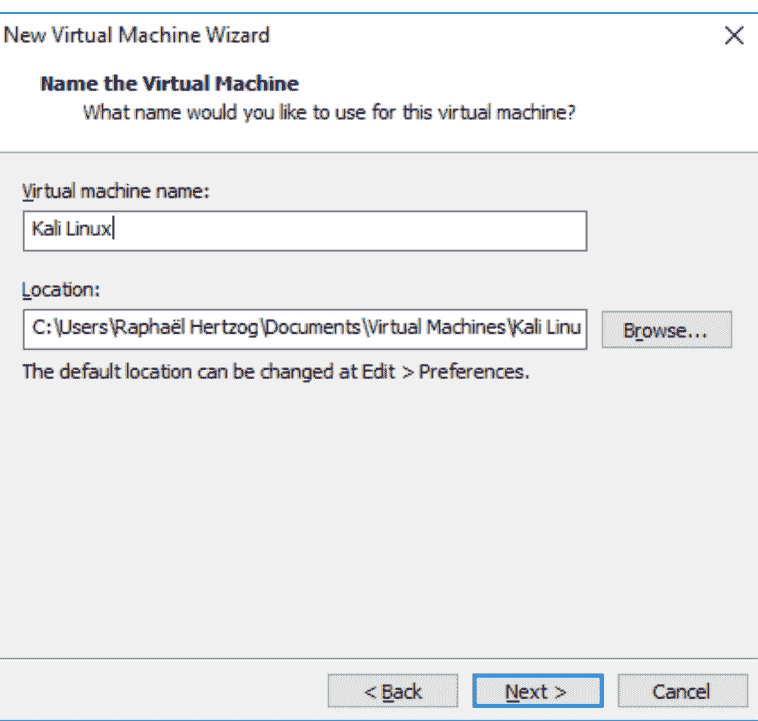

图 2.22 命名虚拟机

选择“Kali Linux”作为新虚拟机的名称（图 2.22，“命名虚拟机”[第39页]）。与 VirtualBox 一样，你也有备位置存储 VM 文件的选项。

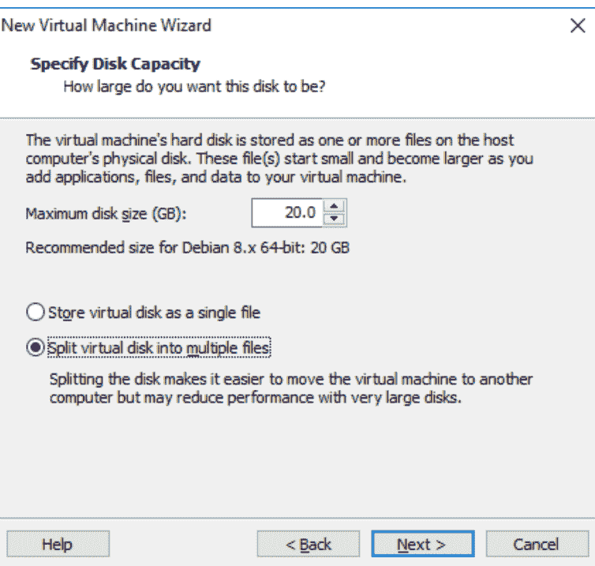

图 2.23 指定磁盘容量

20 GB 的默认硬盘大小（图 2.23，“指定磁盘容量”[第40页]）通常足够，但你可以根据需要进行调整。与可以使用不同大小单个文件的 VirtualBox 不同，VMware 有将磁盘内容存储在多个文件中的能力。两种情况下，目标都是节省主机的磁盘空间。

# 新虚拟机向导

## 准备创建虚拟机

点击“完成”(Finish) 创建虚拟机。然后你可以安装 Debian 8.x 64-bit。虚拟机将按照以下设置创建：

| 名称 | Kali Linux |
| :--- | :--- |
| 位置 | `C:\Users\Rapël Herzog\Documents\Virtual Machine[41]` |
| 版本 | Workstation 12.0 |
| 操作系统 | Debian 8.x 64-bit |
| 硬盘 | 20 GB, 分拆 (Split) |
| 内存 | 512 MB |
| 网络适配器 | NAT |


| 其他设备 | CD/DVD, USB 控制器, 声卡 |

自定义硬件... (Customize Hardware...) 上一步 (Back) 完成 (Finish) 取消 (Cancel)

图 2.24 准备创建虚拟机

VMware Workstation 现在已配置好创建新虚拟机。它显示了所做选择摘要，以便你在创建机器之前双检一切。注意向导选择仅为虚拟机分配了 512 MB 内存，这并不足够，因此点击“自定义硬件...”(Customize Hardware...)（图 2.24，“准备创建虚拟机”[第41页]）并调整内存设置，如图 2.25“配置硬件窗口”[第42页]所示。

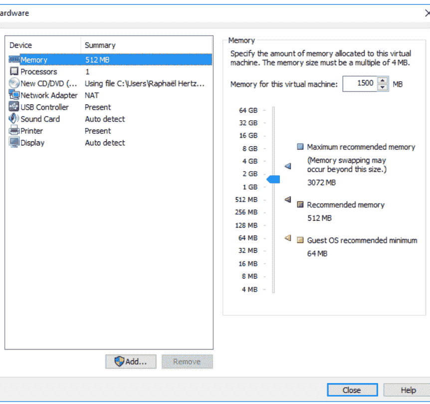

图 2.25 配置硬件窗口

在最后点击“完成”(Finish)（图 2.24，“准备创建虚拟机”[第41页]）后，虚拟机现在已配置，可以通过点击“开启此虚拟机”(Power on this virtual machine) 来启动，如图 2.26“Kali Linux 虚拟机就绪”[第43页]所示。

## 2.3 总结

在本章中，你学习了各种 Kali Linux ISO 镜像，学习了如何验证和下载它们，并学习了如何从各种操作系统创建启动 U 盘。我们还讨论了如何启动 U 盘，并回顾了如何配置各种硬件平台的 BIOS 和启动设置以便 U 盘启动。

总结提示：

- `kali.org` 是 Kali ISO 的唯一下载网站。不要从任何其他网站下载，因为那些可能包含恶意软件。
- 始终使用 `sha256sum` 命令验证下载内容的校验和，以确保 ISO 下载的完整性。如果不匹配，请重新下载或使用不同的来源。
- 如果你想在物理机上启动它，必须将 Kali Linux ISO 镜像写入启动介质，请在 Windows 上使用 `Win32 Disk Imager`，在 Linux 上使用磁盘工具，在 Mac OS/macOS 上使用 `dd` 命令。写入镜像时要非常小心。选择错误的磁盘可能会永久损坏机器上的数据。
- 配置 PC 的 BIOS/UEFI 设置屏幕，或在 OS X/macOS 上按住 Option 键允许机器从 USB 驱动器启动。
- 如果你想尝试 Kali Linux 但尚未准备好在机器上永久安装它，或者你有一台性能强大的系统并同时运行多个操作系统，那么像 VirtualBox 和 VMware Workstation Pro 等虚拟机程序就会特别有用。

现在你已经安装了一个可以运行的 Kali Linux，是时候深入研究一些 Kali 基础和高级操作所需的 Linux 基础知识了。如果你是中高级高级 Linux 用户，可以考虑跳过下一章。


# 关键词

- Linux 内核
- 用户空间
- 命令行
- bash
- 文件系统层次结构
- Unix 命令


# KALI LINUX

## 揭秘

# 第 3 章

# Linux 基础

目录

| 什么是 Linux 以及它在做什么？ | 48 | 命令行 | 51 | 文件系统 | 54 |
| 有用命令 | 56 | 总结 | 62 |

在精通 Kali Linux 之前，你必须熟悉通 Linux 系统。熟练使用 Linux 将让你大有益处，因为大量的网页、电子邮件和其他互联网服务都运行在 Linux 服务器上。

在本节中，我们努力涵盖 Linux 的基础知识，但假设你已经了解一般的计算机系统，包括 CPU、RAM、主板和硬盘等组件，以及设备控制器及其连接器。

## 3.1. 什么是 Linux 以及它在做什么？

“Linux”一词通常指代整个操作系统，但实际上，Linux 是操作系统内核，它由引导加载程序启动，而引导加载程序又由 BIOS/UEFI 启动。内核的角色类似于交响团的指挥家——它确保硬件与软件之间的协调。这一角色包括管理硬件、进程、用户、权限和文件系统。内核为系统上的所有其他程序提供了共同基础，并且通常运行在零环（ring zero），也称为内核空间。

| 用户空间 | 我们使用“用户空间”一词来统称内核之外发生的所有事情。运行在用户空间的程序包括许多 GNU 项目的核心工具；其中大多数旨在从命令行运行。你可以在脚本中使用它们来自动化许多任务。有关重要命令的更多信息，请参考第 3.4 节“有用命令”（第 56 页）。 |

让我们快速回顾一下 Linux 内核处理的任务。

### 3.1.1. 驱动硬件

内核的首要任务是控制计算机的硬件组件。它在计算机开机或当插入或移除设备（例如 USB 设备）时检测并配置这些组件。它还通过简化的编程接口为高层软件提供这些设备，以便应用程序可以利用设备，而无需处理诸如插在哪个扩展槽之类的细节。编程接口还提供了一个抽象层；这使得视频会议软件无论摄像头的制造商和型号如何都能使用。软件可以使用 Video for Linux (V4L) 接口，内核会将接口的函数调用翻译为特定摄像头所需的实际硬件命令。

内核通过 `/proc/` 和 `/sys/` 虚拟文件系统导出有关检测硬件的数据。应用程序通常通过在 `/dev/` 中创建访问设备。特定文件代表磁盘驱动器（例如 `/dev/sda`）、分区（`/dev/sda1`）、鼠标（`/dev/input/mouse`）、键盘（`/dev/input/event0`）、声卡（`/dev/snd/*`）、串口（`/dev/ttyS*`）以及其他组件。

设备文件有两种类型：块设备和字符设备。前者具有数据块的特征：它具有有限的大小，你可以访问块中任何位置的字节。者的行为类似于字符流。你可以读取和写入字符，但不能跳转到给定位置并更改任意字节。要确定给定文件的类型，请检查 `ls -l` 输出的第一个字母。它可能是 `b`（块设备）或 `c`（字符设备）。

```bash
br-rw---- 1 root root 480, Oct 12 10:00 /dev/sda
cr-rw---- 1 root root 6, Oct 12 10:00 /dev/input/mouse
cr-rw---- 1 root root 10, Oct 12 10:00 /dev/input/event0
sr-rw---- 1 root root - /dev/snd/*
```

### 3.1.2. 统一文件系统

内核允许同一个程序的多个独立实例运行，但每个实例仅被允许访问自己的时间片和内存。它们的数据保持独立。

### 3.1.3. 管理进程

进程是程序的运行实例，需要内存来存储程序本身及其数据。内核负责分配内存，将可执行文件加载到内存中，然后启动代码运行。它保留有关此进程的信息，最可见的是一个称为 PID 的标识号。

### 3.1.4. 权限管理

Unix 类系统支持多用户和用户组，并允许对权限进行控制。大多数情况下，一个进程是由启动它的用户标识的。该进程仅被允许执行其所有者被允许的操作。例如，打开一个文件需要内核根据进程身份与访问权限进行比对（有关此特定示例的更多信息，请参见第 3.4.4 节，“管理权限”[第 57 页]）。

## 3.2. 命令行

我们所说的“命令行”是指基于文本的界面，允许你输入命令、执行命令并查看结果。你可以运行一个终端（图形桌面内部的文本屏幕，或任何图形界面之外的文本控制台），并在其中运行一个命令解释器（即 shell）。

### 3.2.1. 如何获取命令行

当你的系统正常工作时，访问命令行最简单的方法是在图形桌面会话中运行终端。

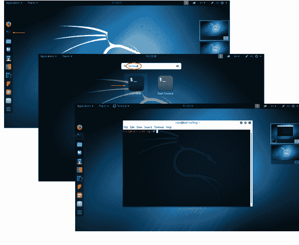

图 3.1 启动 GNOME Terminal

例如，默认的 Kali Linux 系统的 GNOME Terminal 可以从收藏应用程序列表中启动。你也可以在“活动”屏幕（当鼠标移动到左上角时激活的屏幕）中输入“terminal”，然后点击出现的正确应用程序图标（图 3.1，“启动 GNOME Terminal”[第 51 页]）。

在你的图形界面出现故障的情况下，你仍然可以在控制台上获取命令行（通过 `CTRL+ALT+F1` 到 `CTRL+ALT+F6` 的六种组合可以访问多六个控制台——如果你已经处于文本模式，即在 Xorg 或 Wayland 图形界面之外，可以省略 `CTRL`）。你将进入一个非常基础的登录界面，在其中输入你的用户名和密码，然后访问带有其 shell 的命令行：

```
Kali GNU/Linux Rolling tty3
kali-rolling login: root
Password:
Last login: Fri Mar 25 12:30:05 EDT 2016 from 192.168.122.1 on pts/2
Linux kali-rolling 4.4.0-kali-amd4 #1 Debian 4.4.6-1kal1 (2016-03-18) x86_64
```


GNU/Linux 系统中包含的程序是自由软件；每个程序的发行条款在 `/user/share/doc/*/copyright` 中的各个文件中进行了描述。

在适用法律允许的范围内，Kali GNU/Linux **绝不提供任何保证**。

root@kali-rolling:-

处理你的输入并执行你的命令的程序称为 shell（或命令解释器）。Kali Linux 的默认 shell 是 `Bash`（它代表 Bourne Again SHELL，即“布恩再次加强版 shell”）。末尾的 `$` 或 `#` 字符表示 shell 正在等待你的输入。它还表示 `Bash` 是否将你识别为普通用户（带 `$` 的前者）或超级用户（带 `#` 的后者）。

## 3.2.2. 命令行基础：浏览目录树和管理文件

本节仅对涵盖的命令进行简要概述，所有命令都有许多此处未描述的选项，请参考其各自手册中提供的丰富文档。在渗透测试中，在成功利用漏洞后，你通常会获得该系统的 shell 访问。精通命令行对于你作为安全专业人员的成功至关重要。

一旦会话打开，`pwd` 命令（代表 print working directory）显示你在文件系统中的当前位置。使用 `cd` 目录命令（`cd` 代表 change directory）更改当前目录。当你没有指定目标目录时，你会被带回到主目录。当你执行 `cd -` 时，你会回到上一个工作目录（上一次 `cd` 调用之前的目录）。父目录始终是 `..`（两个点），而当前目录也被称为 `.`（点）。`ls` 命令允许列出目录的内容。如果你不提供参数，`ls` 将对当前目录操作。

```
$ pwd
/home/buxy
$ cd Desktop
$ pwd
/home/buxy/Desktop
$ cd
$ pwd
/home/buxy/Desktop
$ cd ..
$ pwd
/home/buxy
$ ls
Desktop Downloads Pictures Templates
Documents Music Public Videos
```

你可以使用 `mkdir directory` 创建目录，并使用 `rmdir directory` 删除现有（空）目录。`mv` 命令允许移动和重命名文件及目录；移动文件通过 `rm file` 实现，复制文件则通过 `cp source-file target` 完成。

```
$ mkdir test
$ ls
Desktop Downloads Pictures Templates Videos
Documents Music Public test
$ mv test new
$ ls
Desktop Downloads new Public Videos
Documents Music Pictures Templates
$ rmdir new
$ ls
Desktop Downloads Pictures Templates Videos
Documents Music Public
```

shell 通过运行在 `PATH` 环境变量列出的目录列表中找到的名称第一个程序来执行每个命令。通常情况下，这些程序位于 `/bin`、`/sbin`、`/usr/bin`、`/usr/sbin`。例如，`ls` 命令位于 `/bin/ls`；`which` 命令报告可执行文件的位置。有时命令由 shell 直接处理，在这种情况下，它被称为内置命令（`cd` 和 `pwd` 就在其中）；`type` 命令允许你查询每个命令的类型。

```
$ echo PATH
/usr/local/sbin:/usr/local/bin:/usr/sbin:/usr/bin:/sbin:/bin
$ ls
Desktop Downloads Pictures Templates Videos
Documents Music Public
```

```
$ echo PATH
/usr/local/sbin:/usr/local/bin:/usr/sbin:/usr/bin:/sbin:/bin
$ ls
/bin/ls
$ type rm
rm is an alias
$ type cd
cd is a builtin
```

shell 通过运行在 `PATH` 环境变量列出的目录列表中找到的名称第一个程序来执行每个命令。通常情况下，这些程序位于...

```
$ type rm
rm is an alias
$ type cd
cd is a builtin
```

`echo` 命令简单的显示一个字符串。

## 环境变量

环境变量允许进行全局设置，这些设置存储在 `/etc` 中。例如，shell 会话会传递到 `~/.profile`。这些设置是上下文相关的。

在 `/etc` 中环境变量允许进行全局设置，这些 shell 会话会传递到 shell 会话。在 shell 会话中，这些设置被定义在 `~/.profile`。

## 3.3. 文件系统

### 3.3.1. 目录层次结构

与其他 Linux 发行版一样，Kali Linux 符合文件层次结构（FHS），以便用户能够轻松找到目录。FHS 定义了每个目录的用途，如下：

- `/bin/`: 基础程序
- `/boot/`: 启动所需的文件
- `/dev/`: 设备文件
- `/etc/`: 配置文件
- `/home/`: 用户文件
- `/lib/`: 基础库
- `/media/*`: 可移动设备的挂载点（光盘、USB 等）
- `/mnt/`: 临时挂载点
- `/opt/`: 第三方提供的应用程序
- `/root/`: 管理员（root）文件
- `/run/`: 不跨重启的持久化运行时数据
- `/sbin/`: 系统程序
- `/srv/`: 本地托管的数据
- `/tmp/`: 临时文件（此目录在启动时通常会被清空）
- `/usr/`: 应用程序（此目录进一步细分为 bin、sbin、lib），此外 `/usr/share/` 包含架构无关的数据。`/usr/local/` 目录供管理员手动安装应用程序。
- `/var/`: 守护进程处理的可变数据。这包括日志文件、队列、池和缓存。`/proc/` 和 `/sys/` 是内核特有的（不属于 FHS）。它们被内核用于导出数据到用户空间。

### 3.3.2. 用户主目录

用户主目录的内容并没有标准，但仍有一些值得注意的惯例。一个用户主目录通常被称为波浪号（`~`），这是有用的，因为命令解释器会自动将波浪号替换为正确的目录（存储在 `HOME` 环境变量中，其通常值为 `/home/user/`）。

传统的，应用程序配置文件通常直接存储在你的主目录下，但文件名通常以点开头（例如，matt 客户端将其配置存储在 `~/.mtrc`）。注意，以点开头的文件默认是隐藏的；`ls` 命令只有在使用 `-a` 参数时才会列出它们；文件管理器需要显式配置以显示隐藏文件。

某些程序在一个目录中组织多个配置文件（例如 `~/.ssh/`）。某些应用程序（例如 Firefox 浏览器）还使用其目录存储下载数据的缓存。这意味着这些目录可能会消耗大量的磁盘空间。

图形桌面通常有快捷方式显示 `~/Desktop/` 目录的内容（或者对于非英语配置的系统，显示相应的翻译）。

最后，电子邮件系统有时会将传入的邮件存储在 `~/Mail/` 目录下。

## 3.4. 有用的命令

#### 3.4.1. 显示和修改文本

`cat` 文件命令（用于将文件连接到标准输出设备）会读取文件并在终端上显示其内容。如果文件太大无法在一个屏幕内显示，你可以使用分页器（如 `less` 或 `more`）按页显示。

编辑器启动一个文本编辑器（如 `Vi` 或 `Nano`），并允许创建、修改和读取文本文件。最简单的文件有时可以直接从命令解释器通过重定向创建：`command >file` 会创建一个包含给定命令输出的新文件。`command >>file` 与其类似，不同之处是将命令的输出追加到文件，而不是覆盖它。

```
$ echo "Kali rules!" > kali-rules.txt
$ cat kali-rules.txt
Kali rules!
$ echo "Kali is the best!" >> kali-rules.txt
$ cat kali-rules.txt
Kali rules!
Kali is the best!
```

#### 3.4.2. 搜索文件和文件内内容

`find` 目录准则命令根据若干准则在目录下的层次结构中搜索文件。最常用的准则是 `-filename`，它允许按文件名搜索。你也可以在文件名搜索中使用通配符如 `*`。

```
$ find /etc -name hosts
/etc/hosts
/etc/avahi/hosts
$ find /etc -name "hosts*"
/etc/hosts
/etc/hosts.allow
/etc/hosts.deny
/etc/avahi/hosts
```

`grep` 文件命令搜索文件内容并提取匹配正则表达式的行。`-r` 选项对目录中包含的所有文件启用递归搜索。这允许在你只知道文件部分内容时查找文件。


### 3.4.3. 管理进程

`ps` 命令列出当前运行的进程，并通过显示它们的 PID 来帮助识别它们。一旦你知道了进程的 PID，`kill -signal pid` 命令允许你发送信号（如果你是该进程的所有者）。存在多种信号；最常用的是 `TERM`（请求优雅终止）和 `KILL`（强制杀死）。

如果命令后面跟着 `&`，命令解释器还可以在后台运行程序。通过使用安 符号，即使命令仍在运行（作为后台进程隐藏显示），你也可以立即恢复对 shell 的控制。`jobs` 命令列出后台运行的进程；运行 `fg %job-number`（针对前台）可以将作业恢复到前台。当命令在前台运行时（无论是因为正常启动，还是通过 `fg` 带回前台），`Control+Z` 组合键会暂停进程并恢复对命令行的控制。然后可以使用 `bg %job-number`（针对后台）在后台重启该进程。

### 3.4.4. 管理权限

Linux 是多用户系统，因此需要提供权限系统来控制对文件和目录的授权操作，这包含了所有的系统资源和设备（在 Unix 系统上，任何设备都由文件或目录表示）。这一原则适用于所有 Unix 类系统。

每个文件或目录对三类用户有特定的权限：

- 它的所有者（用 `u` 表示，如 user）
- 它的所有者组（用 `g` 表示，如 group），代表该组的所有成员
- 其他人（用 `o` 表示，如 other）

三种类型的权限可以组合：

- 读取（用 `r` 表示，如 read）
- 写入（或修改，用 `w` 表示，如 write）；
- 执行（用 `x` 表示，如 eExecute）。

对于文件来说，这些权限很容易理解：读取权限允许读取内容（包括复制），写入权限允许更改内容，执行权限允许运行它（这只有在它是一个程序时才有效）。

### setuid 和 setgid 可执行文件

有两个特殊权限与可执行文件相关：`setuid` 和 `setgid`（用字母 "s" 表示）。注意，在经常谈论时，这些布尔值中的每一个都可以用 0 或 1 表示。这两种权限允许任何用户以所有者或组的权限分别执行程序。这种机制允许访问需要比你通常拥有的更高级别权限的功能。

由于 `setuid root` 程序系统性地以超级用户身份运行，因此确保其安全性和可靠性非常重要。任何能够设法劫持 `setuid root` 程序以调用他们选择的命令的用户，都可以冒充 root 用户并拥有系统上的所有权限。渗透测试人员在获得访问访问后，经常搜索这类文件，作为提升权限的手段。

目录的处理方式与文件不同。读取权限赋予了查阅其内容列表（文件和目录）的权利；写入权限允许创建或删除文件；执行权限允许穿过目录以访问其内容（例如使用 `cd` 命令）。能够穿过一个目录但无法读取它，意味着可以通过名称知道它们，但无法通过其确切名称找到它们。

### 安全：gid 目录和粘滞位 (sticky bit)

`setgid` 位适用于目录。此类目录中任何新创建的项都会自动分配父目录的所有者组，像往常一样继承创建者的组。由于由于，当你在多个同一专用组的用户共享的文件树中工作时，你不需要使用 `group` 命令更改你的主组。

粘滞位（用字母 "t" 表示）仅在目录中有用。它限制了文件的删除。

### 3.4.5. 获取系统信息和日志

`free` 命令显示内存信息；`df` (disk free) 报告文件中挂载的每个磁盘的可用空间。`-h` 选项（人类可读格式）将大小转换为更易读的单位（通常是兆字节或千字节）。同样，`free` 命令支持 `-m` 和 `-g` 选项，分别以兆字节或千字节显示数据。

```
$ free
total           used       free       shared    buffer/cache  available
Mem:           2052944    661232    621208    10520      777054
Swap:               0         0                               0
$ df
Filesystem     K-blocks  Used  Available  %  Mounted on
udev            101584       0         101584   0% /dev
tmpfs           205296     8940      196356   5% /run
/dev/vda1      30830588 11618116 1873328   39% /
tmpfs           1026472     456      1026016   1% /dev/shm
tmpfs             5120       0         5120      0% /run/lock
tmpfs           1026472       0         1026472   0% /sys/fs/cgroup
tmpfs           205296      36        205260   1% /run/user/132
tmpfs           205296      24        205272   1% /run/user/0
```

`id` 命令识别运行会话的用户身份以及其所属的组列表。由于某些文件或设备的访问可能限于限于组员，因此检查可用的组权限可能是很有用的。

```
$ id
uid=1000(buxy) gid=1000(buxy) groups=1000(buxy),27 (sudo)
```

`uname -a` 命令返回单行文档，记录内核名称（Linux）、主机名、内核发布版本、内核版本、机器类型（架构如 x86_64）以及操作系统名称（GNU/Linux）。此命令的输出通常应该包含在错误报告中，因为它明确定义了正在使用的内核和您运行的硬件平台。

```
$ uname -a
Linux kali 4.9.0-kali3-amd64 #1 SMP Debian 4.9.18-kali11 (2017-04-04) x86_64 GNU/Linux
```

所有这些命令都提供运行时信息，但如果你需要查看日志来了解计算机上发生了什么。特别是，每当发生有趣的事情时（例如插入新的 USB 设备、磁盘操作失败或启动时的初始硬件检测），内核会发出消息并将其存储在环形缓冲区中。你可以使用 `dmesg` 命令检索内核日志。

Systemd journal 还存储了多个日志（守护进程的 stdout/stderr 输出、syslog 消息、内核日志），并可以使用 `journalctl` 轻松查询。在不带任何参数的情况下，它会按时间顺序转储所有可用日志。使用 `-r` 选项，它将反转顺序，让新的消息显示在前。使用 `-f` 选项，它会在日志条目添加到数据库时持续打印。`-u` 选项可以将消息限制为由特定 systemd 单元发出的（例如 `journalctl -u ssh.service`）。

### 3.4.6. 发现硬件

内核通过 `/proc/` 和 `/sys/` 虚拟文件系统导出有关硬件的许多细节。几个工具可以汇总这些细节。其中 `lspci`（在 `pciutils` 包中）列出 PCI 设备，`lsusb`（在 `usb` 包中）列出 USB 设备，`lspcmia`（在 `pcmciutils` 包中）列出 PCMCIA 卡。这些工具对于识别设备的精确型号很有用。这允许在网络上进行更精确的搜索，从而找到更相关的文档。注意，`pciutils` 和 `usb` 包已安装在基础 Kali 系统，但 `pcmciutils` 必须通过 `apt install pcmciutils` 安装。我们将在后面的章节中详细讨论安装问题。

> 示例 3.1 lspci 和 lsusb 提供的信息示例


```
$ lspci
...
00:02 Display controller: Intel Corporation [8086:xxxx] HD Graphics Controller (rev 03)
00:1c PCI bridge: Intel Corporation [8086:xxxx] PCI Express Bridge 1 (rev 03)
00:1d USB controller: Intel Corporation [8086:xxxx] USB Controller 1 (rev 03)
01:00 Ethernet controller: Broadcom Corporation [14e4:xxxx] Gigabit Ethernet Controller (rev 01)

$ lsusb
...
Bus 001 Device 004: ID 1234:xxxx Dell Corp.
Bus 001 Device 008: ID 123c:xxxx Dell Corp.
Bus 001 Device 007: ID 045e:xxxx Microsoft Corp.
Bus 001 Device 006: ID 046d:xxxx Logitech, Inc.
Bus 001 Device 002: ID 123c:xxxx Dell Corp. Bluetooth
```

这些程序都有 `-v` 选项，列出更详细（但必要的）的信息。最后，`lshw` 命令（在 `procinfo` 包中）列出设备使用的资源并显示硬件的描述。

## 3.5. 总结

在本节中，我们对 Linux 布局进行了快速浏览。讨论了内核和用户空间，回顾了许多 Linux 命令，讨论了进程及其管理方法，回顾了用户和组安全，浏览了 Kali 上常见的目录和文件。

总结提示：

- Linux 通常指代整个操作系统，但实际上 Linux 本身是由引导加载程序启动的操作系统内核。
- 用户空间指的是内核之外发生的一切内容。在用户空间运行的程序中，有很多核心工具用于命令行（一种允许输入命令、执行并查看结果的文本界面）。
- 常用命令包括 `pwd`（打印工作目录）、`cd`（切换目录）、`ls`（文件或目录内容）、`mkdir`（创建目录）、`rm`、`mv` 和 `cp`（分别删除、移动或复制文件或目录）、`cat`（连接或显示文件）、`less/more`（一次显示一页）、`find`（定位文件或目录）、`df`（显示磁盘空间）、`id`（显示用户身份及其所属组）、`dmesg`（查看内核日志）以及 `journalctl`（显示所有日志）。
- 你可以使用几个命令检查 Kali 系统上的硬件：`lspci`（列出 PCI 设备）、`lsusb`（列出 USB 设备），以及 `lspcmia`（列出卡）。
- 进程是程序的运行实例，它需要内存来存储程序本身及其数据。你可以使用 `ps`（显示进程）、`kill`（杀死进程）、`bg`（将进程发送后台）、`fg`（将进程带到前台）和 `jobs`（显示后台进程）等命令管理进程。
- Unix 类系统是多用户的。它们支持多个用户和组并允许基于权限的操作。可以使用几个命令管理文件目录权限，包括 `chmod`（更改权限）、`chown`（更改所有者）和 `chgrp`（更改组）。
- 与其他 Linux 发行版一样，Kali Linux 的组织符合文件层次结构 (FHS)，允许来自其他 Linux 发行版的用户轻松熟悉 Kali。
- 传统上，应用程序配置文件存储在您的主目录下，以点（`.`）开头的文件或目录。

现在你已经掌握了 Linux 基础，让我们安装并运行 Kali Linux 吧。

# 关键词

- 自动安装
- ARM 设备
- 故障排除


# 安装 Kali Linux

目录

- 最小安装要求 66
- 硬盘分步安装 66
- 自动安装 91
- ARM 安装 94
- 故障排除 95
- 总结 100

在本章中，我们将关注 Kali Linux 安装过程。首先，我们将讨论最小安装要求（第 4.1 节，“最小安装要求”），以确保您的物理或虚拟机配置好处理您将进行的安装类型。然后，我们将通过安装过程的每个步骤（第 4.2 节，“硬盘分步安装”），包括普通安装，也包括涉及全加密文件系统的更安全安装。我们还将讨论 `preseed`，它通过提供预定义的安装答案来实现自动安装（第 4.3 节，“自动安装”）。我们还将展示如何在各种设备上安装 Kali Linux（第 4.4 节，“ARM 安装”），这扩展了 Kali 桌面之外的能力。最后，在安装失败的罕情况下，我们将向你展示做什么（第 4.5 节，“故障排除”），以便你解决问题并成功完成安装。

### 4.1. 最小安装要求

Kali 的安装要求取决于你想安装什么。在低端，你可以将 Kali 设置为没有桌面的基础 Shell (SSH) 服务器，仅需 128 MB 内存（建议 512 MB）和 2 GB 磁盘空间。在高端，如果你安装完整的 GNOME 桌面和 `kali-linux-full` 元软件包，你的目标应该至少是 2048 MB 内存和 20 GB 磁盘空间。

除了内存和硬盘需求外，你的电脑还需要一个支持 amd64、i386、armel、armhf 或 arm64 架构之一的 CPU。

### 4.2. 硬盘分步安装

在本节中，我们假设你有一个可启动的 USB 驱动器或 DVD（详见第 2.1.4 节，“在 DVD-ROM 或 USB 密钥上拷贝镜像”），了解如何准备驱动器的详情，并且你已从它启动以开始安装过程。

#### 4.2.1. 普通安装

首先，我们将查看标准的 Kali 安装，使用未加密的文件系统。

#### 启动并启动安装程序

一旦 BIOS 开始从 USB 驱动器或 DVD-ROM 启动，就会出现 Isolux 引导程序，如图 4.1 “启动屏幕”第 67 页所示。在此阶段，Linux 内核尚未加载；此菜单允许你选择要启动的内核并输入传递给过程的可选参数。

对于标准安装，你只需要选择“安装”（Install）或“图形化安装”（Graphical Install）（使用方向键），然后按回车键即可启动剩余的安装过程。

每个菜单项都隐藏了一个特定的启动命令行，你可以在验证条目并启动之前按 Tab 键根据需要进行配置。

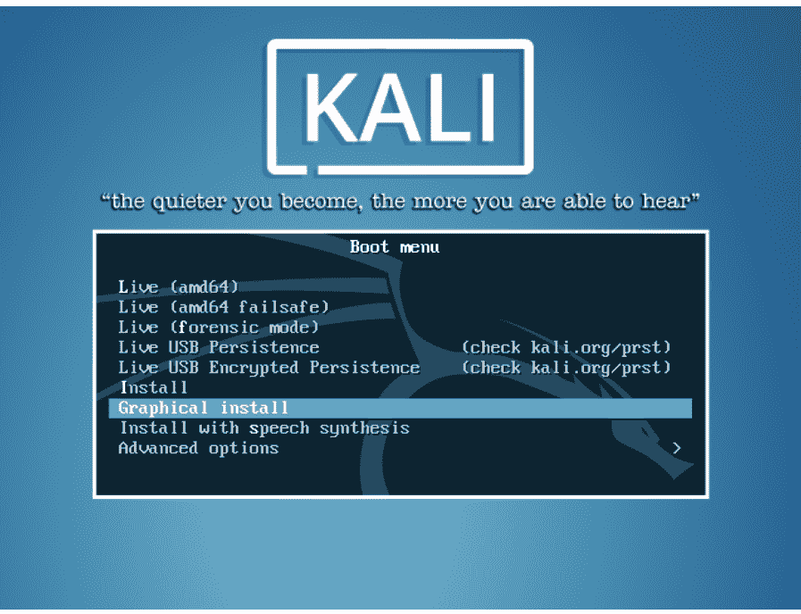

**图 4.1** 启动界面

启动后，安装程序将引导你逐步完成整个过程。我们将详细查看这些步骤中的每一个。我们将介绍从标准的 Kali Linux DVD-ROM 进行安装；从 mini.iso 进行安装看起来可能会略有不同。我们还将介绍图形模式安装，但它与经典文本模式安装唯一的区别在于外观。这两个版本提出的问题相同，提供的选项也相同。

## 选择语言

如图 4.2 所示，“选择语言”[第 68 页]，安装程序以英语开始，但第一步允许你选择在剩余安装过程中将使用的语言。此语言选择还被用于定义后续阶段中更相关的默认选项（特别是键盘布局）。

使用键盘导航：安装过程中的某些步骤需要你输入信息。这些屏幕有几个可以获得区域（文本输入区域、复选框、选项列表、确定和取消按钮），按 Tab 键允许你在一个区域移动到另一个区域。

在图形化安装模式下，你可以像在已安装的图形桌面上通常那样使用鼠标。

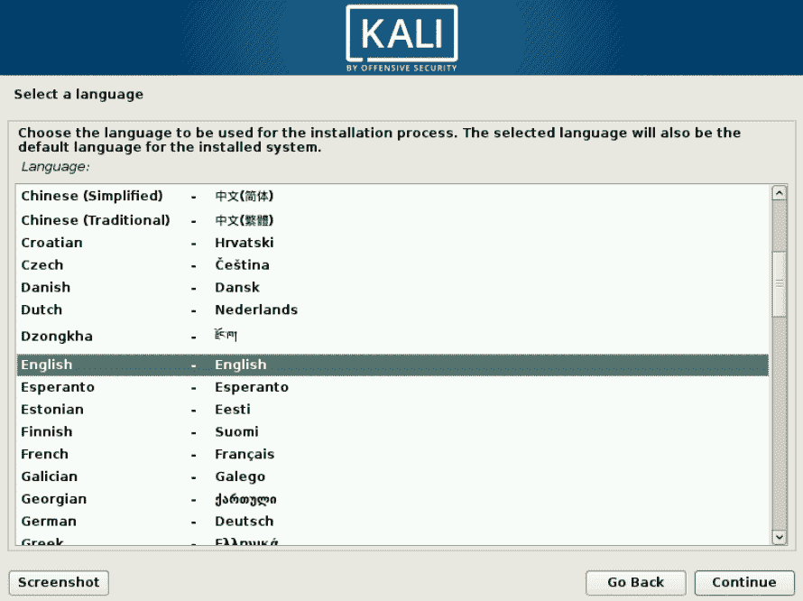

选择语言

选择用于安装过程的语言。所选语言也将成为已安装系统的默认语言。

语言：

| 中文 (简体) | 中文(简体) |
| 中文 (Traditional) | 中文(繁體) |
| 克罗地亚语 | Hrvatski |
| 捷克语 | Čeština |
| 丹麦语 | Dansk |
| 荷兰语 | Nederlands |
| 藏语 | ꄾ་ |
| 英语 | English |
| 世界语 | Esperanto |
| 爱沙尼亚语 | Eesti |
| 芬兰语 | Suomi |
| 法语 | Français |
| 加利西亚语 | Galego |
| 格鲁吉亚语 | ქართული |
| 德语 | Deutsch |
| 希腊语 |  |

图 4.2 选择语言

## 选择国家

第二步（图 4.3，“选择国家”[第 69 页]）是选择你所在的国家。结合语言，这些信息使安装程序能够提供最合适的键盘布局。这还将影响时区的配置。在美国，建议使用标准的 QWERTY 键盘，安装程序会提供相应时区的选择。

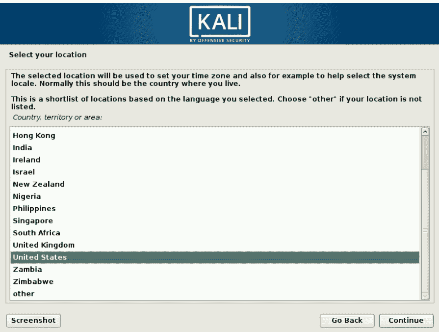

图 4.3 选择国家

## 选择键盘布局

建议的美国英语键盘对应于常用的 QWERTY 布局，如图 4.4 “选择键盘”[第 70 页] 所示。

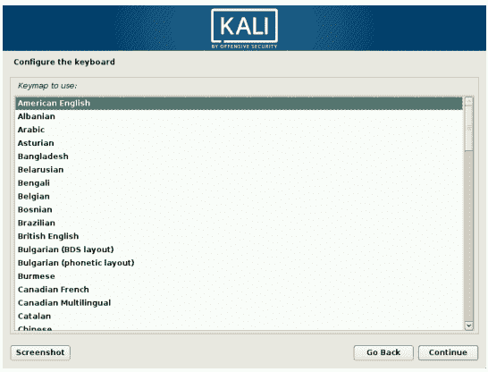

图 4.4 选择键盘

## 检测硬件


在大多数情况下，硬件检测步骤是完全自动的。安装程序检测你的硬件并尝试识别所使用的启动设备以访问其内容。它加载与检测到的各种硬件组件对应的模块，并挂载启动设备以便读取它。之前的步骤完全包含在启动设备的启动镜像中，该文件大小有限，并由从启动设备引导的引导程序加载到内存中。

## 加载组件

现在启动设备的内容已可用，安装程序将加载继续工作所需的所有文件。这包括其余硬件（特别是网卡）的额外驱动程序，以及安装程序的所有组件。

## 检测网络硬件

在此步骤中，安装程序将尝试自动识别网卡并加载相应的模块。如果自动检测失败，你可以手动选择要加载的模块。如果其他尝试都失败了，你可以从可移动设备加载特定模块。最后的解决方案通常只在标准 Linux 内核中不包含适当驱动程序但在其他地方（如制造商网站）可以可用时才需要。

对于网络安装（例如从 `mini.iso` 启动时进行的安装），此步必须成功，因为 Debian 软件包必须从网络加载。

## 配置网络

为了尽可能运行该过程，安装程序尝试使用动态主机配置协议（DHCP）针对 IPv4 和 IPv6，以及 ICMPv6 的邻居发现协议（针对 IPv6）进行自动网络配置，如图 4.5 “网络自动配置”[第 71 页] 所示。

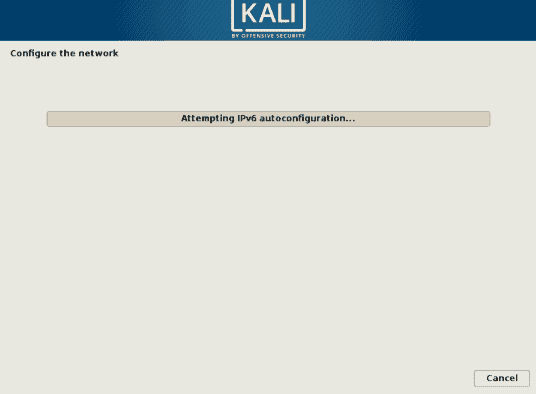

如果自动配置失败，安装程序将提供更多选择：尝试使用普通 DHCP 配置重试、通过声明机器名称尝试 DHCP 配置，或设置静态网络配置。

最后一个选项需要 IP 地址、子网掩码、潜在网关的 IP 地址以及机器名称。

## 不使用 DHCP 的配置

如果本地网络配备了 DHCP 服务器，而你希望在安装期间定义静态 IP 地址，可以通过编辑所需的菜单项，在启动时添加 `netcfg/use_dhcp=false` 选项。

## Root 密码

安装程序会提示输入密码（图 4.6，“Root 密码”[第 72 页]），因为它会自动创建一个超级用户账户。安装程序还会要求确认密码以防止任何难以调整的输入错误。

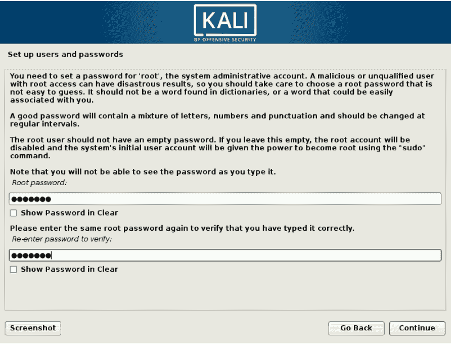

## 设置用户和密码

你需要为 `root`（系统管理员账户）设置密码。具有 root 权限的恶意或不合格的用户可能会导致灾难性的结果，因此你应该小心选择一个不容易被猜到的密码。它不应该是字典中的单词，也不应该是可以与你容易联系的单词。

一个良好的密码将包含字母、数字的混合，并应该定期更改。

`root` 用户不应有空密码。如果你将其留空，`root` 账户将被禁用，系统的初始用户账户将获得使用 `sudo` 命令变为 root 的权限。

注意，在输入密码时看不到密码。

Root 密码：

●••••••

+ 显示密码

再次输入相同的 root 密码以验证你的输入正确。

再次输入密码：

●••••••

+ 显示密码

图 4.6 Root 密码

## 管理员密码

`root` 用户的密码应该足够长（8 个字符或更多）且无法猜测，攻击者使用自动化工具针对连接互联网的计算机和服务器，尝试使用明显的密码登录。有时攻击者会利用字典攻击，使用许多单词和密码的组合。这些建议同样适用于其他用户密码，但对于没有管理员权限的用户，账户被破解的影响较小。

如果你缺乏灵感，不要犹豫使用密码生成器，例如 `pwgen`（位于同名包中，已包含在基础 Kali 安装中）。

## 配置时钟

如果网络可用，系统内部钟将从网络时间协议 (NTP) 服务器更新。这非常有益，因为它确保了从第一次启动开始日志中的时间戳都是正确的。

如果你的国家跨越多个时区，你将被要求选择使用的时区，如图 4.7 “时区选择”[第 73 页] 所示。

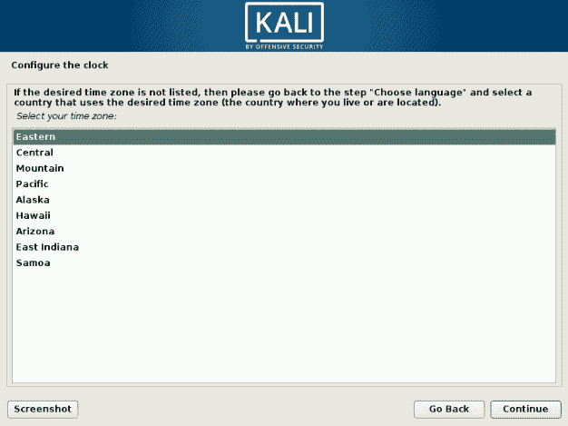

图 4.7 时区选择

# 检测磁盘和其他设备

此步骤将自动检测可能安装 Kali 的硬盘，每个硬盘都将在下一步——“分区”中列出。

# 分区

分区是安装过程中不可或缺的步骤，它根据计算机的预期功能以及这些分区的功能，将硬盘上的可用空间划分为离散区域（分区）。分区还涉及选择要使用的文件系统。所有决策都将影响性能、数据安全和服务器管理。

分区步骤对于新用户来说通常是困难的。然而，Linux 文件系统和分区（包括虚拟内存或交换分区）必须定义，因为它们构成了系统的基础。如果你已经在机器上安装了另一个操作系统并希望让两者共存，那么这项任务可能会变得复杂。在这种情况下，你必须确保不更改其分区，或者在需要时在不引起损坏的情况下调整大小。

为了适应更常见（更简单）的分区方案，大多数用户会倾向于使用“引导模式”（Guided mode），它会推荐分区配置并在整个过程中提供建议。更高级的用户会喜欢“手动模式”（Manual mode），它允许更高级的配置。每种模式都共享某些功能。

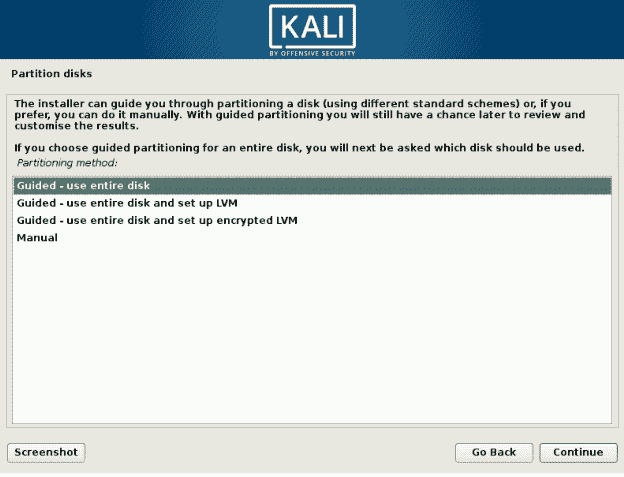

图 4.8 分区模式的选择

## 引导式分区

分区工具的第一个屏幕（图 4.8，“分区模式的选择”[第 74 页]）提供了引导分区和手动分区模式的入口。“引导 - 使用整个磁盘”是最简单且最常见的分区方案，它将整个整个磁盘分配给 Kali Linux。

接下来的选择使用逻辑卷管理器（LVM）来设置逻辑（而非物理）的、可选加密的分区。我们将在本章稍后讨论 LVM 和加密。

最后，最后一个选项启动手动分区，它允许更高级的分区方案，例如与其他操作系统并存的同时安装 Kali Linux。我们将在下一节讨论手动模式。

在例例中，我们将把整个硬盘分配给 Kali，因此我们选择“引导 - 使用整个磁盘”以继续下一步。

下一个屏幕（见图 4.9，“用于引导式分区的磁盘”[第 75 页]）允许你通过选择相应的项目来选择安装 Kali 的磁盘（例如，“虚拟磁盘 1 (`vda`) - 32.2 GB Virtio Block 设备”）。一旦选择，引导式分区将继续。此选项将删除此磁盘上的所有数据，请明智选择。

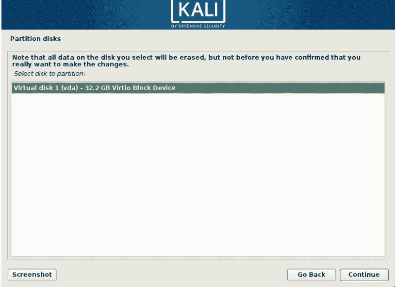

图 4.9 用于引导式分区的磁盘

接下来，引导式分区工具提供三种分区方法，分别对应不同的用途，如图 4.10，“引导式分区分配”[第 76 页]所示。

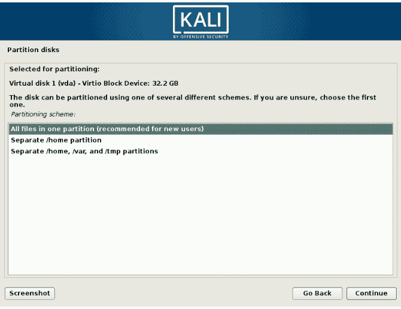

图 4.10 引导式分区分配

第一种称为“所有文件在一个分区中”。整个 Linux 系统树存储在单个文件系统中，对应于根（`/`）根目录。这种简单稳健的分区方案非常适用于个人或单用户系统。尽管名称如此，但仍会创建两个分区：第一个存放整个系统，第二个是虚拟内存（或“交换”）。

第二种方法“单独的 `/home` 分区”类似，但将文件层次结构一分为二：一个分区包含 Linux 系统（`/`），第二个分区包含“家目录”（即位于 `/home/` 下的可用文件和子目录中的用户数据）。这种方法的一个用处是，如果你必须重新安装系统，它很容易保留用户数据。

最后一种分区方法称为“单独的 `/home`、`/var` 和 `/tmp` 分区”，适用于服务器和多用户系统。它将文件树划分为许多分区：除了根（`/`） 和用户账户（`/home/`）分区外，还有用于服务器软件数据（`/var/`） 和临时文件（`/tmp/`）的分区。这种方法的一个用处是，终端用户无法通过耗尽所有可用硬盘空间来锁定服务器（他们只能填满 `/tmp` 和 `/home`）。同时，守护进程（尤其是日志）将不再阻塞系统的其他部分。

在选择分区类型后，安装程序会在屏幕上以分区映射的形式呈现选择摘要（图 4.11，“验证分区”[第 77 页]）。你可以通过选择某个分区来单独修改每个分区。例如，如果标准（`ext4`）不合适，你可以选择另一个文件系统。但在大多数情况下，建议的分区方案是合理的，你可以通过选择“完成分区并将更改写入磁盘”来接受它。不言而喻，请明智选择，因为它将擦除所选磁盘的内容。

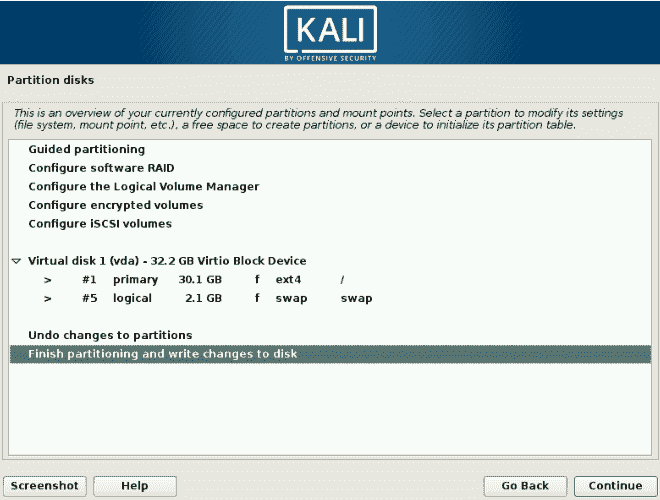

图 4.11 验证分区

## 手动分区

主“分区磁盘”屏幕上选择手动（图 4.8，“分区模式的选择”[第 74 页]）允许更大的灵活性，允许你选择更高级的配置并专门指定每个分区的用途和大小。例如，此模式允许你与其他操作系统一起安装 Kali，启用基于软件的独立磁盘阵列（RAID）以保护数据免受硬件故障影响，以及安全地调整现有分区的大小等。

### 缩小分区

要与操作系统（Windows）一起安装 Linux，你需要空闲空间。如果你使用手动模式，安装程序可以很容易地缩小 Windows 分区。你只需要选择 Windows 分区并输入其新大小（对于 FAT 和 NTFS 分区也一样）。

第 4 章 — 安装 Linux 77

如果你是处理有数据的系统的经验较少的用户，请在使用此方法时非常小心，因为很容易出错导致数据丢失。

手动安装程序的第一个屏幕实际上与图 4.11，“验证分区”[第 77 页]所示相同，只是它没有包含任何要创建的分区。这些由你来添加。


首先，你会看到进入“引导分区”的选项。接下来，安装程序将显示可用磁盘、分区以及任何未分区的空间。你可以像往一样选择每个元素并按回键进行交互。

如果磁盘是完全空的，你可能需要创建分区表。可以通过选择磁盘来实现。完成后，你应该看到磁盘内有空闲空间。

要利用这些空空间，你应该选择它，安装程序将为你提供两种在该空间内创建分区的方法。

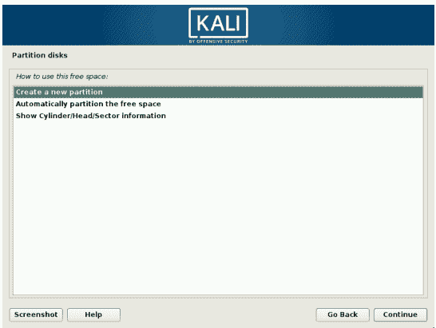

图 4.12 在空闲空间创建分区

第一个项目将根据你选择的特征（包括大小）创建一个分区。第二个项目将使用所有空闲空间并在引导分区向导的帮助下在其中创建多个分区（参见节 4.2.1.12.1，“引导式分区”[第 75 页]）。当你想与其他操作系统一起安装 Kali 但不想微观管理分区布局时，此选项特别有用。最后一个一个项目将显示空闲空间起始和结束的磁道/头部/扇区号。

当你选择“创建新分区”时，你将进入手动分区序列的核心。选择此选项后，将提示分区大小。如果磁盘

使用 MSDOS 分区表，你将获得创建主分区或逻辑分区的选项。

（需要知道：你可以拥有四个主分区，但有更多的逻辑分区。包含 `/boot`（从而包含内核）的分区必须是主分区，逻辑分区位于扩展分区中，扩展分区会占用四个主分区中的一个。）然后你应该看到通用的分区配置界面：

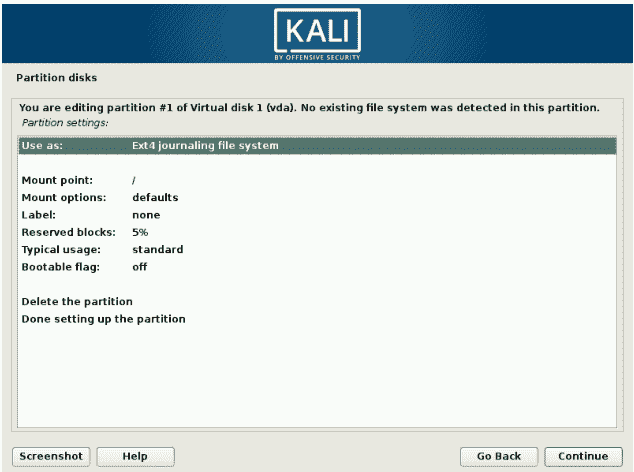

图 4.13 分区配置界面

为了总结手动分区的这一步，让我们看看你可以对新分区做些什么。你可以：

- 格式化它并通过选择挂载点将其包含在文件系统中。挂载点是存储所选分区上文件系统内容的目录。因此，挂载在 `/home/` 的分区传统上用于包含用户数据，而“root”被称为文件树的根，因此，它是实际托管 Kali 系统的分区根。
- 将其用作交换分区（swap partition）。当 Linux 内核缺乏足够的空闲内存时，它会将 RAM 的不活动部分存储在硬盘上特殊的交换分区中。虚拟内存系统使这对应用程序是透明的。为了模拟额外的内存，Windows 使用直接包含在文件系统中的交换（分页）文件。相反，Linux 使用一个专门为此目的的分区，因此被称为交换分区。
- 将其制作为“加密的物理卷”（physical volume for encryption），以保护某些分区上数据的机密性。此情况在引导分区中是自动化的。更多信息请参见第 4.2.2 节，“在全加密文件系统上安装” [第 85 页]。
- 将其制作为“用于 LVM 的物理卷”（physical volume for LVM）（本书未涵盖）。请注意，当你设置加密分区时，引导分区会使用此功能。
- 将其用作 RAID 设备（本书未涵盖）。
- 选择不使用该分区，并保持其不变。

完成后，你可以通过选择“撤销分区的更改”来退出手动分区，或者从手动安装程序界面上选择“完成分区并将更改写入磁盘”来将你的更改写入磁盘（图 4.11，“验证分区”[第 77 页]）。

## 拷贝镜像

下一步不需要任何用户交互，它会将活动镜像的内容拷贝到目标文件系统，如图 4.14，“从活动镜像拷贝数据”[第 80 页] 所示。

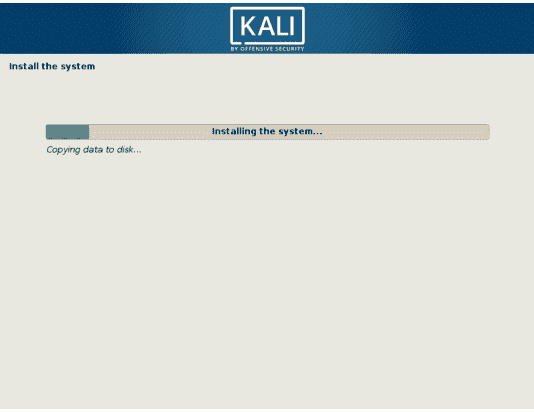

图 4.14 从活动镜像拷贝数据

## 配置包管理器 (apt)

为了能够安装额外的软件，需要配置 APT 并告诉它去哪里寻找 Debian 软件包。在 Kali 中，这一步大部分情况下是非交互的，因为我们强制镜像设为 `http.kali.org`。你只需要确认是否想要使用此镜像（图 4.15，“使用网络镜像？”[第 81 页]）。如果你不使用它，除非你稍后配置了软件包存储，否则你将无法通过 apt 安装补充包。

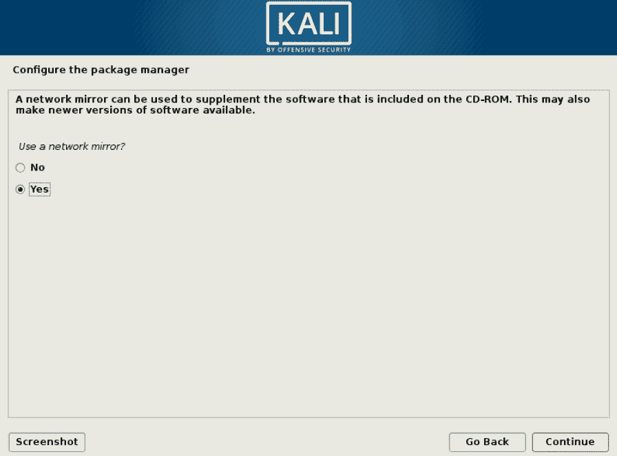

配置包管理器

网络镜像可用于补充 CD-ROM 中包含的软件。这可能还会让更新版本的软件可用。

- 使用网络镜像？
- 否
- 是

图 4.15 使用网络镜像？

如果你想使用本地镜像代替 `http.kali.org`，你可以在内核命令行中（启动时）传递它的名称，语法如下：`mirror/http/hostname=my.own.mirror`。

最后，程序提议使用 HTTP 代理，如图 4.16，“使用 HTTP 代理”[第 82 页] 所示。HTTP 代理是一个为网络用户转发 HTTP 请求的服务器。它有时通过保留传输过该代理的文件的副本来帮助加速下载（此时我们称之为缓存代理）。在某些情况下，它是访问外部服务器的唯一手段；在这些情况下，只有当你在安装期间正确地填写了此字段时，安装程序才能下载 Debian 软件包。如果你不提供代理地址，安装程序将尝试直接连接互联网。

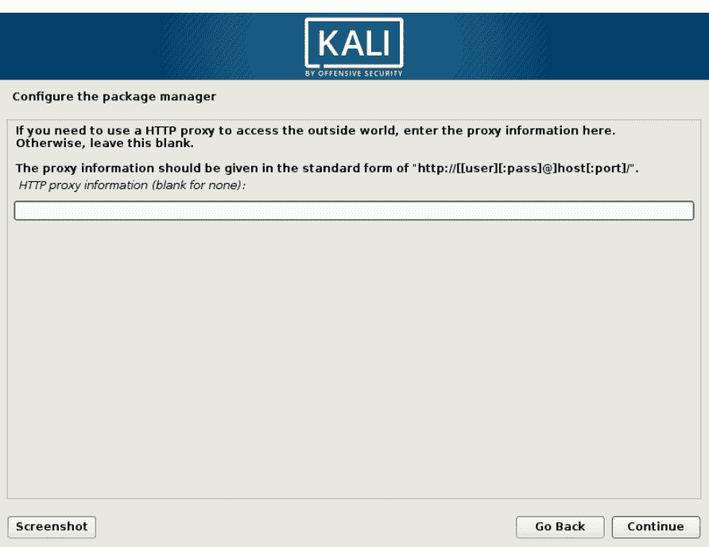

图 4.16 使用 HTTP 代理

接下来，`Packages.xz` 和 `Sources.xz` 文件将被自动下载，以更新 APT 识别的软件包列表。

## 安装 GRUB 引导加载程序

引导加载程序是 BIOS 的第一个程序。该程序将 Linux 内核加载到内存并执行它。引导加载程序通常提供一个菜单，允许你选择加载内核来启动操作系统。

由于其技术优越性，GRUB 是 Debian 安装的默认引导加载程序：它支持许多文件系统，因此在每次安装新内核后不需要更新，因为它会读取自己的配置。

你应该将 GRUB 安装到主引导记录 (MBR)，如图 4.17，“在硬盘上安装引导加载程序”[第 83 页] 所示，修改 MBR 将使未识别的操作系统临时可启动。

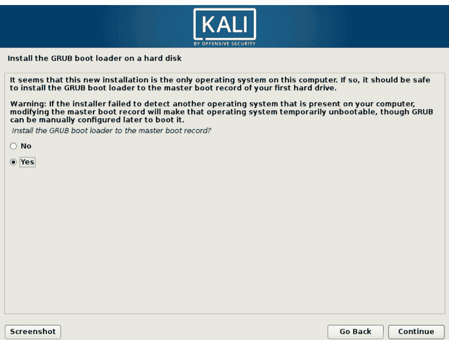

在硬盘上安装引导加载程序

似乎这个新安装是这台电脑上唯一的操作系统。如果是，将其安装在引导记录中是安全的。

警告：如果安装程序未能检测到另一个操作系统，修改 MBR 将使该操作系统在手动配置 GRUB 之前可以启动。

将引导加载程序安装到主引导记录？

- 否
- 是

图 4.17 在硬盘上安装引导加载程序

在这一步中（图 4.18，“引导安装设备”[第 84 页]），你必须选择 GRUB 安装在哪个设备上。这应该是你当前的启动驱动器。

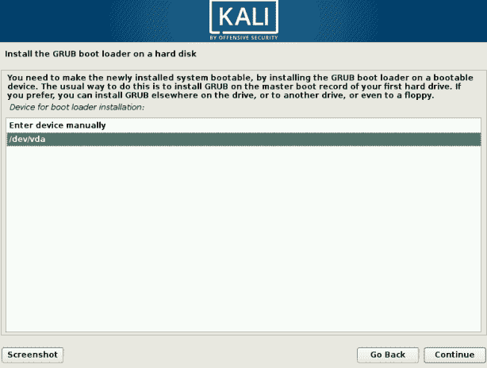

图 4.18 引导安装设备

默认情况下，GRUB 提供的启动菜单会显示所有已安装的内核，以及检测到的任何其他操作系统。这就是为什么你应该接受将其安装在引导记录中的建议。保留旧版本可以在最近安装的内核出现缺陷时保留启动系统的能力。

## 完成安装并重启

现在安装完成，程序要求你从光驱器移除 DVD（或拔掉 USB 驱动器），以便在安装程序重启系统后进入你的 Kali 系统（图 4.19，“安装完成”[第 85 页]）。

最后，安装程序将执行一些清理工作，例如删除创建活动环境特有的软件包。

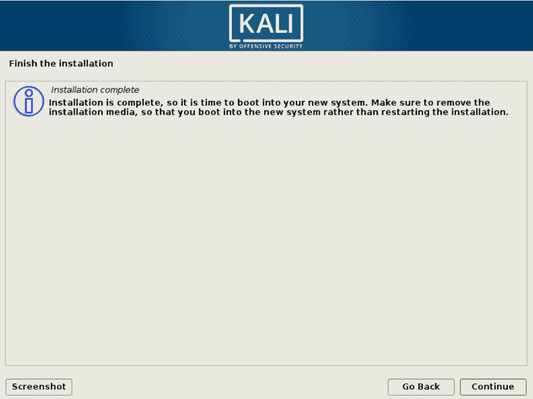

图 4.19 安装完成

引导分区模式将结合使用两种技术：用于加密分区的 Linux 统一密钥设置 (`LUKS`) 和用于动态管理存储的逻辑卷管理 (`LVM`)。这两种功能也可以通过手动分区模式进行设置和配置。

# LVM 简介

让我们先讨论 LVM。使用 LVM 术语，虚拟分区是一个逻辑卷（logical volume），它是卷组（volume group）的一部分，或者是多个物理卷（physical volumes）的关联。物理卷是真实的分区（或通过其它抽象层导出的虚拟分区，例如软件 RAID 设备或加密分区）。

由于 LVM 不在“物理”分区和“逻辑”分区之间进行严格区分，它允许你创建跨越多个磁盘的“虚拟”分区。这样做的好处有两点：分区的大小不再受单个磁盘容量的限制，而是取决于它们的累积卷容量；而且你可以随时调整分区大小，例如在添加额外的磁盘之后。

这种技术的工作非常简单：每个卷（无论是物理卷还是逻辑卷）都被分成相同大小的块，由 LVM 对这些块进行关联。添加新磁盘将创建一个新的物理卷，提供可以关联到任何卷组的新块。随后，卷组中的所有分区都可以充分利用额外分配的空间。

# LUKS 简介

为了保护你的数据，你可以在所选的文件系统下方添加一个加密层。Linux（特别是 `dm-crypt` 驱动程序）使用设备映射（device mapper）根据底层分区创建虚拟分区（其内容受保护），该底层分区将以加密形式存储数据（得益于 `LUKS`）。`LUKS` 标准化了加密数据的存储方式以及指示所用加密算法的元数据。

| 加密交换分区 |
| :--- |
| 当使用加密分区时，加密密钥存储在内存（RAM）中。在休眠时，笔记本电脑会将密钥以及 RAM 的其他内容复制到硬盘的交换分区中。由于任何可以访问交换文件的人（技术人员或小偷）都可以提取密钥并解密你的数据，因此交换文件必须通过加密来保护。 |

由于正因如此，如果你尝试在与未加密交换分区的同时使用加密分区，安装程序将向你发出。

# 设置加密分区


加密 LVM 的安装过程与标准安装相同，但在分区步骤外（图 4.20，“使用加密 LVM 的引导分区”[第 87 页]），在该步骤中，你将选择“引导 - 使用整个磁盘并设置加密 LVM”。最终结果是，系统在提供加密密码之前将无法启动或访问。这将加密并保护你磁盘上的数据。

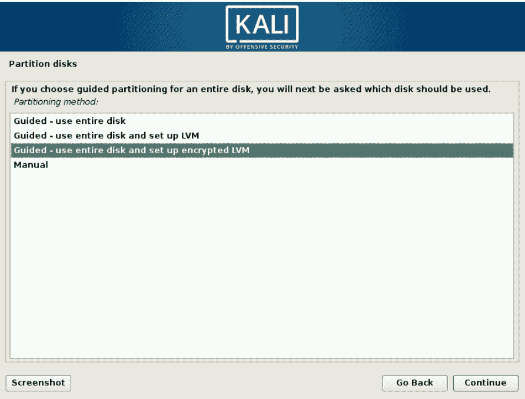

图 4.20 使用加密 LVM 的引导分区

引导分区安装程序将自动为加密数据的存储分配一个物理分区，如图 4.21，“确认分区表的更改”[第 88 页] 所示。在此处，安装程序将在更改写入磁盘之前对其进行确认。

# KALI LINUX 发行版

## 分区磁盘

在配置逻辑卷管理器之前，必须将当前分区方案写入磁盘。这些更改是无法撤销的。

在配置逻辑卷管理器后，安装期间不允许对包含物理卷的磁盘分区方案进行任何额外更改。在继续之前，请决定你对当前分区方案是否满意。

以下设备的分区表将被更改：

- 虚拟磁盘 1 (`vda`)

将更改写入磁盘并配置 LVM？是

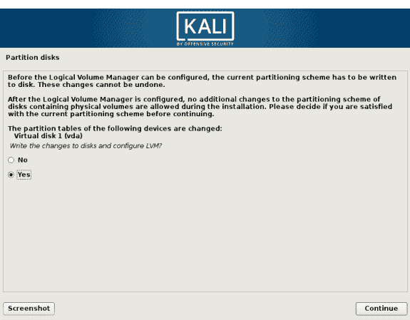

### 图 4.21 确认分区表的更改

该新分区将用随机数据进行初始化，如图 4.22，“擦除加密分区上的数据”[第 88 页] 所示。这使得包含数据的区域与未使用区域无法区分，从而使得检测并攻击加密数据变得更加困难。

# KALI LINUX 发行版

## 分区磁盘

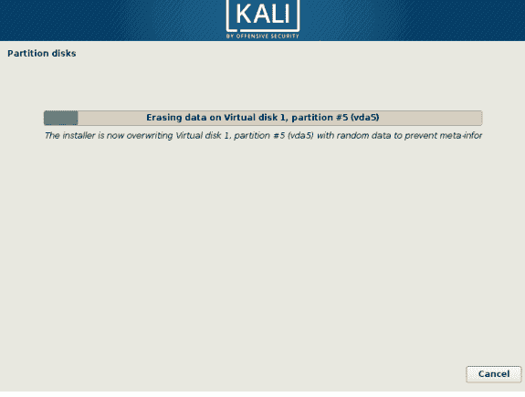

### 图 4.22 擦除加密分区上的数据

接下来，安装程序要求你输入一个密码（图 4.23，“输入你的密码”[第 89 页]）。这将加密并保护你磁盘上的数据。

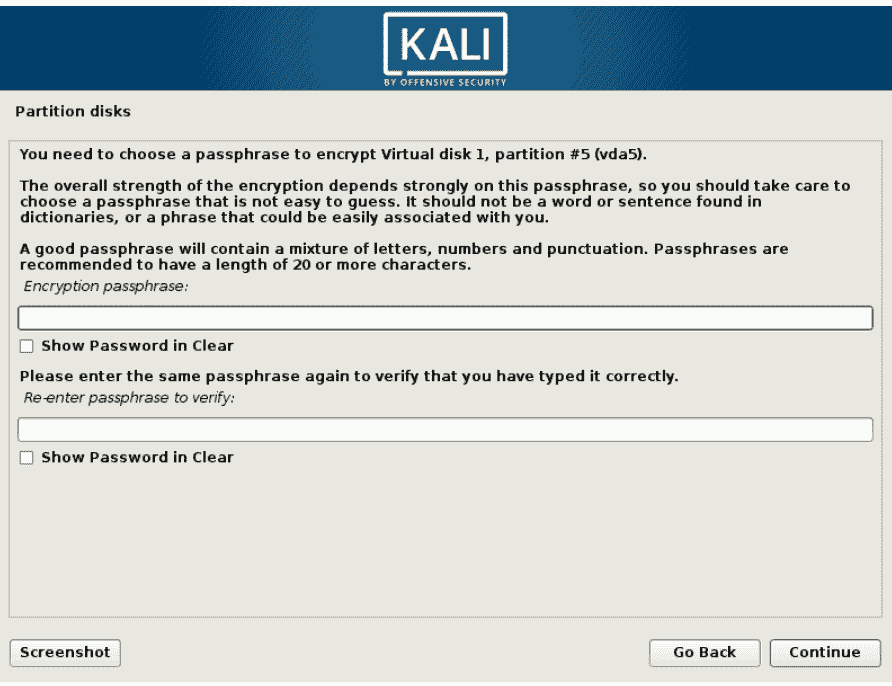

图 4.23 输入你的密码

引导分区安装程序将自动为加密数据的存储分配一个物理分区，如图 4.21，“确认分区表的更改”[第 88 页] 所示。在此处，安装程序将在更改写入磁盘之前对其进行确认。

由于正因如此，如果你尝试在与未加密交换分区的同时使用加密分区，安装程序将向你发出警告。

加密 LVM 的安装过程与标准安装相同，但在分区步骤外（图 4.20，“使用加密 LVM 的引导分区”[第 87 页]），在该步骤中，你将选择“引导 - 使用整个磁盘并设置加密 LVM”。最终结果是，系统在提供加密密码之前将无法启动或访问。这将加密并保护你磁盘上的数据。


图 4.20 使用加密 LVM 的引导分区

引导分区安装程序将自动为加密数据的存储分配一个物理分区，如图 4.21，“确认分区表的更改”[第 88 页] 所示。在此处，安装程序将在更改写入磁盘之前对其进行确认。

# KALI LINUX 发行版

## 分区磁盘

在配置逻辑卷管理器之前，必须将当前分区方案写入磁盘。这些更改是无法撤销的。

在配置逻辑卷管理器后，安装期间不允许对包含物理卷的磁盘分区方案进行任何额外更改。在继续之前，请决定你对当前分区方案是否满意。

以下设备的分区表将被更改：

- 虚拟磁盘 1 (`vda`)

将更改写入磁盘并配置 LVM？是


### 图 4.21 确认分区表的更改

该新分区将用随机数据进行初始化，如图 4.22，“擦除加密分区上的数据”[第 88 页] 所示。这使得包含数据的区域与未使用区域无法区分，从而使得检测并攻击加密数据变得更加困难。

# KALI LINUX 发行版

## 分区磁盘


### 图 4.22 擦除加密分区上的数据

接下来，安装程序要求你输入一个密码（图 4.23，“输入你的密码”[第 89 页]）。这将加密并保护你磁盘上的数据。


图 4.23 输入你的密码

引导分区安装程序将自动为加密数据的存储分配一个物理分区，如图 4.21，“确认分区表的更改”[第 88 页] 所示。在此处，安装程序将在更改写入磁盘之前对其进行确认。

由于正因如此，如果你尝试在与未加密交换分区的同时使用加密分区，安装程序将向你发出警告。

加密 LVM 的安装过程与标准安装相同，但在分区步骤外（图 4.20，“使用加密 LVM 的引导分区”[第 87 页]），在该步骤中，你将选择“引导 - 使用整个磁盘并设置加密 LVM”。最终结果是，系统在提供加密密码之前将无法启动或访问。这将加密并保护你磁盘上的数据。

## 4.3 无值安装

Debian 和 Kali 安装程序是非常模块化的；在基础层，它们只是一个一个地执行许多脚本（以 deb 包形式存在）。每个脚本都依赖于与用户交互的 `debconf`。由于，安装程序也可以是自动化。

### 4.3.1 预设答案

有多种方法可以预设答案。每种方法都有其优缺点。根据预设发生的时间，可以预设的问题不同。

#### 通过启动参数

你可以通过启动参数为任何安装程序预设，这些参数可以通过 `/proc/cmdline` 访问。某些引导程序允许你交互式编辑这些参数，但如果你想让更改持久化，则需要修改引导程序。

你可以直接使用 `debconf` 问题的完整标识符（例如 `debian-installer/language=en`），也可以使用常用问题的别名（如 `language=en`）。你可以在 Debian 安装手册中找到完整列表。

对于可以预设哪些问题没有限制，因为启动参数从安装开始就可用，并且在非常早阶段就会处理。然而，启动参数的数量限制为 32 个，其中许多已被默认使用。同样重要的是，更改引导程序有时并非易事。

#### 通过 initrd 中的预设文件

你可以在安装程序 initrd 的根目录下添加名为 `preseed.cfg` 的文件（这是用于启动安装程序的 initrd）。通常，这需要重新 `debian-installer` 源码包以生成新的 initrd。然而，Live-build 提供了一种方便的方法，这在第 9.3 节“构建 Kali Live 镜像”[第 236 页]中进行了详细介绍。

### 在启动媒体中使用 Preseed 文件

你可以在启动媒体（CD 或 USB 闪盘）上添加 preseed 文件；预设会在介质挂载后立即发生，这意味着在回答完语言和键盘布局问题之后。可以使用 `preseed/file` 启动参数来指定 preseed 文件的位置（例如，从 CD-ROM 安装时使用 `/cdrom/preseed.cfg`，从 USB 闪盘安装时使用 `/hd-media/preseed.cfg`）。

你可能无法对语言和国家选项进行预设，因为 preseed 文件在过程的后阶段才加载，除非硬件驱动程序已经加载。但好的一是，live-build 可以方便地在生成的 ISO 镜像中放入补充文件（参见第 9.3 节，“构建自定义 Kali ISO 镜像”，第 236 页）。

### 使用从加载的 Preseed 文件

你可以通过 Web 服务器在网络上提供 preseed 文件，并通过添加启动参数 `preseed/url=http://server/preseed.cfg`（或使用 url 别名）告诉安装程序下载该 preseed 文件。

然而，在使用此方法时，请记住必须先配置网络（特别是主机名和域名），并且所有的预设问题（如语言和国家）都无法通过此方法进行预设。这种方法通常与启动参数结合使用，用于预设特定的问题。

这种预设方法是最灵活的，允许你可以在不改变安装方法的情况下更改安装配置。

| 延迟语言、国家、键盘问题 | 为了克服无法预设语言、国家和键盘问题的局限性，你可以添加启动参数 `auto-install/enable=true`（或 `auto=true`）。使用此选项后，将在过程中询问问题，且是在网络配置之后，即下载 preseed 文件之后。缺点是，前几个步骤（特别是网络配置）将始终以英语进行，如果发生错误，用户将必须处理英文界面（并配置了 QWERTY 布局的键盘）。 |

### 4.3.2. 创建 Preseed 文件

`preseed` 文件是一个纯文本文件，其中每行包含一个 Debconf 问题的答案。一行被拆分为四个由空白（空格或制表符）分隔的字段。例如，`d-i mirror/suite string kali-rolling:`：

- 第一个字段指示问题的所有者。例如，“d-i”用于与安装程序相关的问题。你也可能会看到软件包名，来自 Debian 软件包的问题（在本例中：`atftpd atftpd/use_inetd boolean false`）。

- 第二个字段是问题的标识符。

- 第三个字段列出问题的类型。

- 第四个字段是最后一个字段，包含预期答案的值。注意，它必须与第三字段之间用单个空格隔开；额外的空格字符被视为值的一部分。


编写 preseed 文件最简单的方法是手动安装系统。然后，`debconf-get-selections ---installer` 将提供你提供给安装程序的答案。你可以通过 `debconf-get-selections` 获取指向其他软件包的答案。然而，更整洁的解决方案是从示例开始，然后通过查阅文档来编写 preseed 文件。通过这种方法，只有需要覆盖默认答案的问题才会被写入。提供 `priority=critical` 启动参数以指示 debconf 仅询问关键问题，并对其他问题使用默认答案。

> **安装指南附录** 在线提供的 Debian 安装指南在附录中包含了关于使用 preseed 文件的详细文档。它还包含一个详尽且带有注释的示例文件，可以作为本地定制的基础。

- https://www.debian.org/releases/stable/amd64/apb.html

- https://www.debian.org/releases/stable/example-preseed.txt

但请注意，上述链接文档的是 Debian 的稳定版，而 Kali 使用测试版，因此你可能会遇到细微差异。你也可以咨询 Debian-installer 项目网站托管的安装手册，它可能会更新。

- http://d-i.alioth.debian.org/manual/en.amd64/apb.html

## 4.4. ARM 安装

Kali Linux 运行在各种基于 ARM 的设备（例如，笔记本电脑、嵌入式计算机和开发板）上，但你不能在这些设备上使用传统的 Kali 安装程序，因为它们在内核或启动配置方面特定特定要求。为了让这些设备更易使用，Offensive Security 开发了构建即用镜像的脚本。这些镜像可以在他们的网站上找到：

- https://github.com/offensive-security/kali-arm

由于这些镜像是可用的，你在 ARM 上安装 Kali 的任务被大大简化。以下是基本步骤：

1. 下载适用于你设备的镜像，并确保校验和与网站上提供的匹配（参见 2.1.3 节，“验证完整性与真实性”）。注意镜像通常是 xz 压缩的，确保使用 xz 进行解压。

2. 使用 `dd` 将镜像拷贝到存储设备（类似于第 2.1.4 节，“在 USB 闪盘上拷贝镜像”）：

```
dd if=kali-image.img of=/dev/sdX bs=512k
```

3. 将介质插入你的 ARM 设备。

4. 启动设备并登录（“root”）。如果没有屏幕，使用嗅探器查找 DHCP 流量。

5. 修改 root 密码并生成新的 SSH 密钥，特别是设备将永久运行在公共网络上。

6. 享受你运行 Linux 的新 ARM 设备！

| 特殊情况和更详细文档 | 这些说明是通用的，虽然适用于大多数设备，但总有例外。例如，Chromebook 需要开发者模式，其他设备需要按下特殊键才能从外部介质启动。 |

| | 请参考专门的“Kali ARM”

## 4.5. 安装故障排除

安装程序非常可靠，但你可能会遇到 Bug 或面临外部问题，如：网络问题、镜像源损坏以及磁盘空间不足。因此，能够排除安装过程中出现的问题是非常有用的。

当安装程序失败时，它会显示一个相当没有帮助的界面，如图 4.26 所示，“安装失败”（第 96 页）。

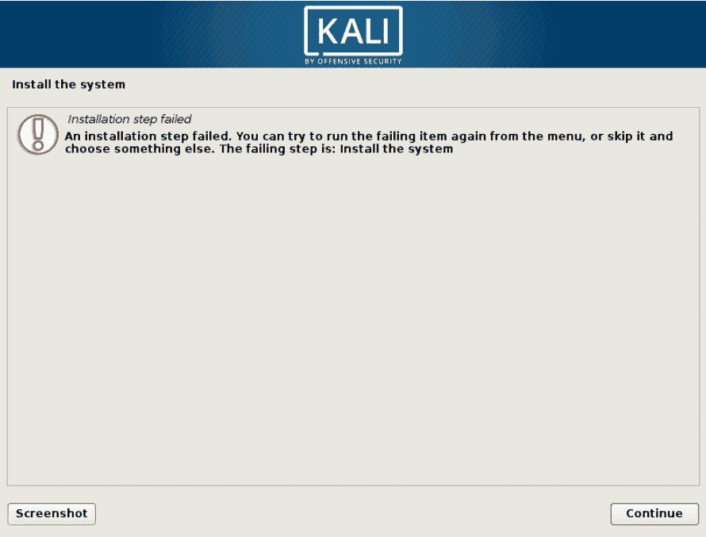

图 4.26 安装失败

此时，最好知道安装程序利用了多个虚拟控制台：你看到的界面运行在第五个控制台（图形化安装程序，CTRL+Shift+F5）或第一个控制台（文本安装程序，CTRL+Shift+F1）上。在两种情况下，第四个控制台（CTRL+Shift+F4）都会显示正在发生的日志，你通常可以在这里看到更有用的错误信息，例如图 4.27 中的“安装程序的日志屏幕”（第 97 页），它揭示了安装程序已耗尽磁盘空间。

```
Apr 15 19:04:24 main-menu(8331): (process:5559): lib: error:
Apr 15 19:04:24 main-menu(8331): (process:5559): /lib/partman/active_partition/choices: not found
Apr 15 19:04:24 main-menu(8331): (process:5559)
Apr 15 19:04:24 main-menu(8331): (process:5559): /lib/partman/choose_partition/60partition_tree/do_op
Apr 15 19:04:24 main-menu(8331): (process:5559): /lib/partman/active_partition/choices: not found
Apr 15 19:04:24 main-menu(8331): (process:5559)
Apr 15 19:04:24 main-menu(8331): (process:5559): /lib/partman/free_space/50new/do_option:
Apr 15 19:04:24 main-menu(8331): (process:5559): /lib/partman/active_partition/choices: not found
Apr 15 19:04:24 main-menu(8331): (process:5559)
Apr 15 19:04:24 main-menu(8331): (process:5559): /lib/partman/free_space/50new/do_option:
Apr 15 19:04:24 main-menu(8331): (process:5559): /lib/partman/active_partition/choices: not found
Apr 15 19:04:24 main-menu(8331): (process:5559)
Apr 15 19:04:24 main-menu(8331): (process:5559): /lib/partman/free_space/50new/do_option:
Apr 15 19:04:24 main-menu(8331): (process:5559): /lib/partman/active_partition/choices: not found
Apr 15 19:04:24 main-menu(8331): (process:5559)
Apr 15 19:04:24 main-menu(8331): (process:5559): (libc1): package doesn't exist (ignored)
Apr 15 19:04:25 base-installer: INFO: Menu item 'live-installer'
Apr 15 19:04:25 base-installer: installing squashfs-modules for cdrom/lib/filesystem/squashfs
Apr 15 19:04:25 kernel: error: squashfs-linux-4.3.0-kalli-amd64-di4: package doesn't exist
Apr 15 19:04:25 base-installer: (ignored)
Apr 15 19:04:25 kernel [04585]: DEBI:
Apr 15 19:04:25 kernel: [165.7960591] loaded version 4.0 (2009/01/31) Philipp Lougher
Apr 15 19:04:25 kernel: [165.7960591] module loaded
Apr 15 19:04:25 base-installer: error: tar copying the live system failed (9238 out of)
Apr 15 19:04:25 base-installer: Files have been copied, last: tar: write error: No space left on device
Apr 15 19:04:25 main-menu(8331): (process:8491): tar: write error: Broken pipes
Apr 15 19:04:25 main-menu(8331): WARNING == Configuring 'live-installer' failed with error code 1
Apr 15 19:04:25 main-menu(8331): WARNING == Menu item 'live-installer' failed.
```

> 图 4.27 安装程序的日志屏幕


第二和第三个控制台（分别为 `CTRL+Shift+F2` 和 `CTRL+Shift+F3`）托管了 Shell，你可以通过它们来更详细地调查当前状况。BusyBox 提供的命令行工具功能相当有限，但已足够解决你可能会遇到的大多数问题。

# 在安装程序 Shell 中可以做什么

你可以使用 `debconf-` 和 `debconf-set` 检查并修改 debconf 数据库。这些命令在测试预值（prevalues）时特别方便。

你可以检查任何文件（例如位于 `/var/log/system` 的完整安装日志）或 `cat` 输出你需要的内容。你可以使用 `nano` 编辑任何文件，包括安装到系统中的所有文件。分区过程完成后，根文件系统将挂载在 `/target`。

一旦配置了网络访问，你就可以使用 `wget` 和 `nc` (`netcat`) 在网络上检索和导出数据。

一旦从主安装失败后继续（图 4.26，“安装失败”），你将返回到一个屏幕（如图 4.28，“安装程序菜单”所示），该屏幕允许你一个接一个地启动安装。如果你通过 Shell 解决了问题，就可以重试失败的步骤。


图28 安装程序菜单

如果你无法解决问题，可能需要提交错误报告。报告必须包含安装程序日志，你可以通过主菜单的“保存日志”功能检索日志。它提供了多种导出日志的方法，如图 29，“保存日志 (1/2)”所示。


图29 保存日志 (1/2)

最方便且我们的方法是让安装程序启动一个托管日志文件的服务器（图 30，“保存日志 (2/2)”）。然后你可以从同一网络上的另一台计算机启动浏览器，并下载每个屏幕上截取的日志文件。


图30 保存日志 (2/2)

# 4.6. 总结

在本章中，我们专注于 Kali Linux 的安装过程。我们讨论了 Kali Linux 的最低要求、标准和全加密文件系统的安装过程、允许无人值值的填充（seeding）、以及安装失败的少数情况下该。

总结提示：

- Kali Linux 的安装要求范围从带有无桌面的基础 SSH 服务器（128 MB RAM，建议512 MB，2 GB 磁盘空间）到高级的 `kali-linux-full` 元包（2048 MB RAM 和20 GB 磁盘空间）。此外，你的机器必须支持 `amd64`、`i386`、`armel` 或 `armhf` 架构之一。

- Kali 可以轻松地作为主操作系统、通过分区和修改引导程序与其他操作系统一起安装，或者作为虚拟机安装。

- 为了确保数据的机密性，你还可以设置加密分区。如果笔记本电脑或硬盘丢失或被盗，这将保护你的数据。

- 安装程序还可以通过 `debconf` 填充实现自动化，这是一个允许你提供安装问题无人值答案的功能。

- `preseed` 文件是一个纯文本文件，每行包含一个 `debconf` 问题的答案。一行被四个空白字符（空格或制表符）分隔。你可以通过引导参数、initrd 中的 `preseed` 文件、启动媒体上的 `preseed` 文件或来自网络的 `preseed` 文件向安装程序填充答案。

- Kali 可以在各种 ARM 设备上运行，如笔记本、嵌入式计算机和开发板。ARM 安装非常简单。下载正确的镜像，将其刻入 SD 卡、USB 设备或嵌入式媒体控制器 (`eMMC`) 模块，插入并在网络上启动设备，登录并更改 SSH 密码和 SSH 密钥。

- 你可以使用虚拟控制台（通过 `CTRL+Shift` 功能键访问）、`debconf-get` 和 `debconf-set` 命令、读取 `/var/log/syslog` 日志文件，或通过安装程序的“保存调试日志”功能提交的错误报告。

现在我们已经讨论了 Linux 基础知识和 Kali Linux 安装，让我们讨论配置，以便根据你的需求定制 Kali。

# 关键词

- 网络

- 用户和组

- 服务

- Apache

- PostgreSQL

- SSH


# 配置 Kali Linux

- 配置网络 104

- 管理 Unix 用户和 Unix 组 107

- 配置服务 109

- 管理服务 117

- 总结 119

在本章中，我们将查看配置 Kali Linux 的各种方法。首先，在 5.1 节“配置网络”104页，我们将向你展示如何使用图形环境和命令行配置网络设置。在 5.2 节“管理用户和 Unix 组”107页中，我们将讨论用户和组，向你展示如何创建和修改用户帐户、设置密码、禁用账户和管理组。最后，我们将在 5.3 节“配置服务”109页中讨论服务，并解释如何设置和维护通用服务，同时关注三个非常重要且特定的服务：SSH、PostgreSQL 和 Apache。

## 5.1. 配置网络

### 5.1.1. 在带有 NetworkManager 的桌面上

在典型的桌面安装中，你已经安装了 NetworkManager，它可以通过 GNOME 的控制中心和右上菜单进行控制和配置，如图 5.1 节“网络配置屏幕” 104 页所示。


图5.1 网络配置屏幕

默认配置依赖于 DHCP 获取 IP 地址、DNS 服务器和网关，但你可以使用右下角的齿图标以多种方式更改配置（例如：设置 MAC 地址、切换到静态设置、启用或禁用 IPv6 以及添加额外的路由）。你可以创建配置文件以保存多个网络配置，并在它们之间轻松切换。对于无线网络，其设置会自动与你的公共标识（SSID）绑定。

NetworkManager 还可以处理通过移动宽带（无线局域网 WWAN）和使用以太网点对点协议（PPPoE）的调制解调器的连接。此外，它还通过专用插件与许多类型的虚拟专用网络（VPN）集成：SSH、OpenVPN、VPNNC、PPTP、Strongswan。查看 `network-manager-*` 软件包；它们大多数默认没有安装。请注意，你需要带有 `-gnome` 后缀的软件包才能通过图形用户界面对其进行配置。

### 5.1.2. 在命令行中使用 Ifupdown

另一种方法，当你倾向于不使用（或无法访问）图形桌面时，可以使用已安装的 `ifupdown` 软件包来配置网络，该包包含了 `ifup` 和 `ifdown` 工具。这些工具从 `/etc/network/interfaces` 文件中读取定义，并位于 `/etc/init.d/networking` 初始化脚本的头部，该脚本在启动时配置网络。

由 `ifupdown` 管理的每个网络设备都可以随时通过 `ifdown <network-device>` 取消配置。然后你可以修改 `/etc/network/interfaces` 并使用 `ifup <network-device>`（带有新配置）重新启动网络。

让我们看看可以在 `ifupdown` 的配置文件中放置什么。主要有两个指令：`auto <network-device>`，它告诉 `ifupdown` 在网络接口可用后自动配置它；以及 `iface <network-device> inet/inet6 type` 用于配置指定的接口。例如，一个简单的 DHCP 配置如下：

```
auto lo
iface lo inet loopback

auto eth0
iface eth0 inet dhcp
```

请注意，回环设备（loopback）的特殊配置应该始终存在于此文件中。对于固定 IP 地址配置，你必须提供更多细节，例如 IP 地址、网络掩码和网关 IP：

```
auto eth0
iface eth0 inet static
address 192.168.0.3
netmask 255.255.255.0
broadcast 192.168.0.0
network 192.168.0.0
gateway 192.168.0.1
```

对于无线接口，你必须拥有 `wpasupplicant` 软件包（Kali 默认包含），它提供了许多可以在 `/etc/network/interfaces` 中使用的 `wpa-*` 选项。我们可以查看 `/usr/share/doc/wpasupplicant/README.Debian.gz` 获取示例和解释。常用的选项是 `wpa-ssid`（定义要加入的无线网络名称）和 `wpa-psk`（定义保护网络的密码或密钥）。

```
iface wlan0 inet dhcp
wpa-ssid MyNetwork
wpa-psk plaintextsecret
```

### 5.1.3. 在命令行中使用 systemd-networkd


`ifdown` 是 Debian 使用的历史工具，虽然它仍然是服务器或其他最小化安装的默认工具，但现在有一个值得考虑的新工具：`systemd-networkd`。它与 systemd 初始化系统的集成使其成为一个极具吸引力的选择。它并非特定于 Debian 的发行版（与 `ifdown` 相反），并且设计得非常小、高效，且如果你理解 systemd 单元文件的语法，配置起来相对容易。如果你认为 NetworkManager 臃肿且难以配置，那么这将是一个特别有吸引力的选择。

你通过将 `.network` 文件放置于 `/etc/systemd/network/` 来配置 systemd-network。或者，你可以使用 `/lib/systemd/network/` 用于生成的文件，或使用 `/run/systemd/network/` 用于运行时文件。这些文件的格式已有文档。`Match` 部分指示配置适用于网络接口。你可以通过多种方式指定接口，包括通过媒体访问控制（MAC）地址或设备类型。`Network` 部分定义网络配置。

> 示例 5.1 基于 DHCP 的配置 `/etc/systemd/network/80-dhcp.network`

```
[Match]
Name=en*

[Network]
DHCP=yes
```

> 示例 5.2 静态配置 `/etc/systemd/network/50-static.network`

```
[Match]
Name=enp2s0

[Network]
Address=192.168.0.1/24
Gateway=192.168.0.1
DNS=8.8.8.8
```

注意，`systemd-networkd` 默认是禁用的，如果你想使用它，应该启用它。它还依赖 `systemd-resolved` 来实现 DNS 解析，这需要将 `/etc/resolv.conf` 替换为指向 `/run/system/resolve/resolv.conf` 的软链接，该文件由 systemd-resolved 管理。

```
# systemctl enable systemd-networkd
### systemctl enable systemd-resolved
# systemctl start systemd-networkd
# ln -sf /run/system/resolve/resolv.conf /etc/resolv.conf
```

## 5.2 管理用户和组

Unix 用户组数据库由 `/etc/passwd`（用户列表）、`/etc/shadow`（加密密码）、`/etc/group`（组列表）和 `/etc/gshadow`（加密密码）组成。格式分别记录在 `passwd(5)`、`shadow(5)`、`group(5)` 和 `gshadow(5)` 中。

### 5.2.1 创建用户账户

尽管 Kali 通常以 root 用户运行，但你可能由于各种原因需要创建非权限用户账户。添加用户的典型方法是使用 `useradd` 命令，它接受一个必用参数：你想要创建的用户名。

`useradd` 在创建账户之前会询问几个问题，但它的配置文件 `/etc/default` 包含了许多设置。例如，你可以定义可以使用的用户标识符 `UID` 范围，规定用户是否共享公共组，定义默认设置等。

账户的创建会触发将 `/etc/skel` 模板的内容填充到用户的家目录中。这为用户提供了标准的目录和配置文件。

在某些情况下，将用户添加到组（其默认组之外的组）以授予额外权限是非常有用的。例如，包含 `sudo` 组的用户可以通过 `sudo` 命令获得完全的管理权限。这可以通过 `usermod` 等命令实现。

### 使用 getent 查询用户数据库

`getent`（项）命令使用相应的命名服务切换 `NSS` 模块检查系统数据库（包括用户和组）。该命令接受两个参数：要检查的数据库名称和可能的键。然后 `getent passwd` 从用户数据库返回信息。

```
root@kali:~# getent passwd kali
kali:x:100:::/home/kali:/bin/bash
```

### 5.2.2 修改现有账户或密码

以下命令允许修改存储在用户数据库中的特定字段：

- `passwd`：允许普通用户更改他们的密码，更新 `/etc/shadow` 字段。
- `chfn`（更改全名）：为超级用户 `root` 保留，修改 `GECOS` 信息字段。
- `chsh`（更改 Shell）：更改用户的登录 shell。然而，可用选项限于 `/etc/shells` 中列出的那些；另一方面，管理员不受此限制可以设置任何选定的 shell。
- `chage`（更改过期）：允许管理员通过传递参数更改密码过期设置。

此外，你也可以使用 `passwd -e user` 命令强制密码过期，这将强制用户在下一次登录时更改其密码。

### 5.2.3. 禁用账户

你可能会发现自己需要禁用某个账户（锁定用户），作为纪律措施、调查目的，或仅仅在用户长时间或确定性缺席的情况下。禁用的账户意味着用户无法登录或访问机器。该账户在机器上保持完整，不会删除任何文件或数据；它只是无法访问。这通过使用 `passwd -l user`（锁定）命令来实现。重新启用账户则以类似的方式进行，并使用 `-u` 选项（解锁）。

### 5.2.4. 管理 Unix 用户组

`addgroup` 和 `delgroup` 命令分别添加或删除组。`groupmod` 修改组的信息（其 `gid` 或标识符）。`gpasswd-wd group` 命令更改组的密码，而 `gpasswd -r group` 命令则删除该组。

| 操作多个用户组 |

| :--- |

| 每个用户可以是多个用户组的成员。用户的主组默认在初始配置期间创建。默认情况下，用户所属的每个文件都属于该用户及其主组。这并不总是理想的；例如，当用户需要在一个其他组共享的目录中工作时。在这种情况下，用户需要使用以下命令之一更改组：`newgrp` 启动一个新的 shell，或 `sg`，它使用提供的用户不所属的组来执行命令。如果该组受保护，他们需要在执行命令前提供适当的密码。或者，用户可以在目录上设置 `setgid` 位，这使得在该目录下创建的文件自动属于该组。更多细节请参见 `setgid` 目录和粘位。`id` 命令显示用户的状态，包括个人标识符（`uid`）、当前主组（`gid`）以及他们所属的组列表（`groups`变量）。 |

## 5.3. 配置服务

在本节中，我们将查看服务（有时称为守护进程），即作为后台进程运行并执行各种功能的程序。我们将开始讨论配置文件，并解释重要的服务（如 SSH、PostgreSQL 和 Apache）的功能以及如何进行配置。

### 5.3.1. 配置特定程序

当你想要配置一个未知软件包时，必须分阶段进行。首先，你应该阅读软件包维护者编写的 `/usr/share/doc/package/README` 文件。该文件通常包含有关软件包的信息，并指向其他文档。通过阅读此文件，你可以自己节省大量时间并避免许多挫折，因为它详细介绍了最常见的错误和解决方案。接下来，你应该参考第 6.1 节“文档来源”获取各种文档的提示。`dpkg -l` 命令列出了软件包包含的文件以及位于 `/etc/` 下的配置文件。此外，`dpkg -s` 显示软件包的元数据和建议的软件包；反之，你可以使用工具来简化软件的配置。最后，配置文件通常包含关于每个配置设置各种值的详细注释。在某些情况下，你可以通过取消配置文件中的单行来让软件运行。在其他情况下，配置示例位于 `/usr/share/doc/package/examples/` 目录下。它们可以作为你自己配置文件的依据。

### 5.3.2. 配置 SSH 远程登录

SSH 允许你远程登录机器、传输文件或执行命令。它是连接机器的行业标准（`ssh`）和服务（`sshd`）。

虽然默认安装了 `openssh-server` 软件包，但 SSH 服务默认是禁用的且不会在启动时启动。你可以通过 `systemctl start ssh` 手动启动 SSH 服务，或通过 `systemctl enable ssh` 配置其在启动时启动。SSH 服务有一个默认配置，但考虑到其强大的功能和敏感性，最好了解其配置文件 `/etc/ssh/sshd_config` 可以做什么。所有选项都在 `sshd_config(5)` 中记录。默认配置禁用了 root 用户的密码登录，这意味着你必须先用 `keygen` 生成 密钥。你可以通过将 `PasswordAuthentication` 设置为 `no` 将此限制扩展到所有用户，或者通过将 `PermitRootLogin` 改为 `yes`（而不是默认）来解除此限制。SSH 服务默认监听端口 22，但你可以通过 `Port` 指令更改它。要应用新设置，应该执行 `systemctl reload ssh`。

### 生成新的 SSH 密钥


每个 SSH 服务器都有自己的加密密钥；它们被名为“SSH 主密钥”，并存储在 `/etc/ssh/ssh_host_*`。如果你希望安全性，必须保持私密且不被多个机器共享。

当你通过复制完整磁盘镜像（而不是 Debian 安装程序）安装系统时，镜像可能包含预生成的 SSH 主密钥，你应该用新生成的密钥替换它们。镜像还带有一个你可能想同时重置的默认 root 密码。你可以通过以下命令完成所有操作：

```
# password
...
# host key
rm /etc/ssh/ssh_host_*
ssh-keygen -A
```

## 5.3.3. 配置数据库

| 支持多个版本 |

| :--- |

| PostgreSQL 配置文件 `pg_hba.conf` 定义了谁允许连接以及如何验证身份。默认情况下，Unix Socket 连接使用用户名。TCP 连接需要用户使用密码身份验证。 |

### 连接类型与身份验证

默认情况下，PostgreSQL 以两种方式监听：`postgresql.conf` 中的 `listen_addresses` 定义了监听的地址，`unix_socket_directories` 定义了创建套的位置。`postgres` 用户是特殊的，对所有数据库拥有管理权限。

### 创建用户和数据库

`createuser` 命令添加新用户，`drop` 删除一个。同样，`createdb` 命令添加新数据库，`dropdb` 删除一个。这些命令中的每个都有其手册页，但我们在这里讨论一些选项。这些命令必须连接到 PostgreSQL 服务器来完成工作，并且以具有足够权限执行操作的用户身份进行验证。实现这一点的最简单方法是使用 `postgres` 账户并通过基于文件的 socket 进行连接：

```
# su - postgres
$ createuser -P king_phisher
Enter password for new role:
Enter it again:
$ createdb -T template0 -E UTF-8 -O king_phisher king_phisher
$ exit
```

在上面的示例中，`-P` 选项在创建新的 `king_phisher` 用户后请求密码。查看 `createdb` 命令，`-O` 定义了拥有新数据库的用户（用户将拥有创建表和授予权限等权利）。我们还希望使用 Unicode 字符串，因此添加 `-E UTF-8` 选项来设置编码，这要求我们使用 `-O` 选项选择另一个数据库模板。

现在我们可以测试是否可以通过监听在 localhost 的 socket（`-h localhost`）作为 `king_phisher` 用户（`-U king_phisher`）连接数据库：

```
# psql localhost -U king_phisher king_phisher
Password for user king_phisher:
psql (9.5.2)
SSL connection (protocol: TLSv1.2, cipher: ECDHE-RSA-AES256-GCM-SHA384, bits: 256,
↳ compression: off)
```

Type "help" for help.

king_phisher=>

如你所见，连接成功。

## 管理 PostgreSQL 集群

首先，值得注意的是，“PostgreSQL 集群（cluster）”概念是 Debian 特有的扩展，你会在 PostgreSQL 官方文档中找不到对该术语的引用。从 PostgreSQL 工具的角度来看，这种集群只是运行在特定端口上的数据库服务器实例。

尽管如此，Debian 的 `postgres-common` 软件包提供了多个工具来管理此类集群：`pg_createcluster`、`pg_dropcluster`、`pg_ctlcluster`、`pg_upgradecluster`、`pg_renamecluster` 和 `pg_lsclusters`。我们在这里不会介绍所有这些工具，但你可以参考各自的帮助页以获取更多信息。

你必须知道的是，当系统上安装了新版本的 PostgreSQL 时，它会创建一个运行在下一个端口（通常是 5433）上的新集群，在在你迁移数据库之前，你将继续使用旧版本。

你可以使用 `pg_lsclusters` 获取所有集群及其状态。更重要的是，你可以通过 `pg_upgradecluster old-version cluster-name` 将你的集群自动迁移到最新的 PostgreSQL 版本。为了操作成功，你可能需要删除为新版本创建的（空）集群（使用 `pg_dropcluster new-version cluster-name`）。在此过程中，旧集群不会被删除，但也不会自动启动。一旦你确认升级后的集群可以正常工作，就可以将其删除。

## 5.3.4. 配置 Apache

典型的 Linux 安装包含了由 `apache2` 软件包提供的 Apache Web 服务器。作为一种网络服务，它默认是禁用的。你可以通过 `systemctl start apache2` 手动启动它。

随着越来越多的应用程序以 Web 应用程序的形式分发，为了托管这些应用程序，具备一些 Apache 知识非常重要，无论它是用于本地使用还是通过网络提供服务。

Apache 是一个模块化服务器，许多功能通过外部模块实现，主程序在初始化期间加载这些模块。默认配置仅启用最常用的模块，通过运行 `a2enmod module` 可以轻松地启用新模块。使用 `a2dismod module` 可以禁用模块。这些程序实际上在 `/etc/apache2/mods-enabled/` 中创建（或删除）符号链接，指向实际文件（存储在 `/etc/apache2/mods-available/` 中）。

有很多可用模块，但有两个值得初始考虑：PHP 和 SSL。带有 PHP 的 Web 应用程序通过 `libapache-mod-php` 软件包提供的模块由 Apache Web 服务器执行，其安装会自动启用该模块。

Apache 2.4 内带了安全 HTTP (HTTPS) 所需的 SSL 模块。它首先需要通过 `a2enmod ssl` 启用，然后必须在配置文件中添加所需的指令。在 `/etc/apache2/sites-available/default-ssl.conf` 提供了一个配置示例。更多信息请参阅 http://httpd.apache.org/docs/2.4/mod_ssl.html。

标准 Apache 模块的完整列表可以在线上 http://httpd.apache.org/docs/2.4/mod/index.html 找到。

在默认配置下，Web 服务器监听 80 端口（如 `/etc/apache2/ports.conf` 中配置），并默认从 `/var/www/html/` 目录提供页面（如在 `/etc/apache2/sites-enabled/000-default.conf` 中配置）。

## 配置虚拟主机

虚拟主机是 Web 服务器的额外身份。同一个 Apache 进程可以为多个网站（例如 www.kali.org 和 www.offensive-security.com）提供服务，因为 HTTP 请求嵌入了所请求的网站名称和 URL 位置（此功能称为基于名称的虚拟主机）。

Apache 2 的默认配置启用了基于名称的虚拟主机。其中，默认虚拟主机在 `/etc/apache2/sites-enabled/000-default.conf` 文件中定义。


虚拟主机是 Web 服务器的额外身份。同一个 Apache 进程可以为多个网站（例如 `www.kali.org` 和 `www.offensive-security.com`）提供服务，因为 HTTP 请求嵌入了所请求的网站名称和 URL 位置（此功能称为基于名称的虚拟主机）。

Apache 2 的默认配置启用了基于名称的虚拟主机。其中，默认虚拟主机在 `/etc/apache2/sites-enabled/000-default.conf` 文件中定义。

## 5.4. 管理服务

Kali 使用 `systemd` 作为其初始化系统，它不仅负责启动序列，还永久地充当功能全的服务管理器，负责启动和监控服务。

可以通过 `systemctl` 对 `systemd` 进行查询和控制。在不带任何参数的情况下，它会运行 `systemctl list-units` 命令，输出活动单元（units）的列表。如果你运行 `systemctl status`，输出将显示运行中服务的层级概述。通过比较输出结果，你会立即发现有多种类型的单元，而服务仅仅是其中一种。

每个服务都由一个服务单元（service unit）表示，该单元由一个通常存放在 `/lib/systemd/system/`、`/run/systemd/system/` 或 `/etc/systemd/system/` 的服务文件描述；这些文件按重要性递增列出，最后一个为优。每个单元都可能被这些目录中的 `服务名*.service` 文件进行修改。这些单元是纯文本文件，其格式受到 Windows 著名的 `*.ini` 文件的启发，键值对分组在 `[section]` 头部之间。这里我们看到一个位于 `/lib/system/ssh.service` 的示例服务文件：

```
[Unit]
Description=Secure Shell server
After=network.target audit.service
ConditionPathExists=!/etc/ssh/sshd_not_to_be_run
[Service]
EnvironmentFile=/etc/default/sshd
ExecStart=/usr/sbin/sshd -D $SSHD_OPTS
ExecReload=/bin/kill -HUP $MAINPID
KillMode=process
Restart=on-failure
RestartPreventExitStatus=255
Type=notify
```

```
[Install]
WantedBy=multi-user.target
Alias=sshd.service
```

目标单元（Target units）是 `systemd` 设计的另一部分。它们代表了你希望在激活单元方面实现的状态（对于服务单元，这意味着一个运行的服务）。它们主要作为对其他单元依赖分组的方式。当系统启动时，它会启用达到 `default.target`（它是指向图形界符号链接）所需的单元，而这又依赖于 `multi-user.target`。因此，这些目标的所有依赖关系会在启动期间被激活。

此类依赖关系通过目标上的 `Wants` 表达。但你不需要编辑目标单元来添加新的依赖，你也可以在 `/etc/systemd/system/target-name.target.wants/` 目录下创建一个指向依赖单元的符号链接。这正是 `systemctl enable foo.service` 所做的。当你启用一个服务时，你是在告诉 `systemd` 为该服务单元文件 `[Install]` 部分的 `WantedBy` 条目中列出的目标添加一个依赖关系。相反，`systemctl disable foo.service` 会删除符号链接并移除依赖关系。

`enable` 和 `disable` 命令不会改变服务的当前状态。它们只会影响下次启动时会发生什么。如果你想立即运行服务，应该执行 `systemctl start foo.service`。你可以通过 `systemctl stop foo.service` 停止它。你还可以通过 `systemctl status foo.service` 检查服务的当前状态，它很好地包含了关联日志的最后几行。在更改服务的配置后，你可能希望重新加载或重启它：`systemctl reload foo.service` 和 `systemctl restart foo.service`。

```
# systemctl status postgresql
* postgresql.service - PostgreSQL RDBMS
Loaded: loaded (/lib/systemd/system/postgresql.service; disabled; vendor preset:
- disabled
```

```
Active: inactive (dead)
# ls -al /etc/systemd/system/multi-user.target.wants/postgresql.service
ls: cannot access '/etc/systemd/system/multi-user.target.wants/postgresql.service': No such file or directory
# systemctl enable postgresql
[...]
- ...
```

```
# ls -al /etc/systemd/system/multi-user.target.wants/postgresql.service
rwxr-xr-x 1 root root 38 Apr 21 16:21 /etc/systemd/system/multi-user.target.wants/
 postgresql.service -> /lib/systemd/system/postgresql.service
# systemctl status postgresql
* postgresql.service - PostgreSQL RDBMS
Loaded: loaded (/lib/systemd/system/postgresql.service; enabled; vendor preset:
- disabled
```

```
Active: inactive (dead)
# systemctl start postgresql
# systemctl status postgresql
* postgresql.service - PostgreSQL RDBMS
Loaded: loaded (/lib/systemd/system/postgresql.service; enabled; vendor preset:
- disabled
Active: active (exited) since Thu 2016-04-21 16:22:29 EDT; 2 ago
Process: 6355 ExecStart=/bin/true (code=exited, status=0/SUCCESS)
Main PID: 6355 (code=exited, status=0/SUCCESS)
```

Apr 21 16:22:29 kali-rolling systemd[1]: Starting PostgreSQL...

Apr 21 16:22:29 kali-rolling systemd[1]: Started PostgreSQL RDBMS.

## 5.5. 总结

在本章中，我们学习了如何配置 Kali Linux。我们配置了网络设置，讨论了用户和组，并探讨了如何创建和修改用户账户、设置密码、禁用账户以及管理组。最后，我们讨论了服务，并解释了如何设置和维护通用服务，特别是 SSH、PostgreSQL 和 Apache。

总结提示：

- 在典型的桌面安装中，你已经安装了 NetworkManager，它可以通过 GNOME 控制中心和右上角的菜单进行控制和配置。

- 你可以使用 `ifup` 和 `ifdown` 工具从命令行配置网络，这些工具从 `/etc/network/Interfaces` 文件读取指令。一个更新的工具 `systemd-networkd` 与 `systemd` 配合工作。

- 默认情况下，影子由文本文件 `/etc/passwd`（用户列表）、`/etc/shadow`（用户的加密密码）、`/etc/group`（组列表）和 `/etc/gshadow`（组的加密密码）组成。

- 你可以使用 `getent` 命令控制用户数据库和其他数据库。

- `adduser` 命令在创建账户前会询问几个问题，这是创建新用户的一种直接方法。


- 可以使用多个命令修改用户数据库中的特定字段，包括：`passwd`（更改密码）、`chfn`（更改全名和 GECOS 通用信息字段）、`chsh`（更改登录 shell）、`passwd -e`（强制用户在下次登录时更改密码）。

- 每个用户都可以是一个或多个组的成员。可以使用多个命令来修改身份：`id` 显示当前组。

shell 的 `read` 命令与 `read` 系统调用具有同名。这就是为什么手册页（manual pages）按照以下数字章节进行组织的：

- 1. 可从命令行执行的命令
- 2. 系统调用（由内核提供的函数）
- 3. 库函数（由系统库提供）
- 4. 设备（在类 Unix 系统中，这些是特殊文件，通常放置在 `/dev/` 目录中）
- 5. 配置文件（格式和规范）
- 6. 游戏
- 7. 宏集合和标准集
- 8. 系统管理例程
- 9. 内核例程

你可以指定你正在查找的手册页章节：要查看 `read` 系统调用的文档，你将输入 `man 2 read`。当没有显式指定章节时，将显示第一个具有请求名称的手册页的章节。因此，`man shadow` 返回 `shadow(5)`，因为在第 1–4 节中没有名为 `shadow` 的手册页。

当然，如果你不知道命令的名称，那么手册对你将毫无帮助。输入 `apropos` 命令，它会在手册页（或更具体说是它们的描述）中搜索你提供的任何关键词。`apropos` 命令返回手册页列表，其摘要包含请求的关键词以及手册页中的单行摘要。如果你选对了关键词，就能找到所需的命令名称。

# 示例 6.1 使用 apropos 查找 cp

| apropos "copy file" |  |
| :--- | :--- |
| cp (1) | 复制文件和目录 |
| cpio (1) | 在归档之间相互复制文件 |
| gfs-copy (1) | 复制文件 |
| gfs-move (1) | 复制文件 |
| hcopy (1) | 从 HFS 卷复制或向其复制文件 |
| install (1) | 复制文件并设置属性 |
| ntfscp (8) | 将文件复制到 NTFS 卷 |

## 通过链接浏览文档

许多手册页都有“另参”（See Also）章节，通常位于文档末尾，它引用了与相似命令相关的其他手册页或外部文档。即使首选不是最佳的，你也可以使用此章节找到相关文档。

除了 `man` 之外，你还可以使用 `konqueror` (KDE) 和 `yelp` (GNOME) 来搜索手册页。

### 6.1.2 Info 文档

GNU 项目为其大部分程序编写了 `info` 格式的手册；这就是为什么许多手册页会引用相应的 info 文档。这种格式提供了一些优势，但查看这些文档的默认程序（也称为 `info`）稍微复杂。建议你使用 `apt pinfo`（来自 `pinfo` 包）。要安装它，只需运行 `apt update` 然后运行 `apt install pinfo`（参见第 8.2.2.2 节，“使用 APT 安装软件包”，第 177 页）。

info 文档具有分级结构，如果你不带参数地调用 `pinfo`，它将显示第一级节点列表。通常，节点以相应的命令命名。

你可以使用方向键在节点之间导航。或者，你也可以使用图形化浏览器（用户友好得多），例如 `konqueror` 或 `yelp`。

在翻译方面，info 系统始终是英文，不适合翻译，不像手册页系统。然而，当你要求 `pinfo` 程序显示不存在的 info 页面时，它将回退到同名的手册页（如果存在），而该页可能是经过翻译的。

### 6.1.3 软件包特定文档

每个包都包含自己的文档，即使是文档最少的程序通常也有一个 `README`，其中包含一些有趣的重要信息。这些文档安装在 `/usr/share/doc/package/` 目录中（其中 `package` 代表包的名称）。如果文档特别大，它可能不会包含在程序的主包中，可能会被分离到一个专用包中，该包通常命名为 `package-doc`。主页通常会推荐该文档包，以便你可以地找到它。

`/usr/share/doc/package/` 目录还包含 Debian 提供的文件，这些文件通过指定软件包与传统软件安装相比的特殊之处或改进来完善文档。`README.Debian` 文件指出了为了符合 Debian 策略而进行的所有适配。`changelog.Debian` 文件允许用户跟踪随时间推移对包进行的修改；对于理解两个行为不相同的已安装版本之间发生了什么非常有用。最后，有时还有一个 `NEWS.Debian.gz` 文件，记录了程序中可能直接关系管理员的重大变化。

### 6.1.4 网站

在许多情况下，你可以找到用于分发免费软件并汇集开发者和用户社区的网站。这些网站加载了各种形式的相关信息，如官方文档、常见问题 (FAQ) 和邮件列表存档。在大多数情况下，FAQ 或邮件列表可以解决你遇到的问题。一个快速的小技巧：尝试将搜索限制在特定域名上，例如针对困扰你的程序的域名。如果搜索返回了太多页面，或者结果不符合你的搜寻，你可以添加关键词 `kali` 或 `debian` 来限制结果并定位相关信息。

| 从错误到解决方案 | 如果搜索返回了非常特定的错误消息 |
| :--- | :--- |
| 如果搜索返回了非常特定的错误消息，将其输入搜索引擎中（在双引号 " 之间），以搜索完整路径 |  |

(注：此处部分原文似乎存在 OCR 错误或重复，翻译已根据逻辑进行了清理和对齐)


每个包都包含自己的文档，即使是文档最少的程序通常也有一个 `README`，其中包含一些有趣的重要信息。这些文档安装在 `/usr/share/doc/package/` 目录中（其中 `package` 代表包的名称）。如果文档特别大，它可能不会包含在程序的主包中，可能会被分离到一个专用包中，该包通常命名为 `package-doc`。主页通常会推荐该文档包，以便你可以找到它。

`/usr/share/doc/package/` 目录还包含 Debian 提供的文件，这些文件通过指定软件包与传统软件安装相比的特殊之处或改进来完善文档。`README.Debian` 文件指出了为了符合 Debian 策略而进行的所有适配。`changelog.Debian` 文件允许用户跟踪随时间推移对包进行的修改；对于理解两个行为不相同的已安装版本之间发生了什么非常有用。最后，有时还有一个 `NEWS.Debian.gz` 文件，记录了程序中可能直接关系管理员的重大变化。

### 6.1.4 网站

在许多情况下，你可以找到用于分发免费软件程序并汇集开发者和用户社区的网站。这些网站加载了各种形式的相关信息，如官方文档、常见问题 (FAQ) 和邮件列表存档。在大多数情况下，FAQ 或邮件列表可以解决你遇到的问题。一个快速的小技巧：尝试将搜索限制在特定域名上，例如针对困扰你的程序的域名。如果搜索返回了太多页面，或者结果不符合你的搜寻，你可以添加关键词 `kali` 或 `debian` 来限制结果并定位相关信息。

| 从错误到解决方案 | 如果搜索返回了非常特定的错误消息 |
| :--- | :--- |

要加入 IRC 讨论，你必须使用 IRC 客户端，例如 `hexchat`（图形界面模式）或 `irssi`（控制台模式）。`webchat.freencode.net` 还提供了一个基于网页的客户端。

虽然加入对话非常简单，但你应该意识到 IRC 频道有自己的规则，并且有管理员（其昵称前缀带有 `@` 符号）可以执行这些规则：他们可以将你踢出频道（甚至在你继续违反规则时也如此）。`#kali-linux` 频道也不例外。规则记录在此处：

```
http://docs.kali.org/community/kali-linux-irc-channel
```

总结一下这些规则：你必须宽容、仁慈且合情。避免离题的讨论。特别是禁止讨论有关非法活动、破坏软件/破解/盗版软件以及宗教的话题。请记住，你的 IP 地址将对其他人可见。

如果你想寻求帮助，请遵循“如何避免 RTFM 回答”第 124 页中列出的建议：先进行自己的研究并分享结果。当你被要求提供补充信息时，请提供准确的信息（如果你提供了大量的输出，不要直接将其粘贴到频道中，而是使用像 `Pastebin` 这样的服务并仅发布 Pastebin URL）。

不要期望立即得到回答。尽管 IRC 是实时通信平台，但参与者来自世界各地，因此时区和工作安排各异。有人可能需要几分钟或几小时才能回答你的问题。然而，当其他人在回复中包含你的昵称时，你的信息会被高亮显示，大多数 IRC 客户端都会通知你，因此请保持客户端连接并保持耐心。

## 6.3. 提交一份良好的报告

如果你解决问题的所有努力都失败了，那么问题可能是由于程序中的 bug（漏洞）。你可以搜索漏洞报告来寻找你 bug 的解决方案，但让我们来看看向 Kali、Debian 或上游开发者提交报告的流程，以便你理解提交报告时所需的流程。

漏洞报告的目标是提供足够的信息，以便（假设）故障的开发者或维护人员能够重现问题、调试其行为并开发修复方案。这意味着你的报告必须包含适当的信息，并且发送给正确的人或项目团队。报告还必须编写良好且详尽，以确保获得更快的响应。

提交报告的具体程序将取决于你提交报告的地方（Kali、Debian、上游开发者），但有一些适用于所有情况的通用建议。在本章中我们将讨论这些建议。

> ^3http://webchat.freencode.net

> ^4http://pastebin.com

### 6.3.1. 通用建议

让我们讨论一些通用建议和指南，这些建议将帮助你提交一份清晰、完整的报告，并增加开发者及时解决该 bug 的机会。

#### 如何沟通

**用英文编写你的报告** 自由软件社区是国际性的，除非你认识对话者，否则你应该使用简单的英语。使用简单的句子，并避免对于英语水平有限的人来说可能难以理解的结构。尽管大多数开发者都非常聪明，但并非所有人都有很强的英语能力。最好永远不要做假设。

**尊重开发者的工作** 请记住，大多数自由软件开发者（包括 Kali Linux）都是无私无私的，他们正利用有限的空闲时间开发你正在免费使用的软件。他们这样做是出于利他主义。因此，当你提交漏洞报告时，请保持尊重（即使该 bug 看起来是开发者一个明显的错误），并且不要假设他们欠你一个修复方案。相反，请感谢他们的贡献。

如果你知道如何修改和推荐该软件，可以提出协助开发者测试你提交的任何补丁。这将向他们展示你同样愿意投入时间。

**快速响应并准备好提供更多信息** 在某些情况下，开发者会回信要求更多信息，或要求你尝试重新创建问题（可能通过使用不同的选项或更新后的包）。你应该尽尽快回复这些查询。你提交回复得越快，他们在初步分析还记忆如新时解决问题的概率就越高。

虽然你应该快速响应，但不应操得太快：提交的数据必须是正确的，并且必须包含开发者要求的所有内容。如果他们不得不要求第二次，他们会感到苦恼。

#### 漏洞报告中应该包含什么

**重现问题的指令** 为了能够重现问题，开发者需要知道你正在使用什么以及你是如何安装的。

你应该提供精确的、逐步的说明，描述如何重现问题。如果你需要使用某些数据来重现问题，请将相关文件随报告一起。尝试编写重现该 bug 所需的最少指令集。

**提供背景并设定你的预期** 解释你正在尝试做什么，以及你期望程序如何运行。

在某些情况下，bug 的触发仅仅是因为你以开发者并非设计的方式在运行程序。通过解释你想要实现的目标，将让开发者能够清晰地看到何时属于这种情况。

在其他情况下，你描述为 bug 的行为实际上有可能是正常行为。请明确说明你期望程序做什么。这将为开发者澄清情况。他们可能会改进该行为，或者改进文档。**要具体**包括你正在使用的环境信息。

当你收到错误消息时，请引用它。**提及可能的修复方法或变通方案** 在提交 bug 之前，请确保你使用的是最新版本。如果你没有发现任何变化，请报告这一点。

#### 其他小贴士

**避免提交重复报告** 在自由软件世界，漏洞跟踪器是公开的。如果你发现了一个已有的报告，请订阅它。不要通过“我也是”来发表评论。

**确保你使用最新版本** 对于开发者来说，收到他们已经解决问题的漏洞报告是非常令人沮丧的。

**长报告没关系** 只有行的报告是不够的，多总比少好。请提供尽可能多的信息。

源自 Kali Linux（或由 Kali Linux 修改过）。任何版本字符串（或包名）中不包含 `kali` 关键字的包均直接来自 Debian（通常是 Debian Testing）。

| 在向 Debian 提交 bug 之前进行双重检查 | 如果你在从 Debian 导入的软件包中发现 bug，理想情况下应该在 Debian 侧进行报告并修复。但在这样做之前，请确保该问题在原生的 Debian 系统上是可以复现的，因为 Kali 可能会通过修改其他包或依赖项导致该问题的产生 |

实现此点的最简单方法是建立一个运行 Debian Testing 的虚拟机。你可以在 Debian 安装程序网站上找到 Debian Testing 的安装 ISO：

- https://www.debian.org/devel/debian-installer/

如果你在虚拟机中确认了该问题，则可以在虚拟机内运行 `reportbug` 并提供相关信息向 Debian 提交 bug。

关于应用程序行为的 bug 报告应该提交给其上游项目，除非遇到集成问题：在这种情况下，该 bug 是由于软件打包和集成到 Debian 或 Kali 的方式出错导致的错误。例如，如果一个应用程序提供了编译时选项，但由于缺少库导致 Debian 或应用程序无法工作（从而在包元数据中将其标记为缺失依赖），你可能正面临集成问题。当你不知道自己面临的是什么种问题时，最好在双方都提交该问题并进行交叉引用。

识别上游项目并找到提交 bug 报告的地方通常是很的。你只需要浏览上游网站，该网站在软件包元数据的 `Homepage` 字段中被引用：

```
$ dpkg -s sparta | grep ^Homepage:
Homepage: https://github.com/SECFOURCE/sparta
```

## 6.3.3. 如何提交 bug 报告

### 在 Kali 中提交 bug 报告

Kali 使用基于网页的 http://bugs.kali.org bug 跟踪器，你可以在那里匿名查询所有 bug，但如果你想发表评论或提交新的 bug 报告，则需要注册账户。

#### 注册 bug 跟踪器账户

起开始，只需点击跟踪器网站上的 `Signup for new account`（注册新账户），如图 6.1 所示，“Kali bug 跟踪器起始页”[第 134 页]。


# Kali LINUX

bug 跟踪器

匿名 | 登录 | 注册新账户

2017-06-11 19:31:47 UTC

主 | 我的视图 | 查看问题 | 更新日志 | 路线图

未分配 (1 - 10 / 665)

## 时间线

2017-06-04 - 2017:

- Hotfix II 为空。由 SET Event 创建 创建是正确的

[所有项目] Kali 包 bug - 2017-06-08 13:46

- 框中显示了某些问题

[所有项目] 普通 - 2017-06-10 11:09

- 无法通过 USB 启动 live

[所有项目] 普通 - 2017-06-09 22:21

- OpenDoor 崩溃

[所有项目] 问题测试请求 - 2017-06-09 19:13

[所有项目] 问题测试请求 - 2017-06-09 14:42

- libreoffice 无解决方案（未找到 armhf-linux-libgtk.so.6）

[所有项目] Kali 包 bug - 2017-06-08 03:31

- 启动能量管理器时崩溃

[所有项目] 普通 - 2017-06-07 18:37

- 硬链接 bug

[所有项目] Kali 包 bug - 2017-06-06 22:13

- `apt-get`: 电子邮件地址无效

[所有项目] 普通 - 2017-06-04 17:15

- Scapy 在输入特定命令时崩溃

[所有项目] Kali 包 bug - 2017-06-02 20:53

2017-06-05 13:48

Hypnus 评论

2017-06-05 10:23

Hypnus 评论

2017-06-10 11:00

Jart 评论了

2017-06-22 22:31

Jart 评论了

2017-06-22 12:23

Jart 关闭了问题

rhtzerog 评论

2017-06-09 12:22

rhtzerog 关闭

图 6.1 Kali bug 跟踪器起始页

接下来，提供用户名、电子邮件地址以及对 CAPTCHA 挑战的回答，然后点击 `Signup` 按钮继续（图 6.2，“注册页”[第 134 页]）。

# Kali LINUX

bug 跟踪器

| 注册 | [ 登录 ] [ 忘记密码？ ] |

|---|---|

| 用户名 | NewBugSugmitter |

| 电子邮件 | nbsu@email.com |

| 输入右侧框中的相同代码： | YvR7f |

|  | [ 生成新代码 ] |

完成此任务并验证你的答案后，系统将向你提供的电子邮件地址发送确认消息。

使用电子邮件中提供的链接，你将能够激活账户。

当你不知道自己面临的是什么种问题时，最好在双方都提交该问题并进行交叉引用。

大多数关于应用程序行为的 bug 报告应该提交给其上游项目，除非遇到集成问题：在这种情况下，该 bug 是由于软件打包和集成到 Debian 或 Kali 的方式出错导致的错误。例如，如果一个应用程序提供了编译时选项，但由于缺少库导致 Debian 或应用程序无法工作（从而在包元数据中将其标记为缺失依赖），你可能正面临集成问题。

识别上游项目并找到提交 bug 报告的地方通常是很的。你只需要浏览上游网站，该网站在软件包元数据的首页字段中被引用：

```
$ dpkg -s sparta | grep ^Homepage:
Homepage: https://github.com/SECFOURCE/sparta
```

## 6.3.3. 如何提交 bug 报告

## 在 Kali 中提交 bug 报告

Kali 使用基于网页的 `http://bugs.kali.org` bug 跟踪器，你可以在那里匿名查询所有 bug，但如果你想发表评论或提交新的 bug 报告，则需要注册账户。

### 注册 bug 跟踪器账户

起开始，只需点击跟踪器网站上的 `Signup for new account`（注册新账户），如图 6.1 所示，“Kali bug 跟踪器起始页”[第 134 页]。

# Kali LINUX

bug 跟踪器

匿名 | 登录 | 注册新账户

2017-06-11 19:31:47 UTC

主 | 我的视图 | 查看问题 | 更新日志 | 路线图

未分配 (1 - 10 / 665)

## 时间线

2017-06-04 - 2017:

- Hotfix II 为空。由 SET Event 创建 创建是正确的

[所有项目] Kali 包 bug - 2017-06-08 13:46

- 框中显示了某些问题

[所有项目] 普通 - 2017-06-10 11:09

- 无法通过 USB 启动 live

[所有项目] 普通 - 2017-06-09 22:21

- OpenDoor 崩溃

[所有项目] 问题测试请求 - 2017-06-09 19:13

[所有项目] 问题测试请求 - 2017-06-09 14:42

- libreoffice 无解决方案（未找到 armhf-linux-libgtk.so.6）

[所有项目] Kali 包 bug - 2017-06-08 03:31

- 启动能量管理器时崩溃

[所有项目] 普通 - 2017-06-07 18:37

- 硬链接 bug

[所有项目] Kali 包 bug - 2017-06-06 22:13

- `apt-get`: 电子邮件地址无效

[所有项目] 普通 - 2017-06-04 17:15

- Scapy 在输入特定命令时崩溃

[所有项目] Kali 包 bug - 2017-06-02 20:53

2017-06-05 13:48

Hypnus 评论

2017-06-05 10:23

Hypnus 评论

2017-06-10 11:00

Jart 评论了

2017-06-22 22:31

Jart 评论了

2017-06-22 12:23

Jart 关闭了问题

rhtzerog 评论

2017-06-09 12:22

rhtzerog 关闭

图 6.1 Kali bug 跟踪器起始页

接下来，提供用户名、电子邮件地址以及对 CAPTCHA 挑战的回答，然后点击 `Signup` 按钮继续（图 6.2，“注册页”[第 134 页]）。

# Kali LINUX

bug 跟踪器

| 注册 | [ 登录 ] [ 忘记密码？ ] |

|---|---|

| 用户名 | NewBugSugmitter |

| 电子邮件 | nbsu@email.com |

| 输入右侧框中的相同代码： | YvR7f |

|  | [ 生成新代码 ] |

完成此任务并验证你的答案后，系统将向你提供的电子邮件地址发送确认消息。

使用电子邮件中提供的链接，你将能够激活账户。

当你不知道自己面临的是什么种问题时，最好在双方都提交该问题并进行交叉引用。

大多数关于应用程序行为的 bug 报告应该提交给其上游项目，除非遇到集成问题：在这种情况下，该 bug 是由于软件打包和集成到 Debian 或 Kali 的方式出错导致的错误。

识别上游项目并找到提交 bug 报告的地方通常是很的。你只需要浏览上游网站，该网站在软件包元数据的 `Homepage` 字段中被引用：

```
$ dpkg -s sparta | grep ^Homepage:
Homepage: https://github.com/SECFOURCE/sparta
```

## 提交 bug 报告

当你不知道自己面临的是什么种问题时，最好在双方都提交该问题并进行交叉引用。你会看到一个包含许多字段的表单，如图 6.4，“提交报告”。

| 输入报告详情 | |

|---|---|

| 类别 | [所有项目] Kali 包 bug |

| 可复现性 | 已尝试

| 严重程度 | 轻微 |

| 优先级 | 正常 |

| 产品版本 | |

| 总结 | |

| 描述 | |

| 重现步骤 | |

| 附加信息 | |

| 上传文件（最大20MB） | 浏览... 未选择文件 |

| 查看状态 | 公 |

以下是所有字段的说明：

**类别（强制）** 此字段描述你提交的 bug 类别。归属于特定包的报告应提交到 Kali 包。其他报告应使用普通或功能。

**可复现性** 此字段记录问题是否可以通过预测的方式复现，还是随机发生。

**严重程度和优先级** 这些字段最好不要修改，因为它们主要供开发者使用。可以使用它们根据问题的严重程度对列表进行排序。

**产品版本** 此字段应指示你运行的 Kali 版本（或接近你运行的版本）。

**总结（强制）** 这本质上是你的 bug 报告的标题，也是人们看到的第一个内容。确保它传达了你提交报告的原因。避免通用的描述，如“X不可用”，而是使用“X 错误Z”。


## 描述（强制）
这是你报告的正文。在这里你应该输入关于你所经历的问题收集的所有信息。不要忘记前面章节给出的建议。

## 重现步骤
在此字段中，列出说明如何触发问题的详细指令。

## 附加信息
在此部分，你可以提供你认为与问题相关的任何信息。如果你有该问题的修复方法或解决方案，请在此部分提供。

## 上传文件
并非所有内容都能用纯文本解释。此字段允许向你的报告附加任意：显示错误的截图、触发问题的示例文档、日志文件等。

## 查看状态
将此字段设置为“公开”，以便所有人都能看到你的 bug 报告。仅对包含未公开安全漏洞信息的报告使用“私有”。

图 6.4 提交报告

## 在 Debian 中提交 bug 报告

Debian 使用一种（主要）基于电子邮件的 bug 跟踪系统，称为 Debbugs。要打开 bug 报告，你将发送电子邮件（带有特殊语法）到 `submit@bugs.debian.org`。这将分配一个 bug 号 `XXXXXX` 并通知你可以通过邮件向 `XXX@bugs.debian.org` 发送额外信息。每个 bug 都与一个 Debian 包关联。你可以浏览所有的 bug

在 `https://bugs.debian.org/package` 某个给定的软件包（包括你想要报告的 bug [错误]）。你可以在 `https://bugs.debian.org/XXXXX` 查看某个特定 bug 的历史。

### 设置 reportbug

虽然你可以通过一封简单的邮件来开启新的 bug 报告，但我们建议直接使用 `reportbug`，因为它能帮助你起草一份包含所有必要信息的详尽 bug 报告。理想情况下，你应该在 Debian 系统上运行它（例如，在复现问题的虚拟机中）。

首次运行 `reportbug` 会启动一个配置脚本。首先，选择技能水平。你应该选择“Novice（新手）”或“Standard（标准）”，因为后者提供了更细粒度的控制。接下来，选择界面并输入你的个人详情。最后，选择一个用户界面。配置脚本将允许你使用本地邮件传输代理、SMTP 服务器，或者在最后的情况下使用 Debian SMTP 服务器。

欢迎使用 `reportbug`！由于你似乎是第一次使用 `reportbug`，我们正在配置它的行为。这些设置将保存到文件 `/.reportbugc` 中，你可以随时进行进一步编辑。

请选择 `reportbug` 的默认运行模式。

- 1 novice（新手）：提供简单的提示，跳过技术性问题。
- 2 standard（标准）：提供更广泛的提示，包括询问一些中级用户应该知道的 Debian 内容。
- 3 advanced（高级）：与标准模式类似，但假设你对 Debian 有更多了解，包括“incoming（入站）”。
- 4 expert（专家）：跳过大多数处理措施和初步分检程序。不熟悉 Debian 策略和操作流程的人不应此模式。

选择模式：[novice] standard 请选择 `reportbug` 的默认界面。

- 1 text 一个面向文本的控制台用户界面。
- 2 gtk2 一个图形化 (GTK+) 用户界面。
- 3 urwid 基于菜单的控制台用户界面。

选择界面：text `reportbug` 是否将直接访问互联网？（除非你清楚自己在做什么并计划通过其他渠道检查是否已提交重复报告，否则对此问题请回答 yes）。

# Y|n|q|? Y

发送 bug 报告时应该使用哪个真实？

[root> Raphael Herzog

发送 bug 报告时应该使用你的哪个电子邮箱地址？

（注意该地址将在 bug 跟踪系统中可见，因此你可能想使用 Web 邮箱或其他具有良好垃圾邮件过滤能力的地址。）

[root@localhost.domain]> buxy@kali.

这台电脑上是否配置了类似 Exim、Postfix 或 SMTP 的“邮件传输代理”(MTA) 来向互联网发送邮件？Y|N|q|? N 请输入你的 SMTP 主机名称。它通常被称为 "mail.example.org" 或 "smtp.example.org"。如果你需要使用不同的默认端口，请使用 `-host=:<port>` 可选格式。如果没有，直接按 ENTER，并将使用 Debian SMTP 主机。

> > 输入你的代理服务器名称。只有在你位于防火墙后才应使用此参数。PROXY 参数应格式化为有效的 HTTP URL，包括（必要的）端口号；例如 `http://192.168.1.1:3128/`。如果没有或不知道直接按 ENTER。

> > 默认偏好已写入文件。如需重新配置，请带有 `--configure` 选项运行 `reportbug`。

Reportbug 设置阶段完成后，即可开始实际的 bug 报告。系统会提示输入软件包名称，尽管你也可以直接在命令行中使用 `reportbug package` 提供软件包名称。

以 root 身份运行 `reportbug` 可能是不安全的。继续吗 [y|N|q|?]? y 请输入你发现问题的软件包名称，或输入 'other' 来报告更通用的问题。如果你不知道 bug 属于哪个软件包，请联系 `debian-user-lists@debian.org` 寻求帮助。

- * wireshark

与上述建议相反，如果你不知道应该为哪个软件包提交 bug，你应该联系 Kali 支持论坛（见第 6.2 节“Kali Linux Communities”[第 128 页]）。在下一步中，`reportbug` 会下载针对该软件包提交的 bug 列表，如果你发现了你的 bug，将让你进行浏览。

*** 欢迎使用 reportbug。在提示处使用 ? 获取帮助。 ***

注意：bug 报告将公开存档（包括提交者的邮箱地址）。

检测到的字符集：UTF-8

如果此错误，请更改你的语言区域。

使用 "Raphaël Herzog" <buxy@kali.org> 作为你的地址。

正在获取 wireshark 的状态...

正在验证软件包完整性...

正在在 madison 中检查新版本...

将向 Debian 发送报告（根据 `lsb_release`）。

正在查询 Debian 关于 wireshark 的报告（来源)...

找到 35 个 bug 报告：

### 优先级为 important 的 bug

- 1) #478200 tshark: 在写入时似乎忽略了读取过滤器...
- 2) #776206 mergecap: 无法创建大于 2GB 的输出文件
- 3) #700899 wireshark: "在 gnome 上 wireshark 没有标题栏。是否

### 优先级为 normal 的 bug

- 1) #451017 ethereal: "协议层次统计数据"提供了误导性...
- 2) #572839 未正确解析 ESMPip 隧道
- 35) #081522 wireshark: 添加 ID 1.3.6.6

6 patch 你包含了一个用于修复此问题的补丁。

7 upstream 此错误适用于软件包的上游部分。

8 none 无

请选择标签：（一次选择一个）[none]

大多数标签都相当晦涩，但如果你的报告包含修复方案，你应该选择 patch 标签。

完成后完成后，reportbug 会打开一个文本编辑器，其中包含一个你需要编辑的模板（示例 6.2，“由 reportbug 生成的模板”[第 142 页]）。它包含了几个你应该删除并回答的问题，以及自动收集的系统信息。请注意前几行的结构。如果这些行要被错误跟踪器解析以将报告分配给正确的软件包，则不应修改它们。

### 示例 6.2 由 reportbug 生成的模板

```
Subject: wireshark: does not dissect protocol foobar

Package: wireshark
Version: 2.0.2+ga1622e-1
Severity: normal
```

亲爱的维护者：


> *** 报告者，请在适当的情况下回答这些问题 ***

* 是什么导致了这种情况的情况？

* 你具体做了什么（或没做什么）是有效的（或无效的）？

* 这一操作的结果是什么？

* 你原本期望的结果又是什么？

*** 模板结束 - 删除这些模板行 ***

```
-- System Information:
Debian Release: stretch/sid
APT prefers testing
APT policy: (500, 'testing')
Architecture: amd64 (x86 64)
Foreign Architectures: i1386
```

```
Kernel: Linux 4.4.0-1-amd64 (SMP w/4 CPU cores)
Locale: LANG=fr_FR.utf8, LC_TYPE=fr_FR.utf8 charset=UTF-8
Shell: /bin/sh linked to /bin/bash
Init: systemd (via /run/systemd/system)
```

* 星号

`wireshark` 依赖的软件包版本：

ii `wireshark-qt` 2.0.2+ga16e22e-1

`wireshark` 推荐没有软件包。

`wireshark` 建议没有软件包。

- 没有 debconf 信息

当你保存报告并关闭文本编辑器后，你将返回 `reportbug`，它提供了其他选项并提议发送生成的报告。

- 启动合理的-... 

报告将发送到“Debian 错误跟踪系统” <submitbugs.debian.org>

在 `wireshark` 上提交此报告 (e 进行编辑) [Y|n|a|c|e|l|m|p|q|d|t|s|?] (默认) 通过电子邮件提交错误报告。

- 不提交错误报告；而是将其保存到临时文件中（退出 `reportbug`）。

- 附加文件。

- 更改编辑器并重新编辑。

- 重新编辑错误报告。

- 包含一个文本文件。

- 通过分页器传输消息。

- 选择一个邮件程序来编辑报告。

- 将消息打印到标准输出。

- 保存到临时文件中并退出。

- 分离附件文件。

- 添加标签。

- 添加一个 X-DebugsCC 收件者（一个抄送，但在 BTS 处理之后）。

- 显示此帮助！

在 `wireshark` 上提交此报告 (e 进行编辑) [Y|n|a|c|e|l|m|p|q|d|t|s|?] ?

正在 `/tmp/report-wireshark-backup-20160328-19073-807WJ` 保存报告的备份

正在通过 SMTP 连接到 `reportbug.debian.org`...

错误报告已提交到“Debian 错误跟踪系统” <submitbugs.debian.org>

处理后将发送副本：

`buxyo@gmail.com`

如果你想提供额外信息，请等待通过电子邮件接收错误编号；你可以将任何额外信息发送到

`bugs.debian.org` (例如 `99999@bugs.debian.org`)，其中 n 是错误

编号。通常你会在一小时内收到一封包含错误编号的确认邮件；如果你没有收到确认，说明错误报告过程在某处失败了（`reportbug` 或 MFA 失败、BTS 维护等）。

# 在另一个自由软件项目中提交错误报告

自由软件项目具有极大的多样性，使用不同的工作流和工具。这种多样性也适用于所使用的错误跟踪器。虽然许多项目托管在 GitHub 上并使用 GitHub Issues 来跟踪它们的错误，但还有许多项目托管自己的自己的跟踪器，基于 Bugzilla、Trac、Redmine、Flyspray 等。它们大多数是基于 Web 的，并要求你注册账户以提交新工单。

我们不会在这里涵盖所有的跟踪器。这取决于你如何学习其他自由软件项目中各种跟踪器的细节，但由于 GitHub 相对流行，我们在这里简要查看一下它。对于其他跟踪器，你必须先创建一个账户并登录。接下来，点击 Issues 标签页，如图 6.5 所示，“GitHub 项目的主页”[第 144 页]。

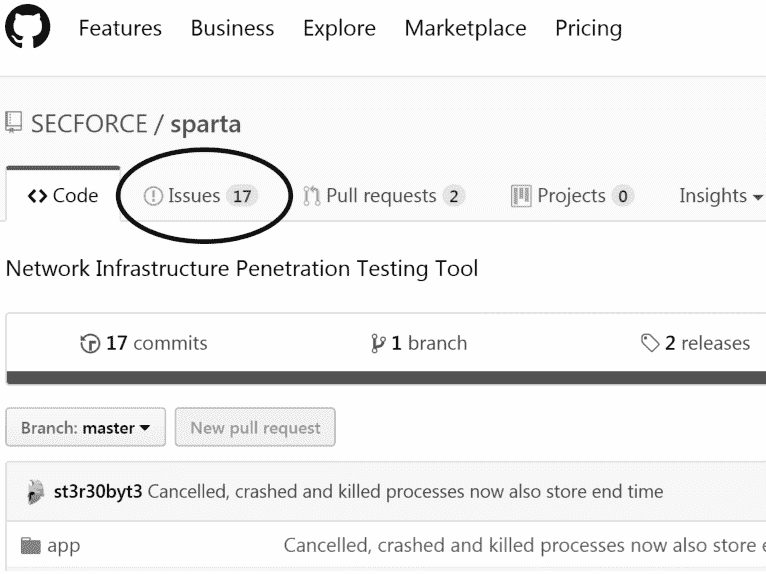

然后你就可以浏览（并搜索）打开的问题列表。一旦你确定你的错误尚未提交，就可以点击 New issue（新问题）。

# 关键词

- 安全策略

- 防火墙

- `iptables`

- 监控

- 日志


# Kali Linux 的安全与监控

- 目录

- 定义安全策略 150

- 可能的安全措施 152

- 加固网络服务 153

- 防火墙或数据包过滤 153

- 监控与日志 161

- 总结 164

当你开始使用 Kali Linux 处理日益敏锐且更受关注的工作时，你可能需要更加认真地对待安装环境的安全性。在本章中，我们将首先讨论安全策略，强调定义策略时需要考虑的各个点，并概述对你的系统以及你作为安全专业人员面临的一些威胁。我们还将讨论笔记本电脑、桌面系统的系统的安全措施，以及防火墙和数据包过滤。最后，我们将讨论监控工具和策略，并向你展示如何最好实施它们以检测你系统的潜在威胁。

## 7.1. 定义安全策略

泛泛而谈地讨论安全性是不现实的，因为这个概念代表了极其广泛的概念、工具和程序，其中没有任何一个是通适的。在它们之间进行选择需要对你的目标有精确的理解。匆忙实施一组任意的工具可能会导致关注安全的错误方面的风险。

通常最好的方法是确定一个特定的目标。有助于这种决定的良好方法是从以下问题开始的：

- 你试图保护什么？取决于你想保护计算机还是数据，安全策略将有所不同。在后者的情况下，你还需要知道是哪些数据。

- 你试图防止什么攻击？是机密数据泄露？意外的数据丢失？还是服务中断导致的收入损失？

- 此外，你试图防止谁的？针对系统普通用户的误操作进行防护，与针对坚定的攻击者小组进行防护，其安全措施将大不相同。

“风险”一词通常用于统指这三个因素：保护什么、应该防止什么，以及谁可能导致这种情况发生。风险建模需要对这三个问题给出答案。基于这个风险模型，可以构建安全策略，并通过具体行动实施该策略。

| 永久性提问 |

| :--- |

| 安全市场专家（不仅是计算机安全）布鲁斯·施耐德（Bruce Schneider）试图用这句话应对安全最重要的动机之一：“安全是一个过程，而不是一个产品。”资产需要随着推推受到保护，威胁以及潜在攻击者可利用的手段也是。即使安全策略最初设计和实施得完美，你也永远不要固步自封。风险要素在演进，应对措施也必须随之演进。 |

额外的约束也值得考虑，因为它们会限制可用策略的范围。你愿意在多大程度上加固系统？这个问题对实施哪种策略有重大影响。很多时候，答案仅根据金钱成本定义，但应该考虑其他因素，例如给系统用户带来的不便程度或性能下降。

一旦对风险进行了建模，你就可以开始设计实际的安全策略了。

在决定采用何种程度的安全保护措施时，可能会出现极端情况。一方面，提供基本的系统安全可能是极其简单的。

例如，如果受保护的系统仅包含一台二手电脑，其唯一用途是在一天结束时在数字末尾加几个数字，那么决定不对其进行任何特殊处理是合理的。系统的内在价值很低，数据的价值为零，因为它们没有存储在计算机上。渗透此系统的潜在攻击者只会得到一个计算器。加固这样一个系统的成本可能高于被破解的成本。

在光谱的另一端，你可能希望以最全面的方式保护秘密数据的机密性，压过任何其他考虑。在这种情况下，适当的响应是彻底破坏数据（完全删除文件、将硬盘粉碎成碎片、将这些碎片溶解在酸中等）。如果额外的额外要求数据必须存储以备将来使用（尽管不一定可以随时使用），且成本仍无法考量，那么起点是将数据存储在铱-铂金合金板上，并存放在世界各地山下的防弹地堡中，每个地堡（当然）既是保密的，又由敌方军队守卫。

尽管这些例子看起来很极端，但它们仍然是对某些风险的充分应对，因为它们是考虑了要实现的目标和必须满足的约束的思考过程的结果。只要是来自理性的决策，没有任何安全策略比其他任何策略更或更不值得尊重。

回到更典型的情况，信息系统可以被分成一致且大部分独立的子系统。每个子系统都有自己的需求和约束，因此应该对每个子系统进行风险评估和安全策略设计。一个需要记住的良好原则是：较小的攻击面比大的攻击面更容易防御。网络组织也应相应设计：敏感服务应该集中在少数台机器上，这些机器应仅通过极少量的路由或检查点访问。逻辑很直观：保护这些检查点比保护所有敏感机器免受整个外部世界的攻击容易得多。在这一点，网络过滤（包括通过防火墙）的用处变得显而易见。这种过滤可以使用专用硬件实现，但更灵活的解决方案是使用软件防火墙，如集成的防火墙。

## 7.2. 可能的措施

正如前节所述，对于如何加固 Kali 没有单一的答案。这取决于你如何使用它以及你试图保护什么。

### 7.2.1. 在服务器上

如果你在公共服务器上运行 Kali Linux，你可能希望通过更改任何默认密码来保护网络服务（见 7.3 安全网络服务 153），并可能通过防火墙限制访问（见 7.4 数据包过滤 153）。


如果你在服务器或某个服务上分发用户账户，你希望确保设置强密码（它们应该能够抵抗攻击）。同时，你可能希望设置 fail2ban，这将使网络破解变得困难得多（通过过滤超过限制的 IP 地址）。通过 `apt update` 后跟 `apt install fail2ban` 安装 fail2ban。

如果你运行 Web 服务，你可能希望通过 HTTPS 托管它们，以防止中间节点监听你的流量（可能包括身份验证 cookie）。

### 7.2.2. 在笔记本电脑上

渗透测试员面临的风险与公共服务器不同：例如，你不易受到随机扫描，即使受到，你可能也没有开启任何网络服务。

真正的风险出现在你在客户之间旅行时。例如，你的笔记本电脑在旅行途中被盗或被海关没。这就是为什么你可能使用全磁盘加密（见 4.2.2 在全加密文件系统上安装 85），并可能还设置“删除”功能（见“为了额外安全添加删除密码” 245）：你在任务期间收集的数据是机密的，需要最高级别的保护。

你可能还需要防火墙规则（见 7.4 数据包过滤 153），但目的与服务器上不同。你可能希望禁止除 VPN 访问流量以外的所有出站流量。这是一种安全保障，以便当 VPN 断开时，你能够立即注意到（而不是回退到本地网络）。这样，当你浏览网页或进行其他在线活动时，就不会泄露客户的 IP 地址。

## 7.3. 保护网络服务

通常情况下，禁用你不使用的服务是一个好主意。Kali 让这变得变得非常简单，因为大多数网络服务默认都是禁用的。

只要服务保持禁用状态，它们就不会构成任何安全威胁。然而，当你启用它们时必须非常小心：

- 默认情况下没有防火墙，如果它们监听在所有网络接口上，那么它们实际上是公开可用的。
- 某些服务没有身份验证凭据，并在首次使用时允许你设置；另一些服务预设了默认的（因此广为人知的）凭据。确保将（或）重置任何密码为只有你知道的内容。
- 许多服务以 root 身份运行具有完全管理员权限，因此未经授权的访问或安全泄露的后果是非常严重的。

### 默认凭据

我们不会列出所有带有默认凭据的工具，相反，你应该检查相应软件包的 README.Debian 文件，以及 docs.kali.org 和 tools.kali.org，以查看该服务是否需要特殊处理以确保安全。

如果你在实时模式（live mode）下运行，root 账户的密码是 "tooth"。在更改 root 账户密码之前，或者在调整其配置以不允许基于密码的登录之前，你不应该启用 SSH。

还要注意，Beef 项目（来自已安装的软件包 beef-xss）也被认为在其默认配置文件中硬编码了用户为 "beef"密码为 "beef" 的默认凭据。

## 7.4. 防火墙与数据包过滤

防火墙是一种带有硬件、软件或两者者的计算机设备，用于解析传入或出的网络数据包（进入或离开本地网络的数据包），并仅允许符合预定义条件的数据包通过。

过滤网络网关是一种保护整个网络的防火墙。它通常安装在为网络配置的专用机器上，以便它可以解析所有进出网络的数据包。或者，本地防火墙是运行在某特定机器上的软件服务，用于过滤或限制对该机器上某些服务的访问，或者可能防止由无论是否自愿已安装的恶意软件发出的外部连接。

> https://docs.kali.org
> https://tools.kali.org

Linux 内核嵌入了 netfilter 防火墙。由于网络和用户需求不同，没有配置任何防火墙的即插用解决方案。然而，你可以通过 `iptables` 和 `ip6tables` 命令从用户空间控制 netfilter。这两个命令之间的区别是前者适用于 IPv4 网络，而后者适用于 IPv6。由于两个网络协议栈可能都会持续很多年，因此这两个工具都需要并行使用。你还可以使用极佳的基于 GUI 的 `fwbuilder` 工具，它提供了过滤规则的图形化表示。

无论你决定如何配置它，netfilter 都是 Linux 的防火墙实现，让我们来看看它是如何工作的。

### 7.4.1. Netfilter 行为

Netfilter 使用四个不同的表，这些表存储了调节数据包三类操作的规则：

- filter 相关的规则（接受、拒绝或忽略数据包）
- nat（网络地址转换）涉及数据包源地址或目的地址及端口的转换；
- mangle 涉及对 IP 数据包的其他更改（包括 ToS——服务类型——字段和选项）；
- raw 允许在数据包到达连接跟踪系统之前对其进行手动修改。

每个表都包含名为“链”（chains）的规则列表。防火墙使用标准链根据预定义的情况处理数据包。管理员可以创建其他链，这些链只有在被标准链之一（直接或间接地）引用时才会被使用。

filter 表有三个标准链：

- INPUT：涉及目的地是防火墙本身的数据包；
- OUTPUT：涉及由防火墙发的数据包；
- FORWARD：涉及通过防火墙的数据包（其既不是源地也不是目的地）。

nat 表也有三个标准链：

- PREROUTING：在数据包到达时立即修改它们；
- POSTROUTING：在数据包准备发送时修改它们；
- OUTPUT：修改由防火墙本身生成的数据包。

这些链如图 7.1 所示，“Netfilter 链是如何调用的”[第155页]。

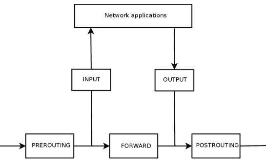

图 **7.1** Netfilter 链是如何调用的

每个链都是规则列表；每条规则都是一组条件以及满足条件时要执行的操作。在处理数据包时，防火墙会一个接一个地扫描相应的链，当满足某条规则的条件时，它会跳转（因此命令中有 `-j` 选项）到指定的动作以继续处理。最常见的行为是标准化的，并且存在专门针对它们的动作。这些标准中常见的一种是中断链的处理，因为数据包的命运已经注定（下文提到的异常除外）。下面是 *Netfilter* 动作。

- ACCEPT：允许数据包继续传输。
- REJECT：使用互联网控制消息协议（ICMP）错误数据包拒绝数据包（`iptables` 的 `--reject-with` 类型选项决定了发送的错误类型）。
- DROP：删除（忽略）数据包。
- LOG：通过 syslog 记录带有数据包描述的消息。注意，此动作不会中断处理，链的执行将继续到下一条规则，这就是为什么被拒绝的数据包同时需要 LOG 和 REJECT/DROP 命令。与日志相关的常用参数包括：
  - --log-level，默认值为 warning，指示 syslog 级别。
  - --log-prefix 允许指定文本前缀以区分日志消息。
  - --log-tcp-sequence, --log-options, --log-ip-options 分别在数据包到达连接跟踪系统之前记录 序列号、TCP 选项和 IP 选项。
  - ULOG：通过 ulog 记录带有数据包描述的消息。注意此动作不会中断处理，链的执行将继续到下一条规则，这就是为什么被拒绝的数据包同时需要 LOG 和 REJECT/DROP 命令。*chain_name* 这种标准行为（下文提到的异常除外），由于数据包的命运已注定，其中一种标准是中断链的处理。
- RETURN：中断链的处理并返回调用链（默认情况下这是通过 iptables 的 -P 选项执行的）。
- SNAT（在 nat 表）：应用源地址转换（SNAT）。具体的更改包括 --source-address:port 选项，定义了新的源 IP 地址和端口。
- DNAT（在 nat 表）：应用目的地址转换（DNAT）。具体的更改包括 --to-destination:port 选项，定义了新的目的 IP 地址和端口。
- MASQUERADE（在 nat 表）：应用伪装（NAT 的一种特殊情况）。
- REDIRECT（在 nat 表）：透明地将数据包重定向到防火墙自身的给定端口；这可以在不配置客户端的情况下设置透明代理，因为客户端认为它连接到网络，而实际上通过代理通信。--to-ports(s) 选项指示了重定向的端口或端口范围。

其他动作，特别是涉及 mangle 表的动作，不在本文范围内。`iptables(8)` 和 `ip6tables(8)` 页面有完整的列表。

## 什么是 ICMP？

互联网控制消息协议（ICMP）是用于传输通信辅助信息的协议。它通过 `ping` 命令测试连通性，发送 ICMP 请求消息，接收方应用 ICMP 回显消息进行回答。它可以信号防火墙拒绝数据包、指示接收缓冲区溢出、为连接中的后续数据包建议更好的路由等。该协议由多个 RFC 文档定义。RFC777 和 RFC792 是最早的，但许多已被协议进行了扩展和修订。

```
⇒ http://www.faqs.org/rfcs/rfc777.html
```

```
⇒ http://www.faqs.org/rfcs/rfc792.html
```

作为参考，接收缓冲区是从网络到达内核处理它之间的小内存存储区域。如果该区域满了，将无法接收新数据，ICMP 会信号该问题，以便发送者降低其传输速率（理想情况下在一段时间后会达到平衡）。


注意 IPv4 网络在没有 ICMP 的情况下也可以工作，ICMP6 对于 IPv6 网络是严格要求的，因为它结合了在 IPv4 世界中分散在 IPv4、互联网组组协议（IGMP）和地址解析协议（ARP）中的功能。`ICMP6` 定义在 `RFC4443` 中。

```
⇒ http://www.faqs.org/rfcs/rfc4443.html
```

## 7.4.2. iptables 和 ip6tables 语法

`iptables` 和 `ip6tables` 命令用于操作表、链和规则。`-t table` 选项指定要操作的表（默认是 `filter`）。

### 命令

- `-L chain` 列出链中的规则。（例如，`iptables -n -L INPUT` 将显示与入站数据包相关的规则）。
- `-N chain` 创建一个新链。你可以出于多种目的创建新链，包括测试新的网络服务或防御攻击。
- `-X chain` 删除一个空且未使用的链（例如，`iptables -X ddos-attack`）。
- `-A chain` 在给定的链的末尾添加规则。请记住，规则是从上到下处理的，因此在添加规则时要记住这一点。
- `-I chain rule_num` 在 `rule_num` 之前插入一条规则。与 `-A` 选项一样，在链中插入新规则时要考虑处理顺序。
- `-D chain rule_num`（或 `-D chain`）删除链中的规则；第一种语法通过编号识别要删除的规则（`iptables -L --line-numbers` 将显示这些编号），后种则通过其内容识别。
- `-F flush` 刷新链（删除其所有规则）。例如，要删除所有与出站数据包相关的规则，你可以运行 `iptables -F OUTPUT`。如果未指定链，则表中的所有规则都将被删除。
- `-P chain` 定义给定链的默认操作或“策略”；注意只有标准链可以有策略。要默认丢弃所有入站流量，你需要运行 `iptables -P INPUT DROP`。

### 规则

每条规则表示为 `conditions -j action action_options`。如果在同一条规则中描述了多个条件，则判断标准是这些条件的交集（逻辑与），其限制性至少与每个单独的条件同等。

`-p protocol` 条件匹配 IP 数据包的协议 `protocol` 字段。最常见的值是 `tcp`、`udp`、`icmp` 和 `icmp6`。此条件可以配合 TCP 端口条件进行补充，使用如 `--source-port` 和 `--destination-port` 等子句。

### 否定条件

在条件前加感叹号 `!` 可以取反该条件。例如，对 `-p` 选项的条件进行取反将匹配“任何与指定协议不同的数据包”。这种否定也可以适用于所有其他条件。

`-s address` 或 `-s network/mask` 条件匹配数据包的源地址。相应地，`-d address` 或 `-d network/mask` 匹配目的地址。

`-i interface` 条件选择来自网络接口的数据包。`-o interface` 选择从特定接口发出的数据包。

`--state state` 条件匹配数据包在连接中的状态（这需要 `conntrack` 内核模块来用于连接跟踪）。`NEW` 状态描述启动新连接的数据包，`ESTABLISHED` 匹配属于已存在连接的数据包，`RELATED` 匹配与现有连接建立新关系的数据包（这对于 FTP 协议中“活动”模式下的 `ftp-data` 连接非常有用）。

`iptables` 和 `ip6tables` 有许多可用选项，精通它们所有选项需要大量的学习和经验。然而，你将经常使用的选项之一是阻止来自主机或主机范围的恶意流量。要静默阻塞来自 IP 地址 `10.0.1.5` 和 `31.13.74.0/24` 类 C 类子网的入站流量：

```bash
# iptables -A INPUT -s 10.0.1.5 -j DROP
# iptables -A INPUT -s 31.13.74.0/24 -j DROP
# iptables -n -L INPUT
```

Chain INPUT (policy ACCEPT)

| target | prot | opt | source |
| :--- | :--- | :--- | :--- |
| DROP | all | | 10.0.1.5 |
| DROP | all | | 31.13.74.0/24 |

另一个常用的 `iptables` 命令是阻止特定服务或端口的网络流量。要允许用户连接到 SSH、HTTP、IMAP，你可以运行以下命令：

```bash
# iptables -A INPUT -m state --state NEW -p tcp --dport 22 -j ACCEPT
# iptables -A INPUT -m state --state NEW -p tcp --dport 80 -j ACCEPT
# iptables -A INPUT -m state --state NEW -p tcp --dport 143 -j ACCEPT
# iptables -n -L INPUT
```

Chain INPUT (policy ACCEPT)

| target | prot | opt | source |
| :--- | :--- | :--- | :--- |
| DROP | all | | 10.0.1.5 |
| DROP | all | | 31.13.74.0/24 |
| ACCEPT | tcp | | 0.0.0/0 |
| ACCEPT | tcp | | 0.0.0/0 |
| ACCEPT | tcp | | 0.0.0/0 |

等一下，清理旧且必要的规则被认为是一种良好的习惯。删除 `iptables` 规则的最简单方法是通过行号引用规则，你可以通过 `--line-options` 获取这些编号。但要小心，丢弃一条规则将重新编号后续所有的规则。

```bash
# iptables -n L --line-numbers
Chain INPUT (policy ACCEPT)
| num | target | prot | source | destination |
| :--- | :--- | :--- | :--- | :--- |
| 1 | DROP | all | 10.0.1.5 | |
| 2 | DROP | all | 31.13.74.0/24 | |
| 3 | ACCEPT | tcp | 0.0.0/0 | |
| 4 | ACCEPT | tcp | 0.0.0/0 | |
| 5 | ACCEPT | tcp | 0.0.0/0 | |
```


`-p protocol` 条件匹配 IP 数据包的协议（`protocol`）字段。最常见的值是 `tcp`、`udp`、`icmp` 和 `icmp6`。此条件可以配合 TCP 端口条件进行补充，使用如 `--source-port` 和 `--destination-port` 等子句。

## 否定条件

在条件前加感叹号（`!`）可以取反该条件。例如，对 `-p` 选项的条件进行取反将匹配“任何与指定协议不同的数据包”。这种否定也可以适用于所有其他条件。

`-s address` 或 `-s network/mask` 条件匹配数据包的源地址。相应地，`-d address` 或 `-d network/mask` 匹配目的地址。

`-i interface` 条件选择来自网络接口的数据包。`-o interface` 选择从特定接口发出的数据包。

`--state state` 条件匹配数据包在连接中的状态（这需要 `conntrack` 内核模块来用于连接跟踪）。`NEW` 状态描述启动新连接的数据包，`ESTABLISHED` 匹配属于已存在连接的数据包，`RELATED` 匹配与现有连接建立新关系的数据包（这对于 FTP 协议中“活动”模式下的 `ftp-data` 连接非常有用）。

`iptables` 和 `ip6tables` 有许多可用选项，精通它们所有选项需要大量的学习和经验。然而，你将经常使用的选项之一是阻止来自主机或主机范围的恶意流量。要静默阻塞来自 IP 地址 `10.0.1.5` 和 `31.13.74.0/24` 类 C 类子网的入站流量：

```bash
# iptables -A INPUT -s 10.0.1.5 -j DROP
# iptables -A INPUT -s 31.13.74.0/24 -j DROP
# iptables -n -L INPUT
```

Chain INPUT (policy ACCEPT)

| target | prot | opt | source |
| :--- | :--- | :--- | :--- |
| DROP | all | | 10.0.1.5 |
| DROP | all | | 31.13.74.0/24 |

另一个常用的 `iptables` 命令是阻止特定服务或端口的网络流量。要允许用户连接到 SSH、HTTP、IMAP，你可以运行以下命令：

```bash
# iptables -A INPUT -m state --state NEW -p tcp --dport 22 -j ACCEPT
# iptables -A INPUT -m state --state NEW -p tcp --dport 80 -j ACCEPT
# iptables -A INPUT -m state --state NEW -p tcp --dport 143 -j ACCEPT
# iptables -n -L INPUT
```

Chain INPUT (policy ACCEPT)

| target | prot | opt | source |
| :--- | :--- | :--- | :--- |
| DROP | all | | 10.0.1.5 |
| DROP | all | | 31.13.74.0/24 |
| ACCEPT | tcp | | 0.0.0/0 |
| ACCEPT | tcp | | 0.0.0/0 |
| ACCEPT | tcp | | 0.0.0/0 |

等一下，清理旧且必要的规则被认为是一种良好的习惯。删除 `iptables` 规则的最简单方法是通过行号引用规则，你可以通过 `--line-options` 获取这些编号。但要小心，丢弃一条规则将重新编号后续所有的规则。

```bash
# iptables -n L --line-numbers
Chain INPUT (policy ACCEPT)
| num | target | prot | source | destination |
| :--- | :--- | :--- | :--- | :--- |
| 1 | DROP | all | 10.0.1.5 | |
| 2 | DROP | all | 31.13.74.0/24 | |
| 3 | ACCEPT | tcp | 0.0.0/0 | |
| 4 | ACCEPT | tcp | 0.0.0/0 | |
| 5 | ACCEPT | tcp | 0.0.0/0 | |
```

`ignore.d` 文件用于（显而易见的）忽略某些消息。例如，被标记为破解尝试或安全警报（遵循存储在 `/etc/logcheck/violations.d/myfile` 中的规则）的消息只能通过 `/etc/logcheck/violations.d/myfile` 或 `/etc/logcheck/violations.d/myfile-extension` 文件中的规则被忽略。

除非 `/etc/logcheck/ignore.d {paranoid, server, workstation}/` 中的某一个规则规定该事件应该被忽略，否则事件总是会被信号。当然，唯一考虑的目录是那些与等于或大于所选操作模式级别的对应的目录。

## 7.5.2. 实时监控活动

`top` 是一个交互式工具，用于显示当前运行的进程列表。默认排序基于当前的处理器用户使用量，可以通过 `P` 键获取。其他排序顺序包括按占用内存（`M` 键）、总处理器时间（`T` 键）和进程标识（`N` 键）。`k` 键允许通过输入进程标识处理进程。`r` 键更改进程的优先级。

当系统看起来过载时，`top` 是一个极好的工具，可以查看哪些进程正在竞争处理器时间或消耗了过多内存。特别是，检查消耗资源的进程是否与机器已知托管的真实服务相匹配通常很有趣。以 "www-data" 用户身份运行的未知进程应该确实引起关注并接受调查，因为它很可能是通过 Web 应用程序中的漏洞在系统上安装并执行的软件实例。

`top` 是一个非常灵活的工具，其手册页提供了有关如何自定义显示并适应你的个人需求和习惯的详细信息。

`gnome-system-monitor` 图形化工具与 `top` 类似，提供了大致相同的功能。

## 7.5.3. 检测更改

一旦安装并配置了系统，大多数系统文件在系统升级之前应该保持相对静态。因此，监控系统文件的变化是一个好主意，因为任何意外的变化都可能引起警报并需要调查。本节介绍了了一些最常用的工具，它们用于监控系统文件、检测更改，并可选地向系统管理员通知你。

## 使用 dpkg --verify 审计软件包

`dpkg --verify`（或 `dpkg -V`）是一个有趣的工具，因为它会显示被修改过的的系统文件（可能是被攻击者修改的），但对这种输出应谨慎对待。为了执行工作，`dpkg` 依赖于存储在硬盘上的数据库中的校验和（位于 `/var/lib/dpkg/info/package.md5sums`）。一个彻底的攻击者会修改这些文件，使其包含被篡改文件的新校验和，或者一个高级攻击者会破坏你 Debian 镜像站上的程序包。为了防止此类攻击，请使用 APT 的数字签名验证系统（见第 8.3.6 节，“验证软件包真实性”[第 202 页]）来验证软件包。

## 什么是文件指纹？

提醒：指纹是一个值，通常是一个数字（尽管是十六进制表示法），它包含了文件内容的签名。该签名通过算法（MD5 或 SHA1 是广为人知的）计算得出，该算法在多程度上保证了文件内容最微小的变化都会导致指纹的变化；这被称为“雪崩效应”。数字指纹可以作为金标准测试，用于检查文件内容是否被更改过。这些算法是不可逆的；换句话说，对于大多数算法而言，知道指纹并无法找到对应的内容。最近的数学进展似乎削弱了这些原则的稳健性，但这并没有受到质疑，因为创建产生相同指纹的不同内容似乎是一项困难的任务。

`dpkg -V` 将验证所有软件包并为每个未通过验证的文件打印一行。每个字符代表一个特定的元数据。遗憾的是，`dpkg` 没有存储大多数测试的元数据，因此校验和测试结果将在第三个字符处（失败时）输出 `5`。

```
dpkg -V
??????? /lib/systemd/system/ssh.service
??????? /c /etc/libvirt/qemu/networks/default.conf
??????? /c /etc/lvm/lvm.xml
??????? /c /etc/salt/roster
```

在上面的示例中，`dpkg` 报告了 SSH 服务文件的更改，这是管理员对软件包文件的修改，而不是使用适当 `/etc/systemd/system/ssh/`

## 监控文件：AIDE

高级入侵检测环境 (`AIDE`) 工具通过检查文件完整性，并与之前记录的系统镜像（一个包含所有文件相关信息的数据库 `/var/lib/aide/aide.db`）对比来检测更改。


你可以通过运行 `apt update` 后运行 `apt install` 来安装 AIDE。你首先将用 `aideinit` 初始化数据库；它将每天运行（通过 `/etc/cron.daily/aide` 检查是否有变化）。当检测到更改时，AIDE 将其记录在日志文件（`/var/log/aide*.log`）中并通过电子邮件将其发现发送给管理员。

## 保护数据库

由于 AIDE 使用本地数据库来比较文件状态，其结果的有效性与数据库直接相关。如果攻击者获取了系统的 root 权限，他们能够替换数据库并掩盖踪迹。防止这种情况的方法是将参考数据存储在只读存储上。

你可以使用 `/etc/default/aide` 中的选项来调优 aide 的行为。AIDE 配置存储在 `/etc/aide/aide.conf` 和 `/etc/aide/conf.d/`（实际上，这些文件仅供 autogenerated 使用）。配置识别了哪些文件需要更改。例如，日志文件的内容经常更改，只要这些文件的权限保持不变，就可以忽略；但可执行程序的内容和权限必须保持不变。虽然并不复杂，但配置语法并不直观，我们建议阅读 `aide.conf (5)` 手册以获取更多信息。

新版本的数据库每天在 `/var/lib/aide/aide.db.new` 生成；如果记录的更改是合法的，可以使用它可以替换参考数据库。

Tripwire 与 AIDE 非常相似；甚至配置语法几乎相同。Tripwire 提供的主要新增是对配置文件进行签名的机制，以便攻击者无法将其指向另一个版本的数据库。

Samhain 提供了类似的功能，以及一些帮助检测 rootkit 的功能（侧边栏“checksecurity 和 chrootkit/rkhunter 包”[第 164 页]）。它可以在网络中全局部署并在中央服务器上记录其踪迹（带有签名）。

例如防火墙和数据包过滤。最后，我们回顾了监控工具和策略，并展示了如何最好实施它们以检测对你系统的潜在威胁。

总结提示：

- 花些时间定义一个全面的安全策略。

- 如果你在公共访问的服务器上运行 Kali，请在启动前更改任何可能配置的服务的默认密码（参见第 7.3 节，“加固网络服务”[第 153 页]），并使用防火墙限制其访问（参见第 7.4 节，“防火墙或数据包过滤”[第 153 页]）。

- 使用 `fail2ban` 检测并拦截密码猜测攻击，消除暴力破解。

- 如果你运行 Web 服务器，请通过 HTTPS 托管，以防止网络中间节点嗅探你的流量（这可能包括身份验证 Cookie）。

- 真正的风险发生在你从一个客户移动另一个客户时。例如，你的笔记本电脑可能在旅行途中被盗或被海关没收。使用全磁盘加密（参见第 4.2.2 节，“在全加密文件系统上安装”[第 85 页]）为不幸的情况做好准备，并考虑使用该功能（“添加 Nuke 密码以额外安全”[第 245 页]）来保护你的客户。

- 实施规则（参见第 7.4 节，“防火墙或数据包过滤”[第 153 页]），禁止除 VPN 访问流量以外的所有出站流量。这是一个安全网，以便当 VPN 断开时你会立即注意到（而不是回退到本地网络访问）。

- 禁用你不使用的服务。Kali 很容易这样做，因为所有外部网络服务默认都是禁用的。

- Linux 内核启用了 netfilter 防火墙。配置任何防火墙都没有现成的解决方案，因为网络和用户需求各不相同。然而，你可以通过 `iptables` 和 `iptablesables` 命令从用户空间控制 netfilter。

- `logcheck` 程序默认记录每个文件，并将异常日志消息通过电子邮件发送给管理员进行进一步分析。

- `top` 是一个交互式工具，显示当前运行的进程列表。

- `dpkg --verify`（或 `dpkg -V`）显示已修改（可能被攻击者修改）的系统文件，它依赖校验和。

- 高级入侵检测环境 (`AIDE`) 工具检查完整性，并与之前记录的有效系统镜像进行对比以检测任何更改。

- Tripwire 与 AIDE 非常相似，但它使用一种机制对配置文件进行签名，以便攻击者无法将其指向不同版本的参考数据库。

- 考虑使用 `rkhunter`、`checksecurity`、`chrootkit` 来帮助检测系统上的 rootkits。

在下一章节中，我们将深入研究 Debian 基础和包管理。你将迅速理解 Kali Debian 根源背力量，并学习开发者是如何利用这种力量的。请注意，下一章内容相当密集，但如果你想成为 Kali 高级用户，理解 Debian 基础和包管理是至关重要的。

# 关键词

- `dpkg`

- `apt`

- `sources.list`

- Upgrades

- Package repositories


# 第 8 章 Debian 包管理

- APT 简介 170

- 基础包交互 175

- 高级 APT 配置和用法 194

- 包参考：深入研究 Debian 包系统 204

- 总结 216

在学习 Linux Linux 之后，是时候学习基于 Debian 的发行版的包管理系统了。在包括 Kali 在内的此类发行版中，Debian 包是向用户提供软件的标准方式。理解包管理系统将让你对 Kali 的结构有深入见解，使你能够更有效地排除故障，并帮助你快速找到 Kali Linux 中包含的大量工具和实用程序的帮助和文档。

在本章中，我们将介绍 Debian 包管理系统，并介绍 `dpkg` 和 APT 工具套。Kali Linux 的主要优势之一在于其包管理系统的灵活性，它利用这些工具为应用程序以及基础操作系统本身提供近乎无缝的安装、升级、删除和操作。理解该系统如何工作对于充分利用 Kali 的功能并简化你的工作至关重要。那些痛苦的编译、灾难性的升级、调试 `gcc` 以及 `configure` 问题的时代已一去不复返，但可用应用程序的数量呈爆炸式增长，你需要了解设计用于利用这些工具的工具。这也是一项关键技能，因为某些安全工具由于许可或其他问题无法包含在 Kali 中，但有可下载的 Debian 包。了解如何处理和安装这些包以及它们如何影响系统是至关重要的，特别是当情况不符合预期时。

我们将从 APT 的基本概述开始，描述二进制包和源码包的结构与内容，查看一些基本工具和场景，然后深入研究，帮助你从这个优秀的包系统和工具套中榨出每一分用。

## 8.1. APT 简介

让我们从一些基本定义、概述和关于 Debian 包的历史开始，从 `dpkg` 和 APT 开始。

### 8.1.1. APT 与 dpkg 之间的关系

Debian 包是软件文件以及元数据的压缩存档。源码包包含程序的源代码，而二进制包包含执行所需的文件。

在系统上处理 Debian 包的基础命令是 `dpkg`，它执行安装，但对宇宙的了解只有部分视图：它知道安装了什么，但对其他可用包一无所知。因此，如果不满足依赖关系，它将失败。高级包工具 (`APT`) 是一组帮助管理 Debian 包（或系统上的应用程序）的工具，并尝试自动满足它们的依赖关系。

`dpkg` 工具被设计用于处理和安装 `.deb` 包，但如果它遇到未满足的依赖关系（如缺少库），它就会失败。如果你足够老记得用 `gcc` 编译程序（你可能记得这是一个痛苦的过程，特别是当应用程序有多个依赖项时），解析各种警告和错误信息，你可能确定代码的哪个部分失败了，大多数情况下这种失败由于缺少库或依赖。然后你将查找缺失的库或依赖，修复它并重试。如果你运气好，编译将完成，但构建将再次失败，抱怨另一个损坏的依赖。

APT 的设计是为了缓解这个问题，汇总程序需求和依赖关系并解决它们。此功能在 Kali Linux 上是开箱即用的，但它并非万无一。APT 依赖 `dpkg` 但与之不同，因为前者从在线源安装最新包。

在我们深入并展示如何使用 `dpkg` 和 APT 安装和管理包之前，深入 APT 的某些内部工作机制并讨论相关术语是重要的。

| 包源与源码包 | “源”一词可能具有歧义。源码包——包含程序源代码的包——不应与包源——包含包的存储库（如网站、FTP 服务器、CD-ROM、本地目录等）混淆。 |

APT 从仓库、软件包存储系统或简单来说，“软件包源”中检索其软件包。`/etc/apt/sources.list` 文件列出了发布 Debian 软件包的不同仓库（或源）。

## 8.1.2. 理解 sources.list 文件

`sources.list` 文件是定义软件包源的配置文件，理解它的布局以及如何配置它至关重要，因为如果没有正确定义的软件包源列表，APT 将无法正常运行。让我们讨论一下它的语法，看看 Kali Linux 使用的各种仓库，并讨论镜像和镜像重定向，然后你就可以准备使用 APT 了。

`/etc/apt/sources.list` 文件（以及 `/etc/apt/sources.list.d/*`）的每一行都包含一个源的描述，由三个空格分隔的三个部分组成。注释以 `#` 字符开头：


```
# deb cdrom:[Debian GNU/Linux 2016.1 Kali-rolling_ Official Snapshot amd64 LIVE/
 INSTALL Binary 20160830-11:29]/kali-rolling contrib main non-free
```

`deb http://kali.kali.org/kali-rolling main non-free contrib`

让我们来看这个文件的语法。第一个字段指示源的类型：

- `deb`：用于二进制软件包，
- `deb-src`：用于源软件包。

第二个字段给出源的基 URL：这可以由 Debian 镜像或任何由第三方设置的归集组成。URL 可以以 `file://` 开头，表示安装在系统文件层次结构中的本地源；或者以 `ftp://` 开头，表示 FTP 服务器上的可用源。URL 可以以 `cdrom:` 开头，用于基于 CD-ROM/DVD-ROM/蓝光光子的安装，这种情况较少见，因为基于网络的安装方法更普及且更常见。

`cdrom` 条目描述 CD/DVD-ROM。与其他条目不同，CD-ROM 并不总是可用的，因为必须将其插入驱动器，且一次只能读取一张光盘。由于这些原因，这些源的管理方式略有不同，需要使用 `apt-cdrom` 程序进行添加，通常带有 `add` 参数执行。后者将请求将光盘插入驱动器，并浏览其内容以查找 `Packages` 文件。它将使用这些文件更新其可用软件包数据库（此操作通常由 `apt update` 命令完成）。之后，如果 APT 需要软件包，它会请求光盘。

最后一个字段的语法取决于仓库的结构。在最简单的情况下，你只需要指定所需源的子目录（末尾必须带有斜杠 `/`）（这通常是一个简单的 `./`，表示没有子目录—— 软件包直接位于指定的 URL 下）。但在最常见的情况下，仓库的结构将类似于 Debian 镜像，具有多个发行版和多个组件。在这些情况下，请命名选定的发行版，然后是要启用的组件（或部分）。让我们花一点时间介绍这些部分。

Debian 和 Kali 使用三个部分来根据每部作品作者选择的许可来区分软件包。

- `Main`（主）：包含所有完全符合 Debian 自由软件指南¹的软件包。
- `non-free`（非自由）归集与之不同，因为它包含了不（完全）符合这些原则的软件，但可以在不受限制的情况下分发。
- `Contrib`（贡献）：是一组开源软件，在没有某些非自由元素的情况下无法运行。这些元素可能包括来自非自由部分的软件，或非自由文件，如游戏 ROM、控制台 BIOS 等。Contrib 还包括编译时需要专有元素的自由软件，例如 VirtualBox，它需要非自由编译器来构建其某些文件。

现在，让我们来看标准的 Kali Linux 软件包源或仓库。

## 8.1.3. Kali 仓库

运行 Kali 的系统的标准 `sources.list` 文件引用一个仓库（`kali-rolling`）和之前提到的三个组件：`main`、`contrib` 和 `non-free`：

```
# 主 Kali 仓库
deb http://kali.kali.org/kali kali-rolling main contrib nonfree
```

让我们来看看各种 Kali 仓库。

### Kali-Rolling 仓库

这是面向终端用户的主要仓库。它始终包含可安装的最新软件包。它由一个工具管理，确保在 `kali-rolling` 中满足依赖关系。

### Kali-Dev 仓库

这是面向开发者的仓库。它包含最新版本的软件包，这些可能不稳定或存在 Bug。不建议普通用户使用。

### Kali-Bleeding-Edge 仓库

该仓库包含了从 Debian Testing 和 Kali-Dev 仓库合并但尚未被认为稳定的最新软件包。适用于想要测试最新功能并愿意处理潜在问题的用户。

### Kali Linux 镜像

上述 `sources.list` 指向 `http.kali.org`：这是靠近你的镜像。

| 调试镜像重定向 | 如果镜像出现问题导致 `apt update` 失败，你可以 `curl -si` 查看你被重定向到了哪里： |
| --- | --- |
| `curl -sI http://http.kali.org` | MirrorBrain 监控每个镜像以确保它们正常且更新；它始终重定向到良好的镜像。 |

## 8.2. 基础软件包交互

在对 APT 环境有了基本了解后，让我们来看看一些基础软件包交互，包括 APT 的初始化；软件包的安装、删除和清除；以及 Kali Linux 系统的升级。然后，让我们离开命令行来看一些图形化的 APT 工具。

## 8.2.1. 初始化 APT

APT 是一个庞大的项目和工具集，其原始计划包含图形化界面。从客户端的角度来看，它主要围绕命令行工具 `apt-get` 以及 `apt` 为中心。后来第三方开发了用于操作的图形化替代方案，包括 `synaptic` 和 `aptitude`，我们将在稍后讨论这些内容。我们更倾向于使用 `apt`，并在随后的示例中使用它。然而，在这些相关问题出现时，我们将详细介绍工具之间的一些主要的语法区别。

在与 APT 工作时，您应该首先使用 `apt update` 下载当前可用软件包列表。根据您的连接速度，这可能需要一些时间，因为随着 Debian 的开发，各种软件包列表、源列表和翻译文件的大小都在不断增长。当然，CD/DVD 安装集的安装速度要快得多，因为它们是您本地机器的。

## 8.2.2. 安装软件包

得益于 Debian 软件包系统的精心设计，您可以非常方便地安装软件包（无论是否包含依赖项）。让我们来看看使用 `dpkg` 和 `apt` 安装软件包。

### 使用 dpkg 安装软件包

当需要安装软件包时，`dpkg` 是您将使用的核心工具（直接使用或间接通过 APT 使用）。如果您在离线状态操作，它也是首选，因为不需要互联网连接。记住，`dpkg` 不会安装软件包可能需要的任何依赖项。要使用 `dpkg` 安装软件包，只需提供 `-i` 或 `--install` 选项以及 `.deb` 文件的路径。这意味着您之前已经下载（或通过其他方式获取）了要安装软件包的 `.deb` 文件。

```
dpkg -i man-db_2.7.0.2-5_amd64.deb
(Reading database ... 86425 files and directories currently installed.)
Preparing to unpack man-db_2.7.0.2-5_amd64.deb ...
Unpacking man-db (2.7.0.2-5) over (2.7.0.2-4) ...
Setting up man-db (2.7.0.2-5) ...
Updating database of manual pages ...
Processing triggers for mime-support (3.58) ...
```

我们可以看到 `dpkg` 执行的各个步骤，并观察错误可能发生在哪个点。`-i` 或 `--install` 选项会自动执行两个步骤：解压软件包并运行配置脚本。您可以分别通过 `--unpack` 和 `--configure` 选项独立地执行这两个步骤（正如 `apt` 在后台执行那样）：

```
# dpkg --unpack man-db-2.7.0.2-amd64.deb
(Reading database ... 86425 files and directories installed.)
Preparing to unpack man-db-2.7.0.2-amd64.deb ...
Unpacking man-db (2.7.0-2) over (2.7.0-2) ...
Processing triggers for mime-support (3.58)
# dpkg --configure man-db
Setting up man-db (2.7.0-2) ...
Updating database of manual pages ...
```

注意，“Processing triggers”行指的是当软件包在受监控的目录中添加、删除或修改文件时，自动执行的代码。例如，`mimesupport` 软件包监控 `/usr/lib/mime/packages`，每当该目录发生变化时，就会执行 `update-mime` 命令（在 `man-db` 的特定案例中，为 `/usr/lib/mime/packages/man-db`）。

有时 `dpkg` 将无法安装软件包并返回错误。然而，您可以使用各种 `--force-` 选项让 `dpkg` 忽略这些错误并仅发出警告。使用 `dpkg --force` 命令将帮助您显示这些选项的列表。例如，您可以使用 `dpkg` 强制安装 `zsh`：

```
# dpkg -i --overwrite zsh_5.2-5+b1_amd64.deb
```


一个您早晚会遇到的频繁错误是文件冲突。当一个软件包包含一个已被另一个软件包安装的文件时，`dpkg` 将拒绝安装它。随后会出现以下类型的消息：

- Unpacking libgdm from ...libgdm_3.8.3-2_amd64.deb ...
dpkg: error processing `/var/cache/apt/archives/libgdm_3.8.3-2_amd64.deb` (--unpack):
- trying to overwrite `/usr/bin/gdmlexiserver`, which is also in package gdm3
- 3.4.1-9

在这种情况下，如果替换此文件对您的系统稳定性没有重大风险（通常情况下如此），您可以使用 `--force-overwrite` 来覆盖该文件。

虽然有很多选项，但只有 `--force-*` 选项（如 `--force-overwrite`）可能会被经常使用。这些选项是为了特殊情况存在的，最好尽可能不要使用它们，以尊重打包机制实施的规则。不要忘记，这些规则确保了您系统的一致性和稳定性。

## 使用 APT 安装软件包

尽管 `APT` 比 `dpkg` 更先进，并在后台做了很多工作，但您会发现与软件包的交互非常简单。您可以通过简单的 `install package` 命令将软件包添加到系统。APT 会自动安装必要的依赖项：

```
# apt install kali-linux-gpu
Reading lists... Done
Building dependency tree
Reading state information... Done
The following additional packages will be installed:
oclgaussrack oclclastack
The following NEW packages will be installed:
kali-linux-gpu oclgaussrack oclclastack
0 upgraded, 3 newly installed, 0 to remove and 416 not upgraded.
Need to get 2,944 KB of archives.
After this operation, 51.5 MB of additional disk space will be used.Do you want to continue? [Y/n]
Get http://archive-2.kali.org/kali-rolling/non-free amd64 oclclastack amd64 2.01+
git20160114-0kali2 [2,451 kb]
Get http://archive-2.kali.org/kali-rolling/main amd64 oclgaussrack amd64 1.3-1
kaliali2 [37.2 kb]
Get http://archive-2.kali.org/kali-rolling/main amd64 kali-linux-gpu amd64
2016.3.2 [6,412 B]
Fetched 2,944 KB in 0s (3,060 kB/s)
(Reading database ... 86425 files and directories currently installed.)
Preparing to unpack man-db (2.7.0.2-5_amd64.deb) ...
Unpacking man-db (2.7.0.2-5) over (2.7.0.2-4) ...
Setting up man-db (2.7.0.2-5) ...
Updating database of manual pages ...
Processing triggers for mime-support (3.58) ...
```

```
# dpkg --unpack man-db-2.7.0.2-amd64.deb
(Reading database ... 86425 files and directories installed.)
Preparing to unpack man-db-2.7.0.2-amd64.deb ...
Unpacking man-db (2.7.0-2) over (2.7.0-2) ...
Processing triggers for mime-support (3.58)
```

```
# dpkg --configure man-db
Setting up man-db (2.7.0-2) ...
Updating database of manual pages ...
```

注意，“Processing triggers”行指的是当软件包在受监控的目录中添加、删除或修改文件时，自动执行的代码。例如，`mimesupport` 软件包监控 `/usr/lib/mime/packages`，每当该目录发生变化时，就会执行 `update-mime` 命令（在 `man-db` 的特定案例中，为 `/usr/lib/mime/packages/man-db`）。

有时 `dpkg` 将无法安装软件包并返回错误。然而，您可以使用各种 `--force-` 选项让 `dpkg` 忽略这些错误并仅发出警告。使用 `dpkg --force` 命令将帮助您显示这些选项的列表。例如，您可以使用 `dpkg` 强制安装 `zsh`：

```
# dpkg -i --overwrite zsh_5.2-5+b1_amd64.deb
```


```
# apt install kali-linux-gpu
Reading lists... Done
Building dependency tree
Reading state information... Done
The following additional packages will be installed:
oclgaussrack oclclastack
The following NEW packages will be installed:
kali-linux-gpu oclgaussrack oclclastack
0 upgraded, 3 newly installed, 0 to remove and 416 not upgraded.
Need to get 2,944 KB of archives.
After this operation, 51.5 MB of additional disk space will be used.Do you want to continue? [Y/n]
Get http://archive-2.kali.org/kali-rolling/non-free amd64 oclclastack amd64 2.01+
git20160114-0kali2 [2,451 kb]
Get http://archive-2.kali.org/kali-rolling/main amd64 oclgaussrack amd64 1.3-1
kaliali2 [37.2 kb]
Get http://archive-2.kali.org/kali-rolling/main amd64 kali-linux-gpu amd64
2016.3.2 [6,412 B]
Fetched 2,944 KB in 0s (3,060 kB/s)
(Reading database ... 86425 files and directories currently installed.)
Preparing to unpack man-db (2.7.0.2-5_amd64.deb) ...
Unpacking man-db (2.7.0.2-5) over (2.7.0.2-4) ...
Setting up man-db (2.7.0.2-5) ...
Updating database of manual pages ...
Processing triggers for mime-support (3.58) ...
```

## 8.2.3. 升级 Kali Linux

作为一个滚动发行版，Kali 每天可能会收到多次更新。然而，这可能并不是最佳策略。那么，应该多久升级一次 Kali Linux 呢？并没有硬性规定，但有一些指南可以帮助您：

我们建议定期升级，因为它们会安装最新的安全更新。要进行升级，请使用 `apt update` 后接 `apt upgrade`、`apt-get upgrade` 或 `aptitude upgrade`。这些命令会寻找无需删除任何软件包即可升级的软件包。换句话之，目标是最小侵入升级。`apt` 工具通常会选择最新版本（来自 `kali-edge` 的软件包外，它们会被忽略）。

要让 `apt` 在搜索升级软件包时使用特定的发行版，您需要使用 `-t` 选项指定发行版名称。为了避免每次使用 `apt` 时都使用此选项，您可以在 `/etc/apt/conf.d/` 文件中添加 `APT::Default-Release "kali-rolling"`。

对于重要的升级（例如主版本升级），使用 `apt full-upgrade`。通过此指令，`apt` 即使需要删除过时软件包或安装新依赖也能完成升级。这也是对 Kali Rolling 系统进行定期升级时应该使用的命令。APT 的声誉基于其强大的功能。与 `apt` 和 `aptitude` 不同，`apt-get` 没有 `full-upgrade` 命令。相反，您应该使用 `apt-get dist-upgrade`（发行版升级），这是一个 `apt` 和 `aptitude` 为了兼容而接受的常用命令。

注意重要变化：为了预测这些问题，您可以安装 `apt-listchanges` 软件包，它会在软件包升级开始时显示可能出现的问题。这些信息由软件包维护者编译并放在 `/usr/share/doc/package/NEWS.Debian` 文件供供参考。阅读这些文件（可能通过 `apt-listchanges`）将帮助您避免糟糕的意外。

- 频率足以让你获取那些你从未听过的安全修复

在某些情况下，不升级可能是最好的。例如，以下情况可能不是好主意：

- 如果你无法承担任何故障（例如，因为你要离线，或者你正准备用电脑进行演示）；最好在你有足够的时间来排除过程中引入的任何问题时再使用最新版本。
- 如果最近发生了破坏性变化（或变化仍在持续），并且你担心所有问题尚未被发现。例如，当新版本的 GNOME 被发布时，并不是所有的软件包都会同时更新，你可能会遇到旧版本和新版本软件包混合的情况。大多数情况下这是没问题的，而且渐进地发布这些更新对大家都有帮助，但总是存在例外，某些应用程序可能会因为这些差异而崩溃。
- 如果 `apt` 输出告诉它将删除你认为对工作很重要的软件包。在这些情况下，你需要审查状况并理解 `apt` 为什么想要删除它们。也许这些软件包目前是损坏的，你可以等待修复版本的发布；或者它们已经被观察到问题，你应该识别出它们的替代品并继续进行完全升级。

总的来说，我们建议你每周升级一次 Kali。你完全可以每天升级一次，但比这更高的意义并不大。即使镜像每天同步四次，来自 Debian 的更新通常每天只到达一次。

## 8.2.4. 移除和清除软件包

移除一个软件包比安装一个还要简单。让我们来看看如何使用 `dpkg` 和 `apt` 移除软件包。

使用 `dpkg` 移除软件包，请提供 `-r` 或 `--remove` 选项，后跟软件包名称。然而，这种移除并不是完全：所有的配置文件、维护者日志、文件（系统日志）、守护进程生成的数据（例如 LDAP 服务器目录的内容或 SQL 服务器数据库的内容）以及由软件包处理的大多数其他用户数据都将保持完好。`remove` 选项可以方便地卸载程序并在稍后使用相同的配置重新安装。还要记住，依赖项不会被移除。考虑这个示例：

```bash
# dpkg --remove kali-linux-gpu
(Reading database ...317681 files and directories currently installed.
Removing kali-linux-gpu (2016.2) ... )
```

你也可以通过 `apt remove package` 从系统中移除软件包。APT 将自动删除依赖于正在移除的软件包的软件包。与 `dpkg` 示例一样，配置文件和用户数据不会被移除。

通过在软件包名称后添加后缀，你可以使用 `apt`（或 `apt-get` 和 `aptitude`）在同一命令行中安装某些软件包并移除其他软件包。使用 `apt install` 命令时，在你想要移除的软件包名称后添加 `-`。使用 `apt remove` 命令时，在你想要安装的软件包名称后添加 `+`。

下一个示例显示了安装 `package1` 和移除 `package2` 的两种不同方法。

```bash
# apt install package12-
...
# apt remove package1+
...
```

这也可以用于排除原本会被安装的软件包，例如由于推荐（Recommends，稍后将讨论）。通常情况下，依赖求解器将使用该信息作为提示来寻找替代方案。

要移除与软件包相关的所有数据，你可以使用 `dpkg -P` 或 `apt purge package` 命令清除软件包。这将完全删除软件包和所有用户数据，并且在 `apt` 的情况下，还会删除依赖项。

```bash
# dpkg -f debian-cd
(Reading database ... 97747 files and directories currently installed.)
Removing debian-cd (3.1.17) ...
# dpkg -P debian-cd
(Reading database ... 97481 files and directories currently installed.)
Removing debian-cd (3.1.17) ...
Purging configuration files for debian-cd (3.1.17) ...
```

警告！鉴于清除（purge）的彻底性，请勿轻率。你将失去与该软件包相关的一切。

## 8.2.5. 检查软件包

接下来，让我们来看看用于检查 Debian 软件包的工具。我们将学习 `dpkg`、`apt` 和 `apt-cache` 命令，这些命令可以查询和可视化软件包数据库。

### 查询 dpkg 数据库和检查 .deb 文件


# dpkg 常用查询选项

我们将从几个 `dpkg` 选项开始，它们查询位于 `/var/lib/dpkg/status` 的内部数据库。该数据库包含文件列表，通常前面跟着一个长名称或短名称（带有双横线前缀）。这种约定很常见。

## 列出软件包文件

你可以使用 `dpkg -L` 列出指定软件包中的文件。例如，列出包含 `/bin/date` 的文件：

```bash
$ dpkg -L /bin/date
```

## 查找文件所属软件包

`dpkg -S` 查找任何包含作为参数的文件或路径的软件包。例如，查找包含 `/bin/date` 的软件包：

```bash
$ dpkg -S /bin/date
```

## 显示已安装软件包信息

`dpkg -s` 命令显示已安装软件包的头部信息。例如，搜索 `coreutils` 的头部信息：

```bash
$ dpkg -s coreutils
```

## 查看 .deb 文件内容

`dpkg --contents file.deb` 或 `-c` 命令列出特定 `.deb` 文件中的所有文件：

```
$ dpkg -c /var/cache/apt/archives/gnupg_1.4.18_amd64.deb
drwxr-xr-x root/root 0 2014-12-04 23:03 /
drwxr-xr-x root/root 0 2014-12-04 23:03 /lib/
drwxr-xr-x root/root 0 2014-12-04 23:03 /lib/udev/
drwxr-xr-x root/root 0 2014-12-04 23:03 /lib/udev/rules.d/60-gnupg.rules
rw-r-r-- root/root 2711 2014-12-04 23:03 /lib/udev/rules.d
drwxr-xr-x root/root 0 2014-12-04 23:03 /usr/
drwxr-xr-x root/root 0 2014-12-04 23:03 /usr/lib/
drwxr-xr-x root/root 0 2014-12-04 23:03 /usr/lib/gnupg/
rw-rw-xr-x root/root 39328 2014-12-04 23:03 /usr/lib/gnupg/gpgkeys_ldap
drwxr-xr-x root/root 92872 2014-12-04 23:03 /usr/lib/gnupg/gpgkeys_hk
drwxr-xr-x root/root 47576 2014-12-04 23:03 /usr/lib/gnupg/gpgkeys_finger
rw-rw-xr-x root/root 86468 2014-12-04 23:03 /usr/lib/gnupg/gpgkeys_curl
drwxr-xr-x root/root 3499 2014-12-04 23:03 /usr/lib/gnupg/gpgkeys_mailto
drwxr-xr-x root/root 0 2014-12-04 23:03 /usr/bin/
drwxr-xr-x root/root 60128 2014-12-04 23:03 /usr/bin/gpgsplit
rw-rw-r-x root/root 1012688 2014-12-04 23:03 /usr/bin/gpgpk
...
```

## 查看 .deb 文件详情

`dpkg --info file.deb` 或 `-i` 命令显示指定 `.deb` 文件的详情：

```
$ dpkg -i /var/cache/apt/archives/gnupg_1.4.18_amd64.deb
new debian package, version 2.0.
size 114362 bytes: control archive=3422.
1264 bytes, 26 lines control
4521 bytes, 65 lines mdsums
479 bytes, * postinst #!/bin/sh
473 bytes, 13 lines reinst #!/bin/sh
Package: gnupg
Version: 1.4.18
Architecture: amd64
Maintainer: Debian GnupG-Maintainers <pkg-gnupg-maint@lists.debian.org>
Installed-Size: 4888
Deps: gpgv, libbz2-1.0, libc6 (>= 2.15), readline6 (>= 6.0), libusb-0.1-4 (>= 2:0.1.12), zlibg (>= 1:1.1)
Recommends: gnupg-curl, libaptd-2.4.2 (>= 2.4.7)
Suggests: gnupg-doc, libpsclient, parcimione, imagemagick
Section: utils
Priority: important
Multi-Arch: foreign
Homepage: http://www.gnupg.org
Description: GNU privacy guard - a free replacement for GnuPG is GNU's tool for secure communication and data storage. It can be used to encrypt data and create digital signatures. It includes an advanced key management facility and is compliant with the OpenPGP standard as described in RFC 4880.
```

## 版本比较

你也可以使用 `dpkg` 配合 `--compare-versions` 选项比较版本号，该选项通常由外部程序（包括 `dpkg` 自身执行的脚本）调用。此选项需要三个参数：一个版本号、一个比较运算符和一个版本号。不同的运算符有：`lt`（严格小于）、`le`（小于等于）、`eq`（等于）、`ne`（不等于）、`ge`（大于等于）和 `gt`（严格大于）。如果比较正确，`dpkg` 返回 `0`（成功）；否则，返回非零值（失败）。请考虑这些比较：

```
$ dpkg --compare-versions 1.2-3 gt 1.1-4
$ echo 0
$ dpkg --compare-versions 1.2-3 lt 1.1-4
$ echo 1
$ dpkg --compare-versions 2.6.0pre-1 lt 2.6-1
$ echo 1
```

注意最后一次比较意料之外的失败：对于 `dpkg` 而言，字符串 `pre`（通常表示预发布）没有意义，`dpkg` 仅将其解释为字符串，在这种情况下，“2.6.0pre-1" 在字母上大于 "2.6-1"。当我们希望软件包的版本号指示其是预发布版时，我们使用波浪字符 `~`：

```
$ dpkg --compare-versions 2.6.0~-1 lt 2.6-1
$ echo 0
```

# 使用 apt-cache 查询可用软件包数据库

`apt-cache` 命令可以显示存储在 APT 内部数据库中的大部分信息。这些信息是一种缓存，因为它们是从 `sources.list` 文件列出的不同来源收集的。

# 降级到可用版本

当问题属于类回归问题（即旧版本可以工作）时，你可能需要旧版本的副本，可以降级软件包。如果你在 APT 配置的某个存储库中拥有旧版本，可以使用单行命令进行降级（参见第 8.2.2.2 节，“使用 APT 安装软件包”，第 177 页）。但由于 Kali 采用滚动发布机制，你在任何时候只能找到每个包的单一版本。

你仍然可以尝试寻找 `.deb` 文件并使用 `dpkg` 手动安装。旧的 `.deb` 文件可能位于以下位置：

- 在 APT 的缓存 `/var/cache/apt/archives/` 中
- 在你的 Kali 镜像的 pool 目录中（被移除和过时的软件包会保留几天，以避免用户缺少最新软件包而导致的问题）
- 如果受影响的包是由 Debian 而非 Kali ，则在 `http://snapshot.debian.org` 中；该服务保留了所有 Debian 包的历史版本

# 处理损坏的维护脚本

有时升级过程会因为软件包维护脚本执行失败（通常是 `postinst`）而中断。在这种情况下，你可以尝试诊断问题，并通过编辑有问题的脚本来规避它。

这里利用了这样一个事实：维护脚本存储在 `/var/lib/dpkg/info/` 中，我们可以对其进行审查和修改。


由于维护脚本通常是简单的 shell 脚本，可以在 shebang（解释器行）之后添加一行 `-x` 行，并安排它们重新运行（对于 `postinst` 使用 `dpkg --configure -a`），以精确查看发生了什么以及在何处失败。这些输出结果还可以很好地补充你可能提交的任何 bug 报告。

凭借这些新获取的知识，你可以修复底层问题，也可以将失败的命令转换为可工作的命令（例如在行末尾添加 `| true`）。

请注意，此提示对于失败的 `preinst` 无效，因为它在软件包安装之前就会执行，因此它尚未处于最终位置。它对 `post` 和 `prerm` 有效，尽管你需要执行软件包移除（或相应的升级）来触发它们。

# dpkg 日志文件

dpkg 工具在 `/var/log/dpkg.log` 中记录了所有操作日志。该日志非常详尽，因为它详细列出了每个软件包的所有阶段。除了提供 own跟踪 dpkg 行为的方式外，它还有助于维护系统的开发历史：你可以找到每个软件包被安装或更新的精确时刻，这些信息在理解最近的某些变化时极其有用。此外，由于所有版本都被记录了，你可以很容易通过相关软件包的 `Debian.gz` 变更日志甚至在线 bug 报告来核对信息。

```
# tail /var/log/dpkg.log status installed kali-linux-gpu:amd64 2016.3.2
2016-12-22 09:04:07 status startup packages remove
2016-12-22 09:20:07 status installed kali-linux-gpu:amd64 2016.3.2
2016-12-22 09:20:07 remove kali-linux-gpu:amd64 2016.3.2 <none>
2016-12-22 09:20:07 status half-configured kali-linux-gpu:amd64 2016.3.2
2016-12-22 09:20:07 status half-installed kali-linux-gpu:amd64 2016.3.2
2016-12-22 09:20:07 status config-files kali-linux-gpu:amd64 2016.3.2
2016-12-22 09:20:07 status config-files kali-linux-gpu:amd64 2016.3.2
2016-12-22 09:20:07 status not-installed kali-linux-gpu:amd64 <none>
```

# 使用 --reinstall 和 aptitude 重安装软件包

当你误删或修改某些文件损坏系统时，恢复它们最简单的方法是重新安装受影响的软件包。遗憾的是，软件包系统发现该包已经安装，并礼貌地拒绝重新安装。为了避免这种情况，你会使用 `apt` 和 `apt-get` 命令的 `--reinstall` 选项。以下命令会在 `postfix` 已存在时重新安装它：

```
# apt --reinstall install postfix
```

`aptitude` 命令行略有不同，但通过 `aptitude reinstall postfix` 可以实现相同结果 `dpkg` 命令不会阻止重新安装，且很少被直接调用。

> 不要使用 apt --reinstall 从攻击中恢复

> 使用 apt --reinstall 恢复在攻击期间被修改的软件包无疑无法将系统恢复到原始状态。

在攻击之后，你不能依靠 `dpkg` 和 `apt`：它们可能已被恶意程序替换，不会按照你的意愿重新安装文件。攻击者可能修改或创建了 `dpkg` 控制之外的文件。

记住你也可以用 `apt` 指定发行版本，这意味着你可以回滚软件包的旧版本（例如，你知道某个版本可以工作），只要它仍然存在于 `sources.list` 文件引用的某个源中：

```
# apt install w3af/kali-rolling
```

# 利用 --force-* 修复损坏的依赖

如果你不小心，使用 `--force-*` 或其他故障操作可能会导致 APT 系列命令无法工作。实际上，这些选项中的某些允许在未满足依赖或存在冲突时安装软件包。结果是从依赖关系来看系统是不一致的，APT 命令将拒绝执行任何不能将系统恢复到一致状态的操作（通常包括安装缺失的依赖项或移除有问题的软件包）。这通常会导致类似下面的消息，该消息是在安装 `rdesktop` 新版本时忽略其对新版本 `libc6` 的依赖后获得的：

```
# # apt full-upgrade

[...]
你可能想要运行 'apt -f install' 来修复这些问题。
以下软件包有未满足的依赖：
rdesktop: Depends: libc6 (>= 2.5) 但已安装 2.3.6.ds1-13etch7
E: Unmet dependencies. 尝试使用 -f.
```

如果你是一个勇敢且确定正确性的管理员，你可以选择忽略依赖并使用 `force-*` 选项。请注意，此提示对于失败的 `preinst` 无效，因为它在软件包安装之前就会执行，因此它尚未处于最终位置。它对 `post` 和 `prerm` 有效，尽管你需要执行软件包移除（或相应的升级）来触发它们。

# dpkg 日志文件

dpkg 工具在 `/var/log/dpkg.log` 中记录了所有操作日志。该日志非常详尽，因为它详细列出了每个软件包的所有阶段。除了提供一种跟踪 dpkg 行为的方式外，它还有助于维护系统的开发历史：你可以找到每个软件包被安装或更新的精确时刻，这些信息在理解最近的某些变化时极其有用。此外，由于所有版本都被记录了，你可以很容易通过相关软件包的 `Debian.gz` 变更日志甚至在线 bug 报告来核对信息。

```
# tail /var/log/dpkg.log status installed kali-linux-gpu:amd64 2016.3.2
2016-12-22 09:04:07 status startup packages remove
2016-12-22 09:20:07 status installed kali-linux-gpu:amd64 2016.3.2
2016-12-22 09:20:07 remove kali-linux-gpu:amd64 2016.3.2 <none>
2016-12-22 09:20:07 status half-configured kali-linux-gpu:amd64 2016.3.2
2016-12-22 09:20:07 status half-installed kali-linux-gpu:amd64 2016.3.2
2016-12-22 09:20:07 status config-files kali-linux-gpu:amd64 2016.3.2
2016-12-22 09:20:07 status config-files kali-linux-gpu:amd64 2016.3.2
2016-12-22 09:20:07 status not-installed kali-linux-gpu:amd64 <none>
```

# 使用 --reinstall 和 aptitude 重安装软件包

当你误删或修改某些文件损坏系统时，恢复它们最简单的方法是重新安装受影响的软件包。遗憾的是，软件包系统发现该包已经安装，并礼貌地拒绝重新安装。为了避免这种情况，你会使用 `apt` 和 `apt-get` 命令的 `--reinstall` 选项。以下命令会在 `postfix` 已存在时重新安装它：

```
# apt --reinstall install postfix
```

`aptitude` 命令行略有不同，但通过 `aptitude reinstall postfix` 可以实现相同结果 `dpkg` 命令不会阻止重新安装，且很少被直接调用。

> 不要使用 apt --reinstall 从攻击中恢复

> 使用 apt --reinstall 恢复在攻击期间被修改的软件包无疑无法将系统恢复到原始状态。

在攻击之后，你不能依靠 `dpkg` 和 `apt`：它们可能已被恶意程序替换，不会按照你的意愿重新安装文件。攻击者可能修改或创建了 `dpkg` 控制之外的文件。

记住你也可以用 `apt` 指定发行版本，这意味着你可以回滚软件包的旧版本（例如，你知道某个版本可以工作），只要它仍然存在于 `sources.list` 文件引用的某个源中：

```
# apt install w3af/kali-rolling
```

# 利用 --force-* 修复损坏的依赖


如果你不小心，使用 `--force-*` 或其他故障操作可能会导致 APT 系列命令无法工作。实际上，这些选项中的某些允许在未满足依赖或存在冲突时安装软件包。结果是从依赖关系来看系统是不一致的，APT 命令将拒绝执行任何不能将系统恢复到一致状态的操作（通常包括安装缺失的依赖项或移除有问题的软件包）。这通常会导致类似下面的消息，该消息是在安装 `rdesktop` 新版本时忽略其对新版本 `libc6` 的依赖后获得的：

```
# # apt full-upgrade

[...]
你可能想要运行 'apt -f install' 来修复这些问题。
以下软件包有未满足的依赖：
rdesktop: Depends: libc6 (>= 2.5) 但已安装 2.3.6.ds1-13etch7
E: Unmet dependencies. 尝试使用 -f.
```

如果你是一个勇敢且确定正确性的管理员，你可以选择忽略依赖并使用 `force-*` 选项。请注意，此提示对于失败的 `preinst` 无效，因为它在软件包安装之前就会执行，因此它尚未处于最终位置。它对 `post` 和 `prerm` 有效，尽管你需要执行软件包移除（或相应的升级）来触发它们。

## 基于终端的管理器

`aptitude` 是一个具有许多功能的包管理器，包括：匹配软件包的类多语法、类似于 `dselect` 的用户界面、检索和显示大多数软件包变更日志的能力，以及与 `apt-get` 类似的命令行。`aptitude` 还符合 Y2K 标准、不产生垃圾、自然清理且易于维护。

主页：http://apt.debian.org/

标签：configuring, admin::package-management, implemented-in:c++


当你运行 `aptitude` 时，你会看到按状态（已安装、未安装或镜像中可用）排序的软件包列表，而其他部分显示任务、虚拟软件包以及最近出现在镜像中的新软件包。为了方便主题化浏览，还有其他视图。

在所有情况下，`aptitude` 都显示树形结构，可以通过 `Enter` 键或 `]` 键展开或折叠分支。应使用 `+` 标记软件包进行安装，使用 `-` 标记移除，使用 `~` 将其清除。注意，按键也可用于类别，在这种情况下，相应的操作将应用于该类别的所有软件包。`u` 更新可用软件包列表，`Shift-u` 准备全局系统更新。`g` 键切换到请求更改的摘要（输入 `g` 将应用更改），`q` 则是当前视图。如果你处于初始视图，这将关闭 `aptitude`。

| 操作 | 视图 | 帮助 |
|---|---|---|
| c: 菜单 | | |
| q: 退出 | | |
| u: 更新 | | |
| g: 摘要 | | |
| /: 搜索 | | |
| +: 安装 | | |
| -: 移除 | | |
| ~: 清除 | | |
| | | |
|---|---|---|
| 1 | apt-support | 142-6 |
| 2 | acid | 1.2.0-23 |
| 3 | adduser | 313+nnmu |
| 4 | apt | 1.0.9 |
| 5 | apt-utils | 1.0.9 |
| 6 | aptitude | 0.61-b1 |
| 7 | aptitude-common | 0.61-b1 |
| | | |
|---|---|---|
| -- Installed | | | |
| -- not-installed | | | |
| -- main | | | |

搜索软件包，你可以输入 `/` 后跟搜索模式。这会匹配软件包名称，但也可以应用于描述（如果以前有 `-d`）或部分。

> `aptitude` 文档：此部分未涵盖使用 `aptitude` 的细微细节，它侧重于提供用户生存包。我们建议你使用 `aptitude-de-en` 软件包中的完整手册。

`file=/usr/share/doc/aptitude/html/index.html`

（带有 `-s`），或者文档中列出的其他特征。相同的模式可以过滤显示的包列表：类型输入 `l`（如 limit 所示）并输入模式。

使用 `aptitude` 管理 Debian 软件包的自动标记（见第 8.3.4 节，“跟踪自动安装的软件包”[第 199 页]）非常轻而易举。你可以浏览已安装软件包列表，并通过 `Shift-m` 将其标记为自动，或使用 `m` 键将它们删除。自动软件包在软件包列表中用“A”显示。此功能还提供了一种简单的方法，可以可视化机器上正在使用的软件包，而无需关注所有你并不在意的库和依赖项。可以与 `l`（激活过滤模式）配合使用的相关模式是 `~-M`。它指定你想查看已安装 (`-i`) 但未标记为自动 (`~-M`) 的软件包。

## 在命令行界面上使用 aptitude

`Aptitude` 的大多数功能都可以通过交互式界面也可以通过命令行访问。这些命令行对于 `apt-get cache` 的普通用户来说会很熟悉。

`aptitude` 的高级功能在命令行中也可用。你可以使用与交互版本中相同的包搜索模式。例如，如果你想清理手动安装的软件包列表，而且如果你知道本地安装的程序都不需要任何特定的库或 Perl 模块，你可以通过一个命令将相应的软件包标记为自动：

```
# aptitude markautoko '-slibs|perl'
```

在这里，你可以清楚地看到 `aptitude` 搜索模式系统的强大之处，它能够即时选择 `libs` 和 `perl` 部分中的所有软件包。

注意，如果某些软件包被标记为自动，且没有其他软件包依赖于它们，它们将立即被删除（在确认请求之后）。

## 管理推荐、、建议和任务

`aptitude` 的另一个有趣功能是，它尊重软件包之间的“推荐”（recommendations），同时允许用户根据具体情况选择不安装它们。例如，gnome 推荐了 `gdebi`（以及其他包）。当你选择前者进行安装时，后者会被选中（如果系统尚未安装，则将其标记为自动）。输入 `g` 将让这一点显而易见：`gdebi` 出现在为了满足依赖而自动安装的软件包的待处理操作摘要屏幕上。然而，你可以在确认操作之前通过取消选择它来决定不安装它。

注意，这种推荐跟踪功能不适用于升级。例如，如果新版本的 gnome 推荐了一个它以前没有推荐的软件包，该软件包将不会被标记安装。然而，它将列在升级屏幕上，以便管理员可以选择安装它。

软件包之间的“建议”（suggestions）也被考虑在内，但其方式根据其状态进行了调整。例如，由于 gnome 建议使用 `dia-gnome`，后者将显示在待处理操作的摘要屏幕上（在其他软件包建议的软件包部分）。这样

同样，请记住 `aptitude` 智能地利用了“任务”（tasks）的概念。由于任务在软件包列表屏幕上以分类的形式显示，你可以选择整个任务进行安装或删除，或者浏览任务包含的软件包列表以选择一个较小的子集。

**更好的求解器算法** 在结束本节之前，请注意，在处理复杂情况时，`aptitude` 相比 `apt` 拥有更复杂的算法。当请求一组操作，且这些组合操作会导致系统不连贯时，`aptitude` 会评估几种可能的场景，并按相关性递减的顺序呈现它们。然而，这些算法并非万无一失。幸运的是，始终可以手动选择执行的操作。当当前选择的操作导致冲突时，屏幕上部会显示损坏软件包的数量（你可以通过按 `b` 直接导航到这些软件包）。然后你可以手动构建解决方案。特别是，你可以通过按 `Enter` 选择软件包来访问不同的版本。选择解决了问题，你不应该犹豫使用该功能。当损坏软件包的数量降为零，你可以安全地进入待处理操作摘要屏幕进行最后的检查，然后应用它们。

## aptitude 的日志

与 `dpkg` 类似，`aptitude` 将执行的操作记录在日志中。由于 `aptitude` 会记录自动安装的软件包，在 `/var/log/aptitude/history` 中可以找到这些信息。`aptitude` 还会将执行的操作记录在 `/var/log/aptitude/term` 中。注意，`aptitude` 的日志并不包含 `apt-get` 的详细信息（在 `/var/log/apt/apt.log` 中可以可以看到）。`aptitude` 的日志记录在 `/var/log/aptitude/history.log` 中，`aptitude` 记录了操作。

## Synaptic

Synaptic 是一个图形界面包管理器（见 8.2，“Synaptic 管理器”[第 194 页]）。它提供了一个直观的界面来管理软件包。在 Synaptic 中，你可以搜索、安装、删除和更新软件包。Synaptic 还允许你查看依赖关系，帮助你理解为什么某些包被安装或删除。此外，Synaptic 还可以查看软件包的详细信息，如版本、描述和维护者。

## 8.2 高级配置与使用


现在是时候深入探讨一些高级主题了。首先，我们将查看 `/etc/apt/apt.conf.d/` 目录，这种方法允许你通过文件添加来设置 APT。随后，我们将展示如何使用 `.d` 目录来确保某些对 APT 应用的选项。例如，这个（以及任何其他）指令可以

 图 8.2 `/etc/apt/apt.conf`

### 8.3.1 配置 APT

在我们深入研究 APT 的配置之前，让我们花一点时间讨论一下配置机制。历史上，配置是由专门的文件处理的。然而，在 Debian 和 Kali 等现代 Linux 系统中，带有 `.d` 后缀的目录变得越来越常见。每个目录代表一个拆分成多个文件。从这个意义上说，`/etc/apt/apt.d/` 中的所有文件都是 APT 的指令。APT 按字母顺序处理文件，因此较后的文件可以修改早期文件中定义的元素。

这种结构为管理员和软件包维护人员带来了灵活性，允许他们通过添加文件来更改配置，而无需修改现有文件。这对于软件包维护人员特别有用，因为他们可以使用这种方法调整其他软件的配置，而不会违反修改软件包文件的 Debian 策略。

| 注意从 .d 目录生成的配置 |
| :--- |
| 虽然 APT 原生支持 `/etc/apt/apt.conf` 目录，但情况并不总是如此。对于某些应用程序（例如 `exif`），`.d` 目录是 Debian 特有的添加，用于动态生成所有使用的配置。在这些情况下，软件包提供了 `update-*` 命令（例如 `update-exif4.conf`），它将合并 `.d` 目录中的文件并覆盖主配置文件。在这些情况下，你不能手动编辑主配置文件，因为你的更改将在下次执行 `update-*` 命令时丢失，并且你不要忘记在编辑 `.d` 目录之外的文件后运行前面的管理器（否则你的更改将不会被使用）。 |

很容易添加到 `/etc/apt/conf.d/` 文件中。该文件的命名是任意的，但惯例是使用 `local` 或 `99-local`：

```
$ cat /etc/apt/conf.d/99-local
Dpkg::Options {
  "--force-overwrite"
}
```

还有许多其他配置选项，我们无法涵盖所有，但我们将涉及其中一个网络连通性。例如，如果你只能通过代理访问网络，可以使用类似 `Acquire::http:proxy "http://yourproxy:3128"` 的行。对于 FTP 代理，使用 `Acquire::http:proxy "ftp://yourproxy"`：

要发现更多配置选项，请通过 `man apt-conf` 命令读取 apt.conf (5) 手册（手册页的详情请参见第 6.1.1 节“Manual Pages”，第 124 页）。

## 8.3.2 管理软件包优先级

APT 配置中最重要的方面之一是与每个软件包源相关的优先级管理。例如，你可能想通过 Debian Stable 或 Debian Experimental 的一个或多个新软件包来扩展你的 Kali Rolling 系统。可以为每个可用软件包分配优先级（同一个软件包根据其版本或提供它的发行版可能有多个优先级）。这些优先级会影响 APT 的行为：对于每个软件包，它将始终选择优先级最高的版本（除非该版本比安装的版本旧，且其优先级小于 1000）。

APT 定义了几个默认优先级。每个已安装的软件包优先级为 100。未安装的版本默认优先级为 50，但如果它是目标发布的一部分（通过 `-t` 命令行选项或 `APT::Default-Release` 配置定义），其优先级可能会跳到 990。

你可以通过在 `/etc/apt/preferences` 文件中添加条目，并指定受影响软件包的名称、版本、来源和新的新优先级来修改优先级。

APT 永远不会安装软件包的旧版本（即版本号低于当前已安装软件包的包），除非其优先级高于 1000。APT 将始终安装符合此约束的优先级最高的软件包。如果两个软件包的优先级相同，APT 会安装最新的一个（版本号最高的）。如果两个相同版本的软件包优先级相同但内容不同，APT 会安装未安装的那个版本（创建此规则是为了涵盖软件包更新但不增加修订号的情况，这通常是需要的）。

具体而言，优先级小于 0 的软件包将永远不会安装。优先级在 0 到 100 之间的软件包，只有在没有安装该软件包的其他版本时才会被安装。优先级在 100 到 500 之间的软件包，只有在没有安装或另一个发行版可用更新版本时才会被安装。优先级在 501 到 990 之间的软件包，只有在目标发行版中没有安装或可用更新版本时才会被安装。优先级在 990 到 1000 之间的软件包，除非安装的版本更新，否则会被安装。大于 1000 的优先级将始终导致强制 APT 降级到旧版本。

当 APT 检查 `/etc/apt/preferences` 时，它首先考虑最具体的条目（通常指定相关的软件包），然后是通用的条目（包括某个发行版的所有软件包）。如果存在多个通用条目，则使用第一个匹配项。可选的选择标准包括软件包名称和提供它的源。每个软件包源都由 APT 与 Packages 文件一起下载的 `Release` 文件中包含的信息来标识。这些文件指定了来源：来自 Kali 官方镜像的包来源为 "Kali"，来自 Debian 官方镜像的包来源为 "Debian"，对于第三方仓库，来源也可以是个人或组织名称。`Release` 文件还提供了发行版的名称及其……让我们通过该机制的一些真实用例来看其语法。

| Kali-Bleeding-edge 和 Debian Experimental 的优先级 |
| :--- |
| 如果你在源列表中列出了 kali-bleeding-edge 或 Debian experimental，它们几乎永远不会被安装，因为它们的默认 APT 优先级为 1。这当然是一个特殊情况，旨在防止用户误装前沿软件包（bleeding packages）。只有通过输入 `apt package=Kali-bleeding-edge` 才能安装这些软件包，假设你已经意识到在边缘生活的风险和潜在边界。仍然可以（尽管不建议）通过给它们赋予 500 的优先级，将 kali-bleeding-edge/experimental 的软件包像其他包一样对待。这是通过 `/etc/apt/preferences` 中的一个特定条目实现的：<br><br>Package: *\nPin: release a=kali-bleeding-edge\nPin-Priority: 500 |

假设你只想使用来自 Kali 的软件包，并且只在显式请求时才安装 Debian。你可以在 `/etc/apt/preferences` 文件（或 `/etc/apt/preferences.d/` 中的任何文件）中编写以下条目：

```
Package: *
Pin: release o=Kali
Pin-Priority: 900
```

```
Package: *
Pin: release o=Debian
Pin-Priority: -10
```

在最后两个例子中，你看到了 `a=-kali-bleeding-edge`，它定义了选择的名称；`o=-Kali` 和 `o=Debian` 将范围限制在源地为 Kali 和 Debian 的软件包。

现在假设你有一台服务器，有多个本地程序依赖 Perl 5.22 版本，你想确保不会安装它的另一个版本。可以使用此条目：

- Package: perl
- Pin: version 5.22
- Pin-Priority: 1001

该配置的参考文档可以在 apt-preferences (5) 手册找到，可以通过 `man apt-preferences` 显示。

| 在 /etc/apt/preferences 中添加注释 |
| :--- |
| /etc/apt/preferences 没有官方语法，但可以通过在每个条目开头添加一个或多个 Explanation 字段来提供：br><br>Explanation: The package xserver-xorg-video-intel provided\nExplanation: in experimental can be used safely\nPackage: xserver-xorg-video-intel\nPin: release a-experimental\nPin-Priority: 500 |

## 与多个发行版工作


## APT 优先级

鉴于 `apt` 是这样一个强大的工具，你可能会开始尝试来自其他发行版的软件包。例如，在安装 Kali Rolling 系统后，你可能想通过 Debian Stable 或 Debian Experimental 的一个或多个新软件包来扩展你的 Kali Rolling 系统。可以为每个可用软件包分配优先级（同一个软件包根据其版本或提供它的发行版可能有多个优先级）。这些优先级会影响 APT 的行为：对于每个软件包，它将始终选择优先级最高的版本（除非该版本比安装的版本旧，且其优先级小于 1000）。

APT 定义了几个默认优先级。每个已安装的软件包优先级为 100。未安装的版本默认优先级为 50，但如果它是目标发布的一部分（通过 `-t` 命令行选项或 `APT::Default-Release` 配置定义），其优先级可能会跳到 990。

你可以通过 `/etc/apt/preferences` 文件中添加条目，并指定受影响软件包的名称、版本、来源和新的新优先级来修改优先级。

APT 永远不会安装软件包的旧版本（即版本号低于当前已安装软件包的包），除非其优先级高于 1000。APT 将始终安装符合此约束的优先级最高的软件包。如果两个软件包的优先级相同，APT 会安装最新的一个（版本号最高的）。如果两个相同版本的软件包优先级相同但内容不同，APT 会安装未安装的那个版本（创建此规则是为了涵盖软件包更新但不增加修订号的情况，这通常是需要的）。

具体而言，优先级小于 0 的软件包将永远不会安装。优先级在 0 到 100 之间的软件包，只有在没有安装该软件包的其他版本时才会被安装。优先级在 100 到 500 之间的软件包，只有在没有安装或另一个发行版可用更新版本时才会被安装。优先级在 501 到 990 之间的软件包，只有在目标发行版中没有安装或可用更新版本时才会被安装。优先级在 990 到 1000 之间的软件包，除非安装的版本更新，否则会被安装。大于 1000 的优先级将始终导致 APT 降级到旧版本。

当 APT 检查 `/etc/apt/preferences` 时，它首先考虑最具体的条目（通常指定相关的软件包），然后是通用的条目（包括某个发行版的所有软件包）。如果存在多个通用条目，则使用第一个匹配项。可选的选择标准包括软件包名称和提供它的源。每个软件包源都由 APT 与 Packages 文件一起下载的 `Release` 文件中包含的信息来标识。这些文件指定了来源：来自 Kali 官方镜像的包来源为 "Kali"，来自 Debian 官方镜像的包来源为 "Debian"，对于第三方仓库，来源也可以是个人或组织名称。`Release` 文件还提供了发行版的名称及其……让我们通过该机制的一些真实用例来看其语法。

由于 `apt` 是这样一个强大的工具，你可能会开始尝试来自其他发行版的软件包。例如，在安装 Kali Rolling 系统后，你可能想通过 Debian Stable 或 Debian Experimental 的一个或多个新软件包来扩展你的 Kali Rolling 系统。可以为每个可用软件包分配优先级（同一个软件包根据其版本或提供它的发行版可能有多个优先级）。这些优先级会影响 APT 的行为：对于每个软件包，它将始终选择优先级最高的版本（除非该版本比安装的版本旧，且其优先级小于 1000）。

即使在混合不同发行版的软件包时偶尔遇到问题，`apt` 也能通过 APT 设置的默认优先级很好地管理这种共存。假设你安装了 Kali Rolling 中第一个软件包的版本 1，而版本 2 和 3 分别在 Kali Dev 和 Unstable 中可用。安装的版本优先级为 100，但 Kali Rolling 中可用的版本（同一个）优先级为 990（因为它是目标发布的一部分）。胜者是优先级为 990 的版本 1。软件包留在 Kali Rolling 中。

以另一个从 Kali Dev 安装了版本 2 的软件包为例。版本 1 在 Kali Rolling 中可用，版本 3 在 Unstable 中可用。版本 1（优先级为 990——低于 1000）被丢弃，因为它低于已安装的版本。这留下了版本 2 和 3，优先级均为 500。面对这种替代方案，APT 选择最新的版本，即来自 Debian stable 的那个。如果你不想让从 Kali Dev 安装的软件包迁移到 Debian stable，你必须为来自 Debian stable 的软件包分配低于 500 的优先级（例如 490）。你可以修改 `/etc/apt/preferences` 以达到效果：

```
Package: *
Pin: release=unstable
Pin-Priority: 490
```

### 8.3.4. 跟踪自动安装的软件包

`apt` 的基本功能之一是跟踪通过依赖关系安装的软件包。这些软件包被称为自动软件包，通常包括库。

有了这些信息，当删除软件包时，软件包管理器可以计算不再需要的自动软件包列表（因为没有手动安装的软件包依赖它们）。`autoremove` 命令将清理这些软件包。`Aptitude` do

没有此命令，因为一旦识别出它们，它们就会被自动删除。在所有情况下，工具都会显示一条列出受影响软件包的清晰消息。

将任何你直接需要的软件包标记为自动（automatic）是一个好习惯，这样当它们不再需要时就会被自动删除。你可以使用 `apt-mark auto package` 将给定的软件包标记为自动，而 `apt-mark manual package` 则相反。`aptitude markauto` 和 `unmark` 的工作方式相同，尽管它们提供了一次性标记许多软件包的更多功能（见第 8.2.7.1 节，“Aptitude”，第 190 页）。`aptitude` 基于控制台的交互式界面方便于检查许多软件包的自动标记。

你可能想知道为什么一个自动安装的软件包会出现在系统中。你可以从命令行获取此信息，可以使用 `aptitude why package`（`apt` 和 `apt-get` 没有类似的功能）：

```
$ aptitude why python-debian
i aptitude Recommends apt-xapian-index
i A apt-xapian-index Depends python-debian (>= 0.1.15)
```

### 8.3.5. 利用多架构支持

Debian 软件包的控制信息中包含一个 `Architecture`（架构）字段。该字段可以包含“all”（对于与架构无关的软件包）或它针对的架构名称（如 `amd64`、`armhf`）。在后一种情况下，默认情况下，`dpkg` 只有当软件包的架构与 `dpkg --print-architecture` 返回的主机架构匹配时才会安装该软件包。此限制确保了你不会得到为错误架构编译的二进制文件。如果不是这样，一切将是完美的，但（某些）计算机可以运行多种架构的二进制文件，通过原生（`amd64` 系统可以运行 `i386` 二进制文件）或模拟器。

#### 启用多架构

`dpkg` 的多架构支持允许用户定义可以在当前系统上安装的异源架构。这可以通过 `dpkg --add-architecture` 轻松实现，如下例所示，为了使用 Wine 运行 Windows ，需要向 `amd64` 系统添加 `i386` 架构。有一个相应的 `dpkg --remove-architecture` 用来删除对异源架构的支持，但它只有在不再安装该架构的任何软件包时才能使用。

```
$ dpkg --print-architecture
amd64
```

> ⁵https://www.winehq.org/

# wine

看起来缺少 wine32，你应该安装它。

必须先启用 multiarch。请以 root 身份

执行 "dpkg --add-architecture i386 & apt-get update &

apt-get install wine32"

- 用: wine PROGRAM [ARGUMENTS...] 运行指定的程序

  wine --help 显示此帮助并退出

  wine --version 输出版本信息并退出

- # dpkg --add-architecture i386

# dpkg --print-foreign-architectures

i386

- # apt update

[...]

# apt install wine32

[...]

Setting up libwine:i386 (1.8.6-5) ...

Setting up vdpau-driver-all:i386 (1.1.1-6) ...

Setting up wine32:i386 (1.8-6-5) ...

Setting up libasound2-plugins:i386 (1.1.1-5) ...

Processing triggers for lib-bc (2.24-99)

# wine

- 用: wine PROGRAM [ARGUMENTS...] 运行指定的程序

  wine --help 显示此帮助并退出

  wine --version 输出版本信息并退出

- # dpkg --remove-architecture i386


`dpkg: error: cannot remove architecture 'i386' currently in use by the database`

# `dpkg --print-foreign-architectures`

`i386`

APT 会自动检测 `dpkg` 是否已配置支持异源架构，并在更新过程中开始下载相应的 Packages 文件。

然后可以使用 `apt install package:architecture` 安装异源软件包。

| 在 amd64 上使用专用 i386 二进制文件 |
| :--- |
| 多架构有多种情况，但最常见的是在 64 位系统 (`amd64`) 上执行 32 位二进制文件 (`i386`)，特别是几个流行的闭源应用程序（如 Skype）仅提供 32 位版本。 |

## 与多架构相关的更改

为了让多架构变得真正有用且易用，库必须重新打包并移动到特定架构的目录，以便可以同时安装针对不同架构的多个副本。此类软件包包含 `Multi-Arch: same` 头部字段，告诉打包系统该软件包的各种架构可以安全地共同安装（这些软件包只能满足相同架构软件包的依赖关系）。

```
$ dpkg -s libwine --status needs a valid package name but 'libwine' is not: ambiguous
dpkgg-query error: --status 'libwine' with more than one installed instance
➡ ambiguous
```

使用 `--help` 获取有关查询软件包的帮助。

```
$ dpkg -s libwine:amd64 libwine:i386 | grep Multi
Multi-Arch: same
Multi-Arch: same
```

```
$ dpkg -l libgcc1:amd64 | grep .so
[...]
/usr/x86_64-linux-gnu/wine/libwine/libwine.so.1
$ dpkg -s /usr/share/doc/libwine/copyright
libwine:amd64, libwine:i386: /usr/share/doc/libwine/
```

值得注意的是，`Multi-Arch:` 某些软件包具有其架构的标识。这些软件包可能与相同软件包的实例共享文件；`dpkg` 确保当它们共享时位位是完全相同的。此外，软件包的所有实例必须具有相同的版本，因此它们必须一起升级。`Multi-Arch` 还支持处理依赖的一种有趣方式：依赖一个标记为 `Multi-Arch: foreign` 的软件包，或者架构与主机匹配的软件包（在此过程中，与架构无关的软件包被认为与主机架构相同）。异源软件包只有在标记为 `any` 时满足此类依赖。

### 8.6. 验证软件包的真实性

系统升级是敏感操作，你确实希望只从仓库安装官方软件包。如果你使用的镜像被破解，计算机可能会尝试添加恶意代码。为了规避这种风险，Kali 提供了防篡密封以确保软件包来自官方维护者且未被第三方修改。Release 文件包含（压缩的 `.gz` 和 `.xz`）Packages 文件，以及 MD5、SHA1 和 SHA256 哈希值，确保了文件没有被篡改。镜像中提供的 Debian 软件包列表由 `apt-key` 命令管理的 GnuPG 公钥。它可以手动添加新密钥（当需要非官方镜像时）。通常，即使软件包是由 `any` 名的，也无法从外部验证。谨慎的管理员在安装新软件包之前应该检查导入密钥的指纹：

```
# apt-key fingerprint
/etc/apt/trusted.gpg/debian-archive-jessie-automatic.gpg
4096R/2B9D0D010 2014-11-21 [expires: 2022-11-19]
Key fingerprint = 126C D2E4 8D9A 22CA 78AC63 D044 D010
Debian Archive Signing Key (B/jessie) <ftpmaster@debian.org>
```

```
/etc/apt/trusted.gpg/debian-archive-jessie-stable.gpg
4096R/C8C576 2014-11-21 [expires: 2022-11-19]
Key fingerprint = D2ED 6914 C4CE D448 F2EB 9DDA 9D60 8F06
Debian Archive Signing Key (B/jessie) <ftpmaster@debian.org>
```

```
/etc/apt/trusted.gpg/debian-archive-jessie-stable.gpg
4096R/51BE1E71 2013-08-17 [expires: 2021-08-15]
Key fingerprint = 75D0 3C4A A9A1 F1A5 3CBF 8BD0 D6F0 518E 17E1
Whezy Stable Release Key <debian-release@lists.debian.org>
```

```
/etc/apt/trusted.gpg/debian-archive-whezy-automatic.gpg
4096R/A37803FA 2010-02-17 [expires: 2018-03-05]
Key fingerprint = 9FED 2BCB C2D3 9DCF 7626 7BCB A7ED 80B6 4730 411A
Debian Archive Automatic Signing Key (6.0/squeeze) <ftpmaster@debian.org>
```

```
/etc/apt/trusted.gpg/debian-archive-whezy-squeeze.gpg
4096R/B09R83FY 2010-08-07 [expires: 2017-08-05]
Key fingerprint = 0E4E D2E3 7F1E 0D33 80D0 6448 1591 B9B93
Whezy Stable Release Key <debian-release@lists.debian.org>
```

```
/etc/apt/trusted.gpg/debian-archive-whezy-automatic.gpg
4096R/46925553 2012-04-27 [expires: 2028-04-25]
Key fingerprint = A1B BD 8E0D 7B7F F3E3 D6A5 8B48 A062 6921 5553
Debian Archive Automatic Signing Key (7.0/whezy) <ftpmaster@debian.org>
```

```
/etc/apt/trusted.gpg/debian-archive-whezy-stable.gpg
4096R/65FFB764 2012-05-08 [expires: 2019-05-09]
Key fingerprint = ED6D 6527 1AAC F0FF 15D1 2303 6FB62 A1C2 65FF B764
Whezy Stable Release Key <debian-release@lists.debian.org>
```

```
/etc/apt/trusted.pgp.kali-archive-keyring.gpg
-----------------------------
pub   4096R/7D0D0BF6 2012-03-05 [expires: 2018-02-02]
      Key fingerprint = 44C6 5A1A E4F4 B3D3 0875 F758 ED44 7F0 7D8D 08F6
uid   Kali Linux Repository <devel@kali.org>
sub   4096R/FC00D0CB 2012-03-05 [expires: 2018-02-02]
```

当第三方软件包源被添加到 `sources.list` 文件时，APT 需要信任 GPG 身份验证密钥（否则它会不断报错无法确保来自该存储的软件包的真实性）。第一步是获取公钥。此外，该密钥将以小型文本文件的形式提供，在以下示例中将其命名为 `key.asc`。

要将密钥添加到受信任的密钥环，管理员可以运行 `apt-key add < key.asc`。另一种方法是使用 `synaptic` 图形化界面：在“设置 -> 存储库”菜单中，其“身份验证”选项卡提供了从 `key.asc` 文件导入密钥的功能。

对于倾向于使用专用应用程序并获取更多关于受信任密钥细节的人来说，可以使用 `gui-apt-key`（同名软件包中的），这是一个管理受信任密钥环的小型图形化界面。

一旦相应的密钥进入密钥环，APT 将在执行任何风险操作之前检查签名；如果被要求安装无法确定其真实性的软件包，前端将显示警告。

# 8.4. 软件包参考：深入研究 Debian 软件包系统


现在是时候深入研究 Debian 和 Kali 的软件包系统了。在这一阶段，我们将超越工具和语法，更多地关注软件包系统的核心组件。这种从背后观察的视角将帮助你理解 APT 底层是如何工作的，并让你对如何简化和定制 Kali 系统产生深刻见解。你可能不需要记忆该系统中的所有内容，但在你对 Kali Linux 系统变得日益熟练的过程中，这些指南和参考材料将令你受益匪浅。

到为止，你已经通过各种设计用于与之交互的工具与 APT 软件包数据进行了交互。接下来，我们将深入查看软件包内部以及软件包管理工具所使用的内部元数据（或关于其他信息的信息）。

这种文件存档和元数据的组合直接体现在 `.deb` 文件的结构中，`.deb` 文件本质上是一个合并了多个文件的归档：

```
$ apt t /var/cache/apt/archives/apt_1.4-beta1_amd64.deb
debian-binary
control.tar.gz
data.tar.xz
```

`debian-binary` 文件包含一个描述存档格式的版本号：

```
$ ar p /var/cache/apt/archives/apt_1.4-beta1_amd64.deb debian-binary
2.0
```

`control.tar.gz` 存档包含元数据：

```
$ ar p /var/cache/apt/archives/apt_1.4-beta1_amd64.deb control.tar.gz | tar -tzf -
./
./confiles
./control
./md5sums
./postinst
./postrm
./preinst
./prerm
./shlibs
./triggers
```

最后，`data.tar.xz` 存档（压缩格式可能有所不同）包含了要安装到文件系统的实际文件：

```
$ ar p /var/cache/apt/archives/apt_1.4-beta1_amd64.deb data.tar.xz | tar -tjf -
./etc/
./etc/apt/
./etc/apt/conf.d/
./etc/apt/apt.conf.d/01autoremove
./etc/apt/preferences.d/
./etc/apt/sources.list.d/
./etc/apt/trusted.gpg/
./etc/cron.daily/
./etc/cron.daily/apt-compat
./etc/kernel/
./etc/kernel/postinst.d/
./etc/kernel/postinst.d/apt-auto-removal
./etc/logrotate.d/
./etc/logrotate.d/apt
./lib/
./lib/systemd/
[...]
```

注意，在本示例中，你查看的是 APT 存档缓存中的一个 `.deb` 软件包，你的存档中可能包含与显示不同的版本号的文件。

在本节中，我们将介绍每个软件包中包含的这些元数据，并向你展示如何利用它们。

# 8.4.1. control 文件

我们将从查看包含在 `control.tar.gz` 存档中的 `control` 文件开始。控制文件包含了关于软件包最重要的信息。它使用类似于邮件头头的结构，可以使用 `dpkg -I` 命令查看。例如，apt 的控制文件如下：

```
$ dpkg -I apt-1.4-beta1_amd64.deb control
Package: apt
Version: 1.4-beta
Architecture: amd64
Maintainer: APT Development Team <deity@lists.debian.org>
Installed-Size: 
Depends: libc6 (>= 3.2), debian-utils (>= 1.0)
Recommends: debsums (>= 3.2)
Suggestions: apt-list (>= 1.0)
Conflicts: apt-get (>= 1.0)
Breaks: apt-utils (>= 1.0)
Replaces: apt-utils (>= 1.0)
Section: admin
Priority: important
Description: This package provides commandline tools
for managing packages.
```

控制文件中的字段有：

- 这些包括：

- `apt-get`

- `apt-cache`

- `apt-list`

- `apt-conf`

- `apt-purge`

- `apt-key`

- `apt-get`

- `apt-remove`

- `apt-update`

## 依赖项：字段

软件包依赖定义在软件包头部的 `Depends` 字段中。这是软件包工作所需必须满足的条件列表。对于每个依赖项，你可以限制满足该条件的版本范围。版本比较运算符有：

- `<<`: 小于；
- `<=`: 小于等于；
- `=`: 等于（注意“2.6.1”不等于“2.6.1-1”）；
- `>=`: 大于等于；
- `>>`: 大于；

在必须满足的条件列表中，逗号作为分隔符，解释为逻辑上的“与”。在条件中，竖线 `|` 表示逻辑上的“或”（它是包含性的“或”，而不是二选一的）。由于它的优先级比“与”高，你可以根据需要多次使用它。因此，依赖关系 `(A OR C)` 应该写成 `A | B, A | C`。相反，表达式 `A OR (B AND C)` 应该写成 `(A | B) AND (A | C)`，因为 `Depends` 字段不支持改变逻辑运算符“或”和“与”优先级的括号。更多信息请参见 http://www.debian.org/doc/debian-policy/ch-relationships.html。

如果有另一个元软件包，依赖系统是保证该程序运行的一种良好机制。这些是仅描述依赖关系的空软件包。它们便于安装由元软件包维护者预选的一组一致程序；例如，`apt install 元软件包` 将根据元软件包的依赖关系自动安装所有程序。`gnome`、`kde-full` 和 `kali-linux-full` 软件包都是元软件包的示例。

## Pre-Depends，更严格的依赖

预依赖项列在软件包头部的 `Pre-Depends` 字段中，它们完善了普通依赖项；其语法相同。普通依赖项表示在配置声明依赖的软件包之前，被依赖的软件包必须被解压并配置。预依赖项规定，在执行声明预依赖的软件包的预安装脚本之前，被依赖的软件包必须被解压并配置，以便在其安装之前就绪。

预依赖（pre-dependency）对 apt 来说要求非常高，因为它对安装包的顺序施加了严格的限制。因此，除非绝对必要，否则不建议使用预依赖。在添加预依赖之前，建议在 `debian-dev@lists.debian.org` 上咨询其他开发者，因为通常可以找到其他的替代方案（work-around）。

## 推荐 (Recommends)、建议 (Suggest) 和增强 (Enhances) 字段

`Recommends`（推荐）和 `Suggests`（建议）字段描述了非强制性的依赖。推荐依赖（recommended dependencies）是最重要的，它们极大地改进了包提供的功能，但对于该包的运行并非必不可少。建议依赖（suggested dependencies）重要性次之，表示某些包可以互补并增加各自的实用性，但安装其中一个而不安装其他的也是完全合理的。

除非你明确为什么不需要这些包，否则你应该始终安装推荐包。相反，除非你知道为什么需要这些包，否则没有必要安装建议包。

`Enhances`（增强）字段也描述了一种建议，但语境不同。它实际上位于被建议的包中，而不是从该建议中受益的包中。它的意义在于，可以在不修改相关包的情况下添加建议。因此，程序的所有附加（add-ons）、插件和其他扩展都可以出现在与该软件相关的建议列表中。尽管这个最后一个字段已经存在了多年，但它很大程度上仍被 `apt` 或 `synaptic` 等程序忽略。其原始目标是让像 `xul-ext-adblock-plus`（一个 Firefox 扩展）这样的包声明 `Enhances: firefox, firefox-esr`，从而出现在与 `firefox` 和 `firefox-esr` 关联的建议包列表中。

## 冲突 (Conflicts)：Conflicts 字段

`Conflicts` 字段指示一个包无法与另一个包同时安装。最常见的原因是两个包都包含了同名文件、在同一个传输协议（TCP）端口上提供相同的服务，或者会互相阻碍运行。

如果它与已安装的包触发冲突，`dpkg` 将拒绝安装该包，除非新包指定了它将替换已安装的包，在这种情况下，`dpkg` 将选择用新包替换旧包。`APT` 总是遵循你的指令：如果你选择安装一个新包，它会自动提议卸载产生问题的包。

## 不兼容 (Incompatibilities)：Breaks 字段


Breaks 字段的效果与 Conflicts 字段相似，但具有特殊含义。它信号安装某个包将破坏另一个包（或其特定版本）。通常情况下，两个包之间的这种不兼容性是暂时的，而 Breaks 关系特指那些不兼容的版本。

当一个包破坏了某个已安装的包时，`dpkg` 将拒绝安装它，而 `apt` 将尝试通过将可能被破坏的包更新到新版本（假设该新版本已修复，因此可以再次兼容）来解决问题。

这种情况可能发生在不具有向后兼容性的更新情况下：如果新版本不再与旧版本协同工作，并且在没有做特殊规定的情况下导致另一个程序故障，就属于这种情况。Breaks 字段有助于防止此类问题。

# 提供项 (Provided Items)：Provides 字段

该字段引入了非常有趣的“虚拟包”（virtual package）概念。它有许多作用，但其中两个尤为重要。第一个作用是使用虚拟包将其与通用服务关联（该包提供该服务）。第二个作用表示一个包完全替换了另一个包，为了此目的，它还可以满足另一个包原本满足的依赖。因此可以在不使用相同包名的情况下创建一个替换包。

| 元包 (Meta-Package) 与虚拟包 (Virtual Package) |
| :--- |
| 明确区分元包和虚拟包至关重要。 |
| 前者是真实的包（包括 .deb 文件），其唯一目的是表达依赖关系。 |
| 然而，虚拟包并不存在；它们是基于通用逻辑标准识别真实包的手段（例如，提供的服务，或与标准程序或预存包的兼容性）。 |

提供服务 (Providing a Service) 让我们讨论一下。第一个作用是使用虚拟包将其与通用服务关联（该包提供该服务）。第二个作用表示一个包完全替换了另一个包，为了此目的，它还可以满足另一个包原本满足的依赖。因此可以在不使用相同包名的情况下创建一个替换包。

与另一个包的可交换性 (Interchangeability with Another Package) `Provides` 字段在包名变化或一个包包含另一个包时非常有用。

## 应用 (Application)


# 替换文件 (Replacing Files)：Replaces 字段

`Replaces` 字段指示包包含了存在于另一个包中的文件，但该包有权替换它们。如果没有此指定，`dpkg` 将失败，并无法覆盖另一个包的文件（技术上，可以使用 `--force-overwrite` 选项强制执行，但不符合标准操作）。当包名变化或一个包包含另一个时使用此字段是合理的。

如果已安装包中的所有文件都被替换，则该包被认为已移除。最后，此字段还会鼓励 `dpkg` 移除冲突的对象。

## 8.4.2 配置脚本 (Configuration Scripts)

除了控制文件，每个 Debian 包的 `control.tar.gz` 存档可能包含多个脚本（`postinst`, `postrm`, `preinst`, `prerem`），`dpkg` 在处理包的不同阶段调用。可以使用 `dpkg -I` 显示这些文件在 .deb 包中的位置：

```
$ dpkg -I /var/cache/apt/archives/zsh_5.3-1_amd64.deb | head
new deb package, version 2.0.
size 814486 bytes: control archive=2557 bytes.
838 bytes 20 lines control
3327 bytes 43 lines md5sums
969 bytes 41 lines postinst !/bin/sh
348 bytes 20 lines postrm !/bin/sh
175 bytes 5 lines preinst !/bin/sh
175 bytes 5 lines prerem !/bin/sh
Package: zsh
Version: 5.3-1
$ dpkg -I zsh_5.3-1_amd64.deb preset
!/bin/sh
set -e
# Automatically added by dh_insthelper
dpkg-mainscript-helper symlink_to_dir /usr/share/doc/zsh-common 5.0.7-3 - "$@"
# End automatically added section
```

Debian 策略详细描述了这些每一个文件，说明了调用的脚本及其接收的参数。这些序列可能是复杂的，因为如果其中一个脚本失败，`dpkg` 将尝试通过取消正在进行的安装或卸载来返回满意的状态（在可行范围内）。

# dpkg 数据库

你可以遍历文件系统中 `/var/lib/dpkg/` 下的 `dpkg` 数据库。该目录包含了系统中安装的所有软件包的运行记录。所有已安装软件包的配置脚本存储在 `/var/lib/dpkg/info/` 目录下，格式为以包名名前缀的文件：

```bash
$ ls /var/lib/dpkg/info/zsh.*
/var/lib/dpkg/info/zsh.list
/var/lib/dpkg/info/zsh.md5sums
/var/lib/dpkg/info/zsh.postinst
/var/lib/dpkg/info/zsh.postrm
/var/lib/dpkg/info/zsh.preinst
/var/lib/dpkg/info/zsh.prerm
```

该目录还包含每个包的一个 `.list` 扩展名的文件，包含了该包所属的文件列表：

```bash
$ head /var/lib/dpkg/info/zsh.list
/
/bin
/bin/zsh
/bin/zsh5
/usr
/usr/lib
/usr/lib/x86_64-linux-gnu
/usr/lib/x86_64-linux-gnu/zsh
/usr/lib/x86_64-linux-gnu/zsh/5.2
/usr/lib/x86_64-linux-gnu/zsh/5.2/zsh
[...]
```

`/var/lib/dpkg/status` 文件包含一系列数据块（格式类似于著名的邮件头部请求稿，RFC 2822），描述了每个包的状态。已安装软件包的控制文件信息被复制在该处。

```bash
$ more /var/lib/dpkg/status
Package: gnome-characters
Status: ok installed
Priority: optional
Section: gnome
Installed-Size: 1785
Maintainer: Debian GNOME Maintainers <pkg-gnome-maintainers@lists.alioth.debian.org>
Architecture: amd64
Version: 3.20.1-1
[...]
```

让我们讨论一下配置文件并看看它们是如何相互作用的。通常，`postinst` 脚本在软件包安装之前执行；同样，`prerm` 在移除包之前调用，而 `postrm` 在之后执行。软件包的更新等同于移除旧版本并安装新版本。这里无法详细描述所有可能的情况，我们将讨论最常见的两种：安装/移除和远程更新。

这些序列可能会让人困惑，但视觉化表示可能有所帮助。Manoj Srivastava 制作这些图表，解释了 `dpkg` 如何调用配置脚本。Debian Women 项目也开发了类似的图表；它们更容易理解，但不够完整。

- [https://people.debian.org/~srivasta/MaintainerScripts](https://people.debian.org/~srivasta/MaintainerScripts)
- [https://wiki.debian.org/MaintainerScripts](https://wiki.debian.org/MaintainerScripts)

| 脚本的符号名称 | 本节描述的序列通过特定名称（如 `old-prerm` 或 `new-postinst`）调用配置脚本。它们分别是包旧版本（更新前安装）中的 `prerm` 脚本和新版本（更新后安装）中的 `postinst` 脚本。 |

# 安装与升级脚本序列

以下是安装（或更新）期间发生的情况：

- 1. 对于更新，`dpkg` 调用 `old-prerm upgrade new-version`。
- 2. 同样对于更新，`dpkg` 接着执行 `new-preinst upgrade old-version`；对于首次安装，它执行 `new-preinst install`。如果包已经安装并移除过（但未彻底清除，保留了配置文件），则它可能会在最后一个参数中添加旧版本。
- 3. 接着解压新包文件。如果文件已存在，则会进行替换，并创建备份副本临时存储。
- 4. 对于更新，`dpkg` 执行 `old-postrm upgrade new-version`。
- 5. `dpkg` 更新所有内部数据（文件列表、配置脚本等）并移除被替换文件的备份。这是不可逆的点：`dpkg` 不再拥有返回之前状态所需的所有元素。


- 6. `dpkg` 更新配置文件，当它无法自动管理此项任务时，它会提示你做出决定。此过程的细节在第 8.4.3 节“检查、配置文件”（第 214 页）中讨论。

- 7. 最后，`dpkg` 通过执行 `new-postinst configure last-version-configured` 来配置软件包。

# 软件包移除

以下是移除包期间发生的情况。

- 1. `dpkg` 调用 `prerm remove`。
- 2. `dpkg` 移除包的所有文件，配置文件和配置脚本除外。
- 3. `dpkg` 执行 `postrm remove`。除了 `postrm` 外，所有配置脚本都会被移除。如果你没有使用 `purge` 选项，进程在此停止。
- 4. 对于包的完全清除（使用 `dpkg --purge` 或 `dpkg -P` 命令发布），配置文件也会被删除，还有一定数量的副本（`*.dpkg-tmp`，`*.dpkg-old`，`*.dpkg-new`）和临时文件；然后执行 执行 `postrm`。

在某些情况下，软件包可能会使用你的四个脚本来通过 `debconf` 配置配置信息。Debian 必须处理的配置文件被称为 `confiles`。`debconf` 工具创建是为了处理管理员修改过配置文件的情况。实际上，在这种情况下，`dpkg` 会尽可能智能地运行：如果标准配置文件在两个版本之间没有变化，但如果文件发生了变化，它将尝试更新该文件。有两种情况：管理员没有动过此配置文件，此时 `dpkg` 会询问管理员想使用哪个版本（修改过的旧版本还是新的）。为了帮助做出决策，`dpkg` 提供两个版本之间的差异。如果你选择保留旧版本，新版本将存储在 `.dpkg-dist` 后缀的文件中。如果你选择新版本，旧版本将保留在 `.dpkg-old` 后缀中。另一种可用操作是临时中断 `dpkg` 以编辑文件并尝试恢复新版本。

`dpkg` 处理配置文件更新，在此过程中，经常中断工作请求管理员输入。这可能非常耗时且不利。幸运的是，你可以指示 `dpkg` 自动响应这些提示。`--force-old` 选项保留文件的旧版本，而 `--force-conew` 在文件未被管理员更改的情况下使用新版本，通常不是想要的效果。添加 `--force-confdef` 选项告诉 `dpkg` 在可能的情况下决定（也就是说，当原始配置文件未被动过时），仅在其他情况下使用 `--force-conew` 或 `--force-confold`。

# 8.4.3. 校验和、配置文件

在前面的节提到的维护者脚本外，`md5sums` 文件包含了包所有文件的 MD5 校验和。它的主要优势是允许 `dpkg --verify` 检查这些文件自安装以来是否被修改过。注意，当此文件不存在时，`dpkg` 会自动创建它：

```bash
# ar p /var/lib/dpkg/archives/bash_4.4-2_amd64.deb control.gz | tar -tzf -
```

在配置文件中包含此选项意味着它也将被用于诸如 `aptitude` 等图形化界面。

相反，你也可以强制 `dpkg` 显示关于配置文件的问题。`--force-confask` 选项指示 `dpkg` 在通常不需要显示的情况下显示关于配置文件的问题。因此，当使用此选项重新安装软件包时，`dpkg` 将再次对管理员修改过的所有配置文件进行提问。这非常方便，特别是当原始配置文件被删除且没有其他副本时，需要重新安装它：普通的重新安装将不起作用，因为 `dpkg` 无论如何都会视为一种合法的修改并将其删除，从而不会安装预期的配置文件。

## 8.5. 总结

在本节中，我们更深入学习了 Debian 软件包系统，讨论了高级软件包工具 (`APT`) 和 `dpkg`，学习了基础的包交互、高级 `APT` 配置和用法，并通过对 `.deb` 文件格式的简要参考深入探讨了 Debian 软件包系统。我们查看了控制文件、配置脚本、校验和和 `confiles` 文件。

总结技巧：

Debian 软件包是一个软件应用程序的压缩存档。它包含了应用程序的文件以及元数据，包括应用程序所需的依赖项名称，以及处理软件包生命周期中不同阶段（安装、删除、升级）命令执行的脚本。

`dpkg` 工具与 `apt-get`（`APT` 家族）不同，它不知道所有可以满足软件包依赖的可用软件包。因此，为了管理 Debian 软件包，你可能会使用后者的工具，因为它们会自动解决依赖问题。你可以使用 `APT` 安装和删除软件包、更新软件包，甚至升级你的整个系统。以下是你应该了解的 `APT` 及其配置的关键点：

- `sources.list` 是定义软件包源（或包含软件包的仓库）的关键配置文件。
- Debian 和 Kali 使用三个部分根据每个作品作者选择的许可来区分软件包：`main` 包含所有完全符合 Debian 自由软件指南的软件包；`non-free` 是不（完全）符合自由软件指南的非自由软件，但可以在不受限制的情况下分发；以及

> https://www.debian.org/social_contract#guidelines

- `contrib`（贡献）包含了没有非自由元素无法运行的开源软件。
- Kali 维护了多个仓库，包括：`kali-rolling`，它是终端用户的主仓库，应该始终包含可安装的最新软件包；`kali-dev`，供 Kali 开发人员使用，不供公共使用；以及 `kali-bleeding-edge`，它通常包含未经测试和未经审查的软件包，这些软件包是从上游 Git（或 Subversion）仓库提交不到二十四小时自动构建的。
- 在使用 `APT` 工作时，你应该首先使用 `apt update` 下载当前可用软件包列表。
- 你可以使用简单的 `apt install package` 为系统添加软件包。`APT` 将自动安装必要的依赖项。
- 要删除软件包，请使用 `apt remove package`。它还会删除该软件包的依赖项（即依赖于要删除软件包的软件包）。
- 若要删除与软件包相关的所有数据，可以使用 `apt purge package` 命令“清除”（purge）该软件包。与删除不同，这不仅会删除软件包，还会删除它的配置文件，有时还会删除关联的用户数据。

我们建议定期升级以安装最新的安全更新。要进行升级，请使用 `apt` 后跟 `apt upgrade`、`apt-get upgrade` 或 `aptitude safe-upgrade`。这些命令会寻找可以在不移除任何软件包的情况下进行升级的已安装软件包。

对于更重要的升级（例如主版本升级），请使用 `apt full-upgrade`。通过此指令，即使必须移除某些过时的软件包或安装新的依赖项，`apt` 也会完成升级。这也是你在 Kali Rolling 系统进行常规升级时应该使用的命令。请回顾本章概述的升级优缺点。

可以使用多个工具来检查 Debian 软件包：

- `dpkg --listfiles package` (或 `-L`) 列出由指定软件包安装的文件。
- `dpkg --search file` (或 `-S`) 查找任何包含参数中传递的文件的文件或路径的软件包。
- `dpkg --list` (或 `-l`) 显示系统已知的软件包列表及其安装状态。
- `dpkg --contents file.deb` (或 `-c`) 列出特定 `.deb` 文件中的所有文件。
- `dpkg --info file.deb` (或 `-l`) 显示指定 `.deb` 文件的头信息。
- 各种 `apt-cache` 子命令显示存储在 `APT` 内部数据库中的大量信息。

为了避免过度占用磁盘空间，你应该定期清理 `/var/cache/apt/archives/`。可以使用两个命令来实现：`apt clean` (`apt-get clean`) 清空目录；`apt autoclean` (`apt autoclean`) 仅移除因从镜像中消失而无法下载的、无用的软件包。

`aptitude` 是一个交互式程序，可以在控制台的半图形模式下使用。它是一个非常强大的程序，可以帮助你安装和排除软件包故障。

`synaptic` 是一个图形化包管理器，具有简洁且高效的图形界面。

作为高级用户，你可以在 `/etc/apt/conf.d/` 中创建文件来配置 `APT` 的某些方面。你还可以管理软件包优先级、跟踪自动安装的软件包，并同时处理多个发行版或架构。

我们将在接下来的章节中介绍所有示例。我们将尝试对解释进行泛化，以便你能够更好地将指令应用于其他用例，但无法涵盖你可能遇到的所有情况。如果你遇到问题，请根据你的最佳判断来寻找解决方案，或去最合适的论坛寻求帮助（参见第 6 章，“**自力更生与向他求助**[第 124 页]”）。

无论你想进行什么更改，通用流程始终是相同的：获取包，提取你想要的内容，然后构建该包。对于每一步，通常都有多个工具可以处理该任务。我们选择了最相关且最流行的工具，我们的回顾并非详尽无遗。

## 9.1.1. 获取源码


重新构建 Kali 软件包从获取其源代码开始。一个源包由多个文件组成：主文件是 `*.dsc`（Debian 源码控制）文件，因为它列出了其他文件，这些文件可以是 `*.tar.gz`、`bz2`、`xz`，有时是 `*.diff.gz`，或者 `*.debian.tar.gz`、`bz2`、`xz` 文件。

源包存储在可以通过 HTTP 访问的 Kali 镜像站上。你可以使用网络浏览器下载所有所需文件，但实现此目标最简单的方法是使用 `apt source package_name` 命令。该命令要求 `/etc/apt/sources.list` 中有一行 `deb-src` 并且索引文件是最新的（通过运行 `apt update` 完成）。默认情况下，Kali 不会添加它，因为很少 Kali 用户需要获取源包，但你可以轻松地添加它（参见第 8.1.3 节 `Kali 仓库` 第 173 页中的示例文件，以及 8.1.2 节 `理解 sources.list 文件` 第 172 页中的相关解释）。

```
$ apt source libreefree
Reading packages lists ... Done
NOTICE ‘libreefree’软件包维护在 'Git' 版本控制系统中，地址为：
git://anscm.debian.org/collab-main/libnfc
请使用：
git clone git://anscm.debian.org/collab-main/libnfc
以检索该包最新的（可能尚未发布的）更新。
Get 119 KB of source files
Get1:http://archive-2.kali.org/kali kali-main/libreefree 4.0-2 (dsc) [2090 B]
Get2:http://archive-2.kali.org/kali kali-main/libreefree 4.0-2 (tar) [113 KB]
Get3:http://archive-2.kali.org/kali kali-main/libreefree 4.0-2 (diff) [3640 B]
Fetching kB in 1 s (3.6 MB/s)
gpg: keybox: retrieve 'http://www.hartertz.org/gpg/trustedkeys.gpg': file open error
gpg: Signature made Tue 04 Mar 2014 06:57:36 PM using RSA key ID 40AD1FA6 Fetch
gpg: can't find signature: public key not found
dpkg-source: warning: failed to verify signature on ./libreefree 4.0-2.dsc
dpkg-source: info: extracting libreefree 4.0.0-4
dpkg-source: info: unpacking libreefree 4.0.0.orig.tar
$ cd libreefree-4.0.0
mxz
```

```
AUTHORS CMakeLists.txt COPYING HACKING README
ChangeLog configure.at debian libreefree Makefile.am test
```

```
cmake contrib examples libfreere.pc.in TODO
$ ls debian
changelog copyright libfreere-dev.install rules
compat libfreere-dev.install source
control libfreere-bin.install README.Source watch
```

在这个示例中，我们从 Kali 镜像站获取了源包，该包与 Debian 相同，因为版本字符串不包含 `kali`。这意味着没有应用任何 Kali 特有的更改。

如果你需要源包的特定版本，而该版本目前在 `/etc/apt/sources.list` 列出的仓库中不可用，那么下载它最简单的方法是在 `/pkg.kali.org` 上查找其 `.ds` 文件的 URL，并将该 URL 传递给 `dget`（来自 `devscripts` 软件包）。

在查找到 `kali-bleeding-edge` 中可用的 libfreere 源包的 URL 后，你可以使用 `dget` 下载它。如果你先下载了 `.ds` 文件，为了知道引用了哪些其他文件，然后从同一位置下载这些文件：

```
$ dget http://kali.org/pool/main/lib/libfreere/libfreere_0.4.0+0-
-> git143935248.ffde4d-1.ds
dget: retrieving http://kali.org/pool/main/lib/libfreere/libfreere_0.4.0+0-
-> git143935248.ffde4d-1.ds
% Total % Received % X Average Speed Time Time Current
```

一个编辑器（`sensible-editor`，运行 `VISUAL` 或 `EDITOR` 环境变量指定的编辑器，否则运行 `/usr/bin/editor`），它允许你记录由此引入的差异。该编辑器显示 `dch` 确实更改了 `debian/changelog` 文件：

```
$ head -n 1 debian/changelog
libfreebase (0.4.0-2) unstable; urgency=low
$ dch --local buxy
[]
$ head debian/changelog
libfreebase (0.4.0-2-buxy1) UNRELEASED; urgency=medium
```

- * 启用 --with-debug 配置选项。

- Raphael Hertzog <bxy@kali.org> -- Fri, 22 Apr 2016 10:36:00 -0400

libfreebase (0.4.0-2) unstable; urgency=low

+ * 更新 debian/copyright。

修复许可为 LGPL3。

如果你经常进行此类更改，可能希望将 `DEBFULLNAME` 和 `DEBEMAIL` 变量分别设置为你的全名和电子邮箱。这些值将被许多打包工具（包括 `dch`）使用，它们会将值嵌入到上方显示的尾部行中（以 " " 开头）。

## 应用补丁

在我们其中一个案例中，我们下载了 pyrit 源码包，并想要应用在上游 git 仓库中找到的补丁。这是一项常见操作，而且应该总是简单的。遗憾的是，补丁的处理方式取决于源码包的格式以及所使用的 Git 打包工作流（当使用 Git 维护软件包时）。

### 使用已解压的源码包

你运行 `apt source pyrit` 并得到一个 `pyrit-0.4.0` 目录。你可以使用 `patch -p1 < patch-file` 直接应用补丁：


```
$ apt source pyrit
[]
$ cd pyrit-0.4.0
$ wget https://github.com/JPaulMora/Pyrit/commit/14
→ ec99174b8e8fd2022b6a97c57e19633f12a0.patch -0 /tmp/pyrit-patch
[]
$ patch -p1 </tmp/pyrit-patch
patching file file/pckttools.py
```

Hunk #1 成功于 53 (offset -1 lines)。

`$ dch --local buxy "Apply patch to work with scapy 2.3"`

此时，你已经手动对源码打了补丁，并且已经可以构建修改后版本的二进制包（见第 9.1.4 节，“开始构建”，第 230 页）。如果你尝试构建一个更新后的源码包，它将失败并报错说“意外的上游更改”。这是因为 `pyrid`（大多数源码包）使用了被称为 `3.0 (quit)` 的源码格式（`debian/source format`），在该格式中，上游代码的更改必须记录在存储于 `debian/patches/` 中的独立补丁中，`debian/series` 文件指示了补丁的应用顺序。你可以通过运行 `dkg-source --commit` 在新补丁中注册你的更改：

```
$ dkg-source --commit
dpkg-source: info: 检测到本地更改，修改的文件为：
pyrit-0.4.0/cpyrit/pcktools.py
输入所需的补丁名称：fix-for-scapy-2.3.patch
dpkg-source: info: 本地更改已记录在新补丁中：pyrit-0.4.0/debian/
  -> patches/fix-for-scapy-2.3.patch
  -> tail -n 1 debian/patches/series
fix-for-scapy-2.3.patch
```

## Quilt 补丁序列 (Quilt Patch Series)

这种补丁管理规范由 `quilt` 工具普及，而 "`3.0 (quit)`" 源码格式与该工具兼容——它们之间微小的差别是它使用了 `debian/patches` 而不是 `patches`。该工具可以在同名软件包中，你可以在这里找到一个很不错的教程：

> https://raphaelhertzog.com/2012/08/08/how-to-use-quit-to-patches-in-debian-packages/

如果源码包使用 `1.0` 或 `3.0 (native)` 源码格式，则不需要要求在补丁中注册你的上游更改。它们会自动封装在生成的源码包中。

### 使用 Git 仓库

如果你使用 Git 获取源码包，最流行的工具是 `git-buildpackage`。这是我们用来管理 `git.kali.org` 上所有仓库的工具。当你使用它时，补丁不会预应用到源码树中，而是存储在 `debian/patches` 中。你可以手动在该目录中添加补丁并在 `debian/patches/series` 中列出它们，但使用 `git-buildpackage` 的用户倾向于使用 `gbp pq` 将整个补丁视为单个分支进行编辑，你可以根据自己的喜好对其进行扩展或变基 (`rebase`)。查看 `gbp-pq(1)` 了解如何调用它。

`git-dpm`（带有同名的关联命令）是另一种你可以发现使用的 Git 打包工具。它在 `debian/.git` 中记录元数据，通过合并一个基于 `debian/patches` 内容构建的并不断变基的分支，来保持补丁在源码树中的应用状态。

## 可微调的构建选项 (Tweakable Build Options)

当你想要启用官方软件包中未激活的可选功能或行为，或者当你想要自定义参数时，通常需要微调构建选项。

在官方软件包中，你可能需要更改 `debian/rules`。这里有一个 `override_configure` 示例：

```
override_configure:
    dh-configure --enable-debug
```

## 打包新的上游 (Packaging a New Upstream)

假设你注意到上游版本（7.4）尚未进入 Kali。要更新软件包，你需要提升 `debian/changelog` 中的版本。

```
$ apt source set
读取软件包列表...完成
注意：set 位于 git://kali.org/packages/set
获取最新的可能发布的更新。
需要 42.3 MB 源码。
dpkg-source: warning: 无法验证 ./set
dpkg-source: info: 解压 set-7.4.0..tar.xz
$ wget https://github.com/trustedsec/social-engineer-toolkit/archive/7.5.gz -O set_7.5.orig.gz
$ tar xvf set_7.5.orig.gz
social-engineer-toolkit-7.5/src/wireless/wifattack.py
$ cp -a set-7.4/debian social-engineer-toolkit-7.5/debian
$ cd social-engineer-toolkit-7.5
$ dch -v 7.5-1 "New upstream release"
```

现在你可以构建软件包了。根据新上游版本引入的更改类型，你可能还需要更改构建依赖和运行时依赖。更复杂的操作本书中未涵盖。

`dpkg-deb: building package 'libfreefare-bin' in './libfreefare-bin-0.4.0-2bux1_amd64.deb'`.

`dpkg-deb: building package 'libfreefare-doc' in './libfreefare-doc_0.4.0-2bux1_all.deb'`.

`dpkg-changes: -b . ./libfreefare-doc_0.4.0-2bux1_all.deb`

`dpkg-changes: binary-only output (no source code included)`

`dpkg-source - --after-build libfreefare-0.4.0`

`dpkg-buildpackage: binary-only output (no source included)`

`--uc` 选项会禁用一个生成文件（`.dsc`, `.changes`）的签名，因为如果你没有与更改日志文件中填写的身份相关的关联 GPU 密钥，此操作将失败。`-b` 选项请求进行“仅二进制构建”。在这种情况下，将不会创建源包（`.dsc`），只会创建（`.deb`）软件包。使用此选项可以避免源包构建期间出现失败：如果你没有在补丁管理系统中正确记录你的更改，它可能会报错并中断构建过程。

正如 `dpkg-deb` 消息所示，生成的软件包现在位于父目录（托管源包的目录）。你可以使用 `dpkg -i` 或 `apt` 来安装它们。

```
$ sudo apt install ../libfreefare0_0.4.0-2bux1_amd64.deb \
../libfreefare-bin_0.4.0-2bux1_amd64.deb
Reading package lists... Done
Building dependency tree
Reading state information... Done
Note, selecting 'libfreefare' instead of '../libfreefare0_0.4.0-2bux1_amd64.deb'
Note, selecting 'libfreefare-bin' instead of './../libfreefare-bin_0.4.0-2bux1_amd64.deb'
The following packages will be upgraded:
  - libfreefare0 libfreefare0
2 upgraded, 0 newly, 0 to remove and 0 not upgraded.
Need to set 0 B / 69.4 KB of archives.
After this operation, 2 048 B of additional disk space will be used.
[...]
```

我们倾向于使用 `apt install` 而不是 `dpkg -i`，因为它能够优雅地处理缺失的依赖项。不久前，你必须使用 `dpkg`，因为它无法在任何仓库之外构建 `.dev` 文件。


dpkg-buildpackage 包装器 | 大多数情况下，Debian 开发人员使用更高级的程序作为 `debbuild`；它像照常一样运行 `dpkg-buildpackage`，但还会调用一个程序（`Lintian`），该程序会运行多次，以验证生成的软件包是否符合 Debian 策略。此脚本还会清理环境，以防止本地变量污染包构建。`debbuild` 命令是 `devscripts` 中的工具之一，这些工具共享一些一致性和配置，以使维护者的工作更容易。

# 9.2. 重新编译 Linux 内核

Kali 提供的内核包含了尽可能多的功能以及最大数量的驱动程序，以覆盖最广泛的现有硬件配置。这就是为什么某些用户倾向于重新编译内核，以便仅包含他们特定需要的内容。这种选择有两个原因。第一，这是优化内存消耗的一种方式，因为所有的内核代码即使从不使用也会占用物理内存。由于内核的静态编译部分永远不会移动交换空间，如果构建了从不使用的驱动程序和功能，会导致系统性能整体下降。第二，减少驱动程序和内核功能的数量减少了安全问题的风险，因为运行的只是可用内核代码的一部分。

> 重要：如果你选择编译自己的内核，你必须接受后果：Kali 无法为你的自定义内核提供安全更新。通过保留 Kali 提供的内核，你可以受益于 Debian 项目准备的更新。

如果你想使用以补丁形式提供（未包含在标准内核版本中）的某些功能，编译内核也是必要的。

| Debian 内核手册 |
| :--- |
| Debian 内核团队维护《Debian内核手册》（在 `debian-kernel-handbook` 软件包中可用），提供了关于大多数内核相关任务以及如何处理官方 Debian 内核软件包的全面文档。如果你需要比本节提供的更多的信息，这是你应该查找的地方。 |
| * http://kernel-handbook.alioth.debian.org |

## 9.2.1. 介绍和预备条件

令人惊讶的是，Debian 和 Kali 以包的形式管理内核，这并不是传统上编译和安装内核的方式。由于内核仍然受软件包系统的控制，因此它可以被干净地删除，或部署在多台机器上。此外，与这些包相关的脚本自动化了与启动加载程序和 initrd 生成器的交互。

上游 Linux 源码包含了构建 Debian 内包所需的所有，但你仍然需要安装 `build-essential` 软件包以确保你拥有构建 Debian 包所需的工具。此外，内核的配置步骤需要 `libncurses5-dev` 软件包。最后，`fakeroot` 软件包将允许在没有管理员权限的情况下创建 Debian 包。

```
# apt install build-essential libncurses5-dev fakeroot
```

## 9.2.2. 获取源码

由于 Linux内核源码以包的形式可用，你可以通过安装 `linux-source-version` 软件包来获取它们。`apt-cache search ^linux-source` 命令应该列出 Kali 封装的最新内核版本。注意，这些软件包中包含的源码与 Linux Torvalds 和内核开发者发布的代码并不精确对应；与所有发行版一样，Debian 和 Kali 应用了许多补丁，这些补丁可能（也可能不）进入上游源码。这些修改包括来自较新内核版本的错误修复/功能的后向移植（backports）、尚未（完全）合并到上游 Linux 树中的新功能，有时甚至是 Debian 或 Kali 特有的更改。

本节其余部分关注 Linux 内核 4.9 版本，但示例当然可以根据你想要的特定内核版本进行调整。

在这个示例中，我们假设 `linux-source-4.9` 二进制包已经安装。注意，我们安装了一个包含上游源码的二进制包，而不是获取名为 `linux` 的 Kali 包。

```
# apt install Linux-source-4.9
Reading package lists... Done
Building dependency tree
Reading state information... Done
The following additional packages will be installed:
bcreline7
Suggested packages:
ncurses-dev | libqta4-dev
The following NEW packages will be installed:
bcreline7 linux-source-4.9
After this operation, 1 new package will be installed, 0 to upgrade and 0 to remove.
Do you want to continue? [Y/n] y
```

## 9.2.3. 配置内核

下一步根据你的需求配置内核。具体步骤取决于目标。

除非你需要更改配置，否则你可以在此处停止并跳到 9.2.4 部分“编译并构建软件包”。如果你需要进行更改或决定从头开始配置，你必须花时间配置你的内核。内核源码目录中有许多专用接口，可以通过调用 `make target` 命令来使用，其中 `target` 是下面描述的值之一。

`makeconfig` 启动一个文本模式的内核配置界（（这需要 `libncurses-dev` 软件包），它允许在分级结构中导航许多可用内核选项。按空格键更改所选选项的值，按回车键验证屏幕底部选中的按钮；Select 进入所选子菜单；Exit 退出当前屏幕并在分级结构中返回；Help 将显示所选选项的详细信息。方向键允许在选项和按钮列表内移动。要退出配置程序，从主菜单选择 Exit。程序将提议保存你所做的更改；如果你对选择满意，请接受。

其他界面具有类似的功能，但它们在更现代的图形界面中运行，例如 `makeconfig`（使用 Qt 图形界面）和 `make gconfig`（使用 GTK+）。`makeconfig` 需要 `libqt4-dev`，后者依赖于 `libgrade2-dev` 和 `libgtk2-0-dev`。

### 处理过时的 .config 文件

当你提供一个用另一个（通常是旧版本）内核版本生成的 `.config` 文件时，你需要对其进行更新。你可以使用 `make oldconfig` 来实现，它将交互式地向你询问与新配置选项对应的问题。如果你对对这些问题都使用默认答案，可以使用 `make olddefconfig`。使用 `make oldconfig` 时，它将假设所有问题的回答均为否定。

## 9.2.4. 编译和构建软件包

**重新构建前的清理**：如果你已经在该目录中编译了内核并希望从头开始重新构建（例如因为你大幅更改了内核配置），你必须运行 `make clean` 来移除已编译的文件。`make distclean` 会移除更多生成的文件，包括你的 `.config` 文件，请务必先备份它。

一旦内核配置准备就绪，运行简单的 `make deb-pkg` 即可生成多达五个 `.deb` 格式的 Debian 软件包：

- `linux-image-version`，包含内核镜像和相关模块；
- `linux-headers-version`，包含构建模块所需的头文件；
- `linux-firmware-image-version`，包含某些驱动程序需要的固件文件（当你从 Debian 或 Kali 提供的内核源码构建时，此软件包可能会缺失）；
- `linux-image-version-dbg`，包含内核及其模块的调试符号；
- `linux-libc-dev`，包含与某些用户空间库（如 GNU 的 libc `glibc`）相关的头文件。

版本由上游版本（由 Makefile 中的 `VERSION`、`PATCHLEVEL`、`SUBLEVEL` 和 `EXTRAVERSION` 定义）、`LOCALVERSION` 配置参数以及 `LOCALVERSION` 环境变量拼接而成。软件包版本使用相同的版本字符串，并在后附加一个定期递增的修订版本（存储在 `.version` 中），除非你用 `DEB_PKGVERSION` 覆盖了它。

```
$ make deb-pkg LOCALVERSION=custom DEB_PKGVERSION=$(make kernelversion)-1 [...]
$ ls ..*.deb
../linux-headers-4.9.0-kali1-custom-4.9.2-1_amd64.deb
../linux-image-4.9.0-kali1-custom-4.9.2-1_amd64.deb
../linux-image-4.9.0-kali1-custom-dbg-4.9.2-1_amd64.deb
../linux-libc-dev-4.9.2-1_amd64.deb
```

要实际完成内核构建，最后一步是使用 `dpkg -i file.deb` 安装所需的软件包。"linux-image" 软件包是必需的；只有当你需要构建某些外部内核模块时才需要安装 "linux-headers" 软件包，如果你安装了某些“*-dkms”软件包就是如此（通过 `dpkg -l "*-dkms" | grep ^ii` ）。


## 9.3. 构建自定义 Kali Linux ISO 镜像

Kali Linux 开箱即用提供了大量的功能和活性。一旦安装了 Kali，通过一点指导、创意、耐心和练习，你就可以完成各种惊人的成就。然而，你也可以定制 Kali 构建，使其包含特定的文件或软件包（以扩展或缩小性能和功能），并自动执行某些功能。例如，Kali ISO of Doom 和 Kali Evil Wireless Access Point 都是依赖于自定义的 Kali Linux 的优秀项目。让我们来看看制作自定义 Kali Linux ISO 镜像的过程。

官方 Kali ISO 镜像使用 `live-build` 构建，这是一组脚本，允许对 ISO 镜像创建的所有方面进行完全自动化和自定义。`live-build` 套件使用整个目录结构作为其配置的输入。我们将此配置和一些相关的辅助脚本存储在 `live-build-config` Git 仓库中。我们将使用该仓库作为构建自定义镜像的基础。

在继续之前，你必须知道本节中显示的命令应在较新版本的 Kali Linux 系统上运行。如果在非 Kali 系统上或系统过的系统上运行，它们很可能会失败。

### 9.3.1. 安装前提条件

第一步是安装所需的软件包并获取带有 Kali live-build 配置的 Git 仓库：

```bash
# apt install curl git live-build
[...
# git clone git://git.kali.org/live-build-config
[...
# cd live-build-config
# ls
auto build_all.sh build.sh kali-config README
```

此时，你已经可以通过运行 `./build.sh --verbose` 来创建一个更新的（但未修改的）Kali ISO 镜像。此构建将需要很长时间才能完成，因为它将下载所有包含的软件包。完成后，你将在 `images` 目录中找到新的 ISO 镜像。

> ⁵https://www.offensive-security.com/kali-linux/kali-linux-iso-of-doom

> ⁶https://www.offensive-security.com/kali-linux/kali-linux-evil-wireless-access-point/

> ⁷https://debian-live.alioth.debian.org/live-build/

### 9.3.2. 使用不同的桌面环境构建 Live 镜像

我们提供的 `build.sh` live-build 包装器负责设置 live-build 期望找到的目录。它可以根据其 `--variant` 选项放置不同的 live 配置。

包装器通过组合 `kali-config/common` 和 `kali-config/variant` 中的文件来创建 `config` 目录。

### 9.3.3. 修改已安装软件包

通过 `package-lists`，你只能包含官方仓库中已有的软件包。但如果你有自定义软件包，可以通过将 `.deb` 文件放置在 `package-lists/`（例如 `kali-config-gnome/packages.chroot`）将其包含在 live 镜像中。

元软件包（Meta-packages）是空软件包，其唯一目的是作为其他软件包的依赖。它们使得更容易安装经常想要一起安装的软件包。`kali-linux` 源构建所有元软件包：

- `kali-linux`：基础系统（由所有元软件包拉取）
- `kali-linux-full`：默认 Kali 安装
- `kali-linux-all`：所有元软件包和其他软件包（Kali 提供的几乎所有，因此非常巨大）
- `kali-linux-sdr`：软件定义无线电 (SDR) 工具
- `kali-linux-gpu`：GPU 驱动工具（使用显卡可用计算能力的工具）
- `kali-linux-wireless`：无线评估和分析工具
- `kali-linux-web`：Web 评估工具
- `kali-linux-forensic`：取证工具（发现发生过）
- `kali-linux-voip`：IP 工具
- `kali-linux-pwtools`：密码破解工具
- `kali-linux-top10`：十大热门工具
- `kali-linux-rfid`：RFID 工具

当你为 live-build 创建自定义列表时，可以学习这些元软件包。可用软件包及其可以包含的工具完整列表可以在 http://tools.kali.org/metapackages 找到。

### 9.3.4. 使用 Hooks 调优镜像内容

`live-build` 提供了可以在构建过程的不同步骤执行的钩（hooks）。`chroot` hooks 是可执行的脚本，你将其作为 `hooks/live/*.chroot` 文件安装在配置树并在 chroot 内部执行。虽然 `chroot` 是允许临时更改操作系统根目录到你选择的目录的命令，但也被用于扩展。

指定一个托管完整（可选）文件系统树的目录。这在 live-build 中是这种情况，`chroot` 目录就是正在准备 live 系统的目录。由于在 chroot 中启动的应用程序无法位于该目录之外，`chroot` 钩子（hooks）也是如此：你只能使用和修改 chroot 环境中可用的任何内容。我们依靠这些钩子来执行 Kali 定制，例如 `kali-config/common/hooks/live/kali-hacks.chroot`。

二进制钩子（`hooks/*.binary`）在构建过程结束时在构建上下文中（不在任何 chroot 中）执行。你可以修改已构建的 ISO 镜像的内容，但目前无法修改 live 文件系统，因为它已经生成了。我们在 Kali 中使用此功能来对 live-build 生成的默认 isolinux 配置进行一些更改。例如，参见 `kali-config/common/hooks/live/persistence.binary`，我们在其中添加了启用持久化的启动条目。

### 9.3.5. 在 ISO 镜像或 live 文件系统中添加文件

另一种非常常见的定制方法是在 live 文件系统或 ISO 镜像中添加文件。

你可以通过将文件放在 `includes.chroot/usr/lib/live/config/0031-root-password` 下的预期位置，将文件添加到 live 文件系统中。我们提供了 `kali-config/common/includes.chroot/usr/lib/live/config/0031-root-password`，它在 live 文件系统中的最终路径为 `/usr/lib/live/config/0031-root-password`。

| Live-Boot 钩子 |
| --- |
| 安装为 `/lib/config/XXXX-name` 的脚本由 `live-boot` 软件包的 `init` 脚本执行。它们重新配置了系统的许多方面以适应 live 系统。你可以添加自己的脚本来在运行时定制你的 live 系统：例如，不需要实现自定义启动参数。 |

你可以通过将文件放在 `includes.binary` 配置目录下的预期位置，将文件添加到 ISO 镜像中。例如，我们提供了 `kali-config/common/includes.binary/isolinux/splash.png` 来覆盖 Isolinux 启动加载器使用的背景图像（该图像存储在 ISO 镜像文件系统的 `/isolinux/splash.png` 中）。

## 9.4. 使用 USB 闪盘为 live ISO 添加持久化

### 9.4.1. 持久化功能：解释

接下来，我们将讨论为 Kali USB 闪盘添加持久化所需的步骤。live 系统的本质是瞬态的。存储在 live 系统上的所有数据和所做的所有更改在重启时都会丢失。为了解决这个问题，你可以使用 `live-boot` 的一个名为“persistence”（持久化）的功能，当启动参数包含 `persistence` 关键字时，该功能会被启用。

由于修改启动菜单是一项非易的任务，Kali 默认包含了两个启用持久化的菜单条目：Live USB Persistence（Live USB 持久化）和 Live USB Encrypted Persistence（Live USB 加密持久化），如图 9.1 所示[第 240 页]所示。

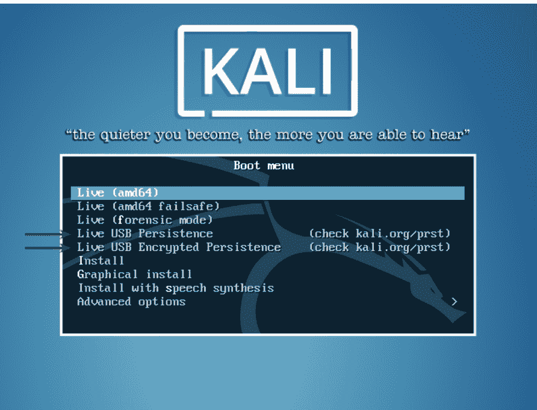

图 9.1 持久化菜单条目


当启用此功能时，`live-boot` 将扫描所有标记为 `persistence` 的文件系统（可以通过 `persistence-label=value` 启动参数进行覆盖），安装程序将设置在该分区找到的 `persistence.conf` 文件中列出的目录的持久化（每行一个目录）。特殊值 `/ union` 允许通过联合挂载（union mount）实现所有目录的完全持久化，这是一种叠加层，它只存储与底层文件系统相比的更改。持久化目录的数据存储在包含相应 `persistence.conf` 文件的文件系统中。

### 9.4.2. 在 USB 闪盘上设置未加密持久化

在本节中，我们假设你已经按照第 2.1.4 节“在 DVD-ROM 或 USB 闪盘上复制镜像”[第 19 页]的说明准备准备了 Kali Live USB 闪盘，并且你使用的 USB 闪盘足够容纳 ISO 镜像（约 3 GB）以及你想要持久化的目录数据。我们还假设 USB 闪盘被 Linux 识别为 `/dev/sdb`，并且它只包含默认 ISO 镜像部分的两个分区（`/dev/sdb1` 和 `/dev/sdb2`）。在执行此操作时请务必小心。如果你重新分区了错误的驱动器，很容易破坏数据。

要添加新分区，你必须知道已复制的镜像的大小，以便让新分区从 live 镜像之后开始。然后使用 `parted` 实际创建分区。以下命令分析了 ISO 名称 `kali-linux-2016.1-amd64.iso`，假设它存在于 USB 闪盘上：

```
# /dev/sdb print
Model: SanDisk Cruzer Edge (scsi)
Disk /dev/sdb: 32,0GB
Sector size (logical/physical): 512B/512B
Partition Table: mdos
Disk Flags:

Number Start End Size Type File system Flags
1 32,8KB 2852MB 2852MB primary boot, hidden
2 2852MB 2945MB 93,4MB primary
# $start=$(du --block-size=1MB kali-linux-2016.1-amd64.iso | awk '{print $1}')
# echo "Size of image is $start MB"
# parted /dev/sdb mkpart primary "${start}MB" 100%
Information: You may need to update /etc/fstab.
```

```
# /dev/sdb print
Model: SanDisk Cruzer Edge (scsi)
Disk /dev/sdb: 32,0GB
Sector size (logical/physical): 512B/512B
Partition Table: mdos
Disk Flags:

Number Start End Size Type File system Flags
1 32,8KB 2852MB 2852MB primary boot, hidden
2 2852MB 2945MB 93,4MB primary
3 2946MB 32,0GB 3GB primary
```

有了新的 `/dev/sdb3` 分区后，使用 `mkfs.ext4` 命令（以及其 `-L` 选项设置标签）帮助将其格式化为标记为 `persistence` 的 ext4 文件系统。然后将该分区挂载到 `/mnt`，并添加了所需的 `persistence.conf` 文件。在格式化任何磁盘时始终务必小心。如果你格式化了错误的磁盘或分区，可能会丢失宝贵的信息。

```
# mkfs.ext4 -L persistence /dev/sdb3
```

```
cat >>isolinux/live.cfg <<END

label live-demo
menu label ^Live USB with Demo Data
linux /live/vmlinuz
initrd /live/initrd.img
append boot=live username=root hostname=kali persistence-label=demo persistence
```

```
label live-work
menu label ^Live USB with Work Data
linux /live/vmlinuz
initrd /live/initrd.img
append boot=live username=root hostname=kali persistence-label=work persistence-encryption=luks persistence
```

```
END
```

接下来，我们将构建自定义 ISO 并将其复制到 USB 盘。然后，我们将创建并初始化两个用于持久化的分区和文件系统。第一个分区是不加密的（标签为 `demo`），第二个分区是加密的（标签为 `work`）。假设 `/dev/sdb` 是我们的 USB 盘，且我们自定义 ISO 的大小为 3000 MB，它看起来如下：

- `# parted /dev/sdb mkpart primary 3000 MB 55%`

- `# parted /dev/sdb mkpart primary 55% 100%`

- `# mkfs.ext4 -L demo /dev/sdb3`

- `[...]`

- `# mount /dev/sdb3 /mnt`

- `# echo "union" > /mnt/persistence.conf`

- `# umount /mnt`

- `# cryptsetup --verify-passphrase luksFormat /dev/sdb4`

- `[...]`

- `# cryptsetup luksOpen /dev/sdb4 kali_persistence`

- `[...]`

- `# mkfs.ext4 -L work /dev/mapper/kali_persistence`

- `[...]`

- `# mount /dev/mapper/kali_persistence /mnt`

- `# echo "union" > /mnt/persistence.conf`

- `# umount /mnt`

- `# cryptsetup luksClose /dev/mapper/kali_persistence`

这就全部完成了。你现在可以启动 USB 盘并根据需要从新的启动菜单项中进行选择了！

# 添加毁灭密码（Nuke Password）以增加安全性

Kali 修改了 `cryptsetup` 以实现一项新功能：你可以设置一个“毁灭密码”（nuke password）——使用它时，它将破坏所有用于管理加密分区的密钥。

当你经常旅行并需要一种快速方法来确保数据无法被恢复时，这非常有用。启动时，只需输入毁灭密码而不是普通密码，这样任何人（包括你本人）都将无法访问你的数据。

在使用该功能之前，明智的做法是对加密密钥进行备份，并将其保存在某个安全的地方。

按照本节中的示例，你可以使用此命令添加毁灭密码：

```bash
### cryptsetup luksAddNuke /dev/sdb4
Enter any existing passphrase:
Enter new passphrase for key slot:
Verify passphrase:
```

关于该功能的更多信息，可以在以下教程中找到：

- https://www.kali.org/tutorials/nuke-kali-linux-luks/

# 9.5. 总结

在本章中，我们学习了如何修改 Kali 源码包，这些包是 Kali 中发布的所有应用程序的构建构建模块。我们还学会了如何自定义和安装 Kali 内核。然后，我们讨论了 live-build 环境，并探讨了如何构建自定义的 Kali Linux ISO。我们还演示了如何创建加密和未加密的 Kali USB 安装。

## 9.5.1. 修改 Kali 软件包的总结提示

修改 Kali 软件包通常是 Kali 贡献者和开发人员的任务，但你可能有官方软件包无法满足的特定需求，而了解如何构建修改后的包非常有价值，特别是当你想要分享你的更改、在内部部署它们或将软件整洁地回滚到之前的状态时。

当你需要修改某个软件时，下载源码、进行更改并使用修改后的软件可能很有吸引力。然而，如果你的应用程序需要系统级设置（例如带有 `make` 步骤），那么它将用 `dpkg` 未知的文件污染你的文件系统，并很快就会无法通过包依赖关系捕捉的问题。此外，这种类型的软件修改分享起来更加繁琐。

在创建修改后的包时，通用流程始终相同：获取源码包，进行你的更改，然后构建包。对于每一步，通常都有多个工具可以处理每个任务。

要重新构建 Kali 软件包，首先下载源码包，它由一个 `*.dsc`（Debian 源码控制）文件和从该控制文件引的其他文件组成。


源码包存储在可以通过 HTTP 访问的镜像。获取它们最高效的方法是使用 `apt source <source-package>-name`，你需要在 `/etc/apt/sources.list` 文件中添加 `deb-src` 行，并使用 `apt update` 更新索引。

此外，你可以使用 `dget`（来自 `descripts` 包）直接下载带有相应文件的 `.dsc` 文件。对于源码托管在 `git.kali.org`¹⁰ Git 仓库中的 Kali 特有包，你可以通过 `git clone git://git.kali.org/packages/source-package` 获取源码（如果你在仓库中没有看到任何内容，请尝试通过 `git checkout master` 切换到 `kali/master` 分支）。

下载源码后，使用 `sudo apt build-dev /` 安装源码包列出的构建依赖包。此命令必须在包的源码目录下运行。

对源码包的更新包含以下步骤的组合：

- 第一步是用 `dch --local version-identifier` 更改版本号，以区分你的包与原始包区分，或使用 `dch` 修改其他包详情。
- 使用 `patch -p1 < patch-file` 应用补丁，或修改 `quilt` 的补丁序列。
- 调整构建选项，通常位于 `debian/rules` 文件中。

修改源码包后，使用 `dpkg-buildpackage -us -uc` 从源码目录构建二进制包。生成的包可以使用 `dpkg -i package-name_arch.deb` 安装。

## 9.5.2. 重新编译内核的总结提示

作为高级用户，你可能想要重新编译 Linux 内核。你可能想要精简 Kali 内核、添加非标准驱动程序或应用内核补丁。但要注意：配置不当的内核可能会导致系统不稳定。对于大多数内核修改，你需要通过 `apt install build-essential libncurses-dev fakeroot` 安装一些包。

> ¹⁰http://kali.org

`apt-cache search ^linux-source` 应列出 Kali 提供的最新内核版本，`apt install linux-source-number` 会将内核压缩包安装到 `/usr/src`。

在需要配置内核时，请记住以下几点：

- 除非你是高级用户，否则你应该首先填充内核配置文件。首选方法是通过拷贝 `/boot/config` 到 `~/kernel/.config` 来借鉴 Kali 标准配置。或者，你可以运行 `make architecture_defconfig` 获取适用于架构的合理配置。
- 基于文本的 `makeconfig` 配置工具将读取 `.config` 文件并在巨大的菜单中向你展示所有配置项。选择一个项目将显示其文档、可能的值并允许你输入新值。

在内核源码目录下运行时，`make clean` 将移除之前编译的文件，`make deb-pkg` 将生成 Debian 包。`linux-image-version .deb` 包含内核镜像和关联模块。

要实际使用构建的内核，使用 `dpkg -i file.deb` 安装所需的包。`linux-image` 包是必需的；只有在你需要构建外部内核模块时，才需要 `linux-headers` 包（这在你安装了 `*-dkms` 包时确实如此）。其他包通常是不需要的！

## 9.5.3. 构建 Live ISO 镜像的总结提示

官方 Kali 镜像使用 `live-build` 构建，这是一组脚本，允许对 ISO 镜像创建的所有方面进行自动化和自定义。

你可以通过两个命令从 Kali 的 Git 仓库获取你的 live-build 配置：`apt install curl live-build` 然后 `clone git://kali.org/live-build-config.git`。

要生成更新但未修改的 Kali ISO 镜像，只需运行 `./build.sh --verbose`。构建将需要很长时间才能完成，因为它将下载所有包含的包。完成后，你将在 `images` 目录找到新的 ISO 镜像。如果你在命令行中使用 `--variant`，它将构建指定的 Kali ISO 变体。各种变体

> http://kali-live.alioth.debian.org/live-build/

这些变体通过其配置目录 `kali-config-variant-*` 定义。主镜像是 gnome 变体。

有几种方法可以通过修改 `live-build` 的配置目录来自定义您的 ISO：

- 通过修改 `package-lists/*.chroot` 文件，可以向 live ISO 添加（或从其移除）包。
- 通过将 `.deb` 文件放置在 `packages.chroot` 目录中，可以在 live 镜像中包含自定义包。可以使用 `preseed/*.cfg` 文件对它们的安装进行预设（preseeded）。
- 您可以通过将文件放在 `includes.chroot` 配置目录下的预期位置，从而向 live 文件系统添加文件。
- 您可以通过将脚本安装为 `hooks/Live/*.chroot` 文件，在 live 系统的 chroot 设置过程中执行脚本。您还可以在生成的 live 镜像启动时执行脚本：您必须妥安排将它们安装在 `/usr/lib/live/config/XXXX-name`，例如通过依赖 `includes.chroot` 配置目录来实现。
- 《Debian Live 系统手册》¹ 是 `live-build` 配置和测试的极佳参考。

在 USB 闪盘上设置加密和未加密的持久化：创建一个标准的 Kali USB 安装相当简单。虽然该过程在语法上可能看起来复杂，但要在您的便携式安装中添加加密和未加密的持久化相对直接，这可以显著扩展其功能。

在下一章中，我们将讨论 Kali 如何扩展到企业级。我们将讨论配置管理，并向您展示如何扩展和自定义 Kali Linux，使得无论您拥有一台机器还是几千台机器，都能轻松部署。


# 关键词

- PXE 安装
- 配置管理
- Saltstack
- 分叉（Forking）Kali 包
- 配置包
- 包仓库


# 企业级中的 Kali Linux

- 目录
- 通过网络安装 Kali Linux (PXE 启动) 252
- 利用配置管理 255
- 扩展和自定义 Kali Linux 262
- 总结 273

到目前为止，我们看到 Kali 是一个极其强大且安全的 Debian 派生版本，提供了强大的安全和加密功能、高级的包管理、多平台能力以及（它最广为人知的）为安全专业人员提供的世界级工具库。可能显而易见的是 Kali 如何从桌面扩展到中型或大型桌面部署，对多个 Kali 安装进行中心化管理和企业级控制。在本章中，我们将向您展示 Kali 如何扩展到企业之外。简而言之，阅读本章后，您将能够快速部署针对您的需求预配置的安全 Kali 系统，并由于 Kali 的（半自动）包更新安装，保持其同步。

这种规模的扩展需要几个步骤，包括启动 PXE 网络启动、使用高级配置管理工具（SaltStack）、分叉和自定义包的能力，以及包仓库的部署。我们将详细介绍每个步骤，向您展示如何完成“重体力工作”，并以相对轻松的方式部署、管理和维护大量的自定义 Kali Linux 安装。如果这还不够，我们还会投入一群“小从兵”（minions）来协助运行您的帝国。

## 10.1. 通过网络安装 Kali Linux (PXE 启动)

正如我们在之前的章节中所看到的，一旦熟悉了操作，基本的 Kali Linux 安装过程就是直接的。但如果您需要在多台机器上安装 Kali，标准设置可能会非常繁琐。坦率地说，您可以通过网络启动计算机来开始 Kali 安装程序。这允许您同时快速、方便地在许多机器上安装 Kali。

首先，您将需要从网络启动目标机器。这是通过预执行执行环境（PXE）实现的，PXE 是一种客户端/服务器接口，设计用于从网络启动任何联网设备，即使该设备没有安装操作系统。设置 PXE 网络启动需要您至少配置一个简单的简易文件传输协议（TFTP）服务器和一个 DHCP/BOOT 服务器。如果您还想托管一个将在安装过程中自动使用的“deb”文件，您还需要一个 Web 服务器。

幸运的是，`dnsmasq` 同时处理 DHCP 和 TFTP，因此您可以在单个服务上运行并设置所需的所有内容。Kali 系统默认安装了（但未启用）Apache 服务器。


| 分离的 DHCP 和 TFTP 守护进程 | 对于复杂的设置，dnsmasq 的功能集可能太有限，或者您可能希望在已经在运行 DHCP 守护进程的主网络上启用 PXE 启动。在这两种情况下，您将需要配置单独的 DHCP 和 TFTP 守护进程。Debian 安装手册涵盖了用于 PXE 启动的 `isc-dhcp-server` 和 `tftpd-hpa` 的设置。 |
| :--- | :--- |
| https://www.debian.org/releases/stable/amd64/ch04s5.html |  |

为了设置 dnsmasq，您必须首先通过 `/etc/dnsmasq.conf` 对其进行配置。基础配置仅包含几行关键代码：

```
# 处理的网络接口
interface=eth0
# DHCP 选项
# 分配的 IP 范围
dhcp-range=192.168.101.100,192.168.101.200,128
# 向客户端宣告的网关
dhcp-option=router,192.168.101.1
# 向客户端宣告的 DNS 服务器
dhcp-option=dns-server,8.8.8.8,8.8.4.4
# 向客户端宣告的启动文件
dhcp-boot=pxelinux.0
# TFTP 选项
enable-tftp
# 托管服务的文件目录
tftp-root=/tftpboot/
```

配置好 `/etc/dnsmasq.conf` 后，您将需要将安装启动文件放置在 `/tftpboot/` 目录中。Kali Linux 提供了一个专门用于此目的的文件归包，可以直接解压到 `/tftpboot/` 中。只需为您的目标机器选择 32 位（i86）和 64 位（amd64）以及标准或通用（gtk）安装方法，并选择合适的归包：

- http://http.kali.org/dists/kali-rolling/main/installer-amd64/current/images/netboot/gtk/netboot.tar.gz
- http://http.kali.org/dists/kali-rolling/main/installer-amd64/current/images/netboot/txt/netboot.tar.gz
- http://http.kali.org/dists/kali-rolling/main/installer-amd64/current/images/netboot/iso/netboot.tar.gz

一旦选了归包，创建 `/tftpboot/`，下载归包并将其解压到该目录：

```
# mkdir /tftpboot
# cd /tftpboot
# wget http://http.kali.org/dists/kali-rolling/main/installer-amd64/current/images/netboot/gtk/netboot.tar.gz
# tar xf netboot.tar.gz
# ls -l
total 25896
drwxr-xr-x 3 root root 4096 May 6 10:00 .
drwxr-xr-x 2 root root 4096 May 6 10:00 ..
-rw-r--r-- 1 root root 47 May 6 10:00 dldinux.c32
-rw-r--r-- 1 root root 35 May 6 10:00 menu.cfg
-rw-r--r-- 1 root root 265072 May 6 10:00 pselux.cfg
-rw-r--r-- 1 root root 71 May 6 10:00 pselux.info
-rw-r--r-- 1 root root 33 May 6 10:00 pselux.0
-rw-r--r-- 1 root root 78824 May 6 10:00 vesamenu.c32
-rw-r--r-- 1 root root 25896 May 6 10:00 version
```

## 10.2. 利用配置管理

由于能够快速地在多台计算机上安装 Kali，你可能需要帮助来在安装后管理这些机器。你可以利用配置管理工具来管理或将替换计算机配置为任何所需的状态。

Kali Linux 包含了许多流行的配置管理工具（如 `ansible`, `chef`, `puppet`, `saltstack` 等），但在本节中，我们只介绍 SaltStack。

- => https://saltstack.com

## 10.1. 设置 SaltStack

SaltStack 是一种集中化的配置管理服务：一个 `salt master`（主节点）管理许多 `salt minions`（从节点）。你应该在所有你想要管理的主机均可访问的服务器上安装 `salt-master` 包，并在想要管理的主机上安装 `salt-minion`。每个 minion 必须被告知它去哪里寻找主节点。只需编辑 `/etc/salt/minion` 并 `master` 键设置为 Salt master 地址即可。注意 Salt 使用 YAML 进行配置。

```
minion# vim /etc/salt/minion
minion# grep master /etc/salt/minion
master# 192.168.122.105
```

每个 minion 都有一个存储在 `/etc/salt/minion_id` 中的唯一标识符，默认是其主机名。此 minion 标识符将用于配置规则，因此在 minion 开启与 master 的连接之前，正确设置它是非常重要的：

```
minion# echo kali-scratch >/etc/salt/minion_id
minion# systemctl enable salt-minion
minion# systemctl start salt-minion
```

当 `salt-minion` 服务运行时，它将尝试连接到 Salt master 以交换某些加密密钥。在 master 端，你必须接受 minion 用来识别身份的密钥并允许连接继续。后续连接将是：

```
master# systemctl enable salt-master
master# systemctl start salt-master
master# salt-key --list all
Accepted Keys:
Denied Keys:
accepted Keys:
kali-scratch
Rejected Keys:
master# salt-key --accept kali-scratch
The following keys are going to be:
```

Unaccepted Keys:

kali-scratch

Proceed? [n/Y] y

Key for minion kali-scratch accepted.

## 10.2.2. 在 Minions 上执行命令

一旦 minions 连接上，你就可以从 master 在它们上执行命令：

```
master# salt '*' test.ping
kali-scratch:
  True
kali-master:
  True
```

该命令要求所有 minions（`'*'` 是针对所有 minions 的通配符）执行测试执行模块中的 `ping` 函数。该函数在成功时返回 True 值，这是确保 master 与各种 minions 之间连接正常的简单方法。

你也可以通过在第一个参数中提供标识符来针对特定的 minion，通过使用不那么通用的通配符（如 `'*-scratch'` 或 `'kali-*'`）来针对 minions 的子集。以下是在 kali-minion 上执行任意 shell 命令的示例：

```
master# salt kali-scratch cmd.shell uptime -a
kali-scratch:
05:25:48 44 min, 2 users, load average: 0.00, 0.01, 0.05
Linux kali-scratch 4.5.0-kali1-amd64 #1 SMP Debian 4.5.3-2kali1 (2016-05-09) x86_64
GNU/Linux
```

有许多模块可用于各种情况。我们涵盖了所有模块，但完整列表可以在 https://docs.saltstack.com/en/latest/ref/modules/all/index.html 获取。你也可以通过 `salt minion doc` 命令获取给定 minion 上所有执行模块及其可用函数的描述。运行此命令会返回一个很长的函数列表，但你可以通过传递带有父模块前缀的函数或模块名称作为参数来过滤列表：

Salt Module Reference


```
master# salt kali-scratch sys.doc disk.usage
disk.usage:
Return usage information for volumes mounted on the
```

- minion

最实用的模块之一是 `pkg`，它是一个包管理器抽象，依赖于系统相应的包管理器（Debian 及其衍生版如 Kali 使用 `apt-get`）。

`pkg.refresh_db` 命令更新包列表（即执行 `apt-get update`），而 `pkg.upgrade` 安装所有可用的更新（执行 `apt-get upgrade` 或 `apt-dist-upgrade`，通常取决于接收到的选项）。`pkg.list` 列出待处理的升级操作（将由 `pkg.upgrade dist_upgrade=True` 命令执行）。

`service` 模块是服务管理器（Kali 中为 `system`）的抽象，让你执行所有 `systemctl` 操作：`service.enable`、`service.disable`、`service.start`、`service.stop`、`service.restart` 和 `service.reload`：

```
master# salt '*' service.enable ssh
kali-scratch:
True
kali-master:
True
master# salt '*' service.start ssh
kali-master:
True
kali-scratch:
True
master# salt '*' pkg.refresh_db
kali-scratch:
-------
kali-master:
-------
master# salt '*' pkg.upgrade dist_upgrade=True
kali-scratch:
-------
changes:
-------
base-files:
-------
new:
1:2
```

changes:

-------

base-files:

-------

new:

1:2

kali-scratch:

-------

kali-master:

-------

kali-scratch:

-------

changes:

-------

base-files:

-------

new:

1:2

kali-scratch:

-------

kali-master:

-------

kali-scratch:

-------

changes:

-------

base-files:

-------

new:

1:2

kali-scratch:

-------

kali-master:

-------

kali-scratch:

-------

changes:

-------

base-files:

-------

new:

1:2

kali-scratch:

-------

kali-master:

-------

kali-scratch:

-------

changes:

-------

base-files:

-------

new:

1:2

...

为了节省时间，你可以依赖于箱即用的状态文件（state files）：

```yaml
offsec.sls:
offsec_repository:
pkgrepo.managed:
  name: deb http://pkgrepo.offsec.com offsec-internal main
  file: /etc/apt/sources.list.d/offsec.list
  key_url: salt://offsec-apt-key.asc
  require_in:
    pkg: offsec-defaults
```

```yaml
offsec-defaults:
pkg.installed
```

```yaml
ssh_key_for_root:
ssh_auth.present:
  user: root
  name: offsec-rsa AAAAB3NzaCyc2...89C4Nrertzog@kali
```

`offsec_repository` 依赖于 `pkgrepo` 状态模块。示例使用了该状态模块中的 `managed` 函数来注册包仓库。通过 `key_url` 属性，你 let salt 知验证存储库签名所需的（ASCII 加密的）GPG 密钥可以从 salt master 上的 `/srv/salt/offsec-apt-key.asc` 获取。`require_in` 属性确保该状态在 `offsec-defaults` 之前被处理，因为后者需要正确配置存储库来安装软件包。

`offsec-defaults` 状态安装了同名的软件包。这表明密钥的名称对于状态来说是一个重要值，尽管它始终可以通过 `name` 属性进行覆盖（正如前一个状态所做的那样）。对于此类简单情况，这样做既易读又简洁。

最后一个状态（`ssh_key_for_root`）将 `name` 属性中给出的 SSH 密钥添加到 `/root/.ssh/authorized_keys`（目标用户在 `user` 属性中）。请注意，为了可读性，我们缩短了密钥，在这里您应该在 `name` 属性中放置完整的密钥。

此状态可以应用于给定的 minion（从节点）：

```
server# salt kali-scratch state.apply offsec
kali-scratch:

  ID: offsec_repository
  Function: pkgrepo.managed
  Name: deb http://pkgrepo.offsec.com offsec-internal
  Result: True
  Comment: Configured package repo 'deb http://pkgrepo.offsec.com offsec-internal
    main'
  Started: 06:00:15.767794
  Duration: 4707.35 ms
  Changes:
    -----
    repo:
      deb http://pkgrepo.offsec.com offsec-internal main
    -----
  ID: offsec-defaults
  Function: pkg.installed
  Result: True
  Comment: The following packages were installed/updated: offsec-defaults
  Started: 06:00:21.325184
  Duration: 19246.041 ms
  Changes:
    -----
    offsec-defaults:
      new:
        1.0
      old:
    -----
  ID: ssh_key_for_root
  Function: ssh_auth.present

Name: ssh-rsa AAAAB3NzaCylc2..89C4N rhertzog@kali

Result: True
Comment: The authorized host key AAAAB3NzaCylc2..89C4N for user root was attached
Started: 06:00:40.582539
Duration: 62.103 ms
Changes:

```

AAAAB3NzaCylc2..89C4N:

New

```

Summary for kali-scratch

Succeeded: 3 (changed=3)
Failed: 0
Total states run: 3
Total run time: 24.015 s

它也可以通过将其记录在 `/srv/salt/top.sls` 文件中永久与 minion 关联，该文件被 `state.highstate` 命令用于一次性应用所有相关状态：

```
server# cat /srv/salt/top.sls

base:

kali-scratch:

  offsec:

    - offsec

server# salt kali-scratch state.highstate

kali-scratch:

```

```
ID: offsec_repository

Function: debkgrepo.managed

Name: deb http://pkgrepo.offsec.com offsec-internal main

Result: True

Comment: Package repo 'deb http://pkgrepo.offsec.com offsec-internal main' already

  - configured

Started: 06:06:20.650053


Duration: 62.805 ms

Changes:

```

```

ID: `offsec-defaults`

Function: `pkg.installed`

Result: True

Comment: Package offsec-defaults is already installed

Started: 06:06:21.436193

Duration: 385.092 ms

Changes:

```

```

ID: `ssh_key_for_root`

Function: `ssh_auth.present`

Name: `ssh-rsa AAAAB3NzaC1yc2...89C4N rhertzog@kali`

Result: True

Comment: The authorized host key AAAAB3NzaC1yc2..89C4N is already present for

  user root

Started: 06:06:21.821811

Duration: 1.936 ms

Changes:

```

Summary for kali-scratch
-----------------
Succeeded: 3
Failed: 0
-----------------
Total states run: 3
Total run time: 449.833 ms

## 10.3. 扩展和自定义 Kali Linux

有时你需要修改 Kali Linux 以适应你的本地需求。实现这一点的最佳方法是维护你自己的软件包仓库，托管你必须分叉的 Kali 软件包的修改版本，以及提供自定义配置和额外软件（Kali Linux 未提供）的辅助软件包。

### 10.3.1. 分叉 Kali 软件包

请参考第 9.1 节“修改 Kali 软件包”[第 222 页] 获取关于此主题的解释。如果你有充分理由，所有软件包都可以分叉，但你必须意识到分叉软件包是有成本的，每当 Kali 发布更新时，你都必须更新它。以下是你可能想要分叉软件包的一些原因：

- 为了添加补丁以修复 bug 或添加新功能。在大多数情况下，你可能希望将该补丁提交给上游开发者，以便从源头修复 bug 或添加功能。
- 为了使用不同的选项进行编译（假设有充分理由说明 Kali 没有使用这些选项编译；否则，最好与 Kali 开发者讨论，看他们是否能启用所需的选项）。

相比之下，以下是分叉软件包的一些糟糕理由以及如何处理你问题的建议：

- 为了修改配置文件。使用配置管理你有多个更好的选项，可以自动安装修改后的配置文件，或者安装一个配置软件包，该包会将文件放在配置目录中（如果可用）或重定向原始配置文件。
- 为了更新到更新的上游版本。同样，与开发者合作直接在 Debian 或 Kali 中更新软件包更好。在滚动发布模型下，更新会很快送达终端用户。

在所有可用软件包中，有些是 Kali Linux 的构建基石，在某些情况下分叉它们可能很有趣：

- `kali-meta`：此源包构建了所有的 kali-
- `desktop-base`:此源包包含各种文件
- `kali-menu`:此源包定义了菜单

### 10.3.2. 创建配置软件包

现在我们已经接触了使用 Salt 进行配置管理以及分叉，是时候将这些内容封装成一个实际的示例了。在这个示例中，我们将创建一个设置默认设置的配置软件包。

这看起来像是一项艰巨的任务（特别是你想创建一个软件包时），但幸运的是，它并没有那么简单。

| 查看示例软件包 | 如果你想创建一个软件包 |
| :--- | :--- |
| `offsec-defaults` 软件包将包含几个文件： | 考虑 `kali-defaults` 软件包。 |
| `/etc/apt/sources.list/offsec.list`：APT 的 sources.list 条目，启用公司的内部存储库 | |
| `/etc/apt/trusted.gpg/offsec.gpg`：用于签名公司内部存储库的 GPG 密钥 | |
| `/etc/salt/minion.conf`：Salt 配置，指示 master 位置 | |
| `/usr/share/images/offsec/background.png`：带有 Offensive Security Logo 的精美背景图片 | |
| `/usr/share/glib-2.0/schemas/90_offsec-defaults.gschema.override`：提供 GNOME 默认设置的文件 |

首先，创建一个 `offsec-defaults-1.0` 目录并将所有文件放入该目录。然后运行 `dh_make --native`（来自 `dh-make` 软件包）添加 Debian 打包指令，这些指令将存储在子目录中：

```
$ mkdir offsec-defaults-1.0; cd offsec-defaults-1.0

$ dh_make --native

Type of package: (single, indep, library, python)

[s/i/l/p?] i

Email-Address : buxy.kali.org

License : gpl3

Package Name : offsec-defaults

Maintainer Name : Raphael Herzog

Version : 1.0

Package Type : indep

Date : Thu, 16 Jun 2016 18:04:21 +0200

Are the details correct? [Y/n/q] y

Currently there is not top level Makefile. This may require additional tuning

Done. 请编辑 debian/ 子目录中的文件。
```

首先提示软件包类型。在示例中，我们选择了 `indep`，这表示该源包将生成一个跨架构共享的单一二进制软件包（架构: all）。`single` 是其对应项，产生一个依赖于目标架构的单一二进制软件包（Architecture: any）。在这种情况下，`indep` 更相关，因为软件包仅包含文本文件而不包含二进制程序，因此可以在所有架构的计算机上类似使用。`library` 类型适用于共享库，因为它们需要遵循严格的打包规则。类似地，`python` 应该限制为 Python 模块。

### 维护者姓名和邮箱地址

大多数涉及包维护的程序都会在 `DEBUFFNAME` 和 `DEBMAIL` 或 `EMAIL` 环境变量中查找你的姓名和邮箱地址。一次性定义这些变量可以避免多次重复输入。如果你使用的默认 shell 是 Bash，只需简单地在你的 `~/.bashrc` 文件中添加以下行即可：

```
export EMAIL="buxy@kali.org"

export DEBUFFNAME="Raphael Herzog"
```


`dh_make` 命令创建了一个包含许多文件的 `debian` 子目录。其中某些文件是必须的，特别是 `rules`、`control`、`changelog` 和 `copyright`。以 `.ext` 结尾的文件是示例文件，可以通过修改它们并删除扩展名来使用。当不需要这些文件时，我们建议将它们删除。`compat` 文件应该保留，因为它是软件包构建过程中各个阶段所使用的 `debhelper` 程序套件（所有以 `dh_` 开头的程序）正常运行所需的。

`copyright` 文件必须包含包内包含文档的作者信息以及许可协议。如果 `dh` 选择的默认许可不符合你的需求，你必须编辑此文件。以下是修改后的 `copyright` 文件：

```
Format: https://www.debian.org/doc/packaging-manuals/copyright-format/1.0/
Upstream-Name: offsec-defs

Files: *

Copyright: 2016 Offensive Security
License: GPL-3.0+

License: GPL-3.0+
本程序是自由软件：你可以根据自由软件基金发布的《GNU 通用许可协议》条款对其进行分发和/或修改，该协议可以是协议的第 3 版本，或（根据你的选择）任何后继版本。

本包的发行是希望它有用处，但`不提供任何保证`：即使没有对商品性或特定用途适用性的隐性保证。更多信息请参阅《GNU 通用许可协议》。

你应该在收到此程序的同时收到一份《GNU 通用许可协议》的副本。如果没有，请参阅 <https://www.gnu.org/licenses/>。

在 Debian 系统上，可以在 "/usr/share/common-licenses/GPL-3" 找到第 3 版《GNU 通用许可协议》的全文。
```

默认的 `changelog` 文件通常是合适的，将 "Initial release" 替换为更详细的解释应该足够：

```
offsec-defaults (1.0) unstable; urgency=medium

+   * 添加 salt minion 的配置文件。
* 添加 APT 的 sources.list 条目和 APT 的信任 GPG 密钥。
* 覆盖定义背景图片的 gsetting 架构。

-- Raphaël Herzog <bubxy@kali.org> 2016年6月16日 星期四 18:04:21 +0200
```

在示例示例中，我们将对 `control` 文件进行修改。我们将 `Section` 字段更改为 `misc` 并移除 `Vcs-Git` 和 `Vcs-Browser` 字段。最后，我们将填充 `Description` 字段：

```
Source: offsec-defaults

Section: misc

Priority: optional

Maintainer: Raphaël Herzog <bubxy@kali.org>

Build-Depends: debhelper (>= 9)

Standards-Version: 3.9.8

Package: offsec-defaults

Architecture: all

Depends: $(misc:Depends)

Description: Default settings for Offensive Security

This package contains multiple files to configure owned by Offensive Security.
```

+   * 它特别修改了：
* APT 的配置
* salt-minion 的配置
* 默认桌面设置

`rules` 文件通常包含一组规则，用于在专用子目录（以生成的二进制包命名）中配置、构建和安装软件。然后，该子目录的内容将在 Debian 软件包中进行归档（前提是它是文件系统的根目录）。在这种情况下，文件将安装在 `debian/offsec-defaults/` 子目录下。例如，为了生成一个安装了 `/etc/apt/sources.list.d/offsec.list` 的包，请将文件安装在 `debian/offsec-defaults/etc/apt/sources.list.d/offsec.list`。`rules` 文件被用作 `Makefile`，包含几个标准目标（分别包括 `clean` 和 `binary` 用于清理源码目录和生成二进制包）。

### 什么是 Makefile 文件？

你可能注意到了 `dh_make` 输出最后关于缺少 `Makefile` 的信息以及对它与 `rules` 文件相似性的提到。`Makefile` 是程序使用的脚本文件，它描述了如何在依赖树中从一组文件构建出其他文件的规则。例如，一个程序可以从一组源文件构建。`Makefile` 文件以以下格式描述这些规则：

```
target: source2 ...

    command1

    command2
```

对此类规则的解释是：如果其中一个 `source*` 文件比 `target` 文件新，则需要使用 `command1` 和 `command2` 生成 `target`。

请注意，命令行必须以制表符（tab）开头；另外请注意，当命令行以连杠（`-`）开头时，命令的失败不会中断整个过程。

尽管此文件是过程的核心，但它只包含了运行 `debhelper` 工具提供的标准命令集所需的极少内容。`dh_make` 生成的文件正是如此。为了安装你所有的文件，我们建议通过创建以下 `debian/offsec-defaults.install` 文件来配置 `dh_install` 命令的行为：

```
apt/offsec.list etc/apt/sources.list.d/

apt/offsec.gpg etc/apt/trusted.gpg/

salt/offsec.conf salt/minion.d/
```

更改 (N)名字、(E)邮箱或(O)确定/(Q)退出？ o

我们需要生成大量的随机字节。在生成质数期间，执行一些其他操作（在键盘上输入、移动鼠标、利用磁盘）是一个好主意；这让数字生成器有更好的机会获取熵。
[...]

```
gpg: /home/kgrepo/.gnupg/trustdb created

gpg: key B4EF2F0DD marked as ultimately trusted

gpg: directory '/home/kgrepo/.gnupg/openpgp-revocs.d' created

gpg: revocation certificate stored as '/home/kgrepo/.gnupg/openpgp-revocs.rev'

- F8EE22F7F4F1B71AE38DA61B2B7F7F4B4EF2F0D-public and secret key and signed.
```

```
gpg: checking the trustdb

gpg: marginals needed: 3 completed: 1 trust model: PGP

gpg: depth: 0 valid: 1 signed: 0 trust-: 0q, 0n, 0m, 0u

rsa2048/B4EF2F0DD 2016-06-17 (-S)

Key fingerprint = F8EE 22F7 F4F1 71AE 38DA 61B2 B7F7 F4B4EF 2F0D

[ultimate] Offensive Security Repository Key <repoadmin@offsec.com>

rsa2048/3B0355F3 2016-06-17 (uid connected as that)
```

当提示输入密码时，你应该输入一个空值（确认不想保护你的私钥），因为你希望能够交互式地签名仓库。注意，`gpg` 需要访问终端才能安全地提示或输入密码：这就是为什么在启动 `kgrepo` shell 之前，你更改了虚拟终端的所有者（由于你最初是以 root 身份连接的，它属于 root）。

现在你可以开始设置仓库了。`repropro` 需要一个专用目录，在该目录内你必须创建一个 `conf/distributions` 文件，记录软件包仓库中提供哪些发行版：

```
$ mkdir -p repropro/conf
$ cd repropro
$ cat >conf/distributions <<END
Codename: offsec-internal

AlsoAcceptFor: unstable

Origin: Offensive Security

Description: Offsec's Internal packages

Architectures: source amd64 i386

Components: main

SignWith: F8EE22F7F4F1B71AE38DA61B2B7F7F4B4EF2F02F0D
END
```


所需的字段是 `Codename`（提供发行版名称）、`Architectures`（指示发行版中可用的架构，输入端接受）以及 `Components`（指示发行版中可用的各种组件，组件是发行版的一种子部分）。

有了这个基础设置，你可以让 `repropro` 生成一个空仓库：

```
$ repropro export
Exporting indices...
```

```
$ find \
./db
./db/version
./db/references.db
./db/contents.cache.db
./db/checksums.db
./db/packages.db
./db/release.caches.db
./conf
./conf/distributions
./dists
./dists/offsec-internal
./dists/offsec-internal/Release.gpg
./dists/offsec-internal/Release
./dists/offsec-internal/main
./dists/offsec-internal/main/source
./dists/offsec-internal/main/source/Sources.gz
./dists/offsec-internal/main/binary-amd64
./dists/offsec-internal/binary-amd64/Packages
./dists/offsec-internal/main/binary-amd64/Release
./dists/offsec-internal/main/binary-amd64/Packages.gz
./dists/offsec-internal/binary-i386
./dists/offsec-internal/main/binary-i386/Packages
./dists/offsec-internal/main/binary-i386/Release
./dists/offsec-internal/main/binary-i386/Packages.gz
./dists/offsec-internal/InRelease
```

如你所见，`repropro` 在 `dists` 子目录中创建了仓库元数据。它还在 `db` 子目录中初始化了一个内部数据库。

现在是时候添加第一个包了。首先，将 `offsec-defaults` 包构建生成的文件（`offsec-defaults_1.0.dsc`、`defaults.tar.xz`、`offsec-defaults_1_0_all.deb` 和 `offsec-defaults_1_0_amd64.changes`）复制到托管软件包仓库的服务器上的 `/tmp` 目录，并使用 `reprore` 包含该包：

```
$ reprore include offsec-internal /tmp/offsec-defaults_1_0_amd64.changes
Exporting indices...
```

```
$ find pool
pool
pool/main
pool/main/o
pool/main/o/offsec-defaults
pool/main/o/offsec-defaults/1.0.dsc
pool/main/o/offsec-defaults/offsec-defaults_1_0.tar.xz
pool/main/o/offsec-defaults/offsec-defaults_1_0_all.deb
```

如你所见，它已将文件添加到 `pool` 子目录中自己的包里。`dists` 和 `pool` 目录是你完成 APT 仓库设置时需要通过 HTTP（公开地）提供的两个目录。它们包含了 APT 想要下载的所有文件。

假设你想在名为 `pkgrepo.offsec.com` 的虚拟主机上托管此，你可以创建以下 Apache 配置文件，将其设置为 `/etc/apache2/sites-available/pkgrepo.offsec.conf`，并启用 `a2ense pkgrepo.offsec.com`：

```
<VirtualHost *:80>
ServerName pkgrepo.offsec.com
ServerAdmin repoadmin@offsec.com
ErrorLog /var/log/apache2/pkgrepo.offsec.com-error.log
CustomLog /var/log/apache2/pkgrepo.offsec.com-access.log "%h %l %u %t \"r" %>s 0"
DocumentRoot "/home/pkgrepo/reprore"
<Directory "/home/pkgrepo/reprore">
  Options FollowSymLinks MultiViews
  Require all granted
  AllowOverride All
</Directory>
</VirtualHost>
```

在需要从此仓库获取包的机器上，相应的添加的 `sources.list` 条目如下：

```
deb http://pkgrepo.offsec.com offsec-internal main
# 如果你想访问源码包，请启用下一行
# deb-src http://pkgrepo.offsec.com offsec-internal main
```

```
Accepted Keys:
Denied Keys:
Unaccepted Keys:
kali-scratch
Rejected Keys:
master# salt-key --accept kali-scratch
The following keys are going to be accepted:
Unaccepted Keys:
kali-scratch
Proceed? [n/Y] y
Key for minion kali-scratch accepted.
```

- 一旦 minion 连接，你就可以从主节点对它们执行命令。例如：

```
master# salt '*' test.ping
kali-scratch:
True
kali-master:
True
master# salt kali-scratch cmd.shell 'uptime; uname -a'
master# salt kali-scratch sys.odc
master# salt '*' service.enable ssh
[...]
master# salt '*' service.start ssh
[...]
master# salt '*' pkg.refresh.db
[...]
master# salt '*' pkg.upgrade dist_upgrade=True
server# salt '*' cmd.shell 'kill -f dnmap_client'
```


进入`/path/to/xxx`目录，找到`xxx.json`。

在表达式`cvar = avar + bvar`中，加法运算符（`+`）将`avar`与`bvar`相加，得到它们的和`cvar`

在`List.of(arg0, arg1, arg2)`中，`List`接口的工厂方法`of()`接受一系列的元素，返回包含它们的只读列表。

之后我们这样调用`cmd`命令：`cmd arg0 arg1 arg2`。

```
if (condVar > someVal) {console.log("xxx")}
```

- 执行模块的完整列表可以在 `docs.saltstack.com/latest/ref/modules/all/index.html` 处找到。

- 使用 Salt 文件（可重用的配置模板）来调度操作、收集数据、在多个 minion 上编排操作序列、置备云系统并将其纳入管理，以及保存。使用预定义的 Salt 公式可以节省时间：

> https://docs.saltstack.com/latest/topics/development/conventions/formulas.html

- 当涉及到分叉（fork）一个包时，首先要决定这是否是你需要的任务。这具有显著的优缺点。请仔细审查它们。`kali-meta`、`desktop-base` 和 `kali-menu` 包是很有趣且可能的选择。构建包的过程可能令人生畏畏，且难以总结。

既然我们已经涵盖了 Kali Linux 在安装、配置、自定义和部署方面的所有基础，让我们转向 Kali Linux 在信息安全领域的角色。

# 关键词

- 评估类型
- 漏洞评估
- 合规性渗透测试
- 传统渗透测试
- 应用评估
- 攻击类型
- 拒绝服务
- 内存损坏
- Web 漏洞
- 密码攻击
- 客户端攻击

# 安全评估简介

- 评估中的 Kali Linux 281
- 评估的类型 283
- 评估的正式化 293
- 攻击类型 294
- 总结 297

到为止，我们已经涵盖了许多 Kali Linux 特有的功能，你应该对 Kali 的特殊之处以及如何完成许多复杂任务有强力的理解。

在介绍如何使用 Kali 之前，有几个与安全评估相关的概念你需要理解。在本章中，我们将介绍这些概念以让你入门，并提供帮助你使用 Kali 执行安全评估的参考。

首先，值得花些时间来探讨在处理信息系统时，“安全”到底意味着什么。在尝试保护信息系统安全时，你关注的是系统的三个主要属性：

- 机密性（Confidentiality）：没有访问系统或信息的参与者是否可以访问系统或信息？
- 完整性（Integrity）：数据或系统是否会以某种非预期的方式被修改？
- 可用性（Availability）：数据或系统是否在预期的时间和方式下是可以访问的？

这些概念共同构成了 CIA（机密性、完整性、可用性）三元组，在很大程度上，它们是你作为标准部署、维护或评估的一部分在保护系统时关注的重点。

# 11.1. 评估中的 Kali Linux

在准备在领域中使用 Kali Linux 之前，你必须确保你有一个干净、良好的安装。新手安全专业人员的一个常见错误是在多次评估中使用同一个安装。这个问题存在两个主要原因：

- 在评估过程中，你经常会安装、调整或更改你的系统。这些一次性的更改可能让你运行起来并解决特定问题，但很难跟踪；它们让你的系统更难以维护；并使未来的配置复杂化。
- 每次安全评估都是独特的。留下笔记、代码和其他更改会导致混乱，或者更糟——客户数据的交叉污染。

这就是为什么强烈建议从一个干净的 Kali 安装开始，以及为什么准备一个预自定义的 Kali Linux 版本用于自动化安装是值得的。请务必回查阅第 9.3 节“构建自定义 Kali ISO 镜像”[第 236 页]和第 4.3 节“无人值安装”[第 91 页]了解如何操作，因为你今天自动化得越多，明天浪费的时间就越少。

在实地配置 Kali 时，每个人的需求都不同，但有一些通用的建议是你真正想要遵循的。首先，考虑使用第 4.2.2 节“在全加密文件系统上进行安装”[第 85 页]中记录的加密安装。这将保护你在物理机器上的数据，如果你的笔记本电脑被盗，这将会是救命稻草。

为了额外的旅行安全，在你将（加密的）密钥发送给办公室的同事后，考虑解密密钥（参见“为了额外安全添加 Nuke 密码”[第 245 页]）。这样，你的数据将一直安全，直到你到达办公室并使用解密密钥恢复笔记本电脑。

另一点是，你应该仔细检查已安装的软件包列表。考虑你正准备完成的工作可能需要哪些工具。例如，如果你正着手无线安全评估，可以考虑使用 `kali-linux-wireless` 元软件包，它包含了 Kali Linux 中提供的所有无线评估工具；或者，如果将进行 Web 应用评估，你可以通过 `kali-linux-web` 元软件包安装所有可用的 Web 应用测试工具。最好假设你在进行安全评估时无法方便地访问互联网，因此请务必尽早做好准备。

出于相同的原因，你可能希望检查你的网络设置（参见第 5.1 节“配置网络”[第 104 页]和第 7.3 节“加固网络服务”[第 153 页]）。双重检查你的 DHCP 设置，并检查你在分配的 IP 地址上监听的服务。这些设置可能对你的成功产生关键性影响。你无法评估你看不见的事物，而且过多的监听服务可能会在你开始工作之前标记你的系统并导致其被关闭。

如果你的职责涉及调查网络入侵，密切关注你的网络设置将更为重要，并且要避免更改受影响的系统。带有 `kali-linux-forensic` 元软件包并以取证模式启动的自定义 Kali 版本不会自动挂载磁盘或使用交换分区。通过这种方式，你可以在利用 Kali Linux 中许多取证工具的同时，维护受分析系统的完整性。

为工作妥善准备 Kali Linux 安装至关重要。你会发现，一个干净、高效且有效的 Kali 环境将让一切变得更加顺畅。

## 11.2. 评估类型

现在你已经确保你的 Kali 环境已就绪，下一步是确切定义你正在进行什么种类型的评估。在最高层面上，我们可以描述四种类型的评估：漏洞评估、合性测试、传统的渗透测试和应用程序评估。一个项目可能涉及每种类型评估的各种元素，但值得对它们进行详细描述，并解释它们与你的 Kali Linux 构建和环境的相关性。

在深入研究不同类型的评估之前，首先需要注意漏洞（vulnerability）和利用（exploit）之间的区别。

漏洞被定义为一种缺陷，当被利用时会损害信息系统的机密性、完整性可用性。可能会遇到许多类型的漏洞：

- `文件包含`：应用程序中的文件包含漏洞¹允许你将本地或远程文件的内容包含在程序的计算中。例如，一个应用程序可能有一个“每日消息”功能，它读取文件内容并将其包含在网页中显示给用户。当这种类型的功能编写不当时，它可以允许攻击者修改其 Web 请求，以强制网站包含其所选文件的内容。
- `SQL 注入`：SQL 注入²攻击是指程序的输入验证程序被绕过，允许攻击者为目标程序提供执行的 SQL 命令。这是一种命令执行的形式，可能导致潜在的安全问题。
- `缓冲区溢出`：缓冲区溢出³ 种绕过输入例程将数据写入缓冲区相邻内存的漏洞。在某些情况下，通过对被覆盖的内存数据进行仔细操作，可以获得对目标程序运行至关重要的相邻内存位置和代码执行。
- `竞态条件`：竞态条件⁴是一种利用程序中依赖关系的漏洞。在某些情况下，程序的工作流取决于特定的事件序列。如果你可以改变这一事件序列，可能会导致漏洞。

另一方面，利用（exploit）是一种软件，在使用时会利用特定的漏洞，尽管并非所有漏洞都是可扩展的。利用程序必须创建一个运行进程，强制其执行非预期的操作，利用工具的创建可能是复杂的。此外，现代计算平台中还有许多反利用技术，旨在增加利用漏洞的难度，例如数据执行保护⁵（DEP）和地址空间布局随机化⁶（ASLR）。

### 11.2.1. 漏洞评估

漏洞被认为是一种可以以某种方式损害信息系统机密性、完整性可用性的弱点。在漏洞评估中，你的目标是为目标环境中发现的漏洞创建一个简单的清单。目标环境的概念极其重要。你必须确保留在客户的目标网络和要求的范围范围之内。超出评估范围可能会导致服务中断、违背客户的信任，或引发对你和你的雇主者的法律诉讼。

由于其相对简单性，漏洞测试通常在更成熟的环境中定期完成，作为其尽职调查的一部分。在大多数情况下，使用自动化工具（例如 Kali Tools 网站中漏洞分析⁷和 Web 应用⁸ 类别中的工具以及 Kali 桌面应用程序）来发现目标环境中的活动系统，识别监听器并对其进行枚举，以发现尽可能多的信息，如服务器软件、版本、平台等。

### 11.2.2. 合规性渗透测试

按复杂程度排序，下一种评估类型是政府和行业强制要求的渗透测试。这些是基于整个组织运行所属的合规框架的最常见的渗透测试。

### 11.2.4. 应用程序评估

虽然大多数评估的范围很广，但应用程序评估是一种狭义专注于单个应用程序的专业领域。

## 11.3. 评估的形式化

当 Kali 环境准备就绪并定义了评估类型，就可以开始工作了。最后一步是对待执行的工作的形式化。这至关重要，因为它定义了工作的内容，并授予你执行可能可能是非法的权限。

## 11.4. 攻击类型

一旦工作开始，你将进行哪些特定类型的攻击？每种漏洞² 都有其特定的利用技术。本节将涵盖你经常接触的各种类漏洞。

### 11.4.1. 拒绝服务

拒绝服务攻击利用漏洞导致服务中断，通常通过崩溃受影响的进程来实现。Kali Linux 菜单中的压力测试类别包含了许多此目的的工具。

### 11.4.2. 内存损坏

内存损坏发生在进程内存空间内的某个位置因编程错误被意外修改时。

### 11.4.3. Web 漏洞

由于现代网站不再是静态页面，而是为用户动态生成的，因此平均网站非常复杂。

### 11.4.4. 密码攻击

密码攻击是针对服务身份验证系统的攻击。

## 11.5. 总结

在本章中，我们简要回顾了 Kali 在信息安全领域的作用。

# 索引

- `.config`, 234
- `.d`, 195
- `.htaccess`, 116
- `/dev`, 48
- `/etc/apt/apt-conf.d/`, 195
- `/etc/apt/preferences`, 196
- `/etc/apt/sources.list`, 172
- `/etc/apt/trusted.gpg.d/`, 203
- `/etc/group`, 107
- `/etc/shadow`, 107
- `/etc/network/interfaces`, 105
- `/etc/passwd`, 109
- `/etc/salt/minion`, 255
- `/etc/shadow`, 107
- `/etc/ssh/sshd_config`, 110
- `/proc`, 48
- `/sys`, 48
- `/var/lib/dpkg/`, 212
- `/var/www/html/`, 114
- `32-bit CPU`, 16
- `64-bit CPU`, 16
