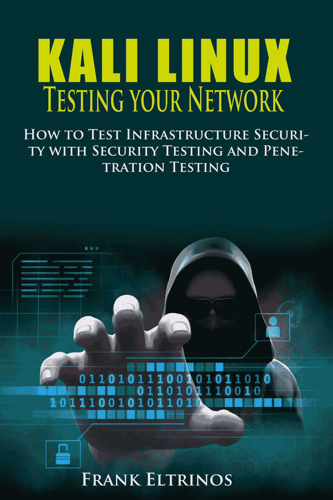

# Kali Linux：网络测试：如何通过安全测试与渗透测试进行基础设施安全测试

## 第一章：测试您的网络真的是免费的吗？

理解 Linux 需要在关于如何获取和作为 PC 编程使用方面进行一种极端的思维转变。（注意：从“激进派”的立场来说，我们的意思是建立一个关于所有已知问题的体系，而不是向正在构建的组织展示一些花招。）转变转变态的首步主要是调整对允许交流的词汇的整体理解，与其说是“机会”，而不是“免费午餐”。事实是：你可以出售收费的“免费”程序……而且，你被敦使可以这样做，只要给每个产品受益者的类似机会可以转让给你。

试着不要过度用力地挠头；这些想法起初很难掌握，特别是当你考虑建模时，而你已经离开了展示部门的商业编程行业。也许你完全不知道，当你购买通常是排他性的、缩水包装的程序时，你并不真正拥有该产品。或者，你被授权在许可者指示的范围内使用该产品。

Linux 还有一个许可。尽管如此，许可背后的意图和动机与大多数商业编程完全不同。与其利用许可来限制此类产品的使用，Linux 所使用的那些 `GNUs` 和 `GPL` 通用公共许可保证了这些产品可以始终对任何人可用。没有哪个组织可以声称/指导人们使用、甚至调整 Linux 的所有方式——尽管他们自己可以获得其对不同品牌的个人版权和商标，例如，诺维尔（Novell）和红帽（Red Hat）。从根本上说，人们可以有效拥有 Linux，并且应该用它们做他们喜欢的一切，只要 `GPL` 机会为这些产品的高级受益者产生。

## LINUX：是革命还是另一个简单的操作系统。

在进一步探索 Linux 之前，我们必须跳出一条路来谈一些话。一个工作框架是运行你 PC 的产品，处理你与设备之间的所有通信。无论你是在 PC 上写信、确定财务预算，还是在 PC 上处理你的计划，工作框架都提供了你 PC 运行的基础环境。

此外，工作框架不仅仅是一个程序；它由许多小型项目和工具组成，使我们能够使用 PC 完成一些有价值的事情。随后你在工作框架上运行不同的项目（例如，你的承诺处理器）来完成一切。

Linux 被指责为“仅仅又一个工作框架”。从表面上看；它可能看起来是这样；但是，如果进一步观察，你应该发现事实并非如此。Linux 的扩张是领导者们驱动着这种趋势，向注册业务行业内的多个免费和开源（即“机会”，而非“免费午餐”）程序发展。由于其创建（以及持续被创建）的模式，Linux 作为一个稳固的工作框架，它代表了编程开发中许多优秀的事物。

### Linux 与其他操作系统的两个主要区别：

- Linux 在卓越且精妙的 `GNUS`（通用公共许可）授权下运行，可以在不同领域考虑这些许可。
- Linux 是由一个在互联网上付费合作的志愿者开发者组成的整体创建并维护的。

Linux 对某些人来说是特别的，原因在于它让制造它的人从早期阶段就需要它们，并且表现出：

- **多用户**：大多数情况下一次只有一个用户登录到单台 PC。
- **多处理器**：真正的抢占式多任务允许工作框架的核心高效地切换多个任务。这对于在单台 PC 上提供各种服务至关重要。
- **多平台**：Linux 目前运行在超过 24 种阶段（设备种类）。
- **互操作性**：Linux 在许多系统协议（语言）和工作框架之间运行或兼容，允许使用所有操作系统的 PC，可能包括 Netware、微软 Windows Mac PC 以及拥有较小市场的各种集合。

- **可扩展性**：所有的处理需求，人们都可以依赖 Linux 进行开发。一种类似的 Linux 工作框架可以运行在小型电子轮廓、PC 以及一个巨大的、现代质量的服务器框架上。

- **稳定性高**：`Linux` 组件（作为工作框架的核心）所达到的开发程度令许多编程工程师感到嫉妒。`Linux` 服务器连续运行长时间而不发生崩溃，这是正常现象。
- **高效性**：`Linux` 的特殊结构允许你仅集成运行理想应用程序所需的各个部分。即使是更老旧的奔腾 PC 也可以使用 `Linux` 并重新发挥余热。

## 免费！

对于绝大多数来说，Linux 最具吸引力的部分在于它经常可以不分文地免费获取。（创业者们低声抱怨道）在缺乏直接金回报作为驱动力的情况下，任何人如何能够组装出优越的陷阱呢？向前看，你们最后的这些问题将由我们来解答。此外，我们还想介绍催生 Linux 的开源编程改进模型。

## Linux 的起源

尽管 Linux 核心的编程始于 1991 年，但其设计理念依赖于经过长期验证的 `UNIX` 工作框架。`UNIX` 创建于 20 世纪 60 年代的贝尔电话实验室内部，尽管它在后期才被被称为 `UNIX`。`UNIX` 的最初规划者们，回溯到还没有任何工作框架的时代，需要创建一个能够既高效又安全地处理相互信息、项目和资产的工作框架——这在当时是一个无法实现的完美目标（且目前仍处于维护中）。

从那时起，`UNIX` 演变成了各种形式；其现在的家族谱错综复杂，至于看起来就像无处不在。1991 年，芬兰赫尔辛基大学的软件工程学生林纳斯·托瓦斯（Linus Torvalds）需要一个类似于他在大学里迷的 `UNIX` 框架的工作框架，然而，带有设备的 `UNIXX` 极其昂贵。一种名为 `Minx` 的 `UNIXX` 版本是可以免费获取的；但这并没有完全解决问题。于是，托瓦斯研究了 `Minx`，随后开始编写另一个版本。根据他直接陈述并记录在家庭浏览网页上的话（这曾是在线访问房间的早期模型），他的工作被视为“仅仅是一种消遣，不会像 GNU 那样庞大和专业”。

编写一个工作框架是非常困难的。在经历了半年的艰苦工作后，托瓦斯在这些框架的通用功能方面几乎没有任何进展。他在网络上展示了自己的工作——他发现许多人非常喜欢他的优势和兴趣点。不久之后，全球最才华的人们就开始通过提交改进和修复漏洞（代码错误）来加入林纳斯的项目。

## 包含开源软件项目的生命周期结构

请注意，轻松的旁观者和著名的 IT 领袖们，Linux 给人一种奇特变革的印象。考虑到，如此令人难以信服的、依赖于已知 PC 工作框架的东西，是如何是由全球志愿者 PC 极客通过免费缝补而创造的。

同样，随着科学不断努力阐明一切，创新专家们仍在尝试观察开源方法如何创造无与伦比的软件，特别是在无人控制的情况下。通常，这种动机有许多共同点，即想要获得答案。当 Linux 世界的软件工程师需要一个工具时，开发者基本上会与他们保持联系——或者与拥有类似包的人聚在一起，并需要将它们编写在一起。

## GNU 是谁？

想象一下出于需求而非预期利润的编程。尽管 `UNIX` 最终变成了专有软件，但其创建的理念最初是基于务实需求的。人们通常所说的 Linux 工作框架实际上是一系列为了解决特定注册问题的明确动机而制作的编程工具集。

Linux 普及带来的速度，如果理查德·斯尔曼（Richard Stallman）没有发现它的道路，也将无法实现。长期以来，马萨诸塞理工学院（MIT）因支持这些优秀的人才进行机械控制而闻名。1984 年，斯尔曼（当时该大学的优秀学生和优秀的软件工程师）面临了困难——为一家有大量资金并向全世界提供个人捐赠的提供了能力。

他开启了一段旅程，让框架完全免费，而他将成为给予这个世界的人。斯尔曼理解——并坚持着——我们第一批程序员的伦理，这种伦理主张数据应该不受限制。这些想法在他统治时期并不新鲜。在处理业务的初期，许多进展源于公开分享想法和编程代码。支持的客户群体聚集了最优秀的人来处理复杂问题。斯尔曼相信，这些伦理在组织开始为了具有许多保护技术且以利润为唯一动机而积累编程时就消失了。

对于可能汇集了这些观点的人来说，开放广泛的源代码对于有效的软件开发至关重要。软件工程师为了向 PC 传递指令而输入的清晰内容（而不是“可执行”文件中混乱的数字象形）被称为 `源代码`。

将 PC 编程并行化是一项极其繁重的任务。现代 PC 编程通常在我们方便的语言中描述并排序，然后通过解释器翻译成 PC 的本地指令。为了让这些产品上的更改生效，软件工程师需要各种程序的 `源代码` 权限。许多专有软件仅以预制产品的形式出现；这些产品设计师安全地保护着这些项目的源代码。

在确认他的工作框架可以从 `UNIXX` 的应用结构中工作之后，斯尔曼需要一个身份标识好让他的框架从 `UNIXX` 中识别出来。因此，斯尔曼选择了一个递归缩写；`GNUi`（读作 Gas-New），意思是“GNU 不是 UNIX”。

为了给 GNU 项目提供资金，斯尔曼成立了一个名为自由软件的基金会，向人们免费出售开源编程。这是为了吸收在各种不同进展过程中受挫的开发者。

## Linux 介绍中发现的最令人惊的现象是可启动的 Linux 发版 `CDs`，它们被称为 `Live`。大多数现代电脑都可以通过读取 `CD` 上的工作框架来启动，而不是通过计算机存储系统。这些方案让你有机会在不真正安装的情况下了解 Linux 框架的样貌。

为了利用这一功能，某些 Linux 发行版制作了包含示例 Linux 框架的可启动 `CD`。由于单层 DVD 尺寸的限制，这些示例无法包含整个 Linux 框架；但你会被打包在这些地方的所有功能所惊叹。这些结果非常酷：

人们可以从 PC 启动 `CD`，从而在完全不安装到计算机存储系统的情况下运行 Linux 发行版。这些是在不影响你电脑的情况下测试不同 Linux 发行版的绝佳方法。只需进入 `CD` 并加载系统即可！所有这些 Linux 程序都可以直接从 `CD` 中运行。有许多可以从互联网下载的 Linux Live `DVDs`。

某些 Linux Live 发行版（例如 `Ubuntu`）允许用户直接从 Live 环境运行这些 Linux 发行版。这些版本允许用户直接从 `CD` 加载，体验这些 Linux 发行版，之后如果喜欢，再将其安装到存储设备中。这些功能非常有用且易于使用。本文中使用 `Ubuntu` Live 是为了介绍如何使用 Live `CD`。

同样，尽管有很多优点，Linux Live `CDs` 也有一些缺点。由于你从 `CD` 获取所有内容，应用程序运行得较慢，特别是当你使用较旧、较慢的电脑和 `CD` 驱动器时。此外，由于无法保存 `CD`，对 Linux 框架的某些更改在重启后将会丢失。

然而，Linux Live 领域不断进步，这有助于解决部分此类问题：

*   将 Linux 框架文件从 `CD` 复制到内存中提高速度
*   将框架文件复制到存储设备的记录中以保存所有更改
*   将框架环境打包在 USB 闪盘驱动中
*   将用户文件存储在 USB 闪盘中

某些 Linux Live-CD（例如 `PuppyLinux`）根据 Linux 框架文件的基本编号进行构建；它们在 DVD 驱动器中直接复制到内存中——当 Linux 完成启动后，你可以弹出这些 `DVD`。这不仅让你的应用程序运行快得多（因为通过 PC 内存的路径更快），还开启了 DVD 磁盘的活动状态，让你能够像播放 DVD 或电影 CD 一样使用这些产品。

## 特定的 Linux 发行版

在这些时期，其他 Linux 发行版的子集开始出现。这通常基于一个核心理念，但仅包含在特定区域表现良好的应用程序部分。

除了提供特定程序（例如为商务客户提供的办公套件），定制的 Linux 发行版还试图通过自动识别和排列常规硬件设备来帮助初 Linux 用户。这让引入 Linux 的过程变得更加愉快。

这只是对特定 Linux 发行版的简单测试。有许多特定的 Linux 发行版，在互联网上不断涌现。无论你的需求是什么，你都会发现 Linux。我们在这里包含了一个 OS 发行版，以了解某些特定情况下的选择。

万一转换所有一台电脑的想法让你感到力不从心，请利用 `Lived` 启动光盘在不引入任何东西的情况下通过 `Linux` 启动您的 PC。连续通过 DVD 驱动器启动 `Linux` 的速度较慢（可能在性能更好的电脑上也会有同样令人痛苦的延迟）；但无论如何，它们的功能可以让你大致了解 `Linux` 究竟包含什么。

## 替换当前运行的操作系统
如果你有一台仅运行 `Linux` 的空闲电脑。那好，你就走运了！将当前运行的操作系统替换为 `Linux` 是在 PC 上引入 `Linux` 最简单的方法。许多 `Linux` 机构都平整合了自动化程序，帮助你将电脑完全切换到 `Linux`。然而，这是一种全有或全无的策略——你将用 `Linux` 完全替换你当前运行的操作系统！

如果你确实替换了当前运行的操作系统，请注意，一旦设置完成，将不再拥有唯一的本地记录！如果你需要保留某些记录，需要将额外或类似的信息保存到可以通过 `Linux` 访问的介质中。USB 闪盘是复制小批量数据（约 16GB）并将其带入你的 `Linux` 框架的极佳方法。极其重要的是，要检查是否获取了 USB 硬件硬盘之外的信息。如果你替换了当前运行的操作系统，可以跳过下一节，“准备共同使用 Linux 和 Microsoft Windows”。

## 使用第二个固态硬盘或分区硬盘
在后续的存储设备上安装 `Linux` ——更确切地说，划分当前存储设备来运行 `Linux` —— 需要双重启动环境：`Linux` 与其他操作系统共存在同一台电脑的存储设备（分区）上。当加载电脑时，会出现菜单，要求你选择使用哪种操作系统。你将有机会同时使用带有记录的特殊 Microsoft Windows 应用程序和 `Linux` —— 所有内容都在同一台电脑上！

许多人支持的做法是添加第二个全新的硬盘来安装 `Linux`。这是目前双系统启动系统要求最低的解决方案，我们也建议你尽可能使用这种方法。

如果你对已满的存储设备感到满意，也可以对当前硬盘进行分区以做好 `Linux` 准备。分区意味着在所有物理存储设备上至少有两个完全独立的区域。电脑认为这些区域都像备用磁盘。这些过程我们在本文的后续部分将在某种程度上进行处理。

只需对存储设备进行不同的命名以便电脑识别：
你需要确保留下主引导分区（MW foundation）完好。你只需要知道对于电脑而言，哪个驱动器（Microsoft 还是 `Linux`）先启动或后启动。你可以在本文后文“划分现有硬盘以实现双系统启动”部分找到关于如何检查分区信息的一些解决方案。一旦你确定了是哪个设备，请进入本文高级部分的“双系统检查硬件兼容性”领域。

了解存储设备是否占据了唯一的 Microsoft 分区至关重要。当你权衡 `Linux` 时，可能会倾向于在无意中将其覆盖到你特殊的 Microsoft 分区上！这里有其他说明：在开始此策略之前，备份任何重要记录是基本的。故障可能会（偶尔）发生！

如果你无法为 `Linux` 提取出一个完整的存储设备，且目前已安装了 Microsoft，则必须重新调整当前的 Microsoft 分区大小。你需要费力完成这些整个部分。

**在任何情况下都绝对不要进入下一节**，除非仔细检查了以下部分，“准备共同使用 Linux 和 Microsoft Windows”。抱歉大声尖叫，但如果你不避开潜在风险，可能会丢失你的整个 Microsoft 分区！

## 其他引入情况
如果你完全不希望使用自己的存储设备进行双系统，你还有其他选择 —— 这意味着我们总共有 3 种方法，加上之前的 3 种总共 6 种，但请给我们留一点时间解释。

- 你可以使用虚拟机软件包，例如 `VMware` 或 Sun 的 `Virtual Box` 来呈现一个“虚拟”的 `Linux` 设备，它将留在 MS 窗口内。你应该保持 Windows 桌面不变，不做任何修改。你基本上是在由 `Virtual Box` 程序创建的全虚拟区域内呈现了 `Linux`。
- 你也可以采取相反措施 —— 只在 PC 上安装 `Linux`，稍后使用 `VM-product` 安装一个运行于你 `Linux` 基础内 Windows 之中的虚拟微软机器。
- 如果你采用这种系统，增强方法之一是在安装 Linux 之前备份唯一的 Windows 记录，稍后在新 Windows 虚拟机中恢复它们。
- 另一种日益流行的选择与 `Ubuntu` Lived 相关的组件。Windows Ubuntu 安装程序 (`Wubi`) 是一个你可以使用的应用程序，可以将 Ubuntu `Linux` 部分作为当前 Windows 分区内的一个普通文件，之后它会将 Linux 作为 Windows 应用程序呈现。这种酷炫的新方法允许你在不分配任何磁盘的情况下创建双系统环境，而且它是完全可逆的（只需卸载 `Wubi`）。

## 准备共同使用 Linux 和 Microsoft Windows
如果你需要在同一台机器上运行 `Linux` 和 Microsoft Windows，你可能现在已经安装了 Windows 并已使用很长时间。由于我们不想听到新 Linux 用户的痛苦哀嚎，请停一下评估你拥有和需要什么。接下来的部分将介绍为你的 PC 配置双系统启动环境所需的系统。

如果你现在确实没有安装 Windows 但仍然需要双系统限制，你应该在安装 `Linux` 之前安装 Windows。从根本上说，Windows 查看的是 `Linux` 用于存储其加载菜单的存储设备部分。（这些因素在以后加载进入 `Linux` 时可能会导致灾难！）。

## 引入二手存储设备
除了替换当前运行的操作系统，在 PC 上获取 `Linux` 的第二简单方法是使用二手硬盘。许多电脑支持不同的硬盘，无论它们是连接在同一个电路上还是通过各种连接连接的。通常你可以通过查看电脑的各种 `Bios` 配置显示来决定你的磁盘控制器是如何设计的。那些 `Bios` 配置显示处理电脑周围的基础设备设置。

如何进入 `BIOS` 屏幕取决于你的电脑。所有必要的都是电脑重启时按下一个秘密键（通常是 `Esc` 键或 `f12`）。有些电脑会提示用户应该点击哪个按钮。某些情况需要查阅你的用户手册。

如果你无法通过 `Bios` 理解存储设备的布局，则需要拆开电脑箱并检查你面对的是什么。对于每个控制器，许多电脑中的标准磁盘控制器卡最多需要两个设备；电脑经常在主板上放置多个控制器。如果你看到两个带有长多针连接器的接口，那么你很幸运。如果你发现只看到一个带有空连接器的路径，也可以的。

地图中的模式显示了两个硬盘控制器，称为主（integral）和从器（auxiliary）。硬盘的主控制器包括用于启动电脑的硬盘。硬盘控制器将支持两个设备（称为主和从）。此系统总共需要四个不同的设备与 PC 配对。此外，控制器允许连接硬盘以外的 CD / DVD 驱动器。在确定你的磁盘驱动器状态时，务必记住这些驱动器。

在发布二手硬盘之后除了替换当前运行的操作系统，在 PC 上获取 `Linux` 的第二简单方法是使用二手硬盘……（此处后续为重复乱码，已按要求处理）。

