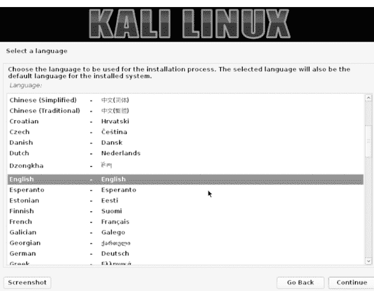
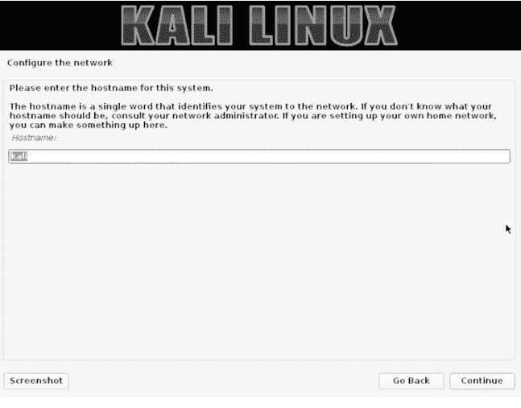
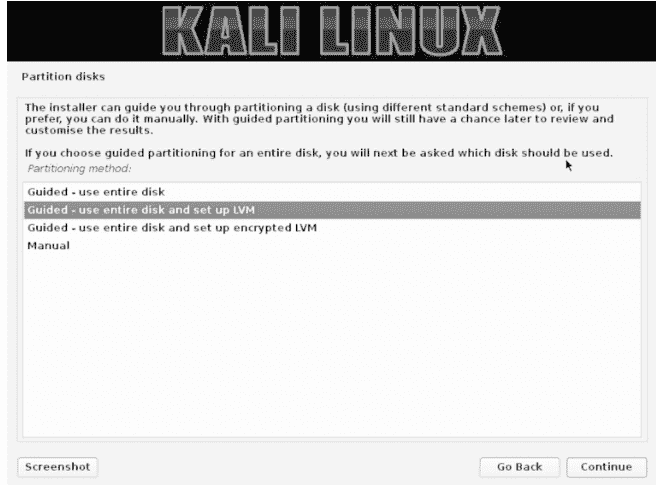
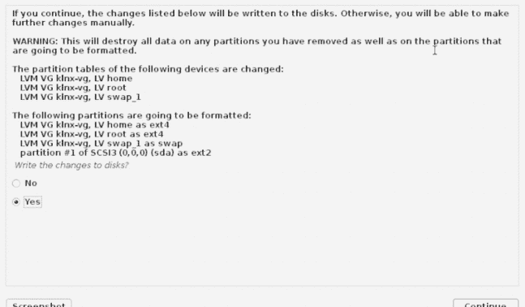
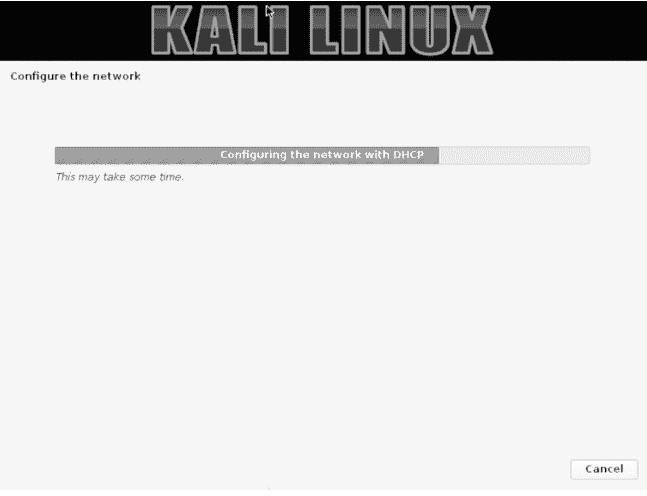
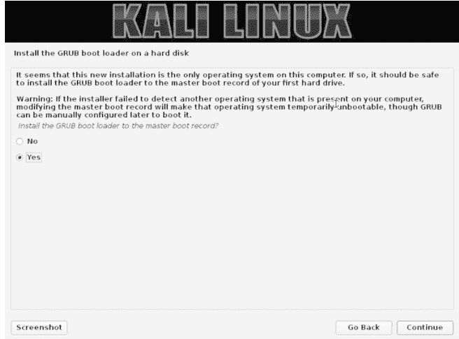

# Kali Linux：使用 Kali 的入门指南：伦理黑客与基础安全测试概念，预防网络恐怖主义及理解网络安全与黑客基础

## 免费下载本书的有声书版本

如果你喜欢随时随地收听有声书，我有一条好消息要告诉你。你只需注册 30 天的 Audible 免费试用，就可以**免费**下载本书的有声书版本！更多详情如下！


## Audible 试用权益

作为 Audible 用户，你在 30 天免费试用期间将获得以下权益：

- 本书的免费有声书副本
- 试用期结束后，每月可获得 1 个积分，用于兑换任何有声书
- 如果你当月未使用积分，它们将自动累积到下个月
- 可从 Audible 的 20 万+ 种标题中任选
- 通过 Audible 应用在任何设备、任何地点收听
- 轻松、无麻烦地换购你不喜欢的任何有声书
- 永久保留你的有声书，即使你取消会员资格
- 还有更多

### 点击以下链接开始使用！

**适用于 Audible 美国区**

**适用于 Audible 英国区**

**适用于 Audible 法国区**

**适用于 Audible 德国区**

## 引言

感谢选择本书，《Kali Linux - 使用 Kali 进行道德黑客入门指南》。本书通过解释基本安全测试概念来预防网络恐怖主义，并让你了解网络安全与黑客技术的基础知识。

Kali Linux 是 Linux 发行版的一种变种，基于 Debian 架构。其开发愿景是应用于安全领域，主要侧重于安全审计和渗透测试。Kali Linux 预装了几百个工具，用于信息安全的各种任务。这些包括渗透测试、安全研究、计算机取证、逆向工程等。

它由一家名为 Offensive Security 的公司开发和维护，该公司是全球信息安全培训的领导者。该公司还为操作系统的未来开发和维护提供资金。

本书是 Kali Linux 的入门介绍。任何在 Linux 领域具有一定经验的新用户都可以从 Kali Linux 开始。如果你的目标是成为安全领域的专业人士，并且不滥用 Kali Linux 带来的强大功能，那么本书中分享的信息足以让你入门。

不过，建议在开始使用 Kali Linux 之前，先成为更简单的 Linux 操作系统的用户。如果你刚开始接触 Linux 操作系统，或者没有管理系统的知识或能力，或者只是寻找一个用于日常活动的操作系统，Kali Linux 并不是你开始使用的理想操作系统。

即使是资深的 Linux 用户有时在使用 Kali Linux 时也会面临挑战。鉴于 Kali Linux 是专为安全目的而设计的，与其他在更大范围内作为开源项目运作的 Linux 变种相比，它并不是一个完全开放的项目。开发团队由数量很少的用户组成，为 Kali Linux 开发并提交到软件仓库的包，首先由个人开发者签名，然后由整个团队签名。

用于更新包的上游或第三方软件仓库


或者新软件包被拉取的可能性也非常小。从未经 Kali Linux 团队测试和验证的第三方来源向你的 Kali 操作系统添加软件包可能会对你的系统造成损害。

为了避免这种情况，让我们深入了解相关知识并开始动手。再次感谢你选择本书。

## 第一章：Kali Linux 的特性

在深入本书内容之前，让我们先概览一下 Kali Linux 的各项特性。

### 渗透测试工具

Kali Linux 中提供了超过 600 种用于渗透测试的工具。与其前身 BackTrack Linux 相比，BackTrack 包含了许多要么无法正常工作，要么是其他工具重复项的工具。Kali Linux 的重新开发已经摒弃了这些工具。

### 免费使用

与其前身 BackTrack Linux 一样，Kali Linux 完全免费。成为 Kali Linux 用户的最大优势在于，操作系统及其工具均可免费使用。

### 开源

Kali Linux 致力于开源模式，因此 Kali Linux 的开发树对互联网上的所有人开放。Gitlab 上有 Kali Linux 的源代码，任何希望根据需求定制 Kali Linux 的人都可以公开获取。

### 符合 FHS 标准

Kali 符合文件系统层级标准（Filesystem Hierarchy Standard），该标准被所有 Linux 发行版遵循。这使得用户能够轻松定位二进制文件、库、支持文件等。

### 对无线设备的支持

Linux 操作系统在历史上曾存在与无线设备的兼容性问题。Kali Linux 的开发确保了这一点得到妥善处理，因此 Kali Linux 兼容各种无线硬件，从而支持 USB 和几乎所有无线设备。

### 定制内核

Kali Linux 内核配备了最新的注入补丁。作为渗透测试人员，这有助于开发团队轻松进行无线评估。

### 在安全环境中开发

开发和维护 Kali Linux 的团队包括一个非常小的个人群体。团队之间建立了完全的信任，以向 Kali Linux 软件包提交代码，并通过多种渠道使用安全协议来实现这一点。

### GPG 签名

每个为 Kali Linux 软件包做出贡献的开发者都会对其进行签名，随后，软件仓库也会对该软件包进行签名。

### 语言支持

大多数在其他平台上可用于渗透测试的工具通常都是用英语开发的。然而，Kali 开发人员确保为世界各地的用户提供足够的语言支持使用户可以使用母语操作该系统，并获取母语的工具来完成他们期望的任务。

## 可定制化

Kali 开发人员充分了解并非所有用户都能接受其界面设计。因此，他们使得勇于探索的用户可以很容易地按照自己的需求从顶层到内核进行系统定制。

## 对 ARMEL 和 ARMHF 的支持

基于 ARM 的单板设备，如 BeagleBone Black 和 Raspberry Pi，在用户中越来越受欢迎，主要因为它们价格低廉。因此，Kali Linux 的构建方式旨在尽可能稳固，并具有功能完整的安装，支持 ARMHF 和 ARMEL 系统。Kali Linux 支持广泛的 ARM 设备，ARM 工具保持最新并与其他发行版保持一致。

## Kali Linux 有何不同？

Kali Linux 是专为对渗透测试和安全审计相关工具感兴趣的专业社区开发的。Kali Linux 有多个方面有助于实现这一需求。

### 单用户

Linux 操作系统通常拥有一个名为 root 的超级用户以及其他权限低于 root 的普通用户。然而，Kali Linux 仅拥有拥有系统所有访问权限的 root 用户。这样做是因为大多数在 Kali Linux 中使用的工具都要求 root 级别的访问权限。因此，与其他大多数 Linux 发行版仅在必要时调用 root 用户的概念不同，Kali Linux 用户利用 root 用户来减少额外用户的负担。

### 定制内核

Kali Linux 配备了完全定制并打过补丁以支持无线注入的内核。

### 禁用网络服务

Kali Linux 默认禁用所有与网络相关的服务。这是由 Kali Linux 中的 systemd 服务完成的。当系统与互联网其余部分隔离时，我们可以确保环境更加安全，并且可以毫无顾虑地安装应用程序。蓝牙默认也是禁用的。

### 极简仓库

Kali Linux 中可用的仓库非常精简且受信任。Kali 是为安全开发的，因此保持操作系统的安全是合乎逻辑的。Kali Linux 中不提供第三方应用程序，这有助于实现安全目标。高级用户试图通过编辑源列表文件向 Kali Linux 添加第三方仓库，但这样做会增加其 Kali Linux 操作系统被入侵的风险。

## 第二章：下载和安装 Kali Linux

仅从官方来源下载 Kali Linux 镜像非常重要。这是因为来自第三方来源的 Kali Linux 安装镜像构成威胁，因为它们可能被篡改。鉴于 Kali Linux 的开源性质，第三方可以轻松修改安装文件并引入恶意软件，最终这些恶意软件将在你的系统上运行。

你可以从以下链接下载所有用于 Kali Linux 安装的官方镜像：

- [https://www.kali.org/downloads/](https://www.kali.org/downloads/)
- [https://www.offensive-security.com/kali-linux-vmware-arm-image-download/](https://www.offensive-security.com/kali-linux-vmware-arm-image-download/)

### 基于 Intel 的 PC 的 ISO 文件

为了能在 Windows PC 或 Apple PC 上通过 USB 驱动器以“Live”方式运行 Kali Linux，你需要下载 Kali Linux 安装的 32 位或 64 位 ISO 镜像。

如果你不确定当前系统的架构，可以在 Linux 或 Apple OS X 的终端中运行以下命令来了解架构。

```
uname -m
```

如果你得到的响应是“x86_64”，则表示 64 位架构，你可以使用网站上可用的 64 位 ISO 镜像（带有“amd64”后缀的那个）。

如果你得到的响应是“i386”，则表示 32 位架构，你可以从网站下载 32 位 ISO 镜像（带有“i386”后缀的那个）。

如果你使用的是 Windows 系统，你会在计算机的系统属性中的“设备类型”标题下找到架构信息。你可以在网站上下载 Kali Linux ISO 镜像，既可以直接下载文件，也可以通过 torrent 文件下载。

### ARM 镜像

基于 ARM 的设备在硬件和架构上差异很大。因此，不可能为各种基于 ARM 的设备维护单一的安装镜像。针对各种设备安装 Kali Linux，有一套多样化的预构建镜像可用。如果你想构建自己的 ARM 镜像，Kali GitHub 仓库中提供了构建自定义 ISO 的脚本。

### VMware 镜像

如果你使用 VMware 并希望将 Kali Linux 用作“客户机”，Kali Linux 提供预构建的 VMware 机器，且已预装 VMware 工具。VMware 镜像可用 64 位、32 位、32 位 PAE 格式。

让我们看看安装和使用 Kali Linux 的各种方法。

### Kali Linux 可引导 USB 驱动器

这是让 Kali Linux 快速运行的最方便的方式，因为你是通过 USB 驱动器以“live”模式运行它。使用这种方法也有许多其他优点。让我们逐一来看。

- *非破坏性*


不会对您的物理机器或已驻留在机器上的操作系统进行任何更改，因为 Kali Linux 将直接从 USB 驱动器运行。您只需拔掉 USB 驱动器，即可轻松启动到机器上的常规操作系统，无需任何额外努力。

## 便携性

您可以随身携带 Kali Linux，因为它可以一直存放在您口袋里的 USB 驱动器中。您所要做的就是将其插入可用的系统，然后即可启动 Kali Linux。

## 可定制性

我们已经讨论过，Kali Linux 是开源的，其所有代码库都公开在 GitHub 上。因此，您可以使用 Kali Linux 代码库中可用的脚本来构建自定义的 Kali Linux 安装镜像，并将其加载到 USB 驱动器上。

## 持久性

您可以定制 Kali Linux USB 驱动器以使其具有持久性。这将允许其在 USB 上存储数据，并在多次重启后保留这些数据。

为了做到这一点，我们首先需要创建一个可启动的 USB 驱动器，该驱动器已由 Kali Linux 的 ISO 镜像设置完成。

## 创建 Kali Linux USB 驱动器的要求

-   一份经过验证的 Kali Linux ISO 副本，以适应您打算运行或安装它的系统。
-   如果您使用的是 Windows，则需要 Win32 Disk Imager 软件来创建 Kali Linux USB 驱动器。在 Linux 或 OS X 上，您可以使用终端中预装的 `dd` 命令来创建可启动的 USB 驱动器。
-   容量为 4GB 或更大的 USB 驱动器。如果您的系统支持 SD 卡插槽，您也可以使用类似的流程使用 SD 卡。

现在让我们了解创建 Kali Linux Live USB 驱动器的过程。此过程将根据您正在使用的系统（即 Windows、Linux 或 MacOS）而有所不同。

## 在 Windows 上创建可启动的 Kali USB 驱动器

1.  将 USB 插入机器上的 USB 插槽，并记下分配给它的驱动器号。启动您之前下载的 Win32 Disk Imager 应用程序。
2.  选择用于 Kali Linux 安装的 ISO 文件，并确保已选择正确的 USB 驱动器进行写入。点击 **Write**（写入）。
3.  USB 驱动器写入完成后，您可以弹出驱动器，并将其用作可启动的 USB 驱动器来启动 Kali Linux Live 或在机器上安装 Kali Linux。

## 在 Linux 操作系统上创建可启动的 Kali Linux USB 驱动器

在 Linux 操作系统中，创建可启动的 USB 驱动器非常简单。一旦下载并验证了 Kali Linux ISO 文件，您就可以在终端使用 `dd` 命令将文件写入 USB 驱动器。运行 `dd` 命令需要 root 或 sudo 权限。

> **警告：** 如果您不确定如何使用 `dd` 命令，最终可能会将 Kali Linux 镜像写入您未打算写入的磁盘驱动器。因此，在使用 `dd` 命令时保持高度警惕极其重要。

您需要知道用于将 Kali Linux 镜像写入 USB 驱动器的设备路径。在未插入 USB 驱动器的情况下，在终端窗口的命令提示符中执行以下命令。

```
sudo fdisk -l
```

您将获得一个输出，显示系统中挂载的所有设备，分区将显示为：

`/dev/sda1`

`/dev/sda2`

现在，插入 USB 驱动器并再次运行相同命令 `sudo fdisk -l`。这次您会看到额外的设备，即您的 USB 驱动器。它会显示为类似 `/dev/sdb` 的内容，旁边显示 USB 驱动器的大小。

继续小心使用以下命令在 USB 驱动器上写入镜像。示例假设您的 Kali Linux ISO 文件名为 “kali-linux-2019.1-amd64.iso”，并且位于当前工作目录中。块大小参数 `bs` 可以增加，但理想值为 `bs=512k`。

```
dd if=kali-linux-2019.1-amd64.iso of=/dev/sdb bs=512k
```

向 USB 驱动器写入过程需要几分钟，完成写入所需时间略多于 10 分钟并不异常。

`dd` 命令在进程完成之前不会显示任何输出。如果您的 USB 驱动器有 LED，您会看到它闪烁，这是磁盘写入正在进行中的指示。一旦 `dd` 命令完成，输出将如下所示。

```
5823+1 records in
5823+1 records out
3053371392 bytes (3.1 GB) copied, 746.211 s, 4.1 MB/s
```

这就结束了。现在您可以使用 USB 驱动器启动 Kali Linux Live 或在机器上开始安装 Kali Linux。

## 在 MAC OS X 操作系统上创建可启动的 Kali Linux USB 驱动器

Apple OS X 是基于 Unix 的操作系统，因此在 OS X 上创建 Kali Linux 可启动 USB 驱动器与在 Linux 上创建类似。在下载并验证您的 Kali Linux ISO 副本后，您可以直接使用 `dd` 命令将 ISO 写入 USB 驱动器。

**警告：** 如果您不确定如何使用 `dd` 命令，最终可能会将 Kali Linux 镜像写入您未打算写入的磁盘驱动器。因此，在使用 `dd` 命令时保持高度警惕极其重要。

您可以使用以下步骤将 ISO 写入 USB 驱动器。

1.  在未将 USB 驱动器插入 MAC 台式机或笔记本电脑的情况下，在终端窗口的命令提示符中输入以下命令：
    ```
    diskutil list
    ```
2.  将显示一个设备路径列表，显示系统中挂载的所有磁盘，以及分区数据：
    ```
    /dev/disk1
    /dev/disk2
    ```
3.  现在，插入 USB 并再次运行 `diskutil list` 命令。您会看到列表现在也显示了您的 USB 驱动器。它将是不在第一次显示中出现的那个。假设它是：
    ```
    /dev/disk6
    ```
4.  使用以下命令卸载 USB 驱动器（假设 USB 为 `/dev/disk6`）：
    ```
    diskutil unmount /dev/disk6
    ```
5.  继续使用以下命令小心地将 Kali Linux ISO 写入您的 USB 驱动器。假设当前工作目录与保存 ISO 文件的目录相同。块大小参数 `bs` 可以增加，但理想值为 `bs=1m`：
    ```
    sudo dd if=kali-linux-2017.1-amd64.iso of=/dev/disk6 bs=1m
    ```
6.  向 USB 驱动器写入过程需要几分钟，完成写入所需时间略多于 10 分钟并不异常。
7.  `dd` 命令在进程完成之前不会显示任何输出。如果您的 USB 驱动器有 LED，您会看到它闪烁，这是磁盘写入正在进行中的指示。一旦 `dd` 命令完成，输出将如下所示：
    ```
    5823+1 records in
    5823+1 records out
    3053371392 bytes transferred in 2151.132182 secs (1419425 bytes/sec)
    ```

这就结束了。现在您可以使用 USB 驱动器启动 Kali Linux Live 或在机器上开始安装 Kali Linux。要在 OS X 机器上从期望的驱动器启动，请在计算机启动后立即按下 “Option”（选项）按钮，并选择您希望使用的驱动器。

## 在硬盘驱动器上安装 Kali Linux 的过程

在本节中，我们将学习如何在系统的硬盘上物理安装 Kali Linux。这将使其能够直接从硬盘驱动器运行，而不是如我们在上一节中讨论的那样从 USB 驱动器运行。

### 安装要求

Kali Linux 的安装过程相当简单易懂。首先，我们需要一台具有兼容 Kali Linux 安装的硬件的机器。Kali Linux 支持 32 位、64 位和 ARM (armhf 和 armel) 架构。

我们已经完成了创建 Kali Linux ISO 可启动 USB 介质的过程。如果您有 DVD 驱动器，您也可以将 ISO 镜像写入 DVD 以在机器上安装 Kali Linux。

在机器上安装 Kali Linux 的最低硬件要求如下：

-   安装文件所需的最小可用磁盘空间为 20 GB。
-   最小 RAM 容量为 1GB。虽然建议 2GB 或更多以获得更好的性能。
-   DVD 驱动器或 USB 启动支持，以协助 Kali Linux 安装。

### 安装准备

您可以通过准备以下检查表来为安装做准备。

1.  根据系统架构下载 Kali Linux ISO。
2.  使用上一章中提到的工具将 Kali Linux ISO 写入 DVD 或 USB 驱动器。
3.  确保您的计算机已设置为允许从 USB 驱动器启动。

### Kali Linux 安装过程

1.  要开始安装 Kali Linux，请使用您创建的安装介质（即 DVD 或 USB 驱动器）启动。您将看到 Kali Linux 启动屏幕。您可以选择图形模式或文本模式安装。理想情况下，继续图形安装。


## KALI LINUX

2. 选择操作系统所需的语言及国家/地区。同时，你还需要选择首选的键盘布局。

### 选择语言

选择安装过程中要使用的语言。所选语言也将是已安装系统的默认语言。

语言：

-   简体中文 - 中文(简体)
-   繁体中文 - 中文(繁體)
-   克罗地亚语 - Hrvatski
-   捷克语 - Čeština
-   丹麦语 - Dansk
-   荷兰语 - Nederlands
-   宗卡语 - རྫོང་ཁ
-   英语 - English
-   世界语 - Esperanto
-   爱沙尼亚语 - Eesti
-   芬兰语 - Suomi
-   法语 - Français
-   加利西亚语 - Galego
-   格鲁吉亚语 - ქართული
-   德语 - Deutsch
-   希腊语 - Ελληνικά


**选择语言**

选择安装过程中要使用的语言。所选语言也将是已安装系统的默认语言。

语言：

| 语言 | 本地名称 |
|---|---|
| 简体中文 | 中文(简体) |
| 繁体中文 | 中文(繁體) |
| 克罗地亚语 | Hrvatski |
| 捷克语 | Čeština |
| 丹麦语 | Dansk |
| 荷兰语 | Nederlands |
| 宗卡语 | ལྷོང་ཁབ |
| **英语** | **English** |
| 世界语 | Esperanto |
| 爱沙尼亚语 | Eesti |
| 芬兰语 | Suomi |
| 法语 | Français |
| 加利西亚语 | Galego |
| 格鲁吉亚语 | ქართული |
| 德语 | Deutsch |
| 希腊语 | Ελληνικά |

截图 | 返回 | 继续

3. 输入你的地理位置。


### 选择你的位置

所选位置将用于设置你的时区，并用于辅助选择系统区域设置等目的。通常，这应该是你居住的国家。

这是基于你选择的语言生成的位置简表。如果你的位置不在列表中，请选择“其他”。

国家、地区或区域：

-   加拿大
-   中国香港
-   印度
-   爱尔兰
-   新西兰
-   尼日利亚
-   菲律宾
-   新加坡
-   南非
-   英国
-   美国
-   赞比亚
-   津巴布韦
-   其他

截图
返回
继续

## KALI LINUX



4. 随后，安装程序会将所有安装文件复制到计算机的硬盘中，探测所有网络设备和接口，然后要求你输入系统的主机名。你可以输入自己选择的主机名，这将是你系统识别的名称。

5. 你还可以为系统输入一个默认域名，这是一个可选功能。



6. 输入一个将在系统中拥有非 root 权限用户的完整姓名。

7. 系统会为提供的姓名创建一个默认的用户 ID。如果你愿意，也可以更改用户名。

## KALI LINUX

### 设置用户和密码

你需要为系统管理账户 'root' 设置密码。拥有 root 访问权限的恶意或不合格用户可能导致灾难性后果，因此你应该小心选择一个不易猜测的 root 密码。它不应该是字典中的单词，也不应该是容易与你关联的单词。

一个好的密码应包含字母、数字和标点符号的混合，并应定期更换。

root 用户不应有空密码。如果你将此留空，root 账户将被禁用，系统的初始用户账户将使用 "sudo" 命令获得提升为 root 的权限。

请注意，你在输入密码时看不到密码。

Root 密码：


请再次输入相同的 root 密码以验证你已正确输入。

重新输入密码以验证：


8. 为系统选择时区。

9. 接下来，你将看到要安装操作系统的磁盘列表。你可以选择整个磁盘，或者如果你擅长创建精细配置，也可以使用逻辑卷管理器创建分区。



10. 选择你要为其创建分区的磁盘。

11. 根据你的风格和需求，你可以将所有文件保留在单个分区中（这是默认设置），也可以为你选择的几个目录创建新分区。如果你不确定自己想要什么，可以选择默认选项，即“所有文件在一个分区中”。

12. 在此屏幕上，在开始器开始进行不可逆更改之前，你有最后的机会查看你选择的所有磁盘配置。当你点击“继续”时，安装程序将开始安装 Kali Linux，你将得到一个几乎完成的安装。

## KALI LINUX

### 分区磁盘



13. 下一步是为你的系统配置网络镜像。Kali 使用中央仓库来分发应用程序。如果你使用代理服务器，你需要在此处输入相关信息。



14. 注意：如果你在此屏幕选择“否”，你将来将无法使用任何 Kali 仓库进行软件安装。



15. 在此屏幕上，你将安装 GRUB。GRUB（Grand Unified Bootloader，通用引导加载程序）是一个引导加载程序应用，当你有多个操作系统需要引导时使用。鉴于这是一次全新安装，你可以将 GRUB 安装在主引导记录上，使其成为系统的主要引导加载程序。

16. 完成。现在你可以点击“继续”，这将重启你的系统，你的 Kali Linux 安装现在已完成。

除此之外，当你熟悉安装过程后，还有更多安装可以尝试。然而，对于初学者来说，关于 Kali Linux 安装的知识已经足够了。我们没有在这本初级水平的书中详细讨论它们。你可以在系统上使用 Kali 实现的其他安装包括：

1.  Kali Linux 与 Windows 双启动
2.  Kali Linux 与 MAC OS X 双启动
3.  在 MAC 硬件上单启动 Kali Linux
4.  在 ARM 设备上安装 Kali Linux（例如：树莓派）

## 第三章：关于黑客

黑客的基本定义是尝试利用网络中计算机漏洞的过程。该计算机可能只是一台个人计算机，也可能属于企业，例如 Web 服务器。简单来说，它意味着在没有授权的情况下访问计算机或服务器以进行非法活动。

如果我们先更多地了解黑客，就能更好地理解黑客。我们可以假设黑客在计算机和网络知识方面非常精明且技能高超。与已经建立的安全系统相比，创建一个带有安全措施的系统要简单得多。因此，破坏系统的安全性所需的技能和专业知识比创建它更多。

黑客无法根据特定的规则集进行分类。但世界已将黑客归类为白帽黑客、黑帽黑客和灰帽黑客。

### 白帽黑客

白帽黑客基本上专业人员，他们不断用各种攻击轰击已获批准的系统，以便发现漏洞从而让系统能够抵御攻击。在大多数情况下，白帽黑客受雇于同一运营机构。

### 黑帽黑客

喜欢访问他人系统以谋取个人利益的一组黑客被称为黑帽黑客。他们以窃取甚至破坏该系统数据的方式黑客入侵和攻击系统。此外，他们可以锁定该系统并限制该系统的真正所有者的访问权限。这通常是通过查找漏洞来实现的

系统的安全。他们通常被称为破解者（Crackers）。

## 灰帽黑客

喜欢通过入侵系统来满足好奇心的一组黑客被称为灰帽黑客。他们拥有最少量的计算机和编程知识，足以让他们潜入他人的系统。灰帽黑客与黑帽黑客的区别在于，一旦发现漏洞，灰帽黑客会通知该系统的管理员以便修复，而黑帽黑客则不会通知管理员，并会试图利用该系统获利。

除了合同专家（也称为白帽黑客）进行的入侵外，各种形式的黑客行为都是非法的。

## 第四章：Kali Linux 命令

在本章中，我们将介绍在 Kali Linux 中所有有用的命令。让我们逐一进行了解。

### 系统信息

以下命令有助于执行 Kali Linux 中与系统相关的任务。

- **Date** 显示系统当前的日期和时间
- **Cal** 显示当前月份的日历
- **Uptime** 显示系统的当前运行时间
- **W** 显示当前在线用户
- **Whoami** 显示你当前登录的用户
- **Finger** user 显示关于该用户的信息
- **Uname -a** 显示内核信息
- **cat /proc/cpuinfo** 显示 CPU 信息
- **cat /proc/meminfo** 显示内存信息
- **df -h** 显示当前的磁盘使用情况
- **du** 显示当前目录的空间使用情况
- **Free** 显示交换空间和内存的使用情况

### 键盘快捷键

让我们介绍一些在 Kali Linux 中可用的有用键盘快捷键，以简化日常任务。

- **Enter** 执行你输入的命令
- **Up Arrow** 显示上一条命令
- **Ctrl + R** 允许你部分输入命令并查找其余部分
- **Ctrl + Z** 停止当前命令，你可以使用 **bg** 在后台或 **fg** 在前台恢复它
- **Ctrl + C** 中断并终止当前命令
- **Ctrl + L** 清除终端屏幕
- **command | less** 允许你使用 Shift+下箭头或 Shift+上箭头在终端窗口中滚动
- **!!** 重复上一条命令
- **!** $ 重复上一条命令的最后一个参数
- **Ctrl + A** 移动到你正在输入的命令行的开头
- **Ctrl + E** 移动到你正在输入的命令行的末尾
- **Ctrl + U** 擦除光标前的行并将其复制到特殊剪贴板
- **Ctrl + K** 擦除光标后的行并将其复制到特殊剪贴板
- **Ctrl + Y** 从包含从 Ctrl + U 和 Ctrl + K 复制的数据的特殊剪贴板中粘贴
- **Ctrl + T** 用于交换光标前紧挨着的两个字符
- **Ctrl + W** 删除当前行光标左侧的单个参数或单词
- **Ctrl + D** 退出并注销当前会话

## 其他有用命令

- **apropos** *subject* 用于列出命令中 *subject* 的手册页
- **man -k** *keyword* 帮助显示包含命令中 *keyword* 的手册页
- **man** *command* 显示 *command* 的手册页
- **man -t man | ps2pdf -> man.pdf** 将手册页保存为 PDF 文件
- **which** *command* 显示 *command* 的完整路径
- **time** *command* 显示执行 *command* 所花费的时间
- **whereis** *app* 显示 *app* 安装的所有可能位置
- **which** *app* 显示默认运行的 *app* 的完整路径

## 搜索命令

我们将在此部分学习的命令将在处理 Kali Linux 中的文本文件时提供帮助。如果你想涉足 Linux 系统管理，这些命令中的大多数也很有用。

- **grep pattern files** 允许你在文件中搜索所需的 *pattern*
- **grep -r pattern dir** 允许你在目录中递归搜索 *pattern*。
- **command | grep pattern** 允许你在 *command* 的输出中搜索 *pattern*
- **locate file** 在系统的所有可能位置中查找 *file*
- **find / -name filename** 直接从根目录查找名为 *filename* 的文件
- **find / -name "*filename"*" 直接从根目录查找包含字符串 *filename* 的文件
- **updatedb** 此命令更新根目录下所有文件系统中所有文件的数据库
- **locate filename** 假设你已使用 updatedb 命令，使用 locate 命令搜索名为 *filename* 的文件
- **which filename** 查找包含名为 *filename* 文件的子目录
- **grep TextStringToFind | dir** 从名为 *dir* 的目录开始，搜索所有包含 *TextStringToFind* 的文件

## 文件权限

与文件相关的命令帮助你修改 Linux 操作系统中的文件。

Chmod *octal file* 将 *file permissions* 更改为 *octal*。可以通过为用户、组和世界分别添加 4 表示读(r)、2 表示写(w)、1 表示执行(x) 来分别找到这些权限。

示例：

- chmod 777 为用户、组和世界分配读、写和执行权限
- chmod 755 为用户分配读、写和执行权限，为组和世界分配读和执行权限

## 文件命令

- **ls** 列出目录的内容
- **ls -l** 以长格式列出当前目录的内容
- **ls -la** 以长格式和列格式列出当前目录的内容
- **ls -F** 列出当前目录的内容并显示文件类型
- **ls -al** 列出所有文件，包括隐藏文件
- **cd dir** 从当前目录切换到 dir 目录
- **cd** 将目录更改为主目录
- **mkdir dir** 创建一个新的目录并将其命名为 dir
- **pwd** 显示当前目录的完整路径
- **rm name** 删除名为 name 的文件或目录
- **rm -r dir** 删除名为 dir 的目录
- **rm -r file** 强制删除名为 file 的文件
- **rm -rf dir** 强制删除名为 dir 的目录及其所有目录和子目录
- **cp file1 file2** 将 file1 的内容复制到 file2
- **cp -r dir1 dir2** 将 dir1 复制到 dir2，如果 dir2 不存在则创建它
- **cp file /home/dirname** 将名为 file 的文件复制到路径 /home/dirname
- **mv file /home/dirname** 将名为 file 的文件移动到路径 /home/dirname
- **mv file1 file2** 将 file1 重命名为 file2
- **ln -s file link** 创建指向给定文件的符号链接
- **touch file** 创建或更新名为 file 的新文件
- **cat > file** 将标准输入重定向到文件
- **cat file** 打印文件的内容
- **more file** 逐页显示名为 file 的文件内容，你可以使用空格键进入下一页
- **head file** 输出文件的前 10 行
- **head -20 file** 输出名为 file 的前 20 行
- **tail file** 输出文件的最后 10 行
- **tail -20 file** 输出名为 file 的文件的最后 20 行
- **tail -f file** 以实时更新方式输出名为 file 的文件内容，显示最新的 10 行

## 压缩命令

这些命令将帮助你压缩和解压文件。当系统面临空间限制时，通常会这样做。

- `tar cf file.tar files` 创建一个名为 `file.tar` 的归档，其中包含 `files`
- `tar xf file.tar` 从名为 `file.tar` 的文件中提取内容
- `tar czf file.tar.gz files` 使用 GZip 压缩创建一个名为 `file.tar.gz` 的归档，其中包含 `files`
- `tar xzf file.tar.gz` 使用 GZip 从名为 `file.tar.gz` 的文件中提取内容
- `tar cjf file.tar.bz2` 使用 BZip2 压缩创建一个名为 `file.tar.bz2` 的归档
- `tar xjf file.tar.bz2` 使用 BZip2 从名为 `file.tar.bz2` 的文件中提取内容
- `gzip file` 压缩给定的 `file` 并将其重命名为 `file.gz`
- `gzip -d file.gz` 将 `file.gz` 文件再次解压为文件

## 打印命令

- `/etc/rc.d/init.d/lpd start` 启动打印守护进程
- `/etc/rc.d/init.d/lpd stop` 停止打印守护进程
- `/etc/rc.d/init.d/lpd status` 显示打印守护进程的状态
- `lpq` 显示打印队列中的当前任务
- `lprm` 移除打印队列中的任务
- `lpc` 打印机控制工具
- `man subject | lpr` 以纯文本格式打印 `subject` 手册页的内容
- `man -t subject | lpr` 以 PostScript 格式打印 `subject` 手册页的内容
- `printtool` 启动 X 打印机设置界面

## 网络命令


这些命令将帮助你从系统中获取网络相关的详细信息。

-   **ifconfig**：打印本地机器上所有设备的 IP 地址
-   **iwconfig**：设置网络接口上无线设备的参数
-   **iwlist**：显示无线设备的额外信息，这些信息可能不会在 iwconfig 中显示
-   **ping host**：向特定主机发送 ping 并显示结果
-   **whois domain**：打印域名的 WHOIS 信息
-   **dig domain**：打印域名的 DNS 信息
-   **dig -x host**：获取主机的反向查找结果
-   **wget file**：下载文件
-   **wget -c file**：继续下载已暂停的文件

## SSH 命令

-   **ssh user@host**：以特定用户身份连接到特定主机
-   **ssh -p port user@host**：通过特定端口以特定用户身份连接到特定主机
-   **ssh-copy-id user@host**：将你的密钥复制到用户的主机，以启用无密码登录

## 用户管理命令

这些命令帮助你创建、修改和删除系统上的用户。

-   **adduser accountname**：创建一个名为 accountname 的新用户
-   **passwd accountname**：为名为 accountname 的用户设置密码
-   **su**：从当前登录会话登录为超级用户
-   **exit**：停止作为超级用户并恢复为普通用户

## 进程管理命令

这些命令将帮助你获取系统上正在运行的进程列表，并提供关于它们的有用信息。

-   **ps**：显示所有活动进程
-   **top**：显示所有正在运行的进程
-   **kill pid**：终止 ID 为 *pid* 的进程
-   **killall proc**：终止所有名称为 *proc* 的进程
-   **bg**：列出所有已停止的任务或后台任务。可用于恢复后台任务
-   **fg**：将最新的正在运行的任务调至前台
-   **fg n**：将名为 *n* 的任务调至前台

## 从源码安装命令

这些命令用于在 Kali Linux 系统上安装新软件时。

```bash
./configure
make
make install
```

-   **dpkg -i pkg.deb**：安装 DEB 软件包（Ubuntu/Debian/Linux Mint）
-   **rpm -Uvh pkg.rpm**：安装 RPM 软件包（Fedora/Redhat）

## 停止和启动命令

这些是用于启动和关闭系统的通用命令。

-   **shutdown -h now**：系统关机但不重启
-   **halt**：停止所有进程
-   **shutdown -r 5**：系统在 5 分钟后关机并重启
-   **shutdown -r now**：系统立即关机并重启
-   **reboot**：停止所有进程并重启系统
-   **startx**：启动 X 系统

# 第五章：网络安全基础

## 什么是网络安全？

保护计算机或服务器、网络和数据免受数字性质攻击的过程被称为网络安全。它是网络攻击的对策。

网络攻击旨在非法访问系统并修改或破坏这些系统上的信息。作为回报，黑客或攻击者会向这些系统的所有者勒索金钱，有时只是为了干扰正常的业务活动。

如今，网络安全已成为一项具有挑战性的任务，因为与世界上的人口数量相比，系统的数量更多，而且攻击者每天变得更加富有创造力和创新性。

让我们试着了解如何使用病毒、特洛伊木马和蠕虫实施攻击。

## 病毒

计算机病毒是一段代码片段，也称为恶意软件，它会整合到系统中正版软件的代码中并成为其一部分。它通过网络甚至离线方式（如 USB 驱动器和硬盘）从一台计算机传播到另一台计算机。病毒的影响范围可能从稍微有些烦人到完全破坏系统不等。病毒以可执行文件作为宿主，这意味着除非用户手动执行承载病毒的文件，否则病毒无法自我激活。因此，随着宿主文件的执行，病毒代码也会被执行。

## 蠕虫

蠕虫可以被视为与病毒类似，因为它们的功能相同。它们在系统中自我复制，最终以某种方式破坏系统。蠕虫和病毒的区别在于，与病毒不同，蠕虫不需要宿主文件来激活，它们是独立的软件。蠕虫可以通过利用系统中的某种漏洞传播，或者通过诱骗用户执行它们来传播。

## 特洛伊木马

特洛伊木马同样是一种恶意软件，其名称源于希腊人用来进入特洛伊城的木马神话。就像木马一样，特洛伊木马是一种内部有害但外部看起来完全合法的软件。因此，天真的用户可能会认为它是合法软件，最终会在自己的系统上执行它。一旦特洛伊木马被激活，它可以帮助在宿主系统上创建多种攻击，从弹出无关窗口骚扰用户到通过删除数据完全破坏宿主系统。特洛伊木马和病毒的区别在于，特洛伊木马不会持续自我复制。

病毒、蠕虫和特洛伊木马的效果导致对其创建动机的分类。

## 勒索软件

如果病毒、蠕虫或特洛伊木马被植入系统中，目的是将其锁定，使其实际用户无法使用，并要求支付金钱才能再次解锁，则称为勒索软件。

## 间谍软件

如果病毒、蠕虫或特洛伊木马被植入系统中，目的是监视用户并获取其系统以及系统中所有活动的访问权限，则称为间谍软件。

## 广告软件

如果病毒、蠕虫或特洛伊木马被植入系统中，目的是在用户的正版软件上创建弹出式广告以从中产生收入，则称为广告软件。

# 第六章：Kali Linux 工具

我们讨论了 Kali Linux 附带数百种预装工具，可用于安全审计和渗透测试。在本节中，我们将介绍 Kali Linux 中可用的不同类型的工具。这些工具可以根据通过它们实现的任务进行分类。分类如下：

-   利用工具
-   取证工具
-   信息收集工具
-   逆向工程工具
-   无线攻击工具
-   报告工具
-   压力测试工具
-   维持访问工具
-   嗅探和欺骗工具
-   密码攻击工具

现在让我们逐一了解每个类别中可用的工具，以理解其具体用途。

## 利用工具

如果你考虑互联网上的一个网络，其中有一组正在运行的计算机，那么每个系统中都有许多应用程序可能会使该系统变得脆弱。这可能是由于许多原因，如糟糕的代码、服务器上开放的端口等，使得这些系统很容易受到访问。这就是利用工具发挥作用的地方。它们帮助你定位和利用这些易受攻击的机器。但你不是攻击者，因此，这些工具将帮助你识别并修补这些漏洞。让我们逐一了解 Kali Linux 中可用的利用工具。

### Armitage

Armitage 由 Raphael Mudge 开发，是一个图形用户界面前端，需与 Metasploit 框架一起使用。它是一个以图形形式提供的工具，易于使用，因为它可以推荐给定系统中的利用程序。该工具是开源且免费使用的。它因能提供的关于共享会话的数据以及通过单个 Metasploit 实例提供的通信而广受欢迎。用户可以使用 Armitage 在系统上启动扫描和利用程序，这将为用户提供关于可用利用程序的数据。这与 Metasploit 框架中可用的高级工具相结合，使用户能够控制易受攻击的系统。

### 后门工厂 (BDF)

被称为 BDF 的后门工厂是 Kali Linux 的一个工具，被研究人员和安全专业人员使用。使用该工具，用户可以将所需的代码插入系统文件和应用文件的可执行二进制文件中。该工具执行代码时，不会让系统知道在常规系统或应用程序进程之外还有其他事情正在发生。

### 浏览器利用框架 (BeEF)

顾名思义，如果你想对浏览器进行渗透测试，浏览器利用框架应该是你的首选工具。使用此工具，如果存在漏洞，你甚至可以针对客户端上的浏览器。

### Commix

Commix 是一个允许用户测试 Web 应用程序的 Kali Linux 工具。它对为 Web 开发人员、渗透测试人员和研究人员设置测试环境非常有用。它对 Web 应用程序执行注入，允许用户识别错误和故障。该工具使用 Python 开发。

### Crackle


Crackle 工具是 Kali Linux 的一款工具，用作暴力破解实用程序。它可以检测和拦截蓝牙设备之间的流量。蓝牙设备之间使用的配对码通常由 4 到 6 位数字组成，并且处于加密格式。Crackle 可以解密这些代码，之后你可以拦截蓝牙设备之间发生的所有通信。

## JBoss-Autopwn

JBoss-Autopwn 是一款用于 JBoss 应用程序的渗透测试工具。JBoss Autopwn 的 Github 版本已经过时，最后一次更新是在 2011 年。它是一个历史工具，现在很少使用。

## Linux Exploit Suggester

Linux Exploit Suggester 工具提供了一个脚本，该脚本跟踪漏洞并显示所有帮助用户在渗透测试期间获取 root 访问权限的可行利用方法。

该脚本使用 `uname -r` 命令来查找 Linux 操作系统的内核版本。此外，它还将提供 `-k` 参数，用户可以通过该参数手动输入 Linux 操作系统内核的版本。

## sqlmap

sqlmap Kali 工具是一款免费的开源工具，用于渗透测试。使用该工具，你可以检测 SQL 数据库中的漏洞，从而执行 SQL 注入。该工具上的检测引擎极其强大，并且拥有一系列工具，可以执行极端渗透，允许用户获取信息，例如数据库中的数据、数据库指纹识别等。它还可以给用户访问操作系统文件系统的权限，从而允许用户执行命令。

## Yersinia

Kali Linux 中可用的 Yersinia 工具可用于检测网络协议中的漏洞，以便用户可以利用这些漏洞。该工具的框架对于测试和分析系统和网络的部署非常坚固。使用该工具的攻击是二层攻击，可用于利用二层网络协议中的弱点。在渗透测试中，Yersinia 用于对使用生成树协议的网络设备（如 DHCP 服务器、交换机等）发起攻击。

## Cisco Global Exploiter

Cisco Global Exploiter (CGE) 工具是一个安全测试利用引擎/工具，简单但快速且先进。已知 Cisco 路由器和交换机中存在 14 个漏洞。可以使用此工具来利用这些漏洞。Cisco Global Exploiter 基本上是一个 Perl 脚本，通过命令行驱动，拥有一个简单易用的前端。

## 取证工具

在本节中，我们将介绍在取证领域中可用的 Kali Linux 工具。

### chkrootkit

chkrootkit 工具可以在系统实时启动期间使用。它有助于识别系统上是否安装了任何 rootkit。该工具有助于加固系统，并让用户确保其不对黑客易受攻击。该工具还可以用于执行系统二进制扫描，让用户知道是否对 stock rootkit 进行了任何修改、字符串替换、临时删除等。这仅仅是这个小工具可以做的几件事之一。它看起来像是一个相当简单的工具，但它所拥有的力量对取证调查人员来说可能是无价的。

### p0f

当你想要了解正在被攻击目标的主机的操作系统时，会使用 p0f 工具。你只需拦截传输的数据包并分析它们即可做到这一点。无论系统是否有防火墙，该工具都会为你获取关于操作系统信息。该工具非常出色，因为它不会在网络上产生额外的流量，并且其探测一点也不神秘。鉴于所有这些功能，p0f 在高级用户手中可以帮助检测防火墙的存在、NAT 设备的使用以及负载均衡器的存在。

### pdf-parser

pdf-parser 工具可用于解析 PDF 文件并识别文件中使用的所有元素。该工具对 PDF 文件的输出不是 PDF 文件。对于教科书式的 PDF 文件来说，这并不理想，但它能完成工作。该工具的用例主要是识别可能嵌入了脚本的 PDF 文件。

### Dumpzilla

Dumpzilla 工具是用 Python 开发的。该工具从 Seamonkey、Mozilla Firefox 和 Iceweasel 等 Web 浏览器中提取所有可能对取证感兴趣的信息。

### ddrescue

ddrescue 工具常被称为救命工具。它用于将数据从一个块设备（如硬盘驱动器）复制到另一个块设备。然而，它被称为救命工具，因为在复制数据时，它会先复制所有好的部分，这有助于防止源块设备上的读取错误。

ddrescue 工具的基本操作是完全自动的，这意味着一旦启动，你就不需要等待诸如错误之类的提示，在这些情况下你需要停止程序或重启它。

通过使用该工具的 mapfile 功能，数据将以有效的方式恢复，因为它只读取所需的块。你还有选项随时停止 ddrescue 进程，并稍后从同一点恢复。

### Foremost

有时，你可能有意或无意地删除了文件，然后意识到稍后需要它们。Foremost 工具就在那里来拯救你。该工具是一个开源工具，可用于从已完全格式化的磁盘上检索数据。文件周围的元数据可能会丢失，但检索到的数据将是完整的。一个神奇的功能是，即使目录信息丢失，它也可以通过引用文件的页眉或页脚来帮助检索数据，使其成为快速可靠的数据恢复工具。

一个有趣的事实是，Foremost 是由美国空军特别探员开发的。

### Galleta

Galleta 工具帮助你解析你一直在跟踪的 cookie 轨迹，并将其转换为电子表格格式，可以导出以供将来参考。

每当网络犯罪案件正在进行时，cookie 可用作证据。但理解原始格式的 cookie 是一项具有挑战性的任务。这就是 Galleta 工具发挥作用的地方，它有助于结构化从 cookie 轨迹获取的数据，然后可以通过其他软件进一步解码数据。该软件需要输入日期为电子表格格式，而这正是 Galleta 提供给该软件的内容。

## 信息收集工具

任何攻击的先决条件是信息。当你对系统有足够多的信息时，攻击目标就非常容易。当你了解目标系统的一切时，攻击成功率也较高。对黑客来说，所有类型的信息都是有用的，没有什么是无关紧要的。

信息收集的过程包括：

- 收集有助于社会工程学和最终攻击的信息
- 理解将作为攻击目标的网络和计算机的范围
- 识别和理解攻击的完整表面，即暴露的过程和系统
- 识别系统暴露的服务并尽可能多地收集关于它们的信息
- 查询特定服务以获取有用的数据，如用户名

我们现在将逐一介绍 Kali Linux 中可用的信息收集工具。

### Nmap 和 Zenmap

在 Kali Linux 中，伦理黑客阶段使用了 NMap 和 ZenMap 工具。NMap 和 ZenMap 基本上是相同的工具。ZenMap 是工作在命令行的 NMap 工具的图形界面。

用于网络安全审计和网络发现的 NMap 工具是一个免费工具。除了渗透测试人员外，系统管理员和网络管理员也将其用于日常任务，例如监控服务器或服务正常运行时间以及管理服务升级计划。

NMap 通过使用原始 IP 数据包来识别网络上可用的主机。这也有助于 NMap 识别主机上承载的服务，包括应用程序名称和版本。基本上，它帮助在网络上识别的最重要应用是主机上设置的过滤器或防火墙。

### Stealth Scan

Stealth Scan 也被称为半开放扫描或 SYN。它之所以这样称呼，是因为它避免完成通常的 TCP 三次握手。攻击者向目标主机发送一个 SYN 数据包，主机然后


确认收到 SYN，并返回一个 SYN/ACK。如果收到 SYN/ACK，可以安全地假设与目标主机的连接将完成，该端口是开放的，并且可以监听目标主机。如果收到的响应是 RST，则可以安全地假设该端口是关闭的或在目标主机上不活动。

## braa

braa 是一个用于大规模扫描简单网络管理协议（SNMP）的工具。该工具允许你发起 SNMP 查询，但与每次仅对 SNMP 服务发起单次查询的其他工具不同，braa 能够使用单一进程同时对多个主机发起查询。braa 的优势在于它扫描多个主机非常快速，并且仅使用极有限的系统资源。

与其他需要依赖 SNMP 库才能运行的 SNMP 工具不同，braa 实现并维护自己的 SNMP 协议栈。这种实现非常复杂且粗糙。它支持的数据类型有限，无论如何都不能被称为符合标准。然而，braa 旨在成为一个快速的工具，并且确实如此。

## dnsmap

dnsmap 是一个在 2006 年受保罗·克雷格（Paul Craig）的虚构故事“无人看见的小偷”（The Thief No One Saw）启发而诞生的工具。

这是一个供渗透测试人员在信息收集阶段使用的工具，dnsmap 有助于发现目标公司的 IP、域名、网块、电话号码等。

Dnsmap 还协助进行子域名暴力破解，这在 DNS 区域传输不工作时非常有用。如今，区域传输通常不再允许公开执行，这使得 dnsmap 变得至关重要。

## Fierce

Fierce 是一个 Kali 工具，用于扫描端口和映射网络。使用 Fierce 可以实现跨多个网络的主机名发现以及非连续 IP 空间的扫描。它就像 Nmap 一样是一个工具，但在 Fierce 的情况下，它专门用于公司内部的网络。
一旦渗透测试人员定义了目标网络，Fierce 就会对目标网络中的域运行大量测试，并检索出有价值的信息，这些信息可以被攻击者分析利用。
Fierce 具有以下功能：
- 通过自定义和内置测试列表进行暴力破解的能力
- 发现名称服务器
- 区域传输攻击
- 扫描内部和外部的 IP 范围
- 修改 DNS 服务器以进行反向主机查找的能力

## Wireshark

Wireshark 是一个 Kali 工具，是一个用于网络分析的开源工具，运行在 Linux、BSD、OS X 和 Windows 等多个平台上。
它有助于理解网络的功能，因此在政府基础设施、教育行业和其他企业中很有用。
它与 tcpdump 工具类似，但 Wireshark 更胜一筹，因为它具有图形界面，可以通过该界面过滤和组织已捕获的数据，这意味着进一步分析数据所需的时间更少。还有一个仅基于文本的版本称为 tshark，它具有几乎相同数量的功能。
Wireshark 具有以下功能：
- 界面具有用户友好的 GUI
- 数据包实时捕获和离线分析
- 支持 Gzip 压缩和解压
- 完整协议检查
- 完整的 VoIP 分析
- 支持 IPsec、Kerberos、SSL/TLS、WPA/WPA2 的解密

## URLCrazy

URLCrazy 是一个 Kali 工具，用于测试和生成域名中的拼写错误和变体，以执行 URL 劫持、拼写错误域名抢注和企业间谍活动。它拥有一个数据库，可以为域名生成多达 15 种类型的变体，以及多达 8000 种常见拼写错误的变体。URLCrazy 支持多种键盘布局，检查特定域名是否在使用，并计算某个拼写错误的流行程度。

## Metagoofil

Metagoofil 是一个 Kali 工具，旨在检索公司公开在互联网上的文件，如 pdf、xls、doc、ppt 等。该工具通过执行 Google 搜索来扫描互联网，并将这些文件下载到本地机器。然后，该工具使用 pdfminer、hachoir 等库提取这些文件的元数据。该工具的输出随后作为输入提供给信息收集流水线。这些输入包括用户名、服务器或机器名称以及软件版本，有助于渗透测试人员进行调查。

## Ghost Phisher

Ghost Phisher 是一个 Kali 工具，用作攻击软件程序，也用于有线和无线网络的安全审计。Ghost Phisher 是用 Python 编程语言开发的。该程序基本上模拟网络中的访问点，因此将自身的内部服务器部署到网络中。

## Fragroute

在 Kali Linux 中，使用 Fragroute 工具可以拦截和修改流向特定系统的流量。简单来说，源自攻击者系统（称为 frag route 数据包）的数据包被策略性地路由到目标系统。攻击者和安全人员使用它来绕过防火墙。信息收集是 fragroute 的一个使用案例，因此被攻击者或渗透测试人员广泛使用。

## 逆向工程工具

我们可以通过简单地拆解并重新组装乐高玩具到汽车发动机这样的简单事物，来学习如何制造和破坏事物。这种将事物分解以深入研究并进一步改进的过程称为逆向工程。

逆向工程技术在早期仅用于硬件。随着该过程在多年的发展，工程师开始将其应用于软件，现在甚至应用于人类 DNA。在网络安全领域，逆向工程有助于理解如果系统被入侵，攻击者是如何进入系统的，以及他们为了突破并进入系统所采取的步骤。

在深入公司基础设施网络时，攻击者确保他们正在利用计算机入侵工具领域可用的所有工具。大多数攻击者有资金支持且技术娴熟，并且针对攻击有具体目标，对此他们高度动机强烈。逆向工程赋予我们在未来对抗此类攻击者的能力。Kali Linux 配备了大量在数字世界逆向工程过程中有用的工具。我们将列出其中一些工具并了解其用途。

## Apktool

Apktool 是一个用于逆向工程过程的 Kali Linux 工具。该工具具有将资源分解为几乎原始形式，然后通过调整来重建资源的能力。它还可以逐行调试小规模的代码。它具有类似项目式的文件结构，从而使其易于处理应用程序。使用 Apktool，你还可以自动执行重复性任务，例如构建 apk。

## Dex2jar

Dex2jar 是一个 Kali 工具，具有轻量级 API，旨在处理 Dalvik 可执行文件（即 .dex/.odex 文件格式）。该工具基本上有助于处理 Java 和 Android 的 .class 文件。它具有以下组件：
- Dex2jar 拥有一个轻量级 API，类似于 ASM。
- dex-translator 组件执行转换操作。它从 dex 读取指令到 dex-ir 格式，并在优化后将其转换为 ASM 格式。
- dex-ir 组件，被 dex-translator 组件使用，基本上表示 dex 指令。
- dex-tools 组件处理 .class 文件。它用于修改 apk 等任务。

## diStorm3

diStorm 是一个易于使用且轻量级的反汇编器库的 Kali 工具。使用 diStorm 可以以 16 位、32 位和 64 位模式进行反汇编。它也是渗透测试人员中很流行的工具，因为它是一个快速的反汇编器库。依赖于 C 库的源代码非常干净、可移植、可读，并且不依赖于特定平台，这使其可以在嵌入式模块和内核模块中使用。

diStorm3 是最新版本，与 diStorm64 的旧接口向后兼容。然而，使用新的头文件是必不可少的。

## edb-debugger

edb debugger 是一个 Kali 工具，是流行的 Windows 工具“Olly debugger”的 Linux 等价物。它是一个调试工具，模块化是其主要目标之一。它的一些功能如下：
- 直观的图形用户界面
- 所有常规调试操作，如单步进入、单步跳过、运行和中断
- 条件断点
- 指令的基本分析
- 查看或转储内存区域


-   高效的地址检查
-   符号表的生成与导入
-   各种可用的插件

用于调试的核心作为插件集成，以便在需要时根据要求将其替换。

数据转储的视图采用标签页格式。此功能允许用户在同一时间打开多个内存视图，并允许你在它们之间切换。

## Jad 调试器

Jad 是 Kali Linux 的一个工具，它是一款 Java 反编译器，也是世界上最流行的反编译器之一。它是一个在命令行下运行的工具，使用 C++ 语言编写。多年来，开发了许多图形界面，它们在后台运行 Jad，并为用户提供一个舒适的前端以执行诸如项目管理、源代码浏览等任务。Kali Linux 在其发布中集成了 Jad，用于 Java 应用程序调试和其他逆向工程过程。

## JavaSnoop

JavaSnoop 是 Kali Linux 的一个工具，用于测试 Java 应用程序的安全性。通过开发 JavaSnoop，Aspect 证明了它作为安全行业领导者的地位，能够为所有应用程序提供验证服务，而不仅仅是基于 Web 的应用程序。

JavaSnoop 允许你开始篡改方法调用、运行自定义代码，或者只需附加一个现有进程（例如调试器）就可以观察系统正在发生什么。

## OllyDbg

OllyDbg 是 Kali Linux 的一个工具，是一个针对 Microsoft Windows 开发的 32 位汇编器级别的调试器。使其特别有用的特点在于，当源代码不可用时，它强调二进制代码。

OllyDbg 夸耀以下特性：

-   拥有交互式用户界面，没有命令行操作的麻烦
-   直接加载和调试 DLL
-   允许用户定义函数描述、注释和标签
-   安装后注册表或系统目录中没有垃圾文件
-   可用于调试多线程应用程序
-   具有开放架构，许多第三方应用程序都可以集成
-   附加到正在运行的程序

## Valgrind

Valgrind 是 Kali Linux 中的一个工具，用于对基于 Linux 的系统进行性能分析和调试。该工具允许你自动管理线程错误和内存管理错误。它帮助消除在查找 bug 时浪费的小时数，从而在很大程度上稳定了程序。通过使用 Valgrind 对程序进行详细性能分析，还可以提高程序的处理速度。用于调试和性能分析 Linux 程序的套件。目前 Valgrind 发行版包含以下生产级工具：

-   Memcheck，检测内存中的错误
-   DRD 和 Helgrind，是另外两个线程错误检测器
-   Cachegrind 是一个分支预测和缓存性能分析工具
-   Callgrind 是一个分支检测配置文件和一个生成调用图的缓存分析器
-   Massif 用于分析堆
-   Valgrind 发行版还包含三个实验性工具：
-   SGCHECK，栈或全局数组溢出的检测器
-   DHAT，是第二个堆分析器，有助于理解堆块的使用情况
-   BBV，基本块向量生成器

逆向工程在制造商使用它来维持来自竞争对手的竞争中发挥着重要作用。其他时候，逆向工程被用于基本上找出软件中的缺陷并重新构建一个更好的软件版本。Kali Linux 提供了在逆向工程领域众所周知的工具。除了我们讨论过的工具外，还有许多第三方逆向工程工具，但我们讨论过的工具预装在 Kali Linux 映像中。

## 第七章：无线攻击工具

在本章中，我们将查看 Kali Linux 中可用的各种工具，这些工具可用于渗透无线设备以及其他可通过无线网络访问的设备。

### Aircrack

Aircrack 是 Kali Linux 的一个工具，用于无线破解密码，它是世界上最流行的用于此目的的工具。它在全球范围内用于破解 802.11 WEP 和 WPA-PSK 的密钥。它试图通过初始捕获的数据包分析正在传输的数据包来找出密码。它还可以通过实施本质上是标准的 FMS 攻击，在一定程度上优化攻击，来恢复或破解网络的密码。PTW 攻击和 KoreK 攻击是用于使攻击比用于破解 WEP 密码的其他工具更快的某些优化。Aircrack 是一个强大的工具，在全世界使用最多。它提供的接口是控制台格式。制造 Aircrack 的公司提供在线教程以获得实际操作经验。

### AirSnort

AirSnort 是另一个用于破解无线局域网密码的 Kali Linux 工具，它非常流行。可以使用 AirSnort 破解 Wi-Fi 802.11b 网络的 WEP 密钥。该工具基本上被动监控网络上正在传输的数据包。当它有足够的数据包时，它从收集的数据包中计算加密密钥。AirSnort 在 Linux 和 Windows 平台上均可免费获得，使用起来也相当简单。该工具在 3 年内没有任何开发或更新，但创建该工具的公司现在希望进一步开发和维护它。该工具由于直接参与破解 WEP，在全球范围内很受欢迎。

## Kismet

Kismet 是另一个 Kali Linux 工具，基本上用于故障排除无线网络问题。它可以与支持 rfmon（监控模式）的任何 Wi-Fi 设备一起使用。它可在大多数平台上获得，包括 Linux、Windows、OS X 和其他 BSD 平台。Kismet 再次被动收集数据包以了解网络标准，还可以检测本质上隐藏的网络。它基于客户端-服务器架构构建，并且可以嗅探 802.11b、802.11a、802.11g 和 802.11n 的流量。它支持较新的无线标准，这些标准速度也更快。

## Cain & Able

Cain & Able 是一个在渗透测试人员中很受欢迎的 Kali Linux 工具，以其破解无线网络的能力而闻名。该工具最初开发用于拦截网络上的流量。后来的发展使其成为一个可以通过暴力破解的方式破解无线网络密码的工具。该工具分析网络的路由协议，并有助于找到网络的密码。使用此工具，你可以拦截网络流量，然后发起暴力破解攻击以找到密码。

## Fern Wi-Fi 无线破解器

Fern Wi-Fi Wireless Cracker 是另一个 Kali Linux 工具，在网络安全方面非常有帮助。该工具通过实时监控所有网络流量帮助你识别主机。该工具最初开发用于检测网络中的缺陷并修复检测到的缺陷。该工具可在 Linux、Windows 和 Apple 平台上获得。

## 报告工具

你作为渗透测试结果得到的报告是在安全评估活动中执行的关键交付物。渗透测试的最终交付物是报告，它记录了提供的服务、使用的方法、测试的发现或结果以及作为输出来改善安全性的建议。报告制作往往被忽视，因为许多渗透测试人员发现它是枯燥的。在这部分，我们将讨论可用于使报告制作过程简化的 Kali Linux 工具。这些工具帮助你存储渗透测试结果，在制作报告时可以参考。这些工具还将帮助你与你的团队沟通和共享数据。

我们正在涵盖两个主要工具，即 Dradis 和 Magic Tree。

### Dradis

Dradis 框架是一个开源 Kali 工具，作为一个平台用于网络安全领域的协作和报告安全导出。该工具使用 Ruby 语言开发，并且独立于平台。Dradis 提供了导出报告的选项，并且所有活动都可以记录在一个单一的报告中。目前，以 PDF 或 DOC 文件格式导出报告仅在专业版中支持，社区版中缺失。

### Magic Tree

Magic Tree 是一个用于报告和数据管理的 Kali Linux 工具，它与 Dradis 非常相似。它的设计方式使得数据整合、外部命令执行、查询和报告生成成为一个简单直接的过程。Kali Linux 预装了此工具，它位于“报告工具”类别中。它使用树节点结构管理主机及其关联数据。

### Magic Tree vs. Dradis

Magic Tree 和 Dradis 的设计初衷都是为了解决相同的一组问题，即数据整合和报告生成。Magic Tree 和 Dradis 两者都


Dradis 允许从各种渗透测试工具生成的数据中导入数据。它还允许手动添加数据并生成该数据的报告。工具和数据存储都遵循树状结构。

## 压力测试工具

压力测试可以定义为一种软件测试方法，旨在发现系统的可靠性和稳定性。测试会让系统经历极端条件，以了解其鲁棒性如何，以及在如此情况下处理错误的高效程度。

压力测试的设计目的是在常规操作点之外的极端压力下测试系统，以了解其抗压能力。引入压力测试是为了确保处于生产环境的系统在极端情况下不会崩溃。

让我们看看 Kali Linux 中可用的各种压力测试工具。

### DHCPig

DHCPig 是一款 Kali Linux 工具，通过对 DHCP 服务器系统发起耗尽攻击来使其资源枯竭。该工具将用尽网络上所有可用的 IP 地址，阻止新用户被分配任何 IP，释放已分配给真实设备的 IP，然后在相当长的一段时间内，它会发送免费 ARP（Gratuitous ARP）并将所有 Windows 主机从网络上踢出。执行该工具需要管理员权限和 scapy >=2.1 库。该工具基本上不需要任何配置，你只需将计划实施测试的环境作为参数传入即可。该工具已在 Windows 上的多个 DHCP 服务器以及几个 Linux 发行版上成功测试。

### Inviteflood

Inviteflood 是一款 Kali Linux 工具，用于发送 SIP/SDP INVITE 消息以在 UDP/IP 上造成洪水攻击。它已在多个 Linux 平台上进行测试，并且在所有发行版上运行良好。

## MSK

MSK 是一款 Kali Linux 工具，是一种用于利用 IEEE 802.11 协议弱点的概念验证工具。

注意：在网络上运行 MDK 之前，请确保网络所有者已允许你在此网络中运行该工具。

## 维持访问工具

一旦我们使用研究过的多种方法入侵了目标机器，下一步应该是确保采用能够让我们维持已获得的宝贵访问权限的技术。这是为了确保，如果让你进入系统的漏洞在未来被打上补丁，你仍然有一些途径可以访问该系统。

我们将查看 Kali Linux 中可用的各种工具，这些工具有助于我们维持对系统的访问权限。

## Cryptcat 包描述

CryptCat 是一个简单的 Kali Linux 实用工具，它读取通过网络连接看到的所有数据，并同样将数据写入其中。它使用 UDP 或 TCP 协议执行此操作，甚至会对通过网络发送的数据进行加密。它的设计方式使其可以集成到在前端图形界面上运行的程序或脚本中，而该工具则在后台可靠地运行。同时，它也是一个功能丰富的工具，允许进行网络调试和探索。这是一个非常有趣的工具，因为它允许你创建所选的连接，并且还有许多其他内置功能。

## HTTP 隧道包描述

HTTPTunnel 是一款 Kali Linux 隧道软件。它可以通过网络连接创建隧道。它基本上包含两个组件。

客户端位于防火墙之后，将接受连接到连接到远程服务器的端口的连接，或者充当 SOCKS 代理的作用。SOCKS 源的认证来源可以是固定用户列表，该列表取自 MySQL 或 LDAP 目录。客户端组件是一个与平台无关的 Perl 脚本，或者也可作为 Win32 二进制文件使用。

服务器端组件存在于互联网上，客户端向其发起 HTTP 请求。然后，服务器端将这些请求转换并转发到上游远程服务器上的网络连接。

有两种可用的服务器。第一种是一个 Web 服务器，它本质上托管了一个 PHP 脚本。你在 Web 服务器上托管的 PHP 脚本将允许你的 Web 服务器充当运行 HTTP 隧道的服务器。

第二种服务器是一个独立服务器，运行与平台无关的 Perl 脚本或 Win32 二进制文件。如果你拥有自己的机器，例如连接到互联网的家庭电脑，它可以用作独立服务器。基于提供托管服务器服务的公司，托管服务器可能对 PHP 脚本施加限制（例如 PHP 脚本的最大执行时间，这将限制连接的时间）。因此，拥有自己的独立服务器比托管服务器具有优势，因为你对自己的家庭电脑拥有完全的访问权限。

## Intersect 包描述

Intersect 2.5 是一款 Kali Linux 工具，是迄今发布版本中的第二个主要版本。该版本与其之前的版本之间存在巨大差异。此版本允许用户控制哪些功能将包含在 intersect 脚本中，并为导入自定义功能提供了空间。

最新版本主要关注集成自定义 intersect 脚本的能力，以及工具中单个模块和功能的集成。用户可以使用 create.py 应用程序，它将引导用户通过一个菜单驱动的用户友好流程，让用户添加其选择的模块，导入自定义模块，并根据其特定需求创建 intersect 脚本。

## 嗅探和欺骗工具

谈到网络安全时，数据包的嗅探和欺骗是两个非常重要的概念，因为它们是对网络安全的主要威胁。如果你想为网络基础设施部署安全措施，理解数据包嗅探和欺骗的特性非常重要。互联网上有很多工具可以促进嗅探和欺骗，例如 Tcpdump、Wireshark、Netwox 等。这些工具被攻击者和安全研究人员广泛使用。学生也应该能够使用这些工具。然而，理解网络安全对于学习如何利用这些工具以及软件中如何使用数据包嗅探和欺骗非常重要。

让我们介绍一些用于数据包嗅探和欺骗的工具。

## Burp Suite

Burp Suite 是一款 Kali Linux 工具，用作在 Web 应用程序上运行安全测试的平台。它包含许多协同工作的工具，使整个测试过程从最初测试映射和分析应用程序的攻击面，到发现安全漏洞并加以利用，都能无缝运行。

Burp 允许用户拥有完全控制权，因为它允许将手动技术与自动化相结合。这有助于使整个过程高效、快速且更有趣。

## DNSChef

DNSChef 是一款高度可配置的 Kali Linux 工具，供恶意软件分析师和渗透测试人员配置 DNS 代理。DNS 代理是一种用于分析网络流量的伪造 DNS 工具。

例如，如果有人通过互联网请求 example.com，可以使用 DNS 代理将他们重定向到互联网上的错误页面，而不是 example.com 网站所在的真实服务器。

互联网上有很多用于 DNS 代理的工具。大多数允许你将传入的 DNS 查询指向单个 IP。DNSChef 是作为 DNS 代理工具的完整解决方案开发的，旨在为用户提供所需的每种配置。由于这一愿景，DNSChef 是一个跨所有平台工作的工具，能够在支持多种类型 DNS 记录的同时创建虚假响应。

在无法强制 Web 应用程序使用特定代理服务器时，建议使用 DNS 代理。例如，有些移动应用程序会丢弃操作系统 HTTP 设置中的代理设置。在这种情况下，使用像 DNSChef 这样的工具作为 DNS 代理服务器将非常有用。它允许你通过欺骗应用程序将传入的 HTTP 请求重定向到目标位置。

## Wi-Fi Honey

Wi-Fi Honey 是一款 Kali Linux 工具，本质上是一个创建五个监控接口的脚本。一个窗口用于工具 airodump-ng，其余四个用于 AP（接入点）。该工具在一个屏幕会话中运行这五个窗口，使在五个屏幕之间切换变得简单，最终使这个过程更加舒适。所有会话都有标签，因此你不会混淆屏幕。

## 密码攻击工具

顾名思义，Kali Linux 中的密码攻击工具有助于破解应用程序和设备的密码。

让我们查看 Kali Linux 中可用的一些密码破解设备。

### Crowbar


**Crowbar**，原名 Levey，是一款用于渗透测试的 Kali Linux 工具。根据常规暴力破解工具作者的描述，Crowbar 的开发旨在以一种不同于常规工具的方式对协议进行暴力破解。例如，在 SSH 暴力破解攻击中，大多数工具使用用户名和密码来执行攻击，但 Crowbar 与大多数工具不同，它使用的是 SSH 密钥。这意味着，如果在任何渗透测试过程中获取了某种私钥，那么该密钥就可以被用来攻击具有 SSH 访问权限的服务器。

## John

**John the Ripper** 是一款设计既快速又功能丰富的 Kali Linux 工具。您可以针对特定需求对其进行自定义配置，它还将多种其他破解方法整合在一个简单的程序中。该程序内置了一个编译器（属于 C 编译器的一部分），甚至允许您定义完全自定义的破解模式。John 在所有平台上均可用，这意味着您可以随时随地使用同一款工具。此外，如果您在一个平台上开始了解锁会话，完全可以在另一个平台上继续。John 的便携性由此可见一斑。

John 开箱即用地自动检测并默认支持 Unix 中的以下加密类型：

基于 DES 的三重加密、Windows 和 Kerberos/AFS 哈希、OpenBSD Blowfish、FreeBSD MD5、BSDI 扩展 DES、bigcrypt 以及传统 DES。

## Ncrack

**Ncrack** 是一款用于破解网络认证的高速 Kali Linux 工具。开发此工具的动机是，企业可以主动检查其网络基础设施和设备是否存在诸如弱密码等缺陷和漏洞。安全专业人员在对客户进行审计时也使用 Ncrack。Nmap 类似的命令行语法、模块化方法以及一个能够从网络获取反馈并相应调整其行为的动态引擎，是构建 Ncrack 的基础。Nmap 允许以可靠的方式对大规模主机进行审计。

Ncrack 的功能列表提供了一个非常灵活的接口，赋予用户完全控制网络操作的能力，使其能够执行非常复杂的暴力破解攻击，提供便于使用的时间模板、类似 Nmap 的运行时交互以及许多其他功能。Ncrack 支持 OWA、WinRM、MongoDB、Cassandra、MySQL、MSSQL、PostgreSQL、Redis、SIP、SMB、VNC、POP、IMAP、HTTP 和 HTTPS、Telnet、FTP、RDP 以及 SSH 等协议。

## RainbowCrack

**RainbowCrack** 是一款通用的 Kali Linux 工具，它是 Philippe Oechslin 方案的实现。它用于破解基于彩虹表的哈希值。Rainbow Crack 利用时间-空间权衡算法来破解彩虹表中的哈希值。这使得它与暴力破解哈希值的工具有所不同。

暴力破解哈希值的工具会生成所有可能的明文，然后在运行时计算与这些明文对应的哈希值。接着，它会将需要破解的哈希值与手头已有的哈希值进行比较。即使比较了所有可用明文后仍未找到匹配项，所有中间计算的结果也都会被丢弃。

时间-空间权衡哈希破解器则设置了一个预计算阶段，并将所有哈希结果存储在彩虹表中。这是一个耗时的计算过程。但在第一阶段预计算完成后，存储在彩虹表中的哈希值可以被破解，其性能和效率远优于暴力破解器。

## 结论

Kali Linux 是一种先进的 Linux 发行版，专门用于安全审计和渗透测试。在查看了上述所有工具之后，很明显，如果您想在安全研究领域取得成功，Kali Linux 将提供无限的动力助您达成目标。

如果您刚开始接触 Linux，那么 Kali Linux 并不是您想要起步的地方，因为它是一个高度复杂的操作系统，其创建目标非常明确：安全。

希望您已经获取了学习基础知识所需的所有信息。

谢谢，祝好运。

## 参考文献

Offensive Security. (2019). [Kali Docs Official Documentation](http://docs.kali.org). 检索自 [http://docs.kali.org](http://docs.kali.org)

Offensive Security. (2019). [Kali Linux Penetration Testing Tools](https://tools.kali.org/). 检索自 [https://tools.kali.org/](https://tools.kali.org/)

Kali Linux Tutorial - TutorialsPoint. (2019). 检索自 [http://tutorialspoint.com/kali_linux/](http://tutorialspoint.com/kali_linux/)

The Economic Times. (2019). [What is Hacking? Definition of Hacking, Hacking Meaning](https://economictimes.indiatimes.com/definition/hacking). 检索自 [https://economictimes.indiatimes.com/definition/hacking](https://economictimes.indiatimes.com/definition/hacking)

Cisco Security. (2019). [What Is the Difference: Viruses, Worms, Trojans, and Bots?](https://tools.cisco.com/security/center/resources/virus_differences). 检索自 [https://tools.cisco.com/security/center/resources/virus_differences](https://tools.cisco.com/security/center/resources/virus_differences)

