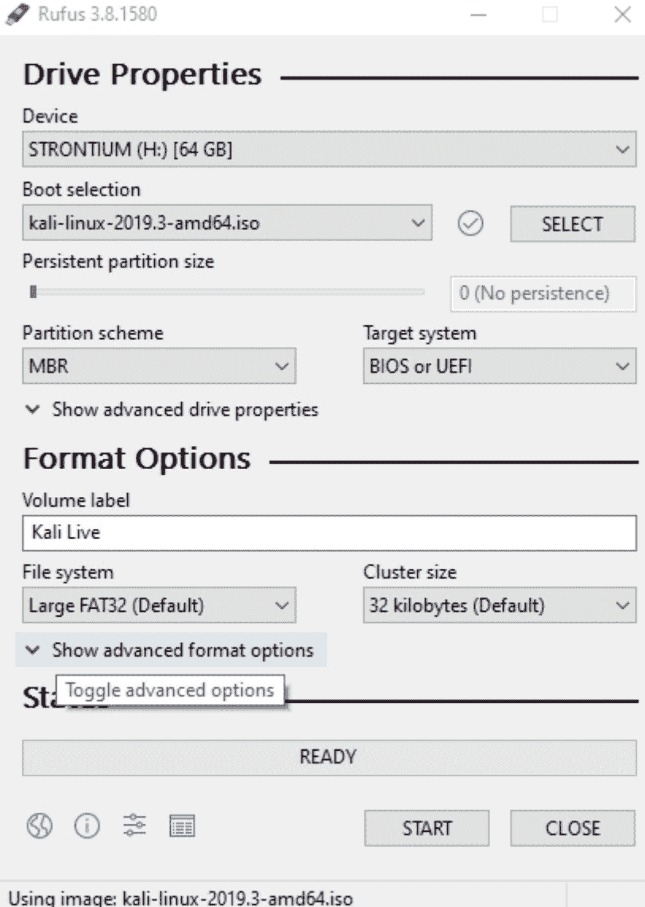
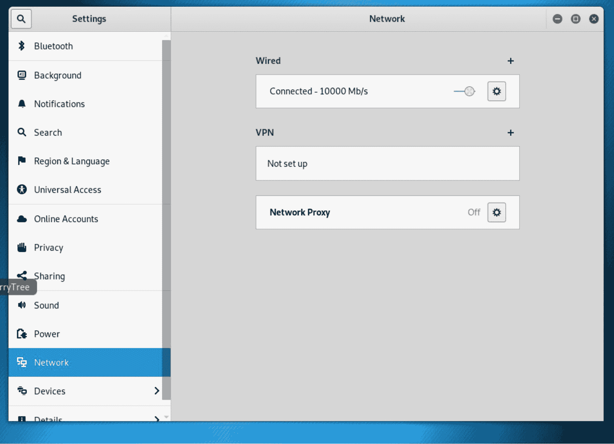

# Kali Linux 入门指南


© Copyright 2019 by Ethan Thorpe - 保留所有权利。

本文旨在就其涵盖的主题和问题提供准确且可靠的信息。本出版物的销售基于以下理念：出版者不要求提供会计、官方许可的服务或其他经过合规认证的服务。如果需要法律或专业建议，应聘请该专业领域的资深人士。

- 摘自一份经由美国律师协会委员会和出版者与协会委员会共同接受并批准的原则宣言。

以任何方式通过电子手段或打印格式复制、复制或传输本文的任何部分都是不法的。严禁录制本出版，除非获得出版者的书面许可，否则不允许对本文进行任何存储。保留所有权利。

此处提供的信息据称是真实一致的，这意味着对于因使用或滥用本文包含的任何策略、流程或指令而导致的疏忽或其他形式的任何责任，均由接收的读者承担全部责任。在任何情况下，出版者对因本文信息而直接或间接导致的任何赔偿、损害或资金损失均不承担任何法律责任或指责。

各作者拥有出版者未持有的版权。

此处提供的信息仅供信息参考之用，且具有通用性。信息的呈现不带有任何合同或任何类型的保证说明。

所使用的商标均未经任何许可，且商标的发布未经商标所有者的许可或支持。本书中的所有商标和品牌仅用于说明之目的，由所有者本人拥有，与本文无关联。

# 目录

- 引言
- 第 1 章：开始使用 Kali Linux
    - 什么是 Kali Linux?
    - 安装和准备 Kali Linux
    - 使用 USB 方法安装 Kali Linux
    - 双启动安装 Kali Linux
    - 在 Hyper-V 上安装 Kali Linux
    - 开始安装过程
    - ARM 安装
    - Kali Linux Features
    - Kali Linux 适合你吗?
- 第 2 章：开始黑客
    - 什么是黑客?
    - 了解黑客的类型
    - 黑客行为的后果
    - 受害者
- 第 3 章：黑客过程
    - 信息收集（侦察)
    - 侦察类型
    - 扫描
    - 获取访问
    - 维持访问
    - 清除踪迹
- 第 4 章：学习网络安全
    - 为什么网络安全很重要
    - 学习 CIA 三元组
    - CIA 三元组带来了哪些挑战?
    - 不同类型的网络威胁
    - 为什么网络安全很重要
- 第 5 章：学习 Debian 连接
    - 软件包如何从 Debian 流向 Kali Linux
    - 如何管理 Debian 的差异?
- 第 6 章：Linux 基础
    - 理解 Linux
    - 内核硬件
    - 文件系统
    - 进程管理
    - 命令行：与系统交互
    - 命令行基础
    - 文件系统层次结构
    - 主目录
    - 学习更多命令
- 第 7 章：Kali Linux 配置
    - 网络配置
    - 配置网络
    - 使用 systemd
    - Unix 用户
    - Getent
    - 修改账户
    - 禁用
    - 组管理
    - 配置服务
    - PostgreSQL 数据库
    - Apache 配置
    - 管理服务
- 第 8 章：理解 Kali 社区
    - Kali Linux 文档
    - 学习信息
    - 社区驱动的 Kali
    - 成为报告
- 第 9 章：Kali Linux 监控
    - 安全策略
    - 数据机密性
    - 极端情况
    - 安全措施
    - 网络服务
    - 如何安全网络
    - 你的防火墙过滤
    - 日志与
    - 检测变化
- 第 10 章：Debian 软件包管理
    - APT 简介
    - 不同的许可证
    - Kali 存储库
    - 基础软件包交互
    - Kali 升级
    - 清空和移除软件包
    - 学习软件包内容
    - 软件包故障排除
- 第 11 章：Kali Linux 与安全评估
    - 准备 Kali 进行安全评估
    - 不同类型的安全评估
    - 漏洞评估
    - 合规渗透测试
    - 传统渗透测试
    - 应用评估
- 第 12 章：服务器与网络扫描 - 如何发现并保护网络漏洞
    - 提问正确的问题
    - 像黑客一样思考
    - 创建公开信息地图
    - 强化所有的薄弱环节和漏洞
- 第 13 章：Kali Linux 工具
    - Nmap - 世界最著名的网络映射器工具
    - Fierce - 网络制图与端口扫描工具


## Unicornscan - 信息收集与数据关联工具
## Wireshark - 网络分析器
## Aircrack-ng - 无线安全工具包
## Kismet Wireless - 无线局域网分析器、嗅探器和入侵检测系统
## John The Ripper - 密码破解工具
# BeEF - 浏览器利用框架
# Yersinia - L2 攻击工具
## DHCPig - DHCP 耗尽应用
## THC Hydra - 用于破解远程认证服务的暴力破解工具
## Metasploit Framework - 渗透测试套件
## FunkLoad - Web 压力工具
# SlowHTTPTest -  HTTP 服务器 Web 压力应用
## Inundator - 多线程 IDS 规避安全工具
## 社会工程工具
## OpenVAS - 漏洞扫描工具
# Nikto - 帮助进行全 Web 服务器扫描
## WPScan - WordPress 安全审计工具
# [CMSMap - 针对所有流行 CMS 的集中化安全解决方案](#
# [选择正确的工具并强化您的网络安全](#
# [结论](#

## 引言

欢迎来到 Kali Linux：学习 Kali Linux 的简单且有效的方法。在本书中，你将学习 Kali Linux 以及如何有效地利用它。无论是中级用户还是初学者都能从书中通过赋予他们有效使用 Kali Linux 的技能来受益。

在本书中，我们将学习 Kali Linux 及其目的、它对黑客领域的影响、安装过程以及围绕它的其他重要概念。

黑客已成为对 0 和 1 痴迷的学生或专业人士的一个主要关注点。

Kali Linux 由 Offensive Security 编写。它包含了让你对网络、计算机和安全进行捣鼓和研究的工具和机制。目前，Kali Linux 提供了 300 多种工具，可用于漏洞评估、密码破解、无线黑客等！Kali Linux 是最流行工具的汇堂，包括 `Wireshark`、`Metasploit Framework`、`Nmap`、`Aircrack-ng`、`John the Ripper` 等！

为了开始，我们建议你对 `Linux OS` 或通用的操作系统具备基础工作知识。如果你是 `Linux OS` 或计算机的完全新手，那么我们建议在阅读此书之前学习基础计算机技能或 `Linux`。然而，如果你很有抱负，你可以在学习 `Linux` 的同时阅读并实现书中分享的理念。

书中涵盖的所有主题都是从初学者的角度出发的。我们首先查看如何正确安装 Kali Linux。我们的方法将包括创建双启动或在 `Windows 10` 中创建虚拟机。这两种方法都涵盖了，以确保良好的学习体验。在书的后半部分，我们的重点将转向网络安全、黑客或 Kali Linux 提供的工具。

此外，我们的重点主要放在伦理黑客上。但并不意味着我们不会涵盖一些黑帽技术。

在书的最后，你将具备充分利用 Kali Linux 的技能，理解黑客攻击、漏洞，并准备好保护你自己的系统。

# 第一章：开始使用 Kali Linux

Kali Linux 是目前领先的 Linux 发行版之一。它主要用于黑客攻击目的。黑客部分既可以是黑帽，也可以是白帽（我们稍后会详细介绍不同类型的黑客）。作为一名学习者，我一直好奇是什么让 Kali Linux 如此有趣。这鼓励我写了这本书，我们现在在这里！

## 什么是 Kali Linux？

Kali Linux 是一个 Linux 操作系统。它基于 `Debian`。Kali Linux 的主要目的是安全。它用于渗透测试和安全审计。这使其成为具有恶意意图的黑客的理想工具。

让 Kali Linux 存在的核心点是它所提供的工具。它预装了大量的工具。这些工具可以用于执行各种信息安全任务。例如，它允许你进行逆向工程、安全研究、计算机取证等。目前，它有超过 600 多个渗透测试程序。随着安全领域进行更多研究，工具的数量将继续增长。

Offensive Security 管理 Kali Linux 发行版。这是一家领先的信息安全培训公司。他们现在管理着用于制作 Kali Linux 的资金，它是用于渗透测试和数字取证最好的 Linux 发行版。该项目背后的两个主要人物包括 Offensive Security 的 `Devos Kearns` 和 `Mati Aharoni`。另一位产生影响的开发者是 `Raphael Hertzog`，一位 `Debian` 专家。

这一切使得 Kali Linux 成为一个学习黑客攻击或渗透测试的完美工具。你可以选择你如何使用它。

Kali Linux 的演变始于 2013 年 `BackTrack Linux` 的终结。该项目在 2013 年 3 月重启为 Kali Linux，同时保持了 `Debian` 的开发标准。

Kali Linux 也因支持 `Metasploit Project` 而闻名。该项目用于安全漏洞的开发和执行。

## 安装和准备 Kali Linux

在我们开始之前，我们需要准备 Kali Linux。安装 Kali Linux 很容易的。此外，Kali Linux 可以通过两种方式安装。你可以使用 `USB` 驱动器将它安装在单独硬盘上，或者简单地使用虚拟化解决方案将操作系统虚拟化。

*   `USB` 方法
*   `USB` 方法双启动安装
*   虚拟化方法 (`VMware` 或 `Hyper-V`）

如果你是虚拟化的新手，让我用简单的话向你解释。虚拟化是一种通过这种方法，为操作系统或软件拥有其独立的虚拟资源，以便在已有的操作系统/设备/解决方案上运行。那里有很多虚拟化解决方案，包括 `VMware`。许多大公司严重依赖虚拟化技术。即使是云公司也使用虚拟化为其订阅者提供云计算。托管公司也将虚拟化根植于服务之中。到现在，你应该知道虚拟化是一件大事，而且它确实如此！

如果你正在使用 `Windows 10`（Windows 的最新迭代），那么你可以使用虚拟化安装 Kali Linux。`Windows 10` 逐渐接受 `Linux`，这就是为什么他们在 2016 年引入了了自己的 `Hyper-V` 虚拟化解决方案。如果你使用的是最新的 `Windows 10` 版本或 `1803` 及更高版本，你的 Windows 应该预装了 `Hyper-V` 软件。

让我们先学习如何使用 `USB-drive` 方法安装 Kali Linux。但在我们之前，请查看安装 Kali Linux 的最低要求。

*   一个 `USB-drive` 可启动介质或 `DVD` 可启动介质
*   至少 20 GB 硬盘空间
*   `Kali Linux ISO`。

你可以从官方 `Kali Linux` 网站 `www.kali.org` 下载 `Kali Linux ISO`。在那里你可以在 `Kali Linux Downloads`: `https://www.kali.org/downloads/` 下找到所有下载选项。我也建议你使用种子链接下载，这样速度会更快。

从那里，你应该选择 `Kali Linux 64-bit`。对于本书，我们将使用 `2019.3` 版本。我建议你下载与我相同的版本。这样你就可以轻松地遵循书中分享的教程和方法。然而，如果你选择下载稍不同的版本（特别是最新版本），你也会没问题的。


### 使用 USB 方法安装 Kali Linux

在没有预装操作系统的裸机机器上安装 Kali Linux 是很容易的。你只需要制作一个可启动的 U 盘或使用 DVD 安装光驱。要制作可启动的 U 盘，你需要按照下面提到的步骤操作。

* 下载 Kali Linux ISO
* 现在，下载 `Rufus`。
* 一旦下载了 `Rufus`，就在你的机器上安装它。如果你没有可用的机器，应该向同事或朋友寻求帮助，让他们替你完成。
* 现在，启动 `Rufus`，它的界面如下所示。

 

* 你的 U 盘将显示在设备区域。在启动选择（boot selection）中，你需要选择 Kali Linux 镜像。为此，你需要点击 `SELECT` 然后选择已下载的 Kali Linux 文件。在分区方案（partition scheme）中，你应该保持为 `MBR`。目标系统应为“BIOS or UEFI”。
* 当涉及到高级驱动器属性时，你可以保留显示的默认设置。
* 一旦所有设置都正确，点击 `Start` 按钮。
* 现在，等待 `Rufus` 完成过程。

USB 驱动准备好后，你现在需要从它启动。你现在只需要按照安装向导所示的步骤进行安装即可。

## 双系统安装 Kali Linux

双系统安装 Kali Linux 与上面的过程非常相似。在这里，你需要确保有足够的空间来安装 Kali Linux。一个不同的分区（即使在同一块硬盘上）也可以。然而，如果你缺少空间，则需要使用一个名为 `GParted` 的工具。该工具让你能够缩小 Windows 安装分区并为 Kali Linux 安装腾出空间。要进行正确的双系统 Kali Linux 安装，你需要按照下面提到的步骤操作：

* 你首先需要从你的 USB 驱动或你选择的安装介质启动。一旦进入 Kali Linux 启动界面，你现在需要选择“Live（实时模式）”。这将进入 Kali Linux 的默认桌面。
* 从那里，你需要启动 `GParted` 程序。`GParted` 程序对于缩小 Windows 分区非常有用。通过它，你可以在有限的空间内成功安装 Kali Linux。
* 一旦 `GParted` 启动，你需要选择 Windows 分区并右键点击它。然后点击“Resize/Move”（调整大小/移动）。确保你为 Kali Linux 留有 20 GB 的安装空间。
* 在选择更改后，现在点击“Apply All Operations”（应用所有操作）。
* 完成后，你现在需要再次启动 Kali Linux 并选择 `Guided -- use the largest continuous free space as the partition disk`引导 -- 使用最大的连续空空间作为分区磁盘）。
* 安装完成后，系统将重启，你最终可以使用 `GRUB` 启动菜单引导到 Kali Linux。

## 在 Hyper-V 上安装 Kali Linux

现在，我们将学习如何在 `Hyper-V` 上安装 Kali Linux。这是我在学习 Kali Linux 时的建议。请记住，本书重点是学习 Kali Linux，而最好是虚拟化。

### 在你的机器上启用 Hyper-V

Hyper-V 在 Windows 环境中提供虚拟化。要启用 `Hyper-V`，你需要满足以下要求。

* 支持 `SLAT`（二级地址翻译）的 64 位 CPU。
* 虚拟化支持。基本上，对于 Ryzen 芯片应为 `SVM` 模式，对于 Intel 芯片应为 `VT-c` 模式。
* 至少 4 GB 内存。

尽管你的机器支持虚拟化，但在使用之前需要先启用它。要启用它，你需要进入 BIOS 并启用虚拟化。我正在使用一台带有 `AB350` 和 `Ryzen 1600` 的不错的中端配置。对于我的机器，我必须进入 CPU 高级功能，在那里启用 `SVM` 模式。如果虚拟化在你的系统中仍然不起，你需要在 BIOS 中允许强制性硬件数据执行保护（Data Execution Prevention）。

要检查你的机器现在是否准备好进行虚拟化（特别是用于 `Hyper-V` 方案），请运行以下命令。

* 运行命令提示符
* 在命令提示符上运行 `systeminfo.exe` 命令
* 按回车

你将看到命令的正面回复。

仅启用硬件虚拟化是不够的。Windows 默认不运行 `Hyper-V` 模块。要允许它们运行，你需要进入控制面板并搜索“启用或关闭 Windows 功能”。

在那里你会找到 `Hyper-V` 选项，以及两个子选项：`Hyper-V Platform` 和 `Hyper-V Management Tools`。启用这两个选项并点击确定继续。

完成后，你需要重启，然后进入实际安装过程。

### 开始安装过程

* 对于此，我们建议通过 `Quick Create`（快速创建）选项。一旦你打开 `Hyper-V`，你将在菜单中找到 `Quick Create` 选项。
* 你将看到 `Create Virtual Machine`（创建虚拟机）窗口。在那里发现几个选项，包括 `Ubuntu 18.04.3 LTS` 和 `Ubuntu 19.04`。
* 这里你需要先点击“Local installation source”（本地安装源），然后移动到“Change installation source”（更改安装源）。
* 从那里选择 Kali Linux ISO。此外，取消勾选“This virtual machine will run windows”（此虚拟机将运行 Windows）选项。
* 完成后，点击 `Create Virtual Machine` 。
* 它将提示你连接到新虚拟机。关闭提示，然后右键点击你刚刚创建的新虚拟机并选择“Setting”（设置）。
* 现在，从那里进入 `SCSI` 连接器并选择硬盘。
* 从这里，如果你想更改磁盘的位置，需要点击 `New`新建）。这很重要，因为 `vhdx` 文件存储在 `C:` 盘中。
* 点击 `Connect`连接）。完成后，你现在看到 Kali Linux 启动菜单，如下所示。


在这里你可以看到 Live system（实时系统）选项。实时系统选项对于测试非常有用。这让 Kali Linux 成为一个好主意。

要开始安装，你需要按下 installer 选项。完成后，它将使用安装向导启动。

它将遵循的步骤概述如下。


让我们列出步骤以确保安装正确：

* 选择安装过程的语言。它还会询问安装系统的语言。我们将两个选项都选择英语。
* 根据你所在地选择位置。
* 然后它要求你配置键盘布局。选择你喜欢的键盘布局。
* 之后，它将从源加载安装组件。在我们的情况下，它是 ISO。向导还将配置网络。
* 完成后，你需要为系统选择一个主机。这是一个单单词主机。它会自动选择 Kali 作为主机，我们建议你使用它，这将有助于你遵循书籍内容。它还会要求你选择域名。主机是可选的。
* 现在，你需要选择 root 密码。root 密码是必须的，你需要在继续之前选择一个。现在，选择一个难以猜测或破解的强密码。同时，确保你以后不会忘记密码，否则将导致你无法访问 Kali Linux。
* 它现在会要求你设置时区。
* 现在，涉及到配置你的分区磁盘。Kali Linux 或任何 Linux 安装都有不同的文件系统，因此它们看起来与任何其他操作系统安装完全不同，特别是 Windows OS 安装。为了确保你不需要做太多，你可以选择 `Guided - use entire disk`（引导 - 使用整个磁盘）选项。由于我们正在使用虚拟化，我们不需要担心分区，因为 `Hyper-V` 已经为我们的操作系统安装分配了唯一的硬件位置。


*   一旦你选择了引导式分区，系统会要求你选择分区方案。它包括以下选项：

1. 所有文件放在一个分区中（针对新用户）
2. 独立的 `/home` 分区
3. 独立的 `/home`、`/var` 和 `/tmp` 分区

由于你是 Kali Linux 的新用户，我们建议使用第一个选项。

最后，它将为你展示已创建的分区的概述。如果一切看起来都没问题，现在就可以点击“完成分区并将更改写入磁盘”了。

*   现在选择“是”继续
*   现在你必须等待安装完成。

### ARM 安装

在本节中，我们将讨论如何进行 ARM 安装。ARM 代表高级 RISC （Advanced RISC Machine）。ARM 设备的一些示例包括嵌入式计算机、开发板、笔记本电脑等。

如果你想在 ARM 设备上安装 Kali Linux，就不能使用我们上面讨论的普通 Kali Linux 安装。对于这些设备，你需要配置内核以使引导程序工作。

要开始，你需要使用针对 ARM 设备的 Offensive Security 脚本。检查下载链接：[`gitlab.com/kalilinux/build-scripts/kali-arm`](https://gitlab.com/kalilinux/build-scripts/kali-arm)

对于 ARM 设备，你还需要使用其他安装镜像([`www.offensive-security.com/kali-linux-arm-images/`](https://www.offensive-security.com/kali-linux-arm-images/))

一旦你下载了镜像和脚本，请按照步骤在基于 ARM 的设备上完成 Kali Linux 安装。

*   检查和是否与你下载的内容匹配。你可以使用在线提供的校验和工具进行操作。
*   一旦你确定下载了正确的镜像，就需要根据你的 ARM 设备情况获取存储设备。你还需要确保存储设备至少有 8 GB 的容量。
*   现在使用 `dd` 将镜像复制到你选择的存储设备。你也可以使用 Rufus 拷贝镜像。
*   如果你使用 `dd`，需要使用以下命令。
*   接下来，你需要将存储设备插入你的你的 ARM 设备。
*   完成后，使用凭据登录：用户 → `root`，密码 → `toor`。连接后，生成新的 SSH 密钥和 root 密码。
*   你的 ARM 设备现在已可以使用！

## Kali Linux 特性

在安装完成之前，让我们快速回顾一下让 Kali Linux 成为极佳选择的特性。

### 开源
Kali Linux 采用开源模型许可。它带来了多处好处，包括可以免费使用。Kali Linux 周围的开源社区也非常强大，我们还看到许多开发者在对其做出贡献。

### 免费使用
Kali Linux 是免费的。这使得 Kali Linux 成为渗透测试人员的首选。它配备了你为了优化工作所需的所有内容，而这一切都无需支付一分钱。

### 渗透测试工具
Kali Linux 的另一个大大特性是它的渗透测试工具合集。它拥有六百多种渗透测试工具！考虑到每个工具的能力范围，这是一个巨大的数字。此外，发布版中包含的每个工具在各方面都是独有的。那些复制或重复其他工具功能的工具已被剔除。

### FHS 合规性
它遵循文件系统层级标准（FHS），其他 Linux 发行版（包括 Ubuntu）也使用该标准。作为用户，你从中受益，因为它允许你将 FHS 知识从一个发行版带到另一个。你不需要重新思考在何处找到库、二进制文件或其他文件。

### 自定义内核
Kali Linux 内核是定制的，并包含了最新的注入补丁。它经过了频率补丁，并且经过安全开发。

### 无线设备支持
并不是所有 Linux 发行版都带有无线支持。然而，Kali Linux 带有无线设备支持。它的开发方式确保了对成百上千种设备的兼容性。

### 语言支持
它开箱即支持多种语言。

### GPG 签名
Kali Linux 中使用的所有包都经过了 GPG 签名，这意味着包是安全的，并且是根据标准协议制作的。

### 可定制
Kali Linux 从内核开始就是高度可定制的。它的开发方式可以满足每个用户的需求。定制需要在内核之上完成。

所有这些特性使得 Kali Linux 与其他 Linux 发行版与不同。首先，它是单用户模式，即 `root`。这意味着所有关键更改都只能通过 root 用户进行。这也意味着它是一个单用户操作系统。考虑到大多数工具都需要高级访问权限，这是一个很好的方法。此外，网络服务默认是禁用的，这样你可以很轻松地安装应用程序。最后，它配备了精简的存储库，确保了更好的系统完整性。

## Kali Linux 适合你吗？

在我们学习 Kali Linux 之前，我们需要了解 Kali Linux 是否是你的正确选择。学习者选择一个操作系统后发现它不适合自己，这种情况很常见。这本书是关于 Kali Linux 的，但作为一名学习者，你应该确保你确实需要 Kali Linux。

首先，Kali Linux 并不适合普通用户。它是一个专门为渗透测试设计的操作系统。这意味着如果你想成为一名安全专家或已经是该专家，那么你在学习或使用 Kali Linux 方面做出了正确的选择。然而，对于进行其他开发工作或将其作为日常活动，它并不是一个好选择。

另一个让 Kali Linux 如此惊人的特性是它的制作价值。只有少数资深人士有权限更新项目。你可以建议新的更改，但由这些资深人士决定是否进行更改。最初，开发者对存储库进行签名，然后由整个团队进行签名。作为用户，这意味着在添加或自定义包时你会受到限制。因此，如果你想添加一个包，你需要花费大量的研究和耐心才能完成。

那么，这意味着它适合你吗？为了确保你没有走错路，请确保在以下情况下**不要**选择 Kali Linux：

*   你从未用过 Linux 操作系统。
*   你不理解基础管理知识，或者完全没有操作系统经验。
*   如果你认为你会把 Kali Linux 作为日常主系统，用于浏览网页、看视频或游戏等日常活动。

此外，你应该了解在对网络进行未经授权的渗透测试时涉及的法律条款。如果你做了可能损坏计算机或网络的更改，你可能会遇到麻烦。执法部门对这类活动的打击非常严厉，你应该事先知道，而不是事后才后悔。

然而，如果你是一个想要让每个人的计算变得更安全的人，那么 Kali Linux 就适合你。你懂得如何使用渗透测试工具，并在进行活动时拥有适当的授权。

## 本章学到的知识

*   Kali Linux 用于渗透测试目的。
*   它由 Offensive Security 管理。
*   它提供了一系列优秀的渗透测试和黑客工具。
*   Kali Linux 的开发始于 2013 年的 BackTrack Linux 项目。
*   它支持 Metasploit 项目。
*   它为开发、执行和测试安全漏洞解决方案提供了一个完美的实验场。
*   安装 Kali Linux 很容易。你可以在 USB 方法（带或不带双引导）和虚拟化方法之间进行选择。


-   虚拟化最适合学习，因为你不需要经历双系统启动的问题。不过，如果你愿意，也可以安装独立的 Kali Linux。
-   `Hyper-V` 允许你直接将 Kali Linux 安装到 Windows 10 中。你需要使用 Windows 10 1903 或更高版本才能使用它。
-   安装过程需要按照你的要求进行仔细设置。
-   Kali Linux 的主要特性包括自定义内核、符合 FHS 标准、多语言支持、免费使用、开源、可定制、GPG 签名等！

# 第 2 章：开启黑客之旅

正如我们已经学到的，Kali Linux 主要用于黑客。这就是为什么我们需要详细介绍这个主题。我们需要学习什么是黑客、黑客的类型以及你应该采取的路径。我们还将学习 Kali Linux 在让你成为安全专家方面扮演的角色。

## 什么是黑客？

黑客是由黑客进行的一种活动，涉及对系统、服务或解决方案的修改。它可以以颠覆性的方式进行，黑客可能拥有授权或未授权的访问权限。

然而，在通常空间中，黑客总是被视为坏事。它关乎从事犯罪活动，包括未经授权地收集信息或数据、破解安全系统，或从银行账户转账巨额资金。尽管它们是黑客的例子，但它们并不能限制黑客的本质。

目前，黑客可以与多种定义相关。我们能最好的定义方式是将黑客定义为“富有创意”。黑客不仅是一种与计算机相关的活动。它还是我们日常生活中进行的一种活动。如果你修改或转换一个物体或过程到你想要的方式——这可以被称为黑客。

在计算机术语中，黑客是指探索漏洞——使用它或修复它。网络安全世界运行在发现并解决漏洞的基础上，以确保使用该服务或解决方案的人是安全的。计算机黑客技术已成为现在拥有的最重要技能之一。它现在由了解自己行为所为的认证人士执行。这也催生了不同类型的黑客，包括白帽黑客、黑客和灰帽黑客。渗透的方法、动机和手段决定了他们的类型。

你可能会发现黑客（Hackers）和破解者（Crackers）容易混淆。破解者也是黑客，但只从事特定类型的活动，包括破解密码、绕过软件访问或绕过计算机安全。

## 学习黑客的类型

有不同类型的黑客。包括以下几种：

-   黑帽黑客
-   白帽黑客
-   灰帽黑客

### 黑帽黑客

黑帽黑客是以不符合道德的方式进行黑客活动的黑客。大多数时候，黑帽黑客是渗透测试或网络安全领域的新学习者。他们对学习黑客技术的渴望使他们使用更不道德的方法。他们在黑客伦理方面也没有接受过训练。此外，缺乏指导和导师意味着他们有更多机会变成黑帽黑客。

他们在没有获得适当授权的情况下进行活动并获得系统访问权限，要么破坏系统要么获取系统以推进他们的工作。黑帽黑客还以勒索所有者支付赎金而闻名。这是一项严重的犯罪，因为它包含了两项罪行——黑帽黑客和勒索。

大多数时候，黑帽黑客完全是为了让自己感觉良好。它可以被定义为一种自私的行为，他们不介意为了自己的成就而伤害他人。他们的方法定义了他们，如果他们使用不道德的方法，他们只是通过自己的行为在伤害他人。这并没有到此结束，黑帽黑客还会继续使用他们收集的数据。他们要么在黑市（深网）出售数据，要么使用这些数据进一步进行他们的黑帽黑客活动。

黑帽黑客大多数以小组形式工作。而且，许多政府可能有自己的黑帽黑客群体，以便在统治世界方面获得优势。但在任何情况下，黑帽黑客的行为都是无法辩白的，因为他们总是进行未经授权的黑客活动。

### 白帽黑客（道德黑客）

白帽黑客的工作与黑帽黑客完全不同。白帽黑客的方法是符合道德的，从不进行未经授权的访问。他们更有创意，知道如何以不同的方式访问网络或计算机。他们利用知识寻找漏洞或弱点，然后修复它们。如果他们不知道如何修复漏洞，他们会通知服务、产品或解决方案的所有者。

白帽黑客唯一的区别在于他们的伦理道德。他们使用与黑帽黑客相同的方法。他们的工具是相同的，他们的技能也有可能是相同的。

成为一名白帽黑客并不容易，因为它在技术和伦理意义上都需要大量的耐心和训练。此外，成为白帽黑客没有单一的路径。在很多情况下，黑帽黑客在职业生涯中变成了白帽黑客。反之亦然，黑客也会从白变黑。此外，白帽黑客通常被称为“渗透测试员”。他们的工作是在网络、机器或解决方案被利用之前发现其中的漏洞。几乎每家科技公司都有自己的渗透测试员团队，因为他们希望自己的产品尽可能安全。

### 灰帽黑客

灰帽黑客是介于白帽黑客和黑帽黑客之间的黑客。他们同时使用黑帽和白帽技术。灰帽黑客也倾向于良好的一面，但在方法上并非 100%的投入。

灰色方法主要由想要提高自己的学习者使用。他们经常做一些不道德的事，但也希望确保通知公司漏洞。灰帽黑客在解决问题中成长，如果他们报告漏洞，公司也愿意支付他们。如果有人发现漏洞并报告给公司，公司会赏金。灰帽黑客也不倾向于窃取数据或赚钱。

此外，成为灰帽黑客完全是可选的，你仍然可以创建自己的场地来测试和提高技能，而不是在别人的网络或计算机上尝试你的技能。

## 黑客后果

黑客活动可能是一件很有趣的事，特别是对于新学习者来说，但它伴随着后果。未经授权访问的后果视情况而定。在许多情况下，黑客一旦被抓获，将根据法律受到起诉。涉及黑客的法律并不轻松。根据所实施的黑客行为，刑事指控可能是巨大的。例如，如果你破解了金融机构，你将面临严厉的处罚，包括入狱和支付巨款。这样做是为了阻止黑客从事不道德的破解。

但并非所有的黑客活动都是坏的。白帽黑客或道德黑客是好黑客的核心。也存在白帽黑客被发现进行不道德活动的情况。在这些情况下，他们的惩罚取决于他们的行为对社区的贡献。

## 受害者

如果你打算使用 `Kali Linux` 进行渗透测试，你还应该了解你行为的受害者。如果你在正确的道路上，就不必担心，但如果你尝试违背道德会发生什么？谁会成为你的受害者？


受害者可以是任何互联网上的用户。有数百案例显示，黑客入侵个人照片并将其发布在社交媒体上，使当事人颜无地。黑客还可以对该人员进行勒索。事实上，黑客进行的首要活动是身份盗用。他们入侵一个人的账户并复制所有的照片和信息。一旦完成，他们就会创建一个类似的配置文件并试图伪装成该人员。另一种常见的活动是进行信用卡盗窃和未经授权的支付。

## 本章我们学到的知识

*入侵是指未经授权，获取系统、进程或解决方案的访问权限或窃取数据的过程。
* 黑客也可以被定义为一种破坏并获取访问权限的创造性过程。
* 黑客分为三种类型，包括黑帽客、白帽客和灰帽客。
* 黑帽客是那些选择不道德路径的黑客。他们的主要目标是利用漏洞窃取数据或获取系统访问权限。
* 白帽客（道德黑客）的工作是保护系统、解决方案和服务免受黑客的攻击。他们遵循伦理路径。
* 灰帽客是黑帽和白帽之间的中间路线。通常情况下，他们入侵系统是为了通知组织该漏洞以便进行修复。
* 如果你采取了不道德的道路，将会产生入侵后果。因此，务必警惕他们。
* 受害者可以是任何因黑客行为而受到损害的人。

# 第 3 章：入侵过程

Kali Linux 是一种黑客工具。如果你选择了 Kali Linux，我希望你现在已经知道你将用它来进行入侵或渗透测试。这就是为什么你能够学习入侵过程的原因。入侵过程可以适用于大多数入侵尝试，并可以作为一个框架使用。这些步骤将引导你变得更擅长入侵（无论是合法的还是不合法的）。

入侵过程中存在包含的五个关键步骤包括：

* 信息收集（侦察 - Reconnaissance）
* 扫描（Scanning）
* 获取访问（Gaining Access）
* 维持访问（Maintaining Access）
* 掩盖踪迹（Covering Tracks）

让我们详细介绍每一个步骤。

## 信息收集（侦察）

你将进行的第一步是信息收集。它是入侵过程中最重要的部分。而且在大多数情况下，它被忽视了。信息收集的过程被称为侦察。在这一步中，你的工作是尽可能收集多的信息——你拥有的有用信息越多，入侵过程成功的机会就越大。你在第一步中收集的信息将帮助你完成接下来的四个步骤，包括扫描、获取访问、维持访问和掩盖踪迹。

作为一名黑客或学习者，你可能会发现信息收集步骤有点无聊——因为它基本上不需要技术工具。大多数时候，你必须一直盯着系统并尝试寻找信息。你需要决定哪些信息对你是有用的。在工具方面，你可能需要使用某种工具。而在技术方面，那里有很多是你需要学习的。

## 侦察的类型

侦察可以分为两种类型。为了帮助你理解这一概念，我们将逐一介绍它们。

### 被动侦察

在被动侦察中，你的工作是不直接与系统进行交互，而是被动地尝试收集信息。所以，如果你想找到系统的漏洞，你可能希望访问网站，了解他们正在招聘谁，理解他们使用什么技术等。通过这种方式，你可以在不尝试与你想入侵的系统交互的情况下了解公司。

要开始，你可以利用 Google 的优势。在那里，你可以找到公开记录。为了了解更多关于公司的信息，你可能需要进行 `WHOIS` 查询。它将帮助你了解更多数据、他们使用的托管服务以及其他重要的细节。

接下来，你也可以尝试研究该公司合作的客户。此外，尝试找到哪些员工在负责哪个项目，或者至少尝试找到他们最有价值的员工。这些信息看起来可能微不足道，但在入侵过程的后期阶段可能会改变局面。

社会工程学（Social Engineering）也是一种你可以使用的绝佳技术。在社会工程学中，你只需窃取一个人的身份，然后利用该身份从他人那里获取信息。通过这种方式，你可能会获得员工使用的公司账户访问权限。社会工程是一个非常强大的工具，但在开始这样做之前你应该非常小心。如果你犯了一个小错误，你的掩护就会暴露，你之后进入系统或收集更多关键信息将变得更加困难。

处理社会工程的最佳方法是创建虚假的社交媒体简介，并与你认为可以从那里获得更多信息的人联系。社会工程也可以通过电话进行。起初看起来可能有点吓人，但通过练习，你这样做时会变得更加成功。

翻垃圾桶（Dumpster Diving）是一种从丢弃场所寻找信息的技术。你可以从丢在垃圾桶里的文档中获取信息。例如，你可以获得一张 ATM 凭单，并从那里了解该人的交易信息。你还可以获得电话号码甚至银行对单。

### 主动侦察

主动侦察是被动侦察的完全相反。它要求与系统进行主动交互。目标需要被明确定义，你应该主动搜索该系统。但是，主动信息收集比被动收集更具挑战性。方法之一是寻求公司员工的帮助。可能是让他们让你通过正常流程使用解决方案/软件。你可能还想查阅他们的文档（如果有的话），并尝试尽可能地了解他们的系统。

在主动侦察中，你需要执行操作：

* 检查系统是否对外部 `ping` 响应
* 如果系统对 `ping` 没有响应，则你需要寻找其他与系统交互的方法
* 通过创建账户、访问支付系统等方式直接与系统交互
* 尝试所有不同的连接服务器的方法。然而，要小心你的交互方式，因为可能会激活系统的安全机制并标记你的身份。

## 扫描

入侵过程的下一步是扫描。扫描阶段包含了大量工具的使用。扫描工具将帮助你进一步完善从侦察阶段收集的信息。作为黑客，你需要使用各种工具，包括端口扫描器、ping 工具、扫描器、漏洞扫描器和网络映射工具。网络扫描非常重要，因为它将帮助你获取系统的访问权限（下一步）。

了解开放端口列表也是至关重要的，因为它还会告知你更多信息，包括正在使用的操作系统。此外，响应类型取决于操作系统或平台上开放的响应端口。所以，如果你正尝试访问基于 Linux 的操作系统，你将得到不同的响应。

你需要遵循的另一个技术是“嗅探”网络包。有很多工具可以让你这样做。然而，我推荐你使用 `Wireshark`，这是分析流量的第一工具。一旦阶段完成，你应该能够理解整个网络结构。

在扫描结束后，你拥有以下内容

* 更多重要的信息，主要是技术性的
* 正确的网络拓扑


* 所使用的的操作系统类型
* 寻找任何可能的漏洞

此外，你还需要确保将所有信息都集中在一个地方。通过执行这些操作，你将能够理解这些数据，并移除或分离你认为不重要的数据。

## 获取访问权限 (Gaining Access)

在完成所有的信息收集后，我们现在准备好访问目标系统。到目前为止，我们已经掌握了大量信息。这些信息将帮助我们获取访问权限。我们的信息包含了网络映射、日志信息和其他关键信息。

目标是利用漏洞获取目标系统的访问。如果你成功发现漏洞并正确地使用它，你就应该能够获得系统的权限。

然而，发现漏洞并非易事，你可能需要进行额外的渗透测试来寻找路径。此外，这是你黑客过程中最重要的环节。如果没有直接访问目标系统的权限，你什么也做不了。这使得发现漏洞变得异常重要，因为它获得了访问系统的关键。

那么，你可以使用哪些方法来获取访问权限呢？实际上，有很多方法可以实现。如果你在社会工程技术上获得成功，你可能会获得进入系统的直接用户名和密码。那太棒了！但这种情况极其罕见。在大多数情况下，你需要找到系统上托管的应用程序中的漏洞。否则，你需要找到系统版本中的漏洞。

你可以使用的技巧如下：

* 发起拒绝服务攻击 (Denial of Service)
* 使用会话劫持 (Session Hijacking)

拒绝服务攻击不会让你获得系统的访问权限，但它可以让你暴露系统的漏洞。

一旦你发现至少一个漏洞，你就应该能够进入系统。然而，破解的时间取决于他们的安全系统有多稳固。大多数公司在安全方面投入了巨资。他们拥有白帽黑客，其工作是不惜代价地保护系统。如果他们发现有人未经授权访问系统，就会尝试阻止这种行为。预先对这种威胁做好准备更好。作为一个黑客，了解白帽黑客的工作时间非常有帮助，只有当你认为被捕获的概率极小或者确定了进入系统的入口时，才尝试访问系统。

如果你自己是一个灰帽黑客，你可能想向公司报告该漏洞。你也可以继续流程，并在之后报告更多关于该漏洞的细节。选择权在于你。

获取访问权限可能也需要一些时间。大多数黑客会在这一点放弃。但如果你下定了决心，最终将进入系统。

另一个你需要跟踪的是人为错误。这些错误非常常见，你可以通过利用这些错误来找到路。人类容易出错。他们在执行任务时缺乏 100%的注意力，从而导致漏洞。这些漏洞在性质上可以是技术性的，也可以是非技术的。

## 维持访问权限 (Maintaining Access)

一旦你获得了系统或网络的访问权限，现在就需要维持访问。这部分与获取网络访问同样挑战。网络/系统有自己的防火墙，持续监控网络异常。某些防火墙配备了由最新技术驱动的高级系统。这使得维持访问成为黑客过程中的步骤之一。

最好的方法是确保你不会被系统识别为异常用户。此外，为了维持对系统的访问，你需要在系统中植入后门或木马。根基程序 (Rootkit) 也可以帮助你在未来保持对系统的访问。

另一种方法是感染网络内的其他应用程序和机器。感染的机器越多，你现在和未来维持访问的机会就越大。然而，不要做得过头。始终保持低调，只感染少数数量的机器，这样主机系统就不会对你在网络中的存在产生怀疑。

一旦建立了访问，你现在需要监控电子邮件、系统登录信息和其他重要内容。你还可以监控网络流量并根据你的需求对其修改。从特定终端或机器收集信息的最好方法是为其配备键盘记录器 (Keylogger)。这样，你就可以获得特定账户的进一步访问，从而对网络拥有更多控制权。

目标是尽可能在系统中隐藏自己。你的方法需要缓慢而稳定。最初，你可以简单地观察系统的不同运行情况。一旦你对系统/网络的工作原理有了信心，就可以去感染环境。

## 清除痕迹 (Clearing the Tracks)

黑客过程的最后一步是清除痕迹。作为一个黑客，你不希望被暴露，特别是如果你在进行黑帽攻击的话。我们已经讨论过惩罚可能有多严重，如果你在进行黑帽攻击，你就让自己暴露在风险之中。为了长期保护你的存在，你需要隐藏自己的痕迹，或者至少清除它们，以便无人知道你曾访问过系统。

主要目标是躲避维护系统的 IT 专业人员。你应该像白帽黑客一样思考，保护自己防止他们寻找你的技术。

如果白帽团队或 IT 专业人员知道有人未经授权访问系统，他们就会把你踢出系统，使你失去访问权限。这意味着未来将无法访问该系统。

最好的方法是覆盖系统的日志机制。日志提供了关于系统如何运行的不同信息。这意味着你可以从日志中删除你的记录。你可以自动化系统执行此操作。日志对于寻找系统内异常的白帽黑客来说是常态。

通过清除痕迹，你确保了两点：

* 保持对系统的长期访问
* 确保你不会被捕并起诉

这引导我们走向黑客过程步骤的结束。我们学习这些步骤是因为学习 Kali Linux 非常重要。Kali Linux 是一个渗透测试操作系统，即使你想成为白帽黑客，也需要知道黑客是如何工作和思考的。

# 第 4 章：学习网络安全

* 在这一章中，我们专门学习了黑客过程。
* 黑客过程的五个关键步骤包括信息收集、扫描、获取访问权限、维持访问和覆盖痕迹。
* 在信息收集步骤，你需要使用技术尽可能地收集信息。
* 侦察有两种类型——被动侦察和主动侦察。
* 在被动侦察中，你可以使用社会工程和翻垃圾（dump diving）等技术。
* 在主动侦察中，你还需要使用扫描等技术。
* 要获取访问权限，你需要在系统中发现漏洞并利用它。你还可以使用包括拒绝服务和会话劫持在内的技术来揭示系统的问题。
* 一旦你获取了访问权限，就需要维持访问。你可以通过保持低调、删除日志文件中的条目或安装恶意软件来实现。
* 最后，你需要清除痕迹，以便能够长期访问系统。


并非所有人人都处于黑暗的一面。许多人希望让世界变得更安全。作为一个对 `Kali Linux` 感兴趣的学习者，你也需要让自己装备好网络安全术语和知识。

我们将在本章中保持简短，之后我们就会进入 `Kali Linux` 的领域。学习 `Kali Linux` 并不仅仅关于工具；你需要具备适当的背景知识才能正确地使用它们。

那么，什么是网络安全？

网络安全是一个生态系统，其中包含了各种实践、流程和技术，用于保护各种设备、程序和网络免受恶意攻击和未经授权的访问。它也被信息技术安全。

## 为什么网络安全很重要

网络安全对我们的社会至关重要。随着计算机和互联网的引入，我们逐渐进入了信息技术时代。由于我们在网上存储、处理和检索数据，我们的生活现在与信息技术深度连接。

政府、医疗机构、军和其他机构严重依赖计算机。网络安全被用于确保所有机构的安全。组织在服务器中存储着关键数据，这些关键数据对组织非常重要，因为它们提供了竞争优势。如果数据发生泄露，他们将失去竞争优势和市场份额。政府也拥有大量需要保护的敏感信息。网络安全正是保护它们免受泄露的。政府还热于在情报领域投入巨，在寻找保护国家利益的同时保护保护敏感信息。

## 学习 CIA 三要素

在网络安全的核心，我们有 `CIA` 三要素。这是一个保持网络安全生态系统运行的基础概念。如果没有 `CIA` 三要素中的任何一个元素，就不可能存在安全的系统。

这三个元素如下：

- 机密性 (Confidentiality)
- 完整性 (Integrity)
- 可用性 (Availability)

如果我们要简短地解释这三个元素，那么机密性可以解释为一组信息访问规则；完整性与数据的准确性和可信度有关，而可用性则确保数据仅对授权人员可靠地可用。

让我们下面详细介绍。

### 机密性

`CIA` 三要素的第一个元素是机密性。换之，它与隐私有关。通过维护机密性，系统确保不惜代价维护用户的隐私。它还确保只有所有者访问敏感信息，而恶意攻击者无法访问。

机密性规则根据数据类型和所有者状态而不同。分类是根据数据落入错误的人手中可能造成的损害程度来进行的。

机密性的实施非常困难。为了让它生效，人们需要接受培训。这种培训确保了减少与数据相关的安全风险。最大的安全威胁之一是人类本身。如果他们没有经过培训，可能会留下漏洞供黑客利用。他们需要学习如何设置强密码以及如何保持密码安全。这些最佳实践还将有助于识别社会工程尝试。社会工程方法试图诱导人们放弃他们的信息，包括密码。

在技术方面，机密性是通过使用密码学来维护的。强力加密确保了用户名和密码不会在网上被黑客泄露。公司需要安全地存储数据，而正是这使得它变得更具挑战性——还有其他类型的验证方式，包括安全令牌、生物识别验证、软令牌等。

### 完整性

`CIA` 三要素的第二个元素是完整性。它关乎数据在整个数据生命周期中的可信度、准确性和一致性。这意味着数据不应被未经授权的访问或恶意攻击者修改或更改。大多数情况下，如果机密性被破坏，数据的完整性也会被破坏。

为了维护完整性，必须使用访问控制来确保只有授权用户才能访问数据。此外，还需要通过各种方法检查并验证完整性，包括加密校验和或哈希值等。

一些用于检查数据完整性的算法包括 `SHA1`、`SHA2`、`SHA3`、`SHA5` 和 `MD5`。

### 可用性

最后一个特性是可用性。存储的数据应该随时可用。不可用的数据是无用的。为了实现 100% 的可用性，硬件制造商需要维护其硬件，并在发生任何问题时立即修复。他们还需要关注所使用的软件或操作系统，以便以最好的可能的方式向用户提供请求的数据。

另一个大要求是提供足够的带宽以实现最佳可用性。仅仅有可用性是不够的，还需要在定义良好且合理的时间内将数据提供给用户。

其他需要维护的关键方面还包括 `RAID`、冗余、故障转移等。适当的灾难恢复系统可以确保数据不丢失。它还确保在不同情况下数据传输都不会受到阻碍。

在拒绝服务(`DoS`) 攻击期间也需要维护数据可用性。最好的方法是拥有适当的防火墙和代理服务器，以确保服务在最坏的情况下正常工作。

提供数据可用性的两种最佳方法是冗余和备份。

## CIA 三要素带来了什么挑战？

尽管 `CIA` 三要素看起来是一个很容易实现的东西，但实际上恰恰相反。它利用了大数据和其他技术，这使得 `CIA` 范式成为一项难以维护的任务。大数据的核心在于从各种数据源收集重要数据。这会增加不必要的成本，并使维护 `CIA` 三要素变得更加更加困难。

其他技术也面临着各自的问题。例如，`IoT` 带来了全新级别的挑战。通过不同的介质、接口和网络连接不同的设备本身就是一个挑战。现在，保护数据的机密性、完整性和可用性是一个更大的挑战。`IoT`并不像其他技术那样安全。

## 不同类型的网络威胁

网络威胁是网络安全的核心。作为 `Kali Linux` 用户，你也需要学习相关术语。黑客热衷于使用任何形式的网络攻击来获取系统的访问。为了确保你了解这些攻击，让我们将它们列如下。

### 恶意软件

最常见的网络攻击之一是使用恶意软件。这是一种用于获取系统访问权限的软件。它也可以在所有者不知情的情况下对系统造成危害。

### 社会工程

社会工程是一种非技术威胁，人员试图通过社交技巧伪装身份并收集信息。这完全是心理操纵他人。

### 高级持续性威胁

高级持续性威胁被未经授权的用户用于在长时间内维持对网络或系统的访问。

### 勒索软件

勒索软件是一种新型恶意软件。它主要用于向受影响的计算机索索金。勒索从目标机器感染恶意软件后开始。该软件可以锁定系统中的重要文件，然后要求金钱以解锁。许多勒索软件会将用户完全锁定在系统之外。即使用户同意支付金额，黑客也可能在系统中保留一个后门，以便感染网络中的其他计算机。他还可以尝试在一段时间后再次感染系统。

噬 网络钓鱼


我们最后想要讨论的一种网络攻击是钓鱼。这是一种常见的攻击，始于伪造的电子邮件。这些邮件随后被用于收集关键信息，包括信用卡号或登录信息。防止此类攻击的最佳方法是在电子邮件服务中建立适当的过滤机制。

其他类型的网络攻击包括：

*   中间人 (MITM) 攻击
*   SQLi 攻击
*   拒绝服务 (DoS) 攻击
*   XSS 跨站脚本攻击
*   分布式拒绝服务 (DDoS) 攻击

除了上述攻击外，还有其他类型的网络攻击。攻击的类型取决于黑客试图破解的设备和网络。

下面我们将尝试用简单的语言来解释这些类型的攻击。

### 中间人 (MITM) 攻击

这是一种流行的攻击，通常用于黑入设备。在这种攻击中，第三方恶意者获取了在两个双方之间通信的权限。通过这种方式，它可以窃取信息并利用这些信息伤害受害者。

### SQLi 攻击

在 `SQLi` 攻击中，黑客试图在数据库上执行恶意的 `SQL` 语句。如果黑客成功执行了这些语句，他们就能获得数据库或系统的访问权限。有很多方法可以保护数据库免受此类常见的网络攻击。

### 拒绝服务(DoS) 攻击

这也是最常见的网络攻击之一。它通过阻塞提供服务的网络或服务来实施。有大量的机器被用于执行 `DoS` 攻击。`DoS` 攻击的主要目标是破坏服务并暴露系统的漏洞。如果由多台机器进行攻击，则被称为分布式拒绝服务(`DDoS`) 攻击。

### XSS 跨站脚本攻击

跨脚本攻击(`XSS`) 是一种 Web 应用程序漏洞，在网页中注入了客户端脚本。

## 为什么网络安全很重要？

网络安全在我们社会中的性至关重要。每个组织都需要对其系统进行适当的安全保护。如果没有这些，它们将会崩溃。每家机构也都需要基础的网络安全。事实上，个人也需要基础的网络安全保护，以防止成为想要索索软件或对他们造成伤害的黑客的受害者。

网络安全可以被视为一种基础设施——一种运行在每个设备和位置上的保护层。在不同系统的世界中，统一系统总是运行良好的。然而，集成需要努力，这可能会留下一些漏洞。

另一点是，任何东西都不可能是 100% 安全的。这意味着网络安全领域是一个不断增长的领域。新技术和演进几乎每年发生一次，这使得网络安全专家很难让工作变得更加安全。

## 本章学到的知识

*   网络安全涉及保护组织、政府、医疗机构和其他机构免受网络攻击和恶意者的侵害。
* 处于网络安全核心的是 `CIA` 三要素。它包括机密性、完整性和可用性。
*   机密性涉及用户的隐私。它是关于在任何代价下维护用户的隐私。它保护敏感信息，并在任何系统中都难以实现。
* 完整性是第二个 `CIA` 要素，涉及数据在整个生命周期期间的准确性、一致性和可信度。
*   可用性是第三个 `CIA` 要素，它关于在任何条件或场景下 100% 的系统或数据可用性。
*   `CIA` 三要素带来了许多挑战。
* 有许多类型的网络威胁，包括恶意软件、社会工程、高级持续性威胁、勒索软件和钓鱼。
*   其他常见的网络攻击类型包括 `SQLi` 攻击、中间人(`MITM`) 攻击、`SQLi` 攻击、`XSS` 跨站脚本攻击、拒绝服务(`DoS`) 攻击。
*   网络安全攻击很重要，因为它涉及到多个组织、系统以及互联网赖生存的整个生态系统的安全性。

# 第 5 章：学习 Debian 连接

Kali Linux 是一个纯正的 Debian 衍生版。Kali Linux 的工作始于 2012 年。学习它与 Debian 的关系很重要，因为这能让你理解它的重要性以及它的工作原理。

更具体地说，它是基于 Debian Testing 构建的。这意味着你在 Kali Linux 中看到的软件包来自 Debian 仓库——并非全部，但大多数都是如此。然而，不要产生 Kali Linux 依赖于 Debian 的误解。在软件包选择和分发方面，Kali Linux 有自己的基础设施。用户可以选择他们想要的任何内容，并拥有完全的自由。

## 软件包是如何从 Debian 流向 Kali Linux 的

正如我们已经提到的，软件包从 Debian 发行版流向 Kali Linux。这是妥善过的。

Debian 每天由贡献者更新。他们更新软件包，并确保软件包更新到不稳定的（unstable）Debian 发行版。一旦软件包上传，它们就会移动到 Debian Testing 发行版。在这里，所有的漏洞都会被移除，然后这些软件包就可以发布了。

Debian testing 是 Kali Linux 的最佳实验场，因为它们的目标是一致的。

Kali Linux 的贡献者随后通过两步过程来包含这些软件包。

第一步是将 Kali 软件包强制注入到 `Kali-dev` 仓库中。这可能会破坏仓库，但这是预期的结果。为了使其正常工作，下一步是确保新软件包与旧软件包一起重新编译，使其能够运行。

Kali Linux 还有一个名为 `Kali-rolling` 的发行版，用户可以使用它来跟踪 `Kali-dev` 发行版发生的所有更改。最终目标是确保在软件包迁移之前满足所有依赖关系。

## 如何管理 Debian 的差异？

差异主要通过减少分支（forked）软件包的数量来管理。这样做是为了确保 Kali 的独特功能被正确实现。上游软件包的修改极少。如果你想了解 Debian 和 Kali Linux 软件包之间的差异，可以查看它们的 Kali Package Tracker(`https://pkg.kali.org/derivative/kali-dev/`)。

## 本章学到的知识

*   Kali Linux 和 Debian 之间密切相关。
*   软件包从 Debian 流向 Kali Linux。
*   Kali Linux 有一个名为 `Kali-rolling` 的发行版，用于处理对发行版软件包的更改。
*   如果软件包良好，它们会被移动到主 Kali 发行版。

# 第 6 章：Linux 基础回顾

作为读者，你可能对 Linux 并不完全了解。如果你想精通 Kali Linux，首先需要熟悉 Linux。学习 Linux 并不困难，如果你学习了它，你就能理解互联网的大部分，因为服务器、Web 和其他服务都使用 Linux 服务器来运行。

## 理解 Linux

我们可以将 Linux 定义为操作系统，但实际上，它仅仅是一个操作系统内核。内核是文件、库和特性的集合，使操作系统能够运行。它充当软件和硬件之间的介质，并为你提供探索计算机的手段。内核负责管理用户、文件进程、硬件和权限系统。所有与系统相关的活动都运行在环零（ring zero）中，也称为内核空间（kernel space）。相反，Linux 还有用户空间（user space），它被定义为内核活动之外的一切活动发生的空间。

## 内核驱动硬件


内核的首要任务是确保硬件按照预期工作。它控制硬件组件并对其进行配置。因此，当你插入一个 USB 驱动器时，是内核识别该硬件并使其准备好就绪。内核做的另一件事是让高层软件可以使用这些硬件。简单来说，它通过编程接口充当桥梁。在这方面，最大的获益者是应用程序，因为它们可以通过虚拟扩展来利用资源。

新硬件的检测是通过 `/sys/` 和 `/proc/` 虚拟文件系统的帮助完成的。另一方面，应用程序需要访问 `/dev/`，因为文件是在那里创建的。

Linux 中的一切皆皆为文件。这意味着硬件也被表示为文件。例如，磁盘驱动器被表示为 `/dev/sda`。而分区则被表示为 `/dev/sda1`。

然而，设备文件有两种类型：字符设备（character device）和块设备（block device）。它们根据信息存储或检索的方法定义。块在本质上是固定的，可以从给定的块位置访问字节。而字符文件则充当字符流。

块文件在权限位前用 `b` 表示，而字符文件则用 `c` 表示。

## 工作文件系统

文件系统也是 Linux 操作系统的核心。它是内核开箱即用的一个特性。文件系统继承自 Unix 内核。所有内容都位于一个目录内，被称为根目录（root）。“`/`”字符用于表示根目录。所有目录都包含在根目录中，形成了一个层次树结构。

根目录下的子目录示例是 `/home` 目录。家目录包含用户特定的文件。它也是分层次的，并包含更多的子目录和文件。因此，如果你在桌面上创建一个文件，它将存储在 `/home` 目录下的桌面子目录中。主要的 Linux 发行版都使用统一文件系统，允许易于数据管理。例如，如果你了解一个 Linux 发行版，那么你实际上就能有效地使用其他发行版。它们只使用这样一种层次结构。无论你使用多少个磁盘驱动器或分区，它都可以在单一层次结构中列出所有目录和子目录，并位于 `/root` 下。

如果你使用多个磁盘，则一个磁盘被分配为 `/root`，而其他磁盘命名为 `ext2`、`ext3` 等。

### 进程管理

内核也配备了强大的进程管理功能。任何运行状态下的程序被称为进程。进程确保程序实例按预期运行。为了做到这一点，它使用了内存。在这种情况下，内核确保创建并跟踪该进程。内存管理也由内核完成，同时确保有足够的内存供系统最佳工作。一旦分配了内存，它就会将可执行文件加载到内存并开始运行。为了确保能够跟踪和管理进程，还会为进程分配一个进程标识符（`PID`）。

Linux 是一个多任务操作系统。这意味着它具备同时管理多个运行应用程序的功能。它简单地管理每个进程的内存和处理器时间分配，产生一种多任务运行的错觉。通常情况下，它一次只一个程序。尽管如此，在后台，它管理着多个处于休眠阶段的进程。一旦用户切换到后台进程，它就会为该进程重新分配资源。

## 命令行：与系统交互的界面

命令行是你与系统交互的方式。有不同类型的终端，但 Kali Linux 利用 GNOME 终端。要访问终端，你需要按下 `CTRL + ALT + T`。你也可以在 Kali Linux 的搜索栏中输入“terminal”来访问终端。

一旦启动了终端，你现在就可以上面使用命令了。让我们从 `ls` 命令开始。

`ls` 命令列出运行所在位置的所有文件和目录。

如你所见，你需要向命令行提示符提供输入。完成后，`shell`——一个命令行解释器——将执行该输入。在 Kali Linux 中，默认的 shell 是 `Bash` shell。`Bash` 代表 Bourne Again Shell（再次伯恩 壳）。如果你在开头看到 `$` 或 `#`，意味着 shell 正在等待你的输入。

## 命令行基础

让我们来看一下常用的 Linux 命令。这些命令将让你能够优化地使用操作系统。

- `pwd` → 显示你当前的工作目录
- `cd [directory_name]` → 用于切换目录
- `cd .` → 返回上一级目录
- `cd ..` 返回上两级目录
- `ls` → 列出文件和文件夹
- `mkdir [directory_name]` → 创建新目录
- `mv [directory_name]` → 移动目录
- `rmdir [directory_name]` → 目录

我还会建议你读一读关于 Linux 命令行的免费在线教程。那里那里有很多优秀的教程值得你花时间。始终记住，如果没有适当的 Linux 工作知识，学习 Kali Linux 几乎是不可能的，更不用说精通它了。

## 文件系统层次结构标准

正如我们讨论过的，Kali Linux 利用了名为文件系统层次结构标准（FHS）的统一文件系统。为了确保你能有效地与 Kali Linux OS 或任何发行版工作，FHS 的知识可以帮助你与操作系统交互。有了这些知识，你可以轻松地遍历 Linux 操作系统并了解每个目录的用途和用法。让我们列出它们：

- `/boot/`: 包含启动过程的文件
- `/dev/`: 包含设备文件
- `/bin/`: 包含基础程序
- `/etc/`: 配置文件
- `/opt/`: 第三方应用程序
- `/root/`: 管理员的个人文件
- `/home/`: 用户的个人文件
- `/media/`: 设备挂载点路径
- `/mnt/`: 临时挂载点
- `/lib/`: 包含基础库
- `/run/`: 包含运行时数据，重启后会删除
- `/srv/`: 系统托管的服务数据
- `/sbin/`: 包含系统程序
- `/tmp/`: 临时文件存储在此处
- `/var/`: 守护进程运行时使用的变量。包括缓存、队列、池和日志文件。
- `/sys/` 和 `/proc/`: Linux 内核使用，不属于 FHS
- `/usr/`: 包含应用程序和体系无关的数据

## 家目录

家目录也是任何 Linux 操作系统的重要部分。然而，它不包含任何标准元素，但确实包含了一些你应该知道的有趣内容。

家目录通常被称为“`~`”波浪号。这对用户以及命令行解释器来说都很方便，因为可以将波浪号替换为家目录。

要获取家目录的值，你需要检查环境变量 `HOME`。在大多数情况下，它设置为 `/home/user`。

在家目录下，你可以找到应用程序配置文件。此外，家目录下包含的文件默认是的。隐藏文件以 `.`（点）开头，表示它是隐藏的。如果你想看到包括隐藏文件在内的所有文件，你需要使用 `-a` 参数使用 `ls` 命令，如下：

```
ls -a
```程序和服务使用的配置文件可能是多个文件。这会导致配置存储位置的问题。为了确保避免这种情况，遵循了 XDG 目录规范。这确保了文件有一个整洁的结构——它们存储的位置。例如，缓存文件始终需要存储在 `~/.cache` 中，配置文件存储在 `~/.config` 中，以此此类推。

## 学习更多实用命令


本节将进一步列出更多实用的命令，帮助你在 Linux 操作系统中完成更多操作。

### 修改和显示文件

要修改或显示文件，你需要使用 `cat` 命令。该命令可以用于显示文件内容。

如果你想限制在屏幕上显示的内容，那么则需要配合 `less` 或 `more` 命令使用。要同时运行两个命令，你需要使用管道符（`|`）。它接收上一个命令的输出，并将其作为另一个命令的输入。

```bash
cat file1 | more
```

这将显示 `file1` 的内容，确保你可以一次查看一页。如果你想查看更多内容，可以使用回车键。要关闭操作，可以按下 `CTRL + Z` 并终止它。

你还可以使用大于号（`>`）将命令或字符串文本存储到文件中。在大多数情况下，当你想要修改文件时，会使用文本编辑器。它可以是 `vi` 或 `nano`。你可以使用 `vi` 或 `nano` 命令后跟文件名，在相应的文本编辑器中打开文件。

但是，向文件添加内容最简单的方法是使用 `>` 或 `>>` 命令。`>` 会替换文件的内容，而 `>>` 则将其追加到文件内容之后。

```bash
$ echo “We are learning Kali Linux” > Kali-Linux-Learning.txt
$ cat Kali-Linux-Learning.txt
$ We are Learning Kali Linux
$ echo “we learn every day” >> Kali-Linux-Learning.txt
$ cat Kali-Linux-Learning.txt
```

我们正在学习 Kali Linux
我们每天都在学习 Linux

### 查找文件

你可以借助 `find` 命令来搜索文件。它接受你搜索的目录作为输入，后面紧跟文本字符串。

### 进程管理

Linux 操作系统系统的另一个重要部分是进程管理。你可以通过命令行进行进程管理。每个进程都有自己的 `PID`。这意味着很容易管理它们。

要中断一个进程，你需要使用 `kill` 命令。

```bash
kill [pid]
```

这将发送一个信号并停止或终止该进程。你还可以让命令在后台运行。要做到这一点，你需要在命令后使用 `&`。这将使命令在后台运行，你也将立即获得 shell 本身的访问权限。你还可以使用 `jobs` 命令查看系统上运行的进程，并根据此进行相应操作。

如果你想将进程移动到前台，你需要使用 `fg` 命令，它会将后台进程带到前台。此外，一旦进程移动到后台，它就无法被终止。因此，你需要将其移回前台才能终止它。

## 本章学到的知识

- 在这里，我们学习了 Linux 基础知识。
- 核心内核确保了系统的正常运行。
- 它还利用了良好的文件系统，以便访问文件和目录。
- 内核还负责良好的进程管理。
- 命令行用于与系统通信。
- `ls` 命令用于列出所有文件和目录。
- Linux 利用文件系统层次结构 (FHS)。

# 第 7 章：Kali Linux 配置

你已经到了准备好进入 Kali Linux 操作系统的阶段。在本章中，我们将学习如何配置 Kali Linux。配置 Kali Linux 非常重要，因为这能让你充分发挥它的潜力。这包括配置网络、服务以及 Unix 用户和组。

那么，让我们开始吧。

## 网络配置

在开始使用 Kali Linux 之前，你需要配置网络。网络配置将帮助你连接互联网。让我们看看如何配置网络。

### NetworkManager

Gnome 提供了一种交互式的方法来访问不同的 Kali Linux。它提供了 `NetworkManager`，这是一种配置网络的交互式方法。开始之前，转到桌面视图右上角的菜单，在那里你可以看到下拉箭头。点击它，然后选择有线连接（wired connection）。从那里，你需要选择“有线设置”（wired settings）。

一旦你点击有线设置，你将看到以下窗口打开。



在这里你可以看到连接已经设置好了。DHCP 被用于配置网络，包括 IP 地址、网关和 DNS 服务器。如果你需要高级设置，需要点击有线连接上的齿轮图标。从那里，你可以更改设置，包括 IPv4、IPv6、安全和标识。

事实上，你可以点击加号符号创建多个配置文件。这样，你就可以在不同的设置之间切换。对于有线连接，你可以轻松地更改。如果你在无线网络上，则使用 SSID 设置来连接这些网络。SSID 代表公共标识符。

`NetworkManager` 利用了 PPPoE（以太网为载点协议）和 WWAN（无线广域网）。

你还可以看到一个设置 VPN 的选项。VPN 与 `NetworkManager` 使用的协议配合工作。你可以通过插件连接不同类型的 VPN，包括 OpenVPN、`SSH` 等。

最后，你可以设置网络代理。默认情况下，它是关闭的。你可以将其改为手动或自动。

## 使用命令行配置网络

你也可以使用命令行配置网络。在某些情况下，你可能无法访问图形化桌面。

通过命令行配置网络包括使用 `ifupdown`。该包包含了两个工具：`ifup` 和 `ifdown`。这些工具位于 `/etc/init.d/networking`。该文件用于启动期间的网络配置。由 `ifupdown` 管理的设备可以使用 `ifdown` 进行注册和注销。

那么，你如何操作呢？让我们来看一下 `ifupdown` 配置文件。在文件内部，有两个你应该了解的主要衍生派生指令：

`auto network-device`：此指令启用 `ifupdown` 配置网络。它只在系统发现新网络时执行一次。

`iface network-device`：此指令实际上用于配置接口。

`ifup` 用于激活网络，而 `ifdown` 用于禁用接口。当你启用一个网络时，它就准备好接收和传输数据了。相反，禁用网络意味着它无法进一步接收或传输数据。

## 使用 systemd-networkd

在某些情况下，`ifupdown` 可能无法工作。这可能是因为它太旧了。毕竟，它是 Debian 中使用的一个历史工具。你可以使用名为 `systemd-networkd` 的新工具。它与初始化系统 `systemd` 集成。这是一个新工具，并且基于 Debian。它也非常轻量，易于集成到多个发行版。

在 `/etc/systemd/network/` 目录下，你需要放置网络文件。这将允许你配置 `systemd-networkd`。在那里你可以找到 `[Match]` 部分，它包含了接口的信息。在那里你也可以找到哪些配置适用于哪些接口。此外，你还可以配置接口的不同方面，包括 MAC 地址。

有时 `networkd` 可能会被禁用。这就是为什么你需要启用它才能使用。在使用在使用之前，你需要确保已完成 DNS 解析集成。这可以通过创建一个指向 `/run/systemd/resolve/resolv.conf` 的软链接来替换 `/etc/resolv.conf` 文件。

## Unix 组和用户管理

用户管理是任何操作系统的重要部分。对于 Kali Linux 也是如此。作为用户，你需要确保如何处理用户权限。有一些你应该了解的关键文件。让我们列出它们如下：

- 用户列表 → `/etc/passwd`
- 用户加密密码 → `/etc/shadow`
- 组列表 → `/etc/group`
- 组的加密密码 → `/etc/gshadow`


通过学习 `shadow`、`gshadow` 和 `passwd` 的文档，可以理解这些文件格式。

### 用户账户创建

Kali Linux 是一个复杂的操作系统。它高度依赖 `root` 用户来执行大多数任务。然而，在某些情况下，可能需要创建没有 root 权限的用户，特别是当你日常活动中使用 Kali Linux 的时候。

要添加用户，你需要使用 `adduser` 命令。

一旦运行了该命令，它会要求你输入用户名。你可以输入用户名并按回车键完成任务。

然而，如上方的截图所示，在完成创建新用户的过程之前，它会要求你提供各种信息。它首先创建用户、添加一个新组，并添加一个带组的新用户（ID 为 1000）。组的创建方式与用户名类似。你也可以通过在用户名后添加组名来指定组。`adduser` 命令接受两个输入：第一个输入是用户名，第二个输入是 `groupname`。

```
adduser [username] [groupname]
```

你也可以通过输入下面的帮助命令来获取更多关于 `adduser` 函数的信息。

```
adduser --help
```

首先，它会要求输入密码。你可以为新用户设置密码。用户在登录会话后可以更改此密码。

接下来，它会要求你输入更多关于用户的详细信息。你可以选择直接按回车键来跳过这些。。用户在使用其账户后也可以自行输入这些信息。

`adduser` 命令询问的信息包括：

- 全名
- 房间号
- 工作电话
-  家庭电话
- 其他

如果你仍想了解更多，可以查看 `adduser` 命令使用的配置文件。它存储在 `/etc/adduser.conf` 中。配置文件包含一些你可以学习的有用内容。例如，你会发现定义了用户标识 (UID) 范围，以确保某些内容是否与组共享。

此外，你还会注意到它如何在用户主目录中创建目录的。目录结构利用了 `/etc/skel/template` 模板。`adduser` 命令使用模板和配置文件来确保在添加用户时遵循设定的标准。

### Getent 命令

还有一个你应该了解的有用命令，即 `getent` 命令。它代表“get entries”（获取条目），因为它可以查询系统数据库。要做到这一点，它首先调用所需的库函数，然后调用 NSS（名称服务切换）模块。该模块配置在 `/etc/nsswitch.conf` 中。

命令的语法如下：

```
getent [database_name] [search_key]
```

因此，如果你想搜索特定用户的密码，可以运行以下查询。

```
getent passwd user1
```

### 修改或更改账户

在许多场景下，你可能需要修改账户。包括更改密码或其他账户的其他信息。更改 Linux 账户密码的命令如下：

## passwd

我们将讨论的第一个命令是 `passwd`。这是一个简单易用的命令，允许你更改密码。任何 root 或普通用户都可以使用该命令。运行 `passwd` 不需要 root 权限。

在你输入命令后，它会要求你输入密码。在更改密码之前，它会再次要求你重新输入。

使用该命令会修改 `/etc/shadow` 文件。

#### chfn

`chfn` 允许你更改用户的全名。它仅留给超级用户（即 root 用户）使用。

#### chage

`chage` 命令用于更改用户的密码过期设置。它只能由管理员使用，用于强制良好的密码习惯。密码本质上是敏感的，因此需要定期修改。如果你想让用户立即更改密码，则需要使用 `-e` 参数。它将强制用户在下次登录时更改密码。

### 禁用账户

由于许多原因，某些账户需要禁用，包括不遵守规则或账户被他人黑入。为了确保这不会影响你的 Kali Linux 安装，你需要删除该账户，或者在进行调查期间至少将用户无限锁定。要要禁用账户，你需要使用 `passwd -l` 命令。

```
passwd - l [username]
```

这将锁定账户。这意味着账户文件没有被删除，只是被锁定了。在解锁后可以再次引用它们。作为 Kali Linux 管理员，你应该只使用禁用账户功能以确保在需要时可以恢复账户。此外，某些用户的主目录中可能包含敏感信息。一旦删除的数据无法恢复，因此在删除用户账户之前要考虑后果。

### 组管理

最后，我们将讨论如何管理组。组是任何 Linux 操作系统的关键部分，因为它们实现了组内的文件和文件夹共享。

你可以使用 `addgroup` 命令添加组。

要删除组，你可以使用 `delgroup` 命令。

如果你想修改组，则需要使用 `groupmod` 命令。它允许你使用 GID 或标识符来修改组。

你还可以使用 `gpasswd` 设置组密码。要移除密码，你需要使用以下命令。

```
gpasswd - r group
```

这标志着我们 Unix 组和用户管理的结束。现在，让我们进入配置服务的阶段。

### 配置服务

服务配置也是 Kali Linux 的重要部分。当我们谈论服务时，通常指的是守护进程（daemons）。它们是在后台持续运行的程序。服务还负责确保系统按预期运行。

由于后台运行着大量服务，因此不可能讨论每一个。这就是为什么我们将只讨论其中几个重要的服务。让我们开始吧，看看如何配置重要的服务。

#### 特定程序配置

在本节中，我们将学习如何配置特定程序。在开始之前，你首先需要了解该程序。做到这一点，你需要正确阅读文档。通常，`README` 文件位于以下位置：→ `/usr/share/doc/package/README. Debian`。

通过阅读文档可以节省时间。通常，软件包配置可能非常具体，而文档确实包含了所需的信息。文档中还可能包含其他你认为有用的资源链接。

接下来，检查软件的官方文档是一个好主意。

如果你感到迷茫，应该查看 `dpkg -L package` 命令。该命令将返回文件列表。从那里你可以轻松找到文档。

另一个有用的命令是 `dpkg -s package`，它显示有关该软件包的元数据。元数据可能包含重要信息，或者仅仅建议其他包含所需信息的软件包。

此外，你始终可以尝试预运行配置。通过查看配置，你将会有预期，并在文档中找到相应内容。

配置步骤通过良好的注释也可以自说明易懂。在某些情况下，某些配置文件是通过注释禁用的。通过取消注释，可以让配置文件运行并让软件包执行。

#### 远程登录 SSH

SSH 代表安全外壳（secure shell）。它允许用户远程连接到机器。连接后，你可以执行不同的任务，包括执行命令或传输文件。`SSH` 是 Linux 用户非常熟知的工具。事实上，它被工业级地用于连接远程机器。


要使用 SSH，你首先需要确保你的机器已经预装了 `openssh-server`。默认情况下，它是预装的。如果没有安装，你你需要使用 `sudo apt-get install` 命令进行安装。有时，SSH 服务也可能被禁用。要让其工作，你需要使用以下命令。

```bash
systemctl start ssh
```

你还可以配置它在开机时启动。要做到这一点，你需要运行以下命令。

```bash
systemctl enable ssh
```

### 配置 SSH

默认情况下，SSH 的配置已经足够良好。然而，你可以对其进行配置使其功能更强大。要了解它提供了哪些功能，你可以检查 `/etc/ssh/sshd_config` 文件中的配置文件。相关文档可以在 `sshd_config(5)` 文件中找到。

如果你是第一次使用 SSH，你会发现它不允许基于密码的登录。要建立连接，你需要使用 SSH 密钥。SSH 密钥是使用 `ssh-keygen` 生成的。

如果你希望每个用户都使用 SSH 密钥登录，你需要在配置文件中将 `PassswordAuthentication` 设置为“no”。与其他基于密码的登录相比，这始终是一个更好的选择。

为了确保更改生效，你需要使用以下命令。

```bash
systemctl reload ssh
```

### 生成新的 SSH 密钥

SSH 密钥利用它们自身的加密密钥。它们被存储为 SSH 主机密钥。此外，密钥存储在 `/etc/shh/shh_host_*`。密钥应该保持安全。这意味着你不应该与任何人共享密钥，并应将其放在安全的地方。

你需要确保的另一件事是创建新的 SSH 密钥。如果你使用 `debian-installer` 安装操作系统或简单地复制了整个磁盘镜像，那么可能会有一些预装的 SSH 主机密钥。作为用户，你不想使用这些密钥。此外，你还需要重置随之而来的 root 密码。这样，你就能确保密钥不会被他人滥用。

要生成新密钥，你需要使用以下命令：

```bash
## passwd
```

上述命令将更改密码。

接下来，你需要使用以下一组命令生成新密钥。

```bash
## rm /etc/ssh/ssh_host_*
# dkpg-reconfigure openssh-server
## service ssh restart
```

## PostgreSQL 数据库配置

作为 Kali Linux 的活跃用户，你需要使用 `PostgreSQL` - 这是一个数据库服务器。在涉及其他服务或程序时，该服务非常有用。作为用户，你可能永远不需要使用它。为了确保依赖于 `PostgreSQL` 的服务能够正常运行，你需要使用数据库服务。大多数情况下，它被网络服务使用。

要启动该服务，你只需要运行以下命令。

```bash
### systemctl start postgresql
```

### 配置 PostgreSQL

默认情况下，PostgreSQL 监听 5432 TCP 端口。你可以通过编辑 `postgresql.conf` 文件来更改 PostgreSQL 设置。它运行在名为 `/var/run/postgreql/.s.PGSQL.5432` 的基于文件的套接上。

在 `postgresql.conf` 文件中，你可以通过编辑 `port` 指令来更改端口。其他关键指令包括 `listen_address`（更改 PostgreSQL 监听的地址）以及 `unix_socket_directories`（处理操作过程中创建的文件套接）。

每当有人从网络连接时，他们可以通过两种不同的方式进行连接。这两种方式如下：

第一种方法是使用基于文件的套接。这是一个流行的方法，因为它利用 Unix 用户账户登录为 PostgreSQL 用户。这意味着一旦连接，就不再需要额外的身份验证，使其成为最显眼的连接方式。

另一种方法是简单地通过 TCP 连接使用用户名和密码。在这种方法中，用户名和密码与你的操作系统登录用户名或密码并不相似。

要更改行为并配置如何进行登录，你可以查看 `pg_hba.conf` 文件，你可以在该文件中定义连接的套接字以及用于身份验证的方法。

如果你想对数据库有完全的控制权，那么使用第二种方法是一个好主意，因为 `Postgres` 用户具有特殊权限。

### 开始创建用户和数据库

我们的下一步是现在创建一个新的数据库和用户。要创建一个一个用户，你需要使用 `createuser` 命令。删除用户也很简单，你只需要使用 `dropuser` 命令。如果你对这些命令如何工作感到困惑或需要更多帮助，可以随时使用 `man` 命令阅读它们的手册。

## Apache 配置

我们需要配置的另一个重要服务是 Apache Web 服务器。Kali Linux 预装了 Apache。如果没有安装，你需要安装 `apache2` 包。

要启动 `apache` 服务，你需要使用以下命令。

```bash
systemctl start apache2
```

我们需要学习一点 Apache，因为大多数应用程序现在都是以 Web 应用程序的形式分发的。通过学习如何使用 Apache，你可以教自己如何在网络上托管你自己的应用程序，或使用其他托管的网络应用程序。

Apache 具有模块化设计。这意味着你可以通过添加新模块为 Apache 添加功能。此外，并不是所有模块都是预装的，你需要安装它们才能使用。此外，大多数库在本质上是外部的。

作为 Apache 用户，你将发现已安装的常用模块。默认配置确保了这一点。

要启用新模块，你需要运行 `a2enmod` 模块启用该模块。你也可以使用 `a2dismod` 禁用模块。

启用的符号链接存储在 `/etc/apache2/mods-enabled` 中。而实际文件存储在 `/etc/apache2/mods-available/`。

### 启用并配置两个重要模块 - PHP 和 SSL

作为 Kali Linux 用户，你无法关注所有可用模块。这就是为什么我们将检查两个重要的模块，包括 SSL 和 PHP。

利用 PHP 的 Web 应用程序使用 Apache Web 服务器。它利用 `libapache-mod-php` 包。因此，如果你安装了 Apache，它会自动启用。而另一个包 SSL 则是建立适当 HTTPS 连接所需要的。它包含在 Apache 2.4 及更高版本中。

要启用 SSL，你需要使用 `a2enmod`。完成后，你现在需要添加指令，还需要编辑配置文件。

## 管理服务

到目前为止，我们学习了如何在 Kali Linux 上管理某些特定的服务。现在是时候学习如何管理服务了。在启动序列中，Kali Linux 利用 `systemd` 初始化系统。

`systemd` 初始化系统也是一个功能齐全的服务管理器。它允许你管理服务，包括启动和监控它们。

那么，如何管理服务呢？让我们查看下方。

```bash
systemctl list-units
```

`status` 命令提供层级结构输出。你还可以看到不同类型的单元（units）。服务（services）是这些单元的一部分。

每个服务单元代表每个服务。服务单元是存储在 `/lib/systemd/system/` 中的服务文件。还有两个存储这些服务单元的目录包括 `/etc/systemd/system/` 和 `/run/systemd/system/`。

## 本章学到的知识

*   Kali Linux 易于配置
*   你可以使用 `NetworkManager` 或使用 `ifupdown` 命令配置网络。
*   你也可以利用 `systemd-networkd` 来管理网络。
*   Unix 组和用户管理也是 Kali Linux 的关键部分


*   你可以使用 `adduser` 命令添加用户
*   `getent` 命令可用于搜索用户名
*   `passwd` 命令用于更改密码
*   `chage` 命令用于设置密码过期时间
*   可以使用 `SSH` 进行远程登录
*   在使用它登录之前，你应该始终生成新的 `SSH` 密钥
*   使用 `PostgreSQL` 进行数据库管理对学习来说也非常重要
*   你可以使用 `systemctl list-units` 管理服务
*   `systemctl status` 命令用于检查进程状态

# 第 8 章：了解 Kali Linux 社区与文档

Kali Linux 是一个复杂的操作系统。即使你完整地通读了这本书，仍会有一些东西遗漏。此外，即使你已经在它上工作了多年，也会会有感到停滞或困惑的时刻。这就是 Kali Linux 社区和文档大显身场的地方。简而言之，你需要尽可能地利用资源。你需要能够自己找到问题的解决方案。这将使你成为一名胜任且优秀的问题解决者。

本章旨在加深你对 Kali Linux 社区的理解。显然，你有许多方法可以获得帮助，但在投入时间之前，最好先了解你的选择。

我们还将涵盖有关如何最好地使用可用信息的策略。让我们开始吧。

## 文档来源

Kali Linux 拥有详尽的文档。这让你能够轻松地开展 Kali Linux 工作。此外，如果你想确定发生了什么，最好是阅读文档。一个程序可能是复杂的，为了确保万无一失，请阅读文档。这样，你就能对程序的运行机制了如指掌。

在论坛或社区提问时，还有一点你需要留意。如果你是这个领域的初学者，可能会发现别人用关键词 `RTFM` 回复你。这是对手册中已涵盖的查询的一种流行回复方式。它的全称是“Read The Fine Manual（仔细阅读手册）”。在互联网上，它也可以意味着“Read The F**king Manual（去读那该死的手册）”。如果你收到这类回复，意味着你的答案就在文档本身。此外，不要对这个术语感到被犯，它仅仅意味着你需要阅读手册。

### 手册页 (Manual Pages)

你寻找信息的第一个地方是手册页。手册页采用不同的方法来组织信息。查找程序或命令手册的命令是 `man`。

手册页的语法如下。

```
man [command]
```

例如，如果你想学习 `ls` 命令的作用及其所有可能的结果，那么你需要使用以下命令。

```bash
man cp
```

手册页也用于记录 Kali Linux 的其他重要方面。例如，它还记录了系统调用、C 库函数、配置等。然而，这可能会导致问题，因为名称之间可能会冲突。一个经典的例子是 `read` 命令和 `read` 系统调用。为了确保问题不会干扰你的工作，手册页是编号方式组织的。让我们看看下面的章节：

*   命令 (Commands)
*   系统调用 (System calls)
*   库函数 (Library functions)
*   设备 (Devices)
*   配置文件 (Configuration files)
*   游戏 (Games)
*   标准和宏集 (Standards and macros sets)
*   系统管理命令 (System administration command)
*   内核例程 (Kernel routines)

上面的章节编号可以帮助你找到要查找命令的正确手册。因此，如果你想阅读 `read` 系统调用的手册，你需要使用以下命令。

```bash
man 2 read
```

这将向你显示 `read` 系统调用的手册页。如果你想学习 `read` 命令，那么你需要使用以下命令。

```bash
man 1 read
```

如果你想阅读命令的手册页，也可以不包含数字，因为它们位于章节编号的顶部。它默认取 1 或与命令或程序相关的数字。如果你想阅读 `shadow` 的手册且不输入任何数字，它将简单地返回 `shadow(5)`，因为 1-4 节没有可返回的手册页内容。

然而，可能会出现你不知道命令名称的情况。这可能会导致问题。但是，你仍然可以使用命令来搜索手册页。

执行搜索的命令是 `apropos` 命令。

你可以使用任何你认为与要搜索的命令或程序相关的关键词配合 `apropos` 命令。关键词的选择在这里很重要，因为它能让你找到正确的命令或程序。该命令将为你返回一个选项列表。然后你可以选择你正在寻找的。它还会返回一个关于该命令的句子，以便让你有更好的了解。

如果你在寻找有关该命令更多信息，还可以查看“See Also”（另见）部分。如果文档中有该部分，它将包含指向某些外部文档的链接和更多信息。

还有其他方法查找文档。你可以使用 Gnome 中的 `yelp` 和 KDE 中的 `Konqueror`。

## 学习信息文档

除了手册页，你还可以查看 `info` 文档。这是一个旨在以 `info` 格式编写的 GNU 项目。你也可以找到许多以 `info` 格式编写的手册页。然而，查看 `info` 页可能是一项艰巨的任务，因为它们本质上是复杂的。为了确保你不需要这样做，可以使用 `pinfo`。它让你以更好的方式阅读复杂信息。

要安装 `pinfo`，你需要使用以下命令。

```bash
apt install pinfo
```

你可能还想运行以下命令，以便所有依赖项无问题地预安装。

那么，`info` 文档是什么样子的？它是层级结构。

### 特定包的文档

所有包都自带文档。你可以轻松在包内找到 `README` 文件，其中包含了有关如何安装、操作和排除包故障的必要信息。

特定包的文档存储在 `/usr/share/doc/package/directory`。只需将包名为你正在使用的包，就能找到特定的文档。如果你找不到，那么文档可能有它自己的包。我们的意思是，有时包文件很大。这使得提供一个独立的包变得非常理想。在这种情况下，文档存储在 `package-doc` 中。你在安装时可以找到该文档包。它会向你推荐。如果你仍然找不到文档，则需要搜索包的网站。

Debian 也积极为某些包提供文档。这些文档包含在包文档的默认位置。它通常会改进文档，让用户从中受益。

### Docs.Kali.Org: Kali 文档

Kali Linux 在 `docs.kali.org` 有其官方文档。我们正在写的这本书包含了许多关于 Kali Linux 内容，但了解 Kali Linux 文档始终很重要。它包含了一些有用信息，包括教程。

如果你打开文档，你会发现涵盖了许多内容，包括介绍、USB 安装、ARM 版 Kali、虚拟化、基础镜像、容器、云、Linux 的 Windows 子系统 (WSL)、工具、通用用法、Kali NetHunter 文档、故障排除、社区、Kali 开发与策略。

所有这些类别都包含一些价值信息。

## 社区驱动的 Kali Linux


### 简介
Kali Linux 是一个社区驱动的项目。你可以在社交媒体上找到大量的社区。事实上，在涉及 Kali 时，还有一些本地社区也乐于分享知识和帮助他人。社区是你能够帮助他人、分享有用信息以及与志趣相投的人进行互动的地方。

为了帮助你，我们将列出两个你可以加入并成为其一部分社区。

### Freenode 上的 IRC 频道
Kali Linux 在 Freenode 上有一个 IRC 频道。IRC 代表实时聊天系统。在这里，你可以与一群人进行实时互动。这些聊天室基本上是带有特定主题的频道。

你可以通过打开 `chat.freenode.net` 作为 IRC 服务器，然后监听 `6667` 端口来连接到 Freenode 上的 Kali Linux 频道。如果这看起来太技术化，你也可以使用 IRC 客户端，它可以让你轻松地连接到服务器。

如果你喜欢控制模式，我们推荐使用 `irssi`。`Hexchat` 也是一个不错的选择，因为它提供了图形界面。如果你不感兴趣下载任何客户端，可以查看他们在 `webchat.freenode.net` 上的网页客户端。

### 理解规则
IRC 频道在规则和规定方面非常严格。在加入或与其他成员互动之前，请务必阅读规则。如果你犯了错，可能会被禁言或从服务器中移除。

## 成为社区的一员：提交漏洞报告
要创建一个优秀的社区，你还需要成为一个活跃的贡献者。做到这一点最好且最简单的方法就是提交漏洞报告。这些漏洞报告可以帮助开发者解决问题并让 Kali Linux 变得更好。你可能已经知道并不是所有软件都是没有问题的。Kali Linux 也是如此。

通过分享漏洞报告，你正在与开发者分享有价值的信息，开发者随后可以使用这些信息来修复问题。你提供的信息越多，漏洞报告就越完善。如果报告足够详尽并解释了生成该报告的条件，那么你的漏洞报告很有可能在几天内被阅读并解决。

## 本章我们学到的东西
- Kali Linux 拥有惊人的社区和文档
- 它有文档来源。软件包有自己的文档手册。
- 你可以使用 `man` 命令读取手册页。
- 用于结构化文档的格式是 `info`。
- 如果你遇到困难，还可以阅读特定包的文档。
- 你可以在 `docs.kali.org` 找到 Kali Linux 文档。
- 你也可以连接到 Freenode 上的 IRC 频道。
- 如果加入，不要忘记在交流之前阅读规则。
- 你也可以通过提交漏洞报告加入 Kali Linux 社区。

# 第 9 章：Kali Linux 监控与安全
Kali Linux 是一个为渗透测试人员设计的操作系统。默认情况下，它是为专业人员设计创建的。对于新手来说，这可能很有趣，但需要仔细的规划才能发挥最大作用。在本章中，我们将学习如何定义策略、理解威胁，最后讨论数据包过滤和防火墙。最后，你将能够确保系统保持完整和安全。你还将能够使用监控工具并实际设计一种策略来保护你的站点。

## 救援安全策略
安全不是凭空产生的。如果你是安全专家，就会知道。每个组织都需要安全策略来变得安全。你需要为你的组织找到合适的安全策略。仅仅通过目前现有的工具、程序或概念是没有帮助的。安全方面需要根据许多条件进行配置。如果你试图急于实施，将会面临惨痛失败并使你的操作系统处于风险。

为了确保你不会做出草率的决定，你需要找到目标。做到这一点，你需要提出问题并找到答案。让我们一起来看以下问题。

- 你的系统需要保护哪些方面？
- 威胁是什么？
- 攻击者是谁？

回答这三个问题将为你提供有关如何定义安全策略的关键信息。让我们尝试理解下面的每个问题。

- 系统的哪些方面需要被保护？在这个问题中，你需要找出想要保护的系统或数据类型。如果你识别了系统或数据，那么你就需要回答你想保护的是什么类型的数据或系统。
- 涉及到第二个问题时，你需要找出威胁。威胁可能是一个恶意实体，或者仅仅是数据或系统被破坏的方式。例如，你可能想要防止试图进入系统的恶意攻击者。在方法方面，你可能想要防止机密数据泄露、由于 `DDoS` 导致的服务中断等。
- 最后，你需要找出威胁类型。例如，威胁很容易就是用户或第三方恶意实体。在这两种情况下，你都必须确保你的系统不惜代价地受到保护。

作为一名 Kali Linux 用户，你还需要理解安全不是一次性的。它等同于一个持续的过程，你需要在不断努力以保护系统。随着系统日新月异，漏洞或利用程序的出现是常有的。这正是黑客获得伤害的机会。这使得安全成为最困难的事情之一。

实际上，你必须确保将风险因素降至最低。总会有微小的风险，但不应超过可接受范围。根据系统的演变，风险会随时间变化。通过确保正确涵盖了限制条件，你可以很好地减少风险。

这就是为什么创建一个评估所有参数的风险模型会有很大帮助。围绕风险模型进行建模是你需要做的。最初，你需要涵盖基本的最小参数。一旦涵盖了它们，你就需要找到系统被破坏的极端条件。

另一个重要因素是实施安全的成本以及相关的风险。在某些情况下，保护风险并不与其相关的成本值。你还需要评估如果风险被他人利用的损失。如果损失小于实施成本，最好保持原样。

## 方法


系统本质上是复杂的。这使得创建系统策略变成了一件棘手的事情。然而，有一种方法可以简化这一过程。作为用户，你可以为子系统创建安全策略。这种分段需要被用来以确保你可以稳扎稳打地进行。它还将帮助你理解每个子系统的限制和需求，然后根据广义的安全策略和需求进行适当的风险评估。

此外，防御系统免受小类型攻击总是很容易的。已经有了成熟的方法来保护你的系统免受此类攻击。然而，大型攻击才是你应该花费大部分时间的地方。最后，你需要确保数据不惜任何代价地得到保护。

最后一点你需要确保的是，根据你接收的流量定义你的防火墙规则。

## 安全措施

那么，你可以采取哪些安全措施来保护 Kali Linux？让我们来看看下面的选项。

### 笔记本电脑安全

如果你作为渗透测试员使用笔记本电脑，那么你必须保护自己免受与个人电脑相关的风险。由于你不在公共服务器上，你至少不需要担心那些使用脚本入侵系统的人。由于你没有连接到网络，你几乎可以免于网络攻击的侵害。

真正的挑战是保护你的笔记本免受周围人员的侵害。当局可能会没收你的笔记本电脑，而你可能不希望他们阅读你电脑的内容。为了确保他们不这样做，你需要使用全盘加密。如果你认真对待笔记本中的数据或其他信息，你也可以选择“核弹选项”（nuke option）。如果你有一个 `nuke option`，它只需通过组合键即可删除笔记本上的所有数据。

除了数据安全之外，如果你连接到互联网，还需要确保你拥有适当的防火墙保护。这会防止他人获得你不想要的访问。配置防火墙规则在这里非常重要。只需确保你只过滤所需的流量即可。

### 服务器设置保护

公共服务器上的 Kali Linux 与笔记本电脑不同。在这里，你需要更高级别的，并确保保持你的登录用户名和密码安全。此外，你每次连接时都必须使用防火墙。另外一点需要确保的是，为你生成的用户生成强密码。确保密码足够强，使其不会被暴力破解攻击破解。

## 如何保护网络服务

Kali Linux 带有大量的服务。作为一个通用的经验法则，不要激活你不需要的服务。简单地禁用它们即可。即使你不禁用它们，Kali Linux 也会为你禁用它们。

此外，你需要确保默认没有运行防火墙。如果默认运行了防火墙，意味着它正在监听你不想使用的网络接口。

此外，运行在公共服务器上的某些服务可能不需要任何身份验证即可连接或发现。作为 Kali Linux 用户，你需要确保启用身份验证并为它们设置良好的密码，以防被发现。这里的关键是以尽可能最好的方式实施隐私保护。你可能还会禁用那些需要 root 权限运行的服务。如果有人获得了这些服务的访问，他们就可以轻松访问你的 Kali Linux 安装。

## 让你的防火墙工作：数据包过滤

你可以用防火墙保护你的 Kali Linux 设置。防火墙有三种：硬件、软件或两者兼有。它的工作是过滤数据包并确保它们满足某些条件。如果你是网络的一部分，也可以使用过滤网络，这可以节省整个网络。网络防火墙有专门的机器，因为它们需要执行大量过滤包的工作。

然而，作为 Kali Linux 用户，你的主要工作是保护本地安装而不是网络。好消息是 Linux 自带了防火墙解决方案。它是 `Netfilter` 防火墙。但有一点你需要注意。你不能简单地将其开启并置不管。你需要根据你的网络需求配置 `Netfilter`。

`netfilter` 防火墙可以使用 `ip6tables` 和 `iptables` 命令进行配置。`ip6tables` 命令用于配置 IPv6 网络，而 IPv4 网络可以由 `iptables` 命令进行配置。

你也可以使用基于 GUI 的 `fwbuilder` 工具，它可以让你通过图形界面选择防火墙规则。我们不会深入探讨这些工具，因为你可以轻松找到关于如何自己设置防火墙的信息。如果你仍然感到困惑，可以检查每个工具的文档。它们简单直观。

## 日志记录与监控

监控你的机器对其安全也至关重要。在这一章中，我们学习了如何保护自己免受第三方恶意者的侵害。我们学习了数据安全有多重要。为了这一点，我们学习了如何保护你正在工作的设备并设置防火墙。现在，你如何知道事情运行符合预期呢？要做到这一点，你需要使用 Kali Linux 操作系统的监控和日志记录功能。

日志记录和监控让你能够检测系统上的异常行为。如果你发现系统功能或性能存在问题，你需要检查日志文件以找出系统出了什么问题。有时，可能是软件包占用了系统资源，或者是你的系统实际上发生了入侵的情况。在这里，你将学习如何成功地监控和记录你的 Kali Linux，以便你了解系统的运行状况。

### logcheck 监控日志

你可以使用的第一个工具是 `logcheck` 程序。它通过系统生成的日志文件记录系统进行工作。每小时，它会通过电子邮件向管理员发送报告。管理员随后可以查看日志并检查系统中记录的任何异常。

那么，`logcheck` 监控哪些文件？它们包括 `/etc/logcheck/logcheck.logfiles` 目录。

`logcheck` 在收集和向管理员报告问题方面非常全面。它提供了各种数据级别的数据收集，包括适用于工作站、服务器或“偏执型”（paranoid）的设置。

`Paroid` 是最详尽的报告生成类型。这意味着它不是最好的选择。它适用于托管网络防火墙的机器。`logcheck` 使用的默认模式是 `server` 模式，适用于大多数用户。最后一种模式是 `workstation` 模式，旨在用于工作站。`workstation` 模式也非常简练，仅在少数需要的场景下是理想的。

`logcheck` 还提供了不同的参数，可以对其进行自定义。其中一些规则可以帮助你检测破解尝试和其他安全问题。

### 实时监控

如果你觉得需要，也可以进行实时监控。你用于实时监控的工具包括 `top` 交互式工具。它提供了当前运行的进程列表。

`top` 工具提供了大量的信息，包括处理器时间、占用内存、进程标识符。它还允许你使用 `k` 键杀死进程。

`top` 工具对于监控系统非常出色。它还能帮助你发现哪个进程正在消耗内存或处理器而减慢你的系统速度。


掌握了系统监控的知识，现在是时候学习如何检测变化了。这些检测变化的思路可以帮助你判断系统文件是否发生了更改。如果在基础安装后发生了变化，那么可能意味着恶意攻击者修改了系统文件。

你可以使用 `dpkg --verify` 工具来验证系统文件的完整性是否发生了变化。命令如下：

```
dkpg -- verify
dkpg -V
```

然而，这并不总是判断目标系统是否真的被攻破的妥妥答案。这就是为什么你可能需要使用更高级的工具。我们不会讨论这些工具，因为它们超出了本书的范围。

## 本章我们学到的

- 作为一名 Kali Linux 用户，你应该保护好你的 Kali Linux。
- 应该使用安全策略来确保适当的安全。
- 你还应该确保不惜代价地维护数据的机密性。
- 在处理操作系统安全时，也应该考虑极端情况。
- Kali Linux 系统的安全性还取决于它的安装位置。如果你使用的是笔记本电脑，那么你需要不同的安全方法。在公共服务器上访问操作系统意味着另一种不同的方法。
- 你应该使用软件包防火墙来保护你的操作系统。
- 日志记录对于访问系统健康状况也非常重要。
- 日志文件存储在 `/etc/logcheck/logcheck.logfiles` 目录中。
- 你也可以使用 `top` 命令进行实时监控。
- 要检测核心系统软件包的变化，你需要使用 `dkpg --verify` 命令。

# 第 10 章：Debian 软件包管理

Kali Linux 是一个基于 Debian 的 Linux 操作系统，特别是 Debian 软件包管理系统。它直接借用了 Debian 的软件包管理系统。我们已经讨论过如何创建并将新软件包添加到 Kali Linux 中。

Kali Linux 的核心是软件包管理系统，如果我们学习了它，就能了解很多关于操作系统的知识。通过学习，我们将学会 Kali Linux 是如何构建和使用的。它在需要时也能帮助你排除故障。

在本章中，我们的重点将是 Debian 软件包管理系统。我们还将学习 `APT` 套件工具和 `dpkg`。通过学习，你将理解 Kali Linux 的主要优势，即它的软件包管理系统。Kali Linux 也因其软件包管理系统无无缝安装过程而闻名。

软件包管理系统还确保了你不需要为了程序运行而费力，因为管理系统会自动处理大部分工作。让我们开始开始吧。

## APT 介绍

`APT` 代表 Advanced Package Tool(`APT`）。它比 `dpkg` 更高级。但是，`dpkg` 到底是做什么的？两者又是如何比较的？让我们在下面寻找。

### APT 与 dpkg

任何软件应用程序都存储在 Debian 软件包中。此外，如果你想构建二进制软件包（`.deb`），你需要源码包，其中包含了安装它的指令和文件。如果你只考虑二进制软件包（`.deb`），它只包含可直接使用的文件，包括文档或程序。

简而言之，一个 Debian 软件包配备了安装该软件包所需的所有信息。元数据还包括依赖关系，并具有正确的信息以便如何管理软件包的安装、升级和删除。

要安装 Debian 软件包，你需要使用 `dpkg` 工具。该工具非常简单，通常用于安装软件包。然而，如果缺少依赖项，它将无法安装软件包。会抛出错误，提示你缺少软件包。

另一方面，高级软件包工具(`APT`) 完全能够安装缺失的依赖项。它通过 `apt` 和 `apt-get` 命令来实现这一点。`APT` 仅仅是 Debian 软件包的升级版。

Debian 软件包命令是 `dpkg`。

通过使用该命令，你能够分析并安装 `.deb` 软件包。然而，`dpkg` 在本质上是有局限性的。它们不知道任何其他软件包。相比之下，`APT` 比 `dpkg` 具有更好的功能集。

`APT` 是一个完整的解决方案，让你不仅可以安装和管理 Debian 应用或软件包，还可以在需要时升级系统。如果你以前用过 Linux，你应该了解 `apt-get` 和 `apt-upgrade` 。这些选项允许你正确地升级和更新所有可用软件包（包括它们的依赖项）。我们可以认为 `APT` 是一个伞型工具。此外，你不应该忘记没有 `dpkg`，`APT` 工具是没用的，因为 `dkpg` 处理所有的核心软件包管理任务，包括安装、删除和升级。`APT` 的优势在于它可以连接网络，并在安装过程中学习软件包的依赖关系。这解决了依赖处理问题并提升了用户体验。

`APT` 和 `dkpg` 是当前 Linux 用户的福音。早些，用户需要通过 `GCC`、`make` 和 `configure` 等程序自己编译程序。他们正在编译程序，并且很容易让安装过程变得复杂。在最终完成安装过程之前，你可能必须经历各种错误和故障。这需要阅读文档和在线研究——这反过来消耗了大量的时间和精力。

随着用户体验的进步，我们可以说 Kali Linux（或通用的 Linux）已经走了很远。`APT` 和 `dkpg` 以独特的方式解决了问题，使得基于 Linux 的操作系统更加用户友好。

正如我们已经说过的，`APT` 是联网的，并能够检索软件包。`APT` 获取软件包的源列表列在 `/etc/apt/sources.list` 文件中。

### 查看 sources.list 文件

在 `APT` 的核心，有一个 `source.list` 文件。该文件包含了 `APT` 用来运行的配置和源。如果文件没有配置正确，那么 `APT` 可能会无法按预期工作。

`APT` 的 `source.list` 文件中的源由三部分组成。用空格分隔这三部分。让我们看看下面的示例。

```
deb [http://http.kali.org/kali] kali-rolling main non-free contrib
```

命令的第一部分是 `deb`。在这种情况下，它代表二进制软件包。它是源类型。它也可以是 `deb-src`，代表源码包。

第二部分从外观上看一目易见。它是源的 URL。在这种情况下，可以是 Debian 镜像或其他第三方 URL。是的，第三方也可以维护源，以根据你所处的位置提供更好的服务。这里的源是 `HTTP://`，意味着它是存储源的 Web 服务器。如果你看到的是 `FTP://` 而不是 `HTTP://`，这意味着源存储在 FTP 服务器上。最后，如果用户从 CD/DVD-ROM 安装软件包，他们将看到使用 `cdrom:` 语法。然而，这很少有帮助，因为现在大部分工作都是在网上完成的。此外，软件包经常更新，而设备是无法更新的。这也意味着 CD/DVD-ROM 源很容易过时。

第三部分是变得有趣的地方。它的结构取决于正在使用的仓库。

## 不同的软件包许可证

软件包提供了许可证，并且主要由作者自己选择。软件包还可以根据三个部分进行进一步区分。

- 包含在 MAIN 中的软件包符合 Debian 自由软件指南。
- Contrib 是开源软件，需要非自由元素才能运行。

## Kali 仓库


Kali 仓库是存储软件包的仓库。主 Kali 仓库如下。

```
deb [http://http.kali.org/kali] kali-rolling main contrib non-free
```

为了更好地了解仓库，让我们来看看下面不同类型的仓库。

### Kali-Rolling 仓库

Kali-Rolling 仓库主要面向终端用户。在这里，你可以找到可以在 Kali Linux 操作系统中使用的最新软件包。该仓库使用一种工具来合并 Kali 特有的软件包和 Debian Testing 软件包，以确保依赖关系得到维护。这使得它成为终端用户的理想选择，因为所有软件包都可以在没有太大问题的情况下安装。Kali-Rolling 仓库几乎每天更新一次。这也意味着 Debian Testing 也在演进。

### Kali-Dev 仓库

Kali-Dev 仓库供开发者使用并维护。它不向公众开放。开发者确保在软件包移动到主 Kali-Rolling 仓库之前，先在此处解决依赖项问题。来自 Debian Testing 的软件包首先进入这里，然后经过适当的测试方法。如果你是高级用户，可以选择与该仓库一起，但要小心尝试，因为可能会导致你花费数小时来排排除故障。

### Kali-Bleeding-Edge 仓库

该仓库持有所有从上游 Git 构建的新版软件包。它是自动构建的。这意味着你可以访问错误修复和最新功能。这些更改是非常新颖的，只要更改一发布，你就可以立即获取它们。如果你认为你的错误报告已解决，可以通过尝试该仓库来验证它。当然，它也有缺点。例如，更改没有经过彻底检查，因此其中可能存在问题。也可能存在依赖问题。

通过向 `sources.list` 文件中添加以下行，可以访问 Kali-Bleeding-Edge 仓库。

```
deb [http://http.kali.org/kali] kali-bleeding-edge main contrib non-free
```

## 基础软件包交互

现在我们已经学习了仓库、`APT` 和 `dkpg`，现在是时候学习如何进行基础软件包交互了。

正如我们所知，`APT` 是一个强大的工具。它单兵兵就能管理软件包的安装、维护和删除。事实上，如果需要，它还会管理依赖关系。它是通过 `apt-get` 命令行工具来实现此点的。它基本上克服了 `dkpg` 的缺点。

在开始你的 `APT` 之之旅之前，请确保运行 `apt update` 命令。它将更新可用软件包列表以及下载软件包的源。

### 安装软件包

让我们看看如何使用这些工具安装软件包。首先，我们来介绍 `dkpg` 和 `APT`。

#### 使用 dkpg 安装软件包

`dkpg` 是确保软件包可以安装的核心工具。`dkpg` 工具仅适用于 `.deb` Debian 软件包。要安装软件包，你需要使用以下命令。

```
dkpg --unpack packagename.deb
```

在此处，你首先需要使用 `dkpg` 的 `--unpack` 选项来解包软件包。它将解包软件包并处理触发器。现在，你需要为该软件包配置数据库。为了这样做，你需要运行以下命令。

```
dkpg --configure packagename-db
```

在此处，你将 `packagename` 更改为你正要使用的软件包名称。

一旦你运行带有 `--unpack` 或 `--configure` 命令的 `dkpg` 命令，某些步骤将自动执行。此外，如果存在依赖关系，命令将抛出错误，显示依赖包不存在。

你也可以通过简单强制 `dpkg` 命令忽略错误来强制安装软件包。其中一种常见的错误是文件冲突错误。要强制安装软件包，你需要运行以下命令。

```
dkpg --i --force-overwrite packagename.deb
```

#### 认识 APT - 一个更全面的解决方案

`APT` 是一个处理比 `dkpg` 功能更多的高级工具。它让与软件包的交互变得简单容易。这就是为什么作为新手，你应该始终使用 `APT`。

`apt` 的命令如下。

```
apt install package-name
```

你也可以使用替代命令，例如：

* `apt-get install package-name`
* `aptitude install package-name`

运行后，它会首先读取软件包列表，然后创建依赖树。一旦树完成且没有发现任何缺失的依赖项，它将继续安装软件包本身。但如果缺少任何依赖项，它将更新它们然后安装软件包。在在此之前，它会要求你确认。它还会显示在操作完成之前需要更新或安装多少软件包。如果你在键盘上按下 `Y`，它将从那里自动处理一切并完成安装过程。

## Kali Linux 升级

Kali Linux 是一个活跃的操作系统。它不断通过新功能、软件包和程序进行更新。在本节中，我们将学习如何让你的 Kali Linux 在大多数时候保持升级。

要进行常规升级，你需要使用三个基础升级命令：

* `apt upgrade`
* `apt-get upgrade`
* `aptitude safe-upgrade`

这三个命令都会查找可以升级的软件包。它还确保需要升级的软件包不会被删除。通过运行该命令，你可以获得最佳可能的 Kali Linux 体验。

软件包的选择由 `apt` 工具做出。它选择最近的稳定版本。

如果你不介意删除过时的旧软件包，那么可以选择使用以下命令。

```apt
apt full-upgrade
```

如果需要安装新软件包，该命令将毫不犹豫地删除旧软件包。如果你想紧跟 Kali Rolling 系统，我们建议使用该命令。

作为 Kali Linux 用户，你还可以通过 `apt-listchanges` 软件包来帮助了解潜在问题。你只需要安装它并运行它即可。一旦完成，它将在你运行升级之前显示问题。这些信息存储在 `/usr/share/doc/packages/NEWS.Debian` 文件中。

此外，你需要注意的一点是更新你的 Kali Linux 的频率。Kali Linux Rolling 每天都有新更新。作为用户，你不希望每天都升级，因为这可能会搞乱你的设置。

只有在知道有安全更新发布或发布中包含错误修复时才更新。在报告新错误之前，你还应该确保检查了发布说明。它可能已经被修复了。

那么，在涉及不升级时，你需要避免哪些情况？让我们列如下：

* 如果你的 Kali Linux 操作系统运行良好，则不要升级。
* 如果你认为新升级会导致更多问题，则不要升级。
* 最后，如果你认为它会删除你需要的某些软件包，则不要升级。在做决定之前，只需使用 `apt-listchanges` 软件包进行查看。

## 除软件包

到为止我们讨论了如何安装软件包或升级系统。现在让我们看看如何移除软件包。

你可以使用 `dpkg` 命令配合 `--remove` 或 `-r` 选项移除软件包。命令的语法如下。

```
dkpg --remove [package-name]
```

一旦你使用该命令，它将从你的系统中删除软件包。但是这是一个软删除，这意味着关联文件，包括维护器脚本、日志文件、配置文件和关联文件。这意味着只有在你以后想要重新安装程序时才应该使用该选项。留下的残留文件在重新安装软件包后就可以可以使用。


然而，如果你想完全删除软件包（包括依赖包），则你需要使用 `APT` 命令。从系统中完全根除软件包的命令如下所示：

```
apt remove package-name
```

`APT` 命令还会确保用户数据和配置文件不被删除。

如果你想删除用户数据但保留配置文件，则需要使用带有 `-p` 选项的 `dpkg`。对于 `apt`，你需要使用 `apt purge` 命令。

使用 `purge` 命令时应谨慎，因为可能会删除用户数据，且这些数据在任何情况下都是无法恢复的。

## 学习软件包内容

如果你对如何检查软件包感兴趣，我们已经为你提供了解决方案。你可以通过 `apt`、`apt-cache` 和 `dkpg` 软件包来查看软件包的内容。

要读取软件包文件，你需要使用 `dpkg` 的 `--listfiles` 或 `-L` 选项。命令的语法如下：

```
dkpg --listfiles [package-name]
```

```
dkpg -L [package-name]
```

### 搜索特定文件

如果你正在软件包内寻找某个特定文件，可以使用 `--search` 选项。其语法如下：

```
dkpg --search [package-name]
```

```
dkpg -s [package-name]
```

### 软件包状态

要检查软件包的状态，你需要使用 `--status` 选项。其语法如下：

```
dkpg --status [package-name]
```

```
dkpg -s [package-name]
```

### 列出已知数量的软件包

要列出系统中所有的软件包，你需要使用以下命令：

```
dpkg --list
```

```
dpkg -l
```

这两个命令的作用相同。如果你需要，也可以提供通配符作为第三个参数来搜索特定的软件包。这将根据你使用的通配符或搜索字符串执行搜索。该命令如下：

```
dpkg -l ‘file*.’
```

## 软件包故障排除

在使用 Kali Linux 时遇到问题是工作的一部分。因此，在本节中，我们将介绍故障排除。

### 升级后的问题

升级 Linux 操作系统有时会导致问题。它可能会导致包括软件包不兼容、漏洞甚至不稳定在等问题。在这种情况下，你可以采取以下操作。

#### 漏洞报告

作为用户，你可能想要报告漏洞。你也可以关注 Kali 漏洞跟踪器，以了解该漏洞是否已经报告。如果还没有，你就应该去报告它。你还应该阅读我们讨论过漏洞报告的章节。此外，确保你提供了尽可能详细的正式漏洞报告。

#### 降级

如果需要，你也可以进行降级。有时，你需要对 Kali Linux 或你升级的软件包进行降级。如果你知道旧软件包的版本，就可以降级。这样，你可以使用 `APT` 命令安装该版本。如果你有旧的 `.deb` 文件，也可以降级软件包。通常情况下，Kali Linux 或 Debian 的 `.deb` 文件存储在几个地方：

`/var/cache/apt/archives/`

Kali 镜像池目录

你也可以在 [`snapshot.debian.org`](http://snapshot.debian.org) 找到旧软件包。

## 本章学到的知识

* 你可以使用 `APT` 和 `dpkg` 工具安装软件包
* `APT` 代表高级软件包工具（Advanced Package Tool）
* `dkpg` 是处理妥当软件包管理的核心
* `APT` 更先进，因为它提供了无缝的软件包管理
* 使用 `APT`，你不需要担心依赖关系
* 多个 Kali Linux 仓库持有这些软件包
* 对于普通用户来说，Kali-Rolling 仓库最好，因为它提供了经过测试的软件包
* 开发人员使用 Kali-Dev 仓库
* 你可以从 Kali-Bleeding-Edge 仓库获取最新软件包
* 要安装软件包，可以使用 `dkpg` 或 `APT` 命令
* 你可以使用 `apt upgrade` 命令升级软件包
* 你可以使用 `dkkg --remove` 软件包

# 第 11 章：Kali Linux 与安全评估

在本章中，我们将探索 Kali Linux 如何帮助我们进行安全评估。首先，让我们熟悉一下从信息系统的角度来看，“安全”意味着什么。我们在较早的内容中也涵盖了 CIA 三元组（CIA triad）。为了复习，让我们再次过一遍。

主要来说，你应该关注以下三个主要属性：

* 机密性（Confidentiality）—— 你的系统信息是否免受未经授权的访问泄露？
* 完整性（Integrity）—— 你的系统信息是否会以非意图或非期望的方式被更改或修改？
* 可用性（Availability）—— 最后，你系统上的所有数据和信息是否在需要时随时可以访问？

这三个因素构成了网络安全的三要素，也称为 CIA。这些是你在部署、维护和评估过程中作为安全关注重点时需要关注的领域。考虑到这一点，让我们继续讨论如何在安全评估中使用 Kali Linux。

## 为安全评估准备 Kali Linux

首先要确保的是始终使用纯净的 Kali Linux 安装。许多缺乏经验的安全专业人士会犯一个初级错误，即在多次安全评估中使用同一个安装系统。这可能会导致很多问题。

首先，在安全评估期间，你将重新安装、调整和更改系统。所有这些更改将相互叠加，增加未来配置的整体复杂性。此外，每次评估都是独特的，使用相同的安装可能会导致客户数据的交叉污染。

然而，你可以使用针对其要评估的网络/系统预先定制的 Kali Linux 版本。事实上，这实际上可以帮助实现部分流程的自动化，从而使操作更方便并减少时间消耗。

在创建自定义 Kali Linux 安装系统时，请记住以下几点：

* 使用加密安装，因为它会保护你物理机器上的数据。作为额外措施，请创建一个解密密钥，将其发送到你完成评估后取机器的地方，并销毁你手中的解密密钥。这样，即使设备被盗，你的所有数据都是安全的且加密的。
* 在评估开始前，预先计划评估期间所需的所有工具和软件包。在评估期间，你很可能无法访问互联网。因此，从一开始就把这些软件包留存在身边。
* 此外，在开始评估之前检查你的网络设置。检查与你的分配 IP 地址关联的服务并重新检查你的 DHCP 设置。

记住这几点将帮助你在安全评估期间和之后确保一切处理得顺畅。

## 不同类型的安全评估

当你的 Kali Linux 准备就绪后，是时候决定要在你的网络上进行什么类型的安全评估了。不同类型的安全评估大致分为四类：漏洞评估（Vulnerability Assessment）、合规渗透测试（Compliance Penetration Test）、传统渗透测试（Traditional Penetration Test）和应用程序评估（Application Assessment）。

在这里，我们将简要介绍所有不同类型的评估。但在之前，你需要对漏洞（vulnerability）和利用程序（exploit）有的理解。

### 什么是漏洞？

它基本上是网络中的一个缺陷，恶意者利用它来破坏你系统信息的机密性、完整性和可用性。

### 什么是利用程序？

它是一种软件，当使用时，可以利用系统中的特定漏洞。在实践中，利用程序需要更改正在运行的进程并强制其执行非意图的动作。

现在，定义已经明确，让我们来看看不同类型的安全评估：

## 漏洞评估


在漏洞评估中，你需要创建一个简单的清点清单，突出显示在目标环境中发现的所有漏洞。你很可能会使用自动化工具来识别监听的服务、服务器软件、版本、平台等。

完成后，你将必须检查其中的每一项，以确认是否存在任何潜在威胁或漏洞的已知特征。这些特征包含了广泛的数据点组合，包括但不限于：

### 操作系统版本

一个未接收安全补丁的过旧操作系统更有可能存在更多漏洞。

### 补丁级别

很多时候，即使发布了安全补丁，管理员也没有在系统上安装，这使得系统变得更加脆弱。

### 处理器架构

根据系统基于的架构——`Intel x86`、`Intel x64`、`ARM`、`UltraSPARC`，网络可能会受到不同的漏洞。

### 软件版本

某些软件版本存在安全漏洞，黑客可以利用这些漏洞入侵原本安全的系统。

还有更多。

你的工作是利用这些数据点创建一个特征，作为你漏洞评估的一部分。现在，正如你可以想象的，你拥的数据点越多，创建的特征就越准确。

## 合规性渗透测试

接下来是合规性渗透测试。这是最常见的渗透测试类型，因为它们使用了政府和行业强制的要求，并基于特定组织所使用的合规框架。

现在，正如你可以想象的，存在许多特定于行业的合规框架。一个非常流行的例子是 `PCI DSS` - 支付卡行业数据安全标准，这是处理零售交易的支付卡公司使用的一种合规框架。

在进行合规测试时，你可能首先需要从漏洞评估开始，因为它将满足大多数合规性框架的许多基础要求。

## 传统渗透测试

与之前的评估类型相比，传统渗透测试并不是从范围定义开始的。它通常会专注于一个目标——例如，你可能被要求模拟一种情况，展示如果内部用户被破解，网络会有多少部分被攻破。

因此，这类测试的重点不在于发现和记录系统内部的漏洞。相反，它们关注某些识别出的问题，并模拟如果问题发生时可能出现的最坏情况。

从技术角度讲，这可能会变得有点复杂。你不仅要发现漏洞，还通过使用利用程序（exploit）来跟进其影响，然后探索该利用程序提供的访问级别，从而最终理解它是否可能导致对目标环境的进一步攻击。

你必须批判性地审查你的目标环境，除了使用工具和漏洞扫描器外，还必须依靠手动搜索和跳性思维。这通常需要执行几次，以确保不遗漏任何细节。

通常，这类评估可以分为不同的阶段，在这些阶段，你需要使用不同的工具进行信息收集、漏洞发现、利用、横移动（pivoting）和数据外泄、报告等。

## 应用程序评估

之前的评估涉及测试整个目标环境，而应用程序评估要求你将所有资源集中在一个应用程序上。随着越来越多的组织对其关键任务应用投入额外关注，这正逐渐成为一种非常流行且重要的安全评估。

现在，应用程序评估可以通过多种方式进行。例如，你可以使用特定的应用程序自动化工具来发现应用程序中的潜在漏洞和安全问题。这类工具使用特定的应用程序逻辑来识别未知问题，而不是依赖任何已知特征。因此，这些工具内置了对应用程序如何工作和功能的理解。

此外，取决于应用程序评估类型，你可能需要以黑盒或白盒的方式进行测试：

### 黑盒应用程序评估

在这里，工具将与应用程序交互，而无需任何标准用户体验之外的特殊知识或深度访问权限。这可以帮助你理解黑客如何从外部破解应用程序。

### 白盒应用程序评估

这是完全相反的，工具或评估人员将获得源代码的完全访问权限，以及运行应用程序的平台的管理权限。这种测试有助于对所有应用程序功能进行全面的审查。

那么，你应该使用哪种类型的应用程序评估呢？嗯，这取决于评估的目标！如果你想知道应用程序受到针对性外部攻击时的最坏情况，那么运行黑盒评估将最有意义。相反，如果你感兴趣识别尽可能多的安全问题，那么白盒方法将是可行之选。

白盒和黑盒评估之间也存在混合评估的空间，但正如我们所说，这完全取决于你想实现的目标。

## 我们在本章中学习到的知识

* 为安全评估准备 `Kali Linux`。使用清洁安装或专门的预配置 `Kali Linux` 安装的重要性。
* 漏洞（vulnerability）与利用（exploitation）之间的区别。
* 什么是漏洞评估？
* 什么时候进行合规性渗透测试和传统渗透测试？
* 什么是应用程序评估？
* 黑盒评估和白盒评估的优势。

# 第 12 章：服务器与网络扫描 - 如何发现并保护网络漏洞

扫描你的网络和服务器非常重要。你可能认为每个人，特别是从事网络工作的专业人士对连接到系统的所有设备和端口了如指掌，但事实并非如此。此外，扫描有助于识别系统上的未经授权用户，这有助于增强安全性。

尽管如此，让我们讨论如何在 `Kali Linux` 上扫描你的服务器和网络，以确保一切运行正常。

## 提问正确的问题

你网络的所有部分并不同等脆弱，这意味着你需要对最易受攻击的区域进行优先级排序并重点关注。这要求你像黑客一样思考，并寻找网络中最容易被破解的区域。

在这里我们汇总了一系列问题，你可以利用它们为你寻找漏洞和潜在突破口提供方向。

* 你的系统的哪个部分最脆弱，并可能成为黑客的首选入口点？
* 系统的哪个部分包含关键信息，如果这些信息被攻破，将非常难以检索？
* 网络中是否存在你你不十分熟悉或很少检查的区域？

通过关注这些点，你将很好地感知哪些区域应该优先考虑以及如何组织你的系统扫描。下一步是遵循清单，确保你涵盖了黑客/恶意行为者用来渗透系统的每一个入口点。这包括：

* 路由器
* 交换机
* 防火墙
* 邮件服务器、文件服务器和打印服务器。
* 连接到系统的 PC - 笔记本电脑、工作站、平板电脑等。
* 连接到系统的所有操作系统 - 包括服务器和客户端。
* 与系统关联应用程序和数据库。

以此类推。


这些是黑客最常见的切入点，因此你应该进行多次测试以确保它们安全并加固。然而，尽管如此，连接到系统的设备越多，漏洞就越多，这意味着你需要花费更多的时间资源来对它们进行检查/扫描。

## 像黑客一样思考

增强系统安全的关键方面之一是像那些想要入侵系统的黑客一样思考。无论你是系统所有者，还是受雇保护系统的安全专业人员，获取管理员权限都可能让你忽略了网站上那些更具实际意义的漏洞。

大多数黑客在尝试入侵之前，会进行一些手动研究，以收集有关你系统或网络的信息。因此，如果你能限制这些敏感信息被轻易公开访问，对于提高你网站的安全性将发挥巨大作用。

你需要做的第一件事是前往搜索引擎，开始收集有关你业务的信息，看看普通人可以访问哪些内容。

你可以从在 `Google` 上进行关键词搜索开始。然而，黑客会进行高级搜索以寻找更敏感的信息以帮助他们的攻击。因此，如果你想占据主动，你还需要做好准备并充分了解黑客可能使用的所有信息。

以下是一些你可以在网上搜索的内容，以查看哪些信息是公开的：

* 与你业务相关的人员联系信息 - 像 `USSearch`、`ZabaSearch` 和 `Choicepoint` 这样的搜索引擎可以帮助你找到这些信息。
* 公布公司内部重大变更的新闻稿，包括技术采纳、公司合并等新闻。
* 在线可用的 `SEC` 文档。
* 在线可用的专利或敏感文件。

黑客可以搜索这些信息并利用它们入侵你的系统。然而，如果你预先搜索了这些信息，那么你已经知道了大多数黑客可能使用哪些信息来利用你的系统。了解哪些信息被用于策划网络攻击，对于缓解此类攻击非常有帮助。

## 创建公开可用信息映射图

一旦你确定了网络中的弱环节以及黑客最可能用于利用这些环节信息，就是时候开始保护它们并使其变得更安全了。首要任务是为你网络上可用的敏感信息创建一个地图。

网络及相关公开信息的图形化表示将帮助我们更好地理解网络结构，从而帮助我们轻松找到所有的弱环节以及一旦被利用时可能发生的所有问题。网络的可视化也是发现系统或网络为用户或黑客留下的足迹的绝佳方法。

要开始这个过程，你需要访问 `Whois` 网站，从那里你可以查询网站的域名注册商以及网站所有者的个人信息，包括他们的姓名、电子邮件地址等。

`Whois` 还可以提供与特定域名相关的 `DNS` 服务器信息，以及与其技术支持相关的信息。你可能想查看 `DNSstuf`，在在那里你应该找到许多关于你域名的信息，包括：

* 关于该主机如何处理该域名的电子邮件的信息。
* 托管服务器的位置。
* 黑客可以使用的关于域名注册商的通用信息。
* 该域名是否存在垃圾邮件主机。
* 等等。

现在，`Whois` 只是提供此类信息公开访问网站之一。因此，检查关于自己的信息是一个好主意，以了解黑客正在使用什么来入侵你的系统。

除了 `Whois` 之外，你还可以逛逛 `Google Forums`（论坛）和 `Groups`（小组），在那里可能会发现关于你系统和网络的类似有用信息。事实上，你可能会对这些页面上大量的收集信息感到惊讶，即使你并不是自己提交的。

某人（包括你的员工）可能发布过涉及你公司的看似无害的消息或帖子，但其中可能包含黑客可以用来入侵你系统的线索和信息。

然而，尽管这带来了安全隐患，发现并中和这些信息就像使用你的域名或公司名称进行快速搜索一样简单。如果你发现了敏感信息，可以请求从网站删除它，或者在你自己方面采取适当措施以防止其被利用。

## 加固所有的弱环节和漏洞

遵循上述所有步骤后，你应该能够发现大量黑客可能利用其入侵你系统的有用信息。现在是时候关闭所有漏洞并确保你的网络安全了。

### 步骤 1

首先，如之前提到的，你需要浏览互联网以找到关于你的托管提供商、`IP addresses` 等公开可用的敏感信息。然而，没有理由认为所有这些信息都是正确的。你可以自己进行扫描以验证这些信息的合法性。

如果这些信息是错误的，那么不必担心，因为黑客会被引向一场徒劳功。但如果它们是正确的，你可以请求网站删除它们。但请注意，删除关于你网站的 `Whois` 信息可能会在信誉度和某些 `SEO` 指标方面影响你的业务。

### 步骤 2

现在是时候扫描你的内部主机，看看你的网络哪些部分对用户是可见的。黑客很有可能来自网络内部，作为你服务的用户，或者通过受损的员工账户。

一旦你了解了所有暴露给用户的网络区域，你就可以格外小心以确保它们得到良好的保护。同时，确保你的员工遵守严格协议并不要丢失他们的安全凭据。作为额外的安全措施，你可以强制他们每两个月左右更改一次密码。

### 步骤 3

接下来，你将想要检查系统的 `ping` 工具。这可以使用像 `SuperScan` 这样的第三方工具轻松处理，它甚至可以帮助你一次 ping 多个地址。

### 步骤 4

最后，我们建议对你的系统进行外部扫描，检查所有开放且容易受到网络威胁的端口。`SuperScan` 也可以在这里为你提供帮助。或者，你也可以使用像 `Wireshark` 这样的工具。不而喻之，一旦检测到漏洞端口，就是时候加固它以防止任何恶意攻击了。


随着时间的推移，你的网络和系统会发生变化，安全关注点也会从一个领域转移到另一个领域。黑客会时刻寻找这些漏洞，因此你需要保持警惕，以确保所有角度都得到良好的保护并免受恶意攻击。

## 本章我们学到的

- 精准确定你网络中最脆弱的区域。
- 进入黑客思维，并理解他们将如何攻击你的网络。
- 梳理你的网络、服务器和主机上所有可用信息的地图，以便提供额外的安全保障。
- 使用工具加强所有系统漏洞和弱点的安全防护。
- 定期进行扫描以最大限度地加强对网络攻击的防护。

# 第 13 章：Kali Linux 工具

在上一一章中，我们讨论了加强网络安全所需的特定方法和思维。现在，我们将关注一个更具实践意义的话题——可以帮助我们改进网络安全的各种工具。

我们将涵盖一系列工具，这些工具可以帮助我们对系统执行各种安全测试和扫描，以检测漏洞并在它们被黑客利用之前对其进行修复。

现在，Kali Linux 最棒的一点在于，它包含了大量强大的安全黑客工具，可以帮助你进行信息收集、密码破解、硬件破解、逆向工程、无线攻击、漏洞分析、利用测试、压力测试、嗅探与欺骗等。

事实上，如果你在网上稍作搜索，你会发现实际上有数百种旨在帮助你网络安全的 Kali Linux 工具。在选择使用哪些工具来检测系统中的漏洞和弱点时，可能会非常困惑。

这就是为什么我们整理了一份涵盖不同类别的最佳 Kali Linux 工具列表来为你提供帮助。我们还确保包含了某些特定类别工具的替代方案，以免让你完全没有选择余地。

## [Nmap - 世界最著名的网络映射工具](https://nmap.org/)

`Nmap` 的主要功能是帮助你发现网络内部活动主机。除外，它还可以帮助你进行端口扫描，甚至可以列出本地或远程主机上的开放端口。

不仅如此，该工具还可以收集有关所有连接设备上使用的硬件和操作系统的信息，检测系统上使用的各种应用程序及其版本号。你甚至可以通过使用 `Nmap Scripting Engine`（简称 `NSE`）来扩展其功能。

## [Fierce - 网络映射与端口扫描工具](https://github.com/mschwager/fierce)

`Fierce` 是一种流行的 DNS 侦察工具，可以帮助你针对特定域名发现主机名和非连续 IP 空间。因此，你不应该将 `Fierce` 误认为是 IP 扫描器或 DDoS 工具。它无法帮助你扫描整个互联网或执行无目标的攻击。

然而，它可以帮助你定位特定网络内部和外部的可能目标，这也是它主要用于企业环境的原因之一。从核心，它本质上是一个 `PERL` 脚本，可以使用复杂的算法和巧妙的策略在几分钟内快速扫描域名。

## [Unicornscan - 信息收集与数据关联工具](https://sectools.org/tool/unicornscan/)

`Unicornscan` 是最受欢迎的信息安全工具之一，可以帮助你进行信息收集和数据关联。它带有先进的异步 TCP 和 UDP 扫描功能，并由实用的网络发现模式支持，帮助你定位远程主机。

工具还可以收集并展示运行在这些远程主机上的软件和应用程序信息。其他显著特性还包括使用自定义数据集选项以及对 SQL 关系输出的支持。

## [Wireshark - 网络分析器](https://www.wireshark.org/)

`Wireshark` 是一款跨平台网络分析工具，因为它能够显示你网络内部发生的一切的详细信息而被广泛使用。它还带有一个非常直观的图形用户界面（GUI），对新手非常友好且易于使用。

在功能方面，该工具提供了许多实用功能，如`数据包实时捕获`、`离线分析`、`全协议检查`、`Gzip 压缩与解压缩`、`VoIP 分析`等。你还可以使用该工具帮助解密 `WPA/WPA2`、`SSL/TLS`、`IPsec` 等。

## [Aircrack-ng - 无线安全套件](https://www.aircrack-ng.org/)

通过 `Aircrack-ng`，你将获得一套完整的工具来评估你的网络 WiFi 安全。所有包含的工具都是基于命令的，这意味着进行大量的脚本操作。

`Aircrack-ng` 提供的一些可用工具可以帮助你捕获数据包并将其导出到文本文件中供第三方工具处理。此外，你还可以获得攻击工具，它们可以帮助你执行重放攻击、创建伪造访问点、执行数据包注入并协助取消认证。

## [Kismet Wireless - 无线局域网分析器、嗅探器和 IDS](https://://.kismetwireless.net/)

`Kismet` 是寻找无线局域网分析、嗅探器、车载搜场工具和无线入侵检测框架的安全专家的首选之一。该工具兼容多平台，几乎适用于任何无线网卡。

该工具可用于 WiFi 接口、蓝牙接口、软件定义无线电硬件以及其他专门的捕获硬件。在功能方面，它可以帮助你识别无线客户端、检测无线入侵等。你甚至可以配置它在你运行其他工具进行评估时在后台运行。

## [John The Ripper - 加密测试工具](https://www.openwall.com/john/)

`John The Ripper` 是市场上最快的密码破解加密工具之一。从一开始，该工具就被用于帮助用户检测弱 Unix 密码，并由于其高效的性能而广受欢迎。

密码解密方法根据检测到的算法自动设置。该工具还带有专用字典攻击的支持，并允许定义你自己的自定义字典攻击列表。暴力破解也可以根据你自己的规则进行自定义。


你将获得一个精美的 GTK 图形用户界面，通过它你可以控制所有功能。其一些显著功能包括专用的 `ncurses` 模式、读取自定义配置文件的选项、调试模式、用于保存所有结果和数据的日志文件支持，以及更多功能。

## DHCPig - DHCP 耗尽应用

`DHCPig` 是一种动态主机配置协议（DHCP）耗尽工具。它可以帮助你对网络创建并启动高级攻击，从而耗尽局域网（LAN）上所有的 IP 地址，限制新用户获取 IP 地址，甚至可以释放网络中正在使用的任何 IP 地址。锦上添花的是，该工具甚至可以使用 `ARP` 让所有 Windows 主机离线。

一旦执行该脚本，它会首先获取你邻居的 IP 地址并监听来自任何已连接客户端的 DHCP 请求。如果检测到提议（offer），工具将对该提议响应请求。它还可以循环从所有不同的主机和 MAC 地址发送 DHCP 请求，检测邻居的 MAC 和 IP 地址并将其从 DHCP 服务器中释放，以及许多更多功能。

## [THC Hydra - 用于暴力破解远程身份验证服务](https://github.com/vanhauser-thc/thc-hydra)

接下来是 `THC Hydra` - 这是一个免费的黑客工具，可以帮助你启动暴力攻击来破解远程身份验证服务。该工具支持超过 50 种协议，使其非常适合测试任何类型服务器环境的密码安全级别。

该工具以其极快的密码破解速度、可以在多个操作系统上运行的能力、并行启动多次暴力攻击的选项以及更多功能而闻名。此外，作为一个基于模块的应用程序，它提供了添加自定义模块以扩展其功能的选项。

## Metasploit Framework - 渗透测试套件

`Metasploit Framework` 可以帮助你针对远程主机创建、测试和执行漏洞利用。它让你能够访问一整套渗透测试工具，并配有一个强大的基于终端的控制台—— `msfconsole` —— 来帮助你定位目标、启动扫描、利用任何漏洞并收集所有可用数据。

事实上，它是市场上最强大的安全审计工具之一，由于它是免费提供的，它是你应该随身携带的工具。该工具的显著特性包括支持网络枚举和发现、在远程主机上规避检测的能力、开发和执行漏洞利用，以及更多功能。

## [FunkLoad - Web 压力工具](https://pypi.org/project/funkload/)

通过 `FunkLoad`，你获得了一个基于 `python` 的强大功能和负载 Web 测试器。它可以帮助你模拟浏览器，并带有真实的浏览器功能，如 cookies、引用（referrer）支持等。如果你正在测试一个 Web 项目并分析你的 Web 服务器的性能，它是非常完美的。

在功能方面，该工具可以帮助你对 Web 项目进行功能测试和回归测试。它还可以在加载应用程序后监控你的服务器性能，以帮助发现任何瓶颈。其他显著特性还包括帮助发现 bug 的负载测试、用于评估应用程序恢复能力的压力测试等。

## [SlowHTTPTest - 针对 HTTP 服务器的 Web 压力应用](https://github.com/shekyan/slowhttptest)

`SlowHTTPTest` 是目前最著名的应用层 DoS 攻击模拟器。它具有高度可配置性，可以帮助你延长 HTTP 连接以模拟应用层拒绝服务攻击。它是测试你的服务器或 DoS 漏洞，或者简单地测试它一次可以处理多少并发连接的理想选择。

该工具还会每次测试生成用的统计数据，因此你可以获得有用且可操作的信息。一旦测试完成，它会将所有统计和指标保存在 HTML 或 CSV 文件中，你可以将其用于展示或进一步分析。该工具的其他显著特性还包括设置各种详细程度的选项、设置自定义 HTTP 连接速率，甚至支持代理重定向（Proxy redirects）。

## [Inundator - 多线程 IDS 规避安全工具](http://inundator.sourceforge.net/)

`Inundator` 是一个多线程、基于队列的入侵检测假报生成器。此外，由于它是完全匿名的（得益于 `TOR` 集成），它是测试入侵检测或防御系统的完美选择。它可以每秒生成一千多个假报来字面上淹没安全系统。

使用该工具生成的所有假报都使用了非常糟糕的模式匹配规则。因此，如果系统检测到很少或没有假报，则意味着它是基于一组编写良好的规则。相反，如果它成为数百个假报的受害者，那么你应该考虑在网络中采用基于启发式的检测或基于异常的检测机制。

## [社会工程工具包](https://github.com/trustedsec/social-engineer-toolkit)

`Social Engineering Toolkit` 是另一个强大的渗透测试框架，拥有大量工具，帮助你只需点击几次即可创建并执行社会工程攻击。如果你想使用强大的社会工程学技巧和门路黑入社交网络账户，它是完美的。

你将获得可以帮助你进行 WiFi 攻击的工具，这些攻击可以重定向或拦截来自你同一 WiFi 网络的用户的数据包。此外，你还可以创建短信、电子邮件和基于 Web 的欺骗和钓鱼攻击。该工具甚至可以让你创建恶意的 `.exe` 文件，用户在运行它后将损害其系统。

## [OpenVAS - 漏洞扫描工具](http://www.openvas.org/)

`OpenVAS` 是一个免费软件，可以帮助你检测任何本地或远程网络的漏洞。它还可以帮助你直接在 `OpenVAS` 平台上编写、创建和集成你的自定义安全插件。此外，该平台将为你提供五万多个 `NVTs`（网络漏洞测试），可以扫描系统中的几乎任何安全漏洞。

现在看看该软件的一些显著特性，你获得了执行同步主机发现、网络映射和端口扫描、访问 OpenVAS 传输协议、与 SQL 数据库和 SQLite 完全集成、自动计划扫描以及更多功能的选项。

## [Nikto - 帮助进行 Web 服务器扫描](https://www.cirt.net/Nikto2)

`Nikto` 设计用于作为某些漏洞扫描工具（包括 `OpenVAS`）的补充软件。它可以帮助你对 Web 服务器进行全扫描，以定位系统/网络中的漏洞和缺陷。扫描结果非常全面，可以收集不安全文件、应用程序模式、过服务器软件、文件名（默认）、任何软件配置错误等信息。

你可以用它同时扫描服务器上的多个端口。此外，它还带有 IDS 规避技术、以各种格式输出结果的选项、针对 Apache 和 `cgi-wrap` 的用户名枚举，以及更多功能。

## [WPScan - 用于 WordPress 安全审计的工具](https://wpscan.org/)

正如众所周知，`WordPress` 是世界上最流行的 CMS 平台，驱动着全球超过 30% 的网站。因此，包含一个可以帮助审计网站 WordPress 安全的 Kali 安全工具显然是合理的。通过 `WPScan`，你可以扫描并检测你的 Web 项目是否免受某些类型攻击的侵害，以及从其核心文件、插件或主题中暴露了多少敏感信息。


该工具还可以帮助你扫描所有注册用户使用的弱密码，并触发暴力破解攻击以查看这些密码是否可以被轻易破解。其他显著特性还包括执行非侵入式安全扫描、WP 用户名枚举以及计划 WordPress 安全扫描等选项。

## [CMSMap - 针对所有流行 CMS 的集中化安全解决方案](https://github.com/Dionach/CMSmap)

与 WPScan 不同（后者仅是针对 WordPress 网站的安全工具），CMSMap 是一个集中化的多平台安全解决方案，其设计用于不仅支持 WordPress，还支持 Joomla、Drupal 和 Moodle。

该工具可以通过运行暴力破解攻击、扫描漏洞以及启动利用程序来突破发现的漏洞，帮助你发现上述所有 CMS 中的安全缺陷。该工具还可以帮助你设置自定义 user-agent 和标头，支持 SSL，并带有用于调试的专用详细模式（verbose mode）等。

## 选择正确的工具并强化你的网络安全

正如你所看到的，Kali Linux 兼容市场上一些最优秀的伦理黑客和渗透测试工具。不仅如此，你还可以获得一系列不同的以安全为中心的工具，它们也可以在其他许多方面为你提供帮助。

这些工具可以轻松帮助你快速扫描网络中所有的安全漏洞，并在黑客有时间利用之前修复它们。

## 本章我们学到的知识

- Kali Linux 以其工具集而闻名。
- 它拥有 600 多个渗透测试工具。
- `Nmap` - 用于扫描网络。
- `Fierce` - 它帮助你进行网络映射和端口扫描。
- `Unicornscan` - 用于收集信息，并提供扫描 UDP 和 TCP 的能力。
- `Wireshark` - `Wireshark` 是一款跨平台网络分析器。
- `Aircrack-ng`: 它是一款无线安全软件，带有许多选项和其他小型工具。
- `Kismet Wireless` - 另一个实用的无线工具，用于嗅探、DIS 和局域网分析。
- `John The Ripper` - `John the Ripper` 是一个流行的密码测试工具，也用于破解。
- `BeEF` - 浏览器利用框架。是一种用于寻找利用和漏洞的渗透测试工具。
- `Yersinia` - 该工具用于 L2 层攻击。
- `DHCPig` - 该工具用于进行高级网络攻击。
- `THC Hydra` - 用于暴力破解远程身份认证。
- `Metasploit framework` - 一套流行的渗透测试套件。
- `FunkLoad` - 一种用于测试浏览器的网络压力工具。
- `SlowHTTPtest` - 用于对 HTTP 服务器发起 DOS 攻击。
- `Inundator` - 一种多线程 IDS 规避安全工具。
- `Social Engineering Toolkit` - 让你只需点击几次即可发起社会工程攻击。
- `OpenVas` - 一种网络漏洞扫描工具。
- `WPScan` - 一种 WordPress 安全审计工具。
- `CMSMap` - 流行 CMS 的集中化安全解决方案。

## 结论

Kali Linux 是顶级渗透测试工具。如果你对安全或泛黑客感兴趣，那么 Kali Linux 是你应该学习的内容。希望你发现这本书很有用。这本书也适用于那些喜欢 Linux 生态系统并想要学习不同发行版的人。

本书试图教你如何利用 Kali Linux 这一优势。我们还涵盖了其他重要主题，如网络安全、黑客流程和 Debian 软件包管理。我们的重点很快转向了 Kali Linux 的细节，在其中我们学习了如何配置 Kali Linux。我们还学习了 Debian 软件包管理。

我们涵盖的一个有趣主题是 Kali Linux 如何与 Debian 紧密相。没有 Debian 的演进，Kali Linux 不会有现在这样成功。Kali Linux 也因其提供的工具而闻名。它有数百种可以用于渗透测试的有用工具。由于无法列出每一个工具，我们在书中涵盖了其中几个。每个工具都以其独特的方式非常强大。然而，工具的使用取决于用户本身。你需要发挥创意才能充分利用它的价值。

你也可以把 Kali Linux 视为工具。如果没有必要的解决问题能力和天赋，你将无法善使用它。那么，我为什么要强调这一点呢？因为在读完这本书后，我希望你尽可能地尝试 Kali Linux。这将开启新的可能性，并将你的理解提升到一个全新的水平。

如果你对 Kali Linux 有更大的兴趣，我建议多阅读我们在“Kali Linux 工具”章节中讨论的工具。我还建议为社区做出贡献，让 Kali Linux 社区变得更加出色！Kali Linux 大程度上是由社区驱动的，任何贡献都能让它更安全、更有用。

祝贺你完成了本书，并祝你未来的事业好运。

