# KDE Linux 入门指南

从今天开始，充分发挥 Linux 最受欢迎的图形化桌面环境的最大功效！

## 适用于 Linux 的 KDE

### 新手指南

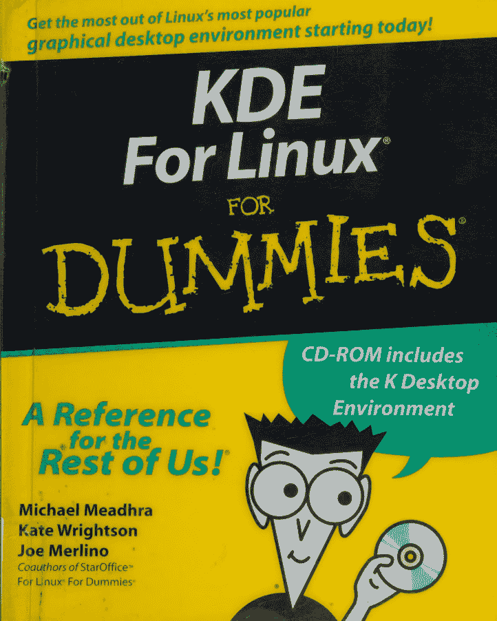

CD-ROM 包含 K 桌面环境

### 给其他人看的参考书！

Michael Meadhra

Kate Wrightson

Joe Merlino

*《StarOffice For Linux 新手指南》*的共同作者

UNIVERSITY OF NOTTINGHAM

George Green Library

of Science and Engineering

| 作者 | 分类号 | 图书编号 |
|---|---|---|
| meahra | 003 9976.9483 MEA | 100201995 |

## 适用于 Linux® 的 KDE® 新手指南

### 速查表

### 窗口操作

| 执行以下操作： | 请执行以下操作： |
|---|---|
| 移动窗口 | 点击并拖动窗口的标题栏 |
| 调整窗口大小 | 将指针指向窗口边框。当指针变为指向垂直线的箭头时，点击并拖动窗口边框 |
| 最小化（图标化）窗口 | 点击窗口标题栏上的最小化按钮（通常是一个小圆点或短横线） |
| 最大化窗口 | 点击窗口标题栏上的最大化按钮（通常是一个方框） |
| 关闭窗口 | 点击窗口标题栏上的关闭按钮（通常是 X） |
| 使窗口粘滞（在切换到其他虚拟桌面时保持其屏幕位置） | 点击窗口标题栏上的粘滞按钮（通常是一个图钉） |
| 将窗口移动到不同的虚拟桌面 | 右键点击窗口标题栏，从弹出的菜单中选择“到桌面”以及相应的桌面编号 |
| 在标题栏不可访问时移动窗口 | 按住 Alt 键，然后点击并拖动窗口内的任意位置 |
| 终止无法正常关闭的窗口 | 按 Ctrl+Alt+Esc。当指针变为骷髅头和交叉骨头的符号时，点击你想终止的窗口 |

### 全局键盘快捷键

| 执行以下操作： | 按下此键组合： |
|---|---|
| 关闭窗口 | Alt+F4 |
| 终止窗口 | Ctrl+Alt+Esc |
| 打开执行命令框 | Alt+F2 |
| 打开任务管理器窗口 | Ctrl+Esc |
| 切换到虚拟桌面 1 | Ctrl+F1 |
| 切换到虚拟桌面 2 | Ctrl+F2 |
| 切换到虚拟桌面 3 | Ctrl+F3 |
| 切换到虚拟桌面 4 | Ctrl+F4 |
| 切换到虚拟桌面 5 | Ctrl+F5 |
| 切换到虚拟桌面 6 | Ctrl+F6 |
| 切换到虚拟桌面 7 | Ctrl+F7 |
| 切换到虚拟桌面 8 | Ctrl+F8 |

For Dummies®：面向初学者的畅销书系列

## 适用于 Linux® 的 KDE® 新手指南

### 速查表

### 标准键盘快捷键

| 执行以下操作： | 按下此键组合： |
|---|---|
| 关闭窗口 | Ctrl+W |
| 将选定的文本或对象复制到剪贴板 | Ctrl+C |
| 创建新文档或文件 | Ctrl+N |
| 剪切选定的文本或对象并将其放在剪贴板上 | Ctrl+X |
| 将光标移动到当前文档的开头。 | Ctrl+Home |
| 将光标移动到当前文档的末尾 | Ctrl+End |
| 打开文件“打开”对话框 | Ctrl+O |
| 打开“查找”对话框或功能 | Ctrl+F |
| 将剪贴板内容粘贴到当前文档的光标位置 | Ctrl+V |
| 打印当前文档 | Ctrl+P |
| 退出当前文档或应用程序 | Ctrl+Q |
| 保存当前文档或文件 | Ctrl+S |
| 滚动到下一页 | PageDown |
| 滚动到上一页 | PageUp |
| 撤销上一个操作 | Ctrl+Z |


## 给其他人看的参考书！®

你对电脑感到畏惧和困惑吗？你是否发现传统的手册充斥着你永远用不到的技术细节？你的朋友和家人总是打电话让你修复他们电脑上的简单问题吗？那么，IDG Books Worldwide 的 …For Dummies® 电脑系列图书就是为你准备的。

…For Dummies 图书是为那些感到沮丧的电脑用户编写的，他们知道自己并不傻，但发现 PC 硬件、软件，甚至计算领域的独特术语让他们感到无助。…For Dummies 图书采用轻松活泼的方法、朴实无华的写作风格，甚至卡通画和幽默图标来消除电脑新手的恐惧并建立他们的信心。轻松而不轻浮，这些书是任何被迫使用电脑的人的完美生存指南。

> “我非常喜欢我的副本，我告诉了朋友们；现在他们也买了副本。”
> — 俄亥俄州 Orvll 的 Irene C.

> “快速、简洁、非技术性强且幽默。”
> — 伊利诺伊州 Elburn 的 Jay A.

> “谢谢，我需要这本书。现在我晚上可以安心睡觉了。”
> — 加拿大不列颠哥伦比亚省的 Robin E

已经有数百万满意的读者同意这一点。他们使 …For Dummies 图书成为第一级的电脑入门系列书籍，并写信要求更多。因此，如果你正在寻找最有趣且最简单的方式来了解电脑，请让 …For Dummies 图书给你提供帮助。


请在借书处索取

随书附带的 CD-ROM

### 归还截止日期

大学图书馆

- 2004 年 6 月 27 日
- SEM GGL 07
- NOC

大学图书馆

- 2006 年 6 月 30 日
- GGL 01

大学图书馆

- 2007 年 6 月 30 日
- ANN GGL 06

此书可能在上述日期之前被召回

90014

## 作者简介

**迈克尔·米德拉（Michael Meadhra）** 是一位作者和顾问，他撰写、合著或参与了30多本书的创作，其中包括 *《StarOffice Linux 版傻瓜入门》（StarOffice For Linux For Dummies）*、*《在线银行傻瓜入门》（Banking Online For Dummies）* 和 *《Lotus SmartSuite 千禧版傻瓜入门》（Lotus SmartSuite Millennium Edition For Dummies）*，这些书均由 IDG Books Worldwide 出版。

**乔·梅里诺（Joe Merlino）** 是一位技术写作者和热衷的 Linux 爱好者。他还是一名图书馆工作人员，并参与开源数字图书馆系统（Open Source Digital Library System）项目。他涉猎 Perl 和 Unix Shell 脚本编程。他是 *《Linux 公告》（Linux Gazette）* 的贡献者，曾参与 *《StarOffice Linux 版傻瓜入门》* 的编写，并合著了 IDG Books 出版的 *《StarOffice 5.0 Linux 版圣经》（StarOffice 5.0 for Linux Bible）*。

**凯特·赖特森（Kate Wrightson）** 是一位拥有多年 Linux 经验及超过十年 UNIX 使用经验的技术写作者。她与合作院校和大学教师合作，帮助他们改进教学，特别是通过技术在课堂和课程准备中的应用。她还花时间参与 USENET 新闻组创建流程。凯特发表过各种主题的文章，从美国高等教育历史到清晰的商业写作；她是 IDG Books 出版的 *《StarOffice 5.0 Linux 版圣经》* 的合著者，并参与了 *《StarOffice Linux 版傻瓜入门》* 的编写。

## 关于 IDG Books Worldwide

欢迎来到 IDG Books Worldwide 的世界。

IDG Books Worldwide, Inc. 是国际数据集团（International Data Group）的子公司，该集团是全球最大的计算机相关信息出版商和领先的信息技术信息服务全球提供商。IDG 由帕特里克·J·麦戈文（Patrick J. McGovern）于30多年前创立，如今在全球拥有超过9,000名员工。IDG 在75多个国家出版290多种计算机出版物。每月有超过9000万人阅读一份或多份 IDG 出版物。


IDG Books Worldwide 成立于1989年，如今是美利坚合众国最畅销计算机图书的第一出版商。我们很自豪地获得了计算机新闻协会（Computer Press Association）颁发的八项编辑卓越奖项，以及计算机潮流（Computer Currents）首届读者选择奖的三项奖项。我们最畅销的“傻瓜入门”（For Dummies）系列已印刷超过5000万册，并翻译成31种语言。IDG Books Worldwide 通过与 IDG 的高科技北京（Hi-Tech Beijing）合资，成为第一家在中国人民共和国出版计算机图书的美国出版商。近年来，IDG Books Worldwide 已成为全球数百万希望学习如何更好地管理其业务的读者的首选。

## 我们的使命

我们的使命很简单：我们的每一本书都旨在为读者带来额外的价值和技能构建指导。我们的书由理解并关心读者的专家撰写。我们编辑团队的知识库来自出版、教育和新闻领域多年的经验——我们利用这些经验来制作引领我们进入新千年的图书。简而言之，我们关心书籍，因此我们吸引最优秀的人才。我们特别关注受众、内部设计、图标使用和图片等细节。并且，由于我们使用高效的电子作者、编辑和桌面出版流程来制作图书，我们可以花更多时间确保内容卓越，而减少用于耗时制书任务的时间。

您可以信赖我们对以有竞争力的价格交付高质量书籍的承诺，主题是您想要阅读的。在 IDG Books Worldwide，我们继续 IDG 30多年来提供品质的传统。关于某个主题，没有比 IDG Books Worldwide 的书更好的了。


约翰·基尔库伦（John Kilcullen）

董事长兼首席执行官

IDG Books Worldwide, Inc.

史蒂文·伯考维茨（Steven Berkowitz）

总裁兼出版人

IDG Books Worldwide, Inc.

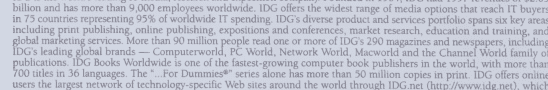

IDG 是领先的全球 IT 媒体、研究和展示公司。成立于1964年，IDG 1997年的收入为20.5亿美元，在全球拥有超过9,000名员工。IDG 提供范围最广的媒体选择，覆盖75个国家（代表全球95%的 IT 支出）的 IT 买家。IDG 多样化的产品和服务组合涵盖六个关键领域，包括印刷出版、在线出版、展会和会议、市场研究、教育和培训以及全球营销服务。每月有超过9000万人阅读 IDG 的290种杂志和报纸中的一份或多份，包括 IDG 的领先全球品牌——Computerworld、PC World、Network World、Macworld 和 Channel World 系列出版物。IDG Books Worldwide 是全球增长最快的计算机图书出版商之一，拥有36种语言中的700多种图书。仅“傻瓜入门”系列就有超过5000万册在印刷中。IDG 为在线用户提供了全球最大技术专用网站网络（WorldWIDE IDG.net）（`http://www.idg.net`），该网络包括55个国家中的225多个目标网站。

国际数据公司（International Data Corporation, IDC）是全球最大的信息技术数据、分析和咨询服务提供商，在40多个国家设有研究中心，全球拥有超过400名研究分析师。IDG World Expo 是在35个国家主办超过168个全球品牌会议和展会的领先主办方，包括 E3（电子娱乐博览会）、Macworld Expo、ComX/IDG、Windows World Expo、ICE（互联网商务博览会）、Agenda、DEMO 和 Spotlight。IDG 的培训子公司 ExecuTran 是全球最大的计算机培训公司，在全球拥有超过230个地点和785门培训课程。IDG 营销服务通过 IDG 在全球的印刷、在线和展会产品，帮助行业领先的 IT 公司建立国际品牌知名度。可以在 `www.idg.com` 找到更多关于该公司的信息。

## 作者致谢

出版这样一本书是一项合作事业——我们的意思不仅仅是合著者之间的合作，他们的名字列在封面上。还有作者与出版商 IDG Books Worldwide 之间的合作，以及组成那家优秀公司的众多人员之间的合作。参与制作本书的 IDG 工作人员列在出版商致谢页中。作者希望向所有使本书成为可能的这些个人以及 IDG 的其他员工表示致谢。此外，我们还想特别提到以下与我们更直接合作的人员。

感谢采购编辑大卫·梅休（David Mayhew），他为使这本书成为现实付出了愿景和艰辛努力。我们的资深项目编辑帕特·奥布莱恩（Pat O'Brien）和文字编辑杰琳·查尔斯（Jerelind Charles）和东妮娅·马多克斯（Tonya Maddox）润色了我们的行文。技术编辑迈克尔·皮翁（Michael Pion）确保了准确性。谢谢，伙计们。

我们特别感谢我们的经纪人大卫·福盖特（David Fugate）和 Waterside Productions 团队，感谢他们为我们找到了做这本书的机会，并组建了作者团队来处理这项工作。

## 出版商致谢

我们为这本书感到自豪；请通过位于 `http://m2cents.dummies.com` 的 IDG Books Worldwide 在线注册表提交您的评论。

帮助这本书推向市场的一些人包括：

### 采购、编辑和媒体开发

- **项目编辑：** 帕特·奥布莱恩（Pat O’Brien）
- **采购编辑：** 大卫·梅休（David Mayhew）
- **文字编辑：** 杰琳·查尔斯（Jerellnd Charles）
- **技术编辑：** 迈克尔·皮翁（Michael Pion）
- **媒体开发编辑：** 玛丽塔·埃利克森（Marita Eilixson）
- **副版权编辑：** 卡门·克里科里安（Carmen Krikorian）
- **编辑经理：** 雷夫·明格尔（Rev Mingle）
- **媒体开发经理：** 希瑟·希斯·迪兹莫尔（Heather Heath Dismore）
- **媒体开发协调员：** 梅根·罗尼（Megan Roney）

### 制作

- **项目协调员：** E. 肖恩·艾尔斯沃斯（E. Shawn Aylsworth）
- **排版和图形：** 吉尔·皮西特里（Jill Piscitelli）、布伦特·萨维奇（Brent Savage）、布赖恩·托韦尔（Brian Torwelle）、丹·惠斯顿（Dan Whistline）、艾琳·泽勒（Erin Zelner）
- **校对员：** 劳拉·阿尔伯特（Laura Albert）、科里·鲍恩（Corey Bowen）、梅丽莎·D·巴登迪克（Melissa D. Buddendeeck）、约翰·格林胡德（John Greenhood）、玛丽安·索蒂（Marianne Sauty）、查尔斯·斯宾塞（Charles Spencer）、托尼·塞特尔（Toni Settle）
- **索引制作者：** Tecty Indexing
- **特别协助：** 阿曼达·福克斯沃思（Amanda Foxworth）

## 综合与行政管理

**IDG Books Worldwide, Inc.：** 约翰·基尔库伦（John Kilcullen），首席执行官；史蒂文·伯考维茨（Steven Berkowitz），总裁兼出版人

**IDG Books 技术出版组：** 理查德·斯瓦德利（Richard Swadley），高级副总裁兼出版人；沃尔特·布鲁斯三世（Walter Bruce III），副总裁兼联合出版人；约瑟夫·威克特（Joseph Wikert），联合出版人；玛丽·贝德纳雷克（Mary Bednarek），品牌产品开发总监；玛丽·科德勒（Mary Corder），编辑总监；巴里·普鲁特（Barry Pruett），出版经理；米歇尔·巴克斯特（Michelle Baxter），出版经理

**IDG Books 消费者出版组：** 罗兰·埃尔维（Roland Elvey），高级副总裁兼出版人；凯瑟琳·A·韦尔顿（Kathleen A. Welton），副总裁兼出版人；凯文·索恩顿（Kevin Thornton），采购经理；克里斯汀·A·科克斯（Kristin A. Cocks），编辑总监

**IDG Books 互联网出版组：** 布伦达·麦克劳林（Brenda McLaughlin），高级副总裁兼出版人；戴安·格雷夫斯·斯蒂尔（Diane Graves Steele），副总裁兼联合出版人；索菲亚·马尔尚（Sofia Marchant），在线营销经理


**IDG Books 制作部 Dummies Press：** 黛比·斯塔利（Debbie Stalley），制作副总监；辛迪·L·皮普斯（Cindy L. Phipps），项目协调、制作校对和索引经理；托尼·奥格斯伯格（Tony Augsburger），印刷、重印和系统经理；劳拉·卡朋特（Laura Carpenter），制作控制经理；谢丽·利（Shelley Lea），图形和设计主管；黛比·J·盖茨（Debbie J. Gates），制作系统专家；罗伯特·斯普林格（Robert Springer），校对主管；凯西·许特（Kathie Schutte），制作主管

**Dummies 包装和书籍设计：** 帕蒂·佩奇（Patty Page），促销营销经理

出版商希望向帕特里克·J·麦戈文（Patrick J. McGovern）表示特别感谢，没有他，这本书就不可能实现。

## 漫画速览

作者：Rich Tennant

《第五浪潮》 作者：Rich Tennant


第 233 页

《第五浪潮》 作者：Rich Tennant


……还有我和辛迪·克劳馥的合影。这是我和麦当娜以及戈利亚·汤姆的合影……

第 131 页

《第五浪潮》 作者：Rich Tennant


“嘿，达里尔，我觉得是时候承认我们并没有完全搞定车载打盹解决方案了”

第 273 页

《第五浪潮》 作者：Rich Tennant


“不，不是月蚀！！是施泰纳利格乡下……我们不想要冰雹、头发和柠檬”

第 5 页

《第五浪潮》 作者：Rich Tennant


“好吧，她又上网了，顺便说下形象管理。我可以用鼠标把这个功能编程到你页面的成本里。”

第 83 页

《第五浪潮》 作者：Rich Tennant


“如果孩子遇到任何问题-...你就像买别人的一样买死亡，自动软件。”

第 311 页

传真：978-546-7747

电子邮件：richtennant@the5thwave.com

万维网：www.the5thwave.com

# 引言

当21世纪如烟雾般从神灯中升起，它为计算机用户提供了一系列全新的选择。以操作系统为例——这已经不再是“Windows 或 Mac”的二元世界了。事实上，它从未如此。强大的 UNIX 操作系统自冷战时期就已存在，至今仍是互联网运行的基石。尽管 UNIX 及其专业化分支——尤其是 Linux——因低成本和高可靠性而近期频登报端，但它们都保留着那个恼人的命令行界面。通常情况下，这意味着你必须是一位相当不错的打字员——并且学会一套生僻的命令词汇——才能熟练使用 Linux。大多数喜爱点击操作——并对在大黑屏上的微小提示符处输入命令有着强烈排斥反应——的计算机用户一直未能如愿。至少到现在为止都是如此。

随着过去几年 Linux 逐渐流行，KDE 应运而生，旨在缓解无窗口计算机使用带来的紧张感。它是图形用户界面！它是屡获殊荣的创新！它是甜点 topping！（开玩笑的。）你手中掌握的正是掌握 KDE 并让 Linux 精灵为你效力的关键。欢喜吧，继续阅读。

# 关于本书

《KDE For Linux For Dummies》（KDE Linux 傻瓜指南）通过带你浏览构成 KDE 的特性、功能和怪癖——这些特性使其类似（但并不完全相同于）你以前可能使用过的图形用户界面——从而让你轻松步入 KDE 这个令人兴奋的新世界。

# 谁应该读这本书

如果你欣赏窗口式界面的便利和效率，但一想到它占用了硬盘多少空间就感到有些恶心，那么 Linux、KDE 以及这本书就是为你准备的。如果你已经是一名经验丰富的 Linux 网络管理员，想要探索实施 KDE 作为与用户（无论他们运行的是什么平台）和解的一种方式——你来对地方了。如果你刚收到一份备忘录，宣布从 Windows 大规模迁移到 Linux 和 KDE——或者如果你对 Linux 现象感到好奇，却被运行它所需的大量手指操练吓到——请放心。你的界面已就绪，你的指南也等候多时。

# 本书的组织方式

以你觉得最合理的方式使用这本书。你可以，正如《*爱丽丝梦游仙境*》中红心皇后对白兔所说的那样，“从头开始……一直读到结尾……然后停下”。如果你更喜欢在书中跳跃以追逐特定主题——甚至为了保险起见在结束后再读一遍——请随意。（我们不会告诉任何人。）以下是书中内容的概要。

## 第一部分：入门

如果你使用过 Windows 或 Macintosh，你就已经使用过图形用户界面了。这意味着你在 KDE 方面占了先机。如果没有，那你将大饱眼福。第一部分向你展示基本的 KDE 操作，带你游览桌面，并演示高效的管理窗口和文件的方法（你甚至不需要培养七种新习惯）。

## 第二部分：让 KDE 看起来合适

KDE 赋予你特性、选项和通用能力，让你可以设置界面，使其适合你并且看起来像是有大作为。第二部分向你展示如何设置面板、自定义桌面，以及充分利用 KDE 的主题。

## 第三部分：进入正题

第三部分解锁了连接和在互联网上使用 KDE 的秘密。你将查看用于工作或娱乐的应用程序和实用工具，并了解在与非 KDE 应用程序协作时如何保持和谐的方法。

## 第四部分：内部机制

Linux 社区是相当自给自足的一群人。他们知道当事情出错时没有庞大的公司可以求助。当然，好处是他们不必在长途技术支持线上花大钱，同时听着机器播放的电梯音乐。作为 Linux 用户，你可以轻松地从其他用户那里获得关于底层操作系统如何工作的舒适知识。第四部分让你起步，提供 Linux 的基本导览，并检查你在 KDE 控制中心中获得的那些闪闪发新的 Linux 控件。

## 第五部分：十大系列

这里是 KDE 版本的独家 *For Dummies* 特色——一系列浓缩的智慧，按便捷的十组排列：十件在你不得不通过经验学习之前应知道的好用事物，十处你可以求助的地方，十件纯粹为了乐趣的 KDE 玩具，以及十个你甚至不需要向英语老师交代的 KDE 主题。

## 第六部分：附录

KDE/Linux 社区是你最好的朋友。而且他们甚至不向你收费。第六部分向你展示如何获取和安装 KDE，在互联网上何处寻找更多专业知识，以及随书附带光盘上你将找到的好东西目录。

# 本书中的图标

在浏览《KDE For Linux For Dummies》的过程中，你会发现一些友好的路标形式，即这些图标：


提示图标标识捷径、不那么明显的答案，以及审视 KDE 和 Linux 的有用视角。


警告图标提醒你注意 KDE 和 Linux 世界中潜伏的可能陷阱，就像在网络空间的各个角落一样。请留意。


技术细节图标唤起你可能想要知道的技术问题、细节和信息（如果你想吓唬身边的那些技术文盲的话）。或者你可能不想要。如果你将更细微的技术细节留给友好的 IT 部门，没人会因此看低你。真的。


仅次于闹钟表，而且礼貌得多。这些图标突出……呃……使用 KDE 的*亮点*。

# 4 KDE For Linux For Dummies

# 接下来去哪里

读完这本便捷的小册子，你可以将所学朝几个方向发展——深入 Linux 社区的世界，深入操作系统的奥秘，或者走向 KDE 为你设定的新可能性。为了窥探接下来可能去的两个地方，你可以尝试阅读以下来自 IDG Books Worldwide, Inc. 的书籍：

- 更多关于 Linux 的历史、神秘和乐趣的内容，深入阅读 Jon “maddog” Hall 著的 *Linux For Dummies*（《Linux 傻瓜指南》）第二版（ISBN: 0-7645-0421-5）。作为 Linux 国际组织的执行董事，他从前线发回了报告。

- 如果你的公司正在转向使用 Linux 操作系统的网络化计算环境（这如今非常时髦），请获取 Michael Bellomo 著的 *Linux Administration For Dummies*（《Linux 管理傻瓜指南》）（ISBN: 0-7645-0589-0）。你会庆幸自己读了。

让我们开始吧！

# 第一部分

**入门**

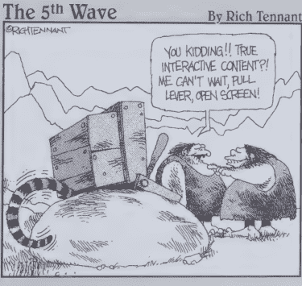


# 本部分介绍……

正如任何新奇的装置（或者，就此而言，你刚开始使用的任何旧式装置），KDE 需要一点定位和实践。幸运的是，如果你熟悉 Macintosh 或 Windows 计算机，你已经知道图形用户界面如何让计算机的使用不那么痛苦——前提是你知道如何操作。

本部分自豪而从容地站在起点，准备带你熟悉基本操作。它带你通过基本的 KDE 操作，向你展示桌面上各部分的功能，让你能够像高手一样管理窗口和文件。当你掌握了基础知识后，所有事情会变得更加合情合理，这令人惊讶。但你已经知道了。

# 第 1 章

## 初试身手

### 本章内容

- 定义 KDE
- 理解基本技能：窗口功能、KDE 鼠标技巧等
- 启动 KDE
- 游览桌面
- 认识图标
- 在（任务）栏逗留
- 我有*多少个*桌面？
- 退出 KDE

如果你住在大城市，你可能偶尔会看到观光巴士。巴士上的人知道，了解一个新地方的最佳方式之一就是进行一次快速游览。在那次游览中，他们看到了新城市最重要的方面，并学习了如何出行的初步知识。后来，如果游客想要重访或探索他们从巴士窗口看到的某个区域，他们大致知道去哪里以及做什么。

本章是你的 KDE 观光巴士。我们从 KDE 的简要介绍开始——它是什么以及它做什么——然后快速浏览你需要的基本功能，以便从 KDE 中获得最大收益。你游览面板、任务栏和图标，并练习进入和退出 KDE。完成本章后，你就能毫无问题地在桌面上导航，并为在书中其他部分发现的更复杂内容做好准备。

试着在电脑前阅读这一章。如果你能抬起头来看我们讨论的内容，你会更快地掌握 KDE。章节中的图片很有帮助，但如果你跟着我们一起点击，你能弄明白更多。

对于那些刚接触 Linux 和其他基于 UNIX 的操作系统的人来说，我们建议你找一本关于你操作系统的优质书籍。我们提供了足够的 Linux 信息，使得使用 KDE 变得简单，但 Linux 本身是

# 第一部分：入门指南

以下内容超出了本书的范畴。如果你习惯使用 Windows 或 Macintosh 系统，并且刚刚购买了一张 Linux 光盘并安装了一个以 KDE 作为基本桌面的新操作系统，你可能会寻找关于你的操作系统的更具体信息。在这本书中，我们主要关注 KDE。有时我们会谈论 KDE 底层的操作系统，但仅涉及与桌面环境相关的部分。《UNIX For Dummies》（《UNIX 傻瓜教程》）第 4 版，作者 John Levine 和 Margaret Levine Young，以及《Linux For Dummies》（《Linux 傻瓜教程》）第 2 版，作者 Jon “maddog” Hall，两者均由 IDG Books Worldwide, Inc. 出版，是不错的入门读物。

如果你熟悉 Linux，但从未使用过图形界面（或者你只是刚接触 KDE），这里也有有用的信息。

## 女士们先生们：KDE！

好的，你准备好了。你已经在计算机上安装了一个基于 UNIX 的操作系统，并准备好进入开源软件的奇妙世界。但是……嘿！这都是命令行相关的内容。难道计算世界不是在古老的 DOS 时代就淘汰命令行了吗？

嗯，某种程度上是的。但请记住，基于 UNIX 的操作系统是极客文化的核心和灵魂。对于硬核技术派来说，你没有任何理由去点击任何东西——曾经连比尔·盖茨都认为命令行就足够了，而且它现在运行得依然很好，所以为什么要改变呢？

但你未必是一个极客。你当然对开源软件的速度和强大感兴趣，但如果该软件比之前使用的更难用且不易理解，那就没意义了。你想要的是强大与简洁的结合。KDE，我的朋友，就是为你准备的。KDE 是一个图形用户界面，即 GUI（发音类似 goey，就像焦糖坚果一样）。Windows 和 Macintosh 操作系统也是如此。如果你在過去五到十年里使用过 Windows 或 Mac OS——实际上，谁没用过呢？——那你就是一个 GUI 专家。不同类型的 GUI 都可以与 X 窗口系统配合工作，而你选择了 KDE，它是目前 Linux 图形用户界面中最可靠且功能最齐全的之一。

KDE 是将友好的图形外观叠加在 Linux 或其他基于 UNIX 的操作系统强大功能之上的三个组件之一。

- Linux 是第一个组件，因为它是让计算机运行的操作系统。
- KDE 是最后一个组件，因为它是你选择的具体 GUI。
- 中间的组件称为 X 窗口系统。

X 窗口系统，通常简称为 X，是一组与你的操作系统协作的程序，用于将 UNIX 命令转换为图形图像。

X 极其复杂，通常你不需要（甚至永远不需要）去干涉它。不过，了解 X 还是很有必要的，哪怕只是为了在鸡尾酒会上听起来非常聪明且极具极客范儿。


在我们开始充满动作感的游览之前，以下是 KDE 是什么以及不是什么：

- KDE 是你和计算机之间的界面。当你点击桌面图标时，KDE 会向操作系统发送特定命令，计算机随之响应。你可以使用 KDE 更改显示器显示信息的方式，并可以使用各种 KDE 工具让计算机执行你想要的操作。
- KDE 不是操作系统。你不需要使用你喜欢的程序的特殊 KDE 版本，KDE 也不会改变系统运行的任何方式。而且，尽管你可以找到让系统看起来像运行 Mac 或 Windows 98 机器的桌面主题，但你运行的仍然是 Linux 或其他基于 UNIX 的操作系统。KDE 只是为其披上了更友好的外衣。

KDE 代表 K Desktop Environment（K 桌面环境）。实际上，"K" 并没有特定的含义。


## 谁负责 KDE？

KDE 得益于全球数百名计算机程序员志愿者的劳动，他们利用互联网交换构成该程序的想法和代码。KDE 是一个开源程序，这意味着该程序的核心代码对任何人都是免费可用的。（Linux 也是如此。）使用开源软件的好处之一是，软件会受到实际用户的大量测试，而不仅仅是由受雇测试软件的人进行——因此，如果你发现一个错误或对软件的未来版本有很好的想法，你可以发送你的意见。对于那些悄悄认为“免费”并不总是等于“好”的人来说，请放心。KDE 甚至引起了 Ziff Davis（主要计算机杂志出版商）的注意，他们授予 KDE 软件类别的“1998/1999 年度创新”称号。你需要经常访问 www.kde.org 以获取新闻更新、新版本以及可以添加到你计算机上的好用程序。

## 基本技能：你已经知道的

在开始 KDE 之旅之前，我们需要简要提及基本的计算机技能。我们假设你使用过鼠标，并且之前使用过某种窗口化桌面环境。以下是我们认为你已经知道的基本鼠标操作列表。


- 在鼠标垫上移动鼠标会移动监视器屏幕上的鼠标指针。
- 在 KDE 中，鼠标指针是一个大的 X，而不是 Mac 或 Windows 的箭头。
- 单击左鼠标按钮*选择*屏幕上的鼠标指针下方的任何项目。选定的文件或程序尚未打开，但它是下一个待处理的项目。例如，你可以选择一个图标、文件名或菜单中的选项。
- *双击*，即快速两次单击左鼠标按钮，会*选择*鼠标指针下的项目。当你通过双击图标来“选择”它时，你是在告诉计算机立即打开这个程序。如果你双击一个文件名，计算机知道你想在正确的程序中打开该文件，并会启动该程序。
- 单击右鼠标按钮通常会出现一个包含额外选项的隐藏菜单。例如，如果你*右击*普通的 KDE 桌面，会弹出一个包含注销、帮助、屏幕锁定以及排列打开窗口的各种方式的隐藏菜单。
- 单击一次已选定的项目，按住左鼠标按钮不放，并在垫子上移动鼠标，会将选定的项目*拖拽*到屏幕上的新位置。释放左鼠标按钮会将项目*放置*在其新位置。你可以*拖放*图标、文件名或通过点击或突出显示选择的几乎任何东西。
- 单击左鼠标按钮并保持按住，然后移动鼠标指针划过文本的某一部分，会*突出显示*选定的文本。如果你突出显示了错误的文本，只需在突出显示区域外单击左鼠标按钮即可*取消选择*。
- 突出显示文本允许你对选定的文本块执行各种操作。你可以*剪切*文本，从而将整个块从文档中移除。或者你可以*复制*文本，保留一个块在原位，但制作一个副本，你可以将其放置在其他地方。你也可以在复制或剪切后，将文本*粘贴*到新位置。


如果你使用不同种类的*指点设备*（如轨迹球或输入板），你需要知道如何使用你特定的设备完成所有这些基本的鼠标操作。大多数人使用鼠标，所以我们在整本书中都使用特定的鼠标术语。

此外，以下是我们认为你了解的关于桌面和窗口的信息：

- 屏幕的彩色背景是*桌面*。就像你办公室或家中普通桌子的桌面一样，你可以把文件文件夹和文档堆放在上面。同样，像普通桌子一样，它也可能变得一团糟。图形界面使用桌面概念，使你更容易记住计算机组织系统的工作方式，因为你自然地将你的计算机桌面与你的普通桌子及其工作方式（或至少应该是的方式）联系起来。


当你打开一个程序或文档时，它会出现在屏幕上的一个*窗口*内。窗口小于整个屏幕，并且可以调整大小。（对于那些渴望调整窗口大小的人，请参阅第 3 章——在 KDE 中处理窗口与其他操作系统略有不同，但差别不大。）

*程序窗口*包含你启动的程序。这个程序可以是计算器、电子表格、你的电子邮件，或者像纸牌游戏这种令人头疼的程序。你可以同时打开多个程序窗口。

*文档窗口*包含你在特定程序中创建的文件。最常见的例子是你在文字处理程序中创建的文本文档。它也可以同时打开多个文档窗口。

你可以同时打开多个窗口。（这个功能使窗口化桌面环境比命令行界面好得多。）随着你打开窗口，它们只是在屏幕上堆积，相互重叠，有时互相遮挡。

最上面的窗口拥有*焦点*，这意味着它是*活动窗口*。你可以通过其*标题栏*（窗口顶部的带有程序或文档名称的那一行）被突出显示来判断该窗口拥有焦点。如果你希望另一个窗口拥有焦点，点击其标题栏。该窗口会来到前台并获取焦点。

KDE 还有一些让基本窗口管理稍微快一点的鼠标技巧。桌面上的许多项目（包括桌面本身）都有*上下文菜单*，当鼠标光标位于该项目上方时，你可以通过点击右鼠标按钮访问这些菜单。这些菜单上的选项因项目而异，使它们具有*上下文敏感性*。

# 启动

现在，你可以开始 KDE 的快速导览之旅了。

我们假设你已经在系统中找到并安装了 KDE，或者在你使用这台机器时它已预装；如果你尚未安装，请跳转至附录 A 以了解获取 KDE 的渠道及安装信息。一旦你设置好 KDE，请返回此处继续。

请确保在系统上以普通用户身份使用 KDE。安装 Linux 时，你应该已经创建了用户账户和一个名为 `root` 的特殊超级用户账户。不要仅为了体验 KDE 就登录 `root` 账户——请保留 `root` 权限以备真正需要时使用。`root` 账户是系统管理账户，它拥有更改操作系统一切内容的权限——甚至包括让机器正常运行的基础进程。如果在你的用户账户下使用 KDE，你无法破坏任何关键部分。Linux 和其他基于 UNIX 的操作系统的一大优点在于，每个用户都有独立的账户和专用的磁盘空间，这些用户空间与真正运行计算机的程序是隔离开的。如果你在用户账户下工作，你必须非常费力才能做出任何永久性损害计算机的操作。相反，如果你以 `root` 身份工作，则更容易造成损害。

你的机器可能已经开机，正耐心等待你在登录提示符处输入信息。如果没有，请立即启动。

## 1. 使用你的用户账户名和密码登录机器。

根据你在安装时选择的 Linux 发行版，或者如果你已经安装并配置了 KDE，你可能会看到图形化登录界面，而不是 shell 登录提示符。图形化登录比黑底白字的 shell 提示符更具亲和力。如果你想为系统设置图形化登录，我们在第 14 章中解释了相关步骤。要在具有图形化登录的计算机上登录，请输入你的用户账户名和密码，然后跳转到“桌面导览”部分。

如果你尚未配置系统将 KDE 作为默认图形用户界面（GUI），请参阅附录 D 以获取更多关于 `usekde` 脚本的信息。该脚本会将 KDE 正常运行所需的一些基本文件复制到你的主目录中。

## 2. 在 shell 提示符下登录成功后，输入 `startx`。

每次你想打开 KDE 时都需要使用此命令。`startx` 命令实际上会启动 X Window 系统，但在运行 `usekde` 脚本后，你已设置 X 系统将 KDE 作为你的默认桌面环境。实际上，你可以通过修改 Linux 核心深处的几行代码来配置 X 系统，使其每次启动计算机时都自动运行 KDE。有关运行级别（run-level）的深入讨论，即计算机如何知道首先运行哪些程序，请参见第 13 章。

## 3. 等待 KDE 桌面出现，如图 1-1 所示。

屏幕上的文本会向上滚动，然后屏幕变暗（好吧，是变灰，但听起来没那么戏剧化）。屏幕保持黑暗的时间长短取决于计算机安装的内存量。（计算机图形处理就像员工一样，如果你给它们足够的资源，它们很容易就被激励得运行得更快更好。）

如果你的 KDE 设置出了问题，或者你尚未运行 `usekde` 脚本以告知 X Window 系统你想将 KDE 作为默认桌面环境，在输入 `startx` 后你可能会感到意外。你可能会发现并没有启动 KDE，而是启动了另一个窗口管理器，例如 `Fvwm`。如果发生这种情况，只需退出图形化环境（尝试在桌面上右键单击——上下文菜单中通常包含“退出”或“注销”命令）。然后返回附录 A 重新配置 KDE。

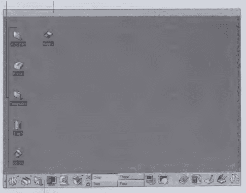

# 桌面导览

第一次运行 KDE 时，它会以基本的桌面配置出现（请参阅图 1-1）。（是的，它看起来确实非常像 Windows 95，不是吗？）

如果你不喜欢默认的外观，别担心。第 6 章和第 7 章都专注于桌面设计、主题管理以及对桌面进行深度美化改造。不过，暂时请使用默认的 KDE 桌面。

屏幕底部那条灰色的水平条是 *面板（panel）*。使用面板上的按钮来启动程序，查找文件，启动应用程序或控制 KDE 本身。你会非常熟悉面板，因为它是 KDE 的中枢神经系统。阅读第 5 章以获取有关面板及其自定义方法的更多信息。

KDE 还会在你的桌面左侧放置一些图标。这些图标允许你运行一些常见的 *实用程序*，即在幕后执行重要任务的小型程序。你可以使用这些图标创建新文件，删除不再需要的旧文件，打印，或在光盘、ROM、软盘和硬盘之间移动文件。请参见本章的“所有这些图标是做什么的？”部分，了解每个图标及其基本功能的说明。

在屏幕顶部，你会看到 *任务栏（taskbar）*。如果你使用过 Windows 95 或 Windows 98，那么你已经熟悉任务栏了。我们将在本章的“在（任务）吧上逗留”部分讨论 KDE 的任务栏。基本上，你可以使用任务栏来管理你同时打开的各种应用程序和窗口。

所有这些元素都是可自定义的。你可以将它们移动到屏幕的不同位置，折叠它们以免看到，或者整齐地排列它们。第 5、6 和 7 章包含大量信息和想法，帮助你根据自己的喜好定制 KDE。

此时我们还需要提及的另一项功能是 `KFM`，即 KDE 文件管理器。`KFM` 的工作方式类似于 Windows 资源管理器或 Mac OS 的 Finder。`KFM` 是计算机文件系统的图形化表示，它显示 *主目录*（即与你用户账户关联的目录）中的所有文件。与资源管理器或 Finder 一样，`KFM` 将你的目录显示为文件夹和文件的集合。将 `KFM` 想象成一个电子文件柜，因为它是按这种方式设计的。你可以将文件从一个文件夹拖到另一个文件夹，或打开显示各种文件夹内容的窗口。

# 所有这些图标是做什么的？

更仔细地看看桌面。在左侧，你看到六个图标（请回顾图 1-1）。这些图标是通往一些常用命令的超级快捷方式，善用它们可以真正加快你的桌面管理速度（这是一个时髦的词，实际上意思是“保持桌面整洁”）。

你还可以通过点击 `Template` 图标为自己频繁使用的程序创建自定义图标。创建自定义图标可以省去从 KDE 菜单中查找程序时的部分麻烦。


双击 `Autostart` 图标会打开一个窗口，你可以在其中放置指向硬盘上程序的链接。KDE 会确保在启动 KDE 之后，所有链接到 `Autostart` 文件夹的程序自动启动。

不过，关于 `Autostart` 你需要记住两个重要的方面。

- 如果你正在运行 Linux 系统，且你是唯一用户，你可能不会频繁重启 KDE。与 Windows 计算机相比，基于 UNIX 的计算机拥有惊人的 *正常运行时间（uptimes）*。对于运行 Linux 的机器来说，持续一两个月不需要重启是很常见的。因此，如果你在此处放置每天都需要使用的程序，你很可能无论如何都需要手动打开它们。（如果你不独居，或者这台机器上有多个用户，你每次结束会话时都会注销 KDE，那么 `Autostart` 对你更有帮助。注销是个好习惯——你永远不会知道你的猫什么时候学会打字并用你的电子邮件地址发送垃圾邮件。）

- 你不需要将每一个程序都链接到 `Autostart`。我们听说过有人这样设置 `Autostart`。每次他们启动 KDE 时，可怜的主机都要花时间去打开程序……文字处理软件、日历、会计程序、图形程序、所有实用程序、数据库、所有游戏，等等。你总是可以通过在面板中找到程序并点击来打开它们，因此你真的不需要向 `Autostart` 添加太多内容——也许只有 `Netscape` 和你的日历，如果那确实是每次启动新会话后你总会打开的两个程序的话。


双击 `Printer` 图标会打开打印机配置屏幕。在该屏幕上，你可以为不同类型的纸张设置打印机，设置文本打印方向以及其他基本打印机信息。尽管名为 `Printer` 图标，但它实际上并不将文件发送去打印。此类命令通常从特定程序内部发出。例如，如果你正在处理信件或报告，你通过发出文字处理软件的打印命令来告诉计算机打印它。

# 第一部分：入门指南


如果你想要创建新的桌面图标以加快打开你最喜爱程序的速度，你会喜欢模板图标。单击模板图标会打开一个包含大量不同种类桌面图标示例文件的窗口。你可以使用这些示例来创建外观和行为与示例文件相似的新桌面图标，然后通过右键单击这些新图标并使用上下文菜单对它们进行编辑。

下面是一个基本的示例。垃圾桶代表垃圾，对吧？是的！KDE 会在你的桌面上放置一个“垃圾桶”图标，以便你有一个便捷的地方来存放你想删除的文件。就像 Macintosh 的回收站或 Windows 的资源回收站一样，KDE 的垃圾桶图标提供了一个指向文件夹的便捷链接，该文件夹会保留文件直到你永久删除它们。你可以从打开的窗口中拖拽文件图标并将其放到垃圾桶图标上，或者你可以双击垃圾桶图标打开垃圾桶文件夹窗口，然后在任何打开的窗口和垃圾桶窗口之间拖拽文件。文件将一直保留在垃圾桶文件夹中，直到你清空它。有关删除文件的更多信息，请参阅第 4 章。


Linux 处理已删除文件的方式与 Mac 或 Windows 不同。你可以使用特殊的实用程序从 Mac 或 Windows 机器上恢复已删除的文件，即使你已经清空了回收站或资源回收站。但在 Linux 和其他基于 UNIX 的系统上并非如此！一旦你清空 KDE 垃圾桶文件夹，这些文件就会从你的硬盘中被永久擦除，你将无法找回它们。如果你不确定是否真的想丢弃某物，请将其副本保存到磁盘上。你可以稍后清理磁盘。


最后两个图标仅在你以 root 身份登录时才有效。是的，我们曾建议你使用常规用户账户而不是 root 来使用本章。然而，Linux 的默认设置仅允许 root 账户挂载 CD-ROM 或软盘驱动器。


挂载（Mounting）是 UNIX 术语，意思是使磁盘上的文件系统可供整个系统使用。与 Windows 或 Mac 不同，你不能只是在 Linux 中将磁盘插入软盘驱动器并直接使用它。你需要先挂载软盘驱动器。

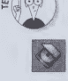

如果你想更改默认设置，以便常规用户账户可以挂载驱动器，请前往第 13 章，那里以极其精确的细节讨论了文件系统挂载。如果你在使用用户账户时经常使用大量 CD 或软盘，更改你的默认设置将为你节省一些时间。

双击 CD 图标以挂载 CD-ROM 驱动器。如果你未以 root 身份登录，将会弹出一个错误消息，告诉你除非成为 root，否则别想过去。

与 CD 图标类似，磁盘图标允许你挂载 3.5 英寸软盘驱动器。请记住，如果你不是 root，KDE 将不会让你这样做。

## 了解面板

一些为孩子写的最伟大的书籍都以老房子为特色，房子里到处都有秘密面板，这样读者就可以想象躲在墙后或神不知鬼不觉地在房子里穿梭。不幸的是，KDE 面板并不是那种让你可以神不知鬼不觉地在计算机中穿梭的方式，但面板绝对是运行程序并配置 KDE 的一种便捷方式。如果你想了解比这段简短介绍更多的面板信息，请参阅第 5 章。

如图 1-2 所示，面板是 KDE 的核心。你可以使用面板启动计算机上加载的几乎任何程序，并且可以根据你的需要进行尽可能多的自定义。面板是沿着桌面底部运行的那个长灰色条。如果你不喜欢它在那里，你可以移动它。请记住，在 KDE 中你可以轻松更改设置。

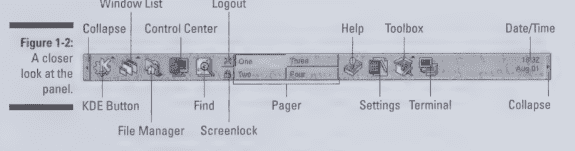

如果你阅读了这一章并疑惑为什么你的面板没有所有这些按钮，请检查你是否已完全扩展了面板。如果你的显示器对于默认的 KDE 桌面尺寸来说太小，KDE 会在不通知你的情况下自动将一些面板图标隐藏在其它图标下方。

> *若要折叠面板，请寻找带有箭头的窄纹理条。如果你单击这些条之一，面板就会消失在该条后面。再次单击该条以调出面板。你刚刚折叠了面板，这意味着你暂时隐藏了它。如果面板一直挡路，让你快要尖叫时，隐藏面板真的很有用。折叠面板，完成你的工作，完成后将其调出。*

18 第一部分：入门指南

KDE 徽标图标位于左侧纹理条旁边。如果你单击此按钮，KDE 将显示主 KDE 菜单，如图 1-3 所示。KDE 菜单的工作方式类似于 Windows 95 或 Windows 98 中的“开始”菜单，因此 KDE 菜单可能对你来说已经很熟悉了。

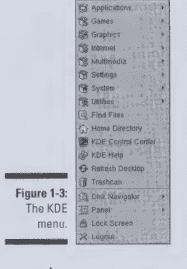

在整个书中，我们将 KDE 菜单作为一系列操作的第一步来提及。当你看到“打开 KDE 菜单”这一短语时，请使用此按钮执行该操作。

在 KDE 菜单的顶部，你会看到带有指向右侧箭头的项。箭头表示该项有一个子菜单，或者当你将鼠标指针悬停在带箭头的项上时，出现在 KDE 菜单右侧的额外选项。将鼠标指针移动到其中一个带有子菜单的项上，看看那里有什么。没有箭头的项没有子菜单；如果你将鼠标指针悬停在无箭头的项上，什么也不会发生。你需要单击该项，这将启动指定的程序。这些项通常是你经常使用到需要一键访问，而不是翻遍一堆文件夹才能找到正确程序的那些程序。

如果你忘记了某个特定的桌面图标或命令的作用，让你的鼠标告诉你。将鼠标指针放在图标上，并让它停留片刻。不要单击。会出现一个包含图标标签的小框，这通常足以提醒你。

继续浏览并查看菜单中的一些其他项。KDE 菜单将程序项划分为方便的类别，使你可以轻松浏览和找到它们。

*窗口列表图标*上有三个窗口。单击该图标可使窗口列表显示在屏幕上。窗口列表显示屏幕上所有打开的窗口，与试图在屏幕上拖拽它们以便查看所有标题栏相比，它使管理大量打开的窗口变得更加容易。要管理你打开的窗口，请单击图标打开窗口列表，从列表中选择你想要处理的窗口名称，然后单击“确定”。你选择的窗口将移动到你那堆打开的窗口的顶部。

*KFM 图标*上有一个文件文件夹和一个小房子。此按钮打开 KFM，即 KDE 文件管理器。KFM 是你的主目录中所有文件的图形目录。KFM 的工作方式类似于 Windows 95 中的 Windows 资源管理器或 Mac OS 中的 Finder。在 Linux 中，每个用户都在独立的主目录中保存个人文件，这是计算机环境中完全属于你的部分。如果你想，可以想象白色的尖桩篱笆和攀爬的玫瑰，也可以想象铁丝网和“禁止入内”的标志。这取决于你。

若要*自定义 KDE* 以完全符合你的需求，请使用控制中心图标打开控制中心。控制中心处理对 KDE 基本配置的所有更改，包括移动面板或更改桌面外观等功能。有关在控制中心中发现的许多选项的详细覆盖，请参见第二部分。

*查找实用程序图标*可以通过可爱的小爪印来识别。查找（Find）是一个真正有用的按钮。只需打开查找，输入你要查找的文件或程序的名称，然后让查找，嗯，帮你找到它。第 4 章将更深入地介绍查找功能。

*工具栏图标*包含一系列系统实用程序的链接，这些系统实用程序在第 10 章中有更详细的描述。这些系统实用程序是影响计算机工作方式的小型程序。你不必使用这些，尽管你可以在工具栏内部做一些相当酷的事情。

如果你在一台属于网络一部分的机器上运行 KDE，并且你不是网络管理员，请在开始在工具栏中随意操作之前先询问。一些网络真的非常挑剔，对一台机器的更改可能会影响每个人的计算机。你的网络管理员会感激你的询问。

在查找实用程序图标旁边，你会看到两个堆叠在一起的小按钮。退出按钮是上面那个。如果你单击此按钮，你的 KDE 会话将结束，最终你会回到主目录中的命令行提示符。请参见本章的“*再见，永别：退出 KDE*”部分。

退出按钮下方的按钮用于激活屏幕锁定，这是屏幕保护程序的增强版。如果您点击屏幕锁定按钮，屏幕保护程序会立即启动。但与普通的屏幕保护程序不同，您必须输入屏幕锁定密码才能返回桌面。有关屏幕锁定的讨论及其是否为您所需选项的详情，请参见第 10 章。


分页器图标实际上是一系列四个标有 One、Two、Three 和（猜猜看）Four 的按钮。分页器控制您的虚拟桌面。通常，One 按钮处于按下状态，因为桌面 One 是每个人使用的基本桌面。您可以在本章的“我有多少个桌面？”部分阅读有关虚拟桌面的内容，我们将在第 3 章中更详细地讨论多桌面。


如果由于任何原因，您需要直接向操作系统发出命令，请单击终端图标。此时会出现一个终端窗口，这是一个包含 Shell 提示符的窗口。终端窗口模拟传统的基于字符的界面；您可以使用它直接与 Linux 交互，或者运行纯基于字符的程序。第 12 章包含一些关于运行基于文本的程序和使用终端窗口的技巧。通常您不会经常使用这个图标，因为 KDE 使通过其他界面处理操作系统命令变得很容易。不过，知道在您需要时这个按钮是存在的是一件好事。

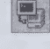


单击在线帮助图标会打开 KDE 帮助浏览器，其中包含数百个常见问题和主题的解答。如果您遇到问题或有迫切想知道的问题，请单击此图标激活帮助浏览器，并使用浏览器链接找到您需要的答案。不过，您应该知道，KDE 在线帮助不允许搜索或使用帮助文件的综合索引。您可能需要四处查找一番才能找到您正在寻找的答案。第 2 章更详细地讨论了在线帮助系统。

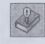

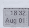

您在面板上看到的最后一个功能是当前日期和时间。KDE 从您的系统设置中获取此信息，因此如果您的系统对日期或时间感到困惑，面板也会如此。我们在第 5 章中讨论了设置时钟。

## 停留在（任务）栏上

在图 1-1 所示的默认桌面中，KDE 任务栏位于屏幕顶部。如果您曾经看到或用过 Windows 95 或 Windows 98，您就会见过类似的工具。任务栏允许您通过快速一瞥，看到您当前电脑上正在运行哪些程序。任务栏通过为每个打开的应用程序显示一个按钮来实现这一点。请查看图 1-4 以了解任务栏的运行情况。由于每个打开的程序都有一个按钮，因此您可以关闭所有窗口，或将它们直接一层层叠放在彼此之上，而不会丢失正在运行内容的线索。

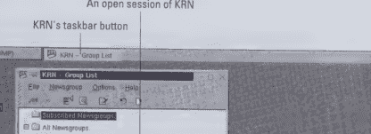

图 1-4：KDE 任务栏是一个快速捷径。

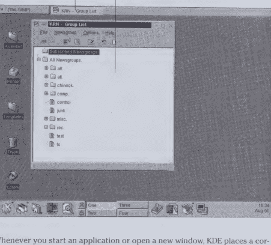

每当您启动应用程序或打开新窗口时，KDE 都会在任务栏上放置相应的按钮。该新按钮带有小图标和应用程序名称。请参考图 1-4，查看任务栏上打开的 KWrite 按钮。如果您希望将该窗口提升到桌面上其他窗口的顶部，请单击任务栏中相应的按钮。窗口会神奇地出现。

任务栏最有用的功能之一是针对那些喜欢同时运行多个应用程序，但一次只想显示一个窗口的人：单击窗口标题栏上的小圆点以关闭所有窗口（除了您想要操作的那个窗口）。该窗口从桌面上消失，只在任务栏中留下其按钮，提醒您它的存在。图 1-5 显示了一个桌面，其中有三个正在运行的程序，它们仅在任务栏中可见。如果您再次需要某个程序，只需单击任务栏中正确的按钮即可重新打开它。只需看看任务栏，您就能回忆起您正在运行什么。

### 22 第一部分：入门

您也可以通过使用任务栏来控制正在运行的各种应用程序，而不一定需要打开每个窗口。只需右键单击相应的任务栏按钮。会出现一个小菜单，其中包含您可以用来控制相应窗口或程序行为的选项。所有这些选项在第 3 章中都有更详细的说明。

- **最大化**将程序返回桌面，并将其扩展到最大可能尺寸。
- **取消图标化**将程序返回桌面，前提是您之前已最小化该程序或选择了“图标化”命令来关闭窗口，只在任务栏中留下按钮。
- **粘滞**使程序窗口显示在所有虚拟桌面上，而不仅仅是一个。
- **转到当前桌面**将程序从一个虚拟桌面移动到另一个。
- **图标化其他窗口**最小化所有其他打开的窗口，使此程序成为唯一打开的窗口。
- **关闭**，如您可能猜测的那样，关闭程序窗口并退出程序。

与 KDE 中的几乎所有其他内容一样，您可以自定义并移动任务栏，使其满足您的需求。有关如何做到这一点的更多帮助，请参见第 5 章。

## 我有多少个桌面？

现在您已经从概念和实践两方面控制了 KDE 桌面，让我们通过谈论*虚拟桌面*来增加一点复杂性。从某种意义上说，屏幕上的桌面已经是虚拟的；毕竟，它不是一张真正的桌子，只是看起来像。但在 Linux 术语中，虚拟桌面是一件全新的电子办公家具。

想象一下，您的办公室足够大，可以容纳另外三张桌子，从而为您提供四张工作桌面。现在，想象这些额外的桌子就在您的计算机内部——突然之间，您拥有了新的干净桌面来管理您的程序和文档。默认情况下，KDE 为您提供四个虚拟桌面。如果您需要更多，您可以配置多达八个……再说，您需要做什么事情需要八个以上的桌面呢？

您到底为什么要这样做呢？嗯，有时将不同类型的窗口放在单独的桌面上很有用。单独的桌面可以帮助您保持条理，防止某个桌面变得过于杂乱而无法操作。例如，假设您在桌面 1 上打开了一个文字处理程序窗口，并且确实需要在网络上查找一些内容以添加到文档中。在与文字处理程序相同的桌面上运行 Netscape 可能会过于分散注意力……承认吧，您是否曾在应该工作的时候被上网冲浪吸引走？因此，您切换到新桌面。您在该独立桌面上启动 Netscape，在那里它将是唯一运行的程序，查找您需要的条目，然后回到第一个桌面和您的文档。

“好吧，”我们听到您说，“但这些*该死的*桌面在哪里？我看屏幕时只看到一个。” 嗯，回头看看面板中的分页器图标。看看分页器是否在一个块中有四个按钮？这些按钮中的每一个代表一个桌面。您可以通过哪个按钮被按下或边缘有阴影来区分您当前在哪个桌面上。要在虚拟桌面之间切换，请按分页器按钮。

如果这个概念仍然有点模糊，请花一分钟试试。您也可以阅读第 2 章，其中包含大量关于一般桌面（包括虚拟桌面）的信息。下面是一个使用 KNote 实用程序的小练习，该实用程序包含在默认 KDE 安装中。

1. **单击分页器图标中的 Two 按钮。**

看起来好像没什么变化，对吧？桌面看起来仍然一样，除了 Two 按钮被按下而不是 One 按钮外，其他都完全相同。但确实发生了一些变化。您正在查看桌面 2 而不是桌面 1，它们只是碰巧完全相同。

2. **从 KDE 菜单中选择 Utilities::KNotes。**

如图 1-6 所示，出现一个标有 *knote 1* 的黄色小窗口。这个窗口是电子版的黄色便利贴，我们都习惯把便利贴粘在桌子、电话、书本、墙壁和任何可以粘住的地方。

3. **在笔记内部单击并输入“嗨，我是桌面 Two。”**

4. **单击分页器图标中的 One 按钮。**

笔记消失了，因为您回到了桌面 1。笔记仍然存在——只是不在这个地方。

5. **单击面板上的窗口列表图标。**

显示您所有桌面的列表。看到那里，桌面 2 下面？它写着“Note: knote 1”。

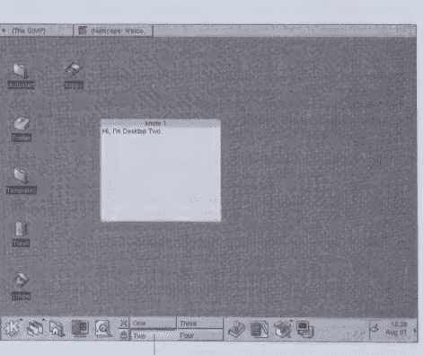

桌面 Two 的分页器按钮被按下。

图 1-6：那些该死的便利贴无处不在，即使在 KDE 中也是如此。

6. **单击分页器中的“Two”按钮。**

那个便签还在那里，就在你留下的地方。如果你愿意，可以通过单击标题栏中的 X 按钮将其移除。

7. **单击分页器图标中的“One”按钮返回到桌面 1。**

任务栏包含你打开的所有程序的项，无论它们位于哪个桌面上。如果你单击位于不同桌面上的某个程序的项，任务栏会自动带你前往该桌面。使用任务栏是在不使用分页器按钮循环切换的情况下，在桌面之间快速切换的简单方法。

## 永别了，再见：退出 KDE

当你结束本次 KDE 的乐趣体验后，你需要退出桌面环境，回到 shell 提示符界面，以便你可以注销机器，或者如果你设置了图形登录界面，则回到图形登录界面。

1. **使用以下选项之一注销 KDE：**

   - 单击面板上的**注销**按钮。
   - 单击面板上的 K 按钮，并从出现的 KDE 菜单中选择**注销**。
   - **右键单击桌面**，然后从出现的弹出菜单中选择**注销**。

KDE 将显示**已为注销准备会话**对话框。该对话框列出了正在运行的程序，并给你机会中止注销、返回到这些程序并保存你的工作。

2. **单击“注销”以确认你希望关闭 KDE。**

KDE 从你的屏幕上消失，并让你回到 Linux shell 提示符的纯文本环境。

退出 KDE 后，别忘了注销你的 shell 账户！离开 KDE 并不意味着你已经注销。让自己保持登录状态是招致残酷恶作剧和恶作剧的邀请，这些可能会让你尴尬甚至更糟。**注销，注销，注销！**

# 第 2 章

在桌面上浏览

**本章内容**

- 在 KDE 中运行你的程序
- 使用 KDE 桌面上的图标
- 操作 KDE 中类似“开始”菜单的功能
- 使用窗口列表找到正确的窗口
- 获取 KDE 帮助

在物理世界中，你的办公桌是你展开正在处理的项目的工作表面。KDE 桌面起着类似的作用——它是你展开在计算机上使用的工具和文档的工作表面。多年来，你无疑已经发现了使用办公桌上可用工具的正确方法。（你可能也发现了一些用桌子上的东西作为有趣消遣的方法。）在本章中，你将了解如何使用 KDE 桌面上找到的工具。

### 启动应用程序

KDE 通过为操作系统提供图形用户界面，为你的 Linux 计算机提供了便利的工作环境。但对于桌面工作站（与服务器不同），真正完成你使用计算机所进行的日常工作的并非操作系统，而是应用软件。例如，文字处理程序使你可以创建信函、报告、提案和其他文档；电子表格使你可以创建预算和统计分析并执行其他数字计算项目；数据库程序管理从客户列表到产品库存的一切；网络浏览器和电子邮件程序使你可以访问互联网上的信息并进行通信。因此，KDE 最重要的功能之一，就是提供便捷的方式启动你每天使用的应用程序。


KDE 确实使启动应用程序变得容易。主要的 KDE 程序启动器是 KDE 菜单，可通过单击面板上带有 KDE 标志的按钮来访问。但是，从菜单中选择程序并不是在 KDE 中启动应用程序的唯一方法。事实上，你可以使用几种技术。以下是这些技术的摘要：

- 从 KDE 菜单中选择一个程序。（我们在此部分详细介绍了这种技术。）
- 双击程序的桌面图标。（程序图标在本章下一部分中介绍。）
- 单击程序的面板按钮。（欲了解更多信息，请继续阅读。）
- 在 KFM 窗口中双击程序文件或文档文件的图标。（有关使用 KDE 文件管理器 KFM 启动程序和打开文档文件的信息，请参见第 4 章。）
- 从 KDE 桌面执行命令。（继续阅读以了解如何操作。）
- 从终端窗口访问 Linux 命令行并输入启动程序的命令。（有关从终端窗口访问 Linux 命令线的详细信息，请参见第 12 章。）

## 从 KDE 菜单运行程序

KDE 桌面面板的一个显著特征是你可以单击以显示可在 KDE 中运行的可用应用程序菜单的按钮。它的功能与 Windows 95 或 98 的“开始”按钮非常相似，包括 Windows 用户非常熟悉的级联子菜单。KDE 菜单使你可以方便地仅通过几次鼠标单击即可启动程序。

> **记住**
>
> 带有 KDE 标志的 KDE 面板按钮有多种名称，如*K 按钮*、*KDE 按钮*和*KDE 标志按钮*；但我们只是称其为*KDE 菜单按钮*，因为单击它时会出现的就是这个。该菜单本身有时被称为*KDE 应用程序启动器菜单*，但*KDE 菜单*显得如此简洁，所以我们在本书中使用该术语。

在你开始批评 KDE 菜单过于类似 Windows 之前，请考虑一下它在组织大量程序并使它们易于访问方面有多简单和高效。毕竟，为什么不利用其他用户界面的成功特性呢——尤其是当它使以前使用过 Windows 的大众更容易学习 KDE 时。而且别忘了，KDE 提供了其他几种启动程序的方法，所以如果你不想使用 KDE 菜单，你可以选择不使用它。

要使用 KDE 菜单启动程序，请遵循以下简单步骤：

1. **单击面板中的 KDE 菜单按钮。**
   
   KDE 菜单按钮是带有 KDE 标志（一个大 K 和一个齿轮）的按钮。该按钮通常位于面板的左端。当你单击 KDE 菜单按钮时，KDE 应用程序启动器菜单会出现。

2. **将指针指向带有右向箭头的菜单项（例如应用程序）。**
   
   “指向”意味着将鼠标指针移动到菜单项上方并停留片刻。级联子菜单会出现，如图 2-1 所示。

3. **在子菜单中单击所需的程序。**
   
   KDE 关闭菜单并启动选定的程序。通常，该程序会在其位于桌面上的独立窗口中出现，但某些实用程序可能会显示在面板或其他位置。取决于你的系统速度和所选程序的大小，该程序可能立即出现，也可能需要将近一分钟才会显示在你的桌面上。

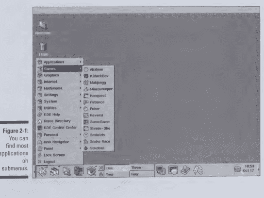

此技术适用于列在默认 KDE 菜单上的所有标准 KDE 实用程序、游戏和其他应用程序。它也适用于你手动或通过使用 AppFinder 实用程序添加到 KDE 菜单的应用程序（有关自定义 KDE 菜单的更多详细信息，请参见第 5 章）。在某些情况下，从 KDE 菜单或其子菜单中选择一个项目实际上并不会启动一个真正的程序，而是打开一个 KDE 配置对话框，发出一个系统命令，或执行类似的操作。

KDE 菜单上有几个项目没有指示存在子菜单的箭头。默认 KDE 菜单上的示例包括 KDE 帮助、主目录、锁定屏幕和注销。单击这些菜单项之一会立即触发一个操作，而不是打开子菜单。

## 使用桌面图标启动程序

在你的实体办公室里，你可能会将大部分工具和材料存放在抽屉里，这样它们虽然看不见了，但在需要时相对容易访问。但你最常使用的东西就放在桌面上，可以即时使用。

KDE 使你可以以类似的方式组织你的计算机桌面。你的大多数程序都可以从 KDE 菜单访问——虽然它们不可见，但只需三次鼠标操作即可访问（单击 KDE 菜单按钮，指向以展开相应的子菜单，然后单击菜单项以启动程序）。然而，对于你最常使用的程序，你可以创建桌面图标，让它们完全显示在你的计算机桌面上，并且只需单击鼠标即可使用。

桌面图标只是指向存储在其他位置的资源和文件的链接。图标可以链接到程序文件、shell 脚本、目录、文档文件、互联网 URL 或文件系统设备。如果链接指向文档文件，并且 KDE 知道与该文档类型关联的应用程序，它可以自动启动适当的程序来打开该文件。

使用桌面图标启动程序非常简单；只涉及一步：

1. 单击你要打开的项目的桌面图标。

KDE 立即采取适当的操作来打开与桌面图标关联的项目。

例如，你桌面上的回收站图标是指向家庭目录中一个特殊子文件夹的链接，KDE 将你要删除的文件临时存储在那里。单击回收站图标会启动 KFM 文件管理器程序并显示回收站文件夹的内容。

默认的 KDE 桌面初始时包含一组桌面图标——主要是指向特殊用途文件夹（例如自动启动）和系统设备（例如 cdrom）的链接。然而，你不必局限于这有限的图标选择。你可以为最常用程序和文档创建自己的桌面图标。本章“处理桌面图标”部分将向你展示如何做。

## 通过面板按钮启动程序

桌面图标并非在 KDE 中即时访问应用程序的唯一方式。你还可以使用面板按钮来启动程序。除了 KDE 菜单按钮以及其他特殊按钮（如窗口列表、工具箱和虚拟桌面按钮）之外，KDE 面板还容纳了一组用于单个应用程序和实用工具的按钮。

安装 KDE 后，系统通常会启动一个已预置了一组实用工具程序按钮的面板，这些实用工具包括 KVT、Konsole、Khelp、KCalc、KNotes、Kedit 和 KMail。与 KDE 中的许多其他功能一样，面板按钮的选择是可自定义的。你可以轻松地从面板中移除程序按钮，添加其他应用程序的按钮，或者在面板上移动或重新排列这些按钮。我们将在第 5 章中展示如何实现。

通过面板按钮启动程序非常简单。你只需单击该按钮，KDE 就会立即启动相应的应用程序或实用工具。无需导航菜单或进行其他选择——KDE 会以最快速度打开程序，速度取决于系统访问相关文件的能力。

与使用桌面图标相比，从面板按钮启动程序确实具有优势。桌面图标常常被桌面上可能打开的各个窗口遮挡，而面板通常保持在打开的窗口之上可见。面板始终可见，意味着你无需先移动或最小化（图标化）窗口以露出桌面图标即可访问面板按钮。另一方面，如果你的面板处于折叠状态或配置为自动隐藏（在不使用时滑出视野），这种优势可能不那么明显。如果面板不可见，你需要额外的鼠标操作将面板调出视野，然后才能点击面板按钮以启动应用程序。（面板的折叠和扩展在第 1 章中有介绍，而将面板设置为自动隐藏则在第 5 章中介绍。）

## 即时访问输入命令

有时，启动程序的最快方式只是输入一条命令。如果你是一位资深的 Linux/UNIX 命令行用户，或者需要启动一个未为其设置 KDE 图标、按钮或菜单项的低频使用程序，这一点尤为正确。当然，你可以启动 KDE 的终端模拟实用工具（KVT 或 Konsole），并使用它与操作系统命令行交互。（有关在终端窗口中使用命令行的更多信息，请参阅第 12 章。）

在终端窗口中输入命令是可行的，但 KDE 提供了一种更简单的替代方案，允许你输入单行命令。只需按照以下步骤操作：

- **右键单击桌面，从出现的弹出菜单中选择“执行命令”。**
  
  KDE 会打开命令框，如图 2-2 所示。

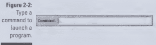

- **输入用于启动程序的命令，然后按 Enter 键。**
  
  KDE 关闭命令框并将命令传递给操作系统。Linux 执行该命令并启动你的应用程序。如果你正确输入了启动 KDE 或 X Window 程序的命令，程序窗口将会出现。

**警告！** 注意你在命令框中输入的命令。你输入的任何命令都会立即执行，并且与在终端窗口中输入命令不同，你不会看到任何错误消息或你的命令产生的其他警告。错误输入启动程序的命令通常是无害的（它不起作用，你需要重试），但使用命令框输入系统命令或启动命令行程序可能会产生不可预测的结果。

## 处理桌面图标

桌面图标就是那些小符号，例如文件夹和垃圾桶，它们最初位于默认 KDE 桌面的左侧。第 1 章介绍了默认 KDE 桌面上找到的桌面图标。它们包括自动启动和模板文件夹、回收站文件夹以及 CD-ROM 和软盘驱动器的图标。但是，如图 2-3 所示，你不必局限于这种有限的图标组合。就像你在实体桌面上有各种工具和纸张一样，你可以在 KDE 桌面上拥有一组桌面图标，使得这些图标所代表的文件、文件夹和程序始终触手可及。

当你点击桌面图标时，效果等同于点击该图标所代表的文件或其他资源的图标——KDE 会启动程序和/或打开文件或文件夹。例如，如果你点击一个文件夹的桌面图标，KDE 会打开一个 KFM 窗口并显示链接文件夹的内容。如果你点击一个万维网 URL 的图标，KDE 会打开你的 Web 浏览器（通常是 KFM），然后检索并显示记录在图标链接文件中的地址处的 Web 页面。如果你点击一个文本文件的桌面图标，KDE 会启动你的文本编辑器并加载文本文件以供编辑。

### 技术细节


当你点击文本文件或其他文件类型的桌面图标时，KDE 如何知道使用什么程序来打开你的文件？它通过文件扩展名识别文件的 MIME 类型，并使用与该 MIME 类型关联的应用程序来打开文件。有关将特定程序与文件类型关联的信息，请参阅第 4 章。

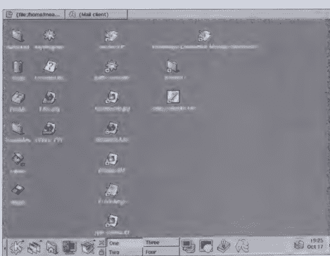

**图 2-3：你可以在桌面上填充各种各样的图标。**

你可以为各种各样的文件和系统资源创建桌面图标，包括以下类型：

- **文件：** 指向系统上任何文档或其他文件的链接。点击文件图标会使用适当的程序打开该文件。
- **文件夹：** 指向文件系统中任何目录的链接。点击文件夹图标会打开一个 KFM 窗口，显示文件夹的内容。当然，为了使用此链接，目标目录必须是已挂载文件系统的一部分，并且你必须拥有适当的访问权限。
- **文件系统设备：** 指向可挂载设备或目录的链接，例如软盘、CD-ROM 驱动器、硬盘以及来自其他机器的文件系统。点击设备图标会打开一个 KFM 窗口并显示设备的内容——前提是该设备已挂载。否则，KDE 会尝试先挂载该设备，如果你缺少挂载设备的适当权限，则会显示错误消息。
- **FTP URL：** FTP（文件传输协议）服务器上目录的互联网地址。点击 FTP 图标会启动你的 FTP 程序并尝试访问该 FTP 地址。
- **应用程序：** 指向可执行程序（包括 shell 脚本）的链接。点击应用程序图标会启动该程序。
- **互联网地址 URL：** 通用互联网资源的地址。点击互联网地址图标会启动适当的程序并尝试访问该 URL。
- **万维网 URL：** Web 页面的互联网地址。点击 Web 地址图标会启动你的 Web 浏览器并加载该 Web 页面。

KDE 的桌面图标实际上存储在用户主目录的 Desktop 子文件夹中的链接文件的图形表示。KDE 链接文件指定显示哪个图标，并定义桌面图标与图标所代表的文件、程序或系统资源之间的链接，但 KDE 实际上并不在桌面上存储链接的目标（甚至不存储其副本）。

## 排列图标

KDE 初始时，默认桌面图标整齐地排列在桌面的左侧。但你不必让它们留在那里，正如你不必让办公桌上的物品保持你最初走进新办公室时的排列方式一样。你可以随时重新排列桌面图标。

- 要移动图标，只需点击图标并按住左键，将图标拖动到新的位置。释放鼠标按钮即可将图标放置在新位置。

## 第2章：桌面导航


当你在桌面上移动图标时，它可能不会停留你放置的确切位置。KDE 在桌面上设置了一个不可见的网格，当你移动图标时，图标会自动跳到最近的网格交叉点。网格有助于防止图标重叠，并使你在桌面上保持某种秩序变得容易。有关调整桌面网格设置的信息，请参阅第6章。

如果希望 KDE 自动为你排列桌面图标，请右键单击桌面，然后从出现的弹出菜单中选择 *Arrange Icons*；接着点击 **Yes** 以确认你确实想要重新排列桌面图标。KDE 会将你的图标排列成整齐的列，从桌面的左上角开始。


当你让 KDE 自动排列桌面图标时，可能会感到些许意外。图标列可能比你预期的更远离桌面边缘。KDE 将图标定位以在桌面边缘为面板和任务栏留出空间；因此，如果你将 KDE 面板或任务栏配置为位于桌面左侧，即使在你重新排列图标时面板和任务栏处于隐藏状态，图标也会向右移动，靠近桌面中心。

### 创建你自己的桌面图标

默认 KDE 桌面上显示的桌面图标仅仅暗示了你可以对桌面图标做什么。你可以自由地创建、编辑和删除桌面图标，以构建一个与你自己的工作风格相匹配的定制桌面环境，包括你使用的程序、正在处理的文件以及你每天访问的网站图标。

#### 创建新的桌面图标

创建桌面图标所用的技术根据 *icon*（或者更准确地说，根据图标链接到的项目类型）的不同而略有不同。最简单的桌面图标类型之一是指向文件或文件夹的快捷方式链接。要创建这样的图标，请遵循以下步骤：

- 1. 打开 KFM 窗口并导航到包含你要创建链接的文件所在的目录。

确保你想要通过桌面图标访问的文件显示在 KFM 窗口中。（有关使用 KFM 文件管理器工具的信息，请参阅第4章。）该文件可以是文字处理文档、电子表格文件、文本文件，或你希望是任何其他内容。它甚至可以是一个文件夹。还要确保 KDE 桌面的某一部分是可见的——不要最大化 KFM 窗口或让所有 KDE 桌面被其他打开的窗口遮挡。按需最小化、调整大小或移动窗口，以便你能访问 KFM 窗口内容和桌面。

- 2. 按住鼠标按钮，点击文件图标并将其从 KFM 窗口中拖出。在桌面空白区域释放鼠标按钮以放置文件图标。

- 将出现一个弹出菜单，提供复制、移动或链接的选择。

- 3. 选择链接。

- KDE 创建了一个链接到所选文件的桌面图标。图标左下角显示一个小箭头，表示它是快捷方式或链接，而不是原始文件。图标下方的文本标签是链接指向的文件或文件夹名称的副本。图 2-4 显示了一个新创建的桌面图标。

除了简单的文件或文件夹链接，你还可以创建其他几种类型的桌面图标，例如 Web 页面和其他互联网资源以及文件系统资源的图标。以下步骤描述了为 Web 页面 URL 创建桌面图标的过程：

- 1. 右键单击桌面，并从出现的弹出菜单中选择 New World Wide Web URL。

- 如图 2-5 所示，会出现一个对话框，提示你输入新 World Wide Web URL 的名称。默认值为 `WWWURL.kdelink` —— 这是使桌面图标工作的链接文件的默认文件名。

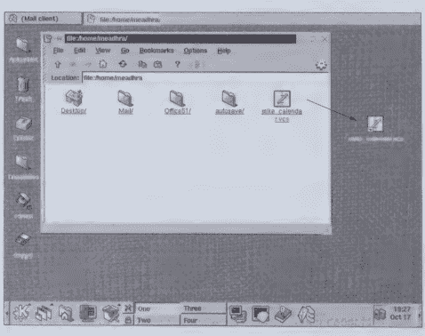

**Figure 2-4:** 你可以通过简单的拖放操作为文件创建桌面图标。

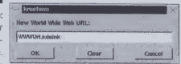

**Figure 2-5:** 为你的新桌面图标命名。

- 2. 编辑文件名并点击确定。

你可以将文件名中的 `WWWurl` 部分更改为你想要的几乎任何内容，但最好保留文件名中的 `.kdelink` 部分完整。KDE 会自动剥离 `.kdelink` 扩展名，并将剩余的名称显示为桌面图标下方的标签。点击确定后，名称对话框消失，KDE 将新图标添加到你的桌面，并如图 2-6 所示打开图标的属性对话框。

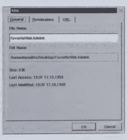

**Figure 2-6:** 编辑你的新桌面图标的属性。

- 3. 根据需要编辑“通用”选项卡上的设置。

你可以通过编辑“文件名称”框的内容来修改图标名称，以此获得另一次机会。

- 4. 点击“URL”选项卡。

KDE 显示如图 2-7 所示的设置。

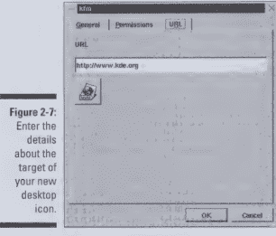

- 5. **在 URL 文本框中输入网页地址。**

输入你的 Web 浏览器在你点击新桌面图标时想要检索和加载的网页的完整地址。请务必仔细输入地址并使用正确的格式（例如，`http://www.kde.org`），而不是常见的简写形式（如 `www.kde.org`）。

- 6. **（可选）** **点击带图标的按钮，从出现的“选择图标”对话框中选择一个不同的图标，然后点击确定。**

此步骤允许你选择 KDE 显示为桌面图标的备用符号。通过点击你想要的图标，然后点击“确定”关闭“选择图标”对话框并返回到你正在定义桌面图标链接属性的 KFM 对话框，从“选择图标”对话框中显示的众多符号中选择一个符号（见图 2-8）。

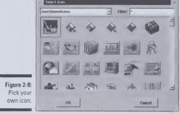

- 7. 点击确定。

- KDE 关闭属性对话框并记录桌面图标的设置。桌面图标现在可以使用了。你只需点击图标即可开始将目标网页加载到你的 Web 浏览器中。

你可以使用基本相同的技术来创建其他类型的桌面图标，例如文件系统设备、应用程序或其他互联网资源的图标。只需在步骤1中选择一个合适的图标类型来代替 World Wide Web URL。你可以选择 File System Device、FTP URL、Application 或 Internet Address URL。然后，在步骤4和5中，在属性对话框中选择相应的选项卡，并按照提示填写适当的设置。

当然，指向文件系统设备或应用程序的链接设置与 Web 页面或其他互联网 URL 的设置略有不同，但定义链接的基本思想是相同的。为了定义文件系统设备的图标，你需要熟悉设备地址和挂载点。并且为了定义应用程序的所有设置，除了应用程序可执行文件的名称外，你还需要了解一些关于 MIME 类型和与该应用程序关联的文件。

### 编辑桌面图标


你可以随时对桌面图标进行更改。例如，你可以选择不同的图标在桌面上显示。只需右键单击你想要更改的图标，然后从出现的弹出菜单中选择“属性”。会出现一个对话框，你可以在其中编辑最初用于定义图标及其链接的所有相同设置。（参见创建桌面图标过程中的步骤3到6。）根据需要编辑设置，然后点击“确定”关闭对话框并记录你的更改。

### 删除桌面图标

如果你的桌面上有太多图标显得杂乱无章，很容易删除其中一些。要从桌面删除图标，只需将其拖到“回收站”图标上。图标从桌面消失，链接文件存储在回收站文件夹中，直到你清空回收站永久删除它。如果要一步永久删除图标，右键单击该图标，从出现的弹出菜单中选择“删除”，然后在出现的 `KFM` 警告框中点击“是”以确认该操作。


删除桌面图标只会删除图标及其链接文件——它不会影响链接引用的原始文件、文件夹、文件系统设备或 URL。

## 使用窗口列表进行查找

如果你和大多数人一样，你的现实办公桌很快就会堆满各种项目相关的书籍、文件夹和纸张。找到你想要的东西通常需要在其他物品堆中翻找一番。

同样，你的 `KDE` 桌面也可能会迅速变得杂乱无章，许多打开的窗口经常会遮挡其他窗口。此外，你可能最小化了一些窗口，以至于它们在桌面上完全不可见。再加上可能潜伏在视线之外、每个都布满自己窗口组合的多个虚拟桌面的可能性，你就面对了这样一个局面：寻找特定窗口可能是一项挑战。

幸运的是，`KDE` 提供了一个极大地简化了在任何一个 `KDE` 桌面上查找任何窗口工作的工具。面板中的**窗口列表**按钮可以让你即时访问任何窗口——它是你 `KDE` 系统上所有打开窗口的某种索引。要使用窗口列表，请遵循以下步骤：

1. **点击面板中的窗口列表按钮。**

   `KDE` 会显示一个弹出菜单，列出所有打开的窗口，并按桌面进行组织。（见图 2-9。）

   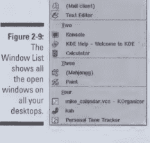

2. **从窗口列表菜单中选择一个窗口名称。**

   `KDE` 会立即将该窗口置于前台，如有必要会切换桌面。

窗口列表和任务栏都执行相似的功能。你可以通过点击任务栏上的按钮或从窗口列表菜单中选择窗口名称来选择已打开的窗口。

任务栏（在第 1 章中描述）的优势在于它始终在屏幕上可见（如果你选择这样配置而不是将其隐藏）。因此，你可以通过单击相应的任务栏按钮来选择窗口。然而，随着任务栏被众多窗口的按钮挤满，由于空间不足，按钮标签通常会被截断，这使得识别哪个按钮对应哪个窗口变得困难。

另一方面，窗口列表提供了更完整的每个窗口的描述，即使菜单中充满了众多窗口。在拥挤的桌面上，窗口列表中显示更详细的描述使得识别你想要的窗口更容易，并且远远抵消了弹出窗口列表并从菜单中选择窗口所需的额外点击。

## 获取帮助

当你使用 `KDE` 时，帮助永远不会远得找不到。即使你正在一个荒岛上使用笔记本电脑，手头没有这本书，你仍然可以获得关于如何使用 `KDE` 及其众多功能的即时建议。这是因为 `KDE` 在线文档永远只需几次鼠标点击即可到达。

如果你是一位经验丰富的 Linux/UNIX 用户，你无疑已经习惯了在线文档以 man 手册页的形式存在。并且有几个 man 页专门介绍 `KDE`。然而，`KDE` 文档的大部分内容以更吸引人且易于访问的形式提供。`KDE` 在线帮助文件以 HTML 格式（与网页使用的格式相同）存储，并包含一个特殊的 `Kdehelp` 工具，用于显示传统的 UNIX 风格 man 手册页和 HTML 格式的 `KDE` 帮助文档。`Kdehelp` 工具（如图 2-10 所示）可以从 K 桌面环境中的许多地方访问，使用它查看帮助文档就像在浏览器中查看网页一样简单。

- 要从桌面打开 `Kdehelp`，请右键单击桌面，然后从出现的弹出菜单中选择**桌面帮助**。
- 要从面板打开 `Kdehelp`，请单击 **KDE 帮助** 按钮。
- 要从 `KDE` 菜单打开 `Kdehelp`，请选择 **KDE 菜单 → KDE 帮助**。
- 要从几乎任何程序窗口打开 `Kdehelp`，请选择 **帮助 → 内容**。

无论你如何访问 `Kdehelp` 工具，结果都是一样的：会出现 `Kdehelp` 窗口，显示与你打开 kdemenu 时正在使用的 `KDE` 部分相关的帮助文档。例如，如果你从桌面访问 `Kdehelp`，你会看到通用的 `KDE` 帮助索引；但如果你从 `KFM` 窗口内部访问帮助，你会看到 `KFM` 文件管理工具的帮助文件。

- 要在 `KDE` 帮助文档中导航，请单击带下划线的链接以查看相关信息。这就像跟随显示在你的网页浏览器中的网页上的链接一样。
- 要在你已查看的帮助页面之间前进或后退，请单击 `Kdehelp` 工具栏中的 **上一个** 或 **下一个** 按钮。
- 要显示**内容**页面，请单击 `Kdehelp` 工具栏中的 **内容** 按钮。
- 要加载另一个帮助文件，请选择 **文件 → 打开**，从出现的“打开”对话框中选择一个文件，然后单击 **确定** 以关闭对话框并显示文件。
- 要通过关键字搜索帮助主题，请选择 **文件 → 搜索** 以显示如图 2-11 所示的 `KDE` 帮助搜索页面，在“输入关键字”框中输入搜索词，选择复选框以定义搜索范围，然后单击 **提交搜索**。`Kdehelp` 将你的搜索结果显示为链接列表。单击一个链接以显示相关页面。

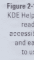
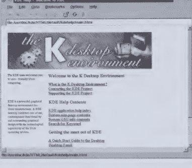
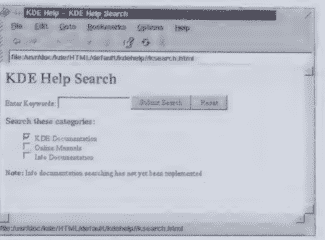
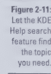

## 第 3 章

### 使用 KWM 管理窗口

#### 本章内容

- 窗口管理器究竟是什么？
- 了解 `KDE` 窗口的组成部分
- 自定义窗口设置
- 扩展到多个桌面

试想一下，一座拥有数十扇窗户的大型城堡或庄园。在中央空调出现之前的时代，家里的工作人员中可能有一人被指派负责管理所有这些窗户：打开一些窗户以通风，关闭其他窗户以阻挡穿堂风和雨水，在暴风雨时关上窗板，并拉开窗帘以迎接阳光的温暖和光线。

但你 `KDE` 桌面上的窗户与建筑物中的窗户大不相同——它们展示的是计算机程序的视图，而不是房子周围的乡村景色，信息通过你的 `KDE` 窗户流动，而不是空气和光线。不过，当窗户数量变得足够多时，你需要一个专门管理它们的工作人员。`KDE` 窗口管理器，即 `KWM`，就是承担这一责任的 `KDE` 工作人员。

`KWM` 默默地工作，在后台不引人注目地运作。你在桌面上看不到 `KWM` 的任何踪迹，但你在桌面上随处可见 `KWM` 工作的效果。`KWM` 控制每个窗口的放置和外观。`KWM` 赋予了 `KDE` 许多独特的视觉和感觉。

像一个得力的家政人员一样，`KWM` 例行公事地完成大多数任务，同时也恭顺地听从庄园主人的指示。在这一章中，你将发现如何向 `KWM` 发出这些指示。

与 Windows 和 Mac OS 等单一整体操作系统不同，你逐渐熟悉的桌面环境 `KDE` 由多个可混合搭配组件的多层结构组成。你的 Linux（或 UNIX）操作系统内核及其支持驱动程序和程序构成了基础层。下一层是创建系统基本图形界面的 X Window 系统服务器和客户端软件。然后是完善图形用户界面并赋予你所体验的 K 桌面环境外观和感觉的 `KDE` 组件。这些组件包括 `KWM`（`KDE` 窗口管理器）、创建 `KDE` 面板的 `KPanel`、`KDE` 文件管理器 `KFM`，以及统称为 `KDE` 扩展的一组杂项组件。

*窗口管理器* 是一个处理绘制窗口组件（如边框、标题栏和按钮）的 X Window 程序。它还处理窗口的移动和调整大小，管理它们在桌面上的放置，并控制该桌面的大部分外观。

窗口管理器实际上为应用程序和应用程序开发人员提供服务。得益于窗口管理器，每个应用程序无需包含处理窗口大小、边框等用户细节的单独代码。结果是，应用程序可以更小，而且你桌面上看到的大多数窗口外观和行为都相同。作为一个额外的优势，你可以在一个中心位置自定义窗口细节（例如活动窗口标题栏的颜色），而不是让这些属性由每个程序单独设置。

`KWM` 执行标准 X 窗口管理器的所有预期任务，并提供多个桌面供你工作，同时启用诸如在桌面和窗口之间拖放文件等功能。当然，`KWM` 是专门为与 `KDE` 和其他 `KDE` 组件协同工作而设计的。它们共同构成了完整的 `KDE` 环境。

因为 `KWM` 是一个独立的程序，如果你真的想要，可以使用另一个窗口管理器（如 Enlightenment 或 After Step）。然而，其他窗口管理器并不具备 `KWM` 与 `KDE` 其余部分那样紧密的集成。相反，理论上你可以将 `KWM` 用作 X Window 的通用窗口管理器，但没有 `KDE` 的其他部分，`KWM` 无法真正发挥其全部潜能。


你不需要更换窗口管理器来改变桌面的外观。你可以以多种方式自定义 KWM，并使用主题快速轻松地进行重大更改。如果你喜欢其他窗口管理器的外观，你可能能够通过 KDE 主题来模拟它。（有关使用主题的更多信息，请参阅第 7 章。）

## 什么是窗口管理器？

### 第 1 部分：入门

46

## KDE 窗口结构解析

图形用户界面中的关键元素——例如带有标题栏的程序窗口——对于大多数计算机用户来说都相当标准且熟悉。KDE 窗口（如图 3-1 所示）可能看起来与 Windows 或 Mac OS 中的对应窗口略有不同，但其大部分组件都很容易识别。

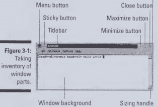

图 3-1：清点窗口部件。

以下是 KDE 窗口主要部件的快速概览：

- **标题栏：** 横跨窗口顶部的彩色条通常显示程序名称和/或显示在窗口中的文档文件名。标题栏还充当“手柄”，您可以使用鼠标指针拖动它来移动窗口。
- **边框：** 定义窗口的边缘。边框还充当大小调整手柄，您可以使用鼠标指针拖动它以扩展或缩小窗口在某一侧的大小。
- **关闭按钮：** 单击此按钮可关闭窗口，并退出在窗口内运行的应用程序或文档。
- **最大化按钮：** 单击此按钮可自动扩展窗口大小以填满桌面上的所有可用空间。如果窗口已最大化，互补的还原按钮将替换此按钮（通常标记为两个堆叠的矩形）。单击还原按钮会将窗口恢复到其之前的未最大化大小和位置。
- **最小化按钮：** 也称为图标化按钮。单击此按钮可从桌面移除窗口，而无需退出窗口内的程序。单击最小化按钮后，程序继续运行，但仅由 KDE 任务栏上的按钮和窗口列表中的条目表示，而不是任何桌面上的打开窗口。
- **置顶按钮：** 单击此按钮可切换置顶模式的开或关。如果您将窗口设为置顶，它将出现在所有虚拟桌面的相同位置，而不是仅在某个虚拟桌面可用。
- **菜单按钮：** 单击此按钮可打开窗口管理命令菜单。默认的菜单按钮（标记为一条简单的水平线）通常被窗口内运行的程序的图标替换。但无论菜单按钮的外观如何，单击它都有相同的效果。
- **大小调整手柄：** 单击并拖动窗口右下角的大小调整手柄，可同时沿水平和垂直轴调整窗口大小。
- **窗口背景：** 窗口内部是在窗口内运行的程序领域。应用程序控制显示在窗口内的一切，包括菜单、工具栏按钮、状态栏以及主工作区域的内容。KWM 除了设置窗口背景、文本、菜单文本和选中项的默认颜色外，什么都不做。

KDE 是一个高度可定制的环境，这种定制性延伸到了 KDE 窗口按钮和其他组件的外观。图 3-1 显示了使用默认 KWM 设置的 KDE 窗口。您的窗口可能看起来非常不同——尤其是如果您使用主题来修改 KDE 桌面外观时。窗口边框可能被渲染成粗金属管道的样子，标题栏按钮可能带有不同的符号。然而，尽管存在外观差异，KDE 窗口组件的工作方式仍然相同。

## KDE 自定义窗口工坊

您可能会很满足于使用 KDE 的默认设置来控制 KDE 窗口和桌面的外观和行为。在大多数情况下，KDE 开发人员出色地选择了合理的默认值，创建了一个高度可用的窗口系统。但是，如果您喜欢折腾系统，KDE 为您提供了充分的机会。您可以操纵一系列令人惊叹的设置，以控制窗口管理几乎可以想象到的每一个细节。虽然窗口设计的一些方面（如指定用于渲染窗口边框和按钮的图像文件）需要手动编辑晦涩难懂的配置文件（且这些内容超出了本书的范围），但大多数自定义窗口设置在一系列方便的对​​话框中即可轻松获得。

您可以在 KDE 控制中心对话框的各个选项卡中找到大多数自定义窗口控制。要打开 KDE 控制中心对话框，请使用以下技术之一：

- 单击 KDE 菜单按钮，然后选择 KDE 控制中心。
- 单击面板上的 KDE 控制中心按钮。

出现 KDE 控制中心对话框后，您可以使用对话框左侧的索引树来选择要处理的选项卡。本章接下来的部分详细介绍了您可以在每个选项卡上调整的设置。

## 配置标题栏

任何窗口最显着的特征可能是其标题栏。您可以按照以下步骤调整标题栏外观的多个方面：

1. 打开 KDE 控制中心对话框。单击面板上的 KDE 控制中心按钮或选择 KDE 菜单->KDE 控制中心。KDE 控制中心对话框出现。
2. 选择 `Windows::Titlebar`。标题栏选项卡出现，如图 3-2 所示。

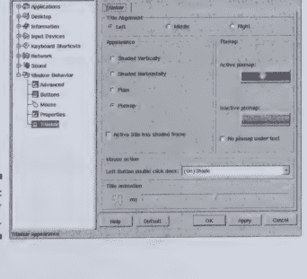

3. 根据需要调整标题栏选项卡上的设置。

您可以调整以下设置：

- **标题对齐方式**：此区域的三个单选按钮允许您选择标题栏内标题的对齐方式。您可以选择左对齐（默认值）、居中对齐或右对齐。
- **外观**：此区域的选项定义了标题栏中显示的背景类型。选择垂直着色以指定标题栏中从上到下的颜色混合。选择水平着色（默认值）以使颜色混合从左到右。选择纯色以指定纯色标题栏，选择图像以显示图像作为标题栏的背景。
- **图像**：如果在外观区域选择图像选项，则图像区域的选项变得可用。单击活动图像和非活动图像按钮以打开对话框，您可以在其中选择用于活动和非活动窗口标题栏背景的图像文件。选择文本下无图像选项以抑制将图像显示为标题文本的背景。
- **鼠标操作**：从左按钮双击操作下拉列表框中选择一个操作，以定义双击标题栏时发生的情况。默认值（(取消)着色）会导致窗口折叠，仅标题栏保持可见，从而在桌面上占用更少的空间。双击折叠的窗口标题栏可反转效果并将窗口恢复为其正常大小。
- **标题动画**：如果窗口标题过长而无法适合标题栏，KWM 会自动在标题栏中来回滚动标题。您可以通过将标题动画滑块向左或向右拖动来控制滚动速度。

4. 单击应用按钮。

KDE 将设置应用于您的桌面和窗口。

## 配置按钮

标题栏按钮是 KDE 窗口的重要功能。它们提供了对最常用窗口控制的快速访问。您可以重新排列按钮，将按钮放置在对您最方便的位置。方法如下：

1. 打开 KDE 控制中心对话框。

单击面板上的 KDE 控制中心按钮或选择 KDE 菜单->KDE 控制中心。KDE 控制中心对话框出现。

2. 选择 `Windows→Buttons`。

**按钮** 选项卡出现，如图 3-3 所示。

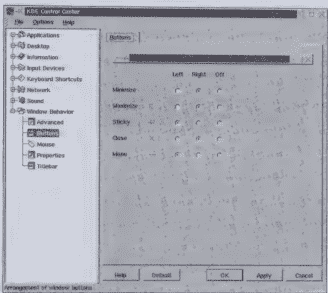

图 3-3：控制哪些标题栏按钮位于何处。

3. 为每个 **标题栏** 按钮选择位置。

您可以通过选择三个单选按钮（**左**、**右**、**关**）之一来设置五个标题栏按钮（**最小化**、**最大化**、**置顶**、**关闭**、**菜单**）中每个按钮的位置。**按钮** 选项卡顶部的示例标题栏会预览您的选择。

您不能在标题栏的两端放置超过三个按钮。如果您尝试在一端放置第四个按钮，KWM 会自动关闭该端的另一个按钮。您需要为禁用的按钮重新选择另一个位置。

4. 单击 **应用** 按钮。

KDE 将设置应用于您的桌面和窗口。

## 配置鼠标按钮操作

KWM 提供了多种选项来控制使用鼠标指针单击窗口时发生的情况。根据您单击哪个鼠标按钮、在窗口何处单击以及窗口是活动还是非活动，鼠标单击可以将窗口提升到前景或降低到背景、移动或调整窗口大小，或者将单击传递给窗口内的应用程序。所有这些细节都是可配置的。请按照以下步骤更改鼠标设置：

## 配置鼠标设置

1. **打开 KDE 控制中枢对话框。**

点击面板上的 KDE 控制中枢按钮，或选择 KDE 菜单 > KDE 控制中枢。KDE 控制中枢对话框将出现。

2. **选择 窗口 > 鼠标。**

将显示鼠标选项卡，如 图 3-4 所示。

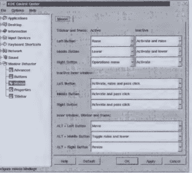

> 图 3-4：您可以完全自定义鼠标的行为，以至于除了您以外的其他用户肯定会感到困惑。

3. **根据需要调整鼠标选项卡上的设置。**

若要更改设置，请从对应于您要调整的鼠标按钮和窗口区域的下拉列表框中选择一个选项。这些选项按以下窗口区域组织：

- **标题栏和边框：** 正如您可能预期的那样，这些设置适用于点击活动窗口和非活动窗口的标题栏或边框时。
- **非活动内部窗口：** 这些设置控制点击非活动窗口内部后发生的情况。对于控制活动窗口内部的鼠标点击，没有对应的选项，因为这些鼠标点击会自动传递给窗口中的应用。
- **内部窗口、标题栏和边框：** 此区域的选项控制按住 Alt 键时点击窗口（任何窗口的任何位置）所触发的操作。

4. **点击“应用”按钮。**

KDE 将设置应用于您的桌面和窗口。

## 配置窗口管理选项

窗口管理选项控制诸如 KWM 放置新窗口的位置、焦点如何在不同窗口之间转移，以及当您移动或调整窗口大小时 KWM 是显示窗口内容还是仅显示窗口轮廓等因素。若要调整窗口属性选项，请遵循以下步骤：

1. **打开 KDE 控制中枢对话框。**

点击面板上的 KDE 控制中枢按钮，或选择 KDE 菜单 → KDE 控制中枢。KDE 控制中枢对话框将出现。

2. **选择 窗口 → 属性。**

将显示选项卡，如 图 3-5 所示。


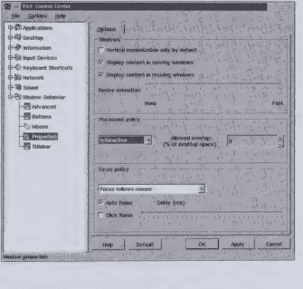

**图 3-5：**

窗口属性选项的设置。

### 3. 根据需要调整选项卡上的设置。

您可以调整以下设置：

- **默认仅垂直最大化：** 选中此选项可指示 `KWM` 在点击其最大化按钮时只改变窗口的高度，而不改变宽度。（正常操作是同时最大化窗口的高度和宽度。）

- **在移动窗口时显示内容：** 选中此选项以在您移动窗口时显示移动中窗口的内容。默认情况下，仅当移动窗口时显示窗口的透明线框轮廓——在您将窗口放置到新位置之前，窗口内容保持在原始位置。

- **在调整大小窗口时显示内容：** 选中此选项以在您调整窗口大小时显示窗口内容的变化。默认情况下，仅当调整窗口大小时显示窗口的透明线框轮廓。

- **调整大小动画：** 拖动滑块向左或向右，以控制在最小化或最大化窗口时动画尺寸变化的速度。将滑块完全拖动到左侧可使变化立即出现。

- **放置策略：** 从下拉列表框中选择一个选项，以控制新窗口的默认放置位置。默认设置是智能，它会以最小化重叠的方式自动定位新窗口。手动设置会创建一个随鼠标移动的窗口轮廓，直到您点击以放置新窗口为止。如果您选择交互式，将出现允许重叠框，您可以在其中设置您认为可接受的窗口重叠量。如果 `KWM` 可以在不超出指定重叠量的情况下自动放置新窗口，它就会这样做；否则，它将退回到手动放置。其他选项是层叠和随机。

- **焦点策略：** 此区域的设置控制 `KWM` 如何在不同窗口之间转移焦点。默认是点击聚焦，这意味着您必须点击非活动窗口才能使其获得焦点。如果您选择焦点跟随鼠标，焦点会在您将鼠标指针移动到该窗口任何可见部分时立即转移到新窗口。其他选项经典非整齐焦点和经典焦点跟随鼠标都是焦点跟随鼠标的微小变体。如果您选择焦点跟随鼠标的其中一个选项，您还可以选择自动提升，以便在窗口获得焦点时自动将其提升到前台。拖动滑块以调整自动提升功能生效前的延迟。您还可以选择点击提升，以允许在窗口的任何位置（而不仅仅是标题栏）点击都将窗口提升到前台。如果在焦点策略下拉列表框中选中了点击聚焦，则不可用自动提升和点击提升。

### 4. 点击“应用”按钮。

`KDE` 将设置应用于您的桌面和窗口。

## 配置高级窗口管理器设置

所谓的高级窗口管理器设置并不比其他 `KWM` 选项更高级。高级对话框只是对一些您可能不太需要更改的设置的一个便捷标签。这些设置控制 `KWM` 如何响应某些快捷键，并允许您设置过滤器以指定对某些窗口的特殊处理。

1. **打开 KDE 控制中枢对话框。**

点击面板上的 `KDE` 控制中枢按钮，或选择 `KDE 菜单 -> KDE 控制中枢`。`KDE` 控制中枢对话框将出现。

2. **选择 窗口 -> 高级。**

将显示高级选项卡，如 图 3-6 所示。

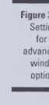

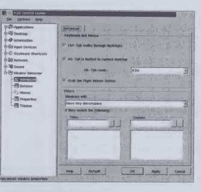

3. **根据需要调整高级选项卡上的设置。**

您可以调整以下设置：

- **Ctrl+Tab 遍历桌面**：选中此选项以使用 `Ctrl+Tab` 快捷键切换桌面。

- **Alt+Tab 限制在当前桌面**：选中此选项以导致 `Alt+Tab` 快捷键仅在当前桌面上循环遍历窗口。否则，按下 `Alt+Tab` 会在您所有虚拟桌面上的所有窗口中循环遍历。

- **Alt+Tab 模式**：选择 `KDE` 或 `CDE` 以确定如果您重复按下 `Alt+Tab`，`KWM` 会打开哪些窗口。`KDE` 模式总是切换回上一个窗口。`CDE` 模式总是顺序遍历可用的窗口。


如果您想顺序遍历所有可用窗口，请在反复轻敲 `Tab` 键时按住 `Alt` 键。此技术在 `KDE` 和 `CDE` 模式下均可用。

- **获取右侧鼠标按钮**：选中此选项以让 `KWM` 优先处理右键点击，右键点击用于打开上下文菜单和各种窗口控制功能。默认情况下选中此选项。只有当您正在使用需要全天候访问右侧鼠标按钮的非 `KDE` 应用程序时，才需要取消选中它。

- **过滤器**：使用此区域的设置为具有特定标题或 `X` 类名的窗口定义特殊处理。从 `Windows Will` 下拉列表框中选择一个选项，然后在“标题”或“类”文本框中输入名称以构建标题或类列表，并获得特殊处理，并点击加号 `+` 按钮将名称添加到相应的列表框中。

4. **点击“确定”按钮。**

`KDE` 关闭 `KDE` 控制中枢对话框并将设置应用于您的桌面和窗口。

## 在虚拟桌面上开展实际工作

`KWM` 的职责之一是管理您的虚拟桌面，这为您提供了更多空间来展开应用程序窗口。虽然一次只能看到一个桌面，但 `KWM` 可以管理多达八个虚拟桌面，并跟踪哪些窗口在哪些桌面上打开。您可以在不同的桌面之间来回切换，以访问每个桌面上运行的窗口。第 1 章介绍了虚拟桌面的概念，第 5 章详细介绍了如何控制可用桌面的数量及其名称。

要切换桌面，您可以使用以下任何技术：

- **点击面板中的一个桌面分页器按钮。** 默认情况下，桌面分页器按钮标记为“一”、“二”等。点击其中一个按钮将显示相应的桌面及其窗口集合（如果有）。

- **点击一个当前不在当前桌面上的窗口的任务栏按钮。** `KWM` 会自动切换到该窗口所在的虚拟桌面并打开该窗口。

- **点击面板上的“窗口列表”按钮，并从出现的菜单中选择一个窗口。** `KWM` 会自动切换到该窗口所在的虚拟桌面并打开该窗口。

- **按 Ctrl+Tab 切换到序列中的下一个虚拟桌面。** 反复按 `Ctrl+Tab` 以遍历可用的桌面。（为了使此技术有效，必须在 `KDE` 控制中枢的高级选项卡中选中 `Ctrl-Tab 遍历桌面` 选项。）

# 边界巡逻——使用活动边框和魔法边框

`KWM` 的活动桌面功能允许您通过将鼠标指针拖到桌面边缘来切换桌面。以下是启用和配置活动边框选项的方法：

- 选择 **KDE 菜单** > **设置** > **桌面** > **边框**。

- 窗口管理器样式对话框将打开，并显示“边框”选项卡，如图 3-7 所示。

  （您也可以通过对 `KDE` 控制中心选择 **显示** > **边框** 来访问这些相同的设置。）

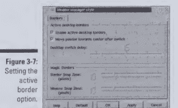

- 选择 **启用活动桌面边框** 选项。

- 选择 **切换后将指针移向中心** 选项。

  如果选择此选项，`KWM` 在切换桌面后会自动将鼠标指针定位在新桌面的中心附近。

- 拖动 **桌面切换延迟** 以设置 **切换灵敏度**。

  此设置是一个短暂的延迟，即在鼠标指针接触到当前桌面边缘之后、`KWM` 切换桌面之前。

# 在桌面之间移动窗口

控制窗口所在桌面的一种方法是在打开窗口之前切换到目标桌面。但如果窗口已经在不同的桌面上打开，您可以通过以下方式移动窗口：

- 右键单击窗口标题栏并选择“到桌面：二”。

- 单击窗口标题栏中的菜单按钮并选择“到桌面：二”。

这些示例将当前窗口移动到桌面“二”。若要移动窗口到其他桌面，请选择所需的窗口名称。

# 让窗口保持固定（Sticky）

如果您使用多个桌面，可能有一个窗口是您始终希望无论当前使用哪个桌面都保持可用的。`KWM` 允许您通过将窗口设置为 *sticky*（固定）来满足这一需求，这意味着无论您切换到哪个桌面，窗口都会固定在屏幕上的同一位置。另一种思考方式是，固定窗口在所有虚拟桌面上的位置完全相同。要使窗口固定，您可以使用以下任何技术：

- 右键单击窗口标题栏，并从出现的弹出菜单中选择“Sticky（固定）”。

- 单击窗口标题栏中的菜单按钮，并从出现的菜单中选择“Sticky（固定）”。

- 单击窗口标题栏中的 `Sticky（固定）` 按钮。

要取消固定效果，您可以使用相同的任何技术，只是固定窗口菜单上显示的命令变为 `UnSticky（取消固定）`。

# 第 4 章

# 存放东西的地方——KFM 文件管理器

*本章内容*

- 以 `KDE` 方式管理您的文件

- 在文件管理器中查看您的文件

- 创建文件和文件夹

- 移动和复制文件

- 在正确的程序中打开文件

- 搜索丢失的文件

多年来，已经开发出了各种工具，帮助您管理在实际办公工作中相关的项目所涉及的成堆书籍和纸张。这当然是好事！如果没有文件夹、活页夹、书架和文件柜来整理事物，我们大多数人都会淹没在纸堆的海洋中。

管理计算机文件同样是一项挑战。幸运的是，`KDE` 为您提供了一个强大的工具——`KDE` 文件管理器——帮助您应对并掌握文件管理的挑战。`KDE` 文件管理器，更常见的名称是 `KFM`，是您的电子文件柜。它为整个计算机文件系统创建易于使用的图形表示，并允许您通过点击和拖拽屏幕上的图标来操作文件和文件夹，而不是在命令行中输入晦涩的命令。即使是命令行接口的粉丝也会发现，对于许多文件管理任务，`KFM` 更快且更易用。


# 第 4 章：放置您的物品之处 — KFM 文件管理器

本章展示如何使用 `KFM`（及其配套程序 `Find Files`）来管理和操作文件。但 `KFM` 不仅仅是一个文件管理工具——它还是一个 Web 浏览器（我们将在第 9 章介绍 `KFM` 的这一方面）。

## 我的文件在哪里？

在您实际的办公室中，如果您需要获取或查看一个尚未在桌面上打开的文件或文档，您需要走到文件柜前拉开一个抽屉。如果您需要在 KDE 中处理文件，要去的地方是 `KFM`——您的电子文件柜。

`KFM` 使您能够导航整个计算机文件系统，以及管理和操作您的文件和文件夹。`KFM` 是您的虚拟文件柜，也是您的虚拟复印机、文件移动器、垃圾桶、碎纸机等。`KFM` 充分利用 KDE 的桌面功能，提供在窗口之间拖放文件图标的功能——无论是到另一个 `KFM` 窗口、KDE 桌面，还是不同的程序窗口。它是您文件系统的真正图形用户界面。

> 记住，`KFM` 是 Windows 资源管理器和 Macintosh Finder 的 KDE 对应物。`KFM` 承担了与资源管理器和 Finder 相同的基本功能——并采用了一些相同的熟悉惯例来图形化表示计算机文件系统的文件和文件夹。如果您之前使用过 Windows 或 Macintosh 文件管理工具，您在理解如何使用 `KFM` 方面已经领先一步。

打开 `KFM` 很容易。这是一个您可能经常使用的工具，因此 KDE 开发人员提供了多种打开 `KFM` 窗口的方式。您可以使用以下任何技术来打开 `KFM` 窗口：
- 单击面板上的主目录按钮。
- 单击 KDE 菜单按钮并选择主目录。
> 记住，KDE 菜单按钮是带有 KDE 标志 K 和齿轮图案的面板按钮。它通常位于 KDE 面板的左端。单击 KDE 菜单按钮会显示 KDE 菜单（有时也称为 *应用程序启动器菜单*）上的程序列表。有关使用 KDE 菜单按钮及其菜单的更多信息，请参阅第 1 章。
- 单击任何文件夹的桌面图标（例如，*模板* 或 *自动启动*）。
- 单击 KDE 菜单，指向 *磁盘导航器*，然后选择 *磁盘导航器* 子菜单中的任何文件夹或设备项。
- 右键单击桌面并选择 *执行命令*，在命令框中输入路径名，然后按 `Enter`。
- 单击文件系统设备（如 CD-ROM 或软盘）的任何桌面图标。（如果设备尚未挂载，请在打开 `KFM` 之前使用 KDE 挂载该设备——前提是您有权挂载该设备。）

当您打开 `KFM` 窗口时，它会自动显示主目录的内容（如图 4-1 所示），除非您通过点击桌面图标或选择不同的文件夹菜单项指定了其他目录。例如，如果您单击主目录面板按钮，`KFM` 将显示您的主目录——分配给您的登录名称的那个。但如果您单击模板桌面图标，`KFM` 将显示模板文件夹的内容。

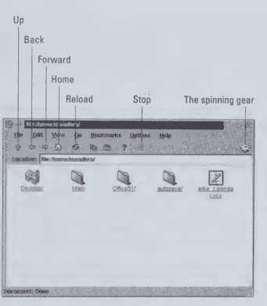

**图 4-1：** `KFM` 窗口是您的文件管理总部。


在 Linux 和其他 UNIX 变体中，通常每个用户都会分配一个独立的目录来存储个人文件。通常，您的主目录是 `/home` 的子目录，且目录名与您的登录用户 ID 匹配。例如，用户 `meadhra` 的主目录是 `/home/meadhra`。这个主目录是 `KFM` 默认显示的，也是您存储所有文档和其他文件的地方。操作系统和 KDE 也在您的主目录及几个子目录中存储了一些个性化配置文件。

波浪号字符（`~`）是文件名的通配符，也是主目录的简写形式。在输入路径名时可以使用它，以便更轻松地输入主目录中文件或子文件夹的路径。例如，不需要输入完整的路径和文件名 `/home/username/docs/MyDoc.txt`，只需输入 `~/docs/MyDoc.txt` 即可。

## 导航

使用 `KFM` 导航您的文件系统，就像开车在城里行驶一样。开车本身很容易，但挑战在于在城市的街道上辨认方向。如果您熟悉城市的布局并对街道了如指掌，就可以轻松地在各处之间往返；但如果您是这座城市的陌生人，街道就会像是一个令人困惑的迷宫。

就像您的汽车一样，`KFM` 也有几个简单的控制功能，您很容易就能掌握。（弄清楚如何使用 `KFM` 比学习开车要容易得多。我们会向您展示方法，而且您也不必学习如何侧方停车 `KFM`。）当您带着 `KFM` 在文件系统中四处探索时，您在文件和文件夹之间寻找方向的难易程度，取决于您对文件系统的熟悉程度。一旦您走出主目录所在的本地街区，对于新手来说，Linux 文件系统可能就像陌生城市的街道一样令人困惑。正如一些配备导航辅助功能（如 GPS 全球定位卫星接收器和动态地图显示）的最新款汽车一样，`KFM` 也包含有助于您发现和探索文件和文件夹的功能——但没有任何功能能取代您对当地街道和文件系统布局的熟悉。

实际上，使用 `KFM` 导航文件系统与使用 Web 浏览器导航网站类似。如果您会浏览网页，那么您已经知道浏览文件系统的基础知识。以下是 `KFM` 导航工具的概述：
- 在 `KFM` 工具栏下方的位置框中输入路径名，即可在 `KFM` 窗口中显示该目录的内容。与 Web 浏览器一样，即使您使用其他导航技术打开目录，`KFM` 也始终在位置框中显示当前目录的完整路径名。
- 单击文件夹图标（或文件夹的下划线文本名称）即可打开该文件夹，并在 `KFM` 窗口中显示所选目录的内容。

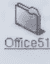


- 您可以通过文件夹（目录）的文件文件夹图标轻松将它们与文件区分开来，这些图标在大多数 `KFM` 视图中都可见。文件可以根据文件类型拥有各种各样的图标，但目录几乎总是用文件文件夹图标表示。（少数专用文件夹，例如 `desktop/`，具有自定义图标。）在文本视图中，`KFM` 不显示图标，但您仍然可以通过目录名称末尾附加的斜杠字符 (`/`) 来识别文件夹，这秉承了真正的 UNIX 传统。
- 单击工具栏上的向上按钮，即可在目录树中向上移动一级，并显示父目录的内容。
- 单击工具栏上的后退按钮，即可显示上一个文件夹的内容。
- 单击工具栏上的前进按钮，即可逆转后退按钮的效果，并显示当前 `KFM` 会话中已浏览目录历史中的下一个目录的内容。（前进按钮呈灰色状态，直到您使用后退按钮逐步回退已浏览文件夹列表。）
- 单击工具栏中的主目录按钮，即可显示主目录的内容。无论您在文件系统的阴暗小径中走得多远，只需单击此按钮一次，即可返回熟悉的领域。
- 单击工具栏中的重新加载按钮，即可更新显示以反映您在 `KFM` 中查看的文件和文件夹的变化。
- 单击停止以终止加载（或重新加载）目录内容。有时读取包含大量文件和子目录的目录内容需要一些时间，您可能不想等待 `KFM` 完成（特别是当您意识到点错了文件夹时）。停止按钮允许您中断加载过程，以便您可以继续向 `KFM` 发出其他命令。
- 工具栏右端的齿轮图标在 `KFM` 正在工作读取目录内容时会旋转。当齿轮停止旋转时，`KFM` 处于空闲状态，显示已完成，程序准备接收新命令。

## 获取文件的不同视图

`KFM` 为您提供了几种自定义程序在 `KFM` 窗口中表示文件和文件夹的方式。您不必局限于图 4-2 中显示的默认布局。您可以从四种不同的视图之一进行选择，并选择其他选项来控制诸如 `KFM` 是否显示隐藏文件等设置。

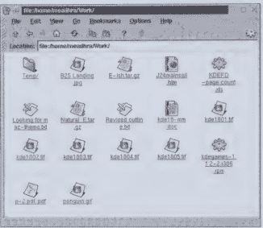

图 4-2：图标视图中的大图标易于识别。

**图标视图** — 当您首次启动 KDE 文件管理器时，`KFM` 窗口会出现并显示主目录的内容，以大图标行的形式呈现——目录内每个可见文件和文件夹对应一个图标。（请回看 图 4-2。）图标较大且易于查看，这也使得用鼠标轻松点击和拖动它们变得容易。每个图标下方都标有文件或文件夹名称。如果您正在使用其他 `KFM` 视图并希望切换回图标视图，请选择 `视图 > 图标视图`。

**长列表视图** — 如果您需要查看关于文件和文件夹更详细的信息，长列表视图（见图 4-3）是最佳选择。它不是由大图标行组成，而是由目录内容的表格形式列表组成。每个文件或文件夹都出现在单独的一行中，该行以左侧的小图标和文件或文件夹名称开头，并包含文件的访问权限掩码、所有者、组、大小以及修改时间和日期。选择 `视图 > 长列表视图` 以将 `KFM` 切换到这种详细显示模式。

**短列表视图** — 如果您喜欢长列表视图的小图标和紧凑列表样式，但不需要每个文件或文件夹的所有详细信息，请选择 `视图 > 短列表视图`，查看类似于图 4-4 的显示效果。

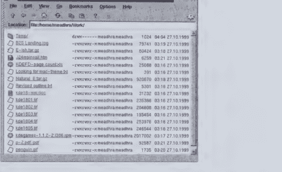

图 4-3：长列表视图显示更多细节。

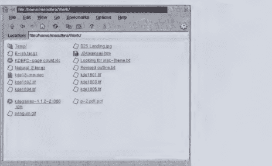

图 4-4：短列表视图是图标视图和长列表视图之间的折中。


## 文本视图

文本视图基本上与长列表视图相同，只是没有每行左端的图标。没有图标使 KFM 能够稍快地渲染长目录显示，但文本视图与其他视图之间的速度差异很少成为主要问题。基本上，文本视图适合那些更喜欢传统基于文本的文件列表的纯粹主义者。要调用文本视图，请选择`视图➔文本视图`。

无论您选择哪种视图，您在 KFM 窗口中操作文件和文件夹的方式都是相同的。您可以单击图标或文件名来打开选定的文件或文件夹，也可以拖动图标或文件名来复制和移动文件。（本章中“复制和移动文件”部分将对此进行更多介绍。）视图更改的仅仅是文件的显示方式，而不是您可以对它们执行的操作。

## 攀爬目录树

拥有一张好的路线图会让在城市街道上找路变得更加容易。在当今充满电子小设备的时代，顶级豪华车通常配备有 GPS 接收器，并与电子地图连接，以显示您的位置以及如何到达目的地。

KFM 包含一种强大的导航辅助功能，旨在帮助您在计算机文件系统中辨认方向。如果您选择`视图->显示树`，KFM 窗口左侧会出现一个单独的面板，其中显示文件系统目录树的层次结构列表，如图 4-5 所示。重复执行相同命令即可从 KFM 窗口中移除树形面板。

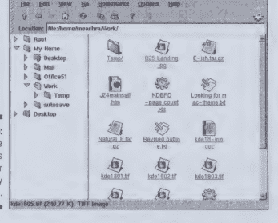

KFM 的树形显示使用可折叠的大纲格式来展示构成计算机文件系统的嵌套目录和子目录。每个目录名称左侧的箭头符号允许您展开或折叠目录树，以显示或隐藏特定目录内的子目录。

- 点击向右的箭头以展开目录树列表，显示该目录下的嵌套子目录。
- 点击向下的箭头以折叠目录树列表，隐藏所有子目录。
- 点击目录树列表中的目录名称，可在 KFM 窗口右侧的主面板中显示该目录的内容。
- 目录名称旁边的打开文件夹图标表示当前选中的目录。

当你在目录树列表中选择某个目录时，KFM 会在 KFM 窗口的右侧显示所选目录的内容。然而，如果你在 KFM 窗口右侧点击某个文件夹名称，点击工具栏上的“主目录”按钮，或使用其他任何导航技术更改目录，KFM 并不一定会更新目录树列表以指示当前打开的是哪个目录。*除非你启用了“树视图跟随导航”选项，否则不要依赖目录树列表来显示当前目录的位置。*

- 使用目录显示区域右侧的滚动条来浏览目录树列表。
- 在目录树列表中右键点击目录名称，打开一个弹出菜单，其中包含可供你执行的操作，例如打开、复制和删除该目录。你在 KFM 窗口主面板中操作目录的大部分选项在此弹出菜单中也可用。

KFM 目录树面板包含一个标记为“我的主目录”的顶层分支，以及另一个标记为*桌面*的顶层分支。这些是链接到你主目录（`/home/username`）和桌面子目录（`/home/username/Desktop`）的链接，而不是目录树上的真实分支。它们出现在目录树列表中，以便为你方便地访问这些常用目录提供便利，这样你就不必展开“根”分支来层层向下查找你的主目录和桌面了。请注意，你的主目录被标记为“我的主目录”，而非其真实路径名称。

## 显示缩略图

如果你处理大量图像文件，你会很高兴发现 KFM 在图标视图中显示每个图像缩略图预览的方式。对于识别图像而言，图片——即使是很小的图片——几乎总是比最具描述性的文件名更有效。

若要启用缩略图，请选择“视图：显示缩略图”。然后，当你查看包含图像文件的文件夹内容时，KFM 将显示每个图像文件的小预览图，而不是普通的通用文件图标，如图 4-6 所示。“显示缩略图”命令是一个切换开关——要禁用它，只需再次选择相同的命令即可。

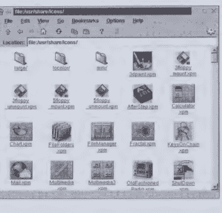

**图 4-6：缩略图使你可以预览图像文件。**

“显示缩略图”选项仅适用于图标视图中的大图标，不适用于长视图或短视图中的小图标。其他视图中的小图标太小，无论如何都无法制作有用的预览图像。此外，在 KFM 能够显示缩略图预览之前，图像必须是 KFM 可以按图标合适尺寸显示的格式。如果 KFM 无法显示文件的图像格式（或无法将图像调整为图标大小），该程序将显示该文件类型的通用文件图标，而不是缩略图图像。

### 显示隐藏文件

当你在 KFM 中查看目录内容时，通常你只能看到存储在那里的一部分文件和子目录。除了你在常规目录列表中看到的文件外，一些目录还包含更多保持不可见——即隐藏——的文件和子目录。

在类 UNIX 操作系统上，以句号开头的文件和目录名称会被排除在常规目录列表之外。因此，这些文件实际上被隐藏了。通常，配置文件和其他系统文件或目录会以这种方式隐藏，特别是当它们与用户常规访问的文档和其他文件存储在同一目录中时。虽然隐藏文件可以在一定程度上增强安全性，但隐藏文件的真正目的并不是为了保密。隐藏配置和系统文件仅仅是减少目录中的屏幕杂乱，这样你就不必在一堆很少使用的配置文件中翻找来定位你的程序和文档了。

KFM 通常将隐藏文件隐藏起来，并不在主 KFM 窗口或树面板中显示隐藏文件或目录的文件名或图标。但是，*如果*你需要访问这些隐藏文件，可以选择**视图 > 显示隐藏文件**，强制 KFM 显示所有内容。当你启用**显示隐藏文件**选项时，KFM 将显示当前目录中*所有*文件和子目录，包括“点”文件。如果活动目录树面板存在，之前隐藏的目录也会变为可见。图 4-7 显示了隐藏文件可见的 KFM 窗口。将其与图 4-5 进行比较，该图显示了同一目录的正常视图。

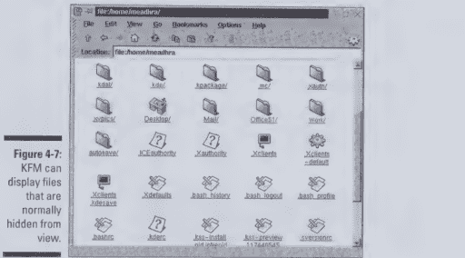

## 预览归档文件内部

传统上，文件备份副本存储在 UNIX 磁带归档（`.tar`）或压缩磁带归档（`.tar.gz`）格式中，这些格式将多个原始文件的数据和文件描述压缩到每个归档文件中。但归档文件不再仅用于备份。归档和压缩归档也用于其他目的，例如将程序安装的所有文件打包成单个*tarball*（`.tar` 归档文件的极客术语）进行分发。KDE 主题以压缩归档形式分发。你从互联网下载的几乎任何内容也都可能是压缩归档。

### 技术细节

当然，你需要一个特殊的实用程序来创建归档文件。最常见的命令行实用程序名为 `tar`，恰如其分。KDE 实用程序——归档器——提供了一个图形工具用于创建归档文件。你可以使用这些相同的工具来查看归档文件的内容，并从归档中提取组件文件，将它们还原为你可以像使用原始副本一样使用的单独、独立的文件。

然而，你不必诉诸于使用单独的实用程序来处理归档文件。KFM 可以完成这项工作。方法如下：

- **在 KFM 窗口中点击一个归档文件（扩展名为 `.tar` 或 `.tar.gz`）。**

  KFM 打开该文件并在 KFM 窗口中显示其内容。这就像打开一个文件夹。事实上，KFM 通常将归档的内容显示为单个文件夹。

- **点击文件夹图标。**

  KFM 显示包含在归档内的文件和子文件夹列表。图 4-8 展示了 KFM 显示压缩归档文件内容的示例——在本例中，是一个主题。请注意位置栏中的路径名称。`#` 字符之后的部分位于归档文件内部。

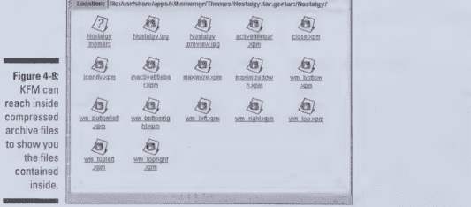

- **点击或拖动单个文件以打开或复制它们。**

  对于归档内的文件，你可以做到几乎所有你可以对常规文件夹中文件的操作。你可以打开大多数文档，并可以将文件从 KFM 窗口复制到其他位置。主要的例外是从归档中运行程序。为了运行程序，你必须首先将程序文件及其支持文件从归档复制到硬盘上的常规文件夹中，以便操作系统可以找到并访问所有必要的文件。

## 更改文件管理器外观

与大多数 KDE 功能一样，你可以自定义 KFM 窗口的外观。本章前面的部分展示了如何更改视图、显示缩略图以及向 KFM 窗口添加树面板。但这并不是你所能做的全部。查看这些配置选项：


- 选择**选项→显示菜单栏**以从 KFM 窗口中移除菜单。

关闭后，没有简单的方法将菜单栏恢复到 KFM 窗口。你最好的选择是关闭无菜单的 KFM 窗口，并打开另一个保持默认设置完好的 KFM 窗口。

- 选择**选项→显示状态栏**以从 KFM 窗口底部移除状态栏。再次选择该命令以恢复状态栏。
- 选择**选项→显示位置栏**以切换位置栏（即带有大号位置或地址框的那个）的开启或关闭。
- 选择**选项→显示工具栏**以从 KFM 窗口中移除工具栏。再次选择该命令以恢复工具栏。
- 选择**选项→配置文件管理器**以打开 KFM 配置对话框。字体和颜色选项卡上的设置允许你选择 KFM 用于在 KFM 窗口中显示文件列表的字体和颜色。


最有趣的设置在“其他”选项卡上，如图 4-9 所示。在那里，你可以指定用作终端模拟器和文本编辑器的默认程序。另一个有用的设置是“树视图跟随导航”选项。选择此选项可强制 KFM 自动更新树面板以显示当前目录选择，即使你通过点击 KFM 窗口右侧面板中的文件夹导航到不同目录。（个人而言，我不明白为什么这个选项默认没有启用。它应该默认启用！）调整设置后，点击“确定”关闭 KFM 配置对话框并应用设置。

图 4-9：


KFM 配置对话框包含一些重要的设置。

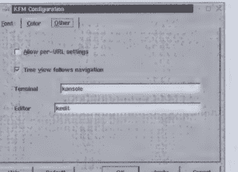

当您按照自己的喜好配置好 KFM 后，选择“选项”>“保存设置”，以使当前的 KFM 配置成为默认设置。这样，新的 KFM 窗口将显示与当前 KFM 窗口相同的视图和其他配置设置，而不是安装时的默认值。

## 创建新文件夹

创建新的文档文件通常是您在各种应用程序中执行的操作。但是，创建用于存储这些文档的文件夹是 KFM 的职责。要创建新文件夹，请遵循以下步骤：

1. 打开 KFM 并导航到您要创建新文件夹的位置。
您可以使用本章其他地方提到的任何技术来打开 KFM 窗口并导航到您想创建新子文件夹的目录。


为了创建新文件夹，您必须对正在创建该文件夹的目录具有适当的访问权限。如果您以普通用户名登录，通常仅限于在您的主目录及其子目录中创建新文件夹。如果您以超级用户 `root` 身份登录，则可以在文件系统的任何位置创建文件夹。

2. 选择“文件”>“新建文件夹”，或者右键单击 KFM 窗口，然后从出现的弹出窗口中选择“新建文件夹”。
KFM 将打开图 4-10 中所示的对话框，提示您输入新文件夹的名称。

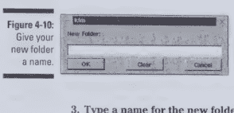

3. 输入新文件夹的名称，然后单击确定按钮。
KFM 关闭对话框并创建新文件夹。文件夹名称和图标将显示在 KFM 窗口中。

创建新文件夹后，您可以将文件复制并移动到其中（参见本章的“复制和移动文件”部分），并使用该文件夹作为创建新文档文件的位置。


当您创建新文件夹时，其访问权限默认设置为允许所有者（即您）拥有完全访问权限，并防止所有其他用户（超级用户除外）访问该目录。如果您希望允许其他人访问您的新文件夹，必须更改其权限设置。为此，请遵循以下步骤。

1. 右键单击 KFM 窗口中的文件夹名称或图标，然后从出现的弹出菜单中选择属性。
KFM 将打开一个对话框，您可以在其中编辑所选文件夹的属性。（您可以使用相同的技术来编辑文件和文件夹的属性——包括访问权限。）

2. 单击权限选项卡。
KFM 将显示图 4-11 中所示的选项。

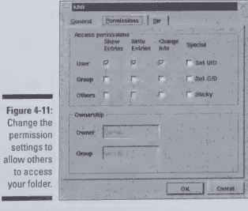

3. 在访问权限区域中，根据需要勾选或取消勾选复选框以选择或取消选择访问权限。
- 图 4-11 中显示的默认设置允许所有者（您）拥有完全访问权限，但拒绝其他人的访问。在其他方框中添加对勾，以授予其他用户组各种形式的访问权限。
- 如果您以普通用户身份登录，无法更改文件或文件夹的所有权。因此，“所有者”和“组”设置是灰色的（不可用）。要更改这些设置，您必须以超级用户身份登录。

4. 调整权限设置后，单击“确定”按钮。
KFM 关闭对话框并更改您文件夹的访问权限设置。

有关访问权限以及使用 KFM 超级用户模式执行普通用户无法执行的文件管理任务的更多信息，请参阅第 13 章。

## 复制和移动文件

您可能最常使用 KFM 执行的文件维护任务是将文件从一个目录复制或移动到另一个目录。KFM 使这变得很容易。无论您是移动还是复制文件，基本步骤都是相同的——这是在两个 KFM 窗口之间简单的拖放操作。以下步骤详细概述了该过程：

1. 打开 KFM 窗口并导航到包含您要复制或移动的文件所在的目录。
- 如有必要，滚动 KFM 窗口，以便您可以轻松访问要移动的文件。

2. 打开第二个 KFM 窗口并导航到目标目录。
- 确保 KFM 窗口显示您要复制或移动文件的目标目录。将窗口定位在桌面上，使其不会被另一个 KFM 窗口遮挡。
- 打开另一个 KFM 窗口的快速方法是单击 KFM 工具栏右侧的齿轮图标。将显示一个显示相同目录内容的新窗口。
- 通常，您会从一个目录复制或移动文件到另一个目录——因此需要两个 KFM 窗口。但是，您也可以直接将文件和文件夹复制或移动到 KDE 桌面。在这种情况下，不需要第二个 KFM 窗口。

3. 单击第一个 KFM 窗口的标题栏。
- 这将使源 KFM 窗口置于前台——使其获得焦点。

4. 从源 KFM 窗口拖动文件到目标窗口。释放鼠标按钮将文件放置到目标窗口上。
会出现一个小弹出菜单，提供复制、移动或创建链接的选项。

5. 要复制文件，请选择“复制”。要移动文件，请选择“移动”。
复制文件会在新目录中创建文件的精确副本，并将原始文件保留在其原始位置。移动文件会在新目录中创建文件的副本，并从原始位置移除该文件。


弹出菜单上的第三个选项（链接）（当您从 KFM 窗口拖放文件时出现）会在目标目录中创建一个指向源目录中原始文件的符号链接文件。（创建链接大致相当于在 Windows 中创建快捷方式图标。）有时，创建符号链接比创建文件副本更可取。链接会制造出在新位置拥有文件副本的假象，但链接通常比原始文件小得多，并且由于点击链接实际上是打开原始文件，因此不会出现同一信息的两个副本“不同步”的问题。如果您不熟悉符号链接，请参阅一般的 Linux 或 UNIX 书籍。

## 删除文件

另一个常见的文件维护任务是清除过时的以及不需要的文件和文件夹。KDE 提供了两种处理不需要的文件的选项。KDE 回收站允许您以稍后可以恢复的方式删除文件（如果需要）。您还可以使用 KFM 的“删除”命令从系统中永久且完全地删除文件。

### 将文件放入回收站


KDE 回收站在您的桌面上显示为一个可爱的小垃圾桶图标。然而，回收站实际上是一个专用文件夹（`~Desktop/Trash/`），作为文件和文件夹在从系统删除之前的临时存储空间。

将文件或文件夹放入回收站文件夹类似于将纸张丢进办公室的垃圾桶。回收站中的文件看不见也记不起，但它们尚未完全离开您的办公室。如果您发现犯错并误删了文件，可以翻找垃圾桶并恢复它。当您确定不再需要回收站中的任何内容时，您可以清空回收站——永久删除文件。以下列表提供了使用 KDE 回收站的一些快速技巧：

- 从桌面或 KFM 窗口拖动文件图标并将其放置在桌面回收站图标上，即可将文件从其原始位置移动到回收站文件夹。
- 在 KFM 窗口中右键单击文件或文件夹图标，然后从出现的弹出菜单中选择“移动到回收站”。这也会将文件或文件夹移动到回收站文件夹。
- 双击桌面上的回收站图标，以打开显示回收站文件夹内容的 KFM 窗口。
- 要从回收站恢复单个文件，请打开回收站文件夹，然后单击并拖动文件图标出 KFM 窗口，将其放置在桌面或另一个 KFM 窗口上。
- 右键单击桌面上的回收站图标，然后从出现的弹出菜单中选择“清空回收站”，以永久删除存储在回收站文件夹中的所有文件。

### 彻底粉碎文件

如果您希望在不经过“移动到回收站”然后“清空回收站”这两步过程的情况下，从系统中移除文件或文件夹，KFM 允许您通过其“删除”命令做到这一点。但请务必小心，并非常确定您确实想要擦除该文件或文件夹。“删除”命令是永久性的。使用删除有点像是将纸张通过碎纸机而不是简单地丢进垃圾桶——无法回退并稍后恢复已删除的文件。

使用 KFM 删除文件或文件夹很简单。只需遵循以下步骤：

1. 打开 KFM 窗口并导航到包含您要删除的文件或文件夹所在的目录。
- 您也可以在不打开 KFM 窗口的情况下从桌面删除文件和文件夹。

2. 右键单击文件或文件夹图标，然后从出现的弹出菜单中选择“删除”。
- 如图 4-12 所示，KFM 警告框会出现。这是您在从系统中永久移除所选文件之前改变主意的最后机会。


## 删除文件和文件夹

1. 单击“是”按钮。

2. KFM 关闭警告框并删除所选文件或文件夹。它消失了！不见了！溜了！

删除文件会将单个文件从您的系统中移除。但删除文件夹不仅会删除该文件夹，还会删除其中包含的所有文件和子文件夹。这是一个相当彻底的操作。建议先打开文件夹并检查其内容，然后再进行删除。

## 在正确的程序中打开文件

KFM 允许您浏览整个文件系统，从一个目录到另一个目录查看每个文件夹中的文件列表。但您并不局限于查看文件名列表——KFM 还可以打开文件并启动程序。

若要启动程序，请在 KFM 窗口中单击该程序的可执行文件。KFM 启动程序的方式就像您在命令行中输入程序名称一样。若要在您选择的程序中打开文档，请按照以下步骤操作：

1. 在 KFM 窗口中右键单击文档图标，然后从弹出的菜单中选择“打开方式”。
如图 4-13 所示的对话框将出现。


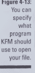

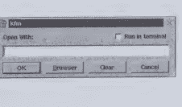

### 2. 在“打开方式”文本框中输入程序名称。
输入您想要用来打开所选文件的程序名称。务必使用可执行文件的名称，而不是菜单中显示的某个名称。例如，要使用 KDE 图像查看器工具，请输入 `kview`。

### 3. 单击“确定”。
KFM 启动该程序，然后加载所选文件。


若要自动在其父程序中打开文档文件，请在 KFM 窗口中单击该文档文件。如果 KFM 能够识别文件类型及其关联程序，KFM 将启动该程序并将文件名传递给该程序，从而让程序自动加载所选文件。

如果您希望 KFM 在单击文档文件时自动启动正确的程序，KFM 必须能够识别文件类型，并且必须知道要启动哪个程序来打开该文件类型。

标准的文件类型描述集（称为 `MIME 类型`）以及某些文件类型与某些标准 KDE 实用程序之间的默认链接集，都是正常 KDE 安装的一部分。因此，KFM 一开始就拥有相当数量的文件类型，您可以单击一次即可打开。此外，当您安装新的 KDE 程序时，安装例程应为该程序的文件类型设置 `MIME` 类型——并添加这些文件类型与该程序之间的链接，以便您可以自动在新安装的程序中打开这些文件。

有时，您可能需要创建或自定义文档文件类型与用于打开它们的应用程序之间的关联。您可能永远不需要从头创建一个实际的 `MIME` 类型；甚至可能不需要编辑任何现有的 `MIME` 类型。（所以您可以放心；本书不会带您逐个创建 `MIME` 类型。）如果您想使用特定程序打开特定类型的文件，可能需要更改 KFM 用于打开这些文件的程序与文件类型之间已建立的链接。您可以按照以下步骤修改应用程序链接：

1. **打开 KFM 窗口并选择“编辑应用程序”。**
KFM 显示主目录下某个隐藏子目录的内容，即 `~/.kde/share/appLink`。该目录包含一系列与 KDE 菜单内容对应的链接文件和文件夹。

2. **浏览子文件夹以定位您想要更改的应用程序。**
根据需要打开文件夹和子文件夹，直到 KFM 显示用于打开目标文件类型的应用程序链接的图标。

3. **右键单击应用程序图标，并从弹出的菜单中选择“属性”。**
将出现一个对话框，您可以在其中编辑应用程序链接的属性。

4. **单击“应用程序”选项卡。**
如图 4-14 所示的设置将出现。应用程序与可用文件类型之间的链接显示在选项卡底部附近的两个列表框中。右侧的列表框显示所有可用的 `MIME` 类型。左侧的列表框显示与此应用程序关联的 `MIME` 类型。

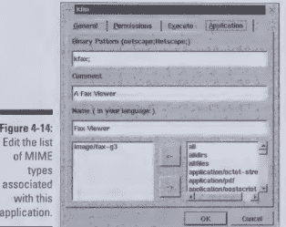

5. **在右侧列表框中选择一个文件类型，然后单击“< -”按钮。**
通过单击来选择 `MIME` 类型。单击“< -”按钮后，所选的 `MIME` 类型将出现在左侧列表框中，表示它现在已链接到当前应用程序类型。

6. **根据需要对其他 `MIME` 类型重复第 5 步。**
您还可以在左侧列表框中选择一个 `MIME` 类型，然后单击“- >”按钮将其从列表中移除，从而移除该应用程序与此 `MIME` 类型之间的关联。

7. **调整 `MIME` 类型列表后，单击“确定”。**
KFM 关闭对话框并更新应用程序与文件类型之间的关联。

在应用程序和文件类型之间添加关联后，您应该只需单击该类型文件的图标，KFM 就会启动该应用程序并自动加载该文件。如果 KFM 之前使用不同的应用程序来打开该文件类型，您可能需要编辑该应用程序的属性，以移除对相应文件类型的链接。目的是消除关于打开文件时应使用哪个程序的潜在混淆。

## 查找丢失的文件

KFM 能够出色地管理您可以在 KFM 窗口中显示的任何文件。然而，在典型的 Linux/UNIX 系统复杂的目录结构中定位某个特定文件可能是一个真正的挑战。如果您不知道文件在哪里，目录中包含目录的迷宫可能会让手动查找该文件（通过打开 KFM 窗口中的每个目录并扫描其内容）变成一种令人沮丧的体验。

但手动操作无法实现（甚至不可能实现）的事情，查找文件工具可以自动完成。查找文件工具可以有条理地搜索您的文件系统，寻找给定的文件规格，然后显示它找到的匹配项列表。

要使用查找文件工具，请按照以下步骤操作：

1. 打开 KDE 菜单并选择“实用工具>>查找文件”。
如图 4-15 所示，查找文件窗口将出现。

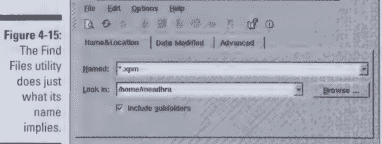

2. 在“名称”框中输入文件规格。
您可以输入特定的文件名，或使用通配符（`*` 和 `?`）来定义可能匹配多个文件的搜索规格。

3. **在“查看范围”框中输入路径名。**
输入单个目录的路径名，或*定义您想要搜索的目录树分支的最高级别*。若要搜索整个文件系统，请输入斜杠字符（`/`）。

4. **选中（或清除）“包含子文件夹”选项。**
正如您可能猜到的，此选项控制查找文件是将其搜索限制在指定的文件夹中，还是将搜索扩展到所有子文件夹。

5. **如果需要进一步细化搜索参数，请单击`已修改日期`或`高级`选项卡，并调整您在其中找到的设置。**
您很少需要使用已修改日期或高级设置，但如果您需要，它们就在那里。对于常规搜索，在已修改日期选项卡上选择“所有文件”，并在高级选项卡上，在`类型`下拉列表框中选择“所有文件和文件夹”——*并确保包含文本框为空*。

6. **选择“文件→ 开始搜索”。**
查找文件开始搜索您的文件系统，寻找符合您规格的文件。几分钟后，查找文件窗口将扩展并显示它找到的文件列表，如图 4-16 所示。


7. **从列表中选择一个文件，然后选择“文件→ 打开包含文件夹”。**
将出现一个 KFM 窗口，显示所选文件所在文件夹的内容。然后，您可以使用 KFM 对所选文件*执行任何常规的文件维护任务*。


你不必打开 KFM 窗口，可以直接在“查找文件”窗口中双击文件来打开它。或者，你可以选中该文件，然后选择“文件”菜单上的其他命令之一——删除文件、打开其“属性”对话框，或者将文件添加到现有的归档文件中。

## 第二部分

## 让 KDE 看起来更美观

### 第五波

### 作者：Rich Tennant


> *“嗯，她键盘打字很快，也懂得如何加载打印机，但她只是在那儿‘玩鼠标’而已。”*

## 本部分简介

在某些方面，网络世界仁慈地与真实世界不同。举个例子：在这里，外表同样重要——但在 KDE 的世界里，你*可以*掌控它们——它们实际上具有超越屏幕时尚声明的实际用途。

本部分将向你展示如何按照你的喜好设置你的面板，设计一个符合你实际工作方式的桌面（这真是一个好主意！），并充分利用 KDE 的主题。形式追随功能。太棒了。

## 第 5 章

## 玩转面板

### 本章内容

- 玩转面板排序
- 将你最常用的程序添加到面板
- 操作菜单

当你坐进一辆设计良好的汽车的驾驶座时，你会发现驾驶汽车所需的所有控制装置都布置在方向盘或仪表盘上，触手可及。方向盘和换挡杆不仅就在指尖——而且灯光、转向灯、巡航控制、加热器，甚至收音机也都很容易操作。

KDE 面板为你提供了类似级别的便捷访问，用于你电脑桌面的命令和控制功能。面板使你可以启动程序、浏览文件系统、打开虚拟桌面，或通过单击按钮注销。就像汽车仪表盘一样，面板甚至还包括一个方便的时钟。你可以使用任务栏在形象上“换挡”，通过切换到另一个打开的窗口来实现。

计算机和汽车之间的一个重大区别是，计算机是一种功能更强大的设备。驾驶汽车所需的任务和工具具有高度的可预测性，这使得工程师能够开发一个对几乎所有人都适用的标准仪表盘。然而，你在计算机上执行的活动要广泛得多，例如检查电子邮件、浏览网页、撰写信函和提案、创建图形等。因此，你的计算机仪表盘——KDE 面板——需要根据你使用它的方式进行自定义，才能使面板成为它应有的强大且便捷的工具。

正如你将在本章中发现的，KDE 提供了许多方式让你可以自定义 KDE 面板和任务栏，以便根据首选项和工作风格进行定制。

### 配置面板和任务栏

KDE 面板和任务栏从 KDE 开发人员确定的标准位置和配置开始。但你不必坚持使用默认设置。你可以移动面板和任务栏；你可以在不使用它们时将其隐藏。你可以更改面板中图标的大小；你可以编辑显示在虚拟桌面按钮上的名称。你可以做所有这些以及更多。

在面板和任务栏配置中的一些简单更改，可以显著改变 KDE 桌面的外观和可用性。

#### 定位面板和任务栏


或许你对 KDE 面板和任务栏最明显的更改是将它们移动到桌面的其他位置。面板不必固定在屏幕的底边，任务栏也不必固定在顶部。你可以将面板附加到屏幕四个边缘中的任意一个。你可以将任务栏移动到顶部、底部或左上角——或者完全隐藏任务栏。选择权在你手中。

要重新定位 KDE 面板和任务栏，请遵循以下步骤：

1. 单击 KDE 菜单按钮并选择`面板：配置`，或右键单击面板并从弹出的菜单中选择`配置`。

出现 KPanel 配置对话框，如图 5–1 所示。通常在你首次打开 KPanel 配置对话框后，面板选项卡处于选中状态。如果没有，请单击面板选项卡。

2. 在`位置`区域中选择四个单选按钮之一。

这将指定 KDE 面板的位置。你可以将面板定位在桌面的四个边缘之一：顶部、底部、左侧或右侧。默认的面板位置是底部。

3. 在`样式`区域中选择三个大小选项之一。

此选项控制 KDE 面板中按钮的大小。你可以选择默认大小（正常）、较小的按钮大小（微小）或较大的按钮大小（巧妙地命名为大）。

此选项还间接控制 KDE 面板的厚度，因为面板厚度会自动调整以适应按钮大小。


4. 选择`任务栏`区域中的四个单选按钮之一。

此选项控制 KDE 任务栏的位置。你有四个选择：

- `隐藏`：抑制任务栏的显示。如果你不喜欢任务栏，你不必使用它。这是那些在低分辨率屏幕上使用 KDE 并且可以承受将屏幕空间分配给任务栏的人的选择。（隐藏任务栏也是那些认为任务栏有点过于类似 Windows 的 KDE 用户的首选选项。）

- `顶部`：将任务栏定位在屏幕的上边缘（默认位置）。

- `底部`：将任务栏定位在屏幕的底边缘，或者如果面板也位于底部，则紧邻面板。

- `顶部/左侧`：将任务栏按钮定位在一列中，从屏幕左上角开始，根据需要向下延伸至屏幕左侧，以容纳每个正在运行的应用程序的按钮。

5. 单击`应用`按钮。

KDE 使用你指定的设置重新绘制面板。

图 5-2 显示了一个 KDE 桌面，面板位于屏幕右侧，任务栏位于左上角位置。这只是你可以选择的面板和任务栏位置的众多组合之一。（注意 KDE 会自动将桌面图标向右移动，为任务栏按钮腾出空间。）


图 5-2. 面板在右侧，任务栏在左侧——这只是众多可能性之一。

### 与面板和任务栏捉迷藏

KDE 面板和任务栏都是方便的工具，但有些人对它们占据的屏幕空间大小持异议——特别是在低分辨率显示器的狭小范围内。如果你担心将屏幕实际空间分配给面板或任务栏，可以配置 KDE 在它们未被使用时自动隐藏面板或任务栏。方法如下：

1. 单击 KDE 菜单按钮并选择`面板配置`，或右键单击面板并从弹出的菜单中选择`配置`。

出现 KPanel 配置对话框。

2. 单击`选项`选项卡。

`选项`选项卡出现在 KPanel 配置对话框中，并显示如图 5-3 所示的设置。


图 5-3：自动隐藏功能减少了分配给面板或任务栏的屏幕空间。

3. 选择（或取消选择）`显示菜单提示`选项，然后调整`延迟`滑块。

如果你选择`显示菜单提示`选项，KDE 会在鼠标指针悬停在按钮上一秒钟左右时，显示一个小弹出框，给出鼠标指针下方按钮的简短描述。`延迟`滑块控制鼠标指针必须在按钮上悬停多长时间后提示框才会出现。将`延迟`滑块向左拖动可加快提示框弹出的速度，或者将滑块向右拖动以延长提示出现前的延迟时间。

4. 选择（或取消选择）`自动隐藏面板`选项，然后调整`延迟`和`速度`滑块。

如果你选择`自动隐藏面板`选项，KDE 会在你将鼠标指针移开面板后，自动将 KDE 面板折叠到其附着的桌面边缘。面板变成桌面边缘的一条细线。这种隐藏操作会在短暂的延迟后发生，延迟时间由`延迟`滑块控制。KDE 会对隐藏操作进行动画处理，显示面板滑入屏幕侧面。`速度`滑块控制动画的持续时间。

要将隐藏的面板恢复到桌面上的正常位置，只需将鼠标指针移到屏幕边缘的细线上。KDE 面板立即恢复其正常大小。

**提示**

5. 选择（或取消选择）`自动隐藏任务栏`选项，然后调整`延迟`和`速度`滑块。

`自动隐藏任务栏`选项的工作方式与步骤 4 中描述的`自动隐藏面板`选项相同。

6. 选择（或取消选择）`Animate Show/Hide（动画显示/隐藏）`选项，然后调整`Speed（速度）`滑块。

此选项控制点击 KDE 面板两端的折叠按钮后发生的情况。如果您取消选择`Animate Show/Hide`选项，则在点击其中一个折叠按钮后，KDE 面板会立即折叠。另一方面，如果您激活此选项，KDE 将以平滑的动画效果显示折叠的面板。速度滑块控制动画的速度。

7. 选择（或取消选择）`Others（其他）`区域中的选项。

您可以激活或禁用以下四个选项的任意组合：

- `Personal Menu Entries First（个人菜单条目优先）`：更改 KDE 菜单中项目的顺序，将您添加到菜单中的应用和菜单文件夹置于默认 KDE 条目之上。

- `Menu Folders First（菜单文件夹优先）`：在 KDE 菜单中，将单个应用程序显示在文件夹（子菜单）之上。

- `Clock Shows Time in AM/PM Format（时钟以 AM/PM 格式显示时间）`：将面板中的时钟显示从默认的 24 小时（军用时间）格式更改为 12 小时 AM/PM 格式。

- `Clock Shows Time in Internet Beats（时钟以互联网节拍显示时间）`：将面板中的时钟显示从正常时间更改为互联网节拍——一种提议的通用时间格式，将一天分为 1,000 个节拍，其中 500 为中午。

8. 点击`Apply（应用）`按钮。

KDE 使用您指定的设置重新绘制面板。

查看图 5-4 中显示的桌面。面板和任务栏均未显示，但它们并不遥远。如果您仔细查看屏幕的顶部和底部边缘，可以看到一条细线，这是隐藏的面板和任务栏的残留。只要将鼠标指向其中一条线，面板或任务栏就会重新出现在屏幕上。


图 5-4：面板和任务栏都隐藏了，但并没有消失。

## 命名桌面分页按钮

虚拟桌面是获取更多空间来分布窗口的好方法。您无需在电脑桌面上整理一堆堆打开的窗口，而是可以创建多达八个虚拟桌面，每个桌面具有不同的窗口集合，并在它们之间来回切换。您可以将网页浏览保留在一个桌面上，将预算提案保留在另一个桌面上。

但是等等，您的电子邮件程序是在桌面 Two 还是桌面 Five 上打开的？您可以通过重命名用于访问虚拟桌面的面板按钮来解决这个问题。要管理虚拟桌面的数量并为其分配有意义的名称，请遵循以下步骤：

1. 点击 KDE 菜单按钮并选择`Panel > Configure`，或者右键点击面板并从出现的弹出菜单中选择`Configure`。

将显示 KPanel 配置对话框。

2. 点击`Desktops（桌面）`选项卡。

KPanel 配置对话框中显示`桌面`选项卡，并显示图 5-5 中的设置。


3. 调整`Visible`滑块。

将滑块向左拖动以减少面板中可见的桌面按钮数量。将滑块向右拖动以增加可用按钮的数量。

4. 调整`Width`滑块。

将滑块向左或向右拖动，以减小或增加面板上桌面按钮的水平尺寸。

5. 双击其中一个编号文本框中的桌面名称，然后输入新名称。

您可以将桌面名称从默认名称（One、Two 等）重命名为您想要的任何名称。保持名称简短，以便它们适合在面板按钮上显示。

尝试根据您在每个桌面上执行的工作类型来命名您的桌面。例如，如果您通常在一个桌面上保持网页浏览器打开，在另一个桌面上打开电子邮件程序，您可以将这两个桌面命名为 Web 和 Mail。

6. 对每个桌面名称重复步骤 5。

7. 点击`OK`按钮。

KDE 关闭 KPanel 配置对话框，并使用您指定的设置重新绘制面板。

## 面板策略

KDE 面板最初默认包含一组按钮，提供对多个实用程序的一键访问。但很可能，这些按钮并不代表您最常使用的程序和实用工具。您需要用可以启动日常使用程序的按钮替换默认按钮选择。

只有当您通过添加常用程序的按钮来自定义面板后，面板才能开始发挥其潜力，使您的日常计算机使用更快、更容易。幸运的是，添加和重新排列面板按钮是 KDE 自定义任务中最快的之一。

### 向面板添加按钮


## 向面板添加按钮

KDE 使得向面板添加按钮变得非常容易。如果您可以从 KDE 菜单访问某个程序，您就可以将其按钮添加到面板。（要了解如何将程序添加到 KDE 菜单，请参阅本章中的“向 KDE 菜单添加应用程序”部分。）要将应用程序按钮添加到面板，请遵循以下步骤：

1. 点击 KDE 菜单按钮，然后选择 `Panel > Add Application`。  
   KDE 显示一个子菜单，该子菜单复制了主 KDE 菜单的结构。
2. 从子菜单中选择您要添加的应用程序。  
   例如，要将 Reversi 游戏的按钮添加到面板，完整的菜单选择为：`KDE 菜单 > Panel > Add Application > Games > Reversi`。新按钮出现在面板上的桌面按钮和时钟之间。


`Windowlist` 和 `Disk Navigator` 按钮有自己独立的菜单命令，您可以使用它们来添加或移除面板上的这些按钮。选择 `KDE 菜单 > Panel > Add Windowlist` 以将 `Windowlist` 按钮添加到面板。再次选择该命令会移除按钮。类似地，您可以使用 `Add Disk Navigator` 命令来添加或移除 `Disk Navigator` 按钮。

### 重新排列面板按钮

如果您不喜欢 KDE 面板上按钮的排列方式，请移动它们。这很容易做到。以下是移动面板按钮的简单步骤：

1. 右键点击面板按钮，然后从出现的弹出菜单中选择 `Move`。  
   指针变为四向箭头。
2. 移动鼠标在面板上拖动按钮，然后点击鼠标按钮将按钮放置在新位置。  
   KDE 自动重新排列面板上的其他按钮，将它们挪开为移动的按钮腾出空间。

- 要从面板中移除按钮，请右键点击您要删除的面板按钮，然后从出现的弹出菜单中选择 `Remove`。KDE 立即从面板中删除该按钮。

## 停靠操作

某些应用程序具有停靠到面板的能力——即，应用程序的图标出现在面板中时钟旁边的特殊部分。图 5-6 显示了停靠区域的几个图标。通常，停靠的应用程序实际上是一个小应用程序（称为 applet），它需要在后台运行但保持可访问状态。


必须将停靠能力编程到实用工具中，因为这不是您可以控制的东西。通常，程序在您启动应用程序后自动将图标放入面板停靠区。`KNotes` 和 `KOrganizer Control Applet` 就是例子。

有时，停靠是程序或实用工具的可选功能，您需要通过选择对话框中的选项来调用它。例如，如果您在显示设置对话框的背景选项卡左下角选择 `Dock into The Panel` 选项，KDE 会将显示设置图标添加到停靠区。要打开显示设置对话框，只需点击停靠区中的图标即可。

## 向 KDE 菜单添加应用程序

毫无疑问，KDE 面板上功能最强的按钮是 KDE 菜单按钮。其他面板按钮使您能够启动单个程序和实用工具。另一方面，KDE 菜单按钮使您能够启动菜单上安装的众多程序中的任何一个。这是一个功能强大的按钮。

KDE 菜单预配置了所有标准 KDE 组件的菜单项。其他支持 KDE 的程序在安装后会自动添加到 KDE 菜单中。这意味着您的大多数（如果不是全部）KDE 专用程序都可以在 KDE 菜单上找到。然而，您在 Linux/UNIX 系统上肯定安装了其他应该位于 KDE 菜单上的程序。毕竟，除非 KDE 菜单包含所有应用程序，否则它无法履行作为您启动应用程序的一站式指挥中心的承诺。

与 KDE 桌面上几乎所有其他内容一样，您可以自定义 KDE 菜单以适应您自己的需求。您可以添加和删除菜单项和子菜单，并且可以根据您的偏好重新排列菜单。


如果您已经创建了桌面图标或其他 `.kio` 文件图标来启动应用程序，您可以简单地从桌面或 `KFM` 窗口拖动该图标，并将其放置在面板中的 KDE 菜单按钮上。KDE 立即将新的菜单项添加到 `Personal` 子菜单中，以启动该应用程序。稍后，您可以使用菜单编辑器将菜单项移动到 KDE 菜单中的其他位置。

### 自动添加应用程序

在安装 KDE 之初，手动将长长的非 KDE 程序列表添加到 KDE 菜单的想法可能看似一项艰巨的任务。幸运的是，KDE 开发人员预见了这种情况，并创建了一个实用程序来自动完成这项工作。方法如下：

1. 点击 `KDE 菜单按钮`，然后选择 `系统` 下的 `应用查找器（Appfinder）`。

KDE 会打开一个终端窗口并运行一个脚本，该脚本会扫描你的系统，在一个包含众多已知应用程序的长列表中进行查找。根据你系统的大小和速度，这个过程可能需要从几秒钟到几分钟不等。`Appfinder` 实用工具会在 KDE 菜单上创建一个“个人（Personal）”子菜单，并自动将其在系统中找到的应用程序的菜单项添加到该子菜单中。

这就是全部内容。只需简单的一步，你就完成了！

`Appfinder` 可能无法找到你系统上的每一个可执行程序，但它在定位流行 Linux 发行版中包含的大多数标准应用程序方面做得相当不错。运行 `Appfinder` 后，你应该会剩下一个相当简短的列表，其中列出了需要手动添加到 KDE 菜单中的应用。

### 使用菜单编辑器工具操作菜单

`Appfinder` 工具是向 KDE 菜单添加应用程序的快速便捷方式，但它没有提供真正自定义菜单的机会。为此，你需要使用 KDE 菜单编辑器工具。使用它，你不仅可以向菜单添加应用程序，还可以添加子菜单并重新排列菜单项。菜单编辑器让你完全控制 KDE 菜单的“个人”子菜单的内容和排列，并允许你对 KDE 默认菜单进行一些更改。

要打开 KDE 菜单编辑器工具，请使用以下方法：

1. 点击 `KDE 菜单按钮`，然后选择 `面板` 下的 `编辑菜单`。

菜单编辑器窗口会出现。窗口中显示了两个菜单。左边的是“个人”子菜单，右边的是 KDE 默认菜单。出现在 KDE 菜单底部的标准菜单项（磁盘导航器、面板、锁定屏幕和注销）不会出现在菜单编辑器窗口中，因为这些项是 KDE 菜单的固定部分，你无法编辑它们。

当你使用菜单编辑器时，请记住以下因素：

- 点击子菜单名称以打开或关闭该子菜单。
- 将鼠标指针指向菜单项或子菜单时，它看起来像是一个凸起的按钮。这表明该条目将被修改，或者新条目将被插入的位置。
- 右键点击菜单项或子菜单，会弹出一个菜单，其中包含你可以用于该项的命令。

## 构建你自己的菜单

你可以使用菜单编辑器向“个人”菜单及其子菜单添加子菜单，但不能向 KDE 默认菜单添加子菜单。要添加一个子菜单，请按照以下步骤操作：

1. **在“个人”菜单的任何位置右键点击，然后从出现的弹出菜单中选择“新建（New）”。**
   - 会出现一个 `KMenuEdit` 对话框。
2. **在“类型”下拉列表框中选中“子菜单（SubMenu）”。**
   - 对话框下半部分不需要的选项将消失。
   - 你可以使用相同的技巧为应用程序创建新的菜单项。在这种情况下，你可能需要下半部分的某些选项。但这些选项不适用于子菜单，因此当你选择“子菜单”类型后，它们就会消失。
3. **点击“名称”文本框，为新的子菜单输入一个名称。**
   - 这是显示在 KDE 菜单中的菜单名称。
4. **要为子菜单指定图标，请在“图标”文本框中输入图标文件名称。**
5. **在“注释”文本框中输入替代说明。**
   - 这是 KDE 在弹出式工具提示中显示的文本，当你将鼠标指针指向子菜单但未点击时会出现该提示。
6. **点击“确定”。**
   - 菜单编辑器关闭对话框，并将新的子菜单添加到菜单编辑器窗口中的“个人”菜单中。你可以点击子菜单名称以打开新的子菜单。


## 使用 KFM 添加应用程序

你可以通过简单地从 `KFM` 窗口拖拽图标来向 KDE 菜单添加应用程序。方法如下：

1. **打开菜单编辑器窗口，并显示你想要添加新菜单项的菜单和子菜单的内容。**
   - 你可能需要打开一个或多个子菜单，以便让新菜单项的目标位置可见。移动菜单编辑器窗口和/或菜单编辑器内的菜单，以便在下一步打开的 `KFM` 窗口不会遮挡目标子菜单。
2. **打开一个 `KFM` 窗口，并将其定位在菜单编辑器窗口中可以看到目标子菜单的位置。**
3. **在 `KFM` 窗口中显示应用程序文件。**
   - 通过目录结构导航，显示应用程序可执行文件的文件名和图标。
4. **点击并从 `KFM` 窗口拖拽该文件，将其放置在菜单编辑器窗口中的目标子菜单上。**
   - 文件名将作为条目出现在菜单编辑器窗口中的子菜单上。

## 重新排列菜单

除了向 KDE 菜单添加应用程序外，你还可以重新排列菜单以更改子菜单中项目的顺序，将项目从一个子菜单移动到另一个子菜单，以及删除子菜单和菜单项。


- 要在同一子菜单内移动菜单项，请右键点击菜单项（或子菜单），然后从出现的弹出菜单中选择 **选择要移动的项目（Select Item For Moving）**。当 **十字准线光标** 出现后，使用它向上或向下拖拽所选项目，并将其放置在新位置。菜单编辑器会移动其他菜单项以腾出空间。

- 要删除菜单项，请右键点击菜单项或子菜单，然后从出现的弹出菜单中选择 **删除（Delete）**。菜单编辑器会将该项目从菜单中移除。如果你删除一个子菜单，其内容也会被删除。

- 要将菜单项从一个子菜单移动到另一个子菜单，请右键点击你想要移动的项目，然后从出现的弹出菜单中选择 **剪切（Cut）**。然后打开你想要移动该项目到的子菜单，右键点击你想要插入该项目的位置，并从出现的弹出菜单中选择 **粘贴（Paste）**。


在使用菜单编辑器编辑完 KDE 菜单后，别忘了在关闭菜单编辑器窗口之前保存更改。选择 **文件→保存** 或点击菜单编辑器工具栏上的保存按钮。

# 第 6 章 桌面设计

## 本章内容

- 重新装饰你的桌面
- 使用屏幕保护程序的乐趣
- 通过系统声音发声
- KDE 键盘的语言课程

大多数人喜欢用某种个人印记来定制他们的办公环境。

大多数人？我们在说什么？每个人都这么做！如果你走在走廊里，发现一个有人使用的办公室或独立办公室没有至少一些个性化的装饰，请检查一下使用者的脉搏。

KDE 通过提供多种方式来满足人们这种定制和控制环境的普遍需求，以适配 KDE 桌面的个人品味和偏好。你可以更改桌面上几乎任何事物的颜色，并可以选择与各种操作相关联的声音。你可以定制键盘以配合你的母语，并可以更改窗口标题栏中按钮的位置。本章向你展示如何完成这些事情以及更多内容。

### 重新装饰桌面

如果你能根据心情改变办公室墙壁的颜色，那不是很棒吗？顺便，你还可以铺上新的地毯，换上不同风格的桌子，并替换所有的桌面配件。当你想做传统主义者时，你可以让自己周围环绕着手工打磨的桃花心木家具，然后在你从梦中醒来（或者那是否是一场噩梦）后瞬间切换到高科技工业风格。

除非你有一根魔法棒（和一个无限的预算），否则在现实世界中这种改变是不可能的。但在计算机桌面的虚拟世界中，改变是可能的。KDE 不仅允许你定制桌面的几乎每个方面，而且这些改变如此快速和简单，以至于你可以随心所欲，在任何兴致来的时候完全重新装饰你的桌面。

#### 设计桌面颜色和壁纸

KDE 提供了许多方法来定制你的桌面环境。也许你可以做出的最引人注目的改变之一是选择不同的 KDE 桌面背景。你可以选择纯色、双色渐变或图案；或者你可以使用图像文件创建计算机版的壁纸。如果你选择壁纸选项，你可以使用一张单张的大图像来覆盖你的桌面，例如壁画（如图 6-1 所示），或者你可以多次重复一张较小的图像以创建图案。

要调整你的桌面背景设置，请按照以下步骤操作：

1. 右键点击桌面，然后从出现的弹出菜单中选择“显示属性（Display Properties）”。

KDE 会打开“显示设置”对话框。通常，“背景”选项卡默认被选中。如果没有，请点击“背景”选项卡以显示图 6-2 中所示的选项。


**图 6-2：** 显示设置对话框的背景选项卡提供了许多选项。

你还可以通过选择 KDE 菜单 -> KDE 控制中心来打开 KDE 控制中心对话框，并在对话框左侧的列表框中依次选择桌面和背景，从而访问相同的背景设置。此时，背景选项卡将出现在 KDE 控制中心对话框的右侧。

2. 在桌面列表框中选择一个**桌面名称**，或勾选**通用背景**复选框。

如果选择了特定的桌面，背景选项卡上的所有其他设置将仅应用于该桌面，而不会应用到其他桌面。这允许你为每个桌面创建独立的背景。另一方面，如果选择了通用背景选项，则背景设置将应用于所有桌面——你所有的桌面将保持一致。

3. 在颜色区域中选择**单色**或**双色**。

选择**单色**以创建完全由单一纯色组成的桌面背景。选择**双色**以创建从一种颜色过渡到另一种颜色的渐变背景效果，或双色彩图案。如果你选择双色选项，第二个颜色按钮和“设置”按钮将变为可用状态。（如果你选择单色选项，这两个按钮则呈灰色不可用状态。）

4. 选择**单色**单选按钮。

出现“选择颜色”对话框，如图 6-3 所示。


**图 6-3：** 选择标准颜色或自行混合颜色。

5. **选择一个颜色，然后单击“确定”按钮。**

你只需点击“选择颜色”对话框左侧的颜色框之一，即可选择系统颜色或自定义颜色。若要创建新颜色，请在“选择颜色”对话框右半部分的大型光谱框中点击你想要的颜色。颜色的样本会显示在光谱正下方的预览框中。你可以通过拖动光谱框右侧数值滑块旁边的箭头指针来使颜色变深或变浅。为了精确控制，你可以输入数字到 H、S、V 或 R、G、B 文本框中。创建新颜色后，你可以点击“添加到自定义颜色”按钮将其添加到自定义颜色面板中。

完成颜色选择后，“单色”按钮的表面会发生变化以反映你的选择。背景选项卡右上象限中的显示器形状预览框也会发生变化，让你了解颜色选择在桌面上的显示效果。

6. **如果在步骤 3 中选择了双色选项，请单击“双色”按钮并选择第二种颜色。**

同样，会出现“选择颜色”对话框。选择一个系统颜色或预定义的自定义颜色，或者创建新颜色，然后单击“确定”按钮关闭“选择颜色”对话框以记录你的选择。KDE 会更新“双色”按钮的表面和预览框，以反映你的颜色选择。

7. **如果在步骤 3 中选择了双色选项，请单击“设置”按钮。从“双色背景”对话框中选择混合方向或图案，然后单击“确定”按钮关闭对话框并记录设置。**

单击“设置”按钮后，会出现“双色背景”对话框，如图 6-4 所示。三个单选按钮允许你在垂直混合、水平混合或图案之间进行选择。如果你选择其中一种混合方式，KDE 将创建一个由你指定的两种颜色之间的中间色调和色阶组成的渐变颜色背景。如果你选择使用图案选项，则可以从图案名称列表中选择一种图案。预览框显示所选图案。完成选择后，单击“确定”按钮关闭“双色背景”对话框。


8. 从壁纸下拉列表框中选择一个图像文件。

如果你不想在桌面上使用壁纸，请在壁纸下拉列表框中选择无壁纸选项。否则，请选择你想要用作桌面壁纸的图像文件的名称。如果你想要使用的文件未出现在列表中，请单击“浏览”按钮以显示“打开”对话框（与你用于打开文件或启动应用程序的对话框相同），并使用对话框中的控件定位并选择图像文件。

**提示：** 如果你选择使用壁纸，并选择全屏图像或平铺以填充整个桌面的较小图像，背景颜色设置将变得无意义，因为背景将完全被遮挡而无法显示。然而，如果你选择了一张无法填满整个屏幕的壁纸图像，背景颜色将在壁纸图像周围形成一个边框，你需要选择一个协调的颜色。

9. 在排列下拉列表框中选择一种显示图案。

对于全屏图像，通常选择居中。对于希望重复平铺以填充整个桌面的小图像，通常选择平铺。然而，排列下拉列表框包含许多选项——主要是这两种主题的变体。尝试选择不同的排列设置，并观察预览框以查看其效果。

##### 窗口修饰 — 颜色方案

当你开始重新装饰 KDE 桌面时，不必仅局限于桌面背景。虽然桌面背景是你可重新着色的最大屏幕区域，但它肯定不是唯一的。你还可以控制 KDE 用于绘制应用程序窗口、对话框等的颜色。你可以单独控制细节，例如标题栏颜色、标题栏文本颜色和窗口背景。你可以单独选择每个元素的颜色，也可以选择几种预定义的颜色方案之一。选择权在你。

要选择窗口颜色，请遵循以下步骤：

1. **右键单击桌面，并从弹出的菜单中选择“显示属性”。**

出现显示设置对话框。（如果显示设置对话框已经打开，则此步骤不是必需的。）

2. **单击“颜色”选项卡。**

KDE 显示如图 6-5 所示的设置。

3. **从颜色方案列表框中选择一个预定义的颜色方案。**

颜色选项卡顶部的预览框显示所选颜色方案的样本。预览框使你无需将每个方案应用到桌面即可轻松检查各个方案。如果你找到了喜欢的颜色方案，可以单击“应用”按钮将其应用到桌面，并跳过此程序的其余部分。


**图 6-5：** 你可以接受一种颜色方案，也可以单独控制窗口元素的颜色。

4. 要更改单个窗口元素的颜色，请从控件颜色下拉列表框中选择元素名称。

你也可以通过点击预览框中想要更改的窗口部分来选择窗口元素。

5. 单击控件颜色按钮，并从出现的“选择颜色”对话框中选择一个颜色，然后单击“确定”关闭“选择颜色”对话框。


控件颜色按钮是位于控件颜色下拉列表框下方的无标签按钮。单击控件颜色按钮后，会出现“选择颜色”对话框。请参阅图 6-3 以及“设计桌面颜色和壁纸”部分的步骤 5，了解如何使用“选择颜色”对话框的说明。

选择颜色后，控件颜色按钮的表面和预览框中对应的部分都会发生变化，以反映你的新颜色选择。

6. 根据需要重复步骤 4 和 5，以更改其他窗口元素的颜色。

继续调整各个窗口元素的颜色，直到达到你想要达到的效果。

7. 单击“应用”按钮。

KDE 将当前的颜色设置应用于桌面上的窗口和对话框。如果你对所见的效果满意，可以将当前的窗口颜色设置保存为新的颜色方案。

8. 点击`Add`按钮，在弹出的`Add a Color Scheme`对话框中输入一个名称，然后单击`OK`按钮。

KDE 会创建一个包含当前窗口颜色设置的新颜色方案。今后，你只需从“颜色方案”列表框中简单地选择方案名称，即可重新创建这些颜色设置。如果你不想创建新的颜色方案，而是想更新当前颜色方案的设置，请单击`Save Changes`按钮，而不是`Add`按钮。

## 使用屏幕保护程序

过去，屏幕保护程序是防止*屏幕烧录（burn in）*的必备工具。如果同一图像在屏幕上停留时间过长，就会形成残影并永久烧入计算机显示器的磷光体中，这种现象被称为屏幕烧录。为了防止这一问题，屏幕保护程序会在预定义的非活动期后启动，用空白屏幕或动态图像替换正常的屏幕图像，因为动态图像不会静止足够长的时间来造成烧录。

现代计算机显示器对屏幕烧录具有极强的抵抗力，但屏幕保护程序现在比以往任何时候都更受欢迎。这是因为屏幕保护程序的作用不仅仅是防止屏幕烧录——当你离开电脑几分钟时，它们还能保护你的工作免受窥视者之眼。除了实用功能外，屏幕保护程序还具有很高的娱乐价值。屏幕保护程序使用的动态图像可能很有趣，甚至令人着迷……或者，催眠……呃，嘿，醒醒！

当然，KDE 包含了许多有趣的屏幕保护程序供你享受。要让屏幕保护程序开始保护你的系统，请遵循以下步骤：

1. **右键单击桌面，然后从弹出的菜单中选择*Display Properties*。**

   出现*Display Settings*对话框。（如果*Display Settings*对话框已经打开，则此步骤无需执行。）

2. **单击*Screensaver*选项卡。**

   KDE 显示图 6-6 中所示的设置。

3. **从*Screen Saver list box*（屏幕保护程序列表框）中选择一个屏幕保护程序名称。**

   *Screensaver*选项卡上半部分的预览框会显示你选择的屏幕保护程序的大致外观。


**Figure 6-6:** 选择你喜欢的屏幕保护程序。

4. **单击 Setup 按钮，调整弹出对话框中的设置，然后单击 OK 按钮返回到 Screensaver 选项卡。**

   每个屏幕保护程序在单击 Setup 按钮后出现的对话框都不同。对话框中的设置取决于该屏幕保护程序可用的选项。通常，你可以选择屏幕上显示的对象数量以及它们的移动速度。你可能还可以指定颜色或其他设置。有些屏幕保护程序没有相关的设置对话框。

5. **在 Wait for 文本框中输入一个数字。**

   此设置控制 KDE 在最后一次键盘或鼠标输入后等待多久才启动屏幕保护程序。

6. **如果你想要求输入密码才能取消屏幕保护程序，请选中 Require Password 选项，同时也选中 Show Password As Stars 选项。**

   如果你未启用 Require Password 选项，任何鼠标移动或键盘输入都会取消屏幕保护程序，并立即在屏幕上恢复你的正常桌面。如果你选择使用密码选项，当你尝试取消屏幕保护程序时，KDE 会显示一个请求输入登录密码的对话框。你必须输入正确的密码，KDE 才会恢复你的桌面。此功能有效地阻止了未经授权的访问者在你离开电脑期间访问你的桌面。Show Password As Stars 选项会在你输入密码以停用屏幕保护程序时将其遮蔽。如果使用密码选项，同时也使用 Show Password As Stars 选项是合理的。


将 Priority 滑块保持在刻度尺的 Low 端。此设置允许后台进程继续运行，同时受到屏幕保护程序的最小干扰。提高屏幕保护程序的优先级可能会改善屏幕保护程序的动画效果，但代价是你的后台处理器和其他用户。

7. **单击 Apply 按钮**以将新的屏幕保护程序设置应用于 KDE。

   在系统保持空闲直到指定的等待时间后，你才会看到应用屏幕保护程序设置的任何即时效果。然后屏幕保护程序会出现。

### 更改字体

颜色并不是桌面外观中唯一可以更改的部分。你还可以控制 KDE 用于显示菜单、窗口标题栏、面板按钮和图标标签等位置文本的字体。出现在桌面上的字体对桌面的整体外观有着微妙但令人惊讶的重要影响。你可以选择简单字体以获得最大的可读性，或选择花哨或专业字体以获得怪异的视觉效果。或者，也许你想采取保守的方法，选择由你的企业身份标准规定的字体。（多么无趣！）

默认情况下，KDE 几乎使用 Helvetica 字体用于所有桌面文本。如果你在寻找最大的可读性，想要超越旧标准，Helvetica 是很难被击败的。然而，如果你想尝试一些稍微冒险的东西，可以通过以下步骤选择另一种字体：

1. **右键单击桌面，然后从弹出的菜单中选择 Display Properties。**

   出现 Display Settings 对话框。（如果 Display Settings 对话框已经打开，则此步骤无需执行。）

2. **单击 Fonts 选项卡。**

   KDE 显示图 6-7 中所示的设置。

3. **从 Fonts 选项卡左侧的大列表框中选择一个字体类别。**

   大多数字体类别都相当不言自明。

   - General Font 用于菜单、图标标签以及大多数未单独列出的其他元素。
   - Fixed Font 用于显示非比例字体文本。
   - Window Title Font 用于程序窗口标题栏中出现的文本。
   - **Panel Button Font** 是用于标记面板中桌面按钮的字体。
   - **Panel Clock Font** 是用于在面板中显示时间和日期的字体。

4. **从 Fonts 选项卡右侧的设置中选择字体和字体参数。**

   从 Typeface 下拉列表框中选择一种字体。然后根据需要选择 Bold 和/或 Italic 选项。通过点击 Size 框右端的小加号或减号按钮来调整字体大小。最后，在 Character Set 下拉列表框中选择适当的字符集。

   Sample Text 框中的文本会改变以显示字体选择的预览。

5. **对你想要更改的每个字体类别重复步骤 2 和 3。**

6. **单击 OK 按钮。**

   KDE 关闭 Display Settings 对话框并重新绘制桌面和面板，以应用你的新字体设置。


Figure 6-7: 你可以更改 KDE 用于显示菜单、窗口标题等的字体。

## 完善桌面图标

优秀的室内装饰师注重细节，KDE 为你提供了注重桌面装饰细节所需的工具。特别是，KDE 允许你调整一些影响桌面图标显示方式的重要细节。要调整桌面图标设置，请遵循以下步骤：

1. 选择 **KDE Menu** \ **KDE Control Panel** 或单击面板上的 **KDE Control Panel** 按钮。

   KDE Control Panel 窗口出现。

2. 单击 **Desktop** 旁边的加号，然后在 KDE Control Panel 窗口左侧的列表框中选择 **Desktop Icons**。

   Desktop Icons 选项卡也会出现，如图 6-8 所示。


Figure 6-8: 使用 Desktop Icons 选项卡上的设置控制图标间距等。

3. **调整水平根网格间距和垂直根网格间距框中的设置。**

   这些框中的数字决定了桌面图标的水平和垂直间距。实际上，这些设置调整的是桌面上一个不可见网格的大小。KDE 会自动将图标放置在最近的网格交叉点上。要调整网格间距数字，请单击每个框右端的小加号或减号按钮。

4. **选中或取消选中“桌面图标透明文本”选项。**

   如果取消选中*桌面图标透明文本*选项，每个桌面图标下方的文本标签将在文本背后显示一个矩形或背景框。如果选中*透明文本*选项，背景框将不会显示，从而允许桌面背景在文本周围和背后显示出来。


> 如果你的桌面背景是繁忙的壁纸图案，你可能希望取消选中*桌面图标透明文本*选项。在这样的桌面背景上，与桌面图标文本形成对比的背景会使标签更容易阅读。否则，你最好选中该选项，通过消除每个桌面图标标签后面的独立背景矩形来减少桌面的视觉杂乱。

5. **单击图标前景颜色按钮，从出现的“选择颜色”对话框中选择一个颜色，然后单击确定按钮。**

此选择指定桌面图标标签的文本颜色。请参见图 6-3 以及“设计桌面颜色和壁纸”部分的步骤 5，了解如何使用“选择颜色”对话框的说明。

> 如果你选中了*桌面图标透明文本*选项，务必选择一个与你的桌面背景颜色对比良好的图标前景颜色。

6. **如果你在步骤 4 中取消了“桌面图标透明文本”选项，请单击图标背景颜色按钮，从出现的“选择颜色”对话框中选择一个颜色，然后单击确定按钮。**

此选择指定桌面图标标签文本后方可选背景的颜色。如果你选中了*桌面图标透明文本*选项，该按钮将被禁用。同样，请参见图 6-3 以及“设计桌面颜色和壁纸”部分的步骤 5，了解如何使用“选择颜色”对话框的说明。

7. **选中或取消选中“在桌面上显示隐藏文件”选项。**

请记住，桌面上的图标实际上是主目录中桌面子文件夹所包含文件的图形表示。*在桌面上显示隐藏文件*选项控制 KDE 是否显示或隐藏该目录中可能包含的任何隐藏文件的图标。通常，你应让此选项保持取消选中状态。

8. **单击确定按钮。**

桌面图标选项卡将从 KDE 控制窗口中消失，KDE 将重绘你的桌面以应用任何新的设置。

## 设置系统声音

使用 KDE 并不一定必须是无声的体验。如果你有一个正确配置的声音卡和扬声器，KDE 会在系统事件发生时提供听觉反馈。触发声音的系统事件包括启动 KDE、更改桌面、打开和关闭窗口以及注销 KDE 等操作。

与 KDE 中的几乎所有其他内容一样，你可以自定义 KDE 声音。你可以选择与众多 KDE 系统事件中的每一个相关联的声音。要调整声音设置，请遵循以下步骤：

1. **选择 KDE 菜单→KDE 控制面板，或单击面板上的 KDE 控制面板按钮。**

KDE 控制面板窗口将出现。

2. **单击声音旁边的加号，然后在 KDE 控制面板窗口左侧的列表框中选择系统声音。**

声音选项卡将出现，如图 6-9 所示。

3. **选中启用系统声音选项。**

你可以使用此选项来启用（或静音）KDE 系统声音。

4. **从事件列表框中选择一个系统事件。**

5. **从声音列表框中选择一个声音文件。**

KDE 会在你在事件列表中选择的系统事件发生播放选定的声音。如果你不想让选定的系统事件与任何声音相关联，请在声音列表中选择 (none)。


如果你有想使用的其他声音文件，请打开一个 KFM 窗口并导航到存储这些声音文件的目录，然后将声音文件从 KFM 窗口拖动到声音列表上并释放。KDE 会将这些声音添加到列表中，供你选择。

6. **根据需要重复步骤 4 和 5，为其他系统事件定义声音。**

7. **单击确定按钮。**

声音选项卡将从 KDE 控制面板窗口中消失，KDE 将更新你的系统声音设置。每当发生系统事件时，KDE 都会播放相关联的声音文件。


> 图 6-9：控制 KDE 用于通知你系统事件的声音。

## KDE 国际化——语言和键盘布局

KDE 真正是一个国际化的产品。来自全球的程序员都在为 KDE 项目做出贡献，因此 KDE 支持多种不同语言的键盘布局也就不足为奇了。你不仅可以为你的母语选择一个单独的键盘布局，还可以通过键盘快捷键或点击屏幕上的按钮在不同键盘布局之间来回切换。

要配置 KDE 国际键盘设置，请遵循以下步骤：

1. **选择 KDE 菜单> KDE 控制面板，或单击面板上的 KDE 控制面板按钮。**

KDE 控制面板窗口将出现。

2. **单击输入设备旁边的加号，然后在 KDE 控制面板窗口左侧的列表框中选择国际键盘。**

KDE 控制中心窗口中将出现国际键盘设置的三个选项卡。默认情况下，选中“常规”选项卡，如图 6-10 所示。键盘映射列表框中至少包含一个键盘布局。

3. **要向键盘映射列表中添加键盘映射，请单击添加按钮，在添加键盘对话框中的下拉列表框中选择一个键盘映射，然后单击确定按钮。**

KDE 将新的键盘布局添加到键盘映射列表。你可以通过选择键盘映射并单击向上或向下按钮来重新排列列表的顺序。你还可以通过选择布局并单击删除按钮从键盘映射列表中删除键盘布局。

4. **在切换和 Alt 切换区域的每个下拉列表框中选择一个键或键组合。**

你在左侧下拉列表框中选择的键组合决定了你用于从一个键盘映射切换到下一个键盘映射的按键。你在右侧下拉列表框中选择的键决定了你用于从键盘选择替代字符的按键。


5. **选中或取消选中蜂鸣选项。**

选中蜂鸣选项可使 KDE 在你更改键盘布局后发出蜂鸣声。

6. **单击样式选项卡。**

KDE 将显示图 6-11 中所示的选项。

7. **要更改键盘映射按钮的外观，请依次单击四个按钮（前景、背景、带大写锁定、带替代）。然后，从出现的“选择颜色”对话框中选择一个颜色，最后单击确定。**

8. **单击启动选项卡。**

KDE 将显示启动选项卡上可用的设置。

9. **务必同时选中自动启动和停靠选项。**

10. **单击确定按钮。**

国际键盘设置的三个选项卡将从 KDE 控制中心窗口中消失，KDE 将记录设置。但是，如果键盘切换实用程序尚未运行，你将无法使用它，直到重启 KDE。


> 图 6-11：这些设置控制屏幕键盘映射按钮的外观。

配置好国际键盘设置并重启 KDE 以启用键盘切换功能后，你会注意到 KDE 面板上或桌面四个角落之一固定着一个小方框或按钮。要从默认键盘布局切换到另一种键盘布局，请点击该按钮或按下你在“常规”选项卡中定义的切换键。

## 更多键盘选项

KDE 允许你配置另外几种键盘选项。在 KDE 控制中心窗口中，选择左侧列表中“输入设备”标题下的“键盘”以显示“键盘”选项卡。“键盘”选项卡提供以下选项：

- **键盘重复**：选择“开”或“关”，以自动启用或禁用在你按下并长按某个键后重复输入字符的功能。
- **按键声音音量**：向右拖动滑块可增加 KDE 每次你按下按键时生成的点击声的音量。若要禁用按键声音，请将滑块一直拖到最左侧。

## 鼠标操控

KDE 还支持几个用于控制 KDE 环境中鼠标行为的选项。与其他许多配置选项一样，你需要在 KDE 控制中心窗口中编辑鼠标设置。选择左侧列表中“输入设备”标题下的“鼠标”以显示“鼠标”选项卡。你可以调整以下设置：

- **加速度**：向右拖动滑块以增加指针响应鼠标快速移动时的速度和移动距离。
- **阈值**：向右拖动滑块以增大在未启用加速度功能的情况下进行鼠标移动的感应区域。
- **按钮映射**：选择“右手习惯”或“左手习惯”。“右手习惯”的按钮映射是标准配置，其中左鼠标键指定为主要选择和拖拽操作，而右键则激活上下文菜单等功能。“左手习惯”的按钮映射会将这些按键功能互换。

# 第 7 章

## 主题派对

### 本章内容

- 定义主题
- 管理多个主题
- 在线寻找知名主题
- 为前 Windows 迷探索主题
- 为前 Mac 狂人构思主题
- 为 UNIX 极客发明主题
- 随心所欲地自定义主题

如果可以随时随地立即重新布置你的办公室，那该多好啊？能够根据你的心情改变墙壁颜色、地毯和家具岂不美哉？这在现实生活中可能不太现实，但你确实可以通过几次鼠标点击来改变 KDE 桌面的外观。

KDE 是一个高度可定制的环境，如果你愿意花功夫，几乎可以更改用户界面中每一个可见元素。但每次只改一个设置会很繁琐。更改设置并不难，但要遍历影响桌面外观的众多设置确实费时。因此，KDE 包含了一项名为“主题”的功能，它允许你一次性改变桌面的整体外观。

### 主题究竟是什么？

KDE 主题是一组桌面外观设置的集合，它们为 KDE 桌面定义了特定的外观。主题包含诸如以下元素：

- 桌面颜色和图案
- 桌面图标
- 与系统操作相关的声音
- 墙纸
- 窗口边框和按钮
- 窗口和标题栏的颜色及背景

例如，图 7-1 中显示的 Astronique 主题与默认 KDE 桌面的外观大相径庭。

### 图 7-1：

应用主题通常会导致 KDE 桌面发生整体变化。


KDE 主题中包含的许多设置与你可以在“显示设置”对话框中单独更改的设置相同，该对话框可通过 KDE 菜单→设置菜单中的选项访问，或在 KDE 控制中心中访问。（有关更改颜色和其他桌面外观设置的更多信息，请参阅第 5 章和第 6 章。）主题将所有不同的设置汇总到单个配置文件中，以便于组织和快速访问。使用主题的优势在于，你可以一次性选择并应用一堆不同的设置，而无需遍历多个选项卡和对话框来访问所有相关设置。

除了可以轻松通过对话框设置更改的标准颜色和墙纸设置外，主题还可以用自定义版本替换标准的 KDE 窗口边框和工具栏按钮。普通用户若不使用主题，很难以此方式自定义边框和按钮。手动定位并编辑 KDE 用于构建窗口边框和按钮的文件并非易事——这种微调最好留给那些有能力花费数小时在计算机系统软件内部折腾的人。另一方面，当某位善于创新实验者创建了一组自定义窗口边框和按钮，并将它们记录在主题中后，任何人都可以使用该主题快速轻松地自定义其 KDE 窗口的外观。

KDE 主题是一个压缩归档文件，包含以下组件文件：

- 主题配置文件——一个基于文本的文件，包含颜色设置列表和其他配置信息
- 预览图像——应用该主题后的 KDE 桌面屏幕截图
- 墙纸图像文件
- 用于工具栏按钮和桌面图标的图标图像文件
- 用于窗口边框、标题栏和面板背景的其他图像文件
- 用于系统声音的声音文件

KDE 主题中的必需元素是主题配置文件和预览图像。名为 `themeName.themerc` 这样的主题配置文件是 KDE 主题的核心。该文件包含主题可更改的所有颜色设置和其他配置设置。预览图像 是 KDE 主题管理器实用程序用来显示主题外观的图片。各种图像文件和声音文件是可选的——根据主题配置文件是否需要将这些文件引用为 KDE 标准用户界面元素的自定义替代方案，这些文件可以包含也可以不包含在特定主题中。

## 使用主题管理器

过去，将主题应用到 KDE 桌面需要将一系列文件复制到各个目录，然后手动编辑几个晦涩的配置文件中以用主题设置替换 KDE 默认设置。这是一项繁重的工作，使得主题主要局限于图形界面黑客的领域。但这一切结束了！KDE 主题管理器自动化了应用主题的过程，使你能够快速轻松地切换主题——只需几次鼠标点击即可。

KDE 主题管理器是 KDE 1.1.2 的新增功能。KDE 主题管理器是一个完全集成到 KDE 中的特殊实用程序，它允许你选择一个主题，查看所选主题的预览，并将主题的全部或部分应用到 KDE 桌面。KDE 主题管理器使主题操作变得像更改桌面墙纸一样简单方便。现在你可以享受自定义 KDE 桌面的乐趣——即使你不是图形界面极客。

## 使用主题管理器应用完整主题

要使用 KDE 主题管理器将主题应用到 KDE 桌面，请遵循以下简单步骤：

1. 点击 KDE 菜单按钮，然后选择 设置 → 桌面 → 主题管理器。

KDE 将打开如图 7-2 所示的 KDE 主题管理器对话框。默认情况下，主题管理器显示“安装器”选项卡，左侧是可用主题列表，右侧是预览框。所选主题的简短描述显示在预览框下方。

2. 点击“安装器”选项卡左侧列表框中的主题名称以选择主题。

所选主题的预览图像将出现在主题管理器对话框中央的大框中。试着依次点击每个主题名称并查看预览图像，直到找到一个你喜欢的。

3. 点击“内容”选项卡，确保所有复选框都已勾选。

在主题管理器对话框的“内容”选项卡上快速选中所有复选框的方法是先点击“清除”，然后点击“反向选择”。

4. 点击“应用”或“确定”。

点击“应用”会将所选主题应用到桌面，但不关闭主题管理器对话框。点击“确定”会应用主题并关闭主题管理器对话框。


## 选择主题元素

虽然主题可以为您的桌面带来彻底的改变，包括颜色、壁纸、窗口边框、标题栏按钮等等，但您不必将整套主题应用到您的桌面上。也许您特别喜欢某个特定主题中的配色方案和窗口边框，但不喜欢该主题包含的标题栏按钮和壁纸。也许您更喜欢来自另一个主题的标题栏按钮，以及来自第三个主题的壁纸。

幸运的是，使用主题并非非此即彼。主题管理器允许您有选择地将主题的某些部分应用到您的桌面。因此，您可以从多个不同的主题中挑选并选择元素，构建自己的自定义桌面环境。要将主题的某些部分（而非其他部分）应用到您的桌面，请遵循以下步骤：

- 1. 单击 KDE 菜单按钮，然后选择 设置▸桌面▸主题管理器。

KDE 会打开 KDE 主题管理器对话框。

- 2. 在“安装程序”选项卡的列表框中单击一个主题名称。

选择一个包含您想要应用到一个或多个桌面元素的主题。检查所选主题的预览图像，并记录您想要使用的主题元素（如颜色、壁纸或窗口边框），以及那些您不想应用到桌面的元素。

- 3. 单击“内容”选项卡。

主题管理器对话框的“内容”选项卡如图 7-3 所示。该对话框的这个选项卡列出了主题的所有组件，并显示所选主题中有哪些组件可用。

并非所有主题都包含所有桌面元素的设置和源文件。如果所选主题包含某个组件（例如 壁纸 或 窗口边框），右侧的状态列将显示该选项为 可用。如果所选主题不包含某个组件，状态列将显示该选项为 空。


- 4. 单击复选框以选择您想要应用到桌面的主题元素。

选项旁边的对勾表示主题管理器将把该主题的该部分安装到您的桌面上（当然，前提是所选主题中该组件可用）。单击复选框可以切换对勾的选中状态。您可以选择任意组合的主题组件。

如果只想选择一两个选项，请先单击“清除”按钮以移除所有复选框中的对勾，然后单击您想要的选项对应的单独复选框。单击“清除”按钮可以避免逐个单击多个复选框来取消选中那些选项的麻烦。

- 5. 单击“应用”。

主题管理器将所选主题的选定部分应用到您的桌面。桌面的其他方面保持不变。例如，如果您在“内容”选项卡中仅选择颜色和壁纸，主题管理器将更改您的桌面配色方案和壁纸，而不会影响您的窗口边框、声音、标题栏按钮等。主题管理器对话框保持打开状态。

- 6. 若要选择并应用其他主题元素，请重复步骤 2 至 5。

您可以应用同一主题的其他元素，或者选择另一个主题并应用来自不同主题的元素。继续该过程，直到您达到满意的效果。

- 7. 单击“确定”。

KDE 关闭主题管理器对话框。

提示：如果您对主题的所有实验都变得失控，您可以轻松恢复到 KDE 默认桌面设置。KDE 主题管理器包含一个名为“默认”的主题，以及一个特殊的按钮，使选择“默认”主题变得容易。要将 KDE 桌面恢复为默认设置，只需使用主题管理器应用“默认”主题（务必在主题管理器对话框的“内容”选项卡中选中并应用所有选项）。

偶尔，旧主题的残留物会顽固地留在您的桌面上，即使您应用了新主题或尝试恢复默认桌面也是如此。这个问题通常是由本地目录中的图标文件覆盖存储在其他位置的系统默认图标引起的。要解决此问题，请遵循以下步骤：

- 1. 使用主题管理器应用“默认”主题。
- 2. 使用 `KFM` 查找并删除您在家目录以下子目录中找到的任何 `.xpm` 文件：

```
~/.kde/share/icons
~/.kde/share/icons/mini
~/.kde/apps/kdeui
~/.kde/apps/kfm
~/.kde/apps/konsole
~/.kde/apps/kpanel/pics
~/.kde/apps/kpanel/pics/mini
~/.kde/apps/kwm/pics
```

- 3. 通过单击 KDE 菜单按钮并选择“面板::重新启动”来重新启动 KDE 面板。
- 4. 通过右键单击桌面并从出现的弹出菜单中选择“刷新桌面”来重绘桌面。

KDE 应该使用默认图标重绘您的面板和桌面。

## 向主题管理器添加主题

标准 KDE 安装包含少量主题，供您在主题管理器中进行实验。您可以在标准组合中找到一些不错的主题，但还有更多主题可供选择。世界各地的 KDE 用户一直在忙于开发并分享主题，这些主题可以赋予您的桌面截然不同的外观。您拥有一大批可供使用的主题，而且新的主题一直在开发中。您只需要主题文件的副本，您可以从互联网上下载它。您可以轻松地将新主题添加到主题管理器中，以在自己的桌面上试用。

主题管理器支持两种类型的主题——全局主题和局部主题。全局主题对系统中的所有 KDE 用户可用，而局部主题仅对单个用户 ID 可用。


> **技术细节**
>
> 全局主题和局部主题之间唯一的实质区别在于主题文件的位置：
>
> 全局主题存储在所有用户都可访问的共享 KDE 目录树中。
>
> 局部主题存储在用户主目录的子目录中，其他用户无法访问。


> **提示**


> 如果局部主题和全局主题具有完全相同的名称，局部主题将在主题管理器中覆盖全局主题。

向主题管理器添加全局主题很简单，只需将包含主题的压缩存档文件复制到主共享主题目录即可——通常是 `/usr/share/apps/kthememgr/Themes` 或 `/opt/kde/share/apps/kthememgr/Themes`。（您需要以 root 身份登录才能执行此操作。）将主题文件复制到全局主题目录后，下次所有用户打开主题管理器时，新主题就会出现在主题列表中。

类似地，您可以通过将主题文件复制到位于用户主目录下的主题目录（`~/.kde/share/apps/kthememgr/Themes`）来为单个用户添加局部主题。或者，您可以通过遵循以下步骤向主题管理器添加局部主题：

- 1. 单击 KDE 菜单按钮并选择 `设置 > 桌面 > 主题管理器`。

出现主题管理器对话框。

- 2. 单击 `添加`。

出现“添加主题”对话框，如图 7-4 所示。

- 3. 导航到新主题存储的目录，并选择您想要添加到主题管理器的主题文件。

您可以双击“添加主题”对话框列表框中的文件夹图标来浏览目录树，然后单击选择主题文件。或者，您可以在“位置”文本框中输入所需主题文件的路径和文件名。

- 4. 单击 `确定`。

主题管理器关闭“添加主题”对话框，并将主题文件复制到当前用户的局部主题目录。新主题将出现在主题管理器对话框“安装程序”页面的列表中，您可以像主题管理器中可用的任何其他主题一样选择并应用它到桌面上。

## 第 7 章：举办主题派对


> **记住** 使用“添加主题”对话框添加到主题管理器中的主题属于本地主题——仅对添加该主题的用户可用。如果您希望向主题管理器添加一个全局主题，使其对系统中的所有用户可用，您需要以 root 身份登录并将该主题复制到主 Themes 目录中。

### 在线查找主题

KDE 预装了一小组主题。但您不必局限于这寥寥无几的主题选择。您可以访问一个活跃的 KDE 用户社区，他们正在开发新主题，并对现有的主题库进行细化和更新，然后将这些主题提供给其他 KDE 用户使用。秉承 Linux 和 KDE 项目的开源精神，大多数主题都是免费分发的，您可以合法地复制、使用和修改它们。

Themes.org 网站作为一个主题交流的集散地而存在。主题开发者在该网站上发布新主题，其他用户可以查看、下载并对这些主题进行评论。您可以按关键字或按其他几种标准搜索主题。当您找到喜欢的主题后，只需几次鼠标点击即可下载该主题。Themes.org 网站支持所有主要 X 窗口管理器的主题。KDE 主题位于 http://kde.themes.org。

为了方便起见，随本书附带的 CD 中包含了来自 Themes.org 的许多最受欢迎主题的副本。您可以通过从 CD 复制主题文件并将其添加到您的系统中来节省下载时间。但别忘了访问 Themes.org 网站，查看在那里可用的新主题和更新后的主题。

### 让 KDE 拥有熟悉的面孔

得益于 KDE 用户界面的多功能性和主题的强大多功能，您可以轻松地改造您的桌面，使其模仿许多其他流行操作系统和用户界面的外观和感觉。事实上，许多用户发现，将 KDE 配置为模仿另一个更熟悉的操作系统，有助于平滑向 KDE 的过渡，并使在 KDE 和另一个操作系统之间切换变得更加容易。因此，试图复制其他操作系统外观的主题非常流行——或者至少在那些主题因潜在的版权问题以及实际或感知到的法律行动威胁而被撤回流通之前是这样。

过于紧密地复制其他操作系统外观的主题可能已不再可用，但你仍可以让你的 KDE 桌面拥有一种熟悉的外观。通过组合来自两个不同主题的元素以及一些其他的 KDE 设置，你可以达到你想要的效果。以下配方应该能产出一个带有熟悉风味的桌面。

#### 如果你来自 Windows...

如果你是一名前 Windows 用户，希望在你的 Linux/KDE 桌面上保留一些 Windows 环境的熟悉外观，请尝试以下配方来创建一个 Windows 风格的桌面：

- 1. 打开 `主题管理器` 并应用 `默认` 主题到你的桌面。

- 2. 选择 `Mono_2` 主题，应用 `窗口标题栏` 和 `窗口按钮布局` 设置，然后关闭 `主题管理器`。

- 3. 打开显示设置对话框（右键单击桌面，从弹出的菜单中选择显示属性），点击“样式”选项卡。选中“绘制小部件”选项，并取消选中“菜单栏在顶部”选项。然后点击“确定”关闭显示设置对话框并应用设置。

- 4. 打开 KPanel 配置对话框（右键单击面板，从弹出的菜单中选择配置），并在“面板”选项卡上，将面板和任务栏的位置都选择为“底部”。

- 5. 隐藏面板（点击面板任意一端的“收缩”按钮），让任务栏占据屏幕底部。

生成的桌面（如图 7-5 所示）足够像 Windows，以至于大多数 Windows 用户会感到宾至如归。如果你真的想让桌面看起来像一台 Windows 机器，你可以将“回收站”图标重命名为“Recycle Bin”，并创建一些桌面图标来模仿其他标准的 Windows 快捷方式。但请尝试想出比“我的电脑”更具想象力的标签用于顶级目录的文件夹图标。


图 7-5：如果你坚持，可以让 KDE 看起来很像 Windows 桌面。

#### 如果你来自 Mac...

如果你是一名长期 Mac OS 用户，你可能希望在你新的 KDE 桌面上融入一些你那个水果味老朋友的熟悉外观和功能。

- 1. 使用 `主题管理器` 应用 Nostalgia 主题。使用所有可用的组件。

- 2. 打开 `显示设置` 对话框（右键单击桌面，从弹出的菜单中选择 `显示属性`），点击 `样式` 选项卡，选中 `绘制小部件` 选项，并选中 `菜单栏在顶部` 选项。点击 `确定` 关闭对话框并应用设置。

- 3. 打开 `KPanel 配置` 对话框（右键单击面板，从弹出的菜单中选择 `配置`），在 `面板` 选项卡上，将面板位置选择为 `底部`，并选择 `隐藏任务栏` 区域。点击 `确定` 关闭对话框并应用设置。

- 4. 通过点击面板任意一端的 `收缩` 按钮来隐藏面板。

- 5. 将 `回收站` 图标拖到屏幕的右下角。

Mac OS 的粉丝可能会觉得在配置类似于 **图 7-6** 所示的 KDE 桌面上工作很舒服。注意应用程序菜单栏位于屏幕顶部，而不是应用程序窗口内部。为了让桌面更像 Mac，你可以在桌面上放置所有你经常使用的程序和文件夹的图标。


> 图 7-6：KDE 可以模拟 Mac OS 的一些重要特性。

#### 如果你来自命令行 UNIX...

如果你花了大量时间在 UNIX 命令行下工作，你可能也接触过其他一些 X 窗口系统窗口管理器。你甚至可能更喜欢其中一些窗口管理器的外观。如果是这样，请尝试以下主题和设置：

- 如果你喜欢 Enlightment 窗口管理器，请尝试 E-ish 主题。

- 如果你更喜欢 Window Maker 窗口管理器，请查看其同名主题。

- 在显示设置对话框的样式选项卡中，取消选中“绘制小部件”选项，并取消选中“菜单栏在顶部”选项。

- 在 KPanel 配置对话框中，将面板位置选择为左或右，并隐藏任务栏。

### 创建你自己的主题

从零开始创建一个主题并不算什么火箭科学，但也不是一个简单的过程。在主题中设计窗口边框、按钮和图标需要使用 KDE 图标编辑器程序对众多文件进行繁琐的工作。构建主题配置文件的唯一有效方法是手动编辑模板。然后你需要收集主题的所有组件并将它们打包成一个压缩归档文件，以创建一个你可以与主题管理器一起使用的主题。

通过组装其他现有主题中的组件来创建主题，比从头开始构建新主题要简单一些。然而，截至本文撰写时，创建主题仍然需要手动编辑主题配置文件，然后使用 Archiver 等实用程序将所有主题组件组装成一个压缩归档文件。再次强调，这种组装超出了本书的范围。但该过程应该很快变得更简单。计划让主题管理器能够通过对当前桌面配置进行另存为来创建新主题。谁知道呢，到你读到这里时，该功能可能已经在新版本的主题管理器中正常工作了。KDE 的伟大之处在于，它不断受到致力于该项目的工作的开发人员军队的更新和增强。

整个过程足够复杂，超出了本书的范围。然而，如果你真的对创建主题感兴趣并决心尝试，你可以在 Themes.org 网站上找到一些可以让你入门的信息。前往 http://kde.themes.org 网站，跟随链接到“文档”和“KDE 指南”，然后浏览关于创建主题的部分。


使用模拟其他窗口管理器外观的主题仅仅是一个表面上的变化。对于经验丰富的 UNIX 命令行老手来说，没有任何 GUI 能完全取代命令行的强大功能。但别担心，KDE 提供了两个命令行窗口——`Console` 和 `KVT`——它们可以让你即时访问 Linux 命令提示符。默认安装甚至包含一个面板按钮，以便于一键访问 `Console`。

# 第三部分

# 开始实际工作

## 里奇·滕南特的第 5 道波浪


"……这是我和辛迪·克劳馥的合影。还有这是我和麦当娜以及席琳·迪翁的……"

## 在本部分

当你已经完成了 KDE 功能和能力的导览之后，接下来的议程是去网络世界跑一跑。在你要进入网络空间之前，本部分将为你进行起飞前的检查。它将引导你完成连接设置、使用 KDE 访问互联网、试用可用的应用程序和工具，并以得体的方式与非 KDE 应用程序进行（或工作）交互。所以，把它搞定吧……或者玩得开心……随你喜欢。

# 第 8 章

# 建立连接

## 本章内容

- 获取一个对 Linux 友好的 ISP 账户
- 配置 Linux 账户
- 玩转调制解调器
- 通过以太网连接
- KDE 的网络工具：快速排障工具

当 KDE 已按你的喜好设置并配置完毕后，你可能想开始使用计算机做一些除了摆弄桌面以外的事情。至少，你大概想连接到互联网，无论是下载更多酷的 KDE 资源，还是与朋友和陌生人分享你拥有新桌面的喜悦。

对于已经将机器连接到互联网的 Linux 用户来说，KDE 的连接过程很简单。如果你已经是其中一员，请快速浏览本章并确认你的设置正确。不过，除非你遇到了一些意外的连接问题，否则请随意跳到本章末尾，那里我们将讨论以太网以及一些基本的网络诊断工具。


如果你从未将 Linux 机器连接到互联网，那你前面有一些工作要做。幸运的是，这是一个相当直接的过程；只需记得完成所有步骤。你还需要联系当前的 *互联网服务提供商*，或 *ISP*，看看它是否支持 Linux 或其他基于 UNIX 的操作系统。许多提供商不支持，包括美国在线。寻找较小的区域或本地 ISP 可能比那些明显面向 Windows 用户的巨型 ISP 更有运气。

将你的计算机连接到互联网需要几样东西。

- 一个 **调制解调器**，这是利用电话线在另一台计算机和你的计算机之间传输信息的硬件部件。
- 一个 **互联网服务提供商 (ISP)** 的账户。
- 一个安装好的 KDE。

当然，你不需要 KDE 也能上网，但 KDE 提供的一个工具叫做 `Kppp`，这是一种快速且灵活的方式，可以让所有这些组件相互通信，从而让你能够上网。`Kppp` 获取你提供的关于你的 ISP 和调制解调器的信息，并配置你的计算机使用这些信息，这样你就不必再费心考虑了。

`Kppp` 是 KDE 使你的计算生活更轻松、更简单的另一种方式。你只需输入一些内容，KDE 会完成其余的工作。还不错！

## 准备，各就各位

成为对 Linux 友好的需要什么？最基本的要求是 ISP 允许其用户通过基于 UNIX 的操作系统和软件进行连接。除此之外，对 Linux 友好的 ISP 应该为其技术支持人员提供基本的 Linux 培训，足以回答那些惊慌失措的“我现在该怎么做？”的电话。如果该公司的网站上能提供针对 Linux 的常见问题解答（FAQs），那就更好了。许多 ISP 使用专有软件（如 AOL 或 MindSpring）；请确保这不是强制要求的，因为这类软件几乎总是仅提供给 Windows 或 Macintosh 用户。

> 我们假设你至少拥有一个对 Linux 有所了解（甚至完全支持 Linux）的 ISP 账户。如果你还没走到这一步，请查看本章的“这里懂 Linux 吗？”旁注。我们汇总了一些你应该询问 ISP 关于其 Linux 友好度的基本问题。

你真的不想经历我们曾经有一次致电当地 ISP 解决登录问题时的遭遇。技术支持人员说：“但你不能 Linux 连接到我们的系统！我们不允许！”（他混淆了允许 Linux 用户访问和支持 Linux 用户访问之间的区别。）考虑到该 ISP 的用户基础可能有一半是由硬核 UNIX 系统管理员组成的，这是一个奇怪的回应，也是那种会让遇到问题的新 Linux 用户不寒而栗的答案。

### 这里懂 Linux 吗？

寻找一个对 Linux 友好（或至少兼容 Linux）的 ISP 有时是个棘手的过程。住在一个主要大都会区附近可能有也可能没有帮助。大多数主要的国家级（和国际级）ISP 真的偏向 Windows 用户：它们使用以 Windows 格式发布的专有软件，这使得即使是 Macintosh 用户也难以获得兼容的软件副本。

然而，许多大型 ISP——包括 EarthLink、MindSpring 和 WorldNet——声称对 Linux 用户开放。如果你喜欢大公司的可靠性以及在全国各地移动而不失去本地拨入号码的自由，你可能想看看大型 ISP 的账户。主要缺点可能在于技术支持方面；如果你带着问题致电 WorldDominator.net 的技术支持热线，唯一懂 Linux 的人可能正在休息。在最坏的情况下，技术支持人员甚至会坚持该 ISP 不支持 Linux。由于绝大多数客户使用 Windows，大型 ISP 并没有迫切需要提供针对 Linux 的具体支持。

在你决定选择一家大型公司 ISP 之前，看看你本地的选择。你可能会发现在一个几英里外的办公园区运营的、基于 Linux 或较新的基于 UNIX 的操作系统的小型 ISP 那里找到幸福。在那里，你不必与几十万名其他用户争夺技术支持。你可以访问一些对 Linux 友好的 ISP，网址为 `http://howto.linuxberg.com/isp.html`。

> **警告！**
>
> 如果 ISP 运行的是 Windows NT，你可能很难说服它对 Linux 友好。我们这么说不仅仅是为了抨击 Windows；这是一种你需要在寻找 ISP 时认真考虑的严重哲学差异。选择 NT 作为其主要操作系统的公司已经故意选择不运行 UNIX 或基于 UNIX 的操作系统；如果你的地区有非 Windows NT 的 ISP，你可能最好去寻找那些。

当你选定三到四个可能的 ISP 后，开始打电话或发送电子邮件。向每个 ISP 提出相同的问题，然后打完电话后比较答案。以下是一些基本问题：

- 你们支持 Linux 吗？
- 你们的用户中有使用 Linux 的吗？有多少？
- 你们有为 Linux 用户编写的支持材料吗？
- 你们的技术支持人员受过培训，可以回答来自 Linux 用户关于你们服务的问题吗？
- 你们的账户是普通的 PPP 账户吗？（也就是说，我可以使用任何为普通 PPP 连接设计的程序吗？）
- 你们是否使用任何专有协议或软件？它们是强制要求的吗？

当你与一家好的 ISP 建立联系后，就该让你的连接开始了。在你的计算机前准备好一些基本信息，这样你就不必在过程中到处搜索了。你需要九项信息：

- 你的登录 ID，也称为你的 *用户名*。
- 你的账户密码。
- 你的计算机将拨打以访问 ISP 的电话号码。
- 你的 ISP 使用的认证类型（如果它使用认证的话）。
- 你的 ISP 如何分配 IP 号码：静态或动态。如果你的 ISP 分配静态 IP 号码，你需要你的 IP 号码和子网掩码。
- DNS 服务器的 IP 号码。
- 网关信息。（你可能不会在这一部分有具体的数字，因为 ISP 经常在机器之间转移网关功能。关于网关的更多信息，请参见下一部分中带编号的步骤。）
- 你的调制解调器的设备名称。（这看起来可能像 `/dev/modem` 或 `/dev/cua1`。）
- 你是否需要使用硬件或软件流控。

搞混了吗？别担心。你的 ISP 可能已经为你准备好了其中大部分信息：它要么在你收到的注册材料中，要么在他们的网页上可用。（显然，如果你还没有连接到互联网，去网页是很困难的，但代表也可以通过电话或传真告诉你这些内容。）在描述如何配置连接时，所有这些术语都会得到定义。

## 输入你的信息

现在一切就绪，该开始了。


配置过程充满了缩写和数字。确保你按照信息单上的写法将所有内容准确地输入文本框。使用相同的大写和小写以及标点位置。否则，你就得重做这一切，而你有更好的事情来打发时间！


- 打开 KDE 菜单并选择 `Internet::Kppp`。
- 要打开 KDE 菜单，请单击面板上带有 KDE 徽标的按钮。KDE 菜单会弹出，你可以从中选择选项。有关使用 KDE 菜单的更多信息，请参见第 1 章。
- 将出现 `Kppp` 对话框，如图 8-1 所示。`Kppp` 是配置 PPP 连接的便捷 KDE 方式。PPP（点对协议）是通过你的 ISP 连接到互联网的最常见方式。
- 点击“设置”按钮。


Kppp 配置屏幕将出现，并且“账户”选项卡已被选中。


3. **点击“新建”按钮。**

“新建账户”对话框打开，并且“拨号”选项卡已被选中。

4. **输入或选择连接名称、电话号码和身份验证类型。**

- 连接名称可以是任何你想要的名字。这里使用 ISP 的名称可能是最简单的，但如果你迫切地想要以你的伊思尔弗里达阿姨的名字来命名你的连接，那就尽管去吧。（然后给她打个电话，告诉她你给予她的这份荣幸。她会很高兴听到你的消息。）
- 你的 ISP 可能有多个供调制解调器使用的拨入号码。如果你需要根据调制解调器的速度来选择号码，请选择与你的调制解调器最高速度相匹配的那个。拨打高速调制解调器的电话并不会使你的连接变快，反而会占用一个线路，阻碍那些需要高速调制解调器的人使用。
- 如果你的 ISP 说它的身份验证类型是“无”——很多 ISP 确实如此——请选择“基于脚本”作为你的身份验证类型。这不会造成任何损害。你必须选择某样东西。

5. **点击“IP”选项卡，然后执行以下两项操作之一：**

- 选择“动态 IP 地址”选项。
- 选择“静态 IP 地址”选项，并输入你的 IP 地址和子网掩码。

图 8-2 显示了“新建账户”对话框中的“IP”选项卡。除非你额外付费获得了静态 IP 号码，否则你拥有动态 IP 分配的可能性极大，并且无需更改此选项卡上的任何内容。

如果你的 ISP 分配给你的是静态 IP 号码，请选择“静态 IP 地址”选项，并在相应的文本框中输入你的 IP 地址和子网掩码。


**图 8-2：**在“IP”选项卡上，设置你的 ISP 在你登录期间为你的计算机分配唯一标识号的方式。

## 为什么要用静态 IP？

有什么区别呢？嗯，*互联网协议地址*（IP 号码）是一串数字，用于标识互联网上的特定计算机。由于大多数 ISP 的客户数量远多于它们可分配的 IP 号码数量，因此这些号码是*动态*分配的。也就是说，当你登录时，你的电脑获得下一个可用的号码；当你注销时，其他人会得到它。*静态 IP 号码*意味着你拥有一个特定的数字串，无论你是否登录，它都始终标识你的计算机。对于大多数使用*动态 IP* 就能很好工作的用户来说，这不是必需的。如果你认为你需要静态 IP，可以考虑获取电缆调制解调器或更先进的连接服务，如 DSL 或 ISDN，因为连接始终在线，这些服务通常分配静态 IP 号码。

6. **点击“DNS”选项卡，并输入你从 ISP 处获得的 DNS IP 号码。**

你应该从 ISP 处获得两个域名服务器（DNS）IP 号码。将第一个号码输入到“DNS IP 地址”框中，然后单击“添加”。该号码会落入“DNS 地址列表”区域，如 图 8-3 所示屏幕一样。对第二个号码重复此过程。它同样会落入“DNS 地址列表”区域。

主 DNS 服务器

辅助 DNS 服务器


图 8-3：如果没有 DNS 信息，你无法访问互联网上的地址。

## 匹配名称和号码

又一个缩写词？是的。DNS 代表域名服务器，它是你的 ISP 中连接单台计算机与其 IP 号码的计算机；连接到互联网的每一台计算机（包括你的）都有一个唯一的标识号码，而 ISP 的 DNS 机器所做的唯一事情就是为你找到这些号码。

你必须告诉你的计算机去哪里找到 DNS 机器，这样你才能使用域名而不是 IP 号码来查找网页等操作。你需要两个 IP 号码，因为 ISP 将负载分散到多台机器上。

7. **点击窗口顶部的“网关”选项卡。**

你可能不需要在此选项卡上输入任何信息。*网关*是管理你的 ISP 与整个互联网之间所有流量的计算机。通常只有一个网关，并被设置为*默认网关*。这意味着你的 ISP 如有必要可以将网关职责转移到另一台计算机，但你无需更改任何设置。

如果由于某些罕见原因你的 ISP 运行了多个网关，你会被告知。在这种情况下，你的 ISP 会给你一个静态 IP 号码在此步骤输入。

8. 点击“登录脚本”选项卡，并编辑你的系统将用于向 ISP 计算机传递你的用户名和密码的登录脚本。

在这里，你设置一系列提示和响应，使你的计算机能够自动登录到 ISP 的网络。如果你的 ISP 不需要基于文本的登录，你可以将此页留空。（许多 ISP 不需要基于文本的登录——它们让用户名和密码作为连接协议协商的一部分自动通过。）

基于文本的登录正如它的名字所示：KDE 会提示你输入用户名和密码，然后你键入。基于文本登录的优点是，你需要确认你想登录（并通过记住你的密码证明是你本人）。缺点是它需要一些时间，而且你必须坐在电脑前。使用登录脚本可以自动化此过程。

如果你的 ISP 要求你使用登录脚本，你需要从头创建一个。有关编写基本脚本的帮助，请参阅本章下一节“剧本创作奖归……”。

9. 点击屏幕顶部的“记账”选项卡。

`KDE` 的记账功能跟踪你通过 ISP 连接上传或下载了多少数据。你可能只有在拥有按量计费账户时才需要此选项。在美国，使用带宽限制远不如使用时间限制常见，因此这种情况相当罕见。美国以外的读者可能会发现此选项在追踪成本方面很有用；美国用户可能仅出于好奇而使用它。

10. 点击“确定”按钮。

“新建账户”屏幕关闭，你返回到 `Kppp` 配置对话框。在本章的下一部分中，你将继续使用 `Kppp` 配置来确保 `KDE` 和你的调制解调器协同工作，因此请保持它打开。

太棒了！你已经完成了 ISP 连接过程的三分之一以上。接下来，你将配置调制解调器，然后测试设置。不过，现在就休息一下，伸展一下身体吧。你也应该花一两分钟为你的 ISP 信息创建一个安全存放处，特别是那张写着所有 IP 号码的纸。没有什么比需要重新配置却找不到 IP 信息更令人恼火的了。


不要将你的密码与其他 ISP 信息放在一起。事实上，不要养成写下密码的坏习惯。更糟糕的习惯是将你的密码写下来并放在方便的地方，比如你桌子的顶层抽屉或贴在显示器上。密码之所以有效是因为它们是保密的；通过写下它们使密码公开，就违背了要求密码访问的初衷。

### 剧本创作奖归...

如果你需要使用登录脚本才能连接到你的 ISP，你必须花几分钟时间编写一个。设置登录脚本可能有点棘手；并非所有 ISP 都使用相同的事件序列来处理登录。按照这里给出的步骤生成的脚本应该适用于大多数 ISP，但你可能需要进行一些实验并稍作修改。（这是那种如果你的 ISP 技术支持了解一些 Linux 知识会真正帮助你解决问题的时刻。）

在 `Kppp` 配置屏幕的“登录脚本”选项卡（如 图 8-4 所示）上开始创建登录脚本。如果你在上一个部分后关闭了 `Kppp`，或者在配置完 `Kppp` 后需要添加或调整脚本，请重新打开 `Kppp`。打开 `KDE` 菜单，选择“互联网 > Kppp”。


## 基本登录脚本配置

1. 在**Expect**一词右侧的文本框中输入 `origin:`；点击**添加**。

- `Expect` 和 `origin` 这两个词都出现在下方的文本区域中。
- 使用 `origin:` — 而不是 `Login:` 或 `login:`。一些 ISP（互联网服务提供商）使用大写字母，而另一些使用小写字母。如果你省略了首字母 L，你就巧妙地避免了整个问题。你将需要删除脚本中每个“Expect”条目开头的字母，如步骤 5 所示。“Send”（发送）条目（你的用户名和密码）应完整输入。

2. **点击** `Expect` **一词右侧的箭头；从出现的下拉列表框中选择** `Send`。

- `Expect` 被 `Send` 替换。

3. **在** `Send` **右侧紧邻的框中输入你的用户名，然后点击** `添加`。

- 单词 `Send` 和 your username 出现在下方的文本区域中。

4. **点击左上角框中伴随** `Send` **一词的箭头；从出现的下拉框中选择** `Expect`。

5. **在** `Expect` **右侧紧邻的框中输入** `password` **（不含字母 p），加上一个冒号，如** 图 8-5 **所示。点击** `添加`。

- 你省略 P 的原因与你在登录中省略 L 的原因相同。省略它可以避免与你的 ISP 发生大小写混淆。

6. **点击伴随** `Expect` **一词的箭头，并从出现的下拉框中选择** `Send`。

7. **在右侧的输入框中输入你的密码，然后点击** `添加`。


这完成了一个基本的登录脚本；你可以参考图 8-5 查看其外观。如果此脚本对你不起作用，请咨询你的 ISP 你需要做什么。所有登录脚本的基本原理都是相同的：告诉你的计算机期望从 ISP 获得什么，以及发送什么作为响应。


## 感觉一下调制解调器的狂热

现在你已经设置好了一切，使你的计算机和你的 ISP 能够相互提供正确的信息，你需要对你的调制解调器进行一点调整。

在 Linux 机器上，你有两次直接操作调制解调器的情况：设置操作系统时和在 KDE 中配置 PPP 连接时。本节假设你在安装操作系统时正确设置了调制解调器；如果你没有这样做，或者你现在才安装调制解调器，请先完成该过程。本节仅关注作为设置 Kppp 连接的一部分的调制解调器配置。

如果你需要在操作系统层面设置调制解调器，你可能会发现 Jon “maddog” Hall 著的《*Linux For Dummies, 2nd Edition*》（IDG Books Worldwide, Inc. 出版）是一个有用的资源。

准备好了吗？让我们潜入调制解调器这个怪异又奇妙的世界。

调制解调器是脆弱的小东西。我们中那些生活在雷电多发地区的人都知道，那种调制解调器被通过电话线传导的雷击烧毁的凄凉声音。（听起来就像音量调得极低，并且当你拿起普通电话时有大量静电噪音。在最糟糕的情况下，它可能会让来电误以为电话听筒已拿起/未放回）。最简单的保护方法是在暴风雨来临前将调制解调器从插孔中拔出；你也可以购买调制解调器浪涌保护器，在你不在家无法拔出时帮助保护线路。

要在 KDE 下配置你的调制解调器，你使用一个看起来很像新建账户过程的过程。如果你从上一节继续，Kppp 配置对话框仍然打开着。如果你退出了 Kppp，通过打开 KDE 菜单并选择“Internet->Kppp”来重新打开它。

1. 点击 Kppp 对话框顶部的**设备**选项卡。

设备选项卡的选项出现，如图 8-6 所示。


> 图 8-6：调制解调器配置过程的大部分在 Kppp 的设备选项卡上进行。

2. 点击**调制解调器设备**按钮，并从出现的下拉列表中选择你的调制解调器的设备名称。

如果你的调制解调器在 DOS 或 Windows 下位于 COM1，那么在 Linux 下它可能位于 `/dev/cua0`。如果它在 DOS 或 Windows 下位于 COM2，那么在 Linux 下它可能位于 `/dev/cua1`，以此类推。一些 Linux 系统会创建一个从 `/dev/modem` 指向调制解调器设备实际位置的链接。这是你在安装操作系统或向计算机添加调制解调器时获得的信息。

3. 在设备选项卡的其余区域中输入关于你的调制解调器的必要信息。

   - 在屏幕的流量控制部分，选择你的调制解调器与你的 ISP 的调制解调器交换信息的方式。你可以选择使用硬件或软件控制。通常最好使用硬件控制，因此选择 CRTSCTS。
   - 如果你想或需要使用软件控制，请选择 XON/XOFF。
   - 忽略**行终止**选项。如果你遇到调制解调器连接问题，可以尝试切换此选项，但通常保持原样是安全的。问题通常始于其他地方。
   - 对于**连接速度**选项，选择你的调制解调器能处理的最高速度。不要设置更高；那没有帮助。

调制解调器盒子上的速度是最高的。互联网连接通常以慢得多的速度进行，但没有人希望市场宣传他们的调制解调器时说“具备 52K 能力，但试试看能否经常达到该速度！”调制解调器速度，像互联网上几乎任何其他速度指标一样，完全是相对的。

4. **点击调制解调器选项卡并在** **忙线等待文本框中** **输入一个数字，** **如图 8-7 所示**。


**图 8-7** 展示了调制解调器选项卡。你在**忙线等待**文本框中设置的值确定了如果从 ISP 收到忙线信号，你的计算机在重新拨号前等待的秒数。五秒或八秒是合理的；超过二十秒意味着如果你的 ISP 经常出现忙线信号，你将等待很长时间。

5. **（可选）点击调制解调器命令按钮，并在编辑调制解调器命令对话框框中编辑设置。**

如果你有一个常规的 Hayes 或 Hayes 兼容的调制解调器，你在这里可能不需要编辑任何内容。如果你有另一种类型的调制解调器，你可能需要更改 `init` 字符串（告诉调制解调器如何工作的代码）。查阅你的调制解调器手册，查看你的特定单元的 `init` 字符串；如果它与显示的相同，只需点击**确定**按钮。参考**图 8-8** 中显示的 `init` 字符串示例。


如果你不小心，这里可能会遇到麻烦。如果你需要替换调制解调器的初始化字符串，请确保你严格按照文档中打印的那样输入。所有那些字母、数字和和符号（ampersands）可能会让人非常困惑，但一个字母位置错误或跳过一个数字就是获得拨号音和极度沮丧之间的区别。

6. 点击**确定**按钮。
   - 编辑调制解调器命令对话框框关闭，Kppp 配置对话框框在你的屏幕上重新出现。

7. 点击**确定**按钮。
   - Kppp 配置对话框框关闭，Kppp 对话框框重新出现。

呼！做完了。将你的调制解调器手册与你的 ISP 配置表放在一起，准备测试。

## 测试，测试，1 2 3 . . .

你做对了吗？它会工作吗？你距离在线还有多远？是时候找出答案了。

如果你刚刚完成调制解调器的设置，Kppp 对话框框仍然打开着；点击“连接”按钮。（如果你关闭了它，打开 KDE 菜单并选择“Internet<Kppp”以打开 Kppp 对话框框。）你应该看到（并且听到，如果你开启了调制解调器音量）与 ISP 的正常连接。在建立正常连接后，你可以归档那些信息表和手册。除非你购买了新的调制解调器或你 ISP 处的某些东西发生了变化（或者，当然，如果你更换了 ISP），否则你不需要重做此过程。给自己一个击掌庆祝，然后前往第 9 章，那里描述了我们 KDE 提供的基本互联网实用工具。

如果你无法建立连接，请转到本章的“什么问题困扰着你？”部分，了解一些检查连接和查找问题所在简单方法。

## 始终在线

一些幸运的人不需要 fuss 于调制解调器、初始化字符串或 ISP 忙线信号。相反，他们通过电缆调制解调器或 DSL 连接直接连接到互联网，或者他们所在的大楼通过贯穿墙体的以太网电缆提供全天候互联网访问（通常是学校或办公楼，尽管一些新住宅也建有全以太网布线）。以太网插孔看起来像放大的电话插头。如果你拥有这种访问方式，你会知道；如果你的以太网系统提供互联网访问。如果没有，你需要使用常规 ISP 路线来上网。

KDE 没有一组特定的协议来处理通过以太网进行持续访问。你需要的功能最好从命令行处理，并且很可能在你连接该网络时已完成。如果你正在获取新的电缆调制解调器或 DSL 服务，或者你想将你的 KDE 机器连接到公司网络，请咨询你的系统或网络管理员。如果你从家里连接，你的 ISP 的支持人员也应该能够提供帮助。（记得确认他们是否对 Linux 友好！）

如果你想自己做研究，可以从咨询网络上的《*Linux 网络管理员指南*》开始。你可以在 `http://metalab.unc.edu/LDP/LDP/nag/nag.html` 找到该指南。

## 什么问题困扰着你？

无论你如何小心设置连接，总会有时候你需要进行一些基本故障排除。存在两种类型的问题：*你的计算机的问题* 和 *互联网/你的 ISP 的问题*。本节介绍了每种类型中最常见的问题，并展示了一些找出问题的简单方法。

## 问题源自内部

最容易解决的问题通常是由计算机房里的一个拼写错误或一根松动线缆引起的。如果你已按照本章前面的步骤配置了 Kppp 和调制解调器，但仍然无法建立连接，请浏览以下列表并尝试这些解决方案：

- 调制解调器能否拨号？
  - 如果你没有听到拨号音，可能存在调制解调器配置问题。请拿出调制解调器手册，重新执行调制解调器设置步骤，特别注意 `init` 字符串。
  - 你还应检查是否已将电话线插入调制解调器。（这是那种让你拍脑袋并说“啊哈！”的事情，就像荷马·辛普森那样，但这比你想象的要常见得多。）

- 调制解调器能拨号，但无法建立连接？
  - 检查你是否正确输入了 ISP 调制解调器群的电话号码。如果电话号码正确，请致电你的 ISP。问题可能在他们那一端，你需要等待直到问题解决。

- 调制解调器能建立连接，但拒绝让你登录？
  - 你是否在登录脚本中正确输入了用户名和密码？请记住，用户名和密码对大小写敏感，因此请保持大写和小写字母在它们该在的位置。

- 登录后，你收到来自 ISP 的奇怪信息吗，特别是关于 DNS 查找失败的内容？
  - 确保你正确输入了所有那些 IP 地址。如果这不能解决它，请打电话给你的 ISP。准备好准确复述屏幕上出现的错误信息。


## 网络中的死结

有时你会遇到一个你根本不知道如何解决的问题。这不是你自己的设置或 `ISP` 的问题，而是那个庞大美丽的互联网世界的问题。因为互联网是一个由计算机网络组成的巨大混乱系统，难免会有时候其中一部分无法正常工作。

当你相当确定自己遇到了互联网连接问题时，使用 `KDE` 的基本网络实用程序来找出问题所在——或者至少获取更多关于可能发生什么的信息。`KDE` 包含的网络实用程序是每个网络管理员和互联网专家都使用的相同工具。如果你遇到麻烦，在寻求帮助之前，先 `ping` 那台有问题的计算机或运行一次快速的 `traceroute`。准备好这些数据会让你看起来相当聪明，并加快寻找解决方案的速度。

### ping？Ping！

想象一下：你坐在家里的电脑前，试图通过 `telnet` 连接到你的工作电脑以获取一个文件。无论你怎么努力或等待多久，你想要的那台电脑就是接不通电话。

如果你试图连接到互联网上的特定计算机但无法连接，你可以使用 `ping` 来查看那台其他计算机是否在线。`ping` 是一个以固定间隔发送小数据包的实用程序：如果接收计算机正在运行，它会以相同的数据包回应。如果计算机宕机，数据包不会返回。按照以下步骤 `ping` 另一台计算机：

1. 打开 `KDE` 菜单并选择 **Internet -> Network Utilities**。

   出现网络实用程序对话框。

2. 点击 **Ping** 标签。

3. 将你试图连接的计算机名称输入到 **Host** 框中。

   如果你知道的话，可以输入 `IP` 地址代替。

4. 点击 **Go!** 按钮。

你会得到什么反馈？老实说，它看起来像是乱码。你不需要注意 `ping` 返回的内容细节。你真正需要知道的只是机器是否在工作：如果它不对 `ping` 做出响应，它就没有工作。查看图 8-9 可以看到对 `KDE` Web 服务器的 `ping` 示例。


顶行显示你正在 `ping` 的机器，包括其域名和 `IP` 地址。它还显示从你的机器发送的数据包大小。其余行显示来自被 `ping` 机器的返回数据包，以及一些关于 `ping` 到达另一台机器并返回你的机器所需时间的信息。

### 追踪者，跟随那条路线

然而，`ping` 并不是每个问题的解决方案。考虑这种情况：你知道你已连接到你的 `ISP`，但你就是无法连接到互联网上的其他机器。也许你可以连接，但连接起来时速度慢得令人痛苦。如果不是你的 `ISP` 的问题，也不是你的计算机的问题，那很可能是网络本身的拥堵。

这就是 `traceroute` 发挥作用的地方。`traceroute` 是一个允许你观察你的计算机和网络上任何其他计算机之间路径的实用程序。与 `ping` 类似，`traceroute` 使用小的数据包。`traceroute` 的结果向你展示数据包在你的计算机和你追踪的计算机之间所遵循的路线。（根据你 Linux 版本的不同，`traceroute` 可能位于其他目录中。）

无论看起来多快，互联网上不属于同一域的两台计算机之间几乎从来没有直接连接。相反，信息通过许多中间计算机中继到达其目的地。当你运行 `traceroute` 时，你会看到那些中间跳板是什么。通常，它们是同一域中的多台机器，但带有城市名称。这些可能是骨干机器，或者作为互联网中枢神经系统的计算机。

要使用 `traceroute`，请遵循以下步骤：

1. 打开 `KDE` 菜单并选择 **Internet -> Network Utilities**。

   出现网络实用程序对话框。

2. 点击 **Traceroute** 标签。

3. 在 **Host** 字段中输入你试图连接的机器名称。

   如果你知道的话，可以使用 `IP` 地址代替。

4. 点击 **Go!** 按钮。

你和目标机器之间的每台计算机都会列出，以及追踪包到达该机器所需的时间。如果途中有问题且数据包丢失，你会看到星号而不是时间。主要问题由单独一行的三个星号表示；这意味着下一逻辑机器没有运行，数据包必须被重新路由。

# 第 9 章 使用互联网应用程序

## 本章内容

- 使用 `KMail` 发送和阅读邮件
- 邮件呼叫！— `KBiff`
- 使用 `KRN` 传播新闻
- 使用 `KFM` 浏览网络
- 使用 `KFM` 从网络下载文件
- 使用 `KTalk` 打电话
- 使用公共线路 — `Ksirc`

连接到互联网本身并没有多大乐趣。你可以到处说“嘿，我有了 `ISP`！而且我在线！”但除此之外你不会有太多可说的——除非，当然，你开始探索互联网的奇妙之处和那里所有伟大的资源。

`KDE` 有许多优秀的程序，使你的互联网活动更简单。`KMail` 和 `KBiff` 处理你的电子邮件，`KRN` 让你连接到 `USENET` 的新闻组，`KFM` 既是 Web 浏览器也是文件传输客户端，而 `KTalk` 和 `Ksirc` 帮助你与世界各地的好友和陌生人聊天。

在本节中，我们假设你拥有一个对 Linux 友好的 `ISP` 账户，并且你已经配置好 `Kppp` 和你的调制解调器协同工作，以建立与 `ISP` 的可靠连接。如果你还没这样做，请阅读第 8 章并设置好；然后，你可以回来配置你想要使用的任何互联网应用程序。

## 掌握你的电子邮件

没错，互联网是一个有趣且疯狂的地方。你发现有很多事情要做，有很多网页要查看，有很多新闻组要阅读。然而，几乎不可或缺的功能是电子邮件。如今，人们用电子邮件做所有事情，从远程办公到查问祖父今年他的生菜种子是否已经发芽。电子邮件是让你的沟通变得便捷的好方法；电子邮件只需几秒钟就能环游世界，这是任何邮政服务或隔夜快递公司都无法做到的。

`KDE` 使接收邮件变得简单。使用 `KDE` 附带的两个程序来管理你的电子邮件习惯，很快你就会拥有一个流畅的流程，让你 `wonders` 之前没有 `KDE` 的帮助你是如何管理邮件的。

### 使用 KMail，你的电子邮局

`KMail` 是 `KDE` 邮件客户端，一个特别设计用来处理电子邮件的程序。使用 `KMail`，你可以按自己喜欢的方式组织邮件，从硬盘附加文件，并以直接的方式撰写或回复电子邮件。


**技术细节**

如果你不喜欢 `KMail`，你可以在第 13 章找到关于其他非 `KDE` 邮件客户端（如 `pine` 或 `elm`）的更多信息。将本章的教训应用到一个更适合你的程序中。

### 配置 KMail

设置 `KMail` 与正确配置 `Kppp` 非常相似。你需要从 `ISP` 那里获得几项内容，并且你需要处理多个对话框，以确保你覆盖了所有事项。与 `Kppp` 一样，如果你需要或 `ISP` 有什么变化，你总可以回去进行修改。


**提示**

如果你是第一次使用 `KMail`，预计会有些延迟，因为 `KDE` 正在建立新的文件结构并创建后续快速服务所需的基本组织。

准备好开始使用电子邮件了吗？使用此过程来配置 `KMail`：

1. 打开 `KDE` 菜单并选择 **Internet -> Mail Client** 以打开 `KMail`。

   出现 `KMail` 窗口。如果你是第一次打开 `KMail`，设置对话框也会出现（如图 9-1 所示），并打开到身份标签。

   如果你以前打开过 `KMail` 但尚未配置它，你需要使用 **File -> Settings** 打开设置对话框。

2. 在设置对话框字段中输入你的个人信息。

   你输入的内容是人们收到你的电子邮件后看到的信息。在 **Email Address** 字段中输入你的电子邮件地址。除非你希望人们回复到与 **Email Address** 字段中不同的地址，否则可以留空 **Reply-To Address**。


图9-1：配置`KMail`从设置对话框开始。

在 `Signature File`（签名文件）字段中，您可以输入显示在您发送的每一封电子邮件底部的信息。通常，此文件包含您的姓名和电子邮件地址。如果您将 `KMail` 用于商业用途，您可能希望包含您的职位和公司名称，或商务电话或传真号码。

切勿将您的家庭电话或地址放入签名文件中。您无法知道这些信息会被转发到哪里或被谁看到，将如此的个人信息公开随意展示只会带来麻烦。如果您必须放入一些信息，请考虑使用邮政信箱或传呼机号码。

3. 点击设置对话框顶部的 **Network（网络）** 标签页。

4. 点击 **Add（添加）**（位于 *Incoming Mail（收件邮件）* 下方，如图9-2所示）并选择 **POP3**。

仅当您已经与您的 `ISP`（互联网服务提供商）安排将邮件从 `ISP` 直接下载到本地机器时，才选择 `Local Mailbox`（本地邮箱）。如果您已经这样做了，您会知道的。

5. 点击 **OK（确定）**。

`Configure Account`（配置账户）对话框打开。

6. 输入您从 `ISP` 获得的有关其邮件服务器的信息。


图9-2：在Network标签页上输入您的ISP特定的邮箱信息。

在Host（主机）字段中，输入邮件服务器的名称，通常看起来像`mail.mysp.com`或`pop3.mysp.com`之类。有时，ISP提供的是IP号码而不是机器名称；在这种情况下，号码看起来像`127.1.1.1`或类似的数字串。

除非ISP告诉您输入特定号码，否则请保持Port（端口）字段为空。

7. **点击`OK`（确定）。**

`Configure Account`对话框关闭，设置对话框重新出现。

8. **完成后点击`OK`（确定）。**

目前您可以忽略设置中的其他选项卡。如果您稍后需要更改某些内容，请使用`File➔Settings`重新打开`Configure Account`对话框。

恭喜！您现在可以开始处理您的电子邮件了。在本节的其他部分，我们将描述如何在KMail中编写电子邮件，如何获取邮件，以及如何管理您收到的邮件。下一节介绍KBiff，这是一个告诉您有待处理邮件的工具。

## 撰写新的电子邮件消息

如果您能做的只是接收电子邮件而从不发送任何邮件，您将很快就不开心了。幸运的是，使用KMail编写电子邮件轻而易举。请按照以下步骤操作：

1. 点击**`Compose New Message`（撰写新消息）**按钮，如图9-3所示。


出现新消息屏幕（见图9-4）。

2. 在**`To:`（收件人）**字段中输入收件人的电子邮件地址。如果您想发送该消息的碳副本，请在**`Cc:`（抄送）**字段中输入那些电子邮件地址。

3. 在新消息屏幕底部的大窗口中键入您的消息。

4. 完成电子邮件后，点击**`Send Message`（发送消息）**按钮。

KMail自动将您的消息上传到ISP的邮件服务器。

您还可以使用KMail发送在其他程序中创建的文件，例如文字处理文档或图像文件。要将计算机上的文件附加到KMail中正在编写的电子邮件消息中，请使用以下过程。


1. **在KMail编辑窗口中选择`Attach`（附件）。**

   您也可以点击KMail工具栏中的回形针按钮。

   出现文件管理器窗口。

2. **选择您想要附加到电子邮件消息中的`file`（文件）。**

   您可能需要在文件管理器中导航，直到找到正确的文件。

3. **点击`OK`（确定）。**

   文件管理器窗口关闭，文件附加到电子邮件消息中。当您完成并发送消息时，文件将随消息一起传输到收件人的邮箱。

## 从ISP下载新的电子邮件

使用KMail接收您的邮件也异常简单。如果KMail处于打开状态，点击`Get New Mail`（获取新邮件）按钮（如图9-5所示）！然后KMail将联系您的ISP以获取已发送的任何新邮件。


图9-5：使用`Get New Mail`按钮检查您的ISP收件箱中是否有等待的邮件。

在让KMail去获取您的电子邮件后，点击KMail屏幕左上角收件箱的名称。如果您有新的邮件，主题行和发件人姓名将出现在屏幕右上方的窗口中。点击其中任何一条消息以在屏幕底部的大窗口中显示电子邮件消息。

## 回复电子邮件

通常情况下，您想要回复刚读到的消息。KMail为您提供几种电子邮件回复选项，包括单独回复和群组回复。您还可以选择在回复中附加文件。要回复当前打开的电子邮件，请使用此过程：

1. 点击`Reply to Author`（回复作者）按钮（见图9-6）。

   KMail编辑窗口出现。您会看到正在回复的电子邮件文本已经引用在消息中，并且发件人的电子邮件地址已经在`To:`（收件人）字段中。

2. 删除引用消息中您不打算直接回答的部分并编写您的回复。

3. 完成后点击`Send Message`（发送消息）。

   KMail将您的回复发送给`To:`（收件人）字段中指定的人。

如果原始消息发送给多个人，而您想回复所有人，请使用`Reply to All Recipients`（回复所有收件人）按钮（如图9-6所示）代替`Reply to Author`（回复作者）按钮，并按单个回复的方式继续操作。


图9-6：

当您想要回复电子邮件消息时，有几个选项可供您选择。

注意您在给谁发送电子邮件！如果您收到发送给多人的消息，但只想私下对作者发表尖刻的评论，请务必点击`Reply to Author`（回复作者）而不是`Reply to All Recipients`（回复所有收件人）。如果您不注意，可能会陷入非常尴尬的境地。

如果您想在回复中附加文件，请遵循本章“Composing a new e-mail message（撰写新的电子邮件消息）”部分描述的过程。

## 保存和打印电子邮件

您可能会想要保存您收到的一些电子邮件，无论是将电子邮件保存到硬盘还是打印出来。

- 要保存电子邮件消息，点击消息上方的`Save`（保存）按钮（参见图9-6）。打开`Save`对话框；选择您想要保存消息的位置。

- 要打印电子邮件消息，点击消息上方的`Print`（打印）按钮（参见图9-6）。

## 使用KBiff自动化邮件呼叫

如果您有更重要的事情要做，而不是反复点击`Get New Mail`（获取新邮件）按钮，您可能会喜欢让KBiff在您身边。KBiff是一个在后台运行的小型实用程序，静静地坐在您的工具栏上，直到邮件到达。KBiff不断检查您的ISP以获取传入邮件，并让您知道邮件已出现。如果您在过去五年左右看过美国在线电视广告（真的，谁没看过？），您知道那欢快的“你有邮件！”声音，这是AOL版本的KBiff。

这里有一个极客传说供您参考：据说KBiff程序是以一只名叫Biff的友好小狗命名的，它会在邮递员到达时疯狂吠叫。狗的主人创建了一个类似的小程序用于电子邮件，于是biff程序诞生了。

以下是如何设置KBiff：

- **打开KDE菜单并选择`Internet::KBiff`。**

- 出现`KBiff Setup`对话框，如图9-7所示，已选中`General`（常规）标签页。

- **选择默认图标或选择您更喜欢的图标。**

- 默认图标显示在对话框底部的按钮上；它们是文件托盘，取决于您是否有邮件，它们可能是满的或空的。如果您想要不同的图标，点击按钮并从出现的文件管理器窗口中选择新图标。

## 用 KRN 分享资讯

虽然电子邮件是与一两个人或一小群人进行对话的好方法，但新闻组（也称为 USENET）是一种 fantastic 的方式，可以让你与成千上万的其他人一起参与关于单一话题的对话。

每个新闻组都有一个标示其主题的名称，例如 `alt.collecting.beanie-babies` 或 `rec.sport.pro-wrestling`。在该组中，你会发现从 10 条到 800 条甚至更多的消息，这些消息大致围绕该主题展开。几乎可以找到任何概念对应的新闻组。

KDE 的新闻客户端是 KRN，它是久经考验且可靠的新闻阅读器 *rn* 的专用 KDE 版本。

### 阅读新闻组

你可以通过阅读其他人发布的内容，在 USENET 上度过非常愉快的时光。KRN 通过将文章整理成 *线程*（thread）来帮助你，它利用每篇文章的主题行来安排特定组内的各个线程。若要使用 KRN 阅读你喜欢的新闻组，请遵循以下步骤：

1. 打开 KDE 菜单，选择“`Internet -> News Client`”（互联网 -> 新闻客户端）以打开 KRN。

KRN 屏幕将以折叠树形格式（见图 9-8）显示你阅读的新闻组列表。如果你在这台机器上是第一次阅读 USENET，你的列表将为空。

否则，KRN 会在你的主目录中查找名为 `.newsrc` 的文件，并显示基于该文件内容的组。KRN 会自动生成 `.newsrc`；你无需做任何操作。


2. 点击小加号以展开树状结构的一级。

如果你尚未从服务器下载新闻组列表，KRN 会询问你是否现在执行此操作。点击“是”。根据你的连接速度和你 ISP（互联网服务提供商）提供的组数，下载可能需要一些时间。

你只能阅读你的 ISP 提供的新闻组。对某些人来说，这意味着他们可阅读的新闻组选择相对较少。许多 ISP 会根据订阅者的要求添加新闻组；另一些则不会。如果你的 ISP 不提供你想阅读的新闻组，可以考虑订阅诸如 www.newsguy.com 或 www.deja.com 上提供的第三方服务。


3. 继续点击加号以展开树状结构，直到你看到新闻组名称。

4. 双击你想阅读的新闻组名称。

KRN 读者窗口会出现，同时还会出现一个 KRN 确认对话框。

5. 在 KRN 确认对话框（如图 9-9 所示）中输入你想要下载的文章数量以及你希望下载它们的顺序。


6. 点击你想阅读的文章。

`KRN` 会在 `KRN` 窗口的下部显示该文章。

7. 对每个你想阅读的组重复此过程。

8. 在阅读完新闻后，选择“`File -> Exit`”（文件 -> 退出）。


### 发布新文章

你可能找不到讨论你真正想在某个组中谈论的子主题的文章或线程。如果你准备向 `USENET` 组发布新文章，请使用此简单流程：

1. 点击 **Post New Article**（发布新文章）按钮（如图 9-10 所示）。

`KRN` 撰写窗口将出现，如图 9-11 所示。

2. 填写 **主题行并输入消息**。

请确保你的主题行清晰且具有描述性。“寻找哈雷 Softail 发动机规格”比“帮帮我关于我的哈雷!!!”更具描述性。

大多数人会粗略查看主题行，而不会阅读每一篇文章。


3. 完成发帖后点击发送。

`KRN` 会将你的消息上传到 `ISP` 的新闻服务器，你的消息随后会在全球分发。

## 通过 USENET 回复文章

迟早，你会看到一篇让你想要立即回复的文章。你可能完全同意，或者你可能认为文章作者是一个彻底的白痴。回复你在新闻组中看到的文章的最常见方式是“跟进它”（follow it up）。若要向 `USENET` 帖子发布跟进回复，请使用此流程：

1. 点击 **Post a Followup**（发布跟进）按钮（参见图 9-10）。

`KRN` 撰写窗口将打开（参见图 9-11）。文章标题位于撰写窗口的标题栏中，主题、新闻组和“跟进至：”字段已经填写完毕。你正在回复的文章被引用在文本区域中，以方便你使用。

2. **编辑你正在回复的文章。**

请确保删除你不想在回复中处理的内容，这将使下载速度大大加快。

在引用材料之后添加你的回复。将你的评论穿插在引用材料中是可以的。

3. 完成后点击 **Send button**（发送按钮）。

`KRN` 会将你的文章上传到 `ISP` 的新闻服务器。根据传播时间，你的文章开始出现在世界各地的新闻服务器上。

### 通过电子邮件回复文章

如果你更喜欢通过电子邮件回复特定文章，请使用此流程：

1. **点击 Reply By Mail button**（通过邮件回复按钮）（参见图 9-10）。

`KRN` 撰写窗口将打开。你正在回复的文章标题位于标题栏中，“收件人”和“主题”行已填写完毕。文章被引用在下方的文本区域中。

2. **编辑你正在回复的文章。**

3. 完成后 **点击 Send button**（发送按钮）。

`KRN` 会将你的消息上传到 `ISP` 的邮件服务器，然后将其发送给收件人。


如果你回复的人拥有一个 *被混淆的*（munged）电子邮件地址，你的回复可能会作为无法投递的邮件返回给你。被混淆的电子邮件地址是被修改过的，目的是通过干扰在 `USENET` 上游荡的地址收集机器人来避免收到未经请求的商业电子邮件。问题在于混淆效果并不好：许多垃圾邮件发送者雇用人员编写程序来移除混淆字符，并将你的地址放入文件中。混淆是不礼貌的，因为它需要想给你发邮件的人做额外的工作：混淆甚至可能给真正的公司带来严重且昂贵的问题。你最好注册一个拥有积极反垃圾邮件政策的 `ISP`，而不是进行无效的混淆。

### 同时在 USENET 和电子邮件上回复

有时，你可能希望同时发布和发送邮件回复。通常同时通过两种方式回复并不是一个好主意，除非发帖人明确要求这样做；否则，收件人可能不知道你是否发送了私人电子邮件。如果你打算发布并邮件发送相同的信息，请在顶部添加备注，说明“已发布并发送邮件”。使用此流程：

1. **点击 Post & Send button**（发布并发送按钮）（参见图 9-10）。

`KRN` 撰写窗口将打开。邮件和新闻的信头已经填写完毕。

2. **编辑你的消息，并注明你既已发布又已邮件发送了该回复。**

3. **点击 Send button**（发送按钮）。

`KRN` 会将你消息的副本发送到邮件服务器，消息通过电子邮件发送；同时也会发送到新闻服务器，你的消息会被发布到新闻组。

### 网络礼仪：道路规则

新闻自互联网早期就已存在。像任何存在已久的东西一样，一套行为准则也随之形成。在 `USENET` 上，这些规则被称为 *netiquette*（网络礼仪），或互联网礼仪。你可以在极好的新闻组 *news.newusers.questions* 中找到几份关于适当 `USENET` 行为处理的文档，我们建议将其中一份作为你定期阅读的内容。

网络礼仪的基本准则是：

- 在发帖前先阅读该组一段时间。旧规则曾是六个月；如今，通常几周就足够了。

- 阅读常见问题解答（FAQ），以免你跳进一个你从未发布过内容的组，问了一堆在单个文档中已有答案的问题。

- 如果你在新闻组上提问，请留下来等待回答。问一个问题然后说“请不要阅读这个组，请通过电子邮件告诉我答案”被认为极其无礼。

- 不要卷入骂战（flame wars）。将激烈的争论保留在电子邮件中。`USENET` 的总体语气可能有些辱骂和无礼；在发送冒犯性和刻薄的内容前深思熟虑，为你的部分提升语气。


## 使用 KFM 进行浏览和采集

`KFM` 怎么出现在第 9 章这里了？是的，我们知道我们在第 4 章中相当详细地介绍了 `KFM`，但 `KFM` 不仅限于更高效地管理你的机器——它对于互联网项目也很有用！你可以将 `KFM` 用作 Web 浏览器，或者用它从 `FTP` 档案库下载文件。

### 使用 KFM 浏览网络

要将 `KFM` 用作 Web 浏览器，只需使用“文件 打开位置”。会显示“打开位置”对话框；在框中输入你要访问的页面的 `URL`，然后单击“确定”。页面加载后，你会在 `KFM` 窗口的右侧看到它，而你的机器文件树仍然显示在左侧。示例见图 9-12。

图 9-12：`KFM` 使用类似于 Windows 和 Macintosh 的文件结构，包含嵌套的文件文件夹。


`KFM` 不像 `Netscape` 那样是功能先进的 Web 浏览器，但它作为一种快速检查网站而无需启动另一个程序的方式。对于认真的休闲冲浪，建议使用 `Netscape`。有关在 `KDE` 中使用 `Netscape` 的更多信息，请参见第 12 章。

使用 `KFM` 作为 Web 浏览器的主要缺点是 `KFM` 会占用大量可用内存。如果你同时在运行其他程序，可能会看到你的机器交换分区疯狂地工作。

### 使用 KFM 下载文件

尽管 `KFM` 并不是用于纯粹娱乐目的的最佳浏览器，但在某项特定功能上，它比 `Netscape` 具有非常强的优势。`KFM` 非常擅长从互联网下载文件。如果你有一个喜欢的 `FTP`（文件传输协议）程序，你可以同样轻松地使用它，但 `KFM` 的文件传输功能简单且图形化。

要将 `KFM` 用作 `FTP` 客户端，请使用以下方法：

- **通过点击面板中的按钮打开 KFM。**

- **选择 *文件* > *打开位置*。**

  - “打开位置”对话框出现。

- **在文本区域中输入 FTP 站点地址并点击 *确定*。**

  - `FTP` `URL` 以 `ftp://` 开头，而不是 `http://`。在图 9-13 中，你看到了一个已打开的 `FTP` 会话，地址为 `ftp://sunsite.unc.edu/pub/linux/X11/kde`，那里有许多可供下载的 `KDE` 程序。


- **通过在右侧窗口中的目录树中点击以找到你想下载的文件。**

  - 你计算机的文件树在左侧窗口，`FTP` 站点的在右侧窗口。

- **点击并拖动文件名到左侧窗口中你计算机文件树中的适当目录。**

- **松开鼠标按钮。** 在出现的对话框中，选择**复制选项**。

`KFM` 将文件从 `FTP` 站点复制到你计算机上选择的位置。进度条显示文件已复制多少；如果文件很小，进度条可能会迅速飞过。如果文件很大且你的调制解调器速度慢，去喝杯咖啡或点份披萨吧。

## 使用 KTalk 快速通话

想与朋友进行实时对话而无需等待电子邮件来回传递吗？试试 `KTalk`（`KDE` 版本的旧 `UNIX` 老牌程序 `talk`）。`Talk` 是当今 Windows 和 Macintosh 即时消息软件（如 `ICQ` 或 `AOL Instant Messenger`）的原始前身。在 `KTalk` 中，你输入的内容会立即通过互联网传递并显示在你朋友的屏幕上；`KTalk` 既私人又快速，但界面不太美观（如果你不信，请看图 9-14）。


要成功使用 KTalk，你需要满足三个条件。你的朋友必须已登录，使用基于 UNIX 的操作系统，并接受 talk 连接。出于安全原因，一些系统管理员不允许 talk 连接。如果你不确定，请咨询你的 ISP。

如果你能对这些条件说“是的，确实如此！”，你就准备好使用 KTalk 了。

- 打开 KDE 菜单并选择 `Internet:: KTalk`。
  - KTalk 主屏幕打开。
- 选择 `Connection:: Talk To`。
  - KTalk 连接对话框出现。
- 输入你想与之交谈的人的电子邮件地址并点击 Talk 按钮。
  - 连接对话框关闭，KTalk 屏幕重新出现。
  - 注意到区别了吗？当你进行 KTalk 时，屏幕被一条水平线分成两部分。你输入的文字显示在上方区域，你朋友的回复出现在下方区域。习惯跟随分为两部分的对话需要几分钟，但使用 KTalk 越多，你就越习惯分屏。
- 结束会话后，点击 Disconnect。
  - 连接关闭。如果你愿意，现在可以发起另一个连接。
- 选择 `File:: Exit` 以退出 KTalk。

## 使用 Ksirc 畅聊

IRC，即 Internet Relay Chat（互联网中继聊天），之于 talk，正如 USENET 之于电子邮件。也就是说，用 talk 你只能与另一个人交谈，但用 IRC，你可以同时与数十人交谈。Ksirc 是 KDE 的 IRC 客户端，是一个使参与 IRC 频道更便捷的程序。

IRC 是一个真正的亚文化。在你深入之前，我们建议你查看在 `www.irchelp.org` 上可用的各种 FAQ 和帮助文件，以便更好地了解你可以在网上找到什么。


### 闲聊不停

与 KMail 和 KRN 不同，你在使用 Ksirc 之前不需要进行任何特殊配置。你只需要找到一个服务器并准备好聊天！（如果你不知道任何 IRC 服务器，请查看下一节“寻找聊天场所”，其中提供了一些良好的参考。）

以下是如何使用 Ksirc 进行聊天：

- 打开 KDE 菜单并选择 Internet Chat Client (`Ksirc`)。
  - 服务器控制屏幕出现。
- 从下拉菜单中选择 `Connections New Server`。
  - “连接到服务器”对话框出现。
- 点击“最近”旁边的箭头，位于 Group 下方（见图 9-15）。


出现的下拉列表包含主要服务器网络的列表。选择一个。

与 Web 不同，IRC 服务器并不全部相互连接。几个主要网络容纳了大多数 IRC 频道。这些包括 EFnet、DalNet 和 Undernet。然而，随着你更深入地参与 IRC，你可能会发现更专业化的网络承载了你想要使用的类型频道。有关这些网络的信息请参见下一节。

- 在 `Server/Quick Connect to:` 下，选择你选择网络的 IRC 服务器。
  - 通常可以从服务器名称判断其位置。选择地理位置离你较近的服务器有助于减少延迟，这是 IRC 上的主要问题。
- 点击 Connect。
  - Ksirc 屏幕出现。一批文字滚动经过（不要试图疯狂地阅读它；你总是可以回滚）。

如果一切顺利（意味着 IRC 网络稳定且你有权访问你选择的服务器），将出现“选择昵称”对话框。

- 在“选择昵称”对话框中输入你想使用的昵称。

如果网络上某处已经有人在用该昵称（简称为 nick），系统会要求你再次选择。（是的，这意味着如果你叫 Dave，你很可能无法使用昵称 Dave。你正在与网络上的其他所有 Dave 竞争你的名字。试试 SuperDave 或 MagnifiDave 或 DaveTheRed。不过，下流的昵称从来不是个好主意。）

成功选择唯一的昵称后，更多文字滚动经过，这意味着你已连接到所选服务器。

- 在文本输入行中输入你想加入的频道名称，使用格式 `/join #channelName`。

频道名称前总是带有井号 #（极客和程序员称之为 hashmark）。

在连接之前，你应该知道你想加入哪个频道。在任何给定时间，都存在数百个开放频道。如果你完全不知道该加入哪个频道，请在文本输入行中输入 `/list`。


输入 `/list` 是最后的手段，因为在该时间点该服务器上存在的每个频道都会列出。这可能超过一千行。如果你使用的是慢速调制解调器，在列表完成之前，你实际上可能会因为超时而被供应商断开连接。

如果你看到文字在屏幕上滚动，说明你已连接到所选频道。你可以通过查看 Kirc 屏幕右侧窗口（如图 9-16 所示）来了解谁还在该频道上；该窗口列出了加入该频道的所有人的昵称。这些人输入的评论填满了主文本窗口。

- 通过在文本输入框中输入你的评论并按 Enter 将消息发送到频道。

与 KTalk 不同，只要你不按 Enter，就可以在 Kirc 中编辑你的评论再发送。

如果你想表达一个动作，输入 `/me performs action`。例如，如果你想表示你在喝牛奶，你会输入 `/me chugs an icy-cold glass of moo juice`。

- 完成后，在文本输入框中输入 `/quit`。

Kirc 窗口关闭，服务器控制对话框重新出现。

- 选择 `File⇒Quit` 以退出 Kirc。


图 9-16： 连接成功后，您就可以在 #kde 频道愉快地聊天了。

## 寻找聊天场所

正如我们在前一节中提到的，IRC 是一个独特的互联网亚文化。在您加入 IRC 之前，最好先做一些调研。至少了解一下 IRC 的工作原理、您想加入的频道在哪里，以及一些基本的“聊天礼仪”是很有帮助的。

您可以在以下网站找到这些以及更多信息：

- `www.irchelp.org` 是常见问题解答（FAQ）、频道列表、网络信息以及其他令人畏惧的内容（例如如何防范通过 IRC 传播的病毒和蠕虫）的主要来源。
- `www.irclist.com` 是 `www.liszt.com` 的 IRC 部分，而 `www.liszt.com` 是一个试图编纂互联网上所有邮件列表的网站。在 IRC 列表网站上，它对 IRC 频道做了同样的事情。如果您发现自己不在 Kiscr 附近，甚至可以通过其 Web 界面直接连接到 IRC。
- `www.netway.com/~marci/songs/` 是一系列关于 IRC 的歌曲合集。如果您也开始认为 IRC 是生活中最有趣的部分之一，不妨哼唱其中的一首歌，让朋友知道您有多沉迷。

# 第 10 章

## 应用程序与实用工具，第一部分——办公

**本章内容**

- 使用 KDE 文本编辑器编辑文本
- 应对繁忙的日程
- 使用实用工具
- 展望未来：KOffice

当您开始一份新工作时，通常会分配给您一间办公室（或格子间），里面配有办公桌、椅子、文件柜、电话以及其他显眼的工位组件。尽管如此，您的新办公室最初可能显得相当空荡。为了高效工作，您需要额外的工具，例如铅笔和便签本、用于整理文件的信件盘、计算器、黄色便利贴，以及长长的其他用品和配件清单。通常，开始新工作或搬入新办公室后的第一项任务就是去供应室或办公用品商店采购所需的各种杂项用品。

KDE 桌面提供了一个与您物理办公室或格子间类似的工作环境。此外，KDE 还包含一系列配件和实用工具，提供计算机版本的计算器、便签本，甚至那些无处不在的黄色便利贴等配件。安装 KDE 后，您可能无需冲向虚拟的供应室。使用 KDE 就像搬入一间已经配备了装满工具和建议的抽屉和架子，且拥有您所需大部分工具和用品的新办公室。

本章和下一章共同概述了典型 KDE 安装中包含的辅助程序和实用工具。这里提到的实用工具程序可能不是核心 KDE 系统的必要组件，但它们在很大程度上使使用 KDE 的体验更加高效和愉快。所有 KDE 实用工具程序都是专为 KDE 环境设计的，以确保与 KDE 及其他 KDE 程序的兼容性。

KDE 附带了许多实用工具——这就是为什么需要两章来涵盖它们的原因。本章介绍 KDE 辅助程序中较严肃的部分，例如生产力工具和杂项实用工具。第 11 章则介绍有趣的部分，例如游戏和多媒体配件。

### 落笔成文——使用 KDE 的文本编辑器

KDE 的标准辅助程序中不仅包含一个，而是两个文本编辑器。当然，*文本编辑器* 程序做的正是其名称所暗示的事情——它允许您创建和编辑文本文件。`KEdit` 和 `KWrite` 都能出色地完成这一基本任务。


KEdit 和 KWrite 相似，但并不完全相同。两者都提供一个基本的文本编辑器窗口，您可以使用久经考验的技术通过鼠标或键盘选择和编辑文本，这些技术几乎适用于所有现代文字处理程序。这两个程序都提供了比在终端仿真窗口中使用传统命令行文本编辑器（如 `vi` 或 `emacs`）更易于使用的替代方案。您可以使用 `KEdit` 或 `KWrite` 来创建和编辑 KDE 和 Linux 配置文件、shell 脚本、HTML 文档以及其他文本文件，并查看以纯文本文件形式存储的 *readme* 文件和其他在线文档。

- **打开 KEdit：** 点击 KDE 菜单按钮并选择“应用程序 > 文本编辑器”。图 10-1 显示了 KEdit 正在处理一封电子邮件。
- **在 KEdit 中打开文本文件进行查看或编辑：** 在 `KFM` 窗口中右键点击文件图标，并从出现的弹出菜单中选择“文本编辑器”。
- **打开 KWrite：** 点击面板上的 KDE 菜单按钮并选择“应用程序 > 高级编辑器”。图 10-2 显示了一个用于编辑配置文件的 KWrite 窗口。

尽管有相似之处，但 KEdit 和 KWrite 是两个独立且不同的程序。虽然两个程序的基本目的相同，且基本功能非常相似，但每个程序都包含略有不同的支持功能集。例如，KEdit 可以打开和保存到 URL，并且该程序还具有链接到 KDE 邮件客户端的功能，以便利用 KEdit 撰写电子邮件消息。另一方面，KWrite 包括撤销和重做功能，以及缩进、书签和更广泛的配置和格式化选项。


**图 10-1：** 使用 KEdit 编辑文本文件。


**图 10-2：** KWrite 窗口配备的toolbar按钮集与 KEdit 略有不同。

## 使用 KOrganizer 安排活动和预约

在当今繁忙的世界中，几乎每个人都需要某种形式的预约日历。如果您习惯了在其他计算环境中使用基于计算机的个人信息管理器（PIM）的便利，可能会担心在使用 KDE 时没有您喜欢的 PIM 该如何是好。不用担心：KOrganizer 就在此处，它提供了您对个人信息管理器所期待的所有基本功能。

KOrganizer 是一个多功能程序，包括预约日历、预约和活动日程安排、提醒闹钟以及优先级排序的待办事项列表。该程序可以设置具有非常灵活的日程安排选项的重复预约。对于高级用户，KOrganizer 支持群组日程安排功能、与其他程序进行 vCalendar 数据交换，以及将您的 KOrganizer 数据与 3Com PalmPilot 同步。（PalmPilot 同步需要 KPilot 实用工具。）

要启动 KOrganizer，点击 KDE 菜单按钮并选择“应用程序 → 组织者”。KOrganizer 窗口将打开，并显示您在最近使用的日历文件中的预约和待办事项。（如果您是首次打开 KOrganizer，该程序将显示一个空白的“新建日历”文件。）KOrganizer 可以用几种不同的界面来显示您的日历信息。如 10-3 图所示，“日视图”显示当前月份的小型日历显示、待办事项列表以及当前日期的一小时时间块的预约日历。


启动 KOrganizer 时，该程序还会启动一个停靠到 KDE 面板中的控件小工具。KOrganizer 小工具允许您关闭主要的 KOrganizer 程序，同时仍能收到计划预约的提醒闹钟。您可以双击 KOrganizer 小工具图标，而无需通过 KDE 菜单即可快速重新打开 KOrganizer。

### 创建预约或活动

KOrganizer 允许您安排两种基于日期的活动：预约和活动。*预约* 是您计划进行的...

事件在特定的日期和时间发生——例如，会议、面试或医生预约。另一方面，*事件* 在特定日期发生，但不涉及具体时间。您使用事件来追踪全天发生的事项——例如节假日、度假日和生日——以及记录项目截止日期。

要将预约或事件添加到 KOrganizer 日历文件中，请遵循以下步骤：

- 1. 点击 KOrganizer 工具栏上的 **新建预约** 按钮，或选择 **操作→新建预约**。
KOrganizer 会打开新建预约对话框，并选中常规选项卡，如图 10-4 所示。


您也可以通过在 KOrganizer 窗口的预约日历区域任意位置点击鼠标右键，并从弹出的菜单中选择新建预约来打开新建预约对话框。

- 2. 在 **摘要** 文本框中输入预约或事件的简短描述。
您在此处输入的文字会显示在 KOrganizer 的预约日历显示中。非常简短的条目，如“员工会议”，通常效果最佳。如果您需要记录关于预约的更详细信息，请点击新建预约对话框下半部分未标记的大文本框，并在那里输入补充信息。

- 3. 对于预约，在开始时间和结束时间文本框中输入或选择日期和时间。对于事件，点击无关联时间选项。
默认情况下，KOrganizer 会在开始时间和结束时间框的日期部分中输入当前选定的日期。您可以通过输入新日期或点击文本框右端的按钮显示日期选择日历，并使用箭头滚动到正确的月份，然后点击选定的日期来更改这些日期。同样，您可以通过在适当的文本框中输入时间，或点击时间框中的按钮并从下拉列表中选择一个时间，来为预约输入开始和结束时间。
若要创建事件而非预约，请点击无关联时间选项。这样做时，开始时间和结束时间框将从新建预约对话框中消失。

- 4. （可选）点击提醒选项；然后输入一个数字并选择时间单位。
这会将闹钟设置为您在此处指定的时间，在您的预约之前响起。如果您选择提醒选项，KOrganizer 会在预约开始时间之前自动在屏幕上显示消息（并可选地播放声音和/或运行程序）。如果您不希望与此预约关联提醒闹钟，只需保持提醒复选框未选中即可。
当您设置提醒闹钟时，将其设置为在预约开始时间前指定时长响起。例如，如果您保持默认的预约前 15 分钟的设置，3:00 的预约提醒将在 2:45 出现。您可以在提醒选项旁边的文本框中输入不同的数字，并从相邻的下拉列表框中选择分钟、小时或天，以更改闹钟在预约前多少时间响起。您还可以通过点击看起来像音符的按钮并从出现的打开对话框中选择声音文件，来更改 KOrganizer 播放的声音。同样，您可以选择一个程序或脚本供 KOrganizer 运行；点击带有奔跑小人图标的按钮，并从打开对话框中选择一个文件。

- 5. 在显示为状态下拉列表框中选择忙碌或空闲。
选择空闲以指示 KOrganizer 接受与此预约冲突的其他预约和会议请求，而不报错。通常，您为大多数预约选择忙碌，而空闲最常用于事件。

- 6. （可选）点击类别，并在出现的 KOrganizer 类别对话框中选择或输入一个类别；然后点击确定按钮。
类别是一种方便的方式，可以根据预约和事件代表的活动类型对其进行分类，或将它们与项目关联。
当您在新建预约对话框中点击类别按钮时，KOrganizer 会打开 KOrganizer 类别对话框，如图 10-5 所示。要选择现有类别，只需点击可用类别列表框中的类别名称，然后点击添加。要创建新类别，请在新类别文本框中输入类别名称，然后点击添加。在任何情况下，点击添加都会将该类别添加到所选类别列表中。您可以为预约或事件选择多个类别。点击确定会关闭 KOrganizer 类别对话框，并将所选类别添加到新建预约对话框底部类别按钮旁边的文本框中。


- 7. **点击保存并关闭。**
KOrganizer 关闭新建预约对话框，并将预约或事件添加到日程日历显示中。新的预约会出现在 KOrganizer 窗口的预约日历部分，并占据对应其计划开始和结束时间的区块。事件会出现在预约日历顶部，旁边没有具体时间。请参见图 10-3 查看在预约日历上显示预约和事件示例。

新建预约对话框的详细信息选项卡允许您创建会议参与者列表，包括他们的电子邮件地址和会议角色。如果您是使用包含兼容电子邮件和组调度服务的网络的一部分，KOrganizer 可以邀请参与者参加会议并跟踪他们的接受情况。

如果您和大多数人一样，许多您的预约和活动都是按周期性计划进行的。无论是工作周一早晨的员工会议，还是周六下午与孩子们参加的足球比赛，您都需要一种便捷的方法来输入一系列预约，而无需逐个创建每个预约。

KOrganizer 使定义周期性预约和事件变得容易。您可以只创建一个预约，然后通过定义其重复频率使其成为周期性预约。KOrganizer 会自动创建额外的预约，并按您指定的间隔将它们添加到您的日历中。

创建周期性预约的最简单方法是先为首次出现创建一个常规预约。（请参阅本章“创建预约或事件”部分概述的步骤。）您可以通过遵循以下步骤将常规预约或事件转换为周期性预约：


# 第 10 章：应用程序与实用工具，第一部分 — 工作


图 10-6：在“重复”选项卡上的设置允许您定义重复日程的规则。

## 设置重复日程

1. 在预约日历中选择一个预约或事件，然后选择操作:: 编辑预约，或点击鼠标右键选择该预约，并从弹出的菜单中选择编辑。

`KOrganizer` 会打开编辑预约对话框，其中显示所选预约的设置。顺便说一下，虽然命令和对话框指的是编辑预约，但您使用完全相同的命令和对话框来编辑事件。

2. 在常规选项卡上点击周期性事件选项。

周期性事件复选框中出现一个对勾，开始时间和结束时间选项的日期部分从常规选项卡中消失。先前灰显的周期性选项卡变为可用状态。

3. 点击周期性选项卡。

`KOrganizer` 显示周期性调度选项，如图 10-6 所示。

4. 在周期性规则区域选择每日、每周、每月或每年。

当您选择一个基本周期性规则类型时，周期性规则区域右侧的选项会更改为反映所选规则相应的设置。

5. 调整周期性规则区域右侧的详细设置，以定义周期性的频率。

例如，如果您在第 4 步中选择每日，您可以指定预约之间相隔的天数。如果您在第 4 步中选择每周，您可以指定预约之间应相隔多少周，以及预约发生在星期几。

6. **调整“重复范围”区域的设置，以定义重复日程或事件序列的开始和结束日期。**

默认情况下，“开始于”设置显示日程的原始开始日期。通常，您可以直接接受该日期，但如有必要，您可以点击文本框右端的按钮，从弹出的日期选择器日历中选择新日期。

若要使您的重复日程序列无限期地继续下去，请点击“无结束日期”选项。如果您想为日程序列定义一个结束日期，可以点击“结束于”，并在相邻的文本框中输入出现次数；或者点击“截止于”，并指定序列中最后一次日程的日期。

7. **（可选）选择一个日期并点击位于“例外”区域的“添加”。**

此步骤定义“重复规则”的例外。当您选择一个日期并点击“添加”时，所选日期会出现在“例外”区域的列表框中。使用此列表指定那些尽管符合重复规则但重复日程*不应*出现的日期。例如，通常发生在周一上午的每周员工会议不应安排在阵亡将士纪念日或劳动节等周一假期上。将这些日期添加到例外列表可防止 Organizer 在这些天创建重复日程。当然，这意味着您需要手动输入那些被重新安排而非取消的日程。

8. **定义好重复模式后，点击“保存并关闭”。**

`KOrganizer` 将关闭“编辑日程”对话框，并将您刚刚定义的日程序列输入到您的日程日历中。您可以轻松识别哪些日程和事件属于重复日程序列，因为 `KOrganizer` 会用由两个弯曲箭头组成的符号来标记重复日程。图 10-7 展示了重复日程和一次性日程。


**图 10-7：** `KOrganizer` 清晰地标明了重复日程。


再也不必忘记生日或纪念日！将这些重要日期作为事件输入 `KOrganizer`，并设置提醒闹钟，以便在特殊日子前几天提醒您（这样您就有时间去购物或预订）。将它们设置为重复事件，重复规则设为“每年”的“此日期”，以便在明年、后年及以后每年获得相同的提醒。使用相同的技术来提醒自己季度税款缴纳和年度保险保费等事项的截止日期。

## 处理待办事项列表

除了日程和事件等与日期相关的发生事项外，您可能还需要跟踪任务——那些您需要做但未绑定到特定日期或时间的事情。与其在一张便签纸上记下任务列表然后弄丢它，不如让 `KOrganizer` 帮助您维护您的待办事项列表。

- **为待办事项任务添加详细信息：** 在待办事项列表中右键点击该任务，然后从弹出的菜单中选择“编辑待办事项”。`KOrganizer` 将打开“编辑待办事项”对话框。编辑设置，添加详细描述，并根据需要分配类别；点击“保存并关闭”以记录您的更改并关闭对话框。

- **向待办事项列表添加新任务：** 右键点击待办事项列表，然后从弹出的菜单中选择“新建待办事项”。`KOrganizer` 将在待办事项列表中添加一行并选中以便编辑。输入任务的简短描述并按 Enter 键。

- **按优先级排列待办事项列表：** 在待办事项列表的任何位置右键点击，然后从弹出的菜单中选择“按优先级排序”。`KOrganizer` 将重新排列列表，优先级 1 的项排在最上面，其他任务按优先级递减的顺序排列。

- **将任务标记为已完成：** 只需点击待办事项列表中该项的复选框。

- **为待办事项列表项设置优先级：** 单击待办事项列表中的项以选中它，然后点击复选框左侧的数字。会出现一个数字下拉列表。点击列表中的一个数字以将该优先级级别分配给任务。

- **从待办事项列表中移除已完成的任务：** 在待办事项列表的任何位置右键点击，然后从弹出的菜单中选择“清除已完成”。

## 更改 KOrganizer 中的视图

标准的 `KOrganizer` 窗口在窗口的右侧显示某一天的日程日历，在另一侧显示您的待办事项列表和一个小的月历。点击日历中的日期以显示该天的日程。使用日历顶部的箭头按钮显示其他月份。

“日”视图只是 `KOrganizer` 中查看日历数据的六种不同方式之一。以下是可用视图的摘要：

- **列表：** 用一个简单的列表取代日程日历，每行一个日程或事件。

- **日：** 标准视图（参见图 10-3 和图 10-7）。

- **工作周：** 标准视图中的日程日历部分被分为五列——典型工作周中的每一天（周一至周五）各占一列。

- **周：** 类似于“工作周”视图，但日程日历部分以七列显示整整一周。

- **月：** 整个 `KOrganizer` 窗口都用于显示传统的块状或网格样式月历，如图 10-8 所示。

- **待办事项列表：** 此视图将待办事项列表扩展以充满整个 `KOrganizer` 窗口。


**图 10-8：** “月”视图为您提供日程安排的概览。

# 让您的生活更轻松——KDE 实用工具

除了“应用程序”菜单上的文本编辑器和组织程序外，`KDE` 还附带了一系列执行各种专业功能的实用程序。您可以在 `KDE` 的“实用工具”菜单中找到本节涵盖的所有程序。（要启动其中任何程序，请点击面板上的 `KDE` 菜单按钮，选择“实用工具”，然后选择程序名称。）`KDE` 实用工具种类繁多。它们从严肃的系统维护工具到随意的娱乐小工具应有尽有。

## 地址簿

听到 `KDE` 地址簿这个名字，您大概可以猜到这个小工具是做什么的——它是一个用于存储姓名及相关联系信息（如街道地址、电子邮件地址和电话号码）的小型数据库。

- **向地址簿添加条目：** 选择“编辑 -> 添加条目”。将出现“编辑当前条目”对话框。填写对话框各选项卡上的信息。（*提示*。“格式化名称”框中的内容即显示在地址簿名称列表中。）点击“确定”以关闭“编辑当前条目”对话框并将条目添加到地址簿数据库。

- **打开地址簿：** 点击 `KDE` 菜单按钮，选择“实用工具 -> 地址簿”。`KAB` 窗口将出现。

- **查看 KAB 窗口中条目的信息：** 从窗口顶部的下拉列表框中选择所需的条目。地址簿将在窗口中显示该条目的数据，如图 10-9 所示。


## 归档器

归档器实用工具（也称为 `Ark`）允许您创建和维护压缩归档文件（`*.tar`、`*.gz`）。

- **向归档添加文件：** 从 `KFM` 窗口拖动文件图标并将其放置在归档器窗口上。

- **创建新的归档文件：** 选择“文件 -> 新建”，在“另存为”对话框中输入文件名，然后点击“确定”。

- **打开 Ark 实用工具：** 点击 `KDE` 菜单按钮，选择“实用工具 -> 归档器”。

- **查看现有归档文件的内容：** 选择“文件 -> 打开”并点击“确定”。归档文件的内容将显示在归档器窗口中。在归档器窗口中右键点击一个文件名，然后从弹出的菜单中进行选择，以从归档中提取、查看或删除选定的文件。

## 计算器

如果您需要使用科学计算器进行一些数字计算，只需打开 `KCalc`（`KDE` 菜单 -> 实用工具 -> 计算器）。当 `KCalc` 实用工具出现在屏幕上时（如图 10-10 所示），只需使用鼠标指针点击屏幕上的计算器按钮，而无需用手指按压手持计算器的按钮。点击答案旁边的大型 `KCalc` 按钮将打开 `KCalc` 配置对话框，在此您可以调整设置以更改精度，在三角模式或统计模式之间切换，或选择另一种字体来显示结果。


## 剪切和粘贴历史记录

如果您经常进行剪切和粘贴操作，您会喜欢 `KClipper` 实用工具。当您启动 `KClipper` 实用工具时，该程序会将一个小图标停靠到面板中，并开始跟踪您的剪切、复制和粘贴活动。`KClipper` 扩展了标准的 `KDE` 剪贴板，以容纳多个项目。因此，您可以在停止将它们粘贴到新位置之前，剪切或复制多个文本段。


## 启动和使用 Klipper

- **启动 Klipper**：点击 `KDE` 菜单按钮，然后选择“工具 > 剪贴板历史”。
- **使用存储在 Klipper 剪贴板中的文本**：点击面板中停靠的 `Klipper` 图标，然后从弹出的菜单中选择您想要使用的剪贴文本。按 `Ctrl-V` 或选择“编辑 > 粘贴”，将所选文本粘贴到您的应用程序中。

## 查找文件

点击 `KDE` 菜单按钮并选择“工具 > 查找文件”是启动 `KDE` 查找文件工具的另一种方式——这与您点击面板上的“查找文件”按钮所启动的是同一个工具（如第 4 章所述）。

## 十六进制编辑器

如果您需要一个十六进制编辑器来查看和编辑二进制文件的内容，`KHexdit` 随时为您提供帮助。但请记住，除非您清楚自己在做什么，否则对于二进制文件应严格遵守“只看不碰”的原则。
- 要启动十六进制编辑器工具，请点击 `KDE` 菜单按钮并选择“工具 > 十六进制编辑器”。
- 要使用该工具查看二进制文件，请选择“文件 > 打开”，并在“打开”对话框中选择要查看的文件；然后点击“确定”。文件内容将显示在十六进制编辑器窗口中。

## HP LaserJet 控制面板

`HP LaserJet` 控制面板是一个简单的实用工具，可让您向 `HP LaserJet` 打印机发送配置命令。选择“`KDE` 菜单 > 工具 > `HP LaserJet` 控制面板”以打开 `LJnet` 工具对话框，您可以在其中选择选项，例如纸张大小、打印机分辨率、行尾模式、字体等。选择所需的设置并点击“确定”，即可向打印机发送相应的配置。它简单、方便，并且兼容大多数流行的 `HP LaserJet` 系列打印机。

## KFloppy

`KFloppy` 工具使格式化软盘变得轻而易举。选择“`KDE` 菜单 > 工具 > `KFloppy`”以打开 `KDE` 软盘格式化对话框，如图 10-11 所示。然后您可以选择软盘驱动器、磁盘密度和文件系统（`DOS` 或 `ext2fs`），并选择快速擦除或完全格式化。点击“确定”后，`KFloppy` 将格式化软盘，甚至在格式化过程中显示进度条，提供实时的状态更新。嘿，这比在命令行输入长命令更方便得多。使用 `KFloppy`，您无需翻开 `man` 手册页去查找那些难以记忆的参数就能发出命令。


## KJots

`KJots` 是一个有趣的实用工具，您可以用来记录笔记和零碎的文本，并将它们整理好以便将来参考或重复使用。您可以创建多个笔记“书籍”，每本书可以有多个“页面”，尽管 `KJots` 窗口一次只显示一页笔记。
- **向热列表添加一本书**：选择该书，然后选择“热列表 > 将当前书籍添加到热列表”。“*热列表*”是位于 `KJots` 窗口底部状态栏上方的一排按钮。
- **向一本书添加新页面**：选择“编辑 > 新页面”，或点击工具栏上的“新页面”按钮。
- **向页面添加文本**：在 `KJots` 窗口中间的大文本框中输入内容。
- **创建新的笔记书籍**：选择“文件 > 新书籍”。`KJots` 会提示您为书籍提供名称。输入书籍名称后，该名称将显示在 `KJots` 窗口底部的状态栏中。这表明它是当前激活的书籍。
- **为笔记页面命名**：在 `KJots` 窗口底部书籍名称旁边的文本框中输入名称。
- **打开 KJots**：选择“`KDE` 菜单 > 工具 > `KJots`”。`KJots` 窗口将出现，如图 10-12 所示。

图 10-12：使用 `KJots` 创建和整理零碎的文本。


- **选择其他书籍**：选择“书籍 > 书籍名称”，其中“书籍名称”是您要为要打开的书籍分配的指定名称。如果该书在热列表中，您可以直接点击该书的“热列表”按钮。
- **选择当前书籍中的其他页面**：使用文本框下方的水平滚动条在页面之间滚动。

## KNotes

那些小小的黄色便利贴随处可见！`KDE` 中甚至有一个屏幕版本——`KNotes`。当您选择“`KDE` 菜单 > 工具 > `KNotes`”时，一个小小的黄色 `KNote` 窗口会出现在屏幕上（如图 10-13 所示），并且 `KNotes` 控制小程序图标会停靠面板中。只需开始打字即可创建笔记。

图 10-13：`KNotes` 在屏幕上创建了那些在您实体桌面上非常实用的黄色便利贴的版本。


`KNotes` 窗口不是一个标准的 `KDE` 窗口——它缺少窗口边框、菜单栏和通常的标题栏按钮。但是，有一个标题栏，您可以拖动它将笔记移动到其他位置，还有一个关闭按钮，点击它可以关闭笔记。关闭笔记并不会移除停靠面板中的 `KNotes` 控制小程序。
- **创建新笔记**：点击 `KNotes` 控制小程序图标，然后从弹出的菜单中选择“新建 `KNote`”。
- **重命名笔记**：右键点击笔记，然后从弹出的菜单中选择“操作 > 重命名笔记”；然后在出现的对话框中输入新名称并点击“重命名”。（您可以使用类似的技术执行大多数操作，例如保存和删除笔记。通常在程序菜单中出现的命令和选项都可以在 `KNotes` 的弹出菜单中找到。）
- **重新打开笔记**：点击 `KNotes` 控制小程序图标，然后从弹出的菜单中选择笔记名称。
- **关闭 KNotes 工具**：右键点击 `KNotes` 控制小程序，然后从弹出的菜单中选择“退出 `KNotes`”。

## Konsole 和终端

对于命令行爱好者来说，`KDE` 提供了不止一个，而是两个终端仿真工具。`Konsole` 和 `KVT` 都创建终端窗口，您可以在其中以文本模式使用 Linux 命令行。`Konsole` 提供了一些更多选项，并旨在取代 `KVT`，但 `KVT` 仍保留在 `KDE` 工具列表中——至少目前如此。有关使用终端窗口操作 Linux 命令行的更多信息，请参阅第 12 章。
- 要启动 `Konsole`，请选择“`KDE` 菜单 > 工具 > `Konsole`”。
- 要启动 `KVT`，请选择“`KDE` 菜单 > 工具 > 终端”。

## KPackage

一项使系统和应用程序组件的安装与更新变得更加简单和方便的创新，是使用二进制软件包取代传统的、必须手动编译和安装的源代码 `tar` 压缩包。`Red Hat`、`Debian`、`Slackware` 和 `BSD Linux` 发行版都包含包管理软件以简化软件安装。`KPackage` 工具为这些包管理程序提供了一个图形前端，使它们的使用更加简单。要启动 `KPackage`，请选择“`KDE` 菜单 > 工具 > `KPackage`”。有关使用 `KPackage` 和包管理程序安装软件的详细信息，请参阅第 13 章。

## 菜单编辑器

`KDE` 菜单编辑器工具可以从“工具”菜单（`KDE` 菜单 > 工具 > 菜单编辑器）以及面板菜单中访问。顾名思义，这是您用于编辑和添加当您点击面板上的 `KDE` 菜单按钮时出现的菜单的工具。我们在第 5 章中详细介绍了此工具。

## 月相（MoonPhase）

`MoonPhase` 是计算机技术的一种新颖应用。当您选择“`KDE` 菜单 > 工具 > `MoonPhase`”时，`MoonPhase` 图标会出现在 `KDE` 面板中。当然，该图标看起来像一轮满月。当您将鼠标指向 `MoonPhase` 图标时，一个弹出提示框会显示当前的月相。当您被困在室内或因看不见月亮而感到迷失方向时，这是一个方便的参考工具。


如果您走到户外看到一个非常明亮的天体，而您的第一反应是月亮着火了，您可能需要考虑一个短假期来重新认识一下阳光。

## 鼠标计程器（Mouspedometer）

您是否好奇一天内您的鼠标移动了多远？当然，您一直在同一个 8 英寸见方的区域内来回移动，但如此频繁的往返肯定累计成了许多英尺、码，甚至英里。`Mouspedometer` 工具试图通过监控鼠标移动并在屏幕上显示结果来回答这个令人困扰的问题。
- **关闭 Mouspedometer**：右键点击计数器显示，然后从弹出的菜单中选择“退出”。
- **重置计数器**：右键点击计数器显示，然后从弹出的菜单中选择“重置里程表”。
- **启动 Mouspedometer**：选择“`KDE` 菜单 > 工具 > `Mouspedometer`”。屏幕上会出现一对计数器，看起来很像汽车仪表盘上的里程表。一个计数器跟踪鼠标相对于起始点的位置。另一个跟踪累计行驶距离。

## 个人时间跟踪器

如果您需要记录在各个计算机项目上花费的时间，您会真正喜欢 *Personal Time Tracker*（个人时间跟踪器）工具（也称为 `Karm`）。它允许你创建一个任务列表，然后使用内置的秒表来跟踪你在每个任务上花费的时间，你可以按需启动、停止和重新启动该秒表。个人时间记录器始终显示每个任务累计记录的时间，无论时钟启动和停止多少次。
- **创建新任务：** 选择“任务 -> 新建”，在出现的对话框的任务名称文本框中输入一个名称，然后单击“确定”。该任务将显示在个人时间记录器窗口的任务列表中。


## 记录时间

- **记录在任务上花费的时间：** 选中该任务，然后选择“`时钟 -> 开始`”或点击工具栏上的“`开始时钟`”按钮。个人时间记录器开始对该任务计时。当你完成该任务的工作时，选择“`时钟 -> 停止`”或点击工具栏中的“`停止时钟`”按钮。你可以随时停止并重新启动时钟以及切换任务，次数不限。

- **选择任务：** 在个人时间记录器窗口中点击任务名称。

- **启动个人时间记录器：** 选择 `KDE 菜单 -> 实用工具 -> 个人时间记录器`。个人时间记录器窗口出现，如图 10-14 所示，显示任务列表以及在每个任务上花费的累计时间。（首次打开个人时间记录器时，窗口为空，直到你创建任务。）


## 打印队列

`KDE` 打印队列为您的 Linux 打印调度器提供了一个图形界面，这使得管理队列中等待打印的作业变得更容易。

- **将打印作业移至打印队列列表顶部：** 通过点击选中打印作业；然后点击“移至顶部”。

- **选择不同的打印队列：** 从“打印机”下拉列表框中选择打印调度器。

- **启动打印队列实用工具：** 选择 `KDE 菜单 -> 实用工具 -> 打印队列`。打印队列窗口显示所选打印队列中打印作业的状态。

- **更新打印队列显示的状态：** 点击“更新”。


在使用 `KDE` 打印队列之前，必须先正确设置打印机以在 Linux 操作系统中正常工作。这通常意味着在安装驱动程序并设置打印调度目录之前，需要运行单独的打印机配置实用工具，然后才能首次尝试使用打印队列。

## 进程管理

`KDE` 进程管理实用工具允许你查看和管理系统中正在运行的进程。对于经验丰富的系统管理员来说，这是一个强大的工具，但对于普通用户来说，最好不要随意操作。选择 `KDE 菜单 -> 实用工具 -> 进程管理` 以打开 `KPM` 窗口（如图 10-15 所示）。该窗口显示 CPU 负载、内存和交换空间使用情况的图形表示，以及正在运行的进程及其状态的完整列表。右键点击一个进程，并从弹出菜单中选择命令，执行诸如终止、结束或挂起所选进程等操作。请务必小心，并确保你知道你的操作将产生什么影响。


## 磁带备份工具

如果你的系统上安装了磁带机，你可能需要研究 `KDE` 磁带备份工具，也称为 `KDAT`。该程序提供了一个单一的图形界面，你可以在其中挂载、卸载和格式化磁带，使用 `tar` 磁带归档格式将文件备份到磁带，将归档文件与本地文件进行验证，以及从磁带恢复文件。`KDAT` 支持在同一磁带上创建多个归档，从磁带上选择性恢复文件，以及创建备份配置以简化选择和创建备份的过程。简而言之，`KDAT` 包含你在备份工具程序中预期看到的所有功能。`KDAT` 太复杂，无法在此处详细涵盖，但以下步骤应能让你了解如何使用 `KDAT` 创建简单备份的大致思路：

1. **选择 `KDE 菜单 -> 实用工具 -> 磁带备份工具`。** `KDAT` 窗口出现。

2. **选择“`文件 -> 挂载磁带`”；** 如有必要，按照提示格式化磁带。

3. **通过展开 `KDAT` 窗口左侧的目录树显示并点击文件或目录使其突出显示，来选择要备份的文件。** 你也可以通过点击目录树中文件或目录名称旁边的复选框来选择用于备份的文件。`KDAT` 仅备份所选文件。

4. **选择“`文件 -> 备份`”。** `KDAT` 显示“备份选项”对话框，你可以在此处查看和编辑文件选择及备份选项。

5. **编辑或接受备份选项并单击“确定”。** `KDAT` 开始将所选文件备份到磁带。该程序在备份对话框中显示进度报告，以显示吞吐量和预计剩余时间。

## 世界时钟

世界时钟实用工具是一个简单的小程序，它显示当前时间，并且还显示投影在世界地图上的当前白天和黑夜区域的大致范围。要启动该程序，请选择 `KDE 菜单 -> 实用工具 -> 世界时钟`。`KDE` 世界全时观察窗口中的世界地图说明了这一切（见图 10-16）。让我们看看，如果得克萨斯州是晚上 8 点，澳大利亚悉尼是几点？


## 预览 KOffice

`KOffice` 是一组正在开发的办公生产力程序的统称。`KOffice` 项目的目标是创建一个完整的办公套件，该套件基于与 `KDE` 相同的基础，并且具有与其他平台流行的办公套件相当的功能。

`KOffice` 是一个正在进行中的项目。在本书付印时，`KOffice` 正处于密集开发阶段，但它仍处于*Alpha 阶段*（相当于程序员的初稿）。虽然 `KOffice` 某些组件程序的前期版本可供预览，但 `KOffice` 的组件尚未准备好进行严肃的*Beta 测试*（类似于稿件的最终编辑和校对），更不用说完整并可供通用使用。因此，现在预测 `KOffice` 各个组件将具有哪些确切功能还为时过早。`KOffice` 的计划要求该办公套件包含以下组件：

- **Katabase** — `KOffice` 的数据库组件 — 类似于 Paradox 或 Microsoft Access。

- **KChart** — 一个用于绘制图表和图形的程序。

- **KFormula** — 一个用于绘制格式正确的科学公式的程序（见图 10-17），然后你可以将其集成到使用其他 `KOffice` 程序创建的演示文稿和文档中。

- **KIllustrator** — 一个矢量绘图程序（类似于 Adobe Illustrator 或 CorelDRAW），用于创建图表、插图、标志等。

- **KImage** — 一个图像查看器应用程序。

- **KImageShop** — 一个用于创建和操作位图图像的图像编辑器，例如数码相机照片、扫描图像和屏幕截图。见图 10-18 获取示例。

- **KPresenter** — 一个演示文稿图形应用程序，其功能大致与 Microsoft PowerPoint 或 Lotus Freelance Graphics 相当。见图 10-19 获取预览。

- **KWord** — 一个具有类似 FrameMaker 的桌面出版功能的文字处理程序。见图 10-20 获取 `KWord` 在 Alpha 阶段外观的一瞥。


将 `KOffice` 与一些流行的商业办公套件相比，某些组件应用程序似乎明显缺失。例如，`KOffice` 不包含 Web 浏览器组件。但是，`KOffice` 不需要单独的 Web 浏览器，因为 `KFM` 在 `KDE` 中填补了这一空缺。同样，`KOffice` 也不需要电子邮件和新闻客户端，因为 `KMail` 和 `KRN` 已经是 `KDE` 的一部分；`KOrganizer` 处理约会安排和待办事项列表，因此你也不会在 `KOffice` 中发现重复的此功能。因此，总而言之，`KOffice` 结合 `KDE` 中已可用的其他实用工具，将提供一个完全免费且开源的综合办公生产力解决方案。

# KWord 用于桌面排版

`KWord` 的框处理功能在近期得到了极大的改进。现在，你不仅可以插入和连接框，还可以删除并重新连接它们。这使得使用 `KWord` 进行页面布局变得比以前容易得多。

除此之外，还进行了大量的修复，因为 `KWord` 现在几乎实现了我在首个版本中希望包含的所有功能，所以我现在更多地专注于稳定性和速度。

目前，几乎所有重绘错误都已修复，绘图本身也变得相当快速。

那么，我还能告诉你什么呢？只需查看此页面，看看 `KWord` 如何轻松地用于简单的桌面排版。处理框现在应该真的很容易，因为你可以给它们命名，并通过这些名称来识别它们。此外，在连接它们时不再可能犯愚蠢的错误，因为只有真正可以连接的框才会列在连接对话框中。

顺便提一下：如果你对参与 `KOffice` 开发感兴趣，只需加入该项目。订阅 `kdframe@koffice.org` 邮件列表，我相信你很快就能找到一个可以参与的项目。非程序员也可以通过编写文档、帮助维护网页等方式提供帮助。

> *以上就是目前的内容。*


# KWord 中的框 易于使用

图 10-20：`KWord` 文字处理程序。

# 第 11 章

## 应用程序与实用工具，第二部分 — 娱乐

- 使用图形实用工具获取图像

- 查看和编辑图形

- 截取屏幕截图

- 使用声音实用工具播放一些乐曲

- 通过 `KDE` 游戏找点乐子

你每天都在电脑上工作——你需要一点时间来放松和玩耍！`KDE` 提供了多种方法将这种乐趣带入你的计算生活——说不定，你甚至会发现使用这些优秀程序来提高工作生产力的巧妙方法！


最流行的软件程序之一是那些允许你编辑图像（如照片或绘图）以及让电脑扬声器播放音乐的程序。（当然，游戏是我们购买电脑的真正原因，不是吗？）`KDE`为你提供了所有这些功能——是的，甚至连游戏——作为基本发行版的一部分。如果你渴望更多，请浏览附录 B 中描述的各种网站；你会发现新的游戏和程序，它们能让你的闲暇时间更加丰富多彩。

> 本章讨论处理图像和声音文件的各種程序。在所有情况下，假设你结合自己的创作努力或合法获得的文件来使用这些程序。版权法适用于数字媒体，正如它适用于印刷或广播媒体一样；你肯定不想因为修改受版权保护的图像并声称它属于你，或非法获取受版权保护的文件而惹上麻烦。请相信我和 IDG Books 的资深律师们。

## 获取图像

你肯定看过电视广告。你知道，那些针对性能糟糕的新电脑和慢速互联网接入的广告？那些声称“我们的电脑非常适合向爷爷奶奶发送小 Leroy 的照片”的广告？嗯，你不需要特殊类型的电脑来玩图形；你只需要好的软件。幸运的是，`KDE`在其基本发行版中内置了一些好的基本图形软件。

不过，你应该记住，处理图形是一项内存密集型任务。你对电脑的要求越高，它的运行速度就越慢。如果你发现处理图形是一项难以形容的无聊任务，因为你必须等待五分钟才能完成每一个愚蠢的操作，那么你绝对需要更多的内存。你也会受益于更大的硬盘，因为图形文件很大，某些格式（如`.tiff`）会产生惊人地大的文件大小。

`KDE`的图形软件对于日常的图形乐趣来说既称职又实用。如果你是专业人士，你很可能已经拥有用于生成支付你账单的文件的具体产品，如`Adobe PhotoShop`、`Macromedia Fireworks`或免费软件`The GIMP`。然而，我们中有些人天生不善艺术，对于弄清楚如何将一张曝光过度的照片对比度恢复到正常水平感到真正、真正的开心。`KDE`图形程序就是为我们这些人存在的。

有很多时间玩耍吗？想让你的内心艺术家出来玩一会儿吗？看看`The GIMP`。你可以在`www.gimp.org`找到它，以及常见问题解答（FAQ）和教程。`GIMP`代表`Graphic Image Manipulation Program`（图形图像操作程序）；它基本上是`Adobe PhotoShop`的免费版本。不过请注意，学习`The GIMP`和类似程序需要一段时间。

### 查看图形

大多数时候，你只想查看图形文件。也许你在电子邮件中收到了 Leroy 的那张照片，你想看看这个小家伙万圣节打算做什么，或者也许你的老板给了你一张存有公司新标志的磁盘。无论文件保存为什么格式，你都需要使用图像查看器来查看图像。

`KDE`图像查看器叫`KView`，名字起得很贴切。它是一个简单的程序；它打开电脑中的图像，并在一个新窗口中向你展示它们，如图 11-1 所示。它与 Web 浏览器不同，你只能看到图像。即使有看起来像超链接的东西，你也无法点击它。`KView`是幻灯机器的电子版。

图 11-1：使用 KDE 图像查看器偷看一眼。


要使用`KView`，请确保你知道你要查看的图形文件的位置，无论是在你的硬盘上还是在已挂载的 CD 或软盘上。然后按以下步骤操作：

1. 打开`KDE`菜单并选择`Graphics:: Image Viewer`。

   `KView`窗口出现。
2. 选择`File:: Open`。

   指定你要打开的文件。（这里你需要知道图像文件的位置。）
3. `KView`显示该文件。
4. 选择`File:: Open`以查看另一个图像文件，或选择`File:: Exit`以离开`KView`。

### 编辑图形

`KView`是查看图像文件的一种极好方式。它还有一些基本的图形编辑功能，包括裁剪、缩放、方向调整和一些过滤器。这些是大多数人清理照片所需的所有工具。如果你需要更多功能，或者你感到受限于`KView`提供的范围，你绝对应该看看`The GIMP`或类似程序。

本节讨论`KView`的图形编辑工具如何应用于快照。大多数使用电脑处理照片的人都在试图制作一个能在 Web 上工作的成品，或者一个足以发送给家人的成品。即使是最糟糕的照片，通常也可以通过一些审慎的编辑得到很大程度的改善。谁知道呢？你可能会对自己的图形编辑技能印象深刻，最终能够分享那些存放在门厅衣柜鞋盒里的所有丑陋的度假快照。


如果照片还在纸上，你就不能用电脑处理它。为了编辑图像，你必须拥有照片的数字版本。获取照片数字化图像文件有三种方法：

- 出去买一台数码相机。让照相馆把你的图像放到 CD 上。（柯达对推进这项技术感兴趣，因此任何柯达代理商都能把你的照片放到 CD 上。）
- 使用扫描仪扫描印刷照片。如果你不想自己买扫描仪，问问当地的复印店是否愿意把你的图像扫描到软盘上。

### 调整照片大小

调整图像大小有两种方法：将其变小或变大。`KView`提供裁剪工具来减小图像尺寸，以及缩放工具来放大图像。

### 裁剪图像

*裁剪*是修复一张乏味的照片最有效的方法。谁没有拍过需要裁剪的照片呢？一个经典的例子是“在著名地点的孩子”的照片，小 Tanya 整齐地站在照片的右下角，而迪士尼乐园的 Matterhorn 山峰在上方 looming。对于这样的照片，你有两个选择：保持原样以证明你确实在迪士尼乐园，或者裁剪它，以便你拥有一张 Tanya 在她四岁生命中开心日子里的照片。（这里有一个提示：Matterhorn 的照片有数百万张，但那个咧嘴笑的小女孩的照片只有一张。）

图 11-2 是一条金属鱼的 photograph，因为我们实际上不认识名叫 Tanya 的四岁小孩。以下是如何使用`KView`裁剪图像的方法：

1. 在`KView`中打开图像文件，如本章“查看图形”部分所述。

参见图 11-2 了解原始照片。


2. 点击图像的一个角，同时对角拖动鼠标。

   一个矩形框会跟随鼠标的路径移动；裁剪时，框内包含的区域将被保留，而其余部分将消失。
3. 选中要保留的部分后，松开鼠标按钮。

   一条闪烁的线条将环绕选定的区域。
4. 选择`编辑：裁剪`。

   图像的选定部分将移动到`KView`窗口的左上角，其余部分消失，如图 11-3 所示。


**图 11-3：** 裁剪后的图片将重点放在鱼身上。
5. 若要撤销裁剪，请选择`编辑：重置`。

   原始图像将恢复。
6. 当您对图像满意后，请选择`文件：另存为`。
7. 选择`文件：打开`以打开另一个图像文件，或选择`文件：退出`以离开`KView`。

**警告！**

在开始处理图像文件之前，请务必保存一份副本并从副本进行操作。如果您犯了无法挽回的错误，可以从原始文件重新制作副本。如果您直接对原始文件进行操作并出错，您将不得不重新扫描该图像。（如果您使用的是数码相机，拍摄时机可能早已过去。）

### 缩放图像

你还可以通过*缩放*（即放大）图像的某些部分来改变图像大小。建议尝试裁剪和缩放这两种技术，看看哪种更适合你特定的照片或图像。`KView`提供六种类型的缩放，如表 11-1 所述。

#### 表 11-1 KView 中的缩放类型

| **缩放类型** | **效果** |
|---|---|
| 放大 10% | 图像大小增加 10%。使照片中的项目显得更大。 |
| 缩小 10% | 图像大小减少 10%。使照片中的项目显得更小。 |
| 双倍大小 | 图像大小翻倍。 |
| 半倍大小 | 图像大小减半。 |
| 最大大小 | 将图像大小放大至`KView`窗口大小。根据`KView`窗口的大小，图像可能会拉伸或压扁。 |
| 最大长宽比 | 将图像放大至`KView`窗口大小，同时保持原始图像的长宽比。 |

要使用`KView`的缩放功能，请遵循以下步骤：
1. 在`KView`中打开图像。
2. 选择`缩放→放大 10%`。

   照片放大 10%，使图像中的物体显得更大，如图 11-4 所示。
3. 如果不满意结果，请选择`编辑→重置`。

   原始图像将重新出现。


4. 当图像缩放到满意的大小时，选择`文件:: 另存为`。
5. 选择`文件:: 打开`以打开另一个图像文件，或选择`文件:: 退出`以离开`KView`。

### 裁剪还是缩放？你说了算！


有时并不清楚裁剪图像还是放大图像的一部分更好。请记住，这两种编辑都会改变图像的大小，但都不会改变图像质量。如果你以极快的速度放大，最终图像会变得模糊——这要么是因为原始照片的质量，要么是扫描方式的问题。低分辨率扫描（例如 72 dpi，这是适合网络照片的良好分辨率）在过度放大时会显得模糊且像素化。

一个好的替代方案是有节制地裁剪图像，然后对其进行缩放或调整大小。这样，你可以精确保留想要的部分，删除其余部分，然后再决定如何处理剩余的图像。

### 转换你的照片

尽管菜单名称简洁明了，但 `KView` 的“转换”菜单实际上控制的是图像的朝向。（如果它真的能转换图像该多好啊！那将给夏季海滩泳装照带来全新的满足感。）你可能不会频繁使用这种照片编辑，但当你需要时它非常有用。参阅图 11-5、11-6 和 11-7，以了解“转换”菜单的作用。


**图 11-5：**

原始图像是 `KDE` 吉祥物 `Konqi` 的照片。


**图 11-6：**

原始 `Konqi` 图像已垂直翻转。


**图 11-7：**

原始 `Konqi` 图像已顺时针旋转四分之一圈。

“转换”菜单有四个选项，如表 11-2 所述。无论您选择如何改变图像的朝向，我们都建议您从已保存的副本进行操作，而不是原始文件。

#### 表 11-2 KView 中的转换选项

| **菜单选择** | **效果** |
|---|---|
| 水平翻转 | 图像从左到右翻转：例如，照片的右侧翻转到左侧。 |
| 垂直翻转 | 图像从上到下翻转：例如，图像的顶部变为底部。见图 11-6 示例。 |
| 顺时针旋转 | 图像顺时针旋转四分之一圈（向右）。再次选择此选项可继续以四分之一圈为单位旋转。见图 11-7 示例。 |
| 逆时针旋转 | 图像逆时针旋转四分之一圈（向左）。再次选择此选项可继续以四分之一圈为单位旋转。 |

### 使用滤镜调整照片

如果您曾使用过高级 35mm 单反相机，或看过别人使用相机，您可能见过各种*镜头滤镜*——摄影师用来控制图像在胶片上成像方式的有色玻璃或胶片小圆片。镜头滤镜可以调节亮度、颜色、强度等。

`KView` 的滤镜选项可以实现镜头滤镜的许多功能，甚至一些镜头滤镜无法实现的功能。使用 `KView` 的滤镜，您可以对照片进行多种修改，以改善其外观，或使其看起来完全不同于原样。这里介绍了 `KView` 每种滤镜的基本用途，但请花些时间尝试这个有趣的功能！您会发现一些奇怪和奇特的效果，可能使您的照片比原图更有趣。

所有这些选项都位于 `KView` 的“滤镜”菜单中：

1. `滤镜->强度->亮度`

   此滤镜用于控制亮度。基准亮度级别为 100%。如果输入小于 100 的数字，图像变暗。如果输入大于 100 的数字，图像变亮。过度调节会使图像变成纯黑或纯白。

2. `滤镜->强度->伽马校正`

   此滤镜用于控制对比度。（从技术上讲这不是伽马校正的真正定义，但这是大多数人使用该滤镜的目的。）基准级别为 1。输入大于 1 的数字，图像显得*褪色*，对比度很低。输入小于 1 的数字（可以使用负数），图像看起来更暗，色彩更少，更“有对比度”。

3. `滤镜->灰度`

   此滤镜从图像中移除颜色。如果您有一张扫描的彩色照片，希望将其变为黑白图像，请使用此滤镜去除颜色。颜色会变成灰色调。显然，如果您将此滤镜应用于已经是灰度的图像，将看不到任何效果。

4. `滤镜->平滑`

   此滤镜从图像中移除微小的变化。它非常适合使表面看起来更均匀，但如果图像中有大量边缘，请小心。平滑往往会使边缘模糊。试一试，看看您是否能接受这种模糊性，以使图像的其余部分更平滑。

`KView` 提供的滤镜是基本的，尽管您可以充分利用它们将原始照片转换为非常不同的形式。它们有助于让普通照片看起来好一点，这样您就可以通过电子邮件发送给朋友，或放在您的网页上供全世界观看。将 `KView` 的图像编辑选项视为基础有线电视服务；使用所包含的功能已经足够了，但可能有一些额外的频道会让您更满意。

如果您真的想升级到 `KDE` 扩展的图像编辑软件有线电视服务，我们建议您尝试 `The GIMP` 或其他专业图像编辑程序。此类程序中可用的滤镜和选项允许您进行比像 `KView` 这样的基本查看器/编辑器更精确和专业的图像操作。

然而，对于我们中的大多数人来说，在 `The GIMP` 中进行照片编辑就像给猪穿衣服；无论你在猪身上披多少丝绸，它还是猪。我们希望与亲友分享的照片是我们在家庭聚会或度假时拍摄的照片；它们是我们生活的业余记录，而不是专业设计的人像摄影。为你的照片感到自豪：使用 `KView` 的滤镜修复最显眼的问题（过度曝光和曝光不足、缺乏对比度等），然后将这些照片分享给想看它们的人。

### 收尾工作

当您对图像的版本满意时，使用“文件 > 另存为”将其保存。只要为每个保存的版本选择不同的名称，您可以保存同一图像的多个版本。尝试使用原始图像的名称加上版本号：`grandpa1`、`grandpa2` 等。

关于图像文件格式的一点提示：无论您的图像扫描软件提供多少选项，最好将照片保存为 `JPG` 或 `GIF` 文件。这是两种最流行的图像格式，也是最可能在任何特定查看器中可读的格式。您完全有能力在浏览器中查看 `TIFF`（非压缩格式）或 `PNG`（较新的格式），但您的梅琳姑妈可能正在使用非常旧版本的 `Netscape`，只能处理 `GIF` 或 `JPG`。当您分享图像的电子版时，无论是作为电子邮件附件还是网页内容，使用这些格式总是安全的。

## 截图摆拍

科技圈里流传着一个都市传说：一位技术支持人员让电话那头的客户截取一张屏幕截图并发送给他，以便帮她诊断电脑问题。一周后，他早上收到的邮件里附着一张 3×5 英寸的照片。不过，和大多数都市传说一样，我们很容易看出混淆是从何而来的。

“`Screenshot`”（屏幕截图）听起来很像“`Snapshot`”（快照/照片），但两者其实大相径庭。**屏幕截图**是使用专用软件对显示器上的任何内容“拍照”而生成的图像文件——无需相机。你在日常生活中可能很少甚至不需要使用屏幕截图。但迟早你会遇到需要向试图解决软件问题的人提供屏幕截图的情况。你甚至可能会发现自己正在撰写一本流行的黑黄配色的计算机书籍——本书中的所有图片都是我们从计算机上截取的屏幕截图。

对于本书中的屏幕截图，我们使用了直接内置于 `KDE` 的一个小型专用程序，称为 `KSnapshot`。（是的，这确实保留了对屏幕截图和快照之间差异的混淆。请放心，*你*明白其中的区别。）

要使用 `KSnapshot`，首先将桌面调整到你想要的样子。也许你想截取你新构建的主题的截图，或者你想记录某个特定的问题。在整理好桌面后，请按照以下步骤截取屏幕截图：

- **打开 KDE 菜单并选择 Graphics:Snapshot（图形：快照）。** 此时会出现 `KSnapshot` 窗口，如图 11-8 所示。

- **在 Filename（文件名）字段中输入快照的名称。** 一如既往，尽可能描述得具体一些。“`goldberg-theme`”比“`wrestling-theme`”好，“`wrestling-theme`”又比“`theme4`”好。


- **点击 Grab（抓取）按钮。** 随着 `KSnapshot` 记录桌面的图像，你的硬盘会发出嗡嗡声。根据你的计算机内存大小，这可能是一个几乎瞬间完成的过程，也可能需要几秒钟。

- **点击 Save（保存）按钮。** 你的屏幕截图将以你在第 2 步中选择的文件名保存。如果你想查看它，请打开 `KView` 并像查看其他图像文件一样查看它。

- **点击 Close（关闭）按钮** 以退出 `KSnapshot`。


想截取屏幕截图，但不想截取整个桌面？你可以截取桌面上单个窗口的屏幕截图。只需打开 `KSnapshot`，并选择 Only Grab the Window Containing the Cursor（仅抓取包含光标的窗口）选项；然后将光标移动到你想要抓取的窗口上。在点击 `Grab` 按钮和计算机实际截取屏幕截图之间设置延迟时，此效果最佳。通过在 `Delay`（延迟）字段中输入数字来设置延迟；如果你输入 2，`KSnapshot` 会在抓取前等待两秒，以此类推。你可以在图 11-9 中看到设置为单窗口抓取的 `KSnapshot` 窗口。


## 随乐律动

如果你喜欢一边打字一边跺脚打拍子，那你并不孤单。许多人喜欢在计算机前听音乐。你可能已经注意到，许多流行音乐是在计算机上而不是在传统乐器上创作的！和图像文件有多种类型一样，声音文件也有几种类型。但与图像查看器不同，声音实用程序通常是为特定类型的声音文件格式编写的。


KDE 声音实用程序包括 `Kscd`，它允许你在计算机的光驱中播放音频 CD；`Kmedia`，它播放保存为 `.wav` 格式的文件；以及 `KMIDI Player`，它播放 MIDI 文件（如敏锐的读者可能猜到的那样）。

就像没有鼠标就无法使用鼠标快捷键一样，如果你没有声卡和扬声器，你就无法通过计算机听音乐。声卡的范围从低价的基本卡到拥有自己板载内存的高性能卡不等，后者专为作曲家和发烧友设计。扬声器也是如此。请货比三家，看看什么最适合你的需求和预算。

## Kscd：针对你庞大的音乐收藏

如果你能直接把最喜欢的 CD 插入计算机中，在计算的同时伴随音乐，而不必起身穿过客厅去放唱机，那该多方便啊？KDE 程序员们正是这样想的，结果就是 `Kscd`，KDE CD 播放器。请按照以下步骤为你的显示器前时光添加一段配乐：

- 打开光驱并插入一张音频 CD。
- 关闭光驱。

你不需要挂载光驱，因为如果你使用磁盘上的文件则需要这样做。`Kscd` 只是将音频数据直接发送到声卡，而不是将其解释为文件结构。
- 打开 KDE 菜单并选择 `Multimedia:CD-Player`（多媒体：CD 播放器）。

`Kscd` CD 播放器窗口随即打开，如图 11-10 所示。


- 使用熟悉的 CD 播放器按钮来管理音乐。
- 完成后，点击右上角的 X 以关闭 `Kscd`。

## Kmedia：用于系统声音和 .wav 文件

系统声音的传统声音文件格式是 `.wav`。系统声音是伴随各种操作或结果的小声音文件：电子邮件到达、关闭窗口等。你可以将 `.wav` 文件与计算机上的操作关联，也可以将其关闭。如果你想听一些 `.wav` 文件看看是否想使用它们，请使用 `Kmedia` 来检查它们。

- 打开 KDE 菜单并选择 `Multimedia:Media Player`（多媒体：媒体播放器）。

`Kmedia` 媒体播放器屏幕看起来像普通的录音机，带有播放、停止、倒退、快进、开头和结尾按钮；见图 11-11。


- 选择 `File:Open`（文件：打开）以选择你想听的 `.wav` 文件。
- 使用 `Kmedia` 按钮来控制文件的播放。
- 选择 `File:Exit`（文件：退出）以离开 `Kmedia`。

## KMIDI Player：针对你内心的作曲家

如果你参与计算机音乐创作，你很可能拥有允许你录制 MIDI 文件（Musical Instrument Digital Interface，乐器数字接口）的硬件。如果你是计算机作曲音乐的爱好者，你可能拥有一个包含你喜爱声音的 MIDI 文件来源。

`KMIDI Player` 可以轻松处理 MIDI 声音文件格式。打开 KDE 菜单并选择 `Multimedia:MIDI Player`（多媒体：MIDI 播放器）以打开它；该程序的操作与 `Kscd` 非常相似，具有标准的 CD 播放器按钮和功能。请参阅图 11-12 查看 `KMIDI Player` 屏幕的一瞥。


如果你已经在互联网上混了一段时间，你很可能对 `_mp3` 文件_感兴趣，这是一种新的紧凑文件格式，它能忠实地重现声音，并且很容易从预录制的 CD 中创建。KDE 的 `.mp3` 播放器实用程序称为 `Kmp3`，你可以在 `http://areas51.mfh-iserlohn.de/kmp3/` 或通过附录 B 中描述的文件归档之一获取它。`Kmp3` 在这里没有详细介绍，因为它仍然是一个相当年轻的程序，且是单用途的。第 12 章讨论了 `RealPlayer`，这是一个多功能的非 KDE 程序，可以轻松地处理 `.mp3` 文件。如果你决心使用 KDE 程序，`Kmp3` 就是你要找的那个；如果你还想处理来自 Web 的流式音频和视频，你需要的是 `RealPlayer`。

# 娱乐与游戏

无论是工作之余的快速五分钟休息，还是与计算机进行的多小时大战，游戏几乎是每个计算机用户的秘密朋友。最有效的游戏往往也是最简单的。虽然在 `Quake` 等激昂的游戏中闯过地牢很有趣，但当你的老板（或配偶）经过时，你很难在电子表格下掩盖你嗜血般的狂喜——这甚至还没有考虑到震耳欲聋的游戏声音！

本书随附的 CD-ROM 中包含的 KDE 安装程序里有 KDE 游戏包。该包包含 15 个小游戏，从传统的纸牌游戏到更复杂的逻辑游戏和多玩家策略游戏不等。尝试每一个吧；你很可能在基本游戏包中发现既熟悉的老朋友和新的痴迷。

如果这 15 个游戏还不够你玩，请记住查看附录 B 中描述的文件归档。新的 KDE 游戏经常发布，具有不同的稳定性级别，并提供各种口味的娱乐。

以下是 KDE 游戏包中自带游戏的快速介绍：

- **Abalone**

  `Abalone` 是一款流行的德国棋盘游戏的电脑版本。它基于“中国跳棋”（Chinese Checkers），需要在六角形棋盘上对彩色玻璃珠进行战略性布局。

- **Asteroids**

  如果你今年三十多岁，那么你年轻时的部分时光肯定是在街机厅玩《Asteroids》（太空侵略者/小行星）中度过的。（是的，你肯定玩过。坦白对灵魂有益。）这款游戏基本就是同一款游戏，只不过它适配了鼠标操作，而非街机版那种巨大的轨迹球。

- **KBlackBox**

  对于那些从更传统的 UNIX 背景转向 KDE 的用户来说，你们可能会认出这是对传统 emacs 游戏 BlackBox 的一种新诠释。它有点像扫雷：黑盒子里藏着隐藏物体，你必须用最少数量的激光射击来定位它们。

- **Konquest**

  `Konquest` 是一款多人策略游戏。剧情设定是你和你的伙伴们都试图控制银河系并建立星际帝国。

- **Mah-jongg**

  这是传统中国桌面麻将游戏的电脑版本。匹配相同的麻将牌以将其从牌堆中移除。如果你移除了所有麻将牌，你就赢了。

- **Minesweeper**

  这是 Windows 的经典游戏，专为 KDE 重新设计。炸弹隐藏在瓦片下面；使用提示来拆除炸弹并清除大片瓦片区域。难度级别决定了瓦片和炸弹的数量。

- **Patience**

  基本玩法的接龙游戏，剩余的牌放在侧边的翻开的牌堆中。这个版本有几个难度级别。

- **Poker**

  KDE Poker 就是你在赌场或酒馆看到的同一种五张牌扑克游戏。它不知不觉间就很让人上瘾；玩这个游戏时请注意时间。

- **Reversi**

  另一款策略游戏，这款游戏涉及可翻转的棋子和网格棋盘。尽可能多地控制棋盘区域以获胜。

### SameGame

`SameGame` 是一款流行的 Macintosh 游戏，这里为 KDE 重新制作。它类似于一种反向形式的俄罗斯方块；从满屏的彩色球开始，系统地移除它们，尝试完全清屏。

### Shisen-Sho

`Shisen-Sho`（四色）是日本对 KDE 游戏库的贡献，它是另一种麻将变体。点击匹配的麻将牌将其从屏幕中移除；游戏结束时剩余的麻将牌越少，你就越接近胜利。

### Sirtet

这是经典老游戏 Tetris（俄罗斯方块）的 KDE 版本。`Sirtet` 是原始游戏的忠实诠释，由方形彩色方块组成各种形状，从屏幕顶部掉落。匹配三个或更多相同颜色的方块以移除它们；只要方块没有到达顶部，游戏就仍在继续。

### SmileTris

基本 KDE 包中的另一个俄罗斯方块版本，`SmileTris` 比 `Sirtet` 的外观更酷。你可以在两者之间选择，或者两个都玩！

### SnakeRace

在 `SnakeRace` 中，你是一条蛇。你需要吃掉所有能找到的苹果，并导航走出屏幕进入下一关。它有一种强烈的《吃豆人》（Pac-Man）感觉。

### Sokoban

# 第 12 章

# 处理非 KDE 应用程序

## 本章内容

- KDE 与非 KDE：有什么区别？
- 利用前四大非 KDE 应用程序
- 运行不在 KDE 菜单中的程序
- 运行基于文本的程序
- 将非 KDE 程序添加到面板
- 防止 KDE 干扰其他程序

虽然你可以找到大量专为 KDE 编写的程序，但从现在到永远只运行 KDE 专用程序并保持满足状态的可能性微乎其微。本章涵盖了两种主要的非 KDE 程序——为通用 Linux 平台编写的图形化程序，以及为原始非图形化 UNIX 和 Linux 环境编写的基于文本的程序。

本章提到的许多程序已在本书的其他章节中更详细地介绍过（请参阅索引以查看具体位置）。我们并不打算在这里给你详细介绍 Netscape、StarOffice 或 pico。相反，我们希望你了解专为 KDE 编写的程序与非 KDE 程序之间的区别，以及这种区别何时可能会产生影响。

## 那么，区别是什么？


简而言之，使用 `KDE` 程序与非 `KDE` 程序的区别如下。（如果你好奇的话，是杏子与杏仁的区别。）`KDE` 应用程序是专门针对 `KDE` 编写而成的程序。也就是说，某位程序员坐下来说：“你知道，`KDE` 世界需要一个能计算你鼠标里程数的程序，”于是 `Mousespedometer` 就诞生了。

（不相信？看看 `KDE` 菜单，在“实用工具::Mousepedometer”下。）更实际地说，开发者可能会认为他们有一个比现有可用更好的办公应用软件套件的想法。`KOffice`（一个 `KDE` 应用程序）就是这样起步的（你可以在第 10 章了解更多关于 `KOffice` 的信息）。

`KDE` 应用程序具有独特的外观和感受。当你在桌面上打开一系列 `KDE` 应用程序后，所有窗口看起来都很相似：相同的标题栏、相同类型的菜单栏，等等。甚至帮助页面在大多数 `KDE` 应用程序之间也是标准化的。`KDE` 开发者非常关注其程序的可接受视觉标准，以便你在同时使用多个 `KDE` 程序时能获得一致的“感觉”。

然而，非 `KDE` 程序并不共享这种感受。非 `KDE` 程序仅仅是指最初并非为在 `KDE` 下运行而编写的程序。该程序可以是流行程序的 Linux 版本，例如 `Netscape`。如果你下载并安装 `Netscape`，你不会找到一个特殊的 `KDE` 版本。你只需获取最新的 Linux 版本即可开始使用。该程序也可以是标准的 UNIX 应用程序，例如文本编辑器 `emacs`。无论运行在什么平台上，`emacs` 看起来都差不多：`emacs` 不是一个图形化程序，因此不需要针对 `KDE` 平台进行重新构建。

重申一遍，`KDE` 程序与非 `KDE` 程序之间的区别很小。最大的区别在于程序窗口的外观。非 `KDE` 程序不会自动在面板中获得图标，尽管你可以轻松制作一个。但不要因为没有图标就阻止你安装非 `KDE` 软件。如果程序能在 Linux 上运行，它就能在你的 `KDE` 机器上运行。


这似乎是一个很好的时机来提醒一下：`KDE` 是常规 Linux 环境的图形接口。你运行的不是一个叫 `KLinux` 的特殊 Linux 发行版，你运行的是 `Red Hat`、`Debian`、`Yellow Dog` 或 `Corel` 的 Linux 操作系统发行版，然后使用 `KDE` 作为你的桌面。如果你找到一个想要运行的 Linux 程序，如果你能找到适合你发行版的软件包，安装会更简单，但这并不取决于你计划使用 `KDE` 还是在文本模式下运行该程序。Linux 操作系统并不关心这一点。

## 我们的四大最爱

你可能会注意到，贯穿整本书，我们提到了几个非 `KDE` 程序。在某些情况下——特别是 `The GIMP` 和 `Netscape`——我们说得有点过头，谈论得很多。因为本章关注的是为通用 Linux 环境编写的程序，所以这是一个很好的地方来展示这些程序，告诉你从哪里获取这些程序，并解释为什么我们如此喜爱它们。本章的下一节解释了如何运行这些非 `KDE` 程序，以及如何将这些程序安装到你的面板中。

## Netscape

`Netscape` 无疑是 Linux 上最好的 Web 浏览器。当然，你有时可能会想使用 `KFM` 而不是 `Netscape`，特别是在下载文件时。尽管如此，对于一般的 Web 浏览需求，`Netscape` 还是最佳选择。如你在图 12-1 中看到的，`Netscape` 在 `KDE` 中的外观与在 Windows 或 Macintosh 上一致。正如 `KDE` 程序具有一致感觉一样，`Netscape` 在各平台上感觉也都一样。

我们认为，如果你在过去三四年里使用过 Web，你知道 `Netscape`。如果你在没有它的情况下活到了现在（要么因为你一直在使用 Microsoft Explorer，要么因为你一直在用 `Lynx` 进行文本模式浏览），你可以访问 www.netscape.com 了解更多关于 `Netscape` 的信息，或者下载 Linux 版本。


图 12-1：

凭借其熟悉的外观，你很难看出 `Netscape` 正在哪个平台上运行。

如果你出于某种原因不想运行 `Netscape`，除了 `KFM` 之外，你还有其他两种选择。

- `Lynx` 是基于文本的 UNIX Web 浏览器；你无法看到漂亮的图片或高级图形，但 `Lynx` 速度很快，而且你能获取所需的信息。不幸的是，并非所有 Web 页面都兼容 `Lynx`。在这种情况下，你仍然需要一个图形浏览器。大多数 Linux 发行版都包含 `Lynx` 的软件包；请检查你的目录，看看是否已经安装了它。如果没有，你当然可以从互联网上几乎任何 UNIX 文件归档站点获取 `Lynx`。
- `Opera` 是来自斯堪的纳维亚的一款较新的浏览器。`Opera` 不是免费的（许可费为 35 美元），而且目前尚未提供 Linux 版本（尽管一个开发团队正在忙着让它出现在你的桌面上）；但它对 Web 有着独特的视角。`Opera` 仅显示完全符合 WWW3 联盟制定的 HTML 标准的页面。这意味着你不会看到编码错误的页面。（当然，缺点是你喜欢的网站可能编码不佳——这是一个你必须准备好的权衡。）访问 www.operasoftware.com 了解更多信息。

## The GIMP

如果你阅读过第 11 章，你就知道我们非常推崇 `The GIMP`。作为一款功能齐全的图形程序，`The GIMP` 能提供高质量的结果，而且是免费的。你可以用 `The GIMP` 做各种事情，从修饰照片到创作你自己的动漫风格插图。专业图形设计师使用 `The GIMP`，像我们这样的普通菜鸟也在使用。图 12-2 展示了 `The GIMP` 的基本窗口，但在一处展示该程序的所有功能是不可能的。

`The GIMP` 的 Web 页面位于 www.gimp.org；你可以在那里找到常见问题解答、下载内容以及更多信息。你还可以在那里找到一个艺术画廊，展示了用 `The GIMP` 创建的不可思议的复杂图像。如果你对 Linux 特定信息感兴趣，甚至可以找到一个链接指向“如何绘制 Linux”页面，即 Linux 企鹅页面。（如果你以后想要一个 Tux 纹身，这会有用。别笑——我们认识一个有纹身的人。）

对 `The GIMP` 感到困惑？别担心——大多数人乍一看都会这样。如果你计划在这个程序中进行大量工作，我们强烈建议你找来一本好的参考指南。由 IDG Books Worldwide 出版、Stephanie Cottrell Bryant 撰写的 *《The GIMP for Linux Bible》* 是一个不错的起点。


图 12-2：`The GIMP` 功能强大到让人难以相信它是免费的。

## StarOffice

`KDE` 办公套件 `KOffice` 在第 10 章中有所介绍。`KOffice` 是一套功能丰富的办公应用程序，拥有许多选项；然而，`KOffice` 仍然非常年轻，并非所有的花哨功能都完全可用。（考虑到其开发阶段，开发人员甚至建议你暂时不要使用某些应用程序来处理关键材料。）那么，如果 Linux 爱好者需要一个稳定且集成的办公套件，该怎么办呢？我们建议试试 `StarOffice`。

`StarOffice` 是一套集成的办公套件，最初由德国的 StarDivision GmbH 开发，现在归 Sun 所有。该套件包括一个文字处理器、一个数据库程序、一个电子表格、一个演示/幻灯片程序（如图 12-3 所示）、一个日程安排和日历，以及一个电子邮件客户端。`StarOffice` 最初是为 Linux 编写的，但最近扩展到了 Windows 平台（看到平台扩展朝着另一个方向进行，岂不是很美好？）。


我们承认我们是有偏见的——作为作者的我们三个人都撰写过关于 `StarOffice` 的书籍，而且自然而然地，我们认为我们的书是主题非常棒的参考资料。如果你对这个办公套件感兴趣，我们谦卑地建议你阅读 *《StarOffice 5.1 for Linux Bible》* 或 *《StarOffice For Linux For Dummies》*，均由 IDG Books Worldwide 出版。

第三部分：步入业务正轨


好吧，也许你对 `StarOffice` 不感兴趣。你需要一个包含你老板听说过的程序的办公套件，以便让她相信你可以在工作中运行 Linux，并且能愉快地与 Microsoft 和 Mac 用户共存。到这本书出版时，`Corel` 应该已经提供 Linux 版的 `WordPerfect Suite 2000`。该套件是其他操作系统上广受欢迎的 `WordPerfect Suite 2000` 的 Linux 版本，将包括 `WordPerfect`、`QuattroPro`、`Presentations` 和 `Paradox`。

## RealPlayer

`RealPlayer` 是 Linux 上常用的多媒体播放器。


就在两三年前的还不久之前，认为有一天当地电台和电视台能够通过网络向全球广播还只是一个美好的幻想。随着流媒体技术的出现，这个幻想以前所未有的爆发方式变成了现实。（事实上，本章的背景音乐是 WFMT，这是凯特在大学期间听过的芝加哥古典电台；尽管她离那里有 2000 英里远，但流式音频的魔力将芝加哥的交通报告带到了她的桌面上。）

`RealPlayer` 是一个精彩的程序，可以处理各种输入。你可以用它来收听流式音频（如图 12-4 所示）、观看视频片段，或者只是收听存储为 `.mp3` 格式的音频文件。访问 `www.real.com` 的 RealPlayer 网站以了解更多信息。


图 12-4：使用 `RealPlayer` 在办公桌前收听你的学院电台。

**记住** 为了正确处理音频文件，你需要声卡和扬声器。对于流式音频和视频，你还需要快速且可靠的互联网连接。`56K` 调制解调器对于流式文件来说被认为有点慢；如果你通过 `56K` 拨号链接收听，你需要更大的缓冲区。电缆调制解调器、`DSL` 或 `ISDN` 连接要好得多。这些通过独立电缆提供的全天候连接让流式文件播放成为一种享受。

## 服务员，我点的程序在哪里？

如果你是 Linux 的新手，你可能会对 `KDE` 菜单系统感到困惑。即使你安装了本章前一部分中的所有程序，这些程序也不会自动出现在 `KDE` 菜单中。这对于习惯了 `Windows 95` 或 `Windows 98` 安装过程的人来说可能是一个震惊，那种过程几乎总是包括“是否将程序图标包括在开始菜单中？”的询问。但别担心——你可以轻松访问其他已安装的优秀程序。你甚至有几个选择来启动程序，或者有一种方法可以完全避免这种选择。

### 通过文件管理器启动

无论程序是否是 `KDE` 程序，你总是可以从 `KFM` 启动你的程序。如果你知道文件在目录结构中的位置，打开 `KFM` 并导航到该文件。找到文件后，只需双击文件名即可启动程序。图 12-5 展示了使用 `KFM` 方法启动 `StarOffice`。

如果你不知道程序在硬盘上的位置，请使用方便的“查找”工具来定位它。

1. **点击面板中的“查找”图标。**

   显示“查找”窗口。

2. **在“查找”窗口的文本输入框中输入程序名称。**

   你只需要输入程序名称，而不是具体的文件名。图 12-6 显示了搜索 `RealPlayer` 的过程。

3. **点击“查找”。**

   工具搜索硬盘并报告文件的位置。

4. **点击标题栏右端的 X 以关闭“查找”。**


图 12-5：在 `KFM` 中定位程序并轻松启动它。

5. 打开 `KFM` 并导航到文件的位置。

6. 双击文件名以启动程序。

### 通过命令行启动

启动非 `KDE` 程序的更简单方法是使用内置的命令行接口，它不需要你启动终端窗口；`KDE` 提供一个单行窗口，足以让程序运行起来。

1. **右键点击桌面**。

   弹出桌面上下文菜单。

2. **从上下文菜单中选择“执行命令”**。

   如图 12-7 所示，出现命令窗口。


**图 12-6：** 使用“查找”定位丢失的程序。


**图 12-7：** 通过单击右键直接从桌面启动程序。

3. 在文本提示符处键入程序名称，然后按回车键。

4. 命令窗口关闭，指定名称的程序随即启动。

## 添加您专属的按钮

上述两种方法对于启动非 `KDE` 程序都完全没问题。然而，如果您有一个每天都用的程序，将其图标添加到面板中是值得的。这样，您离依赖的程序最多只需一次鼠标点击。

面板配置在第 5 章中有详细介绍，但这里快速回顾一下如何添加图标。

- **打开 `KFM`（`KDE` 文件管理器）**。

- 导航到包含您想要添加到面板中的应用程序的目录。

- **点击应用程序名称并将其拖到面板上**。面板中会出现一个专门用于该应用程序的新图标。默认情况下，该图标是通用的 `KDE` 齿轮图标，因此您可能希望将其更改为更易记的图标。

- **右键点击该图标**。

- **从弹出菜单中选择“属性”**。此时会显示“属性”窗口。

- **点击“执行”选项卡**。

- 勾选 **Execute** 字段，确保其中包含您想要添加的应用程序的正确名称。

- 点击齿轮图标。如图 12-8 所示，会显示一个包含多种图标的图标窗口。

- 选择您希望在面板中代表该应用程序的图标。如果可能，请选择一个能让您想起该应用程序的图标：例如文字处理器用一页纸，图形程序用一张图片，等等。

- **点击“确定”**。

- **点击“属性”窗口中的“应用程序”选项卡**。

- 在 **Comment** 字段中，输入程序名称。


**图 12-8：** 选择任何您喜欢的图标来代表面板中的应用程序。

在此字段中输入程序名称意味着，当您按住鼠标悬停在图标上时，会出现一个小窗口显示应用程序名称。在“Comment”字段中输入名称是提醒您该按钮代表什么的好方法，特别是当您没有选择非常易记的图标时。

- 打开 `KDE` 菜单并选择 **Panel: Restart**。面板程序将重启。现在您的应用程序图标可见了。使用它可快速启动程序。

## 坚持使用文本模式

在图形界面还只是实验性玩具的早期日子里，大多数应用程序都是基于文本的。如果您现在 30 多岁或更大年纪，您的第一台电脑很可能就是一个普通的 DOS 盒子，在这种情况下，您对基于文本的程序应该非常熟悉。

`UNIX` 和基于 `UNIX` 的操作系统一直依赖基于文本的程序，既用于系统维护，也用于实际应用程序。拥有持续的图形界面（如 `KDE`）是相当近期的现象，许多 Linux 用户仍然尽可能选择运行基于文本的程序。基于文本的应用程序与图形应用程序一样频繁地得到改进和开发，因此您不会发现巨大的质量差异。其中一些应用程序非常出色，即使面对带有许多花哨功能的图形应用程序，它们也保持了一批追随者；而其他一些文本程序非常专业化，以至于没有人希望有图形替代品。

如果您以前使用过 `UNIX` 或 Linux，即使您没有管理过该机器，您可能也熟悉其中一些程序。如上所述，`Lynx` 是一个基于文本的 Web 浏览器。`Pine` 是一个多功能电子邮件程序，而 `trn` 和 `sstrn` 是专门为 USENET 新闻组阅读设计的。`Pico`、`emacs` 和 `vi` 是文本编辑器；我们在第 10 章中详细讨论文本编辑器。尝试使用这些老牌软件；您可能会发现它们比一些较新的图形程序更符合您的习惯。

您在哪里可以找到它们？您可能已经加载了这些程序。大多数 Linux 发行版将基本的文本程序作为标准安装的一部分。检查您的文件目录，或查看安装 CD 的内容列表，看看您有哪些可用的基于文本的工具。


基于文本的程序在运行时占用的内存少得多。如果您长期内存不足，无法通过增加几兆字节来提升生产力，请考虑使用基于文本的应用程序以最小化负载。有些事情您仍然需要图形应用程序，但您会惊讶地发现，仅凭一个简单的文本编辑器和电子邮件程序（如 `Pine`），您也能完成许多工作。

那么，如果您想要（或需要）运行这些基于文本的程序之一，该怎么办？很简单：在终端窗口中运行该程序。终端窗口通过 K Virtual Terminal 程序（或 `KVT`）启动。`KVT` 在面板中的图标看起来像一个插入计算机的窗口，通常位于 Pager 按钮附近。


终端窗口只是一个打开到文本提示符的 `KDE` 窗口。该窗口允许您直接与 Linux 交互，无需注销 `KDE` 进入文本提示符，完成后再重启 `KDE`。终端窗口还允许您在图形环境中运行普通的文本程序。（如果您有真正的极客倾向，比如我们中的某一位——我们不会说是谁——您可能只是为了访问 `Netscape` 和 `RealPlayer` 而运行 `KDE`，但所有工作都在终端窗口中运行老式的文本程序完成。）

1. 点击面板中的 `KVT` 按钮。终端窗口出现，如图 12-9 所示。请注意，它看起来与您使用文本登录时的屏幕完全相同，只是像其他任何 `KDE` 窗口一样，它有标题栏和工具栏。您可以在此终端窗口中执行文本模式下在计算机上执行的任何操作，无论是系统维护还是应用工作。

2. 在文本提示符处，键入您想要运行的程序名称。该程序将在终端窗口内启动。基于文本的程序不会像图形应用程序那样生成新窗口，因此如果您想同时运行多个基于文本的应用程序，需要为每个应用程序打开一个新的终端窗口。


进入`/path/to/xxx`目录，找到`xxx.json`。

在表达式`cvar = avar + bvar`中，加法运算符（`+`）将`avar`与`bvar`相加，得到它们的和`cvar`

在`List.of(arg0, arg1, arg2)`中，`List`接口的工厂方法`of()`接受一系列的元素，返回包含它们的只读列表。

之后我们这样调用`cmd`命令：`cmd arg0 arg1 arg2`。

```
if (condVar > someVal) {console.log("xxx")}
```
[/content]

Wait that's example. Need actual text.

Let's produce final.

[content]
3. **完成基于文本的程序后，点击标题栏中的 X 关闭终端窗口。** 与文本模式不同，如果您没有注销 KDE，则无法通过在系统提示符处键入 `logout` 来注销您的用户账户。您需要关闭终端窗口并退出 KDE 才能做到这一点。

## 让 KDE 与他人友好相处

有时，并非您或他人的错，非 KDE 程序在 KDE 下运行时可能无法正常工作。问题的常见表现是窗口尺寸异常或字体显示非常怪异。

这里发生的情况是 KDE 试图强行控制其他程序的领域。KDE 试图将其自己的字体和窗口规则应用于非 KDE 程序，无论该非 KDE 程序是否设置为接受 KDE 规则。有时您完全察觉不到，程序运行正常；其他时候，程序外观难看，甚至可能让您头疼。

幸运的是，在这种情况下，您有几个可以尝试的选项。

1. **打开 KDE 菜单并选择 Settings > Desktop > Style config panel**。此时会显示样式配置面板（显示设置）窗口。

2. **点击“Apply KDE Settings to non-KDE Apps”旁边的复选框以取消勾选**。

3. 点击 **OK**。不要点击 **Apply**。如果新设置似乎不起作用，请重新执行此操作，并确保点击 **OK** 而不是 **Apply**。

如果仍然不起作用，您可以进行一些高强度操作来使程序正常工作。使程序正确工作涉及动手 Linux 操作，因此如果您对此类操作感到不舒服，请深呼吸，并许诺自己事后吃冰淇淋。

打开您的文件管理器并定位到以下目录：

```
opt/kde/share/apps/kdisplay/app-defaults
```

哎呀！那可够呛。定位到该目录后，您需要删除或重命名该目录。这样做可防止 X Window System 定位默认的 Kdisplay 资源文件（X Window System 使用这些文件将 KDE 样式强加于非 KDE 应用程序的默认设置之上）。


在您可以选择删除或重命名文件或目录的情况下，重命名文件或目录（并记录其原始名称和重命名后的名称）几乎总是更好的选择。万一您需要将文件恢复原状，您仍然拥有它。如果文件被删除，您可能不得不彻底从头重新安装。重命名可以节省时间。

重命名或删除目录后，注销您的用户账户，然后重新登录。注销会导致 X 重启，并允许非 KDE 程序使用其自身的设置。

## 嗯... 但仍然不起作用

如果您遇到的问题与上述提到的不同，或者这些技巧仍无法解决您的问题，您可能需要到处寻找专家。请参阅第 16 章和附录 B，查找 KDE 专家在互联网上聚集的地方。如果您在使用流行的非 KDE 应用程序时遇到问题，您很可能不是第一个发现阻碍您的 KDE 功能的人。

您可能还想查看非 KDE 应用程序的网站，看看是否存在与 KDE 的已知冲突。有时，您只需下载并安装一个错误补丁即可。

## 第四部分

### 揭秘内核


### 本部分导读 . . .

这里有一个简单的谜语：你怎么知道有人被困在高速公路上？答案是：汽车的引擎盖掀开了，这实际上是在说（意思是），“里面有一台发动机——我该怎么处理它？”好吧，并非每个人都有机会找一个路边修车工来演示该连接哪根松动的电线，但作为技术用户，Linux 群体是由更坚韧的材料构成的。他们更像是那些在后备箱里带着工具包的欧洲司机。

即使你正在享受 KDE 带来的舒适便利，了解那光洁表面下究竟发生了什么也是明智之举。因此，本节将为你提供一些关于 Linux 实际工作原理的实用提示——以及在你需要时如何掌控其运作。谈谈这种赋能感吧。

## 第 13 章

### 虽然看起来不同，但它仍然是 Linux

**本章内容**

- 多用户环境
- 设置用户账户
- 以超级用户身份使用 KFM
- 软件包管理
- 使用运行级别编辑器切换档位
- 挂载文件系统
- 安全性：保持私密事物私密

有时候很容易忘记，KDE 只不过是强大且灵活的 Linux 操作系统的用户界面。毕竟，KDE 的成功之处在于让使用 Linux 电脑变得简单易懂，适合每个人，而不仅仅是那些为了乐趣而编写代码、记忆晦涩命令的人（就像我们其他人试图记住购物清单一样）。

普通大众没有转向 Linux 的原因之一——尽管精通计算机的公众对该操作系统普遍抱有兴趣和善意——是因为 Linux 机器的管理被视为奇怪、复杂、技术性强的事物。其文档读起来像是由牦牛在午夜写成的，里面充满了你必须做的事情，否则你的机器就会陷入爆炸火焰般的状态。

其中部分属实，部分并非如此。（我们不对牦牛发表评论。）Linux 管理可能相当复杂。有些你需要留意的事情可能会溜走，但这在任何事情中都很常见，无论是否涉及计算机。许多文档在解释为什么需要做某事方面做得并不好。

这就是 KDE 发挥作用的地方。我们不会说 KDE 工具使运行 Linux 系统变得像运行 iMac 一样简单，因为那不是事实。在 Linux 环境中，你对**操作系统**的控制权远超过对 Macintosh 操作系统的控制权。更多的控制权意味着更多的努力，无论是在计算中还是在生活中。本章为你提供两样东西：对你在运行 Linux 时必须执行的行政管理任务的理解，以及指南，介绍使这些任务稍微容易一点的 KDE 工具。

### 多用户环境

在使用 Linux 机器时，需要牢记的关键概念是你正在管理一个*多用户环境*。Linux 提供了一种方式，让几个人——或者一个人假装是几个人——可以使用同一台计算机。用户共享应用程序和系统资源，但每个个人账户都是私密的，并且拥有自己的存储区域。系统管理员可以看到用户正在做什么，或者他们存储在硬盘上的内容，但用户无法看到与其他用户活动相关的任何信息。哦，力量！哦，可能性！

当你在系统上安装 Linux 时，你创建了一个称为*root*（根）的特殊账户，你很可能也为自己创建了一个个人账户。一旦你完成了这些账户的创建，你就拥有了一个多用户系统。是的，就是这么简单！是的，你既是 root 又是 trixie-belle，但你的电脑并不知道这一点。你的电脑将两者视为不同的实体，并给予 root 对机器上所有内容的全权访问权限，但要求 trixie-belle 遵守规则。

在阅读本节时，请记住，即使你是唯一使用机器的人类，多用户信息也适用于你。因为你可以访问 root 和你的用户账户，所以你有和创建伴侣或室友的账户一样的多用户顾虑。如果你在机器上有其他用户，你也有一些人际方面的顾虑。这些在章后文中提到，并且有一些关于既是良好的系统管理员又是良好朋友的想法。

> 让我们花点时间谈谈 root。你为自己创建的那个 root 账户非常特别。每当你需要对操作系统进行修改时，你通常都需要作为 root 进行。Root 可以访问系统上的所有文件——甚至是用户账户中的个人文件——并且 root 可以运行任何程序；甚至是会完全摧毁你电脑的程序。使用你的 root 账户处理日常事务是个坏主意。使用你的用户账户去做你通常使用电脑做的所有事情。如果你需要以 root 身份做某事，你可以特别登录以处理该问题，然后注销。


### 创建用户账户

因为在你第一次安装 Linux 时为自己创建了一个用户账户，所以你可能已经做过这件事了。然而，根据你使用的发行版不同，你可能是在安装过程中创建的用户账户，而不是作为常规的 root 活动。

添加用户是一个极其简单的过程。事实上，你考虑是否要给侄子 Larry 在你的机器上开一个账户所花的时间，可能比实际添加他所花的时间还要长。

1. **以 root 身份登录。**

   如果你当前登录的是你的用户账户，你可以注销并重新以 root 身份登录，或者可以使用本章稍后“以超级用户身份使用 KFM”一节中描述的 KFM 超级用户模式。

2. **打开一个终端窗口。**

3. **在命令提示符处输入 `adduser <username>`。**

   显然，将 `<username>` 替换为你用户的登录 ID。使用命令 `adduser lulu` 添加 Lulu。

4. **在命令提示符处输入 `passwd <username>`。**

   系统会提示输入新密码。

5. **输入一个密码。**

   这个初始密码可以是任何你喜欢的内容，并且可以违反所有正确的密码规则。系统会提示验证密码。

6. **再次输入相同的密码。**

   用户已成功添加。

7. **退出终端窗口。**

8. **告知新用户她的用户名和密码。**

   新用户应在第一次登录时立即更改她的密码。她可以在命令提示符处输入 `passwd` 来做到这一点。

### 以超级用户身份使用 KFM

假设你知道 root 是一个强大的角色（如本章前面“多用户环境”一节中所述），并且你很高兴地登录到你的用户账户，做着你在电脑上喜欢做的任何事。你手头放着这本书，翻阅时意识到你需要戴着你的 root 帽子检查某样东西。


如果你是以用户身份登录，如何获取 root 权限？当然，你可以注销用户账户并以 root 身份重新登录，但这意味着关闭你所有正在运行的程序。如果你正在使用 Ksirc 聊天或正在听 CD，这可能有点棘手。

诀窍在于 KFM。使用文件管理器的*超级用户模式*来访问 root 权限，完成你的任务，然后回到你之前正在做的事情：

1. 打开 KDE 菜单并选择 **系统:: 文件管理器（超级用户模式）**。

   会出现一个终端窗口；它不是普通的 KFM 窗口。终端窗口包含对*root* 密码的提示，如图 13-1 所示。

   

2. 输入 **root 密码**并按 **回车**键。

   KFM 出现。请注意，它显示的是 `/root` 目录，这在普通模式下是不会出现的。

3. 访问你需要 root 权限的文件或运行程序。

4. 选择 **文件:: 关闭**以退出 KFM。

这是一种快速检查某物的有用方法，例如配置文件。

### 多用户的风险

让我们面对现实。人们可能很奇怪。有时候他们甚至可能冒犯他人。更常见的是，他们甚至不知道自己就陷入了麻烦。

在 Linux 环境中，这其实非常简单，尤其是当你的用户普遍是 Linux 新手时更是如此。

系统管理员该怎么办呢？教育和告知。通过适当的解释，你的用户在使用你的系统时可能会感觉更舒适。你还应该制定一些系统策略，并让你的用户知道这些策略。防患于未然总比事后后悔好，对吧？以下是一些建议：

- 控制密码的选择和更换频率。（关于密码的更多建议，请参见本章末尾的“保持隐私完整”。）确保你的用户知道你不会容忍密码共享。

- 如果你为用户账户设置了大小限制，请告知用户。

- 鼓励你的用户更多地了解 Linux，例如通过阅读《Linux 傻瓜入门，第 2 版》（IDG Books Worldwide, Inc. 出版）或针对你的 Linux 发行版的书籍（如《Red Hat Linux 傻瓜入门》、《Caldera OpenLinux 傻瓜入门》等）。如果你的机器上有正在萌芽的程序员，请明确说明允许运行和不允许运行的程序类型。

- 提供关于文件权限的帮助，并定期检查用户账户，以确保权限设置正确。（你不需要阅读文件，只需检查权限即可。）

- 向用户解释如何检查正在用户账户中运行的程序（*提示*：在命令提示符下输入 `ps x` — 输出示例见图 13-2），以及如何终止不再使用的进程（`kill -9 processnumber`）。如果你的机器经常崩溃，这一点特别有用。


考虑使用“当日信息”（Message of the Day）功能来告知用户某些事项。当使用基于文本的登录时会出现该信息；用户登录后，信息会在屏幕上滚动显示。你可以提供“今日提示”、即将停机维护的通知，或系统策略的提醒。如果你使用图形登录，用户只需打开终端窗口并在提示符处输入 `motd` 即可访问“当日信息”。以下是如何设置“当日信息”（MOTD）：

1. **以 root 身份登录。**

   如果你已登录到用户账户，可以退出并重新以 root 身份登录，或者使用本章前面“作为超级用户使用 KFM”部分描述的 KFM 超级用户模式。

2. **创建文件** `/etc/motd`。

   你可以在终端窗口中或通过 KFM 完成此操作。

3. **在文件** `/etc/motd` **中，输入你想向查看者显示的任何文本。**

   该文件可以包含笑话、系统停机警告，或诸如“今天更改你的密码”之类的提醒。

4. **保存并退出文件。**

现在你已创建了 `/etc/motd` 文件，每当用户（包括你自己）使用基于文本的登录时，该文件就会显示。如果你想更改信息，只需编辑该文件即可。鼓励你的用户关注 MOTD。MOTD 的示例见图 13-3。


## 包管理

在 Linux 世界中，“包”（packages）并不是联邦快递或联合包裹公司员工送上门的东西。相反，“包”是一种方便的方法，用于捆绑你需要安装软件到计算机上所需的程序。随着 Linux 软件多个发行版的出现，出现了几种专门的包格式，包括 Red Hat RPM 格式和 Debian deb 包格式。

早在地球还在冷却、极客还是极客且为了茶歇乐趣而编写汇编代码的时候，所有的 Linux 软件都必须通过直接从原始源代码进行编译来安装。虽然了解以这种方式安装软件总归是件好事，但这对许多人来说显然要复杂一些。从源代码安装也需要一些时间。


> **技术要点**
>
> 有兴趣了解源代码安装吗？请查看附录 A。虽然附录描述的是安装 KDE 源代码本身，但你可以通过阅读了解整个过程。安装任何需要直接从源代码安装的软件时，你使用的大致相同方法。

一些更知名的 Linux 发行商（前文提到的 Red Hat 和 Debian）想出了一个绝妙的主意。“如果我们有专门自动完成大部分繁琐工作的软件，对我们的用户来说是否会更容易？”于是，包管理诞生了。

包含预编译的二进制软件、软件库以及其他提供给定程序完整且功能正常的安装所需的内容。如果你安装了 Red Hat 或 Debian Linux，你还拥有了一个处理其专门包格式的程序。其中最著名的管理程序是 Red Hat 包管理器（RPM）。RPM 允许你安装、卸载、升级以及获取有关包的信息。使用包管理器的其他发行版具有类似功能，因此这里重点关注 Red Hat 管理器。


> **技术要点**
>
> 如果你没有运行 Red Hat，最好查看发行版网站上你特定包管理器的规范。如果你运行的发行版不使用包管理器，只需跳过此部分，顺利移动到下一部分。

为了满足你的包管理需求，KDE 提供了一个名为 Kpackage 的小工具。Kpackage 为你提供了 RPM、dselect（Debian 包管理器）以及其他人不太知名的管理器的易用的图形接口。

### 第四部分：内部机制

1. 打开 KDE 菜单并选择 **Utilities: Kpackage**。

   Kpackage 屏幕会出现，如图 13-4 所示，左侧窗口显示目录树。目录树显示当前已安装的包。


2. 点击**其中一个已安装的包**。

   该包的信息会显示在右侧窗口中。

3. 点击**文件列表选项卡**，它位于右侧窗口上方。

   右侧窗口会显示文件列表，如图 13-5 所示。这列出了该包含有所有文件。

4. 如果你想**卸载该包**，点击**卸载按钮**（位于右侧窗口底部）。

5. 选择**File: Exit** 以退出。

你还可以使用 KPackage 更轻松地安装你下载的软件包，无论是来自 CD-ROM 还是互联网：

1. 打开 KDE 菜单并选择 **Utilities: Kpackage**。

   主 KPackage 屏幕会出现。

2. 选择 **File: Open**。

   导航窗口会出现。使用它来找到你要安装但未安装的软件包。导航方法与你在 KFM 中移动的方法相同。

## 第 13 章：看起来可能不同，但它仍然是 Linux

**图 13-5：**

通过检查文件列表来确保你拥有正确的软件包。


3. 点击未安装的软件包以选择它。

4. 从左窗口选择你希望使用的安装选项，如图 13-6 所示。


**图 13-6：**

使用 KPackage 安装选项来满足你的个人需求。

5. **点击 Test (Do Not Install)。**

   此选项让机器对安装过程进行试运行。如果软件包存在问题，它会通知你。使用测试选项是个好主意，这样你在损坏的安装过程中不会意外导致系统问题。

6. **如果测试成功，点击 Install。**

   软件包会自动执行安装。

7. **对你想要安装的每个软件包重复此过程。**

8. **完成使用 KPackage 后，选择 File > Exit。**

## 它是服务器，它是工作站...

像任何操作系统一样，Linux 在后台运行许多程序，这意味着你看不到显示进行中的窗口或仪表。这些程序包括鼠标驱动程序、处理电子邮件的程序、网络实用程序等：所有让计算机正常运行的小程序。


因为是 Linux，你拥有处理这些程序并决定它们如何（或是否）运行的能力。这都是 UNIX 哲学的一部分！不仅如此，你还可以选择这些程序运行的几种方式之一，并随需在这些方式之间切换。它高度灵活且可配置，这是最初选择 Linux 的最佳理由之一。

这一切是如何工作的？通过运行级别（`run levels`）的魔力。`运行级别`用非常简单的术语来说，是一种快捷方式。也就是说，每个运行级别可以被定义为包含一组特定的操作。当你调用该运行级别时，其中包含的操作要么启动要么停止。为了这里的目的，这个定义已经足够完整。如果你迷上了运行级别，你就超出了本书的范围，需要查看中级 Linux 书籍了。

遵循传统的 UNIX 约定，有七个运行级别。运行级别 0、1 和 6 具有专门功能，而运行级别 2、3、4 和 5 是你自定义的级别。关于每个运行级别的具体信息，请参见“运行，级别，运行！”侧边栏。这里最重要的运行级别是 3 和 5；它们是大多数 Linux 计算机大多数时间运行的模式。

运行级别 3 是一种标准的多用户模式，从文本模式启动。当你启动并登录时，你从命令提示符开始。为了让 KDE 等图形元素开始工作，你需要启动 `X` 手动运行窗口系统。不过，当系统启动到运行级别 5 时，会调用 `X` 窗口系统。如果你在开机后第一眼看到的是图形化登录界面或 KDE 本身，说明你正在运行级别 5 下操作。（在阅读第 14 章以及关于图形化登录界面的讨论时，你需要了解这两个级别的区别。）

## 运行，运行级别，运行！

虽然你可以手动启动和停止 Linux 用于操作计算机的每个独立功能，但尽可能自动化这个过程是合理的。这不仅更方便（而且需要敲更少的命令），而且使用运行级别可以确保你在按列表工作时不会忘记启动某个关键进程。传统上，每个运行级别都有不同的功能；在日常使用中，你不需要频繁地在它们之间切换。

**注意：** 这里描述的运行级别功能是 Red Hat Linux 的标准功能。它们在所有的 Linux 系统中都相似。如果你想查看你的发行版如何定义运行级别，请查看文件 `/etc/inittab`。不要编辑 `inittab`！只是查看它。

运行级别 0 是一个专用级别，它将计算机置于关机模式。当调用此模式时，当前正在运行的所有进程都会关闭自身。当进程完全停止后，Linux 会关闭自身。

运行级别 1 是另一个专用级别，定义为单用户模式。当系统出现严重故障时，通常使用此级别作为诊断模式。运行级别 1 启动最小数量的功能，即 Linux 核心操作所必需的那些功能，并让你手动处理其他所有功能。如果你幸运的话，你可能永远不需要使用运行级别 1。

运行级别 2 以多用户文本模式启动计算机，就像运行级别 3 一样，但不会启动 `NFS`（网络文件服务）。如果你使用的是独立机器，你不会注意到区别，因为你不需要 `NFS`。如果你是网络的一部分，运行级别 2 会使你的机器表现得像一台没有网络服务可用的独立机器。

运行级别 3 是你可能会使用的两个标准运行级别之一。运行级别 3 以多用户模式启动计算机，但不会启动 `X` 窗口系统。也就是说，你可以操作机器上所有处于文本模式的东西，而不必做其他任何事情。如果你需要任何图形功能，你需要手动启动 `X` 窗口系统（或者切换到运行级别 5）。

运行级别 4 目前未被指定用于特定目的。

运行级别 5 是你可能会看到的另一个标准运行级别。与运行级别 3 类似，运行级别 5 以多用户模式启动。然而，在级别 5 中，`X` 窗口系统会自动启动，因此你需要使用 `KDE` 终端窗口才能进入文本模式。如果你希望 `KDE` 在开机时自动启动，请使用此模式。

运行级别 6 是最后一级别，它也是一个专用级别；这是重启级别。与运行级别 0 类似，调用此级别会导致所有正在运行的程序关闭；与运行级别 0 不同，当程序停止后，Linux 会自行重启并重新上电。

如果你想向给定的运行级别添加某个功能怎么办？也许你想在一台使用 `PCMCIA` 卡来提供某些设备的机器上安装 Linux。（`PCMCIA` 卡是许多笔记本电脑用于调制解调器的小型、重型卡片；它们也可以用于网络连接和增加硬盘空间。）因为你使用 `PCMCIA` 卡来处理网络需求，所以你想确保 `pcmcia` 配置脚本在启动时自动运行。你以运行级别 3 启动，所以你想将 `pcmcia` 脚本添加到该级别。

1. **以 `root` 身份登录。**

   你可以完全注销用户帐户，或者使用本章“将 `KFM` 用作超级用户”一节中描述的 `KFM` 超级用户模式。

2. **打开 `KDE` 菜单并选择 系统 → SysV Init 编辑器。**

   会出现运行级别编辑器屏幕，如 图 13-7 所示。在工具栏下方，每个运行级别有两个窗口；上面的窗口包含在该运行级别被调用时启动的程序，下面的窗口包含在调用该运行级别时停止的程序。

   左侧是一个标有“可用服务”的窗口。此窗口包含所有可供你安装的背景程序。

   

   

   “可用服务”窗口列出了目录 `/etc/rc/init.d` 中包含的文件。你不需要记住这一点，但如果你想要向习惯在文本模式下使用运行级别的人（而不是使用图形化运行级别编辑器）谈论运行级别时，知道这一点会很有用。

3. **找到你要添加的程序。**

4. **使用鼠标将程序从“可用服务”窗口拖动到相应的运行级别窗口。**

   请记住，对于你要启动的程序使用上面的窗口，对于你要停止的程序使用下面的窗口。

   对于这个例子，你会将 `pcmcia` 脚本从“可用服务”窗口拖动到运行级别 3 下的上面窗口。

5. **单击“保存”图标（看起来像一张软盘）。**

   新的配置将保存到磁盘。下次你在此运行级别启动计算机时，新程序会自动启动。

6. **如果你想立即启动该程序而不重启，请在“可用服务”窗口中右键单击该程序。**

7. **从弹出菜单中选择“启动”。**

   正如你在 图 13-8 中看到的，弹出菜单允许你在运行级别管理器内部启动和停止服务。

   

   

如果你想要从给定的运行级别添加或移除服务，你需要确切知道该服务是什么，它做什么，以及为什么你要添加或移除它。如果你随意摆弄这个工具，在没有理解它们作用的情况下添加或移除服务，你可能会通过移除关键程序而无意中使你的机器瘫痪——如果涉及基本服务，运行级别错误很难修复。

## 挂载文件系统

如果你是 Linux 的新手，但以前使用过 Windows 或 Macintosh 计算机，你可能会发现 Linux 的文件系统管理方法相当奇怪。事实上，Windows 和 Mac 用户甚至不把他们所做的当作文件系统管理，因为他们的操作系统处理软盘和 CD 驱动器的方式。

Linux 遵循 `资源守恒原则`。你不需要随时访问所有存储设备，或 *驱动器*；你只需要在你需要它们时使用它们。在 Linux 中，你需要根据需要 *挂载* 或 *卸载* 文件系统。

挂载文件系统是什么意思？嗯，它并不是说你要爬上一堆 CD-ROM 珠宝盒，开始朗诵亨利·沃兹沃斯·朗费劳的诗句。要理解这个短语，首先阅读术语定义：

- **文件系统**：文件系统可以是任何东西，从硬盘到软盘、磁带机、CD-ROM，或者单个目录。一般来说，Linux 人士使用术语 *文件系统* 来指代任何一个给定的目录及其所有子目录。例如，*大英百科全书* A–F 的 CD-ROM 副本将有一个顶级目录和若干包含实际条目的子目录。

- **挂载**：在你拥有文件系统之后，你需要挂载它。*挂载*，在 Linux 术语中，意味着使文件系统对本地系统可用。这里，*本地* 意味着你特定的计算机。

某些文件系统的挂载是自动进行的。当你第一次安装 Linux 时，你在硬盘上创建了许多分区。每个分区都是单独的文件系统。当你启动计算机时，启动过程的一部分是自动挂载这些文件系统。你也可以手动卸载和重新挂载这些硬盘分区文件系统，就像你可以手动挂载和卸载存储设备文件系统一样。

这种挂载和卸载文件系统的系统既有缺点也有优点。挂载方法的主要缺点是，每次你想使用软盘驱动器或 CD-ROM 驱动器时，都必须挂载文件系统。与 Windows 或 Macintosh 的易用性相比，挂载驱动器可能真的很麻烦。

# 第 13 章：外观或许不同，但内核仍是 Linux


尽管存在一些不便，但挂载方法带来的优势更大。使用挂载方式，你可以对文件系统拥有更强的控制权。如果软盘驱动器出现问题，例如出现损坏迹象，你只需卸载该文件系统，即可在不影响主系统的情况下排查问题。此外，你还可以挂载来自远程机器的文件系统，并像操作本地计算机文件一样进行工作。这通过 `NFS`（网络文件系统）实现。


如果你对通过网络进行远程文件共享的可能性感兴趣，但周围全是 Windows 用户，而你是唯一的 Linux 爱好者，不妨看看 `Samba` 这个不错的程序。`Samba` 允许你在由 Linux 和 Windows 机器组成的混合操作系统网络中共享文件系统；本书的很大一部分内容就是通过 `Samba` 网络编写的。Windows 98 网络共享具备与 Linux 版 NFS 实现的部分相似功能；在网络设置完成后，Windows 机器和 Linux 机器都可以使用网络上所有机器上的文件系统。

一如既往地，`KDE` 提供了一款专用工具，使文件系统的挂载和卸载变得轻而易举。

1. 以 root 身份登录。
   - 如果你当前登录的是用户账户，可以注销后重新以 root 身份登录，也可以使用本章“以超级用户身份使用 KFM”一节中描述的 KFM 超级用户模式。
2. 打开 `KDE` 菜单，选择“系统 -> KDiskFree”。
   - 此时将显示 KDiskFree 界面。如果你阅读过第 14 章，你会记得 KDiskFree 是一个评估驱动器磁盘空间使用情况的有用工具，但如果你是以 root 身份登录，它也是一个实用的挂载工具。
`KDiskFree` 界面会显示你计算机上可用的各种文件系统。如果文件系统已经挂载，它会显示为黑色且可点击。如果文件系统可用但未挂载，则会显示为灰色（不可用状态）。
3. 点击你要挂载或卸载的文件系统图标。
   - `KDiskFree` 会显示一条消息，然后按照你的选择进行挂载或卸载。
4. 完成后，选择“文件 -> 退出”。

## 保持隐私完整

Linux 是一个多用户系统，即使你是唯一的用户。创建账户的能力带来了一个问题，即安全性和隐私。想想看：当你登录互联网服务提供商检查邮件、将文档保存到硬盘、或访问提供 Cookie 的网站时，这些信息都存储在你的用户账户文件中。

在理想世界中，没人会关心你的*私人事务*。毕竟，你又不是名人，对吧？谁会在意你拥有几个使用昵称的电子邮件账户呢？谁会在意你把那份既坦诚又私密的日记存在文本文件中呢？谁会在意你如此频繁地访问“毛绒兔子新闻页”，以至于该网站首页都会以你的（化名）名字提到你？

当然，我们在意。我们都意。我们的东西属于我们，我们不希望未经授权的人查看。Linux 通过一种称为*权限配置*的机制来处理这些问题。每个文件都有一个权限配置。权限配置决定了谁有权访问该文件，以及他们可以拥有何种类型的访问权限。存在三种类型的权限：

- `读取`：读取是最基本的权限类型。它意味着文件可以被查看，但不能以任何方式修改。
- `写入`：写入是中间级别的权限。当你对文件赋予写入访问权时，任何拥有该文件写入权限的人都可以对其进行修改。
- `执行`：某些文件是可执行的，这通常意味着它们是程序或脚本。执行权限意味着拥有该文件执行访问权限的人可以在其所在目录中运行该脚本或程序。如果这是一个破坏性程序，这可能很危险。

就像三种权限类型一样，也存在三个访问级别：

- `用户`：这是指你，或者说是拥有该用户账户的人。通常，你对自己账户中的所有文件拥有完全访问权限（除非你以某种方式弄乱了权限设置）。
- `组`：创建用户账户后，你可能已经创建了特定的组。如果没有，该组就是机器上的所有用户基础。组访问权限意味着组内的任何人都可以按照你赋予文件的权限类型（读取、写入或执行）查看你的文件。
- `全局`：字面意思。这是一个危险的级别，但有一个主要的例外。也许这看起来不值得担心，如果你的机器是一台独立的主机，背后没有线缆连接，那么你可能没问题。但本书贯穿始终的一个主要假设是你拥有互联网访问权限。一旦将你的 Linux 机器连接到互联网，任何知道你在网上的人都可以访问设置了全局访问权限的文件，并根据权限级别使用它们。你真的想让乌兹别克斯坦的某个人对你家目录拥有执行权限吗？我们觉得不应该。


万维网是“全局访问很危险”这一规则的例外。假设你的 Linux 机器上运行着一个 Web 服务器。（如果你正在这样做，你不太可能需要这本书。）Web 服务器允许互联网上的人查看机器上所有全局可访问的页面。用户通常通过在某个全局可访问的目录内构建目录结构来创建自己的 Web 页面。也就是说，你会创建一个名为 `WWW` 的目录并使其全局可读。放入该目录的一切内容都会在 Web 上可见；如果它不是全局可访问的，则不会可见。尽管如此，将文件移动到该目录仍然是一个有意识的选择。

要注意你的权限设置；如果你连接到互联网，总会有机会让某些好奇或恶意的人测试你的权限。

所有这些权限相关的东西可能会让人困惑，因为你可以在每种权限类型上设置三个级别的访问。如果你擅长空间思维，可以把权限配置想象成一个矩阵，权限类型位于 X 轴，访问级别位于 Y 轴：控制最严格的文件（仅限用户读取）紧紧聚集在中心，而开放度最大的文件（全局可执行）则远远存在于虚空中。（如果这个图像对你行不通，可以试着想象其他东西。或者也许权限的基本定义对你有用，如果是这样，你就获得了金质 Linux 之星！）

传统的 UNIX 系统定义权限的方式有点晦涩难懂，因此 `KDE` 在 `KFM` 中添加了一个非常实用的权限功能。

1. 打开 `KFM`。
2. 导航到你要检查权限的文件。
3. 右键点击文件名。
4. 从弹出菜单中选择 `属性`。

将显示属性屏幕，如图 13-9 所示。


图 13-9：

弹出的 `KFM` 菜单是处理文件权限的便捷方式。

# 第 252 页 第四部分：深入底层

5. 选择“权限”选项卡。

将显示所选文件的权限配置。

6. 选择复选框以设置你想要的权限配置。

记住保留你对该文件的访问级别。通常你需要对自己文件至少拥有写入权限，以便能够修改它们。

7. 点击“确定”退出属性屏幕。

点击“确定”后，新的权限将应用于你的文件。

如果你登录的是用户账户，你只能设置自己文件的权限。如果你以 root 身份登录，你可以设置机器上任何文件的权限，包括其他用户账户中的文件。


修改他人账户中的文件时要小心。Root 拥有很多权限，如果你让“root 的威力”冲昏头脑，可能会破坏日常的人际关系。使用 root 权限来修复明显的安全漏洞，并帮助用户保护其数据安全。不要利用它来报复，例如将室友的日记设置为公开可读。


人们在使用 Linux 时通常遇到的许多问题都是文件权限问题。很容易在未察觉的情况下错误地设置权限。如果你遇到特定文件或目录的访问问题，在尝试其他操作之前，请先检查权限配置。通常，通过一两次简单的点击就可以解决令人沮丧的状况。

你应该了解一些更细微的安全要点。当你的机器上有其他用户时，这些尤其重要。

> ✔ 我们能想到的最大的“笨蛋”行为是将密码贴在显示器或键盘上。尤其是 root 密码。请记住它，不要把它丢在显眼处。
>
> ✔ 我们也强烈建议不要在日常工作中使用 root 账户。将 root 保留给特殊用途。日常事务请使用你的用户账户。
>
> ✔ 如果你没有使用图形登录屏幕，请确保在会话结束时注销你的 shell 账户以及 KDE。
>
> ✔ 养成选择安全密码的习惯：不要使用你的姓名、街道名称或电话号码。一个好技巧是混合使用数字和字母，包括大写和小写。
>
> ✔ 如果你真的想强制执行密码安全策略，安装一个程序，强制用户每 30 天更改密码，并且不允许重复使用相同的密码。可以在互联网上的各种档案中找到此类程序。但请注意，频繁的密码轮换往往会导致与预期效果完全相反的结果。发现难以记住密码的用户只会把新密码写下来并贴在显示器上。（参见列表开头。）

## 第 14 章

### 掌控全局 —— KDE 控制中心

- 本章内容
  - 一站式配置采购
  - 设置图形登录界面
  - 深入了解您的系统
  - 调整键盘和鼠标

在熟悉 `KDE` 的过程中，您可能已经使用过它众多的配置工具来打造独一无二的桌面。也许您更改了主题，或者在面板上添加了某些图标并移除了其他图标。`KDE` 的一个优点在于其高度的可配置性；这也是 `KDE` 如此受欢迎的原因之一。

与使用 `KDE` 工具配置桌面外观类似，您可以使用其他 `KDE` 工具来配置计算机本身。`KDE` 提供简单的方法，让您能够操作位于桌面之下的底层系统：即 Linux 本身。大多数 Linux 配置工具都位于 `KDE` 控制中心，这也是本章的重点。您可以通过面板上的图标访问控制中心：一个半显示器、半电路板的图标。


控制中心包含两种不同类型的工具。无论您如何登录机器，都可以使用影响单个用户账户的选项。但如果您想使用影响整个系统的工具，则需要以 `root` 身份登录。您可以通过两种不同的方法访问 `root` 账户：要么注销您的用户账户并重新以 `root` 身份登录，要么使用 `KFM` 超级用户模式，如第 13 章所述。无论哪种方式，请确保在完成任务后注销 `root` 账户，因为您不希望在不需要的情况下保持 `root` 账户的开放状态。


正如我们之前提到的，以 `root` 身份登录可能会很危险。在没有意识到的情况下做出不可逆的更改非常容易。养成登录到常规用户账户的习惯；如果您确实需要以 `root` 身份登录，请有意为之。

### 设置图形登录界面

承认吧——您最初安装 `KDE` 的部分原因，仅仅是因为您觉得图形界面比传统的黑底白字更赏心悦目。因此，当会话结束后，您可能不喜欢必须退出 `KDE` 并返回文本提示符，让您的计算机看起来像其他任何带有简单 `login:` 提示符的 UNIX 类机器一样。

解决方案是创建一个图形登录界面。设置好之后，如果您不想停止运行 `KDE`，就永远不需要停止了。您可以像往常一样注销。不过，您不会退出 `KDE`，而是让计算机返回图形登录界面——但 `KDE` 仍在运行！登录后不再需要输入 `startx`，也无需等待桌面出现。


我们要向亲爱的读者道歉。通常，我们会插入几张图片，确切地向您展示图形登录界面的样子。事实上，正如我们在第 11 章中描述过程时所截图的那样。不幸的是，为了截图，我们必须登录到计算机，以便使用 `KSnapshot`。您开始看到问题了吗？在我们注销之前，我们无法在显示器上获得登录界面——但在我们登录之前，我们无法截图。因此，您必须相信我们这是可行的：试一试看看您的登录界面是什么样子。如果您不喜欢，可以随时关闭屏幕（我们确实包含了一些用于设置图形屏幕的示例图像。）


创建图形登录必须登录 `root` 用户。使用图形登录时不需要登录 `root` 用户；您机器上的所有拥有用户账户的人员在设置完成后都会看到图形登录界面。

以下是设置图形登录界面的步骤：

1. **登录为 `root`。**

   如果您必须注销用户账户并重新登录为 `root`，请现在就这样做。

2. **打开 `KDE` 菜单并选择 `Settings::Applications::Login Manager`。**

   出现登录管理器界面（“`KDM` 配置”），如 14-1 图所示。

3. **点击“外观”选项卡。**

   这应该是默认选项；如果不是，现在点击它即可。

   “外观”选项卡包含一系列可供选择的选项。您可以决定是否使用欢迎消息、徽标，或几种设置屏幕整体外观的“GUI 样式”之一。在此选项卡上进行您的选择。

4. **点击“字体”选项卡。**

   在此选项卡中，您可以选择希望在登录界面上显示的字体。您可以选择较大的字体大小，因为无论您选择的字体多小，登录界面的尺寸都不会改变。

5. **点击“背景”选项卡。**

   如果您希望登录界面有特定的背景，可以在此选项卡中选择。选择“浏览”选项以定位机器上的特定背景图像文件。

6. **点击“用户”选项卡。**

   此选项卡允许您将特定用户放入登录界面的下拉框中，从而节省这些用户输入用户 ID 的按键操作。（不过用户仍然需要手动输入密码！）

7. **点击“会话”选项卡。**

   在此选项卡中（如 14-2 图所示），您可以指定允许直接从登录界面发出关机命令和重启命令的用户。请非常谨慎地使用此选项；在这里放置您自己的用户 ID 通常是没问题的，但不要给系统中的每个人都赋予关机权限。您永远不知道您的室友可能会搞出什么名堂。

8. **完成所有选项卡后，点击确定。**

   登录管理器界面关闭。

9. **要启动图形登录模式，请在登录为 `root` 时输入命令 `init 5`。**


图 14-2：在“会话”选项卡中确定谁拥有“权限”，谁没有。

请以发出任何命令行信息的方式执行此操作；打开终端窗口并在提示符处输入 `init 5`。

下次您注销时，计算机将重置为图形登录模式，并显示登录界面。

使用图形登录界面意味着您在登录过程中节省了少量时间。因为 `KDE` 在图形登录模式下继续在后台运行，所以您不会损失每次有人登录时加载桌面 GUI 所需的时间。

您可能发现您根本不喜欢图形界面，或者您可能希望经常以文本模式使用计算机，以至于图形界面显得不便。幸运的是，关闭图形登录模式与开启它一样简单。要返回文本登录模式，请使用以下步骤：

1. **登录为 `root`。**

2. 如果您处于图形模式，请打开终端窗口或退出到文本模式。

3. **在命令提示符处输入 `init 3`。** 您刚刚更改了运行级别（参见第 13 章），从自动启动 X 窗口系统的运行级别 5，更改为自动以文本模式启动的运行级别 3。

4. **注销 `root` 账户。**

如果您将来希望返回图形登录界面，只需登录 `root` 并在命令提示符处输入 `init 5`。这将把运行级别改回运行级别 5，并再次启用图形登录。您可以在登录管理器中重新配置其外观，如同上面所做的那样。

### 深入了解您的系统

一旦您决定运行 Linux，就进入了信息的世界。您可以找到关于系统的任何您想要的信息，获取这些信息通常不需要通过许多子菜单来选择一个命名奇怪的工具。运行 Linux 的人往往是那种想要尽可能获取系统信息的人。与其他许多事物一样，`KDE` 通过在控制中心将您需要的许多工具直接放在指尖，使这变得更容易。


您不必痴迷于监控系统。您没有理由在一天中检查这些工具两到三次。不过，请养成定期检查的习惯——也许每周一到两次，或者如果您知道通过从互联网下载大文件或添加大量新软件给系统施加了压力，则可以更频繁地检查。

#### 我还有多少磁盘空间？

啊，这可能是计算机世界中最常问的问题。我还剩多少磁盘空间？我需要清理一些目录，停止自动下载后街男孩（Backstreet Boys）的粉丝小说，更改 Netscape 的缓存大小，将我 3,000 页的未完成小说转移到 Zip 软盘上？还是我只是需要某种理由，以便去电脑店买一个新的多吉字节硬盘？（嘿，把您对新硬件的借口带到您能找到的地方去吧。）

要找出您在那些高分辨率的 Ricky Martin 图片上还剩多少磁盘空间，请使用此流程：

1. 点击面板上的控制中心图标。

2. 选择 `Information > Block Devices`。

   打开“块设备”窗口。

3. 点击“`KDiskFree`”选项卡。

   出现 `KDiskFree` 窗口，如 14-3 图所示，显示硬盘上的每个分区、其大小、剩余空间量以及占用率（以百分比表示）。


图 14-3：`KDiskFree` 为您提供关于硬盘使用的具体信息。

4. 若要更改显示的信息，请单击“常规设置”选项卡。

在此，您可以控制在打开 `KDiskFree` 后显示哪些信息，以及这些信息的更新频率。

当某个分区变得极度满时，`KDiskFree` 默认会自动打开。您可以在“常规设置”选项卡中关闭该行为，但请不要这样做。默认设置非常有用，尤其是当您没有意识到自己正在给磁盘空间带来如此大的压力时。

5. 在看完 `KDiskFree` 后，单击“确定”。

块设备（Block Devices）屏幕是一个有用的功能，可用于获取 `KDiskFree` 以外的其他信息。您可以使用块设备来查看当前挂载了哪些文件系统，例如 CD-ROM 驱动器、软盘，或者如果您已联网，还可以查看网络文件系统。

您可以作为普通用户使用块设备屏幕来确定挂载了哪些内容。但如果您以 `root` 身份登录，您还可以使用块设备来挂载和卸载磁盘以及网络分区。请参阅图 14-4，该图显示了在联网计算机上由 `root` 账户访问的块设备屏幕。

提示

技术细节


判断磁盘分区应该有多满并没有通用的标准。您可能有充分的理由尽可能装满分区，或者您可能属于那种如果可用磁盘空间少于 60% 或 75% 就会感到焦虑的人。一条很好的建议是：如果您每次想要下载内容或添加新程序时都必须检查是否有可用空间，那么您可能需要清理您的硬盘了。


随着驱动器价格逐日下降，以及大多数新发布程序所需空间量的增加，存储千兆字节或更多信息的硬盘已成为新标准。如果您使用 Zip 或 Jaz 驱动器之类的可移动介质，甚至 1.44MB 软盘，可以稍微模糊界限，而且 Linux 本身比 Windows 95 或 98 更小。尽管如此，如果您担心磁盘空间，不妨投资一百美元左右，购买一块更大的硬盘。这是一项很难让人后悔的硬件投资。

# 我使用了多少内存？

就像硬盘空间一样，每个人都想了解电脑的内存使用情况。这是理所当然的！内存就像是三缸 Geo Metro 发动机与兰博基尼的原始马力之间的区别，却都在同一台机器机箱内。如果您想知道自己的内存使用情况，让 KDE 内存工具为您提供答案吧。

当然，您手头已经有最基本的内存工具了。如果电脑只是看起来运行缓慢，或者例行任务比平时耗时更长，那么问题很可能出在内存上。如果您要求电脑执行的任务多于其可用内存所能处理的，它就需要交换出宝贵的内存空间——这需要时间。您对电脑的操作越多，就越容易察觉到内存问题。

*只说事实*

如果您只是想了解电脑如何使用内存，请使用 控制中心\控制信息\内存 来打开 KDE 内存工具。内存屏幕（如图 14-5 所示）提供了关于电脑当前如何使用内存的各种信息。

如果您发现可用内存很少或没有，或者正在使用大量交换内存，那么您基本可以确定找到了机器运行缓慢的原因。

*交换内存*（Swap memory）实际上并不是 RAM。相反，交换内存是您首次设置 Linux 时分配的硬盘上的一块空间。如果您要求电脑执行需要比可用内存更多的内存的操作，电脑会将 RAM 中的一些项目移动到硬盘上的交换空间，并在 RAM 和交换空间之间交换项目，直到请求的操作完成为止。如果您的电脑交换频繁，您需要增加 RAM 以降低系统负载。


# 第 14 章：掌握控制权——KDE 控制中心

## 请提供更多详细信息

那么，您确定您的内存确实在超负荷工作。是什么导致了这个问题？原因可能是从同时打开太多程序，到您没有意识到的后台进程，或者是内存泄漏缓慢的无害程序。要找出罪魁祸首，让 KDE 进程管理工具告诉您正在发生什么。

打开 KDE 菜单并选择 *实用工具->进程管理*（Utilities->Process Management）以打开进程管理屏幕。在这个窗口中，如图 14-6 所示的窗口一样，您会看到当前机器上运行的所有程序的列表——包括系统程序和您打开的程序。

在列出的每个程序旁边，您会看到该程序当前使用的系统内存百分比。如果您有一个程序使用了异常大量的内存，您可能想要退出它。如果您因为特定原因需要保留较大的程序打开，您也可以关闭其他程序，以腾出更多空间供内存占用大户使用。

> **警告！**
>
> 当您查看进程表时，您会注意到 KDE 本身使用了大量内存来实现其各种功能。这种内存使用是您必须接受的；KDE 使用大量内存以确保持续无缝的图形界面工作。这种大量的内存使用可能是 Linux 图形界面的最大缺点，因为您无法回避图形需要内存这一事实。

## 图 14-6：

使用进程管理获取有关内存使用情况的有用详细信息。


那么，如果您没有足够的内存该怎么办？首先，弄清楚您的电脑使用哪种类型的内存。您可以通过快速浏览制造商文档或网站，或者并非那么快速的客户服务来电找到答案。如今大多数内存都相当便宜。如果您的机器使用的是诸如 SDRAM 之类的流行模块。对于那些机器要求更挑剔、需要更晦涩东西（如 72 针 DRAM DIMM）的人，预计价格会稍高一些——每兆字节两到三美元，而不是一美元。


无论价格如何，内存升级都是让电脑变得焕然一新的最便宜的方式之一。您肯定会注意到 KDE 性能的变化，您的 favorite 应用程序可能也是如此。在运行 KDE 的同时舒适地在多个窗口中工作，如果没有至少 32 兆字节的 RAM，将难以想象。许多人坚持认为，如果 RAM 少于 96 或 128 兆字节，就无法运行 KDE 和其他程序。具体数字或许值得辩论，但观点很清楚：如果您增加 RAM，您工作会更快，机器压力会更小。

## 你还能告诉我什么？

控制中心还有几个其他信息工具，在下列列表中描述。浏览所有这些工具有价值。您可以找出关于电脑的诸多细节：硬盘界面存储在内存的哪里，您已经安装了哪些 PCI 设备，等等。当然，您可能会认为您永远不需要这种信息，并且拥有专门用于此信息的特定工具是资源的浪费，但请相信我们。总会有时刻您需要知道，并且您会庆幸拥有一个专业工具为您节省时间。

- **设备（Devices）：** 设备工具告诉您，也许显而易见，您的电脑上加载了哪些设备。设备是任何提供输入或处理输出的东西（参见本列表中的 I/O 端口），但通常用于指代电脑中可拆卸和可升级的部分。

- **DMA 通道（DMA-Channels）：** 此工具提供关于直接内存访问（Direct Memory Access，或 DMA）的信息。DMA 通过允许数据从连接设备（如 CD-ROM 驱动器）直接发送到电脑内存来帮助加快电脑速度。由于微处理器芯片不必参与，您的电脑运行得更快。

- **中断（Interrupts）：** 此工具帮助您留意 IRQ 值，或中断请求值。每个设备都有独特的 IRQ，以便电脑知道如何在处理数据时解释接收到的各种信号。如果您不小心将相同的 IRQ 分配给两个不同的设备，可能会导致巨大的故障。

### 输入输出端口

- 输入输出端口（IO ports）或输入/输出（I/O）端口，如果你不知道哪个设备使用哪个端口，可能会带来不少麻烦。I/O 设备是指连接到计算机的任何设备，它们要么向计算机提供数据，要么处理由计算机生成的数据：键盘、显示器、扫描仪等。

### 分区

- 不知道你的硬盘是如何分区的？在这里查看。（分区允许你更高效地管理硬盘上的空间。）

### PCI

- 你的 PCI 插槽被什么占用了？（如果你正在 eBay 拍卖上面对一个不错的交易，但不确定是否有可用的 PCI 插槽来安装新设备，知道这些信息会非常方便。）

### 处理器

- 此工具为你提供有关主板上处理器的非常实用的信息。你可以了解处理器的类型、制造商、速度，以及其他所有在吹牛大战中你需要用到的信息。

### SCSI

- 你的机器上安装了 SCSI 设备吗？在这里检查。

### Samba 统计信息

- 如果你在你的局域网中运行 Samba，你可以在这里查看。（Samba 是一个程序，允许你在网络上与运行 Linux 以及 Windows 95 或 98 的计算机共享文件。）

### 声音

- 当前不支持此工具。在 KDE 的 future 版本中，它将包含有关你的声卡的信息。

### X 服务器

- 有关你的 X 窗口系统服务器的信息，如果事情搞得一团糟（kablueey）且你不得不向懂 X 的人解释你的设置时，这些信息很有用。（如果你找到这样的人，请善待她！这些人非常有价值。）

## 调整你的键盘和鼠标

确实，我们大多数人只是插入输入设备然后继续我们开心的生活。不过，你可以使用一些好用的 KDE 工具，让你的键盘和鼠标更贴合你的个人习惯。

在 KDE 控制中心中，你可以找到几种键盘工具，它们允许你减少执行特定操作所需的按键次数，使键盘以符合你打字习惯的方式响应，并允许使用非英语键盘。鼠标工具让你设置光标速度和响应性。本章节还包含一个非计算机操作步骤，以便你可以保持鼠标清洁并使其运行良好，从而避免鼠标故障的主要原因之一。

### 神秘的配置文件

请记住，尽管 KDE 拥有许多图形化功能，但它仍然只是 Linux 之上的一个覆盖层。当你在 KDE 桌面上点击图标时，计算机将该点击解释为发出的命令——这与你在一行文本提示符下键入命令相同。KDE 给你一个选项，让你使用图形工具而不是学习文本命令。

```
# KDE Config File

[KDE]
widgetStyle=Motif
macStyle=off

[Global Keys]
Kill window
mode=CTRL+ALT+Escape

Pop-up system menu=ALT+F1
Window toggle sticky=
Window move=
Task manager=CTRL+Escape
```

同样地，如果你使用控制中心来改变鼠标行为或设置图形登录界面，实际上你是在编辑你的配置文件。配置文件是一个文本文件，你在整个目录中分散着多个配置文件，它们控制着不同的方面。（如果你将它们称为“config 文件”，听起来就懂了。）

示例展示了我们如何配置 KDE 的基本外观以及几个全局按键组合。

要查看示例配置文件，启动 `KFM` 并打开你的主目录。选择 查看 → 显示隐藏文件。现在，在文件列表中查找一个名为 `.kderc` 的文件。此文件是个人 KDE 配置的主配置文件，用于图标、主题、全局键等功能。以下是我们编写本书时使用的其中一台计算机上的 `.kderc` 文件的摘录：


你可以在你的 `.kde` 目录中找到其他个人配置文件（务必包含那个前导点）。整个系统的配置文件位于 `/opt/kde` 下的各个子目录中。（你可能需要以 root 身份登录才能查看这些文件。）

一般规则是，不要在这些文件中随意折腾取乐，否则你可能会发现自己无法使用计算机。不过，知道这些文件的存在总是好的。万一有某些东西损坏得如此严重，以至于 KDE 控制中心工具无法修复，或者你的控制中心以某种方式损坏了，你知道配置文件在哪里，这样你就可以手动编辑它们。

## 打字如风暴

如果一百只使用 `Smith-Corona` 手动打字机的黑猩猩最终可能组成 *哈姆雷特*，那么想象一下你可以用一个简化和个性化的键盘做到什么！你可以在 KDE 控制中心配置几项内容，包括自定义按键组合、键盘布局以及匹配你打字风格的基本设置。

### 完美的（按键）组合

你可以使用键盘做的更有用的功能之一是设置按键，或按键组合，以执行给定功能。也就是说，你可以将一个常见动作分配给一个按键组合，而不是使用多点击过程来完成该动作。

你可以通过选择 `控制中心→键→标准键` 来查看 KDE 已分配的标准按键组合。创建你自己的时不要重复这些！


要分配按键功能，选择 `控制中心→键→全局键`。为了让你了解该过程是如何工作的，这里是如何设置你的键盘来管理你的虚拟桌面（有关虚拟桌面的更多信息，请参见第 1 章和第 3 章）。在此示例中，你设置按键组合 `Ctrl+→`（Control 加右箭头）以移动到你当前正在使用的虚拟桌面右侧的虚拟桌面。

1. **选择 控制中心→键→全局键。**

   出现全局键窗口，如图 14-7 所示。

2. **在动作框中选择“切换到右侧一个桌面”选项。**

   动作框是你选择要与按键序列关联的动作的区域。


**图 14-7：** 将按键分配到常用动作以自动完成该过程。

3. 单击自定义键单选按钮。

   通过这个按钮，你开始定义哪些键将与你所选择的操作相关联的过程。

4. 单击 `CTRL` 复选框。

   在此，你设置按键序列以包含 Control（或 Ctrl）键。使用 Ctrl 键是个好主意，因为它要求你有意识地执行按键序列。如果你将动作分配给单个按键，你可能会在正常打字时误触发动作，而实际上你希望使用这些键的原始目的。

5. 单击看起来像按键的矩形框。

   按键框被高亮显示。你在键盘上按下的下一个键将分配按键组合。

6. 按下键盘上的右箭头键。

   单词 Right 出现在按键框中，`Ctrl+Right` 出现在按键框上方的按键表中。完成操作序列后，你的窗口看起来像图 14-8 中的那样。

7. 单击确定。

   全局键窗口关闭，你的按键组合完成。现在，每次你同时按下 Control 键和右箭头键，你的显示器都会显示右侧的虚拟桌面。


## 第 14 章：掌握控制权——KDE 控制中心

按键组合对于经常执行的动作来说是极好的省时工具。你可以很容易地在它们上走火入魔，并尝试为你可能想要执行的每个动作分配组合，但记住少数几个组合更容易。弄清楚你经常做的需要大量点击或顺序菜单的操作，并将那些额外的点击分配给一个按键组合。


**记住**

你总是可以通过回到 `控制中心 \ 键 \ 全局键` 并删除该特定键与动作的关联来清除按键组合。如果你总是记不清是 `Ctrl-F3` 还是 `Ctrl-3`，你可能选择了一个键组合，其直观程度还不够高。


**提示**

构建按键组合时，请给你的大脑一点帮助。使用有意义的组合，而不是几乎完全随机构建的组合。举一个熟悉的例子，`Ctrl-S` 用于保存是否比 `Ctrl-9` 更有意义？尝试坚持使用基于空间或字母触发的组合——心理学家表示，这类助记法使我们更容易记住抽象信息，如按键组合。

### 你的键盘是多语种的

花一分钟想想这件事——并非每种语言都使用与英语相同的字母表，对吧？你猜那些使用其他语言写作的人如何处理他们的键盘？诀窍在于键盘布局配置。你可以找到适用于几乎每种使用计算机的语言的键盘；然后，你只需要将正确的键盘驱动程序加载到系统中，就可以开始了。

如果你想使用不同于美国人、英裔加拿大人和英语世界其他人使用的标准英语键盘，请查看下面的列表。鉴于 KDE 的国际吸引力，你很可能会找到适合你的键盘布局。

- 保加利亚语
- 加拿大法语
- 克罗地亚语
- 捷克语 — KDE 提供三种不同捷克语键盘布局的驱动程序。
- 英语（Dvorak 布局） — Dvorak 布局与标准的 QWERTY 键盘不同。Dvorak 的爱好者声称这种布局提高了打字速度并减少了错误。
- 欧洲（西部）
- 芬兰语
- 法语（瑞士）
- 法语
- 德语（瑞士）
- 德语
- 希腊语——你可以找到两种希腊语键盘布局，一种使用希腊字母，另一种使用拉丁字母
- 希伯来语
- 匈牙利语
- 冰岛语
- 意大利语
- 立陶宛语
- 挪威语
- 波兰语——你可以找到两种波兰语键盘布局
- 罗马尼亚语
- 俄语——以六种布局赢得“多布局”奖项，你可以使用各种西里尔字母或拉丁字母键盘
- 斯洛伐克语
- 西班牙语（拉丁美洲）
- 西班牙语（西班牙）
- 瑞典语——提供两种瑞典语键盘布局
- 泰语
- 乌克兰语——与俄语类似，为使用 KDE 的乌克兰语用户提供了多种键盘布局

要安装新的键盘布局，请选择 `控制中心 :: 输入设备 :: 国际键盘`。从如图 14-9 所示的滚动框中选择合适的布局，然后单击 `确定`。为了让更改生效，你需要关闭计算机、安装新键盘，然后重新启动。

## *在于你打字的方式*

别忘了做几个简单的设置更改，以匹配你喜欢的打字方式。这些设置是个人选择；你可能会讨厌我们喜欢的，反之亦然。

1. **选择 `控制中心 :: 输入设备 :: 键盘`。**

   键盘配置屏幕会出现，如图 14-10 所示。

2. **根据喜好点击开启或关闭 `自动重复`。**

   `自动重复`（键盘重复）决定了如果你长时间按住一个键会发生什么。如果 `自动重复` 开启且你按住 N 键，你会在屏幕上看到 `nnnnnnnnnnnn`。如果 `自动重复` 关闭，你可以整天按住 N 键，但仍然只看到 `n`。

3. 将 `键点击音量` 设置为你喜欢的程度。

   有些人真的很喜欢听到自己噼里啪啦点击的声音。如果你也喜欢，请开启键点击并滑动滑块按钮来设置音量；每次按键时你都会听到轻微的哔声。如果你觉得打字的物理声音已经足够了，请关闭此设置。

4. 选择 `文件 ⋗ 退出` 以离开 `控制中心`。


**图 14-9：** 无论你的键盘输入捷克语还是泰语，都有国际键盘布局可供使用。


**图 14-10：** 在 `控制中心` 中配置键盘非常简单。

## 最友好的鼠标

鼠标——它似乎不可或缺，不是吗？很难想象过去 10 到 12 年的个人计算没有鼠标。鼠标是 Macintosh 和 Windows 系统的重要组成部分。然而，鼠标在 UNIX 和基于 UNIX 的世界中还算是一个后起之秀。事实上，对于许多人来说，仅使用键盘运行复杂的大型 Linux 网络仍然很常见。

无鼠标生活的问题是，你必须记住各种晦涩的命令、命令语法、专用标志等，这变得相当复杂。如果你是那种选择 KDE 因为它有图形界面的人，那么如果我们告诉你从今以后不再允许使用鼠标，你不会太高兴。（拜托，我们也会很不爽！我们喜欢我们的鼠标！）无论使用什么平台，鼠标都能让生活更轻松。


你可能没有鼠标。不，我们不是。

3. **使用 `阈值` 滑块设置鼠标阈值。**

   `阈值` 是在加速起作用之前你必须移动鼠标的距离。在屏幕的小区域（例如滑块条）内，加速最小化，以便你可以使用鼠标进行精确操作。


4. **选择鼠标按钮配置。**

   左撇子？你可以反转按钮配置，这样你就可以轻松地用左手使用鼠标，而不必考虑要按哪个按钮来模拟右手的点击。如果你选择左撇子配置，左手的左击等同于右手的右击，反之亦然。

5. **完成后点击 `确定`。**


你可能需要对`加速`和`阈值`设置稍作调整，直到你对光标速度感到满意为止。只需重新打开`控制中心`中的鼠标屏幕并更改设置。

## 第五部分

## 第十部分

### 第五浪

作者：Rich Tennant


> “好吧，丹尼，我想是时候承认我们没正确加载板载映射软件了。”

## 本部分导读

请将本部分视为网络先驱者踏足 Linux 新世界时随身携带的基础装备——这是一份要点集，供你在开始冒险时查阅以获取指引。这里汇集了十件每位 KDE 新用户都应了解的事项、十个友好的帮助工具、十种在 KDE 中合法玩乐的方式，以及每位 KDE 用户都应知晓的十大优秀主题。（哇，这里的气氛似乎已经变得文明多了。）

## 第 15 章

### 我巴不得有人早点告诉我们的十件事

### 本章内容

- 拓展你的思维
- 整理你的桌面
- 注意言行举止

作为一名 KDE 用户，你肯定希望表现得像位专业人士。那就照做吧。

### 决心提高分辨率

KDE 兼容由你的显卡、显示器和 X 窗口系统驱动程序组合所支持的任意视频分辨率。然而，虽然你可以在 640 × 480 分辨率下使用 KDE，但 KDE 在高分辨率显示器上运行效果最佳。

为了从 KDE 中获得最大效益，你需要足够的屏幕空间来容纳 KDE 面板和任务栏，同时要有空间展开多个窗口。因此，你可能更乐意在 1024 × 768 或更高分辨率下运行 KDE，如图 15-1 所示。当然，在此分辨率下运行 KDE 需要一个大尺寸的显示器（至少为 17 英寸， preferably 19 英寸或更大），以便生成可读大小的文本和图标。如果你的显卡和显示器无法支持高分辨率显示，可能正是考虑升级的时候了。


**图 15-1：** KDE 在 1024 x 768 分辨率下运行。

许多 KDE 对话框和默认窗口的大小是经过设计的，以便在 KDE 运行于高分辨率显示器时能舒适地适配桌面。在 640 x 480 或 800 x 600 分辨率下运行 KDE 意味着这些对话框和窗口太大，无法在桌面上完全显示（见图 15-2）。因此，除非你移动对话框，否则某些选项和按钮可能无法访问。

当然，视频分辨率不是你能在 KDE 内部设置或控制的东西。在启动 KDE 之前，你需要配置 X 以在期望的分辨率下运行。你可能需要使用诸如 `Xconfigurator` 之类的实用工具来更改你的 X 设置。（请参考一本关于 Linux 或 X 窗口系统的好书以获取配置 X 的说明）。


**技术细节**

本书中的大多数图形都是从在 800 x 600 分辨率下运行 KDE 的系统中捕获的。我们选择这种分辨率是因为它能生成可读的图形。如果我们实际上正在使用 KDE 工作，使用这种分辨率并不是首选。


### 按 Alt+拖动 以移动窗口

通常，要在 KDE 桌面上移动窗口，你只需使用鼠标指针单击并拖动窗口的标题栏即可。在你释放鼠标按钮后，KDE 会将窗口放置在新位置。但如果窗口的标题栏无法访问——被任务栏或面板遮挡，或者窗口延伸到了桌面之外——当你无法拖动标题栏时，该如何移动窗口呢？

如果窗口的标题栏无法访问，你可以按住 `Alt` 键，然后单击并拖动鼠标指针到你想要移动的窗口或对话框上的任意位置。KDE 会移动该窗口，就像你拖动标题栏时一样。释放鼠标按钮即可将窗口放置在新位置。

如果你需要在低分辨率显示器（如笔记本电脑）上使用 KDE，这种技巧特别有用。一些标准的 KDE 窗口和对话框在低分辨率下太大，无法在屏幕上完全显示，你必须移动窗口或对话框，才能将不同区域的选项和按钮带入视野。

### 快速访问网络地址

如果你想要一种快速的方法来打开浏览器并加载网页进行查看，试试这样：

1. **在桌面上右键单击，并从出现的弹出菜单中选择“执行命令”。**

    KDE 打开命令框。

2. **输入网页 URL 并按 Enter。**

    KDE 关闭命令框，打开你的浏览器（通常是 `KFM`），然后加载并显示你请求的网页。当然，如果网络地址位于你的本地文件系统或网络之外，你必须有活动的互联网连接，或者你的系统配置为自动发起拨号连接。

如果你的网络地址中的服务器名部分以 www 开头，你可以省略 URL 中的 `http://` 部分。

### 追溯根本原因

如果你发现自己经常在执行命令行操作后需要在普通用户和超级用户模式之间切换，你会欣赏 `Konsole` 实用程序的 Root Console 功能。这对于挂载 CD 和软盘以及其他类似任务非常有用。要使用 Root Console，请按照以下步骤操作：

1. **打开 `Konsole`。（选择 KDE 菜单->实用程序->Konsole 或单击面板上的 Konsole 按钮。）**

    KDE 打开一个 `Konsole` 终端仿真窗口，并出现命令行提示符。此时你以正常用户名登录。

2. **选择 文件->Root Console。**

    `Konsole` 以超级用户 root 的身份启动第二个终端会话，并提示输入 root 密码。新会话在同一个 `Konsole` 窗口中运行。

3. 输入 root 的密码并按 Enter。

    出现 root 的 shell 提示符。你以完整的超级用户权限登录。

4. 在 root 控制台会话中进入命令。

    你可以挂载文件系统并执行其他需要超级用户访问的行政任务。

5. 如果你需要切换回正常用户模式，选择 会话：Konsole。

    `Konsole` 将正常用户的终端会话返回到 `Konsole` 窗口。你可以作为普通用户与系统交互。你可以根据需要使用 会话 菜单在 `Konsole` 和 Root Console 之间切换。

6. 完成命令行工作后，单击 `Konsole` 标题栏中的 关闭 按钮。

    KDE 关闭 `Konsole` 窗口和两个终端会话。

### 去，窗口，去！

与其他一些非常流行的操作系统不同，在这些系统中程序崩溃是常见现象，KDE 程序不经常崩溃或冻结。尽管如此，偶尔还是会发生崩溃。当发生时，拥有一个清除冻结窗口的方法而不必关闭系统是好事。当程序对正常关闭窗口的努力无响应时，你可以随时使用以下程序来强制终止窗口。

1. 按 `Ctrl+Alt+Esc`。

    指针变为骷髅头和交叉骨头的符号——就像旧式的毒药符号一样。这是恰当的，因为指针现在装载了一种对程序窗口致命的毒药。

2. 用该终止指针点击导致问题的窗口。

    KDE 关闭窗口并“杀死”关联的程序（或强制其关闭）。


这种技术是致命的！！请小心使用。这种死亡点击是处理已变得无响应的损坏程序的一种方式——`Ctrl+Alt+Esc` 并不是窗口标题栏中“关闭”按钮或正确退出程序的其他传统技术的替代品。

### 拔掉 X 的插头

在极少数情况下，你可能会遇到导致 KDE 和你的 X 窗口系统停止响应的问题。如果你使用的是其他操作系统，你可能不得不关机并重启计算机才能从这类问题中恢复。但 KDE 用户拥有一个不那么极端的解决方案：

1. **按 `Ctrl+Alt+Backspace`。**

    系统立即停止你的 X 窗口系统服务器。X 关闭后，你会发现自已回到了登录屏幕或命令提示符处。

2. **在图形登录屏幕正常登录，或在命令提示符输入 `startx`** 以返回 KDE 的正常操作。

这种技术使你可以重启图形用户界面（X 和 KDE），而无需重启底层操作系统（Linux/UNIX）或关闭计算机硬件。因此，你可以更快地回到工作中，而且不必重置网络连接、重新挂载文件系统或干扰可能已连接到你的计算机的其他用户。

### 快捷回家

虽然 KDE 这样的图形用户界面旨在让你通过鼠标指向和点击来进行选择和发出命令，但键盘快捷键往往很有用。这里有一个最方便的——用于通过 `KFM` 访问你的主目录的键盘快捷键：

1. **按 `Alt+F2`。**

    KDE 打开命令窗口。

2. **输入 `~`（波浪号字符）并按 Enter。**

    KDE 打开一个 `KFM` 文件管理器窗口，并显示你的主目录内容。

### 即时访问 KDE 菜单

有时用键盘操作确实比使用鼠标更容易。特别是当你使用笔记本电脑，而你的鼠标其实是一个敏感的触控板或键盘里那个橡皮头状的东西时。所以，对于那些你不得不使用带有笨拙指向设备的笔记本电脑的时刻，这里有一些使用 KDE 菜单启动程序的技巧——*不*使用鼠标：

## 我正在使用哪个桌面？

虚拟桌面是一项伟大的创新，但也可能让人困惑。有时，很难判断当前正在使用的是哪个虚拟桌面。


如果你启用了“魔术边缘”功能，就特别容易迷失方向。该功能允许你只需将鼠标指针移动到屏幕边缘即可切换桌面。魔术边缘使桌面切换变得快速且简单——有时甚至过于简单。鼠标稍微一滑，就可能意外切换桌面。切换瞬间完成。如果 KDE 意外切换到空桌面，你可能会误以为之前使用的其他桌面上的程序窗口突然消失了。

当然，你始终可以通过查看 KDE 面板中的桌面翻页器按钮来判断哪个虚拟桌面处于活动状态。看起来被按下的按钮表示当前活动的桌面。要选择不同的桌面，只需点击对应的翻页器按钮即可。

另一个帮助你跟踪虚拟桌面的好方法是使用不同的背景颜色或壁纸为每个桌面进行颜色编码。要按照以下步骤配置具有不同颜色的虚拟桌面：

1. **右键单击桌面，然后从弹出的菜单中选择“显示属性”。**

    KDE 会打开“显示设置”对话框，并显示“背景”选项卡上的设置，如图 15-3 所示。

2. **取消选中“桌面”区域中的“通用背景”复选框。**

    这样你就可以为每个虚拟桌面设置独立的背景处理方式。如果选中了“通用背景”选项，所有虚拟桌面看起来都会一样。


> **图 15-3：**
>
> 你可以单独配置每个虚拟桌面。

3. 在“桌面”列表框中选择一个桌面名称。

    “背景”选项卡上的其余设置将应用于所选桌面。

4. 根据需要调整“颜色和壁纸”区域的设置。

    有关设置桌面颜色和壁纸的更多详细信息，请参阅第 6 章。

5. 对其余每个虚拟桌面重复步骤 3 和 4。

    目标是让你只需瞥一眼桌面背景，就能轻松识别当前活动的虚拟桌面，因此请选择明显不同的颜色或壁纸。两个虚拟桌面不应看起来相同。

6. 点击“确定”。

    KDE 将关闭“桌面设置”对话框，并将设置应用到你的桌面。试着浏览每个虚拟桌面，查看不同的背景。

### 大小写有巨大影响

最新消息：Linux 和 KDE 的文件名和路径名是*区分大小写*的！！！

这对长期 Linux/UNIX 用户来说并不意外，但对于前 Windows 用户来说可能会感到震惊。

Windows 路径名*不*区分大小写。`Filename`、`FILENAME`、`FiLeNaMe` 和 `filename` 在 Windows 中都是等效的。更糟糕的是，各种 Windows 程序和实用工具通常会改变它们显示的文件和目录名称的大小写。结果，大多数 Windows 用户养成了忽略文件名和路径名中大小写的习惯。对于任何使用基于 UNIX 计算机的人来说，这都是一个非常不好的习惯！

你必须**注意**文件和路径名的正确大小写。与 Windows 不同，在 Linux 中，`Filename`、`filename` 和 `FILENAME` 是三个独立且不同的文件名。这些名称完全不同。因此，如果你需要找到文件 `Office51`，并在“查找文件”工具的名称框中输入 `office51`，程序将找不到正确的文件。

# 第 16 章

## 十个帮助来源

本章内容

- 当你抓狂时的十个好去处
- 寻找“官方”帮助——对于志愿者项目而言，这已经是最官方的了
- 有用信息的集合，以及 KDE 用户聚集的地方
- 两种给予帮助而非寻求帮助的方式

除非你是某种 KDE 超人，否则你可能会有一些本书未涉及的问题。（哎呀！这是真的！）如前多次所述，KDE 是一个国际志愿者项目。这意味着你最好的帮助将来自最初培育该项目的地方：互联网。

互联网上的 KDE 帮助形式多种多样。你会在许多网页上收集到大量有用信息，无论是正式的帮助文档还是关于特定主题的前人问答集合。你会发现健谈的邮件列表，用户和开发者通过电子邮件讨论他们的问题和精彩想法。你会发现讨论 KDE 的新闻组，甚至可以在 IRC 上找到实时聊天。如果你发现自己有兴趣参与该项目，那里也有适合你的帮助。

### 通过快速入门指南上手

快速入门指南是一种网络资源，完全如其名所示。它是一个非常基础的 KDE 介绍，涵盖安装、窗口管理、启动和使用应用程序、配置桌面以及注销。启动 Web 浏览器或 KFM，前往

```
www.kde.org/documentation/quickstart/index.html
```

> 你应该知道，快速入门指南使用术语*应用程序启动器*来指代我们在本书中一直称为`KDE 菜单`的按钮。这是 KDE 开发人员几年前使用的术语，当时快速入门指南正在编写。如果在新版本发布时该指南被修订，这个术语很可能会改为人们实际使用的名称。


虽然本书比快速入门指南更全面，但你不可能总能把书随身带着。打印出快速入门指南放在终端旁边，或者把它交给一位朋友，他们可能不像你那样坚信 KDE 的酷炫程度。

### 使用 KDE 用户指南

如果快速入门指南对你来说太基础了，可以尝试一下《KDE 用户指南》。用户指南显然从一个用户的角度编写。该指南涵盖安装要求、窗口和桌面管理、一些酷炫的游戏和图形查看器，以及更好使用 KDE 的一些提示。你可以在以下地址找到它：

```
www.kde.org/documentation/userguide/index.html
```

同样，你会发现本书中的信息比用户指南更详细，但这是一个值得加入书签的有用网址，以防你有快速的问题，又不想翻书以免被有趣的漫画分心。

### 通过 KDE 常见问题解答获取事实

如果你花很多时间在互联网上，可能熟悉*FAQ*这个词。它是 Frequently Asked Questions（常见问题）的缩写，是常见问题的答案汇编。对于你可能需要回答的几乎所有问题，查找和使用 FAQ 都是很好的第一步，KDE FAQ 也不例外。在这里找到 KDE FAQ：

```
www.kde.org/documentation/faq/index.html
```


如果你想在对谈 FAQ 时显得内行，请发音为*Fack*，而不是拼读为*eff-ay-cue*。

KDE FAQ 是之前列出的三个文档中更新最频繁的一个。作者期望你对你的基于 UNIX 的操作系统有相当好的了解，答案通常会引导你在终端窗口中操作。即使你是一个死忠的非技术人员，你也会在 KDE FAQ 中找到许多有趣和有帮助的内容，并且随着你更多地使用操作系统，技术信息会变得更容易理解。

## 订阅 *kde* 邮件列表

如果你喜欢接收大量关于你感兴趣主题的电子邮件，可以考虑加入众多 *kde* 邮件列表中的一个。所有列表中的“始祖”是 *kde* 邮件列表。它是一个通用讨论列表，这意味着几乎任何与 KDE 相关的话题都可以讨论。由于其他 KDE 主题有专门的列表，你可能会被建议将你的问题发布到更合适的列表中。即便如此，*kde* 列表仍然非常活跃；如果你订阅了它，预计每月会收到 600 到 1,000 条帖子（平均每天 20 或 30 条）。

不熟悉列表？*邮件列表* 是一种让所有订阅该列表的人都能向一个中央地址发送邮件的方式。该地址的电脑会将消息重新分发到所有订阅者。良好的网络礼仪是在你熟悉这个群体之前，先安静地阅读几天的消息。


通过向列表邮件服务器上的自动请求处理软件发送电子邮件来订阅 *kde* 列表：

- 将你的消息发送给 `kde-request@kde.org`。
- 保持主题行空白。
- 在消息正文中输入以下行：`subscribe kde your-email-address`
- 将术语 `your-email-address` 替换为你的实际电子邮件地址。不要在消息中放入任何其他内容；阅读它的是计算机，而不是人。

### 在 *kde-user* 中寻找同行

主要由像你这样的用户组成的邮件列表 *kde-user* 是向其他使用 KDE 的人寻求帮助的好地方。与在 *kde* 列表或 KDE 常见问题解答（FAQ）中相比，你可能能在 *kde-user* 上获得对棘手问题的更简单解释。*kde-user* 邮件列表的主要缺点是其产生的电子邮件数量。1999 年，该列表平均每 月 超过 1,400 条帖子，即每天超过 40 条。在某些月份，该列表接收的帖子接近 2,000 条。

通过向列表邮件服务器上的自动请求处理软件发送电子邮件来订阅 *kde-user* 列表：

- 将你的消息发送给 `kde-user-request@kde.org`。
- 保持主题行空白。
- 在消息正文中输入以下行：`subscribe kde-user your-email-address`
- 将术语 `your-email-address` 替换为你的实际电子邮件地址。不要在消息中放入任何其他内容；阅读它的是计算机，而不是人。

### 在 kde-announce 获取头条新闻


你可以订阅一个发送电子邮件数量远少于 `kde` 列表或 `kde-user` 的邮件列表。`kde-announce` 列表是受审核的，这意味着只有被批准的帖子才会发送给订阅者。你从 `kde-announce` 收到的唯一消息是 KDE 团队的正式公告。一个月中该列表接收超过 60 条消息的情况很少见。

通过向列表邮件服务器上的自动请求处理软件发送电子邮件来订阅 `kde-announce` 列表：
- 将你的消息发送给 `kde-announce-request@kde.org`。
- 保持主题行空白。
- 在消息正文中输入以下行：`subscribe kde-announce your-email-address`
- 将术语 `your-email-address` 替换为你的实际电子邮件地址。不要在消息中放入任何其他内容；阅读它的是计算机，而不是人。

### 通过列表归档应对过载

虽然邮件列表是以直接方式向大量人群传递信息的绝佳途径，但它们可能存在问题——特别是对于不喜欢接收大量电子邮件或邮箱空间有限的人。解决方案是存在的！所有与 KDE 相关的邮件列表都已 `归档`。这意味着这些列表的所有帖子都已被保存，并且任何人都可以阅读。你可以在以下地址找到 KDE 邮件列表归档：


http://lists.kde.org

选择你感兴趣的列表旁边的文件文件夹；文件树会展开，显示按月份归档的帖子列表。选择一个月并开始阅读。如果你想搜索，请选择一个列表，然后在上方的文本框中输入你要搜索的术语，并单击搜索按钮。查看图 16-1 中所示的归档布局。

### 通过错误报告保护自己

当然，我们可以假装 KDE 是一个完美的程序——但谁听说过真正完美的软件呢？即使是最好的程序也有问题。对于像 KDE 这样处于早期阶段软件，这些问题通常表现为 bug，即由无意的编程错误导致的故障。

KDE 错误报告归档在 http://bugs.kde.org。图 16-2 展示了一个示例错误报告。Bug 被分为严重（critical）、危急（grave）和普通（normal）类别。严重 bug 要么阻止 KDE 运行，要么对你的机器造成严重损害；危急 bug 很严重但危害较小；普通 bug 仅仅是令人烦恼。错误报告页面还包含愿望清单项目：用户和开发者希望在将来版本中看到的功能。


图 16-2：如果你报告了一个 bug，开发者会为你的电子邮件发布到 bug 报告归档中。

### 探索 comp.windows.x.kde

如果你更喜欢新闻组而不是电子邮件，或者你希望比网页提供的更多互动，那么有 USENET 新闻组 `comp.windows.x.kde`。虽然大多数使用该新闻组的人是 KDE 用户而非开发者，但他们可以为紧迫的问题提供快速解决方案。至少，他们可以指向其他资源。这是一个很好的起点——特别是如果你处于相当基础的级别。查看图 16-3 中所示的 `comp.windows.x.kde` 中某随机一天的消息主题。

`comp.windows.x.kde` 的大部分帖子（实际上，大多数 USENET 组中无论层级的帖子）都归档在 most.deja.com。如果你有具体问题，并且想知道它是否在 USENET 的某个地方得到过解答，你可以搜索 Deja 的归档来查明。


图 16-3：主题行通常能给你关于每个线程正在讨论什么的好想法。

### 停留在 #kde

最后，如果你喜欢在你的技术讨论中加入同等比例的聊天，请加入 `#kde` 的对话，这是一个经常在各种 IRC 网络上找到的 IRC 频道。如果你在寻找服务器，请尝试以下网络主页以获取可用机器列表：
- EFnet 是最古老的 IRC 网络之一。你可以在这里找到 EFnet 服务器列表：`www.efnet.org`
- IRCnet 主要是欧洲的。服务器列表在这里：`www.ludd.luth.se/irc/servers.html`
- Undernet 是另一个主要的 IRC 网络。其服务器可以在这里找到：`http://servers.undernet.org`

### 伸出援手

现在你已有十个求助来源，这里有两个相反方向的额外资源。如果你有兴趣为 KDE 项目做出贡献，还有几种其他方法可以帮助你。
- KDE 团队欢迎来自程序员、艺术家、多语言翻译者以及各种其他技能人员的贡献。可以从浏览 `www.kde.org/jobs.html` 上的项目列表开始。你也可以浏览一些专注于项目特定方面的邮件列表的归档：`kde-artists`、`kde-look` 或 `k-devel` 都是不错的起点。
- 如果你不编程或找不到做的事情，但仍想提供帮助，考虑捐款以抵消保持 KDE 项目运行的一些成本。该软件很可能始终免费且其代码开源，但支持 KDE 开发的网站和硬件并不免费。你可以在 `www.kde.org/support.html` 了解有关这种援助的更多信息。

## 第 17 章

## 十个酷玩具

### 本章内容

- 五个业务助推器
- 五个有趣的程序和游戏
- 一个不属于电脑的酷东西

既然你花了大量时间设置 KDE，调整配置，并做了一大块工作，现在是玩乐的时候了。（是的，玩乐！如果电脑不让你偶尔微笑一次，那它有什么用？）如果你不想分享你的蜡笔，至少组织好你的工作习惯，以便你稍后有时间放松。

使用开源软件的一大好处是许多人将他们的贡献集中在小程序上。这些程序可以是游戏、信息收集器、工作习惯助手或桌面主题。主题在本书第 18 章中有其专门的章节，该章节专注于使使用 KDE 变得轻松有趣的其他小程序。

本章描述的十个程序包含在本书末尾的 CD 上。


由于 KDE 本身非常新，为 KDE 编写的第三方程序也是新的。这里描述的大多数程序以及互联网上 KDE 文件归档中可用的程序都是 beta 软件。这意味着它们可能无法在你的机器上运行或可能会崩溃。随着 KDE 变得更加稳健，为其编写的程序也会如此。

### KDE 让你保持工作

使用一些与业务相关的 KDE 程序来自动化你每天做的事情。如果你让你的电脑查找某些信息，你可以节省一些时间，并且通过安装一个只做一件事但做得很好的程序，你可以简化复杂的过程。

以下是五个小的与工作相关的 KDE 程序，供你起步使用。如果你想查找更多，请查看附录 B 中列出的网站，以寻找在本书出版后发布的程序。

## WebMaker

你是否希望在不手动编写每一个 HTML 标签的情况下，创建美观且专业的 Web 页面？如果是这样，你可能会受益于功能齐全的 HTML 编辑器，例如 WebMaker。WebMaker 拥有吸引人的 GUI 界面，并通过颜色编码和嵌套布局帮助你跟踪 HTML 标签。它会预览你所有的图像标签，以确保你调用的是正确的图像文件。最重要的是，它完全符合 HTML 4.0 标准，这意味着它满足最新 HTML 标准的严格指导原则。

对 WebMaker 感兴趣？在该程序的 Web 页面上有更多信息——当然，它是用 WebMaker 创建的：

www.services.ru:8101/linux/webmaker/

## KStocks

许多投资者喜欢密切关注他们的投资组合，整天检查股价和新闻。KStocks 为这种习惯带来了一些组织性，让你可以同时选择多达 30 只股票进行检查。KStocks 将你输入的股票与像 Yahoo! 提供的网络股票行情一样进行对比，导入数据，并将其显示为图表。

了解有关 KStocks 的更多信息，并在新版本发布时关注其主页：

http://mitglied.tripod.de/AndreasWuest/kstocks/indexstocks.html

## KPIlot

如果你是一个科技小工具爱好者，你可能随身带着 PalmPilot。然而，你可能已经注意到，Palm Desktop 和 HotSync 软件主要是 Macintosh 和 Windows 的事。但现在不再是了：现在有 KPIlot。KPIlot 维护你的 Palm Desktop 日历和联系人，并在 KDE 下运行。它甚至看起来就像 Palm Desktop。

务必查看 KPIlot 网站第一页上有趣的动画：

www.s1ac.com/p1one/kpilot_home/


与所有处于积极开发中的程序一样，KPIlot 还有一些尚未完全完善的地方。你可能觉得使用开发版本来搭配个人的 Palm PDA 比企业级掌机更合适。开发人员在网站上列出了所有已知的 bug；你还可以在那里下载补丁和更新版本。

## Kuickshow


没有什么比在电脑上有一堆图形文件却不记得每个文件描绘的内容更令人沮丧的了。（特别是当你保存时没有给它们起清晰的名字）Kuickshow 是一个方便的工具，可以显示你的图形文件。它具有一些基本的图形编辑功能、自己的文件管理器以及用于显示的智能调整大小功能。你可以选择在桌面窗口中显示这些文件，或者在全屏模式下以黑色背景查看它们。

查看 Kuickshow 的 Web 页面：

http://www.millennix.de/kuickshow.html

## Empath

如果你在办公室或家中（当然也包括在你的 Linux 机器上）使用微软产品，你可能依赖 Outlook 来处理你的电子邮件。Empath 是一个完全可配置的 KDE 程序，它像 Outlook 界面一样处理你的电子邮件。你可以改变 Empath 外观的几乎所有方面；你可以让它按照你喜欢的方式运行。

Empath 的主页在这里：

http://without.netpedia.net/empath.html

## 我们玩得开心了吗？

无论是因为它们更容易编写，还是因为世界确实需要更多乐趣，娱乐程序在 KDE 开发社区中极受欢迎。这里有五个玩具，会以非常令人愉悦的方式占据你的时间。

## KVoicecontrol

如果你对语音识别软件感兴趣，无论是出于乐趣还是身体辅助功能考虑，KVoicecontrol 允许你在你的 KDE 机器上尝试这种强大的新接口。将麦克风连接到你的机器，配置 KVoicecontrol，然后开始说话。当前版本仅支持标准 UNIX 命令；随着时间推移，它可能会变得足够强大以处理完整的语音输入。目前，它是运行你系统的一种有趣且不同的方式。

要了解有关 KVoicecontrol 的更多信息，请访问其主页：

www.kiezca.de/daniel/kde/

## KFortune

传统的 UNIX 娱乐程序之一是占卜程序。KFortune 是 fortune 的 KDE 版本。每次你运行 KFortune 时，它都会从信息文件中显示一条随机语录。你可以编辑信息文件，包含你最喜欢的语录，无论是鼓舞人心的还是纯粹滑稽的。

访问 KFortune 的 Web 页面：

www.fys.ruu.nl/~eendebak/kde/kfortune.html

## Katchit

你喜欢玩那些不占据整个桌面的小游戏吗？你喜欢追逐企鹅吗？如果你对这些问题的答案是肯定的（如果你对第二个问题回答了是，别担心——我们绝不会说出去），那就试试 Katchit。Katchit 是一个可爱的小游戏，你需要在被旋转的敌方生物抓住之前到达 Tux，即 Linux 企鹅。它需要 QwSpriteLibrary，该库也包含在这本书的 CD 中。

在其 Web 页面上了解有关 Katchit 的更多信息：

http://perso.club-internet.fr/p_george/katchit.html

## KwinTV

互联网的多媒体内容是否不足以提供足够的感官输入？你是否渴望在浏览 Web 或玩电子游戏的同时看电视？如果是这样，KwinTV 就是你的应用程序，你这位多任务天才。

如果你的计算机中有一个由 `video4linux` 驱动支持的电视卡，你就可以运行 KwinTV，它会在桌面上放置一个小电视窗口，并将电视直接传输到你的计算机中。它还为你提供创建屏幕和音频捕获文件的简便方法。如果你安装了正确的软件包，它甚至支持红外遥控器。

在其主页上了解有关 KwinTV 的更多信息：

www.mathematik.uni-kl.de/~wenk/kwintv/what.html

## KWebwatch

KWebwatch 是一个不错的小工具，它会扫描你选定的 Web 页面。当它发现某个页面有更新时，会将该页面移动到列表顶部并高亮显示。使用 KWebwatch 意味着你不必花大量时间重新加载页面，以查看自你上次查看以来是否有任何变化。

KWebwatch 的 Web 页面在这里：

http://personal.atl.bellsouth.net/atl/s/h/shuttoon/kwebwatch.html

## 告诉世界你热爱龙

本章最后一项不是一个程序。事实上，它甚至不是你可以加载到计算机上的东西。相反，它是一种向世界展示你是 KDE 粉丝的方式。（这也是书中唯一一件你需要付费的 KDE 相关产品，但它太酷了，我们无法抗拒。）

这个奇怪的东西会是什么？当然是 KDE 服装。MieTerra 在其在线商店（www.mieterra.com/cgi-bin/store/web_store.cgi）提供两款官方 KDE T 恤。在本书出版时，每件预缩 100% 棉 T 恤的价格为 14.99 美元，外加运费和处理费。

从 MieTerra 购买 KDE T 恤最棒的一点是，该公司会将购买价格的一半捐赠给 KDE 项目。这是一笔极好的交易：既得到一件外观出色的 T 恤，又同时支持你喜爱的桌面环境！

# 第 18 章

## 十大优秀主题

### 本章内容

- 让自然爱好者感到宁静的主题
- 适合机械爱好者工业主题
- 适合阴郁爱好者黑色主题

如果你有了兴致想在家里或办公室进行一点重新装饰，你可能会先翻阅一些杂志寻找灵感，然后再前往油漆和壁纸商店购买材料。没有这种预先准备，市场上可用的巨大色彩和装饰处理种类很容易让你不知所措。同样，本章提供了许多你可以在线（以及随本书提供的 CD 上）找到的优秀 KDE 主题的样本，以便你可以对通过应用主题到 KDE 桌面环境所能实现的众多效果有一个概念。使用这里展示的插图，帮助你选择一个你可能想使用的主题，或者通过组合几个主题的元素，为创建自己的主题提供灵感。

本章中展示的所有主题都可以在随本书提供的 CD 上找到。你还可以在 Themes.org 网站（http://kde.themes.org）上找到所有这些主题，以及许多其他主题。

## 你准备好迎接北极了吗？

北极主题（如图 18-1 所示）采用冷色调的浅蓝色方案，并配有全尺寸的北极风景照片作为桌面墙纸。标题栏按钮展示了简洁、简单的图形设计，与顶部窗口顺序的重型雪帽效果形成对比。整体效果清晰、易读，且略带舒缓感。

## 让你的屏幕充满蓝色调

蓝色主题（如图 18-2 所示）因其舒缓的中蓝色调而得名。全屏尺寸的桌面壁纸图像似乎捕捉到了旋转蓝光留下的轨迹。窗口边框具有一种不错的三维效果，既有趣又不会过于杂乱。标题栏按钮看起来像是覆盖在简单、清晰可见的符号上的 LED 灯。


**图 18-2：** 使用蓝色主题来对抗忧郁。

## 感恩死亡（主题）

死亡主题（如图 18-3 所示）倾向于阴森恐怖，拥有厚重的深灰色调，以及面板顶部边缘和活动标题栏上滴落的红色血液。窗口边框和工具栏按钮由骨骼组成。壁纸图像描绘了骷髅，在 dungeon 的黑暗中若隐若现。这个主题旨在让你感到毛骨悚然。


**图 18-3：** 骨骼和血液主宰着死亡主题。

## 工业风格

工业主题的面板展示了工厂环境中常见的标志性黑黄斜条纹。该主题（如图 18-4 所示）具有有趣的窗口边框处理方式，以及看起来像是从钢板上冲压出来的标题栏按钮。你可能会预期这种工业主题采用深灰色调，但相反，窗口的主色调和斑驳的背景是一种温暖的红褐色。


**图 18-4：** 工业主题表明窗口边框不必对称。

## 机械主题带来的机械化体验

机械主题（如图 18-5 所示）的标志性特征是其制作精良的炭灰色调，以及艺术家 Neil Blevins 创作的描绘未来工厂场景的壁纸图像。文本和活动标题栏的颜色为浅灰绿色。标题栏按钮具有冲压金属的外观，窗口边框较细，但功能齐全。


**图 18-5：** 机械主题捕捉了未来工厂的感觉。

## 给你的窗户加上金属边缘

金属边缘主题（如图 18-6 所示）因其模拟金属管道或圆角金属边缘的窗口边框处理方式而得名。该主题的主色调是一种青蓝色，出现在面板、窗口以及斑驳的蓝绿色壁纸中。窗口背景的纯白色与窗口周围环境的青蓝色形成对比，赋予了该主题清爽的外观。


**图 18-6：** 这种充满棱角的主题名为金属边缘。

## 亲近自然 — Natural-E

自然爱好者肯定会欣赏 Natural-E 主题（如图 18-7 所示）中作为壁纸的山涧照片。岩石的照片也出现在窗口边框、标题栏中，以及作为 KDE 面板的背景。该主题的色调以灰色调呈现，以便与岩石图像融为一体。


**图 18-7：** Natural-E 主题用自然图像舒缓感官。

## 运行操作主题


操作主题（如图 18-8 所示）是一门关于简洁的学问。浅灰色调几乎与 KDE 默认色调相同，但许多小细节使该主题与默认主题区分开来。非活动窗口的标题栏与窗口周围环境一样是浅灰色，这使得活动标题栏中细微的单色点阵图案足以标记活动窗口。标题栏按钮具有简单、整洁的图形符号。面板背景的渐变是一个很好的点缀。抽象壁纸图案中的深紫色和灰色为浅灰色前景窗口提供了对比鲜明的背景。


**图 18-8：** 简洁和微妙是描述操作主题的词语。

# P-Tech 的紫色科技外观

P-Tech 主题采用了一种不寻常的紫色色调，其窗口边框主要由细线组成，这些线与窗口有足够的距离，允许一点点背景透出来。而背景究竟是什么——主要是黑色，配有一个巨大的、看起来邪恶的铬合金、类似半机械人的头骨渲染图。


**图 18-9：** P-Tech 中的 P 代表紫色。

# 随 Rivenesque 一起律动

Rivenesque 是一个纹理丰富的主题，其窗口边框和标题栏按钮看起来像是由风化的青铜制成的。活动标题栏看起来像木头，非活动标题栏和面板背景都具有粗糙的石质纹理。该主题（如图 18-10 所示）甚至包括 KFM 窗口的背景图像，让人联想到刻有凯尔特图案的深色石墙。全屏壁纸图像看起来像出自黑暗幻想中的一帧。


**图 18-10：** 你几乎能感受到 Rivenesque 主题的纹理。

## 第六部分

附录

Rich Tennant 的《第五波》


> “你知道的，孩子们——你买不到他们。随便哪个网页制作软件就行。”

# 本部分包含...

没人知道人类阑尾最初是做什么用的，但毫无疑问，这一节是用来为你提供更多接触 KDE/Linux 社区的资源。在这里，你将找到如何获取和安装 KDE 的技巧，在互联网上寻找更多知识和人脉的地方，以及随书附赠光盘上你可以找到的宝藏目录。有了这些资源和《Linux KDE 傻瓜书》，你就准备好大展身手了。

# 附录 A

获取和安装 KDE

**本附录内容**

- 获取 KDE 软件
- 找到你需要的软件包
- 从 Red Hat RPM 软件包安装 KDE
- 从 Debian deb 软件包安装 KDE
- 从源代码安装 KDE

本书是在假设 KDE 已经安装在你的计算机上的前提下编写的。然而，这对所有读者来说可能并不适用。一些 Linux 发行版，如 Corel，安装 KDE 作为默认界面，而其他发行版则不安装。Red Hat，一个极其流行的发行版，使用名为 GNOME 的不同桌面系统。其他发行版安装某种基本 X 窗口系统的变体，并使用 AfterStep 或 fvwm 等窗口管理器。还有些发行版根本不安装任何窗口系统。

无论如何，你在使用 KDE 之前必须先安装它。幸运的是，这并不困难。毕竟，你已经安装过 Linux 了！相比之下，安装 KDE 就像吃蛋糕一样简单。

## 获取软件

显然，你需要先有软件才能安装它。最简单的方法是随书附赠的 CD-ROM，其中包含 KDE 及其辅助程序的 Red Hat RPM 软件包和基本源代码软件包。


虽然你在许多文件归档中能看到特定发行版的软件包，如 Red Hat RPM 或 Debian deb，但你并不局限于 Red Hat 或 Debian 才能使用该软件。如果你运行其他发行版，请确保下载源代码版本而不是特定软件包。源代码可以通过文件扩展名 `.tgz` 或 `.tar.gz` 识别。特定发行版的软件包让运行这些发行版的用户生活稍微轻松一些，但请放心，你始终可以从源代码安装。我们在本附录中告诉你如何操作。

如果由于某种原因，你没有随书附赠的 CD，或者你想安装更新的 KDE 版本（CD 中包含 KDE 1.1.2），你需要开始搜索。你的 Linux 发行版是一个好的起点。如果你是从 CD-ROM 安装 Linux 的，查看软件包列表，看看你需要的 KDE 软件包是否列在其中。如果没有，启动你的 Web 浏览器。

在 Web 上寻找的最明显之处是 KDE 项目的主站：`www.kde.org`。从主页点击“下载”。你会被要求选择地理位置上离你最近的镜像站点。（KDE 网站和 FTP 归档获得的流量非常大，为了减轻负载，世界各地都有站点镜像。镜像站点具有与 KDE 主站完全相同的内容；从 kde.org 镜像下载软件不会错过任何东西。事实上，你可能会让下载速度加快不少。）

当你连接到该站点时，你会看到一个文件目录。这是 KDE FTP 归档的顶层，如图 A-1 所示。使用以下步骤下载所需的软件包以及你希望同时安装的任何可选软件包。


1. **单击标有 `stable` 的文件文件夹。**

屏幕切换至显示 `kde/stable` 目录的视图。该目录中包含了多个 KDE 主要版本的子目录。在撰写本文时，最近的稳定版本是 1.1.2。

2. **单击你想要下载的版本对应的文件文件夹——通常是最新版本。**

屏幕切换至显示 `kde/stable/1.1.2` 目录的视图，如图 A-2 所示。

最近的稳定版本号最高。此编号列表将该最新版本称为 1.1.2，但到你拿到这本书时，版本号可能已经涨到 2.x 了。

3. **单击标有 `distribution` 的文件文件夹。**

屏幕切换至显示 `kde/stable/1.1.2/distribution` 目录的视图。如图 A-3 所示，该目录包含主要文件类型的子目录，以及源代码。如果你更喜欢为你的特定 Linux 发行版打包的软件，请打开该子目录。它包含与其他目录相同的代码，但为了方便在你的发行版上使用进行了打包处理。

4. **查找适用于你的 Linux 发行版的软件包，或者定位源代码版本。**

图 A-4 展示了你需要下载的所有文件的完整目录。


> **图 A-2**：KDE 的每个版本都包含各种升级的软件包。


**图 A-3：**

选择你的发行版。如果没有特殊偏好，请选择源代码。


**图 A-4：**

确保下载所有必需的软件包。我们建议下载全部 11 个包。

5. **下载这些文件。**

使用你最熟悉的方式，无论是 Netscape 内置的下载功能还是标准的 FTP 程序。以下是软件包列表；其中一些是必需的，另一些是可选的，并据此进行了标记。

6. **下载完成后，退出你的浏览器或 FTP 程序。**

以下是 11 个 KDE 软件包：

- ☑ **kdbase (必需)**：该软件包包含构成 KDE 核心的主要程序集。窗口管理器、控制中心、面板以及其他主要功能都包含在此软件包中。显然，如果你要对 KDE 进行任何操作，都需要此软件包。
- ☑ **kdelibs (必需)**：该软件包包含专门为 KDE 编写的库函数。没有这些库，KDE 将无法运行。

  - 大多数软件都包含依赖于某些标准化函数的说明。这些函数包含在软件 *库* 中。所有计算机的操作软件中都有多个库。
- ☑ **kdesupport (推荐)**：这也是一个库软件包。它包含各种并非 KDE 独有，但 KDE 在各种过程中会调用的库。如果你的系统上已经有这些库（查找 `libgfl`, `libjpeg`, `libmime`, `libau` 和 `libgdbm`），则不需要下载和安装此软件包。如果不确定，请下载并安装。最坏的情况不过是你重新安装了一个已经拥有的东西。

  - 如果你运行的是 Debian Linux 发行版，必须安装 `kdesupport` 软件包。Debian 在其常规 Linux 操作中不使用这些库，但你 definitely 需要它们来运行 KDE。
- ☑ **kdenetwork (推荐)**：虽然技术上属于可选，但所有与 Internet 相关的功能都在此软件包中。与电子邮件、新闻、聊天和其他网络功能相关的程序都包含在 `kdenetwork` 中。请尽管安装它。如果你现在不装，之后为了查收邮件你还是会装。
- ☑ **kdegraphics (推荐)**：该软件包包含允许 KDE 管理各种图形文件的程序，例如 PostScript 查看器、`.dvi` 查看器和绘图程序。这些都非常有用，如果你计划进行图形相关工作，应该安装它们。


- ☑ **kdetutils (推荐)**：该软件包包含一些非常实用的东西——各种文本编辑器程序以及其他一些程序，如计算器或 KNotes 实用工具。


- ✓ **kdemultimedia (推荐)**：在此软件包中，你可以找到各种声音和多媒体相关应用程序。第 11 章中描述的声音实用工具（如 KsCD）就在这个软件包中。

- ✓ **kdeadmin (推荐)**：这些是各种系统管理程序。随着 KDE 的成熟，该软件包将会添加更多内容。目前它包含用户管理器和 System V 运行级别编辑器。

- ✓ **kdegames (推荐)**：如果你想玩第 11 章末尾描述的游戏，如小行星（Asteroids）或麻将（Mah-jongg），则需要此软件包。是的，在纯技术层面它是可选的，但对于乐趣而言是必需的。

- ✓ **kdtoys (推荐)**：该软件包包含一些有趣的小惊喜，它们不做任何关键性工作，但能在糟糕的日子里让你展露笑颜。例如，该软件包包含 Mouspeedometer，这基本上是一个鼠标里程表。奇怪，但有趣。

- ✓ **KOrganizer (可选)**：如果你想利用 KOrganizer（如第 10 章所述），则需要安装此软件包。

此时，你大概已经看出这本书的作者认为最好一次性安装所有内容。这样，你可以按照自己的节奏阅读本书，而无需等到找到并安装所需软件包时才尝试某些功能。

## 安装软件

既然你已经下载了所有软件包，就可以开始安装它们了。本节包含安装 Red Hat `.rpm` 文件、Debian `.deb` 软件包以及纯源代码的说明。

如果需要，请先安装 `kdesupport`，然后安装 `kdelibs`。你可以按任意顺序安装其余软件包，但它们依赖于前两个软件包中包含的库的函数。

### 在 Red Hat Linux 系统上安装 KDE

为了安装 Red Hat RPM 软件包，你应该运行 Red Hat Linux。其他发行版可能有允许使用 `.rpm` 文件的实用工具，但当你正在安装会影响操作系统的软件时，稳妥起见最好使用本节的程序在 Red Hat 系统上安装 KDE。

为了在 Red Hat Linux 系统上安装软件包，你需要具有 root 权限。如果你当前登录的是用户账户，你需要注销并重新以 root 身份登录。你还必须处于命令提示符下；如果你在某种窗口系统中，需要要么退出到命令提示符，要么打开一个终端窗口。

1. 在命令提示符下，输入以下命令：

   `rpm -ivh <软件包名称>.rpm`

   `v` 和 `h` 标志是可选的，但它们提供了一些视觉反馈，让你可以跟踪安装进度。

2. 对每个想要安装的软件包重复该命令。

3. 注销 root 账户。

4. 重新登录到你的用户账户。

5. 在命令提示符下输入 `usekde`。

   在计算机将 KDE 设置为你默认的图形用户界面时，屏幕上会显示几条系统消息。消息停止后，你就可以开始测试了。

6. 输入 `startx` 以启动 X Window 系统。

   如果你由于某种原因已经在运行 X Windows，请关闭并重启它。

   如果 KDE 打开，说明你已成功安装！祝贺你！

如果 KDE 未运行，说明安装过程中出现了问题。尝试按照此程序的每一个步骤重新安装。如果仍然失败，请回退一步，重新下载软件包并重新安装。如果这还不行，请查阅第 16 章以获取更高级的帮助来源。

## 在 Debian Linux 系统上安装 KDE

Debian 软件包根据 FHS（文件层级标准）进行安装。

与 Red Hat 一样，Debian 安装要求你从命令行操作，并且以 root 身份登录。如果你当前登录的是用户账户，请注销并使用你的 root 密码重新登录。

1. 在命令提示符下，输入以下命令：

   `dpkg -i <软件包名称>.deb`

2. 对每个想要安装的软件包重复该命令。

3. 注销 root 账户。

4. 重新登录到你的用户账户。

## 从源代码安装 KDE

从源代码安装 KDE 稍微复杂一些，但并非高深莫测。事实上，理解如何从源代码包安装程序可能对你大有裨益。对于你使用的任何发行版和你想要的任何程序，未必都有专门的针对该发行版的软件包。学会从源代码安装意味着你永远有能力以基础格式将软件安装到计算机上。

正如 Martha Stewart 所说：“这是件好事。”

从源代码安装的过程分为三步。首先，解包源文件；其次，安装它们；最后，启动 KDE。按照此处给出的顺序操作，你很快就能安装好 KDE。


你需要在命令行提示符下使用此方法。如果你当前登录在窗口管理器或其他桌面程序中，请退出它并切换到常规文本模式。你需要以 root 身份登录，因此请退出你当前使用的用户账户，并以 root 身份重新登录。

- 找到你下载的 KDE 软件包。

  - 如果你在下载时记录了位置，那很好。你也许还应该养成习惯，始终下载到同一个目录中，例如使用精妙的目录名 `download`。（如果你上传大量文件，也许你想创建一个名为 `upload` 的姊妹目录，作为这些文件的自然归宿。）

- 将软件包文件移动到合适的目录中。

  - 选择权在你，但常见的存放位置是 `/tmp` 或 `/usr/src`。

- 在提示符处输入 `tar xvfz kdesupport.tgz`。

  - 你必须先安装 `kdesupport` 软件包，以便安装未来软件包所需的库。

  - 当你使用带有 `xvfz` 标志的 `tar` 命令时，你正在解压缩文件。源文件通常以压缩格式提供，以便在下载和 FTP 服务器上占用更少的空间。

  - 软件包会创建一个与其同名（在本例中为 `kdesupport`）的子目录。

- 在提示符处输入 `tar xvfk kdelibs.tgz`。

  - 这将解包 `kdelibs` 库软件包并创建一个 `kdelibs` 子目录。

- 使用命令 `tar xvfk <packagename>.tgz` 继续解包源代码软件包。

- 移动到包含 `kdesupport` 软件包的子目录中。

  - 要更改目录，请键入 `cd <packagename>`。

- 在提示符处键入 `./configure` 以配置 `kdesupport`。

- 在提示符处键入 `make`。

  - `make` 是启动编译器并构建二进制软件包的主要命令。在此过程中，许多消息会在屏幕上滚动；这只是编译器在告知你它的状态。除非出现罕见的错误消息，否则你无需担心这些消息。

  - 如果出现错误消息，请仔细阅读。它通常会提示你需要做什么。


- 在提示符处键入 `make install`。

  - 此命令将二进制软件包移动到它们新的、正确的目录中。

- 在提示符处键入 `cd ..` 以返回上一级目录。

- 键入 `cd kdelibs` 以移动到 `kdelibs` 子目录。

- 在提示符处键入 `./configure` 以配置 `kdelibs`。

- 在提示符处键入 `make`。

- 在提示符处键入 `make install`。

  - 此命令将二进制软件包移动到它们新的、正确的目录中。

- 在提示符处键入 `cd ..` 以返回上一级目录。

- 键入 `cd kdbase` 以移动到包含 `kdbase` 软件包的子目录。

- 键入 `./configure --help` 以了解 `kdbase` 的选项。

  - `kdbase` 软件包具有一些可能适用于你安装的特定配置选项。确定你想使用哪些选项后，请进入下一步。

- 在提示符处键入 `./configure` 以配置 `kdbase`。

- 在提示符处键入 `make`。

- 在提示符处键入 `make install`。

- 在提示符处键入 `cd ..` 以返回上一级目录。

- 对于每个你想要安装的建议但非必需的软件包，请使用相同的程序。

  - 使用 `cd <subdirectory-name>` 切换到包含该软件的子目录。

  - 在提示符处键入 `./configure` 以配置该软件包。通过 `./configure --help` 检查是否有适用于你特定安装的特定选项。

  - 在提示符处键入 `make`。

  - 在提示符处键入 `make install`。

  - 在提示符处键入 `cd ..` 以返回上一级目录。

- 注销 root 账户。

- 重新登录到你的用户账户。

- 在命令提示符处键入 `usekde`。

  - 当计算机将 KDE 设置为默认用户界面时，屏幕上会出现几条系统消息。消息停止时，你就可以进行测试了。

- 键入 `startx` 以启动 X 窗口系统。

  - 如果你因为某种原因已经在运行 X Windows，请关闭并重新启动它。


- 如果 KDE 打开，你已成功安装！恭喜！

- 如果 KDE 未运行，安装过程中出现了问题。尝试重新安装，严格遵循此程序。如果仍然失败，请后退一步，重新下载软件包并重新安装。如果这不起作用，请查阅第 16 章以获取更多高级帮助资源。

## 附录 B：在网上查找更多资料

### 本附录内容

- 官方 KDE 网站的引导式浏览
- 如何让不说英语的朋友对 KDE 感兴趣
- 用于你的 KDE 机器的大量程序
- 当你想表达心中所想时应去何处

当你熟悉了 KDE 之后，你可能想寻找更多的程序和额外的通用信息。就像第 16 章中描述的自助资源一样，由于项目性质，几乎所有的 KDE 信息和资源都在网络上。

你可以在主 KDE 网页上找到大量帮助，但除了英语之外，也有其他语言的大量信息以及活跃的网络讨论板。软件归档库也在多个地方涌现，因此你有多种选择来下载新小工具或有用的补丁。我们还为对成为 KDE 开发人员感兴趣的人指出了一些资源，并告知你哪里可以找到最新的贡献。

### 温馨家园：`www.kde.org`

KDE 的权威在线资源是位于 `www.kde.org` 的 KDE 项目主页。网站管理员努力保持链接更新，管理繁忙的 FTP 站点，并向 KDE 社区提供新闻。此外，它还由一条可爱小龙监督！

### 如果你只能有一个

如果你没有太多时间，只需访问主页即可获得最新的 KDE 信息。新闻更新列表位于页面底部，而指向常见问题解答（FAQ）、下载区域和动态新闻页面的链接则位于页面顶部的可点击栏中。（如果你真的没有太多时间，请安装 `KWebwatch`，它描述在第 17 章中并包含在本书的 CD 上。你可以设置 `KWebwatch` 在 KDE 主页更新时通知你。）

### 下载即将开始 5...4...3...2...

当然，你想下载资料。KDE FTP 站点保存所有正式提交给 KDE 项目的程序。当你访问 `ftp://ftp.kde.org` 的 FTP 站点时，你会看到传统的文件夹组织结构。在稳定版或开发版文件夹中搜索程序。

稳定性由程序作者决定，而不是 KDE 项目决定。**稳定程序**是指作者声称能很好地与 KDE 1.0（或任何 KDE 1.* 版本）配合工作和安装的程序。**不稳定程序**通常是测试版，可能无法正常工作或导致 KDE 崩溃。当然，也可能不会。你必须决定是否承担这种风险。（请注意，稳定目录中的文件并不保证不会崩溃。）

### 获取你的新闻资讯

需要最新的 KDE 新闻？前往 `www.kde.org/news_dyn.html` 或点击主 KDE 页面上的任意一个“新闻”链接。新闻按月份归档；每个月的更新都在一个页面上，因此你可以一次性滚动查看 30 天的信息。

一个真正有用的细节是，新闻管理员定期发布新提交至下载归档库的新程序和应用方面的更新。你还可以阅读关于 KDE 本身新发布的更新、奖项通知、关于 KDE 的文章链接，以及新书籍的信息——就像本书一样！如果你有要提交的新闻项目，请通过电子邮件发送给网站管理员。

### 如何用意大利语说 KDE？

由于 KDE 是一个国际项目，KDE 文档可用多种语言阅读也就不足为奇了。我们提供一些由其他 KDE 用户推荐的非英语网页链接。（为了查看使用非罗马字符编写的页面，你可能需要安装特定的字体。）非英语信息的家是 `www.kde.org/international.` 表 B-1 列出了除英语外其他语言的 KDE 资源 URL。


你精通英语、其他语言以及 KDE 吗？如果是，请考虑作为 KDE 项目志愿者，贡献你的翻译专长。程序文档、通用信息和新闻条目都需要翻译成尽可能多的语言，以便 KDE 的影响力能与其用户一样遍布全球。

**表 B-1**

**非英语语言的 KDE 资源**

| **语言** | **URL** |
| --- | --- |
| 中文 | http://mis.im.tku.edu.tw/~zbwei12b/kde/ |
| 荷兰语 | www.kde.nl/index.html |
| 法语 | www.etu.info.unicaen.fr/~gdovaI/kde/index.shtml |
| 德语 | www.kde.org/international/germany/index.html |
| 希腊语 | http://users.hol.gr/~vrypan/cactus/kde.html |
| 意大利语 | www.kde.org/international/italy/index.html |
| 日语 | www.tky.threewebnet.or.jp/~hmr/kde/ |
| 波兰语 | http://kde.fniet.com.pl/pl/ |
| 葡萄牙语 | http://camaoes.rnl.ist.utl.pt/~pmmm/kde |
| 俄语 | www.kde.org/international/russia/index.html |
| 斯洛伐克语 | www.kde.org/international/slovakia/index.html |

## 等待发现的宝藏

KDE 网站并非你寻找新应用程序或 KDE 软件包升级的唯一途径。大多数主要的 Linux 下载网站现在都设有 KDE 程序专区，其中一些甚至专门设有 KDE 主题区域。

### Freshmeat.net

当你寻找 Linux 软件时，最好的起点是 Freshmeat，你可以在 `www.freshmeat.net` 找到它。

Freshmeat 是 Web 上最流行的 Linux 程序库。为了将存档范围缩小到 KDE 专用程序，只需在主页顶部的搜索框中输入 **KDE**，然后点击搜索。

### Linuxberg.com

Linuxberg 是最流行的 Windows 软件库 Tucows 的 Linux 版本。你可以在 `www.linuxberg.com` 找到 Linuxberg 及其寒冷的企鹅。

选择你的地理区域（以加快下载速度）后，你会看到 Linuxberg 主页。你可以在该网站上浏览，搜索 KDE 程序，或者寻找与你 Linux 发行版匹配的包。Linuxberg 甚至提供了一整套 KDE 主题，主题内容从宗教话题到军事场景应有尽有。开始下载后，你会发现它的速度比使用单台机器的网站更快。

### kde.tdyc.com

正在寻找专门为 Red Hat 或 Linux 机器打包的 KDE 程序？请前往 KDE Linux 打包项目，地址为 `http://kde.tdyc.com`。

打包项目将从各种 KDE 文件存档中上传的文件进行重新格式化。结果是，这些 KDE 程序被压缩成 Red Hat (`rpm`) 和 Debian (`deb`) 最容易安装的格式。如果你在安装未针对你的系统进行专门打包的程序时遇到问题，这是一个很好的查询地点。

### kde.themes.org

该网站仅包含 KDE 主题。你可以在 `http://kde.themes.org` 找到关于 KDE 主题的新闻以及主题本身。

如果你制作了一个自己真正喜欢的主题并希望分享，请上传它，以便其他人可以加入并使用你的创意。在你开始下载之前，你可以查看任何主题的截图；还有一个详细的操作指南页面，其中包含几个自动主题安装脚本。

### 极客自封的新闻

Web 上关于 Linux 及 Linux 相关对话的主要来源是 Slashdot，你可以在 `www.slashdot.org` 找到它。网络上关于 KDE 的任何讨论，迟早都会出现在 Slashdot 上。

阅读 Slashdot 不需要你是个极客，但这很有帮助。消息量可能非常大；请挑选你想阅读的内容。


## 附录 C

## 光盘上有什么

*在本附录中*

- 你需要的硬件
- 你想要的软件
- 你离不开的指导

**B**ecause 我们非常乐于助人，所以这里有一个小型的演示秀，向你介绍书后方那个像飞碟一样的东西。请尽情享受！

### 系统要求

请确保你的计算机满足下列最低系统要求。

- 配备 486 或更快处理器的 PC。
- 可用的 Linux 安装。
- 可用的 X Window 系统安装（这可能在安装 Linux 时已经安装）。
- 计算机中安装至少 16MB 总 RAM。


由于 KDE 是一个图形界面，安装的 RAM 越多，芯片越好，它将运行得越好。配备 64MB 或更多 RAM 的 Pentium、Pentium-II 或 PentiumPro 级别处理器将比上述最低要求运行得更好。

- 至少 150MB 的可用硬盘空间，用于安装本 CD 上的所有软件。
  - 如果你不安装每个程序，你将需要更少的硬盘空间。
- CD-ROM 驱动器——双速（2×）或更快。
- 声卡。
- 能够显示至少 256 种颜色或灰度的监视器。


如果你需要更多关于基础知识的更多信息，请查看 Dan Gookin 所著的 *PCs For Dummies*（《PC 傻瓜书》）第 7 版（IDG Books Worldwide, Inc. 出版）。

了解更多基础的 Linux 信息，你还可以查看 Jon “Maddog” Hall 所著的 *Linux For Dummies*（《Linux 傻瓜书》）第 2 版（IDG Books Worldwide, Inc. 出版）。


如果你的计算机不符合这些要求中的大部分，你在使用 CD 内容时可能会遇到问题。

### 如何使用 CD

要安装 KDE 或此 CD 上的其他软件，你需要挂载 CD-ROM 驱动器。KDE 本身的安装过程在附录 A 中描述。要安装此磁盘上的程序，请使用以下过程，并将附录 A 中的信息作为补充参考。

#### 从源代码进行常规安装

1. **将 CD-ROM 插入计算机的 CD-ROM 驱动器。**
2. **确保你以 root 身份登录。**
   - 如果你没有以 root 身份登录，你可以注销用户账户并以 root 身份重新登录，或者使用第 IV 部分中描述的 `Kfm` 超级用户方法。
3. **作为 root，输入命令 `mount -t iso9660 /dev/cdrom /mnt/cdrom`。**
   - 此命令挂载 CD-ROM 驱动器，使你能够访问书中 CD 上的文件。
4. **输入命令 `mkdir /usr/src/KDE`。**
   - 此命令为你的源代码包创建一个新目录。
5. **输入命令 `cp /mnt/cdrom/TGZ/* /usr/src/KDE`。**
   - 此命令将文件从 CD-ROM 驱动器复制到你在第 4 步中创建的目录。
6. **使用附录 A 中的程序安装这些包。**

#### 从 .rpm 安装（Red Hat 及兼容发行版）

如果你的 Linux 发行版是 Red Hat Linux 发行版，或者使用 Red Hat `.rpm` 打包标准，你可以使用此过程代替上述描述的源代码过程。

1. 将 CD-ROM 插入计算机的 CD-ROM 驱动器。
2. 确保你以 root 身份登录。
   - 如果你没有以 root 身份登录，你可以注销用户账户并以 root 身份重新登录，或者使用第 IV 部分中描述的 `Kfm` 超级用户方法。
3. 作为 root，输入命令 `mount -t iso9660 /dev/cdrom /mnt/cdrom`。
   - 此命令挂载 CD-ROM 驱动器，使你能够访问书中 CD 上的文件。
4. 输入命令 `cd /mnt/cdrom/RPM`。
   - 此命令使你进入 RPM 目录。
5. 使用附录 A 中的 `.rpm` 程序安装这些包。

### 你将发现的内容

所有这些程序都是免费软件，并依据 GNU 通用公共许可证 (`GPL`) 或 Qt 公共许可证 (`QPL`) 发布。作为 Linux 用户，你应该熟悉 `GPL` 及其衍生作品，以及使用软件的法律影响。每个程序的版权所有权和分发条款都陈述在每个程序的主要目录和/或主要文件存档中。你可以在 http://www.gnu.org 了解更多关于 `GPL` 的信息。

在可能的情况下，我们在文本中讨论包的时候已经提到了每个程序的主页。请特别参阅第 17 章和附录 A，以获取更多关于这些包的信息。

### 基本 KDE 包

基本 KDE 包在附录 A 中有描述。以下包是安装 KDE 所必需的：`kdebase`、`kdelibs` 和 `kdesupport`（如果你运行的是 Debian Linux 或尚未安装包含的库）。其他 KDE 包是推荐的，因为你需要它们才能尝试书中描述的各项工作：`kdeadmin`、`kdegames`、`kdegraphics`、`kdemultimedia`、`kdenetwork`、`kdeutils` 和 `korganizer`。

## 非 KDE 程序

您还可以找到第 17 章中描述的所有程序：`WebMaker`、`Kstocks`、`Kpilot`、`Empath`、`Quickshow`、`KVoicecontrol`、`Kfortune`、`Katchit`、`Kwintv` 和 `KWebwatch`。

## Koffice

如第二部分所述，`Koffice` 是一套功能齐全的办公程序。我们已将 `Koffice` 收录在此光盘中；如果可用，您可能会希望从 http://www.kde.org 下载更新版本，因为 `Koffice` 在本书编写时仅提供 Alpha 版本。`Koffice` 团队预计将在 2000 年冬季发布 Beta 版本。

## 如果您遇到问题（CD 相关类型）

如果您遵循附录 A 和本附录中概述的步骤，安装这些程序时应该很少遇到问题。当然，在 Linux 世界中，没有任何保证，尤其是当讨论像 KDE 这样年轻的软件，以及像基于基本 KDE 软件包编写的那些更年轻的程序时。

我们为这张光盘选择的程序通常被认为足够稳定，适合普通用户安装。您可以在各种互联网档案馆中找到许多为 KDE 编写的程序；虽然我们使用其中一些，但我们选择不包括那些可能需要对 Linux 或基本编程有更深入理解才能安全在您的个人计算机上运行的程序。

如果您具备本附录前面描述的基本最低要求，这些软件包应该对您有效。然而，个别特殊情况可能会引发麻烦；您的计算机可能具有不寻常的架构，或者您的 Linux 发行版可能不太喜欢这些软件包。您也可能仅仅需要更多的 RAM。

如果您在使用光盘时运气不好，我们建议您考虑直接从 http://www.kde.org 下载软件包；在本书截止日期到您购买之日之间，软件包可能已得到改进或调试。如果您在安装通用 Linux 时遇到困难，您可能需要咨询您当地的 Linux 专家或一本优秀的 Linux 参考书籍。

如果您确定问题出在从 CD 安装项目上，而不是从 KDE 安装上，请致电 IDG Books Worldwide 客户服务电话号码：800-762-2974（美国以外地区：317-572-3342）。

# 索引

### A

- Abalone 游戏，216
- 加速，鼠标选项，116
- 访问权限，72–74, 250
- 操作 ↕ 编辑约会命令，182
- 活动窗口，11
- 添加主题对话框，124
- 地址簿实用工具，187
- Alt-Tab 模式，55
- Alt+拖动，移动窗口，277–278
- Alt+F2，访问主目录，280
- 动画显示/隐藏选项，KPanel，90
- 动画，调整大小，54
- 外观
  - 文件管理器，71–72
  - KDE 窗口，50
  - 登录屏幕，254–257
  - X 窗口系统，129
- Appfinder 实用工具，96–98
- 小工具，94, 192
- 应用程序。另见实用程序
  - 向其中添加程序，95–98
  - 添加到 KDE 菜单，93, 95–98
  - 商务相关程序，293–295
  - 娱乐程序，295–297
  - 图标，228–229
  - 启动
    - 使用桌面图标，30–31
    - 从文件管理器，226–227
    - 从 KDE 菜单，28–30
    - 使用面板按钮，31
  - 技术，27–32
  - 通过输入命令，31–32
  - 来自 UNIX 命令行，227–228
  - 关联的 MIME 类型，79
  - 非 KDE 程序
    - 添加到 KDE 菜单，93, 95–98
    - 与 KDE 应用程序对比，219
    - 描述，330
    - 指定默认程序，71
    - 稳定程序，324
    - 不稳定程序，324
- 约会。另见 KOrganizer
- 存档文件，69–71
- Archiver 实用工具，70, 187–188
- 归档，邮件列表，288–289, 292
- Arctic 主题，299–300
- Asteroids 游戏，216
- 附加 > 在 KMail 命令中附加，156
- 音频文件，225。另见声音实用工具
- 自动隐藏面板选项，KPanel，89
- 自动隐藏任务栏选项，KPanel，89
- 自动请求处理软件，287–288
- AutoRepeat 设置，268
- Autostart 图标，15
- 可用服务窗口，246–247

### B

- 背景设置，100–104, 281–282
- 备份工具，195–196
- Beep 选项，115
- 块设备屏幕，258
- Blue 主题，300–301
- 边框，KDE 窗口，47
- 边框选项，57–58, 281
- 亮度控制，KView 菜单，209
- 错误报告，289–290
- 保加利亚键盘布局，267
- 商务相关程序，293–295
- 按钮映射，鼠标选项，116
- 按钮，配置，50–51

### C


- 计算器实用工具，188
- 加拿大法语键盘布局，267
- 区分大小写，283
- CD 图标，16
- CD-ROM 资源，327–330
- chaticuette，173
- 中国 KDE 资源，325
- 点击测试选项，244
- 时钟显示，90
- `Clock::End` 命令，194
- `Clock::Start` 命令，194
- 关闭按钮，KDE 窗口，47
- 关闭选项，位于任务栏上，22
- 折叠 KDE 面板，17
- 配色方案，100–106, 281–282
- 编写电子邮件，155–159
- 压缩存档文件，69–71, 118–119
- 配置文件，示例，264
- 配置账户对话框，153, 154
- 配置
  - 按钮，50–51
  - 桌面，281–282
  - KDE 面板，86–92
  - Kmail 程序，152–154
  - Kppp，136–137
  - 鼠标操作，51–52, 116
  - 标题栏，49–50
  - 窗口管理选项，53–56
- 连接速度选项，位于 Kppp 对话框中，145
- `Connection::Talk To` 命令，170
- 资源节约原则，248
- 上下文敏感菜单，访问，11
- 对比度控制选项，KView 菜单，209
- 控制中心图标，19
- 复制和粘贴操作，10
- 复制
  - 桌面主题，124
  - 文件，74–75
- 版权法，201, 329
- 版权费用，249
- 严重错误，289
- 克罗地亚键盘布局，267
- 裁剪图像，204–205, 207
- CRTSCTS 选项，位于 Kppp 对话框中，144
- `Ctrl+Alt+Backspace`，排查 X 窗口系统故障，280
- `Ctrl+Tab` 快捷键，切换桌面，55, 56
- 自定义
  - 桌面环境，99–113
  - KDE，19
- 剪切和粘贴历史，188–189
- 捷克键盘布局，267

### D
- Dead 主题，301–302
- Debian deb
  - 安装 KDE，319–320
  - 包格式，241
- 默认
  - 字体，108
  - 程序，指定，71
  - 主题，122
- Delcony 选项，位于任务栏上，22
- `Delete` 命令，76
- 删除
  - 文件，16, 75–77
  - KDE 菜单项，98
- 桌面。另见虚拟桌面
- 设计
  - 颜色和墙纸，100–104
  - 配色方案，104–106, 281–282
  - 注意事项，99–100
  - 字体，108–109
  - 图标，110–112
  - 屏幕保护程序，106–108
  - 系统声音，112–113
- 图标，30–31
  - 排列，34–35
  - 创建，35–38
  - 描述，32–34
  - 编辑，39
  - 移除，39
  - 选择，38
- 在桌面上移动窗口，58
- 页控按钮，91
- 屏幕背景，11
- 主题，117–126
- 工作环境，175
- 设备工具，262
- 数字媒体，201
- 目录，查找，232
- 目录树，KFM，66–67
- 磁盘分区，259
- 磁盘空间，257–259
- 磁盘，挂载，258
- 显示设置对话框
  - 更改字体，108
  - 配色方案，104–106
  - 桌面颜色和墙纸，100
  - Mac 风格用户界面，128
  - 屏幕保护程序，106
  - UNIX 风格用户界面，129
  - 用户界面选项，127
- DAMA-Channels 工具，262
- DNS（域名服务器），138–140
- 停靠应用程序，94–95, 191
- 文档窗口，11
- 双击，10
- 下载 KDE 软件，314
- 拖放操作，10
- 荷兰 KDE 资源，325

### E
- E-ish 主题，129
- 电子邮件
  - 编写，155–159
  - 下载，157
  - Pine 程序，229–230
  - 回复，157–159
  - 保存和打印，159
- 编辑调制解调器命令对话框，145, 146
- 编辑应用程序命令，78
- 编辑
  - 桌面，39
  - 图形，203–210, 295
- 编辑新页面命令，190
- 编辑器实用工具，KDE 菜单，96–98
- Efnet 服务器，291
- emacs 程序，230
- Empath 程序，295
- 启用系统声音选项，112
- 英语键盘布局，267
- Enlightenment 窗口管理器，129
- 娱乐程序，295–297。另见游戏
- 欧洲键盘布局，267
- 事件。另见 Organizer
- 事件列表框，112
- 执行命令，32
- 执行权限，250

### F
- FAQ，针对 KDE，286
- 文件管理器
  - 外观，71–72
  - 使用其启动程序，226–227
- 文件系统
  - 访问权限，72–74
  - 复制和移动文件，74–75
  - 删除文件，16, 75–77
  - 目录，232
  - 文件名，283
  - 查找丢失文件，80–82
  - 挂载，248–249
  - 导航，62–63
  - 打开文件，77–80
  - 查看，63–72
- `文件→备份` 命令，196
- `文件→挂载磁带` 命令，196
- `文件→新书` 命令，190
- `文件→新→文件夹` 命令，72–73
- `文件→打开` 命令，43
- `文件→打开包含的文件夹` 命令，81
- `文件→打开位置` 命令，167–169
- `文件→根控制台` 命令，278
- `文件→搜索` 命令，42
- `文件→开始搜索` 命令，81
- 滤镜，调整照片，209
- 查找文件程序，59, 80–82, 189
- 查找实用工具，19, 226–227
- 查找
  - 目录，232
  - 丢失文件，80–82
  - 主题，125–126
- 芬兰键盘布局，267
- 固定字体，108
- 翻转图像，208
- 焦点策略，54
- 字体
  - 类别，108–109
  - 更改，108–109
  - 登录屏幕上，255
- 算命程序，296
- 可用磁盘空间，257–259
- 可用内存，259–262
- 法国 KDE 资源，325
- 法国键盘布局，267
- 法语（瑞士）键盘布局，267
- freshmeat.net 网站，325
- FTP（文件传输协议），168–169
- FTP（文件传输协议），KDE 归档，314

### G
- 游戏，215–217, 318。另见娱乐程序
- 伽马校正选项，KView 菜单，209
- 通用字体，108
- 德国 KDE 资源，325
- 德语键盘布局，268
- 德语（瑞士）键盘布局，267
- GIF 图像，210
- The Gimp 程序，210, 222–223
- 全局访问，250
- 全局键窗口，266
- 全局主题，123–125
- GmbH, Star Division，223
- GNU 公共许可证（GPL），329
- 图形登录，12, 254–257
- 图形用户界面（GUI），8–9, 254–257, 280
- 图形
  - 编辑，203–210, 295
  - KPresenter 程序，197, 198
  - 内存注意事项，261
  - 屏幕截图，211–212
  - 实用程序，261
  - 查看，202–203
- 严重错误，289
- 希腊 KDE 资源，325
- 希腊键盘布局，268
- 灰度选项，KView 菜单，209

## • H •
- 硬盘空间，257–259
- Hayes 兼容调制解调器，145
- 希伯来语键盘布局，268
- 希腊字母表，268
- [帮助/内容](https://example.org/help_content) 命令，41
- Helvetica 字体，108
- 十六进制编辑器实用工具，189
- 查看隐藏文件，63–72
- 隐藏菜单选项，10
- 隐藏任务栏，87
- 高分辨率显示器，275–277
- 高亮文本，10
- 主目录，14, 61, 161, 263, 280
- 水平根网格间距框，111
- 热列表，190–191
- HotSync 软件，294
- HP LaserJet 控制面板实用工具，189
- HTML 标准，294
- 匈牙利语键盘布局，268
- 安装 KDE，318–322
- 国际 KDE 资源，324–325
- 国际键盘布局，113–116, 267

**互联网**
- 接入注意事项，133, 147–150
- 直接连接，147

**电子邮件**
- Kbiff 实用工具，159–160
- KFM 浏览器，167–169


- `Kmail` 程序，152–159

- `KRN` 新闻组，160–166

- `Ksirc` 程序，170–173

- `Ktalk` 程序，169–170

**管理**，151–152

- 网关，134

- Linux 要求，134–147

- 邮件列表，173

- 网络礼仪，166

- 互联网协议地址（IP 号），137–138, 139

- 互联网/`Kbiff` 命令，159

- 互联网/`Kppp` 命令，136, 144

- 互联网/邮件客户端 命令，152

- 中断工具，262

- IO 端口工具，263

- `IRC`（互联网中继聊天），170–173, 291

- `ISP`（互联网服务提供商）

  - 反垃圾邮件策略，165

  - DNS 号码，138–140

  - 密码，141

  - 对 Linux 的支持，133–147

  - 基于文本的登录，140

- 意大利语 KDE 资源，325

- 意大利语键盘布局，268

## • I •

- 冰岛语键盘布局，268

- 图标视图，`KFM`，64

- 任务栏上的“将其他窗口图标化”选项，22

**图标**

- 为应用程序添加，228–229

- 描述，18–20

- 桌面设计，110–112

- 用于 KDE 桌面，110–112

- 标签，18

- 图像编辑程序。*参见 Gimp 程序*

- 图像文件。*另请参见图形格式*，210

- 缩略图，68

- 工业主题，303

- `init` 命令，255

- 调制解调器的 init 字符串，145

## • J •

- 日语 KDE 资源，325

- Jaz 驱动器，259

- JPG 图像，210

## K

`K` 按钮。参见 KDE 菜单

`K` 桌面环境

- 基本计算机技能，10

- 定义，8–9

- 图标，15–17

- 实用程序，14

`Katabase` 程序，197

`Katchit` 程序，296

`Kbiff` 实用工具，159–160

`KBlackBox` 游戏，216

`Kchart` 程序，197

`KDAT`（磁带备份工具），195–196

`KDE` 按钮。参见 KDE 菜单

`KDE` 控制中心对话框

- 高级窗口管理设置，55

- 按钮配置，50

- 创建图形化登录屏幕，254–257

- 描述，253

- 桌面颜色和壁纸，101

- 鼠标按钮配置，52

- 系统监控，257–263

- 标题栏配置，49

- 窗口管理选项，53

`KDE`（K 桌面环境）。另请参见 互联网；实用程序

- 会计功能，140

- 错误报告，289–290

- 商务相关程序，293–295

- 剪贴板，188

- 自定义，19

- 日期和时间，20

- 开发，292

- 下载，314

- 结束会话，19

- 退出，25

- FAQ（常见问题解答），286

- 游戏，215–217

- 安装

  - 在 Debian Linux 系统上，319–320

  - 在 Red Hat Linux 系统上，318–319

  - 从源代码安装，320–322

- 国际键盘布局，113–116

- IRC 网络，291

- 徽标图标，18

- 邮件列表，287–288

- 内存工具，259–262

- 网络实用工具，148–150

- 新闻链接，324

- 新闻组，290–291

- 在线文档，41–43

- 项目主页，323–324

- 快速入门指南，285–286

- 运行，21

- 源代码版本，313–318, 328

- 系统要求，327–328

- T 恤，297–298

- 任务栏，16, 20–23

- 文本编辑器，176–177

- 故障排除，231–232

- 用户界面选项，126–129

- 用户指南，286

- 虚拟桌面，23–25

- 待办事项列表，289

`KDE` 徽标按钮。参见 KDE 菜单

`KDE 菜单/实用工具/终端 命令`，192

`KDE 菜单`

- 访问方法，280–281

- 向其中添加非 KDE 程序，95–96

- 边框选项，57–58

- 编辑器实用工具，96–98

- 从中运行程序，28–30

`KDE 菜单/KDE 控制面板 命令`

- 详细说明桌面图标，110

- 国际键盘布局，113

- 系统声音设置，112

`KDE 菜单/实用工具/进程管理 命令`，195

`KDE 菜单/实用工具/计算器 命令`，188

`KDE 菜单/实用工具/KFlappy 命令`，189

`KDE 菜单/实用工具/Konsol 命令`，192

`KDE 菜单/实用工具/KPackage 命令`，192

`KDE 菜单/实用工具/菜单编辑器 命令`，193

`KDE 菜单/实用工具/月相 命令`，193

`KDE 菜单/实用工具/个人时间追踪器 命令`，194

`KDE 菜单/实用工具/磁带备份工具 命令`，196

`KDE 菜单/实用工具/世界观看 命令`，196

`KDE` 面板

- 按钮

  - 添加，93

  - 重新排列，93–94

- 折叠，17

- 配置，86–92

- 描述，85

- 停靠操作，94–95

- 功能，17

`KDE` 主题

- 注意事项，117–119

- 创建，130

- 工业风格，302–305

- 阴森风格，301, 307–309

- 舒缓风格，299–300, 305–307

- 主题管理器，119–125

`KDE` 窗口

- 结构分析，47–48

- 配置管理选项，53–56

- 自定义设置，48–56

- 在桌面之间移动，58

- 调整大小，54

- 粘附，58

`kdeadmin` 包，318

`kdatabase` 包，317

`kdegames` 包，318

`kdegraphics` 包，317

`KdeHelp` 实用工具，41, 42

`kdelibs` 包，317

`kdemultimedia` 包，318

`kdenetwork` 包，317

`kdesupport` 库包，317

`kde.tdyc.com` 网站，326

`kde.themes.org` 网站，326

`kdetools` 包，318

`KDiskFree`，258

`KEdit`，176–177

键盘设置，113–116, 263–270

`KFloppy` 实用工具，189–190

`KFM` 浏览器，167–169

`KFM` 配置对话框，71, 72

`KFM` 图标，19

`KFM`（KDE 文件管理器）。另请参见 文件系统

- 向 KDE 菜单添加程序，97–98

- 创建新文件夹，72–74

- 定义，14

- 描述，59–60

- 目录树，66–67

- 主目录，14, 61

- 导航，62–63

- 打开，60–61

- 超级用户模式，237–238

- 查看文件，63–72

`KFM` 菜单，71

`KFM` 窗口，71

`KFormula` 程序，197, 198

`KForte` 程序，296

`Killustrator` 程序，197

`KImage` 程序，197, 198

`KLots` 实用工具，190–191

`Klipper` 实用工具，185–189

`Kmail` 程序，152–159

`Kmedia` 实用工具，214

`KMenu` 对话框，97

`KMIDI` 播放器 实用工具，214–215

`Kmp3` 实用工具，215

`KNotes` 实用工具，191–192

`KOffice` 套件，197–200, 330

`KOnquest` 游戏，216

`Konsole`，278–279

`Konsole` 实用工具，130, 192

`KOrganizer`

- 更改视图，185–186

- 创建预约或事件，178–181

- 描述，177–178

- 打开，178

- 安排定期预约，182–184

- 待办事项列表，184–185

`kOrganizer` 包，318

`KPackage` 实用工具，192

`KPanel` 配置对话框，89–92, 127, 129

`KPilot` 程序，294

`Kppp`

- 配置，136–137

- 定义，134

- 登录脚本，141

- 打开，144

`KRN` 确认对话框，162

`KRN` 新闻组，160–166

`Kscd` 实用工具，213

`Kscirc` 程序，170–173, 238

`KSnapshot` 程序，254

`KStocks` 程序，294

`KTalk` 程序，169–170

`Quickshow` 程序，295

`KView` 程序，202–203

`Kvoicect` 控制程序，296

`KVT` 实用工具，130, 192, 230–231

`Kwebwatch` 程序，297

`Kwintv` 程序，297

`KWM`（KDE 窗口管理器）

- 配置鼠标按钮动作，51–52

- 描述，45–46

- 管理虚拟桌面，56–58

`KWord` 程序，197, 200

`KWrite` 程序，176–177

## L

- 语言。另请参见 国际 KDE 资源；键盘设置

- 拉丁字母，268

- 启动应用程序，27–32, 226–228

- 左按钮，双击 下拉列表框，50


## 左鼠标按钮，10

- Kppp 对话框中的 行终止 选项，145

## Linux

- 管理，235–236
- 大小写敏感，283
- 命令提示符，130
- 下载，325–326
- 互联网支持，133–147
- 调制解调器设置，143–146
- 多用户环境，236–240
- 包管理，241–244
- 运行级别，244–248

linuxberg.com 网站，326

立陶宛语键盘布局，268

本地主题，123–125

位置栏，KFM 窗口，71

注销，25

登录管理器，257

创建登录脚本，141–142

徽标图标，18

注销按钮，19

长视图，KFM，64

Lynx 网页浏览器，222

## M

- 类似 Mac 的用户界面，128~129
- 麻将游戏，216
- 邮件列表，287~288，292
- “最大化”按钮，KDE 窗口，47
- 任务栏上的“最大化”选项，22
- 机械（Mechanical）主题，303~304
- 内存，259~262
- “菜单”按钮，KDE 窗口，48
- “菜单编辑器”工具，193
- 金属边缘（Metal Edge）主题，304~305
- “Mie Terra”KDE T 恤，297~298
- MIME 类型，79
- 扫雷游戏，216
- “最小化”按钮，KDE 窗口，48
- 调制解调器
  - 定义，134
  - 在 Linux 机器上的配置，143~146
- PCMCIA 卡，246
- 故障排除，147~148
- 监控
  - 鼠标移动，193
  - 系统性能，257~263
- “月相”工具，193
- motd 命令，240
- 挂载
  - 定义，16
  - 磁盘，258
  - 文件系统，248~249
- 鼠标操作
  - 基本技巧，10
  - 配置，51~52，116
  - 在 KDE 窗口中，50
  - 调优，270~272
- Mousedometa，219~220
- Mousedometa 工具，193
- 移动
  - 文件，74~75
  - KDE 菜单项，98
  - 窗口，277~278
- MP3 文件，215
- multipeidia，声音工具，212~215
- 多任务处理，297
- 多用户环境，236~240

## N

- Natural-E 主题，305~306
- 导航
  - 文件系统，62~63
  - 子文件夹，78
- 网络礼仪，166
- Netscape，221~222
- 网络工具
  - 描述，148
  - ping 工具，148，149
  - traceroute，148，150
- “新建账户”对话框，137
- “新建约会”对话框，179，181
- 新闻组
  - 定义，160~161
  - 发送文章，163~164
  - 阅读，161~163
  - 回复文章
    - 通过电子邮件，165，166
    - 通过 USENET，164~165
- `.newsrc` 文件，位于用户主目录，161
- New* 万维网 URL，36
- 非 KDE 程序，330
  - 添加到 KDE 菜单，95~96
  - 与 KDE 应用的比较，219
- 普通错误，289
- 普通用户，12，279
- 挪威键盘布局，268
- 怀旧（Nostalgia）主题，128

## O

- “单键”，位于 Pager 图标中，24，25
- “在线帮助”图标，20
- “转到当前桌面”选项，位于任务栏上，22
- “打开位置”对话框，168
- 开源软件，9
- 打开
  - 存档文件，70–71
  - 上下文敏感菜单，56
  - 文件，77–80
  - “查找”工具，226–227
  - KdeHelp，41
  - KDiskFree，258
  - KFM，60–61
  - KFM 配置对话框，71
  - KJots 工具，190
  - KOrganizer，178
  - Kppp，144
  - “新建约会”对话框，179
  - 文本编辑器，176–177
  - Opera 网页浏览器，222
- 运行（Operational）主题，306–307
- 选项↛配置文件管理器，71
- 选项↛保存设置命令，72
- 选项↛显示位置栏，71
- 选项↛显示菜单栏，71
- 选项↛显示状态栏，71

## P

- P-Tech 主题，307–308
- 软件包管理，241–244，317–318，329
- 分页器按钮，91
- Pager 图标，20，24，25
- Palm 桌面软件，294
- 面板按钮字体，109
- 面板按钮，启动程序，31
- 面板时钟字体，109
- 面板↛配置命令，86，88，91
- 分区工具，263
- 密码
  - ISP 密码，141
  - 根账户密码，252，278–279
  - 屏幕保护程序密码，107
  - 用户账户密码，237
- 路径名，283
- 耐心（Patience）游戏，216
- PCI 工具，263
- PCMCIA 卡，246
- 点号 (.)，用于隐藏文件，68
- 权限配置文件，250。另见 访问权限
- 个人信息管理器 (PIM)，177
- “个人时间记录器”工具，193–194
- 照片
  - 使用滤镜调整，209
  - 调整大小，204
  - 转换，207–209
- Pico 程序，230
- PIM（个人信息管理器），177
- Pine 程序，用于电子邮件消息，229–230
- ping 工具，148，149
- Pixmap 选项，KDE 窗口，50
- 放置策略，54
- PNG 图像，210
- 指点设备，10
- 扑克游戏，216
- 波兰语 KDE 资源，325
- 波兰语键盘布局，268
- 葡萄牙语 KDE 资源，325
- 向新闻组发送文章，163–166
- PPP（点对点协议），136–137
- 预定义颜色方案，104
- “打印队列”工具，194–195
- 打印机图标，15
- “进程管理”工具，195
- 处理器工具，263
- 程序窗口，11
- 程序。另见 应用程序
- 属性对话框，KFM，82
- 窗口属性选项，53–54

## Q

- Qt 公共许可证 (QPL)，329
- 快速入门指南，285–286
- QwSpriteLibrary，296

## R

- 读取权限，250
- RealPlayer 工具，224–225
- 重新排列
  - KDE 菜单，98
  - KDE 面板按钮，93–94
- `reboot` 命令，255
- Red Hat
  - 安装 KDE，318–319，328
  - RPM 格式，241
- 重命名
  - 文件和目录，232
  - 虚拟桌面，92
- 调整大小
  - 动画，54
  - 图形，204
  - KDE 窗口，54
  - 窗口，278
- 黑白棋游戏，216
- 鼠标右键
  - 访问上下文敏感菜单，11
  - 打开上下文菜单，56
  - 查看隐藏菜单选项，10
- Rivenesque 主题，308–309
- 罗马尼亚语键盘布局，268
- 根账户
  - 密码，252，278–279
  - 安全注意事项，236
  - 用于系统管理，12
- 运行级别，244–248
- 俄语 KDE 资源，325
- 俄语键盘布局，268

## S

- Samba 统计工具，263
- 连击游戏（SameGame），217
- 屏幕分辨率，275–277
- “屏幕保护程序”列表框，106
- “屏幕锁定”按钮，20
- 屏幕保护程序，106–108
- 截图，211–212
- SCSI 工具，263
- 安全问题。*另见* 密码
  - 文件损坏，249
  - 根账户，252
- 选择颜色对话框
  - 背景设置，101，102
  - 颜色方案，105
  - 图标颜色，111
- 设置 桌面 主题管理器
  - 命令，121
- Shell 登录提示符，12
- 四子棋游戏（Shisen-Sho），217
- 简短视图，KFM，64
- 在桌面上显示隐藏文件
  - 选项，111
- 显示菜单工具提示选项，KPanel，89
- `shutdown` 命令，255
- 俄罗斯方块游戏（Sirtet），217
- 尺寸调整手柄，KDE 窗口，48
- 骷髅头与交叉骨符号，279
- Slashdot 网站，326
- 斯洛伐克语键盘布局，268
- 斯洛伐克语 KDE 资源，325
- 微笑三子棋游戏（SmileTris），217
- 平滑选项，KView 菜单，210
- 贪吃蛇大赛游戏（SnakeRace），217
- 推箱子游戏（Sokoban），217


## 歌曲，关于 IRC

- 声音工具，263
- 声音工具，212–215，224–225
- 声音列表框，112
- 源代码版本，313，320–322，328
- 西班牙语（拉丁美洲）键盘布局，268
- 西班牙语（西班牙）键盘布局，268
- 语音识别软件，296
- 稳定程序，324
- StarOffice 工具，223–224
- `startx` 命令，12，280，319
- 静态 IP 地址，139
- 状态栏，KFM 窗口，71
- 粘滞按钮，KDE 窗口，48
- 任务栏上的粘滞选项，22
- 粘滞窗口，58
- 流媒体技术，224–225
- 样式，键盘设置，115
- 子文件夹，导航，78
- Sun Microsystems, Inc. 的 StarOffice 工具，223–224
- 超级用户模式，237–238
- 交换内存，260
- 瑞典语键盘布局，268
- 切换桌面，55，56，281–282
- 系统管理。另见 Linux Kdeadmin 软件包，318
  - “进程管理”工具，195
  - 根账户，12
- 系统监控，257–263
- 会话连接，169
- 系统要求，327–328
- 系统资源，34
- 系统声音，112–113

### T

- T 恤，297–298
- 磁带备份工具，195–196
- `tar` 包（`tar` 存档文件），69
- 任务栏
  - 控制其位置，87
  - 定义，14
  - 功能，20–23
- 任务⋆新建命令，194
- 模板图标，15，16
- 终端仿真工具，192
- 终端图标，20
- 终端工具，192
- 终端窗口，20，32，230–231
- 基于文本的登录，140，229–230
- 文本编辑器，176–177
- 文本视图，KFM，65
- 泰语键盘布局，268
- 主题。另见 KDE 主题
- Themes.org 网站，125–126，130
- 阈值，鼠标选项，116
- 缩略图，查看，67–68
- TIFF 图像，210
- 时钟显示中的时间，90
- 标题对齐单选按钮，KDE 窗口，50
- 标题栏，11，49–50
- 标题栏，KDE 窗口，47
- 待办事项列表，184–185
- 工具箱图标，19
- `traceroute`，148，150
- 转换照片，207–209
- 翻译资源，325。另见 键盘设置
- 桌面图标透明文本选项，111
- 回收站图标，16，75–76
- 树形面板，66
- 故障排除
  - 安装问题，330
  - KDE，231–232
  - 调制解调器，147–148
  - 多服务器环境，238–240
  - 窗口，279
  - X 窗口系统，280
- “双键”，位于 Pager 图标中，24，25
- 双色背景对话框，103
- 输入命令，用于启动程序，31–32

## 索引

- 乌克兰键盘布局，268
- UNIX-like 用户界面，129–130
- UNIX 操作系统
  - 大小写敏感性，283
  - 命令行，8, 130, 227–228
  - 定义权限，251–252
  - Lynx 网页浏览器，222
  - 运行级别，244–248
  - 基于文本的应用程序，229–230
  - 不稳定的程序，324
  - `useke` 脚本，12, 13, 319
  - 用户账户，237, 250
  - 用户指南，286
- 实用程序
  - 地址簿，187
  - 归档器实用程序，187–188
  - 计算器，188
  - 描述，186–196
  - 查找文件程序，189
  - 十六进制编辑器实用程序，189
  - HP LaserJet 控制面板实用程序，189
  - KFloppy，189–190
  - KJots，190–191
  - Klipper 实用程序，188–189
  - KNotes，24, 191–192
  - Konsol，130, 192
  - KPackage，192
  - Kscd，213
  - 菜单编辑器，193
  - 月相，193
  - Mousepad，193, 219–220
  - 个人时间跟踪器，193–194
  - 打印队列，194–195
  - 进程管理，195
  - RealPlayer，224–225
  - 运行，14
  - StarOffice，223–224
  - 磁带备份工具，195–196
  - 终端实用程序，192
  - World Watch，196
- 垂直根网格间距框，111
- `vi` 程序，230
- `video-Linux` 驱动程序，297
- 视频分辨率，275–277
- 查看隐藏文件命令，69, 264
- 查看图标视图命令，64
- 查看
  - 归档文件，69–71
  - 图形，202–203
  - 隐藏文件，68–69
  - 缩略图，67–68
- 查看长视图命令，64
- 查看短视图命令，64
- 查看显示缩略图命令，67
- 查看文本视图命令，65
- 虚拟桌面
  - 描述，23–25
  - 管理，56–58, 91–92
  - 重命名，92
  - 切换，281–282
- 壁纸，100–104
- Web 地址，访问，278
- Web 浏览器
  - KFM，167–169, 199
  - Lynx，222
  - Netscape，221–222
  - Opera，222
- WebMaker 程序，294
- Widget Color 下拉列表框，105
- KDE 窗口背景，48
- 窗口列表图标
  - 描述，19
  - 导航，40–41
  - 查看桌面，24
- 窗口标题字体，108
- 窗口
  - 定义，11
  - 移动，277-278
  - 调整大小，278
- 骷髅头和交叉骨符号，279
- Windows 风格桌面，126-127
- Windows®高级命令，55
- Windows®按钮命令，51
- Windows®鼠标命令，52
- Windows®属性命令，53
- Windows®标题栏命令，49
- 愿望单条目，289
- World Watch 实用程序，196
- 万维网，全球可访问页面，250-251
- 写权限，250
- W3C 联盟，222

### X

- X Server 工具，263
- X 窗口系统外观，129
- 定义，9
- 启动，12, 200, 319
- 故障排除，280

### Z

- Ziff-Davis，“1998/1999 年度创新”，9
- Zip 驱动器，259
- 图像缩放，205-207

# 注释

# 注释

# 注释

# 注释

# 注释

# 注释

# 注释

# 注释

# 注释

# 注释

# 注释

# 注释

# 注释

IDG Books Worldwide, Inc.,

最终用户许可协议

**请仔细阅读。** 在打开随本书附带的光盘软件包（“本书”）之前，您应仔细阅读这些条款和条件。这是您与 IDG Books Worldwide, Inc.（“IDGB”）之间的许可协议（“本协议”）。通过打开随附的软件包，即表示您已阅读并接受以下条款和条件。如果您不同意且不希望受此类条款和条件的约束，请立即将本书及未开封的软件包退还至获取它们的地方，以获取全额退款。

**1. 许可授予。** IDGB 授予您（个人或实体）非独家许可，在一台计算机（无论是标准计算机还是多用户网络中的工作站组件）上仅将随附的一个软件程序副本（统称“软件”）用于您自己的个人或商业用途。当软件加载到临时内存（RAM）或安装到永久内存（硬盘、CD-ROM 或其他存储设备）时，即视为该计算机上正在使用软件。IDGB 保留未在此明确授予的所有权利。

**2. 所有权。** IDGB 拥有记录在磁盘或 CD-ROM（“软件介质”）上的软件汇编的所有权利、标题和权益，包括版权。记录在软件介质上的各个程序的版权归各程序作者或其他授权版权所有者所有。软件及其所有专有权利的所有权保留在 IDGB 及其许可方手中。

**3. 使用和转让限制。**


**(a)** 您只能 (i) 为备份或归档目的制作一份软件副本，或者 (ii) 将软件转移到单个硬盘上，前提是保留原始副本用于备份或归档目的。您不得 (i) 出租或租赁软件，(ii) 通过 LAN 或其他网络系统或通过任何计算机订户系统或公告板系统复制或复制软件，或 (iii) 修改、改编或基于软件创建衍生作品。

**(b)** 您不得对软件进行反向工程、反编译或反汇编。您可以永久转让软件和用户文档，前提是受让人同意接受本协议的条款和条件，且您不保留任何副本。如果软件是更新版本或已被更新，任何转让必须包含最新的更新和所有先前版本。

**4. 个别程序的使用限制。** 您必须遵守本书附录 C 中为每个个别程序详述的单独要求和限制。这些限制也包含在记录于软件介质上的个别许可协议中。这些限制可能包括要求在指定时间使用程序后，用户必须支付注册费或停止使用的规定。通过打开软件包，您将同意遵守附录 C 和软件介质上详述的关于这些个别程序的许可和限制。本软件介质上的任何材料或本书中列出的任何内容都不得以原始或修改形式用于商业目的进行再分发。

# 5. 有限保修

IDGB 保证在正常使用的情况下，自购买本书之日起六十（60）天内，软件和软件介质在材料和工艺方面无缺陷。如果 IDGB 在保修期内收到有关材料或工艺缺陷的通知，IDGB 将更换有缺陷的软件介质。

(b) **IDGB 和本书作者免除所有其他明示或暗示的保修，包括但不限于就软件、程序、其中包含的源代码和/或本书中描述的技术而言，暗示的适销性和特定用途适用性保修。IDGB 不保证软件中包含的功能将满足您的要求，也不保证软件的运行无错误。**

(c) 此有限保修赋予您特定的法律权利，您可能还享有因司法管辖区而异的其他权利。

# 6. 救济。

(a) IDGB 的全部责任及您就材料和工艺缺陷的唯一救济限于更换软件介质，该介质可随您的收据副本一起寄回至以下地址：软件介质履行部，收件人：*KDE For Linux For Dummies*，IDG Books Worldwide, Inc., 10475 Crosspoint Boulevard, Indianapolis, IN 46256，或致电 800-762-2974。请预留三到四周的时间以便交付。如果软件介质的故障是由意外、滥用或误用造成的，则此有限保修无效。任何更换的软件介质将在原保修期的剩余时间内或三十（30）天内（以较长者为准）获得保修。

(b) 在任何情况下，IDGB 或作者均不对因使用或无法使用本书或软件而造成的任何损害（包括但不限于商业利润损失、业务中断、商业信息损失或其他金钱损失）承担任何责任，即使 IDGB 已被告知此类损害的可能性。

(c) 由于某些司法管辖区不允许排除或限制间接或附带损害的责任，因此上述限制或排除可能不适用于您。

**7. 美国政府限制权利。** 美国政府对软件的使用、复制或披露受 DFARS 252.227-7013 中技术数据和计算机软件权利条款 (c)(1)(ii) 段以及 FAR 52.227-19 中计算机限制权利条款 (a) 至 (d) 项和 NASA FAR 补充中类似条款（如适用）中所述的限制约束。

**8. 一般条款。** 本协议构成双方完整的理解，撤销并取代双方之前所有的口头或书面协议，且除双方签署的特别提及本协议的书面文件外，不得修改或修订。本协议优先于任何可能与本协议相冲突的其他文件。如果本协议中任何一项或多项规定被任何法院或仲裁机构裁定为无效、非法或不可执行，其他每项条款应继续完全有效。

## 安装说明

要安装此 CD 上的 KDE 或其他软件，您需要挂载 CD-ROM 驱动器。KDE 本身的安装过程在附录 C 中描述。要安装此磁盘上的程序，请遵循以下步骤，并将附录 C 中的信息作为补充参考。

## 从源代码通用安装

- 将 CD-ROM 插入计算机的 CD-ROM 驱动器。
- 确保您已登录为 `root`。
- 以 `root` 身份执行命令 `mount -t iso9660 /dev/cdrom /mnt/cdrom`。
- 执行命令 `mkdir /usr/src/KDE`。
- 执行命令 `cp /mnt/cdrom/TGZ/* /usr/src/KDE`。
- 使用附录 C 中的步骤安装软件包。

## 从 .rpm 安装

如果您的 Linux 发行版是 Red Hat Linux 发行版，或者使用 Red Hat 的 `*.rpm` 打包标准，您可以使用此过程替代上述描述的源代码安装过程。

- 将 CD-ROM 插入计算机的 CD-ROM 驱动器。
- 确保您已登录为 `root`。
- 以 `root` 身份执行命令 `mount -t iso9660 /dev/cdrom /mnt/cdrom`。
- 执行命令 `cd /mnt/cdrom/RPM`。
- 使用附录 C 中的 `*.rpm` 步骤安装软件包。


## 在线发现 Dummies！

Dummies 网站是您有趣且友好的在线资源，提供关于 ...For Dummies® 书籍和您喜爱主题的最新信息。网站是与我们沟通、与其他 ...For Dummies 读者交流想法、与作者聊天以及享受乐趣的地方！

### 在 www.dummies.com 上您可以做的十件有趣且实用的事情

1. 赢取免费的 ...For Dummies 书籍及更多奖品！
2. 注册您的书籍并参与抽奖。
3. 通过 IDG Books 作者聊天系列结识您喜爱的作者。
4. 与其他 ...For Dummies 读者交流有用的信息。
5. 发现其他您必须拥有的优秀 ...For Dummies 书籍！
6. 仅从我们的网站购买 Dummieswear™。
7. 在线购买 ...For Dummies 书籍。
8. 与我们交流。发表评论、提出问题、获得答案！
9. 下载免费软件。
10. 查找作者提供的其他有用资源。

直接链接到这十个有趣且有用的事项：[http://www.dummies.com/10useful](http://www.dummies.com/10useful)


要获取 IDG Books Worldwide 的其他技术书籍，请访问 [www.idgbooks.com](www.idgbooks.com)

还没有上网？很容易通过 ***Dummies 101®: The Internet For Windows®98*** 或 ***The Internet For Dummies®***（第 6 版）开始入门，这些书在当地的零售商处均有售。

查找这些主题的其他 ...For Dummies 书籍：

Business • Career • Databases • Food & Beverage • Games • Gardening • Graphics • Hardware

Health & Fitness • Internet and the World Wide Web • Networking • Office Suites

Operating Systems • Personal Finance • Pets • Programming • Recreation • Sports

Spreadsheets • Teacher Resources • Test Prep • Word Processing

## IDG BOOKS WORLDWIDE 书籍注册

### 我们想听听您的意见！


访问 [http://my2cents.dummies.com](http://my2cents.dummies.com) 注册此书并告诉我们您喜欢它吗！

- 参与我们的月度奖品赠送活动。
- 向我们反馈关于这本书的意见 — 告诉我们您最不喜欢什么，或者您希望我们改变什么！
- 告知我们其他 ***For Dummies*** 主题。您的反馈有助于我们决定在修订书籍时要增加哪些主题，并让我们知道我们是否满足了您作为 ***For Dummies*** 读者的需求，您是有价值的资源，您的意见很重要。

还没有上网？很容易通过 ***Dummies Internet For Windows 98*** 或 ***The Internet For Dummies*** 开始入门，这些书在当地的零售商处均有售。

或者，通过向以下地址写信来告诉我们您的看法：

***For Dummies*** 书籍注册

Dummies Press

10475 Crosspoint Blvd.

Indianapolis, IN 46256


## 充满明智的快捷方式和防错技巧

## 了解如何：

- 安装或移除应用程序


- 复制、删除、移动或重命名文件和目录
- 添加新用户
- 浏览网络
- 编写电子邮件消息

# 使用 KDE 快速轻松地定制您的 Linux 桌面！

KDE 是数百万 Linux 用户选择的图形桌面。《KDE for Linux: For Dummies》 指导您避开在 Linux 机器上设置、定制和实际使用 KDE 时的陷阱 — 并展示如何使您的桌面外观和行为符合您的要求。

Michael Meadhra、Kate Wrightson 和 Joe Merlini 是经验丰富的技术专家，他们撰写或参与了二十多本书的创作，包括《StarOffice™ For Linux: For Dummies®》 和《StarOffice™ For Linux: Bible》。


KDE 版本 1.1.1，一打“官方” KDE 应用程序，超过 80 个桌面主题，以及 50 多个第三方 KDE 应用程序

运行 Linux 的 PC，配备 W7,1.4.2 或更高版本（包含在大多数流行的 Linux 软件包中）；CD-ROM 驱动器。有关详细信息和系统要求，请参阅 CD-ROM 附录

## 变聪明！

www.dummies.com

- 注册赢取酷炫奖品
- 浏览独家文章和摘录
- 获取免费的 Dummies Daily 电子邮件通讯
- 与作者聊天并预览其他书籍
- 与我们交谈，提出问题，获得答案

$24.95 US

$37.99 CN

£23.99 UK incl. VAT

ISBN 0-7645-0658-7

52499
