# DE 编程圣经

```
$(CC) $(LFLAGS) -o hellokde hellokde.o $(LIBS)

hellokde.o: hellokde.cpp

clean:

	rm -f hellokde

	rm -f hellokde.o

.SUFFIXES: .cpp

.cpp.o:

	$(CC) -c $(CFLAGS) $(INCL) -o $@ $<
```

`LIBS` 定义显示包含了 `libkdecore.a`（包含 KDE 的核心功能）和 `libkdeui.a`（包含所有 KDE 控件）。KDE 内部通过动态加载 ODBC 驱动程序来实现 ODBC（开放数据库连接），因此还需要包含 `libdl.a` 库。KDE 的安装将这些库放在默认目录中，因此无需在 `LFLAGS` 中添加新的搜索路径。

## 一个简单的窗口类

以下示例演示了创建自定义控件的基本形式。该程序创建了一个 `MyLabel` 控件并在主窗口中显示，如图 2-3 所示。`MyLabel` 控件非常简单——它继承了 `QLabel` 的所有内容，且没有添加任何新功能。类定义位于头文件 `mylabel.h` 中。

```cpp
/* mylabel.h */
#ifndef MYLABEL_H
#define MYLABEL_H

#include <qlabel.h>
#include <qstring.h>

class MyLabel: public QLabel
{
public:
    MyLabel(QWidget *parent);
    ~MyLabel();
};

#endif
```

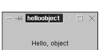  
图 2-3：创建并显示一个控件

第 2、3 和 15 行的预处理器命令虽然不是必须的，但是非常好的做法。随着应用程序规模扩大并变得复杂，同一个头文件可能会在单个源文件中被包含多次，因为在头文件中包含其他头文件是很常见的。通过创建 `MYLABEL_H` 的定义，该头文件可以被包含任意次数，但仅会被编译一次。

在第 8 行，`MyLabel` 类的定义使用 `QLabel` 作为其基类。这就需要使用第 5 行的 `include` 语句来使 `QLabel` 的定义可用。第 6 行包含头文件 `qstring.h` 是为了方便，因为在 `MyLabel` 构造函数中需要 `QString` 的定义。

`MyLabel` 类在自己的源文件中实现。除了将 `MyLabel` 构造函数中的父控件地址传递给 `QLabel` 基类的构造函数外，它没有执行任何其他操作：

```cpp
/* mylabel.cpp */
#include "mylabel.h"

MyLabel::MyLabel(QWidget *parent) : QLabel(parent)
{
}
MyLabel::~MyLabel()
{
}
```

以下示例创建并显示一个 `MyLabel` 控件。除了所使用的对象外，该程序的 `main()` 函数与前一示例基本相同。

```cpp
/* helloobject.cpp */
#include "mylabel.h"
#include <qapplication.h>

int main(int argc, char **argv)
{
    QApplication app(argc, argv);
    MyLabel *mylabel = new MyLabel(NULL);
    QString string("Hello, object");
    mylabel->setText(string);
    mylabel->setAlignment(
        Qt::AlignVCenter | Qt::AlignHCenter);
    mylabel->setGeometry(0,0,180,75);
    mylabel->show();
    app.setMainWindow(mylabel);
    return(app.exec());
}
```

`MyLabel` 对象的创建、操作和显示方式与前一例中的 `QLabel` 对象完全相同。`setAlignment()` 函数直接继承自 `QLabel`，而 `setGeometry()` 和 `show()` 则继承自 `QWidget`。

> **注意** 面向对象编程具有众多优势，其中最著名的是在处理图形用户界面 (GUI) 时展现出的优势。Qt充分利用了这一点。每一个可显示对象都从基类 `QWidget` 继承其基本能力，这意味着每一个可显示的窗口——无论是标签、按钮、顶层窗口或任何其他对象——都拥有一套相同的基本函数，用于控制尺寸、颜色、光标外观、鼠标检测和滚动等事项。这不仅使得创建自定义控件变得简单，而且自动为屏幕上的所有内容应用了统一的默认行为和外观。

此 makefile 与前一个非常相似，不同之处在于它必须考虑两个独立的 `.cpp` 文件，将它们全部编译并链接在一起：

```makefile
INCL=-I$(QTDIR)/include -I$(KDIR)/include
CFLAGS=-pipe -O2 -fno-strength-reduce
LFLAGS=-L$(QTDIR)/lib -L$(KDIR)/lib -L/usr/X11R6/lib
LIBS=-lqt -lX11 -lXext
CC=g++

helloobject: helloobject.o mylabel.o
	$(CC) $(LFLAGS) -o helloobject helloobject.o \
	mylabel.o $(LIBS)

helloobject.o: helloobject.cpp mylabel.h
mylabel.o: mylabel.cpp mylabel.h
```

```makefile
clean:
    rm -f helloobject
    rm -f mylabel.o
    rm -f helloobject.o

.SUFFIXES: .cpp
.cpp.o:
    $(CC) -c $(CFLAGS) $(INCL) -o $@ $<
```

## 复合控件

`QApplication` 对象会将你通过调用 `assignMainWidget()` 方法所指定的控件作为应用程序的主窗口显示。为了显示一个包含多个单一项的主窗口，你需要创建自己的控件，并将其作为主窗口显示。以下示例将两个按钮和一个标签组合成一个单一控件：

```cpp
/* threewidget.h */
#ifndef THREEWIDGET_H
#define THREEWIDGET_H

#include <qpushbutton.h>
#include <qlabel.h>

class ThreeWidget: public QWidget
{
public:
    ThreeWidget(QWidget *parent=0,const char *name=0);
private:
    QPushButton *topButton;
    QPushButton *bottomButton;
    QLabel *label;
};

#endif
```

第 5 行和第 6 行包含了定义要作为复合控件一部分的控件的头文件。这里需要两个按钮和一个标签，存储它们地址的位置在 `threewidget.h` 的第 13 至 15 行被定义为私有数据。

```cpp
/* threewidget.cpp */
#include "threewidget.h"

ThreeWidget::ThreeWidget(QWidget *parent,const char *name):
    QWidget(parent,name )
{
    setMinimumSize(120,180);
    setMaximumSize(120,180);
}
topButton = new QPushButton("Top Button",this);
topButton->setGeometry(15,15,90,40);
label = new QLabel("Middle Label",this);
label->setGeometry(15,70,90,40);
label->setAlignment(AlignVCenter | AlignHCenter);
bottomButton = new QPushButton("Bottom Button",this);
bottomButton->setGeometry(15,125,90,40);
}
```

由于它需要是一个可显示的控件，`ThreeWidget` 类使用 `QWidget` 作为其基类。

第 7 行和第 8 行设置了该控件的最小和最大尺寸。父窗口将查询此控件以确定其大小。在本例中，最小和最大设置相同，这意味着窗口无法调整大小。如图 2-4 所示，显示的窗口无法通过鼠标改变其宽度或高度。

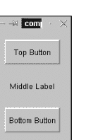  
**图 2-4：** 按钮和标签的定位与尺寸设置

顶部的按钮在第 10 行创建。构造函数的第二个参数是将作为该按钮父控件的控件。在本例中，父控件就是正在构建的新控件。在第 12 行和第 15 行中，标签和另一个按钮也建立了相同的父/子关系。

新创建的控件有一个 120 像素宽、180 像素高的可显示区域。通过调用 `setGeometry()` 将控件定位在此窗口上。在第 11 行，调用 `setGeometry()` 将顶部按钮定位在距离顶部 15 像素、距离左侧 15 像素的位置。同样的调用将按钮宽度设置为 80 像素，高度设置为 40 像素。类似地，第 13 行和第 16 行的 `setGeometry()` 调用对其他控件进行定位。`setGeometry()` 的前两个参数是左边距和顶边距；后两个是宽度和高度。

该程序的 `main()` 函数对待这个新复合控件就像对待任何其他控件一样。

```cpp
/* compound.cpp */
#include <qapplication.h>
#include "threewidget.h"

int main(int argc,char **argv)
{
    QApplication app(argc,argv);
    ThreeWidget threeWidget;
    threeWidget.setGeometry(10,10,100,100);
    app.setMainWidget(&threeWidget);
    threeWidget.show();
    return(app.exec());
}
```

`threeWidget` 对象在第 8 行创建。控件不能被强制适应一个对其无效的尺寸，因此由于控件中设置了最小和最大尺寸，第 9 行对 `setGeometry()` 的调用没有效果。第 11 行对 `show()` 的调用指令该控件及其包含的所有控件变为可见。

## 监听按钮

按钮也是一个控件，因此它可以像任何其他控件一样显示。然而，你的程序需要知道用户何时点击了按钮。以下示例显示了图 2-5 所示的窗口，并通过停止运行来响应按钮：

```cpp
/* exitbutton.cpp */
#include <qapplication.h>
#include <qpushbutton.h>
#include <qstring.h>

int main(int argc,char **argv)
{
    QApplication app(argc,argv);
    QString string("Exit");
    QPushButton *button = new QPushButton(string,NULL);
    QObject::connect(button,
        QSIGNAL(clicked()),&app.SLOT(quit()));
    button->setGeometry(0,0,80,50);
    button->show();
    app.setMainWidget(button);
    return(app.exec());
}
```

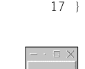  
图 2-5：用于退出程序的按钮

按钮已准备好响应鼠标，但除非指令按钮向程序的某些部分发送消息，否则该响应将不会被察觉。这种类型的消息被称为**信号（signal）**，而能够接收信号的方法被称为**槽（slot）**。第 11 行和第 12 行对 `QObject::connect()` 的调用使得信号的副本从按钮的 `clicked()` 指向应用程序的 `quit()` 方法。

> 注意：如果你接触过其他事件驱动系统，你可能熟悉回调函数（callback functions）的概念。槽类似于回调，但存在一些差异。最重要的区别是槽是类型安全的——如果参数类型不匹配，程序将无法编译。

在 `QObject::connect()` 的调用中，前两个参数指定信号源为按钮中的 `clicked()` 方法。信号是广播的。也就是说，无论是否设置了槽函数来接收它，信号都会被发送。另一方面，如果设置了多个槽来接收该信号，它们每个都会收到一份副本。

`QObject::connect()` 调用中的第二组参数指定接收槽是 `QApplication` 中的 `quit()` 方法。

## 为信号定义槽

为了让一个控件能够接收信号，它必须定义一个槽并将其连接到该信号。以下示例（如图 2-6 所示）显示了一个按钮和一个计数器，每当按钮被按下时，计数器就会递增。为了实现这一点需要做几件事，但 Qt 系统处理了大部分细节。特别是，有一些特殊的宏和元对象编译器（MOC）来自动处理大部分细节工作。本例中的 `main()` 函数仅创建并显示该控件：

```cpp
/* count.cpp */
#include <qapplication.h>
#include "clickcount.h"

int main(int argc,char **argv)
{
    QApplication app(argc,argv);
    ClickCount clickcount;
    app.setMainWindow(&clickcount);
    clickcount.show();
    return(app.exec());
}
```

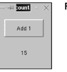  
图 2-6：计数器的槽接收按钮的信号。

`ClickCount` 控件包含一个按钮和一个标签。标签用于显示当前的计数器值：

```cpp
/* clickcount.h */
#ifndef CLICKCOUNT_H
#define CLICKCOUNT_H

#include <qpushbutton.h>
#include <qlabel.h>

class ClickCount: public QWidget
{
    Q_OBJECT
public:
    ClickCount(QWidget *parent=0,const char *name=0);
public slots:
    void incrementCounter();
private:
    int counter;
    QLabel *label;
    QPushButton *button;
};

#endif
```

第 10 行的宏 `Q_OBJECT` 必须存在于任何拥有槽的类中。（正如你将在第 5 章中看到的，广播信号的类也必须包含它。）`Q_OBJECT` 宏定义了一些为了使信号和槽正常工作而必须存在的标准方法。

第 14 行名为 `incrementCounter()` 的方法通过第 13 行的声明被归类为 `public slot`（公共槽）。除了被声明为槽之外，`incrementCounter()` 与类中的任何其他方法相同；它既可以直接被调用，也可以由信号调用。

`ClickCount` 类的构造函数创建了包含按钮和标签的布局，并建立了将信号从按钮发送到名为 `incrementCounter()` 的槽的连接。

```cpp
/* clickcount.cpp */
#include <stdio.h>
#include "clickcount.h"

ClickCount::ClickCount(QWidget *parent,const char *name):
    QWidget(parent,name )
{
    setMinimumSize(120,125);
    setMaximumSize(120,125);

    counter = 0;
    button = new QPushButton("Add 1",this);
```


13    `button->setGeometry(15,15,90,40);`

14    `label = new QLabel("0",this);`

15    `label->setGeometry(15,70,90,40);`

16    `label->setAlignment(AlignCenter | AlignHCenter);`

17

18    `QObject::connect(`

19        `button,SIGNAL(clicked()),`

20        `this,SLOT(IncrementCounter()));`

21 `}`

22 `void ClickCount::IncrementCounter()`

23 `{`

24    `char str[30];`

25    `sprintf(str,"%d",++counter);`

26    `label->setText(str);`

27 `}`

第 8 行和第 9 行对 `setMinimumSize()` 和 `setMaximumSize()` 的调用将窗口的大小固定为 120 $\times$ 125 像素。计数器值在第 11 行初始化，按钮和标签在第 12 行至 16 行创建并配置。

第 18 行对 `QObject::connect()` 的调用将一个槽（slot）附加到一个信号（signal）上。第 19 行的前两个参数指定信号的来源是一个名为 `clicked()` 的方法。`clicked()` 信号是按钮类的一个成员，与之类似的信号还包括 `pressed()`、`released()` 和 `toggled()`。

您可以在第 5 章中找到创建信号方法的示例。

第 20 行中 `QObject::connect()` 的第二组参数指定了接收信号的对象和方法。该对象是 `this`（`ClickCount` 的当前实例），而方法是 `IncrementCounter()`。

每当按钮发送 `clicked()` 信号时，它都会被 `IncrementCounter()` 方法接收，该方法会将显示的数值加 1 并更新按钮的文本。

信号和槽之间并没有真实的连接。无论是否有槽在监听，信号都会被广播——而且可以有任意数量的槽监听同一个信号。同样，一个槽也可以被设置为监听任意数量的信号。

本示例的 makefile 展示了元对象编译器（MOC）如何将定义类的头文件源代码作为输入，并对其进行处理以产生一个新的源文件，然后将其与程序一起编译和链接：

```
1 INCL = -I$(QTDIR)/include -I$(KDEDIR)/include
2 CFLAGS= -O2 -fno-strength-reduce
3 LFLAGS= -L$(QTDIR)/lib -L$(KDEDIR)/include -L/usr/X11R6/lib
4 LIBS= -lqt -lX11 -lXext
5 CC=g++
6 
7 count: count.o clickcount.o moc_clickcount.o
8 $(CC) $(LFLAGS) -o count count.o clickcount.o \
9    moc_clickcount.o $(LIBS)
10 
11 count.o: count.cpp clickcount.h
12 clickcount.o: clickcount.cpp clickcount.h
13 moc_clickcount.cpp: clickcount.h
14    $(QTDIR)/bin/moc clickcount.h -o moc_clickcount.cpp
15 
16 clean:
17    rm -f count
18    rm -f count.o
19    rm -f clickcount.o
20    rm -f moc_*
21 
22 .SUFFIXES: .cpp
23 
24 .cpp.o:
25    $(CC) -kc $(CFLAGS) $(INCL) -o $@ $<
```

第 7 行的依赖关系表明，程序不仅依赖于 `count.o` 和 `clickcount.o`，还依赖于一个名为 `moc_clickcount.o` 的文件。`moc_clickcount.cpp` 文件是由 MOC 编译器根据 `clickcount.h` 创建的。`Q_OBJECT` 宏在 `ClickCount` 类定义中添加了一些方法原型，而 MOC 编译器为这些新方法生成了函数体。其结果是，信号和槽所需的重复性（且容易出错的）编码几乎完全自动化了。

关于这种做法如何实现以及为何这样做的更多内容，请参阅第 5 章，该章将探讨整个过程。

## 总结

创建运行的 Qt 或 KDE 应用程序仅需很少的代码行数。编写创建窗口的代码细节以及监听用户输入的底层机制，全部在 API 内部处理。

- 创建 Qt 程序是通过让程序主线创建一个 `QApplication` 对象并使用它来控制窗口。KDE 程序也以同样的方式形成，使用的是 `KApplication` 对象。
- 应用程序的主窗口是一个单一的部件（widget）。这个部件通常包含一组其他部件，用于显示信息并提供用户界面。
- 一个对象可以被编写为广播一个或多个信号。一个对象也可以包含一个或多个设计用于接收广播信号的槽。槽和信号的实现细节通过宏和 MOC 编译器实现了自动化。

本章描述了如何创建和显示应用程序的主窗口。下一章将讨论显示弹出窗口和对话框。KDE 和 Qt 提供了一些预定义的对话框，但您也可以创建自己的对话框。

## 在窗口中布局部件

### 本章内容

- 使用具体的 x 和 y 坐标值在显示器上定位部件
- 将部件附加到网格坐标系中
- 伸缩部件以适应显示区域
- 将部件堆叠在垂直框中进行显示
- 将部件插入水平框中进行显示
- 将一个部件的窗口包含在另一个部件的窗口内

本章的核心是控制窗口内一组部件的大小和位置。在对应用程序进行编程以响应按钮或读取用户输入的文本之前，必须将按钮和文本输入部件以某种合理的方式排列。本章不仅解释了如何将部件放置在您想要的位置，还解释了如何指定其大小以及在窗口大小调整时将采取的操作。

部件可以通过坐标值或使用布局（layout）来定位和设置大小。坐标值是硬编码的像素位置，用户无法调整。另一方面，布局对象根据部件彼此之间的关系以及相对于包含窗口的整体大小来定位和调整部件的大小（在最大和最小限制范围内）。

### 几何部件放置

您可以通过指定四个值来指定每个部件的准确位置和大小：水平偏移、垂直偏移、宽度和高度。坐标系是父窗口的——即包含这些部件的窗口。以下示例在应用程序窗口中放置了三个按钮。

```
Main

1 /* main.cpp */
2 #include <kapp.h>
```

```cpp
3 #include "setxy.h"
4
5 int main(int argc,char **argv)
6 {
7     KApplication app(argc,argv,"setxy");
8     SetXY setxy;
9     setxy.show();
10    app.setMainWindow(&setxy);
11    return(app.exec());
12 }
```

主线代码非常简单。第 3 行包含了头文件。第 8 行创建了带有按钮的部件，并通过第 10 行的 `setMainWindow()` 调用指定该部件为要显示为应用程序主窗口的部件。

### SetXY 头文件

```cpp
1 /* setxy.h */
2 #ifndef SETXY_H
3 #define SETXY_H
4
5 #include <qpushbutton.h>
6
7 class SetXY: public QWidget
8 {
9 public:
10    SetXY(QWidget *parent=0,const char *name=0);
11    ~SetXY();
12 private:
13    QPushButton *button1;
14    QPushButton *button2;
15    QPushButton *button3;
16 };
17
18 #endif
```

类 `SetXY` 使用 `QWidget` 作为其基类。它唯一的数据是第 13 行至 15 行定义的三个 `QPushButton` 指针。通常，会定义被指定为槽的方法来响应按钮，但由于这是一个简单的放置演示，因此不会对按钮做出响应。

> **注意** 因为 `setxy.h` 的第 5 行包含了头文件 `qpushbutton.h`，它将被 `setxy.cpp` 和 `main.cpp` 自动包含。如果使用了另一个部件，且该部件也包含了 `qpushbutton.h`，那么同一个头文件将被包含两次。这就是为什么使用第 2、3 和 18 行的预编译器指令来防止头文件被多次编译至关重要的原因。

### SetXY

```cpp
1 /* setxy.cpp */
2 #include "setxy.h"
3 
4 SetXY::SetXY(QWidget *parent,const char *name)
5     : QWidget(parent,name)
6 {
7     setMinimumSize(90,40);
8     setMaximumSize(190,220);
9     resize(190,220);
10 
11     button1 = new QPushButton("Upper Left",this);
12     button1->setGeometry(0,0,90,40);
13 
14     button2 = new QPushButton("Middle Right",this);
15     button2->setGeometry(90,70,100,50);
16 
17     button3 = new QPushButton("Bottom",this);
18     button3->setGeometry(45,140,50,80);
19 }
20 SetXY::~SetXY() { }
```

`SetXY` 的所有工作都在构造函数中完成。如图 3-1 所示，定义并显示了三个按钮。

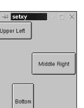

**图 3-1：** 通过坐标定位的三个按钮

左上角的按钮在第 11 行创建，其大小和位置在第 12 行设置。传递给 `setGeometry()` 方法的四个整数的顺序如下：

```
x, y, width, height
```

距离以像素为单位。x 值是应用程序窗口左侧到被包含部件左侧的像素数。y 值是窗口顶部到部件顶部的像素数。也就是说，左上角是坐标系的原点。每个按钮在创建后，通过调用 `setGeometry()` 来分配其大小和位置。

> 注意：如果两个部件（widgets）被放置在占据相同空间的位置，较新的部件将遮挡较旧的部件；因此，如果您发现某个部件丢失了，它可能只是被隐藏了。

第 7、8 和 9 行的调用定义了显示该部件的规则。第 7 行对 `setMinimumSize()` 的调用指定该部件必须至少显示为 90 像素宽和 40 像素高。最小设置非常重要，因为该部件将显示在一个可由用户调整大小的窗口中。该部件不能被缩小到图 3-2 所示的尺寸以下。第 8 行对 `setMaximumSize()` 的调用为部件的高度和宽度设定了上限。最后，第 9 行对 `resize()` 的调用将部件的初始大小设置为最大允许尺寸。

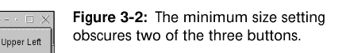

在第 20 行的 `~SetXY()` 析构函数中不需要执行任何操作，因为当此应用程序退出（且该部件被销毁）时，它也将销毁三个按钮，因为该部件是这些按钮的父级。

## 部件的大小

在窗口中布局部件时，您需要考虑两个重要因素。每个部件都有一个位置和一个大小。在前面的示例中，位置和大小完全由应用程序控制。如果您的应用程序需要如此详细的控制级别，这没有问题，但大多数部件对于它们应该有多大都有自己的“见解”。

`QWidget` 中的许多方法允许您控制部件的大小。其中一些方法使用高度和宽度值，另一些使用 `QSize` 对象，但它们的作用相同。`QSize` 类简单地是对高度和宽度的封装，但它还包含一些方法和运算符，在尺寸操作变得复杂时能让开发更轻松。例如，您可以使用运算符在保持比例的同时更改尺寸，或者将两个 `QSize` 对象合并为一个：

```cpp
void setMaximumSize(const QSize &qsize);
void setMaximumSize(int width, int height);
void setMaximumWidth(int width);
void setMaximumHeight(int height);
void setMinimumSize(const QSize &qsize);
void setMinimumSize(int width, int height);
void setMinimumWidth(int width);
void setMinimumHeight(int height);
```

如果部件需要固定大小，您可以调用两次函数将最小值和最大值设置为相同的值，或者调用以下函数之一：

```cpp
void setFixedSize(const QSize &qsize);
void setFixedSize(int width, int height);
void setFixedWidth(int width);
void setFixedHeight(int height);
```

以下函数用于获取最大和最小尺寸：

```cpp
QSize maximumSize();
QSize minimumSize();
```

## 固定网格部件布局

使用 `QGridLayout` 对象可以定义一个由不可见的水平线和垂直线组成的网格，然后将部件插入到由这些线创建的单元格中。以下示例创建了一个 5 行 5 列的网格，并在其中四个单元格中插入了按钮。

### Main

```cpp
1 /* main.cpp */
2 #include <kapp.h>
3 #include "fivebyfive.h"
4 
5 int main(int argc, char **argv)
6 {
7     KApplication app(argc, argv, "fivebyfive");
8     FiveByFive *fivebyfive = new FiveByFive();
9     fivebyfive->show();
10    app.setMainWidget(fivebyfive);
11    return(app.exec());
12 }
```

主程序创建了 `FiveByFive` 部件的一个实例，并将其用作在 `KApplication` 窗口中显示的部件。结果如图 3-3 所示。

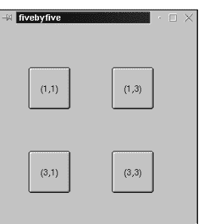
**图 3-3：** 通过网格布局定位的四个按钮

### FiveByFive 头文件

```cpp
1 /* fivebyfive.h */
2 #ifndef FIVEBYFIVE_H
3 #define FIVEBYFIVE_H
4 
5 #include <qwidget.h>
6 #include <qpushbutton.h>
7 
8 class FiveByFive: public QWidget
9 {
10 public:
11     FiveByFive(QWidget *parent=0,const char *name=0);
12     ~FiveByFive();
13 private:
14     QPushButton *b11;
15     QPushButton *b31;
16     QPushButton *b13;
17     QPushButton *b33;
18 };
19 
20 #endif
```

头文件定义了 `FiveByFive` 类继承自 `QWidget`，并包含四个要放置在网格上的按钮。

### FiveByFive 实现

```cpp
1 /* fivebyfive.cpp */
2 #include <qlayout.h>
3 #include "fivebyfive.h"
4 
5 FiveByFive::FiveByFive(QWidget *parent,const char *name)
6     : QWidget(parent,name)
7 {
8     QGridLayout *layout = new QGridLayout(this,5,5);
9  
10     b11 = new QPushButton("(1,1)",this);
11     b11->setMaximumSize(100,100);
12     layout->addWidget(b11,1,1);
13     b13 = new QPushButton("(1,3)",this);
14     b13->setMaximumSize(100,100);
15     layout->addWidget(b13,1,3);
16     b31 = new QPushButton("(3,1)",this);
17     b31->setMaximumSize(100,100);
18     layout->addWidget(b31,3,1);
19     b33 = new QPushButton("(3,3)",this);
```


20     `b33->setMaximumSize(100,100);`

21     `layout->addWidget(b33,3,3);`

22 

23     `for(int i=0; i<5; i++) {` 

24         `layout->addRowSpacing(160);`

25         `layout->addColSpacing(160);`

26     `}`

27     `resize(10,10);`

28 

29     `layout->activate();`

30 `}`

31 

32 `FiveByFive::FiveByFive() { }`

第 2 行包含了`qlayout.h`。同一个头文件也用于定义本章后面介绍的`QVBoxLayout`和`QHBoxLayout`。

在第 8 行，创建的`QGridLayout`对象是一个宽 5 格、高 5 格的`GridLayout`。左上角的单元格编号为 (0,0)，其右侧的是 (0,1)，再往右是 (0,2)，依此类推。要将部件在网格中定位在距离左侧一个位置、距离顶部一个位置的地方，将其插入到网格单元格 (1,1) 即可。

第 10 和 11 行创建了一个按钮，并将其最小高度和宽度都设置为 100 像素。这将允许按钮扩展以填充其分配的单元格，只要该单元格小于 100x100 像素。通常，由于其内部最大值设置，按钮是不能被拉伸的。

第 10、11 和 12 行创建了一个标签为 “(1,1)” 的按钮，并将其放置在位置 (1,1) 的网格方格中。第 11 行对`setMaximumSize()`的调用允许按钮扩展以填充其所在的单元格。`sizeHint()`方法对许多（但并非所有）部件都有效。在这种情况下，正确地假设`QPushButton`部件会返回一个有效的尺寸提示（size hint），因此在使用前没有进行有效性测试。更通用的代码形式如下所示：

```cpp
QSize *qsize = b11.sizeHint();
if(qsize.isValid())
    b11.setMinimumSize(qsize);
else
    b11.setMinimumSize(30,30);
```

这样，如果被测试的部件没有返回有效的尺寸设置，将使用一个合理的值。默认设置已经相当不错，但几乎永远不会完全符合您的需求。

> **注意**：在编写自己的部件时，您可能会发现实现`sizeHint()`非常有用。它在`QWidget`中被定义为一个虚函数，除非您重写它，否则它将始终返回一个无效的`QSize`。

第 23 到 26 行的循环为网格中的每一行和每一列调用`addRowSpacing()`。这将每列的最小宽度和每行的最小高度设置为 160 像素。没有设置最大值，因此每行和每列都可以增加到任何尺寸，如果您调整此窗口的大小，您会注意到按钮也会随之调整大小。在下一个示例中将详细介绍这种拉伸机制。

第 27 行对`resize()`的调用是请求将整个部件缩小到 10x10 像素。由于行和列的最小尺寸限制，该部件无法满足此请求。每当部件被指示调整自身大小，且新的高度或宽度超出其最大或最小范围时，请求的值将被忽略，并使用最接近的有效值——即最大值或最小值。在本例中，部件仅被减小到其最小尺寸。

## 拉伸网格部件布局

以下示例使用`QGridLayout`对象来定位四个按钮，并设置了一些行和列的拉伸值，用于控制在父窗口调整大小时按钮的随动缩放。

### Main

```cpp
1 /* main.cpp */
2 #include <kapp.h>
3 #include "fourbyfour.h"
4 
5 int main(int argc, char **argv)
6 {
7   KApplication app(argc,argv,"fourbyfour");
8   FourByFour *fourbyfour = new FourByFour();
9   fourbyfour->show();
10  app.setMainWidget(fourbyfour);
11  return(app.exec());
12 }
```

主程序创建了`FourByFour`部件的一个实例，并将其用作在`KApplication`窗口中显示的部件。

## FourByFour 头文件

```cpp
1 /* fourbyfour.h */
2 #ifndef FOURBYFOUR_H
3 #define FOURBYFOUR_H
4 
5 #include <qwidget.h>
6 #include <qpushbutton.h>
7 
8 class FourByFour: public QWidget
9 {
10 public:
11     FourByFour(QWidget *parent=0,const char *name=0);
12     ~FourByFour();
13 private:
14     QPushButton *b11;
15     QPushButton *b21;
16     QPushButton *b12;
17     QPushButton *b22;
18 };
19 
20 
21 #endif
```

该头文件定义了`FourByFour`类，它是一个`QWidget`，其私有数据包含四个用于在单元格中放置以实现调整大小的按钮。

## FourByFour

```cpp
1 /* fourbyfour.cpp */
2 #include <qlayout.h>
3 #include "fourbyfour.h"
4 
5 FourByFour::FourByFour(QWidget *parent,const char *name)
6     : QWidget(parent,name)
7 {
8     QGridLayout *layout = new QGridLayout(this,4,4);
9     QSize buttonMax(400,400);
10 
11     b11 = new QPushButton(this);
12     b11->setText("1,1");
13     b11->setMinimumSizeHint(b11->sizeHint());
14     b11->setMaximumSize(buttonMax);
15     layout->addWidget(b11,1,1);
16     b12 = new QPushButton(this);
17     b12->setText("1,2");
18     b12->setMinimumSize(b12->sizeHint());
19     b12->setMaximumSize(buttonMax);
20     layout->addWidget(b12,1,2);
21     b21 = new QPushButton(this);
22     b21->setText("2,1");
23     b21->setMinimumSize(b21->sizeHint());
24     b21->setMaximumSize(buttonMax);
25     layout->addWidget(b21,2,1);
26     b22 = new QPushButton(this);
27     b22->setText("2,2");
28     b22->setMinimumSize(b22->sizeHint());
29     b22->setMaximumSize(buttonMax);
30     layout->addWidget(b22,2,2);
31 
32     layout->addRowSpacing(0,20);
33     layout->addRowSpacing(3,20);
34     layout->addColSpacing(0,20);
35     layout->addColSpacing(3,20);
36     resize(10,10);
37 
38     layout->setRowStretch(2,100);
39     layout->setColStretch(2,100);
40 
41     layout->activate();
42 }
```

在第 8 行创建了一个`QGridLayout`对象，其宽度为 4 个单元格，高度为 4 个单元格。第 11 行到第 30 行创建了四个`QPushButton`对象，并将它们添加到布局网格的四个中心单元格中。每个按钮的最小尺寸被设置为一个能保证文本始终可见的值。每个按钮的最大尺寸被设置为一个任意的大数，以允许`QGridLayout`根据需要拉伸按钮以填充其单元格。

第 32 行到第 35 行对`addRowSpacing()`和`addColSpacing()`的调用将左右两列的宽度和上下两行的高度分别设置为 20 像素。结果是在应用程序窗口边缘与包含按钮的四个中心单元格之间产生 20 像素的边距。第 36 行对`resize()`的调用尝试将组件缩小到其允许的最小尺寸之下；因此，组件首先以其最小尺寸显示。结果如图 3-4 所示。

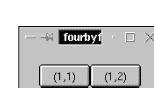
**图 3-4：four by four 组件的最小尺寸**

第 38 行对`setRowStretch()`的调用将第三行（按钮的第二行）的*伸展因子* (stretch factor) 设置为 100。第 39 行对`setColStretch()`的调用将第三列（按钮的第二列）的伸展因子设置为 100。每当窗口在垂直或水平方向上改变大小时，具有较大伸展因子的行和列比具有较小伸展因子的行和列变化更多。

每行和每列的默认伸展值为 0。如果所有行（或列）都被设置为 0，则所有行（或列）可能会或不会改变大小。这个默认设置几乎永远不是你想要的。当网格调整大小时，只有那些具有非零值的行和列才会随之调整大小。行或列调整大小的量取决于其伸展因子与所有被调整单元格的伸展因子总和的比率。

在本例中，扩大窗口会导致其显示效果如图 3-5 所示。第 1 列和第 1 行的伸展因子保持为零，因此左上角的按钮保持不变。另一方面，第 2 列和第 2 行都有非零值，因此右下角单元格中的按钮在两个方向上都会改变大小。

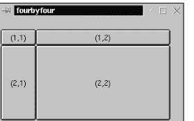
**图 3-5：由伸展因子引起的非均匀调整大小**

单元格实际伸展的量由伸展因子与被伸展方向上所有伸展因子总和的比率决定。例如，对`FourByFour`的伸展因子进行更改可以使所有按钮都改变大小，但某些按钮的改变速度比其他按钮快。例如，将第 38 行和第 39 行替换为以下内容：

```cpp
layout->setRowStretch(1,50);
layout->setRowStretch(2,100);
layout->setColStretch(1,9);
layout->setColStretch(2,1);
```

在这些设置下，垂直拉伸窗口将使第 1 行的高度增加量是第 2 行的两倍。水平拉伸窗口将导致第 1 列的增加量是第 2 列的九倍。扩展窗口的结果如图 3-6 所示。

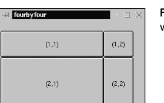
**图 3-6：每行和每列拥有各自的伸展因子**

## 跨多个网格单元格的组件

虽然`QGridLayout`可以很容易地用于将组件定位在一个矩形阵列中（有点像棋盘），但也可以让单个组件覆盖两个或更多网格方块，从而提供更大的灵活性。以下示例使用了这种技术，使一个标签定位在窗口顶部，并且一个列表框覆盖六个单元格位置。

### Main

```cpp
1 /* main.cpp */
2 #include <kapp.h>
3 #include "multicell.h"
4 
5 int main(int argc,char **argv)
6 {
7     KApplication app(argc,argv,"multicell");
8     MultiCell *multicell = new MultiCell();
9     multicell->show();
10    app.setMainWindow(multicell);
11    return(app.exec());
12 }
```

### MultiCell 头文件

```cpp
1 /* multicell.h */
2 #ifndef MULTICELL_H
3 #define MULTICELL_H
4 
5 #include <qwidget.h>
6 #include <qpushbutton.h>
7 #include <qlabel.h>
8 #include <qlistbox.h>
9 
10 class MultiCell: public QWidget
11 {
12 public:
13     MultiCell(QWidget *parent=0,const char *name=0);
14     ~MultiCell();
15 private:
16     QLabel *label;
17     QListBox *listbox;
18     QPushButton *addButton;
19     QPushButton *deleteButton;
20     QPushButton *cancelButton;
21 };
22 
23 #endif
```

所有不同组件的存储定义在第 16 行到第 20 行的`MultiCell`类中。这意味着在第 6 行到第 8 行必须为每一个组件提供一个包含文件。

### MultiCell

```cpp
1 /* multicell.cpp */
2 #include <qlayout.h>
3 #include <stdio.h>
4 #include "multicell.h"
5 
6 MultiCell::MultiCell(QWidget *parent,const char *name)
7 : QWidget(parent,name)
8 {
9     QGridLayout *layout = new QGridLayout(this,4,2,20);
10 
11     label = new QLabel("A list box with three buttons",this);
12 
13     label->setMinimumSize(label->sizeHint());
14     label->setAlignment(AlignHCenter);
15     layout->addWidget(label,0,0,0,1);
16 
17     listbox = new QListBox(this);
18     for(int i=0; i<3; i++)
19     {
20         char str[40];
21         sprintf(str,"Selection %d\n",i);
22         listbox->insertItem(str);
23     }
24 
25     listbox->setMinimumWidth(120);
26     layout->addWidget(listbox,1,3,0,0);
27 
28     addButton = new QPushButton(this);
29     addButton->setText("Add");
30     addButton->setMinimumSize(addButton->sizeHint());
31     layout->addWidget(addButton,1,1);
32 
33     deleteButton = new QPushButton(this);
34     deleteButton->setText("Delete");
35     deleteButton->setMinimumSize(deleteButton->sizeHint());
36     layout->addWidget(deleteButton,2,1);
37 
38     cancelButton = new QPushButton(this);
39     cancelButton->setText("Cancel");
40     cancelButton->setMinimumSize(cancelButton->sizeHint());
41     layout->addWidget(cancelButton,3,1);
42 
43     resize(10,10);
44     layout->activate();
45 }
46 
47 MultiCell::~MultiCell() { }


在第 9 行，`QGridLayout` 被构造为 4 行 2 列。此外，使用了 20 的边框值在所有单元格之间插入间距。显示的窗口如图 3-7 所示。

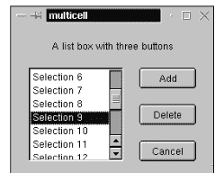
**图 3-7：组件扩展以填充多个网格单元格。**

第 11 行到第 14 行定义了一个带有文本的标签，设置了它的最小尺寸，并设置了对齐方式，使文本水平居中。在第 15 行，通过调用 `addMultiCellWidget()` 将标签分配给网格布局的两个单元格。前两个数字指定行的范围，后两个数字指定列的范围，如下所示：

`起始行, 结束行, 起始列, 结束列`

第 17 行到第 24 行创建了一个包含 3 个条目的列表框，并将其最小宽度设置为 120 像素。第 26 行对 `addMultiCellWidget()` 的调用指定该列表框覆盖六个单元格——两列宽，三行高。

第 28 行到第 41 行创建了右侧的三个按钮，将每个按钮分配到一个单元格中。图 3-7 中显示的结果显示这些按钮由第 9 行为所有单元格指定的 20 像素间距分隔开。

## 垂直盒子布局

您可以通过将一组组件插入到 `QVBoxLayout` 对象中，将它们定位在垂直列中。第一个插入的组件将出现在盒子的顶部，第二个将位于其下方，之后添加的每个组件都位于列表的底部。以下示例将五个按钮（以及一些空间和伸展控制）插入到一个垂直盒子中。

### 主函数 (Main)

```cpp
1 /* main.cpp */
2 #include <kapp.h>
3 #include "verticalbox.h"
4 
5 int main(int argc,char **argv)
6 {
7     KApplication app(argc,argv,"verticalbox");
8     VerticalBox *verticalbox = new VerticalBox();
9     verticalbox->show();
10    app.setMainWidget(verticalbox);
11    return(app.exec());
12 }
```

一个 `VerticalBox` 对象被用作应用程序窗口的显示组件（widget）。

### VerticalBox 头文件

```cpp
1 /* verticalbox.h */
2 #ifndef VERTICALBOX_H
3 #define VERTICALBOX_H
4 
5 #include <qwidget.h>
6 #include <qlayout.h>
7 #include <qpushbutton.h>
8 
9 class VerticalBox: public QWidget
10 {
11 public:
12     VerticalBox(QWidget *parent=0,const char *name=0);
13     ~VerticalBox();
14 private:
15     QPushButton *buttonOne;
16     QPushButton *buttonTwo;
17     QPushButton *buttonThree;
18     QPushButton *buttonFour;
19     QPushButton *buttonFive;
20 };
21 
22 #endif
```

### VerticalBox 实现

```cpp
1 /* verticalbox.cpp */
2 #include "verticalbox.h"
3 
4 VerticalBox::VerticalBox(QWidget *parent,const char *name)
5     : QWidget(parent,name)
6 {
7     QVBoxLayout *layout = new QVBoxLayout(this,5);
8     QSize buttonMaximum(400,400);
9 
10    buttonOne = new QPushButton(this);
11    buttonOne->setText("BUTTON ONE");
12    buttonOne->setMinimumSize(buttonOne->sizeHint());
13    buttonOne->setMaximumSize(buttonMaximum);
14    layout->addWidget(buttonOne);
15 
16    buttonTwo = new QPushButton(this);
17    buttonTwo->setText("BUTTON TWO");
18    buttonTwo->setMinimumSize(buttonTwo->sizeHint());
19    buttonTwo->setMaximumSize(buttonMaximum);
20    layout->addWidget(buttonTwo,30);
21 
22    layout->addSpacing(20);
23 
24    buttonThree = new QPushButton(this);
25    buttonThree->setText("BUTTON THREE");
26    buttonThree->setMinimumSize(buttonThree->sizeHint());
27    buttonThree->setMaximumSize(buttonMaximum);
28    layout->addWidget(buttonThree);
29 
30    layout->addStretch(30);
31 
32    buttonFour = new QPushButton(this);
33    buttonFour->setText("BUTTON FOUR");
34    buttonFour->setMinimumSize(buttonFour->sizeHint());
35    buttonFour->setMaximumSize(buttonMaximum);
36    layout->addWidget(buttonFour);
37 
38    layout->addSpacing(5);
39    layout->addStretch(10);
40 
41    buttonFive = new QPushButton(this);
42    buttonFive->setText("BUTTON FIVE");
43    buttonFive->setMinimumSize(buttonFive->sizeHint());
44    buttonFive->setMaximumSize(buttonMaximum);
45    layout->addWidget(buttonFive);
46 
47    resize(10,10);
48    layout->activate();
49 }
50 VerticalBox::~VerticalBox( ) { }
```

该类是一个基于第 7 行创建的 `QVBoxLayout` 对象的组件。构造函数的第二个参数指定在它包含的所有项目周围插入 5 像素的边距。如果将此边距设置为零（默认值），则包含的项目将彼此相邻并紧贴边缘。

第 10 行到第 14 行创建了一个按钮，设置了其文本和最小尺寸，并将其添加到布局中。其最大尺寸被设置为一个任意大的值，以允许 `QVBoxLayout` 对象将其拉伸以适应。它是第一个添加到布局的按钮，因此它将出现在顶部。

第 16 行到第 20 行创建了第二个按钮并将其添加到布局中。如图 3-8 所示，第一个按钮和第二个按钮之间的距离是 10 像素（按钮一的 5 像素边距加上按钮二的 5 像素边距）。即使在布局拉伸时，它们之间的距离也不会改变。在第 20 行，在将按钮添加到盒子时指定了 20 的伸展因子（stretch factor），这使得按钮本身在布局大小改变时参与伸展。

**图 3-8：** 垂直盒子在垂直拉伸前后的状态

第 22 行在按钮二下方插入了一个 20 像素的间距。然后，在第 24 行到第 28 行，创建了按钮三并将其添加到布局中。这意味着按钮二和按钮三之间将始终有 30 像素的距离（两个 5 像素的边距加上 20 像素的间距）。

第 30 行在按钮三下方添加了一个伸展因子为 30 的伸展点，第 32 行到第 36 行在其下方插入了按钮四。如图 3-8 所示，当布局处于最小尺寸时，伸展因子在按钮三和按钮四之间不会添加空间。然而，当窗口在垂直方向拉伸时，这两个按钮之间会出现一定的空间。

在按钮四下方，第 38 行插入了一个 5 像素的间距和一个 10 的伸展因子。然后，第 41 行到第 45 行在其下方创建并插入了按钮五。这意味着两个按钮之间的最小空间是 15 像素（两个 5 像素的边距加上 5 像素的间距）。

回想一下，伸展量是所有伸展因子的总和与每个单独伸展因子的比率。本例指定了 30（第 20 行）、30（第 30 行）和 10（第 39 行）的伸展因子。伸展因子总和为 70；因此，随着窗口大小的改变，按钮二将吸收 3/7 的变化量，按钮二和按钮三之间的空间将吸收 3/7，而按钮四和按钮五之间的空间将吸收 1/7。

第 47 行将布局的初始大小减小到其最小值。布局通过汇总其包含的所有组件和空间的最小尺寸来确定其最小尺寸。第 48 行激活布局，以便在其父窗口显示时将其显示。

## 水平盒子布局 (Horizontal Box Layout)

水平盒子与垂直盒子相同，不同之处在于包含的组件是从左到右并排摆放，而不是从上到下依次摆放。图 3.9 所示的窗口是由一个 `HorizontalBox` 组件生成的，该组件与前一节中的 `VerticalBox` 组件完全相同，仅有几处改动。水平盒子的构造函数在第 7 行。

```cpp
7    QHBoxLayout *layout = new QHBoxLayout(this,5);
```

按钮的名称被缩短了，以免窗口过宽。通过比较图 3-8 和图 3-9 可以看出，间距和伸展在两者中的作用方式相同。

**图 3-9：** 水平盒子在水平拉伸前后的状态

## 带有对齐方式的盒子 (Boxes with Alignment)

如果插入到垂直盒子中的组件无法在水平方向上调整大小，并且该组件的宽度没有包含它的盒子那么宽，您有三种选择。该组件可以定位在左侧、右侧或中心。以下示例通过在盒子顶部插入一个宽按钮并插入四个其他固定大小的按钮，生成了图 3-10 中显示的窗口。

**图 3-10：** 固定大小的组件分别向左、向右或居中对齐。

### 主函数 (Main)

```cpp
1 /* main.cpp */
2 #include <kapp.h>
3 #include "vboxalign.h"
4 
5 int main(int argc,char **argv)
6 {
7     KApplication app(argc,argv,"vboxalign");
8     VBoxAlign *vboxalign = new VBoxAlign();
9     vboxalign->show();
10    app.setMainWidget(vboxalign);
11    return(app.exec());
12 }
```

### VBoxAlign 头文件

```cpp
1 /* vboxalign.h */
2 #ifndef VBOXALIGN_H
3 #define VBOXALIGN_H
4 
5 #include <qwidget.h>
6 #include <qlayout.h>
7 #include <qpushbutton.h>
8 
9 class VBoxAlign: public QWidget
10 {
11 public:
12     VBoxAlign(QWidget *parent=0,const char *name=0);
13     ~VBoxAlign();
14 private:
15     QPushButton *acrossButton;
16     QPushButton *leftButton;
17     QPushButton *centerButton;
18     QPushButton *rightButton;
19     QPushButton *defaultButton;
20 };
21 
22 #endif
```

头文件声明了该类包含私有成员：一个横跨整个盒子的可变尺寸按钮，以及四个仅占据部分宽度的固定尺寸按钮。

### VBoxAlign 实现

```cpp
1 /* vboxalign.cpp */
2 #include "vboxalign.h"
3 
4 VBoxAlign::VBoxAlign(QWidget *parent,const char *name)
5     : QWidget(parent,name)
6 {
7     QVBoxLayout *layout = new QVBoxLayout(this);
8     acrossButton = new QPushButton(this);
9     acrossButton->setText("All the way across");
10    acrossButton->setMinimumSize(acrossButton->sizeHint());
11    layout->addWidget(acrossButton);
12 
13    leftButton = new QPushButton(this);
14    leftButton->setText("Left");
15    leftButton->setFixedSize(leftButton->sizeHint());
16    layout->addWidget(leftButton,0,AlignLeft);
17 
18    centerButton = new QPushButton(this);
19    centerButton->setText("Center");
20    centerButton->setFixedSize(centerButton->sizeHint());
21    layout->addWidget(centerButton,0,AlignCenter);
22 
23    rightButton = new QPushButton(this);
24    rightButton->setText("Right");
25    rightButton->setFixedSize(rightButton->sizeHint());
26    layout->addWidget(rightButton,0,AlignRight);
27 
28    defaultButton = new QPushButton(this);
29    defaultButton->setText("Default");
30    defaultButton->setFixedSize(defaultButton->sizeHint());
31    layout->addWidget(defaultButton);
32 
33    resize(10,10);
34    layout->activate();
35 }
36 VBoxAlign::~VBoxAlign( ) { }
```

第 9 行到第 12 行创建并安装了一个仅指定了最小尺寸的按钮。此外，由于该按钮的标签比其他按钮长，其最小宽度将大于盒子中的任何其他按钮，因此该按钮将决定盒子本身的最小宽度。

第 14 行到第 17 行创建并安装了始终位于盒子左侧的按钮。第 16 行对 `setFixedSize()` 的调用确定了按钮所需的尺寸，并将最小和最大限制都设置为该尺寸。第 17 行对 `addWidget()` 的调用将间距设置为零（默认值）并指定对齐方式为 `AlignLeft`。在第 19 行到第 22 行创建了另一个固定大小的按钮，并使用 `AlignCenter` 选项将其添加到盒子中。在第 24 行到第 27 行创建的按钮被设置为 `AlignRight`。最后一个在第 29 行到第 32 行定义的按钮没有给出特定的对齐设置，但结果显示其默认值是 `AlignCenter`。

水平布局盒的工作方式与垂直布局盒相同，但对齐模式的名称略有不同。在垂直布局盒中，用于水平对齐控件的三个名称如下：

```
AlignLeft
AlignCenter
AlignRight
```

同样，在水平布局盒中，用于垂直对齐控件的三个名称如下：

```
AlignTop
AlignCenter
AlignBottom
```

## 布局中的布局

接下来的示例演示了如何将一个布局包含在另一个布局中，从而生成图 3-11 所示的窗口。父布局是一个 $2 \times 2$ 的 `QGridLayout`。它在左上角包含一个 `QLCDNumber` 控件，并在底部的两个单元格中包含一个跨越两格的 `QSlider` 控件。右上角的单元格包含一个 `QVBoxLayout`，而该垂直布局又包含一列四个按钮。

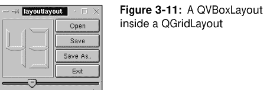

> **注意** 虽然通过将所有控件放置在 `QGridLayout` 上几乎可以实现任何布局，但有时通过这种方式将布局细分会更加方便。将控件分小组处理可以简化复杂窗口的编程任务。

### Main

```cpp
1 /* main.cpp */
2 #include <kapp.h>
```


```cpp
#include "layoutlayout.h"

int main(int argc, char **argv)
{
    KApplication app(argc, argv, "layoutlayout");
    LayoutLayout *layoutlayout = new LayoutLayout();
    layoutlayout->show();
    app.setMainWindow(layoutlayout);
    return(app.exec());
}
```

### `LayoutLayout` 头文件

```cpp
/* layoutlayout.h */
#ifndef LAYOUTLAYOUT_H
#define LAYOUTLAYOUT_H

#include <qwidget.h>
#include <qlayout.h>
#include <qlcdnumber.h>
#include <qpushbutton.h>
#include <qslider.h>

class LayoutLayout: public QWidget
{
public:
    LayoutLayout(QWidget *parent=0,const char *name=0);
    ~LayoutLayout();

private:
    QLCDNumber *lcd;
    QPushButton *openButton;
    QPushButton *saveButton;
    QPushButton *saveasButton;
    QPushButton *exitButton;
    QSlider *slider;
};

#endif
```

类定义包含了要显示的六个控件。尽管它们将由不同的布局管理器进行放置和调整大小，但它们都是 `LayoutLayout` 控件类的成员。这里涉及两个层级结构，但布局层级与控件层级无关。布局层级仅用于对控件进行地理位置上的定位和尺寸调整；但为了使其发挥作用，每个控件（除了用作主窗口的顶层控件外）必须在控件树中有一个父级。

### `LayoutLayout`

```cpp
/* layoutlayout.cpp */
#include "layoutlayout.h"

LayoutLayout::LayoutLayout(QWidget *parent,const char *name)
    : QWidget(parent,name)
{
    QGridLayout *layout = new QGridLayout(this,2,2,3);

    lcd = new QLCDNumber(this);
    lcd->setNumDigits(2);
    lcd->display(43);
    lcd->setMinimumSize(100,100);
    layout->addWidget(lcd,0,0);

    QVBoxLayout *vertButtonLayout = new QVBoxLayout(3);
    layout->addLayout(vertButtonLayout,0,1);

    openButton = new QPushButton("Open",this);
    openButton->setMinimumSize(openButton->sizeHint());
    vertButtonLayout->addWidget(openButton);

    saveButton = new QPushButton("Save",this);
    saveButton->setMinimumSize(saveButton->sizeHint());
    vertButtonLayout->addWidget(saveButton);

    saveAsButton = new QPushButton("Save As..",this);
    saveAsButton->setMinimumSize(saveAsButton->sizeHint());
    vertButtonLayout->addWidget(saveAsButton);

    exitButton = new QPushButton("Exit",this);
    exitButton->setMinimumSize(exitButton->sizeHint());
    vertButtonLayout->addWidget(exitButton);

    slider = new QSlider(QSlider::Horizontal,this);
    slider->setMinimumSize(slider->sizeHint());
    layout->addMultiCellWidget(slider,1,1,0,1);

    resize(10,10);
    layout->activate();
}
```

主布局网格在第 7 行被创建为一个 $2 \times 2$ 的网格。`this` 参数指定该对象将作为 `LayoutLayout` 对象的主布局对象。网格布局在创建时还设置了在其所有包含项周围插入 3 像素的边框。所有由该控件显示的项都必须由此网格布局定位。（虽然可以在不将子控件包含在布局中的情况下显示它们，但它们在窗口中的位置将是不可预测的。）

第 9 至 13 行创建了一个 `QLCDNumber` 对象，用于显示 2 位数 43，并将其安装在网格的左上角。

第 15 行创建了一个垂直布局盒。该垂直盒没有指定父级，因为它将被作为主布局的子项包含在内。事实上，紧接的第 16 行代码调用了 `addLayout()` 方法，将该垂直盒作为项插入到网格布局的右上角。这建立了一个布局层级结构，`LayoutLayout` 对象位于顶层，第 7 行创建的 `QGridLayout` 位于下一层，而第 15 行创建的 `QVBoxLayout` 位于第三层。请注意，创建网格时使用了 `this` 参数，从而将其确立为顶层容器。创建垂直盒时没有使用 `this` 参数，因此必须调用 `addLayout()` 来建立其层级关系。

> **注意**：`QLayout` 对象在为其添加子控件或子布局之前必须有一个父级。主布局必须是包含它的控件的子项，而所有其他布局必须是它的子布局（或孙布局）。

第 18 至 20 行创建了一个 `QPushButton` 并将其添加到垂直盒中。为按钮设置了最小尺寸，但没有设置最大尺寸，因此按钮将根据需要扩展以填充盒子。第 22 至 32 行创建并向盒子中添加了另外三个按钮。这便形成了之前在图 3-11 右上角所示的按钮列。

第 34 至 36 行创建了一个 `QSlider` 并将其附加到网格布局中，使其覆盖底部两个单元格。与按钮一样，它被分配了一个最小尺寸，但允许扩展以填充网格布局的单元格。

第 38 行对 `resize()` 的调用确保了所生成的控件初始尺寸为其最小值。最小尺寸是由 `LayoutLayout` 控件向 `QGridLayout` 请求其最小尺寸而确定的。`QGridLayout` 依次向 `QLCDNumber`、`QSlider` 和 `QVBoxLayout` 请求它们的最小尺寸，然后将结果求和（同时考虑边框间距），从而计算出自身的最小尺寸。`QVBoxLayout` 通过请求每个按钮的最小尺寸来确定其最小尺寸，然后使用最大的水平值和垂直值的总和作为其最小宽度和高度。

## 既是布局又是控件的布局

`KContainerLayout` 控件可用于对其他控件进行定位和尺寸调整。它类似于 `QVBoxLayout` 和 `QHBoxLayout` 的结合体，但还具有一些特殊属性。接下来的示例演示了如何使用 `KContainerLayout` 控件来调整一组按钮的大小并定位，如图 3-12 所示。

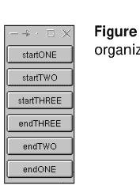

图 3-12：一个垂直组织控件的 `KContainerLayout`

### `Main`

```cpp
/* main.cpp */
#include <kapp.h>
#include "container.h"

int main(int argc,char **argv)
{
    KApplication app(argc,argv,"container");
    Container *container = new Container();
    container->show();
    app.setMainWindow(container);
    return(app.exec());
}
```

### `Container` 头文件

```cpp
/* container.h */
#ifndef CONTAINER_H
#define CONTAINER_H

#include <qwidget.h>
#include <kontainer.h>
#include <qpushbutton.h>

class Container: public QWidget
{
public:
    Container(QWidget *parent=0,const char *name=0);
    ~Container();

private:
    QPushButton *sbOne;
    QPushButton *sbTwo;
    QPushButton *sbThree;
    QPushButton *ebOne;
    QPushButton *ebTwo;
    QPushButton *ebThree;
};

#endif
```

第 15 至 20 行声明了指向要显示的六个按钮的指针。

### `Container`

```cpp
/* container.cpp */
#include "container.h"

Container::Container(QWidget *parent,const char *name)
    : QWidget(parent,name)
{
    KContainerLayout *layout = new KContainerLayout(this);
    layout->setOrientation(KContainerLayout::Vertical);

    sBone = new QPushButton(this);
    sBone->setText("startONE");
    sBone->setMinimumSize(sBone->sizeHint());
    layout->packStart(sBone);

    sBtwo = new QPushButton(this);
    sBtwo->setText("startTWO");
    sBtwo->setMinimumSize(sBtwo->sizeHint());
    layout->packStart(sBtwo);

    sBthree = new QPushButton(this);
    sBthree->setText("startTHREE");
    sBthree->setMinimumSize(sBthree->sizeHint());
    layout->packStart(sBthree);

    eBone = new QPushButton(this);
    eBone->setText("endONE");
    eBone->setMinimumSize(eBone->sizeHint());
    layout->packEnd(eBone);

    eBtwo = new QPushButton(this);
    eBtwo->setText("endTWO");
    eBtwo->setMinimumSize(eBtwo->sizeHint());
    layout->packEnd(eBtwo);

    eBthree = new QPushButton(this);
    eBthree->setText("endTHREE");
    eBthree->setMinimumSize(eBthree->sizeHint());
    layout->packEnd(eBthree);

    resize(10,10);
}

Container::~Container() { }
```

在第 7 行，创建了 `KContainerLayout` 控件，并将 `Container` 对象作为其父控件。在第 8 行，方向被指定为垂直（vertical），这意味着所有添加到该布局的控件将一个接一个地纵向排列，如图 3-12 所示。

第一个按钮在第 10 至 12 行创建。通过第 13 行对 `packStart()` 的调用将该按钮添加到布局中。因为这个按钮最先被添加，且是通过 `packStart()` 添加的，所以它将始终出现在最顶部。第二个按钮在第 15 至 18 行创建，同样使用 `packStart()` 添加到布局中，因此它将处于第一个按钮的正下方。第三个按钮在第 20 至 23 行创建并添加到布局中，同样使用了 `packStart()`，因此它将始终紧跟在前两个按钮之后。

# 第 3 章 在窗口中布局控件

从末尾（end）打包控件的效果与从开始（start）打包相同，不同之处在于每个控件被放置在从底部开始的下一个可用位置。第一个添加到底部的按钮是在第 25 至 27 行创建，并通过第 28 行对 `packEnd()` 的调用而添加的。在第 30 至 33 行创建并添加的按钮位于另一个从底部打包的按钮正上方，而第 35 至 38 行的按钮则位于底部另外两个按钮的正上方。

> **注意**：当 `KContainerLayout` 控件调整大小时，其采取的操作取决于控件是如何添加的。在开始端（start）添加的控件将保持在开始边缘（顶部或左侧），而在末端（end）添加的控件将保持在末端边缘（底部或右侧）。

若要将打包布局设置为水平方向，可以删除第 8 行的语句（因为水平是默认值），或者将其替换为以下内容：

```cpp
layout->setOrientation(KContainerLayout::Horizontal);
```

当布局方向为水平时，`packStart()` 方法在左侧插入控件，而 `packEnd()` 方法在右侧插入控件。结果如图 3-13 所示。

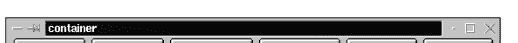

**图 3-13：** 一个水平组织控件的 `KContainerLayout`

## 使用 `IsA` 代替 `HASa`

本章之前的所有示例都是在内部创建某种布局管理器的控件。然而，由于 `KContainerLayout` 本身也是一个控件，因此它可以被继承扩展而不仅仅是被使用。也就是说，该控件不再是 *拥有（has）* 一个布局对象，而是 *本身就是（is）* 一个布局对象。以下是一个创建能够包含其他控件的控件的示例。

### `Main`

```cpp
/* main.cpp */
#include <kapp.h>
#include "iscontainer.h"

int main(int argc,char **argv)
{
    KApplication app(argc,argv,"iscontainer");
    IsContainer *iscontainer = new IsContainer();
    iscontainer->show();
    app.setMainWidget(iscontainer);
    return(app.exec());
}
```

这个控件像对待任何其他控件一样被对待。它在第 8 行创建，并在第 10 行被设置为主窗口控件。只要它是一个控件，无论它是 *拥有* 一个布局组件还是 *本身就是* 一个布局组件都无关紧要。

### `IsContainer` 头文件

```cpp
/* iscontainer.h */
#ifndef ISCONTAINER_H
#define ISCONTAINER_H

#include <qwidget.h>
#include <kcontainer.h>
#include <qpushbutton.h>

class IsContainer: public KContainerLayout
{
public:
    IsContainer(QWidget *parent=0,const char *name=0);
    ~IsContainer();

private:
    QPushButton *One;
    QPushButton *Two;
    QPushButton *Three;
};

#endif
```


此类定义与之前示例的主要区别在于，在第 9 行，`IsContainer` 继承自 `KContainerLayout` 而不是直接继承自 `QWidget`。`IsContainer` 类仍然是一个控件，因为 `KContainerLayout` 继承自 `QWidget`。

## IsContainer

```cpp
1 /* iscontainer.cpp */
2 #include "iscontainer.h"
3
4 IsContainer::IsContainer(QWidget *parent,const char *name)
5     : KContainerLayout(parent,name)
6 {
7     setOrientation(KContainerLayout::Vertical);
8
9     One = new QPushButton(this);
10    One->setText("BUTTON ONE");
11    One->setMinimumSize(One->sizeHint());
12    packStart(One);
13  Two = new QPushButton(this);
14
15  Two->setText("BUTTON TWO");
16  Two->setMinimumSize(Two->sizeHint());
17
18  packStart(Two);
19
20  Three = new QPushButton(this);
21  Three->setText("BUTTON THREE");
22  Three->setMinimumSize(Three->sizeHint());
23  packStart(Three);
24
25  resize(10,10);
26  }
27  IsContainer::~IsContainer() { }
```

父类（包括 `QWidget` 类）由第 5 行的代码初始化。第 7 行将方向设置为垂直。第 9 至 23 行通过调用 `packStart()` 创建并向容器中添加了三个按钮。最终的显示效果如图 3-14 所示。

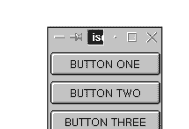

**图 3-14：** 一个包含三个子控件的控件容器布局

## 控件嵌套控件（水平）

由于 `KContainerLayout` 是一个控件，并且具有包含其他控件的能力，因此它可以包含其他 `KContainerLayout` 控件。以下示例是一个垂直 `KContainerLayout` 控件中包含的一组水平 `KContainerLayout` 控件。该示例还展示了在创建容器并向其添加子控件时，使用不同选项组合的效果。

### Main

```cpp
1 /* main.cpp */
2 #include <kapp.h>
3 #include "horizlayout.h"
4
5 int main(int argc,char **argv)
6 {
7   KApplication app(argc,argv,"horizlayout");
8   HorizLayout *horizlayout = new HorizLayout();
9   horizlayout->show();
10  app.setMainWidget(horizlayout);
11  return(app.exec());
12 }
```

### HorizLayout 头文件

```cpp
1 /* horizlayout.h */
2 #ifndef HORIZLAYOUT_H
3 #define HORIZLAYOUT_H
4
5 #include <qwidget.h>
6 #include <kcontainer.h>
7 #include <qpushbutton.h>
8
9 class HorizLayout: public QWidget
10 {
11 public:
12     HorizLayout(QWidget *parent=0,const char *name=0);
13     ~HorizLayout();
14 private:
15     void add(KContainerLayout *layout,int count,
16             bool homogeneous,bool expand,bool fill);
17 };
18
19 #endif
```

### HorizLayout

```cpp
1 /* horizlayout.cpp */
2 #include "horizlayout.h"
3 #include <qlabel.h>
4
5 HorizLayout::HorizLayout(QWidget *parent,const char *name)
6     : QWidget(parent,name)
7 {
8     KContainerLayout *layout = new KContainerLayout(this,
9         NULL,
10        KContainerLayout::Vertical,
11        FALSE,
12        5,
13        0,
14        TRUE);
15
16     int count = 1;
17     add(layout,count++,FALSE,TRUE,TRUE);
18     add(layout,count++,TRUE,TRUE,TRUE);
19     add(layout,count++,FALSE,FALSE,TRUE);
20     add(layout,count++,TRUE,FALSE,TRUE);
21     add(layout,count++,FALSE,TRUE,FALSE);
22     add(layout,count++,TRUE,TRUE,FALSE);
23     add(layout,count++,FALSE,FALSE,FALSE);
24     add(layout,count++,TRUE,FALSE,FALSE);
25
26     layout->sizeToFit();
27 }
```

```cpp
28 void HorizLayout::add(KContainerLayout *outer,int count,
29        bool homogeneous,bool expand,bool fill)
30 {
31    QPushButton *button;
32    QString str(tr("%1.").arg(count));
33    if(homogeneous)
34        str.append("Homogeneous");
35    else
36        str.append("Non-homogeneous");
37    if(expand)
38        str.append(", expand");
39    else
40        str.append(", no-expand");
41    if(fill)
42        str.append(", fill");
43    else
44        str.append(", no-fill");
45
46    QLabel *label = new QLabel(str,outer);
47    label->setMinimumSize(label->sizeHint());
48    outer->packStart(label);
49
50    KContainerLayout *inner = new KContainerLayout(outer,
51        NULL,
52        KContainerLayout::Horizontal,
53        homogeneous,
54        5,
55        0,
56        TRUE);
57
58    QPushButton *button = new QPushButton(inner);
59    button->setText("ONE");
60    button->setMinimumSize(button->sizeHint());
61    inner->packStart(button,expand,fill);
62
63    QPushButton *button = new QPushButton(inner);
64    button->setText("BUTTON TWO");
65    button->setMinimumSize(button->sizeHint());
66    inner->packStart(button,expand,fill);
67
68    QPushButton *button = new QPushButton(inner);
69    button->setText("THREE");
70    button->setMinimumSize(button->sizeHint());
71    inner->packStart(button,expand,fill);
72
73    inner->sizeToFit();
74    outer->packStart(inner);
75 }
76 HorizLayout::~HorizLayout() { }
```

在第 8 行创建了一个垂直定位的 `KContainerLayout`，它作为顶层窗口的容器。在第 17 行到 24 行之间，每次调用 `add()` 都会向顶层 `KContainerLayout` 中添加一个新的标签和一个水平 `KContainerLayout` 控件。为了设置水平容器内控件的定位，有三个基本的模式开关；对于八种可能的组合，每种组合都会调用一次 `add()` 方法。`add()` 的第一个参数是分配给容器控件的地址，第二个是分配给显示数据的数字，另外三个参数是控制控件放置的模式开关设置。结果如图 3-15 所示。

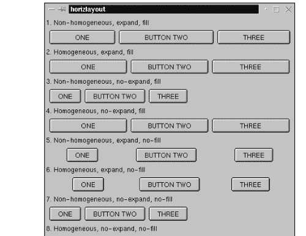
**图 3-15：** 八种 `KContainerLayout` 水平配置设置

从第 28 行开始的 `add()` 方法创建了一个描述性标签和一个水平 `KContainerLayout` 控件，然后将它们添加到作为第一个参数传入的 `KContainerLayout` 控件中。该方法首先创建了一个描述选项设置的 `QString`。字符串的构建从第 33 行将数字转换为字符串开始。第 34 行到 45 行测试三个布尔设置中的每一个，并相应地追加文本。该字符串在第 47 行用于构建一个 `QLabel`，在第 49 行，该标签被打包到主窗口 `KContainerLayout` 的顶部。

水平容器在第 51 行到 57 行之间创建。请注意，在第 51 行中，将包含它的 `KContainerLayout` 命名为父控件。它没有被分配名称，但在第 53 行被设置为水平方向。尺寸和放置是否为 `homogeneous`（同构/均匀）在第 54 行根据传入该方法的参数进行设置。第 59 行到 72 行创建了三个按钮并将其添加到水平 `KContainerLayout` 控件中。另外两个配置设置 `expand`（扩展）和 `fill`（填充）在调用 `packStart()` 时使用，该函数将按钮添加到容器中。

每个按钮在创建时都将容器作为其父级，但仍必须将其打包到容器中才能显示。例如，第一个按钮在第 59 行创建，使用内部 `KContainerLayout` 控件作为其父级。这是必要的，因为消息在控件层级结构中上下传播，按钮与其容器之间必须进行通信。然后，在第 67 行，按钮被打包到容器的起始位置，从而被分配在容器内的具体位置。通过这两个关系，容器可以从按钮读取尺寸信息，计算按钮要填充的精确尺寸和位置，并将任何必要的信息写回按钮。

这三个设置——`homogeneous`、`expand` 和 `fill`——都涉及容器中控件的尺寸和位置，且它们的含义略有不同。在图 3-15 中，你可以看到每种设置的效果。表 3-1 简要描述了每种设置的效果。

### 表 3-1：KContainerLayout 中的控件定位选项

| 选项 | 描述 |
| :--- | :--- |
| homogeneous | 如果为 `TRUE`，容器中的所有控件将被分配相同的空间。无论控件的实际尺寸如何，都会进行此分配。如果为 `FALSE`，每个控件将确定自己的空间需求，控件的尺寸可能会有所不同。无论 `TRUE` 还是 `FALSE`，窗口的扩展和收缩都会根据分配的空间来扩展和收缩控件。 |
| expand | 如果为 `TRUE`，控件应利用容器为其分配的所有空间。 |
| fill | 如果 expand 为 `TRUE`，将 fill 设置为 `TRUE` 将指示控件调整自身大小，以填充容器为其分配的整个空间。 |

## 控件嵌套（垂直）

这个示例与前一个相同，唯一的区别是方向。该程序将按钮控件组织在列中。顶层控件是一个水平方向的 `KContainerLayout` 控件，其中填充了一组垂直方向的 `KContainerLayout` 控件。

本示例中的每一列的配置方式与前一个示例中对应的行相同。如图 3-16 所示，每个垂直 `KContainerLayout` 都进行了编号。你可以使用这些数字将图 3-16 所示的垂直布局的外观与其在图 3-15 中显示的水平对应项进行比较。

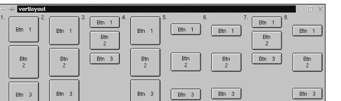
**图 3-16：** 八种 KContainerLayout 垂直配置设置

### Main

```cpp
1 /* main.cpp */
2 #include <kapp.h>
3 #include "vertlayout.h"
4
5 int main(int argc,char **argv)
6 {
7     KApplication app(argc,argv,"vertlayout");
8     VertLayout *vertlayout = new VertLayout();
9     vertlayout->show();
10    app.setMainWidget(vertlayout);
11    return(app.exec());
12 }
```

### VertLayout 头文件

```cpp
1 /* vertlayout.h */
2 #ifndef VERTLAYOUT_H
3 #define VERTLAYOUT_H
4
5 #include <qwidget.h>
6 #include <kcontainer.h>
7 #include <qpushbutton.h>
8
9 class VertLayout: public QWidget
10 {
11 public:
12     VertLayout(QWidget *parent=0,const char *name=0);
13     ~VertLayout();
14 private:
25 void add(KContainerLayout *layout,int count,
26                 bool homogeneous,bool expand,bool fill);
27 };
28 #endif
```

### VertLayout

```cpp
1 /* vertlayout.cpp */
2 #include "vertlayout.h"
3 #include <qlabel.h>
4
5 VertLayout::VertLayout(QWidget *parent,const char *name)
6     : QWidget(parent,name)
7 {
8     KContainerLayout *layout = new KContainerLayout(this,
9         NULL,
10        KContainerLayout::Horizontal,
11        FALSE,
12        3,
13        0,
14        TRUE);
15
16     int count = 1;
17     add(layout,count++,FALSE,TRUE,TRUE);
18     add(layout,count++,TRUE,TRUE,TRUE);
19     add(layout,count++,FALSE,FALSE,TRUE);
20     add(layout,count++,TRUE,FALSE,TRUE);
21     add(layout,count++,FALSE,TRUE,FALSE);
22     add(layout,count++,TRUE,TRUE,FALSE);
23     add(layout,count++,FALSE,FALSE,FALSE);
24     add(layout,count++,TRUE,FALSE,FALSE);
25
26     layout->setSizeToFit();
27 }
28 void VertLayout::add(KContainerLayout *outer,int count,


```cpp
29 bool homogeneous, bool expand, bool fill)

30 {

31     QPushButton *button;

32

33     KContainerLayout *inner = new KContainerLayout(outer,

34         NULL,

35         KContainerLayout::Vertical,

36         homogeneous,

37         5,

38         0,

39         TRUE);

40

41     QString str(tr("%1, %2").arg(count));

42     QLabel *label = new QLabel(str, outer);

43     label->setMinimumSize(label->sizeHint());
```

```cpp
24 label->setMaximumSize(label->sizeHint());

25 outer->packStart(label, FALSE, FALSE);

26

27 button = new QPushButton(inner);

28 button->setText("Btn 1");

29 button->setMinimumSize(button->sizeHint());

30 inner->packStart(button, expand, fill);

31

32 button = new QPushButton(inner);

33 button->setText("Btn\n2");

34 button->setMinimumSize(button->sizeHint());

35 inner->packStart(button, expand, fill);

36

37 button = new QPushButton(inner);

38 button->setText("Btn 3");

39 button->setMinimumSize(button->sizeHint());

40 inner->packStart(button, expand, fill);

41

42 inner->sizeToFit();

43 outer->packStart(inner, TRUE);

44 }

45 VertLayout::~VertLayout() { }
```

`VertLayout` 类与前一个示例中展示的 `HorizLayout` 类非常相似。唯一的实际区别在于方向。在本例中，顶级窗口是一个水平的 `KContainerLayout` 对象，其中填充了标签和垂直的 `KContainerLayout` 对象。为了节省空间，描述性标签被简化为了数字。

作为顶级组件使用的 `KContainerLayout` 组件在第 8 行被创建，方向为水平。第 16 行至 24 行重复调用 `add()` 方法，以创建一组带有标签的垂直 `KContainerLayout` 组件，并将它们添加到顶级 `KContainerLayout` 组件中。

从第 28 行开始的 `add()` 方法创建了一个标签和一个垂直方向的 `KContainerLayout` 组件，并将它们（标签在前）添加到作为第一个参数传递的 `KContainerLayout` 组件中。在第 52 行至 55 行创建的第二个按钮，其文本中包含一个换行符，因此文本将显示为两行——这使得第二个按钮比其他按钮更大，旨在演示在组件尺寸不统一的情况下，偏移和尺寸调整是如何工作的。

## 总结

配置组件的大小和位置有多种方式。其中一些会自动调整组件大小，而另一些则不会。同样，某些技术允许组件重叠，而另一些则不允许。你应该熟悉所有选项，以便应用最适合你应用程序的方案。

- 可以使用具体的 `x` 和 `y` 坐标以及高度和宽度，来硬编码组件的位置和大小。
- 可以将一个虚拟网格安装为主窗口，然后像在墙上挂画一样将组件挂在上面。
- 可以指示组件更改其大小和形状，以适应其在窗口中的位置。这些更改受限于组件的最大和最小尺寸设置。
- 水平和垂直盒子（box）以线性行和列的形式显示组件。可以在每对组件之间指定间距和定位控制。
- 水平和垂直布局（layout）以线性行和列的形式显示组件。此外，由于布局本身也是一个组件，它可以被包含在另一个布局、盒子或网格中；甚至可以通过具体的 `x` 和 `y` 坐标进行放置。

本章涵盖了顶级窗口的创建。下一章将描述弹出窗口的构建。所有用于定位顶级窗口组件的工具和技术，同样可以用于定位弹出窗口中的组件。基本区别在于，对话框（也称为 popup）是一个临时窗口，用于向用户显示信息并返回某种响应。

## 显示弹出对话框

### 本章内容

- 创建并显示一个简单的对话框
- 实现一个槽（slot）以接收来自对话框的信号（signal）
- 在对话框中创建用于传输至槽的信号
- 扩展 `KDialogBase` 以创建自定义对话框
- 弹出 `KMessageBox` 中定义的便捷对话框

对话框是一个窗口（通常是临时的），用于向用户显示某些特定信息，或向用户请求某些特定信息，或者两者兼而有之。许多对话框非常简单，只需要“是”或“否”的回答，但对话框相当复杂且包含多个显示和接收信息的组件页面的情况也屡见不鲜。

对话框由应用程序中的一个窗口作为父级，但它在显示屏上始终作为一个独立的窗口出现。它看起来与顶级窗口非常相似，唯一的区别是缺少一些窗口控件和菜单。

由于存在多个可扩展的对话框基类，你的程序可以通过多种方式创建对话框。此外，基类本身也可以用来创建相对简单的对话框。本章将描述并提供使用基类创建对话框的各种方式及其示例，每种方式都有其自身的优点。

## 简单的对话框

`QDialog` 组件是一个你可以用来创建对话框的基类，但它也可以直接用于处理简单组件的布局。`QDialog` 是一个简单的组件，除了其空白窗口外不显示任何内容，但它可以作为你组件的容器，并具有在独立窗口中显示自己的能力。它还提供了一些内置功能，用于响应你可能决定添加到窗口中的按钮。

以下示例演示了创建和显示对话框的基础知识。它展示了 `QDialog` 对象如何能够作为对话框显示。图 4-1 左侧显示了顶级窗口。它包含一个单一按钮，用于弹出右侧所示的对话框。该对话框有一个按钮，可用于关闭对话框。

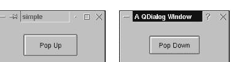

**图 4-1**：顶级窗口及其弹出的对话框

### Main

```cpp
1 /* simple.cpp */

2 #include <kapp.h>

3 #include "toplevel.h"

4

5 int main(int argc, char **argv)

6 {

7     KApplication app(argc, argv, "simple");

8     TopLevel toplevel;

9     toplevel.show();

10    app.setMainWidget(&toplevel);

11    return(app.exec());

12 }
```

程序的主线创建了一个 `KApplication` 对象，然后创建并安装一个 `TopLevel` 组件作为其顶级窗口。

### TopLevel 头文件

```cpp
1 /* toplevel.h */

2 #ifndef TOPLEVEL_H

3 #define TOPLEVEL_H

4

5 #include <qwidget.h>

6

7 class TopLevel: public QWidget

8 {

9     Q_OBJECT

10 public:

11     TopLevel(QWidget *parent=0, const char *name=0);

12 private slots:

13     void popupDialog();

14 };

15

16 #endif
```

`TopLevel` 窗口是一个组件，因为它继承自 `QWidget`，并且它被设计用于作为程序的顶级窗口。类定义仅包含一个构造函数和响应按钮所需的最小量信息。第 9 行的 `Q_OBJECT` 宏必须存在，才能实现第 12 行和 13 行所声明的槽。每当按钮被点击时，槽方法 `popupDialog()` 就会被调用。

**注意**：信号和槽的概念在第 2 章中介绍，并在本章稍后部分详细讨论。

### TopLevel

```cpp
1 /* toplevel.cpp */

2 #include "toplevel.h"

3 #include <qdialog.h>

4 #include <qpushbutton.h>

5

6 TopLevel::TopLevel(QWidget *parent, const char *name)

7     : QWidget(parent, name)

8 {

9    setMinimumSize(200, 80);

10   setMaximumSize(200, 80);

11

12   QPushButton *button = new QPushButton("Pop Up", this);

13   button->setGeometry(50, 20, 100, 40);

14   connect(button, SIGNAL(clicked()),

15           this, SLOT(popupDialog()));

16 }

17 void TopLevel::popupDialog()

18 {

19   QDialog *dialog = new QDialog(0, "popup", FALSE);

20   dialog->setCaption("A Dialog Window");

21   dialog->setMinimumSize(200, 80);

22   dialog->setMaximumSize(200, 80);

23

24   QPushButton *button =

25       new QPushButton("Pop Down", dialog);

26   button->setGeometry(50, 20, 100, 40);

27   connect(button, SIGNAL(clicked()),

28           dialog, SLOT(accept()));

29

30   dialog->show();

31 }
```

这段代码包含了 `TopLevel` 组件的定义，包括创建和显示对话框的方法。

`TopLevel` 组件是程序的主窗口。在其构造函数中，第 9 行和 10 行设置了窗口的大小，使其无法更改——最大并且最小尺寸限制被设置为相同的值。在第 12 行，创建了一个按钮。第 13 行的几何设置指定了按钮的高度和宽度，以及其左上角的位置。第 14 行对 `connect()` 的调用请求将源自按钮中 `clicked()` 信号的信号传递给 `TopLevel` 控件中的 `popupDialog()` 槽。

第 17 行的 `popupDialog()` 方法将在用户每次点击 `TopLevel` 窗口中的按钮时被调用。第 19 到 22 行实例化了一个 `QDialog` 控件并指定其尺寸和标题。要在其中包含的按钮在第 24 到 26 行被创建并设置尺寸。第 27 行对 `connect()` 的调用请求将源自该按钮上 `clicked()` 的信号传递给 `QDialog` 控件内部的 `accept()` 方法。由于 `QDialog` 控件能够出现在自己的窗口中，因此第 30 行对 `show()` 的调用会导致其出现。

`QDialog` 控件足够灵活，以至于你几乎可以专门使用它来创建所有的对话框。你可以使用槽方法 `accept()` 来关闭对话框（如本例所示），也可以调用 `reject()` 来关闭它。这两个方法唯一的区别在于，其中一个将结果设置为 `TRUE`，而另一个将其设置为 `FALSE`。这些设置对应于对话框中常见的“取消”和“确定”按钮。

当通过调用 `accept()` 或 `reject()` 关闭对话框时，对话框并不会被销毁。它的窗口是通过调用 `hide()` 方法关闭的。这样做的好处是你的程序可以读取设置，但你必须自行处理对话框的释放。然而，如果你打算反复使用同一个对话框，你可以创建一次，然后根据需要对其进行 `hide()` 和 `show()`。

这个简单的示例有两个问题。首先，你可以弹出任意数量的对话框。每次点击“弹出”按钮时，都会生成一个新的对话框并让其独立运行。其次，当你使用“关闭”按钮关闭对话框时，它并没有被删除。它通过调用 `accept()` 被关闭，但它仍然存在，且程序不再持有指向它的指针。

> 有一个 `KDialog` 控件与 `QDialog` 控件几乎完全相同，不同之处在于它增加了一些用于设置窗口标题以及修改尺寸和边距的方法。任何可以使用 `QDialog` 的地方都可以使用 `KDialog`。

## 使用信号与槽

本示例使用 `QDialog` 作为基类来构建一个接收字符字符串的对话框；如果选择了“确定”或“应用”按钮，则会将字符串发送到程序的主窗口，主窗口将其安装为标题栏的新标题。图 4-2 左侧的窗口显示了主窗口及其单个按钮。右侧是弹出用于接收新标题字符串的对话框。

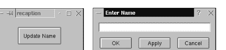

**图 4-2：** 一个按钮及其弹出的对话框

### 主程序（Mainline）

```cpp
1 /* responder.cpp */

2 #include <kapp.h>

3 #include "mainwidget.h"

4

5 int main(int argc, char **argv)

6 {

7     KApplication app(argc, argv, "responder");

8     MainWidget mainwidget;

9     mainwidget.show();

10    app.setMainWidget(&mainwidget);

11    return(app.exec());

12 }
```

该复合程序的主程序非常简单。在第 8 和 9 行创建了一个 `MainWidget` 对象，第 10 行将其安装为主窗口。

### MainWidget 头文件

```cpp
1 /* mainwidget.h */

2 #ifndef MAINWIDGET_H

3 #define MAINWIDGET_H

4

5 #include <qwidget.h>

6 #include <qstring.h>

7

8 class MainWidget: public QWidget

9 {

10   Q_OBJECT

11 public:

12   MainWidget(QWidget *parent=0, const char *name=0);

13 private slots:

14   void popupEnterName();

15   void changeCaption(QString &);

16 };

17

18 #endif
```

这是将作为本示例主窗口的控件的头文件。除了在第 12 行定义的构造函数外，该类仅包含一对槽。名为 `popupEnterName()` 的槽会导致对话框弹出，而名为 `changeCaption()` 的槽将更改此控件的标题文本（即主窗口的标题）。

由于该类中包含槽，因此必须使用 `Q_OBJECT` 宏作为类的第一个成员。`Q_OBJECT` 中的定义允许此头文件作为标准 C++ 代码正常编译，并插入一些特殊信息，供元对象编译器（MOC）使用，以生成处理槽和信号所需的代码。

### MainWidget 实现

```cpp
1 /* mainwidget.cpp */

2 #include "mainwidget.h"

3 #include "entername.h"

4 #include <qpushbutton.h>

5

6 MainWidget::MainWidget(QWidget *parent, const char *name)

7 {

8     : QWidget(parent, name)

9

10    setMinimumSize(200, 80);

11    setMaximumSize(200, 80);

12

13    QPushButton *button =

14    new QPushButton("Update Name", this);

15    button->setGeometry(50, 20, 100, 40);

16    connect(button, SIGNAL(clicked()),

17        this, SLOT(popupEnterName()));

18 }

19 void MainWidget::popupEnterName()

20 {

21    EnterName *dialog = new EnterName(0, "entername");

22    connect(dialog, SIGNAL(captionString(QString &)),

23        this, SLOT(changeCaption(QString &)));

24    dialog->exec();

25    delete dialog;

26 }

27 void MainWidget::changeCaption(QString &caption)

28 {

29    setCaption(caption);

30 }
```


该类被用作应用程序的主窗口。它出现在本节开头图 4-2 的左侧窗口中。

这个类是一个控件，因为它在第 7 行继承自 `QWidget`。第 9 和 10 行将最大和最小尺寸设置为相同的值，使其成为一个固定尺寸的控件。

`QPushButton` 在第 12 和 13 行创建，并在第 14 行被放置在窗口中心。该按钮有一个名为 `clicked()` 的信号，每当按钮被鼠标点击时就会发出。第 15 行对 `connect()` 的调用规定，每当发出 `clicked()` 信号时，将调用本地槽方法 `popupEnterName()`。

> **注意** 将一个方法用作槽并不会妨碍它被直接调用。在本例中，`popupEnterName()` 方法由信号调用，但它也可以同样方便地在同一个类的另一个方法内部被调用，甚至从其他类中调用。槽是一个普通方法，其附加特性是它可以被用来接收信号。

第 18 行的 `popupEnterName()` 方法创建了一个 `EnterName` 对话框，以提示用户输入新标题。第 21 行对 `connect()` 的调用建立了一个连接，使得对话框中的 `captionString()` 信号将调用 `changeCaption()` 本地槽。

第 23 行对 `exec()` 的调用弹出对话框，并且是以对话框独占输入队列的方式弹出。该方法在用户通过选择“确定”或“取消”按钮做出响应之前不会返回。在用户响应之前，由本应用程序拥有的任何其他窗口都不会接收到鼠标或键盘信号。在第 23 行做出选择后，对话框被删除。

第 26 行的槽方法仅在用户选择对话框上的“确定”按钮时被调用，从而为主窗口设置新的标题字符串。

## EnterName 头文件

```cpp
1 /* entername.h */

2 #ifndef ENTERNAME_H

3 #define ENTERNAME_H

4

5 #include <qdialog.h>

6 #include <qlineedit.h>

7 #include <qpushbutton.h>

8

9 class EnterName: public QDialog

10 {

11     Q_OBJECT

12 private:

13     QLineEdit *lineedit;

14     QPushButton *okButton;

15     QPushButton *applyButton;

16     QPushButton *cancelButton;

17 public:

18     EnterName(QWidget *parent=0,const char *name=0);

19 private slots:

20     void okButtonSlot();

21     void applyButtonSlot();

22     void cancelButtonSlot();

23 signals:

24     void captionString(QString &);

25 };

26

27 #endif
```

此头文件定义了用于提示输入新标题字符串的弹出对话框类。它拥有接收按钮点击的槽，以及一个随新标题文本一起发送的信号。

该类在第 9 行定义为一个对话框基类，它使用 `QDialog` 作为超类。任何包含槽或信号的类必须将 `Q_OBJECT` 宏作为其第一个成员。第 13 到 16 行为用于构建对话框成员的四个控件声明了存储空间。

第 19 到 22 行指定了槽的名称。`okButtonSlot()`、`applyButtonSlot()` 和 `cancelButtonSlot()` 方法是接收按钮点击的本地槽。第 24 行的信号 `captionString()` 是每当用户提交新标题字符串时将发出的信号。

## EnterName 实现

```cpp
1 /* entername.cpp */

2 #include "entername.h"

3 #include <qdialog.h>

4 #include <qlayout.h>

5

6 EnterName::EnterName(QWidget *parent,const char *name)

7           : QDialog(parent,name,TRUE)

8 {

9     QString caption("Enter Name");

10    setCaption(caption);

11

12    QVBoxLayout *vLayout = new QVBoxLayout(this,10);

13

14    lineedit = new QLineEdit(this);

15    vLayout->addWidget(lineedit);

16

17    QHBoxLayout *hLayout = new QHBoxLayout(vLayout,10);

18

19    okButton = new QPushButton("OK",this);

20    connect(okButton,SIGNAL(clicked()),

21             this,SLOT(okButtonSlot()));

22    hLayout->addWidget(okButton);

23

24    applyButton = new QPushButton("Apply",this);

25    connect(applyButton,SIGNAL(clicked()),

26             this,SLOT(applyButtonSlot()));

27    hLayout->addWidget(applyButton);
```

## 第 4 章 ✦ 显示弹出对话框

```cpp
28

29    cancelButton = new QPushButton("Cancel",this);

30    connect(cancelButton,SIGNAL(clicked()),

31        this,SLOT(cancelButtonSlot()));

32    hLayout->addWidget(cancelButton);

33 }

34 void EnterName::okButtonSlot()

35 {

36    QString str = linedit->text();

37    emit captionString(str);

38    accept();

39 }

40 void EnterName::applyButtonSlot()

41 {

42    QString str = linedit->text();

43    emit captionString(str);

44 }

45 void EnterName::cancelButtonSlot()

46 {

47    reject();

48 }
```

这个类是一个对话框，它允许用户输入文本，并可以通过选择相应的按钮将该文本设置为窗口的标题：

第 6 行 `EnterName` 构造函数的参数被传递给了第 7 行的 `QDialog` 父类。`QDialog` 的第三个参数为 `TRUE`，指定这是一个模态对话框。

第 12 行创建的垂直布局框被用作窗口的主容器。第 14 行创建的 `QLineEdit` 对象被插入到垂直布局框的顶部。随后创建了一个作为垂直布局框子项的水平布局框，这使得水平布局框成为垂直布局框的下一个成员（恰好位于 `QLineEdit` 控件下方）。将三个按钮插入水平布局框（第 22、27 和 32 行）后，便完成了之前图 4-2 右侧所示的布局。

第 20、25 和 30 行对 `connect()` 方法的调用将按钮的 `clicked()` 信号与其相应的槽关联起来。

每当点击 OK 按钮时，都会调用第 34 行的槽方法 `okButtonSlot()`。通过调用 `QLineEdit` 对象的 `text()` 方法来检索用户输入的字符串。第 37 行发出了名为 `captionString()` 的信号。发出信号的语法与调用方法几乎相同，但在前面加上了 `emit` 关键字，以表明这不是一个方法调用，而是一个正在发送的信号。该槽方法在第 38 行调用 `accept()` 后结束。此次调用将内部标志设置为 `TRUE`，表示用户给出了肯定响应，然后调用 `hide()` 使控件不可见。

每当点击 Apply 按钮时，都会调用第 40 行的 `applyButtonSlot()` 方法。与 OK 按钮槽的操作一样，字符串被检索并使用信号方法 `captionString()` 发出。由于对话框需要保持可见，因此不调用 `accept()` 方法。

每当点击 Cancel 按钮时，都会调用第 45 行的 `cancelButtonSlot()` 方法。用户取消了更改标题名的操作，因此不发送任何信号。调用 `reject()` 将内部标志设置为 `FALSE` 并关闭对话框窗口。

```makefile
Makefile

1   INCL = -I$(QTDIR)/include -I$(KDEDIR)/include

2   CFLAGS = -O2 -fno-strength-reduce

3   LFLAGS = -L$(QTDIR)/lib -L$(KEDIR)/lib -L/usr/X11R6/lib

4   LIBS = -lkcore -lkdeui -lqt -lX11 -lXext -ldl

5   CC = g++

6

7   recaption: recaption.o mainwidget.o moc_mainwidget.o \

8             entername.o moc_entername.o

9   $(CC) $(LFLAGS) -o recaption recaption.o \

10            mainwidget.o moc_mainwidget.o \

11            entername.o moc_entername.o $(LIBS)

12

13  recaption.o: recaption.cpp mainwidget.h

14  mainwidget.o: mainwidget.cpp mainwidget.h

15  moc_mainwidget.cpp: mainwidget.h

16  $(QTDIR)/bin/moc mainwidget.h -o moc_mainwidget.cpp

17  entername.o: entername.cpp entername.h

18  moc_entername.cpp: entername.h

19  $(QTDIR)/bin/moc entername.h -o moc_entername.cpp

20

21  clean:

22      rm -f recaption

23      rm -f *.o

24      rm -f moc_*

25  .SUFFIXES: .cpp

26

27  .cpp.o:

28      $(CC) -c $(CFLAGS) $(INCL) -o $@ $<
```

如这段代码所示，当源文件中包含槽或信号时，`Makefile` 中需要包含特殊的条目。代码不仅被直接编译，还由 MOC 编译器翻译成一个需要单独编译的源文件。

第 7 行列出了链接 `recaption` 的依赖项。不仅有与 `.cpp` 文件名相对应的 `.o` 文件，还有一些以四个字符 `moc_` 开头的其他 `.o` 文件。任何将 `Q_OBJECT` 作为第一个成员的类（即任何具有槽和/或信号的类）都必须由 MOC 编译器处理其头文件。第 15 行的依赖关系指定源文件 `moc_mainwidget.cpp` 依赖于源文件 `mainwidget.h`。第 16 行的命令使用 `mainwidget.h` 作为输入来创建 `moc_mainwidget.cpp`。然后 `moc_mainwidget.cpp` 被编译成 `moc_mainwidget.o` 并包含在第 9 行的链接中。

## 信号与槽检查清单

创建信号和槽其实非常简单。大部分工作通过宏和 MOC 编译器实现了自动化。发出信号的过程与接收信号的槽完全分离。一个对象可以发出任意数量的信号，而无需知道有多少个槽（如果有的话）在接收它们。以下步骤涵盖了创建信号并将其发送到槽中所需的所有操作：

1. 在类定义的第一行添加 `Q_OBJECT` 宏。虽然类中的其他项需要分号结尾，但 `Q_OBJECT` 宏不需要，不过如果你愿意也可以加上（因为编译器会直接忽略分号）。例如，名为 `Sender` 的类定义将这样开始：

   ```cpp
   class Sender {

       Q_OBJECT

       ...

   };
   ```

   一个对象中可以定义任意数量的槽和信号，但 `Q_OBJECT` 宏只需出现一次。

2. 将信号的原型添加到类定义中。例如，如果信号要发送一个字符串对象作为参数，原型将如下所示：

   ```cpp
   signals:

       void newName(QString &name);
   ```

   这里不需要公共（public）或私有（private）规范，因为不存在实际的方法——这仅仅是对将用于调用接收槽的原型的定义。

3. 使用 `emit` 语句来调用所有监听该信号的槽方法。其语法与调用本地方法相同，唯一的区别是调用前要加上 `emit` 关键字：

   ```cpp
   QString name;

   emit newName(name);
   ```

   请注意，信号方法没有实际的函数体定义。`emit` 命令不会寻找本地方法，而是调用所有已连接到此信号的槽方法列表中的每一个槽方法。

创建槽并将其连接到信号需要执行以下步骤：

1. 与信号相同，槽要求 `Q_OBJECT` 宏出现在类定义的顶部：

   ```cpp
   class Receiver {

       Q_OBJECT

       ...

   };
   ```

2. 将槽方法的原型添加到类定义中。原型必须与它要接收的信号相同（即具有相同的参数集）。因为槽是方法，既可以直接调用也可以用作槽，因此槽方法可以设为公开可用：

   ```cpp
   public slots:

       void nameChange(QString &name);
   ```

   更常见的情况是槽仅用于接收信号，此时你可以将其声明为私有：

   ```cpp
   private slots:

       void nameChange(QString &name);
   ```

3. 包含定义将发出信号的类的头文件。

4. 编写创建将发出信号的类实例的代码。该实例必须存在，你才能将槽附加到信号上。

5. 将槽连接到信号。这通常在构造函数中完成，但如果对象稍后才构造，也可以稍后完成。调用 `connect()` 方法会将你的槽添加到每当发出特定信号时将被调用的方法列表中。`connect()` 的调用如下所示：

   ```cpp
   connect(sender, SIGNAL(newName(QString &)), 

           this, SLOT(nameChange(QString &)));
   ```

   前两个参数指定信号的来源，后两个参数指定目标槽。宏 `SIGNAL()` 和 `SLOT()` 都需要完整的方法原型，且这些原型必须保证调用其中一个方法所使用的参数集与另一个方法所能使用的参数集相同。

每当使用 `emit` 语句发送信号时，就完全等同于你的程序直接调用了每一个槽方法。也就是说，你的程序无法继续执行槽函数（slot），直到该槽方法返回。因此，通常应尽可能保持槽方法内部处理的简单，以免导致信号发射者暂停。信号的发射者可能是用户界面进程，从而导致操作出现缓慢或卡顿的现象。

您必须非常小心，不要创建循环调用情况。如果一个槽方法发射了一个信号，而该信号直接或间接地执行了一个方法，该方法又发射了一个被原始信号接收的信号，那么信号将不断调用槽函数，导致您的程序崩溃。例如，如果名为 `first()` 的方法发射信号 A，信号 A 被槽函数 `second()` 接收，槽函数 `second()` 发射信号 B，而名为 `first()` 的槽函数接收信号 B，此时就存在循环情况，循环将一直持续直到程序崩溃（或者用户失去耐心）。

您还需要意识到，如果在 `connect()` 语句中的槽方法和信号方法没有匹配的参数，直到程序运行尝试解析引用时，您才不会收到错误消息。为了避免这种情况，请确保对您对槽和信号所做的每次添加或更改进行测试。唯一的错误消息是在 `connect()` 方法未能找到配对时写入控制台（标准输出）的一段字符串——之后，程序将静默忽略这些信号。而且，只有在从命令行运行应用程序时才能看到控制台输出。

## KDialogBase

`KDialogBase` 控件在某种程度上可以被视为一个对话框工具包。大多数对话框都采用相同的基本形式：一组数据输入控件以及底部的一行按钮。考虑到这一点，`KDialogBase` 控件在设计时内置了一行按钮。以下示例程序显示了 `KDialogBase` 的默认配置，如图 4-3 所示。

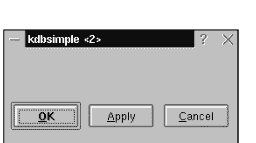

图 4-3：`KDialogBase` 窗口的默认按钮

### Mainline

```cpp
1 /* kdbsimple.cpp */

2 #include <kapp.h>

3 #include "mainwidget.h"

4

5 int main(int argc,char **argv)

6 {

7     KApplication app(argc,argv,"kdbsimple");

8     MainWindow mainwidget;

9     mainwidget.show();

10    app.setMainWindow(&mainwidget);

11    return(app.exec());

12 }
```


在第 8 行创建的`mainwidget`在第 10 行被分配为应用程序的主窗口。

## MainWindow Header

```cpp
1 /* mainwidget.h */
2 #ifndef MAINWIDGET_H
3 #define MAINWIDGET_H
4
5 #include <qwidget.h>
6
7 class MainWindow: public QWidget
8 {
9     Q_OBJECT
10 public:
11     MainWindow(QWidget *parent=0,const char *name=0);
12 private slots:
13     void popupKdb();
14 };
15
16 #endif
```

主窗口只有两个方法。一个是构造函数，另一个是将连接到按钮的槽函数。`popupKdb()` 的目的是显示`KDialogBase`窗口。

## MainWindow

```cpp
1 /* mainwidget.cpp */
2 #include "mainwidget.h"
3 #include <qpushbutton.h>
4 #include <kdialogbase.h>
5
6 MainWindow::MainWindow(QWidget *parent,const char *name)
7     : QWidget(parent,name)
8 {
9     setMinimumSize(200,80);
10    setMaximumSize(200,80);
11
12    QPushButton *button =
13    new QPushButton("Popup",this);
14    button->setGeometry(50,20,100,40);
15    connect(button,SIGNAL(clicked()),
16            this,SLOT(popupKdb()));
17 }
18
19 void MainWindow::popupKdb()
20 {
21    KDialogBase *dialog = new KDialogBase(this,
22                "kdblwidget",TRUE);
23    dialog->exec();
24    delete dialog;
25 }
```

此控件被用作示例的主窗口。它仅包含一个“Popup”按钮以及在点击该按钮时执行的槽函数。

每当点击按钮时，就会构造`KDialogBase`控件（见第 21 行）。第 23 行对`exec()`的调用会导致对话框出现，如前文图 4-3 所示。当窗口首次出现时，OK 按钮被选中，因此只需按下 Return 或 Enter 键就等同于点击 OK。此外，如从图中可见，每个按钮都有一个指定的加速字符——例如，输入 Alt-C 等同于选择 Cancel 按钮。

除非您将槽函数连接到 Apply 按钮，否则它没有任何作用。Cancel 和 OK 按钮都会关闭对话框。要按预期使用这些按钮，只需将 OK 和 Apply 按钮连接到能够接收并处理对话框数据的槽函数即可。

## KDialogBase 按钮

前面的示例显示了三个默认按钮是 OK、Apply 和 Cancel。然而，还包含一些其他按钮，您最多可以添加三个自定义按钮。接下来的示例将显示图 4-4 所示的窗口，其中显示了全部八个按钮。

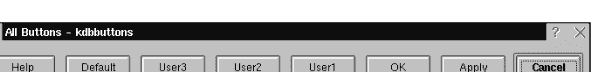

**图 4-4：** KDialogBase 类的按钮顺序

该程序的头文件和主线部分与前一个示例完全相同。程序之间唯一的区别是传递给`KDialogBase`构造函数的参数集。

## MainWidget

```cpp
1 /* mainwidget.cpp */
2 #include "mainwidget.h"
3 #include <qpushbutton.h>
4 #include <kdialogbase.h>
5
6 MainWidget::MainWidget(QWidget *parent,const char *name)
7     : QWidget(parent,name)
8 {
9     setMinimumSize(200,80);
10    setMaximumSize(200,80);
11
12    QPushButton *button =
13        new QPushButton("Popup",this);
14    button->setGeometry(50,20,100,40);
15    connect(button,SIGNAL(clicked()),
16            this,SLOT(popupKdb()));
17 }
18
19 void MainWidget::popupKdb()
20 {
21    QString caption("All Buttons");
22    QString button1("User1");
23    QString button2("User2");
24    QString button3("User3");
25
26    int buttons = KDialogBase::Ok
27                | KDialogBase::Apply
28                | KDialogBase::Cancel
29                | KDialogBase::Help
30                | KDialogBase::Default
31                | KDialogBase::User1
32                | KDialogBase::User2
33                | KDialogBase::User3;
34
35    KDialogBase *dialog = new KDialogBase(
36        this, // parent
37        "kdbwidget", // name
38        TRUE, // modal
39        caption, // caption
40        buttons, // buttonmask
41        KDialogBase::Cancel, // default button
42        FALSE, // separator
43        button1, // button caption
44        button2, // button caption
45        button3); // button caption
46    dialog->exec();
47    delete dialog;
48 }
```

此控件被用作应用程序的主窗口。它包含一个按钮，点击时会显示`KDialogBase`窗口。

每当点击主窗口按钮（第 12 行创建的那个）时，槽方法`popupKdb()`就会执行。`KDialogBase`控件由第 35 行的构造函数创建。如前一个示例所示，所有参数都有定义的默认值，但本示例为其中每一个都指定了具体值。这些具名参数在表 4-1 中进行了描述。

### 表 4-1：KDialogBase 构造函数接收的参数

| 参数 | 描述 |
| :--- | :--- |
| parent | 父控件。通常是导致`KDialogBase`弹出窗口的控件。默认值为`NULL`。 |
| name | 控件的内部名称。用于内部目的和生成错误消息。默认值为`NULL`。 |
| modal | 如果设置为`TRUE`，该控件以模态方式显示。如果设置为`FALSE`，则为非模态。默认值为`TRUE`。 |
| caption | 窗口顶部标题栏中的标题文本。默认值为应用程序名称。 |
| button mask | 一组单位标志，指定该对话框要激活哪些按钮。默认值为`Ok`、`Apply`和`Cancel`这三个按钮集。 |
| default button | 对话框首次出现时被选中（因此对 Return 或 Enter 键有响应）的按钮。默认值为`Ok`按钮。 |
| separator | 如果为`TRUE`，则在按钮上方绘制一条分隔线。如果为`FALSE`，则没有分隔线。默认值为`FALSE`。 |
| button caption | 出现在用户定义按钮表面的文本。默认值为`NULL`，这将导致用户按钮为空白。 |

如前文图 4-4 所示，按钮的顺序由`KDialogBase`控件内部决定。您可以决定包含哪些按钮，但它们的出现顺序将始终按照所示顺序。

表 4-2 列出了`KDialogBase`控件中所有可用的按钮。接收这些按钮中的任何一个所发送的信息，只需将您的槽方法（slot method）连接到相应的`KDialogBase`信号方法即可。导致对话框关闭的按钮还会设置一个指示结果的状态码。要检索结果代码，请在前面示例的第 46 行和第 47 行之间插入一行，如下所示：

```cpp
dialog->exec();
int resultCode = dialog->result();
delete dialog;
```

## 表 4-2：KDialogBase 的按钮与信号

| 按钮 | 信号 | 备注 |
| :--- | :--- | :--- |
| Apply (应用) | `applyClicked()` | 如果同时指定了 Apply 按钮和 Try 按钮，则 Try 按钮不会出现。 |
| Cancel (取消) | `closeClicked()` | 此按钮可用作 Close 按钮的替代。 |
| Close (关闭) | `closeClicked()` | 如果同时指定了 Close 和 Cancel，则仅显示 Close。结果代码被设置为`FALSE`且对话框关闭。 |
| Default (默认) | `defaultClicked()` | |
| Help (帮助) | `helpClicked()` | 此按钮还会调用`invokeHTMLHelp()`方法，以显示由`setHelp()`调用定义的帮助文本。 |
| No (否) | `noClicked()` | 当对话框处于消息框模式时，此按钮替代 User1 按钮出现。结果代码被设置为`FALSE`且对话框关闭。 |
| OK (确定) | `okClicked()` | 结果代码被设置为`TRUE`且对话框关闭。 |
| Try (尝试) | `tryClicked()` | 此按钮可用作 Apply 按钮的替代。 |
| User1 (用户1) | `user1Clicked()` | 构造函数中的一个参数指定其标签。在消息框模式下，此按钮被 No 按钮取代。 |
| User2 (用户2) | `user2Clicked()` | 构造函数中的一个参数指定其标签。在消息框模式下，此按钮被 Yes 按钮取代。 |
| User3 (用户3) | `user3Clicked()` | |
| Yes (是) | None | 当对话框处于消息框模式时，此按钮替代 User2 按钮出现。结果代码被设置为`TRUE`且对话框关闭。 |

## 使用 KDialogBase 构建对话框

以下示例程序使用`KDialogBase`作为对话框的基类，该对话框允许用户指定一行文本和两个整数值。在本例中，输入到对话框中的信息用于更改标签显示的文本以及调整主窗口的大小。图 4-5 显示了主窗口（左侧）在由对话框（右侧）中显示的值重新配置后的样子。

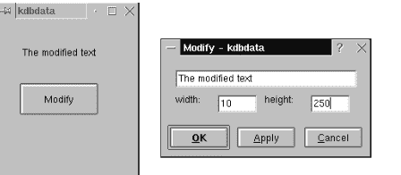

**图 4-5：** 主窗口由对话框修改。

### 主程序 (Mainline)

```cpp
1 /* kdbdata.cpp */
2 #include <kapp.h>
3 #include <kcmdlineargs.h>
4 #include "mainwidget.h"
5 
6 int main(int argc, char **argv)
7 {
8   KCmdLineArgs::init(argc, argv, "kdbdata",
9              "KDialogBase demo", "0.0");
10  KApplication app;
11  MainWidget *mainwidget;
12  mainwidget->show();
13  app.setMainWidget(&mainwidget);
14  return(app.exec());
15 }
```

程序的主线在第 11 行创建了一个`MainWidget`，并在第 13 行将其设置为应用程序的主窗口。

`KApplication`对象在第 10 行被创建且没有参数。这样做是因为在第 8 行调用了`KCmdLineArgs`类的静态`init()`方法。`KCmdLineArgs`类存储命令行参数以及其他信息，并使其可供应用程序的其他部分使用。

第 15 章提供了关于`KCmdLineArgs`功能的更多细节。

## MainWindow 头文件

```cpp
1 /* mainwidget.h */
2 #ifndef MAINWIDGET_H
3 #define MAINWIDGET_H
4
5 #include <qwidget.h>
6 #include <qpushbutton.h>
7 #include <qlabel.h>
8
9 class MainWidget: public QWidget
10 {
11   Q_OBJECT
12 public:
13   MainWidget(QWidget *parent=0,const char *name=0);
14 private:
15   QLabel *label;
16   QPushButton *button;
17 private slots:
18   void popupKdb();
19   void slotSettings(QString &,int,int);
20 };
21
22 #endif
```

该控件是程序的主窗口。它仅包含一个按钮和一个标签。名为`popupKdb()`的槽用于弹出对话框。槽`slotSettings()`接收对话框返回的值。

## MainWidget 实现

```cpp
1 /* mainwidget.cpp */
2 #include "mainwidget.h"
3 #include "modify.h"
4 #include <qpushbutton.h>
5 #include <qdialogbase.h>
6
7 MainWidget::MainWidget(QWidget *parent,const char *name)
8   : QWidget(parent,name)
9   {
10     setMinimumSize(200,140);
11
12     QString str("Modify Me");
13     label = new QLabel(str,this);
14     label->setAlignment(Qt::AlignCenter);
15     label->setGeometry(50,20,100,40);
16
17  button = new QPushButton("Modify",this);
18  button->setGeometry(50,80,100,40);
19  connect(button,SIGNAL(clicked()),
20        this,SLOT(popupKdb()));
21  resize(10,10);
22 }
23 void MainWidget::popupKdb()
24 {
25  Modify *modify = new Modify(this,"modify");
26  connect(
27      modify,SIGNAL(signalSettings(QString &,int,int)),
28      this,SLOT(slotSettings(QString &,int,int)));
29  modify->exec();
30 }
31 }
32 void MainWidget::slotSettings(QString &str,
33  int height,int width)
34 {
35  resize(width,height);
36  label->setText(str);
37 }
```

该控件用作程序的主窗口。它仅包含一个标签和一个按钮。按钮用于弹出对话框。

第 18 到 20 行创建了一个按钮，将其放置在窗口中，并将其`clicked()`信号连接到本地槽`popupKdb()`。从第 23 行开始的`popupKdb()`槽创建了一个`Modify`对话框，并将其名为`signalSettings()`的信号连接到名为`slotSettings()`的本地槽。随后调用`exec()`，该方法显示对话框并等待其关闭。

从第 32 行开始的槽名称`slotSettings()`接受三个值作为参数，并使用这些值来指定主窗口的大小以及主窗口标签中要显示的文本。第 35 行的`resize()`调用不能将尺寸减小到第 10 行指定的最小值以下，但可以将任一维度调整为更大的尺寸。

## Modify 头文件

```cpp
```


# 修改对话框头文件

```cpp
/* modify.h */
#ifndef MODIFY_H
#define MODIFY_H

#include <kdialogbase.h>
#include <qlineedit.h>
#include <qpushbutton.h>

class Modify: public KDialogBase
{
    Q_OBJECT
public:
    Modify(QWidget *parent=0,const char *name=0);
private:
    QLineEdit *lineedit;
    QLineEdit *width;
    QLineEdit *height;
private slots:
    void slotSendValues();
signals:
    void signalSettings(QString ,int,int);
};

#endif
```

这是对话框的头文件。它直接继承自`KDialogBase`类，并定义了自己的槽和信号。

此设计声明了名为`slotSendValues()`的槽，用于接收对话框上按钮的响应。每当`slotSendValues()`执行时，它将发送名为`signalSettings()`的信号，其中包含新的文本和尺寸。

对话框本身直接继承自`KDialogBase`，因此大部分工作已经完成。只需要添加提示、数据输入控件，以及在用户指定新值时要传输的信号，如下面的代码所示。

## Modify 实现

```cpp
/* modify.cpp */
#include "modify.h"
#include <qlayout.h>
#include <qlabel.h>

Modify::Modify(QWidget *parent,const char *name)
    : KDialogBase(parent,name,TRUE,"Modify")
{
    QWidget *mainWidget = new QWidget(this,"modifymain");

    QVBoxLayout *vLayout = new QVBoxLayout(mainWidget,10);

    lineedit = new QLineEdit(mainWidget);
    vLayout->addWidget(lineedit);

    QHBoxLayout *hLayout = new QHBoxLayout();
    vLayout->addLayout(hLayout);

    QLabel *wLabel = new QLabel("width:",this);
    wLabel->setAlignment(Qt::AlignCenter);
    hLayout->addWidget(wLabel);
    width = new QLineEdit(mainWidget);
    width->setMaximumWidth(50);
    hLayout->addWidget(width);
    QLabel *hLabel = new QLabel(":height:",this);
    hLabel->setAlignment(Qt::AlignCenter);
    hLayout->addWidget(hLabel);
    height = new QLineEdit(mainWidget);
    height->setMaximumWidth(50);
    hLayout->addWidget(height);

    connect(this,SIGNAL(okClicked(void)),
            this,SLOT(slotSendValues(void)));
    connect(this,SIGNAL(applyClicked(void)),
            this,SLOT(slotSendValues(void)));

    setMainWidget(mainWidget);
}
void Modify::slotSendValues()
{
    QString text = lineedit->toText();
    int w = (width->text()).toInt();
    int h = (height->text()).toInt();
    emit signalSettings(text,h,w);
}
```

从第 6 行开始的构造函数将其参数传递给基类。在对基类的调用中添加了两个参数，以指定模态对话框并为窗口分配标题。

第 9 行创建了一个空控件。该控件由第 11 行创建的垂直布局（vertical box layout）填充。在第 13 和 14 行中，一个`QLineEdit`控件被插入到垂直布局的顶部。第 16 行创建了一个水平布局，用于放置进入垂直控件第二个框中的控件。在第 20 到 30 行中，这个水平布局被`QLabel`和`QLineEdit`控件填充。在第 37 行，填充好的控件被作为主窗口添加到对话框中。

按钮部分采用默认设置，因此对话框上出现的按钮是对话框中包含的 OK、Cancel 和 Apply 按钮。每当选择 Cancel 按钮时，对话框将关闭。在本例中，不需要对 Cancel 按钮做出响应；其信号被忽略。第 32 行和第 34 行的两个`connect()`方法调用将导致名为`slotSendValues()`的槽被执行。连接是从`this`到`this`的，因为槽和信号都在同一个对象中——信号是继承的，而槽是本地定义的。

从第 39 行开始的槽方法收集用户输入的信息，并使用这些数据发射一个信号。从`lineedit`检索的文本将用于修改标签的标题，因此它可以保持原样。宽度和高度的`QLineEdit`对象同样返回`QString`对象，但这些对象通过调用`toInt()`被转换为`int`值。

## 另一种获取 KDialogBase 数据的方法

以下示例程序是对前一个程序的修改。有时，让程序从对话框中检索值，而不是通过槽（slots）和信号（signals）将它们连接起来会更加方便。这种技术仅适用于你直到对话框关闭后才需要从中检索数据的情况。

在之前的示例中，“应用（Apply）”按钮可以在不关闭窗口的情况下将数据提供给应用程序。本示例删除了“应用”按钮，创建了如图 4-6 所示的窗口，并删除了所有槽和信号（除了主线中弹出对话框的那个）。

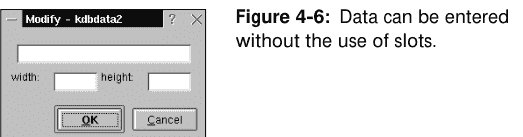

由于无法使用“应用”按钮，因此必须将其删除。为此，将`modify.cpp`的第 6 行和第 7 行改为以下内容：

```cpp
Modify::Modify(QWidget *parent,const char* name)
: KDialogBase(parent,name,TRUE,"Modify.Ok | Cancel")
```

下一步是删除`mainwidget.cpp`的第 23 行到第 37 行，并用以下方法替换：

```cpp
void MainWidget::popupKdb()
{
    Modify *modify = new Modify("this.modify");
    modify->exec();
    if(modify->result() == TRUE) {
        QString text = modify->getText();
        int height = modify->getHeight();
        int width = modify->getWidth();
        resize(width,height);
        label->setText(text);
    }
    delete modify;
}
```

当对话框关闭时，`exec()`方法返回。如果使用`exec()`按钮将其关闭，则`result()`的返回值是`TRUE`；否则为`FALSE`。如果结果为`TRUE`，则从控件中提取用户输入的数据，并用于调用`resize()`和`setText()`以修改显示内容。由于`exec()`方法直到对话框关闭才会返回，因此除了使用槽以外，没有其他方法可以确定点击了哪个不会关闭窗口的按钮——这就是为什么没有“应用”按钮的原因。

为了能够检索这些值，`Modify`类中添加了以下方法：

```cpp
QString Modify::getText()
{
    return(lineedit->text());
}

int Modify::getWidth()
{
    return((width->text()).toInt());
}

int Modify::getHeight()
{
    return((height->text()).toInt());
}
```

> **注意** 从对话框中获取信息有多种方法。你使用的方法取决于你的应用程序。例如，你可以将一个结构体的地址传递给对话框并让它填充数据。或者你可以结合使用槽、信号和直接读取值。你甚至可以让对话框将其输出写入配置文件，供程序以后使用。

## KMessageBox 继承自 KDialogBase

一种非常常见的对话框类型是显示一两行文本，用户通过简单的“是”或“否”回答来响应对话框，或者简单地按下关闭对话框的按钮。`KDialogBase`类有一个专门适用于编写消息框对话框的构造函数，而`KMessageBox`类使用这个特殊构造函数来实现一组常用的消息框对话框。

这些消息框全部是模态的，要求用户在继续操作前必须做出响应。此外，每一个消息框都通过一个简单的函数调用弹出，该调用会阻塞（不返回调用者），直到用户响应并关闭消息框。这简化了编程，因为你只需要在代码的任何位置插入一个对静态函数的调用即可。

以下示例演示了九种消息框各一个。如图 4-7 所示，主窗口为九个对话框各设置了一个按钮。窗口底部有一个标签，每当对话框有响应时，其文本就会更新。图中显示最后一次选择的是“Yes”按钮。

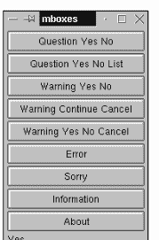

**图 4-7：** 选择一个按钮以显示消息框。

### 主线代码 (Mainline)

```cpp
/* main.cpp */
#include <kapp.h>
#include <kcmdlineargs.h>
#include "mboxes.h"

int main(int argc,char **argv)
{
    KCmdlineArgs::init(argc,argv,"mboxes",
                       "Message Boxes", "0.0");
    KApplication app;
    Mboxes mboxes;
    mboxes.show();
    app.setMainWindowWidget(&mboxes);
    return(app.exec());
}
```

主线代码创建了一个*Mboxes*对象，并将其安装为应用程序的主窗口。

### Mboxes 头文件

```cpp
/* mboxes.h */
#ifndef MBOXES_H
#define MBOXES_H

#include <qwidget.h>
#include <qlabel.h>

class Mboxes: public QWidget
{
    Q_OBJECT
public:
    Mboxes(QWidget *parent=0,const char *name=0);
private:
    QLabel *label;
private slots:
    void button1();
    void button2();
    void button3();
    void button4();
    void button5();
    void button6();
    void button7();
    void button8();
    void button9();
};

#endif
```

该类的定义为九个按钮中的每一个都包含一个槽，并且包含一个将放置在显示区域底部的标签。

### Mboxes 实现

```cpp
/* mboxes.cpp */
#include "mboxes.h"
#include <qpushbutton.h>
#include <qmessagebox.h>
#include <qlayout.h>

Mboxes::Mboxes(QWidget *parent,const char *name)
    : QWidget(parent,name)
{
    QPushButton *button;
    QVBoxLayout *layout = new QVBoxLayout(this,3);

    button = new QPushButton("Question Yes No",this);
    layout->addWidget(button);
    connect(button,SIGNAL(clicked()),this,SLOT(button1()));

    button = new QPushButton("Question Yes No List",this);
    layout->addWidget(button);
    connect(button,SIGNAL(clicked()),this,SLOT(button2()));

    button = new QPushButton("Warning Yes No",this);
    layout->addWidget(button);
    connect(button,SIGNAL(clicked()),this,SLOT(button3()));

    button =
        new QPushButton("Warning Continue Cancel",this);
    layout->addWidget(button);
    connect(button,SIGNAL(clicked()),this,SLOT(button4()));

    button = new QPushButton("Warning Yes No Cancel",this);
    layout->addWidget(button);
    connect(button,SIGNAL(clicked()),this,SLOT(button5()));

    button = new QPushButton("Error",this);
    layout->addWidget(button);
    connect(button,SIGNAL(clicked()),this,SLOT(button6()));

    button = new QPushButton("Sorry",this);
    layout->addWidget(button);
    connect(button,SIGNAL(clicked()),this,SLOT(button7()));

    button = new QPushButton("Information",this);
    layout->addWidget(button);
    connect(button,SIGNAL(clicked()),this,SLOT(button8()));

    button = new QPushButton("About",this);
    layout->addWidget(button);
    connect(button,SIGNAL(clicked()),this,SLOT(button9()));

    label = new QLabel("--",this);
    layout->addWidget(label);
    resize(10,10);
}

void Mboxes::button1()
{
    int result = QMessageBox::questionYesNo(this,
                                            "Are you sure you want to delete\nall ",
                                            "the files in this directory?",
                                            "questionYesNo");
    switch(result) {
    case QMessageBox::Yes:
        label->setText(QString("Yes"));
        break;
    }
}
```


```cpp
65      case QMessageBox::No:

66        label->setText(QString("No"));

67        break;

68    }

69 }

70 

71 void Mboxes::button2()

72 {

73    QStringList list;

74    list.append("fork");

75    list.append("spoon");

76    list.append("knife");

77    int result = QMessageBox::questionYesNoList(this,

78    "Are you sure you want to delete\nall ",

79    "the items shown in the list?",

80    list,

81    "questionYesNoList");

82    switch(result) {

83	case KMessageBox::Yes:

84		label->setText(QString("Yes"));

85		break;

86	case KMessageBox::No:

87		label->setText(QString("No"));

88		break;

89	}

90 }

91 

92 void Mboxes::button3()

93 {

94	int result = KMessageBox::warningYesNo(this,

95		"Reset all status codes?",

96		"warningYesNo");

97	switch(result) {

98		case KMessageBox::Yes:

99			label->setText(QString("Yes"));

100			break;

101		case KMessageBox::No:

102			label->setText(QString("No"));

103			break;

104	}

105 }

106 

107 void Mboxes::button4()

108 {

109	int result = KMessageBox::warningContinueCancel(this,

110		"Overwrite the existing file?",

111		"warningContinueCancel",

112		QString("Overwrite"));

113	switch(result) {

114		case KMessageBox::Continue:

115			label->setText(QString("Continue"));

116			break;

117		case KMessageBox::Cancel:

118			label->setText(QString("Cancel"));

119			break;

120	}

121 }

122 

123 void Mboxes::button5()

124 {

125	int result = KMessageBox::warningYesNoCancel(this,

126		"Quitting without saving the file could result\n"

127		"in loss of data. Save before quitting?",

128		"warningYesNoCancel");

129	switch(result) {

130		case KMessageBox::Yes:

131			label->setText(QString("Yes"));

132			break;

133		case KMessageBox::No:

134			label->setText(QString("No"));

135			break;

136		case KMessageBox::Cancel:

```

```cpp
132    label->setText(QString("Cancel"));

133    break;

134    }

135 }

136 void Mboxes::button6()

137 {

138    KMessageBox::error(this,

139    "Unable to save configuration data.");

140 }

141 void Mboxes::button7()

142 {

143    KMessageBox::sorry(this,

144    "The file you specified contains no data.");

145 }

146 void Mboxes::button8()

147 {

148    KMessageBox::information(this,

149    "Pressing Esc will clear the window.");

150 }

151 void Mboxes::button9()

152 {

153    KMessageBox::about(this,

154    "This is a simple about-box that can\n"

155    "contain several lines of text");

156 }
```

用作主窗口的部件创建了九个按钮和一个标签，并将它们全部打包在一个垂直布局框中。每个按钮的 `clicked()` 信号都连接到一个本地槽函数，该槽函数将创建并显示其中一个消息框。

第 11 行创建了一个垂直布局框。第 13 行到 51 行创建了构成主窗口的九个按钮和标签。

第 13 行到 15 行创建了一个按钮并将其连接到第 54 行的 `button1()` 槽函数。第 56 行对 `questionYesNo()` 方法的调用会弹出如图 4-8 所示的消息框并等待用户响应。第 59 行的字符串参数是消息框窗口的标题。函数的返回值由所选按钮决定。所有消息框的所有返回值都定义在 `KMessageBox` 类中。

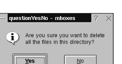
图 4-8：一个“是/否”问题消息框

> **注意**
> 消息框的返回值**不是**布尔值。它们不能用于测试 `TRUE` 或 `FALSE` 的表达式中。

第 61 行的 `switch` 语句决定 `questionYesNo()` 的返回值是“是”还是“否”。主窗口底部的标签将更新为一个表示结果的字符串。

对于所有消息框，显示的尺寸和形状都由您控制，因为您可以决定文本行的长度和显示的行数。`questionYesNo()` 消息框的文本在第 57 行和 58 行声明。文本被定义为一个单一字符串，在需要换行的地方插入 `'\n'` 字符。幸运的是，C++ 会将分行编写的字符串拼接成一个大字符串，因此在代码中编写文本会更加方便。

第 17 行到 19 行创建了一个按钮并将其连接到从第 69 行开始的 `button2()` 槽函数。这个在第 75 行创建并在图 4-9 中显示的消息框，像前一个示例一样询问一个“是”或“否”的问题，并且还包含一个显示项目列表的窗口。当您需要询问涉及一组项目的问题时，请使用此消息框。用户无法添加或删除项目——是对整个列表的统一批准或拒绝。

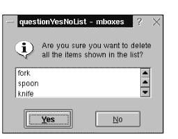
图 4-9：一个“是/否”列表问题消息框

显示的列表是在第 71 行创建的 `QStringList` 对象，并在第 72 行到 74 行中填充了三个字符串。这个字符串列表在第 78 行被用作参数，第 79 行的字符串指定了窗口标题。

第 21 行到 23 行创建了一个按钮并将其连接到从第 89 行开始的 `button3()` 槽函数。第 91 行对 `warningYesNo()` 的调用与第 56 行对 `questionYesNo()` 的调用非常相似，唯一的区别是随文本显示的图形不同。警告消息框如图 4-10 所示。

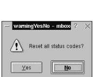
图 4-10：一个“是/否”警告消息框

第 25 行到 28 行创建了一个按钮并将其连接到从第 103 行开始的 `button4()` 槽函数。`warningContinueCancel()` 消息框旨在告知用户某些操作即将开始，使用户能够决定是继续还是停止。如图 4-11 所示的这个示例警告用户，继续操作将覆盖现有文件。

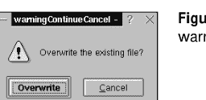
图 4-11：一个“继续/取消”警告消息框

某些消息框允许用户覆盖按钮标签。在这个示例中，第 108 行用作参数的 `QString` 将按钮标签从默认的“继续”改为“覆盖”。更改按钮上的标题不会改变返回值——第 110 行的 `case` 语句匹配名为 `Continue` 的值，而该值是由标签为“覆盖”的按钮发出的。

有时简单的“是”或“否”回答是不够的。第 30 行到 32 行创建了一个按钮并将其连接到从第 118 行开始的 `button5()` 槽函数。这种情况经常出现。例如，考虑消息“准备删除文件。您是否希望同时删除子目录？”用户需要能够指定同时删除目录和文件，或者保留目录，或者取消整个操作。第 120 行调用 `warningYesNoCancel()` 创建的消息框如图 4-12 所示。

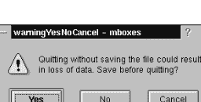
图 4-12：一个“是/否/取消”警告消息框

第 34 行到 36 行创建了一个按钮并将其连接到从第 136 行开始的 `button6()` 槽函数。第 138 行对 `error()` 的调用创建了如图 4-13 所示的消息框。这个消息框没有返回值，因为它仅在程序无法执行其通常应该能够执行的操作时使用。

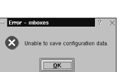
图 4-13：一个错误消息框

第 38 行到 40 行创建了一个按钮并将其连接到从第 141 行开始的 `button7()` 槽函数。第 143 行调用了 `sorry()` 函数并显示了图 4-14 所示的窗口。这适用于程序无法继续，但原因在程序控制之外（例如缺少文件）的情况。

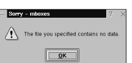
图 4-14：一个“抱歉”消息框

第 42 行到 44 行创建了一个按钮并将其连接到从第 146 行开始的 `button8()` 槽函数。第 148 行调用了 `information()` 函数并显示了图 4-15 所示的窗口。这旨在包含不影响处理但用户可能需要知道的信息。

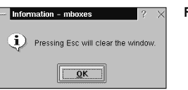
图 4-15：一个信息消息框

第 46 行到 48 行创建了一个按钮并将其连接到从第 151 行开始的 `button9()` 槽函数。这是所有消息框中最简单的一个。它没有图形装饰，也不返回任何值。图 4-16 显示了第 153 行调用 `about()` 创建的消息框。该函数被命名为 `about()` 意味着它可以被（或曾经被）用作一个非常简单的“关于”对话框。（下一章将描述一个更复杂的“关于”对话框。）

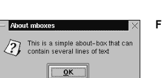
图 4-16：一个简单的消息框

## 总结

您可以通过多种方式创建对话框。对话框的主窗口始终是一个单一的部件，它可以是任何部件。这样，显示对话框、检索用户输入和布局窗口的机制都可以分别处理。本章涵盖的主要内容包括：

- 如果您对对话框有特殊要求，可以使用 `QDialog` 或 `KDialog` 作为构建基础来创建对话框。
- `KDialogBase` 通过提供一组标准按钮和一个布局管理器来简化对话框的构建，您可以使用该管理器插入自己的部件。
- 对话框可以发送包含用户输入数据的信号，您的程序可以使用槽函数接收该数据。
- `KMessageBox` 类是一组静态函数的集合，每个函数都使用 `KDialogBase` 来构建标准对话框。

除了最简单的程序外，每个程序都会使用对话框。它们可以通过按钮弹出（如本章所述），可以通过程序内部的事件弹出（例如写入文件时出错），或者在用户选择菜单或工具栏项时弹出。标准化程序外观和感觉的一种方法是利用内置对话框集。本章描述了一些简单的内置对话框，下一章将讨论一些更复杂的对话框。

# 预定义对话框

## 本章内容

- 创建标准的“关于”对话框
- 允许用户选择文件名
- 在一个对话框中分页浏览多个部件
- 显示任务的完成百分比

KDE 和 Qt 中都定义了相当多的对话框。本章将演示一些更为通用的对话框。虽然你可以将对话框类作为基类来创建自定义版本，但通常情况下，你只需要以所需的模式和选项实例化该对话框即可。本章并未包含所有的对话框，一些特殊用途的对话框在其他章节中有所涉及。例如，`KFontDialog` 在第 10 章“字体”中描述，而 `KColorDialog` 在第 11 章“颜色”中描述。

## “关于”对话框

每个完整的应用程序都有一个“关于”框，这是一个显示有关软件传承之相关信息的窗口。这里是程序员们可以让自己的名字以像素形式出现的地方。“关于”框可以通过按钮弹出，但通常也作为菜单选项提供。

`KAboutDialog` 类非常灵活。它拥有一系列可选的部分，你可以选择包含或排除。它还具有两个独立的构造函数，赋予了它两种不同的基本外观。默认情况下，几乎唯一出现的是用于关闭它的 OK 按钮。为了获得更大的灵活性，它继承自 `KDialogBase` 类，该类也提供了一系列选项。

> **交叉引用**：`KDialogBase` 类在第 4 章中描述。


`KAboutDialog` 类有两个构造函数。除了具有不同的参数集外，它们 each 将对话框置于不同的模式，并且每种模式都有其自己的选项集。构造函数 I 采用标准 Qt 格式，具有三个常规参数：父部件、内部名称以及窗口是否为模态：

```cpp
KAboutDialog(QWidget *parent,const char *name=0,
                bool modal=true)
```

构造函数 II 有许多参数（大多数具有默认值），包括一些可用于配置对话框以在多种配置之一中显示自身的标志：

```cpp
KAboutDialog(int dialoglayout,const QString &caption,
                int buttonMask,int defaultButton,QWidget *parent=0,
                const char *name=0,bool modal=false,bool separator=false,
                const QString &user1=QString::null,
                const QString &user2=QString::null,
                const QString &user3=QString::null)
```

以下示例同时使用了构造函数 I 和构造函数 II 来创建并显示一些可能的配置。除了这里演示的之外，还有许多其他可能的组合，但它们都是基于这些基本主题的变体。程序的主窗口如图 5-1 所示，由可用于弹出四个版本的“关于”对话框的按钮组成。

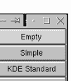
图 5-1：用于选择四个“关于”对话框的按钮

### ShowAbout 头文件

```cpp
1 /* showabout.h */
2 #ifndef SHOWABOUT_H
3 #define SHOWABOUT_H
4 
5 #include <qwidget.h>
6 
7 class ShowAbout: public QWidget
8 {
9   Q_OBJECT
10 public:
11   ShowAbout(QWidget *parent=0,const char *name=0);
12 private slots:
13   void emptyAbout();
14   void simpleAbout();
15   void kdeStandardAbout();
16   void appStandardAbout();
17 };
18
19 #endif
```

这个类唯一的目的是弹出请求的对话框，因此它只有一个构造函数和将被四个按钮使用的槽。每个槽都会弹出一个不同版本的“关于”对话框。

### ShowAbout 实现

```cpp
1  /* showabout.cpp */
2  #include <kapp.h>
3  #include <qpushbutton.h>
4  #include <qlayout.h>
5  #include <kaboutdialog.h>
6  #include <kcmdlineargs.h>
7  #include "showabout.h"
8
9  int main(int argc, char **argv)
10 {
11    KCmdLineArgs::init(argc, argv, "showabout",
12            "About Boxes", "0.0");
13    KApplication app;
14    ShowAbout showabout;
```


```cpp
15    showabout.show();

16    app.setMainWidget(&showabout);

17    return(app.exec());

18 }

19

20 ShowAbout::ShowAbout(QWidget *parent, const char *name)

21 : QWidget(parent, name)

22 {

23    QPushButton *button;

24    QVBoxLayout *box = new QVBoxLayout(this);

25

26    button = new QPushButton("Empty", this);

27    box->addWidget(button);

28    connect(button, SIGNAL(clicked()),

29            this, SLOT(emptyAbout()));

30

31    button = new QPushButton("Simple", this);

32    box->addWidget(button);

33    connect(button, SIGNAL(clicked()),

34            this, SLOT(simpleAbout()));

35

36    button = new QPushButton("KDE Standard", this);

37    box->addWidget(button);

38    connect(button, SIGNAL(clicked()),

39            this, SLOT(kdeStandardAbout()));

40

41    button = new QPushButton("App Standard", this);

42    box->addWidget(button);

43    connect(button, SIGNAL(clicked()),

44            this, SLOT(appStandardAbout()));

45

46    resize(10, 10);

47    box->activate();

48 }

49

50 void ShowAbout::emptyAbout()

51 {

52    KAboutDialog *about = new KAboutDialog("0.about");

53    about->exec();

54 }

55

56 void ShowAbout::simpleAbout()

57 {

58    KAboutDialog *about = new KAboutDialog("0.about");

59

60    about->setCaption("Simple About Configuration");

61    about->setVersion("Version 0.0.1");

62

63    QPixmap logo;

64    if(logo.load("tinylogo.png"))

65        about->setLogo(logo);

66

67    about->setAuthor("Bertha D Blues",

68        "bertha@belugalake.com",

69        "http://www.belugalake.com",

70        "Mallet Operator");

71

72    about->setMaintainer("Tony Stryovie",

73        "stryovie@belugalake.com",

74        "http://www.belugalake.com",

75        "Finder of Lost Code");

76

77    about->addContributor("Walter Heater",

78        "heat@belugalake.com",

79        "http://www.belugalake.com",

80        "Asker of Questions");

81

82    about->exec();

83 }

84

85 void ShowAbout::kdeStandardAbout()

86 {

87    KAboutDialog *about = new KAboutDialog(

88    KAboutDialog::AbtKDEStandard,

89    "KDE Standard Configuration",

90    KDialogBase::Ok | KDialogBase::Help,

91    KDialogBase::Ok,

92    this,

93    "about",

94    TRUE);

95

96    about->setTitle("The example that is all about About");

97    about->setCaption("KDE Standard About");

98    about->setImage("penguin1.png");

99    about->setImageBackgroundColor(QColor("red"));

100   about->setImageFrame(TRUE);

101

102   about->addTextPage("Purpose",

103       "This program is intended to provide an "

104       "example that\ndemonstrates how to use "

105       "the KAboutDialog.");

106   about->addTextPage("Version",

107       "Version 0.0.1 pre-alpha experimental.\n"

108       "Saturday, April 1, 2000");

109

110   about->exec();

111 }

112

113 void ShowAbout::appStandardAbout()

114 {

115    KAboutDialog *about = new KAboutDialog(

116        KAboutDialog::AbtAppStandard,

117        "App Configuration",

118        KDialogBase::Ok,

119        KDialogBase::Ok,

120        this,

121        "about",

122        TRUE);

123

124    about->setTitle("The example that is about About");

125    about->setProduct("ShowAbout",

126        "0.0.1 Pre-Alpha",

127        "Bertha D Blues",

128        "Saturday, April 1, 2000");

129

130    about->addTextPage("Purpose",

131        "This program is intended to provide an "

132        "example that\ndemonstrates how to use "

133        "the KAboutDialog.");

134    about->addTextPage("Version",

135        "Version 0.0.1 pre-alpha experimental.\n"

136        "Saturday, April 1, 2000");

137

138    about->exec();

139 }
```

第 9 行到 18 行是程序的主线，它创建了 `ShowAbout` 类的实例，将其作为要在主窗口中使用的部件插入，并等待其退出。

从第 20 行开始的 `ShowAbout` 构造函数将按钮组织在一个垂直框中。四个按钮中的每一个都连接到显示 `KAboutDialog` 版本的槽函数之一。

第 49 行的槽 `emptyAbout()` 显示图 5-2 中所示的空 `KAboutDialog`。在此默认版本中，唯一显示的是关闭对话框的 OK 按钮，以及一个通常用于存放应用程序 logo 图形的区域。在第 51 行创建的对话框是模态的，因此在第 52 行调用的 `exec()` 方法在用户关闭窗口之前不会返回。

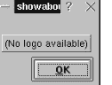

图 5-2：一个空的 `KAboutDialog`

从第 54 行开始的槽 `simpleAbout()` 使用了与第 52 行相同的构造函数（用于创建图 5-3 中所示的空 `KAboutDialog`）。随后调用 `KAboutDialog` 的方法来插入可显示的信息。表 5-1 列出了专门指定用于构造函数 1 对话框的方法。第 58 行对 `setCaption()` 的调用定义了窗口标题栏的标题，而对 `setVersion()` 的调用则指定了要插入到窗口顶部的版本号。

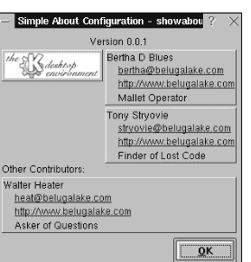

图 5-3：`KAboutDialog` 可以展示开发者的姓名。

## 表 5-1：构造函数 I 的 `KAboutDialog` 方法

| 方法 | 用途 |
| :--- | :--- |
| `setLogo()` | 指定要作为标志（logo）显示的 pixmap 图像 |
| `setAuthor()` | 指定软件作者的姓名、电子邮件地址、URL 和负责的工作 |
| `setContributor()` | 指定软件个人贡献者的姓名、电子邮件地址、URL 和负责的工作 |
| `setMaintainer()` | 指定当前支持该软件的个人的姓名、电子邮件地址、URL 和负责的工作 |
| `setVersion()` | 指定当前的软件版本 |

第 61 行创建的 `QPixmap` 从第 62 行名为 `tinylogo.png` 的文件中加载其图像信息。第 63 行对 `setLogo()` 的调用将该图像设置为显示在窗口左上角的标志。

第 65 行到 78 行通过调用 `setAuthor()`、`setMaintainer()` 和 `addContributor()` 来添加姓名和地址。作者和维护者只能各有一个，但贡献者可以有任意数量。虽然插入这些姓名的方法各不相同，但所有方法都具有相同的参数集。第一个字符串是姓名，第二个是该人员的 URL，第三个是电子邮件地址，最后一个是对该人员在开发团队中所承担工作的描述。一旦显示，URL 和电子邮件地址都是激活的 —— 也就是说，你可以点击它们来发送电子邮件或加载网页。

从第 82 行开始的槽函数 `kdeStandardAbout()` 使用构造函数 II 来创建图 5.4 中显示的自定义对话框。第 85 行定义的名为 `AbtKDEStandard` 的标志集指定了用于构成显示的元素。表 5-2 列出了这些标志以及每个标志包含的元素。第 87 行的参数用于告知超类 `KDialogBase` 应该出现哪些按钮。在本例中，有一个 OK 按钮（将自动关闭窗口）和一个 Help 按钮。第 88 行指定的按钮是对话框首次打开时被选中的按钮。

**交叉引用** 第 4 章中关于 `KDialogBase` 的描述解释了如何使 OK 和 Help 按钮实现其预期功能。

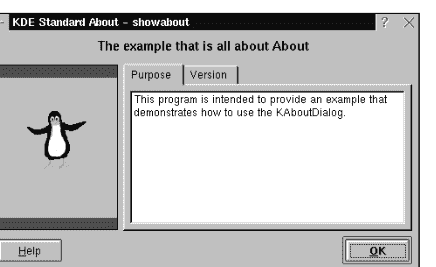

图 5-4：一个带有图像和文本页的 `KAboutDialog`

## 表 5-2：配置显示的 `KAboutDialog` 标志

| 标志名称 | 描述 |
| :--- | :--- |
| `AbtAppStandard` | 启用 `AbtTabbed`、`AbtTitle` 和 `AbtProduct` 的组合。 |
| `AbtImageAndTitle` | 启用 `AbtPlain` 和 `AbtImageOnly` 的组合。 |
| `AbtImageLeft` | 将图像显示在窗口的左侧。 |
| `AbtImageOnly` | 将图像显示在中心，因为旁边没有其他项目。 |
| `AbtImageRight` | 将图像显示在窗口的右侧。 |
| `AbtKDEStandard` | 启用 `AbtTabbed`、`AbtTitle` 和 `AbtImageLeft` 的组合。 |
| `AbtPlain` | 不显示任何默认的 `KAboutDialog` 组件。这可以与其他标志结合使用以自定义对话框。 |
| `AbtProduce` | 显示应用程序名称、版本、作者和日期。 |
| `AbtTabbed` | 显示一个或多个带有标签页的窗口集合，允许用户在它们之间切换。 |
| `AbtTitle` | 在标题栏正下方显示标题。 |

在设置标志告知对话框应显示哪些元素之后，你仍然需要提供这些元素。表 5-3 列出了使用构造函数 II 时可用 Method。

## 表 5-3：构造函数 II 的 `KAboutDialog` 方法

| 方法 | 用途 |
| :--- | :--- |
| `addContainer()` | 添加一个 `KAboutContainer`，你可以用它来显示文本和图像 |
| `addContainerPage()` | 将 `KAboutContainer` 添加为一个标签页。你可以用它来显示文本和图像。 |
| `addPage()` | 向标签页集合中添加一个空页。你可以用它来包含任何你想显示的部件（widget）。 |
| `addTextPage()` | 向标签页集合中添加一个文本页 |
| `setImage()` | 指定要作为标志显示的图像 |
| `setImageBackground()` | 指定显示图像时用作背景和填充的颜色 |
| `setImageFrame()` | 启用或禁用图像周围的边框。默认启用。 |
| `setProduct()` | 设置定义应用程序名称、版本、作者和日期的四个字符串 |
| `setTitle()` | 在窗口顶部（就在标题栏下方）插入标题 |

第 93 行对 `setTitle()` 的调用是必要的，因为标志设置中包含了 `AbtTitle`，因此必须提供要显示的标题。第 94 行对 `setCaption()` 的调用是一个传递给超类的调用，用于设置顶部标题栏的标题文本。

第 95 行到 97 行的方法调用分别指定了：用作标志的图像文件名；图像背后的背景颜色；以及图像周围是否绘制边框。背景颜色将填充窗口未覆盖的任何区域（如前文图 5-4 所示），并且也将作为图像任何透明部分的填充色。默认情况下绘制边框，但可以使用 `setImageFrame()` 方法将其关闭。

`addTextPage()` 方法可以使用多次 —— 为你希望添加到标签页窗口的每个页面调用一次。正如你在第 99 行和 103 行的示例中所见，唯一的参数是作为标签页标签的字符串，以及作为正文的文本。必须插入换行符 `\n` 以将文本格式化为多行。

从第 109 行开始的名为 `appStandardAbout()` 的槽函数产生了图 5-5 所示的对话框。

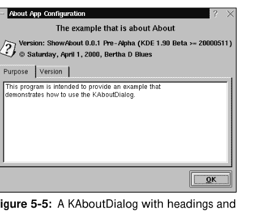

图 5-5：一个带有标题和标签页的 `KAboutDialog`

窗口顶部的文本由两个方法调用设置。第 116 行对 `setTitle()` 的调用设置了顶部居中的标题文本。第 121 行对 `setProduct()` 的调用设置了其余文本。两个标签页是通过第 126 行和 130 行对 `addTextPage()` 的调用添加的。

## `QFileDialog`

`QFileDialog` 允许你提示用户输入文件或目录的名称。你可以指定选择范围仅限于已存在的文件，或者允许用户输入新的文件名。此外，通过使用过滤器，你可以将可用文件名限制在仅匹配特定标准的范围内。

### `ShowFile` 头文件

```cpp
1 /* showfile.h */

2 #ifndef SHOWFILE_H

3 #define SHOWFILE_H

4

5 #include <qwidget.h>

6 #include <qlabel.h>

7 #include <qstring.h>

8

9 class ShowFile: public QWidget

10 {

11     Q_OBJECT

12 public:

13     ShowFile(QWidget *parent=0,const char *name=0);

14 private:

15     QLabel *filelabel;

16     QString filename;

17 private slots:

18     void popupOpen();

19     void popupSave();

20     void popupDirectory();

21     void popupFilter();

22 };

23

24 #endif
```


该头文件定义了 `ShowFile` 类。该类包含了当前文件或目录的名称，以及用于显示该名称的 `QLabel` 部件。四个槽方法中的每一个都连接到一个按钮，该按钮将以不同模式弹出 `QFileDialog`。包含标签和按钮的主窗口如图 5-6 所示。

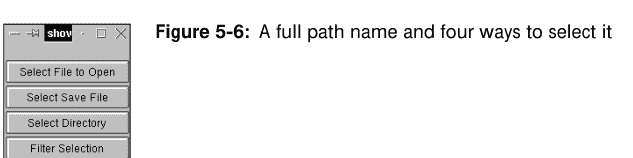

### ShowFile 实现

```cpp
/* showfile.cpp */

1 #include <qapp.h>

2 #include <qpushbutton.h>

3 #include <qlayout.h>

4 #include <qfiledialog.h>

5 #include "showfile.h"

6

7 int main(int argc,char **argv)

8 {

9     KApplication app(argc,argv,"showfile");

10     ShowFile showfile;

11     showfile.show();

12     app.setMainWindow(&showfile);

13     return(app.exec());

14 }

15

16 ShowFile::ShowFile(QWidget *parent,const char *name)

17     : QWidget(parent,name)

18 {

19     QPushButton *button;

20     QVBoxLayout *box = new QVBoxLayout(this,0,3);

21

22     filelabel = new QLabel("",this);

23     filelabel->setAlignment(Qt::AlignHCenter);

24     box->addWidget(filelabel);

25

26     button = new QPushButton("Select File to Open",this);

27     box->addWidget(button);

28     connect(button,SIGNAL(clicked()),

29         this,SLOT(popupOpen()));

30

31     button = new QPushButton("Select Save File",this);

32     box->addWidget(button);

33     connect(button,SIGNAL(clicked()),

34         this,SLOT(popupSave()));

35

36     button = new QPushButton("Select Directory",this);

37     box->addWidget(button);

38     connect(button,SIGNAL(clicked()),

39         this,SLOT(popupDirectory()));

40

41     button = new QPushButton("Filter Selection",this);

42     box->addWidget(button);

43     connect(button,SIGNAL(clicked()),

44         this,SLOT(popupFilter()));

45

46     resize(10,10);

47     box->activate();

48 }

49

50 void ShowFile::popupOpen()

51 {

52     QString name = QFileDialog::getOpenFileName("",

53                         NULL,this);

54     if(!name.isEmpty()) {

55         filename = name;

56         filelabel->setText(filename);

57     }

58 }

59

60 void ShowFile::popupSave()

61 {

62     QString name = QFileDialog::getSaveFileName(filename,

63                         NULL,this);

64     if(!name.isEmpty()) {

65         filename = name;

66         filelabel->setText(filename);

67     }

68 }
```

```cpp
65     }

66 }

67 void ShowFile::popupDirectory()

68 {

69     QString name = QFileDialog::getExistingDirectory();

70     if(!name.isEmpty())

71     {

72         filename = name;

73         fillabel->setText(filename);

74     }

75 }

76 void ShowFile::popupFilter()

77 {

78     QString filter =

79         "All (*)\n"

80         "C Source (*.c *.C *.cc *.cpp *.cxx)\n"

81         "C Header (*.h)\n"

82         "Text (*.txt)\n"

83         "HTML (*.htm *.html *.shtml *.HTML *.htm)";

84     QString name = QFileDialog::getOpenFileName("",

85         filter,this);

86     if(!name.isEmpty())

87     {

88         filename = name;

89         fillabel->setText(filename);

90     }

91 }
```

第 8 行到第 15 行是程序的主线，它初始化应用程序，然后创建并显示图 5-6 所示的 `ShowFile` 窗口。从第 16 行开始的构造函数是一个控件，它在垂直布局框中包含一个标签和四个按钮。该标签用于显示最近选择的文件或目录。每个按钮都连接到一个槽函数，该槽函数将创建一个 `QFileDialog` 对象并获取用户输入的结果。四种操作模式均使用相同的显示格式，但标题栏的标题和按钮操作略有不同。图 5-7 展示了 `QFileDialog` 窗口的布局。

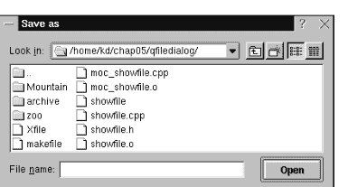

**图 5-7：** 一个列出文件和目录的 `QFileDialog`

从第 49 行开始的名为 `popupOpen()` 的槽函数打开一个 `QFileDialog` 窗口，使用户能够选择现有文件的名称。第 51 行对静态函数 `getOpenFileName()` 的调用创建了该对话框。第一个参数（在本例中为一个零长度字符串）可以是建议用户选择的文件完整路径名。如果没有指定文件名，对话框将打开此应用程序最后访问的目录；或者默认打开当前目录。每当在窗口中选择一个文件时，按钮的文本将变为 OK，并允许用户选择该文件。

从第 58 行开始的名为 `popupSave()` 的槽函数打开一个 `QFileDialog`，允许用户选择现有文件或输入不存在的文件名。第 60 行对 `getSaveFileName()` 的调用创建了该对话框。传递给构造函数的第一个参数是最后一次检索的文件名，这将成为窗口中显示用于选择的当前文件。

第 67 行名为 `popupDirectory()` 的槽函数使用 `QFileDialog` 来选择目录。在这种模式下，对话框将仅返回所选目录的名称。如果用户选择了一个文件名，则该文件名会被剥离，仅返回目录路径。

第 75 行名为 `popupFilter()` 的槽函数指定了图 5-8 中显示的文件名过滤器组。过滤器是一组文件名后缀，用于选择哪些文件名出现在窗口中。所有的过滤器都在从第 77 行开始的一个 `QString` 中定义。文件后缀被组织成类别，如图 5-8 所示的“C Source”类别。要定义一个类别，在类别名称之后紧跟用括号括起来的有效文件后缀。在括号内，后缀之间用空格分隔。不同的类别由换行符 `\n` 分隔，或者为了多样性，使用一对分号（“`;`”）。

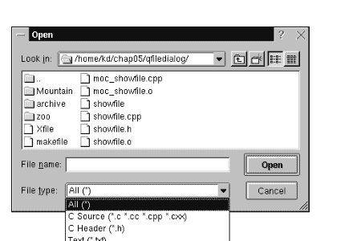

**图 5-8c：** 过滤指定列出哪些文件。

> **注意**：在几乎所有情况下（包括本例），过滤器用于选择具有特定后缀的文件。但过滤器实际上是一个正则表达式，可以用在其他形式中。例如，过滤器 `sh*` 将列表限制为仅显示以 `sh` 开头的文件。

图 5-7 和 5-8 显示了文件和目录名称的排序。目录用棕色矩形标记，且始终列在文件之前。在这两组中，由于它们按 ASCII 值排序，大写字母排在小写字母之前。如果列出的目录是一个符号链接，其图标的右下角会有一个小标记。

> **交叉引用**：您可以通过提供自己的图标来自定义 `QFileDialog` 窗口的外观，具体描述见第 13 章，该章讨论了图形文件的操作。

## QTabDialog

`QTabDialog` 通过将两个或多个对话框堆叠在一起并提供可用于在它们之间切换的选项卡，将多个对话框打包成一个。以下程序创建了图 5-9 所示的简单 `QTabDialog`。

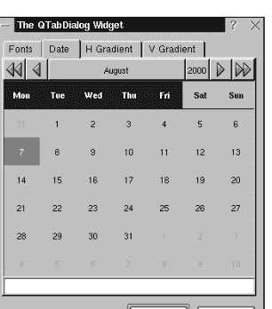

**图 5-9：** 一个显示第二个控件的 `QTabDialog`

### ShowTabs 头文件

```cpp
/* showtabs.h */

1 #ifndef SHOWTABS_H

2 #define SHOWTABS_H

3

4 #include <qwidget.h>

5

6 class ShowTabs: public QWidget

7 {

8     Q_OBJECT

9 public:

10 ShowTabs(QWidget *parent=0,const char *name=0);

11 private slots:

12     void slotTab();

13 };

14

15 #endif
```

### ShowTabs

```cpp
/* showtabs.cpp */

1 #include <kapp.h>

2 #include <qpushbutton.h>

3 #include <qtabdialog.h>

4 #include <qlayout.h>

5 #include <kfontdialog.h>

6 #include <kdatepik.h>

7 #include <kselect.h>

8 #include "showtabs.h"

9

10 int main(int argc,char **argv)

11 {

12     KApplication app(argc,argv,"showtabs");

13     ShowTabs showtabs;

14     showtabs.show();

15     app.setMainWidget(&showtabs);

16     return(app.exec());

17 }

18

19 ShowTabs::ShowTabs(QWidget *parent,const char *name)

20     : QWidget(parent,name)

21 {

22     QPushButton *button;

23     QVBoxLayout *box = new QVBoxLayout(this,12);

24

25     button = new QPushButton("Show Tab Dialog",this);

26     box->addWidget(button);

27     connect(button,SIGNAL(clicked()),

28             this,SLOT(slotTab()));

29

30     resize(10,10);

31     box->activate();

32 }

33 void ShowTabs::slotTab()
```

```cpp
34 {

35    QTabDialog *tab = new QTabDialog(this,"tabdial",TRUE);

36    tab->setCaption("The QTabDialog Widget");

37    tab->setCancelButton();

38

39    QWidget *fonts = new KFontChooser(this,"fonts");

40    tab->addTab(fonts,"Fonts");

41

42    QWidget *date = new KDatePicker(this);

43    tab->addTab(date,"Date");

44

45    QWidget *hgradient = new KGradientSelector(

46        KSelector::Horizontal,this);

47    tab->addTab(hgradient,"H Gradient");

48

49    QWidget *vgradient = new KGradientSelector(

50        KSelector::Vertical,this);

51    tab->addTab(vgradient,"V Gradient");

52

53    tab->show();

54 }
```

`ShowTabs` 类仅用于弹出 `QTabDialog`，因此除了构造函数之外，其定义中只包含一个用于弹出对话框的槽方法。

从第 11 行开始的程序主线创建了一个 `ShowTabs` 控件，并将其安装为显示为主窗口的控件。

从第 20 行开始的 `ShowTabs` 构造函数使用一个容器来持有单个按钮。在第 28 行，该按钮的 `clicked()` 信号被连接到名为 `slotTab()` 的槽方法。

从第 34 行开始的槽方法 `slotTab()` 创建并显示 `QTabDialog`。对话框在第 36 行创建。第一个参数是对话框的父控件；第二个是分配给它的名称；第三个参数指定 `QTabDialog` 是模态的。默认情况是非模态对话框。

第 37 行对 `setCaption()` 的调用指定了要在对话框窗口标题栏中显示的标题。`setCancelButton()` 调用指定在对话框中包含一个取消按钮。

该对话框最多可以有四个按钮。默认情况下，总是存在一个 OK 按钮，但您需要指定任何其他想要的按钮。其他按钮可以通过调用 `setDefaultButton()`、`setHelpButton()` 和 `setApplyButton()` 来包含。包含按钮的方法可以不带参数调用（如第 38 行），也可以带一个指定按钮文本的字符串（包括 `setOkButton()`）。要接收来自按钮的信号，您需要将槽连接到 `applyButtonPressed()`、`cancelButtonPressed()`、`defaultButtonPressed()` 和 `helpButtonPressed()`。

第 40 行到 52 行创建了四个页面（有时称为标签页或 `tab` 页面），它们位于 `QTabDialog` 中。为了保持代码简单，这里使用了四个标准 KDE 部件，并且它们都没有用于提取用户输入数据的软件。当然，你可以构建自己的部件。通常，会有一个槽（slot）连接到“确定”和“应用”按钮，用于从这四个部件中读取信息。

对话框的大小由其包含的部件大小决定。它将根据最大部件的需求而显示相应的高度和宽度；而较小的部件则在垂直和水平方向上居中。使用标签页在不同部件之间切换的弹出对话框正变得越来越流行。它向用户展示所有可用选项，而不会显示一个充满数据输入选项且令人困惑的页面。

## QProgressDialog

有时你的程序需要执行一些需要几秒钟或几分钟的操作。如果延迟时间较短，将光标更改为手表图像是一种表达“程序正忙，请稍候”的方式。如果延迟时间较长（例如 15 秒或更多），出于礼貌，应该给用户提供更多关于当前进展的信息。`QProgressDialog` 可用于显示任务完成的百分比，并且可以将其设置为仅在持续时间足够长到需要显示时才弹出。

接下来的程序演示了两种使用 `QProgressDialog` 的方法。图 5-10 显示了应用程序的主窗口及其两个按钮，这两个按钮用于弹出 `QProgressDialog` 窗口。虽然该对话框通常用于呈现传输数据、对大文件进行排序或其他耗时操作的进度，但本程序中的示例仅基于定时器的进度运行。

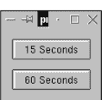

**图 5-10：** 启动两个 `QProgressDialog` 窗口中的一个

```cpp
/* progress.h */

1 #ifndef PROGRESS_H

2 #define PROGRESS_H

3

4 #include <qprogressdialog.h>

5 #include <qwidget.h>
```


# 6 `#include <qtimer.h>`

```cpp
7 
8 class Progress: public QWidget
9 {
10     Q_OBJECT
11 public:
12     Progress(QWidget *parent=0,const char *name=0);
13 private:
14     QProgressDialog *progressDialog;
15     QTimer *timer;
16 private slots:
17     void slot15();
18     void slot60();
19     void timerStep();
20 };
21 
22 #endif
```

`Progress` 类有三个槽和一个定时器。槽方法 `slot15()` 和 `slot60()` 分别被调用以启动持续 15 秒和 60 秒的进度对话框。定时器和 `timerStep()` 槽在内部用于跟踪已过去的时间。

## Progress

```cpp
/* progress.cpp */
1 #include <unistd.h>
2 #include <kapp.h>
3 #include <qpushbutton.h>
4 #include <qlayout.h>
5 #include "progress.h"
6 
7 int main(int argc,char **argv)
8 {
9     KApplication app(argc,argv,"progress");
10     Progress progress;
11     progress.show();
12     app.setMainWindow(&progress);
13     return(app.exec());
14 }
15 
16 Progress::Progress(QWidget *parent,const char *name)
17     : QWidget(parent,name)
18 {
19     QPushButton *button;
20     QVBoxLayout *box = new QVBoxLayout(this,12);
21 
22     button = new QPushButton("15 Seconds",this);
23     box->addWidget(button);
24     connect(button,SIGNAL(clicked()),
25             this,SLOT(slot15()));
26 
27     button = new QPushButton("60 Seconds",this);
28     box->addWidget(button);
29     connect(button,SIGNAL(clicked()),
30             this,SLOT(slot60()));
31 
32     resize(10,10);
33     box->activate();
34 }
35 void Progress::slot15()
36 {
37     int currentStep = 0;
38     int steps = 15;
39 
40     progressDialog = new QProgressDialog(
41             "Fifteen seconds...", "Cancel",
42             steps, this, "prgs", TRUE);
43     progressDialog->setCaption("Progress");
44     while(currentStep < steps) {
45             progressDialog->setProgress(currentStep++);
46             if(progressDialog->wasCancelled())
47             break;
48             sleep(1);
49     }
50     progressDialog->setProgress(steps);
51     delete progressDialog;
52     progressDialog = NULL;
53 }
54 void Progress::slot60()
55 {
56     int currentStep = 0;
57     int steps = 20;
58 
59     progressDialog = new QProgressDialog("this","prgs",TRUE);
60     progressDialog->setCaption("Progress");
61     progressDialog->setLabelText("Sixty seconds...");
62     progressDialog->setCancelButtonText("Quit");
63     progressDialog->setTotalSteps(steps);
64     progressDialog->setMinimumDuration(3000);
65 
66     timer = new QTimer(this);
67     connect(timer,SIGNAL(timeout()),
68             this,SLOT(timerStep()));
69     timer->start(3000,FALSE);
70 }
71 void Progress::timerStep()
72 {
73     int currentStep;
74     int steps = 20;
75 
76     if(progressDialog == NULL)
77         return;
78 
79     if(progressDialog->wasCancelled()) {
80         delete timer;
81         delete progressDialog;
82         progressDialog = NULL;
83         return;
84     }
85     currentStep = progressDialog->progress();
86     if(currentStep >= steps) {
87         delete timer;
88         delete progressDialog;
89         progressDialog = NULL;
90     } else {
91         progressDialog->setProgress(currentStep + 1);
92     }
93 }
```

从第 8 行开始的程序主线创建了一个 `Progress` 对象并将其安装为顶层窗口。顶层部件是由第 17 行的构造函数创建的 `Progress` 部件。使用一个垂直布局框（vertical box）来包含两个按钮。按钮连接到槽 `slot15()` 和 `slot60()`。结果如图 5-15 所示的窗口。

从第 36 行开始的槽方法 `slot15()` 演示了如何在循环内部使用进度条。进度百分比由当前步数与总步数的比率决定。第 38 行将当前步数（起始步数）指定为 0，第 39 行将总步数定义为 15。第 41 行的构造函数创建了 `QProgressDialog` 并设置了总步数。它还设置了标题文本和部件名称；并指定 `TRUE`，表示该对话框是模态的（modal）。第 44 行对 `setCaption()` 的调用指定了对话框标题栏的文本。

> **注意** 这里的示例都是模态对话框，但非模态进度对话框也很常见。例如，当 Web 浏览器下载一两个文件时，每个下载都有自己的独立进度对话框，而你仍然能够访问浏览器的其他功能。

从第 45 行开始的循环用于模拟一个需要由进度条报告的活动。该循环所做的一切就是增加当前步数计数并休眠一秒。在实际应用程序中，你可以计算下一步的值并调用 `setProgress()` 传入该值。第 47 行对 `wasCancelled()` 的调用如果在用户选择了“取消”按钮时将返回 `TRUE`，因此循环将提前退出。结果如图 5-11 所示的进度窗口。通常，在选择“取消”按钮时，你会在循环内部编写代码以停止任何正在计时的事情，但这里没有什么好做的，所以它直接跳出循环。

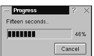
图 5-11：一个具有 15 个步骤的 `QProgressDialog`

第 51 行对 `setProgress()` 的调用保证了对话框能正确关闭。当模态 `QProgressDialog` 开始运行时，它首先将光标更改为手表符号。然后它会等待一短时间才弹出。每次当前值增加时，显示都会更新。一旦达到最后一步，它将恢复原始光标并自动关闭。第 51 行对 `setProgress()` 的调用是必要的，因为循环可能会在未达到最大步值的情况下退出。

从第 55 行开始的名为 `slot60()` 的槽方法使用了一种完全不同的方法来创建和更新 `QProgressDialog`，如图 5-12 所示。第 57 行和 58 行将起始值设置为 0，步数设置为 20。对话框在第 60 行创建，使用的构造函数比前一个示例简单。第 61 行到 65 行的方法调用设置了窗口标题文本，指定了对话框中出现的标签文本，更改了“取消”按钮的文本，并设置了完成所需的总步数。

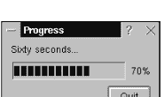
图 5-12：一个使用信号的 `QProgressDialog`

第 65 行对 `setMinimumDuration()` 的调用将弹出延迟时间设置为 3,000 毫秒（3 秒）。这是对话框在自动弹出前等待的时间量。将其设置为 3,000 毫秒会导致光标变为手表，并且在 3 秒过去之前不执行任何其他操作。这样，对于耗时少于三秒的任务，对话框将永远不会出现。

第 67 行到 70 行创建了一个定时器并启动它。定时器的 `timeout()` 信号连接到该类的 `timerStep()` 槽。第 70 行对 `start()` 的调用启动定时器，使其在 3 秒后到期。第二个参数设置为 `FALSE` 意味着这不是一个单次定时器——它将持续运行，每 3 秒触发一次，直到被停止。如果第二个参数设置为 `TRUE`，则定时器仅触发一次。实际上，为了实现一个持续的运行定时器时，两种模式的效果大致相同。如果定时器连续运行，你必须在结束时将其终止。如果它是单次定时器，你可以在每次触发时重新启动它。

第 72 行名为 `timerStep()` 的槽函数在每次定时器触发时执行。如果用户选择“取消”按钮来停止操作，第 80 行对 `wasCancelled()` 的调用将返回 `TRUE`。第 86 行对 `progress()` 的调用会获取当前的步骤值，如果第 87 行发现已到达终点，则定时器和对话框都会被删除。如果仍在进行中，第 92 行对 `setProgress()` 的调用将增加当前的步骤编号。

每当对话框被删除时，名为 `progressDialog` 的指针会被设置为 `NULL`，并且在第 77 行会对它是否为 `NULL` 进行测试。这次测试是由于 `QTimer` 的工作方式而必要的。为了实现计时，`QTimer` 会将特殊事件插入到传入的事件队列中；由于事件队列与应用程序是异步的，当 `QProgressDialog` 被删除时，`QTimer` 可能在输入队列中仍有一个时间事件。这意味着槽函数 `timerStep()` 将会多执行一次。

## 总结

本章演示了一些使用多种 KDE 和 Qt 对话框的方法。还有许多其他预定义对话框，且所有这些对话框都有许多选项。本章探讨了可以用在以下场景中的对话框：

- 创建一个足够标准的“关于”窗口，使你的应用程序能被识别为 KDE 系统的一部分。
- 提供文件和目录的选择列表，并允许用户选择其中一个。
- 将组件堆叠在一起，并为用户提供一组选项卡以在不同组件之间切换。
- 显示进度条，以向用户保证你的程序正在执行应有的操作。

本章未涵盖的对话框将在相关章节中介绍。但对话框并不是唯一会弹出的窗口。下一章将开始研究创建和显示菜单以及工具栏的过程。

## 菜单与工具栏

### 本章内容

- 为你的主应用程序窗口提供菜单栏
- 从组件内部弹出菜单
- 在主应用程序窗口中显示一个或多个工具栏
- 更新主窗口状态栏中的文本

本章将重点讨论如何使用组件来装饰应用程序的主窗口，这些组件可用于访问程序的各个部分，并让用户了解应用程序内部的运行情况。由于这主要是在应用程序的主窗口中完成的，因此有一个名为 `KTMainWindow` 的特殊顶级窗口类。它包含了管理菜单栏、工具栏和/或状态栏所需的一切。根据你的要求，`KTMainWindow` 将为你构建这些项，或者你可以提供一个组件将其插入并用作应用程序的主窗口，然后管理用户与其中包含的各种部分的交互。如果你愿意，你可以创建所有这些组件并自行管理，但让 `KTMainWindow` 来处理要简单得多。

## KTMainWindow

`KTMainWindow` 类是一个组件，它结合了多种功能，使其成为应用程序顶级窗口的理想选择。它不仅是一个持有主组件（也称为 *视图组件*）的容器，还处理创建和管理菜单栏、状态栏以及一个或多个工具栏的基本机制。

> **注意** `KTMainWindow` 必须始终使用 `new` 命令创建，因为当 `KTMainWindow` 关闭时，它会释放自身及其内部分配的内存。如果将其定义为全局对象或在栈上定义，程序在尝试释放内存时将会崩溃。

以下示例程序使用 `KTMainWindow` 创建一个顶级窗口，该窗口具有简单的菜单、工具栏和状态栏，围绕着一个顶级组件，如图 6-1 所示。

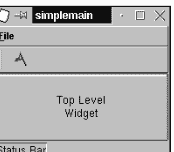
**图 6-1：** 使用 `KTMainWindow` 创建并控制应用程序的主窗口

### SimpleMain 头文件

```cpp
/* simplemain.h */
1 #ifndef SIMPLEMAIN_H
2 #define SIMPLEMAIN_H
3 
4 #include <ktmainwindow.h>
5 #include <kmenubar.h>
6 #include <ktoolbar.h>
7 #include <kstatusbar.h>
8 
9 class SimpleMain: public KTMainWindow
10 {
11     Q_OBJECT
12 public:
13         SimpleMain();
14 private slots:
15         void slotExit();
16         bool queryClose();
17 private:
18         void createMainWidget();
19         void createMenu();
20         void createStatusBar();
21         void createToolBar();
22 };
23 
24 #endif
```

第 5 到 8 行包含了定义 `KTMainWindow` 类以及将作为主窗口一部分的三个类的头文件。在第 10 行，`SimpleMain` 类定义指定 `KTMainWindow` 为其基类。虽然可以直接实例化 `KTMainWindow`，但将其用作基类能提供更多的灵活性。

### SimpleMain 实现

```cpp
/* simplemain.cpp */
1 #include <kapp.h>
2 #include <kcmdlineargs.h>
3 #include <qpushbutton.h>
4 #include "simplemain.h"
5 
6 int main(int argc,char **argv)
7 {
8     KCmdLineArgs::init(argc,argv,"simplemain",
9        "Simple Main", "0.0");
10     KApplication app;
11     SimpleMain *simplemain = new SimpleMain();
12     simplemain->show();
13     return(app.exec());
14 }
15 SimpleMain::SimpleMain() : KTMainWindow()
16 {
17     createMainWindow();
18     createMenu();
19     createStatusBar();
20     createToolBar();
21 }
22 void SimpleMain::createMainWindow()
23 {
24     QPushButton *button =
25         new QPushButton("Top Level\nWidget",this);
26     setView(button);
27 }
28 void SimpleMain::createMenu()
29 {
30     KMenuBar *menubar = menuBar();
31     QPopupMenu *popup = new QPopupMenu();
```


```cpp
33     popup->insertItem("Exit",this,SLOT(slotExit()));

34     menubar->insertItem("&File",popup);

35 }

36 void SimpleMain::createStatusBar()

37 {

38     KStatusBar *status = statusBar();

39     status->insertItem("Status Bar",1);

40 }

41 void SimpleMain::createToolBar()

42 {

43     KToolBar *toolbar = toolBar(0);

44     QPixmap pixmap("flag.png");

45     toolbar->insertButton(pixmap,5);

46 }

47 void SimpleMain::slotExit()

48 {

49     kapp->exit(0);

50 }

51 bool SimpleMain::queryClose()

52 {

53     return(TRUE);

54 }

```

程序的主线在第 7 到 15 行定义。第 11 行通过创建 `KApplication` 对象来初始化 KDE。应用程序的主窗口在第 12 行创建。请注意，不需要将 `app` 对象与 `SimpleMain` 对象（即 `KTMainWindow` 对象）连接，因为这些关系是在内部建立的。这也是为什么一个应用程序中只能有一个 `KTMainWindow` 对象的部分原因。第 13 行对 `show()` 的调用使主窗口显示，随后程序通过在第 14 行调用 `exec()` 立即进入命令处理循环。

构造函数在第 16 行定义。它所做的就是调用四个方法来创建主窗口显示部分的四个组成部分。第 23 行的 `createMainWindowWidget()` 方法创建了成为应用程序主窗口的组件。在本例中，主窗口简单地是第 25 行创建的 `QPushButton`。第 27 行对 `setView()` 的调用将该组件插入为主窗口——即作为 `view`（视图）。

菜单栏在从第 29 行开始的 `createMenu()` 方法中进行配置。菜单栏是通过第 31 行对 `menuBar()` 方法的调用创建的。该方法可以被调用任意次数，它将始终返回同一个 `KMenuBar` 指针，因为 `KTMainWindow` 中只能有一个菜单栏。只有在菜单栏尚不存在时，第一次调用 `menuBar()` 才会创建新菜单。如果你愿意，也可以创建自己的菜单并将其插入到 `KTMainWindow` 中，如下所示：

```cpp
KMenuBar *myMenuBar = new KMenuBar();

setMenu(myMenuBar);
```

为了充实菜单栏，在第 32 行创建了一个 `QPopupMenu` 对象。该对象可以被插入到 `KMenuBar` 中，作为一列按钮的弹出容器。本例通过第 33 行的 `insertItem()` 调用仅插入了一个按钮。该按钮标记为 “Exit” 并将调用槽方法 `slotExit()`。第 34 行的 `insertItem()` 调用将弹出菜单插入到菜单栏中。

如图 6-2 所示，用户可以将工具栏拖到窗口侧边，将工具栏转换为纵向排列。也可以将工具栏放置在窗口的右侧或底部。


**图 6-2：** 菜单栏和工具栏的替代位置

第 36 行的 `createStatusBar()` 方法调用 `statusBar()` 来创建并安装一个能够显示单行文本的部件（widget）。您的程序可以访问状态栏的文本，因此可以对其进行持续更新。与工具栏和菜单栏不同，状态栏不能被移动到其他位置。

第 41 行的 `createToolBar()` 方法通过调用第 43 行的 `toolBar()` 来创建工具栏。由于您的应用程序可以拥有任意数量的工具栏，因此需要一个 ID 编号作为参数。您提供 ID 编号，如果没有该 ID 的工具栏，则会创建一个并将其返回。使用相同的 ID 编号将始终返回同一个工具栏。在本示例中，使用 pixmap 来创建单行工具栏按钮。

工具栏可以被移动到其父窗口之外。图 6-3 展示了使用工具栏左端句柄将菜单从其父窗口中“撕离”（tear off）并将其建立为独立窗口的结果。

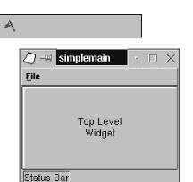

**图 6-3：** 可撕离菜单和工具栏

第 47 行名为 `slotExit()` 的方法在用户从菜单中选择“退出”（Exit）时被调用。您确实需要在这里进行某种清理工作并保存当前未保存的数据，但本示例仅简单地调用应用程序中的 `exit()` 方法。名为 `kapp` 的全局变量始终包含一个指向 `KApplication` 对象的指针。

第 51 行名为 `queryClose()` 的槽方法（slot method）在应用程序框架右上角的 X 图标被选中时被调用。如果此槽返回 `TRUE`，应用程序将立即关闭。如果返回 `FALSE`，则不采取任何操作（X 按钮的信号将被忽略）。

这是一个应用程序的骨架。通过让 `KTMainWindow` 完成大部分工作，您的顶层窗口只需几行代码即可变得非常复杂。本章的其余部分将详细描述配置菜单栏、工具栏以及通过状态栏显示信息的细节。

## 菜单栏

基本上，菜单是按钮的集合，每个按钮都附带一个槽。菜单的动态机制通过在任何时间点仅提供其特定子集，简化了对按钮的访问。组织和装饰按钮有多种方法。以下示例创建了图 6-4 所示的窗口。这个菜单栏的设计旨在演示在构建菜单时可以使用的一系列不同功能。

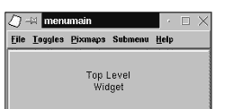

**图 6-4：** 顶部带有菜单栏的应用程序

头文件主要包含每当选中菜单按钮时将被调用的槽声明，但还包含一些用于跟踪菜单按钮在不同状态之间切换的私有数据。`MenuMain` 类继承自 `KTMainWindow` 窗口类，因此它已经具备了显示和管理菜单的能力。

### `MenuMain` 头文件

```cpp
1 /* menuimain.h */

2 #ifndef MENUIMAIN_H

3 #define MENUIMAIN_H

4

5 #include <ktmainwindow.h>

6 #include <kmenubar.h>

7 #include <ktoolbar.h>

8 #include <kstatusbar.h>

9

10 class MenuMain: public KTMainWindow

11 {

12   Q_OBJECT

13 public:

14     MenuMain();

15 private:

16     QPopupMenu *checkPopup;

17     int enableColorsID;

18     int enableGraphicsID;

19 private slots:

20     void slotExit();

21     bool queryClose();

22     void slotNew();

23     void slotSave();

24  void slotSaveAs();

25  void slotClose();

26  void slotLogo();

27  void slotSub();

28  void slotEnableColors();

29  void slotEnableGraphics();

30 private:

31  void createMainWidget();

32  void createMenu();

33 };

34

35 #endif
```

### `MenuMain`

```cpp
1  /* menumain.cpp */

2  #include <kapp.h>

3  #include <khelpmenu.h>

4  #include <kcmdlineargs.h>

5  #include <gpushbutton.h>

6  #include <qwhatsthis.h>

7  #include "menumain.h"

8

9  int main(int argc, char **argv)

10 {

11    KCmdLineArgs::init(argc, argv, "menumain");

12    "Menu Main", "0.0";

13    KApplication app;

14    MenuMain *menumain = new MenuMain();

15    menumain->show();

16    return(app.exec());

17 }

18 MenuMain::MenuMain() : KTMainWindow()

19 {

20    createMainWidget();

21    createMenu();

22 }

23 void MenuMain::createMainWidget()

24 {

25    QPushButton *button =

26      new QPushButton("Top Level\nWidget", this);

27    QWhatsThis::addButton(

28      "Button\n",

29      "This button is used as the top\n",

30      "level widget for this example. It\n",

31      "is very safe to click the button\n",

32      "because it doesn't do anything.\n");

33    setView(button);

34 }

35 void MenuMain::createMenu()

36 {

37  QPopupMenu *popup;

38  QPopupMenu *popup2;

39  QPixmap pixmap;

40  KMenuBar *menubar = menuBar();

41

42  popup = new QPopupMenu();

43  popup->insertItem("&New",this,

44      SLOT(slotNew()),ALT_KEY+N);

45  popup->insertItem("&Save",this,

46      SLOT(slotSave()),CTRL_KEY+S);

47  popup->insertItem("Save As",this,

48      SLOT(slotSaveAs()),CTRL+SHIFT+KEY+S);

49  pixmap.load("lap.png");

50  QIconSet iconset(pixmap);

51  popup->insertItem(iconset,"Close",this,

52      SLOT(slotClose()));

53  popup->insertSeparator();

54  popup->insertItem("Exit",this,

55      SLOT(slotExit()),ALT_KEY+X);

56  menubar->insertItem("&File",popup);

57

58  checkPopup = new QPopupMenu();

59  checkPopup->setCheckable(TRUE);

60  enableColorsID = checkPopup->insertItem(

61      "Enable Colors",this,SLOT(slotEnableColors()));

62  checkPopup->setItemChecked(enableColorsID,TRUE);

63  enableGraphicsID = checkPopup->insertItem(

64      "Enable Graphics", this,

65      SLOT(slotEnableGraphics()));

66  checkPopup->setItemChecked(enableGraphicsID,FALSE);

67  menubar->insertItem("&Toggles",checkPopup);

68

69  popup = new QPopupMenu();

70  pixmap.load("tinylogo.png");

71  popup->insertItem(pixmap,this,SLOT(slotLogo()));

72  pixmap.load("qtilogo.png");

73  popup->insertItem(pixmap,this,SLOT(slotLogo()));

74  menubar->insertItem("&Xmaps",popup);

75

76  popup = new QPopupMenu();

77  popup2 = new QPopupMenu();

78  popup2->insertItem("Horizontal",this,SLOT(slotSub()));

79  popup2->insertItem("Vertical",this,SLOT(slotSub()));

80  popup->insertItem("Orientation...",popup2);

81

82  menubar->insertItem("Submenu",popup);

83

84  KHelpMenu *help = new KHelpMenu(this,

85      "Text that will appear in\n"

86      "a very simple About box");

87  popup = help->menu();

88  menubar->insertItem("&Help",popup);

89 }

90 void MenuMain::slotExit()

91 {

92    kapp->exit(0);

93 }

94 bool MenuMain::queryClose()

95 {

96    return(TRUE);

97 }

98 void MenuMain::slotEnableColors()

99 {

100    if(checkPopup->isItemChecked(enableColorsID))

101        checkPopup->setItemChecked(enableColorsID, FALSE);

102    else

103        checkPopup->setItemChecked(enableColorsID, TRUE);

104 }

105 void MenuMain::slotEnableGraphics()

106 {

107    if(checkPopup->isItemChecked(enableGraphicsID))

108        checkPopup->setItemChecked(enableGraphicsID, FALSE);

109    else

110        checkPopup->setItemChecked(enableGraphicsID, TRUE);

111 }

112 void MenuMain::slotNew() { }

113 void MenuMain::slotSave() { }

114 void MenuMain::slotSaveAs() { }

115 void MenuMain::slotClose() { }

116 void MenuMain::slotLogo() { }

117 void MenuMain::slotSub() { }
```


从第 10 行开始的主程序创建了一个 `MenuMain` 对象，将其显示，并调用 `exec()` 等待输入。从第 15 行开始的 `MenuMain` 构造函数调用 `createMainWidget()` 以提供一个作为主窗口的部件，然后调用 `createMenu()` 将菜单栏添加到窗口顶部。

从第 23 行开始的 `createMainWidget()` 方法创建一个按钮并将其安装为应用程序的主窗口。该按钮通过第 33 行对 `setView()` 的调用进行安装。第 27 行对 `QWhatsThis::addButton()` 的调用是为了将一些描述性文本与该按钮相关联——用户可以从帮助菜单中显示该文本。

从第 35 行开始的 `createMenu()` 方法创建菜单栏及其所有成员。在 `KTMainWindow` 部件内部有一个菜单栏，其地址在第 37 行被检索并存储在 `menubar` 指针中。实际上，在调用 `menuBar()` 方法之前菜单栏并不存在，但随后的 `menuBar()` 调用将返回同一个菜单栏指针。

菜单栏上出现的每个按钮都代表一个 `QPopupMenu` 对象。第一个对象在第 42 行创建，并在第 56 行添加到菜单栏中。在第 42 行和第 56 行之间，弹出菜单中插入了若干项，最终生成的菜单如图 6-5 所示。

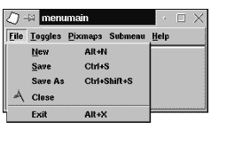

**图 6-5：** 带有图标和加速键的菜单

第 56 行对 `insertItem()` 的调用指定了菜单名称为“File”，加速键为 Alt-F。也就是说，将标签写成 "&File" 而不仅仅是 “File”，会导致后者在显示时被下划线标出；按下 Alt-F 组合键将使菜单出现，就像你用鼠标选择它一样。可以使用上、下方向键来定位菜单成员；按下 Return 或 Enter 键则会选择该项，就像你用鼠标点击它一样。

标签为 “New” 的项是通过第 43 行对 `insertItem()` 的调用创建的。加速键由常量 `ALT+Key_N` 指定。这是选择该菜单项的快捷方式；每当应用程序获得键盘焦点时，输入 Alt+N 的结果与用鼠标选择 New 条目相同。正如你在图 6-5 中所见，加速键显示在右侧。请注意，字母 N 前的 & 符号会导致其被下划线标出；但与菜单栏不同，这并不会自动分配一个加速键。你可以根据选择决定是否添加下划线。“Save As”选项拥有加速键，但没有字母被下划线标出。

加速键由指定按键及其修饰符的特殊值来定义。共有三种修饰符可用：`ALT`、`CTRL` 和 `SHIFT`。你可以将其中一个、两个或三个与按键组合使用。例如，第 47 行定义的 “Save As” 条目同时使用了 `CTRL` 和 `SHIFT` 修饰符。许多按键都可以用作加速键。以下列表包含了一些更常用的按键。

定义的按键数量比任何一个键盘上出现的都要多，但此列表中的大多数按键足够通用，应该会很有用，尽管我从未见过带有 35 个功能键的键盘。如果你有想要使用的特殊按键，请查看名为 `qnamespace.h` 的 Qt 头文件源码，在那里你会发现列出的 230 多个按键。

| | | |
| :--- | :--- | :--- |
| `Key_0` 到 `Key_9` | `Key_Down` | `Key_Period` |
| `Key_Apostrophe` | `Key_End` | `Key_Plus` |
| `Key_Asterisk` | `Key_Enter` | `Key_Print` |
| `Key_A` 到 `Key_Z` | `Key_Equal` | `Key_QuoteDbl` |
| `Key_Backslash` | `Key_Escape` | `Key_Return` |
| `Key_BackSpace` | `Key_F1` 到 `Key_F35` | `Key_Right` |
| `Key_Backspace` | `Key_Home` | `Key_ScrollLock` |
| `Key_BraceLeft` | `Key_Insert` | `Key_Semicolon` |
| `Key_BraceRight` | `Key_Left` | `Key_Slash` |
| `Key_BracketLeft` | `Key_Minus` | `Key_Space` |
| `Key_BracketRight` | `Key_Next` | `Key_SysReq` |
| `Key_CapsLock` | `Key_NumLock` | `Key_Tab` |
| `Key_Colon` | `Key_PageDown` | `Key_Underscore` |
| `Key_Comma` | `Key_PageUp` | `Key_Up` |
| `Key_Delete` | | |

第 49 行至 52 行定义的 Close 菜单项在图 6-5 中显示，其左侧有一个图标。为此，第一步是创建包含图形的 pixmap（像素图）。这在第 49 行通过从名为 `flag.png` 的本地磁盘文件加载数据来完成。第二步是通过该 pixmap 创建一个 `QIconSet` 对象，如第 50 行所示。菜单项本身通过第 48 行对 `insertItem()` 的调用创建，并将 `QIconSet` 作为第一个参数插入；其他参数与之前相同。

> **交叉引用** 第 13 章 “图形操作” 描述了创建 pixmap 的其他方法。

为了完成 File 菜单，第 53 行插入了出现在 Close 和 Exit 之间的水平分隔线。第 54 行和 55 行创建了 Exit 菜单成员。

图 6-6 显示了一个带有两个可检查按钮的菜单，这些按钮可以切换开启或关闭。且只有在按钮被切换到开启状态时才会出现勾选标记。在图中，Enable Colors 按钮处于开启状态，而 Enable Graphics 按钮处于关闭状态。

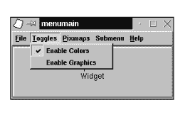

**图 6-6：** 带有切换按钮的菜单

Toggles 菜单在第 58 行创建，并在第 74 行插入到菜单栏中。第 59 行对 `setCheckable()` 的调用配置了弹出菜单，使其所有项都可以切换开启或关闭。这样，你只需将其切换开启或关闭，就能将弹出菜单上的任何项变为切换项。

实际的切换并非自动完成的。第 97 行至 110 行中为切换按钮定义的两个槽函数通过调用 `isItemChecked()` 检查切换按钮的当前状态，然后调用 `setItemChecked()` 将其切换到另一种状态。由于在槽方法中切换按钮需要传递参数，因此有必要在头文件的第 16 行至 18 行中存储一个指向弹出菜单的指针以及这两个按钮的 ID 编号。ID 编号是第 60 行和 63 行 `insertItem()` 的返回值，这也是你在弹出菜单内部寻址特定项的唯一方法。

你可以使用 pixmap 而不是文本来装饰菜单。图 6-7 显示了一个使用 pixmap 作为按钮的菜单。它们的工作方式与文本菜单按钮完全相同，因此也可以拥有加速键并作为切换按钮。在图中，你可以看到一个 pixmap 比另一个大——pixmap 的尺寸由你决定，因为每个菜单项都会扩展以适应你提供的内容。


带有 pixmap 的弹出菜单在第 70 行至 74 行创建。请注意，两个按钮使用了同一个 `QPixmap` 对象——这之所以可行是因为 `insertItem()` 方法会创建自己的本地副本。pixmap 按钮与文本按钮之间唯一的区别是第一个参数的类型——在第 71 行和 73 行中，第一个参数是一个 `QPixmap` 对象引用。

可以通过将一个弹出菜单作为另一菜单的一项来插入，从而创建子菜单。第 76 行至 81 行创建了第二个名为 `popup2` 的弹出菜单，并将其以标签 “Orientation...” 插入到其父菜单中。生成的菜单在被选择时，看起来如图 6-8 所示...


`KHelpMenu` 对象在第 80 行创建，并在第 86 行和 87 行安装为菜单栏的最右侧成员。最终的菜单如图 6-9 所示。


**图 6-9：** 标准帮助菜单的布局

“Contents”项（加速键为 F1）将显示帮助文本。文本本身由你以 HTML 文件的形式提供。文件的名称取决于应用程序的名称。对于这个名为 `menumain` 的示例，英文版本帮助树的索引文件如下：

`/usr/doc/kde/html/en/menumain/index.html`

“What's This”菜单项会将你的应用程序切换到一种模式，在这种模式下，显示在屏幕上的每个部件都可以被选中以显示关于其自身的解释性文本。在本例中，第 24 行对静态方法 `QWhatsThis` 的调用将解释性文本插入到作为主窗口的按钮中。从菜单中进行选择会将光标更改为问号，当用它选择某个项时，将显示该文本。文本显示在一个带有简单边框和黄色背景的窗口中，如图 6-10 所示。


**图 6-10：** 对 “What's this?” 响应显示的文本

菜单底部的两个按钮是 About（关于）对话框。应用程序的默认 About 对话框是一个带有 OK 按钮的简单文本块，还有一个包含当前 KDE 版本信息的标准 About 对话框。

你可以使用 `KHelpMenu` 并用自己的对话框替换内置的 About 对话框。为此，请继承 `KHelpMenu` 类并包含一个名为 `aboutApplication()` 的槽函数。该槽函数将被执行，而不是弹出默认的 About 对话框——你可以创建并显示自己的 About 对话框。

你可以在第 5 章中找到创建 About 对话框的一些示例。

## 弹出菜单

`QPopupMenu` 对象不需要连接到 `QMenuBar`。菜单可以在部件的中间弹出。你的应用程序只需要指定位置并调用 `show()` 方法即可。以下示例通过显示弹出菜单来响应鼠标右键，如图 6-11 所示。


**图 6-11：** 菜单从部件中间弹出

### MenuPopup 头文件

```cpp
1 /* menupopup.h */

2 #ifndef MENUPOPUP_H

3 #define MENUPOPUP_H

4

5 #include <qpopupmenu.h>

6

7 class MenuPopup: public QWidget

8 {

9     Q_OBJECT

10 public:

11     MenuPopup(QWidget *parent=0,const char *name=0);

12 protected:

13     virtual void mousePressEvent(QMouseEvent *event);

14 private:

15     QPopupMenu *popup;

16 private slots:

17     void slotStub();

18 };

19

20 #endif
```

在第 7 行，`MenuPopup` 类使用 `QWidget` 作为其基类。而且，因为它是一个部件，它继承了虚保护方法 `mousePressEvent()`，每当鼠标指针在部件范围内且按下鼠标按钮时，该方法就会被调用。

## MenuPopup

```cpp
1 /* menupopup.cpp */

2 #include <kapp.h>

3 #include "menupopup.h"

4

5 int main(int argc,char **argv)

6 {

7   KApplication app(argc,argv,"setxy");

8   MenuPopup menupopup;

9   menupopup.show();

10  app.setMainWidget(&menupopup);

11  return(app.exec());

12 }

13

14 MenuPopup::MenuPopup(QWidget *parent,const char *name)

15 {

16   : QWidget(parent,name)

17   setMinimumSize(90,40);

18   resize(200,100);

19

20   popup = new QPopupMenu(this);

21   popup->insertItem("Activate",this,SLOT(slotStub()));

22   popup->insertItem("Deactivate",this,SLOT(slotStub()));

233   popup->insertItem("Arrange",this,SLOT(slotStub()));

24   popup->insertSeparator();

25   popup->insertSeparator();

26   popup->insertItem("Logout",this,SLOT(slotStub()));

27 }

28

29 void MenuPopup::mousePressEvent(QMouseEvent *event)

30 {

31   if(event->button() == RightButton) {

32     popup->move(x() + event->x(),y() + event->y());

33     popup->exec();

34   }

35 }

36 void MenuPopup::slotStub() { }
```

从第 14 行开始的 `MenuPopup` 构造函数创建了一个 `QPopupMenu` 对象，并将其地址存储在类定义第 15 行的 `popup` 中。虽然这不是强制要求的，但 `QPopupMenu` 的父部件通常是弹出该菜单的部件。第 21 行到第 26 行将各项条目插入到菜单中。

第 29 行的虚方法 `mousePressEvent()` 重写了父类 `QWidget` 中的相应方法。每当点击鼠标按钮时，该方法就会被调用。第 31 行的测试用于确定选中的是否为鼠标右键；如果是，则调用 `move()` 为菜单定位，并调用 `exec()` 将其弹出。传递给第 32 行 `move()` 调用的坐标位置是父部件的 x、y 坐标与鼠标指针坐标之和。最终的坐标即为鼠标在屏幕上的位置，从而使菜单直接出现在鼠标下方。

## 工具栏（The Toolbar）

`KTMainWindow` 将管理您插入其中的任意数量的工具栏。默认情况下，它们将按照您插入的顺序出现在窗口顶部。如果同时存在菜单，工具栏将出现在菜单下方。而且，工具栏中可以包含除按钮图标以外的更多内容。接下来的示例（如图 6-12 所示）安装了两个包含按钮、分隔符、组合框（combo box）甚至标签部件（label widget）的工具栏。


图 6-12：一对包含多个项目的工具栏

### ToolbarMain 头文件

```cpp
1 /* toolbarmain.h */

2 #ifndef TOOLBARMAIN_H

3 #define TOOLBARMAIN_H

4

5 #include <ktmainwindow.h>

6 #include <ktoolbar.h>

7

8 class ToolbarMain: public KTMainWindow

9 {

10     Q_OBJECT

11 public:

12     ToolbarMain();

13 private slots:

14     void slotExit();

15     void slotStub();

16     void slotFont(int index);

17     bool queryClose();

18 private:

19     void createMainWidget();

20     void createToolBarOne();

21     void createToolBarTwo();

22 };

23

24 #endif
```

由于是由 `KTMainWindow` 管理工具栏，因此在第 8 行将 `ToolbarMain` 类定义为 `KTMainWindow` 的子类。第 14 行到 16 行定义的槽（slots）在选择工具栏项目时接收调用。第 17 行的槽 `queryClose()` 由系统用于请求应用程序的关闭权限。

### ToolbarMain 实现

```cpp
1 /* toolbarmain.cpp */

2 #include <kapp.h>

3 #include <qpushbutton.h>

4 #include <qstrlist.h>

5 #include <qcstring.h>

6 #include "toolbarmain.h"

7

8 int main(int argc,char **argv)

9 {

10 	KApplication app(argc,argv,"toolbarmain");

11 	ToolbarMain *toolbarmain = new ToolbarMain();

12 	toolbarmain->show();

13 	return(app.exec());

14 }

15 ToolbarMain::ToolbarMain() : KTMainWindow()

16 {

17 	createMainWidget();

18 	createToolBarOne();

19 	createToolBarTwo();

20 }
```


```cpp
void ToolbarMain::createMainWidget()
{
    QPushButton *button =
        new QPushButton("Top Level\nWidget", this);
    setView(button);
}

void ToolbarMain::createToolBarOne()
{
    QPixmap fpix("flag.png");
    QPixmap rpix("redo.png");
    QPixmap upix("undo.png");
    QPixmap spix("stop.png");
    QPixmap epix("exit.png");

    KToolBar *toolbar = toolBar(1);
    toolbar->insertButton(fpix, 5, SIGNAL(clicked()),
        this, SLOT(slotStub()), TRUE, "Flag As Used");
    toolbar->insertButton(rpix, 6, SIGNAL(clicked()),
        this, SLOT(slotStub()), TRUE, "Redo");
    toolbar->insertButton(upix, 7, SIGNAL(clicked()),
        this, SLOT(slotStub()), TRUE, "Undo");

    toolbar->insertSeparator();

    toolbar->insertButton(epix, 7, SIGNAL(clicked()),
        this, SLOT(slotStub()), TRUE, "Stop");
    toolbar->insertButton(epix, 8, SIGNAL(clicked()),
        this, SLOT(slotExit()), TRUE, "Exit Program");
}

void ToolbarMain::createToolBarTwo()
{
    QPixmap fpix("bottom.png");
    KToolBar *toolbar = toolBar(2);

    toolbar->insertButton(fpix, 10, SIGNAL(clicked()),
        this, SLOT(slotStub()), TRUE, "Go To Bottom");

    toolbar->insertLineSeparator();

    QStrList *list = new QStrList();
    list->insert(0, "Courier");
    list->insert(1, "Times Roman");
    list->insert(2, "Arial");

    toolbar->insertCombo(list, 11, FALSE,
        SIGNAL(activated(int)),
        this, SLOT(slotFont(int)),
        TRUE, "Select Font", 110);

    toolbar->insertSeparator();

    QLabel *label = new QLabel("Any Widget", toolbar);
    toolbar->insertWidget(12, 90, label);
}

void ToolbarMain::slotExit()
{
    kapp->exit(0);
}

bool ToolbarMain::queryClose()
{
    return(TRUE);
}

void ToolbarMain::slotStub() { }
void ToolbarMain::slotFont(int index) { }
```

从第 15 行开始的`ToolbarMain`构造函数调用相关方法来为窗体创建主部件和一对工具栏。第 21 行`createMainWidget()`方法中创建的主部件简单地是一个按钮（pushbutton）。

一号工具栏（顶部工具栏）在第 27 行的`createToolBarOne()`方法中创建。如前文图 6-12 所示，该工具栏的每个成员都有自己的 pixmap。第 29 行到 33 行从文件中加载了这些 pixmap。`KToolBar`是通过调用从`KTMainWindow`继承的`toolBar()`方法创建的。与之前描述的菜单创建方法不同，`toolBar()`方法每次调用时都会创建并返回一个新的工具栏。并且，它返回给您的工具栏已经作为显示的一部分被插入到了`KTMainWindow`中。

顶部工具栏的第三个和第四个成员之间有一个小间距。这个间距是通过第 42 行对`insertSeparator()`的调用插入的。如果您需要更宽的间距，可以插入更多的分隔符。

由第 48 行`createToolBarTwo()`方法创建的第二个工具栏包含的内容不仅仅是简单的工具栏按钮。通过第 52 行的`insertButton()`调用添加一个普通工具栏按钮；在其右侧，通过第 55 行的`insertLineSeparator()`调用插入一个垂直线分隔符。

在第 58 行到 60 行，通过`insert()`调用将一个字符串数组插入到`QStrList`对象中，随后在第 61 行通过调用`insertCombo()`将该数组用于在工具栏中安装一个组合框。在内部，`KToolBar`创建一个标准的`QComboBox`来管理该列表，因此传递给`insertCombo()`的大部分信息都会传递给`QComboBox`对象。第 58 行到 60 行的`insert()`方法定义了组合框的文本，并为每个文本分配了一个 ID 编号。第 61 行的`insertCombo()`调用指定了用于创建`QComboBox`对象的列表，其 ID 编号为 11，且用户不可写。当信号为`activated()`且槽为`slotFont()`，并且两者具有相同的`int`参数时，意味着选定项的 ID 编号可以传递给槽方法。`TRUE`参数指定`QComboBox`对象应被启用。字符串"Select Font"指定了工具提示（tooltip）的文本，数字 110 指定了以像素为单位的宽度。

> 本例中的组合框使用 ID 编号调用槽，但也可以改为使用字符字符串。为此，请使用`activated(String &)`方法作为信号，并使用`slotFont(String &)`作为槽。

您可以将任何部件安装到工具栏中。例如，如果您希望对`QComboBox`拥有比调用`insertCombo()`更多的控制权，您可以创建自己的组合框并通过调用`insertWidget()`来安装它。第 68 行和 69 行的代码创建并安装了一个标签（label）。请注意，标签部件对鼠标的响应方式与其它项目不同。在安装部件时，工具栏假设您已经设置好了所有必要的信号和槽来处理响应。

## 状态栏（The Status Bar）

`KTMainWindow`包含一个可选的`KStatusBar`部件。它通常显示在窗口底部，可用于应用程序显示并持续更新一行文本。接下来的示例（如图 6-13 所示）使用状态栏来显示内部计数器的当前值，该计数器由一对按钮进行增加或减少。


## StatusBarMain 头文件

```cpp
/* statusbarmain.h */
#ifndef STATUSBARMAIN_H
#define STATUSBARMAIN_H

#include <ktmainwindow.h>
#include <kstatusbar.h>

class StatusBarMain: public KTMainWindow
{
    Q_OBJECT

public:
    StatusBarMain();

private:
    int counter;
    KStatusBar *status;

private slots:
    bool queryClose();
    void slotAddOne();
    void slotSubTractOne();

private:
    void createMainWidget();
    void createStatusBar();
};

#endif
```

从第 8 行开始定义的`StatusBarMain`类继承自`KTMainWindow`类，这意味着它继承了一个`KStatusBar`。要在第 14 行定义要跟踪的值为`counter`；为了方便访问，`KStatusBar`指针将存储在第 15 行定义的`status`中。

### StatusBarMain 实现

```cpp
/* statusbarmain.cpp */
#include <kapp.h>
#include <qpushbutton.h>
#include <kcontainer.h>
#include "statusbarmain.h"

int main(int argc, char **argv)
{
    KApplication app(argc, argv, "statusbarmain");
    StatusBarMain *statusbarmain = new StatusBarMain();
    statusbarmain->show();
    return(app.exec());
}

StatusBarMain::StatusBarMain() : KTMainWindow()
{
    counter = 0;
    createMainWindow();
    createStatusBar();
}

void StatusBarMain::createMainWindow()
{
    KContainerLayout *layout =
        new KContainerLayout(this, "layout");
    layout->setOrientation(KContainerLayout::Vertical);

    QPushButton *button;
    button = new QPushButton("Add One", this);
    connect(button, SIGNAL(clicked()),
        this, SLOT(slotAddOne()));
    layout->packStart(button);

    button = new QPushButton("Subtract One", this);
    connect(button, SIGNAL(clicked()),
        this, SLOT(slotSubtractOne()));
    layout->packStart(button);

    layout->sizeToFit();
    setView(layout);
}

void StatusBarMain::createStatusBar()
{
    status = statusBar();
    status->insertItem(QString(">> "), 1);
    status->insertItem(QString("Add or Subtract "), 2);
}

void StatusBarMain::slotAddOne()
{
    status->changeItem(
        QString("Plus 1 = %1 ").arg(++counter), 2);
}

void StatusBarMain::slotSubtractOne()
{
    status->changeItem(
        QString("Minus 1 = %1 ").arg(--counter), 2);
}

bool StatusBarMain::queryClose()
{
    return(TRUE);
}
```

程序的主线创建了一个`StatusBarMain`对象，由于它继承自`KTMainWindow`，因此自动成为应用程序的顶层窗口。从第 14 行开始的`StatusBarMain`构造函数将内部计数器值初始化为零，然后创建主部件并安装状态栏的初始文本。

从第 20 行开始的`createMainWidget()`方法使用`KContainerLayout`部件来容纳两个按钮，如之前图 6-13 所示。一个按钮连接到槽方法`slotAddOne()`，另一个连接到`slotSubtractOne()`。

状态栏本身在第 39 行的`createStatusBar()`方法中初始化。调用`statusBar()`会实例化状态栏并返回指向它的指针。因为一个`KMainWindow`中只能有一个`KStatusBar`，所以随后调用`statusBar()`将返回同一个状态栏对象的地址。事实上，如果您只需要在该类内部保存对状态栏的访问，则无需自行保存指针，因为它可以随时检索到。

第 42 行和第 43 行调用状态栏的`insertItem()`方法来插入显示的字符串。字符串分为两部分插入（也可以有更多部分），并且每一部分都被分配一个 ID 编号。字符串将按照分配 ID 编号的顺序依次显示。如果您希望更改它们，则需要 ID 编号。这样，您可以更改字符串的一部分而无需更改全部内容。例如，每当选择“Add”按钮时，就会调用第 45 行的槽方法`slotAddOne()`，导致计数器增加；而 ID 编号为 2 的状态栏文本通过调用`changeItem()`被替换。ID 编号为 1 的文本没有改变。同样，“Subtract”按钮执行第 50 行的`slotSubtractOne()`，它会递减计数器并仅更改 ID 编号 2 的文本。

> **注意** `QString`类的`arg()`方法用于将各种数据类型格式化为字符串。所有数据类型的示例及其格式化选项在第 16 章（讨论一些实用类）中有所描述。

您可以根据需要将显示的字符串分解为任意数量的文本段（或者如果您愿意，称为文本项），并单独处理每一个。您还可以调用`KStatusBar`的`clear()`方法来清除所有 ID 编号的文本。

## 总结

`KMainWindow`类是一个特殊的顶层窗口，包含可用于向用户提供应用程序功能访问权限以及让用户了解应用程序当前状态的代码。

- 菜单栏可以显示在顶层窗口的顶部或底部。根据用户的意愿，它可以从顶层窗口分离并作为屏幕上的一个独立实体出现。
- 任何窗口都可以根据鼠标或键盘的控制弹出菜单。从该菜单中进行选择或在另一个位置点击鼠标将从显示区域移除菜单。
- 多个工具栏可以分别定位在顶层窗口的四个边之一，或者每一个都可以分离出来作为屏幕上的独立项目出现。
- 状态栏（带有不断更新的文本）可以设置在顶层窗口的底部出现。

第 7 章描述了可用于创建和显示相关集合的部件，例如一组可以相互交互且一次只能选择其中一个的单选按钮，或者允许用户从列表中选择一个或多个项目的组合框。

## 分组部件

### 本章内容

- 组织一组按钮以与单个槽工作
- 将一组单选按钮互联
- 关联一组复选按钮
- 启用某些部件内置的框架
- 使用框架装饰您的部件
- 滑动分隔条以调整多个部件的大小

本章研究了几个可用于解决窗口布局时经常出现的一些问题的部件和容器。例如，可以创建一个包含一组按钮的单个部件，并让所有这些按钮连接到同一个槽。需要将单选按钮相互关联，因为选择其中一个会导致组中的其他按钮被取消选择。有时部件组由于它们执行的功能而相关联，可以通过在它们周围绘制一个框架来向用户指示这一点。

## KButtonBox

在对话框窗口的底部有一行按钮是非常常见的。`KButtonBox`类是一个容器部件，它可以简化定位这一行按钮的任务。以下示例使用`KButtonBox`来管理三个水平排列的按钮：

```cpp
/* hbuttonbox.cpp */
#include <kapp.h>
#include <kbuttonbox.h>

int main(int argc, char **argv)
{
    QPushButton *button1;
    QPushButton *button2;
    QPushButton *button3;

    KApplication app(argc, argv, "vbuttonbox");

    KButtonBox *box =
        new KButtonBox(0, KButtonBox::HORIZONTAL, 25, 15);
    button1 = box->addButton("First Button");
    button2 = box->addButton("Second Button");
    button3 = box->addButton("Third Button");
    box->layout();
    box->show();
}
```


```
19    box->resize(10,10);
20
21    app.setMainWidget(box);
22    return(app.exec());
23 }
```

按钮框在第 12 行和第 13 行创建。第一个参数通常是父部件的地址，但由于本例将其用作顶层窗口，因此它没有父部件。第二个参数指定按钮的方向——`HORIZONTAL`（水平）或 `VERTICAL`（垂直）。最后两个参数指定要在按钮周围插入的最小间距。第一个数字指定每个按钮与 `KButtonBox` 边缘之间的最小像素距离。第二个数字指定按钮之间的像素距离。结果就是图 7-1 所示的按钮行。


**图 7-1：** 包含在 `KButtonBox` 中的三个按钮

第 14 到 16 行对 `addButton()` 的调用创建了按钮——也就是说，`KButtonBox` 创建每个按钮并返回指向它的指针。为了保持示例简单，按钮未连接到槽。第 17 行对 `layout()` 的调用是必要的，因为它告诉 `KButtonBox` 您将不再添加任何其他内容，并且它应该开始进行自我配置。第 18 行和第 19 行与任何其他部件相同——指示 `KButtonBox` 显示自身（以及所有其内容）；并对其进行尺寸调整，使其采用最小高度和宽度。

图 7-1 中的按钮大小全部相同。如果您希望按钮的宽度根据其包含的文本长度而变化，可以将此作为 `addButton()` 方法的第二个参数指定。例如，以下代码使按钮的宽度根据其包含的文本而变化：

```cpp

button1 = box->addButton("First Button",TRUE);

button2 = box->addButton("Second Button",TRUE);

button3 = box->addButton("Third Button",TRUE);

```

将此第二个参数设为 `FALSE`（默认值）将导致 `KButtonBox` 确定最宽按钮的大小，并调整其他按钮的大小以与之匹配。

`KButtonBox` 的宽度很少能正好与包含它的对话框宽度相匹配，因此您可能需要指定它如何以及在何处延伸以进行适配。图 7-2 顶部的布局显示了默认的延伸方式，所有按钮都位于左侧。该图底部的布局则显示了指定延伸点后的效果。


**图 7-2：** 定义了延伸和未定义延伸的 `KButtonBox`

若要实现这一点，请按如下方式在两个按钮之间插入延伸点：

```cpp

button1 = box->addButton("First Button");

button2 = box->addButton("Second Button");

box->addStretch(1);

button3 = box->addButton("Third Button");

```

其延伸方式与第 3 章中讨论的容器相同。也就是说，您可以根据需要添加任意数量的延伸点；每个延伸点将相对于其他点按比例延伸——比例由 `addStretch()` 中参数的值决定。

只需一次更改，即可将之前的示例转换为垂直方向。将构造函数的第二个参数改为 `VERTICAL`：

```cpp

KButtonBox *box = 

    new KButtonBox(0, KButtonBox::VERTICAL, 25, 15);

```

resulting window 如图 7-3 所示。按钮与边缘之间以及按钮彼此之间的间隔指定方式相同。当窗口在垂直方向延伸时，`KButtonBox` 将简单地在底部或您指定的任何延伸位置插入空间。


**图 7-3：** 垂直方向的 `KButtonBox`

## 使用单个槽函数对按钮进行分组

`QPushButtonGroup` 对象可用于将一组按钮水平或垂直地组织在一起。添加到组中的每个按钮都被分配一个 ID 编号，如果您愿意，可以为所有按钮使用单个槽方法。虽然您可以直接创建 `QPushButtonGroup`，但根据您希望按钮是水平还是垂直排列，使用 `QHButtonGroup` 或 `QVButtonGroup` 会更简单。`QPushButtonGroup` 也是一个 `QFrame`，因此您可以使用 `QFrame` 的方法调用来更改分组的外观。

以下示例包含一个水平 `QHButtonGroup` 内部的四个按钮。如图 7-4 所示，在按钮行下方有一个标签，每当按钮被按下时，该标签的文本都会更新。


**图 7-4：** `QHButtonGroup` 控件将按钮水平组织。

**HorizPush 头文件**

```cpp

1 /* horizpush.h */

2 #ifndef HORIZPUSH_H

3 #define HORIZPUSH_H

4

5 #include <qwidget.h>

6 #include <qlabel.h>

7

8 class HorizPush: public QWidget

9 {

10    Q_OBJECT

11 public:

12    HorizPush(QWidget *parent=0,const char *name=0);

13 private:

14    QLabel *label;

15    enum ButtonChoice { SetColor, Configure, Clear, Exit };

16 private slots:

17    void slotButton(int ID);

18 };

19

20 #endif

```

第 14 行声明的标签是用于在窗口底部显示文本的。第 15 行的枚举列表用作附加到每个按钮的 ID 编号，以便槽方法可以确定哪个按钮被点击。

**HorizPush 实现文件**

```cpp

1 /* horizpush.cpp */

2 #include <app.h>

3 #include <qlayout.h>

4 #include <qbuttongroup.h>

5 #include <qpushbutton.h>

6 #include "horizpush.h"

7 

8 int main(int argc,char **argv)

9 {

10     KApplication app(argc,argv,"horizpush");

11     HorizPush *horizpush = new HorizPush();

12     horizpush->show();

13     app.setMainWidget(horizpush);

14     return(app.exec());

15 }

16 

17 HorizPush::HorizPush(QWidget *parent,const char *name)

18     : QWidget(parent,name)

19 {

20     QPushButton *button;

21     QVBoxLayout *layout = new QVBoxLayout(this,5);

22 

23     QHButtonGroup *group = new QHButtonGroup(this,"hg1");

24     button = new QPushButton("Set Color",group);

25     group->insert(button,SetColor);

26     button = new QPushButton("Configure",group);

27     group->insert(button,Configure);

28     button = new QPushButton("Clear",group);

29     group->insert(button,Clear);

30     button = new QPushButton("Exit",group);

31     group->insert(button,Exit);

32     connect(group,SIGNAL(clicked(int)),

33             this,SLOT(slotButton(int)));

34     layout->addWidget(group);

35 

36     QLabel *label = new QLabel (" ",this);

37     layout->addWidget(label);

38 

39     resize(10,10);

40     layout->activate();

41 }

42 void HorizPush::slotButton(int ID)

43 {

44     switch(ID) {

45         case SetColor:

46             label->setText("Set Color button pressed");

47             break;

48         case Configure:

49             label->setText("Configure button pressed");

50             break;

51         case Clear:

52             label->setText(" ");

53             break;

54         case Exit:

55             kapp->exit(0);

56     }

57 }

```

从第 17 行开始的构造函数创建了窗口布局。主要的布局管理器是一个垂直盒子（在第 21 行创建），它包含两个控件——顶部的 `QHButtonGroup` 和底部的 `QLabel`。

`QHButtonGroup` 在第 23 行创建，使用 `HorizPush` 对象作为其父控件，因为虽然 `QVBoxLayout` 对象充当容器，但它不是一个控件。`HorizPush` 对象继承自 `QWidget`，因此它可以充当另一个控件的父对象。

第 24 行到第 31 行创建了四个按钮并将它们插入到 `QHButtonGroup` 中。因为 `QHButtonGroup` 也是一个控件，所以它可以充当按钮控件的父对象。调用 `insert()` 在将按钮插入组的同时为其分配一个 ID 编号。如果您不指定 ID 编号，第一个按钮默认值为 0，第二个为 1，依此类推。然而，由于这些 ID 编号是识别按钮的唯一方式，建议自行指定。在本例中，这些值被声明为枚举类型的值，这将使添加或删除按钮变得非常简单。

在第 32 行，调用 `connect()` 将 `QHButtonGroup` 的 `clicked()` 信号连接到名为 `slotButton()` 的本地槽中。在第 34 行，`QHButtonGroup` 被插入到垂直盒子的顶部。在第 36 行和第 37 行，创建了一个标签并将其存储在垂直盒子的底部。

在内部，`QHButtonGroup` 有一个槽用于接收来自每个按钮的 `clicked()` 信号。然后它会发出自己的 `clicked` 信号，该信号携带按钮的控件信息。第 42 行名为 `slotButton()` 的槽接收该信号并使用 ID 编号来决定采取什么操作。如果 ID 等于 `SetColor` 或 `Configure`，则相应地设置文本。如果 ID 等于 `Clear`，则清除文本。`Exit` 值将导致程序退出。

虽然 `QHButtonGroup` 控件可用于水平显示按钮，但 `QVButtonGroup` 可用于垂直显示。所需过程与创建水平分组的过程完全相同。要修改之前的示例以显示图 7-5 所示的窗口，请将第 4 行改为包含垂直按钮组而非水平按钮组：

```cpp

#include <qhbuttongroup.h>

```

然后修改第 23 行，使其创建垂直而非水平按钮组，如下所示：

```cpp

QVButtonGroup *group = new QVButtonGroup(this,"vgl");

```


**图 7-5：** `QVButtonGroup` 控件将按钮垂直组织。

## 对单选按钮进行分组

`QVButtonGroup` 可用于处理一组垂直单选按钮之间的关系，而 `QHButtonGroup` 可用于控制一组水平单选按钮。每当 `QRadioButton` 被插入到 `QButtonGroup` 中时，它就与组内其他按钮建立了关联，使得其中只有一个按钮可以被选中。图 7-6 所示的窗口由以下示例产生。


**图 7-6：** `QVButtonGroup` 控件控制一组单选按钮。

**VertRadio 头文件**

```cpp

1 /* vertradio.h */

2 #ifndef VERTRADIO_H

3 #define VERTRADIO_H

4

5 #include <qwidget.h>

6 #include <qlabel.h>

7

8 class VertRadio: public QWidget

9 {

10    Q_OBJECT

11 public:

12    VertRadio(QWidget *parent=0,const char *name=0);

13 private:

14    QLabel *label;

15    enum ButtonChoice { Total, Average,

16                  Maximum, Minimum, Exit };

17 private slots:

18    void slotButton(int ID);

19 };

20

21 #endif

```

每个按钮都有一个唯一的 ID 编号，而第 15 行定义的枚举 `ButtonChoice` 中的值使您的程序能够通过名称来引用每个编号。

## VertRadio

```cpp

1 /* vertradio.cpp */

2 #include <kapp.app.h>

3 #include <qlayout.h>

4 #include <qvbuttongroup.h>

5 #include <qradiobutton.h>

6 #include <qpushbutton.h>

7 #include "vertradio.h"

8 

9 int main(int argc, char **argv)

10 {

11     KApplication app(argc, argv, "vertradio");

12     VertRadio *vertradio = new VertRadio();

13     vertradio->show();

14     app.setMainWindow(vertradio);

15     return(app.exec());

16 }

17 

18 VertRadio::VertRadio(QWidget *parent, const char *name)

19     : QWidget(parent, name)

20 {

21     QRadioButton *button;

22     QVBoxLayout *layout = new QVBoxLayout(this, 5);

23 

24     QVButtonGroup *group = new QVButtonGroup(this, "vgl");

25     button = new QRadioButton("Total", group);

26     group->insert(button, Total);

27     button = new QRadioButton("Average", group);

28     group->insert(button, Average);

29     button = new QRadioButton("Maximum", group);

30     group->insert(button, Maximum);

31     button = new QRadioButton("Minimum", group);

32     group->insert(button, Minimum);

33     QPushButton *pButton = new QPushButton("Exit", group);

34     group->insert(pButton, Exit);

35     connect(group, SIGNAL(clicked(int)),

               this, SLOT(slotButton(int)));

36     layout->addWidget(group);

37 

38     label = new QLabel(" ", this);

39     layout->addWidget(label);

40 

41     resize(10, 10);

42     layout->activate();

43 }

44 

45 void VertRadio::slotButton(int ID)

46 {

47     switch(ID) {

48         case Total:

```


此示例创建了一个`VertRadio`对象，并将其用作顶层窗口的部件。从第 18 行开始的构造函数使用`QVBoxLayout`来包含一个按钮列表及其下方的标签。该标签用于指示哪个按钮处于激活状态。

第 24 行到第 32 行创建了四个单选按钮并将其插入到`QButtonGroup`组中。第 33 行创建了一个普通的`QPushButton`，并在第 34 行将其安装在同一个`QVButtonGroup`部件中。为了创建这些按钮，`QButtonGroup`被用作父部件。`QButtonGroup`中的所有单选按钮会自动关联，从而确保一次只能选择一个。您可以在组中混合使用不同类型的按钮，因为`QButtonGroup`仅对单选按钮进行关联——任何其他类型的按钮都将保持为独立实体。

定义在第 45 行的槽函数`slotButton()`会在所有按钮被点击时被调用，无论其类型如何。通过检查按钮 ID 的值，该槽函数会设置标签的文本，以指示当前哪个单选按钮被选中。非单选按钮则可用于退出程序。

虽然将单选按钮垂直组织通常更有意义，但如果您发现自己需要将它们水平排列，这也可以很容易地实现。将之前的示例转换为水平方向的结果如图 7-7 所示。要进行转换，请将第 5 行改为如下内容：

```cpp
#include <qbuttongroup.h>
```

并将第 24 行改为创建水平组框：

```cpp
QButtonGroup *group = new QButtonGroup(this, "hgl");
```


**图 7-7：** 水平组织的单选按钮组

## 分组复选按钮

`QCheckBox`是一种可以在*关闭（off）*和*开启（on）*状态之间切换的按钮。该状态由`QCheckBox`自身维护。复选按钮有时也被称为`切换按钮（toggle button）`。接下来的示例创建了如图 7-8 所示的复选按钮集合。只有当复选按钮处于*开启*状态时，才会出现勾选标记。


**图 7-8：** 垂直组织的`QCheckBox`按钮组

### VertCheck 头文件

```cpp
1 /* vertcheck.h */
2 #ifndef VERTCHECK_H
3 #define VERTCHECK_H
4 
5 #include <qwidget.h>
6 #include <qlabel.h>
7 #include <qvbuttongroup.h>
8 
9 class VertCheck: public QWidget
10 {
11   Q_OBJECT
12 public:
13     VertCheck(QWidget *parent=0, const char *name=0);
14 private:
15     QVButtonGroup *group;
16     QLabel *label;
17     enum ButtonChoice { Total, Average,
18         Maximum, Minimum, Exit };
19     bool totalFlag;
20     bool averageFlag;
21     bool minimumFlag;
22     bool maximumFlag;
23 private slots:
24     void slotButton(int ID);
25 };
26 
27 #endif
```

`QVButtonGroup`在第 15 行被包含在类数据中，因为接收按钮信息的槽函数仅提供按钮 ID 编号，因此需要向`group`查询复选按钮的状态。当前的`QCheckBox`按钮状态设置存储在第 19 行到第 22 行定义的布尔变量中。

### VertCheck

```cpp
1 /* vertcheck.cpp */
2 #include <kapp.h>
3 #include <qlayout.h>
4 #include <qcheckbox.h>
5 #include <qpushbutton.h>
6 #include "vertcheck.h"
7 
8 int main(int argc, char **argv)
9 {
10     KApplication app(argc, argv, "vertcheck");
11     VertCheck *vertcheck = new VertCheck();
12     vertcheck->show();
13     app.setMainWindow(vertcheck);
14     return(app.exec());
15 }
16 
17 VertCheck::VertCheck(QWidget *parent, const char *name)
18     : QWidget(parent, name)
19 {
20     QCheckBox *button;
21     QVBoxLayout *layout = new QVBoxLayout(this, 5);
22 
23     group = new QVButtonGroup(this, "vg1");
24     button = new QCheckBox("Total", group);
25     group->insert(button, Total);
26     button = new QCheckBox("Average", group);
27     group->insert(button, Average);
28     button = new QCheckBox("Maximum", group);
29     group->insert(button, Maximum);
30     button = new QCheckBox("Minimum", group);
31     group->insert(button, Minimum);
32     QPushButton *pButton = new QPushButton("Exit", group);
33     group->insert(pButton, Exit);
34     connect(group, SIGNAL(clicked(int)),
35         this, SLOT(slotButton(int)));
36     layout->addWidget(group);
37 
38     label = new QLabel(" ", this);
39     layout->addWidget(label);
40 
41     totalFlag = FALSE;
42     averageFlag = FALSE;
43     minimumFlag = FALSE;
44     maximumFlag = FALSE;
45     resize(10, 10);
46 
47     layout->activate();
48 }
49 
50 void VertCheck::slotButton(int ID)
51 {
52     QButton *button = group->find(ID);
53     switch(ID) {
54         case Total:
55             totalFlag = ((QCheckBox *)button)->isChecked();
56             break;
57         case Average:
58             averageFlag = ((QCheckBox *)button)->isChecked();
59             break;
60         case Maximum:
61             maximumFlag = ((QCheckBox *)button)->isChecked();
62             break;
63         case Minimum:
64             minimumFlag = ((QCheckBox *)button)->isChecked();
65             break;
66         case Exit:
67             kapp->exit(0);
68     }
69     QString string;
70     if(totalFlag)
71         string += QString("Tot ");
72     if(averageFlag)
73         string += QString("Avg ");
74     if(maximumFlag)
75         string += QString("Max ");
76     if(minimumFlag)
77         string += QString("Min ");
78     label->setText(string);
79 }
```

从第 17 行开始的`VertCheck`构造函数创建了一个垂直盒子容器；并安装了一个`QPushButtonGroup`作为其顶部部件，以及一个`QLabel`作为其底部部件。`QPushButtonGroup`的地址在类中被存储为`group`。对`addWidget()`的调用使`QPushButtonGroup`成为`QVBoxLayout`布局管理器的顶部部件。

第 23 行到第 34 行创建了四个`QCheckBox`对象并将其插入到`QPushButtonGroup`中。在第 32 行到第 35 行中，创建了第五个按钮——一个标准的`pushbutton`——并将其插入到`group`中。在第 38 行和第 39 行，创建了一个用于在窗口底部显示文本的标签并将其安装到`layout`中。

`QCheckBox`的默认状态是*关闭*，用`FALSE`表示，因此第 41 行到第 44 行用于将四个内部标志设置为与复选按钮相同的值。复选框。如果你希望预设一个或多个复选框初始状态为*开启*，可以这样做：

```cpp
button->setChecked(TRUE);
```

然后你会将其对应的布尔值设置为`TRUE`。事实上，复选框可能具有两种以上的状态，这将在下一节中解释。

第 49 行的槽方法`slotButton()`在任何一个复选按钮被切换时都会被调用。被激活按钮的`ID`值作为参数传递，且由于该方法需要确定复选按钮的内部状态，因此使用第 51 行的`find()`调用来检索复选框自身的地址。第 52 行的`switch`语句用于确定哪个按钮被选中。如果该按钮是一个复选框，调用`isChecked()`在按钮*开启*时返回`TRUE`，在*关闭*时返回`FALSE`。将复选框状态存储在局部布尔变量中，使程序能够快速访问所有按钮的状态。

如果`ID`的值表明它是退出按钮，则执行第 65 行的`case`语句，从而调用`exit()`来停止应用程序。

第 68 行到 77 行创建了一个字符串，指定当前哪些切换按钮处于*开启*状态，并将该字符串设置为先前图 7-8 所示窗口底部显示的标签文本。

通常，一组切换按钮是纵向排列的，但在某些情况下，你可能希望将它们横向排列。之前的示例可以通过将`vertcheck.h`的第 7 行改为以下内容，从而重新组织为横向配置，如图 7-9 所示：

```cpp
#include <qhbuttongroup.h>
```

同时将`vertcheck.h`的第 15 行改为：

```cpp
QHButtonGroup *group;
```

并将`vertcheck.cpp`的第 23 行改为：

```cpp
group = QHButtonGroup(this, "hgl");
```


图 7-9：一组横向排列的`QCheckBox`按钮

## 部分控件也是框架

如果你需要将一组控件封闭在一个框架或盒子中，以表明这些控件在某种程度上相关、作为一个单元运行，或者需要将其与同一窗口中的其他控件区分开，可以使用`QFrame`控件将它们封闭在盒子中。即使`QFrame`封闭区域之外没有留下任何控件，框架的装饰外观也能提升窗口的整体观感。

在继承树中，`QFrame`的直接基类是`QWidget`。这意味着你构建的任何控件，只需简单地使用`QFrame`代替`QWidget`作为基类，即可对其进行装饰。许多现有的控件已经是以这种方式构建的。例如，`QLabel`控件使用`QFrame`作为其基类，但默认关闭装饰——为标签添加框架只需指定类型和大小即可。以下示例显示了图 7-10 所示的窗口，其中显示了四个启用了框架的标签。


图 7-10：四个启用了框架的标签

```cpp
/* labelframe.cpp */
#include <qlayout.h>
#include <qframe.h>
#include <qapp.h>
#include <qlabel.h>
#include "labelframe.h"

int main(int argc, char **argv)
{
  KApplication app(argc, argv, "labelframe");
  LabelFrame *labelframe = new LabelFrame();
  labelframe->show();
  app.setMainWidget(labelframe);
  return(app.exec());
}

LabelFrame::LabelFrame(QWidget *parent, const char *name)
  : QWidget(parent, name)
{
  QLabel *lab;
  QVBoxLayout *layout = new QVBoxLayout(this,8);

  lab = new QLabel("QFrame::Box",this);
  lab->setFrameStyle(QFrame::Box | QFrame::Sunken);
  lab->setLineWidth(2);
  lab->setMidLineWidth(1);
  lab->setAlignment(AlignVCenter | AlignHCenter);
  lab->setMargin(8);
  layout->addWidget(lab);

  lab = new QLabel("QFrame::Box",this);
  lab->setFrameStyle(QFrame::Box | QFrame::Raised);
  lab->setLineWidth(1);
  lab->setMidLineWidth(1);
  lab->setAlignment(AlignVCenter | AlignHCenter);
  lab->setMargin(8);
  layout->addWidget(lab);

  lab = new QLabel("QFrame::WinPanel",this);
  lab->setFrameStyle(QFrame::WinPanel | QFrame::Raised);
  lab->setAlignment(AlignVCenter | AlignHCenter);
  lab->setMargin(8);
  layout->addWidget(lab);

  lab = new QLabel("QFrame::Panel",this);
  lab->setFrameStyle(QFrame::Panel | QFrame::Sunken);
  lab->setAlignment(AlignVCenter | AlignHCenter);
  lab->setLineWidth(1);
  lab->setMargin(8);
  layout->addWidget(lab);

  resize(10,10);
  layout->activate();
}
```


从第 17 行开始的构造函数创建了一个纵向盒子布局管理器，并向其中填充了四个标签。

第 23 行到第 29 行创建了一个标签，它使用了 `Box` 形状与 `Sunken`（下沉）阴影的组合。生成的阴影图案使盒子看起来像是刻在表面上的。第 25 行的 `lineWidth()` 方法指定了构成中心槽边缘的两条线的像素宽度。第 26 行的 `setMidLine()` 方法指定了线中心槽的宽度。第 27 行和第 28 行的 `setAlignment()` 和 `setMargin()` 调用将文本居中，并在文本与框架之间设置了 8 像素的边界。

第 31 行到第 37 行创建了另一个具有 `Box` 形状的标签，但这次它使用了 `Raised`（凸起）阴影。这使得盒子看起来像是从表面突出的脊。此框架绘制的线条比前一个更窄，因为第 33 行的 `setLineWidth()` 调用指定脊的边缘仅为 1 像素宽。

第 39 行到第 43 行创建了一个样式为 `WinPanel` 的标签，其阴影被设置为凸起外观。宽度使用默认值，且由于没有槽或脊，因此没有中线宽度。

第 45 行到第 50 行创建了一个样式为 `Panel` 的标签，其阴影使整个标签看起来像是下沉到表面中的。由于第 48 行调用了 `setLineWidth()`，围绕边缘绘制的每条线宽 4 像素。

许多 Qt 和 KDE 控件都使用 `QFrame` 作为基类。其中一些默认显示框架，但它们都能够显示框架。对于以下任何控件，调用 `setFrameStyle()` 方法都会使框架出现：

| | | |
|---|---|---|
| `KAboutContainer` | `KMenuBar` | `QHButtonGroup` |
| `KAboutContributor` | `KMultiLineEdit` | `QHGroupBox` |
| `KAccelMenu` | `KMultiWallPaperList` | `QIconView` |
| `KApplicationTree` | `KPopupMenu` | `QIconView` |
| `KBackgroundDockWidget` | `KProgress` | `QLCDNumber` |
| `KCharSelect` | `KRuler` | `QLabel` |
| `KCharSelectTable` | `KSeparator` | `QListBox` |
| `KColorCells` | `KSplitList` | `QListView` |
| `KColorPatch` | `KStatusBar` | `QMenuBar` |
| `KContainerLayout` | `KStatusBarLabel` | `QMultiLineEdit` |
| `KDMView` | `KTabListBoxTable` | `QPopupFrame` |
| `KDatePicker` | `KTextBrowser` | `QPopupMenu` |
| `KDateTable` | `KThemeListBox` | `QProgressBar` |
| `KDesktop` | `KToolBar` | `QScrollView` |
| `KDockWindow` | `KURLabel` | `QSpinBox` |
| `KEdit` | `KfindWindow` | `QSplitter` |
| `KEyesWidget` | `KiKbButton` | `QTableview` |
| `KFileSimpleView` | `KiKbMapInfoWidget` | `QTextBrowser` |
| `KFormulaToolBar` | `KickerClientMenu` | `QTextEdit` |
| `KGroupBox` | `QButtonGroup` | `QTextview` |
| `KHTMLWidget` | `QCanvasView` | `QVBox` |
| `KIOListView` | `QfileListBox` | `QVButtonGroup` |
| `KIconLoaderCanvas` | `QfileListView` | `QVGroupBox` |
| `KIconStyle` | `QGrid` | `QWellArray` |
| `KImageTrackLabel` | `QGroupBox` | `QWidgetStack` |
| `KIntSpinBox` | `QHBox` | |

## 框架选项

你可以使用多种设置来指定框架的外观：`Box`、`Panel`、`WinPanel`、`HLine` 或 `VLine`。此外，每种样式都可以设置为凸起（raised）、下沉（sunken）或平面（plain）。还可以指定线的宽度。以下示例展示了配置框架的不同方式。

### Box QFrame

名为 `boxframe` 的程序显示了 `Box` 类型框架的不同外观。三个可能的调整项是线宽、中线宽，以及外观应该是下沉、平面还是凸起。图 7-11 显示了线宽在 1 到 3 之间变化、中线宽在 0 到 2 之间变化的框架外观。


**图 7-11：** `Box QFrame` 类型的 27 种不同外观

以下程序用于生成图 7-11 中所示的一组框架。它使用网格布局来定位所有框架和标签，并包含一个循环来创建并插入具有不同设置的框架。

```cpp
/* boxframe.cpp */

#include <qlayout.h>
#include <qframe.h>
#include <qlabel.h>
#include <kapp.h>
#include "boxframe.h"

int main(int argc, char **argv)
```

```cpp
9  (

10      KApplication app(argc, argv, "boxframe");
11      BoxFrame *boxframe = new BoxFrame();
12      boxframe->show();
13      app.setMainWidget(boxframe);
14      return(app.exec());
15  }

16

17 BoxFrame::BoxFrame(QWidget *parent, const char *name)
18  : QWidget(parent, name)
19  {
20      QLabel *label;
21      QFrame *frame;
22      QGridLayout *layout = new QGridLayout(this, 6, 10, 5);

23

24      label = new QLabel("QFrame::Box", this);
25      label->setFont(QFont("Courier", 24, QFont::Bold));
26      label->setAlignment(Qt::AlignHCenter);
27      layout->addMultiCellWidget(label, 0, 0, 0, 9);

28

29      label = new QLabel("Line Width", this);
30      label->setAlignment(Qt::AlignHCenter);
31      layout->addWidget(label, 1, 0);
32      label = new QLabel("Mid Line", this);
33      label->setAlignment(Qt::AlignHCenter);
34      layout->addWidget(label, 2, 0);
35      label = new QLabel("Sunken", this);
36      layout->addWidget(label, 3, 0);
37      layout->setRowStretch(3, 1);
38      label = new QLabel("Plain", this);
39      layout->addWidget(label, 4, 0);
40      layout->setRowStretch(4, 1);
41      label = new QLabel("Raised", this);
42      layout->addWidget(label, 5, 0);
43      layout->setRowStretch(5, 1);

44

45      for(int i=0; i<9; i++)
46      {
47          int lineWidth = (i % 3) + 1;
48          int midLineWidth = i / 3;
49          label = new QLabel(
50              QString("%1").arg(lineWidth), this);
51          label->setAlignment(Qt::AlignHCenter);
52          layout->addWidget(label, 1, 1 + i);
53          label = new QLabel(
54              QString("%1").arg(midLineWidth), this);
55          label->setAlignment(Qt::AlignHCenter);
56          layout->addWidget(label, 2, 1 + i);

57

58          frame = new QFrame(this);
59          frame->setFrameStyle(QFrame::Box | QFrame::Sunken);
60          frame->setLineWidth(lineWidth);
61          frame->setMidLineWidth(midLineWidth);
62          layout->addWidget(frame, 3, 1 + i);
63          frame = new QFrame(this);
64          frame->setFrameStyle(QFrame::Box | QFrame::Plain);
65          frame->setLineWidth(lineWidth);
66          frame->setMidLineWidth(midLineWidth);
67          layout->addWidget(frame, 4, i + 1);

68

69          frame = new QFrame(this);
70          frame->setFrameStyle(QFrame::Box | QFrame::Raised);
71          frame->setLineWidth(lineWidth);
72          frame->setMidLineWidth(midLineWidth);
73          layout->addWidget(frame, 5, i + 1);
74      }

75

76      resize(600, 200);
77      layout->activate();
78  }
```

在第 24 行到第 27 行中，窗口顶部的标签和左侧的标签都被创建并存储在网格布局（grid layout）中。

从第 45 行开始的循环迭代九次，因为需要显示九列框架。第 46 行和第 47 行利用循环计数器的值来计算 `lineWidth` 和 `midLineWidth` 的值。对于当前列，在第 48 行到第 55 行创建用于显示这两个宽度值的标签。该列中的三个框架在第 57 行到第 73 行创建。三次对 `setFrameStyle()` 的调用都使用了 `QFrame::Box` 样式，但赋予了不同的阴影模式。对于每个框架，线宽都被设置为计算出的值。

本节中其余的示例使用相同的基本代码来显示其他样式的选项。然而，正如你在图中将看到的，每种样式可用的选项各不相同。

## Panel QFrame

名为 `panelframe` 的程序显示了图 7-12 所示的窗口，演示了 `Panel` 样式框架的外观。该框架由单线组成，可以通过阴影处理使框架的封闭区域看起来像是凸出于表面或凹入表面。在前一个示例中使用的中线（midline）值在这里没有影响，因为该框架是由单线构建的。


**图 7-12：** 三种形式的 `Panel` 框架，线宽各异

## WinPanel QFrame

程序 `winpanelframe` 显示了图 7-13 所示的窗口。`WinPanel` 框架的外观与线宽设置为两个像素的 `Panel` 框架相同。在 `WinPanel` 中，线宽无法改变。这种框架样式最初是为了模拟 Windows 操作系统的外观而设计的。


**图 7-13：** 三种形式的 `WinPanel` 框架

## 使用 QFrame 绘制直线

有两种 `QFrame` 样式根本不是框架，而是直线。你可以使用 `HLine` 样式指示 `QFrame` 将其绘制为一条水平线，如图 7-14 所示。所有可以应用于 `Box` 外观的修改同样可以应用于 `HLine`。也就是说，每条线被绘制为三条线，其中中线值指定中间线的宽度，而线宽值指定另外两条线的宽度。阴影设置使得线条看起来像是凸出于表面或凹入表面。


**图 7-14：** 绘制为水平线的 `QFrame`

同样也可以绘制垂直线，如图 7-15 所示。它可以使用与水平线相同的一组选项进行配置。


**图 7-15：** 绘制为垂直线的 `QFrame`

## 共享窗口空间

通过使用 `QSplitter` 部件，可以在一个窗口中显示多个部件，并让用户轻松更改单个部件的大小，从而使它们不重叠。图 7-16 显示了一个被用于包含一对文本编辑窗口的拆分器（splitter）。


**图 7-16：** 包含两个编辑窗口的 `QSplitter`

两个编辑面板之间的分栏条可以左右移动，在增加一个部件宽度的同时增加另一个部件的大小。在本例中，编辑部件被设置为自动换行显示文本，因此将分栏条向左移动（如图 7-17 所示）会调整两个编辑部件的大小，从而导致文本重新排列。


**图 7-17：** `QSplitter` 显示调整两个编辑窗口大小的结果

以下程序创建了图 7-16 和图 7-17 中显示的窗口。

### HorizSplit 头文件

```cpp
1 /* horizsplit.h */

2 #ifndef HORIZSPLIT_H
3 #define HORIZSPLIT_H

4

5 #include <qsplitter.h>

6

7 class HorizSplit: public QSplitter
8 {
    Q_OBJECT

9

10 public:
11     HorizSplit(QWidget *parent=0,const char *name=0);
12 };

13

14 #endif
```

该头文件定义了 `HorizSplit` 类，它继承了 `QSplitter` 的行为。

### HorizSplit

```cpp
1 /* horizsplit.cpp */

2 #include <kapp.h>
3 #include <qmultilineedit.h>
4 #include "horizsplit.h"

5

6 int main(int argc, char **argv)
7 {
8     KApplication app(argc, argv, "horizsplit");
9     HorizSplit *horizsplit = new HorizSplit();
10    horizsplit->show();
11    app.setMainWidget(horizsplit);
12    return(app.exec());
13 }

14

15 HorizSplit::HorizSplit(QWidget *parent,const char *name)
16     : QSplitter(parent,name)
17 {
18     QMultiLineEdit *leftEdit = new QMultiLineEdit(this);
19     leftEdit->setMinimumWidth(50);
20     leftEdit->setWordWrap(QMultiLineEdit::WidgetWidth);

21

22     QMultiLineEdit *rightEdit = new QMultiLineEdit(this);
23     rightEdit->setMinimumWidth(50);
```


24     `rightEdit->setWordWrap(QMultiLineEdit::WidgetWidth);`

25 

26     `resize(400,200);`

27 }

```

设置拆分窗口的过程只需在拆分器中为每个面板插入一个部件即可。从第 15 行开始的构造函数使用 `this` 作为父类创建了一对 `QMultiLineEdit` 对象。（回想一下，`this` 是对当前对象的引用。）由于 `HorizSplit` 类本身也是一个 `QSplitter` 类，而 `QSplitter` 在独立的面板中管理其所有子部件，因此无需其他操作。文本编辑窗口的最小允许宽度被设置为 50，以便为拆分条的移动提供下限——如果没有下限，分栏条可能会被移动到完全遮挡某个窗口。

`QSplitter` 的默认设置是将部件水平排列。以下示例将部件垂直排列：

### VertSplit

```cpp
1 /* vertsplit.cpp */
2 #include <kapp.h>
3 #include <qmultilineedit.h>
4 #include "vertsplit.h"
5 
6 int main(int argc,char **argv)
7 {
8     KApplication app(argc,argv,"vertsplit");
9     VertSplit *vertsplit = new VertSplit();
10    vertsplit->show();
11    app.setMainWidget(vertsplit);
12    return(app.exec());
13 }
14 
15 VertSplit::VertSplit(QWidget *parent,const char *name)
16     : QSplitter(parent,name)
17 {
18     setOrientation(Vertical);
19 
20     QMultiLineEdit *topEdit = new QMultiLineEdit(this);
```

```cpp
21	 topEdit->setMinimumHeight(50);
22	 topEdit->setWordWrap(QMultilineEdit::WidgetWidth);
23	 
24	 QMultilineEdit *middleEdit = new QMultilineEdit(this);
25	 middleEdit->setMinimumHeight(50);
26	 middleEdit->setWordWrap(QMultilineEdit::WidgetWidth);
27	 
28	 QMultilineEdit *bottomEdit = new QMultilineEdit(this);
29	 bottomEdit->setMinimumHeight(50);
30	 bottomEdit->setWordWrap(QMultilineEdit::WidgetWidth);
31	 
32	 resize(200,400);
33 }
```

第 16 行对 `setOrientation()` 的调用指示 `QSplitter` 将其部件一个接一个地垂直排列。第一个部件被添加到顶部。可以将多个部件添加到分割器中——本示例包含三个部件，因此有两个条来分隔它们。结果如图 7-18 所示。


**图 7-18：** 一个包含三个编辑窗口的垂直 `QSplitter`

## 总结

本章演示了一些组织部件的基本技巧，使它们对应用程序以及查看窗口的用户具有实际意义。本章涵盖了以下内容：

- 通过使用一些特殊部件，可以组织一组按钮的显示，同时让所有按钮使用同一个槽来报告鼠标点击。
- 一组单选按钮（radio buttons）在物理上必须相互关联，以便将选择限制在一次只能选择一个按钮。
- 虽然复选按钮（check buttons，也称为切换按钮）在物理上不相互关联，但它们通常在逻辑上相互关联，应被视为一个组。
- 可以在部件周围绘制装饰框架。除了装饰外，框架还可用于在 otherwise 混乱的显示界面中澄清部件之间的关系。
- 通过允许用户在部件之间来回滑动条，一组部件可以共享同一个空间。

本章完成了本书的第一部分。第二部分的章节范围较窄，详细介绍了第一部分中仅简要提及的一些主题。例如，下一章将探讨鼠标以及你可以用它完成的所有操作。虽然第一部分的每一章都演示了基础的鼠标操作，但你使用鼠标还可以做更多事情。

## 鼠标与键盘

### 本章内容

- 事件从硬件到应用程序的传播
- 读取输入的鼠标数据
- 控制鼠标及其光标
- 解析来自键盘的事件

一个正常的 KDE/Qt 应用程序在收到用户消息之前什么也不做。当应用程序首次执行时，它会执行任何必要的初始化，显示其窗口，然后进入睡眠状态，等待用户执行操作。在大多数情况下，它在等待来自鼠标或键盘的输入，但输入也可以来自光笔、鼠标滚轮、图形平板、轨迹球或其他输入设备。大多数应用程序可以使用 Qt 部件中包含的预定义信号和槽集来编写，但有时需要将程序直接连接到输入的事件流中。此外，如果你打算创建自己的部件，你需要知道如何将输入的事件转换为信号。

## 从端口到槽

以下是对事件生命周期的一个简短且简单的描述。

一个事件始于硬件。鼠标移动到新位置，键盘按键被释放，鼠标按钮被按下，或者键盘按钮被按住足够长的时间以触发自动重复机制。发出事件的设备在物理上连接到计算机，因此该事件将引起一个中断，一个被称为 *设备驱动程序（device driver）* 的小型程序会从端口读取信息。设备驱动程序的主要工作是将硬件事件转换为软件事件。

必须指示设备驱动程序在特定端口等待事件。这是在程序打开端口时在内部完成的，方式与应用程序打开文件非常相似。端口都位于 `/dev` 目录中，程序可以像对待文件一样对端口进行寻址。当程序打开一个端口（即 `/dev` 目录中的一个名称）时，Linux 内核会选择一个设备驱动程序，并交由它在端口和应用程序之间传递信息。

对于 Qt 和 KDE，从驱动程序检索事件的应用程序是 X Window 系统。来自设备驱动程序的每个事件都被格式化为一种特殊的内部格式，称为 `XEvent`。窗口管理器检查 `XEvent` 以确定其目标窗口。例如，如果该事件是键盘点击，则该事件将发送到当前具有焦点的窗口。如果是鼠标点击，则鼠标指针的 `x` 和 `y` 坐标将决定是哪个窗口。通过知道哪个窗口将接收事件，窗口管理器可以确定哪个应用程序将接收该事件。

为了让 X Window 程序处理事件，它会建立一个循环，不断调用低级队列读取函数 `XNextEvent()`。每次该函数返回时，它就从队列中检索到了一个事件。这些事件通过调用被分配处理该类型事件的方法而分发到你的应用程序中。

当你的程序在主线中调用 `QApplication::exec()` 或 `KApplication::exec()` 时，它会执行一个连续循环，调用 `XNextEvent()`，读取一个 `XEvent`，将其转换为 Qt 事件之一，并调用适当的方法来处理它。这些接收事件的方法被定义为 `QWidget` 类的一部分，并且被声明为 `virtual`（虚函数）和 `private`（私有）。这些方法执行的操作极少，因此有必要创建 `QWidget` 的子类来重写这些方法以接收事件。例如，`QPushButton` 类重写了名为 `mouseReleaseEvent()` 的 `QWidget` 方法，以便 `QPushButton` 可以发出 `clicked()` 信号。这使得你的应用程序能够设置一个槽，以便在每次使用鼠标激活按钮时接收 `clicked()` 信号。

## 鼠标事件

鼠标事件包含鼠标指针的当前位置，以及指示哪些按钮（如果有）当前被按下的标识。每当鼠标事件到达时，`QWidget` 类中的一个方法就会被调用。如果你希望编写自己的详细鼠标事件处理程序，可以重写 `QWidget` 中定义的事件处理方法。

以下程序跟踪鼠标并显示鼠标指针的按钮、按键和位置。如图 8-1 所示，右侧的空白部件是被监控鼠标移动的部件，而每次鼠标操作都被列在左侧。这个例子演示了输入的事件是如何转换为信号的。每当鼠标事件到达时，其中的数据被用来创建一个描述性字符串。该字符串作为一个信号发出，并被一个监听对象类接收。


**图 8-1：** 一个用于跟踪和显示鼠标活动的程序

```cpp
/* mousesensor.h */
#ifndef MOUSESENSOR_H
#define MOUSESENSOR_H

#include <qwidget.h>
#include <qevent.h>
#include <qstring.h>

class MouseSensor: public QWidget
{
    Q_OBJECT

public:
    MouseSensor(QWidget *parent=0,const char *name=0);

private:
    void emitDescription(QString &,QMouseEvent *);
    virtual void mousePressEvent(QMouseEvent *event);
    virtual void mouseReleaseEvent(QMouseEvent *event);
    virtual void mouseDoubleClickEvent(QMouseEvent *event);
    virtual void mouseMoveEvent(QMouseEvent *event);

signals:
    void description(QString &);
};

#endif
```

`MouseSensor` 类是一个跟踪鼠标活动的部件。它在图 8-1 中显示为右侧的空白面板。第 16 到 19 行的虚方法重写了基类 `QWidget` 中的方法，因此所有的鼠标事件都将到达这里，而不是基类中。

## MouseSensor

```cpp
1 /* mousesensor.cpp */
2 #include <qstring.h>
3 #include "mousesensor.h"
4 
5 MouseSensor::MouseSensor(QWidget *parent,const char *name)
6 	: QWidget(parent,name)
7 {
8 	setMinimumSize(300,300);
9 }
10 void MouseSensor::mousePressEvent(QMouseEvent *event)
11 {
12 	emitDescription(QString("Press: "),event);
13 }
14 void MouseSensor::mouseReleaseEvent(QMouseEvent *event)
15 {
16 	emitDescription(QString("Release: "),event);
17 }
18 void MouseSensor::mouseDoubleClickEvent(QMouseEvent *event)
19 {
20 	emitDescription(QString("DoubleClick: "),event);
21 }
22 void MouseSensor::mouseMoveEvent(QMouseEvent *event)
23 {
24 	emitDescription(QString("Move: "),event);
25 }
26 void MouseSensor::emitDescription(const QString &typeStr,
27 	QMouseEvent *event)
28 {
29 	QString btnStr(typeStr);
30 	ButtonState state = event->state();
31 	if(state & ControlButton)
32 		btnStr += "Ctrl";
33 	if(state & AltButton)
34 		btnStr += "Alt-";
35 	if(state & ShiftButton)
36 		btnStr += "Shift-";
37 	if(state & LeftButton)
38 		btnStr += "(Lft)-";
39 	if(state & MidButton)
40 		btnStr += "(Mid)-";
41 	if(state & RightButton)
42 		btnStr += "(Rgt)-";
43 	ButtonState button = event->button();
44 	if(button & LeftButton)
45 		btnStr += "Lft";
46 	if(button & MidButton)
47 		btnStr += "Mid";
48 	if(button & RightButton)
49 		btnStr += "Rgt";
50 
51   QString str = QString("%1 (%2,%3)(%4,%5)")
52     .arg(btnStr)
53     .arg(event->x()).arg(event->y())
54     .arg(event->globalX()).arg(event->globalY());
55 
56   emit description(str);
57 }
```

`MouseSensor` 类是一个部件（widget），因为它使用 `QWidget` 作为其基类。该类中接收鼠标事件的四个方法重写了基类中的四个虚方法。每当按下鼠标按钮时，都会调用 `mousePressEvent()` 方法；每当释放鼠标按钮时，都会调用 `mouseReleaseEvent()` 方法。每当在一定的时间间隔内按下并释放两次鼠标按钮时，就会调用 `mouseDoubleClick()` 方法。这意味着一次双击操作将产生五个事件：两次按钮按下事件、两次按钮释放事件和一次双击事件。这看起来可能有些过度，但由于事件很容易按类型分开，您可以编写应用程序仅接收需要处理的事件。

第 22 行的 `mouseMoveEvent()` 方法在鼠标移动到窗口内新位置时被调用。它有两种运行模式：该方法可以在每次鼠标移动时被调用，或者仅在按住鼠标按钮时移动才被调用。默认情况下需要按住其中一个按钮，但调用 `setMouseTracking(TRUE)` 方法可以使鼠标位置始终被报告。

从第 26 行开始的 `emitDescription()` 方法被所有事件接收方法调用，用于创建描述字符串并发送包含该字符串的信号。所有信息都包含在 `QMouseEvent` 对象中。

在第 30 行通过调用事件的 `state()` 方法获取 `ButtonState` 值。该变量包含代表在鼠标事件发生时被按下的按钮（如果有）的标志。可以设置六个可能的按钮：三个鼠标按钮以及 Alt、Ctrl 和 Shift。通过第 43 行对 `button()` 的调用获取的 `ButtonState` 值是导致该事件发生的按钮（如果有）。例如，如果您按住 Ctrl 键和鼠标右键，此时按下鼠标左键，`state()` 调用将返回 Ctrl 键和鼠标右键指示符，而 `button()` 将返回鼠标左键指示符。

**注意**：虽然 Alt 键可以用 `ButtonState` 中的标志值表示，但在鼠标事件中实际上从未报告 Alt 键。这是因为 KDE 在 Alt 键与鼠标配合使用时会拦截它。Alt + 鼠标左键可用于移动窗口；Alt + 中键将循环聚焦到下一个窗口；Alt + 右键将调整当前窗口的大小。如果您使用的是双键鼠标，通常可以通过同时按下两个按钮来模拟中键，而没有 Alt 键的键盘通常有一个功能相同的 Meta 键。

`QMouseEvent` 对象中有两个鼠标位置。一个表示相对于整个屏幕左上角的 $x$ 和 $y$ 坐标，另一个表示相对于当前窗口左上角的 $x$ 和 $y$ 值。在第 51 行，创建了一个 `QString` 对象来保存事件的描述。第 53 和 54 行将这两个坐标格式化为描述事件字符串的一部分。通常，您需要的是本地坐标，但有时您可能需要知道鼠标的全局位置。

第 56 行的 `emit` 语句是将传入事件转换为传出信号的最后一步。类似的过程也发生在例如 `QPushButton` 中，它将鼠标按钮事件转换为名为 `click()` 的信号。在本例中，发出的信号携带一个包含事件描述的 `QString`。

## FollowMouse 头文件

```cpp
1 /* followmouse.h */
2 #ifndef FOLLOWMOUSE_H
3 #define FOLLOWMOUSE_H
4
5 #include <qsplitter.h>
6 #include <qstring.h>
7 #include <qmultilineedit.h>
8
9 class FollowMouse: public QSplitter
10 {
11   Q_OBJECT
12 public:
13   FollowMouse(QWidget *parent=0,const char *name=0);
14 public slots:
15   void newline(QString &);
16 private:
17   QMultiLineEdit *edit;
18 };
19
20 #endif
```


`FollowMouse`类是之前图 8-1 中显示的顶层窗口。它基于`QSplitter`，使其能够同时管理左侧的`QMultiLineEdit`对象和右侧的`MouseSensor`对象。

## FollowMouse

```cpp
1 /* followmouse.cpp */
2 #include <kapp.h>
3 #include <qstring.h>
4 #include "mousesensor.h"
5 #include "followmouse.h"
6
7 int main(int argc,char **argv)
8 {
9     KApplication app(argc,argv,"followmouse");
10    FollowMouse *followmouse = new FollowMouse();
11    followmouse->show();
12    app.setMainWidget(followmouse);
13    return(app.exec());
14 }
15
16 FollowMouse::FollowMouse(QWidget *parent,const char *name)
17 : QSplitter(parent,name)
18 {
19    edit = new QMultiLineEdit(this);
20    edit->setMinimumWidth(80);
21    edit->setReadOnly(TRUE);
22
23    MouseSensor *sensor = new MouseSensor(this);
24    sensor->setMinimumWidth(80);
25
26    connect(sensor,SIGNAL(description(QString &)),
27          this,SLOT(newline(QString &)));
28
29    resize(10,10);
30 }
31 void FollowMouse::newline(QString &str)
32 {
33    edit->insertLine(str);
34    edit->setCursorPosition(5000,0);
35 }
```

从第 16 行开始的`FollowMouse`构造函数在第 19 至 21 行创建了一个`QMultiLineEdit`部件。对`setReadOnly()`的调用禁用了编辑功能，使编辑器成为一个仅显示文本的窗口。因为编辑器部件先创建，所以它出现在左侧。在第 23 行创建的`MouseSensor`出现在右侧。

为了让这个类接收鼠标事件描述，在第 26 行调用了`connect()`，建立了从`MouseSensor`的`description()`信号到`FollowMouse`的`newline()`槽的连接。

第 31 行的槽方法在每个鼠标事件发生时被调用，并接收一个描述性字符串。第 33 行的`insertLine()`调用将该字符串附加到`QMultiLineEdit`部件显示的文本底部。`setCursorPosition()`的调用确保最新的字符串（底部的那个）可见。指定一个大于列表实际成员数量的索引会导致`QMultiLineEdit`选择最后一个。

## 鼠标抓取与释放

应用程序中的单个部件可以接管鼠标的控制权。它不会限制鼠标指针的移动，但它会阻止所有其他部件（在本程序或任何其他程序中）接收来自鼠标的任何事件。

**警告**：如果您抓取了鼠标，必须确保有一个释放机制。如果您的程序抓取了鼠标而没有释放，终端实际上会被锁定。键盘仍然可以工作，但直到您的程序被杀死之前，鼠标都处于禁用状态。

以下程序显示一个类似于图 8-2 所示的窗口。顶部的按钮抓取鼠标并将光标外观更改为十字线。底部的按钮释放鼠标。


### GrabMouse 头文件

```cpp
1 /* grabmouse.h */
2 #ifndef GRABMOUSE_H
3 #define GRABMOUSE_H
4
5 #include <qwidget.h>
6 #include <qlayout.h>
7 #include <qpushbutton.h>
8
9 class GrabMouse: public QWidget
10 {
11   Q_OBJECT
12 public:
13     GrabMouse(QWidget *parent=0,const char *name=0);
14 private:
15     QPushButton *grabButton;
16     QPushButton *relButton;
17 public slots:
18     void mouse_grab();
19     void mouse_release();
20 };
21
22 #endif
```

### GrabMouse

```cpp
1 /* grabmouse.cpp */
2 #include <kapp.h>
3 #include <qcursor.h>
4 #include "grabmouse.h"
5
6 int main(int argc,char **argv)
7 {
8     KApplication app(argc,argv,"grabmouse");
9     GrabMouse *grabmouse = new GrabMouse();
10    grabmouse->show();
11    app.setMainWidget(grabmouse);
12    return(app.exec());
13 }
14
15 GrabMouse::GrabMouse(QWidget *parent,const char *name)
16 {
17     : QWidget(parent,name)
18     QVBoxLayout *layout = new QVBoxLayout(this,20);
19
20     grabButton = new QPushButton("Grab Mouse",this);
21     grabButton->setMinimumSize(grabButton->sizeHint());
22     layout->addWidget(grabButton);
23     connect(grabButton,SIGNAL(clicked()),
24             this,SLOT(mouse_grab()));
25
26     relButton = new QPushButton("Release Mouse",this);
27     relButton->setMinimumSize(relButton->sizeHint());
28     layout->addWidget(relButton);
29     connect(relButton,SIGNAL(clicked()),
30             this,SLOT(mouse_release()));
31
32     resize(10,10);
33     layout->activate();
34 }
35 void GrabMouse::mouse_grab()
36 {
37     relButton->grabMouse(QCursor(CrossCursor));
38 }
39 void GrabMouse::mouse_release()
40 {
41     relButton->releaseMouse();
42 }
```

`GrabMouse`类是一个部件，它使用在第 18 行创建的垂直布局框来容纳一对按钮。顶部按钮名为`grabButton`，其`clicked()`信号连接到在第 35 行定义的槽方法`mouse_grab()`。同样，`relButton`连接到在第 39 行定义的槽方法`mouse_release()`。

每当选择顶部按钮时，就会调用`relButton`的`grabMouse()`方法，导致`relButton`抓取鼠标。向`grabMouse()`传递一个光标定义会导致在抓取期间修改光标的外观。因为是`relButton`执行了抓取，所以它是唯一会对鼠标做出响应的部件，它通过调用`releaseMouse()`将鼠标控制权返回给系统。

## 更改光标外观

您可以使用一套标准内置光标来通知用户程序的当前状态。更改光标的方法位于`QWidget`中，因此任何可显示对象都可以更改其光标。

当您更改光标外观时，更改仅适用于您指定的区域。例如，如果您更改了应用程序顶层窗口的光标，标题栏的光标不会改变，但顶层窗口的所有子部件或孙部件的光标都会改变。然而，如果某个子部件有自己的光标设置，那么它（及其所有后代）将拥有自己的光标。

下面的示例允许您在所有标准光标中进行动态选择。您可以将一个光标应用于整个窗口，将另一个光标应用于窗口内的单个按钮。如图 8-3 所示，光标名称列在左侧。每当选择一个光标名称时，它就成为整个窗口的默认光标。使用右侧的 Select 按钮会将当前选中的光标分配为其私有光标——也就是说，它的光标不再继承自其父部件。


图 8-3：光标选择列表

### CursorMouse 头文件

```cpp
1 /* cursormouse.h */
2 #ifndef CURSORMOUSE_H
3 #define CURSORMOUSE_H
4
5 #include <qlayout.out.h>
6 #include <qpushbutton.h>
7
8 class CursorMouse: public QWidget
9 {
10 	Q_OBJECT
11 public:
12 	CursorMouse(QWidget *parent=0,const char *name=0);
13 private:
14 	QPushButton *selectButton;
15 	QPushButton *exitButton;
16 	int cursorID;
17 public slots:
18 	void changeCursor(int);
19 	void selectCursor();
20 	void shutdown();
21 };
22
23 #endif
```

`CursorMouse`类包含三个槽。其中两个用于更改光标，第三个用于退出程序。在第 16 行定义的`cursorID`保存当前选中光标的 ID 编号。

### CursorMouse

```cpp
1 /* cursormouse.cpp */
2 #include <kapp.h>
3 #include <qcursor.h>
4 #include <qlistbox.h>
5 #include "cursormouse.h"
6
7 struct cursStruct {
8 	QString name;
9 	int number;
10 } curs[] = 
11 	{ "ArrowCursor",ArrowCursor },
12 	{ "UpArrowCursor",UpArrowCursor },
13 	{ "CrossCursor",CrossCursor },
14 	{ "WaitCursor",WaitCursor },
15 	{ "IbeamCursor",IbeamCursor },
16 	{ "SizeVertCursor",SizeVertCursor },
17 	{ "SizeHorCursor",SizeHorCursor },
18 	{ "SizeBDiagCursor",SizeBDiagCursor },
19 	{ "SizeFDiagCursor",SizeFDiagCursor },
20 	{ "SizeAllCursor",SizeAllCursor },
21 	{ "BlankCursor",BlankCursor },
22 	{ "SplitVCursor",SplitVCursor },
23 	{ "SplitHCursor",SplitHCursor },
24 	{ "PointingHandCursor",PointingHandCursor },
25 	{ "BitmapCursor",BitmapCursor }
26 ;
27
28 int main(int argc,char **argv)
29 {
30    KApplication app(argc,argv,"cursomouse");
31    CursorMouse *cursomouse = new CursorMouse();
32    cursomouse->show();
33    app.setMainWidget(cursomouse);
34    return(app.exec());
35 }
36
37 CursorMouse::CursorMouse(QWidget *parent,const char *name)
38 {
39    : QWidget(parent,name)
40    QHBoxLayout *horlayout = new QHBoxLayout(this);
41
42    QListBox *list = new QListBox(this);
43    for(int i=0; i<sizeof(curs)/sizeof(cursStruct); i++)
44        list->insertItem(curs[i].name);
45    horlayout->addWidget(list);
46    connect(list,SIGNAL(highlighted(int)),
47                this,SLOT(changeCursor(int)));
48
49    QVBoxLayout *verlayout = new QVBoxLayout(this);
50
51    selectButton = new QPushButton("Select",this);
52    selectButton->setMinimumSize(selectButton->sizeHint());
53    verlayout->addWidget(selectButton);
54    connect(selectButton,SIGNAL(clicked()),
55                this,SLOT(selectCursor()));
56
57    exitButton = new QPushButton("Exit",this);
58    exitButton->setMinimumSize(exitButton->sizeHint());
59    verlayout->addWidget(exitButton);
60    connect(exitButton,SIGNAL(clicked()),
61                this,SLOT(shutdown()));
62
63    horlayout->addLayout(verlayout);
64
65    resize(250,200);
66    horlayout->activate();
67 }
68 void CursorMouse::changeCursor(int index)
69 {
70    cursorID = curs[index].number;
71    setCursor(QCursor(cursorID));
72 }
73 void CursorMouse::selectCursor()
74 {
75    selectButton->setCursor(QCursor(cursorID));
76 }
77 void CursorMouse::shutdown()
78 {
79    kapp->exit();
80 }
```


第 7 行到第 26 行的数组保存了预定义光标的名称和 ID 编号。名称用作列表框中的选择文本，ID 值用作 `QCursor` 构造函数的参数。

从第 37 行开始定义的 `CursorMouse` 类是应用程序的顶层部件。它使用一个水平布局框在左侧容纳一个 `QListBox`，在右侧容纳一个带有两个按钮的垂直布局框，如之前图 8-3 所示。

列表框在第 42 行创建。第 43 行和第 44 行的循环用光标名称填充列表框。第 46 行的 `connect()` 调用将名为 `highlighted()` 的列表框信号连接到名为 `changeCursor()` 的本地槽。每当列表框成员被高亮显示时，就会执行 `changeCursor()` 槽。这里没有使用，但列表框还有一个 `selected()` 信号，它需要双击列表框成员。这两个列表框信号都会提供列表框项目的索引号。

`selectButton` 在第 51 行创建，其 `clicked()` 信号连接到本地槽 `selectCursor()`。`exitButton` 在第 57 行创建，其 `clicked()` 信号连接到本地槽 `shutdown()`。

第 68 行的槽方法 `changeCursor()` 接收每个新选中的列表框项目的索引。列表框的文本是从数组名称加载的，因此来自列表框的索引也是数组的索引。第 70 行从数组中提取光标 ID，并通过将其存储在 `cursorID` 中使其成为当前光标 ID 编号。第 71 行对 `setCursor()` 的调用将光标设置为作为参数提供的那一个。`QCursor` 构造函数接受从列表框中选出的一个预定义光标的光标 ID。

第 73 行的槽方法 `selectCursor()` 将 `selectButton` 的光标设置为当前选中的任何光标。如果没有为该按钮设置光标，它将使用与其父窗口相同的光标（即第 71 行定义的光标）。一旦执行了第 75 行的 `setCursor()` 调用，`selectButton` 将使用自己的光标。

所有这意味着在这个应用程序中使用了三个光标。默认光标（名为 `ArrowCursor` 的那个）将继续用于主窗口的标题栏。在列表框中当前被高亮显示的任何光标将用于主窗口内部的所有其他内容。唯一的例外是`Select`按钮将拥有自己的光标——它将是点击该按钮时被高亮显示的光标。

列表中有几个特殊的光标。名为 `BlankCursor` 的光标没有图形——光标直接消失。它是一个有效的光标，你仍然可以移动它并尝试寻找可点击的内容，但你看不见它。另一个特殊光标名为 `BitmapCursor`。为了使其生效，你必须提供一个自定义光标，这就是下一节的主题。

## 设计自定义光标

光标是一个像素矩形。每个像素可以是黑色、白色或透明的。例如，KDE 默认的箭头光标是一个带有白色轮廓的黑色箭头。所有其他像素均为透明。使用一种颜色填充并用另一种颜色勾勒轮廓，可以使光标无论经过什么背景颜色都清晰可见。

要创建光标，你需要创建一对位图（bitmaps）。两个位图必须具有相同的高度和宽度，因为其中一个是覆盖在另一个之上的掩码（mask）。掩码是必要的，因为每个像素只有 1 位，但显示像素有三种方式：黑色、白色或透明。

图 8-4 展示了一个 16×16 光标的形状。顶部带有菱形的像素是该光标的“热点（hot spot）”。热点通常位于指针的末端或十字准心的中心——它决定了向应用程序报告的精确光标位置。图 8-5 显示了另一个作为该光标掩码的位图。这两个位图根据表 8-1 中的规则进行组合。

| 光标位设置 | 光标掩码位设置 | 结果 |
| :--- | :--- | :--- |
| 1 | 1 | 黑色 |
| 0 | 1 | 白色 |
| 0 | 0 | 透明 |


图 8-5：光标掩码的定义

有几个实用程序可以用来创建描述光标的位图。其中一个作为 X11 系统的一部分提供。它通常位于 `/usr/X11R6/bin/bitmap`，创建 16 $\times$ 16 的光标图像非常简单——只需运行程序并用鼠标选择像素即可。你可以在第 9 章中详细了解此实用程序以及关于位图的一般知识。

接下来的示例使用图 8-4 和 8-5 所示的光标位图来创建一个光标。

### MyCursor 头文件

```cpp
1 /* mycursor.h */
2 #ifndef GRABMOUSE_H
3 #define GRABMOUSE_H
4
5 #include <qwidget.h>
6
7 class MyCursor: public QWidget
8 {
9 public:
10   MyCursor(QWidget *parent=0,const char *name=0);
11 };
12
13 #endif
```

### MyCursor 实现

```cpp
1 /* mycursor.cpp */
2 #include <kapp.h>
3 #include <qcursor.h>
4 #include <qbitmap.h>
5 #include "mycursor.h"
6
7 #define upleft_width 16
8 #define upleft_height 16
9 #define upleft_x_hot 6
10 #define upleft_y_hot 1
11 static unsigned char upleft_bits[] = {
12     0x00, 0x00, 0x40, 0x00, 0x0e0, 0x00, 0x0f0, 0x01, 0xf8,
13     0x03, 0xfc, 0x07, 0xfe, 0x0f0, 0x0f0, 0x01, 0xf0, 0x01,
14     0x0f0, 0x01, 0xf0, 0x01, 0xf0, 0x7f, 0xf0, 0x7f, 0xf0,
15     0x7f, 0xf0, 0x7f, 0x00, 0x00 };
16
17 #define upleftmask_width 16
18 #define upleftmask_height 16
19 static unsigned char upleftmask_bits[] = {
20     0x40, 0x00, 0x0e0, 0x00, 0x0f0, 0x01, 0xf8, 0x03, 0x0fc,
21     0x07, 0x0fe, 0x0f0, 0x0ff, 0x1f, 0xff, 0x1f8, 0xf8, 0x03,
22     0xf8, 0x03, 0x0f8, 0xff, 0xf8, 0xf8, 0xff, 0xf8, 0xff, 0xf8,
23     0x0ff, 0xf8, 0xff, 0xf8, 0xff };
24
25 int main(int argc, char **argv)
26 {
27     QApplication app(argc, argv, "mycursor");
28     MyCursor *mycursor = new MyCursor();
29     mycursor->show();
30     app.setMainWidget(mycursor);
31     return app.exec();
32 }
33
34 MyCursor::MyCursor(QWidget *parent, const char *name)
35 {
36     : QWidget(parent, name)
37
38     QBitmap upleft(upleft_width, upleft_height,
39         upleft_bits, TRUE);
40     QBitmap upleftmask(upleftmask_width, upleftmask_height,
41         upleftmask_bits, TRUE);
42     QCursor up(QCursor(upleft, upleftmask,
43         upleft_x_hot, upleft_y_hot));
44     setCursor(upleftCursor);
45     resize(100, 100);
46 }
```

光标主体定义在第 7 到 15 行。这种数据格式是位图实用程序的实际输出——直接插入到了程序的源代码中。光标的高度、宽度以及热点位置均定义为常量。你可以创建几乎任何尺寸的光标，但大多数光标为 16$\times$16 或 32$\times$32 像素。用于光标掩码的位图定义在第 17 到 23 行。

将位图数据转换为光标的过程发生在从第 34 行开始的构造函数中。在第 37 行，光标位图数据被用于创建 `QBitmap` 对象。同理，掩码在第 39 行被用于创建 `QBitmap`。注意，必须定义常量，以便 `QBitmap` 构造函数能够确定应用于位数组的高度和宽度。最后，利用这两个位图和热点位置，在第 41 行创建光标。第 43 行对 `setCursor()` 的调用将光标图像安装到当前窗口。结果如图 8-6 所示。


图 8-6：自定义光标

## 键盘事件

键盘会发出两种事件。一种是在按下按键时发出，另一种是在释放按键时发出。这使得软件能够确定哪些按键组合被按下。例如，如果 Shift 键已被按下且尚未释放，则字母键应产生大写而非小写。幸运的是，Qt 库会为你跟踪按键状态。

以下程序显示了图 8-7 所示的双面板窗口。右侧面板被设置为接收按键信息，每次按键都会列在左侧面板中。每行以 P 或 R 开头，分别表示这是一个按下（Press）或释放（Release）事件。冒号后的数字是按键的唯一 ID 编号。随后是对该按键的描述（但在本示例中，并非所有按键都有描述）。如果键盘事件是因为按键被按住而产生的，右侧会出现“repeat”字样。


图 8-7：显示每次按键的信息

> **注意** Qt 识别大约 240 个唯一按键。当你包含 Control、Alt 和 Shift 修饰键组合时，总数将接近 2,000 个，因为许多专业键盘具有特殊按键和特殊字符。如果你需要处理这些特殊按键，请在 `qnamespace.h` 文件中查看完整列表。

### FollowKeyboard 头文件

```cpp
1 /* followkeyboard.h */
2 #ifndef FOLLOWKEYBOARD_H
3 #define FOLLOWKEYBOARD_H
4
5 #include <qsplitter.h>
6 #include <qstring.h>
7 #include <qmultilineedit.h>
8
9 class FollowKeyboard: public QSplitter
10 {
11
12 public:
13     FollowKeyboard(QWidget *parent=0,const char *name=0);
14 public slots:
15     void newline(QString &);
16 private:
17     QMultiLineEdit *edit;
18 };
19
20 #endif
```

### FollowKeyboard 实现

```cpp
1 /* followkeyboard.cpp */
2 #include <kapp.h>
3 #include <qstring.h>
4 #include "keyboardsensor.h"
5 #include "followkeyboard.h"
6
7 int main(int argc, char **argv)
8 {
9     KApplication app(argc,argv,"followkeyboard");
10    FollowKeyboard *followkeyboard = new FollowKeyboard();
11    followkeyboard->show();
12    app.setMainWindowWidget(followkeyboard);
13    return(app.exec());
14 }
15
16 FollowKeyboard::FollowKeyboard(QWidget *parent,
17     const char *name) : QSplitter(parent,name)
18 {
19     edit = new QMultiLineEdit(this);
20     edit->setMinimumWidth(80);
21     edit->setReadOnly(TRUE);
22     edit->setMinimumWidth(200);
23
24     KeyboardSensor *sensor = new KeyboardSensor(this);
25     sensor->setMinimumWidth(80);
26     connect(sensor,SIGNAL(description(QString &)),
27            this,SLOT(newline(QString &)));
28
29     resize(10,10);
30 }
31 void FollowKeyboard::newline(QString &str)
32 {
33    edit->insertLine(str);
34    edit->setCursorPosition(5000,0);
35 }
```

从第 16 行开始的 `FollowKeyboard` 构造函数是一个包含两个部件的水平 `QSplitter` 控件。左侧是一个用于显示文本的 `QMultiLineEdit` 对象，右侧是一个用于接收按键信息的 `KeyboardSensor` 控件。第 32 行的槽方法 `newline()` 将一个字符串附加到 `QMultiLineEdit` 对象文本的底部。第 35 行对 `setCursorPosition()` 的调用使文本窗口的底行可见。

### KeyboardSensor 头文件

```cpp
1 /* keyboardsensor.h */
2 #ifndef KEYBOARDSENSOR_H
3 #define KEYBOARDSENSOR_H
4
5 #include <qwidget.h>
6 #include <qevent.h>
7 #include <qstring.h>
8
9 class KeyboardSensor: public QWidget
10 {
11     Q_OBJECT
12 public:
13     KeyboardSensor(QWidget *parent=0,const char *name=0);
14 private:
15     void emitDescription(const QString &,QKeyEvent *);
16     virtual void keyPressEvent(QKeyEvent *event);
17     virtual void keyReleaseEvent(QKeyEvent *event);
18 signals:
19     void description(QString &);
20 };
21
22 #endif
```

此头文件将 `KeyboardSensor` 类定义为 `QWidget`。第 16 行和 17 行对 `KeyPressEvent()` 和 `KeyReleaseEvent()` 的声明覆盖了 `QWidget` 基类中的对应方法，它们将在每次按键时被调用一次。第 19 行的信号 `description()` 发出每次按键的描述。

### KeyboardSensor

```cpp
1 /* keyboardsensor.cpp */
2 #include <qstring.h>
3 #include <ctype.h>
4 #include "keyboardsensor.h"
5
6 KeyboardSensor::KeyboardSensor(QWidget *parent,
7     const char *name) : QWidget(parent,name)
8 {
9     setFocusPolicy(QWidget::StrongFocus);
10     setMinimumSize(300,300);
11 }
12 void KeyboardSensor::keyPressEvent(QKeyEvent *event)
13 {
14     emitDescription(QString("P: "),event);
15 }
16 void KeyboardSensor::keyReleaseEvent(QKeyEvent *event)
17 {
18     emitDescription(QString("R: "),event);
19 }
20 void KeyboardSensor::emitDescription(
21     const QString &typeStr,QKeyEvent *event)
22 {
23     int key = event->key();
24     int ascii = event->ascii();
25     ButtonState state = event->state();
```


26 

27     `QString keyStr = QString("%1").arg(key);`

28 

29     `QString charStr = QString("");`
30     `if(key == Key_Control)`
31         `charStr += QString("Control");`
32     `else if(key == Key_Alt)`
33         `charStr += QString("Alt");`
34     `else if(key == Key_Shift)`
35         `charStr += QString("Shift");`
36     `else {`
37         `if(state & ControlButton)`
38             `charStr += "Ctrl-";`
39         `if(state & AltButton)`
40             `charStr += "Alt-";`
41         `if(state & ShiftButton)`
42             `charStr += "Shift-";`
43         `if(isgraph(ascii))`
44             `charStr += ascii + QString(" ");`
45         `else if(state & ControlButton)`
46             `charStr += (ascii + 64) + QString(" ");`
47     `}`
48 

49     `if(event->isAutoRepeat())`
50    `charStr += " repeat";`
51 

52 `QString str = QString("%1 %2 %3")`
53    `.arg(typeStr).arg(keyStr).arg(charStr);`
54 `emit description(str);`
55 

56 `}`

在任何一个时间点，显示器上只有一个窗口拥有键盘焦点 —— 输入的任何按键将*仅*发送到该窗口。有些窗口能够接收焦点，而有些则不能。第 6 行的构造函数调用了 `setFocusPolicy()` 来指定该部件接收键盘焦点的方式。默认情况下，你的部件不会接收键盘焦点。表 8-2 包含了可能的焦点设置描述。

### 表 8-2：控制焦点策略的设置

| 名称 | 描述 |
| :--- | :--- |
| `ClickFocus` | 仅在被鼠标选中时，焦点才移动到该部件。 |
| `NoFocus` | 该部件不接受焦点。 |
| `StrongFocus` | 此策略是 `TabFocus` 和 `ClickFocus` 的组合。 |
| `TabFocus` | 仅能使用 Tab 键将焦点从一个部件移动到另一个部件。这通常用于对话框中的一组部件。 |
| `WheelFocus` | 可以通过 `TabFocus`、`ClickFocus` 或鼠标滚轮的移动将焦点更改为此部件。 |

第 12 行到 19 行的 `keyPressEvent()` 和 `keyReleaseEvent()` 方法重写了基类中的虚方法，并在每次按键时被调用。这两个方法都被传递了一个 `QKeyEvent` 对象，随后它们将该对象传递给 `emitDescription()` 方法将其格式化为字符串。

从第 20 行开始的 `emitDescription()` 方法从 `QKeyEvent` 中提取数据，并发出一个带有描述性字符串的 `description()` 信号。

每个按键都有一个唯一的编号。这个编号是通过第 27 行对 `key()` 的调用从 `QKeyEvent` 中检索的。如果按键是一个可显示的 ASCII 字符，则按键值与其 ASCII 值相同。不可显示按键被分配了更大的编号。例如，如之前在图 8-7 中所示，Shift 键的值是 4128，Alt 键是 4131，Return 键是 4100。

条件代码（第 30 行到 35 行）确定该键是否为三个修饰键之一。如果不是，第 27 行到 46 行的代码将列出所有被按下的修饰键，然后显示字符本身（如果它是可显示的）。如果字符是可显示的，第 43 行的测试将为真。然而，如果 Control 键被按下，字符值本身会被修改（向任何 Control 字符添加 64 可以揭示原始的可显示字符）。

第 49 行检查布尔方法 `isAutoRepeat()`，以确定按键是否被长按，从而导致事件被自动生成。

## 总结

Qt 库简化了来自鼠标和键盘的数据处理。事件被格式化为描述性对象并被导向正确的部件。本章解释了以下内容：

- 硬件中的事件与应用程序中的方法调用之间可以存在直接关系。
- 任何部件都可以监控鼠标的移动和鼠标按钮点击。
- 更改鼠标光标的外观仅会影响该窗口及其所有子窗口，除非子窗口进行了自己的更改。
- 每次按键按下和释放都会发出键盘事件。

本章简要提及了创建自定义光标所需的图形处理过程。下一章将进一步探讨图形处理，并使用图形文件来装饰窗口背景、按钮、菜单以及应用程序的其他部分。

## 图形文件格式

### 本章内容

- 操作两种基本形式的图形数据
- 加载并显示存储在文件中的图形数据
- 使用图标装饰按钮和标签
- 创建图形的特殊修改版本以表示不同状态

本章主要关注从磁盘文件加载图形数据并将其显示。KDE 能够识别并读取多种格式的图形文件。显示器上出现的所有内容都有一个窗口，因为它继承了 `QWidget` 的窗口。此外，每个拥有窗口的类都能够在其窗口中显示一个 pixmap（全彩图形）。

你的程序可以通过两种位置之一获取图形数据。它可以存储在磁盘文件中，采用多种格式之一，然后你的程序读取该文件并将数据转换为内部 pixmap。此外，如果你愿意，有一种方法可以将图形文件的内容转换为 C 源代码，以便将其直接编译到你的程序中。这两种方法的结果相同 —— 产生一个可用于绘制窗口的 `QPixmap` 对象。

### 两种图形

两种基本的图形类型是 *bitmaps*（位图）和 *pixmaps*（像素图）：

- **pixmap** 是一个像素值的矩形数组。数组中的每个值代表一个像素的颜色。一个 pixmap 可以包含尽可能多地加载到调色板中的颜色。
- **bitmap** 是一个比特（bit）的矩形数组，其中每个比特对应一个像素。位图只有两种颜色 —— 即每个像素要么是“开”，要么是“关”。通常，这被显示为黑白，但 KDE 允许你使用任何两种颜色来显示位图。位图实际上只是 pixmap 的一种特例，但由于使用频率很高，它拥有自己的特殊文件格式。

图形文件格式似乎无穷无尽。得益于一个“通用”转换工具，几乎任何图形文件格式都可以在 KDE 应用程序中使用。`convert` 工具（在本章后面详细描述）可以将某种外部格式的图形文件转换为可以显示的格式。例如，以下命令展示了如何将 JPEG 文件转换为 pixmap —— 一种可以直接编译到程序中的形式：

```bash
convert rickrack.jpeg rickrack.xpm
```

如果你想在程序中包含一个位图（无色），可以进行如下转换：

```bash
convert rickrack.jpeg rickrack.xbm
```

`convert` 工具通过查看输入文件的内容来确定它是什么类型的文件（它不信任输入文件的后缀），并通过查看输出文件名的后缀来确定要生成什么样的图形文件。

## XPM 格式

*XPM (XPixMap)* 图形格式是 X11 中将图形存储为 ASCII 文本的标准。这种格式允许你使用文本编辑器来创建或修改简单的彩色图形。XPM 定义不仅是 ASCII 码，而且其格式是 C 源代码，你可以直接将其编译到程序中。

以下是一个具有四种颜色的 XPM 图形示例：

```c
1 /* XPM */
2 /** essPixmap.xpm **/
3 static const char *essPixmap[] = {
4 "12 14 4 1",
5 "  c None",
6 "X c #FFFFFF",
7 "R c Red",
8 "B c #0000FF",
9 "  RBBB  ",
10 "XXXXXXXXXXXX",
11 "XXXXXXXXXXXX",
12 "XX  RBBB  ",
13 "XX  RBBB  ",
14 "XX  RBBB  ",
15 "XXXXXXXXXXXX",
16 "XXXXXXXXXXXX",
17 "  RBBB XX",
18 "  RBBB XX",
19 "  RBBB XX",
20 "XXXXXXXXXXXX",
21 "XXXXXXXXXXXX",
22 "  RBBB  ",
23 };
```

此 XPM 文件的语法被定义为一个字符字符串数组。第一行的注释必须存在，因为实用程序需要通过它来确定文件类型。

第 4 行包含四个用于描述后续数据的数字。第一个数字指定该点阵图（pixmap）宽度为 12 像素，第二个数字指定其高度为 14 像素。接下来的数字指定在绘制图形时使用了四种颜色。最后一个数字指定每种颜色使用一个字母作为标签。

第 5 行至第 9 行是颜色定义。每个字符串都以一个将用作标识颜色的标签字符开始。可以使用任何 ASCII 字符。第 5 行将空格字符定义为名为 `None` 的颜色。这指定不绘制任何像素，由于背景未被覆盖，因此会产生透明效果。第 6 行将白色赋值给颜色字母 `X`。十六进制值 `FFFFFF` 是白色的红-绿-蓝（RGB）值（在 10 进制中，值为 255 255 255）。第 8 行使用十六进制值 `0000FF` 将蓝色赋值给字母 `B`。第 7 行使用一个名称来为字母 `R` 定义颜色——该名称必须是文件 `/usr/X11R6/lib/X11/rgb.txt` 中找到的 RGB 名称之一。

图形本身从第 9 行开始，到第 22 行结束。每个字符串长度为 12 个字符，因为图形宽度为 12 像素，且仅使用 1 个字符代表一个像素。这里共有 14 个这样的字符串，因为图形高度为 14 像素。每个像素通过包含之前定义的 4 个颜色字符之一来被赋予一个值。

XPM 文件可用于包含具有大量颜色的大尺寸、高分辨率图像。例如，Linux 发行版包含一个名为 `logo.gif` 的文件，其中包含 Linux 企鹅。您可以使用以下命令将 GIF 文件转换为 XPM 文件：

```bash
convert logo.gif logo.xpm
```

在生成的 XPM 文件中，包含了超过 23 位的颜色信息，这意味着颜色数量超过了单个字符所能表示的范围。整个 XPM 文件长达 560 行。以下是一段摘录：

```c
/* XPM */
static const char *magick[] = {
 "25 303 251 2",
 "  Gray0",
 "  #080808000404",
 "X #080808080000",
 "0 Gray3",
 "0 #101004040404",
 "+ #101010100404",
 ". #f0f0b8b80808",
 ". #f8f8b8b00808",
 ". #f8f8b8b80808",
 " X x c #f0f0b0b01010",
 ".X c c #f0f0b8b81010",
 "XX c c #f8f8b8b81010",
 "BX c d #d8d8d8d8e8e8",
 "VX c e #e0e0e0e0d8d8",
 "CX c c #f0e0e8e8d8d8",
 "ZX c c Gray88",
 "ZX c c Gray91",
 "SX c #e8e8e8e8f0f0",
 "DX c #f0e0e8e8ecec",
 "FX c #f0f0f0f0e8e8",
 "GX c Gray94",
 "HX c #f8f8f8f8f8f8",
 "Z X c None",
```

这个 XPM 图形宽度为 251 像素，高度为 303 像素。它总共包含 251 种颜色，并使用 2 个字符来表示每种颜色。前几个字符看起来像是用单个字符定义的，但实际上使用了 2 个字符，因为空格充当了第二个字符。正如您在文件后面看到的，使用了句点（.）和 X 字符。由于需要 2 个字符来指定一种颜色，因此定义像素值行 的每个字符串长度必须为 514 个字符（257 的两倍）。

此外，请注意颜色的十六进制数字有 12 位而非 6 位。这仍然是 RGB 格式，但每种颜色为 16 位（4 个十六进制数字）。这两种长度对于 XPM 文件都是有效的——读取它的软件会通过计算位数来确定格式。文件 `/usr/X11R6/lib/X11/rgb.txt` 中的颜色以及其他许多地方发现的颜色都被定义为三个 8 位值。以下简单的程序将三个 8 位值转换为 XPM 所需的长和短十六进制字符串：

```c
/* hexcolor */
#include <stdio.h>
#include <stdlib.h>

char *usage[] = {
    " Usage: hexcolor r g b",
    " Enter the three RGB color values in the",
    " range of 0 to 256. The output is both a",
    " 24-bit and 48-bit hexadecimal number of the",
    " color that can be used in an XPM file."
};

int main(int argc, char *argv[])
{
    int i;
    int r,g,b;
    if(argc < 4) {
        for(i=0; i<5; i++)
            printf("%s\n",usage[i]);
        exit(1);
    }
    r = atoi(argv[1]);
    g = atoi(argv[2]);
    b = atoi(argv[3]);
    printf("%02X%02X%02X\n",r,g,b);
    printf("%02X00%02X00%02X00\n",r,g,b);
    exit(0);
}
```

## 从数据展示 XPM

因为 `convert` 实用程序几乎可以将任何图形文件转换为 XPM 文件，而且 XPM 格式是 C 源代码，所以几乎任何图形都可以直接编译到您的程序中。这主要用于图标、按钮标签、列表项目符号和其他小型装饰项。

> **注意** `convert` 实用程序将图像数据转换为 C，而不是 C++。在您实际在程序中使用 XPM 文件创建 `QPixmap` 之前，需要编辑顶行，在名称声明中插入 `const` 修饰符。如果没有 `const`，声明可以编译通过，但 `QPixmap` 构造函数会抱怨它不是 `const`。如果您在程序中使用多个 XPM 文件，则需要重命名数组，因为 `convert` 总是将其命名为 `magick`。

以下程序是一个将 XPM 文件直接编译到代码中并将其显示的示例：

```cpp
1 /* showxpm.cpp */
2 #include <kapp.h>
3 #include <qwidget.h>
4 #include <qpixmap.h>
5 
6 #include "logo.xpm"
7 
8 int main(int argc,char **argv)
9 {
10     Kapplication app(argc,argv,"showxpm");
11     QPixmap pixmap(Magick);
12     QWidget *widget = new QWidget();
13     widget->setFixedSize(pixmap.width(),pixmap.height());
14     widget->setBackgroundPixmap(pixmap);
15     widget->show();
16     app.setMainWindow(widget);
17     return(app.exec());
18 }
```

第 6 行的 `#include` 语句使 XPM 数据直接编译到程序中。第 11 行根据 XPM 数据创建了一个 `QPixmap`。

任何控件（widget）都可以使用点阵图作为其背景；因此，在本示例中，第 12 行创建了一个通用控件。第 13 行调用 `setFixedSize()` 使控件的大小与点阵图完全相同。第 14 行调用 `setBackgroundPixmap()` 将点阵图插入到控件中。结果如图 9-1 所示。


如果您将窗口设置为固定大小，并且拥有与之大小完全一致的点阵图，那么该点阵图将完整显示。如果控件窗口比点阵图小，图像将在底部和右侧被裁剪。如果窗口比点阵图大，点阵图将平铺直到填满窗口。以下示例使用较小的点阵图（在本章前面定义为 `essPixmap`）来平铺控件的背景：

```cpp
1 /* showxpmtitle.cpp */
2 #include <kapp.h>
3 #include <qwidget.h>
4 #include <qpixmap.h>
5 
6 #include "essPixmap.xpm"
7 
8 int main(int argc, char **argv)
9 {
10 	KApplication app(argc, argv, "showxpmtitle");
11 	QPixmap pixmap(essPixmap);
12 	QWidget *widget = new QWidget();
13 	widget->setBackgroundPixmap(pixmap);
```


```cpp
14  widget->resize(200,100);

15  widget->show();

16  app.setMainWindow(widget);

17  return(app.exec());

18 }

```

此示例从第 6 行包含在源代码中的 XPM 数据创建了一个小点阵图。点阵图的实际大小被忽略，并在第 13 行将其设置为背景点阵图；控件的大小在第 14 行设置。结果如图 9-2 所示的窗口。


图 9-2：将编译后的 XPM 数据显示为平铺背景

## 从文件加载点阵图

您可以通过对之前的示例进行细微修改，从文件中加载图形，而不是将其作为程序的一部分进行编译。唯一需要的是使用一种不同的方法来创建点阵图。以下程序加载并显示之前在图 9-1 中所示的 logo 点阵图：

```cpp
1 /* showfilexpm.cpp */

2 #include <kapp.h>

3 #include <qwidget.h>

4 #include <qpixmap.h>

5

6 int main(int argc,char **argv)

7 {

8    KApplication app(argc,argv,"showfilexpm");

9    QPixmap *pixmap("logo.xpm");

10   QWidget *widget = new QWidget();

11   widget->setFixedSize(pixmap.width(),pixmap.height());

12   widget->setBackgroundPixmap(pixmap);

13   widget->show();

14   app.setMainWidget(widget);

15   return(app.exec());

16 }

```

第 9 行的 `QPixmap` 构造函数使用文件来定位图形数据。您可以使用 XPM 以外的文件类型。例如，要加载不同类型的文件，请将第 9 行的文件名更改为：

```cpp
QPixmap *pixmap("logo.gif");
```

软件不会根据文件名的后缀来确定文件类型。相反，它会从文件开头加载一段数据并进行检查，以确定文件类型。这就是为什么包含 XPM 字符的注释字符串必须保留在 XPM 文件顶部的原因。

如果软件提示 XPM 文件无效，它可能是旧格式。文件必须是版本 3 才能使用。请使用如下命令进行转换：

```bash
sxpm -nod form oldform.xpm -o newform.xpm
```

为了从图形文件加载，软件必须能够识别该文件格式。Qt 软件支持 PNG、BMP、GIF、JPEG、XBM、XPM 和 PNM 文件类型。Qt 软件在设计时就考虑到了以后可以扩展以包含其他格式。此外，由于专利问题，在所有国家都依赖 GIF 格式可能并不是一个好主意。

从各种文件格式读取无需特殊操作。以下示例程序加载并显示了之前图 9-1 中所示图形的 JPEG 版本：

```cpp
/* showfilejpeg.cpp */

#include <kapp.h>

#include <qwidget.h>

#include <qpixmap.h>

int main(int argc, char **argv)

{

    KApplication app(argc, argv, "showfilejpeg");

    QPixmap pixmap("logo.jpeg");

    QWidget *widget = new QWidget();

    widget->setFixedSize(pixmap.width(), pixmap.height());

    widget->setBackgroundPixmap(pixmap);

    widget->show();

    app.setMainWindow(widget);

    return(app.exec());

}

```

## 使用 Pixmap 装饰按钮

按钮像任何其他组件一样包含一个窗口，因此它既可以显示图片也可以显示文本。事实上，`QPushButton` 类具有一些特殊的增强功能，使 pixmap 能够代表按钮的当前状态。以下程序使用 PNG 文件来绘制图 9-3 所示的按钮面：

```cpp
1 /* decobutton.cpp */

2 #include <kapp.h>

3 #include <qpixmap.h>

4 #include "decobutton.h"

5

6 int main(int argc, char **argv)

7 {

8     KApplication app(argc, argv, "decobutton");

9     DecoButton decobutton;

10    decobutton.show();

11    app.setMainWindow(&decobutton);

12    return(app.exec());

13 }

14 

15 DecoButton::DecoButton(QWidget *parent,const char *name)

16              : QWidget(parent,name)

17 {

18     setFixedSize(200,150);

19 

20     QPixmap pixmap("hil-app-go.png");

21     button = new QPushButton(this);

22     button->setPixmap(pixmap);

23     button->setGeometry(50,50,100,50);

24 }

```


图 9-3：一个使用图形代替文本的按钮

用于顶层窗口的组件是 `DecoButton`。它的构造函数从第 15 行开始。第 18 行将组件设置为 200 像素宽和 150 像素高的固定尺寸。

第 20 行从名为 `hil-app-go.png` 的文件创建 pixmap。接着创建按钮，并通过第 22 行的 `setPixmap()` 调用将 pixmap 插入其中。在第 23 行，按钮的大小被调整为与该 pixmap 恰好匹配。

当按钮被按下时，`QPushButton` 类会执行一些特殊操作。为了使按钮看起来像被按下，背景会被更改为更深的颜色，并且图形本身会向右下方移动一个像素。结果如图 9-4 所示。


图 9-4：一个使用图形代替文本的激活状态按钮

当按钮被激活时，图形图标未覆盖的区域会变暗。图标实际上是正方形的，因此为了使图形内部的部分像素变暗，这些像素必须是透明的。透明像素的颜色变化为用户提供了选择按钮时预期的反馈。但图标本身的图形也会被修改，通过对比图 9-3 和 9-4 可以看出。这种修改是通过本章后面介绍的 `QIconSet` 类完成的。

## XBM 格式

如果只有两种颜色（通常是黑白），那么使用每个像素一个比特来存储图片会更高效，就像在 XBM（XBitMap）格式中那样。XBM 格式最常用于定义鼠标和键盘光标，但它也有其他用途。与 XPM 格式一样，XBM 文件是一个 ASCII 文件，可以直接编译进 C 程序。以下是一个 XBM 文件的示例：

```c
#define arrow_width 16

#define arrow_height 16

#define arrow_x_hot 15

#define arrow_y_hot 7

static unsigned char arrow_bits[] = {

 0x00, 0x00, 0x00, 0x00, 0xc0, 0x07, 0x80, 0xf0, 0x80,

 0x1f, 0xfc, 0x3f, 0xfc, 0x7f, 0xfc, 0xff, 0xfc, 0x7f,

 0xfc, 0x3f, 0x80, 0x1f, 0x80, 0xf0, 0x0c, 0x07, 0x00,

 0x00, 0x00, 0x00, 0x00, 0x00, 0x00 };

```

前两行确定以像素为单位的宽度和高度。接下来的两行指定热点的坐标。热点（hot spot）是位图内部精确的 x 和 y 像素位置，每当位图被用作鼠标光标时，该位置被视为鼠标所在位置。热点的指定是可选的，因此这两行可以省略。图 9.5 显示了这个位图的外观。热点位于右侧箭头顶端。


在文件中，比特设置被写成字节值，每个数字指定八个像素的开启或关闭状态。像素首先从左到右映射，然后从上到下。它们全部存储在一个单一数组中，因此使用它的软件必须拥有高度和宽度信息，以便知道在哪里换行。

## 位图实用程序

有一个实用程序可用于创建位图文件以及在创建后对其进行修改。要创建一个默认尺寸为 16×16 的新位图，只需输入命令名称而无需参数。如果您想创建一个 24 像素宽和 32 像素高的新位图，请按如下方式输入命令：

```bash
bitmap -size 24x32
```

一旦位图被创建并写入磁盘，可以通过在命令行中指定其名称来再次加载以便编辑，如下所示：

```bash
bitmap arrow.xbm
```

用于编辑箭头的窗口如图 9-6 所示。从控制按钮阵列可以看出，您可以通过多种方式编辑图形。图形布局显示在右侧的网格中，使您能够使用鼠标左键将像素值设置为 0，使用鼠标右键将其设置为 1。右侧的菱形像素表示热点——并且只能有一个热点。要设置热点，请选择 Set Hot Spot 按钮，然后选择一个像素。


图 9-6：加载了 `arrow.xbm` 的位图编辑器

位图实用程序可用于创建光标。一个光标需要两个位图——一个用于光标本身，一个用于掩码。创建光标的过程在第 8 章中介绍。

## 自定义菜单和工具栏的图形

> **注意**
>
> 此程序是标准 X11 发行版的一部分。它的按钮和菜单标签看起来与 KDE 中的非常不同，因为该程序是使用一套完全不同的组件和实用程序开发的。幸运的是，底层的 X11 标准和协议允许基于完全不同软件的程序在同一个显示器上同时执行。

工具栏按钮上的图形图标指示器可以被修改，以指示该选项不可用，或者该工具栏按钮组件当前正被用户用鼠标按钮选中。为了指示这些情况，有必要对 pixmap 的外观进行修改。为此，`QIconSet` 类接受一个单一的 `QPixmap` 作为输入，并生成两种不同尺寸的三组 pixmap。这六个不同版本的 pixmap 可以用于工具栏和菜单中，具体如第 6 章所述。

以下示例程序允许您浏览一组选定的图形文件，并显示您所选文件的六种不同形式，如图 9-7 所示。使用第 5 章中介绍的 `QFileDialog` 从图形文件中选择并加载 `QPixmap`。然后使用 `QIconSet` 对象创建图中显示的六个版本的 pixmap。


图 9-7：以六种不同形式显示的图标

### SetIcon 头文件

```cpp
1 /* seticon.h */

2 #ifndef SETICON_H

3 #define SETICON_H

4

5 #include <qwidget.h>

6 #include <qlayout.h>

7 #include <qlabel.h>

8 #include <qpixmap.h>

9 #include <qpushbutton.h>

10

11 class SetIcon: public QWidget

12 {

13    Q_OBJECT

14 public:
```

```cpp
15  SetIcon(QWidget *parent=0,const char *name=0);

16 private:

17  QVBoxLayout *makeVerticalBox();

18  QGridLayout *makeGrid();

19  void insertNewPixmap();

20 private:

21  QPixmap pixmap;

22  QString pixmapName;

23  QPushButton *button;

24  QLabel *picLabel;

25  QLabel *nameLabel;

26  QLabel *normal;

27  QLabel *disabled;

28  QLabel *active;

29  QLabel *small;

30  QLabel *large;

31  QLabel *normalSmall;

32  QLabel *normalLarge;

33  QLabel *disabledSmall;

34  QLabel *disabledLarge;

35  QLabel *activeSmall;

36  QLabel *activeLarge;

37 public slots:

38  void newPixmap();

39 };

40

41 #endif

```

第 17 至 19 行定义了三个内部方法。`makeVerticalBox()` 和 `makeGrid()` 方法由构造函数使用，以辅助顶层窗口的布局。每当创建了新的 `QPixmap` 且需要显示时，就会调用 `insertNewPixmap()` 方法。

第 21 和 22 行的 `QPixmap` 和 `QString` 用于保存当前的 pixmap 及其名称。

第 23 至 36 行声明的按钮和标签是显示在界面上的控件。名为 `picLabel` 和 `nameLabel` 的标签用于显示未经修改的 pixmap 以及它所加载的文件名。第 26 至 30 行的标签用于为图 9-7 所示的表格提供注释，而第 31 至 36 行的标签则用于显示 pixmap 的六个不同版本。

## Seticon

```cpp
1 /* seticon.cpp */

2 #include <kapp.h>

3 #include <qfiledialog.h>

4 #include "seticon.h"

5

6 int main(int argc,char **argv)

7 {

8    KApplication app(argc,argv,"seticon");

9   SetIcon seticon;

10  seticon.show();

11  app.setMainWindow(&seticon);

12  return(app.exec());

13 }

14 

15 SetIcon::SetIcon(QWidget *parent,const char *name)

16  : QWidget(parent,name)

17 {

18  pixmapName = "hil-app-go.png";

19  pixmap = QPixmap(pixmapName);

20 

21  QHBoxLayout *hbox = new QHBoxLayout(this,5);

22  QVBoxLayout *vbox = makeVerticalBox();

23  hbox->addLayout(vbox);

24  hbox->addSpacing(50);

25  QGridLayout *grid = makeGrid();

26  hbox->addLayout(grid);

27  hbox->activate();

28 

29 

30  insertNewPixmap();

31 

32  connect(button,SIGNAL(clicked()),

33          this,SLOT(newPixmap()));

34 }

35 

36 QVBoxLayout *SetIcon::makeVerticalBox()

37 {

38   QVBoxLayout *vbox = new QVBoxLayout(5);

39 

40   vbox->addStretch(1);

41 

42   button = new QPushButton("Select",this);

43   button->setFixedSize(button->sizeHint());

44   vbox->addWidget(button);

45 

46   vbox->addStretch(1);

47 

48   picLabel = new QLabel("",this);

49   picLabel->setAutoResize(TRUE);

50   picLabel->setAlignment(AlignHCenter | AlignVCenter);

51   vbox->addWidget(picLabel);

52 

53   nameLabel = new QLabel("",this);

54   nameLabel->setAutoResize(TRUE);

55   nameLabel->setAlignment(AlignHCenter | AlignVCenter);

56   vbox->addWidget(nameLabel);

57 

58   vbox->addStretch(1);

59 

60   return(vbox);

61 }

62 QGridLayout *SetIcon::makeGrid()

63 {

64    QGridLayout *grid = new QGridLayout(4,3);

65
```


```cpp
normal = new QLabel("Normal", this);
grid->addWidget(normal, 1, 0);

disabled = new QLabel("Disabled", this);
grid->addWidget(disabled, 2, 0);

active = new QLabel("Active", this);
grid->addWidget(active, 0, 0);

small = new QLabel("Small", this);
grid->addWidget(small, 0, 1);

large = new QLabel("Large", this);
grid->addWidget(large, 0, 2);

normalSmall = new QLabel("", this);
grid->addWidget(normalSmall, 1, 1);

normalLarge = new QLabel("", this);
grid->addWidget(normalLarge, 1, 2);

disabledSmall = new QLabel("", this);
grid->addWidget(disabledSmall, 2, 1);

disabledLarge = new QLabel("", this);
grid->addWidget(disabledLarge, 2, 2);

activeSmall = new QLabel("", this);
grid->addWidget(activeSmall, 3, 1);

activeLarge = new QLabel("", this);
grid->addWidget(activeLarge, 3, 2);

return(grid);
}

void SetIcon::insertNewPixmap()
{
    picLabel->setPixmap(pixmap);
    nameLabel->setText(pixmapName);

    QIconSet iconset(pixmap);

    QPixmap p;
    p = iconset.pixmap(QIconSet::Small, QIconSet::Normal);
    normalSmall->setPixmap(p);

    p = iconset.pixmap(QIconSet::Large, QIconSet::Normal);
    normalLarge->setPixmap(p);

    p = iconset.pixmap(QIconSet::Small, QIconSet::Disabled);
    disabledSmall->setPixmap(p);

    p = iconset.pixmap(QIconSet::Large, QIconSet::Disabled);
    disabledLarge->setPixmap(p);

    p = iconset.pixmap(QIconSet::Small, QIconSet::Active);
    activeSmall->setPixmap(p);

    p = iconset.pixmap(QIconSet::Large, QIconSet::Active);
    activeLarge->setPixmap(p);
}

void SetIcon::newPixmap()
{
    QString filter = "Icon (*.png *.xpm *.xbm)";
    QString name = QFileDialogOpen::getOpenFileName("", filter, this);

    if (!name.isEmpty())
    {
        int length = name.length() - name.findRev('/');
        pixmapName = name.right(length - 1);
        pixmap = QPixmap(name);
        insertNewPixmap();
    }
}
```

`SetIcon` 控件（其构造函数始于第 15 行）在第 11 行被用作应用程序的顶层窗口。第 18 和 19 行指定了初始 pixmap 的名称和值。窗口采用水平布局框 `hbox`，其中左侧包含一个名为 `vbox` 的 `QVBoxLayout`，右侧包含一个名为 `grid` 的 `QGridLayout`。第 22 和 25 行对 `makeVerticalBox()` 和 `makeGrid()` 的调用创建了包含在水平布局框中的两个子布局。

第 29 行对 `insertNewPixmap()` 的调用将初始 pixmap 安装为当前显示的图像。第 31 行对 `connect()` 的调用将槽方法 `newPixmap()` 设定为每当按钮被点击时执行的操作。

第 35 行的 `makeVerticalBox()` 方法创建了 Select 按钮、显示未修改图像的显示标签以及保存图像文件名称的标签。这些全部被插入到一个垂直布局框中。按钮在第 41 至 43 行被创建并插入。两个标签在第 47 至 55 行被创建并添加到垂直布局框。目前这些标签为空，因为 pixmap 及其文件名稍后会被安装到其中。

始于第 61 行的 `makeGrid()` 方法使用 `QGridLayout` 创建一个 `QLabel` 对象表格，用于显示当前 pixmap 的各种形态。该网格宽 3 个单元格，高 4 个单元格。第一行和第一列用于注释标签，正如你在图 9-7 窗口右侧所见。第 65 至 74 行创建的标签是注释，因此它们在创建时都包含了文本。第 76 至 87 行创建的标签旨在显示 pixmap 图像，因此在创建时没有文本。

第 91 行的 `insertNewPixmap()` 方法利用当前的 pixmap 信息来填充显示界面。该方法在程序首次启动运行以安装默认 pixmap 时被调用一次，并且在每次选择新 pixmap 时再次被调用。

第 96 行使用存储在对象 `pixmap` 字段中的 pixmap 创建了 `QIconSet` 对象 `iconset`。现在只需要获取六个修改后的 pixmap 并将它们插入到标签控件中进行显示。`pixmap()` 方法用于检索每个版本的图像。传递给该方法的参数决定了返回其中的哪一个。第一个参数指定返回的 pixmap 为 `Small`（小）或 `Large`（大）。第二个参数请求其为 `Normal`（正常）、`Disabled`（禁用）或 `Active`（激活）。这些参数值在 `QIconSet` 类中被定义为 `enums`（枚举）。

如果你选择的 pixmap 正好是小图标的正确尺寸，那么对于 `Small` 而言原图保持不变，而对于 `Large` 则会创建一个扩展版本。反之，如果 pixmap 已经是 `Large` 图标的大小，则会从中产生一个 `Small` 图标。尺寸并非调整为绝对维度，而是相对于图像的原始尺寸。例如，如果你选择一个非常大的图像，其 `Large` 图标的尺寸不会改变，而 `Small` 图标的尺寸仅会略微减小。

第 114 行的槽方法 `newPixmap()` 在每次点击 Select 按钮时被调用。它在第 117 行通过调用 `getOpenFileName()` 弹出 `QFileDialog` 以选择图像文件。第 116 行定义的过滤器将文件限制在 `.png`、`.xpm` 和 `.xbm` 后缀的文件中，但如果你愿意，也可以包含其他图像文件。如果选择了文件名，则返回其完整路径名。第 120 行的 `QString` 方法 `findRev()` 和 `length()` 用于确定不含路径的文件名长度，第 121 行的 `right()` 调用则提取要显示的文件名。新 pixmap 在第 122 行被创建，而新的显示界面则通过第 123 行对 `insertNewPixmap()` 的调用来构建。

## 总结

关于图形的内容还很多，但本章提供了足够的介绍，使你能够为菜单和工具栏创建图形按钮。本章解释了以下内容：

- 图形有两种基本类型：bitmap（位图）和 pixmap（像素图）。bitmap 不包含颜色信息——它仅为每个像素指定 1 或 0。pixmap 可以包含任意数量的颜色。而且 pixmap（已知为 XPM 格式）和 bitmap（已知为 XBM 格式）都可以直接编译进程序或在运行时动态加载。
- 任何继承自 `QWidget` 的对象都具有能力在背景中使用 pixmap 代替纯色显示。
- KDE 识别多种图形文件格式，且软件设计允许后续添加其他格式。事实上，它们可以被添加到共享库中并被你的程序使用，而无需重新编译。

本章介绍的 pixmap 经常被用作标识符，以便用户分辨哪个按钮具有什么功能。但有时只有文本才有效。下一章将探讨你的应用程序可用的各种字体和字体渲染技术。

## 字体

### 第 10 章

X11（以及随之而来的 Qt 和 KDE）使用字体的方式起初可能会让你感到困惑。但一旦你了解了其运作机制，就会发现它其实相当简单。人们设计了一套方法，既能保持字体处理的高度灵活性，同时又非常直观。在你的应用程序中，你可以明确指定并使用你喜欢的具体字体，或者在字体选择上留有一定的余地，允许每个系统根据选择标准挑选合适的字体。此外，还提供了一对允许用户选择字体的控件。

字体在尺寸和形状上以不同的方式变化。有一套应用于字体的标准度量标准。通过使用这些标准值在显示器上定位字符，你可以以相同的方式处理所有字体（无论其风格多么激进）。本章将讨论如何获取、定位和渲染不同类型和尺寸的字体。

### 字体的解剖结构

对于字体中的一个字符或一组字符，可以进行多种不同的测量。使问题复杂化的是，某些字符比其他字符高，某些字符的下延部分比其他字符深，而某些字符则比其他字符宽。此外，当两个字符在字符串中相邻时，可能会出现一个字符重叠另一个字符的情况——这在斜体字体中非常常见，其中高字符的顶部会延伸到其右侧字符的底部之上。

图 10-1 显示了可以对每个字符进行的测量。原点（origin）是用于绘制字符的 x 和 y 坐标点。换句话说，当你将字母 t 绘制在某个特定坐标点时，它实际上出现在该点的上方和右方。另一方面，字母 p 出现在该点的右方，且同时分布在它的上方和下方。一个字符的像素渲染或图形设计被称为字形（glyph）。每个字形都是相对于原点设计的，这样你只需要将字符的原点对齐，就能实现字符本身的对齐。这一系列原点构成的线被称为**基线（baseline）**。上升值（ascent）和下降值（descent）是基线到字符顶部和底部的测量值——上升值与下降值的总和即为字符的高度。字符的宽度是从原点到字符右侧的测量值。左边距（lbearing）是原点到字符的距离，而右边距（rbearing）是字符图形部分的宽度。


**图 10-1：** 单个字符的字体测量

从图 10-1 的上升值、下降值和高度测量中可以看出，下降值可以是零。左边距值也可以为零。事实上，如果字符的字形被绘制在原点的左侧，该值甚至可以是负数。（例如，这种情况可能发生在斜体字体的底部部分。）

图 10-2 显示了可以对字符串进行的一组测量。上升值、下降值和高度可以包含一个超出最大向上、向下或双向延伸的行距区域（leading area）。宽度也是如此。字符串周围的边界允许你的程序轻松地将文本片段（甚至是不同字体的文本）放置在一起并保持正确的间距。字符串的原点——即用于绘制字符串的 `x` 和 `y` 坐标——是字符串中最左侧字母的原点。其他字母的原点在内部被用于在绘制字符串时将每个字母依次排列。


**图 10-2：** 字符串的字体测量

### 本章内容

- 学习字体的测量和尺寸计算方式
- 理解 X11 字体命名约定
- 使用字体选择器控件来选择字体
- 读取字体测量信息
- 定位文本

### 字体名称

字体存储在磁盘文件中。字体文件是标准 X 发行版的一部分。当应用程序请求字体时，字体是从文件加载到 X 服务器中，而不是加载到应用程序中。由于字体位于服务器中，因此无需在应用程序和服务器之间传递详细的字体信息以进行显示，从而减少了开销。这种流量的减少可以为你节省大量时间，因为常见的做法是在一台计算机上运行应用程序，而控制另一台计算机上的本地 X 窗口（及其本地服务器）。此外，如果多个应用程序使用相同的字体，则只需加载一份副本。

字体文件通常存储在 `/usr/lib/X11/fonts` 的子目录中。在每个子目录中，字体文件的后缀为 `.pcf` 或 `.pcf.gz`。在字体所在的同一目录下，有一个名为 `fonts.dir` 的文件，它将别名映射到实际的字体文件名。还有一个 `fonts.alias` 文件，你可以用它为 `fonts.dir` 中定义的字体分配替代名称。例如，你可以通过如下指定名称来使用名为 `10x20.pcf.gz` 的字体文件：

```
10x20
```

或者你可以使用分配给它的别名：

```
-misc-fixed-medium-r-normal--20-200-75-75-c-100-iso8859-1
```

短形式的优点是易于记忆，而长形式的优点是具有描述性。此外，软件允许你使用通配符为名称的各个部分进行选择。名称的每个部分都有特定的含义。表 10-1 描述了图 10-3 中显示的名称的每个部分。

| font foundry | font family | weight | slant | pixels | points | horizontal dpi | vertical dpi | spacing | pixel width | character set |
| :--- | :--- | :--- | :--- | :--- | :--- | :--- | :--- | :--- | :--- | :--- |
| -adobe- | courier | bold | r | 11 | 80 | 100 | 60 | c | 100 | iso8859-2 |

**图 10-3：** 字体名称的组成部分

#### 表 10-1：字体名称的组成部分

| 部分名称 | 描述 |
|---|---|
| font foundry (字体代工厂) | 创建字体的公司或组织的名称。一些较常见的名称有 adobe, bsh, bitstream, dec, schumacher, sony 和 sun。如果没有代工厂声明该字体，则名称为 misc。 |
| font family (字体系列) | 该字体所属的一组相关字体的名称。可能的名称有 lucida, times, courier, helvetica 等。 |
| weight (字重) | 笔画的粗细。通常是 medium（中等）或 bold（粗体），但也可以是 black, book, demibold, light 或 regular。 |
| slant (倾斜度) | 每个字母的角度可以是 italic（斜体）、oblique（倾斜）或 r（roman 的缩写，意味着正体）。 |
| proportional width (比例宽度) | 高度和宽度的关系通常是 normal（正常），但也可以是 condensed（压缩）、semi-condensed（半压缩）、narrow（狭窄）或 double（双倍）。 |
| pixels (像素) | 字体的像素大小。通常，字体大小以点（point）为单位衡量（1 点等于 1/72 英寸）。为了得出像素大小值，点数会被转换为像素大小，这意味着点数可能需要向上或向下舍入以落在像素边界上。 |
| points (点数) | 字体的点数大小，单位为 0.1 点。在示例中，值 80 表示这是一个 8 点字体。点数大小与像素大小之间的关系由垂直和水平 dpi（每英寸点数）值决定。在本例中，在 100 dpi 时，8 点字体的像素大小为 11。在相同的 dpi 下，12 点字体的像素大小为 17。 |
| horizontal dpi (水平 dpi) | 每英寸分辨率的水平像素数。该值用于计算像素和点数大小。它还与垂直 dpi 组成比例，以确定能使字体正确显示的水平/垂直 dpi。 |
| vertical dpi (垂直 dpi) | 每英寸分辨率的垂直像素数。 |
| spacing (间距) | 可以是 m（单宽/等宽 monospace）、p（比例 proportional）或 c（字符单元 character cell）。等宽字体是指所有字符宽度都相同的字体。比例字体具有各种宽度的字符（例如，字母 w 比字母 i 宽）。字符单元字体是一种基于打字机字体间距的固定宽度字体。 |
| pixel width (像素宽度) | 字体中所有字符的平均宽度，单位为 0.1 像素。 |
| character set (字符集) | 用于定义字符集的标准版本。国际标准化组织 (ISO) 为各种语言字母表包含的字符集制定了标准。 |

长字体名称不仅具有描述性，而且其形式允许你在搜索字体时使用通配符。这样，你只需要指定你关心的部分，其余部分则保持默认。例如：

```
-*-bookman-light-r-normal--14-*-*-p-*-iso8859-1
```

名称中指定的部分必须与实际字体完全匹配，而星号可以匹配任何值。当然，可能有多个字体匹配，但将返回遇到的第一个匹配项。前面的示例可能会选中这个字体：


`-adobe-bookman-light-r-normal--14-135-75-75-p-82-iso8859-1`

在指定字体名称时，你应该仅在需要的部分保持具体。这样，你更有可能匹配到一个实际的字体名称。如果你的规范与任何字体名称都不匹配，则将使用名为`fixed`的默认字体，而这几乎永远不是你想要的那个。

## 设置部件的字体

可以创建`QFont`对象并将其用于指定部件所使用的字体。以下示例显示了三个标签，每个标签使用不同的字体，如图 10-4 所示：

```cpp
1 /* fontset.cpp */
2 #include <kapp.h />
3 #include <qlabel.h>
4 #include <qlayout.h>
5 #include <qfont.h>
6 #include "fontset.h"
7 
8 int main(int argc,char **argv)
9 {
10   KApplication app(argc,argv,"fontset");
11   FontSet fontset;
12   fontset.show();
13   app.setMainWidget(&fontset);
14   return(app.exec());
15 }
16 FontSet::FontSet (QWidget *parent,const char *name)
17   : QWidget(parent,name)
18 {
19   QVBoxLayout *vbox = new QVBoxLayout(this,10);
20 
21   QLabel *label1 = new QLabel(
22     "Bold 14-point Courier",this);
23   QFont font1("Courier",14,QFont::Bold,FALSE);
24   label1->setFont(font1);
25   vbox->addWidget(label1);
26 
27  QLabel *label2 = new QLabel(
28      "20-point Fixed",this);
29  QFont font2("Fixed",20,QFont::Normal,FALSE);
30  label2->setFont(font2);
31  vbox->addWidget(label2);
32 
33  QLabel *label3 = new QLabel(
34      "Bold Italic 18-point Charter",this);
35  QFont font3("Charter",18,QFont::Bold,TRUE);
36  label3->setFont(font3);
37  vbox->addWidget(label3);
38 }
```


**图 10-4：为标签设置字体**

一旦创建了`QFont`对象，调用`setFont()`就会将其安装在标签中。`setFont()`方法是从`QWidget`类继承而来的虚方法，因此该方法适用于任何显示文本的部件。

`QFont`构造函数接受一个指定字体名称的参数列表。这些参数包含与前面指定的字体文件名相同的信息，但其格式更易于使用。要创建`QFont`，你需要指定字体族名称、磅值（point size）、字符粗细以及字体是否为斜体。粗细数值在`QFont`类中分别定义为`enum`，分别为`Light`、`Normal`、`DemiBold`、`Bold`和`Black`。

通过在构造函数中使用参数，可以描述一个实际上并不存在的字体——例如 12 磅的`fixed`斜体——但构造函数仍能成功找到字体，因为系统会使用字体命名约定来寻找与请求最接近的匹配项。在硬编码`QFont`构造函数之前，你可能想要使用本章中的一个程序来浏览可用字体。

如果你想指定字体的确切名称，可以使用`QFont`对象的`setRawName()`方法。例如，以下代码创建了一个斜体、Utopia 族且由 Adobe 制作的`QFont`对象：

```cpp
QFont font;
font.setRawName(
    "-adobe-utopia-regular-i-normal--15-75-10-75-p-79-iso8859-1");
```

## 使用 QFontDialog 选择字体

以下程序在其主窗口中提供一个按钮，该按钮可用于弹出`QFontDialog`。在对话框中选择字体将导致按钮的文本和字体同时改变——每种字体描述都以其自身的字体呈现。图 10-5 显示了主窗口及其按钮的三种不同外观。


**图 10-5：按钮显示的三种字体**

### FontPrompt 头文件

```cpp
1  /* fontprompt.h */
2  #ifndef FONTPROMPT_H
3  #define FONTPROMPT_H
4 
5  #include <qwidget.h>
6  #include <qpushbutton.h>
7 
8  class FontPrompt: public QWidget
9  {
10    Q_OBJECT
11 public:
12    FontPrompt(QWidget *parent=0,const char *name=0);
13 private:
14    QPushButton *button;
15 private slots:
16    void popupDialog();
17 };
18 
19 #endif
```

`FontPrompt`类非常简单。它仅包含一个待点击的按钮和一个用于弹出对话框的待执行槽（slot）。

### FontPrompt 实现

```cpp
1 /* fontprompt.cpp */
2 #include <kapp.h>
3 #include <qfontdialog.h>
4 #include "fontprompt.h"
5 
6 int main(int argc, char **argv)
7 {
8     KApplication app(argc, argv, "fontprompt");
9     FontPrompt fontprompt;
10    fontprompt.show();
11    app.setMainWindowWidget(&fontprompt);
12    return(app.exec());
13 }
14 FontPrompt::FontPrompt(QWidget *parent, const char *name)
15     : QWidget(parent, name)
16 {
17     button = new QPushButton("", this);
18     QFont font = button->font();
19     button->setText(font.rawName());
20     button->setFixedSize(button->sizeHint());
21     setFixedSize(button->sizeHint());
22 
23     connect(button, SIGNAL(clicked()),
24             this, SLOT(popupDialog()));
25 }
26 void FontPrompt::popupDialog()
27 {
28     bool okay;
29 
30     QFont oldFont = button->font();
31     QFont newFont =
32         QFontDialog::getFont(&okay, oldFont, this);
33     if(okay) {
34         button->setFont(newFont);
35         button->setText(newFont.rawName());
36         button->setFixedSize(button->sizeHint());
37         setFixedSize(button->sizeHint());
38     }
39 }
```

从第 14 行开始的`FontPrompt`构造函数在主窗口中创建并安装了按钮。第 18 行对`font()`的调用检索按钮的当前（默认）字体。第 19 行的`rawName()`调用检索字体的全名，然后调用`setText()`指定将字体名称用作按钮文本。第 20 行调用`setFixedSize()`使得按钮的大小与文本大小完全一致。第 21 行的`setFixedSize()`调用将主窗口的大小调整为刚好容纳按钮。按钮在第 26 行连接到槽方法。最终显示的包含默认文本的窗口如图 10-5 顶部所示。

第 26 行的`popupDialog()`槽方法完成了检索和安装新字体的所有工作。第 30 行对`font()`的调用从按钮中检索现有字体。第 32 行对`getFont()`的调用将现有字体传递给对话框，对话框将其用作默认值。显示默认字体的初始窗口如图 10-6 所示。


**图 10-6：显示默认字体的字体选择对话框**

> 对话框中的几个选项不属于标准字体定义的一部分。删除线（Strikeout）和下划线（Underline）的切换按钮出现在对话框中，是因为这两项是`QFont`类添加的两种字体选项。

如果选择了 OK 按钮，新字体将在第 31 行作为`newFont`返回。同时，布尔变量`okay`将被设置为`TRUE`。为了更新显示，第 34 行调用了`setFont()`。`setFont()`方法定义在`QWidget`类中，这意味着相同的方法可以用作设置任何显示文本的部件的文本。第 35 行调用`rawName()`和`setText()`将新字体的完整描述插入到按钮中。第 36 行和 37 行对于调整按钮和窗口的大小是必要的，因为改变字体几乎总是会改变窗口的大小。

## 使用 KFontDialog 选择字体

以下字体选择程序与前一个非常相似，不同之处在于它使用`KFontDialog`来进行选择。弹出对话框如图 10-7 所示。

图 10-7：显示大字体的字体选择对话框

## FontPrompt2 头文件

```cpp
1 /* fontprompt2.h */
2 #ifndef FONTPROMPT2_H
3 #define FONTPROMPT2_H
4 
5 #include <qwidget.h>
6 #include <qpushbutton.h>
7 
8 class FontPrompt2: public QWidget
9 {
10     Q_OBJECT
11 public:
12     FontPrompt2(QWidget *parent=0,const char *name=0);
13 private:
14     QPushButton *button;
15 private slots:
16     void popupDialog();
17 };
18 
19 #endif
```

## FontPrompt2

```cpp
1 /* fontprompt2.cpp */
2 #include <kapp.h>
3 #include <kfontdialog.h>
4 #include "fontprompt2.h"
5 
6 int main(int argc, char **argv)
7 {
8     KApplication app(argc,argv,"fontprompt2");
9     FontPrompt2 fontprompt2;
10    fontprompt2.show();
11    app.setMainWidget(&fontprompt2);
12    return(app.exec());
13 }
14 FontPrompt2::FontPrompt2(QWidget *parent,const char *name)
15 		 : QWidget(parent,name)
16 {
17 	 button = new QPushButton("",this);
18 	 QFont font = button->font();
19 	 button->setText(font.rawName());
20 	 button->setFixedSize(button->sizeHint());
21 	 setFixedSize(button->sizeHint());
22 
23 	 connect(button,SIGNAL(clicked()),
24 			this,SLOT(popupDialog()));
25 }
26 void FontPrompt2::popupDialog()
27 {
28 	 QFont font = button->font();
29 	 int result = KFontDialog::getFont(font);
30 	 if(result == QDialog::Accepted) {
31 		 button->setFont(font);
32 		 button->setText(font.rawName());
33 		 button->setFixedSize(button->sizeHint());
34 		 setFixedSize(button->sizeHint());
35 	 }
36 }
```

从第 14 行开始的`FontPrompt2`构造函数创建了一个带有按钮的窗口。按钮的外观在第 18 行和第 19 行进行初始化，以便它能显示自身字体的名称。第 20 行和第 21 行将顶级窗口和按钮的大小调整为文本的大小。

第 26 行的槽方法`popupDialog()`在每次点击按钮时被调用。第 29 行对静态方法`getFont()`的调用会弹出对话框；如果做出了选择，则返回`QDialog::Accepted`值，如果没有做出选择，则返回`QDialog::Rejected`。第 31 行和第 32 行更新按钮以使用所选字体，并指定按钮的文本为该字体的描述性名称。第 32 行和第 33 行重新调整按钮和窗口的大小以适应文本。

`KFontDialog`和`QFontDialog`对话框非常相似，不同之处在于`QFontDialog`多了几个额外选项（下划线和删除线），而`KFontDialog`允许你操作窗口底部的示例文本。两者都允许你编辑字符串——这样你就可以看到你将要使用的文本在某种字体下的样子——但只有`KFontDialog`允许你同时对其进行初始化并将其返回给程序。若要实现此功能，请按如下方式创建对话框：

```cpp
int result = KFontDialog::getFontAndText(font,btext);
```

`btext`参数是一个`QString`对象，每当点击 OK 按钮时，它将接收对话框窗口底部显示的文本。

## 基于度量值的字体放置

可以使用度量值（metric values）来定位窗口中的字体。以下应用程序允许你从任何字体中进行选择，并将其显示在根据字体度量值计算出的位置上。

图 10-8 显示了程序的顶级窗口，其中包含用于选择字体和定位文本的按钮。顶部的三个按钮用于在黑色矩形内垂直定位文本，底部的三个按钮用于水平定位文本。最下方的巨大按钮会弹出类似于之前图 10-6 中所示的对话框，用于更改字体。

图 10-8：在窗口中定位文本

### FontPaint 头文件

```cpp
1 /* fontpaint.h */
2 #ifndef FONTPAINT_H
3 #define FONTPAINT_H
4 
5 #include <qwidget.h>
6 #include <qframe.h>
7 #include <qpushbutton.h>
8 
9 class FontPaint: public QWidget
10 {
11   Q_OBJECT
12 public:
13     FontPaint(QWidget *parent=0,const char *name=0);
14 private:
15     void updateDisplay();
16 protected:
17     void paintEvent(QPaintEvent *);
18 private:
19     enum { Hleft, Hcenter, Hright };
20     enum { Vtop, Vmiddle, Vbottom };
21     int Hposition;
22     int Vposition;
23     QPushButton *topButton;
24     QPushButton *middleButton;
25     QPushButton *bottomButton;
26     QPushButton *leftButton;
27     QPushButton *centerButton;
28     QPushButton *rightButton;
29     QPushButton *selectFontButton;
```


30     `QWidget *frame;`

31     `QFont font;`

32 `private slots:`

33     `void popUpDialog();`

34     `void setTop() { Vposition = Vtop;`

35         `updateDisplay(); }`

36     `void setMiddle() { Vposition = Vmiddle;`

37         `updateDisplay(); }`

38     `void setBottom() { Vposition = Vbottom;`

39         `updateDisplay(); }`

40     `void setLeft() { Hposition = Hleft;`

41         `updateDisplay(); }`

42     `void setCenter() { Hposition = Hcenter;`

43         `updateDisplay(); }`

44     `void setRight() { Hposition = Hright;`

45         `updateDisplay(); }`

46 `};`

47

48 `#endif`

`FontPaint` 类是作为顶级窗口使用的组件。第 19 行和第 20 行的枚举类型位置用于指定文本的垂直和水平位置，当前位置存储在第 21 行和第 22 行的 `Hposition` 和 `Vposition` 中。第 23 行至第 28 行定义的推送按钮分别用于在 `Vposition` 和 `Hposition` 中存储值。第 34 行至第 45 行的每个槽方法都连接到一个按钮；当方法被调用时，它会更新文本的位置并调用 `updateDisplay()` 来绘制窗口。

### FontPaint

```cpp
1  /* FontPaint.cpp */
2  #include <kapp.h>
3  #include <qfontdialog.h>
4  #include <qpainter.h>
5  #include <qlayout.h>
6  #include "fontpaint.h"
7
8  int main(int argc, char **argv)
9  {
10     KApplication app(argc, argv, "fontpaint");
11     FontPaint fontpaint;
12     fontpaint.show();
13     app.setMainWidget(&fontpaint);
14     return(app.exec());
15 }
16 FontPaint::FontPaint(QWidget *parent, const char *name)
17     : QWidget(parent, name)
18 {
19     QHBoxLayout *hbox;
20     QVBoxLayout *vbox = new QVBoxLayout(this,5);
21
22     hbox = new QHBoxLayout(5);
23     topButton = new QPushButton("Top",this);
24     hbox->addWidget(topButton);
25     connect(topButton,SIGNAL(clicked()),
26         this,SLOT(setTop()));
27     middleButton = new QPushButton("Middle",this);
28     hbox->addWidget(middleButton);
29     connect(middleButton,SIGNAL(clicked()),
30         this,SLOT(setMiddle()));
31     bottomButton = new QPushButton("Bottom",this);
32     hbox->addWidget(bottomButton);
33     connect(bottomButton,SIGNAL(clicked()),
34         this,SLOT(setBottom()));
35     vbox->addLayout(hbox);
36
37     frame = new QWidget(this);
38     frame->setMinimumSize(150,150);
39     vbox->addWidget(frame);
40
41     hbox = new QHBoxLayout(5);
42     leftButton = new QPushButton("Left",this);
43     hbox->addWidget(leftButton);
44     connect(leftButton,SIGNAL(clicked()),
45         this,SLOT(setLeft()));
46     centerButton = new QPushButton("Center",this);
47     hbox->addWidget(centerButton);
48     connect(centerButton,SIGNAL(clicked()),
49         this,SLOT(setCenter()));
50     rightButton = new QPushButton("Right",this);
51     hbox->addWidget(rightButton);
52     connect(rightButton,SIGNAL(clicked()),
53         this,SLOT(setRight()));
54     vbox->addLayout(hbox);
55
56     selectFontButton = new QPushButton("Select Font",this);
57     vbox->addWidget(selectFontButton);
58     connect(selectFontButton,SIGNAL(clicked()),
59         this,SLOT(popupDialog()));
60
61     Hposition = Hcenter;
62     Vposition = Vmiddle;
63     font = frame->font();
64     updateDisplay();
65 }
66 void FontPaint::popupDialog()
67 {
68     bool okay;
69
70     QFont newFont = QFontDialog::getFont(&okay,font,this);
71     if(okay) {
72         font = newFont;
73         updateDisplay();
74     }
75 }
76 void FontPaint::updateDisplay()
77 {
78     int x;
79     int y;
80     QString text;
81     QPainter painter(frame);
82     painter.setFont(font);
83     QFontMetrics fm = painter.fontMetrics();
84
85     painter.setBackgroundColor(QColor("black"));
86     painter.setPen(QColor("white"));
87
88     QRect rect = painter.window();
89     painter.eraseRect(rect);
90
91     switch(Vposition) {
92     case Vtop:
93         y = fm.ascent();
94         text = "Top ";
95         break;
96     case Vmiddle:
97         y = rect.height() / 2;
98         y += (fm.ascent() - fm.descent()) / 2;
99         text = "Middle ";
100        break;
101    case Vbottom:
102        y = rect.height() - fm.descent();
103        text = "Bottom ";
104        break;
105    }
106    switch(Hposition) {
107    case Hleft:
108        x = 0;
109        text += "Left";
110        break;
111    case Hcenter:
112        text += "Center";
113        x = (rect.width() - fm.width(text)) / 2;
114        break;
115    case Hright:
116        text += "Right";
117        x = rect.width() - fm.width(text);
118        break;
119    }
120    painter.drawText(x,y,text);
121 }
122 void FontPaint::paintEvent(QPaintEvent *)
123 {
124     updateDisplay();
125 }
```

从第 16 行开始的 `FontPaint` 构造函数使用垂直布局框（vertical box）作为主布局，并在第 19 至 59 行中用组件（widgets）填充该布局。两行三列的按钮分别包含在水平布局框（horizontal boxes）中。六个位置按钮中的每一个都连接到 `fontpaint.h` 中定义的某个槽（slot）方法。第 37 行创建的 `frame` 组件是一个黑色矩形，用于显示文本，如图 10-8 所示。在第 56 至 59 行创建的最底部的按钮连接到名为 `popupDialog()` 的槽方法。

第 66 行定义的 `popupDialog()` 槽使用 `QFontDialog` 类中的静态方法 `getFont()` 来获取新字体。如果选择了新字体，它在第 72 行成为当前字体，并调用 `updateDisplay()` 以显示一个新的框架窗口。

显示文本的工作在从第 76 行开始的 `updateDisplay()` 方法中完成。要显示文本，必须创建 `QPainter` 对象，正如第 81 行所做的那样。`QPainter` 对象包含一种字体，并使用该字体绘制所有文本。在第 82 行，所选字体被分配给 `QPainter` 对象。在第 83 行，包含该字体信息的 `QFontMetrics` 对象从 `QPainter` 对象中获取。

> **注意** `QPainter` 类可用于大量基础图形功能，详见第 12 章。在本例中，`QPainter` 构造函数使用 `frame` 作为其目标组件，但也可以创建独立于组件的 `QPainter` 对象，仅在需要绘图时才将其附加到组件上。

第 85 行将背景颜色设置为黑色，前景设置为白色。这意味着当组件被清除时，它显示为黑色；而绘制在其上的文本显示为白色。

文本的垂直位置和水平位置各有三种选项，这些选项通过第 91 行和 106 行的 `switch` 语句进行选择。要绘制一个字符字符串，必须指定基线（baseline）的垂直位置和最左侧字符左侧的水平位置。利用字体度量（font metric）信息，可以确定将字符串准确放置在所需位置所需的坐标。

在第 93 行，通过将 `y` 设置为字体的上升高度（ascent）值，将文本放置在顶部。也就是说，基线的垂直放置方式使得最高字符的顶部恰好接触窗口顶部。

在第 97 和 98 行，垂直位置被设置地使文本出现在中心。第 97 行的表达式确定了窗口的垂直中心，但由于上升高度（ascent）和下降高度（descent）几乎肯定具有不同的值，因此需要调整中心，以便使文本（而非基线）居中。第 98 行确定了上升高度和下降高度之间的差值，并将该差值加到中心点上。虽然不如将其拆分为两个语句那样直观，但相同的表达式可以写成如下形式：

```cpp
y = ( height + ascent - descent ) / 2;
```

第 102 行计算垂直位置，使得最低的字体下降字符（descender）恰好落在窗口底部，如之前图 10-8 所示。为此，需要使用窗口的整个高度并减去下降高度（descent）。

第 108 行将文本置于窗口左侧。因为字符串总是立即绘制在其 `x` 坐标的右侧，因此只需将 `x` 设置为零。

第 112 行确定文本水平居中的 `x` 坐标。窗口宽度的二分之一即为窗口中心。将位置向左调整字符串长度的一半，即可得到字符串居中的正确位置。请注意，调用 `width` 方法时使用了文本作为参数——这是因为宽度不仅根据字符串中的字符数量计算，而且根据每个实际字符宽度的总和计算。像 Courier 这样的固定宽度字体可以通过简单的字符计数计算宽度，但可变宽度字体需要逐个字符测量。

第 117 行计算文本的起点，使其最后一个字符与窗口右侧齐平，如之前图 10-8 所示。要获得该值，用整个窗口的宽度减去字符串的宽度。

一旦构建了文本字符串并计算出 `x` 和 `y` 坐标，第 120 行对 `drawText()` 的调用将用于在窗口上绘制文本。

第 122 行的 `paintEvent()` 方法在窗口由于任何原因而暴露并需要重新绘制时被调用。如果这里没有定义此方法，则窗口仅在选择新字体或新位置时才会被绘制。

## 通过矩形进行字体放置

之前的示例使用 `QFontMetric` 对象来计算矩形内各种字体的位置。用以下代码替换 `updateDisplay()` 方法将产生完全相同的显示效果：

```cpp
76 void FontPaint2::updateDisplay()
77 {
78     int align;
79     QString text;
80     QPainter painter(frame);
81     painter.setFont(font);
82     
83     painter.setBackgroundColor(QColor("black"));
84     painter.setPen(QColor("white"));
85     
86     QRect rect = painter.window();
87     painter.eraseRect(rect);
88     
89     switch(Vposition) {
90       case Vtop:
91         align |= AlignTop;
92         text = " Top ";
93         break;
94       case Vmiddle:
95         align |= AlignVCenter;
96         text = " Middle ";
97         break;
98       case Vbottom:
99         align |= AlignBottom;
100        text = " Bottom ";
101        break;
102     }
103     switch(Hposition) {
104       case Hleft:
105         align |= AlignLeft;
106         text += "Left";
107         break;
108       case Hcenter:
109         align |= AlignHCenter;
110         text += "Center";
111         break;
112       case Hright:
113         align |= AlignRight;
114         text += "Right";
115         break;
116     }
117     painter.drawText(rect, align, text);
118 }
```


在本例中，`align` 变量被用作一组标志（flags）。第 117 行对 `drawText()` 的调用使用了定义整个窗口大小的 `QRect` 对象，以及指定文本在矩形内位置的标志。所有标志都在表 10-2 中描述。不再需要像前一个示例那样使用实际的像素值来定位文本。此外，矩形不一定非要包含整个窗口——您可以在窗口内部指定一个较小的矩形。

### 表 10-2：在矩形中绘制文本的标志

| 标志名称 | 动作 |
| :--- | :--- |
| `AlignBottom` | 文本被定位，使得字体中最低下降字符的底部与矩形底部齐平。不能与 `AlignTop` 或 `AlignVCenter` 同时使用。 |
| `AlignHCenter` | 文本被定位，使其在矩形两边之间水平居中。不能与 `AlignLeft` 或 `AlignRight` 同时使用。 |
| `AlignLeft` | 文本的最左侧字符与矩形左侧齐平。不能与 `AlignRight` 或 `AlignHCenter` 同时使用。 |
| `AlignRight` | 文本的最右侧字符与矩形右侧齐平。不能与 `AlignLeft` 或 `AlignHCenter` 同时使用。 |
| `AlignTop` | 文本被定位，使得字体中最高字符的顶部与矩形顶部齐平。不能与 `AlignBottom` 或 `AlignVCenter` 同时使用。 |
| `AlignVCenter` | 文本被定位，使其在矩形顶部和底部之间垂直居中。不能与 `AlignTop` 或 `AlignBottom` 同时使用。 |
| `DontClip` | 默认情况下，如果矩形比窗口小且比文本小，字符串将被裁剪以适应矩形。设置此标志后，文本不会被裁剪以适应矩形。 |
| `ExpandTabs` | 默认情况下，每个制表符 `\t` 被转换为单个空格。设置此标志后，将插入足够的空格，使下一个字符出现在从字符串开始计算的 8 个字符边界上。 |
| `ShowPrefix` | 默认情况下，文本中的和符号（&）正常显示。设置此标志后，和符号被删除，其右侧的字符显示为下划线。例如，设置此标志后，文本 "Mi&ddle &Center" 将显示为 Mi&ddle Center，而不设置则显示为 Mi&ddle &Center。 |
| `SingleLine` | 默认情况下，每个换行符 `\n` 将折断文本并导致其在多行上显示。设置此标志后，每个换行符被转换为单个空格。 |
| `WordBreak` | 如果文本不适应矩形，此标志允许在空格处插入换行符以尝试使其适应。 |

文本可以被拆分为多行，由此产生的数据块将根据对齐标志进行定位。在之前的示例中，文本的两个单词之间由单个空格分隔，因此它们显示为一行。图 10-9 显示了通过将前一示例中的代码修改为如下内容，使用 `\n` 字符在单词之间插入换行符后所产生的对齐效果：

```java
89      switch(Vposition) {
90      case Vtop:
91          align = AlignTop;
92          text = "Top\n";
93          break;
94      case Vmiddle:
95          align = AlignVCenter;
96          text = "Middle\n";
97          break;
98      case Vbottom:
99          align = AlignBottom;
100         text = "Bottom\n";
101         break;
102     }
```


图 10-9：在窗口中定位多行文本

## 总结

在图形用户界面显示的所有元素中，眼睛对字母、数字和标点符号最为挑剔。我们一生都在阅读和写作，因此大脑能瞬间识别单个字符和字符组的模式。有些字符字体看起来亲切友好，甚至很有吸引力；而有些则显得笨拙或僵硬。我们喜欢与不喜欢的字体之间，实际差异可能非常小。尽管字符在窗口中通常显示为非常小的图形对象，但我们很容易立即识别出它们形状的细节。这种对字符外观的先入之见，正是为什么某种字体会给我们带来如此剧烈感官冲击的原因。

在本章中，描述了字体操作的基础知识：

- 每种字体存储在自己的文件中，因此很容易添加新字体或删除旧字体。
- 应用程序可以通过精确的名称引用特定字体；或者可以使用描述性术语（如字体系列和点大小）来选择字体。
- 您可以使用一套标准的度量标准将文本定位在窗口中，并确定显示文本的大小。
- 程序中可以包含 `QFontDialog` 或 `KFontDialog` 控件，以允许用户选择字体。

本章讨论了在控件窗口上绘制文本。下一章将解释如何创建颜色并将其分配给文本及其背景。它还将描述颜色是如何构建的，以及您的程序如何创建和使用它们。

## 颜色

### 本章内容

- 探索系统如何创建颜色
- 创建包含单一颜色的对象
- 提示用户进行颜色选择
- 将颜色收集到相关的分组中
- 将颜色分组收集到调色板中
- 为一个控件、多个控件或所有控件指定调色板

本章解释了如何控制构成应用程序界面的各种控件的颜色。您可以使用广泛的着色技术来标准化所有控件中的所有颜色；您可以为每个控件的每个独立部分设置特定的唯一颜色；或者您可以结合使用这两种方法。KDE 和 Qt 允许您以任何喜欢的方式设置和重置控件颜色。

X11 颜色被定义为一个单一的数值，该数值可以分解为基本的主色部分。`QColor` 对象是一个单一 X11 颜色的包装器。`QColorGroup` 对象包含一组 `QColor` 对象，用于为控件窗口的各个部分着色。`QPalette` 对象包含三个 `QColorGroups`，用于包含控件每种状态下的颜色。所有这些都由您的应用程序控制。

在最底层，颜色是应用于显示像素的一个数值。基本原理始终相同，但不同的显卡采取的方法略有不同。本章简要描述了这些方法，以及您在程序中可以执行的操作，以检测您的系统采用了哪种方法——以及您可以采取哪些措施来利用这种情况。

### 颜色的架构

X Window 系统的颜色系统使用三种原色中的每一种，每种由一个二进制值表示。每种颜色的强度是颜色值与最大可能值的比率。例如，在每种颜色 8 位的系统上，要获得 50% 的红色，该值为 127。在每种颜色 16 位的系统上，要获得 50%，该值为 32,767。颜色也可以由浮点值表示，通常在 0.0 到 1.0 之间，因此 50% 的颜色级别为 0.5。

显示架构有多种不同的类型。X11 设计了一种以标准方式处理它们的方法。KDE/Qt 软件构建在这个通用系统之上，因此您可能永远不需要了解所有底层的细节（除非您在做一些非常特殊的事情）。然而，如果您对“底层”发生了什么有所了解，您的程序需要执行的一些操作会变得更有意义。

物理显示器为它在屏幕上放置的每个像素都有一个硬件存储位置。存储中的每个值决定了其相关像素的颜色和亮度——要更改像素，只需更改其存储位置的内容。硬件使用不同的方法将存储的值转换为颜色——有些使用数值并直接将其转换为颜色，而有些则将存储的值作为颜色表的索引。颜色表被称为颜色映射（color map）。不同的硬件需要不同类型的颜色映射。表 11-1 列出了各种类型。

### 表 11-1：物理显示器的类别

| 名称 | 描述 |
| :--- | :--- |
| 伪色 (Pseudo Color) | 像素值索引一个包含 RGB 值的颜色映射。颜色映射可以动态修改。 |
| 直接色 (Direct Color) | 像素值被分为三个值，分别用于索引三个独立的颜色映射：一个用于红色分量，一个用于蓝色，一个用于绿色。颜色映射可以动态修改。 |
| 灰度 (Gray Scale) | 像素值索引一个包含可显示灰度值的颜色映射。颜色映射可以动态修改。 |
| 静态色 (Static Color) | 像素值索引一个包含 RGB 值的颜色映射。颜色映射在硬件中是静态的，无法更改。 |
| 真彩色 (True Color) | 像素值被分为三个值，分别用于索引三个独立的颜色映射：一个用于红色分量，一个用于蓝色，一个用于绿色。每个颜色映射都是从无色到全饱和的均匀（或接近均匀）渐变，且无法更改。 |
| 静态灰度 (Static Gray) | 像素值索引一个包含可显示灰度值的颜色映射。颜色映射是静态的，无法修改。 |

颜色映射被显示硬件用于绘制所有窗口中的所有像素，因此更改颜色映射会改变所有事物的外观。有些颜色映射允许这种更改，而有些则不允许。您很少需要更改颜色映射，但如果您的应用程序确实更改了颜色映射，那么在失去焦点切换到另一个应用程序时，将原始映射还原是比较礼貌的做法。

以下程序将告诉您拥有什么样的显示器、每个像素的位数、颜色映射的大小以及其他一些相关信息：

```cpp
1 /* showvisual.cpp */
2 #include <kapp.h>
3 #include <qlabel.h>
4 #include <qlayout.h>
5 #include <X11/Xlib.h>
6 #include "showvisual.h"
7
8 int main(int argc, char **argv)
9 {
10     Kapplication app(argc,argv,"showvisual");
11     ShowVisual showvisual;
12     showvisual.show();
13     app.setMainWidget(&showvisual);
14     return(app.exec());
15 }
16 ShowVisual::ShowVisual(QWidget *parent,const char *name)
17     : QWidget(parent,name),
18 {
19     QString str;
20     QLabel *label;
21
22     QVBoxLayout *vbox = new QVBoxLayout(this,10);
23
24     str.sprintf("%4d Screen number",x11Screen());
25     label = new QLabel(str,this);
26     vbox->addWidget(label);
27
28     str.sprintf("%4d Bits per pixel",x11Depth());
29     label = new QLabel(str,this);
30     vbox->addWidget(label);
31
32     str.sprintf("%4d X dots per inch",x11AppDpiX());
33     label = new QLabel(str,this);
34     vbox->addWidget(label);
35
36     str.sprintf("%4d Y dots per inch",x11AppDpiY());
37     label = new QLabel(str,this);
38     vbox->addWidget(label);
39
40     Visual *visual = (Visual *)x11Visual();
41
42     str.sprintf("%4d Bits per RGB",
43     visual->bits_per_rgb);
44     label = new QLabel(str,this);
45     vbox->addWidget(label);
46
47     str.sprintf("%4d Colormap entries",
```

```cpp
48      visual->map_entries);
49      label = new QLabel(str,this);
50      vbox->addWidget(label);
51
52      switch(visual->c_class) {
53      case StaticGray:
54          str.sprintf("%4d StaticGray class",
55              visual->c_class);
56          break;
57      case GrayScale:
58          str.sprintf("%4d GrayScale class",
59              visual->c_class);
60          break;
61      case StaticColor:
62          str.sprintf("%4d StaticColor class",
63              visual->c_class);
64          break;
65      case PseudoColor:
66          str.sprintf("%4d PseudoColor class",
67              visual->c_class);
68          break;
69      case TrueColor:
70          str.sprintf("%4d TrueColor class",
71              visual->c_class);
72          break;
73      case DirectColor:
74          str.sprintf("%4d DirectColor class",
75              visual->c_class);
76          break;
77      }
78      label = new QLabel(str,this);
79      vbox->addWidget(label);
80
81      str.sprintf("0x%08X Red Mask",
82          visual->red_mask);
83      label = new QLabel(str,this);
84      vbox->addWidget(label);
85
86      str.sprintf("0x%08X Green Mask",
87          visual->green_mask);
88      label = new QLabel(str,this);
89      vbox->addWidget(label);
90
91      str.sprintf("0x%08X Blue Mask",
92          visual->blue_mask);
93      label = new QLabel(str,this);
94      vbox->addWidget(label);
95
96      resize(10,10);
97 )
```


本程序显示的所有信息实际上都由底层 X11 系统提供。`QWidget` 对象从 `QPaintDevice` 基类继承了这些方法，因此可以从任何部件（widget）中检索到相同的信息。图 11-1 展示了一个能够同时显示 256 种颜色的系统的显示结果。

## 图 11-1：显示器的颜色特性


第 24 到 26 行创建了一个显示屏幕编号的标签。这个编号几乎总是零，但由于 X11 旨在同时处理任意数量的屏幕，因此每个屏幕都会有一个不同的编号。此外，由于 X11 是为网络设计的，屏幕可能位于另一台计算机上。事实上，同一个应用程序可以同时在多台计算机上显示屏幕。

第 28 到 30 行创建了一个标签，用于显示分配给每个像素的硬件位数。两个具有相同数值的像素将具有完全相同的颜色，因此同时显示的颜色总数被限制在 256 种。

第 32 到 38 行创建了一对标签，用于指定水平和垂直方向的每英寸点数（DPI）。您应该意识到这些值仅为近似值，因为软件无法得知终端的具体配置。CRT 显示器的宽度和高度是可调的，且显示区域的边缘很少是完全笔直的。

第 40 行对 `x11Visual()` 的调用检索了一个 `Visual` 结构体，这是一个底层的 X11 结构体，包含有关显示器的一个基本信息。这些值用于创建显示窗口的其余部分。该结构体是软件的一部分，因此需要包含 `X11/Xlib.h` 文件，正如第 5 行所做的那样。

第 42 到 45 行创建了一个标签，指出每个 RGB 值有 6 位。也就是说，18 位（每种原色 6 位）代表一个完整的颜色值。通常还有一个 6 位的值（Alpha 值）用来指定颜色的透明度；因此，每 RGB 6 位通常被称为 24 位颜色系统。

由于每个 6 位整数可以包含 0 到 63 的值，并且 64 的三次方是 262,144，这就是该系统能够存储的颜色总数。然而，它只能同时显示其中的 256 种颜色。第 47 到 50 行创建了一个标签，显示颜色映射表（color map）中的总条目数。256 这个数字是由每个像素 8 位这一事实决定的。颜色映射表数组的每个成员宽度为 24 位，因此每个成员都可以持有某种颜色的四个值（红、绿、蓝和 Alpha）。

第 52 到 76 行创建了一个标签，用于指定显示器的类别（class）。这些类别就是之前在表 11.1 中列出的行。类型名称定义在第 5 行包含的 X 头文件中。在本例中，显示器使用伪彩色（Pseudo Color），这意味着存储在 8 位像素中的值被用作颜色映射表数组的索引，且颜色映射表中的值可以由应用程序修改。

第 81 到 94 行创建了显示三个颜色掩码（color mask）值的标签。在本例中它们为零，因为它们仅适用于真彩色（True Color）和直接彩色（Direct Color）。这两种显示类别为每种原色使用单独的颜色映射表，而掩码用于从像素值中提取每个数组的索引值。事实上，每个颜色映射表仅包含一种颜色，并且存在从无色（黑色）到全亮度颜色的渐变，因此通常没有实际的颜色映射表。相反，掩码的大小（每种颜色的大小可能不同）被用来确定颜色落在这两个极端之间的位置。

底层 X11 系统中还有更多关于窗口和屏幕的信息，但您可能不需要费心去研究它们。避免使用 X11 例程的优点之一是您的代码会更简洁。此外，您开发的应用程序将在不同系统之间具有可移植性。本章的其余部分将讨论高级颜色控制，并将细节交给 KDE 和 Qt。

## 构建 `QColor` 对象

`QColor` 对象包含颜色的定义。创建 `QColor` 对象有多种方法。接下来的程序通过创建图 11-2 所示的一组彩色标签，演示了创建 `QColor` 对象的不同方式，每个标签使用了不同的 `QColor` 构造函数参数。

```cpp
1 /* colormaker.cpp */

2 #include <kapp.h>

3 #include <qlabel.h>

4 #include <qlayout.h>

5 #include "colormaker.h"

6
```

```cpp
7 int main(int argc,char **argv)

8 {

9     KApplication app(argc,argv,"colormaker");

10    ColorMaker colormaker;

11    colormaker.show();

12    app.setMainWidget(&colormaker);

13    return(app.exec());

14 }

15 ColorMaker::ColorMaker(QWidget *parent,const char *name)

16 {

17     : QWidget(parent,name)

18     {

19         QString str;

20         QLabel *label;

21

22         QVBoxLayout *vbox = new QVBoxLayout(this,3);

23

24         label = new QLabel("Defined by RGB numbers",this);

25         label->setBackgroundColor(QColor(250,150,100));

26         vbox->addWidget(label);

27

28         label = new QLabel("Defined by RGB numbers",this);

29         label->setBackgroundColor(QColor(150,250,100, 

30         QColor::Rgb));

31         vbox->addWidget(label);

32

33         label = new QLabel("Defined by HSV numbers",this);

34         label->setBackgroundColor(QColor(310,150,250,

35         QColor::Hsv));

36         vbox->addWidget(label);

37

38         label = new QLabel("Defined by QRgb value",this);

39         QRgb rgb = 0x0F0E0E00;

40         label->setBackgroundColor(QColor(rgb));

41         vbox->addWidget(label);

42

43         label = new QLabel("Defined by colormap index",this);

44         label->setBackgroundColor(QColor(rgb,86));

45         vbox->addWidget(label);

46

47         label = new QLabel("Defined by RGB name",this);

48         label->setBackgroundColor(QColor("#F58F95"));

49         vbox->addWidget(label);

50

51         label = new QLabel("Defined by file name",this);

52         label->setBackgroundColor(QColor("green"));

53         vbox->addWidget(label);

54

55         resize(10,10);

56 }
```

## 图 11-2：几种创建颜色的基本方式


每个部件都有一个背景颜色。本例使用 `QColor` 对象来设置一组 `QLabel` 部件的背景颜色。背景颜色用于绘制部件中所有未被其他内容绘制或描绘的像素。在 `QLabel` 中，背景颜色用于填充整个部件，然后将文本写在其上方。每当您创建 `QColor` 对象时，构造函数可能需要将一个新成员插入当前的颜色映射表中。如果该颜色已经在颜色映射表中，则无需这样做。但是，如果必须添加颜色且颜色映射表中没有空间，`QColor` 对象只需将自己附加到它在颜色映射表中能找到的最接近的颜色上。因此，拥有大量颜色的应用程序在不同环境下看起来可能会略有不同。

第 23 到 25 行创建了一个颜色由 RGB 值指定的标签。每个值的范围是 0 到 255，其中 0 表示无该颜色，255 表示最大量。RGB 值 0,0,0 为黑色；255,255,255 为白色。

第 27 到 30 行使用 RGB 值创建颜色，与前一个示例相同，但增加了一个参数来告知构造函数这三个值应被解释为 RGB 值。

第 32 到 35 行使用了与第 28 行相同的 `QColor` 构造函数，但它创建的是使用 HSV（色相 Hue、饱和度 Saturation、明度 Value）而非 RGB 的 `QColor` 对象。与 RGB 颜色一样，HSV 颜色由三个数字定义，但这些数字的含义截然不同。H 值是色相（也称为色调），它指定了颜色光谱内光的频率。S 值是饱和度（也称为阴影），它指定了混合在基础颜色中的黑色或白色的量，使其变得更浅或更深。B 或 V 值（也称为亮度或发光度）指定了显示颜色的强度。

在创建 HSV 颜色时，传递给构造函数的 H 值可以是 0 到 360 范围内的值以选择颜色，也可以是 -1 以指定该颜色无色相（灰色、黑色或白色）。S 值的范围从 0（混合最大量黑色）到 255（混合最大量白色）。要获得纯色，请将饱和度设置为 127。V 或 B 值的范围从 0（最低亮度）到 255（最高亮度）。

第 37 到 40 行使用 RGB 值指定颜色，但三个值全部存储在一个单一的整数中。为了方便起见，第 38 行将该值本身声明为十六进制值。该值的第一个字节被忽略——红色值为 0xF0，绿色值为 0xE0，蓝色值为 0x00。

第 42 行到 44 行通过使用颜色映射表的索引来指定颜色。构造函数的第二个参数（数字 86）是颜色映射表的索引，而第一个参数是一个包含 RGB 值的整数。索引值是一个无符号数，但如果您将其指定为 `0xFFFFFFFF`，则索引将被忽略，转而使用 RGB 值。

第 46 行到 48 行使用 RGB 值的十六进制字符形式来指定颜色。示例中使用的数字字符串形式是 `#RRGGBB`，但它也可以是 `#RGB`、`#RRGGBBGGGBBB` 甚至 `#RRRRGGGGBBBBBB`。颜色定义软件会检测开头的 `#` 字符，并将剩余字符串分成相等的部分，然后提取数值。

第 50 行到 52 行使用了一个从 `/usr/lib/X11/rgb.txt` 文件条目中创建的 `QColor` 对象。这是一个纯文本文件，每个条目包含一个名称和该颜色的 RGB 值。例如：

```text
60 179 113 MediumSeaGreen

32 178 170 LightSeaGreen

152 251 152 PaleGreen

0 255 0 green

0 250 154 MediumSpringGreen
```

该文件中包含 750 多个条目，并且该文件随 X11 一起分发，因此您可以放心使用在那里找到的名称。文件中的唯一颜色少于 750 种，因为几乎所有颜色都有多个名称。此外，如果您愿意，可以添加自己的名称且您的程序能够找到它们，但这样您的应用程序移植性会降低。

## `The KColorDialog`

您可以采取多种方法在应用程序中设置颜色。您可以简单地忽略颜色并使用默认值，可以为每个部件设置特定的颜色值，或者可以让用户选择颜色。`KColorDialog` 是一个弹出对话框，用于提示用户进行颜色选择。以下示例演示了如何弹出 `KColorDialog` 并检索用户选择的颜色信息。

如图 11-3 所示，应用程序的主窗口底部有一个按钮，点击后将弹出对话框。窗口顶部是当前所选颜色的十六进制 RGB（红，绿，蓝）值。窗口中心是一个显示颜色的区块。


## `ShowColor` Header

```cpp
1 /* showcolor.h */

2 #ifndef SHOWCOLOR_H

3 #define SHOWCOLOR_H

4

5 #include <qwidget.h>

6 #include <qlabel.h>

7 #include <qstring.h>

8

9 class ShowColor: public QWidget

10 {

11   Q_OBJECT

12 public:

13   ShowColor(QWidget *parent=0,const char *name=0);

14 private:

15   QLabel *label;

16   QWidget *widget;

17   QColor color;

18   QString colorName;

19 private slots:

20   void popup();

21 };

22

23 #endif
```

`ShowColor` 类是显示图 11-3 中主窗口的部件。它包含出现在顶部的显示 RGB 值的标签，以及出现在中间用于显示颜色的部件。它还以 `QColor` 对象形式存储当前颜色，以 `QString` 字符串对象形式存储颜色名称。颜色的名称是 RGB 值的十六进制表示。名为 `popup()` 的槽函数用于在每次点击按钮时显示 `QColorDialog`。

### `ShowColor`

```cpp
1 /* showcolor.cpp */

2 #include <kapp.h>

3 #include <qpushbutton.h>

4 #include <qlayout.h>

5 #include <kcmdlineargs.h>

6 #include <qcolordlg.h>

7 #include "showcolor.h"

8

9 int main(int argc,char **argv)

10 {

11   KCmdLineArgs::init(argc,argv,"showcolor",

12                 "Show Color", "0.0");

13   KApplication app;

14   ShowColor showcolor;

15   showcolor.show();

16   app.setMainWidget(&showcolor);

17   return(app.exec());

18 }

19 ShowColor::ShowColor(QWidget *parent,const char *name)

20   : QWidget(parent,name)

21 {

22   QVBoxLayout *box = new QVBoxLayout(this,0.3);

23

24   colorName = "#FF0000";

25   color.setNamedColor(colorName);

26   label = new QLabel(colorName,this);

27   label->setFont(QFont("Courier",16));

28   label->setAlignment(Qt::AlignHCenter);

29   box->addWidget(label);

30

31   widget = new QWidget(this);

32   widget->setFixedHeight(40);

33   widget->setBackgroundColor(color);

34   box->addWidget(widget);

35

36   QPushButton *button = new QPushButton("Select Color", this);

37   box->addWidget(button);

38   connect(button,SIGNAL(clicked()), this,SLOT(popup()));

39

40

41   resize(10,10);

42   box->activate();

43 }

44 void ShowColor::popup()

45 {

46   int cond = QColorDialog::getColor(color,this);

47   if(cond == QColorDialog::Accepted) {

48     colorName = color.name();

49     label->setText(colorName);

50     widget->setBackgroundColor(color);

51   }

52 }
```


为了方便起见，此源文件同时包含了 `main()` 函数和 `ShowColor` 类的可执行代码。从第 7 行开始的 `main()` 函数仅创建了一个顶层窗口并在其中插入了一个 `ShowColor` 部件。

从第 15 行开始的 `ShowColor` 构造函数创建了一个垂直布局框并在其中插入了三个部件。第 24 行和 25 行设置了初始颜色，为红色。第 26 行创建了显示名称的标签。第 27 行调用 `setFont()` 方法，以便十六进制数字以固定字体显示。调用 `setAlignment()` 将文本定位在中心，第 29 行的 `addWidget()` 调用将标签插入到布局框中。

窗口中心显示的颜色块是一个简单的部件，仅设置了其背景颜色。它在第 31 行创建，并在第 28 行将其高度固定为 40 像素。无需设置其宽度，因为垂直布局框会控制它。在第 33 行，调用 `setBackgroundColor()` 来填充这个原本空白的部件。

第 36 行到 40 行创建了一个按钮，将其插入到布局框中，并将其连接到 `popup()` 槽函数。

从第 45 行开始的 `popup()` 槽函数在每次点击按钮时执行。它首先调用静态方法 `getColor()`，该方法显示如图 11-4 所示的 `KColorDialog` 窗口。在用户做出选择或在未做出选择的情况下关闭对话框之前，该方法不会返回。如果做出了颜色选择，`cond` 的值将等于常量值 `KColorDialog::Accepted`，表明已选择颜色。如果没有选择颜色，则无需执行任何操作。如果选择了颜色，它将被放入传递给 `getColor()` 的第一个参数 `QColor` 对象中。在第 49 行，提取新颜色的名称，并在第 50 行将该名称插入到标签中。第 51 行调用 `setBackgroundColor()` 来更新中心部件显示的颜色。


**图 11-4：`KColorDialog` 窗口**

第 47 行对 `getColor()` 的调用使用 `QColor` 对象作为第一个参数。传入的颜色是默认颜色值，它初始化 `KColorDialog` 窗口的显示。因为本示例总是传入当前显示的颜色，所以对话框的默认颜色始终是当前颜色。

`KColorDialog` 部件可以通过多种方式选择颜色。左上角的组提供了一组系统颜色——这些颜色被定义为 KDE 系统的一部分，并被许多组件使用。这些颜色的优点在于它们是“纯粹”的，也就是说在不同电脑上的外观非常相似。还可以通过鼠标在右上角的两个阴影框中选择颜色。当您在大的方框中拖动十字准星指针时，您会看到右下角的 RGB 和 HSV 值发生变化。选择颜色的第三种方法是使用存储在左下角集合中的自定义颜色。

> **注意** 每个用户持久化的自定义颜色存储在文件 `~/.kde/share/config/kdeglobals` 中，并在每次弹出 `KColorDialog` 时被检索。

要添加自定义颜色，首先选择自定义颜色集合中的一个方框。接下来，使用鼠标从左侧的系统颜色或右侧的颜色盘中选择一种颜色。选择完成后，点击标有“Add to Custom Colors”的按钮即可将其插入。

## QColors in a QColorGroup

绘制一个部件可能涉及多种颜色。例如，一个按钮具有背景色、顶部阴影色、底部阴影色以及文本颜色。必须有一个 `QColor` 对象供按钮使用，以绘制所有这些颜色。其他部件对颜色集有不同的要求。而且，随着按钮被按下或鼠标经过敏感部件，这些要求可能会随时发生变化。

`QColorGroup` 类旨在将部件所需的所有颜色封装到一个单一单元中。由于部件种类繁多且形式多样，`QColorGroup` 需要包含广泛的颜色选择。表 11-2 列出了每个 `QColorGroup` 中包含的 14 种颜色。

### 表 11-2：`QColorGroup` 对象中包含的颜色

| 名称 | 描述 |
| :--- | :--- |
| `Background` | 此颜色用于几乎所有部件的背景。 |
| `Base` | 这是为希望比 `Background` 定义的颜色更浅的部件提供的背景色。这通常是白色，但始终是一种浅色。 |
| `BrightText` | 当使用 `Dark` 作为背景时，此颜色可用于使文本显现。 |

### 表 11-2（续）

| 名称 | 描述 |
| :--- | :--- |
| `Button` | 按钮的背景颜色。在绘制其他部分之前，组件将填充为此颜色。 |
| `ButtonText` | 当 `Button` 被用作背景时，可以使用此颜色使文本显示出来。 |
| `Dark` | 此颜色比 `Button` 颜色更深，与 `Light` 共同用于阴影处理，以赋予按钮 3D 外观。 |
| `Foreground` | 此颜色用于组件表面的任何字母或绘图。 |
| `Highlight` | 用于绘制高亮或选中项的背景颜色。 |
| `HighlightedText` | 这是一种与 `Highlight` 背景色形成对比的颜色，适用于显示文本。 |
| `Light` | 此颜色比 `Button` 颜色更浅，与 `Dark` 共同用于阴影处理，以赋予组件 3D 外观。 |
| `Mid` | 此颜色介于 `Button` 和 `Dark` 之间，用于需要更精细阴影处理的组件。 |
| `Midlight` | 此颜色介于 `Button` 和 `Light` 之间，用于需要更精细阴影处理的组件。 |
| `Shadow` | 此颜色非常深，用于明显的阴影。通常为黑色。 |
| `Text` | 用于在组件表面绘制文本的颜色。通常（但并非总是）与 `Foreground` 相同。 |

以下程序检索组件当前的 `QColorGroup` 并显示其中包含的所有颜色。由于该应用程序没有更改组中的颜色，因此显示的是默认颜色和数值。如图 11-5 所示，程序显示了所有 14 种颜色、颜色名称及其十六进制表示形式。

```cpp
/* showgroup.cpp */

#include <kapp.h>
#include <glabel.h>
#include <qpalette.h>
#include "showgroup.h"

struct namelistStruct {
  QString name;
  QColorGroup::ColorRole value;
} namelist[] = {
    ( "Background", QColorGroup::Background ),
    ( "Base", QColorGroup::Base ),
    ( "BrightText", QColorGroup::BrightText ),
    ( "Button", QColorGroup::Button ),
    ( "ButtonText", QColorGroup::ButtonText ),
    ( "Dark", QColorGroup::Dark ),
    ( "Foreground", QColorGroup::Foreground ),
    ( "Highlight", QColorGroup::Highlight ),
    ( "HighlightedText", QColorGroup::HighlightedText ),
    ( "Light", QColorGroup::Light ),
    ( "Mid", QColorGroup::Mid ),
    ( "Midnight", QColorGroup::Midnight ),
    ( "Shadow", QColorGroup::Shadow ),
    ( "Text", QColorGroup::Text )
};

int main(int argc, char **argv)
{
    QApplication app(argc, argv, "showgroup");
    ShowGroup showgroup;
    showgroup.show();
    app.setMainWidget(&showgroup);
    return(app.exec());
}

ShowGroup::ShowGroup(QWidget *parent, const char *name)
    : QWidget(parent, name)
{
    QHBoxLayout *hbox;
    QVBoxLayout *vbox = new QVBoxLayout(this, 0.3);
    int size = sizeof(namelist)/sizeof(namelistStruct);
    for(int i=0; i<size; i++)
    {
        hbox = newColorLine(i);
        vbox->addLayout(hbox);
    }
    resize(10, 10);
}

QHBoxLayout *ShowGroup::newColorLine(int i)
{
    QLabel *label;
    QHBoxLayout *hbox = new QHBoxLayout();
    QColorGroup color = colorGroup();
    QColor color = group.color(namelist[i].value);
    label = new QLabel("", this);
    label->setBackgroundColor(color);
    label->setMinimumWidth(100);
    hbox->addWidget(label);

    label = new QLabel(color.name(), this);
    label->setFixedWidth(60);
    label->setFont(QFont("Courier"));
    hbox->addWidget(label);

    label = new QLabel(namelist[i].name,this);
    hbox->addWidget(label);

    return(hbox);
}
```


**图 11-5：`KColorDialog` 窗口**

第 7 到 25 行定义了 `namelist` 数组，其中包含每种颜色的名称以及用于从其 `QColorGroup` 中检索该颜色的 `ColorRole` 值。定义该数组是为了通过循环处理来简化代码。

构造函数从第 35 行开始。顶层容器是一个垂直布局框（vertical box）。从第 41 行开始的循环为 `namelist` 数组的每个成员构造一个水平布局框（horizontal box）。通过第 43 行的 `addLayout()` 调用将每个水平布局框存储在垂直布局框中，从而创建了图 11-5 所示的显示界面。

从第 47 行开始的 `newColorLine()` 方法为每种颜色被调用一次。传递给它的参数被用作 `namelist` 数组的索引。该方法创建一个水平布局框并在其中存储三个标签。第一个标签显示颜色本身，第二个显示颜色的十六进制值，第三个显示该颜色值的 `QColorGroup` 名称。

第 52 行通过在 `color()` 方法调用中使用表中的枚举值，从 `QColorGroup` 中检索 `QColor` 对象。另一种检索颜色的方法是调用专用于某种颜色的方法。例如，可以使用以下代码行来检索 `Button` 和 `Midlight` 颜色：

```cpp
QColor bcolor = group.button();

QColor mcolor = group.midlight();
```

第 54 到 57 行创建了一个没有文本的标签，但将其背景设置为 `namelist` 数组中当前索引的颜色。通过第 55 行的 `setBackgroundColor()` 调用将颜色插入到标签中。

第 59 到 62 行创建了持有颜色十六进制名称的标签。该名称是通过第 59 行的 `name()` 调用从 `QColor` 对象中检索的。为了使数字能够正确显示，必须将字体更改为 Courier，这是一种等宽字体。

第 64 和 65 行创建了包含颜色 `QColorGroup` 名称的第三个标签。

## QPalette 中的 QColorGroups

`QPalette` 对象只不过是一个持有三个 `QColorGroups` 的容器。每个组件都有一个。每个组件使用其分配的 `QPalette` 对象来绘制自身。每当组件绘制自身时，它会使用与组件当前状态匹配的 `QColorGroup`。三种组件状态在表 11-3 中有描述。

### 表 11-3：组件的三种状态

| 名称 | 描述 |
| :--- | :--- |
| `Normal` | 默认状态。当组件不处于其他两种状态时，则被认为处于 `Normal` 状态。 |
| `Active` | 当前拥有焦点的组件处于 `Active` 状态。此状态的颜色通常与 `Normal` 状态相同。 |
| `Disabled` | 组件被禁用。此状态的 `QColorGroup` 通常为灰色或以其他方式减弱，以指示组件的休眠状态。 |

在之前的示例程序中，第 51 行调用了 `QWidget` 方法 `colorGroup()` 来检索当前的 `QColorGroup`。返回的实际 `QColorGroup` 对象可能是三种状态中的任何一种，因为它由组件的当前状态决定。使用 `colorGroup()` 方法的优点是您不需要担心使用哪个 `QColorGroup`——只需从当前的 `QColorGroup` 中获取您想要的颜色即可。

组件可以使用所有三个 `QColorGroup` 对象。组件可以使用以下代码来检索这三个对象的副本：

```cpp
QPalette myPalette = palette();

QColorGroup normalGroup = myPalette.normal();

QColorGroup activeGroup = myPalette.active();

QColorGroup disabledGroup = myPalette.disabled();
```

## 为部分组件设置颜色

有一种定义组件颜色的方法，它不仅能让您完全控制自己编写的组件颜色，还能让您控制程序中每个组件使用的所有颜色。您可以有选择地为单个组件、单个组件树中的组件，甚至树中选定的一组组件设置颜色。而且这样做相对简单。

关键在于编写组件时使其使用 `QPalette` 中的颜色。如果您这样编写代码，使其始终从 `colorGroup()` 方法返回的 `QColorGroup` 中获取颜色，您的程序将能够完全控制颜色并随意更改。KDE 和 Qt 提供的几乎所有组件都使用 `QWidget` 的 `QPalette` 中提供的颜色来为其各个部分着色。

哪些组件受到影响取决于您如何设置程序，以便将调色板（palette）设置传播到组件中。这些选项（顺便提一下，它们同时影响字体设置和颜色设置）列在表 11-4 中。

### 表 11-4：调色板和字体更改如何影响子组件

| 名称 | 描述 |
| :--- | :--- |
| `NoChildren` | 更改此组件的调色板或字体将对其子组件没有影响。 |
| `AllChildren` | 更改此组件的调色板或字体将导致相同的更改应用于所有子组件。 |
| `SamePalette` | 更改此组件的调色板或字体将导致相同的更改应用于所有尚未设置字体或调色板的子组件。 |
| `SameFont` | 与 `SamePalette` 相同。 |

如果您有一个组件需要特殊的着色，并且希望将颜色仅应用于该单个组件，您可以为其创建一个特殊版本的 `QPalette`。您可以通过指定所有 42 种颜色（三个 `QColorGroups` 每个 14 种颜色）从头开始创建，但更有可能您只想创建现有 `QPalette` 的修改版本。以下示例演示了如何实现：

```cpp
/* colorstone.cpp */

#include <kapp.h>
#include <qlabel.h>
#include <qpushbutton.h>
#include <qcolor.h>
#include <qlayout.h>
```

```cpp
#include "colorone.h"

int main(int argc,char **argv)
{
    KApplication app(argc,argv,"colorone");
    ColorOne colorone;
    colorone.show();
    app.setMainWindow(&colorone);
    return(app.exec());
}

ColorOne::ColorOne(QWidget *parent,const char *name)
    :
    : QWidget(parent,name)

    QString str;
    QLabel *label;
    QPushButton *button;

    QPalette newPalette = palette().copy();
```


```cpp
QColorGroup normalGroup = newPalette.normal();

normalGroup.setColor(QColorGroup::ButtonText,
    QColor("white"));

normalGroup.setColor(QColorGroup::Button,
    QColor("blue"));

normalGroup.setColor(QColorGroup::Foreground,
    QColor("red"));

newPalette.setNormal(normalGroup);

setPalettePropagation(AllChildren);
setPalette(newPalette, TRUE);

QVBoxLayout *vbox = new QVBoxLayout(this, 15);

button = new QPushButton("The Top Button", this);
vbox->addWidget(button);

label = new QLabel("The Label in the Middle", this);
vbox->addWidget(label);

button = new QPushButton("The Bottom Button", this);
vbox->addWidget(button);

resize(10, 10);
}
```

第 25 行对 `copy()` 的调用复制了当前活动的 `QPalette`。这个新的 `QPalette` 包含了原对象的所有颜色值，并且可以在不影响原对象的情况下进行修改。`copy()` 的调用创建了调色板的副本。由于 `QPalette` 对象往往较大，每个部件（widget）保留对其所使用调色板的引用，而不是创建自己的私有副本。因此，因为 `palette()` 方法返回的是对 `QPalette` 对象的引用（该对象可能被多个部件共同使用），而你希望将更改限制在已知部件中，所以最好使用 `copy()` 方法创建一个副本。这是一个深度足够的拷贝，你可以将其视为 `QPalette` 的私有实例。

第 27 行从新的 `QPalette` 中检索出普通（normal）的 `QColorGroup`。第 28 行至 33 行调用 `setColor()` 来替换颜色组中现有的三个颜色定义。其中两个颜色专门用于按钮，而另一个用于修改所有部件的前景色。第 34 行调用 `setNormal()` 将修改后的颜色组存储为新 `QPalette` 中的普通颜色组。

第 36 行调用 `setPalettePropagation()` 配置部件，使得所有子部件都将使用这个新修改的 `QPalette`。第 37 行调用 `setPalette()` 将新调色板设定为该部件及其所有子部件所使用的调色板。

第 39 行至 48 行创建了图 11-6 所示的部件布局。标签（label）使用普通的前景色作为其文本颜色，因此变为红色。按钮（pushbutton）的文本以白色绘制，按钮背景为蓝色。在按钮状态从普通状态改变（例如鼠标进入按钮）之前，这些颜色将保持不变。


**图 11-6：仅更改父部件的颜色**

如果你将传播方式指定为 `SamePalette`（这是默认值），那么所有与当前部件具有完全相同调色板的子部件，其调色板都将被更改为更新后的调色板。这使得你可以将新调色板应用于部分子部件，而保持其他部件不变。要实现这一点，请创建一个新调色板并将其分配给所有你希望能够修改的部件以及一个父部件。从那时起，使用 `SamePalette` 设置为父部件分配新调色板，将仅导致那些指定的部件更改其调色板。

## 使用 QPalette 进行自定义着色

每当你创建执行某种底层图形操作的自定义部件时，都需要选择颜色。如果你愿意，可以指定要使用的精确颜色，也可以提取存储在 `QPalette` 中的颜色。使用预定义的 `QPalette` 颜色有一个优点：随着应用程序中颜色的更改，你部件的颜色也会随之改变。

以下示例演示了部件如何使用存储在 `QPalette` 中的颜色：

```cpp
/* usepalette.cpp */

#include <kapp.h>
#include <qpainter.h>
#include "usepalette.h"

int main(int argc, char **argv)
{
    KApplication app(argc, argv, "usepalette");
    UsePalette usepalette;
    usepalette.show();
    app.setMainWindow(&usepalette);
    return(app.exec());
}

UsePalette::UsePalette(QWidget *parent, const char *name)
    : QWidget(parent, name)
{
    setFixedSize(375, 250);
}

void UsePalette::paintEvent(QPaintEvent *)
{
    QColorGroup group = colorGroup();
    QColor midColor = group.color(QColorGroup::Mid);
    QColor lightColor = group.color(QColorGroup::Light);
    QBrush midBrush(midColor);
    QBrush lightBrush(lightColor);
    QPainter p;
    p.begin(this);
    p.fillRect(75, 50, 150, 100, midBrush);
    p.fillRect(150, 100, 150, 100, lightBrush);
    p.end();
}
```

每当 `UsePalette` 部件需要绘制时，都会在第 19 行调用 `paintEvent()`。

第 21 行调用 `QWidget` 方法 `colorGroup()` 返回当前的 `QColorGroup`。返回的实际颜色组将根据部件的状态而变化，因此如果你使用该组中的颜色，部件的颜色将随之改变以反映其当前状态。

第 22 行和 23 行调用 `QColorGroup` 的 `color()` 方法，返回两个用于绘画的颜色对象。随后在第 24 行和 25 行使用这些颜色创建一对 `QBrush` 对象（每个颜色一个），并在第 28 行和 29 行使用它们来绘制图 11-7 所示的矩形。你可以在第 12 章中找到关于此 `paintEvent()` 方法以及使用 `QPainter` 的更多信息。


**图 11-7：可外部修改颜色的示例**

## 总结

通过利用 KDE 和 Qt 中定义的特殊颜色类，控制、设置和修改整个应用程序的绚丽外观变得非常简单。本章解释了以下内容：

- 可用颜色的数量取决于给定系统的硬件能力。不仅总颜色数有限，而且通常在任何给定时间只有其中一部分可用。
- `QColor` 对象以硬件无关的方式包含一个颜色的基本颜色信息。`QColor` 对象的呈现效果在不同系统之间会有所不同，但颜色足够接近，这种差异通常并不重要。
- 颜色被收集到组（group）中，而组被收集到调色板（palette）中，所有这些配置都旨在让应用程序中的每个部件都能轻松地为绘制其每个部分选择正确的颜色。
- 应用程序中使用的颜色可以通过默认集获得，通过红-绿-蓝数值显式定义，从预定义颜色名称列表中提取，或者由应用程序用户作为配置的一部分输入。

下一章将通过在基本图形操作中使用颜色来扩展颜色的话题。它将演示一个特殊的 `QPainter` 对象，该对象提供可用于绘制直线和轮廓、填充形状、绘制曲线和圆以及更多操作的方法。

# 使用 QPainter 进行绘制和绘画

## 第 12 章

### 本章内容

- 使用单像素逐点绘制图形图像
- 绘制并填充矩形和椭圆等形状
- 绘制简单线条和复合线条
- 创建弧线和圆角矩形等特殊形状
- 将像素图（pixmaps）复制到显示窗口

这是讨论图形创建机制的两个章节中的第一个。本章包含绘制像素、直线、曲线、文本和填充区域所需的基础函数示例。

底层的图形技术当然是 X11 图形库。Qt 软件将 X11 函数封装在一组 C++ 类中，因此如果你熟悉 X11，这一切起初可能看起来有点奇怪。在向窗口绘制时不需要使用图形上下文，而是有一个 `QPainter` 可以直接在 `QWidget` 上进行绘制。

## 将像素绘制到 QPaintDevice

可以使用 `QPainter` 对象将像素绘制到 `QPaintDevice` 中。`QPaintDevice` 是一个基类，表 12-1 中描述的类都继承自它。

`QPainter` 对象负责所有的绘制和绘画工作。`QPainter` 对象包含一个 `QPen` 对象和一个 `QBrush` 对象。`QPen` 对象用于所有像素绘制、线条绘制以及文本绘画。`QBrush` 对象用于区域填充。虽然你的程序可以不时地更改它们，但在任何时间点，`QPainter` 对象内部仅包含一个 `QPen` 和一个 `QBrush`。

## 表 12-1

**接受 QPainter 图形命令的类**

| 类 | 描述 |
| :--- | :--- |
| `QPicture` | `QPicture` 对象接受来自 `QPainter` 的图形命令并将其记录下来。这些命令随后可以绘制在另一个 `QPaintDevice` 对象上，也可以写入文件以便稍后恢复。您可以在第 13 章中找到相关示例。 |
| `QPixmap` | `QPainter` 可用于直接在 `QPixmap` 对象上进行绘制和绘画。如果您希望修改现有的 pixmap 图形，或者需要绘制的图形过于复杂而只想执行一次，可以使用此方法。 |
| `QPrinter` | 绘制到 `QPrinter` 对象的图形将被转换为 postscript 并发送到打印后台处理程序（lp、lpr 或其他）。`QPrinter` 提供了一些用于分页的方法——如设置页面大小、将当前页发送到打印机、设置方向等。 |
| `QWidget` | 每个可显示的对象都是一个 `QWidget`，因此可以直接在任何显示对象上进行绘画和绘制。空白组件的效果最好，因为如果组件本身已经包含一些图形（例如按钮上的文本），组件的图形可能会与您的图形发生冲突。 |

本章使用 `QWidget` 对象来演示调用 `QPainter` 方法所产生的图形效果。绘制操作本身是在名为 `paintEvent()` 的方法内部完成的，每当组件需要绘制（或重绘）时，该方法就会被调用。当程序开始运行并展出或调整窗口大小，或者移除遮挡窗口时，该方法都会被调用。每当调用此方法时，窗口已经预先被清除为背景色，因此不需要进行擦除操作。您的程序只需要渲染绘图即可。在内部，您制作的绘图会被缓冲并复制到显示器上，从而在屏幕更新时不会出现闪烁。

## 一些矩形技巧

可以使用 `QPainter` 绘制许多形状，并且有数十种绘制方法。本节将通过绘制和填充简单矩形的一些基础方法示例，来演示 Qt 图形的入门知识。以下示例程序创建了一个空白组件并在其窗口上绘制了一个矩形。

### DrawRectangle 头文件

```cpp
/* drawrectangle.h */

#ifndef DRAWRECTANGLE_H
#define DRAWRECTANGLE_H

#include <qwidget.h>

class DrawRectangle : public QWidget
{
public:
    DrawRectangle(QWidget *parent = 0, const char *name = 0);

protected:
    virtual void paintEvent(QPaintEvent *);
};

#endif
```

`DrawRectangle` 类是一个组件，用作应用程序的顶层组件。虚方法 `paintEvent()` 重写了 `QWidget` 类中的方法，每当需要绘制（或重绘）组件表面时，该方法就会被调用。

### DrawRectangle 实现

```cpp
/* drawrectangle.cpp */

#include <kapp.h>
#include <qpainter.h>
#include "drawrectangle.h"

int main(int argc, char **argv)
{
    KApplication app(argc, argv, "drawrectangle");
    DrawRectangle drawrectangle;
    drawrectangle.show();
    app.setMainWindow(&drawrectangle);
    return(app.exec());
}

DrawRectangle::DrawRectangle(QWidget *parent, const char *name)
    : QWidget(parent, name)
{
    setFixedSize(400, 200);
}

void DrawRectangle::paintEvent(QPaintEvent *)
{
    QPainter p;
    p.begin(this);
    p.drawRect(50, 50, 300, 100);
    p.end();
}
```

从第 14 行开始的构造函数创建了一个具有固定大小窗口的组件。构造函数中没有进行任何绘制，因为只有在窗口被实现（即，它实际上有一个存储像素值的地方）之后，图形才能被显示。

每当显示需要刷新时，`paintEvent()` 方法就会被调用。也就是说，窗口不会记住您绘制的内容并自动替换它。您的程序必须准备好一次又一次地重新绘制窗口——每次调用此方法时，都应从头开始绘制。通常，即使只有组件的一部分被展出，重新绘制全部内容也没有实际开销，但如果图形变得复杂且需要时间生成，可以将绘制范围限制在受影响的区域。这种限制标记被称为裁剪（clipping）。

在内部，`QPainter` 对象使用 `QPen` 对象来绘制像素和线条。默认的 `QPen` 是黑色的，绘制的线条宽度为一个像素。

第 19 行的 `paintEvent()` 方法绘制了图 12-1 所示的矩形。第 21 行创建了一个 `QPainter` 对象。该 `QPainter` 对象此时不能用于绘画，因为它还没有窗口。第 22 行对 `begin()` 的调用将 `QPainter` 连接起来，而矩形的绘制则在第 23 行通过调用 `drawRect()` 完成。传递给 `drawRect()` 的参数是矩形左上角的 x 和 y 坐标，随后是其宽度和高度。当图像完全渲染完毕（在本例中是一个简单的矩形）后，会调用 `end()` 方法，将 `QPainter` 与 `QWidget` 解绑。


**图 12-1：在窗口中心绘制的矩形**

虽然必须调用 `begin()` 和 `end()` 方法，但您可以通过将绘制目标指定为构造函数参数，让构造函数和析构函数来处理。以下方法的效果与之前完全相同——使用哪一种取决于个人偏好。

```cpp
void DrawRectangle2::paintEvent(QPaintEvent *)
{
    QPainter p(this);
    p.drawRect(50, 50, 300, 100);
}
```

在这个例子中，对 `begin()` 的调用在构造函数内部完成；而对 `end()` 的调用在析构函数中完成（当 `QPainter` 在方法结束时超出作用域时，析构函数会被自动调用）。

**注意：** 每当调用 `begin()` 方法时，`QPainter` 对象都会被完全初始化，因此无法预先为 `QPainter` 设置画笔（pen）和画刷（brush）然后将其用于绘制多个组件。

填充矩形与绘制矩形略有不同。以下示例使用了与之前相同的基本尺寸，但产生了图 12-2 所示的填充矩形。

```cpp
/* fillrectangle.cpp */

#include <kapp.h>
#include <qpainter.h>
#include "fillrectangle.h"

int main(int argc, char **argv)
{
    KApplication app(argc, argv, "fillrectangle");
    DrawRectangle fillrectangle;
    fillrectangle.show();
    app.setMainWindow(&fillrectangle);
    return(app.exec());
}

DrawRectangle::DrawRectangle(QWidget *parent, const char *name)
```


```cpp
15     char *name) : QWidget(parent,name)

16 {

17     setFixedSize(400,200);

18 }

19 void DrawRectangle::paintEvent(QPaintEvent *)

20 {

21     QBrush brush(QColor("black"));

22     QPainter p;

23     p.begin(this);

24     p.fillRect(50,50,300,100,brush);

25     p.end();

26 }
```


**图 12-2：在窗口中心的一个填充矩形**

绘制操作在从第 19 行开始的 `paintEvent()` 方法中执行。绘制是用 `QPen` 对象完成的（默认是黑色画笔），而填充是用画刷（brush）完成的，且默认画刷不进行任何绘画。因此，`paintEvent()` 方法的第 21 行创建了一个 `QBrush` 对象，用于用黑色像素填充整个区域。

`QPainter` 对象在第 22 行创建，并在第 23 行附加到组件上。第 24 行对 `fillRect()` 的调用与之前的 `drawRect()` 一样，需要矩形左上角的 `x` 和 `y` 坐标，以及矩形的宽度和高度。此外，它还需要一个用于填充矩形的画刷。

可以同时对矩形进行绘制和填充。以下示例首先用白色画刷填充矩形，然后用默认的黑色画笔勾勒白色区域的轮廓：

```cpp
void FillRectangle2::paintEvent(QPaintEvent *)

{

    QBrush brush(QColor("white"));

    QPainter p;

    p.begin(this);

    p.fillRect(50,50,300,100,brush);

    p.drawRect(50,50,300,100);

    p.end();

}
```

结果如图 12-3 所示。必须在绘制之前填充矩形，因为绘制的矩形外边与填充的矩形外边完全一致，且填充矩形的操作会擦除可能已经存在于该位置的任何内容。


**图 12-3：填充并勾勒矩形轮廓**

还有另一种方法。所有的 `draw` 方法都可以同时用于勾勒形状轮廓和填充形状。轮廓使用画笔，填充使用画刷。图 12-3 所示的矩形也可以通过以下 `paintEvent()` 方法产生：

```cpp
void FillRectangle3::paintEvent(QPaintEvent *)

{

    QBrush brush(QColor("white"));

    QPainter p;

    p.begin(this);

    p.setBrush(brush);

    p.drawRect(50,50,300,100);

    p.end();

}
```

在这个示例中，默认的 `QPen`（一条黑色的细线）被用于绘制轮廓，但由于没有默认的 `QBrush`，因此在填充图形之前，必须创建一个并将其分配给 `QPainter`。调用 `drawRect()` 会首先用画刷颜色填充矩形区域，然后用画笔勾勒轮廓。

## 画笔（Pens）

为了让 `QPen` 能够绘制线条，它必须具备三个属性：颜色、宽度和点/划线模式。默认画笔的宽度为零，这将绘制一条发丝线（宽度为一个像素的线）。这与将线宽设置为 1 几乎相同，但并不完全一样。用零像素宽度绘制的线，无论绘图如何缩放，始终保持恰好一个像素宽；而宽度为一个或多个像素的线，其厚度会随着绘图的放大或缩小而相应地变宽或变窄。

以下示例显示了图 12-4 所示的窗口。它在六种可用样式中分别绘制了一条黑色的、两像素宽的线。第一种样式 `NoPen` 不绘制任何内容。如果你想使用画刷（例如填充一个矩形），但不想绘制矩形的轮廓，可以使用 `NoPen` 样式。


**图 12-4：六种 QPen 线条样式**

> **注意** 本示例使用 `drawLine()` 展示了不同的线条样式，但这些线条样式适用于所有绘制方法，包括 `drawArc()`、`drawRect()` 和 `drawPolyline()`。

## PenStyles 头文件

```cpp
1 /* penstyles.h */

2 #ifndef PENSTYLES_H

3 #define PENSTYLES_H

4 

5 #include <qwidget.h>

6 #include <qlabel.h>

7 

8 class PenStyles: public QWidget

9 {

10 public:

11     PenStyles(QWidget *parent=0,const char *name=0);

12 private:

13     QLabel *label[6];

14     QWidget *widget[6];

15 protected:

16     virtual void paintEvent(QPaintEvent *);

17 };

18 

19 #endif
```

`PenStyles` 类包含用于显示的标签（labels）和组件（widgets）数组。将组件数组作为类的一部分是必要的，因为 `paintEvent()` 回调方法需要访问它们。

## PenStyles 实现

```cpp
1 /* penstyles.cpp */

2 #include <kapp.h>

3 #include <qpainter.h>

4 #include <qlayout.h>

5 #include "penstyles.h"

6 

7 struct pstyleStruct {

8     QString name;

9     Qt::PenStyle style;

10 } pstyle[6] = {

11     { "NoPen", Qt::NoPen },

12     { "SolidLine", Qt::SolidLine },

13     { "DashLine", Qt::DashLine },

14     { "DotLine", Qt::DotLine },

15     { "DashDotLine", Qt::DashDotLine },

16     { "DashDotDoubleDotLine", Qt::DashDotDoubleDotLine }

17 };

18 

19 int main(int argc,char **argv)

20 {

21     KApplication app(argc,argv,"penstyles");

22     PenStyles penstyles;

23     penstyles.show();

24    app.setMainWindow(&penstyles);

25    return(app.exec());

26 }

27 PenStyles::PenStyles(QWidget *parent,const

28    char *name) : QWidget(parent,name)

29 {

30    QVBoxLayout *vbox = new QVBoxLayout(this,0,3);

31

32    for(int i=0; i<6; i++) {

33        label[i] = new QLabel(pstyle[i].name,this);

34        vbox->addWidget(label[i]);

35        widget[i] = new QWidget(this);

36        widget[i]->setFixedHeight(20);

37        widget[i]->setFixedWidth(200);

38        vbox->addWidget(widget[i]);

39    }

40    resize(10,10);

41 }

42 void PenStyles::paintEvent(QPaintEvent *)

43 {

44    QColor black("black");

45    QPainter p;

46    for(int i=0; i<6; i++) {

47        p.begin(widget[i]);

48        QPen pen(black,2,pstyle[i].style);

49        p.setPen(pen);

50        p.drawLine(10,5,190,5);

51        p.end();

52    }

53 }
```

第 7 行到 17 行的结构体数组仅仅是为了方便持有不同线条样式的名称和值。样式的名称定义在 `qnamespace.h` 中，该文件定义了 Qt 类。几乎不需要显式地包含此文件，因为 `QObject` 和其他几个基础类都继承了它。

从第 27 行开始的构造函数使用一个垂直布局框（vertical box）来包含一列 12 个组件。其中有 6 个 `QLabel` 组件和 6 个普通的 `QWidget` 组件。标签用于显示线条样式的名称，而 `QWidget` 用于显示线条。从第 32 行开始的循环创建了标签和组件，设置它们的大小，将它们添加到垂直布局框中，并将它们的引用存储在类的数组中。

实际的线条绘制是在第 42 行的 `paintEvent()` 方法中完成的，每当需要绘制窗口时，该方法就会被调用。标签会自动处理自身，所以剩下的唯一工作就是绘制线条。从第 46 行开始的循环在六个组件的窗口上各绘制一条线。为了启用绘制，第 47 行调用了 `begin()`，将 `QPainter` 对象分配给接收线条的组件。第 48 行创建了一个相应样式的 `QPen`，第 49 行调用 `setPen()` 将新画笔设为执行所有绘制任务的画笔。线条通过第 50 行的 `drawLine()` 调用来绘制。在循环底部，调用 `end()` 方法将 `QPainter` 与当前组件解除关联，以便它可以用于循环顶部的数组中的下一个组件。

> **注意** `QLabel` 组件的文本是在构造函数中插入的，但此时没有任何线条被绘制。这是因为在 `paintEvent()` 方法被调用之前，没有任何内容会被绘制。事实上，尽管程序将文本插入标签，但直到其 `paintEvent()` 被回调之前，它实际上并不会绘制自身。

## 标准画刷（Standard Brushes）

为了让 `QBrush` 能够填充区域，它必须具备两个属性：颜色和填充模式。默认颜色为黑色，默认模式为 `SolidPattern`。总共有 15 种预定义模式可用，但你也可以创建自己的模式。以下程序显示了预定义模式，如图 12-5 所示。


**图 12-5：15 种预定义画刷样式**

### BrushStyles 头文件

```cpp
1 /* brushstyles.h */

2 #ifndef BRUSHSTYLES_H

3 #define BRUSHSTYLES_H

4 

5 #include <qwidget.h>

6

7 class BrushStyles: public QWidget

8 {

9 public:

10     BrushStyles(QWidget *parent=0,const char *name=0);

11 protected:

12     virtual void paintEvent(QPaintEvent *);

13 };

14

15 #endif
```

`BrushStyles` 类是一个空白组件，因此可以在其窗口上同时绘制文本和填充矩形。

### BrushStyles 实现

```cpp
1 /* brushstyles.cpp */

2 #include <kapp.h>

3 #include <qpainter.h>

4 #include <qlayout.h>

5 #include "brushstyles.h"

6

7 struct bstyleStruct {

8     QString name;

9     Qt::BrushStyle style;

10 } bstyle[15] = {

11     {"NoBrush", Qt::NoBrush },

12     {"SolidPattern", Qt::SolidPattern },

13     {"Dense1Pattern", Qt::Dense1Pattern },

14     {"Dense2Pattern", Qt::Dense2Pattern },

15     {"Dense3Pattern", Qt::Dense3Pattern },

16     {"Dense4Pattern", Qt::Dense4Pattern },

17     {"Dense5Pattern", Qt::Dense5Pattern },

18     {"Dense6Pattern", Qt::Dense6Pattern },

19     {"Dense7Pattern", Qt::Dense7Pattern },

20     {"HorPattern", Qt::HorPattern },

21     {"VerPattern", Qt::VerPattern },

22     {"CrossPattern", Qt::CrossPattern },

23     {"BDiagPattern", Qt::BDiagPattern },

24     {"FDiagPattern", Qt::FDiagPattern },

25     {"DiagCrossPattern", Qt::DiagCrossPattern }

26 };

27

28 int main(int argc,char **argv)

29 {

30     KApplication app(argc,argv,"brushstyles");

31     BrushStyles brushstyles;

32     brushstyles.show();

33     app.setMainWidget(&brushstyles);

34     return(app.exec());

35 }

36 BrushStyles::BrushStyles(QWidget *parent,const

37     char *name) : QWidget(parent,name)

38 {

39     setFixedSize(280,455);

40 }

41 void BrushStyles::paintEvent(QPaintEvent *)

42 {

43     int xText = 10;

44     int xFill = 130;

45     int yText = 25;

46     int yFill = 10;

47     QColor black("black");

48     QPainter p(this);

49     for(int i=0; i<15; i++) {

50         QBrush brush(black,bstyle[i].style);

51         p.setBrush(brush);

52         p.drawText(xText,yText,bstyle[i].name);

53         p.drawRect(xFill,yFill,130,20);

54         yText += 30;

55         yFill += 30;

56     }

57 }
```

第 7 行到 26 行定义的结构体数组是为了方便持有 15 种预定义样式的名称和值。样式名称定义在 `qnamespace.h` 中。

从第 36 行开始的构造函数除了将窗口设置为固定大小以容纳所有绘制的文本和矩形之外，不执行任何操作。

第 41 行到 57 行的 `paintEvent()` 方法在窗口需要重绘时被调用。值 `xText` 和 `yText` 指定了文本行的起点，而 `xFill` 和 `yFill` 决定了要填充矩形的左上角。从第 49 行开始的循环为每种填充样式执行一次。第 50 行基于预定义样式之一创建 `QBrush` 对象，第 51 行将其安装到 `QPainter` 中。样式的名称通过第 52 行的 `drawText()` 调用写成文本。矩形区域通过第 53 行的 `drawRect()` 调用进行填充。由于默认的黑色 `QPen` 仍然有效，且新图案的 `QBrush` 已被添加，因此矩形既被填充也被勾勒了轮廓。

## 创建自定义画刷

为了填充区域，`QBrush` 会创建一个小的像素图（pixmap）并将其平铺到窗口中。因此，让你以 `QPixmap` 的形式指定自己的填充模式是一件简单的事情。以下程序使用像素图来填充窗口的一个矩形区域。

```cpp
1 /* brushcustom.cpp */

2 #include <kapp.h>

3 #include <qpainter.h>

4 #include <qlayout.h>

5 #include "brushcustom.h"

6 

7 static const char *mypattern[] = (

8 " 16 16 4 1",

9 "    c blue",

10 "    c white",

11 " x c red",

12 " y c green",
```


13 `"yy..............yy",`

14 `"y..................y",`

15 `" .................",`

16 `" .................",`

17 `" .................",`

18 `" .................",`

19 `" ...........x....",`

20 `" ...........xxx..",`

21 `" ...........xxxxxx .",`

22 `" ...........xxxxxxxx",`

23 `" ............xxxxxxxx",`

24 `" .................",`

25 `" .................",`

26 `" .................",`

27 `"yy..............yy",`

28 `"yy..............yy",`

29 `);`

30 
31 `int main(int argc, char **argv)`

32 `{`

33     `KApplication app(argc, argv, "brushcustom");`

34     `BrushCustom brushcustom;`

35     `brushcustom.show();`

36     `app.setMainWindow(&brushcustom);`

37     `return(app.exec());`

38 `}`

39 `BrushCustom::BrushCustom(QWidget *parent, const char *name) : QWidget(parent, name)`

40 `{`

41     `setFixedSize(220, 120);`

42 `}`

44 `void BrushCustom::paintEvent(QPaintEvent *)`

45 `{`

46     `QBrush brush;`

47     `QPixmap pixmap(mypattern);`

48     `brush.setPixmap(pixmap);`

49     `QPainter p(this);`

50     `p.setBrush(brush);`

51     `p.drawRect(20,20,180,80);`

52 `}`

用于填充的`pixmap`采用了 XPM 格式，位于第 7 行到第 29 行。

> **交叉引用**
> 第 9 章解释了 XPM 格式及其使用方法。

从第 39 行开始的构造函数除了将组件窗口设置为 220 像素宽和 120 像素高的固定尺寸外，没有做其他操作。

绘制发生在第 44 行的`paintEvent()`中。第 47 行使用`pixmap`数据创建一个`QPixmap`对象，第 48 行调用`setPixmap()`将该`pixmap`安装到`QBrush`中。安装`pixmap`会将画刷样式设置为`CustomPattern`，由于该值仅在配合`pixmap`使用时才有效，因此之前的示例中未将其包含在内。这就是全部过程。本示例产生的窗口如图 12-6 所示。一旦画刷被定义并安装到`QPainter`中，它将被用于填充，直到你将其更改为其他样式。


**图 12-6：** 使用自定义画刷填充矩形

平铺操作不考虑你所绘制的实际图形的位置。原点可以移动（在本章后面你会看到），但默认原点位于左上角，第一个平铺单元格就铺设在此处，所有其他单元格都与之相邻平铺。原点单元格不一定要可见，但无论是否可见，所有其他单元格的位置都是相对于它来测量的。如果你仔细观察图 12-6 并将其与程序中的 XPM 数据进行对比，你会发现左上角单元格的左上部分被裁剪掉了。

## 每个 QPaintDevice 都有度量指标（Metrics）

经常会出现窗口内绘制的图形需要随着窗口大小的改变而重新调整大小或方向的情况。`QPaintDeviceMetrics` 类可用于确定 `QPaintDevice` 的当前尺寸（以及一些其他信息）。以下示例程序使用 `QPaintDeviceMetrics` 对象中的信息来改变窗口上绘制元素的坐标位置和尺寸。如图 12-7 和 12-8 所示，文本在窗口中*垂直*等间距排列，而背景中的白色矩形则根据窗口大小重新调整形状。


**图 12-7：** 文本向中间靠拢以适应窗口


**图 12-8：** 文本向两端散开以填满窗口

### ShowMetrics 头文件

```cpp
1 /* showmetrics.h */
2 #ifndef SHOWMETRICS_H
3 #define SHOWMETRICS_H
4 
5 #include <qwidget.h>
6 
7 class ShowMetrics: public QWidget
8 {
9 public:
10     ShowMetrics(QWidget *parent=0,const char *name=0);
11 protected:
12     virtual void paintEvent(QPaintEvent *);
13 };
14 
15 #endif
```

### ShowMetrics 实现

```cpp
1 /* showmetrics.cpp */
2 #include <kapp.h>
3 #include <qpainter.h>
4 #include <qpaintdevicemetrics.h>
5 #include "showmetrics.h"
6 
7 int main(int argc,char **argv)
8 {
9     KApplication app(argc,argv,"showmetrics");
10    ShowMetrics showmetrics;
11    showmetrics.show();
12    app.setMainWidget(&showmetrics);
13    return(app.exec());
14 }
15 ShowMetrics::ShowMetrics(QWidget *parent,const
16    char *name) : QWidget(parent,name)
17 {
18    resize(400,300);
19 }
20 void ShowMetrics::paintEvent(QPaintEvent *)
21 {
22    QString str;
23    QPaintDeviceMetrics metrics(this);
24    QBrush brush(QColor("white"));
25    int yincr = metrics.height() / 9 ;
26    int y = yincr;
27    int x = 10;
28 
29    QPainter p(this);
30    if((metrics.width() > 40) && (metrics.height() > 40)) {
31        p.setPen(Qt::NoPen);
32        p.setBrush(brush);
33        p.drawRect(20,20,
34            metrics.width() - 40, metrics.height() - 40);
35        p.setPen(Qt::SolidLine);
36        p.setBrush(Qt::NoBrush);
37    }
38    str.sprintf("%d width in pixels",
39        metrics.width());
40    p.drawText(x,y,str);
41    y += yincr;
42    str.sprintf("%d height in pixels",
43        metrics.height());
44    p.drawText(x,y,str);
45    y += yincr;
46    str.sprintf("%d width in millimeters",
47        metrics.widthMM());
48    p.drawText(x,y,str);
49    y += yincr;
50    str.sprintf("%d height in millimeters",
51        metrics.heightMM());
52    p.drawText(x,y,str);
53    y += yincr;
54    str.sprintf("%d x dots per inch",
55        metrics.logicalDpiX());
56    p.drawText(x,y,str);
57    y += yincr;
58    str.sprintf("%d Y dots per inch",
59        metrics.logicalDpiY());
60    p.drawText(x,y,str);
61    y += yincr;
62    str.sprintf("%d total number of colors",
63           metrics.numColors());
64    p.drawText(x,y,str);
65    y += yincr;
66    str.sprintf("%d bits per pixel",
67           metrics.depth());
68    p.drawText(x,y,str);
69 }
```

第 20 行的`paintEvent()`方法在窗口需要绘制时被调用。这会发生在窗口首次出现时、由于前面的窗口被移除而重新暴露时，以及对于本应用程序最重要的情况——窗口尺寸发生改变时。

`QPaintDeviceMetrics`对象在第 23 行被创建，它包含了我们缩放图形所需的所有信息。这里有两种高度和宽度值——一个是以像素为单位测量的，另一个是以毫米为单位测量的。你应该使用哪个取决于被绘制设备的特性。例如，如果你是在向打印机打印，精确的毫米信息会非常有用。然而，绘制到显示窗口的图形在尺寸上可能存在很大差异（即使在相同的像素分辨率下），因此最好使用像素测量。同样的情况也适用于垂直和水平的每英寸点数（DPI）值。

第 25 行到第 27 行设置了第一个要显示字符串的 x 和 y 坐标，并计算了 y 值的增量，用于在窗口中向下排列字符串的间距。由于要显示 8 个字符串，加上顶部和底部共 9 个垂直空间——因此将窗口的总高度除以 9 来确定它们之间的距离。

第 30 行到第 37 行的代码绘制了一个大小刚好适应窗口的白色矩形。该矩形绘制在距离窗口四个边缘均为 20 像素的位置。第 30 行的语句规定，如果空间不足以绘制矩形，则跳过绘制。为了取消矩形轮廓，第 31 行对`setPen()`的调用移除了当前画笔。第 32 行对`setBrush()`的调用安装了用于填充矩形的白色画刷，第 33 行对`drawRect()`的调用则绘制了矩形。矩形的左上角距离窗口边缘 20 像素，其宽度和高度经过计算，使得矩形在到达相反边缘前预留 20 像素。第 35 行和第 36 行恢复了默认画笔并移除了白色画刷。

第 38 行到第 68 行在窗口上打印数字和文本。x 的值保持不变，这使得每个字符串都从距离窗口左侧相同的距离开始。每行打印完成后，将`yincr`中存储的值加到 y 上，使得每个字符串出现在其上方字符串下方总窗口高度的九分之一处。

## 像素绘制

以下程序演示了如何通过创建网格并在其上绘制一个放大的正弦波来一次绘制一个像素，如图 12-9 所示。


**图 12-9：** 一次绘制一个像素而成的曲线和网格

### DrawPixel 头文件

```cpp
1 /* drawpixel.h */
2 #ifndef DRAWPIXEL_H
3 #define DRAWPIXEL_H
4 
5 #include <qwidget.h>
6 
7 class DrawPixel: public QWidget
8 {
9 public:
10    DrawPixel(QWidget *parent=0,const char *name=0);
11 protected:
12    virtual void paintEvent(QPaintEvent *);
13 };
14 
15 #endif
```

### DrawPixel 实现

```cpp
1 /* drawpixel.cpp */
2 #include <kapp.h>
3 #include <qpainter.h>
4 #include "drawpixel.h"
5 
6 int main(int argc,char **argv)
7 {
8    KApplication app(argc,argv,"drawpixel");
9    DrawPixel drawpixel;
10   drawpixel.show();
11   app.setMainWidget(&drawpixel);
12   return(app.exec());
13 }
14 DrawPixel::DrawPixel(QWidget *parent,const
15     char *name) : QWidget(parent,name)
16 {
17     setFixedSize(400,200);
18 }
19 void DrawPixel::paintEvent(QPaintEvent *)
20 {
21     QPainter p(this);
22     p.setPen(QColor("white"));
23     for(int x=20; x<400; x += 20) {
24         for(int y=20; y<200; y += 20) {
25             p.drawPoint(x-1,y);
26             p.drawPoint(x+1,y);
27             p.drawPoint(x,y-1);
28             p.drawPoint(x,y+1);
29         }
30     }
31     p.setPen(QColor("red"));
32     for(double x=0; x<400; x++) {
33         double y = sin(x / 30);
34         y *= 100;
35         y += 100;
36         p.drawPoint((int)x,(int)y);
37     }
38 }
```

从第 19 行开始的`paintEvent()`方法绘制了网格点和曲线。顺便提一下，点是使用`QPen`绘制的，而`QPen`通常用于绘制线条。你可以将像素看作所有可能线条中最短的一条。第 22 行调用`setPen()`为绘制点建立一个白色画笔，第 31 行调用`setPen()`为绘制组成曲线的像素点建立一个红色画笔。

第 23 到 30 行的循环绘制了图 12-9 所示的白色点集。这些点在垂直和水平方向上均以 20 像素为间隔绘制。每个点由四个像素组成——中心点的上方一个，两侧各一个。

第 32 到 37 行的循环绘制了一个振幅从左向右增加的正弦波。变量`x`和`y`被声明为`double`类型以简化计算。窗口宽度固定为 400 像素，因此`x`的值从 0 变到 400，从而在 400 个“像素列”中的每一列中绘制一个像素。第 33 行计算正弦值，将`x`的值视为弧度（此处使用除以 30 以外的除数将改变窗口中出现的周期数）。第 34 行将`y`值相乘，使得随着`x`增大，幅值也随之增大。第 35 行给`y`值加上 100，使其在窗口中垂直居中。第 36 行对`drawPoint()`的调用则绘制该像素。

## 绘制像素数组

在之前的示例中，所有点在每次绘制窗口时都会被计算。有时，仅计算一次点，或从文件中加载并存储在数组中会更方便。接下来的示例显示与前一个示例相同的窗口（如图 12-9 所示），但它仅计算一次像素位置并将其存储在数组中。

### DrawPixel2 头文件

```cpp
1 /* drawpixel2.h */
2 #ifndef DRAWPIXEL_H
3 #define DRAWPIXEL_H
4 
5 #include <qwidget.h>
6 #include <qpointarray.h>
7 
8 class DrawPixel2: public QWidget
9 {
10 public:
11     DrawPixel2(QWidget *parent=0,const char *name=0);
12 private:
13     QPointArray *grid;
14     QPointArray *curve;
15 protected:
16     virtual void paintEvent(QPaintEvent *);
17 };
18 
19 #endif
```


第 13 和 14 行声明了指向一对 `QPointArray` 对象的指针。名为 `curve` 的对象用于包含定义轨迹的点，而名为 `grid` 的对象将包含背景中白色点的位置。

### `DrawPixel2` 实现

```cpp
1 /* drawpixel2.cpp */

2 #include <kapp.h>

3 #include <qpainter.h>

4 #include "drawpixel2.h"

5 

6 int main(int argc,char **argv)

7 {

8     KApplication app(argc,argv,"drawpixel2");

9     DrawPixel2 drawpixel2;

10    drawpixel2.show();

11    app.setMainWidget(&drawpixel2);

12    return(app.exec());

13 }

14 DrawPixel2::DrawPixel2(QWidget *parent,const

15     char *name) : QWidget(parent,name)

16 {

17     int index;

18     setFixedSize(400,200);

19

20     grid = new QPointArray(4 * 20 * 10);

21     index = 0;

22     for(int x=20; x<400; x += 20) {

23         for(int y=20; y<200; y += 20) {

24             grid->setPoint(index++,x-1,y);

25             grid->setPoint(index++,x+1,y);

26             grid->setPoint(index++,x,y-1);

27             grid->setPoint(index++,x,y+1);

28         }

29     }

30 

31     curve = new QPointArray(400);

32     index = 0;

33     for(double x=0; x<400; x++) {

34         double y = sin(x / 30);

35         y *= x / 4;

36         y += 100;

37         curve->setPoint(index++,(int)x,(int)y);

38     }

39 }

40 void DrawPixel2::paintEvent(QPaintEvent *)

41 {

42     QPainter p(this);

43     p.setPen(QColor("white"));

44     p.drawPoints(*grid);

45     p.setPen(QColor("red"));

46     p.drawPoints(*curve);

47 }

```

从第 14 行开始的构造函数完成了所有的计算工作并将结果存储在数组中。第 18 行对 `setFixedSize()` 的调用禁止了窗口被调整大小。

第 20 行创建了用于包含点网格的 `QPointArray` 对象。数组中每个点都有一个条目，因此数组的总大小是 4（每个网格点的像素数）、20（x 轴上出现的网格点数）和 10（y 轴上出现的网格点数）的乘积。第 22 到 29 行的循环为每个网格点插入四个像素位置。

第 31 行创建了用于包含曲线轨迹的 `QPointArray` 对象。计算过程和点的数量与前一个示例相同。共计算了 400 个点，并通过第 37 行对 `setPoint()` 的调用将全部 400 个点存储在数组中。

从第 40 行开始的 `paintEvent()` 方法比前一个示例要简单得多。创建了一个 `QPainter` 对象，使用白色画笔绘制 `grid` 中定义的点，并使用红色画笔绘制 `curve` 中的点。

有时你需要在某些情况下重新计算数值，而在其他情况下则不需要。例如，如果你希望仅在窗口大小改变时重新计算数值，可以在 `paintEvent()` 方法的顶部——使用 `QPaintDeviceMetrics` 中的值——来判断窗口大小是否已改变，如果改变了，则调用执行计算的方法。

## 矢量线条绘制

可以使用两种方法来实现矢量绘制。它们所能实现的任何功能都可以通过 `drawLine()` 完成，但在创建某些类型的图形时，它们会非常方便。`moveTo()` 和 `lineTo()` 方法实际上是绘图仪（pen plotter）时代的遗留产物。这两种方法都将画笔从一个位置移动到另一个位置，但只有其中一个会按下画笔，从而绘制出一条线。画笔始终有一个位置，因此为了绘制一条线，只需指定线条的另一端即可。一旦线条绘制完成，画笔将处于新的位置。

以下示例从文件中读取绘图指令，并使用它们来显示图 12-10 所示的图形。输入文本文件的每一行包含一个操作码（`m` 表示移动，`d` 表示绘制）和执行该动作的坐标点。本示例中使用的文件开头如下：

```text
m 60 110

d 60 10

d 160 10

d 160 60

m 160 80

m 160 180

.
```

第一行是移动到点 (60, 110) 的指令。第二个命令将绘制一条线，从画笔当前的位置 (60, 110) 到新位置 (60, 10)。


**图 12-10：** 在文件中定义的一幅线条图

```cpp
1 /* drawvector.cpp */

2 #include <kapp.h>

3 #include <qpainter.h>

4 #include <stdio.h>

5 #include "drawvector.h"

6 

7 int main(int argc, char **argv)

8 {

9     KApplication app(argc, argv, "drawvector");

10    DrawVector drawvector;

11    drawvector.show();

12    app.setMainWidget(&drawvector);

13    return(app.exec());

14 }

15 DrawVector::DrawVector(QWidget *parent, const 

16     char *name) : QWidget(parent, name)

17 {

18     setFixedSize(230, 190);

19 }

20 void DrawVector::paintEvent(QPaintEvent *)

21 {

22     FILE *fd;

23     char code[20];

24     int x;

25     int y;

26 

27     if((fd = fopen("points.dat", "r")) != NULL) {

28         QPainter p(this);

29         while(fscanf(fd, "%s %d %d", code, &x, &y) == 3) {

30             if(code[0] == 'm')

31                 p.moveTo(x, y);

32             else if(code[0] == 'd')

33                 p.lineTo(x, y);

34         }

35         fclose(fd);

36     }

37 }

```

所有的绘制工作都在第 28 行到第 34 行的循环中完成。第 28 行通过为该控件创建一个 `QPainter` 对象来初始化图形操作。第 29 行对 `fscanf()` 的调用读取一行输入数据——包括命令、x 坐标和 y 坐标。如果命令是移动当前光标，则在第 31 行调用 `moveTo()` 方法。如果命令是从当前光标绘制一条线到新位置，则在第 33 行调用 `lineTo()`。

## 线段与多边形

一些 `QPainter` 方法允许您将一组点存储在 `QPointArray` 对象中，然后使用这些点来绘制多边形。以下程序演示了绘制线段集的一些不同方式：

```cpp
1 /* drawpoly.cpp */

2 #include <kapp.h>

3 #include <qpainter.h>

4 #include "drawpoly.h"

5 

6 int main(int argc, char **argv)

7 {

8     KApplication app(argc, argv, "drawpoly");

9     DrawPoly drawpoly;

10    drawpoly.show();

11    app.setMainWidget(&drawpoly);

12    return app.exec();

13 }

14 DrawPoly::DrawPoly(QWidget *parent, const

15    char *name) : QWidget(parent, name)

16 {

17    setFixedSize(500, 100);

18 }

19 void DrawPoly::paintEvent(QPaintEvent *event)

20 {

21    int offset = 0;

22    QPointArray parray(10);

23    QPainter p(this);

24 

25    setPoints(parray, offset);

26    p.drawLineSegments(parray);

27 

28    setPoints(parray, offset += 100);

29    p.drawPolyline(parray);

30 

31    setPoints(parray, offset += 100);

32    p.drawPolygon(parray);

33 

34    p.setBrush(QColor("white"));

35    setPoints(parray, offset += 100);

36    p.drawPolygon(parray, TRUE);

37 

38    setPoints(parray, offset += 100);

39    p.drawPolygon(parray, FALSE);

40 }

41 void DrawPoly::setPoints(QPointArray &parray, int offset)

42 {

43    parray.setPoint(0, 10+offset, 50);

44    parray.setPoint(1, 70+offset, 50);

45    parray.setPoint(2, 70+offset, 30);

46    parray.setPoint(3, 50+offset, 30);

47    parray.setPoint(4, 50+offset, 90);

48    parray.setPoint(5, 30+offset, 90);

49    parray.setPoint(6, 30+offset, 10);

50    parray.setPoint(7, 90+offset, 10);

51    parray.setPoint(8, 90+offset, 70);

52    parray.setPoint(9, 10+offset, 70);

53 }

```

第 41 行的 `setPoints()` 方法将点插入数组中。如图 12-11 所示，每次绘制都使用同一组点，但水平位置根据 `offset` 的值向右偏移。


**图 12-11：** 绘制多边形的五种方式

第 26 行对 `drawLineSegments()` 的调用绘制了图 12-11 最左侧的多边形版本。由于仅绘制了线段，这些线段并未连接在一起。也就是说，第一条线绘制在 `point[0]` 和 `point[1]` 之间，第二条绘制在 `point[2]` 和 `point[3]` 之间，依此类推。对于每条绘制的线，点数组中必须有两个成员。当然，您可以通过将一条线的终点作为下一条线的起点，来强制线段连接成多边形。

第 29 行对 `drawPolyLine()` 的调用使用了与 `drawLineSegments()` 相同的输入信息，但它在绘制每个新线段时，都从前一个线段结束的点开始。也就是说，第一条线绘制在 `point[0]` 和 `point[1]` 之间，第二条绘制在 `point[1]` 和 `point[2]` 之间，依此类推。在点数据数组中，最后一个点与第一个点不重合，因此多边形未闭合。

第 32 行对 `drawPolygon()` 的调用以与 `drawLineSegments()` 相同的方式绘制图形，但它还会绘制一条从终点回到起点的线，从而形成一个封闭图形。

第 36 行对 `drawPolygon()` 的调用是在 `QPainter` 对象中存储了 `QBrush` 之后绘制的图形，这导致多边形被填充。与任何其他形状一样，区域在绘制轮廓之前被填充，使得轮廓显示在填充层之上。该方法调用的第二个参数将填充规则设置为 `TRUE`，这意味着无论是否自身重叠，多边形的所有区域都将被填充。

第 39 行对 `drawPolygon()` 的调用与前一次相同，但填充规则被设置为 `FALSE`。此设置意味着多边形中只有被奇数层覆盖的区域会被填充。图 12-11 中最右侧的图显示，形状自身重叠的区域没有被填充——也就是说，在重叠点上有两层形状。如果该形状以第三层再次重叠同一个点，它将被重新填充。

## 椭圆与圆

`drawEllipse()` 方法用于渲染圆和椭圆，因为圆只是一个高度和宽度相等的椭圆。以下程序显示了图 12-12 所示的窗口，其中包含两个椭圆和一个圆：

```cpp
1 /* drawellipse.cpp */

2 #include <kapp.h>

3 #include <qpainter.h>

4 #include "drawellipse.h"

5 

6 int main(int argc, char **argv)

7 {

8     KApplication app(argc, argv, "drawellipse");

9     DrawEllipse drawellipse;

10    drawellipse.show();

11    app.setMainWindow(&drawellipse);

12    return(app.exec());

13 }

14 DrawEllipse::DrawEllipse(QWidget *parent, const

15    char *name) : QWidget(parent, name)

16 {

17    setFixedSize(260, 140);

18 }

19 void DrawEllipse::paintEvent(QPaintEvent *)

20 {

21    QPainter p(this);

22 

23    p.drawEllipse(10, 50, 110, 40);

24    p.setBrush(QColor("white"));

25    p.drawEllipse(130, 25, 90, 90);

26    p.setPen(NoPen);

27    p.drawEllipse(230, 10, 20, 120);

28 }
```


**图 12-12：两个椭圆和一个圆**

`drawEllipse()` 方法要求您定义一个边界框来指定椭圆的四边。边界框由其左上角的 `x` 和 `y` 坐标以及框的宽度和高度定义。例如，图 12-12 左侧的椭圆是通过第 23 行的 `drawEllipse()` 调用绘制的，其左上角距离左边缘 10 像素，距离顶边缘 50 像素。该椭圆的宽度为 110 像素，高度为 40 像素。

通过第 24 行的 `setBrush()` 调用将 `QBrush` 对象添加到 `QPainter` 中，因此其余的椭圆被填充为画刷颜色。第 26 行调用 `setPen()` 从 `QPainter` 中移除画笔，因此最右侧的椭圆没有轮廓。

您可能会需要围绕中心点而非左上角绘制圆或椭圆。为此，只需从中心点（每个方向）减去半径以定位左上角：

```cpp
p.drawEllipse(x - (w / 2), y - (h / 2), w, h);
```

## 绘制圆和椭圆的一部分

有三种方法可以绘制圆或椭圆的一部分。该过程与前一个示例中绘制圆或椭圆相同，但您还必须指定起始角度和结束角度。

为了指定要绘制圆或椭圆的哪一部分，必须指定起始角度和结束角度。角度的测量单位是 1/16 度。如果您要输入硬编码的角度，表 12-2 列出了一些更常用的值。

**表 12-2：角度测量单位比较**

| Qt 单位 | 度 | 弧度 |
|---|---:|---:|
| 0 | 0 | 0 |
| 720 | 45 | 0.7854 |
| 1440 | 90 | 1.5708 |
| 2160 | 135 | 2.3562 |
| 2880 | 180 | 3.1416 |
| 3600 | 225 | 3.9270 |
| 4320 | 270 | 4.7124 |
| 5040 | 315 | 5.4978 |
| 5760 | 360 | 6.2832 |

如果您需要计算角度，大多数数学软件工具使用角度（degrees）或弧度（radians）；您需要在这两者之间进行转换。以下语句将角度和弧度转换为 Qt 标度：

```cpp
angle = degree * 16;

angle = (radian * 180) / PI;
```

而以下语句将 Qt 标度值转换为角度和弧度：

```cpp
degree = angle / 16;

radian = (angle * PI) / 180;
```

正向旋转为逆时针方向。零度点在右侧。起始角度和结束角度是以相对形式表示的。也就是说，起始角度指定了绘图开始距离零点的距离，而结束角度指定了从起始角度到绘图结束的距离。这两个数值都可以是正数或负数。如果起始角度小于结束角度，则在正向（逆时针）方向进行绘图。如果起始角度大于结束角度，则在负向（顺时针）方向进行绘图。

以下示例演示了绘制弧线的三种不同方法：

```cpp
1 /* arcpiechord.cpp */

2 #include <kapp.h>

3 #include <qpainter.h>

4 #include "arcpiechord.h"

5 

6 int main(int argc,char **argv)

7 {

8     KApplication app(argc,argv,"arcpiechord");

9     ArcPieChord arcpiechord;

10     arcpiechord.show();

11     app.setMainWindow(&arcpiechord);

12     return(app.exec());

13 }

14 ArcPieChord::ArcPieChord(QWidget *parent,const

15                char *name) : QWidget(parent,name)

16 {

17     setFixedSize(260,420);

18 }

19 void ArcPieChord::paintEvent(QPaintEvent *)

20 {

21     QPainter p(this);

22 

23     p.drawArc(10,50,110,40,0,4000);

24     p.drawChord(10,190,110,40,0,4000);

25     p.drawPie(10,330,110,40,0,4000);

26     p.setBrush(QColor("white"));

27     p.drawArc(130,25,90,90,0,2000);

28     p.drawChord(130,165,90,90,0,2000);

29     p.drawPie(130,305,90,90,0,2000);

30     p.setPen(NoPen);

31     p.drawArc(230,10,20,120,720,4320);

32     p.drawChord(230,150,20,120,720,4320);

33     p.drawPie(230,290,20,120,720,4320);

34 }
```

第 23 行对 `drawArc()` 的调用创建了图 12-13 左上角的形状。该形状是使用带有黑色画笔（pen）且没有画刷（brush）的默认 `QPainter` 绘制的。这里使用了与椭圆相同的边界矩形方法。也就是说，您选择整个椭圆边界框左上角的 `x` 和 `y` 坐标，即使您只需要绘制其中的一部分。起始角度为 0，结束角度为 4000，这几乎是 270 度。


**图 12-13：** 绘制弧线（arc）、扇形（pie）和弦（chord）的一些方法

第 27 行对 `drawArc()` 的调用创建了图 12-13 第一行中间的形状。尽管该图形是用带有画刷的 `QPainter` 绘制的，但没有填充，因为弧线不是封闭图形。第 31 行对 `drawArc()` 的调用没有显示，因为画笔已被禁用，且 `drawArc()` 不使用画刷。

第 24 行对 `drawChord()` 的调用绘制了图 12-13 中行最左侧的形状。弦与弧线类似，不同之处在于它总是在弧线的端点之间绘制一条直线以创建封闭图形。因为弦是一个封闭图形，所以第 28 行和第 32 行对 `drawChord()` 的调用都会用画刷颜色填充封闭区域。

第 25 行对 `drawPie()` 的调用绘制了图 12-13 底行最左侧的形状。扇形与弧线类似，不同之处在于它总是在中心点和两个端点之间绘制两条直线以创建封闭图形。因为扇形是一个封闭图形，所以第 29 行和第 33 行对 `drawPie()` 的调用都会用画刷颜色填充封闭区域。

## 圆角矩形

`QPainter` 方法 `drawRoundRect()` 可用于绘制具有不同圆角程度的矩形。以下示例演示了 `drawRoundRect()` 的灵活性，它可用于绘制正方形、矩形、圆形、椭圆以及圆角矩形。该程序绘制了若干形状，如图 12-14 所示。

```cpp
1 /* roundrectangle.cpp */

2 #include <kapp.h>

3 #include <qpainter.h>

4 #include "roundrectangle.h"

5 

6 int main(int argc,char **argv)

7 {

8    KApplication app(argc,argv,"roundrectangle");

9    RoundRectangle roundrectangle;

10   roundrectangle.show();

11   app.setMainWidget(&roundrectangle);

12   return(app.exec());

13 }

14 RoundRectangle::RoundRectangle(QWidget *parent,const

15 char *name) : QWidget(parent,name)

16 {

17   setFixedSize(190,370);

18 }

19 void RoundRectangle::paintEvent(QPaintEvent *)

20 {

21   QPainter p(this);

22   p.setBrush(QColor("white"));

23 

24   p.drawRoundRect(10,10,50,50);

25   p.drawText(30,35,"1");

26 

27   p.drawRoundRect(70,10,50,50,50);

28   p.drawText(90,35,"2");

29 

30   p.drawRoundRect(130,10,50,100,100);

31   p.drawText(150,35,"3");

32 

33   p.drawRoundRect(10,70,170,50);

34   p.drawText(90,95,"4");

35

36   p.drawRoundRect(10,130,170,50,0,50);

37   p.drawText(90,155,"5");

38

39   p.drawRoundRect(10,190,170,50,80,80);

40   p.drawText(90,215,"6");

41

42   p.drawRoundRect(10,250,170,100,100,100);

43   p.drawText(90,275,"7");

44

45   p.drawRoundRect(10,310,170,50,9,30);

46   p.drawText(90,335,"8");

47

}
```


**图 12-14：** 圆角矩形的多种形式

调用以下两个方法之一可绘制圆角矩形：

```cpp
drawRoundRect(int x,int y,int w,int h)

drawRoundRect(int x,int y,int w,int h,
             int xround,int yround)
```

前四个参数定义了一个矩形。最后两个参数（默认值均为 25）指定了垂直和水平方向上圆角的圆润度。

图 12-14 中的矩形 1 是由第 24 行对 `drawRoundRect()` 的调用绘制的。前两个参数指定了如果矩形不因圆角而被切除时，其左上角的 `x` 和 `y` 位置。该图形是一个边长 50 像素的正方形，且 `x` 和 `y` 方向的圆润度均使用默认值 25。这意味着 25% 的垂直距离和 25% 的水平距离将用于创建圆角。

矩形 2 是由第 27 行对 `drawRoundRect()` 的调用绘制的。与矩形 1 类似，此调用也产生一个正方形，但水平和垂直圆润度分别被设置为 50%，而不是默认的 25%。

矩形 3 表明，将高度和宽度设置为相同值，并将圆润度设置为 100%，会导致边长的整个长度都被包含在曲线部分中；结果是一个圆形。

矩形 4 在第 33 行绘制。垂直和水平圆润度均允许默认设置为 25%，但由于矩形的宽度大于高度，水平方向涉及的像素多于垂直方向，导致曲线不对称。

矩形 5 在第 36 行绘制，旨在演示将其中一个（或两个）圆润度值设置为 0% 将导致角变为直角：在这个例子中，垂直圆润度设置为 50%，但由于水平设置是 0%，强制水平线一直延伸到角上，因此无法形成曲线。

矩形 6 在第 39 行创建，将垂直圆润度设置为 100%，水平圆润度设置为 30%。

矩形 7 在第 42 行绘制，水平和垂直圆润度均设置为 100%。结果是一个椭圆。

矩形 8 在第 45 行绘制，旨在实现对称圆润度——也就是说，垂直和水平方向曲线涉及的像素数量相同。由于圆润度是以百分比表示的，因此需要先选择一个像素值，然后用它来确定每个方向的百分比：

```cpp
xround = (100 * pixels) / height;

yround = (100 * pixels) / width;
```

## 绘制 Pixmap 和文本

您可以绘制 pixmap 的全部或部分，并定义用于绘制任何文本的字体。以下示例绘制了一个完整的 pixmap，然后是 pixmap 的一部分，最后在图形之上写入文本，如图 12-15 所示。


**图 12-15：** 带有文本的 Pixmap

### DrawPixmap 头文件

```cpp
1 /* drawpixmap.h */

2 #ifndef DRAWPIXMAP_H

3 #define DRAWPIXMAP_H

4 

5 #include <qwidget.h>

6 

7 class DrawPixmap: public QWidget

8 {

9 public:

10   DrawPixmap(QWidget *parent=0,const char *name=0);

11 private:

12   QPixmap logo;

13 protected:

14   virtual void paintEvent(QPaintEvent *);

15 };

16 

17 #endif
```

待绘制的 `QPixmap` 是根据数据创建的，因此它仅被创建一次。它在第 12 行被存储为 `logo`，以便稍后可用作显示。

### DrawPixmap

```cpp
1 /* drawpixmap.cpp */

2 #include <kapp.h>

3 #include <qpainter.h>

4 #include <qfont.h>

5 #include "drawpixmap.h"

6 

7 #include "logo.xpm"

8

9 int main(int argc,char **argv)

10 {

11    KApplication app(argc,argv,"drawpixmap");

12    DrawPixmap drawpixmap;

13    drawpixmap.show();

14    app.setMainWidget(&drawpixmap);

15    return(app.exec());

16 }

17 DrawPixmap::DrawPixmap(QWidget *parent,const

18                            char *name) : QWidget(parent,name)

19 {

20    logo = QPixmap(magick);

21    setFixedSize(360,330);

22 }

23 void DrawPixmap::paintEvent(QPaintEvent *)

24 {

25    QPainter p(this);

26

27    p.drawPixmap(10,10,logo);

28    p.drawPixmap(250,80,logo,50,50,100,100);

29

30    QFont font = p.font();

31    font.setPointSize(18);

32    p.setFont(font);

33

34    p.setPen(QColor("white"));

35    p.drawText(200,250,"Penguin");

36 }
```


从第 17 行开始的构造函数使用第 7 行包含的数据文件`logo.xpm`创建`logo` pixmap。然后它将显示窗口设置为固定大小。

第 27 行对`drawPixmap()`的调用绘制整个`logo` pixmap。pixmap 的左上角位于距离组件左上角右移 10 像素、下移 10 像素的位置。由于没有指定其他参数，整个 pixmap 都被复制到目标位置。

第 28 行对`drawPixmap()`的调用仅绘制`logo` pixmap 的一部分。该方法首先从 pixmap 中提取一个矩形区域，然后将提取的部分绘制到目标窗口中。最后四个方法参数通过指定左上角以及高度和宽度来确定提取区域。要提取的区域距离 pixmap 左侧 60 像素，距离顶部 50 像素，宽度为 100 像素，高度为 80 像素。前两个参数指定 pixmap 绘制的位置——其左上角被放置在距离左侧 250 像素、距离顶部 80 像素的位置。

每个`QPainter`对象都包含一个用于绘制文本的`QFont`对象。你可以使用此默认字体，创建新字体，或者像本例中那样修改现有字体。第 30 行对`font()`的调用从`QPainter`对象中检索`QFont`对象。在本例中，第 31 行调用`setPointSize()`使文本稍微大一些。对`setFont()`的调用将新字体设定为用于绘制所有`QPainter`文本的字体。

> **交叉引用** 关于创建和修改字体的更多信息，请参阅第 10 章。

第 34 行调用`setPen()`使文本显示为白色（而不是默认的黑色），第 35 行对`drawText()`的调用将文本绘制在窗口上，文本基线的左端距离窗口左侧 200 像素，距离顶部 250 像素。

## 总结

本章介绍的`QPainter`方法应该能满足你 90% 以上的图形需求。仅通过两个渲染图形的对象`QPen`和`QBrush`，你就可以创建任何想要的内容。如果你需要极高的灵活性，可以使用逐像素方法来获得精确的效果。

本章探讨了可用于实现以下目标的`QPainter`方法：

- 向窗口一次绘制一个像素，或者定义对象来保存像素数组并一次性全部绘制。
- 从任何一点到另一点绘制多种颜色和各种宽度的直线。此外，多段线可以逐条绘制或一次性全部绘制。
- 完整绘制椭圆和圆，或者仅绘制曲线的一部分。你可以使用不同的样式来填充和切割圆和椭圆。
- 绘制 pixmap——无论是完整绘制还是选择一个矩形区域。

接下来的章节将基于本章的信息。`QPainter`对象中的某些方法可用于操纵图形以改变其形状、角度和颜色。你还可以使用一些非常专业的图形对象来执行诸如记录一系列图形命令以便稍后回放等操作。

# 第 13 章：图形操纵

前一章演示了在窗口中绘制和涂色图形的一些基础知识，本章将演示 KDE 和 Qt 中用于操纵图形的一些特殊能力。

因为在组件中显示的所有内容都是图形，所以本章描述的许多技术都可以用来修改任何图形内容。最有用的一可能是关于旋转和定位图像的过程，但除此之外还有很多。一方面，根据打印机的能力，用彩色或黑白打印图形图像是一个非常简单的过程。可以通过缩放和剪切来重塑图形，甚至可以通过修改每个像素的位值来修改图像。而动画可以通过逐帧绘制并在受控的定时序列中显示帧来实现。

## 本章内容

- 存储图形指令序列并在稍后回放显示
- 打印窗口和其他图形
- 查询打印机的图形能力
- 缩放、裁剪、剪切、旋转和平移图形
- 绘制形状和图形的动画序列
- 在位级别操纵像素颜色

## 使用 QPicture 存储图形

任何可以绘制到组件窗口的内容也可以绘制到`QPicture`对象中。`QPicture`对象随后可以将绘制指令保存到磁盘文件中，而另一个`QPicture`对象可以读取该文件并执行绘制指令。这有很多用途，包括存储复杂的图形以及在不同系统之间传输图形。以下程序创建了一个简单的图形并将其保存到磁盘文件中：

**Record（记录）**

```cpp
1 /* recp.cpp */

2 #include <iostream.h>

3 #include <kapp.h>

4 #include <qpainter.h>

5 #include <qpicture.h>

6 #include <qwidget.h>

7

8 int main(int argc,char **argv)

9 {

10     KApplication app(argc,argv,"record");

11     QPainter paint;

12     QPicture pic;

13

14     paint.begin(&pic);

15     paint.setBrush(QColor("black"));

16     paint.drawRect(50,75,350,100);

17     paint.setBrush(QColor("white"));

18     paint.drawEllipse(150,50,150,150);

19     paint.setPen(QWidget::NoPen);

20     paint.drawRect(100,100,250,50);

21     paint.end();

22     if(pic.save("replay.qpic"))

23         cout << "Unable to create replay.qpic" << endl;

24 }
```

此程序创建图形，但不显示窗口。相反，它使用`QPicture`对象作为绘制目标，`QPicture`对象记录所有指令，然后将其写入磁盘文件。

在第 10 行，创建`KApplication`对象`app`将其定义为一个 KDE 应用程序，因为`QPainter`对象只能在 KDE 应用程序内部使用。第 11 行和第 12 行分别创建用于绘制的`QPainter`对象和用于记录`QPainter`指令的`QPicture`对象。

第 14 行通过调用`begin()`开始图形会话。绘制对象是`QPicture`对象，而不是组件。第 15 行到第 20 行设置`QPainter`的画笔（pen）和画刷（brush）值，并调用方法执行实际的绘制。`QPicture`对象记录每一次方法调用。绘制会话通过第 21 行对`end()`的调用而停止。第 22 行对`save()`的调用创建了名为`replay.qpic`的文件，其中包含所有绘制指令。

### Playback 头文件

```cpp
1 /* playback.h */

2 #ifndef PLAYBACK_H

3 #define PLAYBACK_H

4

5 #include <qwidget.h>

6

7 class Playback: public QWidget

8 {

9 public:

10     Playback(QWidget *parent=0,const char *name=0);

11 protected:

12     virtual void paintEvent(QPaintEvent *);

13 };
```

```cpp
14

15 #endif
```

## 回放（Playback）

```cpp
1 /* playback.cpp */

2 #include <kapp.h>

3 #include <qpainter.h>

4 #include <qpicture.h>

5 #include "playback.h"

6

7 int main(int argc,char **argv)

8 {

9     KApplication app(argc,argv,"playback");

10    Playback playback;

11    playback.show();

12    app.setMainWindow(&playback);

13    return(app.exec());

14 }

15 Playback::Playback(QWidget *parent,const

16    char *name) : QWidget(parent,name)

17 {

18    setFixedSize(450,250);

19 }

20 void Playback::paintEvent(QPaintEvent *)

21 {

22    QPainter p(this);

23    QPicture picture;

24

25    if(picture.load("recplay.qpic"))

26        p.drawPicture(picture);

27 }
```

第 20 行的`paintEvent()`方法创建了一个`QPicture`对象，用于检索之前存储的指令。第 25 行对`load()`的调用检索指令列表，如果`load()`调用成功，则第 26 行的`drawPicture()`调用将执行文件中存储的所有指令。其结果如图 13-1 所示的窗口。


**图 13-1：** 之前记录的图形命令的回放

之前记录的图形指令是使用`QPainter`对象绘制的，因此没有任何限制可以阻止你的程序用一些自己的指令来修饰这些记录的指令。例如，图 13-2 中显示的图像是通过将`paintEvent()`方法中的绘制命令更改为以下内容而实现的：

```cpp
if(picture.load("replay.qpic"))

    p.drawPicture(picture);

    p.setBrush(QColor("black"));

    p.drawRect(110,110,230,30);
```


**图 13-2：** 将回放与当前的图形命令相结合

## 将图形绘制到打印机

在打印机上绘制页面与在显示器上绘制窗口一样简单。下面的示例程序显示了与之前图 13-1 相同的图形窗口，唯一的区别是在右下角添加了一个“Print”（打印）按钮。选择该按钮将导致图 13-3 所示的对话框出现，允许用户对打印做出决定。如果用户选择 OK 按钮，则打印该图形。

### PrintGraphic 头文件

```cpp
1 /* printgraphic.h */

2 #ifndef PRINTGRAPHIC_H

3 #define PRINTGRAPHIC_H

4

5 #include <qwidget.h>

6 #include <qpushbutton.h>

7

8 class PrintGraphic: public QWidget

9 {

10    Q_OBJECT

...

21 #endif
```

### PrintGraphic 实现

```cpp
1 /* printgraphic.cpp */

2 #include <kapp.h>

3 #include <qpainter.h>

4 #include <qprinter.h>

5 #include "printgraphic.h"

6

7 int main(int argc, char **argv)

8 {

9     KApplication app(argc, argv, "printgraphic");

10    PrintGraphic printgraphic;

11    printgraphic.show();

12    app.setMainWindow(&printgraphic);

13    return(app.exec());

14 }

15 PrintGraphic::PrintGraphic(QWidget *parent, const

16    char *name) : QWidget(parent, name)

17 {

18    setFixedSize(450, 250);

19    printButton = new QPushButton("Print", this);

20    printButton->setGeometry(370, 200, 70, 40);

21    connect(printButton, SIGNAL(clicked()),

22          this, SLOT(printSlot()));

23 }

24 void PrintGraphic::paintEvent(QPaintEvent *)

25 {

26    QPainter paint;

27

28    paint.begin(this);

29    paint.setBrush(QColor("black"));

30    paint.drawRect(50, 75, 350, 100);

31    paint.setBrush(QColor("white"));

32    paint.drawEllipse(150, 50, 150, 150);

33    paint.setPen(QWidget::NoPen);

34    paint.drawRect(100, 100, 250, 50);

35    paint.end();

36 }

37 void PrintGraphic::printSlot()

38 {

39  QPainter paint;

40  QPrinter printer;

41

42  if(printer.setup(this)) {

43      paint.begin(&printer);

44      paint.setBrush(QColor("black"));

45      paint.drawRect(50,75,350,100);

46      paint.setBrush(QColor("white"));

47      paint.drawEllipse(150,50,150,150);

48      paint.setPen(QWidget::NoPen);

49      paint.drawRect(100,100,250,50);

50      paint.end();

51  }

}
```


**图 13-3：** 控制打印的用户选项

第 15 行的构造函数设置了窗口的大小并在右下角安装了一个按钮。槽方法`printSlot()`被绑定到该按钮上。

第 24 行的`paintEvent()`方法在部件的窗口上绘制图形。

第 37 行的槽方法`printSlot()`提示用户输入打印机设置，如果用户在图 13-3 所示的对话框中选择 OK 按钮，它将在打印机的一页上绘制图形。第 42 行对`setup()`的调用会弹出对话框，返回值为`TRUE`表示应继续打印。第 43 行调用`begin()`将`QPainter`对象附加到打印机。随后绘制图形的方式与绘制到屏幕上完全相同。

第 50 行对`end()`的调用结束绘制并将图形指令发送到打印机。此次调用还会关闭打印机的输出，并将页面（或多页）发送到打印后台处理程序（spooler）进行打印。如果在打印过程中，你希望弹出当前页并从新页开始，可以使用以下方法调用：

```cpp
print.newPage();
```

在打印过程中的任何时间点，你都可以按如下方式在页面发送到后台处理程序之前删除所有页面：

```cpp
print.abort();
```

## 打印机信息与控制

虽然绘制到打印机与绘制到窗口一样简单，但你需要能够获取有关页面大小和每英寸点数（DPI）等信息。下面的示例程序在图 13-4 所示的窗口中显示了一些基本的打印机信息。你可以运行此程序并使用弹出对话框修改打印机设置，然后观察数值的变化。


**图 13-4：** 描述打印机的一些数值

### PrintMetrics 头文件

```cpp
1 /* printmetrics.h */

2 #ifndef PRINTMETRICS_H

3 #define PRINTMETRICS_H

4

5 #include <qwidget.h>

6 #include <qpushbutton.h>

7 #include <qprinter.h>

8

9 class PrintMetrics: public QWidget

10 {

    Q_OBJECT

12 public:

13     PrintMetrics(QWidget *parent=0,const char *name=0);

14 private:

15     QPrinter printer;

16     QPushButton *printButton;

17 private slots:

18     void printSetupSlot();

19 protected:

20     virtual void paintEvent(QPaintEvent *);

21 };

22

23 #endif
```

类中包含了一个`QPrinter`对象。由于它是一个类成员，用户所做的任何配置更改在`PrintMetrics`对象的生命周期内都将保持不变。

### PrintMetrics 实现

```cpp
1 /* printmetrics.cpp */

2 #include <kapp.h>

3 #include <qpainter.h>

4 #include <qpaintdevicemetrics.h>
```


```cpp
#include "printmetrics.h"

int main(int argc, char **argv)
{
    KApplication app(argc, argv, "printmetrics");
    PrintMetrics printmetrics;

    printmetrics.show();
    app.setMainWidget(&printmetrics);

    return app.exec();
}

PrintMetrics::PrintMetrics(QWidget *parent, const char *name)
    : QWidget(parent, name)
{
    setFixedSize(450, 250);

    printButton = new QPushButton("Printer Setup", this);
    printButton->setGeometry(340, 200, 90, 40);

    connect(printButton, SIGNAL(clicked()), this, SLOT(printSetupSlot()));
}

void PrintMetrics::printSetupSlot()
{
    printer.setup(this);
}

void PrintMetrics::paintEvent(QPaintEvent *)
{
    QPainter painter;
    QPaintDeviceMetrics metrics(&printer);
    QString string;

    painter.begin(this);
    QFontMetrics fm = painter.fontMetrics();
    int x = 20;
    int y = 20;

    string = "Printer name: " + printer.printerName();
    painter.drawText(x, y, string);
    y += fm.height();

    if (printer.outputToFile()) {
        string = "Output to file: " + printer.outputFileName();
        painter.drawText(x, y, string);
        y += fm.height();
    }

    if (printer.orientation() == QPrinter::Portrait)
        string = "Orientation: portrait";
    else
        string = "Orientation: landscape";

    painter.drawText(x, y, string);
    y += fm.height();

    string = "Number of copies: ";
    string += QString::number(printer.numCopies());
    painter.drawText(x, y, string);
    y += fm.height();

    if (printer.colorMode() == QPrinter::GrayScale)
        string = "Color mode: gray scale";
    else
        string = "Color mode: color";

    painter.drawText(x, y, string);
    y += fm.height();

    string = "Page width: ";
    string += QString::number(metrics.width());
    painter.drawText(x, y, string);
    y += fm.height();

    string = "Page height: ";
    string += QString::number(metrics.height());
    painter.drawText(x, y, string);
    y += fm.height();

    if (printer.fullPage())
        string = "Full page: true";
    else
        string = "Full page: false";

    painter.drawText(x, y, string);
    y += fm.height();

    string = "Left and right margin width: ";
    string += QString::number(printer.margins().width());
    painter.drawText(x, y, string);
    y += fm.height();

    string = "Top and bottom margin height: ";
    string += QString::number(printer.margins().height());
    painter.drawText(x, y, string);
    y += fm.height();

    string = "Page width in millimeters: ";
    string += QString::number(metrics.widthMM());
    painter.drawText(x, y, string);
    y += fm.height();

    string = "Page height in millimeters: ";
    string += QString::number(metrics.heightMM());
    painter.drawText(x, y, string);
    y += fm.height();

    string = "Horizontal dots per inch: ";
    string += QString::number(metrics.logicalDpiX());
    painter.drawText(x, y, string);
    y += fm.height();

    string = "Vertical dots per inch: ";
    string += QString::number(metrics.logicalDpiY());
    painter.drawText(x, y, string);
    y += fm.height();

    string = "Number of colors (or shades of gray): ";
    string += QString::number(metrics.numColors());
    painter.drawText(x, y, string);
    y += fm.height();

    string = "Number of bits per dot: ";
    string += QString::number(metrics.depth());
    painter.drawText(x, y, string);
    y += fm.height();

    painter.end();
}
```

第 24 行的槽方法 `printSetupSlot()` 会弹出一个打印机配置对话框（如之前图 13-3 所示），可用于修改打印机的用户可配置设置。

第 24 行的 `paintEvent()` 方法创建了一个窗口，用于显示当前打印机描述信息和设置的列表。部分信息是从 `QPaintDeviceMetrics` 对象中获取的，部分则是直接从 `QPrinter` 对象本身获取的。

第 36 行的打印机名称是用户从可用打印机列表中选择的名称。如果用户未选择打印机，`printerName()` 将返回一个长度为零的字符串，任何打印输出都将被定向到默认打印机。如果输出被定向到文件而非打印机，第 44 行对 `outputToFile()` 的调用将返回 `TRUE`，且对 `outputFileName()` 的调用将返回该文件名。当定向到文件时，打印数据将以 PostScript 格式发送到文件中。

第 51 行对 `orientation()` 的调用指示输出将以纵向（portrait）还是横向（landscape）模式打印。如果是纵向，输出的高度大于宽度；如果是横向，输出的宽度大于高度。默认值为纵向。

第 63 行对 `numCopies()` 的调用返回要打印的副本数量。默认值为 1。

第 63 行对 `colorMode()` 的调用指示打印是以彩色还是灰度方式进行。这并不总是准确的，因为许多打印机能够接收彩色打印数据，但在打印时会将其转换为灰度。无论如何，打印彩色数据始终是安全的，因为如有必要，打印软件或打印机本身会将其转换为灰度。

第 71 行和第 76 行的页面宽度和高度是可打印区域的范围。如果您需要高度和宽度值来渲染图形（就像在窗口中绘制图形那样），可以将这些数值与页边距值和全页指示符结合使用。如果第 80 行对 `fullPage()` 的调用返回 `TRUE`，则高度和宽度将延伸至纸张边缘。如果 `fullPage()` 方法返回 `FALSE`，则高度和宽度是页边距内部的测量值。您可以通过调用 `printer.setFullPage(TRUE)` 将打印机设置为全页模式，或者通过调用 `printer.setFullPage(FALSE)` 将页面大小设置为适应页边距（默认设置）。

通过第 88 行和第 93 行对 `margins()` 的调用获取的页边距值，在非全页模式下为实际页边距值，在全页模式下为建议的页边距。

与没有精确固定宽度和高度的窗口不同，打印机具有固定的物理宽度和固定的每英寸点数（DPI），因此这些值是可以确定的。然而，这些数值并非完全可信，因为您的打印机可能不会将这些值报告给计算机，或者打印机配置可能出错，或者用户选择了打印到文件。无论如何，页面的宽度和高度在第 98 行和第 103 行以毫米为单位报告；每英寸的点数在第 108 行和第 113 行报告。

第 118 行对 `numColors()` 的调用返回每个点的总颜色数（或灰度级数）。相同的信息在第 123 行通过对 `depth()` 的调用以每个点的位数形式报告。

## 将绘图适应窗口

您可以建立自己的坐标系，用它在窗口中绘制图形，并让您的坐标系自动转换为实际窗口的坐标系。以下示例展示了如何实现这一点：

### FitWindow 头文件

```cpp
/* fitwindow.h */
#ifndef FITWINDOW_H
#define FITWINDOW_H

#include <qwidget.h>

class FitWindow : public QWidget
{
protected:
    virtual void paintEvent(QPaintEvent *);
};

#endif
```

### FitWindow 实现

```cpp
/* fitwindow.cpp */
#include <kapp.h>
#include <qpainter.h>
#include "fitwindow.h"

int main(int argc, char **argv)
{
    KApplication app(argc, argv, "fitwindow");
    FitWindow fitwindow;

    fitwindow.show();
    app.setMainWidget(&fitwindow);

    return app.exec();
}

void FitWindow::paintEvent(QPaintEvent *)
{
    QPainter p(this);

    p.setWindow(0, 0, 300, 300);

    p.drawRoundRect(50, 50, 200, 200, 30, 30);
    p.setBrush(QColor("black"));
    p.drawEllipse(100, 100, 100, 100);
    p.setBrush(QColor("white"));
    p.drawPie(50, 50, 100, 100, 270 * 16.0 * 16);
    p.drawPie(150, 150, 100, 100, 90 * 16.0 * 16);
}
```

第 18 行对 `setWindow()` 的调用将左上角设定为坐标系的原点。它还将窗口的高度和宽度都设定为 300。每当在窗口中绘制内容时，绘图尺寸将假设为 300 $\times$ 300，但在绘制实际像素时，它们会被映射到实际的窗口大小。图 13-5 显示了该程序在经过两种不同方式调整大小后显示的窗口。


**图 13-5：** 调整窗口大小会相应地调整图形大小。

## 将绘图适应子窗口

前一个示例中的 `setWindow()` 方法可以与 `setViewport()` 方法结合使用，以便将绘制和绘画缩放到窗口内的子窗口中。以下示例将同一个绘图映射到窗口内的四个子窗口中，结果如图 13-6 所示。


**图 13-6：** 同一个图形在同一个窗口中出现了四次。

### FitSubWindow 头文件

```cpp
/* fitsubwindow.h */
#ifndef FITSUBWINDOW_H
#define FITSUBWINDOW_H

#include <qwidget.h>
#include <qpainter.h>

class FitSubWindow : public QWidget
{
public:
    FitSubWindow(QWidget *parent = 0, const char *name = 0);

private:
    void paintFigure(QPainter &);

protected:
    virtual void paintEvent(QPaintEvent *);
};

#endif
```

### FitSubWindow 实现

```cpp
/* fitsubwindow.cpp */
#include <kapp.h>
#include "fitsubwindow.h"

int main(int argc, char **argv)
{
    KApplication app(argc, argv, "fitsubwindow");
    FitSubWindow fitsubwindow;

    fitsubwindow.show();
    app.setMainWidget(&fitsubwindow);

    return app.exec();
}

FitSubWindow::FitSubWindow(QWidget *parent, const char *name)
    : QWidget(parent, name)
{
    setFixedSize(300, 200);
}

void FitSubWindow::paintEvent(QPaintEvent *)
{
    QPainter p(this);

    p.setViewport(0, 0, 100, 50);
    paintFigure(p);

    p.setViewport(100, 0, 200, 50);
    paintFigure(p);

    p.setViewport(0, 50, 100, 150);
    paintFigure(p);

    p.setViewport(100, 50, 200, 150);
    paintFigure(p);
}

void FitSubWindow::paintFigure(QPainter &p)
{
    p.setWindow(0, 0, 300, 300);
    p.setBrush(QColor("white"));
    p.drawRoundRect(50, 50, 200, 200, 30, 30);
    p.setBrush(QColor("black"));
}
```


```cpp
37     p.drawEllipse(100,100,100,100);

38     p.setBrush(QColor("white"));

39     p.drawPie(50,50,100,100,270*16,90*16);

40     p.drawPie(150,100,100,90,90*16,90*16);

41 }
```

构造函数通过在第 16 行调用 `setFixedSize` 将窗口的大小固定为宽 300 像素、高 200 像素。第 18 行的 `paintEvent()` 方法在每次需要绘制窗口时被调用，它会调用四次 `setViewport()` 和 `paintFigure()`，来绘制之前在图 13-6 中显示的窗口。

第 22 行对 `setViewport()` 的调用规定，所有绘制操作都将在窗口左上角的位置 (0,0) 完成，并且绘制范围被限制在宽 100 个单元、高 50 像素的区域内。第 23 行对 `paintFigure()` 的调用执行实际的像素绘制。同样地，通过先调用 `setViewport()` 指定子窗口，然后调用 `paintFigure()` 绘制图形，在三个其他视口（子窗口）中绘制另外三种形状。

从第 31 行开始的 `paintFigure()` 方法负责绘制图形。它首先在第 33 行调用 `setWindow()`，规定窗口将绘制在一个 300 $\times$ 300 像素缩放的正方形区域内，原点位于左上角。随后，通过调用基本绘制方法 `drawRoundRect()`、`drawEllipse()` 和 `drawPie()`，在 300 $\times$ 300 的正方形中构建图形。像素的物理位置以及最终图像的宽高比，是由调用 `paintFigure()` 之前的 `setViewport()` 调用决定的。这使得 `paintFigure()` 方法能够独立于实际像素位置来计算和渲染图形。

## 裁剪（Clipping）

可以将绘制限制在特定区域内。也就是说，所有绘制在区域之外的内容都会被裁剪掉而不予绘制。下面的示例使用三种不同的画刷绘制同一个椭圆，但第二个和第三个椭圆被裁剪了，因此原始椭圆仍然部分可见：

ClipArea

```cpp
1 /* cliparea.cpp */

2 #include <kapp.h>

3 #include <qpainter.h>

4 #include <qbrush.h>

5 #include <qpointarray.h>

6 #include "cliparea.h"

7 

8 int main(int argc, char **argv)

9 {

10     KApplication app(argc, argv, "cliparea");

11     ClipArea cliparea;

12     cliparea.show();

13     app.setMainWindowWidget(&cliparea);

14     return(app.exec());

15 }

16 ClipArea::ClipArea(QWidget *parent,

17     const char *name) : QWidget(parent, name)

18 {

19     setFixedSize(300, 200);

20 }

21 void ClipArea::paintEvent(QPaintEvent *)

22 {

23     QPainter p(this);

24 

25     p.setBrush(QColor("white"));

26     p.drawEllipse(25, 25, 250, 150);

27 

28     p.setBrush(QBrush(QColor("black"), Qt::VerPattern));

29     p.setClipRect(30, 70, 70);

30     p.drawEllipse(25, 25, 250, 150);

31 

32     p.setBrush(QBrush(QColor("black"), Qt::Dense5Pattern));

33     QPointArray pa;

34     pa.setPoints(3, 100, 140, 200, 50, 220, 180);

35     QRegion region(pa);

36     p.setClipRegion(region);

37     p.drawEllipse(25, 25, 250, 150);

38 }
```

第 25 行的 `setBrush()` 调用和第 26 行的 `drawEllipse()` 调用绘制了如图 13-7 所示的带有黑色轮廓的白色椭圆。


**图 13-7：** 使用裁剪和不同画刷绘制的椭圆

第 28 行到第 30 行在椭圆的左上角绘制了垂直线区域。画刷被设置为黑色 `VerPattern`，从而产生垂直线；而第 29 行对 `setClipRect()` 的调用将绘制限制在宽 70 像素、高 70 像素且左上角位于 (30,30) 的矩形区域内。尽管第 30 行的 `drawEllipse()` 调用尝试绘制整个图形，但实际绘制被限制在裁剪区域内。此外，由于画刷图案允许背景透出，因此原始椭圆的一部分也可见。

同样的技术被用于绘制椭圆右侧的三角形区域。在这种情况下，裁剪区域由第 36 行的 `setClipRegion()` 调用定义。名为 `pa` 的 `QPointArray` 仅包含三角形的三个点，但它可以包含您想要定义的任意复杂的多边形。

此外，因为您只能定义一个裁剪区域，所以定义新的裁剪区域会删除之前的区域。如果您希望禁用裁剪区域，可以按如下方式调用 `setClipping()` 方法：

```cpp
p.setClipping(FALSE);
```

## 缩放（Scale）

在绘制图像之前，可以通过更改 `QPainter` 中的坐标将绘图缩放到更大或更小的尺寸。以下示例显示了更改缩放并绘制像素图（pixmap）的结果：

### `ScaleShape` 头文件

```cpp
1 /* scaleshape.h */

2 #ifndef SCALESHAPE_H

3 #define SCALESHAPE_H

4 

5 #include <qwidget.h>

6 

7 class ScaleShape: public QWidget

8 {

9 public:

10   ScaleShape(QWidget *parent=0,const char *name=0);

11 private:

12   QPixmap marble;

13 protected:

14     virtual void paintEvent(QPaintEvent *);

15 };

16 

17 #endif
```

### `ScaleShape` 实现

```cpp
1 /* scaleshape.cpp */

2 #include <kapp.h>

3 #include <qpainter.h>

4 #include "scaleshape.h"

5 

6 #include "bluemarble.xpm"

7 

8 int main(int argc,char **argv)

9 {

10    KApplication app(argc,argv,"scaleshape");

11    ScaleShape scaleshape;

12    scaleshape.show();

13    app.setMainWidget(&scaleshape);

14    return(app.exec());

15 }

16 ScaleShape::ScaleShape (QWidget *parent,const

17    char *name) : QWidget(parent,name)

18 {

19    marble = QPixmap(magick);

20    setFixedSize(360,288);

21 }

22 void ScaleShape::paintEvent(QPaintEvent * )

23 {

24    QPainter p(this);

25 

26    p.drawPixmap(0,0,marble);

27    p.scale(2.0,2.0);

28    p.drawPixmap(36,0,marble);

29    p.scale(1.0,2.0);

30    p.drawPixmap(108,0,marble);

31 }
```

第 6 行包含的 XPM 文件在第 19 行被转换为 `QPixmap`。该像素图的大小为 $72 \times 72$ 像素。第 26 行对 `drawPixmap()` 的调用在窗口的左上角以正常尺寸绘制像素图，如图 13-8 所示。

x 轴和 y 轴的默认缩放值均为 1.0。要更改此值，需调用 `scale()` 方法并传入两个值的倍数。第 27 行对 `scale()` 的调用将 x 和 y 方向的缩放均翻倍，因此第 28 行对 `drawPixmap()` 的调用绘制了一个比第一个大两倍的像素图。请注意，在调用 `drawPixmap()` 时，为了将图像向右偏移 72 像素，使用了坐标值 36，因为该坐标也被缩放到了正常尺寸的两倍。第 29 行对 `scale()` 的调用没有改变 x 轴的缩放，因为它将当前的缩放设置乘以 1.0（保持为 2.0），但将 y 轴的缩放翻倍，导致垂直缩放因子变为 4.0。第 30 行对 `drawPixmap()` 的调用绘制的像素图比默认宽度大两倍、高度大四倍。


**图 13-8：** 以三种不同缩放比例绘制的像素图

## 错切（Shear）

*错切*（shear）一个图形就是使其倾斜，使得 $x$ 轴不再位于水平面上，或者 $y$ 轴不再垂直，或者两者兼有。增加 $y$ 轴的错切值会将 $y$ 轴的底部向右移动，而增加 $x$ 轴的错切值则会将其右端向下移动。移动的幅度由窗口的大小决定。负的错切因子将使轴向相反方向移动。例如，如果窗口宽 100 像素，$x$ 轴错切值为 0.5 将使任何绘制图形的右侧向下移动 50 像素，错切值为 1.0 将使右侧向下移动 100 像素，而错切值为 -1.0 将使右侧向上移动 100 像素。

以下示例显示了在 $x$ 和 $y$ 方向上进行错切的结果。图 13-9 显示了同一个图形在（从左到右）$x$ 错切因子为 1.0、无错切以及 $y$ 错切因子为 1.0 时的情况。


**图 13-9：** 垂直错切、无错切和水平错切

### `ShearShape` 头文件

```cpp
1 /* shearshape.h */

2 #ifndef SHEARSHAPE_H

3 #define SHEARSHAPE_H

4

5 #include <qwidget.h>

6

7 class ShearShape: public QWidget

8 {

9 public:

10     ShearShape(QWidget *parent=0,const char *name=0);

11 private:

12     QPixmap marble;

13 protected:

14     virtual void paintEvent(QPaintEvent *);

15 };

16

17 #endif
```

### `ShearShape`（剪切形状）

```cpp
1 /* shearshape.cpp */

2 #include <qapp.h>

3 #include <qpainter.h>

4 #include "shearshape.h"

5

6 #include "bluemarble.xpm"

7

8 int main(int argc,char **argv)

9 {

10     KApplication app(argc,argv,"shearshape");

11     ShearShape shearshape;

12     shearshape.show();

13     app.setMainWindow(&shearshape);

14     return(app.exec());

15 }

16 ShearShape::ShearShape(QWidget *parent,const

    char *name ): QWidget(parent,name)

18 {

19     marble = QPixmap(magic);

20     setFixedSize(288,144);

21 }

22 void ShearShape::paintEvent(QPaintEvent *)

23 {

24     QPainter p(this);

25

26     p.shear(1.0,0.0);

27     p.drawPixmap(0,0,marble);

28     p.shear(-1.0,0.0);

29     p.drawPixmap(72,0,marble);

30     p.shear(0.0,1.0);

31     p.drawPixmap(144,0,marble);

32 }
```

第 6 行包含的 XPM 文件在第 19 行被转换为 `QPixmap`。第 26 行对 `shear()` 的调用降低了 x 轴的右端，使得所有水平线都以 45 度角向右下方绘制。第 27 行调用 `drawPixmap()` 的结果就是图 13.9 左侧的倾斜像素图。

第 28 行对 `shear()` 的调用反转了之前 `shear()` 调用的操作，使得第 29 行的 `drawPixmap()` 调用能够绘制一个未剪切的图形。第 30 行对 `shear()` 的调用调整了 y 轴的剪切值，导致第 31 行的 `drawPixmap()` 调用产生如图 13-9 右侧所示的像素图。

## Translate（平移）

绘图的原点通常在窗口的左上角，但它可以移动到任何其他位置。一旦移动，位置仍然由从原点向下延伸的较大 y 值和向右延伸的较大 x 值来指定，而原点上方和左侧的位置可以用负坐标值来表示。以下示例将原点平移到窗口中心，并在其周围显示像素图：

### `TranslateShape` 头文件

```cpp
1 /* translateshape.h */

2 #ifndef TRANSLATESHAPE_H

3 #define TRANSLATESHAPE_H

4

5 #include <qwidget.h>

6

7 class TranslateShape: public QWidget

8 {

9 public:

10   TranslateShape(QWidget *parent=0,const char *name=0);

11 private:

12   QPixmap marble;

13 protected:

14   virtual void paintEvent(QPaintEvent *);

15 };

16

17 #endif
```

### `TranslateShape` 实现

```cpp
1 /* translateshape.cpp */

2 #include <kapp.h>

3 #include <qpainter.h>

4 #include "translateshape.h"

5 

6 #include "bluemarble.xpm"

7 

8 int main(int argc, char **argv)

9 {

10   KApplication app(argc,argv,"translateshape");

11   TranslateShape translateshape;

12   translateshape.show();

13   app.setMainWidget(&translateshape);

14   return(app.exec());

15 }

16 TranslateShape::TranslateShape(QWidget *parent,const

17     char *name) : QWidget(parent,name)

18 {

19     marble = QPixmap(magic);

20     setFixedSize(180,180);

21 }

22 void TranslateShape::paintEvent(QPaintEvent *)

23 {

24     QPainter p(this);

25 

26     p.translate(90,90);

27     p.drawPixmap(-72,-72,marble);

28     p.drawPixmap(0,0,marble);

29 }
```


第 6 行包含的 XPM 文件在第 19 行被转换为 `QPixmap`。第 26 行对 `translate()` 的调用将所有绘图的原点移动到窗口中的位置 `(90,90)`。在原点平移后，第 27 行的 `drawPixmap()` 调用将像素图的左上角放置在通常情况下窗口中位置为 `(18,18)` 的地方。第 28 行的 `drawPixmap()` 调用将像素图的左上角放置在新的原点——即通常情况下为 `(90,90)` 的点。结果窗口如图 13-10 所示。


图 13-10：从新原点对像素图进行定位

# Rotate (旋转)

整个坐标系可以围绕原点旋转。默认原点在左上角，但这很少被用作旋转中心。以下示例使用原点平移将旋转中心放置在像素图的中心：

## RotateShape 头文件

```cpp
1 /* rotateshape.h */
2 #ifndef ROTATESHAPE_H
3 #define ROTATESHAPE_H
4 
5 #include <qwidget.h>
6 
7 class RotateShape: public QWidget
8 {
9 public:
10 RotateShape(QWidget *parent=0,const char *name=0);
11 private:
12 QPixmap marble;
13 protected:
14 virtual void paintEvent(QPaintEvent *);
15 };
16 
17 #endif
```

## RotateShape 实现

```cpp
1 /* rotateshape.cpp */
2 #include <kapp.h>
3 #include <qpainter.h>
4 #include "rotateshape.h"
5 
6 #include "bluemarble.xpm"
7 
8 int main(int argc,char **argv)
9 {
10 QApplication app(argc,argv,"rotateshape");
11 RotateShape rotateshape;
12 rotateshape.show();
13 app.setMainWindow(&rotateshape);
14 return(app.exec());
15 }
16 RotateShape::RotateShape(QWidget *parent,const
17 char *name) : QWidget(parent,name)
18 {
19 marble = QPixmap(magic);
20 setFixedSize(320,160);
21 }
22 void RotateShape::paintEvent(QPaintEvent *)
23 {
24 QPainter p(this);
25 
26 p.translate(80,80);
27 p.rotate(20.0);
28 p.drawPixmap(-36,-36,marble);
29 p.rotate(-20.0);
30 p.translate(80,0);
31 p.rotate(40.0);
32 p.drawPixmap(-36,-36,marble);
33 p.rotate(-40.0);
34 p.translate(80,0);
35 p.rotate(60.0);
36 p.drawPixmap(-36,-36,marble);
37 }
```

第 6 行包含的 XPM 文件在第 19 行被转换为 `QPixmap`。第 26 行对 `translate()` 的调用将原点移动到窗口中的位置 `(80, 80)`。第 27 行对 `rotate()` 的调用使坐标系围绕原点旋转 20 度。第 28 行的 `drawPixmap()` 调用绘制像素图，并将其中心置于原点（因为该像素图高 72 像素，宽 72 像素）。

如图 11-31 所示，第二个像素图的中心位于第一个像素图的正右侧。如果保留之前的旋转设置，第 30 行的平移调用将使原点以 20 度角向右下方移动。为了防止这种情况，第 29 行对 `rotate()` 的调用通过将旋转值设回零来反转之前的旋转，从而使第 30 行的 `translate()` 调用能将原点直接向右移动。原点移动后，第 31 行的 `rotate()` 调用将旋转角度设为 40 度（即第二个像素图的旋转量），然后通过第 32 行的 `drawPixmap()` 将其绘制出来。同理，在第 33 行消除旋转，以便第 34 行的 `translate()` 调用能再次将原点向右移动；然后在第 35 行将旋转设为 60 度，用于最后一次 `drawPixmap()` 调用。


图 11-31：围绕三个原点旋转像素图

# A Quadratic Bezier Curve (二次贝塞尔曲线)

`QPointArray` 类有一个可以使用四个点来生成贝塞尔曲线的方法。图 13-12 显示了原始点以及由以下示例生成的曲线。


图 13-12：由四个点生成的贝塞尔曲线

## QuadBezier 实现

```cpp
1 /* quadbezier.cpp */
2 #include <kapp.h>
3 #include <qpen.h>
4 #include "quadbezier.h"
5 
6 int main(int argc,char **argv)
7 {
8     KApplication app(argc,argv,"quadbezier");
9     QuadBezier quadbezier;
10    quadbezier.show();
11    app.setMainWidget(&quadbezier);
12    return(app.exec());
13 }
14 QuadBezier::QuadBezier(QWidget *parent,
15                         const char *name) : QWidget(parent,name)
16 {
17     setFixedSize(300,200);
18 }
19 void QuadBezier::paintEvent(QPaintEvent *)
20 {
21     static QCOORD points[] =
22     { 20,20, 80,180, 210,20, 280,100 };
23     QPointArray pa(4,points);
24     QPainter *p(this);
25 
26     p.setPen(QColor("white"));
27     paintPoints(p,pa);
28     QPointArray bpa = pa.quadBezier();
29     p.setPen(QColor("black"));
30     p.drawPolyline(bpa);
31 }
32 void QuadBezier::paintPoints(QPainter &p,QPointArray &pa)
33 {
34     int x;
35     int y;
36 
37     for(int i=0; i<pa.size();i++) {
38         pa.point(i,&x,&y);
39         p.drawLine(x-5,y-5,x+5,y);
40         p.drawLine(x,y-5,x,y+5);
41     }
42 }
```

在第 23 行，创建了一个名为 `pa` 的 `QPointArray` 对象来包含四个点。第 26 行指定了白色画笔，因此第 27 行对 `paintPoints()` 的调用将用白色标出点的位置。第 28 行对 `quadBezier()` 的调用使用原始的四个点来创建一个新的 `QPointArray` 对象，该对象包含了一组点，代表了第一个点和第四个点之间二次贝塞尔曲线的轨迹。点，由两个中间点决定形状。第 29 行和第 30 行对 `setPen()` 和 `drawPolyline()` 的调用将曲线绘制为黑色。

第 32 行的 `paintPoints()` 方法在 `QPointArray` 中每个点的位置放置一个高 10 像素、宽 10 像素的小十字。在循环中，调用 `point()` 以返回点的 x 和 y 值，然后两次调用 `drawLine()` —— 一次绘制垂直线，一次绘制水平线 —— 以标记该点。

# 使用 Pixmap 序列进行动画

实现动画实质上就是一帧接一帧地显示。这些帧可以是加载自文件的图像序列（类似于电影），也可以使用普通的图形函数绘制。以下示例使用 pixmap 来绘制并实现图 13-13 所示的弹跳球集合动画。


图 13-13：弹跳球动画

## Ball 头文件

```cpp
1 /* ball.h */
2 #ifndef BALL_H
3 #define BALL_H
4 
5 #include <qcolor.h>
6 
7 #define RADIUS 7
8 
9 class Ball
10 {
11 public:
12     Ball(int width,int height);
13 private:
14     double x;
15     double y;
16     double xVelocity;
17     double yVelocity;
18     QColor *color;
19 public:
20     double getDiameter() { return(RADIUS * 2.0); }
21     double getX() { return(x); }
22     double getY() { return(y); }
23     double getxVelocity() { return(xVelocity); }
24     double getyVelocity() { return(yVelocity); }
25     QColor &getColor() { return(*color); }
26     void setXVelocity(double value) { xVelocity = value; }
27     void setYVelocity(double value) { yVelocity = value; }
28     void nextPosition();
29 };
30 
31 #endif
```

每个球的半径相同，定义在第 7 行。在任何给定时刻，球在窗口中的位置由第 14 行和第 15 行的 x 和 y 值指定。球的水平速度由 `xVelocity` 指定，向右移动为正，向左移动为负。垂直速度值 `yVelocity` 在球向下移动时为正，向上移动时为负。每个球都有自己的颜色，定义在第 18 行。

第 20 行到第 25 行定义的方法提供了对 `Ball` 类中存储值的访问。第 26 行和第 27 行的 `setXVelocity()` 和 `setYVelocity()` 方法可用于设置球的速度。

## Ball 实现文件

```cpp
1 /* ball.cpp */
2 #include <stdlib.h>
3 #include "ball.h"
4 
5 Ball::Ball(int width, int height)
6 {
7     x = ((double)rand()*width)/RAND_MAX;
8     y = ((double)rand()*height)/RAND_MAX - height;
9     yVelocity = 0.0;
10    do {
11        xVelocity = (((double)rand()*4)/RAND_MAX - 2);
12    } while(fabs(xVelocity) < 0.5);
13    color = new QColor(rand() % 255,
14                                rand() % 255,
15                                rand() % 255);
16 }
17 void Ball::nextPosition()
18 {
19    x += xVelocity;
20    y += yVelocity;
21 }
```

第 5 行的构造函数将球的位置、速度和颜色初始化为随机设置。球在水平方向上位于窗口的两边缘之间，在垂直方向上位于窗口上方的某个位置，但最高不超过可见窗口高度的两倍。垂直速度被设置为零，因为重力会使其向下加速。第 10 行的循环确保水平速度足够快，以保证球不会在垂直弹跳时间过长而停在窗口内。颜色被设置为一个随机的 RGB 值。

第 17 行的 `nextPosition()` 方法被调用，使球从当前位置移动到下一个位置。这简单地通过将速度量加到当前位置来实现。速度的大小决定了球移动的距离，速度的符号决定其方向。

# Bounce 头文件

```cpp
1 /* bounce.h */
2 #ifndef BOUNCE_H
3 #define BOUNCE_H
4 
5 #include <qwidget.h>
6 #include <qtimer.h>
7 #include <qpixmap.h>
8 #include "ball.h"
9 
10 #define BOUNCE_HEIGHT 250
11 #define BOUNCE_WIDTH 450
12 #define BALL_COUNT 10
13 #define GRAVITY 0.2
14 
15 class Bounce: public QWidget
16 {
17   Q_OBJECT
18 public:
19   Bounce(QWidget *parent=0,const char *name=0);
20 private:
21   QTimer *timer;
22   QPixmap *pixmap;
23   Ball *ball[BALL_COUNT];
24 private slots:
25   void frameSlot();
26 protected:
27   virtual void paintEvent(QPaintEvent *);
28 };
29 
30 #endif
```

`Bounce` 类是包含用于显示球的窗口的组件（widget）。第 10 行到第 13 行定义的常量值决定了窗口的高度和宽度、球的数量以及使球向下加速的重力。

第 21 行定义的 `QTimer` 用于指定帧之间的时间间隔。第 22 行的 `QPixmap` 用于在将每一帧显示在窗口中之前对其进行绘制。第 23 行声明了一个指针数组 —— 每个指针对应一个在窗口中弹跳的球。

## Bounce 实现文件

```cpp
1 /* bounce.cpp */
2 #include <kapp.h>
3 #include <qpainter.h>
4 #include "bounce.h"
5 
6 int main(int argc, char **argv)
7 {
8     KApplication app(argc, argv, "bounce");
9     Bounce bounce;
10    bounce.show();
11    app.setMainWindow(&bounce);
12    return(app.exec());
13 }
14 Bounce::Bounce(QWidget *parent, const
15                   char *name) : QWidget(parent,name)
16 {
17    setFixedSize(BOUNCE_WIDTH,BOUNCE_HEIGHT);
18    timer = new QTimer(this,"clock");
19    connect(timer,SIGNAL(timeout()),
20                this,SLOT(frameSlot()));
21    timer->start(20);
22    for(int i=0; i<BALL_COUNT; i++)
23        ball[i] = new Ball(BOUNCE_WIDTH,BOUNCE_HEIGHT);
24    pixmap = new QPixmap(BOUNCE_WIDTH,BOUNCE_HEIGHT);
25 }
26 void Bounce::paintEvent(QPaintEvent *)
27 {
28    QPainter paint;
29    Ball *b;
30 
31    paint.begin(pixmap);
32    paint.eraseRect(0,0,BOUNCE_WIDTH,BOUNCE_HEIGHT);
33    for(int i=0; i<BALL_COUNT; i++) {
34        b = ball[i];
35        paint.setBrush(b->getColor());
```


```cpp
paint.drawEllipse(b->getX(), b->getY(),
                  b->getDiameter(), b->getDiameter());
}

paint.end();

bitBlt(this, 0, 0, pixmap, 0, 0,
       BOUNCE_WIDTH, BOUNCE_HEIGHT, COPYROP);
}

void Bounce::frameSlot()
{
    Ball *b;

    for (int i = 0; i < BALL_COUNT; i++) {
        b = ball[i];

        if ((b->getX() >= BOUNCE_WIDTH) ||
            (b->getX() < -b->getDiameter())) {
            delete b;
            ball[i] = new Ball(BOUNCE_WIDTH, BOUNCE_HEIGHT);
            continue;
        }

        if (b->getY() + b->getDiameter() >= BOUNCE_HEIGHT) {
            if (b->getYVelocity() > 0)
                b->setYVelocity(-(b->getYVelocity() * 0.9));
        } else {
            b->setYVelocity(b->getYVelocity() + GRAVITY);
        }

        b->nextPosition();
    }

    repaint(0, 0, BOUNCE_WIDTH, BOUNCE_HEIGHT, FALSE);
}
```

从第 14 行开始的 `Bounce` 构造函数创建了所有将用于动画的对象。用于控制动画速度（即帧之间经过的时间量）的 `QTimer` 在第 18 行创建。第 19 行对 `connect()` 的调用将定时器连接到槽函数 `frameSlot()`，以便在定时器每次到期时调用它。第 21 行的 `start()` 调用启动定时器，使其每 20 毫秒（0.020 秒）调用一次该槽函数。第 22 行的循环创建了动画中使用的球，第 24 行创建了一个工作 pixmap。

对 `paintEvent()` 的调用将每个球绘制在窗口中的当前位置。绘制是在 pixmap 上完成的，而不是直接在组件的窗口上完成。第 32 行调用 `eraseRect()` 来清除 pixmap。每个球的详细绘制在从第 33 行开始的循环中完成。第 35 行的 `setBrush()` 调用将当前画刷设置为球的颜色，而 `drawEllipse()` 调用则利用球对象中的信息在相应位置绘制一个实心圆。

第 40 行调用了一个名称较为罕见的函数 `bitBlt()`，它将整个 pixmap 直接复制到组件的窗口中。详细的绘制可以直接在组件窗口上完成，但清除并重绘窗口会导致闪烁。清除 pixmap 并将其作为块复制可以消除闪烁。传递给 `bitBlt()` 的前三个参数指定源，接下来的三个指定目的地，再接下来的两个指定要复制的矩形大小。最后一个参数指定传输像素数据的方法 —— `CopyROP` 选项指定每个目标像素简单地被其对应的源像素覆盖。表 13-1 中列出了许多其他选项。

## 表 13-1：使用 `bitBlt()` 复制像素时可用的光栅操作

| 名称 | 目标端变为... |
| :--- | :--- |
| `AndNotROP` | 源 AND (非目标 |
| `AndROP` | 源 AND 目标 |
| `ClearROP` | 0 |
| `CopyROP` | 源 |
| `NandROP` | 非 (源 AND 目标) |
| `NopROP` | 目标 |
| `NorROP` | 非 (源 OR 目标) |
| `NotAndROP` | (非源) AND 目标 |
| `NotCopyROP` | 非源 |
| `NotOrROP` | (非源) AND 目标 |
| `NotROP` | 非目标 |
| `NotXorROP` | (非源) XOR 目标 |
| `OrNotROP` | 源 OR (非目标) |
| `OrROP` | 源 OR 目标 |
| `SetROP` | 1 |
| `XorROP` | 源 XOR 目标 |

每当定时器到期时，就会调用槽方法 `frameSlot()`。该方法实际上并不绘制新窗口，但它会计算每个球的下一个位置，然后通过在第 63 行调用 `repaint()` 来调度对 `paintEvent()` 的调用。对 `repaint()` 的调用指定了要绘制的矩形（此信息通过 `QPaintEvent` 参数传递给 `paintEvent()` 方法），并且还指定了是否先擦除窗口。对于动画，窗口清除选项被设置为 `FALSE`，因为这样做会重新引入我们试图避免的闪烁现象。

从第 47 行开始的循环确定每个球的下一个位置。如果第 49 行的条件为 `TRUE`，则表示球已移出窗口的右侧或左侧，因此将其删除并替换为一个新球。第 55 行的测试确定球是否处于窗口底部且正在向下移动（即其垂直速度为正）；如果是，则反转速度，使球开始回弹。速度减少 10%（摩擦能量损失），这样球每次反弹的高度会稍低一些。如果球在窗口内飞行，第 59 行的表达式会根据重力的大小向下调整速度。最后，第 61 行对 `nextPosition()` 的调用根据当前速度调整球的 x 和 y 坐标。

## 使用 `QImage` 访问像素值

`QImage` 对象可用于保存图像信息并提供对单个像素信息的底层访问。以下示例创建了一个 `QPixmap`，将其转换为 `QImage` 以修改像素颜色值，然后将其转换回 `QPixmap` 以进行显示。`QImage` 有三种形式——它可以包含每像素 1 位、每像素 8 位或每像素 32 位。

如果 `QImage` 对象每像素仅包含 1 位，那么该 `QImage` 仅包含黑白图形信息。实际上，这个一位值被用作颜色映射表的索引，该表通常包含黑色和白色，但也可以包含任何两种颜色。虽然您可以将颜色方法和标志应用于此类 `QImage` 对象，但它们不会产生任何效果。

根据所使用的颜色模型，`QImage` 对象可能会将实际颜色数据存储在颜色映射表中，或者直接存储在每个像素位置中，如第 11 章所述。无论哪种情况，您的程序都能修改颜色。如果使用了颜色映射表，您可以修改进入颜色映射表的索引，或者修改颜色映射表本身的内容。如果没有使用颜色映射表，您可以修改每个单独的像素。

### `ImageModify` 头文件

```cpp
/* imagemodify.h */

#ifndef IMAGEMODIFY_H
#define IMAGEMODIFY_H

#include <qwidget.h>

class ImageModify : public QWidget
{
public:
    ImageModify(QWidget *parent = 0, const char *name = 0);

private:
    QPixmap logo;
    QPixmap modlogo;
    QRgb rgbModify(QRgb rgb);

protected:
    virtual void paintEvent(QPaintEvent *);
};

#endif
```

第 12 行的 `logo` 像素图用于保存原始像素图，第 13 行的 `modlogo` 用于保存修改后的像素图。

### `ImageModify`

```cpp
/* imagemodify.cpp */

#include <kapp.h>
#include <qpainter.h>
#include <qimage.h>
#include <qcolor.h>
#include "imagemodify.h"

#include "logo.xpm"

int main(int argc, char **argv)
{
    KApplication app(argc, argv, "imagemodify");
    ImageModify imagemodify;
    imagemodify.show();
    app.setMainWidget(&imagemodify);
    return (app.exec());
}

ImageModify::ImageModify(QWidget *parent, const char *name)
    : QWidget(parent, name)
{
    logo = QPixmap(magick);
    QImage image = logo.convertToImage();

    if (image.numColors() > 0) {
        for (int i = 0; i < image.numColors(); i++) {
            QRgb rgbOrig = image.color(i);
            QRgb rgbMod = rgbModify(rgbOrig);
            image.setColor(i, rgbMod);
        }
    } else {
        for (int x = 0; x < image.width(); x++) {
            for (int y = 0; y < image.height(); y++) {
                QRgb rgbOrig = image.pixel(x, y);
                QRgb rgbMod = rgbModify(rgbOrig);
                image.setPixel(x, y, rgbMod);
            }
        }
    }

    modlogo.convertFromImage(image, ThresholdDither());
    setFixedSize(514, 303);
}

QRgb ImageModify::rgbModify(QRgb rgb)
{
    int alpha = rgb & 0xFF000000;

    QRgb rgbMod = qRgb(qGreen(rgb) & 0xC0,
                       qRed(rgb) & 0xC0,
                       qBlue(rgb) & 0xC0);
    rgbMod |= alpha;

    return (rgbMod);
}

void ImageModify::paintEvent(QPaintEvent *)
{
    QPainter p(this);

    p.drawPixmap(0, 0, logo);
    p.drawPixmap(257, 0, modlogo);
}
```

从第 18 行开始的构造函数创建了两个像素图。名为 `logo` 的像素图在第 21 行由第 8 行包含的 XPM 数据创建。第 22 行对 `convertToImage()` 的调用使用 `QPixmap` 对象的内容来创建 `QImage` 对象。

第 23 行的测试确定颜色模型。`numColors()` 方法返回的值是存储在颜色映射表中的颜色数量。如果该数为零，则没有颜色映射表，像素颜色将直接被修改。

从第 24 行开始的循环为颜色映射表中的每个条目执行一次。第 25 行的 `color()` 方法将颜色像素值检索为 `QRgb` 值。`QRgb` 数据类型是一个无符号整数，包含像素信息（在第 11 章中详细描述）。也就是说，最左边的字节保存 alpha（透明度）值，其他三个字节各保存存储在颜色映射表中的三种颜色之一。第 26 行对 `rgbModify()` 的调用使用图像中的 `QRgb` 值来创建并返回一个新的 `QRgb` 值。第 27 行对 `setColor()` 的调用在颜色表的相同索引位置存储修改后的颜色值版本。由于您可以直接访问存储在颜色映射表中的颜色值，您的程序可以进行任何您想要的更改。

如果没有颜色映射表，颜色则直接存储在 `QImage` 的每个像素中。第 30 行和 31 行的下一个循环使用 `QImage` 的高度和宽度值遍历所有像素。实际的转换是使用 `rgbModify()` 方法完成的——相同的方法用于转换两种颜色模型的成员。第 32 行通过调用 `pixel()` 从 `QImage` 对象中读取颜色值，而第 34 行通过调用 `setPixel()` 将修改后的 `QRgb` 值写入 `QImage` 对象。

第 38 行对 `convertFromImage()` 的调用将修改后的图像数据转换回像素图，以便稍后显示。该方法的第一个参数是 `QImage` 对象，第二个参数是一组控制转换过程的标志。这些标志可以是来自表 13-2、13-3、13-4 和 13-5 每张表中各一个标志的组合。

## 表 13-2：创建 `QPixmap` 的颜色首选项标志

| 标志名称 | 描述 |
| :--- | :--- |
| `AutoColor` | 这是默认值。如果每像素 1 位，结果 `QPixmap` 为黑白；否则，它将被抖动处理并转换为原生颜色深度。 |
| `ColorOnly` | `QPixmap` 将被抖动处理并转换为原生颜色深度。 |
| `MonoOnly` | 结果 `QPixmap` 为黑白。 |

## 表 13-3：创建 `QPixmap` 的抖动首选项标志

| 标志名称 | 描述 |
| :--- | :--- |
| `DiffuseDither` | 这是默认值。这是一种旨在产生高质量结果的抖动算法。 |
| `OrderedDither` | 这是一种旨在提高速度和效率的抖动算法。 |
| `ThresholdDither` | 该算法不进行抖动。使用最接近的颜色。 |

## 表 13-4：创建 `QPixmap` 的 Alpha 通道抖动模式首选项标志

| 标志名称 | 描述 |
| :--- | :--- |
| `DiffuseAlphaDither` | 这是一种旨在产生高质量结果的抖动算法。 |
| `OrderedAlphaDither` | 这是一种旨在提高速度和效率的抖动算法。 |
| `ThresholdAlphaDither` | 这是默认值，即不进行抖动。 |

## 表 13-5：创建 `QPixmap` 的颜色生产首选项标志

| 标志名称 | 描述 |
| :--- | :--- |
| `PreferDither` | 这是默认值：当 32 位图像被转换为 8 位图像时，始终进行抖动处理。 |
| `AvoidDither` | 仅对包含 256 种以上颜色且被转换为 8 位图像的 32 位图像进行抖动处理。 |

第 41 行的 `rgbModify()` 方法执行实际的颜色转换。Alpha 值存储在颜色值的第一个字节中，该转换方法将该值保存到变量 `alpha` 中，以便稍后将其恢复到修改后的颜色中。只有在您希望保留现有透明度信息时才需要这样做。三个宏 `qGreen`、`qRed` 和 `qBlue` 便于提取三种颜色值中的每一个。每种颜色都会被修改（通过与值 `0xCO` 进行按位与操作），然后 `qRgb()` 宏将三个独立的颜色值重新打包回一个名为 `rgbMod` 的单个 `QRgb` 数据类型中。最后将原始的 Alpha 值重新加回去。本示例简单地清除了每个颜色值中除前两位以外的所有位，有效地将总颜色分辨率降低到 6 位（每种颜色 2 位）。此外，红色和绿色的值被互换。图 13-14 显示的窗口左侧显示原始 pixmap，右侧显示修改后的 pixmap。


对图像应用的变换没有限制。例如，要移除所有颜色信息并使图像以灰度显示，只需通过计算红、绿、蓝值的平均值来创建每种灰度即可。以下 `rgbModify()` 方法保留任何 Alpha 透明度，并产生一张灰度图像：

```cpp
QRgb ImageModify2::rgbModify(QRgb rgb)
{
    int alpha = rgb & 0xFF000000;

    int average = qGreen(rgb) + qRed(rgb) + qBlue(rgb);
    average /= 3;

    QRgb rgbMod = qRgb(average, average, average);
    rgbMod |= alpha;

    return (rgbMod);
}
```


## 在 QFileDialog 中使用图标提供者

`QFileDialog` 内置了一个功能，可用于自定义每种文件类型的图标。为此，请创建一个`QFileIconProvider`来提供图标，并将其附加到对话框上。以下示例演示了如何为文件名带有某些后缀的文件定义自定义图标。图 13-15 显示了为以`.png`、`.o`和`.cpp`结尾的文件所选择的图标。


**图 13-15：** 表示文件类型的自定义图标

### MyIcons 头文件

```cpp
/* myicons.h */
#ifndef MYICONS_H
#define MYICONS_H

#include <qfiledialog.h>

class MyIcons: public QFileIconProvider
{
public:
    MyIcons(QWidget *parent=0,const char *name=0);
    ~MyIcons();
    const QPixmap *pixmap(const QFileInfo &);
    const QPixmap *pixmap(const QUrlInfo &);
private:
    const QPixmap *selectPixmap(QString &);
private:
    QPixmap *cppPixmap;
    QPixmap *oPixmap;
    QPixmap *pngPixmap;
    QPixmap *filePixmap;
    QPixmap *directoryPixmap;
};

#endif
```

`MyIcons`类继承自`QFileIconProvider`基类，包含了所有将用于覆盖不同文件类型图标的 pixmap。第 12 行和第 13 行声明的两个名为`pixmap()`的方法覆盖了基类中的虚方法函数。这两个方法被`QFileDialog`用于为每种文件类型检索相应的 pixmap。

### MyIcons 实现

```cpp
/* myicons.cpp */
#include <qfiledialog.h>
#include "myicons.h"

static const char *file_xpm[]={
"22 22 6 1*",
"  c Gray0*",
"  c Gray51*",
"X c Gray65*",
"O c #dfdfdf*",
"O c Gray100*",
"+ c None*",
"+++++++++++++++++++++",
"++++++++++++++++++++",
"++++++++++++++++++++",
"++++++++++++++++++++",
"+++ 000000o + +++++++",
"+++ 000000+o +++++++",
"+++ 00000+Oo +++++++",
"+++ 00000+",
"+++ 0000000000+",
"+++ 0000000 +++++++",
"+++ 000000 .+. +++++",
"+++ 00000 .X+. +++++",
"+++ 00000 X+X+. +++++",
"+++ 00000 ++X+. +++++",
"+++ 00000 .+.X.. +++++",
"+++ 00000 .++. +++++",
"+++ 0000000     ++++",
"+++ 0000000000 +   +++",
"+++            ++ +++",
"++++++++++++++++++++++",
"++++++++++++++++++++++",
"++++++++++++++++++++++"
};

static const char *directory_xpm[]={
" 15 15 6 1",
" . c None",
" b c #ff00",
" d c #000000",
" * c #999999",
" a c #ccccc",
" c c #ffffff",
" . . . . . . . . . . . . . . .",
" . . . . . . . . . . . . . . .",
" .*ababa*.",
" *abababa* * * *",
" cccccccccccccd",
" cababababab*d",
" cabababababab*d",
" cbababababab*d",
" cabababababab*d",
" cbababababab*d",
" cabababababab*d",
" cbababababab*d",
" ***************d",
" .ddddddddddddd",
" . . . . . . . . . . . . . . ."
};

MyIcons::MyIcons(QWidget *parent,const char *name)
{ 
    QFileIconProvider(parent,name)

    cppPixmap = new QPixmap("idea.png");
    oPixmap = new QPixmap("up.png");
    pngPixmap = new QPixmap("flag.png");
    filePixmap = new QPixmap(file_xpm);
    directoryPixmap = new QPixmap(directory_xpm);
}

MyIcons::~MyIcons()
{
    delete cppPixmap;
    delete oPixmap;
    delete pngPixmap;
    delete filePixmap;
    delete directoryPixmap;
}

const QPixmap *MyIcons::pixmap(const QFileInfo &inf)
{
    QString name = inf.fileName();
    const QPixmap *qpixmap = selectPixmap(name);
    if(qpixmap == NULL) {
        if(inf.isDir())
            return(directoryPixmap);
        else
            return(filePixmap);
    }
    return(qpixmap);
}

const QPixmap *MyIcons::pixmap(const QUrlInfo &inf)
{
    QString name = inf.name();
    const QPixmap *qpixmap = selectPixmap(name);
    if(qpixmap == NULL) {
        if(inf.isDir())
            return(directoryPixmap);
        else
            return(filePixmap);
    }
    return(qpixmap);
}

const QPixmap *MyIcons::selectPixmap(QString &name)
{
    if(name.right(4) == ".cpp")
        return(cppPixmap);
    if(name.right(2) == ".o")
        return(oPixmap);
    if(name.right(4) == ".png")
        return(pngPixmap);
    return(NULL);
}
```

从第 61 行开始的构造函数使用 XPM 数据来创建一组与文件名相关联的 pixmap。第 5 行和第 37 行将两个 pixmap 定义为 XPM 数据。这些是默认 pixmap —— 当没有为文件分配特定 pixmap 时，将使用它们。

第 78 行和第 90 行声明的两个名为`pixmap()`的方法通过接收文件的描述，来决定应显示与之关联的哪个 pixmap。这两个方法的功能完全相同，但接受的参数略有不同。第 81 行和第 93 行对`selectPixmap()`的调用用于为文件选择一个 pixmap，但如果`selectPixmap()`没有返回 pixmap，则会选择两个默认 pixmap 之一。

第 102 行的`selectPixmap()`方法检查文件名并确定是否为其分配了 pixmap。本示例仅检查文件名，但检查过程可以深入到检查文件中包含的魔数（magic number）以确定其类型。有关魔数的更多信息，请参阅`file`命令的`man`手册页。

### ShowFile 头文件

```cpp
/* showfile.h */
#ifndef SHOWFILE_H
#define SHOWFILE_H

#include <qwidget.h>
#include <qlabel.h>
#include <qstring.h>

class ShowFile: public QWidget
{
    Q_OBJECT
public:
    ShowFile(QWidget *parent=0,const char *name=0);
private:
    QLabel *filelabel;
    QString filename;
private slots:
    void popupOpen();
};

#endif
```

### ShowFile 实现

```cpp
/* showfile.cpp */
#include <kapp.h>
#include <qpushbutton.h>
#include <qlayout.h>
#include <qfiledialog.h>
#include "showfile.h"
#include "myicons.h"

int main(int argc,char **argv)
{
    KApplication app(argc,argv,"showfile");
    QFileIconProvider *provider = new MyIcons();
    QFileDialog::setIconProvider(provider);
    ShowFile showfile;
    showfile.show();
    app.setMainWindow(&showfile);
    return(app.exec());
}

ShowFile::ShowFile(QWidget *parent,const char *name)
    : QWidget(parent,name)
{
    QPushButton *button;
    QVBoxLayout *box = new QVBoxLayout(this,0.3);

    filelabel = new QLabel("",this);
    filelabel->setAlignment(Qt::AlignHCenter);

    box->addWidget(filelabel);

    button = new QPushButton("Select File to Open",this);
    box->addWidget(button);
    connect(button,SIGNAL(clicked()),
            this,SLOT(popupOpen()));

    resize(10,10);
    box->activate();
}

void ShowFile::popupOpen()
{
    QString name = QFileDialogOpen::getOpenFileName("",
                                                    NULL,this);
    if(!name.isEmpty()) {
        filename = name;
        filelabel->setText(filename);
    }
}
```

该程序将图标提供者（icon provider）与文件对话框关联，并提供一个可用于弹出该对话框的按钮。

图标提供者在第 12 行创建。第 13 行对静态方法`setIconProvider()`的调用将`MyIcon`对象指定为所有`QFileDialog`对象的图标提供者。此机制用一个新的图标提供者替换了默认的提供者。你可以拥有多个图标提供者，并利用该技术根据需要随时更改它们。

每当按下`button`时，第 17 行的槽方法`popupOpen()`就会被调用。通过第 39 行对`getOpenFileName()`的调用，会弹出一个`QFileDialog`窗口。第 41 行的测试用于判断是否已选择文件名，如果是，则显示该文件的名称。

## 总结

本章介绍了一些非常基础的图形操作。作为 KDE 和 Qt API 一部分提供的设施，使你能够实现几乎任何你想要在图形图像上完成的操作：

- 用于在窗口上绘制像素的相同 API 也可以用于在打印页面上绘制像素。
- 创建图形图像（或其一部分）所需的逐步指令可以被记录并多次回放。
- 图形对象可以进行缩放，以适应比原定尺寸更大或更小的窗口。
- 可以对图形对象执行多种操作，包括缩放、裁剪、错切（shearing）、平移和旋转。
- 可以通过使用一系列图形帧和定时器来实现动画。

下一章将涵盖图形用户界面一个非常专业的内容——拖放（drag and drop）。在单个应用程序内拖放对象相对简单，但当一个程序的对象被拖放到另一个程序的窗口上时，接收端应用程序也需要获得关于被拖放对象的相应信息。

## 拖放

### 本章内容

- 在应用程序内拖放文本
- 在不同应用程序之间拖放文本和图形
- 使用系统剪贴板剪切和粘贴图形

标准的数据传输能力可以让彼此不感知的应用程序进行交互，从而在用户看来它们像是完全集成在一起的。这种交互通常通过两种方式实现。使用鼠标将图形对象从一个窗口拖到另一个窗口可以实现数据在应用程序之间的传输。另一种方法是允许用户将数据复制到系统剪贴板，然后由另一个应用程序从剪贴板中读取该数据。

虽然拖放对于应用程序之间的通信非常有用，但它们在仅限于单个应用程序的操作中也同样有用。用户可以在应用程序内将对象从一个表单移动到另一个表单，或者更改单个窗口内对象的布局位置。

本章重点讨论拖放操作中必须发生的事件序列：应用程序识别到拖动请求，数据必须被打包以供拖动，投放目标必须识别到投放动作的发生，最后数据包必须被打开并处理。

## 一个简单的文本拖放示例

以下程序实现了将文本从一个标签（label）拖放到另一个标签的功能。任何控件（widget）都可以作为拖动操作的源、投放操作的目标，或者两者兼任。程序的主干部分不参与其中——所有的拖放操作都由源控件和目标控件直接控制。

### DragDrop 头文件

```c
/* dragdrop.h */
#ifndef DRAGDROP_H
#define DRAGDROP_H

#include <qwidget.h>
#include <qstring.h>
#include "dragfrom.h"
#include "dropto.h"

class DragDrop: public QWidget
{
public:
    DragDrop(QWidget *parent=0,const char *name=0);
private:
    DragFrom *apples;
    DragFrom *oranges;
    DropTo *target;
};

#endif
```

第 15 行和 16 行的两个控件`apples`和`oranges`作为文本拖动操作的源，而控件`target`可用作文本投放操作的目标。

### DragDrop 实现

```cpp
/* dragdrop.cpp */
#include <kapp.h>
#include <qlayout.h>
#include <qlabel.h>
#include "dragdrop.h"

int main(int argc,char **argv)
{
```


9   `KApplication app(argc,argv,"dragdrop");`

10  `DragDrop dragdrop;`

11  `dragdrop.show();`

12  `app.setMainWidget(&dragdrop);`

13  `return(app.exec());`

14 }

15

16 `DragDrop::DragDrop(QWidget *parent,const char *name)`

17 `: QWidget(parent,name)`

18 {

19   `QVBoxLayout *box = new QVBoxLayout(this,30);`

20   `box->addSpacing(30);`

21

22   `target = new DropTo("target",this);`

23   `box->addWidget(target);`

24

25   `apples = new DragFrom("apples",this);`

26   `box->addWidget(apples);`

27 

28     `oranges = new DragFrom("oranges",this);`

29     `box->addWidget(oranges);`

30 

31     `box->activate();`

32 }

```

`DragDrop` 窗口是三个启用了拖放功能的控件的宿主。投放操作的目标在第 22 行和 23 行被添加到垂直盒布局中。两个文本拖动源控件在第 25 行至 29 行被添加到主窗口中。图 14-1 展示了将文本从 `apples` 控件拖放到 `target` 之后的窗口状态。


图 14-1：文本可以从底部拖动并投放至顶部。

### DragFrom 头文件

```cpp
1 /* dragfrom.h */
2 #ifndef DRAGFROM_H
3 #define DRAGFROM_H
4 
5 #include <qlabel.h>
6 #include <qstring.h>
7 
8 class DragFrom: public QLabel
9 {
10 public:
11     DragFrom(const char *text,QWidget *parent=0);
12 private:
13     QString string;
14 protected:
15     virtual void mousePressEvent(QMouseEvent *);
16 };
17 
18 #endif
```

### DragFrom 实现

```cpp
1 /* dragfrom.cpp */
2 #include <qlabel.h>
3 #include <qfont.h>
4 #include <qdragobject.h>
5 #include "dragfrom.h"
6 
7 DragFrom::DragFrom(const char *text, QWidget *parent)
8     : QLabel(parent)
9 {
10     string = text;
11     QString label("Source for ");
12     label.append(text);
13     setText(label);
14     setAlignment(Qt::AlignHCenter);
15     QFont font("Courier", 18, QFont::Bold, FALSE);
16     setFont(font);
17 }
18 void DragFrom::mousePressEvent(QMouseEvent *)
19 {
20     QDragObject *textdrag = new QTextDrag(string, this);
21     textdrag->dragCopy();
22 }
```

`DragFrom` 控件使用 `QLabel` 控件作为其基类。在第 7 行传递给构造函数的文本是可以通过该控件拖动的文本，它在第 10 行被存储在`string`中；而显示出的文本在第 11 行至 13 行被加上了"Source for"前缀。第 14 行至 16 行将文本居中并指定其字体。

每当按下鼠标按钮时，`mousePressEvent()` 方法就会被调用，并在第 20 行创建一个`QTextDrag`对象。对`dragCopy()`的调用使得`QTextDrag`对象跟随鼠标移动。该对象将由拖放操作自行删除（无论鼠标按钮释放时是否到达目的地），因此你不应该在程序中手动删除它。本程序可以创建并发送任意数量的`QTextDrag`对象，但它永远不会收到关于这些对象最终处理结果的通知。

### DropTo 头文件

```cpp
1 /* dropto.h */
2 #ifndef DROPTO_H
3 #define DROPTO_H
4 
5 #include <qlabel.h>
6 #include <qevent.h>
7 #include <qstring.h>
8 
9 class DropTo: public QLabel
10 {
```

```cpp
11 public:
12     DropTo(const char *text, QWidget *parent=0);
13 protected:
14     void dragEnterEvent(QDragEnterEvent *e);
15     void dropEvent(QDropEvent *e);
16 };
17 
18 #endif
```

`dragEnterEvent()` 和 `dropEvent()` 方法重写了`QWidget`基类中的方法声明。这些方法在拖放操作期间，当鼠标正在寻找放置位置时被调用。

### DropTo

```cpp
1 /* dropto.cpp */
2 #include <qlabel.h>
3 #include <qfont.h>
4 #include <qdragobject.h>
5 #include "dropto.h"
6 
7 DropTo::DropTo(const char *text, QWidget *parent)
8     : QLabel(text, parent)
9 {
10     setAlignment(Qt::AlignHCenter);
11     QFont font("Courier", 18, QFont::Bold, FALSE);
12     setFont(font);
13     setAcceptDrops(TRUE);
14 }
15 void DropTo::dragEnterEvent(QDragEnterEvent *e)
16 {
17     e->accept(QTextDrag::canDecode(e));
18 }
19 void DropTo::dropEvent(QDropEvent *e)
20 {
21     QString text;
22     if(QTextDrag::decode(e, text))
23         setText(text);
24 }
```

`DropTo` 类的基类是`QLabel`，这使得它能够显示被拖放到其上的文本。构造函数中第 10 到 12 行指定了显示文本的对齐方式和字体。

第 13 行对`setAcceptDrops()`的调用将此部件激活为鼠标拖放操作的目标。每当鼠标执行拖动操作且鼠标指针进入此部件时，`dragEnterEvent()`方法将被调用，并携带有关被拖动数据的信息。此外，如果数据被放置在此部件内，则会调用`dropEvent()`方法。

第 15 行的`dragEnterEvent()`在鼠标拖动进入该部件边界时被调用。该方法的目的是确定此部件是否愿意接受该放置操作。您可以进行任何想要的测试，但在本例中，它简单地调用`QTextDrag`类的静态`canDecode()`方法，以确定被拖动的数据是否可以转换为文本。如果可以，则调用`accept()`方法并传入`TRUE`参数；否则，传入`FALSE`。

第 19 行的`dropEvent()`方法仅在发生一系列特定事件后才被调用。只有当鼠标处于拖放操作中，且已进入此部件，并且`dragEnterEvent()`方法通过`TRUE`调用了事件的`accept()`方法时，此方法才会被调用。本例仅接受文本——第 23 行调用了`QTextDrag`类的静态`decode()`方法，并将解码后的结果文本用于设置标签的文本。此时，拖放操作成功完成。

## 文本和图像数据的拖放

以下一对程序演示了将对象从一个应用程序拖放到另一个应用程序，以及接收程序确定被放置数据类型的能力。这里有两个拖动源——一个用于文本，一个用于图像——但只有一个放置目标。放置目标确定传入的数据类型并采取相应行动。

### DateImage 头文件

```cpp
1 /* dateimage.h */
2 #ifndef DATEIMAGE_H
3 #define DATEIMAGE_H
4 
5 #include <qwidget.h>
6 #include <qlabel.h>
7 #include <qdragobject.h>
8 
9 class DateImage: public QWidget
10 {
11 public:
12     DateImage(QWidget *parent=0,const char *name=0);
13 };
14 
15 class DateSource: public QLabel
16 {
17 public:
18     DateSource(QWidget *parent=0);
19 protected:
20     virtual void mousePressEvent(QMouseEvent *);
21 };
22
23 class ImageSource: public QLabel
24 {
25 public:
26     ImageSource(QWidget *parent=0);
27 protected:
28     virtual void mousePressEvent(QMouseEvent *);
29 };
30
31 #endif
```

此头文件包含了作为拖动数据源的类的定义。`DateImage`类是一个顶层窗口，显示时包含一个`DataSource`对象和一个`ImageSource`对象。`DataSource`和`ImageSource`类都是`QLabel`的子类，因此它们都能显示文本，并可作为拖放操作的源。从`DataSource`拖动的数据是一个文本字符串，而从`ImageSource`拖动的数据是一个`QImage`对象。

### DateImage

```cpp
1 /* dateimage.cpp */
2 #include <kapp.h>
3 #include <qlayout.h>
4 #include <qlabel.h>
5 #include <qfont.h>
6 #include <time.h>
7 #include "dateimage.h"
8
9 #include "bluemarble.xpm"
10
11 int main(int argc, char **argv)
12 {
13     KApplication app(argc, argv, "dateimage");
14     DateImage dateimage;
15     dateimage.show();
16     app.setMainWidget(&dateimage);
17     return(app.exec());
18 }
19
20 DateImage::DateImage(QWidget *parent, const char *name)
21     : QWidget(parent, name)
22 {
23     QVBoxLayout *box = new QVBoxLayout(this, 30);
24
25     DataSource *ds = new DataSource(this);
26     box->addWidget(ds);
27
28     ImageSource *is = new ImageSource(this);
29     box->addWidget(is);
30
31    box->activate();
32 }
33 
34 DateSource::DateSource(QWidget *parent)
35     : QLabel("Date",parent)
36 {
37     setAlignment(Qt::AlignHCenter);
38     QFont font("Courier",18,QFont::Bold,FALSE);
39     setFont(font);
40 }
41 void DateSource::mousePressEvent(QMouseEvent *)
42 {
43     time_t t;
44     char *ct;
45 
46     t = time((time_t *)0);
47     ct = ctime(&t);
48     QString string(ct);
49     QDragObject *textdrag = new QTextDrag(string,this);
50     textdrag->dragCopy();
51 }
52 
53
54 ImageSource::ImageSource(QWidget *parent)
55     : QLabel("Image",parent)
56 {
57     setAlignment(Qt::AlignHCenter);
58     QFont font("Courier",18,QFont::Bold,FALSE);
59     setFont(font);
60 }
61 void ImageSource::mousePressEvent(QMouseEvent *)
62 {
63     QImage image(magic);
64     QDragObject *imagedrag = new QImageDrag(image,this);
65     imagedrag->dragCopy();
66 }
```

第 20 行的`DateImage`构造函数使用一个垂直布局框（vertical box）来包含一个`DateSource`对象和一个`ImageSource`对象。`DateSource`和`ImageSource`都使用`QLabel`作为基类，从而产生一个如图 14-2 所示的窗口。


图 14-2：文本和图像拖动操作的源

第 34 行的`DataSource`构造函数设置了自身的字体和文本对齐方式。第 35 行对`QLabel`基类的初始化指定了显示文本为 "Date"。第 41 行的`mousePressEvent()`创建一个包含当前系统时间的字符字符串，并在第 49 行使用它来构建一个`QTextDrag`对象。第 50 行对`dragCopy()`的调用将`QTextDrag`对象附加到鼠标上并开始拖动。

第 54 行的`ImageSource`构造函数设置了自身的字体和文本对齐方式。第 55 行对`QLabel`基类的初始化指定了显示文本为 "Image"。第 61 行的`mousePressEvent()`根据第 9 行包含的 XPM 数据创建一个`QImage`对象。该`QImage`对象在第 64 行用于创建`QImageDrag`对象。第 65 行对`dragCopy()`的调用将`QImageDrag`对象附加到鼠标上，以便可以将其拖走。

### Target 头文件

```cpp
1 /* target.h */
2 #ifndef TARGET_H
3 #define TARGET_H
4
5 #include <qwidget.h>
6 #include "target.h"
7
8 class Target: public QWidget
9 {
10 public:
11   Target(QWidget *parent=0,const char *name=0);
12 protected:
13   void dragEnterEvent(QDragEnterEvent *e);
14   void dropEvent(QDropEvent *e);
15 };
16
17 #endif
```

放置的目标是一个部件的顶层窗口。为了实现这一点，需要重写`QWidget`的虚方法`dragEnterEvent()`和`dropEvent()`。

### Target

```cpp
1 /* target.cpp */
2 #include <kapp.h>
3 #include <qpainter.h>
4 #include <qdragobject.h>
5 #include "target.h"
6
7 int main(int argc,char **argv)
8 {


```cpp
9   KApplication app(argc,argv,"target");

10   Target target;

11   target.show();

12   app.setMainWindow(&target);

13   return(app.exec());

14 }
```

```cpp
Target::Target(QWidget *parent,const char *name)
    : QWidget(parent,name)
{
    setFixedSize(400,300);
    setAcceptDrops(TRUE);
}
```

```cpp
void Target::dragEnterEvent(QDragEnterEvent *e)
{
    e->accept(QTextDrag::canDecode(e) ||
              QImageDrag::canDecode(e));
}

void Target::dropEvent(QDropEvent *e)
{
    QString text;
    QImage image;

    if(QTextDrag::decode(e,text)) {
        drawText(e->pos(),text);
    }
    if(QImageDrag::decode(e,image)) {
        QPainter *p = new QPainter(this);
        p->drawImage(e->pos(),image);
    }
}
```

第 16 行的构造函数固定了主窗口的大小，并调用 `setAcceptDrops()` 以使该窗口成为放置目标。

每当拖动的鼠标进入该窗口边界时，都会调用第 22 行的 `dragEnterEvent()`。如果该窗口能够接受被拖动的数据类型，则调用 `QDragEnterEvent` 对象的 `accept()` 方法并传入 `TRUE`，否则传入 `FALSE`。由于该窗口既能接受文本也能接受图像数据，因此只要能解码其中任何一种，结果即为 `TRUE`。

如果鼠标将数据放置在窗口上，则会调用第 27 行的 `dropEvent()`。在第 32 行，调用 `QTextDrag` 的 `decode()` 尝试检索数据。如果解码成功，数据将存储在 `text` 中，第 33 行对 `drawText()` 的调用将在窗口上绘制该文本。文本在本地窗口上的准确位置由放置鼠标指针的位置决定，该位置通过调用 `QDropEvent` 对象的 `pos()` 检索为 `QPoint` 对象。随后通过调用 `QImageDrag` 类的 `decode()` 方法重复解码过程。如果成功解码图像，则使用 `QPainter` 对象在放置位置将图像绘制在窗口上。图 14-3 显示了进行多次文本和图像放置后的目标窗口。


图 14-3：文本和图像数据都可以拖放到同一个窗口中。

如果想要显示一些特殊的图形，拖放目标部件还可以选择使用另外两种方法。每当拖动鼠标在没有放下任何东西的情况下离开窗口时，就会调用以下方法：

```cpp
void Target::dragExitEvent(QDragExitEvent *e)
```

你可以使用此方法向用户提供更多的反馈。例如，该方法结合 `dragEnterEvent()`，可以在拖动鼠标悬停在窗口上时高亮显示目标部件。当几个小型目标窗口相邻放置时，这会非常有用。你还可以使用接下来的方法来跟踪潜在的放置位置，每当鼠标在目标窗口内改变位置时，该方法就会被调用：

```cpp
void Target::dragMoveEvent(QDragMoveEvent *e)
```

使用此方法的一个例子是在潜在的放置位置放置十字准星或其他指示标志。

## 剪切与粘贴

用于拖放的相同底层机制也用于剪切和粘贴。将对象从一个应用程序拖到另一个应用程序，与将其复制到或从剪贴板复制是一样的，因此唯一的实际区别在于用户界面。

以下程序能够使用剪切、复制和粘贴操作在自身与剪贴板之间移动图像数据。图 14-4 显示了该程序的窗口以及它用于将 pixmap 在 KDE 剪贴板之间传输的按钮。


**图 14-4**：图像可以被复制到和来自 KDE 剪贴板。

### CutPaste 头文件

```cpp
/* cutpaste.h */

#ifndef CUTPASTE_H
#define CUTPASTE_H

#include <qwidget.h>
#include <qpixmap.h>

class CutPaste: public QWidget
{
    Q_OBJECT

public:
    CutPaste(QWidget *parent=0,const char *name=0);

private:
    QWidget *widget;
    QPixmap *pixmap;

private slots:
    void loadButton();
    void copyButton();
    void cutButton();
    void pasteButton();
};

#endif
```

第 14 行的 `QWidget` 用于显示 `QPixmap`。第 15 行的 `QPixmap` 是当前正在显示的图像。四个槽方法（slot methods）是响应按钮点击的方法。

### CutPaste 实现

```cpp
/* cutpaste.cpp */

#include <kapp.h>
#include <qlayout.h>
#include <qimage.h>
#include <qdragobject.h>
#include <qclipboard.h>
#include <qpushbutton.h>
#include "cutpaste.h"

int main(int argc, char **argv)
{
    KApplication app(argc, argv, "cutpaste");
    CutPaste *cutpaste = new CutPaste();
    cutpaste->show();
    app.setMainWindow(cutpaste);
    return(app.exec());
}

CutPaste::CutPaste(QWidget *parent, const char *name)
    : QWidget(parent, name)
{
    QPushButton *button;
    QHBoxLayout *hlayout = new QHBoxLayout(this, 5);
    QVBoxLayout *vlayout = new QVBoxLayout();

    pixmap = NULL;

    button = new QPushButton("Load", this);
    connect(button, SIGNAL(clicked()),
           this, SLOT(loadButton()));
    vlayout->addWidget(button);

    button = new QPushButton("Copy", this);
    connect(button, SIGNAL(clicked()),
           this, SLOT(copyButton()));
    vlayout->addWidget(button);

    button = new QPushButton("Cut", this);
    connect(button, SIGNAL(clicked()),
           this, SLOT(cutButton()));
    vlayout->addWidget(button);

    button = new QPushButton("Paste", this);
    connect(button, SIGNAL(clicked()),
           this, SLOT(pasteButton()));
    vlayout->addWidget(button);

    widget = new QWidget(this);
    widget->setFixedSize(257, 303);
    widget->setBackgroundColor(QColor("white"));

    hlayout->addWidget(widget);
    hlayout->addLayout(vlayout);

    resize(10, 10);
    hlayout->activate();
}
```

```cpp
void CutPaste::loadButton()
{
    if(pixmap != NULL)
        delete pixmap;
    pixmap = new QPixmap("logo.xpm");
    widget->setBackgroundPixmap(*pixmap);
}

void CutPaste::copyButton()
{
    if(pixmap != NULL) {
        QImage image = pixmap->toImage();
        QDragObject *drag = new QImageDrag(image,this);
        QClipboard *clipboard = QApplication::clipboard();
        clipboard->setData(drag);
    }
}

void CutPaste::cutButton()
{
    if(pixmap != NULL) {
        copyButton();
        widget->setBackgroundColor(QColor("white"));
        delete pixmap;
        pixmap = NULL;
    }
}

void CutPaste::pasteButton()
{
    QClipboard *clipboard = QApplication::clipboard();
    QMimeSource *mime = clipboard->data();
    QImage image;
    if(QImageDrag::decode(mime,image)) {
        QPixmap *newPixmap = new QPixmap();
        if(newPixmap->convertFromImage(image)) {
            if(pixmap != NULL)
                delete pixmap;
            pixmap = newPixmap;
            widget->setBackgroundPixmap(*pixmap);
        }
    }
}
```

从第 19 行开始的构造函数初始化数据并创建显示界面：它将一组按钮插入到一个垂直布局（vertical box）中，然后将该垂直布局和一个部件插入到一个水平布局（horizontal box）中。初始状态下不显示任何 pixmap，因此在第 26 行将其初始化为 `NULL`。图形显示部件在第 48 行创建，并被初始化为纯白色背景。

第 58 行的槽方法 `loadButton()` 从文件中加载一个新的 pixmap。第 60 和 61 行删除任何之前存在的 pixmap，第 63 行对 `setBackgroundPixmap()` 的调用则显示新加载的 pixmap。

第 65 行的槽方法 `copyButton()` 测试是否存在 pixmap，如果存在，则将其复制到剪贴板。第 68 行对 `toImage()` 的调用将 pixmap 转换为 `QImage`，因为这是 `QImageDrag` 所要求的图形形式。第 70 行通过调用 `clipboard()` 方法返回 `QClipboard` 对象的地址，第 71 行通过调用 `setData()` 将数据存储在剪贴板中。

第 74 行的槽方法 `cutButton()` 测试是否存在 pixmap，如果存在，则将其复制到剪贴板并从本地删除。调用 `copyButton()` 将 pixmap 复制到剪贴板。调用 `setBackgroundColor()` 从窗口中清除 pixmap，第 79 和 80 行将 pixmap 从内存中移除。

第 83 行的槽方法 `pasteButton()` 将 pixmap 从剪贴板读取到此应用程序中。第 85 行对静态方法 `clipboard()` 的调用获取系统剪贴板的地址。剪贴板将数据持有为 `QMimeSource` 对象，通过第 86 行的 `data()` 调用来获取。剪贴板可以存储多种不同类型的数据，因此必须检查第 88 行 `decode()` 调用的布尔返回值，以确保数据已成功转换为 `QImage` 对象。如果转换成功，第 90 行的 `convertFromImage()` 调用将根据数据创建 pixmap，第 91 到 94 行用新 pixmap 替换现有 pixmap，并将其存储在部件中作为新的显示背景。

## 总结

将数据从一个位置拖动到另一个位置，或者从一个位置剪切并粘贴到另一个位置，要求发送方和接收方对数据类型及其封装方式达成一致。从应用程序的角度来看，传输和接收数据几乎就像简单的函数调用一样。本章描述了数据拖放的基础知识，包括：

- 要将数据拖动到另一个位置，首先必须将其封装在 `QDragObject` 中。为了让窗口能够接收被放置的对象，它必须准备好解码 `QDragObject` 中的数据。
- 在部件接受放置的数据之前，必须调用 `setAcceptDrops()`。
- 剪切和粘贴操作在根本上与拖放相同，不同之处在于使用了系统 `QClipboard` 对象作为存储数据的中间媒介。

下一章将讨论 *applets*（小程序）——即在 KDE 环境主窗口底部（或其它边缘）面板上出现的小型图标状窗口。该章还将讨论其他一些在应用程序之间传递数据的方法。

## 第 15 章：进程间通信与 Applets

### 本章内容

- 在命令行传递参数
- 在运行中的应用程序之间发送数据块
- 通过面板上的 applets 提供用户访问
- 确保在任何时间只有一个进程实例在执行

数据从一个程序传递到另一个程序有两种基本方式。在启动时，可以通过命令行提供参数；在执行过程中，一个应用程序可以生成数据块并将其传递给另一个正在等待接收的进程。KDE 为这两种通信方法都做了特殊的规定。

有一个命令行类用于分析并存储来自命令行的信息。除此之外，它还提供了对 KDE 选项标志的访问，这些标志在一定程度上标准化了应用程序可用的设置。也就是说，通过使用这个对象，不同的应用程序可以被编程为以标准方式响应一套标准的标志。

进程间通信模型需要一个在后台运行的服务器来处理消息。这个服务器有点像一个邮局。每个应用程序都有一个由名称标识的 P.O. 箱（邮政信箱），其他应用程序可以将消息存储其中。

Applet 是一种特殊的应用程序，它将窗口作为图标显示在 KDE 面板（有时称为 *KDE kicker*）中，该面板位于 KDE 主窗口的一个边缘。Applet 的缺点是其顶层窗口非常小，但优点是用户始终可见。

本章将解释您的程序可以通过哪些方式利用这些数据交换方法和 applets。

## DCOP 通信模型

DCOP（桌面通信协议，Desktop Communications Protocol）软件旨在提供一种非常简单的方法，用于在一组进程之间建立进程间通信。所有通信都通过一个名为 `dcopserver` 的守护进程进行。希望发送或接收消息的进程首先向 `dcopserver` 注册其名称，然后其他进程可以通过将消息发送到 `dcopserver` 中该名称对应的地址来对其发送消息。

DCOP 实际上是一种简单形式的 RPC（远程过程调用）机制。消息以函数调用的形式发送，该调用可能需要参数，也可能不需要，并且可能返回一个值，也可能不返回。

以下示例由三个程序组成。名为 `wilbur` 的程序向 `dcopserver` 注册自身并等待消息到达。程序 `tellwilbur` 向 `wilbur` 发送消息且不等待响应，而 `askwilbur` 发送消息并等待响应。

### Wilbur 头文件

```cpp
/* wilbur.h */

#ifndef WILBUR_H
#define WILBUR_H
```


```cpp
5 #include <qmultilineedit.h>

6 #include <dcopobject.h>

7

8 class WilReceiver: public QMultiLineEdit, public DCOPObject

9 {

10 public:

11   WilReceiver(const char *name=0);

12   bool process(const QCString &function,

13               const QByteArray &data, QCString &replyType,

14               QByteArray &replyData);

15   double cubeRoot(double value);

16 private:

17 };

18 #endif
```

`WilReceiver` 是一个 `DCOPObject`，因此它能够接收消息、执行本地过程并将结果返回给消息的发送者。`WilReceiver` 同时也是一个控件，因为它继承自 `QMultiLineEdit` 控件。

第 12 行声明的 `process()` 方法是必需的，因为它是 `DCOPObject` 类中的一个纯虚方法。每当接收到来自另一个进程的消息时，就会调用该方法。第 15 行声明的 `cubeRoot()` 方法是可以从其他进程调用的方法。

## Wilbur 实现文件

```cpp
1 /* wilbur.cpp */

2 #include <kapp.h>

3 #include <qcstring.h>

4 #include <qmultilineedit.h>

5 #include <dcopclient.h>

6 #include <math.h>

7 #include "wilbur.h"

8

9 int main(int argc, char **argv)

10 {

11     QString str;

12     KApplication app(argc, argv, "wilbur");

13

14     DCOPClient *client = app.dcopClient();

15     QCString dcopID = client->registerAs(app.name(), FALSE);

16

17     WilReceiver *wilbur = new WilReceiver("wilreceiver");

18     app.setMainWindow(wilbur);

19

20     str.sprintf("wilbur registered as \"%s\"",

21                 dcopID.data());

22     wilbur->insertLine(str);

23

24     int returnValue = app.exec();

25     client->detach();

26     return(returnValue);

27 }

28 WilReceiver::WilReceiver(const char *name)

29     : DCOPObject(name)

30 {

31     setReadOnly(TRUE);

32     show();

33 }

34 bool WilReceiver::process(const QCString &function,

35                          const QByteArray &data,

36                          QCString &replyType,

37                          QByteArray &replyData)

38 {

39     if(function == "cubeRoot(double)") {

40         double inValue;

41         double outValue;

42         QDataStream inStream(data, IO_ReadOnly);

43         inStream >> inValue;

44         outValue = cubeRoot(inValue);

45         QDataStream outStream(replyData, IO_WriteOnly);

46         outStream << outValue;

47         replyType = "double";

48         return(TRUE);

49     } else {

50         QString string;

51         string.sprintf("call to unknown function %s",

52             function.data());

53         insertLine(string);

54         return(FALSE);

55     }

56 }

57 double WilReceiver::cubeRoot(double value)

58 {

59     QString string;

60     double root = cbrt(value);

61     string.sprintf("Cube root of %g is %g", value, root);

62     insertLine(string);

63     return(root);

64 }
```

该程序使用一个 `WilReceiver` 对象作为其顶层控件。这使得它既能显示文本，又能响应传入的消息。

每个需要通过 `dcopserver` 进行通信的进程都必须注册为客户端。第 14 行对 `dcopClient()` 的调用创建了一个本地 `DCOPClient` 对象并返回其地址。第 15 行对 `registerAs()` 的调用将此客户端的名称注册到 `dcopserver` 守护进程中。该应用程序的名称（在第 12 行指定）是 `"wilbur"`，因此从现在起，任何发送给 `"wilbur"` 的消息都会到达此应用程序。实际的注册名称是存储在第 15 行 `dcopID` 字符串中的返回值。

没有两个进程可以使用相同的名称注册，因此 `dcopserver` 会检测冲突并修改注册名称。第一次冲突会导致注册名称变为 `"wilbur-2"`，下一次变为 `"wilbur-3"`，依此类推。或者，您可以通过将 `registerAs()` 的第二个参数设为 `TRUE` 来选择生成唯一的注册名称，这样进程 ID 号将作为名称的一部分被追加。例如，如果一个 `wilbur` 实例的进程 ID 是 34212，则注册名称将是 `"wilbur-34212"`。这保证了始终能产生唯一的注册名称。

顶层控件在第 17 行和 18 行建立。分配给该控件的名称是 `"wilreceiver"`。单个进程包含多个 `DCOPObject` 是完全合理的，并且其中的每一个都可以用来接收消息，因此需要为每一个提供一个名称。

第 20 到 22 行显示了这个 `DCOPClient` 的注册名称。

GUI 应用程序的主循环通过第 24 行对 `exec()` 的调用来执行。第 25 行对 `detach()` 的调用是为了从 `dcopserver` 中删除注册。这在严格意义上并不是必要的，因为每当进程停止执行时，注册会自动删除。

第 28 行 `WilReceiver` 的构造函数将 `QMultiLineEdit` 窗口设置为只读，这意味着显示在那里的文本不能被编辑。

每当有消息从 `dcopserver` 到达时，都会调用第 34 行的 `process()` 方法。该方法有四个参数：

| 参数 | 描述 |
|---|---|
| `const QString function` | 要调用的过程的名称及其参数类型 |
| `const QByteArray &data` | 要传递给被调用过程的参数 |
| `QString &replyType` | 过程返回值的数据类型 |
| `QByteArray &replyData` | 返回值 |

第 39 行的 `if` 语句验证函数和数据类型是否与可用的一致。可以提供许多本地过程——只需为每一个添加测试以确定调用哪一个即可。

> 注意：远程过程调用的术语往往容易引起混淆。远程进程请求调用一个名为 `cubeRoot(double)` 的过程，这个过程既可以是函数也可以是方法。或者它可能仅仅是一个内联执行，甚至是用完全不同的语言实现的。只要接口一致且达到了结果，实际过程的细节并不重要。

要传递给过程的参数（或单个参数）被打包在 `QByteArray` 中到达，因此必须使用第 42 行创建的 `QDataStream` 来提取实际值。在本例中，只有一个参数，它在第 43 行被提取到 `inValue` 中。第 44 行调用 `cubeRoot()` 方法，结果存储在 `outValue` 中。返回值在第 46 行使用第 45 行创建的输出流被打包到 `replyData` 中。返回值的数据类型存储在第 47 行的 `replyType` 中。返回值 `TRUE` 用于表示成功。

> 注意：如果响应消息所需的代码看起来有些笨拙，那是由于它被设计为由自动生成工具创建。整个过程在不久的将来应该会被简化，因为目前有一个项目旨在让 `process()` 方法的内容由编译器自动生成，就像 MOC 编译器生成信号和槽的代码一样。

第 57 行的 `cubeRoot()` 方法接受一个 double 值作为参数并返回其立方根。它还将传入的数字及其根值作为一行文本显示在窗口中。此方法被远程调用，但它是一个普通方法，也可以在本地调用。

## TellWilbur

```cpp
1 /* tellwilbur.cpp */

2 #include <kapp.h>

3 #include <qcstring.h>

4 #include <dcopclient.h>

5

6 int main(int argc, char **argv)

7 {

8     KApplication app(argc, argv, "tellwilbur");

9

10    DCOPClient *client = app.dcopClient();

11    QCString dcopID = client->registerAs(app.name());

12

13    QByteArray params;

14    QDataStream stream(params, IO_WriteOnly);

15    stream << (double)999.0;

16    if(!client->send("wilbur", "wilreceiver",

17        "cubeRoot(double)", params))

18        qDebug("Well, that didn't work!");

19

20    client->detach();

21    return(0);

22 }
```

该程序向 `wilbur` 发送一条消息，但不等待响应。

为了能够使用 DCOP 进行通信，必须在 `dcopserver` 中进行注册。这意味着需要创建一个 `KApplication` 对象，利用它获取本地 `DCOPClient` 的地址，然后调用 `registerAs()` 并传入该应用程序的名称。

由于传递给远程过程的参数是被打包在 `QByteArray` 中发送的，因此需要在第 14 行创建一个 `QDataStream` 对象，并在第 15 行将其中的 `double` 参数值存储起来。第 16 行对 `send()` 的调用负责发送消息，但不会等待答复。第一个参数是 `"wilbur"`，即接收消息的应用程序的注册名称。第二个参数是 `"wilreceiver"`，即应用程序内部一个 `DCOPObject` 的名称。要调用的过程名为 `"cubeRoot(double)"`。最后一个参数 `params` 包含了要传递给该过程的参数值。

> 正如前面所述，注册名称可能会被附加一个数字，例如 `"wilbur-29003"`。为了发现实际名称是什么，你的应用程序可能需要调用 `DCOPClient` 类的 `registeredApplications()` 方法。该方法返回一个包含所有注册名称的 `QStringList` 对象，你的应用程序可以通过搜索该列表来找到所需的名称（或多个名称）。

`send()` 方法不等待答复，因此没有为返回值提供机制。最后剩下的工作是在第 21 行调用 `detach()`，从而将注册从 `dcopserver` 中移除。

## AskWilbur

```cpp
1 /* askwilbur.cpp */

2 #include <kapp.h>

3 #include <qcstring.h>

4 #include <dcopclient.h>

5

6 int main(int argc,char** argv)

7 {

8   KApplication app(argc,argv,"askwilbur");

9

10  DCOPClient *client = app.dcopClient();

11  QCString dcopID = client->registerAs(app.name());

12

13  QByteArray params;

14  QByteArray reply;

15  QCString replyType;

16  QDataStream stream(params,IO_WriteOnly);

17  stream << (double)888.0;

18  if(!client->call("wilbur", "wilreceiver",

19      "cubeRoot(double)", params,

20      replyType, reply)) {

21    qDebug("Well, that didn't work!");

22  } else {

23    QDataStream instream(reply,IO_ReadOnly);

24    if(replyType == "double") {

25      double root;

26      instream >> root;

27      QString str;

28      str.sprintf("The return value is %g", root);

29      qDebug(str);

30    }

31  }

32

33  client->detach();

34  return(0);

35 }
```

这个示例执行的操作与前一个相同，不同之处在于它会等待并显示结果。

第 18 行对 `call()` 的调用发送消息并等待结果。这次调用与前一个示例中的 `send()` 相同，唯一的区别是第 20 行的两个返回值参数。`replyType` 参数返回返回值的类型，而 `reply` 参数包含实际的返回数据值。

如果 `call()` 调用成功，则在第 23 行创建 `QDataStream` 以从返回的 `QByteArray` 中读取值。在第 24 行验证返回值的类型，并在第 26 行将其提取到局部变量 `root` 中。然后使用该变量构建名为 `str` 的字符串并显示。输出结果如下：

> The return value is 9.61179

图 15-1 显示了 `wilbur` 在接收到来自 `tellwilbur` 和 `askwilbur` 的消息后的窗口界面。

**图 15-1: Wilbur 在接收两条消息后**

## 命令行参数

`KCmdLineArgs` 类不仅处理了验证和解析命令行参数的大部分工作，而且确保所有 KDE 应用程序的命令行参数保持一致。以下简单程序演示了使用 `KCmdLineArgs` 的基础知识。

### CommandLine

```cpp
1 /* commandline.cpp */

2 #include <kcmdlineargs.h>

3 #include <iostream.h>

4

5 static KCmdLineOptions options[] = {

6     {"x", "A binary option"}, 

7     {"o <name>", "An option with data", "/dev/null"}, 

8     {"longbin", "A binary option"}, 

9     {"longdata <name>", "An option with data", "/dev/null"}, 

10    {"t", 0}, 

11    {"twoforms", "Two forms of a binary option"}, 

12    {0, 0}

13 };

14

15 int main(int argc, char **argv)

16 {

17     QString option;

18     KCmdLineArgs::init(argc, argv, 

19                   "commandline",

20                   "Example of command line parsing",

21                   "Version 0.0");

22     KCmdLineArgs::addCmdLineOptions(options);

23     KCmdLineArgs *pargs = KCmdLineArgs::parsedArgs();

24
```


25     if(pargs->isSet("x"))
26         cout << " -x is set" << endl;
27     else
28         cout << " -x is not set" << endl;
29     option = pargs->getOption("o");
30     cout << " -o is set to " << option << endl;
31     if(pargs->isSet("longbin"))
32         cout << " --longbin is set" << endl;
33     else
34         cout << " --longbin is not set" << endl;
35     option = pargs->getOption("longdata");
36     cout << " --longdata is set to " << option << endl;
37     pargs->clear();
38     return(0);
39 }

可用的命令行参数在第 5 行被定义为一个 `KCmdLineOptions` 对象数组。每个选项定义由三个字符串组成：第一个字符串是出现在命令行上的字母（或字母组），第二个是对该选项的简短描述，第三个是可选的初始值字符串。该选项数组在第 12 行由包含三个空字符串的条目结束。

第 18 行对静态方法 `init()` 的调用初始化了 `KCmdLineArgs` 类的静态数据。前两个参数是来自 C++ 命令行的标准 `argc` 和 `argv` 变量。随后是程序的名称、程序的简短描述以及程序的当前版本号。

第 22 行对 `addCmdLineOptions()` 的调用将 `KCmdLineOptions` 表信息存储在 `KCmdLineArgs` 类中。这个选项列表连同 `KCmdLineArgs` 类中预定义的选项，构成了确定所有可能选项设置值所需的所有信息。

第 23 行对静态方法 `parsedArgs()` 的调用根据定义的选项对命令行进行验证。如果没有错误，该方法将返回一个 `KCmdLineArgs` 对象的指针，其中包含了可供程序检索的参数值。如果在命令行上发现无效参数，程序将显示错误消息并停止运行。

第 6 行定义的 `-x` 选项是一个二进制标志（binary flag）。也就是说，除了是否出现在命令行上之外，它不携带任何信息。第 25 行对 `isSet()` 的调用如果在命令行上发现了该值则返回 `TRUE`，否则返回 `FALSE`。

第 7 行定义的 `-o` 选项是一个要求在命令行上必须跟随一个值的选项。定义中提供了一个默认值字符串，如果在命令行上未提供值，则使用该默认值。第 29 行对 `getOption()` 的调用将检索参数值，无论其是否为默认值。

如果一个选项的名称长度超过一个字符，则在命令行上需要使用双连字符。第 8 行定义的 `--longbin` 选项是一个二进制标志，通过第 31 行的 `isSet()` 调用进行测试。`--longdata` 选项要求随附数据，其值由第 35 行的 `getOption()` 调用返回。

第 10 行和第 11 行是一个定义两个含义相同的标志的示例。通过将第二个和第三个参数都留为空指针，`-t` 选项成为了 `--twoforms` 选项的同义词。你可以在命令行上或在程序内部使用其中任何一个。

第 38 行对 `clear()` 的调用在这个示例中其实不是必要的，因为程序即将退出，但在参数数据非常大的情况下，你可能会发现这个方法对于释放已分配的内存很有用。

通过这个示例，以下命令行指定了两个标志：

```
commandline -x --longdata /mnt/fred
```

程序显示的文本如下：

- `-x is set`
- `-o is set to /dev/null`
- `-longbin is not set`
- `-longdata is set to /mnt/fred`

如果发生错误，第 23 行对 `parsedArgs()` 的调用将停止程序并显示消息。例如，以下命令行指定了一个未知标志：

```
commandline -x -j
```

输出将包含程序名称并像这样指定未知选项：

```
commandline: Unknown option '-j'.
commandline: Use --help to get a list of available
            command line options.
```

使用 `--help` 选项会显示可用选项的完整列表：

```
Usage: commandline [Qt-options] [KDE-options] [options]
Example of command line parsing
```

通用选项：

- `--help` 显示关于选项的帮助
- `--help-qt` 显示 Qt 特定选项
- `--help-kde` 显示 KDE 特定选项
- `--help-all` 显示所有选项
- `--author` 显示作者信息
- `-V, --version` 显示版本信息
- 选项结束

选项：

- `-x` 一个二进制选项
- `-o <name>` 一个带有数据的选项 [/dev/null]
- `--longbin` 一个二进制选项
- `--longdata <name>` 一个带有数据的选项 [/dev/null]
- `-t, --twoforms` 一个二进制选项的两种形式

## 一个唯一应用程序

某些应用程序需要防止在任何时间点有多个副本被执行。这是通过让应用程序尝试在 DCOP 服务器上注册来实现的，如果它发现自己已经注册，则假设另一个副本已经在运行。以下示例使用 `KUniqueApplication` 代替 `KApplication` 来保证程序永远不会有多个实例：

```
/* unique.cpp */
#include <kuniqueapp.h>
#include <kaboutdata.h>
#include <cmdlineargs.h>
#include <qlabel.h>
#include <iostream.h>

static KCmdLineOptions options[] = {
    {"x", "A Binary option", 0},
    {0, 0.0}
};

int main(int argc, char **argv)
{
    KAboutData about("unique",
                     "Example of unique application",
                     "0.1");
    KCmdLineArgs::init(argc, argv, &about);
    KCmdLineArgs::addCmdLineOptions(options);
    KUniqueApplication::addCmdLineOptions();

    if(!KUniqueApplication::start()) {
        cout << "Unique is already running" << endl;
        exit(0);
    }

    KUniqueApplication kuapp;
    QLabel *label = new QLabel("Unique", 0);
    label->setAlignment(Qt::AlignVCenter
                        | Qt::AlignHCenter);
    label->show();
    kuapp.setMainWindowWidget(label);
    return(kuapp.exec());
}
```

第 19 行对 `KCmdLineArgs` 的 `init()` 方法的调用负责解析并存储任何命令行参数。`KAboutData` 对象包含基本应用程序定义字符串 —— 程序名称、简短的描述性名称和版本号。第 20 行对 `addCmdLineOptions()` 的调用用于定义在第 9 行声明的表中的选项，而第 21 行对 `addCmdLineOptions()` 的调用则包含了指定给 `KUniqueApplication` 类的任何选项。

仅当你需要知道该程序实例是否将运行，或者是否因为它不是唯一的而将被终止时，第 23 行对 `start()` 的调用才是必要的。如果你不调用 `start()`，而程序的副本已经在运行，那么在第 28 行尝试创建 `KUniqueApplication` 对象时，该程序将静默停止。

`KUniqueApplication` 类使用 `KApplication` 作为基类，因此在第 28 行创建的 `kuapp` 对象可以被当作 `KApplication` 对象来对待。在第 29 至 33 行创建了一个 `QLabel` 控件并将其安装为主窗口控件，并在第 34 行调用应用程序的执行循环。

## 一个 Applet 示例

Applet 是一个显示单个小窗口的程序，该窗口位于 KDE 面板（或 kicker）中，面板通常出现在显示器的底部。除了这个窗口限制外，Applet 可以像任何其他程序一样庞大且复杂。

以下示例 Applet 显示一个包含某些文本的面板窗口，并且通过启动 `kmail` 应用程序来响应鼠标按钮。这是一个非常简单的 Applet。为了使其实用，需要添加保护措施以防止应用程序被意外启动多次，并提供某种形式的反馈，以便用户知道 Applet 正在响应鼠标。

由于面板可以配置为垂直或水平显示，且两种方向的窗口尺寸规则略有不同，因此 Applet 必须告知面板它在每种方向下的尺寸。

### MailApplet 头文件

```
/* mailapplet.h */
#ifndef MAILAPPLET_H
#define MAILAPPLET_H

#include <qfontmetrics.h>
#include <kpanelapplet.h>

class MailApplet: public KPanelApplet
{
    Q_OBJECT
public:
    MailApplet(QWidget *parent=0,const char *name=0);
    int widthForHeight(int height);
    int heightForWidth(int width);
    void about();
    void help();
    void preferences();
protected:
    void paintEvent(QPaintEvent *e);
    void mousePressEvent(QMouseEvent *e);
};

#endif
```

Applet 的基类是 `KPanelApplet`。因为 `KPanelApplet` 使用 `QWidget` 作为其基类之一，所以你的代码可以直接访问窗口。第 10 行的宏 `Q_OBJECT` 被 MOC 编译器使用，就像任何其他 KDE 窗口应用程序一样，因此你可以使用标准形式的槽（slots）和信号（signals）。`widthForHeight()` 和 `heightForWidth()` 方法在基类中被声明为虚方法，因此必须由 Applet 来实现。

### MailApplet 实现

```
/* mailapplet.cpp */
#include <kapp.h>
#include <kcmdlineargs.h>
#include <kmessagebox.h>
#include <kaboutdialog.h>
#include <qpainter.h>
#include <stdlib.h>
#include "mailapplet.h"

#define vText "VERT"
#define hText "HORIZ"

int main(int argc,char **argv)
{
    KCmdLineArgs::init(argc,argv,
                       "mailapplet",
                       "Mail Applet Example",
                       "Version 0.0");
    KApplication app;
    MailApplet *applet = new MailApplet(0,"mailapplet");
    app.setMainWidget(applet);
    applet->init(argc,argv);
    return(app.exec());
}

MailApplet::MailApplet(QWidget *parent,const char *name)
    : KPanelApplet(parent,name)
{
    setActions(About | Help | Preferences);
    setFont(QFont("Courier",16,QFont::Bold));
}

void MailApplet::about()
{
    KAboutDialog *about = new KAboutDialog(0,"mailapplet");
    about->exec();
}

void MailApplet::help()
{
    KMessageBox::information(0,
                             "The MailApplet Help Dialog");
}

void MailApplet::preferences()
{
    KMessageBox::information(0,
                             "The MailApplet Preferences Dialog");
}

int MailApplet::heightForWidth(int width)
{
    QFontMetrics fm = fontMetrics();
    return(fm.height());
}

int MailApplet::widthForHeight(int height)
{
    QFontMetrics fm = fontMetrics();
    return(fm.width(hText));
}

void MailApplet::paintEvent(QPaintEvent *e)
{
    QPainter p(this);
    QFontMetrics fm = fontMetrics();
    if(orientation == Vertical)
    {
        int y = height() / 2;
        y += (fm.ascent() - fm.descent()) / 2;
        int x = (width() - fm.width(vText)) / 2;
        p.drawText(x,y,vText);
    } else {
        int y = height() / 2;
        y += (fm.ascent() - fm.descent()) / 2;
        int x = (width() - fm.width(hText)) / 2;
        p.drawText(x,y,hText);
    }
}

void MailApplet::mousePressEvent(QMouseEvent *e)
{
    system("kmail &");
}
```


`Applet` 与任何其他应用程序非常相似。主要区别在于其主控件使用 `KPanelApplet` 类作为基类（而 `KPanelApplet` 又使用 `QWidget` 作为基类）。

从第 13 行开始的 `Applet` 主线使用 `KCmdlineArgs` 来读取任何命令行信息并初始化描述性文本信息。在第 19 行，创建了一个不带参数的 `KApplication` 对象，因为它使用了由 `KCmdlineArgs` 的 `init()` 方法存储的全局信息。该应用程序的主控件在第 20 和 21 行创建。在第 22 行，调用 `MailApplet` 的基类 `KPanelApplet` 的 `init()` 方法将任何命令行参数传递给 `Applet`。

第 25 行的 `MailApplet` 构造函数将父控件和 `Applet` 名称传递给 `KPanelApplet` 构造函数。第 28 行对 `setActions()` 的调用指定了 `Applet` 菜单中要包含的三个可选菜单项中的哪些项。（要使此菜单出现，请在移动 `Applet` 的工具栏上使用鼠标右键）。在本例中，三个可选菜单项都将出现。第 29 行对 `setFont()` 的调用设置了控件的默认字体。

由于第 28 行通过 `setActions()` 指定了 `About` 选项，因此每当用户从菜单中选择“关于”时，都会调用第 31 行的 `about()` 方法。本例仅显示一个空的“关于”对话框。同样，由于在 `setActions()` 调用中指定了 `Help` 和 `Preference`，因此“帮助”和“首选项”菜单项会导致调用第 36 行和 41 行的 `help()` 和 `preference()` 方法。

当面板呈水平方向时，所有 `Applet` 具有固定高度，但宽度可以变化。为了确定宽度，会调用第 51 行的 `widthForHeight()` 方法。如果你的 `Applet` 需要它来确定尺寸，则会提供 `height` 的值，该方法必须计算并返回宽度。在本例中，宽度简单地是文本的水平跨度，如图 15-2 所示。


图 15-2：面板呈水平方向的 `Applet`

当面板方向为垂直时，所有 `applet` 具有固定宽度，但每一个都可以指定自己的高度。为此，程序调用了第 46 行的 `heightForWidth()` 方法。在本例中，高度即为所显示文本的高度，如图 15-3 3 所示。


图 15-3：面板方向为垂直的 `applet`

第 56 行的 `paintEvent()` 方法在每次部件需要绘制时被调用。第 60 行的 `orientation()` 方法根据面板的方向返回 `Vertical` 或 `Horizontal`。在本例中，选择了描述方向的文本，并计算文本的位置，使其显示在 `applet` 窗口的中心。

本例在第 72 行实现了 `mousePressEvent()` 方法，并通过启动 `kmail` 应用程序来响应任何鼠标点击。

## 总结

在足够复杂、需要运行多个程序的系统中，应用程序之间的通信便捷性非常重要。此外，使用标准方法可以实现与作为其他项目一部分而编写的应用程序的通信。本章探讨了以下内容：

- KDE 通过名为 `dcopserver` 的中间后台进程发送和接收进程间消息。
- 使用 `KCmdLineArgs` 类来读取和处理命令行参数，简化了命令行解析的编程工作，并统一了所有 KDE 应用程序的参数格式。
- 使用 `KUniqueApplication` 代替 `KApplication` 可确保同一时间只有一个程序副本在运行。

下一章将介绍一些通用的实用类，您可以利用它们来处理诸如读写文件以及操作日期和时间信息等任务。

## 第 16 章：一些通用实用类

### 本章内容

- 使用字符串类操作字符串
- 运行一个在到期时通知程序的定时器
- 标记当前时间并在稍后检查经过的时间
- 执行日期和日历运算
- 从文件读取文本
- 将文本写入文件

除了用于创建 GUI 界面的类之外，还有一些在处理其他任务时非常方便的实用类。特别是，能够快速高效地处理字符字符串的能力非常重要。由于在显示和检索数据时涉及大量的字符串操作，如果没有一些便捷的设施来简化工作，对字符串处理的编程可能会非常耗时。

在应用程序编程中经常出现的另一个问题是处理日历和时钟运算的能力。虽然总是可以通过操作系统调用以某种形式返回时间，但对时间值执行复杂操作的能力可能需要大量的编程——例如，如果你有一对日期，如何确定它们之间相隔多少天？

大多数大型数据文件被交给数据库软件包进行存储和检索，但大多数任何规模的程序都使用小型文本文件来包含特殊数据。虽然 C 和 C++ 标准语言提供了一些非常简单的读写这些文件的方法，但仍然存在对其中包含的数据进行格式化和反格式化的问题。

本章涵盖了一些在解决这些问题方面大有帮助的实用类。虽然这绝不是 Qt 中所有可用类的完整列表，但它涵盖了一组核心类——其中一些是最明显有用的。

## 字符串类

大量的编程涉及字符串操作。所有编程都是如此，但在用户界面编程中尤为如此。数据被转换为字符串以显示，而用户输入的数据则从字符字符串转换为某种内部数据形式。为了使这一切更容易处理，提供了一些特殊的字符串处理类。

### 考察 `QString`

`QString` 类可能是最基础的字符串类，也是您应该使用的类。`QString` 类具有大量可用于字符串操作的方法，并且在内部以 Unicode 形式存储数据。

Unicode 和 ASCII 字符集之间没有不兼容之处，唯一的区别是 Unicode 包含多得多的字符。标准 7 位 ASCII 字符集限于 127 个字符，包括拉丁字母、数字、标点符号和几个控制字符（如回车和转义）。Unicode 标准使用 16 位字符，因此它可以包含多达 65,536 个唯一字符。然而，Unicode 字符集的前 127 个字符（数值 0 到 127）与 ASCII 字符集相同，因此将 ASCII 转换为 Unicode 非常简单。将拉丁字符的 Unicode 转换为 ASCII 同样简单。

> **交叉引用** 关于使用 Unicode 的更多信息，请参阅第 17 章。

以下示例展示了一些用于定位和提取字符串片段的可用方法：

```cpp
1 /* stringexamine.cpp */

2 #include <qstring.h>

3 #include <iostream.h>

4 

5 int main(int argc,char **argv)

6 {

7     QString qstring;

8     QChar qchar;

9 

10    qstring =

11        "There is much more to KDE than just a pretty face.";

12 

13    cout << qstring << endl;

14    cout << "The string contains "

15        << qstring.length() << " characters." << endl;

16    qchar = qstring[4];

17    cout << "The 5th character is "

18        << (char)qchar.unicode() << " ." << endl;

19    cout << "The first 'u' is at "

20        << qstring.find('u') << " ." << endl;

21    cout << "The last 'u' is at "

22        << qstring.findRev('u') << " ." << endl;

23    cout << "The first 're' is at "

24    << qstring.find("re") << "." << endl;

25    cout << "The last 're' is at "

26    << qstring.findRev("re") << "." << endl;

27    cout << "There are "

28    << qstring.contains('e') << ' ' << "e's." << endl;

29    cout << "There are "

30    << qstring.contains("re") << ' ' << "'re's." << endl;

31    cout << "The leading 7 characters are "

32    << qstring.left(7) << "." << endl;

33    cout << "The trailing 7 characters are "

34    << qstring.right(7) << "." << endl;

35    cout << "The 8 characters at index 22 are "

36    << qstring.mid(22,8) << "." << endl;

37

38    return(0);

39 }
```

该程序的输出如下：

```text
There is much more to KDE than just a pretty face.

The string contains 50 characters.

The 5th character is 'o'.

The first 'u' is at 10.

The last 'u' is at 32.

The first 're' is at 3.

The last 're' is at 39.

There are 5 'e's.

There are 3 're's.

The leading 7 characters are 'There i'.

The trailing 7 characters are 'y face.'.

The 8 characters at index 22 are 'KDE than'.
```

有多种构造函数可用于创建 `QString`。`QString` 可以由简单的 `char` 数组、`QByteArray`、`QChar`、`QChar` 对象数组、另一个 `QString` 创建，或者不指定任何内容（结果为长度为零的字符串）。`QChar` 对象是单个 Unicode 字符的包装器，将在下一章中详细描述。

有几个重载运算符提供了字符串操作。在本例的第 10 行和 11 行中，使用了赋值运算符将字符字符串转换为 Unicode 并将其存储在 `QString` 对象中。此外，还为 `QString`、`QCString`、`QChar` 和 `char` 提供了赋值运算符重载。类似地，`+=` 运算符可用于将 `QString`、`QCString`、`QChar` 或 `char` 追加到现有 `QString` 的末尾。

第 20 行和 23 行的 `find()` 方法从字符串开头扫描，以查找字符或字符序列的首次出现，并返回定位到的子字符串的起始索引。第 22 行和 26 行的 `findRev()` 方法从字符串末尾扫描，以查找最后一次出现，并返回子字符串的起始索引。第 28 行和 30 行的 `contains()` 方法扫描整个字符串并返回字符或子字符串出现次数的计数。

第 32 行和 34 行的 `left()` 和 `right()` 方法返回一个 `QString`，其中包含在字符串开头或末尾发现的指定数量的字符。第 36 行的 `mid()` 方法返回一个 `QString`，其中包含从字符串某个索引点开始的指定数量的字符。（在本例中，索引为 22，字符数为 8。）

### 修改 `QString`

可以使用许多方法来修改 `QString` 的内容。以下示例演示了一些较为有用的方法：

```cpp
1 /* stringmodify.cpp */

2 #include <qstring.h>

3 #include <iostream.h>

4 

5 QString init(QString str)

6 {

7   str = "There is more to KDE than a pretty face.";

8   return(str);

9 }

10 

11 int main(int argc, char **argv)

12 {

13   QString qstring;

14 

15   cout << "Unchanged: "

16       << init(qstring) << endl;

17   cout << "Upper case: "

18       << init(qstring).upper() << endl;

19   cout << "Lower case: "

20       << init(qstring).lower() << endl;

21   cout << "Insert 'X': "

22       << init(qstring).insert(10,'X') << endl;

23   cout << "Insert 'ABC': "

24       << init(qstring).insert(10,"ABC") << endl;

25   cout << "Prepend 'X': "

26       << init(qstring).prepend('X') << endl;

27   cout << "Prepend 'ABC': "

28       << init(qstring).prepend("ABC") << endl;

29   cout << "Append 'X': "

30       << init(qstring).append('X') << endl;

31   cout << "Append 'ABC': "

32       << init(qstring).append("ABC") << endl;

33   cout << "Remove 10: "

34       << init(qstring).remove(15,10) << endl;
```

```cpp
35  cout << "Replace 10: "

36      << init(qstring).replace(15,10,"ABC") << endl;

37

38  return(0);

39 }
```

输出结果如下：

> Unchanged: There is more to KDE than a pretty face.  
> Upper case: THERE IS MORE TO KDE THAN A PRETTY FACE.  
> Lower case: there is more to kde than a pretty face.  
> Insert 'X': There is mXore to KDE than a pretty face.  
> Insert 'ABC': There is mABCore to KDE than a pretty face.  
> Prepend 'X': XThere is more to KDE than a pretty face.  
> Prepend 'ABC': ABCThere is more to KDE than a pretty face.  
> Append 'X': There is more to KDE than a pretty face.X  
> Append 'ABC': There is more to KDE than a pretty face.ABC  
> Remove 10: There is more t a pretty face.  
> Replace 10: There is more tABC a pretty face.

本示例在第 5 行使用了 `init()` 函数来初始化字符串，因为每个 `QString` 方法都会修改 `QString` 对象的内部内容。

第 18 行和第 20 行的 `upper()` 和 `lower()` 方法将字符串中的每个字母字符转换为大写或小写。除了字母字符且其大小写与方法相反的情况外，其他字符均不发生变化。

第 22 行和第 24 行的 `insert()` 方法通过将字符串的一部分向右移动待插入字符的数量来增加字符串长度。随后，作为参数传递的字符或字符序列将被插入到字符串中留出的空隙中。

第 26 行和第 28 行的 `prepend()` 方法通过将字符串的所有字符向右移动待插入字符的数量来增加字符串长度。随后，作为参数传递的字符或字符序列将被插入到字符串前端留出的空隙中。

第 30 行和第 32 行的 `append()` 方法根据待插入字符的数量增加字符串长度，然后将字符存储在字符串右端留出的空隙中。

第 34 行的 `remove()` 方法通过将字符串的右端向左移动指定字符的数量来缩短行长度。这会覆盖中间的一组字符，从而有效地将它们从字符串中删除。在本示例中，索引为 15，删除的字符数为 10。

第 36 行的 `replace()` 方法可用于增加字符串长度、缩短长度或保持长度不变。无论如何，字符串中的部分字符将被替换。该过程在功能上等同于先执行 `remove()` 再执行 `insert()`。索引点（本例中为 15）右侧的字符将根据待插入和待删除字符的数量向右或向左移动（本例中，由于删除 10 个字符并插入 3 个字符，因此向左移动 7 个字符）。随后，指定的字符串将用于覆盖索引点处的行内容。

## `QString` 数字转换

作为 `QString` 类的一部分，提供了一些在数字与数值的字符表示之间进行直接转换的方法。以下示例演示了它们的工作原理：

```cpp
1 /* stringnumber.cpp */

2 #include <qstring.h>
```


# 代码示例与解析

## 第一个示例：`QString` 的数值转换

以下代码展示了如何使用 `QString` 类进行数值与字符串之间的转换：

```cpp
3 #include <iostream.h>
4 
5 int main(int argc,char **argv)
6 {
7     QString qstring;
8     bool ok;
9 
10    int inum = 9421;
11    qstring.setNum(inum);
12    cout << "Short string: " << qstring << endl;
13    inum = qstring.toInt(&ok);
14    cout << "Short value: " << inum << endl;
15 
16    double dnum = 2813.82282190;
17    qstring.setNum(dnum);
18    cout << "Double string at 6: " << qstring << endl;
19    dnum = qstring.toDouble(&ok);
20    cout << "Double value at 6: " << dnum << endl;
21 
22    dnum = 2813.82282190;
23    qstring.setNum(dnum,'g',9);
24    cout << "Double string at 9: " << qstring << endl;
25    dnum = qstring.toDouble(&ok);
26    cout << "Double value at 9: " << dnum << endl;
27 
28    ulong ulnum = 0xCFA90B2;
29    qstring.setNum(ulnum,16);
30    cout << "ULONG string: " << qstring << endl;
31    ulnum = qstring.toULong(&ok,16);
32    cout << "ULONG value: " << ulnum << endl;
33 
34    qstring.sprintf("The int is %d and the long is %lu",
35                   inum,ulnum);
36    cout << qstring << endl;
37 
38 return(0);
39 }
```

该程序的输出结果如下：

```text
Short string: 9421
Short value: 9421
Double string at 6: 2813.83
Double value at 6: 2813.83
Double string at 9: 2813.82822
Double value at 9: 2813.83
Ulong string: cfa90b2
Ulong value: 217747634
The int is 9421 and the long is 217747634
```

此示例仅展示了部分使用的数据类型。除了这里显示的 `int`、`double` 和 `ulong` 数据类型外，同样的技术也可以用于 `long`、`uint`、`short`、`ushort`、`char` 和 `QChar`。

第 11 行对 `setNum()` 的调用将 `int` 的值转换为字符字符串，如第 12 行的 `cout` 所示。第 13 行对 `toInt()` 的调用读取 `QString` 的字符并将其转换为 `int` 值，如第 14 行所示。传递给 `toInt()` 的 `bool` 参数在转换成功时将结果设为 `TRUE`，若失败（例如字符串中没有数字）则设为 `FALSE`。

第 17 行对 `setNum()` 的调用将 `double` 值转换为字符串。默认情况下，数字包含 6 位，如第 18 行的 `cout` 语句所示。请注意，为了减少位数，该值采用了四舍五入而非简单截断。当通过第 19 行的 `toDouble()` 调用从字符串转换回数字形式时，它仅包含存储在字符字符串中的 6 位数字。

第 22 至 26 行使用了与之前相同的 `double` 值，但这次将位数设置为 9，从而得到了更长的字符串和更高的精度。字母 `g` 用于格式化字符串。这是默认设置，但也可以使用标准的 `sprintf()` 实数选项，即 `f`、`F`、`e`、`E`、`g` 或 `G`。

如第 29 行对 `setNum()` 的调用所示，可以将非 10 进制的值进行转换。本例将一个 32 位的十六进制数从 `ulong` 类型转换为字符串。第 31 行调用 `toULong()` 将十六进制字符字符串转换回二进制形式。`setNum()` 方法将数字转换为全部小写字母，但 `toULong()` 可以同时兼容小写和大写字母的转换。

如第 34 行所示，可以使用传统的 `sprintf()` 函数。参数格式与标准 C 语言相同，生成的字符串存储在 `QString` 对象中。

## `QString` 翻译器

内置的翻译器对于构造用于对话框文本、按钮或标签文本的字符串非常方便。它类似于 `sprintf()` 函数，但由于能自动检测不同数据类型，因此使用起来更为简单。以下示例展示了它如何处理一对 `int` 值：

```cpp
1 /* stringargs.cpp */
2 #include <kapp.h>
3 #include <qlabel.h>
4 
5 class StringArgs: public QWidget
6 {
7 public:
8   StringArgs(QWidget *parent=0,const char *name=0);
9 };
10 main(int argc,char **argv)
11 {
12   KApplication app(argc,argv,"stringargs");
13   StringArgs stringargs;
14   app.setMainWidget(&stringargs);
15   stringargs.show();
16   return(app.exec());
17 }
18 
19 StringArgs::StringArgs(QWidget *parent,const char *name)
20   : QWidget(parent,name)
21 {
22   int y = 60;
23   int x = 210;
24   QString str;
25 
26   resize(x,y);
27   str = tr("Width is %1 and height is %2").arg(x).arg(y);
28   QLabel *label = new QLabel(str,this);
29   label->setGeometry(20,20,170,20);
30 }
```

第 27 行的 `tr()` 方法创建了一个 `QString` 对象，并使用两个 `arg()` 方法将数据转换为字符串，并将其插入到标记为 `%1` 和 `%2` 的位置。可以根据转换所有数据所需的数量，使用任意次数的 `arg()` 方法。`arg()` 方法是按位置对应的，第一个对应 `%1`，第二个对应 `%2`，依此类推。该程序显示的窗口如图 16-1 所示。


图 16-1：数据转换与格式化

除了本例中的 `int` 数据类型外，还为 `long`、`ulong`、`uint`、`short`、`ushort`、`char`、`QChar`、`QString` 和 `double` 提供了重载的 `arg()` 方法。这种翻译方式只能在继承自 `QObject` 的对象内部使用，因为其翻译方法是 `QObject::tr()`。

## `QString` 的空白字符

在字符字符串中，空白字符包括制表符（`\t`）、换行符（`\n`）、换页符（`\v`）、回车符（`\r`）和空格符。有几个便捷的方法可以清理字符字符串中的空白字符。以下字符串是一个示例：

```text
"  This has\t tabs \nand\nnewlines in it  \n  "
```

可以使用以下方式删除字符串首尾的空白字符：

```cpp
str.stripWhiteSpace();
```

结果如下所示：

```text
"This has\t tabs \nand\nnewlines in it"
```

行内部以及首尾的空白字符可以通过以下方式清理：

```cpp
str.simplifyWhiteSpace();
```

首尾将被修剪，且内部的多个连续空白字符将被缩减为单个空格。结果如下所示：

```text
"This has tabs and newlines in it"
```

## `QStringList`

`QStringList` 对象是一个长度可变的 `QString` 对象数组。您可以对其执行一些特殊操作，使其变得非常实用。以下示例演示了将字符串插入数组的方法，以及操纵字符串的一些方式：

```cpp
1 /* stringlist.cpp */
2 #include <qstringlist.h>
3 #include <iostream.h>
4 
5 int main(int argc,char **argv)
6 {
7     QStringList list;
8 
9     list.append("First");
10    list += "Second";
11    list << "Third" << "Fourth" << "Fifth";
12    for(int i=0; i<list.count(); i++)
13        cout << list[i] << endl;
14 
15    QString joined = list.join("^");
16    cout << endl << joined << endl;
17 
18    list << "Apple" << "apple";
19    list.sort();
20    cout << endl;
21    for(int i=0; i<list.count(); i++)
22        cout << list[i] << endl;
23 
24    list = list.grep("e");
25    cout << endl;
26    for(int i=0; i<list.count(); i++)
27        cout << list[i] << endl;
28 
29    list = QStringList::split("|^*Make|a|list|from|this");
30    cout << endl;
31    for(int i=0; i<list.count(); i++)
32        cout << list[i] << endl;
33 
34    list[1] = "This replaces the 'a' string";
35    cout << endl;
36    for(int i=0; i<list.count(); i++)
37        cout << list[i] << endl;
38 
39    return(0);
40 }
```

该程序的输出如下所示：

```text
First
Second
Third
Fourth
Fifth

First^Second^Third^Fourth^Fifth

Apple
Fifth
First
Fourth
Second
Third
apple

Apple
Second
apple

Make
a
list
from
this

Make
This replaces the 'a' string
list
from
this
```

第 9 到 11 行展示了将字符串附加到数组末尾的不同方式。`append()` 方法和 `+=` 运算符都可以用于在数组末尾添加字符串。`<<` 运算符也可以实现相同的功能；它还可以用于在单个操作中添加多个字符串。您可以从输出中看到，字符串是按照它们被附加到代码中的顺序存储的。`[]` 运算符被重载，用于根据索引值检索字符串。

第 15 行的 `join()` 方法通过在所有数组成员之间插入指定的分隔符字符串，从而创建一个长字符串。

第 18 行在数组末尾又附加了两个成员。第 19 行的 `sort()` 方法使用字符的数值对字符串数组进行排序。这是一种非常快速的排序，在许多情况下很有用，但有时排序结果可能不是您想要的。例如，如输出所示，大写字母总是排在小写字母之前。

第 24 行调用 `grep()` 会创建一个新的 `QStringList` 对象，该对象仅包含与方法调用中指定表达式匹配的字符。在本例中，只有包含字母 `e` 的字符串被存储在新的 `QStringList` 对象中。

可以通过使用指定的分隔符字符串将单个字符串拆分来创建 `QStringList` 对象。还有一个第三个参数（示例中未使用），如果将其设置为 `TRUE`，则两个连续的分隔符将被视为一个；如果设置为 `FALSE`，则允许零长度字符串。默认值为 `TRUE`。

第 34 行对 `[]` 运算符的使用表明，可以通过索引替换现有字符串。不过必须注意下标值是有效的——不能通过这种方式修改数组的大小。

## 运行定时器

第 13 章中的 `bouncer` 程序包含了一个使用 `QTimer` 对象实现单次间隔定时器的示例，但还有另一种（可能更简单）运行连续定时器的方法，即使用事件而不是信号。以下示例展示了如何使用 `QObject` 类中的方法实现连续定时器：

```cpp
1 /* timer.cpp */
2 #include <qapplication.h>
3 #include <iostream.h>
4 
5 class TwoTimer: public QObject
6 {
7 public:
8   TwoTimer(QObject *parent=0,const char *name=0);
9 private:
10    int ID1;
11    int ID2;
12    bool timer2;
13 protected:
14    void timerEvent(QTimerEvent *event);
15 };
16 
17 TwoTimer::TwoTimer(QObject *parent,const char *name)
18 : QObject(parent,name)
19 {
20    ID1 = startTimer(2000);
21 }
22 void TwoTimer::timerEvent(QTimerEvent *event)
23 {
24    if(event->timerId() == ID1) {
25        cout << "Timer 1" << endl;
26        if(timer2) {
27            killTimer(ID2);
28            timer2 = FALSE;
29        }
30        ID2 = startTimer(200);
31        timer2 = TRUE;
32    } else if(event->timerId() == ID2) {
33        cout << "Timer 2" << endl;
34    }
35 }
36 
37 int main(int argc, char **argv)
38 {
39    QApplication app(argc,argv);
40    TwoTimer *to = new TwoTimer();
41    return(app.exec());
42 }
```


您可以根据需要运行任意数量的同步定时器。每个定时器在运行时都会被分配一个唯一的 ID 编号。本例中的 `TwoTimer` 类运行两个定时器，并将 ID 编号在第 10 行和 11 行分别存储在 `ID1` 和 `ID2` 中。

从第 17 行开始的构造函数通过在第 20 行调用 `startTimer()` 启动其中一个定时器。该定时器被设置为每 2,000 毫秒（两秒）触发一次，其 ID 编号存储为 `ID1`。

`timerEvent()` 方法是 `QObject` 类中定义的一个受保护方法，在本例的第 22 行被重写。每个定时器都会调用这个相同的事件方法。`QTimerEvent` 对象包含定时器的 ID 编号，因此相对容易地确定哪个定时器已过期并导致了该方法调用。

在本例中，每当第一个定时器过期时，第二个定时器要么启动，要么停止。在第 26 行，对布尔值 `timer2` 进行测试。如果为 `TRUE`，则第二个定时器正在运行；通过调用 `killTimer()` 将其停止。如果为 `FALSE`，则通过调用 `startTimer()` 启动第二个定时器，间隔时间为 200 毫秒（2/10 秒）。

从第 38 行开始的程序主线创建了一个 `QApplication` 对象，它初始化将控制定时器的 Qt 系统。在定时器创建后，调用 `QApplication` 对象的 `exec()` 方法。所有定时操作都在 `exec()` 循环内部管理。

还有另一个处理定时器的方法，但本例中未使用。调用 `killTimer()` 方法将停止所有定时器。

## `QDate` 类

以下示例演示了 `QDate` 类，它可以包含从 1752 年到大约 8000 年之间的任何日期。1752 年被设定为下限的原因是，该年标志着格里高利历（公历）的开始，以及我们今天使用的闰年模式。（要查看该年日历是如何调整的，请在命令行输入 `cal 1752` 并查看九月份。）年份也可以作为两位数值（00 到 99）输入到 `QDate` 对象中，此时将假定世纪为 1900 年。我想这是为了解决 Y2K 问题而采取的某种方案，但这仅意味着您现在需要格外小心。

```cpp
1 /* showdate.cpp */

2 #include <qdatetime.h>

3 #include <qstring.h>

4 #include <iostream.h>

5 

6 int main(int argc, char **argv)

7 {
```

```cpp
8  if(argc != 4) {
9    cout << "Usage: showdate <yy> <mm> <dd>" << endl;
10   return(1);
11 }
12 QString yy = argv[1];
13 QString mm = argv[2];
14 QString dd = argv[3];
15 QDate date(yy.toInt(), mm.toInt(), dd.toInt());
16 if(!date.isValid())
17   cout << "Invalid date" << endl;
18   return(2);
19 }
20 

21 cout << "Date: " << date.toString() << endl;
22 cout << "yyyy/mm/dd: " << date.year() << "/"
23 cout << date.month() << "/" << date.day() << endl;
24 cout << "Day of week: " << date.dayOfWeek() << " ("
25 cout << date.dayName(date.dayOfWeek()) << ")" << endl;
26 cout << "Month name: "
27 cout << date.monthName(date.month()) << endl;
28 cout << "Day of year: " << date.dayOfYear() << endl;
29 cout << "Days in month: "
30 cout << date.daysInMonth() << endl;
31 cout << "Days in year: " << date.daysInYear() << endl;
32 

33 return(0);
34 }
```

要运行此程序，请在命令行中输入年、月、日：

```bash
showdate 1964 3 12
```

程序的输出结果如下所示：

```text
Date: Thu Mar 12 1964
yyyy/mm/dd: 1964/3/12
Day of week: 4 (Thu)
Month name: Mar
Day of year: 72
Days in month: 31
Days in year: 366
```

有两种方法可以将日期存储到 `QDate` 对象中。一种是在构造函数中指定年、月、日的值，如本例所示。另一种是在调用 `setYMD()` 时指定年、月、日的值。在使用 `QDate` 对象的信息之前，必须确保日期是有效的。如本例第 16 行所示，只需调用 `isValid()` 即可。此外，`setYMD()` 方法会返回一个 `bool` 值，指示日期是否有效。

您可以使用静态方法来创建一个包含当前日期的 `QDate` 对象：

```cpp
QDate qdate = QDate::currentDate();
```

您还可以通过指定向前或向后移动的天数来调整日期。例如，使用以下行将日期向未来移动 15 天：

```cpp
QDate date2 = date.addDays(15);
```

如果天数为负数，新的 `QDate` 对象将包含 15 天前的日期，而非未来。这是唯一需要的日期调整方式。使用其他可用值将日期调整到任何特定时间点都非常简单。例如，以下代码将日期移动到下个月的第一天：

```cpp
QDate date2 = date.addDays(date.daysInMonth()-date.day()+1);
```

两个日期之间相差的天数（正数或负数）可以通过以下方式确定：

```cpp
int days = date.daysTo(date2);
```

最后，以下这组比较运算符可以确定两个日期之间的关系：

```cpp
if(date1 == date2) . . .

if(date1 != date2) . . .

if(date1 < date2) . . .

if(date1 > date2) . . .

if(date1 <= date2) . . .

if(date1 >= date2) . . .
```

## `QTime` 类

`QTime` 类比 `QDate` 类更简单，因为它的计数更规律（与月份和年份不同，小时和分钟的长度都相同）。然而，它可以作为流逝计时器（elapsed timer）使用这一事实为 `QTime` 类增加了一些复杂性。这里有一个示例：

```cpp
1 /* showtime.cpp */

2 #include <qdatetime.h>

3 #include <iostream.h>

4 #include <unistd.h>

5 

6 int main(int argc,char **argv)

7 {

8     if(argc != 5) {

9       cout << "Usage: showtime <hh> <mm> <ss> <ms>"

10      << endl;

11      return(1);

12    }

13    QString hh = argv[1];

14    QString mm = argv[2];

15    QString ss = argv[3];

16    QString ms = argv[4];

17    QTime qtime(hh.toInt(), mm.toInt(),

18    ss.toInt(), ms.toInt());

19    if(!qtime.isValid())

20      cout << "Invalid time " << endl;

21      return(2);

22    }

23

24    cout << "Time: " << qtime.toString() << endl;

25    cout << "hh:mm:ss.ms: " << qtime.hour() << ":"

26    << qtime.minute() << ":" << qtime.second() << "."

27    << qtime.msec() << endl;

28

29    qtime.start();

30    cout << "Start time: " << qtime.toString() << endl;

31    sleep(2);

32    int milliseconds = qtime.restart();

33    cout << "Restart time: " << qtime.toString()

34    << " (after " << milliseconds << " milliseconds)"

35    << endl;

36    for(int i=0; i<5; i++) {

37      cout << "Elapsed: " << qtime.elapsed() << endl;

38      sleep(1);

39    }

40

41    return(0);

42 }
```

程序的输出结果如下所示：

```text
Time: 15:04:22
hh:mm:ss.ms: 15:4:22.431
Start time: 08:42:07
Restart time: 08:42:09 (after 2010 milliseconds)
Elapsed: 1
Elapsed: 1010
Elapsed: 2020
Elapsed: 3030
Elapsed: 4040
```

`QTime` 构造函数有一个第四个参数，即以毫秒为单位的秒的部分分数（从 0 到 999）。这个第四个参数是可选的，默认值为 0。为了避免输入超出小时、分钟和秒正常范围的数值，您应该在尝试使用 `QTime` 对象之前调用 `isValid()` 方法以确保时间有效。

第 29 行的 `start()` 方法执行了两件事：它将 `QTime` 对象加载为当前时间，并将流逝计时器值设置为 0。您也可以通过调用静态方法 `currentTime()` 来创建一个包含当前时间的 `QTime` 对象：

```cpp
QTime qtime = QTime::currentTime();
```

第 32 行对 `restart()` 方法的调用同样将 `QTime` 对象设置为当前时间并重启流逝计时器，但它会返回流逝计时器的值，即自上次调用 `start()` 或 `restart()` 以来经过的毫秒数。如示例输出所示，流逝时间为 2 秒（2,000 毫秒），加上在显示数值之前额外的 10 毫秒开销。

从第 36 行开始的循环重复调用 `elapsed()` 并暂停 1 秒。从输出中可以看到，流逝时间持续向上计数，并且在读取和显示流逝计时器时存在 10 毫秒的延迟。

**注意**：流逝计时器仅在 24 小时内有效，届时它将自动重置为 0。此外，`QTime` 的当前时间基于计算机的系统时钟，因此以任何方式更改系统时钟都会对流逝计时器产生影响。这包括自动切换到夏令时或从夏令时切换回来。

您可以使用两种方法之一将时间调整到未来或过去。它们的操作方式都是创建一个包含新时间值的 `QTime` 对象：

```cpp
QTime qtime2 = qtime.addSecs(int seconds);

QTime qtime2 = qtime.addMSecs(int milliseconds);
```

负值将把时间调整到过去，正值将把时间调整到未来。添加或减去足以使时间跨越午夜的值是有效的。例如，如果当前时间是 23:59:45 且您加上 30 秒，结果将是 00:00:15。

以下这组比较运算符可以确定两个时间之间的关系：

```cpp
if(time1 == time2) . . .

if(time1 != time2) . . .

if(time1 < time2)  . . .

if(time1 > time2)  . . .

if(time1 <= time2) . . .

if(time1 >= time2) . . .
```

## `QDateTime` 类

`QDateTime` 类基本上是对 `QDate` 类和 `QTime` 类组合的封装。它提供了一些方法，使您能够像操作一个对象一样同时操作这两个类。以下示例演示了 `QDateTime` 类中可用的基本操作：

```cpp
1 /* showtime.cpp */

2 #include <qdatetime.h>

3 #include <iostream.h>

4 #include <time.h>

5 

6 int main(int argc,char **argv)

7 {

8 

9     time_t bintime;

10    QDate qdate(2002,5,12);

11    QTime qtime(04,32,58);

12    QDateTime dt(qdate,qtime);

13    if(!dt.isValid())

14    {

15        cout << "Invalid QDateTime" << endl;

16        return(2);

17    }

18 

19    cout << "Date and Time: " << dt.toString() << endl;

20    QDate d = dt.date();

21    cout << "Date: " << d.toString() << endl;

22    QTime t = dt.time();

23    cout << "Time: " << t.toString() << endl;

24 

25    QDateTime current;

26    bintime = time(0);

27    current.setTime(t, bintime);

28    cout << "Current date and time: "

29    << current.toString() << endl;

30    cout << "Days between: "

31    << current.daysTo(dt) << endl;

32    cout << "Seconds between: "

33    << current.secsTo(dt) << endl;

34 

35    return(0);

36 }
```

该程序的输出结果如下所示：

```text
Date and Time: Sun May 12 04:32:58 2002
Date: Sun May 12 2002
Time: 04:32:58
Current date and time: Wed Jun 28 09:51:26 2000
Days between: 683
Seconds between: 58992092
```

第 10 到 12 行展示了如何使用 `QDate` 和 `QTime` 对象来构造一个 `QDateTime` 对象。还有一个仅需要 `QDate` 对象的构造函数——在内部，它会构造一个设置为 00:00:00 的 `QTime` 对象。

可以通过调用 `date()` 来提取 `QDate` 对象，如第 19 行所示。此外，还有一个 `setDate()` 方法可用于插入一个新的 `QDate` 对象。对于 `QTime` 对象，使用 `time()`（如第 21 行所示）和 `setTime()` 方法同样适用。

时间和日期值都可以由 32 位系统时间数设置，该数值是从 1970 年 1 月 1 日起计算的秒数。第 25 行对 `time()` 函数的系统调用返回该值，而第 26 行调用 `QDateTime` 的 `settime_t()` 方法用于设置 `QDateTime` 对象的日期和时间。

第 30 行调用 `daysTo()` 返回两个日期之间的天数。同样地，第 32 行调用 `secsTo()` 返回同一时间段内的秒数。

可以使用以下比较运算符来确定两个时间点之间的关系：

```cpp
if(datetime1 == datetime2) . .

if(datetime1 != datetime2) . .

if(datetime1 < datetime2)  . .

if(datetime1 > datetime2)  . .

if(datetime1 <= datetime2) . .

if(datetime1 >= datetime2) . .
```

## 写入文件

以下示例使用 `QFile` 对象创建一个新文件并向其中写入两行文本：

```cpp
1 /* writefile.cpp */

2 #include <qfile.h>

3 

4 int main(int argc, char **argv)

5 {

6     char line1[] = "The first line\n";

7     char line2[] = "The second line\n";

8 

9     QFile qfile("rwfile.txt");

10    if(qfile.open(IO_WriteOnly)) {
```


## 文件写入示例

以下示例展示了如何使用 `QFile` 对象向文件写入数据：

```cpp
11        for(int i=0; i<strlen(line1); i++)
12            qfile.putchar(line1[i]);
13        for(int i=0; i<strlen(line2); i++)
14            qfile.putchar(line2[i]);
15        qfile.close();
16    }
17
18    return(0);
19 }
```

第 9 行的构造函数创建了 `QFile` 对象，但尚未引用磁盘驱动器。此时，文件可能存在，也可能不存在。

> **注意** `QFile` 类继承自 `QIODevice` 类，这意味着它可以用于输入和输出流。对于大多数用途，使用 `QDataStream` 或 `QTextStream` 对象比直接使用 `QFile` 对象更简单。

第 10 行的 `open()` 方法以只写模式打开文件，如果成功则返回 `TRUE`，如果打开文件失败则返回 `FALSE`。以只写模式打开文件时，如果文件不存在则会创建该文件，如果已存在则将其长度截断为零。文件打开模式如表 16-1 所示。这些标志可以通过在它们之间使用 OR 运算符来组合。例如，为了在不使用缓冲的情况下写入，可以将文件打开为 `IO_Raw | WriteOnly`。

### 表 16-1：可用的文件打开模式

| 模式 | 描述 |
| :--- | :--- |
| `IO_Raw` | 以无缓冲方式打开文件。默认使用缓冲。 |
| `IO_ReadOnly` | 以只读方式打开文件。如果文件不存在，则创建它。 |
| `IO_WriteOnly` | 以只写方式打开文件。文件将被截断为零长度，或者创建一个新的零长度文件。 |
| `IO_ReadWrite` | 以读写方式打开文件。现有文件不会被截断。不存在的文件将被创建。 |
| `IO_Append` | 以写入方式打开文件，下一个写入位置为文件末尾。现有文件不会被截断。不存在的文件将被创建。 |
| `IO_Truncate` | 将文件截断为零长度。 |
| `IO_Translate` | 文件将在 DOS 格式之间进行转换。写入换行符将导致回车符和换行符同时被写入文件。读取回车符和换行符将被转换为单个换行符。 |

所有写入操作都是一次一个字节完成的。第 12 行和 14 行的 `putchar()` 方法每次向文件写入一个字符。在写入完成后应调用第 15 行的 `close()` 方法——这将刷新缓冲区，确保数据被写入磁盘。

## 从文件读取

以下示例使用 `QFile` 对象的方法从 ASCII 文件中读取文本行：

```cpp
1 /* readfile.cpp */
2 #include <qfile.h>
3 #include <iostream.h>
4
5 int main(int argc, char** argv)
6 {
7     char line[80];
8
9     QFile qfile("rwfile.txt");
10    if(qfile.open(IO_ReadOnly)) {
11        while(!qfile.atEnd()) {
12            if(qfile.readLine(line, strlen(line)) > 0)
13                cout << line;
14        }
15        qfile.close();
16    }
17    return(0);
18 }
```

文件在第 10 行被打开用于读取。第 11 行的 `atEnd()` 方法将持续返回 `FALSE` 直到到达文件末尾。第 12 行调用 `readLine()` 从文件中读取单行文本并将其存储在 `line` 字符数组中。`readLine()` 方法返回实际读取的字符数。读取的最大字符数由第二个参数（即 `line` 数组的容量）决定。如果发生错误（或到达文件末尾），则返回 -1。

您可以使用其他方法通过 `QFile` 对象直接从文件读取数据。可以通过调用 `getCh()` 逐个读取字符，它返回一个 `int` 值的 ASCII 字符，如果发生错误（或到达文件末尾）则返回 -1。可以使用以下方法读取一段原始（非文本）数据：

```cpp
int count;
char block[1024];
count = qfile.readBlock(block, 1024);
```

该方法将最多 1,024 字节的数据从文件直接传输到 `block` 中。返回值是实际读取的字节数，如果出现错误情况则返回 -1。

## 将文本流写入文件

通过将输出 `QFile` 对象封装在 `QTextStream` 对象中，可以简化向文件写入文本的操作。以下示例向文件写入三行文本：

```cpp
1 /* streamtextout.cpp */
2 #include <qfile.h>
3 #include <qtextstream.h>
4
5 int main(int argc, char **argv)
6 {
7     char line1[] = "The first line";
8     char line2[] = "The second line";
9
10    QFile qfile("rwfile.txt");
11    if(qfile.open(IO_WriteOnly)) {
12        QTextStream stream(&qfile);
13        stream << line1 << endl;
14        stream << line2 << " and a bit more" << endl;
15        stream << "Multiplying " << 34 << " by " << 86
16        << " gives " << 34*86 << endl;
17        qfile.close();
18    }
19 }
```

在第 10 行和 11 行，创建了 `QFile` 对象并打开了输出文件。在第 12 行，创建了一个包含 `QFile` 对象的 `QTextStream` 对象。由于文件是以输出模式打开的，因此可以使用 `QTextStream` 类的输出方法和运算符来实际写入数据。

在本示例中，使用 `<<` 运算符将文本输出到流中。第 15 行和 16 行的输出命令在将整数值写入文件之前将其转换为字符字符串。最终的输出如下所示：

> The first line
> The second line and a bit more
> Multiplying 34 by 86 gives 2924

## 从文件流读取文本

如果您希望从文件中读取完整的文本行，可能应该使用 `readLine()` 方法，就像本章前面使用 `QFile` 那样。但是，如果您在读取 ASCII 数据并希望将其从字符格式转换为数字格式，并且您知道文件的格式，那么您可能想要使用 `QTextStream`。以下是文件中格式化文本的示例：

`orange 255 127 80 72.81 J`

以下示例在读取文本行的同时，将行上的每个单词转换为适当的数据类型，然后通过重新创建输入行的格式来显示数据：

```cpp
1 /* streamtextin.cpp */
2 #include <qfile.h>
3 #include <qtextstream.h>
4 #include <iostream.h>
5
6 int main(int argc,char **argv)
7 {
8     QString name;
9     int r;
10    int g;
11    int b;
12    double percent;
13    char code;
14
15    QFile qfile("strest.txt");
16    if(qfile.open(IO_ReadOnly)) {
17        QTextStream stream(&qfile);
18        stream >> name;
19        stream >> r >> g >> b;
20        stream >> percent;
21        stream >> code;
22        cout << name << " " << r << " " << g << " " << b << " "
23        << percent << " " << code << endl ;
24        qfile.close();
25    }
26
27    return(0);
28 }
```

文件在第 15 行和 16 行作为 `QFile` 对象被打开用于输入。第 17 行将 `QTextStream` 对象创建为 `QFile` 对象的封装。第 18 行的 `>>` 运算符读取所有字符直到遇到空格，并将它们存储在名为 `name` 的 `QString` 对象中。第 19 行通过单条语句读取了三个 `int` 值。这些值也可以通过三个单独的语句来读取。或者，您可以通过链式调用 `>>` 运算符，使代码在一条语句中读取整行。在第 20 行和 21 行读取 `double` 和 `char` 值后，原始输入行在第 22 到 24 行被重新创建并写入标准输出。

## 总结

本章描述的类都非常有用。无论规模大小，任何程序几乎都需要本章涵盖的某些方面。虽然这些类不会通过自我展示来赢得光彩，但它们所做的工作至关重要。在本章中，你发现了：

- `QString` 类非常灵活，被其他类大量使用，以至于它成为了 Qt 和 KDE 软件开发中最基础的类之一。
- 因为每个类都继承自 `QObject`，所以每个对象内部都有一个间隔定时器。它可以启动、停止，并设置为在任何特定间隔时触发。当定时器到期时，它会通过发布一个事件来通知你的程序。
- `QDate`、`QTime` 和 `QDateTime` 类提供了一系列可用于日历和时钟算术的方法。
- `QFile` 对象可用于将任何类型的数据读写到文件或从文件中读取。
- `QTextStream` 对象可用于将格式化数据读写到文件或从文件中读取。

此外，下一章将包含对 Unicode 和 `QChar` 类的描述。`QChar` 类几乎与本章描述的 `QString` 类一样基础。由于 Qt 和 KDE 的字符串及其字符串操作工具基于 Unicode，因此为应用程序提供多种翻译是一个非常简单的过程。

## 国际化与配置

### 本章内容

- 标记需要翻译的源文本
- 操作翻译后的字符串文本
- 为单个应用程序创建多种语言的翻译文件
- 理解 Unicode 及其操作方式
- 为自定义应用程序定义配置设置

缩写 *i18n* 是 "i-eighteen-letters-n" 的简写，代表 *internationalization*（国际化）。KDE 开发系统中内置了一些设施，使得编写国际版本的 KDE 应用程序变得相当简单。如果你在编写程序时遵循一些基本规则，为应用程序准备翻译表就会变成一个简单的过程。一旦这些表创建完成，你的程序在启动运行瞬间就会自动完成翻译。你还会发现一些实用工具，它们不仅能方便地将程序初步翻译成其他语言，还能在软件未来发生变更后方便地更新翻译。

本章还解释了如何设置配置文件，使每个用户能够自定义应用程序。这些文件可以全局维护（所有用户获得相同的配置），也可以本地维护（每个用户可以拥有独立的配置设置）。

## 可翻译的应用程序

创建一个在运行时可以翻译成多种语言的 KDE 应用程序非常简单。通过在声明要显示和/或打印的文本时遵循几条规则，并让应用程序测试翻译文件是否存在，你的应用程序将能够将自身翻译成几乎任何语言。

以下示例演示了如何编写一个应用程序并为其创建翻译文件。

### TriLang 头文件

```cpp
1 /* trilang.h */
2 #ifndef TRILANG_H
3 #define TRILANG_H
4
5 #include <qwidget.h>
6 #include <qlabel.h>
7
8 class TriLang: public QWidget
9 {
10     Q_OBJECT
11 public:
12     TriLang(QWidget *parent=0,const char *name=0);
13 private:
14     QLabel *label;
15     enum ButtonChoice{ Rock, Paper, Scissors,
16         Clear, Exit };
17     QString emptyString;
18 private slots:
19     void slotButton(int ID);
20 };
21
22 #endif
```

该头文件定义了将作为顶级窗口显示的 `TriLang` 控件。它包含了用于确定哪个按钮被点击的 `enum` 值定义。

每个要显示的字符串都声明在 `tr()` 方法调用内部，该方法负责实际的翻译。在本例中，如果在命令行中指定了语言代码，程序将尝试读取以此命名的文件。如果找到了文本，它将被翻译。如果没找到，则会弹出一个消息窗口，程序在没有翻译的情况下继续运行。

### TriLang 实现

```cpp
1 /* trilang.cpp */
2 #include <kapp.h>
3 #include <qlayout.h>
4 #include <qbuttongroup.h>
5 #include <qpushbutton.h>
6 #include <qmessagebox.h>
7 #include <qfileinfo.h>
8 #include "trilang.h"
9
10 int main(int argc,char **argv)
11 {
12     KApplication app(argc,argv,"trilang");
13     QString lang = argv[1];
14     QString langFile = "trilang_" + lang + ".qm";
15     QFileInfo info(langFile);
16     if(info.exists()) {
17         QTranslator *qttranslator = new QTranslator(0);
18         qttranslator->load(langFile,".");
19         app.installTranslator(qttranslator);
20     } else {
21         QMessageBox::warning(0,"Language File",
22                         "Unable to open language file " + langFile);
23     }
24     TriLang *trilang = new TriLang();
25     trilang->show();
26     app.setMainWindow(trilang);
27     return(app.exec());
28 }
29
30 TriLang::TriLang(QWidget *parent,const char *name)
31      : QWidget(parent,name)
32 {
33      QPushButton *button;
34      QVBoxLayout *layout = new QVBoxLayout(this,5);
35
36      QHButtonGroup *group = new QHButtonGroup(this,"group");
37      button = new QPushButton(tr("Rock"),group);
38      group->insertButton(button,Rock);
39      button = new QPushButton(tr("Paper"),group);
40      group->insertButton(button,Paper);
41      button = new QPushButton(tr("Scissors"),group);
42      group->insertButton(button,Scissors);
43      button = new QPushButton(tr("Clear"),group);
44      group->insertButton(button,Clear);
45      button = new QPushButton(tr("Exit"),group);
46      group->insertButton(button,Exit);
47      connect(group,SIGNAL(clicked(int)),
48              this,SLOT(slotButton(int)));
49      layout->addWidget(group);
50
51      emptyString = tr("-0-");
52      label = new QLabel(emptyString,this);
53      label->setAlignment(AlignVCenter | AlignHCenter);
54      layout->addWidget(label);
55
56      resize(10,10);
57      layout->activate();
58 }
```


```cpp
void TriLang::slotButton(int ID)
{
    switch (ID) {
    case Rock:
        label->setText(tr("Rock breaks scissors"));
        break;
    case Paper:
        label->setText(tr("Paper covers rock"));
        break;
    case Scissors:
        label->setText(tr("Scissors cut paper"));
        break;
    case Clear:
        label->setText(emptyString);
        break;
    case Exit:
        kapp->exit(0);
        break;
    }
}
```

第 14 到 16 行根据命令行提供的代码构建翻译文件的名称。这通常是一个两位字符的代码，例如德语用 `de`，英语用 `en`，但没有强制性要求。然而，许多应用程序遵循这里呈现的命名约定——应用程序名、下划线、两位语言代码以及 `.qm` 后缀——因此，你的应用程序通常也应当采取同样做法。

第 17 行的文本确定文件是否存在。如果存在，第 18 行将创建一个 `QTranslator` 对象。`QTranslator` 对象能够加载并包含翻译表。一旦 `QTranslator` 加载完成，就可以使用 `find()` 方法来翻译一组已知的词汇和短语。第 19 行的 `load()` 方法读取存储在由命令行代码选定文件中的翻译表。第 20 行对 `installTranslator()` 的调用将这个新的 `QTranslator` 设置为用于翻译该应用程序所有字符串的翻译器。

如果没有翻译文件，第 22 行的 `QMessageBox` 会通知用户，但程序将继续执行。就程序而言，缺失翻译文件并不是一个错误——它会正常运行，只是没有翻译。

在 `TriLang` 构造函数的第 38 行创建了一个水平按钮组。该控件被赋予内部名称 `"group"`，这个名称不会被翻译。你可以翻译它，但没有必要翻译用于内部使用的字符串。唯一需要翻译的是要显示的字符串。

第 39 行创建了一个 `QPushButton`。按钮的标签被声明为 `"Rock"`，为了使标签可翻译，该标签被声明为 `tr()` 方法的一个参数。因为它是声明在 `tr()` 内部的，所以这个字符串可以被翻译。第 41 到 47 行中其他按钮的标签都以同样方式声明。

在第 53 行，名为 `emptyString` 的 `QString` 对象被赋予了初始值。同样，引号内的字面量字符串被定义为传递给 `tr()` 的参数，因此它也可以被翻译。

从第 61 行开始的 `slotButton()` 方法将文本设置为几个值之一。在每种情况下，字面量字符串都定义在对 `tr()` 的调用内部。第 75 行对 `setText()` 的调用使用了 `emptyString`，但它不需要被翻译，因为存储在 `emptyString` 中的值已经翻译过了。

如果你在没有翻译的情况下运行此程序（通过不指定文件或指定一个不存在的文件），窗口看起来就像图 17-1 所示那样。


有两个翻译文件（在接下来的章节中详细描述）会使应用程序看起来截然不同。翻译文件并不需要更改显示的每一个字符串。图 17-2 展示了同一个窗口在只有两三个字符串被翻译时的外观。


也可以更改显示的每一个字符串。图 17-3 展示了翻译翻译文件中所有可用内容的结果。


## 声明可翻译字符串

除了加载翻译文件之外，你的应用程序几乎唯一需要做的就是确保想要翻译的内容被声明为 `tr()` 方法的参数。`tr()` 方法适用于每个继承自 `QObject` 的对象。这包括所有的 `QWidget` 对象，因此在你处理可显示文本的几乎所有地方，它都应该是可用的。

`tr()` 方法返回一个 `QString` 对象，因此在任何通常使用 `QString` 的地方，你都可以使用 `tr()`。例如，假设你有一个如下所示的 `QLabel` 声明：

```cpp
QLabel *label = new QLabel("Select", this);
```

为了使其可翻译，你需要更改代码，将字符串作为参数包含在 `tr()` 调用中：

```cpp
QLabel *label = new QLabel(tr("Select"), this);
```

你可能会发现自己在某些情况下无法访问 `tr()` 方法，例如你在声明字符串的地方位于一个不继承自 `QObject` 的对象之外。即使如此，你仍然可以采取一些措施。最明显的解决方案是从另一个 widget 中“借用” `tr()`。例如，如果你在函数内部工作并想创建一个稍后使用的标签，你可以按如下方式使用 `QLabel` 的父 widget：

```cpp
QLabel *label = new QLabel(parent::tr("Select"), parent);
```

如果你需要声明一个静态字符串，可以使用两个宏。一个是用于类的方法内部。例如：

```cpp
TriLang::fstr()
{
    static char *f = QT_TR_NOOP("String text");
}
```

`QT_TR_NOOP` 宏不包含任何可执行代码，但它会在源代码中将该字符串标记为待翻译。由于该字符串是在该类的成员方法内部声明的，因此它将作为 `TriLang` 类的成员被翻译。如果你需要在类外部进行静态声明，则需要一个略有不同的宏：

```cpp
static char *f = QT_TRANSLATE_NOOP("TriLang", "String text");
```

因为声明在类外部，所以还需要提供类名。这是因为类名在内部被用作翻译过程的键（key），正如本章后面所述。你可以使用任何类的名称。同样，这个宏除了将文本标记为待翻译之外，不做任何其他事情。

## 操作翻译后的字符串

如果你要以任何方式格式化字符串，请始终使用 `QString`。绝对不要使用 `char` 数组或 `cstring` 类来操作可显示字符串。如果你要处理单个字符，请使用 `QChar`，因为它提供了处理 Unicode 字符所需的所有功能。（本章后面有关于 Unicode 和 `QChar` 的更多信息。）

如果你要将数据格式化为字符串，请使用 `QString` 的 `arg()` 函数。例如，假设你想使用一个 `int` 和一个 `double` 值来显示以下行：

```text
Step 3 is 34.6 percent complete.
```

以下是格式化该字符串的正确方式：

```cpp
QString report;

report = tr("Step %1 is %2 percent complete.")
        .arg(step).arg(percent);
```

这样，呈现给翻译人员的字符串将是：

```text
"Step %1 is %2 percent complete."
```

翻译可能要求以不同的顺序插入值。这给了翻译人员在必要时重新排列值的自由。例如，该语句可以简单地改写为：

```text
"Completion now at %2 percent of step %1"
```

## 构建翻译文件

一旦应用程序编写完成且所有字符字符串都已为翻译正确定义，就可以构建翻译文件了。

`findtr` 工具用于创建包含所有待翻译字符串的文件。在本章使用的示例中，有一个英文的未翻译版本，以及另外两个专门为本示例设计的版本。要创建启动文件，输入以下命令：

```bash
findtr *.cpp *.h >trilang.po

cp trilang.po trilang_en.po

cp trilang.po trilang_sh.po

cp trilang.po trilang_sl.po
```

这三个翻译文件最初的内容相同。`findtr` 工具创建的文件顶部有一些头信息，但文件的活动部分看起来像这样：

```po
#: trilang.cpp:53
msgid "TriLang::-0-"
msgstr ""

#: trilang.cpp:45
msgid "TriLang::Clear"
msgstr ""

#: trilang.cpp:47
msgid "TriLang::Exit"
msgstr ""

#: trilang.cpp:68
msgid "TriLang::Paper covers rock"
msgstr ""

#: trilang.cpp:41
msgid "TriLang::Paper"
msgstr ""

#: trilang.cpp:65
msgid "TriLang::Rock breaks scissors"
msgstr ""

#: trilang.cpp:39
msgid "TriLang::Rock"
msgstr ""

#: trilang.cpp:71
msgid "TriLang::Scissors cut paper"
msgstr ""

#: trilang.cpp:43
msgid "TriLang::Scissors"
msgstr ""
```

`msgid` 字符串是用于搜索翻译的键。每个 `msgid` 条目都是出现在原程序中的字符串。每个字符串前面都有包含它的类名和一对冒号。`msgstr` 用于存放翻译后的字符串。如果翻译后的字符串留空（如本例所示），则不会进行翻译。所有文件开始时包含的内容相同，只需为每个条目更改 `msgstr` 内容即可。例如，`trilang_sh.po` 文件包含以下内容：

```po
#: trilang.cpp:53
msgid "TriLang::0"
msgstr "***"

#: trilang.cpp:45
msgid "TriLang::Clear"
msgstr "Erase"

#: trilang.cpp:47
msgid "TriLang::Exit"
msgstr ""

#: trilang.cpp:68
msgid "TriLang::Paper covers rock"
msgstr "Sheet covers rock"

#: trilang.cpp:41
msgid "TriLang::Paper"
msgstr "Sheet"

#: trilang.cpp:65
msgid "TriLang::Rock breaks scissors"
msgstr ""

#: trilang.cpp:39
msgid "TriLang::Rock"
msgstr ""

#: trilang.cpp:71
msgid "TriLang::Scissors cut paper"
msgstr "Scissors cut sheet"

#: trilang.cpp:43
msgid "TriLang::Scissors"
msgstr ""
```

在 `msgstr` 的翻译字符串中不包含类名。类名仅包含在 `msgid` 中，作为将字符串与翻译匹配的键。此外，对于不需要翻译的条目，无需进行任何操作。

创建并编辑 `.po` 文件后，需要将它们转换为应用程序使用的 `.qm` 文件。`msg2qm` 工具用于按如下方式转换本例中的三个文件：

```bash
msg2qm trilang_en.po trilang_en.qm

msg2qm trilang_sh.po trilang_sh.qm

msg2qm trilang_sl.po trilang_sl.qm
```

就这样。当程序运行时，它会读取并使用相应的 `.qm` 文件。如果你需要以任何方式修改翻译，只需编辑 `.po` 文件并用它创建新的 `.qm` 文件即可。

如果你修改了程序，导致其中包含的字符串发生了变化，你不需要从头开始。`mergetr` 工具使你能够保留已经完成的工作并将新信息合并进去。你需要生成一个新的 `.po` 文件并按如下方式合并更改：

```bash
findtr *.cpp *.h >trilang.po

mergetr trilang_en.po trilang.po

mergetr trilang_sh.po trilang.po

mergetr trilang_sl.po trilang.po
```

## Unicode 与 QChar

KDE 和 Qt 的标准字符集是 Unicode。每个字符由 16 位表示，这意味着最多可以有 65,536 个不同的字符。到目前为止，这个空间足以包含世界上每种语言中所有可能的字符。

> **注意** Unicode 能够表示交给它的每一个字符，并且在可预见的未来将继续如此。它甚至包含了完整的克林贡语字母表。然而，有推测认为，在不久的将来，为了包含即将出现的字符，每个 Unicode 字符可能需要扩展到 32 位。

Unicode 值 0 到 127 表示与 ASCII 字符集相同的字符（其中每个字符是 0 到 127 范围内的 7 位值）。这使得将字符从 ASCII 映射到 Unicode 变得非常简单，但从 Unicode 映射到 ASCII 的映射则需要一些转换。无论如何，这允许你使用 ASCII 编写程序，并在必要时自动将内容转换为 Unicode。

在处理文本时，通常需要能够识别空格、标点、大小写和其他字符属性。在 ASCII 中，这很容易实现，因为字符数量很少。Unicode 则不同，新字符随时可能被添加。为了处理这个问题，每个 Unicode 字符都被分配了一组属性。你的程序可以检查字符是否具有某种特定属性，从而确定它是否是（例如）大写字母或数字。每个类别由一个两个字母的代码表示。表 17-1 列出了*规范类别（Normative categories）*——它们描述了字符在其语言起源中的基本性质。表 17-2 列出了*信息类别（Informative categories）*——它们描述了字符除基本语言起源之外的其他特性。

### 表 17-1：Unicode 规范类别

| 名称 | 代码 |
| :--- | :--- |
| Mark_Enclosing | Me |
| Mark_NonSpacing | Mn |
| Mark_SpacingCombining | Mc |
| Number_Letter | Nl |
| Number_Other | No |
| Other_Control | Cc |
| Other_Format | Cf |
| Other_NotAssigned | Cn |
| Other_PrivateUse | Co |
| Other_Surrogate | Cs |
| Separator_Line | Zl |
| Separator_Paragraph | Zp |
| Separator_Space | Zs |

### 表 17-2：Unicode 信息类别

| 名称 | 代码 |
| :--- | :--- |
| Letter_Uppercase | Lu |
| Letter_Lowercase | Ll |
| Letter_Titlecase | Lt |
| Letter_Modifier | Lm |
| Letter_Other | Lo |
| Punctuation_Connector | Pc |
| Punctuation_Dash | Pd |
| Punctuation_Open | Ps |
| Punctuation_Close | Pe |
| Punctuation_InitialQuote | Pi |
| Punctuation_FinalQuote | Pf |
| Punctuation_Other | Po |
| Symbol_Math | Sm |
| Symbol_Currency | Sc |
| Symbol_Modifier | Sk |
| Symbol_Other | So |

所有这些意味着，如果你在处理国际化，确定一个字符是字母、数字、标点还是某种空白字符，会比使用 C 语言为 ASCII 定义的传统 `isspace()` 和 `isupper()` 宏稍微复杂一些。为了简化操作，该类包含一个单一的 Unicode 字符，并提供了一系列方法来操作它以及提供关于其特性的信息。

可以使用以下构造函数来创建 `QChar` 对象：

```cpp
QChar()

QChar(char c)

QChar(uchar c)

QChar(uchar cell, uchar row)

QChar(const QChar &c)

QChar(ushort rc)

QChar(short rc)

QChar(uint rc)

QChar(int rc)
```

所有这些构造函数都将传入的数值作为 16 位 Unicode 字符。如果没有提供参数，则使用 Unicode 空字符 `0x0000`。两个接受 8 位值的构造函数假设该值是一个 ASCII 字符，并将最高有效字节设为 0。预期两个 8 位值的构造函数将 `cell` 的值用于最低有效字节，将 `row` 用于最高有效字节。

可以使用以下布尔方法来确定字符的基本特性：

```cpp
bool isDigit() const

bool isLetter() const

bool isLetterOrNumber() const

bool isMark() const

bool isNull() const

bool isNumber() const
```


`bool isPrint() const`

`bool isPunct() const`

`bool isSpace() const`

每个方法通过查看字符的特性来确定其返回值。例如，如果字符是任何语言中的数字 —— 即它是表 17-1 中的 `Number_Letter` 或 `Number_Other` —— `isNumber()` 将返回 TRUE。

如果你需要更详细的信息，以下方法将返回一个枚举类型，其中包含表 17-1 和 17-2 中命名的每种类型的条目：

```cpp
Category category() const
```

最常见的字符转换是更改其大小写，可以使用以下方法完成：

```cpp
QChar lower() const
QChar upper() const
```

可以使用以下方法返回 Unicode 字符的数值：

```cpp
ushort unicode() const
char latin1() const
uchar &cell()
uchar cell() const
uchar &row()
uchar row() const
int digitValue() const
```

`unicode()` 方法返回字符的 16 位值。`latin1()` 方法返回 ASCII 字符的 8 位值 —— 如果该字符不是 ASCII，则该方法返回 0。`cell` 值是最低有效字节；`row` 值是最高有效字节。`digitValue()` 方法不返回字符本身 —— 如果字符是数字，该方法将以 `int` 形式返回该数字的数值。

## 配置

`KConfig` 类可用于将环境设置从程序的这一次调用保存到下一次调用。设置保存在具有特殊格式的文本文件中。每个设置都保存为一个关键字和值的配对，并且这些配对可以可选地分为组。以下示例通过显示一个可以移动和调整大小的窗口来演示其工作原理，即使你停止进程并重新启动，它也能保留其大小和位置。

### Remember 头文件

```cpp
1 /* remember.h */
2 #ifndef REMEMBER_H
3 #define REMEMBER_H
4 
5 #include <qwidget.h>
6 
7 class Remember: public QWidget
8 {
9 public:
10 void configure();
11 private:
12    QSize windowSize;
13    QPoint windowPosition;
14 protected:
15    virtual void paintEvent(QPaintEvent *);
16    virtual void resizeEvent(QResizeEvent *);
17    virtual void moveEvent(QMoveEvent *);
18    virtual void closeEvent(QCloseEvent *);
19 };
20
21 #endif
```

`Remember` 控件是应用程序的顶层窗口。第 12 行和第 13 行的 `windowSize` 和 `windowPosition` 值保存了窗口持续更新的几何信息。

### Remember 实现

```cpp
1  /* remember.cpp */
2  #include <kapp.h>
3  #include <kconfig.h>
4  #include <qpainter.h>
5  #include <qdir.h>
6  #include "remember.h"
7
8  int main(int argc, char **argv)
9  {
10     KApplication app(argc, argv, "remember");
11     Remember remember;
12     remember.configure();
13     remember.show();
14     app.setMainWidget(&remember);
15     return(app.exec());
16 }
17 void Remember::paintEvent(QPaintEvent *)
18 {
19     QPainter p(this);
20
21     p.setWindow(0, 0, 300, 300);
22     p.drawRoundRect(50, 50, 200, 200, 30, 30);
23     p.setBrush(QColor("white"));
24     p.drawEllipse(100, 100, 100, 100);
25 }
26 void Remember::resizeEvent(QResizeEvent *event)
27 {
28     windowSize = event->size();
29 }
30 void Remember::moveEvent(QMoveEvent *event)
31 {
32     windowPosition = event->pos();
33 }
34 void Remember::closeEvent(QCloseEvent *event)
35 {
36     QString str;
37
38     KConfig *config =
39         new KConfig(QDir::homeDirPath() + "/.remember");
40     config->setGroup("Geometry");
41     config->writeEntry("width",
42         str.setNum(windowSize.width()));
43     config->writeEntry("height",
44         str.setNum(windowSize.height()));
45     config->writeEntry("xPosition",
46         str.setNum(windowPosition.x()));
47     config->writeEntry("yPosition",
48         str.setNum(windowPosition.y()));
49     config->sync();
50     delete config;
51
52     event->accept();
53 }
54 void Remember::configure()
55 {
56     int width;
57     int height;
58     int x;
59     int y;
60     QString str;
61
62     KConfig *config =
63         new KConfig(QDir::homeDirPath() + "/.remember");
64     config->setGroup("Geometry");
65     width = config->readNumEntry("width",100);
66     height = config->readNumEntry("height",100);
67     x = config->readNumEntry("xPosition",10);
68     y = config->readNumEntry("yPosition",10);
69
70     windowSize = QSize(width,height);
71     windowPosition = QPoint(x,y);
72
73     resize(windowSize);
74     move(windowPosition);
75 }
```

程序的 `main()` 函数从第 8 行开始。它创建了一个 `Remember` 控件作为顶层窗口。在第 12 行，在窗口显示之前，调用了 `configure()` 方法来读取配置数据并设置窗口的大小和位置。

第 17 行的 `paintEvent()` 方法使用了一个 `QPainter` 对象，该对象会自动缩放其绘制内容以适应实际的窗口大小。为此，你需要调用 `setWindow()` 来设定宽度和高度的最大值，并利用这些维度来用图形填充矩形。图 17-4 展示了不同尺寸下的 Remember 窗口。


图 17-4：窗口能够记住其大小和位置。

`Remember` 控件持续跟踪其当前的大小和位置。每当窗口大小发生变化时，第 26 行的 `resizeEvent()` 方法会被调用；每当窗口移动时，第 30 行的 `moveEvent()` 会被调用。这对方法不断更新存储在 `windowSize` 和 `windowPosition` 中的值。

每当应用程序关闭时，第 34 行的 `closeEvent()` 方法会被调用。为了保存当前的配置设置，程序通过在用户主目录下打开一个名为 `.remember` 的文件来创建一个 `KConfig` 对象。静态方法 `QDir::homeDirPath()` 返回当前用户主目录的完整路径，这意味着每个用户都将拥有该程序独立的配置文件。

第 40 行对 `setGroup()` 的调用指定了文件中将包含配置信息的组名。一个文件中可以包含任意数量的组，且相同的键值可以出现在任意数量的组中。在任何一个时间点，`KConfig` 对象只能访问一个组，但你可以通过调用 `setGroup()` 从一个组切换到另一个组。从第 41 行到第 48 行的每一次 `writeEntry()` 调用都会向配置中写入单个条目。每个条目由一个值字符串和用于查找该值的键组成。本例写入文件的文本如下所示：

```
[Geometry]
height=170
width=406
xPosition=346
yPosition=130
```

在文件中，组名包含在方括号内，随后的所有键值对都属于该组。

`writeEntry()` 方法并不会直接写入文件。当 `KConfig` 对象被创建时，它会读取文件（如果存在）并从中加载所有定义。第 41 行到第 48 行的 `writeEntry()` 调用仅更新驻留在 RAM 中的键值列表。这就是为什么必须在第 49 行调用 `sync()` 方法。`sync()` 方法通过将所有内容写入文件，使 RAM 数据与文件数据同步。

你实际上可以使用 `closeEvent()` 方法来防止应用程序关闭。在本例中，第 52 行对 `accept()` 的调用表示该应用程序接受关闭请求，因此系统应当继续关闭窗口。如果未调用此方法，应用程序将不会关闭，而默认的 `closeEvent()` 方法只是简单地调用 `accept()`。

第 54 行对 `configure()` 的调用会读取之前的配置设置（如果存在），并使用该数据来配置当前应用程序。在第 62 行和 63 行创建了一个 `KConfig` 对象，就像在 `closeEvent()` 方法中那样，它从文件中加载所有配置信息。第 64 行的 `setGroup()` 调用指定从名为 "Geometry" 的组中读取数据。第 65 行到 68 行的 `readNumEntry()` 调用接收键并返回与其相关联的 `int` 值。调用中的第二个参数是如果未找到键值时返回的默认值。在函数调用中提供默认值简化了错误处理——如果未找到键，将使用默认值。在第 70 行和 71 行，这些值被存储在本地，因此在应用程序关闭时它们将被保存、更改或保持不变。第 73 行和 74 行的 `resize()` 和 `move()` 调用则对窗口本身进行配置。

## 总结

随着互联网的出现和软件的国际分发，使软件在不同语言之间具备可移植性比以往任何时候都更加重要。KDE 内置的功能极大地简化了创建和维护可翻译软件界面的过程。本章讨论了以下可移植性项：

- 将字面量字符串作为 `QObject` 的 `tr()` 方法的参数，将使字符串在程序运行时被翻译。
- 翻译位于方法之外的静态声明字符串，需要将它们包含在特殊的宏中，以便在程序运行时将其标记为待翻译。
- 拥有简单的实用工具可以扫描程序的源代码并创建翻译文件，这些文件可以由实际从事翻译的人员轻松编辑。随后读取这些文件的内容，并在实际翻译过程中进行替换。
- 配置数据可以存储在文本文件中，其格式将设置组织成组，并为每个设置分配一个可用于定位的键。

本章完成了本书的第二部分。下一章开始第三部分，该部分主要由参考资料组成，但也包含在某些特殊情况下所需的信息。第三部分的第一章是所有 Qt 控件的按字母顺序排列的列表及其简短描述。

## Qt 的控件

### 本章内容

- 确定每个控件构造函数的占用空间
- 确定每个控件所需的头文件
- 确定每个控件的超类和子类
- 确定每个控件中可用的槽（slots）和信号（signals）
- 确定每个控件中所有可用的公共方法
- 通过每个控件的小样本开始上手

控件是包含一个可显示窗口的组件。在 Qt 中，所有具有可显示窗口的类都从 `QWidget` 类继承窗口能力。

本章包含所有控件的按字母顺序排列的列表。每个控件都列出了其头文件名、所有超类名称、所有 Qt 和 KDE 子类名称，以及公共方法、槽、信号和枚举类型。

每个控件至少有一个示例程序，每个示例都创建了该控件的可显示形式。某些控件通过被指定为顶层控件并作为主窗口显示来演示。然而，一些特殊用途的控件被包含在特定的环境中。在许多情况下，控件比简单示例所能演示的更复杂，因此文中引用了本书其他地方使用该控件示例的位置。

## QButton

该控件显示为一个包含文本的凸起矩形，它将通过改变外观并发出信号来响应鼠标操作。

| 属性 | 值 |
| :--- | :--- |
| 文件 | `#include <qbutton.h>` |
| 基类 | `QObject QPaintDevice QWidget Qt` |

### 被继承类

`KColorButton`, `KDialogBaseButton`, `KDirectionButton`, `KDockButton_Private`, `KIconButton`, `KKeyboardButton`, `KTabButton`, `KToolBarButton`, `QCheckBox`, `QPushButton`, `QRadioButton`, `QToolButton`

### 构造函数

```cpp
QPushButton(QWidget * parent = 0, const char *name = 0, 
WFlags f = 0);
```

## 方法

```cpp
int accel() const;
bool autoRepeat() const;
bool autoResize() const;
bool focusNextPrevChild(bool next);
QButtonGroup *group() const;
bool isDown() const;
bool isExclusiveToggle() const;
bool isOn() const;
bool isToggleButton() const;
const QPixmap *pixmap() const;
virtual void setAccel(int);
virtual void setAutoRepeat(bool);
virtual void setAutoResize(bool);
virtual void setDown(bool);
virtual void setPixmap(const QPixmap &);
virtual void setText(const QString &);
ToggleState state() const;
QString text() const;
ToggleType toggleType() const;
```

### 槽

```cpp
void animateClick();
void toggle();
```

## 信号

```cpp
void clicked();
void pressed();
void released();
void stateChanged(int);
void toggled(bool);
```

## 枚举

```cpp
enum ToggleType ( SingleShot, Toggle, Tristate );
enum ToggleState ( Off, NoChange, On );
```


第 7 章中有一个 `QPushButton` 控件的示例。


## QButtonGroup

该部件是一个容器，用于存放一组按水平或垂直方向组织的按钮。

**文件**

`#include <qbuttongroup.h>`

**基类**

`QFrame QGroupBox QObject QPaintDevice QWidget Qt`

**继承类**

`QHButtonGroup QVButtonGroup`

**构造函数**

`QButtonGroup(QWidget *parent = 0, const char *name = 0);`

`QButtonGroup(const QString &title, QWidget *parent = 0, const char *name = 0);`

`QButtonGroup(int columns, Orientation o, QWidget *parent = 0, const char *name = 0);`

`QButtonGroup(int columns, Orientation o, const QString &title, QWidget *parent = 0, const char *name = 0);`

**方法**

`int count() const;`

`QButton *find(int id) const;`

`int id(QButton *) const;`

`int insert(QButton *, int id = -1);`

`bool isExclusive() const;`

`bool isRadioButtonExclusive() const;`

`virtual void moveFocus(int);`

`void remove(QButton *);`

`QButton *selected();`

`virtual void setButton(int id);`

`virtual void setExclusive(bool);`

`virtual void setRadioButtonExclusive(bool);`

**信号**

`void clicked(int id);`

`void pressed(int id);`

`void released(int id);`

该类不建议直接使用。

> 您可以在第 7 章中找到 `QHButtonGroup` 和 `QVButtonGroup` 的示例。

## QCheckBox

该部件是一个单选复选框。复选框可以通过鼠标进行勾选或取消勾选，并始终显示其当前状态。

**文件**

`#include <qcheckbox.h>`

**基类**

`QButton QObject QPaintDevice QWidget Qt`

**构造函数**

```cpp
QCheckBox(QWidget *parent, const char *name = 0);

QCheckBox(const QString &text, QWidget *parent, const char *name = 0);
```

**方法**

```cpp
bool isChecked() const;

void setChecked(bool check);

void setNoChange();

void setTristate(bool y = TRUE);

QSize sizeHint() const;

QSizePolicy sizePolicy() const;
```

> **交叉引用**
>
> 第 7 章包含了一些在垂直和水平按钮组中使用 `QCheckBox` 部件的示例。

## QColorDialog

该类是一组静态方法的集合，可用于弹出对话框提示用户选择颜色。

**文件**

`#include <qcolordialog.h>`

**基类**

`QDialog QObject QPaintDevice QWidget Qt`

**方法**

```cpp
static QRgb customColor(int);

static int customCount();

static QColor getColor(QColor, QWidget *parent = 0, const char *name = 0);

static QRgb getRgba(QRgb, bool *ok = 0, QWidget *parent = 0, const char *name = 0);

static void setCustomColor(int, QRgb);
```

以下示例使用红色作为默认选择，并提示用户接受该颜色或选择另一种颜色。对话框如图 18-1 所示。

```cpp
/* showcolordialog.cpp */

#include <qapplication.h>
#include <qcolordialog.h>

int main(int argc, char **argv)
{
    QApplication app(argc, argv);

    QColor seedColor("red");
    QColor newColor;

    newColor = QColorDialog::getColor(seedColor);

    return(app.exec());
}
```


**图 18-1：** 一个 `QColorDialog` 部件

## QComboBox

该部件使用一个按钮使运行者能够从列表中进行选择。它始终显示当前的选项。

**文件**

`#include <qcombobox.h>`

**基类**

`QObject QPaintDevice QWidget Qt`

**继承类**

`KColorComboBox KComboBox KFileComboBox KFileFilter KURLComboBox`

**构造函数**

```cpp
QComboBox(QWidget *parent = 0, const char *name = 0);

QComboBox(bool rw, QWidget *parent = 0, const char *name = 0);
```

**方法**

```cpp
bool autoCompleteCompletion() const;

bool autoResize() const;

void changeItem(const QString &text, int index);

void changeItem(const QPixmap &pixmap, int index);

void changeItem(const QPixmap &pixmap, const QString &text, int index);

void clear();

int count() const;

int currentItem() const;

QString currentText() const;

bool duplicatesEnabled() const;

bool eventFilter(QObject *object, QEvent *event);

void insertItem(const QString &text, int index = 1);

void insertItem(const QPixmap &pixmap, int index = 1);

void insertItem(const QPixmap &pixmap, const QString &text, int index = 1);

void insertStrList(const QStringList &, int index = 1);

void insertStrList(const QStringList *, int index = 1);

void insertStrList(const char **, int numStrings = 1, int index = 1);

void insertStringList(const QStringList &, int index = 1);

Policy insertionPolicy() const;

QLineEdit *lineEdit() const;

QListBox *listBox() const;

int maxCount() const;

const QPixmap *pixmap(int index) const;

void removeItem(int index);

virtual void setAutoComplete(bool);

virtual void setAutoResize(bool);

virtual void setBackgroundcolor(const QColor &);

virtual void setCurrentItem(int index);

virtual void setDuplicatesEnabled(bool enable);

virtual void setEnabled(bool);

virtual void setFont(const QFont &);

virtual void setInsertionPolicy(Policy policy);

virtual void setListbox(QListBox *);

virtual void setMaxCount(int);

virtual void setPalette(const QPalette &);

virtual void setSizeLimit(int);

virtual void setValidator(const QValidator *);

QSize sizeHint() const;

int sizeLimit() const;

virtual QSizePolicy sizePolicy() const;

QString text(int index) const;

const QValidator *validator() const;
```

**槽（Slots）**

```cpp
void clearEdit();

void clearValidator();

virtual void setEditText(const QString &);
```

**信号**

```cpp
void activated(int index);

void activated(const QString &);

void highlighted(int index);

void highlighted(const QString &);

void textChanged(const QString &);
```

**枚举**

```cpp
enum Policy { NoInsertion, AtTop, AtCurrent, AtBottom, AfterCurrent, BeforeCurrent };
```

以下示例创建了一个具有四个选项的 `QComboBox`。图 18-2 显示了使用鼠标弹出列表后且第二个选项为默认值时的部件状态。

```cpp
/* showcombobox.cpp */

#include <qapplication.h>
#include <qcombobox.h>

const char *list[] = {
    "First Selection",
    "Second Selection",
    "Third Selection",
    "Fourth Selection"
};

int main(int argc, char **argv)
{
    QApplication app(argc, argv);

    QComboBox *combobox = new QComboBox();

    combobox->insertStrList(list, 4);
    combobox->show();

    app.setMainWidget(combobox);

    return(app.exec());
}
```


**图 18-2：** 一个具有四个选项的 `QComboBox` 部件

## QDialog

该部件是对话框的基类。它可以作为基类使用，也可以通过实例化并填充部件来动态构建对话框。

**文件**

`#include <qdialog.h>`

**基类**

`QObject QPaintDevice QWidget Qt`

**继承类**

`KAboutDialog KAboutKDE KBugReport KColorDialog KCookieWin KDialog DialogBase KeFind Cordialog KEdGotoLine KEdReplace KEditToolbar KFileDialog KFileDialogConfigureDlg KFontDialog KIconDialog KKeyDialog KLineEditDlg KOpenWithDlg KPasswordDialog KTextPrintDialog KURLRequesterDialog KWizard KaBAPI QColorDialog QFileDialog QFontDialog QInputDialog QMessageBox QPrintDialog QTabDialog QWizard`

**构造函数**

`QDialog(QWidget *parent = 0, const char *name = 0, bool modal = FALSE, WFlags f = 0);`

**方法**

`int exec();`

`void hide();`

`void move(int x, int y);`

`void move(const QPoint &p);`

`void resize(int w, int h);`

`void resize(const QSize &s);`

`int result() const;`

`void setGeometry(int x, int y, int w, int h);`

`void setGeometry(const QRect &r);`

`void show();`

**枚举**

`enum DialogCode { Rejected, Accepted };`

> 第 4 章中有使用 `QDialog` 部件构建对话框窗口的示例。

## QFileDialog

该对话框弹出以提示用户输入文件的名称和位置。

**文件**

`#include <qfiledialog.h>`

**基类**

`QDialog QObject QPaintDevice QWidget Qt`

**构造函数**

```cpp
QFileDialog(const QString &dirName, const QString &filter = QString::null, QWidget *parent = 0, const char *name = 0, bool modal = FALSE);

QFileDialog(QWidget *parent = 0, const char *name = 0, bool modal = FALSE);
```

**方法**

```cpp
const QDir *dir() const;

QString dirPath() const;

bool eventFilter(QObject *obj, QEvent *event);

static QString getExistingDirectory(const QString &dir = QString::null, QWidget *parent = 0, const char *name = 0);

static QString getExistingDirectory(const QString &dir, QWidget *parent, const char *name, const QString &caption);

static QString getOpenFileName(const QString &initially = QString::null, const QString &filter = QString::null, QWidget *parent = 0, const char *name = 0);

static QString getOpenFileName(const QString &initially, const QString &filter, QWidget *parent, const char *name, const QString &caption);

static QStringList getOpenFileNames(const QString &initially = QString::null, const QString &filter = QString::null, QWidget *parent = 0, const char *name = 0);

static QStringList getOpenFileNames(const QString &filter, const QString &dir, QWidget *parent, const char *name, const QString &caption);
```


`static QString saveFileName(const QString &initially = QString::null, const QString &filter = QString::null, QWidget *parent = 0, const char *name = 0);`

`static QString saveFileName(const QString &initially, const QString &filter, QWidget *parent, const char *name, const QString &caption);`

`static QFileIconProvider *iconProvider();`

`boolean isContentsPreviewEnabled() const;`

`bool isInitPreviewEnabled() const;`

`Mode mode() const;`

`PreviewMode previewMode() const;`

`void rereadDir();`

`void resortDir();`

`void selectAll(bool b);`

```cpp
QString selectedFile() const;
QStringList selectedFiles() const;
QString selectedFilter() const;
void setContentsPreview(QWidget *w, QFilePreview *preview);
void setContentsPreviewEnabled(bool);
void setDir(const QDir &);
static void setIconProvider(QFileIconProvider *);
void setInfoPreview(QWidget *w, QFilePreview *preview);
void setInfoPreviewEnabled(bool);
void setMode(Mode);
void setPreviewMode(PreviewMode m);
void setSelection(const QString &);
void setShowHiddenFiles(bool s);
void setViewMode(ViewMode m);
bool showHiddenFiles() const;
QUrl url() const;
ViewMode viewMode() const;
```

## Slots（槽函数）

```cpp
void setDir(const QString &);
void setFilter(const QString &);
void setFilters(const QString &);
void setFilters(const char **);
void setFilters(const QStringList &);
void setUrl(const QUrlOperator &url);
```

## Signals（信号）

```cpp
void dirEntered(const QString &);
void fileHighlighted(const QString &);
void fileSelected(const QString &);
```

## Enums（枚举）

```cpp
enum Mode { AnyFile, ExistingFile, Directory, ExistingFiles };
enum ViewMode { Detail, List };
enum PreviewMode { NoPreview, Contents, Info };
```

您可以在第 5 章中找到几个 `QFileDialog` 的示例。

## QFontDialog

该类由静态方法组成，用于弹出提示用户选择字体的对话框。

### File（文件）

```cpp
#include <qfontdialog.h>
```

### Base Classes（基类）

`QDialog` `QObject` `QPaintDevice` `QWidget` `Qt`

### Methods（方法）

```cpp
static QFont getFont(bool *ok, const QFont &def,
    QWidget *parent = 0, const char *name = 0);
static QFont getFont(bool *ok, QWidget *parent = 0,
    const char *name = 0);
```

### Signals（信号）

```cpp
void fontHighlighted(const QFont &font);
void fontSelected(const QFont &font);
```

第 10 章中有很多 `QFontDialog` 的示例。

## QFrame

这是一个被框架（由）框架包围的部件基类。此外，由于它是一个空部件，它可以被实例化并填充其他部件。

### File（文件）

```cpp
#include <qframe.h>
```

### Base Classes（基类）

`QObject` `QPaintDevice` `QWidget` `Qt`

### Inherited By（继承自）

`KAboutContainer` `KAboutContributor` `KAccelMenu` `KAnimWidget`
`KApplicationTree` `KCharSelect` `KCharSelectTable`
`KColorCells` `KColorPatch` `KCombiView` `KContainerLayout`
`KDateInternalMonthPicker` `KDatePicker` `KDataTable`
`KDocWidgetAbstractHeader` `KDocWidgetAbstractHeaderDrag`
`KDocWidgetHeader` `KDocWidgetHeaderDrag` `KDocWindow`
`KEdit` `KFileBetaView` `KFileIconView` `KFilePreview`
`KFormulaToolBar` `KHtmlView` `KIconCanvas` `KIconView`
`KImageTrackLabel` `KIntSpinBox` `KListbox` `KListView` `KMenuBar`
`KPopupMenu` `KPopupMenu` `KProgress` `KRuler` `KSeparator`
`KSplitter` `KStatusBar` `Label` `KTextBrowser` `KToolBar`
`KURLLabel` `KURLRequest` `KUserGroup` `QCanvasView` `QGridView`
`QGroupBox` `QHBoxLayout` `QButtonGroup` `QHGroupBox` `QIconView`
`QLCDNumber` `QLabel` `QListBox` `QListView` `QMenuBar`
`QMultilineEdit` `QPopupFrame` `QPopupMenu` `QProgressBar`
`QScrollView` `QSpinBox` `QSplitter` `QTableView` `QTextBrowser`
`QTextView` `QVBox` `QButtonGroup` `QVGroupBox` `QWellArray`
`QWidgetStack`

### Constructors（构造函数）

```cpp
QFrame(QWidget *parent = 0, const char *name = 0, WFlags f = 0,
    bool = TRUE);
```

### Methods（方法）

```cpp
QRect contentsRect() const;
QRect frameRect() const;
Shadow frameShadow() const;
Shape frameShape() const;
int frameStyle() const;
int frameWidth() const;
bool lineShapesOk() const;
int lineWidth() const;
int margin() const;
int midLineWidth() const;
virtual void setFrameRect(const QRect &);
void setFrameShadow(Shadow);
void setFrameShape(Shape);
virtual void setFrameStyle(int);
virtual void setLineWidth(int);
virtual void setMargin(int);
virtual void setMidLineWidth(int);
QSize sizeHint() const;
QSizePolicy sizePolicy() const;
```

### Enums（枚举）

```cpp
enum Shape { NoFrame=0, Box=0x0001, Panel=0x0002, WinPanel=0x0003, HLine=0x0004, VLine=0x0005, StyledPanel=0x0006, PopupPanel=0x0007, MShape=0x000f };
enum Shadow { Plain=0x0010, Raised=0x0020, Sunken=0x0030, MShadow=0x00f0 };
```

第 7 章中有很多使用 `QFrame` 部件的示例。

## QGrid

该布局管理器根据内部维护的网格坐标位置来确定其子部件的大小和位置。

### File（文件）

```cpp
#include <qgrid.h>
```

### Base Classes（基类）

`QFrame` `QObject` `QPaintDevice` `QWidget` `Qt`

### Constructors（构造函数）

```cpp
QGrid(int n, QWidget *parent = 0, const char *name = 0, WFlags f = 0);
QGrid(int n, Direction, QWidget *parent = 0, const char *name = 0, WFlags f = 0);
```

### Methods（方法）

```cpp
void setSpacing(int);
QSize sizeHint() const;
```

### Enums（枚举）

`enum Direction { Horizontal, Vertical };`

第 3 章中有很多 `QGrid` 的示例。

## QGroupBox

该部件能够包含其他部件，并为它们提供边框和标题。

### File（文件）

`#include <qgroupbox.h>`

### Base Classes（基类）

`QFrame` `QObject` `QPaintDevice` `QWidget` `Qt`

### Inherited By（继承自）

`QButtonGroup` `QHButtonGroup` `QHGroupBox` `QVButtonGroup` `QVGroupBox`

### Constructors（构造函数）

`QGroupBox(QWidget *parent = 0, const char *name = 0);`
`QGroupBox(const QString &title, QWidget *parent = 0, const char *name = 0);`
`QGroupBox(int Columns, Orientation o, QWidget *parent = 0, const char *name = 0);`
`QGroupBox(int Columns, Orientation o, const QString &title, QWidget *parent = 0, const char *name = 0);`

### Methods（方法）

`void addSpace(int);`
`int alignment() const;`
`int columns() const;`
`Orientation orientation() const;`
`virtual void setAlignment(int);`
`virtual void setColumnLayout(int columns, Orientation o);`
`void setColumns(int);`
`void setOrientation(Orientation);`
`virtual void setTitle(const QString &);`
`QString title() const;`

以下示例使用 `QGroupBox` 部件作为其顶层窗口。它没有内容，但被赋予了一个标题字符串，如图 18-3 所示。

```cpp
/* showgroupbox.cpp */
#include <qapplication.h>
#include <qgroupbox.h>

int main(int argc,char **argv)
{
    QApplication app(argc, argv);
    QGroupBox *groupBox = new QGroupBox();
    groupBox->setTitle("Group Title");
    groupBox->show();
    app.setMainWindow(groupBox);
    return app.exec();
}
```


**图 18-3: 作为顶层部件的 QGroupBox**

## QHBox

`QHBox` 部件是一个简单的容器，用于将部件并排组织。

- **File（文件）**: `#include <qhbox.h>`
- **Base Classes（基类）**: `QFrame` `QObject` `QPaintDevice` `QWidget` `Qt`
- **Inherited By（继承自）**: `KCharSelect` `KURLRequester` `QVBox`
- **Constructors（构造函数）**: `QHBox(QWidget *parent = 0, const char *name = 0, WFlags f = 0, bool allowLines = TRUE);`
- **Methods（方法）**: 
  - `void setSpacing(int);`
  - `bool setStretchFactor(QWidget *, int stretch);`
  - `QSize sizeHint() const;`

以下示例使用 `QHBox` 作为顶层部件。它有四个 `QLabel` 部件作为其子部件。如图 18-4 所示，每个标签并排显示，它们之间有 5 像素宽的间距。

```cpp
/* showbox.cpp */
#include <qapplication.h>
#include <qhbox.h>
#include <qlabel.h>

int main(int argc, char **argv)
{
    QApplication app(argc, argv);
    QHBox *hbox = new QHBox();
    new QLabel("First", hbox);
    new QLabel("Second", hbox);
    new QLabel("Third", hbox);
    new QLabel("Fourth", hbox);
    hbox->setSpacing(5);
    hbox->show();
    app.setMainWidget(hbox);
    return(app.exec());
}
```


**图 18-4: 由 QHBox 显示的标签**

## QHButtonGroup

`QHButtonGroup` 是一个容器部件，用于将一组按钮组织在水平行中。

- **File（文件）**: `#include <qhbuttongroup.h>`
- **Base Classes（基类）**: `QHButtonGroup` `QFrame` `QGroupBox` `QObject` `QPaintDevice` `QWidget` `Qt`
- **Constructors（构造函数）**: 
  - `QHButtonGroup(QWidget *parent = 0, const char *name = 0);`
  - `QHButtonGroup(const QString &title, QWidget *parent = 0, const char *name = 0);`

您可以在第 7 章中找到使用 `QHButtonGroup` 的示例程序。


## QHeader

`QHeader` 部件是一个容器，用于控制若干列标题的大小和位置。

- **File（文件）**: `#include <qheader.h>`
- **Base Classes（基类）**: `QObject` `QPaintDevice` `QWidget` `Qt`

### Constructors（构造函数）

```cpp
QHeader(QWidget *parent = 0, const char *name = 0);
```


# QHeader

```cpp
QHeader(int, QWidget *parent = 0, const char *name = 0);
```

## Methods（方法）

```cpp
int addLabel(const QString &, int size = -1);
int addLabel(const QIconSet &, const QString &, int size = -1);
int cellAt(int) const;
int cellPos(int) const;
int cellSize(int) const;
int count() const;
QIconSet *iconSet(int section) const;
bool isClickEnabled(int section = -1) const;
bool isMovingEnabled() const;
bool isResizeEnabled(int section = -1) const;
QString label(int section) const;
int mapToActual(int) const;
int mapToIndex(int section) const;
int mapToLogical(int) const;
int mapToSection(int index) const;
virtual void moveCell(int, int);
void moveSection(int section, int toIndex);
int offset() const;
Orientation orientation() const;
void removeLabel(int section);
void resizeSection(int section, int s);
int sectionAt(int pos) const;
int sectionPos(int section) const;
int sectionSize(int section) const;
virtual void setCellSize(int, int);
virtual void setClickEnabled(bool, int section = -1);
virtual void setLabel(int, const QString &, int size = -1);
virtual void setLabel(int, const QIconSet &, const QString &, int size = -1);
virtual void setMovingEnabled(bool);
virtual void setOrientation(Orientation);
virtual void setResizeEnabled(bool, int section = -1);
void setSortIndicator(int section, bool increasing = TRUE);
virtual void setTracking(bool enable);
QSize sizeHint() const;
QSizePolicy sizePolicy() const;
bool tracking() const;
```

## Slots（槽函数）

```cpp
virtual void setOffset(int pos);
```

## Signals（信号）

```cpp
void clicked(int section);
void indexChange(int section, int fromIndex, int toIndex);
void moved(int, int);
void pressed(int section);
void released(int section);
void sectionClicked(int);
void sizeChange(int section, int oldSize, int newSize);
```

以下示例创建了一个具有四列且文本长度不同的 `QHeader`。每列标题的大小可以通过鼠标进行调整。所有标题都保持分配给它们的宽度，即使部分文本被遮挡住。如图 18-5 所示，页眉可能会超出窗口的右端，并且一个页眉标签的大小可能会被调整到与另一个重叠。列标题也可以扩展到超过显示文本所需的尺寸。可以使用由 `QHeader` 控件发出的一组信号来维护标题下方各列的大小和状态。

```cpp
/* showheader.cpp */

#include <qapplication.h>
#include <qheader.h>

int main(int argc, char **argv)
{
    QApplication app(argc, argv);
    QHeader *header = new QHeader();

    header->addLabel("Column One");
    header->addLabel("Two");
    header->addLabel("Three");
    header->addLabel("Fourth Column");

    header->show();
    app.setMainWidget(header);

    return(app.exec());
}
```


图 18-5：包含四个列标题的 `QHeader` 控件

## QHGroupBox

`QHGroupBox` 是一个容器控件，用于将一组控件组织在水平行中。

**文件**

`#include <qhgroupbox.h>`

**基类**

`QFrame QGroupBox QObject QPaintDevice QWidget Qt`

**构造函数**

`QHGroupBox(QWidget *parent = 0, const char *name = 0);`

`QHGroupBox(const QString &title, QWidget *parent = 0, const char *name = 0);`

以下示例在 `QHGroupBox` 控件中包含四个标签。如图 18-6 所示，`QHGroupBox` 控件继承自 `QFrame`，因此它会在包含的控件周围显示一个边框，并且可以选择性地显示标题。

```cpp
/* showhgroupbox.cpp */

#include <qapplication.h>
#include <qhgroupbox.h>
#include <qlabel.h>

int main(int argc, char **argv)
{
    QApplication app(argc, argv);
    QHGroupBox *hgroupbox = new QHGroupBox();

    new QLabel("First", hgroupbox);
    new QLabel("Second", hgroupbox);
    new QLabel("Third", hgroupbox);
    new QLabel("Fourth", hgroupbox);

    hgroupbox->setTitle("Group Box Title");
    hgroupbox->show();
    app.setMainWindow(hgroupbox);

    return(app.exec());
}
```


图 18-6：由 `QHGroupBox` 包含的四个按钮

## QIconView

`QIconView` 控件显示一组图标并允许用户进行选择。

**文件**

`#include <qiconview.h>`

**基类**

`QFrame QObject QPaintDevice QScrollView QWidget Qt`

**派生类**

`KFileIconView KIconCanvas KIconView`

**构造函数**

`QIconView(QWidget *parent = 0, const char *name = 0, WFlags f = 0);`

## 方法

```cpp
Arrangement arrangement() const;
bool autoArrange() const;
virtual void clear();
virtual void clearSelection();
uint count() const;
QIconViewItem *currentItem() const;
void ensureItemVisible(QIconViewItem *item);
bool eventFilter(QObject *o, QEvent *);
QIconViewItem *findFirstVisibleItem(const QRect &r) const;
QIconViewItem *findItem(const QPoint &pos) const;
QIconViewItem *findItem(const QString &text) const;
QIconViewItem *firstItem() const;
int gridX() const;
int gridY() const;
int index(const QIconViewItem *item) const;
virtual void insertItem(QIconViewItem *item, QIconViewItem *after = 0);
virtual void invertSelection();
QBrush itemTextBackground() const;
ItemTextPos itemTextPos() const;
bool itemsMovable() const;
QIconViewItem *lastItem() const;
int maxItemTextLength() const;
int maxItemWidth() const;
QSize minimumSizeHint() const;
virtual void repaintItem(QIconViewItem *item);
ResizeMode resizeMode() const;
virtual void selectAll(bool select);
SelectionMode selectionMode() const;
virtual void setArrangement(Arrangement am);
virtual void setAutoArrange(bool b);
virtual void setCurrentItem(QIconViewItem *item);
virtual void setFont(const QFont &);
virtual void setGridX(int rx);
virtual void setGridY(int ry);
virtual void setItemTextBackground(const QBrush &b);
virtual void setItemTextPos(ItemTextPos pos);
virtual void setItemsMovable(bool b);
virtual void setMaxItemTextLength(int w);
virtual void setMaxItemWidth(int w);
virtual void setPalette(const QPalette &);
virtual void setResizeMode(ResizeMode am);
virtual void setSelected(QIconViewItem *item, bool s, bool cb = FALSE);
virtual void setSelectionMode(SelectionMode m);
virtual void setShowToolTips(bool b);
void setSorting(bool sort, bool ascending = TRUE);
virtual void setSpacing(int sp);
virtual void setWordWrapIconText(bool b);
virtual void showEvent(QShowEvent *);
bool showToolTips() const;
QSize sizeHint() const;
QSizePolicy sizePolicy() const;
virtual void sort(bool ascending = TRUE);
bool sortDirection() const;
bool sorting() const;
int spacing() const;
virtual void takeItem(QIconViewItem *item);
bool wordWrapIconText() const;
```

### 槽（Slots）

```cpp
virtual void arrangeItemsInGrid(const QSize &grid, bool update = TRUE);
virtual void arrangeItemsInGrid(bool update = TRUE);
virtual void setContentsPos(int x, int y);
virtual void updateContents();
```

### 信号（Signals）

```cpp
void clicked(QIconViewItem *);
void clicked(QIconViewItem *, const QPoint &);
void currentChanged(QIconViewItem *item);
void doubleClicked(QIconViewItem *item);
void dropped(QDropEvent *e);
const QValueList < QIconDragItem > &list();
void itemRenamed(QIconViewItem *item, const QString &);
void itemRenamed(QIconViewItem *item);
void mouseButtonClick(int button, QIconViewItem *item, const QPoint &pos);
void mouseButtonPressed(int button, QIconViewItem *item, const QPoint &pos);
void moved();
void onItem(QIconViewItem *item);
void onViewport();
void pressed(QIconViewItem *);
void pressed(QIconViewItem *, const QPoint &);
void returnPressed(QIconViewItem *item);
void rightButtonClicked(QIconViewItem *item, const QPoint &pos);
void rightButtonPressed(QIconViewItem *item, const QPoint &pos);
void selectionChanged();
void selectionChanged(QIconViewItem *);
```

### 枚举（Enums）

```cpp
enum SelectionMode { Single=0, Multi, Extended, NoSelection };
enum Arrangement { LeftToRight=0, TopToBottom=1 };
enum ResizeMode { Fixed=0, Adjust };
enum ItemTextPos { Bottom=0, Right };
```

以下示例显示了图 18-7 所示的五个图标。第一个图标没有 `pixmap` 也没有文本，因此它使用默认的 `pixmap` 且没有标签。接下来的两个图标也使用默认的 `pixmap`，但它们都有文本标签。最后两个图标同时拥有 `pixmap` 和标签，其中标签为“Flag”的图标已被鼠标选中。

```cpp
/* showiconview.cpp */

#include <qapplication.h>
#include <qiconview.h>

int main(int argc, char **argv)
{
    QIconViewItem *item;
    QApplication app(argc, argv);
    QIconView *iconview = new QIconView();

    item = new QIconViewItem(iconview);
    item = new QIconViewItem(iconview, "Icon Label");
    item = new QIconViewItem(iconview, "Icon With\nLong Label");

    QPixmap *flagP = new QPixmap("flag.png");
    item = new QIconViewItem(iconview, "Flag", flagP);
```


`QPixmap *ideaP = new QPixmap("idea.png");`

`item = new QIconViewItem(iconview, "Idea", ideaP);`

`iconview->show();`

`app.setMainWidget(iconview);`

`return(app.exec());`

```

```

**图 18-17：** 显示五个图标的 `QIconView` 控件

## QInputDialog

`QInputDialog` 控件是一组静态方法的集合，其中每个方法都会弹出一个对话框，提示用户输入。

**文件**

`#include <qinputdialog.h>`

**基类**

`QDialog QObject QPaintDevice QWidget Qt`

**方法**

- `static double getDouble(const QString &caption, const QString &label, double num = 0., double from = -2147483647, double to = 2147483647, int step = 0., bool *ok = 0, QWidget *parent = 0, const char *name = 0);`
- `static int getInteger(const QString &caption, const QString &label, int num = 0, int from = -2147483647, int to = 2147483647, int step = 1, bool *ok = 0, QWidget *parent = 0, const char *name = 0);`
- `static QString getItem(const QString &caption, const QString &label, const QStringList &list, int current = 0, bool editable = TRUE, bool *ok = 0, QWidget *parent = 0, const char *name = 0);`

```cpp
static QString getText(const QString &caption,
const QString &label, const QString &text = QString::null,
bool *ok = 0, QWidget *parent = 0, const char *name = 0);
```

以下示例会提示用户输入一个 1.0 到 10.0 之间的双精度浮点值。如果用户点击 OK 按钮，布尔值 OK 将被设置为 true；否则，将被设置为 false。如图 18-8 所示，传递给 `getDouble()` 的参数还设置了窗口顶部的标题，并在文本窗口的正上方显示提示语。

```cpp
//* showcolordialog.cpp *
#include <qapplication.h>
#include <qinputdialog.h>
#include <iostream.h>

int main(int argc, char **argv)
{
    bool OK;
    QApplication app(argc, argv);
    double value = QInputDialog::getDouble(
        "A Double Value",
        "Enter a number from 1.0 to 10.0",
        8.902,
        1.0, 10.0,
        1, &OK);
    if(OK)
        cout << "The value is: " << value << endl;
    else
        cout << "No data entered." << endl;
    return(app.exec());
}
```


**图 18-8：** 一个提示输入双精度浮点值的 `QInputDialog` 对话框

## QLCDNumber

`QLCDNumber` 控件使用一种看起来像 LCD 显示器数字的字体来显示数字。

### 文件

```cpp
#include <qlcdnumber.h>
```

### 基类

`QFrame QObject QPaintDevice QWidget Qt`

### 构造函数

```cpp
QLCDNumber(QWidget *parent = 0, const char *name = 0);
QLCDNumber(uint numDigits, QWidget *parent = 0,
 const char *name = 0);
```

## 方法

```cpp
bool checkOverflow(double num) const;
bool checkOverflow(int num) const;
int intValue() const;
Mode mode() const;
int numDigits() const;
SegmentStyle segmentStyle() const;
virtual void setMode(Mode);
virtual void setNumDigits(int nDigits);
virtual void setSegmentStyle(SegmentStyle);
QSize sizeHint() const;
QSizePolicy sizePolicy() const;
bool smallDecimalPoint() const;
double value() const;
```

### 槽函数

```cpp
void display(int num);
void display(double num);
void display(const QString &str);
virtual void setBinMode();
virtual void setHexMode();
virtual void setDecMode();
virtual void setOctMode();
virtual void setSmallDecimalPoint(bool);
```

## 信号

```cpp
void overflow();
```

## 枚举

```cpp
enum Mode { Hex, HEX=Hex, Dec, DEC=Dec, Oct, OCT=Oct, Bin,
 BIN=Bin };
enum SegmentStyle { Outline, Filled, Flat };
```


您可以在第 3 章中找到 `QLCDNumber` 控件的示例。

## QLabel

`QLabel` 控件可以用任何字体显示简单的文本。

### 文件

```cpp
#include <qlabel.h>
```

### 基类

`QFrame QObject QPaintDevice QWidget Qt`

### 继承类

`KDockWindow KImageTrackLabel KStatusBarLabel KURLLabel`

### 构造函数

```cpp
QLabel(QWidget *parent, const char *name = 0, WFlags f = 0);
QLabel(const QString &text, QWidget *parent,
    const char *name = 0, WFlags f = 0);
QLabel(QWidget *buddy, const QString &, QWidget *parent,
    const char *name = 0, WFlags f = 0);
```

## 方法

```cpp
int alignment() const;
bool autoResize() const;
QWidget *buddy() const;
int heightForWidth(int) const;
int indent() const;
QSize minimumSizeHint() const;
QMovie *movie() const;
QPixmap *pixmap() const;
virtual void setAlignment(int);
void setAutoMask(bool);
virtual void setAutoResize(bool);
virtual void setBuddy(QWidget *);
void setIndent(int);
void setTextFormat(TextFormat);
QSize sizeHint() const;
QSizePolicy sizePolicy() const;
QString text() const;
TextFormat textFormat() const;
```

### 槽函数

```cpp
void clear();
virtual void setMovie(const QMovie &);
virtual void setNum(int);
virtual void setNum(double);
virtual void setPixmap(const QPixmap &);
virtual void setText(const QString &);
```

> 从第 2 章开始，书中的许多示例都使用了 `QLabel`。

## QLineEdit

`QLineEdit` 控件是一个简单的单行文本编辑器，主要用于数据输入。

### 文件

```cpp
#include <qlineedit.h>
```

### 基类

`QObject QPaintDevice QWidget Qt`

### 继承类

`KAccelInput KDateInternalYearSelector KLineEdit KPasswordEdit KRestrictedLine`

### 构造函数

```cpp
QLineEdit(QWidget *parent, const char *name = 0);
QLineEdit(const QString &, QWidget *parent,
    const char *name = 0);
```

## 方法

```cpp
int alignment() const;
void backspace();
void copy() const;
void cursorLeft(bool mark, int steps = 1);
int cursorPosition() const;
void cursorRight(bool mark, int steps = 1);
void cursorWordBackward(bool mark);
void cursorWordForward(bool mark);
void cut();
void del();
QString displayText() const;
EchoMode echoMode() const;
bool edited() const;
void end(bool mark);
bool frame() const;
bool hasMarkedText() const;
void home(bool mark);
bool isReadOnly() const;
QString markedText() const;
int maxLength() const;
QSize minimumSizeHint() const;
void paste();
void setAlignment(int flag);
virtual void setCursorPosition(int);
virtual void setEchoMode(EchoMode);
virtual void setEdited(bool);
virtual void setEnabled(bool);
virtual void setFont(const QFont &);
virtual void setFrame(bool);
virtual void setMaxLength(int);
virtual void setPalette(const QPalette &);
void setReadOnly(bool);
virtual void setSelection(int, int);
virtual void setValidator(const QValidator *);
QSize sizeHint() const;
QSizePolicy sizePolicy() const;
QString text() const;
bool validateAndSet(const QString &, int, int, int);
const QValidator *validator() const;
```

### 槽函数

```cpp
void clear();
void clearValidator();
void deselect();
void insert(const QString &);
void selectAll();
virtual void setText(const QString &);
```

## 信号

```cpp
void returnPressed();
void textChanged(const QString &);
```

## 枚举

```cpp
enum EchoMode { Normal, NoEcho, Password };
```

在第 4 章中可以使用 `QLineEdit` 控件的示例。


## QListBox

`QListBox` 控件显示一个可以通过鼠标选择的项目列表。

### 文件

```cpp
#include <qlistbox.h>
```

### 基类

`QFrame QObject QPaintDevice QScrollView QWidget Qt`

### 继承类

`KListBox KSplitList`

### 构造函数

```cpp
QListBox(QWidget *parent = 0, const char *name = 0, WFlags f = 0);
```

## 方法

```cpp
bool autoBottomScrollBar() const;
bool autoScroll() const;
bool autoScrollBar() const;
bool autoUpdate() const;
bool bottomScrollBar() const;
int cellHeight(int i) const;
int cellWidth(int i) const;
void centerCurrentItem();
void changeItem(const QListBoxItem *, int index);
void changeItem(const QString &text, int index);
void changeItem(const QPixmap &pixmap, int index);
void changeItem(const QPixmap &pixmap, const QString &text, int index);
void clear();
LayoutMode columnMode() const;
uint count() const;
int currentItem() const;
QString currentText() const;
bool dragSelect() const;
QListBoxItem *findItem(const QString &text) const;
QListBoxItem *firstItem() const;
void insert(const QListBoxItem *);
void insert(const QString &text);
int index(const QListBoxItem *) const;
void insertItem(const QListBoxItem *, int index = -1);
void insertItem(const QListBoxItem *,
                const QListBoxItem *after);
void insertItem(const QString &text, int index = -1);
void insertItem(const QPixmap &pixmap, int index = -1);
void insertItem(const QPixmap &pixmap, const QString &text,
                int index = -1);
void insertStrList(const QStringList *, int index = -1);
void insertStrList(const QStringList &, int index = -1);
```


```cpp
void insertStrList(const char **, int numStrings = -1, int index = -1);

void insertStringList(const QStringList &, int index = -1);

bool isMultiSelection() const;

bool isSelected(int) const;

bool isSelected(const QListBoxItem *) const;

QListBoxItem *item(int index) const;

QListBoxItem *itemAt(QPoint) const;

int itemHeight(int index = 0) const;

QRect itemRect(const QListBoxItem *item) const;

bool itemVisible(int index);

bool itemVisible(const QListBoxItem *);

long maxWidth(int width);

QSize minimumSizeHint() const;

int numCols() const;

int numColumns() const;

int numItemsVisible() const;

int numRows(int i) const;

const QPixmap *pixmap(int index) const;

void removeItem(int index);

LayoutMode rowMode() const;

bool scrollBar() const;

SelectionMode selectionMode() const;

void setAutoBottomScrollBar(bool enable);

void setAutoScroll(bool);

void setAutoScrollBar(bool enable);

void setAutoUpdate(bool);

virtual void setBottomItem(int index);

virtual void setBottomScrollBar(bool enable);

virtual void setColumnMode(LayoutMode);

virtual void setColumnMode(int);

virtual void setCurrentItem(int index);

virtual void setCurrentItem(QListBoxItem *);

void setDragSelect(bool);

void setFixedVisibleLines(int lines);
```

```cpp
virtual void setFont(const QFont &);

void setMultiSelection(bool multi);

virtual void setRowMode(LayoutMode);

virtual void setRowMode(int);

void setScrollBar(bool enable);

virtual void setSelected(QListBoxItem *, bool);

void setSelected(int, bool);

virtual void setSelectionMode(SelectionMode);

void setSmoothScrolling(bool);

virtual void setTopItem(int index);

virtual void setVariableHeight(bool);

virtual void setVariableWidth(bool);

QSize sizeHint() const;

bool smoothScrolling() const;

void sort(bool ascending = TRUE);

void takeItem(const QListBoxItem *);

QString text(int index) const;

int topItem() const;

void triggerUpdate(bool doLayout);

bool variableHeight() const;

bool variableWidth() const;

void viewportPaintEvent(QPaintEvent *);
```

## Slots（槽函数）

```cpp
virtual void clearSelection();

virtual void ensureCurrentVisible();

void invertSelection();

void selectAll(bool select);
```

## Signals（信号）

```cpp
void clicked(QListBoxItem *);

void clicked(QListBoxItem *, const QPoint &);

void currentChanged(QListBoxItem *);

void doubleClicked(QListBoxItem *);

void highlighted(int index);

void highlighted(const QString &);

void highlighted(QListBoxItem *);

void mouseButtonClicked(int, QListBoxItem *, const QPoint &);

void mouseButtonPressed(int, QListBoxItem *, const QPoint &);

void onItem(QListBoxItem *item);

void onViewport();

void pressed(QListBoxItem *);

void pressed(QListBoxItem *, const QPoint &);

void returnPressed(QListBoxItem *);

void rightButtonClicked(QListBoxItem *, const QPoint &);

void rightButtonPressed(QListBoxItem *, const QPoint &);

void selected(int index);

void selected(const QString &);

void selected(QListBoxItem *);

void selectionChanged();

void selectionChanged(QListBoxItem *);
```

## Enums（枚举）

```cpp
enum SelectionMode (Single, Multi, Extended, NoSelection);

enum LayoutMode (FixedNumber, FitToWidth, FitToHeight = FitToWidth, Variable);
```

在第 3 章和第 8 章中有 `QListBox` 控件的示例。

## `QListView`

`QListView` 控件以树的形式显示嵌套的项目列表，并允许使用鼠标浏览生成的树。

### 文件

`#include <qlistview.h>`

### 基类

`QFrame QObject QPaintDevice QScrollView QWidget Qt`

### 继承类

`KApplicationTree KFileDetailView KListView`

### 构造函数

`QListView(QWidget *parent = 0, const char *name = 0);`

### 方法

```cpp
virtual int addColumn(const QString &label, int size = -1);

virtual int addColumn(const QIconSet &iconset, const QString &label, int size = -1);

bool allColumnsShowFocus() const;

int childCount() const;

virtual void clear() const;

virtual void clearSelection();

int columnAlignment(int) const;

QString columnText(int column) const;

int columnWidth(int column) const;

WidthMode columnWidthMode(int column) const;

int columns() const;

QListViewItem *currentItem() const;

bool ensureItemVisible(const QListViewItem *);

bool eventFilter(QObject *o, QEvent *);

QListViewItem *firstChild(int i) const;

QHeader *header() const;

virtual void insertItem(QListViewItem *);

bool isMultiSelection() const;

bool isOpen(const QListViewItem *) const;

bool isSelected(const QListViewItem *) const;

QListViewItem *itemAt(const QPoint &screenPos) const;

int itemMargin() const;

int itemPos(const QListViewItem *);

QRect itemRect(const QListViewItem *) const;

QSize minimumSizeHint() const;

void removeColumn(int index);

virtual void removeItem(QListViewItem *);

void repaintItem(const QListViewItem *) const;

bool rootIsDecorated() const;

QListViewItem *selectedItem() const;

SelectionMode selectionMode() const;

virtual void setAllColumnsShowFocus(bool);

virtual void setColumnAlignment(int, int);

virtual void setColumnText(int column, const QString &label);

virtual void setColumnIcon(int column, const QIconSet &iconset, const QString &label);

virtual void setColumnWidth(int column, int width);

virtual void setColumnWidthMode(int column, WidthMode);

virtual void setCurrentItem(QListViewItem *);

virtual void setFont(const QFont &);

virtual void setItemMargin(int);

virtual void setMultiSelection(bool enable);

virtual void setOpen(QListViewItem *, bool);

virtual void setPalette(const QPalette &);

virtual void setRootIsDecorated(bool);

virtual void setSelected(QListViewItem *, bool);

void setSelectionMode(SelectionMode mode);

void setShowSortIndicator(bool show);

virtual void setSorting(int column, bool increasing = TRUE);

virtual void setTreeStepSize(int);

void show();

bool showSortIndicator() const;

QSize sizeHint() const;

void sort();

virtual void takeItem(QListViewItem *);

int treeStepSize() const;
```

## Slots（槽函数）

```cpp
void invertSelection();

void selectAll(bool select);

void setContentsPos(int x, int y);

void triggerUpdate();
```

## Signals（信号）

```cpp
void clicked(QListViewItem *);

void clicked(QListViewItem *, const QPoint &, int);

void collapsed(QListViewItem *);

void currentChanged(QListViewItem *);

void doubleClicked(QListViewItem *);

void expanded(QListViewItem *);

void mouseButtonClicked(int, QListViewItem *, const QPoint &, int);

void mouseButtonPressed(int, QListViewItem *, const QPoint &, int);

void onItem(QListViewItem *item);

void onViewport();

void pressed(QListViewItem *);

void pressed(QListViewItem *, const QPoint &, int);

void returnPressed(QListViewItem *);

void rightButtonClicked(QListViewItem *, const QPoint &, int);

void rightButtonPressed(QListViewItem *, const QPoint &, int);

void selectionChanged();

void selectionChanged(QListViewItem *);
```

## Enums（枚举）

```cpp
enum WidthMode (Manual, Maximum);

enum SelectionMode (Single, Multi, Extended, NoSelection);
```

由 `QListView` 控件显示的树（或多棵树）是多级的，其子树可以通过鼠标打开和关闭。树可以有多个层级深，且树的节点可以是多种控件类型之一。通过创建不同的列，可以存在多棵树。根据需要，底部和右侧会出现滚动条；事实上，如果使用了多列，可以通过更改列标题的大小来调整每棵树的大小。

以下示例创建了一棵单树，每个叶子节点由一个复选框表示。每个内部树节点（能够控制子节点的节点）是一个 `QListViewItem` 对象。使用 `QValueList` 模板来创建包含 `QListViewItem` 对象集合的列表。使用 `QValueList` 的 `append()` 方法来插入每个 `QListViewItem` 对象。内层循环创建五个 `QCheckListItem` 对象，其中每个对象为每个父树节点包含一个 `QCheckBox`。图 18-9 显示了生成的树：两个父节点处于打开状态，第一个父节点的其中一个成员当前被选中，并且三个复选框已被鼠标选中。

```cpp
/* showlistview.cpp */

#include <qapplication.h>
#include <qlistview.h>

int main(int argc, char **argv)
{
    QApplication app(argc, argv);

    QListView *listview = new QListView(0);

    listview->show();
    listview->addColumn("Column Heading");
    listview->setRootIsDecorated(TRUE);

    QValueList<QListViewItem *> valuelist;

    for (int i = 1; i < 6; i++)
    {
        QListViewItem *vewitem = new QListViewItem(
            listview,
            QString("Parent %1").arg(i));

        valuelist.append(vewitem);

        for (int j = 1; j < 6; j++)
        {
            new QCheckListItem(
                vewitem,
                QString("Child %1 of Parent %2").arg(j).arg(i),
```


```cpp
                QCheckListItem::CheckBox);

        }

    }

    listview->show();

    app.setMainWindowWidget(listview);

    return(app.exec());

}

```


图 19-8：一个具有五个父节点的`QListView`

## QMainWindow

`QMainWindow` 通常用作顶层窗口，提供应用程序主窗口所需的功能。它提供了一个菜单栏、工具栏和一个状态栏。

**文件**

```cpp
#include <qmainwindow.h>
```

**基类**

`QObject QPaintDevice QWidget Qt`

**构造函数**

```cpp
QMainWindow(QWidget *parent = 0, const char *name = 0, WFlags f = WType_TopLevel);
```

**方法**

```cpp
void addToolBar(QToolBar *, ToolBarDock = Top, bool newLine = FALSE);

void addToolBar(QToolBar *, const QString &label, ToolBarDock = Top, bool newLine = FALSE);

QWidget *centralWidget() const;

bool eventFilter(QObject *, QEvent *);

bool getLocation(QToolBar *tb, ToolBarDock &dock, int &index, bool &nl, int &extraOffset) const;

bool isDockEnabled(ToolBarDock dock) const;
```

```cpp
bool isDockEnabled(QToolBar *tb, ToolBarDock dock) const;

bool isDockMenuEnabled() const;

void lineUpToolBars(bool keepNewLines = FALSE);

QMenuBar *menuBar() const;

QSize minimumSizeHint() const;

void moveToolBar(QToolBar *, ToolBarDock = Top);

void moveToolBar(QToolBar *, ToolBarDock, bool nl, int index,
                 int extraOffset = 0);

bool opaqueMoving() const;

void removeToolBar(QToolBar *);

bool rightJustification() const;

virtual void setCentralWidget(QWidget *widget);

virtual void setDockEnabled(ToolBarDock bool enable);

void setDockEnabled(QToolBar *tb, ToolBarDock dock,
                    bool enable);

void show();

QSize sizeHint() const;

QStatusBar *statusBar() const;

QList<QToolBar> toolBars(ToolBarDock dock) const;

bool toolBarsMovable() const;

QToolTipGroup *toolTipGroup() const;

bool usesBigPixmaps() const;

bool usesTextLabel() const;
```

## Slots（槽）

```cpp
void setDockMenuEnabled(bool);

void setOpaqueMoving(bool);

virtual void setRightJustification(bool);

void setToolBarsMovable(bool);

virtual void setUsesBigPixmaps(bool);

void setUsesTextLabel(bool);

void whatsThis() const;
```

## Signals（信号）

```cpp
void endMovingToolBar(QToolBar *);

void pixmapSizeChanged(bool);

void startMovingToolBar(QToolBar *);

void toolBarPositionChanged(QToolBar *);

void usesTextLabelChanged(bool);
```

## Enums（枚举）

```cpp
enum ToolBarDock { Unmanaged, TornOff, Top, Bottom, Right,
                   Left, Minimized };
```

以下示例展示了如何将`QMainWindow`控件设置为应用程序的顶层窗口。`QMainWindow`控件充当其他组件的容器（可以通过`QMainWindow`的方法进行访问）。这些组件包括`QMenuBar`、`QStatusBar`、`QToolTipGroup`以及一个`QToolBar`对象列表。它还在中心包含一个`QWidget`，旨在成为应用程序的主显示窗口。

```cpp
/* showmainwindow.cpp */

#include <qapplication.h>

#include <qmainwindow.h>

int main(int argc, char **argv)
{
    QApplication app(argc, argv);

    QMainWindow *mainwindow = new QMainWindow();

    mainwindow->show();

    app.setMainWidget(mainwindow);

    return(app.exec());
}
```

## QMenuBar

`QMenuBar` 是一个水平栏，能够管理一组弹出菜单之间的关系。

- **文件**：`#include <qmenubar.h>`
- **基类**：`QFrame QMenuData QObject QPaintDevice QWidget Qt`
- **继承类**：`KMenuBar`
- **构造函数**：`QMenuBar(QWidget *parent = 0, const char *name = 0);`

**方法**

`bool customWhatsThis() const;`  
`bool eventFilter(QObject *, QEvent *);`  
`int heightForWidth(int) const;`  
`void hide();`  
`bool isDefaultUp() const;`  
`QSize minimumSize() const;`  
`QSize minimumSizeHint() const;`  
`Separator separator() const;`  
`void setDefaultUp(bool);`  
`virtual void setSeparator(Separator when);`  
`void show();`  
`QSize sizeHint() const;`  
`void updateItem(int id);`

**信号**

`void activated(int itemId);`  
`void highlighted(int itemId);`

**枚举**

`enum Separator { Never=0, InWindowsStyle=1 };`

以下示例展示了一个包含两个弹出菜单的`QMenuBar`。每个弹出菜单包含一个菜单项。图 18-10 展示了第二个弹出菜单被激活时的菜单栏。

```cpp
/* showmenubar.cpp */

#include <qapplication.h>

#include <qmenubar.h>

int main(int argc, char **argv)
{
    QApplication app(argc, argv);

    QMenuBar *menubar = new QMenuBar();

    menubar->setSeparator(QMenuBar::InWindowsStyle);

    QPopupMenu *filePopup = new QPopupMenu();

    filePopup->insertItem("&Quit", &app, SLOT(quit()));

    menubar->insertItem("&File", filePopup);

    QPopupMenu *editPopup = new QPopupMenu();

    editPopup->insertItem("&Paste");

    menubar->insertItem("&Edit", editPopup);

    menubar->show();

    app.setMainWindow(menubar);

    return app.exec();
}
```


图 18-10：具有两个弹出菜单的`QMenuBar`

## QMessageBox

`QMessageBox` 是一个弹出对话框，用于向用户显示信息并等待响应。它有多种配置，包括各种图标和可选按钮。

**文件**

```cpp
#include <qmessagebox.h>
```

**基类**

`QDialog QObject QPaintDevice QWidget Qt`

**构造函数**

```cpp
QMessageBox(QWidget *parent = 0, const char *name = 0);

QMessageBox(const QString &caption, const QString &text,
    Icon icon, int button0, int button1, int button2,
    QWidget *parent = 0, const char *name = 0,
    bool modal = TRUE, WFlags f = WStyle_DialogBorder);
```

**方法**

```cpp
static void about(QWidget *parent, const QString &caption,
    const QString &text);

static void aboutQt(QWidget *parent,
    const QString &caption = QString::null());

void adjustSize();

QString buttonText(int button) const;

static int critical(QWidget *parent, const QString &caption,
    const QString &text, int button0, int button1,
    int button2 = 0);

static int critical(QWidget *parent, const QString &caption,
    const QString &text,
    const QString &button0Text = QString::null,
    const QString &button1Text = QString::null,
    const QString &button2Text = QString::null,
    int defaultButtonNumber = 0, int escapeButtonNumber = 1);

Icon icon() const;

const QPixmap *iconPixmap() const;

static int information(QWidget *parent, const QString &caption,
    const QString &text, int button0, int button1 = 0,
    int button2 = 0);

static int information(QWidget *parent, const QString &caption,
    const QString &text,
    const QString &button0Text = QString::null,
    const QString &button1Text = QString::null,
    const QString &button2Text = QString::null,
    int defaultButtonNumber = 0, int escapeButtonNumber = 1);

static int message(const QString &caption, const QString &text,
    const QString &buttonText = QString::null,
    QWidget *parent = 0, const char *name = 0);

static bool query(const QString &caption, const QString &text,
    const QString &yesButtonText = QString::null,
    const QString &noButtonText = QString::null,
    QWidget *parent = 0, const char *name = 0);

void setButtonText(int button, const QString &);

void setIcon(Icon);

void setIcon(const QPixmap &);

void setIconPixmap(const QPixmap &);

void setText(const QString &);

void setTextFormat(TextFormat);

static QPixmap standardIcon(Icon icon, GUIStyle style);

QString text() const;

TextFormat format() const;

static int warning(QWidget *parent, const QString &caption,
    const QString &text, int button0, int button1,
    int button2 = 0);

static int warning(QWidget *parent, const QString &caption,
    const QString &text,
    const QString &button0Text = QString::null,
    const QString &button1Text = QString::null,
    const QString &button2Text = QString::null,
    int defaultButtonNumber = 0, int escapeButtonNumber = 1);
```

## Enums（枚举）

```cpp
enum Icon { NoIcon=0, Information=1, Warning=2, Critical=3 };

enum { Ok=1, Cancel=2, Yes=3, No=4, Abort=5, Retry=6,
       Ignore=7, ButtonMask=0x07, Default=0x100, Escape=0x200,
       FlagMask=0x300 };
```

以下示例使用了其中一个静态方法来弹出预配置的`QMessageBox`。图 18-11 显示了使用`information`图标时消息框的呈现方式。

```cpp
/* showmessagebox.cpp */

#include <qapplication.h>

#include <qmessagebox.h>

int main(int argc, char **argv)
{
    QApplication app(argc, argv);

    QMessageBox::information(0,
        "The Caption of an Information Box",
        "This is a QMessageBox that is configured\n"
        "to display information to the user and\n"
        "wait for a response.");

    return(app.exec());
}
```


## QMultiLineEdit

`QMultiLineEdit` 控件是一个文本编辑器，可用于允许用户输入文本并对现有文本进行修改。

- **文件**：`#include <qmultilineedit.h>`
- **基类**：`QFrame` `QObject` `QPaintDevice` `QTableView` `QWidget` `Qt`
- **继承类**：`KEdit`
- **构造函数**：`QMultiLineEdit(QWidget *parent = 0, const char *name = 0);`
- **方法**：

```cpp
int alignment() const;
bool atBeginning() const;
bool atEnd() const;
bool autoUpdate() const;
void cursorPosition(int *line, int *col) const;
void cursorWordBackward(bool mark);
void cursorWordForward(bool mark);
static int defaultTabStop();
EchoMode echoMode() const;
bool edited() const;
void getCursorPosition(int *line, int *col) const;
int hMargin() const;
virtual void insertAt(const QString &s, int line, int col, bool mark = FALSE);
virtual void insertLine(const QString &s, int line = -1);
bool isOverwriteMode() const;
bool isReadOnly() const;
bool isUndoEnabled() const;
int length() const;
int maxLength() const;
int maxLineLength() const;
int maxLineWidth() const;
int maxLines() const;
QSize minimumSizeHint() const;
int numLines() const;
virtual void removeLine(int line);
void setAlignment(int flags);
void setAutoUpdate(bool);
virtual void setCursorPosition(int line, int col, bool mark = FALSE);
static void setDefaultTabStop(int ex);
virtual void setEchoMode(EchoMode);
void setEdited(bool);
virtual void setFixedVisibleLines(int lines);
virtual void setFont(const QFont &font);
virtual void setMargin(int);
void setMaxLength(int);
virtual void setMaxLineLength(int);
virtual void setMaxLines(int);
virtual void setSelection(int rowFrom, int colFrom, int rowTo, int colTo);
void setUndoDepth(int);
void setUndoEnabled(bool);
virtual void setValidator(const QValidator *);
void setWordWrap(WordWrap mode);
void setWrapColumnOrWidth(int);
void setWrapPolicy(WrapPolicy policy);
QSize sizeHint() const;
QSizePolicy sizePolicy() const;
QString text() const;
QString textLine(int line) const;
int undoDepth() const;
const QValidator *validator() const;
WordWrap wordWrap() const;
int wrapColumnOrWidth() const;
WrapPolicy wrapPolicy() const;
```

## Slots（槽）

```cpp
void append(const QString &);
void clear();
void copy() const;
void copyText() const;
void cut();
void deselect();
void insert(const QString &);
void paste();
void redo();
void selectAll();
virtual void setOverwriteMode(bool);
virtual void setReadOnly(bool);
virtual void setText(const QString &);
void undo();
```

## Signals（信号）

```cpp
void redoAvailable(bool);
void returnPressed();
void textChanged();
void undoAvailable(bool);
```

## Enums（枚举）

```cpp
enum EchoMode { Normal, NoEcho, Password };
enum Wrap { Nowrap, WidgetWidth, FixedPixelWidth, FixedColumnWidth };
enum WrapPolicy { AtWhiteSpace, Anywhere };
```

第 8 章包含使用 `QMultiLineEdit` 控件的示例。

## QPopupMenu

`QPopupMenu` 控件是一个弹出菜单。它通常作为菜单栏或父级弹出菜单的成员出现。

### File（文件）

```cpp
#include <qpopupmenu.h>
```

### Base Classes（基类）

`QFrame` `QMenuData` `QObject` `QPaintDevice` `QWidget` `Qt`

### Inherited By（继承类）

`KAccelMenu` `KPopupMenu` `KPopupMenu`

### Constructors（构造函数）

```cpp
QPopupMenu(QWidget *parent = 0, const char *name = 0);
```

### Methods（方法）

```cpp
bool customWhatsThis() const;
int exec();
int exec(const QPoint &pos, int indexAtPoint = 0);
void hide();
int idAt(int index) const;
int idAt(const QPoint &pos) const;
int insertTearOffHandle(int id = -1, int index = -1);
bool isCheckable() const;
void popup(const QPoint &pos, int indexAtPoint = 0);
virtual void setActiveItem(int);
virtual void setCheckable(bool);
void setFont(const QFont &);
void show();
QSize sizeHint() const;
void updateItem(int id);
```

### Signals（信号）

```cpp
void aboutToShow();
void activated(int itemId);
void activatedRedirect(int itemId);
void highlighted(int itemId);
void highlightedRedirect(int itemId);
```

您可以在第 6 章中找到许多 `QPopupMenu` 的示例。

## QPrintDialog

`QPrintDialog` 控件是一个界面，允许用户配置和控制应用程序的打印操作。

### File（文件）

`#include <qprintdialog.h>`

### Base Classes（基类）

`QDialog` `QObject` `QPaintDevice` `QWidget` `Qt`

### Constructors（构造函数）

`QPrintDialog(QPrinter *, QWidget *parent = 0, const char *name = 0);`

### Methods（方法）

`void addButton(QPushButton *but);`  
`static bool getPrinterSetup(QPrinter *);`  
`QPrinter *printer() const;`  
`void setPrinter(QPrinter *, bool = FALSE);`

以下 `QPrintDialog` 的示例使用 `QPrinter` 对象来弹出如图 18-12 所示的对话框窗口。

```cpp
/* showprintdialog.cpp */

#include <qapplication.h>
#include <qprintdialog.h>
#include <qprinter.h>
#include <iostream.h>

int main(int argc, char **argv)
{
    QApplication app(argc, argv);

    QPrinter *printer = new QPrinter();

    bool OK = QPrintDialog::getPrinterSetup(printer);

    if (OK)
        cout << "Printer configuration set." << endl;
    else
        cout << "Printer configuration not set." << endl;

    return(app.exec());
}
```


## QProgressBar

`QProgressBar` 是一个水平进度条。

### File（文件）

`#include <qprogressbar.h>`

### Base Classes（基类）

`QFrame` `QObject` `QPaintDevice` `QWidget` `Qt`

### Constructors（构造函数）

`QProgressBar(QWidget *parent = 0, const char *name = 0, WFlags f = 0);`  
`QProgressBar(int totalSteps, QWidget *parent = 0, const char *name = 0, WFlags f = 0);`

### Methods（方法）

```cpp
bool centerIndicator() const;
bool indicatorFollowsStyle() const;
QSize minimumSizeHint() const;
int progress() const;
void setCenterIndicator(bool on);
void setIndicatorFollowsStyle(bool);
void show();
QSize sizeHint() const;
QSizePolicy sizePolicy() const;
int totalSteps() const;
```

### Slots（槽）

```cpp
void reset();
virtual void setProgress(int progress);
virtual void setTotalSteps(int totalSteps);
```

以下示例创建了如图 18-13 所示的进度条，总步数为 200 步，其中 122 步已完成。这相当于完成了 61%。

```cpp
/* showprogressbar.cpp */

#include <qapplication.h>
#include <qprogressbar.h>

int main(int argc, char **argv)
{
    QApplication app(argc, argv);

    QProgressBar *progressbar = new QProgressBar();

    progressbar->setTotalSteps(200);
    progressbar->setProgress(122);
    progressbar->show();

    app.setMainWindow(progressbar);

    return(app.exec());
}
```


## QProgressDialog

`QProgressDialog` 是一个带有取消按钮的水平进度条。请注意，这是一个控件，而不是继承自 `QDialog` 的弹出窗口。

### File（文件）

```cpp
#include <qprogressdialog.h>
```

### Base Classes（基类）

`QObject` `QPaintDevice` `QSemiModal` `QWidget` `Qt`

### Constructors（构造函数）

```cpp
QProgressDialog(QWidget *parent = 0, const char *name = 0,
    bool modal = FALSE, WFlags f = 0);

QProgressDialog(const QString &labelText,
    const QString &cancelButtonText, int totalSteps,
    QWidget *parent = 0, const char *name = 0,
    bool modal = FALSE, WFlags f = 0);
```

### Methods（方法）

```cpp
bool autoClose();
bool autoReset() const;
bool autoResetText() const;
int minimumDuration() const;
int progress() const;
void setAutoClose(bool b);
void setAutoReset(bool b);
void setBar(QProgressBar *);
void setCancelButton(QPushButton *);
void setLabel(QLabel *);
QSize sizeHint() const;
int totalSteps() const;
bool wasCancelled() const;
```

### Slots（槽）

```cpp
void cancel();
void reset();
void setCancelButtonText(const QString &);
void setLabelText(const QString &);
void setMinimumDuration(int ms);
void setProgress(int progress);
void setTotalSteps(int totalSteps);
```

### Signals（信号）

```cpp
void cancelled();
```

以下示例创建了如图 18-14 所示的进度条，同样总步数为 200 步，其中 122 步（或 61%）已完成。取消按钮会发出 `cancelled()` 信号并关闭窗口。

```cpp
/* showprogressdialog.cpp */

#include <qapplication.h>
#include <qprogressdialog.h>

int main(int argc, char **argv)
{
    QApplication app(argc, argv);

    QProgressDialog *progressdialog = new QProgressDialog();

    progressdialog->setTotalSteps(200);
    progressdialog->setProgress(122);
    progressdialog->show();

    app.setMainWindowWidget(progressdialog);
```


`return(app.exec());`

`}`

```cpp

```


**图 18-14：**一个显示进度和取消按钮的`QProgressDialog`

## QPushButton

`QPushButton`是一个具有斜边边缘的控件，它通过改变外观来响应鼠标操作。

### File（文件）
`#include <qpushbutton.h>`

### Base Classes（基类）
`QPushButton` `QObject` `QPaintDevice` `QWidget` `Qt`

### Inherited By（继承类）
`KColorButton` `KDialogBaseButton` `KDockButton_Private` `KIconButton` `KKButton`

### Constructors（构造函数）
`QPushButton(QWidget *parent, const char *name = 0);`
`QPushButton(const QString &text, QWidget *parent, const char *name = 0);`
`QPushButton(const QIconSet &icon, const QString &text, QWidget *parent, const char *name = 0);`

### Methods（方法）
`bool autoDefault() const;`
`QIconSet *iconSet() const;`
`bool isDefault() const;`
`bool isMenuButton() const;`
`void move(int x, int y);`
`void move(const QPoint &p);`
`QPopupMenu *popup() const;`
`void resize(int w, int h);`
`void resize(const QSize &s);`
`virtual void setAutoDefault(bool autoDef);`
`virtual void setDefault(bool def);`
`virtual void setGeometry(int x, int y, int w, int h);`
`virtual void setGeometry(const QRect &r);`
`void setIconSet(const QIconSet &);`
`virtual void setIsMenuButton(bool);`
`void setPopup(QPopupMenu *popup);`

```cpp
virtual void setToggleButton(bool);
QSize sizeHint() const;
QSizePolicy sizePolicy() const;
```

### Slots（槽）

```cpp
virtual void setOn(bool);
void toggle();
```

本书中有很多关于`QPushButton`的示例。

## QRadioButton

`QRadioButton`是一种可以通过鼠标切换开启或关闭的按钮。当它与其他单选按钮被包含在同一个组中时，在任何时间只能有一个按钮处于开启状态。

**File（文件）**

```cpp
#include <qradiobutton.h>
```

**Base Classes（基类）**

`QPushButton QObject QPaintDevice QWidget Qt`

**Constructors（构造函数）**

```cpp
QRadioButton(QWidget *parent, const char *name = 0);
QRadioButton(const QString &text, QWidget *parent,
    const char *name = 0);
```

**Methods（方法）**

```cpp
bool isChecked() const;
virtual void setChecked(bool check);
QSize sizeHint() const;
QSizePolicy sizePolicy() const;
```

第 7 章中有许多关于`QRadioButton`的示例。


## QScrollBar

`QScrollBar`控件可以被配置为垂直或水平滚动条。

**File（文件）**

```cpp
#include <qscrollbar.h>
```

**Base Classes（基类）**

`QObject QPaintDevice QRangeControl QWidget Qt`

**Constructors（构造函数）**

```cpp
QScrollBar(QWidget *parent, const char *name = 0);
QScrollBar(Orientation, QWidget *parent, const char *name = 0);
QScrollBar(int minValue, int maxValue, int LineStep,
    int PageStep, int value, Orientation, QWidget *parent,
    const char *name = 0);
```

### Methods（方法）

```cpp
bool draggingSlider() const;
int lineStep() const;
int maxValue() const;
int minValue() const;
Orientation orientation() const;
int pageStep() const;
void setLineStep(int);
void setMaxValue(int);
void setMinValue(int);
virtual void setOrientation(Orientation);
void setPageStep(int);
void setPalette(const QPalette &);
virtual void setTracking(bool enable);
void setValue(int);
QSize sizeHint() const;
QSizePolicy sizePolicy() const;
bool tracking() const;
int value() const;
```

### Signals（信号）

```cpp
void nextLine();
void nextPage();
void prevLine();
void prevPage();
void sliderMoved(int value);
void sliderPressed();
void sliderReleased();
void valueChanged(int value);
```

与大多数控件不同，`QScrollBar`控件的每个构造函数都需要一个父控件。以下示例创建了一对`QScrollBar`对象。一个方向为水平，另一个为垂直。如图 18-15 所示，父控件和两个滚动条的几何形状是固定的，以便滚动条出现在窗口底部和右侧的正常位置。

```cpp
/* showscrollbar.cpp */
#include <qapplication.h>
#include <qscrollbar.h>

int main(int argc, char **argv)
{
    QApplication app(argc, argv);
    QWidget *widget = new QWidget();
    QScrollBar *vscrollbar = 
        new QScrollBar(Qt::Vertical, widget);
    vscrollbar->setGeometry(200, 0, 30, 200);
    QScrollBar *hscrollbar = 
        new QScrollBar(Qt::Horizontal, widget);
    hscrollbar->setGeometry(0, 200, 200, 30);
    widget->setFixedSize(230, 230);
    widget->show();
    app.setMainWidget(widget);
    return(app.exec());
}
```


图 18-15：一个水平和一个垂直的`QScrollBar`

## QScrollView

`QScrollView`控件是一个容器控件，它持有单个子控件并能够显示其一部分。它在必要时提供滚动条，允许用户通过鼠标选择包含控件的哪一部分可见。

**File（文件）**
`#include <qscrollview.h>`

**Base Classes（基类）**
`QFrame QObject QPaintDevice QWidget Qt`

**Inherited By（被继承类）**
`KApplicationTree KFileDetailView KFileIconView KHTMLView` 
`KIconCanvas KIconView KListBox KListView KSplitList` 
`KTextBrowser QCanvasView QIconView QListBox QListView` 
`QTextBrowser QTextView`

**Constructors（构造函数）**
`QScrollView(QWidget *parent = 0, const char *name = 0, WFlags f = 0);`

**Methods（方法）**
```cpp
virtual void addChild(QWidget *child, int x = 0, int y = 0);
bool childIsVisible(QWidget *child);
int childX(QWidget *child);
int childY(QWidget *child);
QWidget *clipper() const;
int contentsHeight() const;
void contentsToViewport(int x, int y, int vx, int &vx, int &vy);
QPoint contentsToViewport(const QPoint &);
int contentsWidth() const;
int contentsX() const;
int contentsY() const;
QWidget *cornerWidget() const;
bool dragAutoScroll() const;
void enableclipper(bool y);
ScrollBarMode hScrollBarMode() const;
QScrollBar *horizontalScrollBar() const;
QSize minimumSizeHint() const;
virtual void moveChild(QWidget *child, int x, int y);
void removeChild(QWidget *child);
void removeChild(QObject *child);
void repaintContents(int x, int y, int w, int h, bool erase = TRUE);
void repaintContents(const QRect &r, bool erase = TRUE);
void resize(int w, int h);
void resize(const QSize &);
ResizePolicy resizePolicy() const;
virtual void setCornerWidget(QWidget *);
void setDragAutoScroll(bool b);
virtual void setHScrollBarMode(ScrollBarMode);
virtual void setResizePolicy(ResizePolicy);
virtual void setVScrollBarMode(ScrollBarMode);
void show();
void showWidget(QWidget *child, bool yes = TRUE);
QSize sizeHint() const;
QSizePolicy sizePolicy() const;
void updateContents(int x, int y, int w, int h);
void updateContents(const QRect &r);
ScrollBarMode vScrollBarMode() const;
QScrollBar *verticalScrollBar() const;
QWidget *viewport() const;
QSize viewportSize(int, int) const;
void viewportToContents(int vx, int vy, int &vx, int &vy);
QPoint viewportToContents(const QPoint &);
int visibleHeight() const;
int visibleWidth() const;
```

### Slots（槽）

```cpp
void center(int x, int y);
void center(int x, int y, float xmargin, float ymargin);
void ensureVisible(int x, int y);
void ensureVisible(int x, int y, int xmargin, int ymargin);
virtual void resizeContents(int w, int h);
void scrollBy(int dx, int dy);
virtual void setContentsPos(int x, int y);
void setEnabled(bool enable);
void updateScrollBars();
```

### Signals（信号）

```cpp
void contentsMoving(int x, int y);
```

### Enums（枚举）

```cpp
enum ResizePolicy { Default, Manual, AutoOne };
enum ScrollBarMode { Auto, AlwaysOff, AlwaysOn };
```

以下示例将一个`QLCDnumber`控件插入到`QScrollView`控件中。图 18-16 展示了包含控件的部分内容是如何显示的，以及如何使用滚动条来控制`QLCDNumber`控件的可见部分。

```cpp
/* showscrollview.cpp */
#include <qapplication.h>
#include <qscrollview.h>
#include <qlcdnumber.h>

int main(int argc, char **argv)
{
    QApplication app(argc, argv);
    QScrollView *scrollview = new QScrollView();
    QLCDNumber *number = new QLCDNumber();
    number->setNumDigits(8);
    number->display(982.89021);
    number->setMinimumSize(600,400);
    scrollview->addChild(number);
    scrollview->show();
    app.setMainWidget(scrollview);
    return(app.exec());
}
```


图 18-16：显示其子控件一部分内容的`QScrollView`控件

## QSemiModal

`QSemiModal`控件通过禁止鼠标访问同一应用程序中的任何其他窗口，为`QWidget`增加了排他性。

**File（文件）**
`#include <qsemimodal.h>`

**Base Classes（基类）**
`QObject QPaintDevice QWidget Qt`

**Inherited By（被继承类）**
`QProgressDialog`

### Constructors（构造函数）

```cpp
QSemiModal(QWidget *parent = 0, const char *name = 0,
bool modal = FALSE, WFlags f = 0);
```

### Methods（方法）

```cpp
void move(int x, int y);
void move(const QPoint &p);
void resize(int w, int h);
```


`void resize(const QSize &);`

`virtual void setGeometry(int x, int y, int w, int h);`

`virtual void setGeometry(const QRect &);`

`void show();`

`QSemiModal` 控件本质上就是一个`QWidget`，但增加了一个特性：如果构造函数的第三个参数为`TRUE`，则该应用程序中的任何其他窗口都将不再响应鼠标或键盘。以下示例证明了`QSemiModal`可以像任何其他控件一样使用；并且如图 18-17 所示，它能够包含其他控件。此外，模态控件通常需要为用户提供某种退出方式，在本例中即为 “Exit” 按钮。

```cpp
/* showsemimodal.cpp */

#include <qapplication.h>

#include <qpushbutton.h>

#include <qsemimodal.h>

int main(int argc, char **argv)

{

    QApplication app(argc, argv);

    QSemiModal *semimodal = new QSemiModal(0,"semimodal",TRUE);

    QPushButton *button = new QPushButton("Exit",semimodal);

    QObject::connect(button,

        SIGNAL(clicked()),&app,SLOT(quit()));

    semimodal->show();

    app.setMainWindowWidget(semimodal);

    return(app.exec());

}
```


图 18-17：一个包含`QPushButton`的`QSemiModal`控件

## QSizeGrip

`QSizeGrip`控件是一个调整大小的柄，设计用于窗口的右下角。

**File（文件）**

```cpp
#include <qsizegrip.h>
```

### 基类
`QObject` `QPaintDevice` `QWidget` `Qt`

### 构造函数
```cpp
QSizeGrip(QWidget *parent, const char *name = 0);
```

## 方法
```cpp
QSize sizeHint() const;

QSizePolicy policy() const;
```

以下示例演示了可以将`QSizeHandle`添加到任何部件中，通过鼠标拖动它可以调整包含该部件的父部件的大小。图 18-18 显示了`QResizeGrip`部件在右下角的正常位置。

```cpp
/* showsizegrip.cpp */

#include <qapplication.h>

#include <qsizegrip.h>

int main(int argc, char **argv)

{

    QApplication app(argc, argv);

    QWidget *widget = new QWidget();

    widget->setMinimumSize(200,150);

    QSizeGrip *sizegrip = new QSizeGrip(widget);

    sizegrip->setGeometry(170,120,30,30);

    widget->show();

    app.setMainWindow(widget);

    return(app.exec());

}
```


图 18-18：窗口右下角的`QSizeGrip`

## QSlider

`QSlider`部件显示一条轨道和一个可移动的滑块，可以使用鼠标在该滑块之间调整两个极端值。

### 文件
```cpp
#include <qslider.h>
```

### 基类
`QObject` `QPaintDevice` `QRangeControl` `QWidget` `Qt`

### 构造函数
```cpp
QSlider(QWidget *parent, const char *name = 0);

QSlider(Orientation, QWidget *parent, const char *name = 0);

QSlider(int minValue, int maxValue, int pageStep, int value, Orientation, QWidget *parent, const char *name = 0);
```

## 方法
```cpp
int lineStep() const;

int maxValue() const;

int minValue() const;

QSize minimumSizeHint() const;

Orientation orientation() const;

int pageStep() const;

void setLineStep(int);

void setMaxValue(int);

void setMinValue(int);

virtual void setOrientation(Orientation);

void setPageStep(int);

virtual void setPalette(const QPalette &);

virtual void setTickInterval(int);

virtual void setTickmarks(TickSetting);

virtual void setTracking(bool enable);

QSize sizeHint() const;

QSizePolicy sizePolicy() const;

QRect sliderRect() const;

int tickInterval() const;

TickSetting tickmarks() const;

bool tracking() const;

int value() const;
```

### 槽
```cpp
void addStep();

virtual void setValue(int);

void subtractStep();
```

## 信号
```cpp
void sliderMoved(int value);

void sliderPressed();

void sliderReleased();

void valueChanged(int value);
```

## 枚举
```cpp
enum TickSetting { NoMarks=0, Above=1, Left=Above, Below=2, Right=Below, Both=3 };
```

以下示例（如图 18-19 所示）显示了一个垂直滑块和一个水平滑块，两者都带有可选的刻度标记。

```cpp
/* showslider.cpp */

#include <qapplication.h>

#include <qslider.h>

int main(int argc, char **argv)

{

    QApplication app(argc, argv);

    QWidget *widget = new QWidget();

    QSlider *vslider = new QSlider(Qt::Vertical, widget);

    vslider->setTickmarks(QSlider::Left);

    vslider->setGeometry(200, 0, 30, 200);

    QSlider *hslider = new QSlider(Qt::Horizontal, widget);

    hslider->setTickmarks(QSlider::Above);

    hslider->setGeometry(0, 200, 200, 30);

    widget->setFixedSize(230, 230);

    widget->show();

    app.setMainWindow(widget);

    return(app.exec());

}
```


图 18-19：一个水平和一个垂直的`QSlider`

## QSpinBox

`QSpinBox`部件显示一个包含当前值或设置的文本窗口，以及一对允许用户在数值或设置之间切换的按钮。

### 文件
`#include <qspinbox.h>`

### 基类
`QFrame` `QObject` `QPaintDevice` `QRangeControl` `QWidget` `Qt`

### 继承自
`KIntSpinBox`

### 构造函数
```cpp
QSpinBox(QWidget *parent = 0, const char *name = 0);

QSpinBox(int minValue, int maxValue, int step = 1, QWidget *parent = 0, const char *name = 0);
```

## 方法
```cpp
ButtonSymbols buttonSymbols() const;

virtual QString cleanText() const;

int lineStep() const;

int maxValue() const;

int minValue() const;

virtual QString prefix() const;

void setButtonSymbols(ButtonSymbols);

void setLineStep(int);

void setMaxValue(int);

void setMinValue(int);

virtual void setSpecialValueText(const QString &text);

virtual void setValidator(const QValidator *v);

virtual void setWrapping(bool on);

QSize sizeHint() const;

QSizePolicy sizePolicy() const;

QString specialValueText() const;

virtual QString suffix() const;

QString text() const;

const QValidator *validator() const;

int value() const;

bool wrapping() const;
```

### 槽
```cpp
virtual void setEnabled(bool);

virtual void setPrefix(const QString &text);

virtual void setSuffix(const QString &text);

virtual void setValue(int value);

virtual void stepDown();

virtual void stepUp();
```

## 信号
```cpp
void valueChanged(int value);

void valueChanged(const QString &valueText);
```

## 枚举
```cpp
enum ButtonSymbols { UpDownArrows, PlusMinus };
```

以下示例创建了如图 18-20 所示的 Spin box。数值范围为 10 到 100，选择其中一个箭头按钮将使数值调整 10。可以通过前缀和后缀来自定义显示的值，或者可以通过调用`setSpecialValueText()`完全替换显示的字符串。

```cpp
/* showspinbox.cpp */

#include <qapplication.h>

#include <qspinbox.h>

int main(int argc, char **argv)

{

    QApplication app(argc, argv);

    QSpinBox *spinbox = new QSpinBox(10,100,5);

    spinbox->show();

    app.setMainWindow(spinbox);

    return(app.exec());

}
```


**图 18-20：** 用于选择整数值的`QSpinBox`

## QSplitter

`QSplitter`部件包含一对带有按需滚动条的窗口，并允许使用鼠标调整每个窗口的相对大小。

### 文件
`#include <qsplitter.h>`

### 基类
`QFrame` `QObject` `QPaintDevice` `QWidget` `Qt`

### 继承自
`KCombiView` `KFilePreview`

### 构造函数
```cpp
QSplitter(QWidget *parent = 0, const char *name = 0);

QSplitter(QOrientation, QWidget *parent = 0, const char *name = 0);
```

## 方法
```cpp
QSize minimumSizeHint() const;

void moveToFirst(QWidget *);

void moveToLast(QWidget *);

bool opaqueResize() const;

Orientation orientation() const;

void refresh();

virtual void setOpaqueResize(bool = TRUE);

virtual void setOrientation(Orientation);

virtual void setResizeMode(QWidget *w, ResizeMode);

void setSizes(QValueList < int >);

QSize sizeHint() const;

QSizePolicy sizePolicy() const;

QValueList<int> sizes() const;
```

## 枚举
`enum ResizeMode { Stretch, KeepSize, FollowSizeHint };`

您可以在第 7 章和第 8 章中找到`QSplitter`的示例。

## QStatusBar

`QStatusBar`部件显示一行可以动态设置和清除的文本。它还包含一个`QSizeGrip`部件，用于调整其自身及其父窗口的大小。

### 文件
`#include <qstatusbar.h>`

### 基类
`QObject` `QPaintDevice` `QWidget` `Qt`

### 继承自
`KStatusBar`

### 构造函数
`QStatusBar(QWidget *parent = 0, const char *name = 0);`

## 方法
```cpp
void addWidget(QWidget *, int stretch = 0, bool = FALSE);

bool isSizeGripEnabled() const;

void removeWidget(QWidget *);

void setSizeGripEnabled(bool);
```

### 槽
```cpp
void clear();

void message(const QString &);

void message(const QString &, int);
```

以下示例显示了包含如图 18-21 所示的`QStatusBar`部件的窗口。此类部件通常包含在窗口的底部。

```cpp
/* showstatusbar.cpp */

#include <qapplication.h>

#include <qstatusbar.h>

int main(int argc, char **argv)

{

    QApplication app(argc, argv);

    QStatusBar *statusbar = new QStatusBar();

    statusbar->setSizeGripEnabled(TRUE);

    statusbar->message("The QStatusBar widget");

    statusbar->show();

    app.setMainWindow(statusbar);

    return(app.exec());

}
```


## QTabBar

`QTabBar`部件显示一行可以使用鼠标单独选择的选项卡。

### 文件
`#include <qttabbar.h>`

### 基类
`QObject` `QPaintDevice` `QWidget` `Qt`

### 构造函数
`QTabBar(QWidget *parent = 0, const char *name = 0);`

## 方法
```cpp
virtual int addTab(QTab *);

int currentTab() const;
```


## 方法

```cpp
virtual int insertTab(QTab *, int index = 1);

bool isTabEnabled(int) const;

int keyboardFocusTab() const;

virtual void layoutTabs();

virtual void removeTab(QTab *);

virtual void setShape(Shape);

virtual void setTabEnabled(int, bool);

Shape shape() const;

void show();

QSize sizeHint() const;

QSizePolicy sizePolicy() const;

QTab *tab(int);
```

### 槽

```cpp
virtual void setCurrentTab(int);

virtual void setCurrentTab(QTab *);
```

## 信号

`void selected(int);`

## 枚举

`enum Shape { RoundedAbove, RoundedBelow, TriangularAbove, TriangularBelow };`

以下示例创建了一个带有四个选项卡的 `QTabBar`，如图 18-22 所示。在工具栏的右端有一个旋转按钮，每当父窗口不够宽以包含所有选项卡时，该按钮就会出现。调用 `addTab()` 方法会返回一个整数 ID 号，每当选项卡被选中时，该 ID 将用于发出 `selected()` 信号。

```cpp
/* showtabbar.cpp */

#include <qapplication.h>

#include <qttabbar.h>

int main(int argc, char **argv)
{
    QApplication app(argc, argv);

    QTabBar *tabbar = new QTabBar();

    tabbar->addTab(new QTab("First"));
    tabbar->addTab(new QTab("Second"));
    tabbar->addTab(new QTab("Third"));
    tabbar->addTab(new QTab("Fourth"));

    tabbar->show();

    app.setMainWidget(tabbar);

    return(app.exec());
}
```


图 18-22：一个带有四个标签页和水平滚动按钮的 `QTabBar`

## QTabDialog

`QTabDialog` 控件是一个容器，它将包含的控件堆叠在一起，并允许通过顶部的标签页选择当前显示的控件。

- 文件：`#include <qtabdialog.h>`
- 基类：`QDialog QObject QPaintDevice QWidget Qt`

### 构造函数

`QTabDialog(QWidget * parent = 0, const char *name = 0, bool modal = FALSE, WFlags f = 0);`

## 方法

```cpp
void addTab(QWidget *, const QString &);

void addTab(QWidget *child, const QIconSet &iconset, const QString &label);

void addTab(QWidget *, QTab *);

void addTab(QWidget *, const QString &);

void changeTab(QWidget *, const QString &);

void changeTab(QWidget *child, const QIconSet &iconset, const QString &label);

QWidget *currentPage() const;

bool hasApplyButton() const;

bool hasCancelButton() const;

bool hasDefaultButton() const;

bool hasHelpButton() const;

bool hasOkButton() const;

void insertTab(QWidget *, const QString &, int index = 1);

void insertTab(QWidget *child, const QIconSet &iconset, const QString &label, int index = 1);

void insertTab(QWidget *, QTab *, int index = 1);

bool isTabEnabled(QWidget *) const;

bool isTabEnabled(const char * ) const;

void removePage(QWidget *);

void setApplyButton(const QString &text);

void setApplyButton();

void setCancelButton(const QString &text);

void setCancelButton();

void setDefaultButton(const QString &text);

void setDefaultButton();

void setFont(const QFont &font);

void setHelpButton(const QString &text);

void setHelpButton();

void setOkButton(const QString &text = QString::null());

void setOkButton(const QString &text);

void setOkButton();

void setTabEnabled(QWidget *, bool);

void setTabEnabled(const char *, bool);

void show();

void showPage(QWidget *);

QString tabLabel(QWidget *);
```

## 信号

```cpp
void aboutToShow();

void applyButtonPressed();

void cancelButtonPressed();

void defaultButtonPressed();

void helpButtonPressed();

void selected(const QString &);
```

有关 `QTabDialog` 控件的示例，请参阅第 5 章。


## QTabWidget

`QTabWidget` 显示一行标签页，可以使用鼠标单独选择。

### 文件

```cpp
#include <qtabwidget.h>
```

### 基类

`QObject QPaintDevice QWidget Qt`

### 构造函数

```cpp
QTabWidget(QWidget *parent, const char *name, WFlags f);

QTabWidget(QWidget *parent = 0, const char *name = 0);
```

## 方法

```cpp
void addTab(QWidget *, const QString &);

void addTab(QWidget *child, const QIconSet &iconset, const QString &label);

void addTab(QWidget *, QTab *);

void changeTab(QWidget *, const QString &);

void changeTab(QWidget *child, const QIconSet &iconset, const QString &label);

QWidget *currentPage() const;

void insertTab(QWidget *, const QString &, int index = 0);

void insertTab(QWidget *child, const QIconSet &iconset, const QString &label, int index = 0);

void insertTab(QWidget *, QTab *, int index = 0);

bool isTabEnabled(QWidget *) const;

int margin() const;

QSize minimumSizeHint() const;

void removePage(QWidget *);

void setMargin(int);

void setTabEnabled(QWidget *, bool);

void setTabPosition(TabPosition);

void showPage(QWidget *);

QSize sizeHint() const;

QString tabLabel(QWidget *);

TabPosition tabPosition() const;
```

## 信号

```cpp
void selected(const QString &);
```

## 枚举

```cpp
enum TabPosition { Top, Bottom };
```

以下示例创建了一个包含四个控件的 `QTabWidget` 容器，如图 18-23 所示。在工具栏的右端是一个滚动按钮，每当父窗口不够宽以容纳所有标签页时，该按钮就会出现。

```cpp
/* showtabwidget.cpp */

#include <qapplication.h>

#include <qtabwidget.h>

#include <qlabel.h>

int main(int argc, char **argv)
{
    QLabel *label;

    QApplication app(argc, argv);

    QTabWidget *tabwidget = new QTabWidget();

    label = new QLabel("The First Widget Label", tabwidget);
    tabwidget->addTab(label, "First");

    label = new QLabel("The Second Widget Label", tabwidget);
    tabwidget->addTab(label, "Second");

    label = new QLabel("The Third Widget Label", tabwidget);
    tabwidget->addTab(label, "Third");

    label = new QLabel("The Fourth Widget Label", tabwidget);
    tabwidget->addTab(label, "Fourth");

    tabwidget->show();

    app.setMainWidget(tabwidget);

    return(app.exec());
}
```


图 18-23：一个带有四个标签页和水平滚动按钮的 `QTabWidget`

## QTextBrowser

`QTextBrowser` 控件在窗口中显示文本，并提供了一组定位方法。基础的文本显示继承自 `QTextView`。可以提取高亮部分。

- 文件：`#include <qtextbrowser.h>`
- 基类：`QFrame QObject QPaintDevice QScrollView QTextView QWidget Qt`
- 被继承类：`KTextBrowser`

### 构造函数

`QTextBrowser(QWidget *parent = 0, const char *name = 0);`

## 方法

```cpp
void scrollToAnchor(const QString &name);

virtual void setSource(const QString &name);

void setText(const QString &contents, const QString &context = QString::null);

QString source() const;
```

### 槽

```cpp
virtual void backward();

virtual void forward();

virtual void home();
```

## 信号

```cpp
void backwardAvailable(bool);

void forwardAvailable(bool);

void highlighted(const QString &);

void textChanged();
```

以下示例显示了一些文本行，如图 18-24 所示。

```cpp
/* showtextbrowser.cpp */

#include <qapplication.h>

#include <qtextbrowser.h>

char text[] =
    "This is the text being displayed\n"
    "by the text browser. Both vertical\n"
    "and horizontal scroll bars will\n"
    "appear as necessary.";

int main(int argc, char **argv)
{
    QApplication app(argc, argv);

    QTextBrowser *textbrowser = new QTextBrowser();

    textbrowser->show();
    textbrowser->setText(QString(text));

    app.setMainWindow(textbrowser);

    return(app.exec());
}
```


图 18-24：一个显示文本的 `QTextBrowser` 控件

## QTextView

`QTextView` 控件在窗口中显示文本。

### 文件

```cpp
#include <qtextview.h>
```

### 基类

`QFrame QObject QPaintDevice QScrollView QWidget Qt`

### 被继承类

`KTextBrowser QTextBrowser`

### 构造函数

```cpp
QTextView(QWidget *parent = 0, const char *name = 0);

QTextView(const QString &text,
    const QString &context = QString::null,
    QWidget *parent = 0, const char *name = 0);
```

## 方法

```cpp
void append(const QString &text);

virtual QString context() const;

QString documentTitle() const;

bool hasSelectedText() const;

int heightForWidth(int w) const;

const QColor &linkColor() const;

bool linkUnderline() const;

QMimeSourceFactory *mimeSourceFactory() const;

const QBrush &paper();

const QBrush &paper() const;

const QColorGroup & paperColorGroup() const;

QString selectedText() const;

void setLinkColor(const QColor &);

void setLinkUnderline(bool);

void setMimeSourceFactory(QMimeSourceFactory *factory);

void setPaper(const QBrush &paper);

void setPaletteColorGroup(const QColorGroup & colgrp);

void setStyleSheet(const QString *styleSheet);

virtual void setText(const QString &text, const QString &context);

void setText(const QString &text);

void setTextFormat(TextFormat);

QStyleSheet *styleSheet() const;

virtual QString text() const;
```


`TextFormat textFormat() const;`

### 槽

```cpp
void copy();

void selectAll();
```

以下示例显示了一块文本，如图 18-25 所示。

```cpp
/* showtextview.cpp */

#include <qapplication.h>

#include <qtextview.h>

char text[] = 

"This is the text being displayed\n"

"by the text view. Both vertical\n"

"and horizontal scroll bars will\n"

"appear as necessary.";

int main(int argc,char **argv)

{

    QApplication app(argc,argv);

    QTextView *textview = new QTextView(text);

    textview->show();

    app.setMainWidget(textview);

    return(app.exec());

}
```


图 18-25：一个显示文本的 `QTextView` 控件

## QToolBar

`QToolBar` 控件是一个包含控件的面板。工具栏控件可以是任何控件，但最常见的是带有图标而非文本的小按钮。

**文件**

`#include <qtoolbar.h>`

**基类**

`QObject` `QPaintDevice` `QWidget` `Qt`

**构造函数**

- `QToolBar(const QString &label, QMainWindow * , QMainWindow::ToolBarDock = QMainWindow::Top, bool newline = FALSE, const char *name = 0);`
- `QToolBar(const QString &label, QMainWindow * , QWidget * , bool newline = FALSE, const char *name = 0, WFlags f = 0);`
- `QToolBar(QMainWindow *parent = 0, const char *name = 0);`

**方法**

- `void addSeparator();`
- `void clear();`
- `bool event(QEvent *e);`
- `bool eventFilter(QObject * , QEvent *);`
- `void hide();`
- `bool isHorizontalStretchable() const;`
- `bool isVerticalStretchable() const;`
- `QString label() const;`
- `QMainWindow *mainWindow();`
- `QSize minimumSize() const;`
- `QSize minimumSizeHint() const;`
- `Orientation orientation() const;`
- `void setHorizontalStretchable(bool b);`
- `virtual void setLabel(const QString &);`
- `virtual void setOrientation(Orientation);`
- `virtual void setStretchableWidget(QWidget *);`
- `void setVerticalStretchable(bool b);`
- `void show();`

**信号**

- `void orientationChanged(Orientation);`

以下示例创建了一个 `QToolBar` 并将其附加到 `QMainWindow` 控件。图 18-26 显示工具栏位于顶部，但 `QMainWindow` 控件允许将工具栏停靠在四个侧面的任意一边。该工具栏由一个普通的 `QPushButton` 控件和三个 `QToolButton` 控件组成。其中一个 `QToolButton` 控件显示一个箭头，另外两个显示像素图（pixmaps）。为了保持示例简单，省略了 `QToolButton` 控件的具体实现，但在通常情况下，这些按钮会被分配槽方法（slot methods），在按钮被激活时调用。

```cpp
/* showtoolbar.cpp */

#include <qapplication.h>

#include <qmainwindow.h>

#include <qtoolbar.h>

#include <qtoolbutton.h>

#include <qpushbutton.h>

int main(int argc, char **argv)

{

    QApplication app(argc, argv);

    QMainWindow *mainwindow = new QMainWindow();

    QToolBar *toolbar = new QToolBar("Bar", mainwindow);

    new QPushButton("Button", toolbar);

    QPixmap idea("idea.png");

    new QToolButton(idea, "Idea", "Group", 0, 0, toolbar);

    QPixmap flag("flag.png");

    new QToolButton(flag, "Flag", "Group", 0, 0, toolbar);

    new QToolButton(Qt::UpArrow, toolbar);

    mainwindow->show();

    app.setMainWindow(mainwindow);

    return(app.exec());

}
```


图 18-26: 一个带有四个按钮的 `QToolBar`

## QToolButton

`QToolButton` 控件是一种特殊的按钮，旨在作为工具栏的成员。它可以显示为文本、像素图或两者兼有。

**文件**

`#include <qtoolbutton.h>`

**基类**

`QButton` `QObject` `QPaintDevice` `QWidget` `Qt`

**构造函数**

- `QToolButton(QWidget *parent, const char *name = 0);`
- `QToolButton(const QPixmap &pm, const QString &textLabel, const QString &grouptext, QObject *receiver, const char *slot, QToolBar *parent, const char *name = 0);`
- `QToolButton(const QIconSet &s, const QString &textLabel, const QString &grouptext, QObject *receiver, const char *slot, QToolBar *parent, const char *name = 0);`
- `QToolButton(ArrowType type, QWidget *parent, const char *name = 0);`

**方法**

```cpp
bool autoRaise() const;

QIconSet iconSet(bool on = FALSE) const;

QIconSet offIconSet() const;

QIconSet onIconSet() const;

QPopupMenu *popup() const;

int popupDelay() const;

void setAutoRaise(bool enable);

virtual void setIconSet(const QIconSet &, bool on = FALSE);

void setOffIconSet(const QIconSet &);

void setOnIconSet(const QIconSet &);

void setPopup(QPopupMenu *menu);

void setPopupDelay(int delay);

QSize sizeHint() const;

QSizePolicy sizePolicy() const;

QString textLabel() const;

bool usesBigPixmap() const;

bool usesTextLabel() const;
```

### 槽

```cpp
virtual void setOn(bool enable);

virtual void setTextLabel(const QString &, bool);

void setTextLabel(const QString &);

virtual void setToggleButton(bool enable);

virtual void setUsesBigPixmap(bool enable);

virtual void setUsesTextLabel(bool enable);

void toggle();
```

关于 `QToolButton` 的示例，请参阅本章中关于 `QToolBar` 的条目。

## QVBox

`QVBox` 是一个简单的容器，它将其子控件一个接一个地垂直排列。

**文件**

`#include <qvbox.h>`

**基类**

`QFrame` `QHBox` `QObject` `QPaintDevice` `QWidget` `Qt`

**继承类**

`KCharSelect`

**构造函数**

- `QVBox(QWidget *parent = 0, const char *name = 0, WFlags f = 0, bool allowLines = TRUE);`

以下示例将 `QVBox` 用作顶层控件。它有四个 `QLabel` 控件作为子控件。如图 18-27 所示，每个标签都依次垂直显示，它们之间有 5 像素宽的间距。

```cpp
/* showvbox.cpp */

#include <qapplication.h>

#include <qvbox.h>

#include <qlabel.h>

int main(int argc, char **argv)

{

    QApplication app(argc, argv);

    QVBox *vbox = new QVBox();

    new QLabel("First",vbox);

    new QLabel("Second",vbox);

    new QLabel("Third",vbox);

    new QLabel("Fourth",vbox);

    vbox->setSpacing(5);

    vbox->show();

    app.setMainWidget(vbox);

    return(app.exec());

}
```


图 18-27: 由 `QVBox` 显示的标签

## QVButtonGroup

`QVButtonGroup` 是一个容器控件，它将一组按钮组织在垂直列中。

**文件**

`#include <qvbuttongroup.h>`

**基类**

`QPushButton` `QFrame` `QGroupBox` `QObject` `QPaintDevice` `QWidget` `Qt`

**构造函数**

- `QVButtonGroup(QWidget *parent = 0, const char *name = 0);`
- `QVButtonGroup(const QString &title, QWidget *parent = 0, const char *name = 0);`

交叉引用：您可以在第 7 章中找到 `QVButtonGroup` 的示例。

## QVGroupBox

`QVGroupBox` 是一个容器控件，它将一组控件组织在垂直列中。

**文件**

`#include <qvgroupbox.h>`

**基类**

`QFrame` `QGroupBox` `QObject` `QPaintDevice` `QWidget` `Qt`

**构造函数**

```cpp
QVGroupBox(QWidget *parent = 0, const char *name = 0);

QVGroupBox(const QString &title, QWidget *parent = 0, const char *name = 0);
```

以下示例在 `QVGroupBox` 控件内部包含四个标签。如图 18-28 所示，`QVGroupBox` 控件继承自 `QFrame`，因此它在包含的控件周围显示边框，并且可以选择性地显示标题。

```cpp
/* showvgroupbox.cpp */

#include <qapplication.h>

#include <qvgroupbox.h>

#include <qlabel.h>

int main(int argc, char **argv)

{

    QApplication app(argc, argv);

    QVGroupBox *vgroupbox = new QVGroupBox();

    new QLabel("First", vgroupbox);

    new QLabel("Second", vgroupbox);

    new QLabel("Third", vgroupbox);

    new QLabel("Fourth", vgroupbox);

    vgroupbox->setTitle("Group Box Title");

    vgroupbox->show();

    app.setMainWindow(vgroupbox);

    return(app.exec());

}
```


图 18-28: 由 `QVGroupBox` 包含的四个按钮

## QWidget

`QWidget` 类是所有用户界面类的基类。

**文件**

`#include <qwidget.h>`

**基类**

`QObject` `QPaintDevice` `QWidget` `Qt`

**继承类**

Qt 和 KDE 中的每个控件都使用 `QWidget` 作为基类。

**构造函数**

- `QWidget(QWidget *parent = 0, const char *name = 0, WFlags f = 0);`

**方法**

```cpp
bool acceptDrops() const;

virtual void adjustSize();

bool autoMask() const;

const QColor &backgroundColor() const;

BackgroundMode backgroundMode() const;

BackgroundOrigin backgroundOrigin() const;

const QPixmap *backgroundPixmap() const;

QSize baseSize() const;

QString caption() const;

QRect childrenRect() const;

QRegion childrenRegion() const;

void clearMask();

virtual bool close(bool alsoDelete);

const QColorGroup &colorGroup() const;

const QCursor &cursor() const;

virtual bool customWhatsThis() const;

void drawText(int x, int y, const QString &);

void drawText(const QPoint &, const QString &);

void erase();

void erase(int x, int y, int w, int h);

void erase(const QRect &);

void erase(const QRegion &);

static QWidget *find(Wid);

FocusPolicy focusPolicy() const;

QWidget *focusProxy() const;

QWidget *focusWidget() const;

QFont font() const;

QFontInfo fontInfo() const;

QFontMetrics fontMetrics() const;

PropagationMode fontPropagation() const;

const QColor &foregroundColor() const;

QRect frameGeometry() const;

QSize frameSize() const;

const QRect &geometry() const;

void grabKeyboard();

void grabMouse();
```


`void grabMouse(const QCursor &);`

`bool hasFocus() const;`

`bool hasMouseTracking() const;`

`int height() const;`

`virtual int heightForWidth(int) const;`

`const QPixmap *icon() const;`

`QString iconText() const;`

`bool isActiveWindow() const;`

`bool isDesktop() const;`

```cpp
bool isEnabled() const;
bool isEnabledTo(QWidget * const);
bool isEnabledToTLW() const;
bool isFocusEnabled() const;
bool isMinimized() const;
bool isModal() const;
bool isPopup() const;
bool isTopLevel() const;
bool isUpdatesEnabled() const;
bool isVisible() const;
bool isVisibleTo(QWidget * const);
bool isVisibleToTLW() const;
static QWidget *keyboardGrabber();
QLayout *layout() const;
QPoint mapFromGlobal(const QPoint &) const;
QPoint mapFromParent(const QPoint &) const;
QPoint mapToGlobal(const QPoint &) const;
QPoint mapToParent(const QPoint &) const;
int maximumHeight() const;
QSize maximumSize() const;
int maximumWidth() const;
QRect microFocusHint() const;
int minimumHeight() const;
QSize minimumSize() const;
virtual QSize minimumSizeHint() const;
int minimumWidth() const;
static QWidget *mouseGrabber();
const QPalette &palette() const;
PropagationMode palettePropagation() const;
QWidget *parentWidget() const;
QPoint pos() const;
void pos(const QPoint &);
void recreate(QWidget *parent, WFlags f, const QPoint &p, bool showIt = FALSE);
QRect rect() const;
void releaseKeyboard();
void releaseMouse();
virtual void repaint(QWidget *parent, WFlags, const QPoint &, bool showIt = FALSE);
void repaint(QWidget *parent, const QPoint &, bool showIt = FALSE);
void scroll(int dx, int dy);
void scroll(int dx, int dy, const QRect &);
virtual void setAcceptDrops(bool on);
virtual void setActiveWindow();
virtual void setAutoMask(bool);
virtual void setBackgroundRole(const QColor &);
virtual void setBackgroundMode(const BackgroundMode &);
virtual void setBackgroundOrigin(const BackgroundOrigin &);
virtual void setBackgroundPixmap(const QPixmap &);
void setBaseSize(const QSize &);
void setBaseSize(int basew, int baseh);
virtual void setCursor(const QCursor &);
void setFixedHeight(int h);
void setFixedSize(const QSize &);
```

## Slots（槽函数）

```cpp
void clearFocus();
void close();
void constPolish() const;
virtual void hide();
void iconify();
void lower();
virtual void move(int x, int y);
void move(const QPoint &);
virtual void polish();
void raise();
void repaint();
void repaint(bool erase);
void repaint(int x, int y, int w, int h, bool erase = TRUE);
void repaint(const QRect &, bool erase = TRUE);
void repaint(const QRegion &, bool erase = TRUE);
virtual void resize(int w, int h);
void resize(const QSize &);
virtual void setCaption(const QString &);
virtual void setEnabled(bool);
virtual void setFocus();
virtual void setGeometry(int x, int y, int w, int h);
virtual void setGeometry(const QRect &);
virtual void setIcon(const QPixmap &);
virtual void setIconText(const QString &);
virtual void setMouseTracking(bool enable);
virtual void setUpdatesEnabled(bool enable);
virtual void show();
void showFullScreen();
virtual void showMaximized();
virtual void showMinimized();
virtual void showNormal();
void update();
void update(int x, int y, int w, int h);
void update(const QRect &);
```

## Enums（枚举）

```cpp
enum BackgroundMode { FixedColor, FixedPixmap, NoBackground, 
PaletteForeground, PaletteButton, PaletteLight, 
PaletteMidLight, PaletteDark, PaletteMid, PaletteText, 
PaletteBrightText, PaletteBase, PaletteBackground, 
PaletteShadow, PaletteHighlight, PaletteHighlightedText };
enum PropagationMode { NoChildren, AllChildren, SameFont, 
SamePalette = SameFont + 1 };
enum FocusPolicy { NoFocus = 0, TabFocus = 0x1, ClickFocus = 0x2, 
StrongFocus = 0x3, WheelFocus = 0x7 };
enum BackgroundOrigin { WidgetOrigin, ParentOrigin };
```

在整本书中，你可以找到许多使用`QWidget`的示例，它既被用作独立部件，也被用作基类。

## QWidgetStack

`QWidgetStack`部件是一个容器，一次仅显示一个部件。

**文件**

```cpp
#include <qwidgetstack.h>
```

**基类**

`QFrame QObject QPaintDevice QWidget Qt`

### 构造函数

```cpp
QWidgetStack(QWidget *parent = 0, const char *name = 0);
```

## 方法

```cpp
void addWidget(QWidget *, int);
int id(QWidget *) const;
QSize minimumSizeHint() const;
void removeWidget(QWidget *);
void setFrameRect(const QRect &);
void show();
QSize sizeHint() const;
QWidget *visibleWidget() const;
QWidget *widget(int const);
```

### 槽函数

```cpp
void raiseWidget(int);
void raiseWidget(QWidget *);
```

## 信号

```cpp
void aboutToShow(int);
void aboutToShow(QWidget *);
```

以下示例创建了三个`QPushButton`部件并将它们添加到`QWidgetStack`中。如图 18-29 所示，唯一显示的部件是在调用`raiseWidget()`时使用了其 ID 编号的那个。

```cpp
/* showwidgetstack.cpp */
#include <qapplication.h>
#include <qwidgetstack.h>
#include <qpushbutton.h>

int main(int argc, char **argv)
{
    QPushButton *button;
    QApplication app(argc, argv);
    QWidgetStack *widgetstack = new QWidgetStack();
    button = new QPushButton("First Button",widgetstack);
    widgetstack->addWidget(button,1);
    button = new QPushButton("Second Button",widgetstack);
    widgetstack->addWidget(button,2);
    button = new QPushButton("Third Button",widgetstack);
    widgetstack->addWidget(button,3);
    widgetstack->raiseWidget(2);
    widgetstack->show();
    app.setMainWindow(widgetstack);
    return(app.exec());
}
```


## QWizard

`QWizard`部件可用于创建引导用户完成一系列步骤的对话框。每一步由一个单独的窗口组成。`QWizard`部件提供了分页机制和控制按钮。

**文件**

`#include <qwizard.h>`

**基类**

`QDialog QObject QPaintDevice QWidget Qt`

**派生类**

`KWizard`

**构造函数**

```cpp
QWizard(QWidget *parent = 0, const char *name = 0, bool modal = FALSE, WFlags f = 0);
```

**方法**

```cpp
virtual void addPage(QWidget *, const QString &);
virtual bool appropriate(QWidget *) const;
QPushButton *backButton() const;
QPushButton *cancelButton() const;
QWidget *currentPage() const;
bool eventFilter(QObject *, QEvent *);
QPushButton *finishButton() const;
QPushButton *helpButton() const;
QPushButton *nextButton() const;
QWidget *page(int pos) const;
int pageCount() const;
virtual void removePage(QWidget *);
virtual void setAppropriate(QWidget *, bool);
void setFont(const QFont &font);
void show();
virtual void showPage(QWidget *);
QString title(QWidget *) const;
```

**槽函数**

```cpp
virtual void setBackEnabled(QWidget *, bool);
virtual void setFinish(QWidget *, bool);
virtual void setFinishEnabled(QWidget *, bool);
virtual void setHelpEnabled(QWidget *, bool);
virtual void setNextEnabled(QWidget *, bool);
```

**信号**

```cpp
void helpClicked();
```

以下示例显示了如图 18-30 所示的空`QWizard`部件。

```cpp
/* showwizard.cpp */
#include <qapplication.h>
#include <qwizard.h>

int main(int argc, char **argv)
{
    QPushButton *button;
    QApplication app(argc, argv);
    QWizard *wizard = new QWizard();
    wizard->show();
    app.setMainWindow(wizard);
    return(app.exec());
}
```


图 18-30: QWizard 部件

## 总结

本章按字母顺序列出了每个 Qt 部件。每个部件的列举内容包括：

- 用于创建该部件实例的构造函数
- 定义该部件的头文件名称
- 该部件继承所有功能的超类
- 继承该部件功能的所有子类
- 用于将一个部件中的事件连接到另一个部件方法调用中的槽和信号
- 应用程序可用的公共方法

下一章将列出 KDE 部件。KDE 部件是指任何继承自`QWidget`的 KDE 类。

## 第 19 章：KDE 的部件

### 本章内容

- 确定每个部件构造函数的足迹
- 确定每个部件所需的头文件
- 确定每个部件的超类和子类
- 确定每个部件中可用的槽和信号
- 确定每个部件中所有可用的公共方法
- 通过小型示例开始使用该部件

本章由所有部件的字母顺序列表组成。部件是一个包含可显示窗口的类。在 KDE 中，所有具有可显示窗口的类都从`QWidget`类继承窗口功能。此外，许多部件是对话框——也就是说，它们继承自`QDialog`，而`QDialog`又继承自`QWidget`。唯一的区别是，部件必须有一个父级并显示在另一个窗口内部，而对话框拥有自己的顶层窗口。

每个部件都列出了其头文件名称、所有超类名称、所有 KDE 和 Qt 子类名称、公共方法、槽、信号以及枚举类型。

除了某些基类和辅助类外，所有部件都提供了示例。为每个部件提供的示例代码创建了该部件的可显示形式。某些部件被指定为顶层部件并作为主窗口显示。然而，一些特殊用途的部件则包含在特定的环境中。在许多情况下，部件比简单示例所能演示的要复杂得多，因此文中引用了本书其他地方使用该部件示例的位置。

## KAboutContainer

`KAboutContainer`是一个骨架部件，允许你构建自己的“关于”对话框。

**文件**

`#include <kaboutdialog.h>`

**基类**

`QFrame QObject QPaintDevice QWidget Qt`

### 构造函数

```cpp
KAboutContainer(QWidget *parent = 0, const char *name = 0,
    int margin = 0, int spacing = 0,
```


# KAboutContainer

`KAboutContainer` 控件默认在窗口中不显示任何内容，但提供了一系列方法，允许您的应用程序向其中添加任意数量的元素。以下示例通过添加一段居中文本和个人信息，创建了如图 19-1 所示的窗口。

```cpp
/* showaboutcontainer.cpp */
#include <kapp.h>
#include <kaboutdialog.h>

int main(int argc, char **argv)
{
    KApplication app(argc, argv, "aboutcontainer");
    KAboutContainer *aboutcontainer = new KAboutContainer();
    aboutcontainer->addTitle(
        "A title is a line (or block)\n"
        "of text that is stored in the window.\n",
        Qt::AlignCenter);
    aboutcontainer->addPerson("Phillip Space",
        "phil@nobody.com", "http://www.belugalake.com",
        "Responsible for coloring pixels");
    aboutcontainer->show();
    app.setMainWindow(aboutcontainer);
    return(app.exec());
}
```


**图 19-1：** 一个显示两个项目的 `KAboutContainer` 控件

## 方法

```cpp
void addImage(const QString &fileName,
    int alignment = AlignLeft);
void addPerson(const QString &name, const QString &email,
    const QString &url, const QString &task,
    bool showHeader = false, bool showFrame = false,
    bool showBold = false);
void addTitle(const QString &title, int alignment = AlignLeft,
    bool showFrame = false, bool showBold = false);
void addWidget(QWidget *widget);
virtual QSize minimumSizeHint(void) const;
virtual QSize sizeHint(void) const;
```

## 信号

```cpp
void mailClick(const QString &name, const QString &address);
void urlClick(const QString &url);
```

# KAboutContainerBase

`KAboutContainerBase` 控件能够对一个或多个 `KAboutContainer` 控件进行定位和显示。

## 文件

```cpp
#include <kaboutdialog.h>
```

## 基类

`QObject` `QPaintDevice` `QWidget` `Qt`

## 构造函数

```cpp
KAboutContainerBase(int layoutType, QWidget *parent = 0,
    char *name = 0);
```

## 方法

```cpp
KAboutContainer *addContainer(int childAlignment,
    int innerAlignment);
KAboutContainer *addContainerPage(const QString &title,
    int childAlignment = AlignCenter,
    int innerAlignment = AlignCenter);
QFrame *addEmptyPage(const QString &title);
QFrame *addTextPage(const QString &title, const QString &text,
    bool richText = false, int numLines = 10);
void setImage(const QString &fileName);
void setImageBackgroundColor(const QColor &color);
void setImageFrame(bool state);
void setProduct(const QString &appName, const QString &version,
    const QString &author, const QString &year);
void setTitle(const QString &title);
virtual void show(void);
virtual QSize sizeHint(void) const;
```

## 槽函数

```cpp
virtual void slotMailClick(const QString &name,
    const QString &address);
virtual void slotMouseTrack(int mode, const QMouseEvent *e);
virtual void slotUrlClick(const QString &url);
```

## 信号

```cpp
void mailClick(const QString &name, const QString &address);
void mouseTrack(int mode, const QMouseEvent *e);
void mouseTrack(const QString &url);
```

## 枚举

```cpp
enum LayoutType { 
    AbtPlain=0x0001, AbtTabbed=0x0002, AbtTitle=0x0004, 
    AbtImageLeft=0x0008, AbtImageRight=0x0010, AbtImageOnly=0x0020, 
    AbtProduct=0x0040, 
    AbtKDEStandard=AbtTabbed|AbtTitle|AbtImageLeft, 
    AbtSPStandard=AbtTabbed |AbtTitle |AbtProduct, 
    AbtImageAndTitle=AbtPlain|AbtTitle|AbtImageOnly 
};
```

在第 5 章中有使用 `KAboutContainerBase` 控件（在 `KAboutDialog` 内部）的示例。

# KAboutContributor

`KAboutContributor` 控件使用标准格式来呈现个人贡献者的姓名和其他信息，用于在“关于”对话框中显示。

## 文件

```cpp
#include <kaboutdialog.h>
```

## 基类

`QFrame` `QObject` `QPaintDevice` `QWidget` `Qt`

## 构造函数

```cpp
KAboutContributor(QWidget *parent = 0, const char *name = 0,
    const QString &username = QString::null,
    const QString &email = QString::null,
    const QString &url = QString::null,
    const QString &work = QString::null,
    bool showHeader = false, bool showFrame = true,
    bool showBold = false);
```

## 方法

```cpp
QString getEmail(void);
QString getName(void);
QString getURL(void);
QString getWork(void);
void setEmail(const QString &text, const QString &header = QString::null, bool update = true);
void setName(const QString &text, const QString &header = QString::null, bool update = true);
void setURL(const QString &text, const QString &header = QString::null, bool update = true);
void setWork(const QString &text, const QString &header = QString::null, bool update = true);
virtual QSize sizeHint(void) const;
```

## 信号

```cpp
void openURL(const QString &url);
void sendEmail(const QString &name, const QString &email);
```

以下示例创建并显示了如图 19-2 所示的 `KAboutContributor` 控件：

```cpp
/* showaboutcontributor.cpp */
#include <kapp.h>
#include <kaboutdialog.h>

int main(int argc, char **argv)
{
    KApplication app(argc, argv, "aboutcontributor");
    KAboutContributor *aboutcontributor =
        new KAboutContributor(0, 0,
        "Phillip Space",
        "phil@nobody.com", "http://www.belugalake.com",
        "Responsible for coloring pixels");
    aboutcontributor->show();
    app.setMainWindow(aboutcontributor);
    return(app.exec());
}
```


**图 19-2：** 一个 `KAboutContributor` 控件显示单个个体的信息。

# KAboutDialog

`KAboutDialog` 控件是一个显示应用程序信息的弹出对话框。

- **文件**: `#include <kaboutdialog.h>`
- **基类**: `KDialog` `KDialogBase` `QDialog` `QObject` `QPaintDevice` `QWidget` `Qt`
- **派生类**: `KAboutKDE`

## 构造函数

```cpp
KAboutDialog(QWidget *parent = 0, const char *name = 0,
    bool modal = true);
KAboutDialog(int dialogLayout, const QString &caption,
    int buttonMask, ButtonCode defaultButton,
    QWidget *parent = 0, const char *name = 0,
    bool modal = false, bool separator = false,
    const QString &user1 = QString::null,
    const QString &user2 = QString::null,
    const QString &user3 = QString::null);
```

## 方法

```cpp
KAboutContainer *addContainer(int childAlignment,
    int innerAlignment);
KAboutContainer *addContainerPage(const QString &title,
    int childAlignment = AlignCenter,
    int innerAlignment = AlignCenter);
void addContributor(const QString &name, const QString &email,
    const QString &url, const QString &work);
QFrame *addPage(const QString &title);
QFrame *addTextPage(const QString &title, const QString &text,
    bool richText = false, int numlines = 10);
void adjust();
static void imageURL(QWidget *parent, const QString &caption,
    const QString &path, const QColor &imageColor,
    const QString &url);
void setAuthor(const QString &name, const QString &email,
    const QString &url, const QString &work);
void setImage(const QString &fileName);
void setImageBackgroundColor(const QColor &color);
void setImageFrame(bool state);
void setLogo(const QPixmap &);
void setMaintainer(const QString &name, const QString &email,
    const QString &url, const QString &work);
void setProduct(const QString &appName, const QString &version,
    const QString &author, const QString &year);
void setTitle(const QString &title);
void setVersion(const QString &name);
virtual void show();
virtual void show(QWidget *centerParent);
```

## 信号

```cpp
void openURL(const QString &url);
void sendEmail(const QString &name, const QString &email);
```

## 枚举

```cpp
enum LayoutType { 
    AbtPlain=0x0001, AbtTabbed=0x0002,
    AbtTitle=0x0004, AbtImageLeft=0x0008,
    AbtImageRight=0x0010, AbtImageOnly=0x0020,
    AbtProduct=0x0040,
    AbtKDEStandard=AbtTabbed|AbtTitle|AbtImageLeft,
    AbtAppStandard=AbtTabbed|AbtTitle|AbtProduct,
    AbtImageAndTitle=AbtPlain|AbtTitle|AbtImageOnly 
};
```


## KAboutKDE

`KAboutKDE`对话框基于`KAboutDialog`，并配置为以标准 KDE 格式显示。

- **文件**：`#include <kaboutkde.h>`
- **基类**：`KAboutDialog` `KDialog` `KDialogBase` `QDialog` `QObject` `QPaintDevice` `QWidget` `Qt`
- **构造函数**：`KAboutKDE(QWidget *parent = 0, const char *name = 0, bool modal = true);`

您可以在第 5 章中找到`KAboutDialog`的示例。

展示`KAboutDialog`KDE 标准形式的示例可以在第 5 章中找到。

## KAboutWidget

`KAboutWidget`使用几种格式之一来显示有关应用程序的信息。它提供了一组可用于插入待显示信息的方法。这是`KAboutDialog`的主组件。

- **文件**：`#include <kaboutdialog.h>`
- **基类**：`QObject` `QPaintDevice` `QWidget` `Qt`
- **构造函数**：`KAboutWidget(QWidget *parent = 0, const char *name = 0);`
- **方法**：
    - `void addContributor(const QString &name, const QString &email, const QString &url, const QString &work);`
    - `void adjust();`
    - `void setAuthor(const QString &name, const QString &email, const QString &url, const QString &work);`
    - `void setLogo(const QPixmap &);`
    - `void setMaintainer(const QString &name, const QString &email, const QString &url, const QString &work);`
    - `void setVersion(const QString &name);`

## KAccelMenu

`KAccelMenu`组件是一个辅助类，用于简化`KAccel`和`KKeyDialog`的使用。

- **文件**：`#include <kaccelmenu.h>`
- **构造函数**：`KAccelMenu(KAccel *k, QWidget *parent = 0, const char *name = 0);`
- **方法**：
    - `int insertItem(const QPixmap &pixmap, const char *text, const char *action, const QObject *receiver, const char *member, const char *accel = 0);`
    - `int insertItem(const char *text, const char *action, const QObject *receiver, const char *member, const char *accel = 0);`
    - `int insertItem(const QPixmap *pixmap, const char *text, const char *member, const QObject *receiver, const char *member, KStdAccel::StdAccel accel);`
    - `int insertItem(const char *text, const char *action, const QObject *receiver, const char *member, KStdAccel::StdAccel accel);`

## KAnimWidget

`KAnimWidget`通过按顺序显示单个 pixmap 来产生动画。

- **文件**：`#include <kanimwidget.h>`
- **基类**：`QFrame` `QObject` `QPaintDevice` `QWidget` `Qt`

### 构造函数

```cpp
KAnimWidget(const QStringList &icons, int size = 0, QWidget *parent = 0L, const char *name = 0L);
KAnimWidget(QWidget *parent = 0L, const char *name = 0L);
```

### 方法

```cpp
void setIcons(const QStringList &icons);
void setSize(int size);
void start();
void stop();
```

### 信号

```cpp
void clicked();
```

以下示例通过加载名为`flag1.png`到`flag4.png`的 pixmap 并将它们显示为依次播放的动画帧序列，从而显示图 19-3 所示的窗口。它将在`shares/icons/small`目录以及应用程序的`pics`目录中查找图标文件。此示例将在`~/.kde/animwidget/pics`中查找文件。

```cpp
/* showanimwidget.cpp */
#include <kapp.h>
#include <kanimwidget.h>
#include <qstringlist.h>

int main(int argc, char **argv)
{
    KApplication app(argc, argv, "animwidget");
    QStringList icons;
    QWidget *widget = new QWidget();
    icons.append("flag1");
    icons.append("flag2");
    icons.append("flag3");
    icons.append("flag4");
    KAnimWidget *kanimwidget = new KAnimWidget(icons, 0, widget);
    kanimwidget->start();
    widget->show();
    app.setMainWidget(widget);
    return(app.exec());
}
```


## KAuthIcon

`KAuthIcon`组件是专门设计的组件基类，用于指示用户是否具有（或被拒绝）执行某些操作的能力。

- **文件**：`#include <kauthicon.h>`
- **基类**：`QObject` `QPaintDevice` `QWidget` `Qt`
- **继承类**：`KRootPermsIcon` `KWritePermsIcon`
- **构造函数**：`KAuthIcon(QWidget *parent = 0, const char *name = 0);`
- **方法**：
    - `virtual QSize sizeHint() const;`
    - `virtual bool status() const = 0;`
- **槽**：
    - `virtual void updateStatus() = 0;`
- **信号**：
    - `void authChanged(bool authorized);`

## KBugReport

`KBugReport`是用于接收用户 Bug 报告的对话框基类。您通常不需要创建此类对话框，因为`KHelpMenu`会为您创建`KBugReport`对话框。

- **文件**：`#include <kbugreport.h>`
- **基类**：`KDialog` `KDialogBase` `QDialog` `QObject` `QPaintDevice` `QWidget` `Qt`
- **构造函数**：`KBugReport(QWidget *parent = 0L, bool modal = true, const KAboutData *aboutData = 0L);`

## KButtonBox

`KButtonBox`是一个容器，用于持有垂直或水平组织的一组按钮。

- **文件**：`#include <kbuttonbox.h>`
- **基类**：`QObject` `QPaintDevice` `QWidget` `Qt`
- **构造函数**：
```cpp
KButtonBox(QWidget *parent, int _orientation = HORIZONTAL, int border = 0, int _autoborder = 6);
```
- **方法**：
```cpp
QPushButton *addButton(const QString &text, bool noexpand = FALSE);
void addStretch(int scale = 1);
void layout();
virtual void resizeEvent(QResizeEvent *);
virtual QSize sizeHint() const;
```
- **枚举**：`enum (anon) ( VERTICAL=1, HORIZONTAL=2 );`

您可以在第 7 章中找到`KButtonBox`的示例。

## KCharSelect

`KCharSelect`组件允许用户选择一种字体，然后从该字体中选择单个字符。

- **文件**：`#include <kcharselect.h>`
- **基类**：`QFrame` `QHBox` `QObject` `QPaintDevice` `QVBox` `QWidget` `Qt`
- **构造函数**：
```cpp
KCharSelect(QWidget *parent, const char *name, const QString &font = QString::null, const QChar &chr = ' ', int tableNum = 0);
```
- **方法**：
```cpp
virtual QChar chr();
virtual void enableFontCombo(bool e);
virtual void enableTableSpinBox(bool e);
virtual QString font();
virtual bool isFontComboEnabled();
virtual bool isTableSpinBoxEnabled();
virtual void setChar(const QChar &chr);
virtual void setFont(const QString &font);
virtual void setTableNum(int tableNum);
virtual QSize sizeHint() const;
virtual int tableNum();
```
- **信号**：
```cpp
void activated(const QChar &c);
void activated();
void focusItemChanged();
void focusItemChanged(const QChar &c);
void fontChanged(const QString &_font);
void highlighted(const QChar &c);
void highlighted();
```

以下示例显示了图 19-4 所示的`KCharSelect`窗口：

```cpp
/* showcharselect.cpp */
#include <kapp.h>
#include <kcharselect.h>
#include <qstring.h>

int main(int argc, char **argv)
{
    KApplication app(argc, argv, "showcharselect");
    QWidget *widget = new QWidget();
    KCharSelect *kcharselect = new KCharSelect(widget, "charselect");
    kcharselect->resized(kcharselect->sizeHint());
    widget->resize(kcharselect->sizeHint());
    widget->show();
    app.setMainWidget(widget);
    return(app.exec());
}
```


**图 19-4：** 一个已选择字体和字符的`KCharSelect`组件

## KCharSelectTable

`KCharSelectTable`组件是`KCharSelect`组件中负责显示字符的部分。

- **文件**：`#include <kcharselect.h>`
- **基类**：`QFrame` `QObject` `QPaintDevice` `QTableView` `QWidget` `Qt`
- **构造函数**：`KCharSelectTable(QWidget *parent, const char *name, const QString &_font, const QChar &_chr, int _tableNum);`
- **方法**：
    - `virtual QChar chr();`
    - `virtual void setChar(const QChar &_chr);`
    - `virtual void setFont(const QString &_font);`
    - `virtual void setTableNum(int _tableNum);`
    - `virtual QSize sizeHint() const;`
- **信号**：
    - `void activated(const QChar &c);`
    - `void activated();`
    - `void focusItemChanged();`
    - `void focusItemChanged(const QChar &c);`
    - `void highlighted(const QChar &c);`
    - `void highlighted();`
    - `void tableDown();`
    - `void tableUp();`

示例请参阅`KCharSelect`。

## KCModule

`KCModule`组件是所有控制模块的基类。生成的组件表现为*kcontrol*窗口之一，可用于调整配置设置。

- **文件**：`#include <kcmodule.h>`
- **基类**：`QObject` `QPaintDevice` `QWidget` `Qt`

### 构造函数

```cpp
KCModule(QWidget *parent = 0, const char *name = 0) : QWidget(parent, name), _btn(Help | Default | Reset | Cancel | Apply | Ok);
```

### 方法

```cpp
int buttons();
virtual void defaults();
static void init();
virtual void load();
virtual QString quickHelp();
virtual void save();
virtual void sysdefaults();
```

### 信号

```cpp
void changed(bool state);
```

### 枚举

```cpp
enum Button [ Help=1, Default=2, Reset=4, Cancel=8, Apply=16, Ok=32, SysDefault=64 ];
```

## KColorButton

`KColorButton`控件是一个用颜色而非文本填充的按钮；当被选中时，它会弹出一个对话框，允许用户选择另一种颜色。

### 文件

```cpp
#include <kcolorbtn.h>
```

### 基类

`QButton` `QObject` `QPaintDevice` `QPushButton` `QWidget` `Qt`

### 构造函数

```cpp
KColorButton(QWidget *parent, const char *name = 0L);
KColorButton(const QColor &c, QWidget *parent, const char *name = 0L);
```

### 方法

```cpp
const QColor color() const;
void setColor(const QColor &c);
```

### 信号

```cpp
void changed(const QColor &newColor);
```


以下示例使用红色创建了一个 `KColorButton`。如图 19-5 所示，选中该按钮会导致对话框出现。用户随后可以选择另一种颜色，这将同时改变 `KColorButton` 的颜色并发出 `changed()` 信号。

```cpp
/* showcolorbutton.cpp */

#include <kapp.h>
#include <kcolorbtn.h>
#include <qcolor.h>

int main(int argc, char **argv)
{
    KApplication app(argc, argv, "showcolorbutton");

    KColorButton *colorButton =
        new KColorButton(0, "colorbutton");

    colorButton->setColor(QColor("red"));
    colorButton->resize(colorButton->sizeHint());
    colorButton->show();

    app.setMainWindow(colorButton);

    return(app.exec());
}
```


**图 19-5：** `KColorButton` 弹出颜色选择对话框。

## KColorCells

`KColorCells` 控件显示一组颜色，并允许用户从中选择一种。

### 文件

```cpp
#include <kcolordlg.h>
```

### 基类

`QFrame QObject QPaintDevice QTableView QWidget Qt`

### 构造函数

```cpp
KColorCells(QWidget *parent, int rows, int cols);
```

## 方法

```cpp
QColor color(int index);

int getSelected();

int numCells();

void setAcceptDrags(bool _acceptDrags);

void setCellColor(int colNum, const QColor &col);

void setShading(bool _shade);
```

## 信号

```cpp
void colorSelected(int col);
```

以下示例显示了图 19-6 所示的颜色单元格列表：

```cpp
/* showcolorcells.cpp */

#include <kapp.h>
#include <kcolordlg.h>

int main(int argc, char **argv)
{
    KApplication app(argc, argv, "showcolorcells");

    KColorCells *colorcells =
        new KColorCells(0, 1, 5);

    colorcells->setCellColor(0, QColor("magenta"));
    colorcells->setCellColor(1, QColor("red"));
    colorcells->setCellColor(2, QColor("blue"));
    colorcells->setCellColor(3, QColor("green"));
    colorcells->setCellColor(4, QColor("cyan"));

    colorcells->show();
    app.setMainWidget(colorcells);

    return(app.exec());
}
```


**图 19-6：** 显示一行五种颜色的 `KColorCells` 控件。

## KColorCombo

`KColorCombo` 控件显示一个颜色下拉列表，用于通过鼠标进行选择。

### 文件

```cpp
#include <colordlg.h>
```

### 基类

`QComboBox QObject QPaintDevice QWidget Qt`

### 构造函数

```cpp
KColorCombo(QWidget *parent, const char *name = 0L);
```

## 方法

```cpp
void setColor(const QColor &col);
```

### 槽（Slots）

```cpp
void slotActivated(int index);
void slotHighlighted(int index);
```

## 信号

```cpp
void activated(const QColor &col);
void highlighted(const QColor &col);
```

以下示例显示了一个 `KColorCombo` 控件。图 19-7 显示了 `KColorCombo` 控件在下拉并做出颜色选择后的状态。

```cpp
/* showcolorcombo.cpp */

#include <kapp.h>
#include <colordlg.h>

int main(int argc, char **argv)
{
    KApplication app(argc, argv, "showcolorcombo");

    KColorCombo *colorcombo =
        new KColorCombo(0, "colorcombo");

    colorcombo->show();
    app.setMainWindowWidget(colorcombo);

    return(app.exec());
}
```


**图 19-7：** `KColorCombo` 控件允许从列表中选择颜色。

## KColorDialog

`KColorDialog` 是一个具有多种功能的颜色选择对话框，包括自定义颜色。

### 文件

```cpp
#include <kcolordlg.h>
```

### 基类

`KDialog KDialogBase QDialog QObject QPaintDevice QWidget Qt`

### 构造函数

```cpp
KColorDialog(QWidget *parent = 0L, const char *name = 0L, bool modal = FALSE);
```

## 方法

```cpp
QColor color();

static int getColor(QColor &theColor, QWidget *parent = 0L);

static QColor grabColor(const QPoint &p);
```

### 槽（Slots）

```cpp
void setColor(const QColor &col);
```

## 信号

```cpp
void colorSelected(const QColor &col);
```

> 您可以在第 11 章中找到 `KColorDialog` 控件的示例。

## KColorPatch

`KColorPatch` 控件显示一个矩形颜色区域，并响应鼠标选择。

### 文件

```cpp
#include <kcolordlg.h>
```

### 基类

`QFrame QObject QPaintDevice QWidget Qt`

### 构造函数

```cpp
KColorPatch(QWidget *parent);
```

## 方法

```cpp
void setColor(const QColor &col);
```

## 信号

```cpp
void colorChanged(const QColor &);
```

以下示例将 `KColorPatch` 控件用作顶层窗口来显示一个颜色区域，如图 19-8 所示。

```cpp
/* showcolorpatch.cpp */

#include <kapp.h>
#include <kcolordlg.h>

int main(int argc, char **argv)
{
    KApplication app(argc, argv, "showcolorpatch");

    KColorPatch *colorpatch =
        new KColorPatch(0);

    colorpatch->setColor(QColor("blue"));
    colorpatch->show();

    app.setMainWindow(colorpatch);

    return(app.exec());
}
```


**图 19-8：** 显示颜色区域的 `KColorPatch`。

## KComboBox

`KComboBox` 控件是一个允许用户从列表中进行选择的按钮。它始终在其顶部显示当前的选中项。

### 文件

```cpp
#include <kcombobox.h>
```

### 基类

`KCompletionBase QComboBox QObject QPaintDevice QWidget Qt`

### 被继承类

`KFileComboBox KFileFilter KURLComboBox`

### 构造函数

```cpp
KComboBox(QWidget *parent = 0, const char *name = 0);

KComboBox(bool rw, QWidget *parent = 0, const char *name = 0);
```

## 方法

```cpp
bool autoCompletion() const;

int cursorPosition() const;

bool isContextMenuEnabled() const;

bool isEditable() const;

virtual void setAutoCompletion(bool autocomplete);

virtual void setEnableContextMenu(bool showMenu);
```

### 槽（Slots）

```cpp
void rotateText(KeyBindingType);
```

## 信号

```cpp
void completion(const QString &);

void nextMatch(KeyBindingType);

void previousMatch(KeyBindingType);

void returnPressed();

void returnPressed(const QString &);

void rotateDown(KeyBindingType);

void rotateUp(KeyBindingType);
```

以下示例创建了一个具有四个选项的 `KComboBox`。图 19-9 显示了使用鼠标弹出列表后，且第三个选项作为默认项时的控件状态。

```cpp
/* showcombobox.cpp */

#include <kapp.h>
#include <kcombobox.h>

const char *list[] = {
    "First Selection",
    "Second Selection",
    "Third Selection",
    "Fourth Selection"
};

int main(int argc, char **argv)
{
    KApplication app(argc, argv, "showcombobox");

    KComboBox *combobox = new KComboBox();
    combobox->insertStrList(list, 4);
    combobox->show();

    app.setMainWidget(combobox);

    return(app.exec());
}
```


**图 19-9：** 选中了第三个列表成员的 `KComboBox`。

## KContainerLayout

`KContainerLayout` 控件是一个布局管理器，可以通过多种方式配置以管理控件的位置和大小。

### 文件

```cpp
#include <kcontainer.h>
```

### 基类

`QFrame QObject QPaintDevice QWidget Qt`

### 构造函数

```cpp
KContainerLayout(QWidget *parent = 0, const char *name = 0,
    int orientation = KContainerLayout::Horizontal,
    bool homogeneous = FALSE, int spacing = 5, WFlags f = 0,
    bool allowLines = TRUE);

KContainerLayoutItem(QWidget *w, bool e = FALSE,
    bool f = FALSE, int p = 0);
```

## 方法

```cpp
const int endOffset() const;

const bool expand() const;

const bool fill() const;

int getNumberOfWidgets() const;

const bool homogeneous() const;

const int orientation() const;

int packEnd(QWidget *w, bool e = FALSE, bool f = FALSE,
    int p = 1);

int packStart(QWidget *w, bool e = FALSE, bool f = FALSE,
    int p = 1);

const int padding() const;

void setEndOffset(int i);

void setExpand(bool b);

void setFill(bool b);

void setHomogeneous(bool b);

void setOrientation(int i);

void setPadding(int i);

void setSpacing(int i);

void setStartOffset(int i);

void sizeToFit();

const int spacing() const;

const int startOffset() const;

QWidget *widget();
```

## 枚举

```cpp
enum (anon) ( Horizontal=0, Vertical );
```

## KDatePicker

`KDatePicker` 向用户展示一个日历，并允许使用鼠标选择日期。

- **文件**：`#include <kdatepicker.h>`
- **基类**：`QFrame QObject QPaintDevice QWidget Qt`

### 构造函数

```cpp
KDatePicker(QWidget *parent = 0, QDate date = QDate::currentDate(),
    const char *name = 0);
```

## 方法

```cpp
const QDate &getDate();

bool setDate(const QDate &);

void setEnabled(bool);

void setFontSize(int);

QSize sizeHint() const;
```

## 信号

```cpp
void dateChanged(QDate);

void dateEntered(QDate);

void dateSelected(QDate);

void tableClicked();
```

以下示例将 `KDatePicker` 控件作为顶层窗口显示。如图 19-10 所示，顶部的左右箭头允许使用鼠标来更改月份和年份。从日历中选择一个日期。如果 `KDatePicker` 窗口的大小发生变化，日历的每个部分及其控件也会随之调整大小，从而使所有部分保持其比例。

```cpp
/* showdatepicker.cpp */

#include <kapp.h>
#include <kdatepicker.h>

int main(int argc, char **argv)
{
    KApplication app(argc, argv, "showdatepicker");

    KDatePicker *datepicker = new KDatePicker();
    datepicker->resize(datepicker->sizeHint());
    datepicker->show();

    app.setMainWidget(datepicker);

    return(app.exec());
}
```


图 19-10: 一个 `KDatePicker` 控件

使用 `KContainerLayout` 的示例程序可以在第 3 章和第 6 章中找到。

## `KDateTable`

`KDateTable` 显示单个月份，并允许用户使用鼠标选择日期。

- **文件**：`#include <kdatetbl.h>`
- **基类**：`QFrame QObject QPaintDevice QTableView QWidget Qt`

### 构造函数

`KDateTable(QWidget *parent = 0, QDate date = QDate::currentDate(), const char *name = 0, WFlags f = 0);`

### 方法

- `const QDate &getDate();`
- `bool setDate(const QDate &);`
- `void setFontSize(int size);`
- `QSize sizeHint() const;`

### 信号

- `void dateChanged(QDate);`
- `void tableClicked();`

`KDateTable` 控件不是一个独立的日期选择器，而是旨在作为另一个控件（如 `KDatePicker`）的组件。首先，如图 19-11 所示，它不显示月份名称。

```cpp
/* showdatetable.cpp */

#include <kapp.h>
#include <kdatetbl.h>

int main(int argc, char **argv)
{
    KApplication app(argc, argv, "showdatetable");

    KDateTable *datetable = new KDateTable();

    datetable->show();

    app.setMainWidget(datetable);

    return(app.exec());
}
```


图 19-11: 一个 `KDateTable` 控件

## `KDialog`

`KDialog` 控件是无模式 KDE 控件的基类。它扩展了 `QDialog`，包含了一组用于对话框的标准 KDE 方法。它是构建 `KDialogBase` 的基类。

- **文件**：`#include <kdialog.h>`
- **基类**：`QDialog QObject QPaintDevice QWidget Qt`
- **被继承类**：`KAboutDialog KAboutKDE KBugReport KColorDialog KCookieWin KDialogBase KEfFind KGotoLine KEdReplace KEditToolbar KFileDialog KFileDialogConfigureDlg KFontDialog KIconDialog KKeyDialog KLineEditDlg KPasswordDialog KTextPrintDialog KURLRequesterDlg KabAPI`

### 构造函数

`KDialog(QWidget *parent = 0, const char *name = 0, bool modal = false, WFlags f = 0);`

### 方法

- `static int marginHint();`
- `static void resizeLayout(QWidget *widget, int margin, int spacing);`
- `static void resizeLayout(QLayoutItem *lay, int margin, int spacing);`
- `static int spacingHint();`

### 槽函数

- `virtual void setCaption(const QString &caption);`
- `virtual void setPlainCaption(const QString &caption);`

### 信号

- `void layoutHintChanged();`

## `KDialogBase`

`KDialogBase` 是在 KDE 中构建对话框的基类。除其他功能外，它包含了一组用于对话框的标准 KDE 按钮。

- **文件**：`#include <kdialogbase.h>`
- **基类**：`KDialog QDialog QObject QPaintDevice QWidget Qt`
- **被继承类**：`KAboutDialog KAboutKDE KBugReport KColorDialog KCookieWin KEdFind KEdGotoLine KEdReplace KEditToolBar KFileDialog KFileDialogConfigureDialog KFontDialog KIconDialog KKeyDialog KLineEditDlg KPasswordDialog KTextPrintDialog KURLRequesterDialog KaBAPI`

### 构造函数

```cpp
KDialogBase(QWidget *parent = 0, const char *name = 0,
            bool modal = true, const QString &caption = QString::null,
            int buttonMask = Ok | Apply | Cancel,
            ButtonCode defaultButton = Ok, bool separator = false,
            const QString &user1 = QString::null,
            const QString &user2 = QString::null,
            const QString &user3 = QString::null);

KDialogBase(int dialogFace, const QString &caption,
            int buttonMask, ButtonCode defaultButton,
            QWidget *parent = 0, const char *name = 0,
            bool modal = true, bool separator = false,
            const QString &user1 = QString::null,
            const QString &user2 = QString::null,
            const QString &user3 = QString::null);

KDialogBase(const QString &caption,
            int buttonMask = Yes | No | Cancel,
            ButtonCode defaultButton = Yes,
            ButtonCode escapeButton = Cancel, QWidget *parent = 0,
            const char *name = 0, bool modal = true,
            bool separator = false, QString yes = QString::null,
            QString no = QString::null, QString cancel = QString::null);
```

### 方法

```cpp
QPushButton *actionButton(ButtonCode id);

int activatePageIndex() const;

QGrid *addGridPage(int n, QGrid::Direction dir,
    const QString &itemName,
    const QString &header = QString::null,
    const QPixmap &pixmap = QPixmap());

QHBox *addHBoxPage(const QString &itemName,
    const QString &header = QString::null,
    const QPixmap &pixmap = QPixmap());

QFrame *addPage(const QString &item,
    const QString &header = QString::null,
    const QPixmap &pixmap = QPixmap());

QVBox *addVBoxPage(const QString &itemName,
    const QString &header = QString::null,
    const QPixmap &pixmap = QPixmap());

virtual void adjustSize();

QSize calculateSize(int w, int h);

void delayedDestruct();

void disableResize();

void enableButtonSeparator(bool state);

static const QPixmap *getBackgroundFile();

void getBorderWidths(int &ulx, int &uly, int &lrx, int &lry) const;

QRect getContentRect();

QWidget *getMainWidget();

static bool haveBackgroundTile();

QString helpLinkText();

void initNormalizeSize(const QSize &s, bool noResize = false);

QGrid *makeGridMainWidget(int n, QGrid::Direction dir);

QHBox *makeHBoxMainWidget();

QFrame *makeMainWidget();

QVBox *makeVBoxMainWidget();

int pageIndex(QWidget *widget) const;

QFrame *plainPage();

static void setBackgroundTile(const QPixmap *pix);

void setButtonApplyText(const QString &text = QString::null,
    const QString &tooltip = QString::null,
    const QString &quickhelp = QString::null);

void setButtonCancelText(const QString &text = QString::null,
    const QString &tooltip = QString::null,
    const QString &quickhelp = QString::null);

void setButtonOkText(const QString &text = QString::null,
    const QString &tooltip = QString::null,
    const QString &quickhelp = QString::null);

void setButtonText(ButtonCode id, const QString &text);

void setButtonTip(ButtonCode id, const QString &text);

void setButtonWhatsThis(ButtonCode id, const QString &text);

void setIconListAllVisible(bool state);

void setInitialSize(const QSize &s, bool noResize = false);

void setMainWidget(QWidget *widget);

void setTreeListAutoResize(bool state);

void showButton(ButtonCode id, bool state);

void showButtonApply(bool state);

void showButtonCancel(bool state);

void showButtonOK(bool state);

bool showPage(int index);

void showTitle(bool state);
```

### 槽函数

```cpp
void enableButton(ButtonCode id, bool state);

void enableButtonApply(bool state);

void enableButtonCancel(bool state);

void enableButtonOK(bool state);

void enableLinkedHelp(bool state);

void helpClickedSlot(const QString &);

void setHelp(const QString &path, const QString &topic);

void setHelpLinkText(const QString &text);

void updateBackground();
```

### 信号

```cpp
void apply();

void applyClicked();

void backgroundChanged();

void cancelClicked();

void closeClicked();

void defaultClicked();

void helpClicked();

void hidden();

void noClicked();

void okClicked();

void tryClicked();

void user1Clicked();

void user2Clicked();

void user3Clicked();

void yesClicked();
```

### 枚举

```cpp
enum ButtonCode {
  Help=0x00000001, Default=0x00000002,

  Ok=0x00000004, Apply=0x00000008, Try=0x00000010,

  Cancel=0x00000020, Close=0x00000040, User1=0x00000080,

  User2=0x00000100, User3=0x00000200, No=0x00000080,

  Yes=0x00000100, Stretch=0x80000000
};

enum ActionButtonStyle {
  ActionStyle0=0, ActionStyle1,

  ActionStyle2, ActionStyle3, ActionStyle4,

  ActionStyleMax
};

enum DialogType {
  TreeList=KJanusWidget::TreeList,

  Tabbed=KJanusWidget::Tabbed, Plain=KJanusWidget::Plain,

  Swallow=KJanusWidget::Swallow,

  IconList=KJanusWidget::IconList
};
```


第 4 章中有几个使用 `KDialogBase` 构建对话框的示例。

## KDialogBaseButton

`KDialogBaseButton` 由 `KDialogBase` 内部使用，用于添加在回调方法中使用的唯一按钮 ID 编号。

- **文件**：`#include <kdialogbase.h>`
- **基类**：`QPushButton QObject QPaintDevice QPushButton QWidget Qt`
- **构造函数**：`KDialogBaseButton(const QString &text, int key, QWidget *parent = 0, const char *name = 0);`
- **方法**：`inline int id();`

第 4 章中有几个使用 `KDialogBase` 构建对话框的示例。

## KDirectionButton

`KDirectionButton` 是一个 `QPushButton` 控件，显示为向上、向下、向左或向右的箭头。

- **文件**：`#include <kdbtn.h>`
- **基类**：`QPushButton QObject QPaintDevice QWidget Qt`
- **派生类**：`KTabButton`
- **构造函数**：
  - `KDirectionButton(QWidget *parent = 0, const char *name = 0);`
  - `KDirectionButton(ArrowType d, QWidget *parent = 0, const char *name = 0);`
- **方法**：
  - `ArrowType direction();`
  - `void setDirection(ArrowType d);`

以下示例显示了图 19-12 中所示的向右箭头。箭头方向的名称为 `UpArrow`、`DownArrow`、`LeftArrow` 和 `RightArrow`。

```cpp
/* showdirectionbutton.cpp */

#include <kapp.h>
#include <kdbtn.h>

int main(int argc, char **argv)
{
    KApplication app(argc, argv, "showdirectionbutton");
    KDirectionButton *directionbutton =
        new KDirectionButton(Qt::RightArrow);
    directionbutton->show();
    app.setMainWidget(directionbutton);
    return(app.exec());
}
```


## KDockMainWindow

`KDockMainWindow` 是 `KTMainWindow` 的一个特殊版本，允许 `KDockWidgets` 停靠在它的边缘。

- **文件**：`#include <kdockwidget.h>`
- **基类**：`KTMainWindow` `KXMLGUIBuilder` `KXLGUIClient` `QObject` `QPaintDevice` `QWidget` `Qt`
- **构造函数**：`KDockMainWindow(const char *name = 0L);`
- **方法**：
  - `void activateDock();`
  - `KDockWidget *createDockWidget(const QString &name, const QPixmap &pixmap, QWidget *parent = 0L);`
  - `QPopupMenu *dockHideShowMenu();`
  - `KDockWidget *getMainDockWidget();`
  - `void makeDockInvisible(KDockWidget *dock);`
  - `void makeDockVisible(KDockWidget *dock);`
  - `void makeWidgetDockVisible(QWidget *widget);`
  - `KDockManager *manager();`
  - `void readDockConfig(KConfig *c = 0L, QString group = QString::null);`
  - `void setMainDockWidget(KDockWidget *);`
  - `void setView(QWidget *);`
  - `void writeDockConfig(KConfig *c = 0L, QString group = QString::null);`

以下示例使用 `KDockMainWindow` 作为顶层控件，如图 19-13 所示：

```cpp
/* showdockmainwindow.cpp */

#include <kapp.h>
#include <kdockwidget.h>

int main(int argc, char **argv)
{
    KApplication app(argc, argv, "showdatetable");
    KDockMainWindow *dockmainwindow = new KDockMainWindow();
    dockmainwindow->setBackgroundColor(QColor("blue"));
    dockmainwindow->show();
    app.setMainWidget(dockmainwindow);
    return(app.exec());
}
```


图 19-13：用作顶层窗口的 `KDockMainWindow` 控件

关于添加可停靠控件的示例，请参阅 `KDockWidget`。

## KDockWidget

`KDockWidget` 是一个特殊的容器控件，它可以持有任何你希望在 `KDockMainWindow` 控件中作为可停靠控件的控件。

- **文件**：`#include <kdockwidget.h>`
- **基类**：`QObject QPaintDevice QWidget Qt`

### 构造函数

```cpp
KDockWidget(KDockManager *dockManager, const char *name,
    const QPixmap &pixmap, QWidget *parent = 0L);
```

### 方法

```cpp
KDockManager *dockManager();

int dockSite();

int enableDocking();

virtual bool event(QEvent *);

QWidget *getWidget();

bool isDockBackPossible();

void makeDockVisible();

KDockWidget *manualDock(KDockWidget *target,
    KDockPosition dockpos, int spliPos = 50,
    QPoint pos = QPoint(0, 0), bool check = false);

bool mayBeHide();

bool mayBeShow();

void setDockSite(int pos);

void setEnableDocking(int pos);

void setHeader(KDockWidgetAbstractHeader *ah);

void setToolTipString(const QString &ttStr);

void setWidget(QWidget *w);

virtual void show();

const QString &toolTipString();
```

### 槽（Slots）

```cpp
void changeHideShowState();

void dockBack();

void undock();
```

### 信号（Signals）

```cpp
void docking(KDockWidget *dw, KDockWidget::DockPosition dp);

void headerCloseButtonClicked();

void headerDockbackButtonClicked();

void iMBeingClosed();

void setDockDefaultPos();
```

### 枚举（Enums）

```cpp
enum DockPosition { DockNone=0, DockTop=0x0001,
    DockLeft=0x0002, DockRight=0x0004, DockBottom=0x0008,
    DockCenter=0x0010, DockDesktop=0x0020,
    DockCorner=DockTop|DockLeft|DockRight|DockBottom,
    DockFullSize=DockCorner|DockCenter,
    DockFullDocking=DockFullSize|DockDesktop };
```

以下示例使用三个 `KDockWidget` 控件向 `KDockMainWindow` 添加三个控件。如图 19-14 所示，这些控件显示在一个面板窗口中。整个窗口可以使用鼠标进行配置。此外，除了可用于扩展和收缩窗口大小的控件间分隔条外，还有一个控制栏（同样可停靠），可用于启用或禁用每个停靠控件的显示。调用 `setMainDockWidget()` 来指定在边缘停靠控件留下的空间中显示的控件 —— 在本例中，它是右上角的区域。

```cpp
/* showdockwidget.cpp */

#include <kapp.h>
#include <kdockwidget.h>

int main(int argc,char **argv)
{
    KApplication app(argc,argv,"showdatatable");
    KDockMainWindow *dockmainwindow = new KDockMainWindow();
    QPixmap pixmap("idea.png");

    KDockWidget *maindock =
        dockmainwindow->createDockWidget("Main Dock",pixmap);

    QWidget *actualMain = new QWidget(maindock);
    actualMain->setBackgroundColor(QColor("green"));
    actualMain->setMinimumSize(200,200);

    dockmainwindow->setView(maindock);
    dockmainwindow->setMainDockWidget(maindock);

    KDockWidget *leftdock =
        dockmainwindow->createDockWidget("Left Dock",pixmap);

    QWidget *actualLeft = new QWidget(leftdock);
    actualLeft->setBackgroundColor(QColor("blue"));
    actualLeft->setMinimumSize(200,200);

    leftdock->manualDock(maindock,
        KDockWidget::DockLeft,20);

    KDockWidget *bottomDock =
        dockmainwindow->createDockWidget("Bottom Dock",pixmap);

    QWidget *actualBottom = new QWidget(bottomDock);
    actualBottom->setBackgroundColor(QColor("red"));
    actualBottom->setMinimumSize(200,200);

    bottomDock->manualDock(maindock,
        KDockWidget::DockBottom,20);

    dockmainwindow->activateDock();
    app.setMainWidget(dockmainwindow);
    return(app.exec());
}
```


图 19-14：在 `KDockMainWindow` 中停靠三个控件的 `KDockWidgets`

## KDoubleNumInput

`KDoubleNumInput` 控件旨在输入并验证用户输入的浮点数。

- **文件**：`#include <knuminput.h>`
- **基类**：`KNuminput QObject QPaintDevice QWidget Qt`
- **构造函数**：
  - `KDoubleNumInput(double value, QWidget *parent = 0, const char *name = 0);`
  - `KDoubleNumInput(KNumInput *below, double value, QWidget *parent = 0, const char *name = 0);`
- **方法**：
  - `virtual QSize minimumSizeHint() const;`
  - `void setFormat(const char *format);`
  - `virtual void setLabel(const QString label, int a = AlignLeft | AlignTop);`
  - `void setRange(double lower, double upper, double step = 1, bool slider = true);`
  - `void setSpecialValueText(const QString &text);`
  - `double value() const;`
- **槽（Slots）**：
  - `void setPrefix(QString prefix);`
  - `void setSuffix(QString suffix);`
  - `void setValue(double);`
- **信号（Signals）**：
  - `void valueChanged(double);`

如图 19-15 所示，输入窗口可以配有一个用于选择数值的滑块。如果指定了步进值（step value）但未选择滑块，则将使用微调按钮（spin button）代替。

```cpp
/* showdoublenuminput.cpp */

#include <kapp.h>
#include <knuminput.h>

int main(int argc, char **argv)
{
    KApplication app(argc, argv, "showdoublenuminput");
    KDoubleNumInput *doublenuminput = new KDoubleNumInput(980);
    doublenuminput->setRange(100.0,1000.0,0.10,true);
    doublenuminput->show();
    app.setMainWidget(doublenuminput);
    return(app.exec());
}
```


图 19-15：带有滑块的`KDoubleNumInput`控件

## KDualColorButton

`KDualColorButton`控件显示一对重叠的按钮，每个按钮具有不同的颜色，并通过在用户选择按钮时报告颜色来响应鼠标操作。

- **文件**：`#include <kdualcolorbtn.h>`
- **基类**：`QObject QPaintDevice QWidget Qt`

### 构造函数

`KDualColorButton(QWidget *parent = 0, const char *name = 0);`
`KDualColorButton(const QColor &fgColor, const QColor &bgColor, QWidget *parent = 0, const char *name = 0);`

### 方法

`QColor background();`
`DualColor current();`
`QColor currentColor();`
`QColor foreground();`
`virtual QSIZE sizeHint() const;`

### 槽 (Slots)

`void slotSetBackground(const QColor &c);`
`void slotSetCurrent(KDualColorButton::DualColor s);`
`void slotSetCurrentColor(const QColor &c);`
`void slotSetForeground(const QColor &c);`

### 信号 (Signals)

`void bgChanged(const QColor &c);`
`void currentChanged(KDualColorButton::DualColor s);`
`void fgChanged(const QColor &c);`

### 枚举 (Enums)

`enum DualColor ( Foreground, Background );`

以下示例展示了图 19-16 中所示的一对颜色按钮。双击其中一个按钮将弹出颜色对话框窗口，允许用户更改颜色。

```cpp
/* showdualcolorbutton.cpp */

#include <kapp.h>
#include <kdualcolorbtn.h>

int main(int argc,char **argv)
{
    KApplication app(argc,argv,"showdualcolorbutton");
    KDualColorButton *dualcolorbutton = new KDualColorButton(
        QColor("red"),QColor("green"));
    dualcolorbutton->show();
    app.setMainWindow(dualcolorbutton);
    return(app.exec());
}
```

图 19-16：`KDualColorButton`控件允许在两种颜色中选择一种。

## KEFind

`KEFind`是一个对话框，它可以接收一个字符串以及几个参数，用于在文本中启动搜索。

- **文件**：`#include <keditcl.h>`
- **基类**：`KDialog KDialogBase QDialog QObject QPaintDevice QWidget Qt`

### 构造函数

`KEFind(QWidget *parent = 0, const char *name = 0, bool modal = true);`

### 方法

`bool case_sensitive();`
`QString getText();`
`bool get_direction();`
`void setText(QString string);`

### 信号 (Signals)

`void done();`
`void search();`

以下示例显示了图 19-17 中所示的`KEFind`对话框：

```cpp
/* showedfind.cpp */

#include <kapp.h>
#include <keditcl.h>

int main(int argc,char **argv)
{
    KApplication app(argc,argv,"showedfind");
    KEFind *edfind = new KEFind();
    edfind->setText("The search string");
    edfind->show();
    return(app.exec());
}
```

图 19-17：`KEDFind`对话框提示输入进行字符串搜索所需的必要信息。

## KEDGotoLine

`KEDGotoLine`控件是文本显示或文本编辑器请求行号的对话框。

- **文件**：`#include <keditcl.h>`
- **基类**：`KDialog KDialogBase QDialog QObject QPaintDevice QWidget Qt`

### 构造函数

`KEDGotoLine(QWidget *parent = 0, const char *name = 0, bool modal = true);`

### 方法

`int getLineNumber();`

### 槽 (Slots)

`void selectLine(int);`

以下示例显示了图 19-18 中所示的`KEDGotoLine`对话框：

```cpp
/* showedgotoline.cpp */

#include <kapp.h>
#include <keditcl.h>

int main(int argc,char **argv)
{
    KApplication app(argc,argv,"showedgotoline");
    KEDGotoLine *edgotoline = new KEDGotoLine();
    edgotoline->show();
    return(app.exec());
}
```

图 19-18：`KEdGotoLine`对话框提示输入文本中的行号。

## KEdit

`KEdit`控件是一个简单的文本编辑器。

- **文件**：`#include <keditcl.h>`
- **基类**：`QFrame QMultiLineEdit QObject QPaintDevice QTableView QWidget Qt`

### 构造函数

`KEdit(QWidget * _parent = NULL, const char *name = NULL);`

### 方法

```cpp
void cleanWhiteSpace();
int currentColumn();
int currentLine();
void doGotoLine();
void insertText(QTextStream *);
void installIBBPopup(QPopupMenu *);
bool isModified();
QString markedText();
bool repeatSearch();
void replace();
void saveText(QTextStream *);
void search();
void selectFont();
void setModified(bool = true);
void spellcheck_start();
void spellcheck_stop();
```

### 槽 (Slots)

```cpp
void computePosition();
void corrected(QString originalword, QString newword, unsigned pos);
void misspelling(QString word, QStringList *, unsigned pos);
void repaintAll();
void replace_all_slot();
void replace_search_slot();
void replace_slot();
void replacedone_slot();
void search_slot();
void searchdone_slot();
```

### 信号 (Signals)

```cpp
void CursorPositionChanged();
void gotUrLDrop(QDropEvent *e);
void toggle_overwrite_signal();
```

### 枚举 (Enums)

```cpp
enum (anon) { NONE, FORWARD, BACKWARD };
```

以下示例显示了图 19-19 中所示的编辑窗口：

```cpp
/* showedit.cpp */

#include <kapp.h>
#include <keditcl.h>

int main(int argc, char **argv)
{
    KApplication app(argc, argv, "showedit");
    KEdit *edit = new KEdit();
    edit->show();
    app.setMainWidget(edit);
    return(app.exec());
}
```

图 19-19：`KEdit`控件是一个基础文本编辑器。

## KEdReplace

`KEdReplace`控件是文本编辑器的查找和替换对话框。

- **文件**：`#include <keditcl.h>`
- **基类**：`KDialog KDialogBase QDialog QObject QPaintDevice QWidget Qt`

### 构造函数

```cpp
KEdReplace(QWidget *parent = 0, const char *name = 0,
        bool modal = true);
```

### 方法

```cpp
bool case_sensitive();
QString getReplaceText();
QString getText();
bool get_direction();
void setText(QString);
```

### 信号 (Signals)

```cpp
void done();
void find();
void replace();
void replaceAll();
```

以下示例显示了图 19-20 中所示的`KEdReplace`对话框：

```cpp
/* showedreplace.cpp */

#include <kapp.h>
#include <keditcl.h>

int main(int argc, char **argv)
{
    KApplication app(argc, argv, "showedreplace");
    KEdReplace *edreplace = new KEdReplace();
    edreplace->show();
    return(app.exec());
}
```

图 19-20：`KEdReplace`对话框提示输入查找和替换字符串。

## KFileDialog

`KFileDialog`控件是一个用于浏览和选择文件的对话框。

- **文件**：`#include <kfiledialog.h>`
- **基类**：`KDialog KDialogBase QDialog QObject QPaintDevice QWidget Qt`

### 构造函数

```cpp
KFileDialog(const QString &urlName, const QString &filter,
QWidget *parent, const char *name, bool modal);
```

### 方法

```cpp
KURL baseURL() const;
QString currentFilter() const;
static QString getExistingDirectory(
    const QString &url = QString::null, QWidget *parent = 0,
    const QString &caption = QString::null);
static QString getOpenFileName(
    const QString &dir = QString::null,
    const QString &filter = QString::null, QWidget *parent = 0,
    const QString &caption = QString::null);
static QStringList getOpenFileNames(
    const QString &dir = QString::null,
    const QString &filter = QString::null, QWidget *parent = 0,
    const QString &caption = QString::null);
static KURL getOpenURL(const QString &url = QString::null,
    const QString &filter = QString::null, QWidget *parent = 0,
    const QString &caption = QString::null);
QStringList getOpenURLs(const QString &url = QString::null,
    const QString &filter = QString::null, QWidget *parent = 0,
    const QString &caption = QString::null);
static QString getSaveFileName(
    const QString &dir = QString::null,
    const QString &filter = QString::null, QWidget *parent = 0,
    const QString &caption = QString::null);
static KURL getSaveURL(const QString &url = QString::null,
    const QString &filter = QString::null, QWidget *parent = 0,
    const QString &caption = QString::null);
Mode mode() const;
QString selectedFile() const;
QStringList selectedFiles() const;
KURL selectedURL() const;
KURLList selectedURLs() const;
void setFilter(const QString &filter);
void setLocationLabel(const QString &text);
void setMode(KFile::Mode m);
void setPreviewWidget(const QWidget *w);
void setSelection(const QString &name);
void setURL(const KURL &url, bool clearforward = true);
virtual void show();
KToolbar *toolBar() const;
```

### 信号 (Signals)

```cpp
void fileHighlighted(const QString &);
void fileSelected(const QString &);
void filterChanged(const QString &filter);
void historyUpdate(bool, bool);
```

以下示例显示了图 19-21 中所示的文件对话框窗口。构造函数的第一个参数是要在其中选择文件的目录名称。搜索将用于开始搜索。如果指定了`NULL`目录（如本例所示），则在选择文件之前将使用当前工作目录；此后，启动时将使用最后一次选择文件时所在的目录。第二个参数是过滤器，用于确定哪些文件应包含在列表中。目录始终包含在内，但文件仅在名称匹配当前选定的正则表达式过滤器时才包含在内。

```cpp
/* showfiledialog.cpp */

#include <kapp.h>
#include <kfiledialog.h>

int main(int argc,char **argv)
{
    KApplication app(argc,argv,"showfiledialog");
    QString filter(
        "*.cpp|C++ Source Files\n"
        "*.h|C and C++ Header Files\n"
        "*.awk|awk\n"
        "*.obj|Object files\n"
        "*|All Files");
    KFileDialog *filedialog = new KFileDialog(0,filter,
```


```cpp
0, "filedialog", FALSE);

filedialog->show();

return app.exec();

}
```


图 19-21：显示文件列表和可用过滤器的 `KFileDialog` 控件

## `KFontChooser`

`KFontChooser` 是一个允许用户交互式选择字体的控件。

- **文件**：`#include <kfontdialog.h>`
- **基类**：`QObject QPaintDevice QWidget Qt`
- **构造函数**：`KFontChooser(QWidget *parent = 0L, const char *name = 0L, bool onlyFixed = false, const QStringList &fontList = QStringList (), bool makeFrame = true , int visibleListSize = 8 );`
- **方法**：
  - `void enableColumn(int column, bool state);`
  - `QFont font();`
  - `static void getFontList(QStringList &list, const char *pattern);`
  - `static QString getXLFD(const QFont &theFont);`
  - `QString sampleText();`
  - `void setFont(const QFont &font, bool onlyFixed = false);`
  - `void setSampleText(const QString &text);`
  - `virtual QSize sizeHint(void) const;`
- **信号**：`void fontSelected(const QFont &font);`
- **枚举**：`enum FontColumn ( FamilyList=0x01, StyleList=0x02, SizeList=0x04 );`

您可以在第 5 章中找到使用 `KFontChooser` 的示例。


## `KFontDialog`

`KFontDialog` 是一个允许用户交互式选择字体的对话框。

- **文件**：`#include <kfontdialog.h>`
- **基类**：`KDialog KDialogBase QDialog QObject QPaintDevice QWidget Qt`

### 构造函数

```cpp
KFontDialog(QWidget *parent = 0L, const char *name = 0,
            bool modal = false, bool onlyFixed = false,
            const QStringList &fontlist = QStringList(), bool
            makeFrame = true);
```

### 方法

```cpp
QFont font();

static int getFont(QFont &theFont, bool onlyFixed = false,
                   QWidget *parent = 0L, bool makeFrame = true);

static int getFontAndText(QFont &theFont, QString &theString,
                          bool onlyFixed = false, QWidget *parent = 0L,
                          bool makeFrame = true);

void setFont(const QFont &font, bool onlyFixed = false);
```

### 信号

```cpp
void fontSelected(const QFont &font);
```

使用 `KFontDialog` 的示例可以在第 10 章中找到。

## `KFormulaEdit`

`KFormulaEdit` 控件可用于显示和编辑公式。

- **文件**：`#include <kformulaedit.h>`
- **基类**：`QObject QPaintDevice QWidget Qt`

### 构造函数

```cpp
KFormulaEdit(QWidget *parent = 0, const char *name = 0,
             WFlags f = 0, bool restricted = false);
```

### 方法

```cpp
void enableSizeHintSignal(bool b);

KFormula *getFormula() const;

void redraw(int all = 1);

void setExtraChars(QString c);

void setText(QString text);

void setUglyForm(QString ugly);

virtual QSize sizeHint() const;

virtual QSizePolicy sizePolicy() const;

QString text() const;

QString uglyForm() const;
```

### 槽

`void insertChar(int c);`

### 信号

`void formulaChanged(const QString &);`

`void sizeHint(QSize);`

以下示例使用 `KFormulaEdit` 控件来显示图 19-22 所示的公式。该公式是通过 `KFormula` 的 `fromUgly` 方法将 C 类型表达式（“ugly”形式）格式化而成的。公式是可以编辑的——在构造函数中将 `restricted` 标志设置为 `TRUE` 可将编辑限制为仅限可计算的表达式。

```cpp
/* showformulaedit.cpp */

#include <kapp.h>
#include <kformulaedit.h>

int main(int argc, char **argv)
{
    KApplication app(argc, argv, "showformulaedit");

    KFormulaEdit *formulaedit = new KFormulaEdit(0, 0, 0, TRUE);

    QString fn = KFormula::fromUgly("44.2 - k*(99.2 + 544)");
    formulaedit->setText(fn);

    formulaedit->show();

    app.setMainWindow(formulaedit);

    return app.exec();
}
```


图 19-22：显示公式的 `KFormulaEdit` 控件

## `KFormulaToolBar`

`KFormulaToolBar` 是一个工具栏控件，为 `KFormulaEdit` 控件提供特殊的格式化和字符输入。

- **文件**：`#include <kformulatoolbar.h>`
- **基类**：`KToolBar QFrame QObject QPaintDevice QWidget Qt`

### 构造函数

```cpp
KFormulaToolBar(QWidget *parent = 0L, const char *name = 0L,
                int _item_size = -1);
```

### 方法

```cpp
void connectToFormula(KFormulaEdit *formula);
```

以下示例显示了图 19-23 所示的 `KFormulaToolBar`：

```cpp
/* showformulatoolbar.cpp */

#include <kapp.h>
#include <kformulatoolbar.h>

int main(int argc, char **argv)
{
    KApplication app(argc, argv, "showformulatoolbar");

    KFormulaToolBar *formulatoolbar = new KFormulaToolBar();

    formulatoolbar->show();

    app.setMainWindow(formulatoolbar);

    return app.exec();
}
```


图 19-23：一个 `KFormulaToolbar` 控件

## `KGradientSelector`

`KGradientSelector` 控件显示两种颜色之间的渐变级别。它允许使用鼠标在两个极端颜色之间选择一种颜色。

- **文件**：`#include <kselect.h>`
- **基类**：`KSelector QObject QPaintDevice QRangeControl QWidget Qt`

### 构造函数

```cpp
KGradientSelector(Orientation o, QWidget *parent = 0L,
                  const char *name = 0L);
```

### 方法

```cpp
void setColors(const QColor &col1, const QColor &col2);

void setText(const QString &t1, const QString &t2);
```

以下示例显示了红色和白色之间的渐变色，如图 19-24 所示。它还显示了两行文本，以演示两个极端颜色之间的对比。在图片的底部是继承自 `QRangeControl` 的指针，用于标记当前选择的点。

```cpp
/* showgradientselector.cpp */

#include <kapp.h>
#include <kselect.h>

int main(int argc, char **argv)
{
    KApplication app(argc, argv, "showgradientselector");

    KGradientSelector *gradientselector =
        new KGradientSelector(KSelector::Horizontal);

    gradientselector->setColors(QColor("red"), QColor("white"));
    gradientselector->setText("White on Red", "Red on White");

    gradientselector->show();

    app.setMainWindow(gradientselector);

    return app.exec();
}
```


图 19-24：同时显示颜色渐变和文本的 `KGradientSelector` 控件

## `KHSelector`

`KHSelector` 控件允许用户通过使用鼠标选择色相和/或饱和度来进行颜色选择。

- **文件**：`#include <kcolordlg.h>`
- **基类**：`KXYSelector QObject QPaintDevice QWidget Qt`
- **构造函数**：`KHSelector(QWidget *parent);`

以下示例显示了图 19-25 所示的多色窗口。颜色选择是通过定位继承自 `KXYSelector` 的指示器由鼠标完成的。

```cpp
/* showhsselector.cpp */

#include <kapp.h>
#include <kcolordlg.h>

int main(int argc, char **argv)
{
    KApplication app(argc, argv, "showhsselector");

    KHSSelector *hsselector = new KHSSelector(0);

    hsselector->show();

    app.setMainWindow(hsselector);

    return app.exec();
}
```


图 19-25：显示当前选中颜色点的 `KHSSelector` 控件

## `KHTMLView`

`KHTMLView` 控件可用于显示 Web 页面。

- **文件**：`#include <khtmlview.h>`
- **基类**：`QFrame QObject QPaintDevice QScrollView QWidget Qt`
- **构造函数**：`KHTMLView(KHTMLPart *part, QWidget *parent, const char *name = 0);`
- **方法**：
  - `bool dndEnabled() const;`
  - `int frameWidth() const;`
  - `bool gotoNextLink();`
  - `bool gotoPrevLink();`
  - `bool hasSelection() const;`
  - `void layout(bool force = false);`
  - `int marginHeight();`
  - `int marginWidth() const;`
  - `KHTMLPart *part() const;`
  - `void print();`
  - `QString selectedText() const;`
  - `void setDNDEnabled(bool b);`
  - `void setMarginHeight(int y);`
  - `void setMarginWidth(int x);`
  - `void setUrlCursor(const QCursor &c);`
  - `void toggleActLink(bool);`
  - `const QCursor &urlCursor() const;`
  - `static const QList<KHTMLView> *viewList();`

### 信号

```cpp
void selectionChanged();
```

以下示例使用 `KHTMLView` 对象来显示图 19-26 所示的网页。其实现方式是创建了一个作为 URL 包装器的 `KURL` 对象。在本例中，URL 位于本地磁盘，但它也可以是互联网上的任何位置。`KURL` 对象被 `KHTMLPart` 对象使用以打开实际的网页。该示例没有使用独立的构造函数，而是调用了 `KHTMLPart` 对象的 `view()` 方法来返回一个已经设置为显示该页面的 `KHTMLView` 对象。设置 `QList` 视图的大小，当部件显示时，页面本身也将随之显示。

```cpp
/* showhtmlview.cpp */

#include <Kapp.h>
#include <iostream.h>
#include <kurl.h>
#include <khtml_part.h>
#include <khtmlview.h>

int main(int argc, char **argv)
{
    KApplication app(argc, argv, "showhtmlview");

    KURL kurl = "file:/home/testpage.html";
    KHTMLPart *part = new KHTMLPart();

    if (!part->openURL(kurl))
        cout << "The URL failed to open" << endl;

    KHTMLView *htmlview = part->view();

    htmlview->resize(400, 200);
    htmlview->show();

    app.setMainWidget(htmlview);

    return app.exec();
}
```


图 19-26：来自 `KHTMLPart` 对象的 `KHTMLView` 部件正在显示一个网页。

## KIconButton

`KIconButton` 是一个按钮部件，它会弹出一个 `KIconDialog` 窗口，然后显示所选的图标。

- **文件**：`#include <kicondialog.h>`
- **基类**：`QPushButton QObject QPaintDevice QPushButton QWidget Qt`

### 构造函数
`KIconButton(QWidget *parent = 0L, const char *name = 0L);`
`KIconButton(KIconLoader *loader, QWidget *parent, const char *name = 0L);`

## 方法
`const QString icon();`
`void setIcon(QString icon);`
`void setIconType(int group, int context, bool user = false);`

## 信号
`void iconChanged(QString icon);`

以下示例显示一个包含图标的 `KIconButton`。如图 19-27 所示，本例通过调用 `setIcon()` 指定了一个初始图标。如果没有指定图标，按钮最初将为空白，直到从 `KIconDialog` 中选择一个图标为止。

```cpp
/* showiconbutton.cpp */

#include <kapp.h>

#include <kicondialog.h>

int main(int argc,char **argv)

{

    KApplication app(argc,argv,"showiconbutton");

    KIconButton *iconbutton = new KIconButton();

    iconbutton->setIcon("go");

    iconbutton->show();

    app.setMainWidget(iconbutton);

    return(app.exec());

}
```


**图 19-27：** 一个显示当前所选图标的 `KIconButton`

## KIconDialog

`KIconDialog` 部件是一个可用于进行图标选择的对话框。

- **文件**：`#include <kicondialog.h>`
- **基类**：`KDialog KDialogBase QDialog QObject QObject QPaintDevice QWidget Qt`

### 构造函数
`KIconDialog(QWidget *parent = 0L, const char *name = 0L);`
`KIconDialog(KIconLoader *loader, QWidget *parent = 0, const char *name = 0);`

## 方法
`QString selectIcon(int group = KIcon::Desktop, int context = KIcon::Application, bool user = false);`

以下示例显示一个 `KIconDialog` 窗口。图 19-28 中显示的是系统应用程序的图标。

```cpp
/* showicondialog.cpp */

#include <kapp.h>

#include <kicondialog.h>

int main(int argc, char **argv)

{

    KApplication app(argc, argv, "showicondialog");

    KIconDialog *icondialog = new KIconDialog();

    icondialog->show();

    return(app.exec());

}
```


图 19-28：一个显示系统应用程序图标的 `KIconDialog`

## KIconView

`KIconView` 部件显示一组图标，用户从中可以选择。该部件扩展了 `QIconView`，以使用 KDE 处理鼠标按钮和进行选择的标准设置。

- **文件**：`#include <kiconview.h>`
- **基类**：`QFrame QIconView QObject QPaintDevice QScrollView QWidget Qt`
- **继承类**：`KFileIconView KIconCanvas`

### 构造函数
`KIconView(QWidget *parent = 0, const char *name = 0, WFlags f = 0);`

## 信号
`void doubleClicked(QIconViewItem *item, const QPoint &pos);`
`void executed(QIconViewItem *item);`
`void executed(QIconViewItem *item, const QPoint &pos);`

以下示例显示了图 19-29 中的五个图标。第一个图标没有 pixmap 也没有文本，因此它使用默认的 pixmap 且没有标签。接下来的两个图标同样使用默认的 pixmap，但它们都有文本标签。最后两个图标同时拥有 pixmap 和标签，其中标签为 "Flag" 的图标已被鼠标选中。

```cpp
/* showiconview.cpp */

#include <kapp.h>

#include <kiconview.h>

int main(int argc, char **argv)

{

    QIconViewItem *item;

    KApplication app(argc, argv, "showiconview");

    KIconView *iconview = new KIconView();

    item = new QIconViewItem(iconview);

    item = new QIconViewItem(iconview, "Icon Label");

    item = new QIconViewItem(iconview, "Icon With\nLong Label");

    QPixmap flag("flag.png");

    item = new QIconViewItem(iconview, "Flag", flag);

    QPixmap idea("idea.png");

    item = new QIconViewItem(iconview, "Idea", idea);

    iconview->show();

    app.setMainWidget(iconview);

    return(app.exec());

}
```

## KImageTrackLabel

`KImageTrackLabel` 部件扩展了 `QLabel`，增加了跟踪和监视鼠标活动的能力。

- **文件**：`#include <kaboutdialog.h>`
- **基类**：`QFrame QLabel QObject QPaintDevice QWidget Qt`

### 构造函数
`KImageTrackLabel(QWidget *parent, const char *name = 0, WFlags f = 0);`

## 信号
`void mouseTrack(int mode, const QMouseEvent *e);`

## 枚举
`enum MouseMode { MousePress=1, MouseRelease, MouseDoubleClick, MouseMove };`

以下示例将 `KImageTrackLabel` 部件显示为图 19-30 所示的简单文本部件。如果将一个槽连接到 `mouseTrack()` 槽，每一个鼠标动作都将被报告。

```cpp
/* showimagetracklabel.cpp */

#include <kapp.h>

#include <kaboutdialog.h>

int main(int argc, char **argv)

{

    KApplication app(argc, argv, "showimagetracklabel");

    KImageTrackLabel *imagetracklabel =

        new KImageTrackLabel(0);

    imagetracklabel->setText("Mouse Tracking Label");

    imagetracklabel->show();

    app.setMainWidget(imagetracklabel);

    return(app.exec());

}
```


**图 19-29：** 一个显示五个图标的 `KIconView` 部件


**图 19-30：** `KImageTrackLabel` 是一个能够跟踪鼠标的标签。

## KIntNumInput

`KIntNumInput` 部件旨在接收并验证用户输入的整数值。

- **文件**：`#include <knuminput.h>`
- **基类**：`KNumInput QObject QPaintDevice QWidget Qt`

### 构造函数
```cpp
KIntNumInput(int value, QWidget *parent = 0, int base = 10, const char *name = 0);

KIntNumInput(KNumInput *below, int value, QWidget *parent = 0, int base = 10, const char *name = 0);
```

## 方法
```cpp
virtual QSize minimumSizeHint() const;

virtual void setLabel(QString label, int a = AlignLeft | AlignTop);

void setRange(int lower, int upper, int step = 1, bool slider = true);

void setSpecialValueText(const QString &text);

int value() const;
```

### 槽 (Slots)
```cpp
void setEditFocus(bool mark = true);

void setPrefix(QString prefix);

void setSuffix(QString suffix);

void setValue(int);
```

### 信号 (Signals)
```cpp
void valueChanged(int);
```

如图 19-31 所示，输入窗口可以同时配备一个滑块和一个调节按钮（spin button），两者均可用于选择数值。此外，数值也可以直接在数据窗口中输入。

```cpp
/* showintnuminput.cpp */

#include <kapp.h>

#include <knuminput.h>

int main(int argc, char **argv)

{

KApplication app(argc, argv, "showintnuminput");

KIntNumInput *intnuminput = new KIntNumInput(980);

intnuminput->setRange(100, 1000, 10, true);

intnuminput->show();

app.setMainWidget(intnuminput);

return(app.exec());

}
```


图 19-31：一个同时具有调节按钮（spin button）和滑块的 `KIntNumInput` 控件

## KIntSpinBox

`KIntSpinBox` 控件旨在接收并验证用户输入的整数值。

- **文件**：`#include <knuminput.h>`
- **基类**：`QFrame QObject QPaintDevice QRangeControl QSpinBox QWidget Qt`

### 构造函数
`KIntSpinBox(int lower, int upper, int step, int value, int base = 10, QWidget *parent = 0, const char *name = 0);`

## 方法
`void setEditFocus(bool mark);`

以下示例创建了图 19-32 所示的 `KIntSpinBox`。可以通过使用调节框按步长值更改数字，或直接在数据窗口中输入数值来设置值。

```cpp
/* showintspinbox.cpp */

#include <kapp.h>

#include <knuminput.h>

int main(int argc, char **argv)

{

KApplication app(argc, argv, "showintspinbox");

KIntSpinBox *intspinbox = new KIntSpinBox(100, 1000, 10, 980);

intspinbox->show();

app.setMainWidget(intspinbox);

return(app.exec());

}
```


图 19-32：一个带有调节按钮的 `KIntSpinBox` 控件

## KKeyButton

`KKeyButton` 控件是一个外观像键盘按钮的 `QPushButton`。

- **文件**：`#include <kkeydialog.h>`
- **基类**：`QPushButton QObject QPaintDevice QPushButton QWidget Qt`

### 构造函数
`KKeyButton(const char *name = 0, QWidget *parent = 0);`

## 方法
`void setEdit(bool edit);`
`void setText(const QString &text);`

以下示例程序使用 `KKeyButton` 控件作为其顶级控件，如图 19-33 所示：

```cpp
/* showkeybutton.cpp */

#include <kapp.h>

#include <kkeydialog.h>

int main(int argc,char **argv)

{

    KApplication app(argc,argv,"showkeybutton");

    KKeyButton *keyButton = new KKeyButton();

    keyButton->setText("Key Button");

    keyButton->show();

    app.setMainWidget(keyButton);

    return(app.exec());

}
```


**图 19-33：** `KKeyButton` 控件是一个凸起按钮。

## KLed

`KLed` 控件显示为一个 LED 灯，可用作具有不同形状和颜色的指示灯。

- **文件**：`#include <kled.h>`
- **基类**：`QObject QPaintDevice QWidget Qt`

### 构造函数
```cpp
KLed(const QColor &col = Qt::green, QWidget *parent = 0, const char *name = 0);

KLed(const QColor &col, KLed::State st, KLed::Look look, KLed::Shape shape, QWidget *parent = 0, const char *name = 0);
```

## 方法
```cpp
const QColor color() const;

int getDarkFactor() const;

Look look() const;

void setColor(const QColor &color);

void setDarkFactor(int darkfactor);

void setLook(Look look);

void setShape(Shape s);

void setState(State state);

State state() const;

void toggleState();
```

### 槽函数
```cpp
void off();

void on();

void toggle();
```

## 枚举
```cpp
```


`enum State { Off, On, NoOfStates };`

`enum Shape { NoShape, Rectangular, Circular, NoOfShapes = Circular };`

`enum Look { NoLook, Flat, Raised, Sunken, NoOfLooks = Sunken };`

以下 `KLed` 示例如图 19-34 所示。它是一个圆形指示灯，外观凸起且处于开启状态。它使用默认颜色，即绿色。

```cpp
/* showed.cpp */

#include <kapp.h>

#include <kled.h>

int main(int argc, char **argv)

{

    KApplication app(argc, argv, "showed");

    KLed *led = new KLed();

    led->setLook(KLed::Raised);

    led->setShape(KLed::Circular);

    led->setState(KLed::On);

    led->resize(10,10);

    led->show();

    app.setMainWidget(led);

    return(app.exec());

}
```


## KLineEdit

`QLineEdit` 控件是一个单行文本编辑器。

- **文件**：`#include <klineedit.h>`
- **基类**：`KCompletionBase QLineEdit QObject QPaintDevice QWidget Qt`
- **继承类**：`KRestrictedLine`

### 构造函数

`QLineEdit(const QString &string, QWidget *parent, const char *name = 0);`

`QLineEdit(QWidget *parent = 0, const char *name = 0);`

## 方法

`void cursorAtEnd();`

`bool isContextMenuEnabled() const;`

`virtual void setCompletionMode(KGlobalSettings::Completion mode);`

`virtual void setEnableContextMenu(bool showMenu);`

### 槽函数

`void rotateText(KeyBindingType);`

## 信号

`void completion(const QString &);`

`void nextMatch(KeyBindingType);`

`void previousMatch(KeyBindingType);`

`void returnPressed(const QString &);`

以下示例创建并显示了图 19-35 所示的 `KLineEdit` 窗口。`KLineEdit` 控件基于 `QLineEdit` 控件。`KLineEdit` 增加的功能包括可选的文本补全和可配置的按键绑定。

```cpp
/* showlineedit.cpp */

#include <kapp.h>

#include <klineedit.h>

int main(int argc, char **argv)

{

    KApplication app(argc, argv, "showlineedit");

    QLineEdit *lineedit = new KLineEdit();

    lineedit->show();

    app.setMainWidget(lineedit);

    return(app.exec());

}
```


图 19-35：`KLineEdit` 控件继承自 `QLineEdit`。

有关 `QLineEdit` 控件的示例，请参阅第 4 章。

## KLineEditDlg

`KLineEditDlg` 是一个对话框，包含一个用于编辑单行文本的 `QLineEdit` 控件。

- **文件**：`#include <klineeditdlg.h>`
- **基类**：`KDialog KDialogBase QDialog QObject QPaintDevice QWidget Qt`

### 构造函数

`KLineEditDlg(const QString &_text, const QString &_value, QWidget *parent);`

## 方法

`static QString getText(const QString &_text, const QString &_value, bool *ok, QWidget *parent);`

`QString text();`

### 槽函数

`void slotClear();`

以下示例显示了一个带有标题字符串和默认文本的 `KLineEditDlg` 窗口，如图 19-36 所示：

```cpp
/* showlineeditdlg.cpp */

#include <kapp.h>

#include <klineeditdlg.h>

int main(int argc, char **argv)

{

    bool OK;

    QString str;

    KApplication app(argc, argv, "showlineeditdlg");

    str = KLineEditDlg::getText(

        "The caption",

        "The editable text",

        &OK,

        0);

    if(OK) {

        // 选择了 OK 按钮

    } else {

        // 选择了 CANCEL 按钮

    }

    return(app.exec());

}
```


**图 19-36：** `KLineEditDlg` 对话框包含一个 `QLineEdit` 控件。

## KListBox

`KListBox` 控件显示一个项目列表，用户可以使用鼠标进行选择。该控件扩展了 `QListBox`，以使用 KDE 处理鼠标按钮和进行选择的标准设置。

- **文件**：`#include <klistbox.h>`
- **基类**：`QFrame QListBox QObject QPaintDevice QScrollView QWidget Qt`
- **继承类**：`KSplitList`
- **构造函数**：`KListBox(QWidget *parent = 0, const char *name = 0, WFlags f = 0);`
- **信号**：
  - `void doubleClicked(QListBoxItem *item, const QPoint &pos);`
  - `void executed(QListBoxItem *item);`
  - `void executed(QListBoxItem *item, const QPoint &pos);`

以下示例显示了图 19-37 所示的 `KListBox` 窗口：

```cpp
/* showlistbox.cpp */

#include <kapp.h>

#include <klistbox.h>

int main(int argc, char **argv)

{

    KApplication app(argc, argv, "showlistbox");

    KListBox *listbox = new KListBox();

    for(int i=0; i<20; i++) {

        QString str;

        str.sprintf("Selection %d\n", i);

        listbox->insertItem(str);

    }

    listbox->setMinimumWidth(120);

    listbox->show();

    app.setMainWidget(listbox);

    return(app.exec());

}
```


图 19-37：显示当前选中项目的 `KListBox` 控件

## KListView

`KListView` 控件以树的形式显示嵌套的项目列表，用户可以使用鼠标浏览。该控件扩展了 `QListView`，以使用 KDE 处理鼠标按钮和进行选择的标准设置。

- **文件**：`#include <klistview.h>`
- **基类**：`QFrame QListView QObject QPaintDevice QScrollView QWidget Qt`
- **继承类**：`KApplicationTree KFileDetailView`

### 构造函数

`KListView(QWidget *parent = 0, const char *name = 0);`

## 方法

`virtual bool isExecuteArea(const QPoint &point);`

## 信号

`void doubleClicked(QListViewItem *item, const QPoint &pos, int c);`

`void executed(QListViewItem *item);`

`void executed(QListViewItem *item, const QPoint &pos, int c);`

此类是 `QListView` 的简单扩展，工作方式基本相同。

## KMenuBar

`KMenuBar` 是一个水平栏，能够管理一组弹出菜单之间的关系。该组件扩展了 `QMenuBar`，以使用 KDE 的标准设置来处理鼠标按钮和进行选择。

- **文件**
  `#include <kmenubar.h>`
- **基类**
  `QFrame QMenuBar QMenuData QObject QPaintDevice QWidget Qt`
- **构造函数**
  `KMenuBar(QWidget *parent = 0, const char *name = 0);`

以下示例展示了一个包含两个弹出菜单的 `KMenuBar`。每个弹出菜单包含一个菜单项。图 19-38 显示了激活第二个弹出菜单项时的菜单栏。

```cpp
/* showmenubar.cpp */

#include <kapp.h>

#include <kmenubar.h>

#include <kpopupmenu.h>

int main(int argc, char **argv)

{

    KApplication app(argc, argv, "showmenubar");

    KMenuBar *menubar = new KMenuBar();

    menubar->setSeparator(KMenuBar::InWindowsStyle);

    KPopupMenu *filePopup = new KPopupMenu();

    filePopup->insertItem("&Quit", &app.SLOT(quit()));

    menubar->insertItem("&File", filePopup);

    KPopupMenu *editPopup = new KPopupMenu();

    editPopup->insertItem("&Paste");

    menubar->insertItem("&Edit", editPopup);

    menubar->show();

    app.setMainWidget(menubar);

    return(app.exec());

}
```


**图 19-38：** 显示弹出菜单的 `KMenuBar`

## KNumInput

`KNumInput` 组件是一个基类，可用于实现数值输入组件。

- **文件**
  `#include <knuminput.h>`
- **基类**
  `QObject QPaintDevice QWidget Qt`
- **派生类**
  `KDoubleNumInput KIntNumInput`
- **构造函数**
  `KNumInput(QWidget *parent = 0, const char *name = 0);`
  `KNumInput(KNumInput *below, QWidget *parent = 0, const char *name = 0);`
- **方法**
  `virtual void setLabel(QString label, int a = AlignLeft | AlignTop);`
  `void setSteps(int minor, int major);`
  `virtual QSize sizeHint() const;`
  `QSizePolicy sizePolicy() const;`

## KPaletteTable

`KPaletteTable` 组件允许用户选择颜色。

- **文件**
  `#include <kcolordlg.h>`
- **基类**
  `QObject QPaintDevice QWidget Qt`
- **构造函数**
  `KPaletteTable(QWidget *parent, int minWidth = 210, int cols = 16);`
- **方法**
  `void addToCustomColors(const QColor &);`
  `void addToRecentColors(const QColor &);`
  `QString palette();`
- **槽 (Slots)**
  `void setPalette(const QString &paletteName);`
- **信号 (Signals)**
  `void colorSelected(const QColor &, const QString &);`

以下示例显示了一个 `KPaletteTable` 组件。如图 19-39 所示，有多种方式可以选择颜色。在图的左侧，`KPaletteTable` 组件以矩形颜色选择形式呈现，而右侧的 `KPaletteTable` 组件则以颜色名称列表形式呈现。

```cpp
/* showpalettetable.cpp */

#include <kapp.h>

#include <kcolordlg.h>

int main(int argc, char **argv)

{

    KApplication app(argc, argv, "showpalettetable");

    KPaletteTable *palettetable = new KPaletteTable(0);

    palettetable->show();

    app.setMainWindow(palettetable);

    return(app.exec());

}
```


**图 19-39：** 一对 `KPaletteTable` 组件，展示了两种选择颜色的方式

## KPanelApplet

`KPanelApplet` 是一个基类，可用于创建 KDE Applet（小部件）。

- **文件**
  `#include <kpanelapplet.h>`
- **基类**
  `QObject QPaintDevice QWidget Qt`
- **构造函数**
  `KPanelApplet(QWidget *parent = 0, const char *name = 0);`
- **方法**
  `virtual void about();`
  `int actions();`
  `bool flags();`
  `virtual int heightForWidth(int width);`
  `virtual void help();`
  `void init(int &argc, char **argv);`
  `Orientation orientation() const;`
  `Position position() const;`
  `virtual void preferences();`
  `bool process(const QString &fun, const QByteArray &data, QCString &replyType, QByteArray &replyData);`
  `virtual void removedFromPanel();`
  `void setActions(int a);`
  `void setFlags(int f);`
  `void updateLayout();`
  `virtual int widthForHeight(int height);`

### 枚举 (Enums)

```cpp
enum Actions { About=1, Help=2, Preferences=4 };
```


```cpp
enum Flags { Stretch = 1, TopLevel = 2 };

enum Position { Left = 0, Right, Top, Bottom };
```

**交叉引用**：在第 15 章中有一个使用 `KPanelApplet` 类创建 Applet 的示例。

## KPasswordDialog

`KPasswordDialog` 组件可用于输入密码或用于建立新密码的验证过程。

- **文件**  
  `#include <kpassdlg.h>`
- **基类**  
  `KDialog KDialogBase QDialog QObject QPaintDevice QWidget Qt`
- **构造函数**  
  `KPasswordDialog(int type, QString prompt, bool enableKeep = false, int extraBttn = 0);`
- **方法**  
  `void addLine(QString key, QString value);`  
  `static void disableCoreDumps();`  
  `static int getNewPassword(QCString &password, QString prompt);`  
  `static int getPassword(QCString &password, QString prompt, int *keep = 0);`  
  `bool keep() const;`  
  `const char *password() const;`  
  `void setPrompt(QString prompt);`
- **枚举**  
  `enum Types { Password, NewPassword };`

以下示例演示了如何使用 `KPasswordDialog` 组件向用户请求密码。如图 19-40 所示，输入的字符串显示为一行星号。如果使用 `getNewPassword()` 方法代替 `getPassword()`，则必须输入两次密码进行验证。

```cpp
/* showpassworddialog.cpp */

#include <kapp.h>
#include <kpassdlg.h>

int main(int argc, char **argv)
{
    int code;
    QString password;
    QString prompt = "Enter your password";

    KApplication app(argc, argv, "showpassworddialog");
    code = KPasswordDialog::getPassword(prompt, password);

    if (code == QDialog::Accepted) {
        // 已输入密码
    } else if (code == QDialog::Rejected) {
        // 未输入密码
    }

    return (app.exec());
}
```


**图 19-40：** 一个已输入遮蔽密码的 `KPasswordDialog` 组件。

## KPasswordEdit

`KPasswordEdit` 组件是一个单行编辑器，它会遮蔽文本，以便可以用作密码输入框。

- **文件**  
  `#include <kpassdlg.h>`
- **基类**  
  `QLineEdit QObject QPaintDevice QWidget Qt`
- **构造函数**  
  `KPasswordEdit(QWidget *parent = 0, const char *name = 0);`
- **方法**  
  `void erase();`  
  `const char *password();`
- **枚举**  
  `enum EchoModes { OneStar, ThreeStars, NoEcho };`

以下示例显示了图 19-41 所示的 `KPasswordEdit` 组件：

```cpp
/* showpasswordedit.cpp */

#include <kapp.h>
#include <kpassdlg.h>

int main(int argc, char **argv)
{
    KApplication app(argc, argv, "showpasswordedit");

    KPasswordEdit *passwordedit = new KPasswordEdit();
    passwordedit->show();

    app.setMainWindow(passwordedit);
    return (app.exec());
}
```


## KPopupMenu

`KPopupMenu` 组件与 `KMenuBar` 以及其他 `KPopupMenu` 对象结合使用，以创建 KDE 标准菜单形式。该组件扩展了 `QPopupMenu`，以使用 KDE 的标准设置来处理鼠标按钮和进行选择。

- **文件**  
  `#include <kpopupmenu.h>`
- **基类**  
  `QFrame QMenuData QObject QPaintDevice QPopupMenu QWidget Qt`
- **构造函数**  
  `KPopupMenu(QWidget *parent = 0, const char *name = 0);`  
  `KPopupMenu(const QString &title, QWidget *parent = 0, const char *name = 0);`
- **方法**  
  `void changeTitle(int id, const QString &text);`  
  `void changeTitle(int id, const QPixmap &icon, const QString &text);`  
  `int insertTitle(const QString &text, int id = -1, int index = -1);`  
  `int insertTitle(const QPixmap &icon, const QString &text, int id = -1, int index = -1);`  
  `void setTitle(const QString &title);`  
  `QString title(int id = -1);`  
  `QPixmap titlePixmap(int id);`

> 有关将 `KPopupMenu` 与 `KMenuBar` 结合使用的示例，请参阅本章中的 `KMenuBar` 条目。您可以在第 6 章中找到使用 `QPopupMenu` 的示例。

## KProgress

`KProgress` 组件是一个进度条，可以设置为水平或垂直方向。

- **文件**  
  `#include <kprogress.h>`
- **基类**  
  `QFrame QObject QPaintDevice QRangeControl QWidget Qt`
- **构造函数**

```cpp
KProgress(QWidget *parent = 0, const char *name = 0);

KProgress(Orientation, QWidget *parent = 0, const char *name = 0);

KProgress(
    int minValue,
    int maxValue,
    int value,
    Orientation,
    QWidget *parent = 0,
    const char *name = 0
);
```

- **方法**

```cpp
const QColor &barColor() const;
const QPixmap *barPixmap() const;
BarStyle barStyle() const;
QString format() const;
Orientation orientation() const;

void setBarColor(const QColor &);
void setBarPixmap(const QPixmap &);
void setBarStyle(BarStyle style);
void setFormat(const QString &format);
void setOrientation(Orientation);
void setEnabled(bool);

virtual QSize sizeHint() const;
virtual QSizePolicy sizePolicy() const;

bool testEnabled() const;
```

- **槽（Slots）**

```cpp
void advance(int prog);
void setValue(int);
```

- **信号（Signals）**

```cpp
void percentageChanged(int);
```

- **枚举（Enums）**

```cpp
enum Orientation { Horizontal, Vertical };

enum BarStyle { Solid, Blocked };
```

下面的示例展示了图 19-42 中所示的水平 `KProgress` 控件。可以使用多种方法可用于更改进度条的外观和样式。

```cpp
/* showprogress.cpp */

#include <kapp.h>
#include <kprogress.h>

int main(int argc, char **argv)
{
    KApplication app(argc, argv, "showprogress");

    KProgress *progress = new KProgress(
        0,
        500,
        350,
        KProgress::Horizontal
    );

    progress->show();
    app.setMainWindow(progress);

    return (app.exec());
}
```


**图 19-42：** 显示完成百分比的 `KProgress` 控件。

## KRestrictedLine

`KRestrictedLine` 控件接受单行文本作为输入，并将输入限制为仅限一组指定的字符。

- **文件**  
  `#include <krestrictedline.h>`
- **基类**  
  `KCompletionBase KLineEdit QLineEdit QObject QPaintDevice QWidget Qt`
- **构造函数**  
  `KRestrictedLine(QWidget *parent = 0, const char *name = 0, const QString &valid = QString::null);`
- **方法**  
  `void setValidChars(const QString &valid);`
- **信号**  
  `void invalidChar(int);`

下面的示例展示了图 19-43 中所示的 `KRestrictedLine` 控件。对 `setValidChars()` 的调用将输入限制为大小写元音字母以及大写字母 Y。输入的任何其他字符都将不被接受，并会导致 `invalidChar()` 信号被发出。

```cpp
/* showrestrictedline.cpp */

#include <kapp.h>
#include <krestrictedline.h>

int main(int argc, char **argv)
{
    KApplication app(argc, argv, "showrestrictedline");

    KRestrictedLine *restrictedline = new KRestrictedLine();
    restrictedline->setValidChars("aeiouAEIOUY");
    restrictedline->show();

    app.setMainWindow(restrictedline);
    return (app.exec());
}
```


**图 19-43：** 显示部分允许字符的 `KRestrictedLine` 控件。

## KRootPermsIcon

`KRootPermissions` 控件显示一个图标，用以指示当前用户是否具有 root 权限。

- **文件**  
  `#include <kauthicon.h>`
- **基类**  
  `KAuthIcon QObject QPaintDevice QWidget Qt`
- **构造函数**  
  `KRootPermsIcon(QWidget *parent = 0, const char *name = 0);`
- **方法**  
  `bool status() const;`
- **槽**  
  `void updateStatus();`

下面的示例将 `KRootPermsIcon` 控件用作顶层窗口，根据用户是否具有 root 权限，它将显示图 19-44 中两种图标之一。

```cpp
/* showrootpermsicon.cpp */

#include <kapp.h>
#include <kauthicon.h>

int main(int argc, char **argv)
{
    KApplication app(argc, argv, "showrootpermsicon");

    KRootPermsIcon *rootpermsicon = new KRootPermsIcon();
    rootpermsicon->show();

    app.setMainWidget(rootpermsicon);
    return (app.exec());
}
```


**图 19-44：** `KRootPermsIcon` 控件显示的两种形式。

## KRuler

`KRuler` 控件显示一个垂直或水平的窗口，其标记和标签类似于尺子。

- **文件**  
  `#include <kruler.h>`
- **基类**  
  `QFrame QObject QPaintDevice QWidget Qt`
- **构造函数**  
  `KRuler(KRuler::direction dir, QWidget *parent = 0, const char *name = 0, WFlags f = 0, bool allowLines = TRUE);`  
  `KRuler(KRuler::direction dir, int widgetWidth, QWidget *parent = 0, const char *name = 0, WFlags f = 0, bool allowLines = TRUE);`
- **方法**

```cpp
inline int getBigMarkDistance() const;

int getEndOffset() const;
int getLength() const;
bool getLengthFix() const;

inline int getLittleMarkDistance() const;
inline int getMaxValue() const;
inline int getMediumMarkDistance() const;

metric_style getMetricRulerStyle() const;

inline int getMinValue() const;
inline int getOffset() const;

paint_style getPaintRulerStyle() const;

inline double getPixelPerMark() const;

bool getShowBigMarks() const;
bool getShowEndMarks() const;
bool getShowLittleMarks() const;
bool getShowMediumMarks() const;
bool getShowPointer() const;
bool getShowTinyMarks() const;

paint_style getTickStyle() const;

inline int getTinyMarkDistance() const;
inline int getValue() const;

void setBigMarkDistance(int);
void setEndLabel(const QString &);
void setLengthHint();
void setLengthFix(bool fix);
void setLittleMarkDistance(int);
void setMaxValue(int);
void setMediumMarkDistance(int);
void setMinValue(int);
void setOffset(int offset);
void setPixelPerMark(double);
```


```cpp
void setRange(int min, int max);

void setRulerStyle(KRuler::metric_style);

void setRulerStyle(KRuler::paint_style);

void setTickStyle(KRuler::paint_style);

void setTinyMarkDistance(int);

void setValue(int);

void setValuePerBigMark(int);

void setValuePerLittleMark(int);

void setValuePerMediumMark(int);

void showBigMarkLabel(bool);

void showBigMarks(bool);

void showEndLabel(bool);

void showEndMarks(bool);

void showLittleMarkLabel(bool);

void showLittleMarks(bool);

void showMediumMarkLabel(bool);

void showMediumMarks(bool);

void showPointer(bool);

void showTinyMarks(bool);

void slidedown(int count = 1);

void slideup(int count = 1);
```

### 槽

```cpp
void slotEndOffset(int);

void slotNewOffset(int);

void slotNewValue(int);
```

## 枚举

```cpp
enum direction ( horizontal, vertical );

enum metric_style ( custom=0, pixel, inch, millimetres, centimetres, metres );

enum paint_style ( flat, raised, sunken );
```

下面的示例程序显示了图 19-45 中所示的 `KRuler`：

```cpp
/* showruler.cpp */

#include <kapp.h>

#include <kruler.h>

int main(int argc, char **argv)

{

    KApplication app(argc, argv, "showruler");

    KRuler *ruler = new KRuler(KRuler::horizontal);

    ruler->setRulerStyle(KRuler::pixel);

    ruler->setLength(1000);

    ruler->setValue(750);

    ruler->showBigMarks(TRUE);

    ruler->showTinyMarks(FALSE);

    ruler->showMediumMarks(FALSE);

    ruler->showLittleMarks(FALSE);

    ruler->showEndMarks(FALSE);

    ruler->showEndLabel(FALSE);

    ruler->show();

    app.setMainWidget(ruler);

    return(app.exec());

}
```


**图 19-45：** 一个简单的 `KRuler`

## KSelector

`KSelector` 控件是一个基类，可用于创建一个用于选择窗口内水平或垂直位置的控件。

- **文件**：`#include <kselect.h>`
- **基类**：`QObject QPaintDevice QRangeControl QWidget Qt`
- **派生类**：`KGradientSelector KValueSelector`
- **构造函数**：`KSelector(Orientation o, QWidget *parent = 0L, const char *name = 0L);`

## 方法

```cpp
QRect contentsRect();

bool indent() const;

Orientation orientation() const;

void setIndent(bool i);
```

## 信号

```cpp
void valueChanged(int value);
```

## 枚举

```cpp
enum Orientation ( Horizontal, Vertical );
```

下面的示例显示了一个水平 `KSelector` 控件，如图 19-46 所示。窗口底边框中的指示器可以通过鼠标移动，从而触发 `valueChanged()` 信号。

```cpp
/* showselector.cpp */

#include <kapp.h>

#include <kselector.h>

int main(int argc,char **argv)

{

    KApplication app(argc,argv,"showselector");

    KSelector *selector = new KSelector(KSelector::Horizontal);

    selector->show();

    app.setMainWidget(selector);

    return(app.exec());

}
```


**图 19-46：** 显示底部选择指示器的水平 `KSelector` 控件

## KSeparator

`KSeparator` 控件是标准 KDE 分隔符控件。它用于菜单和其他窗口中以创建逻辑分组。

### 文件

```cpp
#include <kseparator.h>
```

### 基类

```cpp
QFrame QObject QPaintDevice QWidget Qt
```

### 构造函数

```cpp
KSeparator(QWidget *parent = 0, const char *name = 0, WFlags f = 0);

KSeparator(int orientation, QWidget *parent = 0, const char *name = 0, WFlags f = 0);
```

## 方法

```cpp
int orientation() const;

void setOrientation(int);

virtual QSize sizeHint() const;
```

下面的示例显示了图 19-47 中所示的水平 `KSeparator` 控件：

```cpp
/* showseparator.cpp */

#include <kapp.h>

#include <kseparator.h>

int main(int argc, char **argv)

{

    KApplication app(argc, argv, "showseparator");

    KSeparator *separator = new KSeparator(Qt::Horizontal);

    separator->show();

    app.setMainWindow(separator);

    return(app.exec());

}
```


**图 19-47：** 一个水平 `KSeparator` 控件

## KSpellConfig

`KSpellConfig` 控件作为一个对话框，为用户配置拼写检查器的运行方式。

### 文件

```cpp
#include <kconfig.h>
```

### 基类

`QObject QPaintDevice QWidget Qt`

### 构造函数

```cpp
KSpellConfig(QWidget *parent = 0, const char *name = 0, KSpellConfig *spellConfig = 0, bool addHelpButton = true);

KSpellConfig(const KSpellConfig &);
```

## 方法

```cpp
int client() const;

bool dictFromList() const;

const QString dictionary() const;

int encoding() const;

QStringList ignoreList() const;

bool noRootAffix() const;

bool runTogether() const;

void setClient(int client);

void setDictFromList(bool dfl);

void setDictionary(const QString qs);

void setEncoding(int enctype);

void setIgnoreList(QStringList _ignorelist);

void setNoRootAffix(bool);

void setRunTogether(bool);

void setGlobalSettings();
```

### 槽

```cpp
void activateHelp(void);
```

以下示例将图 19-48 中所示的 `KSpellConfig` 窗口作为顶级窗口显示：

```cpp
/* showspellconfig.cpp */

#include <kapp.h>

#include <kspellconfig.h>

int main(int argc, char **argv)

{

    KApplication app(argc, argv, "showspellconfig");

    KSpellConfig *spellconfig = new KSpellConfig();

    spellconfig->show();

    app.setMainWidget(spellconfig);

    return(app.exec());

}
```


**图 19-48：** `KSpellConfig` 控件

## KSpellDlg

`KSpellDlg` 控件用于显示一个拼写错误的单词及其建议的更正列表，并响应指定要执行操作的按钮。

- **文件**：`#include <kspelldlg.h>`
- **基类**：`QObject QPaintDevice QWidget Qt`
- **构造函数**：`KSpellDlg(QWidget *parent, const char *name, bool _progressbar = FALSE, bool _modal = FALSE);`
- **方法**：
  - `void init(const QString &_word, QStringList *_sugg);`
  - `inline QString replacement();`
  - `void standby();`
- **槽**：`void slotProgress(unsigned int p);`
- **信号**：`void command(int);`

以下 `KSpellDlg` 示例通过拼写错误的单词和建议列表初始化显示，如图 19-49 所示。`init()` 方法插入数据并启用所有按钮，而 `standby()` 方法则禁用按钮。

```cpp
/* showspelldlg.cpp */

#include <kapp.h>

#include <kspelldlg.h>

int main(int argc, char **argv)

{

    KApplication app(argc, argv, "showspelldlg");

    QString word = "tehn";

    QStringList *suggestion = new QStringList();

    suggestion->append("the");

    suggestion->append("then");

    suggestion->append("ten");

    KSpellDlg *spelldlg = new KSpellDlg(0, "spelldlg");

    spelldlg->init(word, suggestion);

    spelldlg->show();

    app.setMainWindow(spelldlg);

    return(app.exec());

}
```


**图 19-49：** `KSpellDlg` 控件

## KSplitList

`KSplitList` 控件是一个 `KListBox`，它使用信号来报告其当前宽度。这使得每个项目能够自动调整以适应布局，例如用于多列格式（拆分列表）。

- **文件**：`#include <kkeydialog.h>`
- **基类**：`KListBox QFrame QListBox QObject QPaintDevice QScrollView QWidget Qt`
- **构造函数**：`KSplitList(QWidget *parent = 0, const char *name = 0);`
- **方法**：
  - `int getId(int index);`
  - `void setVisibleItems(int numItem);`
- **信号**：`void newWidth(int newWidth);`

以下示例显示了图 19-50 中所示的 `KSplitList` 控件：

```cpp
/* showsplitlist.cpp */

#include <kapp.h>

#include <kkeydialog.h>

int main(int argc,char **argv)

{

    KApplication app(argc,argv,"showsplitlist");

    KSplitList *splitlist = new KSplitList();

    for(int i=0; i<20; i++)

    {

        QString str;

        str.sprintf("Selection %d\n",i);

        splitlist->insertItem(str);

    }

    splitlist->show();

    app.setMainWidget(splitlist);

    return(app.exec());

}
```


图 19-50：`KSplitList` 控件

## KStatusBar

`KStatusBar` 控件作为 `KTMainWindow` 显示的一部分包含在内。它可以用于以文本、图形或自定义控件的形式显示状态。

- **文件**  
  `#include <kstatusbar.h>`
- **基类**  
  `QObject QPaintDevice QStatusBar QWidget Qt`
- **构造函数**  
  `KStatusBar(QWidget *parent = 0L, const char *name = 0L);`
- **方法**
  - `void changeItem(const QString &text, int id);`
  - `inline void insertFixedItem(const QString &text, int ID, bool permanent = false);`
  - `void insertItem(const QString &text, int ID, int stretch = 0, bool permanent = false);`
  - `void removeItem(int id);`
  - `void setItemAlignment(int id, int align);`
  - `void setItemFixed(int id, int width = - 1);`
- **信号**
  - `void pressed(int);`
  - `void released(int);`
- **枚举**  
  `enum BarStatus ( Toggle, Show, Hide );`

## KStatusBarLabel

`KStatusBarLabel` 是一种特殊的鼠标敏感标签，专为在 `KStatusBar` 控件内部使用而设计。

- **文件**  
  `#include <kstatusbar.h>`
- **基类**  
  `QFrame QLabel QObject QPaintDevice QWidget Qt`
- **构造函数**  
  `KStatusBarLabel(const QString &text, int _id, KStatusBar *parent = 0L, const char *name = 0L);`
- **信号**
  - `void itemPressed(int id);`
  - `void itemReleased(int id);`

以下示例创建并显示了图 19-51 所示的 `KStatusBarLabel` 控件。构造函数不仅包含标签文本，还包含随信号提供的 ID 编号。

```cpp
/* showstatusbarlabel.cpp */

#include <kapp.h>
#include <kstatusbar.h>

int main(int argc, char **argv)
{
    KApplication app(argc, argv, "showstatusbarlabel");

    KStatusBarLabel *statusbarlabel =
        new KStatusBarLabel("Label text", 4);

    statusbarlabel->show();

    app.setMainWidget(statusbarlabel);

    return(app.exec());
}
```


图 19-51：`KStatusBarLabel` 控件是一个对鼠标敏感的 `QLabel`。

## KTextBrowser

`KTextBrowser` 控件是一个文本浏览器，它具有识别并响应 URL 和电子邮件链接的额外功能。

- **文件**  
  `#include <ktextbrowser.h>`
- **基类**  
  `QFrame QObject QPaintDevice QScrollView QTextBrowser QTextBrowser QTextView QWidget Qt`
- **构造函数**  
  `KTextBrowser(QWidget *parent = 0, const char *name = 0, bool notifyClick = false);`
- **方法**  
  `void setNotifyClick(bool notifyClick);`
- **信号**
  - `void mailClick(const QString &name, const QString &address);`
  - `void urlClick(const QString &url);`

以下示例显示了图 19-52 所示的文本。可以通过调用 `setNotifyClick()` 来激活或停用对 URL 和电子邮件的响应。

```cpp
/* showtextbrowser.cpp */

#include <kapp.h>
#include <ktextbrowser.h>

char text[] =
    "This is the text being displayed\n"
    "by the text browser. Both vertical\n"
    "and horizontal scroll bars will\n"
    "appear as necessary.";

int main(int argc, char **argv)
{
    KApplication app(argc, argv, "showtextbrowser");

    KTextBrowser *textbrowser = new KTextBrowser();

    textbrowser->show();
    textbrowser->setText(QString(text));

    app.setMainWindow(textbrowser);

    return(app.exec());
}
```


图 19-52：`KTextBrowser` 控件显示文本。

## KTextPrintDialog

`KTextPrintDialog` 是一个用户界面，可用于修改 `KTextPrintConfig` 对象的内容。

- **文件**  
  `#include <ktextprint.h>`
- **基类**  
  `KDialog KDialogBase QDialog QObject QPaintDevice QWidget Qt`
- **构造函数**  
  `KTextPrintDialog(QWidget *parent, KTextPrintConfig &);`
- **方法**
  - `ColorMode colorMode();`
  - `void getData(KTextPrintConfig &);`
  - `Orientation orientation();`
  - `void setData(KTextPrintConfig &);`
- **槽**  
  `void setDest(int);`

以下 `KTextPrintDialog` 示例显示了默认 `KTextPrintDialog` 对象的内容，如图 19-53 所示：

```cpp
/* showtextprintdialog.cpp */

#include <kapp.h>
#include <ktextprint.h>

int main(int argc, char **argv)
{
    KApplication app(argc, argv, "showtextprintdialog");

    KTextPrintConfig textprintconfig;

    KTextPrintDialog *textprintdialog =
        new KTextPrintDialog(0, textprintconfig);

    textprintdialog->show();

    return(app.exec());
}
```


图 19-53：`KTextPrintDialog` 窗口中显示的默认打印机设置

## KTMainWindow

`KTMainWindow` 控件是标准的 KDE 顶级窗口。

- **文件**  
  `#include <ktmainwindow.h>`
- **基类**  
  `KXMLGUIBuilder KXMLGUIClient QObject QPaintDevice QWidget Qt`
- **被继承类**  
  `KDockMainWindow`
- **构造函数**  
  `KTMainWindow(const char *name = 0L, WFlags f = WDestructiveClose);`
- **方法**
  - `int addToolBar(KToolBar *toolbar, int index = 1);`
  - `static bool canBeRestored(int number);`
  - `static const QString classNameOfToplevel(int number);`
  - `virtual void createGUI(const QString &xmlfile = QString::null());`
  - `void enableStatusBar(KStatusBar::BarStatus stat = KStatusBar::Toggle);`
  - `void enableToolBar(KToolBar::BarStatus stat = KToolBar::Toggle, int id = 0);`
  - `virtual KXLMGUIFactory *guiFactory();`
  - `bool hasMenuBar();`
  - `bool hasStatusBar();`
  - `bool hasToolBar(int ID = 0);`
  - `QPopupMenu *helpMenu(const QString &aboutAppText = QString::null, bool showWhatsThis = true);`
  - `QWidget *indicator();`
  - `QRect mainViewGeometry() const;`
  - `KMenuBar *menuBar();`
  - `bool restore(int number);`
  - `void setEnableToolBar(KToolBar::BarStatus stat = KToolBar::Toggle, const QString &name = mainToolBar);`
  - `void setFrameBorderWidth(int w);`
  - `void setIndicatorWidget(QWidget *indicator);`
  - `void setMaximumToolBarWraps(unsigned int wraps);`
  - `void setMenu(KMenuBar *menuBar);`
  - `void setStatusBar(KStatusBar *statusBar);`
  - `void setView(QWidget *view, bool show_frame = TRUE);`
  - `virtual void show();`
  - `QSize sizeHint() const;`
  - `KStatusBar *statusBar(int ID = 0);`
  - `KToolBar *toolBar();`
  - `KToolBar *toolBar(const QString &name);`
  - `QWidget *view() const;`

### 槽函数

```cpp
void appHelpActivated(void);

virtual void setCaption(const QString &caption);

virtual void setPlainCaption(const QString &caption);
```

交叉引用：您可以在第 6 章中找到 `KTMainWindow` 控件的示例。

## KToolBar

`KToolBar` 控件是一个工具栏，它可以包含几种不同类型的工具控件，并且可以被拖动并停靠在多个位置。

### 文件

`#include <ktoolbar.h>`

### 基类

`QFrame QObject QPaintDevice QWidget Qt`

### 派生类

- `KFormulaToolBar`

### 构造函数

```cpp
KToolBar(QWidget *parent = 0L, const char *name = 0L,
    bool _honor_mode = false);
```

### 方法

```cpp
void addConnection(int id, const char *signal,
    const QObject *receiver, const char *slot);

void alignItemRight(int id, bool right = true);

KAnimWidget *animatedWidget(int id);

BarPosition barPos() const;

void changeComboItem(int id, const QString &text,
    int index = 1);

void clear();

void clearCombo(int id);

bool contextMenuEnabled() const;

int count();

bool enable(StatusBar stat);

void enableFloating(bool flag);

void enableMoving(bool flag = true);

bool fullSize() const;

KToolBarButton *getButton(int id);

QComboBox *getCombo(int id);

QString getComboItem(int id, int index = 1);

QLineEdit *getLineEdit(int id);

QString getLineEditText(int id);

QWidget *getWidget(int id);

virtual int heightForRowWidth(int width) const;

void hideItem(int id);

int iconSize() const;

int iconText(int id) const;

int insertAnimatedWidget(int id, QObject *receiver,
    const char *slot, const QStringList &icons,
    int index = 1);

int insertButton(const QString &icon, int id,
    bool enabled = true, const QString &text = QString::null,
    int index = 1);

int insertButton(const QString &icon, int id,
    const char *signal, const QObject *receiver,
    const char *slot, bool enabled = true,
    const QString &text = QString::null, int index = 1);

int insertButton(const QPixmap &pixmap, int id,
    bool enabled = true, const QString &text = QString::null,
    int index = 1);

int insertButton(const QPixmap &pixmap, int id,
    const char *signal, const QObject *receiver,
    const char *slot, bool enabled = true,
    const QString &text = QString::null, int index = 1);

int insertButton(const QPixmap &pixmap, int id,
    QPopupMenu *popup, bool enabled, const QString &text,
    int index = 1);

int insertCombo(QStrList *list, int id, bool writable,
    const char *signal, const QObject *receiver,
    const char *slot, bool enabled = true,
    const QString &tooltipText = QString::null, int size = 70,
    int index = 1,
    QComboBox::Policy policy = QComboBox::AtBottom);

int insertCombo(const QStringList &list, int id, bool writable,
```


```cpp
const char *signal, const QObject *receiver,
const char *slot, bool enabled = true,
const QString &tooltipText = QString::null, int size = 70,
int index = 1,
QComboBox::Policy policy = QComboBox::AtBottom);

int insertCombo(const QString &text, int id, bool writable,
const char *signal, QObject *receiver, const char *slot,
bool enabled = true,
const QString &tooltipText = QString::null, int size = 70,
int index = 1,
QComboBox::Policy policy = QComboBox::AtBottom);

void insertComboItem(int id, const QString &text, int index);

void insertComboList(int id, QStrList *list, int index);

void insertComboList(int id, const QStringList &list,
int index);

int insertLineSeparator(int index = 1);

int insertLined(const QString &text, int ID,
const char *signal, const QObject *receiver,
const char *slot, bool enabled = true,
const QString &toolTipText = QString::null, int size = 70,
int index = 1);

int insertSeparator(int index = 1);

int insertWidget(int id, int wid, int width, QWidget *_widget,
int index = 1);

bool isButtonOn(int id);

int maxHeight();

int maxWidth();

virtual QSize maximumSizeHint() const;

virtual QSize minimumSizeHint() const;

void removeComboItem(int id, int index);

void removeItem(int id);

void saveState();

void setAutoRepeat(int id, bool flag = true);

void setBarPos(BarPosition bpos);

void setBarPos(bool flag);

void setButton(int id, bool flag);

void setButtonIcon(int id, const QString &icon);

void setButtonPixmap(int id, const QPixmap &_pixmap);

void setCurrentComboItem(int id, int index);

void setDelayedPopup(int id, QPopupMenu *_popup,
bool toggle = false);

void setEnableContextMenu(bool enable = true);

void setFlat(bool flag);

void setFullSize(bool flag = true);

void setIconSize(int size);

void setIconSize(int size, bool update);

void setIconText(IconText it);

void setIconText(IconText it, bool update);

void setItemAutoSized(int id, bool yes = true);

void setItemEnabled(int id, bool enabled);

void setItemStyle(int id, bool no_style = true);

void setLineEdit(int id, const QString &ext);

void setMaxHeight(int h);

void setMaxWidth(int dw);

void setTitle(const QString &title);

void setToggle(int id, bool flag = true);

void setXML(const QString &xmlFile, const QDomDocument &xml);

void showItem(int id);

virtual QSize sizeHint() const;

virtual QSizePolicy sizePolicy() const;

void toggleButton(int id);

void updateRects(bool resize = false);

virtual int widthForHeight(int height) const;
```

### Signals（信号）

```cpp
void clicked(int id);

void doubleClicked(int id);

void highlighted(int id, bool isHighlighted);

void highlighted(int id);

void modeChanged();

void moved(BarPosition);

void pressed(int);

void released(int);

void toggled(int);
```

### Enums（枚举）

```cpp
enum IconText { IconOnly = 0, IconTextRight, TextOnly, IconTextBottom };

enum BarStatus { Toggle, Show, Hide };

enum BarPosition { Top = 0, Left, Right, Bottom, Floating, Flat };
```

第 6 章中有几个关于 `KToolBar` 控件的示例。

## KToolBarButton

`KToolBarButton` 控件被 `KToolBar` 控件内部使用，用于显示响应鼠标操作的按钮。

`KToolButton` 是通过调用 `KToolBar` 的其中一个 `insertButton()` 方法来构造的。可以使用 ID 编号调用 `KToolBar` 的 `getButton()` 方法来检索该按钮的指针，从而使用此处列出的方法。

### 文件

```cpp
#include <ktoolbarbutton.h>
```

### 基类

```cpp
QPushButton QObject QPaintDevice QWidget Qt
```

### 构造函数

```cpp
KToolBarButton(const QString &icon, int id, QWidget *parent,
const char *name = 0L, const QString &txt = QString::null);

KToolBarButton(const QPixmap &pixmap, int id, QWidget *parent,
const char *name = 0L, const QString &txt = QString::null);

KToolBarButton(QWidget *parent = 0L, const char *name = 0L);
```

## 方法

```cpp
void on(bool flag = true);

QPopupMenu *popup();

virtual void setDefaultIcon(const QString &icon);

virtual void setDefaultPixmap(const QPixmap &pixmap);

void setDelayedPopupPopupMenu(QPopupMenu *p, bool toggle = false);

virtual void setDisabledIcon(const QString &icon);

virtual void setDisabledPixmap(const QPixmap &pixmap);

void setEnabled(bool enable = true);

virtual void setIcon(const QString &icon);

virtual void setIcon(const QString &icon, bool generate);

virtual void setStyleBox(bool no_style = true);

virtual void setPixmap(const QPixmap &pixmap);

virtual void setPixmap(const QPixmap &pixmap, bool generate);

void setPopup(QPopupMenu *menu);

void setRadio(bool f = true);

virtual void setText(const QString &text);

void setToggle(bool toggle = true);

void toggle();
```

### Slots（槽函数）

```cpp
void modeChange();
```

### Signals（信号）

```cpp
void clicked();

void doubleClicked(int);

void highlighted(int, bool);

void pressed(int);

void released(int);

void toggled(int);
```

第 6 章包含了在 `KToolBar` 中创建 `KToolBarButton` 控件的示例。

## KWizard

`KWizard` 控件可用于创建引导用户完成一系列步骤的对话框。每个步骤由单个窗口组成。`KWizard` 控件提供了分页机制和控制按钮。该控件扩展了 `QWizard`，以包含一套用于对话框的标准 KDE 方法。它是构建 `KDialogBase` 的基类。

### 文件

`#include <kwizard.h>`

### 基类

`QDialog QObject QPaintDevice QWidget QWizard Qt`

### 构造函数

`KWizard(QWidget *parent = 0, const char *name = 0, bool modal = false, WFlags f = 0);`

以下示例显示了图 19-54 中所示的空 `KWizard` 控件：

```cpp
/* showwizard.cpp */

#include <kapp.h>
#include <kwizard.h>

int main(int argc, char **argv)
{
    QApplication app(argc, argv);

    KWizard *wizard = new KWizard();

    wizard->show();

    app.setMainWidget(wizard);

    return app.exec();
}
```


## KXYSelector

`KXYSelector` 控件是一个基类，可用作 `QWidget` 的替代品，它增加了使用鼠标在控件表面选择一点的能力。

### 文件

`#include <kselect.h>`

### 基类

`QObject QPaintDevice QWidget Qt`

### 继承自

`KHSSelector`

### 构造函数

`KXYSelector(QWidget *parent = 0L, const char *name = 0L);`

### 方法

- `QRect contentsRect();`
- `void setRange(int _minX, int _minY, int _maxX, int _maxY);`
- `void setValues(int _xPos, int _yPos);`
- `int xValue();`
- `int yValue();`

### 信号

- `void valueChanged(int _x, int _y);`

以下 `KXYSelector` 的示例显示了图 19-55 中所示的十字准星位置指示器：

```cpp
/* showxyselector.cpp */

#include <kapp.h>
#include <kselect.h>

int main(int argc, char **argv)
{
    QApplication app(argc, argv);

    KXYSelector *xyselector = new KXYSelector();

    xyselector->show();

    app.setMainWindow(xyselector);

    return(app.exec());
}
```


## 总结

本章按字母顺序列出了每个 KDE 控件。每个控件及其下列内容一并列出：

- 用于创建控件实例的构造函数
- 定义该控件的头文件名称
- 该控件继承能力的全部超类
- 派生自该控件能力的全部子类
- 用于将一个控件中的事件连接到另一个控件中方法调用的槽和信号
- 应用程序可用的公共方法

本章和前一章包含了许多在 KDE 环境中运行的程序示例。虽然这些程序与为其他系统编写的程序之间存在许多差异，但也有许多相似之处。下一章将对简单的 KDE 程序和为 Windows 编写的相同程序的结构进行逐点对比。


# 第 20 章：窗口程序的对比分析

## 本章内容

- 编写一个在窗口上绘制正方形的简单 Win32 程序
- 编写一个在窗口上绘制正方形的简单 KDE 程序
- 编写一个在窗口上绘制正方形的简单 GNOME 程序
- 逐点对比 KDE 和 Win32 程序

如果你熟悉使用 Win32 API 进行编程，本章可以帮助你理解 KDE/Qt 应用程序的结构。在最低层级上，这两种编程模型非常相似。它们都使用一个等待事件到达的主循环来运行；当事件到达时，会调用一个函数来通知应用程序。

为了使对比尽可能简单，本章为 Win32 和 KDE 实现了同一个简短的程序。

本章的对比与哪个窗口系统“更好”无关。此外，也没有尝试使用任何标准的优化编程技术。这两个程序的设计尽可能相似，以便熟悉其中一个的人能够轻松理解另一个的结构。

## Win32 程序

以下示例是一个 Windows 程序，它在窗口中填充同心方框。每当窗口大小改变时，方框也会随之调整大小以适应窗口。最终的窗口如图 20-1 所示。

### BoxBox

```c
/* boxbox.c (win32) */

#include <windows.h>

#define STEP 3

static char name[] = "BoxBox";
static int xBox1;
static int yBox1;
static int xBox2;
static int yBox2;

LRESULT CALLBACK callback(HWND, UINT, WPARAM, LPARAM);

int WINAPI WinMain(HINSTANCE instance,
HINSTANCE prev, PSTR commandLine, int showCommand)
{
    HWND window;
    MSG message;
    WNDCLASSEX winclass;

    winclass.cbSize = sizeof(winclass);
    winclass.style = CS_HREDRAW | CS_VREDRAW;
    winclass.lpfnWndProc = callback;
    winclass.cbClsExtra = 0;
    winclass.cbWndExtra = 0;
    winclass.hInstance = instance;
    winclass.hIcon = LoadIcon(NULL, IDI_APPLICATION);
    winclass.hCursor = LoadCursor(NULL, IDC_ARROW);
    winclass.lpszMenuName = NULL;
```


```
30     winclass.lpszClassName = name;
31     winclass.hIconSm = LoadIcon(NULL,IDI_APPLICATION);
32     winclass.hbrBackground = 
33         (HBRUSH)GetStockObject(WHITE_BRUSH);
34 
35     RegisterClassEx(&winclass);
36     window = CreateWindow("name", "Boxes in Boxes",
37         WS_OVERLAPPEDWINDOW,
38         CW_USEDEFAULT,CW_USEDEFAULT,
39         CW_USEDEFAULT,CW_USEDEFAULT,
40         NULL,NULL,instance,NULL);
41     ShowWindow(window,showCommand);
42     UpdateWindow(window);
43 
44     while(GetMessage(&message,NULL,0,0)) {
45         TranslateMessage(&message);
46         DispatchMessage(&message);
47     }
48     return(message.wParam);
49 }
50 
51 LRESULT CALLBACK callback(HWND window,UINT messageType,
52         WPARAM wParam,LPARAM lParam)
53 {
54     int x1;
55     int y1;
56     int x2;
57     int y2;
58     HDC hdc;
59     PAINTSTRUCT ps;
60 
61     switch (messageType) {
62         case WM_SIZE:
63             xBox1 = 10;
64             yBox1 = 10;
65             xBox2 = LOWORD(lParam) - 10;
66             yBox2 = HIWORD(lParam) - 10;
67             return(0);
68         case WM_PAINT:
69             hdc = BeginPaint(window, &ps);
70             SetViewportOrgEx(hdc, 0, 0, NULL);
71             x1 = xBox1;
72             x2 = xBox2;
73             y1 = yBox1;
74             y2 = yBox2;
75             while((x1 < x2) && (y1 < y2)) {
76                 MoveToEx(hdc, x1, y1, NULL);
77                 LineTo(hdc, x2, y1);
78                 LineTo(hdc, x2, y2);
79                 LineTo(hdc, x1, y2);
80                 LineTo(hdc, x1, y1);
81                 x1 += STEP;
82                 y1 += STEP;
83                 x2 -= STEP;
84                 y2 -= STEP;
85             }
86             EndPaint(window, &ps);
87             return(0);
88         case WM_DESTROY:
89             PostQuitMessage(0);
90             return(0);
91     }
92     return(DefWindowProc(window, messageType,
93              wParam, lParam));
94 }
```


**图 20-1**: 一个 Win32 主窗口

该程序只有两个函数。从第 14 行开始的 `WinMain()` 函数是由操作系统调用以启动程序的原始函数。第 51 行的 `callback()` 函数在每次事件到达时由操作系统调用。

## KDE 程序

以下示例是一个 KDE 程序，它在窗口中填充同心方框。如果窗口大小改变，方框的大小也会随之改变。窗口如图 20-2 所示。该示例包含两个文件：一个定义 `BoxBox` 控件的头文件，以及一个包含程序主线和 `BoxBox` 类方法实体的 C++ 源文件。

**BoxBox 头文件**

```cpp
1 /* boxbox.h (KDE) */
2 #ifndef BOXBOX_H
3 #define BOXBOX_H
4 
5 #include <qwidget.h>
6 
7 class BoxBox: public QWidget
8 {
9 public:
10 BoxBox(QWidget *parent=0,const char *name=0);
11 private:
12   int xBox1;
13   int yBox1;
14   int xBox2;
15   int yBox2;
16 protected:
17   virtual void paintEvent(QPaintEvent *);
18   virtual void resizeEvent(QResizeEvent *);
19 };
20 
21 #endif
```

**BoxBox 源文件**

```cpp
1 /* boxbox.cpp (KDE) */
2 #include <kapp.h>
3 #include <qpainter.h>
4 #include "boxbox.h"
5 
6 #define STEP 3
7 
8 int main(int argc,char **argv)
9 {
10   KApplication app(argc,argv,"boxbox");
11   BoxBox boxbox;
12  boxbox.show();
13  app.setMainWidget(&boxbox);
14  return(app.exec());
15 }
16 BoxBox::BoxBox(QWidget *parent,const
17                        char *name) : QWidget(parent,name)
18 {
19    resize(400,200);
20 }
21 void BoxBox::paintEvent(QPaintEvent *)
22 {
23    QPainter p;
24 
25    int x1 = xBox1;
26    int y1 = yBox1;
27    int x2 = xBox2;
28    int y2 = yBox2;
29 
30    p.begin(this);
31    while((x1 < x2) && (y1 < y2)) {
32        p.moveTo(x1,y1);
33        p.lineTo(x2,y1);
34        p.lineTo(x2,y2);
35        p.lineTo(x1,y2);
36        p.lineTo(x1,y1);
37        x1 += STEP;
38        y1 += STEP;
39        x2 -= STEP;
40        y2 -= STEP;
41    }
42    p.end();
43 }
44 void BoxBox::resizeEvent(QResizeEvent *e)
45 {
46    QSize size = e->size();
47    xBox1 = 10;
48    yBox1 = 10;
49    xBox2 = size.width() - 10;
50    yBox2 = size.height() - 10;
51 }
```

**图 20-2：** 一个 KDE 顶级窗口

该程序包含一个 `main()` 函数，用于初始化 KDE 环境、创建要显示的组件（widget）、将该组件设置为顶级窗口，并进入执行循环。除了构造函数之外，还有两个方法，每个方法在特定事件到达时执行。

## Win32 与 KDE 的逐项比较

本节通过详细说明一些具体细节，描述 KDE 和 Win32 程序之间的相似之处和不同之处。正如你将看到的，区别在于细节，而不在于底层技术。

### 初始化

KDE 程序的第 10 行构造了一个 `KApplication` 对象，该对象还初始化了 GUI 界面和底层图形软件的其他部分。Win32 程序中没有与之对应的函数，因为 Win32 API 是操作系统的一部分，已经初始化完毕。然而，KDE 不是操作系统的一部分，因此有必要初始化窗口软件。

`KApplication` 对象的这种构造方式为程序指定了名称，默认情况下，该名称被用作出现在窗口顶部的标题。Win32 版本中对应的操作是第 36 行对 `CreateWindow()` 的调用。

### 主窗口

KDE 程序的第 11 行创建了一个 `BoxBox` 对象，它将作为应用程序的顶级窗口。Win32 版本的第 21 到 33 行定义了主窗口，并且第 35 行对 `RegisterClassEx()` 的调用将其在操作系统中注册。如你所见，创建 Win32 顶级窗口比创建 KDE 顶级窗口需要多得多的设置工作。这是因为对于 Win32，所有设置必须预先指定；而 KDE 为所有内容使用了一套标准的默认值，并提供了可用函数，以便你的程序在窗口构建之后能够更改设置。

### 响应事件

KDE 和 Win32 程序都是事件驱动的。换句话说，一旦两个程序初始化并显示窗口，KDE 和 Win32 就会等待直到发生某个事件（鼠标、键盘或其他任何事件）。当事件发生时，会调用一个函数将信息从系统传递给应用程序。两个程序都需要响应两个特定事件：窗口大小改变时，以及窗口全部或部分被暴露（exposed）需要绘制时。

在第 21 行，KDE 程序重写了继承自 `QWidget` 的虚方法 `paintEvent()`，该方法在窗口需要绘制时被调用。

该函数使用从最近一次 `resizeEvent()` 调用中获取的大小和位置值来绘制一组嵌套盒子。Win32 程序通过第 68 行的 `case` 语句实现了相同的功能。

在第 44 行，KDE 程序重写了继承自 `QWidget` 的虚方法 `resizeEvent()`，该方法在窗口首次出现以及每次改变大小时被调用。Win32 程序的 `callback()` 函数通过第 62 行的 `case` 语句实现了同样的功能。在这两种情况下，新的大小信息都存储在名为 `xBox1`、`yBox1`、`xBox2` 和 `yBox2` 的局部变量中。

**注意：** 这两种处理事件的方法相似之处多于不同之处。KDE 应用程序为每个事件指定一个不同的回调方法。在 Win32 程序中，单个回调函数可以用作调度器，其中包含针对每个事件的单独 `case` 语句——从而为每个事件调用一个单独的函数。

### 主循环

KDE 程序在第 14 行调用 `exec()`。在程序退出之前，该函数不会返回。它的职责是等待事件，然后触发相应方法（或多个方法）的调用。Win32 程序的主循环在第 44 到 47 行。`GetMessage()` 函数会等待直到接收到一个事件，然后返回。`TranslateMessage()` 调用将键盘代码转换为字符，而 `DispatchMessage()` 将事件转发到正确的窗口。

### 程序关闭

关闭 Win32 程序时，回调函数会收到一个 `WM_DESTROY` 消息。在第 89 行调用 `PostQuitMessage()`，这会在输入队列中放置一个 `quit` 消息；当该消息被读取时，程序终止。这给了你机会在关闭前清理工作，或者（通过不发送 `quit` 消息）拒绝退出。

KDE 应用程序的关闭机制内置在 `KApplication` 对象初始化过程中设置的环境中。关闭顶级窗口也会关闭应用程序。同样，退出应用程序也会关闭顶级窗口。窗口顶部的标题栏与关闭进程相连，因此可以使用鼠标关闭窗口。

### 全局数据

由于 Win32 程序是用 C 语言编写的，它需要使用全局存储来持有在 `callback` 函数调用之间保持不变的值。当然，Win32 版本可以用 C++ 编写，并设计对象来封装全局数据，但这种方法本身不是 API 的一部分。在本例中，全局数据存储在第 7 到 10 行的变量 `xBox1`、`yBox1`、`xBox2` 和 `yBox2` 中。

用 C++ 编写的 KDE 能够将数据存储在每个独立的类内部。在本例中，最外层矩形的顶点存储在头文件第 12 到 15 行定义的 `xBox1`、`yBox1`、`xBox2` 和 `yBox2` 中。

## 一个 GNOME 程序

为了进一步对比，以下示例是一个 GNOME/GTK+ 程序，它同样在窗口中填充同心盒子。与之前的示例一样，如果窗口大小改变，盒子的尺寸也会随之改变。窗口看起来像图 20.3 所示那样。

```c
1 // ** boxbox.c () **/
2 #include <gnome.h>
3 
4 gint eventDelete(GtkWidget *widget,
5                    GdkEvent *event,gpointer data);
6 gint eventDestroy(GtkWidget *widget,
7                    GdkEvent *event,gpointer data);
8 gboolean eventExpose(GtkWidget *widget,
9                    GdkEvent *event,gpointer data);
10 gint eventConfigure(GtkWidget *widget,
11                   GdkEventConfigure *event,gpointer data);
12 
13 #define STEP 3
14 
15 static char name[] = "BoxBox";
16 static int xBox1;
17 static int yBox1;
18 static int xBox2;
19 static int yBox2;
20 
21 int main(int argc,char *argv[])
22 {
23     GtkWidget *app;
24     GtkWidget *area;
25 
26     gnome_init(name,"1.0",argc,argv);
27     app = gnome_app_new(name,"Boxes in Boxes");
28     gtk_signal_connect(GTK_OBJECT(app),"delete_event",
29                         GTK_SIGNAL_FUNC(eventDelete),NULL);
30     gtk_signal_connect(GTK_OBJECT(app),"destroy",
31                         GTK_SIGNAL_FUNC(eventDestroy),NULL);
32 
33     area = gtk_drawing_area_new();
34     gnome_app_set_contents(GNOME_APP(app),area);
35 
36     gtk_signal_connect(GTK_OBJECT(area),"expose_event",
37                         GTK_SIGNAL_FUNC(eventExpose),NULL);
38     gtk_signal_connect(GTK_OBJECT(area),"configure_event",
39                         GTK_SIGNAL_FUNC(eventConfigure),NULL);
40 
41    gtk_gtk_widget_show_all(app);
42    gtk_main();
43    exit(0);
44 }
45 gboolean eventExpose(GtkWidget *widget,
46     GdkEvent *event, gpointer data) {
47     int x1;
48     int y1;
49     int x2;
50     int y2;
51 
52     x1 = xBox1;
53     y1 = yBox1;
54     x2 = xBox2;
55     y2 = yBox2;
56     while((x1 < x2) && (y1 < y2)) {
```


```
57         gdk_draw_line(widget->window,
58                     widget->style->black_gc,
59                     x1,y1,x2,y1);
60         gdk_draw_line(widget->window,
61                     widget->style->black_gc,
62                     x2,y1,x2,y2);
63         gdk_draw_line(widget->window,
64                     widget->style->black_gc,
65                     x2,y2,x1,y2);
66         gdk_draw_line(widget->window,
67                     widget->style->black_gc,
68                     x1,y2,x1,y1);
69         x1 += STEP;
70         y1 += STEP;
71         x2 -= STEP;
72         y2 -= STEP;
73     }
74     return(TRUE);
75 }
76 int eventConfigure(GtkWidget *widget,
77     GdkEventConfigure *event, gpointer data)
78 {
79     xBox1 = 10;
80     yBox1 = 10;
81     xBox2 = event->width - 10;
82     yBox2 = event->height - 10;
83     return(TRUE);
84 }
85 int eventDelete(GtkWidget *widget,
86     GdkEvent *event, gpointer data) {
87     return(FALSE);
88 }
89 int eventDestroy(GtkWidget *widget,
90     GdkEvent *event, gpointer data) {
91     gtk_main_quit();
92     return(0);
93 }
```

该程序包含一个 `main()` 函数，用于初始化 GNOME、创建要显示的窗口、指定回调函数并进入执行循环。此外还有四个函数，每个函数在特定事件到达时执行。

如您所见，为了设置对事件的响应，这里需要付出更多努力。第 36 行和 38 行对 `gtk_signal_connect()` 的调用是必须的，以便程序能够接收设置窗口大小并进行绘制的事件。同时，还需要设置响应鼠标的回调函数，以便用户能够停止应用程序——这是通过第 28 行和 30 行对 `gtk_signal_connect()` 的调用来实现的。

## 总结

Win32 应用程序和 KDE 应用程序的底层架构是相同的。两者都基于事件。GNOME 应用程序也具有类似的特性。

本章的对比表明了以下几点：

- Win32、KDE 和 GNOME 都使用了等待事件到达的无限循环概念。
- 它们所需的代码量大致相同，但在某些特定领域，其中一个可能需要比另一个更详尽的描述。
- 这三种应用程序都采用了将顶层窗口作为主显示屏的概念，并且所有顶层窗口都能够接收事件。
- 它们都提供了一种方法来确保应用程序能够干净地关闭。

本章结束了本书的第三部分，也是最后一部分。随后的附录有两个目的。附录 A 和 B 解释了在哪里以及如何加载和安装软件。附录 C 到 G 是一个些交叉引用列表，在进行 KDE/Qt 编程时会非常方便。

## CD-ROM 中包含什么？

本附录为您提供随书附带的 CD-ROM 内容信息。

此 CD 中包含四个实用程序：

- `autoconf` 2.13
- `automake` 1.4
- `gcc` 2.95.2
- `bzip` 1.0.1 源码和 `bzip` 1.0.0 二进制文件

CD 中还包含 KDE 2.0 的源代码，其中包括：

- KDE 软件开发环境
- KDE 的 GUI 桌面
- Konqueror 网页浏览器
- KOffice
- 一系列游戏和实用程序

此外还包含书中的源代码示例，以及一个可以使用 Adobe Acrobat Reader 查看的电子搜索版本。

### 系统要求

要安装此软件，您需要一个配有 CD-ROM 驱动器且至少有 30 MB 磁盘可用空间的 Linux 系统（具体取决于您的安装选择）。

## 从 CD 安装实用程序

要使用 CD 上的任何文件，必须先将其挂载。通常它被挂载在 `/mnt/cdrom` 目录下。根据您的 Linux 版本，在插入 CD 时可能会自动挂载，或者您可能需要使用 `mount` 命令。

要将 `autoconf` 从 CD 安装到硬盘，请按照以下步骤操作：

1. 只有在尚未安装当前版本的情况下，您才需要安装 `autoconf`。CD 上的版本是 2.13。要测试您的版本是否为最新，请输入此命令：
   `autoconf --version`
2. 切换到名为 `/usr/local` 的目录。
3. 输入以下命令，这将创建目录 `/usr/local/automake-2.13` 并将其填充源文件：
   `tar xvzf /mnt/cdrom/utilities/autoconf-2.13.tar.gz`
4. 切换到新目录并阅读名为 `INSTALL` 的文件以获取详细的安装说明。

要将 `automake` 从 CD 安装到硬盘，请按照以下步骤操作：

1. 只有在尚未安装当前版本的情况下，您才需要安装 `automake`。CD 上的版本是 1.4。要测试您的版本是否为最新，请输入此命令：
   `automake --version`
2. 切换到名为 `/usr/local` 的目录。
3. 输入以下命令，这将创建目录 `/usr/local/automake-1.4` 并将其填充源文件：
   `tar xvzf /mnt/cdrom/utilities/automake-1.4.tar.gz`
4. 切换到新目录并阅读名为 `INSTALL` 的文件以获取详细的安装说明。

要将 `gcc` 从 CD 安装到硬盘，请按照以下步骤操作：

1. 只有在尚未安装当前版本的情况下，您才需要安装 `gcc`。CD 上的版本是 2.95.2。要测试您的版本是否为最新，请输入以下命令：
   `gcc --version`
2. 切换到名为 `/usr/local` 的目录。
3. 输入以下命令，这将创建目录 `/usr/local/gcc-2.95.2` 并将其填充源文件：
   `tar xvzf /mnt/cdrom/utilities/gcc-2.95.2.tar.gz`
4. 切换到新目录，然后阅读名为 `install/INDEX` 的文件，或使用 Web 浏览器访问 `install/index.html` 以获取详细的安装说明。

要将 `bunzip2` 从 CD 安装到硬盘，请按照以下步骤操作：

1. 如果您的系统中已经安装了 `bunzip2`，则无需安装。要确定已安装的版本，请输入以下命令：
   `bunzip2 --version`
2. 切换到名为 `/usr/local` 的目录。
3. 输入以下命令，这将创建目录 `/usr/local/bzip2-1.0.1` 并将其填充源文件：
   `tar xvzf /mnt/cdrom/utilities/bzip2-1.0.1.tar.gz`
4. 切换到新目录并阅读名为 `README` 的文件以获取详细的安装说明。

## 从 CD 安装 KDE 2

要将 `KDE2` 从 CD 安装到硬盘，请按照以下步骤操作：

1. 创建一个新目录用于存放 KDE 安装文件。例如，可以是 `/usr/local/kde2`、`/opt/kde2`、`/usr/local/kde`，或者您喜欢的其他位置。
2. 在新目录中，输入以下命令序列以创建 `qt` 目录并编译 `qt` 库：
   `tar xvzf /mnt/cdrom/kde/qt-x11-2.2.1.tar`
   `cd qt-2.2.1`
   `export QTDIR=$PWD`
   `./configure -sm -gif -system-jpeg -no-opengl`
   `make`
3. 使用如下命令将 `KDIR` 环境变量设置为您在步骤 1 中创建的安装目录：
   `export KDIR=/opt/kde2`
4. 使用这些命令编译 `kdesupport` 包：
   `cp /mnt/cdrom/kde/kdesupport-2.0.tar.bz2 .`
   `bunzip2 kdesupport-2.0.tar.bz2`

```
tar xvf kdesupport-2.0.tar
cd kdesupport-2.0
./configure
make all
make install
```

5. 以同样的方式，使用这些命令编译 `kdelibs` 包：
   `cp /mnt/cdrom/kde/kdelibs-2.0.tar.bz2 .`
   `bunzip2 kdelibs-2.0.tar.bz2`
   `tar xvf kdelibs-2.0.tar`
   `cd kdelibs-2.0`
   `./configure`
   `make all`
   `make install`
6. 最后，使用与前几步相同的命令序列，编译 `/mnt/cdrom/kde` 目录中所有剩余的包。这些包可以按任何顺序编译。（注意：名为 `kde-i18n` 的包是用于国际化的，不需要包含在内。）命令序列的通用形式如下：
   `cp /mnt/cdrom/kde/<package>.tar.bz2 .`
   `bunzip2 <package>.tar.bz2`
   `tar xvf <package>.tar`
   `cd <package>`
   `./configure`
   `make all`
   `make install`

## 从 CD 安装 Adobe Acrobat Reader

Acrobat 的 tar 文件中包含一个名为 `INSTGUID.TXT` 的文件，其中包含关于安装过程的详细信息。要获取此文件，您需要解压所有文件，您可以使用以下命令完成：

```
tar xvzf linux-ar-405.tar.gz
```


这将创建一个名为`ILINXR.install`的子目录，其中包含一组安装文件。请按照`INSTGUID.TXT`安装指南中的说明来安装阅读器。

要获取其他 UNIX 版本的 Acrobat Reader，或检查版本升级，请访问`http://www.adobe.com/products/acrobat`。

## CD 光盘内容

CD-ROM 包含源代码示例、应用程序以及本书的电子版。以下是 CD-ROM 内容的摘要，按类别排列。

### 源代码

书中所有列出的程序均位于 CD 的`examples`目录下。在`kde`目录中，您可以找到 KDE 的完整源代码及其所有标准实用程序和程序。`utilities`目录包含编译 KDE 和 KDE 应用程序所需的一些实用程序的源代码。

### 《KDE/Qt 编程圣经》电子版

本书的完整（且可搜索）文本以 Adobe 便携式文档格式 (PDF) 存储在 CD 中，可以使用 Adobe Acrobat Reader（同样包含在内）阅读。有关 Adobe Acrobat Reader 的更多信息，请访问`www.adobe.com`。

## 故障排除

如果您在安装或使用 CD-ROM 程序时遇到困难，请尝试以下解决方案：

- **阅读 README 和其他文本文件。** KDE 的每个部分以及实用程序都附带有很多文档。您可能需要浏览其中的几个文件，以找到针对您具体问题的解答。
- **访问相应的网站获取最新信息。** 软件在不断更新，现有问题也在被逐步解决。网站不仅包含最新版本的软件，还包含最新版本的文档。此外，通常还有一个 FAQ（常见问题解答），每当发现新问题时都会更新。

如果您在使用 CD 时仍有问题，请拨打 IDG Books 全球客户服务电话：(800) 762-2974。美国境外请拨打 (317) 572-3993。IDG Books 仅为安装和其他一般质量控制项提供技术支持；对于应用程序本身的技术支持，请咨询程序的供应商或作者。

## 软件开发环境搭建

在编写 KDE/Qt 应用程序之前，您需要安装一些软件组件。如果您拥有一张较新的 Linux CD，您肯定已经拥有了大部分所需内容——甚至可能全部拥有。

本附录可以作为一种检查清单，以确保您拥有所需的一切。然而，请记住——就像开源世界中的其他所有事物一样——事情是会变化的，包括这里列出的项目名称和 URL。此外，某个软件的较新版本其运行方式可能有所不同，且其要求可能与本附录中所述略有差异。

### Linux

如果您还没有 Linux，您可能会购买一张 CD。商业 CD 的优势在于包含了您需要的大部分项目，比下载版本更容易安装，并提供电话支持引导您入门。

但是，如果您想通过互联网获取 Linux 副本，请谨慎选择版本。主要的是，您不要选择实验版本。Linux 的版本号指示它是稳定版还是开发版。除非您在研究 Linux 内核本身，否则请使用稳定版。如果版本号后的第二位数字是偶数（`2.0`、`2.2`等），它就是稳定版。版本号中可能有一个第三个数字（如`2.2.8`），用于指示 Bug 修复。要获取内核的最新版本，请获取最高偶数版本的版本。

表 B-1 列出了一些较受欢迎的 Linux 发行版。其中任何一个都可以成功运行 KDE，并可用作 KDE 开发平台。这个列表肯定是不完整的——还有许多其他优秀的 Linux 发行者，且每天都有更多出现。

| 发行版 | URL |
| :--- | :--- |
| Caldera | `http://www.caldera.com` |
| Corel | `http://linux.corel.com` |
| Debian | `http://www.debian.org/` |
| LinuxPro | `http://www.wgs.com` |
| Mandrake | `http://www.mandrake.com` |
| Red Hat | `http://www.redhat.com` |
| Slackware | `http://www.slackware.com` |
| StormLinux | `http://stormlinux.com` |
| SuSE | `http://www.suse.com` |
| TurboLinux | `http://www.turbolinux.com` |

### gcc（egcs）

这是您编译程序所需的 C 编译器。1999 年 4 月，出于未来规划，自由软件基金会任命了`egcs指导委员会`来维护`gcc`。当时，名称从`gcc`更改为`egcs`。然而，程序的执行文件仍然名为`gcc`，因为它必须与所有现有的 make 文件协同工作。

您的 Linux 发行版中肯定包含一个版本的`gcc`编译器。但新功能会不时增加，因此您需要确保您的版本与 KDE 软件一样新。您可以从互联网上的多个位置获取最新版本。以下是该编译器的主页：

`http://www.gnu.ai.mit.edu/software/gcc/gcc.html`

### XFree86

这是 Qt 使用的底层窗口软件。所有 Linux 发行版都包含此软件，并在常规安装过程中安装。这是一个非常稳定的软件，但偶尔会有新版本发布（在撰写本文时，最新版本是`X11R6.4`）。如果您发现需要获取新版本（或需要了解更多相关信息），XFree86 的主页如下：

`http://www.xfree86.org`

### autoconf 和 automake

如果您编译 GNOME 发行版的源代码，则需要这些实用程序。这些实用程序用于自动创建 make 文件然后编译程序。如果您在编译过程中遇到困难，应确保您拥有最新版本。如果您的 Linux 发行版中没有提供，您可以从以下地址下载：

- `ftp://ftp.gnu.org/pub/gnu/automake/`
- `ftp://ftp.gnu.org/pub/gnu/autoconf/`

您可以使用这些实用程序来编译自己的程序。事实上，如果您打算编写一个大型应用程序，这是一个好主意。

### KDE 和 Qt

很方便的是，每当您获取 KDE 的副本时，都会附带一个匹配的 Qt 版本。由于 KDE 和 Qt 都在不断变化，使用随 KDE 提供的 Qt 版本对于保证兼容性至关重要。

要查找下载软件的地方，请访问以下网站：

`http://www.kde.org/mirrors.html`

该站点提供了一个镜像站点列表，这些站点维护着软件的版本。其中一些仅提供稳定（已发布）版本，而另一些则还会提供不稳定（开发）版本。您需要决定是倾向于使用已发布的 KDE 版本，还是追求最新的开发版本。选择哪个版本实际上取决于您尝试实现的目标。

如果您选择使用稳定版本，您需要选择一个镜像站点，按照 README 文件中的指示操作，并选择适合您 Linux 版本的目录。KDE 有相当多不同的打包选项。为 Red Hat 提供 RPM 文件，为 Debian 提供 DEB 文件，为常规安装提供 tar 文件。只需找到与您的系统相匹配的那个并按照说明操作即可。

## 获取并安装最新版本

如果您想获取软件的最新版本并保持更新，您可以以一种方式下载所有源代码，以便持续下载仅包含自上次下载以来发生更改内容的升级包。一旦您实施了本附录中描述的步骤，更新源代码版本的过程将变得自动且简单。

### CVS 软件

CVS（Concurrent Version System）是一个源代码控制系统，用于跟踪程序源文件的更改。所有的 KDE 和 Qt 都是由 CVS 管理的。

您需要确保系统中安装了名为`cvs`的实用程序。它可能已经在那里，或者在您的 CD 中，如果没有，您可以从以下地址获取：

`http://www.cvshome.org/`

如果您要进行软件开发，那么 CVS 软件值得去了解。如果有多个人将要修改软件，这一点尤其如此，因为 CVS 可用于签入和签出源代码模块，防止因同一源代码存在多个版本而导致的问题。

### 创建 CVS 配置文件

在运行 CVS 之前，需要预设几项内容。在您的主目录下，创建一个名为`.cvsrc`的文本文件，内容如下：

```text
cvs -z4 -q
diff -u3 -p
update -dP
checkout -p
```

请确保选项设置中字母`p`的大小写正确。在`diff`行中它是小写，而在`update`和`checkout`行中它是大写。

### 设置 CVSROOT 环境变量

您需要设置一个环境变量，告知 CVS 在远程站点何处查找源代码。输入以下内容：

`export CVSROOT=:pserver:anonymous@anoncvs.kde.org:/home/kde`

## 登录远程 CVS 服务器

创建您希望作为源码树根目录的目录。您检出的每个 KDE 部分都会创建一个子目录，因此请切换到该新目录并输入以下命令：

```bash
cvs login
```

系统可能会提示您输入密码；如果出现此提示，直接按 Return 或 Enter 键即可。服务器响应可能需要一些时间，因此您可能需要等待几分钟。

## 下载源代码副本

您可以选择下载哪些部分以及不下载哪些部分，但您需要为每个部分分别输入命令。以下命令列表（可以将其编辑为脚本并一次性执行）将下载所有源代码。如果您不需要全部内容，可以省略其中部分命令。

```bash
cvs checkout kde-qt-addon
cvs checkout qt-copy
cvs checkout kdelibs
cvs checkout kde-i18n
cvs checkout kdeadmin
cvs checkout kdbase
cvs checkout kdegames
cvs checkout kdegraphics
cvs checkout kdemultimedia
cvs checkout kdenetwork
cvs checkout kdesdk
cvs checkout kdesupport
cvs checkout ketoys
cvs checkout kdeutils
cvs checkout kdevelop
cvs checkout kdoc
cvs checkout kfte
cvs checkout klyx
cvs checkout kmusic
cvs checkout koffice
cvs checkout korganizer
cvs checkout ksite
cvs checkout kdepim
```

## 跟进更新

您可以随时通过仅下载自上次下载以来发生更改的源码来获取新版本的源代码副本。操作步骤与最初下载时完全相同，只需在`cvs`命令行中使用`update`代替`checkout`。例如，要下载`qt-copy`目录的最新版本，请输入以下命令：

```bash
cvs update qt-copy
```

如果您希望保持所有内容的最新版本，请使用与`checkout`相同的脚本，但将所有命令改为`update`。您可以反复运行该脚本以保持同步。

## 编译代码

每个源代码目录都需要单独编译。首先编译的是`qt-copy`目录，因为几乎所有其他目录都依赖于它。切换到`qt-copy`目录并输入以下四个命令：

```bash
make -f Makefile.cvs
./configure -sm -gif -system-libpng -system-jpeg
make
make install
```

然后，在每个其他目录中，使用这四个命令：

```bash
make -f Makefile.cvs
./configure
make
make install
```


不同目录生成的库之间存在一些相互依赖关系。某些目录必须在其他目录成功编译之前先编译。一旦您编译完 `qt-copy`，接下来的应该是 `kde-qt-addon`、`kdbase` 和 `kdelibs`。

您可能会发现，在所有目录都获得干净的编译之前，您必须在目录之间来回切换。四个命令中的前两个只需输入一次。如果您必须重新开始某个目录的编译，请从第三个命令开始。

## 方法 (Methods)

本附录包含所有 KDE 和 Qt 控件中所有公共方法的字母顺序列表。由于槽 (slots) 实际上是可直接调用的方法，因此它们也被包含在内。另一方面，信号 (Signals) 是不可调用的，因此不在列表中。

您可以使用此列表来确定某个方法是否在您所使用的控件的继承体系中可用。经常会出现您记得某个方法的名称（或近似名称），但无法准确回忆其所在位置的情况。如果您遇到一些使用了未知方法的代码，可以使用此列表作为参考，以确定该代码在继承体系中的位置。此外，如果同一个方法出现在控件继承关系中的多个类中，您可以通过查看此列表并检查继承顺序来确定实际调用的是哪个方法。

列表中包含一些非控件类，但仅限于那些被至少一个控件用作基类的类。私有 (Private) 和受保护 (protected) 方法不包含在内。

| 方法 | 类 |
| :--- | :--- |
| `abort()` | `QPrinter` |
| `aborted()` | `QPrinter` |
| `about()` | `QMessageBox`, `KPanelApplet` |
| `aboutApplication()` | `KHelpMenu` |
| `aboutData()` | `KInstance` |
| `aboutKDE()` | `KHelpMenu` |
| `aboutQt()` | `QMessageBox` |
| `accel()` | `KAction`, `QPushButton`, `QMenuData` |
| `accelCount()` | `KWCommand` |
| `accelString()` | `KWCommand` |
| `accept()` | `QWheelEvent`, `QKeyEvent`, `QCloseEvent`, `QDragEvent`, `QDragMoveEvent` |
| `acceptAction()` | `QDropEvent` |
| `acceptDrop()` | `QIconViewItem` |
| `acceptDrops()` | `QWidget` |
| `acceptSlave()` | `KLauncher` |
| `accum()` | `QGLFormat` |
| `ackRead()` | `KProcIO` |
| `action()` | `QDropEvent`, `KActionCollection`, `KXMLGUIClient` |
| `actionButton()` | `KDialogBase` |
| `actionCollection()` | `KXMLGUIClient`, `KEditToolBarWidget`, `KDirOperator` |
| `actions()` | `KActionCollection`, `KPanelApplet` |
| `activate()` | `QLayout`, `KAction`, `KDockManager`, `KDockSplitter`, `QCanvasItem` |
| `activateDir()` | `KFileViewSignaler` |
| `activateDoc()` | `KDocMainWindow` |
| `activateFile()` | `KFileViewSignaler` |
| `activateHelp()` | `KSpellConfig` |
| `activateMenu()` | `KFileViewSignaler` |
| `activateModalWidget()` | `QApplication` |
| `activatePageIndex()` | `KDialogBase` |
| `activatePopupWidget()` | `QApplication` |
| `activeLine()` | `KThemeBase` |
| `activeTextColor()` | `KApplication` |
| `activeTitleColor()` | `KApplication` |
| `activeWindow()` | `QApplication`, `QWorkspace` |
| `add()` | `QToolTip`, `WhatIsThis`, `QLayout`, `KFileBookmarkManager`, `KAboutWi` |
| `addAccel()` | `KWCanvas` |
| `addAnimation()` | `QCanvas` |
| `addBottomMenuBar()` | `KXMLLayout` |
| `addBottomToolBar()` | `KXMLLayout` |
| `addButton()` | `KToolBarRadioGroup`, `QPrintDialog`, `KButtonBox` |
| `addChild()` | `QScrollview` |
| `addCmdLineOptions()` | `KApplication`, `KUniqueApplication` |
| `addColSpacing()` | `QGridLayout` |
| `addColumn()` | `QListView` |
| `addCommand()` | `KWCommandGroup` |
| `addConnection()` | `KToolBar` |
| `addContainer()` | `KAboutDialog`, `KAboutContainerBase` |
| `addContainerPage()` | `KAboutDialog`, `KAboutContainerBase`, `KAboutWidget` |
| `addCookies()` | `KCookieServer` |
| `addDefaultURL()` | `KURLComboBox` |
| `addDesktopGroup()` | `KApplicationTree` |
| `adddir()` | `KDirWatch` |
| `addEmptyPage()` | `KAboutContainerBase` |
| `addFactory()` | `KSyCoca` |
| `addFlatBar()` | `KXMLLayout` |
| `addGridPage()` | `KDialogBase` |
| `addGroup()` | `KWCommandDispatcher` |
| `addHomePage()` | `KDialogBase` |
| `addHotSpot()` | `KToolBoxManager` |
| `addImage()` | `KAboutContainer` |
| `addIndicatorWidget()` | `KXMLLayout` |
| `addItem()` | `QLayout`, `QGridLayout`, `QBoxLayout`, `KXMLLayout`, `QCanvas`, `KCompletion`, `KTMLayout` |
| `addItemList()` | `KFileView` |
| `addItemToChunk()` | `QCanvas` |
| `addItemToChunkContaining()` | `QCanvas` |
| `addKipcEventMask()` | `KApplication` |
| `addLabel()` | `QHeader` |
| `addLayout()` | `QGridLayout`, `QBoxLayout`, `KTMLayout` |
| `addLeftToolBar()` | `KTMLayout` |
| `addLine()` | `KPasswordDialog`, `QRangeControl` |
| `addMultiCell()` | `QGridLayout` |
| `addMultiCellWidget()` | `QGridLayout` |
| `addOperation()` | `QNetworkProtocol` |
| `addPage()` | `KPropertiesDialog`, `QWizard`, `KDialogBase`, `KAboutDialog`, `QRangeControl` |
| `addPath()` | `QUrl` |
| `addPerson()` | `KAboutContainer`, `KSpell` |
| `addressBook()` | `KabApi` |
| `addRightToolBar()` | `KTMLayout` |
| `addRowSpacing()` | `QGridLayout` |
| `addSeparator()` | `QToolBar` |
| `addSpace()` | `QGroupBox` |
| `addSpacing()` | `QBoxLayout` |
| `addStatusBar()` | `KTMLayout` |
| `addStep()` | `QSlider` |
| `addStretch()` | `QBoxLayout`, `KButtonBox` |
| `addStrut()` | `QBoxLayout` |
| `addTab()` | `QTabDialog`, `QTabBar`, `QTabWidget`, `KTabCtl` |
| `addTextPage()` | `KAboutDialog`, `KAboutContainerBase` |
| `addTitle()` | `KAboutContainer` |
| `addToCustomColors()` | `KPaletteTable` |
| `addToolBar()` | `KTMainWindow`, `QMainWindow` |
| `addTopMenuBar()` | `KTMLayout` |
| `addTopToolBar()` | `KTMLayout` |
| `addToRecentColors()` | `KPaletteTable` |
| `addURL()` | `KRecentFilesAction` |
| `addVBoxPage()` | `KDialogBase` |
| `addView()` | `QCanvas` |
| `addWidget()` | `KAboutContainer`, `QGridLayout`, `QBoxLayout`, `QStatusBar`, `QWidgetStack` |
| `adjust()` | `KAboutDialog`, `KAboutWidget` |
| `adjustSize()` | `QWidget`, `QMessageBox`, `KDialogBase` |
| `advance()` | `QCanvasItem`, `QCanvas`, `KProgress` |
| `advice()` | `KCookies` |
| `alignItemRight()` | `KToolBar` |
| `alignment()` | `QStyleSheetItem`, `QLayoutItem`, `QLineEdit`, `QGroupBox`, `QLabel`, `QMultiLineEdit` |
| `allColumnsShowFocus()` | `QListView` |
| `allDefault()` | `KKeyChooser` |
| `allItems()` | `QCanvas` |
| `allMatches()` | `KCompletion` |
| `allocateJavaServer()` | `KJavaAppletServer` |
| `allocCell()` | `QPixmap` |
| `allowedInContext()` | `QStyleSheetItem` |
| `allowsErrorInteraction()` | `QSessionManager` |
| `allowsInteraction()` | `QSessionManager` |

## 附录 C：方法

| 方法 | 类 |
| :--- | :--- |
| `allWidgets()` | `QApplication` |
| `alpha()` | `OGLFormat` |
| `angleLength()` | `QCanvasEllipse` |
| `angleStart()` | `QCanvasEllipse` |
| `animateClick()` | `QButton` |
| `animated()` | `QCanvasItem` |
| `animatedWidget()` | `QToolBar` |
| `answerRect()` | `QDragMoveEvent` |
| `append()` | `QIconDrag`, `QText View`, `QMultiLineEdit` |
| `appHelpActivated()` | `KHelpMenu`, `KTMainWindow` |
| `appletClass()` | `KJavaApplet`, `KJavaAppletWidget` |
| `appletId()` | `KJavaApplet` |
| `appletName()` | `KJavaApplet`, `KJavaAppletWidget` |
| `applyChanges()` | `KPropsPage`, `KFilePropsPage`, `KFilePermsPropsPage`, `KPropsPage`, `KExecPropsPage`, `KUrlPropsPage`, `KApplicationPropsPage`, `KBindingPropsPage`, `KDevicePropsPage` |
| `applyConfigFile()` | `KThemeBase` |
| `appropriate()` | `QWizard` |
| `areaPoints()` | `QCanvasPolygonalItem`, `QCanvasRectangle` |
| `areaPointsPolygon()` | `QCanvasEllipse` |
| `areaPointsAdvanced()` | `QCanvasPolygonalItem` |
| `arg()` | `QNetworkOperation`, `QNPInstance` |
| `argc()` | `QApplication`, `KApplication`, `QNPInstance` |
| `argn()` | `QNPInstance` |
| `args()` | `KProcess` |
| `argv()` | `QApplication`, `QNPInstance` |
| `arrangeItemsInGrid()` | `QIconView` |
| `arrangement()` | `QIconView` |
| `arrowType()` | `KThemeBase` |
| `ascii()` | `QKeyEvent` |
| `atBeginning()` | `QMultiLineEdit` |
| `atEnd()` | `QMultiLineEdit` |
| `autoAdd()` | `QLayout` |
| `autoArrange()` | `QIconView` |
| `autoBottomScrollBar()` | `QListbox` |
| `autoClose()` | `QProgressDialog` |
| `autoCompletion()` | `QComboBox`, `KComboBox` |
| `autoDefault()` | `QPushButton` |
| `autoDelete()` | `QNetworkProtocol`, `KRun` |
| `autoMask()` | `QWidget` |
| `autoRaise()` | `QToolButton` |
| `autoRepeat()` | `QButton` |
| `autoReset()` | `QProgressDialog` |
| `autoResize()` | `QButton`, `QComboBox`, `QLabel` |
| `autoScroll()` | `QListBox` |
| `autoScrollBar()` | `QListBox` |
| `autoUpdate()` | `KFileReader`, `QListBox`, `QMultiLineEdit` |
| `back()` | `KDirOperator` |
| `backButton()` | `QWizard` |
| `background()` | `KDualColorButton` |
| `backgroundColor()` | `QWidget`, `QPainter`, `QCanvas` |
| `backgroundMode()` | `QWidget`, `QPainter` |
| `backgroundOrigin()` | `QWidget` |
| `backgroundPixmap()` | `QWidget`, `QCanvas` |
| `backspace()` | `QLineEdit` |
| `backward()` | `QTextBrowser` |
| `barColor()` | `KProgress` |
| `barPixmap()` | `KProgress` |
| `barPos()` | `KToolBar` |
| `barStyle()` | `KProgress` |
| `base()` | `KIntValidator` |
| `baseSize()` | `QWidget` |
| `baseURL()` | `KJavaApplet`, `KFileDialog`, `KJavaAppletWidget` |
| `beep()` | `QApplication` |
| `begin()` | `QPainter` |
| `bevelContrast()` | `KThemeBase` |
| `blockSignals()` | `QObject` |
| `border()` | `KThemePixmap` |
| `borderPixmap()` | `KThemeBase` |
| `borderWidth()` | `KThemeBase` |
| `bottom()` | `QIntValidator`, `QDoubleValidator`, `KIntValidator`, `KFloatValidator`, `KWriteView` |
| `bottom_end()` | `KWriteView` |
| `bottomOfView()` | `KWriteView` |
| `bottomScrollBar()` | `QListBox` |
| `bound()` | `QRangeControl` |
| `boundingRect()` | `QPainter`, `QCanvasItem`, `QCanvasSprite`, `QCanvasPolygonalItem`, `QCanvasText` |
| `boundingRectAdvanced()` | `QCanvasItem` |
| `brush()` | `QPainter`, `QCanvasPolygonalItem` |
| `brushOrigin()` | `QPainter` |
| `buddy()` | `QLabel` |
| `build()` | `Kdel` |
| `builderInstance()` | `XMLGUIBuilder` |
| `button()` | `QMouseEvent`, `KURLRequester` |
| `buttonRect()` | `QPlatinumStyle`, `KStyle`, `KThemeStyle`, `KStepStyle` |
| `buttons()` | `KCModule` |
| `buttonSymbol()` | `QSpinBox` |
| `buttonText()` | `QMessageBox` |
| `buttonXShift()` | `KThemeBase` |
| `buttonYShift()` | `KThemeBase` |
| `calculateSize()` | `KDialogBase` |
| `canBeRestored()` | `KMainWindow` |
| `cancel()` | `QSessionManager`, `QProgressDialog` |
| `cancelButton()` | `QWizard` |
| `canDecode()` | `QUriDrag`, `QColorDrag`, `KColorDrag`, `QTextDrag`, `QImageDrag`, `QIconDrag` |
| `canDisplay()` | `KPropertiesDialog` |
| `canvas()` | `QCanvasItem`, `QCanvasView` |
| `capStyle()` | `QPen` |
| `caption()` | `QWidget`, `QApplication` |
| `cascade()` | `QWorkspace` |
| `case_sensitive()` | `KEdFind`, `KEdReplace` |
| `cdUp()` | `QUriOperator`, `QUri`, `KDirOperator` |
| `cellAt()` | `QHeader` |
| `cellBrush()` | `QWellArray` |
| `cellContent()` | `QWellArray` |
| `cellGeometry()` | `QGridLayout` |
| `cellHeight()` | `QListBox` |
| `cellPos()` | `QHeader` |
| `cellSize()` | `QHeader` |
| `cellWidth()` | `QListBox` |
| `center()` | `QScrollview` |
| `centerCurrentItem()` | `QListBox` |
| `centerIndicator()` | `QProgressBar` |
| `centralWidget()` | `QMainWindow` |
| `changeColItem()` | `KToolBar` |
| `changeHideShowState()` | `KDockWidget` |
| `changeInterval()` | `QTimer` |
| `changeItem()` | `KSelectionAction`, `QComboBox`, `KStatusBar`, `QMenuData`, `QListBox` |
| `changeMenuAccel()` | `KAccel` |
| `changeSize()` | `QSpacerItem` |
| `changeTab()` | `QTabDialog`, `QTabWidget` |
| `changeTitle()` | `KPopUpMenu` |
| `charsets()` | `KInstance` |
| `check()` | `KSpell` |
| `checkAvailable()` | `KRootPixmap` |
| `checkColorTable()` | `KPixmap` |
| `checkCookies()` | `KCookieServer` |
| `checkFileChanged()` | `QConfigDB` |
| `checkList()` | `KSpell` |
| `checkLockFile()` | `QConfigDB` |
| `checkOverflow()` | `QLCDNumber` |
| `checkRecoverFile()` | `KApplication` |
| `checkWord()` | `KSpell` |
| `child()` | `QObject`, `QChildEvent` |
| `childClients()` | `KMLGuiClient` |
| `childCount()` | `QListViewItem`, `QListView` |
| `childIsVisible()` | `QScrollView` |
| `children()` | `QObject` |
| `childrenRect()` | `QWidget` |
| `childrenRegion()` | `QWidget` |
| `childY()` | `QScrollView` |
| `chr()` | `KCharSelect`, `KCharSelectTable` |
| `chunkSize()` | `QCanvas` |
| `classNamed()` | `QObject` |
| `classNumOfTopLevel()` | `KTMainWindow` |
| `cleanLockFiles()` | `QConfigDB` |
| `cleanText()` | `QSpinBox` |
| `cleanup()` | `QPainter`, `KDialogBaseTile`, `KSpell` |
| `cleanWhiteSpace()` | `KEdit` |
| `clear()` | `QAccel`, `KClipBoard`, `QTranslator`, `KCompletion`, `KGlobalAccel`, `KSelectionAction`, `KPanelMenu`, `QComboBox`, `QLineEdit`, `KAccelInput`, `QStatusBar`, `QToolBar`, `QConfigDB`, `QLabel`, `QMenuData`, `QIcon`, `KView`, `KFileView`, `KCombiView`, `KFilePreview`, `QListView`, `QListBox`, `QMultiLineEdit`, `KToolBar` |
| `clearArguments()` | `KProcess` |
| `clearCombo()` | `KToolBar` |
| `clearEdit()` | `QComboBox` |
| `clearFocus()` | `QWidget` |
| `clearItem()` | `KAccel` |
| `clearMask()` | `QWidget` |
| `clearOperationQueue()` | `QNetworkProtocol` |
| `clearSelection()` | `QIconView`, `KFileIconView`, `KFileView`, `KCombListView`, `KFilePreview`, `KFileDetailView`, `QListView`, `QListBox` |
| `clearURLList()` | `KRecentFilesAction` |
| `clearValidator()` | `QComboBox`, `QLineEdit` |
| `clearView()` | `KFileIconView`, `KFileView`, `KCombiView`, `KFilePreview`, `KFileDetailView` |
| `client()` | `QIOWatch`, `QTimeWatch`, `KSpellConfig` |
| `clientBuilder()` | `KXMLGUIClient` |
| `clipboard()` | `QApplication` |
| `clipper()` | `QScrollView` |
| `clipRegion()` | `QPainter` |
| `close()` | `QWidget`, `KDirOperator`, `QPopupFrame` |
| `close_xim()` | `QApplication` |
| `closeAllWindows()` | `QApplication` |
| `closeStderr()` | `KProcess` |
| `closeStdin()` | `KProcess` |
| `closeStdout()` | `KProcess` |
| `closingDown()` | `QApplication` |
| `codeBase()` | `KJavaApplet`, `KJavaAppletWidget` |
| `collidesWith()` | `QCanvasItem`, `QCanvasSprite`, `QCanvasPolygonItem`, `QCanvasRect`, `QCanvasEllipse`, `QCanvasText` |
| `collisions()` | `QCanvasItem`, `QCanvas` |
| `color()` | `QBrush`, `QPen`, `QStyleSheetItem`, `QCanvasText`, `KColorDialog`, `KColorButton`, `Kled`, `KColorCells` |
| `colorGroup()` | `QWidget`, `KThemeBase` |
| `colorMode()` | `QPrinter`, `QApplication`, `KTextPrintDialog` |
| `colorSpec()` | `QApplication` |
| `colspan()` | `QTextTableCell` |
| `colstretch()` | `QGridLayout` |
| `column()` | `QTextTableCell` |
| `columnAlignment()` | `QListView` |
| `columnModel()` | `QListBox` |
| `columns()` | `QGroupBox`, `QListView` |
| `columnText()` | `QListView` |
| `columnWidth()` | `QListView` |
| `columnWidthMode()` | `QListView` |
| `comboButtonFocusRect()` | `QCommonStyle`, `QMotifStyle`, `QWindowsStyle`, `QPlatinumStyle`, `KStyle`, `KStepStyle` |
| `comboButtonRect()` | `QCommonStyle`, `QMotifStyle`, `QWindowsStyle`, `QPlatinumStyle`, `KStyle`, `KStepStyle` |
| `combowidth()` | `KSelectionAction` |
| `commitData()` | `QApplication`, `KApplication` |
| `compare()` | `QIconViewItem` |
| `completionMode()` | `KCompletion`, `KCompletionBase` |
| `completionObject()` | `KCompletionBase`, `KDirOperator` |
| `component()` | `KAction` |
| `computePosition()` | `KEdit` |
| `config()` | `KInstance` |
| `configGlobal()` | `KAccel` |
| `configGroup()` | `KAccel`, `KGlobalAccel` |
| `configModule()` | `KURIFilterPlugin` |
| `configName()` | `KURIFilterPlugin` |
| `configurable()` | `KAccel` |
| `configureKeys()` | `KKeyDialog` |
| `connect()` | `QObject` |
| `connectHighlight()` | `KActionCollection`, `QAccel`, `KGlobalAccel`, `QMenuData` |
| `connectFormula()` | `KFormulaToolBar` |
| `constrain()` | `QWidget` |
| `container()` | `KAction` |
| `containerCount()` | `KAction` |
| `containerStates()` | `XMLGUIClient` |
| `containerTags()` | `XMLGUIBuilder` |
| `contains()` | `QIconViewItem`, `QTranslator`, `KDirWatch` |
| `contentsHeight()` | `QScrollview` |
| `contentsRect()` | `QFrame`, `KSelector`, `KXYSector` |
| `contentsToViewport()` | `QScrollview` |
| `contentsWidth()` | `QScrollview` |
| `contentsX()` | `KWriteView`, `QScrollview` |
| `contentsY()` | `KWriteView`, `QScrollview` |
| `context()` | `QGLWidget`, `QTextView` |
| `contextHelpActivated()` | `KHelpMenu` |
| `contextId()` | `KJavaAppletContext` |
| `contextMenuEnabled()` | `KToolBar` |
| `contexts()` | `QStyleSheet` |
| `contrast()` | `KApplication` |
| `convertFromImage()` | `QPixmap`, `KPixmap` |
| `convertToPlainText()` | `QStyleSheet` |
| `convertToImage()` | `QPixmap` |
| `cookiesPending()` | `KCookieServer` |
| `copy()` | `QURLOperator`, `QLineEdit`, `QTextEdit`, `QMultiLineEdit` |
| `copyText()` | `QMultiLineEdit` |
| `cornerWidget()` | `QScrollview` |
| `corrected()` | `KEdit` |
| `count()` | `KeyEvent`, `QActionEvent`, `KAccel`, `KGlobalAccel`, `KActionCollection`, `KFileReader`, `QComboBox`, `QHeader`, `QButtonGroup`, `QMenuData`, `QIconView`, `KFileView`, `QListBox`, `KToolBar` |
| `create()` | `KLibFactory`, `KJavaApplet`, `KJavaAppletContext`, `QGLContext`, `KJavaAppletWidget` |
| `create_xim()` | `QApplication` |
| `createApplet()` | `KJavaAppletServer` |
| `createContainer()` | `XMLGUIBuilder` |
| `createContext()` | `KJavaAppletServer` |
| `createCustomElement()` | `XMLGUIBuilder` |
| `createDockWidget()` | `KDockMainWindow` |
| `createGUI()` | `KTMainWindow` |
| `createHeuristicMask()` | `QPixmap` |
| `createSection()` | `QConfigDB` |
| `creator()` | `QPrinter` |

## 附录

| 方法 | 类 |
| :--- | :--- |
| `critical()` | `QMessageBox` |
| `ctime()` | `KDirWatch` |
| `current()` | `QListBoxItem`, `KDualColorButton` |
| `currentColor()` | `KDualColorButton` |
| `currentColumn()` | `KEdit` |
| `currentContents()` | `KFileReader` |
| `currentContext()` | `QGLContext` |
| `currentDesktop()` | `KWinModule` |
| `currentDir()` | `KPropertiesDialog` |
| `currentFilter()` | `KFileDialog`, `KFileFilter` |
| `currentItem()` | `KSelectionAction`, `KListAction`, `QComboBox`, `QListBox`, `QListView` |
| `currentKey()` | `KAccel`, `KGlobalAccel` |
| `currentLine()` | `KEdit` |
| `currentPage()` | `QTabDialog`, `QWizard`, `QTabWidget` |
| `currentTab()` | `QTabBar`, `KDockTabBar` |
| `currentText()` | `KSelectionAction`, `KListAction`, `QComboBox`, `QListBox` |
| `cursor()` | `QWidget` |
| `cursorAtEnd()` | `KLineEdit` |
| `cursorDown()` | `KWriteView` |
| `cursorFlashTime()` | `QApplication` |
| `cursorLeft()` | `QLineEdit`, `KWriteView` |
| `cursorPageDown()` | `KWriteView` |
| `cursorPageUp()` | `KWriteView` |
| `cursorPosition()` | `QComboBox`, `QLineEdit`, `QMultiLineEdit` |
| `cursorRight()` | `QLineEdit`, `KWriteView` |
| `cursorUp()` | `KWriteView` |
| `cursorWordBackward()` | `QLineEdit`, `QMultiLineEdit` |
| `cursorWordForward()` | `QLineEdit`, `QMultiLineEdit` |
| `customColor()` | `QColorDialog` |
| `customCount()` | `QColorDialog` |
| `customTags()` | `KMMGUIBuilder` |
| `customWhatsThis()` | `QWidget`, `QMenuBar`, `QPopupMenu` |
| `cut()` | `QLineEdit`, `QMultiLineEdit` |
| `data()` | `QDropEvent`, `QCustomEvent`, `QPicture`, `QClipboard` |
| `date()` | `QDateValidator` |
| `docClient()` | `QApplication`, `KUniqueApplication` |
| `deactivate()` | `KDockSplitter` |
| `decimals()` | `QDoubleValidator` |
| `decode()` | `QURIDrag`, `QColorDrag`, `KColorDrag`, `QTextDrag`, `QImageDrag`, `QURI` |
| `decodeLocalFiles()` | `QUriDrag` |
| `decodeToUnicodeUris()` | `QUriDrag` |
| `decodeWidth()` | `KThemeBase` |
| `defaultBorder()` | `QLayout` |
| `defaultCodec()` | `QApplication` |
| `defaultDepth()` | `QPixmap` |
| `defaultFormat()` | `QGLFormat` |
| `defaultFrameworkWidth()` | `QCommonStyle`, `QCDEStyle`, `KDEStyle`, `KThemeStyle` |
| `defaultKey()` | `KAccel`, `KGlobalAccel` |
| `defaultName()` | `KPropertiesDialog` |
| `defaultOptimization()` | `QPixmap` |
| `defaultOverlayFormat()` | `QGLFormat` |
| `defaults()` | `KCModule` |
| `defaultSheet()` | `QStyleSheet` |
| `defaultTabStop()` | `QMultiLineEdit` |
| `definesFontItalic()` | `QStyleSheetItem` |
| `definesFontUnderline()` | `QStyleSheetItem` |
| `del()` | `QLineEdit` |
| `delay()` | `QToolTipGroup` |
| `delayedDestruct()` | `KDialogBase` |
| `deleteEntry()` | `KSimpleConfig` |
| `deleteGroup()` | `KSimpleConfig` |
| `delta()` | `QWheelEvent` |
| `depth()` | `QPixmap`, `QListView`, `QGLFormat` |
| `description()` | `KAccel` |
| `deselect()` | `QLineEdit`, `QMultiLineEdit` |
| `desktop()` | `QApplication` |
| `desktopSettingsAware()` | `QApplication` |
| `destroy()` | `KJavaAppletContext` |
| `destroyApplet()` | `KJavaAppletServer` |
| `destroyContext()` | `KJavaAppletServer` |
| `detach()` | `QPixmap` |
| `determineRelativePath()` | `KSycoca` |
| `device()` | `QPainter`, `QGLContext` |
| `deviceType()` | `QPaintDevice` |
| `dialog()` | `KPropertiesDialog` |
| `dictFromList()` | `KSpellConfig` |
| `dictionary()` | `KSpellConfig` |
| `dir()` | `KDir`, `KCompletion`, `QFileDialog` |
| `dirCompletionObject()` | `KDirOperator` |
| `dirCount()` | `KFileReader` |
| `direction()` | `QBoxLayout`, `KDirectionButton` |
| `directRendering()` | `QGLFormat` |
| `dirInWMode()` | `KDirLister` |
| `dirPath()` | `QUrl`, `QFileDialog` |
| `dirs()` | `KInstance` |
| `disableCoreDumps()` | `KPasswordDialog` |
| `disableResize()` | `KDialogBase` |
| `disableSessionManagement()` | `QApplication` |
| `disableSignals()` | `KCompletionBase` |
| `disableSounds()` | `KCompletion` |
| `discardCommand()` | `QSessionManager` |
| `disconnect()` | `QObject` |
| `disconnectHighlight()` | `KActionCollection` |
| `disconnectItem()` | `KAccel`, `KGlobalAccel`, `QMenuData` |
| `display()` | `QLCDNumber` |
| `displayMode()` | `QStyleSheetItem` |
| `displayText()` | `QLineEdit` |
| `digsResult()` | `KSpell` |
| `dneEnabled()` | `KHTMLView` |
| `do_mouse_down()` | `QApplication` |
| `dockBack()` | `KDockWidget` |
| `dockHideShowMenu()` | `KDockManager`, `KDockMainWindow` |
| `dockManager()` | `KDockWidget` |
| `dockSite()` | `KDockWidget` |
| `dockWidget()` | `KDockWidgetAbstractHeaderDrag` |
| `dockWindows()` | `KWinModule` |
| `docName()` | `QPrinter` |
| `document()` | `KXMLGUIClient` |
| `documentTitle()` | `QTextView` |
| `doCursorCommand()` | `KWriteView` |
| `doEditCommand()` | `KWriteView` |
| `doGoToLine()` | `KEdit` |
| `doMove()` | `KToolBoxManager` |
| `doResize()` | `KToolBoxManager` |
| `doubleBuffer()` | `QGLWidget`, `QGLFormat` |
| `doubleClickInterval()` | `QApplication` |
| `doXResize()` | `KToolBoxManager` |
| `doYResize()` | `KToolBoxManager` |
| `drag()` | `QDragObject` |
| `dragAccepted()` | `QDragResponseEvent` |
| `dragAutoScroll()` | `QScrollIView` |
| `dragCopy()` | `QDragObject` |
| `dragEnabled()` | `QListViewItem` |
| `draggingSlider()` | `QScrollBar` |
| `dragMove()` | `QDragObject` |
| `dragSelect()` | `QListBox` |
| `draw()` | `QCanvasItem`, `QTextCellTable` |
| `drawPc()` | `QPainter` |
| `drawArea()` | `QCanvas` |
| `drawArrow()` | `QMotifStyle`, `QWindowsStyle`, `KDEStyle`, `KThemeStyle`, `KStyle` |
| `drawBaseButton()` | `KThemeStyle` |
| `drawBaseMask()` | `KThemeStyle` |
| `drawBevellButton()` | `QMotifStyle`, `QWindowsStyle`, `QPlatinumStyle`, `KDEStyle`, `KThemeStyle`, `KStyle` |
| `drawButton()` | `QMotifStyle`, `QWindowsStyle`, `QPlatinumStyle`, `KDEStyle`, `KThemeStyle`, `KStyle` |
| `drawButtonMask()` | `KDEStyle`, `KThemeStyle` |
| `drawCheckMark()` | `QMotifStyle`, `QWindowsStyle`, `QPlatinumStyle`, `KThemeStyle` |
| `drawChord()` | `QPainter` |
| `drawComboBoxButton()` | `QCommonStyle`, `QMotifStyle`, `QWindowsStyle`, `QPlatinumStyle`, `KDEStyle`, `KThemeStyle`, `KStyle` |
| `drawComboBoxButtonMask()` | `QCommonStyle`, `KDEStyle`, `KThemeStyle` |
| `drawEllipse()` | `QPainter` |
| `drawExclusiveIndicator()` | `QMotifStyle`, `QCDEStyle`, `QWindowsStyle`, `QPlatinumStyle`, `KDEStyle`, `KThemeStyle`, `KStyle` |
| `drawExclusiveIndicatorMask()` | `QMotifStyle`, `QWindowsStyle`, `KDEStyle`, `KThemeStyle`, `KStyle` |
| `drawFocusRect()` | `QMotifStyle`, `QWindowsStyle`, `KDEStyle`, `KThemeStyle`, `KStyle` |
| `drawImage()` | `QPainter` |
| `drawIndicator()` | `QMotifStyle`, `QCDEStyle`, `QWindowsStyle`, `QPlatinumStyle`, `KDEStyle`, `KThemeStyle`, `KStyle` |
| `drawIndicatorMask()` | `QPlatinumStyle`, `KDEStyle`, `KThemeStyle`, `KStyle` |
| `drawBarHandle()` | `KStyle`, `KDEStyle`, `KThemeStyle` |
| `drawKickerAppletHandle()` | `KStyle`, `KDEStyle` |
| `drawKickerHandle()` | `KStyle` |
| `drawKickerTaskButton()` | `KStyle` |
| `drawKMenuBar()` | `KStyle`, `KDEStyle`, `KThemeStyle`, `KStepStyle` |
| `drawKMenuItem()` | `KStyle`, `KDEStyle`, `KThemeStyle`, `KStepStyle` |
| `drawKProgressBarBlock()` | `KStyle`, `KDEStyle`, `KThemeStyle`, `KStepStyle` |
| `drawKToolBar()` | `KStyle`, `KDEStyle`, `KThemeStyle`, `KStepStyle` |
| `drawKToolBarButton()` | `KStyle`, `KDEStyle`, `KThemeStyle`, `KStepStyle` |
| `drawLine()` | `QPainter` |
| `drawLineSegments()` | `QPainter` |
| `drawPalette()` | `KValueSelector`, `QWindowsStyle`, `KDEStyle` |
| `drawPanel()` | `QWindowsStyle`, `KDEStyle` |
| `drawPicture()` | `QPainter` |
| `drawPict()` | `QPainter` |
| `drawPixmap()` | `QPainter` |
| `drawPoint()` | `QPainter` |
| `drawPoints()` | `QPainter` |
| `drawPolygon()` | `QPainter` |
| `drawPolyline()` | `QPainter` |
| `drawPopupMenu()` | `QMotifStyle`, `QWindowsStyle`, `QPlatinumStyle`, `KDEStyle`, `KThemeStyle`, `KStepStyle` |
| `drawPopupPanel()` | `QWindowsStyle`, `QPlatinumStyle` |
| `drawPushButton()` | `QMotifStyle`, `QWindowsStyle`, `QPlatinumStyle`, `KDEStyle`, `KThemeStyle`, `KStepStyle` |
| `drawPushButtonLabel()` | `QCommonStyle`, `QPlatinumStyle`, `KDEStyle`, `KThemeStyle`, `KStepStyle` |
| `drawQuadBezier()` | `QPainter` |
| `drawRect()` | `QPainter` |
| `drawRoundRect()` | `QPainter` |
| `drawScrollBarControls()` | `QMotifStyle`, `QWindowsStyle`, `QPlatinumStyle`, `KDEStyle`, `KThemeStyle`, `KStepStyle` |
| `drawScrollBarGroove()` | `KThemeStyle` |
| `drawShade()` | `KThemeStyle` |
| `drawSlider()` | `QMotifStyle`, `QWindowsStyle`, `QPlatinumStyle`, `KDEStyle`, `KThemeStyle`, `KStepStyle` |
| `drawSliderGroove()` | `QMotifStyle`, `QWindowsStyle`, `QPlatinumStyle`, `KThemeStyle`, `KStepStyle` |
| `drawSliderGrooveMask()` | `QCommonStyle` |
| `drawSliderMask()` | `QCommonStyle`, `QWindowsStyle`, `QPlatinumStyle`, `KDEStyle`, `KThemeStyle` |
| `drawSplitter()` | `QMotifStyle`, `QWindowsStyle`, `KDEStyle`, `KThemeStyle` |
| `drawTab()` | `QCommonStyle`, `QMotifStyle`, `QWindowsStyle`, `KThemeStyle` |
| `drawTabMask()` | `QCommonStyle`, `QMotifStyle`, `QWindowsStyle`, `KThemeStyle` |
| `drawText()` | `QWidget`, `QPainter` |
| `drawTiledPixmap()` | `QPainter` |
| `drawWinFocusRect()` | `QPainter` |
| `dropEnabled()` | `QIconViewItem` |
| `dumpObjectInfo()` | `QObject` |
| `dumpObjectTree()` | `QObject` |
| `duplicatesEnabled()` | `QComboBox` |
| `echoMode()` | `QLineEdit`, `QMultiLineEdit` |
| `edited()` | `QLineEdit`, `QMultiLineEdit` |
| `embed()` | `QXembed` |
| `embedClientIntoWindow()` | `QXEmbed` |
| `embeddedWinId()` | `QXEmbed` |
| `emitAccelString()` | `KWCommand` |
| `emitSignals()` | `KCompletionBase` |
| `empty()` | `QConfigDB` |
| `enable()` | `KToolBar` |
| `enableButton()` | `KDialogBase` |
| `enableButtonApply()` | `KDialogBase` |
| `enableButtonCancel()` | `KDialogBase` |
| `enableButtonOK()` | `KDialogBase` |
| `enableButtonSeparator()` | `KDialogBase` |
| `enableClipper()` | `QScrollView` |
| `enableColumn()` | `KFontchooser` |
| `enabled()` | `QToolTip`, `QCanvasItem`, `QToolTipGroup` |
| `enableDocking()` | `KDockWidget` |
| `enableFloating()` | `KToolBar` |
| `enableFontCombo()` | `KCharSelect` |
| `enableLinkedHelp()` | `KDialogBase` |
| `enableMoving()` | `KToolBar` |
| `enableRead()` | `KSocket` |
| `enableReadSignals()` | `KProcIO` |
| `enablesSignals()` | `KCompletionBase` |
| `enableSizeHintsSignal()` | `KFormulaEdit` |
| `enableSounds()` | `KMention` |
| `enableStatusBar()` | `KTMainWindow` |
| `enableStyles()` | `KApplication` |
| `enableSpinBox()` | `KCharSelect` |
| `enableToolBar()` | `KTMainWindow` |
| `enableWrite()` | `KSocket` |
| `encode()` | `QUrl` |
| `encodedata()` | `QDropEvent`, `QMimeSource`, `QStoredDrag`, `QTextDrag`, `QImageData`, `QDialogDrag` |
| `encodingPathAndQuery()` | `QUrl` |
| `encoding()` | `KSpellConfig` |
| `endOffset()` | `QPainter`, `QLineEdit`, `KWriteView`, `KContainerLayout` |
| `ensureCurrentVisible()` | `QListBox` |
| `ensureItemVisible()` | `QIconView`, `KFileIconView`, `KFileView`, `KCombiView`, `KFilePreview`, `KFileDetailView`, `QListView` |
| `ensureVisible()` | `QScrollView` |
| `enter_logo()` | `KApplication` |
| `enterInstance()` | `QNWidget` |
| `enterWhatsThisMode()` | `QWhatsThis` |
| `entryMap()` | `KConfigBase`, `KConfig` |
| `erase()` | `QWidget`, `KPasswordEdit` |
| `erased()` | `QPaintEvent` |
| `eraseRect()` | `QPainter` |
| `error()` | `QStyleSheet` |
| `errorCode()` | `QNetworkOperation` |
| `event()` | `QObject`, `KNotifyClient`, `QToolBar`, `KDockWidget`, `KDockSplitter` |
| `eventFilter()` | `QObject`, `KDEStyle`, `KStepStyle`, `KDocManager`, `QFileDialog`, `QWizard`, `QComboBox`, `QMainWindow`, `QToolBar`, `KDocTabCtl`, `KDockSplitter`, `QXEmbed`, `QMEmbed`, `QIconView` |

## 附录


`QListView.exclusiveGroup()` `KToggleAction`

`exclusiveIndicatorSize()` `QMotifStyle` `QWindowsStyle`

`QPlatinumStyle` `KDeStyle` `KThemeStyle` `KStepStyle`

`exec()` `QApplication` `QDialog` `KaPAPI` `QPopupMenu` `QPopupFrame`

`exit()` `QApplication`

`exit_loop()` `QApplication`

`exitStatus()` `KProcess`

`expand()` `QRLayout` `KContainerLayout`

`expanding()` `QLayout` `QLayoutItem` `QSpacerItem` `QWidgetItem`

`QTextTableCell` `QGridLayout` `QBoxLayout`

`extraPopupMenuWidth()` `QMotifStyle` `QWindowsStyle`

`QPlatinumStyle`

`factory()` `KLibrary` `KLibraryLoader` `KXMLGUIClient`

`fgets()` `KProcIO`

`fileDialog()` `KURLRequester`

`fileInfo()` `KFileInfoViewItem` `KFileListViewItem`

`fileName()` `QUrl`

`filename()` `KDesktopFile`

`fileName()` `KLibrary` `QConfigDB`

`fileReader()` `KDirOperator`

`fill()` `QPixmap` `KContainerLayout`

`fill0()` `KShred`

`fills()` `KShred`

`fillbyte()` `KShred`

`fillpattern()` `KShred`

`fillrand()` `KShred`

`fillRect()` `QPainter`

`filterURI()` `KURIFilterPlugin`

`find()` `QWidget` `QTranslator` `KDirLister` `QButtonGroup`

`findEntry()` `Ksycoco`

`findFactory()` `Ksycoco`

`findFirstVisibleItem()` `QIconView`

`findItem()` `QMenuData` `QIconView` `QListBox`

`findKey()` `QAccel` `KAccel` `KGlobalAccel`

`findLastVisibleItem()` `QIconView`

`findWidget()` `QBoxLayout`

`findWidgetParentDock()` `KDockManager`

`finishButton()` `QWizard`

`firstChild()` `QListViewItem` `QListView`

`firstItem()` `QIconView` `KFileView` `QListBox`

`fixup()` `QValidator` `KIntValidator` `KFloatValidator`

`flags()` `KPanelApplet`

`flush()` `QPainter`

`flush()` `QApplication`

`focusNextPrevChild()` `QButton`

`focusOffset()` `KThemeBase`

`focusPolicy()` `QWidget`

`focusProxy()` `QWidget`

`focusWidget()` `QWidget` `QApplication`

`font()` `QWidget` `QPainter` `QToolTip` `QCanvasText` `QApplication`

`KFontAction` `KFontDialog` `KFontChooser` `KCharSelect`

`fontFamily()` `QStyleSheetItem`

`fontInfo()` `QWidget` `QPainter`

`fontItalic()` `QStyleSheetItem`

`fontMetrics()` `QWidget` `QPainter` `QApplication`

`fontPropagation()` `QWidget`

`fontSize()` `QStyleSheetItem` `KFontSizeAction`

`fontUnderline()` `QStyleSheetItem`

`fontWeight()` `QStyleSheetItem`

`foreground()` `KDualColorButton`

`foregroundColor()` `QWidget`

`format()` `QDropEvent` `QMimeSource` `QStoredDrag` `QTextDrag` `QGLContext`

`QImageDrag` `QIconDrag` `QKProgress` `QGLWidget` `QGLContext`

`forward()` `KDirOperator` `QTextBrowser`

`foundMineType()` `KHTMLRun`

`fputs()` `KPrectIo`

`frame()` `QCanvasSprite` `QLineEdit`

`frameCount()` `QCanvasSprite`

`frameGeometry()` `QWidget`

`frameRect()` `QFrame`

`frameShadow()` `QFrame`

`frameShape()` `QFrame`

`frameSize()` `QWidget`

`frameStyle()` `QFrame`

`frameWidth()` `QFrame` `KThemeBase` `KHTMLView`

`free()` `QNetworkOperation`

`freeCell()` `QPixmap`

`freeJavaServer()` `KJavaAppletServer`

`freeze()` `QLayout`

`fromPage()` `QPrinter`

`fullPage()` `QPrinter`

`fullSize()` `KToolBar`

`fullSpan()` `QCustomMenuItem`

`geometry()` `QWidget` `QLayout` `QLayoutItem` `QSpacerItem`

`geometry()` `QWidgetItem` `QTextTableCell`

`get()` `QUrlOperator` `KDialogBaseTile` `QConfigDB`

`get_direction()` `KEdFind` `KEdReplace`

`getanother()` `KDockSplitter`

`getBackgroundFile()` `KDialogBase`

`getBmkDistance()` `KRuler`

`getBookmark()` `KFileBookmarkManager`

`getBorderWidths()` `KDialogBase`

`getButton()` `KToolBar`

`getButtonShift()` `QCommonStyle` `QWindowsStyle` `QPlatinumStyle`

`KThemeBaseStyle`

`getColor()` `QColorDialog` `KColorDialog`

`getCombo()` `KToolBar`

`getComboItem()` `KFoolBar`

`getConfigState()` `KConfigBase`

`getContentsRect()` `KDialogBase`

`getCurrent()` `KIconCanvas`

`getCursorPosition()` `QMultiLineEdit`

`getDarkFactor()` `KLed`

`getData()` `QTextPrintConfig` `KWCommand` `KWCommandGroup`

`KWCommandDispatcher` `KTextPrintDialog`

`getDate()` `KDateTable` `KDatePicker`

`getDefaultContext()` `KJavaAppletContext`

`getDefaultFile()` `KNotifyClient`

`getDefaultPresentation()` `KNotifyClient`

`getDisplay()` `KApplication`

`getDockWidgetFromName()` `KDockManager`

`getDouble()` `QInputDialog`

`getEmail()` `KAboutContributor`

`getEndOfOffset()` `KRuler`

`getEntries()` `KabAPI`

`getEntry()` `KabAPI`

`getEntryByName()` `KabAPI`

`getExistingDirectory()` `QFileFileDialog` `QFileFileDialog`

`getFile()` `KNotifyClient`

`getFirst()` `KDockSplitter`

`getFirstPage()` `KDockTabCtl`

`getFont()` `QFontDialog` `KFontDialog`

`getFontAndText()` `KFontDialog`

`getFontList()` `KFontChooser`

`getFormula()` `KFormulaEdit`

`getId()` `KSplitListItem` `KSplitList`

`getInteger()` `QInputDialog`

`getItem()` `QInputDialog`

`getJavaPeer()` `QNPInstance`

`getKeyBinding()` `KCompletionBase`

`getKeyCode1()` `KAccelInput`

`getKeyCode2()` `KAccelInput`

`getKickerBackground()` `KStyle`

`getProgressBackground()` `KStyle` `KThemeStyle`

`getLast()` `KDockSplitter`

`getLastPage()` `KDockTabCtl`

`getLength()` `KRuler`

`getLengthFix()` `KRuler`

`getlined()` `KToolBar`

`getLinedText()` `KToolBar`

`getLineNumber()` `KEdGotoline`

`getLittleMarkDistance()` `KRuler`

`getLocation()` `QMainWindow`

`getMainDockWidget()` `KDockMainWindow`

`getMainWidget()` `KDialogBase`

`getMaxValue()` `KRuler`

`getMediumMarkDistance()` `KRuler`

`getMetricRulerStyle()` `KRuler`

`getMinValue()` `KRuler`

`getName()` `KAboutContributor`

`getNetworkProtocol()` `QNetworkProtocol`

`getNextPassword()` `KPasswordDialog`

`getNextPage()` `KDockTabCtl`

`getNumberOfWidgets()` `KContainerLayout`

`getOffset()` `KRuler`

`getOpenFileNames()` `QFileFileDialog` `QFileFileDialog`

`getOpenFileNames()` `QFileFileDialog` `QFileFileDialog`

`getOpenURL()` `QFileFileDialog`

`getOpenURL()` `QFileFileDialog`

`getPaintRulerStyle()` `KRuler`

`getPassword()` `KPasswordDialog`

`getPid()` `KProcess`

`getPixelPerMark()` `KRuler`

`getPresentation()` `KNotifyClient`

`getPrevPage()` `KDocTabCtl`

`getPrinterSetup()` `QPrintDialog`

`getReplaceText()` `KEdReplace`

`getResult()` `KDateInternalMonthPicker`

`getRops()` `QColorDialog`

`getRoot()` `KFileBookmarkManager`

`getSaveFileName()` `QFileDialog` `KFileDialog`

`getSaveURL()` `KFileDialog`

`getSBExtent()` `KThemeBase`

`getSelected()` `KColorCells`

`getShowBigMarks()` `KRuler`

`getShowEndMarks()` `KRuler`

`getShowLittleMarks()` `KRuler`

`getShowMediumMarks()` `KRuler`

`getShowPrinter()` `KRuler`

`getShowTinyMarks()` `KRuler`

`getTabPos()` `KDocTabCtl`

`getText()` `QInputDialog` `KEdFind` `KEdReplace` `KLineEditDlg`

`getTextStyle()` `KRuler`

`getTinyMarkDistance()` `KRuler`

`getToolButtonID()` `KAction`

`getURL()` `QNPInstance` `KURLRequesterDlg` `KAboutContributor`

`getURLNotify()` `QNPInstance`

`getValue()` `KRuler`

`getWidget()` `KDockWidget` `KToolBar`

`getWork()` `KAboutContributor`

`getXLFD()` `KFontChooser`

`getYear()` `KDateInternalYearSelector`

`globalPos()` `QMouseEvent` `QWheelEvent`

`globalX()` `QMouseEvent` `QWheelEvent`

`globalY()` `QMouseEvent` `QWheelEvent`

`gotFocus()` `QFocusEvent`

`gotoNextLink()` `KHTMLView`

`gotoPrevLink()` `KHTMLView`

`grabColor()` `KColorDialog`

`grabKey()` `KGlobalAccel`

`grabKeyboard()` `QWidget`

`grabMouse()` `QWidget`

`grabWidget()` `QPixmap`

`grabWindow()` `QPixmap`

`gradientHint()` `KThemeBase`

`gridX()` `QIconView`

`gridY()` `QIconView`

`group()` `QToolButton` `KConfigBase` `KAction` `QButton`

`groupList()` `KConfigBase` `KConfig`

`groups()` `KActionCollection`

`guiFactory()` `KMainWindow`

`GUIStyle()` `QStyle`

`handle()` `QPainter` `QPaintDevice` `QSessionManager`

`handleSignals()` `KCompletionBase`

`hasActionGroup()` `KDesktopFile`

`hasApplicationType()` `KDesktopFile`

`hasApplyButton()` `QTabDialog`

`hasCancelButton()` `QTabDialog`

`hasClipping()` `QPainter`

`hasDefaultButton()` `QTabDialog`

`hasDeviceType()` `KDesktopFile`

`hasError()` `KRun`

`hasFinished()` `KRun`

`hasFocus()` `QWidget`

`hasGlobalMouseTracking()` `QApplication`

`hasGroup()` `KConfigBase` `KConfig`

`hasFixedHeightWith()` `QLayoutItem` `QWidgetItem` `QTextTableCell`

`QGridLayout` `QBoxLayout`

`hasHelpButton()` `QTabDialog`

`hasHost()` `QUrl`

`hasIconSet()` `KAction`

`hasKey()` `KConfigBase` `KConfig`

`hasLineType()` `KDesktopFile`

`hasMarkedText()` `KLineEdit`

`hasMenuBar()` `KMainWindow`

`hasMimeType()` `KDesktopFile`

`hasMouseTracking()` `QWidget`

`hasMultipleMatches()` `KCompletion`

`hasOkButton()` `QTabDialog`

`hasOnlyLocalFileSystem()` `QNetworkProtocol`

`hasOpenGL()` `QGLFormat`

`hasOpenGLOverlays()` `QGLFormat`

`hasOverlay()` `QGLFormat`

`hasPassword()` `QUrl` `QUrl`

`hasPath()` `QUrl`

`hasRef()` `QUrl`

`hasSelectedText()` `QTextView`

`hasSelection()` `KHTMLView`

`hasStatusBar()` `KMainWindow`

`hasToolBar()` `KMainWindow`

`hasUser()` `QUrl`

`hasViewForm()` `QPainter`

`hasWid()` `KWinModule`

`hasWorldXForm()` `QPainter`

`haveBackgroundFile()` `KDialogBase`

`hbom()` `QPixmap`

`header()` `QListView`

`height()` `QWidget` `QPixmap` `QIconViewItem` `QListViewItem`

`QCanvasRectangle` `QCanvasEllipse` `QCanvas` `QListBoxItem`

`QListBoxText` `QListBoxPixmap` `KToolBoxManager`

`heightDlg()` `KSpell`

`heightForWidth()` `QWidget` `QLayoutItem` `QWidgetItem`


`QTextTableCell` `QGridLayout` `QBoxLayout` `KPanelApplet`

`QLabel` `QMenuBar` `QTextView` `KToolBar`

`help()` `KPanelapplet`

`helpButton()` `QWizard`

`helpClickedSlot()` `KDialogBase`

`helpLinkText()` `KDialogBase`

`helpMenu()` `KMainWindow`


由于原文内容过长，无法在单次回复中完整排版输出。


`KFileIconView::widget()`

`KFilePreview::widget()`

`KFileView::widget()`

`QWidgetList`

- `QApplication::allWidgets()`
- `QApplication::topLevelWidgets()`
- `QWorkspace::windowList()`

`QWindowsMime`

- `QWindowsMime::convertor()`

`QtTriple`

- `QRichTextFormatter::position()`
- `QRichTextIterator::position()`

## 枚举类型

枚举类型是类内部的命名常量。它们通常用于指定对象的可选配置设置的值。

本附录按名称字母顺序列出了枚举类型。其中有几个匿名枚举类型，这些类型被列在最前面。此外，还有几个枚举类型名称相同但位于不同的类中。要使用其中一个，必须通过其全限定名来引用。例如，有五个名为 `Orientation` 的枚举类型。要引用 `KSelector` 类中的 `Orientation` 值，你应该这样编写代码：

```cpp
KSelector::Vertical
```

要引用 `QPrinter` 类的 `Orientation` 值，你应该这样编写代码：

```cpp
QPrinter::Portrait;
```

因为定义一组命名的枚举同时也定义了一个类型，因此这些类型名称可用于指定传递给方法的参数类型。这样，编译器实际上有能力验证传递给方法的值是否有效；因为如果该值属于正确的枚举类型，它必须是已知值之一。这里有几个匿名枚举，它们被列在最前面。

## KDE/Qt 枚举类型

### （匿名）

- `KApplication::(anon) { SETTINGS_MOUSE, SETTINGS_COMPLETION, SETTINGS_PATHS, SETTINGS_POPUPMENU };`
- `KButtonBox::(anon) { VERTICAL=1, HORIZONTAL=2 };`
- `KContainerLayout::(anon) ( Horizontal=0, Vertical=1 );`
- `KEdit::(anon) ( NONE, FORWARD, BACKWARD );`
- `KFileBookmark::(anon) ( URL, Folder );`
- `KKeyChooser::(anon) ( NoKey=1, DefaultKey, CustomKey );`
- `KMessageBox::(anon) ( Ok=1, Cancel=2, Yes=3, No=4, Continue=5 );`
- `KNotifyClient::(anon) ( Default=1, None=0, Some=0, Sound=1, MessageBox=2, Logfile=4, Stderr=8 );`
- `KWActionGroup::(anon) ( UgNone, UgPaste, UgDelBlock, UgIndent, UgUnindent, UgReplace, UgSpell, UgInsChar, UgDelChar, UgInsLine, UgDelLine );`
- `KWM::(anon) ( noDecoration=0, normalDecoration=1, tinyDecoration=2, windowSize=25, standaloneMenuBar=512, desktopIcon=1024, staysOnTop=2048 );`
- `KWM::(anon) ( horizontal=1, vertical=2, fullscreen=3 );`
- `QLayout::(anon) ( unlimited=QWIDGETSIZE_MAX );`
- `QMessageBox::(anon) ( Ok=1, Cancel=2, Yes=3, No=4, Abort=5, Retry=6, Ignore=7, ButtonRole=0x00, Flag=0x07, Default=0x100, Escape=0x200, FlagMask=0x300 );`
- `QPaintDeviceMetrics::(anon) ( PdmWidth=1, PdmHeight, PdmWidthMM, PdmHeightMM, PdmNumColors, PdmDepth, PdmDpiX, PdmDpiY );`
- `QTextStream::(anon) ( skipws=0x0001, left=0x0002, right=0x0004, internal=0x0008, bin=0x0010, oct=0x0020, dec=0x0040, hex=0x0080, showbase=0x0100, showpoint=0x0200, uppercase=0x0400, showpos=0x0800, scientific=0x1000, fixed=0x2000 );`

### Action

```cpp
KWAction::(anon) ( replace, wordWrap, wordUnWrap, newLine, delline, insLine, killLine );

QDropEvent::(anon) ( Copy, Link, Move, Private, UserAction=100 );
```

### ActionButtonStyle

```cpp
KDialogBox::ActionButtonStyle ( ActionStyle0=0, ActionStyle1, ActionStyle2, ActionStyle3, ActionStyle4, ActionStyleMAX );
```

### Actions

```cpp
KPanelApplet::Actions ( About=1, Help=2, Preferences=4 );
```

### AdditionalStyleValues

```cpp
QStyleSheet::AdditionalStyleValues ( Undefined=1 );
```

### AlignmentFlags

```cpp
Qt::AlignmentFlags ( AlignLeft=0x0001, AlignRight=0x0002, AlignHCenter=0x0004, AlignTop=0x0008, AlignBottom=0x0010, AlignVCenter=0x0020, AlignCenter=AlignVCenter|AlignHCenter, SingleLine=0x0040, DontClip=0x0080, ExpandTabs=0x0100, ShowPrefix=0x0200, WordBreak=0x0400, DontPrint=0x1000 );
```

## 附录 E ✦ 枚举类型

- **AnchorEdge**  
  `KWin::AnchorEdge ( Top, Bottom, Left, Right );`

- **Arrangement**  
  `QIconView::Arrangement ( LeftToRight=0, TopToBottom );`

- **ArrowStyle**  
  `KThemeBase::ArrowStyle ( MotifArrow, LargeArrow, SmallArrow );`

- **ArrowType**  
  `Qt::ArrowType ( UpArrow, DownArrow, LeftArrow, RightArrow );`

- **BackgroundMode**  
  `QWidget::BackgroundMode ( FixedColor, FixedPixmap, NoBackground, PaletteForeground, PaletteButton, PaletteLight, PaletteMidLight, PaletteDark, PaletteMid, PaletteText, PaletteBrightText, PaletteBase, PaletteBackground, PaletteShadow, PaletteHighlight, PaletteHighlightedText );`

- **BackgroundOrigin**  
  `QWidget::BackgroundOrigin ( WidgetOrigin, ParentOrigin );`

- **BarPosition**  
  `KToolBar::BarPosition ( Top=0, Left, Right, Bottom, Floating, Flat );`

- **BarStatus**  
  `KStatusBar::BarStatus ( Toggle, Show, Hide );`  
  `KToolBar::BarStatus ( Toggle, Show, Hide );`

- **BarStyle**  
  `KProgress::BarStyle ( Solid, Blocked );`

- **BGMode**  
  `Qt::BGMode ( TransparentMode, OpaqueMode );`

- **BorderType**  
  `KThemePixmap::BorderType ( Top=0, Bottom, Left, Right, TopLeft, TopRight, BottomLeft, BottomRight );`

- **BrushStyle**  
  `Qt::BrushStyle ( NoBrush, SolidPattern, Dense1Pattern, Dense2Pattern, Dense3Pattern, Dense4Pattern, Dense5Pattern, Dense6Pattern, Dense7Pattern, HorPattern, VerPattern, CrossPattern, BDiagPattern, FDiagPattern, DiagCrossPattern, CustomPattern=24 );`

- **Button**  
  `KCModule::Button ( Help=1, Default=2, Reset=4, Cancel=8, Apply=16, Ok=32, SysDefault=64 );`

### ButtonCode

```cpp
KDialogBase::ButtonCode ( Help=0x00000001, Default=0x00000002, Ok=0x00000004, Apply=0x00000008, Try=0x00000010, Cancel=0x00000020, Close=0x00000040, User1=0x00000080, User2=0x00000100, User3=0x00000200, No=0x00000080, Yes=0x00000100, Stretch=0x80000000 );
```

### ButtonState

```cpp
Qt::ButtonState ( NoButton=0x00, LeftButton=0x01, RightButton=0x02, MidButton=0x04, MouseButtonMask=0x07, ShiftButton=0x08, ControlButton=0x10, AltButton=0x20, KeyboardButtonMask=0x38 );
```

### ButtonSymbols

```cpp
QSpinBox::ButtonSymbols ( UpDownArrows, PlusMinus );
```

### ByteOrder

```cpp
QDataStream::ByteOrder ( BigEndian, LittleEndian );
```

### CaptionLayout

```cpp
KApplication::CaptionLayout ( CaptionAppLast=1, CaptionAppFirst, CaptionNoApp=1 ),
```

### Category

```cpp
QChar::Category ( NoCategory, Mark_NonSpacing, Mark_SpacingCombining, Mark_Enclosing, Number_DecimalDigit, Number_Letter, Number_Other, Separator_Space, Separator_Line, Separator_Paragraph, Other_Control, Other_Format, Other_Surrogate, Other_PrivateUse, Other_NotAssigned, Letter_Uppercase, Letter_Lowercase, Letter_Titlecase, Letter_Modifier, Letter_Other, Punctuation_Connector, Punctuation_Dash, Punctuation_Open, Punctuation_Close, Punctuation_InitialQuote, Punctuation_FinalQuote, Punctuation_Other, Symbol_Math, Symbol_Currency, Symbol_Modifier, Symbol_Other );
```

### CharSet

```cpp
QFont::CharSet ( ISO_8859_1, Latin1=ISO_8859_1, AnyCharSet, ISO_8859_2, Latin2=ISO_8859_2, ISO_8859_3, Latin3=ISO_8859_3, ISO_8859_4, Latin4=ISO_8859_4, ISO_8859_5, ISO_8859_6, ISO_8859_7, ISO_8859_8, ISO_8859_9, Latin5=ISO_8859_9, ISO_8859_10, Latin6=ISO_8859_10, ISO_8859_11, ISO_8859_12, ISO_8859_13, Latin7=ISO_8859_13, ISO_8859_14, Latin8=ISO_8859_14, ISO_8859_15, Latin9=ISO_8859_15, KOI8R, Set_Ja, Set_1=Set_Ja, Set_Ko, Set_Th, Set_Zh, Set_Zh_TW, Set_N=Set_Zh_TW, Unicode, Set_GBK, Set_Big5 ),
```

### Clear

```cpp
QTextCustomItem::Clear ( ClearNone, ClearLeft, ClearRight, ClearBoth ),
```

### ColorGroup

```cpp
QPalette::ColorGroup ( Normal, Disabled, Active, Inactive, NColorGroups );
```

### ColorMode

```cpp
KPixmap::ColorMode ( Auto, Color, Mono, LowColor, WebColor );

KTextPrint::ColorMode ( Color, GrayScale, BlackWhite );

QApplication::ColorMode ( NormalColors, CustomColors );

QPixmap::ColorMode ( Auto, Color, Mono );

QPrinter::ColorMode ( GrayScale, Color );
```

### ColorRole

```cpp
QColorGroup::ColorRole ( Foreground, Button, Light, Midnight, Dark, Mid, Text, BrightText, ButtonText, Base, Background, Shadow, Highlight, HighlightedText, NColorRoles );
```

### ColorSpec

```cpp
QApplication::ColorSpec ( NormalColor=0, CustomColor=1, ManyColor=2 );
```

### Communication

```cpp
KProcess::Communication ( NoCommunication=0, Stdin=1, Stdout=2, Stderr=4, AllOutput=6, All=7, NoRead );
```

### Completion

```cpp
KGlobalSettings::Completion ( CompletionNone=1, CompletionAuto, CompletionMan, CompletionShell );
```

### ConfigState

```cpp
KConfigBase::ConfigState ( NoAccess, ReadOnly, ReadWrite );
```

### ConnectionState

```cpp
QNetworkProtocol::ConnectionState ( ConHostFound, ConConnected, ConClosed );
```

### ConstructorFlags

```cpp
KWrite::ConstructorFlags ( kBrowser=1, kHandleOwnDND=2 );
```

### Context

```cpp
KIcon::Context ( Any, Action, Application, Device, FileSystem, MimeType );
```

### Corner


`QGridLayout::Corner`（`TopLeft`, `TopRight`, `BottomLeft`, `BottomRight`）；

### `DCOPServiceType_t`

```cpp
KService::DCOPServiceType_t ( DCOP_None=0, DCOP_Unique, DCOP_Multi );
```

## 分解（Decomposition）

```cpp
QChar::Decomposition ( Single, Canonical, Font, NoBreak,
Initial, Medial, Final, Isolated, Circle, Circle, Super, Sub,
Vertical, Wide, Narrow, Small, Square, Compat, Fraction );
```

## 对话框代码（DialogCode）

```cpp
QDialog::DialogCode ( Rejected, Accepted );
```

## 对话框类型（DialogType）

```cpp
KDialogBase::DialogType ( ,
TreeList=KJanusWidget::TreeList,
Tabbed=KJanusWidget::Tabbed, Plain=KJanusWidget::Plain,
Swallow=KJanusWidget::Swallow,
IconList=KJanusWidget::IconList );
```

## 方向（direction）

```cpp
KRuler::direction ( horizontal, vertical );
```

## 方向（Direction）

```cpp
QBoxLayout::Direction ( LeftToRight, RightToLeft,
TopToBottom, BottomToTop, DownToTopBottom,
Up-BottomToTop );

QChar::Direction ( DirL, DirR, DirEN, DirES, DirET, DirAN,
DirCS, DirB, DirS, DirWS, DirON, DirLRE, DirLRO, DirAL,
DirRLE, DirRLO, DirPDF, DirSN, DirBN )

QGrid::Direction ( Horizontal, Vertical );
```

## 显示模式（DisplayMode）

```cpp
QStyleSheetItem::DisplayMode ( DisplayBlock, DisplayInline,
DisplayListItem, DisplayNone );
```

## 处置方法（DisposalMethod）

```cpp
OPNGImageWriter::DisposalMethod ( Unspecified, NoDisposal,
RestoreBackground, RestoreImage );
```

## 停靠位置（DockPosition）

```cpp
KDockWidget::DockPosition ( DockNone=0, DockTop=0x0001,
DockLeft=0x0002, DockRight=0x0004, DockBottom=0x0008,
DockCenter=0x0010, DockDesktop=0x0020,
DockCorner=DockTop|DockLeft|DockRight|DockBottom,
DockFullSite=DockCorner|DockCenter,
DockFullDocking=DockFullSite|DockDesktop );
```

## 拖拽模式（DragMode）

```cpp
QDragObject::DragMode ( DragDefault, DragCopy, DragMove,
DragCopyOrMove );
```

## 双色（DualColor）

```cpp
KDualColorButton::DualColor ( Foreground, Background );
```

## 附录 E ◆ 枚举类型

### 回显模式（EchoMode）

```cpp
QLineEdit::EchoMode ( Normal, NoEcho, Password );
QMultiLineEdit::EchoMode ( Normal, NoEcho, Password );
```

### 回显模式（EchoModes）

```cpp
KPasswordEdit::EchoModes ( OneStar, ThreeStars, NoEcho );
```

### 可编辑（Editable）

```cpp
KPalette::Editable ( Yes, No, Ask );
```

### 效果（Effects）

```cpp
KIconEffect::Effects ( NoEffect, ToGray, Colorize, ToGamma,
Desaturate, LastEffect );
```

### 编码（Encoding）

```cpp
QTextStream::Encoding ( Locale, Latin1, Unicode,
UnicodeNetworkOrder, UnicodeReverse, RawUnicode );
```

### 字节序（Endian）

```cpp
QImage::Endian ( IgnoreEndian, BigEndian, LittleEndian );
```

### 错误（Error）

```cpp
QNetworkProtocol::Error ( NoError=0, ErrValid,
ErrUnknownProtocol, ErrUnsupported, ErrParse,
ErrLoginIncorrect, ErrHostNotFound, ErrListChildren,
ErrMmkdir, ErrRemove, ErrRename, ErrGet, ErrPut,
ErrFileNotFoundExisting, ErrPermissionDenied );
```

### 扩展数据（ExpandData）

```cpp
QSizePolicy::ExpandData ( NoDirection=0, Horizontal=1,
Vertical=2, BothDirections=Horizontal|Vertical );
```

### 文件结果（fileResult）

```cpp
KWrite::fileResult ( OK, CANCEL, RETRY, ERROR );
```

### 文件视图（FileView）

```cpp
KFile::FileView ( Default=0, Simple=1, Detail=2,
SeparateDirs=4, PreviewContents=8, PreviewInfo=16 );
```

### 过滤器规范（FilterSpec）

```cpp
QDir::FilterSpec ( Dirs=0x001, Files=0x002, Drives=0x004,
NoSymLinks=0x008, All=0x007, TypeMask=0x00F,
Readable=0x010, Writable=0x020, Executable=0x040,
RWemMask=0x070, Modified=0x080, Hidden=0x100,
System=0x200, AccessMask=0x3F0, DefaultFilter=-1 );
```

### 固定类型（FixedType）

```cpp
KCharsets::FixedType ( FixedUnknown, Fixed, Proportional );
```

### 标志（Flags）

```cpp
KPanelApplet::Flags ( Stretch=1, TopLevel=2 );
QMetaProperty::Flags ( UnresolvedEnum=0x00000001, UnresolvedSet=0x00000002, UnresolvedEnumOrSet=0x00000004, UnresolvedStored=0x00000008, UnresolvedDesignable=0x00000010, NotDesignable=0x00000020, NotStored=0x00000040 );
```

## 焦点策略（FocusPolicy）

```cpp
QWidget::FocusPolicy ( NoFocus=0, TabFocus=0x1, ClickFocus=0x2, StrongFocus=0x3, WheelFocus=0x7 );
```

## 字体列（FontColumn）

```cpp
KFontChooser::FontColumn ( FamilyList=0x01, StyleList=0x02, SizeList=0x04 );
```

## 格式选项（FormatOption）

```cpp
OGL::FormatOption ( DoubleBuffer=0x0001, DepthBuffer=0x0002, Rgba=0x0004, AlphaChannel=0x0008, AccumBuffer=0x0010, StencilBuffer=0x0020, StereoBuffers=0x0040, DirectRendering=0x0080, HasOverlay=0x0100, SingleBuffer=DoubleBuffer<<16, NoDepthBuffer=DepthBuffer<<16, ColorIndex=Rgba<<16, NoAlphaChannel=AlphaChannel<<16, NoAccumBuffer=AccumBuffer<<16, NoStencilBuffer=StencilBuffer<<16, NoStereoBuffers=StereoBuffers<<16, IndirectRendering=DirectRendering<<16, NoOverlay=HasOverlay<<16 );
```

## 渐变（Gradient）

```cpp
KThemeBase::Gradient ( GrNone, GrHorizontal, GrVertical, GrDiagonal, GrPyramid, GrRectangle, GrElliptic, GrReverseBével );
```

## 渐变模式（GradientMode）

```cpp
Kpixmap::GradientMode ( Horizontal, Vertical, Diagonal, CrossDiagonal );
```

## 渐变类型（GradientType）

```cpp
KImageEffect::GradientType ( VerticalGradient, HorizontalGradient, DiagonalGradient, CrossDiagonalGradient, PyramidGradient, RectangleGradient, PipeCrossGradient, EllipticGradient );
KpixmapEffect::GradientType ( VerticalGradient, HorizontalGradient, DiagonalGradient, CrossDiagonalGradient, PyramidGradient, RectangleGradient, PipeCrossGradient, EllipticGradient );
```

## 分组（Group）

```cpp
KIcon::Group ( NoGroup=-1, Desktop=0, Toolbar, MainToolbar, Small, LastGroup, User );
```

## GUI 风格（GUIStyle）

```cpp
Qt::GUIStyle ( MacStyle, WindowsStyle, Win3Style, PMStyle, MotifStyle );
```

### 图标（Icon）

```cpp
QMessageBox::Icon ( NoIcon=0, Information=1, Warning=2, Critical=3 );
```

### 图标文本（IconText）

```cpp
KToolBar::IconText ( IconOnly=0, IconTextRight, TextOnly, IconTextBottom );
```

### 图像转换标志（ImageConversionFlags）

```cpp
Qt::ImageConversionFlags ( ColorMode_Mask=0x00000003, AutoColor=0x00000004, ColorOnly=0x00000008, MonoOnly=0x00000010, AlphaDither_Mask=0x0000000c, ThresholdAlphaDither=0x00000000, OrderedAlphaDither=0x00000004, DiffuseAlphaDither=0x00000008, NoAlpha=0x0000000c, Dither_Mask=0x00000030, DiffuseDither=0x00000010, OrderedDither=0x00000010, ThresholdDither=0x00000020, OrderedDither=0x00000030, DitherMode_Mask=0x000000c0, AutoDither=0x00000020, PreferDither=0x00000040, AvoidDither=0x00000080 );
```

### 实例模式（InstanceMode）

```cpp
QNPInstance::InstanceMode ( Embed=1, Full=2, Background=3 );
```

### 项目文本位置（ItemTextPos）

```cpp
QIconView::ItemTextPos ( Bottom_0, Right );
```

### 项目类型（ItemType）

```cpp
KToolBarItem::ItemType ( Lined_0, Button, Combo, Frame, Toggle, AnyWidget, Separator );
```

### 连接（Joining）

```cpp
QChar::Joining ( OtherJoining, Dual, Right, Center );
```

### 按键（Key）

```cpp
Qt::Key ( Key_Escape=0x1000, Key_Tab=0x1001, Key_Backtab=0x1002, Key_BackTab=Key_Backtab, Key_Backspace=0x1003, Key_Backspace=Key_Backspace, Key_Return=0x1004, Key_Enter=0x1005, Key_Insert=0x1006, Key_Delete=0x1007, Key_Pause=0x1008, Key_Print=0x1009, Key_SysReq=0x100a, Key_NumLock=0x1010, Key_End=0x1011, Key_Left=0x1012, Key_Up=0x1013, Key_Right=0x1014, Key_Down=0x1015, Key_Prior=0x1016, Key_PageUp=0x1020, Key_Next=0x1017, Key_PageDown=0x1020, Key_Shift=0x1020, Key_Control=0x1021, Key_Meta=0x1022, Key_Alt=0x1023, Key_CapsLock=0x1024, Key_Lock=0x1025, Key_ScrollLock=0x1026, Key_F1=0x1030, Key_F2=0x1031, Key_F3=0x1032, Key_F4=0x1033, Key_F5=0x1034, Key_F6=0x1035, Key_F7=0x1036, Key_F8=0x1037, Key_F9=0x1038, Key_F10=0x1039, Key_F11=0x103a, Key_F12=0x103b, Key_F13=0x103c, Key_F14=0x103d, Key_F15=0x103e, Key_F16=0x103f, Key_F17=0x1040, Key_F18=0x1041, Key_F19=0x1042, Key_F20=0x1043, Key_F21=0x1044, Key_F22=0x1045, Key_F23=0x1046,
Key_F24=0x1047, Key_F25=0x1048, Key_F26=0x1049,
Key_F27=0x104a, Key_F28=0x104b, Key_F29=0x104c,
Key_F30=0x104d, Key_F31=0x104e, Key_F32=0x104f,
Key_F33=0x1050, Key_F34=0x1051, Key_F35=0x1052,
Key_Super_L=0x1053, Key_Super_R=0x1054, Key_Menu=0x1055,
Key_Hyper_L=0x1056, Key_Hyper_R=0x1057, Key_Space=0x20,
Key_Any=Any_Space, Key_Exclam=0x21, Key_Quote0b1=0x22 );
```


```cpp
Key_Numbersign=0x23, Key_Dollar=0x24, Key_Percent=0x25,

Key_Ampersand=0x26, Key_Apostrophe=0x27,

Key_LeftParen=0x28, Key_RightParen=0x29,

Key_Asterisk=0x2a, Key_Plus=0x2b, Key_Comma=0x2c,

Key_Minus=0x2d, Key_Period=0x2e, Key_Slash=0x2f,

Key_0=0x30, Key_1=0x31, Key_2=0x32, Key_3=0x33,

Key_4=0x34, Key_5=0x35, Key_6=0x36, Key_7=0x37,

Key_8=0x38, Key_9=0x39, Key_Colon=0x3a,

Key_Semicolon=0x3b, Key_Less=0x3c, Key_Equal=0x3d,

Key_Greater=0x3e, Key_Question=0x3f, Key_At=0x40,

Key_A1=0x41, Key_B1=0x42, Key_C=0x43, Key_D=0x44,

Key_E=0x45, Key_F=0x46, Key_G=0x47, Key_H=0x48,

Key_I=0x49, Key_J=0x4a, Key_K=0x4b, Key_L=0x4c,

Key_M=0x4d, Key_N=0x4e, Key_O=0x4f, Key_P=0x50,

Key_Q=0x51, Key_R=0x52, Key_S=0x53, Key_T=0x54,

Key_U=0x55, Key_V=0x56, Key_W=0x57, Key_X=0x58,

Key_Y=0x59, Key_Z=0x5a, Key_BracketLeft=0x5b,

Key_Backslash=0x5c, Key_BracketRight=0x5d,

Key_AscllCircum=0x5e, Key_Underscore=0x5f,

Key_BraceLeft=0x60, Key_BraceRight=0x61, Key_Bar=0x7c,

Key_BraceRight=0x7e, Key_AscllTilde=0x7f,

Key_nobreakspace=0x0a0, Key_exclamdown=0x0a1,

Key_cent=0x0a2, Key_sterling=0x0a3, Key_currency=0x0a4,

Key_yen=0x0a5, Key_brokenbar=0x0a6, Key_section=0x0a7,

Key_dieresis=0x0a8, Key_superscript=0x0a9,

Key_ordfeminine=0x0aa, Key_guillemotleft=0x0ab,

Key_notasign=0x0ac, Key_hyphen=0x0ad,

Key_registered=0x0ae, Key_macron=0x0af, Key_degree=0x0b0,

Key_plusminus=0x0b1, Key_superscript2=0x0b2,

Key_threesuperior=0x0b3, Key_superscript3=0x0b4, Key_mu=0x0b5,

Key_paragraph=0x0b6, Key_periodcentered=0x0b7,

Key_cedilla=0x0b8, Key_onesuperior=0x0b9,

Key_masculine=0x0ba, Key_guillemright=0x0bb,

Key_onequarter=0x0bc, Key_onehalf=0x0bd,

Key_threequarters=0x0be, Key_questiondown=0x0bf,

Key_Agrave=0x0c0, Key_Aacute=0x0c1,

Key_Acircumflex=0x0c2, Key_Atilde=0x0c3,

Key_Adiaeresis=0x0c4, Key_Aring=0x0c5, Key_AE=0x0c6,

Key_Ccedilla=0x0d1, Key_Egrave=0x0c8, Key_Eacute=0x0c9,

Key_Ecircumflex=0x0ca, Key_Ediaeresis=0x0cb,

Key_Igrave=0x0cc, Key_Iacute=0x0cd,

Key_Icircumflex=0x0ce, Key_Idiaeresis=0x0cf,

Key_ETH=0x0d0, Key_Ntilde=0x0d1, Key_Ograve=0x0d2,

Key_Oacute=0x0d3, Key_Ocircumflex=0x0d4,

Key_Otilde=0x0d5, Key_odiaeresis=0x0d6,

Key_multiply=0x0d7, Key_D oblique=0x0d8, Key_Ugrave=0x0d9 );
```

## 附录 E ● 枚举类型

```cpp
Key_Uacute=0x0da, Key_Ucircumflex=0x0db,

Key_Udiaeresis=0x0dc, Key_Yacute=0x0dd, Key_THORN=0x0de,

Key_ssharp=0x0df, Key_agrave=0x0e0, Key_aacute=0x0e1,

Key_acircumflex=0x0e2, Key_atilde=0x0e3,

Key_adiaeresis=0x0e4, Key_aring=0x0e5, Key_ae=0x0e6,

Key_ccedilla=0x0e7, Key_egrave=0x0e8, Key_eacute=0x0e9,

Key_ecircumflex=0x0e0, Key_ediaeresis=0x0eb,

Key_igrave=0x0ec, Key_acute=0x0ed,

Key_icircumflex=0x0ee, Key_idiaeresis=0x0ef,

Key_eth=0x0f0, Key_ntilde=0x0f1, Key_ograve=0x0f2,

Key_oacute=0x0f3, Key_ocircumflex=0x0f4,

Key_otilde=0x0f5, Key_odiaeresis=0x0f6,

Key_odivision=0x0f7, Key_oslash=0x0f8, Key_ugrave=0x0f9,

Key_uacute=0x0fa, Key_ucircumflex=0x0fb,

Key_udiaeresis=0x0fc, Key_yacute=0x0fd, Key_thorn=0x0fe,

Key_ydiaeresis=0x0ff, Key_unknown=0xffff);
```

### KeyEventBindingType

```cpp
KCompletionBase::KeyBindingType { Completion,

PrevCompletionMatch, NextCompletionMatch, RotateUp,

RotateDown };
```

### KToolbarPos

```cpp
KStyle::KToolbarPos { Top=0, Left, Right, Bottom, Floating,

Flat };
```

### KToolButtonType

```cpp
KStyle::KToolButtonType { Icon=0, IconTextRight, Text,

IconTextBottom };
```

### LayoutMode

```cpp
QListBox::LayoutMode { FixedNumber, FitToWidth,

FitToHeight=FitToWidth, Variable };
```

### LayoutType

```cpp
KAboutContainerBase::LayoutType { AbtPlain=0x0001,

AbtTabbed=0x0002, AbtTitle=0x0004, AbtImageLeft=0x0008,

AbtImageRight=0x0010, AbtImageOnly=0x0020,

AbtProduct=0x0040,

KDEStandard=AbtTabbed|AbtTitle|AbtImageLeft,

AbtAppStandard=AbtTabbed|AbtTitle|AbtProduct,

AbtImageAndTitle=AbtPlain|AbtTitle|AbtImageOnly };

KAboutDialog::LayoutType { AbtPlain=0x0001,

AbtTabbed=0x0002, AbtTitle=0x0004, AbtImageLeft=0x0008,

AbtImageRight=0x0010, AbtImageOnly=0x0020,

AbtProduct=0x0040,

KDEStandard=AbtTabbed|AbtTitle|AbtImageLeft,

AbtAppStandard=AbtTabbed|AbtTitle|AbtProduct,

AbtImageAndTitle=AbtPlain|AbtTitle|AbtImageOnly };
```

### LicenseKey

```cpp
KAboutData::LicenseKey { License_GPL=1, License_LGPL=2,

License_BSD=3, License_Artistic=4 };
```

### Lighting

```cpp
KImageEffect::Lighting ( NorthLite, NWLite, WestLite,

  SWLite, SouthLite, SELite, EastLite, NELite );

KPixmapEffect::Lighting ( northLite, NWLite, WestLite,

  SWLite, SouthLite, SELite, EastLite, NELite );
```

### ListStyle

```cpp
QStyleSheetItem::ListStyle ( ListDisc, ListCircle,

  ListSquare, ListDecimal, ListLowerAlpha, ListUpperAlpha );
```

### Look

```cpp
KLed::Look ( NoLook, Flat, Raised, Sunken,

  NoOfLooks=Sunken );
```

### Margin

```cpp
QStyleSheetItem::Margin ( MarginLeft, MarginRight,

  MarginTop, MarginBottom, MarginAll, MarginVertical,

  MarginHorizontal );
```

### MatchType

```cpp
KIcon::MatchType ( MatchExact, MatchBest );
```

### Media

```cpp
KTextPrintConfig::Media ( A4, B5, Letter, Legal, Executive,

  A0, A1, A2, A3, A4, A5, A6, A7, A8, A9, B0, B1, B10, B2, B3,

  B4, B6, B7, B8, B9, C5E, Comm10E, DLE, Folio, Ledger,

  Tabloid, NPagesize );
```

### MenuId

```cpp
KHelpMenu::MenuId ( menuHelpContents=0, menuWhatsThis=1,

  menuAboutApp=2, menuAboutKDE=3, menuReportBug=4 );
```

### Message

```cpp
KIPC::Message ( PaletteChanged=0, FontChanged,

  StyleChanged, BackgroundChanged, SettingsChanged,

  IconChanged, UserMessage=32 );
```

### metric_style

```cpp
KRuler::metric_style ( custom=0, pixel, inch, millimetres,

  centimetres, metres );
```

### Mode

```cpp
KFile::Mode ( File=1, Directory=2, Files=4, ExistingOnly=8,

  LocalOnly=16 );

KImageIO::Mode ( Reading, Writing );

KURLComboBox::Mode ( Files=1, Directories=1, Both=0 );

KURLCompletion::Mode ( Excompletion=1, FileCompletion );

QFileDialog::Mode ( AnyFile, ExistingFile, Directory,

  ExistingFiles );

QIconSet::Mode ( Normal, Disabled, Active );

QLCDNumber::Mode ( Hex, HEX=Hex, Dec, DEC=Dec, Oct,

  OCT=Oct, Bin, BIN=Bin );
```

### Modifier

```cpp
Qt::Modifier ( SHIFT=0x00200000, CTRL=0x00400000, ALT=0x00800000, MODIFIER_MASK=0x00e00000, UNICODE_ACCEL=0x10000000, ASCII_ACCEL=UNICODE_ACCEL );
```

### ModulationType

```cpp
KImageEffect::ModulationType ( Intensity, Saturation, HueShift, Contrast );
```

### MouseMode

```cpp
KImageTrackLabel::MouseMode ( MousePress=1, MouseRelease=1, MouseDoubleClick=2, MouseMove=1 );
```

### NodeType

```cpp
QDomNode::NodeType ( BaseNode=0, ElementNode=1, AttributeNode=2, TextNode=3, CDATASectionNode=4, EntityReferenceNode=5, EntityNode=6, ProcessingInstructionNode=7, CommentNode=8, DocumentNode=9, DocumentTypeNode=10, DocumentFragmentNode=11, NotationNode=12, CharacterDataNode=13 );
```

### Operation

```cpp
QNetworkProtocol::Operation ( OpListChildren=1, OpMkdir=2, OpRemove=4, OpRename=8, OpGet=32, OpPut=64 );
```

### Optimization

```cpp
QPixmap::Optimization ( DefaultOptim, NoOptim, MemoryOptim=NoOptim, NormalOptim, BestOptim );
```

### Orientation

```cpp
KProgress::Orientation ( Horizontal, Vertical );

KSelector::Orientation ( Horizontal, Vertical );

KTextPrint::Orientation ( Portrait, Landscape );

QPrinter::Orientation ( Portrait, Landscape );

Qt::Orientation ( Horizontal, Vertical );
```

### PageOrder

```cpp
QPrinter::PageOrder ( FirstPageFirst, LastPageFirst );
```

### PageSize

```cpp
QPrinter::PageSize ( A4, B5, Letter, Legal, Executive, A0, A1, A2, A3, A5, A6, A7, A8, A9, B0, B1, B10, B2, B3, B4, B6, B7, B8, B9, C5E, Com10E, DLE, Folio, Ledger, Tabloid, NPageSize );
```

### paint_style

```cpp
KRuler::paint_style ( flat, raised, sunken );
```

### PaintDeviceFlags

```cpp
QInternal::PaintDeviceFlags ( UndefinedDevice=0x00, Widget=0x01, Pixmap=0x02, Printer=0x03, Picture=0x04, System=0x05, DeviceTypeMask=0x0f, ExternalDevice=0x10 );
```


### PaintUnit

`Qt::PaintUnit(PixelUnit, LoMetricUnit, HiMetricUnit, LoEnglishUnit, HiEnglishUnit, TwipsUnit);`

### PDevCmd

`QPaintDevice::PDevCmd(PdcNop=0, PdcDrawPoint=1, PdcDrawFirst=1+PdcDrawPoint, PdcMoveTo=2, PdcLineTo=3, PdcDrawLine=4, PdcDrawRect=5, PdcDrawRoundRect=6, PdcDrawEllipse=7, PdcDrawArc=8, PdcDrawPie=9, PdcDrawChord=10, PdcDrawLineSegments=11, PdcDrawPolyline=12, PdcDrawPolygon=13, PdcDrawQuadBezier=14, PdcDrawText=15, PdcDrawTextFormatted=16, PdcDrawPixmap=17, PdcDrawImage=18, PdcDrawText2=19, PdcDrawText2Formatted=20, PdcDrawTextLast=PdcDrawText2Formatted, PdcBegin=30, PdcEnd=31, PdcSave=32, PdcRestore=33, PdcSetdev=34, PdcSetBkColor=40, PdcSetBkMode=41, PdcSetROP=42, PdcSetBrushOrigin=43, PdcSetFont=45, PdcSetPen=46, PdcSetBrush=47, PdcSetTabStops=48, PdcSetTabArray=49, PdcSetUnit=50, PdcSetVXform=51, PdcSetWindow=52, PdcSetViewport=53, PdcSetXform=54, PdcSetWMatrix=55, PdcSaveMatrix=61, PdcRestoreWMatrix=57, PdcSetClip=60, PdcSetClipRegion=61, PdcReservedStart=0, PdcReservedStop=199);`

### PenCapStyle

`Qt::PenCapStyle(FlatCap=0x00, SquareCap=0x10, RoundCap=0x20, MPenCapStyle=0x30);`

### PenJoinStyle

`Qt::PenJoinStyle(MiterJoin=0x00, BevelJoin=0x40, RoundJoin=0x80, MPenJoinStyle=0xc0);`

### PenStyle

`Qt::PenStyle(NoPen, SolidLine, DashLine, DotLine, DashDotLine, DashDotDotLine, MPenStyle=0x0f);`

### PermissionSpec

`QFileInfo::PermissionSpec(ReadUser=0x400, WriteUser=0x200, ExeUser=0x100, ReadGroup=0x040, WriteGroup=0x020, ExeGroup=0x010, ReadOther=0x004, WriteOther=0x002, ExeOther=0x001);`

### Placement

`QTextCustomItem::Placement(PlaceInline=0, PlaceLeft, PlaceRight);`

### Policy

`QComboBox::Policy(NoInsertion, AtTop, AtCurrent, AtBottom, AfterCurrent, BeforeCurrent);`

### Position

`KPanelApplet::Position(Left=0, Right, Top, Bottom);`

### PreviewMode

`QFileDialog::PreviewMode(NoPreview, Contents, Info);`

### PropagationMode

`QWidget::PropagationMode(NoChildren, AllChildren, SameFont, SamePalette=SameFont);`

### RasterOp

`Qt::RasterOp(CopyROP, OrROP, XorROP, NotAndROP, AndROP, EraseROP=NotAndROP, NotCopyROP, NotOrROP, NotXorROP, AndROP, NotEraseROP=AndROP, NotROP, ClearROP, SetROP, NoPROP, AndNotROP, OrNotROP, NanROP, NorROP, LastROP=NorROP);`

### Reason

`QFocusEvent::Reason(Mouse, Tab, ActiveWindow, Popup, Shortcut, Other);`

`QNInstance::Reason(ReasonDone=0, ReasonBreak=1, ReasonError=2, ReasonUnknown=-1);`

### RegionType

`QRegion::RegionType(Rectangle, Ellipse);`

### ResizeMode

`QIconView::ResizeMode(Fixed=0, Adjust);`

`QLayout::ResizeMode(FreeResize, Minimum, Fixed);`

`QSplitter::ResizeMode(Stretch, KeepSize, FollowSizeHint);`

### ResizePolicy

`QScrollView::ResizePolicy(Default, Manual, AutoOne);`

### RestartHint

`QSessionManager::RestartHint(RestartIfRunning, RestartAnyway, RestartImmediately, RestartNever);`

### RGBComponent

`KImageEffect::RGBComponent(Red, Green, Blue, Gray, All);`

`KPixmapEffect::RGBComponent(Red, Green, Blue);`

### RunMode

`KProcess::RunMode(DontCare, NotifyOnExit, Block);`

### SaveMode

`QTranslator::SaveMode(Everything, Stripped);`

### SButton

`KThemeBase::SButton(SBottomLeft, SBottomRight, SBOpposite);`

## 附录

### ScaleHint

```
KThemeBase::ScaleHint(FullScale, HorizontalScale, VerticalScale, TileScale);
KThemeCache::ScaleHint(FullScale, HorizontalScale, VerticalScale);
```

### ScrollBarMode

```
QScrollView::ScrollBarMode(Auto, AlwaysOff, AlwaysOn);
```

### SegmentStyle

```
QLCDNumber::SegmentStyle(Outline, Filled, Flat);
```

### SelectionMode

```
KFile::SelectionMode(Single=1, Multi=2, Extended=4, NoSelection=8);
QIconView::SelectionMode(Single=0, Multi, Extended, NoSelection);
QListBox::SelectionMode(Single, Multi, Extended, NoSelection);
QListView::SelectionMode(Single, Multi, Extended, NoSelection);
```

### Separator

```
QMenuBar::Separator(Never=0, InWindowsStyle=1);
```

### ShadeStyle

```
KThemeBase::ShadeStyle(Motif, Windows, Next);
```

### Shadow

```
QFrame::Shadow(Plain=0x0010, Raised=0x0020, Sunken=0x0030, MShadow=0x00f0);
```

### Shape

```
KLed::Shape(NoShape, Rectangular, Circular, NoOfShapes=Circular);
QFrame::Shape(NoFrame=0, Box=0x0001, Panel=0x0002, WinPanel=0x0003, HLine=0x0004, VLine=0x0005, StyledPanel=0x0006, PopupPanel=0x0007, MShape=0x000f);
QTabBar::Shape(RoundedAbove, RoundedBelow, TriangularAbove, TriangularBelow);
```

### ShmPolicies

```
KPixmapIO::ShmPolicies(ShmDontKeep, ShmDontKeepAndGrow);
```

### SignPosition

```
KLocale::SignPosition(ParensAround=0, BeforeQuantityMoney=1, AfterQuantityMoney=2, BeforeMoney=3, AfterMoney=4);
```

### Size

```
QIconSet::Size(Automatic, Small, Large);
```

### SizeType

```
QSizePolicy::SizeType(Fixed=0, Minimum=MayGrow, Maximum=MayShrink, Preferred=MayGrow|MayShrink, MinimumExpanding=Minimum|ExpMask, Expanding=MinimumExpanding|MayShrink);
```

### SlantType

```
KCharsets::SlantType(SlantUnknown, Normal, Italic);
```

### SortMode

```
KFile::SortMode(Increasing, Decreasing);
```

### SortSpec

```
QDir::SortSpec(Name=0x00, Time=0x01, Size=0x02, Unsorted=0x03, SortByMask=0x03, DirsFirst=0x04, Reversed=0x08, IgnoreCase=0x10, DefaultSort=-1);
```

### Spec

```
QColor::Spec(Rgb, Hsv);
```

### Specification

```
QMetaProperty::Specification(Unspecified, Class, Reference, Pointer, ConstCharStar);
```

### spellStatus

```
KSpell::spellStatus(Starting=0, Running, Cleaning, Finished, Error, Crashed);
```

### State

```
KLed::State(Off, On, NoOfStates);
QNetworkProtocol::State(STWaiting=0, STInProgress, STDone, STFailed, STStopped);
QValidator::State(Invalid, Intermediate, Valid=Intermediate, Acceptable);
```

### States

```
KIcon::States(DefaultState, ActiveState, DisabledState, LastState);
```

### Status

```
QMovie::Status(SourceEmpty=-2, UnrecognizedFormat=-1, Paused=1, EndOfFrame=2, EndOfLoop=3, EndOfMovie=4, SpeedChanged=5);
```

### status_t

```
KLaunchRequest::status_t(Init=0, Launching, Running, Error);
```

### StdAccel

```
KStdAccel::StdAccel(Open=0, New, Close, Save, Print, Quit, Cut, Copy, Paste, Undo, Redo, Find, Replace,
Insert, Home, End, Prior, Next, Help, FindNext, FindPrev,
ZoomIn, ZoomOut, AddBookmark, TextCompletion,
PrevCompletion, NextCompletion, RotateUp, RotateDown,
PopupMenuContext, WhatThis, Reload, N8_STD_ACCELS);
```

### StdAction

```
KStdAction::StdAction(New=1, Open, OpenRecent, Save,
SaveAs, Reset, Close, Print, PrintPreview, Mail, Quit,
Undo, Redo, Cut, Copy, Paste, SelectAll, Dim, FindNext,
FindPrev, Replace, ActualSize, FitToPage, FitToWidth,
FitToHeight, ZoomIn, ZoomOut, Zoom, Redisplay, Up, Back,
Forward, Home, Prior, Next, GoTo, GoPage, GoLine,
FirstPage, LastPage, Bookmark, EditBookmarks,
Spelling, ShowMenubar, ShowToolbar, ShowStatusBar,
SaveOptions, KeyBindings, Preferences, ConfigureToolbars,
Help, HelpContents, WhatThis, ReportBug, AboutApp,
AboutKDE, NULL1, NULL2, NULL3, NULL4, NULL5, NULL6,
NULL7, NULL8, NULL9, NULL10, NULL11, NULL12, NULL13,
NULL14, NULL15, NULL16, NULL17, NULL18, NULL19, NULL20);
```

### StdSizes

```
KIcon::StdSizes(SizeSmall=16, SizeMedium=32,
SizeLarge=48);
```

### StreamMode

```
QNInstance::StreamMode(Normal=1, Seek=2, AsFile=3,
AsFileOnly=4);
```

### StyleHint

```
QFont::StyleHint(Helvetica, Times, Courier, OldEnglish,
System, AnyStyle, SansSerif=Helvetica, Serif=Times,
TypeWriter=Courier, Decorative=OldEnglish);
```

### TabPos

```
KDockTabBar::TabPos(TAB_TOP, TAB_RIGHT);
```

### TabPosition

```
QTabWidget::TabPosition(Top, Bottom);
```

### TextFormat

```
Qt::TextFormat(PlainText, RichText, AutoText);
```

### TickSetting

```
QSlider::TickSetting(NoMarks=0, Above=1, Left=Above,
Below=2, Right=Below, Both=3);
```

### ToggleState

```
QButton::ToggleState(Off, NoChange, On);
```

### ToggleType

```
QButton::ToggleType(SingleShot, Toggle, Tristate);
```


### ToolBarDock

```cpp
QMainWindow::ToolBarDock ( Unmanaged, TornOff, Top, Bottom, Right, Left, Minimized );
```

### Type

```cpp
KProtocolManager::Type ( T_STREAM, T_FILESYSTEM, T_NONE, T_ERROR );

QCheckBoxListItem::Type ( RadioButton, CheckBox, Controller );

QEvent::Type ( None=0, Timer=1, MouseButtonPress=2, MouseButtonRelease=3, MouseButtonDoubleClick=4, MouseMove=5, KeyPress=6, KeyRelease=7, FocusIn=8, FocusOut=9, Enter=10, Leave=11, Paint=12, Move=13, Resize=14, Create=15, Destroy=16, Activate=17, Hide=18, Close=19, Quit=20, Repaint=21, ShowMaximized=21, ShowMinimized=22, ShowNormal=23, WindowActivate=24, WindowDeactivate=25, ShowToParent=26, HideToParent=27, Accel=30, Wheel=31, ParentAccessible=32, CalibrationChange=33, IconChange=34, ParentFontChange=35, ApplicationFontChange=36, ParentPaletteChange=37, ApplicationPaletteChange=38, Clipboard=40, SockAct=50, DragEnter=60, DragMove=61, DragLeave=62, Drop=63, DragResponse=64, ChildInserted=70, ChildRemoved=71, LayoutHint=72, ActivateControl=80, DeactivateControl=81, Configure=82, ConfigureLayout=83, User=1000 );

QSocketNotifier::Type ( Read, Write, Exception );

QVariant::Type ( Invalid, Map, List, String, StringList, Font, Pixmap, Brush, Exact, Size, Color, Palette, ColorGroup, IconSet, Point, Image, Int, Uint, Bool, Double, CString, PointArray, Region, Bitmap, Cursor );

QXMLSimpleParser::Type ( Element, AttrList, Entity, Notation );
```

### Types

```cpp
KIcon::Types ( Fixed, Scalable );

KPasswordDialog::Types ( Password, NewPassword );
```

### UndoFlags

```cpp
KWrite::UndoFlags ( kUndoPossible=1, kRedoPossible=2 );
```

### URITypes

```cpp
KURIFilterData::URITypes ( NET_PROTOCOL=0, LOCAL_FILE, LOCAL_DIR, EXECUTABLE, HELP, SHELL, BLOCKED, ERROR, UNKNOWN );
```

### ViewMode

```cpp
KFileView::ViewMode ( Files=1, Directories=2, AllFiles=[Directories] );

QFileDialog::ViewMode ( Detail, List );
```

### Weight

```cpp
QFont::Weight ( Light=25, Normal=50, DemiBold=63, Bold=75, Black=87 );
```

## 附加索引

### WeightType

```cpp
KCharsets::WeightType ( WeightUnknown, Medium, Bold );
```

### WhiteSpaceMode

```cpp
OStyleSheetItem::WhiteSpaceMode ( WhiteSpaceNormal, WhiteSpacePre, WhiteSpaceNoWrap );
```

### WidgetFlags

```cpp
Qt::WidgetFlags (
	WType_TopLevel=0x00000001,

	WType_Modal=0x00000002, WType_Popup=0x00000004,

	WType_Desktop=0x00000008, WType_Mask=0x0000000f,

	WStyle_Customize=0x00000010,

	WStyle_NormalBorder=0x00000020,

	WStyle_DialogBorder=0x00000040,

	WStyle_NoBorder=0x00000080,

	WStyle_Title=0x00000100,

	WStyle_SysMenu=0x00000100, WStyle_Minimize=0x00000200,

	WStyle_Maximize=0x00000400,

	WStyle_MinMax=WStyle_Minimize|WStyle_Maximize,

	WStyle_Tool=0x00000800, WStyle_StaysOnTop=0x00001000,

	WStyle_Dialog=0x00002000, WStyle_ContextHelp=0x00004000,

	WStyle_NoBorderEx=0x00008000, WStyle_Mask=0x0000ffff,

	WDestructiveClose=0x00010000, WPaintDesktop=0x00020000,

	WPaintIgnored=0x00040000, WPaintLevel=0x00080000,

	WResizeNoErase=0x00100000, WMouseNoMask=0x00200000,

	WNorthWestGravity=0x00400000, WRepaintNoErase=0x00800000,

	WX11BypassWM=0x01000000 )
);
```

### WidgetState

```cpp
Qt::WidgetState (
	WState_Created=0x00000001,

	WState_Disabled=0x00000002, WState_Visible=0x00000004,

	WState_ForceHide=0x00000008, WState_OwnCursor=0x00000010,

	WState_MouseTracking=0x00000020,

	WState_CompressKeys=0x00000040,

	WState_BlockUpdates=0x00000080,

	WState_InPaintEvent=0x00000100,

	WState_Reparented=0x00000200,

	WState_ReparentPending=0x00000400,

	WState_ConfigPending=0x00000800,

	WState_Resized=0x00000800, WState_AutoMask=0x00001000,

	WState_Polished=0x00002000, WState_DND=0x00004000,

	WState_Modal=0x00008000, WState_Reserved1=0x00010000,

	WState_Reserved2=0x00020000, WState_Reserved3=0x00040000,

	WState_Reserved4=0x00080000,

	WState_TranslateBackground=0x00100000,

	WState_ForcedDisable=0x00200000,

	WState_Exposed=0x04000000 )
);
```

### WidgetType

```cpp
KThemeBase::WidgetType ( PushButton=0, ComboBox,

	HScrollBarSlider, VScrollBarSlider, Bevel, ToolButton,

	ScrollButton, HScrollDeco, VScrollDeco, ComboDeco,

	Menuitem, InactiveTab, ArrowUp, ArrowDown, ArrowLeft,

	ArrowRight, PushButtonDown, ComboBoxDown,

	HScrollBarSliderDown, VScrollBarSliderDown, BevelDown,

	ToolButtonDown, ScrollButtonDown, HScrollDecoDown,

	VScrollDecoDown, ComboDecoDown, MenuItemDown, ActiveTab,

	SunkenArrowUp, SunkenArrowDown, SunkenArrowLeft,

	SunkenArrowRight, HScrollGroove, VScrollGroove, Slider,

	SliderGroove, IndicatorOn, IndicatorOff, ExIndicatorOn,

	ExIndicatorOff, HBarHandle, VBarHandle, ToolBar,

	Splitter, CheckMark, MenuBar, DisArrowUp, DisArrowDown,

	DisArrowLeft, DisArrowRight, ProgressBar, ProgressBg,

	MenuBarItem, Background );
```


### WidthMode

`QListView::WidthMode ( Manual, Maximum );`

### WindowState

`KWin::WindowState ( WithdrawnState=0, NormalState=1, IconicState=3 );`

### WindowsVersion

`Qt::WindowsVersion ( WV_32x=0x0001, WV_95=0x0002, WV_98=0x0003, WV_DOS_based=0x000f, WV_NT=0x0010, WV_2000=0x0020, WV_NT_based=0x00f0 );`

### WordWrap

`QMultiLineEdit::WordWrap ( NoWrap, WidgetWidth, FixedPixelWidth, FixedColumnWidth );`

### WrapPolicy

`QMultiLineEdit::WrapPolicy ( AtWhiteSpace, Anywhere );`

### 信号 (Signals)

对象可以通过发射信号来广播事件。任何希望接收该信号的对象都需要通过槽 (slot) 建立连接。在最简单的情况下，信号不携带任何信息 —— 信号被发出的这一事实本身就足以提供信息。在其他情况下，信号中会包含参数值。

本附录按字母顺序列出了所有信号。每个条目包括参数列表，以及能够发射该名称和该签名信号的类列表。

### KDE/Qt 信号

| 信号 | 类 |
| :--- | :--- |
| aboutToQuit() | QApplication |
| aboutToShow() | QTabDialog, QPopupMenu |
| aboutToShow(int) | QWidgetStack |
| aboutToShow(QWidget *) | KDockTabCtl, QWidgetStack |
| accepted(KSocket *) | KServerSocket |
| actionHighlighted(KAction *) | KActionCollection |
| activated() | KGlobalAccel, KAction, KCharSelect, KCharSelectTable |
| activated(int) | QAccel, QSocketNotifier, KSelectionAction, KPanelMenu, KWCommand, KWCommandGroup, QComboBox, QMenuBar, QPopupMenu |
| activated(QChar &) | KCharSelect, KCharSelectTable |
| activated(QColor &) | KColorCombo |
| activated(QString &) | KSelectionAction, QComboBox |
| activatedMenu(KFileViewItem *) | KFileViewSignaler |
| activatedRedirect(int) | QPopupMenu |
| appearanceChanged() | KApplication |
| applied() | KPropertiesDialog |
| apply() | KDialogBase |
| applyButtonPressed() | QTabDialog |
| applyClicked() | KDialogBase |
| authChanged(bool) | KAuthIcon |
| backgroundChanged() | KDialogBase |
| backgroundChanged(int) | KApplication |
| backwardAvailable(bool) | QTextBrowser |
| bgChanged(QColor &) | KDualColorButton |
| cancelButtonPressed() | QTabDialog |
| cancelClicked() | KDialogBase |
| cancelled() | KDirlister, KPropertiesDialog, QProgressDialog |
| cancel() | KDockManager |
| changed() | KFileBookMarkManager, KPropsPage, KAccelInput |
| changed(bool) | KCModule |
| changed(QConfigDB *) | QConfigDB |
| changed(QString &) | KWCommand, KColorButton |
| clear() | KDirlister |
| clicked() | QButton, KanimWidget, KToolBar |
| clicked(int) | KToolBarButton, QHeader, QButtonGroup |
| clicked(QIconViewItem *) | QIconView, QListView |
| clicked(QIconViewItem *, const QPoint &) | QIconView |
| clicked(QListBoxItem *) | QListBox |
| clicked(QListViewItem *, const QPoint &) | QListView |
| clicked(QListViewItem *, const QPoint &, int) | QListView |
| closeClicked() | KDialogBase |
| closeEvent(KSocket *) | KSocket |
| closeMe(int) | KDateInternalYearSelector, KDateInternalMonthPicker |
| collapsed(QListViewItem *) | QListView |
| colorChanged(QColor &) | KColorPatch |
| colorSelected(int) | KColorCells |
| colorSelected(QColor &) | KColorDialog |
| colorSelected(QColor &, QString &) | KPaletteTable |
| command(int) | KSpellDlg |
| completed() | KDirlister |
| completion(QString &) | QComboBox, KLineEdit, KDiroperator |
| connectionStateChanged(int, QString &) | QNetworkProtocol, QUrlOperator |
| contents(KFileViewItemList &, bool) | KFileReader |
| contentsMoving(int, int) | QScrollview |
| corrected(QString, QString, unsigned) | KSpell |
| createdDirectory(QUrlUrlfo &, QNetworkOperation *) | QNetworkProtocol, QUrlOperator |
| currentChanged(KDualColorButton::DualColor) | KDualColorButton |
| currentChanged(QIconViewItem *) | QIconView, QListView |
| currentChanged(QListBoxItem *) | QListBox |
| CursorPositionChanged() | KEdit |
| data(QByteArray &, QNetworkOperation *) | QNetworkProtocol, QUrlOperator |
| databaseChanged() | Ksyccoa |
| dataChanged() | QClipboard |
| dataTransferProgress(int, int, QNetworkOperation *) | QNetworkProtocol, QUrlOperator |
| dateChanged(QDate) | KDateTable, KDatePicker |
| dateEntered(QDate) | KDatePicker |
| dateSelected(QDate) | KDatePicker |
| death() | KSpell |
| defaultButtonPressed() | QTabDialog |
| defaultClicked() | KDialogBase |
| deleted(QString &) | KDirlWatch |
| deleteItem(KFileItem *) | KDirLister |
| desktopChange(int) | KWinModule |
| desktopNameChange(int, QString) | KWinModule |
| desktopNumberChange(int) | KWinModule |
| destroyed() | QObject |
| dialog3() | KSpell |
| dirActivated(KFileViewItem *) | KFileViewSignaler, KDirOperator |
| dirDeleted() | KFileReader |
| dirEntered(QString &) | QFileDialog |
| dirEntry(KFileViewItem *) | KFileReader |
| dirty(QString &) | KDirWatch |
| docking(KDockWidget *, KDockWidget::DockPosition dp) | KDockWidget |
| dockWindowAdd(Wid) | KWinModule |
| dockWindowRemove(Wid) | KWinModule |
| done() | Kfind, KEReplace |
| done(bool) | KSpell, KSharedPixmap |
| done(QString &) | KSpell |
| doPrint(KTextPrint &) | KTextPrintConfig |
| doubleClicked(int) | KToolBar, KToolBarButton |
| doubleClicked(QIconViewItem *) | QIconView |
| doubleClicked(QIconViewItem *, QPoint &) | KIconView |
| doubleClicked(QListBoxItem *) | QListBox |
| doubleClicked(QListBoxItem *, QPoint &) | KListBox |
| doubleClicked(QListViewItem *) | QListView |
| doubleClicked(QListViewItem *, QPoint &, int) | KListView |
| dropEventPass(QDropEvent *) | KWriteView |
| dropped(QDropEvent *, QValueList < QIconDragItem > &) | QIconView |
| embeddedWindowDestroyed() | QXEmbed |
| enabled(bool) | KAction |
| enableOk(bool) | KEditToolBarWidget |
| endingMovingToolBar(QToolBar *) | QMainWindow |
| enteredURL() | KURLLabel |
| enteredURL(QString &) | KURLLabel |
| error() | KRun |
| errorInt(QString &) | KFileReader |
| executed(QIconViewItem *) | KIconView |
| executed(QIconViewItem *, QPoint &) | KIconView |
| executed(QListBoxItem *) | KListBox |
| executed(QListBoxItem *, QPoint &) | KListBox |
| executed(QListViewItem *) | KListView |
| executed(QListViewItem *, QPoint &, int) | KListView |
| expanded(KListViewItem *) | QListView |
| ez() | KSpell |
| eza() | KSpell |
| fgChanged(QColor &) | KDualColorButton |
| fileChanged() | QConfigDB |
| fileDirty(QString &) | KDirWatch |
| fileHighlighted(KFileViewItem *) | KDirOperator, KFileViewSignaler |
| fileHighlighted(QString &) | QFileDialog |
| fileSelected(KFileViewItem *) | KDirOperator, KFileViewSignaler |
| fileSelected(QString &) | QFileDialog |
| filterChanged() | KFileFilter, KFileReader |
| filterChanged(QString &) | KFileDialog |
| find() | KedReplace |
| finished() | KRun, KIconCanvas |
| finished(QNetworkOperation *) | QNetworkProtocol, QUrlOperator |
| finishedLoading() | KDiOperator |
| focusItemChanged() | KCharSelect, KCharSelectTable |
| focusItemChanged(QString &) | KCharSelect, KCharSelectTable |
| fontChanged(QString &) | KCharSelect |
| fontHighlighted(QFont &) | QFontDialog |
| fontSelected(QFont &) | QFontDialog, KFontChooser |
| fontSizeChanged(int) | KFontSizeAction |
| formulaChanged(QString &) | KformulaEdit |
| forwardAvailable() | QTextBrowser |
| gotUrlDrop(QDropEvent *) | |
| guiThreadAwake() | QApplication |
| headerCloseButtonClicked() | KDockWidget |
| headerBackButtonClicked() | KDockWidget |
| helpButtonPressed() | QTabDialog |
| helpClicked() | QWizard, KDialogBase |
| hidden() | KDialogBase |
| highlighted() | KCharSelect, KCharSelectTable |
| highlighted(int) | KToolBar, QComboBox, QListBox, QMenuBar, QPopupMenu |
| highlighted(int, int) | KToolBar, KToolBarButton |
| highlighted(QChar &) | KCharSelect, KCharSelectTable |
| highlighted(QColor &) | KColorCombo |
| highlighted(QListBoxItem *) | QListBox |
| highlighted(QString &) | QComboBox, QListBox, QTextBrowser |
| highlighted(QString &, QString &) | QApplicationTree |
| highlightedRedirect(int) | QPopupMenu |
| historyUpdate(bool, bool) | KFileDialog |
| iconChanged(int) | KApplication |
| iconChanged(QString icon) | KButton |
| imBeingClosed() | KDockWidget |
| indexChange(int -> int) | QHeader |
| inserted(KAction *) | KActionCollection |
| invalidChar(int) | KRestrictLine |
| itemChanged(QNetworkOperation *) | QNetworkProtocol, QUrlOperator |
| itemPressed(int) | KStatusBarLabel |
| itemReleased(int) | KStatusBarLabel |
| itemRenamed(QIconViewItem *) | QIconView |
| itemRenamed(QIconViewItem *, QString &) | QIconView |
| itemsDeleted(KFileViewItemList &) | KFileReader |
| kdisplayFontChanged() | KApplication |
| kdisplayPaletteChanged() | KApplication |
| kdisplayStyleChanged() | KApplication |
| keyChange() | KeyChooser |
| keyCodeChanged() | KAccel |
| kipcMessage(int, int) | KApplication |
| lastWindowClosed() | QApplication |
| layoutHintChanged() | KDialog |
| leftClickedURL() | KURLLabel |
| leftClickedURL(QString &) | KURLLabel |

| 函数/槽 | 类 |
| :--- | :--- |
| leftURL() | KURLLabel |
| leftURL(QString &) | KURLLabel |
| mailClick(QString &, QString &) | KAboutContainer |
| KAboutContainerBase | KTextBrowser |
| mapped(int) | QSignalMapper |
| mapped(QString &) | QSignalMapper |
| match(QString &) | KCompletion |
| matches(QStringList &) | KCompletion |
| middleClickedURL() | KURLLabel |
| middleClickedURL(QString &) | KURLLabel |
| misspelling(QString originalword, QStringList *, unsigned pos) | KSpell |
| modechange() | KToolBar |
| mouseButtonClicked(int, QListBoxItem *, QPoint &) | QListBox |
| mouseButtonPressed(int, QIconViewItem *, QPoint &) | QIconView |
| mouseButtonPressed(int, QListViewItem *, QPoint &, int) | QListView |
| mouseTrack(int, QMouseEvent *) | KAboutContainerBase, KImageTracklabel |
| moved() | QIconView |
| moved(BarPosition) | KToolBar |
| moved(int, int) | QHeader |
| multipleMatches() | KCompletion |
| nameChanged(QString) | KIconCanvas |
| newChild(UrlInfo &, QNetworkOperation *) | QNetworkProtocol |
| newItems(FileInfoList &) | KDirLister |
| newWidth(int) | KSplitter |
| nextLine() | QScrollBar |
| nextMatch(by KBindingType) | KComboBox, KLineEdit |
| noClicked() | KDialogBase |
| objectCreated(QObject *) | KLibFactory |
| onClicked() | KDialogBase |
| onHotSpot(int) | KToolBoxManager |
| onItem(QIconViewItem *) | QIconView |
| onItem(QListBoxItem *) | QListBox |
| onItem(QListViewItem *) | QListView |
| onViewport() | QIconView, QListView, QListBox |
| openURL(QString &) | KAboutDialog, KAboutWidget, KAboutContributor |
| orientationChanged(Orientation) | QToolBar |
| overflow() | QComboBox |
| pageSelected(QWidget *) | KDockTabCtl |
| percentageChanged(int) | KProgress |
| pixmapChanged() | KDataBaseTile |
| pixmapSizeChanged(bool) | QMainWindow |
| posChanged(int, int) | KToolBoxManager |
| pressed() | QPushButton |
| pressed(int) | KStatusBar, KToolBar, KToolBarButton, QButtonGroup, QHeader |
| pressed(QIconViewItem *) | QIconView |
| pressed(QIconViewItem *, QPoint &) | QIconView |
| pressed(QListBoxItem *) | QListBox |
| pressed(QListBoxItem *, QPoint &) | QListBox |
| pressed(QListViewItem *) | QListView |
| pressed(QListViewItem *, QPoint &, int) | QListView |
| previousMatch(KeyBindingType) | KComboBox, KLineEdit |
| prevLine() | QScrollBar |
| prevPage() | QScrollBar |
| processedSize(unsigned long bytes) | KShared |
| processExited(KProcess *) | KProcess |
| progress(int) | KIconCanvas |
| progress(unsigned int) | KSpell |
| propertiesClosed() | KPropertiesDialog |
| readEvent(KSocket *) | KSocket |
| ready(KProcIO *) | KProcIO |
| ready() | KSpell |
| received(QString &) | KJavaProcess |
| receivedStderr(KProcess *, char *, int) | KProcess |
| receivedStdout(int, int &) | KProcess |
| receivedStdout(KProcess *, char *, int) | KProcess |
| redirection(KURL &) | KDirLister |
| redoAvailable(bool) | QMultiLineEdit |
| released() | QButton |
| released(int) | KStatusBar, KToolBar, KToolBarButton |
| removed(KAction *) | KActionCollection |
| removed(QNetworkOperation *) | QNetworkProtocol, QUrlOperator |
| removeTip() | QToolTipGroup |
| replace() | KEReplace |
| replaceAll() | KEReplace |
| replaceBox(KDockWidget *, KDockWidget *) | KDockManager |
| resized() | QCanvas |
| returnPressed() | KComboBox, QLineEdit, KURLRequester, QMultiLineEdit |
| returnPressed(QIconViewItem *) | QIconView |
| returnPressed(QListBoxItem *) | QListBox |
| returnPressed(QListViewItem *) | QListView |
| returnPressed(QString &) | KComboBox, KLineEdit, KURLRequester |
| rightButtonClicked(QIconViewItem *, QPoint &, QIconView) | QIconView |
| rightButtonClicked(QListBoxItem *, QPoint &) | QListBox |
| rightButtonPress(int, int) | KDockTabBar |
| rightButtonPressed(QIconViewItem *, QPoint &, QIconView) | QIconView |
| rightButtonPressed(QListViewItem *, QPoint &, int) | QListView |
| rightClickedURL() | KURLLabel |
| rightClickedURL(QString &) | KURLLabel |
| rotateDown(KeyBindingType) | KComboBox |
| rotateUp(KeyBindingType) | KComboBox |
| saveYourself() | KApplication |
| search() | KEFind |
| sectionClicked(int) | QHeader |
| selected(int) | QListBox, QTabBar |
| selected(int, int) | QWellArray |
| selected(QListBoxItem *) | QListBox |
| selected(QString &, QListBox) | QTabDialog, QTabWidget |
| selected(QString &, QString &) | KApplicationTree |
| selectionChanged(KHTMLItem *) | QIconView, QListBox, QListView |
| selectionChanged(QIconViewItem *) | QIconView |
| selectionChanged(QListBoxItem *) | QListBox |
| selectionChanged(QListViewItem *) | QListView |
| sendEmail(QString &, QString &) | KAboutDialog, KAboutWidget, KAboutContributor |
| setDockDefaultPos() | KDockWidget |
| setDockDefaultPos(KDockWidget *) | KDockManager |
| setStatus(QString &) | KAboutContainer |
| setSettingsChanged() | KApplication |
| showAboutApplication() | KHelpMenu |
| showPreview(KURL &) | KFilePreview |
| showTip(QString &) | QToolTipGroup |
| shutDown() | KApplication |
| sizeChange(int, int) | QHeader |
| sizeChanged(int, int) | KToolBoxManager |
| sizeHint(QSize) | QScrollBar, QSlider |
| slidMoved(int) | QScrollBar, QSlider |
| sliderPressed() | QScrollBar, QSlider |
| sliderReleased() | QScrollBar, QSlider |
| stackingOrderChanged() | KMainModule |
| start(QNetworkOperation *) | QNetworkProtocol, QUrlOperator |
| started(QString &) | KDirLister |
| startNextCopy(QList < QNetworkOperation & > ) | QUrlOperator |
| startLoading(int) | KCanvas |
| startMovingToolBar(QToolBar *) | QMainWindow |
| stateChanged(int) | QButton |
| tableClicked() | KDateTable, KDatePicker |
| tableDown() | KCharSelectTable |
| tableUp() | KCharSelectTable |
| tableSelected(int) | KDockTabBar, KTabCtl |
| tabShowPopup(int, QPoint) | KDockTabCtl |
| textChanged() | QTextBoxBrowser, QMultiLineEdit |
| textChanged(QString &) | QComboBox, QLineEdit, KURLRequester |
| timeout() | QTimer |
| toggled(bool) | KToggleAction, QButton |
| toggled(int) | KToolBarButton, KToolBar |
| toggle_overwrite_signal() | KEdit |
| toolBarPositionChanged(QToolBar *) | QMainWindow |
| tryClicked() | KDialogBase |
| undoableAction(bool) | QMultiLineEdit |
| updateInformation(int, int) | KDirOperator |
| urlActivated(KURL &) | KURLComboBox |
| urlChanged(QString &) | KFileReader |
| urlClick(QString &) | KAboutContainer, KAboutContainerBase, KTextBrowser |
| urlEntered(KURL &) | KURL |
| urlSelected(KURL &) | KRecentFilesAction |
| user1Clicked() | KDialogBase |
| user2Clicked() | KDialogBase |
| user3Clicked() | KDialogBase |
| usesTextLabelChanged(bool) | QMainWindow |
| valid(bool) | KAccelInput |
| valueChanged(double) | KDoubleNumInput |
| valueChanged(int) | KNumInput, KSelector, QScrollBar, KSpinBox, QSlider, QSpinBox |
| valueChanged(int, int) | KXYSelector |
| valueChanged(QString &) | QSpinBox |
| windowActivate(WId) | KWinModule |
| windowActivated(QWidget *) | QWorkspace |
| windowAdd(WId) | KWinModule |
| windowChange(WId) | KWinModule |
| windowRemove(WId) | KWinModule |
| workspaceAreaChanged() | KWinModule |
| writeEvent(KSocket *) | KSocket |
| wroteStdin(KProcess *) | KProcess |
| yesClicked() | KDialogBase |

### 槽 (Slots)

槽被用作接收由信号发出的信息的接收者。许多槽定义了参数，且槽参数的签名必须与它所设计的接收信号的签名相匹配。

本附录包含了在 KDE 和 Qt 类中定义的槽的按字母顺序排列的列表。槽同时也是一个方法，可以直接被调用，但这些方法实际上被设计为由发出信号的应用程序间接调用。

### KDE/Qt 槽

| 槽 | 类 |
| :--- | :--- |
| aboutApplication() | KHelpMenu |
| aboutKDE() | KHelpMenu |
| acceptSlave(KSocket *) | KLauncher |
| activateHelpvoid() | KSpellConfig |
| addItem(const QString &) | KCompletion |
| addStep() | QSlider |
| advance() | QCanvas |
| advance(int prog) | KProgress |
| allDefault() | KKeyChooser |
| animateClick() | QPushButton |
| append(const QString &) | QMultiLineEdit |
| appHelpActivated() | KHelpMenu, KMainWindow |
| arrangeItemsInGrid(const QSize &grid, bool update = TRUE) | QCollectionView |
| arrangeItemsInGrid(bool update = TRUE) | QCollectionView |
| back() | KDirOperator |
| backward() | QTextBrowser |
| build() | Kdred |
| cancel() | QProgressDialog |
| cascade() | QWorkspace |
| cdUp() | KDirOperator |
| center(int x, int y) | QScrollView |
| center(int x, int y, float xmargin, float ymargin) | QScrollView |
| changeHideShowState() | KDockWidget |
| checkFileChanged() | QConfigDB |
| cleanup() | KDialogBaseTile |
| clear() | KCompletion, QLineEdit, QStatusBar, QLabel, QMultiLineEdit |
| clearEdit() | QComboBox |
| clearFocus() | QWidget |
| clearSelection() | QListBox |
| clearValidator() | QComboBox, QLineEdit |
| close() | QWidget |
| close(int r) | QPopupFrame |
| closeAllWindows() | QApplication |
| computePosition() | KEdit |
| constrain() | QWidget |
| contextHelpActivated() | KHelpMenu |
| copy() | QTextEdit, QMultiLineEdit |
| copyText() | QMultiLineEdit |
| corrected(QString originalword, QString newword, unsigned pos) | KEdit |
| cut() | QMultiLineEdit |
| deselect() | QLineEdit, QMultiLineEdit |
| display(int num) | QLCDNumber |
| display(double num) | QLCDNumber |
| display(const QString &str) | QLCDNumber |
| dockback() | KDockWidget |
| enableButton(ButtonCode id, bool state) | KDialogBase |
| enableButtonApply(bool state) | KDialogBase |
| enableButtonCancel(bool state) | KDialogBase |
| enableButtonOk(bool state) | KDialogBase |
| enableLinkedHelp(bool state) | KDialogBase |
| ensureCurrentVisible() | QListBox |
| ensureVisible(int x, int y) | QScrollView |
| ensureVisible(int x, int y, int xmargin, int ymargin) | QScrollView |
| forward() | KDirOperator, QTextBoxWriter |
| hasMultipleMatches() | KCompletion |
| helpClickedSlot(const QString &) | KDialogBase |
| hide() | QWidget |
| home() | KDirOperator, QTextBoxWriter |
| iconify() | QWidget |
| idleTimeout() | KLauncher |
| insert(const QString &) | QLineEdit, QMultiLineEdit |
| insertChar(int c) | KFormulaEdit |
| invertSelection() | QListView, QListBox |
| listSync() | KKeyChooser |
| lower() | QWidget |
| makeCompletion(const QString &) | KDirOperator |
| makeDirCompletion(const QString &) | KDirOperator |
| map() | QSignalMapper |
| message(const QString &) | QStatusBar |
| message(const QString &, int) | QStatusBar |
| misspelling(QString word, QStringList *, unsigned pos) | KEdit |
| mkdir() | KDirOperator |
| modeChange() | KToolBarButton |
| move(int x, int y) | QWidget |
| move(const QPoint &) | QWidget |
| needUpdate() | Kded |
| notify(int socket) | QIODevice |
| notify() | QTimerWatch |
| off() | KLed |

| 方法 | 类 |
| :--- | :--- |
| on() | KLed |
| paste() | QMultiLineEdit |
| play() | KAudioPlayer |
| polish() | QWidget |
| quit() | QApplication |
| raise() | QWidget |
| raiseWidget(int) | QWidgetStack |
| raiseWidget(QWidget*) | QWidgetStack |
| recreate() | Kded |
| redo() | QMultiLineEdit |
| removeItem(const QString &) | KCompletion |
| repaint() | QWidget |
| repaint(box) erase() | QWidget |
| repaint(int x, int y, int w, int h, bool erase = TRUE) | QWidget |
| repaint(const QRect &, bool erase = TRUE) | QWidget |
| repaint(const QRegion &, bool erase = TRUE) | QWidget |
| repaint() | KPixmap |
| repaintAll() | KEdit |
| replace_all_slot() | KEdit |
| replace_search_slot() | KEdit |
| replace_slot() | KEdit |
| replacedone_slot() | KEdit |
| reportBug() | KhelpMenu |
| rereadDir() | KDirOperator |
| reset() | QProgressBar Dialog QProgressBar |
| resize(int w, int h) | QWidget |
| resize(const QSize &) | QWidget |
| resizeContents(int w, int h) | QScrollView |
| rotateKey(KBindingType) | KComboBox KLineEdit |
| saveConfiguration() | KFileDialogConfigure |
| scrollBy(int dx, int dy) | QScrollView |
| search_slot() | KEdit |
| searchdone_slot() | KEdit |
| selectAll() | QLineEdit |
| selectAll(bool select) | QListView QListBox |
| selectAll() | QTextEdit QMultiLineEdit |
| selected(int) | KEditGoLine |
| send() | KNotifyFilter |
| setAllPixmap(const QPixmap &pixmap) | KURLLabel |
| setBackendEnabled(QWidget*, bool) | QWizard |
| setBackgroundColor(const QColor &bgcolor) | KURLLabel |
| setBackgroundColor(const QString &bgcolor) | KURLLabel |
| setBinMode() | QLCDNumber |
| setCancelButtonText(const QString &) | QProgressDialog |
| setCaption(const QString &) | QWidget |
| setCaption(const QString &caption) | KMainWindow KDialog |
| setColor(const QColor &col) | KColorDialog |
| setCols(int) | KTextPrintPreview |
| setContentsPos(int x, int y) | QScrollView QIconView QListView |
| setCurrentTab(int) | QTabBar |
| setCurrentTab(QTab*) | QTabBar |
| setDecMode() | QLCDNumber |
| setDelay(bool) | QToolTipGroup |
| setDest(int) | KTextPrintDialog |
| setDir(const QString &) | QFileDialog |
| setDirty() | KPropsPage |
| setDockMenuEnabled(bool) | QMainWindow |
| setEditFocus(bool mark = true) | KIntNumInput |
| setEditText(const QString &) | QComboBox |
| setEnabled(bool) | QWidget QToolTipGroup KAction QSpinBox KDockTabCtl QScroll ListView |
| setFilter(const QString &) | QFileDialog |
| setFilters(const QString &) | QFileDialog |
| setFilters(const char **) | QFileDialog |
| setFilters(const QStringList &) | QFileDialog |
| setFinish(QWidget *, bool) | QWizard |
| setFinishedEnabled(QWidget *, bool) | QWizard |
| setFloat(bool flag = true) | KURLLabel |
| setFocus() | QWidget |
| setFont(const QFont &font) | KURLLabel |
| setGeometry(int x, int y, int w, int h) | QWidget |
| setGeometry(const QRect &) | QWidget |
| setGlow(bool glow = true) | KURLLabel |
| setHelp(const QString &path, const QString &topic) | KDialogBase |
| setHelpEnabled(QWidget *, bool) | QWizard |
| setHelpText(const QString &text) | KDialogBase |
| setHexMode() | QLCDNumber |
| setHighlightedColor(const QColor &highcolor) | KURLLabel |
| setHighlightedColor(const QString &highlightcolor) | KURLLabel |
| setIcon(const QPixmap &) | QWidget |
| setIconText(const QString &) | QWidget |
| setItems(const QStringList &) | KCompletion |
| setLabelText(const QString &) | QProgressDialog |
| setMinimumDuration(int ms) | QProgressDialog |
| setMouseTracking(bool enable) | QWidget |
| setMovie(const QMovie &) | QLabel |
| setMovie(const QMovie &movie) | KURLLabel |
| setNextEnabled(QWidget *, bool) | QWizard |
| setNum(int) | QLabel |
| setNumMode() | QLabel |
| setOctMode() | QLCDNumber |
| setOffset(int pos) | QHeader |
| setOn(bool) | QPushButton |
| setOn(bool enable) | QToolButton |
| setOpaqueWindow(bool) | QMainWindow |
| setOrient(int) | KTextPrintPreview |
| setOverwriteMode(bool) | QMultiLineEdit |
| setPageNumbers(bool) | KTextPrintPreview |
| setPalette(const QPalette &PaletteName) | QPalette Table |
| setPixmap(const QPixmap &) | QLabel KURLLabel |
| setPlainCaption(const QString &caption) | KMainWindow QSpinBox |
| setPrefix(const QString &text) | QSpinBox |
| setPrefix(QString prefix) | KIntNumInput KDoubleNumInput |
| setProgress(int progress) | QProgressDialog QProgressBar |
| setReadOnly(bool) | QMultiLineEdit |
| setRightJustification(bool) | QMainWindow |
| setRows(int) | KTextPrintPreview |
| setSelectedColor(const QColor &selector) | KURLLabel |
| setSelectedColor(const QString &selcolor) | KURLLabel |
| setSmallDecimalPoint(bool) | QLCDNumber |
| setSuffix(const QString &text) | QSpinBox |
| setSuffix(const QString suffix) | KIntNumInput KDoubleNumInput |
| setText(const QString &) | QLineEdit QLabel QMultiLineEdit |
| setText(const QString &text) | KURLLabel |
| setTextAlignment(const QTextAlignment align) | KURLLabel |
| setTextLabel(const QString &string, bool) | QToolButton |
| setTextLabel(const QString &) | QToolButton |
| setTipText(const QString &tip) | KURLLabel |
| setTitleBox(bool) | KTextPrintPreview |
| setToggleButton(bool enable) | QToolButton |
| setToolBarMovable(bool) | QMainWindow |
| setTotalSteps(int totalSteps) | QProgressDialog QProgressBar |
| setUnderline(bool underline = true) | KURLLabel |
| setUpdatesEnabled(bool enable) | QWidget |
| setUrl(const QUrl &url) | QFileDialog |
| setURL(const QString &url) | KURLLabel |
| setUseCursor(bool use_cursor, const QCursor *cursor = 0) | KURLLabel |
| setUseBigPixmap(bool enable) | QToolButton |
| setUseBigPixmaps(bool) | QMainWindow |
| setUsesTextLabel(bool) | QToolButton QMainWindow |
| setUseTips(bool tips = true) | KURLLabel |
| setValue(int) | QSlider QSpinBox KProgress KIntNumInput |
| setValue(double) | KDoubleNumInput |
| setVisible(int enable) | KDockTabCtl |
| setWidth(int newWidth) | KSplitListItem |
| show() | QWidget |
| showFullScreen() | QWidget |
| showMaximized() | QWidget |
| showMinimized() | QWidget |
| showNormal() | QWidget |
| slotAccept(int) | KServerSocket |
| slotActivated(int index) | KColorCombo |
| slotAddExtension(int) | KApplicationPropsPage |
| slotApply(int) | KPropertiesDialog |
| slotAppRegistered(const QString &appId) | KLauncher |
| slotBrowseExec() | KExecPropsPage |
| slotCancel() | KPropertiesDialog |
| slotClear() | KLineEditDlg KOpenWithDlg |
| slotDelExtension(int) | KApplicationPropsPage |
| slotDequeue() | KLauncher |
| slotDoHousekeeping(int socket) | KProcessController |
| slotEndOffset(int) | KRuler |
| slotHighlighted(const QString &name, const QString &exec) | KOpenWithDlg |
| slotHighlighted(int index) | KColorCombo |
| slotItemHighlighted(QListViewItem *i) | KApplicationTree |
| slotInitData(int) | KLauncher |
| slotMailClick(const QString &name, const QString &address) | KaboutContainerBase |
| slotMakeCompletion(const QString &string) | KCompletion |
| slotMouseTrack(int mode, const QMouseEvent *e) | KAboutContainerBase |
| slotNewOffset(int) | KRuler |
| slotNewValue(int) | KRuler |
| slotNextMatch() | KCompletion |
| slotOK() | KOpenWithDlg |
| slotPreviousMatch() | KCompletion |
| slotProgress(unsigned int p) | KSpellDlg |
| slotRead(int) | KSocket |
| slotSave() | KCookieServer |
| slotSelected(const QString &name, const QString &exec) | KOpenWithDlg |
| slotSelectionChanged(QListView *item i) | KApplicationTree |
| slotSetBackground(const QColor &) | KDualColorButton |
| slotSetCurrent(KDualColorButton::DualColor s) | KDualColorButton |
| slotSetCurrentColor(const QColor &) | KDualColorButton |
| slotSetForeground(const QColor &) | KDualColorButton |
| slotSlaveGone() | Klauncher |
| slotToggle(int) | KToolBarRadioGroup |
| slotUriClick(const QString &url) | KAboutContainerBase |
| slotWrite(int) | KSocket |
| stepDown() | QSpinBox |
| stepUp() | QSpinBox |
| stop() | KToolBoxManager |
| subtractStep() | QSlider |
| tile() | QWorkspace |
| toggle() | QButton QPushButton QToolButton KLed |
| triggerUpdate() | QListView |
| undo() | QMultiLineEdit |
| undock() | KDockWidget |
| update() | QWidget |
| update(int x, int y, int w, int h) | QWidget |
| update(const QRect &) | QWidget |
| update() | KCanvas |
| updateBackground() | KDialogBase |
| updateContents() | QIconView |
| updateGL() | QGLWidget |
| updateOverlayGL() | QGLWidget |
| updateScrollBars() | QScrollView |
| updateStatus() | KAuthIcon KRootPermsIcon KWritePermsIcon |
| whatsThis() | QMainWindow |
| yearEnteredSlot() | KDateInternalYearSelector |

