# Kismet 无线黑客技术


## 4 本免费小册子
您的解决方案会员专享


## 贡献作者

Brad ‘RenderMan’ Haines 是 wardriving 社区中较为活跃和直言不讳的成员之一，他经常出现在各种媒体上，并每年多次在会议上发言。Render 通常都出现在任何 wardriving 和无线安全新闻附近，有时甚至是他自己引发的。他的技能是在各种 IT 公司工作的基层经验中获得的，同时也得益于他多年来与黑客社区的参与，有时甚至引起了加拿大和美国情报机构的注意。他是黑客信条的坚定信徒，致力于推广负责任的黑客行为和思想分享，他为初学 wardrivers 撰写了“Stumbler 伦理”，并热衷于在企业会议上发言，以消除黑客和 wardrivers 的负面形象。

他的工作经常接近荒谬，因为他通常的方法是无视传统逻辑，只管去做。你可以在加拿大阿尔伯塔省的埃德蒙顿找到他，他可能正在拆解什么东西。

Michael J. Scheerer 是美国海军现役海军飞行军官和电子对抗军官。他在“持久自由行动”、“南方警戒”和“伊拉克自由行动”期间执行了战斗任务。后来他将电子战专长带到伊拉克，在那里他嵌入陆军单位，领导反简易爆炸装置（IED）斗争。他目前担任宾夕法尼亚州立大学（University Park, PA）海军预备役军官训练团单位的海军科学教官。

Michael 是 WiFi 教会（Church of WiFi）的活跃成员，曾在 Shmoocon、DEFCON 和宾夕法尼亚州立大学安全日以及其他论坛上发表演讲。他的工作曾被《福布斯》（Forbes）、《InfoWorld》和《连线》（Wired）引用。

Michael 是布卢姆斯堡大学（Bloomsburg University）的校友，在那里他学习了政治学；也是乔治城大学（Georgetown University）的校友，在那里他获得了国家安全研究的学位。在宾夕法尼亚州立大学期间，他积极参与 IT 事务。他是持证业余无线电操作员、Church of WiFi 和 Remote-Exploit 论坛的版主，并经常参与 DEFCON 和 NetStumbler 论坛。

Frank Thornton 经营自己的技术咨询公司 Blackthorn Systems，该公司专门从事无线网络。他的专业领域包括无线网络架构、设计和实施，以及网络故障排除和优化。对业余无线电的兴趣帮助他弥合了计算机和无线网络之间的差距。由于从小就知道了电烙铁哪一端是热的，他甚至有据可查地在偶尔修复硬件。除了他的计算机和无线兴趣外，Frank 多年来一直担任执法人员。作为一名侦探和法医专家，他调查了大约一百起凶杀案和数千起其他犯罪现场。结合他的两种专业兴趣，他是制定 ANSI 标准“ANSI/NIST-CSL 1-1993 指纹信息交换数据格式”的工作组成员。他共同撰写了 *RFID Security*（Syngress Publishing, ISBN: 1597490474）、*WarDriving: Drive, Detect, and Defend: A Guide to Wireless Security*（Syngress, ISBN: 193183603），并参与了 *IT Ethics Handbook: Right and Wrong for IT Professionals*（Syngress, ISBN: 1931836140）和 *Game Console Hacking: Xbox, PlayStation, Nintendo, Atari, & Gamepark 32*（ISBN: 1931836310）的编写。他居住在佛蒙特州，与妻子同住。

# 第 1 章

# 无线网络、寻车活动和 Kismet 简介

本章中的解答

- 探索导致无线技术的过往发现
- 探索无线技术的当前应用
- 寻车活动简介
- 使用 Linux 进行寻车活动简介
- 使用 Linux 和 Kismet 进行寻车活动

## 总结

## 探索导致无线技术的过往发现

*无线技术* 是一种不通过物理导线即可将数据从一个点传输到另一个点的方法，包括无线电、蜂窝、红外线和卫星。历史视角将为您提供对该领域发生的重大进化的总体理解。当今常见的无线网络源于无线通信、电报和无线电应用的许多进化阶段。尽管一些发现发生在 19 世纪早期，但无线通信的大部分进化始于电气时代的出现，并受现代经济学和物理学发现的双重影响。

由于当前对无线技术的需求是传统有线 10-Base-T 以太网网络的直接延伸，我们将简要介绍计算机的兴起和计算机网络的进化。物理网络及其局限性对无线技术产生了重大影响。本节介绍了传统计算机网络的某些方面及其与无线网络的关系。另一个对无线技术产生重大影响的是移动电话的发明。本节将简要解释蜂窝通信领域的重要进展。

### 发现电磁学

早期的文字记载表明，在 17 世纪中期之前的几个世纪里，人们就已经意识到了磁性的存在；然而，人们直到 19 世纪才意识到磁性与电流之间的关联。1820 年，丹麦物理学家和哲学家汉斯·克里斯蒂安·奥斯特（Hans Christian Oersted），当时担任哥本哈根大学教授，在一次讲座中将导线连接到电池上；巧合的是，他当时恰好在一块罗盘附近，他注意到罗盘指针发生了摆动。通过这种方式，他发现了电和磁之间存在关系。奥斯特继续探索这种关系，影响了同时代人迈克尔·法拉第（Michael Faraday）和约瑟夫·亨利（Joseph Henry）的研究。

迈克尔·法拉第是一位英国科学讲师和学者，他沉迷于磁铁和磁效应。1831 年，迈克尔·法拉第提出理论认为，变化的磁场是诱导附近电路产生电流所必需的。这个理论实际上是*感应*的定义。为了验证他的理论，他用线圈包裹纸筒制作了一个线圈。他将线圈连接到一个称为*检流计*的设备上，然后在线圈内部来回移动磁铁。当磁铁移动时


移动时，检流计指针发生偏转，表明线圈中感应出了电流。这证明了要发生电磁感应，必须存在一个运动的磁场。在这个实验过程中，法拉第不仅发现了感应现象，还制造了世界上第一台发电机。法拉地早期的发现仍然是现代电磁技术的基础。

在法拉第研究电磁学的同时，一位名叫约瑟夫·亨利的美国教授成为第一个传输实用电信号的人。作为一名钟表匠，他制造了电池并对磁铁进行了实验。亨利是第一个将绝缘线缠绕在铁芯上以制造电磁铁的人。亨利研究了被称为自感（self-inductance）的理论，即电流的惯性特性。如果电流正在流动，自感特性会使其保持流动。亨利发现，自感的特性受电路配置的影响，尤其是线圈的绕制方式。他的实验部分涉及简单的信号传递。

事实证明，亨利也得出了许多与法拉第相同的结论。虽然法拉第赢得了发表这些发现的竞赛，但亨利仍因实际找到用电磁波通信的方法而被铭记。尽管亨利从未独自发展其电信号传输工作，但他确实帮助了一位名叫塞缪尔·莫尔斯的人。1832年，莫尔斯读到了关于法拉第感应发现的报道，这启发了他去开发关于一种名为电报的新兴技术的想法。亨利实际上帮助莫尔斯建造了一个中继器，使电报能够跨越长距离，最终使他的莫尔斯电码成为一种全球通用的通信语言。莫尔斯通过其1838年的莫尔斯电报专利介绍了中继器技术。与许多伟大的发明一样，电报彻底改变了通信世界，取代了几乎其他所有的通信方式——包括像飞马邮递（Pony Express）这样的服务。

### 探索传导

塞缪尔·莫尔斯花了相当多的时间研究无线技术，但他也选择使用大地和水等介质来传递信号。1842年，他为公众进行了一场引人注目的演示，试图让电流通过一条水下电缆。演示的最终结果是通过传导实现无线通信，尽管这并不是他最初的本意。莫尔斯在纽约州的总督岛（Governor's Island）和城堡花园（Castle Garden）之间沉没了一英里长的绝缘电缆，以证明电流可以通过铺设在水中的导线传输。他成功地传输了几个字符，但令他沮丧的是，通信突然中断了——岛屿间一艘船上的水手（观众看不见）起了锚，意外地拉起了电缆，由于不知道那是做什么用的，他们接着将其切断。莫尔斯面临着观众大量的嘲笑，并立即开始修改实验。他通过在苏西塔尼河（Susquehanna River）中放置的铜板之间传输无线信号，成功重新测试了他的想法，跨度约为1英里。通过这样做，他成为了第一个演示通过传导进行无线通信的人。传导是指电荷通过物质（在这种情况下是河水）的流动，这是由于基于该物质的电势差引起的。

### 发明无线电

在感应和传导的重大发现之后，科学家开始使用不同的介质测试传导，并将电力应用于机械。当时的学者和科学家致力于应用这些发现并探索其特性的参数。在证明水传导理论之后，关于空气传导的新理论被推导出来。1887年，一位名叫海因里希·赫兹的德国人成为第一个证明电力以波的形式通过大气层传播的人。赫兹进一步表明，电导体反射波，而电介质则让波穿过介质。此外，赫兹还证明了光速和无线电波速度是相等的，以及可以将电磁波从导线中分离出来并辐射出去的事实。赫兹为其他争相复制其结果并进一步开发其发现的研究人员提供了灵感。来自世界各地的发明家轻松地验证了赫兹的实验，世界为*无线电*（电磁波的无线传输）的新时代做好了准备。

一位名叫古列尔莫·马可尼的意大利发明家对赫兹发表的成果特别感兴趣。马可尼能够用他 patented 的无线电设备在十英里的距离上传送无线信息，并最终跨越英吉利海峡。1901年底，马可尼和他的助手在纽芬兰建造了一个无线接收器，并拦截了由一位在英国的同事跨越大西洋发送的微弱莫尔斯电码信号“S”。这是惊人的证明，表明无线信号确实沿着地球弯曲，越过了地平线——即使马可尼也无法解释它是*如何*发生的，但他已成功完成了世界上第一次真正的长距离通信，通信世界从此与众不同。

如今我们知道，太阳的辐射在地球表面以上约一百英里处形成了一个电离气体粒子层。这个层叫做电离层，它将无线电波反射回地球表面，随后波浪再次反弹回电离层。这个过程持续进行，直到波的能耗散。

另一位名叫雷金纳德·费森登的研究人员继续发展马可尼的成就，他成为第一个创造人声无线电波段波的人。他的结果的重要性在全球范围内被感受到，因为无线电不再局限于电报码。

#### 在汽车上安装无线电话

1921年，移动无线电开始在2MHz范围内运行，这略高于当前无线电的幅度调制（AM）频率范围。这些移动无线电通常仅用于执法活动。它们当时并未与更常见的现有固定电话系统集成——由于技术仍然非常新颖，设备被视为实验性的，不适合大规模普及。事实上，人们最初并不认为移动无线电是面向公众部门的技术。相反，该技术是为警察和紧急服务人员开发的，他们实际上充当了移动无线电的先锋。

直到1924年，基于语音的无线电话才具备双向或双工功能。贝尔实验室发明了这项突破性电话。人们不仅现在可以无线接收信息，还可以立即回复信息，极大地提高了便利性和效率。这个改进的系统仍未连接到固定电话系统，但无线通信的进化又迈出了一大重要步骤。仍然困扰早期移动无线电系统的一个问题是无线电本身的巨大尺寸；它占满了整个汽车后备箱。除了尺寸限制外，无线电系统的成本几乎与车辆本身一样昂贵。

1935年，埃德温·霍华德·阿姆斯特朗引入了频率调制（FM）。这项技术不仅提高了无线无线电的整体传输质量，还大幅减小了设备的尺寸。时机再好不过了。第二次世界大战已经爆发，军方迅速采用FM技术来提供双向移动无线电通信。由于战争，公司立即感受到快速开发FM技术的紧迫性，摩托罗拉（Motorola）和AT&T等公司立即开始设计尺寸小得多的设备。由于印刷电路板（电路主板）的发明，这些新发明中的许多成为可能，它改变了所有类型电子设备的世界。


### 计算机与网络的发明

尽管计算机时代的开端被广泛讨论，但计算机的发现可以归功于19世纪一整串发明家，从英国人查尔斯·巴贝奇开始，他于1822年创建了第一台计算器，称为“差分机”。接着出现了赫尔曼·霍勒里斯，他在1887年制造了一种打孔卡阅读器，用于整理1890年美国的人口普查。随后的发展导致了不同的打孔卡技术、二进制表示法和真空管的使用。

20世纪40年代的战争努力产生了第一台解码机——巨人计算机（Colossus），在英国用于破译德国密码。这台机器很慢，每次计算大约需要3到5秒。下一个重大突破是美国人约翰·普雷瑟·埃克特（John Presper Eckert）和约翰·W·马奇利（John W. Mauchley）创建的数字积分计算机和自动计算机（ENIAC）。ENIAC是第一台通用计算机，其计算速度比巨人计算机快1000倍。然而，这台机器是一个庞然大物，运行时消耗超过160千瓦的电力——它让费城整个街区都灯光昏暗。这些机器如此巨大的主要原因是真空管技术。1948年晶体管的发明改变了计算机的发展，并开始缩小机械体积。在接下来的三十年里，计算机变得显著更快、更小。

1981年，IBM推出了用于家庭、学校和商务的个人计算机。个人计算机的数量从1981年的200多万台翻了一番，达到1982年的550万台；十年后，使用的个人计算机超过6500万台。随着计算机在工作场所的使用激增，人们越来越重视如何发挥其威力并让它们协同工作。随着较小的计算机变得更加强大，寻找一种将它们连接起来以共享内存、软件和信息的方式变得必要，并找到一种让它们相互通信的方法。到目前为止，网络技术包括一个存储信息并执行过程的中央处理机，以及几个提供输入的“哑终端”。

以太网在20世纪70年代初开发，用于在物理区域内连接多台个人计算机，形成所谓的局域网（LAN）。局域网通过短距离连接网络设备。常见应用包括办公室、学校和家庭。有时企业由几个相互连接的局域网组成。除了跨越短距离外，局域网还有其他独特的属性。局域网通常由一个人或一个部门控制、拥有和运营。局域网还使用特定的技术，包括用于连接的以太网和令牌环。局域网配置通常有两个基本组件：客户端和服务器。客户端是发出请求的节点，而服务器是满足该请求的节点。客户端计算机包含客户端软件，允许访问服务器上的共享资源。如果没有客户端软件，计算机将不会主动参与这两个网络模型中的任何一个。

广域网（WAN）跨越更宽的物理距离。通常，广域网是分散的局域网集合。广域网使用路由器在物理上连接这些局域网。例如，一家公司可能在纽约、洛杉矶、东京和悉尼都有局域网；然后，该公司会实施广域网以跨越这些局域网并实现整个公司内的通信。广域网使用与局域网不同的连接技术——通常是T1或T3线路、异步传输模式（ATM）或帧中继电路、微波链路或更高速率的同步光纤网络（SONET）连接。

最大的广域网是互联网。互联网基本上是一个跨越整个地球的广域网。家庭网络通常通过电缆调制解调器和数字用户线路（DSL）服务实现局域网和广域网。在这些系统中，电缆或DSL路由器将家庭网络连接到提供者的广域网以及提供者的中央网关，以到达互联网。

无线局域网通过基站或接入点在空中传输，这些设备传输无线电频率；这些基站连接到以太网集线器或服务器。移动最终用户可以在接入点之间切换，就像蜂窝电话系统一样，尽管其范围通常限制在几百英尺内。

### 蜂窝电话的发明

无线技术基于20世纪20年代安装在汽车上的警车无线电。移动电话服务在20世纪40年代向私人客户开放。1947年，西南贝尔公司和美国电话电报公司（AT&T）在密苏里州圣路易斯推出了第一个商业移动电话服务，但联邦通信委员会（FCC）限制了可用的频率数量，这使得在一个服务区域内只能进行23个 simultaneous 电话通话（这些移动电话只提供六个信道，信道间距为60 kHz）。不幸的是，这种间距方案由于跨信道干扰导致音质非常差，类似于有线电话中的串扰。最初的公共无线系统通常使用单个高功率发射机来覆盖整个覆盖区域。为了利用分配给它们的宝贵频率，AT&T开发了一个想法，用多个较小的、功率较低的发射机取代单个高功率发射机方法，这些发射机策略性地分布在整个大都市地区；当需要更强的信号时，呼叫将在发射机之间切换。虽然这种处理呼叫的方法确实缓解了一些问题，但并未完全消除问题。事实上，语音信道过少的问题困扰无线电话行业数年。

问题在于需求似乎总是超过供给。由于联邦通信委员会拒绝为移动无线使用分配更多频率，等待名单成为AT&T的临时解决方案，该公司努力寻求必要的技术进步以容纳所有人。例如，1976年，纽约市的移动电话用户少于600人，但等待名单上有3500多人。当时全美国有近45,000名订阅者，但仍有另外20,000人在等待，等待时间长达十年。将此情况与今天的情况相比，今天运营商为了获得一个订阅者而免费赠送电话和数千分钟通话时间。

蜂窝技术已经取得了长足的进步。术语 *cellular* 描述了每个覆盖地理区域如何分解为 *cells*（蜂窝）。每个蜂窝内都有无线电发射机和控制设备。早期蜂窝传输在模拟信号上以800MHz运行，这些信号通过连续波发送。当客户拨打电话时，发送的第一个信号将呼叫者识别为客户，验证他或她是该服务的客户，并为呼叫找到一个空闲信道。移动电话用户拥有一个无线电话，它与蜂窝塔和基站一起，处理呼叫、其连接和切换，以及无线电话的控制功能。

个人通信服务（PCS），在1850MHz下运行，几年后出现。PCS指的是特定运营商可提供给用户捆绑的服务。像消息、寻呼和语音邮件等服务都是PCS环境的一部分。Sprint是与PCS通常相关的主要运营商。一些蜂窝提供商开始研究数字技术（数字信号基本上是由比特流传输的编码语音）。一些提供商使用数字信号不仅传输语音，还传输数据。其他优点包括频率或带宽的功率更大，每次呼叫的损坏几率更低。覆盖基于三种技术：码分多址（CDMA）、时分多址（TDMA）和全球移动通信系统（GSM）。


### 探索无线技术的现有应用

许多公司和行业正在纷纷进入无线技术领域。对于商务旅客的通信需求而言，机场和酒店是致力于部署无线技术的两大行业。如果他们在乘车出行，就会使用无线电话；当他们在办公室或家中时，可以利用自己的计算机和资源再次高效工作。但当晚间甚至一周入住酒店时，选择却十分有限——商务旅客要么寻找 RJ-11 插孔并通过 56 kbps 调制解调器连接互联网，要么完全不连接，要么通过无线方式连接。如果酒店提供基于服务供应商的正确配置信息和软件配置，具备无线功能的商务旅客就可以连接到他们的网络，而无需担心连接速度过时或调制解调器过旧的问题。

机场提供此类服务，旨在提高旅客在原本与商业资源隔绝时期的工作效率。同样的配置方法适用：在无线客户端软件中设置配置，瞧，你就连上了。这种无线技术允许用户通过虚拟专用网络（VPN）解决方案访问互联网、电子邮件，甚至企业内网站点。如今，曾经被称为闲置时间的工作（或在某些情况下，游戏）就可以在此期间完成。这种生产力的提升对需要其日益流动的员工保持连接的公司来说极具吸引力。该场景通过以下方案实现：

- 无线互联网服务提供商与机场或酒店签约，部署无线接入服务器和接入点。
- 接入点部署在特定位置，以覆盖整个酒店或机场的无线信号。

使用该场景，任何拥有该服务提供商账户的人都可以通过携带笔记本电脑、个人数字助理（PDA）或其他无线设备（如具备 802.11 功能的手机）进入提供服务的位置来访问互联网。此访问包括电子邮件、通过 VPN 解决方案连接内网、推送内容（如股票更新或电子邮件）以及网页浏览等应用。请注意，这不仅仅是工作，还有娱乐——你也可以设置在线游戏和点播视频会话。事实上，非工作场景将该技术的潜在用户群扩展到了儿童和家庭，成倍增加了该技术的使用率和需求。

### 将无线技术应用于垂直市场

除了机场和酒店，还有其他几个垂直市场正在认识到利用无线网络的好处。包括快递服务、公共安全、金融、零售和监控应用在内的许多市场，目前仍处于融合无线网络的初期阶段，但随着时间推移以及需求和流行度的增长，它们将更深入地整合无线网络。

#### 在快递服务中使用无线技术

依赖移动性和速度的快递和邮政服务，采用一种名为增强型专用移动无线电（ESMR）的无线技术，用于投递车辆与办公室之间的语音通信。该技术包括办公室中的调度员为司机规划一天的行程。当司机到达目的地时，他通过无线电与调度员联系并告知其位置。ESMR 的优势在于它表现得像无线电对讲机，允许同一频道上的所有用户收听，同时允许两个用户进行个人通信。这种安排使调度员能够协调提货和投递的时间表，并跟踪司机的进度。载重为空的司机可以被路由去协助积压较多的司机。如果客户取消投递，正在路上的司机可以通过无线电得知。这种通信方式在节省时间和提高效率这两个主要方面使快递服务受益。

联合包裹服务（UPS）利用类似的无线系统满足其业务需求。每位司机携带一个看起来像带有数字显示屏和笔状附件的剪贴板的设备。司机使用此工具以数字方式记录每次投递。司机还使用它以数字方式记录接收包裹者的签名。这些信息被无线传输回中心地点，以便等待包裹的人可以登录网站，获取有关包裹状态的准确信息。

#### 在公共安全中使用无线技术

公共安全应用起源于用于海事行动和其他偏远地区潜在危险活动的无线电通信。通过利用卫星通信和国际海事卫星组织（INMARSAT）的协调，这些通信为在恶劣天气中的船只提供信息，或提供呼救机制。这类应用催生了全球定位系统（GPS），如今它已成为海军船只的标准配置。在许多情况下，舰长可以利用环绕地球的 24 颗卫星及其船只导航系统来确定确切位置并规划航向。GPS 也用于军事应用、航空，或者在个人使用中以追踪或精确定位用户位置来挽救其生命。

如今，有使用无线技术的医疗应用，如救护车和医院监控链接。远程急救单元保持与医院的联系，以改善关键早期的医疗护理。紧急医疗技术员可以在运输过程中，在医生的指示下，在到达医院急诊室之前提供护理。关键统计数据通过标准监控无线传输到医院。

#### 在金融领域使用无线技术

无线应用可以实时让投资者了解股票市场行情，使交易和更新可以在移动中完成。投资者不再被束缚在办公桌前，被迫致电经纪人买卖股票。现在，在线投资者有机会从互联网获取实时股票报价并推送到其无线设备。他随后可以在线完成必要的交易，并立即对市场做出反应做出决策。

还有服务允许你注册并获取关于指定股票的重要信息。在这种场景下，你可以为你关注的特定股票设置报警阈值。当达到阈值时，服务会立即发送寻呼。再次，这提高了投资者的效率。

#### 在零售领域使用无线技术

无线销售点（POS）应用对商家和顾客都非常有用，并将改变零售业务交易的方式。收银机和打印机不再固定在一个位置，可以在远程位置使用。无线扫描仪可以进一步协助结账系统。无线技术用于通过接入点将多个收银机连接到连接到广域网（WAN）的宿主计算机。此 WAN 链接用于将实时数据传回公司总部，用于会计信息。

另一种无线销售点应用是库存控制。手持扫描仪用于多种用途。操作员可以在一天中检查特定产品的库存，并将数据无线传输回主计算机系统。由于设备移动且小巧，且数据无需手动输入即可记录，因此提高了效率。

#### 在监控应用中使用的无线技术

多年来我们一直在使用无线技术进行监控。通常有两种类型的监控：被动和主动。主动监控通过传输无线电波并接收预期信号来进行。此实现的一个例子是交通控制中使用的雷达枪。在这种情况下，警察指向目标并扣动扳机，雷达单元上显示特定目标的特定读数。被动监控是一种长期实施，设备监听发射器并记录数据。一个例子是给动物贴上发射器标签，收集信号并在一段时间内收集数据，以便日后解释。

当今使用的监控应用包括 NASA 监听太空中的无线电波，并接收从探测器中继的图片和数据；气象卫星监控天气模式；地质学家使用无线电波收集地震信息。

### 将无线技术应用于横向应用

除了许多垂直市场和应用，你可以将无线技术应用于横向应用，这意味着快递服务、公共安全、金融、零售和监控都可以使用并从中受益。下一节概述了无线技术中一些更流行的横向趋势。

#### 在消息传递中使用无线技术

新一波消息传递是无线电话与无线应用协议（WAP）和短消息服务（SMS）的结合。该服务类似于美国在线即时消息服务。在一台设备中实现双向消息传递、多服务呼叫和网页浏览的能力，为消费者创造了强大工具，同时为供应商提供了产生更高收入的能力。请关注无线消息服务在本地应用中的引入，特别是在餐厅中，以取代传统的等候名单。

#### 在映射中使用无线技术

当然，无线环境中的映射与 GPS 系统有关；GPS 不仅帮助海事行业导航，还为商用车辆和私家车提供安全保障。在目前少量推出的汽车中，车载 GPS 接收器被放置在


防止司机迷路。它还会显示周围区域的地图。来自 GPS 卫星的信号输入到车载计算机中，该计算机包含一个装有地形图软件的应用程序。软件越新，地图就越准确。接收器的坐标以点的形式放置在程序中的地形图上，显示屏则提供关于该人在地图上当前位置的直观图像。随着接收器的移动，这一信息会实时更新。

### 使用无线网络浏览网页

除了连接到具有互联网接入的无线局域网的标准笔记本电脑外，还涌现出大量其他无线设备，它们将多种语音和数据应用集成在一台设备中。通常，这些设备提供个人组织器功能和其他标准计算类服务，但现在，通过使用适当的软件，这些设备也可以用于访问互联网。这为手掌大小带来了互联网的强大功能以及庞大的信息库。

PDA（掌上电脑）、Palm 公司的手持设备以及配备适当硬件和软件的无线电话，目前正以高达 56 Kbps 的速度用于互联网访问。借助演进数据仅（EVDO）等新技术，一些无线电话现在甚至提供 400-700 Kbps 的速度，最高速度可达 2.4 Mbps。

这使得无线技术不仅进入了浏览互联网领域（这本身就是一个巨大的成就），还进入了互联网游戏领域。随着无线设备界面的不断优化，游戏社区将能够在你的 PDA 上提供高质量的在线游戏。

### 使用蓝牙无线设备

近年来，同样在 2.4 GHz 频段传输的蓝牙设备变得越来越流行。得益于蓝牙的便利性，现在可以无线同步 PDA 或智能手机等与笔记本电脑等设备。允许与无线电话进行免提无线通信的蓝牙耳机几乎随处可见。事实上，许多新汽车现在都配备了蓝牙功能，这使得无线电话可以与车载音响配对，从而无需耳机即可进行免提通话的拨打和接听。

随着越来越多的组织和公司认识到蓝牙设备提供的便利，这些设备的 popularity（普及程度）将继续上升。除了耳机和同步功能外，一些具有互联网访问功能的无线电话还允许通过蓝牙进行“tethering”（网络共享）。Tethering 允许你通过无线电话将手机连接到互联网，并通过笔记本电脑访问互联网。

## 简介：Wardriving（无线侦测）

在本节中，我们将简要介绍 wardriving 和 Kismet。在开始 wardriving 之前，了解它是什么以及它不是什么非常重要。此外，理解与 wardriving 相关的某些术语也很重要。为了成功进行 wardriving，你需要特定的硬件和软件工具。由于用于 wardriving 的配置有数百种可能，这里展示了一些最流行的配置，以帮助你决定初始 wardriving 设置需要购买什么。

wardriver（无线侦测者）使用的许多工具也是攻击者用于未经授权访问无线网络的工具。这些也是你在进行无线渗透测试时会用到的工具。

Wardriving 有可能改变无线网络安全状况的整体态势。通过理解 wardriving，获取合适的工具，并以合乎道德的方式使用它们，你可以在整体安全方面发挥作用。首先，让我们看看 wardriving 的起源及其含义。（有关 wardriving 的更多详细信息，请参见 Mike Scheerer 的第 9 章。）

### Wardriving 的起源

Wardriving 被许多人误解，包括公众和新闻媒体。由于“Wardriving”这个名字听起来令人不祥，许多人将 wardriving 与犯罪行为联系起来。在讨论如何进行 wardriving 之前，你需要了解 wardriving 的历史以及名称的起源。关于理解 wardriving 真相所需的事实也将在下文提供。

### 定义

Wardriving 是指在特定区域周围移动，出于统计目的绘制无线接入点分布的行为。这些统计数据随后被用来提高人们对这类网络（通常是无线网络）相关安全问题的认识。通常接受的 wardriving 定义是指它不排除通过汽车进行的监视和研究。Wardriving 由任何在特定区域移动寻找数据的人完成，包括：步行（常被称为 warwalking）、飞行（常被称为 warflying）、骑自行车等。如果没有获得所有者的预先授权，wardriving 不会利用任何发现的无线接入点或网络资源。

### Wardriving 的术语历史

“Wardriving”一词源自“War dialing”（自动拨号/侦测）。这个术语由马修·布罗德里克（Matthew Broderick）在 1983 年电影《*War Games*》（战争游戏）中的角色 David Lightman 引入公众视野。War dialing 是一种使用连接到计算机的调制解调器依次拨打整个交换局的电话号码（例如，555-1111、555-1112 等）以查找连接有调制解调器的计算机的做法。

本质上，wardriving 采用了相同的概念，只是更新到了更当前的技术：无线网络。Wardriver 在某个区域周围驾驶，通常首先规划好路线，以确定该区域中的所有无线接入点。一旦这些接入点被发现，wardriver 会使用软件程序或网站来绘制其努力的结果地图。基于这些结果，将进行统计分析。这种统计分析可以针对单次驾驶、某个区域或所有无线网络的整体概览。

驾驶周围发现无线网络的概念可能始于第一个无线接入点部署后的第二天。然而，当加利福尼亚州伯克利的计算机安全顾问 Peter Shipley 自动化这一过程时，wardriving 变得更为知名。2000 年秋天，Shipley 对加利福尼亚州伯克利的无线网络进行了为期 18 个月的调查，并于 2001 年 7 月在年度 DefCon 黑客会议上报告了他的结果。这次旨在提高人们对当时部署的无线网络安全隐患认识的演讲，为“真正的”wardriver 奠定了基础。

### 对 Wardriving 的误解

有些人将 wardriver 和 *hacker*（黑客）这两个术语混淆了。“Hacker”一词最初用于描述能够修改计算机以符合自身目的的人。然而，随着时间推移，由于大众的混淆和媒体的一致滥用，hacker 一词现在通常用来描述罪犯；即那些未经所有者授权访问计算机或网络的人。同样的情况也适用于 wardriver 一词。Wardriver 曾被用来描述那些未经所有者授权访问无线网络的人。未经授权访问计算机系统（有线或无线）的个人是罪犯。犯罪行为与黑客行为或 wardriving 无关。

为了制造话题和提升收视率，新闻媒体对 wardriving 进行了夸张报道。几乎每个当地电视新闻机构都做过关于“携带笔记本电脑的无线黑客”或“驾车黑客”的报道，声称他们正在读取你的电子邮件或使用你的无线网络浏览网页。这些故事旨在传播恐惧、不确定性和怀疑（FUD）。FUD 故事通常风险很小，试图在受众心中抬高局势的严重性。利用恐惧的故事有助于提升收视率，但它们并不总是准确描绘某项活动。

这些报道的一个不幸副作用是，记者总是要求 wardriver 收集正在通过无线网络传输的信息，以便“受害者”可以看到所有收集到的信息。再次强调，这与 wardriving 无关，虽然这种活动（即嗅探/sniffing）本身并不违法，但至少在最低限度上是违反伦理的，也不是 wardriver 从事的做法。

这些报道还倾向于关注 wardriving 的噱头方面，例如可以用品客薯片罐（Pringles can）制作的方向性天线。虽然可以用品客薯片罐、咖啡罐、汤罐或几乎任何圆柱形中空物体制作功能性天线，但现实情况是，极少有（如果有的话）wardriver 真的在使用这些进行 wardriving。他们中的许多人制作这些天线是为了验证原始概念，并在某些情况下对其进行改进。

### 关于 Wardriving 的真相

Wardriving 的现实很简单。计算机安全专业人员、爱好者和其他人通常有兴趣向公众提供有关无线接入点“出厂默认”配置中存在的安全漏洞的信息。在当地电子或电脑商店购买的无线接入点并非以安全为首要目标；它们的设计初衷是让对网络知之甚少或完全不懂的人能够购买无线接入点、设置并使用它。

计算机是日常生活的必需品。让使用计算机变得更容易、更有趣的技术需要向所有人开放。诸如 Linksys 和 D-Link 等公司在使这些新技术对最终用户易于设置和使用方面非常成功。否则，他们就会疏远其目标市场的很大一部分人。（有关启用这些接入点内置安全功能的逐步指南，请参见第 10 章。）


### 无线电漫游（Wardriving）的合法性

根据联邦调查局（FBI）的说法，扫描接入点本身并不违法；然而，一旦发生服务盗窃、拒绝服务（DoS）或信息窃取行为，根据 18 USC 1030 法律（www.usdoj.gov/criminal/cybercrime/1030_new.html），这将构成联邦违规。虽然这是一般性的良好信息，但关于美国境内特定行为合法性的任何疑问，都应直接向当地 FBI 分局、网络犯罪律师或美国检察官办公室咨询。此信息仅适用于美国。建议无线电漫游爱好者调查其居住地的当地法律，以确保无意违反规定。理解“扫描”及识别无线接入点与实际使用该接入点之间的区别，就如同理解无线电漫游（一种合法活动）与盗窃（一种非法活动）之间的区别。

### Linux 无线电漫游简介

Linux 是进行无线电漫游最健壮的操作系统。与 Windows 不同，Linux 允许将无线网卡置于监视（rfmon）模式，这使得你可以执行被动扫描，以检测那些未广播服务集标识符（SSID）信标的接入点。这些通常被称为*隐蔽*或*隐藏*的接入点。这一功能，加上为 Linux 开发的大量开源和免费无线程序，使得 Linux 成为无线电漫游者和渗透测试人员最常用的操作系统之一。

### 准备系统以进行无线电漫游

在使用 Linux 进行无线电漫游之前，你需要确保操作系统已正确配置，以便利用可用的工具。具体来说，你需要一个支持监视模式以及你特定无线局域网（WLAN）网卡的内核。在内核配置完成后，你需要安装合适的无线电漫游工具，并根据你的偏好调整其配置。

#### 准备内核

将 Linux 配置为支持无线电漫游曾经是一个非常困难的过程，涉及内核配置和驱动程序补丁。但情况已不再如此。自 2.6.16 版本内核修订以来，已有可能构建一个将所有所需支持都编译在内的 Linux 内核。根据个人偏好，这可以通过直接将支持编译进内核或构建相应的内核模块来实现。

##### 为监视模式准备内核

生成新内核配置有几种方法，其中最简单的可能是使用 *menuconfig* 选项。

```
# cd /usr/src/linux
# make menuconfig
```

当菜单配置打开后，启用通用 IEEE 802.11 网络栈、IEEE 802.11 无线加密协议（WEP）加密（802.1x）、IEEE 802.11i 计数器模式/CBC-Mac 协议（CCMP）支持，以及 IEEE 802.11i 临时密钥完整性协议（TKIP）加密：

```
Networking --->
    ---> Networking support
        Networking options --->
<>    Generic IEEE 802.11 Networking Stack
<>    IEEE 802.11WEP encryption (802.1x)
<>    IEEE 802.11i CCMP support
<>    IEEE 802.11i TKIP encryption
```

802.11i CCMP 和 TKIP 支持对于监视模式并非必要；但是，它们是渗透测试经过 WiFi 保护访问（WPA）加密网络所必需的。

接下来，你需要配置内核以支持你的无线保真（WiFi）网卡。无论你的网卡类型如何，你都需要以下选项：

```
Device Drivers --->
Network device support --->
[*] Network device support

    Wireless LAN (non-hamradio) --->
[*] Wireless LAN drivers (non-hamradio) & Wireless Extensions
```

接下来你需要编译对你特定网卡的支持。首先你需要决定是将驱动程序编译进内核还是作为内核模块安装。在许多情况下，这是个人选择。为了本书的目的，我们将把驱动程序作为模块编译。两种最流行的无线电漫游网卡是基于 Hermes 芯片组的 Orinoco Gold Classic 卡和基于 Prism 2.5 的 Senao NL 2511 EXT 2。

为这些网卡添加支持只需告诉内核编译相应的模块即可：

```
Device Drivers --->
Network device support --->
  Wireless LAN (non-hamradio) --->
<M> Hermes chipset 802.11b support (Orinoco/Prism2/Symbol)
...
<M> IEEE 802.11 for Host AP (Prism2/2.5,3 and WEP/TKIP/CCMP)
[ ] Support downloading firmware images with Host AP driver
<M> Host AP driver for Prism2/2.5/3 in PLX9052 PCI adaptors
<M> Host AP driver for Prism2,5 PCI adaptors
<M> Host AP driver for Prism2/2.5/3 PC Cards
```

为这三者编译模块使你能够使用基于个人计算机内存卡国际协会（PCMCIA）的 Prism2 网卡和 Mini-PCI 网卡。这在执行需要两张网卡的渗透测试任务时可能很有用。

> **注意**
> Hermes 驱动程序也支持 Prism2 网卡。如果你计划使用主机访问点驱动程序（许多渗透测试任务需要这样），你不应该同时编译 Hermes 支持和主机访问点支持。Hermes 驱动程序通常会首先加载；因此，你必须卸载它并手动使用 modprobe 加载主机访问点驱动程序。

当你选中所有需要编译的模块后，你就可以制作内核了。退出 menuconfig，并在提示保存新内核配置时选择 <Yes>（见图 1.1）。

**图 1.1 保存内核配置**

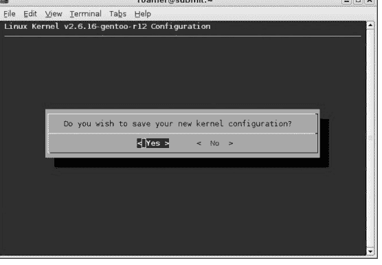

接下来，编译新内核和选定的模块：

```
# make && make modules_install
```

现在将 `bzImage` 复制到启动分区中的 `vmlinuz`：

```
# cp arch/i386/boot/bzImage /boot/linux/vmlinuz
```

如果你使用 Grub 作为引导加载程序，则不需要进行任何配置更改。如果你使用 LILO，则需要重新运行 `/sbin/lilo` 以更新引导加载程序配置。

发出 `lsmod` 命令可以让你验证启动时是否加载了正确的驱动程序（见图 1.2）。

**图 1.2 Mini-PCI Senao 网卡的主机接入点驱动程序**

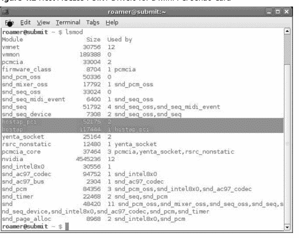

至此，运行监视模式下的 WLAN 扫描程序所需的所有驱动程序和内核选项均已安装。

##### 为全球定位系统准备内核

如果你能生成漫游地图，发现 WLAN 会很有趣。为了做到这一点，你需要准备内核以配合全球定位系统（GPS）工作。大多数 GPS 设备都配有串行数据线；不过，你现在也可以购买配有通用串行总线（USB）线的设备。如果你需要使用 USB 串行转换器，则内核中必须支持你的转换器。

进入 `/usr/src/linux` 目录并发出 `make menuconfig` 命令。然后为你的 USB 串行转换器选择适当的驱动程序：

```
Device Drivers --->
    USB support --->
```

```
USB Serial Converter support --->
<> USB Serial Converter support
[*] USB Generic Serial Driver
<> USB Prolific 2303 Single Port Serial Driver
```

Prolific 2303 驱动程序是一种非常常见的 USB 串行转换器驱动程序。你需要确保已编译进对你特定转换器的支持。

接下来，退出 menuconfig，保存你的内核配置，编译新内核，将 bzImage 移动或复制到你的启动分区，并在必要时更新你的引导加载程序。重启后，插入你的 USB 串行适配器。系统 dmesg 将显示内核是否正确识别了你的转换器（见图 1.3）。

> **注意**
> 当你执行 **make menuconfig** 时，它从运行中的内核或当前内核的配置文件中读取数据。此配置包含了之前所做的所有更改，因此无需重复这些更改。

**图 1.3 Prolific USB 串行转换器**

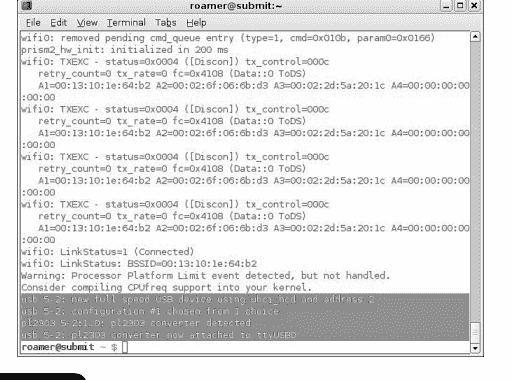


现在，你已具备支持驱动漫游（wardrive）和执行无线渗透测试所需的所有内核支持。

#### 安装合适的工具

一旦你生成了支持监听模式的内核并编译了相应的驱动程序，就可以开始安装执行驱动漫游所需的必要工具了。要完成此目标，你需要安装两个工具：Kismet 和 GPSD (www.pygps.org/gpsd/downloads)。

#### 安装 Kismet

本节将简要介绍如何安装 Kismet。完整的安装说明请参见第 2 章。Kismet 的安装过程非常直接。只需从 www.kismetwireless.net/download.shtml 下载最新版的 Kismet，并将其保存到你选择的目录中。（旧版本的 Kismet 可以从 www.kismetwireless.net/code. 获取。）解压并解包该文件，然后进入它创建的目录，并执行以下命令：

```
# ./configure
# make
# make install
```

**注意**

这三个命令是从源码配置和编译 Linux 程序的标准方法。在本章剩余部分，除非另有说明，否则“编译程序”指的就是这三个步骤。

这将 Kismet 安装到默认目录（/usr/local/bin/kismet），并将 Kismet 配置文件安装到（/usr/local/etc/kismet）。

#### 从源码编译或使用软件包

本章中的编译示例展示了如何首先从开发者的网站获取源码，然后手动编译程序来从源码编译安装程序。这只是编译和安装程序的一种方式。大多数发行版都拥有某种包管理系统，可用于安装程序，或获取并安装它们。Red Hat 和 Fedora 使用 Red Hat 包管理器（RPM）包管理系统，Gentoo 使用 emerge，而 Slackware 的软件包为 .tgz 格式。有时，使用发行版的包管理系统来安装程序会很有益；但需要注意的是，当使用包管理器来编译和安装程序时，它可能会将二进制文件和配置文件放置到非标准目录中。本章假设你已从源码编译，或者你的包管理器已将二进制文件和配置文件放置在标准位置。如果包管理器未这样做，你可以使用 find 命令搜索配置文件或二进制文件：

```
# find / -name kismet.conf -print
```

此命令在整个文件系统中搜索 kismet.conf 文件并在屏幕上显示结果。在 Linux 系统中，-print 开关很少是必需的；然而，添加它不会改变命令的功能。

#### 安装 GPSD

GPSD 是一个与你的 GPS 单元进行交互的程序，它进而将数据传递给 Kismet，以提供发现接入点时你所在位置的 GPS 坐标。GPSD 的安装与普通的 Linux 安装过程略有不同，因为没有 "make install" 选项。执行 ./configure 和 make 命令，然后运行你编译所在位置的 gpsd，或者将 gps 和 gpsd 文件复制到路径中的目录，例如 /usr/bin 或 /usr/local/bin。

#### 配置系统以进行驱动漫游

一旦你编译并安装了 Kismet 和 GPSD，就需要编辑 Kismet 配置文件，以便 Kismet 在你的系统上正常工作。除非你（或你的包管理器）更改了位置，否则配置文件会放在 /usr/local/etc。需要编辑两个文件：kismet.conf 和 kismet_ui.conf。

kismet_ui.conf 文件控制 Kismet 的用户界面选项。在大多数情况下，你可以将这些选项保留为默认值，除非你想调整界面外观。Kismet 确实有一个每次启动 Kismet 时都显示的欢迎窗口（见图 1.4）。

# 图 1.4 Kismet 欢迎窗口

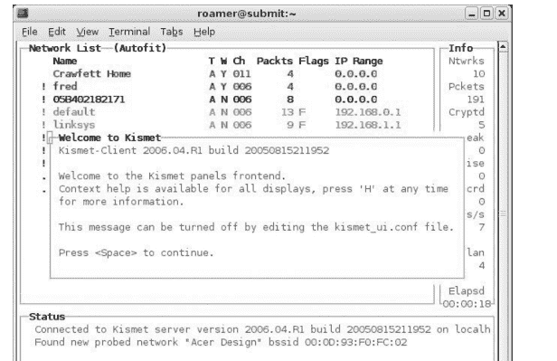

要在 Kismet 启动时去除欢迎窗口，将 *showintro* 选项更改为 false：

```
# Do we show the intro window? 
showintro=false
```

*kismet.conf* 文件是设置 Kismet 重要选项的地方。为了使 Kismet 正常工作，必须编辑此文件以反映你的环境和硬件。首先，你需要编辑 *suider* 变量：

```
# User to setuid to (should be your normal user) 
suiduser=roamer
```

接下来你需要设置 *source* 变量。该选项告诉 Kismet 你正在使用什么类型的驱动和网卡，以及你的网卡配置在什么界面上。下面的例子告诉 Kismet 使用 Host 接入点驱动，并且你的网卡被配置为 *wlan0*。第三个选项 *wlan* 可以设置为任何值。

```
source=hostap,wlan0,wlan
```

以下是一些针对不同网卡和驱动的较常见的 source 选项：

```
# Source line for Intel Pro Wireless 2100 
source=ipx2100,eth0,ipx2100source 
# Source line for wlan-ng Prism2 driver 
source=prism2,wlan0,prism 
# Source line for Cisco (dependent on Cisco driver used) 
source=cisco,eth0,cisco 
# Alternate Source line for Cisco (dependent on Cisco driver used) 
source=cisco_cvs,eth1,wifi0,ciscoxfs 
# Source line for Hermes based cards (Orinoco) 
source=orinoco,eth0,orinocosource
```

除非你计划启用多个源，否则无需更改 *enable-sources* 变量，除非更改，否则该变量被注释掉。

默认情况下，Kismet 会跳频（hops channels）。这使得 Kismet 能够检测在 2.4GHz 频段不同信道上工作的接入点。除非你只想检测特定信道上的接入点，否则应保持此设置不变：

```
# Do we channelhop 
channelhop=true
```

如果你想识别特定信道上的接入点，请禁用跳频并在 source 变量中设置初始信道。例如，仅识别信道 8 上的接入点：

```
source=hostap,wlan0,wlan,8 
channelhop=false
```

下一个需要调整选项是信道速度（channel velocity）。它控制 Kismet 每秒应循环多少个信道。默认设置为每秒三个信道。这是一个可接受的，尽管保守的选项。要增加 Kismet 跳频的速度，请增加此数字。要降低速度，请减少此数字：

```
# How many channels per second do we hop? (1-10)
# The following option scans each channel for 1/5 of a second
channelvelocity=5
# The following option scans each channel for 1/2 of a second
channelvelocity=2
```

跳频和 GPS 配置之间的选项默认设置正确，通常不需要编辑。如果你使用 GPS 单元来捕获报告坐标，则应设置 GPS 配置选项。除非更改端口，否则 GPSD 监听端口 2947；因此，kismet.conf 中 GPS 的选项应设置为反映此情况：

```
# Do we have a GPS?
gps=true
# Host:port that GPSD is running on. This can be localhost OR remote!
gpshost=localhost:2947
```

下一个需要查看的选项是日志文件的写入间隔。默认设置是每 5 分钟写入一次日志。对于随意的驱动漫游，这可能是可以接受的；但是，对于专业人士，在系统或程序崩溃的情况下定期写入日志是个好主意（每分钟是一个安全的选择）：

```
# How often (in seconds) do we write all our data files (0 to disable)
writeinterval=60
```

Kismet 生成非常全面的日志文件集，如表 1.1 所示。

# 表 1.1 Kismet 日志文件类型

| 文件类型 | 描述 |
|---|---|
| Dump | 原始数据包转储，可以在 Ethereal 或其他数据包分析器中打开。 |
| Network | 列出已检测到的网络的文本文件。 |
| CSV | 检测到的网络的逗号分隔列表 |
| XML | 检测到的网络的可扩展标记语言（XML）格式日志。这对于导入其他应用程序很有用。 |
| Weak | 以 AirSnort 格式检测到的弱初始化向量（IV）数据包。 |
| Cisco | Cisco 设备产生的 Cisco 发现协议（CDP）广播日志。 |
| GPS | 检测到的接入点的 GPS 坐标日志。 |


*logtypes* 变量告诉 Kismet 您希望它生成哪些类型的日志文件。默认选项是可接受的（*dump*、*network*、*csv*、*xmll*、*weak*、*cisco* 和 *gps*）；但是，您可能并不需要所有这些。您应该确保生成的最少日志类型是 *dump*、*network* 和 *gps* 日志：

```
logtypes=dump,network,gps
```

*logdefault* 变量指定应在日志文件名前添加什么文本。Kismet 以 [logdefault]-[date]-[sequence-number].[filetype] 的格式写入文件。例如，如果 *logdefault* 设置为 Roamer，那么当天第三次漫游（wardriving）会话的 *gps* 日志将被命名为 Roamer-Oct-14-2006-3.gps。如果您在同一天内漫游多个区域，此选项有助于对结果进行排序：

```
# Default log title
logdefault=MyCustomer
```

您可能想要修改 *kismet.conf* 文件中的最后一个选项是 *logtemplate*。此选项控制日志的创建和存储位置以及日志文件的格式。如果未对此变量进行任何修改，日志将以默认格式、默认标题创建在启动 Kismet 的目录中。然而，将所有日志存储在一个位置，或者将不同类型的日志存储在不同的目录中可能更有益。与 logtemplate 相关，有七个可以设置的变量：

- %t 是 logdefault 中设置的标题
- %d 是当前日期，格式为 月-日-年 (Mon-DD-YYYY)
- %D 是当前日期，格式为 YYYYMMDD
- %f 是日志开始的时间
- %i 是日志的增量编号（即当天的第一个日志为 1，第二个为 2，等等）
- %l 是日志类型
- %h 是主目录

例如，如果您希望日志按文件类型生成在不同的目录中，并且创建在 wardrives 目录中，您应有如下 logtemplate：

```
logtemplate=WarDrives/$1/%n-%id
```

假设您将 logtypes 变量设置为 dump、network 和 gps，您将需要创建一个 wardrives 目录，其中包含三个子目录：dump、network 和 gps。

在进行任何更改后，保存文件，您就可以使用 Kismet 进行漫游了。

#### 使用 Linux 和 Kismet 进行漫游

使用 Kismet 进行漫游有很多理由。您可以生成的日志文件范围非常广泛，这使得它极具吸引力。与其他一些漫游软件不同，Kismet 不仅检测访问点，还保存其所看到的所有数据包的完整日志。这些转储可以用其他数据包分析器打开，也可以馈入渗透测试程序。监听模式允许您识别隐藏的访问点（未通过 SSID 广播的）。此外，由于客户端通过网络进行身份验证时 SSID 是以明文形式发送的，Kismet 通常可以确定这些隐藏网络的 SSID。

现在，我们已经根据喜好调整了 Kismet 配置文件，准备好使用 Kismet 开始漫游了。在本节中，您将学习如何启动 Kismet，以及运行后如何使用 Kismet 界面。我们来看看 Kismet 提供的不同选项，以及如何为 Kismet 使用图形前端。

##### 启动 Kismet

启动 Kismet 相对简单。假设 Kismet 在您的路径中，在命令行中输入 kismet，如图 1.5 所示。

# 图 1.5 启动 Kismet……这里有个问题

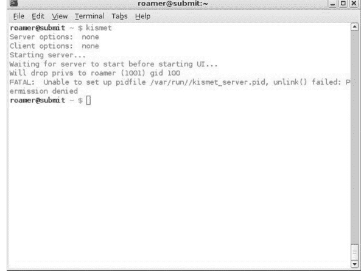

进程 ID 文件 (*pidfile*) 无法设置。这是因为您没有权限写入 /var/run。有两种方法可以修复此问题。您可以更改 *kismet.conf* 中 *pidfile* 写入的位置：

```
# Where do we store the pid file of the server?
piddir=/home/roamer
```

更改 *pidfile* 的位置是一个选项，但既然您已在 *kismet.conf* 中设置了 *suiduser*，*su* 到 root 然后运行 kismet 可能更容易。Root 有权限写入 *pidfile*，但在执行该操作后，Kismet 将权限降低到 *suiduser*，从而避免以 root 运行带来的潜在安全风险。

# 图 1.6 Kismet 成功启动

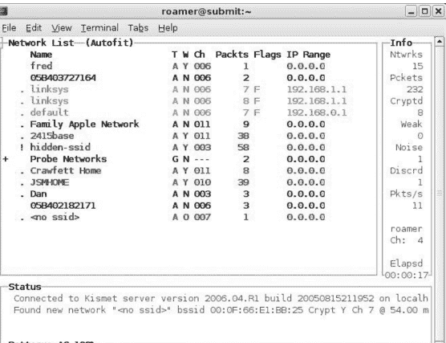

##### 使用 Kismet 界面

在本节中，我们将为您提供 Kismet 界面的介绍。有关 Kismet 菜单和功能的完整讨论，请参见第 4 章。除了识别访问点的能力外，Kismet 还具有非常强大的用户界面。您可以通过检查用户界面中的 Kismet 选项来找到关于您已识别的每个访问点的大量信息。明显的信息（例如，SSID）立即可用，无论访问点是否加密。对于随意的漫游，这可能就是您需要的所有信息。然而，如果您想了解有关您发现的网络的更多信息，您需要熟悉可供您使用的不同选项。

###### 理解 Kismet 选项

在使用 Kismet 的不同选项时，您需要首先更改 *sort* 选项。默认情况下，Kismet 处于 *autofit sort mode*。不幸的是，在此模式下，除了默认视图中显示的信息外，您无法获得有关不同访问点的许多信息。要更改排序模式，请按 **s** 键以调出排序选项菜单（见图 1.7）。

图 1.7 Kismet 排序选项

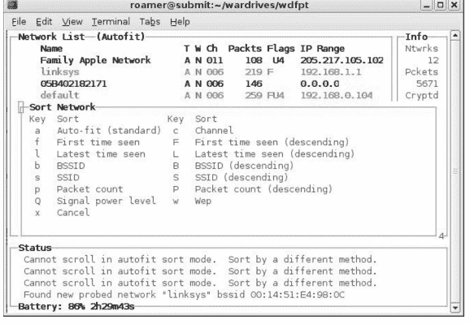

此时，您有 14 种不同的 *sort* 选项可供选择。选择最适合您需求的选项。例如，如果您只对具有特定 SSID 的访问点感兴趣，您可以选择 **s** 以按 SSID 对访问点进行排序，然后向下滚动到所需的 SSID。

一旦您选择了排序方法，您就可以开始查找每个网络的额外信息。使用箭头键，高亮显示您感兴趣的访问点，并按 **Enter** 获取网络详情（见图 1.8）。

# 图 1.8 网络详情

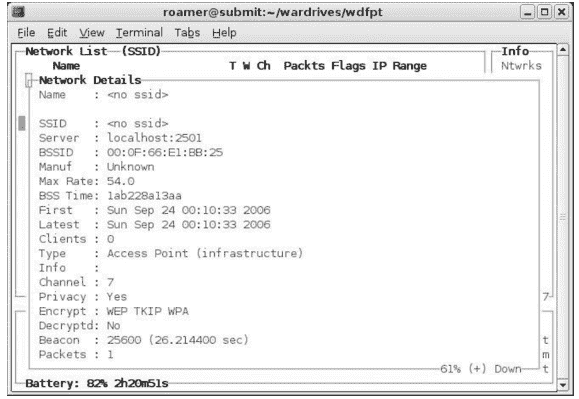

您现在知道了访问点的 MAC 地址（基本服务集标识符 [BSSID]）。由于访问点的最大速率为 54.0，您知道它是一个在基础设施模式下运行的 802.11 g 访问点。尽管主屏幕显示该网络使用加密，但现在您可以识别出 WPA 是现有的加密机制。一旦您对信息感到满意，请按 **q** 键关闭详情并返回主视图。

您可能想知道哪些客户端连接到网络。通过高亮显示访问点并按 **e** 键，您可以看到与该网络关联的客户端列表（见图 1.9）。

# 图 1.9 客户端列表

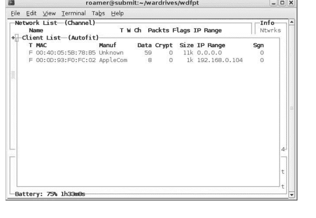

在客户端视图中，您可以确定与访问点关联的任何客户端的 MAC 地址。此外，在某些情况下，您可以确定其卡片类型。Kismet 已看到的数据包数量以及其中加密的数据包数量也会被标识。一旦 Kismet 确定了特定客户端的 Internet Protocol (IP) 地址，它也会被记录，以及信号强度。同样，当您查看完客户端列表后，按 **q** 返回网络列表。

有时，您可能只希望收集有关特定频道上的访问点的信息。要禁用频道跳跃并仅在一个频道上收集数据，请高亮显示该频道上的访问点，并按 **Shift+L** 键锁定该频道。

要恢复频道跳跃，请按 **Shift+H**。

Kismet 还有一个强大的帮助面板。如果您不确定某个选项，请按 **h** 显示帮助菜单（见图 1.10）。


## 图 1.10 Kismet 帮助界面

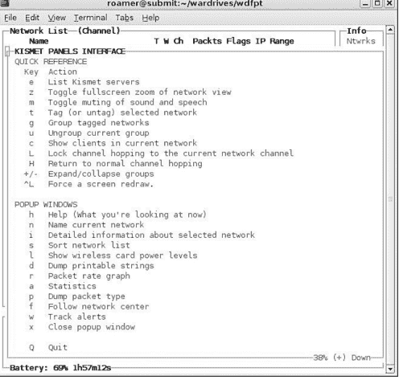

###### 使用图形前端

除了标准的 Kismet 界面外，你还可以使用图形前端来配合 Kismet。Gkismet ([http://gkismet.sourceforge.net](http://gkismet.sourceforge.net)) 是一个可以与 Kismet 配合使用的前端接口。一旦你下载、编译并安装了 gkismet，你需要启动 Kismet 服务器：

```
# /usr/bin/kismet_server
```

接下来，启动 gkismet：

```
# /usr/bin/gkismet
```

这将打开 gkismet 界面，并提示输入 *kismet_server* 的信息（参见图 1.11）。在大多数情况下，你将连接到默认端口 2501 上的 *localhost*（127.0.0.1）。

## 图 1.11 连接到 Kismet 服务器

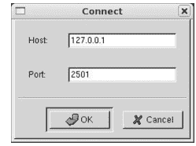

一旦输入了服务器信息，gkismet 将连接到 Kismet 服务器，你会看到 Kismet 发现的接入点显示出来（参见图 1.12）。

## 图 1.12 运行中的 Gkismet

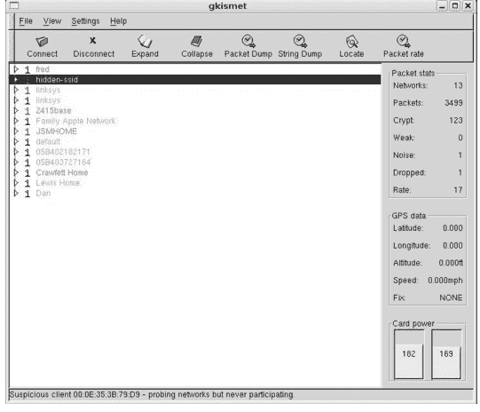

使用图形前端有几个优势。例如，卡片功率会在主屏幕上显示。这对方向查找和追踪流氓接入点非常有益。此外，你可以通过双击想要获取信息的接入点，轻松查看每个接入点的详细信息。

此外，你可以通过右键点击接入点的 SSID，并选择希望如何排序信息，来访问排序选项。

## 总结

在本章中，我们探索了无线技术演变为今天形态的一些历史。无线技术已经存在了很长时间，考虑到无线电和蜂窝电话技术几十年的发展历程。这些技术在后台悄无声息地发展，而 PDA、Palm Pilot 和其他手持无线设备逐渐声名鹊起。其他用途，如 GPS 和卫星通信到家庭，也在为主流应用而发展。这些应用程序为消费者提供了相对于有线设备许多优势，包括灵活性、移动性，以及提高的效率和及时性。

Kismet 是一个用于漫游（wardriving）和渗透测试的强大工具。使用 Kismet 的最大优势之一是能够使用监听模式或 rfmon 模式。这允许你识别那些不在信标帧中广播 SSID 的无线网络，使 Kismet 与其 Windows 对应产品 NetStumbler 区别开来。

理解 Kismet 的许多功能以最大化其效果是很重要的。你可以编辑 kismet.conf 文件以根据具体需求定制 Kismet。Kismet 面板界面提供了许多不同的用户选项，用于排序和查看你发现的网络信息。此外，像 gkismet 这样的图形前端程序可以使查看数据变得稍微轻松一些。

Kismet 也是一个非常适合需要执行 WLAN 发现以识别目标网络的渗透测试者的工具。虽然并不总是 100% 准确，但 Kismet 可用于识别网络上使用的加密类型。为了获得完全准确的结果，你可以打开你的 Kismet.dump 文件，这是一个使用 Ethereal 或 Wireshark 等数据包分析器打开的 pcap 格式数据包捕获文件，以获取准确的加密级别读数。一旦你识别了目标及其加密级别，就有几个开源工具可用于继续渗透测试。像 SirMacSloot 这样的工具可以欺骗 MAC 地址并绕过 MAC 地址过滤。Aircrack 套件提供了一套丰富的工具，用于收集数据包、注入数据包和破解 WEP。CoWPAtty 是一个强大的工具，当配合好的字典文件使用时，可以破解 WPA-PSK。

对无线网络进行渗透测试通常是获取网络初始立足点的一种方式。在始终记住保持范围内的前提下，你可以开始对内部网络进行正常的渗透测试过程，通过你进入无线网络的入口向量，这将为你提供绝佳的出发点。

# 第 2 章

# 基本安装

本章的解决方案：

- 引言
- Kismet 先决条件
- Kismet 安装
- 在 Linux 笔记本上编译和安装 Kismet
- 选择无线网卡驱动程序
- 无线网卡驱动程序的编译和安装
- 编辑 Kismet 配置文件以进行基本 Kismet 安装
- 运行 Kismet

## 引言

本章将向你介绍 Kismet 的基本安装。基本安装是指 Kismet 的服务器部分和客户端部分位于同一台笔记本电脑上。这是大多数人最初会感兴趣的一种安装方式。关于分离的服务器和客户端的高级安装，以及远程和无人机，将在第 7 章和第 8 章中涵盖。

在这里，我们将重点关注在“典型的 Linux 系统”上的“典型 Kismet 安装”。对于不知道的人，Linux（正式名称为“GNU/Linux”）是一个类 UNIX 操作系统（OS），由 Linus Torvalds 于 1991 年创建。Kismet 可以安装在大多数“类 Unix”操作系统上，包括 Linux、Debian、Berkeley Software Distribution（BSD）、Apple OSX/Darwin，以及在 Microsoft Windows 下运行的 Linux 虚拟机。然而，由于 Linux 是 Kismet 的“原生”操作系统，也是大多数用户运行 Kismet 时所使用的操作系统，因此它将成为我们初始“典型 Kismet 安装”的基础。

虽然 Kismet 几乎可以在任何安装了 Linux 的个人计算机上运行，但此处假设大多数使用基本 Kismet 设置的人是在具有无线网络功能的笔记本电脑上进行的。因此，在本章中，“计算机”、“个人计算机”、“PC”和“笔记本电脑”这些术语可以互换使用。

此外，由于 Linux 系统往往与其所有者一样具有特性，这里使用“典型”一词时需谨慎。此处涵盖的安装将尽可能通用，但请理解，你的笔记本电脑上 Linux 安装方式的差异可能会使以下某些信息变得无用。虽然我们将尽力涵盖一些常见的变化，但不可能涵盖所有偏离常规的情况。

进入本章之前，你需要已经在你的笔记本电脑上安装了某个 Linux 发行版（在 Linux 行话中称为“distro”），并且至少对 Linux 的命令行界面（CLI）以及在 Linux 中如何执行诸如下载文件等操作有基本的熟悉度。


## 来自地下的笔记

#### 启动发行版

如果你是 Linux 的新手，学习新操作系统的想法看起来令人望而生畏，你仍然可以尝试 Kismet 和 Linux，而无需投入大量的时间、精力或金钱。许多完整的 Linux 发行版变体，称为“启动发行版”（Live Distros），可以在可启动的只读光盘（CD-ROM）上获得。要尝试一个启动发行版，你只需从创建者的网站下载 CD-ROM 镜像（称为国际标准化组织 [ISO] 文件），并将其刻录到空白 CD-ROM 上。当计算机从新的 CD-ROM 启动时，它将启动进入 Linux。大多数启动发行版基于标准的发行版，如 Slackware。

要回到你原来的操作系统，只需移除 CD-ROM 并像平常一样从硬盘启动即可。

最受欢迎的启动发行版之一是 Knoppix，可从 www.knop-pix.de 和 www.knopper.net 获取。Knoppix 配有图形用户界面（GUI），使初学 Linux 的用户更容易导航。它预装了 Kismet 以及许多流行网卡的驱动程序。

另一个流行的启动发行版是 Backtrack（www.remote-exploit.org）。Backtrack 旨在供信息安全（InfoSec）专业人员用于系统和网络安全审计，因此除了 Kismet 外，它还拥有大量的安全工具。它还预装了许多流行的无线网卡驱动程序。截至本文撰写时，Backtrack 2 已发布一年多，而 Backtrack 3 正处于 Beta 发布阶段。

在 Backtrack 中运行 Kismet 将在第 10 章中详细介绍。

为了保持开始尽可能简单，我们将讨论 Kismet 的基本安装及其与常见无线网卡的使用，但我们不会在下一章之前讨论诸如天线或使用 Kismet 配合全球定位系统（GPS）接收器等内容。我们将以用户“root”的身份安装 Kismet 用于此初始安装。在类 Unix 系统如 Linux 中，“root”是管理员级别的用户。

## Kismet 先决条件

根据你在机器上安装 Linux 的方式，你在安装 Kismet 之前可能需要一些额外的软件。Kismet 是用 C++ 计算机编写的

编程语言。最低要求，你需要包含 C++ 语言编译器的开发包。由于 Kismet 是一个无线网络程序，因此还需要 Linux 网络包。如果你尚未在 Linux 机器上安装开发包或网络包，建议在继续操作之前先确保它们在 PC 上正常工作。如果没有预先安装这些软件包，在笔记本电脑上让 Kismet 运行起来将非常困难，甚至根本不可能。

Kismet 正常编译还需要一个名为 SOMELib 的软件包。SOMELib 与 C++ 语言配合使用。然而，一些 Linux 发行版将其 SOMELib 库软件包拆分为两个，分别命名为“SOMELib”和“SOMELib-devel”软件包。如果你的发行版对 SOMELib 进行了拆分，你需要同时安装这两个软件包，以便 Kismet 能够编译。

LibPcap 软件包是一个数据包捕获库，对于 Kismet 中数据包捕获部分的正常编译是必需的。它提供了 Kismet 用于在无线网卡接口上捕获数据包的通用捕获系统。LibPcap 0.9.8 是当前版本，任何 0.9 以上版本均可。

## 工具与陷阱

### Linux 中的应用安装

与大多数 Unix-like 操作系统下的软件一样，Kismet 是从“源代码”安装的。源代码仅仅是一系列关于程序应该如何运行以及运行时应该做什么的指令列表，尽管这段代码本身不能作为程序运行或执行。为了做到这一点，你需要将源代码构建或“编译”成电脑能理解的指令集。由此生成的机器可执行指令集可以直接在笔记本电脑上执行。

如果你熟悉在 Linux 上编译和安装软件的标准流程，那么安装 Kismet 不应该构成太大障碍。然而，如果你只习惯使用 Windows，而在 Windows 中 99.999% 的软件都以预编译的二进制可执行“EXE”程序形式分发，那么你在 Linux 下第一次构建自己的软件可能会让人望而却步，甚至令人困惑和恐惧。像 Red Hat 的 Fedora 等一些 Linux 发行版也提供预编译的二进制格式软件。由于它们最初是为与 Red Hat 包管理器配合使用而制作的，因此这些软件包被称为 RPM 文件。使用此类发行版的用户可能也不习惯在“标准”发行版中如何进行编译和安装。对于刚接触编译和安装流程的人来说，这里简要概述了从源代码安装 Linux 程序所需的命令。

将源代码编译为可执行程序的标准方法是通过一系列三个主要命令完成的：configure（配置）、make（制作）和 make install（安装）。简而言之，这些命令告诉编译器（一个构建其他程序的程序）如何构建所需的软件包。

- **配置** 由于 Linux 的常规设置方式，此命令通常作为 `./configure` 运行，它告诉编译器下一步需要哪些选项，以及在哪里找到构建所需程序的各种信息源。向 configure 命令添加自己的选项并不罕见。
- **制作** `make` 命令是使用各种选项实际创建可执行二进制程序的步骤。通常，`make` 是构建周期中最长的部分。
- **制作安装** `make install` 命令用于将软件的所有不同部分安装到笔记本电脑上的相应目录位置。

安装某些软件包可能需要其他步骤，例如创建依赖程序的 `make dep`。这些步骤可能是 configure、make 和 make install 命令之间的中间环节。

如果在任何 Unix-like 操作系统上安装和运行程序时遇到问题，你应该首先查看未压缩的源代码目录。大多数程序员都会包含一个所谓的“README”文件，通常命名为“README.TXT”或非常相似的名称。大多数 README 会告诉你安装程序需要做什么，包括安装前需要完成的一些更常见的步骤。

### Kismet 安装

Kismet 是从“源代码”安装的。源代码是告诉编译器程序如何构建实际 Kismet 程序本身的文本文件。要开始安装，你需要以 root 用户身份登录笔记本电脑。然后，从 www.kismetwireless.net 下载最新的源代码。跟随链接进入下载页面，获取最新的“稳定源代码版本”。（参见图 2.1。）

#### 图 2.1 Kismet 主页。www.kismetwireless.net

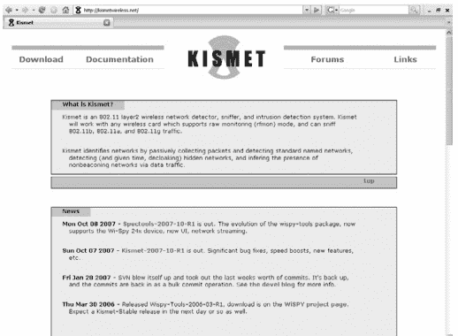

截至本文撰写时，最新的稳定版本是 kismet-2007-10-R1。它发布于 2007 年 10 月 8 日（星期一）。Kismet 的版本号遵循以下命名约定：

```
kismet-yyyy-mm-Rn.tar.gz
```

其中：

- Yyy = 年份
- Mm = 月份
- Rn 是修订号。

你应该确保下载的是最新的稳定版本，因为它包含最新的代码和错误修复。

对于 Linux 新手来说，文件扩展名 *.tar.gz* 表示该文件是一种被称为“tar”或 Tape ARchive（源自早期命名约定，当时磁带是存储归档的常用介质）的类型，并且是使用 GNU Zip 压缩工具压缩的。

我们建议将下载的文件放置在 /usr/src 目录中，这是放置 Linux 源代码文件的正常文件夹。要进入 /usr/src 文件夹，请在 CLI 中输入此命令：

接下来，我们将解压 Kismet 源代码文件。这使用以下命令完成：

```
tar -xzvf kismet-2007-10-R1.tar.gz
```

此命令告诉 tar 程序从归档文件中提取组成文件。具体来说，z 告诉 tar 组成文件是使用 gzip 压缩的。x 告诉它执行提取功能，而 v 意味着 tar 应该详细（verbose），即在执行文件提取时向用户提供信息。最后，f 用于强制覆盖，这意味着如果已经存在同名文件，tar 将使用归档中的新文件覆盖它。

在命令行输入此命令后，tar 程序会创建一个遵循相同命名约定的新子目录。在这种情况下，子目录名称将为 kismet-2007-10-R1。随后，该程序将快速解压 150 多个文件和 8 个额外文件夹到新建的 Kismet 源代码文件夹中。

#### 图 2.2 将 Kismet 解压到其目录

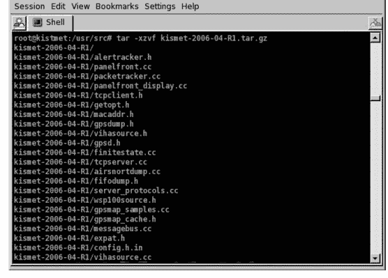

切换到新的子目录。它将具有与源代码 `tar.gz` 文件相同的命名约定，并根据年份、月份和修订号命名为 `/usr/src/kismet-yyyy-mm-Rn`。

```
cd /usr/src/kismet-2007-10-R1
```

下一步是运行 configure 命令。通过输入以下内容运行：

```
./configure
```

注意命令前面的“./”。如果你是 Linux 新手，确保在此命令前输入句点和斜杠。由于命令的工作方式及其在 Linux 目录路径中的位置，必须包含它。

此时，你应该观看屏幕上滚动的输出。你不需要关注它，因为它可能太快而无法跟随。然而，如果 Kismet 遇到任何问题，例如找不到运行所需的库或其他开发包，这就是错误消息出现的地方。在图 2.3 中，你可以看到 configure 命令的运行过程以及输出的显示方式。

#### 图 2.3 运行 configure

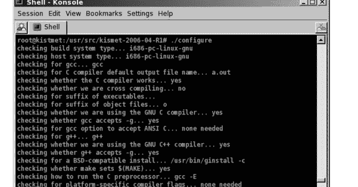


完成后，`configure` 命令会给出运行摘要，说明安装了哪些库。典型的摘要如图 2.4 所示。如果你的计算机缺少额外的库，通常会在这里列出错误信息，指出缺少哪些库。缺少文件库是导致 `make` 失败的常见原因。如果缺少任何库，你需要下载并安装它们，然后再次运行 `configure` 命令。

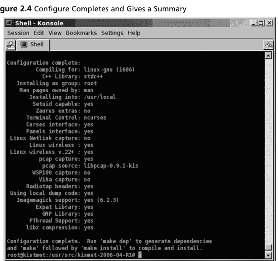

现在你需要依次执行三个命令。它们是 `make dep`、`make` 和 `make install`。这三个命令都在 CLI 中运行。请逐一执行，在下一个命令执行之前，确保每个命令的输出已完成。

```
make dep
make
make install
```

这些命令中的每一个都会在屏幕上产生一些输出。每个命令的输出在程度上会有所不同，但它们看起来都与图 2.5 中的输出屏幕相似。

## 损害与防御

### “make suidinstall” 选项

Kismet 需要 root 权限来配置无线网卡使用射频监控模式（rfmon）。它也需要 root 权限来启动数据包捕获。最终的 *make install* 命令也可以作为 *make suidinstall* 运行。运行此选项允许 Kismet 以 root 用户权限从任何普通用户账户运行。在多用户系统上，这可能是一个很大的安全问题，因为如果你有一些不希望拥有完全管理权限的用户，这会使你的笔记本电脑容易遭受滥用。拥有完全管理权限的用户有能力影响整个系统，这对于那些恶意或 simply 不知道自己在做什么的人来说可能是非常糟糕的。

如果除了 root 账户和受信任的账户外，机器上没有其他用户，你可以使用 *make suidinstall* 安装 Kismet。这将允许你从任何普通用户账户运行 Kismet，而不需要切换到 root 账户。

如果计算机上还有其他非特权用户，你应该正常安装 Kismet，这样将只允许它从 root 账户运行。当你想从任何正常账户运行 Kismet 时，然后使用超级用户命令 *su* 访问 root 账户，并从那里启动 Kismet。也可以使用 *sudo* 命令。这个 *su* 命令和 *sudo* 命令之间有细微差别。*su* 命令将你切换到 root 用户，直到你输入 "exit"，这将把你降回正常的用户状态。另一方面，*sudo* 命令允许你以 root 用户身份执行单个命令，然后立即降回正常用户状态，但必须在每个命令之前输入。如果你要以 root 用户身份运行几条命令，那么你最好使用 *su* 命令，因为它可以节省你打字的时间。

## 图 2.5 *make install* 命令

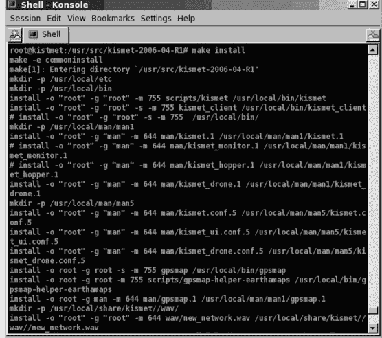

一旦 *make install* 命令完成，Kismet 就安装在笔记本电脑上，但还没准备好运行。我们必须确保安装了驱动程序以配合无线网卡工作，然后编辑一些选项使网卡能与 Kismet 配合工作。

## 工具与陷阱

**高级打包工具**

此处值得提及的另一种安装类型是 **高级打包工具 (APT)**。一些 Linux 发行版使用 **高级打包工具 (APT)**，旨在极大地简化软件的安装。这些发行版中最著名的是 Debian 及其流行衍生版 Ubuntu。使用 APT 安装 Kismet 时，使用 *apt-get* 命令。由于很少使用 root 用户，*sudo* 命令必须置于 *apt-get* 命令之前，或者用户必须使用上述的 *su* 命令切换到 root 用户。

```
sudo apt-get install kismet
```

以这种方式运行 *apt-get* 命令将使用 APT 的系统安装 Kismet，并消除了下载和解压源代码，然后使用 *configure*、*make* 和 *make install* 命令编译和安装程序的需要。

## 选择无线网卡驱动

为了使用 Kismet，显然你需要有一些无线信息发送到程序的服务器部分，然后服务器将其传递给客户端。通常这是由无线网卡与服务器通信来实现的。不那么显而易见的是，无线网卡需要一个名为 *driver*（驱动程序）的特殊程序，以便它能够首先与服务器程序通信。对于不常深入硬件领域的人来说，驱动程序无非是一个小程序，它将特定硬件的低级电子信号翻译成更高级的程序或操作系统本身可以轻松使用的信息。在这种情况下，硬件是你的无线网卡，而高级程序是 Kismet。

自 2001 年左右 802.11b 无线设备成为常见消费品以来，电子产品市场爆炸式增长，出现了各种不同品牌的无线网卡。由于无线网卡的泛滥，你需要问一个问题：“我要使用哪款无线网卡配合 Kismet？”为了回答这个问题，我们需要查看卡片的可用驱动程序，并确保我们要使用的卡片有一个能与 Kismet 配合工作的驱动程序。

为了确定哪张卡片能在 Linux 下与 Kismet 配合工作，我们首先需要弄清楚无线网卡基于哪个芯片组。芯片组顾名思义，是一组设计在一起协同工作并产生特定最终功能的集成电路芯片的集合。就无线网卡而言，大多数倾向于基于几个芯片组之一。

为了进一步混淆事情，许多卡片实际上是同一单元，由同一制造商制造，但以不同的品牌名称标签或“徽章”销售。这些“重新贴牌”的卡片通常使用与制造商命名的卡片相同的驱动程序。在许多情况下，真正的诀窍在于弄清楚哪张卡片是由哪个制造商制造的，然后确定该卡片的硬件使用了哪个芯片组。

一些制造商会更换芯片组，但不会更改型号名称或编号。有时制造商的名称会更改，例如在收购或企业接管的情况下，但型号名称保持不变。

最后，你需要弄清楚你特定的 Linux 发行版正在使用哪个内核。内核是特定操作系统的核心。虽然许多驱动程序在大多数 Linux 发行版上都能工作，但某些驱动程序在不同的 Linux 内核上工作表现不同。例如，随着内核版本 2.6.13 的引入，Linux 具有一种驱动程序能够与内核通信的新方式，称为“热插拔机制（hotplug mechanism）”。一些发行版具有低于该数字的内核，而其他发行版具有该内核或更高版本的内核。一些驱动程序适用于热插拔机制，而另一些则不适用。

例如，Orinoco 驱动程序的版本 0.13e-SN-9 与热插拔机制紧密配合，而版本 0.13e-SN-8 则不然。因此，对于任何 2.6.13 或更高版本的内核，应使用版本 0.13e-SN-9，而对于任何 2.6.12 或更低版本的 Linux 内核，则需要使用 0.13e-SN-8 卡片。

如果你不知道当前安装的是哪个内核，Linux 命令 `uname -r` 在 CLI 中输入时会返回内核版本。CLI 通常通过终端或控制台会话，或通过备用登录访问。例如，在作者的一台机器上，输入命令 `uname -r` 返回结果“2.4.33.3”，表示内核版本是 2.4.33.3。

```
uname -r
2.4.33.3
```

命令 `uname -a` 将显示所有可用的系统信息。

```
uname -a
Linux ghost 2.4.33.3 #1 Fri Sep 1 01:48:52 CDT 2006 i686 pentium3 i386 GNU/Linux
```

如需更多信息，输入 `uname --help` 将列出该命令的所有可用选项。


获取内核版本后，下一步是确定该卡片使用的芯片组。为了帮助您确定哪些常见无线网卡及其芯片组和驱动程序可以配合使用，表 2.1 列出了相关信息。如果您的卡片未在此列出，建议您在常用的万维网（WWW）搜索引擎上进行搜索。例如，如果您拥有一张 ORiNOCO Gold 11b/g 卡片，您可以搜索“ORiNOCO gold 11b/g chipset”。在搜索字符串中添加“Linux”和“driver”这两个词可能有助于您找到可以下载适用于您特定卡片的驱动程序网站。

此外，Kismet 的 README 文件中列出了已知的驱动程序和芯片组。README 文件随源代码文件提供，也可以作为网页在 http://www.kismetwireless.net 网站上访问。

### 表 2.1 无线网卡芯片组及 Linux 驱动程序

| 芯片组 | 驱动程序 |
| :--- | :--- |
| ADMTek | ADMTek |
| Aironet 340, 350 | Kernel 2.4.10–2.4.19, Kernel 2.4.20+, CVS |
| Atheros | Kernel/Madwifi |
| Atheros | madwifi; madwifi-ng |
| Atheros 802.11a | vtars5k |
| Atmel-USB | Berlrios-Atmel |
| Broadcom | BCM43XX |
| Intel/Centrino | ipw2100-0.44+; ipw2200-1.0.4+; ipw3945; ipw2200/3945; iwl3945; iwl4965 |
| Lucent, Orinoco | Patched orinoco_cs; Orinoco 0.14+ |
| Nokia/TI | HokiAP T/I |
| Prism/2 | HostAP 0.4; wlan-ng 0.1.3 及更早版本; wlan-ng 0.1.4–0.1.9; wlan-ng 0.2.0+ |
| PrismGT | prism54 |
| Ralink 2400 11b | rt2400-gpl, rt2500-gpl, rt73-gpl-cvs |
| Realtek 8180 11b | rtl8180-sa2400 |
| TI ACX100 | ACX100 |
| ZyDAS USB | zd1211 |

相同的步骤也可以应用于您可能正在运行 Kismet 的任何其他操作系统。表 2.2 提供了类似的各种操作系统使用的芯片组和驱动程序的列表。

### 表 2.2 无线网卡芯片组、其他操作系统及驱动程序

| 卡片 | 操作系统 | 驱动程序 |
| :--- | :--- | :--- |
| Aircap USB | cygwin | CACE Tech |
| Airport | OSX | viha |
| OSX 原生卡片 | OSX/Darwin | OSX |
| Prism/2 | OpenBSD | Kernel |
| Radiotap | BSD | Kernel |

有两种芯片组已知在任何情况下都无法与 Kismet 配合使用；它们是 Atmel 和 Hermes II 芯片组。此外，一种用于许多无线网卡的特殊驱动程序是 *ndiswrapper* 驱动程序。ndiswrapper 驱动程序用于使某些仅有 Microsoft Windows 驱动程序的卡片在 Linux 下能够以有限的方式运行。不幸的是，由于 ndiswrapper 的工作方式，它与 Kismet 不兼容。

在我们的示例操作中，我们将使用一张常见且流行的卡片，即由 Proxim 制造的 ORiNOCO Gold 11b/g Card，型号 8470-FC。按照上述步骤并结合图表，我们知道这张特定的 ORiNOCO 卡片使用 Atheros 芯片组，并可以使用 Madwifi 驱动程序运行。（见图 2.6 和 图 2.7。）


## 无线网卡驱动程序的编译和安装

就像构建和安装 Kismet 本身一样，Madwifi 驱动程序需要下载源代码，然后进行编译和安装。因此，我们要做的第一件事就是从 madwifi.org 下载源文件。（见图 2.8。）

### 图 2.8 MadWifi.org 网站

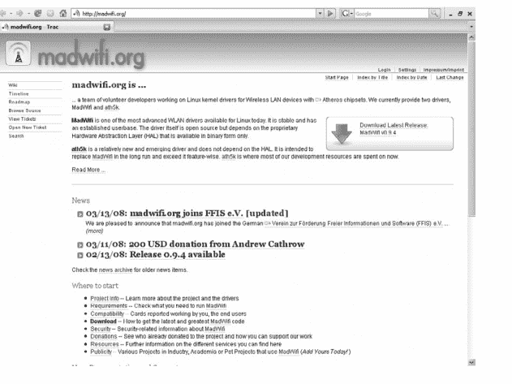

通过跟随下载链接，您将收到压缩的 *tar.gz* 文件中的最新版本的 MadWiFi 驱动程序。同样，我们切换到源代码目录并解压源代码。

```
cd /usr/src
tar -zxvf madwifi-0.9.4.tar.gz
```

接下来，我们将切换到新创建的子目录，然后运行 *configure*、*make* 和 *make install* 命令。

```
cd /usr/src/madwifi-0.9.4
./configure
make
make install
```

当 `configure`、`make` 和 `make install` 命令完成后，MadWifi 驱动程序已安装完成。对于任何其他无线网卡驱动程序，安装过程应该也是类似的。

## 配置 Kismet（编辑 kismet.conf）

此时，我们已成功安装了 Kismet 和无线网卡驱动程序。我们几乎完成了整个流程，但在笔记本电脑上成功运行 Kismet 之前，我们还有一项任务需要完成。必须告知 Kismet 两个信息。第一个信息将是运行 Kismet 的用户名，第二个则是接收无线数据并将其传递给 Kismet 本身的无线网卡。

为了完成此操作，我们必须告诉控制 Kismet 配置的 `kismet.conf` 文件哪个无线网卡正在运行，并将无线数据发送到 Kismet。这将是编辑 `kismet.conf` 的简要介绍，足以使此基本安装运行起来。对 `kismet.conf` 的编辑将在第 6 章中全面涵盖。

要设置 `kismet.conf` 文件，请在文本编辑器中打开它。如果使用 CLI，那么像 vi 或 nano 这样的编辑器将非常完美。`kismet.conf` 文件通常位于 `/usr/local/etc/` 目录中。

```
vi /usr/local/etc/kismet.conf
```

或者，您可以使用 GUI，然后从菜单中选择一个文本编辑器。这里的截图是在 KDE GUI 下的文本编辑器 KWrite 中完成的。

首先找到以 `uiduser` 开头的行。在初始状态下，此行应显示为 `uiduser=your_user_here`。（见图 2.9。）

### 图 2.9 找到以 uiduser 开头的行

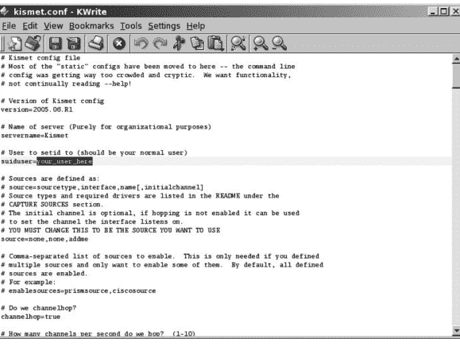

*your_user_here* 需要更改为将运行 Kismet 的用户名。由于我们是以“root”用户身份安装 Kismet，因此这是我们要在此行输入的名称。（见图 2.10。）

### 图 2.10 编辑该行以显示用户名

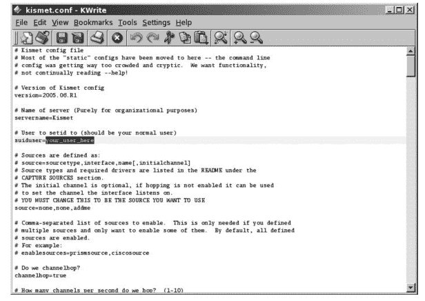

接下来，我们需要找到写着 *source*=none.none.addme 的行。这行告诉 Kismet 哪个卡片是“捕获源”，换句话说，哪个卡片将向 Kismet 发送无线数据。（见图 2.11。）

### 图 2.11 定位以 source 开头的行

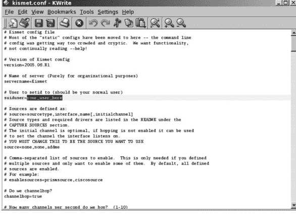

我们需要该行显示卡片驱动程序、卡片的物理名称和一个参考名称。在这种情况下，我们将修改该行，使其显示 *source*=madwifi_g, *wlan0, ProximBG*。这行告诉 Kismet 捕获源使用的是物理卡片 *wlan0* 上的 *madwifi_g* 驱动程序。卡片的参考名称仅是品牌名称“Proxim”和“BG”，因为该卡片使用 802.11b 和 802.11g 协议。（见图 2.12。）

### 图 2.12 将 source 行更改为适当的驱动程序和物理卡片

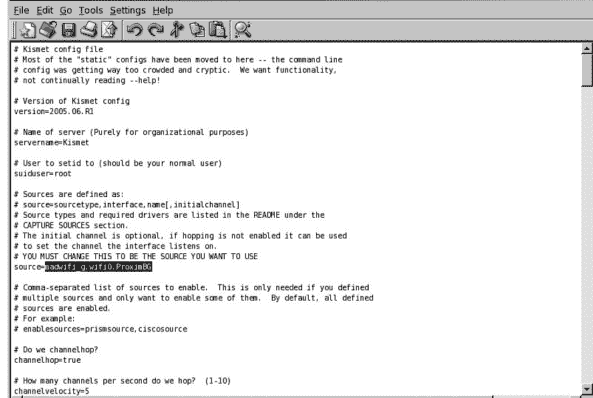

## 运行 Kismet

最后，我们完成了安装并准备运行 Kismet。从 CLI，现在应该能够输入“kismet”来启动程序。最初，您会看到一个文件名列表，Kismet 将把数据文件保存为这些名称。这些文件将位于已登录并运行 Linux 的用户目录中。如果您按照本章前面的说明进行操作，那么这些文件应该位于 root 用户的主目录中。

```
kismet
```

随着 Kismet 加载其所需的文件和参数，多行文本会滚动显示。几秒钟后，Kismet 主屏幕将会打开。Kismet 应该几乎立即开始检测无线网卡范围内的任何无线网络。图 2.13 显示了正在运行的 Kismet。

### 图 2.13 运行 Kismet 的基本安装

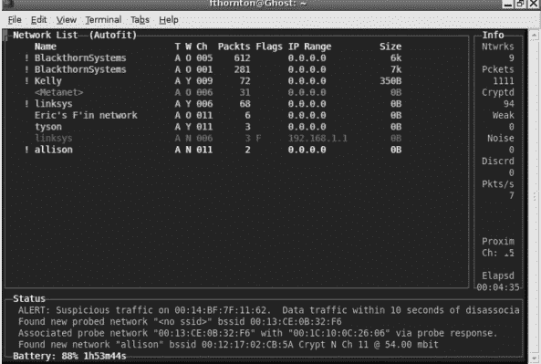

至此，Kismet 的基本安装完成。您现在应该已在笔记本电脑上启动了 Kismet，并且它能够检测您周围环境的无线网络。

要退出 Kismet，请在键盘上按 **Shift-Q**。

在下一章中，我们将开始在此基本安装基础上进行扩展，从而使我们能够使用 Kismet 作为真正的无线安全工具。


## Kismet 操作指南

本章解决方案：

- 简介
- Kismet 用户界面
- 附加射频设备：天线与线缆
- 使用全球定位系统接收器配合 Kismet
- 整合所有元素：完整的 Kismet 配置
- 总结

## 简介

在第二章中，我们的重点是将 Kismet 安装并使其在最小配置下运行。迄今为止，我们已经讨论了在笔记本电脑上运行它所需的最基本知识。现在，我们将扩展这一基本安装，迈出将 Kismet 笔记本电脑转变为真正的无线分析工具的第一步。

Kismet 有多个控制其功能的配置文件，最值得注意的是位于 `/etc/kismet` 目录中的 `kismet_ui.conf` 和 `kismet.conf` 文件。我们在第二章中简要提到了编辑 `kismet.conf` 文件。为了使 Kismet 功能更强大，这次我们将对 `kismet_ui.conf` 和 `kismet.conf` 文件进行编辑，以便 Kismet 能够用于日常使用。

`kismet_ui.conf` 和 `kismet.conf` 文件在第五章和第六章中有详细说明，但本章中记录的修改对于刚接触 Kismet 的用户来说可能最为有用。

除了编辑这些文件使 Kismet 更具功能性和实用性外，我们还将讨论添加几件设备，这些设备将帮助你充分利用运行 Kismet 的计算机。许多用户期望除了笔记本电脑和无线网卡外，无需其他配置即可立即使用 Kismet。然而，为了获得最佳可能结果，大多数用户很快发现，他们必须添加一些额外的射频（RF）设备，形式包括外部天线及相关线缆，以及全球定位卫星（GPS）接收器。

除了 GPS 接收器外，还需要在基本的 Kismet 安装中添加 `gpsd` 软件包，以便 Kismet 能够与 GPS 接收器协同工作。

## Kismet 用户界面

我们应该做的第一件事是编辑 `kismet_ui.conf` 文件，该文件控制用户界面如何呈现给用户。用户界面是 Kismet 的客户端部分，是用户在运行应用程序时所看到的界面。

`kismet_ui.conf` 文件是一个简单的文本文件，可以使用任何文本编辑器进行编辑。Linux 下两种常见的文本编辑器是 `vi` 和 `nano`，它们用于命令行界面（CLI）。大多数在 Linux 下运行的窗口管理器，如 KDE 和 Gnome，也具有适用于编辑 `kismet_ui.conf` 的图形文本编辑器。

若要使用基于文本的编辑器（如 `vi`），你需要在 CLI 上输入编辑器名称，后跟你要编辑的文件名。

```
vi /etc/kismet_ui.conf
```

### 启动画面

当首次运行 Kismet 时，会在主窗口上打开一个小启动画面。标题为“欢迎使用 Kismet”的启动画面会告诉你正在运行的 Kismet 客户端，包括版本号和构建号。它欢迎你来 Kismet 面板的前端，并建议你随时可以按 **h** 键获取帮助信息。它还告诉你可以通过编辑 `kismet_ui.conf` 文件来关闭此消息。按下空格键即可关闭启动画面。此启动画面如图 3.1 所示。


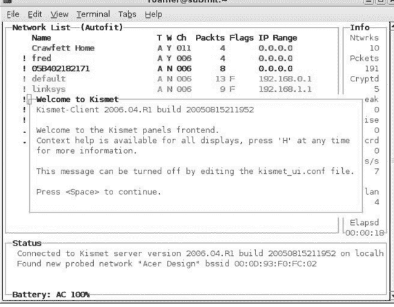

现在我们要移除启动画面，以便在每次运行 Kismet 时不再打开。为此，请编辑 *showintro=true* 一行并将其更改为 *showintro=false*。

保存文件并重新启动 Kismet。Kismet 现在将不再显示启动画面即可启动。请记住，按 h 键可打开帮助屏幕。帮助屏幕将在第四章中进一步讨论。

### 播放声音

默认情况下，Kismet 会在某些事件发生或被检测到时播放声音。这些事件包括：

- 检测到新网络
- 在检测到的网络上看到流量
- 在检测到的网络上看到垃圾流量
- 触发警报条件

安装 Kismet 时，这些功能所需的四个声音文件将安装在 /usr/share/kismet/wav 目录中。通过将声音值设置为 true 或 false 可以开启或关闭声音播放。默认情况下，声音是开启的，可以在这一行找到：`sound=true`

大多数 Linux 安装中自带的声音应用程序是 play，默认情况下，Kismet 使用 play 向用户播放这些声音。可以从这一行看到：`soundplay=/usr/bin/play`

然而，一些 Linux 发行版附带不同的声音应用程序。如果你的笔记本电脑上没有 play 作为声音应用程序，你就必须更改 soundplay=/usr/bin/play 一行，以反映已安装的声音播放器。例如，aplay 是随 Ubuntu Linux 8.04 版本附带的声音播放器应用程序。如果你正在使用 Ubuntu v8.04，必须将该行更改为 soundplay=/usr/bin/aplay，以便使用 play 应用程序播放声音文件。

## 附加射频设备：天线与线缆

大多数首次使用 Kismet 的人将其用于所谓的“war driving”活动，或者是在行驶过程中定位无线局域网（WLANs）。大多数汽车车身中的钢板和铝材面板能非常有效地阻挡无线电波，因此，外通常是添加至 Kismet 笔记本电脑的第一个配件。WLAN 外部天线的工作方式与汽车上的 AM/FM 无线电天线相同。它允许接收本无法穿透车身的弱信号，使其能够到达接收器（或在本例中为 Kismet，即无线网卡）所在的位置。

为了帮助你理解天线及其工作原理，这里有一些你在决定运行 Kismet 时使用哪种类型天线时应知道的基本术语：

- **增益** 增益描述天线的性能如何。用于描述增益的单位是*分贝*。
- **分贝 (dB)** 分贝是用于描述表观射频功率损耗或增加的功率比率的度量单位，通常以瓦特表示。分贝不是绝对值——它是两个通信设备之间获得的功率或损失的功率的测量值。这些单位通常以比率的对数（底数为 10）表示。
- **dBi 值。** 这是天线增益与*各向同性天线*增益之比。dBi 值越大，增益越高。如果增益较高，覆盖角度会更尖锐。
- **各向同性天线** 各向同性天线是一种理论天线，它以完美的球形辐射信号以覆盖该区域。它被用作描述实际天线性能和增益的起点。

通常，偏好在所有方向上等量发射和接收信号的天线。这些天线被称为“全向”或简称“omni”。大多数 war drivers 使用 3 dBi 到 8 dBi 范围内的全向天线，因为它们在信号增益和模式上提供了最佳的折中方案。通常，这种全向天线具有磁性底座，可以轻松吸附在钢制车顶。这种“磁吸底座”天线允许在不进行复杂安装的情况下将天线转移到不同车辆上。图 3.2 展示了两个小型全向天线和一个无线网卡。左侧的天线高度约为 6 英寸，具有磁性底座，可以轻松安装在车身上。右侧的天线制成用于桌面使用。两者的增益均约为 5 dBi。

### 图 3.2 带磁吸底座 3dBi 全向天线

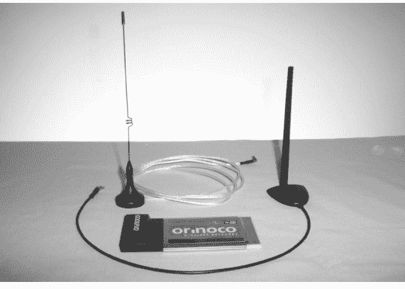

一个常见的误解是，天线增益越高，使用 Kismet 时的效果就越好。事实并非如此。从上述 dBi 值的定义中，需要理解的关键点是最后一句话：“如果增益较高，覆盖角度会更尖锐。”

全向天线的信号覆盖区域形状大致像一个甜甜圈。增益（或数值）越高，甜甜圈越“扁”。反之亦然。较小增益的天线具有“更高”的甜甜圈形状。图 3.3 展示了 5 dBi 增益全向天线的信号甜甜圈与 8 dBi 增益全向天线的比较。5 dBi 的信号甜甜圈比 8 dBi 增益全向天线的信号甜甜圈更高。这在侧视图中得到了说明。这意味着，尽管如顶视图所示其信号“较弱”，但在有高楼大厦的社区（如城市中心区域），5 dBi 增益全向天线可能会提供更好的结果。此外，由于这些天线依赖视线通信，在住宅区，房屋和其他建筑在天线与任何无线接入点（AP）之间提供遮挡时，5 dBi 增益天线效果良好。


### 图 3.3 具有不同增益电平的全向天线辐射图案


这种类型的天线通常附带一根电缆，长度为 10 到 20 英尺。这根电缆可以轻松地在汽车或卡车内部接收信号。电缆的另一端（远离天线的一端）通常以“N型公头”连接器结尾。如果附带的电缆太短或没有电缆，则需要购买合适长度的电缆。

除了全向天线外，市场上还从各种渠道提供不同类型的定向天线。顾名思义，定向天线只能朝单一方向发送和接收信号。定向天线也有不同的增益电平，通常以特定的“波束宽度”（以度为单位）来描述。你可以将其想象成手电筒发出的光束。定向天线的波束宽度是天线能够发送和接收无线电波的区域。

由于波束聚焦点狭窄，定向天线在一般的“蹭网”（war driving）活动中的用途有限，因为信号仅限于在某个区域发送和接收。在进行“蹭网”时，大多数情况下，你试图在所有方向上找到尽可能多的 AP（接入点）。然而，对于那些使用 Kismet 进行 WLAN 安全审计等用途的人来说，定向天线是必备的工具，特别是当你试图定位特定的 AP 时。例如，当试图在公司网络中定位未经授权的或“流氓”AP 时，定向天线是不可或缺的工具。

### 猪尾连接线

802.11 WLAN 使用的频率属于无线电频谱中的微波频段。为了避免在连接器中损失过多的无线电能量，连接器必须是合适类型并且适用于微波使用。“N”型连接器是微波 RF 通信中最常用的连接器之一，在许多品牌和电缆的天线上都能看到。不幸的是，“N”型连接器与普通 WLAN 网卡相比显得巨大。电缆和连接器的总重量很快就会损坏大多数网卡。因此，网卡制造商在网卡上使用了微小的连接器。为了将网卡上的微小连接器转换为“N”型连接器，我们需要一种被称为“猪尾”（pigtail）的电缆。

“猪尾”这一术语来自无线电工程和业余无线电。猪尾只不过是一小段天线电缆，两端有不同的连接器。它们用于将一种连接器类型转换为另一种类型。通常，用于猪尾连接的电缆直径和类型比主电缆小，但这并不总是如此。这个术语的确切起源似乎已不可考，但由于大多数小直径同轴电缆在从电缆卷上解开后会紧紧卷曲，因此这个名字似乎来源于一小段电缆可能类似于猪卷曲尾巴的事实。

用于 WLAN 天线连接的两常见猪尾连接线是：Orinoco 专有连接器（MC 型）到 N 型母头连接器，这反映了 Orinoco 网卡和 Type MMCX 连接器到 N 型母头连接器的普及程度。在购买猪尾连接线时，你必须确定电缆两端所需的连接器。这取决于你的网卡品牌和型号，以及天线电缆上的连接器。如果你有一张以上的网卡将用于 Kismet 笔记本电脑，那么你可能需要多于一根猪尾连接线。大多数猪尾连接线的长度约为 12 到 18 英寸（30 到 45 厘米）。虽然可以找更长的猪尾连接线，但通常最好避免使用。这是因为细电缆的信号损耗较高，电缆越长，到达无线电网卡前的信号损失就越大。


### 图 3.4 猪尾连接线（N型 到 MC型）

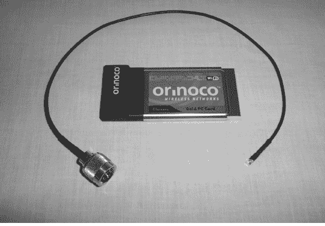

## 使用 GPS 接收器与 Kismet

为了物理定位 WLAN AP 或绘制 WLAN 位置地图，你需要知道在检测到 AP 时自己所在的位置。那么，当检测到 WLAN 时，如何追踪你的位置呢？你可以做笔记，每次 Kismet 找到一个 AP 时记录下你的确切位置。但这可能相当困难，因为获取精确位置可能需要进行测量并详细记录。例如，“位于 Main St. 23 号前‘禁止停车’标志以北 35 英尺处；距人行道边缘 5 英尺处。”使用这种技术可能会相当繁琐，而且你的行动速度会像蜗牛一样慢。

然而，有一种更简单的方法可以做到这一点，精度大约在 25 英尺以内。通过在计算机上连接 GPS 卫星接收器，Kismet 会在每次接收到 802.11 帧时自动记录你的位置。

GPS 单元是测量来自多个全球定位卫星信号的无线电接收器。通过三角测量，接收器使用这些信号计算其在地球表面的位置。位置以纬度、经度、高度和其他数据来表示。大多数 GPS 单元持续更新其位置信息。然后，该单元通过串行数据链路发送这些位置数据，通常大约每秒一次。反过来，Kismet 通过另一个名为 `gpsd` 的程序读取数据，并在监控 802.11 数据包或帧时记录 GPS 的经度和纬度。由于在记录检测到的 WLAN 位置方面的易用性，GPS 是大多数用户将添加到其 Kismet 笔记本电脑上的第二个配件。

GPS 接收器的功能各不相同，但通常分为两类：那些具有集成显示屏的和那些没有显示屏的。没有显示屏的通常被称为“鼠标”式或“冰球”式，因为它们看起来像计算机鼠标或冰球。没有显示屏的鼠标式或冰球式 GPS 接收器通常价格更便宜，但它们需要连接到计算机（或其他设备）才能正常工作。带有显示屏的则可以独立运行。如果你计划仅将 GPS 用于 Kismet，那么鼠标式或冰球式可能就足够了。然而，如果你计划将 GPS 用于其他活动，如徒步旅行，那么你将希望购买一个带显示屏的。

### 图 3.5 典型的 GPS 接收器型号


除了 GPS 接收器本身，还需要一个名为 *gpsd* 的额外软件包。*gpsd* 程序从 GPS 接收器收集串行数据，并使其可以通过传输控制协议 (TCP) 端口 2947 被 Kismet 和其他程序查询。与其他 UNIX 类型软件一样，必须下载源代码并运行 *configure*、*make* 和 *make install* 命令来安装程序。如果你对这些步骤不熟悉，上一章已经详细介绍了从源代码下载、编译和安装软件包的相关信息。*gpsd* 的文档可以从 http://gpsd.berlios.de 下载。

基于 Debian 的 Linux 发行版，如 Ubuntu，通过在 CLI 中输入以下命令来安装 `gpsd`：

```bash
sudo apt-get install gpsd
```

安装完成后，通过在 CLI 中输入命令 `gpsd` 后跟 GPS 接收器插入端口的设备标识符来启动 `gpsd`。`gpsd` 程序通常无需进一步配置即可运行，并会自动确定与 GPS 接收器通信所需的任何参数。例如，如果 GPS 接收器插入笔记本电脑的第一个串行端口，通常称为设备 `/dev/ttyS0`，则命令应为：

```bash
gpsd -p /dev/ttyS0
```

如果 GPS 接收器插入笔记本电脑的第二个通用串行总线 (USB) 端口，通常称为设备 `/dev/ttyUSB1`，则命令应为：

```bash
gpsd -p /dev/ttyUSB1
```

为了让 Kismet 报告和记录来自 `gpsd` 的信息，你还必须编辑 `kismet.conf` 文件。用你最喜欢的文本编辑器打开位于 `/etc/kismet` 目录下的 `kismet.conf`，就像你之前对 `kismet_ui.conf` 所做的那样。找到标记为：

```bash
gps=false
```

的行，并将其更改为：

```bash
gps=true
```

现在保存 `kismet.conf` 文件并关闭编辑器。然后，再次运行 Kismet。如果一切工作正常，你会在主 Kismet 面板底部边框上看到以当前经度和纬度形式显示的 GPS 数据。此外，你应该看到一个“2D”或“3D”状态标志，具体取决于 GPS 是否已锁定足够的卫星以确定完整的三维位置还是仅二维位置。完整的三维位置包括经度、纬度和高度，因此如果 GPS 正在跟踪完整的三维位置，将显示所有三个数值。否则，对于二维位置，仅显示经度和纬度。

### 典型的 GPS 问题

在使用 GPS 接收器与 Kismet 时，有几个潜在的障碍。如果你在获取 GPS 数据时遇到问题，需要进行一些故障排除。


## 工具与陷阱

### GPS 故障排除

要让 GPS 设备与 Kismet 配合工作的首要要求是建立某种通信链路，以便 GPS 能够传输数据。大多数 GPS 接收器会通过串行电缆，以国家海洋电子协会（NMEA）0183 数据协议输出位置数据。从技术角度看，NMEA 0183 输出属于 EIA-422A 数据，但实际用途上它与 RS-232 串行数据无异。这意味着发送 NMEA 0183 数据的 GPS 可以与大多数计算机使用的串行通信（COM）端口进行通信。一些新型 GPS 设备使用低功耗无线电（蓝牙）来传输 NMEA 数据。

然而，在尝试使用 GPS 接收器配合 Kismet 之前，你必须完成初始化过程。GPS 在发出正确的数据前需要先执行这一流程。务必阅读你的 GPS 说明书，并按照设置程序操作。

GPS 的大地坐标系统（Map Datum）应设置为 1984 年世界大地测量系统（WGS84）。这是大多数 GPS 接收器的默认设置，但偶尔数据输出会被设置为 1927 年北美大地坐标系统（NAD27）。虽然这两种数据集非常相似，但美国不同地区的定位误差可能超过 100 米（320 英尺）。因此，使用 NAD27 设置可能会导致位置信息不准确，特别是在你后续尝试绘制 AP 站点地图时。

第二个问题是，某些品牌的 GPS 需要锁定卫星信号并确定其位置 *之后* 才会发送任何串行数据。已有多人开始检查线缆和连接、分析 RS-232 数据协议，结果却意识到接收器因未接收到足够的卫星信号而未能定位，因此根本没有从串口发送任何数据。

相反，许多 GPS 设备虽然会发送数据，但如果接收器未锁定卫星信号，其准确性可能存在问题。某些常用 GPS 设备中使用的芯片组在无法接收到任何卫星信号时，已知会将其初始位置设为东京。如果你恰好在东京开始收集数据，这倒无妨，但对于在东京以外地区开始使用的人来说，这可能毫无用处。

这里的教训是，在使用 Kismet 外出之前，务必确保你的 GPS 接收器已获得卫星锁定。由于卫星处于高轨道，GPS 卫星信号相对较弱，GPS 接收器可能需要几分钟时间来确定其在地表的位置。如果你在建筑物内，移到室外有助于加速这一过程，因为接收器能更好地“直接看到”卫星，从而获得更好的信号接收效果。此外，任何阻挡 GPS 接收器清晰视野的因素——从茂密的树冠到城市的“混凝土峡谷”——都会阻碍接收器确定位置的能力。在车辆中使用 Kismet 配合 GPS 时，应将 GPS 接收器放置在其能够“看到”天空的位置。在大多数车辆中，这通常是挡风玻璃下方的仪表盘区域，或其他车窗附近。为了安全起见，请确保 GPS 接收器（或任何其他设备）不会阻挡驾驶员的视野。

如果 Kismet 似乎无法与你的 GPS 接收器通信，有时很难判断故障是在 Kismet、`gpsd`、GPS 单元本身，还是线缆和连接器等其他地方。

第一步是检查 GPS 是否正在向 `gpsd` 发送数据。`gpsd` 程序使用 TCP 2947 端口与其他程序和应用通信；因此，你可以使用 Telnet 程序与 `gpsd` 通信，以查看其是否正常工作。首先，使用适当的设备启动 `gpsd`：

```
gpsd /dev/ttyS0
```

然后，启动 Telnet，将其指向笔记本电脑上的 `gpsd` TCP 端口（即 *本地主机*），并输入命令 `r` 让 `gpsd` 响应 NMEA 数据。

```
# telnet localhost 2947
# r
```

如果 GPS 接收器工作正常，你应该会在屏幕上看到 NMEA 语句滚动显示。NMEA 语句应与以下内容相似，尽管具体数据会根据你的位置略有不同。

```
$GPGSV,3,1,10,17,78,216,38,23,63,311,42,26,56,051,41,15,52,303,43*7E
$GPGSV,3,2,10,18,46,295,49,09,36,152,29,36,053,,03,09,317,*7C
$GPGSV,3,3,10,10,08,097,,06,04,203,......*7C
$GPGLL,4422.2935,N,07313.8332,W,005702.969,A*21
$GPGGA,005702.97,4422.2935,N,07313.8332,W,1,05,2.7,00075,M,,,,*3E
$GPRMC,005702.97,A,4422.2935,N,07313.8332,W,00.0,000.0,150303,15.,W*67
$GPGSA,A,2,17,23,26,18,15,......,2.7,2.7,*13
```

如果你看到与此类似的信息，说明 GPS 和 gpsd 工作正常，你可以通过输入以下命令关闭 Telnet：

```
# ^c
# e
```

如果完全没有字符显示，则表明可能存在线缆问题。在这种情况下，你可能需要购买一个 null modem（空接调制解调器），它会交换串行连接中常用的若干线路。大多数 Radio Shack 商店都能以不到 10 美元的价格买到用于串行线缆的 null modem。

第三个问题是 RS-232 串行数据本身有其陷阱。几乎所有 GPS 接收器上的串行连接都是专有接口，因此大多数用户需要从 GPS 制造商处购买线缆。PC 端的线缆插头和插座通常是大多数笔记本电脑上的 DB9 子连接器，但有时这些也是专有接口。在笔记本电脑和 GPS 上遇到不同插头（或插座）的情况很常见，需要购买和使用转接插头或插座才能使设备相互连接。RS-232 标准的另一个常见难点是发现需要 null modem 来交换连接器内数据线路的位置。图 3.6 展示了一个转接头和一个 null modem。

### 图 3.6 连接各种 GPS 线缆所需的“转接头”插头和 null modem

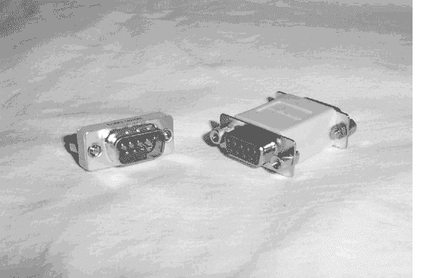

使用 GPS 的最后一个常见问题是，近年来生产的许多笔记本电脑缺少 RS-232 串行端口。相反，串行端口已被更快、更灵活的 USB 端口取代。然而，许多 GPS 接收器仍然只使用 RS-232 串行端口。这就需要用到串行转 USB 转换器。Belkin 等几家制造商生产串行转 USB 转换器。

## 整合所有要素：完整的 Kismet 设置

至此，你应该已经收集齐所有部件。希望你已经成功配置了所有设备，并确认它们都在正常工作。毫无疑问，你即将进行第一次 war drive（无线站点搜索）或至少是第一次使用 Kismet。在此之前，请检查以下设置，确保你已准备就绪。图 3.7 展示了一个典型的 Kismet 设置。大多数设置将包含以下或非常相似的物品：

- 具有 PC Card 或个人电脑内存卡国际协会（PCMCIA）插槽的笔记本电脑
- 无线网卡
- 天线尾纤
- 便携式全向天线，增益在 3dBi 到 8dBi 之间，带磁性底座
- GPS
- 用于 GPS 的串行或 USB 通信线缆，或可能是蓝牙链接。

### 图 3.7 完整的 Kismet war drive 设备组合：笔记本电脑、GPS 接收器、全向天线和尾纤

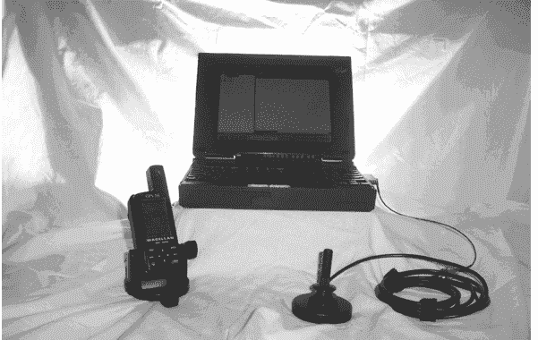

照片中未展示笔记本电脑携带包（单肩包或背包），但这绝对是您不想忽略的物品。它有助于更轻松地携带所有设备。

您可能觉得有用的另外三个配件是笔记本电脑的移动电源、多孔点烟器适配器以及直流-交流电源逆变器。多孔点烟器适配器允许您在车辆中拥有额外的 12 伏电源插座，而无需重新布线；直流-交流转换器则允许您为可能没有汽车电源适配器的设备供电，例如笔记本电脑。单独或组合使用这两个配件，都能让您在车辆中拥有灵活的电力供应方案。


## 摘要

  本章结束了关于 Kismet 安装与运行的两个章节。您现在已具备安装 Kismet 所需的所有信息，以及如何使用天线和 GPS 接收器从初始设置开始构建的方法。

  从这一点开始，本书剩余的章节将在这些基础知识上进行扩展，因此如果您尚未安装 Kismet，至少需要充分了解所需的步骤和细节，以及如何完成安装。

## Kismet 菜单

本章内容：
- 主显示
- 弹出窗口
- 自定义面板界面
- 第三方前端
- 摘要
- 解决方案快速通道

Kismet 是一个基于文本的应用程序，默认的前端菜单使用 ncurses/panels 界面。从视觉上看，前端界面相似，尽管 ncurses 界面是黑白的，而 panels 界面使用颜色（参见图 4.1）。正如我们将在本章中看到的，就所提供的信息的数量和价值而言，颜色对 Kismet 的 panels 界面具有不可估量的价值。此外，ncurses 界面是单一的非交互式显示；本章中指定的各种次级和弹出菜单无法使用。

### 图 4.1 Ncurses/Panels 界面

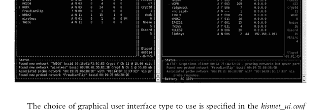

使用的图形用户界面类型选择在 *kismet_ui.conf* 文件中指定：

```
# Gui type to use
# Valid types: cursues, panel
gui=panel
```

此文件通常位于 `/usr/local/etc`。面板界面是默认设置，强烈推荐使用。在本章的其余部分，所有引用和图形都将使用面板界面。

Kismet 面板界面的一个重要功能是集成的帮助屏幕。从主窗口只需按 **h** 即可调出帮助弹出窗口（参见图 4.2）。

### 图 4.2 Kismet 面板界面

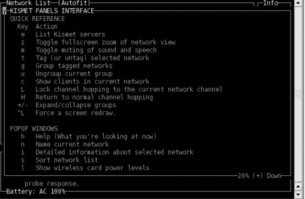

## 提示

在 Kismet 的任何弹出窗口中，窗口的右下角都会提供有关正在显示的信息量的数据。以图 4.2 为例，该数据告诉我们只显示了帮助弹出屏幕的 26%，因此应该向下滚动以获取更多信息。

## 主显示

主窗口或主显示提供 Kismet 操作的一般概览（参见图 4.3）。

### 图 4.3 Kismet 主显示

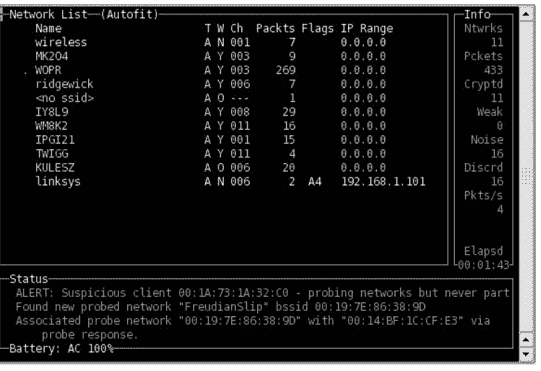

显示界面分为三个面板：网络列表面板、信息面板和状态面板。

## 网络列表面板

Kismet 主显示的主要信息来源是网络列表面板（参见图 4.4）。该面板占用相当大的屏幕空间，需要平衡显示尽可能多的网络，同时仍然提供关于每个单独网络的有效信息。在本节中，我们将讨论排序网络的各种选项，以及 Kismet 在网络列表面板中默认显示的列和颜色，以及它们如何向用户提供信息。

### 图 4.4 网络列表面板

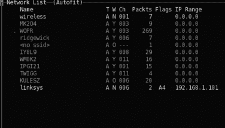

### 排序

如您将在图 4.4 中注意到的那样，Kismet 的默认排序模式称为 *autofit*（自适应）。autofit 的目标是显示尽可能多的当前活动网络。使用 autofit 时，网络选择、标记、分组、滚动等功能被禁用。若要使用这些功能中的任何一个，只需按另一种方法对网络列表进行排序。要调出排序选项，只需按 s（参见图 4.5）。

### 图 4.5 排序选项

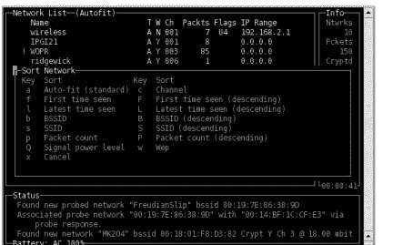

图 4.5 中显示的排序选项不言自明；不过，如前所述，您需要选择 autofit 以外的任何选项才能执行有用的操作。服务集标识符 (SSID) 很常见，显示在图 4.6 中：

### 图 4.6 按 SSID 排序的网络

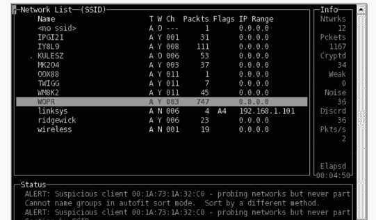

排序还提供了一个启用光标的选择栏，指示当前高亮显示的是哪个网络。请注意图 4.6，默认排序为升序。对于“首次发现”、“最新发现”、“基本服务集标识符 (BSSID)”、“SSID”和“数据包计数”，大写字母等价形式（S 而不是 s）表示降序排序。

### 列

Kismet 支持超过 20 种列描述，但默认只显示以下九种（更多信息请参阅下文“自定义面板界面”）。Kismet 将在提供的空间内显示尽可能多的列。


如果 Kismet 窗口不足以显示所有列，只需使用左右箭头键向适当方向滚动。

#### 衰减

第一列是衰减，尽管它没有标题，可能不会立即显而易见。衰减是衡量网络活动量和所经过时间的指标，由 kismet_ui.conf 文件中的 decay 变量控制。默认设置为三秒：
- **Active**（活动）：如果网络在衰减时间内活动，则在网络名称前显示感叹号“!”。
- **Recent**（近期）：如果网络在衰减时间的两个周期内活动（即六秒），则在网络名称前显示句点“.”。参见图 4.4 中的“WOPR”网络作为示例。
- **Inactive**（不活动）：在所有其他情况下（即网络在六秒内未活动），不显示任何内容。

#### 名称

网络名称是网络列表显示中最突出的列。通常，这列列出 SSID，虽然您可以使用“n”弹出窗口更改任何特定网络的名称。如果网络未广播 SSID，Kismet 仍可推断其存在，并在确定名称之前将该网络发布为 <No ssid>。

### 类型

T 列指定网络类型：
- **A (Access Point)**：无线接入点 (AP) 或无线路由器；是目前最常见的网络类型。
- **D (Data Network)**：已看到数据包，但 Kismet 尚未捕获任何信标或管理帧，因此目前还无法判断它是什么类型的网络。
- **G (Group)**：由用户手动分组的网络（*t* 用于标记网络，*g* 用于将标记的网络组合在一起）。
- **H (Ad-hoc)**：通常是在多个笔记本电脑或客户端之间建立的、不使用 AP 的无线网络。
- **P (Probe Request)**：客户端探测尚未关联的 AP。
- **T (Turbocell)**：Turbocell/Karlmet/Lucent 路由器（不常见）。

### WEP

W 列表示网络是否使用加密。然而，更有意义的问题是询问“*是否正在使用 WEP，还是其他？*”以理解可能的响应：
- **Y (Yes)**：正在使用无线加密协议 (WEP)。
- **N (No)**：网络未加密。
- **O (Other)**：网络使用 WEP 以外的其他方法进行加密（例如 WPA）。

#### 信道

网络信道显示在 C 列：
- 对于更常见的 802.11b/g 网络，美国的关联信道是 1-11，美国以外是 1-14。
- 对于 802.11a，美国允许的信道如下：36、40、44、48、52、56、60、64、149、153、157、161 和 165。在美国以外，特别是在欧洲和日本，有更多的信道可用。

#### 数据包

“Packets”（数据包） simply 是捕获的该特定网络的数据包累积总数。

#### 标记

Flags 列显示关于网络的简要信息：
- **F (Factory Configuration)**：你脑海中应该响起警报声；此用户未更改任何原始工厂配置。


**W (WEP 已解密)** 这是一个 WEP 加密网络，已被用户提供的密钥解密

如果 Kismet 能够确定地址范围和互联网协议（IP），它将在“Flags”列中显示其获取该信息的方式：

- **T (TCP)** 地址范围是通过传输控制协议（TCP）流量确定的
- **U (UDP)** 地址范围是通过用户数据报协议（UDP）流量确定的
- **A (ARP)** 地址范围是通过地址解析协议（ARP）流量确定的
- **D (DHCP)** 地址范围是通过动态主机配置协议（DHCP）流量确定的

此外，T、U 和 A 标志可能会显示一个数字（1–4），该数字表示发现的八位组数量。例如，再次参考图 4.4，linksys 网络显示 A4 标志，表明地址是通过 ARP 流量发现的，并且已发现所有四个八位组。

### IP

通过监控流量，Kismet 试图确定网络的 IP 地址，这会显示在“IP Range”列中。在通过上述“Flags”部分描述的方法找到有用数据之前，Kismet 将显示 0.0.0.0。正如您可能猜测的那样，从特定网络收集到的流量越多，发现 IP 范围的可能性就越大，更具体地说，是找到确切 IP 地址的可能性就越大。

### Size

“Size”列显示了为该特定网络收集的所有数据包总大小。

#### Colors

虽然在灰度截图中无法准确还原，但 Kismet 界面还会通过颜色编码网络向敏锐的观察者显示一些有价值的信息：

- **黄色网络** 表示未加密，意味着它们没有使用 WEP 或 WPA。虽然这些网络被标记为未加密，但在与网络关联后，它们仍可能使用虚拟私人网络（VPN）或某种其他形式的身份验证。黄色网络还表示至少有一些设置已更改，不再使用出厂默认值。
- **红色** 颜色代码是使用出厂默认设置的网络的特征。您还可能在此网络上看到 F 标志。如果用户没有更改出厂配置，您很可能发现他们也没有更改默认密码！
- **绿色网络** 表示使用某种形式的加密，通常是 WEP 或 WPA。如果 Kismet 无法区分两者，可以将 Kismet 的 .dump 文件导入到 Wireshark 中，并在那里确定确切的加密形式。
- **蓝色** 网络使用 SSID 隐藏功能或不广播 SSID。像 Network Stumbler（用于 Windows）这样的主动扫描器依赖广播帧来确定 SSID，将无法定位此类网络。

#### GPS

当使用受支持的全球定位系统（GPS）与 Kismet 配合使用时，相关的 GPS 数据将显示在网络列表面板的底部边缘（参见图 4.7）。

图 4.7 GPS 状态信息


对于没有南北东西标签的坐标，正纬度表示北半球，而负纬度表示南半球。同样，正经度表示东半球，而负经度表示西半球。在图 4.7 中，我们的坐标位于赤道以北，位于西半球（更确切地说是马里兰州中部）。此外，还包括海拔、速度、航向和定位质量的测量值。

## Information Panel

标记为“Info”的信息面板是位于网络列表面板右侧的一个小型垂直面板（参见图 4.8）。

- **Ntwrk** 收集到的网络总数
- **Pckets** 收集到的数据包总数
- **Cryptd** 收集到的加密数据包总数
- **Weak** 收集到的弱信号数据包总数
- **Noise** 无用的垃圾数据包
- **Discrd** 丢弃的数据包总数；包括噪声数据包以及因使用过滤器而丢弃的数据包
- **Pkts/s** 数据包收集速率（每秒）
- **Elapsd** 自 Kismet 启动以来的总时间（HH:MM:SS）

**图 4.8 信息面板**

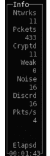

### Status Panel

状态面板占据 Kismet 界面的底部区域（参见图 4.9）。状态面板向用户提供滚动消息：

- **Updates** 当 Kismet 发现新网络时，它会向状态面板发布一条消息，并在信息可用时提供有关网络的附加信息
- **Problems** Kismet 会提醒您有关 Kismet 与其他服务连接可能存在的问题的信息；例如，如果 Kismet 无法连接到 gpsd
- **Alerts** 这些主要在使用 Kismet 作为入侵检测系统（IDS）时很有用；提供与第三方系统（例如，Snort）的集成
- **Battery Meter** Kismet 将指示您是否已插入外部电源（AC），并显示剩余电池寿命百分比；使用电池时，Kismet 将显示剩余寿命的估计值。请记住，您需要一个启用 APM 的内核才能报告正确的电池寿命估计值。

### NOTE

> 尽管 Kismet 将无线适配器置于 rfmon 模式（意味着它不传输），但仅仅开启无线适配器的无线电就会消耗更多的电池电力。据估计，电池寿命将缩短 2–7 百分比。虽然这不一定是一个巨大的数额，但这使电池计量器更加有用。

图 4.9 状态面板

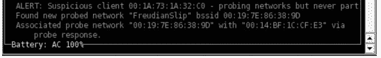

### Pop-up Windows

Kismet 主显示界面之外的所有窗口都是次要显示界面或弹出窗口。它们主要作为显示特定网络、组或客户端的更多信息的手段；提供有关数据包速率和类型的统计及有用信息；以及其他有趣的数据。

### Network Details

网络详情窗口显示关于特定网络收集的最全面和详细的信息。在按任何模式（自动适应除外）排序时，只需滚动到您选择的网络并按下 **enter** 或 **i**（参见图 4.10）。

网络详情窗口在您需要比网络列表已提供的信息更多时非常有用。例如，网络列表可能会显示带有 WEP 标志 "O" 的特定网络，这表示网络已加密，但不是 WEP。在某些情况下，Kismet 的网络详情可能能够告诉您具体使用的是哪种类型的加密。请务必向下滚动，因为很可能有一屏以上的信息。

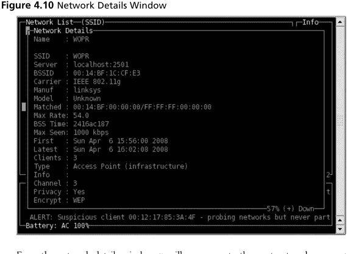

在网络详情窗口中，**n** 键将带您移动到下一个网络或组，而 **p** 键将带您返回到上一个网络或组。或者，您可以关闭弹出窗口（**q**）并滚动到不同的网络。网络详情窗口是进入客户列表（**c**）的一种方法；您也可以直接从网络列表输入（**c**）。

### Client List

客户列表窗口在显示和功能上都非常类似于网络列表面板。默认排序模式也是自动适应，并且客户列表可以类似地进行排序。

图 4.11 客户列表窗口

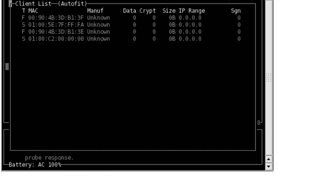

**n** 和 **p** 键分别显示下一个和上一个网络或组的客户列表。一旦某个特定客户被高亮显示，按下 **i** 键（或按下 **enter**）将切换到客户详情显示。

#### Columns

以下列默认显示（再次，与网络列表面板一样，参见本章后面关于“自定义面板界面”的内容以更改默认设置）：

##### *Decay*

客户的衰减变量与网络相同。与网络列表面板一样，除非客户是活跃的或最近的，否则该列无标签且不可见。


### 类型

T 列表示客户端的类型。客户端类型如下：

- F (From DS) 从无线分配系统 (WDS) 或接入点 (AP) 到无线客户端；通常这意味着客户端是有线的
- T (To DS) 从无线客户端到 WDS/AP；通常这意味着客户端是无线的
- I (Intra DS) WDS/AP 内的一个节点与系统内的另一个节点通信
- E (Established) 通常是无线客户端进入和离开 WDS/AP 的过程
- S (Sent To) 已接收数据但尚未响应的客户端
- (Unknown) 不言自明

##### 制造商

“Manuf”（制造商）列根据介质访问控制 (MAC) 地址的前三个八位位组显示客户端的制造商，这被称为组织唯一标识符 (OUI)。顾名思义，每个制造商都被分配了一组特定的八位位组，用于指定其设备。Kismet 尝试将客户端 MAC 地址与 `client_manuf` 文件中的 OUI 列表进行匹配。如果匹配成功，将显示制造商；否则将显示“unknown”（未知）。

**注意**
在某些情况下，Kismet 可能还能够识别 MAC 地址的第四个八位位组，即 MAC 地址中网络接口控制器 (NIC) 特定部分的首个八位位组。在这种情况下，可能会获得关于特定无线适配器的更详细信息，例如该设备的具体型号。在其他情况下，特别是对于较新或罕见的设备，Kismet 可能会返回“unknown”，因为它根本不知道该 MAC 地址。同样，伪造的 MAC 地址也会欺骗 Kismet，使其误判原始制造商。

**提示**
Kismet 的 `ap_manuf` 和 `client_manuf` 文件故意保持较小的体积，以减少内存使用量和中央处理器 (CPU) 消耗。对于希望使用完整的电气和电子工程师协会 (IEEE) OUI 列表的用户，Kismet 提供了一个名为 `ieee-manufr-tr.sh` 的脚本（位于 extras 目录中），该脚本会将 OUI 文本文件转换为 Kismet 可读的格式。当然，这将导致内存和 CPU 使用量的增加。

##### 数据

此列显示客户端传输的数据包总数。

##### 加密

“Crypt”列显示客户端传输的加密数据包总数。

### 大小

Size 显示客户端传输的数据总量。

##### IP 范围

“IP Range”显示客户端的最后已知 IP 地址。

### 信号

“Sgn”列显示客户端的最新信号强度。与其他所有与信号强度相关的问题一样，此数据的准确性完全取决于无线适配器驱动和/或固件的正确报告。再次强调：如果您的网卡和/或驱动程序不支持正确的信号报告，此值将毫无用处。

##### 客户端详细信息

与网络详细信息窗口显示特定网络的全面详细信息一样，客户端详细信息也为特定客户端提供同等程度的数据。图 4.12 提供了客户端详细信息级别的示例。请注意，客户端类型现在变得更加清晰。这个特定的客户端是“From DS”（来自 DS），即从 AP 到无线客户端。正如我们所知，这些客户端通常是有线的。事实上，在这个特定情况下，这个客户端就是 AP 本身。

###### 图 4.12 客户端详细信息窗口

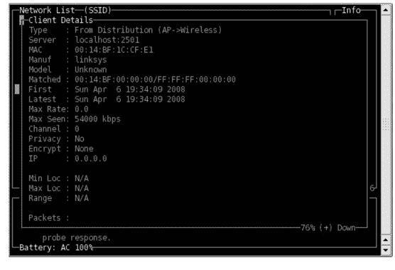

**n** 键和 **p** 键分别显示下一个和上一个客户端的详细信息。与网络详细信息显示类似，向下滚动将为您提供更多信息。

##### 包速率

Kismet 的包速率窗口将显示每秒包速率的 5 分钟历史记录（见图 4.13）。

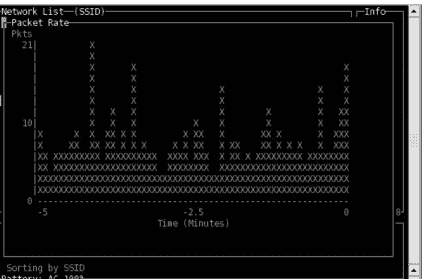

##### 包类型

Kismet 还将把包类型信息转储到屏幕上（见图 4.14）。

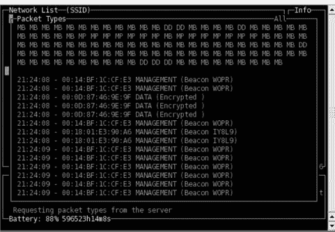

包类型面板分为两个部分：顶部显示按缩写划分的包类型历史记录（参见以下列表），底部显示带有更多详细信息的最近包的滚动列表。默认情况下，Kismet 将显示所有网络的包类型。但是，如果您已标记了单个网络，您可以使用 a 键在“all”（所有）和“tagged”（已标记）之间切换。以下是适用的包类型列表：

- `N` - 噪声
- `U` - 未知
- `Mx` - 管理帧
  - `Ma` - 关联请求
  - `MA` - 关联响应
  - `Mr` - 重关联请求
  - `MR` - 重关联响应
  - `Mp` - 探测请求
  - `MP` - 探测响应
  - `MB` - 信标
  - `MM` - ATIM
  - `MD` - 去关联
  - `Mt` - 认证
  - `MT` - 去认证
  - `M?` - 未知管理帧
- `Px` - 物理帧
  - `Pt` - 发送请求
  - `PT` - 允许发送
  - `PA` - 数据确认
  - `Pc` - 竞争帧结束
  - `PC` - 竞争帧结束+确认
  - `P?` - 未知物理帧
  - `Dx` - 数据帧
  - `DD` - 数据帧
  - `Dc` - 数据+竞争帧+确认
  - `Dp` - 数据+竞争帧+轮询
  - `DP` - 数据+竞争帧+确认+轮询
  - `DN` - 数据空帧
  - `Da` - 竞争帧确认
  - `DA` - 竞争帧确认+轮询
  - `D?` - 未知数据帧

##### 统计

Kismet 将显示总体统计信息，包括您启动程序的时间、当前正在运行的服务器数量、网络数量（分为加密网络和默认网络）、看到的总包数以及最大包速率。

此外，Kismet 还提供图表和图形，显示信道使用情况信息。统计信息窗口见图 4.15。

###### 图 4.15 统计信息显示

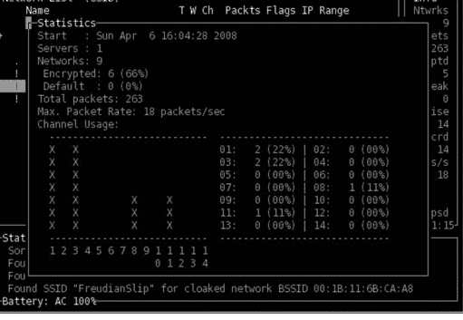

##### 无线网卡功率

按 1 键将显示信号功率并报告上升趋势（见图 4.16）。这个显示的名称有点名不副实，因为它报告的并不是你的无线网卡的功率；而是报告特定网络或客户端的信号强度。请记住，Kismet 将你的无线网卡置于 rfmon 模式，因此当 Kismet 运行时，你的网卡被禁止发送信号。

**警告**
Kismet 不计算信号功率或噪声；它只是显示由无线网卡驱动和/或固件提供的信息。某些驱动程序或固件可能不报告此信息（特别是在 rfmon 模式下），在这种情况下，Kismet 将无法向你提供有用的信息。此外，即使网卡正确报告了这些数据，在尺度方面也没有一致性，因此在不同网卡之间比较信号和噪声水平几乎毫无意义。

###### 图 4.16 无线网卡功率显示

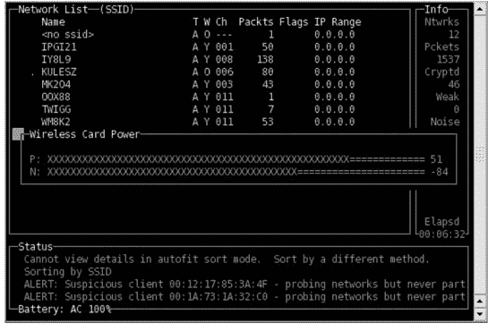

##### 网络位置

Kismet 有一个不错（且不太为人所知）的功能，它会尝试对网络进行地理定位。此信息的准确性完全取决于 GPS 定位数据。由于基于不存在的信号和噪声标准来估计范围几乎是不可能的，因此这些数据（不幸的是）在地理定位方面并不是非常有用。相反，Kismet 会根据 GPS 记录的位置样本来猜测位置。

此外，Kismet 是动态执行此操作的；因此，从各种位置获取样本数据以获得更好的猜测是有益的。网络位置功能的示例见图 4.17。

###### 图 4.17 网络位置显示

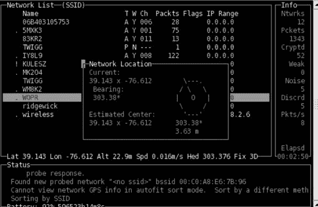

本质上，网络位置比较了你之前的位置与当前位置。这也假设你的笔记本电脑正对着行进方向。

#### 自定义面板界面

如前所述，Kismet 可以在网络列表和客户端列表中（分别）显示有关网络或客户端的大量信息，唯一的限制是大小。如果你发现工作需要的信息在这两个显示中都没有，你可以轻松修改 Kismet 的用户界面配置文件来添加或删除列。此外，Kismet 提供了更改颜色以满足你需求的功能。


### 自定义网络列表窗口

正如我们所见，Kismet 的主显示界面在“网络列表”部分包含了大量有用的信息。特定网络的所有信息都可以在“网络详情”窗口中查看。通过修改 `kismet_ui.conf` 文件，可以将其中任意或部分信息显示在主窗口中。识别的列及其相应的描述如下（默认列以**粗体**显示）：

- bssid：网络的 BSSID（MAC 地址）
- **channel**：网络最近广播的频道
- **clients**：在该网络上看到的客户端数量（唯一的 MAC 地址）
- crypt：加密数据包的数量
- **data**：数据包的总数
- decay：根据过去“decay”秒内的网络活动（由配置文件中的“decay”变量控制）显示“/”、“.”或空白
- **duplicate**：看到具有重复 IV（初始化向量）的数据包数量
- flags：网络状态标志（地址大小、已解密等）
- info：某些制造商包含的额外 AP 信息
- **ip**：检测或推测出的网络 IP
- llc：LLC 数据包的数量
- manuf：匹配的制造商
- maxrate：AP 广播的最大支持速率
- **name**：网络或组的名称
- noise：最后看到的噪声级别
- **packets**：数据包总数
- shortname：适用于小显示屏的简化网络或组名称
- shortssid：适用于小显示屏的简化 SSID
- **signal**：最后看到的信号强度
- signalbar：信号强度的图形表示
- snrbar：信噪比的图形表示
- **size**：网络上传输的数据量
- ssid：网络或组的 SSID/ESSID
- **type**：网络类型（Probe、Adhoc、Infra 等）
- **weak**：看起来具有弱 IV 的数据包数量
- **wep**：WEP 状态（网络是否指示其使用 WEP）

要修改主窗口中的默认列，请编辑位于以下位置的 `kismet_ui.conf` 文件：

```
# What columns do we display? Comma separated.  Read the documentation for what
# columns are valid.
columns=decay,name,type,wep,channel,packets,flags,ip,size
```

图 4.18 显示了一个修改后的网络列表面板，其中显示了网络名称、制造商、每个网络的数据包总数、信号和噪声信息以及每个网络传输的数据量。

#### 图 4.18 修改后的网络列表窗口

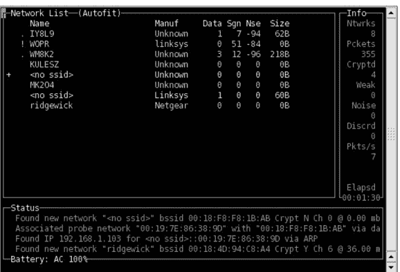

### 自定义客户端列表窗口

类似地，客户端窗口中的列也可以修改（除了“maxrate”外，默认情况下所有列均开启）：

| 列 | 描述 |
| :--- | :--- |
| （来自上一页的隐含上下文，可能是“data”或类似项） | 客户端传输的加密数据数据包数量 |
| noise | 客户端最后看到的噪声级别 |
| signal | 客户端最后看到的信号强度 |
| size | 客户端传输的数据量 |
| type | 客户端类型（Established、To-DS、From-DS 等） |
| weak | 看起来具有弱 IV 的数据包数量 |

要修改客户端窗口中的默认列，请编辑位于以下位置的 *kismet_ui.conf* 文件：

```
# What columns do we display for clients? Comma separated.
clientcolumns=decay,type,mac,manuf,data,crypt,size,ip,signal,quality,noise
```

### 自定义颜色

可以开启或关闭 Kismet 的颜色，更改背景和边框颜色，并通过修改 *kismet_ui.conf* 的相应部分来更改上述列出的默认颜色：

```
# Colors (front, back) of text in the panel front. Valid colors are:
# black, red, yellow, green, blue, magenta, cyan, white
# optionally prefixed with "hi-" for bold/bright colors, ie
# hi-red, hi-yellow, hi-green, etc.
## Enable colors?
color=true
## Background
backgroundcolor=black
# Default text
textcolor=white
# Window borders
bordercolor=green
# Titles
titlecolor=hi-white
# GPS and APM info
monitorcolor=hi-white
# WEP network color
wepcolor=hi-green
# Factory network color
factorycolor=hi-red
# Open color
opencolor=hi-yellow
# Cloaked network color
cloakcolor=hi-blue
```

#### 第三方前端

虽然本章的大部分篇幅都集中在 Kismet 的原生面板界面上，但多年来也开发了许多第三方界面。这些第三方前端主要是为了增强外观，或者将 ncurses/面板界面更改为真正的图形界面而设计的。本节并不旨在全面审查这些图形用户界面（GUI），而是对现有的一些选项进行简要概述。

> 注意  
> 重要的是要注意，这些第三方前端只是 Kismet 客户端（界面）的替代品，它们本身不执行任何功能。您仍然需要以服务器模式运行 Kismet，并选择特定界面连接到它。

### gkismet

一个流行的基于 Linux 的 Kismet 前端示例是 gkismet（见图 4.19）。gkismet 界面旨在为那些更喜欢基于 GUI 的用户补充或替换原生 Kismet 面板界面。许多相同的功能都可以使用，并且开发仍在继续，以保持与最新版本的 Kismet 兼容。有关 gkismet 的更多信息，请访问 http://gkismet.sourceforge.net/。

### 图 4.19 gkismet

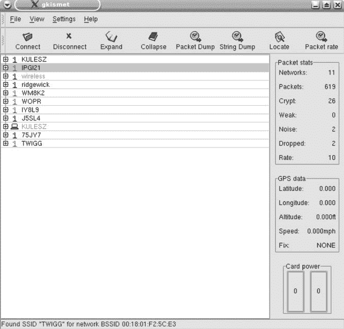

### KisWin

*KisWin*（不要与 RenderMan 的 Kismet for Windows 包混淆，后者也称为 KisWin，位于 [http://www.renderlab.net/projects/wrt54g/](http://www.renderlab.net/projects/wrt54g/)）是 Kismet 的一个基于 Windows 的 GUI 前端（见图 4.20）。无论您是使用远程无人机（例如修改过的 Linksys WRT54G）在 Windows/Cygwin 上运行 Kismet，使用 CACE Technologies 的 AirPcap 适配器，还是简单地通过网络在 Windows PC 上运行 Kismet，KisWin 都为您提供一个 GUI 界面。
有关 KisWin 的更多信息，请访问 http://kiswin.taz00.com/

### 图 4.20 KisWin

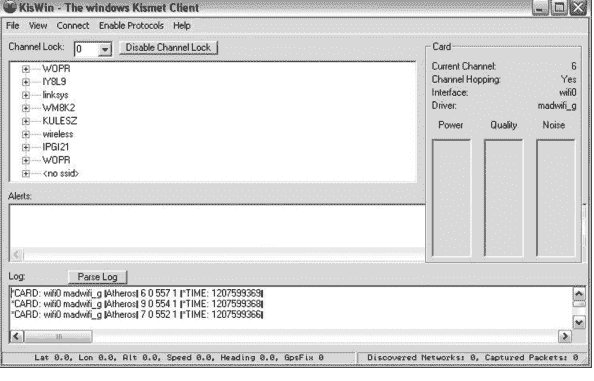

### 哑 Kismet 客户端

我们要提到的最后一个界面是用于 Win32 的 dumb kismet client（简称 dkc）。这个特定的客户端非常轻量级，应该能够在与 KisWin 相同的任何 Windows/Cygwin 配置前面运行。虽然 dkc 是为 Windows 设计的，但它也可以在 Linux 上使用 wine 正常运行。有关 dumb kismet client 的信息，请访问 http://www.d3tr.de/dkc/。

### 图 4.21 哑 Kismet 客户端

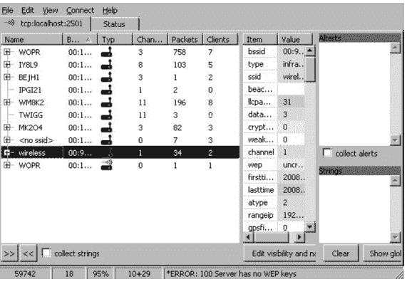

### 更多信息

再次说明，本节并非旨在提供 Kismet 第三方前端的终极解决方案，而是对可供用户选择的一些解决方案的抽样。有关 Kismet 第三方工具的更多信息，请访问 http://www.kismetwireless.net/links.shtml。

## 总结

Kismet 客户端是 Kismet 服务器与用户之间的主要接口。默认显示是面板界面，这是一个轻量级的交互式 GUI 显示。主显示界面为用户提供了 Kismet 收集数据的一般概述，并且可以根据用户的内容进行操纵和修改。其余窗口是辅助显示或弹出窗口，提供有关选定网络、组或客户端的额外和扩展信息，以及统计数据和额外的有趣信息。其中一些显示也可以根据用户的喜好进行修改。最后，有许多第三方前端可以补充或替换默认的 Kismet 客户端。

当您遇到问题时该怎么办？您的第一个信息来源应该是 Kismet 本身。大部分甚至所有显示界面都集成了帮助屏幕（始终按 **h** 键）。您的第二个来源应该是在线文档，位于 www.kismetwireless.net/documentation.shtml。对本章特别感兴趣的是第 10 节（NCurses/面板界面）、第 17 节（故障排除）和第 18 节（常见问题解答）。阅读完整文档（一直到最后！）会让您受益匪浅。一旦您用尽这些资源，请转向 Kismet 论坛（http://www.kismetwireless.net/forum.php），确保在发帖前先进行搜索。最后，考虑使用您最好的朋友 Google，它通常能找到指引您走向正确方向的内容。

### 快速解决方案

#### 主显示界面

- Kismet 面板显示是 Kismet 客户端与服务器及用户之间的主要接口。
- 主显示界面分为网络列表面板、状态面板和信息面板；旨在为用户提供 Kismet 收集信息的概览。
- Kismet 的集成帮助功能是获取特定网络更详细信息的入口。


#### 弹出窗口

- 除主显示窗口外的所有窗口均为次要或弹出窗口，它们提供关于所选网络、组或客户端的补充和放大信息，以及统计数据和额外有趣的信息。
- 无线网卡电量和网络位置弹出窗口上提供的信息完全取决于无线网卡驱动程序和/或固件。Kismet 不计算信号或噪声信息，而是简单地报告这些内容。

#### 自定义面板界面

- 可以通过编辑 `kismet_ui.conf` 文件，根据用户的具体要求修改网络列表和客户端列表。
- 也可以修改 Kismet 的颜色方案，包括背景、边框以及网络的默认颜色编码。

#### 第三方前端

- 第三方前端是为补充或替换 Kismet 客户端面板界面而设计的图形用户界面（GUI）。
- 第三方客户端可用于在 Linux 和 Windows 上运行。

### 配置 Kismet 服务器

### 本章解决方案：

- Kismet 配置文件
- Kismet.conf
- 总结

## 引言

Kismet 服务器主要由一个庞大且看似令人畏惧的配置文件控制。通常位于 `/usr/local/etc` 目录下的 `kismet.conf` 文件是您将花费大部分配置时间的地方。任何接触过配置文件的人都应该对此感到相当熟悉。对于 Kismet 初学者，甚至对于已经使用 Kismet 一段时间的高手来说，这都是一个未被充分挖掘的资源。很少有人会仔细检查可用的配置选项范围。Kismet 可以跟踪和记录大量信息，同时也支持对特定信息进行过滤和目标设定。了解可用的选项将有助于您以最适合自己需求的方式使用 Kismet。

## Kismet 配置文件

配置文件并不像看起来那么可怕。然而，它确实很大，因为作者 Dragorn 贴心地为各个选项保留了许多非常详尽的注释。有些部分相当直观，而有些则不然。本节将逐行（几乎）检查并解释每个部分。虽然注释很好，但有些领域允许进行注释中未指定的调整，一旦您开始深入挖掘配置文件，就能揭示出强大的功能。

## Kismet 参数

`kismet.conf` 配置文件可以直接使用您喜爱的 UNIX 文本编辑器（如 vi、pico、emacs）进行编辑，但请注意自动换行和 UNIX 文件格式。配置文件在运行时由服务器解析，并期望它是一个 UNIX 文本文件。DOS 和 UNIX 使用不同的控制字符来处理文本文件，因此在 UNIX 文本文件上使用 DOS 或 Windows 编辑器可能会更改文件格式，导致服务器无法读取该文件。一般来说，如果您正在编辑 `kismet.conf` 文件，请使用 UNIX 编辑器。这可以是原生 Linux 应用程序，如果是通过 Cygwin 在 Windows 下运行，或者是其他支持 UNIX 文本格式的编辑器。

`kismet.conf` 文件中的注释是以 “#” 符号开头的行。这些通常是注释或示例配置，通常可以指导您需要设置哪些选项。不以注释开头的行才是服务器实际执行的参数变量。一个好习惯是通过在行首加上 “#” 来注释掉现有行，并添加一行包含调整后的参数。这样，如果出现问题，您就知道原始参数是什么。

### Kismet.conf

```
# Kismet config file
# Most of the "static" configs have been moved to here -- the command line
# config was getting way too crowded and cryptic. We want functionality,
# not continually reading --help!
```

Kismet 服务器以前是通过命令行参数控制的（其中许多现在仍可使用），但随着程序和功能的增长，设置所有用于源、端口等的命令行参数变成了一项艰巨的任务。因此，所有内容都转移到了 `kismet.conf` 文件中。上面的行是 `kismet.conf` 文件的开头，这是一种对早期时代的回顾，当时人们花费大量时间查看 `--help` 命令行开关。

```
# Version of Kismet config
version=2007.09.R1
```

这行指示的是配置文件本身的版本，而不是服务器或程序其他部分的版本。许多人将此行与服务器版本混淆，并疑惑为什么他们的服务器版本落后了三个版本。配置文件的变更频率不像工具包的其他部分那样频繁，因此在这行中列出了一个独立的版本号。

```
# Name of server (Purely for organizational purposes)
servername=Kismet
```

该参数是配置中那些经常被忽视的部分之一，它位于文件的最顶部。`servername` 参数允许您为服务器命名，以用于您自己的组织管理目的。如果您使用一个客户端实例监控多个远程服务器，这特别有用。您可以按位置（`server_north_east`、`server_north_west_warehouse`）或信道（`server_ch1`、`server_ch2`）来命名服务器，或者按您认为能保持条理的方式来命名。服务器名称不能包含空格，因此请使用下划线或破折号代替空格。这可以让您知道自己连接的是哪个服务器及其位置，用于故障排除或事件跟踪。它对性能没有实际影响，只是有助于保持条理，特别是在大型安装环境中。

```
# User to setid to (should be your normal user)
uiduser=your_user_here
```

刚开始使用 Kismet 的人常常误解这一行。这是 Kismet 启动后运行其进程所使用的用户。Kismet 需要 root 权限来设置监听模式和其他选项，然后在 Kismet 进程中将权限降低为此参数中指定的用户。

```
sqliduser=foo
```

上面是一个示例，其中 “foo” 是系统上的一个普通用户账户。

**注意**

如基础 Kismet 安装章节所述，除非您以 Set User ID (SUID) root 方式构建 Kismet，否则您需要系统中有一个普通的非特权用户。这是出于安全原因。在此指定的用户必须对您存储捕获数据和日志的目录具有写权限。人们经常遇到的一个主要问题是他们以 root 运行 Kismet 并指定 root 为 SETUID 用户。除非您以 SETUID root 方式构建，否则这将导致 Kismet 无法启动。他们还犯的一个错误是以 root 登录，从 /root 运行 Kismet，由于 SETUID 用户没有 /root 目录的写权限，服务器无法启动。简单的解决方案是以普通用户登录，然后使用 su 切换到 root 或使用 sudo 启动 Kismet。

指定系统中一个非特权（非 root）用户的用户名，并确保您存储数据的任何地方都有写权限。逻辑上的位置是非特权用户的家目录。避免问题的最佳 Kismet 运行顺序是以普通用户登录，切换到您希望保存结果数据的目录，然后 “su” 切换到 root，再运行 Kismet。

```
# Do we try to put networkmanager to sleep? If you use NM, this is probably # what you want to do, so that it will leave the interfaces alone while # Kismet is using them. This requires DBus support! networkmanagersleep=true
```

配置文件中的这一行告诉 Kismet 使用 Dbus 来禁用 Network Manager（常见的 gnome 桌面管理小部件），使其在 Kismet 会话期间自我禁用。Kismet 退出后，网络管理器将恢复控制。

**注意**

> 许多现代 Linux 发行版使用精美的 X 小部件来控制网卡。这是为了让系统更用户友好，避免用户必须去命令行连接无线网络的一种尝试。问题是，如果我们想对网卡做一些“奇怪”的操作，例如监听模式，这些网络监控程序会争夺网卡的控制权，从而给 Kismet 带来无尽的麻烦。
>
> 如果您遇到任何奇怪的扫描情况，例如随机停止扫描或卡在某个信道上不跳转，这很可能是一个罪魁祸首。在大多数情况下，您希望启用此选项。
>
> 在某些情况下，这可能会导致问题。最常见的情况是，当您使用一个接口进行扫描，但使用网络管理器控制另一个接口用于通信（例如，向服务器报告的入侵检测系统 (IDS) 设置）时。Kismet 会禁用所有接口（有线和无线）的网络管理器。如果您遇到网络管理器被禁用导致的问题，您可能希望完全不用网络管理器，并手动配置其他接口。

```
# Sources are defined as:
# source=sourcetype,interface,name[,initialchannel]
# Source types and required drivers are listed in the README under the
# CAPTURE SOURCES section.
# The initial channel is optional, if hopping is not enabled it can be used
# to set the channel the interface listens on.
# YOU MUST CHANGE THIS TO BE THE SOURCE YOU WANT TO USE
```

这可能是配置文件最重要的部分之一：我们从哪里获取数据。source 行告诉 Kismet 它需要知道什么才能将数据输入程序，以便我们可以开始扫描。每个源都有三个参数：特定类型卡片的 Kismet 源名称、接口名称，以及在 Kismet 客户端中找到的逻辑名称。Kismet 的 README 列出了兼容的源及其正确的接口名称。

| 驱动程序 | 描述 | 链接 / 接口 |
| :--- | :--- | :--- |
| hostap | Prism/2 Linux HostAP 0.4 | http://hostap.epitest.fi/ |
| | 捕获接口 | `wlanX` |
| | HostAP 驱动程序驱动作为接入点的 Prism/2 芯片组 | |


模式，但也可以驱动处于客户端模式和监听模式下的无线网卡。HostAP 驱动程序似乎频繁地改变其进入监听模式的方式，因此这个源码应该能够让这些网卡正常工作。

README 文件中有许多条目，例如针对兼容热点网卡的这一项。你需要找到对应你网卡类型的条目，并按照任何特殊说明进行操作才能使其正常工作（使用不同的驱动程序或补丁等）。

对于上述网卡，源配置行应为 `“source=hostap,wlanx,hostap”`，其中 hostap 是网卡类型名称（根据 readme 文件），wlanx 是该网卡的接口名称（通常会是 wlan0 或 wlan1）。最后一部分是一个逻辑名称，供你参考。客户端会显示每张网卡的当前状态以及其当前所在的信道。提供一个简短的描述性名称很有用，这样你就能知道哪个是哪个。识别板载网卡与附加网卡尤其有用，这样你就知道哪一个是活动的，以及它处于哪个信道上。

你也可以通过在逗号后添加第四个参数来指定 Kismet 启动时网卡开始的初始信道。如果你希望网卡从第 11 信道开始，只需在逻辑名称后添加 “,11” 即可。此时源配置行将变为 “`source=hostap,wlanx,onboard,11`”。如果你拥有多张网卡并希望监控不同的信道，这特别有用；你可以让 Kismet 设置信道，而无需手动操作。如果启用了信道跳转，此设置的影响不大，且仅适用于静态信道监控。

无人机（Drones）也在 `source=` 行中指定。无人机与其他源类似，除了我们指定无人机设备的远程地址而不是本地接口。如果在一台位于 192.168.0.45 的计算机上运行了无人机，`source=` 行看起来像这样：

```
source=kismet_drone,192.168.0.45:3501,Drone
```

就像本地接口一样，我们指定设备类型，在此情况下为 `kismet_drone`，设备地址和无人机运行的端口（默认是 3501），以及显示在客户端中的设备的逻辑名称。

无人机必须在启动 Kismet 服务器之前运行，否则服务器将启动失败。如果无人机因任何原因断开连接，你需要重新启动 Kismet 服务器才能重新连接到该无人机。Kismet-Newcore 的开发正在解决这一限制。

```
# 每个源的特殊选项
# sourceopts=srcname:options
# srcname * 表示 “所有源”。个别源选项可以通过 “no” 关闭，例如 “noweakvalidate”。某些源可能有特殊选项。
# sourceopts=demo:fuzzcrypt,weakvalidate
# sourceopts=demo2:nofuzzcrypt
```

源可以具有关于要收集什么类型数据的特殊参数。如果我们拥有多个源，你可以指定某些源收集所有数据，而其他源忽略一些数据。在大多数情况下，修改这些设置并非必需，因为每个驱动程序都是独特的，且无法得知有哪些可用选项可供更改。

```
# 逗号分隔的要启用的源列表。仅当定义了多个源且只想启用其中几个时才需要此设置。默认情况下，所有已定义的源都是启用的。
# 例如：
# enableSources=primsour, ciscoSource
```

对于多源安装，或当你使用不同网卡进行不同类型检测的情况时，这是一个非常有用的参数。在上面的 `source=` 行中定义所有潜在的源（不同的网卡，或网卡的配置），根据你为每个源指定的逻辑名称，你可以在此处切换它们，通过编辑 `enableSource=` 行或设置多行具有不同网卡组合的行，并在不需要的行开头用 `#` 进行注释。请记住，一次只能取消注释一行 `enableSources=`。

例如，如果你有一个用于 wardriving（无线网络探测）且配备两张网卡的配置，你可以有一行写着 `“enableSources=enginius1,enginius2”`，另一行用于方向查找则为 `“enableSources=proxim。”` 在处理大量无人机时，这特别有用。通过设置多行并简单地注释和取消注释不同的行，你可以快速轻松地启用和禁用组。

```
# 在多 VAP 接口（如 madwifi-ng）上自动销毁 VAP。
# 当存在非 rfmon VAP 时，Madwifi-ng 在 rfmon 模式下无法正常工作，但是
# 这对系统来说是一个相当侵入性的更改，因此可以被禁用。如果你禁用了它，
# 在大多数情况下，请预期事情不会正常工作。
vapdestroy=true
```

一些 WiFi 驱动程序会为父设备创建虚拟接口（VAP），以实现不同的功能。Madwifi-ng 是其中最常见的一种。在使用 Madwifi-ng 时，父设备通常被称为类似 wifi0 的名称，所有的 VAP 则根据网卡的具体细节命名为 ath0、ath1 等。你可以让单张网卡同时处于多种模式，但这并不意味着它们能正常工作。特别是 Madwifi-ng，当一个 VAP 处于监听模式并正在跳转信道，而另一个 VAP 试图连接和/或保持连接到网络时，会存在很大的问题。

设置 vapdestroy=true 告诉 Kismet，如果正在使用父/虚拟设备驱动程序，销毁所有 VAP，并为 Kismet 创建一个监听模式接口。如果你有需要保留其他 VAP 的理由，你必须手动创建监听模式接口。不要惊讶于监听模式和信道跳转与其他存在的 VAP 无法兼容。如果不确定，请启用它，让 Kismet 处理接口。

```
# 是否进行信道跳转？
channelhop=true
```

这相当明显。它指定是否调用信道跳转部分（如果该源支持信道跳转）。如果你希望锁定在特定信道，请设置为 `channelhop=false`。这将使源网卡在 Kismet 启动时扫描其所在信道，或者扫描 source= 行中该源可选初始源参数指定的信道。

```
# 每秒跳转多少个信道？ (1-10)
channelvelocity=5
```

你可以调整跳转信道的速度。这主要是你需要自己微调的。如果你跳转慢，遍历所有信道需要更长时间。如果你跳转快，可能会错过某些内容。通常，如果你在进行 wardriving 或快速移动，你希望跳转速度快。如果你步行或有时间彻底检查，你可以跳转慢。如果你移动速度快且仅在短时间内处于接入点 (AP) 的覆盖范围内，你希望尽可能快地扫描更多信道，以便在覆盖范围内时希望处于正确的信道上。如果你步行或像狩猎流氓节点那样慢速移动，你可以慢慢来并仔细检查信道。默认值是 5，但根据你的情况和偏好可能需要微调。

```
# 通过设置信道跳转的驻留时间，我们覆盖上面的 channelvelocity 设置，
# 并在每个信道上驻留给定的秒数。
# channeldwell=10
```

此设置覆盖了信道速度设置，并指定 Kismet 应该在每个信道上花费一定的时间，而不是每秒跳过多信道。这对于静态安装和无人机更有用。这样你可以彻底检查每个信道。决定哪种方式最适合你以最大化利用时间和覆盖范围是你的责任。可以按 1 秒的增量进行调整。

```
# 是否在同一频谱内的不同网卡之间分配信道？这意味着如果
# 定义了多个 802.11b 捕获源，它们将错开以在给定时间覆盖尽可能多的频谱。
# 这也控制覆盖多个接口的精细调优的 sourcechannels 行的拆分（见下文）
channelsplit=true
```

信道拆分使 Kismet 在使用多个源时能够在任何给定时间覆盖更多频谱。如果你有网卡，且两者都在跳转，Kismet 将确保它们在给定时间始终位于不同的信道上。如果网卡 1 在信道 5，网卡 2 则在除 5 以外的信道上，从而最大化覆盖的频谱。这在多张网卡的情况下特别有用，因为让所有网卡都在同一个信道上几乎没有或没有意义。如果你使用多个无人机或其他需要在多个地点覆盖某信道的情况，请考虑禁用此功能。

```
# 基本的信道跳转控制：
# 这些定义了 Kismet 支持的各种频率范围内网卡跳转的信道。
# 通过 “sourcechannels” 配置选项可以实现更精细的控制。
#
# 不要更改 IEEE80211<x> 标识符，否则信道跳转将无法工作。
# 美国境外的用户可能希望使用此列表：
# defaultchannels=IEEE80211b:1,7,13,2,8,3,14,9,4,10,5,11,6,12
defaultchannels=IEEE80211b:1,6,11,2,7,3,8,4,9,5,10

# 802.11g 使用与 802.11b 相同的信道...
defaultchannels=IEEE80211g:1,6,11,2,7,3,8,4,9,5,10

# 802.11a 信道不重叠，因此顺序排列即可。你可能需要根据你的网卡实际支持的
# 信道调整此列表。
# defaultchannels=IEEE80211a:36,40,44,48,52,56,60,64,100,104,116,120,124,
# 128,132,136,140,149,153,157,161,184,188,192,196,200,204,208,212,216
```

在这里，你可以指定源默认应该跳转的信道。稍后的 *sourcechannels* 行中提供了更精细的控制，这里我们只是指定可用的信道。


### 注意

该设置还允许你为监管域设置信道。默认情况下，它设置为北美监管域，该域适用于 1–11 号信道，但并非所有用户都位于北美监管域，有些用户可以使用更多或更少的信道。这也是你可以稍微“破解”的地方。如果你的网卡支持所有 14 个信道，或者比你所在监管域允许的更多，你可以指定所有可能的信道，即使是那些在你的监管域中技术上不被允许的。然而，在执行此操作之前，请检查当地法律。

由于我们在 Kismet 中不进行传输，监听以查看是否有人在通常未使用或不允许的信道上设置了恶意为目的 AP 以逃避检测，这不应该有问题（请检查当地法律）。请不要滥用此功能，因为法规的存在是有原因的。

```
# Combo cards like Atheros use both 'a' and 'b/g' channels. Of course, you
# can also explicitly override a given source. You can use the script
# extras/listchan.pl to extract all the channels your card supports.
defaultchannels=IEEE80211ab1:1,6,11,2,7,3,8,4,9,5,10,36,40,44,48,52,56,60,64
```

如果你恰好拥有一张 a/b/g 组合网卡，你也可以指定由 a/b/g 组合网卡覆盖的信道。安装软件包中的 extras 目录下的 *listchan.pl* 脚本会轮询你的网卡以查看支持哪些信道。这是一个有用的功能，可以查看你的网卡是否具备比你预想更多的能力。

```
# Fine-tuning channel hopping control:
# The sourcechannels option can be used to set the channel hopping for
# specific interfaces, and to control what interfaces share a list of
# channels for split hopping. This can also be used to easily lock
# one card on a single channel while hopping with other cards.
# Any card without a sourcechannel definition will use the standard hopping
# list.
#
sourcechannels=sourcename(,sourcename):ch1,ch2,ch3,...,chN
#
# ie, for us channels on the source ‘prism2source’ (same as normal channel
# hopping behavior):
# sourcechannels=prism2source:1,6,11,2,7,3,8,4,9,5,10
```

此参数是你可以精细调整信道切换的地方。在 *defaultchannels* 参数中，我们指定了哪些信道可用；现在我们可以指定我们特别想要监听哪些信道，以及按什么顺序遍历它们。

## 来自底层的注意事项

### 黑客技巧

这里有一个非常酷的黑客技巧。对于 b/g 网络，信道 1、6 和 11 在统计上最流行，因为它们不重叠。如果我们只有一张网卡，将 8/11 的时间花在不太可能有信号的信道上是没有意义的。你可以多次指定信道，遍历完序列后会循环回到开头。因此，如果你多次指定信道 1、6 和 11，你最终将在那里花费更多的时间，从而均衡你的信道分布。

```
sourcechannels=prism2source:1,6,11,2,7,1,6,11,3,8,1,6,11,4,9,1,6,11,5,10
```

通过上述行，我们将 6/10 的时间用于检查最流行的信道。你可以调整此分布以符合你的喜好，但这已经过测试，通常适用于高速扫描，例如高速公路速度的 Wardriving（车载无线扫描）。如果你的网卡支持，你还可以指定诸如 12–14 等额外信道并将它们加入其中。

你可以对 802.11a 信道执行相同的操作。如果你拥有 a/b/g 网卡，可以将其添加到 b/g 信道中；如果你拥有单模网卡，则仅使用 802.11a 信道。

```
# Given two capture sources, "prism2a" and "prism2b", we want prism2a to stay
# on channel 6 and prism2b to hop normally. By not setting a sourcechannels
# line for prism2b, it will use the standard hopping.
# sourcechannels=prism2a:6
```

如果你没有指定 sourcechannels 参数且 channelhop=true，系统将自动遍历默认信道。如果你有多个源，你可以为其中一个设备设置特定的 sourcechannels，让它监控几个特定信道，而另一个设备检查剩余的信道。这在 Wardriving 中很有效。一个源将其所有时间都花在检查 1、6 和 11 上（这些信道最可能有信号），而另一个源可以检查剩余的信道。

你也可以使用此功能将工作负载分散到多个源中。一张网卡可以处理较低的信道，另一张处理较高的信道，并且能够比单张网卡更快地遍历所有内容。


```
# To assign the same custom hop channel to multiple sources, or to split the
# same custom hop channel over two sources (if splitchannels is true), list
# them all on the same sourcechannels line:
# sourcechannels=prism2a,prism2b,prism2c;1,6,11
```

你还可以在指定的 *sourcechannel* 中嵌套多个源。如果 *channelsplit=true*，Kismet 将循环遍历信道，并确保没有两个源在同一时间处于同一信道上，从而最大化在高使用率信道上花费的时间，并确保不重叠扫描信道。在配置文件示例中，三个源将循环遍历每个三个信道而不重叠。

```
# Port to serve GUI data
tcpport=2501
```

你可以在这里指定服务器向客户端提供服务的 TCP 端口。通常没有实际原因需要更改此设置。如果你觉得需要更改它，请确保在 *kismet_ui.conf* 文件中做出相应的更改。

```
# People allowed to connect, comma separated IP addresses or network/mask
# blocks. Netmasks can be expressed as dotted quad (/255.255.255.0) or as
# numbers (/24)
allowedhosts=127.0.0.1
```

这是设置远程监控的地方。默认情况下，出于安全原因，只有运行服务器的宿主才能连接客户端（localhost）。如果你想使用另一台系统上的 Kismet 客户端并连接到远程服务器，你需要指定连接到服务器的宿主机的网络地址。这是通过将其追加到现有行（使用逗号分隔，不留空格）来实现的。
`allowedhosts=127.0.0.1,192.168.0.34,10.0.50.45`

你还可以指定有效的网络块；*allowedhosts=127.0.0.1,192.168.0.0/24* 或 *allowedhosts=127.0.0.1,192.168.0.0/255.255.255.0* 将允许整个 192.168.0.x 网络块连接。

最好限制可以连接的主机。如果你正在监控公司网络并允许任何人连接，你可能会将你的数据转储访问权限提供给攻击者，因为 Kismet 除了这里之外不进行任何身份验证。

```
# Address to bind to. Should be an address already configured already on
# this host, reverts to INADDR_ANY if specified incorrectly.
bindaddress=127.0.0.1
```

Kismet 服务器可以绑定到多宿主系统上的特定地址。默认情况下，Kismet 将绑定到所有已配置的地址并在所有接口上监听。如果你想将其限制为仅一个地址，请在此处指定。

```
# Maximum number of concurrent GUI's
maxclients=5
```

此参数指定的就是它所显示的含义；可以连接到服务器的最大客户端数。客户端越多，服务器需要做的处理越多，因此最好不要允许或运行太多。

```
# Do we have a GPS?
gps=true
```

这是一个不言自明的参数。如果你想使用 GPS，你需要将此设置为 true 才能使用它。如果设置为 false，你可以在非常精简的系统中节省一点内存。

```
# Host:port that GPSD is running on. This can be localhost OR remote!
gpshost=localhost:2947
```

Kismet 使用 GPSD 获取 GPS 坐标并导入 Kismet，进而导入你的日志。GPSD 与你的串口/通用串行总线 (USB) 端口接口，接收传入的 NMEA 数据并通过 TCP 端口输出。Kismet 连接到该端口并将数据放入服务器。

指定 GPSD 运行的位置和端口。大多数配置中，GPSD 运行在与 `kismet_server` 相同的系统上，因此根据名称解析是否正常工作，它会被设置为 “`gpshost=localhost:2947`” 或 “`gpshost=127.0.0.1:2947`”。

> **注意**
>
> 如果由于某种原因，GPSD 位于与 `kismet_server` 在同一网络的另一台机器上，且该机器上可以访问 GPSD，你可以指定该系统的地址。注意：如果你获取的 GPS 数据来自未附加到运行 `kismet_server` 的系统的源，那么你所有的位置信息似乎都会来自远程系统的位置，从而导致你的结果出现偏差。如果你正在运行远程无人机，这也是真的。如果你的 GPS 位置不在你的传感器位置，那么你的 GPS 数据将不正确。


## 是否锁定模式？

```
# Do we lock the mode? This overrides coordinates of lock "0", which will
# generate some bad information until you get a GPS lock, but it will
# fix problems with GPS units with broken NMEA that report lock 0
gpsmodelock=false
```

此参数用于解决那些在获得 GPS 卫星锁定之前不会发送正确数据的 GPS 设备的问题。如果您的 GPS 在启动时出现问题，请将此参数设置为 "true"。您可能还需要检查您的 GPS 是否有更新的固件。

## 包过滤选项

```
# Packet filtering options:
# filter_tracker - Packets filtered from the tracker are not processed or
#                recorded in any way.
# filter_dump  - Packets filtered at the dump level are tracked, displayed,
#                and written to the csv/xml/network/etc files, but not
#                recorded in the packet dump
# filter_export - Controls what packets influence the exported CSV, network,
#                xml, gps, etc files.
# All filtering options take arguments containing the type of address and
# addresses to be filtered. Valid address types are 'ANY', 'BSSID',
# 'SOURCE', and 'DEST'. Filtering can be inverted by the use of '!' before
# the address. For example,
# filter_tracker=ANY(!00:00:DE:AD:BE:EF)
# has the same effect as the previous mac_filter config file option.
# filter_tracker=...
# filter_dump=...
# filter_export=...
```

Kismet 可以在程序的各个层级过滤特定的 MAC 地址。如果您希望从日志或显示中排除已知的接入点（AP）和客户端，这将非常有用。您还可以限制数据包在客户端-服务器链中传播的程度，以及它是否记录在日志中。

- filter_tracker=: 如果任何数据包匹配指定的参数，它们将不会添加到显示或任何日志文件中，而是被直接丢弃。
- filter_export=: 如果任何数据包匹配指定的参数，它们将不会包含在 CSV、网络、xml、gps 等文件中，但会记录在 dump 文件中。
- filter_netclient=: 如果数据包来自特定的网络客户端，则不记录它。

MAC 地址可以指定为 SOURCE（源地址）、DEST（目的地址）、BSSID 和 ANY（任意）。源地址和目的地址有助于消除已知客户端，BSSID 用于指定无线 AP 的 MAC 地址。ANY 将过滤具有该 MAC 地址的任何数据包，无论它出现在帧中的哪个位置。仅指定 MAC 地址即可激活针对该地址的匹配过滤器，或者您可以在开头添加感叹号来指定反义，以过滤除指定地址以外的所有内容。

```
filter_tracker=ANY("!00:00:DE:AD:BE:EF")
```

这将过滤日志和包跟踪器中所有不匹配指定 MAC 地址 00:00:DE:AD:BE:EF 的数据包。

```
filter_dump=BSSID("00:00:DE:AD:BE:EF")
```

这一行将从 dump 文件中过滤掉来自 BSSID 为 00:00:DE:AD:BE:EF 的 AP 的数据包。

```
filter_tracker=ANY("00:00:DE:AD:BE:EF")
```
这一行将从显示和日志中丢弃所有 MAC 地址为 00:00:DE:AD:BE:EF 的数据包。如果您想要监控流氓网络，并从日志和显示中消除已知网络和客户端，这特别有用。

## 要报告的警报及节流速率

```
# Alerts to be reported and the throttling rates.

# alert=name,throttle/unit,burst/unit

# The throttle/unit describes the number of alerts of this type that are

# sent per time unit. Valid time units are second, minute, hour, and day.

# Burst rates control the number of packets sent at a time

# For example:

# alert=FOO,10/min,5/sec

# Would allow 5 alerts per second, and 10 alerts total per minute.

# A throttle rate of 0 disables throttling of the alert.

# See the README for a list of alert types.
```

Kismet 具有一些基本的 IDS（入侵检测系统）功能，用于检测数据包中已知的攻击模式，或检测某些可被恶意使用的软件的存在。

这些警报可以为网络管理员提供极大的权力，以判断其网络是否正在遭受攻击，或者问题是否来自其他来源。虽然某些数量和类型的警报是正常的，但过量的警报可能表明存在问题或攻击。

这些警报模式内置于 Kismet 源代码中，并不易于修改。然而，触发警报的阈值是可以配置的。“alert=” 行指定了源代码中内置的警报及其在触发警报日志记录之前的阈值。如果您想禁用该警报，只需在其前面添加注释符 “#” 即可。

每个警报都有自己的参数。*alert=FOO,10/min,5* 将启用 FOO 警报。当 FOO 事件在一秒钟内发生 5 次时，会触发一个警报。在此初始触发之后，如果在相同时间范围内再次发生 FOO，它将生成另一个警报，每分钟最多 10 个警报，以避免用数千个相同警报堵塞警报窗口。

这些警报会提醒您某些正在运行的网络发现应用的存在，以及一些表明攻击的异常模式。像 Kismet 这样的被动嗅探器无法被检测到，离线攻击显然也无法被检测到。它不是一个全面的 IDS 系统，但可以快速识别常见的攻击和问题非常有用。

```
alert=NFTSTUMBLER,10/min,1/sec
```

此警报通过检测其使用时广播的独特数据包，来检测 Netstumbler 网络发现工具的存在。

```
alert=WELLENREITER,10/min,1/sec
```

此警报检测另一种网络发现工具 Wellenreiter 的存在。具体而言，此警报检测 Wellenreiter 的 SSID 暴力破解器。如果网络没有广播其 SSID，可以通过使用字典进行探测并监听响应来揭示 SSID。当 Wellenreiter 执行此操作时，它会通过特定的行为触发此警报，即在每次探测尝试之间，将重置卡片以探测 *“this_is_used_for_wellenreiter.”*

```
alert=LUCENTTEST,10/min,1/sec
```

此警报用于检测 Lucent 网络链路测试的存在。这是一种站点调查工具，可用于基础的漫游和侦察。

```
alert=DEAUTHFLOOD,10/min,2/sec
```

此警报检测去认证洪泛。如果攻击者正在伪造来自 AP MAC 地址的去认证数据包发送给客户端，则会生成警报。如果分离是正常发生的，且只有过度的去认证行为发生时，才会触发警报。

```
alert=BCASTDISCON,10/min,2/sec
```

此警报用于广播洪泛，这在正常情况下不应发生。在广播洪泛中，攻击者用分离或去认证数据包淹没网络，试图使客户端与其当前 AP 断开关联并关联到流氓网络。

```
alert=CHANGE,5/min,1/sec
```

此警报记录之前检测到的网络突然更改频道的情况。这是伪造网络尝试的一个良好指标，因为大多数网络不会定期更改频道。

```
alert=AIRJACKSSID,5/min,1/sec
```

此警报查找名为 “airjACK” 的探测 SSID 名称，这是 airjACK 工具的初始 SSID。airjACK 工具允许原始模式注入和接收，并用于许多可能具有恶意的工具。此警报仅检测 airjACK 的 SSID，而不检测工具本身。熟练的攻击者可以轻松地更改初始 SSID 为更无害的内容。

```
alert=PROBENOJOIN,10/min,1/sec
```

如果客户端探测现有网络并被接受但未加入，这表明存在基于固件的网络发现工具，例如 Netstumbler。在某些情况下，这可能产生大量的假阳性，并且可能不表明存在攻击。某些在关联前等待用户输入的网络客户端应用程序也可能触发此警报。

```
alert=DISSASOCTRAFFIC,10/min,1/sec
```

如果客户端似乎与 AP 断开关联，通常它随后不应尝试与 AP 通信。如果触发此警报，很可能警报中指定的客户端遭受了分离攻击，攻击者向 AP 发送伪造数据包表明客户端正在离开。

```
alert=NULLPROBERESP,10/min,1/sec
```

这是针对许多制造商的某些固件版本的攻击迹象，如果接收长度为 null（无长度）的 SSID 探测，会出现致命错误。这可能是拒绝服务（DoS）攻击或行为异常客户端的迹象。

```
alert=BSSTIMESTAMP,10/min,1/sec
```

来自 AP 的每个数据包都有时间戳，并且应该以类似于连续流的方式接收。使用正常的驱动程序不可能伪造时间戳，因此接收到差异巨大的时间戳表明有人可能正在尝试伪造 AP 的 SSID 和/或 MAC 地址。在高丢包率导致并非所有数据包都被接收的情况下，这可能会触发一些假阳性。


## 第 5 章 • 配置 Kismet 服务器

alert=MSFBOMSSID,10/min,1/sec

针对多家无线网卡制造商的驱动程序存在多种漏洞利用方法。Metasploit 漏洞利用框架包含针对某些 Broadcom 驱动程序的漏洞利用。该漏洞利用使用过长的 SSID 来导致驱动程序中的缓冲区溢出。此警报会在有人试图利用此漏洞时通知你。

alert=LONGSSID,10/min,1/sec

IEEE 规范允许 SSID 字段的最大长度为 32 字节。如果检测到 SSID 超过 32 字节的数据帧，这是有人在你的网络上做坏事的非常明确的迹象。此警报会让你知道是否出现了异常情况。

alert=MSFDLINKRATE,10/min,1/sec

Metasploit 包含针对 D-link 驱动程序的漏洞利用。该漏洞利用的核心在于驱动程序如何处理过长的接受的数据速率字段。此警报检测该漏洞利用的使用情况，很可能意味着有人在搞破坏。

alert=MSFNTEGARBREACON,10/min,1/sec

与 D-link 和 Broadcom 网卡一样，一些 Netgear 的驱动程序也是可被漏洞利用的，这次是通过过大的信标帧。与其他的警报一样，此警报表明有人正在使用 Metasploit 对你的网络做可能有害的事情。

```
alert=DISCONCODEINVALID,10/min,1/sec
alert=DEAUTHCODEINVALID,10/min,1/sec
```

DISCONCODEINVALID 和 DEAUTHCODEINVALID 都是针对相关问题的警报。在这种情况下，它与某些 AP（接入点）和客户端适配器处理去关联或去认证数据包中未知或无效的原因代码的方式有关。此警报指示网络存在问题，或者可能是针对可利用设备的攻击。

```
# 用于解密的已知 WEP 密钥，bssid,hexkey。这只适用于密钥已知的网络，并且可能会影响较慢硬件的吞吐量。 # 可以使用多个 wepkey 行为来对应多个 BSSID。 # wepkey=00:DE:AD:C0:DE:00,FEEDFACEDDEABEEF01020304050607080900
```

如果你正在监控自己的网络，希望它是加密的。如果你使用 WEP，将数据包解密以便传递给 snort 或其他第三方程序可能会很有用。通过 `wepkey=` 参数，你可以指定特定网络的 BSSID 以及十六进制格式的密钥。可以通过多个 `wepkey=` 行指定多个密钥。请记住，如果你在解密流量，服务器宿主系统必须更努力地实时解密所有内容，并且捕获的数据在 dump 文件中将是明文。你需要确保对其访问的安全性。

希望你不使用 WEP，而是使用更强的协议，如 WPA。使用免费工具可以在不到 *60* 秒内破解 WEP。目前，没有通过 Kismet 实时解密 WPA 网络的方法。

```
# 是否允许向客户端传输密钥？对于某些人来说，这可能存在安全风险。 # 如果你禁用此功能，你将无法从客户端查询密钥。
allowkeytransmit=true
```

根据你的配置和监控需求，你可能不希望 Kismet 服务器告知 Kismet 客户端密钥是什么。如果你不希望这样，请更改为 `false`，特别是在其他人可以读取服务器或 dump 文件中的数据时。

```
# 多久（以秒为单位）写入一次所有数据文件（设为 0 以禁用）
writeinterval=300
```

默认情况下，Kismet 每 5 分钟（300 秒）将日志写入磁盘一次。你可以根据喜好进行调整，但随着日志大小的增长，保存它们所需的时间越长。如果你指定的时间太短，可能会导致系统因持续的保存循环而频繁读写硬盘（thrash its hard disk）。

```
# 网络需要处于过期（且不活动）状态多久后我们才会将其标记为过期？ # 这真的只适用于 RAM 有限的环境，在这种环境中保留所有网络的完整日志是有问题的。 # 这是以秒为单位的，应该设置为 12 或 24 小时这样的大数值。 # 这是旨在用于 IDS 等固定系统上的。
# logexpiry=86400
```

在某些情况下，你可能希望网络从列表中过期。如果你运行服务器几天并希望限制使用的资源量，你可以将 `logexpiry=` 参数设置为合理的过期时间。当用作 IDS 时，这一点特别值得注意，你可能希望自动移除那些已经长时间不活动的网络（例如路过的客户端或距离很远、你可能只是偶然反射得到单个数据包的网络）。

```
# 我们是否限制记录的网络数量？这是针对低 RAM 环境的， # 因为追踪所有内容可能会导致系统崩溃。 # 这应与合理的 logexpiry 值结合使用，以清理非常旧的不活动网络。 # 这主要用于 IDS 等固定系统。
# limitnets=10000
```

某些情况，如资源有限的机器或嘈杂的环境，可能会让你想要限制网络数量。大多数情况通常要求你记录所有内容，所以这可能不是最好的解决方案。明智地使用上述的 `logexpiry=` 参数有望帮助防止系统日志增长超过系统的承受能力。

```
# 我们是否追踪 IV？这有助于识别某些攻击， # 但在繁忙的网络上需要大量的内存。如果你有 RAM， # 不妨打开它。
trackivs=false
```

该参数对于某些实时追踪可能的攻击很有用。如果你追踪 IV，你可以密切关注它们出现的速率，查看是否有人在尝试执行任何注入攻击。如果你试图收集足够的 IV 来破解 WEP，并使用 Kismet 进行收集，这也很有用。在大多数现代系统上，打开它是个不错的主意。

```
# 我们是否使用声音？
# 不要与 GUI 声音参数混淆，这控制服务器本身是否播放声音。主要用于无头或自动化系统。
sound=false
```

服务器可以在事件（如新网络）发生时播放声音，不要与来自客户端的声音事件（由 `kismet_ui.conf` 文件控制）混淆。这对无头和自动化系统很有用。如果你在车后部有一个没有显示器的装置，运行客户端的需求不大，但你仍然需要关注（更准确地说是“聆听”）服务器的状态，以确保其正常运行。因此，让它蜂鸣或发出状态声音是一件很有用的事情。

```
# 声音播放器的路径
soundplay=/usr/bin/play
```

如果服务器要播放声音，它显然需要知道应该使用系统上的哪个程序来播放。默认是 `/usr/bin/play`，但请调整为你系统特定的声音播放器。

```
# 传递给播放器的可选参数
# soundopts=-volume=.3
```

如果你想要更花哨一点，你还可以传递诸如音量等参数，或者播放器程序的其他命令行参数。只需像在命令行上那样指定它们即可。

```
# 发现新网络
sound_new=@sharedatadir@/kismet/wav/new_network.wav
# 发现新的 WEP 网络
# sound_new_wep=@sharedatadir@/kismet/wav/new_wep_network.wav
# 网络流量声音
sound_traffic=@sharedatadir@/kismet/wav/traffic.wav
# 发现网络垃圾流量
sound_junktraffic=@sharedatadir@/kismet/wav/junk_traffic.wav
# GPS 锁定获取声音
# sound_gpslock=@sharedatadir@/kismet/wav/foo.wav
# GPS 锁定丢失声音
# sound_gpslost=@sharedatadir@/kismet/wav/bar.wav
# 警报声音
sound_alert=@sharedatadir@/kismet/wav/alert.wav
```

每个事件可以有自己的声音，如果你愿意，也可以是自定义声音。只需将你自己的 WAV 文件加载到系统中，并将每个事件指向你想使用的声音。你也可以仅启用特定事件的音效，例如通过注释掉不需要的声音行来仅启用新网络或 GPS 锁定丢失的声音。

```
# 服务器是否有语音？（同样，不要与 GUI 的语音混淆）
speech=false
```

服务器就像在无头系统上播放声音一样，也可以进行语音合成。使用 festival，服务器可以朗读网络的名称。如果系统中安装了 festival，只需将 speech 更改为 true。这最适合无头和自动化系统使用，并且不应与 kismet_ui.conf 文件中的客户端语音配置混淆。

```
# 服务器到 Festival 的路径
festival=/usr/bin/festival
```

如果你希望使用 festival，Kismet 也需要知道 festival 安装在哪里。根据你的系统，只需将配置指向 festival 可执行文件。默认是 /usr/bin/festival。

```
# 我们是否使用 festival lite？如果是，请将上面的 “festival” 路径设置为 # 也指向 “flite” 二进制文件
flite=false
```

如果你使用的是 festival lite，可以将此选项设置为 true，并将上述 festival= 行的路径设置为指向 flite 二进制文件。


# 我们是否在使用 Darwin 语音？  
  `darwin say=false`

如果你在 Mac 上为 OSX 构建了 Kismet，你可以使用 Darwin 的语音功能替代 festival 来朗读服务器事件。

# 我们使用什么语音？(目前仅在 Darwin 上有效)  
  `speech_voice=default`

Darwin 还提供了一系列可选的语音。请在系统偏好设置中选择语音，Kismet 将使用该语音作为配置文件中的默认选项。

# 我们如何朗读？有效选项：  
  # `speech` 正常朗读  
  # `nato` 北约拼写 (alpha, bravo, charlie)  
  # `spell` 逐字母拼读 (aye, bee, sea)  
  `speech_type=nato`

如果我们使用的是 festival 和 speech，我们希望它如何朗读？将此设置设为“speech”会让 festival 朗读（或近似朗读）检测到的网络名称。将 *speech_type* 设置为 *nato* 将使用北约字母表来“朗读”每个字母（linksys 会被读作“LIMA, INDIA, NOVEMBER, KILO, SIERRA, YANKEE, SIERRA”）。如果将其设置为“spell”，festival 将按照正常的“L,I,N,K,S,Y,S”逐字母读出。

# `speech_encrypted` 和 `speech_unencrypted` - 语音模板  
  # 类似于 logtemplate 选项，这允许你自定义语音输出。  
  # `speech_encrypted` 用于加密网络的朗读字符串  
  # `speech_unencrypted` 用于非加密网络的朗读字符串  
  #  
  # `$b` 将被替换为网络的 BSSID (MAC)  
  # `$s` 将被替换为网络的 SSID (名称)  
  # `$c` 将被替换为网络的频道 (CHANNEL)  
  # `$r` 将被替换为网络的最大速率 (MAX RATE)  
  `speech_encrypted=New network detected, s.s.i.d. $s, channel $c, network encrypted.`  
  `speech_unencrypted=New network detected, s.s.i.d. $s, channel $c, network open.`

你可以自定义 festival 的输出并构建其朗读的句子。加密和非加密网络有单独的行。Festival 将朗读你在 `speech_encrypted=` 或 `speech_unencrypted=` 行中等号后填入的任何单词，特定的符号会被替换为正在朗读的网络设置。

speech_encrypted=New network detected, s.s.i.d. %s, channel %c, network encrypted.

如果网络是加密的，默认行会将上述检测到的 linksys 网络朗读为“New network detected SSID LINKSYS Channel 6 network encrypted”。如果你将 `speech_encrypted` 和 `speech_unencrypted` 参数都更改为“speech_encrypted=Detected, s.s.i.d. %s”，可以轻易将其缩减为“Detected SSID LINKSYS”。

# 我们从哪里获取制造商指纹？如果未给出绝对路径，
# 则假设位于默认配置目录中。
ap_manuf=ap_manuf
client_manuf=client_manuf

所有制造商都会向 IEEE OUI 数据库注册其设备的 MAC 地址。通过此数据库，我们可以判断检测到的设备是由哪家制造商生产的。Kismet 附带了 AP 和客户端设备的数据库，但有时这些信息会过时，或者你可能希望调整或更新它。你可以调整或替换这些文件，或者直接将 ap_manuf= 行设置为你希望 Kismet 使用的文件路径。如果该文件不在默认配置目录中（通常是 /usr/local/etc/），则应指定绝对路径。

# 在输出中使用公制单位吗？
metric=false

Kismet 可以自动将测量单位从英制（英尺、英里）转换为公制（米、公里）。False 使用英制（默认），True 使用公制单位。

# 我们是否为 gpsdrive 加载生成航点？注意：这与
# 近期版本的 GPSDrive 对 Kismet 的原生支持无关。
waypoints=false

如果我们使用 gpsdrive，我们可以半实时地在 GPSDrive 地图上绘制发现的网络。该文件在 Kismet_server 启动时会被清除，并由 GPSDrive 定期读取，用于在地图上生成航点。这对于无法运行其他映射工具的低配置笔记本电脑非常有用。它还允许你同时使用 GPSDrive 的其他功能（轨迹日志等）。它无法确定网络是封闭还是开放，或使用特殊符号，但它是映射网络的一种快速简便的方法。网络被检测到与 GPSDrive 获取到文件变化之间大约有 15 秒的延迟。

只要你没有重启 _kismet\_server_，你就可以将以下参数指定的 Kismet 航点文件复制为另一个文件名，并在 GPSDrive 中打开它以获取你的路线和基本结果地图。

# GPSDrive 航点文件。这将会被截断。
waypointdata=$h/.gpsdrive/way_kismet.txt

此参数指定 GPSDrive 作为航点加载的网络信息和位置写入文件。默认情况下，它查看主目录下的 _.gpsdrive/_ 目录。

# 我们希望使用 ESSID 还是 BSSID 作为航点名称？
waypoint_essid=false

当 Kismet 解析航点文件时，你希望使用 ESSID 还是 BSSID 作为网络名称？扩展服务集标识符 (ESSID) 为 false，BSSID 为 true。

# 我们为新增客户端积压多少条警报？仅当你拥有
# 极低内存的系统并需要那额外几字节，或者你拥有高内存
# 系统且有大量警报条件时，才修改此项。
alertbacklog=50

如果新客户端连接到服务器，我们希望将其通知所有已发生的警报。此参数设置我们为新建连接客户端缓冲的警报数量。如果你拥有低内存系统，可以通过降低此项甚至设为 0 来节省少量内存。相反，如果你拥有充足的内存并且正在运行一个日志记录系统（例如网络日志/监控系统），而没有一直运行客户端，你可以通过将此值设高，在连接客户端时赶上警报进度。

# 要记录的文件类型，逗号分隔
# dump    原始数据包转储
# network 检测到的明文网络
# csv     CSV 格式的检测到的明文网络
# xml     XML 格式的网络和思科日志
# weak    弱数据包 (aircrpt 格式)
# cisco   思科设备 CDP 广播
# gps     GPS 坐标
logtypes=dump,network,csv,xml,weak,cisco,gps

我们要保存哪些类型的日志文件：

- **pcapdump** 原始数据包转储文件；记录的一切均由此派生。
- **gpsxml** 网络位置的 XML 日志。
- **netxml** 检测到的网络、网络设置等的 XML 列表。
- **nttxt** 检测到的所有网络的 TXT 文件输出列表。

# 我们是否跟踪探测响应并将探测网络合并到其所有者中？
# 这并不总是理想的，具体取决于你试图进行的监控类型。
trackprobenets=true

有时我们在检测到网络本身之前就会检测到正在寻找网络的客户端，因此此设置控制当我们在探测中检测到网络时，是否合并这些检测到的客户端探测。有时你可能希望将客户端广播分开保留，在这种情况下，你应该将其更改为 false。

# 我们是否记录无法解译的“噪声”数据包？我倾向于不记录，因为
# 它们里面完全没有有趣的内容。
noiselog=false

有些数据包纯粹是垃圾，但如果你正在诊断问题，捕获它们以供稍后分析可能会有用。如果你想捕获它们，请设置为 true，不过通常最好将其保持为 false 以节省磁盘空间，因为它们通常确实是垃圾。

# 我们是否记录损坏的数据包？损坏的数据包拥有足够的头部信息
# 让我们知道它们是什么，但其中存在一些问题阻止我们完全解译它们。
# 记录这些通常不是一个坏主意。
corruptlog=true

损坏的数据包在排查网络问题时非常有用，因此可能应该记录它们。将 corruptlog 设置为 false 可以节省磁盘空间，但总体上节省得并不多。

# 我们是否记录信标数据包，还是将其从转储文件中过滤掉
beaconlog=true


此参数指定是否希望记录 SSID 信标帧。大多数网络默认会以相当高的速率发送这些帧，因此如果您不想要它们，禁用此功能可能会节省一些磁盘空间。对于无头监控系统或存储有限的自动化系统，将 *beaconlog* 设置为 false 是一个好主意。

```
# Do we log PHY layer packets or do we filter them out of the dumpfile
phylog=true
```

出于故障排除目的，记录物理层数据包通常是个好主意。如果不想记录，请设置为 false。

```
# Do we mangle packets if we can decrypt them or if they’re fuzzy-detected
mangledatalog=true
```

如果我们收到一个损坏的数据包并且能够将其修正为正确状态，我们应该解密它吗？通常这是个不错的主意，但通过这种方式解码的数据包可能不是 100% 正确，不过对于故障排除可能很有用。

```
# Do we do “fuzzy” crypt detection? (byte-based detection instead of 802.11
# frame headers)
# valid option: Comma seperated list of card types to perform fuzzy detection
# on, or ‘all’
fuzzycrypt=wtapfile,wlanng,wlanng_legacy,wlanng_avs,hostap,wlanng_wext,
ipw2200,ipw2915
```

有时，可能需要根据数据包的大小而不是数据包标志位来检测加密数据包。这在很大程度上取决于卡类型，因为某些驱动程序会添加额外信息。如果您需要或希望信任帧报告其加密状态，而不是实际检查数据包中的字节，请注释掉 *fuzzycrypt=* 行。

```
# Do we do forgiving fuzzy packet decoding? This lets us handle borked drivers
# which don’t indicate they’re including FCS, and then do.
# fuzzycode=wtapfile,radiotap_bsd_a,radiotap_bsd_g,radiotap_bsd_bg,radiotap_bsd_b,
# pcapfile
```

有些驱动程序在声称一组能力并报告另一组方面比其他的更好。如上所述，如果您想要双重检查数据包并确保一切都如报告的那样，请启用此选项。

```
# Do we use network-classifier fuzzy-crypt detection? This means we expect
# packets that are associated with an encrypted network to be encrypted too,
# and we process them by the same fuzzy compare.
# This essentially replaces the fuzzycrypt per-source option.
netfuzzycrypt=true
```

此参数覆盖了 *fuzzycrypt* 参数，基本上假设如果一个网络是加密的，那么与其关联的客户端也必须是加密的。

```
# What type of dump do we generate?
# valid option: "wiretap"
dumptype=wiretap
```

在此阶段，Kismet 仅能生成 wiretap 转储文件。将来可能会有更多选项，但目前请保持 wiretap 设置不变。

```
# Do we limit the size of dump logs? Sometimes ethereal can't handle big ones.
# 0 = No limit
# Anything else = Max number of packets to log to a single file before closing
# and opening a new one.
dumplimit=0
```

有时您可能希望限制转储文件的大小。也许您的存储空间有限，或者希望使存储管理更简便。默认设置为 0，表示无大小限制。任何其他值表示在关闭文件并启动新文件之前要记录的数据包数量。

```
# Do we write data packets to a FIFO for an external data-IDS (such as Snort)?
# See the docs before enabling this.
#fifo=/tmp/kismet_dump
```

此设置允许您将数据通过先进先出（FIFO）管道输出，以与能够读取文件的程序共享实时信息。这要求该程序在 Kismet 启动之前连接到 FIFO 管道。*fifo=* 设置指定了 FIFO 管道的位置。第三方程序需要能够访问 FIFO 管道的位置，因此请确保如果您的程序以普通用户身份运行，且 FIFO 管道不在仅 root 可访问的目录中。

```
# Default log title
logdefault=Kismet
```

日志文件的输出文件名可以随意调整。Kismet 默认有一个名称结构：“Kismet” – “月 – 日 – 年” 以及序列中的文件编号（例如，Kismet-Sep-26-2006-1.gps）。*logdefault* 参数以指定“Kismet”开始文件名。如果您希望文件名有不同的开头，只需在此处更改（不要使用空格）。

```
# logtemplate - Filename logging template.
# This is, at first glance, really nasty and ugly, but you'll hardly ever
# have to touch it so don't complain too much.
#
# $n is replaced by the logging instance name
# $d is replaced by the current date as Mon-DD-YYYY
# $D is replaced by the current date as YYYYMMDD
# $t is replaced by the starting log time
# $i is replaced by the increment log in the case of multiple logs
# $l is replaced by the log type (dump, status, crypt, etc)
# $h is replaced by the home directory
# ie, "netlogs/$n-$d-$i.dump" called with a logging name of "Pok" could expand
# to something like "netlogs/Pok-Dec-20-01-1.dump" for the first instance and
# "netlogs/Pok-Dec-20-01-2.$1" for the second logfile generated.
# $h/netlogs/$n-$d-$i.dump could expand to
# /home/foo/netlogs/Pok-Dec-20-01-2.dump
#
# Other possibilities: Sorting by directory
# logtemplate=$l/$n-$d-$i
# Would expand to, for example,
# dump/Pok-Dec-20-01-1
# crypt/Pok-Dec-20-01-1
# and so on. The "dump", "crypt", etc, dirs must exist before kismet is run
# in this case.
logtemplate=$n-$d-$i.$l
```

正如日志模板的注释所说，它看起来很吓人，但实际上不是。使用列出的 `$` 变量，您可以更改日志文件的顺序，甚至整个文件名。在开头指定 `$l/` 变量将根据文件类型（dump/ crypt/ 等）将日志文件分割到单独的日志文件中。

可能性是无限的，因此请根据您的需求进行调整。默认的 logtemplate=$n-$d-$i.$l 会被替换为 Kismet，$d 替换为日期，$i 替换为日志增量，$l 是文件类型，在此情况下它也用作扩展名。

```
# Where do we store the pid file of the server?
piddir=/var/run/
```

服务器运行时的 pid 文件位置。除非您运行的是某种奇怪的 UNIX 变体并且需要指定其他内容，否则没有理由更改此设置。

```
# Where state info, etc, is stored. You shouldn't ever need to change this.
# This is a directory.
confdir=$h/.kismet/
```

此设置是 Kismet 存储状态信息的位置。此目录通常位于您的 `SUID` 用户的主目录中。完全不需要更改此设置。

```
# cloaked SSID file. You shouldn't ever need to change this.
ssidmap=ssid_map
```

`ssidmap=` 参数指定 Kismet 应使用的文件，用于跟踪哪些 BSSID 匹配哪些 SSID。这通常存储在 `confdir` 参数指定的目录中。如果您从隐藏网络中发现了 BSSID 并且之前已经确定了 SSID，此文件将自动填补空白。除非您在没有主目录的奇怪发行版上运行，否则不需要更改此参数。

```
# Group map file. You shouldn't ever need to change this.
groupmap=group_map
```

`groupmap=` 参数指定 Kismet 应使用的文件，用于保持用户指定的网络组运行列表。这通常存储在 `confdir` 参数指定的目录中。您不需要更改此参数。

```
# IP range map file. You shouldn't ever need to change this.
ipmap=ip_map
```

`ipmap=` 参数指定 Kismet 应使用的文件，用于跟踪哪些网络使用哪些 IP 范围。这通常存储在 `confdir` 参数指定的目录中。此文件保存之前检测到的网络及其 IP 空间的映射，以帮助填补空白。您不需要更改此参数。

## Kismet 服务器命令行

Kismet 服务器除了使用配置文件外，还可以通过命令行开关在启动时进行控制。早期版本的 Kismet 中所有参数都是通过这种方式设置的，但随着许多选项的添加，配置文件变得必要了。然而，有时您希望针对该次服务器运行更改某个参数，许多参数仍然可以作为命令行开关使用。

这些选项会覆盖配置文件中的设置，并要求服务器独立于客户端启动。您不能使用 Kismet 命令/脚本同时启动服务器和客户端，需要分别启动 `kismet_server` 和 `kismet_client`：


# 用法：kismet_server [选项]

和大多数命令行程序一样，只需在 `kismet_server` 命令后列出开关，通常带有破折号“-”，如下列表所示。

### -I, --initial-channel <nC> 初始监控信道 (默认：6)
格式：cappName:channel

您可以为正在监控的每个来源指定初始监控信道。如果您启用了信道跳转功能，那么这个设置就没太大用了，因为服务器会立即开始跳转信道。但是，使用 `-force-no-channel-hop` 开关可以关闭跳转功能，此时 `-initial-channel` 开关会锁定在您指定的信道编号上。

### -X, --force-channel-hop
强制启用信道跳转

如果您禁用了信道跳转，可以使用此选项启用它：

### -X, --force-no-channel-hop
强制禁用信道跳转

禁用信道跳转是您更可能会使用的选项。最好将 `-force-no-channel-hop` 与 `-initial-channel` 一起使用，否则无线网卡将监控一个随机信道，或者至少是上次设置的信道。

### -t, --log-title <title>
自定义日志文件标题

这将指定自定义的日志文件标题。这将覆盖配置文件中的 `log4default=` 参数。如果您想临时更改本次运行的日志文件名，请使用此选项。如果您正在进行流氓信号狩猎并希望将日志分开以便稍后处理每个目标，这可能特别有用。

### -n, --no-logging
无日志记录（仅处理数据包）

大多数时候，使用 Kismet 是因为它会记录日志，但有时，特别是在测试某些功能时，您可以轻松禁用日志记录。

### -f, --config-file <file>
使用替代配置文件

替代配置文件是使用命令开关最常见的原因。通常在单个系统上，只有一个 Kismet 安装和一个 Kismet 服务器配置文件。如果您经常更改配置，可以在系统上拥有多个配置文件，每种配置一个。只需在启动服务器时指定您想要的配置文件，而无需每次都去编辑配置。

一个配置可能只使用板载无线芯片组，另一个配置则用于方向性流氓信号狩猎，使用外部天线和另一张无线网卡。只需将默认配置文件复制到某个位置并进行您的修改。当您启动服务器时，可以指定 `kismet_server -f /<配置路径>/kismet-alternate.conf`，服务器将使用替代配置文件。这与脚本结合使用特别强大。

您还可以使用此选项在同一系统上同时启动多个 Kismet 服务器。只要小心它们之间使用相同的来源，因为服务器可能会争夺对信道跳转和信道锁定等功能的控制权。

### -c, --capture-source <src>
数据包捕获来源行 (类型, 接口, 名称)

如果您想在运行时添加一个未在配置文件中设置和启用的来源，可以在命令行指定它。就像在配置文件中一样，指定 `type, interface name`（类型、接口名称）以及设备的一个逻辑名称，就像配置文件中的 `source=` 参数一样。

### -C, --enable-capture-sources
逗号分隔的命名数据包来源列表。

如果您已在配置文件中指定了所有来源但不需要启用它们全部，可以使用 -C 选项指定要启用哪些。这将覆盖配置文件中的 `enablesources=` 参数。

### -l, --log-types <types>
逗号分隔的日志类型列表，
(例如, dump,cisco,weak,network,gps)

您可以指定要记录哪些日志类型。只需列出您想要的各种日志类型 (例如, dump, network, csv, xml, weak, cisco, gps)。

### -d, --dump-type <type>
转储文件类型 (wiretap)

目前，Kismet 仅支持 wiretap 转储文件，因此没有理由更改此设置。

### -n, --max-packets <num>
开始新转储前的最大数据包数

某些系统可能对单个大文件存在问题，或者出于组织目的，您可能希望平均分割日志文件。`--max-packets` 开关将告诉服务器在达到特定数据包数量时开始一个新文件。

### -q, --quiet
不播放声音

如果需要，您可以使用 `--quiet` 开关暂时使服务器静音并禁用所有声音。如果您正在进行流氓信号狩猎并希望悄悄接近目标，这很有用。

### -g, --gps <host:port>
GPS 服务器 (host:port 或 off)

若要更改 Kismet 使用的 GPSD 来源位置，请指定运行该服务器的 host 和 port。

### -P, --port <port>
用于 GUI 连接的 TCP/IP 服务器端口

偶尔，特别是使用第三方脚本或客户端时，您可能需要调整客户端应连接的端口。请记住不要指定被其他程序正在使用的端口。

### -a, --allowed-hosts <hosts>
逗号分隔的允许连接的 host 列表

允许远程主机连接客户端应谨慎进行，因为这给予了完整的嗅探数据访问权限。如果您想临时将远程网络添加到允许列表，请在运行时在此处指定。就像在配置文件中一样，您可以指定单个地址或整个网络块。

### -b, --bind-address <address>
绑定到此地址。默认 INADDR_ANY

默认情况下，Kismet 将绑定到系统上的任何地址，客户端可以通过其中任何一个连接。如果您想限制使用哪个接口，或者临时放宽限制，可以在运行时使用 --bind-address 在此处进行设置。

### -r, --retain-monitor
退出时保留网卡的监控模式

如果您的计划包括在离开 Kismet 后使用需要监控模式工具，可以使用 --retain-monitor 开关使其保持监控模式。

### -s, --silent
不向控制台发送任何输出。

有时服务器输出可能过于冗长，您只想让它消失。--silent 将抑制此输出。

### -N, --server-name
服务器名称

如果您想在运行时更改服务器名称（如在客户端中看到的那样），可以在此处进行设置。

### --daemonize
在守护进程模式下后台运行服务器

如果您打算随后在同一系统上运行客户端，此开关非常有用。一旦服务器启动，它进入后台并返回 shell 提示符，这是启动客户端的理想位置。

### -v, --version
Kismet 版本

如果您像我一样经常升级，有时您需要知道正在运行的服务器版本。kismet_server --version 将输出已安装的 kismet_server 二进制的当前版本。

### -h, --help
您以为您在读什么？

这将输出我们刚刚浏览过的命令行开关列表。如果您手边没有这本书，这将非常有用。

## 摘要

Kismet 服务器配置文件 `kismet.conf` 具有大量的未开发潜力。从设置来源到限制日志大小，再到过滤已知的 SSID，您可以做很多事情。结合命令行开关，服务器可以执行许多巧妙的工作。

探索服务器配置文件中所有可用选项可以极大地扩展您监控无线网络的能力。

# 第 6 章

## Kismet 客户端配置文件

本章解决方案：

- Kismet 客户端配置文件
- 命令行开关

摘要

## 简介

与 Kismet 服务器一样，Kismet 客户端也由单个配置文件控制。表面上看，这个文件似乎和服务器配置一样令人畏惧；然而，它的注释非常完善，深入研究后相当易于理解。客户端配置文件通常位于 /usr/local/etc，名称为 kismet_ui.conf。在大多数情况下，一旦您制定了符合需求的客户端配置，就不需要经常更改。话虽如此，客户端有大量未被充分利用的配置功能。大多数人似乎不会更改标准配置以外的太多内容。

## Kismet 客户端配置文件

配置文件不如服务器配置文件大，但提供相同数量的灵活性和选项。关于各种列出的选项有许多非常详细的注释。一些区域非常直观易懂，而另一些则不然。本节将逐行检查并解释每个选项。注释很好，然而某些区域允许进行注释中未指定的调整，一旦开始挖掘配置文件，就能揭示出许多强大的功能。

## Kismet 参数

kismet.conf 配置文件可以直接使用您喜欢的 UNIX 文本编辑器（如 vi, pico, emacs）进行编辑，但请注意单词换行和 UNIX 文件格式。配置文件在运行时由服务器解析，并期望是一个 UNIX 文本文件。DOS 和 UNIX 使用不同的控制字符作为文本文件，因此在 UNIX 文本文件上使用 DOS 或 windows 编辑器可能会更改文件并使其对服务器不可读。一般来说，如果您在编辑 kismet_ui.conf 文件，请使用 UNIX 编辑器。这可以是原生 Linux 应用程序，或者如果您在 windows 或其他 UNIX 文本格式兼容的编辑器下运行，则可以通过 Cygwin 使用编辑器。

kismet_ui.conf 文件中的注释是以“#”符号开头的行。这些通常是注释或示例配置，通常可以引导您找到需要设置的选项。不以注释开头的行是服务器处理的实际参数变量。最好通过将“#”放在行首来注释掉现有行，并添加一行带有调整后的参数的新行。这样如果出了问题，您知道原始参数是什么。


## Kismet GUI 配置文件
## Kismet 配置版本
version=2004.10.R1

Kismet 客户端配置拥有自己的版本号，独立于软件包发布编号和其他配置文件。由于配置文件不像工具套件的其他部分那样经常变更，因此在此行中列出了独立的版本号。

## 是否显示介绍窗口？
showintro=true

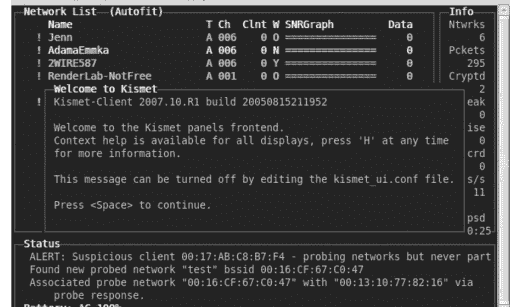

默认情况下，Kismet 会显示一个介绍屏幕，其中包含访问帮助菜单和其他信息的说明。对于 Kismet 的早期用户来说，这通常是一件非常烦人的事。将 *showintro=* 行改为 false 可以防止每次启动客户端时都显示此介绍信息。这很可能应该是你首先调整的设置。

## 使用的 GUI 类型
# 有效类型：curses, panel
gui=panel

根据你系统的能力，使用图形用户界面（GUI）类型的选项可能需要更改。默认情况下，Kismet 使用面板作为其显示方式。对于大多数基于现代 Linux 的系统，这并不成问题。但对于手持设备、低功耗或嵌入式系统等某些系统，你的 shell GUI 选项可能有限，在这种情况下，你可能需要使用 curses 库，并根据需要将 *gui=* 参数更改为 curses。这是一个更高级的功能，如果你正在资源有限的系统上工作，可能需要它。

## 要连接的服务器（host:port）
host=localhost:2501

此参数用于告诉客户端连接到哪个服务器。默认情况下，它连接到运行在本地计算机端口 2501 上的服务器。如果你想要连接到远程服务器，请在此处指定。要通过局域网（LAN）或互联网连接到远程计算机，只需在 *host=* 行中指定互联网协议（IP）地址即可。要连接到运行在 192.168.0.45 上的服务器，只需将该行更改为 "*host=192.168.0.45:2501*"。但是，如果你这样做，你需要确保将客户端的地址添加到服务器配置中的 *allowedhosts=* 参数中，否则服务器将不允许远程客户端连接。

可以同时指定并监控多个服务器，每行使用单独的 host 参数，但所有检测到的数据都将在客户端中混合在一起。如果你想让数据保持独立，最好为每个服务器运行单独的客户端实例。

# 网络流量衰减（活跃/最近/不活跃）和包点击率 - 如果你正在执行 prism2 信道跳变，请增加此值。
Decay=3

流量衰减是默认客户端布局中 SSID 左侧出现的感叹号和句号。它们指示该网络在近期时间内活动的存在情况。当看到该网络的数据时，Set User ID (SUID) 旁边会显示一个感叹号。如果没有看到数据，在下一次更新（通常为 1 秒）时，符号会变为句号。如果在下次更新中仍未看到任何东西，则不显示符号。在这种情况下，*decay=* 参数允许你配置此转换需要多少次更新（秒数）。某些卡片，如 prism2（hostap 驱动）可能需要几次更新才能正确报告看到数据。如果事情似乎没有正确更新，请调高此值。

# 显示哪些列？以逗号分隔。阅读文档以了解哪些列是有效的。
columns=decay,name,type,wep,channel,packets,flags,ip,size

这是关键所在，良好的配置可以让 Kismet 对你更有用。列是客户端窗口中列出的各种信息类型。例如 SSID、信道、看到的包数量等，都可以配置显示哪些以及显示顺序。默认情况下，Kismet 针对典型网络，从左到右显示：

- 最近看到的衰减（见上述参数）
- 网络的 BSSID
- 网络类型（ad-hoc，infrastructure）
- 使用的安全协议（如果有）
- 网络的信道
- 看到的包数量
- 网络发出的包上设置的任何特殊标志
- 网络上正在使用的 IP 范围（如果可以确定）
- 为网络收集的包的总大小

对于大多数人来说，这些信息足以进行基本扫描，但在上述默认列之外，客户端还有很多其他可用的选项。这些选项允许你根据需要的信息自定义客户端的显示。并非每个人都需要知道来自服务器的标志或网络的 IP 范围。如果你指定的列超过显示区域的处理能力，可以使用箭头键向右滚动显示区域。

要自定义显示的列，请在 *columns*= 行中以逗号分隔的列表（无空格）列出它们。可用的选项有：

- **BSSID**：网络的 BSSID（MAC 地址）。BSSID 是网络广播的名称。
- **Channel**：网络最后广播的信道。如果网络更换信道，显示将更新以反映此更改。
- **Clients**：在该网络上看到的唯一客户端 MAC 地址数量。这包括向无线站点发送数据包（广播和直接）的无线站点和有线站点。客户端菜单将显示哪些是哪些站点以及更多信息。
- **Crypt**：这是加密数据包的数量。这通常与 data 列相同，除非网络正在从加密切换到未加密，通常除非出现严重问题，否则不应该发生这种情况。
- **Data**：数据包的数量。数据包总数仅仅是传输控制协议（TCP/IP）数据包的总数，而不是 802.11 管理帧。这是在网络上传递的实际数据，而不仅仅是管理开销。通常，如果网络是加密的，data 和 crypt 计数器将相同。
- **Decay**：基于过去 “decay” 秒内的网络活动显示“!”或“,”或空白（由配置文件中的“decay”变量控制）。Decay 是前面提到的列，用于指示用户在最近几次更新中是否看到数据。通常，如果在最新更新中看到数据，则显示感叹号（!），如果下一次更新没有新数据（通常在信道跳变时发生），则显示句号（.），如果最近没有看到数据，则此列为空白。此更新速率可以由前面提到的 decay= 参数控制。
- **dupeiv**：看到具有重复 IV 的数据包数量。知道你监控的网络是否生成了大量重复 IV 有时是有用的，特别是在固定入侵检测系统（IDS）情况下。这仅适用于有线加密协议（WEP）网络。如果你在 WEP 网络上看到过多的重复 IV，要么接入点（AP）行为异常（旧固件问题等），要么如果你看到大量重复 IV 且数据包速率过高，你可能正受到针对你网络的主动注入攻击。这对 wardriving 没有用，但对于传统 WEP 网络的安全监控，它可能非常有用。
- **Flags**：网络状态标志（地址大小、已解密等）。Kismet 服务器为每个网络设置各种标志以指示某些状态信息。这些信息是对所发现网络情况的非常简明的概述。

各种标志（来自客户端帮助菜单）包括：

- **F**：易受攻击的工厂配置。很多人懒得去更改他们的 WAP 配置。这是不好的。
- **T#**：通过 TCP 流量发现的 # 字节地址范围
- **U#**：通过用户数据报协议（UDP）流量发现的 # 字节地址范围
- **A#**：通过地址解析协议（ARP）流量发现的 # 字节地址范围
- **D**：通过观察到的动态主机配置协议（DHCP）流量发现的地址范围
- **W**：使用用户提供的密钥解密的 WEP 网络

这些标志可用于快速提醒其他应用程序某些事情不对劲或值得注意（例如默认配置的网络）。

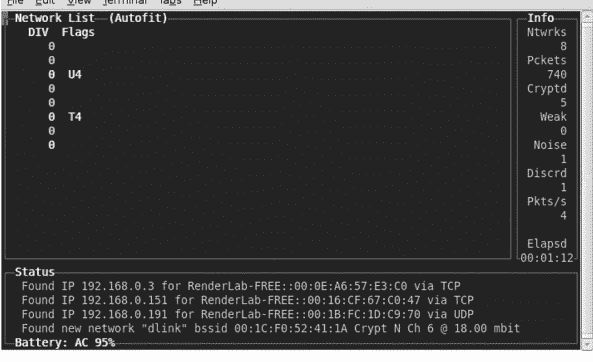

- **Info**：某些制造商包含的额外 AP 信息。某些制造商在其流量中包含关于 AP 的额外信息，这些信息对你扫描可能有用也可能没用。如果你想要它，请将“info”添加到显示的列列表中。


### IP
检测或推测出的网络 IP。Kismet 可以通过解析其看到的报文来推测网络上正在使用哪些 IP 地址。Kismet 将显示其在流量中看到的所有 IP 地址。这仅适用于开放网络。加密网络通常不会泄露其地址，因为它们已被加密。如果无线链路上使用了多个网络地址空间，Kismet 可能会在客户端显示时在地址空间之间切换。

### LLC
LLC 报文的数量。LLC 列是信标和其他管理帧的计数器。这些是管理无线链路的逻辑链路层报文。此计数器与数据和加密列是分开的。

### Manuf
如果匹配，则显示制造商。Kismet 可以通过将扩展服务集标识符（ESSID）（MAC 地址）与组织唯一标识符（OUI）数据库进行比较，来推测制造网络设备的厂商。网络设备制造商会在电气与电子工程师协会（Institute of Electrical & Electronics Engineers, Inc.）注册他们生产设备所使用的地址空间。利用此列表，Kismet 可以查看看到的地址并与该列表进行比较，从而对设备制造商进行合理的推测。显然，如果由于某种原因更改了设备的网络地址，此方法将失效。


### Maxrate
AP 广播的最大支持速率。网络会广播可用的最大数据速率，以便传入的客户端知道连接时应尝试的最大速率。

### Name
网络或组的名称。通常这是网络服务集标识符（SSID），但一些制造商添加了额外字段，用于位置或其他组织数据等。

### Noise
最后看到的噪声级别。噪声列显示由无线驱动程序报告的噪声级别。无线卡片的信号和噪声读数的问题在于，在不同的芯片组和驱动程序之间没有统一的测量标准单位。这意味着各种驱动程序报告的值基本上没有用处。商业产品之所以能做到这一点，是因为他们拥有开源开发者无法获取的文档，用以解码部分信息。通常，他们也只与其拥有文档访问权限的有限数量的卡片协同工作。

### Packets
报文总数。报文计数列是所有看到的报文的累计总和，包括数据、加密和 LLC。


### Shortname
网络或组的短名称，适用于小显示。使用此列适用于具有较小显示系统的场景。此列比“名称”列宽窄，可以在较窄的显示上适应，右侧空白较少。如果名称对于该列来说太长，则会被截断。

### Shortssid
适用于小显示的短 SSID。与 shortname 列类似，此列适用于较小的显示系统。然而，显示的 SSID 通常与 name 列相同，因此可能会重复某些信息。


### Signal
最后看到的信号级别。与噪声列类似，这报告了您正在使用的卡片的驱动程序报告的信号级别。同样，与噪声列类似，报告此信息没有标准单位，使用它也是一种吉凶参半的做法。然而，它可以用于帮助您了解一个网络相对于另一个网络的相对强度。

### Signalbar
信号强度的图形表示。signalbar 列仅给出信号强度的图形表示。然而，出于同样的原因，这与 signal 列中的数值一样可靠。

### Snrbar
信噪比（SNR）的图形表示。SNR bar 列试图以图形方式显示信号与噪声级别的比较。然而，与之前一样，此图形的准确性取决于您使用的驱动程序和芯片组，吉凶参半。它可以用于比较检测到的各个网络的相对强度。

### Size
网络上传输的数据量。size 列是捕获的数据报文的总和（以字节、千字节等为单位），提供了哪些网络传输数据最多的相对比较。

### SSID
网络或组的 SSID/ESSID。SSID 列显示网络的 ESSID。这也基本上与 name 列相同。

### Type
网络类型（Probe、Adhoc、Infra 等）。type 列指示这是什么类型的网络（探测客户端、AP 等）。来自 Kismet 帮助菜单：

- P Probe 请求 尚未建立关联连接。
- A 接入点 标准无线网络。
- H Ad-hoc 点对点无线网络。
- T Turbocell Turbocell（也称为 Karlnet 或 Lucent 室外路由器）网络。
- G 无线网络组。
- D 数据 仅包含数据而无控制报文的网络

此列仅为单字符宽度，且标题仅显示为“T”。

160

## 第 6 章 • Kismet 客户端配置文件


### Weak
看似具有弱 IV 的报文数量。弱 IV 曾经是早期 WEP 破解工具中的一个问题。大多数现代 AP 固件不像以前那样泄露弱报文了。使用此列监控过量弱 IV 可能很有用，这可能表明攻击或其他故障正在发生。

### WEP
WEP 状态（网络是否指示其使用 WEP）。此列是最有用但可悲的是被错误标记的列之一，因为 Kismet 随着变更和更新的引入而有机地增长，并整合到程序中。

WEP 列实际上是加密状态。早期，WEP 是唯一可用的选项，因此它只是一个简单的 Y/N 状态指示。自那时以来，已添加了 WPA 和 WPA2（802.11i）。来自客户端帮助：

- N 未检测到加密
- Y 标准 WEP 加密
- O 检测到其他加密方法

“O” 指示器显示是否存在 WPA/WPA2，以及是否有其他专有方法可用。网络信息屏幕显示了可用的加密的更具体信息。然而，这并不一定意味着正在使用可用的最强加密。


```
# What columns do we display for clients? Comma separated.
clientcolumns=decay,type,mac,manuf,data,crypt,size,ip,signal,quality,noise
```

与主网络显示类似，当我们在提供与该网络关联的客户端信息的客户端信息屏幕中时，可以指定要显示的列。

选项与主屏幕一样，添加到 `clientcolumns` 行中，逗号分隔且无空格。

可用的列有：

- **Crypt** 客户端传输的加密数据报文数量。与主网络屏幕一样，crypt 计数器显示传输到客户端和从客户端传输的加密报文总数。如果网络是开放的，此计数器不计数任何内容。

- **Data** 客户端传输的数据报文数量。数据计数器计算发送到和从客户端发送的所有数据报文，包括未加密和加密报文。

- **Decay** 基于网络活动显示“!”、“”或“”。再次，可以通过 decay 列跟踪客户端的近期活动。此列向用户显示在最近几次更新中是否看到来自或发送至客户端的数据。通常，如果在最新更新中看到数据，将显示感叹号（!），如果下一次更新没有新数据（如频道跳变通常发生的情况），将显示句号（.），如果最近未看到数据，此列则为空白。

- **IP** 客户端最后使用的 IP。Kismet 可以解析报文以确定客户端正在使用的 IP。这仅适用于未加密网络。

- **Mac** 客户端的 MAC 地址。客户端的 MAC 地址在每个发送到或从客户端发送的报文中都存在，并在此列出供您跟踪欣赏。

- **Manuf** 客户端的制造商（如果已知）。与 AP 一样，我们可以使用 OUI 数据库对客户端适配器的制造商进行最佳推测。对制造商的推测应持保留态度，因为将客户端适配器的 MAC 地址更改为允许地址范围内的任何其他地址都是微不足道的。

- **Maxrate** 客户端被看到传输的最大速率。Kismet 可以跟踪客户端被看到传输的最大速率。这在诊断客户端抱怨的低传输速度时可能很有用。


### 噪声

客户端最后看到的噪声电平。噪声电平列指的是 Kismet 服务器与其和客户端之间的噪声电平，而非客户端与其关联的接入点（AP）之间的噪声电平。服务器可能会检测到大量噪声，而这些噪声在客户端和 AP 之间并不存在。所有读数都应当持保留态度。同样，由于驱动程序存在差异且缺乏信号电平的标准报告机制，该数值并非绝对值，仅适用于相对比较。

### 信号

客户端最后看到的信号电平。与噪声类似，这是客户端与 Kismet 服务器之间的信号强度值，而非客户端与 AP 之间的信号强度。由于驱动程序和芯片组缺乏标准，所有数值都应当持保留态度。

### 大小

客户端传输的数据量。大小列统计的是从客户端收集以及发送至客户端的数据包大小（以字节、千字节等为单位）。

### 类型

客户端的类型（已建立、To-DS、From-DS 等）。客户端可以是有线或无线的。Kismet 可以根据流量方向以及是否检测到典型的无线流量来判断这一点。

客户端列表显示以下信息（来自客户端帮助菜单）：

- **From DS（来自 DS）**：客户端从无线分配系统广播。这些客户端通常是有线系统。
- **To DS（去往 DS）**：客户端通过无线向分配系统传输数据。这些客户端通常是无线节点。
- **Intra DS（DS 内部）**：客户端是分配系统的节点，正在与分配系统中的另一个节点通信。
- **Established（已建立）**：客户端已被观察到进入和离开 DS。这些通常是无线节点。
- **Sent-to（已发送至）**：数据已发送至此客户端，但未观察到从此客户端发出的数据，可能是隐藏节点。
- **Unknown（未知）**：客户端处于未知状态。根据设置的标志位，您可以合理猜测哪些客户端是无线的，哪些是有线的。
- **Weak（弱密钥）**：看似具有弱 IV 的分组数量。此列统计具有弱 IV 的分组数量。这在当今已不常见，但过多的弱密钥分组可能表明存在问题或正在遭受攻击。

```
## Does the GUI use sound?
# NOT to be confused with "sound" option later, which is for the SERVER to make
# noise on whatever host it's running on.
sound=true
```

sound 选项启用客户端（而非服务器）的声音选项。客户端可以在各种事件发生时发出噪音或播放声音（如发现新网络等）。对于无法时刻盯着系统的场景（例如在行驶中的汽车里），这非常有用。

最好只使用服务器声音或客户端声音之一，而不要同时使用两者，否则会造成极大的混淆且噪音很大。

```
## Path to sound player
soundplay=/usr/bin/play
```

如果客户端需要播放声音，它显然需要知道系统上应使用哪个程序来播放。默认路径是 /usr/bin/play，但请根据您系统特定的声音播放器进行调整。

```
## Optional parameters to pass to the player
# soundopts=--volume=.3
```

如果您想更精细地设置，还可以传递参数，例如声音音量或播放器程序的其他命令行参数。只需像您在命令行上那样指定它们即可。

```
## New network found
sound_new=@sharedatadir@/kismet/wav/new_network.wav
## Weep new network
# sound_new_wep=@sharedatadir@/kismet/wav/new_wep_network.wav
## Network traffic sound
sound_traffic=@sharedatadir@/kismet/wav/traffic.wav
## Network junk traffic found
sound_junktraffic=@sharedatadir@/kismet/wav/junk_traffic.wav
## GPS lock acquired sound
# sound_gpslock=@sharedatadir@/kismet/wav/foo.wav
## GPS lock lost sound
# sound_gpslost=@sharedatadir@/kismet/wav/bar.wav
## Alert sound
sound_alert=@sharedatadir@/kismet/wav/alert.wav
```

每个事件都可以拥有自己的声音，如果您愿意，还可以使用自定义声音。只需将您自己的 WAV 文件加载到系统中，并将每个事件指向您想要使用的声音。您还可以通过注释掉不需要的声音行来仅启用特定事件的声音，例如新网络或全球定位系统（GPS）定位锁定/丢失。

```
# Do we automatically make a group for probed networks or do we show them
# amidst other networks?
autogroup_probe=true
```

客户端可以选取所有探测网络（正在寻找网络的客户端）并将它们分组。它们将列在 `<probe networks>` 组下，可以通过选中该组并按 **Enter** 键展开以显示所有探测网络的信息。如果观察到某个探测并随后与某个网络关联，它将被移至该网络的客户端列表中。

```
## Do we autogroup data-only networks?
autogroup_data=true
```

与探测网络类似，客户端可以以相同方式将*仅数据网络*分组在一起。选中数据网络组并按 **Enter** 键即可查看数据网络。

```
## Do we autogroup adhoc networks?
autogroup_adhoc=true
```

同样，我们可以将自组网（ad-hoc）网络分组在一起，就像探测网络和数据网络那样。有时将其设置为 false 是个好主意，以便查看是否有人可能正在建立绕过您安全策略的自组网。

```
## Display battery status?
apm=true
```

如果您的系统启用了 APM（高级电源管理），Kismet 可以在客户端左下角报告您的电池状态。如果您在电池供电下四处移动，并希望留意在必须插电充电前还剩多少时间，这将很有用。

```
## Does the GUI talk to us with Festival?
speech=false
```

使用*festival*，客户端可以读出网络名称。如果系统上安装了 festival，请将 speech 更改为 true。不要将此与服务器使用 festival 的情况混淆。

```
## Where is festival located for the GUI?
festival=/usr/bin/festival
```

如果您想使用 festival，Kismet 还需要知道 festival 安装在哪里。根据系统不同，请将配置指向 festival 可执行文件。默认路径是 /usr/bin/festival。

```
# Are we using festival light? If so, point the above "festival" path to the
# "flite" binary.
flite=false
```

如果您正在使用 festival lite，可以将此选项设置为 true，并将上述 festival= 行的路径指向 flite 二进制文件。

```
## Are we using speech on Darwin?
darwinsay=false
```

如果您在 Mac 上为 OS X 编译了 Kismet，可以使用 Darwin 的语音功能代替 festival 来读出服务器事件。如果您想使用 Darwin 的语音功能，请将其设置为 true。

```
# What voice do we use? (currently only supported on darwin)
speech_voice=default
```

Darwin 还提供了一些可选语音。在系统偏好设置中选择语音，Kismet 将使用该语音作为配置文件中的默认选项。

```
# How do we speak? Valid options:
# speech Normal speech
# nato NATO spellings (alpha, bravo, charlie)
# spell Spell the letters out (aye, bee, sea)
speech_type=nato
```

如果我们使用 festival 和语音，希望它如何发音？将此设置为 “speech” 会让 festival 读出（或大致读出）检测到的网络名称。将 *speech_type* 设置为 *nato* 会使用北约字母表来“读出”每个字母（linksys 将被读作 “LIMA, INDIA, NOVEMBER, KILO, SIERRA, YANKEE, SIERRA”）。如果将其设置为 “spell”，festival 将按常规方式逐个读出字母：“L,I,N,K,S,Y,S。”

```
# speech_encrypted and speech_unencrypted - Speech templates
# Similar to the logtemplate option, this lets you customize the speech output.
# speech_encrypted is used for an encrypted network spoken string
# speech_unencrypted is used for an unencrypted network spoken string
#
# %b is replaced by the BSSID (MAC) of the network
# %s is replaced by the SSID (name) of the network
# %c is replaced by the CHANNEL of the network
# %r is replaced by the MAX RATE of the network
speech_encrypted=New network detected, s.s.i.d. %s, channel %c, network encrypted.
speech_unencrypted=New network detected, s.s.i.d. %s, channel %c, network open.
```

您可以自定义 festival 的输出并构建它所说的句子。加密网络和未加密网络有单独的行。festival 将读出您在 `speech_encrypted=` 或 `speech_unencrypted=` 行中等号后指定的单词，其中特定符号会被替换为所读出网络的设置值。

```
speech_encrypted=New network detected, s.s.i.d. %s, channel %c, network encrypted.
```

如果该网络已加密，默认行会将上述检测到的 linksys 网络读作 "New network detected SSID LINKSYS Channel 6 network encrypted"（检测到新网络，SSID 为 LINKSYS，信道 6，网络已加密）。如果您将 `speech_encrypted` 和 `speech_unencrypted` 参数都更改为 "`speech_encrypted=Detected, s.s.i.d. %s`"，则可以轻松将其缩短为 "Detected SSID LINKSYS"（检测到 SSID LINKSYS）。

```
# Simple borders (use - and | instead of smooth vertical and horizontal
# lines. This is required on Zaurus, and might be needed elsewhere if your
# terminal doesn't display the border characters correctly.
simpleborders=false
```

根据您的终端不同，您可能需要从直线条线更改为终端字符。通常这不是问题，除非您在某些特殊硬件上运行 Kismet，而不是标准的笔记本电脑。

```
# Colors (front, back) of text in the panel front. Valid colors are:
# black, red, yellow, green, blue, magenta, cyan, white
# optionally prefixed with "hi-" for bold/bright colors, ie
# hi-red, hi-yellow, hi-green, etc.

## Enable colors?
color=true

## Background
backgroundcolor=black
```


## 默认文本
textcolor=white
## 窗口边框
bordercolor=green
## 标题
titlecolor=hi-white
## GPS 和 APM 信息
monitorcolor=hi-white
## WEP 网络颜色
wepcolor=hi-green
## 工厂网络颜色
factorycolor=hi-red
## 开放网络颜色
opencolor=hi-yellow
## 解除隐身的网络颜色
cloakcolor=hi-blue

如果您对客户端默认的黑色、绿色和黄色配色方案不满意，您可以更改任何元素的颜色。只需将任何元素的配置行更改为黑色、红色、黄色、绿色、蓝色、洋红色或青色，或者在颜色名称前添加“hi-”使其变为粗体。

### 命令行开关

就像服务器一样，您可以为 Kismet 客户端指定命令行开关。这需要您使用 *kismet_server* 单独启动 Kismet 服务器。您不能使用同时启动服务器和客户端的 Kismet 脚本。命令行开关会覆盖 *kismet_ui.conf* 文件中的任何设置。

-   **-f, --config-file <file>**: 使用备用配置文件
  客户端的部分选项来自服务器配置文件，因此如果您指定了备用服务器配置文件，客户端需要知道这一点。

-   **-u, --ui-config-file <file>**: 使用备用 UI 配置文件
  有些用户喜欢拥有一个特定列排列的配置文件，另一个拥有不同列的配置文件。使用 *-u* 开关，您可以轻松地在两者之间切换。

-   **-q, --quiet**: 不播放声音
  有时声音是有用的，有时则不然。此选项将为您在此客户端运行中禁用声音。

-   **-s, --server <host:port>**: 连接到 Kismet 主机和端口
  客户端命令行开关最常见的用途是指定备用服务器。如果您运行多个服务器，也许在 IDS 设置中，您可以使用 -s 开关在运行时指定 IP 和端口。

-   **-g, --gui <type>**: 要创建的 GUI 类型 (curses, panel)
  如果您需要在会话中切换面板和 curses 界面（这种情况应该很少），您可以在此处指定。只有两个选项：panel 和 curses。

-   **-C, --columns <list>**: 初始显示的列（逗号分隔）
  代替多个配置文件，您可以手动指定您想要的列及其顺序，从命令行。有效选项与配置文件相同，如本章前面或 Kismet README 文件中所述。

-   **-r, --reconnect**: 在客户端/服务器连接失败后尝试重新连接。
  如果您连接到远程服务器的连接不稳定或延迟较高，客户端可能会偶尔断开连接。-r 开关会自动让客户端尝试在断开连接时重新连接到服务器。

-   **-c, --client-columns <list>**: 客户端信息显示列
  与网络列一样，您可以指定逗号分隔的名称，以确定检测到的客户端设备想要哪些列及其顺序。有效选项与配置文件相同，如本章前面或 Kismet README 中所述。

-   **-v, --version**: Kismet 版本
  -v 选项将在命令行打印客户端的版本号。

-   **-h, --help**: 你以为你在读什么？
  最后，-h 选项将调出命令行开关列表，以防您手边没有这本书。

## 总结

Kismet 客户端提供了大量的配置选项。适当的配置可以在您需要的时候和地点提供您想要的信息。调整列可以让信息触手可及，使您的生活更轻松，并希望提高生产力。

# 第 7 章

# Server.conf 文件高级配置

本章解决方案：

-   Asus EEEPC 安装
-   Kismet 在 Windows 上
-   便携式 Wardriving
-   监测安装
-   总结

## 简介

Kismet 能够完成一些惊人的壮举。它在移动、流氓狩猎角色中的实用性不亚于在固定 IDS 设置中。本章将展示 Kismet 的各种用途。Kismet 被广泛使用，从移动流氓狩猎系统，到站点调查，再到监控无线安装周围电波的全功能 IDS 设置。

## Asus eeePC 安装

2007 年，Asus 发布了 eeePC，一款运行 Linux 的小型亚笔记本电脑。这些笔记本电脑使用固态硬盘，这意味着快速的启动时间，并且能够承受大量的移动。eeePC 预装了 xandros Linux 和 atheros 无线芯片组，使其成为一台轻便且便携的 Kismet 机器。

除了磁盘空间和随机存取存储器 (RAM) 之外，eeePC 几乎都相同，但芯片组是一致的。在默认 Linux 安装上安装相当简单。只需下载几个包和软件即可。您可能会选择将另一个 Linux 发行版甚至 Windows 安装到 eeePC 上，但是那些说明在其他章节中。在这种情况下，我们将使用 eeePC 作为您办公室的快速轻便的移动搜索和嗅探装置。

## 安装和更新

打开 eeePC 后，您想做的第一件事就是更新它。这对 Kismet 安装不是必需的，但由于 eeePC 最初附带了一个有漏洞的 samba 版本，这可能会导致不良后果，所以这是一个好主意。

要更新，您可以使用 eeePC 设置菜单下添加/删除软件的更新功能，但我们将使用命令行，因为它更彻底。

首先将您的 eeePC 连接到互联网，并打开命令 shell：

```
ctrl-alt-t
```

您需要切换为超级用户，最简单的方法是：

```
sudo su
```

从现在开始要小心，您现在是超级用户，如果不仔细，可能会对您的操作系统安装造成重大损坏。

现在我们需要更新 *apt* 缓存：

```
apt-get update
```

这告诉系统查看 asus 有哪些可用包，以及是否有任何比已安装的包更新。使用以下命令将系统升级到可用的最新版本：

```
apt-get upgrade
```

Apt 可能会给您一个要安装的大量包列表并要求确认。这可能需要几分钟。

## 安装开发工具

默认情况下，eeePC 不附带编译器和大多数基本开发工具，不过我们可以添加它们，但不能从 asus 源添加。

eeePC 基于 Xandros Linux，后者基于 debian。这意味着我们可以相当安全地在默认操作系统 (OS) 上使用 debian 包。这相当简单，只需将 debian 稳定版包添加到我们的仓库列表中即可。

首先，如果您还没有打开终端窗口，请使用以下命令打开：

```
ctl-alt-t
```

另外，确保您是 root 用户：

```
sudo su
```

现在，您需要选择一个镜像站点来下载您的包。前往 http://www.debian.org/mirror/mirrors_full 并从列表中选择镜像。在示例中，我们将使用通用的 ftp.debian.org。您需要将选择的镜像和路径添加到 /etc/apt/sources.list。

```
deb http://ftp.debian.org/debian/ stable main contrib non-free
```

再次，我们需要更新源以包含新仓库：

```
apt-get update
```

一旦 apt 知道了可用的新包，我们就可以安装构建 Kismet 所需的构建工具：

```
apt-get install build-essential
```

如果一切顺利，apt 将加载必要的构建工具。我们现在可以加载安装构建 Kismet 所需的依赖项。所需项如下：

-   libcurses5-dev
-   libcap0.8-dev
-   zlib1g-dev

这是让 Kismet 运行所必需的。如果您想包含 gpsmap，则需要包含以下内容：

-   imagemagick
-   libexpat1-dev
-   libgmp3-dev

您可以在一条 `apt-get` 安装命令中添加所有这些，只需在一行中列出它们，包之间用空格隔开。

```
apt-get install libcurses5-dev libcap0.8-dev zlib1g-dev imagemagick libexpat1-dev libgmp3-dev
```

这应该花几分钟。

安装完所有内容后，您可以从 http://www.kismetwireless.net 下载最新的 Kismet 稳定版包。在 downloads 部分检查最新发行版本。如果您想跟踪自上次发行以来的源代码变更，您需要安装 subversion 以获取最新的开发源代码。幸运的是，由于我们设置了 `apt`，这很容易：

```
apt-get install subversion
```

接着执行：

```
svn co https://svn.kismetwireless.net/code/trunk kismet-devel
```

这将下载最新的源代码到您正在工作的 `kismet-devel` 目录中，所以请确保它是您想要的地方。如果您将来想更新此源代码，请转到该目录并输入 `svn update`，任何新的源代码变更都将合并到现有源代码中。一旦您拥有源代码，如果需要解包，请现在操作。切换到 Kismet 源代码目录，并像任何其他安装一样，运行：

```
./configure
make
make install
```

检查 configure 的输出，确保所有您希望/需要的依赖项都得到满足，并希望当您运行 `make` 时一切正常工作。一旦 Kismet 构建并安装完毕，您仍然需要配置服务器。一旦知道需要发生什么，这部分很容易。需要更改 `Kismet.conf` 文件中的以下行：

```
suiduser=user
source=madwifi_g,wifi0,<descriptive name here>
```


完成上述操作后，Kismet 仍然无法运行。由于某些原因，Kismet 在没有人工帮助的情况下无法正确设置无线网卡以进入监听模式。你必须手动销毁虚拟 *ath0* 接口，以便保留父接口 *wlan0*：

```
wlanconfig ath0 destroy
```

这条命令将使 Kismet 能够控制监听模式并让 Kismet 运行起来。如果一切设置正确，你可以运行 Kismet，并在你的 eePC 上查看属于你自己的 Kismet 安装实例。

## 在 Windows 上运行 Kismet

由于拥有大量支持监听模式的开源无线驱动程序，Kismet 主要是在 Linux 系统上并针对 Linux 系统开发的。Kismet 可以在 Windows 上运行，但存在一些限制。大多数（如果不是全部的话）消费级无线驱动程序不支持监听模式，并且鉴于其闭源和专有性质，它们也不太可能支持。Kismet 在 Windows 上可以配合无人机（drones）作为数据源运行，并且仅支持特定的一种通用串行总线（USB）适配器。

例外是 Cace Technologies 的 AirCap。作为 USB 适配器出售，这些适配器附带支持监听模式的驱动程序以及完整的开发工具包。与其他方案相比，如果你需要在 Windows 上实现监听模式，这是最便宜且最简单的方法。


AirCap 是唯一一款受 Kismet 支持的 Windows 适配器。Cace Technologies 与开源安全工具社区（包括 Kismet）合作，以提供支持和持续改进。作为合作的一部分，他们在其网站上免费提供 Kismet 的 Windows 版本。如果你在网络中已经有一个运行 Windows 的监控站，并且不想再运行额外的监控站或虚拟机来监控你的无人机，那么 Windows 版 Kismet 可以很有用。

Kismet 在 Windows 上使用 Cygwin 运行。Cygwin 是一个模拟 Linux 应用程序接口（API）的库，允许将一些应用程序从 UNIX 移植到 Windows。它并不完美，但对于 Kismet 的用途而言，它表现得相当可靠。在 Windows 下的 Cygwin 中构建你自己的 Kismet 安装是可行的；不过，Cace Technologies 已经慷慨地在其网站上提供了 Kismet 的 Windows 可安装版本：http://www.cace.com/support/downloads.htm。

这个可安装的 Windows 软件包还提供了一个非常棒的界面用于设置你的数据源，包括无人机，这意味着你甚至不需要拥有 AirCap 就可以使用此软件包来监控无人机。

## 安装

第一步是安装 AirCap 软件。这将安装 Winpcap 和其他所需的库。AirCap 驱动程序安装程序位于 Cace Technologies 网站上与 Kismet 安装程序相同的下载页面上。双击下载的文件并按照说明操作。

这将安装 Winpcap 和其他必需的库。如果你已经安装了 Winpcap，AirCap 安装程序可能会要求你升级到其版本。仔细检查哪个版本更新，如果 AirCap 的版本更新，让它覆盖旧版本。如果你已经安装了更新版本的 Winpcap，只需取消 AirCap 安装程序中的 Winpcap 部分即可（这不会取消整个安装过程，只是取消 Winpcap 部分）。

加载 AirCap 软件后，运行 Kismet 安装程序。按照安装程序的说明进行操作，这包括按下 **Next** 按钮三次。安装完成后，你会在开始菜单的程序列表中找到 Kismet 条目。其中列有一个命令行提示符的链接、Kismet 可执行文件、Kismet 配置文件以及日志文件夹的快捷方式。

如果你立即运行 Kismet 可执行文件，操作将会失败，因为你需要先配置数据源。Cace Technologies 制作了一个配置实用程序，代替编辑 *kismet.conf* 文件，将所有数据源选项传递给 Kismet 可执行文件，使操作更加简便。通过开始菜单启动 Kismet for Windows 配置实用程序，你将看到可用的选项。

左上角用于设置本地数据源（或指定你没有本地数据源）。此时，AirCap 是唯一受支持的本地适配器。如果你已安装了一个，可以从下拉框中选择它。适配器名称的格式为 \aircap.XX，其中 XX 是适配器的编号（00、01、02 等）。如果你有多个适配器，AirCap 实用程序可以闪烁不同适配器上的 LED 以选择正确的那个，或者选择“启用所有数据源”并使用所有设备。

右上角区域用于设置无人机。这很简单，只需添加无人机所在的互联网协议（IP）地址和端口（通常是 3501 端口）。你可以在此区域添加多个无人机，并将它们与 AirCap 适配器结合使用，或者将 aircap 部分设置为“无本地数据源”，仅使用无人机作为数据源。

在左下角，你可以选择启用磁盘日志记录。日志文件与 Linux 版 Kismet 的日志文件相同。它们存储在安装目录中的 logs 文件夹里。你可以在开始菜单中找到它的快捷方式。右下角有三个按钮，用于启动对各种配置文件的编辑。启动的编辑器会确保配置文件采用 UNIX 文本文件格式，以便你在保存后 Kismet 仍能读取它们。

选择选项并配置你的数据源，然后点击左下角的“应用设置并运行 Kismet”按钮，以执行该操作：应用设置并启动 Kismet 服务器。一旦 Kismet 启动，如果你的数据源设置正确，一切操作将与在 Linux 中一样正常。

### 故障排除

关于 Windows 上使用 AirCap 运行 Kismet 的一点提示。如果你无法获取数据、数据缓慢、或者 Kismet 客户端显示中出现奇怪的随机内容，请启动 AirCap 控制面板并确保捕获类型下拉菜单设置为“802.11 + Radio”。另外，如果你未将 AirCap 设置为捕获无线电报头，Kismet 无法获取它期望看到的所有信息，通常也就无法正常工作。

## 车载式 Kismet 应用

Kismet 能够在不同硬件上运行以及其客户端/服务器模型，意味着你可以在非常小的封装中运行 Kismet 服务器。

如果你热衷于车载扫描（war driving），你知道把所有设备从车里搬进搬出是很麻烦的事。使用 Kismet 最有用的事情之一，就是构建一个车载扫描设备，放置在你的汽车仪表盘或后座上。

构建此类设备有无数种方法，但为了本章节的目的，我们将重点放在易于构建和使用上。实现相同目标的方法各不相同，但本质上你只需要：

- 一个运行 Linux 版本的中央处理单元（CPU）
- 一个兼容的无线网卡
- 存储介质

> **注意**
> 本指南旨在提供灵感。如果你想要更多想法，请阅读 Paul Asadoorian 和 Larry Pesce 著的《Linksys WRT54G Hacking》。他们探讨了 WRT54G 作为嵌入式平台的许多潜力。

对于本指南的目的，只需要以下部件，最复杂的硬件改装就是拆除四颗螺丝：

- Asus WL-500g Premium 路由器
- BU-353 USB 全球定位系统（GPS）
- Atheros mini PCI 卡
- USB 存储棒（任意尺寸）
- OpenWRt Kamikaze

Asus WL-500g 比 WRT54G 更适合本项目，因为它拥有更多的闪存空间和更多 RAM。由于该设备将运行服务器，规格越高越好。Asus 包含的两个 USB 端口使这个项目变得简单且无需改装。日志将写入 USB 存储棒，唯一的线缆需求是电源线。

Asus 路由器出厂时配备 Broadcom 43xx mini PCI 卡，该卡可与 Kismet 配合使用，但由于缺乏开源驱动，像信道跳跃等功能不如其他芯片组支持得好。然而，由于这是一张 mini PCI 卡，更换为具有完整支持的卡非常容易。明智地利用 eBay 可以低成本获得此类卡片。

首先获取一台 WL-500G Premium 路由器。确保它有两个 USB 端口。其他类似型号没有 USB 端口。你需要这两个端口，一个用于 USB 存储棒，另一个用于 GPS。


至于OpenWRT，Kamikaze版本运行良好，但博通（Broadcom）芯片组除非花费一些力气，否则不会自动跳频。此外，目前以Ipkg形式提供的Kismet版本与博通芯片组兼容性不佳，因此，除非你想交叉编译自己的服务器（相关说明包含在Kismet无人机章节中），否则请将迷你PCI卡更换为兼容性更好的卡；在这种情况下，建议使用Atheros（Atheros）网卡。

OpenWRT的安装比WRT54G稍微棘手一些。OpenWRT维基站点提供了更多信息，请访问 http://wiki.openwrt.org/OpenWrtDocs/Hardware/Asus/WL500GP。

## 来自地下的笔记

### 摘自OpenWRT维基

若要使用简单文件传输协议（TFTP）或华硕（Asus）固件恢复工具安装OpenWrt，必须将路由器置于诊断模式。要将路由器置于诊断模式，请按以下步骤操作：

- 1. 拔掉路由器的电源线。
- 2. 确认你的PC已配置为通过动态主机配置协议（DHCP）获取地址。
- 3. 将路由器的LAN1端口直接连接到你的PC。
- 4. 使用笔或类似物体按下黑色RESTORE（恢复）按钮，并保持按住不放。
- 5. 在保持RESTORE按钮按压状态的同时接入电源，持续几秒钟。
- 6. 当你看到电源指示灯缓慢闪烁时，说明路由器已进入诊断模式。
- 7. 此时路由器应能通过TFTP或华硕固件恢复工具接受镜像文件。
- 8. 在诊断模式下，路由器获取地址 192.168.1.1。它会响应ping，因此你可以使用 "ping 192.168.1.1" 确认其处于诊断模式并准备好接收TFTP传输。

一旦路由器进入诊断模式，照常规通过TFTP上传固件：

```
tftp 192.168.1.1
tftp> binary
tftp> rexmt 1
tftp> trace
tftp> put openwrt-wrt54g-squashfs.bin
```

刷写路由器后，请等待6分钟。路由器的刷写方式是将上传的闪存副本复制到RAM，然后写入闪存内存。中断此过程可能会导致路由器变砖。请保持耐心，刷写完成后等待6分钟再重启路由器并尝试连接。通过Telnet登录位于192.168.1.1的路由器，修改密码以启用安全外壳（SSH）：

```bash
passwd root
```

确认路由器闪存刷写成功后，你可以更换WiFi迷你PCI卡。路由器底部橡胶脚垫下的四颗螺丝将其固定在一起。只需取下脚垫，拧下螺丝，即可抬起路由器顶盖。

内部是迷你PCI卡。你可以看到外部天线连接到迷你PCI卡的u.fl接口（<http://en.wikipedia.org/wiki/U.FL>）。这是首先需要移除的部分。u.fl接口平贴在卡上，请用刀或螺丝刀的一边*非常轻柔地*将其从卡上弹开。

断开天线电缆后，向两侧滑开卡槽上的卡扣，卡应该会弹起。卡释放后，将其拔出，并反向操作插入新卡。如果卡上有两个u.fl接口（大多数卡都有），请确保将外部天线重新连接到主接口，而不是辅助或次级接口。在接口附近寻找微小的印刷字样以作确认。内部改装到此为止，剩下的就是软件配置和即插即用。

为了让路由器连接互联网以获取必要文件，请编辑 `/etc/config/network` 文件。配置文件在openwrt维基上有详细说明。<http://wiki.openwrt.org/OpenWrtDocs/KamikazeConfiguration>。它包含所有选项，但你可能需要编辑的几个选项位于“*config interface* `LAN'”部分下：

```bash
option ipaddr 192.168.1.1
```

如果你想更改路由器的IP地址：

```bash
option netmask 255.255.255.0
```

如果需要更改子网掩码，这里是操作位置：

```
option gateway 192.168.0.1
```
设置默认网关，以便路由器能够与互联网其他部分通信：

```
option dns 64.59.184.13
```

你还应该为路由器配置一个域名系统（DNS）服务器，以便它可以解析openwrt.org域名来获取软件。

例如，这是一个可用的LAN配置：

```
### LAN configuration
config interface lan

    option type bridge
    option ifname "eth0.0"
    option proto static
    option ipaddr 192.168.0.75
    option netmask 255.255.255.0
    option gateway 192.168.0.1
    option dns 64.59.184.13
```

重启后，你应该能够通过SSH登录路由器，ping外部地址并解析域名。通过ipkg安装Kismet服务器的最简单方式是：

```
ipkg update
ipkg install kismet-server
```

这会将服务器下载并安装到路由器上。你需要对 /etc/kismet/kismet.conf 文件进行一些编辑，以使用不同的卡和GPS，并对嵌入式系统进行一些调整。

更改以下行：

```
source=madwifi_g,wifi0,foo
```
将source更改为使用madwifi驱动：

```
channelhop=true
```
由于madwifi驱动与Kismet跳频兼容良好，请启用跳频。无需特殊脚本即可实现跳频。

```
allowedhosts=127.0.0.1,<IP other than localhost>
```
使用另一个系统作为路由器服务器的客户端用于诊断目的是很有用的。设置一个你可以使用客户端的IP地址范围：

```
gps=true
```
既然路由上有GPS，请启用GPS：

```
writeinterval=XX
```
由于此系统无法优雅关机，服务器将无法清理并写出剩余数据。将写入间隔调整到较短时间意味着当你拔掉电源时，丢失的数据会较少。如果系统长时间未使用，30秒是合理的。路由器使用时间越长，文件越大，写入时间越长。如果写入时间长于配置中设置的时间间隔，你可能会陷入恶性循环并丢失大量数据。

你可以随意调整其他选项。由于这是一个完整的服务器，所有选项都可以编辑。你还需要通过 `ipkg` 安装其他一些软件：

```
ipkg install kmod-fs-ext3
ipkg install kmod-usb2
ipkg install kmod-usb-uhci-iv
ipkg install kmod-usb-serial-pl2303
ipkg install kmod-usb-storage
ipkg install gpsd
ipkg install hotplug2
ipkg install usbutils
```

这些软件包用于GPS和USB存储棒。默认镜像中未内置支持，但可以轻松添加。

### 注意

> 这些说明假设使用的是EXT3格式化的存储棒。如果你想使用其他文件系统，请确保加载该文件系统的内核模块，否则系统不知道该如何读取它。EXT3文件系统可能是最佳选择。它在写入过程中遭遇断电时表现较好。

安装完这些软件包后，该设置一些脚本以启动GPSD、Kismet服务器和存储棒的自动挂载系统。将这些脚本按以下名称输入到 `/etc/init.d` 目录中。

```
/etc/init.d/usb
# /bin/sh /etc/rc.common
# Copyright (C) 2006 OpenWrt.org
START=39
```

```
start() {

    [ -d /proc/bus/usb ] && {
        /bin/mount -t usbfs none /proc/bus/usb
    }
}
```

```
/etc/init.d/gps

#!/bin/sh /etc/rc.common
# Copyright (C) 2006 OpenWrt.org

START=10
STOP=10

boot() {
    sleep 10
    start
}

start() {
    /usr/sbin/gpsd -n /dev/ttyUSB0
}

stop() {
    kill `ps -ef | grep 'gpsd' | awk `{' print $1 }'` 
}
```

```
/etc/init.d/kismet

#!/bin/sh /etc/rc.common
# Copyright (C) 2006 OpenWrt.org

START=50
STOP=10

boot() {
}

start() {
    echo start
    # commands to launch application
    sleep 3
    cd /mnt/usbdrive
    kismet_server -f /etc/kismet/kismet.conf
```

```
)
    boot() {
        echo boot
        # commands to run at boot
        # continue with the start() section
        start
    }
```
这里的逻辑是：在启动时，USB脚本运行并将USB存储棒挂载到 /mnt/usbdive。接着是GPS脚本，它在另一个USB端口启动GPSD。之后，Kismet服务器启动，等待3秒以便其他脚本稳定，然后切换到新挂载的 /mnt/usbdive，随后启动服务器，将数据保存到存储棒。

完成并保存所有这些设置后，你可以重启路由器。重新登录并使用ps命令验证GPSD、Kismet服务器和热插拔守护程序是否都在运行。

## 监视器安装

这里假设你使用类似精简版PC或WRT54GL作为无人机节点，因为这是将数据接入监视系统最便宜且最简单的方式。

规划你的监控系统至关重要。如果你只覆盖一个接入点，那么只需将传感器放在接入点旁边即可，这很简单；但覆盖多个接入点则需要更多地规划覆盖范围。此外，你很可能需要回答一些关于你想监控内容的关键问题。

在典型网络中，威胁来自四面八方。监控网络是个好主意，但如果不进行规划，你会发现自己被数据淹没，并错过大量重要信息。


## 摘要

在当今人人都在使用无线网络的世界里，你的区域附近几乎总会有其他网络存在。这意味着你通常可能只希望监控针对你的网络的威胁。在这种情况下，你可能只希望监控你正在运行的接入点所在的信道，以避免不必要的数据收集，并可能违反许多关于隐私和数据截获的法律。此外，如果你决定进行信道跳变，你很可能会错过大量数据，如果你试图监控用户或入侵者的使用情况，这可能是一个问题。如果你出于性能原因想要进行监控，信道跳变可能是一个好主意，这样你可以了解附近其他无线网络的无线环境概况。

过滤器也将成为你的好朋友。如果你正在监控你的网络及其上的所有流量，可以使用过滤器将收集的数据量限制在最低必要和异常范围内，否则数据量会迅速变得非常大。

复杂程度取决于你的想象力，但就本书而言，我们重点介绍 Kismet 作为监控办公室小型网络的一种廉价且有效方式的优势。

# 第 8 章
## Kismet 无人机

**本章解决方案：**

- 无人机安装
- PC 无人机设置
- 摘要

## 引言

本章旨在向你展示 Kismet 无人机用于集成到网络监控中的各种方式。在数据源方面，Kismet 有一个巧妙的功能。服务器不需要与向其提供数据的源位于同一系统上。Kismet 只需接收数据包并将其解析为人类可读的视图；它并不关心这些数据的来源。Kismet 支持一种称为“无人机”的远程哑传感器安装。无人机从空中嗅探数据并将其发送到服务器。Kismet 可以处理多个这样的无人机，而且它们不需要是强大的系统。本书的这一部分将重点介绍如何构建无人机并将其与 Kismet 服务器集成。

## 无人机安装

无人机是一种相当“笨”的设备。它只需要一个支持监听模式的兼容网络设备。此外，它需要一个类似 CPU 的组件来运行非常基础的 Linux 和无人机软件。最后，它需要一个回传方法来将捕获的数据发送到服务器。

你可以在任何类型的系统上运行 Kismet 无人机，从完整的现代 PC 到小型嵌入式计算机，以及介于两者之间的任何东西。Kismet 是为 x86 系统构建的，但也可以使用 ARM、MIPS 和其他处理器。

在本章中，我们将向你展示在难度和成本方面的两个极端。

### 链接思科 WRT54G

WRT54GL 是 WRT54G 路由器系列的最新版本，过去几年中，硬件黑客们从这些路由器中获得了极大的乐趣。它们包含 MIPS 处理器、无线芯片组和有网以太网连接，正是我们所需的一切。

尽管 WRT54G 的可破解性和易得性很强，但它们也有局限性。主要问题在于它们的内存占用很小，并且使用了专有的 Broadcom 芯片组，这将我们能做的事情限制在制造商驱动程序允许的范围之内，此外还有一个并不总是最新的开源软件开发周期。

话虽如此，它们因极其廉价和文档详尽而具备的价值意味着，如果你不想花钱获得其他硬件的额外功能，或者这些其他功能并非必需，我们可以从这些设备中挖掘出许多功能。

## 地下笔记

### 关于交叉编译

在某些情况下，无法在它将要运行的设备上编译软件。小型嵌入式系统通常没有空间容纳完整的编译器、库、源代码等构建软件所需的组件。2 MB 的内存和 200 MHz 的处理器意味着我们无法直接在 WRT54GL 上编译（本地编译）Kismet。在这种情况下，通常需要交叉编译来构建软件。交叉编译基本上是在一种架构上构建软件以在另一种架构上运行。就 WRT54GL 而言，你可以在 x86 桌面上为 MIPS 处理器构建软件。

交叉编译可能更像是一种巫术而非艺术。为其他架构设置工具链并不是胆小者甚至一些有经验用户所能轻易应对的事情。我们花了大量时间和研究试图记录为 WRT54GL 构建无人机所需的自定义交叉编译器，然而，记录所有必需的变量几乎是不可能的。此外，OpenWRT、Kismet 以及其他所有所需软件的不断变化的源代码意味着，仅谈论交叉编译就需要一本书的篇幅。不过，对于无人机来说，由于穿过线缆的字段在各版本间没有变化，你可以很容易地回退到 Kismet 的几个修订版本而不会破坏任何东西。

如果你正在使用 x86 以外的架构上的 Kismet，强烈建议你让将在该设备上使用的任何 Linux 发行版的开发者为你交叉编译并打包它。这将使你免于遭受作者们曾经经历的同样的头痛和压力。

OpenWRT Buildroot 系统是一个例外。如果一切匹配，build root 会负责设置必要的工具链，以及用于构建你自己的固件和包的所有源文件。

简而言之，如果你可以在将要运行 Kismet 无人的系统中编译，最好这样做。如果不能，你的目标平台的开发者可能有一个打包解决方案，比手动尝试构建自己的交叉编译器更容易设置。

## 安装

在 WRT 上安装和配置 Kismet 无人机似乎有很多步骤，但一旦你完成了第一个，就会变得非常容易。这些说明改编自作者在线提供的说明，已被证明非常可靠。

> **注意**
>
> 可以写一整本书来介绍 Linksys WRT54GL 及其许多版本。事实上，Syngress 出版了 Paul Asadoorian 和 Larry Pesce 撰写的《Linksys WRT54G Ultimate Hacking》。如果你想了解这些系统背后的硬件，这是一本很棒的读物。

第一步应该是获取一台兼容的 WRT54。最好的选择是 WRT54GL。L 标识表示该版本运行 Linux 并满足我们的需求。OpenWRT wiki 上有大量关于特定型号和兼容性的信息，应该是你首先访问的地方。

> **注意**
>
> 早期的 WRT 版本都运行 Linux。当 Linksys 发布通用路由器第 5 版时，它们从基于 Linux 的固件更改为 VxWorks 专有固件，并且还更改了内存量和其他一些规格。反响足够大，以至于 Linksys 发布了 wrt54gl 型号，保留了原始内存量并运行 Linux，以继续满足爱好者市场的需求。（参见 http://wiki.openwrt.org/OpenWrtDocs/Hardware。）
>
> OpenWRT 有两个可用版本：Whiterussian 和 Kamikaze。Whiterussian 是较旧的稳定版本，而 Kamikaze 是新的开发版本。在章节的第一部分中，我们将使用 Whiterussian 作为示例，即使它不再开发。第二部分将关于 Kamikaze。包含 Whiterussian 的原因是首先它很稳定。Kamikaze 是一个移动目标，且难以撰写，因为他们尚未解决所有可能影响无人机的所有问题。在撰写过程中，在开发版本中发现并修正了几个错误和问题，因此 Kamikaze 可以工作，但需要使用交叉编译器构建你自己的 OpenWRT 包的额外步骤。

首先，我们需要设置路由器以便我们可以与它通信。这通常从将其插入网络或通过交叉线连接到你的计算机开始。最好使用交叉线，因为你可能不想在有机会关闭它之前在你的网络上引入一个新的动态主机配置协议（DHCP）服务器。

配置路由器的地址、域名系统（DNS）和网关，以便路由器可以与世界其他部分通信，并且我们稍后可以加载软件包。这可以在加载 OpenWRT 之后完成，但我们将使用 Linksys 的 GUI 来使生活更容易。

## Whiterrussian

从 http://downloads.openwrt.org/whiterrussian/newest/default/ 下载“OpenWRT Whiterrussian”发行版。OpenWRT 使用 jffs 或 squashfs 文件系统。两者都是可写的，因此添加的文件和更改在电源循环中得以保留，这意味着你的无人机文件在重启时不会被擦除。你还可以存储用于运行所有命令的脚本，以在路由器上启动无人机，或者只是在启动时启动无人机。squashfs 系统使避免破坏系统变得更容易，因为基础文件是只读的。因此，除非你有对 jffs 文件系统的迫切需求，否则你可能希望从下载站点获取 squashfs 映像。

根据 openwrt 站点上的 Whiterrussian README（http://downloads.openwrt.org/whiterrussian/newest/00-README）为你的路由器类型选择正确的固件。如果你选错了，你可能会把你的路由器变成一块无用的电子砖，所以务必获取正确的版本。

连接到路由器的 Web 控制面板（假设你尚未移除 Linksys 固件或正在使用具有 Web 实用程序的其他固件）。使用“管理 | 升级固件”下的“升级固件”按钮，通过加载从 openwrt.org 网站下载的 .bin 文件来违反保修条款。

> 建议在刷写之前设置路由器上的 BOOT_WAIT 参数。万一你把路由器变成砖，这给你几秒钟的时间尝试在开机时上传新固件。如果不是这样，情况就会变得很糟糕。OpenWRT 用户指南提供了在默认情况下执行此操作的说明


Linksys 固件，或者你可以确保在你加载了将 `BOOT_WAIT` 参数作为 Web 控制面板或命令行选项的固件后，这是你做的第一件事。无论如何，请确保开启此功能；这能为你节省许多麻烦！

建议在加载第一个 OpenWrt 实例后，使用简单文件传输协议（TFTP）来加载固件。这样你可以确保即使路由器变成“砖头”（无法启动）也能执行此操作。如果你可以访问与路由器位于同一网络上的 *nix 系统，请运行以下命令：

```
tftp <ip of the router>
tftp> binary
tftp> rexmt 1
tftp> trace
tftp> put openwrt-wrt54g-squashfs.bin
```

然后，在 TFTP 程序尝试发送固件的同时，对路由器进行断电重启。如果设置了 BOOT_WAIT 参数并且断电重启的时机得当，TFTP 程序应该会上传新固件。

一旦加载了 OpenWrt 固件并让它启动并稳定运行几分钟，请通过 Telnet 连接到 192.168.1.1（或你手动设置的任何互联网协议（IP）地址），你应该能看到一个提示符和 OpenWrt 固件的横幅。通过 Telnet 连接后，应立即设置 root 密码和安全外壳（SSH）。这很容易通过以下命令完成：

```
passwd root
```

或者，你可以将刚刷过固件的路由器 IP 地址输入 Web 浏览器，并点击任何更改设置的链接，从而连接路由器的 OpenWrt Web 界面。Web 界面会要求你在更改任何设置之前设置 root 密码。如果需要调整任何设置，现在就是时候了。

只要路由器设置了与外部通信的所有参数（来自之前的步骤），你应该就能通过 SSH 在命令行运行 ipkg：

```
ipkg update
ipkg list
```

如果路由器抱怨找不到主机，请仔细检查你设置的 DNS 和网关。你可能需要使用 Web 界面或命令行设置默认网关：

```
route add default gw <IP Address>
```

并设置你的域名服务器：

```
echo "nameserver XX.XX.XX.XX" > /etc/resolv.conf
```

其中 XX 是你 DNS 服务器的 IP。

### 注意

由于 Kismet 无人机只是将数据传输到服务器，它们不需要是相同的发行版本即可工作。你可能会发现在 *ipkg* 中列出的 Kismet 无人机软件包来自 2006 年。这不是问题，因为无人机在每个发行版本中变化很小，只要你使用的版本支持你正在使用的无线设备，就没有问题。

你可以通过 *ipkg* 下载并安装 *kismet-drone* 软件包：

```
ipkg install kismet-drone
```

这将下载并安装 kismet-drone 二进制文件到路由器的 /usr/bin，配置文件到 /etc/kismet。

如果你现在运行 Kismet 二进制文件，它将以两种方式失败。*kismet_drone.conf* 文件使用了错误的设备，并且它找不到 *wl* 命令（用于无线芯片组的 Broadcom 二进制驱动）进入监控模式。*wl* 命令很容易通过 *ipkg* 安装。只需输入：

```
ipkg update
ipkg install wl
```

现在我们需要编辑一些文件，以便 Kismet 无人机使用正确的接口。WRT54G 系列有多个型号，无线接口在不同修订版中略有变化。我们需要根据使用的型号编辑 /etc/kismet/kismet_drone.conf 文件中的 *source=* 行。

如果你使用的是 v1.0 或 v1.1 路由器：

```
source=wrt54g,eth2,wrt54g
```

如果你使用的是 v2.0，请确保它是 `eth1`。
```
source=wrt54g,eth1,wrt54g
```

如果你使用的是 v3.0 路由器，将其更改为：
```
source=wrt54g,eth1,prism0,wrt54g
```

大多数使用 v4.0 路由器的用户，但 WRT54GL 或其他型号将使用 `prism0`
```
source=wrt54g,prism0,wrt54g
```

如果无人机因接口不正确而无法捕获数据或无法启动，请尝试另一个接口名称。驱动程序和 OpenWrt 的修订意味着硬件修订版之间可能会出现变化。

你还必须将 `kismet_drone.conf` 文件中的 `allowedhosts` 行更改为类似以下内容：
```
allowedhosts=127.0.0.1,192.168.0.0/24
```

默认情况下，无人机仅允许来自本地系统的连接。你需要将连接服务器所在的网络段添加到列表中，不要使用空格。它可以是一个单独的 IP 地址，或者使用 CIDR 表示法而不带空格的整个网络。如果你不更改此设置，仍然可以连接到服务器，但不会有任何数据传输。

此时我们应该设置服务器与无人机通信。

## 服务器配置

在你的笔记本/工作站上设置 `Kismet.conf` 文件，使用 `source=kismet_drone,<IP Address>:3501,drone`。你可以同时运行其他源（例如，wi-fi 卡、其他无人机），在单独的 `source=` 行中配置。

源行的分解如下：

- **kismet_drone** 表示这是一个远程无人机源，而不是本地卡源。
- **<IP Address>:3501** 是无人机运行的传输控制协议（TCP）/IP 地址和端口。你可以将 IP 地址更改为你设置的路由器地址。你不需要更改端口。
- **drone** 只是一个任意描述，显示在 Kismet 窗口右下角的源列表中。你可以将其更改为任何内容，用于组织目的，例如无人机的位置或它正在监控的通道。

要手动运行无人机，只需在另一个窗口或终端中通过 SSH 登录路由器，并运行以下命令：

- **wl ap 0** 将路由器设置为客户端模式，以确保安全。我们不希望在经过时有人关联。
- **wl disassoc** 确保它没有与任何可能破坏我们检测的东西关联。
- **wl passive 1** 这将路由器的扫描引擎切换到被动模式，并防止任何传输。
- **wl promisc 1** 为什么不顺便将其设置为混杂模式呢？

运行无人机，指定配置文件的位置：

```
/usr/bin/kismet_drone -f /etc/kismet/kismet_drone.conf
```

然后你应该看到类似以下内容：

```
Suid priv-dropping disabled. This may not be secure.
No specific sources given to be enabled, all will be enabled.
Enabling channel hopping.
Disabling channel splitting.
Source 0 (wrt54g): Enabling monitor mode for wrt54g source interface eth2
channel 6...
Source 0 (wrt54g): Opening wrt54g source interface eth2...
Kismet Drone 2006-04-R1 (Kismet)
Listening on port 3501 (protocol 8).
Allowing connections from 192.168.0.0/255.255.0.0
```

如果没有，请仔细检查你的步骤。

最后一行是最重要的。这意味着无人机现在将接受来自 192.168.0.0/24 网络中服务器的连接，希望我们的服务器就在那里设置好。

然后你应该能够启动工作站上的 Kismet，如果一切正常，你将在路由器 SSH 会话中看到“accepted streamer connection from”，Kismet 将在右下角显示一个源，该无人机通道为“--”（这并不意味着它没有在扫描通道，这只是服务器知道无人机所在通道的局限性）。如果这也是你唯一的源，并且你检测到网络，你就知道它在正常工作。

Kismet 无法控制 WRT54G 的通道；这是 Kismet 无人机和服务器之间的已知限制。如果你只想监控一个通道，你需要在 `kismet_drone.conf` 文件中通过将 `channelhop=` 行更改为 false 来禁用通道跳转（纯粹是为了组织目的，反正它不工作）：

```
channelhop=false
```

然后在 Web 界面或通过命令行设置你想监控的通道：

```
nvram set channel X
nvram commit
```

其中 X 是你想监控的通道。这将把 WRT54G 设置为单个通道，该设置将在重启后保持不变。

在许多情况下，你想要监控多个通道。你可以为每个通道设置一个无人机（那意味着大量的无人机），或者让它们跳转通道。如上所述，Kismet 无法控制 WRT54G 硬件上的通道，但 `wl` 实用程序可以。

willhackforsushi.com 的 Joshua Wright 提出了一个通道跳转脚本，允许对监控的通道进行精细控制。

使用命令行，在一个名为 `/etc/init.d/S70Wl_scan` 的文件中输入以下内容：

```
#!/bin/sh
while : ; do
wl channel 1 ; sleep 1
wl channel 6 ; sleep 1
wl channel 11 ; sleep 1
wl channel 2 ; sleep 1
wl channel 7 ; sleep 1
wl channel 3 ; sleep 1
wl channel 8 ; sleep 1
wl channel 4 ; sleep 1
wl channel 9 ; sleep 1
wl channel 5 ; sleep 1
wl channel 10 ; sleep 1
done
```

然后通过以下命令使其可执行：

```
chmod 777 /etc/init.d/S70Wl_scan
```

这将在路由器启动时开始通道跳转。

一旦你设置了它，你可以随心所欲地调整它。增加更多睡眠时间在单个通道上停留更久，改变顺序，或者复制更多行来检查特定


## 现在使用以下命令使其可执行：

```
chmod 777 /etc/init.d/S60kismet_drone
```

这将使无人机在启动时首先启动，如果你选择使用，随后会启动信道跳转脚本。

如果一切正常，当你启动服务器时，你应该能看到数据传入，并且希望覆盖所有信道。如果没有看到任何数据，请检查以下内容：

### 故障排除

如果服务器启动失败：

- 无人机的源行是否正确？你是否为所有存在的源都配置了源条目？
- 你能 ping 通无人机的 IP 地址吗？使用 `ps` 命令查看 Kismet 无人机是否显示为正在运行？

如果服务器已启动，但没有数据传入：

- 你的服务器网络是否包含在 `kismet_drone.conf` 中的 `allowedhosts=` 行中？`kismet_drone.conf` 中的 `source=` 行是否正确？使用 `ps` 命令检查信道跳转脚本是否列出为正在运行？

## Kamikaze

Kamikaze 是 OpenWRT 的最新版本，目前仍在开发中。这意味着今天能正常工作的配置，明天可能会发生变化而不再适用。因此，如果你正在为生产环境构建无人机，可能更倾向于使用 Whiterussian，因为它更稳定，且不太可能发生变动。

与 Whiterussian 类似，获取一台兼容的 WRT54G 设备并将其配置为连接互联网。

- 从 OpenWRT 网站为你的硬件选择合适的固件。查阅发行说明中最新版本的信息，以选择适合你设备的版本（http://downloads.openwrt.org/kamikaze/release.txt）。

- 如果你使用的是带有默认固件的全新路由器，要安装 OpenWRT Kamikaze，请连接路由器的 Web 控制面板。使用“管理 | 升级固件”下的“升级固件”按钮，加载 `.bin` 文件（注意：这会违反保修条款）。

一旦你加载了第一个 OpenWRT 实例，建议使用 TFTP 来加载固件。这样可以确保即使路由器变砖（无法启动），你也能通过 TFTP 恢复。如果你在同一网络中拥有 *nix 系统，请运行以下命令：

```
tftp <路由器的ip地址>
tftp> binary
tftp> rexmt 1
tftp> trace
tftp> put openwrt-wrt54g-squashfs.bin
```

加载 OpenWRT 固件后，等待几分钟让其启动并自行整理，然后通过 Telnet 连接到 192.168.1.1（或你手动设置的任何 IP），你应该能看到提示符和 OpenWRT 固件的横幅。如果没有，请尝试在站点和路由器之间使用交叉线。如果仍然不起作用，将工作站设置为 192.168.1.2 并再次尝试。如果这些都不行，尝试重置路由器，这应该会使其恢复到 192.168.1.1，然后你可以再次尝试。

通过 Telnet 连接后，应立即设置 root 密码和 SSH。这很容易通过以下命令完成：

```
passwd root
```

配置路由器与 Whiterussian 略有不同。系统不再使用 nvram，而是使用配置文件来设置所有参数。

配置路由器有很多可用的选项，这些超出了本书的范围，但有几个特定的选项值得提及。

`/etc/config` 包含大部分基础系统配置文件。在加载 Kismet 之前，我们需要进行一些更改。

为了设置路由器与互联网通信以获取一些必要的文件，请编辑 `/etc/config/network` 文件。

OpenWRT wiki 上对配置文件有很好的文档说明：http://wiki.openwrt.org/OpenWrtDocs/KamikazeConfiguration 包含所有选项，但你可能需要编辑的 few 项位于“config interface lan”部分下：

```
option ipaddr 192.168.0.75
```

如果你想因某种原因更改路由器的 IP 地址：

```
option netmask 255.255.255.0
```

如果你需要更改子网掩码，这里是操作的地方：

```
option gateway 192.168.0.1
```

设置默认网关，以便路由器可以与互联网的其他部分通信：

```
option dns 64.59.184.13
```

你还应该为路由器配置一个 DNS 服务器，以便它可以解析 openwrt.org 域来获取软件。

例如，以下是我正常工作的 LAN 配置：

```
### LAN configuration

config interface lan
option type bridge
option ifname "eth0.0"
option proto static
option ipaddr 192.168.0.75
option netmask   255.255.255.0
option gateway   192.168.0.1
option dns       64.59.184.13
```

重启后，你应该能够 SSH 进入路由器，ping 外部地址并解析域名。安装 Kismet 时，比 Whiterussian 稍微复杂一些。

> **注意**
> 在撰写本文时，通过 ipkg 软件包存储库可用的 Kismet 二进制文件已经有近 18 个月的历史了，并且在 WRT54GL 的 broadcom 芯片上无法正常工作。到出版时，希望新版本可以通过 ipkg 获取，届时安装 kismet-drone 将变得像 `ipkg install kismet-drone` 一样简单。如果不是，始终可以自己构建，后面会详细介绍。

安装 Kismet-drone 最简单的方法是通过 ipkg：

```
ipkg update
ipkg install kismet-drone
```

任何 2007-10-R1 之后的版本都应该能正常工作。如果不可用或不工作，可以稍后在本章中看到如何自己构建。

安装好二进制文件后，你需要对配置文件进行一些调整，以便其正常工作。

编辑 `/etc/kismet/kismet_drone.conf` 文件。你可以按自己的喜好编辑，但 `source=` 和 `allowedhosts=` 参数是最重要的。

对于 `wrt54g` 上的 `source=` 行，请指定：

```
source=wrt54g,wl0,foo
```

`wrt54g` 是源类型，`wl0` 是接口名称，`foo` 是显示在 Kismet 客户端右下角的标识。

如果你希望从远程服务器连接到无人机，你需要将服务器的 IP 地址或网络添加到 `allowedhosts` 参数中。

```
allowedhosts=127.0.0.1,192.168.0.0/24
```

指定服务器 IP 或网络时，应以逗号分隔，且中间没有空格。为了确保一切正常工作，请从命令行启动无人机：

```
kismet_drone -f /etc/kismet/kismet_drone.conf
```

与 Whiterussian 一样，你可能希望将无人机作为一个在 WRT54G 启动时运行的设备。脚本与 Whiterussian 大不相同。Kamikaze 使用自定义的启动脚本系统，使用相当简单。其核心思想是将你想执行的命令插入到一个脚本模板中，然后该模板用于自动生成其他所需的脚本。你需要编辑的所有启动脚本都位于 `/etc/init.d` 目录中。在该目录中创建一个名为 Kismet 的文件。插入以下示例脚本框架：

```
#!/bin/sh /etc/rc.common
# Example script
# Copyright (C) 2007 OpenWrt.org

START=65
STOP=70

boot() {
    echo boot
    # commands to run at boot
    # continue with the start() section
    start
}

start() {
    echo start
    # commands to launch application
}

stop() {
    echo stop
    # commands to kill application
}
```

如示例脚本所示，有三个主要部分：`boot`、`start` 和 `stop`。每个部分都包含启动、停止或对我们想要控制的程序执行其他操作所需的命令。

```
START=65
STOP=70
```

start 和 stop 行中包含数字，用于控制由此生成的脚本的启动或停止顺序。数字越大，启动越晚。


如果一个程序需要在另一个程序（即 gpsd 先于 Kismet）之前启动，请确保第一个程序的编号小于另一个程序的编号。

```
boot() {
    echo boot
    # commands to run at boot
    #continue with the start() section
    start
}
```

boot 部分会在系统启动时运行其中的命令。这些命令在启动时执行，随后 start 部分会被运行。如果需要，这是一个放置准备命令的好位置。

```
start() {
    echo start
    # commands to launch application
}
```

start 部分用于运行以启动程序的命令，但不一定是在启动时运行。如果 boot 部分没有调用 start 部分，这些命令可以通过手动使用 *start* 命令运行脚本来执行（即 scriptname start）。

```
stop() {
    echo stop
    # commands to kill application
}
```

stop 部分运行用于结束程序的命令。当系统关机时，会调用此部分。当脚本中包含所有命令后，使用以下命令使脚本可执行：

```
chmod 777 <scriptname>
```

然后使用 *enable* 参数运行脚本：

```
./<scriptname> enable
```

这将正确地将脚本链接到 rc.d 启动目录，并为你处理相关事宜。

OpenWRT 网站上提供了更多信息：

http://downloads.openwrt.org/kamikaze/docs/openwrt.html-x1-270001.3.2

对于您的无人机设备，以下脚本将准备 WRT54G 并在启动时运行无人机：

```
#!/bin/sh /etc/rc.common
# Example script
# Copyright (C) 2007 OpenWrt.org

START=65
STOP=70

boot() {
  echo boot
  # commands to run at boot
  # continue with the start() section
  start
}

start() {
  echo start
  # commands to launch application
  wl ap 0
  wl disassoc
  wl promisc 1
  sleep 3
  kismet_drone -f /etc/kismet/kismet_drone.conf
}
```

boot 部分只是调用 start 部分，该部分涵盖了路由器的准备和无人机的启动。以下是其执行的操作：

```
wl ap 0
```

将路由器设置为客户端模式，否则你在数据中会看到来自路由器的信标。

```
wl disassoc
```

如果路由器更改为客户端模式，它可能会与附近的接入点关联，这对扫描以及法律原因都是不利的。

```
wl promisc 1
```

这将路由器设置为混杂模式，主要是为了确保我们能够获取所需的所有数据。

### 注意

在 Whiterussian 配置中，脚本使用了“wl passive 1”命令。这旨在防止路由器发送任何内容，然而该命令与 Kamikaze 不兼容。它有一个讨厌的习惯，即让系统将 wl0 接口从无线接口视为有线接口，并导致 Kismet 启动失败，因为它没有将接口视为无线接口。在这个脚本中，该命令缺失不是问题。如果该命令存在则会有问题，因此请注意不要混淆不同版本的 OpenWRT。

```
sleep 3
```

为了确保 *wl* 命令已完成，在继续执行下一条命令前等待 3 秒。

```
kismet_drone -f /etc/kismet/kismet_drone.conf
```

使用 *-f* 参数指定配置文件来运行无人机命令。为了启用启动时的脚本，请使用 enable 选项运行 Kismet 脚本：

```
/kismet enable
```

stop 部分不是必需的，因为没有办法优雅地关闭 WRT54G。当你拔掉插头时，程序和其他一切都会停止。

## 服务器配置

在你的笔记本电脑/工作站上设置 *Kismet.conf* 文件，使用 *source=kismet_drone,<IP 地址>::3501,drone*。你可以同时运行其他源（例如，wi-fi 网卡，其他无人机），在单独的 *source* 行中配置。

source 行分解如下：

- **kismet_drone** 表示这是一个远程无人机源，而不是本地网卡源。
- **<IP 地址>::3501** 是无人机运行的 TCP/IP 地址和端口。你可以将 IP 地址更改为你设置路由器的任意地址。你通常不需要更改端口。
- **drone** 只是一个任意描述，显示在 Kismet 窗口右下角的源列表中。出于组织目的，你可以将其更改为任意内容，例如无人机所在地点或正在监控的频道。

## 使用 OpenWRT-Buildroot 交叉编译

OpenWRT 开发拥有一个非常酷的工具，称为 buildroot，它基本上是一套构建 OpenWRT 及其软件包所需的所有编译器和工具。它确实简化了为 OpenWRT 编译软件的工作，我们可以使用它为 Kamikaze 构建最新版本的 Kismet。

构建你自己的软件包并不是最简单的方法。请记住，这可能会引入未知且未预期的问题。效果因人而异。

> **注意**
>
> 本节仅作为指南。Kismet 和 OpenWRT 都在不断开发，最好使用现有的、经过验证的版本来构建无人机设备。如果你需要实验或更新正常版本之外的内容，以下是你可以这样做的方法。

### Buildroot 安装

首先，你需要获取 buildroot。通过 openwrt 网站上的 subversion 系统可以轻松做到。访问 https://dev.openwrt.org/，你应该能看到可用的 buildroot 选项。应该有一个当前发布版本和一个开发版本。开发版本是边缘版本，可能会导致问题。如果你加载了发布版本，最好使用发布版本。

你还需要确保有足够的可用空间。buildroot 可能会增长到几个 GB（作者的测试增长到超过 4.5 GB）。

要获取 buildroot，请使用 openwrt 开发网站上列出的 $ svn $ 命令（这是针对稳定版 buildroot 的）：

```
svn co https://svn.openwrt.org/openwrt/tags/kamikaze_7.09 openwrt_buildroot
```

这需要一些时间，但会下载构建 OpenWRT 及其软件包所需的所有软件。Kismet 位于扩展软件包集中，必须通过从命令行运行以下命令手动添加：

```
make package/symlinks
```

这将把额外的软件包源安装到 buildroot 中，包括过时的 Kismet。一旦下载完成，你可以运行“make menuconfig”来启动配置。这里有很多配置选项，远非我们需要担心的数量。重要的是目标系统。这是你指定构建目标架构的地方。WRT54GL 的目标系统设置是“Broadcom BCM947xx/953xx”，最稳定的是 2.4 内核。在本节的用途中，除了通过 buildroot 构建 Kismet 外，我们不会更改其他任何内容。

buildroot 中现有的 Kismet 可以在 menuconfig 中的 network \ | wireless 下启用。选择你想要构建的 Kismet 模块（你可以构建服务器、客户端和无人机），并确保它们被选为模块（名称旁边应显示 *<M>*）。这将它们作为软件包构建，而不是集成到基本的 openwrt 镜像中。

返回主屏幕并退出，然后保存配置，你将回到命令行。如果此时输入“make”，它将下载所有选定项目的源代码，构建基本系统、基本库以及 Kismet 所需的库，以及 Kismet 二进制文件。现在，如果你想升级 buildroot 构建的 Kismet 版本，你需要编辑 buildroot 使用的 Makefile，更改其获取源代码的位置并调整一些构建选项。

在 buildroot 中，软件包根据包含源代码位置、构建选项和依赖项列表的 Makefile 进行构建。我们需要编辑此文件以使用较新的源代码，并对版本号做一些调整。

Kismet 软件包的 Makefile 位于 buildroot 目录下的 *packages/feeds/packages/kismet* 中。现有的 Makefile 看起来应该是这样的：

```
#
# Copyright (C) 2006 OpenWrt.org
#
# This is free software, licensed under the GNU General Public License v2.
# See /LICENSE for more information.
#
# $Id$
include $(TOPDIR)/rules.mk
PKG_NAME:=kismet
PKG_VERSION:=2007-10-R1
PKG_RELEASE:=1
PKG_SOURCE:=$(PKG_NAME)-$(PKG_VERSION).tar.gz
PKG_SOURCE_URL:=http://www.kismetwireless.net/code
PKG_MD5SUM:=2100c667e9cb0d0ce3fa2d0c851e2
```


# Kismet 包定义

```makefile
PKG_BUILD_DEPENDS:=libnotimpl libpcap libncurses uclibcxx

include $(INCLUDE_DIR)/package.mk

define Package/kismet/Default
  SECTION:=net
  CATEGORY:=Network
  TITLE:=Kismet
  DEPENDS:= +uclibcxx
  URL:=http://www.kismetwireless.net/
  SUBMENU:=Wireless
endef

define Package/kismet/Default/description
  An 802.11 layer2 wireless network detector, sniffer, and intrusion
  detection system.
endef

define Package/kismet-client
$(call Package/kismet/Default)
  TITLE+= client
  DEPENDS+= +libncurses
endef

define Package/kismet-client/conffiles
/etc/kismet/ap_manuf
/etc/kismet/client_manuf
/etc/kismet/kismet.conf
/etc/kismet/kismet_ui.conf
endef

define Package/kismet-client/description
$(call Package/kismet/Default/description)
  This package contains the kismet text interface client.
endef

define Package/kismet-drone
$(call Package/kismet/Default)
  DEPENDS+= +libpcap
  TITLE+= drone
endef

define Package/kismet-drone/conffiles
/etc/kismet/kismet_drone.conf
endef

define Package/kismet-drone/description
$(call Package/kismet/Default/description)
    This package contains the kismet remote sniffing and monitoring drone.
endef

define Package/kismet-server
$(call Package/kismet/Default)
    DEPENDS+= +libpcap +dbus
    TITLE+= server
endef

define Package/kismet-server/conffiles
/etc/kismet/ap_manuf
/etc/kismet/client_manuf
/etc/kismet/kismet.conf
endef

define Package/kismet-server/description
$(call Package/kismet/Default/description)
    This package contains the kismet server.
endef

CONFIGURE_ARGS += \
    --enable-syspcap \
    --disable-setuid \
    --disable-wsp100 \
    --disable-gpsmap \

CONFIGURE_VARS += \
    CXXFLAGS="$$$$CXXFLAGS -fno-builtin -fno-rtti -nostdinc++" \
    CPPFLAGS="$$$$CPPFLAGS -I$$(STAGING_DIR)/usr/include/uClibc++ \
    -I$$(LINUX_DIR)/include" \
    LDFLAGS="$$$$LDFLAGS" \
    LIBS="-nodefaultlibs -luClibc++ -lm -lnotimpl" \

define Build/Compile
    $(MAKE) -C $$(PKG_BUILD_DIR) \
        LD="$$$$$$(CC)" \
        all
endef
```

#FIXME: remove this package?

```makefile
define Package/kismet/install
    $(INSTALL_DIR) $(1)/usr/bin/
    $(INSTALL_BIN) $(PKG_BUILD_DIR)/scripts/kismet $(1)/usr/bin/kismet
endef

define Package/kismet-client/install
    $(INSTALL_DIR) $(1)/etc/kismet/
    $(INSTALL_DATA) ./files/ap_manuf $(1)/etc/kismet/
    $(INSTALL_DATA) ./files/client_manuf $(1)/etc/kismet/
    $(INSTALL_DATA) ./files/kismet.conf $(1)/etc/kismet/
    $(INSTALL_DATA) ./files/kismet_ui.conf $(1)/etc/kismet/
    $(INSTALL_DIR) $(1)/usr/bin
    $(INSTALL_BIN) $(PKG_BUILD_DIR)/kismet_client $(1)/usr/bin/
endef

define Package/kismet-drone/install
    $(INSTALL_DIR) $(1)/etc/kismet/
    $(INSTALL_DATA) ./files/kismet_drone.conf $(1)/etc/kismet/
    $(INSTALL_DIR) $(1)/usr/bin
    $(INSTALL_BIN) $(PKG_BUILD_DIR)/kismet_drone $(1)/usr/bin/
endef

define Package/kismet-server/install
    $(INSTALL_DIR) $(1)/etc/kismet/
    $(INSTALL_DATA) ./files/ap_manuf $(1)/etc/kismet/
    $(INSTALL_DATA) ./files/client_manuf $(1)/etc/kismet/
    $(INSTALL_DATA) ./files/kismet.conf $(1)/etc/kismet/
    $(INSTALL_DIR) $(1)/usr/bin
    $(INSTALL_BIN) $(PKG_BUILD_DIR)/kismet_server $(1)/usr/bin/
endef

$(eval $(call BuildPackage,kismet-client))
$(eval $(call BuildPackage,kismet-drone))
$(eval $(call BuildPackage,kismet-server))
```

实际上，我们只需要关注少数几行需要更新的代码。大部分繁重的工作已经完成了。

目前让我们感兴趣的是以 *PKG* 开头的前六行：

```makefile
PKG_NAME:=kismet
```

显然，这是分配给该包的名称：

```makefile
PKG_VERSION:=2007-10-R1
```

这是我们正在构建的 Kismet 版本的版本号：

```makefile
PKG_RELEASE:=1
```

出于组织目的，我们可以将其标记为同一 Kismet 版本的包的第 1、2、3 版，以此类推。

```makefile
PKG_SOURCE:=$$(PKG_NAME)-$$(PKG_VERSION).tar.gz
```

这告诉构建根系统（buildroot）要下载的源代码文件名。在这种情况下，它使用上面的行作为变量来拼写出包名 kismet-2007-10-R1.tar.gz。你可以直接输入确切的文件名，但有时更新 *PKG_VERSION* 行会更加简便。

```makefile
PKG_SOURCE_URL:=http://www.kismetwireless.net/code
```

构建根系统需要知道从哪里下载上述文件。在这种情况下，是 Kismet 网站。它也可以是本地文件系统上的目录。

```makefile
PKG_MD5SUM:=2100c667e69b0c0de35fa2d06c8516e2
```

作为完整性检查，你可以指定下载包的消息摘要 5（MD5）校验和。如果你不想对下载进行完整性检查，可以删除这一行。

现在我们可以编辑此文件以使用更新的源代码。你可以通过修改 KPKG_VERSION 和来自 Kismet 网站的包的 MD5 来指定特定的发布版本，或者如果你真的胆大妄为，可以使用开发源代码。在你的工作站上，下载 Kismet 稳定开发分支的最新快照：

```bash
svn co http://svn.kismetwireless.net/code/trunk kismet-devel
```

这会将最新的开发源代码检出到 *kismet-devel* 目录。接下来，对源代码进行 tar 和 gzip 压缩：

```bash
tar -czvf kismet-devel.tar.gz kismet-devel
```

这将给你一个名为 *kismet-devel.tar.gz* 的压缩包。将此文件复制到你的构建根系统的 /dl 目录中。这是构建根系统在构建之前下载源代码的地方。当你在那里时，你应该从目录中删除之前下载的 Kismet 源代码。

你可能想要这个压缩包的 MD5，以便稍后在构建过程中验证完整性，以防某物被下载并替代它。你的 Linux 发行版可能包含也可能不包含 MD5 或 MD5SUM 命令。通过可用的任何包管理工具或通过快速的谷歌搜索添加它应该很简单。

```bash
md5 kismet-devel.tar.gz
```

这将输出一长串字母和数字。这是该特定文件的签名。请保存以便稍后使用。现在你需要编辑 *buildroot packages/feeds/packages* 目录中的 Makefile，特别是以下几行：

```makefile
PKG_VERSION:=devel
```

由于这不是一个正式发布版，将其标记为 *devel*。如前所述，这将成为文件名的一部分。*PKG_NAME* 参数是 Kismet，现在的版本是 *devel*，因此 Makefile 填写 *PKG_SOURCE* 参数的空白处，并查找 *kismet-devel.tar.gz*，这就是你创建的压缩包的名称。

```makefile
PKG_SOURCE_URL:=<PATH TO BUILDROOT>/dl
```

指定你之前放置开发源代码压缩包的本地目录。

```makefile
PKG_MD5SUM:=<MD5 checksum>
```

如果你正在使用，更改开发压缩包的 MD5 校验和。现在如果你回到构建根系统的顶层，并运行“make”，构建根系统将运行并希望你选中的 Kismet 二进制文件作为包成功构建 openwrt 系统。

### 故障排除

在处理尖端软件时，可能会出很多错。库版本错误、文件缺失等等。这里有几个技巧。

如果你只是想构建 Kismet 二进制文件，对于其余的系统配置请使用默认值，并仅选择构建 Kismet。这样，只有 Kismet 及其依赖库会被构建，从而限制了问题的范围。如果可以，请避免使用 2.6 内核。2.4 分支稳定得多。

如果构建在 Kismet 的依赖项上失败，请查看它是否必要。上面的 Makefile 将 Dbus 包含为依赖项。虽然确实 *kismet-server* 可以使用 Dbus，但由于 WRT54G 没有运行 X，特别是 network manager，你不需要构建 Dbus 支持来禁用它。

浏览 Makefile 并查找 Dbus 实例：

```makefile
define Package/kismet-server
$(call Package/kismet/Default)
DEPENDS+= +libpcap +dbus
```

从 *DEPENDS* 行中删除服务器部分的 `+dbus`，然后找到正在使用的 `./configure` 选项并禁用 dbus 支持。

原始文件显示以下配置开关：

```makefile
CONFIGURE_ARGS += \
    --enable-syspcap=yes \
    --disable-setuid \
    --disable-wsp100 \
    --disable-gpsmap
```

要禁用 dbus 支持，请添加“`--disable-dbus` \”（末尾的空格和斜杠很重要），使其读取为：

```makefile
CONFIGURE_ARGS += \
    --enable-syspcap=yes \
    --disable-setuid \
    --disable-wsp100 \
    --disable-gpsmap \
    --disable-dbus \
```

保存这些编辑并重新运行顶层“make”，希望一切都能成功编译。

## PC 无人机设置

在完整的 PC 类型系统上设置无人机与普通安装 Kismet 一样简单，事实上可能更容易。作为正常 Kismet 构建过程的一部分，除了构建服务器和客户端之外，还会构建并安装 Kismet 无人机二进制文件。

在 PC 上运行 Kismet 无人机的要求与普通安装 Kismet 相同；它甚至可以在较旧、较慢的计算机上完成（旧笔记本电脑在这里效果极佳），只要它满足正常的无人机标准：拥有 CPU、兼容的无线设备以及将数据传输到服务器的回传方法。在 PC 上安装兼容的 Linux 发行版，并按照正常的安装步骤操作：

```bash
    ./configure
    make
    make install
```


## Kismet 无人机配置

一旦你构建并安装了无人机二进制文件，你就可以像配置服务器一样，根据你的源来配置 `kismet_drone.conf` 文件。

根据你的 PC 无人机配置方式，你可能需要构建并安装 `setuid root`。如果你不安装 `setuid root`，请确保向系统添加一个普通用户，以便 Kismet 可以降级特权。使用 PC 的一个额外好处是，大多数兼容的网卡和驱动程序不需要外部脚本来进行信道跳频。使用兼容网卡还意味着 Kismet 服务器可以控制信道跳频（锁定和重新启用跳频），并正确报告当前正在使用的信道。你还必须修改 `kismet_drone.conf` 文件中的 `allowed hosts` 行，例如修改为：

```
allowedhosts=127.0.0.1,192.168.0.0/24
```

默认情况下，无人机仅允许来自本地系统的连接。你需要将连接服务器时使用的网络段添加到列表中，且不要包含空格。它可以是单个 IP 地址，或者是使用十进制表示法且无空格的整个网络。如果你不更改此设置，仍然可以连接服务器，但是不会有任何数据传输过来。

在你的笔记本电脑/工作站上设置 `Kismet.conf` 文件，使用 `source=kismet_drone,<IP Address>:3501,drone`。你可以同时运行其他源（例如，wi-fi 网卡，其他无人机），在单独的 `source=` 行中指定。

source 行的分解如下：

- **Kismet_drone** 指示这是一个远程无人机源，而不是本地网卡源。
- **<IP Address>:3501** 是无人机运行的 TCP/IP 地址和端口。你可以将 IP 地址更改为你在路由器上设置的任何地址。你通常不需要更改端口。
- **drone** 只是一个任意描述，显示在 Kismet 窗口右下角的源列表中。出于组织目的，你可以将其更改为你想要的内容，例如无人机所在的位置，或者它可能正在监控的信道。

关于在启动时运行无人机，这完全取决于你的发行版在启动时启动程序的方法。由于方法太多，无法在此详细说明，因此请查阅你特定发行版的文档。

## Kismet 无人机配置文件

对于嵌入式设备（如 WRT54G 等）和完整的 PC，`kismet_drone.conf` 文件中有一些你可以调整的选项。以下是所有可用的选项：

```
# Kismet_drone config file
version=Feb.04.01a
```

与服务器和客户端一样，无人机配置文件的版本号独立于软件包版本号。在撰写本文时，`kismet_drone.conf` 已经超过四年没有更改。

```
# Name of server (Purely for organizational purposes)
servername=Kismet
```

你通常不需要更改此项，但如果你有很多无人机，你可能希望根据自己的喜好进行调整。

```
# User to setid to (should be your normal user)
suiduser=your_user_here
```

与服务器一样，Kismet 首选以 root 身份启动，然后降低特权。如果你想以 root 身份运行，只需按照安装章节所述将安装设为 setuid 即可。

```
# Port to serve packet data... This probably shouldn't be the same as the port
# you configured kismet_server for, or else you'll have problems running them
# on the same system.
tcpport=3501
```

`kismet_drone` 通常运行在端口 2501 上。如果你出于任何原因需要更改它，请在此处进行更改。最好不要使用与服务器图形用户界面 (GUI) 数据相同的端口（端口 2501）。

```
# People allowed to connect, comma separated IP addresses or network/mask
# blocks. Netmasks can be expressed as dotted quad (/255.255.255.0) or as
# numbers (/24)
allowedhosts=127.0.0.1
```

这可能是配置中第二重要的行。Kismet 无人机需要知道服务器将从哪个地址连接。如果你允许任何人连接，攻击者就可以连接并嗅探你网络上的所有数据。

地址可以是特定地址或整个网络段。值以逗号分隔，且无空格。

```
# Address to bind to. Should be an address already configured already on
# this host, reverts to INADDR_ANY if specified incorrectly.
bindaddress=127.0.0.1
```

如果无人机有多个地址，而你只想在其中一个接口/地址上连接，请在此处指定该地址。否则，无人机将接受任何和所有接口地址上的连接。

```
# Maximum number of concurrent stream attachments
maxclients=5
```

我们允许多少无人机客户端（即服务器）连接？太多的客户端可能会使无人机不堪重负，但话说回来，你不应该需要连接很多服务器。

```
# Sources are defined as:

# source=source_type,interface,name[,initial_channel]

# Source types and required drivers are listed in the README.

# The initial channel is optional, if hopping is not enabled it can be used
# to set the channel the interface listens on.

# YOU MUST CHANGE THIS TO BE THE SOURCE YOU WANT TO USE
source=none,none,adme
```

这是无人机配置文件中最重要的一行。source 行告诉 Kismet 它需要知道哪些内容才能将数据导入程序，以便我们可以开始扫描。每个源都有三个参数：特定类型网卡的 Kismet 源名称、接口名称，以及 Kismet 客户端中找到的逻辑名称。Kismet 的 README 中列出了兼容的源及其正确的接口名称。

```
hostap    Prism/2    Linux    HostAP 0.4
             http://hostap.epitest.fi/
             Capture interface: `wlanX'
             HostAP drivers drive the Prism/2 chipset in access point
             mode, but also can drive the cards in client and monitor
             modes. The HostAP drivers seem to change how they go
             into monitor mode fairly often, but this source should
             manage to get them going.
```

README 中有很多条目，例如这个适用于 hostap 兼容网卡的条目。你需要找到适用于你网卡类型的那个，并遵循任何特殊说明使其正常工作（不同的驱动程序或补丁等）。

对于上述网卡，source 行将是 "source=hostap,wlanx,hostap"，其中 hostap 是网卡类型的名称（根据 readme），wlanx 是该网卡的接口名称（通常是 wlan0 或 wlan1）。最后一部分是你信息的逻辑名称。客户端显示每个网卡的状态及其当前所在的信道。为了解释哪些是哪个，给出一个简短的描述性名称很有用。识别板载网卡与附加网卡特别有用，这样你就知道哪个是活动的，以及它处于哪个信道。

你还可以通过在逗号后添加第四个参数，指定 Kismet 启动时网卡开始的初始信道。如果你希望网卡从信道 11 开始，只需在逻辑名称后添加 ",11"。此时 source 行将读作 "source=hostap,wlanx,onboard,11"。如果你有多块网卡并希望每块监控不同的信道，这特别有用，你可以让 Kismet 设置信道，而不是手动设置。如果启用信道跳频，此设置影响不大，且仅适用于静态信道监控。

```
# Comma-separated list of sources to enable. This is only needed if you wish # to selectively enable multiple sources.

# enablesources=prism,cisco
```

如果你有多行 source 行，可以指定要启用哪些。这比移除或注释掉 source= 行更容易。这些行以逗号分隔，且无空格。

```
# channelhop?
channelhop=true
```

无人机可以跳频，就像服务器一样。要启用信道跳频，将其设置为 true；要禁用，将其设置为 false。某些平台需要手动跳频脚本，因为无人机二进制文件无法控制信道。

```
# How many channels per second do we hop? (1-10)

channelvelocity=5
```

你可以调整跳信道的速度。这主要需要你自行微调。如果你跳得慢，遍历所有信道需要更长时间。如果你跳得快，可能会有遗漏某些东西的风险。大多数时候


你可以从容不迫，因为无人机通常是静止的，我们不必担心速度会导致检测出现问题。

```
# By setting the dwell time for channel hopping we override the channelvelocity
# setting above and dwell on each channel for the given number of seconds.
#channeldwell=10
```

此设置会覆盖信道切换速率设置，并指定 Kismet 不应以每秒一定数量的信道进行切换，而应在每个信道上停留特定的时间。这对于静态安装环境和无人机而言是一个更有用的设置。这样你可以彻底检查每个信道。至于哪种方式最适合你以最大化利用时间和覆盖范围，则取决于你的判断。你可以以 1 秒为增量进行调整。

```
# Do we split channels between cards on the same spectrum? This means if
# multiple 802.11b capture sources are defined, they will be offset to cover
# the most possible spectrum at a given time. This also controls splitting
# fine-tuned sourcechannels lines which cover multiple interfaces (see below)
#splitchannels=true
```

信道拆分功能使 Kismet 在同时使用多个信号源时，能在任意时刻覆盖更宽的频谱范围。如果你有两张网卡都在进行信道跳转，Kismet 会确保它们在任意时刻都位于不同的信道上。例如，如果卡 1 位于信道 5，那么卡 2 将位于除 5 以外的其他信道上，从而最大化覆盖的频谱范围。当拥有多张网卡时，如果让所有网卡都处于同一信道上意义不大甚至没有意义，这种情况下此功能特别有用。如果你在使用多个无人机或其他需要在多个地点对特定信道进行全面覆盖的场景，请考虑禁用此功能。

```
# Basic channel hopping control:
# These define the channels the cards hop through for various frequency ranges
# supported by Kismet. More finegrain control is available via the
# "sourcechannels" configuration option.
# Don't change the IEEE80211<x> identifiers or channel hopping won't work.
# Users outside the US might want to use this list:
# defaultchannels=IEEE80211b:1,7,13,2,8,3,14,9,4,10,5,11,6,12
```

```
defaultchannels=IEEE80211b:1,6,11,2,7,3,8,4,9,5,10
# 802.11g uses the same channels as 802.11b...
```

```
defaultchannels=IEEE80211g:1,6,11,2,7,3,8,4,9,5,10
# 802.11a channels are non-overlapping so sequential is fine. You may want to
# adjust the list depending on the channels your card actually supports.
# defaultchannels=IEEE80211a:36,40,44,48,52,56,60,64,100,104,108,112,116,120,124,
128,132,136,140,149,153,157,161,184,188,192,196,200,204,208,212,216
defaultchannels=IEEE80211a:36,40,44,48,52,56,60,64
```

在这里，你可以指定无人机默认应该跳转的信道。更精细的控制可以在后文的 *sourcechannels=* 配置项中实现；这里我们只是指定可用的信道。

此设置还允许你根据你的监管域设置信道。默认情况下，它设置为北美监管域，该域适用于信道 1–11，但并非所有用户都位于北美监管域，他们可能可以使用更多或更少的信道。这也是你可以稍微“变通”一下的地方。如果你的网卡支持全部 14 个信道，或者支持比你的监管域允许的更多信道，你可以指定所有可能的信道，即使是那些在你的监管域中技术上不被允许的信道。但在这样做之前，请务必检查当地的法律法规。

由于 Kismet 不进行传输，因此（在检查当地法律法规后）监听是否有人在非正常使用或允许的信道上设置了恶意接入点以试图逃避检测，通常不会有问题。请不要滥用此功能，因为相关法规的存在是有原因的。

```
# Combo cards like Atheros use both 'a' and 'b/g' channels. Of course, you
# can also explicitly override a given source. You can use the script
# extras/listchan.pl to extract all the channels your card supports.
defaultchannels=IEEE80211ab:1,6,11,2,7,3,8,4,9,5,10,36,40,44,48,52,56,60,64
```

如果你恰好拥有 a/b/g 组合网卡，你也可以指定这些网卡需要覆盖的信道。安装包中附加目录下的 *listchan.pl* 脚本会轮询你的网卡以查看其支持哪些信道。这是一个有用的工具，可以帮你了解你的网卡能力是否超出了你的预期。

```
# Fine-tuning channel hopping control:
# The sourcechannels option can be used to set the channel hopping for
# specific interfaces, and to control what interfaces share a list of
# channels for split hopping. This can also be used to easily lock
# one card on a single channel while hopping with other cards.
# Any card without a sourcechannel definition will use the standard hopping
# list.
# sourcechannels=sourcename[,sourcename]:ch1,ch2,ch3,...chN
# ie, for us channels on the source `prism2source' (same as normal channel
# hopping behavior):
# sourcechannels=prism2source:1,6,11,2,7,3,8,4,9,5,10
```

此参数允许你精细调整信道跳转。在 *default-channels* 参数中，我们指定了可用的信道。现在我们可以指定具体想要监听哪些信道以及按什么顺序进行跳转。

### 注意

这里有一个非常酷的技巧。对于 b/g 网络，信道 1、6 和 11 在统计上最受欢迎，因为它们互不重叠。如果只有一张网卡，将大部分时间花费在不太可能有活动的信道上是没有意义的。你可以多次指定某些信道，序列完成后会循环回到开头。因此，如果你多次指定信道 1、6 和 11，整体上你将在这些信道上花费更多时间，从而平衡时间和信道的分布。

```
sourcechannels=prism2source:1,6,11,2,7,1,6,11,3,8,1,6,11,4,9,1,6,11,5,10
```

通过上述配置行，我们花了 6/10 的时间检查最热门的信道。你可以按喜好调整此分布，但已对此进行测试，它在高速扫描（如高速公路上行驶时的车辆追踪）中效果良好。如果你的网卡支持，你还可以指定诸如 12-14 等额外信道并将它们加入混合序列中。

对于 802.11a 信道也可以采取相同的做法。如果你拥有 a/b/g 网卡，可以将它们加入 b/g 信道的混合序列中；如果你拥有单模式网卡，则只需关注 802.11a 信道。


```
# Given two capture sources, "prism2a" and "prism2b", we want prism2a to stay
# on channel 6 and prism2b to hop normally. By not setting a sourcechannels
# line for prism2b, it will use the standard hopping.
# sourcechannels=prism2a:6
```

如果你未指定 *sourcechannels* 参数且 *channelhop=true*，系统将自动遍历默认信道。如果你有多个信号源，你可以为一个设备设置特定的 *sourcechannels*，使其监控几个特定信道，而另一个设备则检查剩余信道。这在车辆追踪中非常有效。一个信号源将其全部时间用于检查 1、6 和 11，这些信道上最可能存在信号，而另一个信号源则检查其余信道。

你也可以利用此功能在多个信号源之间分担工作负载。一张网卡处理低频段信道，另一张处理高频段信道，从而比单张网卡更快地遍历所有信道。

```
# To assign the same custom hop channel to multiple sources, or to split the
# same custom hop channel over two sources (if splitchannels is true), list
# them all on the same sourcechannels line:
# sourcechannels=prism2a,prism2b,prism2c:1,6,11
```

你还可以在同一个指定的 *sourcechannel* 中嵌套多个信号源。如果 *channelsplit=true*，Kismet 将循环遍历信道，并确保没有两个信号源在同一时间处于同一信道上，从而最大化在高使用率信道上花费的时间，并确保扫描的信道不发生重叠。在配置文件示例中，三个信号源将循环遍历三个信道而互不重叠。

与服务器和客户端类似，你可以为无人机指定命令行开关，这些开关将覆盖 *kismet_drone.conf* 文件中的选项。

- `-I, --initial-channel <n:c>` 初始监控信道（默认：6）
    格式为 capname:channel

此开关设置了启用的信号源应启动时所在的信道。如果禁用了信道跳转，这将是被监控的信道。

- `-x, --force-channel-hop` 强制启用信道跳转

如果配置文件禁用了信道跳转，小写的 -x 将强制启用它。

- `-X, --force-no-channel-hop` 强制禁用信道跳转


大写字母 X 开关将禁用信道跳频器，如果它尚未被禁用的话。

-f, --config-file <file>
使用备用配置文件

如果你需要为配置文件指定备用位置或备用文件名，-f 开关可以帮你完成。

-c, --capture-source <src>
数据包捕获源行（类型,接口,名称）

有时你需要指定另一个捕获源。与配置文件类似，它由类型（允许的类型请参阅 README）、接口名称以及一个没有空格且所有项都用逗号分隔的描述组成。

-C, --enable-capture-sources 由逗号分隔的命名数据包源列表。

如果你的配置文件中包含多个源，你可以使用 -C 开关并列出你在配置文件中包含的描述来微调启用哪些源。

-p, --port <port>
用于流连接的 TCP/IP 服务器端口

由于防火墙或其他限制，你可能需要在无人机上指定一个备用端口来提供连接服务。如果这样做，你必须调整服务器系统上的 source= 行以连接到新端口。

-a, --allowed-hosts <hosts> 允许连接的托管主机逗号分隔列表

要临时允许某个主机连接，请使用 -a 开关和 IP 地址。

-b, --bind-address <address>
绑定到此地址。默认：INADDR_ANY。

在拥有多个网络接口的系统上，无人机默认接受来自任何已配置地址的连接。如果你想将连接限制到一个地址，请使用 -b 开关。

-s, --silent
不向控制台发送任何输出。

在测试中，抑制无人机运行时输出的功能特别有用。

-N, --server-name
服务器名称

出于组织管理的目的，你可以更改服务器名称。这在无人机中不会在主要位置显示，因此无需担心。

-v, --version
Kismet 版本

-v 输出 kismet_drone 的版本

-h, --help
你以为你在读什么？

如果你手边没有这本书，-h 开关会向你展示可用的选项。

## 总结

无人机存在局限性且有一些怪异的行为。你需要小心设置回传（backhaul），以确保不会干扰正常操作。在大多数情况下，你希望通过有线网络从无人机向服务器进行回传。有些人试图通过无线方式将嗅探器的数据回传，这会给你带来很多麻烦。如果你在监控正在回传的数据，那么你再次捕获并广播这些数据以供再次嗅探，会进入一个非常糟糕的循环，很可能很快导致饱和。此外，如果你正在监控一个高负载的无线网络并通过同一网络回传捕获的数据，实际上你正在将线上数据量加倍。如果你已经接近容量上限，这可能是一个问题。

为了节省麻烦并处理额外数据，最好让无人机运行在与被监控对象分离的网络上。无论是通过独立的线路还是虚拟局域网（VLAN），这都将为你节省大量时间和精力。

目前，无人机是一种拉取式连接。当服务器启动时，它会连接到所有列为 *source*= 行的无人机，并要求发送数据；如果无人机功能正常，它便会执行此操作。Kismet 的当前架构不支持在服务器启动后动态添加源。这意味着如果某台无人机宕机，你必须重启整个服务器才能使其恢复在线。kismet-newcore 正在处理这个问题，但目前，如果某事导致无人机宕机，需要重启服务器才能使其重新上线。

无人机是扩展你到射频层网络视图、看到超越 TCP/IP 数据包的内容以及了解远程位置下层协议栈活动的一种非常便宜且高效的方式。无人机几乎可以是任何运行 Linux、具有回传方法和兼容无线设备的系统。某些设备有其自身的怪异行为和问题。一些研究和开发工作可以帮你避免一些麻烦，并可能节省一些资金。

# Kismet 与映射

本章解决方案：

- GPSMap/KisMap
- WiGLE
- WiGLE 谷歌地图
- IGIGLE
- GpsDrive
- 替代方案
- 总结
- 快速解决路径

## 简介

Kismet 的数据格式非常适合将该数据集成到其他工具和程序中。就 Kismet 而言，通常最有帮助或实用的工具是映射程序。本章重点将放在使用映射程序（原生和第三方）来增强 Kismet 的功能上。

## GPSMap/KisMap

Kismet 的原生映射工具称为 GPSMap。GPSMap 旨在从在线库下载地图并将 Kismet 网络叠加在地图上。GPSMap 的功能包括：

- 旅行路径/轨迹
- 网络近似圆形范围
- 网络近似中心
- 所有网络采样点的凸包
- 功率和范围的插值（天气图风格）绘图
- 网络中心标注
- 所有检测到数据包的散点图
- 图例，显示采样网络总数、可见网络、颜色、功率范围、网络中心等

> 注意
> 不幸的是，当前版本的 GPSMap 因大部分地图源数据不再可用而受限。GPSMap 已修补以使用 Expedia 数据，但这仅适用于欧洲。为解决此问题，你可以修补 GPSMap 以支持谷歌地图（见下文）。

### 修补 GPSMap

你可以修补 GPSMap 以支持谷歌地图，但这假设你有一个显示这些地图的地方（即你自己的 Web 服务器）。

首先，下载补丁（http://parknation.com/gmap/files/gpsmap-gmap-0.1.tgz）。然后，解压缩并将补丁应用到源代码中，编译二进制文件：

```
tar xzf gpsmap-gmap-0.1.tgz
cd /pentest/svn/kismet-devel
patch -p0 < /root/gpsmap-gmap-0.1/gpsmap-gmap-0.1.diff
./configure
make gpsmap
```

接下来，将 gpsmap 复制到你想要的位置。然后，将 index.html 和 mapfiles 文件夹从 /root/gpsmap-gmap-0.1（或你解压的位置）复制到你的 Web 服务器。对你的一个 Kismet .GPS 文件运行 gpsmap：

```
gpsmap -j -o gpsdata.js -u -r Kismet.gps
```

你的输出文件 gpsdata.js 应该复制到你的 Web 服务器。最后，你需要一个谷歌地图 API（http://code.google.com/apis/maps/signup.html）。当你获取密钥后，将其粘贴到 index.html 文件中（方便的是，文件中标注了“KEYHERE”的位置）。这个过程有点复杂，且需要你有 Web 服务器，但结果不言自明。

## KisMap

部分由于地图源缺失和补丁的局限性，GPSMap 目前正在从头重写为一个新的基于 Python 的工具（目前称为 KisMap）。KisMap 与谷歌地图配合工作（这是 GPSMap 最初不支持的），未来可能支持其他格式。

### WiGLE

如 BackTrack 章节所述，WiGLE（无线地理日志引擎）是一个在线数据库，包含超过 1500 万个记录的无线网络，大多数具有地理坐标。WiGLE 让你能够访问服务集标识符（SSID）和制造商统计数据、八位位组和信道使用统计，以及一个可浏览的全球 Web 地图（见图 9.1）。

**图 9.1** WiGLE Web 地图显示的巴尔的摩 - 华盛顿特区走廊区域


### WiGLE Google Map

WiGLE Google Map（http://wgle.rustyredwagon.com/）是一个基于 Web 的工具，在谷歌地图上显示 WiGLE 数据。只需输入地址，选择你想查看的网络类型，WiGLE Google Map 就会查询 WiGLE 数据库并在地图上显示相应的网络数据。


### IGiGLE

  IGiGLE（Irongeek 的 WiGLE 数据库到 Google Earth 的 Wardrive 映射客户端）是一个简单的基于 Windows 的界面，用于在 WiGLE 数据库和 Google Earth 之间进行交互（参见图 9.2）。你可以通过邮政编码或经纬度查询 WiGLE 数据库，IGiGLE 将下载数据并将其转换为 .KML 格式，以便在 Google Earth 中显示（参见图 9.3）。你可以选择下载特定区域的所有数据，或者只下载你的数据。后者对于将 WiGLE 数据库用作存储自己通过 Kismet 收集的数据的主要位置特别有用。可以在 http://www.irongeek.com/1/php?page=security/igigle-wigle-wifi-to-google-earth-client-for-wardrive-mapping 下载 IGiGLE。

### 图 9.2 IGiGLE 界面


### GpsDrive

  GpsDrive 是一个导航系统，设计用于在可缩放地图上显示您的 GPS 位置（参见图 9.4）。虽然它可以完全独立于 Kismet 作为一个独立的映射程序使用，但它也能很好地与 Kismet（以及 MySQL）集成，在地图上显示 Kismet 网络数据。此外，它还支持通过 festival 进行语音输出（flite 也适用）；因此，你甚至可以让人工语音 GpsDrive 在发现新网络时告知你。如果你的 GPS 接收器支持 gpsd（或 gpsdold），那么它应该也能与 GpsDrive 配合使用。

### 图 9.4 GpsDrive 主页


## 安装

  安装 GpsDrive 假设你已将 BackTrack 3 Beta（或其他 Linux 发行版）安装到硬盘上。你还需要以下软件包：gpsd、GTK+-2.x（最好 >=2.2.x）、pango、atk、pcre、xadvel（X11 开发包）、gettext、librypt、glibc、gcc >=3.x 以及 make。在许多情况下，这些软件包中的一部分或全部已经安装。无论如何，你最好事先检查，以避免任何问题。最后，GpsDrive 需要结构化查询语言（SQL）支持以与 Kismet 进行接口交互。对于 BackTrack，MySQL 已经安装；在其他发行版中，你可能需要自行安装。

**警告**

  在 Debian 和 Slackware 发行版（包括 BackTrack）中，如果没有 gcc 3.x，GpsDrive 将无法正确编译。不幸的是，slapt-get 在 BackTrack 3 Beta 中开箱即用并不正常工作，因此你需要手动升级 gcc（http://gcc.gnu.org/），然后编译 GpsDrive。或者，你可以直接下载 GpsDrive 的预编译版本。

### 从源代码安装

  要从源代码安装，请从 GpsDrive 网站（http://www.gpsdrive.de/）下载源代码。当前的稳定版本（尽管较旧）是 v2.09。然后执行以下操作：

```bash
tar -zxvf gpsdrive-2.09.tar.gz
cd gpsdrive-2.09
./configure
make
make install
```

**注意**

  如果你不需要对 Garmin GPS 协议的支持，请在配置时使用 --disable-garmin 参数。

### 从软件包安装

  作为替代方案，你可能希望选择一个已经编译好的 GpsDrive 软件包。根据你使用的发行版不同，软件包安装步骤可能有所不同。你可以在 http://slackware-current.net/package.php?id=345 找到一个兼容 Slackware（也兼容 BackTrack）的 GpsDrive 软件包（注意该版本已编译进 Garmin GPS 协议）。要安装（参见图 9.5）：

```bash
installpkg gpsdrive-2.09-i586-1.tgz
```

### 图 9.5 从软件包安装 GpsDrive


  要启动，输入 **gpsdrive**。

## MySQL

  虽然 GpsDrive 单独使用运行良好，但它需要 SQL 支持才能正确地与 Kismet 接口交互。正如之前所述，你的特定 Linux 版本上可能安装也可能没有安装 MySQL；我们将使用 BackTrack，其中已经安装了 MySQL。

  即使已经安装了 MySQL，如果你以前从未使用过它，可能看起来有点吓人。别担心！Remote-Exploit 论坛（http://forums.remote-exploit.org/）用户 Dr.GrEeN 创建了一个小脚本，它将为你完成所有操作。只需将代码复制并粘贴到一个新文件中（这里我们将其命名为 *start-mysql*）：

```bash
#!/bin/sh
#
#### Backtrack Mysql Startup Script by Dr_Gr33n ####
#
option=6

echo "Welcome to the Dr_Gr33n's Backtrack 2 Mysql Startup Script"
#
echo "1) Start Small Server"
echo "2) Start Medium Server"
echo "3) Start Huge Server"
echo "4) Check Mysql is running"
echo "5) Stop Mysql"
echo "0) Exit"
read option
case $option in
1) echo "Starting Small Server"
    cp /etc/my-small.cnf /etc/my.cnf
    chown -R root .
    chown -R mysql /var
    chown -R mysql /var/lib/mysql
    /usr/bin/mysql_install_db --user=root
    /usr/bin/mysqld_safe --user=root &
    su
    mysql;;
2) echo "Starting Medium Server"
    cp /etc/my-medium.cnf /etc/my.cnf
    chown -R root .
    chown -R mysql /var
    chown -R mysql /var/lib/mysql
    /usr/bin/mysql_install_db --user=root
    /usr/bin/mysqld_safe --user=root &
    su
    mysql;;
3) echo "Starting Large Server"
    cp /etc/my-huge.cnf /etc/my.cnf
    chown -R root .
    chown -R mysql /var
    chown -R mysql /var/lib/mysql
    /usr/bin/mysql_install_db --user=root
    /usr/bin/mysqld_safe --user=root &
    su
    mysql;;
4) echo "Checking Mysql is running"
    /usr/bin/mysqladmin -u root -p version
    cd /root;;
5) echo "Stop Mysql Server"
    /usr/share/mysql/mysql.server stop
    cd /root;;
0) echo "*** Bye ***"
    ;;
*) exit ;;
esac
```

  保存该文件，并别忘了执行 chmod 755。当你运行该文件时，它会提供三个选项：这些选项（小、中、大）都经过测试，看起来运行正常。

## Kismet + GpsDrive + MySQL

  一旦你安装好所有软件，就可以开始了。首先，手动启动 MySQL，或使用名为 start-mysql 的 Dr_GrEeN 脚本。这将在 3306 端口（默认端口）上启动 MySQL。接下来，启动 GPS 守护进程（例如，gpsd -p /dev/ttyUSB0）。然后，启动 Kismet。最后，启动 GpsDrive（只需输入 gpsdrive）。在 GpsDrive 界面的左侧，务必勾选“使用 SQL”。这对于确保 Kismet 的网络存储在 MySQL 中并在 GpsDrive 中正确显示至关重要。

> **注意**
>
> 尽管你之前已经启动了 gpsd，但可能需要在 GpsDrive 内部点击启动按钮。

## 地图

  你会很快注意到 GpsDrive 并不附带任何（有用的）地图，因此你需要自己获取。获取地图有两种方法：

- 在 GpsDrive 中，点击“下载地图”按钮。这将打开一个对话框窗口（参见图 9.6），允许你指定坐标和比例尺。请记住，这是一次下载一张地图（在某一比例下），如果你试图获取较大区域的多张不同比例尺地图，这可能很耗时。

> GpsDrive 会将地图着色为黄色，以指示将由特定比例尺地图下载的区域。更改比例尺显然会改变下载区域；请记住，比例尺越大，细节越多，但覆盖区域越小，反之亦然。


- GpsDrive 附带一个 perl 脚本 gpsfetchmap.pl，它自动化了一次下载多张地图的过程（参见图 9.7）。输入 gpsfetch-map.pl --help 查看可用选项。你肯定想阅读所有可用选项，以确保你为正确的位置获取正确比例尺的地图！

  最后，你可以创建自己的地图（更多详情见位于 http://www.gpsdrive.de/documentation/faq.shtml 的 FAQ 中的“地图”部分）。

### 图 9.7 GpsDrive 界面


### 替代方案

  前面提到的工具当然不是使用 Kismet 数据进行映射的唯一可用工具。在本节中，我们将提到一些你可能需要考虑的替代方案。即便如此，这些替代方案也并非所有可用工具的极限。谷歌是你的朋友！

### Kismet Earth

  Kismet Earth（http://www.niquille.com/kismet-earth/）是一个解析 Kismet 的 .XML 和 .GPS 文件以在 Google Earth 上显示的工具。

### OpenStreetMap

  虽然它与 Kismet 没有直接关系，但许多 Kismet 用户也喜欢在 WiGLE.net 等网站之外分享他们的 GPS 数据。一个例子是 OpenStreetMap（http://www.openstreetmap.org/），它是一个使用用户贡献的 GPS 数据的可编辑世界地图。


## 摘要

正如我们之前所见，Kismet 的数据格式非常适合将该数据集成到与地图相关的工具和程序中。在本章中我们已经演示过，获取、安装和配置这些工具和程序相对容易；此外，它能带来一些非常积极的结果。无论您只是想将 Kismet 数据上传到 WiGLE，还是配置一个带有语音播报的复杂 GpsDrive 环境，只需稍加额外努力，这一切都触手可及。

## 解决方案快速指南

### GPSMap / KisMap
- GPSMap 是一款原生的 Kismet 工具，旨在将网络叠加显示在从在线资源下载的地图上。
- 由于缺乏地图来源，GPSMap 被修补以包含 Expedia（欧洲），并且可以修补以使用 Google 地图。
- GPSMap 目前正在被重写，并被 KisMap 取代。

### WiGLE
- WiGLE 是一个在线数据库，包含超过 1500 万个已记录的无线网络，其中大多数带有地理坐标。
- WiGLE 让您能够访问 SSID 和制造商统计信息、八位字节和信道使用统计信息，以及一个可浏览的全球网络地图。
- 您可以查询 WiGLE 获取总体统计信息，或者仅查询您上传的信息（前提是您使用个人账户上传了它）。

### WiGLE Google Map
- WiGLE Google Map 是一个基于 Web 的工具，在 Google 地图上显示 WiGLE 数据。

### IGiGLE
- IGiGLE 是一个基于 Windows 的程序，它查询 WiGLE 数据库，下载数据，然后将其转换为 .KML 以便在 Google Earth 中显示。
- IGiGLE 可以通过区域（纬度/经度）或邮政编码下载数据。

### GpsDrive
- GpsDrive 是一个导航系统，在地图上显示 Kismet 数据。
- GpsDrive 需要 SQL 支持来存储 Kismet 网络数据。
- GpsDrive 支持 *festival*（和 *flite*）用于语音播报。

### 替代方案
- Kismet Earth 在 Google Earth 上显示 Kismet 数据。
- OpenStreetMap 是一个使用用户贡献的 GPS 数据编制的可编辑世界地图。

# 使用 Kismet 和 BackTrack 进行 Wardriving

本章的解决方案：
- 获取 BackTrack
- 配置 Kismet
- 使用 Kismet 进行 Wardriving
- 管理您的结果

## 引言

本章的目标是解释并演示在使用 BackTrack（一种实时 Linux 发行版）配合 Kismet 进行 wardriving 的过程。重点在于我们将使用实时 CD，因此无需安装，且只需进行少量配置。这对于那些运行 Windows 系统、需要使用 Kismet 但不想安装整个 Linux 发行版的用户也非常有用。同样重要的是要注意，wardriving 只是使用实时 CD 运行 Kismet 的一个例子。其他可能性包括流氓接入点（AP）检测或网络的图形化映射。

### 获取 BackTrack

本节将重点介绍通过下载（直接下载或种子）获取 BackTrack，然后将其刻录到 CD 上。

### 下载 BackTrack

如果您还没有 BackTrack，您需要下载它。将您的浏览器指向 http://www.remote-exploit.org/backtrack_download.html 以找到 BackTrack 的下载页面（参见图 10.1）。

**图 10.1 Remote-Exploit.org BackTrack 下载页面**


BackTrack 2 和 BackTrack 3 Beta 均可用。由于 BackTrack 3 Beta 的 bug 很少且相对稳定，因此推荐此版本（并将其作为本章的重点）。此外，BackTrack 3 Beta 有两个版本：一个是约 700 MB 的 CD 映像版本（本章使用此版本），另一个是更大的（约 1 GB）用于通用串行总线（USB）闪存驱动器的版本，该版本包含一些额外的（但对于我们的目的而言并非必需的）模块。

您可以直接通过超文本传输协议（HTTP）或文件传输协议（FTP）从十个不同的镜像站点下载，或者使用种子下载。如果您有时间，建议（也是更礼貌的做法）使用种子下载，这样可以分享一部分带宽。下载完 ISO 后，务必检查文件的 MD5 哈希值。如果刻录的 CD 不能正常工作，这将为您节省后续的一些麻烦。您可以在 http://www.pc-tools.net/win32/md5sums/ 找到一个简单的消息摘要 5（MD5）哈希计算器（参见图 10.2，其中插入了 BT3b 的哈希值）。只需将 MD5 计算结果与 Remote-Exploit 下载页面上发布的哈希值进行匹配，以确认您的文件是原始文件的真实副本，未受篡改或错误影响。

**图 10.2 确认 MD5 哈希值**


### 将 BackTrack 刻录到 CD

您下载的文件是一个 ISO，即 CD 映像文件。要使用 BackTrack，您需要使用市面上可用的众多 CD 刻录程序之一将 ISO 刻录到 CD 上。一个良好且易于使用的例子是程序 *DeepBurner*。可以在 [http://www.deepburner.com/](http://www.deepburner.com/) 找到免费版本（DeepBurner Free）。

虽然本章并不打算作为刻录 CD 的教程，但只需遵循打开 DeepBurner 时启动的向导即可。选择项目类型（刻录 ISO 映像），浏览并选择您的映像文件（bt3b141207.iso），选择您的 CD 写入驱动器和写入速度，最后点击“刻录 ISO”（参见图 10.3）。就是这么简单。

> **提示**
> 虽然您的 CD 驱动器可能支持高速刻录（40 倍速及以上），但建议以较慢的速度刻录 BackTrack——尽可能慢（4 倍速或 8 倍速）。出于某种原因，在较高的刻录速度下会出现更多问题，而较低的速度效果更佳。

**图 10.3 使用 DeepBurner 将 BackTrack 刻录到 CD**


### 配置 Kismet

本节将重点介绍启动 BackTrack 并配置 Kismet。

### 启动 BackTrack

要启动 BackTrack，插入 CD 并重启计算机，务必确保 BIOS 设置为从 CD 启动。BackTrack 将完成启动过程。在图形启动菜单中，选择第一个选项，这将使用 KDE 图形桌面启动 BackTrack。任务栏左侧的小黑色终端窗口图标将打开一个控制台窗口。

### 无线网卡配置

也许最重要的要求是一张受 Kismet 支持的无线网卡（参见 Kismet 文档第 12 节“捕获源”，位于 http://www.kismetwireless.net/documentation.shtml，以查看受支持的卡片列表）。话虽如此，如果您启动 BackTrack 并在提示符处直接输入 kismet，您很可能会遇到 Kismet 最常见的错误之一，即配置捕获源失败（参见图 10.4）。


在您决定放弃之前（遗憾的是，有些人确实会这样做），请阅读错误消息以了解 Kismet 未能启动的原因。在这种情况下，没有启用任何捕获源。如您所料，这是一个致命错误。我们还可以从该错误中推断出，我们可以通过 kismet.conf 文件或命令行指定捕获源来解决此问题。

### kismet.conf

要在 kismet.conf 文件中启用捕获源，请使用您喜欢的文本编辑器（在本例中，我们使用 nano）编辑 /usr/local/etc/kismet.conf（参见图 10.5）。

**图 10.5 编辑 kismet.conf**


向下滚动大约一页，找到以以下内容开头的部分：

```
# Sources are defined as:
```

务必通读该部分的注释，了解所需内容：源类型、接口和名称。关于源类型和驱动程序，请参考 Kismet 文档第 12 节“捕获源”。接口由 Linux 定义，并取决于特定的卡片（在本例中，我们使用的是 Atheros 卡片，它使用 ath/wifi 接口）。您还可以在特定的源类型列表中查找此信息。最后，名称是您任意选择的；它只是一个标签。

### 命令行

要从命令行启用捕获源，请使用 -c 开关启动 Kismet，并跟随您在 kismet.conf 文件中使用的相同语法：sourcetype、interface 和 name：

```
ht~# kismet -c madwifi, gw wifi 0, Atheros
```

### 日志文件配置

默认情况下，Kismet 会将其日志文件保存到您启动 Kismet 的位置。例如，如果您在 /root（作为 root 用户登录时的默认目录）启动 Kismet，日志文件将保存在那里。在硬盘安装中，这可能没问题。然而，当启动实时 CD 时，这些文件仅存储在临时 RAM 盘中，并且会在系统关机后消失。在这种情况下，您有两个选择：要么在关机前将文件复制到闪存驱动器（或其他设备）；或者更好的是，从闪存驱动器启动 Kismet，以便文件自动保存在那里。USB 驱动器通常挂载为 sda#，因此只需 cd 到 /mnt/sda1（或正确的编号），并从那里启动 Kismet。

### 其他配置问题

虽然使用 Kismet 不需要全球定位系统（GPS）接收器，但如果您想要位置数据，则是必需的。如果您使用 Kismet 进行 wardriving，GPS 接收器就成了必需品。要配置 Kismet 使用 GPS，您首先需要支持 NMEA 的 GPS 接收器（几乎所有接收器都支持）。其次，您需要启动 GPSD 并将其指向您的 GPS 接收器的路径。要找到接收器的正确路径，插入您的 GPS 并查看 dmesg 的结果（对于 USB 设备，您可以尝试 /dev/ttyUSB0 或 /dev/tts/USB0）：

```
ht~# gpsd -P /dev/tts/USB0
```

您不会收到任何反馈，但可以输入 `ps aux | grep gpsd` 以确保进程已启动。要确认 GPSD 正在工作，请 Telnet 到本地主机 2947 端口并输入 R=1；您应该会看到滚动显示的当前经纬度 NMEA 字符串。


## 提示

由于某种原因，一些人在使用最新版本的 *GPSD* 运行 Kismet 时遇到了困难。为了解决其中一些问题，Kismet 和 Netstumbler 论坛用户 Dutch 发布了一个较旧的、简化版的 *GPSD*，恰当地命名为 *gpsdold*。使用过此版本的人（包括本文作者）均未报告任何问题。Dutch 的 *gpsdold* 版本可在 http://www.netstumbler.org/158973-post-1600.html 找到。将其下载并安装到 `/usr/bin`，然后像使用 *GPSD* 一样使用它即可。

## 使用 Kismet 进行 Wardriving

如果你能读到这里，请祝贺自己：你已经下载了 BackTrack，将其刻录到 CD 上，启动了 live 发行版，并正确配置了 Kismet 以配合你的特定无线网卡和 GPS 接收器。现在是时候去进行 wardriving 了。

## 工具与陷阱...

### Wardriving 设置中的可选但实用物品

除了您当前的设置外，如果您的无线网卡支持，您可能需要考虑外部天线。一根专为 2.4 GHz 设计的简单 5 dBi 全向天线将极大地帮助发现网络（将外部天线放在车外，远优于将内部天线放在金属车内的无线网卡里！）。大多数天线还需要一个 pigtail，这是一种短适配器电缆，用于将天线同轴电缆连接到无线网卡上的天线接口。对于特殊情况，您可能需要考虑 cantenna 或其他形式的定向天线。http://wardrivingworld.com 和 http://www.fab-corp.com 的人们在 wardriver 中享有高度声誉，他们会竭尽全力确保你获得适合你设置的正确设备。

另一个需要考虑的因素，特别是对于较长行程的，是电源逆变器。这个设备（通常价格约为 25–30 美元）可插入您的点烟器（或其他车辆电源插座），并将车辆的直流电（DC）转换为交流电（AC），以供电给您的笔记本电脑。

## Wardriving

我们说过是时候开始 wardriving 了，但在开始之前有一些重要的提示需要考虑（另见“地下笔记”）：

- 确保你的 wardriving 设置在物理上不会妨碍你的驾驶能力，或阻挡你的视线。这似乎很常识，但你的 wardriving 设置越复杂，就越有可能出现奇怪的东西挡住你的视线。不要让天线、电缆或笔记本电脑本身妨碍你成为负责任的驾驶员。

- 一旦启动 Kismet 并配置好所有运行设置（参见图 10.6），合上你的笔记本电脑盖子。同样，这也是常识问题，因为打开的笔记本电脑是分散注意力的邀请。合上盖子可以消除不断偷看屏幕的诱惑。相信我，如果屏幕开着，你会去偷看的。


- 执法官员会告诉你，很多人会自己给自己找麻烦导致被开罚单，而不是反过来。如果你被执法人员拦截，没有必要编造一些关于你正在做什么的牵强故事，或者对你正在进行的神秘项目及其他们不需要知道的细节做出虚假声明。Wardriving 是合法的，所以说实话是最容易和简单的解释。

## 地下笔记...

## RenderMan 的 Stumbler 伦理准则

1. 不要连接！在任何时候都不应该连接到任何非你所有的 AP。请务必禁用客户端管理器和传输控制协议（TCP）/互联网协议（IP）栈，以确保安全。仅仅是关联行为可能被执法人员解释为计算机入侵。

2. 遵守交通法规。这也是你的社区，交通法规是为了包括你自己在内的每个人的安全。在凌晨 3:00 做烧胎动作总会引起当局的不必要关注。

3. 遵守私人财产和禁止入内的标志。不要为了扫描某个区域而闯入私人领地。定向天线就是为此设计的。你也不希望有人闯入你的财产，对吗？

4. 不要利用你的数据谋取个人利益。将数据分享给志同道合的人，展示给那些能改善现状的人，将其用于教育，但不要试图通过你的数据赚钱或提升地位。期望这些人为指出他们自己的愚蠢而奖励你，这是不对的。

5. 要像徒步旅行者口号所说的那样：“只带走照片，只留下脚印。”检测 SSID 然后继续前行是合法的；除此之外的任何行为都是对你自己和你所在社区的不负责任。

6. 与他人沟通时要明智。当向他人介绍 wardriving 和无线安全时，不要搞耸动性宣传。恐怖故事和恐惧营销（FUD）对 wardriver 的接受度并无多大帮助。事实性地、谨慎地发言。指出问题，但也要指出解决方案。

7. 如果/当你在与媒体交谈时，请记住你代表的是这个社区。你的言行会影响到我们其他人。无论他们如何要求，都不要做任何违法的事情。他们可能会生气，但至少你展示了这项爱好所需的诚信。http://www.renderlab.net/projects/wardrive/ethics.html

## 工具与陷阱...

## GPS 位置数据

用户常常对 Kismet 提供的 GPS 数据感到困惑。一个常见的问题是：Kismet 如何对访问点进行地理定位？或者，GPS 坐标是访问点的实际位置吗？虽然 Kismet 确实在不同位置获取了大量信号读数，但该问题的真正答案是，它实际上并没有对任何东西进行地理定位；并且 GPS 坐标也不是 AP 的实际位置。

GPS 接收器在你检测到 AP 时标记你的位置。因此，当你开车沿着街道行驶并检测到街道旁房屋内的一个 AP 时，Kismet 会认为该 AP 位于你检测到该 AP 时所在的街道位置（在 WiGLE.net 上快速查看街道级别地图即可证实这一点）。当 Kismet 拥有多组 GPS 坐标时，显示的位置是 Kismet 报告信号最强的那组坐标。在理想世界中，这似乎会为你提供相当准确的“正对”位置：当你检测到 AP 时，信号会较弱，随着你经过 AP 正对位置而变强，然后再次变弱直到不再被检测到。然而，遮挡和多径反射的残酷现实往往会扭曲这些结果。尽管如此，考虑到所有因素，Kismet 做得相当不错。

在关闭笔记本电脑之前，请记住将日志文件保存到 USB 拇指驱动器（或其他外部来源），如果你之前没有直接从那里运行 Kismet 的话。记住，当运行 live CD 时，日志文件被保存在临时 RAM 磁盘上，这在你关闭笔记本电脑电源时不会被保存。

## 管理你的结果

你从第一次 wardrive 回家，收集了数百（甚至可能数千）个网络。现在，你确切地打算用这些数据做什么？希望正如我们在上一节中解释的那样，你心中有一个目标。如果你将 wardriving 作为渗透测试的一部分，你可能希望仅解析出目标地点附近的那些网络。或者，你可能有兴趣编译你收集到的网络统计数据：信道使用情况、加密等。无论如何，考虑将你的数据上传到 WiGLE.net。

### WiGLE

WiGLE.net（无线地理日志引擎）是一个在线数据库，拥有超过 1500 万条记录的无线网络，大多数都带有地理坐标。WiGLE 为你提供服务集标识符（SSID）和制造商统计、八位位组及信道使用统计，以及一个可浏览的世界网络地图。通过创建账户，你可以上传和追踪你记录的日志网络，并被记为首先发现某些网络的人。

### 获取 BackTrack

- 你可以直接从 http://www.remote-exploit.org/backtrack_download.html 或通过 torrent 下载。
- 务必检查 MD5 哈希值，以确保你的下载未被篡改或无错误。
- 以较慢速度（4x–8x）刻录 BackTrack ISO 以获得更好的结果。

### 配置 Kismet

- 务必使用受支持的网卡（详见 http://www.kismetwireless.net/documentation.shtml）。


# 使用 Kismet 进行无线网络探测

- 确保启用捕获源，可以通过编辑 `/usr/local/etc/kismet.conf` 文件或通过命令行来操作。
- 从你希望保存日志文件的位置启动 Kismet。

- 切勿让无线网络探测干扰安全驾驶。合上笔记本电脑盖子以抑制查看屏幕的冲动。
- 在进行无线网络探测时，请遵守 RenderMan 的“探测者伦理”。

# 索引

## A

Advance Packaging Tool (APT)，50

Aircrap 无线网卡适配器，175–177

apt-get 命令，50

apt-get install 命令，174

Asus eePC 安装

- Kismet 安装，172–173
- 工具安装，173–175

Asus WL-500g Prëmium 路由器，178

Atheros 芯片组，53

Atheros mini PCI 卡，178

Atmel 芯片组，53

autoft，默认排序模式，87

## B

BackTrack

- 启动，243
- 刻录到 CD，242
- 下载页面，240
- MD5 哈希计算，241

Backtrack，Live 发行版，41

Basic Service Sent Identifier (BSSID)，88, 105, 153, 167

Bluetooth，13

buildroot 工具，205

## C

Caceteck 工具，175–176

channel hopping（信道跳跃），196–198, 216

fine-tune（微调），124

client_manual 文件，97–98

color-coding（颜色编码），Kismet 界面，91, 113

color scheme（配色方案），168

command-line switches（命令行开关），168–169

cross-compiling process（交叉编译过程），189

Cygnwin 库，176

## D

Darwin’s speech functionality，166

DeepBurner 程序，242

Dr.GrEeN 脚本，233

driver program（驱动程序），50

drone（无人机/探针），188. 参见 Kismet drones

dumb kismet client interface，110–111

## E

Electronic Numerical Integrator and Computer (ENIAC)，6

Enhanced Specialized Mobile Radio (ESMR)，10

/etc/config/network 文件，180, 199

/etc/init.d/S60kismet_drone 文件，197

/etc/init.d/S70WL_scan 文件，196

/etc/kismet/kismet.conf 文件，181

/etc/kismet/kismet_drone.conf 文件，193, 200

Ethernet. See Local Area Network (LAN)

EXT3 文件系统，182

## F

firmware-based network discovery tools（基于固件的网络发现工具），131

flags（标志），154

## G

gkismet 界面，108

Global Positioning Systems (GPS)，92, 103, 107, 165

- applications
    - mapping and wireless（地图绘制与无线），12–13
    - public safety（公共安全），10–11
- and kernel（与内核），21
- receiver, in Kismet
    - disadvantages（缺点），74–77
    - plug and null modem（插头与空调制解调器），77–78
- signal measurement（信号测量），72
- software used（使用的软件），73–74

GPSD interfaces，127

gpsd -p /dev/ttyS0 命令，74

gpsd -p /dev/ttyUSB1 命令，74

gpsdrive/ 目录，138

Gpsdrive，导航系统，137–138

- homepage（主页），229
- installation（安装），229–230
- Kismet + GpsDrive + MySQL，233
- mapping（地图绘制），234–235
- MySQL support（MySQL 支持），231–233

gpsd 软件，72–74

GPSMap

- features（特性），224
- patching（补丁），225

Graphical User Interface (GUI)，151

## H

Hermes II chipsets，53

hostap-compatible cards，120

## I

IGiGLE 界面，227

Irongeek’s WiGigLE WiFi Database to Google Earth Client for Wardrive Mapping (IGiGLE)，227–228

## K

Kamikaze OpenWRT

- allowedhosts 参数，200
- enable 参数，202
- LAN 配置，199
- start 命令，202
- ul 命令，204

KisMap, python-based tool. See GPSMap

Kismet

- complete setup（完整设置），78–80
- configuration
    - booting BackTrack（启动 BackTrack），243
    - GPS receiver，245
    - kismet.conf 文件，56
    - log file configuration（日志文件配置），245
    - madvifi-g_wifi0,ProximBG source，59
    - none.none.addme source，58
    - suiduser and user root，56–57
    - wireless card configuration（无线网卡配置），244–245
- C and C++ program，41–42
- customizing panels interface
    - client list window（客户端列表窗口），96, 106
    - customizing colors（自定义颜色），107
    - modified network list window（修改后的网络列表窗口），106
- definition（定义），84
- GPS receiver
    - disadvantages（缺点），74–77
    - plug and null modem（插头与空调制解调器），77–78
    - signal measurement（信号测量），72
    - software used（使用的软件），73–74
- graphical front end，35–37
- information panel，86, 93
- Linux installation，23
    - APT，50
    - card driver and chipsets（卡驱动与芯片组），50–54
    - configure 命令，46–47
    - make dep, make, and make install 命令，47–49
    - server running，60–61
    - source code，43–45
- log files，27
- monitor installation，184
- ncurses/panels interface，84
- network list panel
    - color-coding（颜色编码），91, 113
    - column descriptions（列描述），88
    - Global Positioning System (GPS)，92, 94, 103
    - Service Sent Identifier (SSID)，88–89, 92
    - sort options（排序选项），87–88
- omni-directional antenna
    - gain levels（增益级别），68–69
    - with magnetic mount base（带磁吸底座），67–68
- panels interface，84–85, 104
- pigtails，70–71
- pop-up windows display
    - client details window（客户端详情窗口），99
    - client list window（客户端列表窗口），96, 106
    - columns description（列描述），105
    - network details window（网络详情窗口），95, 98, 105
    - network location display（网络位置显示），104
    - packet rate window（数据包速率窗口），99
    - packet type display（数据包类型显示），100
    - statistics display（统计显示），102
    - wireless card power display（无线网卡功率显示），103
- server connection，36
- source variable，26
- status panel，93–94
- third-party tools for，111
- user interface
    - file type，64
    - play sound，66
    - splash screen，65–66
- wardriving
    - client List，34
    - GPS data，249

hacking components，178–179

help Interface，35

ipkg 命令，181–182

LAN configuration，181

Law enforcement officers，247–248

network details，33

network detection，249

process ID file，30

router configuration，179–180

sort options，32

WiGLE.net online database，250

in Windows system

- installation，176–177
- troubleshooting，177

kismet_client 命令，143

kismet_conf 文件，25, 27, 56, 174, 176, 194, 204, 213

Kismet config file，116–117

kismet-dev 目录，174

kismet_drone.conf 文件，193–194, 213–214

kismet-drone 文件，120

Kismet drones

- buildroot installation
    - Message Digest 5 (MD5)，210
    - PKG_VERSION，210
    - target system and Makefile，206
- troubleshooting，211–212
- channel hopping，196–198
- cross compiling process，205
- Kamikaze OpenWRT，198–200
- Linksys WRT54G，188
- OpenWRT and buildroot tool，205
- PC drone configuration
    - channel hopping，216
    - command-line switches，220
    - defaultchannels 参数，219
    - hostap-compatible cards，216
    - kismet_drone.conf 文件，214
    - make install 命令，212
- sourcechannels 参数，217–220
- server configuration
    - hop channels and command line，196
    - run and config file，194–195
    - troubleshooting，197–198
    - wl 命令，196–197
- Whiterussian OpenWRT
    - BOOT_WAIT 参数，192
    - ipkg 命令，192–193
    - jffs and squashfs 文件系统，191
    - wl 命令，193

Kismet Earth, mapping tool，235

Kismet parameters. See Kismet server

Kismet-Sep-26-2006-1.gps，141

Kismet server，116–117

- airjack tools，131
- alert patterns，129
- allowedhosts 参数，152
- channel hopping，120, 122–124
- client line parameters，161–164
- column line parameters，153–160
- command-line parameters，117, 134, 164–165
- command-line switches，143, 146
- configdir 参数，143
- decay 参数，152–153
- default channels 参数，124
- enableessources 参数，145
- festival line parameters，166
- fuzzydecrypt 参数，141
- GPSD interfaces，127
- gpsdrive 目录，138
- hostap-compatible cards，120
- limitations，120
- logdefault 参数，141, 144
- logexpiry 参数，133–134
- scripts
    - /etc/init.d/gps，183
    - /etc/init.d/kismet，183–184
- serwaname 参数，117
- sourc channels 参数，125
- speech_encrypted 和 speech_unencrypted 参数，167–168
- speech_unencrypted 参数，137
- traffic decay，152
- types of log files，138, 145

Kismet's native mapping tool. See GPSMap

kismet_ui.conf 文件，25, 64–65, 84, 89, 105, 126, 134–135, 150, 168

Knoppix, Live 发行版，41

KWrite, 文本编辑器，56

## L

Law enforcement officers，247–248

LibPcap 包，42

Linksys WRT54G，178, 188

Linux-based Kismet front end，108

Linux 操作系统

- GPSD installation，24
- kernel configuration，17–22
- Kismet installation，23

lischan.pl 脚本，124, 218

“Live Distros”，41

Local Area Network (LAN)，6

lsmod 命令，20

## M

MAC addresses，128–129, 137

Madwifi driver，55–56

Madwifi-ng，121–122

madwifi.org，55

make 命令，43

make dep 命令，47–48

make install 命令，47–49

make menuconfig 命令，21

make swinstald 命令，48

mapping tools，224, 228, 235

-max-packets switch，145

Media Access Control (MAC) address，97

Metasploit 项目，132

MMCX 连接器，70

MySQL，231–233

## N

National Marine Electronics Association (NMEA) protocol，75

ndiswrapper driver，53

network discovery tools，131

North American datum of 1927 (NAD27) data，75


## O

- OpenStreetMap、制图工具，235
- OpenWRT 和 Buildroot 工具，205
    - Kamikaze 版本，178–179
    - Wiki 版本，179
- 组织唯一标识符（OUI），97–98
- ORiNOCO Gold 11b/g 网卡，52–53
- Orinoco 专有连接器，70

## P

- 被动嗅探器，130
- PC Kismet 无人机配置
    - 信道跳频，216
    - 命令行开关，220
    - defaultchannels 参数，219
    - 兼容 hostap 的网卡，216
    - kismet_drone.conf 文件，214
    - make install 命令，212
    - sourcechannels 参数，217–220
- perl 脚本 gpsfetchmap.pl，234
- 个人通信业务（PCS），8
- 猪尾巴电缆，70–71
- 探测网络组，165

## R

- 射频监视模式（rfmon），48
- -retain-monitor 开关，146
- RS-232 数据协议，75

## S

- 安全外壳（SSH），180
    - Kismet 无人机，192
- 服务集标识符（SSID），17, 32, 88–89, 92, 225, 250
- SETUID 用户，118
- Shortsiss，158
- SOMElib 软件包，42
- su 命令，48, 50
- sudo apt-get install gpsd 命令，74
- sudo 命令，48, 50

## T

- tar-zxvf kismet–2007–10–R1.tar.gz 命令，45
- 第三方前端接口
    - 简单的 kismet 客户端，110–111
    - gkismet 接口，108
    - KisWin 接口，109–110
- 简单文件传输协议（TFTP），179, 192

## U

- uname–a 命令，51
- uname–r 命令，51
- 通用串行总线（USB）适配器，175
- USB 存储棒，178, 182
- /usr/bin/festval，135, 166
- /usr/bin/play，134, 164
- /usr/local/etc，84, 150
- /usr/local/etc/kismet.conf，244, 251
- 通常为 /usr/local/etc/，137

## V

- 虚拟专用网络（VPN），9

## W

- 无线电驾车探测（Wardriving）
    - 定义，14
    - 以及 hicker，15–16
- Linux 操作系统
    - GPSD 安装，24
    - 内核配置，17–22
    - Kismet 安装，23
- Wellenreiter、网络发现工具，130
- WEP，152, 154–155, 160, 164
- Whiterussian OpenWRT
    - BOOT_WAIT 参数，192
    - ipkg 命令，192–193
    - jffs 和 squashfs 文件系统，191
    - wl 命令，193
- 广域网（WAN），7
- WiFi 驱动程序，121
- WiFi mini PCI 卡，180
- WiFi 保护访问（WPA）网络，18
- WiGLE 谷歌地图，226
- Wincap 库，176
- 无线网卡配置
    - 命令行源，244–245
    - kismet.conf 文件，245
- 无线网卡驱动和芯片组，50–54
- 无线网卡供电，102–103, 113
- 无线地理日志引擎（WiGLE），225–226, 250
- 无线局域网（WLAN）
    - 全向天线，68–69
    - 猪尾巴电缆，70–71
- 无线技术
    - 在机场和酒店的应用，9
    - 应用
        - 蓝牙设备，13–14
        - 快递和递送服务，10
        - 金融领域，11
        - 消息和地图，12–13
        - 监控，12
        - 销售点（POS）应用，11
        - 公共安全应用，10–11
        - 网页浏览，13
    - 以及与手机的结合，7–8
    - 无线电
        - 发明描述，4
        - 移动无线电，5
- wl 命令，193, 196–197, 204
- 1984 年世界大地测量系统（WGS84）数据，75
- www.kismetwireless.net，43–44

## X

- XML 日志文件，139

