# Knoppix 的傻瓜

Knoppix提供了大量可控制系统启动方式的启动选项，这些选项被称为**作弊码**。以下列表对这些代码进行了汇总。

## 作弊码语法

从配套的Knoppix DVD启动时，你会看到熟悉的`boot:`提示符。此时Knoppix支持输入大量选项，在`boot:`提示符下输入作弊码时请使用以下语法：


`kernel/action cheatcode=<value> cheatcode=<value>`

第一个选项用于告知启动流程要加载哪个Linux内核，或要执行什么操作。“作弊码”这个词源自电子游戏的早期，当时玩家可以通过输入特殊按键序列在游戏中“作弊”。

## F2作弊码

在`boot:`提示符下按下`F2`键，会打开一个界面，汇总可用的Linux内核及其他操作选项。以下列表列出了你可以在`boot:`提示符下输入的选项：

- `knoppix`：启动默认的Knoppix Linux内核，截至本文撰写时，版本为2.6.11。
- `memtest`：执行多种内存检测（该过程可能耗时较长）。
- `expert`：手动插入内核参数。
- `fb1280x1024`、`fb1024x768`、`fb800x600`：输入其中任意一个值，即可选择特定的帧缓冲分辨率。
- `failsafe`：使用该选项可阻止启动中的Linux内核执行大多数硬件检测。你可以直接输入上述任意操作，无需额外参数，也可以将它们与其他选项组合使用。

## F3作弊码

在`boot:`提示符下按下`F3`键，会打开一个界面，汇总作弊码选项。你需要将这些选项与上一组操作列表组合使用。例如，在`boot:`提示符下输入`knoppix 2`，即可启动到非图形化（文本）模式。以下列表对这些选项进行了说明（竖线分隔的是互斥选项）：

- `2`：启动到非图形化的运行级别2，默认运行在图形化模式，即运行级别5。
- `acpi=off`：完全禁用ACPI BIOS。
- `alsa`：选择ALSA声卡驱动。
- `atapicd`：跳过IDE光驱的SCSI模拟。
- `blind`：使用盲文设置，Knoppix尽可能做到无障碍适配。
- `desktop`：选择桌面图形管理器，默认是KDE，你也可以使用更早、更轻量的选项，比如TVM。
- `desktop=fluxbox|icewm|larswm|twm|kde`：指定Knoppix使用特定的窗口管理器，默认当然是KDE。
- `dma`：在IDE驱动器上启用DMA加速。

## 速查表

- `expert`：手动指定配置选项，仅建议专家用户使用。
- `failsafe`：启动时不进行（或者说几乎不进行）硬件检测，如果你的电脑无法正常启动，可以使用该选项。
- `fb800x600`、`fb1024x768`、`fb1280x1024`：选择其中一个固定的帧缓冲模式。
- `floppyconfig`：从软盘加载并运行名为“knoppix.sh”的启动脚本。
- `fromhd`：从DVD启动Knoppix，并从硬盘挂载其文件系统，需在使用`tohd`选项首次启动后使用。
- `fromhd=/dev/hda1`：从DVD启动Knoppix，并从指定的硬盘挂载其文件系统，需在使用`tohd`选项首次启动后使用。
- `home=/dev/sda1/knoppix.img`：将Knoppix循环文件挂载为`/home/knoppix`。
- `home=scan`：在所有可用磁盘驱动器中搜索Knoppix的主目录。
- `lang`：从以下选项中选择键盘语言：`cn`、`de`、`da`、`es`、`fr`、`it`、`nl`、`pl`、`ru`、`sk`、`tr`、`tw`和`us`。大部分选项你应该能看懂，看不懂的话说明你大概率不需要了解它。
- `mem=128M`：指定特定的内存大小（单位MB），在内存较小的电脑上非常实用，你可以借此灵活调配内存盘、交换空间等资源。
- `myconf=/dev/hda2`：从指定的硬盘分区加载并运行名为“knoppix.sh”的启动脚本。
- `myconf=scan`：在所有可用磁盘驱动器中扫描查找“knoppix.sh”启动脚本。
- `myconfig=scan`：获取持久化配置/主目录。如果你没有指定具体位置（比如`/dev/sda1`），Knoppix会扫描所有它能访问的设备，尝试找到对应配置。
- `nodma`：关闭`direct memory access`（直接内存访问）加速。
- `no` {`apic`,`agp`,`apm`,`audio`,`ddc`,`dhcp`,`fstab`,`firewire`,`pcmcia`,`scsi`,`swap`,`usb`}：指定要跳过的硬件检测项。
- `noeject`：关机后不弹出Knoppix DVD。
- `noprompt`：不提示用户移除DVD。
- `pci-bios`：如果你的PCI控制器存在问题，该选项可能有助于正常启动。
- `pci=irqmask=0x0e98`：如果PS/2鼠标无法使用，可以尝试该选项。
- `testcd`：验证DVD的完整性。
- `toram`：将Knoppix的文件系统从DVD复制到内存盘。
- `screen`：设置窗口分辨率和色深。
- `screen=1280x1024`：指定特定的X Window分辨率。
- `tohd=/dev/hda1`：将Knoppix的文件系统从DVD复制到指定的硬盘分区。
- `xvrefresh=60`：设置显示器的垂直刷新率。
- `xherfresh=80`：设置显示器的水平刷新率。
- `xserver=XFree86|XF86_SVGA`：指定特定的X Window服务器。
- `xmodule=at|fbdev|i810|mga|nv|radeon|savage|s3`：选择X Window模块（即显卡驱动）。
- `vga=normal`：不使用帧缓冲运行X Window。
- `vsync=hsync`：修改视频的垂直和水平同步频率。

2018年，本书由互联网档案馆完成数字化，资金来源为卡勒/奥斯汀基金会，数字化版本访问地址：https://archive.org/details/knoppixfordummie00sery_0

## 关于作者

保罗·G·西里是新墨西哥州阿尔伯克基桑迪亚国家实验室的系统管理员，负责管理和维护Unix与Linux系统。当他不跟难搞的电脑较劲时，保罗和妻子莉迪亚喜欢骑双人自行车穿行于里奥格兰德河谷，还常常去墨西哥各地旅行。保罗是`Linux网络工具包`的作者，同时还是其他多本图书的合著者，持有新墨西哥大学电气工程学士学位。

## 献词

献给我的妻子莉迪亚。

## 作者致谢

这一点不言而喻——但我向来不愿回避把显而易见的事情说清楚——是克劳斯·诺佩尔发明了名为Knoppix的强大、新颖的Linux使用方式，才让整个项目成为可能。克劳斯富有远见，且具备出色的工程能力，打造出了目前最易用同时功能最强大的Linux发行版。

我要感谢威立出版集团的全体员工，是你们让本书得以出版，并提供了出色的支持。特里·瓦弗里斯、蒂芙尼·富兰克林，尤其是帕特·奥布莱恩，始终给予了不可或缺的帮助。

我还要感谢我的妻子莉迪亚，感谢你的耐心、支持与宝贵建议，这一切都让本书的撰写成为可能。如果没有你，我或许还是那个口袋里插着笔套、戴着用胶带粘着碎眼镜、穿着《星际迷航》cos服、衬衫皱巴巴、水槽上方的锅里煮着意大利面、周六晚上还在瞎折腾的可怜虫。不过话说回来，我其实从来不爱《星际迷航》，但我现在确实周六晚上还对着键盘敲敲打打，所以她还有的忙呢。

## 出版社致谢

我们为本书感到自豪；请通过我们的在线注册表单www.dummies.com/register/向我们发送您的反馈。

以下是帮助本书推向市场的部分人员：

- 收购、编辑与媒体开发部
  - 项目编辑：帕特·奥布莱恩
  - 收购编辑：特里·瓦弗里斯
  - 文案编辑：安迪·霍兰贝克
  - 技术编辑：克劳斯·诺佩尔、杰森·拉斯特
  - 编辑主管：凯文·基尔施纳
  - 媒体开发专员：劳拉·莫斯
  - 媒体开发主管：劳拉·范温克尔
  - 媒体开发督导：理查德·格雷夫斯
  - 编辑助理：阿曼达·福克斯沃思
  - 漫画：里奇·滕南特（www.the5thwave.com）
- 排版服务部
  - 项目协调员：玛丽迪·恩尼斯
  - 版式与美术设计：安德里亚·达尔、劳伦·戈达德、斯蒂芬妮·D·詹珀、芭芭拉·摩尔、巴里·奥夫林加、林西·奥斯本、希瑟·瑞安
  - 校对员：杰西卡·克雷默、TECHBOOKS制作服务部
  - 索引编辑：TECHBOOKS制作服务部
- 特别协助
  - 艾米莉·贝恩
- 技术类Dummies丛书出版与编辑部
  - 理查德·斯瓦德利，副总裁兼集团执行出版人
  - 安迪·卡明斯，副总裁兼出版人
  - 玛丽·贝德纳雷克，执行收购总监
  - 玛丽·C·科德，编辑总监
- 消费类Dummies丛书出版部
  - 黛安·格雷夫斯·斯蒂尔，副总裁兼出版人
  - 乔伊斯·佩普尔，收购总监
- 排版服务部
  - 格里·法伊，生产服务副总裁
  - 黛比·斯塔利，排版服务总监

《Knoppix 傻瓜书》

# 第二部分：永久的Knoppix

## 第4章：Windows迎来新室友？还是系统崩溃？

准备双系统安装

备份旧数据

选择文件和文件夹

准备硬盘

脱离Windows：准备用Knoppix替换Windows操作系统

删除Windows分区

重新分配硬盘分区

## 第5章：Knoppix实战学堂：将Knoppix安装到硬盘

启动Knoppix安装程序

使用`knoppix-installer`工具

完成安装

## 第6章：启动并登录你的Knoppix电脑

为电脑引导

使用GRUB引导Knoppix进入图形界面和非图形界面模式

引导Knoppix进入非图形界面模式

默认用户账户

安全设置

登录

注销

# 第三部分：日常使用Knoppix

## 第7章：日常维护

使用交互界面

使用图形用户界面（GUI）

使用命令行界面（CLI）

Sudo超级用户

使用`sudo`：一个简单示例

配置`sudo`

创建用户账户

图形界面操作步骤

命令行操作步骤（CLI）

### 目录

## 第8章：畅游KDE桌面

K桌面环境是什么？

认识桌面

面板

任务栏

应用程序和工具

操作K桌面环境

点击Kicker（启动器）

窗口操作

文件管理

自定义桌面

## 第四部分：不可避免的网络部分

## 第9章：拨号调制解调器

用防火墙保护你的设备

使用调制解调器连接互联网

连接调制解调器

配置调制解调器

拨号上网

## 第10章：有线连接：接入有线网络

准备你的以太网适配器

配置网络

使用DHCP

无DHCP广播时的配置

## 第11章：无线网络

WiFi芯片组

网络协议

网卡硬件

无线网卡配置

Knoppix支持的WiFi网卡

开源柔术：使用Windows WiFi驱动

WPA：更安全的加密方式

配置接入点（AP）使用WPA

配置Knoppix使用WPA

## 第12章：网页浏览与电子邮件

Firefox网页浏览器

浏览网页

配置选项

Thunderbird电子邮件客户端

添加电子邮件账户

设置并保护账户密码

## 第四部分：使用（及畅玩）Knoppix

## 第13章：使用OpenOffice.org

OpenOffice.org窗口操作

工具栏

菜单

文件管理

打开文件

保存文件

配置选项

## 第14章：使用多媒体

使用Knoppix播放音频媒体

播放CD

收听MP3

用Ogg Vorbis听音乐

使用Xine播放Knoppix视频DVD

我要看Knoppix电视

## 第15章：用Knoppix打印

本地连接的打印机

连接配置

网络打印机

必要信息

连接网络打印机

## 第16章：在网络上共享文件

文件共享基础

配置NFS客户端

在NFS服务器上创建并导出用户账户

将Knoppix配置为NFS客户端

挂载远程共享文件

保存设置

使用Samba和Windows文件共享

浏览并使用文件共享

挂载共享

## 第六部分：系统管理

## 第17章：系统救援：修复Linux和Windows电脑

启动操作系统

Knoppix DVD救援基础

重置Linux密码

修复Linux磁盘

修复LILO引导

修复GRUB引导

克隆硬盘

## 第18章：治疗普通感冒：查杀病毒与其他恶意软件

呼叫Knoppix医生：查找并清除Windows病毒

杀毒系统启动与更新

分区清理

呼叫Knoppix护士：查找并清除Linux恶意软件

首次扫描

最终扫描

## 第19章：紧跟更新步伐：更新与管理软件包

使用KPackage工具

更新软件包

卸载软件包

获取软件包信息

防患于未然：自动更新Knoppix

## 第20章：主动防御：日志、入侵检测与审计

嗨，日记本，今天我要……：使用`syslog`记录日志

启动`syslog`

配置`syslog`

使用`syslog`

用`tcpdump`抓包嗅探

用Snort检测入侵

下载Snort

配置Snort

运行Snort

用Nmap扫描你的网络

用Nessus审计你的网络

系统设置

运行Nessus

## 《Knoppix入门指南》

## 第十八章 《Knoppix入门指南》

## 第21章：定制你的Knoppix系统

- 定制Knoppix 235
- 创建精简版Knoppix 237
- 启动定制流程 237
- 创建目录 241
- 创建目录 241
- 刻录光盘 248

# 第七部分：Knoppix高级设备

## 第22章：无盘运行：使用无盘计算机

- 无盘计算简介 253
- 搭建无盘客户端-服务器 255
- 处理DHCP服务器 256
- 配置服务器 256
- 配置客户端 259
- 使用持久化设置 259

## 第23章：搭建文件服务器

- Linux文件共享简介 261
- 使用Samba共享资源 262
- Samba核心组件 262
- 示例1：共享你的DVD/CD-ROM驱动器 264
- 示例2：共享用户主目录 267
- 重启Samba 270
- 使用SWAT配置Samba 270
- 使用NFS共享资源 273
- NFS核心组件 273
- 示例：共享只读用户主目录 274

## 第24章：我要用MythTV

- MythTV简介 278
- 搭建MythTV客户端-服务器 279
- 步骤1：让电脑做好看电视的准备 279
- 步骤2：安装软件 284
- 步骤3：搭建数据库 288
- 步骤4：配置服务器 291
- 梦想成真：用MythTV客户端看电视 300
- 启动前端 300
- 观看直播电视 302
- 录制节目 302
- 网络访问 303

# 第八部分：十大技巧

## 第25章：十大Knoppix技巧

- 解决卡顿与终止进程 307
- 解决卡顿 307
- 关闭（比尔的）Windows 309
- 使用OpenSSH安全通信 309
- 命令 310
- 文件传输 311
- 隧道 312
- 系统设置 314
- 显示器调试 314
- 时间回溯 316
- 学习另一门语言 318
- 鼠标优化 319

## 第26章：十大Knoppix资源

- 帮助文件 321
- 手册页 321
- Knoppix DVD文档 323
- 互联网资源 323
- 克劳斯的个人主页 323
- 北美网页 324
- 欧洲网页 326
- 在线文档 327
- Knoppix论坛 327
- 谷歌 328

## 附录：关于DVD

- 系统要求 329
- 光盘内容 330
- 如果DVD出现问题 330

## 索引

## 最终用户许可协议

## 书末附页

## 引言

`《Knoppix入门指南》`介绍了如何上手并使用新版Knoppix Linux发行版。克劳斯·克诺珀发明了Knoppix，并将其设计为在几乎任何个人电脑（PC）上都极其易用，同时并未牺牲系统性能。我说的*易于使用*，是真的非常简单、十分易上手。和微软Windows以及几乎所有其他Linux发行版（红帽、SUSE、Debian等）不同，你无需将Knoppix安装到电脑上即可使用。你只需插入Knoppix DVD或CD-ROM，再按下电源键即可，瞬间就能获得一台Linux电脑，省心又省事。

这是怎么做到的呢？安静地躺在本书封底的`《Knoppix入门指南》`DVD中，包含了一个Live Linux版本。使用Live DVD意味着你不需要往硬盘中安装任何软件，而是可以直接从DVD启动电脑。这样就省去了在硬盘上腾出空间、回答一大串安装问题、忐忑等待、再将软件安装到电脑里的复杂又耗时的流程。当你通过DVD在电脑上启动Knoppix后，你会得到一台功能齐全、应有尽有的Linux电脑，你会获得功能强大且易于使用的KDE图形桌面环境、Mozilla Firefox浏览器、雷鸟邮件客户端、OpenOffice.org办公套件，以及诸多其他工具和应用。

### 关于本书

`《Knoppix入门指南》`旨在成为一本易于使用、实用性强的参考指南。它会告诉你你能做什么，再一步步教你如何操作。


> `《Knoppix入门指南》`旨在与配套DVD中包含的软件配合使用。本书也介绍了如何使用DVD中未收录的软件包。你可以随意使用其他版本的Knoppix，但如果这样做，你应当将本书的说明视为通用指导，而非特定场景下的专属指南。

### 看似愚蠢的预设

我想尽可能为身为读者的你降低阅读门槛。为此，我对你想从这类书中获得的内容做了一些预设——希望这些预设不至于太离谱。我希望以下任意一条或所有条描述符合你的情况：

- [x] 你想用Linux作为你的工作站。Knoppix提供了你在Linux工作站需要的所有应用、工具和实用程序。
- [x] 你有可用的电脑。Knoppix绝对是顶尖好用的工具，说不定比切片面包还受欢迎。但你没法在面包机上运行它——哪怕这台面包机是电脑控制的。你需要一台真正的电脑。你不一定需要自己的电脑，可以找朋友借，或者直接进商店，在店员允许的情况下插入你的Knoppix DVD就能直接启动使用。（Knoppix的默认运行模式不会修改电脑的硬盘。）
- [x] 你用的是微软Windows系统的电脑。绝大多数消费级电脑都搭载微软Windows操作系统。如今随便走进任何一家电脑或消费电子商店，你都能看到一排接一排的这类电脑。可能也会有少量苹果Macintosh电脑，但数量不多。因此我默认你用的是Windows系统——尤其是Windows XP。很多操作说明都预设你使用的是Windows系统。如果你需要的是宠物美容相关内容，那《Knoppix For Dummies》并不适合你：我的狗狗Oso现在正在读`《狗狗美容 For Dummies》`，请期待它的书评。
- [x] 你想找一本逐细节描述Knoppix方方面面的参考书：我不做全面参考类书籍的业务。我想向你展示Knoppix是什么、怎么用，以及如何用它提升你的计算机使用体验。因此我会尽量挑选核心主题，用通俗易懂的方式讲解。

### 本书使用的格式约定

你不需要去参加计算机大会来理解本书的格式约定，以下部分会说明你应该如何理解本书中的操作说明。

### 输入统一资源定位符（URL）地址

有些操作说明要求你在文件管理器中输入文件或目录的地址，你也需要在网页浏览器中输入网址，这类地址在网络用语中被称为*统一资源定位符*（URL）。完整的URL通常以地址协议开头，比如超文本标记语言协议（http），举个例子，Linux文件的完整URL是`file://etc/hosts`，威立出版公司的官网地址是`http://www.wiley.com`。不过为了简洁，我在所有操作说明中都使用简写形式www.wiley.com。大多数网页浏览器（包括我将在第9章介绍的火狐浏览器）都能自动将这个简写URL转换为完整地址，没有任何问题。URL会用等宽字体标注以作区分，如上文所示。比如网址www.wiley.com就会用等宽字体呈现。在文件管理器中输入的文件或目录路径，比如`/etc/hosts`，也会用同样的格式标注。我也会把需要你输入的所有文本用同样的等宽字体标注，这样你就不会搞不清哪些字符是需要输入的，哪些是周围的说明文字。

### 输入命令行

`《Knoppix For Dummies》`提供了两种和电脑交互的方式：图形用户界面（GUI）和命令行界面（CLI）。使用GUI是大家最熟悉的电脑操作方式——只要点点鼠标就行。不过虽然CLI不如GUI常用，但有些任务只能用CLI完成。很多情况下你也可以用CLI替代GUI完成操作。Linux系统的CLI和微软DOS提示符十分相似。在Windows出现之前的MS-DOS年代，你会在`C:\`提示符后输入命令，电脑会返回对应的结果。使用Linux CLI的流程是一样的：在键盘输入内容，按下回车键，就能得到结果。CLI提供了手动和电脑交互的机制。嵌入在段落中的CLI命令会用等宽字体标注，比如要获取目录列表，输入`ls`命令即可。独立命令的示例如下：

```


`ls`

给出CLI操作说明时，默认你需要按下回车键来完成命令执行。

### 《Knoppix For Dummies》命令行命令

命令可以简单也可以复杂。之前的`ls`命令例子就是个简单命令，你只需要输入`ls`，不需要输入其他内容。不过有时候你需要给命令添加选项和参数，这种情况下命令语法会更复杂。以下列表总结了本书用到的Linux命令语法规则：

- 没有被方括号`[ ]`或花括号`{ }`包围的命令段必须完全按照示例输入。比如我让你“输入`ls`”，你就需要输入`ls`。
- 方括号`[ ]`中的内容为选填项。比如`ls [-l]`表示`-l`段是可选的，你可以输入`ls`或者`ls -l`。
- 命令中的斜体内容表示你需要根据需求替换成自己的参数。比如如果操作说明让你“输入`ls somedir`”，你就需要把`somedir`替换成类似`/etc/hosts`的内容，也就是输入`ls /etc/hosts`。
- 省略号`(…)`表示可以根据需要重复前面的命令。

如果操作说明要求你按下单个按键，会明确表述，比如“按下X键”。加号（`+`）用来表示需要同时按下多个按键，比如要求你按`Ctrl+Alt+Delete`，就意味着你需要同时按下`Ctrl`键、`Alt`键和`Delete`键。

### 鼠标点击操作

点击鼠标是操作任何电脑的必备技能。鼠标通常至少配备两个可点击的按键：左键和右键。Linux图形界面的操作逻辑和Windows系统一致。点击左键可以激活或选中目标对象，点击右键会弹出对应情境的下拉菜单。因此当我们要求你点击或选中图标、菜单项这类对象时，指的都是点击鼠标左键。需要点击右键时我会明确说明。

### 宏观与微观操作说明

为了给出最均衡、最有用的操作指引，我同时提供了高层宏观说明和详细操作说明。宏观说明会介绍任意流程或系统的步骤概览，比如针对系统、应用或工具的安装、配置、使用流程，我会给出标注关键节点的简单操作说明。之后我会给出描述完整执行流程的详细操作说明。

### 本书架构

威立出版的*For Dummies*系列图书通常由独立的部分组成，本书也不例外。你可以直接查找你需要的部分阅读使用，如果你愿意，甚至可以倒着读段落——不过这可能是最糟糕的阅读方式。不过你也可以选择从头到尾通读全书。*《Knoppix For Dummies》*按照从易到难的逻辑编排，设计初衷是帮你先入门、熟悉基础操作，再进一步学习更有趣的内容。以下部分会介绍每个部分的具体定位。

# 第一部分：立刻拿到Knoppix！

第一部分会教你如何把*《Knoppix For Dummies》*的DVD插入附近电脑的光驱，直接开始使用Knoppix，无需永久安装操作系统。其中甚至有一章会教你如何在不同的使用会话之间（或者在不同电脑之间）保存你的Knoppix DVD配置。如果你只想*永久*安装Knoppix到电脑上，你需要读完第1章，之后可以跳过第一部分的其余内容。

## 第二部分：永久安装Knoppix

如果你想要一台硬盘里装满Knoppix各类实用功能的电脑，这部分就是为你准备的。这部分会教你如何准备你的电脑（无论是否要同Windows系统共存），将Knoppix安装到硬盘，以及如何登录系统。如果你只想从DVD直接运行Knoppix，*不*需要在电脑上永久安装，你可以跳过第二部分。

# 第三部分：日常使用Knoppix

第7章和第8章将为你提供使用Linux和Knoppix所需的基础操作信息。

# 第四部分：必备的网络部分

无论你是用拨号调制解调器、有线局域网还是无线网络连接互联网，本部分都有一章专为你准备。连接上网后，你可以翻阅本部分的最后一章，了解如何使用Mozilla Firefox网页浏览器和Mozilla Thunderbird电子邮件客户端。

# 第五部分：用Knoppix工作（和娱乐）

第五部分将帮助你用Knoppix完成实际工作。各章涵盖的主题包括使用OpenOffice.org、打印、共享文件以及使用多媒体应用程序。这些都是简单但必要，甚至十分有趣的内容。

## 第六部分：系统管理

工作毕竟是工作，哪怕Knoppix再易用，系统管理也仍然需要付出精力。本部分将介绍如何执行基础管理功能，例如用Knoppix对Linux和Windows计算机进行故障排查与修复、查找并清除病毒，以及在遭遇黑客入侵时排查问题原因。

# 第七部分：Knoppix高级设备应用

在第七部分中，你将了解如何使用Knoppix提供高级网络服务，例如无盘客户端、数字视频录像机（DVR）以及服务器。

# 第八部分：十大专题

任何《For Dummies》系列图书都不会缺少“十大专题”部分。第八部分的两章分别列出了10个至关重要的通用资源和10个安全资源。

### 本书用到的图标

这些图标会补充介绍有趣或重要的信息，对正文内容进行拓展。

- **提示**：提供额外信息、快捷方式以及省时技巧，这些内容不一定能顺畅融入正文逻辑。
- **危险**！威爾·羅賓遜，*危險*！请谨慎阅读所有警告。警告内容都是前人付出惨痛代价总结出的经验，请务必重视所有这类图标。（你已经见过一个了！）
- **记住**：这类图标提供的信息能帮助你回忆起书中其他位置提到的内容。
- **技术要点**：这类图标提供与当前讨论相关的额外或进阶信息。

### 接下来该读什么

你即将进入Linux的世界。如果你是第一次接触Linux，Knoppix为你提供了一种轻松安全的学习方式，无需对你的当前电脑做任何永久性修改；你可以从*第1章*开始阅读。如果你已经是Linux用户，就能解锁Knoppix提供的高级功能；你可以从目录或索引中选择感兴趣的话题，直接开始阅读即可。

## 《Knoppix入门指南》

## 第一部分

### 立即获取Knoppix！

#### 第五波

作者：Rich Tennant

> “我们为这次升级做的准备比之前充分多了。我们为用户提供了额外培训、更优质的说明书，还有吗啡静脉滴注。”

#### 本部分内容 . . .

**什**么是Knoppix？你将在本部分找到答案。你还可以启动并使用Knoppix及其图形桌面环境，*无需*在电脑上永久安装。第1章将介绍Linux操作系统和Knoppix Linux发行版的基础知识。第2章将介绍如何直接从《Knoppix入门指南》附赠的DVD启动并使用Knoppix，无需安装。第3章将介绍如何创建一个便携存储设备，保存你从DVD启动Knoppix时创建的数据和设置。（如果你已经准备好将Knoppix永久安装到电脑上，可以直接跳到第二部分。）

## 第1章

### 叩门叩门，Knoppix叩响比尔·盖茨的家门

### 本章内容

- 认识Linux
- 了解Linux发行版
- 认识Knoppix

本章旨在帮助你熟悉Linux操作系统，这部分内容是全书其余内容的基础。如果你想在不了解Knoppix和Linux背后的技术细节的情况下直接使用Knoppix，可以跳过本章，选择以下任一操作：

- 直接从DVD运行Knoppix（见第2章）
- 将Knoppix永久安装到你的电脑上（见第二部分）

### 掀开幕布一窥究竟：了解Linux操作系统

从最狭义的定义来看，Linux是一种操作系统，起到计算机硬件与使用硬件的进程、应用程序之间的接口作用，这就是Linux内核。

- Linux也可以指*Linux操作系统*加上*支撑软件*，例如GNU工具集（本章将对其进行介绍）。
- 从最广义的定义来看，Linux指的是内核、GNU工具集、应用程序、图形界面以及配置和安装工具的总和，这种组合被称为*Linux发行版*。

接下来的章节将介绍Linux的核心功能和子系统。

### 初识Linux操作系统

从技术极客的视角来看，Linux是一种*多用户、多任务*操作系统：

- **多用户**：指两名或更多用户可以同时使用同一台计算机。每个用户账户都有独立的身份标识，通常无法访问其他用户账户和系统资源，除非获得了明确的访问权限。
- **多任务**：指大量应用程序和任务可以同时运行。用户可以同时运行多个应用程序，操作系统本身也是如此。

你可以浏览以下网页，了解更多关于多任务和多用户计算机的信息：

- `www.webopedia.com/TERM/m/multitasking.html`
- `www.webopedia.com/TERM/m/multi_user.html`

因此，Knoppix也继承了Linux相对于其他操作系统的以下优势：

- **Linux运行**效率高，无需占用大量内存或处理能力。
- **Linux网络**功能高效、快速且可靠。从首个版本开始，Linux就内置了网络功能，而其他操作系统的网络功能则是后来临时添加的补丁，至今这些系统仍存在严重的缺陷。

Linux操作系统以UNIX为设计蓝本。肯·汤普逊、丹尼斯·里奇等人在20世纪60年代末于AT&T贝尔实验室发明了UNIX。由于UNIX提供了此前仅大型计算机才具备的高级功能，很快被各大学广泛使用。如今UNIX多用于服务器级计算机，而Linux正在逐步取代UNIX成为首选操作系统。

### 一位谦逊巨人的小传

林纳斯·托瓦兹出生于芬兰赫尔辛基，并在此长大。他名字来源于著名诺贝尔化学奖得主莱纳斯·鲍林。（这位莱纳斯曾同时获得诺贝尔和平奖和诺贝尔化学奖，我的父亲也是鲍林的崇拜者。）

1988年，林纳斯·托瓦兹进入赫尔辛基大学学习，于1996年获得计算机科学硕士学位。

> 不出几个月就会面世，我想知道大多数用户想要哪些功能。欢迎提出建议，但我没法保证一定会实现这些功能:-)

托瓦兹对大学早期可用的操作系统不太满意，于是决定自己设计一款。他最初基于类UNIX的Minix操作系统进行修改，之后转而从零开始编写（尽管他某些功能沿用了Minix的文件系统）。等他做出了Linux的内核——抱歉，这里是个双关——他就将其开放给公众开发。这一举动汇聚了无数人的才华、智慧与干劲，最终打造出了这款强大的操作系统。（Linux开发者是最早利用新兴互联网进行沟通协作的群体之一。）

> 林纳斯（torva...@@kruuna.helsinki.fi）
> 附言：是的，它不含任何Minix代码，而且支持多线程文件系统。它不具备可移植性（使用了386任务切换等技术），而且可能永远只支持AT硬盘，因为我只有这类硬盘:-(。

```
Hello everybody out there using minix - I'm doing a (free) operating system (just a hobby, won't be big and professional like gnu) for 386(486) AT clones. This has been brewing since april, and is starting to get ready. I'd like any feedback on things people like/dislike in minix, as my OS resembles it somewhat (same physical layout of the file-system (due to practical reasons) among other things). I've currently ported bash(1.08) and gcc(1.40), and things seem to work. This implies that I'll get something practical
```

我一直很喜欢读这封邮件，它是非常珍贵的历史片段。这封邮件标志着这款软件的问世，也标志着互联网交互这一新兴进程的诞生，二者都改变了世界。如今Linux是世界经济和创意产业的重要组成部分的基础，其带来的经济效益难以估量，世界上大部分服务器、工作站和嵌入式计算机都在运行Linux。（这让我想起了自己曾为寻找一种低成本的公司在私有网络共享文件方案而挣扎的日子，后来我找到并开始使用Linux来满足这一需求，那种感觉太棒了。）

无数人用Linux开发软件、产品，开展各类知识性创作。如今的Linux对软件开发者和用户来说，就像空气一样不可或缺。

### 林纳斯·托瓦兹是Linux开发的把关人

林纳斯·托瓦兹大概不会喜欢这个侧边栏的标题。他不喜欢别人用“巨人”这样的词汇，也不喜欢“改变了世界”这类与他挂钩的表述。但这就是事实。而他对自己成就的谦逊态度，也让Linux社区凝聚了更多积极正向的氛围。

### 了解Linux发行版

Linux操作系统不像微软Windows那样是一大块单一的软件。像Knoppix这样的Linux系统由多个子系统构成，具体如下：

- **Linux内核：** 这是负责协调用户与计算机各子系统交互的核心软件。注意，*Linux操作系统* 这一术语既可以指内核，也可以指整个系统。

- **Linux模块：** Linux内核通过模块与计算机硬件交互，例如内核需要借助模块来驱动声卡。Linux模块的作用类似于Windows驱动程序。

- **GNU软件：** Linux发行版通常包含GNU软件，提供编译器、实用工具、软件库等基础组件，让使用Linux内核具备可行性和实用性。GNU许可证允许用户复制、修改、分发和出售相关软件。缩略词GNU代表“GNU不是UNIX”，堪称极客风格的缩写。GNU是自由软件基金会（FSF）主导的项目，致力于开发并推广可自由分发的软件。

- **开源软件：** 大多数Linux发行版都内置了各类应用、实用工具及其他软件，让Linux电脑的使用更便捷高效。Knoppix就提供了Mozilla、OpenOffice.org、K桌面环境（KDE）等应用。

- **文件系统：** 计算机通过硬盘、U盘、DVD等存储介质以文件和目录的形式保存信息，而这些文件、目录本身就存储在*文件系统*中。默认情况下，Knoppix使用内存磁盘作为文件系统的存储载体，替代传统硬盘。

- **安装与配置工具：** Linux发行版会整合已有的软件和协议，以满足特定需求或细分市场，同时通过打造专属的安装系统和配置工具形成自身优势。后续章节将围绕以Knoppix为核心的系统展开。

当有人将所有“Linux组件”整合在一起时，就形成了*Linux发行版*。全球的Linux发行版数量极多，但大多数都因特色不足而不够流行。不过克劳斯·克诺珀（Klaus Knopper）以独特且实用的方式整合了这些组件，打造出了功能强大、广受欢迎的Knoppix Linux。

#### 内核

Linux内核（简称内核）是保障计算机正常运行、调度有序的基础核心系统，你可以将其理解为：

- ✓ 一位管弦乐队指挥（此处指Linux内核），能让所有乐手（即各类应用和实用工具）保持调性一致、协调同步。
- ✓ 一名交通警察，保障计算机内部的数据流顺畅运行。

要协调现代个人电脑的所有组件，Linux内核需要处理以下事务：

- ✔ 你用于完成工作的程序和应用
  - 用户级应用：即人类直接交互的程序，例如文字处理器。
- 可帮助你配置计算机子系统的实用工具，例如图形显示、网络系统等。
- ✔ 进程

Linux内核支持进程的启动与停止，并会调度进程访问CPU、内存、网络、文件系统等计算机资源。它还会接收外部信号来控制进程，例如处理用户通过键盘输入的输入/输出（I/O）信号，协助进程在显示器上输出内容。此外内核还承担其他功能，此处不再赘述。

正是Linux内核让你能够与计算机交互，并保障计算机内部运行有序。

#### 模块与库

Linux内核需要了解计算机包含哪些硬件组件，以及如何与这些组件交互。每个硬件组件都有专属的规格与要求，定义了它与其他计算机子系统的交互方式。内核模块是Linux内核用来交互、控制单个硬件组件的软件。

> 提示：Linux内核模块的功能与微软Windows驱动程序类似，都是操作系统用来对接计算机硬件的软件。

Linux发展早期并没有使用内核模块，所有硬件相关的软件（用软件术语来说是“编译后”）直接内置到内核中，这类内核被称为单体内核。但随着新硬件不断上市，单体内核的容量会变得非常庞大，而且如果不重启系统，这类内核无法识别电脑新插入的硬件。而模块可以让内核在保持精简的同时，兼容新设备。如果没有内核模块，U盘这类设备将无法被正常使用。内核模块提供了一种优雅且相对简单的机制，让Linux内核可以适配多种多样的不同硬件。

*库* 提供了便捷的软件机制，用于整合操作系统、应用及其他功能。它封装了通用功能，比如与键盘交互、在屏幕上绘制菜单按钮等。库让操作系统和应用软件可以复用通用功能，无需从零开始编写。

### 文件系统

*文件系统* 会在存储介质上物理组织比特和字节，操作系统需要定位到这些比特在介质上的位置才能完成读写操作。最常见的存储介质是硬盘，也可以是老式软盘、U盘和内存。文件系统是一种结构，让你可以轻松与单个文件或文件组交互。*目录* 是用于归类整理相似文件的机制，Linux目录的功能和Windows文件夹一致。

#### GNU与开源软件

Linux内核、GNU软件以及其他许多常见软件都以*开源软件*的形式授权。开源软件既受许可保护，也受版权保护。（受版权保护的开源软件有时也被称为*著佐权软件*。）GNU通用公共许可证（GPL）是开源软件最常用的许可证。（GPL常被用作动词，开源软件常被称为*采用GPL授权*。）自由软件基金会（FSF）设计的GNU GPL尽可能减少了使用限制，采用GPL授权的软件需满足以下条件：

- 你可以自由使用、修改GPL授权的软件，只要你不限制他人使用你的修改版本。
- 你可以免费赠送或出售开源软件。（如果你想卖Knoppix也可以，但最好有靠谱的营销方案，毕竟用户免费下载更便捷。）

开源软件并不等同于免费软件。你能免费获取这类软件，是因为GPL构建了无限制使用的链条。

#### 安装与配置工具

Linux发行版厂商都希望用户使用他们的产品。无论是否商业化，让发行版更易用都符合他们的利益，否则他们的产品将难以推广，无人问津。为了给用户提供便利、拓展市场份额，Linux发行版厂商会提供各类工具和实用程序打造产品差异化。Knoppix提供了网络及其他系统管理工具，让用户使用更省心，也为Linux生态增添了价值。

#### 从DVD直接运行，Knoppix来了！


`Knoppix`是一款可以直接从DVD运行的Linux发行版（这种模式被称为“实时DVD”）。第2章会教你如何直接从附赠的《Knoppix入门很简单》DVD启动`Knoppix`，无需将`Knoppix`永久安装到你的电脑上。大多数电脑都可以通过DVD运行`Knoppix`，实现以下功能：

- 使用功能完整的图形桌面及各类应用，包括`Mozilla Firefox`（网页浏览器）和`OpenOffice.org`桌面办公套件。
- 演示Linux及相关商业产品。
- 排查并修复Windows电脑的故障。

本书附赠的DVD中包含了完整版的`Knoppix`发行版。你也可以从`www.knoppix.net`或`www.knoppix.org`下载可刻录到单张CD-ROM的“轻量版”`Knoppix`发行版。`Knoppix`支持从DVD或CD启动，完全不会使用或影响电脑原有的操作系统，无需安装即可使用。这是最简单的接触Linux操作系统的方式。`Knoppix`默认的启动模式直接从只读介质启动，使用内存（RAM）存储基础系统文件及你的个人文件。部分电脑内存会被划分为*内存磁盘*，模拟传统硬盘的功能。内存磁盘的读写速度比硬盘更快，但不会永久存储数据——当你关闭电脑时，其中的内容会消失。

## 认识克劳斯·诺珀

克劳斯·诺珀于1999年创建了`Knoppix` Linux发行版，初衷是为了测试可启动的Linux光盘。在他的初始实验跑通后，他开始编写脚本、添加自用的工具。当时他还在教计算机课程，发现可以直接从CD-ROM启动大大方便了他的工作，不用再费心申请授权、花时间把Linux安装到教室的电脑上。他还发现旅行时可以使用任意可用电脑，也是个额外的好处。

克劳斯的同事劝说他尽早发布这款Live CD。他照做了，后续收到的反馈和软件贡献让这张CD不断完善，最终一步步走向成功。后面的故事尽人皆知。

克劳斯的项目最终成了一个非常受欢迎且实用的系统。克劳斯将`Knoppix`视为一款可以基于DVD或CD启动的`Debian`系统，`Knoppix`也的确可以被看作是一款Linux发行版。

克劳斯目前生活和工作在德国。他拥有电气工程学位（我也一样哦，克劳斯！），是开源领域的自由顾问。你可以通过以下网址了解他项目的更多背景和意义：`www.knopper.net`、`www.knopper.net/knoppix/index-en.html`（英文版）以及`www.knoppix.org`。

来自新西兰的伊登·麦基运营着优秀的贡献者社区站点`www.knoppix.net`。`Knoppix`基于`Debian` Linux发行版。`Debian`是一个应用广泛的开源项目——尤其在欧洲使用率很高。它并非由单一公司开发，而是由众多热心的志愿者共同协作完成。你可以浏览`www.debian.org`了解更多关于该发行版和`Debian`项目的信息。

只要为电脑供电，内存盘就会一直存储信息。你可以规避内存盘的易失性问题（见第3章），因此这算不上什么大问题。`Knoppix`允许你将主目录（类似于Windows系统中的“我的文档”文件夹）存储在非易失性存储介质（比如U盘）中。`Knoppix`可以启动绝大多数台式机和笔记本电脑，我已经成功在十几台不同设备上使用过它，所以你很大概率可以无障碍使用。

## 第2章：即用型Knoppix

### 本章内容

- 了解Live Knoppix
- 准备你的电脑
- 启动Knoppix

我刚接触Linux时，安装它得用成千上万张软盘。（啊，那段往昔的美好岁月。想到那些反复取出这张软盘、插入下一张、按回车键度过的不眠之夜，我还直打哆嗦。）这个过程非常枯燥，但回报也非常丰厚。我可以用一台便宜的386电脑运行Linux当作服务器甚至工作站。用Linux我可以搭建文件服务器和Web服务器，这些功能如果用商业操作系统实现的话，要么成本极高，要么根本不可能实现！

CD-ROM价格迅速下降，成了首选的发行介质。到1994年，我已经不用再换来换去地插软盘了，但安装Linux仍然要花费很多功夫。后来我开始撰写Linux“操作指南”类书籍时，曾经用很多页篇幅详细描述过安装流程。我总觉得一本Linux书如果没有配套的Linux电脑，实用性会大打折扣。

Linux发行版厂商们费尽心思改进安装流程，但你还是得在电脑硬盘上腾出空间来安装Linux。问题是你还没了解Linux是什么、能做什么之前，怎么知道自己想不想用它呢？对很多人来说，安装流程仍然是高得难以跨越的门槛。

幸运的是，Linux世界里正悄然兴起一场变革——它就是`Knoppix`。其他Linux发行版的安装系统还在不断迭代，`Knoppix`却直接跳过了整个安装环节，把门槛降到了最低。`Knoppix`是一款无需安装即可使用的Linux发行版。这怎么可能？听起来好得不像真的吧？但这的确是真的。本章我会证明这不但可行，而且非常简单。

## 第1部分：立即获取Knoppix

### 认识Live Knoppix DVD！

使用`Knoppix`不需要安装，你只要从《Knoppix入门》DVD启动你的电脑就能获得`Knoppix`系统，就像以前的洗发水广告说的：省心不费事。

直接从《Knoppix入门》DVD启动`Knoppix`的方式被称为*Live Knoppix*。

本书中提到的*电脑*指你在大多数办公室和电子商店能见到的个人计算机（PC）。大部分PC使用Intel架构的处理器，比如Intel奔腾和AMD速龙系列，这类处理器也被称为*x86架构*。`Knoppix`目前无法在苹果麦金塔电脑上运行，因为这些设备使用的是PowerPC处理器。不过目前贡献者开发者们正在推进`Knoppix`适配PowerPC的工作，敬请期待。（`Debian`系统本身已经可以运行在苹果PowerBook上了。）

如果你试用过DVD版的`Knoppix`并且喜欢它，可以*永久*将它安装到你的电脑上，第2部分会教你具体操作方法。

### “安装”Knoppix

**清单：**

- 配有CD-ROM/DVD光驱的电脑。2000年后出厂的绝大多数电脑都可以读取DVD。用来启动`Knoppix`的电脑可以是你自己的，也可以是别人的。不过你用完`Knoppix`之后不会留下任何操作痕迹，年轻的学徒，所以不用担心损坏他人的电脑（前提是你只用`Knoppix` DVD启动电脑，没有使用任何可用工具修改硬盘，而且使用他人电脑前已经获得了许可）。
- 配备至少256MB内存、搭载Intel奔腾或兼容（比如AMD）处理器的PC。
- 键盘、鼠标、显示器、电源线，以及供电。

`Knoppix`也可以在内存较小的老旧386、486电脑上运行，但体验会很差。比如克劳斯就曾在一台只有28MB内存的老旧486电脑上启动过`Knoppix`！可想而知体验有多糟糕。不过如果要运行图形界面和`OpenOffice.org`这类应用，还是需要奔腾级别的处理器性能。

### 启动选项

请确保电脑从CD-ROM/DVD光驱启动，有以下两种方式可以让电脑从DVD启动：

- 绝大多数现代电脑支持*动态更改*启动顺序，无需修改BIOS设置。电脑启动时请留意屏幕提示，看是否有按键可以调出动态启动选项菜单。比如戴尔电脑就允许在初始启动过程中按F12键，之后在弹出的菜单中选择启动设备即可。
- 修改BIOS（基本输入输出系统）的启动顺序，让电脑优先检测CD-ROM/DVD光驱而非硬盘。你修改的BIOS设置会被电脑自动保存。（如果你使用他人电脑，用完`Knoppix`后请务必把启动顺序改回原来的配置。）修改BIOS设置时要格外小心，错误的配置可能导致电脑无法按预期运行。一般来说，你可以重新配置BIOS来修正错误；大部分情况下你也可以将BIOS恢复为出厂默认设置，但并非所有情况都适用。建议你除了修改启动设备顺序外，不要调整其他BIOS设置。更多BIOS相关信息可以访问`www.webopedia.com/TERM/B/BIOS.html`。

### 概览：启动Knoppix

以下是启动`Knoppix`的总体步骤：

1. 找到可用的PC。
2. 用《Knoppix入门》DVD启动电脑。
3. 开始使用你的即用型`Knoppix`系统。

这个简短的列表足以证明使用`Knoppix`非常直观，比安装其他Linux发行版简单得多。

### 启动Knoppix

如果你的电脑支持自动从DVD启动，就可以直接开始使用`Knoppix`了，请按照以下步骤操作：

1. 从本书封底的书套里取出《Knoppix入门》DVD。
2. 将DVD插入你的DVD光驱。
   - 如果你的电脑处于*关机*状态，直接开机然后按下DVD弹出键即可。
   - 如果你的电脑已经处于*运行*状态，重启它即可。
   - 重启Windows系统的步骤如下：
     - a. 选择“开始”→“关闭计算机”（或“关机”）→“关闭Windows”。
     - b. 当对话框弹出时，在“关闭计算机”（或“关机Windows”）对话框中选择“重新启动”选项。
   - 重启是指在不关闭*电脑*电源的情况下，关闭正在运行的操作系统并重新启动的过程。
   - 电脑启动并完成BIOS配置后，会弹出`Knoppix`启动菜单（如图2-1所示）。

> **提示**：技术说明

3. `Knoppix`启动菜单出现后按下回车键。启动菜单允许你选择Linux内核版本和启动选项，这些选项会在本章后续部分介绍，当前不需要选择任何选项。

图2-1：`Knoppix`启动菜单。

> **警告！** 如果您的PC无法从`Knoppix` 4.0 DVD启动，计算机的**BIOS版本**可能存在无法引导`Knoppix`的问题。以下是解决方法：
> - a. 在`boot:`提示符下输入以下选项
> - b. 按Enter键。

```bash
knoppix acpi=off noapic pnpbios=off pci=bios
```

> **技术说明** `Knoppix`会自动检测计算机的硬件，逐步推进启动流程并显示进度。进度以文本形式呈现，这些内容有时能看懂，大部分时候晦涩难懂。这些难以理解的信息涉及Linux操作系统的非常技术性的底层内容。除非您想成为技术宅，在周五晚上（就像我一样，哎！）深入研究Linux模块的细枝末节，否则这些消息都可以安全忽略。当`Knoppix` DVD的启动过程完成后，KDE桌面会打开，如图2-2所示。操作完成！当K桌面环境（KDE）桌面出现后，您就可以既好玩又能派上用场地使用`Knoppix`了。点击任意桌面图标或菜单即可运行应用程序和实用工具。

**图2-2：** `Knoppix`的KDE桌面。

### 介绍Knoppix启动选项

`Knoppix`提供了多个启动选项，分为两类：

- **F2选项：** 在`boot:`提示符下按F2即可查看这些选项。这些选项允许您为Linux内核传入各种参数、选择内存测试、选择不同的帧缓冲模式以避免笔记本电脑的兼容问题，或进入安全模式以避免硬件问题。
- **F3选项：** 在`boot:`提示符下按F3会显示一个示例菜单，这些示例使用了F2的选项。您可以对这些示例进行自定义调整。例如，输入`knoppix acpi=off noapic pnpbios=off`可以避免基于ACPI的主板PC的启动问题。

第6、7、8章涵盖了Linux、`Knoppix`和KDE的基础知识。运行Live版`Knoppix`时，您会自动以`knoppix`用户身份登录。（第6章会介绍`Knoppix`的用户账户。）您可以关闭或重启Live版`Knoppix`：

1. 点击K菜单，选择“注销”。会弹出“knoppix”的结束会话对话框。
2. 选择您想要的关机类型：
   - 如果想让计算机关机，点击“关闭计算机”。
   - 如果想重启，点击“重启计算机”。

## 第3章

### 可便携式Knoppix

### 本章内容

- 介绍持久化`Knoppix`镜像系统
- 保存主目录和系统设置
- 从持久化`Knoppix`镜像启动

`Knoppix`非常易于使用。打开计算机电源，把配套的`Knoppix` DVD插入光驱，一两分钟就能运行`Knoppix`。没有比这更简单的了！`Knoppix`易用性的关键之一，是它利用计算机内存作为*ram disk*（内存磁盘）来存储文件和目录。使用这种机制可以让`Knoppix`无需触碰硬盘即可运行。不过，使用内存磁盘的缺点是其易失性：关闭计算机（或断电）时，存储在内存磁盘上的所有信息都会消失。但Klaus在`Knoppix`中设计了一套系统来应对这种情况。`Knoppix`提供了“持久化`Knoppix`磁盘镜像”工具，利用廉价外置存储设备普及的优势，您可以使用U盘、外置USB或FireWire硬盘、Windows FAT分区，甚至老式软盘（不推荐）来存储个人信息、文件以及`Knoppix`的配置设置。

### 保存（您的）私有目录

`Knoppix`提供了**创建持久化KNOPPIX磁盘镜像**工具来解决内存磁盘的局限性：

- ✓ 该工具可以将特定文件和目录（例如您的个人主目录/文件夹）保存到您选择的非易失性存储介质中。
- ✓ 重启计算机时，`Knoppix`会找到并恢复您的文件和其他系统信息。

## 第一部分：立刻获取Knoppix！

本章介绍如何使用`Create a persistent KNOPPIX disk image`工具。计算机内存（即RAM，*随机存取存储器*）通常用于运行应用程序和存储临时信息。RAM的速度比硬盘内存快得多，但价格也贵得多。计算机读写RAM的速度比读写硬盘快约100倍，但相同容量的RAM价格约为硬盘的*200*倍。计算机采用符合常识经济学原理的权衡方案：

- 使用昂贵的RAM快速运行应用程序。
- 将体积较大的应用程序和数据存储在廉价的磁盘空间中。

以下章节将介绍如何为您的信息创建持久化存储空间。

### 存储设备

持久化主目录需要您配置一个存储设备，用于存储主目录的信息和`Knoppix`计算机设置。

#### 硬件

用于持久化`Knoppix`镜像的存储设备需求取决于：

- 您使用`Knoppix`的方式。
- 主目录和`Knoppix`设置所需的存储空间。

我建议任何持久化主目录至少有256MB的存储空间。

#### 便携式外置设备

如果您希望能够*移除*持久化`Knoppix`镜像，那么需要便携式存储设备，您可以：

- 将持久化`Knoppix`镜像连接到其他计算机上。
- 安全存储您的数据设备。

本章介绍如何安全地*加密*任意持久化`Knoppix`镜像。

我推荐以下便携式设备：

#### U盘

这些存储设备的功能类似于软盘和硬盘，也被称为：

- U盘闪存
- U盘笔式驱动器
- 外置USB硬盘
- 外置FireWire硬盘

#### 内置硬盘

如果您始终使用同一台Windows计算机从DVD或CD运行`Knoppix`，您可以仅将数据和`Knoppix`系统设置保存在Windows计算机的硬盘上，无需实际安装`Knoppix`。如果持久化`Knoppix`镜像位于Windows内置硬盘上，`Knoppix`需要满足以下条件：

- 硬盘上有FAT（或VFAT）Windows分区。大多数Windows XP计算机上的NTFS格式分区*无法用于*您的持久化`Knoppix`镜像。
- 至少有100MB的可用空间。

在Windows XP计算机上查找或安装FAT分区有两种方法：

- 许多Windows计算机都有用MS-DOS格式化的FAT分区，用于存储灾难恢复文件和工具。
- `QTParted`工具可以缩小NTFS文件系统，将额外空间重新格式化为Linux分区，您可以在上面保存持久化`Knoppix`镜像。

`Knoppix`可以读写FAT/MS-DOS分区，您可以将持久化`Knoppix`镜像保存到这些分区中。第4章会介绍如何将*Knoppix入门指南* DVD插入Windows计算机，并使用`QTParted`创建FAT/MS-DOS分区。

### 文件系统

购买可移动存储设备时，它应该预先格式化为以下文件系统之一：

- Windows文件系统：*FAT、FAT32或VFAT*
- Linux文件系统：*ext2、ext3或ReiserFS*

### 总览：创建持久化主目录

为`Knoppix`设置和数据创建持久化存储空间非常简单，只需三步：

1. 准备存储设备。
2. 打开“创建持久化KNOPPIX磁盘镜像”工具。
3. 将主目录和设置保存到存储介质中。（您可以选择使用加密来保护数据，防止被他人窥视。）

每次启动计算机时，`Knoppix`会自动扫描硬盘上的持久化`Knoppix`镜像。如果找到该镜像，`Knoppix`会询问您是否要使用它。

### 保存持久化Knoppix镜像

使用U盘、外置USB硬盘、外置FireWire硬盘，甚至Windows分区来挂载主目录并不像看起来那么复杂，而且非常有用。

创建持久化`Knoppix`镜像的步骤取决于您是否要对镜像进行加密以保证安全。在本章中，“加密入门”侧边栏会介绍加密的优势和问题。

### 使用未加密的持久化Knoppix镜像

以下说明假设您使用的是未加密的持久化`Knoppix`镜像。要保存主目录和`Knoppix`系统配置且不加密，请按以下步骤操作：

1. 点击K菜单，选择`KNOPPIX`->配置->打开“创建持久化KNOPPIX磁盘镜像”工具。会弹出“创建持久化KNOPPIX主目录”对话框。
2. 点击“是”按钮。“创建持久化KNOPPIX主目录”对话框会显示可用的分区。图3-1展示了一台硬盘上有NTFS和VFAT分区、同时连接了U盘的计算机。

**图 3-1：** 一个显示多个分区的创建持久化KNOPPIX主目录对话框。


- **3.** 点击与你要存储持久化 KNOPPIX 镜像的分区对应的按钮。例如，在图 3-1 中，你可以选择`/dev/hda2`或`/dev/uba`分区；如果选择`/dev/hda1`（NTFS 分区），工具会提示你无法写入 NTFS 分区。

- **4.** 点击“确定”。系统会提示你加密持久化 KNOPPIX 镜像。

- **5.** 点击“否”跳过加密。对话框会要求你输入存储设备上用于持久化主目录的空间大小。对话框默认分配 100MB，同时会显示总可用空间。你为持久化主目录选择的空间量取决于存储设备的大小，存储设备越大，可选的空间范围越多。

- **6.** 在文本框中输入你要使用的空间大小，然后点击“确定”。对话框会显示创建镜像的进度，该镜像用于保存你的主目录和系统设置。

- **7.** 点击“确定”。Knoppix 会自动开始将你的主目录及其系统设置保存到你的存储设备中。


> **提示** 当你准备好使用持久化 KNOPPIX 镜像`重启`Knoppix 时，本章的“从持久化 KNOPPIX 镜像启动”一节会向你说明操作方法。

### 了解存储设备名称

任何内置硬盘、DVD 驱动器或 CD-ROM 驱动器都可能对应`/dev/hda`、`/dev/hdb`、`/dev/hdc`或`/dev/hdd`。不过，Linux 计算机通常遵循以下规则：

- IDE 硬盘：`/dev/hda`

- DVD 驱动器、CD-ROM 驱动器和额外硬盘：`/dev/hdb`、`/dev/hdc`或`/dev/hdd`

USB 设备（如 U 盘）名称取决于 USB 设备连接到系统的顺序：

- 如果没有连接其他 USB 设备，你的 U 盘通常显示为`/dev/uba`

- 如果已经插入了其他 USB 设备，你的 U 盘名称通常会使用`下一个可用字母`（如`/dev/ubb`、`/dev/ubc`等）。

FireWire 设备会显示为 SCSI 设备。与 SCSI 设备一样，FireWire 设备名称为`/dev/sda`、`/dev/sdb`等。（假定你使用的是普通的消费级 PC，因此本章不会介绍真正的 SCSI 设备。）

分区名称使用设备名加数字的形式（如`/dev/hda1`、`/dev/hda2`等，或`/dev/uba1`、`/dev/uba2`等）。

### 使用加密的持久化 KNOPPIX 镜像

加密的主目录可以保护你的数据完整且私密。要创建加密的主目录，请按以下步骤操作：

- 点击 KNOPPIX 菜单按钮，选择“配置”→“创建持久化 KNOPPIX 磁盘镜像”。会打开一个信息对话框。

- 点击“是”按钮。“创建持久化 KNOPPIX 主目录”对话框会显示连接到你的 Knoppix 计算机的存储设备。本章的“了解存储设备名称”边栏列出了常见设备。

- 点击与你要存储持久化 Knoppix 镜像的分区对应的按钮。

- 点击“确定”。系统会提示你加密持久化 Knoppix 镜像。

- 点击“是”加密你的持久化主目录。对话框会要求你输入存储设备上用于持久化主目录的空间大小。对话框默认分配 100MB，同时会显示总可用空间。


- **6.** 在文本框中输入你要使用的空间大小，然后点击“确定”。“创建持久化 KNOPPIX 主目录”对话框会提示你输入加密密码（也称为`加密密钥`）。

- **7.** 在“输入”文本框中输入你的加密密码。请使用长度至少 20 个字符、不超过 68 个字符的强密码。强密码要足够复杂——但也不能复杂到`你记不住它`。至少不要使用词典中的单词或容易猜到的短语，例如你的生日。但是也不能`忘记`密码，如果忘记密码，你将无法恢复你的数据！


- **8.** 在“再次输入以确认”文本框中再次输入你的加密密码。Knoppix 加密你的持久化主目录时，会在对话框中显示进度条。

- **9.** 点击提示中的“确定”。你的持久化主目录现在已经加密。没有加密密码的话，任何人（包括`你自己`）都无法访问你的数据。Knoppix 会自动开始将你的文件保存到存储设备中。当你准备好使用持久化 KNOPPIX 镜像`重启`Knoppix 时，下一节会向你说明操作方法。


#### 加密入门

Knoppix 允许你`加密`持久化主目录，这样你就可以控制谁能查看你的信息。加密有以下几项`优势`：

- ✔ 如果你丢失了存储设备，其他人无法查看你的`信息`。无论你是丢了 U 盘还是被国际间谍偷走，你的信息都不会被无关人员看到。

- ✔ 数据在连接到计算机但未挂载的状态下是安全的。任何入侵你计算机的人如果没有密码，都无法挂载你的加密文件系统。

加密也有以下几项`缺点`：

- ✔ 它会减慢文件系统的访问速度。由于数据是加密的，因此受到保护；但你要访问数据时，计算机必须对你的数据进行解密，这需要花费时间，不过在现代高速 PC（多 GHz 机器）上耗时并不长。

- ✔ 你必须`记住`你的`密码`。如果使用加密，每次打开驱动器时都必须输入加密密码。

### 从持久化 KNOPPIX 镜像启动

保存好你的持久化设置后，你可以从`《Knoppix 入门》`DVD（或从`www.knoppix.org`或`www.knoppix.net`下载的 Knoppix“精简版”CD-ROM）启动，访问你在之前会话中保存的所有文件；你的 Knoppix 计算机也会记住之前的配置设置。本节将介绍如何使用持久化 Knoppix 镜像启动计算机。启动或重启计算机时，你必须重新挂载 U 盘、USB 硬盘或 FireWire 硬盘。Knoppix 提供了实现这一操作的机制：

- **1.** 如果你将持久化 KNOPPIX 镜像保存在外部存储设备上，请将该设备插入计算机。例如，插入 U 盘、外置 USB 硬盘或 FireWire 硬盘。

- **2.** 开机或重启计算机。

- **3.** 如果`《Knoppix 入门》`DVD 尚未放入驱动器中，请现在插入。

- **4.** 当你看到 Knoppix 的`boot:`提示时按下 Enter 键。Knoppix 开始启动并自动搜索持久化 KNOPPIX 镜像。如果找到镜像，Knoppix 会显示 KNOPPIX-CONFIGURATION 对话框。该对话框会询问你是否使用持久化 KNOPPIX 镜像。如果在 20 秒内没有做出选择，对话框会自动默认`不`使用持久化 KNOPPIX 镜像。

- **5.** 按下 Tab 键切换到“确定”按钮，然后按下 Enter 键。如果镜像是`加密的`，会打开 AES256 加密密码对话框。本章的“使用加密的持久化 KNOPPIX 镜像”一节介绍了加密镜像的功能和设置步骤。

- **6.** 如果提示你输入加密密码，请输入密码。启动过程完成后，你之前的系统设置和主目录的原有内容都会恢复到 Knoppix 计算机中。这是自切片面包问世以来最酷的系统！你两全其美：可以从 DVD 或 CD-ROM 启动，同时拥有持久化存储。哇！


# 第二部分：永久版 Knoppix 《第五波》 作者：里克·坦南特


> “我正打算订购一台新电脑。你想要左脑型还是右脑型的？”

## 第 4 章：Windows 招了个室友，还是 Windows 被搞坏了

### 本章内容包括

- 将你的 Windows 电脑准备好以进行双系统安装

- 卸载 Windows，仅安装 Knoppix 系统

**本**章首先会讲解如何将你现有的微软 Windows 电脑准备好以安装 Knoppix，这种方式被称为`双系统安装`。你可以两全其美，因为你可以选择使用 Knoppix 或 Windows（不过同一时间只能使用其中一个）。本章还会讲解如何将 Windows 电脑准备好以仅安装 Knoppix。说`准备`可能不太准确，因为你需要彻底擦除 Windows 操作系统，才能只安装 Knoppix，所以在选择这个选项前，你必须确定自己不再需要 Windows 系统。

> **技术内容**
>
> 将 Knoppix 安装到硬盘上被称为`永久版 Knoppix 安装`。如果你符合以下情况，永久版 Knoppix 安装是你的最佳选择：
>
> - 打算经常使用 Knoppix
>
> - 希望 Knoppix 开机速度更快
>
> - 打算用 Knoppix 为你的私有网络提供服务


### 准备双系统安装

在现有的 Windows 系统旁安装 Knoppix，需要你先在硬盘上为 Knoppix 腾出空间，这个过程会从 Windows 的存储空间中划分出一部分给 Knoppix。本节会讲解这一操作流程。你可以将 Knoppix 与现有的 Windows 操作系统版本并列安装，开机时可以选择进入任一系统。本章会讲解如何在 Windows 系统中为 Knoppix 腾出空间，同时避免出现故障。

#### 元视角：准备与 Windows 系统并列安装 Knoppix

要在 Windows 系统旁安装 Knoppix 以创建双系统环境，你需要先准备好你的电脑。以下列表列出了准备流程：

- **1. 备份你的电脑。**重新分区硬盘是一个相对安全但并非完全无风险的操作。只要对硬盘进行修改或重新配置，就总会有一定失败的可能性。虽然大概率不会出问题，但以防万一，最好对你的系统做备份。如果你没有常用的 Windows 电脑备份工具，本书会教你如何使用 Windows 自带的备份实用程序。你需要找一个地方存储你的信息，以及复制信息的手段。“保存旧信息”一节会概述如何使用 Windows 备份实用程序。

- **2. 整理硬盘碎片。**在电脑上处理文件往往会让硬盘变得有点乱。对你这个用户来说，文件看起来是整理得很好的，但操作系统会随便把信息存在能找到的地方。有时候，组成一个文件的信息会被散落在硬盘各处。你的电脑有点“不好意思”展示自己的杂乱，所以它从来不会告诉你那些藏在壁橱里和地毯下的东西，你在重新分区硬盘前需要先做一次“大扫除”。

- **3. 重新分区你的硬盘。**这个过程会缩小 Windows 分区，从而在磁盘上腾出空间。新的空间会被分区并格式化为适合 Linux（当然也包括 Knoppix）的格式，你要把 Knoppix 安装到这个新空间里。（重新分区会把 Windows 所占分区的端点向分区起始端移动，由于 Windows 的文件往往会从分区起始端向末尾扩展，所以你必须把所有散落在远处的文件碎片移回起始端，这就是为什么你要在分区前先整理硬盘碎片。）完成硬盘重新分区后，你就可以开始配置双系统并安装 Knoppix 了。第 5 章会讲解如何在 Windows 系统旁安装 Knoppix。

### 保存旧数据

不管你是否计划安装 Knoppix，你都应该定期备份你的 Windows 电脑。保护你的数据非常重要。没有什么比丢失数小时、数天、数月甚至数年的工作和努力更糟糕的了。别把你的数据交给运气！我会提供一些通用的备份准则，并讲解一种详细的备份方法。（如果你有其他偏好的备份工具，也是可以的。）


以下是整体的备份流程：

- **1.** 确定你想要备份的内容。

- **2.** 准备容量足够的备份存储介质，用来备份所有必要的文件。

- **3.** 将部分或全部 Windows 操作系统、个人文件和文件夹复制到备份存储介质中。

接下来会简要讲解每个步骤的通用操作方法。

#### 选择文件和文件夹

以下列表列出了你可能会想要备份的电脑内容：


- ✓ 复制所有内容。这是备份电脑最简单的方式，同时也是备份 Windows 电脑成本最高的方式。全新未拆封的 Windows XP 电脑通常至少占用 3GB 的磁盘空间，所以在你复制任何数据和应用程序之前，你需要至少 3GB 的备份存储空间来备份你的电脑。

- ✓ 仅复制你的个人数据。如果你有 Windows 操作系统和第三方应用程序的光盘副本，可以重新安装它们，那么你就可以跳过备份这些内容。如果你有购买凭证（例如销售收据）等证明文件，就可以获取一份微软 Windows 安装介质副本。你可以在以下网址查阅更多关于微软替换政策的信息：`http://support.microsoft.com/default.aspx?scid=kb;[ln];326246.` 通过跳过可以从其他介质重新安装的软件，你可以将备份集中在个人数据上，这样可以节省时间和空间。


#### 获取备份存储介质

除非你打算备份整个 Windows 系统的安装文件，否则我预估你只需要 100MB 到 1GB 的空间来存储 Windows 配置和个人数据，如果是这样的话，我推荐以下几种存储介质：

- ✓ 容量在 256MB 到 1GB 之间的 USB 存储盘

- ✓ 可写入 CD-ROM 或 DVD 驱动器，很多家用电脑都自带这些设备，你可以用不到 100 美元的价格买到它们。

- ✓ 外接 USB 或火线（FireWire）硬盘；80GB 的 USB 硬盘价格可以低于 100 美元。你也可以将数据备份到其他电脑（如果你有网络连接的话）、磁带驱动器、JAZZ 驱动器或第二块内置硬盘上。

### 保存文件和设置

准备好备份存储介质后，你需要决定如何使用它。


市面上有很多商业备份工具可用，诺顿 Ghost 就是其中比较受欢迎且功能强大的工具之一。如果有足够的存储空间，它可以执行完整备份；我自己已经用过很多次，觉得它非常好用。如果不想购买商业软件，你可以用系统自带的工具来备份 Windows 系统。

#### 文件和设置转移向导

你可以使用 Windows 自带的、专为旧电脑和新电脑之间传输数据设计的功能来备份电脑。在 Windows XP 家庭版中，这个工具是文件和设置转移向导（在其他版本的 Windows 中，它叫“备份”）。“这个 Windows 工具会将以下内容保存到备份存储介质中：

- ✓ 你的个人数据和设置

- ✓ 其他用户的个人数据和设置

- ✓ 电脑的所有文件内容

以下步骤会讲解如何使用文件和设置转移向导，将你的数据和系统设置备份到 USB 存储盘中：


- **1. 启动你的 Windows 电脑，并以管理员身份登录。**

- **2. 将备份存储介质插入或连接到你的电脑。**USB 存储盘价格相对便宜，使用和存储都很方便。（我用的设备可以存储 256MB 数据，完全足够我的备份需求。）

- **3. 选择开始➡所有程序。**会弹出一个菜单。

- **4. 选择附件➡系统工具➡文件和设置转移向导。**会打开向导对话框。

- **5. 单击“下一步”。**对话框会给你两个选项：选择“新电脑”来传输数据，或者选择“旧电脑”来保存数据。

- **6. 点击“旧电脑”，然后点击“下一步”。**向导会为你提供三种传输方法：

- **直接线缆连接**：如果你要将数据备份到另一台通过串行线缆连接的电脑，请使用此方法。

- **家庭或小型办公室网络**：如果你要将数据备份到家庭或办公室使用的私网中的另一台电脑，请使用此方法。如果你的网络有 Windows 文件服务器，这种方法会非常易用，你可以将备份文件存储到该文件服务器中。

- **其他**：如果你要将数据备份到 USB 存储设备，请使用此方法。

- **7. 点击“其他”。**此时会出现“浏览”按钮。

- **8. 点击“浏览”按钮。**此时会打开“浏览文件夹”对话框。

- **9. 点击“我的电脑”选项。**此时会展开“我的电脑”的子菜单。

- **10. 选择你的存储设备。**就我而言，我点击了“可移动磁盘（E:）”。

- **11. 点击“确定”。**“浏览文件夹”窗口会消失。

- **12. 点击“下一步”。**“文件和设置转移向导”会为你提供几种备份选项。

- **13. 选择你的转移选项然后点击“下一步”按钮。**我建议使用“文件和设置都转移”选项（该选项为默认选项），这个选项会保存你的个人文件和设置（比如 Internet Explorer 书签）。向导会花费一些时间判断需要保存哪些文件和设置，完成后会打开对话框询问你是否继续。

- **14. 点击“确定”。**向导开始将你的文件和设置备份到存储设备中。

- **15. 备份完成后，点击“完成”。**你的文件和设置会被存储到存储设备的一个单独文件中。你可以反向操作将数据恢复到电脑中：重复以上步骤，但在第 6 步选择“新电脑”而非“旧电脑”。


#### 复制

如果你使用的是没有内置传输向导或备份功能的老版本 Windows 系统，可以使用通用的 Windows 复制功能来备份文件。只需点击你想要保存的文件夹（比如“我的文档”），然后将其拖拽到备份媒体图标上，松开鼠标按钮，你就完成了重要文件和信息的备份副本。使用这种方法的话，你需要手动复制每一个你想要备份的文件夹。

#### Knoppix 工具

Knoppix 提供了一种可用于备份电脑的机制：你可以使用`dd`命令来克隆你的 Windows 硬盘。第 17 章会介绍如何用 Knoppix 克隆 Windows 硬盘。你有可能需要恢复刚刚备份的数据，比如你在安装 Knoppix 时遇到问题，需要同时恢复 Windows 系统和 Windows 数据，这种情况下你可能需要从原始介质恢复 Windows 系统，然后反向执行你备份数据时的操作来恢复数据。

### 准备硬盘

完成备份后，在安装 Knoppix 之前你需要准备硬盘。本节会介绍如何为 Knoppix 准备好硬盘。

#### 磁盘碎片整理


*碎片整理*会将分散在你硬盘各处的同文件内容整合为连续的数据块。这种整合会释放Windows分区末尾的空间，让重新分区成为可能。以下步骤介绍如何使用Windows内置的碎片整理工具，本步骤假设你使用的是只有一块硬盘、一个或两个分区的电脑。很多Windows电脑会有第二个分区用来存放Windows恢复软件，这样能节省制造商提供Windows CD备份光盘的成本。

- **1. 在Windows桌面，选择“开始”→“所有程序”→“附件”→“系统工具”→“磁盘碎片整理程序”。** 磁盘碎片整理程序会打开，你的硬盘通常会被标记为`C:`；老版本Windows中的该工具界面会有所不同。除非是老旧电脑，否则你的文件系统类型很可能是NTFS，界面还会显示磁盘大小、可用空间和可用空间百分比。

- **2. 如果你有多块硬盘，点击你想要整理碎片的硬盘。**

- **3. 点击窗口左下角附近的“碎片整理”按钮。** 进程开始前，系统会先映射你的磁盘，碎片整理进程开始后，进程状态会以窗口角落的进度条形式显示。


你可以随时暂停或停止碎片整理进程，不会损坏你的硬盘。碎片整理完成后，会打开“磁盘碎片整理”对话框。


- **4. 点击“磁盘碎片整理”对话框中的“关闭”按钮。** 如果要查看碎片整理完成的详细信息，点击“查看报告”。

- **5. 选择“文件”→“退出”离开该工具。**

- **6. 点击“开始”按钮，选择“关闭计算机”。** 此时会打开“关闭计算机”对话框。

- **7. 点击“关机”按钮。** Windows会关机。

## 重新分区

完成碎片整理后，你可以在硬盘上创建空间用来安装Knoppix。以下部分会分别介绍：

- 如何从Knoppix访问你的Windows硬盘；

- 如何使用工具重新分区你的Windows硬盘；

- 如何在重新分区后的硬盘上以双启动配置永久安装Knoppix。

重新分区流程总结如下：

- 1. 从DVD启动Knoppix并启动重新分区工具；

- 2. 缩小Windows分区来释放空间；

- 3. 将新空间划分为通用分区和交换分区；

- 4. 格式化新分区。


Microsoft Windows XP、2000和NT系统默认使用新技术文件系统（NTFS）格式化硬盘。（Windows 95、98和ME系统使用文件分配表（FAT）文件系统，本书不会涉及该内容。）

## Part II: Permanent Knoppix

*释放硬盘空间*

本节会介绍如何使用Knoppix的QTParted工具缩小NTFS分区，从而释放空间安装Linux，你需要用Linux文件系统格式化新空间。


Knoppix的QTParted工具（以及其背后使用的`ntresize`工具）在缩小NTFS Windows分区方面表现良好。但QTParted不会保证调整大小的Windows分区有足够的空间存放临时文件和注册表，你需要自行确保剩余空间充足。如果你的Windows分区有几十GB大小，空间通常不会成为问题，但如果你只有一两GB的备用空间，你可能不需要调整Windows分区的大小。

- **1. 开机。**

- **2. 电脑启动过程中，将*《Knoppix入门详解》*DVD插入你的DVD/CD-ROM驱动器。** 默认会加载标准Linux图形桌面——K桌面环境（KDE）。

- **3. 选择K菜单→系统→QTParted。** 此时会打开QTParted窗口，如图4-1所示。

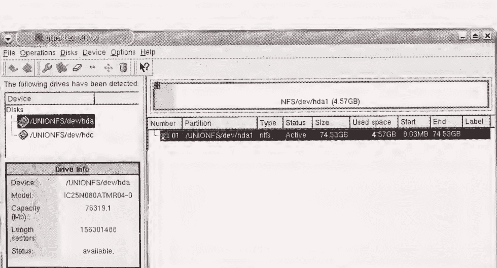

- **4. 点击左侧子窗口中的`/dev/hda`磁盘。** QTParted扫描你的磁盘时会打开进度对话框，扫描完成后，QTParted会在主窗口中显示你选择的磁盘，示例如图4-2所示。

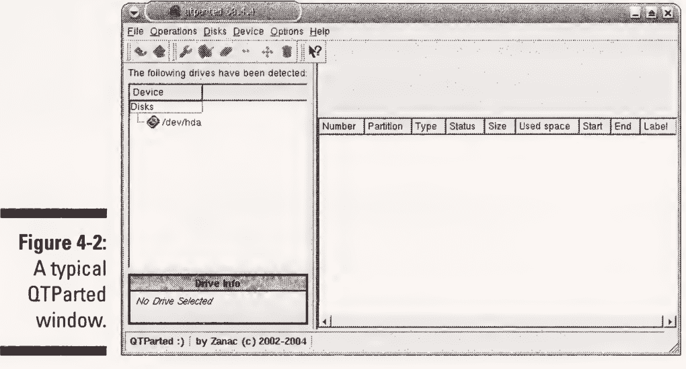

窗口右上角的水平柱状图会显示所选硬盘的大小和使用率；黑白的图4-2无法显示图表的颜色细节，黄色柱形代表已使用的磁盘空间。该图表左上角的小微软标志表示文件系统类型。

- **5. 选择“操作”→“调整大小”。** 此时会打开调整分区对话框，你可以选择旧分区的新大小，可通过以下方式操作：

  - 点击水平“最小尺寸”条的左端来选择要释放的空间；

  - 点击“新大小”或“剩余空间”文本框旁的上下箭头；

  - 在“新大小”或“剩余空间”文本框中输入新数值。

- **6. 选择至少3GB的可用空间。** 你需要至少：

  - 3GB空间用于安装Knoppix

  

  - 128MB空间用于交换分区

  > 克劳斯·克诺珀对交换空间的定义是*硬盘上的一块区域，可以存放超过电脑内存容量的程序部分或数据*。这样你就可以同时运行更多、更大的应用程序，无需额外购买内存条。即使你的内存足够，交换空间也有用武之地：它可以存放不需要永久存储的数据，从而释放电脑内存用于处理高性能需求的任务。

  - 几百MB空间用于存放你的文件和应用程序

  如果你有足够的空间，建议选择超过3GB，这样你就可以给你的Knoppix系统安装应用程序和存储个人文件，留足空间总是好的。


## 第二部分：永久安装Knoppix

7. 点击“确定”。

8. 选择“文件”→“提交”。

QTParted将执行操作，新的空闲空间会显示为原始Windows分区下方的新行。图4-3展示了示例窗口。

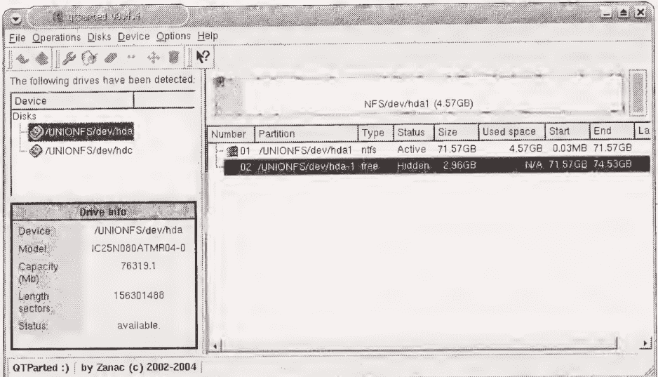

## 图4-3：新的分区

截至目前，你还可以撤销之前所做的所有更改。点击“文件”或“设备”菜单，选择“撤销”即可恢复之前的分区状态。QTParted窗口仍保持打开。你仍然需要从新创建的空间中创建两个新的格式化分区。下一节将介绍具体操作方法。

### 格式化新分区

要安装Knoppix，你必须用Linux文件系统格式化刚刚创建的新分区。你需要准备：

- **通用分区**：Knoppix将安装在该通用分区上。

- **交换空间**：当Knoppix运行内存不足无法启动应用程序时，会将部分应用程序临时“停放”在交换分区中。交换空间可以有效地将计算机的内存从RAM扩展到硬盘。


## 第4章：给Windows找个室友，或者让Windows出局

以下步骤将介绍如何为Knoppix安装格式化新空间：

- 1. 在QTParted窗口中，点击原始Windows分区下方显示新空闲空间的新行。图4-3展示了示例窗口。

- 2. 点击“操作”→“创建”。“创建分区”对话框随即打开。

- 3. 为交换分区预留空间。要预留交换分区空间，需将空闲空间的大小缩减至少128MB。你可以在“大小”文本框中输入新数值，也可以使用上下箭头调整。

- 4. 点击“确定”。界面返回QTParted窗口。你刚刚创建的额外空间会显示为一个新分区。

- 5. 点击这个新分区，该分区会被高亮选中。

- 6. 选择“文件”→“提交”。QTParted警告对话框将打开，提示你下一步操作会永久更改分区！

- 7. 深呼吸，点击“是”。进度对话框会显示重新分区进度。

- 8. 完成后，点击“确定”。

- 9. 选择“文件”→“退出”离开该工具。

- 10. 重启计算机。


> 部分硬盘控制器即使在您成功完成重新分区流程后，仍会“记住”旧分区。因此，在重启计算机之前，您可能无法正确“看到”重新分区的结果。现在您已经有了安装Knoppix所需的文件系统，第5章将介绍具体安装方法。

### 摆脱Windows：准备用Knoppix替换Windows操作系统

如果您不想和Windows共处，完全可以选择摆脱Windows，将Knoppix作为计算机上唯一的操作系统安装。这个过程非常简单：只需重新格式化硬盘，清空所有数据，然后安装Knoppix即可。


如果您拥有*无线网络*，在移除Windows系统之前，您可能需要从Windows中获取信息和驱动程序。第11章将介绍如何完成以下操作：

- 在Windows中识别计算机的*无线网卡芯片组*。

- 确认Knoppix是否自动支持您的无线**网卡**。

- 保存Windows系统的*无线网卡驱动*，以便在Knoppix无法自动支持您的网卡时，配合`ndiswrapper`使用。

现在让我们来卸载Windows吧。

#### 移除Windows分区

Knoppix提供了QTParted工具，该工具可以执行多种磁盘分区功能。以下步骤将介绍如何移除现有的Windows分区。


- 1. **从*Knoppix For Dummies DVD*（或从`www.knoppix.org`、`www.knoppix.net`下载的Knoppix“lite”版）启动计算机**。第2章介绍了如何从*Knoppix For Dummies DVD*启动。

- 2. **点击K菜单，选择“系统”→“QTParted”**。QTParted对话框将打开，显示您Knoppix计算机的驱动器。

- 3. **在左侧子窗口中点击您要重新格式化的硬盘**。对话框会显示该硬盘上的现有分区。图4-4展示了示例配置。如果您使用的是新硬盘或未格式化的硬盘，则不会看到任何Windows分区，此时可以跳过以下步骤，直接前往“重新分区硬盘”部分。

- 4. **对需要删除的每个Windows分区执行以下操作**：

  a. 在右侧子窗口中点击您想要删除的Windows分区，对话框会高亮选中该分区。例如，点击标记为NTFS的分区，NTFS分区是Windows操作系统的安装位置。

  b. 点击“操作”菜单，选择“删除”。对话框会将分区类型列为“空闲”。


目前您还没有做出任何永久性更改。您可以点击“文件”并选择“撤销”来撤回所有更改，也可以直接选择“文件”→“退出”来关闭QTParted工具。但下一步会永久删除分区，请确认是否要继续。

- 5. 选择“文件”→“提交”。QTParted对话框将打开，告知您即将进行的操作具有最终性，同时警告您在操作前卸载所有分区。由于您刚刚从Knoppix DVD启动，应该没有任何已挂载的分区。


- 6. 深呼吸（您仍然可以点击**否**按钮取消操作），然后点击**是**按钮。进度对话框将打开，显示删除状态，分区将被擦除，所有数据也会丢失。

- 7. 点击“确定”，即可返回QTParted窗口。

#### 重新分区硬盘

删除Windows分区后，您需要对释放出的空间进行分区。

- 1. 在QTParted对话框中，在右侧子窗口中选择空闲空间分区。

- 2. 点击“操作”菜单，选择“创建”。“创建分区”对话框将打开，默认使用Linux ext3文件系统，这符合我们的需求。

- 3. 点击“确定”。界面返回QTParted对话框。

- 4. 选择“文件”→“提交”，将新分区写入磁盘。QTParted对话框将打开，警告您即将进行的操作可能带来的后果。

- 5. 点击**是**继续。对话框将打开，显示重新分区进度。

- 6. 点击“确定”。

- 7. 选择“文件”→“退出”离开QTParted工具。现在您的硬盘上只有一个分区，该分区已准备好安装Knoppix，第5章将介绍如何在分区上安装Knoppix。

## 第5章：Knoppix硬核学堂：将Knoppix安装到硬盘

### 本章内容

- 启动安装工具

- 在计算机上安装Knoppix

- 启动已安装的Knoppix系统

总有那么一天，你需要停下漂泊的脚步，扎根落地。这就是Knoppix可以成为PC上稳定系统的原因。您可以将Knoppix永久安装到计算机上，这样每次启动计算机时都不需要再使用DVD或CD。本章将介绍如何将Knoppix安装到硬盘上。如果您有以下需求，永久安装Knoppix是理想选择：

- Knoppix工作站

- 更快的运行速度


在将Knoppix永久安装到计算机之前，您需要决定是否要保留Windows系统。第4章介绍了为以下两种方案准备系统的详细步骤：

- 同时安装Windows和Knoppix的双启动系统

- 仅安装Knoppix的系统

### 安装Knoppix概览

Knoppix自带一个可将其安装到硬盘的工具。安装流程如下：

- 1. 从Knoppix DVD启动，并启动Knoppix安装工具。

- 2. 输入即将进行的安装的相关信息。

- 3. 在硬盘上安装Knoppix，这是将Knoppix永久安装到计算机、使其与Windows共存的过程。

- 4. 重启进入已永久安装的Knoppix系统。本章的各个部分将引导您从头到尾完成这些步骤。

> 技术说明：安装Knoppix时，需从DVD启动它，并使用工具将其传输到硬盘分区。第1章介绍了Linux操作系统的一些技术细节，但安装Knoppix无需了解这些细节。

### 启动Knoppix安装

以下步骤将介绍如何准备开始安装。您只需打开终端仿真窗口，输入几条命令即可。请按以下步骤操作：

- 1. 点击窗口底部被称为Kicker的“开始”栏（该栏位于桌面底部）中的Konsole终端图标。“Shell – Konsole”窗口将打开。

- 2. 输入以下命令启动安装脚本。对话框将打开，说明即将进行的操作。

- 3. 按Enter键继续。基于文本的菜单将打开。


```bash
IGNORE_CHECK=1 sudo knoppix-installer
```

以下部分将介绍如何使用`knoppix-installer`工具安装Knoppix。

## 使用Knoppix安装程序

启动Knoppix安装系统后，你就可以引导它运行。你需要选择若干选项来启动安装流程。按照以下步骤将Knoppix安装到硬盘：

1. 在Knoppix安装菜单中点击“确定”。随即会打开“选择系统类型”对话框，默认选中“Debian：类Debian系统（推荐）”选项。
2. 点击“下一步”。随即打开“创建Knoppix配置步骤（1/7）”对话框，其中会显示可用于安装Knoppix的可用分区。
3. 点击你希望安装Knoppix的分区。随即打开“创建Knoppix配置步骤（1/7）/选择文件系统类型”对话框，该对话框默认选中`reiserfs`选项，这是Knoppix默认使用的文件系统。
4. 点击“下一步”。随即打开“创建Knoppix配置步骤（2/7）”对话框。
5. 在文本框中输入你的姓名，点击“下一步”。随即打开“创建Knoppix配置步骤（3/7）”对话框，其中显示的默认用户名是将你的名字首字母与姓氏拼接生成的。
6. 点击“下一步”。随即打开“创建Knoppix配置步骤（4/7）”对话框。
7. 输入安全的密码，然后按`Tab`键。
8. 在第二个文本框中重复输入密码以完成确认。
9. 点击“下一步”。随即打开“创建Knoppix配置步骤（5/7）”对话框。

> **警告！** 不要使用词典中的词汇作为密码。简单的密码很容易被破解。可以自己想一些简单的短语，再对其进行变形。举个例子，取短语“I love Knoppix”，将其修改为`iN0ppix`，通过大写字母、用数字和特殊字符替换字母的方式实现；就这个例子而言，我通过删除空格、把`like`替换为❤️（在我心目中这是对❤️的粗略近似）的方式，将密码缩短了5个字符。

10. 输入管理员`root`账户的密码，点击“下一步”。随即打开“创建Knoppix配置步骤（6/7）”对话框，其中显示默认的计算机名称输入框。
11. 输入你的计算机名称，点击“下一步”。随即打开最后一个对话框“创建Knoppix配置步骤（7/7）”。
12. 点击“下一步”选择默认的主引导记录（MBR）。界面会返回到`knoppix`安装程序的主菜单。
13. 点击“开始安装”菜单项。
14. 深吸一口气，点击“确定”。随即打开“开始安装Knoppix”对话框，其中会显示你刚刚选择的安装选项。
15. 点击“是”按钮将Knoppix安装到你的计算机中（选择“否”则会退出安装流程）。随即打开“开始安装Knoppix”对话框，其中显示进度条，进度条会显示Knoppix的安装进度。你可以放松一下，喝杯饮料，享受即将拥有Knoppix系统的喜悦。随后会打开“创建软盘”对话框。
16. 点击“否”按钮。随即打开“安装成功”对话框。
17. 点击“确定”。Knoppix安装完成。

## 完成安装

Knoppix安装流程完成后，你就可以使用新安装的（永久版）Knoppix系统了。安装流程结束后，按照以下步骤启动新安装的永久版Knoppix系统：

1. 点击K菜单，选择“注销”。随即打开“结束“knoppix”会话”对话框。
2. 点击“重启计算机”按钮。
3. 光盘弹出后取出DVD，然后按`Enter`键。你的计算机会重启，在BIOS界面加载完成后，就会看到GRUB菜单。

# 第5章 Knoppix硬核学堂：将Knoppix安装到硬盘

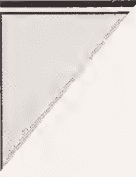

GRUB（GRand Unified Bootloader，大统一引导加载程序）是一个用于选择要使用的操作系统的工具。如果你没有使用双系统启动计算机，请直接跳到第5步。

4. 如果你的计算机安装了多个操作系统，请使用上下方向键选择要启动的操作系统，然后按`Enter`键。你可以选择以下选项：

   - **Knoppix**：如果你不进行任何操作，计算机将默认启动该选项。
   - 你原本安装的Windows操作系统：选择该选项后计算机会启动Knoppix，随后会提示你输入用户名和密码。


5. 输入你的用户名和账户密码。Knoppix会为你打开对应用户账户的KDE桌面，你就可以开始使用Knoppix了。*Si, se, puede! Ahhhuuu!* 这个过程并不复杂——虽然不如直接从DVD运行Knoppix那么简单，但也不算麻烦。Knoppix在易用性和安装流程上都有了很大的提升，这让我的工作和你使用起来都更方便！重启计算机时不要放入Knoppix的DVD，系统就会从硬盘加载Knoppix，随后会显示登录窗口。这类基础Linux操作我会在第6章中详细介绍。


> **`knoppix-installer`：开发中** `knoppix-installer`工具尚处于开发阶段，且其开发独立于Knoppix本身。有时Knoppix的版本更新会领先于`knoppix-installer`，导致该工具无法正常工作。而*《Knoppix入门经典》*DVD中的`knoppix-installer`工具与Knoppix 4.0版本可以正常配合使用。

# 第二部分 永久版Knoppix

## 第6章 启动Knoppix电脑并登录

### 本章内容

- ▶ 启动计算机
- ▶ 登录与注销用户账户

**那么**你拥有一台Knoppix电脑了，它能做什么呢？首先，你可以对它进行开关机操作。启动和关闭Knoppix电脑的枯燥程度几乎和看油漆干透差不多，不过也差不了多少。实际上，这个过程一点都不刺激，但作为基础操作流程，了解它非常重要，尤其是当你使用双系统启动配置时。本章将介绍这些基础操作流程。

## 引导你的计算机

如果Knoppix已经永久安装到你的硬盘中——无论是和Windows组成*双系统启动配置*还是单独安装——Knoppix都会通过GRUB进行引导。在你安装永久版Knoppix时，*大统一引导加载程序*（GRUB）会被自动安装。GRUB支持以下功能：

- ✓ 启动计算机中安装的任意操作系统
- ✓ 选择不同版本的Linux内核，并向该内核传递启动选项

如果要运行Knoppix，只需启动计算机，等待GRUB启动菜单界面出现后自动消失即可。

## 通过GRUB启动Knoppix的图形界面与非图形界面模式


如果你只是通过DVD（或CD-ROM）启动Knoppix，并未将其永久安装到硬盘中，可以跳过本节。以下说明将分别介绍如何通过GRUB启动Knoppix的常规图形（KDE桌面）界面模式和非图形界面模式。使用GRUB启动Knoppix的操作步骤如下：

1. **打开或重启你的计算机。** 计算机启动后会显示GRUB菜单界面。如果你使用的是双系统启动配置，界面会显示以下选项：

   - *Linux：* 启动2.6-1版本的Linux内核。
   - *Linux (2.6)-1：* 启动的Linux内核与第一个选项相同。
   - *DOS：* 可选选项。如果你将Knoppix安装为双系统配置，选择该选项会启动你的Windows操作系统。（第4章和第5章介绍了如何搭建双系统计算机。）
   
     如果你只安装了永久版Knoppix作为唯一操作系统，就不会看到DOS选项。（第4章和第5章介绍了如何将Knoppix作为硬盘上的唯一操作系统进行安装。）
   - *内存检测：* 使用该选项可以测试计算机的内存。

   如果你需要修改电脑的BIOS，请在GRUB启动菜单界面出现前进入BIOS。根据制造商的不同，你可以按功能键（通常为`F1`、`F2`、`F8`或`F12`）、`Esc`键或`Del`键进入BIOS。除非你想更改启动顺序，否则不需要修改BIOS。部分电脑制造商支持在不修改BIOS的情况下选择备用启动设备，例如戴尔电脑在按下`F12`键时会弹出启动菜单。

2. **如果不想自动启动Knoppix，请在GRUB启动菜单界面显示时按下除`Enter`键外的任意按键。** 如果不按下任何按键，GRUB会等待5秒后自动启动Knoppix。
3. **使用上下方向键选择要启动的操作系统，然后按`Enter`键。**


## 第6章：启动并登录你的Knoppix电脑

GRUB会指示你的电脑启动你选定的操作系统；你可以选择Knoppix或者Windows（如果存在的话）。如果你启动Knoppix，一两分钟后系统会提示你输入用户名和密码。如果启动Windows，是否提示输入用户名和密码取决于你使用的系统版本。


“安全”部分会讲解如何使用登录菜单。

### 将Knoppix启动为无图形模式

以下步骤会指导你将Knoppix启动为无图形（命令行界面，简称CLI）模式：

1. 启动或重启你的电脑。
2. 进入GRUB菜单窗口时按下`E`键。
3. 按下`A`键，在提示符处输入`2`后按回车键。Knoppix就会启动为无图形模式。


你也可以输入`root`用户名替代你自己的用户名。`root`用户也被称为超级用户，拥有最高权限，使用时需要格外谨慎。通常更推荐你在需要时使用`sudo`命令以`root`身份运行指令，我在第7章会深入讲解这部分内容。

### 默认用户账户

Knoppix（以及所有其他Linux发行版）都设有*用户账户*，方便多名用户高效、安全地共用同一台电脑。用户账户可以让多人共用电脑时互不干扰。

Knoppix（及其他Linux发行版）的用户账户分为两个等级：

- ✔ **普通用户账户**：这类账户没有特殊权限。普通用户账户只能访问自己主目录下的专属文件。不过，你可以修改账户权限来设置是否允许用户间互相访问文件。如果`root`用户授予普通用户提升后的权限，普通用户也可以访问为受限访问设计的系统资源。从DVD运行“Live版”Knoppix是用户账户的一种特殊场景：Live版Knoppix仅提供`root`用户和一个名为`knoppix`的普通用户。Knoppix启动时会自动激活`knoppix`账户，无需输入密码。
- **超级用户**（即`root`用户账户）：超级用户账户拥有访问所有文件和资源的无限权限。Root就是全能的！*这太吓人了！* 绝对不要用超级用户账户处理日常操作。如果你使用的是永久安装的Knoppix，可以以`root`用户身份登录：在登录窗口的用户名输入框中输入`root`，再输入你安装时设置的`root`密码即可（详见第5章）。从Live版Knoppix无法直接以`root`用户身份登录，Live版Knoppix启动后直接进入`knoppix`用户账户。`knoppix`用户通过`sudo`配置获得了所有权限，你运行的任何应用或工具在需要时都会获得超级用户权限。


以超级用户身份登录时要格外小心。作为`root`用户你可能造成极大的破坏。专业系统管理员建议你通过`sudo`系统执行绝大多数（甚至全部）需要高权限的任务。（运行Live版Knoppix时，`knoppix`用户无需输入密码即可通过`sudo`命令切换到`root`身份。如果你要允许外部访问`knoppix`账户，必须先删除`/etc/sudoers`文件。）


Live版Knoppix既易用又安全。因为Live版Knoppix直接从只读光盘启动，所以必须使用默认账户。通常默认账户都会配有默认密码，但采用这种做法最终会导致安全漏洞，原因如下：

- **你可以配置**从DVD（或从`www.knoppix.org`、`www.knoppix.net`下载的Knoppix“精简版”）运行的Knoppix用于网络环境。在私网（甚至更糟的互联网）中，任何扫描你的系统并识别出你正在使用Knoppix的人都可以攻击你的系统。
- **部分用户**不可避免地会直接使用默认密码。


大多数单一功能的电子设备（比如无线接入点AP）出厂时都会预配置默认密码。很多人永远不会修改AP的默认密码，这给黑客入侵大量接入点提供了便利。请修改你的默认密码！


Knoppix可以锁定默认账户，同时不影响易用性——因为Knoppix的初始化流程会跳过常规登录流程，直接启动你的账户。Knoppix启动后你可以将电脑连接到网络，但除非你为`knoppix`账户设置密码，否则没人能通过网络登录该账户。这是一种高效且优雅的配置方案。

### 安全

套用比尔·默里在电影*《从军乐》*中的台词：“我们闪进，闪出。这是捷克斯洛伐克，不是莫斯科；这就像去威斯康星州一样简单。” 他低估了当年跨越捷克前边境的难度，但如果他说的是访问Knoppix用户账户，那这话就完全正确了：*比去威斯康星州还简单*。当你完成Knoppix的试用、开始正式使用时，请用密码保护你的系统和个人信息。密码是Linux抵御黑客和未授权访问的第一道防线。

### 登录

如果你将Knoppix永久安装到硬盘，就需要保护你的个人和系统信息。标准防护方法要求使用仅属于你本人、且有密码保护的用户账户。你会将文件保存在专属的“主目录”（类似Windows系统的“我的文档”文件夹）中，该目录的访问权限会阻止其他用户访问。在永久安装的Knoppix电脑上登录登出，比使用默认DVD模式只稍微麻烦一点，流程很简单，只比去威斯康星州难一点点。请按以下步骤操作：

1. 启动你的永久安装版Knoppix电脑。前置章节已经讲解过如何通过GRUB或命令行界面启动Knoppix，之后你会看到Knoppix的登录界面。
2. 点击菜单下拉栏，选择“会话类型”→“KDE”。
3. 在用户名输入框中输入你的用户名。
4. 在密码输入框中输入你的密码。
5. 点击登录按钮。你就会登录到你的用户账户，看到的KDE桌面和直接从DVD启动的完全一致。

> **技术说明**
>
> 将Knoppix永久安装到电脑时，必须使用密码访问你的账户。第5章讲解的安装流程会提示你为个人账户和`root`（超级用户）账户设置密码。

### 登出

登出流程非常简单：


1. **选择K菜单→登出。** K菜单图标是一个小写的`k`，位于窗口左下角。点击后会打开“结束会话”对话框。
2. **点击结束当前会话。** 你就会退出当前账户，回到“欢迎使用Linux……”窗口，此时你可以以其他用户或同一用户身份重新登录。


“结束会话”对话框还提供其他关机选项，你还可以：

- ✓ **关闭你的电脑。** 点击“关闭计算机”按钮，Linux会正常自行关闭并切断电脑电源。
- ✓ **重启你的电脑。** 点击“重启计算机”按钮，Linux会关闭并向电脑发送*重启*信号，之后电脑就会重新启动。

# 第三部分：日常使用Knoppix

### 第五波 作者：瑞克·坦南特

> 你说大堂里有个UNIX操作系统是什么意思？


在本部分中……

当你登录到Knoppix系统后，即可开始操作它。Knoppix为你提供了Linux界面与环境的强大功能和便捷性。第7章将引导你熟悉Knoppix的各类界面，第8章将介绍强大的K桌面环境。

## 第7章 系统维护

### 本章内容

- 对比图形界面与命令行界面
- 以普通用户身份运行特权命令
- 创建用户账户

Knoppix是一款出色且强大的Linux发行版，是办公与使用的绝佳选择。但即便是最好的“家”，也需要日常打理才能正常运行。本章将介绍你需要在Knoppix中完成的一些基础系统维护操作。

现在是了解支撑本书诸多示例的工具与流程的好时机。这类信息非常基础，不算特别有意思，但你就是得了解、得操作——和日常家务没什么区别。Anyway，我本身也没多少好习惯，大多还和家务有关（比如拖地、洗碗，我想不出别的了，可能还凑不上一把呢）。那我就发挥自己的“特长”，教你怎么完成这些操作，最终让你的Knoppix使用体验更顺畅。


> 本章的设置步骤针对永久安装的Knoppix设计。你可以在运行实时Knoppix实例时使用这些说明，比如从*《Knoppix入门》*（*Knoppix For Dummies*）DVD启动时（或是你从`www.knoppix.net`或`www.knoppix.org`下载的CD启动时）。但除非你使用第3章提到的持久化主目录，否则每次重启电脑时都*需要重复*这些步骤。

### 使用界面

*别傻站着，快做点什么！* 这是刚接触Knoppix的新手用户的心声：你希望自己的Knoppix系统能通过……做点什么来展现能力。但具体做什么呢？全由你自己决定。Knoppix提供了大量工具、游戏和应用程序。现在你已经是个登录达人了，可以开始动手操作了。

不过先别急！你当然可以漫无目的地点戳KDE桌面图标，但下面的列表会快速介绍两种运行应用程序、程序和工具的基础方法：

1. **点击图标：** 这会启动*图形用户界面*（GUI），你也可以将其简称为*图形界面*。
2. **打开Linux终端并输入命令：** 这种方式被称为*命令行界面*（CLI）。你大概率熟悉Windows和Mac电脑的图形界面，会用鼠标（有时也会用键盘）来控制GUI。如果你用过微软的MS-DOS（或是Windows里的MS-DOS提示符窗口），那就已经用过CLI了。Linux终端具备MS-DOS的基础功能，但内部逻辑差异很大。UNIX终端提供了真正的编程语言，比古老的DOS命令行强大得多。大部分Knoppix的工具和配置工具都是用UNIX的`bash`终端编写的。接下来的章节会分别介绍CLI和GUI的使用方法。

### 使用GUI

GUI取代CLI的地位，就和哺乳动物取代恐龙差不多。关于GUI的使用，有两点哲学层面的观察：

1. GUI通常能让新手和资深计算机用户的使用体验都更轻松。
2. GUI常被称为*直观*的界面，但这并不总是成立。没有使用经验的话，GUI往往难用且令人困惑。
3. GUI最擅长的则是：

   - 减少你需要做出的选择数量。
   - 将每步操作简化为少量决策或选项。
   - 将决策和选项归类为逻辑一致的组，可用选项也会被整理进逻辑清晰的菜单中。


> 尼尔·斯蒂芬森的《最初……只有命令行》（Harper出版）一书深入剖析了GUI的缺陷，推荐你阅读。


当选项被限定且规整后，系统的使用也会更直观。

> GUI通常比CLI更容易上手，但GUI会屏蔽其底层执行的操作，让你无法感知。如果你符合以下情况，就需要多了解一些底层原理：
>
> - 你靠计算机谋生
> - 你想更深入理解、更直接操作你的电脑

### 使用CLI

使用命令行界面（CLI）非常简单：你通过键盘输入命令，在显示器上查看输出结果（如果有的话）。没有拖拽、点击，也没有花哨的图形——只有键盘敲击声和屏幕上的文字。使用这个简单的界面，你能更直接地操作电脑。

使用CLI相当于去掉了你和电脑之间的GUI“中介”。有时候你需要用CLI来完成工作：点击K菜单中看起来像电脑显示器的“终端程序”图标，就能打开CLI，此时会弹出“Shell – Konsole”窗口，这个窗口里运行的是*终端模拟器*，它会和Linux终端进行交互。

要理解终端模拟器，你得了解苹果Macintosh（更早之前是Lisa电脑，再往前是施乐公司的实验性电脑——施乐发明了鼠标）和微软Windows出现之前的计算方式。在廉价个人电脑和GUI出现前的“远古时代”，人们用的是通过串行数据线直接连接电脑的简单文本终端，这类设备被称为*计算机控制台*（或简称*控制台*）。

个人电脑普及后，有人开发出了可以模拟老式终端的程序，这就是*终端模拟器*。终端模拟器能让你通过Linux终端直接向电脑下达指令。

*终端*是连接你和电脑的接口程序，它会解释你通过键盘输入的文本，将解析后的命令发送给操作系统执行。终端还有其他本书不会涉及的功能，简而言之，终端是Linux世界的“中流砥柱”。

最流行的Linux终端是`Bash`。*Bash*是*“伯恩重生”终端*的缩写，这是典型的GNU式双关：Bourne可不是什么后现代007，它是一款更古老的、传统风格的UNIX终端。Bash融合了Bourne终端和C终端的优点，因此得名“伯恩重生”。不过这个缩写估计只有计算机发烧友会喜欢。（¡Me gusto！）

打开终端模拟器后，你会看到一个结合了你的用户名、主机名以及其他信息的提示符。比如我看到的Bash提示符如下：

```text
psery@box:~$
```


如果你运行的是实时 Knoppix 实例（从配套 DVD 或你从 `www.knoppix.net`、`www.knoppix.org` 获取的 CD 启动），你会看到如下提示符：

```text
knoppix@0[knoppix]$
```

这个提示符由以下部分组成：

- **你的用户名：** 用户名取决于你登录的身份。使用实时 Knoppix 实例模式时，用户名为 `knoppix`；我的用户名是 `psery`。
- **@ 符号：** 该符号用于分隔用户名和主机名。
- **主机名：** 从配套 DVD 或 CD 启动实时 Knoppix 时，默认主机名为 `0`；如果将 Knoppix 安装在硬盘上，主机名是安装过程中为电脑设置的名字（详见第 3 章和第 4 章），默认主机名为 `box`。
- **波浪号符号（~）：** 此处波浪号代表用户的主目录。如果切换到其他目录，波浪号会变更为对应的目录名。比如切换到 `/etc` 目录时，提示符会变为 `knoppix@1:[/etc]`。实时 Knoppix 的默认主目录为 `/home/knoppix`。
- **美元符号（$）：** 美元符号表示当前以普通用户身份操作。如果登录或切换（`su`）到 `root` 用户，符号会变为井号（#）。你可以在提示符后输入命令，比如输入 `ls` 命令即可列出当前工作目录的内容，结果会显示在终端模拟器窗口中。

# 第 7 章：日常维护


Knoppix 除了 Bash 之外还提供其他 Shell。你可以使用 Bourne Shell（`sh`）、C Shell（`csh`）、A Shell（`ash`）以及独立 Shell（`sash`）。你也可以通过点击 K 菜单，选择“系统▷Shells▷Bash（Bash）”“系统▷Shells–Csh（Csh）”或其他多个版本来打开其他命令行界面。这些 Shell 对应最流行的 Linux Shell 和终端模拟器。


在本书中，我会教你如何使用图形界面（GUI）和命令行界面（CLI）：

- 我更多使用图形界面，因为它是完成任务最便捷、最简洁的方式。
- 当没有图形界面可用，或我认为有必要了解如何执行配置流程时，我会展示命令行界面的用法。

## `sudo`：超级用户权限


`sudo`（发音为“SUE-dough”）系统允许普通用户以超级用户的身份运行命令，是 `root` 用户和普通用户之间的折中选择。Klaus Knopper 就 `sudo` 系统的使用提出了以下深刻见解：

> 部分程序无法以 root 身份运行，且部分图形界面使用 root 账户可能会导致系统损坏，因为 root 账户不受权限限制的“安全约束”。因此，只有在绝对必要时才应调用 root 账户（通过 sudo 实现），适用场景包括：修改全局系统配置、安装驱动和程序。除此之外再无其他。管理员的工作是尽可能让用户账户舒适易用，无需用户拥有 root 权限。

`sudo` 系统由两部分组成：

- 若 `/etc/sudoers` 配置文件允许，`sudo` 程序会以 `root` 身份为普通用户执行命令。
- `/etc/sudoers` 配置文件会告知 `sudo` 程序哪些用户可以以 `root` 身份运行哪些命令。

例如，在运行实时 Knoppix 实例时，`knoppix` 用户可以以 `root` 身份执行任何命令。`/etc/sudoers` 文件中的这一行赋予了 `knoppix` 用户该权限：

```text
knoppix ALL=NOPASSWD: ALL
```

简化的 `sudoers` 语法格式如下：

```text
user machine = options commands
```

命令语法结构如下：

- **用户：** 权限被定义的用户。
- **机器：** 用户可以操作的设备。`sudo` 系统支持跨网络使用。
- **=：** 等号用于分隔用户/设备和要执行的命令。
- **选项：** 你可以定义多种影响 `sudo` 行为的参数。
- **命令：** 用户可被允许以 `root` 身份执行的命令。


你可以在 `/etc/sudoers` 文件中添加注释。井号（#）符号后的内容为注释，不会影响 `sudo` 配置的运行。`/etc/sudoers` 文件规定，`knoppix` 用户可以从任意设备执行任意命令，无需输入目标用户的密码。通常情况下，你需要输入自己的用户账户（而非 `root`）密码后，才能执行已被授权的命令。`NOPASSWD` 参数会取消这一要求。

### 使用 `sudo`：简单示例

你可以尝试以 `knoppix` 用户身份读取 `/etc/shadow` 文件来测试 `sudo` 系统。通常情况下，像 `knoppix` 这样的非特权用户无法访问 Shadow 文件，但 `sudo` 允许访问。请按以下步骤操作：

1. 启动实时 Knoppix 实例。
2. 点击 K 菜单中的终端程序图标，打开终端窗口。
3. 运行以下命令：
4. 输入以下命令：

```bash
cat /etc/shadow
```

此时会出现“权限被拒绝”的提示，因为 `/etc/shadow` 文件的所有者为 `root`，未向普通用户开放读写权限。

```bash
sudo cat /etc/shadow
```

操作成功！尽管你并非该文件的所有者，也没有访问权限，仍可查看文件内容。这是 `sudo` 系统提供的访问权限。


使用 `sudo` 时务必谨慎。通过 `sudo`，`knoppix` 用户可以以 `root` 身份执行任何命令，运行 `sudo rm -rf /` 命令甚至会清除整个文件系统。


运行实时 Knoppix 实例时，你无法通过使用 `sudo` 清除文件系统。实时 Knoppix 运行于配套的 DVD 或 CD-ROM 上，即使你想删除其中的内容也无法做到，因为这些是只读存储介质。不过，当你将 Knoppix 永久安装到电脑时，系统不会配置 `sudo` 给予 `knoppix` 用户完全权限。该配置中的 `knoppix ALL=NOPASSWD ALL` 参数会被注释掉。如果你想使用 `sudo` 命令，必须手动修改 `sudoers` 配置文件。

### 配置 `sudo`

在永久安装的 Knoppix 系统中执行系统管理功能时，你应该使用 `sudo` 命令。以下步骤将介绍如何配置 `sudoers` 配置文件，允许普通用户以 `root` 用户的身份运行命令。


1. **以普通用户身份登录。** 第 6 章介绍了如何创建普通用户。
2. **点击终端程序图标，打开终端窗口。**
3. **输入以下命令：** `su -`。该命令会执行切换用户（`su`）命令，使你成为超级用户。
4. **根据提示输入 `root` 密码。**
5. **根据是否需要用户输入密码，输入以下任意一条命令：**
   - 若需要用户输入个人密码，请输入以下命令：`echo "myusername ALL= ALL" >> /etc/sudoers`
   - 若用户无需输入密码，请输入以下命令：`echo "myusername ALL=NOPASSWD ALL" >> /etc/sudoers`
6. **输入 `exit` 命令退出 `root` 账户。** 你将返回到自己的普通用户账户。
7. **尝试以自身身份访问 `/etc/sudoers` 文件。** 输入 `sudo cat /etc/shadow`。操作成功！你现在可以从普通用户账户执行特权命令了。


70

# 第三部分：Knoppix 日常使用

## 创建用户账户


创建用户账户非常简单。Knoppix 提供了多个可用于创建新账户、修改现有账户的实用工具。以下步骤适用于在永久安装的 Knoppix 电脑上添加用户，在实时 Knoppix 实例中同样适用。但如果你不按照第 3 章介绍的持久化主目录设置保存配置，关闭电脑后配置会丢失。你可以通过以下两种方式创建和修改用户账户：

- 图形界面账户工具
- 命令行账户工具

如果你通过启动提示符输入 `knoppix 2` 作弊码进入非图形文本模式启动，请使用命令行工具。


### 图形界面操作步骤

在永久安装的 Knoppix 系统中，你可以使用图形界面和 KUser 工具创建新用户账户。


以下步骤适用于实时 Knoppix 实例，但你必须使用持久化主目录工具保存配置。

请按以下步骤创建新用户账户：

1. 以普通用户身份登录。该用户账户是永久安装 Knoppix 时创建的账户，详见第 5 章。
2. 选择 K 菜单 → 系统 → KUser（用户管理器）。“以 root 身份运行 – KDE su”对话框会弹出。
3. 输入 `root` 密码，点击确定。KDE 用户管理器（KUser）窗口会打开。
4. 点击“添加”。KUser 对话框会打开。


1. 输入用户名并点击「确定」，将打开「用户属性 – KUser」对话框。
2. 输入你想添加到账户设置中的其他任意信息，比如用户的全名。
3. 点击「密码」按钮，在随后打开的「输入密码 – KUser」对话框中输入两次密码。
4. 点击「确定」，控制权将返回「用户属性」窗口。
5. 点击「确定」，控制权将返回「用户管理器」窗口。
6. 点击「文件」->「退出」，退出用户管理器窗口。现在你的电脑里新增了一个用户，你可以使用用户管理器修改账户的各项设置，比如默认 Shell 或主目录，也可以删除或添加用户。

## 命令行步骤（CLI）

你可以使用命令行界面（CLI）在永久存储的 Knoppix 系统中添加、删除或修改用户。（这些命令在 Live 版 Knoppix 实例中也适用，但你需要使用第 3 章介绍的持久化主目录工具来保存修改。）以下说明使用 CLI 创建、修改和删除用户账户：

1. 点击 KDE kicker 上的显示器图标，打开终端模拟器窗口。
2. 输入以下命令创建名为 `joe` 的新用户账户：

   ```bash
   sudo useradd -m joe
   ```

3. 输入以下命令设置账户密码：

   ```bash
   sudo passwd joe
   ```

4. 收到提示时，输入两次 `joe` 的密码。
5. 通过添加描述用户真实姓名的注释来修改账户，示例如下：

   ```bash
   sudo usermod -c "Joe Blow" joe
   ```

6. 删除账户，但保留主目录：


```bash
sudo /usr/sbin/userdel joe
```

使用`man useradd`、`man userdel`、`man usermod`和`man passwd`命令可以查看这些命令的用法和选项信息。`usermod`命令用于修改账户。

## Linux 文件系统树

树？文件系统？Linux？这几者之间有什么关系？Linux 在文件中存储信息，文件可以对接设备，存储数据、程序和图形，甚至能提供查看 Linux 内核本身的入口：

- 文件存储在目录中。
- 目录可以存储其他目录，这类目录被称为子目录。包含子目录的目录称为其子目录的父目录，在目录和多层子目录之间绘制连线，得到的图看起来就像一棵树。下图展示了 Linux 文件系统树的一部分。

Linux 将所有对象（某些网络功能除外）都视为文件。通过把所有资源都看作文件，Linux 简化了自身的内部逻辑。比如，Linux 会像对待文件一样使用磁盘驱动器，第 4 章提到的`/dev/hda`和`/dev/sda`文件就是其所代表的磁盘驱动器的抽象。

有一个核心目录被称为`Root`目录（因为所有其他目录都从它派生）。`Root`目录用单个斜杠（`/`）表示——你不会看到目录名里出现“root”字样。所有目录的父目录永远是`Root`目录或它的下级目录。

以下列表描述了`Root`的一些子目录：

- `home`目录是`Root`目录的下级目录，默认存储所有用户账户的目录，路径为`/home`。
- `log`目录存储日志文件，它的父目录是`var`目录，而`var`目录的父目录是`Root`，`log`的位置表示为`/var/log`。
- `/usr`目录及其子目录存储系统文件和库，比如`/usr/bin`目录存储用户可访问的程序，`/usr/sbin`存放系统管理程序，`/usr/lib`存储库文件。
- `/etc`目录存储系统配置文件。
- `/dev`目录存储用于访问计算机硬件的文件。


## 第 8 章：导航 KDE 桌面

### 本章内容包括

- 介绍 X Window System
- 什么是 KDE
- 桌面导航
- KDE 配置选项

Knoppix（以及其他 Linux 发行版）处于一个模块化的世界中，通过组合许多不同的部分来构成完整的计算机环境。Knoppix 使用独立的内核、GNU 工具、图形系统和开源应用来完成工作，而微软 Windows 则是一个庞大的单体操作系统，它是一个把大部分操作都整合在一起的大块头。Knoppix 相比 Windows 的优势在于每个部分都可以独立进化，最终只留下最优的部分。本章介绍构成 Knoppix 图形环境的各个部分。

## K 桌面环境（KDE）

什么？Knoppix 提供了易用、强大且美观的 KDE 图形环境，KDE 为 Knoppix（及其他 Linux）用户提供了其他操作系统具备的同等级别的能力和精致度，事实上 KDE 提供的创新比其他商业操作系统更多。


KDE 是`K桌面环境`的缩写。最初，`K`代表`Kool`，现在只是字母`K`。你也可以把`K`排在`L`之前（`L`是`Linux`的首字母）当做一个梗——这理由可能有点牵强……好吧，是非常牵强，但谁在乎呢？（我应该是最没资格质疑这种文字梗的人。）

## X Window System

X Window System 不是漫威漫画宇宙里 X 战警的一部分。常被简称为`X`的它也不是由斯坦·李的创意头脑想出来的。不，X 来自更平凡但也非常有创意的 MIT（麻省理工学院），它旨在为 UNIX 和 Linux 系统（比如 Knoppix）提供独立于平台的图形系统，而不是为我这样喜欢漫画的中年人提供图像小说。

X 为 KDE 这类桌面环境提供了图形框架。KDE 以 X 为基础，X 以 Knoppix（或其他任意 Linux 发行版）为基础，两者的关系构成一个金字塔：KDE 在 X 之上，X 在 Knoppix 之上。

X Window System 包含以下子系统：

- **X 服务器：** X 服务器在计算机上显示图形。当你在 Knoppix 电脑前操作时，看到的图形都是通过 X 服务器呈现的，它还会接收来自鼠标和键盘的输入。X 服务器与你的显卡驱动交互，处理来自其他源的请求，生成简单的图形对象，比如矩形和阴影区域。
- **X 客户端：** X 客户端是使用 X 服务器接收输入、显示图形输出的应用，`Mozilla`就是`X客户端`的一个例子。`X客户端`和`X服务器`可以在同一台物理机器上运行，也可以在通过网络连接的不同机器上运行。X 客户端是图形应用，会把输出发送到 X 服务器。
- **图形库：** X 图形库让客户端（如上所述）可以与 X 服务器交互。X 被设计用于在网络环境中工作。常用的图形时钟程序（`xclock`）可以说明 X 客户端和 X 服务器系统中的关系。

举个例子，先搭建一个由两台 Knoppix 电脑`Homer`和`Marge`组成的私有网络：

1. 坐在`Homer`前登录。（`Homer`是`X服务器`。）
2. 从`Homer`通过安全 Shell（SSH）连接到网络上的`Marge`。
3. 在`Marge`的 CLI 上运行`xclock`。（`xclock`是`X客户端`，但显示在`X服务器``Homer`上。）

`xclock`会显示在`Homer`的显示屏上。（`Homer`上的 X 服务器会显示来自`Marge`上 X 客户端的输出。）

这和大多数客户端-服务器关系不同，后者是你用客户端在服务器上工作。

不管这个缩写是什么意思，KDE 都是一个非常棒的图形环境。K 桌面环境是多面的，有四个主要部分：

- **桌面：** 图 8-1 展示了默认的 Knoppix KDE 桌面。
- **面板（也叫 Kicker）：** 图 8-2 展示了位于桌面底部的 Kicker。
- **任务栏：** 图 8-3 展示了任务栏（位于 Kicker 组件中）。
- **KDE 应用程序与实用工具**

每个组件都具备特定功能，能让你的 Knoppix 系统成为高效、愉悦的工作平台。KDE 提供以下功能，让你的 Knoppix 使用体验更高效、更愉悦：

- KDE 能提供你在使用计算机时所需的视觉风格与操作体验，包含背景（也简称为桌面）、菜单系统、图标、应用程序和帮助系统。
- KDE 支持超过 50 种语言，无论你身处世界何地都能正常使用。
- KDE 支持自定义配置，运行稳定，在网络环境中表现优异。
- KDE 内置了全面实用的帮助系统，该系统包含详尽的 KDE 术语表与目录，所有主题都采用通俗易懂的方式进行说明。

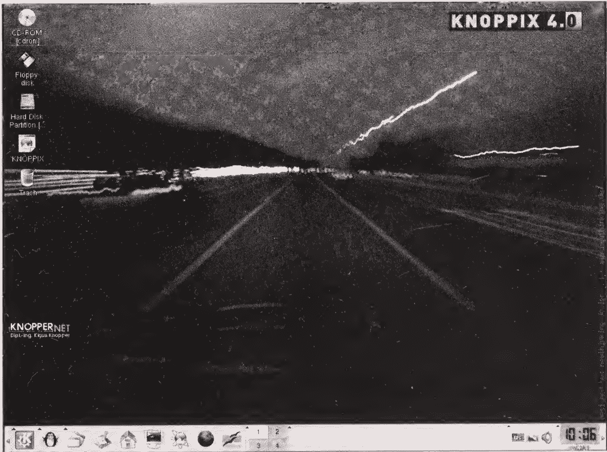

**图 8-1：** KDE 桌面。

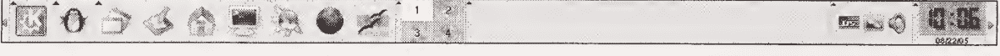

**图 8-2：** Kicker 位于 KDE 桌面的底部。

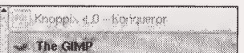

**图 8-3：** 任务栏是 KDE Kicker 组件的组成部分。

## 桌面简介

KDE 桌面也简称为桌面，是 K 桌面环境中最不引人注目的部分。桌面是你进行工作的背景区域，就像现实中办公桌的桌面一样，你可以在上面放置文件、文件夹、家人的照片以及所有工作所需的物品。我使用 Knoppix 时很少会特意关注办公桌的桌面，但如果它不存在的话我肯定会注意到。同理，KDE 桌面总是静默地完成自己的工作。

桌面的核心功能是帮助你整理工作内容，你可以用它来创建图标、打开窗口。例如，你可以同时使用电子表格应用编辑表格，用网页浏览器上网，点击任意一个窗口就能将其置于桌面顶层。桌面同时也是图标、Kicker（也被称为面板）等对象的载体，Kicker 是位于屏幕底部的水平栏，内置了各类按钮与图标。下一节将介绍 Kicker（面板）的组成组件。

## 面板

面板的昵称是 Kicker。Kicker 内置了菜单、任务栏以及各类小程序图标（比如 OpenOffice.org、Mozilla Firefox），能让你在 KDE 中的操作更便捷。（我就不建议你试着去踢面板的“轮胎”之类的了。）

Kicker 是 KDE 内的一个子环境，内置了大量实用的菜单与快捷方式，其组成组件如下：

- **K 菜单：** 位于 Kicker 最左侧、带有大字母 K 的图标，点击它会弹出功能丰富的菜单系统，你可以通过它访问几乎所有应用程序与实用工具，功能类似于微软的“开始”按钮。
- **KNOPPIX 菜单：** 带有可爱企鹅图标的选项，可唤出精简版 K 菜单，点击后弹出包含配置、网络、系统服务工具以及`Root shell`的菜单。如果你运行的是 Knoppix 实时系统，通过该菜单启动管理类程序与工具时无需输入超级用户密码；但如果你使用的是已安装到本地的永久版 Knoppix，则需要输入`root`密码。
- **隐藏按钮：** 位于 Kicker 两侧的小箭头，点击任意一侧的箭头即可将 Kicker 隐藏到对应侧边直至完全消失，再次点击对应按钮即可恢复 Kicker 显示。
- **应用程序图标：** Knoppix 默认预装 Firefox、终端模拟器等常用应用程序，并在 Kicker 上放置了对应图标，点击图标即可启动相应应用。
- **分页小程序：** 可将你的桌面划分为多个虚拟桌面。


你可以想象拥有一块无限大的显示器，能充分扩展你的工作空间——KDE 虽然无法制造这样的物理设备，但可以创建同样好用的大尺寸虚拟工作区。默认情况下，分页小程序支持 4 个虚拟桌面，点击任意虚拟桌面即可切换到对应的虚拟工作区，你可以将不同工作内容分配到不同工作区中，打造整洁的工作环境。这是其他操作系统所不具备的创新功能，就问 Windows：你的虚拟窗口去哪了？

小程序是那些在 Kicker 上有对应图标的运行程序，Kicker 右侧的 KDE 时钟就是小程序的一个例子。


- **任务栏：** 位于 Kicker 中部、外观为带编号网格的小程序，点击编号块即可切换到对应的虚拟桌面。
- **KDE 小程序：** Kicker 右侧显示了类似国旗、扬声器、时钟样式的图标，这些小程序都具备简单的功能。

## 任务栏

启动图形化应用程序会在桌面打开一个窗口，同时在任务栏添加对应按钮。如果你点击应用程序窗口右上角的最小化按钮将其最小化，它会从桌面消失，但任务栏上的对应按钮仍然保留，点击该任务栏按钮即可将窗口恢复到桌面。

## 应用程序与实用工具

KDE 内置了海量可用的应用程序，还提供了功能全面的办公生产力套件，包含文字处理器、电子表格应用、演示文稿管理器及相关实用工具。

`Konqueror`是一款轻量级网页浏览器，轻量级指的是相较于`Mozilla`这类功能完整的浏览器，它仅提供最基础的功能。`Konqueror`的启动速度非常快，你主要可以把它当作 Knoppix 系统的文件管理器使用，也可以用它浏览私有网络中的文件系统，或者作为简易网页浏览器使用。

KDE 还内置了大量系统管理类及其他实用工具，你可以通过 KDE 实用工具管理整个 Knoppix 系统，本书会按需介绍并说明 Knoppix 的配置工具。

## K 桌面环境导航

如果你熟悉微软 Windows 系统，就能快速上手 KDE 操作。使用鼠标导航桌面环境的概念是通用的，KDE 既容易使用也方便自定义。

## 操作 Kicker

Kicker 就是 KDE 面板，操作方式非常简单，基本上只需要点击对应元素即可完成操作。

## K 菜单

点击 Kicker 上的 K 菜单图标，即可唤出如图 8-4 所示的 KDE 菜单。


### 桌面基础

以下列表介绍了 KDE 桌面的各类组成组件：

- **对象：** 在 KDE 中，对象指图标、小程序、菜单或窗口。
- **鼠标光标：** 是你在电脑屏幕上看到的箭头，通过移动鼠标可以控制其位置。当光标移动到可执行操作的按钮、菜单或图标上时，就会变为激活状态。

以下是使用鼠标可执行的基础操作：

- **单击：** 按下鼠标左键即可选中、激活或执行光标所指向的元素，若光标未处于激活状态，单击不会产生任何效果。
- **右键单击：** 使用鼠标右键单击对象通常会唤出下拉菜单，下拉菜单的可选操作取决于所选对象。
- **双击：** 可打开或执行桌面文件管理器中的图标或文件。（Kicker 内的图标单击即可启动。）
- **拖放：** 使用鼠标选中并移动对象，操作方式为：将光标定位到目标对象上，单击并按住鼠标按钮，移动光标到目标位置后松开按钮。最终产生的操作效果取决于所选对象及其功能。例如，如果你将桌面上的图标拖放到其他位置，仅会移动该图标，图标的功能与内容不会发生变化，也不会启动任何应用程序。

Knoppix 系统中的几乎所有实用工具与应用程序都可以通过 K 菜单访问，该菜单包含以下分类：

- **最近使用的应用程序：** 该分区会显示你最近打开的 5 个应用程序，你可以通过它快速重新打开近期使用过的程序。
- **所有应用程序：** 该条目整合了 KDE 顶级菜单中的大部分功能，你可以通过它访问 KDE 支持的所有应用程序，该分区主要包含指向子菜单的链接，子菜单内要么是应用程序本身，要么是更深层的子菜单链接。K 菜单的“所有应用程序”分区包含 5 个特殊链接，具体如下：
  - 控制中心（KDE 配置工具）
  - 查找文件（文件搜索工具）
  - 帮助（帮助系统）
  - 主目录（你的用户主目录）
  - Wine（可运行 Windows 应用程序的兼容系统）


## 操作

该标题部分对以下特殊操作进行了分组：

- **书签：** 用于 Konqueror 和 Mozilla 的书签，支持使用或编辑。点击已有书签会打开 Konqueror 并加载对应网址。点击编辑菜单选项会打开对话框，你可以在其中修改书签的名称、指向的网址，还可以添加注释。
- **快速浏览器：** 在 Konqueror 浏览器或终端窗口中打开你的主目录或超级用户（`root`）的主目录。
- **运行命令：** 打开运行命令对话框。它可以像命令行界面一样运行命令，无需使用终端模拟器。
- **锁定会话：** 当运行永久性的 Knoppix 安装时，会为当前 KDE 会话设置屏幕锁，这样除了输入你的用户账户密码外，你和其他人都无法访问你的 KDE 会话。运行 Live 版 Knoppix 安装时，此功能不会启用。
- **注销：** 打开对话框，可让你选择注销、关机或重启电脑。第 6 章会介绍如何登录和注销 KDE 会话。


## 面板

默认 Knoppix 面板包含以下应用和功能的图标：

- **窗口列表：** 打开包含所有已打开窗口的列表菜单。点击任意菜单项即可选中对应打开的窗口，你还可以通过选项调整桌面上已打开窗口的排列顺序。
- **显示桌面：** 最小化所有已打开的窗口以显示桌面。再次点击该图标会将窗口恢复到之前的位置。
- **个人文件：** 在 Konqueror 窗口中显示你主目录的内容。
- **终端程序：** 打开终端模拟器窗口。第 7 章会介绍终端模拟器。
- **网页浏览器：** 打开 Konqueror 浏览器进行网页浏览。
- **Mozilla 网页浏览器：** 打开 Mozilla 浏览器。
- **分页器：** 允许你在 KDE 虚拟桌面之间切换。
- **任务栏：** 可访问所有 KDE 应用、实用工具和菜单。
- **小程序：** KDE 用来启动其他应用的小型程序。

### 窗口操作

Knoppix 用户是使用窗口，而不是在 Windows 中工作。换句话说，在（微软）Windows 中工作需要付费，而使用 KDE 窗口完全免费。


窗口是承载运行中应用的图形对象。应用可能是浏览器、文字处理器或终端模拟器。窗口为应用展示提供了统一的平台。该统一平台包含以下部分：

- **标题栏：** 窗口顶部沿边的厚实纯色边框。你可以用标题栏拖放窗口。点击并拖拽边缘可以调整窗口大小。标题栏还能让窗口视觉上保持连贯性，也为窗口按钮提供了放置位置。
- **边框：** 环绕窗口其余部分的较细纯色条带。点击并拖拽边框即可调整窗口大小。
- **菜单按钮：** 窗口左上角的向下箭头。点击菜单按钮会打开下拉菜单，提供调整窗口大小、在桌面内移动窗口等选项。
- **最小化按钮：** 窗口右上角的最小化栏（单根水平条），点击它可以为你腾出操作空间。最小化窗口会将其从桌面隐藏，但不会关闭。点击任务栏中的对应窗口图标，即可将最小化的窗口恢复到桌面。
- **最大化按钮：** 将窗口扩展至填满整个桌面。该按钮的标识是水平条上方的向上箭头。
- **关闭按钮：** 关闭窗口并终止所有关联的应用。X 标记了关闭位置。

### 管理文件

用 Konqueror 征服你的文件吧！不过 Konqueror 可不想当第二个成吉思汗，它只是希望能帮你管理文件。


# 第三部分：日常 Knoppix 使用

要启动 Konqueror，点击 Kicker 中的“个人文件”图标（外观为房子形状）；你也可以点击 K 菜单，选择“主目录（个人文件）”。Konqueror 启动后会显示你主目录的内容，如图 8-5 所示。

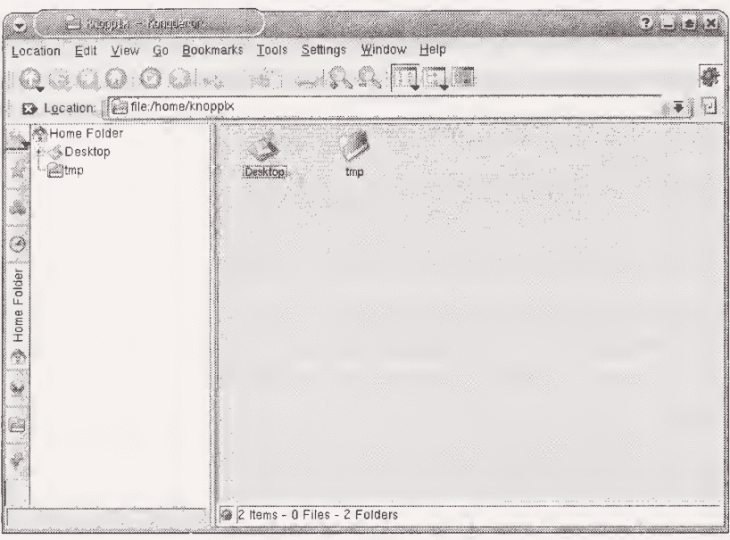

位置文本框显示当前正在展示`/home/knoppix`目录的内容。你会看到默认 Knoppix 用户目录的内容，即`tmp`目录。你可以使用 Konqueror 打开、移动文件和文件夹（目录），并将它们从一处复制到另一处。

### 自定义桌面

你可以通过多种方式自定义 KDE 桌面。KDE 控制中心可以一站式完成桌面配置。启动方式很简单，只需点击 K 菜单并选择“控制中心”即可。


你可以从*《Knoppix入门经典》* DVD（或从 knoppix.org、knoppix.net 网站下载的 CD）运行 Knoppix 时自定义 KDE 桌面，但除非你使用持久化主目录，否则每次重启电脑都需要**重复**执行这些步骤。（第 3 章会介绍如何使用持久化主目录。）

控制中心可修改以下类型的 KDE 元素：

- ✓ **外观与主题：** 更改桌面背景设置、颜色、字体、图标、屏幕保护程序，以及 KDE 启动时显示的动画图片。
- ✓ **桌面：** 更改桌面行为、虚拟桌面数量、KDE 面板布局、任务栏行为，以及包含已打开应用的窗口行为。例如，你可以更改鼠标按键功能，或者设置鼠标悬停在图标上时是否显示应用的简短描述。
- ✓ **互联网与私有网络：** 在此设置互联网和局域网（LAN）选项。更多信息参见第 10 章和第 11 章。
- ✓ **KDE 组件：** KDE 具有极高的可配置性。本节可让你：
  - 选择默认处理的服务组件，例如电子邮件客户端；
  - 设置 KDE 在遇到特定文件类型时自动运行对应应用；
  - 修改文件管理器和拼写检查器的行为。
- ✓ **外设：** 可使用此处的功能配置数码相机、打印机、视频显示器、键盘、鼠标和游戏手柄等设备。第 15 章会介绍如何使用和配置打印机。
- ✓ **电源：** 显示笔记本电脑的电池电量。
- ✓ **区域与辅助功能：** 更改键盘的行为、布局及语言。
- ✓ **安全与隐私：** 更改安全套接层（SSL）协议使用的加密选项。SSL 通常用于：
  - 加密不安全的互联网上与网站之间的通信（加密浏览对于电子商务至关重要）；
  - 保障电子邮件安全；
  - 创建数字签名。本节还可更改 Knoppix 密码等安全设置。
- ✓ **声音与多媒体：** 修改电脑的声音设置。
- ✓ **系统管理：** 更改常规 Knoppix 设置，例如 KDE 目录的默认配置。

# 第四部分：不可避免的互联网——瑞克·坦南特的《第五波》


> “我们资助你的网站完全没问题，弗兰克。在所有经营网站的养鸡户里，你的网站点击转化率是最高的。”

## 本部分内容

我最喜欢的*《辛普森一家》*台词之一就是霍默说的“嗯，现在互联网上居然有电脑了”。仔细想想，霍默说得很有道理。有时候很难区分电脑和互联网。如今互联网连接几乎和水、电一样重要。

本部分将介绍如何连接互联网，以及使用它的两大核心功能：网页浏览和电子邮件。无论你用哪种方式连接电脑，都有对应的章节教你如何将 Knoppix 与互联网结合使用。第 9 章会介绍如何用拨号调制解调器连接 Knoppix 电脑，第 10 章会介绍如何将 Knoppix 连接到有线局域网，第 11 章会帮助你配置 Knoppix 的无线网络。第 12 章会介绍新发布的强大 Mozilla Firefox 浏览器，它让 Internet Explorer 不得不奋力追赶，同时还会介绍如何使用 Mozilla Thunderbird 电子邮件客户端。


## 第 9 章：拨号调制解调器

### 本章内容

- 配置简单防火墙
- 使用拨号调制解调器连接互联网

*Knoppix*通过提供网络配置工具让互联网连接变得简单。本章介绍如何使用 Knoppix 配置老式拨号模拟调制解调器来连接互联网。

> **提示** 如果你连接的是用于上网的*私有网络*，第 10 章介绍有线局域网，第 11 章介绍无线局域网。

> **技术说明** 你可以按照本章的步骤，在从*《Knoppix入门》* DVD（或从`www.knoppix.net`、`www.knoppix.org`下载的 CD）启动的实时 Knoppix 实例中操作，但每次重启电脑时都必须重复这些步骤，除非使用持久化设置工具保存你的配置。（第 3 章会介绍如何使用持久化主目录。）

### 用防火墙保护你自己

当你连接到互联网时，同时也接入了一个充满潜在威胁的海洋：恶意病毒、蠕虫、间谍软件和黑客。在进行任何可能有风险的连接之前，你应该搭建防火墙。防火墙是抵御互联网风险的重要防线。它们可以阻挡互联网上的部分（但并非全部）黑客和恶意软件（如蠕虫等恶意程序）连接你的电脑或网络。

# 第四部分：必然要接触的互联网

## 元视角：用调制解调器连接

在 Knoppix 中使用调制解调器需要几个基本步骤：

- 配置基于主机的防火墙。
- 获取互联网服务提供商（ISP）的订阅服务。
- 如有必要，购买调制解调器并将其连接到电脑。
- 配置调制解调器。
- 支付费用后连接你的 ISP。

本章会讲解流程中的每一步。

> **警告！** 防火墙很有用，但它只是你安全体系中的一环。世上没有单一的安全“银弹”。你唯一合理的防护来自“纵深防御”。你必须将多层安全机制叠加起来保护自己。即便如此，你仍然可能遭遇意外的安全“狼人”。Linux 提供了一个优秀的防火墙系统，名为`Netfilter/iptables`：
>
> - `Netfilter`是基于内核的 IP 数据包过滤系统，`iptables`是`Netfilter`的接口。我通常将整个系统简称为`iptables`。
> - `iptables`是你的第一道防线，用于过滤不需要的连接。`iptables`会基于连接的以下参数过滤进出网络的流量：
>   - **IP 地址：** IP 地址通过充当地址标识，让互联网世界正常运转。
>   - **端口号：** 端口引导互联网连接找到正确的应用或服务。
>   - **连接状态：** `iptables`可以根据流量是否属于已有连接，允许或拒绝网络流量。这个强大的功能能帮你更好地防范黑客欺骗防火墙、入侵你的私有网络或电脑。

按照以下说明搭建防火墙，它允许你的 Knoppix 电脑发起出站连接，但不允许任何人或任何设备发起入站连接：

- 点击 K 菜单，选择「系统→root 终端」打开`root shell`，此时会弹出用户更改对话框。
- 输入`root`密码。
- 首先拒绝所有流量，输入以下命令：

```bash


```bash
iptables -P INPUT DROP
iptables -P OUTPUT DROP
iptables -P FORWARD DROP
```

- 输入以下命令开放`回环（lo）`设备：

  ```bash
  iptables -A OUTPUT -j ACCEPT -o lo
  iptables -A INPUT -j ACCEPT -i lo
  ```

  Linux 使用`loopback`设备进行内部通信，它不是物理设备。

- 输入以下命令允许电脑的所有出站通信：

  ```bash
  iptables -A OUTPUT -m state --state NEW,RELATED,ESTABLISHED -j ACCEPT
  iptables -A INPUT -m state --state RELATED,ESTABLISHED -j ACCEPT
  ```

  连接互联网是双向过程。例如你连接到网站，网站会向你返回信息。这一步中的第二条规则允许你发起的出站连接的返回流量通过。

- 如果你想要允许安全外壳（SSH）连接到你的电脑，请在你的防火墙脚本中添加以下规则：

  ```bash
  iptables -A INPUT -p tcp -m state --state NEW,ESTABLISHED -j ACCEPT --dport 22
  ```

  你可以修改`--dport`参数来允许任何其他服务。例如添加以下规则允许访问你的 Web 服务器：

  ```bash
  iptables -A INPUT -p tcp -m state --state NEW,ESTABLISHED -j ACCEPT --dport 80
  ```

- 保存更改并设置防火墙在开机时启动：

  ```bash
  /etc/init.d/iptables save && update-rc.d iptables defaults
  ```

现在你已经搭建了足够安全的防火墙，可以连接互联网了。防火墙也会在电脑开机时自动启动。


你可以通过使用`/etc/init.d/iptables`脚本手动启停防火墙：

- 输入`/etc/init.d/iptables start`或`/etc/init.d/iptables restart`来启动防火墙。
- 输入`/etc/init.d/iptables clear`来停止防火墙。

### 用调制解调器连接互联网

如今，高速无线和宽带互联网连接这类新技术备受关注。说实话，和老旧、过时的模拟调制解调器技术相比，它们更吸引人。但很多人仍使用普通旧电话系统（POTS）拨号调制解调器连接互联网。本节介绍如何用调制解调器连接互联网。

调制解调器并非前沿技术，但它们有效且便宜。


本章的说明无论你是从附赠 DVD 启动 Knoppix，还是从硬盘的永久安装启动都适用。例外情况是永久保存防火墙的相关步骤。

### 连接调制解调器

大多数新电脑都预装了调制解调器。这听起来不错，但遗憾的是，大部分调制解调器都是 WinModems。WinModem 不是真正的调制解调器。它们使用电脑的声卡和软件驱动，依靠 Windows 操作系统来完成“真实”调制解调器自身就能实现的功能。WinModem 比普通调制解调器便宜，因为本质上它们并不是完整的调制解调器。但低售价对 Knoppix 用户没有帮助。Knoppix（以及其他 Linux 发行版）通常不支持 WinModem。情况正在好转——随着时间推移，Linux 支持的 WinModem 越来越多——但你很可能需要购买非 WinModem 的调制解调器。

幸运的是，普通调制解调器相当便宜。外置调制解调器售价在 40 到 100 美元之间，内置调制解调器售价在 10 到 40 美元之间。成本差异是因为外置调制解调器需要额外配件：外壳、接口、线缆和电源。内置调制解调器插入电脑内部的接口，不需要额外配件。


> 不要将拨号模拟调制解调器和数字宽带调制解调器混淆。拨号调制解调器通过电话线工作，通常被称为数据/传真调制解调器或模拟调制解调器。它们比宽带调制解调器慢得多，因为它们使用的老式电话线原本仅为低保真人声传输设计。宽带调制解调器则是为高速传输设计的，根据使用的连接类型不同，被称为有线调制解调器或 DSL 调制解调器。

### 订阅互联网服务提供商（ISP）

寻找并订阅互联网服务提供商（ISP），关键看你想要使用本地 ISP 还是全国性 ISP。两种类型各有优劣。

#### 选择本地 ISP 时需要考虑以下问题

- ✔ **个性化服务：** ISP 行业竞争激烈，因为很难与全国性 ISP 的大规模优势竞争——它们必须给你一个选择它们的理由。我的 ISP——`www.swcp.com`——提供了极佳的服务，如果有棘手问题我甚至可以直接和所有者沟通。
- ✔ **可靠性：** 离 ISP 更近，它能更精准地根据你的位置量身定制服务。
- ✔ **价格：** 这个重要领域基本打平。本地 ISP 的收费通常和大型 ISP 差不多。但本地 ISP 很少甚至从不提供 Access4Free 这类免费限额服务。本地服务的月费预计在 10 到 25 美元之间。
- ✔ **仅限本地服务：** 显然，本地 ISP 只提供本地服务。它们通常提供外地上网的机制，但你需要走繁琐流程才能使用。所以你在外地时查收邮件会很麻烦。

#### 选择全国性 ISP 时需要考虑以下问题

- ✔ **价格：** 全国性服务主要在成本上竞争，竞争拉低了价格——甚至降到零。Access4Free——`www.access4free.com`——每月提供最多 10 小时的免费上网时长，额外时长每月仅需 10 美元，而且支持 Linux。
- ✔ **全国性服务：** 全国性 ISP 在全国各地都提供本地拨号号码，欧洲及其他地区的 ISP 也提供同样的服务。
- ✔ **客服/邮件服务：** 全国性 ISP 提供多样的客户支持服务。如果你遇到问题，需要打电话联系他们，碰运气等待解决。

### 外置调制解调器

你可以用串口或 USB 线缆将外置调制解调器连接到电脑。所用线缆类型取决于调制解调器的接口：

| 连接器类型 | 说明 |
| --- | --- |
| USB 连接器和线缆 | 使用方形或矩形接口 |
| 串口线缆 | 使用 9 针（DB9）或 25 针（DB25）接口 |


串口连接正在消失。如果你的 Knoppix 电脑只有 DB9 或 DB25 接口，可能无法使用仅配备这两种接口的外置调制解调器。

# 第四部分：必然的互联网

### 手动查找调制解调器

如果 Knoppix 没有检测到你的调制解调器，你可以按照以下步骤手动查找它。`ttyS3`是指向你的调制解调器的设备文件。

1. 点击 KDE Kicker 中的终端图标。
2. 输入以下命令：

   ```bash
   dmesg | grep tty
   ```

   屏幕上显示的结果应该是`ttyS0`或`ttyS1`，也可能是`ttyS2`或`ttyS3`。

3. 把结果记在草稿纸、桌面的空白处或者手背上都可以。
4. 点击**会话→退出**来关闭 shell 窗口。


### 内置调制解调器

内置调制解调器插入你计算机的 PCI（外设部件互连标准）总线。不幸的是，大多数是 WinModem，无法在 Knoppix 上使用。在打开机箱前，请先关机并拔掉电源线。

#### 配置调制解调器

配置调制解调器分为两步，我将在接下来的两节中介绍。

#### 定位你的调制解调器

默认情况下，Linux 不一定知道去哪里找你的调制解调器。你可能会说：“但我的调制解调器就在我面前啊！”它近在咫尺，却又远在天边。Linux 需要知道调制解调器连接到了哪个端口。以下指令会告诉你如何找到调制解调器的位置，之后你需要将这个位置信息告知 Knoppix 以完成连接：

1. 点击 K 菜单，选择**KNOPPIX→网络/互联网→`/dev/modem`连接设置**。如果你使用的是已安装到硬盘的 Knoppix，会弹出“以 root 身份运行 – KDE su”对话框。
2. 如果弹出提示，请输入你的`root密码`，之后会打开“连接类型”对话框。
3. 点击**确定**，下一个对话框会显示 Knoppix 检测到的调制解调器。
4. 再次点击**确定**，Knoppix 会为你的调制解调器创建一个链接。你需要在下一节中使用这个调制解调器的位置信息。

#### 配置调制解调器

当你完成 Knoppix 连接调制解调器的配置后，就快要连上互联网了。找到你的 ISP 提供的拨号和连接信息，使用 KPPP 工具配置你的调制解调器，使其能够拨号并连接到你的 ISP 以及互联网：

1. 点击 K 菜单，选择`KNOPPIX→网络/互联网→调制解调器拨号程序`，会打开 KPPP 对话框。
2. 点击“配置”按钮，会打开带有“账户”选项卡的“KPPP 配置 – KPPP”对话框。
3. 点击“新建”按钮，会打开“创建新账户 – KPPP”对话框。除了美国之外，你几乎可以在任何国家使用这个向导。不过该对话框没有包含美国的设置，因此你必须使用手动配置工具。
4. 点击“手动设置”按钮，会打开如图 9-1 所示的“新账户 – KPPP”对话框。

   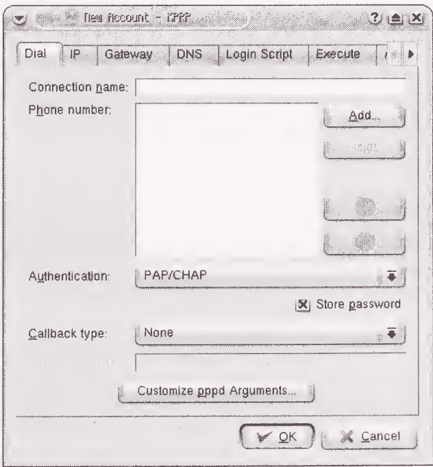

   *图 9-1：在 KPPP 对话框中输入你的账户信息。*

5. 在“连接名称”文本框中输入你的连接名称（我建议你输入能描述该连接的名称，比如`my dialup isp`），然后点击“添加”按钮，会打开“添加电话号码 – KPPP”对话框。
6. 输入你的 ISP 的电话号码，然后点击确定。
7. 回到“新账户 – KPPP”对话框，点击确定，界面会回到“KPPP 配置 – KPPP”对话框。
8. 点击“调制解调器”选项卡，然后点击“新建”按钮，会打开“新调制解调器 – KPPP”对话框。
9. 在“调制解调器名称”文本框中输入任意名称，比如`mymodem`。
10. 点击“调制解调器设备”下拉菜单，选择你在“定位你的调制解调器”一节中获取的调制解调器串行设备，然后点击确定。
11. 回到“KPPP 配置 – KPPP”对话框，点击确定，你会回到 KPPP 对话框。
12. 在对应的文本框中输入你的用户名和密码，现在你就可以连接互联网了！

#### 拨号上网

当你完成 Knoppix 拨号互联网连接的配置后，就可以使用 KPPP 进行连接。每次拨号上网时，请按照以下步骤操作：

1. 如果还没有启动 KPPP 工具，点击 K 菜单，选择`KNOPPIX → 网络/互联网 → 调制解调器拨号程序`来启动它，会打开 KPPP 对话框。
2. 点击“连接”按钮，调制解调器会拨打你的 ISP 号码，发出熟悉的奇怪拨号声，最终完成连接。连接建立后，会打开一个显示 ISP 登录提示的终端窗口。
3. 当你用完拨号连接后，点击“断开”按钮，你的调制解调器就会断开连接。

如果连接失败，请尝试以下步骤手动输入你的认证信息：

1. 点击 KPPP 窗口中的“配置”按钮。
2. 在“KPPP 配置 – KPPP”对话框中点击“编辑”，会打开“编辑账户”对话框。
3. 点击“认证”下拉菜单，选择“基于终端”选项。
4. 点击确定，回到“KPPP 配置 – KPPP”对话框。
5. 点击确定。
6. 点击“连接”，调制解调器会拨打你的 ISP 号码。连接建立后，会打开一个终端模拟器窗口。
7. 当弹出提示时输入你的用户名和密码。手动输入认证信息有助于避免认证问题，例如你可以查看你输入的密码是否被接受。

## 第 10 章

### 有线连接：连接到有线网络

### 本章内容

- 准备网络连接
- 配置网络连接
- 在你的 Knoppix 计算机上安装防火墙

你的私有网络可能是一个简单的消费级以太网交换机，连接几台计算机；也可能是在大型企业、大学或其他大型机构中使用的更庞大、更广泛的网络。无论哪种情况，将你的 Knoppix 计算机连接到有线私有网络都很简单：你把网线的一端插入计算机的以太网端口，另一端插入网络交换机即可。连接完成后，你需要配置 Knoppix 使其能在网络上正常工作。这个配置过程也很简单，本章会介绍具体操作。本章中的设置步骤适用于两种情况：

- 已安装到硬盘的 Knoppix
- Knoppix 实时实例（如第 2 章所示）

如果你使用的是 Knoppix 实时实例，除非你使用持久化 home 目录（如第 3 章所示），否则每次重启时都需要重复本章中的步骤。

#### 总览：连接到有线局域网

以下步骤会概述将计算机连接到私有网络的整个过程：

1. 如有需要，将你的以太网网卡（NIC）安装到计算机中。
2. 将你的网卡物理连接到私有网络。（使用 Cat5 或 Cat6 网线将你的计算机连接到以太网交换机或集线器。）

   *我假设你连接的是提供 DHCP 服务的网络，DHCP 可以让 Knoppix 计算机网络配置变得非常简单。*

3. 为你的网卡分配 IP 地址和网络掩码；设置默认网关路由器和域名服务器。大多数消费级以太网交换机和网关路由器都提供动态主机配置协议（DHCP）服务。DHCP 会自动为客户端分配 IP 地址、网络掩码（`netmask`）、默认网关 IP 以及域名服务（DNS）地址。绝大多数机构都会部署提供 DHCP 服务的网络。
4. （可选）在你的 Knoppix 计算机上安装防火墙。

#### 准备你的以太网适配器

连接到有线网络不需要喝大量咖啡或者熬夜。有线局域网很容易操作，Knoppix 也提供了对应的工具来完成这项任务。以下步骤会介绍如何接入并配置你的 Knoppix 计算机，使其能在私有网络上正常工作。将 Knoppix 计算机连接到有线私有网络可能需要执行以下步骤：

- **1. 如有需要，安装以太网网卡。**

  大多数现代计算机（无论是笔记本还是台式机）都默认集成了以太网网卡。你可以查看计算机说明书，或者直接查看计算机本身，确认是否已经安装了网卡。

  

  *以太网是一种标准或协议，定义了多个网络设备如何在单一总线上通信。以太网连接器看起来非常像电话插孔。如果你查看插孔内部，会发现以太网网卡有 8 个小小的铜质引脚连接器。（电话调制解调器连接器只有两个或四个引脚。）*

- **2. 通过网线将你的 Knoppix 计算机连接到私有网络。**

  网络连接需要使用网线，其类别应至少为 5 类（Cat5）。将网线的一端插入计算机的以太网网卡，另一端插入网络集线器或交换机即可。

## 第 10 章：接入有线网络：连接有线网络


有线网络使用铜缆或光纤。消费级局域网始终使用铜缆。铜缆分为 Cat5 和 Cat6 两类，Cat6 能支持比 Cat5 更快的以太网网卡，但价格也更高。

### 配置你的网络

只要网卡（NIC）已接入私有网络并能正常工作，你就可以配置 Knoppix 以接入该网络通信。Knoppix 的网络配置取决于你的网络是否配备 DHCP 服务器。如果你的网络开启了 DHCP 服务，Knoppix 会自动完成配置以接入网络，你只需要把 Knoppix 计算机接入网络并启动 Knoppix 即可。Knoppix 会发送 DHCP 广播，DHCP 服务器会为 Knoppix 计算机提供对应的网络配置。如果你的网络没有提供 DHCP 服务，你需要按照本节介绍的方法手动配置 Knoppix 的网络。

DHCP（动态主机配置协议）会自动为你的计算机设置 IP 地址、网关等网络参数。


如果你不确定网络是否支持 DHCP，可以询问网络管理员（如果有的话）。或者你也可以直接配置 DHCP 试试是否能正常工作。配置流程非常简单，所以就算失败也没关系。如果 DHCP 配置失败，Knoppix 计算机无法接入网络，你可以使用本章后面介绍的手动配置步骤。

### 使用 DHCP

请按照以下步骤配置 Knoppix 计算机以支持 DHCP 广播：

1. 点击 KNOPPIX 菜单（K 菜单的子集），选择「网络/互联网」→「网卡配置」。

   - 此时会弹出 Xdialog 窗口，询问你是否要使用 DHCP 广播。
   - 同时还会打开`netcardconf`对话框（该对话框嵌在终端模拟器窗口中），这个窗口会显示网络配置的进度。

2. 点击**是**以使用 DHCP 广播。DHCP 会为你的计算机提供网络配置，网络连接就会建立，配置完成。退出配置工具后，你就可以使用网络了。


> **提示**
>
> 打开浏览器即可上网浏览。如果遇到问题、网络似乎无法使用，可以尝试手动配置网络连接。下一节将介绍手动配置流程。

### 无 DHCP 广播

如果你的网络没有 DHCP 服务，你需要手动配置网络连接。


> **提示**
>
> 侧边栏「Knoppix 网络默认参数」介绍了 Knoppix 默认设置的网络参数，这些参数通常由 DHCP 自动配置。

请按照以下步骤配置无 DHCP 广播的 Knoppix 网络：


1. 点击 KNOPPIX 菜单（K 菜单的子集），选择**「网络/互联网」**→**「网卡配置」**。

   - 此时会弹出 Xdialog 窗口，询问你是否要使用 DHCP 广播。
   - 同时还会打开`netcardconf`对话框（嵌在终端模拟器窗口中），该窗口会显示网络配置的进度。

2. 当询问你是否使用 DHCP 时，点击**否**，之后会提示你输入 IP 地址。
3. 在 Xdialog 窗口中输入你的 IP 地址，然后点击确定。


4. 在Xdialog窗口中输入你的`子网掩码`，然后点击确定。除非你确定需要使用其他子网掩码，否则直接点击确定使用默认值`255.255.255.0`即可。

5. 在Xdialog窗口中输入你的`广播地址`，然后点击确定。默认值为`192.168.1.255`，如果你在第4步选择了默认子网掩码，这个值是可用的。


6. 在Xdialog窗口中输入你的`网关IP地址`，然后点击确定。默认网关地址为`192.168.0.254`，这个值可能不适用于你的局域网。

7. 输入DNS服务器地址，然后点击确定。

   - 你的互联网服务提供商（ISP）会为你提供至少一个可用的DNS IP地址。
   - 如果有两个地址，用空格分隔即可。

设置网卡时，`netcardconf`对话框会显示配置进度。完成网络连接配置后，你就可以使用网络了，打开浏览器即可上网浏览。

#### Knoppix网络默认参数介绍

要在无DHCP广播的网络中连接Knoppix计算机，你需要手动指定参数。以下列表介绍了网络配置工具提供的默认参数。

- `IP地址`：IP地址类似于电话号码或街道地址，能让不同网络设备相互发现并通信。使用DHCP时IP地址是动态分配的，但如果不使用DHCP，你需要设置静态IP地址。我在设置家庭网络的静态IP时，会使用`192.168.1.200`到`192.168.1.240`的范围，避免和常见的DHCP地址段冲突。建议你使用该范围内的任意值，也可以选择`192.168.1.2`到`192.168.1.99`之间的值。Xdialog会为你的网卡提供默认IP地址`192.168.0.1`。

- `默认网关IP地址`：计算机访问局域网外的其他设备时，会通过默认网关IP地址转发通信数据。许多网络交换机和路由器使用`192.168.1.1`作为互联网网关地址，通常也会使用`192.168.1.100`到`192.168.1.150`的地址段作为DHCP地址池。

- `网络掩码`：IP地址分为网络段和主机段，网络段对应你的私有网络，主机段用于标识你的设备。网络掩码（也称`子网掩码`）用于定义IP地址的划分方式。Knoppix网络工具的默认网络掩码为`255.255.255.0`，几乎适用于所有家庭、中小型网络。

- `广播地址`：网络接口通常需要发现其他设备，它们会向整个私有网络广播请求来相互定位。广播地址用于定义网络设备的广播方式。Knoppix网络工具的默认广播地址为`192.168.1.255`，通常可以正常使用。


## 第四部分：互联网篇

## 第11章：无线网络

### 本章内容

- 无线网络入门
- 使用Linux驱动连接
- 使用Windows驱动连接
- 使用WPA加密

无线网络让我们的工作变得更加便捷、舒适。无线网络接口卡（NIC）——通常被称为`WiFi（无线保真）网卡`——让我们摆脱了时间和空间的限制……好吧，也许只是空间的限制。你不再需要找网络接口插网线，带着笔记本出行变得非常方便。许多机场、酒店、企业，甚至整座城市的某些区域（比如新墨西哥州的阿尔伯克基）都提供WiFi网络接入。WiFi也让居家办公更轻松，因为你不再需要插实体网线了。


> 当你从《Knoppix入门》（*Knoppix For Dummies*）DVD运行Knoppix时（或者从`www.knoppix.org`、`www.knoppix.net`下载的Knoppix Lite CD运行），都可以使用本章的配置步骤，但除非你使用持久化主目录，否则每次重启电脑都需要重复这些步骤。（第3章会介绍如何创建和使用持久化主目录。）


> 许多无线接入点也内置了`有线`网络接口，第10章介绍了如何连接Knoppix计算机的有线网络。

### WiFi芯片组

Knoppix PC的无线网络性能、安全性和易用性，取决于系统的协议和硬件。

### 网络协议

常见的无线网络协议有两种：`802.11g`和`802.11b`。

表11-1列出了这两种协议的核心属性。


| 特性 | 802.11g | 802.11b |
|---|---|---|
| 传输速率（最大值；兆比特/秒） | 54Mbps | 11Mbps |
| 兼容802.11g和802.11b两种接入点 | 是 | 否 |
| WiFi保护接入（WPA）加密 | 兼容 | 不支持 |
| 有线等效加密（WEP）协议 | 兼容 | 兼容 |


WEP加密协议的安全性低于WPA加密协议。


#### 协议

协议是电气和电子工程师协会（IEEE）制定的标准，目的是让不同厂商生产的无线网络设备能够互通协作。

### 网卡硬件

无线网卡主要分为两大类：

#### 外置式

如果你的电脑没有内置无线网卡，可以额外添置`802.11b`或`802.11g`标准的无线网卡：

- `PCMCIA接口`：将PCMCIA接口的WiFi卡插入笔记本电脑（或带有PCMCIA转接卡的台式机）。
- `USB接口`：将USB接口的网卡连接到任意带有USB接口的电脑上。
- `PCI接口`：将PCI接口的网卡插入台式机主板上的对应插槽。


如果你正在为Knoppix系统选购无线网卡，请选择采用表11-2所列`芯片组`的`802.11g`网卡。

#### 内置式

如果电脑内置了WiFi网卡，无需额外安装设备。


2004年之后生产的大部分笔记本电脑都内置了`802.11g`标准的WiFi网卡。


## 在Windows系统中查找硬件信息

在Windows系统中，`设备管理器`包含了大量关于Windows系统及其运行主机的信息。如果在硬件文档中找不到网卡芯片组的信息，可以按照以下步骤操作：

1. 启动Windows系统。
2. 打开控制面板。控制面板可能直接显示在开始菜单中，也可能在设置选项下。如果找不到，可以在Windows分区中搜索`control.exe`文件。
3. 打开“系统”选项，然后点击“硬件”选项卡。
4. 在“硬件”选项卡中，点击“设备管理器”按钮。设备管理器窗口会将系统信息按硬件类型分类列出。
5. 点击“网络适配器”旁边的加号。系统内置的无线网卡会显示在窗口中，如下图所示。

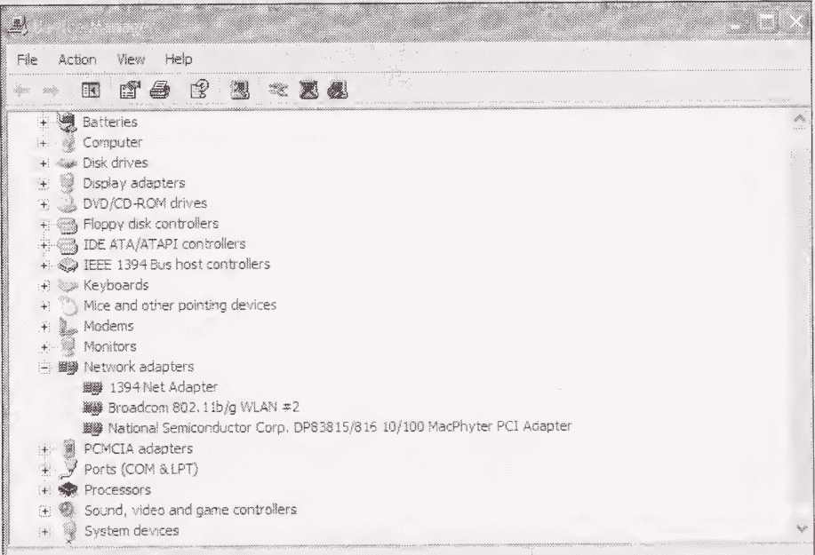

## 表11-2 Knoppix系统支持的无线网卡芯片组

| 芯片组 | 网络协议能力 | Knoppix设备名称 |
|---|---|---|
| Amtel | 802.11b/g | |
| Atheros | 802.11b/g | `athX`（X=0、1等） |
| Centrino/ipw2*00 | 802.11b/g | |
| Orinoco | 802.11b/g 或仅支持802.11b | `ethX`（X=0、1等） |
| Prism I 和 II | 仅支持802.11b | `ethX`（X=0、1等） |
| Prism54 | 802.11b/g | |
| Ralink ra2*00 | 802.11b/g | `raX`（X=0、1等） |
| Wavelan | 仅支持802.11b | `ethX`（X=0、1等） |

## 核心无线网络参数

在Knoppix系统中安装无线内核模块时，你可能需要一些网络信息。如果你的无线网络无法使用Knoppix的默认参数运行，你可以向网络管理员或网络设备（比如家庭网络的接入点）获取正确的参数。

将无线网卡连接到局域网最常用的方式是使用接入点（AP）。配置WiFi网卡时，你需要提前准备好以下AP的相关信息（除非你选择将部分项目留`空`，以使用Knoppix的默认值或默认操作）：

- ✓ **root密码**：不要把你的root密码写在书上！
- ✓ **SSID（服务集标识符）**：________ 将SSID留空时，你的WiFi网卡会自动连接到信号最强的AP（通常也是距离最近的AP）。SSID用于标识无线网络的名称。（部分网络厂商将其称为`ESSID`。）每个AP都有默认的SSID，例如Linksys品牌AP的默认SSID为`linksys`。
- ✓ **加密密钥**：________ 如果你的网络没有使用加密，可以将该值留`空`。加密密钥是WiFi网卡和AP用于加密通信内容的二进制数，可以格式化为十六进制数或文本字符串。
- ✓ **网卡芯片组**：________ 要使用Linux原生驱动、加密功能或通用的`ndiswrapper`工具，你需要知道网卡的芯片组型号。


有以下几种方式可以查找无线网卡的协议和芯片组信息：

- 查阅无线网卡附带的说明文档。
- 如果你的电脑可以运行Windows系统，可以在设备管理器中查找无线网卡芯片组的名称，《在Windows系统中查找硬件信息》的侧边栏介绍了具体操作方法。

使用Knoppix通过无线连接的难度取决于你的芯片组和网络安全设置：

### 简单模式：使用兼容网卡连接未加密网络

Knoppix可以自动将兼容的网卡连接到未加密的AP，表现十分出色。你只需将这类网卡插入电脑，即可开始使用无线局域网。

### 复杂模式：加密网络与不兼容网卡

本章节将介绍以下场景的手动配置步骤：

- 采用不兼容芯片组的网卡
- 连接到加密AP的无线网络

无论你使用的是简单模式还是复杂模式，接下来的章节都会引导你完成网卡连接无线网络的步骤。

### 无线网卡配置

无线网卡的使用步骤取决于Knoppix是否支持你的网卡芯片组（即让无线网卡正常工作的微型芯片）：

- 如果你的无线网卡采用兼容芯片组（见表11-2），Knoppix可以自动安装无线内核模块（即驱动程序）。
- 如果你的网卡采用不兼容芯片组，你需要使用`ndiswrapper`工具来安装无线内核模块，并调用Windows驱动程序。

### Knoppix系统兼容的WiFi网卡

Knoppix让部分WiFi网卡的使用变得非常简单。你只需插入兼容的WiFi网卡，Knoppix就会自动完成网卡配置，并连接到未加密的AP。

### 总览：连接无线接入点

该做的总是要做。以下是建立无线连接需要完成的步骤。我们假设你的家庭或办公场所已经部署了可正常运行的接入点（AP）。（本书不会涵盖部署AP或搭建完整无线网络的全部步骤。）

以下步骤可将你的Knoppix电脑连接到AP：

1. 购买、借阅或获取一张WiFi网卡，并将其安装到你的电脑中。如果你使用的是近年生产的笔记本电脑，这一步可能不需要，因为2004年之后生产的大部分笔记本电脑都内置了WiFi网卡。
2. 如有需要，使用`ndiswrapper`工具安装无线内核模块（驱动程序）。表11-2中列出的网卡，Knoppix会自动安装对应的无线内核模块。
3. 将WiFi网卡配置为DHCP模式。Knoppix会自动连接到未加密的AP。如果Knoppix检测到未加密的AP，会自动为802.11b网络获取IP地址；如果是802.11g网络，则需要手动运行DHCP来获取IP地址。
4. 使用加密方式连接。Knoppix提供了无线网络配置工具，可以帮你轻松使用WEP加密协议完成连接；你也可以使用`ndiswrapper`工具通过WPA加密完成连接。
5. 使用你的无线网络。


表11-2列出了Knoppix直接支持的网卡芯片组。网卡和AP的兼容性取决于它们所支持的无线协议：

> **802.11g网卡**可以连接到**两种**802.11g和802.11b的AP。
>
> **802.11b网卡**仅能连接到802.11b的AP。

若要将兼容的WiFi网卡配置为连接未加密和WEP加密的接入点，请按以下步骤操作：

1. 点击K菜单，选择KNOPPIX→网络/互联网→KWiFiManager（无线管理器）。如果是从永久安装的Knoppix系统运行，会弹出“以Root身份运行 – KDE su”对话框。


2. 如果出现提示，输入`root`密码后点击确定。如果不想在重新打开该工具时重复输入`root`密码，可以点击“记住密码”按钮。此时会打开KWiFiManager对话框，如图11-1所示。“KWiFiManager参数”侧边栏对KWiFiManager对话框中的信息进行了说明。

3. 点击“设置”菜单，选择“配置编辑器”。随即打开“配置 – KDE控制模块”对话框，如图11-2所示。你可以点击对话框顶部的标签页，从四个可能的配置中选择任意一个，默认选中“Config1”标签页。

4. 在“网络名称”文本框中输入你要连接的AP的SSID。无线网络的SSID显示在KWiFiManager对话框中。

5. 点击“自动检测”按钮。KWiFiManager会确定你的WiFi网卡所使用的网络接口。例如，802.11b网卡通常使用`eth0`和`eth1`接口，而基于Atheros芯片的802.11g网卡使用`ath0`接口。

6. 点击“激活”按钮。

## 第四部分：不可避免的网络部分

### KWiFiManager参数

KWiFiManager对话框提供以下参数：

- **AP SSID**：“Connected to network”（已连接到网络）这一行会显示该AP的SSID（或`名称`）。
- **AP MAC地址**：“Access point”（接入点）这一行会显示该AP的MAC（媒体访问控制）地址。
- **信道编号**：“Frequency *[channel]*”（频率*[信道]*）显示你的网卡连接到该AP的信道。
- **连接速度**：“Connection speed (MBit/s)”（连接速度（MBit/s））活动条显示你的网卡与该AP通信的最大速度。
- **已连接/未连接**：如果“Connection speed (MBit/s)”（连接速度（MBit/s））活动条为`绿色`，就说明你已经连接到该AP。
- **加密**：该项显示你是否正在使用加密。
- **IP地址**：“Local IP”（本地IP）这一行显示AP分配给WiFi网卡的IP地址。如果你连接到未加密的AP，IP地址会自动分配。
- **信号强度**：你的WiFi网卡从该AP接收到的信号强度。该数值会以图形和数字两种形式显示在对话框左侧，数字范围是0到100。

> 下一节将为你介绍适用于系统的正确安全选项。你使用Knoppix的自动配置工具设置好无线网卡后，就可以为保障网络安全设置`无线加密`了。如果你的网络使用了无线加密，请为Knoppix系统配置你能使用的最安全的加密方式：
>
> - **WPA加密**：这是最优的加密方式，但它要求网络仅使用802.11g设备。如果你已经为802.11g无线网络配置好了网卡，可以跳转到本章末尾的WPA配置分步指南。
> - **WEP加密**：如果你的无线网络使用了任何802.11b设备，这是唯一可用的加密选项。“WEP：脆弱的外层防护”附录会介绍如何在Knoppix系统上配置它。为了获得最佳实用防护，建议升级到802.11g网卡并使用WPA，而非WEP。
>
> 如果你的无线网络使用了`未加密`的AP，你的网卡会自动连接到AP，你就可以直接使用了。

### WEP：脆弱的外层防护

802.11b协议使用`有线等效隐私保护`（WEP）加密，仅能提供较弱的加密能力；802.11g协议既可以使用WEP，也可以使用更新、更安全的WPA加密。任何人只要使用公开可用的工具，就能破解WEP加密密钥。WEP聊胜于无，但无法保障你的隐私。WEP分为两种强度：

- ✓ 128位WEP是首选，如果你必须使用802.11b网络的话。它比不加密要好。
- ✓ 40位WEP几乎毫无用处。

如果你只能使用WEP加密，请按照以下步骤在Knoppix系统上完成配置：

1. 点击KWiFiManager对话框中的“使用加密”按钮。该按钮旁的“配置”按钮将被激活。
2. 点击“配置”按钮，打开“配置加密 – KDE控制模块”对话框。
3. 点击“受限”按钮。
4. 在“密钥1”文本框中输入你的AP的加密密钥。加密密钥既可以输入`十六进制`格式（这种处理二进制数据的方式更简便），也可以输入人类可读的`文本字符串`格式。
5. 如果加密密钥是文本字符串，请点击“字符串”按钮。
6. 点击“确定”，返回“配置 – KDE控制模块”对话框。
7. 点击“应用”。
8. 点击“激活”按钮。
9. 点击“确定”退出对话框。KWiFiManager对话框会显示连接速度、IP地址以及其他无线网络信息。

KWiFiManager不支持Knoppix自动支持的所有网卡芯片组获取IP地址。如果你使用的网卡属于这类芯片组，请按照以下步骤手动获取IP地址：

1. 点击K菜单，选择“工具”→“终端”，打开“Shell – Konsole”窗口。
2. 切换到超级用户。输入以下命令并按Enter键：

```bash
su -
```


### 3. 获取 IP 地址

在以下命令中替换为你的网卡设备名，然后按 Enter 键：

```bash
pump -i nic_device
```

例如，对于基于 Atheros 芯片的网卡，输入以下命令：

```bash
pump -i ath0
```

对于基于 Ralink 芯片的网卡，使用以下命令：

```bash
pump -i ra0
```

4. 输入 `exit` 并按 Enter 键退出终端窗口。AP 会为你的网卡分配一个 IP 地址，该数值会显示在 KWiFiManager 对话框中。你的电脑已连接到无线网络。

### 开源柔术：使用 Windows WiFi 驱动

许多 WiFi 网卡制造商不会向开源社区发布其产品规格。信息的缺失使得为无公开文档的设备（如无线网络接口）编写 Linux 内核模块（驱动）变得困难甚至不可能。所有人都蒙受损失：

- 制造商损失了重要的市场细分：我们。
- Knoppix 及其他 Linux 系统无法使用前沿设备。

### 使用 Windows 驱动

如果你拥有相关设备的微软 Windows 驱动，就可以在 Knoppix 上运行许多无公开文档的设备。`ndiswrapper` 项目支持在 Linux 中使用 WiFi 网卡的 Windows 驱动，非常实用！Linuxant 公司出售 Driverloader 软件，可简化使用微软驱动的流程，效果相当不错。Driverloader 售价仅 19.95 美元，价格低廉。你可以从 `www.linuxant.com` 下载免费的 30 天试用版。

请至少使用 128 位 WEP 保护你的无线网络安全。WEP 提供的防护比较脆弱，但聊胜于无。只要有一台笔记本电脑和公开可用的软件，你就可以几乎在任何街道上检测到大量未受保护的无线 AP。存在如此多唾手可得的攻击目标，只要你使用 WEP，就一定会有人试图入侵你的无线网络。因此，有一点 WEP 防护也比完全没有好。

使用 `ndiswrapper` 可能会导致你的电脑死机。（在我测试过的无线网卡中，大约有 10% 会出现死机情况。）如果 `ndiswrapper` 导致你的电脑死机，你需要使用一款芯片组被 Knoppix 直接支持的无线网卡。遗憾的是，不安装并试用的话，无法确定 `ndiswrapper` 是否能在你的系统上正常运行。在尝试使用 `ndiswrapper` 和 Windows 驱动之前，请先确认你的无线网卡是否可以使用 Knoppix 内置的驱动。表 11-2 列出了兼容 Knoppix 的网卡。如果你的网卡受支持，请参阅“Knoppix 支持的 WiFi 网卡”部分的说明。

### 查找 Windows 驱动

使用 Windows WiFi 网卡驱动意味着你需要获取 Windows 驱动。这些驱动从哪里获得？你的 Windows 电脑、Windows 光盘，或者制造商的官方网站。以下部分将介绍如何获取你的 WiFi 网卡的驱动。

### 硬盘

如果你的 Windows 电脑已经使用了你的无线网卡，你可以从这台电脑上获取 Windows WiFi 驱动。以下步骤适用于两种情况：无论你是从《Knoppix 入门》DVD 启动 Knoppix，还是从永久安装的系统启动。请按照以下步骤查找 Windows WiFi 驱动，并将其复制到你的 Knoppix 分区：

1. 通过以下任意一种方式启动你的 Knoppix 电脑：
   - **DVD：** 启动你的 Knoppix 电脑。
   - **永久安装的 Knoppix：** 启动 Knoppix 电脑并以普通用户身份登录。
2. 双击对应你的 Windows 分区的硬盘图标。会打开一个 Konqueror 对话框，显示 Windows 分区的内容。
3. 选择“工具”→“查找文件”。
4. 在“名称”文本框中输入你要查找的 WiFi 网卡驱动的名称，然后按 Enter 键。例如 `driver*.inf`；如果你使用的是博通 WiFi 网卡，就输入 `b57win32.inf`。
5. 点击 KDE kicker（KDE 桌面底部的水平菜单栏）上的“主目录”图标。会打开一个 Konqueror 对话框，显示你的主目录内容。
6. 将 `.inf` 文件从 Windows 分区复制到你的主目录。点击搜索结果，将其拖到你的主目录图标上，会打开一个查询子菜单对话框。

### CD-ROM

如果你的网卡的 Windows XP 驱动存放在 Windows 分区中，请按照以下步骤将无线网卡的 Windows 驱动复制到你的 Knoppix 系统中：

7. 选择“复制”菜单选项，`.inf` 文件会被复制到你的用户主目录中。
8. 点击你在步骤 2 中打开的 Windows 版 Konqueror 对话框。
9. 选择“工具”→“查找文件”。
10. 在“名称”文本框中输入你要查找的 WiFi 网卡驱动文件名，然后按回车，示例如下：

```bash
driver*.sys
```

例如，如果使用的是博通（Broadcom）WiFi 网卡，就输入 `b57xp.sys`。

11. 将 Windows 分区中的 `.sys` 文件复制到你的用户主目录，点击搜索结果并将它们拖到用户主目录图标上，此时会打开一个查询子菜单对话框。
12. 选择“复制”菜单选项，`.sys` 文件就会被复制到你的用户主目录中。

### CD-ROM

如果你的网卡的 Windows XP 驱动存放在 CD-ROM 中，请按照以下步骤将无线网卡的 Windows 驱动复制到你的 Knoppix 系统中：

1. 插入你的网卡附带的支持 CD-ROM。
2. 如果你运行的是 Knoppix Live 版，输入以下命令来挂载 CD-ROM：

```bash
mount /mnt/auto/cdrom
```

3. 在 CD-ROM 上查找 Windows `.inf` 信息文件和 `.sys` 驱动文件，输入以下命令定位 Windows WiFi 网卡的配置文件：

```bash
find /mnt/auto/cdrom -iname '*.sys'
find /mnt/auto/cdrom -iname '*.inf'
```

你应该会看到类似 `oem10.inf` 和 `RT2500.sys` 的文件。

4. 将 CD-ROM 中的 Windows 驱动 `.inf` 和 `.sys` 文件复制到你的用户主目录，输入以下命令：

```bash
cp /mnt/auto/cdrom/Drivers/"Windows XP"/*.sys ~
cp /mnt/auto/cdrom/Drivers/"Windows XP"/*.inf ~
```

### Download

你可以从制造商的官网下载 Windows XP 驱动，下载文件的方式取决于你拥有的资源：

- **其他操作系统。** 如果你的电脑可以通过其他已安装的操作系统（如 Windows 或其他 Linux 发行版）访问互联网，请使用该网络下载无线网卡驱动。本章节将介绍如何将驱动从 Windows 分区复制到 Knoppix 分区。
- **有线 Linux 网络。** 如果你可以将 Knoppix 电脑连接到带有互联网访问权限的有线网络，你可以使用该网络下载无线网卡驱动。第 10 章将介绍如何配置 Knoppix 电脑以接入有线网络。许多无线网络本身支持有线网络连接。
- **拨号网络。** 如果你拥有拨号互联网接入，第 9 章将介绍如何在 Knoppix 中使用调制解调器。许多内置的软猫（WinModem）无法在 Knoppix 中正常工作。

### Starting ndiswrapper modules

按照以下步骤创建并安装 `ndiswrapper` 内核模块：

1. 打开终端窗口，输入 `su -` 切换到 root 用户。

> Knoppix 提供了图形化的 `ndiswrapper` 界面（K-Menu ➔ KNOPPIX ➔ Network ➔ ndiswrapper）。但 `ndiswrapper` 仍处于开发初期，因此我建议手动配置你的内核模块。以下手动方法可以避免初期图形化工具的局限性。超级用户（Super User）与 root 用户同义。

2. 将信息文件名插入以下命令中：

```bash
ndiswrapper -I /etc/driver.inf
```

例如，如果信息文件名为 `oem10.inf`，请输入以下命令：

```bash
ndiswrapper -i /etc/oem10.inf
```

该命令会“封装”Windows 的 `.inf` 文件，使其能够被 Linux 使用。

3. 通知 Knoppix 新的 `ndiswrapper` 内核模块已就绪，输入以下命令：

```bash
ndiswrapper -m
```

4. 从 Linux 内核中移除 `ndiswrapper` 模块，然后重新加载该模块，输入以下命令来加载（或重新加载）内核模块：

```bash
rmmod ndiswrapper
modprobe ndiswrapper
```

5. 检查模块是否已加载，输入以下命令显示新加载的内核模块：

```bash
lsmod | grep ndiswrapper
```

如果 `ndiswrapper` 模块已加载，你会在列表中看到它。如果你没有在列表中看到 `ndiswrapper`：

   a. 重新插入网卡。  
   b. 打开终端窗口。  
   c. 输入 `su -` 切换到 root 用户。

6. 完成无线网络配置：

   - **无加密。** 如果你的 AP（接入点）未使用加密，请输入以下命令为你的 WiFi 网卡分配 IP 地址：

     ```bash
     pump -i wlan0
     ```

   - **WPA 加密。** 配置说明请参阅本书下一节（“WPA：更安全的加密方式”）。

   - **WEP 加密。** 请使用以下命令：首先，在下面的命令中使用你的加密密钥：

     ```bash
     iwconfig wlan0 key encryption-key
     ```

     无线网络使用二进制加密密钥，这类密钥既可以表示为十六进制格式，也可以表示为文本格式。以下举两个例子：

     如果你的加密密钥是 `00-11-22-33-44-55-66-77-88-99`：

     ```bash
     iwconfig wlan0 key 00-11-22-33-44-55-66-77-88-99
     ```

     如果你的加密密钥是文本字符串 `iamnotanumber`：

     ```bash
     iwconfig wlan0 key s:iamnotanumber
     ```

     最后，输入以下命令为你的 WiFi 网卡分配 IP 地址：

     ```bash
     pump -i wlan0
     ```

你的电脑已连接到无线网络！

### WPA: Better Security

WiFi 保护接入（WPA）是当前无线网络可用的最佳保护方案，是大多数主流 802.11g 兼容 AP（接入点）和网卡的标配功能。你可以通过安装固件升级，让老款 802.11g 设备支持 WPA，请查阅你的网卡制造商官网获取升级包及使用说明。

Linux 下的 WPA 配置和使用需要一些操作，但非常值得，原因如下：

- WPA 提供了极高的安全性。
- WPA 在 Windows XP 电脑上配置非常简单。

当你在 Linux 电脑上成功配置好 WPA 后，你可以轻松地将家庭网络升级为仅使用 WPA 加密。以下说明将介绍如何配置家用级 AP 和 802.11g 网卡，以使用新版且安全性更高的 WPA 加密。

WPA 密码短语与密码类似，用于加密无线通信，密码短语的来源取决于你连接的网络类型：

- **家庭或个人网络：** 创建一个密码短语（想出一段短语，然后将其中部分字母替换为数字和其他字符，如 `#`、`$` 和 `@`）。WPA 密码短语长度至少应达到 22 个字符。
- **他人网络：** 向友好的系统管理员索取 AP 的密码短语。

#### Configuring an AP to use WPA

以下说明将配置 AP 以提供 WPA 加密：

1. 在你的 802.11g AP 上开启 WPA 预共享密钥（Preshared Key）安全模式。如果你的 AP 已经使用超过两年，很可能需要更新固件才能启用 WPA 加密，请按照 AP 说明书中的指引操作。
2. 将 WPA 加密密钥类型设置为 TKIP（临时密钥完整性协议，Temporal Key Integrity Protocol）。
3. 在你的 AP 上输入 WPA 密码短语。现在你可以开始配置网卡以使用 WPA 了。

### Configuring Knoppix to use WPA

在你的 Knoppix 电脑上配置 WiFi 网卡需要完成以下任务：

1. 创建 WPA 配置文件。
2. （可选）加载 `ndiswrapper` 内核模块（驱动）。
3. 启动 WiFi 网卡。
4. 启动 WPA 守护进程。

以下章节将介绍如何配置 WPA 加密。

#### Create a WPA configuration file

请按照以下步骤创建 WPA 守护进程配置文件：

1. 输入以下命令打开新的 WPA 配置文件：

   ```bash
   kwrite /etc/wpa.conf
   ```

2. 在 Kwrite 窗口中输入以下代码以打开文本编辑器，将你的 `ssid`（即 `essid`）和 `psk`（密码短语）值插入以下代码中：

   ```ini
   eapol_version=1
   ap_scan=1
   fast_reauth=1
   network={
     ssid="linky"
     proto=WPA
     key_mgmt=WPA-PSK
     pairwise=CCMP TKIP
     group=CCMP TKIP WEP104 WEP40
     psk="iamnotanumber"
   }
   ```

3. 选择“文件”→“退出”。
4. 在弹出的对话框中点击“保存”按钮，然后退出文件。下一节将介绍如何启动（或重启） `ndiswrapper`。

#### Loading an ndiswrapper kernel module

Knoppix 会自动加载受支持的 WiFi 网卡内核模块，但如果你使用的是不支持的网卡，就需要使用 `ndiswrapper` 模块（驱动）。如果 Knoppix 无需 `ndiswrapper` 即可原生支持你的网卡，请跳过本节直接进入下一部分启动网络接口。

如果你的网卡需要 `ndiswrapper`，请按照以下步骤安装（或重启） `ndiswrapper` 内核模块：

1. 点击 Kicker 上的终端图标，打开终端窗口。
2. 将 `ndiswrapper` 模块加载（或重新加载）到 Linux 内核中：

   ```bash
   rmmod ndiswrapper
   modprobe ndiswrapper
   ```

### 启动网络接口

WPA 守护进程需要 WiFi 网卡处于激活状态，才能与接入点（AP）进行身份验证。以下操作将激活你的网卡：

1. 点击 Knoppix 电脑上 Kicker 的终端图标，打开终端窗口。
2. 使用 `ifconfig` 命令启动你的无线网卡：

   ```bash
   ifconfig wifi_nic up
   ```

以下是一些示例：

- **ndiswrapper：** `ifconfig wlan0 up`
- **基于 Atheros 芯片的网卡：** `ifconfig ath0 up`
- **基于 Ralink 芯片的网卡：** `ifconfig ra0 up`

该操作会在不设置 IP 的情况下启用你的网卡，WPA 密钥配置软件要求网卡处于此状态。


### 启动 WPA 加密

Linux 使用 `wpa_supplicant` 程序为你的 802.11g 网卡提供 WPA 加密。请运行以下命令将 `wpa_supplicant` 配置为运行中的程序：

1. 在以下命令中替换为你的网卡名称，即可开启 WPA 加密：

   ```bash
   wpa_supplicant -D ndiswrapper -i wifi_nic -c /etc/wpa.conf
   ```

在 WPA 加密命令中添加 `-B` 选项，可让 `wpa_supplicant` 作为守护进程在后台运行。例如，使用如下命令：

```bash
wpa_supplicant -B -D ndiswrapper -i wifi_nic -c /etc/wpa.conf
```

添加 `-B` 选项会强制该工具以守护进程形式运行，请在成功测试 `wpa_supplicant` 配置后使用该选项。

## 第四部分：必然的网络部分


以下是一些示例：

- **ndiswrapper：**

  ```bash
  wpa_supplicant -D ndiswrapper -i wlan0 -c /etc/wpa.conf
  ```

- **基于 Atheros 芯片的网卡：**

  ```bash
  wpa_supplicant -D madwifi -i ath0 -c /etc/wpa.conf
  ```

### 2. 为 WiFi 网卡分配 IP 地址

在以下命令中替换为你的网卡名称：

```bash
pump -i wifi_nic
```

以下是一些示例：

- **ndiswrapper：** `pump -i wlan0`
- **基于 Atheros 芯片的网卡：** `pump -i ath0`

当 `pump` 命令执行完成后，你就获得了受 WPA 保护的 WiFi 连接。太棒了！

## 第 12 章

### 浏览与电子邮件

### 本章内容

- 初识 Mozilla Firefox
- 火狐浏览器势不可挡
- 驾驭“喷火”的 Mozilla Firefox
- 用雷鸟收发电子邮件

人们使用电脑是用来做什么的呢？当然是浏览网页和收发电子邮件。互联网的核心用途就是浏览和收发邮件。本章将介绍如何使用 Knoppix 电脑进行网页浏览和邮件收发。（第四部分会讲解如何将 Knoppix 电脑连接到网络。）无论你是运行永久安装版还是 Live 版的 Knoppix，都可以使用本章的配置步骤。不过，如果你是通过《Knoppix 入门》DVD（或从 `www.knoppix.net` 下载的 CD）运行 Live 版 Knoppix，那么除非你使用持久化主目录，否则每次重启电脑时都需要重复执行这些步骤。（第 3 章会介绍如何使用持久化主目录。）

### Firefox 网页浏览器

Mozilla Firefox（以下简称 Firefox，即火狐浏览器）是 Linux 世界新晋的“喷火巨兽”，不过这头怪兽可是友好的。它是个暖男，想要让你的生活更轻松、更有趣。Firefox 为浏览器设立了行业标杆，连那些真正的行业巨头都在关注它的动向。不管从哪个角度看，Firefox 都是一款非常出色的系统。接下来的章节将介绍如何使用和配置它，快去愉快浏览吧！

### 火狐浏览器：甩开竞争，飞速进化

Firefox 由 Mozilla 1.7 版浏览器发展而来。老版 Mozilla 是个很不错的系统，但 Firefox 迈出了很大一步，提供了以下新的特性和功能：


- **速度快、运行流畅**：Mozilla“减了肥”，变成了轻盈迅捷的`Firefox`。它只聚焦核心功能：网页浏览。`Firefox`舍弃了`Mozilla`具备的所有非浏览类功能，不再包含电子邮件客户端、新闻阅读器（类似邮件列表或聊天室）以及几乎用不到的网页编辑器。`Firefox`是一台纯粹高效的浏览“机器”。减负后的它启动飞快，对你的操作响应也非常迅速。要是现实中的节食也能这么轻松就好了？

- **标签页功能**：`Firefox`首创了标签页浏览的概念。过去，当你打开新网页时，要么需要新建一个浏览器窗口，要么由系统自动帮你打开。现在你可以选择「文件→新建标签页」来打开标签页，想开多少开多少。点击标签页就能立刻切换到对应网页的窗口，非常方便。

- **弹窗拦截**：你是不是也讨厌上网时莫名其妙弹出的广告？还好，有了`Firefox`，弹窗已经成为历史了。它能屏蔽这些烦人的垃圾内容，还你清爽的浏览体验。现在只盼`Firefox`能顺便拦截一下电话推销员就好了。

- **间谍软件拦截**：间谍软件就是你在正常上网时可能不小心沾上的恶意小程序。小到会给广告商提供你的上网习惯的烦人广告软件，大到会给黑客泄露你的系统信息的恶意程序，都属于间谍软件的范畴。`Firefox`可以拦截那些利用微软`ActiveX`技术攻击浏览器和电脑的间谍软件。这本来是微软的问题，和`Knoppix`无关，但知道这个冷知识还是很有用的！在拦截间谍软件方面，`Firefox`比`Internet Explorer`表现更好。不过`Firefox`也做不到拦截所有间谍软件，几乎所有浏览器都容易受到基于`JavaScript`的间谍软件的攻击。要想完全避开间谍软件，只能使用`elinks`这类基于文本的浏览器。神奇的`elinks`提供了非图形化界面，既能处理框架和表格，也支持鼠标点击！这是个非常棒的浏览器，你可以通过点击`K`菜单，选择「互联网→ELinks（网页浏览器）」来打开它。

- **更出色的插件管理**：和`Firefox`拦截弹窗的逻辑类似，它非常鼓励用户安装插件。插件可以为浏览器提供额外的内容浏览和展示能力。浏览器本身不具备展示很多网站上动画内容的内置能力，插件就弥补了这一缺口，而且`Firefox`能让你轻松获取需要的插件。不过插件也可能带来安全漏洞，但`Linux`的文件系统和内存管理比其他操作系统更优秀，能最大程度降低潜在的安全风险。

- **默认集成谷歌搜索**：`Firefox`的工具栏上提供了跳转到`www.google.com`的链接。谷歌实际上是`Firefox`的默认搜索引擎，这也合情合理，毕竟谷歌是`Linux`以及全球大部分地区默认的搜索引擎。

### 浏览网页

常见的浏览功能让`Firefox`的使用体验非常出色。

### 初识 Firefox

在`Kicker`上，点击那个被火焰狐狸图标环绕的蓝色地球图标（仔细找找哦），就能启动`Firefox`，如图12-1所示。

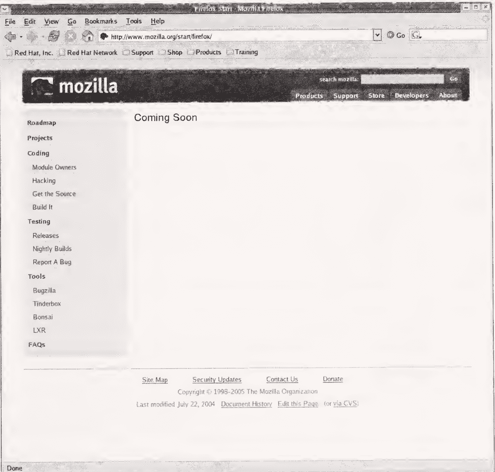

图12-1展示了带有以下工具栏的`Firefox`窗口。

## 工具栏

`Firefox`的工具栏详见表12-1。

| 名称 | 位置 | 功能 |
|------|----------|------------|
| 导航栏 | 顶部 | 前进、后退、主页按钮，URL输入框 |
| 书签栏 | 顶部（导航栏下方） | 存储在个人工具栏文件夹中的书签 |
| 状态栏 | 底部 | 当前页面的URL和进度条 |
| 侧边栏 | 左侧 | 书签、历史记录 |


工具栏是横向排列的同类型图标和菜单的集合。

### 地址输入框

在地址输入框中输入网页URL，`Firefox`就会跳转到对应页面。比如，如果你想找点乐子，可以在输入框中输入`www.theonion.com`。

### 核心浏览窗口（位于工具栏之间）

### Firefox菜单

以下介绍`Firefox`菜单中的重要选项：

### 文件

- 打开新窗口和新标签页，也可关闭它们。
- 打开互联网网页和本地文件（比如你可以浏览电脑上的帮助文件）。
- 将网页保存到电脑、打印网页，以及退出浏览器。

#### 编辑

- 撤销或重做你对地址输入框和交互式网页（比如你在表单中填写的内容）的修改。
- 剪切、复制、粘贴以及删除你用鼠标选中的文本。
- 打开搜索对话框以在网页中查找文本。按下`Ctrl+F`会打开查找文本框，以及`Firefox`窗口左下角的其他搜索选项按钮。在网页中输入要搜索的文本。
- 编辑：点击“偏好设置”菜单即可调整和修改大量`Firefox`选项。“搜索”和“偏好设置”选项将在本章后续内容中介绍。

> 在这“视图”里，Star Jones没什么可说的。

- ✓ 视图：可用于调整和修改`Firefox`的工具栏（具体可见表12-1）。
- ✓ 转到：通过此菜单选项，你可以返回主页、后退和前进。“转到”菜单还会显示你最近访问的10个位置的历史记录，这些功能和导航工具栏中的功能一致。
- ✓ 书签：`Firefox`支持以易于访问的格式保存你常用的网页，具体操作如下：

  - 若要标记网页以便后续返回，请点击“书签”，然后选择“为此页添加书签”。“添加书签”对话框会弹出，在“创建于”子菜单中选择一个文件夹，再点击“添加”。之后你随时可以点击“书签”按钮打开菜单，选择该书签返回对应网页。
  - 若要编辑书签，请选择“书签”→“管理书签”。弹出的对话框支持你对任意书签进行修改、删除、查看信息，以及创建和删除书签文件夹。
  - 放在“个人工具栏文件夹”中的书签会显示在`Firefox`窗口顶部附近的“书签工具栏”中。如果你从《Knoppix入门》DVD（或从`www.knoppix.net`下载的Knoppix CD）运行Live版`Knoppix`，每次重启电脑时都会丢失书签。你可以通过使用持久化`Knoppix`磁盘镜像来保存书签和其他`Firefox`设置，相关内容我在第3章会介绍。

- ✓ 工具：此菜单可用于配置`Firefox`的相关操作，例如下载文件的保存目录。
- ✓ 帮助：选择“帮助”→“帮助目录”，即可打开一个关联了`Firefox`综合信息数据库的对话框。该对话框可访问`Firefox`术语表、索引和搜索引擎，帮助主题会以目录形式展示。

### 配置选项

你启动`Knoppix`后即可直接使用`Firefox`，无需进行任何配置，默认设置的表现非常出色。但稍作调整，你也可以根据自己的需求和偏好自定义`Firefox`，它的可配置性非常强。

如果你从《Knoppix入门》DVD（或从`www.knoppix.net`下载的Knoppix CD）运行Live版`Knoppix`，也可以自定义`Firefox`，但每次重启电脑时`Firefox`都会恢复为默认设置。你可以通过使用持久化`Knoppix`磁盘镜像来保存书签和其他`Firefox`设置，相关内容我在第3章会介绍。

`Firefox`有一个主配置工具：选择“编辑”→“偏好设置”，即可打开“偏好设置”对话框。该工具可帮助你修改`Firefox`的运行行为，以下章节将介绍各个主要功能。点击“偏好设置”对话框左侧的图标即可访问对应功能。

#### 通用

此面板提供了可修改`Firefox`通用运行行为的选项，以下要点将介绍通用功能：

- **主页**：可使用此面板修改默认主目录、字体、语言和连接类型。`Firefox`默认会显示其官方主页`www.mozilla.org/products/firefox`，你可以在对话框右下角的“位置”文本框中输入其他网址，再点击“确定”来更换主页。
- **字体和颜色**：点击此按钮打开对话框，即可修改字体类型、大小、间距和颜色等相关选项。
- **语言**：没什么可疑惑的，点击“语言”按钮打开对话框，就可以更改——没错，就是更改你的系统语言。可惜学一门语言可没这么简单。¿你会说`Knoppix`语吗？Sprechen Sie `Knoppix`？
- **连接**：如果你需要连接Web代理，侧边栏“设置Web代理”会引导你完成相关步骤。如果你直接连接到互联网，则无需连接Web代理：

  - 拨号、DSL和有线调制解调器都属于直接互联网连接。
  - 除非添加了代理，否则私人家庭网络都属于直接连接。你可以使用开源的`Squid`系统搭建自己的Web代理，关于创建和使用代理的信息可参阅`www.squid-cache.org`。

许多局域网要求连接Web代理才能浏览互联网。Web代理可以控制用户浏览的*位置*和*内容*：

- Web代理可以根据出站互联网连接的目的地（有时也包括其内容）接受或拒绝*出站互联网连接*。
- Web代理可以根据入站互联网连接是否属于已有的出站连接，接受或拒绝*入站互联网连接*。（在此场景下，代理会充当*防火墙*的角色。）

Web代理可以通过*缓存*（保存）网页来加快浏览速度。当你再次访问某个页面时，会连接到本地副本而非原始站点。但需要提前提醒你，只有点击“重新加载”按钮时，才能确保你看到的是网页的最新版本，否则缓存可能会提供过期的页面版本。

##### 设置Web代理

如果你的Web浏览器需要代理连接，配置`Firefox`的步骤取决于你使用的是*手动*代理还是*自动*代理。（我一直使用手动设置，因为“自动检测”选项在某些网络环境中无法正常运行。）要设置手动代理，你需要从网络管理员处获取以下参数：

- 代理URL
- 代理端口号
- SSL代理设置（如果使用加密代理）

请按照以下步骤设置Web浏览器以使用手动代理：

1. 选择“编辑”→“偏好设置”，打开“偏好设置”对话框。
2. 点击“通用”图标。
3. 点击“连接设置”按钮。
4. 点击“手动代理配置”选项。
5. 在“HTTP代理”文本框中输入代理URL。
6. 在“端口”文本框中输入代理端口号。
7. 在“SSL代理”文本框中输入SSL代理设置。
8. 点击“确定”退出“偏好设置”对话框。你会返回到“偏好设置”对话框。

要使用自动代理，请按照以下步骤操作：

1. 从你的网络管理员处获取*自动代理URL*。
2. 选择“编辑”→“偏好设置”，打开“偏好设置”对话框。
3. 点击“连接设置”按钮。
4. 点击“自动检测此网络的代理设置”按钮。
5. 在文本框中输入自动代理URL，然后点击“确定”。你会返回到“偏好设置”对话框。
6. 点击“确定”退出“偏好设置”对话框。

### 保存和保护密码

使用互联网意味着要访问大量要求你提供信息的网站。现代浏览器会将密码这类信息存储在本地电脑上，以此优化你的浏览体验。但如果你的电脑被黑客入侵，这些信息就很可能面临泄露风险，因此你必须尽全力保护这些信息，防范黑客和犯罪分子的攻击。正如歌中所唱：“总有一天，他们无论如何都会找上你”，至少会试图获取你的信息。因此，保护你的重要信息非常关键。

当你访问需要输入用户名和密码的网站时，`Firefox`会询问你是否需要让它为你记住密码。如果你点击“记住密码”按钮，`Firefox`就会记住你在网页上输入的密码。（即使从Live版`Knoppix`实例中浏览，你也可以保存密码，但除非你创建持久化`Knoppix`磁盘镜像，否则重启电脑后密码会丢失，相关内容我在第3章会介绍。）

*在浏览器中保存密码既带来了极大的便利，也存在安全风险！任何偷窃或入侵你电脑的人都可以一次性获取所有存储的密码。不过幸运的是，*`Firefox`提供了加密已保存密码的解决方案。你可以设置一个*主密码*，在启动`Firefox`时输入该密码才能访问加密后的密码。请按照以下步骤操作：

1. 点击“更改主密码”按钮。
2. 如果你之前已经创建过主密码，请在“更改主密码...”对话框中输入旧密码。
3. 在“更改主密码...”对话框中输入新主密码。

#### 隐私

互联网是非常实用便捷的工具，但其中也充斥着许多爱打探隐私的人，他们试图获取互联网用户的信息。不过你不用因为隐私顾虑就放弃使用互联网，以下列表将介绍一些`Firefox`可用于保护你信息的特性：

- **历史记录**：`Firefox`会保存你的浏览历史记录，你可以通过它回到想要再次访问的页面。你可以修改历史记录的保存时长，默认保存时长为9天。
- **已保存的表单信息**：在电脑上填写表单和在纸上填写一样麻烦。`Firefox`会保存你在表单中输入的信息，让表单填写更轻松一些。
- **已保存的密码：** 有关此选项的详细信息，请参阅侧边栏中的《保存与保护密码》。
- **缓存：** `Firefox`会缓存你浏览过的所有网页供后续检索，以此加快浏览速度。当你再次访问某个网页时，`Firefox`会优先使用缓存页面，只有在无法使用缓存时才会重新从网站加载。

### 网页功能

`Firefox`提供了多项功能，让浏览更轻松有趣。你可以通过点击偏好设置对话框中的「网页功能」来访问以下菜单选项：

- **阻止弹出窗口：** `Firefox`默认会拦截弹出窗口！正如霍默·辛普森所说：“哇哦！！！”你可以使用这些选项修改弹出窗口拦截规则。
- **允许网站安装软件：** `Firefox`会询问你是否允许网站安装软件，或是阻止此类操作，默认设置为允许安装。
- **加载图片：** `Firefox`默认会显示网站的文本和图片。你可以使用此选项屏蔽来自以下来源的图片：

  - 广告
  - 第三方网站

- **启用`Java`：** 默认开启。许多网站使用`Java`提供更精美的图形和动画，你无需更改此选项。
- **启用`JavaScript`：** `JavaScript`默认开启。但`JavaScript`存在较大的安全漏洞，黑客可能会利用它窃取密码、自动签署并发送订单、重定向银行访问信息等。你可以按照以下步骤关闭此选项：

  1. 点击「编辑」，然后选择「偏好设置」，此时会打开偏好设置窗口。
  2. 点击「网页功能」链接。
  3. 点击「启用JavaScript」按钮，将其切换为关闭状态。
  4. 点击「确定」。

关闭`JavaScript`会限制你使用依赖它提供交互功能的网页。我个人习惯在需要时开启`JavaScript`，用完后再关闭。

> 你必须使用`Create a persistent Knoppix disk image`工具来保存你对本节所述`Firefox`默认设置所做的修改，详情请参阅第3章。

### Firefox与Cookie

Cookie可以让Web服务器使用起来更便捷。*cookie*是当你使用Web服务器时，存储在你系统上的小型文本文件，会保存你的个人信息。例如，部分网页（如`my.yahoo.com`）可以自动为你登录。如果你想实现自动登录，Web服务器会在你的系统中查找存储了密码的Cookie。

- 广告软件会在你的电脑上安装菜单栏或是展示广告。
- 间谍软件会秘密监控你的行为（可能会窃取你的密码）。

目前`Knoppix`（以及其他`Linux`发行版）相对不易受到恶意软件的影响，但未来恶意软件可能会成为`Knoppix`系统的普遍问题。

> *恶意软件*会以Cookie从未被设想过的用途来使用它：

### 下载

`Firefox`可以下载各类文件，例如软件包和多媒体文件。以下选项可以帮助你管理下载：

- **下载文件夹：** 选择默认下载目录（文件夹）。
- **下载管理器：** 控制下载过程中是否打开下载管理器，以及下载完成后是否自动关闭。
- **文件类型：** 为下载的文件类型关联特定操作。例如，你可以设置`Firefox`在下载OGG文件时自动打开XMMS多媒体播放器（详见第14章）。
- **插件：** 点击此按钮可查看`Firefox`支持使用的插件。有关插件的更多信息，请参阅侧边栏《Firefox插件》。

### 高级设置

`Firefox`可高度自定义，在需要时会提供安全（SSL）连接。你可以在高级设置窗口中找到SSL相关选项，还可以通过「标签式浏览」菜单控制`Firefox`的标签页功能。

> **提示** 你完全不需要修改安全功能。

## Thunderbird电子邮件客户端

Mozilla `Thunderbird`不像电视剧里的木偶角色那样“起飞”。`Thunderbird`是一款电子邮件应用程序（或称*客户端*），你可以用它收发电子邮件。工程师们肯定会不惜一切代价来使用`Thunderbird`。

### Firefox插件

插件是能给浏览器增加额外功能的小型软件，可以执行特定功能，例如播放动画图形。`Firefox`支持自动下载和安装插件。当`Firefox`需要某个插件时，会询问你是否要下载安装该插件。点击**确定**，剩下的工作`Firefox`会自动完成。（大多数时候它都能搞定，但偶尔也需要你手动安装插件，这种情况请查看插件附带的说明。）

以下是从互联网手动安装常用插件的方法：

1. 打开`Firefox`，访问`www.shockwave.com`。你会看到窗口上半部分的中间位置有一个空白白色方框，上面标注着*Click here to download the plugin*。
2. 点击空白区域，会打开插件查找服务对话框，提示`Macromedia Flash Player`插件可用。
3. 点击「下一步」。下一个对话框会显示`Macromedia`许可协议。如果你睡不着觉，可以叫上你的法务团队来审核这份文档。
4. 点击「我同意」按钮，然后点击「下一步」。插件会自动下载并安装。
5. 点击「完成」按钮。`Firefox`会自动刷新，你就能在之前空白的区域看到`Shockwave`内容了。

#### 查看已安装插件

- 要查看`Firefox`的插件，请在地址栏中输入`about:plugins`。
- 要查找众多常用插件，请点击`plugindoc.mozdev.org`链接。

#### 安全浏览

加密和验证你的交易是安全进行互联网业务的唯一方式。加密是将信息打乱的行为（或技术），只有正确解密后才能读取。打乱和解密操作由使用加密密钥和解密密钥的*密码*完成。加密通信信道需要双方共享一个通用加密密钥，同时必须防止其他任何人获取该密钥。找到共享加密密钥的方法是实现实用型安全互联网通信的“关键”。

`CA`是计算机领域中的可信权威机构。想要向客户端提供已验证证书的Web服务器需要付费让`CA`为其证书签名。当你浏览该网站时，会下载该证书并验证`CA`签名。验证通过后，你的浏览器会提取服务器的公钥，并建立加密连接。`PKE`仅用于启动加密连接，该连接用于交换对称加密密钥。

以下是浏览器验证`CA`的方式：**公钥加密（PKE）** 支持与网站进行安全通信，`PKE`使用两个密钥：

- **私钥：** 只有私钥所有者才能解密由公钥加密的信息。任何持有公钥的人都可以与私钥所有者进行秘密通信。持有私钥的Web服务器可以接受来自多个客户端的安全连接，没有私钥的公钥持有者之间无法互相窃听。


- **公钥：**任何持有公钥的人都可以解密由私钥加密的信息。这使得持有私钥的服务器可以向其公钥客户端发送加密指纹以验证自身真实性。只有私钥可以对指纹加密，公钥客户端才能解密该指纹。

1. 当你的浏览器连接到`SSL`服务器时，会接受该服务器的`SSL`证书，并提取`CA`签名。
2. 如果你的浏览器可以使用`CA`的公钥解密该证书，则说明`CA`是有效的。
3. 浏览器会提取并验证服务器的公钥。

`PKE`支持你安全连接到Web服务器，但有一个问题：服务器如何安全地分发其公钥？Netscape通过密钥分发系统解决了这个问题：安全套接层（`SSL`）。`SSL`通过证书自主分发公钥。当你通过`SSL`连接到Web服务器时，服务器会向其发送证书。证书是包含以下内容的文件：服务器的公钥和指纹、证书颁发机构（`CA`）的名称，以及`CA`的指纹。基于`SSL`的连接使用超文本传输安全协议（`HTTPS`）。`SSL`的URL如下所示：`https://signin.ebay.com`。当`SSL`连接处于活动状态时，你的Web浏览器会在窗口左下角显示锁形图标。

Web服务器也可以自行签署自己的证书。当你浏览网站时，如果对话框提示浏览器无法验证证书，说明你遇到了自签名证书。如果你无法验证证书，就会面临中间人攻击的风险（即有人伪装成该网站）。但如果你能验证证书，就是安全的。例如，许多公司和组织会为其内部网站自行签署证书。

雷鸟提供了你在电子邮件客户端需要的所有功能。它提供了许多实用的功能，例如：

- **多个电子邮件账户：**可以为自己和朋友设置账户。
- **拼写检查：**发送消息前检查拼写。
- **消息搜索：**我会保存所有重要的（以及许多其他）邮件，需要查找个人信息时会在雷鸟的消息文件夹中搜索。（我也会定期备份已保存的邮件。）
- **IMAP功能：**`IMAP`（互联网消息访问协议）允许电子邮件客户端下载邮件标题，而非邮件本身（除非你明确下载邮件）。这样你就可以从多个位置浏览电子邮件账户，且不会影响你的邮件。
- **SSL连接：**如果你开启`SSL`，雷鸟可以安全连接到你的邮件服务器（通常是你的互联网服务提供商）。你也可以配置`IMAP`通过`SSL`运行。

雷鸟非常易于使用。点击KDE Kicker上的蓝色地球/信封图标即可启动它。首次使用雷鸟时会出现配置向导。以下说明将介绍如何配置这款软件。无论是运行永久版还是实时版Knoppix，你都可以使用本章的配置步骤。不过，如果你是从《Knoppix入门经典》DVD（或从`www.knoppix.net`下载的CD）运行实时版Knoppix，除非你使用持久化主目录，否则每次重启电脑时都需要重复这些步骤。（第3章将介绍如何使用持久化主目录。）

### 添加电子邮件账户

请按照以下说明在雷鸟中设置基于`IMAP`的电子邮件账户：

1. 点击Kicker上的雷鸟图标启动它，此时会打开导入向导对话框。
2. 点击“下一步”按钮，此时会打开雷鸟邮件与新闻组窗口（如图12-2所示），同时账户向导也会打开。

**图12-2：**雷鸟配置工具。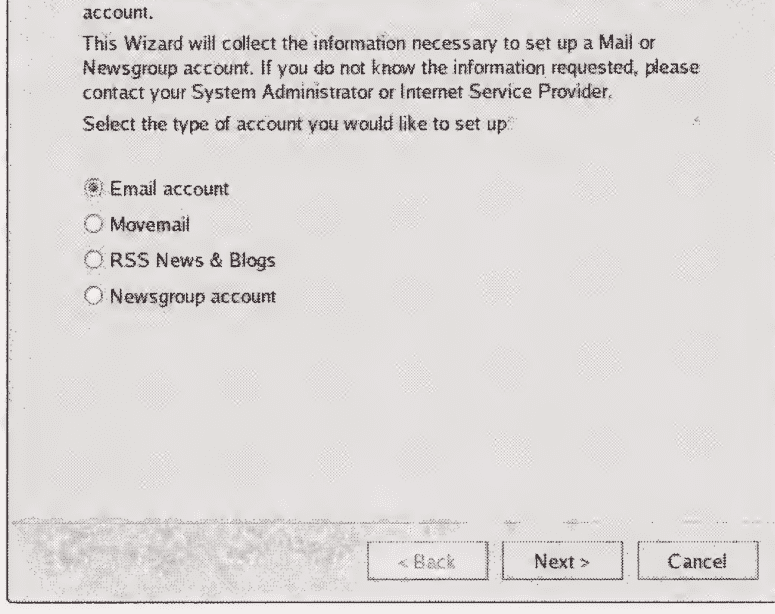

3. 你可以选择创建其他类型的账户，但请保留“电子邮件账户”选项的勾选状态，然后点击“下一步”，此时账户向导会打开“身份”选项。
4. 在提供的输入框中输入你的姓名和电子邮件地址。你的互联网服务提供商（`ISP`）会提供你的电子邮件地址，你的父母会提供你的姓名。
5. 点击“下一步”，此时账户向导会打开“服务器信息”选项。
6. 你的互联网服务提供商（`ISP`）会为你提供邮局协议（`POP`）账户或`IMAP`账户，也可能两者都有。如果有选择权，请点击`IMAP`。
7. 输入你的邮件服务器名称，然后点击“下一步”。

   - 在“传入服务器”文本框中输入接收你邮件的服务器名称。
   - 在“传出服务器”文本框中输入发送你邮件的服务器名称。此时账户向导会切换到“用户名”选项，向导会使用你的名字首字母加姓氏来生成默认的电子邮件账户用户名。

8. 将默认用户名修改为你的互联网服务提供商（`ISP`）分配的用户名（如果两者不同），然后点击“下一步”，此时向导会显示你的电子邮件地址。
9. 将你的电子邮件地址修改为你的互联网服务提供商（`ISP`）分配的地址（如果两者不同），然后点击“下一步”按钮，此时账户向导会显示你刚刚输入的信息。
10. 点击“完成”按钮即可退出向导。你的新电子邮件账户会以文件夹形式显示在雷鸟窗口的左上角。

在使用新的雷鸟电子邮件账户前，你需要登录到你的互联网服务提供商（`ISP`）的邮件服务器。

1. 点击你的`ISP`电子邮件账户的“收件箱”子文件夹，此时会打开“需要邮件服务器密码”对话框。
2. 在文本框中输入你的`ISP`密码。
3. 点击“使用密码管理器保存此密码”按钮。
4. 点击“确定”，此时会打开警告对话框，提示你应当保护好自己的密码。下一节将具体介绍如何操作。
5. 点击警告对话框中的“确定”。

### 设置并保护你的账户密码

当你输入`ISP`电子邮件账户密码时，雷鸟会询问你是否要本地保存该密码。本地保存密码意味着你每次访问账户时无需手动输入密码，非常方便，但存在安全风险。如果黑客获取了这些密码，将所有密码存放在一处会给他们带来极大的便利。幸运的是，雷鸟提供了加密密码的选项。你可以设置主密码，之后你每次输入密码时，雷鸟都会对其进行加密。所有已保存的密码都会以强加密的方式存储在本地。

### 使用SSL保护电子邮件连接

你可以通过使用`SSL`保护你与`ISP`之间的`IMAP`（`imaps`）连接，来提升对黑客的防护能力。根据你的`ISP`的服务水平，你可以保护接收的邮件、发送的邮件以及你的电子邮件账户密码。请按照以下说明在雷鸟电子邮件客户端中设置`imaps`：

1. 选择“工具”→“账户设置”，此时会打开账户设置对话框。
2. 点击“服务器设置”，右侧窗口会切换到服务器设置界面。
3. 选择“使用安全连接（`SSL`）”单选按钮，这会保护你的收件。`IMAP`端口号会从`143`变为`993`。
4. 如果你的`ISP`提供发件加密服务，请点击“传出服务器（`SMTP`）”选项，然后点击对应你`ISP`邮件服务器的按钮。根据你的`ISP`提供的服务，点击“`TLS`（传输层安全）”按钮或`SSL`按钮。如果你不确定你的`ISP`是否提供发件加密，但认为其可能提供，请点击`TLS`（如果可用）。
5. 点击“确定”。

每次启动雷鸟时，你都需要输入主密码，之后你各个单独的密码会被解密，可供你使用。解密后的密码会存储在内存中，而非你的硬盘驱动器上。退出雷鸟时，解密后的密码会消失。如果你的`ISP`允许你使用基于`SSL`的`IMAP`（`imaps`），你可以保护你的收件阅读会话和电子邮件账户密码不被窥探。`imaps`协议会保护你的收件连接，就像`HTTPS`保护你的浏览会话一样。侧边栏《使用SSL保护电子邮件连接》介绍了如何为雷鸟配置`imaps`。如果你想在输入电子邮件账户密码前配置`imaps`，请在设置密码前按照该侧边栏的步骤操作。

### 请按照以下步骤设置主密码

1. 在雷鸟窗口中点击“工具”→“选项”，此时会打开选项窗口。
2. 点击“已保存密码”选项，再点击“主密码”按钮，此时会打开主密码对话框。
3. 点击“使用主密码加密已保存密码”按钮。
4. 点击“修改密码”按钮，此时会打开修改主密码对话框。
5. 在这两个文本框中输入你的主密码：

   - 新密码
   - 再次输入新密码

6. 点击“确定”，界面将返回主密码对话框。
7. 点击“确定”。
8. 再次点击选项对话框中的“确定”。此时你的电子邮件账户密码已被加密，可防范黑客。启动雷鸟时，你需要输入主密码来解密并访问你的电子邮件账户密码。现在你可以安心睡个好觉了。

## 第四部分：不可避免的互联网

# 第五部分：使用Knoppix工作（与娱乐）

## 第五波

作者：Rich Tennant


> “我们在这里非常重视网络安全。”

# 本部分导览

`Knoppix`提供了日常计算任务所需的工具，本部分将介绍如何使用这些工具。第13章将介绍`OpenOffice.org`桌面办公套件。该套件具备与`Microsoft Office`相同的功能——文字处理、电子表格、幻灯片等，还支持读写`Microsoft`格式的文件！第14章将介绍如何播放`MP3`和`Ogg Vorbis`格式的音乐，以及如何观看电视。第15章将介绍如何将你的`Knoppix`工作站连接到现有打印机。第16章将介绍如何将你的计算机连接到文件服务器。

## 第五部分：使用（和玩转）Knoppix


## 第13章：使用OpenOffice.org

### 本章内容

- 介绍`OpenOffice.org`
- 从`OpenOffice.org`窗口视角审视
- 为`OpenOffice.org`功能注入活力
- 使用`Writer`进行写作

`OpenOffice.org`是一个开发`Linux`办公软件套件（类似`Microsoft Office`）的开源项目。`OpenOffice.org`的办公套件提供了桌面计算机所需的所有功能，例如文字处理、电子表格创建、幻灯片演示和绘图工具。`OpenOffice.org`办公套件与`Microsoft Office`兼容。我在`OpenOffice.org Writer`上撰写了本书，并且与使用`Microsoft Word`的编辑们交流时毫无问题。撰写和编辑书籍会将文字处理器推向极限，涉及宏、样式表和多层次的修订跟踪。本书展示了`OpenOffice.org`的能力和可靠性。`OpenOffice.org`办公套件包含文字处理器、电子表格应用、演示文稿创建器和绘图应用。本章将描述如何使用这些功能。

### 在OpenOffice.org窗口中工作

要打开`OpenOffice.org`窗口，请在KDE Kicker栏上点击一个蓝色水面上海鸥的图标。`OpenOffice.org Writer`随即打开，如图13-1所示。


文字处理是最流行的办公应用，因此`Knoppix`默认打开它。

图13-1：`OpenOffice.org Writer`窗口。

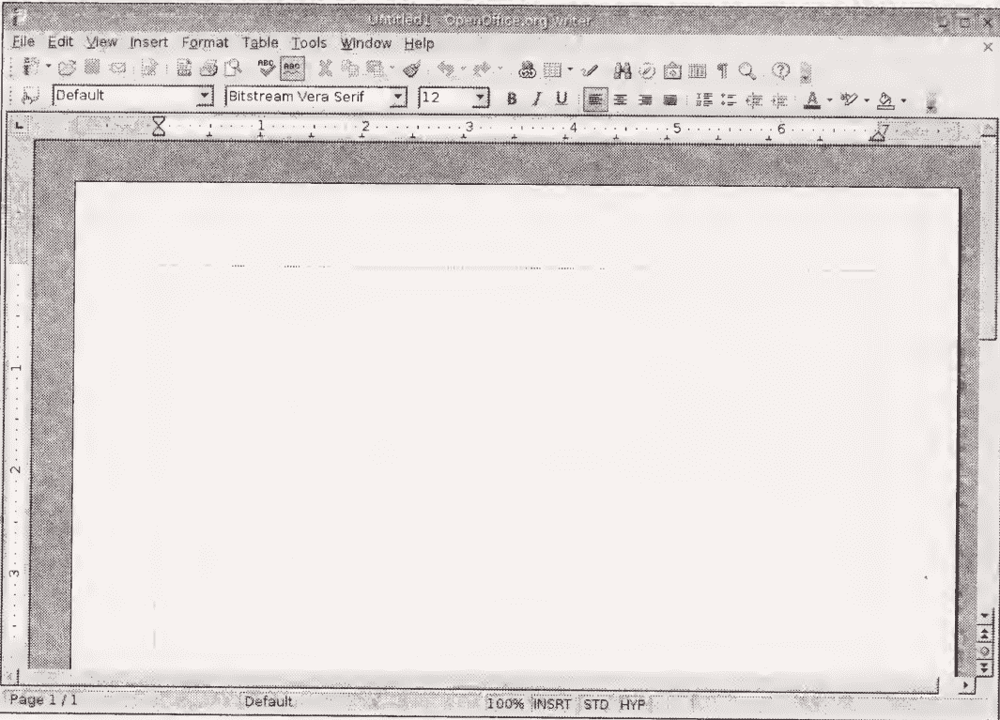

`Writer`窗口与任何其他`OpenOffice.org`窗口（`Calc`、`Impress`等）几乎完全相同。唯一的区别在于每个窗口执行的功能。


你可以通过以下方式从`Writer`启动其他`OpenOffice.org`应用程序：

- 选择“文件”→“新建”并选择文件类型。
- 选择“K-菜单”→“OpenOffice.org”，并从下拉菜单中选择应用程序。

启动任何`OpenOffice.org`应用程序都会打开一个显示相同功能布局的窗口。每个应用程序使用相同的菜单和工具栏布局及配置。这使得使用`OpenOffice.org`非常简单直观。


你可以在`OpenOffice.org`组件内插入`OpenOffice.org`组件。例如，你可以在绘图中放入一个电子表格，然后将这个绘图放入文本文档中。

## 工具栏

打开任何`OpenOffice.org`应用程序，你会在窗口顶部、侧面和底部看到几个工具栏。窗口布局包括以下对象：

- **菜单：**位于窗口顶部，包含应用程序的主要功能。
- **功能栏：**提供菜单中最常用功能的快捷方式。例如，点击软盘图标可以快速保存文档或电子表格。
- **对象栏：**提供常用对象导向菜单功能的快捷方式。你可以直接点击对象栏上的“下划线”图标为字符添加下划线，而无需选择“格式”→“字符”并选择“下划线”。
- **主菜单工具栏**
- **状态栏**
- **标尺**

功能栏和对象栏水平放置在窗口顶部，包含代表主要功能（如格式化和文件操作）的图标。将鼠标光标悬停在图标上，你会看到其名称或功能的简短描述。我将在下一节描述一些主要的`OpenOffice.org`功能。

### 菜单

每个`OpenOffice.org`应用程序使用相同的菜单系统。常用的功能和操作包括：

- **文件操作：**允许你访问许多面向文件的操作。最有用的选项将在本章后面的“文件管理”部分描述。
- **编辑：**执行标准的编辑任务，例如剪切、复制和粘贴；访问诸如搜索选项和修订跟踪等有用功能。修订跟踪会揭示作者的所有瑕疵和错误。这是编辑们首选的沟通渠道。它也是可怜作者们的噩梦。（我把我的错误归咎于高中时太容易经常逃英语课了。）修订跟踪对于以下情况很有用：

  - 与其他人协作完成项目。
  - 记录你自己的更改日志。

- **视图：**更改屏幕上元素的显示方式，例如放大倍数、工具栏、标尺栏和文本边界。缩放不会改变字体大小；它就像用放大镜查看文档。
- **插入：**将对象（如特殊字符、宏、表格、图形和其他文档）放入你的`OpenOffice.org`文档中。点击“插入”→“特殊字符”，会打开一个充满字符符号的对话框。如果你想以欧元列出`Knoppix`的价格，找到（在菜单底部附近）并点击`€`符号，然后加上一个零。即使考虑到美元对欧元的贬值，`Knoppix`在`€0.0`的价格下仍然很划算。
- **格式：**更改你的格式设置。选中文本并选择“格式”→“默认”会将文本更改为默认的10磅`Times New Roman`字体。你可以根据所选内容，一次更改字符、段落或整个页面的格式。
- **工具：**访问拼写检查器、同义词库以及诸如通用`OpenOffice.org`配置工具等实用功能。如果你是一个糟糕的拼写者（像我一样）或者不擅长想词（也像我一样），这些功能会有所帮助。
- **帮助：**“救命！我需要帮助！”好吧，去获取帮助。点击“帮助”→“内容”，`OpenOffice.org`帮助窗口会打开。使用其“目录”选项卡、“索引”选项卡、“查找”字段（搜索关键词）和“书签”来找到你需要的帮助。


### 文件管理

本节描述如何使用`OpenOffice.org`打开和保存文件。

#### 打开文件

使用“文件”菜单访问`OpenOffice.org`文件。以下是最常用的面向文件的功能：

- **新建：**选择“文件”→“新建”，会出现一个菜单。你可以选择想要创建的新文件的文件类型。文件类型包括：

  - 文本文档
  - 电子表格
  - 演示文稿（幻灯片放映）
  - 绘图

- **打开：**选择“文件”→“打开”，会出现“文件选择”对话框。该对话框是一个迷你文件管理器，你用它来选择要打开的文件。如果打开现有文件时遇到问题，请使用侧边栏“打开现有文件”。
- **保存：**选择“文件”→“保存”以保存你正在处理的文件。保存后可以继续使用该文件。或者，按`Ctrl+S`或点击对象栏上的软盘图标来保存文件。
- **另存为：**此菜单会打开一个对话框，让你选择要保存的文件的名称、位置和类型。更多信息请参见“保存文件”部分。
- **关闭：**选择“文件”→“关闭”以关闭当前文件，而不退出`OpenOffice.org`窗口。
- **退出：**选择“文件”→“退出”以关闭当前文件并退出`OpenOffice.org`。

#### 打开现有文件

在某些情况下，当你尝试重新打开文件时，`OpenOffice.org Writer`在`Knoppix`中会冻结。如果它在你的`Knoppix`系统上冻结了，你可以轻松解决这个问题。请按照以下步骤操作：


1. 点击KDE Kicker栏中的`Konsole`（终端程序）图标。
2. 输入以下命令：

```bash
sed -i 's/export OPENOFFICE_MOZILLA_FIVE_HOME /#export OPENOFFICE_MOZILLA_FIVE_HOME/' /opt/openoffice/program/soffice > temp
```

此命令会找到并禁用启动`OpenOffice.org Writer`脚本中的问题环境变量。

3. 输入此命令将更改保存到`OpenOffice.org Writer`启动脚本：

```bash
sudo mv -i temp /opt/openoffice/program/soffice
```

4. 输入此命令使新脚本可执行：

```bash
sudo chmod 755 /opt/openoffice/program/soffice
```

应用此修复程序一次后，如果你满足以下条件，它在每次启动`Knoppix`时都会自动应用：

- 从永久安装运行`Knoppix`。
- 直接从DVD启动`Knoppix`时使用“持久化Knoppix镜像”选项。

你还可以执行其他有趣且实用的操作，比如将文件导出为`PDF`（便携式文档格式）文件。只需选择“文件”→“导出为PDF”即可。`PDF`文件被广泛用于文档分发。

### 保存文件

选择“文件”→“另存为”打开“另存为”对话框。该对话框允许你选择要保存的文件名、目录（文件夹）、保存设备以及文件类型。以下列表介绍了相关选项：

- **文件名：**如果你是首次保存新文件，请在“名称”文本框中输入要保存的文件名。否则，文本框会显示原始文件名，你可以根据需求选择是否修改。
- **保存位置：**这个下拉菜单允许你选择其他常用位置和设备来保存文件。例如，选择“主目录”即可将文件保存到你的主目录中。
- **浏览其他文件夹：**点击这个下拉菜单会打开一个迷你文件管理器，默认显示当前目录。如果你想更换保存位置，可以用它选择其他文件夹。
- **文件类型下拉菜单：**`OpenOffice.org`支持将文件保存为其他格式。默认格式始终是`OpenOffice.org`原生格式，但`OpenOffice.org`也支持常见格式，比如文字处理和电子表格文件类型。

#### 配置


OpenOffice.org拥有大量配置选项，你可以通过“配置与选项”工具控制其中大部分选项。选择“工具”→“配置”打开配置工具。该配置工具可修改以下OpenOffice.org功能：

- **菜单：** 重新编程菜单功能，创建新菜单。
- **键盘：** 重新编程键盘，以匹配你的使用习惯。
- **状态栏：** 显示OpenOffice.org窗口的当前状态。你可以通过此选项卡切换日期、时间等显示选项。
- **工具栏：** 创建、删除、自定义、显示和隐藏工具栏。
- **事件：** 为打开或关闭OpenOffice.org等操作分配宏。

该配置工具是*上下文驱动的*，它会根据你使用该工具配置的OpenOffice.org应用提供专属选项。例如，Writer和Calc的键盘选项是不同的。


**提示** 重新编程键盘可以节省时间和精力。OpenOffice.org Writer自带内置功能快捷键，例如按下`F1`即可打开帮助窗口。你可以根据需求重新编程按键。按照以下说明将`F4`键修改为将选中的单词或文本加粗：

1. 点击“工具”→“自定义”。“自定义”对话框随即打开。
2. 向下滚动，在“功能/类别”菜单中点击“格式”选项。
3. 向下滚动，在“功能/功能”菜单中点击“加粗”选项。
4. 在“快捷键”菜单中点击`F4`，然后点击“修改”按钮。
5. 点击“确定”。对话框关闭，`F4`键即可被设置为将文本加粗。

“配置”对话框提供了单选按钮，用于为你所做的任何更改设置上下文，可选择以下两种模式：

- **OpenOffice.org：** 提供通用配置上下文。
- **单个OpenOffice.org应用（如Writer）：** 此选项（默认选项）会使工具适配当前使用的应用（本例中为Writer）的专属上下文。

## 使用Writer编辑文档

OpenOffice.org Writer可以读写多种常见文件格式。要将文件保存为其他格式，请点击“文件”→“另存为”。“文件选择”对话框随即打开。你可以将Writer文件保存为以下格式：

Writer衍生自Starwriter。使用这些格式保存文件，即可与Starwriter交换文件。

- **Microsoft Word 97/2000/XP：** 这些文件使用`.doc`后缀，如你所料，它们与Word 97、Word 2000和Word XP文档兼容；尚不支持Word 2003的格式。
- **文本：** 你可以将文件保存为无格式的纯文本。
- **HTML：** OpenOffice.org提供了HTML（超文本标记语言）编辑器来创建网页。点击“文件”→“新建”→“HTML文档”即可打开该编辑器。
- **Microsoft Word 95：** 这些文件使用`.doc`后缀，与Word 95文档兼容。
- **Microsoft Word 6.0：** 这些文件使用`.doc`后缀，与年代久远的Word 6.0文档兼容。

你可以随时按下`F11`打开“段落样式”对话框。使用样式格式化文本后，该样式会被插入到OpenOffice.org Writer窗口左上角附近的“应用样式”子菜单中。

- **富文本格式：** 富文本格式（RTF）是一种通用文档格式，所有主流文字处理器都支持。
- **Starwriter：** Starwriter文字处理器由太阳微系统公司销售。

## 第14章

### 使用多媒体

### 本章内容

- 欣赏你最爱的CD
- 使用Ogg Vorbis标准收听流媒体音乐
- 观看DVD（也许可以）
- 观看电视

**K**noppix是一个出色的多媒体平台，它提供的音视频应用能让你轻松进入娱乐世界。本章将介绍如何使用Knoppix的各类多媒体应用，比如XMMS、Xine和xawtv。


多媒体应用最好在已安装到硬盘的Knoppix系统中运行。从硬盘运行速度更快，而且有更多空间保存和处理媒体文件；你也可以更轻松地使用DVD或CD-ROM驱动器。不过，你也可以按照本章的说明，从配套DVD（或从`www.knoppix.net`、`www.knoppix.org`下载的CD）启动的实时Knoppix实例中运行这些应用。如有需要，我会特别说明在实时Knoppix实例中运行时的操作注意事项。

### 使用Knoppix播放音频媒体

以下部分将介绍如何使用Knoppix播放音频文件，你的音源可以是传统音乐CD或较新的MP3文件。此外还会介绍如何连接开源广播流。

### 播放CD

任何靠谱的电脑都能当CD播放器用。Knoppix*每天*早起都能当CD播放器。

#### 在实时Knoppix中运行

如果你正在运行实时Knoppix实例，首先需要弹出Knoppix的DVD或CD。如果你正从光盘运行Knoppix，怎么弹出它呢？以下说明将介绍具体操作流程：


1. 点击Kicker上的Konsole（终端程序）图标。你即将移除存储了所有Knoppix程序和工具的Knoppix DVD。实时Knoppix使用的大部分软件已经存储在内存磁盘中，移除Knoppix光盘不会影响它们。但播放音频CD时，Knoppix可能无法访问部分程序，这种情况下你需要重新插入Knoppix光盘才能使用相关软件。还有可能Knoppix会卡死，此时你需要重启系统。
2. 在Konsole窗口中输入以下命令：

```bash
sudo umount -l /cdrom
sudo eject
```

你的CD/DVD驱动器会弹出。

3. 取出Knoppix DVD，插入音乐CD。
4. 点击K菜单，选择“多媒体”→“xine”。Xine会打开两个窗口：控制GUI和显示GUI。控制GUI用于控制媒体的播放操作，显示GUI则用于播放视频或显示音乐的可视化效果。图14-1展示了控制窗口。

#### 图14-1：Xine控制窗口

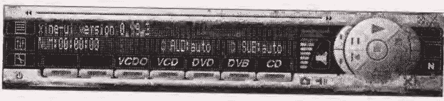

5. 点击控制窗口右侧的CD按钮，CD就会开始播放。是不是很方便？
6. 听完后弹出CD，再插入Knoppix DVD即可。
7. **在Konsole（终端）窗口中输入以下命令。**

```bash
sudo mount /dev/cdrom /cdrom
```

Knoppix DVD已挂载完成，现在可以正常使用。

## 从永久的Knoppix安装运行

以下是从永久的Knoppix实例播放音频CD的方法：

1. **将CD放入光驱。** CD的图标稍后会出现在桌面上。
2. **启动播放器。** 你可以选择以下操作：
   - 右键点击图标，选择“播放”选项。
   - 点击`K菜单` → `多媒体` → `XMMS`。

你的CD就会开始播放。能跟上节奏吗？

3. **听完后弹出CD。**

## 收听MP3

MP3是一种商业的、有专利的音频格式，可将模拟音频信号压缩为数字形式，因此你可以在小型播放器或CD上存储大量乐曲。如果你拥有iPod或同类播放器，或是向电脑下载音乐，相关文件很可能都是MP3格式编码的。X Multimedia System（XMMS）原生支持播放MP3。开始嗨吧：

1. **（合法地）将MP3文件下载到你的电脑中。**
2. **打开XMMS（点击`K菜单` → `多媒体` → `XMMS`）。**
3. **在XMMS对话框的右半部分任意位置右键点击，选择“播放文件”。** “播放文件”对话框随即打开。
4. **选中MP3文件，点击“播放”。** 你就可以跟着音乐摇摆了。克劳斯很喜欢XMMS的可视化插件，尤其是“What a goom”，它们提供了丰富多彩、观赏性强的视觉隐喻，能提升你的听觉体验。

## 用Ogg Vorbis收听广播

Ogg Vorbis是一款开源音频格式，可作为有专利的MP3的替代方案。它的保真度和压缩效果都比MP3更优，而且不包含任何受专利保护的算法或限制性授权的软件。Knoppix内置了多款支持Ogg Vorbis格式的多媒体播放器。XMMS是一款非常小巧的播放工具，支持播放Ogg和MP3编码的音乐文件。下一部分将介绍如何使用XMMS。

## XMMS播放功能

你可以按照以下说明，使用XMMS收听在线电台：

1. 如有需要，先连接互联网。本书第四部分有关于建立网络连接的信息和说明。
2. 打开火狐浏览器。维珍电台（网址：`www.virginradio.co.uk`）就是提供优质Ogg流媒体服务的网站之一。
3. 在火狐浏览器的地址栏输入Ogg流媒体源的网址。比如，在窗口上方的火狐文本框中输入维珍电台的网址——`www.virginradio.co.uk`，然后按下回车键。你就会进入维珍电台的主页。（我喜欢维珍电台，尤其是因为阿尔伯克基和英国有8小时的时差，收听他们的深夜/凌晨轮播节目很方便。）


## 操作XMMS

如果你知道网址，就可以手动启动XMMS播放网络流。你可以通过查看网站或者XMMS本身找到该网址。检查你的`/tmp`目录下的`/tmp/live.pls`（在线播放列表）文件，其中包含了网络音频流的网址。

XMMS提供了两种方法来查找音频流的网址：

- [✓] 打开“文件信息”对话框，点击窗口左侧的“I”按钮，对话框中就会显示该网址。

例如，你可以按照以下步骤播放维珍电台的网址：

1. 点击Kicker上的Konsole（终端程序）图标。
2. 在窗口中输入以下命令：`xmms http://ogg.smgradio.com/vr160.ogg`
3. 点击“点击此处”链接。
4. 点击维珍电台主页上的**立即收听**链接，“在线收听我们”窗口随即打开。
5. 点击对应你网络类型的按钮：
   - Ogg Vorbis 调制解调器
   - Ogg Vorbis 宽带

“打开Live.pls”对话框随即打开，默认使用Rhythmbox播放Ogg Vorbis和MP3格式的流媒体。

6. 点击“确定”，Rhythmbox配置对话框随即打开。
7. 点击“下一步”。
8. 点击“跳过”，再点击“完成”，Rhythmbox窗口随即打开，和如图14-2所示的窗口一致。

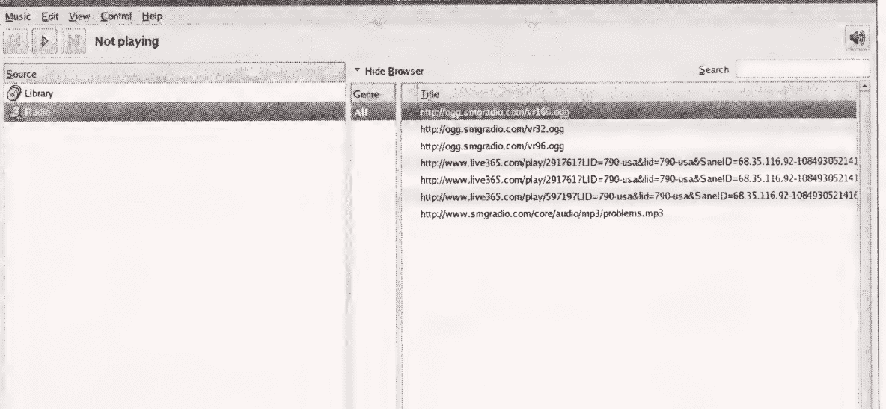

**图14-2：** Rhythmbox正在播放网络电台。


9. 点击Rhythmbox窗口顶部的播放按钮。

**提示** Rhythmbox的操作逻辑和普通实体或软件播放器一致，点击标准按钮即可进行播放、暂停、停止等操作。

## XMMS快捷键


XMMS的窗口左侧设有*快捷键按钮*，按钮分别标注为*O*、*A*、*I*、*D*和*V*，这些快捷键按钮不太显眼。

点击`D`按钮可以放大两倍窗口尺寸。

各快捷键按钮对应的功能如下：


- **O**：打开“选项”菜单，你可以通过该菜单访问XMMS的所有配置项和功能。
- **A**：切换*窗口置顶*功能，开启后XMMS窗口会始终显示在其他窗口上方。
- **I**：打开“文件信息”对话框，显示文件名、目录（比如光驱）或网络流的相关信息。
- **D**：将XMMS窗口尺寸放大两倍，再次点击即可恢复默认尺寸。
- **V**：打开菜单，可修改窗口左侧（可视化区域）的显示内容。

### Knoppix影片播放

Knoppix还可以充当迷你影院，你可以使用Knoppix自带的工具播放DVD。

### 用Xine播放DVD

本节将介绍如何播放未加密的老旧DVD。


> 全球的内容管制方都很喜欢自己舒适、封闭的生态，它们通过*加密*DVD来确保这种生态的延续，阻止盗版者和普通用户观看DVD。没错，你甚至可能无法观看自己合法购买的DVD。DVD管制方甚至会起诉破解了其加密方案的开源开发者，因此在Linux上播放商业DVD的功能受到限制。这种情况和图书出版商加密自己的书籍内容、要求用户购买商业产品才能解密没什么区别，简直糟糕透顶。

Knoppix内置了Xine DVD播放器，准备好你的DVD、爆米花、沙发和土豆。播放步骤如下：

1. 将DVD插入DVD光驱。需要说明的是，你需要配备支持DVD的光驱才能执行以下操作。
2. 右键点击KDE桌面（左上角）上的CD-ROM图标，会弹出（视频）菜单。（别让爆米花烤焦了哦。）
3. 点击“操作”，选择DVD/VCD播放器，炫酷的Xine窗口就会华丽弹出。
4. 在Xine窗口的任意位置右键点击，选择“显示GUI”，Xine控制面板对话框随即打开。
5. 点击播放器窗口上的DVD按钮。如果你尝试播放加密DVD，会弹出错误提示，点击“完成”按钮就能结束这令人沮丧的步骤。

FBI不会加密DVD开头的警告信息，你随时可以观看这部分内容，《X档案》的主角穆德都会为此感到骄傲。

### 用Knoppix看电视

你用电脑的时候总归绕不开电视，是不是很讽刺？要通过Knoppix电脑看电视，你需要一块PCI电视调谐卡。Knoppix兼容基于bttv芯片组的PCI和USB接口调谐器。你可以在文件`/usr/src/linux/Documentation/video4linux/CARDLIST.bttv`中找到更多关于兼容电视调谐卡的信息。


`/usr/src/linux/Documentation/video4linux/CARDLIST.bttv`

按照以下步骤安装并配置调谐器：

1. 连接你的电视调谐卡，记录其芯片和调谐器类型。
   - 如果你使用的是 PCI 电视设备，将其插入电脑的主板，安装前请参考设备说明书。
   - 如果你使用的是 USB 电视设备，将其插入 USB 端口，后续步骤需要用到芯片组和调谐器的相关信息。
2. 点击 K 菜单，选择 KNOPPIX ► 配置 ► 电视卡 ► 配置电视卡（bttv 芯片组）。


## 第五部分：使用 Knoppix（工作与娱乐）

以 Root 身份运行，KDE su 对话框将打开。

3. 输入 `root` 密码，并可选择单击“保留密码”按钮。电视卡的初始设置（步骤 1/3）对话框将打开。
4. 从菜单中选择您的电视卡类型，然后单击“确定”。电视卡的初始设置（步骤 2/3）对话框将打开。
5. 从菜单中选择您的调谐器，然后单击“确定”。电视卡的初始设置（步骤 3/3）对话框将打开。
6. 单击“确定”。xawtv 的初始设置（步骤 1/4）对话框将打开。
7. 选择您所在地区使用的电视制式，然后单击“确定”。美国使用 NTSC；日本使用 NTSC-JP；欧洲大部分使用 PAL，但法国和东欧使用 SECAM。您可以在 `www.alkenmrs.com/video/wwstandards1.html` 查找您所在地区的制式标准。
8. 选择您所在地理位置对应的广播频率表，然后单击“确定”。xawtv 的初始设置（步骤 3/4）对话框将打开，询问您是否接受该配置。
9. 单击“是”。xawtv 软件会打开一个窗口，显示其搜索每个频道（频率）活动信号时的进度。完成后，xawtv 电视窗口将打开。真是皆大欢喜——您将乐不可支！

# 第 15 章：使用 Knoppix 打印

## 本章内容

- 连接到本地打印机
- 连接到网络打印机

打印是一个混乱且有时很困难的过程。墨水或墨粉必须精确地放置在纸上，才能形成清晰的文本和图像。配置计算机进行打印的任务可能会让您抓狂。然而，Knoppix 使打印变得轻而易举。它提供了一个易于使用且全面的打印机配置实用程序。本章介绍如何将打印机连接到您的 Knoppix 计算机并进行配置。它还展示了如何连接到网络打印机。约翰内斯·古登堡（Johannes Gutenberg）会感到骄傲的。


本章的说明针对的是永久安装的 Knoppix。当您从 `Knoppix For Dummies` DVD（或从 `www.knoppix.net` 或 `www.knoppix.org` 下载的 CD）运行实时 Knoppix 实例时，也可以使用本章中的步骤。但是，在那种情况下，除非您使用持久化主目录，否则每次重启 PC 时都必须重复这些步骤。（第 3 章向您展示了如何使用持久化主目录。）

## 本地连接的打印机

本节描述如何——当当当！——从连接到本地打印机的 Knoppix 计算机进行打印。

### 连接

将打印机连接到您的 Knoppix 计算机需要打印机足够靠近以连接到您的计算机：

- 并行电缆的可靠距离大约为 20 英尺（或更粗略地说，6 米）。
- USB 电缆的可靠距离为 16.5 英尺。

### 配置

当您的打印机连接到您的 Knoppix 计算机后，请按照以下说明使其工作：

1. 选择 K 菜单 → KNOPPIX → 配置 → 配置打印机。
2. 如果出现提示，在对话框中输入 `root` 密码，然后单击“确定”。“配置 – KDE 控制模块”对话框将打开，如图 15-1 所示。

   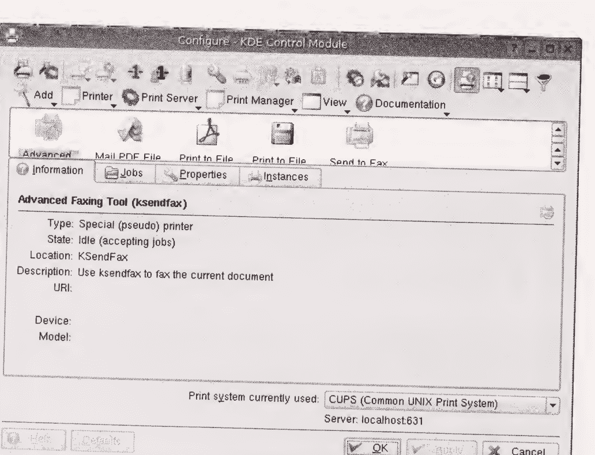

   图 15-1：“配置 – KDE 控制模块”帮助您配置打印机。

### 宏观视角：本地打印

设置本地打印机就像一、二、三一样简单：

1. 连接打印机。
2. 为打印机配置您的计算机。
3. 打印到打印机。
4. 选择添加 → 添加打印机/类。添加打印机向导将打开。
5. 单击“下一步”。对话框显示打印机队列类型菜单。
6. 单击“本地打印机（并行、串行、USB）”按钮，然后单击“下一步”。对话框显示“本地端口选择”菜单。Knoppix 擅长检测打印机，因此您的打印机应显示在此菜单中。Knoppix 支持串行打印机，但祝您好运能找到一台。串行打印机已经像八轨磁带播放器一样过时了。我不讨论如何配置串行打印机，因为它们太罕见了。

   

7. 根据您的打印机是否被检测到，执行以下步骤：
   - 如果您的打印机被检测到，选择您的打印机（它会显示在 URI 文本框中）。
   - 如果您的打印机未被检测到，单击端口类型（`USB` 或 `Parallel`）。

   

8. 单击“下一步”。对话框显示“打印机型号选择”窗口。如果在步骤 6 中检测到了，会显示打印机制造商和型号。
9. 找到并选择您的打印机的制造商和型号，然后单击“下一步”。“驱动程序选择”对话框将打开。您可以从多个打印机驱动程序中选择，其中包括一个推荐的驱动程序。
10. 通过单击选择推荐的驱动程序类型。
11. 单击“下一步”。“打印机测试”对话框将打开。
12. 开始或跳过打印机测试。
    - 如果要测试打印机，请单击“测试”，然后按照边栏“测试您的本地打印机”中的说明操作。
    - 如果要跳过测试，请单击“下一步”。我建议进行测试。

    

13. 跳过封面页选择，单击“下一步”。

    “打印机配额设置”对话框将打开。封面页部分仅在多人使用同一台打印机打印时才重要。

14. 您可以跳过设置配额，单击“下一步”。

    

    “用户访问设置”对话框将打开。它允许您拒绝某些用户的打印机访问权限。

15. 您可以跳过设置任何用户访问限制，单击“下一步”。
16. 为您的打印机分配一个名称，然后单击“下一步”。

    

    “确认”对话框显示您配置工作的结果。传统上，Linux 使用默认打印机名 `lp`。许多应用程序使用默认设置进行打印。使用名称 `lp` 可以增加 Linux 应用程序无需修改其默认打印机配置即可工作的机会。

17. 单击“完成”。

    控制权返回到“配置 – 打印机”窗口。

18. 单击“关闭”。

您现在可以向您的打印机进行打印了。例如，要从 Firefox、Thunderbird 或 OpenOffice.org Writer 打印，请选择文件 → 打印。将打开一个对话框，您可以从中选择要使用的打印机（如有必要），然后单击“确定”进行打印。

> **测试您的本地打印机**
>
> 如果您在配置本地打印机时使用“测试”选项，“信息 – KDE 控制模块”对话框将打开。然后您可以向您的打印机发送打印作业。如果它打印出来，您的打印机配置就是正确的。如果没有，您应该重复配置步骤并使用不同的驱动程序。
>
> **检查您的打印机输出：**
>
> ✓ 如果输出文本看起来清晰可读，请单击“确定”。Knoppix 会自动返回到添加打印机向导，以便您可以完成配置。
>
> ✓ 如果输出不清晰，或者看起来像是随机字符，那么请重新阅读本节中的打印机配置说明，但选择并测试不同的驱动程序。

## 网络打印机

Knoppix 打印机配置实用程序使连接到网络打印机变得容易。本章的其余部分将指导您完成此过程。要连接到网络打印机，您的 Knoppix 计算机必须能够访问网络打印服务器。

### 基本信息

当您连接到网络打印机时，您可能需要有关打印服务器的以下信息：

- 网络共享名称或 IP 地址
- 用户名，以及（如有必要）密码
- 队列类型

以下队列类型常用：

- **CUPS**：通用 UNIX 打印系统是标准的 Linux 打印系统。
- **LPD**：Linux 打印机守护程序（LPD）是传统的打印服务，正迅速被 CUPS 取代。

> LPD 必须消亡！这不是昆汀·塔伦蒂诺的电影；这是 Linux 打印社区的观点。

- **内置打印服务器的网络打印机**：许多消费级和大多数商用打印机提供网络连接和内置打印服务器。最常见的内置网络打印服务器是惠普的 JetDirect 系统。
- **SMB**：服务消息块是当今许多文件共享的基础。客户端通过 SMB 将要打印的文件传输到打印服务器。Linux 计算机可以通过使用 Samba 系统“说” SMB 语言（协议）。Samba 允许 Linux 计算机向 Windows 计算机提供打印服务。


### 元视角：网络打印配置

为您的 Knoppix 计算机配置网络打印机非常简单。以下列表描述了配置流程：

1. 将计算机连接到网络。
2. 选择要使用的网络打印服务类型。
3. 为打印机配置计算机。
4. 向打印机发送测试打印任务。

## 连接到网络打印机


您需要告诉 Knoppix 计算机在哪里可以找到远程网络打印机。找到打印机后，您需要配置 Knoppix 使其与该打印机兼容工作。

使用以下说明前，您需要满足以下条件：

- ✅ 将计算机连接到带有远程打印机的私有网络。
- ✅ 了解远程打印机的打印队列类型。

如果您不知道这台打印机对应哪种打印队列类型，您可以：

- 咨询您的系统管理员或服务台（如果您正在公司网络中办公）。
- 登录打印服务器查看打印队列类型（适用于家庭网络）。


您可以点击“扫描”按钮浏览可用的网络打印机。

## 开始配置

以下步骤介绍了如何启动网络打印机的配置流程：

1. 选择 K 菜单 ➔ KNOPPIX ➔ 配置 ➔ 配置打印机。如果您使用的是永久安装的 Knoppix 系统，会弹出“以 root 身份运行 - KDE su”对话框。
2. 如果出现提示，输入 `root` 密码并点击确定。此时会打开“配置 - 打印机”对话框。
3. 选择添加 → 添加打印机/打印机类。此时会打开添加打印机向导。
4. 点击下一步。“后端选择”对话框会显示打印队列类型的菜单。下一节将介绍如何选择您打印机的对应队列。

### 选择打印队列

“后端选择”对话框允许您从多种打印服务器队列类型中选择。以下各节将介绍如何根据您打印机的打印队列类型进行操作。

## CUPS 打印服务器

如果您的网络中有 CUPS 网络打印服务器，请按照以下步骤使用：

1. 在“后端选择”对话框中，点击“远程 CUPS 服务器（IPP/HTTP）”按钮，然后点击下一步。此时会打开“用户身份验证”对话框。
2. 如果打印服务器需要身份验证，请点击“普通账户”按钮并输入用户名和密码。此时会打开“远程 IPP 服务器”对话框。
3. 在“主机”文本框中输入打印服务器名称。此时会打开“远程 IPP 打印机选择”对话框。
4. 从窗口中选择您的打印机，然后点击下一步。

## SMB 打印服务器

如果您的网络中有 SMB 网络打印服务器（Windows 系统或安装了 Samba 的 Linux 系统），请按照以下步骤使用：

1. 在“后端选择”对话框中，点击“SMB 共享打印机（Windows）”按钮，然后点击下一步。此时会打开“用户身份验证”对话框。
2. 如果打印服务器需要身份验证，请选择以下任一选项：
   - 点击“普通账户”按钮并输入用户名和密码。如果您在打印服务器上有用户账户，请选择此选项。

     

     

   - 选择“访客账户”选项。如果您在打印服务器上没有用户账户，请选择此选项。
3. 点击下一步。此时会打开“SMB 打印机设置”对话框。
4. 根据实际情况输入工作组、服务器名称和打印机名称。
5. 点击下一步。

## 带内置服务器的网络打印机

如果您的网络打印机带有嵌入式打印服务器（如 JetDirect），请按照以下步骤使用：

1. 点击“网络打印机（TCP）”，然后点击下一步。此时会打开“网络打印机标识”对话框。

   

2. 输入打印机的网络共享名称或 IP 地址。如果您不知道网络名称或 IP 地址，可以点击“扫描”按钮，让 Knoppix 自动查找。
3. 按下 Enter 键，选中“端口”文本框中预填的 `9100` 值。`9100` 是 JetDirect 的默认端口。
4. 点击下一步。

## LPD 打印服务器

如果您的网络中有基于 LPD 的网络打印服务器，请按照以下步骤使用：

1. 点击“远程 LPD 队列”按钮，然后点击下一步。此时会打开“LPD 队列信息”对话框。
2. 在对应的文本框中输入打印机的主机名（或数字 IP 地址）和队列名称。
3. 点击下一步。

## 完成配置

选择并配置完打印服务器类型后，会打开“打印机型号选择”对话框。请按照以下说明完成网络打印机的配置：

1. 如果对话框无法识别您的打印机，请手动标识打印机：
   - 向下滚动“制造商”子菜单，点击您打印机的制造商。
   - 向下滚动“型号”子菜单，点击您的打印机型号。
2. 点击下一步。此时会提供多种打印机驱动程序供您选择，其中包含推荐的或默认的类型。
3. 点击下一步选择推荐的驱动程序类型。
4. 点击“测试”按钮。此时会打开“信息 - KDE 控制模块”对话框。
5. 检查打印机的输出内容，然后点击确定。界面将返回添加打印机向导。
6. 点击下一步跳过横幅选择。仅当多人共用同一台打印机时，横幅设置才有意义。
7. 点击下一步跳过配额设置。此时会打开“用户访问设置”对话框，您可以通过该对话框禁止某位用户使用打印机。
8. 点击下一步。
9. 为您的打印机命名，然后点击下一步。“确认”对话框会显示您配置操作的结果。
10. 点击“完成”按钮。界面将返回“配置 - 打印机”窗口。
11. 点击“关闭”。搞定——现在您可以在整个私有网络中打印了，您的计算机再也不需要靠近那台“机械巨兽”了。


您可以点击“配置 - KDE 控制模块”对话框中的“任务”选项卡查看打印任务的状态。如果存在排队任务，您会在对话框底部的子窗口中看到所有排队任务。您可以通过点击队列子窗口上方的对应按钮来暂停、取消或调整任务顺序；将鼠标光标移到按钮上即可查看按钮名称。

# 第五部分：使用（以及玩转）Knoppix

## 第 16 章：在网络中共享文件

### 本章内容

- 介绍 NFS 和 Samba 文件共享系统
- 使用 NFS 共享文件
- 使用 Windows 文件共享

Knoppix 的一大优势是可直接从 DVD 或 CD-ROM 启动，无需在计算机上安装该系统。插入光盘即可开始使用。

但有晴天就难免有雨天。这种模式的一大缺点是没有固定的存储位置（即没有持久的主目录）。从 DVD 实时启动 Knoppix 时，系统不会自动为您分配持久的主目录。

不过实际情况是，这只是短暂的“小雨”，很快就会放晴：没有持久的主目录其实并不是什么大问题。Knoppix 提供了多种保存工作成果的方法。本章将介绍如何（在条件允许的情况下）使用网络存储作为您的主目录。

## 文件共享基础

Knoppix 的文件共享功能让用户可以“两全其美”：

- ✔ 只需搭建并管理一台中央文件服务器，无需维护多块独立硬盘，从而降低管理成本。
- ✔ 只需使用一个统一的主目录，无需管理多个，提升使用便利性。

本章将介绍如何使用两种主流的网络存储类型：

- ✔ **网络文件系统（NFS）：** 该系统主要用于 Linux 和 UNIX 系统，Knoppix 默认提供 NFS 支持。
- ✔ **Windows 文件共享：** 微软 Windows 文件服务器可与其他 Windows 计算机共享文件。Knoppix 提供了与 Windows 兼容的 Samba 文件共享系统，支持您使用 Windows 文件共享。


### NFS 与 Samba 文件共享系统

- 支持您将远程目录（Windows 系统中称为“文件夹”）当作本地目录使用。
- 采用客户端-服务器模型：服务器向客户端提供服务，多个客户端可以同时连接到同一台服务器。

本章默认您可以访问提供 NFS、Samba 或两者都提供的网络。


本章主要介绍如何配置 Knoppix 的 DVD 或 CD 版本以使用 NFS 和 Samba 文件共享。不过，您也可以在永久安装的 Knoppix 系统中使用远程文件系统。

## 配置 NFS 客户端

NFS 主要用于 Linux 和 UNIX 系统。NFS 并不是资助互联网早期发展的那个政府机构——那是美国国家科学基金会（NSF）。NFS 是一个基于网络的文件共享系统，非常易于使用。

本节默认您的 Knoppix 计算机已连接到提供 NFS 服务的局域网（LAN）。许多专业网络环境（如企业、高校）中都部署了 NFS 服务器。


第 23 章将介绍如何为您的私有网络搭建专属的 NFS 或 Samba 文件服务器。侧边栏《元视角：连接 NFS 服务器》概述了连接已有 NFS 服务器的完整流程。

NFS 通常用于提供集中式主目录：

- 服务器导出 `/home` 目录，客户端挂载该目录。
- 客户端上的用户账户使用挂载的 `/home` 目录，为本地用户提供主目录。

下一节将介绍如何从 NFS 文件服务器挂载 NFS 文件系统。请先将计算机连接到局域网，然后按照以下步骤从 Knoppix 计算机访问 NFS 共享。


第 10 章和第 11 章介绍了如何将 Knoppix 计算机连接到私有网络（有线或无线均可）。NFS 在这两种网络下都能正常运行，不过无线网络的速率通常低于有线网络。

## 元视角：连接 NFS 服务器

连接 NFS 服务器非常简单。你需要在服务器端配置允许客户端访问其目录，再将客户端连接到服务器。本章重点讲解挂载用户账户主目录的方法。这类 NFS 配置的核心是确保用户和组标识符（uid 和 gid）在 NFS 服务器与客户端上保持一致。你需要和友好的系统管理员（sysadmin）密切配合；如果你自己管理系统，那直接咨询你自己即可。（还可以向自己收取一笔不菲的咨询费。）

你必须确保客户端和服务器的用户账户相互匹配。默认情况下，NFS 使用用户 ID（uid）来允许或拒绝访问。客户端用户账户必须和服务器上共享资源的 uid 一致，才能完全访问该资源。NFS 通常用于允许一台机器上的用户访问对应服务器上的账户目录。

- 从 NFS 服务器导出目录，如有需要可请本地管理员协助完成。
- 将你的 Knoppix 客户端计算机连接到带有 NFS 服务器的网络。
- 配置 Knoppix 以挂载 NFS 服务器的主目录。
- 将 NFS 服务器的主目录挂载到你的计算机上。
- 将 NFS 客户端设置保存到 U 盘或软盘里。

### 在 NFS 服务器上创建并导出用户账户

本节介绍如何获取本地（客户端）用户账户的相关信息，供 NFS 服务器使用。你的本地用户账户必须和 NFS 服务器上的账户保持一致。以下步骤可获取 NFS 服务器系统管理员导出你的 Knoppix 用户账户所需的信息：

- 登录到你的 `knoppix` 用户账户。
- 打开终端窗口。
- 输入以下命令，获取本地（客户端）用户账户 ID（uid）和组 ID（gid）。

```bash
id
```


在 Knoppix 实时 DVD 上运行时，你会自动登录到 `knoppix` 用户账户，其 `uid` 和 `gid` 均为 1000。不过，这些步骤仅适用于永久安装的场景。

## 第五部分：使用（和玩转）Knoppix

### 获取主机名

- 输入以下命令，获取你的 Knoppix 计算机的主机名。

```bash
hostname
```

实时 Knoppix 实例的默认主机名是 `box`。当你获取到本地用户账户的 `uid` 和 `gid` 后，将它们提供给 NFS 服务器系统管理员，并要求管理员：

- 创建具有相同 `uid` 和 `gid` 的用户账户。
- 将你的主目录导出到你的 Knoppix 计算机。

Linux 计算机通常使用 `/home` 目录存放用户目录。（Knoppix 沿用了这一惯例。）Linux NFS 服务器通常会将 `/home` 目录导出到 NFS 客户端。NFS 服务器配置完成后，你就可以从 Knoppix NFS 客户端挂载该目录了。

### 将 Knoppix 配置为 NFS 客户端

按照以下步骤将 NFS 服务器的文件共享导出到你的 NFS 客户端：

- 点击 Kicker 上的终端图标，打开终端仿真器（shell）窗口。
- 输入以下命令切换到 `root` 用户。

```bash
su -
```

- 弹出提示时输入 `root` 密码。
- 启动 `portmap` 守护进程，该进程可使你的计算机作为 NFS 客户端运行。

```bash
/etc/init.d/portmap restart
```

- 配置 `portmap` 守护进程开机自启：

```bash
update-rc.d portmap defaults
```

- 创建挂载点（也就是你的主目录的“家”），命令如下：

```bash
mkdir /dirname
```

例如，输入 `mkdir /nfs` 即可创建挂载点。

- 修改 `/etc/fstab` 配置文件，实现 NFS 文件共享开机自动挂载，输入以下命令：

```text
nfsserver:/home /dirname nfs defaults 0 0
```

将 `nfsserver:` 和 `/dirname` 替换为实际的 NFS 服务器名称和已导出的 NFS 共享路径（挂载点）。例如，以下示例使用了 IP 地址 192.168.1.1 和共享路径 `/nfs`：

```text
192.168.1.1:/home /nfs nfs defaults 0 0
```

你可以使用命令 `showmount -e NFS-server-IP-address` 来查询 NFS 服务器导出了哪些目录，以及允许哪些客户端访问。

### 挂载远程文件共享

你可以挂载来自 NFS 服务器的 NFS 文件共享。输入以下命令挂载 NFS 共享：

```bash
mount -a -t nfs
```

`-a` 选项会挂载 `/etc/fstab` 中找到的所有分区（包括 NFS 分区）。你可以通过输入以下命令来测试新配置是否生效：

```bash
ls -l /nfs-mount-dir
```

例如，如果你的 NFS 挂载点是 `/nfs`，就输入 `ls -l /nfs`。你应该能看到远程用户账户主目录的内容。如果测试配置时没有看到远程文件共享，请按以下步骤排查：

- 尝试手动挂载 NFS 共享，在以下命令中填入服务器的实际名称或数字 IP 地址：

  ```bash
  mount -t nfs nfsserver:/home /nfs
  ```

  例如，如果服务器 IP 地址是 192.168.1.200，就输入：

  ```bash
  mount -t nfs 192.168.1.200:/home /nfs
  ```

- 如果手动挂载后仍无法访问 NFS 共享，请让系统管理员检查 NFS 服务器配置。

### 保存你的设置

如果你从 DVD 或 CD 运行 Knoppix，你需要将 NFS 设置保存到 U 盘或软盘中，这样每次启动计算机时就不用手动重复这些步骤。

如果你运行的是永久安装的 Knoppix，NFS 配置会自动保存，每次重启时都会自动加载，无需手动保存任何内容。

如果你从 DVD 或 CD 运行 Knoppix，“创建持久磁盘镜像”工具可以将你的 NFS 客户端设置保存到可移动设备中。（该设备可以和保存主目录的存储设备相同，如第 3 章所示。）我使用 U 盘保存持久设置，因为它价格低廉、可靠且易于使用。

按照以下步骤保存你的设置：

- 将永久存储介质插入你的 Knoppix 计算机，可以使用 U 盘或软盘。
- 如果尚未从持久 Knoppix 镜像运行，点击 K 菜单，选择 KNOPPIX -> 配置 -> 创建持久 KNOPPIX 镜像，会弹出创建 KNOPPIX 配置归档对话框。
- 点击确定，对话框会显示可用存储设备的菜单。
- 点击 `/mnt/sda: [Disk/Partition]` 按钮，再点击确定，对话框会显示进度条，表示正在保存计算机的配置。
- 点击确定。
- 点击 K 菜单，选择注销。
- 点击重启按钮重启计算机。在 `boot:` 提示符下输入以下任一命令即可加载设置（第一个示例挂载 U 盘）：

```bash
knoppix myconfig=/mnt/sda1
```

```bash
knoppix myconfig=scan
```

- 使用以下命令重启 `portmap` 并重新创建 `/nfs` 挂载点：

```bash
sudo /etc/init.d/portmap restart
```

```bash
sudo mkdir /nfs
```

- 使用以下命令挂载远程目录：

```bash
sudo mount -a -t nfs
```

现在你可以使用 `/nfs` 目录存储文件了。你的主目录仍然是 `/home/knoppix`，位于 RAM 磁盘中。不过，你保存到 `/nfs/knoppix` 的所有内容都会被实际存储，重启后依然存在。

### 使用 Samba 和 Windows 文件共享

本节介绍如何浏览和挂载现有的 Windows 文件共享。后续章节会具体讲解如何制作 Samba 挂载。这些步骤假设你所在的网络已导出 Windows 文件共享，无论该共享来自微软 Windows 文件服务器还是基于 Linux（或 UNIX）的服务器都可以；基于 Linux/UNIX 的服务器会使用 Samba 来模拟 Windows 的相关功能。

使用 Samba 导出共享的流程分为三步：

- 将你的 Knoppix 计算机连接到带有 Windows 文件服务器的网络。
- 查找已导出的文件共享目录。
- 配置 Knoppix 以挂载远程文件共享。

## 共享 Windows XP 文件夹

如果你想用 Windows XP 电脑作为实验平台来使用 Knoppix 和 Samba，请按照以下步骤配置 Windows XP 以导出文件夹：

1. 右键点击你要导出的文件夹，例如选择「我的文档」文件夹。
2. 在文件夹的「共享」菜单里选择「共享和安全」，此时会打开文件夹的「属性」对话框。
3. 选择「在网络上共享这个文件夹」选项（或者点击「在网络上共享这个文件夹」按钮）。
4. 点击「应用」。
5. 点击「确定」。现在你可以从 Knoppix 中浏览并使用该文件夹。完成文件夹导出实验后，请取消文件夹的共享。

请按照以下步骤取消文件夹共享：

1. 右键点击你不再需要导出的文件夹，然后选择「共享和安全」。
2. 点击「在网络上共享这个文件夹」按钮以禁用共享。
3. 点击「应用」。
4. 点击「确定」。

后续章节将介绍如何从 Knoppix 电脑准备、配置并使用 Windows 文件共享。（你首先需要连接到网络，第 10 章和第 11 章会介绍如何连接有线网络和无线网络。）网络中必须存在可浏览、可交互的 Windows 文件共享。

### 浏览和使用文件共享

KDE 的 Konqueror 浏览器可以作为网络文件共享浏览器。请按照以下步骤在 Knoppix 电脑上浏览和使用文件共享：

1. 点击 K 菜单，选择 KNOPPIX -> 实用工具 -> Samba 网上邻居。如果你使用的是永久安装的 Knoppix，会弹出「以 root 身份运行 - KDE su」对话框。
2. 如果提示输入，请输入 `root` 密码。此时会打开 `smb:/ – Konqueror` 对话框，显示所有可访问的工作组。Windows 文件共享使用工作组的概念。需要协同工作、共享文件、文件夹、打印机等公共资源的计算机和服务器属于同一个工作组。工作组用于归类「志同道合」的资源。
3. 点击你想要浏览的工作组，对话框会显示该工作组下的所有计算机。
4. 点击你想要浏览的计算机，对话框会显示该计算机导出的所有共享资源。共享资源是计算机在网络上共享的文件夹（Linux 里称为目录）。

> 记住你妈妈常说的话：分享是好事。

5. 点击你想要浏览的共享资源，对话框会显示该共享资源的内容。（图 16-1 是一个示例窗口。）

- 如果文件共享设置为可读写，你可以（意料之中，意料之中）读写其中的文件和文件夹。
- 如果文件共享设置为只读，你可以读取文件但无法写入。


### 自动挂载 Samba 共享

如果文件共享没有密码保护，你可以将其设置为永久挂载，只需在 `/etc/fstab` 文件中添加一行你的自定义配置即可，该行的格式如下：

```text
//server/share /mount-point smbfs defaults 0 0
```

例如，要挂载 192.168.1.1 上的 CD 驱动器，请使用以下配置：

```text
//192.168.1.1/cdrom /samba smbfs defaults 0 0
```

重启后该命令会自动挂载共享。如果文件共享有密码保护，你需要在重启后手动运行 `mount -a` 命令。你可以自动将密码传递给挂载进程，但这需要将密码以明文形式保存在文件中。这通常不是个好主意。

6. 如果你使用的是实时运行的 Knoppix 实例，请记录「位置」文本框中显示的文件共享 URL。如果你希望将文件共享作为虚拟本地文件系统挂载，就可以用到这些信息。本章后续的「挂载共享」一节包含了相关操作说明。
7. 如果你使用的是永久安装的 Knoppix，你可以创建指向 Samba 共享的快捷方式图标，请按照以下步骤操作：

   - 点击文件共享图标并将其拖到 KDE 桌面上。
   - 当弹出提示询问是移动、复制还是链接新图标时，选择「链接」选项。现在你就可以像操作自己电脑上的文件夹一样，操作这个文件共享文件夹了。

如果你使用的是永久安装的 Knoppix，KDE 桌面上的文件共享图标会被保存下来。你可以重启电脑，点击文件共享图标来访问文件。下一节将介绍如何永久挂载 Windows 文件共享，该过程在使用实时或永久安装的 Knoppix 时是相同的。

### 挂载共享

Samba 网上邻居工具可以让你交互式使用远程共享。该工具会运行另一个工具（`kio_smb`），用于连接服务器，并在客户端和服务器之间传输数据。当你注销或重启时，连接会断开。

你可以使用 `smbmount` 工具实现远程文件共享的自动挂载，`smbmount` 会将共享资源作为虚拟文件系统挂载。

1. 点击 Kicker 上的终端图标打开命令行终端，此时会打开 Shell Konsole 窗口。
2. 创建一个用于挂载 Samba 分区的目录，例如：

   ```bash
   sudo mkdir /samba-mount-dir
   ```

   例如，创建一个名为 `/samba` 的目录：

   ```bash
   sudo mkdir /samba
   ```

3. 输入以下命令挂载 Samba 共享：

   ```bash
   smbmount //server/share /mount-point
   ```

   例如，以下命令可连接到 `192.168.1.1` 服务器上的 `/cdrom` 共享：

   ```bash
   smbmount //192.168.1.1/cdrom /samba
   ```

   `/mnt` 是一个通用挂载点，你可以创建自己的挂载点，例如 `/sbmount`。
4. 如果提示输入，请输入文件共享密码。远程文件共享会像本地文件系统一样被挂载，你可以像使用其他文件系统一样使用它。

# 第五部分：使用 Knoppix 工作（与娱乐）

## 第六部分：系统管理

《第五波》 作者：Rich Tennant

> 警长，这又是一起奶牛箱毁坏案。你看机箱被切得多么整齐。如果我的直觉没错，你就算找一千英里外也找不到这块主板。

## 本部分内容概览

俗话说得好，只工作不玩耍，聪明孩子也变傻。不过我们一开始已经玩了够多，现在是时候认真工作了。本部分将介绍如何完成从简单到复杂的各类系统管理操作。

第 17 章介绍如何修复常见的 Linux 和 Windows 问题，比如无法启动或其他故障的硬盘。第 18 章内容的难度稍高，将介绍如何查杀病毒、蠕虫等恶意软件。第 19 章讲解如何保持电脑软件处于最新版本，第 20 章介绍系统日志。最后，第 21 章将讲解如何制作属于你自己的定制版 Knoppix 光盘。

## 第 17 章：救救我：修复 Linux 和 Windows 电脑

### 本章内容

- 使用 Knoppix 启动
- 重置 `root` 密码
- 修复 Linux 硬盘
- 克隆硬盘

做我要的，不要做我说的！如果你能发明出能实现这种要求的电脑，你一定会成为亿万富翁。遗憾的是，电脑会完全按照指令执行，这就是问题所在。电脑没有自主意识，（抛开好莱坞的演绎不谈）它们分不清你或者某个程序员给它们的指令是错误的。很多人（包括我）靠维修电脑谋生，这些电脑只会严格执行指令，却不会做人类真正想让它做的事。目前还是要靠人类来修电脑。

Knoppix 完美契合这一需求，它是一个非常棒的电脑维修平台，能让电脑为你工作而不是跟你作对。本章将介绍如何把 Knoppix 当作平台，修复一些常见的电脑问题，比如无法启动的磁盘。好了，解决方案已经来了！Knoppix 就是你要的工具，所以我们开始吧。

> 本章重点介绍如何使用《Knoppix 入门经典》DVD 来修复故障电脑。启动实时运行的 Knoppix 可以让你处理原本无法启动的电脑，你可以使用 Knoppix 的很多工具和程序来给电脑「看病」。（本章不涉及永久安装的 Knoppix 的使用。）

## 启动操作系统

就像人类一样，计算机也有顺心和不顺心的日子。有时候它们很难“起床”开始新的一天。每个人偶尔都需要在虚拟的屁股上踢一脚，或者拽着自己的鞋带把自己拉起来。Knoppix 可以帮你修复那些启动困难的计算机。因此，在运用 Knoppix 解决或修复计算机问题之前，你应该先了解计算机是如何自我启动的。

开机时，计算机会自动从特定的内存位置获取信息。该内存位置的内容会将微处理器重定向到硬盘、DVD/CD-ROM、软盘、U 盘或网络的另一个位置；这种重定向由 BIOS（基本输入/输出系统）控制。微处理器会加载内存前几百字节的内容。这些字节中包含一个微处理器执行的小程序，称为启动引导程序。启动引导程序会加载并开始运行操作系统。


“启动引导程序”这个名字来自“拽着自己的鞋带把自己拉起来”这个说法，"boot the computer"（启动计算机）这个短语也正来源于此。以下是启动流程的分步说明：

1. 计算机开机（或重启）。给计算机通电会为微处理器（例如英特尔奔腾处理器）供电。微处理器会立即查找一个预定的内存位置。微处理器也常被称为 CPU（中央处理器）。重启计算机相当于模拟先断电再通电的过程。CPU“感知”到的是连续的内存位置或地址序列，这个地址序列被称为地址空间。现代 32 位和 64 位 CPU 的地址空间以数万亿字节（GB）为单位计量。
2. BIOS 将微处理器重定向到 MBR（主引导记录）。BIOS（基本输入/输出系统）的作用是映射计算机的硬件，让微处理器知晓每个组件的位置。其中一个映射功能定义了开机后微处理器被立即重定向的位置，重定向指向（或应当指向） MBR。

   

3. CPU 加载并执行 MBR 中的内容。计算机首次通电时，没有任何程序或操作系统控制 CPU。微处理器唯一能做的就是按顺序遍历它被指向的每一个内存位置。
4. MBR 中包含的程序（即启动引导程序）会将 Linux 内核加载到内存中。
5. 启动引导程序会通知处理器开始执行 Linux 内核，内核随后会挂载文件分区、启动服务等。MBR 包含部分数据和一个小型启动引导程序，这些数据中包含计算机磁盘分区的相关信息。启动引导程序会挂载磁盘分区中的文件系统，然后加载并启动运行根文件系统中的操作系统。

   

以上是对启动流程的极简概述。了解计算机的启动原理，在计算机无法启动时进行修复会大有帮助。你可以使用 Knoppix 来帮助修复或抢救故障计算机。接下来的章节将展示如何从磁盘无法启动等故障中恢复。

## Knoppix 救援 DVD 的优势

能够从《Knoppix 入门》DVD 启动能为你带来以下优势：

- **基准环境：**《Knoppix 入门》DVD 是只读的，你能确保光盘内容与制造时完全一致。该 DVD 提供了一致且经过验证的正常运行环境。
- **海量工具和程序：**Knoppix 功能十分强大。《Knoppix 入门》DVD 包含了完整的 Knoppix 发行版，囊括了本书讨论的所有工具（甚至更多！）。


**启动选项：** 你可以将 Knoppix DVD 启动为单用户模式、纯文本模式或图形模式。你还可以在启动过程中提供可选参数。Knoppix 确实是一款强大实用的调试和恢复工具，应当是每位计算机故障排查人员的必备装备。

# Knoppix DVD 救援基础

当 Windows 或 Linux 计算机无法正常启动时，你必须通过 DVD 或 CD-ROM 启动。本节将展示如何将本书附带的 Knoppix DVD 用作任一操作系统的救援光盘。


以下从 Knoppix 光盘启动的操作说明是本章多种修复操作的基础。按照以下步骤启动到 Knoppix 单用户模式并查看硬盘分区：

1. 打开计算机电源。
2. 将《Knoppix 入门》DVD 插入故障计算机的光驱，然后接通电源或重启计算机。
3. 如有必要，更改 BIOS 设置以支持从 DVD 启动。更改 BIOS 设置的相关信息请参阅第 2 章。
4. 在`boot:`提示符下输入以下命令：

```
knoppix 1
```

该命令会通知 Knoppix 启动到单用户模式。


单用户模式下，计算机只会运行最少的进程，适合用于调试问题。启动到单用户模式也比进入图形模式更快（默认情况下，实时 Knoppix 会启动到图形模式——相关内容在第 2 章介绍）。

5. 输入以下命令，使用`fdisk`分区工具显示磁盘分区：

- 如果你使用的是普通 PC，Knoppix 会将硬盘识别为`/dev/hda`，你需要输入`fdisk -l /dev/hda`。
- 如果你使用的是 PC 上的第二块硬盘，输入`fdisk -l /dev/hdb`。
- 如果你使用的是配备 U 盘硬盘的计算机，输入`fdisk -l /dev/uba`。
- 如果你使用的是配备 SCSI（小型计算机系统接口）磁盘的计算机，输入`fdisk -l /dev/sda`。

Windows 计算机通常只有一两个分区。典型的`fdisk`输出如下所示：

| 设备 | 启动 | 起始 | 结束 | 块数 | Id | 系统 |
|----------|------|-------|------|----------|----|-----------|
| `/dev/hda1`| * | 1 | 9012 | 78147889 | 7 | HPFS/NTFS |

Linux 分区大致如下所示：

| 设备 | 启动 | 起始 | 结束 | 块数 | Id | 系统 |
|----------|------|-------|------|----------|----|--------|
| `/dev/hda1`| * | 1 | 1274 | 10241406 | 83 | Linux |
| `/dev/hda2`| | 1275 | 1529 | 2048256 | 82 | Linux |

接下来的章节将展示如何使用这些信息。

# 第 17 章：救我：修复 Linux 和 Windows 计算机

## 重置 Linux 密码

最常见的启动问题之一，也是最简单的一类，就是忘记或没有密码。严格来说这不是启动问题，因为你可以正常启动计算机。但如果你从 Knoppix DVD 启动计算机，就可以重置密码。例如，如果你忘记了 Linux 超级用户密码，可能就无法管理或有效使用你的计算机。按照以下说明重置密码：


1. 将 Linux 计算机启动到单用户模式。操作步骤参见上一节“Knoppix DVD 救援基础”。
2. 挂载根文件系统。

```
mount /dev/hda1 /mnt/test
```


如果你不知道哪个文件分区包含根文件系统，可能需要通过反复尝试来定位。挂载第一个分区，检查是否存在名为`usr`、`sbin`、`var`、`etc`和`proc`的目录。如果没有看到这些目录，卸载分区（`umount /mnt`）然后挂载下一个分区。此时你的计算机正从 DVD 运行 Knoppix，使用的是存在于 RAM 而非计算机硬盘上的文件系统。你正在使用的 Knoppix 实例完全不知道计算机正常操作系统上的密码或任何其他信息。你可以利用这一点修改你的计算机，因为`root`密码不会再对你造成阻碍。

3. 输入以下命令：

```
chroot /mnt/test
```


从 DVD 启动时，根文件系统存在于 RAM 中。`chroot`会将有效根目录从 RAM 盘更改为你刚刚挂载的文件系统。

4. 输入以下命令：

```
passwd
```
5. 在提示符下输入新的`root`密码，然后在再次提示时重新输入。
6. 卸载分区。

```
umount /mnt/test
```

您刚刚更改了已挂载 Linux 分区上的`root`密码，但没有更改 Knoppix 系统上的密码（默认情况下，实时运行的 Knoppix 实例不使用`root`密码）。

> **提示** 您可以使用这些说明重置任何 Linux 发行版（以及许多 UNIX 系统）的密码。

## 修复 Linux 磁盘

有时您的 MBR（主引导记录）会损坏或被覆盖。例如，安装任何版本的 Microsoft Windows 都会覆盖 MBR，导致您无法启动 Knoppix。这种情况下，您需要重新安装 MBR。所有主流的 Linux 发行版使用两种 MBR 配置系统之一：

- **LILO（Linux 加载器）**：Knoppix 默认使用 LILO。LILO 配置并安装用于加载和启动 Linux 的 MBR。图 17-1 展示了典型的 LILO 启动界面。LILO 的配置文件存储在`/etc/lilo.conf`中。

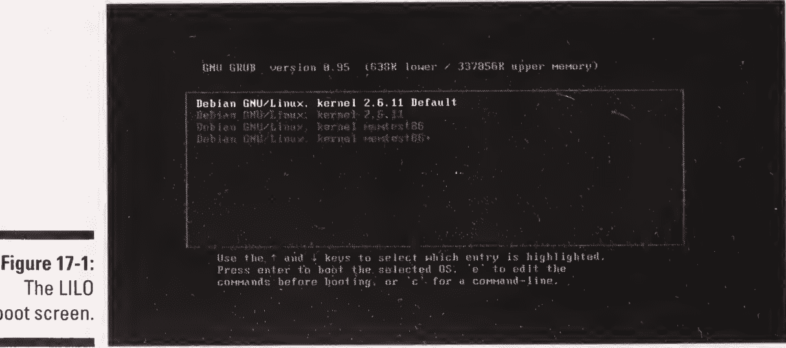

- **GRUB（Grand Unified Bootloader，统一启动加载器）**：GRUB 比 LILO 更先进，但管理起来也更复杂。事情就是这么奇妙。GRUB 的配置文件通常存储在`/boot/grub/grub.conf`中。接下来的两节将介绍如何重新安装损坏的 LILO 和 GRUB 系统。

## 修复 LILO

修复 LILO/MBR 很简单。请按以下步骤操作：

1. **启动进入**Knoppix DVD 的单用户模式。按照前面“Knoppix DVD 救援基础”部分中的说明操作。
2. **挂载**根文件系统。

```
mount /dev/hda1 /mnt/hda1
```
3. **切换根目录**到根文件系统。使用以下命令让 Knoppix 将硬盘分区视为根文件系统：

```
chroot /mnt/hda1
```

例如，输入以下命令将`/dev/hda1`分区设为根文件系统：

```
chroot /mnt/hda1
```
4. **运行**以下程序：

```
lilo
```

您会看到类似以下摘录的输出：

```
Added Linux * Added Linux(2.4)-1 Added Linux(2.6)-2
```
5. **重启**您的计算机。启动后会出现 LILO 提示符。
6. **选择**您的操作系统，然后正常使用。

## 修复 GRUB

使用以下说明修复 GRUB：

1. 使用 Knoppix DVD 启动进入单用户模式。按照前面“Knoppix DVD 救援基础”部分中的说明操作。
2. 挂载根文件系统。使用以下命令，将`hda`替换为您计算机的硬盘：

```
mount -o suid,dev /dev/hda /mnt/hda
```
3. 切换根目录到根文件系统。使用以下命令强制 Knoppix 将硬盘挂载为根文件系统：

```
chroot /mnt/hda
```
4. 运行以下程序将 GRUB 重新安装到您的硬盘上：

```
grub-install /dev/hda
```
5. 输入以下命令重启您的计算机：

```
reboot
```
您的计算机重启时会显示 GRUB 提示符。

# 第 17 章：救我！修复 Linux 和 Windows 计算机

## 克隆硬盘

硬盘偶尔会老化。当硬盘开始发出奇怪的咔哒声时，您通常可以判断它即将报废。并非所有故障硬盘都会给您预警，但给出预警的比不给的多。在硬盘报废前，您可能有机会保存数据。您可以：

- 将重要文件备份到其他位置。（第 4 章介绍了如何备份计算机。）
- 克隆硬盘（将原始硬盘的内容逐位、逐字节复制到目标硬盘）。Linux 的`dd-rescue`程序可以让您逐位复制文件或整个设备（比如磁盘）。它会生成磁盘内容的精确副本，从而完全挽救出现故障的硬盘。


启动克隆过程后，您的计算机可能需要很长时间才能完成（复制大硬盘可能需要数小时）。您需要第二块（目标）硬盘才能完成此操作！您将会清除目标磁盘上的所有内容！


我更喜欢使用独立（外置）USB 硬盘进行备份。它们非常容易使用。（使用 USB 硬盘的缺点是它们比内置 IDE 硬盘慢。）


以下说明会将一个磁盘的所有内容复制到另一个磁盘。以下步骤会擦除目标磁盘上的现有内容！此示例假设您使用的是 USB 目标磁盘：

1. **关闭**您的计算机。
2. **设置要用于复制副本的目标硬盘：**
   - 如果您有 USB 驱动器，插入即可，准备就绪。
   - 如果您使用的是第二块（或第三块）IDE 硬盘，请安装该硬盘，重新启动计算机，并确保 BIOS 识别到新硬盘。安装 IDE 硬盘时，请确保主/从跳线设置正确，即只有一块硬盘设为主盘，另一块设为从盘。


3. **从 Knoppix DVD 启动。**
4. **在 KDE 桌面上单击要克隆的硬盘的图标（如图 17-2 所示的图标）。** 此操作会挂载硬盘，并打开一个显示硬盘内容的 Konqueror 文件管理器窗口。
5. **单击 Kicker 上的终端图标。**
6. **通过输入**`df`**查找要克隆的源硬盘（或分区）。** 您会看到一个包含已挂载硬盘和分区的列表，如下所示：

| 文件系统 | 1K 区块数 | 已用 | 可用 | 使用率 | 挂载点 |
|------------|-----------|------|-----------|------|------------|
| `/dev/root` | 3471 | 12 | 3459 | 1% | `/` |
| `/dev/hdc` | 711574 | 711574 | 0 | 100% | `/cdrom` |
| `/dev/cloop` | 1907730 | 1907730 | 0 | 100% | `/KNOPPIX` |
| `/ramdisk` | 1907730 | 4212 | 284952 | 98% | `/UNIONFS` |
| `/ntfs` | 11341234 | 44421 | 23234 | 4% | `/mnt/hda1` |

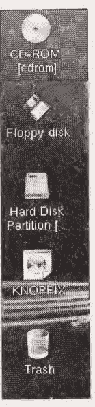

#### 图 17-2：KDE 桌面上的硬盘图标

对于接下来的步骤，我们假设挂载在`/mnt/hda1`上的 Windows NTFS 文件系统出现故障。

7. 将 Windows NTFS 分区复制到 USB 磁盘：

```
sudo dd-rescue if=/dev/hda1 of=/dev/sda1 bs=512
```

例如，如果您的源硬盘是`/dev/hda1`，目标硬盘是`/dev/sda1`，则输入以下命令：

```
sudo dd-rescue if=/dev/hda1 of=/dev/sda1 bs=512
```
您可以使用以下命令复制整个硬盘：
```
sudo dd-rescue if=/dev/hda1 of=/dev/sda1 bs=512
```

> **提示**

8. 源磁盘分区（或整个磁盘）的内容会复制到目标硬盘上。此过程需要很长时间（克隆大硬盘甚至可能需要数小时）。复制完成后，您可以：

- 直接使用目标硬盘工作。
- 使用该副本创建另一块可正常工作的硬盘。如果您克隆的是故障硬盘，请更换新硬盘，然后按照之前的说明反向操作。

# Knoppix CSI：调查犯罪现场

如果（万不得已）您遭到黑客攻击，可能需要对计算机进行取证分析。大多数家庭或小型企业计算机所有者通常只会选择重建计算机并修改密码。不过，如果您是计算机的所有者，您可以选择进行分析，哪怕只是为了满足自己的好奇心。但如果计算机属于他人，或者您为他人管理计算机，那么这件事可能就由不得您了。如果您的计算机被黑客入侵且造成资金损失，那么就属于犯罪行为。此时管理层会决定处理方式。根据管理层的决定，您可能需要启动计算机取证调查。如果是这种情况，您必须采取一些即时步骤为调查做准备，例如断开计算机的网络连接，并联系 FBI（美国联邦调查局）。计算机取证超出了本书的范畴，只有经过专业训练且具备合法资质的人员才能从事此类工作。在这种情况下，通常做得越少越好。想想您在电视上看到过的所有犯罪现场：您不会直接走进去就开始自己的调查。计算机也是如此。如果发生严重入侵事件并邀请了计算机取证专业人员到场，SANS Institute（*系统管理、审计、网络、安全协会*）制定的标准流程是要求计算机所有者拔掉网线，然后安排其他任务分散其注意力。这些任务旨在让计算机保持运行但无网络连接（ hopefully 阻止黑客继续造成损害），同时避免计算机用户干扰调查。取证人员最早采取的步骤之一是克隆计算机的硬盘。取证人员首要任务是保持证据链的完整性。该链条包括保证硬盘上的证据不被篡改。取证人员还需要查明计算机上发生过什么，因此必须克隆硬盘。专业人员会将源盘和全新的目标盘放入设备中，该设备会逐位将源盘内容复制到目标盘。（`dd`命令可以实现和专业设备相同的功能。）

# 第 18 章：治愈常见“计算机感冒”：对抗病毒及其他恶意软件

## 本章内容

- 检测并清除 Windows 病毒

- 修复 Linux 恶意软件

- 修补 Knoppix 系统

计算机病毒会感染计算机并在其间传播，导致计算机“生病”。由于设计缺陷以及 Windows 操作系统极高的普及度，让它成为病毒的热门攻击目标，因此 Windows 电脑尤其容易受到病毒感染。从理论上来说，Linux 电脑和 Mac 也容易感染病毒，但实际上这类病毒的数量非常少。

在人类和动物体内，病毒是被蛋白质外壳包裹的微小 DNA（脱氧核糖核酸）或 RNA（核糖核酸）片段。DNA 和 RNA 是细胞运作的核心。病毒会感染细胞、快速复制，然后从个体传播到另一个体，破坏生物体的正常机能，使我们患病。现实中的病毒对人体系统造成什么危害，计算机病毒就会对计算机系统造成同样的危害。

病毒并不是唯一的恶意软件（又称恶意程序）。特洛伊木马、间谍软件、蠕虫病毒以及其他各种有害程序会感染全球各地所有类型的计算机。本章将介绍如何从 Windows 和 Linux 系统中检测并清除大多数常见类型的恶意软件。无需佩戴乳胶手套即可操作。

本章的操作步骤基于从《Knoppix 入门指南》DVD（或从`www.knoppix.net`、`www.knoppix.org`下载的 CD）启动的 Knoppix Live 环境。

## 呼叫“Knoppix 医生”：查找并清除 Windows 病毒

Microsoft Windows 容易受到多种恶意软件的攻击。计算机病毒是其中最常见的 Windows 恶意软件类型之一，同时也是出现时间最久的恶意程序。本节将介绍如何将 Knoppix 与 ClamAV（一款开源的 Linux 杀毒工具，可检测 Windows 系统中的病毒）搭配使用。


市面上有不少优秀的商业工具可以检测并清除 Windows 病毒。我并不打算用 Knoppix 替代这些工具，相反，我建议在特定场景下将 Knoppix 作为辅助工具使用。即便只是作为辅助工具，Knoppix 也是一款强大的安全工具。

在以下场景中，你可能需要在不使用 Windows 操作系统的情况下检测并清除病毒：

- ✓ 你当前的杀毒系统失效：有时电脑感染程度极深，根本无法运行杀毒软件，此时 Knoppix 就是解决方案，因为你无需启动 Windows，直接启动 Knoppix 即可操作。
- ✓ 你需要交叉验证结果：杀毒软件的能力取决于其已知病毒特征码数据库的完善程度。在厂商识别并发布新病毒的特征码之前，杀毒软件无法检测和清除新病毒，因此不同杀毒程序可能检测到对方遗漏的问题。
- ✓ 你和我一样“精打细算”：或许你的杀毒软件已经过期，你不想一直陷入不断续订订阅的循环；或许你和我一样用过试用版订阅，觉得好用但不想为正式版付费——这些订阅费加起来可是笔不小的开支。（我现在的订阅多到数都数不过来。）


此外还有一款名为 F-Prot 的商业杀毒产品，由 Frisk Software International（www.f-prot.com）团队研发。Frisk 为个人家庭用户提供免费的 Linux 版本，商业 Linux 工作站授权仅需 29 美元（约合 21.73 欧元）。你可以通过以下地址下载个人版：


`www.f-prot.com/download/home_user/download_fplinux.html`

接下来的章节将介绍 ClamAV 的详细使用步骤，请做好准备，为你的 Windows 电脑“治病”。

### 杀毒系统启动与更新

请按照以下步骤重启出现问题的 Windows 电脑并下载杀毒软件：

1. 从《Knoppix 入门指南》DVD（或从[`www.knoppix.net`](http://www.knoppix.net)下载的 Knoppix “lite”版 CD）启动你的 Windows 电脑。第 2 章将介绍如何使用 Knoppix DVD 或 CD 启动电脑。
2. 使用 Knoppix 建立网络连接。如果你的 Knoppix 电脑连接到了提供 DHCP 服务的网络，连接会自动建立。第四部分将介绍如何使用拨号调制解调器或私有网络接入互联网。
3. 点击 KDE Kicker 上的 Konsole 图标，打开 Konsole 终端窗口。
4. 输入以下命令：

```bash
sudo /etc/init.d/clamav-freshclam restart
```

杀毒守护进程随即启动。

5. 输入以下命令更新杀毒病毒特征码数据库：

```bash
sudo freshclam
```

杀毒数据库即完成更新。你也可以免费获取商业版 F-Prot 杀毒系统的 Linux 版本，Frisk Software International 为家庭用户免费提供该版本。

```text
www.f-prot.com/download/home_user/download_fplinux.html

www.fprot.org/#download
```

### 概览：检测 Windows 病毒

以下是查找并清除 Windows 病毒的步骤概览：

1. 从 Knoppix Live DVD 启动你的 Windows 电脑。
2. 连接互联网。
3. 更新杀毒病毒特征码数据库。
4. 挂载 Windows 分区。
5. 检测 Windows 分区中的病毒。
6. 清除病毒或将其隔离。

### 分区预处理

在使用 ClamAV 检测 Windows 病毒之前，你必须将 Windows 分区挂载到正在运行的 Knoppix 系统中。Knoppix 可以将 FAT 和 NTFS 分区以只读文件系统形式挂载。本节将介绍如何挂载你的 Windows 分区。

### 挂载 FAT 和 NTFS 分区

要在 Knoppix 中挂载 Windows 的 FAT 或 NTFS 分区，只需点击 Knoppix 桌面上的对应分区图标即可。挂载后会打开 Konqueror 窗口，你可以忽略该窗口。


例如，如果你的 Windows 分区是 `hda1`，就点击【硬盘分区 [hda1]】按钮，该分区就会挂载到 `/mnt/hda1` 目录下。

## 清除病毒

更新完 ClamAV 病毒特征码数据库后，你就可以开始检测病毒，再通过独立流程清除病毒。

### 检测病毒

检测流程将以 Windows 的 FAT 或 NTFS 文件分区为目标，使用 ClamAV 进行扫描：

1. 点击 KDE Kicker 上的 Konsole 终端图标。
2. 输入以下命令扫描 Windows 分区（`/mnt/mount_dir`）：

```bash
sudo clamscan /mnt/mount_dir
```

例如，如果你的 Windows 分区是 `/mnt/hda1`，就输入以下命令：

```bash
sudo clamscan /mnt/hda1
```

该命令会扫描整个 Windows 分区，并将所有结果（包括检测到病毒和未检测到病毒的结果）输出到终端窗口。

3. 你可以筛选输出结果，仅显示检测到的病毒：

```bash
sudo clamscan /mnt/mount_dir | grep FOUND
```

例如，如果你的 Windows 分区是 `/mnt/hda1`，就输入以下命令：

```bash
sudo clamscan /mnt/hda1 | grep FOUND
```

该命令会扫描整个 Windows 分区，仅在终端窗口中输出阳性结果。

4. 将病毒检测结果导出到文件：

```bash
sudo clamscan /mnt/mount_dir > file
```

如果你的 Windows 分区是 `/mnt/hda1`，就输入以下命令：

```bash
sudo clamscan /mnt/hda1 > virus.report
```

该命令会扫描整个 Windows 分区，将结果保存到 `virus.report` 文件中。

`clamscan` 工具除了可以扫描整个分区，还可以扫描指定文件和目录是否存在病毒。示例如下：


- ✓ 让 `clamscan` 扫描单个文件是否存在病毒：

```bash
sudo clamscan file
```

- ✓ 在文件名中添加星号（`*`）通配符，`clamscan` 就会扫描所有以该字符串开头的文件。例如指定 `xyz*` 即可扫描所有以“xyz”开头的文件：

```bash
sudo clamscan file*
```

- ✓ 如果指定目录，`clamscan` 会扫描该目录下的所有文件。添加 `-r` 选项可强制 `clamscan` 递归扫描该目录，即扫描该目录及其所有子目录（如果有的话）：

```bash
sudo clamscan -r dir
```

以下展示了快速查看病毒扫描结果的方法：

1. 运行以下命令提取所有感染文件的位置：

```bash
grep FOUND virus.report
```

2. 记录所有感染文件，记录方式可根据你的习惯选择：

   - 如果文件数量较少，你可以直接手动记录。
   - 如果文件数量较多，可以打印文件列表。（第 15 章将介绍如何使用 Knoppix 配置 PC 打印机。）

你可以直接打印结果，使用以下命令即可：

```bash
grep FOUND virus.report | lp
```


你可以找到用于实验的无害示例“病毒”。（实际上，这些程序可能不应该被称为“病毒”，因为它们只是模拟病毒特征码，并不会像真实病毒那样复制或传播。）你可以在 `www.rexswain.com/eicar.html` 找到病毒模拟器，在该网站可以下载 `eicar.com` 或 `eicar.zip`（内含 `eicar.com`），并用来测试 ClamAV。`eicar.com` 完全没有任何危险，这个可执行文件仅包含一段字符串，会向你的杀毒软件发送误报特征码。

## 清除病毒

当你有一份 NTFS 格式 Windows 分区中的感染文件清单时，请按照以下步骤手动清除分区中的病毒：

- 重启你的电脑。
- BIOS 配置提示结束后，立即按下 F8 键。系统会提示你可以通过多种模式启动 Windows。
- 选择“带命令提示符的安全模式”，然后按下 Enter 键。
- 点击 Administrator 用户，你将以管理员身份登录到命令行界面（CLI）。
- 使用 Windows 系统的 `del` 命令删除每个恶意文件，命令格式为 `del virus-file`。
- 例如，如果 `C:\WINDOWS\SYSTEM32\badboy.com` 是病毒文件，请输入以下命令：

```text
del c:\windows\system32\badboy.com
```

- 重启电脑，此时你的系统应该已经清除了所有病毒。

如果你使用 Knoppix 来修复失效或无响应的 Windows 反病毒程序，你需要：

- 更新反病毒程序并重新运行。
- 考虑更换其他反病毒厂商的产品，例如 Frisk 软件国际公司。

## 第 18 章：治愈“电脑感冒”：对抗病毒及其他恶意软件

### 呼叫护士 Knoppix：查找并清除 Linux 恶意软件

Linux 用户听到新一轮 Windows 病毒的消息后也不能放松警惕。配置得当的 Linux 系统通常比 Windows 更安全。不过，Linux 也会受到利用系统漏洞进行攻击的恶意软件的威胁。这类所谓的恶意软件包括以下几类：

- **病毒**：能够自我执行的程序，通常会执行恶意操作。Linux 目前一般不容易感染病毒（虽然也存在针对 Linux 的病毒，但绝大多数病毒都是针对 Windows 系统设计的）。
- **特洛伊木马**：会为黑客留后门的软件。你必须“主动邀请”特洛伊木马进入系统，就像当年的特洛伊城那样。幸运的是，Linux 对用户的特洛伊木马防护比 Windows 更健壮。
- **Rootkit（后门工具包）**：一种危害性极强的特洛伊木马，专门用于将恶意软件植入 Linux 内核，并隐藏这些软件以避免被发现。
- **蠕虫**：会自我发送去攻击其他计算机的程序。蠕虫会寻找并攻击存在漏洞的网络服务。在入侵一台有漏洞的计算机后，蠕虫会继续寻找其他有漏洞的计算机，通过逐台跳转的方式进行传播。

本节将介绍如何安装、检测和清除常见的 Linux Rootkit。`chkrootkit` 工具可以帮助你查找并检测其数据库已知的最新 Rootkit。当你查找并清除所有检测到的 Rootkit 后，就可以确定当前系统已经清除了 Rootkit。运行在网络中的 Knoppix live 实例可能会被感染，但只要关闭电源就能立即清除感染（没有任何蠕虫能够侵入只读介质）。因此，本节将介绍如何清理永久安装的 Knoppix 系统。

## 宏观视角：扫描并清除恶意软件

以下是在 Linux 计算机上查找并清除恶意软件的快速流程：

- 断开网络连接后重启电脑。
- 扫描你的电脑。
- 清除恶意软件。
- 重新连接网络后重启电脑。
- 下载最新版本的扫描工具。
- 再次扫描电脑并清除所有剩余的恶意软件。

如果你的电脑被感染，你可以使用《Knoppix 入门很简单》DVD 重新安装 Knoppix。

扫描工具存在漏报恶意软件的小概率。任何扫描工具的能力都取决于其已知特征码数据库的完整程度。新型恶意软件或“隐形”的旧恶意软件都可能绕过扫描工具的检测。因此，彻底清除恶意软件的唯一可靠方法是从纯净介质重新安装操作系统。

如果要修复永久安装的 Knoppix 或其他 Linux 发行版，请从 Knoppix live DVD 启动，然后在 Linux 硬盘分区上运行 `chkrootkit`。

Knoppix 自带 Rootkit 扫描工具 `chkrootkit`。该工具拥有较为完善的已知 Rootkit 特征码数据库。不过该数据库会频繁更新，因此你需要分两个阶段使用 `chkrootkit` 检测 Rootkit：

- 运行当前版本的 `chkrootkit`：
  - 断开 Knoppix 电脑的网络电缆。
  - 重启 Knoppix 电脑。
  - 运行当前版本的 `chkrootkit`。

  首次在没有网络连接的情况下运行 `chkrootkit`，可以最大程度降低检测过程中再次感染的风险。

- 运行更新后的最新版本 `chkrootkit`：
  - 重新连接 Knoppix 电脑的网络电缆。
  - 重启 Knoppix 电脑。
  - 更新 `chkrootkit` 后再次运行。

恶意软件的检测没有百分之百的确定结果。你必须时刻保持警惕，检查系统日志（见第 20 章），并部署防火墙、定期更新软件、使用高强度密码等多层防护机制。

后续章节将介绍如何使用 `chkrootkit` 扫描 Rootkit。

### 初始扫描

在没有网络连接的情况下运行 `chkrootkit` 工具，可以最大程度降低已有 Rootkit 在连接互联网时可能造成的损害。请按照以下步骤，在无网络连接的 Knoppix 电脑上执行初始 Rootkit 扫描：

- 使用《Knoppix 入门很简单》DVD 启动 Knoppix。第 2 章介绍了如何从 DVD 启动 Knoppix。
- 点击 Kicker 面板上的 Konsole 终端图标。
- 输入以下命令扫描 Linux 硬盘上的 Rootkit：

```bash
sudo chkrootkit -r /dev/file
```

例如，以下命令可以扫描 `/dev/hda2` 分区：

```bash
sudo chkrootkit -r /dev/hda2
```

`chkrootkit` 会检查其数据库内所有已知类型的 Rootkit，并列出每个检测项的结果。如果检测到 Rootkit，`chkrootkit` 会列出相关结果。例如，如果检测到 Slapper 蠕虫，会显示以下内容：

```text
Checking `slapper'... Warning: Possible Slapper Worm installed
```

- 如果检测到 Rootkit，请重新扫描你的电脑。后续章节将介绍重新扫描的流程。如果没有检测到 Rootkit，你可以在此处停止操作。

## 下载最新版 `chkrootkit`

请按照以下步骤从互联网获取并安装最新版本的 `chkrootkit`：

- 打开 Firefox 浏览器，访问 `www.chkrootkit.org/download`。此时会弹出“打开 chkrootkit.tar.gz”对话框。Linux 使用 tar（磁带归档）工具将多个文件存储在一个文件中，tar 文件与 Windows 系统常见的 zip 文件类似。
- 点击“最新源码压缩包”链接。
- 压缩包会被保存到你当前的工作目录，随后你会返回下载页面。
- 选择“保存到磁盘”，然后点击“确定”。
- 点击压缩包的“MD5 签名”链接。Firefox 会显示一行包含校验和的文本，你可以在后续步骤中使用该校验和验证压缩包的真实性。
- 点击 Kicker 面板上的终端图标，打开 shell。
- 输入以下命令计算下载文件的校验和：

```bash
md5sum chkrootkit.tar.gz
```

显示的长串数字应该与 Firefox 中显示的数字完全一致。如果数字不匹配，请重复步骤 3 到步骤 6，并联系 `www.chkrootkit.org` 网站管理员，报告可能存在中间人攻击的情况。这种情况下绝对不要使用你刚刚下载的 `chkrootkit`。

- 解压已验证的压缩包：

```bash
tar xzf chkrootkit.tar.gz
```

- 开始编译 `chkrootkit` 插件：

```bash
make sense
```

这些插件可以提供额外的防护，但 `chkrootkit` 即使没有它们也可以正常运行。

### 最终扫描

如果你在下载后运行最新版的 `chkrootkit` 工具，夜间使用时会更加安心。运行该工具并清除所有恶意软件后，再重新联网运行 `chkrootkit` 是合理的。使用以下步骤完成查杀流程：

1. 从《Knoppix 入门指南》DVD 启动你的 Knoppix 计算机。
2. 从互联网获取并安装最新版的 `chkrootkit`。旁栏“下载最新版 chkrootkit”介绍了更新 `chkrootkit` 系统的流程。
3. 输入以下命令运行 `chkrootkit` 工具：

```bash
sudo chkrootkit-0.45/chkrootkit -r /dev/hdx
```

例如，如果你的 Linux 操作系统安装在 `/dev/hda2` 分区，请运行以下命令：

```bash
sudo chkrootkit-0.45/chkrootkit -r /dev/hda2
```

4. 输入你的密码。`chkrootkit` 会开始扫描你的计算机。
5. 删除所有检测到的 root kit 文件。
6. 修改所有用户密码。修改 `root` 用户的密码尤为重要。以下命令用于修改 `root` 密码：

```bash
sudo passwd root
```


## 第 19 章：保持软件更新：软件包的更新与管理

### 本章内容

- 使用图形化工具 KPackage 管理软件
- 使用 `apt-get` 更新 Knoppix

所有 Linux 发行版的核心都是让 Linux 更易用。Knoppix 更进一步，将可启动媒体（live media）的应用推向了新高度。但 Knoppix 是站在前人的肩膀上发展而来的：它基于流行的非商业 Debian GNU/Linux 发行版。Debian 最重要的贡献之一就是其 Debian 软件包管理器（DPM）系统。DPM 让软件的安装、更新、查询和删除等管理工作变得非常简单。本章将介绍如何使用 DPM 系统完成几项重要的系统管理任务。


本章面向使用永久安装版 Knoppix 的用户。永久安装版上的软件应保持更新，以降低安全漏洞风险，同时享受最新的应用功能改进。你也可以在可启动的 Knoppix 实例上执行更新，但这一过程非常耗时——每次从《Knoppix 入门指南》DVD（或如果你是从 `www.knoppix.net` 或 `www.knoppix.org` 下载的 Knoppix，则为 CD）启动时，都需要从头开始更新。

### 初识 Debian 软件包管理器

Knoppix 使用 **Debian 软件包管理器（DPM）**。DPM 是一系列高级应用程序的集合，可以轻松直观地控制实际执行工作的底层程序。DPM 基于软件包的概念构建。软件开发者在开发应用时会使用多种不同类型的文件（如可执行文件、配置文件、图形文件和文档文件）。例如，OpenOffice.org 办公套件就由数百个文件组成。并非所有应用都需要这么多文件，但分发软件唯一实用的方式就是打包成软件包。每个 Debian 软件包都以单个文件的形式分发，软件包文件中包含构成该软件包的所有文件的压缩包。Debian 软件包文件以 `.deb` 为后缀名。例如，Debian 的 Mozilla-Firefox 软件包存储在 `mozilla-firefox-1.2.3.deb` 文件中，其中 `1.2.3` 表示版本号。

使用 DPM 可以帮你实现以下功能：

- ✓ 安装软件包
- ✓ 升级软件包
- ✓ 移除软件包
- ✓ 查询软件包

DPM 包含以下工具：

- ✓ **KPackage**：DPM 的图形化界面。Klaus 很喜欢 KPackage，因为它功能强大，且在其他 Linux 发行版中也能找到。KPackage 使用 `apt-get` 从互联网下载软件包，使用 `dpkg` 安装软件包。后续章节会介绍 `apt-get` 和 `dpkg` 的相关内容。
- ✓ **apt-get**：一款功能强大的工具，主要用于通过基于互联网的软件包仓库管理软件包。更多关于该系统的信息，请参阅本章“防患于未然：自动更新 Knoppix”一节。


- ✓ **dpkg**：一款基于文本的应用程序，是`dpkg-deb`的交互界面。你可以通过命令行界面（CLI）使用`dpkg`来操作软件包。`dpkg-query`和`dpkg-reconfigure`是`dpkg`的辅助工具。

- ✓ **dpkg-deb**：一款底层工具，用于操作DPM的压缩包文件。`dpkg`会向`dpkg-deb`传递命令来操作软件包。

- ✓ **dselect**：`dpkg`和`apt-get`的交互式前端。不过`dselect`非常难用，我不推荐使用它。

### 使用KPackage

KPackage是KDE图形界面套件的一部分，是DPM的图形用户界面（GUI）前端，让软件包操作变得简单直观。本节将介绍如何执行一些常见的软件包操作功能。


KPackage还可以作为其他Linux发行版包管理器（如红帽软件包管理器RPM）的前端。要启动KPackage，点击K菜单，选择系统↦KPackage（包管理器）。KPackage需要读取已安装软件包的数据库，这一过程可能需要一些时间。图19-1展示了KPackage的窗口。KPackage窗口会显示安装在你的Knoppix计算机上的Debian软件包的相关信息：

- 左侧面板显示已安装的软件包，这些软件包按所属分组排列，分组则按功能划分。

- 右侧面板显示所选软件包的详细信息。

- 窗口顶部的标签页分别显示当前已安装的软件包、可更新的软件包和新软件包。

### 更新软件包

你可以使用KPackage更新你的Knoppix计算机。

> 由于Knoppix采用了Unionfs技术，你可以更新可启动版和永久安装版的Knoppix。更新可启动版Knoppix实例的唯一限制是，你需要至少60MB的可用内存磁盘空间来存储Debian软件包数据库。使用带有持久磁盘镜像的可启动Knoppix（第3章介绍过）也可以完成更新。

## 图19-1：展示了已安装软件包的KPackage Debian软件包管理器

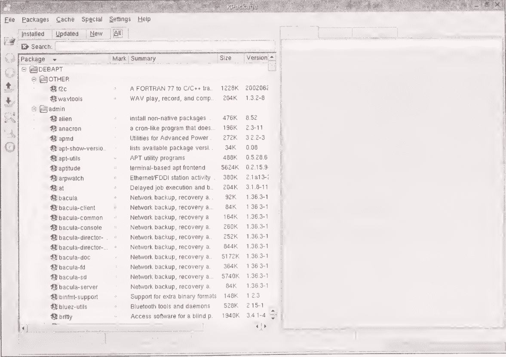

更新流程包含两个基本步骤：

1. 更新软件包数据库。

2. 升级所有有新版本的软件包。

你也可以单独升级甚至降级特定软件包。请按照以下说明更新/升级你的计算机：

1. 必要时重启并启动Knoppix。

2. 确保你已经连接到互联网。

3. 点击K菜单，选择KNOPPIX -> 工具 -> 在Knoppix中管理软件（kpackage）

4. KPackage窗口将会打开。点击Special菜单标签，选择APT: Debian -> 更新。图19-2展示了KPackage正在搜索新软件包的界面。

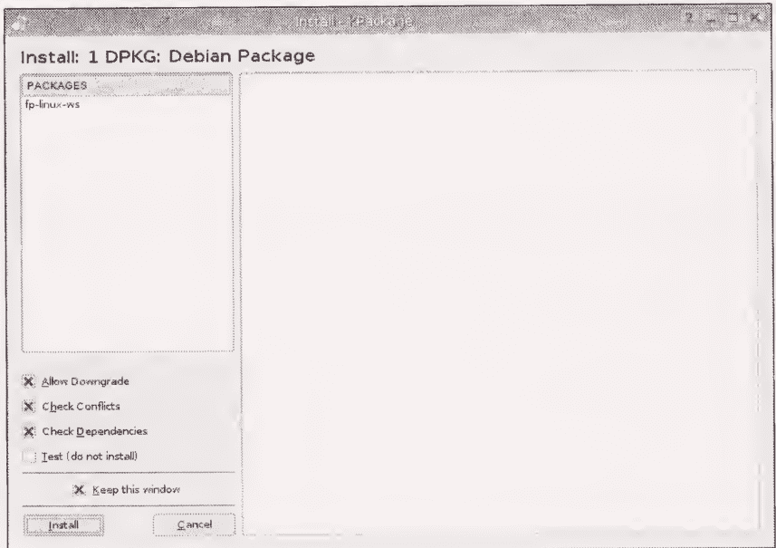

## 图19-2：KPackage正在检查可更新的软件包

5. 点击Updated标签页。KPackage会显示所有可用的更新。更新项前会有绿色的大写字母U标注。

6. 点击任意软件包以选择要安装的项。图19-3展示了左侧面板中的部分可用更新，以及右侧选中的待安装软件包。

**图19-3：** KPackage显示更新列表和软件包的相关信息。

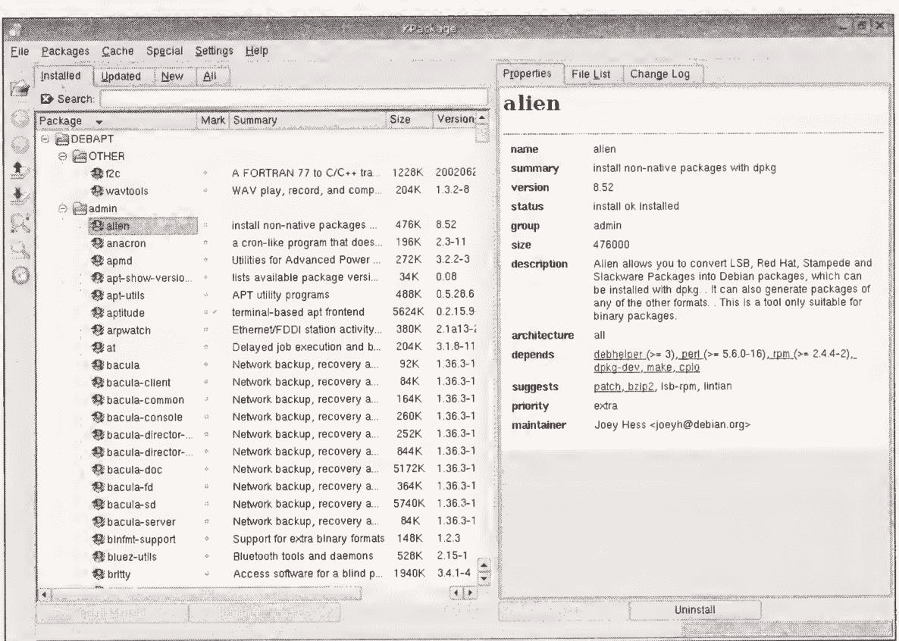


7. 点击安装。将会打开KPackage的安装对话框。

8. 在新对话框中点击安装。安装流程将会启动。

9. 流程结束后点击完成。

10. 点击Special标签，选择APT: Debian↔Upgrade来更新整个系统。将会打开Apt升级对话框。

11. 输入Y继续升级流程。KPackage会升级你的系统。图19-4展示了准备开始更新计算机的KPackage示例窗口。如果你想终止升级流程，输入N即可退出。

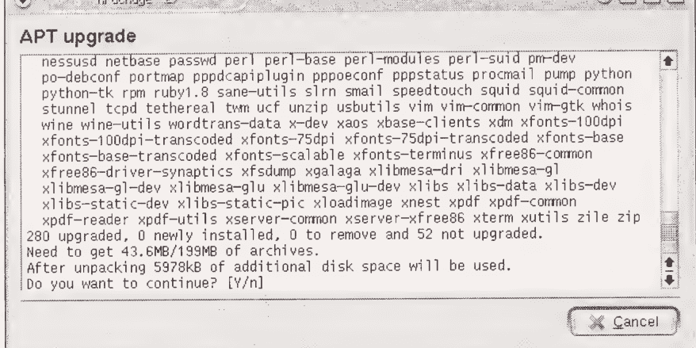

12. 在KPackage窗口中选择文件↔退出以离开该工具。DPM会安装软件包，并显示安装进度。安装完成后，取消按钮会变为完成按钮。

13. 点击完成退出KPackage对话框。你的软件已经安装完成，可以开始使用了。

## 第六部分：系统管理

## 第19章：紧跟更新步伐：更新与管理软件包

### 移除软件包

图19-4：准备升级计算机的Apt升级对话框。

移除软件包比安装软件包还要简单，以下步骤描述了该操作流程：

1. 从K菜单中启动KPackage。

2. 点击KPackage窗口中的“已安装”选项卡，即可查看计算机上已安装的所有软件包。

3. 在左侧面板中选择你想要移除的软件包（例如，点击alien），该软件包的详细信息会显示在右侧面板中（见图19-5）。

4. 查看软件包信息，确认是否要将其移除。不必过度担心移除软件包会导致软件和配置丢失：

   - 通常情况下，你之后可以毫无问题地重新安装该软件包。

   - 除非你明确要求，否则DPM（软件包管理系统）会保留软件包的配置文件。

5. 点击“卸载”按钮，KPackage对话框会打开并提示你输入root用户密码（如果你当前不是以root身份登录的话）。

6. 必要时输入root用户密码后按回车键，会打开“卸载-KPackage”对话框，要求你确认是否移除该软件包。

7. 点击“卸载”按钮，对话框会显示移除进度，当移除过程完成时，“取消”按钮会变为“完成”按钮。

8. 移除过程完成后点击“完成”按钮，界面会返回KPackage窗口，你的软件包就已被移除。（除非你要求移除，否则该软件包的配置文件会保留在原位置。）

**图19-5：** 选择要移除的alien软件包。

系统还提供了两种额外的软件包移除选项：

- “移除配置文件”选项会永久删除该软件包的所有配置文件。

- “测试”选项会检查软件包的移除流程，但不会实际删除任何文件（软件包会保留在原位）。

### 获取软件包信息

KPackage提供了海量的软件包信息，点击左侧面板中的任意软件包（无论是否已安装），右侧面板就会显示其概要信息。以下列表介绍了`KPackage`各选项卡显示的信息：

- **属性：** 软件包的名称、版本、所属软件包组，以及简要描述。

- **文件列表：** 属于该软件包的所有文件。

- **变更日志：** 对该软件包做出的所有修改记录。例如，移除并重新安装软件包时，会记录该操作的整个过程。举例来说，点击`cron`软件包就能查看该软件包的信息，点击“文件列表”选项卡就能看到所有属于`cron`软件包的文件（图19-6展示了`cron`软件包所拥有文件的示例）。

`dpkg`和`KPackage`功能相同，但`dpkg`是通过命令行界面（CLI）运行的；实际上，`KPackage`会接收你的输入，调用`dpkg`，并向其传递完成任务所需的选项，你可以通过`dpkg`完成所有能用`KPackage`完成的工作。

**图19-6：** 展示cron软件包的相关信息。

### 防患于未然：自动更新Knoppix

`apt-get`工具用于安装和移除Debian软件包，它将软件包管理提升到了新层级，并支持通过互联网运行。定期更新计算机是你能够采取的最重要的安全措施之一，更新可以修复黑客可能利用来攻击你的软件漏洞和安全缺陷。`apt-get`使用起来非常简单，只需将你的Knoppix计算机直接连接到互联网，或是连接到可以访问互联网的私有网络，就可以开始使用了。

以下操作指南介绍了如何使用`apt-get`更新你的Knoppix计算机，这些步骤和之前KPackage示例的操作流程一致。不过，KPackage由于是图形化操作所以使用简单，而`apt-get`更适合用来执行自动更新。请按照以下步骤更新你的Knoppix计算机：

1. 登录你的计算机。

2. 点击Kicker面板上的终端图标。

3. 如果你的网络通过*代理服务器*访问互联网，请输入以下命令，将你网络的代理地址和端口号添加到`apt-get`配置文件中：

   ``` sudo echo 'Acquire::http::Proxy "http://proxyaddress:portnumber"' \ >> /etc/apt/apt.conf ```

4. 输入以下命令启动更新流程：

   ``` sudo apt-get update ```

   `apt-get`会更新其内部的软件包列表，但不会实际安装任何已更新的软件包。

5. 输入以下命令安装所有可用的升级软件包：

   ``` sudo apt-get upgrade ```

   你的计算机软件就会更新为最新版的软件包。

### Debian软件包仓库

可用的DPM软件源存储在`/etc/apt/sources.list`文件中。互联网上分布着海量的Debian软件包仓库。`apt-get`是Debian（以及Knoppix）生态中的一站式工具，在这种情况下，`apt-get`会化身项目经理，追踪所有依赖项，并在需要时安装所有依赖软件包：

- 当你要求`apt-get`安装一个或多个软件包时，它会在软件源列表中进行检索，找到最新的软件包版本，下载后完成安装。

- 定期以更新模式运行`apt-get`来自动更新你的计算机，可以自动修复漏洞和安全缺陷，在此模式下，`apt-get`是功能强大的安全工具。

- 许多软件包需要依赖其他软件包才能正常安装和运行。

## 第20章

### 主动出击：日志、检测与审计

### 本章内容

- 记录计算机上的系统事件
- 检查网络流量
- 使用Snort检测入侵行为
- 使用Nmap扫描你的网络
- 使用Nessus审计你的网络

最好的防御就是主动进攻，这一理念在计算机安全和体育领域都同样适用。不过在许多国家（包括美国），主动攻击黑客是违法的，而且这种行为既不明智也毫无必要。我推荐一种合法的“进攻”方式：主动监控和更新你的Knoppix计算机与网络。本章将介绍如何监控你的Knoppix计算机、其网络连接以及本地网络，这三项活动都能帮助你比黑恶势力快一步（至少能避免你落后一步）。

当你从*《Knoppix入门宝典》*DVD（或是从`www.knoppix.net`、`www.knoppix.org`下载的CD）启动实时Knoppix系统时，可以使用本章中的配置步骤，但每次重启计算机时都必须*重复*这些步骤，除非你使用持久化设置工具保存你的配置。（第3章会介绍如何使用持久化主目录。）

### 亲爱的日记，今天我做的是……：

### 使用syslog记录日志

阅读系统和网络日志文件是维护计算机正常运行的关键。计算机系统和入侵检测日志可以做到：

- 展示计算机上发生过的所有事件。
- 为可能存在的安全问题提供线索。

当然，阅读日志非常枯燥，你需要日复一日、周复一周、年复一年地做这件事，这是一项永无止境的任务，几乎不会给你带来任何成就感。但一旦出现问题，你一定会庆幸自己有这些日志。系统日志有助于排查问题，`syslog`会记录多个系统的事件，当你遇到硬件或软件运行故障时，可以查阅相关日志。本节将介绍如何配置和使用几乎通用的`syslog`系统，同时还会引入Snort入侵检测系统（IDS）。

### 元视角：使用syslog

事件日志记录的概念很简单，你的日志系统会在事件发生时进行记录，你只需要定期查阅日志即可。但实际情况是，每台计算机都像它的使用者一样独一无二。高效的日志记录有几个关键要点：

- **保持一致性**：日志如果没有人工查阅就等于毫无用处，请定期检查你的日志。

- **经验至关重要**：练习得越多，你的能力就会越强，保持一致性并关注细节，你会更擅长识别异常和重要事件。

- **优化你的技巧**：保持一致性有助于你积累经验，这会让你处理日志的速度更快、效率更高，你可以利用不断增长的知识和技能优化系统日志配置，微调`syslog`可以减少不必要的日志记录，帮助你更快地完成任务。

## 第20章：积极主动：日志记录、检测与审计

下一节将介绍无处不在的Linux `syslog` 系统。

### 启动syslog

`syslog` 系统在Knoppix（以及几乎所有Linux和UNIX系统）中默认安装。它可高度配置，能够记录计算机上发生的绝大多数事件，能为你提供非常有用的信息。

请按照以下步骤在你的Knoppix计算机上启动 `syslog`：

1. 以普通用户身份登录。

2. 启用 `syslog` 在开机时自动启动。

   ``` sudo update-rc.d sysklogd defaults ```

   此选项适用于永久安装的Knoppix系统。

3. 出现提示时输入你的密码。

4. 启动 `syslog` 守护进程。

   ``` sudo /etc/init.d/sysklogd restart ```

5. 查看守护进程启动的验证信息。

   ``` cat /var/log/messages ```

你会看到 `syslog` 已经记录了自己的启动信息：`Mar 11 13:00:40 cancun syslogd 1.4.1#16: restart.`

你可以使用 `tail -f /var/log/messages` 命令持续查看系统日志，日志条目会随着内容被追加到messages文件中而实时显示，按下Ctrl+C即可停止该进程。

`syslog` 由 `/etc/syslog.conf` 配置文件控制。下一节将介绍如何进行一些简单的配置修改。

### 配置syslog

`/etc/syslog.conf` 文件用于配置 `sysklogd` 守护进程，该文件采用简单格式，每行对应一条规则：

``` Facility.Priority Action # OptionalComment ```

基本规则格式分为两部分，由*空白字符*（一个或多个空格或制表符）分隔：

- 选择器字段：选择器字段包含两个由句点分隔的*参数*：

  - 工具（Facility）：决定要记录哪种类型的系统信息。表20-1列出了syslog的工具及其对应的处理信息。

  - 优先级（Priority）：指示syslog记录*等于或高于*指定优先级的事件。表20-2按从低（*记录所有事件*）到高（*仅记录最高优先级事件*）的顺序列出了优先级级别。

- 动作字段（Action field）：定义日志信息的*存储位置*。存储位置通常是`/var/log`目录下的文件，也可以是Linux命名的*管道*、终端/控制台、所有已登录用户，或远程syslog服务器。

- 井号（#）将行内后续所有文本定义为*注释*（不属于规则内容的备注和说明）。

#### 表20-1 syslog工具

| 工具 | 对应系统事件 |
|:---|:---|
| auth 或 authpriv | 面向认证的命令相关信息，例如登录和切换用户（su） |
| cron | cron任务（cron调度的动作） |
| daemon | 守护进程产生的事件 |
| kern | 内核内部事件 |
| lpr | 打印任务 |
| mail | 传入和传出的邮件 |
| news | 网络新闻（Usenet）事件 |
| syslog | syslog自身产生的事件，例如启动或停止syslogd守护进程 |
| user | 杂项用户进程 |
| uucp | 旧的UNIX到UNIX的拷贝邮件系统 |
| local0-local7 | 本地生成的事件 |

syslog的信息来自两个主要来源：

- Linux内核（使用定义较为宽松的syslog协议，让syslog和外部程序能够“使用同一种语言”通信，同时向syslog提供内核内部事件）

- 外部应用程序和守护进程

#### 表20-2 syslog优先级级别

| 级别 | 作用 | 记录的消息范围 |
|-------|----------|----------|
| panic/emerg | 仅在系统遇到严重问题时触发 | 仅记录该级别消息 |
| alert | 程序或子系统需要立即帮助 | 记录该级别及以上的所有消息 |
| crit | 整个程序或子系统出现问题、可能无法正常使用的信息 | 记录该级别及以上的所有消息 |
| error 或 err | 程序或子系统部分出现问题、可能无法运行的信息 | 记录该级别及以上的所有消息 |
| warning 或 warn | 警告信息 | 记录该级别及以上的所有消息 |
| notice | 可能不表示问题的事件 | 记录该级别及以上的所有消息 |
| info | 信息性内容 | 记录该级别及以上的所有消息 |
| debug | 用于调试目的（软件通常会输出底层调试信息） | 记录所有级别的消息 |

### 事件日志的未来发展

目前已有大量工作用于更新syslog协议。更新后的syslog、syslog-auth和syslog-sign协议正在开发中，既旨在升级现有syslog协议，也为系统日志记录添加认证和加密功能。这项工作至关重要，因为大型组织需要集中管理事件日志（依赖员工自行维护日志是不可行的）。你可以从`www.ietf.org`获取更多关于系统日志未来发展的信息。

- 更新现有syslog协议
- 为系统日志记录添加认证和加密功能

在`syslog.conf`规则中，标点符号决定了配置规则的解析方式：

- 星号（*）是通配符，对应所有可用选项。

- 逗号（,）允许你在同一行中指定多个具有相同优先级的工具。

- 等号（=）指示syslog仅记录特定优先级的事件。

以下规则使用星号将所有事件记录到all.log文件中：

``` *.* /var/log/all.log ```

以下规则展示了将auth和authpriv两类事件记录到`/var/log/auth.log`文件的规则：

``` auth,authpriv.* /var/log/auth.log ```

以下规则指示syslog仅将信息优先级别的内核事件记录到`/var/log/kernel.log`文件中：

``` kernel.=crit /var/log/kernel.log ```

`syslog.conf`中的每条规则都定义了三个功能：

- **工具（Facility）：** 指要记录的系统事件的类型。

- **优先级（Priority）：** 决定事件的重要程度。

- **存储位置（Storage）：** 指定事件存储的文件或位置。


✓ 以下规则将`auth`和`authpriv`两类工具的所有优先级消息保存到`/var/log/auth.log`文件中：

```text
auth,authpriv.* /var/log/auth.log
```

✓ 以下规则是通配规则，将所有未明确指定的内容以及无优先级的授权信息发送到`syslog`文件中：

```text
*.*;auth,authpriv.none -/var/log/syslog
```

✓ 以下规则将每个工具（任意优先级）的消息记录到`/var/log`目录下对应同名的日志文件中：

```text
#cron.* /var/log/cron.log
daemon.* -/var/log/daemon.log
kern.* -/var/log/kern.log
lpr.* -/var/log/lpr.log
mail.* -/var/log/mail.log
user.* -/var/log/user.log
uucp.* /var/log/uucp.log
```

### 使用`syslog`

今天就立下你的新年决心吧：养成每天（或更频繁）检查日志的习惯。重点关注内核和认证相关事件，同时留意优先级为严重级或更高的事件。随着时间推移，你会熟悉日志格式，开始发现其中的规律。积累一定经验后，你就能在问题发生前识别出潜在故障。阅读日志更像是一门艺术而非科学，但若不加以练习，你无法精通这门技能。

### 使用`tcpdump`嗅探网络流量

`tcpdump`是一款易于使用的网络流量嗅探工具，你可以用它显示私有网络中流动的数据包的首部信息，在以下场景中非常实用：

- 调试问题
- 追踪可疑流量
- 满足你对网络工作原理的好奇心

首先以最简单的默认方式运行`tcpdump`：

```text
tcpdump
```

## 第六部分：系统管理

哇，刚才的内容还挺难的！默认情况下，`tcpdump`会嗅探你的默认网卡上的流量，默认网卡通常是：

- 有线连接对应`eth0`
- 无线连接对应`wlan0`

你会看到类似以下行的输出：

- 前两行是`tcpdump`的相关信息：

```text
tcpdump: verbose output suppressed, use -v or -vv for full protocol decode
listening on eth0, link-type EN10MB (Ethernet), capture size 96 bytes
```

- 下一行是来自`veracruz`的地址解析协议（ARP）请求，该请求正在查找`cancun`的以太网地址：

```text
21:38:56.833675 arp who-has cancun.paunchy.net tell veracruz.paunchy.net
```

`tcpdump`会持续运行，直到你手动停止：

- 如果你让`tcpdump`一直运行，它会显示所有经过你计算机的数据包。
- 按下`Ctrl+C`即可停止`tcpdump`。

### 自定义`tcpdump`配置

尽管`tcpdump`易于使用，但它的可配置性也很高，以下是一些实用的示例：

- 要启动`tcpdump`并仅监控一台计算机（本例中为`cancun`）的流量，可以使用如下命令：

```text
tcpdump host cancun
```

- 你可以用数字IP地址替代主机名，例如：

```text
tcpdump host 192.168.1.100
```

- 你可以使用`and`组合多个选项，以下示例指示`tcpdump`显示进出`cancun`的安全 Shell（SSH）数据包（端口22）：

```text
tcpdump host cancun and port 22
```

在上述示例中替换为你自己私有网络中的计算机主机名，即可开始熟悉`tcpdump`的使用。这是一个功能强大的工具，也能帮助你了解网络的工作原理。

MAC和IP地址执行两种不同的网络功能：

- **IP地址**让互联网上的计算机可以互相定位，无论它们位于世界何处。（第10章将详细介绍IP地址。）IP地址类似于公司街道地址。
- **媒体访问控制（MAC）**让同一网络中的计算机可以互相定位，无论是交换机还是子网。MAC就像建筑物里的办公室门牌号。

## 使用Snort检测入侵

`Snort`是一款开源工具，功能类似于针对您网络的病毒检测系统。基于网络的探测和攻击会产生独特的签名，与病毒产生的签名类似。在探测和攻击投递载荷前就将其检测到，能帮助您在安全防护上快人一步。`Snort`让您有机会检测攻击并阻止其成功。

`Snort`是一个开源项目，由Martin Roesch于1998年发明。它最初是一款简单、轻量级的入侵检测系统。轻量级并不代表功能弱，`Snort`是行业中可用的最强大的工具之一（无论是商业还是开源工具）。（我曾有幸参加Roesch先生主讲的两天`Snort`研讨会，内容非常有趣、发人深省。世界上存在大量恶意的网络威胁。）

> ### 元视角：使用`Snort`
>
> `Snort`使用网络探测和攻击签名数据库来检测未经授权的活动：
>
> - **网络探测**：黑客会探测网络以发现其布局并找到漏洞。本章“使用`Nmap`扫描您的网络”和“使用`Nessus`审计您的网络”两节中介绍了两种广泛使用的网络探测系统。
> - **网络攻击**：黑客会尝试利用发现的漏洞。您可以在互联网上找到大量软件漏洞的利用工具，也可以自行开发（0-Day漏洞利用工具）。

`Snort`有两种运行模式来检测异常：

- **基于主机的检测**仅查看单台计算机网卡（NIC）上的网络流量。本书重点介绍将`Snort`用作基于主机的网络嗅探器，这是配置和使用最简单的方式，在小型网络上也非常有效。
- **基于网络的检测**查看整个网段上的流量。后续章节将展示`Snort`的工作原理以及如何使用它。

`Snort`是一个使用守护进程、配置文件和签名数据库来监控网络流量的系统。Knoppix发行版中未包含`Snort`，您需要从互联网上下载它。后续章节将展示如何在永久安装的Knoppix系统上下载、安装和运行`Snort`。

### 下载`Snort`

`apt-get`让获取和安装`Snort`变得非常简单，请按以下步骤操作：

1. 将您的Knoppix计算机连接到互联网。第四部分介绍了如何直接或通过局域网连接到互联网。
2. 以非特权用户身份登录。
3. 点击Kicker上的终端图标打开终端窗口。
4. 输入以下命令下载并安装`Snort`：

   ```bash
   sudo apt-get install snort
   ```

5. 出现提示时输入`Y`。`apt-get`会执行一些整理操作，然后提示您继续或取消。
6. 按Enter键安装`Snort`。`apt-get`会显示下载和安装进度。

### 配置`Snort`

安装`Snort`后，系统会立即提示您进行配置。出现提示时，请按照以下说明为您的Knoppix计算机配置`Snort`：

1. 按Enter键进入配置。下一个屏幕如图20-1所示，会提示您将`eth0`网卡（NIC）用作`Snort`的默认接口。

   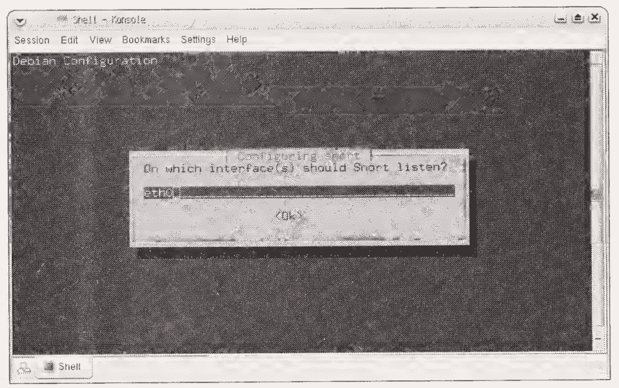

   **图20-1：** 配置`Snort`监听`eth0`网卡。

2. 输入对应的网卡：

   - 如果您使用的是默认Knoppix网络配置，按Enter键接受默认值（`eth0`）。
   - 如果您有WiFi设备，输入`wlan0`后按Enter。
   - 如果您使用调制解调器连接，输入`ppp0`后按Enter。

   下一个窗口会显示`192.168.1.0/16`的B类网络地址空间。该范围无法在互联网上路由，用于专用网络。大多数消费级交换机和路由器默认使用`192.168.1.0/24`地址。图20-2显示了更改后的结果。

   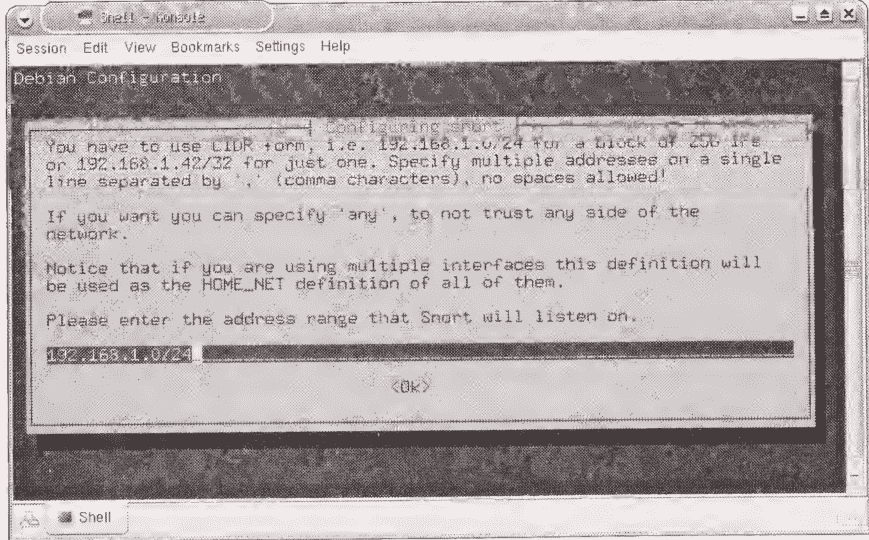

3. 输入子网范围：

   - 如果您处于家庭网络中，默认的`192.168.1.0/16`范围应该可以正常使用，因此按Enter键即可（除非您确定自己使用了其他范围）。
   - 如果您使用其他子网地址范围，输入对应值后按Enter。

   

4. 输入应接收每日`Snort`摘要电子邮件的用户名。将默认的`root`改为容易记住的名称，例如`snortster`，如图20-3所示。

   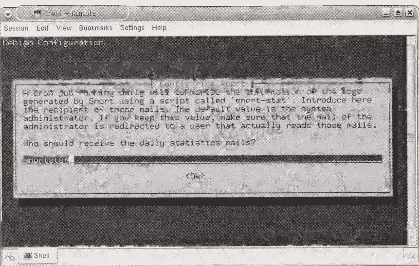

   **图20-3：** 更改`Snort`用户名。

5. 按Enter键。`Snort`会接受您的配置选择并完成安装。

您的网卡不需要完全连接到网络就能“看到”网络流量。网卡可以进入混杂模式，无需IP地址即可运行。以此方式配置时，您的网卡会显示遇到的所有网络流量。通常情况下，您的网卡只会“看到”发送给它的流量。


### 运行`Snort`

当`Snort`安装并配置完成后，剩下的工作就是启动“Pig”（`Snort`作者出于显而易见的原因给它起的昵称），然后安下心来监控它的日志。请按以下步骤操作：

1. 启动`Snort`：

   ```bash
   sudo /etc/init.d/snort start
   ```

   `Snort`会监控发送到您网卡的数据包，并将日志记录到`/var/log/snort`目录下的多个文件中。`Snort`会记录大量不相关的信息，但会尝试区分可能的入侵尝试，并将其记录到`/var/log/snort/alert`文件中。

2. 开始练习监控`alert`文件，查看其内容，您可以使用以下命令访问：

   ```bash
   sudo more /var/log/snort/alert
   ```

3. 如果`alert`文件长度超过一页，按空格键可以逐页浏览。

## 使用`Nmap`扫描您的网络

`Nmap`安全扫描器（简称`Nmap`）是世界上最著名的安全工具，它曾出现在电影《黑客帝国2：重装上阵》中，崔妮蒂使用它来帮助击败邪恶的矩阵。（不过她本应使用`apt-get`将版本从2.54beta更新到至少2005年3月发布的2.70版本。哎呀！如果机器能想出的唯一能源系统就是把我们这些渺小的人类当电池，那它们肯定需要更多升级。难道不能改造一座旧核电站吗？我还是别多说了。）


`Nmap`是如何工作的？它通过以从未被设计过的方式使用互联网协议来实现功能。`Nmap`会以创造性的方式构建网络数据包和流量，诱使响应的操作系统泄露自身及其网络服务的信息。您不需要是好莱坞明星才能使用`Nmap`。它是一款功能强大且易于使用的扫描工具。黑客会用它探测您的网络，您也可以。


`Nmap`由顶尖安全大师Fyodor发明。他在`www.insecure.org`维护了一个非常有用的信息丰富的网页。他还是赛博惊悚小说《偷网：如何掌控一个大陆》的合著者，该书由Syngress出版。这本书非常适合学习真正的黑客和安全专业人员是如何工作的！


一些组织认为网络扫描是一种恶意黑客行为。最好在您自己的专用网络上练习。避免扫描您没有获得明确扫描权限的计算机和网络。

`Nmap`已包含在Knoppix发行版中。你可以按照以下步骤，对你家中的网络开展简单高效的扫描：

1. 点击KDE Kicker面板上的Konsole终端图标。随后会打开一个Shell–Konsole窗口。
2. 将你的网络地址输入以下命令中：`nmap network_address`。例如，如果你的私有网络使用的是不可路由的私有网络地址段`192.168.1.0`，那么完整的命令为`nmap 192.168.1.0/24`。`Nmap`会返回它在你的网络中发现的每一台主机的摘要信息（包括网络设备、计算机、路由器等）。
3. 聚焦扫描以检测主机的操作系统：`sudo nmap -O network_address`。该命令使用的是`-O`选项（注意是字母“o”，不是数字零）。`Nmap`会返回被扫描网络中每一台主机的摘要信息，包含每台主机的操作系统及操作系统版本号。


`Nmap`功能十分强大。以上示例仅展示了它功能的冰山一角。在你自己的网络上试用`Nmap`、查看它能发现哪些信息会非常有趣。你可以利用这些信息了解你的网络，并加固网络防护。

## 使用`Nessus`审计你的网络

`Nessus`是一套网络扫描与探测系统。它会先对主机或网络开展扫描，再借助扫描结果对对应主机或网络执行探测。`Nessus`的探测规则基于已知漏洞制定，最终形成的系统可以模拟黑客分析、攻击目标的流程。

`Nessus`属于客户端-服务器架构系统：服务器端负责扫描和探测你的网络，客户端则用于控制服务器。你可以将服务器安装在一台设备上，再从另一台设备对其进行控制。不过我更喜欢尽可能简化配置，将整套系统部署在同一台设备上。接下来的章节将介绍如何用`Nessus`将你的Knoppix电脑打造成网络扫描系统。

### 概览：使用`Nessus`

Knoppix默认预装了`Nessus`，可支持live版Knoppix DVD运行。不过本节介绍的是如何在持久化安装的Knoppix上使用`Nessus`，因为在这类系统上更新`Nessus`更为便捷。运行`Nessus`并不算特别复杂，但需要做一些配置。以下列表梳理了整体流程：

1. 在`www.nessus.org`注册你的服务，以便接收自动插件更新，同时启动`Nessus`服务器守护进程。
2. 创建`Nessus`用户，并登录`Nessus`守护进程。
3. 选择要探测的插件和目标主机。
4. 分析扫描结果。


> 切勿使用`Nessus`开展“远距离”扫描，也就是不要通过互联网扫描网络。未经所有涉及网络的网络管理员同意，不得扫描任何网络。这意味着你只能使用`Nessus`扫描你自己的私有网络。部分`Nessus`插件可能会导致存在软件漏洞的Windows设备和路由器崩溃。

### 系统配置

互联网威胁在不断演变。黑客在突破一道防护机制后，会转而寻找其他存在漏洞的设备。安全工具必须与黑客的攻击手段同步演进，`Nessus`也不例外，它会持续更新。

### 注册你的`Nessus`服务器

请按照以下步骤在`www.nessus.org/register`注册以开启自动插件更新：

1. 打开Firefox浏览器，访问`www.nessus.org/register`。你会看到如图20-4所示的许可协议页面。该页面提供两种不同的许可协议，具体选择取决于你是否拥有计划使用`Nessus`的网络的所有权。

   

> 安全工具是把双刃剑，既可以合法使用，也可能被不法分子当作黑客工具使用。

## 第六部分：系统管理

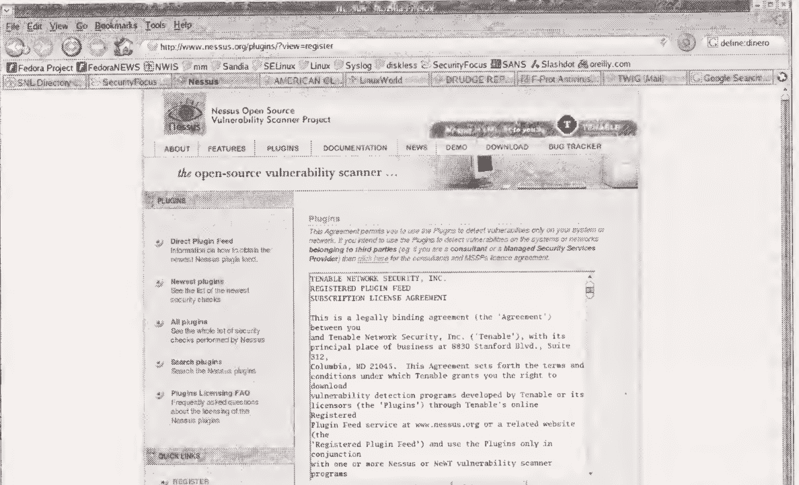

图20-4：`Nessus`插件更新注册页面。

2. 阅读并选择对应的许可协议。
3. 点击“我接受”按钮，随后会打开插件网页。
4. 在对应的文本框中输入你的电子邮箱地址。
5. 点击“注册”按钮，你会收到一封带有注册密钥的电子邮件。请按照以下说明完成注册：

   1. 打开你的电子邮件客户端，查找标题为“`Nessus`插件订阅源”的邮件。
   2. 打开该邮件，其中包含类似以下摘录的操作说明：

      ```text
      Your activation code for the Nessus plugin feed is 8024-37D4-xxxx-yyyy-zzzz
      To activate your account, simply execute the following command:
      nessus-fetch --register 8024-37D4-xxxx-yyyy-zzzz
      ```

   3. 点击邮件内嵌的URL链接。会打开一个新的浏览器窗口，显示一个带有单个文本框的网页。
   4. 在图20-5所示的文本框中输入激活密钥。

      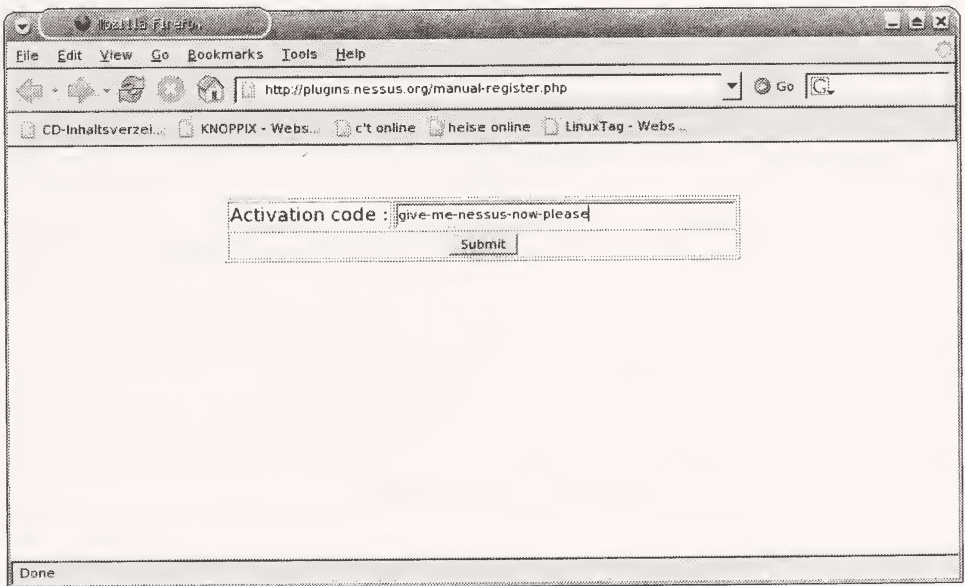

      图20-5：输入你的`Nessus`激活密钥。

   5. 点击“注册”按钮。该网页会显示一个可用于访问插件的链接。

## 启动`Nessus`服务器

开展任何扫描前都需要先启动`Nessus`服务器，同时你还需要创建一个用于控制和监控`Nessus`探测任务的`Nessus`用户。

1. 点击Kicker上的终端图标，打开shell窗口。随后会打开Shell–Konsole窗口。
2. 输入以下命令启动服务器：

   ```bash
   sudo nessusd -a 127.0.0.1 -D
   ```

   终端窗口会显示提示信息，告知你需要前往`www.nessus.org/register`注册以获取自动插件更新。

## 创建`Nessus`用户账户

要使用`Nessus`客户端，你首先需要创建一个`Nessus`用户账户，拥有账户后即可登录`Nessus`服务器。请按照以下步骤，使用`nessus-adduser`工具创建`Nessus`用户账户：

1. 在Shell–Konsole窗口中输入以下命令：`sudo nessus-adduser`。随后会出现`Login:`提示符。
2. 输入用户名（例如`nessus`）。随后会出现`Authentication`（`pass/cert`）`[pass]:`提示符。


### 运行 Nessus

当 Nessus 完成更新且你已经拥有用户账户后，就可以登录 Nessus 并开始扫描了。

### 选择要扫描和探测的主机

扫描前，你需要按照以下步骤启动 Nessus 客户端：

1. 点击 K 菜单，选择「系统→Nessus」。此时会打开如图 20-6 所示的 Nessus 设置窗口。

2. 在对应的文本框中输入上一节中创建的用户名和密码。

3. 点击**登录**按钮。连接到 Nessus 服务器并完成认证需要一点时间。认证完成后，Nessus 设置窗口会切换到插件选项卡，显示 Nessus 支持的所有探测规则。图 20-7 展示了 Nessus 插件选择窗口。

## 第 20 章：主动防御：日志记录、检测与审计

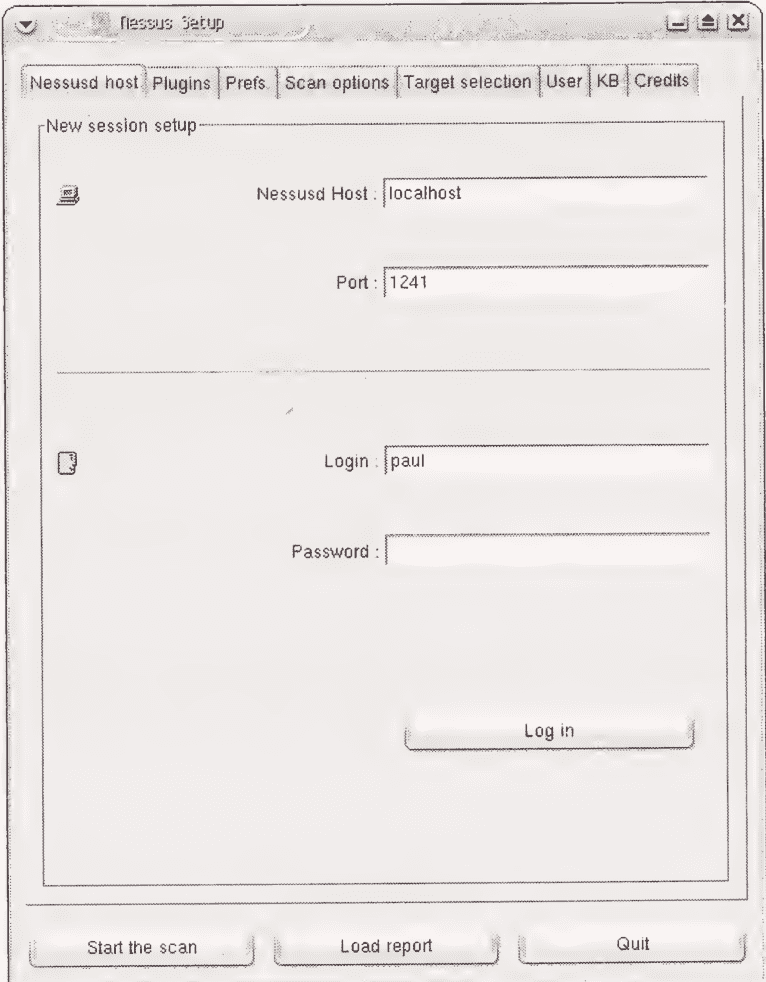

图 20-6：Nessus 设置客户端窗口。

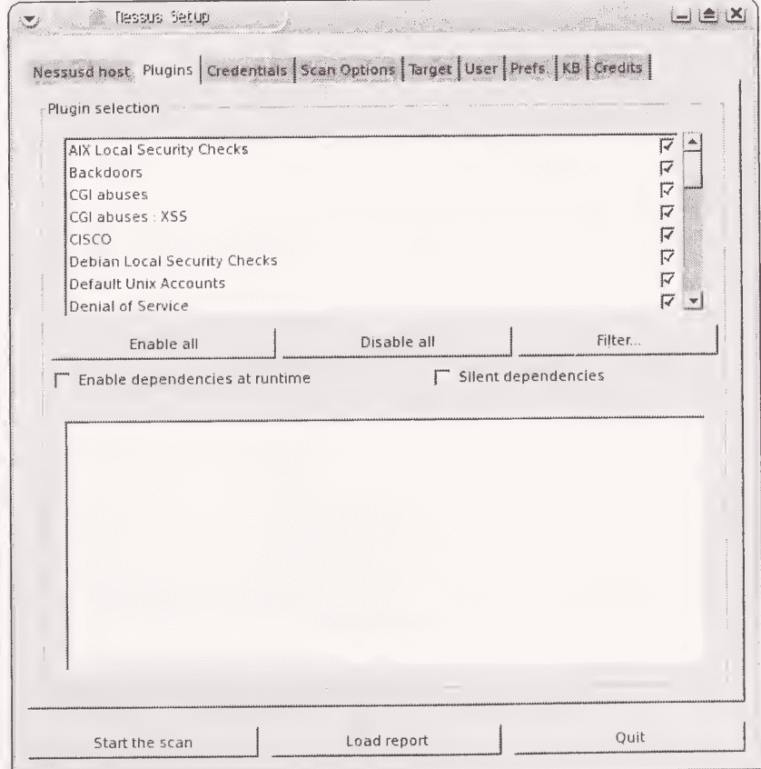

图 20-7：Nessus 显示可用插件。

### 选择探测规则

Nessus 提供多种扫描和探测选项，你可以：

- 限制扫描范围（除非你是异构网络的管理员）。
- 如果想要对网络进行全面扫描，可以使用所有可用插件。Nessus 会弹出警告对话框，提示它已经禁用了所有可能导致系统和服务崩溃的插件；同时，每一个可能导致系统或服务崩溃的插件旁也会显示警告标识。请注意这些警告，避免损坏你自己或其他人的设备。

> **警告！** 例如，如果你想扫描 Windows 主机，请按照以下步骤操作：

1. 点击“全部禁用”按钮。
2. 向下滚动子菜单，选择所有 Windows 相关插件。

> **提示** 我还建议勾选 *CGI 滥用*、*SNMP*、*后门* 和 *远程文件访问* 选项。

3. 点击“目标选择”选项卡。图 20-8 展示了目标选择窗口。

图 20-8：Nessus 客户端目标选择选项。

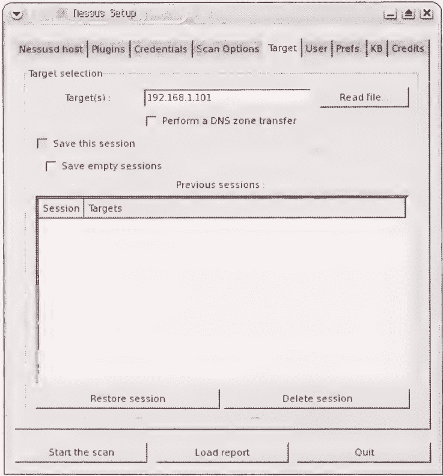

- 在“目标”文本框中输入主机名（或 IP 地址）。
- 点击**“开始扫描”**按钮启动扫描/探测流程。Nessus 会在你的网络上运行，图 20-9 展示了扫描进程对话框。该流程耗时较长，请保持其运行，稍后再来查看结果。

**图 20-9：** Nessus 正在扫描你的网络。

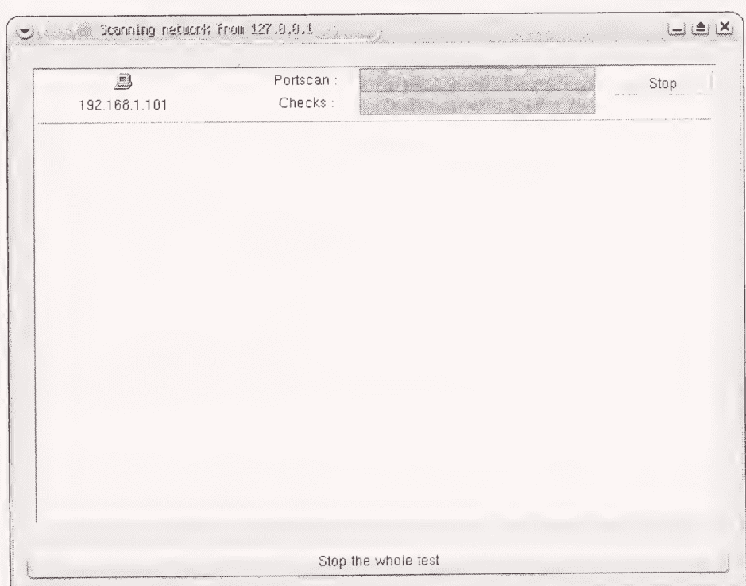

### 分析结果

Nessus 扫描完成后会显示 IP 编号，你可以通过以下步骤查看扫描结果：

- 点击 Nessus 客户端窗口左上角的子网地址，本例中该地址为`192.168.1`。
- 点击窗口左侧中间的“主机 IP”地址，本例中该地址为`192.168.1.101`，“端口”和“严重程度”子窗口会列出发现的所有漏洞。
- 从列表中选择**“端口漏洞”**，即可查看该漏洞的严重程度和相关信息。本例中我点击了`netbios-ssn (139/tcp)`并选择了“安全漏洞”选项。

**图 20-10：** *Nessus 在结果窗口中展示漏洞。*

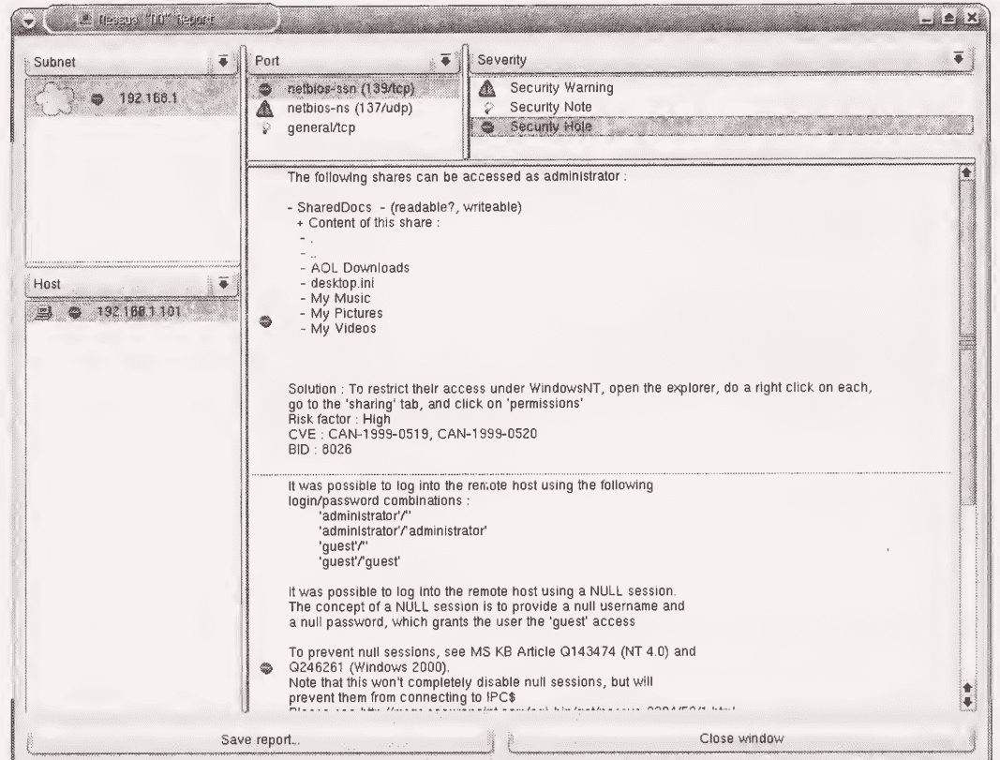


检测到的漏洞并非风险等级都相同：部分漏洞会对你计算机造成严重威胁，需要立即修复；部分是完全无害的误报；还有一些的风险等级介于两者之间。你需要仔细查看 Nessus 提供的漏洞相关信息，利用这些信息识别并修复真实的漏洞。

“糟糕！这台机器上居然有开放的 SMB 共享，更糟的是还装了 AOL！这东西是哪来的？（哦对了，我之前在帮亲戚排查 AOL 的问题——真是该拒绝的！）还有 Nessus 居然猜出了部分密码！我当时怎么想的？（好吧，我为这个示例特意留了点小漏洞，但这足以证明 Nessus 的能力。）现在我得回去调整 Samba 配置，限制对这些共享的访问。Nessus 帮我发现了自身系统存在的部分漏洞，这些信息也说明了你为何需要保持警惕、提前规划，在问题酿成大祸前就修复错误。*再见啦*，漏洞！”

## 第 21 章

### 定制你的 Knoppix 专属系统

### 本章涵盖内容

- 定制重制系统简介
- 创建精简版 Knoppix

借助 Knoppix，你就是自己系统的掌控者。Knoppix 让你无需繁琐安装，就能在同一台电脑上同时使用 Windows 和 Linux，兼顾两者优势。但你可以更进一步，定制属于自己的专属 Knoppix 系统：你可以对 Knoppix 进行个性化设置，并将定制版本刻录到 CD-ROM 或 DVD 中！这非常酷，也极具实用性。本章将教你如何打造属于自己的全新定制版 Knoppix 系统。开始动手吧！


本章打造的定制版 Knoppix 示例将贯穿本书第五部分使用，我会以该示例为基础搭建多台服务器。

## 定制 Knoppix

为什么要定制自己的专属系统？你也许满足于现状，这完全没有问题。但你可以进一步提升 live Linux 环境的实用性与功能性，定制能让你随心改造自己的系统。不过细节决定成败，定制流程并不算特别复杂，但需要你关注每一个细节。幸运的是，本章已经涵盖了所有相关细节。


## 定制版 Knoppix CD 的实用场景

- [x] **没有讨厌的旋转部件：** 直接通过只读光盘启动也提升了系统可靠性。启动 Knoppix 后，你运行的是一个 100% 固态的系统，没有任何会磨损的旋转光盘——除非系统偶尔需要读取 DVD。
- [x] **黑客无法篡改基础系统：** 你可以在只读媒体上存储无法修改的固定版软件和配置，每次重启系统时，都能确保从已知安全的状态启动。
- **更新 Knoppix：** 你可以先启动 Knoppix，更新其中包含的所有软件包，再进行定制重制。这样你就能获得带有最新软件的 Knoppix 系统，同样非常实用。
- **便捷的软件更新：** Knoppix 使用联合文件系统（`unionfs`）将内存盘和 DVD（或 CD-ROM）的文件透明叠加在一起，`unionfs` 让你可以有效地向只读媒体写入数据！真可谓“鱼与熊掌兼得”。在 `unionfs` 出现之前，你可以定制重制 Knoppix，但无法有效更新其中的软件，而无法更新软件的问题远大于从只读媒体启动的收益，因此定制版 Knoppix 服务器直到最近才具备实用性。Knoppix 4.0 推出了全新的“增量镜像”功能：如果你查看 Knoppix DVD，会看到一个名为`KNOPPIX`的目录，其中包含两个文件：`KNOPPIX`和`KNOPPIX2`。`KNOPPIX`文件包含基础 Linux 安装内容，自 Knoppix 首次发布以来就一直在使用；`KNOPPIX2`是增量镜像，包含另一个带有额外软件的 Linux 文件系统目录树。Knoppix 4.0 支持使用 Unionfs 叠加最多 8 个增量镜像——从`KNOPPIX1`到`KNOPPIX8`，这样你无需修改基础的`KNOPPIX`镜像，就能调整基础 Knoppix 系统。


如果你需要定制版 Knoppix，不一定需要从零开始制作，可以参考以下捷径：

- ✅ **现成的定制版 Knoppix：** 目前已有数十款 specialized Knoppix 版本，有特定需求或兴趣的用户会定制 Knoppix 并对外分发。你可以访问 www.knoppix.net/wiki/Knoppix_Customizations 了解定制版 Knoppix 的相关信息。
- ✅ **现成脚本：** 目前已有多个定制重制脚本，其中包括 Knoppix 开发者 Klaus Knopper 本人编写的脚本。你可以访问 www.ukuug.org/events/linux2004/knoppix.shtml 获取更多脚本相关信息。

接下来废话少说，直接上手。下一节将介绍如何创建精简版原生 Knoppix。

## 创建精简版 Knoppix

本节将介绍如何创建精简版 Knoppix。示例将从你默认通过*《Knoppix 入门》*DVD 启动的原生 Knoppix 入手，移除图形界面及其他非必要软件，最终得到一个体积大幅缩减的 Knoppix 版本，定制后的 Knoppix 占用的磁盘空间不到 200MB，体积足够小，可以轻松放入可写 DVD、CD-ROM 以及大多数 U 盘中。我之所以聚焦于 Knoppix 的精简，一方面是因为这本身是一个很好的通用示例，另一方面是我会在第五部分使用该精简版搭建网络服务器。


**精简即优雅。** 最小化的 Linux 安装能打造更优秀的服务器，体量更小意味着结构更简单、更易维护、也更安全。

## 开始定制流程

### 所需资源

完成定制你需要准备以下资源：

- **一台计算机：** 嗯，这似乎是废话，但我还是得提一句。你需要用一台计算机启动 Knoppix DVD 来执行定制流程，这台计算机需配备奔腾处理器，且至少有 256MB 内存。
- **两个 CD-ROM/DVD 驱动器：** 本章操作需要两个 CD-ROM/DVD 驱动器，其中至少有一个是可写 CD-ROM 或 DVD 驱动器。大多数 2000 年后生产的计算机（以及部分更早的型号）都支持读取 DVD。


本操作说明需要两个CD-ROM/DVD光驱，因为你使用的是实时运行的Knoppix实例，它需要从其中一个CD-ROM/DVD光驱启动并占用它。你需要第二个光驱来刻录重制完成的Knoppix镜像。如果你只有一台CD-ROM/DVD光驱，依然可以重制Knoppix。这种情况下，你需要在启动时使用「复制到硬盘」的启动cheat码，该选项会将Knoppix镜像复制到你的硬盘中。之后重启系统，使用「从硬盘启动」的启动选项，即可启动存储在硬盘中的Knoppix镜像。这个两步流程既可以启动实时Knoppix镜像，还能释放你的CD-ROM/DVD光驱。


- ✔ **Knoppix系统**：你需要本书附赠的*《Knoppix入门经典》*DVD。你也可以使用其他版本的Knoppix，但本操作说明是基于《Knoppix入门经典》DVD编写的。


- ✔ **磁盘空间**：你至少需要15GB的可用硬盘空间用于操作。你需要*复制*部分DVD内容、*修改*副本，再*重新创建*修改后的DVD。


- ✔ **可写存储介质**：你需要能够将修改后的Knoppix镜像写入CD或DVD。如果使用虚拟机，你可以直接用虚拟机的光盘镜像（ISO文件），无需物理制作新的光盘。商业软件VMware（`www.vmware.com`）和开源软件User-mode Linux（`www.usermodelinux.org`）都是非常优秀的虚拟环境。


- ✔ **耐心**：重制并非最简单的操作流程，但也是收获感最强的流程之一。请留出足够的时间，耐心完成这个示例。

### 从*实时运行*的Knoppix实例重制Knoppix的目的：


- ✔ **便捷性**：你可能没有永久安装Knoppix。
- ✔ **安全性**：从可启动光盘安装更安全，因为操作失误可能导致永久安装的Knoppix实例（即硬盘安装版本）无法使用。如果你运行的是可启动的Knoppix实例，那么你的所有操作失误都不会造成永久影响。
- ✔ **简洁性**：从DVD或CD-ROM重制需要更多步骤，但更容易理解。我也认为从光盘到光盘的逻辑比从硬盘到光盘更简单。接下来的章节会介绍重制流程的各个阶段。

本操作说明改编自`www.knoppix.net/wiki/Knoppix_Remastering_Howto`上的HOWTO文档。不过，本章中我所说的**Target（目标）**目录，在很多Knoppix重制HOWTO文档中被称为**Master（主）**目录。我更喜欢用**Target**，因为**Source（源）**和**Target**的组合能减少我的混淆。

#### 总览：重制流程

重制是一个复杂的流程，因此总览对于理解整体流程非常重要。本书中其他章节的总览都没有本章节的长，我为每个步骤提供了更详细的说明。Knoppix重制的整体流程如下：

1. **从DVD启动实时Knoppix系统并创建交换文件**。你也可以从永久安装的Knoppix实例重制，但我更偏爱从实时实例操作，这样不需要担心误删文件或配置，而且始终基于同一基准环境操作。（永久安装的实例往往很快就被修改，在重制流程中更难使用。）
2. **挂载硬盘分区**。完成整个重制流程至少需要16GB的硬盘空间。如果你的可用内存不足1GB，创建交换文件还需要额外空间。如果使用实时Knoppix实例操作，你需要自行寻找可用空间。你可以用`qtparted`工具从Windows分区中划出空间，也可以使用第二块磁盘（比如USB移动硬盘）。
3. **在硬盘上创建Knoppix的`Source`和`Target`目录**。你将工作DVD中的Linux文件系统复制到`Source`目录中。复制完成后，你通过`chroot`命令进入`Source`目录进行修改。`Target`目录用于重建Knoppix DVD的目录结构。
4. **配置Knoppix的`Source`目录**。将DVD中`KNOPPIX`目录的内容复制到硬盘上的`Source`目录中。
5. **自定义Knoppix**。像平时一样运行Knoppix，但目的是修改它以实现某些功能或用途。你可以进行小幅或大幅的定制，完全随心所欲地进行调整，想改多久改多久。你可以不断优化，直到对其配置和运行效果满意为止。一切由你决定。自由万岁，没错，就是自由。
6. **在`Target`目录中创建`source/KNOPPIX`目录的ISO镜像**。当你对自己的定制效果满意后，将其保存为*压缩循环*（`cloop`）格式。`cloop`格式是克劳斯（Klaus）的创新发明，也是Knoppix Linux如此实用的原因之一。`cloop`可以将完整的Debian系统安装（整个根文件系统）压缩为单个文件，把几个GB的内容压缩后就能放入DVD中。ipchains/iptables包过滤器的作者保罗·拉塞尔（Paul Russel）最初为LinuxCare的活体救援名片大小的CD发明了`cloop`，克劳斯在将`cloop`移植到Linux 2.4和2.6内核时重写了大部分代码。
7. **配置Knoppix的`Target`目录**。你使用`Source`目录完成Knoppix的自定义，完成后，你使用`Target`目录创建包含修改内容的可启动镜像。
8. **创建整个`Target`目录的ISO镜像**。这个可启动镜像就是你全新的个人Knoppix系统，呃，个人发行版。
9. **将ISO镜像刻录到CD-ROM或DVD中**。将定制好的Knoppix保存到可刻录介质（比如DVD+RW、DVD-RW或CD-R）中，就能让它变成便携版本。现在你可以从新的CD-ROM或DVD启动你的个人Knoppix系统了。启动你定制好的Knoppix时，乐趣就开始了：可以在朋友和家人面前炫技，脱单，收获超高人气。说实话，重制Knoppix可能没法帮你实现这些，但能帮你从普通极客进阶到顶级极客。抛开社会地位不谈，重制你的专属Knoppix系统这件事本身就很酷。

### 启动Knoppix并开始操作

请按照以下步骤从*《Knoppix入门经典》*DVD启动Knoppix：

1. 将光盘插入电脑的只读CD-ROM/DVD光驱中。按照本说明重制Knoppix需要两个CD-ROM/DVD光驱：一个用于启动系统，另一个用于刻录镜像。你需要从只读光驱启动Knoppix，这样才能把重制好的镜像刻录到可写光驱中。
2. 打开电脑电源。本章的示例会移除重制后Knoppix的图形界面，因此你需要启动到非图形模式。
3. 在启动提示符中输入以下内容。

```
knoppix 2
```

Knoppix会启动到运行级别2，该模式为非图形模式。Knoppix启动完成后，你会进入命令行界面（CLI），之后就可以继续进行重制流程。

### 创建并挂载硬盘分区

重制Knoppix需要一块工作区域。本节会介绍如何释放硬盘上的空间，用于重制流程。以下列表是一些常见的磁盘分区：

- ✔ **IDE硬盘**：集成驱动电子（IDE）硬盘是最常见的硬盘类型。PC提供两个IDE接口：
  - 第一个IDE接口显示为`/dev/hda`和`/dev/hdb`。
  - 第二个IDE接口显示为`/dev/hdc`和`/dev/hdd`。每个接口可以连接1到2块磁盘（硬盘或CD-ROM/DVD光驱均可）。


- ✔ **SCSI**：小型计算机系统接口（SCSI，发音为「scuzzy」）性能更高，但成本也更高。SCSI 设备会显示为 `/dev/sda` 和 `/dev/sdb` 文件。
- ✔ **USB 磁盘**：U 盘和 USB 移动硬盘非常受欢迎，因为它们使用起来非常方便。输入 `df` 命令可以列出所有磁盘分区。你可以把所有 `KNOPPIX` 目录的千字节使用量加起来，计算所需的磁盘空间。

> 如果你硬盘上的可用空间不足以完成本章的示例，我建议你购买一块外置 USB 移动硬盘。请找到至少 16GB 的可用空间，按照以下步骤准备好本次示例所需的空间。

1. **在 Linux 或 Windows 分区上找到至少 16GB 的可用空间：**
   - 如果有需要，第 4 章会介绍如何从现有硬盘中释放空间。
   - 如果你要添加第二块内置 IDE 硬盘、外置 USB 移动硬盘，或者使用的是永久安装的 Knoppix 系统且至少有 16GB 的闲置空间，则无需释放空间。

2. **挂载分区：** `mount -o suid,dev /dev/partition /mnt/partition`

   例如，挂载 IDE 分区的 `hda5` 分区时，使用以下命令：

   ```bash
   mount /dev/hda5 /mnt/hda5
   ```

分配好工作空间后，继续下一节创建所需的工作目录。

### 创建目录

当你准备好足够的硬盘空间后，需要创建两个目录来整理你的工作内容。Knoppix 官方文档中这两个目录的命名约定为 `Source` 和 `Master`，但我稍微做了调整，因为我很容易混淆；我用 `Target` 代替 `Master`，只是因为我觉得这个词读起来更顺耳。

## 第六部分：系统管理

将你的硬盘分区名称填入以下两条命令中以创建目录：

```bash
mkdir -p /mnt/partition/knx/source/KNOPPIX
mkdir -p /mnt/partition/knx/target/KNOPPIX
```

例如，针对 IDE 接口的 `hda5` 分区，使用以下命令：

```bash
mkdir -p /mnt/hda5/knx/source/KNOPPIX
mkdir -p /mnt/hda5/knx/target/KNOPPIX
```

这些目录能够确保重新编译流程的输入和输出相互分离。下一节将介绍如何配置源目录。

### 配置 Knoppix 源目录

配置源目录指的是将默认的 Knoppix 源文件目录树复制到源目录中：

```bash
cp -Rp /KNOPPIX /mnt/partition/knx/source
```

例如，针对 IDE 接口的 `hda5` 分区，使用以下命令：

```bash
cp -Rp /KNOPPIX /mnt/hda5/knx/source
```

当你从光盘启动 Knoppix live 系统时，会自动创建 `/KNOPPIX` 目录并填入 Knoppix 文件系统内容。上述命令会将 Knoppix 文件系统复制到上一节中你创建的源目录里。你可以通过修改源目录中的文件来定制 Knoppix。下一节将介绍如何修改源目录以创建自定义的 Knoppix 版本。

### 定制 Knoppix

本节将指导你实际修改前几节中创建并填入内容的源目录。修改源目录的方法有很多种。不过，本章中的示例会创建一个更简洁、体积更小的 Knoppix 版本，它是你可以用本书第五部分构建的多种服务器的基础。以下步骤将指导你修改源目录以创建自定义的 Knoppix 版本：

1. 将 Linux 的根目录切换到源目录：

   ```bash
   chroot /mnt/partition/knx/source/KNOPPIX
   ```

   例如，针对 IDE 接口的 `hda5` 分区，使用以下命令：

   ```bash
   chroot /mnt/hda5/knx/source/KNOPPIX
   ```

2. 创建并挂载 `proc` 文件系统：

   ```bash
   mount -t proc proc /proc
   ```

   `proc` 文件系统并不关联任何物理磁盘。`proc` 是一个逻辑文件系统，可以展示并与 Linux 内核的内部结构交互。在此场景下，你需要挂载它才能启用网络功能。

3. 输入对应的命令来为你的网络配置 DNS：

   - 如果你的网络支持 DHCP，请输入以下命令：

     ```bash
     echo "nameserver 192.168.1.1" >> /etc/resolv.conf
     ```

     大多数家用 DHCP 服务器默认使用 `192.168.1.1` 作为域名解析地址，因此请输入以下内容。

   - 如果你的网络不支持 DHCP，请将有效的域名服务器 IP 地址填入以下命令中：

     ```bash
     echo "nameserver ip_address" >> /etc/resolv.conf
     ```

     例如，以下命令使用了 IP 地址 `198.59.115.2`（来自网络服务提供商 Southwest Cyberport 的域名服务器）：

     ```bash
     echo "nameserver 198.59.115.2" >> /etc/resolv.conf
     ```

   你可以使用以下命令查看体积最大的 20 个 Debian 软件包：

   ```bash
   dpkg-query -W --showformat='${Installed-Size} \ ${Package}\n' | sort -n | tail -20
   ```

   你可以根据结果选择要删除的软件包。如果你想缩小正在构建的重新编译版 Knoppix 镜像的体积，可参阅侧边栏《为 Knoppix 瘦身》。

4. 更新你的软件包：

   ```bash
   apt-get update
   ```

   ```bash
   apt-get upgrade
   ```

5. 当系统提示如何升级特定软件包时，按下回车键。

6. 留下标识信息：

   ```bash
   touch /REMASTERED
   ```

   ```bash
   echo "Welcome to My Knoppix" > /etc/issue
   ```

   这些修改并非必要。它们只是让你在运行自定义版 Knoppix 而非完整版时能够明显区分。

7. 输入以下命令卸载 `/proc` 文件系统：

   ```bash
   umount /proc
   ```

8. 输入 `exit` 命令退出 `chroot` 环境。

## 第 21 章：重新编译你的 Knoppix 系统

> `chroot` 命令会通知 Linux 将其根文件系统切换到正在使用的源目录。

第 7 章介绍了 Linux 文件系统的部分细节。Linux 文件系统从根目录开始。可以将文件系统想象成一棵充满以下内容的树：

- **分支（目录和子目录）：** 所有分支都从根目录衍生而来。当你从 Knoppix DVD 启动 Linux 时，系统会基于 DVD 和内存盘创建文件系统。
- **叶子（文件）：** 你访问的所有文件和应用程序都来自该文件系统。

恭喜，你已经完成了 Knoppix 的有效重新编译。修改源目录即可更改 Knoppix。接下来的几节将仅介绍创建包含这些更改的可引导光盘所需的特殊文件的方法。

### 配置 Knoppix 目标目录

Knoppix 之所以运行良好，是因为它能够将多个看似不兼容的元素组合在一起协同工作。这些元素最初包括可引导 CD-ROM（现已升级为 DVD）、压缩文件系统和大量实用工具。该压缩文件系统让 Klaus Knopper 能够在单张 CD-ROM 中容纳原本需要多张光盘存储的软件。他制作了完整的发行版，随后将其文件系统压缩为单个文件。他使用 `cloop`（压缩循环）文件系统来格式化该文件。这项创新是 Knoppix 如此易用的关键之一。以下步骤将介绍如何从源目录创建你自己的 `cloop` 文件：

1. 将启动 Knoppix 后看到的基础网页从 `/cdrom` 文件系统复制到目标目录：

   ```bash
   cp /cdrom/index.html /mnt/partition/knx/target
   ```

   请根据实际情况替换为你的 IDE 分区。以下示例展示的是配备 `hda5` 分区的 PC：

   ```bash
   cp /cdrom/index.html /mnt/hda5/knx/target
   ```

2. 将 `/cdrom` 文件系统中除原始 `KNOPPIX` 文件外的所有文件复制到目标目录：

   ```bash
   cd /cdrom
   find . -size -10000k -type f -exec cp -p --parents '{}' \; /mnt/partition/knx/target/
   ```

   以下示例使用的是 `hda5` 分区：

   ```bash
   cd /cdrom
   find . -size -10000k -type f -exec cp -p --parents '{}' \; /mnt/hda5/knx/target/
   ```

> 上述命令中的反斜杠有不同的功能：
>
> - 第一个反斜杠（`\`）是续行符，它通知 shell 将两行内容视为同一条命令。
> - 第二个反斜杠通知 Bash shell 忽略命令末尾的分号（`;`）。

`find` 命令的 `-size -10000k` 选项会定位所有小于 10MB 的文件；现有的 `KNOPPIX` 文件大小接近 800MB，因此不会被复制（你无需复制该文件，因为你将自行构建新的 `KNOPPIX` 文件）。`-type -f` 选项通知 `find` 仅操作文件，排除目录、软链接等对象。`-exec` 选项通知 `find` 将后续内容作为独立命令执行。在此场景下，子命令为复制（`cp`）：

```bash
cp -p --parents '{}' /mnt/hda5/knx/target/ \;
```

你也可以不使用 `find` 命令复制相同的文件：输入 `cd /cdrom` 切换到 `/cdrom` 目录，然后运行 `cp` 命令即可。

3. 将目标目录中的所有文件设置为可写入状态：

   ```bash
   chmod -R u+w /mnt/partition/knx/target
   ```

   以下示例使用 `hda5` 分区：

   ```bash
   chmod -R u+w /mnt/hda5/knx/target
   ```

4. 删除包含原始 Knoppix 校验和的文件：

   ```bash
   rm -f /mnt/partition/knx/target/KNOPPIX/md5sums
   ```

   以下示例使用 `hda5` 分区：

   ```bash
   rm -f /mnt/hda5/knx/target/KNOPPIX/md5sums
   ```

## 第 21 章：重制你的 Knoppix 专属系统

### 为 Knoppix“瘦身”

如果你想把 Knoppix 重制后放入 U 盘或演示 CD，就需要减小 Knoppix 的体积。按照以下说明移除不需要的软件包即可。

以下步骤展示如何移除多个 Debian 软件包。步骤中移除的软件包是建议项，并非强制要求，你可以自行选择需要移除的软件包。

- 输入以下命令移除指定的 Debian 软件包：

  ```bash
  apt-get update
  apt-get -y remove --purge package-name*
  ```

  例如，以下命令可以移除多个你很可能不需要的 Debian 软件包（反斜杠 `\` 是续行符）：

  ```bash
  apt-get update
  apt-get remove --purge \
  apache* autofs* blue* cvs* emacs* gimp* hpijs* \
  isdn* openoffice* samba* squid*
  ```

我认为这些软件包都是可以移除的。这个列表并不全面，我只是挑了最容易移除的项。比如 OpenOffice.org 占用大量空间，移除它可以大幅减小体积。我选择其他软件包是因为我知道移除它们不会影响 Knoppix 的正常运行。

如果你在移除过程中遇到提示，询问你是否确认执行危险操作，可以按 `Ctrl+C` 退出该流程。这个提示意味着重要的系统文件被选中移除，如果继续操作可能会导致你重制后的系统无法运行。

- （可选）输入以下命令移除大部分 X Window 系统和 KDE 图形环境：

  ```bash
  apt-get remove --purge xfree86-common kde-base*
  ```

指定 `xfree86-common` 和 `kde-base` 不仅会移除这两个软件包，还会移除所有依赖它们的其他软件包。该命令会移除大量软件，将 Knoppix 实时运行实例的整体体积缩小到 200MB 以内。

- 完成上一步的软件包移除后，输入以下命令清理残留：

  ```bash
  apt-get remove `deborphan` deborphan | xargs apt-get remove
  ```

校验和用于确保光盘文件的完整性。重制过程会生成带有新校验和的新文件。

- 输入以下命令创建新的压缩 `KNOPPIX` 文件：

  ```bash
  mkisofs -R -U -V "Knoppix remastered" \
  -publisher "Knoppix Heavy Industries" \
  -hide-rr-moved -cache-inodes -no-bak -pad \
  /mnt/partition/knx/source/KNOPPIX | \
  nice -5 /usr/bin/create_compressed_fs - 65536 > \
  /mnt/partition/knx/target/KNOPPIX/KNOPPIX
  ```

  例如，以下命令使用 `hda5` 分区：

  ```bash
  mkisofs -R -U -V "Knoppix remastered" \
  -publisher "Knoppix Heavy Industries" \
  -hide-rr-moved -cache-inodes -no-bak -pad \
  /mnt/hda5/knx/source/KNOPPIX | \
  nice -5 /usr/bin/create_compressed_fs - 65536 > \
  /mnt/hda5/knx/target/KNOPPIX/KNOPPIX
  ```

这个命令非常长，运行可能需要十分钟以上。`mkisofs`、`nice` 和 `create_compressed_fs` 命令的众多选项指定了技术参数，这里不需要了解，因此不做说明。为了便于理解，以下是去掉所有选项的命令：

```bash
mkisofs file | nice create_compressed_fs - > filename
```

整体操作会从源 Knoppix 目录生成 ISO 文件。该 ISO 文件不会直接写入磁盘，而是被流式传输（Linux 术语中称为管道）到 `nice` 和 `create_compressed_fs` 命令组合中。`nice` 的作用是告诉 Linux 以比正常稍高的优先级运行 `create_compressed_fs` 工具。`create_compressed_fs` 是 Knoppix 的工具，用于生成压缩文件系统，在本例中就是包含压缩 Knoppix 文件系统的 `KNOPPIX` 文件。

- 重新生成 `md5sums` 文件：

  ```bash
  find /mnt/partition/knx/target -type f \
  -not -name md5sums \
  -not -name boot.cat \
  -not -name isolinux.bin \
  -exec md5sum '{}' \; \
  > /mnt/partition/knx/target/KNOPPIX/md5sums
  ```

  以下示例使用 `hda5` 分区：

  ```bash
  find /mnt/hda5/knx/target -type f \
  -not -name md5sums \
  -not -name boot.cat \
  -not -name isolinux.bin \
  -exec md5sum '{}' \; \
  > /mnt/hda5/knx/target/KNOPPIX/md5sums
  ```

在上面的命令中，反斜杠有两个作用：

- 分号前的反斜杠 `\` 是转义字符（转义字符告诉 Bash Shell 将下一个字符直接传递给命令）。如果没有转义字符，Bash 会处理后面的字符，导致命令无法按预期运行。
- 其他反斜杠 `\` 是续行符。在本例中，`find` 命令会定位除了 `md5sums`、`boot.cat` 和 `isolinux.bin` 之外的所有文件，随后 `md5sum` 命令会重新计算这些文件的校验和，并将结果存储在新的 `md5sums` 文件中。

### 刻录光盘

ISO 文件系统标准（由国际标准化组织制定）在 Linux 领域被广泛使用。`mkisofs` 命令可以从一个或多个文件和目录生成 ISO 文件（后缀为 `.iso`）。你可以：

- 使用带 `-loop` 选项的 `mount` 命令直接在计算机上挂载 ISO 文件（例如 `mount -o loop knoppix.iso /mnt`）。
- 从 ISO 文件创建 DVD 和 CD-ROM。

本章剩余部分将介绍如何创建 ISO 镜像并将其刻录到光盘。

### 创建 ISO 镜像

下一步会生成一个包含你刚制作的自定义 Knoppix 版本的文件。本示例使用可写 CD-ROM 而非 DVD，因为 CD-ROM 更便宜也更常见。按照以下步骤创建自定义 Knoppix 发行版的 ISO 镜像：

- 切换到目标目录：

  ```bash
  cd /mnt/partition/knx/target
  ```

  例如，如果你使用 `hda5` 硬盘分区，输入以下命令：

  ```bash
  cd /mnt/hda5/knx/target
  ```

- 输入以下命令生成重制后的 ISO 文件：

  ```bash
  mkisofs -pad -l -r -J -v -V "KNOPPIX" -no-emul-boot -boot-load-size 4 -hide-rr-moved -boot-info-table \
  -b boot/isolinux/isolinux.bin \
  -c boot/isolinux/boot.cat \
  -o /mnt/partition/knx/myknoppix.iso \
  /mnt/partition/knx/target
  ```

  以下命令假设你使用 `hda5` 分区：

  ```bash
  mkisofs -pad -l -r -J -v -V "KNOPPIX" \
  -no-emul-boot -boot-load-size 4 \
  -hide-rr-moved -boot-info-table \
  -b boot/isolinux/isolinux.bin \
  -c boot/isolinux/boot.cat \
  -o /mnt/hda5/knx/myknoppix.iso \
  /mnt/hda5/knx/target
  ```

哇，你又打破了自己超长命令行长度的纪录！但这是值得的。Knoppix 重制结合联合文件系统功能极其强大。上一步对基础 `mkisofs` 命令做了定制：

```bash
mkisofs 输出 输入
```

1. 输入是目标目录（前面的示例使用本章创建的目录）。
2. 输出是后缀为 `.iso` 的文件名，包含你的自定义 Knoppix 发行版。

新的 ISO 文件包含：

- 让新 CD-ROM 可启动的文件。


你自定义并转换为压缩KNOPPIX文件的Knoppix文件系统

你已经成功完成了Knoppix的重制！前几步生成的ISO就是重制后的Knoppix。你可以使用这个新生成的重制Knoppix ISO文件启动虚拟机。我使用VMware创建和测试镜像，也用一台备用的实体PC。VMware是商业产品，但你可以从`www.vmware.com`下载30天试用版。用户模式Linux是一个开源项目，地址是`www.usermodelinux.org`，可以有效创建虚拟PC。

## 创建可启动光盘

本节完成重制流程的最后一步：创建包含自定义Knoppix的CD-ROM。按照以下步骤操作：

- 将CD-R或CD-RW插入光驱
- 输入以下命令查找计算机上的可写CD-ROM光驱：

```
cdrecord dev=ATAPI -scanbus
```

输出结果会显示哪一个是CD刻录机。

- 输入以下命令将重新制作的Knoppix ISO文件刻录到光盘：

```
cdrecord -v dev=0,0,0 myknoppix.iso
```

如有需要，请将`0,0,0`替换为你的设备编号。（实际上，`cdrecord`的默认值是`0,0`。）

开始刻录吧！

最后一步非常简单：用你刚刚制作好的新光盘启动电脑。

## 制作可启动DVD

- 将可写入的DVD插入你的光驱。
- 输入以下命令查找你电脑上的可写入DVD光驱：

```
growisofs -dvd-compat -Z /dev/dvd=/mnt/dev/knx/myknoppix.iso
```

例如，针对`hda5`分区，输入以下命令：

```
growisofs -dvd-compat -Z /dev/hdc=/mnt/hda5/knx/myknoppix.iso
```

最后一步非常简单：用你刚刚制作好的新DVD启动电脑。

# 第七部分：Knoppix高级设备

## 高级

### 第五波——作者：Rich Tennant


## 本部分内容……

Knoppix用起来非常简单，有时你似乎没法用它完成实际工作。但事实并非如此。Knoppix提供了一个功能完备的Linux平台，可以用来执行搭建服务器这类高级任务。本部分将介绍如何配置Knoppix以提供若干有趣且实用的服务。

第22章将介绍如何将Knoppix同时用作无盘客户端和服务器。Linux最基本、最原生的功能之一就是通过网络共享文件，第23章将介绍如何实现这一功能。第24章将深入探讨数字电视录制这一新领域。没错，要是你觉得电脑还没占用你足够多的时间，你可以用`MythTV`加上本章的内容把剩下的时间也占满！

## 第22章：走向无盘：使用无盘电脑

### 本章内容

- 了解无盘计算
- 配置无盘服务器
- 启动客户端

计算机已经渗透到生活的方方面面。你在工作、学校、家里，以及几乎所有中间场所都能见到它们。如今计算机就和咖啡店里的咖啡一样普遍（而且咖啡店似乎正在变成互联网服务提供商）。计算机在今天的普及程度，就和过去的电话、收音机、电视机一样。但无处不在的电脑也带来了一个问题：配置。如果你查看一百万台电脑，会发现它们的配置几乎各不相同。这给大量电脑的管理和维护工作带来了难题。有解决办法吗？有。收音机、电话和电视机几乎不需要配置和维护，插上电打开就能用。所有的收音机基本都一样。无盘电脑将这种简洁性带到了计算领域。

## 了解无盘计算

人们想要使用电脑，却不想花精力安装和维护它们。各类商业和非商业组织会花费大量资金采购、安装和维护员工的电脑。个人和企业都不想把时间和金钱浪费在非必要的任务上。因此必须采取一些措施。

## 为你的网络撒上PXE“魔法粉”

无盘计算需要客户端从网络上的服务器获取操作系统。但你启动一台电脑时，它并不知道如何与服务器通信——即将成为无盘客户端的设备还不知道去哪里找自己的“大脑”。那它是怎么工作的呢？这得靠一点PXE“魔法粉”的帮助。

*预启动执行环境*由英特尔公司发明，是其“有线管理（Wired for Management, WfM）”计划的一部分。它的设计目的是帮助客户端电脑通过网络启动。自2001年起生产的大多数网卡（NIC）都内置了PXE功能。

我们基于Knoppix的网络启动流程如下：

- PXE功能的网卡会广播DHCP请求，并获取一个可用的IP地址。
- PXE还会请求并获取启动服务器的IP地址，以及要使用的网络启动程序（NBP）的名称。启动服务器可以是DHCP服务器，也可以是独立的机器。该服务器存储了客户端要加载的操作系统。在本章中，DHCP服务器和启动服务器是同一台机器。
- 客户端电脑使用简易文件传输协议（TFTP）从启动服务器下载NBP。
- NBP在客户端上启动，并使用TFTP从启动服务器下载配置文件。该配置文件包含后续启动操作系统所需的信息。
- NBP下载Linux操作系统内核。
- NBP启动内核。Linux内核启动完成后，就不再需要NBP了。
- Linux内核广播DHCP查询，获取启动服务器的IP地址以及根文件系统的NFS地址。
- Linux通过NFS（网络文件系统）挂载来自服务器的网络根文件系统。
- Linux启动`init`进程。
- `init`进程执行`/etc/rc.d`下的启动脚本。

你的无盘电脑完成启动后，就会成为一台功能完备的工作站。它和普通“胖”客户端的唯一区别是存储位置：它的存储设备实际位于服务器上，通过网络访问。

以下列表展示了传统在本地硬盘上安装配置操作系统和应用的个人计算模式的替代方案：

- **使用通用操作系统环境：** 一些机构会提供通用操作系统环境（COE），并要求员工使用它。你通常可以对COE电脑进行自定义，但所有人都从相同的起点开始，而且通常会有一些限制来约束你能进行的操作。这减少了配置差异，但无法完全消除。
- **使用瘦客户端：** *瘦客户端*提供图形化环境，让多用户共享一台中央计算机。（Sun Microsystems公司的SunRay系统就是瘦客户端的一个例子。）


这实际上回到了计算的早期阶段，当时所有人共享一台计算机。你用终端登录自己的账户（或者更糟糕的是，用打孔卡），然后计算机为你（还有其他人）完成工作。


### 选择无盘方案

*无盘电脑*通过网络启动，没有自己的硬盘或操作系统。无盘电脑正如其名：没有磁盘。（这个递归解释怎么样，GNU？）

无盘电脑可以让所有人满意：

- **用户**可以拥有自己的电脑，但不需要维护它们。用户能获得当今PC的所有GB级内存和GHz级处理能力，只是没有本地磁盘和操作系统。网络服务器会为每个用户的电脑提供操作系统和存储空间。
- **管理人员**只需要维护少数几台中央服务器（甚至可能只有一台）。他们只需要配置和更新数量有限的机器。

以下章节将介绍如何搭建简单的Knoppix无盘服务器和客户端。


*《Knoppix入门经典》*DVD中包含了Knoppix终端服务器（KTS）工具。本章中我们将使用KTS来配置Knoppix无盘服务器。KTS会使用Knoppix DVD（或者你可以从`www.knoppix.org`下载的Knoppix光盘）为无盘客户端提供根文件系统。以下章节将介绍如何配置和使用无盘服务器与客户端。

## 搭建无盘客户端-服务器

搭建Knoppix无盘服务器很简单；创建无盘客户端甚至更简单。Knoppix提供了一个可自动完成该流程的脚本。你只需要插上设备启动即可。本节将介绍如何将Live版Knoppix同时用作无盘客户端和服务器。

## 应对现有DHCP服务器

Knoppix终端服务器自带DHCP服务。许多私有网络也提供自己的DHCP服务。两者可能会产生冲突。你可以在不考虑现有DHCP服务的情况下搭建无盘服务器，但可能会遇到问题。如果遇到冲突（或者想要提前避免），你可以通过以下方式适配现有的DHCP服务器：

- 配置服务器忽略你的无盘客户端。你可以配置许多DHCP服务器，使其要么仅配合预授权的网卡工作，要么阻止特定网卡的访问。配置无盘服务器时，最佳做法是阻止特定设备（也就是你的无盘客户端）获得服务。请参考制造商的说明，指定要作为无盘客户端使用的网卡的介质访问控制（MAC）地址。每块网卡（NIC）都有唯一的MAC地址，网络可以通过MAC地址区分不同的设备。
- 使用或创建独立的子网。将无盘服务器和客户端放在DHCP服务器未服务的网段上。分离DHCP服务器可以消除冲突。
- 关闭它。如果你用家用DSL或有线调制解调器连接路由器，它很可能提供DHCP服务。你可以参考制造商的说明关闭该服务。关闭路由器的DHCP意味着你必须用静态IP地址重新配置网络中的其余设备。第10章将介绍如何配置你的Knoppix电脑使用静态IP。

`Linksys`路由器和无线接入点/路由器可以根据MAC地址允许或拒绝DHCP访问，请使用无线MAC过滤选项。

以下示例假设无盘服务器及其客户端与现有的DHCP服务器使用同一个私有网络，这也是我自己的网络的工作方式。我是通过配置私有网络路由器，在分配IP地址时忽略我的无盘客户端来消除冲突的。

## 配置服务器

启动无盘服务器很简单：打开你的电脑电源，插入《Knoppix入门经典》DVD即可。


# 第七部分：Knoppix 高级设备

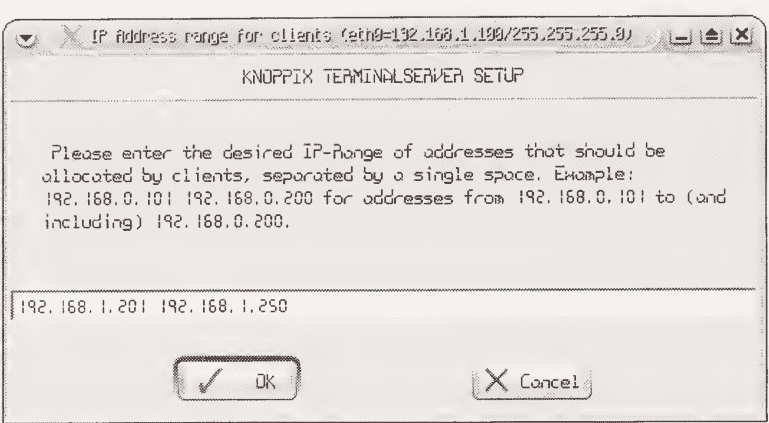


服务器启动后，按照以下说明将该计算机配置为无盘服务器：

- 点击K菜单，选择KNOPPIX→服务→启动KNOPPIX终端服务器，此时会弹出“KNOPPIX终端服务器相关信息”对话框。
- 点击“确定”，弹出终端服务器对话框，默认选中“设置（重新）配置服务器并（重新）启动”选项。图22-1展示了终端服务器窗口。

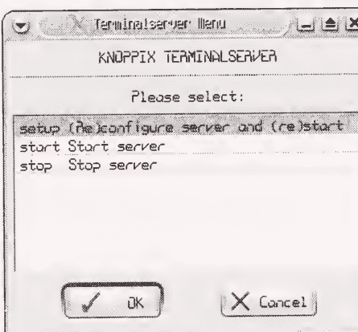

- 点击“确定”，弹出“选择连接到客户端网络的网络设备”对话框。
- 为你的无盘客户端选择合适的网卡（NIC），点击“确定”，弹出“客户端IP地址范围”对话框，如图22-2所示。但如果终端服务器检测到该网卡没有IP地址，会弹出“配置局域网”对话框，你可以在该对话框中设置静态网络参数。
- 如果你的现有DHCP服务器与终端服务器的地址范围重叠，请修改无盘服务器的DHCP地址段，使其与现有DHCP服务器的地址段不同。如果你的网络已配置了以下两个常用默认地址段，则无需修改无盘服务器的DHCP地址段：
  - DHCP服务器：`192.168.1.100`至`192.168.1.150`。
  - 终端服务器：`192.168.1.201`至`192.168.1.250`。
- 点击“确定”，“客户端硬件”对话框会显示网卡类型列表。
- 勾选所有你需要让客户端能够通过该服务器启动的网卡类型。你所选的每张网卡的内核模块都会被添加到服务器提供给客户端的PXE启动镜像中；该镜像包含了客户端加载Linux并启动启动流程所需的全部软件。但请注意仅勾选你预期客户端会使用的网卡类型，否则勾选的网卡类型过多会导致启动镜像过大，无法通过PXE启动。
- 点击“确定”，弹出“选项”对话框（见图22-3）。

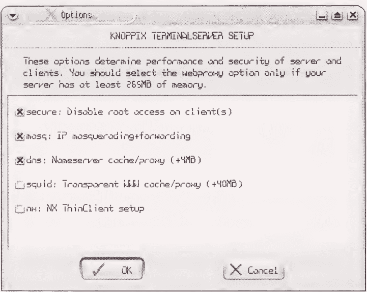

**图22-3：** 选项对话框中可用的服务。

- 点击“确定”选择默认服务，弹出“客户端启动选项”对话框。你无需在此处指定任何特定选项。
- 点击“确定”，“正在启动服务器”对话框会显示以下信息：
  - 终端服务器即将启动。
  - 如果你查看进程表（`ps -ef`），会看到如下内容。
- **点击“是”**。你的无盘服务器启动完成，即可为客户端提供服务。

## 配置客户端

配置无盘客户端比配置服务器更简单。按照以下说明即可让PC从无盘服务器启动：

- 将带有支持PXE网卡的PC连接到与无盘服务器相同的网络中。如果你的网卡不支持PXE，也可以从`www.rom-o-matic.net`获取的启动软盘启动。
- 打开PC电源。
- 按下对应的功能键进入BIOS（基本输入/输出系统）编辑界面。部分计算机设置了专门的功能键用于执行网络启动，例如VMware虚拟机使用F12键启动网络引导。
- 修改启动顺序，将网络启动项放在启动队列的最前面。
- 保存新的BIOS配置并继续启动流程。图22-4展示了典型的Knoppix启动提示符，此处同时也是无盘启动提示符。这一流程与第2章中描述的从《Knoppix入门》DVD启动Knoppix live系统的流程完全一致，毕竟你本质上是从Knoppix DVD启动的。

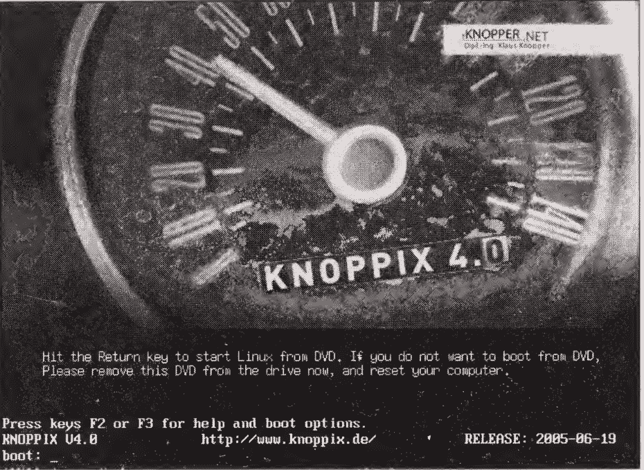

- 遇到`boot:`提示符时按下回车键。你的无盘客户端的启动流程与《Knoppix入门》DVD完全一致，你可以像使用从DVD启动的Knoppix live系统一样使用无盘客户端。和DVD启动的情况一样，重启机器后你做的所有修改或保存的文件都会丢失。下一节将介绍如何保存你的文件和设置。

## 使用持久化设置

第3章介绍了保存私有目录的方法，该方法会将你的文件和设置保存在永久存储介质中（例如U盘、软盘）。


**图22-4：** Knoppix无盘启动提示符。


KTS（Knoppix终端服务器）会从Knoppix DVD为无盘客户端提供根文件分区。你可以通过创建并使用基于硬盘的DVD镜像来提升Knoppix终端服务器的性能。从硬盘提供无盘客户端的文件系统比从DVD或CD-ROM更快。你需要从永久安装的Knoppix系统执行以下步骤，同时你的硬盘至少要有5GB的可用空间。以下说明将介绍如何提升KTS的运行速度：

- 将*《Knoppix入门》*DVD插入你的电脑。
- 输入以下命令，在硬盘上创建DVD的完整镜像：

```
dd if=/dev/cdrom of=/knoppix-4.0.iso
```

该过程可能需要数分钟。

- 卸载DVD。

```
umount /cdrom
```

- 按照以下方式挂载新创建的镜像：

```
mount -t loop /cdrom
```

你可以通过基于硬盘的Knoppix镜像启动无盘客户端。

## 第23章：搭建文件服务器


### 本章内容

- Linux文件共享
- 搭建简易Samba文件服务器
- 搭建简易NFS文件服务器

Knoppix最为人熟知的是作为*Live Linux发行版*。谈及Live Linux，Knoppix更是*首屈一指*。从光盘启动后，你会得到一个运行完整KDE桌面环境的工作站，可以运行`OpenOffice.org`、`Mozilla Firefox`等应用程序。这一能力让Knoppix声名远扬，但它的功能远不止于此。Knoppix还是一个非常出色的网络服务平台，默认安装了大量服务器软件。在网络计算机上启动Knoppix（live版或永久硬盘安装版），配置好对应服务，就能将其变成网络服务器。本章将介绍如何搭建文件服务器，实际上会说明如何配置默认安装的Knoppix来提供文件和目录（文件夹）共享服务。文件服务器可以让你跨网络共享信息，即使你的网络只有两台计算机，这一功能也很有用。无论网络规模大小，文件共享都能帮你提升效率、带来便利。

> 本章的示例均基于永久安装的Knoppix系统。如果你只是想了解相关技术，可以使用Knoppix live版。但如果你想搭建实际可用的文件服务器，除非你只是想共享只读的Knoppix DVD，否则硬盘安装版实用性更高。

## 了解Linux文件共享

文件共享的原理很简单：

- 服务器允许客户端通过网络访问其文件系统和目录。


- 文件系统和/或目录可以设置为*只读*或*可读写*模式。
- NFS仅提供基于主机的访问控制。
- Samba同时提供基于机器和基于用户的访问控制。

Linux提供了两种文件共享系统：

- **Samba**会模拟Windows文件服务器，通过在Windows环境中“说”Windows语言来运行：*服务器消息块*（SMB）协议。
- *网络文件系统*（NFS）是久经考验的、用于与Linux和UNIX计算机共享文件的协议。
- 如果你需要在网络中同时使用Knoppix和Windows，请选择Samba。

## 使用Samba导出资源

用Knoppix导出文件时，你无需担心北美自由贸易协定或欧盟贸易标准的问题。正如某首歌曲中所唱（我认为）：“你只需要Samba。”

## Samba核心组件

Samba是一套由程序、配置文件和文档组成的套件，正如其名，它是所有部件的总和。以下部分将介绍整个套件中最重要的组成部分。

## Knoppix的Samba软件包

Samba软件存储在多个Debian软件包中，其中最重要的软件包如下：


- **samba**：该软件包包含Samba服务器守护进程（`smbd`和`nmbd`）、实用工具和文档文件。

- **smbclient**：你可以使用该客户端工具交互式使用或挂载远程Samba服务。

- **samba-common**：该软件包包含客户端和服务器都会用到的支持软件（例如基础配置文件、库和其他杂项文件）。

- **sambastart-knoppix**：是集成在Knoppix系统中用于启动Samba服务的工具。

- **SWAT**：*Samba Web 管理工具* 提供了基于Web的配置界面，可用于配置Samba的所有功能，通过浏览器访问SWAT即可完成Samba全功能的配置。

Samba的核心组件包括：

- `smbd` 守护进程：为客户端提供文件和打印机共享服务

- `nmbd` 守护进程：NetBIOS名称服务器，用于响应Windows计算机定位Windows文件共享的请求

- `smb.conf` 配置文件：控制`smbd`和`nmbd`守护进程的运行

## Samba配置文件

Samba的配置存储于`smb.conf`文件中，该配置文件被划分为多个节，每个节包含配置参数和注释。*共享（Shares）* 定义了Samba对外导出的资源，Samba默认包含以下三个特殊共享：

- `[global]`：定义Samba的全局运行规则，例如可在此配置身份验证方式等相关选项

- `[homes]`：主要用于将用户主目录导出至私有网络，默认导出`/home`目录

- `[printers]`：客户端将待打印文件复制到打印服务器的临时位置（即*spool directory（假脱机目录，简称spool）*），由服务器完成实际打印，该假脱机目录可通过Samba对外导出

共享的功能通过配置参数定义，后续示例将介绍最常用的参数。


Samba套件提供了手册页和官方文档，查找相关信息的最快捷方式是使用`man`命令。例如，执行`man smb.conf`、`man smbd`和`man nmbd`即可获取Samba配置及守护进程的相关说明，`/usr/share/samba`目录中存储了Samba的相关信息文档。

## 概览：搭建Samba服务器

使用Samba提供文件服务在概念上非常简单：只需确定需要导出的文件系统或目录，再配置Samba对外提供该服务即可。Samba本身的配置对于基础使用来说非常简便，若需要提供复杂的文件服务，也支持进行高度复杂的配置。本章重点介绍简单的Samba配置，首次使用时越简洁越好，以下是整体配置流程：

1. 配置待导出的文件系统：Samba会将一个或多个文件系统/目录导出至网络设备，首先需要确定需要导出的文件、目录或文件系统

2. 配置Samba服务器导出共享：准备好待导出的文件系统后，需要向Samba声明需要导出的内容

3. 将一个或多个客户端连接至Samba服务器

本章将使用两个Samba配置示例：


## ✓ 导出DVD/CD-ROM驱动器

DVD/CD-ROM的配置非常简单，因为它属于*只读*介质，导出只读介质时遭受黑客攻击的风险更低，因此无需过度担心。


## ✓ 导出用户主目录

导出用户主目录会带来更高的安全风险，需要更加谨慎操作，后续示例将介绍如何导出这两种类型的文件系统。

## 示例1：导出DVD/CD-ROM驱动器

将DVD/CD-ROM驱动器作为文件系统导出的优势在于其属于只读文件系统，即使配置出现错误，最坏的结果也仅仅是让他人看到你的DVD内容。

Samba提供了*文件访问列表（ACLs）*功能，可用于允许或拒绝用户访问文件和目录。但Linux系统的文件/目录ACL优先级高于Samba的ACL，如果Samba允许访问某文件而Linux文件权限不允许，访问请求会被直接拒绝。因此必须密切关注文件权限设置，同时选择导出内容时也要谨慎：未导出的文件系统上的任何错误都会被计算机密码和防火墙保护，换句话说，Knoppix内部的内容会一直留在Knoppix系统中——直到你开始导出文件，一旦开始导出，你的配置错误也会被一并导出，黑客甚至普通用户都能看到这些问题。

### 准备`/cdrom`文件系统

当前无需进行任何额外配置，只需将DVD或CD-ROM插入驱动器即可（如果尚未插入的话）。

### 配置Samba导出DVD/CD-ROM驱动器

下一步是配置Samba，本质上就是编辑存储在`/etc/samba`目录下的`smb.conf`文件，既可以手动编辑`smb.conf`，也可以使用图形化的SWAT配置系统，通过浏览器即可完成Samba的配置。


你不需要介意我开的关于SWAT的糟糕双关玩笑，哪怕它是1970年代最棒的电视节目之一。（开个玩笑啦。）

在安装SWAT之前，你需要先了解如何手动配置`/etc/samba/smb.conf`文件。

### 构建用于导出`/cdrom`目录的`smb.conf`文件

要开始手动配置Samba，首先需要备份原始的Samba配置文件，再创建一个新的配置文件，使用新文件可以更轻松地创建简单配置，直观展示Samba的基础功能，按照以下步骤创建新的`smb.conf`文件作为基础：

1. 启动Knoppix计算机：可启动实时实例或永久安装实例

2. 点击Kicker面板上的终端图标

3. 切换至root用户：执行`su -`命令

4. 出现提示时输入root密码（若运行的是Knoppix实时实例则不会弹出密码提示）

5. 重命名默认的`smb.conf`文件，输入以下命令：

```bash
mv /etc/samba/smb.conf /etc/samba/smb.conf.orig
```

Knoppix内置了用于搭建打印服务器的示例Samba配置文件，本示例将创建新的配置文件，因此上述命令会将打印示例配置备份到一旁。

6. 创建新的`smb.conf`文件，输入以下命令：

```bash
kwrite /etc/samba/smb.conf
```

7. 在KWrite窗口中输入以下内容：

```smb.conf
[global]
security = share
workgroup = MSHOME
server string = File server

[cdrom]
comment = DVD/CD-ROM drive
path = /cdrom
```

`[global]`节的配置选项提供以下功能：

- **security**：设置为share选项可取消共享的身份验证要求；若指定为user选项，则客户端必须提供有效的用户名和密码

- **workgroup**：Windows文件共享使用工作组的概念来组织用途相同的计算机，Windows XP家庭版的默认工作组为MSHOME，指定MSHOME后Windows计算机即可通过“网络邻居”轻松浏览Knoppix的Samba共享

- **server string**：可选参数，用于提供Samba共享的相关说明

`[cdrom]`节的配置选项仅对`/cdrom`导出生效，提供以下功能：

- **comment**：用于提供共享的相关说明

- **path**：定义需要导出的目录或文件系统，此处为`/cdrom`

8. 点击“文件->保存”保存文件

9. 点击“文件->退出”退出编辑器，完成上述操作后即可生成用于导出DVD/CD-ROM驱动器的简易配置文件。

## 启动Samba

`/etc/init.d/samba`脚本用于启动和停止`smbd`与`nmbd`守护进程，如需启动Samba，请切换至root用户，在命令行界面（CLI）中输入以下命令：

```bash
/etc/init.d/samba start
```

停止Samba的方法如下：

```bash
/etc/init.d/samba stop
```

修改配置文件后，可使用以下命令重新加载配置：

```bash
/etc/init.d/samba reload
```

或者也可以选择重启守护进程：

```bash
/etc/init.d/samba restart
```

执行以下命令可使Samba在Knoppix计算机启动时自动运行：

```bash
sudo update-rc.d samba defaults
```

执行该命令后会在`/etc/rc2.d`至`/etc/rc5.d`目录中创建指向`/etc/init.d/samba`脚本的软链接，系统启动时会通过这些链接执行Samba启动脚本以启动守护进程。目前可以连接Linux或Windows客户端至Knoppix的Samba服务器，第16章将介绍如何将Linux和Windows计算机连接至Samba及Windows文件共享。

## 示例2：导出用户主目录

本示例将导出Knoppix系统中包含用户账户目录的`/home`目录，导出主目录非常实用，如果你希望在私有网络的多台计算机上访问个人文件，就可以使用该功能。以下部分将介绍如何准备`/home`目录并配置Samba完成导出。

### 准备`/home`目录

导出`/home`目录比导出DVD或CD-ROM需要更多操作，因为你肯定不希望将敏感信息不必要地暴露给外部网络。

# 第七部分：Knoppix高级设备

默认情况下，Knoppix会对`/home`目录以及存储在`/home`下的用户主目录配置如下权限：

- **目录所有者：** 读取、写入和执行权限

- **组所有者：** 读取和执行权限

- **其他所有用户：** 读取和执行权限

运行`ls -ld /home`命令可以查看`/home`目录的权限：

```
dr-xr-xr-x 3 root root 4096 Apr 1 15:20 /home
```

这些信息表示所有者**root**、组所有者**root**以及其他用户（所有用户）均拥有读取和执行权限。

以下命令会列出`/home`目录下的所有目录及其权限：

```
ls -ld /home
```

在我的设备上，我看到了如下输出：

```
drwxr-xr-x 17 psery psery 4096 Apr 1 20:37 /home/psery
```

`/home/psery`目录（我的用户账户目录）的权限允许所有者**psery**（即我）拥有读取、写入和执行权限；组所有者**psery**以及其他用户仅拥有读取和执行权限。默认情况下，只有**psery**用户可以访问**psery**用户组，因此默认权限的安全性足够。不过，当向网络导出该目录时，给予所有用户读取和执行权限存在一定风险。建议移除组的读取、执行权限，尤其是写入权限来提升安全性。

近期发现的Linux漏洞已允许任何无特权用户随意更改组归属。我已在数台运行2.6内核的Linux设备上成功测试了这一漏洞利用方式。如果需要，可以运行`chmod -R 750 /home`命令来消除这一漏洞。关于该漏洞的更多信息可参阅www.securityfocus.com/bid/10662。

## 导出`/home`目录

你可以修改`smb.conf`文件来实现更实用的功能：配置Samba导出用户的主目录。要修改前文示例中的`smb.conf`文件，使其同时导出cdrom和`/home`目录，请按以下步骤操作：

1. 输入以下命令创建新的`smb.conf`文件：

```
sudo kwrite /etc/samba/smb.conf
```

2. 在KWrite窗口中输入以下内容：

```
[global]
workgroup = MSHOME
server string = File server
security = user
encrypt passwords = true
...
[homes]
comment = Home directories
path = /home
read only = yes
create mask = 0700
directory mask = 0700
browseable = yes
```

以下是对上述命令对原始`smb.conf`文件所做修改的说明：

- `security = user`：该选项会强制Samba要求访问共享时提供有效的用户名和密码。（`security = share`模式下仅需提供有效密码即可访问共享。）

- `encrypt passwords = true`：`smbpasswd`文件会存储你的Samba密码，最好对这些密码进行加密以防被窥探。近期版本的Windows要求使用加密密码，因此必须启用该选项。

- `[homes]`：该选项定义了用于导出`/home`目录的新共享，`/home`目录中存储了所有用户的主目录。

- `comment = Home directories`：该选项会为`[home]`共享添加一条简单注释。

- `path = /home`：该选项会将`/home`目录导出为`[home]`共享。

- `read only = yes`：将该参数设置为`yes`会禁止向主目录共享写入数据。我加入这个选项是因为在你学习和测试阶段能让Samba服务器更安全，当你准备好向主目录共享写入数据时，可以将其改为`no`。

- `create mask = 0700`：这是一个面向安全性的选项，它会强制Samba共享下创建的所有文件仅授予文件所有者读取、写入和执行权限，其余用户无任何权限。

- `directory mask = 0700`：该选项的作用与上一选项类似，仅作用对象从文件变为新建的目录。

- `browseable = yes`：设置为`yes`时，任何人都可以查看（浏览）该共享的名称，但是否能查看共享内的内容则取决于其访问控制列表（ACL）配置。

3. 选择「文件→保存」来保存文件。

4. 选择「文件→退出」来关闭编辑器。

5. 按以下方式设置Samba密码：

```
smbpasswd -a username
```

例如，我输入以下命令为我的用户名设置Samba密码：

```
smbpasswd -a psery
```

新的Samba配置已将安全参数设置为user，该配置要求任何尝试连接共享的用户都必须使用本地密码进行身份验证。本示例中我使用的是我的用户名psery，请你替换为你自己的用户名。

6. 输入你的密码，再次输入以确认。你不需要使用和Linux账户相同的密码，Samba的密码身份验证和Linux的身份验证是相互独立的。

至此你已经重新配置了Samba，使其可以同时导出你的DVD/CD-ROM驱动器和主目录。

## 重启Samba

假设你已经完成了第一个示例的配置，你需要重启（或重新加载）Samba，以强制smbd和nmbd重新读取并应用新的配置。你可以选择以下任一方式：

- 在终端窗口中输入以下命令：

```
/etc/init.d/samba restart
```

- 在不重启守护进程的情况下重新加载配置：

```
/etc/init.d/samba reload
```

当你浏览Knoppix的Samba服务器时，你应该能看到用户主目录，并且可以对其进行读写操作。

### 使用SWAT配置Samba

Samba Web管理工具（SWAT）是一个功能强大的图形化配置系统，可通过Web浏览器运行。安装SWAT后，通过Konqueror或Mozilla浏览器访问它即可开始配置。

### 安装SWAT

SWAT以Debian软件包的形式提供，请按以下说明安装并使用SWAT：

1. **将你的Knoppix计算机连接到互联网。**

第四部分介绍了如何将Knoppix计算机连接到互联网。

2. **点击Kicker上的终端图标。**

3. **输入以下命令安装SWAT：**

```
sudo apt-get update
sudo apt-get install swat
```

第一条命令用于更新Debian软件包数据库，确保你可以运行第二条命令。此时会打开Samba Web管理工具（SWAT）的文本对话框，提示你的`smb.conf`文件将被覆盖。

4. **按下Enter键，允许SWAT覆盖Samba配置文件，之后SWAT就安装完成了。**

当你需要配置Samba时，必须配置Knoppix在需要时启动SWAT，这是下一节要介绍的内容。很惊喜吧！

### 配置Knoppix以支持SWAT

Linux使用`xinetd`系统来启动通用网络服务。`xinetd`系统是一个网络服务（守护进程），具备以下功能：

- 监听传入连接。

- 如果请求与`xinetd`中该服务的配置匹配，则激活对应的网络服务。

`inetd`的配置文件是`/etc/inetd.conf`，你需要修改该文件，使其能够监听SWAT的请求。操作步骤如下：

1. **点击Kicker上的终端图标。**

2. **输入以下命令编辑`/etc/inetd.conf`文件：**

```
sudo kwrite /etc/inetd.conf
```

3. **删除文件末尾SWAT对应行开头的`#<off>#`字符串。**

4. **选择「文件→保存」保存文件。**

5. **选择「文件→退出」关闭编辑器。**

6. **输入以下命令重启`inetd`：**

```
sudo /etc/init.d/inetd restart
```

### 使用SWAT配置Samba

本节介绍如何使用Mozilla Firefox浏览器通过SWAT配置Samba。

1. *点击Kicker上的Mozilla Firefox图标。*

Mozilla Firefox浏览器将会打开。

2. *在地址文本框中输入http://127.0.0.1:901，然后按下Enter键。*

SWAT会在回环接口（IP地址127.0.0.1）的901端口监听，将浏览器指向该地址即可连接Firefox到SWAT，此时会弹出身份验证对话框。

3. *在用户文本框中输入root，在密码文本框中输入root密码，然后点击确定。*


你的浏览器会显示SWAT的欢迎页面，如图23-1所示。你可以通过点击对应的分区按钮配置Samba的任意方面，分区配置页面打开后，你就可以选择并修改选项和参数。点击状态按钮可以查看Samba的运行状态或重启它。

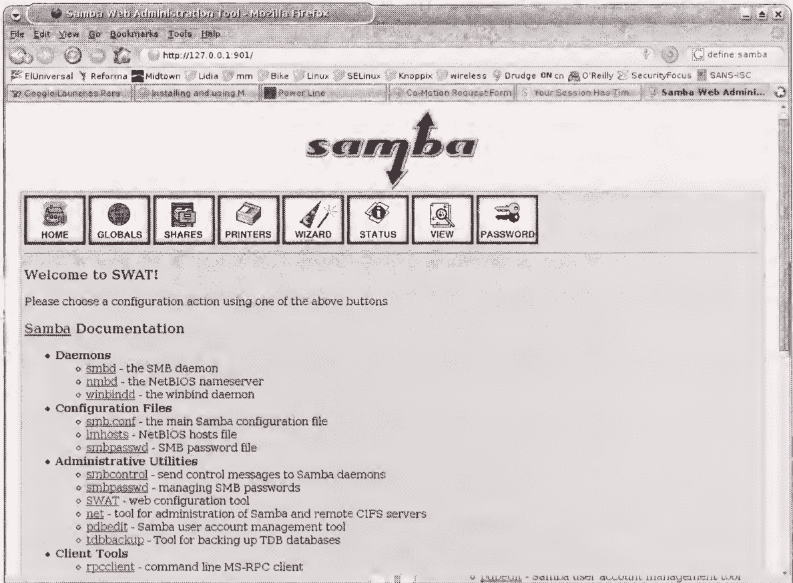

图23-1：SWAT欢迎页面。

## 使用NFS导出资源

NFS可将文件导出到Linux和UNIX计算机。NFS的配置和使用都很简单。本章节将介绍如何配置一个简易的NFS共享。Windows计算机需要安装额外软件方可挂载NFS共享。

### NFS核心组件

NFS是一个可在网络中高效共享文件的软件系统，大部分功能都内置于Linux内核中，运行更加精简高效。Knoppix已预装配置和运行NFS服务器所需的Debian软件包，最重要的软件包如下：

- `nfs-common`：整理NFS各模块通用的文件
- `nfs-client`：包含访问NFS共享所需的软件
- `nfs-kernel-server`：提供用于导出NFS共享的软件

NFS需要以下组件：

- **NFS内核模块**：该软件会将NFS能力注入Linux内核，提供绝大多数NFS功能。
- **NFS守护进程**：这类程序在服务器后台运行，负责客户端身份验证并激活内核服务器进程。
- **Portmap守护进程**：这类守护进程可实现NFS客户端与服务端的交互。
- **NFS客户端配置**：`/etc/fstab`文件用于告知客户端需要从哪些服务端挂载哪些共享。
- **NFS服务端配置**：`/etc/exports`文件用于告知NFS服务端需要将哪些目录导出给哪些客户端。

你可以通过创建并编辑`/etc/exports`文件来配置NFS。不言而喻（但我还是要说），`exports`文件包含需要导出的目录和文件系统，其语法非常简单：

``` object options
```

- **object**：即需要导出的文件系统或目录，默认情况下会以只读方式导出给所有用户。
- **options**：用于限制可从哪些位置访问对象，该参数为可选参数。
- 你可以在行首输入`#`符号，并在其后添加注释内容，NFS服务端会忽略`#`符号后到下一行换行前的所有文本。

NFS会被Knoppix及所有主流Linux发行版自动安装，你只需完成配置、启动并使用即可。

### 示例：导出只读用户主目录

Linux文件权限优先级高于NFS访问控制列表。你需要在导出资源前完成相关资源的正确配置。

### 同步客户端与服务端的用户标识

你可以配置NFS以允许所有用户访问服务端的对象，但从安全角度来看，这并不是一个合理的做法。

### 配置NFS导出`/home`目录

配置NFS导出主目录是个非常复杂的任务——才怪！NFS的配置非常简单，因为它仅需要少量配置参数，请按照以下步骤完成NFS配置：

1. 启动你的Knoppix计算机，可选用live模式或永久安装实例启动。
2. 点击Kicker面板上的终端图标。
3. 输入以下命令创建并编辑`/etc/exports`文件：

```
sudo kwrite /etc/exports
```

4. 在KWrite窗口中输入以下内容：

```
/home a.b.c.d (ro)
```

其中`a.b.c.d`为你希望授予NFS共享访问权限的主机或网络的IP地址。下方的示例将授予`192.168.1.0`网段对`/home`目录的只读访问权限：

```
/home 192.168.1(ro)
```

该示例配置项包含以下组件：

- `/home`：即需要导出的目录，其下的所有子目录也会被一并导出。
- `192.168.1`：该参数指定NFS服务端所服务的子网。本例中，服务端将允许所有IP地址在`192.168.1.1`至`192.168.1.254`范围内的计算机挂载该共享。你也可以指定一个或多个独立IP地址，用逗号分隔（例如`192.168.1.1,192.168.1.2,...`），仅允许特定设备连接到NFS服务端。使用星号（`*`）可允许所有能访问你服务端的计算机连接到网络。你也可以将IP地址替换为星号，以允许你网络中的所有计算机访问（例如使用`/home *(ro)`配置即可允许所有计算机访问`/home`目录）。但请注意：如果你错误配置了防火墙，可能会导致NFS服务端对全网开放！
- `(ro)`：该参数代表只读，`/home`下的所有目录都会被设置为只读。若需要将共享设置为可读写，可将该参数改为`(rw)`。你可以在配置`exports`文件时使用其他参数，更多信息可查阅`exports`手册页（执行`man exports`命令即可查看）。

5. 选择「文件→保存」保存文件。
6. 选择「文件→关闭」关闭文件。
7. 选择「文件→打开」打开`/etc/hosts.allow`文件。
8. 在弹出的对话框中输入以下文件名：

```
kwrite /etc/hosts.allow
```

`Kwrite`会自动打开`/etc/hosts.allow`文件。

9. 在KWrite窗口中输入以下内容：

```
portmap : 192.168.1. : ALLOW
```

10. 选择「文件→保存」保存修改。
11. 选择「文件→退出」关闭编辑器。

NFS已经基本完成了`/home`目录的导出配置，下一节将介绍如何完成整个流程。

# 第七部分：Knoppix高级设备

### 总览：搭建NFS服务端

配置NFS需要完成以下步骤：

1. 在服务端配置需要导出的文件系统。
2. 在服务端配置NFS。
3. 同步客户端与服务端的用户ID。
4. 启动NFS守护进程。

本章将详细介绍如何使用NFS完成上述步骤。

### 启动NFS

NFS的运行部分由两部分组成：NFS守护进程和Portmap守护进程。你需要启动这些守护进程才能连接到服务端，操作步骤如下：

1. 输入以下命令启动Portmap守护进程：

```
/etc/init.d/portmap start
```

2. 启动NFS守护进程：

```
/etc/init.d/nfs-kernel-server start
```

3. 验证NFS和Portmap守护进程是否已启动：

```
ps -ef | tail
```

你应该能看到`Portmap`及多个NFS守护进程正在运行，示例如下：

| 用户 | 进程ID | 父进程ID | CPU占用 | 启动时间 | 终端 | 运行耗时 | 命令 |
|------|--------|----------|---------|----------|------|----------|--------------------|
| daemon | 8047 | 1 | 0 | 21:52 | ? | 00:00:00 | `/sbin/portmap` |
| root | 9428 | 1 | 0 | 22:13 | ? | 00:00:00 | `[nfsd]` |
| root | 9422 | 1 | 0 | 22:13 | ? | 00:00:00 | `[nfsd]` |
| root | 9431 | 1 | 0 | 22:13 | ? | 00:00:00 | `[nfsd]` |
| root | 9433 | 1 | 0 | 22:13 | ? | 00:00:00 | `[lockd]` |
| root | 9435 | 10 | 0 | 22:13 | ? | 00:00:00 | `[rpcid/0]` |
| root | 9438 | 1 | 0 | 22:13 | ? | 00:00:00 | `/usr/sbin/rpc.mountd` |

出于保护（无辜的重复进程？——咳咳，是为了节省篇幅），表格中未列出部分重复的NFS守护进程。`lockd`、`rpciod`和`rpc.mountd`守护进程均与NFS守护进程相关，可为其提供支持。

4. 执行以下命令告知NFS导出`/etc/exports`文件中配置的文件系统：

```
exportfs -r
```

你可以从你私有网络中的任何计算机挂载该NFS共享。

## 第24章

### 我想要我的MythTV

### 本章内容

- 安装MythTV
- 使用软件
- 组网实现视频共享

一直流传着一个说法：你必须从大型企业集团购买数字视频录像机（DVR）。DVR是现代录像机（VCR）的继任者，它可以数字形式录制电视节目，且功能远超VCR。例如，你可以在观看一个录播内容的同时录制另一档电视节目。还有另一种说法是，你必须订购昂贵的服务才能在DVR上安排录制任务。这些确实都是谣言。MythTV是一个开源项目，它可以将你的计算机变成DVR：你只需下载安装该软件、添加电视调谐器，再接入基于网络的节目信息，就能轻松获得一台DVR！

你可以通过你网络中的任何计算机观看MythTV服务端的电视节目，本章将向你介绍具体操作方法。

如果你希望坐下就能看剧、尽量少折腾，那么有两个充分理由让你选择购买或租用现成的DVR，而非使用MythTV：

- MythTV的部署需要花费时间（你可能需要用到本章的所有步骤）。
- 你需要自己承担MythTV的技术支持工作。

如果你想通过Knoppix/MythTV DVR看电视，请继续阅读后续内容！

## 介绍MythTV

MythTV是一个集以下功能于一体的系统：

- 电脑电视调谐器
- 用于查看和录制调谐器电视节目的图形化软件
- 来自互联网的节目单

使用MythTV你可以获得以下功能：

- **免费节目单下载：** 北美地区的Tribune Media Services公司提供免费的DataDirect服务。DataDirect提供为期两周的排程数据，你可以从`http://labs.zap2it.com`下载。其他国家的节目单可以从XMLTV服务获取。像TiVO这样的商业DVR要求你订阅其提供的节目单服务。
- **多电视调谐器：** 你可以在电脑中使用一个或多个调谐器录制节目。商业DVR的调谐器数量越多成本越高；而基于电脑的调谐器最低仅需40美元。
- **控制直播电视：** 你可以获得与商业DVR服务相同的能力，比如暂停、快进直播电视。DVR会自动录制你正在观看的节目，因此你可以回看已经播放过的内容。
- **anywhere观看电视：** 好吧，至少可以在你私有网络内的任意MythTV客户端上观看电视。
- **更多功能：** 如果你有需要，还可以搭建复杂的多DVR配置体系。你可以在多台服务器上安装MythTV，并通过一台电脑统一管理这些服务器。


MythTV是由Robert Kulagowski发起的开源项目。最初只是一个业余爱好者项目，后来滚雪球式发展成一个拥有大量追随者的强大系统。你可以在`www.mythtv.org`找到所有你想了解的关于该项目的相关信息。


本章将介绍你可以用MythTV实现哪些功能。接下来的部分将带你开启一段旅程，最终打造出一台酷炫又有趣的个人视频录像机（PVR）。

MythTV存在一些技术限制：


- 它无法在旧款低速无线网络（如802.11b）上运行。
- 目前还没有可靠的MythTV高清电视（HDTV，高清晰度电视）系统。

## 第24章：我要用我的MythTV

### MythTV节目信息

- 英语地区：美国、加拿大、英国、澳大利亚
- 德语地区：Tvtoday
- 其他语言：瑞典（`tv.swed.sc`）、法国、芬兰（Linux的诞生地！）、挪威、西班牙、荷兰、丹麦、葡萄牙、爱沙尼亚和日本。

**提示：** 留意即将推出的新MythTV地区和功能。

### 搭建MythTV客户端-服务器

MythTV基于*客户端-服务器*模型：客户端连接到服务器。

- 服务器负责控制、录制和播放电视节目，同时也能播放直播电视。MythTV服务器被称为*后端*。
- 客户端被称为*前端*。你通过前端观看节目。

**技术说明：** MythTV支持多后端协同工作，你可以分散负载。本章主要讲解如何配置一套同时包含MythTV服务器和客户端的系统。

**技术说明：** 这些指导假设你使用的是永久安装的Knoppix系统。你可以通过Knoppix live实例安装MythTV，但你需要使用持久化设置，否则每次启动都要重新配置会非常麻烦。

### 步骤1：让你的电脑准备好接收电视

MythTV支持模拟——非数字——有线电视服务，同时也使用常见的电脑电视调谐器和广播节目单。

#### TV调谐器

MythTV要求你的Knoppix待配置DVR电脑中至少配备一个电视调谐器。第14章会教你如何安装。

#### 节目单指南

要配置MythTV，你需要从互联网下载本地的电视节目表。

### 元视角：安装MythTV

本章涵盖MythTV的完整安装流程：

- **步骤1：让你的电脑准备好接收电视。**
  - ✓ 安装并配置电视调谐器。
  - ✓ 注册电视节目单服务并完成阵容向导设置。

- **步骤2：安装软件。**
  - ✓ 下载、编译并安装LAME库。由于LAME库可能涉及MPEG编码器的法律问题，因此未随Knoppix一起分发。
  - ✓ 下载、编译并安装MythTV软件。
  - ✓ 添加QT3/MySQL库。

- **步骤3：配置数据库。**
  - ✓ 启动MySQL数据库。
  - ✓ 配置MythTV的MySQL数据库。
  - ✓ 设置数据库密码。

- **步骤4：配置服务器（后端）。**
  - ✓ 准备MythTV后端。
  - ✓ 配置通用参数、采集卡、视频源和输入连接。
  - ✓ 启动后端。
  - ✓ 下载当前电视节目单信息，并设置未来节目单的自动下载。


你的国家/地区很可能有免费的电视节目单指南：

- ✓ 如果你在美国，`Zap2it.com`公司提供免费的节目单下载服务。（使用以下指导注册Zap2it.com。）
- ✓ 对于其他国家，请访问`www.mythtv.org`网站查找对应的节目单服务。

### 注册Zap2it.com

如果你在美国，按照以下步骤注册Zap2it.com：

1. 打开Firefox浏览器。
2. 浏览至`http://labs.zap2it.com`。
3. 点击「新用户？注册」链接。
4. 提前备好你的律师、枪支和资金，仔细阅读订阅协议。
5. 点击「同意」。
6. 在对应的文本框中输入你的用户名、密码和电子邮箱地址。
7. 在「证书代码」文本框中输入以下内容：


```ZIYN-DQZO-SBUT```

你可以从`www.mythtv.org/docs/mythtv-HOWTO-5.html#ss5.4`的 MythTV 操作指南中获取该代码。

8. 根据要求填写更多信息。Zap2it.com 提供了非常优质的服务，因此花时间填写完所有信息是非常值得的。
9. 点击「订阅」按钮。图 24-1 展示了典型的最终注册页面。

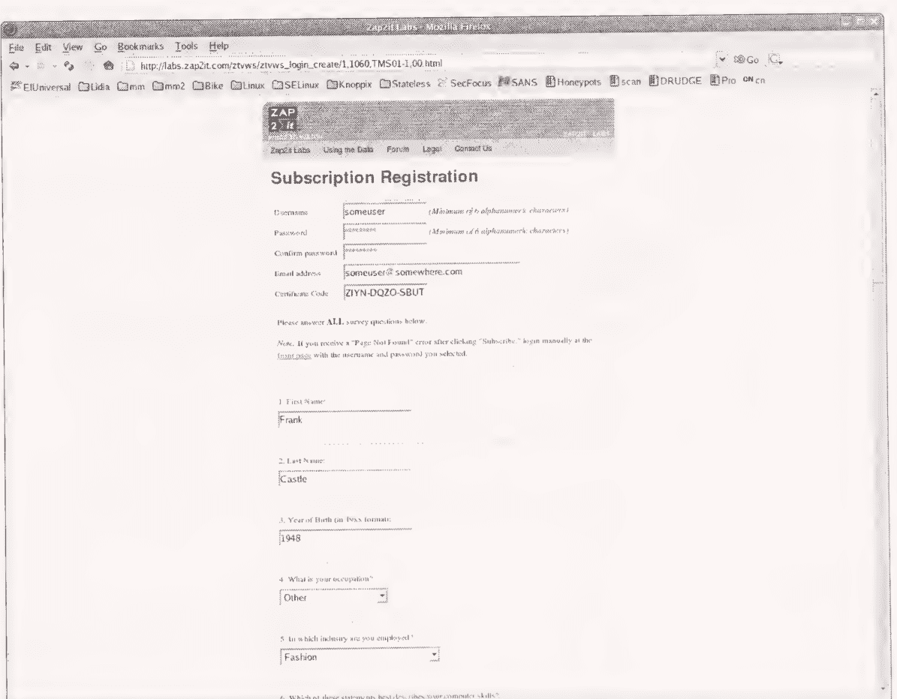

**图 24-1：** 你完成的注册页面。

### 使用 Zap2it.com 阵容向导

完成 Zap2it 注册后，你的浏览器会显示 Zap2it Labs 阵容页面。通过该页面，你可以下载本地电视节目阵容。下载的节目阵容可提供最长两周的节目单。你可以使用该阵容为 MythTV 配置电视节目录制。按照以下指导下载 Zap2it 节目单：

1. 在 Zap2it Labs 阵容网页上，点击「添加阵容」按钮。将打开「阵容向导 - 步骤 1」页面，图 24-2 展示了该界面。
2. 在文本框中输入你的邮政编码（美国居民）并点击「下一步」。该信息有助于定位你的服务提供商。将打开「阵容向导 - 步骤 2」页面。
3. 点击对应按钮选择你使用的电视信号类型，然后点击「下一步」。你将进入「阵容向导 - 步骤 3」，该页面会展示你当地的电视服务提供商。

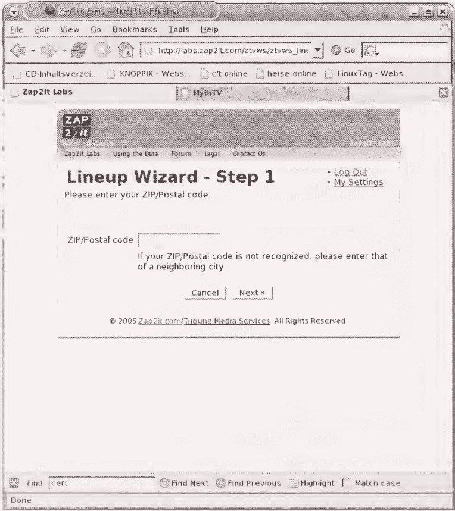

**图 24-2：** 启动阵容向导。

4. 选择你的服务提供商并点击「下一步」。图 24-3 展示了「阵容向导 - 步骤 4」对话框，其中包含我当地有线电视服务提供商的可用频道。
5. 根据你的需求调整选中的频道，然后点击「完成」。默认情况下所有频道都会被选中。请取消选择以下频道：
   - 节目阵容不经常更换的频道（如新闻、天气、购物频道）
   - 你从不观看的频道

配置完成后，你将看到你选择的频道相关信息（见图 24-4）。之后你可以返回该页面查看或修改你的节目阵容。

> 你的注册信息会发送到你注册 Zap2it 时填写的电子邮箱地址。
>
> 完成注册并配置好 Zap2it 服务后，你就可以继续安装和配置 MythTV 了。MythTV 会使用 Zap2it 的节目单信息来排程和录制你的节目。

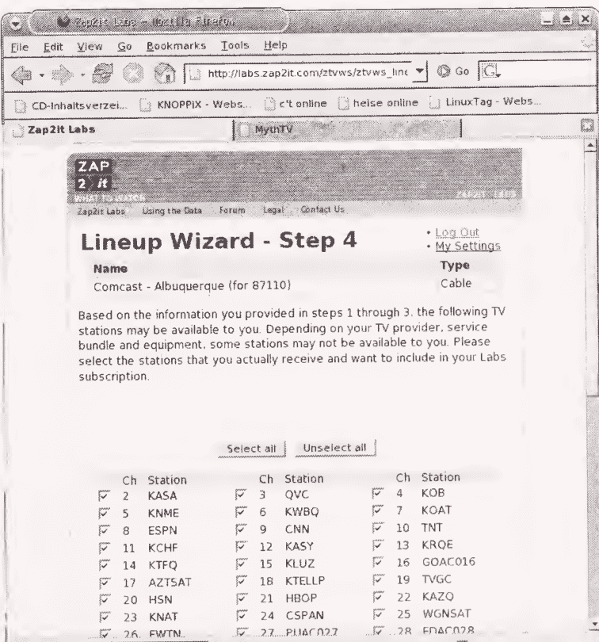

| 频道 | 电视台 | 频道 | 电视台 | 频道 | 电视台 |
| --- | --- | --- | --- | --- | --- |
| 2 | KASA | 3 | QVC | 4 | KOB |
| 5 | KNME | 6 | KWBQ | 7 | KOAT |
| 8 | ESPN | 9 | CNN | 10 | TNT |
| 11 | KCHF | 12 | KASY | 13 | KRQE |
| 14 | KTFQ | 15 | KLUZ | 16 | GOAC016 |
| 17 | AZTSAT | 18 | KTELLP | 19 | TVGC |
| 20 | HSN | 21 | HBOP | 22 | KAZO |
| 23 | KNAT | 24 | CSPAN | 25 | WGNSAT |
| 26 | FWTN | 27 | ... | 28 | ... |

**图 24-3：** 我当地有线电视提供商的频道阵容。

# 第七部分：高级 Knoppix 设备

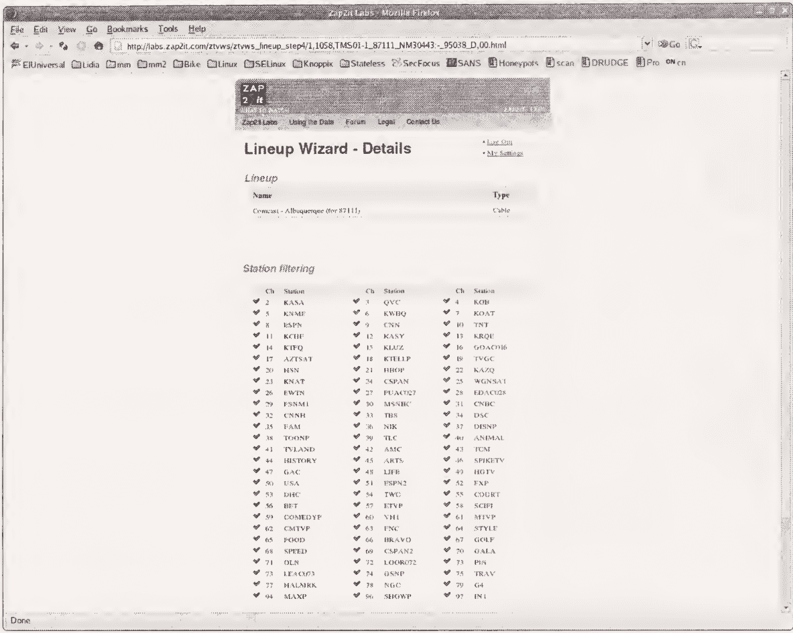

**图 24-4：** 你的 Zap2It Labs 频道列表。


## 步骤 2：安装软件

MythTV 需要其自身的软件以及其他依赖库。本节将安装 MythTV 软件套件。你需要下载 LAME 依赖库和 MythTV 软件，然后编译并安装该软件。编译是指将人类可读的源代码转换为 Linux 可执行格式的过程。

### LAME

LAME 提供了一个核心库，能够让 MythTV 读写 ubiquitous 的 MP3 格式。（MP3 是音视频信息编码的通用标准。）LAME 这个缩写最初采用了真正的 GNU 递归缩写形式，全称为 LAME Ain't an MP3 Encoder，现在它仅指 LAME 本身。出于法律原因，Knoppix 不会在系统中捆绑 LAME 库。你必须在安装 MythTV 之前下载、编译并安装 LAME。

#### 下载并解压

以下步骤将指导你下载并解压 LAME 源代码：


1. 以普通用户（非 root 用户）的身份登录你的 Knoppix 电脑。第 6 章会介绍如何登录。
2. 点击 KDE 面板上的 Mozilla Firefox 图标打开浏览器。
3. 在 Firefox 的地址栏中输入`http://www.sourceforge.net/projects/lame`，然后按下 Enter 键，即可进入 LAME 项目的主页。
4. 点击“最新文件发布”栏目下的 LAME 下载链接，即可打开“项目：LAME（LAME Ain't an MP3 Encoder）：文件列表”网页。
5. 点击`lame-x.y.z.tar.gz`下载链接（其中`x.y.z`为版本号），即可打开下载页面。每个 LAME 的 RPM 包都包含版本号和创建日期，新版本的版本号更高，日期也自然更新。该网页会显示镜像站点列表。


6. 在“下载”栏目下，点击距离最近的镜像站点链接，即可弹出“打开”对话框，此时“打开方式”按钮处于选中状态。
7. 点击“确定”。Firefox 的下载对话框会打开并显示下载进度。下载完成后，会弹出一个名称类似`File:/tmp/lame-x.y.z.tar.gz`的对话框，其中`x.y.z`为 LAME 的版本号。例如，若下载的是 LAME 3.96.1 版本，对话框的名称为`File:/tmp/lame-3.96.1.tar.gz`。
8. 点击“解压”按钮，即可打开解压对话框。
9. 双击对话框左侧子窗口中的主目录图标。
10. 点击对话框右侧子窗口中的`tmp`目录图标。
11. 点击“所有文件”按钮。
12. 点击对话框右下角的“解压”按钮，工具会将 LAME 压缩包解压并存储到你的主目录下的`lame-x.y.z`目录（文件夹）中。
13. 关闭此过程中打开的（仍然停留在界面的）对话框，你就已经完成了 LAME 源代码的下载和解压！

#### 编译并安装

请按照以下步骤编译并安装 LAME 代码：

1. 点击 KDE 面板上的终端图标。
2. 在以下命令中输入 LAME 目录的名称，即可切换到 LAME 目录：

```bash
cd directory_name
```

例如，以下命令可切换到 LAME 源代码目录：

```bash
cd ~/tmp/lame*
```

3. 输入以下命令配置`Makefile`以编译并安装代码：

```bash
./configure
```

侧边栏《快速编译文件》会介绍`Makefile`的工作原理。

4. 输入以下命令编译代码：

```bash
make
```

5. 安装 LAME 库：

```bash
sudo make install
```

6. 如果提示输入，请输入你的用户账户密码。如果你安装的是永久版 Knoppix，则需要输入用户密码。
7. 输入以下命令即可返回你的主目录：

```bash
cd
```

### MythTV

你需要从互联网上下载当前的 MythTV 软件到你的电脑中。

#### 下载并解压

以下步骤将展示如何下载并解压 MythTV 源代码：

1. 使用 Firefox 浏览器访问`www.mythtv.org`。
2. 点击窗口左侧的“下载”链接。
3. 点击“下载主分类”栏目下的 MythTV 链接。
4. 点击 MythTV 链接。


此时会打开“打开`mythtv-x.y.tar.bz2`”对话框，其中`x.y`是当前的 MythTV 版本号，本书撰写时 MythTV 的版本为 0.17，“打开方式”按钮处于激活状态。

5. 点击“确定”，即可打开`file:/tmp/mythtv-x.y.tar.bz2 - Ark`对话框。
6. 选择“操作→解压”，即可打开 Knoppix 的 Konqueror 窗口，其中会显示你的主目录，包括新创建的`mythtv-x.y`目录（文件夹），这说明你已经完成了 MythTV 的下载，接下来可以编译该软件。

#### 编译并安装

以下是下载完成后编译 MythTV 软件的步骤：

> **技术说明** 你必须在编译并安装 MythTV 之前，先编译并安装 LAME 库。

1. 输入以下命令切换到 MythTV 目录：

```bash
cd mythtv-x.y
```

其中`x.y`为 MythTV 的版本号。例如，如果使用的是 MythTV 0.17 版本，请输入以下命令：

```bash
cd mythtv-0.17
```

2. 输入以下命令配置 MythTV 的`Makefile`：

```bash
./configure
```

> **技术说明** 侧边栏《快速编译文件》会介绍`Makefile`的工作原理。

3. 输入以下命令创建`Makefile`：

```bash
make mythtv.pro
```

4. 输入以下命令编译并安装源代码：

```bash
sudo make
sudo make install
```

在配置较低的电脑上，编译过程可能会耗时很久。

> **警告！**

5. 如果你使用的是永久安装版 Knoppix，若提示输入密码请输入。流程完成后，你就已经完成 MythTV 软件的配置、编译和安装了。

### 快速编译文件

编译并安装代码时，`Makefile`包含编译器用于将源代码编译为可执行格式的指令。如果没有`Makefile`，你需要手动输入大量指令。使用`Makefile`并不会直接将源代码转换为可执行程序，中间还有一个步骤：编译器会将每个源代码文件转换为目标代码文件。目标文件是二进制格式的（不再人类可读），目标代码文件需要与相应的库（例如 LAME）链接（如果你愿意，可以理解为*缝合在一起*）成*可执行*文件。由目标文件和库组成的可执行文件，才是你实际用来运行 MythTV 这类应用程序的文件。

运行`make`命令即可启动该流程：

- `make`会检查`Makefile`中的代码编译指令。
- `make`会按照指令将源代码转换为目标代码。
- `make`会将目标代码转换为单个可执行文件。

### QT3/MySQL 数据库库

MythTV 需要与 MySQL 数据库交互，因此要求安装 QT3/MySQL 数据库库。请按照以下步骤将 QT3/MySQL 库安装到你的 Knoppix 电脑中：

- 确保你的 Debian 软件包数据库为最新版本：`sudo apt-get update`
- 如果提示输入用户密码，请输入密码。
- 安装 QT3/MySQL 数据库库：`sudo apt-get install libqt3c102-mt-mysql`
- 如果提示是否继续，按下 Enter 键。如果在`apt-get`安装过程中提示是否更新任何图形系统，按下 Enter 键选择默认选项即可。


## 步骤 3：配置数据库

MythTV 使用 MySQL 数据库存储其配置和节目列表信息。Knoppix 已经捆绑了 MySQL，因此你只需要对其进行配置并启动即可；MythTV 提供了一个 SQL 脚本来辅助配置数据库。

以下示例使用了 MythTV MySQL 数据库的默认用户名和密码。这是一处潜在的安全隐患：这些密码广为人知，无法提供任何防护。不过，基础版 MythTV 系统可在单台 Knoppix 电脑上运行。本章将介绍如何在私有网络中加强 MythTV 的安全防护，后续章节会完成 MySQL 与 MythTV 联用的准备工作。

### 启动 MySQL 数据库

MythTV 与以守护进程形式运行的 MySQL 数据库交互。MySQL 守护进程接收结构化查询语言（SQL）请求。以下指令将启动 MySQL 守护进程，并配置该守护进程在 Knoppix 电脑每次启动时自动运行。安装完 Qt3/MySQL 库后，即可启动 MySQL 数据库。请按以下步骤操作：

1. 输入以下命令：`cd`。该步骤可确认后续指令的执行起始位置（即你的主目录）。
2. 输入以下命令启动 MySQL：`sudo /etc/init.d/mysql start`
3. 输入以下命令配置 MySQL 脚本，使其在开机时自动启动：`sudo update-rc.d mysql defaults`

### 配置 MythTV 的 MySQL 数据库

MythTV 附带一个 SQL 脚本，可用于设置`mythconverg`及其他核心 MythTV 数据库配置。该脚本能帮你减少工作量。以下指令将运行该脚本并测试基础数据库功能：

1. 为 MythTV 创建数据库：`mysql -u root < ~/mythtv-x.y/database/mc.sql`，其中`x.y`为你的 MythTV 版本号。以下示例展示了使用 MythTV 0.17 版本时配置`mythconverg`数据库的方法：`mysql -u root < ~/mythtv-0.17/database/mc.sql`。`mc.sql`文件中包含创建名为`mythtv`的 SQL 用户、并授予其`mythconverg`数据库访问权限的 SQL 语句。该`mythtv`用户仅能从此（本地）设备访问该数据库。
2. 使用以下命令测试新数据库：

```text
mysql -u mythtv -p mythconverg
```

3. 当提示输入密码时，输入`mythtv`（这是 MythTV 的 MySQL 用户默认密码）。
4. 输入`status`命令。你将看到 MySQL 与`mythconverg`数据库的相关信息，与清单 24-1 类似。

```text
mysql Ver 12.22 Distrib 4.0.24, for pc-linux-gnu (i386)
Connection id: 28
Current database: mythconverg
Current user: mythtv@localhost
SSL: Not in use
Current pager: stdout
Using outfile: ''
Server version: 4.0.24_Debian-2-log
Protocol version: 10
Connection: Localhost via UNIX socket
Client characterset: latin1
Server characterset: latin1
UNIX socket: /var/run/mysqld/mysqld.sock
Uptime: 1 day 9 hours 48 min 36 sec
Threads: 4
Questions: 249145
Slow queries: 0
Opens: 165
Flush tables: 1
Open tables: 53
Queries per second avg: 2.047
```

5. 输入以下命令查看可用数据库：

```sql
show databases;
```

你将看到`mythconverg`数据库。

6. 在`mysql>`提示符处输入`exit`退出数据库。

MythTV 的配置参数存储在主目录下`mythtv`目录中的`mysql.txt`文件内。

# 第 24 章：我要用 MythTV

## 步骤 4：配置服务器

安装并编译所有必需的软件、准备好 MySQL 数据库后，在使用客户端观看电视前，必须先配置服务器。本节将配置 MythTV 服务器（后端）。

> **提示** 使用键盘上的上下方向键可导航 MythTV 的设置窗口。若使用鼠标导航，屏幕上不会显示鼠标指针。

### 入门准备

配置后端前，需要对 MythTV 用户账户做一些准备工作。请按以下步骤操作：

1. **创建用于 MythTV 的用户账户**：`sudo useradd -m -d /home/mythtv mythtv`。你将使用该账户的主目录存储视频文件。
2. **输入以下命令启动配置流程：** `sudo mythtv-setup`。设置窗口将打开，显示其支持的语言，该窗口会占满整个显示器屏幕。
3. **选择你的语言（通过按上下方向键），然后按 Enter 键。**
4. **如果要删除已有的 Knoppix 视频设置，请按向下方向键选择以下任一选项，然后按 Enter 键：**
   - *是，删除我的卡设置*：移除你已输入的所有视频卡采集设置。
   - *是，删除我的频道设置*：移除你已输入的所有电视频道。

第 14 章将介绍如何安装视频卡并配置这些设置。

启动 MythTV 设置程序后，将显示`mythtv-setup`主菜单窗口。侧边栏“mythtv-setup 工具介绍”中列出了主菜单的所有子菜单。此时按 Esc 键可退出`mythtv-setup`。

> **提示**

### 主菜单设置

以下主菜单中的功能用于设置 MythTV 服务器。

> **提示** 在子菜单中操作时，按 Esc 键可返回上一窗口。多次按 Esc 键将最终回到主菜单，并退出`mythtv-setup`工具。

### 通用设置

请按以下指令配置通用 MythTV 设置：

1. 在`mythtv-setup`主菜单窗口中，按 Enter 键选择**通用菜单**。图 24-5 展示了主机地址后端设置窗口及默认 IP 地址和端口。

   > **技术说明** `127.0.0.1`是 Knoppix 电脑的内部本地主机地址，在你的局域网中不可见。

   **图 24-5：** 默认 IP 和端口设置。
2. 按 Enter 键打开主机专属后端设置对话框。
3. 在“录制文件存储目录”文本框中输入主目录：

```text
/home/mythtv
```

4. 在“直播电视缓冲目录”文本框中输入`/home/mythtv`。Tab 键的功能与右方向键相同，Shift-Tab 的功能与左方向键相同。
5. 按 Enter 键打开全局后端设置窗口。
6. 使用电视制式子菜单选择电视广播制式选项：


- a. 使用左右方向键选择你所在国家的电视制式；然后按两次下方向键。在美国，选择`NTSC`（美国国家电视标准委员会）。此时你将进入频道频率选项设置。
- b. 使用左右方向键选择你的电视频道制式。在美国，可选择美国有线电视或美国无线广播电视。

- 7. 向下滚动至 XMLTV 节目单时区偏移选项，该偏移值用于标识你所在的本地时区。
- 8. 使用左右方向键选择你所在时区与格林尼治标准时间（`GMT`）的偏移量。表 24-1 列出了美国大部分地区的时区偏移值，其他地区的时区偏移可查阅`www.timeanddate.com/worldclock`。

| 时区 | 主要城市 | 标准时间偏移 | 夏令时偏移 |
| --- | --- | --- | --- |
| 东部 | 纽约 | -0500 | -0400 |
| 中部 | 芝加哥 | -0600 | -0500 |
| 山地 | 丹佛 | -0700 | -0600 |
| 太平洋 | 洛杉矶 | -0800 | -0700 |

MythTV 会自动调整夏令时。图 24-6 展示了我完成的 MythTV 服务器配置。

- 9. 按 Enter 键完成全局后端设置窗口的配置，你已经完成了通用选项的修改。
- 10. 按 Enter 键依次跳过以下各个设置项：
  - 网络唤醒设置
  - 任务队列（主机专属）
  - 任务队列（全局）
  - 任务队列（任务命令）

当你返回主菜单时，就完成了 MythTV 通用设置的配置。

**图 24-6：** 全局后端设置配置界面。

# 第 24 章：我想要我的 MythTV

## 介绍`mythtv-setup`工具

`mythtv-setup`的主菜单有五个子菜单：

- **常规：** 配置常规操作选项，例如后端使用的 IP 地址和端口。
- **采集卡：** 配置你的视频采集卡。
- **视频源：** 定义如何获取电视节目列表信息。在美国，可使用 Zap2it.com 获取节目列表信息。
- **输入连接：** 定义与视频采集卡交互的设备文件。
- **频道编辑器：** 编辑频道信息，例如是否启用某个频道。

本章会介绍如何设置“常规”子菜单，让 MythTV 在网络环境下运行。

### 采集卡

你需要告诉 MythTV 你正在使用哪种视频采集卡，以下是具体操作步骤：

1. 在主菜单中，按向下方向键选中“采集卡”子菜单，然后按 Enter 键，即可打开“采集卡”窗口。
2. 按 Enter 键选中“（新建采集卡）”选项，即可打开“采集卡设置”窗口。
3. **选择视频采集卡设置：**
   - 要使用默认的视频采集卡设置，只需选中“完成”并按 Enter 键即可。
   - 如果你需要为特殊视频采集卡（例如高清电视卡）自定义 MythTV 设置，请按照“高级视频采集卡”边栏中的步骤操作。

   该电视卡配置流程与第 14 章中配置 `xawtv` 的流程类似。选择“完成”后，界面会回到“采集卡”窗口，其中会显示名为`[V4L: /dev/video0]`的新配置。
4. 按 Esc 键返回主菜单窗口。

### 高级视频采集卡

如果你需要为特殊视频采集卡（例如高清电视卡）自定义 MythTV 设置，请按照以下步骤操作：

1. 在“连接到源”菜单中，使用向上/向下方向键选中需要修改的选项。例如，如果你使用的是高清（High Definition）或数字视频广播（DVB）这类视频采集卡，就选中对应的选项值。
2. 按向左/向右方向键为该选项选中合适的值。
3. 对所有需要修改的选项重复执行步骤 1 和步骤 2。
4. 完成视频采集卡的所有所需修改后，按向下方向键直到选中“完成”按钮，再按 Enter 键确认。

### 视频源

本节将介绍如何让 MythTV 登录服务、获取本地广播商的频道信息。如果你在本章早些时候已经按照说明注册了 Zap2it.com 的免费节目列表服务，那么现在就可以使用了！请按照以下步骤设置 MythTV，下载电视节目列表：

1. 向下滚动到“视频源”菜单选项，按 Enter 键打开“视频源”窗口。此时你只有一个可选选项：“（新建视频源）”。
2. 按 Enter 键选中“（新建视频源）”，即可打开“视频源设置”窗口。
3. 按两次向下方向键，移动到“XMLTV 列表抓取器”选项。
4. 在“视频源名称”文本框中输入你想要的配置名称，然后按向下方向键。例如输入`iwantmymythtv`。
5. 选择你所在国家的选项：
   - 如果你住在格兰德河以北，按向下方向键选中默认值北美洲。
   - 其他地区请使用向左/向右方向键找到你所在国家的选项，然后按向下方向键。
6. 输入你的 Zap2it 用户名和密码。

   如果你是北美地区有幸使用 Zap2it.com 的用户，请按照以下步骤操作：

   - a. 在“用户 ID”文本框中输入你的 Zap2it.com 用户名，然后按向下方向键。
   - b. 在“密码”文本框中输入你的账户密码，然后按向下方向键。MythTV 从 Zap2it.com 下载频道信息时，会弹出带进度条的对话框。

   图 24-7 展示了电视视频采集卡的最终视频源设置示例。
7. 按 Enter 键完成视频源设置，界面会回到“视频源”窗口，其中会列出你新建的配置。
8. 按 Esc 键，设置界面会回到主菜单。

图 24-7：输入视频源信息。

## 输入连接

配置完 MythTV 的节目列表源后，你必须将其与视频采集卡关联。MythTV 采用模块化设计理念，将功能组件拆分为独立部分，因此系统更加稳定且灵活。MythTV 支持同时使用多个视频源和视频采集卡，你可以先单独配置每块卡，再将它们关联起来。本节将介绍具体操作方法。

以下步骤演示如何将视频采集卡连接到节目列表提供商：

1. **在 MythTV 后端主菜单中，按向下方向键选中“输入连接”选项，再按 Enter 键。** 此时会打开“输入连接”窗口，其中显示四个选项。
2. **按 Enter 键选中第一个选项`[V4L: /dev/video0](电视)->(无)`**，即可打开“将源连接到输入”窗口。
3. **按两次向下方向键。** 此时会进入“视频源”子菜单，当前选项为“（无）”，表示尚未选择视频源。
4. **按向左/向右方向键，选中上一节“视频源”中你创建的源。** 例如选择`iwantmymythtv`。
5. **按 Enter 键即可返回“输入连接”窗口。** 此时第一个视频输入选项已关联到该视频源：`[V4L: /dev/video0](电视)->iwantmymythtv`。
6. **按 Esc 键。** 此时会返回主菜单，MythTV 后端已经准备就绪！
7. **按 Esc 键退出`mythtv-setup`工具。**

## 启动后端

输入以下命令即可启动 MythTV 后端：

```bash
sudo mythbackend
```

MythTV 服务器启动后会显示以下响应：

```text
Starting up as the master server.

2005-04-12 21:05:25.867 mythbackend version: 0.17.20050130-1 www.mythtv.org

2005-04-12 21:05:25.868 Enabled verbose msgs : important general

2005-04-12 21:05:27.866 Reschedule requested for id -1.

2005-04-12 21:05:27.903 Scheduled 0 items in 0.0 = 0.01 match + 0.03 place

2005-04-12 21:05:27.914 Seem to be woken up by USER
```

现在你可以通过 MythTV 客户端（即 `mythfrontend` 应用程序）访问该服务器。

### 下载节目列表

当 MythTV 后端和 MySQL 数据库准备就绪后，即可下载你的电视服务提供商的节目表。`mythfilldatabase` 应用程序最多可下载两周的节目信息，在命令行界面中输入以下命令即可获取节目列表信息：

```bash
mythfilldatabase
```

该工具会下载节目列表并将其插入 `mythconverge` 数据库。`mythfilldatabase` 工具运行时，会显示一系列文本对话框，列表 24-2 是一个示例。

## 列表 24-2：典型的`mythfilldatabase`文本对话框

```text
Watching your new MythTV
Refreshing Tomorrow's data
Retrieving datadirect data...
Grabbing data for Tue Apr 12 2005 offset 1
From : Wed Apr 13 04:00:00 2005
To : Thu Apr 14 04:00:00 2005 (UTC)
--20:57:48-- http://datadirect.webservices.zap2it.com/tvlistings/xtvdService
=> `-'
Resolving datadirect.webservices.zap2it.com... 206.18.98.160
Connecting to datadirect.webservices.zap2it.com[206.18.98.160]:80... connected.
HTTP request sent, awaiting response... 401 Unauthorized
Connecting to datadirect.webservices.zap2it.com[206.18.98.160]:80... connected.
HTTP request sent, awaiting response... 401 Unauthorized
Authorization failed.
Grab complete.
Actual data from --20:57:49-- http://datadirect.webservices.zap2it.com/tvlistings/xtvdService
```

通过普通的 cable TV 宽带网络下载，该过程至少需要几分钟。

# 第七部分：高级 Knoppix 设备

### 自动下载节目

将 MythTV 节目列表下载自动化，意味着需要配置标准的 Linux `crond` 守护进程，使其定期运行`mythfilldatabase`工具。输入以下命令，插入可自动下载节目列表的 cron 指令：

```bash
sudo echo "minute hour * * * /usr/local/bin/mythfilldatabase" \
>> /etc/crontab
```

**分钟**字段可设为 0 到 59，**小时**字段可设为 0（午夜）到 23（晚上 11 点）。例如，以下命令会在每天下午 11:01 执行：

```bash
sudo echo "1 23 * * * /usr/local/bin/mythfilldatabase" \
>> /etc/crontab
```

星号是**通配符**，作用是让命令每天执行。`crond` 被配置为每晚运行`mythfilldatabase`。

### 兑现 MythTV 的承诺：用 MythTV 客户端看电视

启动 MythTV 前端，你就可以观看直播电视、安排录制任务、播放已录制的节目。就是这么简单！没骗你！

#### 启动前端

你需要告诉 MythTV 前端后端的位置。（这里有个双关梗，但我见好就收啦。）要启动前端，输入以下命令后按回车：

```bash
mythfrontend
```

前端启动后会进入主菜单，主菜单包含以下选项：

- **观看电视：** 选项功能如其名。选中该选项按回车后，MythTV 会切换到全屏视频模式并显示当前频道，使用上下箭头键即可切换频道。
- 媒体库：开始录制后，你可以通过该菜单访问已录制的节目。
- 管理录制：安排和修改录制任务。
- 信息中心：查看直播和已录制节目的相关信息。
- 工具/设置：进行常规配置修改。

#### 保护 MySQL 安全

不要让自己完全暴露在黑客的攻击风险下。配置 MythTV 并非易事，因此我尽可能简化流程，本章全程使用默认设置。默认设置并非秘密，因此你应该假设：任何能获取你电脑交互式 shell 权限的人，都可以访问你的 MythTV 配置。你依然有基础安全措施的保护，但小心驶得万年船。以下指令会修改默认 `mythtv` 密码，并设置当前不存在的 MySQL `root` 用户密码（注意这不是你的 Knoppix `root` 账户）：

1. 以 `root` 身份登录数据库：

   ```bash
   mysql -u root
   ```

   此处的 `root` 用户和你的 Knoppix Linux `root` 用户并非同一个。为了防止数据库被攻破，MySQL `root` 用户的密码应当和你的 Linux `root` 用户密码不同。（SQL 数据库因各类漏洞早已臭名昭著。）

2. 设置 `root` 密码。在以下命令中，将`iamnotanumber`替换为你自行设置的密码：

   ```sql
   SET PASSWORD FOR 'root'@'localhost' = PASSWORD('iamnotanumber');
   ```

3. 修改 MythTV 密码。在以下命令中，将`amianumber`替换为你自行设置的密码：

   ```sql
   SET PASSWORD FOR 'mythtv'@'localhost' = PASSWORD('amianumber');
   ```

4. 保存修改：

   ```sql
   flush privileges;
   ```

5. 输入以下命令退出数据库界面：

   ```sql
   quit
   ```

6. 按照“步骤 4：配置服务器”一节中的说明运行`mythtv-setup`，重置数据库密码。

至此你已完成数据库的基础安全配置，至少能规避简单的攻击手段（例如未设置密码的风险）。

#### 观看直播电视

启动 MythTV 前端时，默认会选中“观看电视”选项，只需按回车即可观看直播。如果当前选中了其他主菜单选项，按上箭头键选中“观看电视”后再按回车即可。你可以把电脑按键当作遥控器使用：

- **上箭头键：** 切换到频道号更高的频道。
- **下箭头键：** 切换到频道号更低的频道。
- **左箭头键：** 快退当前播放的节目。
- **右箭头键：** 从快退状态快进播放。

MythTV 很强大，但它无法预见未来。如果你快进了正在观看的节目，可以再快进回到当前播放时间。

- **S 键：** 查看节目列表。
- **Esc 键：** 从配置模式切换回电视观看模式。

#### 录制节目

MythTV 可以录制电视节目，本节将介绍如何安排录制任务。

#### 安排电视节目录制

按照以下步骤用 MythTV 安排录制：

1. **在 MythTV 主菜单中选中“管理录制”选项，然后按回车。** 管理窗口会打开，默认选中项为“安排录制”。
2. **按回车选中默认选项（安排录制）。** 日程窗口会打开，默认选项为“节目指南”。
3. **按回车选中默认选项（节目指南）。** 节目指南会以网格形式展示电视节目及对应播放时间。
4. **选中你想要录制的电视节目，然后按回车。** 使用上下箭头键在日程表中导航。
   - a. 按右箭头键。“不录制此节目”选项会变为“仅录制本次播放”。
   - b. 按下箭头键，直到找到保存这些设置选项。
   - c. 按回车。该电视节目就会被安排录制，你将回到节目指南界面。
5. 完成所有想安排的录制任务后，按 Esc 键直到主菜单出现。
6. 在主菜单中，选中退出`mythfrontend`的选项，然后按回车。到设定时间后，节目就会被自动录制。

#### 观看已录制节目

准备好观看已录制的 MythTV 节目时，按照以下步骤操作：

1. 从主菜单选中“媒体库”选项，即可看到已录制的节目列表。
2. 按左右箭头键选中想要观看的节目。
3. 按回车选中并播放该节目。

#### 网络访问

如果你配置了服务器（后端）和客户端（前端）的网络连接，就可以通过网络观看 MythTV。

#### 后端配置

要让 MythTV 后端可被网络访问，按照以下步骤操作：

1. 输入`mythbackend`命令打开后端通用菜单。
2. 将 IP 和主源 IP 地址修改为服务器的局域网 IP 地址，默认值为`127.0.0.1`；局域网 IP 地址通常为`192.168.1.1`。
3. 输入以下命令，让`mythbackend`守护进程重新读取配置：


输入`sudo killall -9 mythbackend`即可停止`mythbackend`守护进程。

#### 前端配置

如果`MythTV`后端可被网络访问，你就可以从端连接、控制并观看它。按照以下步骤配置前端：

1. 打开`mythfrontend`配置界面。
2. 将前端IP地址修改为与后端地址一致。

# 第八部分：十大清单部分

**《第五波》**

作者：Rich Tennant

### 本部分概览

所有“For Dummies”系列书籍都有“十大清单”部分，提供若干简短的十大列表供快速查阅。本书也不例外。在本部分中，你可以找到10个实用的Knoppix技巧，以及10个可用于获取更多信息的资源。

## 第25章：10个Knoppix实用技巧

### 本章内容

- 解决死机问题
- 安全通信
- 自定义系统

没有一两章“十大清单”内容的“For Dummies”书籍是不完整的。我借此机会分享10个Knoppix中最实用的技巧。这里所说的hacks（技巧），是指完成有用又有趣的任务，而非恶意入侵他人电脑系统制造破坏。接下来的部分将介绍如何完成一些有趣且实用的任务。祝您使用愉快！

### 解决死机与终止进程

Knoppix提供了终止和重启进程的工具。本节将介绍如何修复卡死的KDE桌面或出现故障的Knoppix电脑，同时还会说明如何关闭单独的窗口。

#### 解决死机

有时候Knoppix会“死机”。并非所有软件都万无一失，进程可能失控进而导致电脑卡死。这种情况并不常见，但你需要了解遇到时如何重启电脑或KDE。

#### 重启KDE

有时候问题出在有故障的图形进程上，这种情况下你可以重启KDE而非整个电脑。你可以使用以下任意一种方法重启KDE：

- [✓] 点击`K`菜单，选择`KNOPPIX>实用工具>选择/重启KNOPPIX桌面`。KDE会消失，加载完成后就会像全新的一样重新出现。

## 第八部分：十大实用技巧

- **✓** 按下`Ctrl+Alt+Backspace`重启`X`服务器。
- **✓** 按下`Ctrl+Alt+F1`，输入命令`init 2; sleep 2; init 5`。该命令会将Knoppix切换至非图形模式，等待2秒后，再返回图形（KDE）模式。

### 重启Knoppix

如果重启KDE无法解决你的问题，下一步就是重启Knoppix。重启前，请确保所有待写入数据（例如`OpenOffice.org`文件）已经写入磁盘。


按照以下步骤操作：

1. 按下`Ctrl+Alt+F1`。你将进入虚拟控制台。
2. 将所有文件系统缓冲区的内容刷新到硬盘。你可以按下任意一组以下按键组合：
   - `Alt`（右侧）+`SysReq+S`
   - `Alt`（右侧）+`PrintScreen+S`
3. 按下`Ctrl+Alt+F5`切换回KDE桌面。

使用以下步骤关闭你的Knoppix电脑：


1. 点击`K`菜单，选择“注销”。等待“knoppix结束会话”对话框弹出。
2. 对话框弹出后，点击“重启电脑”按钮。

如果无法通过KDE菜单重启Knoppix，你可以尝试以下方法：

1. 按下`Ctrl+Alt+F1`切换至虚拟终端。
2. 输入`reboot`命令。

如果无法通过菜单重启Knoppix，你需要对电脑进行电源循环操作。电源循环指物理上关闭电脑电源后再重新打开。

### 关闭（比尔的）Windows窗口


所有Linux爱好者都知道如何“杀死”进程——没错，这里指的是终止进程。传统方式是：要终止Linux进程，你需要打开终端窗口，运行`ps -ef`列出所有进程，然后执行以下任一操作：

- 使用`kill`命令结束该倒霉进程的生命。
- 将进程列表通过`grep`过滤器筛选，示例命令如下：`ps -ef | grep someprocess`。

Knoppix让你不用成为Linux极客，也不用把周五晚上耗在捣鼓和写Linux教程上，就能轻松终止进程——哎呀，真方便！

Knoppix提供了易于使用的`Xkill`工具来终止进程，操作步骤如下：


1. 点击`K`菜单，选择“实用工具”→“工具”→“Xkill”。桌面会出现一个带有跳动KDE齿轮图标的正方形光标。
2. 将新光标移动到你想要终止的任意应用程序窗口或对话框上。
3. 点击该窗口，窗口就会关闭。Uma肯定会为你骄傲的。

### 使用OpenSSH进行安全通信


`OpenSSH`支持安全传输文件、跨网络交互通信，以及为其他通信提供隧道服务。（隧道指将其他应用的通信承载在OpenSSH上传输。）`OpenSSH`是安全通信领域的瑞士军刀：它能保护你的通信免受恶意攻击，且操作简单。`OpenSSH`是基于安全外壳（SSH）协议的开源加密通信系统。

### 命令

`OpenSSH`允许你在远程SSH服务器上运行应用程序和工具，无需先登录服务器。以下章节将介绍如何执行远程命令。

##### 发送命令

Knoppix默认已安装OpenSSH客户端。该客户端提供交互式Shell，可通过加密通道与服务器通信，使用方式与本地命令行界面（CLI）一致：


1. 点击KDE面板上的`Konsole`终端图标。
2. 输入以下命令，通过协议2连接OpenSSH服务器（协议1存在漏洞，不推荐使用）：`ssh -2 remotehost`。连接后，你将使用当前登录客户端时的用户名接入服务器。
3. 出现提示时输入密码，即可安全连接到`remotehost`。


输入`man ssh`即可查看OpenSSH客户端的使用方法及参数说明。

##### 接收命令

Knoppix已安装OpenSSH服务器。启动服务器后，你就可以从其他电脑通过SSH远程访问你的Knoppix电脑：

- 从终端窗口手动启动服务器：`sudo /etc/init.d/ssh start`
- 将服务器设置为每次启动永久安装的Knoppix电脑时自动运行：`sudo update-rc.d ssh defaults`

如果希望OpenSSH服务器在Knoppix Live DVD或CD启动时自动运行，需要使用持久化Knoppix镜像。（详见第3章。）


服务器启动后，你就可以用其他电脑上的SSH客户端与你的Knoppix主机通信。

##### 执行远程命令

你可以使用OpenSSH执行远程命令，无需登录交互式Shell，这种方式非常便捷，可用于以下场景：

- 执行无需完整交互式Shell的简单任务。
- 自动化远程机器上需要执行的流程。

例如，输入`ssh username@remotehost echo hello`就会收到返回结果`hello`。这种情况下，远程主机会执行`echo hello`命令，将结果输出到标准输出，再通过管道传回你的OpenSSH客户端。


远程服务器需要配置为将X Window图形回传到客户端；不过OpenSSH服务器默认已配置为将X图形回传给客户端。示例如下，远程电脑运行`xclock`，但OpenSSH会将其显示在客户端电脑上：

```
ssh -X username@remotehost xclock
```

#### 文件传输

OpenSSH提供了安全传输文件到SSH服务器，或从SSH服务器下载文件的选项。

##### scp

`scp`客户端支持双向复制文件。

###### 发送文件

以下命令可以将文件从你的客户端安全复制到运行OpenSSH服务器的远程电脑上：

```
scp filename username@remotehost:
```

请将`filename`、`username`和`remotehost`替换为你自己的实际值。例如，以下命令会将当前工作目录下的`.bashrc`文件（默认安装在每个用户账户的主目录中）复制到名为`cancun`的远程电脑的用户`paul`的主目录下：

```
scp .bashrc paul@cancun:
```

如果要复制文件到其他目录，只需在冒号后加上目录名即可。例如，输入`scp filename username@remotehost:tmp`可将`filename`复制到用户的`tmp`目录下；也可以输入`scp filename username@remotehost:/tmp`将文件发送到远程电脑的`/tmp`目录。


###### 接收文件

要从运行OpenSSH服务器的其他电脑安全复制文件，请将以下命令中的`filename`、`username`和`remotehost`替换为你自己的实际值：

```
scp username@remotehost:filename .
```

例如，要将远程电脑`xcaret`主目录下的`.bashrc`文件复制到你当前登录的电脑的目录下，输入以下命令：

```
scp paul@xcaret:.bashrc .
```

出现提示时输入密码，文件就会被复制到你的当前位置。上述命令末尾的句点（.）用于告诉OpenSSH将文件复制到当前工作目录。


##### sftp

交互式`sftp`的工作方式与FTP（文件传输协议）系统类似：

- 输入`sftp remotehost`即可进入交互式`sftp>`提示符界面。
- 输入`help`可查看命令列表。
- 使用`get`和`put`命令可获取和发送文件。


#### 隧道技术

OpenSSH可以创建加密隧道，供各类服务传输使用。例如，如果你的互联网服务提供商提供互联网消息访问协议（IMAP），但不提供基于SSL的IMAP，你就无法安全收取邮件。但通过OpenSSH，你可以将IMAP通过加密隧道传输，自行实现安全防护。以下步骤将介绍如何搭配Thunderbird邮件客户端使用隧道：

1. 点击Kicker中的终端图标。
2. 输入以下命令，为你的ISP创建面向IMAP（143端口）的SSH隧道：

```
ssh -N -f -L 1433:mail.myisp.com:143 -l username@mail.myisp.com
```

系统提示时输入你的ISP密码，隧道便会建立连接。

SSH隧道命令的选项如下：

- **-N**：禁止执行远程命令。
- **-L 1433:mail.myisp.com:143**：将本地机器回环（lo）接口1433端口的通信转发到远程主机`mail.myisp.com`的143端口。IMAP默认使用143端口，我前端用1433端口是因为它高于1024端口。只有root用户能连接1024以下的特权端口，你可以选择任意非特权端口，但我选1433是为了提醒自己这是连接143端口的（我在后面多添了个3）。
- **-l username**：指定登录远程机器所用的用户名。
- **&**：指示本地计算机将ssh隧道命令创建的进程与终端分离，该进程会独立运行，无需你进行交互。如果不使用这个`&`符号，进程会一直保持在终端窗口中响应。

3. 系统提示时输入远程机器上的用户账户密码。
4. 编辑你的ISP服务器连接属性，使用服务器`127.0.0.1`和端口`1433`。这会指示你的邮件客户端通过回环（lo）接口的1433端口读取邮件，不会影响任何网络或拨号设置。OpenSSH会通过该接口和端口传输输入输出，你的邮件客户端只需直接连接此处即可。

> 第12章会介绍如何编辑Thunderbird邮件客户端的属性。现在你可以通过SSH隧道安全地读取邮件，你的私人信息可以在不安全的互联网上安全传输，不会被窃听。


在上面的示例中，OpenSSH仅保护你接收的邮件。如果你想保护你发送的邮件，可以：

- 配置另一条OpenSSH管道来加密外发邮件。
- 如果ISP支持，外发邮件可使用传输层安全（TLS）和安全套接字层（SSL）协议。

## 系统设置

Knoppix提供了实用工具来帮助你配置Knoppix计算机。本节将介绍如何配置显示器、鼠标、时间和语言。如果你是通过实时DVD或CD运行Knoppix，本章剩余部分的技巧在配合持久化主目录使用时效果最佳（见第3章）。


#### 显示器配置

无论你使用的是实时实例还是永久安装的Knoppix，系统都会默认配置你的显示器。你也可以使用本节介绍的Knoppix工具创建自定义显示配置。

#### 屏幕优化技巧

Knoppix在自动配置显示器的色彩深度和最高分辨率方面表现优异，但你可能想要根据自己的偏好自定义视频设置。Knoppix提供了手动调整图形设置的工具，请按照以下步骤修改视频设置：


1. 点击`K`菜单，选择控制面板。
2. 点击外设，选择显示选项。
3. 点击屏幕大小的下拉菜单，选择一个新的数值。
4. 点击应用。如图25-1所示，控制中心会显示当前的屏幕分辨率。你不需要修改显示器的刷新率（控制中心显示菜单中的第二个选项），75Hz与70Hz（甚至60Hz）之间的差异可以忽略不计。Knoppix会应用新的分辨率，随后会弹出“确认显示设置更改 - 控制中心”对话框，要求你接受或拒绝新设置。

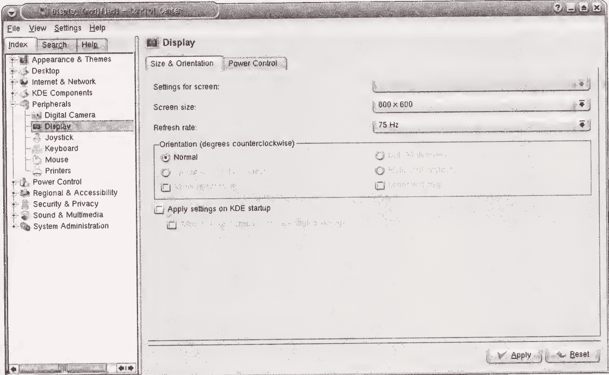

5. 点击接受配置按钮。
6. 选择文件→退出，关闭控制中心。新的屏幕分辨率会被保存为默认值。

#### 点击本地设置，实现全局节能

减少全球变暖（至少减少室内升温！）！电脑浪费电力时特别烦人。我讨厌电脑不关闭显示器导致电费上涨。KDE控制中心可以让你的电脑显示器按需运行，按照以下步骤降低能耗：

1. 点击`K`菜单，选择控制面板，打开控制中心窗口。
2. 点击外设，选择显示选项，打开显示窗口。
3. 点击电源设置选项卡。
4. 勾选启用显示电源管理选项，显示子窗口会展示可用的节能选项，如图25-2所示为默认设置。
5. 按需修改参数，点击应用。
6. 选择文件→退出，关闭控制中心。

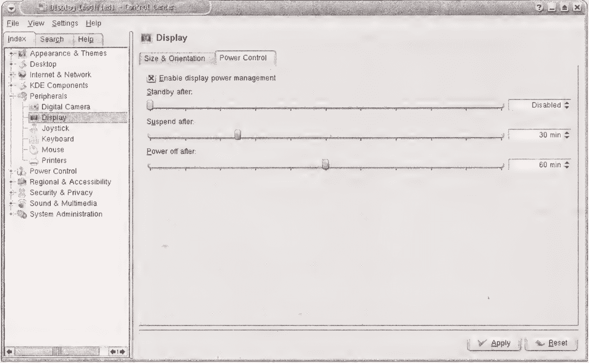

## 图25-2：控制中心的节能设置。现在你的显示器会更省电。

### 时间设置

你可以通过图形化或文本工具设置Knoppix的日期、时间和时区，本节将介绍这些工具的使用方法。

#### 手动设置日期和时间

每年两次夏令时都会出来捣乱。春天拨快时钟，秋天拨回，折腾来折腾去。我讨厌夏令时的调来调去，因为我要重置所有时钟，还要重新适应时差，简直是“盒装时差”。我觉得我们应该改用公制时间：一天10小时，一周10天，一年10个月，诸如此类。具体细节我就交给天才们去琢磨了——但我敢肯定，一周10天的话，肯定有*四天周末！哇哦！*

当你需要重置电脑的日期和时间时，KDE控制中心又能帮上忙了，请按照以下步骤操作：

1. 点击`K`菜单，选择控制面板。
2. 点击系统管理，选择日期和时间。如果你正在运行实时Knoppix实例，点击终端图标，输入命令`sudo kcontrol`以特权用户身份启动该工具。


3. 点击管理员模式按钮，会弹出“以Root身份运行 - KDE su”对话框。
4. 输入`root`密码，点击确定。
5. 如果你想更改时区，点击当前时区的下拉菜单，选择你所在的地区。
6. 通过点击对应数值或直接在文本框中输入来修改日期和时间。
7. 选择文件→退出，关闭控制中心。现在你的时间已经是最新的了。


你也可以通过命令行设置日期和/或时间，打开终端窗口，输入`date`命令，就能看到当前的日期和时间，例如`Fri Apr 8 21:02:55 MDT 2005`。你可以使用基本格式`date mmddhhmm`（月、日、时、分）来设置日期和时间，例如，输入`date 04091630`即可将日期和时间设置为当年4月9日下午4:30。（`date`工具使用24小时制时钟。）

#### 自动设置日期和时间


有些电脑的时钟很准确，有些则不然。不过无论如何，网络时间协议（`ntp`）都能保持你的电脑时间准确。Knoppix预装了`ntpdate`命令，按照以下步骤，你可以用`ntpdate`和`cron`实现时间自动同步：


1. 点击Kicker上的Mozilla Firefox图标。

2. 访问`http://ntp.isc.org/bin/view/Servers/NTPPoolServers`，该网页提供了按国家分类的公开NTP时间服务器列表。这些公开时间服务器面向全球所有人开放，每个URL至少对应一台服务器，你无需知道具体是哪台服务器响应你的时间请求。

3. 点击Kicker中的终端图标。

4. 输入以下命令切换到超级用户：

```su -
```

5. 系统提示时输入`root`密码。

6. 输入以下内容：

```echo "1 * * * * root /usr/sbin/ntpdate \ us.pool.ntp.org" >> /etc/crontab```

该示例指示`cron`每小时的第1分钟运行`ntpdate`命令。

运行`man crontab`可查看有关`cron`的更多信息。

7. 按如下步骤配置`cron`守护进程实现自动启动：`update-rc.d cron defaults`

8. 启动`cron`守护进程：`/etc/init.d/cron start`

你的电脑会每天自动更新系统时间——如果愿意的话，也可以设置成更频繁的更新频率。Debian的`ntp`软件包提供了`ntpd`守护进程，运行`ntpd`可以让你的电脑始终保持时间同步。


## 第八部分：十大系列

### 学习其他语言

Knoppix支持多语言。（这对我来说太幸运了——我只会说英语，而Knoppix的默认语言是德语，用母语写东西都已经够难的了。）

幸运的是，Knoppix是一款真正的国际化Linux发行版。你可以通过使用*秘技代码*，轻松引导Knoppix进入你需要的语言界面。

要使用美式英语，请引导Knoppix，然后在`boot:`提示符下输入以下内容：

```knoppix lang=us
```

Knoppix支持以下语言（使用对应的`lang=`秘技代码即可切换至该语言）：

| 语言 | 秘技代码 | 语言 | 秘技代码 |
|----------|------------|----------|------------|
| 丹麦语 | `da` | 意大利语 | `it` |
| 荷兰语 | `nl` | 立陶宛语 | `lt` |
| 英语 | `us`（或`lang=en`） | 拉脱维亚语 | `lv` |
| 爱沙尼亚语 | `et` | 书面挪威语 | `nb` |
| 芬兰语 | `fi` | 新挪威语 | `nn` |
| 法语 | `fr` | 北萨米语 | `se` |
| 德语 | `de` | 瑞典语 | `sv` |
| 冰岛语 | `is` | | |


永久安装的Knoppix会继承安装时引导所用的语言。例如，如果你引导Live版Knoppix时使用了`lang=en`秘技代码，那么之后将Knoppix永久安装到硬盘后，该安装版本也会使用英语。

### 鼠标设置面板

“通用”标签页中的选项可以配置你使用鼠标的每一步操作：

- **按钮顺序：** 点击切换右键/左键模式适配左右利手。左撇子有福了！（启用左撇子鼠标按钮模式可能会导致桌面看起来像是卡住了，不要忘记使用右键点击图标和选项。）

- **双击：** 双击即可激活图标。

- **单击：** 单击即可激活图标。

- **自动选中图标：** 设置停留时长阈值，当鼠标光标停留在对象上超过该阈值时，就会自动选中该对象。

- **光标主题：** 点击即可选择其他光标样式。

- **高级：** 该标签页可调整鼠标速度等参数。

- **鼠标导航：** 该标签页可配置键盘，使其能够操控鼠标光标、执行鼠标命令。

### 配置鼠标

KDE控制中心可以管理系统的大部分（好吧，至少是不少）设置，其中就包括鼠标配置功能。按照以下步骤操作，就能把鼠标调整成你想要的工作方式：

1. 点击K菜单，选择“控制中心”。

2. 点击“外设”，选择“鼠标”，“鼠标-控制中心”子窗口将会打开。

3. 选择一个鼠标选项，再设置你需要的参数。“通用”标签页下的“鼠标设置面板”中列出了所有实用选项。

4. 点击“应用”。弹出的对话框会提示你必须重启KDE才能让更改生效，但大多数更改在你点击“应用”后就会立即生效。

5. 点击“确定”。

6. 选择“文件”→“退出”来关闭控制中心。重启KDE后，所有更改就会全部生效。


## 第26章

### 十个Knoppix实用资源

### 本章导读

- 使用Knoppix官方文档

- 使用在线资源

本章将介绍一些实用且有帮助的资源，这些资源涵盖从通用UNIX手册页到专门的Knoppix文档，还有一部分是基于互联网的资源，比如克劳斯·克诺珀的个人网页。你可以以这些信息为起点，进一步了解Knoppix。我自己也会用到所有这些资源来学习更多Knoppix的相关知识。

### 帮助文件

本节将介绍一些最简单但最实用的Linux资源，所有这些资源都能提供通用且具体的Linux相关信息。

### 手册页

手册页（即`manual`的缩写）提供了关于特定主题、实用工具、协议和命令的信息。使用手册页非常简单：输入`man`加上你感兴趣的主题名称即可。例如，输入`man ls`就能显示`ls`命令的手册页。

手册页分为9个通用主题，这些主题是*带编号的*，具体见表26-1。

表26-1：主题级别

| 主题 | 级别 | 内容 |
|-------|-------|----------|
| 可执行命令 | 1 | 包括程序、Shell脚本和Shell命令。 |
| 系统调用 | 2 | 系统调用是内核函数。 |
| 库调用 | 3 | 函数库包含通用的编程函数。为了避免重复编写通用函数，程序会调用库函数。 |
| 特殊文件 | 4 | Linux使用特殊文件与硬件交互，例如键盘、鼠标和显示器。 |
| 文件格式 | 5 | 这些页面提供了关于文件格式和规范的信息。 |
| 游戏 | 6 | 哇哦！游戏！Linux命令行游戏嘛，我觉得还挺好玩的。显然，有些手册页已经过时了。 |
| 杂项 | 7 | 这是无法归入其他类别的信息的统称类别。 |
| 系统管理 | 8 | 该级别包含一些与系统管理相关的手册页，例如你可以找到`adduser`实用工具的手册页。 |
| 内核 | 9 | 该部分目前只有1个手册页，即关于软IRQ守护进程`ksoftirqd`的手册页，无需多说。 |

当一个手册页（如命令、配置文件或库函数）对应多个手册页时，级别标识就非常重要了。你可以使用以下语法指定要访问的级别：

```man level manpage
```

例如，输入以下命令可显示`crontab`手册页的1级版本：

```man 1 crontab
```

或者，输入以下命令可显示`crontab`手册页的5级版本：

```man 5 crontab
```

这两份手册页展示的是`crontab`系统的不同信息：前者展示的是`crontab`命令的相关信息，后者展示的是`crontab`配置文件`/etc/crontab`的相关信息。

即使不知道具体的手册页名称，你也可以使用`man`命令搜索手册页。输入以下命令即可基于主题查找相关手册页：

```man -k topic
```

例如，输入以下命令可查找与`crontab`系统相关的手册页：


```man -k crontab
```

Debian 系统在`/usr/share/doc/packagename`目录中收录了很多软件包的文档和示例。

## 在线资源

### 克劳斯的个人主页

Knoppix 发行版的创建者克劳斯·克诺珀的个人主页地址为`www.knopper.net`（见图 26-1）。

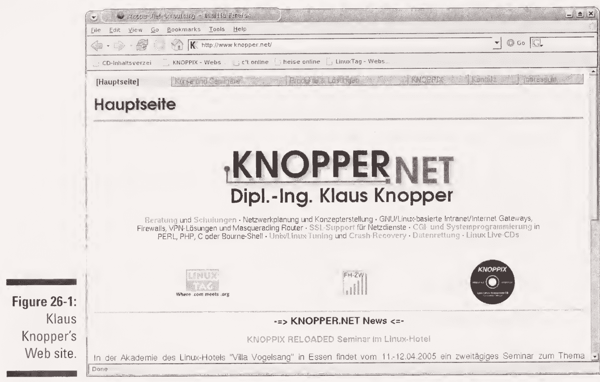

以下列表展示了克劳斯通过其站点发布的部分信息：

- **Knoppix：** 关于 Knoppix 及其即将发布版本的信息。
- **课程与研讨会：** 关于 Knoppix 以及通用软件课程和研讨会的信息。
- **产品与解决方案：** 关于克劳斯咨询服务的信息。
- **链接：** 其他 Knoppix 相关站点的跳转链接。

### 北美官方网站

Knoppix 官方网站`www.knoppix.net`是北美英语用户最实用的站点。这个优秀的网站提供了海量信息和互动功能。该站点的页面如图 26-2 所示。

## 第 26 章：十大 Knoppix 资源

以下列表展示了本网站上一些更有用的信息：

- ✓ **下载 Knoppix：** 链接到全球各地的 Knoppix 镜像。
- ✓ **文档：** 大量关于使用和开发 Knoppix 的文档。
- ✓ **论坛：** 用于讨论和查找 Knoppix 信息的用户论坛。
- ✓ **错误报告**
- ✓ **一般信息：** 查找联系信息以及关于 Knoppix 的更多信息。

该网站对于撰写本书已被证明是无价之宝。

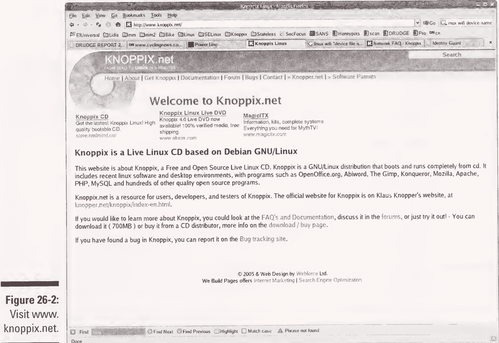

### 欧洲网页

欧洲 Knoppix 网页`www.knoppix.org`是另一个宝贵的网站。其默认语言是德语，但你也可以将其设置为以下语言：

- ✓ 英语
- ✓ 法语
- ✓ 日语
- ✓ 波兰语
- ✓ 罗马尼亚语
- ✓ 西班牙语

点击相应的国旗图标（如图 26-3 所示）以切换到相关语言。

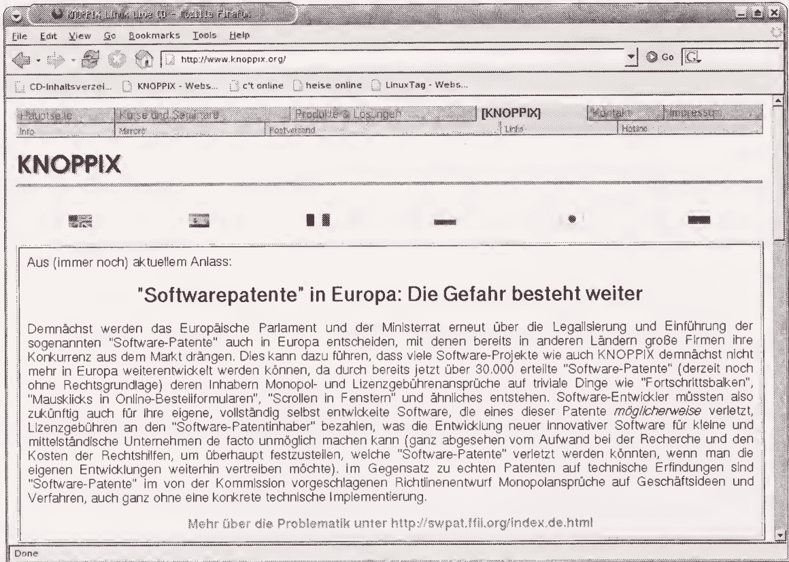

**图 26-3：** 欧洲 Knoppix 网站。

### 在线文档

本章描述的以 Knoppix 为中心的网页包含你可能觉得有用的文档。查看这些网站提供的操作指南、常见问题解答（FAQs）以及其他文档。本项目大量使用了在`www.knoppix.net/wiki/Main_Page`找到的文档。（抱歉，伙计们，我想我可能磨损了你们几个硬盘驱动器。）

### Knoppix 论坛

针对 Linux 和开源软件最常见的批评之一是它们缺乏客户支持。这完全是错误的。在开源世界里，“客户支持”通常不是以订阅服务的形式出现的。相反，你可以从用户论坛找到丰富的支持。

你可以在`www.knoppix.net/forum`找到合适的论坛并提出任何问题。虽然无法保证立即得到回复；但根据我的经验，这个以及许多其他论坛都非常出色。花些时间组织好你的问题，然后提交到相应的论坛。

以下是`www.knoppix.net/forum`上一些最有用的 Knoppix 论坛：

- 定制与重新制作：利用你在这里（以及本书！）找到的信息来定制和/或重新制作 Knoppix。
- 游戏：通过与这个论坛互动增加 Knoppix 的乐趣。
- 通用支持：这是一个供人们提出一般性或杂项问题的论坛。
- 硬件与启动：寻找你的硬件问题的答案。
- 硬盘安装/Debian/Apt：在这个论坛你可以找到关于将 Knoppix 安装到硬盘驱动器问题的答案。安装 Knoppix 意味着你有效地安装了 Debian GNU/Linux；你也可以在这里找到关于 Debian 的信息。
- 创意：你有一个好主意？在这里提交，看看它会如何发展。
- ✓ **Knoppix DVD：** 创建和改进 Knoppix DVD 投入了大量工作。阅读关于这个过程的信息，并与持续的开发过程互动。
- ✓ **Klik：** Klik 是一种交互式编程方法。在这里找到更多相关信息。
- ✓ **笔记本电脑：** 该论坛提供关于在笔记本电脑上安装 Knoppix 的信息。
- ✓ **MS Windows 与 Linux 新手：** 如果你是 Linux 新手或从 Microsoft Windows 世界转换过来，这个论坛有助于缓解你可能遇到的困难。
- ✓ **网络：** 在这里寻找网络问题的解决方案。
- ✓ **新闻：** Knoppix 的开发和公告会发布在这个网站。
- ✓ **其他 Live CD：** 查找关于 Knoppix 衍生版和独立 Linux Live 发行版的信息。
- ✓ **提示与技巧：** 在这里提交你自己的 Knoppix 技巧，让 Knoppix 世界变得更好。
- ✓ **休闲区：** 如果你只是想与其他 Knoppix 爱好者聊天，可以使用这个论坛。

你可以在这些论坛找到丰富的信息。你会与许多聪明、乐于助人和友好的人互动！

### Google

使用 Google 查找东西是理所当然的事。（当一个名词变成动词时，你知道它已经到来了。）`Google`是那个为互联网搜索设定标准的著名搜索引擎。它位于`www.google.com`。

Google 的名字来源于数学术语`googol`。Googol 是数字 1 后面跟着 100 个零的名字——用数学术语说是`1×10^100`。Googol 是一个比宇宙中估计的粒子数量还要大的数字。不用说，这是一个相当大的数字。

1938 年，爱德华·卡斯纳博士正在为那个数字寻找一个名字，并请他 8 岁的侄子米尔顿·西罗塔想一个。剩下的就是历史了。聪明的孩子！


## 附录

### 关于 DVD

本附录描述了你在随附 DVD 中能得到什么，以及使用 Knoppix Linux 所需的最低计算机配置。

随附的*Knoppix For Dummies* DVD 包含完整的 Knoppix 4.0。随附 DVD 包含本书中描述的大多数应用程序。但是，你必须从互联网下载一些应用程序，例如 MythTV。我将描述在哪里可以找到以及如何下载和安装此类应用程序。

## 系统要求

确保你的计算机满足（或超过）此处列出的最低系统要求。请注意，如果你在文本模式下运行（在启动提示符下输入`knoppix 2`），你可以在较旧、较慢的设备上运行 Knoppix：

- 一台运行速度至少为 500 MHz 的 Intel 兼容 Pentium PC，非图形模式下要求更低。
- 对于使用图形 X 窗口系统获得合理性能，我们建议至少 256 MB 内存，但你也可以只用 192 MB 内存凑合。内存永远不会嫌多，如果可能，我们建议你增加计算机的内存。
- 由于“Live”Knoppix 实例使用 RAM 代替硬盘驱动器，你至少应有 256 MB 内存。你可以在只有 16 MB 内存的条件下以文本模式运行 Knoppix！
- 零 MB 硬盘空间。零？是的，零！当然，这只在你直接从 DVD 运行 Knoppix 时成立。如果你想进行永久安装，应该至少有 3 GB 可用磁盘空间。
- 你还应该有一个 DVD 驱动器、一个 LCD 显示器或多频显示器、一个键盘和一个鼠标。

### Knoppix For Dummies

从 DVD 直接启动 Knoppix 操作系统的说明在第一部分。将其安装到硬盘驱动器的详细说明在第二部分。

### 你会找到什么

随附 DVD 包含完整的 Knoppix Linux 版本以及更多内容。换句话说，它包含大量内容。以下列表总结了 DVD 的内容：

- KDE 桌面图形环境
- 丰富、美观的 OpenOffice.org 桌面生产力套件
- Mozilla 强大的、前沿的 Firefox 浏览器
- 易于使用的 Mozilla Thunderbird 电子邮件客户端
- 许多多媒体应用程序
- 众多图形工具
- 系统管理工具和实用程序
- 网络服务
- 游戏

### 如果你的 DVD 有问题

我们在尽可能多的计算机和配置上测试了随附 DVD。不幸的是，我们无法测试足够多的计算机以确保我们的 DVD 能在所有情况下工作。

如果在使用随附 DVD 时遇到问题，请致电 Wiley 产品技术支持电话`800-762-2974`。在美国境外，请致电`1-317-572-3994`。或者，浏览`www.wiley.com/techsupport`——互联网上的 Wiley 产品技术支持——以获取支持。

Wiley Publishing, Inc. 仅为 Knoppix DVD 的物理制造缺陷提供技术支持。对于特定应用程序的支持，你必须联系该程序的供应商或作者。致电`800-225-5945`可下额外订单或获取有关其他 Wiley 产品的信息。

## 索引

### 数字与符号

| 条目 | 页码 |
| --- | --- |
| `*`（星号符号） | 218 |
| `@`（at 符号） | 66 |
| `\`（反斜杠） | 245, 247–248 |
| `,`（逗号） | 218 |
| `$`（美元符号） | 66 |
| `=`（等号） | 218 |
| `#`（井号） | 68, 216 |
| `;`（分号） | 247 |
| `~`（波浪号） | 66 |
| 486 计算机 | 21 |

## A

- `apt-get`实用程序（DPM），211
- ash（A Shell），67
- 星号（`*`），218
- at 符号（`@`），66
- 音频
  - CD，150–151
  - 描述，149
  - MP3，151
  - Ogg Vorbis 格式，152–154
- Web 事务身份验证，132

## B

- 文件备份，188
- 反斜杠（`\`），245，247–248
- 备份介质，37–38
- 二进制加密密钥，116
- BIOS（基本输入/输出系统）
  - 启动流程，182
  - 启动顺序更改，21
- 书签
  - Firefox 菜单，124
  - KDE，80
- 引导加载程序，182
- 引导
  - 另见 GRUB
  - 从 DVD 引导，184–185
  - 引导选项，21、24
  - 持久化 Knoppix 磁盘镜像，32
  - 引导流程，20–21
  - 精简版 Knoppix，240
- 边框，81
- Bourne Shell（`sh`），67
- 操作系统分支，244
- 广播地址，101
- 浏览器
  - Cookie，130
  - 描述，121
  - 下载，130
  - 事务加密与身份验证，132
  - 功能，129
  - 常规操作配置，126–127
  - Konqueror 轻量级浏览器，77
  - 菜单选项，124–125
  - Mozilla 浏览器，122
  - 密码保存与保护，128
  - 插件，131
  - 隐私设置，128–129
  - SSL 连接，130
  - 启动，123
  - 工具栏，124
  - Web 代理设置，127
- 鼠标按键顺序，319

## C

- C Shell（`csh`），67
- CA（证书颁发机构），132
- 电缆调制解调器，90
- Web 页面缓存（保存），127
- 采集卡，295
- 网卡
  - PXE，254、258
  - Snort 安装，223–224
  - WiFi 芯片组，104–107
- CD
  - 刻录，248–250
  - 演示版 Knoppix 创建，246
  - 实时版 Knoppix CD，150–151
  - 永久安装，151
- CD-ROM
  - 可引导 CD 创建，249–250
  - Windows WiFi 驱动，114
- 信道号，110
- `chkrootkit`工具
  - 描述，199–200
  - 下载最新版，201
  - 再次运行，201–202
- `chroot`命令，244
- ClamAV 反病毒工具
  - 描述，194
  - FAT 和 NTFS 分区挂载，196
  - 文件和目录病毒扫描，197
  - 无害实验性病毒测试，198
  - 分区病毒扫描，196–197
  - 病毒清除，198
  - 扫描结果查看，197
  - 系统启动与更新，195
- CLI（命令行界面）
  - 描述，64、65–67
  - 用户账户增删改，71–72
- 点击操作
  - KDE，79
  - 鼠标，319
- 客户端
  - 无盘客户端，259
  - 电子邮件
    - 账户添加，133–135
    - 描述，131、133
    - 密码设置与保护，135–137
    - SSL 保护连接，136
  - 文件共享
    - Knoppix 配置，170–171
    - 描述，168
    - 挂载，171
    - 设置保存，172–173
    - NFS 服务器用户账户创建与导出，169–170
  - X 服务，74
- 客户端-服务器架构
  - 无盘架构
    - 客户端配置，259
    - 描述，255
    - DHCP 服务器，256
    - 持久化设置，259–260
    - 服务器配置，256–259
  - MythTV
    - 描述，279–280
    - 频道配置向导，282–284
    - 注册，280–281
    - 调谐器，279
- 文件克隆，188–189
- 关闭按钮，81
- COE（通用操作环境），254
- Web 浏览器颜色设置，126
- 逗号（`,`），218
- `Copy`命令，40
- `csh`（C Shell），67

## D

- 守护进程，222
- 日期、时间和时区
  - 自动设置，317–318
  - 手动设置，316–317
- Debian 包管理器（DPM）
  - `apt-get`工具，211
  - 描述，204
  - 软件仓库，212
  - 软件包仓库，212
- Debian 软件包
  - Linux 应用程序，18
  - Samba，262–263
- 默认网关 IP 地址值，101
- 硬盘碎片整理，40–41
- 删除 Windows 分区，47
- 桌面
  - KDE 桌面，76、82–83
  - 虚拟桌面映射，77
- `/dev`目录，72
- Windows 设备管理器，105
- DHCP（动态主机配置协议）
  - 网络配置，99–100
  - 无盘服务器，256
  - PXE，254
- 拨号调制解调器
  - 配置，92–94
  - 连接，90–92
  - 拨号上网，94–95
  - 手动查找，92
  - 防火墙，88–89
  - 概述，87
- 数字宽带调制解调器，90
- 目录
  - 描述，244
  - Linux 目录，16、72
  - 命名规则，241–242
  - 根目录，244
  - 精简版 Knoppix 目录创建，241–248
  - 源目录，242–244
  - 目标目录，244–248
  - 病毒目录扫描，197
- 光盘刻录，248–250
- 无盘计算
  - 客户端配置，259
  - 描述，253–255
  - DHCP 服务器，256
  - 持久化设置，259–260
  - PXE，254
  - 服务器配置，256–259
- 美元符号（`$`），66
- KDE 拖放操作，79
- DSL 调制解调器，90
- DVD
  - 可引导 DVD 创建，250
  - 刻录，248–250
  - *《Knoppix 入门指南》DVD*
    - 内容，330
    - 问题解决，330
    - 系统要求，329–330
  - 从 DVD 运行 Linux，17–18
  - 使用 Xine 播放旧版未加密 DVD 视频，154–155
- DVD 驱动器，30
- DVD/CD-ROM 驱动器导出
  - 构建`smb.conf`文件，265–266
  - Samba 配置，265
  - 描述，264–265
  - 启动 Samba，267
