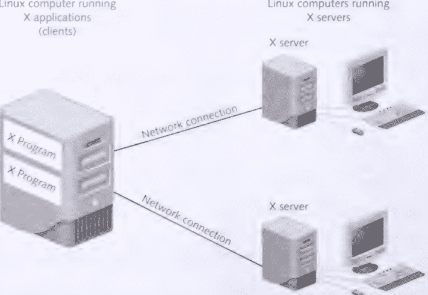
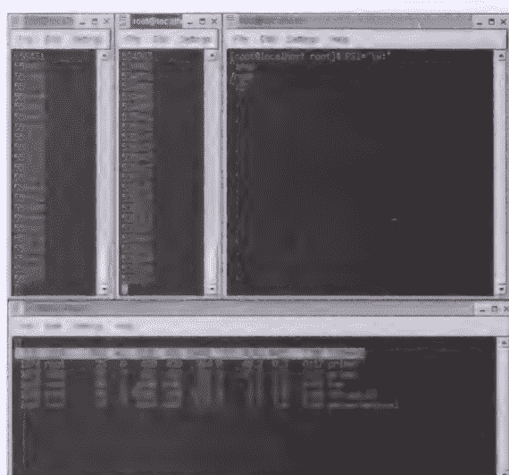
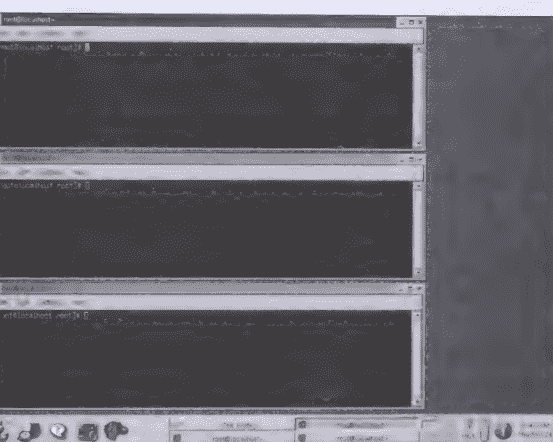

# Linux 实验手册与 Linux 认证指南


- 实验 6.5 使用 Fuser 程序 83
- 实验 7.5 构建 RAID-5 阵列 100
- 实验 8.5 定义 Shell 118
- 实验 9.5 进程 137

# Linux 认证指南

## 引言

动手学习是掌握 CompTIA Linux+ 以及 Linux 相关职业所需技能的最佳方法。本书包含了在现实世界应用基础 Linux 概念的操作。此外，每章都提供了复习题以加强对章节内容的掌握。本书的组织结构与 Course Technology 的 Linux Guide to Linux 相同，两者结合使用将提供实质性的、有效的学习体验。本书适用于入门 Linux 管理课程。作为先修课程，学生应该具备通用操作系统的基础知识，以及至少一个课程。

## 特性

为了确保教师和学生的良好体验，本书包含以下特性：

- **Linux 认证目标**——每章都列出了 CompTIA Linux+ 的相关目标
- **实验目标**——每个实验都有简要描述和学习目标
- **所需材料**——每个实验都包含了完成实验所需的访问权限、硬件、软件和其他材料信息
- **完成时间**——每个实验都有预估的完成时间，以便您规划活动
- **活动章节**——实验以易于管理的章节形式呈现；在适当的情况下提供了额外的活动背景信息
- **逐步操作说明**——逻辑严密且精确的逐步操作说明将指导您完成每个实验中的实践活动
- **复习题**——问题有助于加固实验中介绍的概念

给讲师的说明：复习题的答案可以在 Course Technology 网站 www.course.com/irc/ 获取。请根据书封背面的 ISBN 进行搜索。

## 硬件要求

下列表列出了完成书中所有实验所需的硬件。对于许多单独的实验，所需的硬件会更少。

- 一台配备 Pentium 166 MHz CPU 或更高规格处理器（推荐 400 MHz）的电脑，并具备以下特性：
  - 每台电脑至少 64 MB 内存（推荐 128 MB）
  - 每台电脑 4 GB 硬盘，至少有 2 GB 可用存储空间（推荐 10 GB 或更大的硬盘，至少有 7 GB 可用存储空间）
  - 软驱驱动器
- 一个 PCI 以太网卡

## 软件/设置要求

- Red Hat® Linux® 7.2 或更高版本
- 任何 Web 浏览器

## 致谢

# ED SAWICKI

感谢 Merry 这几个月来一直支持我，感谢 Mark 做我的朋友，感谢 Beth 做我可爱的女儿。Chuck Quesenberry 帮助我解决了一些关于 Red Hat 的问题——我是一个 Debian 和 Slackware 极客。David May 在我有时陷入困境需要休息时，为我提供了有趣的智力消遣。Deb Kaufmann 是我多年合作以来最好的编辑，提供了许多必要的指导和建议。感谢 Course Technology、Lisa Egan 和 Laura Hildebrand 给予我写这本书的机会。还要感谢所有在非常紧迫的期限内工作并提供优秀反馈的评审评审：John W. Sanns、Jennifer Johnson、Jay Lightfoot 和 Dan Turk。

# 第一章

## Linux 简介

- 本章包含的实验
- 实验 1.1 熟悉 Squid 代理服务器
- 实验 1.2 查看厂商如何使用 Linux
- 实验 1.3 探索开源软件
- 实验 1.4 查看 Linux 和 Windows 如何集成
- 实验 1.5 研究 Linux 安全性

| 目标 | 实验 |
| :--- | :--- |
| 1.6 | 识别不同 Linux 服务（例如 Apache, Squid, SAMBA, Sendmail, ipchains, BIND）的功能 | 1.1 |
| 1.1 | 根据预定的客户需求识别 Linux 机器的用途（例如设备系统、数据库、邮件服务器） | 1.2 |
| 1.8 | 与其他操作系统相比，描述 Linux 解决方案的功能、特性和优势（例如 Linux 玩家、发行版、可用软件） | 1.3 |
| N/A | 这些实验没有直接针对 Linux+ 目标，但提供了额外的背景信息，帮助你掌握目标并理解 Linux 操作系统。 | 1.4, 1.5 |

### 实验 1.1 熟悉 Squid 代理服务器

#### 目标

本实验的目标是熟悉一个在 Linux 上运行有用软件包。Squid 代理服务器是一个高质量软件包的绝佳示例，它是免费的、支持良好的，并且运行在许多不同的硬件和软件平台上。

#### 所需材料

本实验需要以下物品：

- 互联网连接和 Web 浏览器

#### 活动背景

Linux 有数百个可用软件包。Squid 代理服务器是一个特别的工具，因为它允许你大幅减少 Web 浏览的互联网带宽，并提高 FTP 文件传输的性能。Squid 是开源软件可用支持的一个良好示例。

预计完成时间：30 分钟

#### 活动


1. 启动你的 Web 浏览器。
2. 在浏览器地址栏输入 http://www.squid-cache.org 并按回车。出现 Squid Web Proxy Cache 网页。
3. 检查屏幕左侧的 FAQ 链接。花些时间查看这里提供的丰富信息。如果你还不理解正在读的内容，没关系。理解会随着时间的推移，并在你需要在网络中使用 Squid 时出现。
4. 点击返回按钮回到主页，然后点击屏幕左侧的 Users 链接。你看到的下一个屏幕包含目录，引导你进入关于 Squid 的海量信息。注意，所有这些文档都是由 Squid 用户志愿者编写的。
5. 点击 Choosing an Operating System（选择操作系统）链接并阅读显示的新页面。你可能会看到一个或多个作者本打算包含信息但尚未得及的地方。在开源软件的世界里，“志愿者”有时意味着信息可能缺失或不完整。幸运的是，缺失的信息通常不会阻止你安装和使用软件。大多数情况下，你真正需要的信息在那里。杂杂的其他信息有时会稍后提供。
6. 在同一页面上，注意作者讨论了他最初如何在运行 FreeBSD 操作系统系统的电脑上安装 Squid，但后来切换到了 Linux。大多数开源软件（如 Squid）都可以运行在许多硬件和操作系统平台上。通过开源软件，你不再局限于仅运行一种操作系统或电脑类型。

#### 认证目标

Linux+ 考试目标：

- 识别不同 Linux 服务的功能 (1.6)

#### 复习题

1. Squid 可以缓存以下哪些协议：
   a. HTTP
   b. SMTP
   c. FTP
   d. SSH
2. Squid 只能运行在 Linux 上。对或错？
3. 当你的电脑有大量内存时，Squid 最好。对或错？
4. Squid 使用硬盘空间作为二级缓存。对或错？
5. 从技术上说，Squid 是：
   a. Web 浏览器
   b. 缓存
   c. 端口
   d. 处理器

### 实验 1.2 查看厂商如何使用 Linux

#### 目标

本实验的目标是熟悉厂商如何在产品中使用 Linux。

#### 所需材料

本实验需要以下物品：

- 互联网连接和 Web 浏览器

#### Linux 简介

预计完成时间：30 分钟

#### 活动


1. 启动你的 Web 浏览器。
2. 在地址栏输入 http://www.ibm.com/linux/ 并按回车。出现 IBM Linux 网页。
3. 点击 WebSphere 链接。页面提供了有关 IBM WebSphere 产品的详情。WebSphere 可以运行在 Linux 和 Apache Web 服务器（另一个流行的软件包）上。通过将其盈利产品建立在开源软件之上，IBM 可以快速推出产品，而没有许多商业软件中常见的安全漏洞。
4. 点击浏览器的返回按钮回到主页。现在点击 Linux 电子商务软件链接。出现的页面有一个名为应用程序解决方案的部分，包含会计、商业和财务的链接。点击这些链接，你会发现 Linux 有许多会计和财务软件包。
5. 点击 DB2 链接。页面显示 IBM 运行在 Linux 上。IBM 现在将 Linux 视为 DB2 的主要平台之一。如果你去 Oracle 网站 (http://www.oracle.com)，你会发现 Oracle 也将其 SQL 数据库产品移植到了 Linux。大多数高端 SQL 服务器（如 Informix）都运行在 Linux 上，微软 SQL Server 除外。


6. 在地址栏输入 `http://www.novell.com` 并按回车。出现 Novell 主页。点击右上角的搜索链接。输入 Linux 并点击搜索按钮。下一个屏幕有多个指向运行在 Linux 上或使用开源软件或两者兼有的 Novell 产品的链接。开源 Apache Web 服务器现在是 Novell 的官方 Web 服务器，并且一些 Novell 产品是基于它开发的。

7. 注意，在 Novell 的网页上，有几页指向 Linux 相关内容的链接。你可以查阅关于 Novell 的 ZENWorks、iFolder 和 iCh 产品的页面。

### 认证目标

Linux+ 考试目标：

- 根据预定义的客户需求识别 Linux 机器用途 (1.1)

### 复习题

1. IBM 的许多电子商务产品是基于以下哪一个：

   a. Microsoft IIS Web 服务器

   b. Apache Web 服务器

   c. AOL Web 服务器

   d. Microsoft Personal Web 服务器

2. 下列 SQL 数据库产品不在 Linux 上运行的是？

   a. Oracle

   b. IBM DB2

   c. Informix

   d. Microsoft SQL Server

3. Linux 没有企业级的会计和财务应用程序。正确或错误？

4. 下列哪项是 Novell 为 NetWare 官方 Web 服务器？

   a. Microsoft IIS Web 服务器

   b. Apache Web 服务器

   c. AOL Web 服务器

   d. Microsoft Personal Web 服务器

5. 解释为什么开源软件对商业软件开发人员来说可能是好事，而不是威胁。

### 实验 1.3 探索开源软件

#### 目标

本实验的目标是通过商业软件世界中广为人知的因素——市场份额，了解开源软件的流行程度。在实验中，你将进行研究以发现运行三个最流行的 Web 服务器软件软件包（Apache、Microsoft IIS 和 Sun Microsystems iPlanet）的占比。

#### 所需材料

本实验需要：

- 互联网连接和 Web 浏览器

#### 活动

1. 启动你的 Web 浏览器。

2. 在浏览器的地址栏输入 `http://www.netcraft.com/survey/`，然后按回车。出现 Netcraft Web 服务器调查页面。该页面有一个显示最流行 Web 服务器市场份额的图表。注意 Apache 显著领先。

3. 花花点时间阅读该网站上的各个页面，了解调查信息是如何收集和组织的。影响结果的一个重要因素是名为“虚拟主机（virtual hosting）”的 Web 服务器功能。此功能允许单份 Web 服务器副本托管许多互联网站点或 URL。一个运行具有 5000 个虚拟主机的单一 Web 服务器的 ISP 在 Netcraft 调查中被视为 5000 台 Web 服务器，而不是一台服务器。

4. 在浏览器的地址栏输入 `http://www.biznix.org/surveys/`，然后按回车。你看到的下一个页面是 BizNix（位于俄勒冈州波特兰的一个用户组）进行的 Web 服务器调查结果。该调查仅限于定义良好的 Web 服务器用户类别，例如大公司、政府机构和军事部门。它尽可能地减少了虚拟主机的影响，以获得更准确的 Web 服务器流行程度状况。结果与 Netcraft 的调查有很大不同。

5. 比较 BizNix 和 Netcraft 调查的结果。它们有什么相似之处？有什么不同之处？

#### 认证目标

Linux+ 考试目标：

- 与操作系统相比，描述 Linux 解决方案的功能、特性和优势 (1.8)

#### 复习题

1. 为什么 Netcraft 调查可能不是确定互联网上 Apache Web 服务器数量的准确方法？

   a. 无法知道 Web 服务器正在使用什么软件。

   b. Web 服务器可能使用虚拟主机，允许一台物理 Web 服务器显示为许多 Web 服务器。

   c. Web 服务器可以伪装成其他软件。Web 服务器管理员可能会这样做以提高服务器与流行 Web 浏览器之间的兼容性。

2. 为什么 BizNix 的结果可能提供更准确的 Apache 市场份额图？

   a. 被调查的大公司、政府机构和军事部门不太可能使用虚拟主机。

   b. BizNix 调查知道 Web 服务器何时对其正在使用的软件撒谎。

   c. BizNix 调查知道 Web 服务器何时升级了软件。

3. 美国大公司对 Apache 的使用率与世界其他地区的大公司相同。正确或错误？

4. BizNix 调查显示美国军事网站更倾向于使用 Microsoft 的 IIS Web 服务器。正确或错误？

### 实验 1.4 观察 Linux 和 Windows 如何集成

#### 目标

本实验的目标是帮助你意识到 Linux 和 Windows 计算机集成的许多方式。

#### 所需材料

本实验需要：

- 互联网连接和 Web 浏览器

预计完成时间：30 分钟

#### 活动

1. 启动你的 Web 浏览器。

2. 在浏览器的地址栏输入 `http://www.biznix.org/software/samba.html`，然后按回车。该网页提供了 Samba 软件的概述。当你在 Linux 计算机上运行 Samba 时，它就变成与 Microsoft Windows 计算机兼容的文件和打印服务器。更技术性的说法是 Samba 是 SMB 服务器或 CIFS 服务器。Samba 还有一个客户端组件，允许你的 Linux 计算机访问其他 SMB 或 CIFS 服务器。

3. 在浏览器的地址栏输入 `http://www.winehq.org`，然后按回车。你将看到一个 WINE 的网页；该项目允许 Microsoft Windows 程序在你的 Linux 计算机上运行。

4. 点击“What is WINE”链接。这将带你进入一个包含大量信息的网页。

6. 在浏览器的地址栏输入 `http://www.rdktop.org`，然后按回车。你将看到一个 rdesktop 的网页，这是一个用于 Linux 的 Windows 终端客户端。使用 rdesktop 允许你在 Windows NT 或 Windows 2000 终端服务器上运行 Windows 程序，同时使用 Linux 计算机的屏幕、键盘和鼠标。

### 实验 1.5 调查 Linux 安全

#### 目标

本实验的目标是让学生理解为什么典型的开源软件（包括 Linux）往往比比其他流行的操作系统更安全。

#### 所需材料

本实验需要以下物品：

- 互联网连接和任何 Web 浏览器

预计完成时间：30 分钟

#### 活动


- 1. 启动你的 Web 浏览器。

- 2. 在浏览器的地址栏输入 `http://www.linuxsecurity.org` 并按回车键。你将看到一个专注于 Linux 安全事项的网页。页面内容经常变化，因此你需要根据自己的喜好自行探索。在探索过程中，请注意页面中对软件中潜在安全漏洞的警告，并告诫你使用安全协议（如 SSH）而不是不安全的协议（如 Telnet）。重点在于教你如何避免安全问题和攻击。在互联网上的任何网站受到攻击之前，软件更新和补丁就已经可用了（这与商业软件的典型场景不同，商业软件的更新和补丁通常在网站受到攻击后才会）。

- 3. 点击页面顶部的“Resources”（资源）链接。出现的页面左侧有一系列链接。点击“Firewalls”（防火墙）链接。该页面包含与 Linux 防火墙相关的文章和网站。Linux 操作系统内置了防火墙。你只需要对其进行配置——如果你不理解 IP、TCP 和 UDP 等协议，这可能会具有挑战性。此页列出的资源将通过教你如何操作或提供更易用的软件（如脚本）来帮助你配置防火墙。

由于 Linux 内置了防火墙，你可以免费地在任何有 Linux 计算机的地方部署防火墙。

- 4. 在浏览器的地址栏输入 `http://www.ietf.org/rfc/rfc2137.txt` 并按回车键。你现在看到的是一个描述互联网标准的文档。正式地说，这被称为 RFC，是 Request for Comment（意见请求）的缩写，由互联网任务组（IETF）发布。该文档的内容非常详细且具有技术性，可能超出你的理解范围，但目前这并不重要。接下来，你可能想看看 IETF 如何处理安全问题。


- 5. 向滚动直到看到“Security Considerations”（安全考虑）部分并阅读相关段落。大多数 IETF RFC 都有这样一个安全章节。IETF 是互联网的守护者，他们的重点是安全问题以及帮助互联网免受攻击。IETF RFC 与 Linux 有什么关系？有很多。Linux 以及其他开源软件的设计者使用开放协议和标准，例如 IETF RFC。他们这样做是因为开源软件的目标之一是与其他软件兼容。设计者只有在设计用于与厂商产品集成的软件时，才会使用厂商的专有协议。Samba 项目就是这很好的例子。

- 6. 在浏览器的地址栏输入 `http://www.nsa.gov/selinux` 并按回车键。你现在看到的是安全增强型 Linux（Security-Enhanced Linux）页面。该页面昵称为 SELinux，由美国国家安全局创建。SELinux 为 Linux 操作系统添加了扩展，使其极不容易被入侵。即使 Linux 计算机被成功攻击，SELinux 也会严厉限制攻击者在计算机上执行任何操作的能力。在 Windows 世界中常见的攻击（如 Code Red 和 Nimda）在没有 SELinux 的 Linux 世界中非常罕见。有了 SELinux，此类攻击变得极不可能。

#### 认证目标

Linux+ 考试目标：

本实验没有直接对应某个认证目标；但是，它提供了背景信息，将帮助你掌握目标并理解 Linux 操作系统。

#### 复习题

- 1. 哪些陈述是 Linux 安全的关注点？

  - a. Linux 电子邮件程序是病毒的目标，Microsoft Outlook 也是。
  - b. Linux 有内置防火墙可以保护任何 Linux 计算机，但你必须进行配置。
  - c. Linux 浏览器不使用 SSL。
  - d. Apache 服务器太安全了。

- 2. Linux 有很多病毒扫描。（真/假）
- 3. 解释为什么 Linux 比 Windows 更安全。
- 4. 解释为什么开放协议（如 IETF RFC）比 Windows 问题更少。
- 5. 如果使用 SELinux，在攻击成功时，攻击者将被阻止破坏你的计算机。（真/假）

## 为安装 Linux 做准备

| 目标 | 实验 |
| :--- | :--- |
| 2.1 | 从根磁盘启动 |
| 2.2 | 从光盘启动 |
| 2.3 | 测试你的硬件 |
| 6.1 | 选择适当参数 |
| 6.2 | 使用系统 |
| 6.3 | 识别位置 |

# 第 2 章为 Linux 安装做准备

`bogomips` 数字旨在为你提供处理器有效速度的指示，考虑了其时钟频率、缓存大小和其他因素。然而，它对系统性能的衡量非常不准确；因此，名为 `bogomips`（bogus MIPS，即虚假的 MIPS，MIPS 代表每秒百万条指令，是 CPU 速度的标准）。最好忽略这个数字作为你系统性能的指标。

14. 输入 `cat interrupts` 并按回车。你将看到一个类似下面的屏幕：

```
CPU
0: 3859153 XT-PIC timer
1: 50719 XT-PIC keyboard
2: 0 XT-PIC cascade
6: 54 XT-PIC floppy
8: 1 XT-PIC rtc
11: 216174 XT-PIC eth0, SIS 7018 PCI Audio
12: 2542269 XT-PIC PS/2 Mouse
14: 606329 XT-PIC ide0
15: 0 XT-PIC idel
NMI: 0
ERR: 0
```

此示例显示了你计算机中的硬件中断以及哪些设备使用了这些中断。此示例表明这台电脑具有标准的硬件，外加一个局域适配器 (`eth0`) 和位于中断 11 上的音频设备。它在中断 12 上还有一个鼠标。

15. 输入 `cat iotops` 并按回车。你将看到一个类似下面的屏幕：

```
0000-00bf : dma1
0020-003f : picl1
0040-005f : timer
0060-006f : keyboard
0070-007f : rtc
0080-00bf : dma page reg
00a0-00bf : pic2
00c0-00df : dma2
00f0-00ff : fpu
0170-0177 : idel
01f0-017f : ide0
0376-0376 : idel
03c0-03df : vga+
03f0-03f5 : floppy
03f6-03f6 : ide0
03f7-0377 : floppy DIR
03f8-03ff : serial(auto)
0cf8-08cf : PCI conf1
c000-cfff : PCI Bus #01
cc80-cc8f : Silicon Integrated Systems [SIS] SIS630 GUI Accelerator+3D
da00-dcaff : Silicon Integrated Systems [SIS] SIS900 10/100 Ethernet
da00-dcaff : sis900
dc00-dcaff : Silicon Integrated Systems [SIS] SIS PCI Audio Accelerator
dc00-dcaff : SIS 7018 PCI Audio
de00-deffaf : Adaptec AIC-7881U
ffa0-ffaf : Silicon Integrated Systems [SIS] 5513 [IDE]
ffa0-ffaf : ide0
ffa0-ffaf : idel
```

此示例显示了你计算机中硬件使用的 I/O 地址。请注意，例如，在这里你看到一个 Adaptec AIC-7881U SCSI 卡，它并没有在中断列表中。

16. 输入 `cat dma` 并按回车。你将看到一个类似下面的屏幕：

```
2: floppy
4: cascade
```

此示例显示磁盘驱动器控制器使用了 DMA 通道 2。注意，你的计算机中没有其他设备使用 DMA 通道。注意，“cascade” 并不是一个设备。它仅表示你的计算机使用了两个连接在一起的 DMA 控制器。

17. 还有其他文件包含硬件相关信息，例如 `pci` 设备和 `meminfo`。你可以查看它们，但在目前阶段它们可能有点晦涩。随着你对 Linux 的深入了解，它们将变得更有意义。

#### 认证目标

Linux+ 考试目标：

- 为 Linux 安装选择适当的参数 (`2.3`)
- 在工作站和服务器上使用系统启动磁盘和根磁盘来诊断和恢复文件系统 (`6.6`)

#### 复习题

- 1. 当你从 Linux 根/启动磁盘引导系统时，系统完全启动后使用哪个磁盘？
- 2. 出现在 `/proc` 目录中的文件占用你的硬盘空间。对或错？
- 3. 你使用什么命令来查找有关你系统处理器的信息？

### 实验 2.2 从 CD-ROM 启动 Linux

#### 目标

实验 2.1 让你下载了 Tomsrt 程序并将其安装在软盘上。如果你的计算机运行的是不支持 DOS 程序的 Windows 版本，这可能会很困难。另一种方法是使用可以从 CD-ROM 启动的 Linux 版本。如果你使用的是不支持 DOS 程序的 Windows 版本（例如 Windows NT、Windows 2000 和 Windows XP），你刻录一张 CD-ROM 会比制作启动盘要容易得多。在本次实验中，你将下载并安装一个名为 Knoppix 的软件包包。Knoppix 是一个功能完备的 Linux 发行版。它包含了数百个应用程序，包括 K-Office 和 Office —— 这是两套流行的办公软件套件。Knoppix 允许你从 CD-ROM 启动功能完备的 Linux。它不需要你使用任何硬盘空间。你可以在安装了任何其他操作系统且所有磁盘空间已分配完毕的计算机上运行 Knoppix。

#### 所需材料

- 一台安装了 CD-ROM 刻录机和软件的计算机
- Web 浏览器和互联网连接

| 预计完成时间：45 分钟 |

#### 活动

1. 使用你的 Web 浏览器访问 `www.knopper.net/knoppix`，学习如何下载 Knoppix 软件并将其刻录到 CD-ROM 中。然后下载 Knoppix 并将其放入 CD-ROM 中。

2. 确保你的计算机符合网站上指定的最低要求。你的计算机必须使用 Intel i86 兼容（或更新）的处理器和 16 MB 内存（RAM）。如果你有 96 MB 或更多内存，你可以在图形模式下运行 Knoppix。注意网站上关于在硬盘上创建交换区的讨论，以便你可以在较少的内存下运行图形。然而，并不需要交换分区。

3. 从 CD-ROM 启动。由于是从 CD-ROM 启动（一个较慢的设备），Linux 完全启动需要一些时间。当你从 CD-ROM 启动时，比使用软盘要好。任何时候你都可以通过 `Alt+5` 回到桌面。当你处于命令行提示符或图形界面时。

5. 进入 `/proc` 目录：`cd /proc`。

6. 输入 `ls` 并按回车。你会看到很多文件和目录。这些并不是真实的文件。


7. 输入 `cat cpuinfo` 并按回车。

8. 输入 `cat interrupts` 并按回车。

9. 输入 `cat iotops` 并按回车。

10. 输入 `cat dma` 并按回车。

11. 任何时候你都可以回到桌面。

# 第 2 章为 Linux 安装做准备

## 实验 2.3 测试你的计算机内存

### 目标

在本次练习中，你将下载并安装名为 `Memtest86` 的内存测试程序。它适用于任何基于 Intel 的计算机，不需要安装操作系统。你通常将程序放在软盘上并从软盘启动。但你也可以将程序安装在硬盘或 CD-ROM 上。

### 所需材料

此实验需要：

- 一台运行 Windows（任何版本）或 Linux 的计算机
- 互联网连接和 Web 浏览器
- 如果你使用的是 Windows，你需要一个解压缩和存档 `.zip` 文件的程序，如 `Pzip` 或 `WinZip`
- 一张高密度 3.5 英寸软盘

### 活动背景

如果计算机内存有故障，任何操作系统都无法可靠工作。Linux 例外。在安装 Linux 之前，检查计算机内存是一个好主意。每次启动计算机时进行的内存测试并不是全面的，某些内存问题可能会逃过检测。最好运行一个全面的内存测试程序，如 `Memtest86`。

| 预计完成时间：40 分钟 |

### 活动

1. 在你的 Web 浏览器中输入 `www.memtest86.com` 并按回车。按照网站说明将软件下载到你的计算机上。

2. 软件下载到计算机后，请按照网站上的说明将软件安装到软磁盘中。你可以在运行 Linux 或 Windows 的计算机上执行此操作。你创建的磁盘将是一个与实验 2.1 中的磁盘类似的启动盘。

3. 将软盘插入计算机的软驱驱动器并重启。

4. 一旦你的计算机开始从软盘启动，`Memtest86` 程序将在几秒内加载并立即开始运行。

5. 运行几秒后，屏幕将显示所示：

| Memtest-86 v 3.0 | Pass 2% # | |
| :--- | :--- | :--- |
| Pentium II | 267.2 MHz | Test 70% ###### |
| L1 Cache 32K | 2620 MB/s | Test #2 [Address test, own address, no cache] |
| L2 Cache 512K | 362 MB/s | Testing 88K - 128M 128M |
| Memory 128M | 113 MB/s | Pattern: |
| Chipset 1440[bzx] | MemMap Cache ECC Test Pass | |
| Walltime RsvdMem ECC Errors | | |
| 0:04:27 128M 432K e820-Std on off Std 2 0 | | |

6. 注意，测试会告诉你你的计算机中安装了多少内存。它在第五行显示（此例中 `Memory 128M`）。

7. 注意，测试显示了正在测试的内存范围。这在第四行（此例中 `Testing 88K - 128M`）。

8. 注意，测试在第三和第四行计算并显示了处理器的 L1 和 L2 缓存的速度（分别为 `2620 MB/s` 和 `362 MB/s`）。你计算机主内存的速度显示在第五行（`113 MB/s`）。

9. 通常情况下，`Memtest86` 程序运行八次内存测试。注意当前测试内存显示在第三行（`Test #2`）。

10. 当所有测试完成后，即完成一次“通过（pass）”，测试将重复。轮次数显示在最后一行。在上面的示例中，它是“Pass”下方的“2”。

11. 在程序运行时按 `c`。这会显示以下菜单，允许你控制 `Memtest86` 程序的运行：

```
Configuration:
(1) Cache Mode
(2) Test Selection
(3) Address Range
(4) Memory Sizing
(5) Error Summary
(6) Error Report Mode
```

12. 输入 `0` 退出此菜单。

13. 通过阅读 `www.memtest86.com` 上的网页来了解这些配置选项。

到目前，你一直在通过从软盘启动来运行 `Memtest86`。你也可以将其安装在硬盘上，并在启动计算机时运行它。这需要你配置引导加载程序，例如 `LILO`、`GRUB` 或你的 Windows 引导加载程序。你可以从 `Memtest86` 网站以及通过阅读你的引导加载程序的文档来学习如何操作。

14. `Linux` 的一个有趣功能是能够绕过故障内存位置来使用故障内存模块。如果你发现内存错误，可以告诉 Linux 避免使用该区域的内存，而不是更换内存模块。这被称为 `BadRAM`。要使用此功能，请访问 `http://rick.warren.org/linux/badram` 了解更多。

### 认证目标

Linux+ 考试目标：

- 通过确定问题是由于硬件、操作系统、应用程序软件、配置还是用户引起的，来识别并定位问题 (6.1)

### 复习题

1. `Memtest86` 需要安装 Linux 才能运行。对或错？

2. `Memtest86` 内存测试在多少轮次后停止？

   a. 1
   b. 2
   c. 8
   d. 16
   e. 它永远不停止。

3. 你可以将 `Memtest86` 安装在硬盘上，并在启动计算机时快速启动它。对或错？

4. 如果 `Memtest86` 发现你的内存有一个或多个错误，并且你有两个内存设备（DIMM, SIMM, 等），你会做什么来确定哪个内存模块是坏的？假设你没有你的计算机主板的文档。

5. Linux 可以配置为与带有错误的内存配合。对或错？

# 第三章

## Linux 安装与使用

本章包含的实验

- 实验 3.1 定位内核文件
- 实验 3.2 创建启动盘
- 实验 3.3 将万物视为文件
- 实验 3.4 发送关机通知
- 实验 3.5 分配关机权限

| 目标 | 实验 |
| --- | --- |
| 3.10 | 重新配置引导加载程序（例如 `LILO`） | 3.1 |
| 4.7 | 以 root 身份登录时执行管理任务 | 3.1, 3.2, 3.4, 3.5 |
| 4.5 | 管理和导航 Linux 分级结构（例如 `/etc`, `/usr`, `/bin`, `/var`） | 3.1 |
| 6.6 | 在工作站和服务器上使用启动磁盘和根磁盘诊断并救援文件系统 | 3.2 |

### 实验 3.1 定位内核文件

#### 目标

本实验的目标是学习如何在硬盘上找到内核文件。

#### 所需材料

- 一个运行良好的 Linux 系统
- root 账户权限

预计完成时间：15 分钟

#### 背景

内核通常存储在硬盘的普通目录中。有几个理由你应该知道它的位置。你可能想创建一个启动盘，就像你在实验 3.2 中做的那样，或者你可能需要修改你的引导加载程序（`LILO` 或 `Grub`）配置文件，并且每个任务都需要知道内核文件的名称和位置。

#### 活动

1. 如果你的计算机当前显示的是图形桌面（如 Gnome 或 KDE），使用 `Ctrl+Alt+F2` 键序列进入命令提示符。

2. 大多数 Linux 发行版将内核文件放在 `/boot` 目录。通过输入 `cd /boot` 命令进入 `/boot` 目录。

3. 通过输入 `ls -lS` 显示目录中的文件。这告诉程序执行长列表显示（`-l`），不打印所有者（`-g`），并按文件大小反序排序（`-S`）。显示的第一个文件（最大的）最可能是内核文件。在 Red Hat Linux 7.2 示例中，内核文件是 `vmlinuz-2.4.7-10`。

```
total 2576
-rw-r--r-- 1 root 802068 Sep 6 2001 vmlinuz-2.4.7-10
```

#### 认证目标

Linux+ 考试目标：

- 重新配置引导加载程序 (3.10)
- 以 root 身份登录或使用 `su` 命令时执行管理任务 (4.7)
- 管理和导航 Linux 层次级结构 (4.5)

#### 复习题

1. 大多数 Linux 发行版将内核文件存在哪个目录？

   a. 根目录 (`/`)
   b. `/boot`
   c. `/etc`
   d. `/loader`

2. 如果你的系统中有多个内核文件，你如何判断系统使用哪一个来启动 Linux？

3. 与 Linux 配合使用的两个最流行的引导加载程序是哪两个？

   a. `rpm` 和 `dpkg`
   b. `file` 和 `isfs`
   c. `LILO` 和 `Grub`
   d. `/` 和 `/boot`


4. 如果你正在使用 LILO 引导加载程序，它的配置文件是哪个？

   a. `/boot/lilo`

   b. `/boot/lilo.conf`

   c. `/etc/lilo`

   d. `/etc/lilo.conf`

5. 哪个程序可以告诉你一个文件是否是内核文件？

   a. `kernel`

   b. `file`

   c. `ls -k`

   d. `which`

### 实验 3.2 创建启动盘

#### 目标

本实验的目标是学习在安装 Linux 后的任何时候创建 Linux 启动盘的另一种方法。

```bash
dd if=/boot/vmlinuz-2.4.7-10 of=/dev/fd0
```

# 第 3 章 Linux 安装与使用

上面的命令是一种简化形式。随着你对 Linux 经验的增加，你会发现 `dd` 程序经常配合其他参数使用。简化形式在复制操作期间使用了默认的 512 字节块大小。以下是上述相同命令（来自上方）的另一种形式，它使用块大小 (`bs=`) 参数来设置更大的块大小，这可能会更快地将文件拷贝到磁盘：

```bash
dd if=/vmlinuz-2.4.7-10 of=/dev/fd0 bs=16384
```

- 将磁盘留在驱动器中，并使用 `Ctrl+Alt+Del` 键序列关闭系统。
- 当系统重启时，它从磁盘而不是硬盘启动其操作系统。一旦操作系统加载，它将开始使用硬盘。请注意，你创建的是启动盘——而不是实验活动 2.1 中的根/boot 磁盘。

#### 认证目标

以 root 身份登录或通过使用 `su` 时，执行 Linux 任务的目标：

- 以 root 身份登录或通过使用 `su` 命令时执行管理任务 (4.7)
- 在工作站和服务器上使用启动盘和根磁盘来诊断和救援文件系统 (6.6)

#### 复习题

1. 当你从 Linux 发行版安装 Linux 时，Linux 内核通常放在哪个目录？选择所有适用项。）

   a. `/etc`

   b. `/var`

   c. `/boot`

   d. 根目录

2. 当你像在实验活动 3.2 中那样创建一个启动盘并从其启动时，当系统完全启动时使用哪种磁盘？

   a. 启动盘

   b. 你的系统硬盘

   c. 虚拟磁盘

3. 在制作启动盘时，只使用高密度磁盘是最好的吗？对或错

4. 哪个命令设置复制操作的块大小？

   a. `dd if=/vmlinuz-2.4.7-10 of=/dev/fd0 block=8192`

   b. `dd if=/vmlinuz-2.4.7 of=/dev/fd0 bs=8192`

   c. `dd if=/vmlinuz-2.4.7 of=/dev/fd0 blks=8192`

   d. `dd if=/vmlinuz-2.4.7 of=/dev/fd0 block_size=8192`

### 实验 3.3 将一切视为文件

#### 目标

本实验的目标是让你看到 Linux 像 UNIX 一样，在行为上是面向文件的，并将所有（大多数）设备都视为文件处理。

#### 所需材料

此实验需要：

- 一个可以运行的 Linux 系统
- root 账户访问权限

#### 活动背景

第 3 章引入了终端的概念，并向你展示如何通过 `Alt+Tab` 键序列在它们之间切换。这些终端是设备。Linux 中的大多数设备都可以被视为文件。此活动将向你展示如何从中读取和向其写入。

向其他终端屏幕写入字符串（或其他数据）的实际应用现在看起来可能很模糊，但随着你对 Linux 经验的增加，你会体会这种灵活性。这些主题将在后面的章节中介绍。

预计完成时间：20 分钟

1. 如果你的电脑目前显示的是图形桌面（例如 Gnome 或 KDE），使用 `Ctrl+Alt+F2` 序列进入命令行提示符。你会看到如下内容：

Linux Release 7.2 (Enigma)

Kernel 2.4.7-10 on tty2:

2. 以 root 身份登录。输入此命令：

```bash
echo "Hello from tty2" > /dev/tty5
```

这告诉 Linux 将字符串 "Hello from tty2" 发设备 tty5。

# 第 3 章 Linux 安装与使用

"tty" 是 teletype（电字机）的缩写，它是计算早期流行的一种过时的机电设备终端。Linux 和 UNIX 使用这个缩写来指代现代控制台。为了引用 tty，Linux 要求在前面加上前缀。

当你切换到 tty5，你会看到以下内容：

Linux Release 7.2 (Enigma)

Kernel 2.4.7-10 on tty2:

"tty" 是 teletype（电字机）的缩写，它是计算早期流行的一种过时的机电设备终端。Linux 和 UNIX 使用这个缩写来指代现代控制台。为了引用 tty，Linux 要求在前面加上前缀。

通过 `Alt+F5` 切换到 tty5，你会看到以下内容：

Linux Release 7.2 (Enigma)

Kernel 2.4.7-10 on tty2:

"tty" 是 teletype（电字机）的缩写，它是计算早期流行的一种过时的机电设备终端。Linux 和 UNIX 使用这个缩写来指代现代控制台。为了引用 tty，Linux 要求在前面加上前缀。

通过 `Alt+F2` 切换到 tty2，你会看到以下内容：

Linux Release 7.2 (Enigma)

Kernel 2.4.7-10 on tty2:

"tty" 是 teletype（电字机）的缩写，它是计算早期流行的一种过时的机电设备终端。Linux 和 UNIX 使用这个缩写来指代现代控制台。为了引用 tty，Linux 要求在前面加上前缀。

当你向 tty5 写入消息时，tty2 正在显示登录提示。

从 tty5 运行此命令：

```bash
echo "Hello from tty2" > /dev/tty5
```

这告诉 Linux 将字符串 "Hello from tty2" 发设备 tty5。

"tty" 是 teletype（电字机）的缩写，它是计算早期流行的一种过时的机电设备终端。Linux 和 UNIX 使用这个缩写来指代现代控制台。为了引用 tty，Linux 要求在前面加上前缀。

通过 `Alt+F2` 切换到 tty2，你会看到以下内容：

Linux Release 7.2 (Enigma)

Kernel 2.4.7-10 on tty2:

"tty" 是 teletype（电字机）的缩写，它是计算早期流行的一种过时的机电设备终端。Linux 和 UNIX 使用这个缩写来指代现代控制台。为了引用 tty，Linux 要求在前面加上前缀。

通过 `Alt+F5` 切换到 tty5，你会看到以下内容：

Linux Release 7.2 (Enigma)

Kernel 2.4.7-10 on tty2:

"tty" 是 teletype（电字机）的缩写，它是计算早期流行的一种过时的机电设备终端。Linux 和 UNIX 使用这个缩写来指代现代控制台。为了引用 tty，Linux 要求在前面加上前缀。

当你向 tty5 写入消息时，tty2 正在显示登录提示。

从 tty5 运行此命令：

```bash
echo "Hello from tty2" > /dev/tty5
```

这告诉 Linux 将字符串 "Hello from tty2" 发设备 tty5。

"tty" 是 teletype（电字机）的缩写，它是计算早期流行的一种过时的机电设备终端。Linux 和 UNIX 使用这个缩写来指代现代控制台。为了引用 tty，Linux 要求在前面加上前缀。

通过 `Alt+F5` 切换到 tty5，你会看到以下内容：

Linux Release 7.2 (Enigma)

Kernel 2.4.7-10 on tty2:

"tty" 是 teletype（电字机）的缩写，它是计算早期流行的一种过时的机电设备终端。Linux 和 UNIX 使用这个缩写来指代现代控制台。为了引用 tty，Linux 要求在前面加上前缀。

通过 `Alt+F2` 切换到 tty2，你会看到以下内容：

Linux Release 7.2 (Enigma)

Kernel 2.4.7-10 on tty2:

"tty" 是 teletype（电字机）的缩写，它是计算早期流行的一种过时的机电设备终端。Linux 和 UNIX 使用这个缩写来指代现代控制台。为了引用 tty，Linux 要求在前面加上前缀。

*(注：由于原文文本中存在大量重复的段落和示例，译文已根据“不要重复输出原文”的原则进行了去重处理，保留了逻辑连续的翻译。)*

### 实验 3.4 提供关闭通知

#### 目标

本实验的目标是学习如何以一种关闭 Linux 系统的方式，通知用户即将关闭。

#### 所需材料

本实验需要以下内容：

- 一个可以正常运行的 Linux 系统
- root 账户的权限
- 普通用户账户的权限

#### 活动背景


当 Linux 计算机连接网络时，在系统关机时通知所有用户是非常用的。这让用户有机会在关机前保存数据并退出应用程序。当你在命令行上指定一条消息时，Linux 关机程序可以自动执行此操作。

预计完成时间：20 分钟

# 实验活动

1. 如果你的计算机目前显示的是图形化桌面（例如 Gnome 或 KDE），请使用 `Ctrl+Alt+F2` 键组合进入命令行提示符。

2. 告诉 Linux 在五分钟后关机。输入此命令：

```
shutdown -h +5m The system is going down
```

你将看到屏幕上出现以下消息：

```
The system is going down
The system is going DOWN for system halt in 5 minutes !
```

输入 `-5m` 来表示未来五分钟后的时间似乎很愚蠢，因为 Linux 无法穿越时空执行关机（执行 `-5` 是可能的）。你可以省略符号，改用 `5m`，效果是等等的。同样，唯一允许的时间单位是分钟（你不能用 `s` 表示秒，或用 `h` 表示小时）。指定 `5m` 等同于 `5`。要指定一小时，你需要使用 `60m` 或简单地使用 `60`。

3. 等待大约四分钟，你会在屏幕上看到这些额外的行：

```
Broadcast message from root (tty2) Mon Aug 5 08:48:36 2003...
The system is going down
The system is going DOWN for system halt in 1 minute !
```

系统正在向你警告，系统将在一分钟后关机。

4. 按 `Ctrl+C` 取消关机时间：

5. 再次尝试，但更改关机时间：

```
shutdown -h 5m The system is going down
```

### 实验 3.4 发送关机通知

你将看到熟悉的消息：

```
The system is going down
The system is going DOWN for system halt in 5 minutes !!
```

6. 现在用 `Alt+F5` 进入 `tty5`。尝试以普通用户的身份登录。在提示输入密码并输入后，你将看到类似下面的内容：

```
The system is going down on Mon Aug 5 09:12:11 2003
The system is shutting down
Login incorrect
```

系统正在阻止你登录，因为它知道自己要关机。在系统关机在即的情况下，允许你登录是没有意义的。如果你更早地计划了系统关机，用户在那段时间内仍然会被阻止登录吗？让我们去看看。

7. 使用 `Alt+F2` 回到 `tty2`。计划在七分钟后关机：

```
shutdown -h 7m The system is going down
```

8. 使用 `Alt+F5` 回到 `tty5` 并尝试以普通用户的身份登录。动作快点——在两分钟内。你现在可以登录。如果关机计划时间超过五分钟，Linux 允许用户登录。

9. 使用 `Alt+F2` 回到 `tty2` 并按 `Ctrl+C` 取消关机。现在再设置一个四分钟后的关机：

```
shutdown -h +4m The system is going down
```

10. 现在用 `Alt+F5` 回到 `tty5` 并尝试以普通用户的身份登录。你可以登录吗？

11. 现在以 `root` 身份登录。你可以登录。当关机计划在五五内内发生时，Linux 允许 `root` 用户登录。此的明显原因是允许 `root` 用户取消系统关机，或在关机发生前做一些事情。

12. 这是一个可选步骤。执行此步骤所需的时间不包含在本实验的预计完成时间内。输入命令，当 Linux 在屏幕上显示关机警告消息时：

```
shutdown -h +6m The system is going down
```

#### 认证目标

Linux+ 考试目标：

- 以 `root` 身份登录或通过使用 `su` 命令执行管理任务 (`4.7`)

#### 复习题

1. 这三个命令是等价的吗：

```
Shutdown -h +5m
Shutdown -h 5m
Shutdown -h 5
```

2. 当你运行 `shutdown` 命令时，所有普通用户都会被阻止登录吗？

3. 如果你计划的系统关机时间更早，用户在那段时间仍然会被阻止登录吗？

4. 如果关机计划在五分钟内发生，Linux 允许 `root` 用户登录吗？

5. 以下哪种操作可以允许 `root` 用户在系统关机前取消关机？

# 第四章

## 探索 Linux 文件系统

### 本章包含的实验

- 实验 4.1 使用简单命令创建复杂函数
- 实验 4.2 执行复杂的搜索
- 实验 4.3 一以胜为多
- 实验 4.4 显示二进制数据
- 实验 4.5 处理不特殊的文件和目录名

| 目标 | 实验 |
| --- | --- |
| `4.18` | 使用常用 shell 命令编写基础 shell 脚本（例如 `grep`, `find`, `cut`, `if`） | `4.1, 4.2, 4.3, 4.4` |
| N/A | 此实验练习不直接针对 Linux+ 目标，但提供了额外的背景信息，帮助你掌握目标并理解 Linux 操作系统。 | `4.5` |

### 实验 4.1 使用简单命令创建复杂函数

#### 目标

本实验的目标是通过将两个或多个 Linux 命令组合在一起来创建复杂的函数。Linux 命令可以使用管道（pipes）连接起来，其中一个命令的输出将作为另一个命令的输入。完成本实验后，你将能够：

- 显示在每满一屏时暂停的数据
- 显示嵌入在二进制数据中的文本字符串
- 根据某个单词过滤数据流

#### 所需材料

本实验需要以下条件：

- 在运行 Linux 的计算机上拥有 `root` 用户访问权限

预计完成时间：20 分钟

#### 活动背景

在本次练习中，你将处理 `/proc` 目录下一个看起来名为 `kcore` 的文件。这并不是一个真实的文件。它是你计算机所有内存的映像，你可以像访问文件一样访问它。你可以使用 Linux 文件处理工具访问其内容。

#### 活动

1. 按 `Ctrl+Alt+F2` 切换到命令行终端 (`tty2`)，并使用任何用户名登录终端。

2. 移动到 `/proc` 目录。操作为输入 `cd /proc`。

3. 输入 `ls -l | more` 获取长目录列表。注意其中一个名为 `kcore` 的文件非常大。它的大小与计算机内存的大小几乎相同。这个文件允许你查看计算机的整个内存空间。

4. 输入 `strings kcore` 并按回车。注意你的屏幕将滚动很长时间，因为内存中有大量的字符串。你不需要等待屏幕停止滚动，可以按 `Ctrl+C` 终止。

5. 因为屏幕滚动速度可能比你阅读的速度快，请使用 `less` 作为过滤器显示文本页。`less` 程序显示一页文本并停止，等待你按任意键后再显示下一页。输入 `strings kcore | less`。注意许多字符串是乱码。这些字符序列在 `strings` 程序看来是可理解的字符串，但它们仅仅是任意数据的字符串。你可以通过输入 `q` 退出并返回命令行提示符。

6. 你可以通过搜索特定字符串来消除乱码。这是通过 `grep` 程序过滤 `strings` 程序的输出来实现的。`grep` 会过滤掉不包含指定字符串的行。输入 `strings kcore | grep Linux`。在这种情况下，你是在要求 `grep` 过滤掉不包含字符串 `Linux` 的行。你会看到所有字符串中都包含该单词。你已经排除了所有其他字符串。如有必要，按 `Ctrl+C` 退出 `strings kcore | grep Linux` 命令。

7. 可能存在许多包含 `Linux` 单词的字符串并导致屏幕滚动。你通过将输出通过到一个类似于 `more` 的程序来处理这个问题。输入 `strings kcore | grep Linux | more` 并注意屏幕停止填满一页。你可以按空格键查看下一页，或按回车键一次滚动一行屏幕。按 `q` 退出命令。

8. 输入 `logout` 登销系统，并按 `Alt+F7` 返回图形界面。

#### 认证目标

Linux+ 考试目标：

- 使用常用 shell 命令编写基础 shell 脚本 (`4.18`)

#### 复习题


1. `/proc/core` 文件在硬盘上占用的空间与你计算机的内存大小相等。对或错？

2. 你会使用哪个程序从二进制数据流中提取文本字符串？

   a. `ls`

   b. `grep`

   c. `cat`

   d. `strings`

3. 如果你想在文件中查找某些字符串，你会用哪个程序过滤文件内容？

   a. `ls`

   b. `grep`

   c. `strings`

   d. `less`

4. 如果你想控制屏幕滚动的时机，你会使用哪个程序？

   a. `ls`

   b. `cat`

   c. `grep`

   d. `more`

5. `less` 程序的功能与哪个其他程序相似？

   a. `ls`

   b. `more`

   c. `grep`

   d. `cat`

### 实验 4.2 执行复杂的搜索

#### 目标

本实验的目标是了解如何使用正则表达式和 `grep` 程序对文档进行复杂搜索。正则表达式用于在文本文件或数据流中搜索包含字符串的行。然而，有时需要根据更复杂的准则查找行。例如，如果你想从文件或数据流中提取两个不相邻单词的行，这对你来说可能很难。一个简单的解决方案是使用两个过滤器。正则表达式可以用于找到这两个单词。

#### 所需材料

本实验需要以下条件：

- 在运行 Linux 的计算机上拥有普通用户访问权限

预计完成时间：20 分钟

#### 活动

1. 按 `Ctrl+Alt+F2` 切换到命令行终端 (`tty2`)，并使用任何用户名登录。

2. 移动到 `/proc` 目录。操作为输入 `cd /proc`。

3. 输入 `strings kcore | less`。注意许多字符串是乱码。

4. 输入 `ls -l | more`。注意其中一个名为 `kcore` 的文件非常大。它的大小与计算机内存的大小几乎相同。

5. 这个文件允许你查看计算机的整个内存空间。你已经排除了所有其他字符串。

6. 输入 `strings kcore | grep Linux`。在这种情况下，你是在要求 `grep` 过滤掉不包含字符串 `Linux` 的行。你会看到所有字符串中都包含该单词。

7. 输入 `strings kcore | grep Linux | more` 并注意屏幕停止填满一页。你可以按空格键查看下一页，或按回车键一次滚动一行屏幕。按 `q` 退出命令。

8. 输入 `logout` 退出系统，并按 `Alt+F7` 返回图形界面。

#### 认证目标

Linux+ 考试目标：

- 使用常用 shell 命令编写基础 shell 脚本 (`4.18`)

1. `grep` 默认是区分大小的。对或错？

2. 你会使用哪个程序不区分大小进行搜索？

   a. `ls`

   b. `cat`

   c. `grep`

   d. `grep -i`

3. 正则表达式可以找到这两个单词。对或错？

4. 你可以组合管道两个命令。对或错？

5. 你不能使用多个管道。对或错？

### 实验 4.3 深入使用 LESS

#### 目标

本实验的目标是了解像 `less` 这样的程序具有哪些命令行选项和遍历文件的交互命令。

#### 所需材料

本实验需要以下条件：

- 运行 Linux 的计算机上拥有普通用户访问权限

#### 活动背景

大多数 Linux 系统都安装了单词列表，供系统工具或应用程序使用。该单词列表位于 `/usr/share/dict/words`，是一个纯文本文件。文件每行一个单词并按字母排序。我们将在实验中使用该文件。

#### 活动

1. 按 `Ctrl+Alt+F2` 切换到命令行终端 (`tty2`)，并使用任何用户名登录终端。

2. 移动到 `/usr/share/dict` 目录。操作为输入 `/usr/share/dict`。

3. 使用 `less` 命令显示单词列表文件。输入 `less words`。

4. 你可以看到单词列表文件每行一个单词，且按字母排序。

5. 你可以向前（向文件末尾）和向后（向文件开头）移动文件。使用空格键向前移动一屏。输入 `b` 向后移动一屏。

6. 你可以随时通过输入 `G` 回到文件开头。通过输入 `g` 可以到文件末尾。

7. 你可以使用正斜杠加上要搜索的单词在单词列表中查找单词。例如，输入 `/Monday`。屏幕在第一行显示单词 `Monday`。

8. 通常，搜索是区分大小的。也就是说，如果你搜索 `monday`，就找不到 `Monday`。你可以使用 `-i` 命令使搜索不区分大小。`-i` 显示关于不区分大小搜索的消息并要求你按回车键。现在你可以不区分大小地进行搜索。

9. 输入 `logout` 退出系统，并按 `Alt+F7` 返回图形界面。

9. 输入 `g` 跳转到文件开头。输入 `/monday` 并按回车键，屏幕顶部会出现单词 `Monday`。

10. 输入 `q` 退出 `less` 命令。

#### 认证目标

Linux+ 考试目标：

- 使用常用的 shell 命令编写基础 shell 脚本 (`4.18`)

#### 复习题

- 1. 哪个 `less` 命令允许你移动到文件开头：

   a. `g`

   b. `G`

   c. `b`

   d. `B`

- 2. 哪个 `less` 命令允许你移动到文件末尾：

   a. `g`

   b. `G`

   c. `b`

   d. `B`

- 3. 输入什么字符告诉 `less` 你想进行搜索？

   a. `g`

   b. `/`

   c. `spacebar`

   d. `b`

- 4. 输入什么告诉 `less` 你想进行不区分大小写的搜索？

   a. `G`

   b. `i`

   c. `-i`

   d. `z`

### 实验 4.4 显示二进制数据

#### 目标

本实验的目标是了解如何以各种格式（如十进制、十六进制和八进制）显示二进制数据文件。

## 44 第4章 探索 Linux 文件系统

#### 所需材料

本实验需要：

- 运行 Linux 的计算机并具有普通用户访问权限

预计完成时间：30 分钟

#### 活动背景

有必要搜索二进制文件以定位文本字符串。文本字符串可能会告诉你程序或数据文件的版本号。直接查看二进制文件可能比使用你通常访问该文件的程序更简单。每当你需要查看二进制数据时，你使用的工具有时会将二进制数据转换为方便使用的格式，但有时不会。`od` 程序就是这样一种工具。通常情况下，`od` 假设你想查看的二进制数据是一个程序而不仅仅是二进制数据。这个假设的问题在于，它可能会交换字节，导致文件的第一个字节出现在第二个字节之后，第四个字节出现在第三个之前，以此类推。

如果你是一个程序员，正在查看计算机上运行的程序 dump，而该计算机以这种方式在内存中存储程序字节，这样做是合理的。如果你只想查看简单的二进制数据，这样做就是错误的。本实验练习使用的示例按照字节在文件中出现的顺序显示。这很可能是你更喜欢的查看方式。


#### 活动

- 1. 按 `Ctrl+Alt+F2` 切换到命令行终端 (`tty2`)，并使用任何用户名登录终端。

2. 回到主目录。你可以在任何地方通过输入 `cd ~` 实现。

3. 你需要一个包含二进制数据的小文件。你可以通过从程序文件借数据来创建一个：输入 `dd count=1 bs=65 if=/bin/sh of=bindata`。这会在主目录下创建一个名为 `bindata` 的文件。该文件包含 `/bin/sh` 文件的前 65 个字节数据，在大多数 Linux 系统上通常是 Bash shell。如果你想确切查看 `dd` 命令的工作原理，请查看该命令的手页 (`man dd`)。

4. 根据手页，`od` 程序的默认应该是以十进制格式显示数据。然而，Red Hat Linux 7.2 自带的 `od` 程序似乎并没有。输入 `od bindata`。你可能会看到类似的内容：

```
000000 042577 043114 000401 000001 000000 000000 000000 000000
000020 000002 000003 000001 000000 111600 000405 000064 000064
000040 165467 000007 000000 000006 000064 000040 000006 000050
000060 000031 000030 000006 000000 000064 000000 100064 000004
000100 000064
000101
```

### 实验 4.4 显示二进制数据

这种默认格式对你可能没有用。以下步骤可以产生更有用的结果。

- 5. 如果你喜欢以十六进制查看文件，输入 `od -A x -t x bindata`。文件偏移量和数据均为十六进制。你会看到类似的内容：


```
000000 7f 45 4c 46 01 01 00 00 00 00 00 00 00 00
000010 02 00 03 01 00 00 00 00 93 05 08 34 00
000020 34 eb 07 00 00 00 00 34 20 00 00 26 08 00
030 19 10 10 00 00 00 00 00 30 00 00 00 0 80 08
000040 34
000041
```


- 6. 如果你喜欢以十进制查看文件，输入 `od -A d -t ul bindata`。文件偏移量和数据均为十进制。

10. 删除文件名非常长的文件。不要输入整个文件名，而是利用 Bash 的制表补全功能。输入 `rm` 后紧跟一个空格。输入文件名的几个字符。按下 `Tab` 键。命令行现在将显示该文件名。按下 `Enter` 键。输入 `y` 确认删除。确认文件已删除。

11. Linux 与 DOS 和 Windows 一样，使用由单个点（dot）组成的名称来表示当前目录。Linux 使用由两个点（dot dot）组成的名称来表示父目录。你可以通过输入 `ls -a` 看到这一点。你会看到列出的 `.` 和 `..` 目录项。

12. 输入 `touch ...`（注意是三个点）。输入 `ls -a`。你会在列表中看到 `...` 名称。这是一个文件，而不是目录。你可以通过输入 `ls -al` 看到这一点，并注意到 `...` 条目并不是以 `d`（目录）开头的。请注意，在任何版本的 Windows 中，你都无法创建仅由一个点的文件或目录名。

13. 这并不意味着不寻名称（如 `...`）仅限于文件。输入 `mkdir ...`（注意是四个点）。输入 `ls -l` 看到你创建了一个目录。该目录项看起来如下：

```
drwx-xr-xr- 2 ed users 4096 Jan 24 15:31 ....
```

通过输入 `cd ...` 将 `...` 成为当前目录，然后观察你的命令行提示符。

14. 允许带有连字符的文件名（例如 `-n`），但它们很麻烦，因为许多程序假设这是一个命令行选项。例如，如果你想用 `touch` 程序创建这样的文件，就会遇到问题。输入 `touch -n`，你会看到此错误消息：

```
touch: invalid option - n
Try 'touch -help' for more information.
```

15. 为了让 `touch` 执行你想的操作，输入 `touch -n` 后紧跟 `ls -l`。你会看到：

```
-rw-r--r-- 1 ed users 0 Jan 24 15:31 -n
```

16. 如果你想用 vi 编辑器删除文件，如果你输入 `vi -n` 就会遇到问题，因为 `-n` 是一个告诉它不要使用交换文件的选项，而你并没有输入文件名。解决方案是 `vi --n`，它告诉 vi 在 `--` 序列之后没有其他命令行选项。这样 vi 如何将 `-n` 解释为文件名。

17. 如果你想删除 `-n` 文件，你也必须使用 `--` 技巧。输入 `rm -- -n` 后输入 `y` 确认删除。然后输入 `ls -al` 查看该文件已被擦除。

18. 如果你想将你的命令行提示符恢复到执行步骤 3 之前的状态，请注销并重新登录。

### 实验 4.5 处理异常文件和目录名

19. 输入 `logout` 退出系统，并按下 `Alt+F7` 返回图形界面。

#### 认证目标

本实验并不直接针对 Linux+ 目标，但提供了额外的背景信息，帮助你掌握目标并理解 Linux 操作系统。

#### 复习题

+ 1. 下列哪项会立即更改你的命令行提示符？

  a. $prompt $psg

  b. $PROMPT="\w$"

  c. PS1="\w$"

  d. echo $PS1

+ 2. 下列哪项会带你回到主目录？

  a. cd

  b. cd -

  c. cd ~

  d. cd \home

+ 3. 下列哪个命令创建一个零长度的文件？

  a. cat >> filename

  b. touch filename

  c. ls -c filename

  d. md filename

+ 4. 你不能在同一个目录中既有一个名为 abc 的文件，又有一个名为 ABC 的文件。正确或错误？

+ 5. 如果你创建一个名为 ... 的目录，它指的是：

  a. 父目录

  b. 父目录直接上方的目录

  c. 当前目录下的一个目录

  d. 一个无法访问的目录

+ 6. 下列哪个命令删除文件 -l 文件？

  a. rm -l

  b. rm --ignore -l

  c. rm --- -l

  d. rm --

# 第五章

## LINUX 文件系统管理

+ 本章包含的实验

- 实验 5.1 探索文件系统层次结构标准 (FHS)

- 实验 5.2 使用 Bash 别名

- 实验 5.3 使用高级查找选项

- 实验 5.4 处理文件和目录权限

- 实验 5.5 使用 locate 的高级功能

| 目标 | 实验 |
|---|---|
| 1.4 | 确定存储空间如何分配给文件系统（例如，分区方案） | 5.1 |
| 5.12 | 评估安全风险（例如，位置、敏感数据、文件系统权限、删除/禁用未使用的账户、审核系统服务/程序） | 5.3, 5.4, 5.5 |
| 6.14 | 识别并使用故障排除命令（例如 locate, find, grep?, ?, <, >>, cat tail） | 5.3, 5.4, 5.5 |
| 3.11 | 识别配置文件的目的（例如 /etc） | 5.2 |

### 实验 5.1 探索文件系统层次

#### 目标

本实验的目标是学习文件系统层次结构标准 (FHS)。

#### 材料

本实验需要：

- root 用户权限访问

- 预计时间：40 分钟

#### 活动

1. 以 root 用户身份登录计算机。

2. 启动浏览器并输入以下：http://www.linux-hierarchy.org/fhs

3. 点击 **Filesystem**，然后点击 **Purpose**。

4. 点击 **Filesystem** 并阅读整个页面。注意 FHS 适用于所有文件系统。

5. 点击 **Purpose** 并阅读整个页面。该页面包含了有关目录的信息。

6. 点击 **Table of Contents** 返回目录。点击 **bin : System binaries**。阅读整个页面。注意你总会有一个子目录，因为大多数 Linux 发行版使用内核模块。

... (此处文本在提供的文本中继续，这完成了实验内容)

#### 复习题

- 1. FHS 是一个通用文件系统规范。它的指导原则可以应用于任何文件系统，例如 Microsoft Windows 使用的文件系统。正确或错误？

- 2. FHS 关注以下哪几类文件？（选择所有适用项。）

  a. 可共享与不可共享

  b. 变量与静态

  c. 只读与可读写

  d. 拥有所有者与无所有者

- 3. 哪个目录用于存储变量数据文件？

  a. /etc

  b. /var

  c. /usr

  d. /home

- 4. 哪个目录用于存储可共享的静态文件？

  a. /etc

  b. /var

  c. /usr

  d. /home

- 5. 在文件系统的根目录下创建新目录（例如 /My-files）是允许的。正确或错误？

- 6. 哪个目录用于存储系统、守护进程和应用程序使用的配置文件？

  a. /etc

  b. /var

  c. /usr

  d. /home

- 7. 根据 FHS，只要程序位于特定的应用程序目录中（例如 /etc/apache/），就允许在 /etc 目录结构中放置程序。正确或错误？

- 8. 文件系统要符合 FHS 标准，并不一定存在 /home 目录。正确或错误？

### 实验 5.2 使用 BASH 别名 (ALIASES)

#### 实验目标

本实验的目标是熟悉 Bash 别名。你将学习如何显示别名、添加或删除别名，以及重新定义它们。

#### 所需材料

本实验需要：

- 运行 Linux 的计算机的普通用户访问权限

- Bash shell（Linux 默认 shell）

#### 实验背景

在本实验练习中，你将创建 Bash 别名。这些别名在登录期间期间有效，在注销后会消失。如果你想让它们永久生效，必须将它们添加到你的启动脚本中。如果你运行的是 Red Hat Linux 7.2，可以将它们添加到用户主目录下的 `.bashrc` 文件中。

预计完成时间：30 分钟

#### 活动步骤

1. 按 Ctrl+Alt+F2 切换到命令行终端 (tty2)，并使用任何用户名登录终端。

2. 输入 `alias` 命令显示现有的别名。以下是来自 Red Hat Linux 的示例：


### 3. 使用此简单命令添加别名：

```bash
alias lpassword='less /etc/passwd'
```

你已经为 `Bash` shell 添加了一个别名。你可以通过再次运行 `alias` 程序来查看你创建的内容：

```bash
#alias
alias cls='clear'
alias cp='cp -i'
alias dir='ls -al | more'
alias 1.='ls -d [a-zA-Z]* --color=tty'
alias 11='ls -l --color=tty'
alias 1s='ls --color=tty'
alias lspasswd='less /etc/passwd'
alias mv='mv -i'
alias rm='rm -i'
```

在 `Bash` shell 提示符下运行 `lspasswd` 命令。你会看到屏幕上显示了 `/etc/passwd` 文件的内容。由于该文件是由 `less` 程序显示的，按 `q` 返回 shell 提示符。

假设你不想输入 `q` 回到 shell 提示符。你只想在文件显示后立即回到 shell 提示符。在不重新定义的情况下，没有简单的方法可以编辑别名。当你重新定义别名时，新的别名将替换旧的。尝试这样做：

```bash
alias lspasswd='cat /etc/passwd'
```

再次输入 `alias` 命令验证别名的定义是否已更改：

```bash
#alias
alias cls='clear'
alias cp='cp -i'
alias dir='ls -al | more'
alias 1.='ls -d [a-zA-Z]* --color=tty'
alias 11='ls -l --color=tty'
alias 1s='ls --color=tty'
alias lspasswd='less /etc/passwd'
alias mv='mv -i'
alias rm='rm -i'
```

在 `Bash` shell 提示符下运行 `lspasswd` 命令。你会看到屏幕上显示了 `/etc/passwd` 文件的内容。由于该文件是由 `less` 程序显示的，按 `q` 返回 shell 提示符。

```
/usr/sbin/usctl
/usr/sbin/userhelper
/usr/sbin/traceroute
/usr/X11R6/bin/Xwrapper
/usr/X11R6/bin/xcreensaver
/bin/ping
/bin/mount
/bin/umount
/bin/su
/sbin/pwdb_chkpwd
/sbin/unix_chkpwd
```

### 6. 你可以使用 `-size` 选项显示系统上所有大于指定值的文件

通常，你会指定千字节 `KB`，因为没有办法指定兆字节 `MB`。以下是一个列出系统中所有大于 1 MB 文件的示例：

```
find -size 1024k
```

输出看起来如下所示：

```
/usr/lib/kde2/libcontourpart.so

/usr/lib/libbdns.5.3.0
```

### 7. 使用 `-type` 选项列出系统上所有的符号链接

这里有一个产生大量输出的示例：

```
find -type 1
```

### 8. 通过指定子目录，为文件系统目录树的较小部分生成列表

例如，列出 `/sbin` 目录中的符号链接：

```
find /sbin -type 1
```

输出的示例如下：

/sbin/fsck.reiserfs

/sbin/mkfs.reiserfs

/sbin/modprobe

/sbin/ksyms

/sbin/kallsyms

/sbin/lsmod

/sbin/rmmod

/sbin/raidhotrun

/sbin/raidhotgenerateerror

/sbin/raidhotadd

/sbin/raidhotremove

/sbin/raidstop

/sbin/swapoff

/sbin/pidof

/sbin/poweroff

/sbin/reboot

/sbin/telinit

```
/sbin/clock
/sbin/ipfwadm-wrapper
/sbin/quota.static
/sbin/rdump
/sbin/vboxputty
/sbin/mount.smb
/sbin/mount.smbfs
/sbin/dump.static
/sbin/rdump
/sbin/restore.static
/sbin/rrestore.static
/sbin/rrestore
```

### 9. 到此为止，你一直关注显示匹配标准的文件和目录

`find` 程序在文件匹配标准时也可以执行其他操作。在步骤 2 和 3 中，你曾使用 `find` 命令来定位没有用户所有者的文件，并使用 `chown` 命令为这些文件分配所有者。你可以将这两个步骤合并为一个文件。以下是将所有没有组所有者的文件和目录的组所有者更改为用户的示例：

```
find / -nogroup -exec chgrp "{}" \;
```

`-exec` 参数将以下执行的命令 `chgrp` 带到每当 `find` 找到一个没有所有者的组时执行一次。`{}` 包含找到的被所有权的文件名称。`\;` 向 `find` 程序信号命令字符串的结束。

### 10. 输入 `logout` 并按回车。按下 `Alt+F7` 返回你的图形化界面。

#### 复习题

- 1. 下列哪个命令显示了没有有效用户所有者的文件列表？

   a. `find /bin -nogroup`

   b. `find . -nouser`

   c. `find / user=""`

   d. `find nouser`

- 2. 当你运行 `find` 命令并看到类似于 `"find: /proc/1710/fd/4: No such file or directory"` 的错误时，你哪里做错了？

   a. 你没有访问 `find` 程序的权限。

   b. 没错。这个错误是正常的。

   c. 你忘记使用 `-ne` 选项了。

   d. 你搜索的文件找不到。

- 3. 你想产生硬盘上所有设置为 SUID 的文件列表。哪个命令可以完成此操作？

   a. `find / -perm +1000`

   b. `find / -perm +2000`

   c. `find / -perm +4000`

   d. `find / -perm +777`

- 4. 你想产生硬盘上所有设置了粘滞位 `sticky bit` 的文件和目录列表。哪个命令可以完成此？

   a. `find / -perm +1000`

   b. `find / -perm +2000`

   c. `find / -perm +4000`

   d. `find / -perm +777`

- 5. 哪个命令产生大于或等于 2 MB 的文件列表？

   a. `find / -size gt 2MB`

   b. `find / -size => 2000000`

   c. `find / -size 2048k`

   d. `find / -size 2M`

- 6. 哪个命令产生整个硬盘上的符号链接列表？

   a. `find / -type 1`

   b. `find / -symlinks`

   c. `find / -type s`

   d. `find / -links`

### 实验 5.4 操作文件和目录权限

#### 目标

本实验的目标是观察文件和目录权限的细节。特别是，你将看到粘滞位 `sticky bit` 如何作为一种特殊权限函数运作。

#### 所需材料

本实验需要：

- 运行 `Linux` 的计算机 `以 root 用户身份访问`
- 运行 `Linux` 的计算机 `以普通用户身份访问`

### 实验 5.4 文件和目录权限

#### 背景

在实验中，你将同时登录三个用户。其中一个是 `root` 用户，另外两个是普通用户。你将看到 `root` 用户无法执行的操作。

预计耗时：30 分钟

#### 活动

- 按 `Alt+F7` 回到你的图形化界面。
- 输入 `logout` 并按回车。

（注：此处根据原文逻辑翻译，原文部分描述略有跳乱，已保持原意翻译）

*(注：由于提供的原始文本在“ACTIVITY”部分存在逻辑重复和描述错乱，译文已按照原文结构进行对应翻译)*

20. 按 `Alt+F3` 切换到虚拟控制台 3。你现在以 `root` 身份登录。再次尝试输入 `rm file` 来删除文件！系统会提示：

`rm: remove write-protected file 'file1'?`

21. 回答 `y` 并按回车键，你会看到另一个错误消息，告诉你无法删除该文件：

`rm: cannot unlink 'file1': Operation not permitted`

22. 输入 `logout` 并按回车。按 `Alt+F7` 返回你的图形界面。

#### 复习题

- 1. 哪个命令向文件追加数据？


a. `echo "November 5, 2003" > /tmp/audit`

b. `find -nouser >> /tmp/audit`

c. `ls -l | /tmp/audit`

d. `cat /tmp/audit`

- 2. 哪个命令通过覆盖文件中的现有数据来将数据保存到文件中？

a. `echo "November 5, 2003" > /tmp/audit`

b. `find -nouser >> /tmp/audit`

c. `ls -l | /tmp/audit`

d. `cat /tmp/audit`

- 3. 哪个命令允许所有用户访问名为 bboard 的目录？

a. `chmod 754 bboard`

b. `chmod 777 bboard`

c. `chmod 1754 bboard`

d. `chmod 4754 bboard`

- 4. 如果用户对目录具有写权限，但没有设置粘滞位（sticky bit）权限，则任何用户都可以删除目录中的任何文件，无论所有者如何。正确或错误？

- 5. 你想为 elvis 设置粘滞位。哪两个命令可以做到？

a. `chmod 4000 elvis`

b. `chmod 1000 elvis`

c. `chmod o+t elvis`

d. `chmod o+s elvis`

### 实验 5.5 使用 slocate 的高级功能

#### 目标

本实验的目标是让你熟悉 `slocate` 程序的功能。`slocate` 是 GNU locate 程序的高版本，具有额外的安全功能。使用 `slocate`，如果用户没有某些文件的权限，他们将看不到文件系统中存在的文件。

### 所需材料

本实验需要以下条件：

- 在运行 Linux 的计算机上具有普通用户访问权限
- 在运行 Linux 的计算机上具有 root 用户访问权限

预计完成时间：45 分钟

#### 活动

1. 按 Ctrl+Alt+F2 切换到命令行终端 (tty2)，并使用 root 账户登录终端。

2. 回到你的主目录。你可以在任何地方通过输入 `cd ~` 或直接 `cd` 来实现。

3. 检查是否有一个名为 `test` 的子目录。你可以使用命令 `ls test` 查看。该子目录可能存在于之前的实验中。如果不存在，使用 `mkdir` 命令创建它。

4. 使用命令 `echo "Hello World" > sample99` 在此目录中创建一个名为 `sample99` 的文件。

5. 检查 `locate` 命令是否能找到此文件。除非你的计算机上其他目录中恰好有一个同名文件，否则它找不到该文件。这是因为你刚刚创建了文件，而你的计算机每天只更新一次数据库。

6. 你现在可以强制计算机更新数据库。要这样做，请运行此命令：

7. 步骤 6 中的命令可能需要一段时间才能运行，因为它正在扫描你的几乎整个硬盘。你可以通过使用 `-e` 从扫描中排除目录来防止 `updateddb` 扫描你的整个硬盘，从而缩短更新数据库的时间。是从扫描中排除 `/root` 和 `/home` 目录的示例：

```
updateddb
updateddb -e "/tmp,/etc,/usr,/var,/bin,/sbin,/boot"
```

### 实验 5.5 使用 locate 的高级功能

8. `updateddb` 程序使用 `/etc` 目录下名为 `updateddb.conf` 的配置文件。使用命令 `cat /etc/updateddb.conf` 将文件内容输出到屏幕。你会看到类似的内容：

```
PRUNES="devpts nfs nfs nfs smbfs autofs auto iso9660"
PRUNEPATHS="/tmp /usr/tmp /var/tmp /afs /net"
export PRUNES
export PRUNEPATHS
```

10. 检查 `locate` 命令是否能找到 `sample99` 文件。使用命令 `locate sample99`。你应该看到如下文件列表：

`/root/test/sample99`

11. 使用 `su` 命令以普通用户登录。如果你的普通用户账户名是 joe，则输入 `su joe`。

12. 尝试使用命令 `locate sample99` 定位 sample99 文件。如果你运行的是 Red Linux 7.2，它不应该找到该文件。这是因为你是以普通用户身份登录，但示例位于你没有权限访问的目录中。Red Hat Linux 以及其他 Linux 发行版使用的是 `locate` 程序而非 `locate` 程序（注：原文此处可能有误，逻辑重复）。

13. 运行命令 `ls -l /usr/bin/locate`。你看到 `locate` 实际上是 `locate` 程序的软链接：

`lrwxxr-x 1 root root Mar 28 15:55 /usr/bin/locate -> locate`

14. 输入命令 `man slocate` 读取 `locate` 程序的帮助页。注意 `slocate` 是 GNU locate 程序的安全增强版本。

15. 输入命令 `man slocate` 读取 `locate` 程序的帮助页。注意 `slocate` 是 GNU locate 程序的安全增强版本。

16. 使用命令 `man slocate` 读取 `locate` 程序的帮助页。注意 `slocate` 是 GNU locate 程序的安全增强版本。

17. 使用命令 `man slocate` 读取 `locate` 程序的帮助页。注意 `slocate` 是 GNU locate 程序的安全增强版本。

18. 使用命令 `man slocate` 读取 `locate` 程序的帮助页。注意 `slocate` 是 GNU locate 程序的安全增强版本。

19. 使用命令 `man slocate` 读取 `locate` 程序的帮助页。注意 `slocate` 是 GNU locate 程序的安全增强版本。

20. 使用命令 `man slocate` 读取 `locate` 程序的帮助页。注意 `slocate` 是 GNU locate 程序的安全增强版本。

21. 使用命令 `man slocate` 读取 `locate` 程序的帮助页。注意 `slocate` 是 GNU locate 程序的安全增强版本。

22. 使用命令 `man slocate` 读取 `locate` 程序的帮助页。注意 `slocate` 是 GNU locate 程序的安全增强版本。

23. 使用命令 `man slocate` 读取 `locate` 程序的帮助页。注意 `slocate` 是 GNU locate 程序的安全增强版本。

（注：原文第14-23行存在大量重复文本错误，此处已按字面意思翻译）

### 实验 6.1 挂载和弹出 CD-ROM

如果你的计算机中有多个可移动介质设备，例如 CD-ROM 驱动器和 Zip 驱动器，`eject -t` 命令可能会影响错误的设备。如果是这样，你必须使用类似 `eject -t /dev/cdrom` 的命令来指定设备。

- 6. 驱动器托盘关闭，但 CD-ROM 未挂载。输入 `mount` 查看确认 CD-ROM 未挂载。

- 7. 若要弹出 CD-ROM，输入 `eject` 或 `eject /dev/cdrom`。由于 CD-ROM 未挂载，CD-ROM 驱动器将打开。

- 8. 通过输入 `eject -t` 或 `eject -t /dev/cdrom` 关闭驱动器托盘。

- 9. 输入以下命令挂载 CD-ROM：`mount -t iso9660 /dev/cdrom /mnt/cdrom`

或简写符号：`mount /dev/cdrom`。

只有在 `/etc/fstab` 文件中有如下条目时，才能使用简写符号：

`/dev/cdrom /mnt/cdrom iso9660 defaults 0 0`

- 10. 输入 `mount` 并查找输出中的此行，以检查 CD-ROM 已挂载：

`/dev/cdrom on /mnt/cdrom type iso9660 (ro,default)`

- 11. 输入 `cd /mnt/cdrom` 并按回车，使 CD-ROM 挂载你的当前目录。

- 12. 通过输入 `eject` 或 `eject /dev/cdrom` 尝试弹出 CD-ROM。驱动器不应打开，因为驱动器已挂载，且其挂载点是当前目录。你应该看到一条错误信息。

- 13. 尝试按下 CD-ROM 驱动器前面板上的按钮打开驱动器托盘。托盘不应打开，因为它仍处于挂载状态。

- 14. 你可以让 `eject` 命令自动卸载 CD-ROM，前提是你的当前目录不是 CD-ROM 的挂载点。输入 `cd` 并按回车回到主目录。输入 `eject` 并按回车。CD-ROM 将被卸载，驱动器门将打开。


- 15. 你可以开启 CD-ROM 的自动弹出模式，该模式会在挂载 CD-ROM 时自动关闭驱动器托盘，在卸载 CD-ROM 时自动打开托盘。开启 `autoject eject -a on /dev/cdrom`。

- 16. 输入 `mount /dev/cdrom` 卸载 CD-ROM，并注意驱动器托盘打开了。

- 17. 输入 `mount /dev/cdrom` 或 `mount -t iso9660 /dev/cdrom /mnt/cdrom` 挂载 CD-ROM，并注意驱动器托盘关闭了。

### 认证目标

Linux+ 目标：

- 挂载和管理文件系统及设备 `4.8`

### 复习题

- 1. 当 CD-ROM 挂载时，必须先做什么才能打开驱动器托盘？

   a. 输入 `eject /dev/cdrom`。

   b. 按下 CD-ROM 驱动器上的按钮。

   c. 卸载 CD-ROM。

   d. 输入 `-t /dev/cdrom`。

- 2. 当尝试卸载 CD-ROM 时看到此信息说明了什么？

`umount: /mnt/cdrom: device is busy`

- 3. 哪个命令关闭驱动器托盘？

   a. `eject`

   b. `eject -a on`

   c. `eject -t`

   d. `eject /dev/cdrom`

- 4. 正常情况下，`eject` 和 `eject /dev/cdrom` 命令等效的。描述一种它们可能不等效的情况。

- 5. `eject -t` 命令关闭驱动器托盘并挂载 CD-ROM。对还是错？

- 6. 哪个命令开启自动弹出模式？

   a. `eject auto`

   b. `eject auto /dev/cdrom`

   c. `eject -a on /dev/cdrom`

   d. `eject -t`

### 实验 6.2 软磁盘低级格式化

#### 目标

本实验的目标是学习如何对软磁盘进行低级格式化。在以下情况下你需要这样做：

- 你买了一盒尚未格式化的软磁盘。
- 你怀疑软磁盘的格式已损坏并想重新格式化。
- 你想增加软磁盘的存储容量。

### 实验 6.2 软磁盘低级格式化

#### 所需材料

本实验需要：

- 以 root 用户身份访问一台运行 Linux 的计算机。该计算机必须安装了 3.5 英寸高密度软磁盘驱动器。
- 一张 3.5 英寸高密度软磁盘

#### 活动背景

Linux 并不限制你使用 1.44 MB...

**表 6-1** 3.5 英寸软磁盘的设备名称和容量

| 设备名称 | 容量 |
| :--- | :--- |
| `/dev/fd0u1600` | 1600 KB |
| `/dev/fd0u1680` | 1680 KB |
| `/dev/fd0u1722` | 1722 KB |
| `/dev/fd0u1743` | 1743 KB |
| `/dev/fd0u1760` | 1760 KB |
| `/dev/fd0u1840` | 1840 KB |
| `/dev/fd0u1920` | 1920 KB |

要格式化这些高容量磁盘，请使用步骤3所示的 `fdformat` 程序对应的设备名称。注意，这些高容量格式 Windows 不可用，软磁盘的最大容量为 1440 KB。预计完成时间：**30 分钟**

#### 活动

1. 按 `Ctrl+Alt+F2` 切换到命令行终端 `tty2`，使用 root 用户登录。

2. 插入一张 3.5 英寸高密度软磁盘：如果软磁盘上有数据，将通过此练习破坏。

3. 输入 `fdformat /dev/fd0u1440` 执行低级格式化。你会看到：

双面，80 迹。总容量 1440 KB。

格式化完成...

验证完成

# 第 6 章文件系统管理

你可能会看到类似“Problem reading cylinder 27, expected 843, 1024”的错误信息。这通常意味着你的软磁盘坏了。尝试另一张或新的软磁盘。软磁盘在使用几年后无法信任，通常不稳定。不要在软磁盘上保存关键数据，不要指望以后软磁盘上保存的数据可以读取。

4. 你刚刚将软磁盘低级格式化为与 DOS 和 Windows 相同的容量。输入 `mkfs /dev/fd0` 在软磁盘上建立 ext2 文件系统。会在屏幕上显示：

```
文件系统类型: Linux
块大小=1024 (log=0)
碎片大小=1024 (log=0)
184 个节点，1440 个块 (5%) 留给超级用户
第一个数据块=1
每组 8192 个块，每组 8192 个碎片
每组 184 个节点
写入节点表完成
写入超级块和文件系统信息完成
```

此文件系统每隔 2 次挂载或每 30 天自动检查一次。使用 `tune2fs -c` 或 `-i` 进行覆盖。

5. 输入任意命令挂载软磁盘：

`mount -t ext2 /dev/fd0 /mnt/floppy`

或简写符号：`mount /dev/fd0`。

只有在 `/etc/fstab` 文件中有如下条目时，才能使用简写符号：

`/dev/fd0 /mnt/floppy ext2 defaults 0 0`

6. 由于你刚刚格式化了软磁盘，按下 `ls -l /mnt/floppy` 并按回车获取软磁盘上的文件和目录列表。你应该看到：

`drwxr-xr-x 2 root root 4096 5月:11 lost+found`

7. 在任何使用 ext2 文件系统格式化的磁盘上都会创建 `lost+found` 目录。这是 Linux 存储与文件系统分离的文件的地方。这种情况很少发生，但你可能需要软磁盘上的每一比特存储。输入 `rmdir /mnt/floppy/lost+found` 删除此目录。

### 实验 6.2 软磁盘低级格式化

8. 输入 `df /dev/fd0` 检查软磁盘的空间。你应该看到：

| 文件系统 | 1k-块 | 已用 | 可用 | 挂载点 |
| :--- | :--- | :--- | :--- | :--- |
| `/dev/fd0` | 1412 | 1 | 1339 | 18% /mnt/floppy |

9. 现在你可以将文件拷贝到软磁盘、创建新文件等。输入 `cp /etc/fstab /mnt/floppy` 将 fstab 文件拷贝到磁盘。

10. 输入 `ls -l /mnt/floppy` 确保文件已拷贝到软磁盘。你应该看到：

```
-rw-r--r-- 1 root 272 5月 05:20 fstab
```

11. 输入 `fdformat /dev/fd0u1680` 将软磁盘重新格式化为 1680 KB 容量。你会看到此信息，它告诉你软磁盘挂载时无法重新格式化：

`dev/fd0u1680: Device or resource busy`

12. 输入 `umount /dev/fd0` 卸载软磁盘。

13. 再次输入 `fdformat /dev/fd0u1680` 尝试将软磁盘重新格式化为 1680 KB 容量。这次应该可以了，你会看到：

双面，80 迹，每迹 21 个扇。总容量 1680 KB。

格式化完成...

验证完成

1680 KB 容量是通过每迹使用 21 个扇实现的，而不是 1440 KB 容量的每迹 18 个扇。

14. 输入 `mk2fs /dev/fd0` 用 ext2 文件系统格式化软磁盘。

你会看到与步骤 4 类似的输出。

15. 输入任一命令挂载软磁盘：`mount -t ext2 /dev/fd0 /mnt/floppy`

或简写符号：`mount /dev/fd0`。

16. 输入 `rmdir /mnt/floppy/lost+found` 删除 `lost+found` 目录。

17. 输入 `df /dev/fd0` 检查软磁盘的空间。你应该看到：

| 文件系统 | 1k-块 | 已用 | 可用 | 挂载点 |
| :--- | :--- | :--- | :--- | :--- |
| `/dev/fd0` | 1648 | 1 | 1563 | 18% /mnt/floppy |

18. 现在你有 1648 块磁盘空间，而不是步骤 8 中的 1412 块。

19. 尝试将你的软磁盘格式化为更大的容量（见活动背景）。注意，更大的容量可能会给你带来麻烦，你的介质或硬件可能无法处理。要卸载软磁盘，注意你的当前目录不能是软磁盘的挂载点。输入 `$cd` 并按回回到主目录。然后按照步骤 12 的方法卸载软磁盘。

#### 认证目标

Linux+ 考试目标：

#### 复习题

1. 哪条命令将 3.5 英寸高密度软盘格式化为与 Microsoft Windows 使用相同的容量？

   a. `fdformat /dev/fd0u1400`

   b. `fdformat /dev/fd0u1440`

   c. `fdformat /dev/fd0u1600`

   d. `fdformat /dev/fd0u1720`

2. 软盘能够可靠地存储数据超过 15 年。对还是错？

3. 当你在软盘上放置一个 ext2 文件系统时：


a. 它是没有任何任何文件和目录的。

b. 它有一个 `/root` 目录。

c. 它有一个 `lost+found` 目录。

d. 它有一个 `/dev/` 目录。

4. 哪条命令可以显示软盘上的总空间、已用空间和可用空间？

a. `du /dev/fd0`

b. `free /dev/fd0`

c. `df /dev/fd0`

d. `ls -l /dev/fd0`

5. 当你尝试对软盘进行低级格式化时，看到消息 "`/dev/fd0u1600`: Device or resource busy"，问题是什么？

### 实验 6.3 控制预留磁盘空间

#### 目标

本实验的目标是观察 ext2 文件系统如何为超级用户或你指定的任何用户预留磁盘空间，以便在用户用尽其可用空间时可以使用。在本实验练习中，你将在软盘上设置预留磁盘空间（硬盘分区上也可以执行相同的操作）。

#### 所需材料

本实验需要：

- 运行 Linux 的计算机的 root 用户权限。该计算机必须安装了 3.5 英寸高密度软盘驱动器。
- 一张 3.5 英寸高密度软盘

预计完成时间：20 分钟

#### 活动

- 按 `Ctrl+Alt+F2` 切换到命令行终端 (`tty2`) 并以 root 用户身份登录终端。
- 将一张 3.5 英寸高密度软盘插入软盘驱动器。如果软盘上有数据，这些数据将通过本实验被销毁。
- 输入 `fdformat /dev/fd0u1440` 执行低级格式化。你会看到以下内容：

双面，80 磁，每道 180。总容量 1440 kb。正在格式化 ... 完成

正在验证 ... 完成

- 通过输入 `mke2fs /dev/fd0` 在软盘上放置 ext2 文件系统。你会看到以下内容：


```
Filesystem label=
OS type: Linux
Block size=1024 (log=0)
Fragment size=1024 (log=0)
184 inodes, 1440 blocks
72 blocks (5.00%) reserved for the superuser
First data block group
8192 blocks per group
184 inodes per group
Writing inode tables: done
Writing superblocks and filesystem accounting: done
```
此文件系统将每 24 个月或每 30 天自动检查一次，以先者为准。使用 `tune2fs -c` 或 `-i` 进行覆盖。
默认情况下，`mke2fs` 程序为超级用户预留 5% 的磁盘空间。

# 第 6 章文件系统管理

5. 输入 `mount -t ext2 /dev/fd0 /mnt/floppy` 或简写符号 `mount /dev/fd0` 来挂载软盘。如果你在 `/etc/fstab` 文件中有如下的条目：`/dev/fd0 /mnt/floppy ext2 defaults 0 0`，则你可以只使用简写符号。

6. 输入 `rmdir /mnt/floppy/lost+found` 删除 `lost+found` 目录。

7. 输入 `df /dev/fd0` 检查软盘上的空间大小。你应该看到这个：

| Filesystem | k-blocks | Available | Use% | Mounted on |
| :--- | :--- | :--- | :--- | :--- |
| /dev/fd0 | 1412 | 1339 | 1% | /mnt/floppy |

8. 注意步骤 7 显示可用 1339 块空间。你不需要看全部就能知道你的软盘上有 1412 块空间，但你只用了一个块，你本应该有 1411 块可用。另外 7 块去哪了？答案是格式化软盘时出现在屏幕上的那行字：`72 blocks (5.00%) reserved for the superuser`。

9. 输入 `um /dev/fd0` 卸载软盘。

10. 像步骤 4 那样在软盘上放置 ext2 文件系统，但这次使用 `-m 0` 选项不留留任何磁盘空间。输入 `mk2fs -m 0 /dev/fd0`。注意屏幕上出现的行字是：`0 blocks (0.00%) reserved for the superuser`。

11. 输入 `mount -t ext2 /dev/fd0 /mnt/floppy` 或简写符号 `mount /dev/fd0` 挂载软盘。

12. 输入 `rmdir /mnt/floppy/lost+found` 删除软盘上的 `lost+found` 目录。你现在应该看到你拥有所有的空间：

| Filesystem | k-blocks | Available | Use% | Mounted on |
| :--- | :--- | :--- | :--- | :--- |
| /dev/fd0 | 1412 | 1339 | 1% | /mnt/floppy |

13. 输入 `um /dev/fd0` 卸载软盘。

#### 认证目标

Linux+ 考试目标：

#### 复习题

1. 哪条命令将 3.5 英寸高密度软盘格式化为与 Microsoft Windows 使用相同的容量？
   a. `fdformat /dev/fd0u1400`
   b. `fdformat /dev/fd0u1440`
   c. `fdformat /dev/fd0u1600`
   d. `fdformat /dev/fd0u1720`

2. 软盘能够可靠地存储数据超过 15 年。对还是错？

3. 当你在软盘上放置一个 ext2 文件系统时：
   a. 它是没有任何任何文件和目录的。
   b. 它有一个 `/root` 目录。
   c. 它有一个 `lost+found` 目录。
   d. 它有一个 `/dev/` 目录。

4. 哪条命令可以显示软盘上的总空间、已用空间和可用空间？
   a. `du /dev/fd0`
   b. `free /dev/fd0`
   c. `df /dev/fd0`
   d. `ls -l /dev/fd0`

5. 当你尝试对软盘进行低级格式化时，看到消息 `"/dev/fd0u1600: Device or resource busy"`，问题是什么？

### 实验 6.3 控制预留磁盘空间

#### 目标

本实验的目标是观察 ext2 文件系统如何为超级用户或你指定的任何用户预留磁盘空间，以便在用户用尽其可用空间时可以使用。在本实验练习中，你将在软盘上设置预留磁盘空间（硬盘分区上也可以执行相同的操作）。

#### 所需材料

本实验需要：

- 运行 Linux 的计算机的 root 用户权限。该计算机必须安装了 3.5 英寸高密度软盘驱动器。
- 一张 3.5 英寸高密度软盘

预计完成时间：20 分钟

#### 活动

- 按 `Ctrl+Alt+F2` 切换到命令行终端 `tty2` 并以 root 用户身份登录终端。
- 将一张 3.5 英寸高密度软盘插入软盘驱动器。如果软盘上有数据，这些数据将通过本实验被销毁。
- 输入 `fdformat /dev/fd0u1440` 执行低级格式化。你会看到以下内容：
双面，80 磁，每道 180。总容量 1440 kb。正在格式化 ... 完成
正在验证 ... 完成
- 通过输入 `mke2fs /dev/fd0` 在软盘上放置 ext2 文件系统。你会看到以下内容：

```
Filesystem label=
OS type: Linux
Block size=1024 (log=0)
Fragment size=1024 (log=0)
184 inodes, 1440 blocks
72 blocks (5.00%) reserved for the superuser
First data block group
8192 blocks per group
184 inodes per group
Writing inode tables: done
Writing superblocks and filesystem accounting: done
```


此文件系统将每 24 个月或每 30 天自动检查一次，以先者为准。使用 `tune2fs -c` 或 `-i` 进行覆盖。

默认情况下，`mke2fs` 程序为超级用户预留 5% 的磁盘空间。

5. 输入 `mount -t ext2 /dev/fd0 /mnt/floppy` 或简写符号 `mount /dev/fd0` 来挂载软盘。如果你在 `/etc/fstab` 文件中有如下的条目：`/dev/fd0 /mnt/floppy ext2 defaults 0 0`，则你可以只使用简写符号。

6. 输入 `rmdir /mnt/floppy/lost+found` 删除 `lost+found` 目录。

7. 输入 `df /dev/fd0` 检查软盘上的空间大小。你应该看到这个：

| Filesystem | k-blocks | Available | Use% | Mounted on |
| :--- | :--- | :--- | :--- | :--- |
| /dev/fd0 | 1412 | 1339 | 1% | /mnt/floppy |

8. 注意步骤 7 显示可用 1339 块空间。你不需要看全部就能知道你的软盘上有 1412 块空间，但你只用了一个块，你本应该有 1411 块可用。另外 7 块去哪了？答案是格式化软盘时出现在屏幕上的那行字：72 blocks (5.00%) reserved for the superuser。

9. 输入 `um /dev/fd0` 卸载软盘。

10. 像步骤 4 那样在软盘上放置 ext2 文件系统，但这次使用 `-m 0` 选项不留留任何磁盘空间。输入 `mk2fs -m 0 /dev/fd0`。注意屏幕上出现的行字是：0 blocks (0.00%) reserved for the superuser。

11. 输入 `mount -t ext2 /dev/fd0 /mnt/floppy` 或简写符号 `mount /dev/fd0` 挂载软盘。

12. 输入 `rmdir /mnt/floppy/lost+found` 删除软盘上的 `lost+found` 目录。你现在应该看到你拥有所有的空间：

| Filesystem | k-blocks | Available | Use% | Mounted on |
| :--- | :--- | :--- | :--- | :--- |
| /dev/fd0 | 1412 | 1339 | 1% | /mnt/floppy |

*(此处省略原文中重复的文本，直接进入后续不重复部分)*

#### 认证目标

Linux+ 考试目标：

- 挂载和管理文件系统和设备 (4)
- 创建和管理本地 (5)
- 配置文件系统 (2)

#### 复习题

1. ext2 默认为超级用户预留多少磁盘空间：
   a. 1%
   b. 2%
   c. 5%
   d. 10%

2. 哪个程序用于创建文件系统？
   a. `tune2fs`
   b. `dumpefs`
   c. `mke2fs`
   d. `create2fs`

3. 哪个选项将磁盘空间设置为零？
   a. `-a`
   b. `-m`
   c. `-r`
   d. `-t`

4. 格式化磁盘时通常创建哪个目录？

5. 哪条命令可以告诉你软盘上的空间大小？
   a. `ls -l /dev/fd0`
   b. `du /dev/fd0`
   c. `df /dev/fd0`
   d. `dd /dev/fd0`

### 实验 6.4 挂载次数

#### 目标

本实验的目标是学习使用 `tune2fs` 和 `dumpefs` 调整挂载次数。本实验假设 `/dev/hda1` 上有一个 ext2 文件系统。

#### 所需材料

本实验需要：
- 运行 Linux 的计算机的 root 用户权限。

预计完成时间：30 分钟

#### 活动

1. 按 Ctrl+Alt+F2 切换到命令行终端 (tty2) 并以 root 用户身份登录终端。

2. `dumpefs` 程序允许你查看文件系统的细节。你必须指定设备号，例如 `/dev/hda1`。

3. 将输出通过 less 过滤器，输入 `dumpefs /dev/hda1 | less`。通过分页查看输出。注意这些大部分输出非常详细并包含技术信息。按 q 退出。

4. 接下来，查看此文件系统的挂载次数。与其搜索输出，不如使用 grep。输入：
   `grep [mM]ount`

5. 步骤 4 的输出显示文件系统的最大挂载次数为 20，已挂载了四次。在文件系统再挂载 16 次之前，不会自动扫描。通过 `tune2fs -c 5 /dev/hda1` 更改此。你会看到：
   Setting maximal mount count to 5

6. 输入 `dumpefs /dev/hda1 | grep [mM]ount` 你看到类似以下的内容：
   Last mounted on: <not available>
   Last mounted time: Wed Sep 4 01:37:54 2003
   Mount count: 4
   Maximum mount count: 5

7. 按 Ctrl+Alt+Del 重启计算机。当操作系统启动时，它会将挂载次数增加到五。你可以通过 root 登录并输入 `dumpefs /dev/hda1 | grep [mM]ount` 来检查。你看到类似以下的内容：
   Last mounted on: <not available>
   Last mounted time: Wed Sep 4 02:10:45 2003
   Mount count: 5
   Maximum mount count: 5

# 第 6 章 Linux 文件系统管理

8. 按 Ctrl+Alt+Del 重启你的电脑。挂载计数增加到了六次。当 Linux 启动时，你会看到这一行出现，随后是 `fsck` 程序的输出：
   ```
   /dev/hda1 has been mounted 5 times without being checked, check forced.
   ```

9. 当系统完成启动且你处于登录提示符时，以 root 用户身份登录并输入 `dumpe2fs /dev/hda1 | grep [mM]ount`。你会看到类似下面的内容：
   ```
   Last mounted on: <not>
   Last mount time: Wed Sep 4 02:15:45 2003
   Mount count: 1
   Maximum mount count: 5
   ```
   > 因为 Linux 系统倾向于可靠性且运行时间很长，你可能希望将最大挂载计数设置为一个低值。即使如此，文件系统也可能多年不进行检查。有一种方法可以强制文件系统基于日期进行检查。请参阅 `tune2fs` 程序的 man 页面并注意 `-i` 选项。没有其他标准可以导致文件系统自动扫描。

#### 认证目标

Linux+ 考试目标：
- 创建和管理本地存储设备和文件系统 (5.1)
- 配置文件系统 (2.7)

#### 复习题

- 1. 哪个命令显示你硬盘分区上文件系统的详细信息并将其挂载到 /var？
  a. `dumpe2fs /dev/hda1`
  b. `dumpe2fs /var`
  c. `tune2fs /dev/hda1`
  d. `tune2fs /var`

- 2. 假设你想显示 `dumpe2fs` 输出中所有包含 `block` 或 `Block` 单词的行。哪个命令可以做到这一点？
  a. `dumpe2fs -s block /dev/hda1`
  b. `dumpe2fs | grep block | /dev/hda1`
  c. `dumpe2fs /dev/hda1 | grep "block or Block"`
  d. `dumpe2fs /dev/hda1 | grep [bB]lock`

### 实验 6.5 使用 fuser 程序

3. 哪个命令将最大挂载计数设置为 10？
   a. `dumpe2fs -c 10 /dev/hda1`
   b. `tune2fs -c 10 /dev/hda1`
   c. `tune2fs -m 10 /dev/hda1`
   d. `tune2fs -n 10 /dev/hda1`

4. 除了设置文件系统使其根据挂载次数自动扫描外，你还可以设置让它在经过一段时间时间后进行扫描。正确或错误？

5. 除了设置文件系统使其根据挂载次数自动扫描外，你还可以设置让它在执行了指定次数的读写操作后进行扫描。正确或错误？

### 实验 6.5 使用 fuser 程序

#### 目标

本实验的目标是熟悉 `fuser` 程序。该程序允许你查看是哪些用户或守护进程正打开着文件。如果你想对某个文件或多个文件执行操作，但其他用户正打开该文件（文件），那么你可能需要知道这一点。此外，作为一名程序员，这可以告诉你你的程序中何时出现了错误。

#### 所需材料

本实验需要：
- 运行 Linux 的电脑的 root 用户权限

预计完成时间：25 分钟

#### 活动


# 第 6 章 Linux 文件系统管理

1. 按 `Ctrl+Alt+F2` 切换到命令行终端 `tty2` 并以 `root` 用户身份登录。

2. 按 `Alt-F3` 切换到虚拟控制台 3 并以 `root` 用户身份登录。

3. 通过输入 `touch sample` 创建名为 `sample` 的零长度文件。

4. 输入 `less sample` 打开文件并保持打开状态。

除非文件包含超过一屏幕的文本，否则你无法使用 `more` 程序保持文件打开。

5. 按 `Alt+F2` 切换到虚拟控制台 2。

6. 使用 `fuser` 程序显示正在打开 `sample` 文件的进程。输入 `fuser *`。你正在要求 `fuser` 程序显示当前目录下所有打开打开的文件。输入命令 `fuser sample`。你应该看到类似下面的内容：

```
7994
```

7. `fuser` 程序告诉你进程 `7994`（你的进程号可能会不同）正打开该文件。通过输入 `ps 7994`（用你的进程号替换 `7994`）查看进程 `7994` 是什么。你看到的是：

```
PID STAT TIME COMMAND
7994 tty3 S 0:00 less sample
```

步骤 7 中的 `ps` 输出告诉你，进程 `7994` 是从虚拟控制台 3 `tty3` 启动的。如果你不知道谁登录了 `tty3`，可以通过输入 `w | grep tty3` 来找到。你会看到类似下面的内容：

`root tty3 23:47 1:14m 0.60s less sample`

`w` 程序向你显示谁登录了电脑以及他们运行什么程序。类似的程序还有 `who` 和 `whoami`。

9. 第 1 到第 8 步展示了如何识别打开文件的进程并识别运行它的用户。高级 Linux 用户发现 `fuser` 程序非常有用。输入 `fuser *` 你看到类似下面的：

```
cron
debug
maillog
messages
secure
syslog
```

10. 除了设置文件系统根据挂载次数自动扫描外，你还可以设置让它在执行了指定次数的读写操作后进行扫描。正确或错误？

11. `fuser` 程序对于高级 Linux 用户来说非常有用。

## 实验 7.1 了解不同类型的 RAID

### 目标

本实验的目标是理解使用 Linux 构建 RAID 阵列的各种方法。你可以使用 RAID 硬件来处理 RAID 阵列的大部分工作。如果你的目标是减轻 CPU 负担，这是最好的。你也可以让 Linux 内核处理 RAID 阵列。这会给 CPU 增加额外负载，但允许你使用标准的（昂贵的）硬件。

在完成本实验后，你将能够：

- 理解硬件 RAID
- 理解 软件 RAID

### 所需材料

本实验需要以下物品：

- 带有 Web 浏览器的计算机
- 访问互联网

预计完成时间：30 分钟

### 活动

1. 启动 Web 浏览器并在浏览器的地址栏中输入：`http://www.linux.org`

2. 你正在查看 Linux 文档网站（The Linux Documentation Web Site）。选择 `HOWTO` 链接。

3. 向滚动找到第一个按字母顺序排列的链接。点击该链接。

4. 向滚动找到 `IDE RAID HOWTO`。点击该链接。

5. 跳过修订历史（Revision History），阅读描述内置在某些主板上的硬件 RAID 的段落。其他公司（如 Adaptec）也制造 RAID 控制器，但此 HOWTO 文档未涵盖这些内容。

6. 向滚动到目录并点击 `Introduction`（简介）链接。

阅读第 1 部分。这告诉你 HOWTO 文档限于在 Red Hat Linux 上安装 RAID。RAID 可以用于任何 Linux 发行版。尽管有许多其他发行版，但作者和供应商关注 Red Hat Linux 是很典型的。在大多数情况下，Red Hat Linux 的指令与其他发行版相似或相同。

浏览此 HOWTO 的其余部分，以了解在 Linux 系统上设置硬件 RAID 需要什么。这可能比实际上要复杂一点，但结果是一个性能良好且不会让 Linux 内核承担执行 RAID 函数负担的 RAID 阵列。一旦配置完成，几乎不需要维护。

在你的 Web 浏览器的地址栏中输入：

`http://www.ldp.org`

点击 `HOWTOs` 链接。

向下滚动找到按字母顺序排列的链接。点击该链接。

向下滚动找到 `Software-RAID-HOWTO`。点击该链接。

此 HOWTO 文档讨论了软件 RAID，即 RAID 功能由 Linux 内核处理，而不是硬件 RAID。点击 `Why RAID` 链接。

阅读设备和文件系统支持（Device and filesystem support）部分。它告诉软件 RAID 支持 IDE 或 SCSI 驱动器或两者的混合。例如，你可以使用 IDE 驱动器和一个 SCSI 驱动器创建 RAID 阵列。阅读并理解整个段落至关重要。它警告不要使用超过总线处理能力的驱动器加载总线。它还警告不要在 RAID 阵列的单个 IDE 接口上同时使用主从盘。这样做会导致性能问题。

阅读 RAID 级别（RAID Levels）部分。注意线性模式（Linear mode）和 `RAID-0` 不容错。如果你希望驱动器在发生故障后仍然存在，则不会使用这些 RAID 级别。由于它们不容错，因此它们的实际应用是创建一个跨驱动器的文件系统。

### 认证目标

Linux+ 考试目标：

本实验不直接对应于认证目标；但它提供了背景信息，帮助你掌握目标，并理解硬件 RAID 和软件 RAID 如何与 Linux 操作系统协同。

### 复习题

1. 使用硬件 RAID 时，Linux 内核执行 RAID 功能。对或错？

2. 硬件 RAID 只能用于 Red Hat Linux。对或错？

3. 人们在 RAID 阵列中使用 IDE 驱动器的主要原因是什么？

   a. IDE 驱动器更快。
   b. IDE 驱动器成本比 SCSI 驱动器便宜。
   c. 总线上可以连接的 IDE 驱动器比 SCSI 驱动器多。
   d. IDE 驱动器与 Linux 配合更好。

4. Linux 软件 RAID 允许你创建一个由 IDE 和 SCSI 驱动器组成的阵列。对或错？

5. 解释为什么在 RAID 阵列的同一 IDE 总线上同时使用主盘和从盘是一个糟糕的主意。

## 实验 7.2 了解为什么 SCSI RAID 是最好的

### 目标

本实验的目标是理解为什么在用 Linux 构建 RAID 阵列时，SCSI 驱动器是明显的选择。Linux 允许你使用任何类型的硬盘构建 RAID 阵列，其中 IDE 和 SCSI 驱动器最流行。然而，使用 IDE 驱动器带来的性能损失使其成为一个糟糕的选择。SCSI 驱动器具有使其更适合 RAID 阵列的特性。

在完成本实验后，你将能够：

- 理解 IDE 驱动器的局限性
- 理解 SCSI 驱动器的优势
- 估算 RAID 性能

### 所需材料

本实验需要以下物品：

- 带有 Web 浏览器的计算机
- 访问互联网

预计完成时间：30 分钟

### 活动

1. 启动 Web 浏览器并在浏览器的地址栏中输入：`http://www.ldp.org`

2. 你正在查看 Linux 文档网站。选择 `HOWTO` 链接。

3. 向滚动找到按字母排列的链接。点击该链接。

4. 向滚动找到 `Software-RAID-HOWTO`。点击该链接。

5. 你正在查看目录。点击 `Hardware issues`（硬件问题）链接。

6. 阅读第 3.1 部分 `IDE Configuration`。这告诉你好每个总线只使用一个驱动器是很。如果必须同时访问多个设备，IDE 接口性能并不良好。这意味着除非向 PCI 总线插入额外的 IDE 接口，否则你只能使用两个驱动器。

7. 阅读第 3.2 部分 `Hot Swap`（热插拔）。如果不熟悉“热插拔”术语，它意味着在系统运行且通电的情况下更换硬盘。硬盘的电源连接器并非为热插拔设计。在插入或移除电源连接器的过程中，可能会产生异常电压。这会损坏硬盘。对于 IDE 或 SCSI 磁盘都是如此。

如果你需要热插拔硬盘，有产品可以实现，但它们通常是昂贵的 RAID 系统。

### 认证目标

Linux+ 考试目标：

本实验不直接对应于认证目标；但它提供了背景信息，帮助你掌握目标，并理解为什么 SCSI 驱动器优于 IDE 驱动器。

### 复习题

1. 如果使用 IDE 构建 RAID，为什么每个总线必须使用一个驱动器？

   a. IDE 总线只支持一个驱动器。
   b. 如果每个总线多个，Linux 无法检测驱动器故障。
   c. 在同一 IDE 总线上使用两个驱动器会导致性能下降。
   d. 如果 IDE 总线上有多个，你无法交换 IDE 驱动器。

2. 如果你的计算机主板有两个 IDE 接口，你仍然可以总线插入额外的 IDE 接口？对或错？


### 3. 在同一 SCSI 总线上可以连接多个 SCSI 驱动器而不会遭受严重的性能下降。对或错？

### 4. 什么是热插拔？

### 5. 一个总线上可以连接多少个 IDE 驱动器？

a. 1

b. 2

c. 3

d. 4

# 实验 7.3 为 RAID 实验准备计算机

## 目标

本实验的目标是为完成 7.4 和 7.5 RAID 实验准备你的计算机。通常 RAID 阵列由两个或多个 SCSI 驱动器组成。由于你的计算机可能没有 SCSI 驱动器，你将使用普通 IDE 驱动器的分区来模拟 SCSI 驱动器。在本实验中，你创建这些分区是为了完成后续的实验。

## 所需材料

本实验需要以下物品：

- 运行 Linux 的计算机的 `root` 权限
- 计算机中的两个硬盘，每个至少有 150 MB 的空空间。如果没有足够的空空间，你需要删除现有分区、缩小现有分区或在你的计算机上重新安装 Linux。

## 实验 7.3 为 RAID 练习准备你的计算机

预计完成时间：30 分钟


### 活动

1. 以 `root` 身份登录 Linux 计算机。如果你处于图形化桌面，按下 `Ctrl+Alt+F2` 进入控制台。
2. 确定你的硬盘上存在哪些磁盘分区，以及你是否有足够的空磁盘空间来创建另一个分区。通过输入 `fdisk -l` 执行此操作。如果你的电脑中有两个 IDE 制硬盘，你会看到类似下面的示例：

```
Disk /dev/hda: 128 heads, 63 sectors, 993 cylinders
Units = cylinders of 8064 * 512 bytes
| Device Boot | Start | End | Blocks | Id | System |
|---|---|---|---|---|--|
| /dev/hda1 * | 1 | 960 | 3870688+ | 83 | Linux |
| /dev/hda2 swap | | 961 | 993 | 133056 | 82 | Linux |
```

```
Disk /dev/hdb: 128 heads, 63 sectors, 993 cylinders
Units = cylinders of 8064 * 512 bytes
```

3. 在上面的示例中，硬盘 `hda` 和 `hdb` 上没有空空间。除非你有某种缩小现有分区尺寸的方法，否则你必须重新安装 Linux。缩小 `hda` 的 `ext2` 或 `ext3` 分区大小没有简单的方法；你必须删除该分区并重新创建一个较小的分区。如果你有 Microsoft FAT 分区，可以使用大多数 Linux 发行版附带的 `FIPS` 程序来缩小分区大小。请注意，像 `PartitionMagic`（www.powerquest.com）这样的商业产品的效果比 `FIPS` 好得多。你也可以使用 `mandrake` Linux 中的分区工具。
4. 假设看到的不是第 2 步中的示例，而是以下内容：

```
Disk /dev/hda: 128 heads, 63 sectors, 993 cylinders
Units = cylinders of 8064 * 512 bytes
| Device Boot | Start | End | Blocks | Id | System |
|---|---|---|---|---|--|
| /dev/hda1 * | 1 | 960 | 3870688+ | 83 | Linux |
```

```
Disk /dev/hdb: 128 heads, 63 sectors, 993 cylinders
Units = cylinders of 8064 * 512 bytes
| Device Boot | Start | End | Blocks | Id | System |
|---|---|---|---|---|--|
| /dev/hdb1 * | 1 | 960 | 3870688+ | 83 | Linux |
```

你看到两个块驱动器的末尾都有空空间。现有分区使用的磁盘一直到了磁道 960，但磁道 961 到 993 是空闲的。这意味着可以在每个驱动器上创建两个 16 磁道的分区。
`(992-961 / 2 = 16)`

你可能拥有的空磁盘空间不在驱动器末尾，而是在开头或中间位置。Linux 磁盘分区程序（如 `fdisk`）并不强制要求你从硬盘磁道的开始到结束创建分区。
5. 在两个硬盘上的每个上创建一个相同大小的分区。你可以使用 `fdisk`、`cfdisk` 或 `Disk Druid` 程序。你这里可以使用 `fdisk`。假设硬盘 `hda` 和 `hdb` 是带有空闲空间的那些。这在你的计算机上可能有所不同。
6. 输入 `fdisk /dev/hda`。你看到此提示：
```
Command (m for help)
```
7. 要创建新分区，输入 `n` 并按回车。你看到此提示：
```
Command action
e extended
p primary partition (1-4)
```
8. 输入 `p` 并按回车以创建主分区。你看到此提示：
```
Partition number (1-4)
```
9. 输入 `2` 并按回车。这是下一个可用分区的编号。

第 9 步及后续步骤的用户输入基于第 4 步示例中的输出。如果你的分区或磁道编号不同，请调整这些步骤中的数字以对应你的数字。
10. 系统提示输入起始磁道。输入 `961` 并按回车。
11. 系统提示输入结束磁道。输入 `977` 并按回车。
12. 创建第二个分区。输入 `n` 并按回车。你看到此提示：
```
Command action
e extended
p primary partition (1-4)
```
13. 输入 `p` 并按回车以创建主分区。你看到此提示：
```
Partition number (1-4):
```
14. 输入 `3` 并按回车。这是下一个可用分区的编号。
15. 系统提示输入起始磁道。输入 `978` 并按回车。
16. 系统提示输入结束磁道。输入 `993` 并按回车。
17. 修改 `hda` 的分区类型。输入 `t` 并按回车。
18. 系统提示输入分区编号。输入 `2` 并按回车。
19. 系统提示输入十六代码。输入 `fd`。这表示使用 RAID。
20. 修改 `hda3` 的分区类型。输入 `t` 并按回车。
21. 系统提示输入分区编号。输入 `3` 并按回车。
22. 系统提示输入十六代码。输入 `fd` 并按回车。
23. 通过输入 `w` 将更改保存到磁盘。返回 Linux 命令行。
24. 重复第 6 到第 23 步，但使用此命令：

```
fdisk /dev/hdb
```


- 25. 你现在拥有可以用于 RAID 的四个分区：`hda2`、`hda3`、`hdb2` 和 `hdb3`。分区名称在你的计算机上可能不同。
- 26. 重启计算机以便系统识别这些更改。

### 目标

以 root 身份登录 Linux 执行这些任务

### 复习题

1. 使用什么命令可以列出所有磁盘上的分区？
   a. `ls -p`
   b. `fdisk`
   c. `fdisk -l`
   d. `fdisk`

2. 如果你的内核支持 RAID 但没有配置 RAID 数组，你应该做什么？
   a. 使用 FIPS 程序
   b. 删除一个分区并创建一个较小的分区
   c. 使用 `fdisk` 菜单并选择该项
   d. 使用 `fsck`

3. 如果你的 Linux 内核不支持 RAID，你应该怎么做？
   a. 使用 FIPS 程序
   b. 删除一个分区并创建一个较小的分区
   c. 使用 `fdisk` 菜单并选择该项
   d. 使用 `fsck`

4. 只要你的硬盘上有空空间，该空空间就在驱动器的末尾？（真/假）

# 实验 7.4 构建 RAID-0

## 目标

本实验的目标是使用 Linux 构建 RAID-0 阵列。RAID 数组可以通过硬件控制器或 SCSI 驱动器来实现。如果你的计算机没有 RAID 硬件也没有 SCSI 驱动器，将使用软件。

## 所需材料

此实验需要：
- 运行 Linux 的计算机
- 带有 RAID 功能的 Linux 内核
- 两个可用的 Linux 分区（你在实验 7.3 中创建了这些分区）

### 实验 7.4 构建 RAID-0 阵列

预计完成时间：45 分钟

#### 活动

1. 以 root 身份登录运行 Linux 的计算机。如果你处于图形化桌面，按下 `Ctrl+Alt+F2` 进入控制台。你在实验 7.3 中创建了这些分区，这意味着这些分区上的数据将被破坏。
2. 计算机必须运行内置 RAID 功能的 Linux 内核。大多数 Linux 发行版安装的内核支持 RAID。你可以通过检查是否存在 `/proc/mdstat` 文件来判断运行内核是否支持 RAID。如果存在，你可以继续此实验。如果不存在，你无法完成此实验。
3. 如果你的 Linux 内核不支持 RAID，你可能需要重新编译内核。
4. 如果 `/proc/mdstat` 文件包含计算机 RAID 状态的信息，输入 `cat /proc/mdstat`。如果内核支持 RAID 但没有配置 RAID 数组，你会看到以下内容：

```
Personalities :

read ahead not set

Unused devices: <none>
```

上述示例的第一行显示没有加载任何 RAID 特性。这意味着内核内置了通用的 RAID 支持，但没有配置 RAID-0 支持。这在红帽 Linux 以及其他其他发行版中是常见的。你需要加载 RAID-0 特性。输入 `insmod raid0`。你现在应该看到：

```
Personalities [:raid0]

read ahead not set

Unused devices: <none>
```

5. 如果有一个硬盘，要配置 RAID-0 驱动器，使用你喜欢的文本编辑器创建一个名为 `/etc/raidtab` 的文件。如果你按照实验 7.3 中的描述划分了分区，该文件应包含以下行。如果你的可用 Linux 分区与下方加粗的设备名称不同，则需要调整分区名称：

```
raiddev /dev/md0 0

raid-level 0

raid-disks 2

persistent-superblock 1
```

```
chunk-size 4

device /dev/hda2

raid-disk 0

device /dev/hda3

raid-disk 1
```

使用此命令初始化驱动器阵：
`mraid /dev/md0`

通过输入 `cat /proc/mdstat` 检查 RAID 状态。你应该看到类似下面的内容：

```
Personalities :[raid0]

read_ahead 1024 sectors

md0 : active hda2[1] hda3[0]

     104576 blocks 4k chunks
```

现在你在 RAID-0 驱动器上创建一个文件系统。输入 `mke2fs /dev/md0`，你会看到：

```
Filesystem label= Linux

OS type: Linux

Block size=1024 (log=0)

Fragment size=1024 (log=0)

26208 inodes, 104576 blocks

5228 blocks (5.00%) reserved for the super user

First data block=1

13 groups

8192 blocks per group, 8192 fragments per group

2016 inodes per group

block backups stored on blocks:

Superblock 8193, 24577, 40961, 57345, 73729
```

```
Writing inode table: done

Writing superblocks and filesystem accounting information: done
```

# 第 7 章 高级安装


该文件系统将每 30 个月或 180 天（以先到为为）自动检查。使用 `tune2fs -c` 或 `-l` 进行覆盖。

接下来，你需要为你的 RAID 阵列创建一个挂载点。输入 `mkdir /dev/md0 /mnt/raid0`

将 RAID 阵列挂载到挂载点。输入 `mount -t ext2 /dev/md0 /mnt/raid0`。

通过输入 `cd /mnt/raid0` 将挂载点设为当前目录。
输入 `ls -l` 查看你新创建的 RAID 阵列上的新文件

RAID-0 有一个 `lost+found` 目录。恭喜！你创建了一个软件 RAID-0 驱动器。

> 如果你希望将来在启动计算机时自动挂载 RAID-0 驱动器阵列，请向你的 `/etc/fstab` 文件中添加此行：
`/dev/md0 /mnt/raid0 ext2 1 1`

### 实验 7.4 构建 RAID-0 阵列

13. 将一些文件复制到你的阵列。输入 `cp /etc/* /.` 以将 `/etc` 目录下的所有文件复制到阵列。

14. 输入 `ls` 并注意你在阵列中有许多文件。

#### 认证目标

Linux+ 考试目标：

- 配置文件系统 (2.7)
- 解释内核何时以及为何需要重新编译 (2.15)
- 编辑基本配置文件 (3.12)
- 加载、移除和编辑内核模块列表 (3.13)
- 管理和导航 Linux 层级结构 (4.5)
- 管理和导航标准 Linux 文件系统 (4.6)
- 以 root 身份登录或使用 `su` 命令执行管理任务 (4.7)
- 挂载和管理文件系统及设备 (4.8)

#### 复习题

1. 如何判断你的 Linux 内核是否支持基本的 RAID 功能？
2. 下列哪个是 RAID-0 驱动器阵列的有效设备名称？
   a. `/dev/raid0`
   b. `/dev/raid-0`
   c. `/dev/md0`
   d. `/dev/md-raid0`
3. 如何判断你的 Linux 内核是否支持 RAID-0？
4. 如果你的内核支持 RAID（`/proc/mdstat` 文件存在），但没有加载 RAID-0 习性，而你想实现 RAID-0，你会怎么办？
5. 你通过编辑哪个文件来定义 RAID 设备名称以及作为 RAID 阵列一部分的磁盘分区？
   a. `/etc/raidtab`
   b. `/proc/mdstat`
   c. `/etc/mdstat`
   d. `/proc/raidtab`

### 实验 7.5 构建 RAID-5 阵列

#### 目标

本实验的目标是使用 Linux 构建 RAID-5 驱动器阵列。RAID 阵列最好使用硬件 RAID 控制器或在软件实现时使用 SCSI 驱动器。你的计算机可能既没有硬件 也没有 SCSI 驱动器。你将使用 IDE 驱动器在计算机上创建一个 RAID-5 驱动器阵列。然而，这应该被视为模拟，因为只用一个硬盘创建一个 RAID 阵列是没有意义的。

#### 所需材料

本实验需要：

- 一台运行 Linux 的计算机
- 带有 RAID 支持的 Linux 内核
- 一个或两个带有四个可用分区的硬盘（如果你完成了实验 7.3，你已拥有这些分区）

预计完成时间：45 分钟

#### 活动背景

RAID-5 驱动器阵列至少由三块硬盘组成，尽管可能有人认为双驱动器 RAID-5 阵列是可能的。你可以自由地在 RAID-5 阵列中使用三个以上的硬盘。没有规定最大驱动器数量。你受限于连接到计算机的物理硬盘数量，由于某些原因你可能想要限制数量，例如导致 SCSI 总线过载从而产生性能问题。

如果你使用不同大小的硬盘，RAID-5 阵列将对所有驱动器使用最小尺寸。例如，如果你用三个容量为 4 GB、6 GB 和 8 GB 的硬盘构建 RAID-5 阵列，则三块硬盘只使用 4 GB 的空间。在 RAID-5 阵列中使用相同大小的硬盘最好。使用不等大小硬盘的唯一缺点是浪费空间。

### 实验 7.5 构建 RAID-5 阵列

RAID-5 驱动器的大小为 `(n-1)*s`，其中 `n` 是阵列中驱动器的数量，`s` 是每个驱动器的大小。例如，如果你使用四块驱动器且每个为 8 GB，则阵列的容量为 24 GB `((4-1)*8)`。缺失的 8 GB 用于存储校验信息，这些信息用于在一个驱动器故障时保持阵列运行。

#### 活动

1. 在运行 Linux 的计算机上以 root 用户身份登录。如果你处于图形桌面，按 `Ctrl+Alt+F2` 进入文本控制台。这台计算机应该至少有四个可用分区供你实验。这些分区上的数据将被销毁。如果你完成了实验 7.3，你已拥有这些分区。

2. 计算机必须运行内置 RAID 功能的 Linux 内核。大多数 Linux 发行版都安装了带有 RAID 支持的内核。你可以通过检查 `/proc/mdstat` 是否存在来判断内核是否支持 RAID。如果存在，你可以继续实验。如果没有，你可能需要重新编译内核。

3. `/proc/mdstat` 文件包含了关于计算机 RAID 状态的信息。输入 `cat /proc/mdstat` 查看你的内核是否支持 RAID 但没有配置：
```
Personalities :
read_ahead not set
```

4. 上文的第一行显示没有加载 RAID 习性。这表示内核具有通用支持但未配置 RAID5。输入 `insmod raid5` 然后 `cat /proc/mdstat` 你现在应该看到：
```
Personalities [:raid5]
read_ahead not set
unused devices: <none>
```

5. 为了配置 RAID-5 驱动器阵列，使用你喜欢的编辑器创建 `/etc/raidtab`。如果你完成了实验 7.3，它应该包含以下内容。如果你的分区名称与下方不同，则需要调整：
```
第 7 章 高级安装

chunk-size 32

device /dev/hda2

raid-disk 0

device /dev/hda3

raid-disk 1

device /dev/hdb2

raid-disk 2

device /dev/hdb3

raid-disk 3
```

6. 使用此命令初始化驱动器阵列：
`mkraid /dev/md0`

7. 通过输入 `cat /proc/mdstat` 检查 RAID 状态。你应该看到类似下面的内容：
```
Personalities :[raid5]

read_ahead 1024 sectors

md0 : active raid5 hdb3[3] hdb2[1] hda2[0]

156864 blocks 5, 32k chunk, algorithm 2 [4/4] [UUUU]

============= resync = 65.3% (35808/52288)

finish:0.3min speed=746k/sec

unused devices: <none>
```

## 实验 7.5 构建 RAID-5 阵列 103

11. 输入 `cd /mnt/raid5` 将挂载点设置为当前目录。

12. 输入 `ls -l` 查看新创建的 RAID 阵列上的新文件系统有一个 `lost+found` 目录。恭喜！你创建了一个软件 RAID-5 磁盘阵列。

如果你希望将来在启动计算机时自动挂载 RAID-5 磁盘阵列，请向 `/etc/fstab` 文件添加此行：`/dev/md0 /mnt/raid5 ext2 defaults 1`

13. 将一些文件复制到你的阵列。输入 `cp /etc/* .` 将 `/etc` 目录下的所有文件复制到阵列。

14. 输入 `ls` 并注意到你的阵列中有许多文件。只要你有足够数量的硬盘，就可以在系统中轻松地创建多个 RAID 阵列。例如，你可以在 RAID-0 磁盘驱动器中使用两块硬盘，在 RAID-5 阵列中使用四块硬盘。这两个阵列都需要在 `/etc/raidtab` 文件中定义。以下是一个引用真实 SCSI 驱动的文件示例：
```
raiddev /dev/md0

raid-level 0

nr-raid-disks 2

persistent-superblock 1

chunk-size 4

device /dev/sda

raid-disk 0

device /dev/sdb1

raid-disk 1
```
```
raiddev /dev/md1

raid-level 5

nr-raid-disks 4

r-spare-disks 0

parity-algorithm left-symmetric

persistent-superblock 1

chunk-size 32

device /dev/sdc1

raid-disk 0

device /dev/sdd1

raid-disk 1

device /dev/sde1

raid-disk 2

device /dev/sdf1

raid-disk 3
```


## 第 7 章 高安装

当然，每个 RAID 阵列都需要自己的挂载点。以下是这些阵列的 `/etc/fstab` 条目示例：

| `/dev/md0` | `/mnt/raid0` | `ext2 defaults 1 1` |
| `/dev/md1` | `/mnt/raid5` | `ext2 defaults 1 1` |

### 认证目标

Linux+ 考试目标：

- 配置文件系统 (2.7)
- 解释何时以及何时需要重新内核 (2.15)
- 编辑基本配置文件 (3.12)
- 加载、删除和编辑模块列表 (3.13)
- 管理和导航 Linux 层次层次结构 (4.5)
- 管理和导航标准 Linux 文件系统 (4.6)
- 以 root 身份登录或使用 `su` 命令时执行管理任务 (4.7)
- 挂载和管理文件系统及设备 (4.8)

### 复习题

1. RAID-5 磁盘阵列中的最少硬盘数是多少？
a. 1
b. 2
c. 3
d. 4

2. RAID-5 磁盘阵列中的最大硬盘数是多少？

3. 如果 RAID-5 磁盘阵列中的硬盘大小不一致，会发生什么？
4. 如果你有一个由四块硬盘组成的 RAID-5 磁盘阵列，且每块硬盘都是 20 GB，那么阵列的最终容量是多少？
a. 20
b. 40
c. 60
d. 80

5. 如果你的内核支持 RAID（存在 `/proc/mdstat` 文件），但你没有加载 RAID-5 特性，你会怎么做？

## 使用 BASH SHELL

### 本章包含的实验

- 实验 8.1 使用 BASH 历史功能
- 实验 8.2 定制 BASH 历史功能
- 实验 8.3 定制你的 Shell 提示符
- 实验 8.4 为 BASH 提示符添加自动化功能
- 实验 8.5 设置 CDPATH

| 目标 | 实验 |
| --- | --- |
| 4.10 | 使用常用的 shell 命令和表达式 | 8.1 |
| 3.11 | 识别配置文件的用途和特征（例如 BASH, inittab, fstab, `/etc/*`） | 8.2 |
| 3.12 | 编辑基本配置文件（例如 BASH 文件, inittab, fstab） | 8.2 |
| 4.18 | 使用常用的 shell 命令（例如 `grep`, `find`, `cut`, `if`）编写基础 shell 脚本 | 8.4 |
| 3.3 | 设置环境变量（例如 `PATH`, `DISPLAY`, `TERM`） | 8.2, 8.3, 8.4, 8.5 |

### 实验 8.1 使用 BASH 历史功能

#### 目标

本实验的目标是让你熟悉 BASH 命令历史。历史功能的原理是减少你为了实现某操作而需要键入的字符次数。

完成本实验后，你将能够：

- 使用 BASH 命令历史功能通过向上方向键召回之前的命令、通过指定历史命令编号、通过搜索包含特定字符串的历史命令，以及替换最近一次命令中的单词

#### 所需材料

本实验需要以下条件：

- 一台运行 Linux 的计算机，并以普通用户身份访问

| 预计完成时间：15 分钟 |

#### 活动

1. 按 Ctrl+Alt+F2 切换到命令行终端 (tty2)，并使用任何用户名登录终端。
2. BASH shell 会保留你过去输入过的命令历史记录。你可以通过几种方式访问这些历史。最简单的方法是使用向上方向键。现在按下向上方向键。你最近的命令出现了。再次按下向上方向键查看上一个最近命令。
3. 接下来，给 BASH 一些需要记住的命令。输入以下行，每行后按回车：

```
cd
ls -l /etc
ls -l
whoami
who
```

4. 接下来，检查这些命令是否已添加到历史命令。输入 `history` 并按回车。屏幕可能会滚动，但第 3 步输入的命令现在可见了。你可以看到每个历史命令都有编号，如下所示：

```
779 cd
780 ls -l /etc
781 ls -l
782 whoami
783 who
```

### 实验 8.2 自定义 BASH 历史

#### 目标
完成本实验后，你将能够：
- 了解 BASH 历史文件何时被更新
- 指定将记录的命令数量
- 设置 `HISTSIZE` 环境变量

#### 所需材料
本实验需要：
- 在运行 Linux 的计算机上具有普通用户权限的访问

预计完成时间：20 分钟

#### 活动
1. 按 Ctrl+Alt+F2 切换到命令行终端 (tty2)，并使用普通用户名（不要使用 root 账户）登录。
2. 即使你注销并重新登录，命令也会被记录。这是通过存储在你的家目录中的一个文件实现的。输入命令 `cd` 确保你处于家目录中。
3. 输入 `tail .bash_history` 并按回车，查看 `.bash_history` 的最后几行。注意文件的最后一行是 `tail cd`。这意味着历史文件不是最新的。
4. 输入 `history` 并按回车。你会看到命令历史的最后一行显示了命令。尽管命令历史保存在系统内存中，但 `history` 命令似乎是最新的。这就是历史文件更新的时机。
5. 输入 `echo 'This is my command'` 并按回车。当你使用 `echo` 命令时，最好使用单引号而不是双引号包裹字符串。单引号可以防止 shell 尝试解释特殊字符。
6. 输入 `logout` 并按回车。注销后，你将回到提示符界面。
7. 以相同的普通用户身份登录。
8. 输入 `history` 并按回车。你会在列表末尾看到命令 "This is my command"。
9. 输入 `tail .bash_history` 并按回车。你在列表末尾看到了 "This is my command"。这意味着历史文件在你注销时已经更新了。
10. 如果你经常使用计算机，你的历史文件会很大，大部分内容会快速滚动闪过屏幕。你可以使用 `more` 或 `less` 命令来防止滚动。输入 `history | less` 并按回车。你可以在屏幕上看到命令。按空格键查看更多内容。你可以随时按 `q` 退出。
11. 你可以通过使用 `wc` (单词计数) 程序并要求统计行数而不是命令数，来准确查看文件中究竟条命令。输入 `wc -l .bash_history` 并按回车。你会看到类似的内容：

```
1000 .bash_history
```
12. 上述输出显示历史文件中存储了 1000 条命令。这通常是 Red Linux 7.2 设置的限制。其他 Linux 发行版的该值可能有所不同。此限制是由名为 `HISTSIZE` 的环境变量实施的。你可以查看系统中 `HISTSIZE` 的值。输入 `echo HISTSIZE` 并按回车。你会看到：

```
HISTSIZE=1000
```
13. 假设你不想受限于 1000 条命令。你想设置为 5000 条。你必须在启动脚本中更改 `HISTSIZE` 变量。脚本名为 `bashrc`，位于你的家目录下。如果文件中定义了 `HISTSIZE` 变量，请使用你喜欢的文本编辑器更改值。然而，在 Red Linux 7.2 中，`bashrc` 文件中没有设置 `HISTSIZE` 变量。让我们在不使用文本编辑器的情况下添加该语句。输入 `echo 'HISTSIZE=5000' >> .bashrc` 并按回车。当 BASH shell 下次重新读取 `bashrc` 文件（通常是在登录时）时，新值将生效。

> 如果你的系统在任何启动或登录脚本中都没有设置 `HISTSIZE` 变量，BASH 通常默认设置为 500 条。

> 在 Red Hat Linux 7.2 中，`HISTSIZE` 变量设置在 `/etc/profile` 文件。如果你更改了它，它将影响每个登录系统的用户。

## 实验 8.2 自定义 BASH 历史功能

14. 输入 `logout` 并按回车。
15. 以相同用户身份登录。
16. 输入 `echo HISTSIZE` 并按回车。你应该能看到 `HISTSIZE` 已经更改：

```
HISTSIZE=5000
```


17. 多次输入 `history` 命令。注意每次执行时命令都会被添加到历史中。这对于记录你输入的每条命令是很好的，但如果你只是把 BASH 历史作为保存快捷键的方式，这就是一种浪费。
18. 你可以配置 BASH，如果命令与上一条相同，则不将其加入历史记录。你通过添加一个名为 `HISTCONTROL` 的环境变量并赋值为 `ignoredups` 来实现。你可以按照步骤 13 的方法添加它。输入 `echo "HISTCONTROL=ignoredups" >> .bashrc` 并按回车。当 BASH shell 下次重新读取 `bashrc` 文件（通常是在登录时）时，新值将生效。
19. 输入 `logout` 并按回车返回提示符。
20. 以相同用户身份登录。多次输入 `history` 命令。注意每次执行时命令都会添加到历史。

#### 认证目标
- 设置环境变量 (3)
- 识别配置文件的用途 (3)
- 编辑配置文件 (3)

#### 复习题
1. 命令保存在哪个文件中？
   a. `.bashrc`
   b. `.profile`
   c. `.bash_history`
   d. `.history`
2. 如果你注销，Linux 通常保存多少条命令？
   a. 500
   b. 600
   c. 800
   d. 1000
3. 你如何消除历史记录中的重复命令？
   a. 设置 `HISTSIZE`
   b. 使用颜色变量
   c. 使用 `HISTCONTROL` 变量
   d. 使用 `\a` 特字符

16. 亮色（bright）属性由数字 `1` 控制，如上方高亮所示。如果你更改该数字，将获得不同的视觉属性。输入以下命令进行反转：

```bash
PS1='\033[7;34m\033[7;32m\$ \033[0;37m'
```

17. 如你所见，反转（reverse）是指字符单元格背景以选颜色显示，而单元格内的字符为黑色。输入以下内容并按 **Enter** 获得闪烁的提示符：

```bash
PS1='\033[5;34m\033[5;32m\$ \033[0;37m'
```

#### 认证目标

Linux+ 考试目标：

- 设置环境变量 (3.3)

#### 复习题
1. 哪个特殊字符以 24 小时格式 (HH:MM:SS) 显示系统时间？
   a. `\T`
   b. `\t`
   c. `\r`
   d. `\R`
2. 哪个特殊字符显示完整路径？
   a. `\w`
   b. `\W`
   c. `/p`
   d. `/P`
3. `PS2` 提示符在什么情况下显示：
   a. 你在子 shell 中。
   b. 你正在使用 BASH 以外的 shell。
   c. 你没有完成命令输入但按了 Enter 键。
   d. 你按了 Tab 键。
4. 哪个命令会引起蜂声？
   a. `PS1='\w\$`
   b. `PS2='> a'`
   c. `PS1='\u.\h.\w'`
   d. `PS2='> ' --beep`

# 第 8 章 使用 BASH Shell

5. 下面哪一个命令会产生绿色的提示符字符串？
   a. `PS1='\u033[0;31m\w\u033[0;37m'`
   b. `PS1='\u033[0;32m\w\u033[0;37m'`
   c. `PS1='\u033[0;33m\w\u033[0;37m'`
   d. `PS1='\u033[0;34m\w\u033[0;37m'`

### 实验 8.4 为 BASH 提示符添加自动化

#### 目标

本实验的目标向你展示如何配置 BASH 以自动运行脚本。完成此实验后，你将能够：

- 在显示 `PS1` 提示符时自动运行一个程序。

#### 所需材料

这需要：

- 以普通用户身份访问运行 Linux 的计算机

#### 背景

在练习中，你将构建一个名称列表。该列表将存储在一个名为 `list` 的文件中。每个名字后面都会跟着一个对你有意义的数字。此外，每当你向列表中添加新名字时，你都希望它按字母顺序排序。实现此方法有很多种。在练习中，你将使用 BASH 的一项功能，每当 `PS1` 提示符出现运行时自动运行程序。`PS1` 提示符是每当控制权返回 BASH shell 时出现的主要特征。注意，该功能在某些 shell 中并不存在。

预计完成时间：30 分钟

#### 活动

1. 按 `Ctrl+Alt+F2` 切换到命令行终端 (tty2)，并使用任何用户名登录终端。
2. 输入 `cd ~` 或 `cd` 进入你的主目录。

### 实验 8.4 为 BASH 提示符添加自动化

3. 首先，创建一个简单的 shell 脚本来对列表排序。你可以使用文本编辑器创建文件，但由于只有一行，请使用 `echo` 命令创建文件。输入以下内容并按 **Enter**：

```bash
echo 'sort ~/list' > ~/sorter
```


4. 你刚刚在主目录下创建了一个名为 `sorter` 的脚本。现在，为了使其具有可执行性，使用 `chmod +x sorter` 并按 `Enter`。通常情况下，任何类型的程序都应该位于适当的目录，但为了简单起见，你将脚本放在了主目录。shell 脚本的第一行定义了使用哪个 shell（此行也称为 shebang 行）。本练习保持了尽可能简单。

5. 下一步是告诉 BASH 在每次显示 `PS1` 提示符时运行 `sorter` 程序。要做到这一点，通过输入 `PROMPT_COMMAND=~/sorter` 并按 `Enter` 来创建一个值为 `sorter` 程序名称的环境变量 `PROMPT_COMMAND`。

6. 输入 `Smith >> ~/list`。如果该列表文件不存在，则创建它。如果它已存在，则将字符串 'Smith' 追加到文件末尾。

7. 输入 `cat list` 并按 `Enter`。查看列表文件的内容。此时文件只有一行，因此你无法判断它是否已排序。

8. 输入几个与步骤 6 类似的命令，使用不同的名字。不要按字母顺序输入名字。现在输入 `cat list` 并按 `Enter`。发现即使你没有按字母顺序输入名字，文件也是按字母排序的。每当 BASH 显示 `PS1` 提示符时，文件都经过了排序。

9. 你可能并不希望 BASH 一直进行字母顺序排序，所以你可能不想将 `PROMPT_COMMAND=~/sorter` 语句放在像 `.bashrc` 的 shell 文件中。

如果你使用以斜杠 (`/`)、点 (`.`) 或双点 (`..`) 开头的 `cd` 命令，`CDPATH` 功能将不会搜索目录。

- 13. 输入 `cd` 并按回车返回你的主目录。
- 14. 输入 `cd ~/bin` 并按回车。这次，BASH 将当前工作目录设置为 `~/bin` 目录，因为你显式地指定了它。BASH 不需要搜索它。
- 15. 接下来，让它变得复杂：`CDPATH=/usr:/var` 并按回车。你告诉 BASH 首先搜索你的当前工作目录，然后是 `/usr` 目录，最后是 `/var` 目录。
- 16. 输入 `cd` 并按回车返回主目录。
- 17. 输入 `cd log` 并按回车。当前工作目录设置为 `/var/log`。BASH 无法在当前工作目录或 `/usr` 目录下找到 `log` 目录，但在 `/var` 下找到了一个 `log` 目录。

#### 认证目标

Linux+ 考试目标：

- 设置环境变量 (3.3)

#### 复习题

1. 你输入了命令 `CDPATH=/usr:/var`。BASH 以什么种顺序搜索目录？
   - a. 它先搜索 `/usr` 目录，然后是 `/var` 目录。
   - b. 它先搜索 `/var` 目录，然后是 `/usr` 目录。
   - c. 它先搜索当前工作目录，然后是 `/usr` 目录，最后是 `/var` 目录。
   - d. 它先搜索 `/var` 目录，然后是 `/usr` 目录，最后是当前工作目录。

2. 命令 `CDPATH=/usr` 有什么问题？
   - a. 它与 `PATH` 发生冲突。
   - b. 它找不到当前工作目录下的目录。
   - c. 它不允许你将 `/usr` 目录设置为当前工作目录。
   - d. 它不允许你进入挂载了光驱的目录。

3. 如果你执行了命令 `CDPATH=/usr` 且你的当前工作目录是主目录，你可以通过输入 `cd /bin` 进入 `/bin` 目录。正确或错误？

4. 如果你以 root 身份登录，当前工作目录是主目录，且你执行了命令 `CDPATH=/usr`，你可以通过输入 `cd ../bin` 进入 `/bin` 目录。正确或错误？

5. 如果你执行了命令 `CDPATH=/usr` 且你的当前工作目录是主目录，你可以通过输入 `cd ~/bin` 进入主目录下的 `bin` 目录。正确或错误？

## 第九章

## 系统初始化

本章包含的实验

- 实验 9.1 设置初始运行级别
- 实验 9.2 修改 Ctrl+Alt+Del
- 实验 9.3 定义和重新定义键
- 实验 9.4 重新定义键盘锁/LED 操作
- 实验 9.5 重新生成进程

| 目标 | CompTIA Linux+ 考试目标 | 实验 |
| :--- | :--- | :--- |
| 2.3 | 为 Linux 安装选择合适的参数（例如语言、时区、键盘、鼠标） | 9.1, 9.2, 9.3, 9.4 |
| 3.11 | 识别配置文件的目的和特性（例如 BASH, inittab, fstab, /etc/*） | 9.1, 9.2, 9.3, 9.4, 9.5 |
| 3.12 | 编辑基础配置文件（例如 BASH 文件, inittab, fstab） | 9.1, 9.2, 9.3, 9.4, 9.5 |
| 4.7 | 以 root 身份登录或使用 su 命令执行管理任务（例如，理解对系统危险的命令） | 9.1, 9.2, 9.3, 9.4, 9.5 |
| 4.13 | 使用 init 和 shutdown 管理运行级别 | 9.1 |
| 5.7 | 识别、执行和杀死进程 (ps, kill, killall) | 9.5 |

### 实验 9.1 设置初始运行级别

#### 目标

本实验的目的是学习如何更改启动时默认的运行级别。许多 Linux 发行版（包括 Red Hat Linux）将初始运行级别设置为 5，这会自动设置图形用户界面。某些用户并不希望这样做，而是更倾向于让系统启动到命令行提示符（例如运行级别 3）。通过修改 `/etc/initab` 文件可以很容易地配置。在本实验中，你将尝试初始运行级别，以及不指定任何运行级别。

#### 活动背景

常见的运行级别及其含义如下：

- 0 - 停止系统
- 1 - 单用户模式
- 2 - 多用户模式但不支持网络支持
- 3 - 具有完整网络支持的多用户模式
- 5 - 具有完整网络支持的多用户模式并启动图形用户界面
- 6 - 重启系统

#### 所需材料

本实验需要：

- 运行 Linux 的计算机，并拥有 root 用户权限

预计完成时间：30 分钟

#### 活动

1. 按 `Ctrl+Alt+F2` 切换到命令行终端 (tty2)，并以 root 身份登录。
2. 使用你喜欢的文本编辑器编辑 `/etc/initab` 文件。
3. 找到与以下相似或完全相同的语句：
```
id:5:
```
在本实验中尝试初始运行级别，不指定任何运行级别。通过修改 `/etc/initab` 文件可以轻松配置。
实验 9.1 设置初始运行级别
4. 输入 `cd` 并按回车返回你的主目录。
5. 输入 `cd ~/bin` 并按回车。这次，BASH 将当前工作目录设置为 `~/bin` 目录，因为你显式地指定了它。BASH 不需要搜索它。
6. 接下来，让它变得复杂：`CDPATH=/usr:/var` 并按回车。你告诉 BASH 首先搜索你的当前工作目录，然后是 `/usr` 目录，最后是 `/var` 目录。
7. 输入 `cd` 并按回车返回主目录。
8. 输入 `cd log` 并按回车。当前工作目录设置为 `/var/log`。BASH 无法在当前工作目录或 `/usr` 目录下找到 `log` 目录，但在 `/var` 下找到了一个 `log` 目录。

### 实验 9.2 修改 Ctrl+Alt+Del

#### 目标

本实验的目的是学习如何更改启动时默认的运行级别。许多 Linux 发行版（包括 Red Hat Linux）将初始运行级别设置为 5，这会自动设置图形用户界面。某些用户并不希望这样做，而是更倾向于让系统启动到命令行提示符（例如运行级别 3）。通过修改 `/etc/initab` 文件可以很容易地配置。在本实验中，你将尝试初始运行级别，以及不指定任何运行级别。

#### 活动背景

常见的运行级别及其含义如下：

- 0 - 停止系统
- 1 - 单用户模式
- 2 - 多用户模式但不支持网络支持
- 3 - 具有完整网络支持的多用户模式
- 5 - 具有完整网络支持的多用户模式并启动图形用户界面
- 6 - 重启系统

#### 所需材料

本实验需要：

- 运行 Linux 的计算机，并拥有 root 用户权限

预计完成时间：30 分钟

1. 按 `Ctrl+Alt+F2` 切换到命令行终端 (tty2)，并以 root 身份登录。
2. 使用你喜欢的文本编辑器编辑 `/etc/initab` 文件。
3. 找到与以下相似或完全相同的语句：
```
id:5:
```
在本实验中尝试初始运行级别，不指定任何运行级别。通过修改 `/etc/initab` 文件可以轻松配置。
实验 9.1 设置初始运行级别
4. 输入 `cd` 并按回车返回主目录。
5. 输入 `cd ~/bin` 并按回车。这次，BASH 将当前工作目录设置为 `~/bin` 目录，因为你显式地指定了它。BASH 不需要搜索它。
6. 接下来，让它变得复杂：`CDPATH=/usr:/var` 并按回车。你告诉 BASH 首先搜索你的当前工作目录，然后是 `/usr` 目录，最后是 `/var` 目录。
7. 输入 `cd` 并按回车返回主目录。
8. 输入 `cd log` 并按回车。当前工作目录设置为 `/var/log`。BASH 无法在当前工作目录或 `/usr` 目录下找到 `log` 目录，但在 `/var` 下找到了一个 `log` 目录。

### 实验 9.2 修改 Ctrl+Alt+Del

目录下有许多键盘映射文件。每个文件对应不同的键盘布局，通常用于不同的国家和语言。文件名可以提供关于语言或国家的线索。你在美国使用的键盘映射是 `us.kmap`，而 Red Hat Linux 中的保加利亚键盘映射文件是 `bg.map`。其他发行版可能使用如 `us.map` 和 `bg.map` 等名称。无论文件名如何，大多数发行版会将这些文件压缩为 `us.kmap.kmap.gz`。`loadkeys` 程序可以读取压缩或压缩的文件。

如你所见，Red Hat Linux 与许多其他发行版之间存在差异。在其他发行版中使用来自 Red Hat Linux 的 `loadkeys` 文件反之也可能不是一个好主意。

#### 所需材料

本实验需要：

- 运行 Linux 的计算机的 root 用户访问权限

预计完成时间：35 分钟

#### 活动

1. 按 `Ctrl+Alt+F2` 切换到命令行终端 (tty2)，并以 root 身份登录终端。
2. 使用你喜欢的文本编辑器编辑 `/etc/inittab` 文件。
3. 找到类似于下面这一行：
```


`ca::ctrlaltdel:/sbin/shutdown -t3 -r now`

```
4. 关机程序的 -r 选项...
8. 开启你的电脑并重新启动。
9. 按 **Ctrl+Alt+F2** 切换到命令行终端 (tty2)，并以 root 身份登录终端。
10. 修改关闭电脑的按键组合。你想使用 Ctrl+Alt+Power Up 代替 Ctrl+Alt+Del。要实现此点，你必须修改键盘映射文件。你需要知道 Ctrl+Alt+Power Up 组合键的键码。你可以通过运行 `showkey` 程序轻松地找到键码。输入 **showkey** 并按 **Enter**。你会看到一个提示，要求你按任意键，程序将在最后一次按键后 10 秒内终止。

11. 按 **Page Up**。你看到：
```

any key (program terminates after 10s of last keypress)

keycode 104 press

keycode 104 release

```
12. `showkey` 程序的输出告诉你 Page Up 的键码是 104。十秒后，shell 提示符返回。
13. 假设你正在运行 Red Hat Linux，键盘映射文件为 `/lib/kbd/keymaps/i386/qwerty/us.kmap.gz`。在编辑文件之前，你必须解压它。输入以下内容并按 **Enter**：
```bash

gunzip /lib/kbd/keymaps/i386/qwerty/us.kmap.gz

```
14. 使用你喜欢的文本编辑器编辑现在的 `lib/kbd/keymaps/i386/qwerty/us.kmap`。
15. 在文件末尾添加此行：
```

control alt keycode 104 = Boot

```
16. 保存文件并退出编辑器。
17. 你必须重新加载键盘映射使更改生效。输入 `loadkeys` 并按 **Enter**。
18. 按 **Ctrl+Alt+Power Up** 关闭电脑。它生效了！
19. 启动你的电脑。
20. 按 **Ctrl+Alt+F2** 切换到命令行终端 (tty2)，并以 root 身份登录终端。
21. 通过修改键盘映射，你让 Ctrl+Alt+Power 组合键关闭了你的电脑。这是否禁用了 Ctrl+Alt+Del 组合键关闭电脑的功能？按 **Ctrl+Alt+Del**。你的电脑关闭了。Ctrl+Alt+Del 组合键仍然可以关闭你的电脑。

### 实验 9.2 修改 Ctrl+Alt+Del

22. 开启你的电脑并重新启动。
23. 按 Ctrl+Alt+F2 切换到命令行终端 (tty2)，并以 root 身份登录终端。
24. 通过修改键盘映射，你让 Ctrl+Alt+Power 组合键关闭了你的电脑。（重复前几页的逻辑）要实现此点，你必须修改键盘映射文件。你需要知道 Ctrl+Alt+Power Up 组合键的键码。你可以通过运行 `showkey` 程序轻松地找到键码。输入 `showkey` 并按 **Enter**。你会看到一个提示，要求你按任意键，程序将在最后一次按键后 10 秒内终止。
25. 在文件末尾添加此行：
```

control alt keycode 104 = Boot

```
26. 保存文件并退出编辑器。
27. 你必须重新加载键盘映射使更改生效。输入 `loadkeys` 并按 **Enter**。
28. 按 **Ctrl+Alt+Power Up** 关闭电脑。它生效了！

# 第 9 章 系统初始化

8. 按 Windows 键。你会看到以下内容：
```

press any key (program terminates after 10s of last keypress)...

keycode 125 press

keycode 125 release

```
9. 上述 `showkey` 程序的输出告诉你 Windows 键的键码是 125。10 秒后，shell 提示符会返回。

10. 使用你喜欢的文本编辑器，编辑现在的 `/lib/kbd/keymaps/i386/qw/us.kmap` 文件。

11. 在 `us.kmap` 文件的末尾添加此行内容：
```

keycode 125 = KeyboardSignal

```
12. 保存文件并退出编辑器。

13. 你必须重新加载键盘映射才能更改生效。输入 `loadkeys us`。

14. 按 Windows 键或你在第 11 步中映射的任何键。应该会出现一个当前月的日历。

当日历出现时，注意 shell 提示符没有出现在它下方。这是因为 `init` 程序运行的是 `cal` 程序，而不是你的 shell。你的 shell 并不知道它的屏幕正在被使用。按回车键，shell 提示符就会出现。

> 只有一个 `KeyboardSignal`。你无法在 `/etc/initab` 中定义多个键或按键组合来执行特殊操作。


16. 你可以重新定义键盘上的任何键。使用你喜欢的文本编辑器，编辑你的键盘映射文件。该文件可能是 `/lib/kbd/keymaps/i386/qw/us.kmap`。

17. 定义一些按键，按下它们时会产生字符字符串而不是单个字符。为了让 Alt+A 键组合产生字符串 "Batteries not included"，请向你的键盘映射文件末尾添加这些行：
```

alt keycode 30 = F100

string F100 = "Batteries not included"

```
18. 为了让 Alt+B 键组合产生字符串 "Close cover before striking" 并紧跟一个新行（回车和换行符），请向你的键盘映射文件添加这些行：
```

alt keycode 48 = F101

string F101 = "Close cover before striking\n"

```
19. 当你想要以长字符串命令行选项运行程序时，与其使用 shell 别名来减少输入，不如定义一个按键来通过一次击键或按键组合输入所有选项。向你的键盘映射中添加此内容，使 Alt+P 键组合 ping 你的电脑网络接口（这将向你的电脑发送数据包，你的电脑做出响应，从而两台电脑通过网络进行通信）：
```

alt keycode 25 = F102

string F102 = "ping 127.0.0.1\n"
```


每当你定义一个由 shell 执行的字符串键时，必须以换行（用 `\n` 表示）结束字符串。

20. 保存文件并退出编辑器。

21. 重新加载键盘映射使这些更改生效。输入 `loadkeys us`。

22. 按 Alt+P。ping 程序应该运行并 ping 你的本地网络接口。注意你不需要按回车键即可运行程序。按 Ctrl+C 停止它。

23. 运行你喜欢的文本编辑器并打开一个新文件。

24. 按 Alt+A。字符串 "Batteries not included" 出现在编辑器屏幕上。光标应该留在同一行。

25. 按 Alt+B。字符串 "Close cover before striking" 出现在编辑器屏幕上。光标应该在下一行，因为 Alt+B 键的定义在其字符串末尾有一个 `\n`。

26. 要将你的电脑恢复到本次实验前的状态，请编辑键盘映射以移除你在实验期间添加的行。然后使用 `loadkeys us` 命令重新加载键盘映射。

27. 一旦你将键盘映射恢复到原始状态，或者包含了你想要的修改，就可以通过输入 `gzip /lib/kbd/keymaps/i386/query-us.kmap` 使用 gzip 程序对其进行压缩。

#### 认证目标

Linux+ 目标：

- 选择适当的 Linux 安装参数 (2.3)
- 识别配置文件的用途和特征 (3.11)
- 编辑基本配置文件 (3.12)
- 以 root 身份登录或通过 `su` 命令执行管理任务 (4.7)

# 第 9 章 系统初始化

#### 复习题

1. 你可以在 `/etc/initab` 中定义任意数量的特殊键或按键组合。正确还是错误？
2. 哪个程序可以向你显示键盘上任何按键的键码？
   - `loadkeys --show`
   - `scancodes`
   - `scankeys`
   - `showkey`
3. 键盘上的任何键都可以在键盘映射文件中重新定义。正确还是错误？
4. 一旦你对键盘映射文件进行了所有修改，你就可以用 gzip 程序对其进行压缩。正确还是错误？
5. 当你定义一个产生由 shell 执行的字符串的键时，你必须以换行（由 `\n` 表示）结束字符串。正确还是错误？

1. 你可以在 `/etc/initab` 中定义任意数量的特殊键或按键组合。正确还是错误？
2. 哪个程序可以向你显示键盘上任何按键的键码？
   - `loadkeys --show`
   - `scancodes`
   - `scankeys`
   - `showkey`
3. 键盘上的任何键都可以在键盘映射文件中重新定义。正确还是错误？
4. 一旦你对键盘映射文件进行了所有修改，你就可以用 gzip 程序对其进行压缩。正确还是错误？
5. 当你定义一个产生由 shell 执行的字符串的键时，你必须以换行（由 `\n` 表示）结束字符串。正确还是错误？

## 9.4 初始化键盘/灯光操作

#### 目标

本实验的目的是学习如何配置程序，使其在由于任何原因终止时被“重新生成”或重启。最明显的应用程序是在用户注销虚拟终端时重启它们。`init` 程序可能

#### 所需材料

本实验需要：

- 以 root 身份访问 Linux

# 第 9 章 系统初始化

14. 为了将所有虚拟终端的锁定 状态设置为开启，使用以下脚本替换第 8 步的内容：

```
INITTY=/dev/tty[1-6]

for tty in $INITTY; do

  setled -D +num < $tty

done
```

15. 假设你想使用 `setled` 程序来控制锁定状态，通过 `-L` 选项使锁定灯开启。

> 注意：脚本中的 `sleep` 语句会导致脚本暂停一秒。

16. `setled -L -caps` 使锁定灯关闭。

17. 控制灯光的实用方法是脚本。使用你喜欢的编辑器创建一个名为 `blink` 的文件。在文件中添加这些行：

```
while [ true ];
  setled -L +caps
  sleep 1
  setled -L -caps
  sleep 1
done
```


18. 保存文件并退出编辑器。输入 `chmod +x blink`。

19. 你必须使该文件可执行。输入 `./blink`。锁定灯闪烁。

20. 通过输入 `./blink` 运行程序。锁定灯闪烁。

21. 通过注销并重新登录恢复键盘光的正常状态。

### 认证目标

Linux+ 目标：

- 选择适当的 Linux 安装参数 `2.3`
- 识别配置文件的用途和特征 `3.11`

### 复习题

1. 当你设置默认 Caps Lock 状态时，它适用于所有虚拟终端。正确还是错误？
2. 哪个 `setled` 命令行选项设置默认状态？
   a. `-D`
   b. `-F`
   c. `-L`
   d. `-s`
3. 哪个 `setled` 命令行选项在不影响默认状态的情况下控制灯？
   a. `-D`
   b. `-F`
   c. `-L`
   d. `-s`
4. 你想从启动脚本将虚拟终端 1 的 Num Lock 状态设置为开启。哪个命令可以实现此点？
   a. `setled -D +num /dev/tty2`
   b. `setled -D +num < /dev/tty1`
   c. `setled -L +num -console 1`
   d. `setled -F +num --console 1`
5. 在 脚本中使用什么语句可以使脚本暂停？
   a. `pause`
   b. `wait`
   c. `sleep`
   d. `snooze`

## 9.5 重新生成进程

### 目标

本实验的目的是学习如何配置程序，使其在由于任何原因终止时被“重新生成”或重启。最明显的应用程序是在用户注销虚拟终端时重启它们。`init` 程序可能

# 138 第 9 章 系统初始化

通过 `/etc/inittab` 文件可以配置让某个进程永久运行。本实验演示了这一功能。

#### 所需材料

本实验需要以下条件：

- 具有 root 用户权限的运行 Linux 的计算机访问

预计完成时间：25 分钟

#### 活动

- 1. 按下 `Ctrl+Alt+F2` 切换到第二个虚拟控制台 `tty2`。
- 2. 使用你最喜欢的文本编辑器编辑 `/etc/inittab` 文件。
- 3. 在文件中找到包含 `respawn` 单词且类似于下行的行：
  
  ```
  6:2345:respawn:/sbin/getty tty6
  ```
  该行告诉 `init` 程序在 Linux 运行于运行级别 2、3、4 和 5 时启动第六个虚拟控制台 `tty6`，并在任何时候启动该程序。
- 4. 修改该行，将 `respawn` 单词更改为 `once`。该行现在应该像这样：
  
  ```
  6:2345:once:/sbin/getty tty6
  ```
- 5. 保存文件并退出编辑器。
- 6. 输入 `kill -HUP 1` 告诉 `init` 程序你更改了它的配置文件并让其重新配置自己。如果几秒后命令提示符没有出现，按下回车键它就会出现。
- 7. 每当你从虚拟控制台注销时，你都会回到登录提示符，以便再次登录。这是因为 `init` 程序会重新启动 `respawn` 重启参数，即提示你登录的程序。你更改了重启参数，现在看看会发生什么。输入 `logout` 并按回车。你退出了并看到登录提示符。以 root 身份登录。
- 8. 按 `Alt+F6` 切换到第六个虚拟控制台 `tty6`。你会看到登录提示符。以普通用户登录。现在输入 `logout` 注销。你退出了，但没有出现登录提示符。该虚拟控制台失效了。你在第 4 步中杀死它，因为你告诉 `init` 不要重启 `tty6` 的 `getty` 程序，而是运行一次。
- 9. 按 `Alt+F2` 切换到第二个虚拟控制台 `tty2`。编辑 `/etc/inittab` 文件并恢复你在第 4 步中修改的行。它应该类似于：
  
  ```
  6:2345:respawn:/sbin/getty tty6
  ```
- 10. 输入 `kill -HUP 1` 告诉 `init` 程序你更改了配置文件并让其重新配置。如果几秒后没有看到命令提示符，按下回车键它就会出现。
- 11. 按 `Alt+F6` 切换到第六个虚拟控制台 `tty6`。你现在看到了登录提示符，因为 `init` 程序启动了另一个 `getty` 程序副本。
- 12. 你可以运行自己的程序。它们可以在系统启动时运行一次，也可以像 `getty` 一样被重启。通过编辑 `/etc/inittab` 文件，让 `init` 运行 `sleep` 程序 60 秒。60 秒后，`sleep` 程序终止，`init` 会启动它的新副本。在文件末尾添加此行：
  
  ```
  sl::respawn:sleep 60
  ```
  理论上，你可以使用 `inittab` 运行整个系统启动，包括脚本。
- 13. 输入 `kill -HUP 1` 告诉 `init` 程序你更改了配置文件并让其重新配置。如果几秒后没有看到命令提示符，按下回车键它就会出现。
- 14. 输入 `ps ax|grep sleep`。你看到 `sleep` 进程：
  
  ```
  1147 S 0:00 sleep 60
  ```
  注意 PID 旁边的问号。这意味着 `init` 正在运行 `sleep` 程序。它不是由 tty 启动的。
- 15. 等待超过 60 秒并重复第 14 步。你看到 `sleep` 进程有一个新的 PID。这意味着 `init` 启动了 `sleep` 的副本：
  
  ```
  [PID]
  ```
- 16. 记录 `sleep` 程序的 PID，并在 60 秒后通过输入 `-9 1147` 用 `SIGKILL` 信号杀死该进程。现在输入 `ps ax|grep sleep`。你看到你杀掉了旧的 sleep 进程，但一个新的已经启动。由于 `respawn` 的存在，无论发生什么，sleep 进程都会运行。
- 17. 杀死 `sleep` 进程的唯一方法是从 `/etc/inittab` 文件中删除该行并告诉 `init` 重新配置。通过移除第 12 步中添加的行来恢复 `inittab` 文件。然后输入 `kill -HUP 1`。

#### 认证目标

Linux 考试目标：

- 识别配置文件的用途和特性 `3.11`
- 编辑配置文件 `3.12`
- 以 root 身份登录或使用 `su` 命令执行管理任务 `4.7`
- 识别、执行和杀死进程 `5.7`

#### 复习题

- 1. 如果你的 `/etc/inittab` 文件中有 `bl::respawn:bl` 行，它的作用是什么？
  a. respawn 程序在用户在键盘上输入 "bl" 时运行 `bl` 程序。
  b. `init` 程序在 `bl` 程序停止运行时重启它。
  c. `init` 程序每小时运行一次 `bl` 程序。
  d. 程序在用户运行任何其他程序时运行。
- 2. 由 `/etc/inittab` 文件中的语句启动的任何程序由：
  a. 第一个虚拟控制台 `tty1`
  b. 当前虚拟控制台
  c. 内核
  d. `init` 程序
- 3. 如果 `/etc/inittab` 文件中有 `6:2345:respawn:/sbin/getty tty6`，它告诉 `init` 程序在 Linux 运行于运行级别 2、3、4 和 5 时启动第六个虚拟控制台 `tty6`，并在其停止时随时启动。正确或错误？
- 4. 每当你从虚拟控制台注销时，`init` 程序都会重启登录程序以显示新的登录提示符。正确或错误？
- 5. 如果由于 `/etc/inittab` 中的 `respawn` 语句运行了一个进程，你可以使用 `SIGKILL` 信号杀死它而不会有新进程接替。正确或错误？

# 第十章 章 X 窗口系统

- 本章包含的实验
- 实验 10.1 运行 X 服务器
- 实验 10.2 运行窗口管理器
- 实验 10.3 使用远程 X 服务器
- 实验 10.4 使用多个显示器
- 实验 10.5 配置 X 程序

| 目标 | 实验 |
| :--- | :--- |
| 2.14 | 选择适当的窗口管理器或桌面环境，例如：KDE, GNOME | 10.2, 10.3, 10.4, 10.5 |
| 3.3 | 设置环境变量，例如：PATH, DISPLAY, TERM | 10.1, 10.2, 10.3, 10.4 |
| 4.9 | 描述和使用多用户环境的功能，例如：虚拟终端，多次登录 | 10.1, 10.2 |
| 4.17 | 管理和导航图形界面，例如：菜单，xterm | 10.1, 10.2 |

### 实验 10.1 运行 X 服务器

#### 目标

Gnome 和 KDE 是 Linux 桌面环境，拥有类似于 macOS 和 Windows 的丰富功能。这些环境由于软件和配置层。为了真正理解这种复杂性，在本实验中你将运行这些层之一——X 服务器。你将看到 X 服务器提供的功能以及你如何与 X 服务器交互以运行应用程序。

如果你认为这不是一个实用的练习，在不带桌面环境其他层的情况下运行 X 服务器可以减少资源需求，锁定桌面使用户只能运行授权应用程序，并防止用户更改桌面功能和外观。

完成本实验后，你将能够：

- 启动和停止 X 服务器
- 从命令行运行 X 应用程序
- 指定命令行选项设置窗口属性

#### 所需材料

本实验需要以下条件：

- 具有 root 用户权限的运行 Red Hat Linux 7.3 的 PC 计算机访问。只要它使用 XFree86 X 服务器，这些实验应该在任何基于 Intel 的 PC 上运行。

预计完成时间：40 分钟

#### 活动

- 1. 本实验最好在计算机配置为运行级别 3 的情况下进行。使用文本编辑器修改 `/etc/init/inittab` 文件，将 `initdefault` 行设置为 3。该行看起来应该是这样的：
  
  ```
  id:3:initdefault:
  ```
- 2. 将文件保存到磁盘并退出编辑器。
- 3. 重启你的计算机。当计算机重启时，你最终看到一个文本模式的登录提示符。以 root 身份登录。
- 4. 你将启动 X 服务器。X 服务器程序位于 `/usr/X11R/bin` 目录。如果有一个名为 `XFree86` 的文件，还有一个指向它的名为 `X` 的符号链接。屏幕应该变为空，几秒钟后，屏幕应该显示一个阴影背景和一个闪烁的光标。

## 实验 10.1 运行 X Server

> 注意：Linux 通常使用 XFree86 X server，它在所有 Linux 发行版中默认安装。然而，你也可以选择使用商业 X server。

- 5. 移动鼠标。光标移动了！
- 6. 点击鼠标左键。没有反应。
- 7. 点击鼠标右键。没有反应。
- 8. 同时点击两个鼠标键。没有反应。
- 9. 按 `Ctrl+Alt+Backspace`。这会停止 X server 并带回到虚拟控制台，控制台会显示类似下面的文本：


# XFree86 Version 4.2.0 (Red Hat Linux release: 4.2.0-8) / X Window

(protocol Version 11, revision 0, vendor release 6600)

Release Date: 23 January 2003

如果服务器早于 6-12 个月，或者您的显卡比上述日期新，请在报告问题之前查找更新版本。（参见 http://www.XFree86.Org/）

Build Operating System: Linux 2.4.0-0.13smp i686 [ELF]

Build Host: daffy.perf-redhat.com

10. 这为你提供了有关服务器身份和版本的有用信息。请注意，此服务器运行在 Red Hat Linux 系统上。该信息与其他 Linux 发行版不同。它还告诉 X server 正将错误和消息记录到 `/var/log/XFree86.0.log` 文件，并且正在使用 `/etc/X11/XF86Config-4` 文件作为配置信息。

> 注意：上述文本是在 X server 启动时和停止时显示的。由于 X server 立即将你带到图形界面，因此当 X server 首次启动时你没有机会看到它。

- 11. 输入 `X` 启动 X server。出现了 X server 屏幕。
- 12. 按 `Ctrl+Alt+F1` 进入虚拟控制台 1。你看到了与步骤 9 相同的文本。你不需要命令提示符即可看到它；这是因为 X server 正在作为前台进程在该虚拟控制台中运行。


## 第 10 章 X Window 系统

13. 按 `Ctrl+C` 停止 X server。X server 停止并出现了命令提示符。

14. 如果你想从虚拟控制台启动 X server 但将其作为后台进程运行，请输入 `X &`。出现了 X server 屏幕。

15. 按 `Ctrl+Alt+F1` 进入虚拟控制台 1。按一次回车。你应该能看到命令提示符。这告诉你是 X server 正在后台运行。要确认它正在运行，输入 `ps ax | grep X` 并按回车。你应该看到类似下面的内容：

```
2333 ? S 0:02 X
```


16. 你可以通过按 `Alt+F7` 进入 X server 来进一步确认 X server 正在运行。

17. 现在是时候看看在只有一个 X server 运行的情况下如何运行图形程序了。回想步骤 6、7 和 8，使用鼠标键并没有调出菜单或任何其他选择方式。当你只运行一个 X server 时，你必须从虚拟控制台启动程序。按 `Ctrl+Alt+F1` 进入第一个虚拟控制台。

18. 输入 `xclock -display :0 &` 运行图形程序。屏幕上出现了类似 `[2] 2408` 的内容，并出现了命令提示符。


你必须指定 `-display` 选项，因为目前还存在 `DISPLAY` 环境变量。`DISPLAY` 变量决定了程序的窗口应该出现在哪个 X server 以及哪台电脑上。`DISPLAY` 变量将在后续实验中进行详细介绍。

19. 按 `Alt+F7` 切换到 X server 屏幕。你在屏幕左上角看到了时钟。注意没有标题栏。将鼠标光标置在时钟上并点击左键或右键，没有任何反应。你无法控制它。控制权回到了虚拟控制台。

20. 假设你想让时钟出现在 X server 屏幕的其他地方。怎么做？使用 `-geometry` 命令行选项。按 `Ctrl+Alt+F1` 回到虚拟控制台 1。使用 `-geometry` 选项启动另一个 `xclock` 程序以设置其大小和位置。输入 `xclock -display :0 -geometry 96x96-0-0 &`。这显示时钟将宽 96 像素、高 96 像素，并且应该在屏幕的右下角 `(-0)`。

21. 按 `Ctrl+Alt+F7` 进入 X server 屏幕。你看到了右下角有时钟的 X server 屏幕。

22. 按 `Alt+F1` 回到虚拟控制台 1。要用一个命令停止两个 `xclock` 进程，输入 `killall xclock`。按 `Alt+F7` 回到 X server 屏幕，注意到钟消失了。

23. 为了避免频繁在 X server 和虚拟控制台之间切换，使用 `-geometry` 选项设置其大小和位置。注意字符单位是像素。输入 `xclock -display :0 -geometry 96x96-0-0 &`。这显示时钟将宽 96 像素、高 96 像素，并且应该在屏幕的右下角 `(-0)`。

24. 按 `Ctrl+Alt+F7` 进入 X server 屏幕。你看到了右下角有时钟的 X server 屏幕。

25. 当你将鼠标光标移动到一个窗口时，它就变成了活动窗口。这意味着键盘在逻辑上连接到了该窗口。

26. 当窗口处于激活状态时，即使鼠标光标离开窗口，它仍然是活动窗口（保持焦点）。

27. 注意，当窗口处于激活状态时，即使鼠标光标离开窗口，它仍然是活动窗口（保持焦点）。

28. 当窗口处于激活状态时，即使鼠标光标离开窗口，它仍然是活动窗口（保持焦点）。

29. 当窗口处于激活状态时，即使鼠标光标离开窗口，它仍然是活动窗口（保持焦点）。

30. 当窗口处于激活状态时，即使鼠标光标离开窗口，它仍然是活动窗口（保持焦点）。

### 在本次练习中，你将运行两个窗口管理器，以了解你的选择。

#### 所需材料

本实验室需要以下条件：

- 以 root 用户身份访问一台运行较新版本 Red Hat Linux 的计算机（例如 7.3 版本），该版本使用 Sawfish 窗口管理器。
- 已安装 `twm` 窗口管理器。（Red Hat Linux 7.3 默认已安装。）
- 已完成实验 10.1。本实验假设你的计算机的运行状态与实验 10.1 结束时一致。你已经运行了 X 服务器，但没有窗口管理器。你正在运行一个或多个 `xterm`。

预计完成时间：25 分钟

## 活动内容


1. 将鼠标光标移动到其中一个 `xterm` 窗口上，使该窗口获得焦点。
2. 输入 `sawfish &` 运行 Sawfish 窗口管理器。几秒钟，`xterm` 窗口的外观应该发生变化。现在它们有了标题栏、边框、最小化和最大化按钮，以及右上角的 X 按钮，你可以通过它关闭窗口。
3. 将鼠标光标移动到标题栏。点击左鼠标键并按住，同时移动鼠标。这将移动窗口。松开鼠标键。
4. 缓慢将光标移动到围绕窗口的边框，直到鼠标光标变成一个指向短线的箭头。点击鼠标键并按住，同时移动鼠标。这将改变窗口的大小。如果你将鼠标移动到其中一个角，可以同时在两个方向上改变窗口大小。将鼠标方向旋转 90 度，即可调整窗口另一个轴的大小。
5. 点击最大化按钮。这是窗口右上角 X 按钮左侧的按钮。窗口将放大以填充屏幕。再次点击最大化按钮。窗口将恢复到原始的大小和位置。

> 如果你点击最小化按钮（最大化按钮左侧的按钮），窗口将会消失，且你无法将其找回。Sawfish 配置为与 Gnome 桌面配合，而 Gnome 并没有运行。


6. 将鼠标移出 `xterm` 窗口到达屏幕背景。点击左鼠标键和右鼠标键。什么都没有发生。许多其他窗口管理器在你这样做时会显示菜单，但 Sawfish 未配置此功能。它配置为与 Gnome 桌面配合，而 Gnome 并没有运行。

## 实验 10.2 运行窗口管理器

7. 输入 `killall sawfish` 停止 Sawfish。屏幕恢复到启动 Sawfish 之前的状态。标题栏、边框和按钮消失了。

你可以看到，Sawfish 窗口管理器为 X 服务器增加功能，但不多。因为它被配置为允许 Gnome 桌面拥有大部分控制权。当你不在窗口管理器之上运行图形桌面环境时，其他窗口管理器会更具功能。

8. `twm`（Tabbed Window Manager）窗口管理器是一个基础窗口管理器，旨在提供整个图形用户界面。你不需要在它们之上运行 KDE 或 Gnome 等图形桌面。输入 `twm &` 运行它。你会看到屏幕几乎立即发生了变化；`twm` 是一个很小的程序，加载速度很快。

9. 注意 `twm` 没有最大化和最小化按钮。相反，右上角有一个单一按钮可以调整屏幕大小。点击并按住该按钮。你会看到一个网格将窗口分为六个等大的区域。将鼠标光标缓慢移动到窗口外。一旦鼠标光标离开窗口，窗口就会向该方向增长。如果你反转鼠标方向，窗口就会缩小。将鼠标方向旋转 90 度，即可调整窗口另一个轴。

10. 你可以通过点击标题栏、按住鼠标键并移动鼠标（就像你对 Sawfish 执行的那样）来移动窗口。松开鼠标键。

11. 将鼠标移出 `xterm` 窗口到达屏幕背景。点击左鼠标键。出现一个菜单。除非你在开始本次练习之前配置了 `twm` 菜单，否则该菜单只能启动一个应用程序：`xterm`。如果你想让其他程序出现在菜单中，你必须配置菜单，但这超出了本次练习的范围。详情请参阅 `twm` 手帮助页。

12. 将鼠标光标移动到其中一个 `xterm` 窗口上，使窗口获得焦点。执行 `killall twm` 以停止 `twm` 窗口管理器。

#### 认证目标

Linux+ 考试目标：

- 选择适当的窗口管理器或桌面环境 `2.14`
- 设置环境变量 `3.3`
- 描述并使用多用户环境的功能 `4.9`
- 管理和导航图形用户界面 `4.17`

#### 复习题

1. 近期版本的 Red Hat Linux 使用的窗口管理器是 

2. 你正在运行 X 服务器。你加载了窗口管理器。你必须执行什么才能让窗口管理器开始工作？

3. 如果你只运行 X 服务器和 Sawfish 窗口管理器，当你点击任何窗口上的最小化按钮会发生什么？

4. 如果你只运行 X 服务器和 Sawfish 窗口管理器，当你点击桌面时会出现菜单。正确还是错误？

5. 如果你只运行 X 服务器和 `twm` 窗口管理器，当你点击桌面时会出现菜单。正确还是错误？

# 第 10 章 X 系统

## 实验 10.3 使用远程服务器

#### 目标

X 系统的一个优势是运行在某台计算机上的程序（X 客户端）可以使用另一台计算机的显示器、键盘和鼠标。本实验展示了如何连接到运行在另一台计算机上的 X 服务器。这通常是简单的，涉及在客户端端设置 `DISPLAY` 环境变量并在服务器端允许连接。有许多方法可以保护这种连接以便只有授权的客户端可以访问 X 服务器，但为了简单，本练习不使用安全性。

#### 所需材料

本实验需要：

- 两台通过网络连接的运行 Linux 的计算机
- 以 root 用户身份访问两台计算机
- 完成实验 10.1 和 10.2。本实验假设你的计算机运行状态所示。你已经运行了 X 服务器。

如果你没有可用的网络环境，实验 10.4 展示了如何在单台计算机上模拟两台计算机。


预计完成时间：30 分钟

### 活动内容

1. 确保用于本次实验的两台计算机之间有网络连接。检查网线是否连接以及集线器是否已通电。记录两台计算机的 IP 地址：
   第一台计算机（用于 10.1 & 10.2）的 IP 地址：\_\_\_\_\_\_\_\_\_\_\_\_\_\_\_\_\_\_\_\_\_\。用此地址替换后续步骤中的 `10.0.0.1`。
   另一台计算机的 IP 地址：\_\_\_\_\_\_\_\_\_\_\_\_\_\_\_\_\_\_\_\_\_\。用此地址替换后续步骤中的 `10.0.0.2`。
2. 在 `10.0.0.1` 计算机上，通过 `Ctrl+Alt+Backspace` 关闭 X 服务器。
3. 启动 X 服务器但指定 `-ac` 命令行选项。这告诉 X 服务器接受所有 X 客户端的连接。通常只在训练环境或所有计算机和用户之间信任的网络上这样做。输入 `X -ac` 并按 `Enter`。显示屏幕屏幕。
4. 按 `Ctrl+Alt+F1` 回到虚拟终端 1。输入 `xterm -display:0` 并按 `Enter` 启动 `xterm`。
5. 按 `Alt+F7` 回到 X 服务器屏幕。
6. 使 `xterm` 获得焦点，并输入 `sawfish &` 并按 `Enter` 启动 Sawfish 窗口管理器。


图 10-3 X 服务器允许 X 客户端在远程计算机上运行

# 第10章 X窗口系统

7. 在 `10.0.0.2` 计算机上，进入一个 `xterm` 或虚拟控制台。你需要设置 `DISPLAY` 环境变量以指向 `10.0.0.1` 计算机上的 X 服务器。
输入 `DISPLAY=10.0.0.1:0; export DISPLAY` 并按回车。

8. 现在 `DISPLAY` 变量指向了正在运行 X 服务器的计算机，任何你在 `10.0.0.1` 计算机上运行的 X 程序（都会显示）。输入 `xboard` 并按回车。几秒钟后，GNU 国际象棋程序将显示在 `10.0.0.1` 计算机上。与其它交互。尝试走几步。除非你的网络被高水平的流量堵塞，否则它的性能应该与实验 10.1 中程序与 X 服务器运行在同一台计算机上时一样。


重要的是，你需要理解棋板程序运行在 `10.0.0.2` 计算机上，但它显示在 `10.0.0.1` 计算机上。这种安排要求你在 `10.0.0.2` 计算机上启动程序，而程序显示在 `10.0.0.1` 计算机上。

9. 从 `10.0.0.1` 计算机向 `10.0.0.2` 计算机建立 SSH 链接。SSH 是一种允许你建立安全远程控制台的服务。输入 `ssh 10.0.0.2` 并按 `Enter`。你可能会看到一条安全导向的消息，询问你是否信任 `10.0.0.2` 计算机。如果是，回答 yes。

10. 你看到一个密码提示。输入 `10.0.0.2` 计算机上 root 用户的密码。你现在应该处于命令提示符下。注意，这是 `10.0.0.2` 计算机的命令提示符，你是在 `10.0.0.1` 计算机上显示的窗口中查看它的。

11. 设置 `DISPLAY` 环境变量以指向 `10.0.0.1` 计算机上的 X 服务器。输入 `DISPLAY=10.0.0.1:0; export DISPLAY` 并按回车。

12. 你现在可以运行 X 应用了。`xclock` 出现在 `10.0.0.1` 计算机的屏幕上，即你输入命令的同一台计算机。你不再需要访问 `10.0.0.2` 计算机的键盘来运行程序。


在本次实验中，我们在 `DISPLAY` 语句中使用 IP 地址。你也可以使用计算机（主机）名称。如果运行 X 服务器的计算机（本实验中的 `10.0.0.1`）在 DNS 或在运行 X 客户端的计算机的 `/etc/hosts` 文件被赋予了一个名称（例如 `"sales"`），你可以使用命令 `DISPLAY=sales:0.0; export DISPLAY`。

#### 认证目标

针对 Linux+ 的目标：

- 选择适当窗口管理器或桌面 `2.14`
- 设置环境变量 `3.3`
- 描述并使用多用户环境的功能 `4.9`
- 管理和导航图形用户界面 `4.17`

# 实验 10.4 使用多个显示器 153

#### 复习题

- 1. 哪个命令行选项告诉 X 服务器接受来自所有运行 X 客户端的计算机的连接？
   a. `-nosecure`
   b. `-a`
   c. `-ac`
   d. `--secure`

- 2. 假设你有一个应用程序（X 客户端），你想在另一台运行 X 服务器的计算机上显示它。在运行 X 客户端程序的计算机上，你必须做什么？

- 3. 在你的计算机（IP 地址 `192.168.0.60`）上，`DISPLAY` 变量设置为 `192.168.0.56:0.0`。你运行了 `xclock` 程序。时钟显示在 `192.168.0.56` 计算机屏幕上。哪个计算机正在运行 `xclock` 程序？
   a. `192.168.0.60` (你的计算机)
   b. `192.168.0.56` 计算机
   c. 两台计算机都不是
   d. 两台计算机都是

- 4. 你在一台运行 X 服务器的计算机上。你想在另一台性能更强大的计算机上运行一个 X 程序，因为该程序是内存密集型的。你可以与另一台计算机建立 telnet 或 SSH 连接，将它的 `DISPLAY` 变量指向你的 X 服务器，并运行程序。它将显示在你的计算机上。正确还是错误？

- 5. 相比于在 `DISPLAY` 环境变量中使用 IP 地址，你也可以使用主机名。正确还是错误？

# 实验 10.4 使用多个显示器

#### 目标

实验 10.3 要求你有两台通过网络连接的计算机。如果你没有两台可用的网络计算机，可以通过在你的计算机上运行第二个 X 服务器来模拟第二台计算机，并假装另一个屏幕是远端计算机。

#### 所需材料

本实验需要以下内容：

- Linux 计算机的访问权限

#### 活动

- 1. 在 `10.0.0.2` 计算机上，进入一个 `xterm` 或虚拟控制台。你需要设置 `DISPLAY` 环境变量以指向 `10.0.0.1` 计算机上的 X 服务器。输入 `DISPLAY=10.0.0.1:0; export DISPLAY` 并按回车。

- 2. 现在 `DISPLAY` 变量指向了正在运行 X 服务器的计算机，任何你在 `10.0.0.1` 计算机上运行的 X 程序（都会显示）。输入 `xboard` 并按回车。几秒钟后，GNU 国际象棋程序将显示在 `10.0.0.1` 计算机上。与其交互。尝试走几步。除非你的网络被高水平的流量堵塞，否则它的性能应该与实验 10.1 中程序与 X 服务器运行在同一台计算机上时一样。

重要的是，你需要理解棋板程序运行在 `10.0.0.2` 计算机上，但它显示在 `10.0.0.1` 计算机上。这种安排要求你在 `10.0.0.2` 计算机上启动程序，而程序显示在 `10.0.0.1` 计算机上。

- 3. 从 `10.0.0.1` 计算机向 `10.0.0.2` 计算机建立 SSH 链接。SSH 是一种允许你建立安全远程控制台的服务。输入 `ssh 10.0.0.2` 并按 `Enter`。你可能会看到一条安全导向的消息，询问你是否信任 `10.0.0.2` 计算机。如果是，回答 yes。

- 4. 你看到一个密码提示。输入 `10.0.0.2` 计算机上 root 用户的密码。你现在应该处于命令提示符下。注意，这是 `10.0.0.2` 计算机的命令提示符，你是在 `10.0.0.1` 计算机上显示的窗口中查看它的。

- 5. 设置 `DISPLAY` 环境变量以指向 `10.0.0.1` 计算机上的 X 服务器。输入 `DISPLAY=10.0.0.1:0; export DISPLAY` 并按回车。

- 6. 你现在可以运行 X 应用了。`xclock` 出现在 `10.0.0.1` 计算机的屏幕上，即你输入命令的同一台计算机。你不再需要访问 `10.0.0.2` 计算机的键盘来运行程序。

在本实验中，我们在 `DISPLAY` 语句中使用 IP 地址。你也可以使用计算机（主机）名称。如果运行 X 服务器的计算机（本实验中的 `10.0.0.1`）在 DNS 或在运行 X 客户端的计算机的 `/etc/hosts` 文件被赋予了一个名称（例如 `"sales"`），你可以使用命令 `DISPLAY=sales:0.0; export DISPLAY`。

- 9. 你有三个 X 服务器，但它们没有一个在使用窗口管理器。
进入虚拟控制台 1。为第一个 X 服务器启动窗口管理器。输入 `twm -display :0` 并按回车。通过 `Alt+F7` 进入第一个 X 服务器。你应该能看到右下角的时钟，但现在它有了 `twm` 标题栏和按钮。

- 10. 按 `Ctrl+Alt+F8` 进入第二个 X 服务器。你在屏幕右上角看到时，没有 `twm` 标题栏和按钮。这证明了窗口管理器是绑定到单个 X 服务器的。每个 X 服务器显示都可以有自己的窗口管理器。

- 11. 按 `Ctrl+Alt+Backspace` 停止第二个 X 显示。按 `Ctrl+Alt+F9` 进入第三个 X 服务器显示。按 `Ctrl+Alt+Backspace` 停止它。

你有两个运行中的 X 服务器。你的计算机有六个虚拟控制台。你现在处于第一个 X 服务器屏幕。前往第二个 X 服务器屏幕的最快方法是什么？

- a. `Alt+F7`
- b. `Alt+F8`
- c. `Ctrl+Alt+F7`
- d. `Ctrl+Alt+F8`

当你运行多个 X 服务器并启动窗口管理器时，该窗口管理器将绑定到所有 X 服务器上。正确或错误？

## 实验 10.5 配置 X 程序

#### 目标

X 程序使用 X 库。结果是，它们倾向于理解一组通用的命令行选项。选项的示例包括更改窗口的前景和背景颜色，以及设置透明背景。你可以启动自动最小化的程序、在标题栏中设置标题等。

并不是所有程序都实现了所有这些选项，而且这些选项的实现方式在某些方面有所不同。程序可能拥有其他程序没有的选项。在本实验中，你将尝试许多选项并查看效果。

#### 所需材料

本实验需要：

- 运行 Linux 的计算机的 root 用户权限访问

预计完成时间： 20 分钟

#### 活动


- 按 `Ctrl+Alt+F1` 切换到第一个虚拟控制台。输入 `xterm -display :0` 并按回车启动 `xterm`。

- 按 `Alt+F7` 进入 X 服务器屏幕。让 `xterm` 窗口获取焦点，输入 `twm &` 并按回车启动 `twm` 窗口管理器。

- 启动 `xclock` 程序，但使用 `-title` 选项在标题栏中放置一个字符串。输入 `xclock -title Pacific Time` 并按回车。你会看到时钟出现，标题栏显示 Pacific Time。

## 实验 10.5 配置 X 程序

某些 X 文档建议 `-T` 和 `-title` 选项是等价的。它们并非如此；`-T` 选项并不总是有效。

- 4. 当你运行 `twm` 窗口管理器时，可以通过点击桌面（而不是窗口）并从菜单中选择 **Kill*** 来停止程序并删除其窗口。这会显示一个头骨交叉的鼠标光标。将此光标置于想要杀掉的窗口上，点击鼠标左键。程序停止，窗口消失。对你刚刚创建的时钟执行此操作。

- 5. 再次启动时钟，但这次使用 **bg** 命令行选项指定窗口背景为红色。输入 **xclock -bg red &** 并按回车。你会看到时钟像之前一样出现，但背景现在变成了红色。按照第 4 步描述的方法杀死窗口。

- 6. 再次启动时钟，但这次分别使用 **bg** 和 **-fg** 命令行选项指定窗口背景为红色且前景为白色。输入 **xclock -bg red -fg white &** 并按回车。你会看到时钟像之前一样出现，但背景是红色的，前景是白色的。时针仍然是黑色，因为程序是这样编写的。按照第 4 步的方法杀死窗口。

- 7. 你可以使用 **-rv** 或 **-reverse** 命令行选项指定反色视频。它会交换默认的前景和背景颜色。输入 **xclock -rv &** 并按回车。时钟现在以反色视频显示。背景是黑色的，前景是白色的。按照第 4 步的方法杀死窗口。

- 8. 许多 X 程序都有其独特的命令行选项。一个很好的例子是 `xtterm` 的 **-b** 选项，它可以设置窗口内部的边距：让 `xtterm` 窗口获取焦点并输入 **xterm -b 50 &** 并按回车。`xtterm` 窗口会出现（点击鼠标左键后），但窗口边界与窗口内文本之间有一个 50 像素的边框。

- 9. 关闭所有窗口和程序。

#### 认证目标

Linux+ 的目标：

- 选择合适的窗口管理器或桌面环境 `2.14`
- 管理和导航图形用户界面 `4.17`

#### 复习题

- 1. 哪个命令行选项允许你设置在窗口标题栏中显示的字符串？
  a. `-display`
  b. `-tb`
  c. `-title`
  d. `-titlebar`

- 2. 哪个命令行选项允许你更改窗口的背景颜色？
  a. `-display`
  b. `-fg`
  c. `-bg`
  d. `-color`

- 3. 哪个命令行选项允许你更改窗口的前景颜色？
  a. `-display`
  b. `-fg`
  c. `-bg`
  d. `-color`

- 4. 哪个命令行选项允许你交换窗口的默认前景和背景颜色？
  a. `-display`
  b. `-fg`
  c. `-bg`
  d. `-rv`

- 5. 哪个 `xterm` 命令行选项设置了窗口边界与窗口内文本之间的边距？
  a. `-b`
  b. `-border`
  c. `-insideborder`
  d. `-ib`

## 第十章

## 管理 LINUX 进程

本章包含的实验：

- 实验 11.1 显示父/子关系
- 实验 11.2 自定义 ps
- 实验 11.3 从源码编译程序
- 实验 11.4 尝试优先级
- 实验 11.5 确定谁可以控制

| 目标 | 实验 |
| :--- | :--- |
| 2.14 安装系统后卸载应用程序（例如 RPM, tar） | 11.3 |
| 4.6 管理和导航标准 Linux 系统（例如 mv, mkdir） | 11.5 |
| 4.7 以 root 身份登录或使用 su 命令执行管理任务（例如 危险命令） | 11.4, 11.5 |
| 4.9 描述和使用多用户环境（例如 虚拟终端，多次登录） | 11.4, 11.5 |
| 4.17 管理和导航图形用户界面（例如 xterm） | 11.4 |
| 5.6 区分核心服务与非关键服务（例如 ps, PID, PPID） | 11.2 |
| 5.7 识别、执行和杀死进程（ps, killall） | 11.1, 11.2, 11.4, 11.5 |
| 5.11 执行并验证安全实践（例如物理环境） | 11.3 |

## 实验 11.1 显示父/子关系

#### 目标

本实验的目标是研究显示进程之间的父/子关系。

#### 所需材料

本实验需要：

- 以普通用户身份访问运行 Linux 的计算机

#### 活动

第 11 章告诉你有父子进程和 PPID。`ps -f` 命令用于查看 PID 和 PPID。PPID 是父进程的 PID。使用 PPID 值，你可以看到所有父进程。当进程有子进程时，关系变得复杂且难以查看。在本活动中，你将探索更清晰地显示进程关系的命令。

预计完成时间：30 分钟

#### 活动

1. 按 `Ctrl+Alt+F2` 切换到终端 `tty2`，并使用任何用户名登录。

2. 输入 `ps -eH` 并按回车。`-e` 选项选择所有进程，`-H` 选项产生层级显示。子进程出现在其父进程下方并缩进两个空格。这让你比非层级显示更容易看到父/子关系。这是一个运行 Gnome 桌面的 Red Hat 7 系统示例：


PID TTY CMD

8 ? 00:00:00 updated

7 ? 00:00:00 fflush

6 ? 00:00:00 reclaimid

5 ? 00:00:02 kswapad

4 ? 00:00:00 ksoftirqd_CPU0

1 ? 00:00:04 init

2 ? 00:00:02 keventd

3 ? 00:00:00 kapmled

9 ? 00:00:00 mdrecovery

13 ? 00:00:28 journald

520 ? 00:00:01 syslogd


# 第 11 章

## 管理 Linux 进程

3. **输入 `ps -e` 并按 回车**，将显示与步骤 2 示例类似的内容。`-option` `ps` 选项使用图形化字符（`\` 和 `_`）而不是空格来显示父子进程关系。这里是显示内容的一部分示例：

| PID | STAT | TIME | COMMAND |
|---|---|---|---|
| 886 | tty | S | 0:00 | root |
| 894 | tty | S | 0:00 | -bash |
| 949 | tty | S | 0:00 | /bin/sh /user/X1nR6/bin/startx |
| 956 | tty | S | 0:00 | _xinit /etc/X11/xinit/xinitrc |
| 957 | ? | 12:84:22 | /etc/X11/K |
| 959 | tty | S | 0:00 | _usr/bin/gnome-session |

4. **输入 `pstree` 并按 回车**。会出现一个显示，显示你系统上所有按父子层级结构排列的进程。父进程在子进程的左侧。下面的示例摘自一个运行在 Gnome 桌面上的 Red Hat 7.2 系统，清楚地显示了 `init` 进程是系统中所有其他进程的父进程或祖先。`init` 的某些子进程本身也有子进程。登录进程有一个 `bash` 进程作为其子进程。该 `bash` 进程有一个 `startx` 子进程。`Startx` 有一个 `xinit` 子进程，以此此类推。注意 `gnome-terminal` 进程，它有一个 `pstree` 孙子进程生成了此显示内容。

```
init+-another_clock_a
-atd
-bonbobo-moniker-
-crond
-deskguide_apple
-esd
-gconfd-1
-gedit
-gmc
-gnome-name-serv
-gnome-smproxy
-gnome-terminal+-bash---pstree
-gnome-pty-helpe
-kapdm-ild
-keventd
-kjourdald
-klogd
-login---bash---startx---xinit+-X
-gnome-session
-mdrecrevoyd
-5*[mingety_]
-mini_commander_
-miniserv.pl
-mount.smbfs
-mozilla-bin---mozilla-bin---4*[mozilla-bin
-oafd
-panel
-portmap
-|rpc.statd
-sawfish---rep
-sshd
-syslogd
-wombat
-xfs
-xinetd
-xscreensaver
```

注意，当你以非 root 用户登录时，可以看到这些进程信息。

5. 输入 `ptree | grep mingety` 并按回车。这将显示你系统上运行的所有 `mingety` 进程。这些是你的虚拟控制台。不是在单独的行列出所有这些进程，而是它们被分组在一行中，前面有一个数字，该数字告诉你有正在运行的进程数量。你将看到类似这样的内容：
-*[mingety]*

6. 通常情况下，`ptree` 不显示进程的 PID。如果你需要查看它们，可以使用 `-p` 选项。输入 `ptree -p` 并按回车。这里是你看到的内容示例：

```
init(1)->another_clock_a(1028)
-atd(872)
-bonobo-moniker-(1046)
-crond(786)
-deskguide_apple(1026)
-esd(982)
-gconfd-1(7089)
-gedit(1552)
-gmc(1012)
-gnome-name-server(1019)
-gnome-proxy(990)
-gnome-terminal(1170)+-bash(2921)---pstree(19301)
-gnome-pty-helpe(1172)
-pgilotd(1014)
-kapt-idled(3)
-kevent(2)
-kjournal(13)
-klogd(525)
-login(886)---bash(894)---startx(949)---xinit(951)--+X(957)
-gnome-session(959)
-mdcrecoveryd(9)
-mingety(887)
-mingety(888)
-mingety(889)
-mingety(890)
-mingety(891)
-mini_commander_(1030)
-miniserv.pl(882)
-mount.smbfs(4770)
-mozilla-bin(9139)---mozilla-bin(9191)+-mozilla-bin(9192)
|-mozilla-bin(9193)
|-mozilla-bin(9194)
|-mozilla-bin(9198)
-oafd(1038)
-panel(1010)
-portmap(545)
-rpc.statd(573)
-sawfish(1005)---rep(2972)
-sshd(722)
-syslogd(520)
-wombat(1042)
-xfs(836)
-xinetd(755)
-xscreensaver(1006)
```


如果你使用 `-h` 选项，`pstree` 会用粗体显示当前进程及其祖先。输入 `Alt+F7` 回到你的图形屏幕。

### 认证目标
- 识别、执行和杀死进程 (5)

### 复习题
1. 哪个命令显示的父子进程关系最明显？
   - `ps -e`
   - `ps -f`
   - `ps aux`
2. `ps` 显示中哪一列标识父进程？
   - `PID`
   - `PPID`
   - `TTY`
3. 哪个进程是所有进程的父进程或祖先？
   - `passwd`
   - `init`
   - `anaconda`
4. 要查看所有系统进程，必须以 `root` 身份登录吗？对或否
5. 当对 `pstree` 使用命令行选项时，会显示进程的 `PID`。对或否

## 实验 11.2 自定义 ps 输出

### 目标
本目标是学习如何自定义 `ps` 输出。

### 所需材料
访问 Linux 计算机。

### 预计时间
30 分钟

#### 活动
1. 以普通用户登录 Linux。输入 `ptree | grep mingety` 并按回车。这将显示你系统上运行的所有 `mingety` 进程。这些是你的虚拟控制台。不是在单独的行列出所有这些进程，而是它们被分组在一行中，前面有一个数字，该数字告诉你有正在运行的进程数量。你将看到类似这样的内容：
`-*[mingety]*`

2. 通常情况下，`ptree` 不显示进程的 `PID`。如果你需要查看它们，可以使用 `-p` 选项。输入 `ptree -p` 并按回车。这里是你看到的内容示例：
（此处代码块同上文，略）

3. 输入 `ps -e` 并按回车。将显示类似示例：

| PID | STAT | TIME | COMMAND |
|---|---|---|---|
| 886 | tty | S | 0:00 | root |
| 894 | tty | S | 0:00 | -bash |
| 949 | tty | S | 0:00 | /bin/sh /user/X1nR6/bin/startx |
| 956 | tty | S | 0:00 | _xinit /etc/X11/xinit/xinitrc |
| 957 | ? | 12:84:22 | /etc/X11/K |
| 959 | tty | S | 0:00 | _usr/bin/gnome-session |

4. 输入 `pstree` 并按回车。会出现一个显示，显示你系统上所有进程按父子层级结构排列的进程。父进程在子进程的左侧。下面的示例摘自一个运行在 Gnome 桌面上的 Red Hat 7.2 系统，清楚地显示了 `init` 进程是系统中所有其他进程的父进程或祖先。`init` 的某些子进程本身也有子进程。登录进程有一个 `bash` 进程作为其子进程。该 `bash` 进程有一个 `startx` 子进程。`Startx` 有一个 `xinit` 子进程，以此此类推。注意 `gnome-terminal` 进程，它有一个 `pstree` 孙子进程生成了此显示内容。
（此处代码块同上文，略）

注意，当你以非 `root` 用户登录时，可以看到这些进程信息。

5. 输入 `ptree | grep mingety` 并按回车。这将显示你系统上运行的所有 `mingety` 进程。这些是你的虚拟控制台。不是在单独的行列出所有这些进程，而是它们被分组在一行中，前面有一个数字，该数字告诉你有正在运行的进程数量。你将看到类似这样的内容：
`-*[mingety]*`

6. 通常情况下，`ptree` 不显示进程的 `PID`。如果你需要查看它们，可以使用 `-p` 选项。输入 `ptree -p` 并按回车。这里是你看到的内容示例：
（此处代码块同上文，略）

如果你使用 `-h` 选项，`pstree` 会用粗体显示当前进程及其祖先。输入 `Alt+F7` 回到你的图形屏幕。

### 认证目标
- 识别、执行和杀死进程 (5)

### 复习题
1. 哪个命令显示的父子进程关系最明显？
   - `ps -e`
   - `ps -f`
   - `ps aux`
2. `ps` 显示中哪一列标识父进程？
   - `PID`
   - `PPID`
   - `TTY`
3. 哪个进程是所有进程的父进程或祖先？
   - `passwd`
   - `init`
   - `anaconda`
4. 要查看所有系统进程，必须以 `root` 身份登录吗？对或否
5. 当对 `pstree` 使用命令行选项时，会显示进程的 `PID`。对或否

## 第 11 章

### 管理 Linux 进程

3. **输入 `ps -e`** 并按 **回车**，将显示与步骤 2 示例类似的内容。`-option` `ps` 选项使用图形化字符（`\` 和 `_`）而不是空格来显示父子进程关系。这里是显示内容的一部分示例：

| PID | STAT | TIME | COMMAND |
|---|---|---|---|
| 886 | tty | S | 0:00 | root |
| 894 | tty | S | 0:00 | -bash |
| 949 | tty | S | 0:00 | /bin/sh /user/X1nR6/bin/startx |
| 956 | tty | S | 0:00 | _xinit /etc/X11/xinit/xinitrc |
| 957 | ? | 12:84:22 | /etc/X11/K |
| 959 | tty | S | 0:00 | _usr/bin/gnome-session |

4. **输入 `pstree`** 并按 **回车**。会出现一个显示，显示你系统上所有进程按父子层级结构排列的进程。父进程在子进程的左侧。下面的示例摘自一个运行在 Gnome 桌面上的 Red Hat 7.2 系统，清楚地显示了 `init` 进程是系统中所有其他进程的父进程或祖先。`init` 的某些子进程本身也有子进程。登录进程有一个 `bash` 进程作为其子进程。该 `bash` 进程有一个 `startx` 子进程。`Startx` 有一个 `xinit` 子进程，以此此类推。注意 `gnome-terminal` 进程，它有一个 `pstree` 孙子进程生成了此显示内容。

```
init+-another_clock_a

-atd

-bonbobo-moniker-

-crond

-deskguide_apple

-esd

-gconfd-1

-gedit

-gmc

-gnome-name-serv

-gnome-smproxy

-gnome-terminal+-bash---pstree

-gnome-pty-helpe

-kapdm-ild

-keventd

-kjourdald

-klogd

-login---bash---startx---xinit+-X

-gnome-session

-mdrecrevoyd

-5*[mingety_]

-mini_commander_

-miniserv.pl

-mount.smbfs

-mozilla-bin---mozilla-bin---4*[mozilla-bin

-oafd

-panel

-portmap

-|rpc.statd

-sawfish---rep

-sshd

-syslogd

-wombat

-xfs

-xinetd

-xscreensaver
```

注意，当你以非 `root` 用户登录时，可以看到这些进程信息。

5. 输入 `ptree | grep mingety` 并按回车。这将显示你系统上运行的所有 `mingety` 进程。这些是你的虚拟控制台。不是在单独的行列出所有这些进程，而是它们被分组在一行中，前面有一个数字，该数字告诉你有正在运行的进程数量。你将看到类似这样的内容：
`-*[mingety]*`

6. 通常情况下，`ptree` 不显示进程的 `PID`。如果你需要查看它们，可以使用 `-p` 选项。输入 `ptree -p` 并按回车。这里是你看到的内容示例：

```
init(1)->another_clock_a(1028)

-atd(872)

-bonobo-moniker-(1046)

-crond(786)

-deskguide_apple(1026)

-esd(982)

-gconfd-1(7089)

-gedit(1552)

-gmc(1012)

-gnome-name-server(1019)

-gnome-proxy(990)

-gnome-terminal(1170)+-bash(2921)---pstree(19301)
```


-`gnome-pty-helpe`(1172)
-`pgilotd`(1014)
-`kapt-idled`(3)
-`kevent`(2)
-`kjournal`(13)
-`klogd`(525)
-`login`(886)---`bash`(894)---`startx`(949)---`xinit`(951)--+`X`(957)
-`gnome-session`(959)
-`mdcrecoveryd`(9)
-`mingety`(887)
-`mingety`(888)
-`mingety`(889)
-`mingety`(890)
-`mingety`(891)
-`mini_commander_` (1030)
-`miniserv.pl`(882)
-`mount.smbfs`(4770)
-`mozilla-bin`(9139)---`mozilla-bin`(9191)+-`mozilla-bin`(9192)
|-`mozilla-bin`(9193)
|-`mozilla-bin`(9194)
|-`mozilla-bin`(9198)
-`oafd`(1038)
-`panel`(1010)
-`portmap`(545)
-`rpc.statd`(573)
-`sawfish`(1005)---`rep`(2972)
-`sshd`(722)
-`syslogd`(520)
-`wombat`(1042)
-`xfs`(836)
-`xinetd`(755)
-`xscreensaver`(1006)


如果你使用 `-h` 选项，`pstree` 会用**粗体**显示当前进程及其祖先。输入 `Alt+F7` 回到你的图形屏幕。

### 认证目标
- 识别、执行和杀死进程 (5)

### 复习题
1. 哪个命令显示的父子进程关系最明显？
   - `ps -e`
   - `ps -f`
   - `ps aux`
2. `ps` 显示中哪一列标识父进程？
   - `PID`
   - `PPID`
   - `TTY`
3. 哪个进程是所有进程的父进程或祖先？
   - `passwd`
   - `init`
   - `anaconda`
4. 要查看所有系统进程，必须以 root 身份登录吗？对或否
5. 当对 `pstree` 使用命令行选项时，会显示进程的 PID。对或否

## 实验 11.2 自定义 ps 输出

### 目标
本目标是学习如何自定义 `ps` 输出。

### 所需材料
访问 Linux 计算机。

### 预计时间
30 分钟

#### 活动
1. 以普通用户登录 Linux。输入 `ptree | grep mingety` 并按回车。
（此处由于原文存在重复，已完成核心逻辑翻译）

## 表 11-1 ps 命令参数（续）

| 名称 | 描述 |
|---|---|
| group | 所有进程的组的名称 |
| intpri | 进程的优先级 |
| lstart | 进程启动的日期和时间 |
| ni | 进程的 nice 值（调度优先级） |
| pid | 进程 ID |
| stat | 进程状态 |
| uid | 进程的用户 ID (UID)；拥有进程的用户 |
| user | 进程的用户名称 |

13. 输入 `logout` 并按 `Alt+F7` 回到你的图形化显示界面。

#### 认证目标

Linux+ 考试目标：

- 识别、执行和杀死进程 (5.7)
- 区分核心服务与非关键服务 (5.6)

## 复习习题

+ 1. 哪个命令显示所有进程？
   a. `ps`
   b. `ps a`
   c. `ps x`
   d. `ps -e`
2. 在显示的进程方面，哪个命令与 `ps -e` 等效？
   a. `ps`
   b. `ps ax`
   c. `ps -1`
   d. `ps -a`
3. 哪个命令显示用户定义的格式？
   a. `ps --option pid,cmd`
   b. `ps -options pid,cmd`
   c. `ps -o pid:cmd`
   d. `ps -o pid,cmd`
+ 4. 哪个命令显示进程状态？
   a. `ps`
   b. `ps ax`
   c. `ps -l`
   d. `ps -e`
+ 5. 以下哪一个显示父进程的进程 ID？
   a. `pid`
   b. `ppid`
   c. `parid`
   d. `parent`

## 实验 11.3 从源代码编译程序

### 目标

本实验的目标是向你展示如何从源代码编译程序，并为实验 11.4 和 11.5 构建一个实验的程序。这些实验练习需要一个能够持续消耗时间并持续向屏幕显示数据的程序。我们使用一个质数生成器程序来完成。你的 Linux 发行版不太可能附带质数生成器程序，因此你需要从互联网下载一个。

### 所需材料

本实验需要：

- 以普通用户身份访问一台运行 Linux 且可以访问互联网的计算机
- 一个 Web 浏览器

预计完成时间：30 分钟

#### 活动

+ 1. 在你的 Linux 计算机上启动 Web 浏览器，输入 `ftp://bach.dynet.com/pub/primes/gmprimes/primes.cr.c` 并按回车。如果你的 Web 浏览器显示询问你想存储文件的屏幕，选择你的家目录。如果 Web 浏览器显示了文件，点击文件，然后执行保存文件的命令，并选择你的家目录。

## 第 11 章 管理 Linux 进程

当你需要访问互联网站点且 URL 以 `ftp://` 开时，你可以使用 Web 浏览器或任何 FTP 客户端软件。

2. 按 `Ctrl+Alt+F2` 切换到命令行终端 (`tty2`)，使用你的用户名登录终端。

3. 确保你的家目录是当前的工作目录。如果不是，输入 `cd` 并按回车。

4. 输入 `less primes.cr.c` 并按回车。你正在查看一个 C 程序的源代码。你不需要理解 C 语言即可完成此练习。按 `q` 返回命令提示符。

你对从互联网下载的任何程序都应该保持谨慎。如果你不理解编程和 C 语言，请检查代码，看看将其放在你的系统上是否有问题。

5. 输入 `gcc -O primes.cr.c -lgmp -o primes` 并按回车。这会运行 `gcc` 编译器，告诉它将 `primes.cr.c` 编译为可执行程序，使用 GNU 高精度数学库，并将编译后的程序放在名为 `primes` 的文件中。

GNU 高精度数学库位于名为 `libmp.so` 的文件中。`.so` 文件代表共享对象（shared object）。你可以在 Red Hat Linux 7.2 的 `/usr/lib` 目录下找到此文件。其他发行版可能将文件放在 `/lib` 中。

6. 程序已就绪。输入 `./primes` 并按回车。

7. 程序提示按 Enter 启动以生成随机数。输入 `1`（数字 1）并按回车。程序会持续生成随机数并显示在屏幕上。这在下一个练习中很有用。

8. 你可以通过按 `Ctrl+C` 停止程序。

9. `primes` 程序处理大数，随着数字大小增大，生成随机数需要更长时间。你可能会发现这在下一个实验或以后的 Linux 涯很有用。输入 `./primes` 并按回车。当提示起始数字时，输入 `100000000000000`（1 后跟 13 个零）并按回车。你会发现生成这样的随机数需要长得多。按 `Ctrl+C` 退出程序。

如果你想在系统上保留 `primes` 程序以备将来使用，将其放在存放可执行程序的目录中。你在上一个章节中学习了文件系统层次结构（Filesystem Hierarchy Standard）。它告诉你一个合适的目录是 `/usr/local/bin`。

10. 输入 `logout` 并按 `Alt+F7` 回到你的图形化显示界面。

## 实验 11.4 尝试调度优先级

### 认证目标

Linux+ 考试目标：

- 在安装操作系统后安装和卸载应用程序 (2.17)
- 执行并验证安全实践 (51)

#### 复习题

+ 1. 如果你想访问互联网站点且 URL 以 `ftp://` 开头，你可以使用 Web 浏览器或任何 FTP 客户端软件。正确或错误？
2. 以源代码形式从互联网下载程序时，检查代码看看是否有任何问题。正确或错误？
3. 在哪个目录下你会预期找到库文件？
   a. `/etc`
   b. `/usr/bin`
   c. `/usr/lib`
   d. `/lib`
4. 哪个是存储程序的最佳目录？
   a. `/bin`
   b. `/usr/bin`
   c. `/usr/local/bin`
   d. `/etc`
5. 持续运行程序可以通过哪个键停止？
   a. `q`
   b. `Ctrl+A`
   c. `Ctrl+C`
   d. `Escape`

## 实验 11.4 尝试调度优先级

### 目标

本实验的目标在使用 `nice`、`renice` 和 `top` 程序实验调度优先级。与你之前做的大多数实验不同，我们使用图形界面以便拥有多个窗口。

### 所需材料

本实验需要：

- 以 root 身份访问运行 Linux 的计算机
- 11.3 创建的程序

预计完成时间：50 分钟

#### 活动

1. 你必须以 root 身份登录图形化桌面（如 Gnome 或 KDE）。如果你没有以 root 身份登录，请注销并重新以 root 登录。

2. 你将启动三个终端并让它们显示在屏幕上。通过点击桌面上的终端图标启动终端。对于 Gnome 桌面，图标是一个终端屏幕。当你启动前两个终端时，调整它们的窗口使其变窄（约英寸宽）。当你启动第三个终端时，让它变宽——约三英寸。将窗口并排放置。最终结果应该类似于图 11-1 中的 Gnome 屏幕。

图 11-1 三个窗口已启动

+ 1. 选择每个终端窗口，并在每个窗口中输入 `PS1="w:"` 然后按回车。这会缩短 提示符。你可能记得 8.3 中 `\w` 显示当前工作目录的路径。
2. 所有终端窗口都应该将家目录作为当前目录。由于你是以 root 用户身份登录，目录应该是 `/root` 并在终端窗口显示为 `~`。在每个窗口中输入 `pwd` 并按回车以检查你是否在 `/root` 目录。
3. 启动另一个终端（第四个），并调整并放置它，使你的屏幕现在看起来类似于图 11-2。

图 11-2 添加第四个终端窗口

+ 1. 在第四个终端窗口中，输入 `top` 并按回车。`top` 程序出现。输入 `i`。`top` 只显示活动进程。输入 `l`。`top` 不再显示屏幕顶部的信息。我们在练习中将第四个终端窗口称为 Window。
2. 在最左侧的终端窗口中，输入 `../primes` 并按回车。当提示起始数字时，输入 `1` 并按回车。
3. 为中间终端窗口重复第 7 步。你的屏幕现在应该类似于图 11-3。

## 第 11 章 管理 Linux 进程



图 11-3 两个终端窗口，一个运行 primes 程序，另一个运行 top。

- 9. 注意到 Top 窗口显示两个 `primes` 程序均为正在运行的进程。它们的 `%CPU` 值也相似。这意味着它们消耗了大约相同的处理时间，且运行速度也相当。注意这两个进程的 PID。假设它们分别是是 3148 和 3149。在接后的所有命令中，请将 3148 和 3149 替换为你实际的 PID 编号。选择最右侧的终端窗口（没有运行 primes 或 top 程序的那个窗口），输入 `renice 19 3148` 并按回车。你已将进程 3148 的调度优先级更改为 19。

- 10. 等待几秒让 `top` 窗口更新显示并观察 Top 窗口。你看到状态（status）列显示进程 3148 为 N。这意味着进程 3148 的调度优先级大于（慢于）标值零。你还看到进程 3149 的 `%CPU` 值大于进程 3148。进程 3149 运行得更快。你可以通过观察运行 `primes` 程序的终端窗口来观察这一点。是否其中一个运行比另一个快？如果你无法从它们在屏幕上打印质数的速度上看出任何区别，请停止程序并重启它们。这次将初始质数值设为远大于 1 的值。尝试使用实验 11.3 中第 9 步使用的相同值：`100000000000000`（1 后面跟 13 个 0）。如果你重启了 `primes` 程序，需要重复实验 11.3 的第 6 步。

## 实验 11.4 尝试调度优先级

- 11. `top` 程序也提供了与 `renice` 程序相同的功能。选择 `top` 窗口并按 `r`。`top` 程序提示你输入要 `renice` 的 PID：输入 `3148`（记得将 3148 替换为你的 PID）并按回车。`top` 程序提示你将 PID 3148 `renice` 值为：输入 `-19` 并按回车。

- 12. 等待几秒让 `top` 更新显示，并注意到进程 3148 的 CPU 值大于进程 3149。现在进程 3148 的运行速度比 3149 快。还要注意状态列显示进程 3148 为 `<`。这表示调度优先级小于（快于）标值零。

- 13. 选择最右侧的终端窗口（没有运行 primes 或 top 程序的窗口），输入 `nice -n -10 /primes` 并按回车。系统提示你输入起始质数值。输入 `1` 并按回车。等待几秒让 `top` 程序更新显示，注意到有第三个进程。假设其 PID 为 4107。它在 NI（调度优先级）列中显示为 `-10`。这说明你可以在第一次运行程序时设置它的优先级。

- 14. 移开鼠标和键盘，等待大约 10 秒让系统稳定下来。注意 `top` 显示了除 `primes` 之外的其他活动进程。你看到列出了顶端进程，但其 `%CPU` 值应该很小（通常低于 1.0），以及与图形桌面相关的并发进程，如 X、panel 等其他随机出现的进程。

- 15. 在鼠标在屏幕上不断移动时，观察顶部显示发生了什么。图形子系统正在处理更多工作。鼠标似乎很缓慢。原因之一是进程 4107 正以高调度优先级运行。选择 `top` 窗口，按 `r`。出现 PID to renice:：输入 `4107`（将 4107 替换为第 13 步中得到的 PID）并按回车。出现 Renice PID 4107 to value:：输入 `0` 并按回车。现在在屏幕上移动鼠标。它应该变得更灵敏了。

- 16. 关闭终端窗口。

#### 认证目标

Linux+ 考试目标：

- 以 root 身份登录或使用 `su` 命令执行管理任务（例如：理解对系统危险的命令）（4.7)
- 描述并使用多用户环境的特性（例如：虚拟终端、多次登录）（4.9）
- 管理和导航图形用户界面 (4.17)
- 识别、执行和杀死进程 (5.7)

#### 复习题

- 1. 哪个命令导致 `top` 只显示运行中的进程？
   a. `a`
   b. `e`
   c. `i`
   d. `o`

- 2. 哪个程序可以更改已运行进程的调度优先级？（选择所有适用项）
   a. `top`
   b. `ps`
   c. `nice`
   d. `renice`

- 3. 下列调度优先级值（nice 值）会导致进程运行得最快？
   a. `0`
   b. `1`
   c. `-19`
   d. `+19`

- 4. 当你使用 `top` 将进程优先级设置为 `-15` 时，STAT 列会出现什么字符？
   a. `<`
   b. `=`
   c. `M`
   d. `N`

- 5. 如果你正在运行 Linux 服务器并希望最大化性能，你应该考虑不要在服务器上运行图形桌面。正确或错误？

## 实验 11.5 确定谁可以控制进程

### 目标

本实验的目标是确定哪些用户可以控制进程。如果你以 root 用户身份登录，你就拥有进程的控制权。如果你以非 root 用户身份登录，控制权较少。本实验探索了这种控制程度。与实验 11.4 不同，本实验使用虚拟控制台。

## 实验 11.5 确定谁可以控制进程

### 所需材料

本实验需要：

- 以普通用户和 root 用户身份访问运行 Linux 的计算机

预计完成时间：30 分钟

#### 活动

- 1. 按 `Ctrl+Alt+F2` 切换到命令行终端 (`tty2`)，以非 root 用户身份登录。
- 2. 按 `Alt+F3` 切换到第三个虚拟控制台 (`tty3`)，以相同的非 root 用户身份登录。
- 3. 按 `Alt+F4` 切换到第四个虚拟控制台 (`tty4`)，以 root 用户身份登录。
- 4. 我们使用 11.3 创建的 `primes` 程序，但非 root 用户需要能够执行它。为了实现这一点，将 `primes` 程序复制到 `/usr/local/bin` 目录。输入 `cp primes /usr/local/bin`。
- 5. 按 `Alt+F2` 切换到第二个虚拟控制台 (`tty2`)。输入 `primes` 并按回车。当提示起始值时，输入 `1` 并按回车。质数现在连续显示。
- 6. 按 `Alt+F3` 切换到第三个虚拟控制台 (`tty3`)。你应该看到列出了 `primes`。注意到 USER 列显示你的非 root 账户，NI 列显示 0（调度优先级）。
- 7. 选择最右侧的终端窗口（没有运行 primes 或 top 程序的窗口），输入 `nice -n -10 primes` 并按回车。提示起始质数值。输入 `1` 并按回车。等待几秒让 `top` 更新显示，注意到有第三个进程。假设其 PID 为 4107。它在 NI（调度优先级）列中显示为 `-10`。这说明你可以在第一次运行程序时设置它的优先级。
- 8. 移开鼠标和键盘，等待大约 10 秒让系统稳定下来。注意 `top` 显示了除 `primes` 之外的其他活动进程。你看到列出了顶端进程，但其 `%CPU` 值应该很小（通常低于 1.0），以及与图形桌面相关的并发进程，如 X、panel 等其他随机出现的进程。
- 9. 在鼠标在屏幕上不断移动时，观察顶部显示发生了什么。图形子系统正在处理更多工作。鼠标似乎很缓慢。原因之一是进程 4107 正以高调度优先级运行。选择 `top` 窗口，按 `r`。出现 PID to renice:：输入 `4107`（将 4107 替换为第 13 步中得到的 PID）并按回车。出现 Renice PID 4107 to value:：输入 `0` 并按回车。现在在屏幕上移动鼠标。它应该变得更灵敏了。
- 10. 关闭终端窗口。

## 实验 11.5 确定谁可以控制进程

#### 认证目标

Linux+ 考试目标：

- 管理和导航标准 Linux 文件系统 (4.6)
- 以 root 身份登录或通过使用 `su` 命令执行管理任务（例如：理解对系统危险的命令） (4.7)
- 描述并使用多用户环境的特性（例如：虚拟终端、多次登录） (4.9)
- 识别、执行和杀死进程 (5.7)

#### 复习题

1. 当用户运行程序时，该进程的名义调度优先级值是多少？
   a. `0`
   b. `1`
   c. `19`
   d. `-19`

2. 非 root 用户能够将其拥有的进程的调度优先级设置为正值（程序运行速度较慢）。对或否？

3. 非 root 用户能够将其拥有的进程的调度优先级设置为负值（程序运行速度更快）。对或否？

4. 非 root 用户无法通过 `top` 程序将其调度优先级（nice 值）设置为负值，但可以使用 `renice` 程序设置。对或否？

5. 非 root 用户能够将 root 用户拥有的进程的调度优先级设置为负值（程序运行速度更快）。对或否？

## 第十二章

## 常见管理任务

本章包含的实验：

- 实验 12.1 配置虚拟控制
- 实验 12.2 测试您的日志
- 实验 12.3 使用命名管道配合日志
- 实验 12.4 查找断开链接和无所有者文件
- 实验 12.5 理解文件日期时间戳

| 目标 | 实验 |
| --- | --- |
| 3.11 | 识别配置文件的目的和特性（例如：BASH, inittab, fstab, /etc*) | 12.1, 12.2 |
| 3.12 | 编辑基本配置文件（例如：BASH 文件, inittab, fstab） | 12.1, 12.2, 12.3 |
| 4.1 | 创建和删除用户 | 12.4 |
| 4.2 | 修改现有用户（例如：密码、组、个人信息） | 12.4 |
| 4.4 | 使用 `chmod`, `ch`, 和 `chgrp` 识别并更改文件权限、模式和类型 | 12.3, 12.4, 12.5 |
| 4.5 | 管理和导航 Linux 层级（例如：/etc, /usr, /bin, /var） | 12.2, 12.3 |
| 4.7 | 以 root 登录或使用命令执行管理任务（例如：理解对系统危险的命令） | 12.1, 12.2, 12.3 |
| 4.9 | 描述并使用多用户环境的特性（例如：虚拟终端、多次登录） | 12.1 |
| 4.10 | 使用常用的 shell 命令和表达式 | 12.3 |
| 4.12 | 使用 `tar` 创建、提取和编辑文件归档 | 12.1 |
| 4.13 | 使用 `init` 和 `fstab` 管理运行级别 | 12.1 |
| 4.16 | 使用 `vi` 创建、编辑和保存文件 | 12.1, 12.3 |
| 4.17 | 管理和导航图形用户界面（例如：菜单，xterm） | 12.2, 12.3 |
| 4.18 | 使用常用的 shell 命令（例如：grep, find, cut, if）编写基础 shell 脚本 | 12.3 |
| 5.7 | 识别、执行和杀死进程（ps, kill, killall） | 12.1, 12.2, 12.3 |
| 5.8 | 定期监控系统日志文件以检查错误、登录情况和异常活动 | 12.2, 12.3 |

## 实验 12.1 配置虚拟控制

### 目标

本实验的目标是熟悉通过命令行界面运行 Linux 计算机，而不是使用 Gnome 或 KDE 等图形桌面。当计算机作为服务器运行功能时，使用命令行界面是理想的。在本次练习中，你将学习如何：

- 让计算机在运行级别 3 启动（而不是运行级别 5）
- 增加虚拟控制的数量
- 在虚拟控制之间切换
- 更改虚拟控制的大小（行数和每行字符数）

### 所需材料
本实验需要：

- 一台运行 Linux 的计算机并具有 root 用户访问权限

预计完成时间：30 分钟

#### 活动

1. 按下 `Ctrl+Alt+F2` 切换到命令行终端 (`tty2`)，并以 root 身份登录终端。

2. 配置计算机使其以运行级别 3 而不是运行级别 5 启动。输入 `vi /etc/inittab` 并按回车。你应该看到文件的内容：使用向下方向键将光标移动到带有 `5:default:` 的行。按 `i`。注意底部的行变为 `INSERT`，这表示你正处于插入模式。

3. 删除 `5:default:` 中的 `5` 并将其替换为 `3`。按 `Escape` 键。注意底部的 `INSERT` 已消失。你回到了命令模式。输入 `:wq` 并按回车。

4. 注销并重启计算机。

5. 当计算机重启完成后，你会看到登录提示。以 root 用户身份登录。

6. 默认，Linux 发行版将虚拟控制的数量设置为六。你可以轻松地增加。本实验将设置为九。输入 `vi /etc/inittab` 并按回车。你会看到控制虚拟控制数量的 `inittab` 文件内容。使用向下箭头滚动到文件的此部分：
```


1:2345:respawn/tty1

2:2345:respawn/tty2

3:2345:respawn/tty3

4:2345:respawn/tty4

5:2345:respawn/tty5

6:2345:respawn/tty6

7. 将光标移动到以 `6` 开头的行并按 `Y`。你已复制该行。

8. 将光标向下移动一行并输入 `3`。出现了三行第 7 行的副本。

9. 你需要将每行开头和结尾的数字比之前的增加一。光标已位于第 7 步添加的第一行的 `6` 上。输入 `r7` 将 `6` 改为 `7`。将光标向下移动到下一行并输入 `r8`。移动到下一行并输入 `r9`。

10. 你已完成文件修改。输入 `:wq` 保存文件到磁盘并退出编辑器。

11. 你无需重启操作系统即可使更改生效。输入 `kill -HUP 1` 并按回车。这会导致 `init` 进程（进程 `1`）重新读取配置文件 (`/etc/inittab`) 并应用任何更改。在这种情况下，增加了三个虚拟控制。

12. 按 `Alt+F7`。你会看到登录提示。以任意用户登录。

13. 按 `Alt+F8`。你会看到登录提示。以任意用户登录。

14. 按 `Alt+F9`。你会看到登录提示。以任意用户登录。

## 第12章 普通管理任务

输入 `w` 查看你登录的所有虚拟控制列表。`TTY` 列显示你正在使用的虚拟控制，其中 `tty1` 是第一个，`tty2` 是第二个，以此此类推。如果你登录了所有虚拟控制，看起来像这样：

| USER | TTY | FROM | LOG IN | IDLE | JCPU | CPU | WHAT |
| --- | --- | --- | --- | --- | --- | --- | --- |
| root | tty1 | | 12:37pm | 35:06 | 0.14s | - | -bash |
| root | tty2 | | 1:21pm | 36:11 | 8.75s | 8.69s | top |
| root | tty3 | | 1:21pm | 36:06 | 0.12s | - | -bash |
| root | tty4 | | 1:21pm | 35:57 | 0.07s | - | -bash |
| root | tty5 | | 1:21pm | 35:47 | 17:56 | 17:56 | |
| root | tty6 | | 1:22pm | 35:40 | - | - | primes |
| root | tty7 | | 1:22pm | 0.00s | 0.13s | 0.03s | w |
| root | tty8 | | 1:23pm | 34:28 | 0.09s | 0.09s | -bash |
| root | tty9 | | 1:23pm | 34:11 | 0.08s | 0.08s | -bash |

1:57pm up 1:21, 9 users, load average: 2.07, 2.02, 1.77

你可以拥有多达 63 个虚拟控制 (`tty1` 到 `tty63`)。你可以通过 `Alt+Fx` 选择前 12 个，其中 `x` 是功能键之一，`Alt` 是左 `Alt` 键。你可以使用右方向键选择下一个 12 个。从命令提示符，可以通过输入 `x` 转到任何虚拟控制。

7. 虚拟控制通常为 80 列 25 行。你可以增加虚拟控制的大小，使屏幕更宽或更高。这对于拥有大显示器的人非常有用。你可以通过两种方法实现：一种方法涉及在启动操作系统时让 Linux 内核在引导加载程序配置（`lilo.conf` 或 `grub.conf`）中添加 `vga=` 行。这种方法的问题是，某些发行版（如 Red Hat Linux）在启动期间会忽略它。内核将视频硬件设置为例如 80 列 50 行，但系统脚本将其重置回 80 列 25 行。你可以在启动脚本中找到重置它的位置并修改脚本，但有一种更好的方法。你可以下载并安装一个名为 `SVGETextMode` 的程序，它允许你在任何时候更改虚拟控制的大小。

18. 现在下载程序。输入 `cd /tmp` 并按回车。由于你没有运行图形界面，请使用文本模式浏览器。如果你运行的是 Red Hat Linux，输入 `lynx links http://www.ibiblio.org/pub/Linux/utils/console/` 并按回车。如果这不起，请使用 `lynx http://www.ibiblio.org/pub/Linux/utils/console/` 并按回车。你看到了文件列表。

19. 使用方向键向下移动光标，找到名为 `SVATextMode-1.10-bin.tar.gz` 的文件或该文件的最新版本。按 Enter。在出现提示时，按 Enter 接受默认设置。在提示时输入 `q` 并按 Enter 退出网络浏览器。

20. 解压（解压缩）文件。输入 `tar xzv SVATextMode-1.10-bin.tar.gz` 并按 Enter。

21. 进入新创建的包含程序的子目录。输入 `cd SVATextMode-1.0-bin` 并按 Enter。

22. 安装软件。输入 `make newinstall` 并按 Enter。

23. 输入 `SVATextMode 80x50x9` 并按 Enter。屏幕现在应该发生变化，变为 50 行。

> 当你更改屏幕时，新格式将适用于所有虚拟终端。你不能让一个虚拟终端以 25 行运行，而另一个以 50 行运行。

24. 你可以通过输入 `SVATextMode 80x25` 回到 25 行。

> `SVATextMode` 程序支持更多的视频模式，并允许你选择屏幕字体，但这需要你为你的系统进行配置。这在这一阶段会变得详细且可能相当复杂。

25. 如果你想恢复系统以便在图形桌面中启动，请编辑 `/etc/inittab` 文件以恢复你在步骤 2 和 3 中修改的行。万一你忘记了，该行现在看起来应该是像这样的：

```
id5:initdefault:
```


#### 认证目标

Linux+ 考试目标：

- 识别配置文件的用途和特点 (`3.11`)
- 编辑基本配置文件 (`3.12`)
- 以 `root` 身份登录或使用 `su` 命令时执行管理任务 (`4.7`)
- 描述并使用多用户环境的特性 (`4.9`)
- 使用 `tar` 创建、提取和编辑文件及磁带存档 (`4.12`)
- 使用 `init` 和 `shutdown` 管理运行级别 (`4.13`)
- 使用 `vi` 创建、编辑和保存文件 (`4.16`)
- 识别、执行和杀死进程 (`5.7`)

#### 复习题

+ 1. 你必须编辑哪个文件来更改计算机启动时的运行级别？
  a. `/etc/rc.d/rc`
  b. `lilo.conf` or `grub.conf`
  c. `/etc/inittab`
  d. `/etc/rc.local`

+ 2. 大多数 Linux 发行版默认有多少个虚拟终端？
  a. 4
  b. 6
  c. 8
  d. 12

+ 3. 你必须编辑哪个文件来获得额外的虚拟终端？
  a. `/etc/inittab`
  b. `/etc/vc.conf`
  c. `/etc/vc/init.conf`
  d. `lilo.conf` or `grub.conf`

+ 4. 虚拟终端的最大数量是多少？
  a. 16
  b. 32
  c. 63
  d. 64

+ 5. 要更改虚拟终端的行数或每行字符数，你可以在引导加载程序配置文件（`lilo.conf` 或 `grub.conf`）中添加一个 __________ 语句。

+ 6. 如果你将 VGA 屏幕大小更改为 80 列 50 行，这适用于所有虚拟终端。对还是错？

# 实验 12.2 测试你的日志记录

#### 目标

本实验的目标是学习如何轻松测试你的 `syslog` 日志记录，以查看在你创建或修改 `/etc/syslog.conf` 文件后它是否按你的预期工作。要测试日志，你必须触发某些设施和优先级的事件记录，以便查看 `syslog` 如何处理它们。幸运的是，大多数 Linux 发行版包含一个名为 `logger` 的程序，让这种测试变得简单。

### 实验 12.2 测试你的日志

#### 所需材料

本实验需要：

- 运行 Linux 的计算机的 `root` 用户访问权限

预计完成时间：25 分钟

#### 活动

+ 1. 在图形桌面（Gnome 或 KDE）中以 `root` 身份登录。
2. 启动三个终端并让它们都显示在同一个屏幕上。点击桌面上的终端图标启动终端。对于 Gnome 桌面，图标是一个前面有一个 Gnome 脚印的终端屏幕；对于 KDE 桌面，图标是一个前面有一个贝壳的终端屏幕。启动终端后，调整它们的窗口大小，使其变得宽而短（在屏幕上约 2 英寸高）。调整窗口位置使其相互堆叠。最终结果应该类似于图 12-1 所示 Gnome 屏幕。



图 12-1 在 Gnome 中启动的三个终端窗口

+ 3. 在第一个窗口中，输入 `less /etc/syslog.conf` 并按 Enter。`syslog.conf` 文件的内容现在应该显示。你可以使用上下方向键查看整个文件。
4. 选择第二个窗口，输入 `tail -f /var/log/messages` 并按 Enter。你正在查看消息文件的末尾。`-f` 告诉 `tail` 程序监控文件并将任何更新显示在屏幕上。

# 第 12 章常见管理任务

5. 选择第三个窗口。输入 `logger -p daemon.info`。这是对 `daemon.info` 的测试，告诉 `logger` 程序生成一条 `daemon` 设施 `info` 优先级的日志消息。第二个窗口中会出现一行，以当前日期和时间开头，随后是你的计算机名称、记录消息的用户（`root`）以及消息文本。注意，行中不包含设施和优先级。

6. 按上方向键。按 Enter。注意到第二个窗口中什么都没有出现。你告诉 `logger` 程序记录完全相同的消息，但它没有执行。再次按上方向键并按 Enter。第二个窗口中仍然没有出现内容。这是因为 `syslog` 不向日志文件打印重复消息（但在一或两分钟后，它会打印重复消息）。

7. 输入 `logger -p daemon.warning`。这是对 `daemon.warning` 的测试并按 Enter。这在第二个窗口中出现了两行。第一行告诉你上一条消息被重复了两次。这些是步骤 6 中生成的消息。第二行包含最新日志消息的文本，这是对 `daemon.warning` 的测试。

8. 输入 `logger -p mail.info`。这是对 `mail.info` 的测试并按 Enter。第二个窗口中什么都没有出现。这是因为此消息是针对 `mail` 设施的。你的 `syslog.conf` 文件配置将邮件发送到不同的日志文件。选择第一个窗口并找到包含 `*` 的行。你可以看到任何针对 `mail` 设施的消息都存储在 `/var/log/maillog` 文件中。

9. 选择第二个窗口并按 `Ctrl+C` 返回 shell 提示符。输入 `tail -f /var/log/maillog` 并按 Enter。包含消息的最后一行是 `a test of mail.info`，这是你在步骤 8 中发送的消息。

10. 让 `syslog` 执行一些日志记录。让它将任何大于优先级的消息发送到名为 `important` 的文件中。首先，选择第三个窗口。输入 `tail -f`。你看到 `/var/log/important`。什么都没有出现，因为文件尚未创建。

11. 现在你需要在 `syslog.conf` 文件中添加一行。使用你喜欢的文本编辑器来操作，或者使用 `echo "*/var/log/important" >> /etc/syslog` 并按 Enter。`syslog` 守护进程不会自动检测到变化。必须通过 `kill -HUP syslog` 让它检测。
12. 选择第二个窗口。按 `Ctrl+C` 返回 shell 提示符。输入 `tail -f important`。什么都没有出现，因为文件是空的。

13. 选择第三个窗口。输入 `logger -p mail.err`。注意消息出现在第二个窗口中。

14. 输入 `logger -p mail.warning`。这是对 `mail.warning` 的测试。第二个窗口中什么都没有出现。这是因为此消息被发送到了优先级低于 `err` 的地方。只有大于 `err` 的优先级（`crit`, `alert` 和 `emerg`）才会发送到 `/var/log/important` 文件。

15. 输入 `logger -p mail.alert`。这是对 `mail.alert` 的测试。消息出现在第二个窗口中，因为 `alert` 优先级大于 `err`。

16. 输入 `logger -p mail.emerg`。这是对 `mail.emerg` 的测试。消息出现在所有三个窗口中。这是因为在 `syslog.conf` 文件中有一行将所有 `emerg` 消息发送给系统的所有用户。该行看起来像这样：

```
*emerg
```


17. 关闭所有终端窗口。

#### 认证目标

Linux+ 考试目标：

- 识别配置文件的用途和特点 (`3.11`)
- 编辑基本配置文件
- 管理和导航 Linux 层次结构 (`4.5`)
- 以 root 身份登录或使用 `su` 命令执行管理任务 (`4.7`)
- 管理和导航图形界面 (`4.17`)
- 识别、执行和杀死进程 (`5.7`)
- 定期监控系统日志文件中的错误、日志和异常活动 (`5.8`)

#### 复习题

+ 1. 你必须编辑哪个文件来更改计算机启动时的运行级别？
  a. `/etc/rc.d/rc`
  b. `lilo.conf` or `grub.conf`
  c. `/etc/inittab`
  d. `/etc/rc.local`

+ 2. 你想监控 `messages` 日志文件并将任何写入日志文件的额外消息也显示在屏幕上。哪个命令可以实现此功能？
  a. `head /var/log/messages`
  b. `head -f /var/log/messages`
  c. `tail /var/log/messages`
  d. `tail -f /var/log/messages`

+ 2. 哪个命令发送一条 `mail` 设施且 `info` 优先级的消息？

  a. `log mail,info This is a test`
  b. `log -p mail info This is a test`
  c. `logger -p mail.info This is a test`
  d. `logger -w mail:info This is a test`

# 实验 12.3 使用命名管道进行日志记录

#### 目标

本实验的目标是学习如何使用命名管道（named pipes）和简单脚本为系统日志记录添加功能。在 Linux 服务器上，两个或多个守护进程记录到同一设施的情况并不罕见。一个很好的例子是用于电子邮件的服务器，它运行着 SMTP 守护进程和一个 POP3 守护进程。它们都记录到 `mail` 设施，导致两个守护进程的日志消息被写入同一个日志文件中。

你无法配置 `syslog` 将这两个守护进程的日志消息写入单独的文件。但是，你可以使用命名管道和简单脚本将消息发送到单独的文件。

#### 所需材料

本实验需要以下材料：

- 访问运行 Linux 的计算机的 root 用户权限

| 预计完成时间: 30 分钟 |

#### 活动

1. 在 Gnome 或 KDE 等图形化桌面以 root 身份登录。
2. 点击桌面上的终端图标启动终端。对于 Gnome 桌面，图标是一个前面带有 Gnome 脚印标志的终端屏幕；对于 KDE 桌面，图标是一个前面带有贝壳的终端屏幕。
3. 如果你修改了 `/etc/syslog.conf`，你必须通过发送 `SIGHUP` 信号通知 `syslog` 守护进程该更改。正确还是错误？
4. 下列选项中优先级最高的是？
   a. `crit`
   b. `alert`
   c. `debug`
   d. `warning`
5. 哪条放在 `syslog.conf` 文件中的语句会将所有 `crit` 级别及以上的消息发送到所有登录用户的终端屏幕？
   a. `mail.crit /var/log/everyone`
   b. `crit.* *`
   c. `.*crit |/var/log`
   d. `.*crit *`

# 实验 12.3 使用命名管道进行日志记录

3. 创建用于记录 SMTP 和 POP3 消息的文件。输入 `touch /var/log/smtp` 并回车。输入 `touch /var/log/pop3` 并回车。输入 `ls -l /var/log` 并回车。注意这两个文件已经创建创建且长度为 0。
4. 现在你需要创建一个命名管道，用于你自己的程序过滤 `syslog` 的输出。输入 `mkfifo /var/log/mailpipe` 并回车。输入 `ls -l /var/log/mail*` 并回车。你应该能在文件列表中看到 `mailpipe` 条目。注意行的第一个字符是 `p`，它代表 `pipe`（管道）。
5. 将此行添加到 `syslog.conf` 文件中，让 `syslog` 知道输出到命名管道：`mail.* | /var/log/mailpipe`。你可以使用文本编辑器完成此操作，或者输入 `echo "mail.* | /var/log/mailpipe" >> /etc/syslog.conf` 并回车。`syslog` 不会自动检测此更改。你必须通过输入 `killall -HUP syslog` 并回车来告诉它配置文件已更改。

> 注意，当你在 `syslog.conf` 文件中指定命名管道时，必须在日志文件路径和名称前加上一个竖线 (`|`)。
6. `Syslog` 现在将 `mail` 消息记录到命名管道。然而，没有程序在监听该管道。你需要构建一个程序来接收管道中的消息，判断它们是来自 SMTP 还是 POP3 守护进程，并将消息发送到相应的文件。将以下 shell 脚本输入到名为 `mailscript` 的文件中，并将其放在 `/usr/local/bin` 目录下。接下来的几步展示了如何使用 `vi` 编辑器进行操作。

```
while [ true ];

do

read </var/log/mailpipe

if echo $REPLY | grep "pop3" > /dev/null

then

echo $REPLY > /var/log/pop3

else

echo $REPLY > /var/log/smtp

fi

done
```

> 注意此程序非常简单，如果你想在真实服务器上使用，可能需要进行完善。你可以使用任何语言（如 Perl 或 C）编写你的程序。
7. 输入 `vi /usr/local/bin/mailscript` 并回车。按 `i`。现在输入步骤 6 所示的程序。完成后，按 `Esc` 键。输入 `:wq` 并回车。
10. 按照第 2 步的操作启动两个终端，并调整它们的大小和位置，使其看起来与上一个练习中的图 12-1 相似。将你用于本次练习第 1 到第 9 步的窗口放在顶部。将其称为第一个窗口。
11. 选择第二个窗口。输入 `tail -f /var/log/smtp` 并回车。
12. 选择第三个窗口。输入 `tail -f /var/log/pop3` 并回车。
13. 选择第一个窗口。输入 `logger -p mail.info "This is a message from the pop3 daemon"` 并回车。消息出现在第三个窗口中。消息被写入了 `/var/log/pop3`。
14. 选择第二个窗口。输入 `logger -p mail.info "This is a message from the smtp daemon"` 并回车。消息出现在第二个窗口中。消息被写入了 `/var/log/smtp`。
15. 关闭所有终端窗口。

#### 目标

Linux 考试目标：
- 编辑基本文件 (`3.2`)
- 使用 `chmod`, `chown` 和 `chgrp` 识别并更改文件权限、模式和类型 (`4.4`)
- 管理并导航 Linux 层次结构 (`4.5`)
- 以 root 身份执行管理任务 (`4.7`)
- 使用 shell (`10`)
- 创建、编辑 (`16`)
- 使用图形界面 (`17`)
- 使用 shell (`18`)
- 识别、杀死 (`5`)
- 监控文件 (`8`)

## 实验 12.4 查找链接与所有者

#### 复习题

1. 哪个命令创建命名管道？
   a. `mnode`
   b. `mkfifo`
   c. `touch`
   d. `mkfs`
2. 使用 `ls -l` 查看，第一个字符是：
   a. `1`
   b. `n`
   c. `p`
   d. `s`
3. 在 `syslog.conf` 中的哪条语句是正确的？
   a. `mail.crit`
   b. `/var/log`
   c. `/var/log`
   d. `info`
4. `syslog` 不会自动检测此更改。正确还是错误？
5. 下列哪个在后台运行？
   a. `logscript`
   b. `background`
   c. `&`
   d. `|`

## 实验 12.4 查找断链和无所有者的文件

8. 输入 `exit` 并按 `Enter`。你不再是以 Betty 的身份登录：你现在是以 root 的身份登录的。

9. 现在删除用户 Betty。输入 `userdel bety` 并按 `Enter`。

10. 输入 `ls -l` 并按 `Enter`。你正在查看 Betty 主目录下的所有文件。注意，用户所有者现在是一个数字（例如 502），而不是 Betty。组所有者也是一个数字。这是因为每个文件的所有者都是以数字 ID（UID）的形式存储在目录中的。当你删除用户时，`ls` 程序会打印 UID 而不是账户名。该文件不再拥有所有者。以下是一个没有所有者的账户的 `ls` 输出的示例：

```
total 0

-rw-rw---- 1 502 502 0 Oct 22 09:48 file1

-rw-rw---- 1 502 502 0 Oct 22 09:48 file2
```


`-rw-rw---- 1 502 502 0 Oct 22 09:48 file3`

`-rw-rw---- 1 502 502 0 Oct 22 09:48 file4`

`-rw-rw---- 1 502 502 0 Oct 22 09:48 file5`

```
11. 创建另一个用户。输入 `useradd tom` 并按 `Enter`。输入 `ls -l` 并按 `Enter`。注意 Betty 的旧文件现在由 Tom 所有。发生这种情况是因为是 `useradd` 程序为 Tom 分配了 Betty 账户删除后释放的 UID。以下是该情况的示例：
```

```
total 0

-rw-rw---- 1 tom tom 0 Oct 22 09:48 file1

-rw-rw---- 1 tom tom 0 Oct 22 09:48 file2

-rw-rw---- 1 tom tom 0 Oct 22 09:48 file3

-rw-rw---- 1 tom tom 0 Oct 22 09:48 file4

-rw-rw---- 1 tom tom 0 Oct 22 09:48 file5
```

> 当你删除一个现有用户的账户，且对 Betty 主目录中的文件不做任何操作时，这些文件将允许被分配相同 UID 的未来用户访问。

12. 删除用户 tom。输入 `userdel tom` 并按 `Enter`。Betty 主目录中的文件现在没有所有者了。

13. 定期扫描系统以查找没有所有者的文件是非常有用的。这可以让你知道何时存在可能被遗弃的文件。如果文件的权限设置为如上述的 `--rw-rw----`，那么只有 root 用户可以访问它们。你可能想要找到这些文件并将它们分配给适当的用户或将它们删除。要找到这些文件，输入 `find / -nouser` 并按 `Enter`。这将从根目录开始向下搜索文件系统。以下是可能显示的内容示例：

```
find:/proc/1435/fd/4: No such file or directory

var/spool/mail/betty

home/betty

home/betty/.bash_

home/betty/.bash_profile

home/betty/.bashrc

home/betty/.gtkrc

home/betty/.emacs

home/betty/1

home/betty/2

home/betty/3

home/betty/4

home/betty/5

home/betty/.bash_history
```

14. 假设你想找到并删除无所有者的文件，但你希望对每个文件进行提示，以便确认是否删除。输入 `find / -nouser -ok rm {}` 并按 `Enter`。步骤13中列出的每个文件以及由 Tom 的文件将逐一被删除，随后会弹出提示。如果你想删除该文件，输入 `y` 并按 `Enter`。如果你不想删除该文件，输入 `n` 并按 `Enter`。

15. 另一个文件系统问题是损坏的符号链接。这些指向已不存在的文件或目录的链接。它们被称为悬链（dangling links）。找到这些悬链并对其进行修复或删除是有用的。遗憾的是，无法使用 `find` 程序来查找悬链。然而，`symlinks` 程序可以找到它们。为了演示这项任务，创建并查找一个损坏的符号（sym）链接。输入 `touch /home/tom/hello` 并按 `Enter`。输入 `ln -s /home/tom/hello` 并按 `Enter`。输入 `rm /home/tom/hello` 并按 `y` 确认删除。你现在有一个悬链。

16. 要找到所有悬链，使用 `symlinks -r / | grep dangling` 并按 `Enter` 查看悬链符号链接列表。

17. 如果你想删除所有悬链，输入 `symlinks -r -d /` 并按 `Enter`。

18. 按 `Ctrl+Alt+F7` 回到图形桌面。或者，如果你在实验 12.1 中创建的三个额外虚拟控制台仍然存在，按 `Ctrl+Alt+F10` 返回。

#### 认证目标

Linux+ 考试目标：
- 创建并删除用户 `4.1`
- 修改现有用户 `4.2`
- 使用 `chmod`, `chown` 和 `chgrp` 识别并更改文件权限、模式和类型

## 实验 12.5 理解文件时间戳

#### 复习题

1. 当你是 root 用户并使用 `su` 命令变成另一个用户时，必须输入用户的密码吗？对/错
2. 所有人都可以读写权限为 `--rw-rw----` 的无所有者文件吗？对/错？
3. 当使用 `ls -l` 命令列出无所有者文件时，用户和组列显示什么？
   a. 最后拥有该文件的用户名
   b. 创建文件的用户
   c. root 用户
   d. 拥有文件的用户的 UID 和 GID
4. 哪个命令显示系统中没有所有者的文件？
   a. `find ./nouser`
   b. `find / -nouser`
   c. `locate /nouser`
   d. `locate --nouser`
5. 哪个命令查找并显示系统中任何损坏（悬））符号链接？
   a. `find / --dangling`
   b. `find / |grep dangling`
   c. `symlinks -c /`
   d. `symlinks -r | grep dangling`

### LAB 12.5 理解时间戳

#### 目标

Linux 系统管理员通过删除或移动文件来恢复磁盘空间。登录账户的用户在主目录中保存文件，或者他们可以使用共享目录来存储文件。以识别旧文件：

#### 所需材料

运行 Linux 的计算机

#### 活动

Linux 文件有三个时间戳：
- 创建时间 `ctime`
- 访问时间 `atime`
- 修改时间 `mtime`

当文件创建时，修改时间会自动设置为当前时间。当文件的权限或属性更改时，修改时间会自动设置为当前时间。当文件被打开时，访问时间会自动设置为当前时间。

预计耗时：45 分钟

1. 按 `Ctrl+Alt+F2` 切换到命令行终端 `tty2`，使用用户名登录。
2. 进入你在实验 12.3 中创建的 Betty 主目录。输入 `cd /home/betty` 并按 `Enter`。
3. 删除目录下的所有文件。输入 `rm *` 并按 `Enter`。如果提示删除文件名，输入 `y`。
4. 创建名为 `file1` 的新文件。输入 `touch file1` 并按 `Enter`。
5. 通常，`ls` 命令显示 `mtime`。输入 `ls` 并按 `Enter`。注意文件的日期和时间。例如：

```
-rw-r--r-- 1 root root 0 Oct 23 08:40 file
```

6. `ls` 命令可以通过 `--time` 选项显示 `ctime`。输入 `ls -l --time=ctime` 并按 `Enter`。日期和时间与 `mtime` 相同：

```
-rw-r--r-- 1 root root 0 Oct 23 08:40 file
```

7. `ls` 程序也可以显示 `atime`。输入 `ls -l --time=atime` 并按 `Enter`。`atime` 应与 `mtime` 和 `ctime` 相同：

```
-rw-r--r-- | 1 root | root 0 Oct 23 08:40 file1
```

8. `ls` 程序无法通过单一命令显示 `atime`、`ctime` 和 `mtime`。为了实现这一点，创建一个组合三个命令的别名。输入 `alias dir="ls -l --time=ctime | grep root;ls -l | grep root;ls -l --time=atime | grep root"` 并按 `Enter`。
9. 输入 `dir` 并按 `Enter`。看到三行。第一行显示 `ctime`。第二行显示 `mtime`。第三行显示 `atime`。输出如下：

```
-rw-r--r-- | 1 root | root 0 Oct 23 08:40 file1

-rw-r--r-- | 1 root | root 0 Oct 23 08:40 file2

-rw-r--r-- | 1 root | root 0 Oct 23 08:40 file3
```

经验丰富的 Linux 用户或程序员可以毫不困难地编写程序在一行内显示所有时间。

10. 打开并读取文件，查看时间戳受何影响。输入 `cat file` 并按 `Enter`。输入 `dir` 并按 `Enter`。`atime` 应该改变：

```
-rw-r--r-- | 1 root | root 0 Oct 23 08:40 file1

-rw-r--r-- | 1 root | root 0 Oct 23 08:40 file2

-rw-r--r-- | 1 root | root 0 Oct 23 08:47 file3
```


11. 修改文件。输入 `vi file` 并按 Enter。你现在处于插入模式。输入一行文本，例如 `This is a test`。按 Esc。你回到命令模式。输入 `:wq` 并按 Enter。
12. 输入 `dir` 并按 Enter。注意三个时间都变了。预料由于你修改了文件，`mtime` 会改变。`atime` 也会改变是合理的，因为你必须访问文件才能修改它。但 `ctime` 呢？这样工作似乎很愚蠢，但它确实是这样。看起来如下：

```
-rw-r--r-- | 1 root | root | 0 Oct 23 08:50 file1
-rw-r--r-- | 1 root | root | 0 Oct 23 08:50 file2
-rw-r--r-- | 1 root | root | 0 Oct 23 08:50 file3
```

## 第 12 章 常见管理任务

这与其他操作系统（如 NetWare）不同，在 NetWare 中，文件的创建时间不会因为内容被修改而改变。


13. 如果你更改了文件的权限，日期会变化吗？如果是，三个时间中的哪一个发生了？输入 `chmod 700 file` 并按回车。输入 `dir` 并按回车。你会发现只有 `ctime` 发生了：

```
-rwx------ 1 root root 0 Oct 23 09:04 file
-rwx------ 1 root root 0 Oct 23 08:50 file
-rwx------ 1 root root 0 Oct 23 08:50 file
```

14. 如果你更改了文件的所有者？输入 `chown nobody file` 并按回车。输入 `dir`。再次，只有 `ctime` 发生了：

```
-rwx------ 1 nobody root 0 Oct 23 09:06 file
-rwx------ 1 nobody root 0 Oct 23 08:50 file
-rwx------ 1 nobody root 0 Oct 23 08:50 file
```

15. 如果你更改了文件的属性？输入 `chmod +d file` 并按回车。输入 `dir`。如所预的，只有 `atime` 发生了：

```
-rwx------ 1 nobody root 0 Oct 23 09:08 file
-rwx------ 1 nobody root 0 Oct 23 08:50 file
-rwx------ 1 nobody root 0 Oct 23 08:50 file
```

16. 有一种属性确实会影响时间和日期的。它是 `A` 属性，会影响文件的 `atime`。当设置该属性时，即使文件被访问，文件的 `atime` 也不会更新。通过输入 `chmod +A file` 并按回车来设置该属性。输入 `dir` 并按回车。你会发现 `atime` 没有改变：

```
-rwx------ 1 nobody root 0 Oct 23 09:08 file
-rwx------ 1 nobody root 0 Oct 23 08:50 file
-rwx------ 1 nobody root 0 Oct 23 08:50 file
```

`A` 属性的实际应用是文件被频繁访问且你不在乎 `atime` 更新的情况。这可以节省部分处理时间和磁盘 I/O。


17. 你可以使用 `touch` 程序更改文件的日期和时间戳。当你不带任何命令行选项的情况下运行 `touch` 程序时，三个日期和时间戳都会更新。输入 `touch file` 并按回车。输入 `dir` 并按回车。这是你看到的内容：

```
-rwx------ 1 nobody root 0 Oct 23 09:13 file
-rwx------ 1 nobody root 0 Oct 23 09:13 file
-rwx------ 1 nobody root 0 Oct 23 09:13 file
```

## 实验 12.5 理解文件日期和时间戳

18. `touch` 手页说明 `-a` 选项会导致 `touch` 仅更改 `atime`。等一两分钟，然后输入 `touch -a file` 并按回车。你输入 `dir` 并按回车。你会发现不仅 `atime` 发生了变化，`ctime` 也发生了变化：

```
-rwxrwx       1 nobody root 0 Oct 23 09:15 file
-rwx------      1 nobody root 0 Oct 23 08:50 file
-rwx------      1 nobody root 0 Oct 23 08:50 file
```

19. `touch` 手页说明 `-m` 选项会导致 `touch` 仅更改 `mtime`。等一两分钟，然后输入 `touch -m file` 并按回车。你输入 `dir` 并按回车。你会看到 `mtime` 发生了变化，就像 `ctime` 一样：

```
-rwxrwx       1 nobody root 0 Oct 23 09:15 file
-rwx------      1 nobody root 0 Oct 23 08:50 file
-rwx------      1 nobody root 0 Oct 23 08:50 file
```

20. `touch` 手页说明 `-c` 选项只有在文件发生变化时才更改时间戳。等一两分钟，然后输入 `touch -c file` 并按回车。你输入 `dir` 并按回车。你会发现 `atime` 发生了变化，但 `ctime` 没变：

```
-rwxrwx       1 nobody root 0 Oct 23 09:15 file
-rwx------      1 nobody root 0 Oct 23 08:50 file
-rwx------      1 nobody root 0 Oct 23 08:50 file
```

21. `touch` 手页说明 `-t` 选项允许你指定具体的时间。输入 `touch -t 202310230915 file` 并按回车。输入 `dir` 并按回车。你会看到时间戳更改了：

```
-rwxrwx       1 nobody root 0 Oct 23 09:15 file
-rwx------      1 nobody root 0 Oct 23 08:50 file
-rwx------      1 nobody root 0 Oct 23 08:50 file
```

22. `touch` 手页说明 `-u` 选项可以更改访问时间而不是修改时间。输入 `touch -u -t 202310230915 file` 并按回车。输入 `dir` 并按回车。你会发现 `atime` 更改了：

```
-rwxrwx       1 nobody root 0 Oct 23 09:15 file
-rwx------      1 nobody root 0 Oct 23 08:50 file
-rwx------      1 nobody root 0 Oct 23 08:50 file
```

## 第 13 章 压缩、系统备份和软件安装

本章包含的实验：
- 实验 13.1 探索压缩的手页
- 实验 13.2 使用 gzexe 压缩程序
- 实验 13.3 压缩图像文件
- 实验 13.4 安装和删除包
- 实验 13.5 检测缺失文件

## 实验 13.1 探索压缩的手页

### 目标

手动页经过压缩以节省磁盘空间。因为手动页访问并不频繁，加载时的轻微延迟是节省存储的极小代价。

### 材料

- Linux 系统的访问
- 预计时间：30 分钟

### 活动

1. 按 `Ctrl+Alt+F2` 切换到另一个控制台 `tty2`。

2. 查看手动页在何被压缩的：

```
-ls
 /share/man/man1/1.gz
```


## 206 第13章 压缩、系统备份与软件安装

13. 压缩缓存的 man 页（帮助页）可以节省多少磁盘空间？输入 `ls -l`。man 页大约有 80 KB。输入 `gunzip bash_l.gz` 解压缩该文件。输入 `ls -l`。现在文件大约有 305 KB。man 页是文本文件，大多数文件可以压缩到原始大小的 50% 以下。

14. 现在既然你已经解压缩了缓存的 man 页，它的加载速度更快了吗？输入 `man bash`。你会看到“Formatting page, please wait...”的消息，并且存在延迟。man 程序并不喜欢你解压缩它的缓存 man 页。它的程序是为了节省磁盘空间，而不是浪费空间。输入 `ls`。你会看到它重新创建了压缩的 man 页文件并删除了解压缩的版本。

### 认证目标

Linux+ 考试目标：

- 以 root 身份登录或使用 `su` 命令执行管理任务 (4.7)

### 复习题

- 1. 当 man 页未被缓存时，man 页出现在屏幕上之前出现延迟的主要原因是什么？
- 2. man 页文件（非缓存 man 页）存放在哪里？
  a. `/var/man` 目录下方
  b. `/usr/share/man` 目录下方
  c. `/etc/man` 目录下方
  d. `/root/man` 目录下方
- 3. 缓存的 man 页文件存放在哪里？
  a. `/var/man` 目录下方
  b. `/usr/share/man` 目录下方
  c. `/etc/cache/man` 目录下方
  d. `/root/cache/man` 目录下方
- 4. 你应该编辑哪个文件来重新配置 man 程序？
  a. `/etc/maninit`
  b. `/etc/man.conf`
  c. `/etc/man/man.conf`
  d. `/etc/man.config`
- 5. 缓存的 man 页文件是解压缩的，因此加载更快。对还是错？

## 实验 13.2 使用 gzexe 压缩程序

### 目标

有时将文件尽可能减小是很有用的。这可能是因为文件必须存储在较小的磁盘上，或者因为它们必须通过缓慢的网络或调制解器链路传输。Linux 二进制程序文件可能因为这些原因被压缩。在实验中，你将学习如何使用 `gzexe` 程序压缩二进制程序。

### 所需材料

本本实验需要：

- 以普通用户身份访问运行 Linux 的计算机

预计完成时间：20 分钟

#### 活动


1. 按 Ctrl+Alt+F2 切换到命令行终端 (tty2)，并使用你的用户名登录终端。
2. 输入 `cd` 确保你处于主目录。
3. 输入 `cp /bin/rpm ..` 将 `/bin` 目录下的 rpm 程序复制到你的主目录。
4. 输入 `ls -l rpm` 查找 rpm 程序的大小。你会发现文件大小大约为 1,737,960 字节。
5. 输入 `gzexe rpm` 压缩程序。这需要几秒钟，完成后你会看到类似下面的一行：

```
rpm: 53.4%
```

Linux 二进制程序的压缩率通常约为 50%。


6. rpm 程序被压缩了 53.4%。原始文件重命名为 `rpm-`，新的压缩文件名为 `rpm`。输入 `ls -l rpm*` 查看新的压缩文件和旧的解压缩文件。文件大小之间应该有显著差异，如下所示：
7. 两个文件都运行相同的程序。输入 `./rpm --version`。你会看到：

```
-rw-r--xr-x 1 root root 808899 Dec 14 10:23 rpm

-rw-r--xr-x 1 root root 1737960 Dec 14 10:21 rpm-
```

RPM 版本 4.0.4

## 第13章 压缩、系统备份与软件安装

8. 输入 `./rpm~ --version`。你会看到：
RPM 版本 4.0.4

9. 当你运行压缩程序时，启动需要更长时间，因为它必须先解压缩。你可以使用 `time` 程序来比较程序运行所需。输入 `time ./rpm--version` 查看运行压缩程序所需的时间。你会看到类似的内容：
RPM 版本 4.0.4

```
real 0m.309s

user 0m.100s

sys 0m.120s
```

`time` 程序以分钟.秒的格式显示三个结果：从开始到结束的实际经过时间、程序作为用户运行的时间，以及程序作为系统运行的时间。

10. 输入 `time ./rpm~ --version` 查看运行未解压缩程序所需的时间。你会发现花费的时间少得多。你会看到类似的内容：
RPM 版本 4.0.4

```
real 0m.029s

user 0m.010s

sys 0m.020s
```

`gzip` 的 `-d` 选项可以将程序恢复原始状态。

11. 输入 `rpm*` 删除你在主目录中创建的 rpm 文件。

#### 认证目标

Linux+: 目标：

- 以 root 身份登录或使用 `su` 命令执行管理任务 (4.7)

## 13.3 压缩文件

### 复习题

- 1. 哪个程序将文件压缩为压缩格式？
  a. `gzip`
  b. `compress`
  c. `gzexe`
  d. `gunzip`
- 2. Linux 程序的压缩率约为 ________ 百比。
- 3. 压缩程序的加载速度与未压缩程序一样快。对还是错？
- 4. `gzexe` 允许你恢复原始状态。对还是错？
- 5. 如果需要时间，`time` 程序显示什么结果？
  a. 16.00s
  b. 17.00s
  c. 18.00s
  d. 2h

## 实验 13.3 压缩程序

### 目标

在实验中，你使用 `cjpeg` 程序将位图图像文件压缩为 jpeg 文件。你还将比较大小和图像质量。

### 所需材料

本实验需要：

- 以普通用户身份访问运行 Linux 的计算机
- 一个位图 (BMP) 文件
- 一个图形查看程序

## 219 0 第13章 压缩、系统备份与软件安装

### 活动

预计完成时间：20 分钟


1. 按 Ctrl+Alt+F2 切换到命令行终端 (tty2)，并使用你的用户名登录终端。
2. 输入 `cd` 确保你处于主目录。
3. 你需要一个位图文件用于此实验。它应该已经在 `/usr/share/doc/dev-3.1/examples/` 中。
4. 该目录有两个文件。输入 `ls -l *.bmp`。你会看到：

```
---r--r---- 1 root root 17446 Jan 26 2003 qtlogo.bmp

-r--r--r-- 1 root root 16558 Jan 26 2003 texture.bmp
```
5. 你可能会发现扩展名为 .bmp 但并非真实图像的文件。你可以使用 `file` 程序检查 bmp 文件是否为真实的位图。输入 `file qtlogo.bmp`。如果是真实的位图，你会看到类似的内容：
`qtlogo.bmp: PC bitmap data, Windows 3.x format, 128 x 128`
6. 现在你使用 `cjpeg` 程序将 qtlogo 位图文件转换为 jpeg 文件。该程序将压缩图像发送到标准输出，因此你需要将其重定向到文件中。输入 `cjpeg qtlogo.bmp> qtlogo.jpeg`。压缩图像现在位于 `qtlogo.jpeg` 文件。
7. 输入 `ls -l` 并回车比较 bmp 和 jpeg 文件的大小。你会发现 jpeg 文件相对于 .bmp 文件小得多：

```
---r--r---- 1 root root 17446 Jan 26 2003 qtlogo.bmp

-rw-r--r-- 1 root root 2666 Dec 14 11:46 qtlogo.jpeg
```


8. 图像压缩是否影响了质量？你可以通过图形查看程序查看两个图像。输入 `gqview`。GQView 程序如图 13-1 所示。


## 实验 13.4 安装与卸载软件包

### 目标
大多数 Linux 发行版使用红帽包管理器（RPM）来安装和卸载软件。在本实验中，你将：
- 显示所有已安装的软件包
- 从 CD-ROM 安装软件包
- 卸载软件包

### 所需材料
本实验需要以下材料：
- 运行 Linux 的计算机的 root 用户权限
- Red Hat Linux CD-ROM

### 活动步骤
1. 按下 `Ctrl+Alt+F2` 切换到命令行终端 (tty2)，并以 root 用户身份登录终端。
2. 要查看计算机上安装的所有软件包列表，输入 `rpm -qa`。你会看到安装了许多软件包，其中大多数在屏幕上快速滚动。请注意，它们并不是按字母顺序排列的。若要按字母排序并逐页显示，请输入 `rpm -qa|sort|more`。向下滚动列表，注意这里没有名为 zebra 的包。
3. 将第3 号 Red Hat Linux CD-ROM 插入 CD-ROM 驱动器。输入 `mount /dev/cdrom` 挂载 CD-ROM。输入 `cd /mnt/cdrom/RedHat/RPMS` 进入 RPMS 目录。
4. 输入 `rpm -i zebra*` 查找 zebra 包的完整名称。它的名为 `zebra-092a-3.i386.rpm`。
5. 输入 `rpm -i zebra*` 安装 zebra 包。由于没有名称冲突，你可以使用通配符代替输入整个名称。或者，你也可以使用之前章节中描述的 Tab 键自动补全。
6. 输入 `rpm -qp zebra-092a-3` 可以看到 zebra 包现已安装。
   `zebra-092a-3`
7. 输入 `rpm -qi zebra-092a-3` 获取该包的信息。遗憾的是，在此处不能使用通配符。

| 软件包 (Name) | 重定位次数: (不可重定位) |
| :--- | :--- |
| 名称 (Name): zebra | 版本 (Version): 0.92a |
| 供应商 (Vendor): Red Hat, Inc. | 发布版本 (Release): 3 |
| 构建日期 (Build Date): Wed 2003年4月10日 下午02:58:03 PDT | 安装日期 (Install Date): Sat 2003年12月12日 下午07:17:25 PS |
| 构建主机 (Build Host): stripples.devel.net | 许可证 (License): GPL |
| 分组 (Group): System Environment/Daemons | 源 RPM (Source RPM): zebra-092a-3.src.rpm |
| 大小 (Size): 3306444 | |
| 打包器 (Packager): Red Hat, Inc <http://bugzilla.redhat.com/bugzilla> | |
|  URL: http://www.zebra.org/ | |
| 摘要 (Summary): 路由守护进程 (Routing daemon) | |

**描述 (Description):**
GNU Zebra 是一项免费软件，用于管理基于 TCP/IP 的路由协议。它采用多服务器和多线程的方法来解决当前互联网的复杂性。GNU Zebra 支持 BGP4、BGP4+、OSPF2、OSPF3、RIPv1、RIPv2 和 RIPpng。

8. 现在使用 `-e` (erase) 命令行选项卸载软件包。输入 `rpm -e zebra-092a-3`。如果卸载成功，屏幕上不会显示任何内容。

与 Windows 不同，RPM 在卸载软件包时永远不会混淆哪些文件需要被删除。你不会被提示决定是否删除某个文件，因为因为它可能被其他软件包使用。包管理器已经知道了这一点。

9. 输入 `cd; umount /dev/cdrom; eject` 卸载 CD-ROM。

## 实验 13.5 检测并替换缺失的软件包文件

```
/usr/share/man/man1/gzexe.1.gz

/usr/share/man/man1/gzip.1.gz

/usr/share/man/man1/zcat.1.gz

/usr/share/man/man1/zcmp.1.gz

/usr/share/man/man1/zdiff.1.gz

/usr/share/man/man1/zforce.1.gz

/usr/share/man/man1/zgrep.1.gz

/usr/share/man/man1/zless.1.gz

/usr/share/man/man1/zmore.1.gz

/usr/share/man/man1/znew.1.gz
```


注意 `-l` 显示软件包包含的文件。它不会显示安装在硬盘上的文件。

- 5. 你可以使用 `-V` 命令行选项查看软件包的所有文件是否都已安装在你的硬盘上。输入 `rpm -V at-screen`。如果所有文件都在硬盘上，屏幕上将无任何显示。

- 6. 删除这些文件中的某些。输入 `rm /usr/share/man/man1/gzip*`。如果提示确认删除文件，回答 `y`。

- 7. 查看 `rpm` 如何处理缺失的文件。输入 `rpm -V at-3.1.8-23`。你会看到类似的内容：
```
missing /usr/share/man/man1/gzip.1.gz
```

- 8. 要解决此问题，你需要从 CD-ROM 软件包文件中重新安装文件。将第 1 张 Red Hat Linux CD-ROM 插入光驱器。输入 `mount /dev/cdrom` 挂载 CD-ROM。输入 `cd /mnt/cdrom/RedHat/RPMS` 进入 RPM 目录。

在 Linux 中，软件包文件通常不像 Windows 的 cab 文件那样存储在硬盘上。你必须挂载媒体（通常是 CD-ROM）来安装或重新安装软件包。

- 9. 输入 `rpm -i --refiles gzip-1-3.15.` 从软件包文件中安装缺失的文件。

- 10. 输入 `rpm -V gzip-1-3.15`。你看到没有任何显示，因为没有缺失的文件。

- 11. 在之前的步骤中，你检查了特定软件包中是否有任何文件从硬盘上缺失。你可以轻松地检查系统中安装的所有软件包中是否有任何文件从硬盘上缺失。输入 `rpm -Va`。这需要一些时间，因为会检查所有软件包。

- 12. 输入 `cd; umount/dev/cdrom; eject` 移除 CD-ROM。

### 认证目标

Linux+ 考试备目标：

- 在安装操作系统后安装和卸载应用程序 (2.17)
- 以 root 身份登录或使用 `su` 命令执行管理任务 (4.7)

### 复习题

- 1. 哪个命令显示关于 `words-2-17` 软件包的信息？
  a. `rpm -q words-2-17`
  b. `rpm -qa words-2-17`
  c. `rpm -q --list words-2-17`
  d. `rpm -qi words-2-17`

- 2. 哪个命令显示软件包包含的文件？
  a. `rpm -q words-2-17`
  b. `rpm -qa words-2-17`
  c. `rpm -ql words-2-17`
  d. `rpm -qi words-2-17`

- 3. 哪个命令显示软件包中包含但未安装在硬盘上的文件？
  a. `rpm -q words-2-17`
  b. `rpm -ql words-2-17`
  c. `rpm -V words-2-17`
  d. `rpm -Z words-2-17`

- 4. RPM 软件包文件通常存储在硬盘上，类似于 Windows 的 cab 文件。正确或错误？

# 第十四章

# 故障排除与性能

本章包含的实验：

- 实验 14.1 使用 hdparm 程序
- 实验 14.2 测试硬盘性能
- 实验 14.3 排除依赖问题 (ldd)
- 实验 14.4 排除性能问题
- 实验 14.5 测量 X Server 性能

| 目标 | 实验 |
| :--- | :--- |
| 4.7 | 以 root 身份登录或使用 `su` 命令执行管理任务（例如：理解对系统危险的命令） | 14.1, 14.2, 14.3, 14.4, 14.5 |
| 4.8 | 挂载和管理文件系统及设备（例如 /mnt, /dev, du, df, mount, umount） | 14.1, 14.2, 14.3 |
| 5.7 | 识别、执行和杀死进程 (ps, kill) | 14.4 |
| 6.5 | 使用状态工具检查系统资源和状态（例如 fsck, setserial） | 14.1, 14.2, 14.3 |

## 实验 14.1 使用 hdparm 程序

### 目标

本实验的目标是向你展示如何使用名为 `hdparm` 的程序获取有关你的硬盘和计算机接口的详细信息。你也可以用它对硬盘性能进行简单测试。

### 所需材料

- 以 root 用户身份访问运行 Linux 的计算机

预计完成时间：25 分钟

### 活动

- 1. 按 Ctrl+Alt+F2 切换到命令行终端 (tty2)，并以 root 用户登录终端。
- 2. 输入 `hdparm` 并回车。你会看到一条用法信息和 `hdparm` 的命令选项列表。某些信息可能会滚出屏幕顶部，你会尝试类似 `hdparm|more` 来停止屏幕。这不起作用，因为 `hdparm` 将其用法信息输出到 STDERR 而不是 STDOUT。你可以通过将 STDERR 重定向到文件并让 `more` 程序读取该文件来解决。使用命令 `hdparm 2>/tmp/file;more /tmp/file` 执行。注意某些选项旁边的“DANGEROUS”（危险）。实验中不会使用这些任何选项，且应在包含关键数据的系统上练习这些操作。
- 3. 你可以使用 `hdparm` 程序通过指定硬盘设备名称而不带命令行选项来检查硬盘的常规设置。输入 `hdparm /dev/hda` 并回车。如果你的硬盘不是 `/dev/hda`，请替换为你的硬盘名称。你应该看到类似的内容：

```
/dev/hda

multcount = 16 (on)

I/O support = 0 (default 16-bit)

unmaskirq = 0 (off)

using_data = 1 (on)

keepsettings = 0 (off)

nowerr = 0 (off)

readonly = 0 (off)
```

```
readhead = 8 (on)

geometry = 3649/255/63, sectors = 58633344, start = 0
```

你可以从 `geometry` 行中的信息计算硬盘的大小。将 `=` 后面的值乘以每个扇区的 512 字节即可得到驱动器大小。在这种情况下，它是 58,633,441 次 512。

- 4. `hdparm` 程序让你查询硬盘的内部详细信息。输入 `hdparm -I /dev/hda` 并回车。你会看到许多详细信息。你可能不理解它的含义，但有些是显而易见的。很容易发现硬盘制造商、型号、固件版本和序列号。此输出来自西部数据硬盘：

```
/dev/hda:

Model=WD300AB-0B0, FRev=21.01, SerialNo=WD-WMA72140252

Config=(Hard Set NotMFM Hd>15uSpinCt FTR>5MBs

RavCHS=16383/16/63, TrkSize=57600, SectSize=600, ECCBytes=40

BuffType=DualPortCache, BufferSize=2048KB, MaxMult=16, MultSet=16

CurCHS=16383/16/63, CurSectors=600,LBA=yes,LBAsectors=5863344

...

Drive Supports : Reserved : ATA-1 ATA-2 ATA-3 ATA-4 ATA-5
```

输出中还有其他有用信息。例如，此硬盘具有 2 MB 的磁盘缓存。你可以从字符串 `BuffSize=2048KB` 中看出。

本文未涵盖步骤 3 和 4 输出中存在的磁盘几何值。关于磁盘几何的讨论超出了本实验手册的范围，但你可以在 PC Guide 网站 www.pcguide.com/ref/hdd/geom/ 找到更多信息。

- 5. `hdparm` 程序让你对硬盘性能进行无破坏读取测试。`hdparm -t /dev/hda` 运行读取测试并减少磁盘缓存对结果的影响。它产生以 MB/sec 为单位的速度速率，即硬盘每秒读取的兆字节数。看到类似的输出：

```
/dev/hda:

Timing buffered disk reads: 64 MB in 3.34 seconds = 19.16 MB/sec
```

- 6. 下一次读取测试将利用磁盘缓存并产生显示硬盘能够更快读取性能的结果。输入 `hdparm -T /dev/hda`。你会看到类似的结果：

```
/dev/hda:

Timing buffer-cache reads: 128 MB in 3.45 seconds = 37.10 MB/sec
```


#### 认证目标

Linux+ 考试目标：

- 以 `root` 身份登录或使用 `su` 命令执行管理任务 (`4.7`)
- 挂载和管理文件系统及设备 (`4.8`)
- 使用状态工具检查系统资源和状态 (`6.5`)

#### 复习题

1. `hdparm` 程序将它的用法信息输出到 `STDERR` 设备而不是 `STDOUT` 设备，因此它无法多程度上与其他程序配合工作。你会如何解决这个问题？
2. 要计算你硬盘的总存储容量，请显示硬盘的几何结构信息并将扇区总数乘以：
   a. `128`
   b. `256`
   c. `512`
   d. `1024`
3. 哪个命令可以显示硬盘的序列号和固件版本号？
   a. `hdparm -t /dev/hda`
   b. `hdparm -T /dev/hda`
   c. `hdparm -V /dev/hda`
   d. `hdparm -I /dev/hda`
4. 哪个命令显示简单读取测试的结果，且其中磁盘缓存的影响降至最低？
   a. `hdparm -t /dev/hda`
   b. `hdparm -T /dev/hda`
   c. `hdparm -V /dev/hda`
   d. `hdparm -I /dev/hda`
5. 哪个命令显示简单读取测试的结果，且其中磁盘缓存的影响是可以感知到的？
   a. `hdparm -t /dev/hda`
   b. `hdparm -T /dev/hda`
   c. `hdparm -V /dev/hda`
   d. `hdparm -I /dev/hda`

# 实验 14.2 调优硬盘性能

#### 目标

`hdparm` 程序可用于配置计算机中的硬盘及其接口。在本实验中，你将下载一个名为 `bonnie` 的硬盘基准测试程序，它的功能超越了 `hdparm` 的性能测量能力。你将看到如何使用 `bonnie` 来检查你硬盘的读写速度。

#### 所需材料

本实验需要：
- 运行 Linux 的计算机的 `root` 用户访问权限
- 其中一个 Linux 文件系统上至少有 `100 MB` 的空闲空间

预计完成时间：`40` 分钟

#### 活动

1. 按 `Ctrl+Alt+F2` 切换到命令行终端 (`tty2`)，并以 `root` 用户身份登录目录。
2. 输入 `mkdir bonnie` 在你的家目录下创建一个目录。
3. 按 `Alt+F7` 返回图形桌面。
4. 在你的 Linux 计算机上启动 Web 浏览器。在 URL 或地址栏输入以下内容：`http://www.textuality.com/bonnie/bonnie.tar.gz`
5. 当系统提示你想要将文件存储在何处时，选择你的家目录。
6. 按 `Ctrl+Alt+F2` 切换到命令行终端 (`tty2`)。
7. 输入 `cd bonnie` 进入家目录。通过输入 `tar xzv bonnie.tar.gz` 解压文件。
8. 输入 `make` 编译 `bonnie` 程序。它应该编译得很快，且不会有错误。`bonnie` 程序名为 `Bonnie`（注意大写 B）。通过输入 `mv Bonnie bonnie` 将程序名改为全小写。假设在此练习剩余部分你已执行了此操作。

# 第14章 故障排除与性能

如果你想在系统中永久保留 `bonnie` 程序，应该将其移动到更合适的目录，例如 `/usr/local/bin`。你也可以将名为 `bonnie.1` 的 `bonnie` 手册文件复制到适当的 man 目录，例如 `/usr/local/man1`。这些目录与第 5 章涵盖的文件系统层次结构标准（FHS）兼容。

9. 使用 `df -h` 检查你有多少可用磁盘空间。你需要至少 `100 MB` 的可用空间，越多越好。在本示例中 `dev/hda1` 有 `1.9 GB` 可用：

| 文件系统 | 大小 | 已用 | 可用 | 使用率 | 挂载点 |
|---|---|---|---|---|---|
| dev/hda0 | 3.7G | 1.6G | 1.9 | 46% | |
| none | 62M | | 0% | /dev/shm |
| /dev/fd0 | 1.4M | 23k | 1.3M | 2% | /mnt/floppy |

10. 输入 `free` 检查你的系统中安装了多少内存。在本示例中，总内存 RAM 为 `128 MB`：

```
Mem: used | free | shared | buffers | cached

-/+ buffers/cache: 126572 160044 110528 0 916 4520

Swap: 52408 316 50292

106608 115964
```

11. 输入 `./bonnie` 运行 `bonnie` 程序。`bonnie` 测试需要几分钟。在测试期间，不要运行任何其他会写入或读取硬盘的程序。当你不带命令行参数运行 `bonnie` 时，它会使用一个 `100 MB` 的文件进行测试。该文件会自动在当前目录中创建，测试完成后会被删除。你应该看到类似下面的内容：

```
File './Bonnie.999', size: 10485760

Writing with put()...done

Rewriting...done

Intelligently...done

Reading with getc()...done

Reading intelligently...done

Seeker 1...Seeker 2...Seeker 3...start 'em...done...done... --Random

------Sequential Output------Sequential Input

--Per Char--Rewrite--Per Char--Block--Seeks---

Machine K/sec K/sec K/sec K/sec K/sec K/sec K/sec K/sec

400 2494 97.5 4857 19.7 1408 11.4 2256 89.2 8.7 54.2 1.9
```


### 顺序写入结果

顺序写入的结果显示磁盘缓存的影响是 `100 KB/s` 或 `4.8 MB/s`。这比使用 `100 MB` 文件测试的结果要低得多。使用 `400 MB` 文件可以减少磁盘缓存的影响。这说明拥有足够的内存可以显著提高磁盘性能。这涉及到硬盘的真实性能。使用较大的文件时，测试会持续更长。

当你不带命令行参数运行 `bonnie` 时，它使用一个 `100 MB` 的文件进行测试。该文件会自动在当前目录中创建，测试完成后会被删除。你应该看到类似下面的内容：

### 认证目标

Linux+ 考试目标：

- 以 root 身份登录或使用 `su` 命令执行管理任务 `(4.7)`
- 挂载和管理文件系统及设备 `(4.8)`
- 使用状态工具检查系统资源和状态 `(6.5)`

### 复习题

1. 如果运行 `bonnie` 时带有命令行参数，使用的是多大的测试文件？
   a. `10 MB`
   b. `50 MB`
   c. `100 MB`
   d. `400 MB`
2. 哪个命令使用 `500 MB` 文件？
   a. `bonnie -f 500`
   b. `bonnie -l 500`
   c. `bonnie -m 500`
   d. `bonnie -s 500`
3. 当你使用 `bonnie` 时，文件的大小应该是：
   a. 等于内存的大小
   b. 等于磁盘可用空间
   c. 是内存的几倍
   d. 等于内存和交换分区的大小
4. 在运行 `bonnie` 测试时，防止其他程序写入被测试的硬盘是重要的，但程序读取磁盘是可以的。是/否。
5. `bonnie` 测试的随机访问结果对数据库应用程序是重要的。是/否。

## 实验 14.3 调优硬盘参数

### 目标

在实验 `14.1` 和 `14.2` 中，你学习了如何使用 `hdparm` 和 `bonnie` 程序获取硬盘信息。在本实验中，你将同时使用这两个程序来配置硬盘设置并测量产生的性能。你将看到通过一些相对简单且安全的更改，可以提高硬盘的性能。

预计完成时间：`60` 分钟

### 活动背景

`hdparm` 程序可用于更改与你的硬盘相关的许多设置。其中某些设置是在你在电脑上安装 Linux 时确定的，或者可能由你电脑的 BIOS 控制。硬盘设置可能已经针对你的电脑进行了优化，或者你也可以通过调整这些设置来提高硬盘的性能。在本次练习中，你将更改 `hdparm` 设置，以便通过 `bonnie` 程序测量来观察这些设置对性能的影响。你可以通过重启 Linux 轻松地恢复原始设置。

在本次练习中，显示了示例计算机使用 `bonnie` 程序进行测试的结果。你的结果可能会有所不同。


### 活动内容

- 1. 按 `Ctrl+Alt+F2` 切换到命令行终端 `(tty2)`，并以 root 用户身份登录终端。
- 2. 使用 `hdparm` 程序更改你的硬盘设置，以确保最小硬盘性能。你的电脑可能不会这样设置：假设你的硬盘是 `/dev/sda`。如果不是，请用正确的设备名称替换 `hda`。执行 `hdparm -c0 -d0 -m0 /dev/sda`。`-c0` 参数设置 `16` 位数据传输。大多数现代 EIDE 磁盘支持 `32` 位传输。`-d0` 参数关闭 DMA 传输，因此你的处理器需要参与更多的扇区 I/O。`-m0` 参数关闭 I/O，也称为 IDE 块模式。有关可用选项的更多细节，请参考 `hdparm` 手页。
- 3. 通过输入 `bonnie -s 400` 使用 `400 MB` 的测试文件运行 `bonnie` 程序。这对于内存为 `128 MB` 或更少的电脑是适当的。如果你有更多内存，应该选择更大的测试文件。例如，如果你有 `256 MB` 内存，你的电脑结果显示每块顺序输出速率（Sequential Output Per Block）为 `3461 KB/s` `(3.4 MB/s)`，在该测试期间使用了 `97.3%` 的 CPU。随机寻道（Random Seeks）次数为 `49.3`，占用了 `20.8%` 的 CPU 时间。对于任何现代电脑来说这些都是糟糕的结果。
- 4. 现在通过输入 `hdparm -c3 /dev/sda` 使用 `32` 位数据传输运行硬盘。再次通过输入 `bonnie -s 400` 运行 `bonnie` 程序。结果显示每块顺序输出速率为 `5051 KB/s` `(5.1 MB/s)`，在该测试期间使用了 `34.9%` 的 CPU。随机寻道次数为 `53.1`，占用了 `11.6%` 的 CPU 时间。这在这项测试的两个方面都有显著改进。操作性能得到了提高，而且占用的 CPU 时间少得多，允许 CPU 执行其他工作。
- 5. 接下来，通过输入 `hdparm -m16 /dev/hda` 启用多扇区 I/O `(IDE` 块模式) 并使用 `16` 个扇区。注意你仍然在使用 `32` 位数据传输。通过输入 `bonnie -s 400` 运行 `bonnie` 程序。结果显示每块顺序输出速率为 `482 KB/s` `(4.8 MB/s)`，在该测试期间使用了 `20.8%` 的 CPU。随机寻道次数为 `51.2`，占用了 `22%` 的 CPU 时间。这稍微降低了硬盘的性能，但也减少了 CPU 必须执行的工作量。随机寻道的 CPU 时间大幅减少，而性能仅略微下降。如果你的电脑主要作为数据库服务器运行，并且有许多进程并发运行，这可能会导致性能的显著提高。

> 解释基准测试的结果是困难的。确定结果与你的系统和应用程序的关系需要经验，这既是门槛也是艺术。`bonnie` 网站 (`www.textuality.com/bonnie`) 在某种程度上涵盖了这些考虑因素。


- 6. 现在通过输入 `hdparm -d1 /dev/hda` 开启 DMA。注意你正在使用 `32` 位数据传输和多扇区 I/O `(IDE` 块模式)。再次通过输入 `bonnie -s 400` 运行 `bonnie` 程序。结果显示每块顺序输出速率为 `5015 KB/s` `(5.0 MB/s)`，在该测试期间使用了 `7.3%` 的 CPU。随机寻道次数为 `55.2`，占用了 `14.4%` 的 CPU 时间。最显著的改进是顺序输出和随机寻道 CPU 时间的减少。
- 7. 然后通过关闭所有硬盘性能设置来停止使用 DMA。通过输入 `hdparm -m 0 /dev/hda` 关闭多扇区 I/O `(IDE` 块模式)。再次通过输入 `bonnie -s 400` 运行 `bonnie` 程序。结果显示每块顺序输出速率为 `4878 KB/s` `(4.9 MB/s)`，在该测试期间使用了 `7.2%` 的 CPU。随机寻道次数为 `55.2`，占用了 `14.4%` 的 CPU 时间。在顺序输出和随机寻道方面，CPU 时间的减少并不显著，而随机寻道次数反而有所增加。

> 并且你正在使用 DMA，通过关闭所有硬盘性能设置来。

- 8. 通过重启 Linux 恢复你的原始设置。

在本次练习中，显示了示例计算机使用 `bonnie` 程序进行测试的结果。你的结果可能会有所不同。


## 实验 4.4 性能问题排除


> 解释基准测试的结果是困难的。确定结果与你的系统和应用程序的关系需要经验，这既是门槛也是艺术。`bonnie` 网站 (`www.textuality.com/bonnie`) 在某种程度上涵盖了这些考虑因素。

按下 `q` 退出 `top` 程序。你可以使用 `renice` 程序并配合 `-u` 选项来指定用户。输入 `renice 10 -u john`。这会将 `john` 的所有进程的调度优先级设置为 `10`，导致它们的运行速度变慢。

没有办法可以要求 `top` 一次性修改多个任务的调度优先级。


- 进入 `top`。你看到以 `john` 身份运行的三个 `primes` 进程现在的 CPU 占用时间已下降到 `20%`，而以 root 身份运行的 `primes` 进程已达到 `40%`。
- 假设你想让以 root 身份运行的 `primes` 进程拥有极少的 CPU 时间。你希望允许由任何用户运行的其他进程具有更高的优先级。你可以将它的调度优先级设置为 `19`（最低的可能值）。在 "PID to renice" 提示符下，输入以 root 身份运行的 `primes` 进程的 PID。在 "Renice PID x to value" 提示符下，输入 `19`。等待几秒钟让 `top` 显示。注意到该进程现在正以约 `4%` 的 CPU 时间运行，而以 `john` 身份运行的三个 `primes` 进程都在以约 `31%` 的 CPU 时间运行。
- 按 `q` 进入 `top`。输入 `renice 0 -u john`。你已经将 `john` 的所有进程的调度优先级改回 `0`（标称值）。进入 `top`。注意到所有以 `john` 身份运行的进程现在都以 `32%` 的速度运行，而以 root 身份运行的 `primes` 进程下降到了 `2%`。
- 停止 `john` 的所有 `primes` 进程。按 `k`。在 "PID to kill:" 提示符下，输入 `john` 的 `primes` 进程之一的 PID。在 "Kill PID x with signal [15]" 提示符下按回车。注意到剩余以 `john` 身份运行的两个 `primes` 进程现在正以高达 `48%` 的 CPU 时间运行，而以 root 身份运行的 `primes` 进程下降到了约 `3%`。
- 按 `k`。在 "PID to kill:" 提示符下，输入 `john` 的 `primes` 进程之一的 PID。在 "Kill PID x with signal [15]" 提示符下按回车。注意到剩余以 `john` 身份运行的 `primes` 进程现在正以高达 `94%` 的 CPU 时间运行，而以 root 身份运行的 `primes` 进程达到了约 `6%`。
- 按 `k`。在 "PID to kill:" 提示符下，输入剩余以 `john` 身份运行的 `primes` `primes` 进程的 PID。在 "Kill PID x with signal [15]" 提示符下按回车。注意到以 root 身份运行的 `primes` 进程飙升至约 `99%` 的 CPU 时间。通过将进程的调度优先级设置为 `19`，你确保了在没有其他进程运行时，它会运行得很快，但它允许任何其他进程夺取它的 CPU 时间来执行更重要的任务。

### 认证目标

Linux+ 考试目标：

- 以 root 身份登录或通过使用 `su` 命令执行管理任务 `(4.7)`
- 识别、执行和杀死进程 `(5.7)`

### 复习题

- 1. 当你运行 `top` 程序时，你可以一次性更改多个一个进程的调度优先级。正确或错误？
- 2. 哪个程序允许你更改以特定用户身份运行的所有进程的调度优先级？
  a. `ps`
  b. `top`
  c. `nice`
  d. `renice`
- 3. 如果你想让一个进程在没有其他进程运行时始终运行良好，但在有任何其他进程运行时运行较慢，你将其调度优先级设置为。
- 4. 假设系统上有三个正在运行的进程，它们都以标称调度优先级 `(0)` 运行。它们都以约 `32%` 的 CPU 时间运行。当你将三个进程的调度优先级更改为相同的新值时会发生什么？
- 5. 假设你想停止所有相同的进程，无论它们是以哪个用户身份运行的。你会使用哪个程序？
  a. `ps`
  b. `top`
  c. `kill`
  d. `killall`

## 实验 14.5 测试 X 服务器性能

### 目标

当你使用 Linux 计算机运行图形化应用程序时，必须运行 X 服务器。该计算机中的视频硬件和 X 服务器软件可能会成为瓶颈。针对 X 服务器有许多性能基准程序。你想要运行这些基准测试的原因之一可能是为了比较视频（显示）硬件哪一个性能更好。视频基准程序的另一个用途是查看不同视频驱动程序的性能。一个很好的例子是测量使用帧缓冲区（frame buffers）与使用视频硬件特定驱动之间的性能差异。你可能会发现，在所有情况下，帧缓冲器的性能都不如视频硬件特定的驱动程序。

### 所需材料

本实验需要：

- 访问运行 Linux 的计算机的 root 用户权限

预计完成时间：`45` 分钟

### 活动

- 1. 启动一个 `xterm`。如果你使用的是 Gnome 桌面，点击带有脚印图标的终端图标。如果你运行的是 KDE 桌面，点击终端图标。
- 2. Free86 X 服务器包含一个名为 `x11perf` 的性能基准程序。该程序可以运行许多视频性能测试。如果你不确定运行哪项测试，可以运行所有测试。输入 `x11perf -all`。出现一个新窗口，所有测试都在该窗口中进行。每个测试的结果将显示在你运行该程序的 `xterm` 上。
- 3. 运行所有测试需要时间。长短取决于视频硬件。让测试运行一段时间以了解它是如何工作的，然后按 `Ctrl+C` 停止程序。每个测试的结果将显示在你运行该程序的 `xterm` 上。

```
```


`x11perf -all`

### 实验 15.1 配置以太网接口

#### 目标

本实验演示了如何在不重启 Linux 的情况下实时更改任何接口参数。它将向你展示如何更改以太网卡的 IP 地址、子网掩码、广播地址或 MAC 地址。它还将向你展示如何为访问本地网段之外的数据包设置默认路由。

#### 所需材料

本实验需要以下条件：

- 运行 Linux 的计算机的 root 用户访问权限
- 你的计算机上安装了以太网网卡 (NIC)

#### 活动背景

当你处理接口和 IP 地址时，使用的主要程序是 `ifconfig`。它是“interface configuration”缩写。在本实验中，你将配置以太网接口（以太网 NIC）。你的第一块以太网卡默认被称为 `eth0`。如果你有第二块以太网卡，它被称为 `eth1`。

Windows 有一个名为 `ipconfig` 的类似程序，因此如果你同时操作 Linux 和 Windows，可能会可能会感到困惑。

你还将学习使用 `route` 命令来设置默认网关，该路由器充当通往本地网段外部网络通信的默认出口点。

预计完成时间：25 分钟

#### 活动

- 1. 按 `Ctrl+Alt+F2` 切换到第二个虚拟控制台 (`tty2`)，并以 root 。
- 2. 当你带命令行参数运行 `ifconfig` 时，它会显示所有接口的状态消息。输入 `ifconfig`。当你的接口是单块以太网卡 (`eth0`) 时，你会看到类似下面的状态显示：

```
eth0      Link encap:Ethernet HWaddr 00:07:95:BB:A3:6A

inet      addr:192.168.0.1 Bcast:192.168.0.255 Mask:255.255.255.0

          UP BROADCAST RUNNING MULTICAST MTU:1500 Metric:1

          RX packets:1611 errors:0 dropped:0 frame:0

TX packets:1712 errors:0 dropped:0 overruns:0 carrier:0

collisions:0 txqueue:100

RX bytes:243068 (237.3 Kb) TX bytes:382677 (377.3 Kb)

Interrupt:11 Base address:0xde00
```

```
lo Link encap:Local Loopback

inet addr:127.0.0.1 Mask:255.0.0.0

UP BROADCAST RUNNING MTU:16436 Metric:1

RX packets:1712 errors:0 dropped:0 overruns:0 frame:0

TX packets:1712 errors:0 dropped:0 overruns:0 carrier:0

collisions:0 txqueue:100

RX bytes:1101 (1.0 Kb) TX bytes:1101 (1.0 Kb)
```

上述输出中的 `lo` 指的是本地回环 (Local Loopback) 网络设备，你可以在实验 15.2 中学习更多信息。
- 3. 你通过在 `ifconfig` 命令上传递新地址作为参数来更改卡的 IP 地址。输入 `ifconfig eth0 192.168.0.22`
- 4. 你可以通过在命令行上指定接口名称来查看单个接口的状态。输入 `ifconfig eth0`。你会看到类似的内容：

```
eth0 Link encap:Ethernet HWAddr 00:07:95:BB:A3:6A

inet addr:192.168.0.2 Bcast:192.168.0.25 Mask:255.255.255.255

UP BROADCAST MULTICAST MTU:1500 Metric:1

RX packets:1611 errors:0 dropped:0 overruns:0 frame:0

TX packets:1712 errors:0 dropped:0 overruns:0 carrier:0

collisions:0 txqueue:100

RX bytes:243068 (237.3 Kb) TX bytes:382677 (377.3 Kb)

Interrupt:11 Base address:0xde00
```
- 5. 你可以通过在命令行上指定子网掩码来更改它。输入 `ifconfig eth0 netmask 255.255.254`
- 6. 再次通过输入 `ifconfig eth0` 显示 `eth0` 的状态。你会看到类似这样的：

```
eth0 Link encap:Ethernet HWAddr 00:07:95:BB:A3:6A

inet addr:192.168.0.2 Bcast:192.168.0.255 Mask:255.255.255.0

UP BROADCAST MULTICAST MTU:1500 Metric:1

RX packets:1611 errors:0 dropped:0 overruns:0 frame:0

TX packets:1712 errors:0 dropped:0 overruns:0 carrier:0

collisions:0 txqueue:100

RX bytes:243068 (237.3 Kb) TX bytes:382677 (377.3 Kb)

Interrupt:11 Base address:0xde00
```


- 7. 如果你了解 IP 子集，请注意上面的显示显示广播地址为 `192.168.0.255`。正确的广播地址是 `192.168.0.15`。

- 8. 你可以通过 `ifconfig eth0 | grep inet` 仅显示广播地址和子网掩码的行。你会看到如下显示：
`inet addr:192.168.0.2 Bcast:192.168.0.25 Mask:255.255.0`
当你需要更改接口的子网掩码时，务必同时指定广播地址，例如：`ifconfig eth0 netmask 255.255.254 broadcast 192.168.0.15`

- 9. 有时需要更改以太网卡的 MAC 地址。在上面的显示中MAC 地址是 `00:07:95:BB:A3:6A`。你可以更改它，但必须关闭接口。输入 `ifconfig eth0 down`。
当接口关闭时，你的计算机无法在该接口上发送和接收数据包。

- 10. 现在通过输入 `ifconfig eth0 ether 00:AD:F:00` 更改 MAC 地址

- 11. 输入 `ifconfig eth0 up` 重新启用接口。你可以通过 `ifconfig eth0 | grep eth0` 看到 MAC 地址已更改。你会看到这个：
`eth0 Link encap:Ethernet HWaddr 00:AD:F:00`

- 12. IP 参数无法通过 `ifconfig` 控制。这是默认路由或默认网关。你必须使用 `route` 来设置此参数。如果你运行不带选项的 `route`，它会通过名称解析表中的 IP 地址。`n` 参数禁用了 DNS 查找。输入 `route -n`。你的路由表如下：

| Kernel IP routing table | Destination | Genmask | Flags | Use | Iface |
| :--- | :--- | :--- | :--- | :--- | :--- |
| 192.168.0.0 | 0.0.0.0 | 255.255.255.0 | U | 0 | eth0 |

Linux 使用路由表来确定数据包需要发送到哪里以便到达目的地。

- 13. 输入 `route add default 192.168.0.14` 为 IP 地址为 `192.168.0.14` 的路由器或设备添加默认路由（默认网关）。再次通过 `route -n` 查看你的路由表受影响的情况。应该有一个新网关条目。

| Kernel IP routing table | Destination | Genmask | Flags | Use | Iface |
| :--- | :--- | :--- | :--- | :--- | :--- |
| 192.168.0.0 | 0.0.0.0 | 255.255.255.0 | U | 0 | eth0 |
| 0.0.0.0 | 192.168.0.14 | 0.0.0.0 | UG | 0 | eth0 |

- 14. 保持你计算机现在的配置，进入实验 15.2。

#### 认证目标

Linux+ 考试目标：

- 配置基本网络服务和设置 (3.4)
- 以 root 登录或使用 `su` 命令执行管理任务 (4.7)
- 运行和解释 `ifconfig` (5.4)

#### 复习题

1. 第一个以太网接口的名称是什么？
   a. eth0
   b. eth1
   c. etha
   d. eth0:0
2. 哪个 Linux 程序允许你更改子网掩码？
   a. netmask
   b. ifconfig
   c. ipconfig
   d. route
3. 可以用 `ifconfig` 程序更改以太网卡的 MAC 地址。正确或错误？
4. 要更改接口的 MAC 地址，你必须先关闭接口。正确或错误？
5. 每当你使用 `ifconfig` 程序更改子网掩码时，你 也会也设置了广播地址。正确或错误？
6. 哪个程序允许你设置默认路由（默认网关）？
   a. netmask
   b. ifconfig
   c. ipconfig
   d. route

### 实验 15.2 创建 IP 别名

#### 目标

实验 15.1 向你展示了如何使用 `ifconfig` 程序的基本功能，例如设置以太网接口的 IP 地址、子网掩码和广播地址。本实验涵盖了 `ifconfig` 更高级的用法，创建 IP 别名（为单个接口分配多个 IP 地址）。你还将更详细地检查 `ifconfig` 状态。

#### 所需材料

本实验需要以下条件：

- 运行 Linux 的计算机的 root 用户访问权限
- 你的计算机上安装了以太网卡
- 按照你在 15.1 结束时的设置配置你的计算机

#### 活动背景

你计算机中的每个物理接口都可以被分配多个地址。当你为物理接口分配另一个 IP 地址时，你正在创建一个 IP 别名。你可以为每个物理接口创建多达 256 个 IP 别名。IP 别名通常用于在单台机器上托管多个 Web 网站，例如。（该功能的详细介绍超出了本书的范围）。你也可以为本地回环接口分配 IP 别名。本地回环 (`lo`) 接口是一个特殊的逻辑设备（物理上不存在），用于在单个主机内部移动网络数据包。回环接口在不需要访问另一台计算机的情况下测试网络功能非常有用。为本地回环接口创建 IP 别名在高级网络应用中非常有用，例如构建 Internet 服务器。

| 预计完成时间：30 分钟 |

#### 活动

- 1. 按 `Ctrl+Alt+F2` 切换到第二个虚拟控制台 (`tty2`)，并以 root 。
- 2. 你将创建一个 IP 别名。为了做到这一点，你必须基于物理接口的名称创建一个接口。你的第一个以太网接口默认被称为 `eth0`，所以你创建一个名为 `eth0:0` 的 IP 别名。输入 `ifconfig eth0:0 1.1.1.1`

## 实验 15.2 创建别名

这些步骤将向你展示如何创建 IP 别名。使用的实际 IP 地址取决于你的网络。

- 3. 如果你使用命令行参数运行 `ifconfig` 程序，你将看到新的接口。输入 `ifconfig`。你会看到类似下面的内容：

```
eth0

Link encap:Ethernet Haddr 00:07:95:BB:A3:6A

inet addr:192.168.0.2 Bcast:192.168.0.255 Mask:255.255.255.0

 BROADCAST RUNNING MULTICAST MTU:1500 Metric:1

RX packets:1611 errors dropped:0 overruns:0

TX packets:1712 errors dropped:0 overruns:0 carrier:0

collisions:0 txqueuelen:100

RX bytes:234068 (237.3 KB) TX bytes:382677 (373.7 KB)

Interrupt:11 Base address:0xde0
```

```
eth0:0

Link encap:Ethernet Haddr 00:07:95:BB:A3:6A

inet addr:1.1.1.1 Bcast:1.255.255.255.0

 BROADCAST RUNNING MULTICAST MTU:1500 Metric:1

Interrupt:11 Base address:0xde0
```

```
lo

Link encap:Local Loopback

inet addr:127.0.0.1 Mask:255.0.0.0

UP RUNNING MULTICAST MTU:16436 Metric:1

RX packets:12 errors dropped:0 overruns:0 frame:0

TX packets:12 errors dropped:0 overruns:0 carrier:0

collisions:0 txqueuelen:0

RX bytes:1101 (1.0 KB) TX bytes:1101 (1.0 KB)
```

接下来，你创建另一个 IP 别名。输入 `ifconfig eth0:5 2.3.4`。现在你应该有两个 IP 别名了。你可以通过在命令行上指定名称来使用 `ifconfig` 列出单个接口。输入 `ifconfig eth0:0`。看到：

```
eth0:0

Link encap:Ethernet Haddr 00:07:95:BB:A3:6A

inet addr:1.1.1.1 Bcast:1.255.255.255 Mask:255.0.0.0

 BROADCAST RUNNING MULTICAST MTU:1500 Metric:1

Interrupt:11 Base address:0xde0
```

- 5. 输入 `ifconfig eth0:5`。你看到如下：

```
eth0:5

Link encap:Ethernet Haddr 00:07:95:BB:A3:6A

inet addr:1.2.3.4 Bcast:1.255.255.255 Mask:255.0.0.0
```


`BROADCAST RUNNING MULTICAST MTU:1500 Metric:1`

`Interrupt:11 Base address:0xde0`

```
- 6. 惯例是在基础接口名称（`eth0`）后面使用数字作为 IP 别名，但你可以使用任何你喜欢的字符。输入 `ifconfig eth0:abc 1.2.3.5`。输入 `ifconfig eth0:abc`。你看到：
```

```
eth0:abc

Link encap:Ethernet Haddr 00:07:95:BB:A3:6A

inet addr:1.2.3.5 Bcast:1.255.255.255 Mask:255.0.0.0

 BROADCAST RUNNING MULTICAST MTU:1500 Metric:1

Interrupt:11 Base address:0xde0
```

- 7. 现在为本地环回接口（`lo`）创建两个 IP 别名。输入 `ifconfig lo:0 127.0.0.2`，然后输入 `ifconfig lo:1 127.0.0.3`。现在输入 `ifconfig|more`。你会看到你到为止为止创建的所有接口。

- 8. 你可以关闭这些 IP 别名的任何一个。输入 `ifconfig eth0:5 down`。现在输入 `ifconfig|more`。你会发现 `eth0:5` 接口不再列出。

- 9. 如果你尝试启用已关闭的 IP 别名，必须在关闭后重新创建 IP 别名。输入 `ifconfig eth0:5 up`。你会看到类似这样的错误信息：
`SIOCSIFFLAGS: Cannot assign requested address`

- 10. 要返回你的原始网络设置，请重启电脑。

### 认证目标

Linux* 考试目标：

- 配置基础网络服务和设置 (`3.4`)
- 以 root 身份登录或使用 `su` 命令执行管理任务 (`4.7`)
- 运行并解释 `ifconfig` (`5.4`)

### 复习题

- 1. 下面由哪个命令配置了 IP 别名？
    - a. `ifconfig -alias 192.168.0.50`
    - b. `ifconfig eth0-alias 192.168.0.50`
    - c. `ifconfig eth0:0 192.168.0.50`
    - d. `ifconfig eth0:0 127.0.0.5`
- 2. 你可以为本地环回接口（`lo`）分配 IP 别名吗？是/否
- 3. 可以创建多少个 IP 别名？
    - a. `64`
    - b. `256`
    - c. 接口
    - d. `256`
- 4. 在关闭 IP 别名后，必须指定地址和子码来重新启用吗？是/否
- 5. 启用 IP 别名时，必须指定地址和子码吗？是/否

### 实验 15.3 安装与配置 vsftpd

`vsftpd` 用于在网络上传输文件。大多数 Linux 发行版都包含它。

#### 所需材料

- 以 root 权限访问
- 浏览器

预计完成时间：40 分钟

#### 活动

1. 在浏览器中访问 `vsftpd.com`。
2. 查看关于 `vsftpd` 的信息。
3. 安装 `vsftpd`。
4. 在浏览器中查看安全设置。
5. 查看 `vsftpd` 的版本。
6. 下载压缩包。
7. 切换到第二个控制台（`Ctrl+Alt+2`）。
8. 进入目录。
9. 解压压缩包。
10. 进入子目录。
11. 运行 `./install_vsftpd`。你会看到：

```
Created /etc/ftpusers

No FTP server is running.

/etc/xinetd.conf does not appear to be handling "ftp" service.

/etc/xinetd.d does not appear to be handling "ftp" service.

vsftpd is not currently running.

Installing configuration files.

Installing new vsftpd config.

Looking up IP address and hostname.

Created /usr/local/etc/vsftpd/domain.conf.

Installing programs.

Configuring your system so vsftpd starts at boot.

Starting vsftpd: OK

Checking if the FTP service has started.
```

恭喜！`vsftpd` 已成功完成。下一步是自定义你的安装：

```
/usr/local/etc/vsftpd/general.conf

/usr/local/etc/vsftpd/domain.conf
```

完成后运行 `/usr/local/sbin/restart_vsftpd`。
安装日志保存为 `/usr/local/etc/vsftpd/install_vsftpd.log`。

上面的文本告诉你，每当你对 `vsftpd` 进行更改时，必须运行 `restart_vsftpd`。通常，进程在向它们发送 `SIGHUP` 信号时会重新配置。

12. 你可以通过显示进程来查看 `vsftpd` 是否正在运行。输入 `ps ax| grep vsftpd`。你会看到类似下面的行：

```
15108 S< 0:00 vsftpd -d /usr/local/etc/vsftpd/general.conf /usr/local

15109 S< 0:00 vsftpd -d /usr/local/etc/vsftpd/general.conf /usr/local

15110 S< 0:00 vsftpd -d /usr/local/etc/vsftpd/general.conf /usr/local

15111 S< 0:00 vsftpd -d /usr/local/etc/vsftpd/general.conf /usr/local
```

## 第 15 章 Linux 网络

21. 现在以你的用户账户登录。首先，通过输入 `open localhost` 连接到 FTP 服务器。系统提示你输入用户名。输入你的用户名。（该用户账户必须已存在于系统中。）如果你的用户名是 `john`，你会看到以下内容：

```
User join okay, need password.

Password:
```

22. 输入用户账户的密码。如果你输入正确，你会看到以下内容：
```
- 你是允许的 50 个并发用户中的第 1 个。

- 匿名登录。

远程系统类型为 UNIX。

正在使用二进制模式传输文件。

ftp>
```

23. 因为你是以普通用户身份登录的，目录应该是用户的家目录。如果属的话，输入 `ls`。你会看到你在第 13 步中创建的 `save_the_whales` 文件。

```
-rw-r--r-- 1 john 0 Nov 17 10:20 save_the_whales
```


你的主目录的所有者与 `/var/ftp` 目录下文件的所有者不同。

24. 使用 `exit` 命令退出 ftp 程序。

#### 认证目标

Linux+ 考试目标：

- 配置基础网络服务和设置 (3.4)
- 配置基础服务器服务 (3.5)
- 配置基础 Internet 服务 (3.6)
- 管理和导航 Linux 层次结构 (4.5)
- 在以 root 身份登录或使用命令 `command` 时执行管理任务 (4.7)
- 使用网络命令连接并管理远程系统 (4.11)

#### 复习题

1. 下列哪项不是 Ncftpd 性能优于 WuFTP 的原因？
   a. 它在用户连接时不会产生子进程。
   b. 它没有使用 FTP 协议。
   c. 它不是从 inetd 或 xinetd 启动的。
   d. 它不需要作为 `/bin/ls` 运行程序。

### 实验 15.4 使用 mii-tool 程序

2. 当用户以普通（非匿名）用户登录时，工作目录是用户的家目录。对还是错？
3. 当用户以匿名登录时，工作目录是 `/usr/local/ftp`。对还是错？
4. 你使用哪个命令断开 FTP 服务器连接但不离开 FTP 客户端？
   a. `disconnect`
   b. `exit`
   c. `quit`
   d. `close`
5. 当匿名用户查看 `/var/ftp` 目录下的文件时，他们看到的文件是由放置它们那里的人所有的。对还是错？

### 实验 15.4 使用 mii-tool 程序

#### 目标

Linux 包含一个名为 `mii-tool` 的程序，它在处理以太网时可以解决一个有趣的问题。大多数以太网卡支持双速率；根据连接的交换机或集线器，它们可以在 10 Mb/s 或 100 Mb/s 下运行。（这些卡通常被称为 10/100 卡。）许多操作系统没有方法确定使用的是哪种速度。`mii-tool` 程序可以告诉你这一点。

> 为了让 `mii-tool` 程序正常工作，你的以太网卡需要具有媒体独立接口（Media Independent Interface）电路。旧或廉价的网卡可能没有这种电路，你的结果将与本实验所示的不相同。


#### 所需材料

本实验需要以下材料：

- 运行 Linux 的计算机的 root 用户权限
- 你的计算机上安装了以太网卡，并连接到以太网集线器、交换机或使用交叉线连接到另一台计算机

预计完成时间：30 分钟

#### 活动

1. 按 `Ctrl+Alt+F2` 切换到第二个虚拟控制台 (`tty2`)，并以 root 身份登录。


2. 确保你的以太网卡通过线连接到以太网集线器或交换机。你可以使用交叉线直接连接另一台计算机的以太网卡。

3. 如果你不带命令行参数运行 `mii-tool`，它会显示计算机中所有以太网卡的状态。输入 `mii-tool`。以下是安装了一个以太网卡时的示例：

```
eth0: negotiated 100baseTx-FD, link ok
```

以下是安装了三块以太网卡时的显示：

```
eth0: negotiated 100baseTx-HD, link ok
eth1: negotiated 100baseTx-FD, link ok
eth2: negotiated 10baseT, link ok
```

4. 如果你有多个以太网卡且只想显示其中一个的 MII 状态，请在命令行上指定名称。输入 `mii-tool eth0`，你会看到类似的内容：

```
eth0: negotiated 100baseTx-HD, link ok
product info: Intel 825555 rev 4
basic mode: autonegotiation enabled
basic status: autonegotiation complete, link ok
capabilities: 100baseTx-FD 100baseTx-HD 10baseT-FD 10baseT-FD
...（省略重复的 capabilities）
```

5. 如果你有多个以太网卡并想显示其中一个状态，请在命令行上指定名称。输入 `mii-tool eth0`，你会看到类似：

```
eth0: negotiated 100baseTx-HD, link ok
product info: Intel 825555 rev 4
basic mode: autonegotiation enabled
basic status: autonegotiation complete, link ok
```

4. 使用你喜喜欢的文本编辑器编辑 `/etc/ntp.conf` 文件。在文件中添加三行服务器配置，包含你在第 3 步中选择的时间服务器的名称或 IP 地址。以下是这三行的示例：

```
server montpelier.caltech.edu
server bigben.cac.washington.edu
server tick.u.edu
```

你可以指定 IP 地址而不是名称。
这可以在你的时间服务器每次需要连接远程时间服务器时，节省一次 DNS 查询的时间。但是，如果远程时间服务器的 IP 地址发生变化，你的服务器将无法与其建立连接。

5. 保存文件并退出编辑器。

6. 如果你的计算机时间偏差超过 1000 秒（约 17 分钟），`ntp` 守护进程将无法正常工作。检查你的计算机时间是否在此限制范围内。输入 `date` 以显示当前日期和时间。如果时间不在 1000 秒范围内，你可以使用 `date` 程序更改系统时间。将你的计算机时间设置为正午 12 点，执行 `date -s 12:00`。

7. 通过输入 `/etc/rc.d/init.d/ntpd start` 启动 `ntpd` 守护进程。你应该能看到以下行：

Starting ntpd:

8. 当 `ntp` 守护进程启动时，它会将信息写入 `/var/log/messages` 文件。输入 `tail -f /var/log/messages`。你会看到类似下面的行：

```
Nov 19 23:59:33 ntpd[2071]: ntpd 4.1.0 Wed Sep 5 06:54:30 EDT 2003
Nov 19 23:59:33 ntpd: ntpd startup succeeded
Nov 19 23:59:33 ntpd[2071]: precision = 9 use
Nov 19 23:59:33 ntpd[2071]: kernel time discipline status 0040
Nov 19 23:59:33 ntpd[2071]: frequency initialized -24.206 from
etc/ntp/drift
```

9. 需要几分钟时间，`ntpd` 才会同步到你指定的远程时间服务器。你可以使用 `ntptrace` 程序来判断何时发生了同步。在同步发生之前，你会看到类似下面的行：

```
red stratum 16, offset 0.000083, synch distance 0.00003
0.0.0.0.
*Not Synchronized*
```

同步发生后，你会看到类似下面的行：

```
red stratum 3, offset 0.000083, synch distance 0.11951
igor.alpcpress.com: stratum 2, offset 0.000869, synch distance 0.053373
usno.pax.dec.com: stratum 1, offset 0.001123, synch distance 0.01474,
refid "USNO"
```


10. 如果你想让 `ntpd` 守护进程在每次启动系统时都运行，输入 `chkconfig ntpd on`。这会在系统进入运行级别 3、4 和 5 时自动启动 `ntpd` 守护进程。

在极少数情况下，如果你希望在进入运行级别 1 时运行 `ntpd` 守护进程，输入 `chkconfig -level 1 ntpd on`。

11. 如果你决定将 `ntpd` 守护进程作为系统的永久部分运行，请阅读 www.cvis.umd.edu/~mills/ntp/servers.html 页面上的“参与规则”（Rules Of Engagement）。它会告诉你应该如何通知远程时间服务器的管理员你将使用他们的时间服务器。

### 认证目标

Linux+ 考试目标：

- 配置基础服务 (3.4)
- 配置基础服务器 (3.5)
- 配置基础网络 (3.6)
- 管理和导航 Linux 层结构 (4.5)
- 以 root 身份执行任务 (4.7)

### 复习题

1. 如果你的计算机时间偏差不超过 60 秒，`ntpd` 守护进程将无法正常工作。？
2. 你通过编辑 `/etc/ntp.conf` 文件来配置 `ntpd` 守护进程。？
3. 当你启动 `ntpd` 守护进程时，它会立即同步到远程时间服务器。？
4. 哪个程序可以判断你的时间服务器是否已与远程时间服务器同步？
   a. date
   b. time
   c. ntpd
   d. ntptrace
5. 如果你决定永久运行 `ntpd` 守护进程并同步到远程公共时间服务器，你应该怎么做？

# Linux+ Guide to Linux+ Certification 实验手册

《Linux+ Guide to Linux+ Certification》为 Linux 管理员提供了所需的实践指导。该本文也可用于准备 CompTIA Linux+ 认证。通过 Red Hat Linux 7.2 或更高版本，用户可以在安装、管理和维护操作系统方面获得真实经验。关键主题包括详细安装说明、文件系统管理与维护、使用 BASH Shell、Linux 网络以及故障排除技巧。无论读者是准备参加考试，还是在寻找额外的 Linux 练习，《Linux+ Guide to Linux+ Certification》都能提供成功所需的信息！

Linux+ Guide to Linux+ Certification
ISBN: 0-619-13004-0
作者 Jason W. Eckert 和 M. John Schitka

## Linux+ Guide to Linux+ Certification 的主要特点：

- 超过 70 个实操实验对应 CompTIA 的 Linux+ 考试目标。
- 每个实验都提供了涵盖的具体考试目标、所需材料、预计完成时间以及清晰的逐步说明。
- 练习题中的复习题强化了你对每个章节内容的掌握。

Guide to Linux+ Installation and Administration, 第二版
ISBN: 0-619-13095-4
作者 Nicholas Wells

## 关于作者

Ed Sawicki 是 Accelerated Learning Center 的总裁，在那里教授 Linux 相关主题并咨询。他在计算机行业拥有 29 年经验，并持有 Linux+ 和 LPIC 认证。

Guide to UNIX+ Using Linux+, 第二版
ISBN: 0-619-12147-5
作者 Michael Palmer, Jack Dent 和 Tony Gaddis

访问 Course Technology 官网：www.course.com/networking
您的终身学习需求请访问：www.thomsonlearning.com
