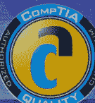
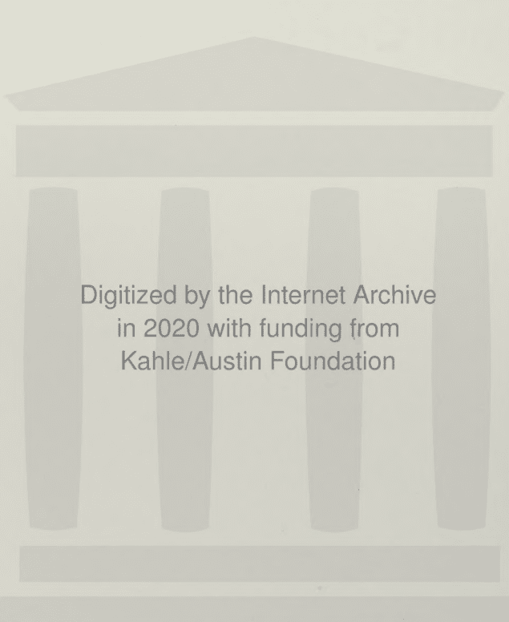
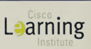
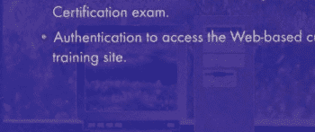

# Linux+ 基础与认证配套实验手册

互联网档案馆于 2020 年通过 Kahle/Austin 基金会的资助进行了数字化

https://archive.org/details/labmanualtoaccom0000unse

## 前言

《梅里安-韦伯斯特大学词典》将计算机定义为一种可存储、检索和处理数据的可编程电子设备。更全面的定义是，它在存储在自身内存中的指令控制下运行，可以接收数据、操纵数据、生成结果并将结果存储以供将来使用。计算机有两个主要特征：它响应一组特定的指令，并且它可以执行称为程序的一组预录指令。
计算机响应的机器语言指令集嵌入在中央处理单元中。这些指令是计算机将遵循的所有指令的基本构建模块。在你的文字处理或游戏程序在计算机上执行之前，计算机必须使用这些基本指令进行编程，以完成广泛的任务。这些任务包括读写磁盘驱动器、解释键盘按键、解释鼠标移动以及许多其他与硬件相关的工作。完成这些关键任务的一组指令称为*操作系统*（OS）。
每个计算机系统都必须有操作系统。操作系统是一组协调计算机系统所有任务的程序。例如，如果你要将文档打印到打印机，操作系统必须将你的文本转换为打印机能理解的代码，然后将代码发送到打印机。无论任务多么小，都必须由操作系统来控制。
操作系统由一组相关的程序组成，以完成这些单独的任务。之所以使用一组程序而不是一个程序，是因为并非每个人都需要所有可用的程序。在大多数情况下，如果你安装了所有可用的程序，你的硬盘空间和计算机内存就会耗尽。
操作系统的核心是称为内核的程序。内核维护计算机时钟，启动应用程序，并分配设备、程序和数据等资源。内核是内存驻留的，这意味着当操作系统启动后它就位于内存中，并在计算机系统运行时保留在那里。其他程序通常是非驻留的，这意味着当需要它们时，必须从外部存储设备将它们读取到内存中。
有许多不同的操作系统。当今个人计算机中最常用的操作系统是 Linux、Windows、Mac OS 和 Unix。在列出的操作系统中，只有 Linux 可以自由复制和分发。
Linux 的受欢迎程度正在增长，其市场份额每年都在增加。确定 Linux 的市场份额很困难，因为如果某人购买了一台预装 Windows 的计算机，然后将操作系统替换为 Linux 操作系统，没有人会从 Windows 一栏中减去一。由于大多数 Linux 发行版都是从互联网下载而不是购买的，因此确定 Linux 的市场份额更加困难。
随着 Linux 操作系统市场份额的增加，对 Linux 专业人士的需求也在增加。使自己区别于普通技术人员的一种方法是获得 Linux+ 认证。这本书将使你朝着获得此认证迈出坚实的一步。本书涵盖了最新考试版本中所有新的考试目标。

## 文本组织结构

*Linux+ 基础与认证* 涵盖了所有考试要求，并为学习 Linux+ 提供了坚实的基础，包括安装要求、管理基础知识和管理任务。还包括网络基础知识，如网络地址和配置远程客户端访问、管理服务、硬件配置、安全以及故障排除。
每章开头都列出一组**绩效目标**，表明在完成本章后将学到哪些新技能和知识。通常由讲师来实施绩效目标的要求。每章提供了执行练习并通过复习测验所需的所有信息。每章末尾的**自测**验证学生对材料的理解。自测问题（判断题和选择题）的答案在书末给出。
全书中明确规定了关于 Linux+ 考试目标的讨论。在引言之后有一列考试目标及其在文本中的覆盖范围列表。
配套的实验手册为每章提供了实验。这些实验让 Linux+ 学生练习本章教授的概念。
全书提供了行业提示。这些提示由各种网络专业人员撰写，提供了对 Linux+ 工作世界的洞察。

## 补充材料

*Linux+ 基础与认证* 由以下材料支持：
- 随文本包装的 CD 上的 ReviewMaster 教程提供了设计好的复习问题，为读者准备 Linux+ 考试。
- 另一张 CD-ROM 包含有用的示例程序和文件，旨在帮助学生开发和理解每部分提出的概念。查看 README 文档（文本、Microsoft Word 和 HTML 格式）以获取配套 CD-ROM 的详细描述。
- 随附文本的实验手册为每章提供动手实验。
- 提供教师手册，其中包含教学建议、教学大纲和测试样本以及其他有用的项目。

## 致谢

许多人在这本书上帮助了我，如果没有他们的帮助，我仍然会在修改章节。Mike Gay 和 Shane DeRidder 为许多章节提供了宝贵的技术反馈。我的兄弟 Vic，家庭中真正的 Linux 大师，提供了任何人所能要求的支持、技术知识和反馈。
最重要的是，感谢我的妻子 Lynda，她鼓励我并接受了我写这本书所需的时间。上帝赐予我一位奇妙的妻子。
David Engle

## Linux 发行版

**场景：** 你有一台旧的 Pentium II 333 MHz 计算机，配备 256 MB 内存、4 GB EIDE/ATA 硬盘和 100Base-T 网卡。你决定在这台计算机上安装 Linux 操作系统，将其用作个人桌面和 FTP 服务器。对于个人桌面系统，你需要文字处理和电子表格应用程序。FTP 服务器需要使用安全的协议，仅允许授权用户访问。该 Linux 发行版应包含一个包管理系统。
**操作：** 研究至少三种不同的 Linux 发行版，以确保它们符合上述标准。使用电子表格（行和列）比较每个发行版的特性。根据比较标准，选择一个发行版进行安装。

## 预算

### 实验 2.1

为一家小型企业的三台工作站实施创建预算。这些工作站将用于开发 C++ 编程项目。在你的项目预算中包含以下内容：
- 1. **硬件** — 开发人员将开发高端 GUI 应用程序。他们希望配备以下特性的三台计算机：
  - a. 高性能显卡和显示器
  - b. 1 GB 内部内存
  - c. 两个 80 GB 硬盘/机器
  - d. 千兆网络接口卡
  - e. 一个以千兆速度工作的 8 口交换机
  - f. 中等质量的彩色激光打印机
- 2. **软件** — 每台机器都将安装带有最新稳定内核的 Linux 发行版。此外，开发人员希望拥有以下应用程序：
  - a. StarOffice 生产力软件
  - b. 适用于 Linux 的 Intel® C++ Compiler 7.1
- 3. **维护** — 计算机硬件至少两年现场服务
- 4. **支持** — C++ 编译器至少一年电话支持
- 5. **培训** — 培训将由系统管理员内部进行。为入门使用培训课程编制系统管理员的时间需求预算。

## 分区

### 实验 2.2

根据实验 2.1 中概述的硬件和软件规范，设计一个分区方案。以相同的方式对每台工作站进行分区。
每台工作站将不超过十名用户。每个用户的源代码和数据文件不超过 5 GB。程序的日志文件将相当大。软件所需的磁盘空间将超过 200 MB。

## 硬盘安装

### 实验 2.3

概述将希捷 Barracuda ATA V-ST3120023A 硬盘作为从盘安装到现有同类型硬盘上的必要步骤。包括所需工具、跳线设置和电缆连接。
概述在 Linux 操作系统上设置新安装硬盘所需的步骤。包括创建分区、格式化驱动器以及将驱动器挂载到 `/opt/Oracle` 目录。

## Linux 发行版

### 实验 3.1

安装 Linux 操作系统的一个发行版。使用 CD 发行版套装。选择自定义安装类型。除以下各项外，所有条目均选择默认值：
- 使用你的名字首字母和姓氏作为计算机的主机名。
- 选择不启用防火墙。
- 使用 **LinuxPlus** 作为 root 密码。
- 选择 *shadow passwords*（影子密码）。
- 安装所有软件包。
为你自己添加一个账户。始终使用你的账户登录，并在需要时使用 `su` 命令以 root 身份连接。

## 启动软盘

### 实验 3.2

使用章节中概述的步骤创建启动软盘。创建启动软盘后，使用启动盘启动计算机以测试它。

## 创建安全账户

### 实验 4.1

为班上所有学生创建账户。将学生平均分成两组：groupA 和 groupB。使用名字首字母和姓氏作为用户名。遵循强密码策略。

## 目录

### 实验 4.2

在 `/home` 下创建两个名为 `groupA` 和 `groupB` 的目录。为这些目录分配权限，允许 `groupA` 的成员完全访问 `/home/groupA` 目录，允许 `groupB` 的成员完全访问 `/home/groupB` 目录。其他任何用户都不应能够读取、写入或执行这些目录内的任何文件。

概述完成上述任务所需的步骤。测试你的权限模式是否正常工作。概述用于测试权限的任务。

## 目录树

### 实验 4.3

绘制你的系统目录树。在树上标识所有物理分区，注明驱动器名称和分区的总大小。

标识以下目录和文件的用户、组所有者以及权限：

- `/etc`
- `/var`
- `/home/<your_user_directory>`
- `/opt`
- `/boot`
- `/etc/shadow`

## 使用 vi

使用 `vi` 修改你的 `bash` 配置文件，以包含以下内容：

- 你的脚本目录（`/*home/userid/scripts*`）在路径环境变量中
- 包含日期和时间的命令行提示符，位于默认行之上的一行
- 你主目录内容的列表

测试你的脚本。

## 命令行基础

执行执行以下命令以完成下列任务：

- 捕获 `/etc` 目录的文件列表。
- 显示捕获的文件数量。
- 显示捕获文件中含有字符 `jpg` 的所有行。

## 管理任务 — 备份

### 实验 6.1

使用 `tar` 命令：

- 创建一个包含你主目录中所有文件的新 `tar` 文件。将你的 `tar` 文件命名为 **`myhome.tar`**。
- 在你的主目录中创建一个名为 **`test`** 的新目录。
- 将你的 `myhome.tar` 文件提取到你的 `test` 目录中。

## 软件包

### 实验 6.2

你的 Linux 发行版磁盘上有许多软件包。执行以下命令：

- 列出 RPM 软件包中的文件。
- 安装一个 RPM 软件包。（选择 `tftp-server`、`whois` 或其他小型软件包。）
- 更新 RPM 软件包。（你可以使用相同的软件包。）
- 使用 `rpm` 命令查询该软件包是否存在。
- 移除该软件包。

## Shell 编程

### 实验 6.3

创建以下脚本：

- 创建一个名为 **`copy`** 的脚本，接受“源”文件名和“目标”文件名，然后使用 `cp` 命令复制文件。
- 创建一个名为 **`tod`** 的脚本，根据时间显示一天中的时间以及“上午”或“晚上”。
- 编写一个脚本，根据文本文件中的用户名列表创建用户账户。
  - 将过期日期设置为命令行中包含的值。
  - 将初始组设置为 **`mygroup`**。

## 网络 — 子网掩码

使用 IP 地址 `192.168.0.0`，回答以下问题：

- 1. 默认子网掩码是什么？
- 2. 要将网络划分为至少 5 个子网，子网掩码应该是什么？（不要允许多于必要的子网。）
- 3. 如果子网掩码为网络内的至少 5 个子网提供空间，每个子网中有多少个主机地址可用？
- 4. 使用第 2 题中确定的子网掩码，列出每个子网的网络地址和广播地址。

## NFS 服务器

### 实验 7.2

修改你的 `/etc/hosts` 文件，使其包含网络上每个计算机系统的 IP 地址。

## 系统配置

### 实验 7.3

使用 `ssh` 程序连接到另一名学生的计算机。连接后：

- 更改你的密码。
- 列出你主目录中的文件。
- 更改你的命令行提示符。
- 注销。重新登录另一台计算机，确保接受你的新密码并显示新的命令行提示符。

## 常见端口

### 实验 8.1

识别你的计算机系统中哪些知名端口是打开的。识别端口以及在端口上监听的进程。

## 用户配置

### 实验 8.2

使用 NFS 将你的目录 `/home/username/scripts` 配置为可与他人共享。

- 配置 `/etc/exports`、`/etc/hosts.allow` 和 `/etc/hosts.deny`。
- 启动 NFS 服务。

使用 Samba 将你的目录 `/home/username/scripts` 配置为可与他人共享。

- 配置 `/etc/samba/smb.conf`。
- 创建 Samba 用户。
- 启动 Samba。

### Samba

### 实验 8.3

配置一台 Windows 客户端，使其能够连接到你在实验 8.2 中创建的 Samba 共享。通过访问该共享来测试客户端连接。

## X 窗口系统配置

### 实验

手动配置 X 窗口系统。在执行此流程之前，请复制 `/etc/X11/XFree86Config` 文件作为备份。

1. 使用 `/usr/sbin/ddcprobe` 命令探测显示器和显卡的硬件信息。记下你的探测结果。
2. 使用 XFree86 程序并加上 `-configure` 选项生成配置文件的骨架。
3. 使用 XFree86 并加上 `-xf86config` 选项测试配置。
4. 用新文件替换现有的 XF86Config 文件。

## 交换空间

创建一个 16 MB 的交换文件。选择一个空间足够的分区，创建该文件，然后启用该文件。

## 额外交换空间

### 实验 9.3

向你的 Linux 系统添加另一块硬盘。完成以下任务：

- 物理安装硬盘。
- 对硬盘进行分区。
- 格式化创建的分区。
- 更新 `/etc/fstab` 配置文件。

## 创建桌面应用程序

### 实验 10.1

在 GNOME 中创建一个启动器（launcher），用于在终端窗口中启动 `vi` 会话。`vi` 程序位于 `/bin` 目录中。将启动器命名为 `vi`。

## 桌面工具

### 实验 10.2

在 GNOME 桌面上添加一个菜单面板。将以下项目添加到菜单面板中：

- 工具：显示桌面按钮 (Show Desktop Button)
- 多媒体对象：CD 播放器 (CD Player)
- 按钮对象：注销 (Log Out)

## 用户 cron — 命令运行于

创建一个用户 cron 任务来监控磁盘空间。

- cron 任务应每天下午 5 点运行。
- 将 `df` 命令的结果写入一个文件。
- 将该文件通过电子邮件发送到你的 sendmail 账户。

## 进程管理

### 实验 11.2

测试终止、挂起和重启进程。

- 创建一个测试脚本，该脚本将持续循环并在每次迭代时显示文本。
- 挂起该脚本。
- 检查脚本是否处于 T 状态。
- 在前台重启该脚本。
- 检查脚本是否已重启。
- 终止该脚本。

### 实验 11.3

## 日志功能

检查安全日志文件中的连接被拒绝记录。创建一个用户 cron 任务，将连接被拒绝的记录通过邮件发送给你。

- 创建一个每天中午过后 10 分钟运行的 cron 任务。
- 使用 `grep` 命令提取包含 "refused" 一词的日志条目到一个文件中。
- 将该文件通过电子邮件发送到你的 sendmail 账户。

## 安全更新

### 实验 12.1

使用 RedHat `up2date` 程序更新你的操作系统。

1. Red Hat Network (RHN) 最新的 SSL 证书位于 https://rhn.redhat.com/help/ssl_cert.px。按照屏幕说明下载、验证并安装新证书。
2. 从命令行执行 **`up2date`** 程序。你必须以 root 身份登录才能运行此程序（`su root`）。
3. 按照屏幕提示注册账户，发送计算机信息，下载最新更新并安装这些更新。

## 设置 GRUB 密码

### 实验 12.2

设置 GRUB 密码。

1. 使用 `/sbin/grub-md5-crypt` 创建密码哈希。
2. 将生成的密码添加到相应的文件中。

## 保护服务

### 实验 12.3

为 `sshd` 连接创建一个登录横幅。横幅不应提供任何系统信息，并且应警告连接者只有授权用户才允许访问。

## 故障排除日志文件

### 实验 13.1

检查日志文件中来自未授权用户的登录尝试。使用无效用户尝试几次登录，然后检查日志中的失败尝试记录。

## 故障排除硬件

### 实验 13.2

识别你的硬盘。列出制造商的型号、硬盘类型（EIDE 或 SCSI）以及线缆类型。通过打开计算机机箱并检查组件来完成此任务。

## 故障排除连接状态

### 实验 13.3

检查从你的计算机到远程网站（例如 `www.cisco.com`）的网络连接。

1. Ping 远程连接。识别 IP 地址并确保系统对 ping 有响应。
2. 使用 `traceroute` 确定到远程系统的网络路径。

3. 使用 `nslookup` 确保远程连接有 DNS 条目，并识别服务于该条目的 DNS 服务器。

4. 使用 `host` 命令确定远程连接是否有邮件服务器。

# 思科学习学院 Linux+ 基础与认证

需要全面 Linux 认证的原因很简单：Linux 是厂商独立的。Linux 认证专业人士必须了解 Linux 操作系统的基本安装、操作和故障排除。

Linux+ 基础与认证涵盖了所有考试要求，并在安装要求、管理基础和管理任务方面提供了坚实的基础。它还涵盖了网络基础知识，如网络地址和配置远程客户端访问、服务管理、硬件配置、安全性和故障排除。

Linux+ 基础与认证确保你能解释基本的开源资源/许可证，展示用户管理的知识，理解文件权限/软件配置，并管理本地存储设备和网络协议。

主要特点包括：

- 正文部分采用双色印刷，包含大量插图，其中包含 Linux+ 目标、性能目标以及章节末尾的复习问题，以帮助理解和记忆。
- 随附正文的实验手册包含有关如何完成动手练习的讨论和说明。
- 随附 CD 上的认证套件包含动手的基于 Web 的活动，以及数百道题目，帮助你为考试做准备。
- 学生资源 CD 包含数百道题目，帮助你为 Linux+ 认证考试做准备。
- 通过授权培训站点访问基于 Web 课程的身份验证，该课程包含动手实验。

有关本书或 Prentice Hall 其他新技术新书的更多信息，请访问我们的网站 http://www.prenhall.com

StudentAid.ed.gov

