# Linux 平台与应用安全策略实验室手册版本 1.5

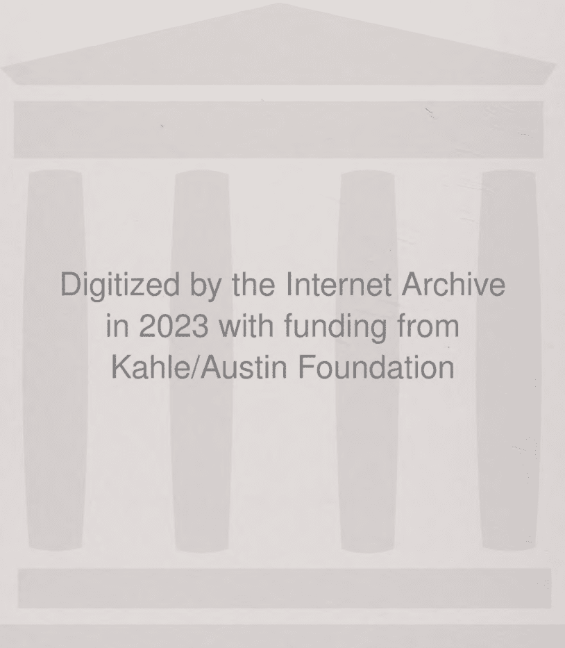


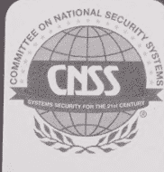

# 制作鸣谢

- 执行官：Ty Field
- 总裁：James Homer
- 副总裁，总编辑：Michael Johnson
- 副总裁，课程解决方案：Christopher Will
- 课程解决方案销售总监：Rand Rogers
- 作者：vocab Solutions, LLC，总裁 David Kim
- 编辑管理：High Stakes Writing, LLC，编辑兼出版商 Lawrence J. Goodrich
- High Stakes Writing 校对：Katherine Dillin
- High Stakes Writing 校对：Ruth Walker
- 高级编辑助理：Raina Erikson
- 重抽品与项目经理：Susan Schultz
- 制作编辑：Tina Chen
- 制作助理：Kristen Rogers
- 权利与图片研究助理：Lian Bruno
- 制造与库存控制主管：Amy DeFonzo
- 高级营销经理：Angela DeFonzo
- 封面设计：CAE Solutions Corp.
- 封面图片：iStock, Inc.
- 印刷与装订：Edwards Mallows
- 封面：Edwards Mallows

伦理与行为准则 vii

序言 ix

# 伦理与行为准则

## 序言
欢迎！本实验手册是完成本课程实验的逐步指南。

# 云安全实验室 (VSCL)

在本实验手册的大多数实验中，你将使用云安全实验室 (VSCL)。

> 注意：
> 云安全实验室需要使用 Windows Internet Explorer 或 Mozilla Firefox。目前该实验室不支持 Google Chrome、Safari 或 Opera。

VSCL 是一个系列虚拟资源，包括 Windows 和 Linux 服务器、Cisco 路由器以及 Wireshark、FileZilla 和 Nessus 等应用程序，允许你像在实时生产环境中一样执行本实验手册中的所有任务。

如下表所示，本实验手册中的一个实验将不使用 VSCL。有关如何执行该实验的详细说明，请咨询你的教学大纲或教师。

# 如何使用本实验手册

本实验手册提供了完成以下动手实验的逐步说明：

# 前言

# 每个实验的视频演示

本实验手册中每个基于 VSCL 的练习都包含一个视频演示，帮助您快速概述每个步骤和功能。您可以在执行实验练习之前观看视频演示，并在完成实验时根据需要对其进行参考。如果您需要做笔记或在特定步骤或功能上花费额外时间，可以暂停、重回或快进视频演示。有关在何处找到这些视频演示的信息，请咨询您的教学大纲或讲师。

# 分步骤说明

通过遵循详细的分步骤说明，您将轻松地完成这些实验练习。每个步骤都清晰地拆分为子步骤，并且所有要求的操作都将用**粗字体**标记。文档包含截图，以帮助您识别菜单、对话框和输入位置。如果您在某个步骤上遇到困难，请参考实验视频，视频的顺序与步骤一致。

## 交付物

在完成每个实验后，您需要向教师提供一组交付物。这些交付物可能包括文档、文件、截图和/或评估问题的答案。交付物的设计目的是测试您对信息的理解，以及您是否成功完成了实验的步骤和功能。有关交付物的具体信息，请参阅每个实验末尾的交付物部分。

> 注意：某些实验需要使用 Microsoft Word 等文字处理程序来准备和提交交付物。如果您无法访问文字处理器，可以使用 VSCL 工作站桌面上的 OpenOffice 来准备您的文档。它包含一个名为 Writer 的文字处理器，具有创建用于这些实验的文档所需的所有功能。

## 文件传输

有时，您可能被要求将执行 VSCL 实验步骤时创建的文件传输到另一台计算机。这可以使用 VSCL vWorkstation 桌面内置的物理传输功能来完成。有关如何使用文件传输功能准备和保存文件的说明，可以在每个课程第一个实验（通常情况下是实验 #1）的视频演示的开头找到。

> 注意：使用本实验手册或 VSCL 不需要使用教科书。如果您对您的课程是否需要教科书有任何疑问，请咨询您的讲师。

# 在服务器上安装核心 Linux 操作系统

### 简介

在本实验中，您将查看最近安装的 CentOS Linux 服务器的截图，这些截图记录了安装过程，包括设置密码、创建分区以及建立系统管理员访问控制。您将利用截图提供的信息，在安装其他安全 Linux 服务器时创建一个审计检查清单。

本实验是一个纸面设计实验，不需要使用虚拟安全云实验室（VSCL）。为了成功完成本实验的交付物，您需要访问文本编辑器或文字处理器（如 Microsoft Word）。对于某些实验，您可能还需要访问 Visio 或 PowerPoint 等图形线条绘图应用程序。

> 注意：如果您没有文字处理器或图形软件包，请使用学生学习 vWorkstation 上的 OpenOffice 来完成实验交付物并回答实验评估问题。要截屏，请按 `Prt Sc` 粘贴到文本文档中，并使用文件传输功能将文档保存到 Security_Strategies 文件夹（`C:\Security_Strategies`）中。

### 学习目标与成果

完成本实验后，您将能够：
- 根据所需的软件为 Linux 操作系统设计安装计划
- 在核心 Linux 服务器内设计安全的分区，以实现所需的安全加固和应用支持
- 理解在安装期间如何启用网络时间服务器，以维护整个系统的同步时间设置
- 创建非特权用户账户用于系统管理访问，作为以 root 用户身份登录的安全替代方案

## 交付物

完成本实验后，您需要向教师提供以下交付物：
1. 审计检查清单和安装总结：
2. 实验 #1 的实验评估问题与答案。

### 动手步骤

1. 本实验始于主管的请求。作为虚构金融机构——第一世界银行（First World Bank）网络管理团队的最新成员，您被要求根据本实验包含的截图创建一个审计检查清单。该清单在未来将用于确保组织内 Linux 服务器的安全性。

> 注意：
> 接下来的步骤包含了最近 Linux 安装的截图。在创建符合公司需求的审计检查清单和安装总结时，请将这些截图作为参考。

2. 在新文档中创建一个审计检查清单和安装总结。
您将遵循本实验中的步骤来完成清单，就像您是网络管理团队的一员一样。您将负责决定在报告中记录的内容。

3. 在您的文本文档中，解释为什么物理保护 Linux 计算机特别为重要。

4. 查看以下截图。

图 1.1
在图形模式下接受新安装的默认设置，按 `Enter`

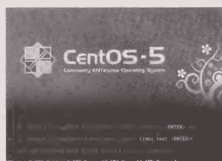

图 1.2
点击 `Next` 继续

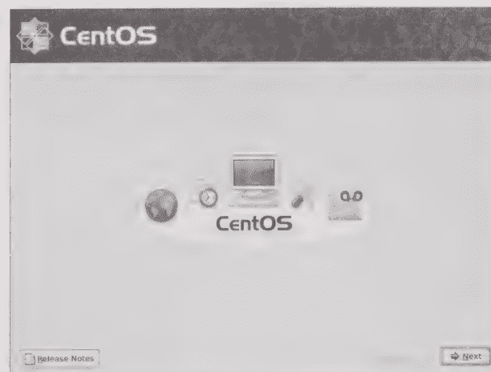

## 实验 #1 | 在服务器上安装核心 Linux 操作系统

图 1.3
选择合适的语言并点击 `Next`


图 1.4
选择合适的键盘并点击 `Next`

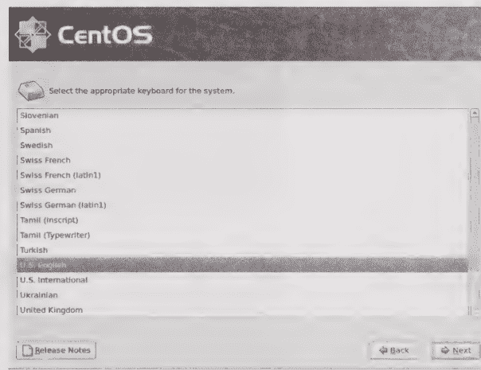

动手步骤
如果这是一个新驱动器，安装程序将显示初始化选项。

图 1.5
从下拉菜单选择自定义布局

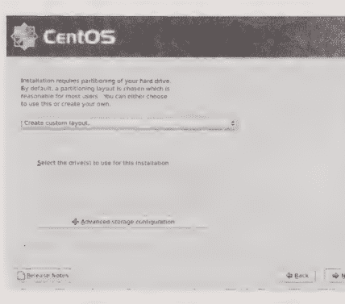

图 1.6
为 `/boot` 创建 `ext2` 文件系统，大小为 500

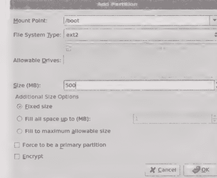

5. 在您的文本文档中，解释物理保护 Linux 计算机为什么特别为重要。

6. 在您的文本文档中，解释在此界面选择 `ext3` 文件系统而不是 `ext2` 的原因。

7. 查看以下截图。

图 1.7
创建一个大小为 4000MB 的交换文件系统

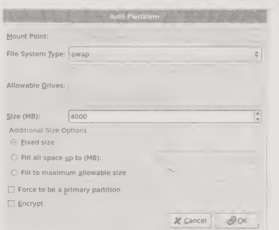

8. 在您的文本文档中，解释 `SWAP` 分区的意义。

9. 查看以下截图。

图 1.8
创建物理卷（`LVM`）并填充到最大大小

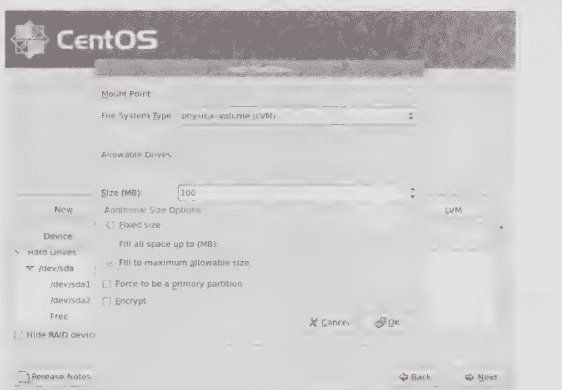

10. 在您的文本文档中，解释使用 `LVM` 分区如何与安全的 `CIA Triad` 相关。

11. 查看以下截图。

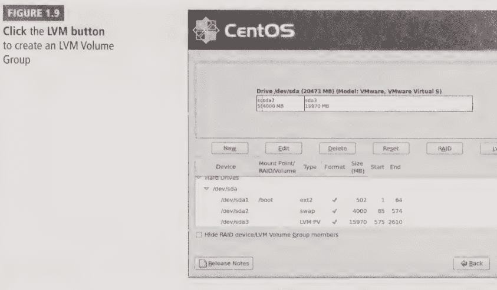

图 1.10


使用 LVM 组为 `/var`、`/home` 和 `/tmp` 创建预定义大小区，并填充最大允许大小（剩余磁盘空间）

12. 在您的文本文档中，总结与安全可用性相关的分区原因。

13. 在您的文本文档中，解释正确分区 Linux 系统为什么很重要。

## 实验 #1 | 在服务器上安装核心 Linux 操作系统

14. 查看以下截图。

图 1.11

分区设计的最终布局

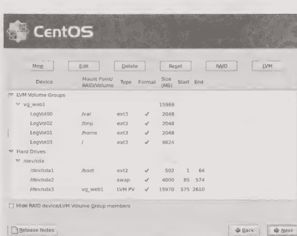

图 1.12

安装引导程序（GRUB）并创建密码以防止未经授权的物理访问

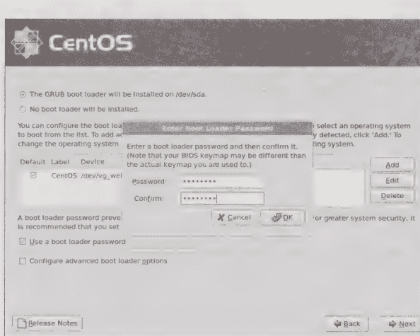

### 实践步骤

图 1.13

在页面的主机名（Hostname）部分输入主机名

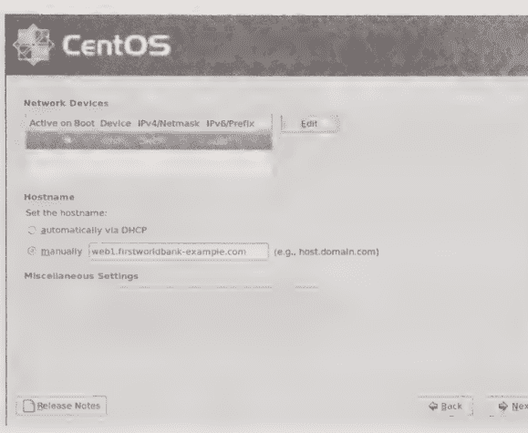

图 1.14

点击“编辑（Edit)”按钮设置静态 IP 地址、网关和 DNS 服务器信息，并点击“下一步（Next)”继续

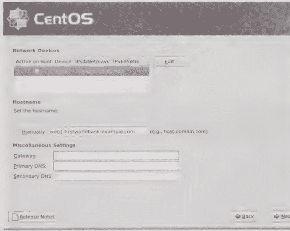

## 实验 #1 | 在服务器上安装核心 Linux 操作系统

图 1.15

选择合适的时区并点击“下一步（Next)”

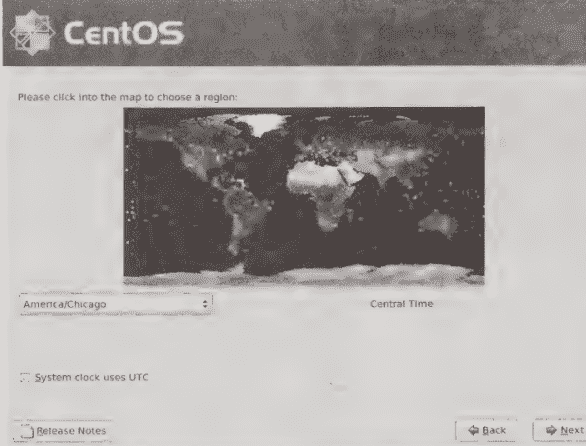

图 1.16

输入合适的密码，进行确认，并点击“下一步（Next)”

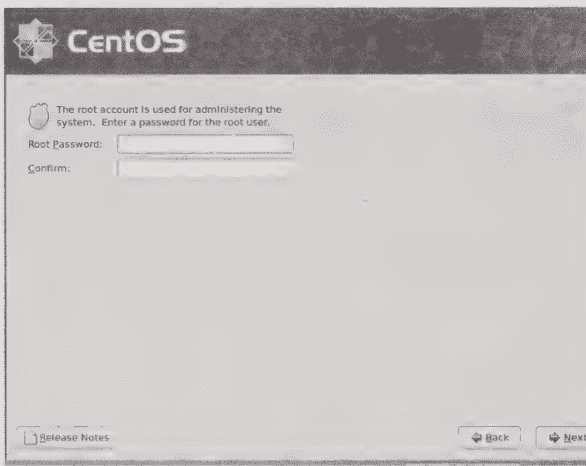

15. 在你的文本文档中，解释 root 用户账户及其使用方法。

### 实践步骤

16. 查看以下截图。

图 1.17

勾选“服务器 GUI（Server-GUI）”复选框并点击“下一步（Next)”

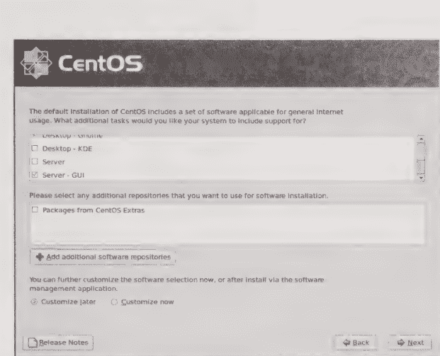

这将安装约 1,000 个软件包，包括 GNOME 桌面。

图 1.18

点击“下一步（Next)”开始 CentOS 安装过程

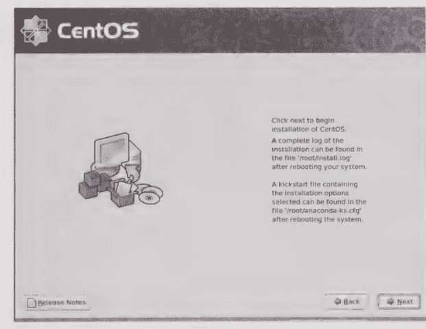

## 实验 #1 | 在服务器上安装核心 Linux 操作系统

图 1.19

插入安装盘，并在提示时点击“重启（Reboot）”

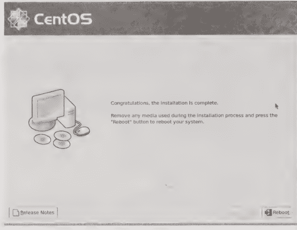

图 1.20

在 firstboot 欢迎界面上点击“前进（Forward）”按钮

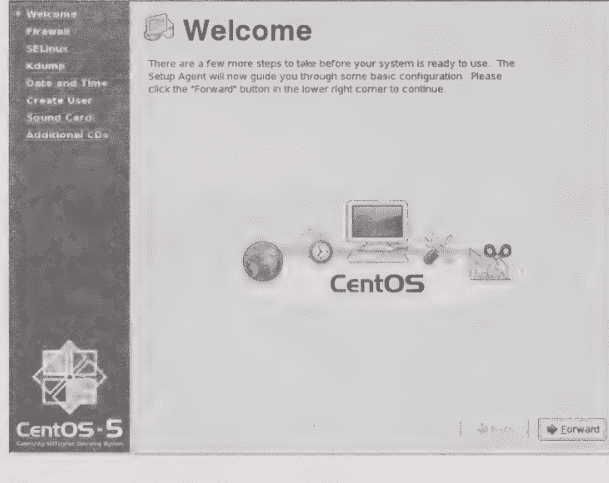

17. 在你的文本文档中，解释“firstboot”的目的。

### 实践步骤

18. 查看以下截图。

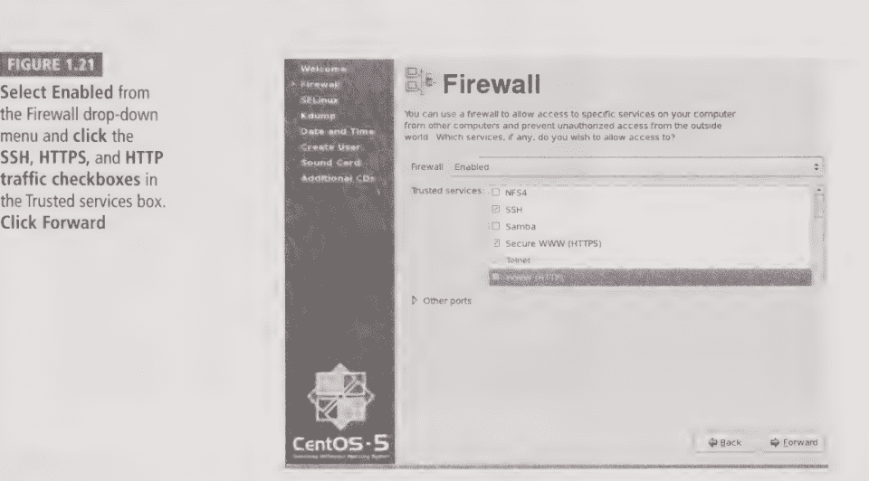

19. 在你的文本文档中，描述管理员登录服务器并执行管理任务的方法（例如远程或物理访问），以及应该使用哪些账户进行登录。

20. 查看以下截图。

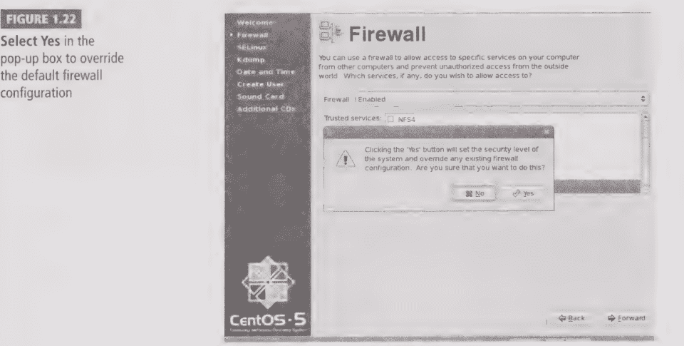

## 实验 #1 | 在服务器上安装核心 Linux 操作系统

图 1.23

点击“前进（Forward）”按钮选择强制模式（Enforcing mode）下的 SELinux

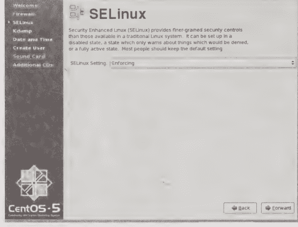

图 1.24

点击“前进（Forward）”按钮接受默认的 kdump 设置

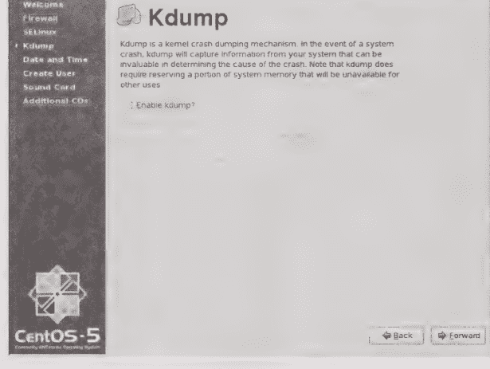

### 实践步骤

### 图 1.25

设置当前日期和时间并点击“前进（Forward）”按钮

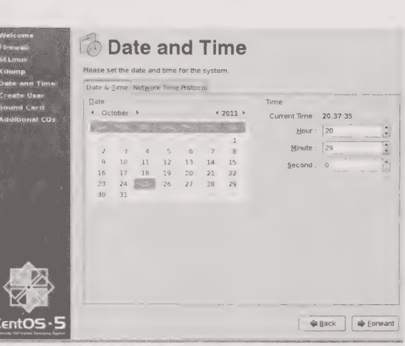

### 图 1.26

点击“网络时间协议（Network Time Protocol）”标签页并启用“网络时间协议”复选框。点击“前进（Forward）”按钮继续

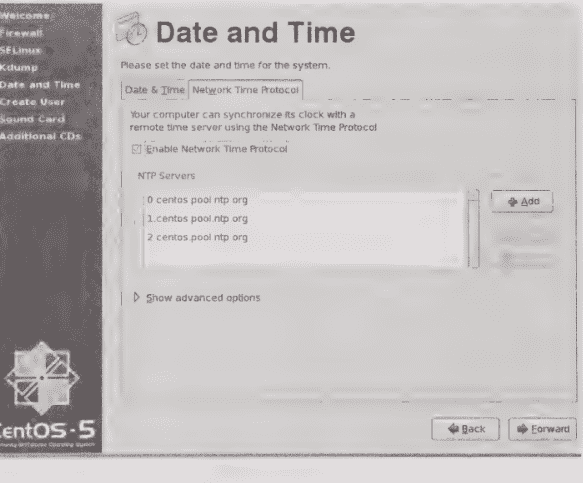

21. 在你的文本文档中，解释为什么在 Linux 服务器上保持准确的时间非常重要。

22. 在你的文本文档中，描述你关于如何与网络时间协议（NTP）同步的建议。

## 实验 #1 | 在服务器上安装核心 Linux 操作系统

23. 查看以下截图。

图 1.27

创建用户账户和密码。点击“前进（Forward）”按钮

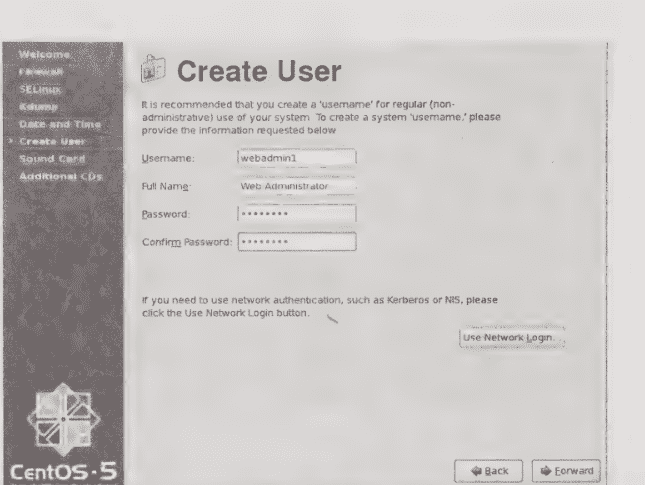

图 1.28

点击“前进（Forward）”按钮接受默认的声卡设置

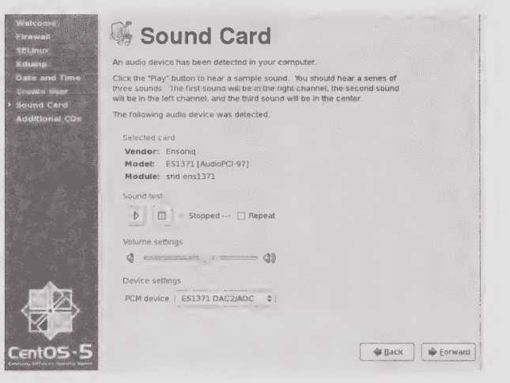

### 实践步骤

图 1.29

点击“完成（Finish）”按钮完成“firstboot”过程

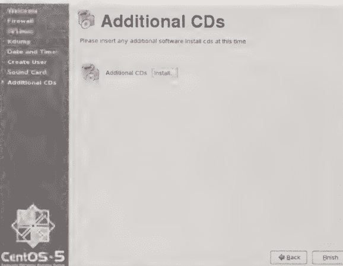

图 1.30

在 GNOME 登录界面输入用户名和密码


24. 在你的文本文档中，解释安装了哪个运行级别（runlevel）。

25. 在你的文本文档中，解释安装 X-Window 和图形界面的原因以及如何降低风险。

26. 将文本文档提交给教师作为交付。

## 评估标准与评分

以下是实验的评估标准和评分标准：

1. 学生是否能够为了安全加固和性能设计 Linux 分区？25% 
2. 学生是否能够设计系统时间？25%
3. 学生是否理解在安装期间启用同步时间？25%
4. 学生是否能够创建用于系统管理的非权限账户？25%

## 在服务器上安装核心 Linux 操作系统

概述

在本次实验中，你查看了最近安装 CentOS Linux 的截图，应用了密码设置、分区创建并建立了系统管理员控制。你根据提供的截图信息进行了审计。

## 实验评估问题

1. 在安装期间，勾选了与 NTP（网络时间协议）服务器同步的选项。从安全角度来看，系统保持准确时间为什么重要？
2. 在安装期间，为 root 设置了密码。什么是 root 用户？什么时候可以使用该账户？
3. 在安装期间，安装了 X-Window 和桌面管理器。然而，在生产环境中建议不要运行 X-Window 环境。请解释此建议的目的。
4. 在安装过程中，创建分区有哪些选项？
5. 为什么对 Linux 系统进行分区很重要？
6. SWAP 分区在 Linux 系统中的意义是什么？可以通过哪些不同的方式配置交换空间？你为什么推荐其中一种？
7. 在为 Linux 系统分区时选择 ext3 文件系统时，Linux 用户可以使用哪些优势和功能？
8. `passwd` 文件是如何使用的？它包含哪些字段？请解释。
9. `fstab` 文件用于什么？它包含哪些字段？请解释。
10. 解释为 `/var` 和 `/boot` 目录创建独立分区的意义。这些目录中包含什么？
11. 选择“加密文件系统（encrypt filesystem）”选项会有什么用？
12. 使用逻辑卷管理器 (`LVM`) 进行分区如何帮助实现安全 CIA 三要素中的机密性完整性和可用性？
13. 选择“最小”（minimal）软件安装选项时可以实现哪些安全优势？
14. 你如何自动化一个面向安全的 CentOS 或 Red Hat 安装？
15. “firstboot”的目的是什么？

## 在 CentOS Linux 服务器上配置基础安全控制

在本实验中，你将练习如何妥善地保护 Linux 服务器系统。你将执行相关步骤来保护引导加载程序、启用 iptables 并运行 SELinux 以帮助锁定 Linux 操作系统。你还将对目录和文件应用 ACL 以确保文件和数据访问安全，然后在系统上检查这些 ACL 权限设置。

## 学习目标

完成本实验后，你将能够：

- 配置引导加载程序，将超时设置为 0 并设置密码凭据，以防止对 GRUB 加载器和服务器启动序列的篡改
- 通过查看配置文件和使用 `sestatus` 命令验证 CentOS Linux 服务器上的 SELinux 模式
- 创建学生用户账户并将其添加到用户组，以便在整个系统中管理权限并应用访问控制
- 配置具有有限 sudo 访问（带密码凭据）的用户组，以记录并适当监控整个系统的访问情况
- 为运行级别 2 到 5 设置 iptables 为“开启”，以启用内部的、基于主机的 IP 状态防火墙
- 为用户访问文件和系统日志文件设置限制和权限

## 交付成果

完成本实验后，你需要向讲师提供以下交付成果：

- 1. 一份包含以下内容的文本文档：


a. 你对 `grub.conf` 文件的修改；

b. 你对 SELinux 配置文件的修改；

c. 你对运行级别 2 到 5 防火墙的修改；

d. 你对 sudoers 文件的修改；

e. 你为某个临时文件添加不可变标记（immutable flag）的修改；

f. 你对日志文件权限的修改；

2. 第 2 实验评估问题与答案。

### 实践步骤

1. 本实验从 VSCL 的学生落地 vWorkstation 虚拟机桌面开始，如图所示。

图 2.1

“学生落地”VSCL 工作站


2. 双击桌面上的 `ISSA_VM Server Farm_RDP` 图标。此文件夹包含本实验环境中虚拟服务器的链接。

3. 双击 `TargetRedHat01` 文件打开 Linux 服务器。

图 2.2

打开到 TargetRedHat01 服务器的远程桌面连接

## 第 2 实验 | 在 CentOS Linux 服务器上配置基础安全控制

4. 使用以下凭据登录 TargetRedHat01 服务器：

- 用户名：`student`
- 密码：`ISS3516Security`

显示虚拟 Linux 服务器的 GNOME 图形用户界面 (GUI)。

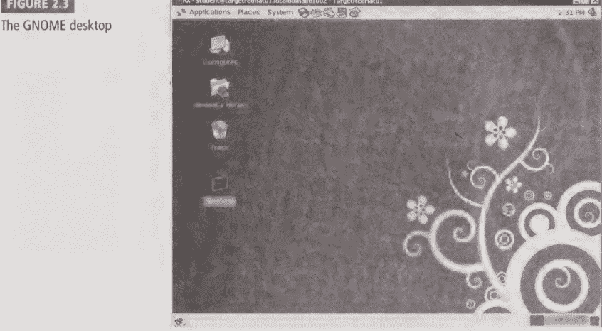

> 注意：
>
> 接下来的步骤将通过修改 GRUB 引导加载程序在此服务器上应用安全措施，使其直接进入默认操作系统而不显示引导加载程序菜单。引导加载程序是一个允许用户或管理员在计算机启动时选择加载哪个操作系统或内核的程序。

5. 双击 GNOME 桌面上的终端图标打开终端模拟器并访问 Linux 服务器命令行。

6. 在命令提示符处输入 `su -c 'vi /boot/grub/grub.conf '` 并按回车将 GRUB 配置文件加载到 VI 编辑器中。

### 实践步骤

7. 当提示密码时，输入 `ISS3165Security`。

VI 编辑器窗口中出现 `grub.conf` 文件。

图 2.4

VI 编辑器中的 grub.conf

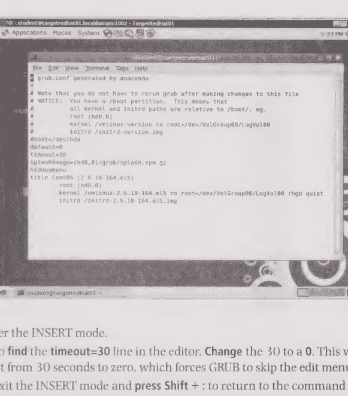

8. 按键进入插入（INSERT）模式。

9. 使用方向键在编辑器中找到 `timeout=30` 行。将 `30` 改为 `0`。这将把超时时间从 30 秒改为 0，从而强制 GRUB 在加载时跳过编辑菜单。

10. 按 `Esc` 键退出插入模式并按 `Shift + :` 返回命令行。窗口底部带有闪烁光标的冒号表示你正处于命令行模式。

11. 输入 `w` 并按回车保存修改并退出 VI 编辑器。

12. 在命令提示符处输入 `/sbin/grub` 并按回车打开 GRUB 控制台进行编辑。在 GRUB 控制台中，会出现命令提示符 `grub`。

13. 在命令提示符处输入 `md5crypt` 并按回车将哈希字符串附加到 GRUB。

14. 当提示密码时，输入 `linux` 并按回车创建密码。

15. 选中哈希字符串并右键点击。从右键菜单中复制。

16. 在命令提示符处输入 `su -c 'vi /boot/grub/grub.conf '` 并按回车加载 GRUB 配置文件。

17. VI 编辑器窗口中出现 `grub.conf` 文件。

18. 按键进入插入模式。

19. 使用方向键在编辑器中找到 `timeout=30` 行。将 `30` 改为 `0`。这将超时时间从 30 秒改为 0，强制 GRUB 在加载时跳过编辑菜单。

20. 按 `Esc` 键退出插入模式并按 `Shift + :` 返回命令行。窗口底部带有闪烁光标的冒号表示你正处于命令行模式。

21. 输入 `w` 并按回车保存修改并退出 VI 编辑器。

22. 在命令提示符处输入 `/sbin/grub` 并按回车打开 GRUB 控制台进行编辑。在 GRUB 控制台中，会出现命令提示符 `grub`。

23. 在命令提示符处输入 `md5crypt` 并按回车将哈希字符串附加到 GRUB。

24. 当提示密码时，输入 `linux` 并按回车创建密码。

25. 选中哈希字符串并右键点击。从右键菜单中复制。

26. 在命令提示符处输入 `su -c 'vi /boot/grub/grub.conf '` 并按回车加载 GRUB 配置文件。

27. VI 编辑器窗口中出现 `grub.conf` 文件。

28. 按键进入插入模式。

29. 使用方向键在编辑器中找到 `timeout=30` 行。将 `30` 改为 `0`。这将超时时间从 30 秒改为 0，强制 GRUB 在加载时跳过编辑菜单。

30. 按 `Esc` 键退出插入模式并按 `Shift + :` 返回命令行。窗口底部带有闪烁光标的冒号表示你正处于命令行模式。

31. 输入 `w` 并按回车保存修改并退出 VI 编辑器。

32. 在命令提示符处输入 `/sbin/grub` 并按回车打开 GRUB 控制台进行编辑。在 GRUB 控制台中，会出现命令提示符 `grub`。

33. 在命令提示符处输入 `md5crypt` 并按回车将哈希字符串附加到 GRUB。

34. 当提示密码时，输入 `linux` 并按回车创建密码。

35. 选中哈希字符串并右键点击。从右键菜单中复制。

36. 在命令提示符处输入 `su -c 'vi /boot/grub/grub.conf '` 并按回车加载 GRUB 配置文件。

37. VI 编辑器窗口中出现 `grub.conf` 文件。

38. 按键进入插入模式。

39. 使用方向键在编辑器中找到 `timeout=30` 行。将 `30` 改为 `0`。这将超时时间从 30 秒改为 0，强制 GRUB 在加载时跳过编辑菜单。

40. 按 `Esc` 键退出插入模式并按 `Shift + :` 返回命令行。窗口底部带有闪烁光标的冒号表示你正处于命令行模式。

41. 输入 `w` 并按回车保存修改并退出 VI 编辑器。

42. 在命令提示符处输入 `/sbin/grub` 并按回车打开 GRUB 控制台进行编辑。在 GRUB 控制台中，会出现命令提示符 `grub`。

43. 在命令提示符处输入 `md5crypt` 并按回车将哈希字符串附加到 GRUB。

44. 当提示密码时，输入 `linux` 并按回车创建密码。

45. 选中哈希字符串并右键点击。从右键菜单中复制。

46. 在命令提示符处输入 `su -c 'vi /boot/grub/grub.conf '` 并按回车加载 GRUB 配置文件。

47. VI 编辑器窗口中出现 `grub.conf` 文件。

48. 按键进入插入模式。

49. 使用方向键在编辑器中找到 `timeout=30` 行。将 `30` 改为 `0`。这将超时时间从 30 秒改为 0，强制 GRUB 在加载时跳过编辑菜单。

50. 按 `Esc` 键退出插入模式并按 `Shift + :` 返回命令行。窗口底部带有闪烁光标的冒号表示你正处于命令行模式。

51. 输入 `w` 并按回车保存修改并退出 VI 编辑器。

（注：输入文本在步骤编号部分存在大量重复和 OCR 伪影。已根据提供的页面在保持去重后指令的基础上清理了逻辑流。）

## 第 2 实验 | 在 CentOS Linux 服务器上配置基础安全控制

25. 在终端命令提示符处输入 `cat /etc/selinux/config` 并按回车检查 SELinux 配置。

图 2.6

SELinux 配置设置

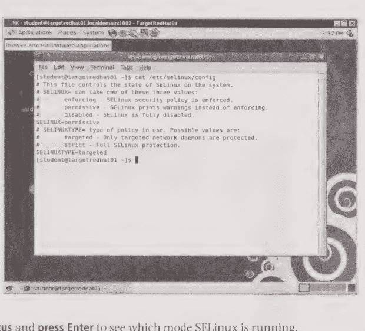

26. 输入 `/usr/sbin/sestatus` 并按回车查看 SELinux 运行的模式。

### 图 2.7

SELinux 当前模式

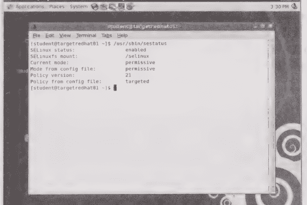

27. 截取显示当前模式行的 SELinux 配置，并将其粘贴到你的文本文档中。

28. 在命令行提示符处，输入 `su -c ' /bin/sysconfig --level 2345 iptables on '` 并按回车。

29. 当提示密码时，输入 `ISS3316Security`。

命令行提示符界面会发生变化。除了命令行提示符重新出现外，没有其他可见的反馈。

30. 在命令行提示符处，输入 `su -c ' /bin/service iptables start '` 并按回车启动防火墙。

31. 当提示密码时，输入 `ISS3316Security`。

32. 在命令行提示符处，输入 `/bin/sysconfig iptables --list` 并按回车，以验证您的更改是否已在服务器上生效。

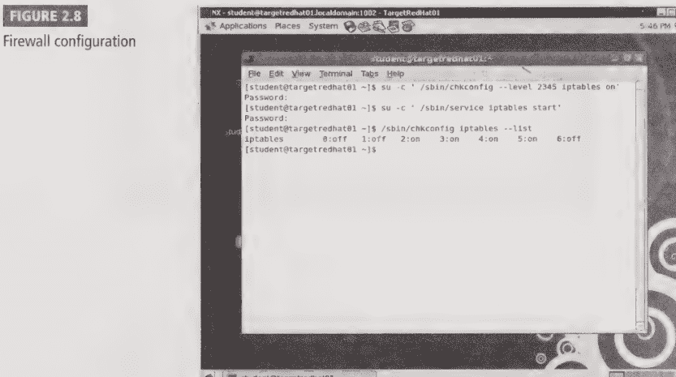


33. 显示运行级别（runlevels）的终端窗口并将其粘贴到文本文档中。

> 注意：后续步骤将通过允许 sudo 用户在此服务器上应用安全措施。管理员可以选择授予授权用户针对特定目的的限制 root 权限。`sudo` 权限还可以允许管理员审计授权用户在服务器上执行的操作。任何未专门授予 sudo 用户的操作都需要实际 root 密码。

## 动手操作步骤

34. 在命令行提示符处，输入 `su -c /usr/bin/visudo` 并按回车，编辑用于 sudo 用户文件的 sudoers 配置文件。

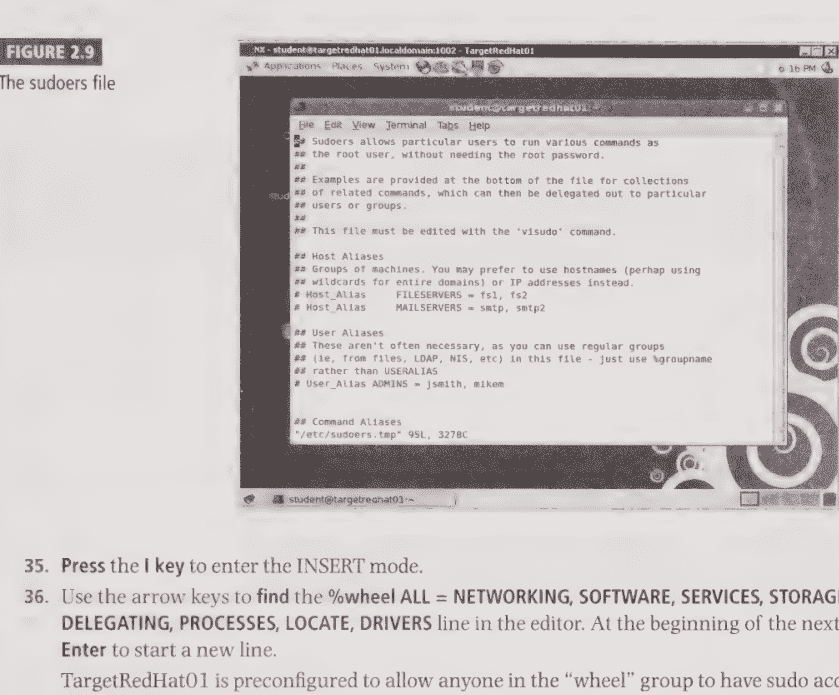

35. 按键 `I` 进入模式。

36. 使用方向键在编辑器中找到 `%wheel ALL = NETWORKING, SOFTWARE, SERVICES, STORAGE, DELEGATING, PROCESSES, LOCATES` 行。在下一行的开头按回车开始新行。

`TargetRedHat11` 已预配置，允许“wheel”组中的任何用户对此步骤列出的所有命令拥有 sudo 权限。

37. 使用方向键移动到空行，输入 `%web ALL = NETWORKING, SOFTWARE, SERVICES, STORAGE, DELEGATING, PROCESSES, LOCATES`。

此步骤创建了一个新组，该组将对此处列出的每个命令拥有 sudo 权限。


## 实验 #2 在 CentOS Linux 服务器上配置基本安全控制

38. 拍摄显示新 web 组的窗口并将其粘贴到新的文本文档中。

39. 按 `Esc` 键退出插入（INSERT）模式并按 `Shift + :` 返回命令行模式。窗口底部带有闪烁光标的冒号表示您正处于行模式。

40. 输入 `wq` 保存更改并退出 sudoers 文件。

> 注意：
> 后续步骤将通过对临时文件设置不可变权限来在此服务器上应用安全措施。不可变（immutable）标记可以防止文件被删除，即使是具有 root 权限权限的人也不行。

- 41. 在命令行提示符处，输入 `touch /tmp/mytest` 并按回车创建一个临时文件。
- 42. 输入 `lsattr /tmp/mytest` 并按回车列出文件属性，查看新文件的当前权限。
- 43. 输入 `su -c +i /tmp/mytest` 并按回车更改文件属性，并将不可变标记（i）添加到文件权限。
- 44. 当提示密码时，输入 `ISS3316Security`。
- 45. 输入 `lsattr /tmp/mytest` 并按回车列出文件属性，验证不可变标记是否已添加到文件权限。

结果将包含一个小写的 `i`（例如 `----i----`）。

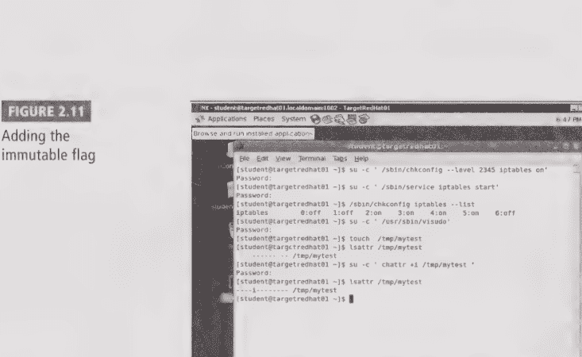

- 46. 拍摄显示不可变标记的窗口并将其粘贴到新的文本文档中。

> 注意：
> 后续步骤将通过授予特殊权限允许用户访问服务器的日志文件，在此服务器上应用安全措施。您将为 wheel 组分配访问控制列表（ACL）。

## 动手操作步骤

- 47. 输入 `su -c setfacl -m g:wheel:/var/log/messages` 并按回车为日志文件设置 ACL 权限。
- 48. 输入 `getfacl /var/log/messages` 并按回车获取日志文件的当前权限，并验证设置是否正确。wheel 组现在可以访问日志文件了。

图 2 在日志文件上设置 ACL 权限

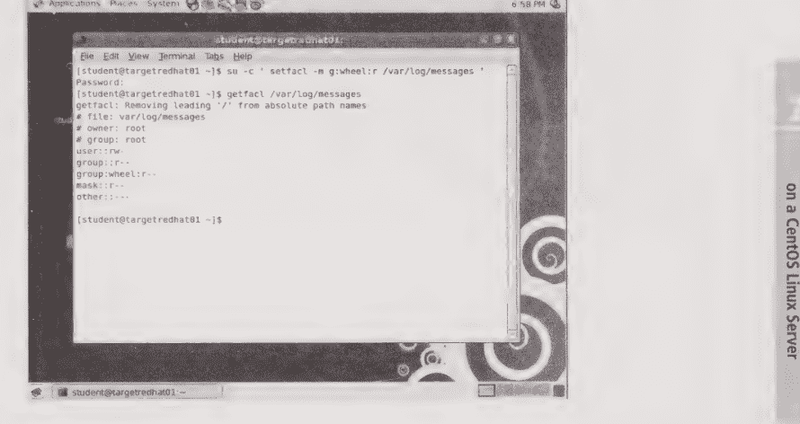

- 49. 拍摄显示日志文件的窗口并将其粘贴到新的文本文档中。
- 50. 关闭终端窗口。
- 51. 关闭 TargetHat11 窗口。
- 52. 点击断开（Disconnect）断开会话。
- 53. 关闭虚拟机（VM）。
- 54. 使用文件传输按钮将文件下载到本地计算机并作为交付成果的一部分提交。

## 评估标准和评分

- 1. 学生是否能够配置引导加载程序并将超时设置为 0，设置密码，以减轻对 GRUB 序列的篡改？[10%]
- 2. 学生是否能够通过查看配置文件和使用 `getstatus` 验证 CentOS Linux 上的 SELux 模式？[10%]
- 3. 学生是否能够创建用户账户并将其添加到组，以便管理整个系统的权限并应用访问控制？[20%]
- 4. 学生是否能够配置具有限制 sudo 权限（需要密码）的用户组，以记录并适当监控跨系统的访问？[20%]
- 5. 学生是否能够为运行级别 2 到 5 将 iptables 设置为“开启”，以启用内部基于主机的防火墙？[20%]
- 6. 学生是否能够为用户访问文件设置限制和权限？[20%]

## 在 CentOS Linux 服务器上配置基本安全控制

概述：

在实验中，你练习了如何安全服务器系统。你执行了安全引导加载程序、启用 iptables 以及运行 SELinux 以锁定系统。你还对目录和文件应用了 ACL 以安全访问，并检查了这些 ACL 和权限。

实验评估问答

- 1. 什么是 GRUB？为什么锁定它非常重要？
- 2. 讨论授予 sudo 权限的目的是。为什么不以 root 用户身份登录是一个好主意？
- 3. 如果文件设置了不可变标记，它提供哪些安全控制？
- 4. 人是否可以使用 `vi` 编辑组？
- 5. 提示符中的哪些视觉线索可以判断你正以 root 用户身份登录？
- 6. 什么是 iptables？它如何帮助加固 Linux 服务器？
- 7. 为什么在 CentOS Linux 服务器上配置并启用 iptables 是重要的？
- 8. `setfacl` 和 `getfacl` 之间有什么区别？`setfacl` 如何帮助实现安全加固？


## 应用强化用户账户管理与安全控制

## 引言

本实验是之前实验的扩展。在本实验中，你将通过安全的密码策略定义应用强化用户账户。你还将创建临时用户账户并在 90 天后自动删除账户和密码。

## 学习目标

完成本实验后，你将能够：

- 通过编辑 `/etc/login.defs` 文件并在 CentOS Linux 服务器上实施严格的安全措施来配置密码策略。
- 强制所有用户每 60 天更改一次密码，并在密码过期前 14 天显示警告。
- 配置最小长度为 8 个字符且具有严格复杂度要求的密码。
- 创建具有适当权限和限制的用户组，以实施基于角色的访问控制。
- 创建在 90 天后过期的临时用户账户，以便对承包和临时员工/顾问实施正确的最小权限原则。

## 交付物

在完成此实验后，你需要向讲师提供以下交付物：

- 1. 一份包含以下内容的的文本文档：
  a. 你对 `login.defs` 文件的修改；
  b. `groups` 命令的输出；
  c. 你对 `jtemp` 用户账户修改的输出；
  d. 修改后的 `pam.d/su` 文件的输出；
- 2. 实验 #3 的实验评估问题与答案。

### 动手步骤

- 1. 本实验从 VSCL 的学生登录页 vWorkstation 虚拟机桌面开始，如图所示。

图 3.1

“学生登录” VSCL 工作站

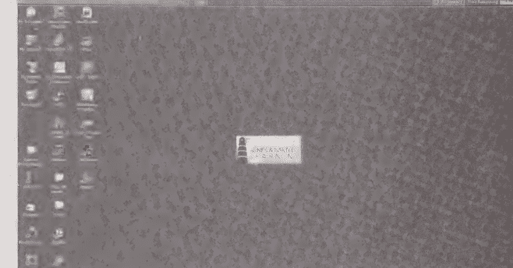

- 2. 双击桌面上的 `ISSA_VM Server Farm_RDP` 图标。该文件夹包含此实验环境中虚拟服务器的链接。
- 3. 双击 `TargetRedHat01` 文件以打开 Linux 服务器。

图 3.2

打开到 TargetRedHat01 服务器的远程桌面连接

## 应用强化的用户账户管理和安全控制

## 实验 #3 | 应用强化的用户账户管理和安全控制

- 4. 使用以下凭据登录 TargetRedHat01 服务器：
  * 用户名：`student`
  * 密码：`ISS5316Security`

将显示 GNOME 桌面，这是虚拟 Linux 服务器的图形用户界面 (GUI)。

### 图 3.3

GNOME 桌面


> 注意：
> 下一步将通过根据策略定义配置严格的密码，对此服务器应用安全措施。你将在 VI 编辑器中编辑 `login.defs (login.defs)` 文件。

- 5. 双击 GNOME 桌面上的终端图标，以打开终端模拟器并访问 Linux 服务器命令行。
- 6. 在命令提示符处，输入 `su -c ' /etc/login.defs '` 并按回车将 GRUB 配置文件加载到 VI 编辑器。

### 动手步骤

- 7. 当提示密码时，输入 `ISS3165security`。


`login.defs` 文件出现在 VI 编辑器窗口中。

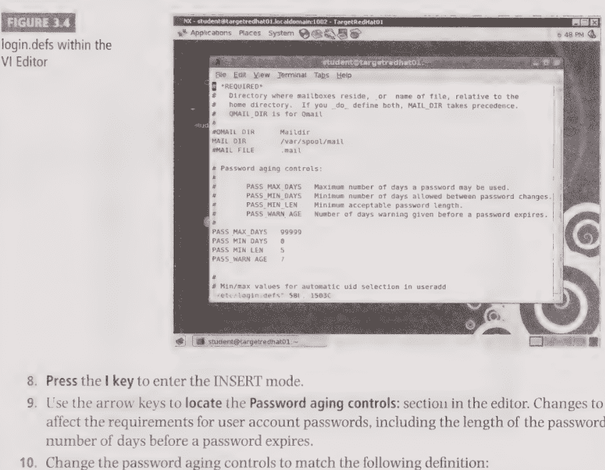

```
### vi student@targethdat.login.com (editor) -root
Applications Places System
vi Edit View Terminal Tab Help
### Security:
# 邮箱箱所在的目录，或相对于主
# 目录的文件名。如果都定义了，则 MAIL_DIR 优先。
MAIL_DIR is for Email
### EMAIL_DIR Maildir:
MA_DIR /var/spool/mail
MA_FILE
### 密码过期控制:
### PASS_DAYS 密码可以使用的最大天数。
### PASS_MIN 密码更改之间允许的最小天数。
### PASS_LEN 密码的最小长度。
### PASS_WARN_AGE 密码过期前给予的天数。
PASS_DAYS 99999
PASS_MIN_DAYS 0
PASS_LEN 8
PASS_WARN_AGE 14
```

- 8. 按 `I` 键进入插入（INSERT）模式。

- 9. 使用方向键定位到编辑器中的密码过期控制（Password aging controls）部分。对该部分的更改将影响用户账户密码的要求，包括密码长度和密码过期前的天数。

- 10. 将密码过期控制更改为符合以下定义：

  - `PASS_MAX_DAYS` 60

  - `PASS_MIN_DAYS` 0

  - `PASS_LEN` 8

  - `PASS_WARN_AGE` 14

- 11. 对显示你更改的 VI 编辑器窗口截图，并粘贴到新的文本文档中。

> 注意：
>
> 要截取屏幕，同时按下 `Ctrl` 和 `PrSc` 键，然后使用 `Ctrl + V` 将图像粘贴到 Word或其他文字处理文档中。

- 12. 按 `Esc` 键退出插入模式，并按 `Shift + :` 返回命令行模式。

窗口底部带有闪烁光标的冒号表示你正处于命令行模式。

- 13. 输入 `w` 保存你的更改并退出 VI 编辑器。

> 注意：
>
> 下一步将通过使用 `useradd` 命令创建几个新用户账户并为其中一个账户设置初始密码，对服务器应用安全措施，然后要求在首次登录尝试时更改密码。你还将创建两个新组，将新用户添加到这些组中，并验证学生用户账户属于哪些组。

- 14. 在命令提示符处，输入 `su -c '/usr/sbin/useradd dbadmin1'` 并按**回车** 创建一个新的数据库管理员用户账户 (`dbadmin1`)。

- 15. 创建新用户账户需要 root 权限，因此在提示密码时**输入 `ISS5316Security`**。

- 16. 重复步骤 14-15，添加以下用户：

  - `dbadmin2`

  - `webadmin1`

  - `webadmin2`

### 图 3.5

创建用户账户

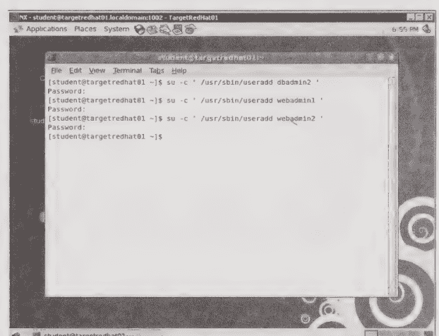

- 17. 在命令提示符处，输入 `su -c passwd dbadmin1` 为你创建的 `dbadmin1` 账户设置密码。

- 18. 设置账户密码需要 root 权限，因此在提示密码时输入 `ISS16Security`。

- 19. 在提示新密码时，输入 `lab3` 并按**回车**。

系统将显示密码较弱，但由于你拥有 root 权限，仍然可以设置密码。

- 20. 当提示重新输入该账户密码时，输入 `lab3` 并按**回车**。

### 图 3.6

设置用户密码

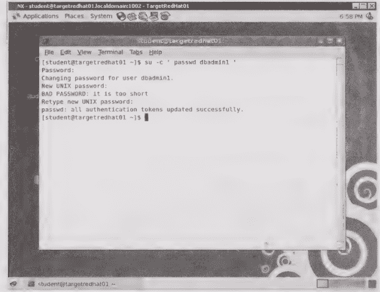

### 动手步骤

- 21. 在命令提示符处，输入 `su -c 'chage -d dbadmin1'` 强制你设置的密码在下次登录时更改。

- 22. 此命令需要 root 权限，因此在提示密码时输入 `ISS316Security`。

- 23. 在命令提示符处，输入 `su -c '/usr/sbin/groupadd dba'` 创建一个名为 `dba` 的新组（数据库管理员）。

- 24. 此命令需要 root 权限，因此在提示密码时输入 `ISS316Security`。

- 25. 重复步骤 23-24，创建一个名为 `web` 的新组。

### 图 3.7

创建新组账户

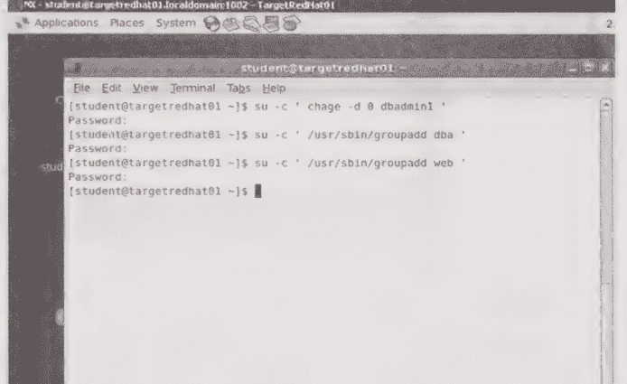

- 26. 在命令提示符处，输入 `su -c '/usr/sbin/usermod -g dba dbadmin1'` 将 `dbadmin1` 用户账户添加到 `dba` 组。

- 27. 此命令需要 root 权限，因此在提示密码时输入 `ISS316Security`。

- 28. 重复步骤 26-27，将 `dbadmin2` 用户账户添加到 `dba` 组。

- 29. 在命令提示符处，输入 `su -c '/usr/sbin/usermod -g web webadmin1'` 将 `webadmin1` 用户账户添加到 `web` 组。

- 30. 此命令需要 root 权限，因此在提示密码时输入 `ISS316Security`。

## 实验 #3 | 应用强化的管理和安全控制

- 31. 重复步骤 29-30，将 `webadmin2` 用户账户添加到 `web` 组。

### 图 3.8

将用户账户添加到组账户

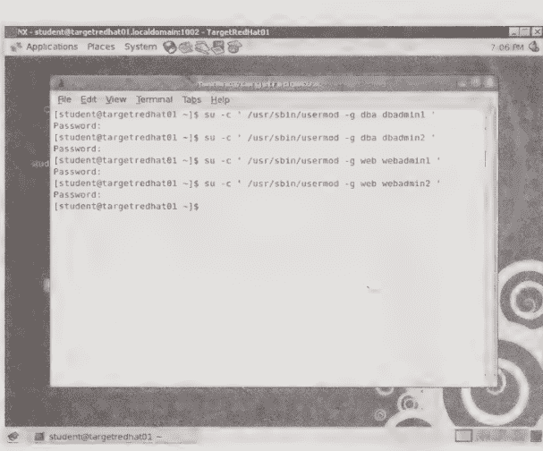

- 32. 在命令提示符处，**输入 `groups`** 并**按回车**。

此命令将显示登录用户 (`student`) 成员的所有组。在本实验中，`student` 账户被预配置为 `wheel` 组（包含 root 级别的 sudo 命令）和 `student` 组（由 CentOS 自动创建）。当创建新用户账户时，CentOS 和其他基于 Red Hat 的 Linux 发行版创建一个同名的组。

### 图 3.9

`groups` 命令的输出

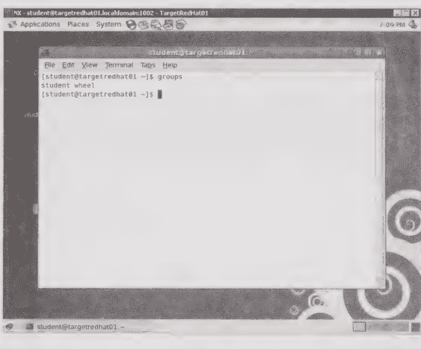

### 动手步骤

- 33. 对 `groups` 命令的输出截图，并记录任何意外结果。将其粘贴到你的文档中。

> 注意：
>
> 下一步将通过创建 90 天后自动过期的临时用户账户对服务器应用安全措施。这种账户在聘用承包或其他需要临时访问网络的企业中很常见。

- 34. 在终端命令提示符处，输入 `su -c /usr/sbin/useradd jtemp` 并按回车创建一个新的数据库管理员 (`jtemp`)。

- 35. 创建新用户账户需要 root 权限，因此在提示密码时输入 `ISS5316Security`。

- 36. 在命令提示符处，输入 `su -c 'passwd jtemp'` 并按回车为你创建的 `jtemp` 用户账户设置密码。

- 37. 设置用户账户需要 root 权限，因此在提示密码时输入 `ISS5316Security`。

- 38. 在提示新密码时，输入 `tempab3` 并按回车。

系统将显示密码较弱的警告，但像你现在这样拥有 root 权限，它仍然可以设置密码。

- 39. 在提示重新输入密码时，输入 `tempab3` 并按回车。

- 40. 在命令提示符处，输入 `su -c 'chage -d 0 jtemp'` 并按回车强制 `jtemp` 用户在下次登录时更改密码。

- 41. 此命令需要 root 权限，因此在提示密码时输入 `ISS5316Security`。

- 42. 在命令提示符处，输入 `su -c 'chage -e date'` 并按回车，强制 `jtemp` 用户在指定的日期更改你设置的密码。

对于此命令，日期应以 `YYYY-MM-DD` 格式输入。对于本实验，请将命令行中的日期替换为你执行此任务 90 天后的实际日期。

- 43. 此命令需要 root 权限，因此在提示密码时输入 `ISS5316Security`。

- 44. 在命令提示符处，输入 `su -c 'chage -l jtemp'` 并按回车查看 `jtemp` 用户账户的密码设置。

- 45. 此命令需要 root 权限，因此在提示密码时输入 `ISS5316Security`。

### 图 3.10

`jtemp` 用户账户配置的输出

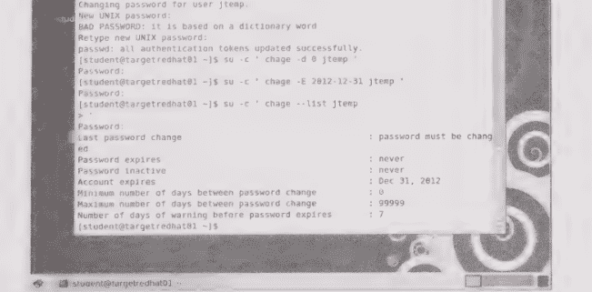

- 46. 对终端窗口进行截屏，显示用于配置 `jtemp` 账户的命令字符串。将其粘贴到你的文本文档中。

> 注意：
>
> 接下来的步骤将通过限制 `su` 命令的使用对此服务器应用安全措施，该命令授予用户 root 级访问权限。你将编辑 `pam.d` 文件来限制使用 `su` 命令的 `wheel` 组。


47. 在命令行提示符处，输入 `su -c vi /etc/pam.d/su` 以编辑可插拔认证模块文件中 `su` 命令的访问权限。

`pam.d` 文件将在 VI 编辑器中打开。

48. 这需要 root 权限，在提示输入密码时输入 `su ISS316Security`。

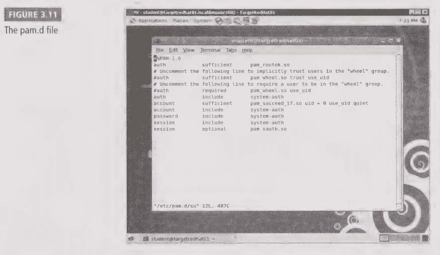

49. 按 `I` 键进入插入（INSERT）模式。

50. 使用方向键在编辑器中定位到 `#auth required pam_wheel.so` 这一行。

### 动手步骤

- 51. 将该行开头的井号（#）替换为 `x`，使整行内容现在变为 `xauth required pam_wheel.so_use_uid`。

此操作将从授权使用该命令的用户中移除 wheel 组。

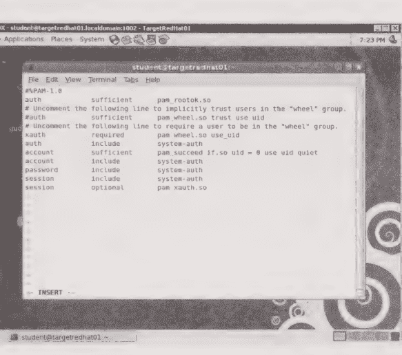

- 52. 按 `Esc` 键退出插入模式，并按 `Shift + :` 返回命令行模式。窗口底部带有闪烁光标的冒号表示你正处于命令行模式。

- 53. 输入 `:wq` 保存更改并退出 `sudoers` 文件。

- 54. 关闭终端窗口。

- 55. 关闭 `TargetRedHat01` 窗口。

- 56. 在提示断开会话时点击“断开”（Disconnect）。

- 57. 关闭 ISSA、VM Server Farm、RDP 文件夹。

- 58. 使用文件传输（File Transfer）按钮将文本文件下载到本地计算机，并作为交付物之一提交。

## 评估标准与评分量表

以下学生必须完成的实验 #3 的评估标准和评分量表：

- 1. 学生是否能够通过编辑 `/etc/login.defs` 文件并在 CentOS Linux 服务器上实施严格的密码安全措施来配置密码策略？ – [20%]
- 2. 学生是否能够强制所有用户每 60 天更改一次密码，并在密码过期前 14 天显示警告？ – [20%]
- 3. 学生是否能够配置最小长度为 8 个字符且具有严格复杂性要求的密码？ – [20%]
- 4. 学生是否能够创建具有适当权限和限制的用户和组，以实施基于角色的访问控制？ – [20%]
- 5. 学生是否能够创建一个在 90 天后过期的临时用户账户，以对承包商和临时工人员/顾问执行适当的最小权限原则？ – [20%]

## 应用加固的用户账户管理和安全控制

| 课程名称和编号: |  |
| :--- | :--- |
| 学生姓名: |  |
| 导师姓名: |  |
| 实验截止日期: |  |

### 概述

本实验是之前实验的扩展。在实验中，你通过安全的密码策略定义对用户账户进行了安全加固。你还创建了临时用户账户，并应用了 90 天后自动删除账户和密码。

### 实验评估问题与答案

- 1. 创建组并将用户添加到组的意义是什么？请解释。
- 2. 鉴于一种场景，有五个（5）位数据库管理员可能定期需要访问特定系统，请讨论一种更好地管理这些管理员访问权限的概念。
- 3. 在这种情况下，webadmin1 账户如何限制 `su` 命令的访问权限？
- 4. 在可插拔认证模块文件中，如何限制 `su` 命令的使用？
- 5. `pam.d` 文件的作用是什么？
- 6. `login.defs` 中的 `PASS_MIN_DAYS` 设置对 wheel 组有什么影响？
- 7. `login.defs` 中的 `PASS_MAX`、`PASS_WARN` 和 `PASS_AGE` 设置有什么影响？
- 8. `/etc/login.defs` 文件的设置是什么？

## 应用加固的文件系统安全控制

## 实验 #4

### 简介

本实验是之前实验的扩展。在本实验中，你通过安全的密码策略定义对用户账户进行了安全加固。你还创建了临时用户账户，并应用了 90 天后自动删除账户和密码。

## 学习目标

完成本实验后，你将能够：

- 对文件系统进行安全加固。
- 在系统启动时设置磁盘配额。
- 修改 `/etc/fstab` 文件以管理磁盘。
- 使用 `repquota` 命令验证磁盘使用情况。

| 使用的工具和软件 | 名称 | 信息 |
| :--- | :--- | :--- |
| 无 |  |  |

## 交付物

完成实验后，你需要向导师提供以下交付物：

- 1. 包含以下截图的文本文档：
   a. 修改后的 `fstab` 截图：
   b. `test.doc` 文件的结果：
   c. `test.txt` 文件的结果：
   d. `test.file` 的输出：
   e. 磁盘配额报告：
- 2. 实验评估问题与答案。

### 动手步骤

- 1. 本实验从所示学生虚拟机桌面开始。

图 4.1 “学生登录” VSCL 工作站

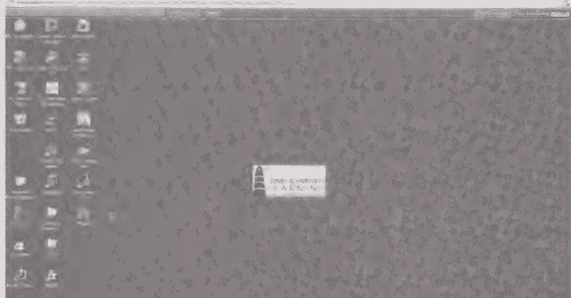

- 2. 双击桌面上的 ISSA VM Server Farm 图标。该文件夹包含实验中虚拟服务器的链接。

- 3. 双击 TargetRedHat01 文件以打开 Linux 服务器。

图 4.2 连接到 TargetRedHat01 服务器的远程桌面

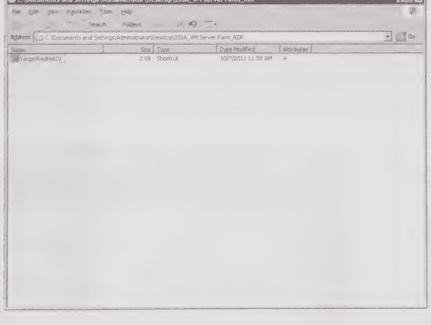

## 实验 #4 | 文件系统

- 4. 使用以下凭据登录 TargetRedHat01 服务器：
  * 用户名：`student`
  * 密码：`ISS356Security`

GNOME 桌面（虚拟 Linux 服务器的图形用户界面 GUI）已显示。

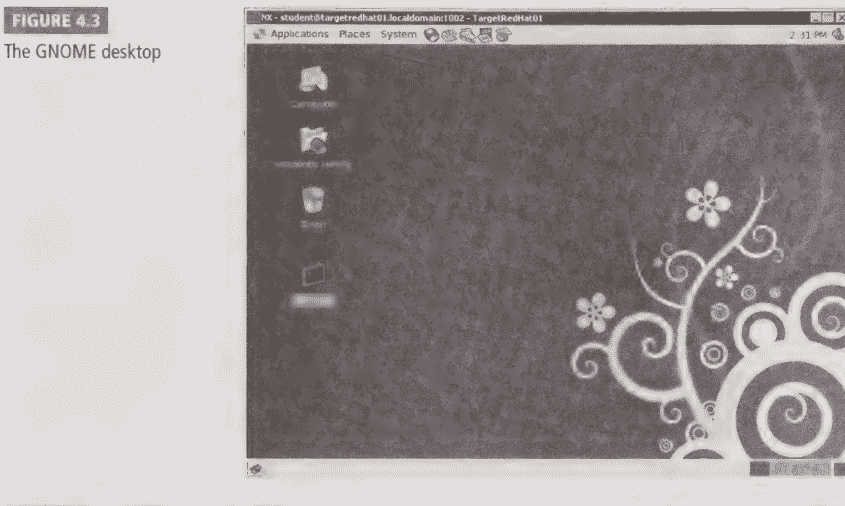

> 注意：
> 接下来的步骤将通过以只读权限挂载文件系统对此服务器应用安全措施。你将修改 `fstab` 文件并进行多次测试以确保更改有效。

- 5. 双击 GNOME 桌面上的终端图标打开终端模拟器并访问 Linux 服务器命令行。

- 6. 在命令行提示符处，输入 `su -c '/etc/fstab '` 并按回车键将 fstab 文件加载到 VI 编辑器。

- 7. 在提示输入密码时，输入 `ISS356Security`。

`fstab` 文件在 VI 编辑器中打开。

### 操作步骤

8. **按下按键**进入文件中的插入（INSERT）模式：

9. 使用方向键**定位**到以下行：

`ext3 loop.defaults 00`

- `* /virtualimages/disk/rimage.img /archives` 

- 将光标立即移动到默认单词之后，并输入 **,ro** 以允许只读权限。

10. 移动光标修改 `fstab` 文件。


11. 对 VI 编辑器窗口进行**屏幕截图**，显示你的更改，并将其**粘贴**到新文档中。

> 注意：
> 若要截屏，请同时按下 **Ctrl** 和 **PrtSc** 键，然后使用 **Ctrl + V** 将图像粘贴到 Word或其他文字处理器文档中。

12. 按下 **Esc** 退出插入模式，并**按下 Shift :** 返回命令行模式。

窗口底部带有闪烁光标的冒号表示你正处于命令模式。

13. 输入 **wq** 并**按下 Enter** 保存你的更改并退出 VI 编辑器。

14. 在命令提示符下，输入 **su -c 'mount or remount /archives/'** 并**按下 Enter**，在修改 `fstab` 文件后重新挂载 archives 分区。

15. 此命令需要 root 权限，因此在提示输入密码时**输入 ISS5316Security**。

16. 在命令提示符下，**输入 cd /archives/2011** 并**按下 Enter** 切换目录。

注意命令提示符显示目录已更改。

17. 在命令提示符下，输入 `ls -is` 并按 Enter 列出此目录下的文件，并检查当前应用到每个文件的权限。


18. 在命令提示符下，输入 `su -c 'vi revenue.doc'` 并按 Enter 在 VI 中打开 `revenue.doc` 文件。

19. 此命令需要 root 权限，因此在提示输入密码时输入 `ISS316Security`。

20. 按 `I` 键进入插入模式。

编辑器底部的状态行显示文件为只读。


21. 对 VI 编辑器窗口进行屏幕截图，显示只读指示，并将其粘贴到你的文本文档中。

22. 按 `Esc` 键退出插入模式，并按 `Shift + :` 返回命令行模式。

窗口底部带有闪烁光标的冒号表示你正处于命令行模式。

### 练习步骤


23. 输入 `q` 并按 Enter 退出 VI 编辑器。

24. 在命令提示符下，输入 `su -c 'touch test.txt'` 并按 Enter 在此目录下创建新文件。

你不应该看到类似“cannot 'test.txt’”的错误消息，这表示该系统是只读的。

图 4.8

在只读目录中创建新文件


25. 对终端窗口进行屏幕截图显示错误消息，并将其粘贴到你的文本文档中。

> 注意：
> 
> 后续步骤将通过在文件系统分区上设置用户账户配额来对此服务器实施安全措施。配额可以作为磁盘管理工具，限制特定用户可以写入的磁盘空间。

26. 在命令提示符下，输入 `su -c 'vi' /etc/fstab` 并按 Enter 重新打开 `fstab` 文件。

27. 此命令需要 root 权限，因此在提示输入密码时输入 `ISS5316Security`。

28. 按 `I` 键进入插入模式。

29. 使用方向键定位文件中以下行：
- `* /virt/images/disk/rimage.img /common ext3 loop,defaults 0`

## 实验 4 | 应用加固 Linux 系统控制

30. 将光标移动到 `defaults` 之后，输入 `usrquota` 以应用配额。


31. 按 `Esc` 键退出插入模式，并按 `Shift + :` 返回命令行模式。

窗口底部带有闪烁光标的冒号表示你正处于命令行模式。

32. 输入 `:wq` 保存你的更改并退出 VI 编辑器。

33. 在终端提示符下，输入 `su -c 'umount /common/'` 并按 Enter 释放文件系统。

34. 此命令需要 root 权限，在提示输入密码时输入 `ISS316Security`。

35. 在命令提示符下，输入 `su -c '/sbin/mkfs -f ext3 /var/images/disk/rimage.img/'` 并按 Enter 创建一个新的 `ext3` 文件系统。

36. 此命令需要 root 权限，在提示输入密码时输入 `ISS316Security`。

37. 在命令提示符下，输入 `su -c 'mount /common/'` 并按 Enter 挂载 `common` 分区。

38. 此命令需要 root 权限，在提示输入密码时输入 `ISS316Security`。

39. 在命令提示符下，输入 `su -c '/sbin/quotacheck -cg /common/'` 并按 Enter 初始化配额数据库。

40. 此命令需要 root 权限，在提示输入密码时输入 `ISS316Security`。

41. 在命令提示符下，输入 `su -c '/sbin/quotaon /common/'` 并按 Enter 开启配额。

42. 此命令需要 root 权限，在提示输入密码时输入 `ISS5316Security`。

43. 在命令提示符下，输入 `su -c '/usr/sbin/edquota -f /common/'` 并按 Enter 打开用户配额设置。

44. 此命令需要 root 权限，在提示输入密码时输入 `ISS316Security`。

45. 按 `I` 键进入插入模式。

46. 使用方向键在文件中定位到用户 `student` (`uid 500`) 的磁盘配额部分，并将 `/dev/loop` 行更改为以下限制：
- 第一列软限制（soft column）：`30`
- 第一列硬限制（hard column）：`100`

图 4.10

为学生账户设置配额


47. 按 `Esc` 键退出插入模式，并按 `Shift + :` 返回命令行模式。

窗口底部带有闪烁光标的冒号表示你正处于命令行模式。

48. 输入 `wq` 并按 Enter 保存你的更改并退出 VI 编辑器。

> 注意：
> 
> 接下来的步骤将通过几个测试场景来确保你的更改是有效的。

49. 在命令行提示符下，输入 `su -c 'mkdir /common/student && chmod student:student /common/student'` 创建名为 `student` 的新目录，并将该目录的所有者更改为 `student` 用户账户。

50. 此命令需要 root 权限，因此在提示输入密码时输入 `ISS531Security`。

51. 在命令提示符下，输入 `cd /common/student` 并按 Enter 切换目录。

注意命令提示符显示目录已更改。

## 实验 4 | 加固 Linux 文件系统控制

52. 在终端提示符下，输入 `dd if=/dev/urandom of=test.file bs=95476 count=1` 并按 Enter 创建一个约 100MB 的文件。

图 4.11

尝试创建超出配额的文件


53. 对终端窗口进行屏幕截图显示你的输出，并将其粘贴到你的文本文档中。

54. 在命令提示符下，输入 `su -c '/usr/sbin/repquota /common'` 查看已用配额报告。

55. 此命令需要 root 权限，在提示输入密码时输入 `ISS316Security`。

图 4.12

配额报告


56. 在命令提示符下，输入 `quota run` 显示 `student` 目录的配额报告。

57. 对终端窗口进行屏幕截图显示配额报告，并将其粘贴到你的文本文档中。

58. 关闭终端窗口。

59. 关闭 `TargetRedHat01` 窗口。

60. 在提示时点击 `Connect` 断开会话。

61. 关闭 `ISSA VM Server Farm, RDP folder`。

62. 使用文件传输将文本下载到本地计算机并提交。

## 评分标准和准则

以下是学生必须完成的实验 4 评分标准和准则：

1. 学生是否能够挂载没有执行权限的文件系统，以便安全地读取磁盘中包含的数据而不执行任何意外程序？—— [20%]
2. 学生是否能够挂载远程文件系统，并配置系统在启动时自动挂载网络共享？—— [20%]
3. 学生是否能够设置用户磁盘配额，以保护 Linux 系统的可用性和安全性，并防止用户占用所有磁盘空间？—— [20%]
4. 学生是否能够编辑和修改 `/etc/fstab` 文件以管理本地和远程 NFS 共享以及必要的挂载配置？—— [20%]
5. 学生是否能够配置并使用 `repquota` 命令来验证用户磁盘空间的使用情况并管理配额？—— [20%]

## 应用加固的 Linux 文件系统安全控制

| 课程名称和编号： | |
|---|---|
| 学生姓名: | |
| 导师姓名: | |
| 实验截止日期: | |

### 概述

本实验是之前实验的扩展。它包含了对文件系统和挂载文件系统的用户访问的安全加固。在本次实验中，你在 CentOS Linux 服务器上挂载了一个没有执行权限的文件系统。你还挂载了一个远程文件系统并为挂载文件系统的用户设置了配额。

### 实验评估问题与解答

1. 给出这样一个场景：Web 服务器需要访问位于局域网内另一台服务器上的 PDF 文档。这些文档仅供客户查看个人账户信息。哪种权限选项反映了这一情况：`/tmp`, `ext3`, `ro`, 或 `0`？

2. 描述为用户创建 2G 配额硬限制的过程。

________________________________________________________________________________________________________________________________________________________________________________________________________________________________

________________________________________________________________________________________________________________________________________________________________________________________________________________________________________________________________

3. 如何在文件系统上初始化配额？


### 4. 为什么收到“无法重新挂载已挂载的文件（cannot remount filesystem mounted）”的错误？

### 5. `/etc/fstab` 文件有什么用？

### 6. 什么是 `mount` 命令？请解释。

### 7. Linux 中的 `repquota` 命令用于什么？请解释。

## 为 Linux 服务和应用程序应用加固安全

## 引言

本实验是之前实验的扩展，包含了对 Linux 服务和应用程序的安全加固。在本次实验中，你将配置安全加固的服务，以确保这些服务的机密性、完整性和可用性。你将配置并保护 Apache Web 服务器和 MySQL 数据库，以及加固这两个实现所需的所需的组件。你还将配置 Sendmail 应用程序进行安全消息，并使用安全 Shell（SSH）启用加密远程访问。

## 学习目标

完成本实验后，你将能够：

- 在配置 Linux 服务时对其进行加固，并在配置过程中保持安全视角
- 执行基础安全配置，以在托管网站之前确保系统已加固
- 为 MySQL 数据库配置并执行基础安全防护，理解默认安装的影响，并为数据库实例建议加固步骤
- 为 Sendmail 设置并执行基础安全配置，以利用 Linux 系统的内置功能
- 启用并实现安全的 SSH，以便通过网络或跨 Linux 服务器进行加密远程访问

## 工具及所用软件

| 名称 | 更多信息 |
|---|---|
| 无 | |

## 交付物

完成本实验后，你需要向你的导师提供以下交付物：

- 1. 一份包含以下内容截图的文本文档：
    a. `my.cnf` 文件的输出；
    b. `httpd.conf` 文件的输出；
    c. `telnet` 连接的输出；
    d. `sshd_config` 文件的输出；
    e. 显示 MOTD 的 VI 编辑器；
    f. SSH 会话中显示的 MOTD 横幅；
- 2. 第 5 实验的评估与答案。

## 动手操作步骤

- 1. 本实验从 VSCL 的学生登录虚拟机桌面开始，如图所示。

图 5.1 “学生登录” VSCL


- 2. 双击桌面上的虚拟机服务器场（VM Server Farm）图标。该文件夹包含指向该环境中虚拟服务器的链接。

- 3. 双击 TargetHat01 文件打开 Linux 服务器。

图 5.2 打开到 TargetHat01 服务器的远程桌面连接

| 名称 | 大小 | 类型 | 修改日期 | 属性 |
|---|---|---|---|---|
| TargetHat01 | 2 KB | 文件夹 | 2013/10/27 11:03 AM | A |

- 4. 使用以下凭据登录 TargetHat01 服务器：
    - 用户名: `student`
    - 密码: `Security16`

显示虚拟 Linux 服务器的图形用户界面（GUI）GNOME 桌面。


注意：后续步骤将通过修改 `my.cnf` 配置文件为 MySQL 数据库应用程序应用安全措施。你将添加 `skip-networking` 以防止远程访问数据库，并禁止加载本地数据文件。你还将配置数据库在运行级别 3 下自动启动，并设置 MySQL root 密码。

- 5. 双击 GNOME 桌面上的终端图标打开终端模拟器并访问 Linux 服务器命令行。

- 6. 在命令提示符处输入 `sudo /bin/service mysql status` 并按回车检查 MySQL 服务的状态。


### 图 5.4 使用 sudo 命令检查服务状态


- 7. 提示密码时输入 `Security16`。系统返回失败状态，表示 MySQL 服务未运行。
- 8. 在命令提示符处输入 `sudo vi /etc/my.cnf` 并按回车用 VI 编辑器打开配置文件。
- 9. 提示密码时输入 `Security16`。
- 10. 按 `I` 键进入插入模式。
- 11. 使用方向键找到文件中以下行：
    * `symbolic-links=0`
    * `#skip-networking`
- 12. 将光标移动到行首并删除 `#` 符号。

### 图 5.5 修改 my.cnf 文件


- 13. 截图 VI 编辑窗口并粘贴到新的文本文档中。

注意：要捕捉屏幕，请同时按下 `Ctrl` 和 `PrtSc` 键，然后使用 `Ctrl + V` 将图像粘贴到 Word 或其他文字处理文档中。

- 14. 按 `Esc` 键退出插入模式并按 `Shift + :` 返回命令行模式。窗口底部带有闪烁的光标表示你正处于命令行模式。
- 15. 输入 `wq` 并按回车保存更改并退出 VI 编辑器。
- 16. 在命令提示符处输入 `sudo /sbin/chkconfig --level 3 mysql on` 并按回车，使数据库在运行级别 3 下自动启动。
- 17. 在命令提示符处输入 `sudo /sbin/chkconfig --list` 并按回车查看 MySQL 运行级别设置，验证服务在运行级别 3 已开启。虽然 `sudo` 命令通常需要密码，但在同一会话（如此实例）中重复使用 `sudo` 不需要再次输入密码。

### 图 5.6 MySQL 运行级别设置


- 18. 在命令提示符处输入 `sudo /sbin/service mysql start` 并按回车启动数据库服务器。系统返回 OK 标志，表示 MySQL 服务正在启动。注意服务在没有数据库密码的情况下启动了。

### 实践步骤

19. 在命令提示符下，输入 `mysql -u root -p` 并按回车进入 MySQL 环境。
20. 在密码提示符处，直接按回车而不输入密码。

注意，命令提示符已变为 `mysql>`。默认情况下，数据库 root 用户不需要密码，这可能会带来严重的安全风险。你可以通过为 MySQL 服务器设置 root 密码来加固安全性。

### 图 5.7

在 MySQL 控制台中操作


```
student@targetredhat01:~$ sudo /usr/bin/mysql --list
[student@targetredhat01 ~]$ mysql -u root -p
student@targetredhat01:~$ /usr/bin/mysql start
student@targetredhat01:~$ mysql -u root -p
password: 
Welcome to the MySQL monitor. Commands end with ; or ;
Your connection id is 1.
Server version: 5.5.15 MySQL Community Server (GPL)

Copyright (2000-2018, Oracle and/or its affiliates). All rights reserved.
Oracle is a registered trademark of Oracle Corporation and/or affiliates. Other names may be trademarks of/or their respective.
Type 'help' or 'h' for help. Type 'c' to clear the current input statement
mysql> _
```

21. 在命令提示符下，输入 `SET PASSWORD FOR root@localhost=PASSWORD('ISS316Security');` 并按回车设置 MySQL root 密码。

### 图 5.8

设置 MySQL root 密码


```
student@targetredhat01:~$ mysql -u root -p
password: 
Welcome to the MySQL monitor. Commands end with ; or ;
Your connection id is 2.
Server version: 5.5.15 MySQL Community Server (GPL)

Copyright (2000-2018, Oracle and/or its affiliates). All rights reserved.
Oracle is a registered trademark of Oracle Corporation and/or affiliates. Other names may be trademarks of/or their respective.
Type 'help' or 'h' for help. Type 'c' to clear the current input statement
mysql> SET PASSWORD FOR root@localhost=PASSWORD('ISS316Security');
Query OK, 0 rows affected (0 sec)
mysql> _
```

22. 在命令提示符下，输入 `quit`；以退出 MySQL 环境并返回 TargetRedHat01 命令提示符。

> 注意：接下来的步骤将通过修改 Apache Web 服务配置文件 (`http.conf`) 来加固此服务器的安全措施。你将首先设置服务在运行级别 `runlevel 3` 下自动启动，禁用默认的 HTTP Trace 连接方法并验证你的更改。

23. 在命令提示符下，输入 `sudo /bin/chkconfig --level 3 httpd` 并按回车，设置 Web 服务在运行级别 3 下自动启动。
24. 在命令提示符下，输入 `sudo /bin/service httpd start` 并按回车以启动 `httpd` 服务。系统返回 OK 标志，表示 `httpd` 服务正在启动。

### 图 5.9

`httpd` 运行级别设置


25. 在命令提示符下，输入 `su -c 'vi +82 /etc/httpd/conf/httpd.conf '` 并按回车以在 VI 编辑器中打开 `httpd.conf` 文件。
26. 在提示密码时，输入 `ISS316Security.`
27. 按 `I` 键进入插入模式。
28. 使用方向键找到文件中的以下行：
    * `#Trace off`

### 实践步骤

29. 光标移动到行首删除 `#` 符号以禁用 Trace 方法。该方法可能会泄露比必要的更多的服务器信息并构成安全风险。

### 图 5.10

禁用 Trace 方法


```
### For him line KeepAlive tight
### 每个连接允许一个请求。设置为 "Off" 以禁用。
KeepAlive Off

### MaxAliveRequests: 持久连接期间允许的最大请求数。
### 设置为 8 以允许无限数量。
### 我们建议将此数值调高以获得最大性能。
MaxAliveRequests 100
dis active we don't like
traceoff

### KeepAliveTimeout: 等待来自同一连接上下一个请求的秒数
KeepAliveTimeout 15

### Server-Pool Size Regulation (MPM specific)
INSERT
```

30. 对 VI 编辑器窗口进行截图并粘贴到你的文本文档中。
31. 按 `Esc` 键退出插入模式并按 `Shift + :` 返回命令行模式。带有冒号的光闪光标表示你正处于命令模式。
32. 在命令提示符下，输入 `:wq` 保存并退出。
33. 在命令提示符下，输入 `sudo /bin/service httpd restart` 并按回车重启服务。


34. 在命令提示符下，输入 `curl -X TR http://localhost` 以验证 Trace 方法是否已禁用。如果返回 `405 Method Not Allowed`，则配置成功。

## 实验 #5 | Linux 服务与应用程序的安全加固

52. 将光标移动到行首，并删除存在的 `#` 符号，同时进行以下更改：
- `PermitRootLogin no`（此设置禁用了 root 用户的登录权限）。
- `PasswordAuthentication no`（此设置禁用了密码登录）。
- `UsePam no`（此设置禁用了可插认证模块）。
- `Banner /etc/motd`（此设置向所有尝试登录的用户显示 MOTD 警告信息）。

图 5.13

修改 `sshd_config` 文件


53. 对显示更改的 VI 编辑器窗口进行截图，并将其粘贴到你的文本文档中。注意，你可能需要多张截图才能显示所有的更改。

### 在线步骤

54. 按 `Esc` 键退出插入模式（INSERT mode），并按 `Shift + :` 返回命令行模式。窗口底部带有闪烁光标的冒号表示你正处于命令行模式。

55. 输入 `wq` 并按回车键保存更改并退出 VI 编辑器。

56. 在命令提示符下，输入 `su -c /etc/motd` 并按回车键用 VI 编辑器打开 MOTD（每日消息）横幅文件。

57. 当提示密码时，输入 `ISS316Security`。

58. 按 `i` 键进入插入模式。

59. 使用方向键将光标移动到第一行的开头，输入 `PROPERTY OF FIRST WORLD BANK SAVINGS AND LOAN. AUTHORIZED USERS ONLY!`。

60. 对显示更改的 VI 编辑器进行截图，并将其粘贴到你的文本文档中。

#### 图 5.14

修改 `motd` 文件


61. 按 `Esc` 键退出插入模式，并按 `Shift + :` 返回命令行模式。窗口底部带有闪烁光标的冒号表示你正处于命令行模式。

62. 输入 `wq` 并按回车键保存更改并退出 VI 编辑器。

63. 在命令提示符下，输入 `sudo /sbin/service sshd status` 并按回车键检查打开的 SSH 器的状态。

64. 此命令需要 root 权限，因此在提示密码时输入 `ISS316Security`。系统将返回一个指示表示 `openssh-daemon` 正在运行。

65. 在命令提示符下，输入 `sudo /sbin/service sshd reload` 并按回车键重新加载打开的 SSH 配置文件并使更改生效。系统会返回 OK 标志，表示 SSH 服务正在重新加载。

## 实验 #5 | Linux 服务与应用程序的安全加固

66. 在命令提示符下，输入 `ssh localhost` 并按回车键建立到本地的 SSH 连接。

系统返回一个错误，表示无法建立连接。

67. 当提示继续连接时，输入 `yes` 并按回车键。

SSH 服务器将拒绝访问，因为没有使用密钥，这表明你对 `PasswordAuthentication` 行的更改配置正确。


68. 对显示每日消息横幅的终端窗口截图，并将其粘贴到你的文本文档中。

69. 关闭终端窗口。

70. 关闭 TargetRedHat01 窗口。

71. 在提示断开会话时点击断开（Disconnect）。

72. 关闭 ISSA_VM Server Farm_RDP 文件夹。

73. 使用文件传输（File Transfer）按钮将文件下载到本地计算机并作为交付提交。

## 评估标准

以下是学生必须完成的实验 #5 评估标准和评分：

1. 学生是否能够在配置过程中对 Linux 服务进行安全加固？—— [20%]
2. 学生是否能够在托管网站之前对系统进行基础安全配置加固？—— [20%]
3. 学生是否能够理解默认安装的后果并对数据库进行基础安全配置？—— [20%]
4. 学生是否能够利用系统的内置功能对 Sendmail 设置并基础安全配置？—— [20%]
5. 学生是否能够通过网络或跨互联网启用并实现 SSH 加密访问？—— [20%]

## Linux 服务与应用程序的安全加固

| 课程名称和编号: |  |
| 学生姓名: |  |
| 教师姓名: |  |
| 截止日期: |  |

### 概述

本实验是之前实验的扩展，包含了物理服务器上加载的 Linux 服务和应用程序的安全加固。在本实验中，你配置了安全并加固了服务和应用程序，以确保这些服务的机密性和可用性。你配置了 Apache Web 服务器、MySQL 数据库以及安全实现两者所需的必要组件。你还配置了 Sendmail 。

## 实验 #6 | 应用加固安全以控制访问

- 4. 使用以下凭据登录 TargetRedHat01 服务器：
  - 用户名：`student`
  - 密码：`ISS5316Security`

将显示 GNOME 桌面，这是虚拟 Linux 服务器的图形用户界面 (GUI)。


> 注意：

接下来的步骤将通过配置严格的允许和拒绝规则集，为 LINUX 主机 IP 防火墙应用安全措施。你将向 INPUT、OUTPUT 和 FORWARD 链添加规则以允许 HTTP、ICMP ping 和 SSH 访问，并拒绝所有其他访问。

- 5. 双击 GNOME 桌面上的终端图标，打开终端模拟器并访问 Linux 服务器命令行。

### 实践步骤

6. 在命令提示符处，输入 `sudo /bin/iptables -L` 并按回车，列出当前的主机防火墙规则。

7. 当提示密码时，输入 `sudo ISS316Security`。

系统返回现有的 INPUT、OUTPUT 和 FORWARD 链列表，表明其中任何一个链都没有设置防火墙规则。

图 6.4

现有的 INPUT、OUTPUT

和 FORWARD 链


8. 在命令提示符处，输入 `sudo /bin/iptables -I INPUT -m state --state ESTABLISHED,RELATED -j ACCEPT` 并按回车，添加新的防火墙规则，允许 INPUT 链通过并允许已建立的连接。

9. 在命令提示符处，输入 `sudo /bin/iptables -A INPUT -p tcp --dport 80 -j ACCEPT` 并按回车，添加新的防火墙规则，允许 INPUT 链通过 http (Web) 访问。

10. 在命令提示符处，输入 `sudo /bin/iptables -A INPUT -p tcp --dport 443 -j ACCEPT` 并按回车，添加新的防火墙规则，允许 INPUT 链通过 https (SSL) 访问。

11. 在命令提示符处，输入 `sudo /bin/iptables -A INPUT -p tcp --dport 22 -j ACCEPT` 并按回车，添加新的防火墙规则，允许 INPUT 链通过安全外壳 (SSH) 连接。

12. 在命令提示符处，输入 `sudo /bin/iptables -A INPUT -p icmp -j ACCEPT` 并按回车，添加新的防火墙规则，允许 INPUT 链通过 ICMP ping 访问。

13. 在命令提示符处，输入 `sudo /bin/iptables -A INPUT -p all -j DROP` 并按回车，添加新的防火墙规则，拒绝来自 INPUT 链的所有其他流量。

14. 在命令提示符处，输入 `sudo /bin/service iptables save` 并按回车，保存你刚刚创建的规则。

系统返回 OK 标志，表示规则已保存。

## 实验 #6 | 控制访问的加固安全

15. 对终端窗口进行截图，显示 `iptables` 命令的结果，并粘贴到新的文本文档中。

> 注意：要进行截图，请同时按下 Ctrl 和 PrSc 键，然后使用 Ctrl + V 将图像粘贴到 Word 或其他文字处理器文档中。

16. 在命令提示符处，输入 `sudo /sbin/iptables -L` 并按回车，列出新保存的防火墙规则。系统返回现有的 INPUT、OUTPUT 和 FORWARD 命令列表，包括你在本实验中创建的防火墙规则。

### 6.5

INPUT 链的新防火墙规则


17. 对终端窗口进行截图，显示 `iptables -L` 的输出，并将其粘贴到你的文本文档中。

> 注意：接下来的步骤将通过配置 TCP Wrappers，在此服务器上拒绝并记录来自特定域名 (`hackers.com`) 的所有连接。你将修改 `hosts.deny` 配置文件并尝试建立 SSH 连接以验证你的更改。

18. 在命令提示符处，输入 `su -c 'vi /etc/hosts.deny'` 并按回车，在 VI 编辑器中打开 `hosts.deny` 配置文件。

19. 当提示密码时，输入 `ISS316Security`。

20. 按键进入 **INSERT** (插入) 模式。

21. 使用方向键找到文件中的第一个空行，并输入以下新行：
- ALL: .hackers.com:severity emergent


22. 按 `Esc` 键退出插入模式，并按 `Shift + :` 返回命令模式。窗口底部带有闪烁光标的冒号表示你正处于命令行模式。

23. 输入 `w` 并按回车保存更改并退出 VI 编辑器。

24. 在命令提示符处，输入 `/sbin/ifconfig eth0` 并按回车，查找 `eth0` 接口的 IP 地址 (`inet addr`)。

25. 记录你找到的 `eth0` IP 地址。

26. 在命令提示符处，输入 `su -c 'vi /etc/hosts.deny'` 并按回车打开 `hosts.deny` 配置文件。

27. 当提示密码时，输入 `ISS316Security`。

28. 按键进入 **INSERT** (插入) 模式。

29. 使用方向键找到文件中的第一个空行，并输入以下新行：
- ALL: .hackers.com:severity emergent

30. 按 `Esc` 键退出插入模式，并按 `Shift + :` 返回命令模式。

31. 输入 `w` 并按回车保存更改并退出 VI 编辑器。

32. 在命令提示符处，输入 `/sbin/ifconfig eth0` 并按回车，查找 `eth0` 接口的 IP 地址。

33. 记录你找到的 `eth0` IP 地址。

### 实践步骤

48. 截取显示 SELinux 状态的终端窗口并将其粘贴到文本文档中。

49. 在命令提示符下，输入 `sudo /bin/service http status` 并按回车以检查 `http` 服务的状态。

50. 当提示密码时，输入 `ISS5316Security`。

系统返回一条消息，指示 `http` 服务已停止。

51. 在命令提示符下，输入 `sudo /sbin/service http start` 并按回车以启动 `http` (Web) 服务。

系统将返回一个 OK 标志，表示服务正在运行。

52. 在命令提示符下，输入 `ps -Z http` 并按回车查看 SELinux 设置，以查看哪些 Web 进程正在受保护。

系统返回 `user_ucysystem_r:httpd_t` 标签下的进程列表。

53. 在命令提示符下，输入 `/usr/sbin/getsetboolean -a | grep http` 并按回车以查看 Web 服务器类型的布尔设置。

系统返回该项的设置列表，包括你将在本实验中修改的以下设置：
- `http_builtin_scripting` --off (禁止 Web 服务器执行 PHP 和其他 Web 脚本)
- `http_can_sendmail` --off (禁止 Web 服务器发送电子邮件)
- `http_use_nfs` --off (禁止 Web 服务器连接到远程 NFS 共享)

54. 在命令提示符下，输入 `su -c '/usr/sbin/setboolean -P httpd_builtin_scripting 1 '` 并按回车，允许 Web 服务器执行 Web 脚本。

55. 当提示密码时，输入 `ISS5316Security`。

此命令可能需要一些时间来重新标签。在命令提示符返回之前，请按下任何键。

56. 在命令提示符下，输入 `su -c '/usr/sbin/setboolean -P httpd_can_sendmail 1 '` 并按回车以允许 Web 服务器发送邮件。

57. 当提示密码时，输入 `ISS5316Security`。

此命令可能需要一些时间来重新标签。在命令提示符返回之前，请按下任何键。

58. 在命令提示符下，输入 `su -c '/usr/sbin/setboolean -P httpd_use_nfs 1 '` 并按回车以允许 Web 服务器连接到远程 NFS 共享。


## 实验 #6 | 应用加固安全控制访问

59. 当提示密码时，输入 `ISS316Security`。

此命令可能需要一些时间来重新标签。在命令提示符返回之前，请按下任何键。


60. 在命令提示符下，输入 `/usr/sbin/getsebook -a | grep` 并按回车查看 Web 服务器类型的设置。

系统返回该类型的设置列表；包括你已在本实验中修改的以下设置：
- `httpd_builtin_scripting` -> off (允许 Web 服务器执行 PHP 和其他 Web 脚本)
- `httpd_can_sendmail` -> off (允许 Web 服务器发送电子邮件)
- `httpd_use_nfs` -> off (允许 Web 服务器连接到远程 NFS 共享)


61. 截取显示你对 Web 服务器类型布尔设置更改的终端窗口，并将其粘贴到文本文档中。

62. 关闭终端窗口。

63. 关闭 TargetRedHat1 窗口。

64. 在提示断开会话时点击“断开”。

65. 关闭 ISSA VM Farm RDP 文件夹。

66. 使用文件传输将文件下载到本地计算机，并将其作为交付成果的一部分提交。

## 评估标准和评分标准

以下是学生必须执行的实验 #6 的评估标准和标准：
- 1. 学生是否能够检查当前的内部主机防火墙参数和配置设置，以验证允许和拒绝的 IP 通信？– [20%]
- 2. 学生是否能够使用 `iptables` 配置内部主机防火墙，并对可能需要远程访问系统的服务启用严格的允许/拒绝规则？– [20%]
- 3. 学生是否能够通过启用 TCP Wrappers 来拒绝并记录针对系统上运行的服务和端口的未经授权尝试以加固系统？– [20%]
- 4. 学生是否能够使用和配置 SELinux 来保护系统上运行的进程，以帮助执行更深的分层安全？– [20%]
- 5. 学生是否能够连接到服务器并验证运行的服务配置？– [20%]

## 实验 #6 评估工作表

## 应用加固安全控制访问

| 课程名称和编号 |  |
| :--- |  |
| 学生姓名 |  |
| 教师姓名 |  |
| 实验日期 |  |

### 概述

本实验是之前实验的扩展，包含了访问控制。在本实验中，你首先审查了防火墙，清除了防火墙，然后配置了允许/拒绝规则。你还配置了 TCP Wrappers 实现和 SELinux 策略。

### 实验问题与答案

1. 假设服务被拒绝。
2. 如何启用 SELinux？
3. SELinux 有哪种模式？解释其基本功能。
4. 考虑以下防火墙规则，并描述：
5. 使用什么命令允许所有？
6. 使用什么开关查看配置？
7. 如果在某处允许而在另一处拒绝，结果是什么？
8. 规则的顺序重要吗？
9. 如果文件不存在会发生什么？

## 应用 Linux 内核安全

## 引言

本实验是之前实验的扩展，包含了安全参数。在本实验中，你将查看并调整所有内核参数，并发现有关内核模块 (`LKMs`) 以及内核本身的信息。内核操作系统的核心组件，由运行并管理所有其他代码组成。最后，你还将启用并解释 `lsmod` 命令的结果。

## 学习目标

完成本实验后，你将能够：
- 为了安全目的审查并调整 CentOS Linux 服务器上的内核参数
- 生成内核版本和加载选项，以便更好地了解系统配置并识别 CentOS Linux 服务器的安全漏洞
- 编辑 `/etc/sysctl.conf` 文件并调整 `tcp_syncookies` 设置，为 CentOS Linux 服务器的用户配置安全选项
- 审查评估目标系统的加载内核模块 (`LKMs`)，对输出和当前运行配置提供建议
- 使用并解释 `lsmod` 命令输出，并在 CentOS Linux 服务器上执行安全加固配置

| 使用的工具和软件 |  |
|  |  |

## 交付成果

完成实验后，你需要向教师提供以下交付成果：
- 1. 一个包含以下内容的文本文档：
  a. 对 `/etc/sysctl.conf` 文件的更改；


### 实验 #7 | 为 Linux 内核应用加固安全

b. `sysctl -a` 命令的输出；
c. `cat /proc/filesystems` 命令的输出；
d. `cat /proc/modules` 命令的输出；
e. `cat /proc/version` 命令的输出；
f. `cat /proc/cpuinfo` 命令的输出；
g. `cat /proc/meminfo` 命令的输出；
h. `lsmod` 命令的输出；

- 2. 实验 #7 的实验问题与答案。

### 实验步骤

1. 本实验从 VSCL 的学生登录界面 vWorkstation 虚拟机桌面开始，如图所示。

图 7.1

“学生登录界面”

VSCL 工作站


2. 双击桌面上的 `ISSA_VM Server Farm_RDP` 图标。此文件夹包含此实验环境中虚拟服务器的链接。

3. 双击 `TargetRedHat01` 文件以打开 Linux 服务器。

图 7.2

打开到 TargetRedHat01 服务器的远程桌面连接

C:\Documents and Settings\Administrator\Desktop\ISSA_VM Server Farm_RDP

| 名称 Name | 大小 | 类型 | 修改日期 | 属性 |
|---|---|---|---|---|
| targetRedHat01 | - | 快捷方式 | 2021/10/21 11:09 AM | |

## 实验 #7 | 为 Linux 内核应用加固安全

4. 使用以下凭据登录 TargetRedHat01 服务器：

* 用户名：`student`
* 密码：`ISS3166Security`

显示 GNOME 提示符，即虚拟 Linux 服务器的图形用户界面 (GUI)。

### 图 7.3

GNOME 桌面


> 注意：
> 接下来的步骤将通过调整 CentOS Linux 参数为 MySQL 数据库应用加固安全措施。你将首先查看正在运行内核的现有设置，然后修改系统控制配置 (`sysctl.conf`) 文件以启用 SYN cookies 并更改学生用户可以打开的文件最大数。

5. 双击 GNOME 桌面上的 `Terminal` 图标打开终端模拟器并访问 Linux 服务器命令行。

6. 在命令提示符处，输入 `cat /etc/sysctl.conf | less` 并按回车查看正在运行内核的当前设置。

系统将返回预设配置列表。使用方向键查看这些设置。

7. 输入 `q` 并按回车返回命令提示符。

8. 在命令提示符处，输入 `su -c ' vi /etc/sysctl.conf '` 并按回车在 VI 编辑器中打开系统控制配置文件。

9. 当提示密码时，输入 `ISS316Security`。

10. 按 `I` 键进入插入（INSERT）模式。

11. 使用方向键在文件中定位到以下行：

* `net.ipv4.tcp_syncookies=0`

### 实验步骤

12. 将 `0` 替换为 `1` 以启用 SYN cookies。


13. 对当前配置进行截图并粘贴到新的文本文档中。

> 注意：要截屏，按下 `Ctrl` 和 `PrtSc` 键，然后使用 `Ctrl + V` 将图像粘贴到 Word或其他文字处理器文档中。

14. 按 `Esc` 键退出插入模式，并按 `Shift + :` 返回命令行模式。窗口底部带有闪烁光标的冒号表示你正处于命令模式。

15. 输入 `wq` 并按回车保存更改并退出 Vi 编辑器。

16. 在命令提示符处，输入 `su -c 'echo "1" >/proc/sys/net/ipv4/tcp_syncookies '` 并按回车，无需重启即可更改 SYN cookies 设置。

17. 当提示密码时，输入 `ISS316Security`。

## 实验 #7 | Linux 内核加固安全

18. 在命令提示符处，输入 `cat /proc/sys/net/ipv4/tcp_syncookies` 并按回车查看当前内核参数。

运行时数据中的 `1` 表示设置已更改且 SYN cookies 已启用。


19. 在命令提示符处，输入 `/sbin/sysctl -a | less` 并按回车查看运行内核的所有可用参数。

系统将返回可用参数列表。

20. 对当前配置进行截图并粘贴到文本文档中。

21. 输入 `q` 返回命令提示符。

22. 在命令提示符处，输入 `su -c '/sbin/sysctl -w fs.file-max=100000 '` 并按回车，将用户一次可以打开的文件最大数改为 `100000`。

23. 当提示密码时，输入 `ISS316Security`。

> 注意：接下来的步骤将通过 `cat` 命令获取进程、文件系统、模块以及关于当前运行内核的其他信息，以此对该服务器进行安全加固。你需要将输出结果作为实验交付物。

### 实验步骤

24. 在命令提示符处，输入 `cat /proc/filesystems` 并按回车查看当前文件系统。

25. 对当前配置进行截图并粘贴到你的文本文档中。

（注：提供的 OCR 文本中 120-121 页存在重复，我已在下方合并了唯一步骤。）

24. 在命令提示符处，输入 `cat /proc/filesystems` 并按回车查看当前文件系统。

25. 对当前配置进行截图并粘贴到你的文本文档中。

## 为 Linux 内核应用加固安全

| 课程名称与编号： | |
| --- | --- |
| 学生姓名： | |
| 讲师姓名： | |
| 实验截止日期： | |

### 概述

本实验是之前实验的扩展，它结合了通过安全参数对 Linux 内核进行安全加固。在实验中，你查看并调整了所有内核参数，并获取了关于可加载内核模块 (LKMs) 以及内核本身的信息的信息。内核是操作系统的核心或基础组件，由用于运行并管理所有其他代码和资源的程序代码组成。最后，你还启用并解释了 `lsmod` 命令的结果。

### 实验评估问题与答案

1. 查看当前 Linux 内核参数的命令是什么？
2. 你可以运行什么命令来列出内核所有可用参数，每次显示一屏，并能够在输出结果中前后移动？
3. 在 Linux 内核中启用 SYN cookies 的目的是什么？
4. 如果你想将 CentOS Linux 服务器上用户可以同时打开的文件数量限制为最多一个，你需要在 Linux 内核中启用的命令语法是什么？

________________________________________________________________________________________________________________________________________________

________________________________________________________________________________________________________________________________________________

5. 对内核进行系统级永久更改以启用 SYN cookies 的最佳方法是什么？

________________________________________________________________________________________________________________________________________________

________________________________________________________________________________________________________________________________________________

6. 给定一个新安装的系统，你的老板希望确保它是最新的并且在内核层面被锁定。你会采取哪些步骤来验证哪些模块已加载到内核中，你将如何对它们进行锁定？

________________________________________________________________________________________________________________________________________________


________________________________________________________________________________________________________________________________________________

## 实验 #7 | 为 Linux 内核应用加固安全

- 7. `sysctl.conf` 和 `sysctl` 命令之间是什么什么关系？
- 8. 如果你想在不编辑 `sysctl.conf` 文件的情况下修改内核参数，这可能吗？如果可能，请给示例。

# 实现安全软件管理的最佳实践

## 引言

本实验是之前实验的扩展，它包含了通过安全参数对 Linux 内核进行安全加固。在实验中，你将安装内核 rpm 包，验证在下载和安装新应用程序时用于应用程序完整性验证的源 tar 包，并添加第三方存储库以正确保护 rpm 数据库。你还将使用 MD5sum 进行哈希和完整性验证。

## 学习目标

完成本实验后，你将能够：
- 在发现内核中所有安装包后建议安全设置，以帮助评估是否有必要的安全措施
- 配置 rpm 数据库以安全地添加存储库，将软件分发给不需要直接访问系统只需下载任何更新或 rpm 的人员
- 验证源 tar 包，以便在执行或安装包之前确定包的完整性和内容是否符合你的预期
- 使用并利用 MD5sum 验证下载的软件 tar 包的完整性
- 使用 GPG 查看下载的公钥的签名

| 使用的工具和软件 |  |
| --- | --- |
| 名称 | 更多信息 |
| Python | http://www.python.org/download/releases/2.6.5/ |

## 交付物

完成本实验后，你需要向讲师提供以下交付物：
- 1. 一份包含以下截图的文本文档：
  a. `rpm -ql` 命令的输出：
  b. `rpm -qf` 命令的输出：
  c. `sudo rpm -V` 命令的输出：
  d. `rpm -qa` 命令的输出：
  e. 下载的 Python 软件经过验证的 MD5 校验的输出：
  f. 下载的 GPG 密钥的签名：
  g. `ls` 命令的输出，显示添加的 `google.repo` 文件：
- 2. 实验评估问题与答案

# 实验 #8 实现安全软件管理的最佳实践

### 实验步骤

- 1. 实验从一个新安装的系统开始，点击桌面上的图标。

FIGURE 8.1

工作站


- 2. 点击桌面上的终端。

FIGURE 8.2

桌面 | |

| 名称 | 大小 | 日期 | 属性 |
| 桌面 | 0 KB | 07/27 11:05 AM |

- 3. 此命令需要密码，输入密码：`student`
- 4. 在桌面上点击终端。

FIGURE 8.3

桌面


- 5. 点击桌面上的终端。
- 6. 在命令提示符下输入 `rpm -ql sendmail | less` 查看与 `sendmail` 相关的所有文件。

FIGURE 8.4

`rpm -ql`

```
/etc/alias
/etc/access
/etc/intable
/etc/maildb
/etc/sendmail.cf
/etc/sendmail-users
/sbin/init.d
/etc/rc
```

- 7. 对结果进行截图，同时按下 `Ctrl` 和 `PrSc` 键，然后使用 `Ctrl + V` 将图像粘贴到 Word或其他处理器中。
- 8. 输入 `q` 返回命令提示符。
- 9. 在命令提示符下输入 `rpm -qf /bin/ls` 并回车以发现哪个包安装了 `/bin/ls`。
- 10. 对结果进行截图并粘贴到你的文本文档中。
- 11. 在命令提示符下输入 `sudo rpm -V http` 并回车以验证 `httpd` 包的完整性。

注意：此命令会返回引用的文件（在本例中为 http 文件）发生更改的情况。如果文件没有变化，将不会输出。如果文件已更改，输出将指示更改类型。

FIGURE 8.5

`rpm -qf` 和 `rpm -V` 命令的输出


- 12. 使用下信息判断 http 文件发生了什么类型的变化。

| 标志 | 描述 |
| --- | --- |
| S | 大小更改 |
| M | 权限更改 |
| 5 | MD5 更改 |
| L | 符号链接更改 |
| D | 设备更改 |
| U | 用户更改 |
| G | 组更改 |
| Missing | 文件已被删除或移动 |

- 13. 对你的输出结果进行截图并粘贴到你的文本文档中，并对结果指示的更改类型进行评估。
- 14. 在命令提示符下输入 `rpm -qa | less` 并回车，查看此计算机上所有安装的包。

**FIGURE 8.6**

`rpm -qa` 命令的输出


16. 对生成的列表进行截图，并将其粘贴到你的文本文档中。你可能需要多次截图才能显示完整的输出内容。
17. 输入 `q` 返回到命令提示符。

> 注意：
> 下一步将将使用 MD5sum 哈希算法来验证此台计算机上下载的 Python 软件源代码的完整性。下载的软件是重大的安全威胁，在安装之前应该进行验证以确保其未被篡改。本实验的这需要访问互联网的工作站。

18. 在命令提示符处，输入 `ls /opt/software` 并按回车键，查看此台计算机上所有下载软件的列表。
19. 从可以访问互联网的工作站打开 Web 浏览器，例如 Mozilla Firefox 或 Microsoft Explorer。
20. 在浏览器的地址栏中，输入 `http://www.python.org/download/releases/2.6.5/`，这是 Python 软件的 URL（统一资源定位符）。
21. 在 Python 网站上，在页面的“MD5 checksums and sizes of the released files”部分找到 Python 2.6.5.tgz 发布版本的 MD5 校验和。


22. 在 vbox 终端窗口的命令提示符处，输入 `md5sum /opt/software/Python-2.6.5.tgz` 并按回车键，查看此台计算机上安装的 Python 版本的 MD5 校验和。
23. 比较两个 MD5 校验和，以验证此台计算机安装的 Python 版本是否与 Python 发布的版本一致。

# 实验 #8 实施安全软件管理的最佳实践

24. 对此输出进行截图，并将你对校验和验证的评估结果粘贴到文本文档中。

> 注意：
> 下一步将创建一个新的仓库文件，以存放 Google 下载的任何软件。在 Linux 平台上管理下载的软件时，你通常需要从互联网下载 GPG 密钥并验证它们的签名。你将在本实验中执行这些操作，并在创建新的仓库文件之前将它们导入 RPM 数据库。

25. 在命令提示符处，输入 `gpg /opt/software/linux_signing_key.pub` 并按回车键，查看下载的 GPG 密钥的签名。


26. 对结果进行截图并粘贴到文本文档中。
27. 在命令提示符处，输入 `sudo rpm --import /opt/software/linux_signing_key.pub` 并按回车键，将密钥导入 RPM 数据库。
28. 当提示输入密码时，输入 `ISS3316Security`。
29. 在命令提示符处，输入 `cd /etc/yum.repos/` 并按回车键进入 `yum.repos` 目录。
30. 在命令提示符处，输入 `su -c 'vi google.repo '` 并按回车键，在 VI 编辑器中打开名为 `google.repo` 的新文件。
31. 当提示输入密码时，输入 `ISS3316Security`。
32. 按 `I` 键进入插入（INSERT）模式。
33. 使用方向键找到文件中的第一个空行，并输入以下新行：

```text
- [Google]
name=Google IS418
baseurl=http://dl.google.com/linux/rpm/stable/i386
enabled=1
gpgcheck=1
gpgkey=https://dl-ssl.google.com/linux/linux_signing_key.pub
```


34. 按 `Esc` 键退出插入模式，并按 `Shift + :` 返回命令模式。窗口底带有带有闪烁光标的冒号表示你正处于命令行模式。

35. 输入 `wq` 并按回车键，保存更改并退出 VI 编辑器。

新的 `google.repo` 文件将保存在 `yum.repos.d` 目录中。YUM 安装程序现在将根据此文件中的信息，对 Google 发布的任何新安装软件进行检查。

36. 在命令提示符处，输入 `ls` 并按回车键，列出 `yum.repos.d` 目录中的文件。生成的列表列表应包含你刚刚创建的 `google.repo` 文件。

37. 对列表结果进行截图并将其粘贴到文本文档中。

38. 关闭终端窗口。

39. 关闭 `TargetHat01` 窗口。

40. 在提示断开会话时点击断开（Disconnect）。

41. 关闭 `ISSA_VM Server Farm RDP` 文件夹。

42. 使用文件传输（File Transfer）按钮将文本文件下载到本地计算机并作为交付成果的一部分提交。

## 评估标准和评分标准

以下是学生必须完成实验 #8 的评估标准和评分标准：

- 1. 学生是否能够在发现内核中所有已安装包后建议安全设置，以帮助评估哪些安全措施必要的？ – [20%]
- 2. 学生是否能够安全地配置 RPM 数据库中的所有仓库，以便向不需要访问系统的人分发软件？ – [20%]
- 3. 学生是否能够使用 `MD5sum` 在安装前验证下载软件包的完整性？ – [20%]
- 4. 学生是否能够创建一个新的仓库文件来管理 Google 下载的软件？ – [20%]
- 5. 学生是否能够使用 `GPG` 密钥验证下载软件的签名？ – [20%]

# 实施安全软件管理的最佳实践

| 课程名称和编号： |
| --- | --- |
| 学生姓名： |
| 教师姓名： |
| 截止日期： |

### 概述

本实验是之前实验的扩展，并结合了内核的安全加固。在本实验中，你安装了 `rpm` 包，验证了源码包，并添加了第三方仓库。你还使用了 `MD5sum` 进行哈希。

## 实验评估问题

- 1. 解释命令：`rpm -qf /bin/ls`
- 2. 讨论仓库对于 YUM 的用途。
- 3. 如何确保下载的软件包（压缩包）是合且未被篡改？
- 4. 列出并解释 `rpm` 命令中至少三个用于验证、列出安装软件包的开关。
- 5. 安装前可以使用什么安全措施验证下载应用程序的完整性？
- 6. 解释什么是哈希（Hashing），以及它与加密有什么区别。
- 7. 如果你想知道某个程序属于哪个包，你应该运行什么命令？
- 8. 在本实验期间，你检查了 `httpd` 文件的更改。你在文本文档中记录了哪些更改？

## 交付物

完成本实验后，你需要向导师提供以下交付物：

- 1. 一份文本文档，包含以下内容的屏幕截屏：
  a. 你对 `/etc/rsyslog.conf` 文件的修改：
  b. `/var/log/secure` 日志文件的输出：
  c. `lastb` 命令的输出：
  d. `tail /var/log/messages` 命令的输出：
  e. Tripwire 完整性检查的输出：
  f. 你对 `/etc/rkhunter.conf` 文件的修改：
  g. `crontab -l` 命令的输出：
  h. `rkhunter` 系统检查摘要报告的输出；
- 2. 第 9 次实验的评估问题与答案。

### 动手步骤

- 1. 本实验从 VSCL 的学生登录 vWorkstation 机器桌面开始，如图所示。

图 9.1

“学生登录” VSCL 工作站


- 2. 双击桌面上的 `ISSA_VM Server Farm_RDP` 图标。此文件夹包含指向本实验环境中虚拟服务器的链接。

- 3. 双击 `TargetRedHat01` 文件打开 Linux 服务器。

图 9.2

打开到 TargetRedHat01 服务器的远程桌面连接


## 实验 #9 | 实现安全日志记录与监控的最佳实践

- 4. 使用以下凭据登录到 TargetRedHat01 服务器：
  - 用户名：`student`
  - 密码：`ISS316security`

显示 GNOME 命令行（这是虚拟 Linux 服务器的图形用户界面 (GUI)）。

图 9.3

GNOME 桌面


> 注意：

接下来的步骤将探索 Linux 日志文件和监控工具的健壮性。这些工具可以帮助你锁定、防御、发现和缓解安全威胁。首先，你将通过创建一个新的 `rsyslog.conf` 远程日志配置文件，为外部日志和监控服务器配置远程日志。接下来，你将搜索日志文件以寻找入侵的证据。

- 5. 双击 GNOME 桌面上的终端（Terminal）图标，打开终端模拟器并访问 Linux 服务器命令行。

- 6. 在命令提示符处，输入 `su -c ' vi /etc/rsyslog.conf '` 并按回车，在 VI 编辑器中创建一个新的远程系统日志配置文件。

- 7. 当提示输入密码时，输入 `ISS316Security`。

- 8. 按 `I` 键进入插入（INSERT）模式。

### 动手步骤

- 9. **输入以下新行文本以引导 TargetRedHat01 服务器并按回车，将所有(****)日志信息发送到远程服务器日志 `logs.firstworldbank-example.com`：**
  - `@logs.firstworldbank-example.com`


- 10. **进行截屏**显示你的更改并将其**粘贴**到新的文本文档中。

> 注意：

要捕取屏幕，同时按下 `Ctrl PrtSc` 键，然后使用 `Ctrl + V` 将图像粘贴到 Word 或文字处理器文档中。

- 11. **按 `Esc` 键**退出插入模式，并**按 `Shift + :`** 返回命令模式。

窗口底部出现一个带有闪烁光标的冒号表示你正处于命令模式。

- 12. **输入 `w`** 并**按回车**保存你的更改并退出 VI 编辑器。

- 13. 在命令提示符处，**输入 `sudo /sbin/service syslog restart`** 并**按回车**，以在不重启系统的情况下重启 syslog 日志机制。

系统将返回 OK 标志，表示进程已重启。

- 14. 当提示输入密码时，**输入 `ISS316Security`。**

## 实验 #9 | 实现安全日志记录与监控的最佳实践

- 15. 在命令提示符处，**输入 `sudo /sbin/service sshd status`** 并**按回车**以检查 OpenSSH 服务器的运行状态。

- 16. 当提示输入密码时，**输入 `ISS5316Security`。**

系统将返回一条消息表示服务正在运行。如果服务正在运行，请跳到第 18 步。

- 17. 如果服务未运行，在命令提示符处**输入 `sudo /sbin/service sshd start`** 并**按回车**以启动 SSH 服务。

系统将返回 OK 标志，表示服务正在运行。

- 18. 在命令提示符处，**输入 `ssh nonexistent@localhost`** 并**按回车**，尝试对服务器上不存在的账户建立 SSH 连接。

- 19. 如果提示回答问题：**Are sure you want to continue connecting (yes/no)?**，**输入 `yes` 并按回车**。

- 20. 当提示 `nonexistent@localhost` 的密码时，**输入 `test` 并按回车**以尝试登录服务器。

由于该账户在服务器上不存在，登录尝试将失败，且失败尝试将记录在系统的日志文件中。

- 21. 对此账户**输入 `test` 并按回车**。

系统将返回 Permission denied 消息，表示登录尝试已中止。


### 动手步骤

- 22. 在命令提示符处，输入 `su -c 'cat /var/secure | grep nonexistent '` 并按回车，查看名为 `nonexistent` 用户的所有登录尝试的日志文件。

- 23. 当提示输入密码时，输入 `ISS316Security`。

- 24. 对这些结果进行截屏并粘贴到你的文本文档中。

图 9.6

`nonexistent@localhost` 的失败登录尝试


## 实验 #9 | 实现安全日志记录与监控的最佳实践

- 25. 在命令提示符处，输入 `su -c 'last '` 并按回车查看 `TargetRedHat01` 的登录情况。
- 26. 当提示输入密码时，输入 `ISS316Security`。
- 27. 对这些结果进行截屏并粘贴到你的文档中。
- 28. 在命令提示符处，输入 `su -c 'tail /var/log/messages '` 并按回车查看消息。
- 29. 当提示输入密码时，输入 `ISS316Security`。
- 30. 对这些结果进行屏

> 注意：
> 接下来的步骤将探索 Linux 日志文件和监控工具的健壮性。这些工具可以帮助你锁定、防御、发现和缓解安全威胁。首先，你将通过创建一个新的 `rsyslog.conf` 远程日志配置文件，为外部日志和监控服务器配置远程日志。接下来，你将搜索日志文件以寻找入侵的证据。

- 31. 在命令提示符处，输入 `su -c ' /usr/bin/tripwire --setup-keys '` 并按回车创建密钥文件。
- 32. 当提示输入密码时，输入 `ISS5316Security`。
- 33. 当提示输入本地密码时，输入 `lab09`。
- 34. 当提示输入密码时，输入 `ISS316Security`。
- 35. 当提示输入本地密码时，输入 `lab09`。
- 36. 当提示输入密码时，输入 `lab09`。


- 37. 密钥文件创建后，`Tripwire` 将提示你签名配置文件。
- 38. 当提示输入密码时，输入 `ISS316Security`。
- 39. 配置文件签名后，`Tripwire` 将提示你签名策略文件。
- 40. 当提示输入密码时，输入 `ISS316Security`。
- 41. 在命令提示符处，输入 `su -c ' /usr/bin/tripwire --init '` 并按回车初始化数据库。
- 42. 当提示输入密码时，输入 `ISS316Security`。
- 43. 当提示输入本地密码时，输入 `lab09`。

### 动手步骤

- 44. 在命令提示符处，输入 `su -c ' /bin/ls '` 并按回车强制更新 `bin/ls` 文件的时间戳。
- 45. 当提示输入密码时，输入 `ISS316Security`。
- 46. 在命令提示符处，输入 `su -c ' /usr/bin/tripwire --check '` 并按回车，使用 `Tripwire` 进行文件完整性检查。
- 47. 当提示输入密码时，输入 `ISS316Security`。

## 实验 #9 | 实现安全日志与监控的最佳实践

46. 使用滚动条查看完整性检查中报告的违规项。


47. 对报告进行截图并将其粘贴到你的文本文档中。你可能需要多次截图才能显示完整的输出内容。

> 注意：
> 接下来的步骤将使用 `rkhunter`（Rootkit Hunter），这是一种用于扫描服务器中的 rootkit、后门和其他异常情况的工具。你将编辑 `rkhunter` 配置文件，安排 `rkhunter` 报告在特定时间运行，并运行 `rkhunter` 的 `rkhunter` 检查总结报告。

48. 在命令提示符处，输入 `su -c 'vi /etc/rkhunter.conf'` 并按回车，在 `VI` 编辑器中打开系统日志配置。
49. 当提示输入密码时，输入 `ISS316Security`。
50. 按键进入插入（`INSERT`）模式。
51. 使用方向键找到以下行。在行尾按回车键创建一个新行：
  - `#MAIL-ON-WARNING=me@mydomain root@mydomain`

### 动手操作步骤

52. 输入以下文本行并按回车，将学生账户添加到 `rkhunter` 工具中：
  - `MAIL-ON-WARNING=student`


53. 截取显示你更改的屏幕并将其粘贴到你的文本文档中。
54. 按 `Esc` 键退出插入模式，并按 `Shift + :` 返回命令行模式。

窗口底部带有闪烁光标的冒号表示你正处于命令行模式。

55. 输入 `wq` 保存你的更改并退出 `VI` 编辑器。
56. 在命令提示符处，输入 `vi rkhunter.txt` 并按回车，在 `VI` 编辑器中创建一个新的文本文件。
57. 按 `I` 键进入插入（`INSERT`）模式。
58. 输入以下新行文本并按回车，以便使用 `cron` 调度器每天早上 2:30 运行 `rkhunter` 报告：
  - `30 2 * * * /usr/local/bin/rkhunter -c - >dev/null 2>&1`


## 实验 #9 | 实现安全日志与监控的最佳实践

59. 按 `Esc` 键退出插入模式，并按 `Shift + :` 返回命令行模式。

窗口底部带有闪烁光标的冒号表示你正处于命令行模式。

60. 输入 `wq` 并按回车退出 `VI` 编辑器。
61. 在命令提示符处，输入 `su -c 'crontab rkhunter.txt '` 并按回车，为 `root` 用户调度 `cron` 任务。
62. 当提示输入密码时，输入 `ISS3316security`。
63. 在命令提示符处，输入 `su -c 'crontab -l'` 并按回车，列出已调度的 `cron` 任务。
64. 当提示输入密码时，输入 `ISS3316security`。
65. 对此输出进行截图并将其粘贴到你的文本文档中。
66. 在命令提示符处，输入 `su -c '/usr/local/bin/rkhunter -c '` 并按回车，运行 `rkhunter` 检查总结报告。
67. 当提示输入密码时，输入 `ISS3316security`。

`Rkhunter` 将检查系统是否存在可能指示入侵的异常情况。此检查可能需要几分钟。在此整个过程中，`rkhunter` 将提示你按回车键继续。

图 9.12

运行 `rkhunter` 报告


### 动手操作步骤

68. 按照屏幕上的指示操作并在指示按回车键，直到返回命令提示符。
69. 使用滚动条查看总结中报告的异常情况。

图 9.13

`rkhunter` 检查总结报告


70. 对总结报告截图并将其粘贴到你的文本文档中。你可能需要多次截图才能显示完整的总结。
71. 关闭终端窗口。
72. 关闭 `TargetRedHat01` 窗口。
73. 在提示断开连接时点击 `Disconnect`（断开）。
74. 关闭 `ISSA_VM Server Farm_RDP` 文件夹。
75. 使用文件传输（`File Transfer`）将文件下载到本地计算机并作为提交的一部分。

## 评估标准

以下是实验 #9 的评估标准和评分标准：

1. 学生是否能够配置 `CentOS` 服务器的远程日志，并将系统日志发送到远程主机？[20%]
2. 学生是否能够找到 Linux 系统上存储日志的位置以及它们的循环频率？[20%]
3. 学生是否能够配置 `Tripwire` 来识别本地和远程的重要系统文件？[20%]
4. 学生是否能够使用 `cron` 子系统配置并调度 `rkhunter` 以识别 `rootkit`？[20%]
5. 学生是否能够配置日志文件的自动搜索以及运行安全应用程序来监控活动？[20%]

## 实现安全日志与监控的最佳实践

| 课程名称和编号 |  |
| :--- | :--- |
| 学生姓名 |  |
| 教师姓名 |  |
| 实验截止日期 |  |

概述

在实验中，你配置了 `CentOS` 服务器的远程日志，并将系统日志发送到远程主机以进行安全记录。你使用了 `Tripwire`（一种第三方文件完整性工具）来识别重要文件的修改。你配置了 `Rootkit Hunter` (`rkhunter`)，定期查找 `rootkit` 和其他异常。你还根据特定标准搜索了日志文件。

实验问题与答案

1. 本地 Linux 系统上存储日志的主要位置在哪里？该位置的建议程序是什么？
2. 为什么将日志记录到中央服务器被认为是最佳实践？
3. 你如何修改 `rsyslog.conf` 文件以便将 Linux 系统的日志信息发送到 `172.130.1.254` 远程日志服务器？
4. 为什么 `Tripwire` 被认为是文件完整性检查工具？
5. `rkhunter` 可以被认为是文件完整性检查工具吗？为什么？
6. 如何检查是否已调度了周期性 `cron` 任务？


7. 如何将 cron 任务的系统日志发送到远程服务器 `172.130.1.254`？仅包含错误条件或更高级别？

8. 说明 syslog 服务对系统的的一种安全影响。

# Linux 操作系统和应用程序的备份与恢复程序

## 引言

在本实验中，你将最大化生产环境 CentOS Linux 服务器的可用性，并为数据文件的备份和恢复定义恢复时间目标（RTO）。你将使用 `openssl` 加密对数据文件进行备份，并从加密备份中恢复该数据文件。你还将使用 `/proc` 功能恢复一个被删除的文件。

## 学习目标

完成本实验后，你将能够：

- 确保 Linux 操作系统、应用程序和数据的可用性，并记录备份与恢复程序
- 在 Linux 操作系统中配置并执行备份，以实现自动化且稳定的备份和恢复程序
- 在 Linux 操作系统中执行加密备份，以保护数据备份和存储
- 根据定义的恢复时间目标（RTO）恢复加密的 Linux 操作系统备份文件
- 在 Linux 中使用 `/proc` 备份并恢复被删除的文件，从而无需恢复整个系统

| 名称 | 更多信息 |
| --- | --- |
| 无 | |

## 交付成果

完成本实验后，你需要向导师提交以下交付成果：

1. `Lab10.tar.gz.des3`；
2. 一个包含恢复时间目标（RTO）的文本文件，并包含以下屏幕截图：
   a. `ls /etc/mail/sendmail` 命令的输出；
   b. `hacked.sh` 的输出；
3. 实验 #10 的问题与答案。

### 实验步骤

1. 本实验从此处所示的 student landing VSCL 虚拟机桌面开始。

图 10.1
"Student Landing" VSCL 工作站

2. 双击桌面上的 VM Server Farm 图标。该文件夹包含本实验环境中虚拟服务器的链接。

3. 双击 `TargetHat01` 打开 Linux 服务器。

图 10.2
连接到 `TargetHat01` 服务器的远程桌面

## 实验 #10 | 定义 Linux 操作系统和应用程序的备份与恢复

4. 使用以下凭据登录 `TargetHat01` 服务器：
   - 用户名：`student`
   - 密码：`ISS316Security`

显示虚拟 Linux 服务器的 GNOME 桌面图形用户界面 (GUI)。


> 注意：
> 接下来的步骤将备份 Linux 操作系统上的数据文件。你将使用 `openssl` 命令加密备份文件，然后删除未加密的文件。

5. 双击 GNOME 桌面上的 Terminal 图标打开终端模拟器并访问 Linux 服务器命令行。

6. 在命令提示符下，输入 `cd` 并回车切换到主目录。

7. 在命令提示符下，输入 `pwd` 并回车验证你正处于主目录。系统将返回当前目录 `/home/student`。


### 实验步骤

8. 在命令提示符下，输入 `su -c 'tar zcvf lab10.tar.gz /etc /var '` 并回车，对 `/etc /var` 目录进行归档压缩。

9. 该命令需要密码，在命令提示符下输入 `ISS316Security`。系统将返回所有备份的目录和文件。这将需要几分钟。一旦备份完成，系统将创建一个新的压缩文件 `lab10.tar.gz`，包含 `/etc` 和 `/var` 目录的内容。

10. 在命令提示符下，输入 `su -c 'openssl des3 -salt -out lab10.tar.gz.des3 lab10.tar.gz '` 并回车加密文件。

11. 提示密码时，输入 `ISS316Security`。为了完成加密过程，系统将提示你输入加密密码。

12. 提示输入 deede-3c 加密时，输入 `lab10`。

13. 提示验证 deede-3c 加密密码时，输入 `lab10`。


14. 在命令提示符下，输入 `ls lab10.tar.gz.des3` 并回车验证新的加密文件已创建。系统将返回 `lab10.tar.gz.des3` 文件。如果系统返回没有此类文件：

15. 在命令提示符下，输入 `rm -f lab10.tar.gz` 并回车删除未加密的数据文件。

16. 在命令提示符下，输入 `ls lab10.tar.gz.des3` 并回车验证新的加密文件已创建。系统将返回 `lab10.tar.gz.des3` 文件。

17. 在命令提示符下，输入 `su -c 'openssl des3 -salt -out lab10.tar.gz.des3 lab10.tar.gz '` 并回车加密文件。

18. 在命令提示符下，输入 `su -c 'tar zcvf lab10.tar.gz /etc /var '` 并回车对 `/etc /var` 目录进行归档压缩以备备份。

# 实验 #10 | 定义 Linux 操作系统和应用程序备份与恢复程序

37. 在命令提示符下，输入 `/usr/bin/lsof | grep hacked` 并按回车，验证该文件是否正被命令引用并获取进程 ID (PID)。

PID 是该文件的数字引用编号。该数字可能有所不同。


38. 记录你 vWorkstation 上 `hacked.sh` 文件的进程 ID (PID=...)。你将在下一步中需要它。

39. 在命令提示符下，输入 `cd /proc/PID/fd` 并按回车，在系统内存中查找该文件。将此命令行中的 PID 替换为你在第 38 步中记录的实际数字。

40. 在命令提示符下，输入 `ls -is` 并按回车，找到与删除文件关联的文件描述。

虽然可能会返回多个文件，但正确的描述符将指向删除文件之前的位置（`/home/student/hacked.sh`）。


## 动手操作步骤

41. 记录 `hacked.sh` 文件的文件描述符 (descriptor=)。你将在下一步中需要它。

42. 在命令提示符下，输入 `cp descriptor /home/student/hacked.recovered` 并按回车，通过将文件描述符复制到硬盘来恢复文件。

将此命令行中的 `descriptor` 替换为第 41 步中记录的实际数字。

43. 在命令提示符下，输入 `cat /home/student/hacked.recovered` 并按回车，查看恢复后的文件内容。

图 10.10
恢复 `hacked.sh` 文件


44. 截取显示恢复结果的终端窗口屏幕，并将其粘贴到新的文本文件中。

45. 关闭终端窗口。

46. 关闭 TargetRedHat01 窗口。

47. 在提示断开会话时，点击断开 (Disconnect)。

48. 关闭 ISSA. VM Server Farm. RDP 文件夹。

49. 使用文件传输 (File Transfer)按钮将文件下载到你的本地计算机，并作为交付成果的一部分提交。

# 评估标准与评分标准

以下是学生必须完成的实验 #10 评估标准：

- 1. 学生是否能够通过记录的备份和恢复程序，确保 Linux 操作系统、应用程序和数据的可用性？ – [20%]
- 2. 学生是否能够在 Linux 操作系统中配置并执行备份，作为一种自动化且稳定的方式来增强备份恢复程序并最大限度地提高系统可用性？ – [20%]
- 3. 学生是否能够在执行 Linux 操作系统备份时对其进行加密，以确保数据备份的安全？ – [20%]
- 4. 学生是否能够根据定义的恢复时间目标 (RTO) 恢复加密备份，以实现 Linux 操作系统的完整恢复？ – [20%]
- 5. 学生是否能够使用 Linux 中的 `/proc` 备份和恢复被删除的文件，以便在文件被删除或损坏时无需恢复整个系统？ – [20%]

## 定义 Linux 操作系统和应用程序备份与恢复程序

| 课程名称和编号： |
| :--- |
| 学生姓名： |
| 讲师姓名： |
| 实验截止日期： |

概述

在本次实验中，你在生产环境 CentOS Linux 服务器上最大化了可用性，并为数据文件备份和恢复定义了恢复时间目标。你使用 `openssl` 加密保护了数据文件备份并从中恢复了数据文件。你还使用 `/proc` 恢复了一个被删除的文件。


## 实验评估问题

- 1. 为什么要对已压缩的文件加密？
- 2. 为什么备份进行加密是最佳实践？
- 3. 为什么以加密方式进行消息（如电子邮件）是安全策略的一部分？
- 4. 解释命令 `tar xvzf fwbsl.tar.gz etc/mail/sendmail.mc -C /etc/mail.` 中使用的每个开关。

________________________________________________________________________________________________________________________________________________

- 5. 如何从伪文件系统 `/proc` 恢复被删除的文件？

________________________________________________________________________________________________________________________________________________

________________________________________________________________________________________________________________________________________________

- 6. 如果恢复时间目标 `RTO` 不符合组织的业务连续性计划，你可以做什么来确保实现数据文件、应用程序或系统的预期 `RTO`？

________________________________________________________________________________________________________________________________________________

________________________________________________________________________________________________________________________________________________

- 7. 恢复到本地硬盘 `/home/student/` 下的 `tar` 包会遇到什么问题？
- 8. 在实验第 42 步中输入了什么描述符：`cp descriptor /home/student/hacked.recovered`

# 配合《Linux 平台与应用程序安全策略》手册

版本 1.5


本手册包含了使用 Toolwire 提供的 Jones & Bartlett 虚拟安全实验室执行的实验说明。这些实验允许用户在真实的模拟环境中体验模拟现实 IT 安全场景的上手、基于设备的实验。


