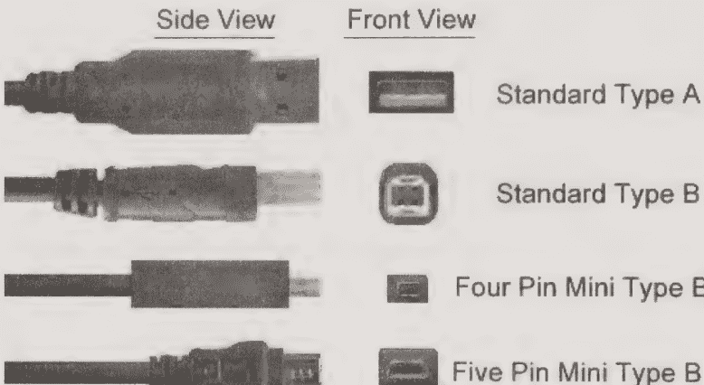
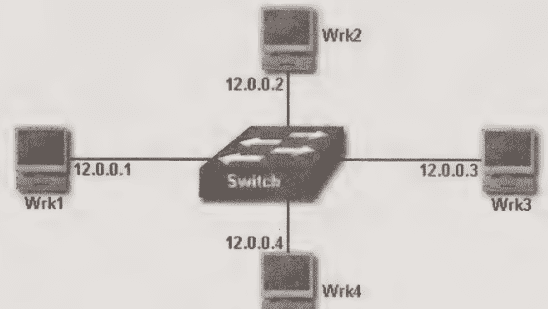
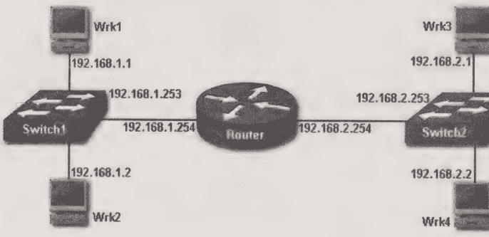
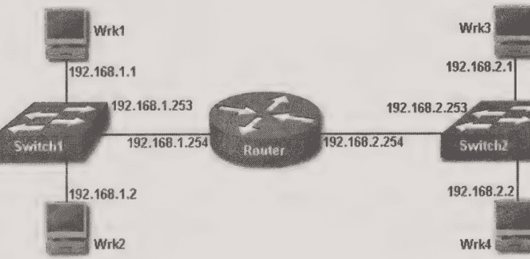
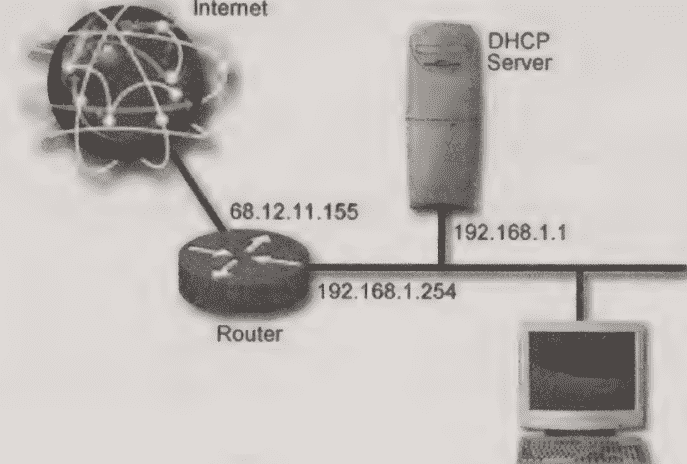
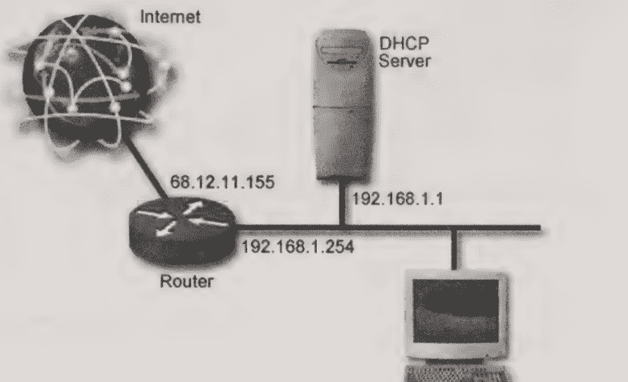
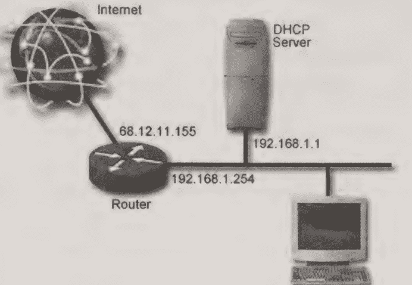
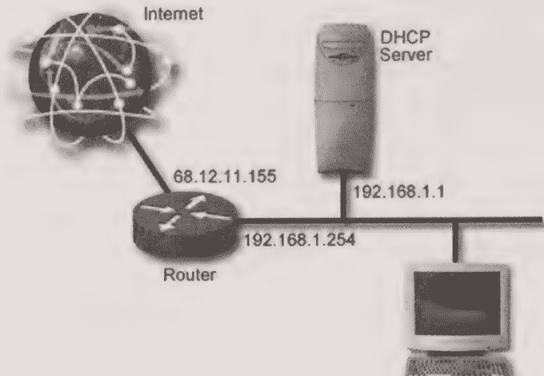

# LabSim 手册：“只有经验能教会你的课程” Linux

## 安装说明

- 1. 在电脑连接互联网时，将光盘插入 CD 或 DVD 驱动器。
- 2. 安装程序启动后，点击 `Install Application`（安装应用程序）并按照安装向程序的步骤操作。（如果安装窗口没有启动，请在 CD 或 DVD 驱动器目录中运行 `Autorun.exe` 文件。）
在安装过程中，您可以选择从光盘运行 LabSim（运行速度较慢），或者将光盘内容安装到您的硬盘上（每张光盘需要约 700 MB 的可用空间）。
- 3. 安装完成后，将启动 `TestOut Navigator` 程序。（如果此程序未启动，请使用开始菜单或桌面上的 `TestOut LabSim` 快捷方式）。输入您从导师那里获得的用户名和密码。
- 4. 登录后，选择 `LabSim link`（位于左侧 Learning Resources 下）来运行产品。如果产品未出现在可用标题列表中，请让导师激活产品。

## 0.0: 引言

## 0.2: 硬件模拟器

### 目标

- 使用文档识别组件和模块。
- 使用视图识别组件和模块。
- 在不同区域拖放系统组件。
- 安装和卸载组件。
- 更改视图、阅读组件详情。

### 将项目置于工作台

#### 场景

为了练习使用硬件模拟器，请完成以下任务：
1. 从货架 (`Shelf`) 中选择扫描仪。
2. 将扫描仪放置到工作台 (`Workbench`) 的计算机旁。

完成后，点击底部的“完成”按钮。

#### 事实与任务

注意模拟器屏幕分为三个主要区域：
- `Scenario`（场景）（右上角）：场景窗口提供你需要执行的信息（当前正在阅读文本）。
- `Shelf`（货架）（屏幕左侧）：货架窗口列出了可安装的硬件项目。
- `Workbench`（工作台）（右下角）：工作台窗口显示所有已安装的项目。

#### 步骤

1. 查看货架上的“Scanner, USB 2.0”项目（组 2 是扫描仪组）。
2. 点击并按住项目的任何部分，将其拖到工作台上计算机一侧的空隙。
3. 当看到带有箭头的白色条表示项目将插入时，释放鼠标。

### 0.2.3 根据文档选择项目

#### 场景

为了学习如何查看和使用项目详情，请完成以下任务：
- 对于货架上的每个项目，点击详情链接查看设备的图片和文档。
- 找到包含可选打印端口的设备。
- 将该设备添加到工作台的计算机旁。

完成后，点击底部的“完成”按钮。

#### 事实与任务

在实验中，你将学习如何获取货架或工作台上硬件项目的详情。有两种类型的详情：
- `Views`（视图）：硬件项目通常有多个视图。这些视图通常比货架上显示的图标大得多。
- `Documentation`（文档）：某些硬件项目具有超出描述部分的文档。

#### 步骤

将带有可选打印端口的扫描仪置于工作台
- 点击货架上扫描仪旁的详情链接。
- 点击文档选项卡，查看扫描仪端口和其他控件的标注概述。
- 从货架拖动并行扫描仪到工作台。
1. 确保选中了工作台的前或后视图。否则，请点击工作台工具栏上的前或后视图按钮。
2. 如果货架上未显示扫描仪，点击扫描仪分类。然后将扫描仪拖到工作台上计算机旁的空隙处。

## 安装和卸载组件

#### 场景

要学习如何连接和断开物品，请执行以下操作：
- 1. 切换到主板视图。
- 2. 将主板返回到架子（`Shelf`）。
- 3. 切换到驱动器槽视图。
- 4. 从架子中，将硬盘插入空闲槽位。

完成后，点击屏幕底部的“完成（Done）”按钮。

#### 知识与任务

到为止，你已经学会了如何将物品放在工作台（`Workbench`）上。你还可以将硬件组件安装到现有计算机中。

#### 步骤

移除主板：
- 1. 切换到主板视图（点击工作台工具栏上的主板按钮）。
- 2. 将主板拖动到架子上。

安装硬盘：
- 1. 切换到驱动器槽视图（点击工作台工具栏上的驱动器槽按钮）。
- 2. 将硬盘拖动到现有硬盘上方的驱动器槽（或任何相同大小的驱动器槽）。
- 3. 当驱动器槽高亮时，松开鼠标并释放硬盘。

注意：你无法在现有硬盘上方较大的槽位中安装硬盘。

### 0.2.6 设置拨盘和开关

#### 场景

要学习如何使用操作区域，请完成以下任务：
- 1. 切换到背面（Back）视图以查看外部光驱的背面。
- 2. 放大视图，直到你可以清楚地看到光驱上的控制按钮。
- 3. 将此光驱上的圆形拨盘设置为 4。
- 4. 将 TERM 开关置于开启（ON）位置（开关指向右侧）。

完成后，点击屏幕底部的“完成（Done）”按钮。

#### 知识与任务

某些硬件物品具有操作区域（如拨盘、按钮或开关等控件）。你可以通过点击或按 Shift 点击（`shift-clicking`）它们来操作这些区域。

#### 步骤

为光驱设置 SCSI ID：
- 1. 切换到背面工作台视图。
- 2. 点击工作台工具栏上“模式（Modes）”部分下的放大（Zoom In）工具。
- 3. 点击光驱背面的蓝色拨盘，直到它足够大以便操作。
- 4. 点击工作台工具栏上“模式（Modes）”部分下的选择（Select）工具。
- 5. 点击或 Shift 点击光驱背面的蓝色拨盘以进行旋转。（你也可以直接点击数字来将拨盘设置为该数字。）

将光驱的 TERM 开关置于开启（ON）位置：
- 1. 切换到背面工作台视图。
- 2. 点击工作台工具栏上“模式（Modes）”部分下的放大（Zoom In）工具。
- 3. 点击标记为 TERM 的开关。确保开关指向 ON 标签。

### 0.2.9 添加电缆组件

#### 场景

要学习如何使用带缆线设备，请完成以下任务：
- 将鼠标放在工作台上。
- 将鼠标连接到计算机的鼠标端口（确保已切换到计算机的背面视图）。
- 在驱动器槽工作台视图中，将第二个硬盘放在此计算机中现有硬盘上方。
- 打开架子上的电缆（Cables）类别，并将架子上电缆的连接器 1（Connector 1）连接到现有硬盘上。
- 将电缆的连接器 2（Connector 2）连接到你刚刚安装的第二个硬盘。
- 将电缆的连接器 3（Connector 3）连接到主板（你需要切换到主板视图）。

完成后，点击屏幕底部的“完成（Done）”按钮。

#### 知识与任务

许多硬件设备通过电缆连接到计算机或相互连接。在本实验室中，你将学习如何安装带缆设备。通过电缆连接的物品将出现在以下区域：
- 工作台连接（`Workbench Connections`）。工作台右侧显示所有包含电缆的连接或设备。阅读每个对象的描述以识别电缆连接的位置。

#### 步骤

安装鼠标：
- 打开架子上的鼠标（Mice）类别（如果尚未打开），
- 将鼠标（而不是其连接器）从架子拖动到计算机旁边的空工作台空间。
- 如果出现消息，阅读它并点击 OK。
- 4. 切换到背面工作台视图。
- 5. 将鼠标连接器从工作台连接列表拖动到计算机背部的亮绿色圆形鼠标端口。

安装第二个硬盘：
- 1. 切换到驱动器槽工作台。
- 2. 打开架子上的硬盘（Hard Drive）类别（如果尚未打开）。
- 3. 将硬盘拖动到现有硬盘上方的驱动器槽（或任何相同大小的驱动器槽）。当驱动器槽高亮时，松开鼠标并释放硬盘。

使用电缆将硬盘连接到主板：
- 1. 切换到驱动器槽工作台视图。
- 2. 打开架子上的电缆（Cables）类别（如果尚未打开）。
- 3. 将连接器 1（Connector 1）从架子拖到现有硬盘背面的 IDE 端口。当端口高亮时松开鼠标。（在执行此操作之前，请阅读硬盘的文档以识别 IDE 端口。）
- 4. 如果出现消息，阅读它并点击 OK。
- 5. 将电缆的连接器 2（Connector 2）连接到你刚刚安装的第二个硬盘。当端口高亮时松开鼠标。（在执行此操作之前，请阅读硬盘的文档以识别 IDE 端口。）
- 6. 如果出现消息，阅读它并点击 OK。
- 7. 切换到工作台视图。
- 8. 将连接器 3（Connector 3）从工作台连接列表拖到主板的 IDE 端口。（在执行此操作之前，请阅读主板的文档以识别 IDE 端口。）

## 2.0 电缆与连接器

### 2.1 双绞线

#### 目标

- 识别连接器、端口和电缆。
- 通过电话连接器、端口和电缆将 PC 连接到互联网。
- 识别双绞连接器、端口和电缆。
- 将 PC 连接到以太网。

#### 2.1.3 连接调制调器

你购买了一台新计算机，用于在家里跟踪财务记录。为了实现这一点，你需要建立互联网连接。在你的地区没有宽带互联网服务提供商（ISP），但你有拨号上网连接。

你在实验室中的任务是将新计算机连接到电话线，以便拨号 ISP。

#### 知识与任务

要使用拨号上网连接到 ISP，请将调制调器连接到电话线。调制调器通常使用双绞电缆连接到电话系统。双绞电缆最常用的两种连接器是 `RJ-11` 和 `RJ-45`。参考下表查看这两种类型连接器的异同。

| 连接器 | 描述 |
| :--- | :--- |
| `RJ-11` | 有 4 个芯；支持 2 对线对；使用锁定装置确保连接器位于插座中；主要用于电话布线 |
| `RJ-45` | 有 8 芯；支持 4 对线对；使用锁定装置确保连接器位于插座中；用于以太网和某些令牌环连接 |

本实验室使用的调制调器卡有两个端口。标记为 `"LINE"` 的端口提供与电话出口进行拨号上网连接。另一个标记为 `"PHONE"` 的端口是可选端口，用于将模拟电话连接到调制调器。

## 步骤

- 1. 在架子上找到选择用于拨号调制调器连接的电缆端。
- 你选择了什么类型的连接器？
- 2. 将连接器拖动到 PC 上相应的端口。（必要时使用放大工具并滚动以更好地查看端口、插座和连接器。）完成后，电缆的另一端将移动到工作台连接。
- 3. 将工作台连接中的连接器拖到相应的插座端口。
- 有哪两种方法可以区分左侧插座中的两个端口？
- 未使用的端口用途是什么？

## 2.1.4 连接到以太网网络

### 场景描述

你的主管要求你在新员工参加入职培训期间，将其计算机连接到网络。

使用双绞线将计算机连接到以太网局域网 `LAN`。

### 事实与任务

以太网网络使用带有 `RJ-45` 接口的双绞线。`RJ-45` 接口有 8 根线，且比 `RJ-11` 接口大。

### 步骤

+ 1. 找到并选择用于连接计算机到以太网局域网的电缆。
  * 可选电缆中有多少是双绞线？
  * 列出双绞线上的连接接口类型：
  * 这些接口中哪一个用于以太网？
+ 2. 从**货架** `Shelf` 拖动连接器到计算机上相应的端口。完成后，电缆的另一端将移动到“工作台连接” `Workbench Connections`。
+ 3. 将“工作台连接”中的连接器拖到网络端口。

### 目标

- 识别电缆调制解调器、端口和电缆。
- 通过电缆调制解调器及其接口、端口和电缆将 PC 连接到互联网。

### 场景描述

你最近搬到了新区域，那里有缆公司提供的宽带服务。为了避免支付高昂安装费用，你选择自己安装调制器。将电缆调制解调器连接到你的计算机和墙上插座。

### 事实与任务

下表列出了某些用于此类互联网连接的接口。

| 连接器 | 事实 |
| --- | --- |
| Ethernet `RJ-45` | 主要用于以太网 LAN 连接；将电缆调制解调器连接到 PC |
| USB Type A | 用于连接两台 PC；主要将 PC 连接到设备，如电缆调制解调器 |
| USB Type B | 大多数带有 B 接口的 USB 线另一端是 A 接口；用于将设备连接到 USB 集线器 |
| Coaxial Type F | 主要用于电缆和卫星电视连接；用于将电缆调制解调器接入宽带缆连接 |

### 步骤

+ 1. 在**货架** `Shelf` 上，找到并选择合适的电缆将电缆调制解调器连接到墙上插座。
  - 列出电缆调制解调器和墙上插座上提供互联网连接的端口类型：
+ 2. 将合适电缆的一端拖到墙上插座的相应端口。（电缆的另一端将移动到“工作台连接”区域。）
+ 3. 将**工作台连接**区域中的电缆末端拖到电缆调制解调器的相应端口。
+ 4. 在**货架** `Shelf` 上，找到并选择合适的电缆将电缆调制解调器连接到 PC。
  - 列出电缆调制解调器和 PC 上剩余的可连接的端口类型：
+ 5. 将合适的连接器拖到电缆调制解调器的相应端口。连接器将移动到“工作台连接”。
+ 6. 将连接器从**工作台连接**拖到计算机上相应的端口。

### 场景描述

你正在帮助一个朋友使用她最近购买的电缆调制解调器连接互联网。你决定用以太网线将电缆调制解调器连接到计算机。你上线并在**货架**上列出的电缆。选择并连接必要的电缆完成连接。

### 事实与任务

网卡 `NIC` 为表中列出的三种连接器各提供端口。

| 连接器 | 事实 |
| --- | --- |
| `RJ-45`  | 双绞线 通常用于以太网 |
| `BNC`  | 同轴电缆 通常用于旧版以太网 |
| `AUI`  | 同轴电缆 通常用于旧版以太网 |

**注意：**你有多种电缆可以实现这种连接，但实验要求按照特定方式进行。

### 步骤

+ 1. 在**货架** `Shelf` 上，找到并选择合适的电缆将电缆调制解调器连接到墙上插座。
  - 电缆调制解调器上有哪些类型的端口？
  - 使用什么类型的电缆和连接器连接电缆服务？
+ 2. 将电缆的一端拖到相应的墙上插座。（电缆的另一端将移动到“工作台连接”区域。）
+ 3. 将“工作台连接”区域中的电缆末端拖到电缆调制解调器的相应端口。
+ 4. 在**货架** `Shelf` 上，找到并选择合适的电缆将电缆调制解调器连接到 PC。
  - 货架上的哪种电缆将连接电缆调制解调器和 PC？
+ 5. 将电缆的一端拖到 PC 上的相应端口。另一个连接器移动到工作台连接。使用工作台工具栏上的放大工具并根据需要滚动以找到端口和连接器。）
+ 6. 将“工作台连接”中的电缆末端拖到电缆调制解调器的相应端口。

### 目标

- 识别不同类型的光纤连接器、端口和电缆。
- 将 PC 连接到光纤网络。

### 场景描述

作为公司网络技术员的首项任务是将新员工的计算机连接到你们的光纤网络。

注意：连接电缆时，务必将接收端口 `RX` 连接到发送端口 `TX`。

### 事实与任务

下表是常见的光纤电缆连接器。

| 连接器 | 事实 |
| --- | --- |
| `ST` | 也称为推入式旋转连接器；每根线都是单芯，末端各有一个单独（或独立的）连接器 |
| `SC` | 插入式、拉出式连接器类型，使用锁定卡扣维持连接；每根线都是单芯，末端各有一个单独（或独立的）连接器 |
| `LC` | 由带有锁定卡扣的塑料连接器组成，类似于 `RJ-45` 连接器；每根线有两芯，连接到末端的两个单连接器；尺寸只有其他光纤连接器的一半 |
| `MT-RJ` | 由带有锁定卡扣的塑料连接器组成；使用金属导针确保对齐良好；每根线有两芯，连接到末端的两个单连接器 |

通过跟踪连接到每个端口的电缆颜色，以确保安装得当。

### 步骤

+ 1. 找到并选择带有合适连接器的电缆。
  - 你选择的连接器名称是什么？
+ 2. 将其中一个连接器拖到墙上插座。剩余的连接器移动到“工作台连接”。使用放大工具并根据需要滚动以找到端口和连接器。）
  - 你选择的器是什么颜色的？
+ 3. 将刚刚连接的电缆另一端拖到计算机光纤卡上的相应插槽。
+ 4. 将未使用电缆的一端拖到墙上插座的空插槽。
+ 5. 将剩余的连接器拖到计算机光纤卡的剩余插槽。

## 2.3.4 连接光纤电缆 2

### 场景描述

通过选择合适的电缆将计算机连接到光纤网络。确保将发送端口连接到接收端口。

### 事实与任务

光纤电缆两端的连接器不需要相同。这为连接不同类型的组件提供了灵活性。

### 步骤

+ 1. 首先检查网卡和墙面板，以识别它们各自使用的电缆类型。

在完成实验此步骤时，填写不同类型光纤电缆连接器的特征。（确保你描述的是连接器外壳，而不是端口。）

| 连接器 | 形状（矩形或圆形） | 配置（单芯或双芯） |
|---|---|---|
| `ST` | | |
| `SC` | | |
| `LC` | | |
| `MT-RJ` | | |

+ 2. 在货架上找到正确的电缆，并将合适的连接器拖到计算机网卡的相应端口。剩余的连接器移动到“工作台连接”。
+ 3. 将刚刚连接的电缆另一端拖到墙上插座的相应插槽。
+ 4. 将“工作台连接”中的合适的连接器拖到计算机光纤卡上的相应端口。
+ 5. 将剩余的连接器拖到墙上插座的剩余插槽。

### 目标

- 识别 USB 接口、端口和电缆。
- 通过 USB 将组件连接到计算机。
- 使用 USB 将两台 PC 连接到简单的网络。

### 场景

你已经在家里安装了无线网络。然而，你拥有一台不具备无线功能的旧笔记本电脑。为了让笔记本电脑连接到家里的无线网络，你购买了一个 USB 无线网卡。将 USB 无线网卡插入电脑上相应的插槽。

## 知识与任务

有多种类型的 USB 接口。最常见的是 Type A 类型。USB 接口（或端口）始终可以通过下方显示的 USB 标志来识别。

### 步骤

1. 1. 要将 USB 无线网卡连接到笔记本电脑，将网卡从**Shelf** `Shelf` `货架` 拖动到笔记本电脑背面的 USB 端口。
  * 是否有多个端口可供 USB 无线网卡连接？
  * 笔记本电脑上还有哪种高速串行数据端口？

### 场景

你买了一台新电脑，但你仍然想在旧电脑上访问某些文件。与其将文件拷贝到可移动介质，你希望能够根据需要访问计算机硬盘的选项。你知道可以通过 USB 电缆直接连接两台电脑，从而创建一个简单的网络。

选择正确的电缆并将两台电脑连接在一起。

## 知识与任务

常见的 USB 接口显示所示。

通过连接专为此目的设计的电缆，可以创建一个允许两台 PC 通信的简单网络。这种连接类型通常被较新的操作系统支持。

## 步骤

1. 在**Shelf（货架）**上，找到并选择合适的电缆。
   - 你选择的连接两台 PC 的电缆名称是什么？
2. 将电缆的一个连接器拖到第一台电脑上相应的端口。另一个连接器将移动到 Workbench Connections（工作台连接）。
   - PC 上的什么种类型的端口符合你选择的电缆？
3. 将 Workbench Connections 中剩余的连接器拖到第二台电脑上相应的端口。

**目标**

- 区分调制调器（Modem）和网卡之间的差异。
- 识别常见调制调器和网接口卡（NIC）的各种功能。
- 根据功能选择合适的调制调器或网卡。
- 识别用于调制调器和网络连接的接口和端口。
- 通过 PSTN 将 PC 连接到互联网。
- 访问并识别网络连接的状态和属性。
- 禁用网络连接。

### 3.1.6 选择并安装网络适配器

#### 场景

你希望以最快的速度通过 PSTN（公共用用电话网）将计算机连接到互联网。

完成以下任务：
- 选择速度最快的用于连接 PSTN 的正确扩展卡。
- 选择相应的电缆并将计算机连接到 PSTN。

## 知识与任务

下方列出了用于计算机联网的一些典型扩展卡：
- 以太网网卡 (`Ethernet NIC`)：连接到以太网。
- 令牌环网卡 (`Token Ring NIC`)：连接到令牌环网络。
- 调制调器 (`Modem`)：连接电话线与远程计算机通信。
- ISDN 网卡 (`ISDN NIC`)：通过 ISDN 网络进行主机到主机连接。

## 步骤

1. 点击 Workbench 工具栏上的 **Motherboard** 按钮切换到主板视图。
2. 在**Shelf（货架）**上，找到并选择合适的扩展卡。

在进行实验时完成下表。

**注意：** 当你重新启动实验时，扩展卡组将随机分布。如果你退出并重启实验，正确的扩展卡可能会出现在不同的位置。

#### 组编号 | 卡片类型 | 端口（数量和类型） | 信号电平

|---|---|---|---|

| 组 1 | | | |
| 组 2 | | | |
| 组 3 | | | |
| 组 4 | | | |
| 组 5 | | | |
| 组 6 | | | |

3. 将合适的卡片拖到主板上相应的空插槽。
   - 你将卡片插入了什么种类型的插槽？
4. 点击 **Workbench** 工具栏上的 **Back** 按钮切换到背面视图。
5. 点击 **Cables** 旁边的箭头展开 **Shelf（货架）** 上的 **Cables** 组。
6. 找到并选择合适的电缆连接器。
   - 什么种类型的连接器符合你选择的卡片中的端口？
7. 将连接器拖到相应的端口。另一个连接器将移动到 Workbench Connections。
   - 卡片中未使用的端口起什么功能？
8. 将 Workbench Connections 中的连接器拖到相应的墙上插座。
   - 卡片中未使用的端口起什么功能？

- 定位并查看局域连接（Local Area Connections）的属性。
  - 你使用了哪种方法打开属性窗口？
- 查看每个可用网络组件的描述以了解其功能。
  - 网络组件位于哪个选项卡和节标题下？
  - 网络组件描述位于哪个节标题下？
- 选择“完成（Done）”退出实验的 Windows 部分，并回答问题以完成实验。

#### 场景

你有一台带有无线网卡的笔记本电脑。你想在飞机上使用这台电脑，但你需要确保电脑在飞行期间不会尝试连接无线网络。

禁用无线网络连接。

## 知识与任务

无线网络连接可以通过多种方式禁用。请列出与你在实验中使用的步骤之外的替代步骤，以禁用无线网络。

## 步骤

1. 打开控制面板。
2. 打开网络连接。
3. 定位并禁用“无线网络连接 2”。
   - 你是如何找到禁用功能的？

### 目标

- 识别用于连接以太网网络的组件。
- 考虑到性能、通信和未来的扩展，选择合适的组件并包含在网络中。
- 将 PC 连接到以太网网络。

#### 场景

你正在连接将位于同一网络上的几台电脑中的前两个。你希望网络以 100 Mbps 的速度以全双工模式运行，并容纳未来增加的设备。

使用适当的网络组件连接这两台电脑。

## 知识与任务

不同网络设备之间的通信能力有所不同。下面列了一些值得考虑的差异：
- *单工模式（Simplex）*：通信仅向一个方向传输。
- 半双工（Half-duplex）：通信向两个方向传输，但一次仅向一个方向传输。
- 全双工（Full-duplex）：通信向两个方向传输，并且可以同时进行。

## 步骤

1. 在货架（Shelf）上，定位并将适当的网络设备拖到工作台（Workbench）。
   
   在完成实验的过程中，列出每个设备在网络中的功能和关系，并将这些特性列在下表中。

   | 设备 | 功能 |
   | --- | --- |
   | 路由器 | |
   | Switch机 | |
   | 集线器 | |

2. 点击货架上的“电缆”（Cables）菜单。
3. 定位具有适当连接器的电缆。
   * 哪种连接器适用于你选择的网络设备上的端口？
4. 将连接器拖到网络设备上的空端口。电缆移动到工作台连接（Workbench Connections）。
5. 将未连接的连接器从工作台连接拖到电脑的相应端口上。
6. 连接第二台电脑。
   * 列出你完成步骤 6 所执行的步骤：
   
   ________________________________________________________________________________________________________________________________________________
   
   ________________________________________________________________________________________________________________________________________________

### 目标

- 根据特征识别并选择合适的路由器。
- 识别并选择用于电缆连接的合适连接器、端口和接口。
- 通过电缆将 PC 连接到互联网。

### 3.3.4 选择路由器

#### 场景

你刚刚在当地的电缆电视提供商 ComSpeed 办理了互联网接入。你负责选择正确的路由器将电脑连接到互联网。你希望在使用最快连接速度的同时，为你的家庭电脑提供安全性。通过选择正确的设备和电缆将电脑连接到互联网。

## 知识与任务

- 为什么你不能使用 Cat3 电缆来完成实验中的要求？

## 步骤

1. 在货架上，定位并将正确的路由器拖到工作台。

   在执行实验的此步骤时，填写下表。

   > 注意：当你重启实验时，路由器组将随机化。如果你退出并重启，路由器组可能会发生变化。

   | 组组 | 路由器类型 | 安全功能（是/否） | 端口数量 |
   |---|---|---|---|
   | 1 | | | |
   | 2 | | | |
   | 3 | | | |
   | 4 | | | |
   | 5 | | | |
   | 6 | | | |

2. 点击货架上的电缆菜单。
3. 定位具有适当连接器的电缆并连接到工作网连接。
4. 将未连接的连接器从工作台连接拖到电脑的相应端口上。
5. 将连接器从工作台连接拖到电脑的相应端口上。
6. 连接第二台电脑。
7. 将连接器从工作台连接拖到电脑的相应端口上。
8. 将电缆移动到工作台连接。

### 目标

- 识别并根据特征选择合适的路由器。
- 识别并选择用于电缆互联网连接的合适连接器、端口和接口。
- 通过电缆将 PC 连接到互联网。
- 识别不同的以太网分类。
- 识别不同的以太网功能。
- 使用适当的电缆将 PC 连接到以太网网络。
- 识别不同的以太网分类。
- 识别不同的以太网功能。

#### 场景

你所在的宿舍安装了 1000Base 以太网。你需要购买电缆连接电脑到网络。然而，成本是一个考虑因素。请选择最便宜的以太网。

## 知识与任务

下表比较了各种以太网实现方式。

| 以太网规格 | 电缆类型 |
|---|---|
| 10BaseT | 双绞（Cat3, 4 或 5） |
| 100BaseT | 双绞（Cat5 或更高） |

| 1000BaseT | 双绞（Cat5e） |

## 步骤

- 1. 在货架上，定位电缆。

在执行实验的此步骤时，填写下表。

| 电缆类型 | 支持 1000BaseTX（是/否） | 价格（每米） |
|---|---|---|
| Cat | | |
| Cat | | |
| Cat | | |
| Cat | | |

- 2. 将一个连接器从电缆拖到工作台连接。
- 3. 将连接器从工作台连接拖到墙上的插座。

### 4.1.7 连接 100BaseTX 网络

#### 场景

你被分配到一栋新楼。这栋楼有一个速度达 100 Mbps 的以太网。通过选择正确的网卡和布线将电脑连接到网络。

#### 知识与任务

下表比较了各种以太网实现方式。

| 以太网规格 | 带宽 | 电缆类型 |
|---|---|---|
| 10BaseT | 10 Mbps（半工），20 Mbps（全双工） | 双绞（Cat3, 4 或 5） |
| 100BaseT | 100 Mbps（半工），200 Mbps（全双工） | 双绞（Cat5 或更高） |
| 1000BaseT | 1000 Mbps（半工），2000 Mbps（全双工） | 双绞（Cat5e） |

## 步骤

- 1. 通过点击工作台工具栏上的主板按钮切换到主板视图。
- 2. 在货架上，定位并将合适的网卡拖到相应的空槽中。

在执行实验的此步骤时，填写下表。

| 扩展卡类型 | 端口（数量/类型） | 以太网架构（如果适用） |
|---|---|---|
| | | |
| | | |
| | | |
| | | |
| | | |
| | | |

- 3. 切换到电脑的背面（Back）视图。
- 4. 打开货架上的电缆菜单。
- 5. 定位合适的电缆。

  - 你选择了哪种电缆类型和类别？
- 6. 将其中一个连接器拖到电脑背面的相应端口。电缆和另一个连接器移动到工作台连接。

  - 哪个端口适合你电缆上的连接器？
- 7. 将工作台连接上的连接器拖到墙上的插座。

#### 场景

你的公司刚搬到一栋办公大楼。机房已经安装了连接到墙壁的光纤。你需要将服务器连接到光纤网络。

选择并安装必要的组件以连接到光纤网络。

#### 知识与任务

由于你的计算机没有光纤网卡（NIC）来与光纤网络进行通信，你需要一个设备来转换光纤信号。

## 步骤

- 1. 在**架子（Shelf）**上找到用于 PC 和光纤网络桥接的合适设备，并将其拖到**工作台（Workbench）**。

在执行实验室此步骤时，请完成下表。

| 设备类型 | 端口（数量/类型） | 网络类型 |
|---|---|---|
| | | |
| | | |
| | | |

- 2. 打开**架子**上的**电缆（Cables）**菜单。
- 3. 找到合适的电缆，将 PC 连接到你在第1步中选择的设备。

  - *连接 PC 和设备需要什么类型的电缆？*
- 4. 将连接器拖到设备背部的合适端口。电缆和其他连接器将移动到工作台连接（Workbench Connections）。
- 5. 将**工作台连接**中的连接器拖到 PC 上的合适端口。
- 6. 找到连接设备到合适墙壁插座的电缆。

  - *你正在连接到什么类型的网络？*
- 7. 将合适的连接器拖到设备上的合适端口。剩余的连接器将移动到工作台连接。

  - *你选择的连接器是什么形状的？*
- 8. 将工作台连接中的合适连接器拖到墙壁插座的合适插孔。

  - *你在第7步中是将电缆连接到发送端口还是接收端口？*
  - *你在第7步中连接的电缆是什么颜色的？*
- 9. 将工作台连接中的合适连接器拖到设备上剩余的端口。
- 10. 将剩余的连接器拖到墙壁插座上剩余的插孔。

## 5.0: 无线网络标准

### 5.2: 配置无线网络

#### 目标

- 为给定应用识别正确的无线标准。
- 安装与给定要求的无线网络适配器和组件。

#### 5.2.3 选择无线网卡

##### 场景

由于你经常出差，你想为笔记本电脑配备无线网络功能。选择并安装一个支持在 2.4 GHz 频率范围内网络进行 11 Mbps 到 54 Mbps 数据传输的无线设备。选择满足要求的最便宜方案。

#### 知识与任务

下表列出了 802.11x 标准：

| 标准 | 频率 | 速度 |
|---|---|---|
| 802.11a | 5.75 - 5.85 GHz | 54 Mbps |
| 802.11b | 2.4 - 2.4835 GHz | 11 Mbps |
| 802.11g | 2.4 - 2.4835 GHz | 54 Mbps |

下表显示了通常用于安装无线设备的端口。

| 端口 | 无线设备 |
|---|---|
| USB | USB 驱动器    |
| PCMCIA | PCMCIA 卡    |

## 步骤

- 1. 在架子上找到以最低成本最符合所需标准的设备。

在执行实验室此步骤时，请完成下表。

| 设备 | 标准 | 连接 / 端口类型 | 价格 |
| --- | --- | --- | --- |
| | | | $ |
| | | | $ |
| | | | $ |
| | | | $ |
| | | | $ |

- 2. 将设备拖到合适的插槽/端口。

  - *计算机有两种类型可以容纳可用设备的端口。在下方列出它们：*

#### 5.2.4 创建无线网络 1

##### 场景

你想在公寓里建立一个无线网络。你的室友想连接它，你还希望朋友们来时也能连接。你决定 11 Mbps 的数据传输率对于你的需求已经足够。

选择并安装合适的网络设备。

#### 知识与任务

下表提供了典型的无线网络设备。

| 设备 | 特性 |
|---|---|
| 无线网卡 | PC 内部用于信号接收和传输的卡 |
| 无线接入点 (WAP) | 等于以太网集线器。无线网卡连接到 WAP，由 WAP 管理网络连接。可以是端口、集线器、交换机或路由器。 |

## 步骤

- 1. 在**架子**上找到并将合适的设备拖到 PC 的的插槽。提示：切换到 PC 或 PC 组件的备视图以完成此步骤。

**注意：** 当你重启实验室时，设备组将随机生成。如果你退出并重启实验室，正确的扩展卡可能处于不同的位置。

在执行实验室时，完成下一页表格中的问题。

| 组号 | 设备类型 | 需要的端口/插槽连接类型 | 网络标准（圈出适用项） |
|---|---|---|---|
| 组 1 | | 802.11a, b, 或 g |
| 组 2 | | 802.11a, b, 或 g |
| 组 3 | | 802.11a, b, 或 g |
| 组 4 | | 802.11a, b, 或 g |
| 组 5 | | 802.11a, b, 或 g |

- 2. 在架子上找到并将合适的设备拖到 PC 上的合适插槽。
- 3. 在架子上找到并将合适的设备拖到端口。
- 4. 将合适的连接器拖到端口。

### 创建无线网络

#### 场景

你刚刚买了一个新电脑并需要连接它。网络使用静态地址。

#### 知识与任务

有两种典型的无线网络拓扑。查看下表：

| 拓扑 | 描述 |
|---|---|
| Ad Hoc | 点对点模式，不需要 WAP。设置简单。 |
| Infrastructure (基础架构) | 需要 WAP。可以添加多个主机。 |

## 步骤

- 1. 找到连接设备到合适墙壁插座的电缆。
- 2. 将连接器拖到设备上的合适端口。

## 5.0: TCP/IP

### 目标

- 识别 IP、网关和 DNS 地址的组成及含义。
- 识别 IP、网关和 DNS 地址的作用。
- 手动配置 IP、网关和 DNS 地址。

### 7.3: IP 配置

#### 场景

你需要连接笔记本电脑。网络使用静态地址。配置 TCP/IP 设置：

- IP 地址 = 10.1.12
- 子网掩码 = 255.255.255.0（注意：这不是默认值。）
- 默认网关 = 10.1.254
- DNS 服务器 = 10.1.1, 10.1.2（按此顺序）

#### 知识与任务

IP、子网掩码、默认网关和 DNS 地址可以在 Internet 协议 (TCP/IP) 属性中手动分配。

## 步骤

- 1. 打开控制面板。
- 2. 打开网络连接。
- 3. 查看本地局域网的属性。
- 4. 从连接的项目列表中选择 Internet 协议。
- 5. 查看属性（如果是配置 LAN 连接，选择“常规”选项卡）。

  - *点击哪个按钮查看属性？*
- 6. 将 IP 地址从自动切换为手动。

  - *点击哪个按钮更改 IP 偏好？*
- 7. 输入 IP 地址（输入 IP 地址后按 Tab 键）。

  - *你输入了什么？*
- 8. 保留默认子网掩码或在不使用默认掩码时输入新的子网掩码。

  - *你输入了什么？*

- 9. 要将数据路由到另一个子网，输入默认网关地址（如果所有计算机都在同一个子网内，可以留空此值）。
  - *你输入了什么？*
- 10. 分配首选 DNS 服务器，输入合适的地址。
  - *你输入了什么？*
- 11. 分配备用 DNS 服务器，输入备用 DNS 服务器地址。
  - *你输入了什么？*

12. 关闭所有窗口以保存更改。
  + * 你选择了哪些按钮？

## 7.3.5 配置 IP 设置 2

### 场景

点击“显示（Exhibit）”按钮并使用网络图来完成此实验。

你刚刚购买了一台新电脑，并将其连接到小型企业网络。该网络有两个子网，并如附图所示连接到互联网。该网络使用静态地址。为 NY-DEV-WRK3 计算机配置 TCP/IP 设置，使其能够在本地网络和互联网上进行通信。使用以下设置：

+ * 对于 IP 地址，将工作站配置为网络上的最后一个有效地址。
  使用默认子网掩码。
* 根据网络图中的信息配置默认网关地址。
* 按照以下方式配置 DNS 服务器地址：
  * 使用本地网络上的 DNS 服务器作为首选服务器。
  * 使用互联网上的 DNS 服务器作为备用 DNS 服务器。

## 知识与任务

下表提供了关于网络地址划分的一些有用知识。

| 地址类型 | 描述 |
| :--- | :--- |
| IP 地址 | 四个 8 位数字，范围从 0 到 255，每个数字用点分隔。数字的第一部分是网络地址。数字的最后部分是主机地址。地址分类决定地址的网络和主机部分。C 类地址：* 最有可能拥有可分配的 IP 地址。 * 第一个字节在 192 到 223 之间。 * 前三个字节定义网络。 * 最后一个字节定义主机。 |
| 子网掩码 | 识别 IP 地址的哪部分是网络地址。同一网络上的两个设备必须配置相同的网络掩码。前三类的默认子网掩码如下：* A 类：255.0.0.0 * B 类：255.255.0.0 * C 类：255.255.255.0 |
| 默认网关 | 识别用于发往远程网络的数据包时所被发送往的路由器。默认网关地址是与本地主机处于同一子网的接口的 IP 地址。如果没有设置默认网关，大多数客户端将无法与本地子网之外的主机通信。 |
| DNS 服务器 | 识别用于将主机名解析为 IP 地址的 DNS 服务器。 |

## 步骤

打开**显示（Exhibit）**以查看网络图。你需要参考网络图来确定应该输入什么信息。

+ 1. 打开**控制面板**。
2. 打开**网络连接**。
3. 查看本地局域网（Local Area Connection）网络连接的**属性**。
4. 从连接所使用的项目列表中选择“Internet 协议（Internet Protocol）”。
5. 查看“Internet 协议”的**属性**。
6. 将 IP 地址设置从自动改为手动。
7. 输入 IP 地址。
    * 网络上的*最后一个*有效地址是什么？（请确保不要使用网络广播地址。）
8. 保留默认子网掩码，或者在不使用默认子网掩码时输入新的子网掩码。
+ * 你使用了哪种子网掩码？____ * ____ * ____
9. 要将数据路由到另一个子网，输入默认网关地址。
+ * 在哪里可以网络网关？
+ * 你输入了什么？____ * ____ * ____
10. 输入首选 DNS 服务器地址。
+ * 主 DNS 服务器应该在你的网络内部还是外部外部？
+ * 你输入了什么？____ * ____ * ____
11. 输入备用 DNS 服务器地址。
+ * 备用 DNS 服务器应该在你的网络内部还是外部？
+ * 你输入了什么？____ * ____ * ____
12. 关闭所有窗口以保存更改。
13. 再次点击确定关闭“Internet 协议 (TCP/IP)”属性对话框。
14. 再次点击确定关闭网络连接的属性。

## 8.0: IP 服务

## 8.1: 域名解析

### 目标

- 配置 TCP/IP 协议以访问多个 DNS 服务器。
- 配置 TCP/IP 协议以访问多个 WINS 服务器。

## 8.1.7 配置 DNS 地址

### 场景

你正在为一台 Windows XP 专业版电脑配置网络连接。目前，你的网络使用手动 IP 地址设置。之前，你的网络没有使用 DNS 服务器，但最近安装了三个 DNS 服务器。

你在实验中的任务是为此电脑的本地局域网连接配置 TCP/IP 协议，使用以下 DNS 服务器地址：

+ * 192.168.1.1（首选 DNS 服务器）
* 192.168.2.1（第一个备用 DNS 服务器）
* 192.168.1.3（第二个备用 DNS 服务器）

> 注意：当你配置 TCP/IP 属性时，只能设置两个 DNS 服务器地址。要配置额外的 DNS 服务器地址，请点击**高级（Advanced）**按钮。在 DNS 选项卡上，使用**添加（Add）**按钮配置额外的 DNS 服务器地址。

## 知识与任务

如果列出了多个 DNS 服务器地址，可以通过选择 DNS 服务器地址并点击列表右侧的向上或向下箭头更改地址顺序。将按照地址列出的顺序联系（列表中的第一个地址是首选 DNS 服务器）。

## 步骤

+ 1. 打开**控制面板**。
+ 2. 打开**网络连接**。
+ 3. 查看本地局域网网络连接的**属性**。
+ 4. 从连接所使用的项目列表中选择“Internet 协议”（在配置 LAN 连接时，选择“常规”选项卡，否则选择**网络选项卡**）。
+ * 你在哪个选项卡下找到“Internet 协议”项目？
5. 然后查看“Internet 协议”属性。
+ - 你点击哪个按钮来查看“Internet 协议”属性？
6. 空间只允许两个地址，即首选和第一个备用地址。你可以在此窗口输入它们，但由于你有第三个地址要输入，请选择允许输入所有三个地址的按钮。
+ - 你点击了哪个按钮？
7. 现在选择允许输入三个地址的选项卡。
+ - 你正在配置的是什么种类型的服务器？
8. 选择允许添加地址的按钮（记住按照使用顺序添加地址）。
+ - 你点击了哪个按钮？
9. 为 DNS 服务器输入 IP 地址。
10. 重复步骤 9 直到所有地址都输入完毕。
11. 关闭每个窗口并保存更改。
+ - 你点击了哪个按钮？

## 8.1.8 配置 WINS 设置

### 场景

你正在为一台 Windows XP 专业版电脑配置网络连接。目前，你的网络没有 DHCP 服务器。你的网络既有 Windows 98 也有 Windows XP。网络有两个 WINS 服务器。

你在实验中的任务是为此电脑的本地局域网连接配置 TCP/IP 协议，使用以下 WINS 服务器地址：

- 192.168.1.1（首选 WINS 服务器）
- 192.168.2.1（第一个备用 WINS 服务器）

**注意**：要配置 WINS 服务器地址，请像配置 IP 地址一样编辑 TCP/IP 属性。点击**高级（Advanced）**按钮并在 WINS 选项卡上设置 WINS 地址。

## 知识与任务

如果列出了多个 WINS 服务器地址，可以通过选择 WINS 服务器地址并点击列表右侧的向上或向下箭头更改地址顺序。将按照地址列出的顺序联系 WINS 服务器（列表中的第一个地址是首选 WINS 服务器）。使用**编辑（Edit...**或**删除（Remove）**按钮更改或删除列表中的 WINS 服务器地址。

## 步骤

+ 1. 打开**控制面板**。
+ 2. 打开**网络连接**。
+ 3. 查看本地局域网网络连接的**属性**。
+ 4. 定位、选择并查看“Internet 协议”属性。
+ 5. 定位、选择并查看“Internet 协议”设置的高级设置。
+ - 你点击了哪个按钮？
+ 6. 定位、选择并查看“Internet 协议”设置的 WINS 设置。
+ - 你点击了哪个选项卡？
+ 7. 添加首选 WINS 服务器地址。
+ - 你点击了哪个按钮？
+ - 你输入了什么？______ . ______ . ______
+ 8. 重复步骤 7。
+ - 你输入了什么？______ . ______ . ______
+ 9. 关闭每个窗口并保存更改。

## 8.2: IP 地址分配

### 目标

- 配置 TCP/IP 协议以访问 DHCP 服务器或使用自动私有 IP 地址 (APIPA)。

## 8.2.4 配置 DHCP 客户端

### 场景

你正在为一台 Windows Server 2003 计算机配置网络连接。之前，你的网络没有 DHCP 服务器，但你刚刚安装并配置了一个。

你在本实验中的任务是为局域连接（Local Area Connection）网络连接配置 TCP/IP 协议，以从 DHCP 服务器获取 IP 地址和 DNS 服务器信息。

## 知识与任务

“自动获取 IP 地址”选项将使用存在的 DHCP 服务器。否则，它将使用自动私有 IP 地址 (APIPA) 分配 169.254.0.0 到 169.254.255.255 之间的地址。你也可以自动获取 DNS 服务器地址，或者手动配置 DNS 服务器地址。要从 DHCP 服务器获取 DNS 服务器地址，请选择自动获取 DNS 服务器地址”选项。

## 步骤

1. 打开控制面板。
2. 打开网络连接。
3. 查看“局域连接”网络连接的属性。
4. 定位、选择并查看“Internet 协议”属性。
5. 定位、选择并查看 TCP/IP 设置的“高级”设置。
6. 定位并选择在存在时将使用 DHCP 服务器或使用自动私有 IP 地址的选项。
   - 你选择了哪个按钮？
7. 定位并选择“自动获取 DNS 服务器地址”的选项。
   - 你选择了哪个按钮？
8. 关闭每个窗口并保存更改。

## 8.3: NAT 和 ICS

### 目标

- 在计算机上启用拨号上网连接共享。
- 启用按需拨号。
- 配置网络上的其他用户，使其手动启用或禁用 Internet 连接。

## 共享 Internet 连接

### 场景

你正在为一个小型办公室网络配置互联网连接。你希望网络上的所有计算机都通过运行 Windows XP 专业版计算机上的共享拨号网络连接连接到互联网。你希望在计算机尝试访问互联网的任何时候都能自动建立连接。

你在本实验中的任务是共享这台计算机上的“拨号上网”网络连接。允许按需拨号，但不允许网络上的其他用户手动启用或禁用 Internet 连接。

## 知识与任务

如果此连接的用户名和密码仅保存供你使用，系统将提示你将其保存给所有用户。否则，Internet 连接共享只有在你使用共享的 Internet 连接登录计算机时才能正常工作。点击“确定”（你可以在建立连接时更改连接用户名和密码的保存方式）。

## 步骤

1. 打开控制面板。
2. 打开网络连接。
3. 查看拨号、VPN 或宽带连接的属性。
   - 你选择了哪个应用程序小节？
4. 在“拨号连接”属性窗口中找到“Internet 连接和共享”设置。
   - 你点击哪个选项卡来找到这些设置？
5. 选择与局域网上的其他用户共享连接的选项。
勾选或保持不勾选你在步骤 5、7 和 8 中选择或未选择的选项。

| 允许其他网络上的用户连接到此台计算机的 Internet 连接。 |
| :--- |
| 当我的网络上的计算机尝试访问 Internet 时，始终建立拨号连接。 |
| 允许其他网络上的用户控制或禁用共享的 Internet 连接。 |

6. 启用自动拨号。
   - 你勾选了框框吗？
7. 选择启用“按需拨号”的选项，这会在网络上的其他用户需要时自动建立连接。
8. 选择手动禁用（断开连接）共享连接的选项。
9. 启用 Internet 连接共享。
   - 你勾选了框框吗？
10. 关闭每个窗口并保存更改。

## 9.0: 操作系统

## 9.1: 客户端和服务器操作系统

### 目标

- 安装 QoS 数据包调度器网络服务。

## 9.1.5 安装服务

### 场景

你正在为一台 Windows XP 专业版计算机配置网络连接。该计算机连接到一个支持服务服务质量 (QoS) 功能的 IP 网络。你希望为计算机运行的某些启用 QoS 功能的程序利用这些功能。

你在本实验中的任务是安装“QoS 数据包调度器”网络服务。

## 知识与任务

在本实验中，QoS 组件是一个网络服务。在安装组件时，请选择“服务”作为组件类型。

在大多数情况下，你可以从任何连接的属性中安装组件。但是，你无法从拨号连接的属性中安装某些组件。

取决于你安装的组件，你可能需要重启系统。如果没有，请点击“关闭”。

在大多数情况下，当你安装客户端、服务或协议时，它会对所有连接启用（而不仅仅是你开始安装过程的那个连接）。安装后，如有必要，手动为特定连接禁用该组件。还请记住，某些组件（如客户端软件）的安装过程通常会自动安装其他组件（如相应的协议）。

## 步骤

1. 打开控制面板。
2. 打开网络连接。
3. 查看“局域连接”网络连接的属性。
4. 安装服务。
   - 你在哪个选项卡下找到“安装”按钮？
   - 在选择“安装”按钮之前，你安装了哪些连接项？
     ___ 微软网络客户端
     ___ 微软网络文件和打印机共享
     ___ Internet 协议 (TCP/IP)
     ___ 以上均都不是
5. 添加一种要安装的网络组件类型。
   - 你安装了哪种组件类型？
     ___ 客户端
     ___ 服务
     ___ 协议
6. 选择要安装的服务。
   - 你安装了哪个服务？
     ___ QoS 数据包调度器
     ___ SAP Agent

## 9.2: Windows 网络

### 目标

- 创建一个包含个人用户信息的新本地用户账户。
- 将本地用户账户添加到本地组中。
- 使用“Active Directory 用户和计算机”创建一个包含用户信息的新域用户账户。

## 9.2.3 创建本地用户账户

### 场景

你正在为一台属于工作组的 Windows XP 专业版计算机配置本地用户。你想为一个新员工创建一个用户账户。新员工将在几天后才上班，因此你想让该账户保持禁用状态。

你在本实验中的任务是创建一个具有以下属性的新用户账户：
- 用户名 = `sbagley`
- 全名 = Sue Bagley
- 描述 = 首席设计师
- 密码 = `sbagley`
- 用户必须在下次登录时更改密码 = True
- 账户已禁用 = True

## 知识与任务

本实验所需的许多用户账户属性（如设置全名、描述和禁用账户）只能通过“本地用户和组”程序集进行设置。如果计算机是域成员，你可以从控制面板中的“用户账户”小节打开“本地用户和组”程序集。点击“高级”选项卡，然后点击“高级用户管理”按钮。

## 步骤

1. 打开计算机管理窗口（预配置的 MMCset）。
   - 你点击哪个按钮访问“计算机”？
   - 你选择“计算机”时使用了哪个鼠标键？
   - 你点击菜单中的哪项打开了计算机管理窗口？
2. 打开“系统工具”。
   - “系统工具”位于右列还是左列？
**注意：** 如果尚未完成，可能需要展开大纲才能继续下一步。
3. 展开“本地用户和组”。
   - “本地用户和组”下的两个文件夹名称是什么？
4. 从“用户”文件夹下选择“新建用户”。
   - “新建用户”是在计算机管理窗口的列中还是下拉菜单中？
5. 为用户账户输入名称。
   - 你在哪个字段输入了新用户账户名称？
6. 输入密码并确认密码。
7. 根据需要，启用或禁用以下选项：
   - 用户必须在下次登录时更改密码（如果选择了以下两个选项中的任何一个，则此选项不可用。同样，如果选择了此选项，则后两个选项无法被选择。）
   - 用户无法更改密码
   - 密码永不过期
   - 账户已禁用
8. 保存更改并退出。

## 9.2.5 修改组成员身份

### 场景

你正在管理一台属于工作组的 Windows XP 专业版计算机。该计算机的用户 Sue Bagley 目前是 Users（用户）本地组的成员。你希望向 Sue 委托某些管理任务，例如安装大多数应用程序以及管理本地用户和组。

你在实验中的任务是将 Sue Bagley 的用户账户 (`sbagley`) 添加到 Power Users（高级用户）本地组。

### 知识点与任务

如果计算机是域成员，你可以从控制面板的“用户帐户”面板打开“本地用户和组”get。点击“高级”选项卡。然后点击“高级用户管理”标题下的“高级”按钮。

## 步骤

+ 1. 打开**计算机管理**窗口。
2. 展开**本地用户和组**。
   - 在右列或左列中找到**本地用户和组**吗？
3. 选择**高级用户**。
   - **高级用户** 位于哪个文件夹中？
   - 使用哪个鼠标键可以访问**高级用户**菜单？
**注意：** 将本地用户账户添加到本地组的另一种方法是选择用户而不是组。
+ 4. 从菜单中选择**添加到组**。
5. 将 Sue Bagley 的本地用户账户添加到 Power Users 本地组。
+ - 你选择了哪个按钮来添加新用户账户？
+ - Sue Bagley 的本地用户账户名是什么？
6. 保存更改并退出。
+ - 是否必要选择“检查名称”选项？
+ - 是否必要选择“应用”按钮？

通过编辑用户帐户将本地用户账户添加到本地组。

+ 1. 完成上述步骤 1 和 2。
+ 2. 选择用户（users）文件夹。
+ - 你会选择哪个文件夹来编辑本地用户账户？
3. 访问本地用户的“属性”。
+ - 你使用哪个鼠标键来访问本地用户的“属性”？
## 4. 按照以下步骤添加或删除用户帐户所属的组：
+ - 你选择了哪个选项卡来为此用户帐户添加组？
+ - 你选择了哪个按钮来为此用户帐户添加组？
+ - 你输入了哪个本地组名称以将其添加到用户帐户？

+ - 你会选择哪个按钮从此用户帐户中删除组？

**注意：** 要添加组，点击**添加...**。输入本地组的名称，或点击**高级...**然后点击**立即查找**从本地组列表中进行选择。然后点击**确定**。

## 9.2.8 创建域用户

### 场景

你是你公司的网络管理员。你的公司有一个名为 `westsim.private` 的单一 Active Directory 域。你负责在域中创建和维护用户帐户。

一位名为 Sally Smith 的新员工已加入公司担任销售员。

使用 Active Directory 用户和计算机按照如下步骤创建一个新的域用户帐户：

在此实验中，使用 Active Directory 用户和计算机创建一个具有以下值的用户帐户：

- 用户帐户上下文 = 在 Sales OU 中创建用户

- 名字（First Name） = Sally

- set（Initials） = [无]

- 姓（Last Name） = Smith

- 全名 = Sally Smith

- 登录名 = `ssmith`

- UPN 后缀 = `westsim.private`

- Windows 2000 之前的登录名 = `ssmith`

- 密码 = `sallysmith`

- 用户必须在下次登录时更改密码 = 已启用（禁用所有其他帐户选项）。

### 知识点与任务

下列出的某些步骤的说明或详情如下：

**用户登录名和 UPN 后缀：** 此步骤是必须的，它是用户登录域时将使用的名称。也称为用户主体名称 (`UPN`)。如果必要且可用，你可以选择不同的 UPN 后缀。

**用户登录名（Windows 2000 之前的）：** 一个与 Windows NT 域向后兼容的用户登录名。默认情况下，使用用户登录名的前 15 个字符，但必要时可以进行更改。

**用户必须在下次登录时更改密码：** 如果选择了以下两个选项中的任何一个，则此选项不可用。同样，如果选择了此选项，则无法选择后两个选项。

## 步骤

+ 1. 选择管理工具。

2. 选择 Active Directory 用户和计算机。

3. 在 Active Directory 用户和计算机中，导航并选择需要创建用户帐户的域、OU（组织单元）或其他容器（用户帐户上下文）。

   * 你在窗口的哪一侧找到相应的域、OU（组织单元）或其他容器？

   * 你是通过点击、双击还是右键点击来选择域、OU（组织单元）或其他容器的？

4. 现在添加新用户。

   * 在上一步之后，是否显示了窗口或弹出菜单？

   * 你选择了哪个候选项？

   * 在选择“新建”后，你选择了哪个候选项？

5. 为新用户输入以下值：

- 名字（First Name）

- 缩写（Initials）

- 姓（Last Name）

- 全名（Full Name）（必填，且默认由上述值组成）

- 用户登录名和 UPN 后缀

- 用户登录名（Windows 2000 之前的）

6. 选择继续选项。

+ * 你选择了哪个按钮？

7. 输入用户帐户的初始密码并进行确认。

8. 如果需要，启用或禁用如下帐户选项，然后退出：

- 用户必须在下次登录时更改密码

- 用户不能更改密码

- 密码永期不设期

- 帐户已禁用

9. 选择完成选项。

## 9.3 Windows 资源

### 目标

- 将驱动器映射到计算机文件夹。

- 在计算机上共享 LPT1 打印机。

- 在 Active Directory 中发布共享打印机。

- 对共享进行配置。

- 将本地组添加到列表。

- 修改本地组的 NTFS 权限。

## 9.3.2 映射驱动器

### 场景

你正在配置 Windows 专业版计算机的文件系统。你想将计算机上的驱动器映射到网络共享文件夹。

你在实验中的任务是将 N: 驱动器映射到 Projects 共享文件夹（NY-DEV-WRK3 计算机属于 Westsim.Private 域）。确保映射是持久的，这样你就不需要手动建立映射了。

### 知识点与任务

要以文件夹视图打开资源管理器，请右键点击“计算机”并选择“打开”。

可以使用相同的步骤（右键点击对象并打开）打开其他对象（网络位置、文档等）。你可以使用资源管理器中的“文件夹”按钮切换文件夹视图。

通过以下任一方法打开映射驱动器对话框：

- 从“工具”菜单选择“映射驱动器...”。

- 右键点击“计算机”并选择“映射驱动器...”（此选项在开始菜单中右键点击计算机时也可用）。

- 右键点击“网络位置”并选择“映射驱动器...”（此选项在开始菜单中右键点击网络位置时也可用）。

- 浏览“网络位置”，右键点击共享文件夹并选择“映射驱动器...”。

使用 `\服务器名\共享名` 格式输入 UNC 路径。或点击“浏览”按钮并选择共享文件夹。（如果你通过右键点击共享文件夹并选择“映射驱动器...”来打开对话框，则此步骤将为你自动完成。）

如果你希望每次登录时都恢复驱动器映射，请启用“登录时连接”选项。否则，你需要在注销后重新创建驱动器映射。

## 步骤

+ 1. 以文件夹视图查看计算机。

   * 你是如何让“计算机”以文件夹视图显示的？

+ 2. 打开映射驱动器对话框。

   * 你使用什么种方法打开映射驱动器对话框？

+ 3. 在映射驱动器对话框中，从驱动器下拉列表中选择一个驱动器号。

   * 你选择了哪个驱动器号？

+ 4. 输入共享文件夹的 UNC 路径。

   * 你使用什么种方法输入共享文件夹的 UNC 路径？

+ 5. 启用“登录时连接”选项。

+ 6. 关闭窗口。

## 9.3.4 共享本地打印机

### 场景

你正在为一台 Windows XP 专业版计算机配置打印环境。你想让网络上的其他用户打印到该计算机上的本地打印机。

你在实验中的任务是共享此计算机上的本地 LPT1 打印机。使用共享名称 Dev-Prn2，并确保打印机已发布到活动目录（Active Directory）。

## 知识与任务

要打开“打印机和传真”文件夹，点击“开始”，然后点击“打印机和传真”。你也可以从控制面板打开此文件夹。

右键点击你想共享的打印机，从菜单中选择“共享...”（可选，你可以选择“属性”然后转到“共享”选项卡，或在侧栏选择“共享此打印机”任务）。

如果你想在活动目录中列出共享打印机，请启用“在目录中列表”。否则，取消勾选此选项。（如果计算机不是活动目录域的成员，将看不到此项。）

如果打印机共享名称超过八个字符，系统会询问你是否要保留共享打印机名称。点击“是”。

## 步骤

- 1. 访问“打印机和传真”。

  * 你使用什么种方法访问“打印机和传真”？

- 2. 选择要配置共享的打印机的小程序。

- 3. 选择适当窗口来设置打印机共享设置。

  * 你使用什么种方法访问打印机共享窗口的？

- 4. 配置打印机进行共享。

- 5. 输入打印机的共享名称。

  - 你使用哪个字段输入打印机共享名称？

  - 你输入的打印机共享名称是什么？

- 6. 确保“在目录中列表”已启用。

- 7. 退出并保存你的更改。

## 9.3.5 添加网络打印机

### 场景

你正在为一台 Windows XP 专业版计算机配置打印环境。你想让工作站能够打印到网络打印机。

你在实验中的任务是使用“添加打印机向导”连接到 NY-DEV-SRV1 网络服务器上的 Dev-Prn1 打印机（位于 westim.private 域）。

## 知识与任务

在此场景下，你需要创建一个新的网络打印机，指向 NY-DEV-SRV1 网络服务器上的 Dev-Prn1 打印机。当启动向导时，选择“网络打印机”选项。

## 步骤

- 1. 在“打印机和传真”窗口的“打印机任务”列表中选择“作为打印机添加”任务。

  * 你是如何访问“打印机和传真”窗口的？

- 2. 开始“添加打印机向导”。

  * 你选择哪个按钮开始“添加打印机向导”？

- 3. 选择你想添加的打印机类型（本地或网络）。

  * 你选择了哪个选项？

  * 你点击哪个按钮进到下一步？

- 4. 再次选择你想添加的打印机（私有网络或公共域中的打印机）。

  - 你选择了哪个选项？

- 5. 在“名称”框中输入打印机共享的 UNC 路径。UNC 路径的格式为 `\\server_name\\share_name`。如果你不知道打印机的路径，请留空打印机框并选择“下一步”以浏览所需的打印机。

- 6. 浏览并选择打印机。

  - 你选择哪个小程序开始浏览的？

  - 你是点击、双击还是右键点击了该小程序？

- 7. 浏览目录树直到找到合适的打印机，选择该打印机，然后处理到下一步。

  - 你选择了哪台打印机（包括目录）？

  - 你选择哪个按钮进到下一步？

- 8. 如果这不是该计算机的第一台打印机，请确认你是否想让新打印机成为默认打印机，并选择相应的按钮继续操作。

- 9. 完成打印机向导后，选择相应的按钮关闭向导。

## 9.3.7 共享文件夹

### 场景

你正在为一台 Windows XP 专业版计算机配置文件系统。`D:\Projects` 文件夹需要被网络上的其他用户访问。你想共享该文件夹。

你在实验中的任务是使用共享名称 `Projects` 共享 `D:\Projects` 文件夹。保持默认共享权限和其他设置。

## 知识与任务

你可以通过 Windows 资源管理器中文件夹的属性共享文件夹，或者通过“计算机管理”中的“共享文件夹”进行共享。

要打开 Windows 资源管理器并查看“我的电脑”容器的内容，点击`我的电脑`或右键点击“我的电脑”并选择“打开”。要以文件夹视图打开 Windows 资源管理器（左侧显示对象和文件夹的层次结构），右键点击“我的电脑”并选择“浏览”。

你可以使用相同的步骤打开其他对象（我的网络位置、我的文档等）的 Windows 资源管理器（右键点击该对象并选择“打开”或“浏览”）。你可以使用 Windows 资源管理器中的`文件夹`按钮切换文件夹视图的开启。

要打开“共享文件夹”MMC 单元，请执行以下步骤：

- 点击`开始`。
- 右键点击`我的电脑`并选择`管理`以打开预配置的“计算机管理控制台。
- 展开`系统工具`并点击`共享文件夹`。

使用共享文件夹共享文件夹或驱动器，请执行以下步骤：

- 要打开“计算机管理”，点击“开始”，右键点击“我的电脑”并选择`管理`。
- 在“计算机管理”中，浏览到系统/共享文件夹/共享文件夹。
- 右键点击“共享”文件夹并选择`新建文件共享`。
- 输入或浏览到你想共享的文件夹路径。要共享整个驱动器，请输入根文件夹路径（例如 `C:\`）。点击`下一步`。
- 输入共享名称和（可选）描述。要使共享隐藏（当用户浏览网络时不可见），请在名称末尾加上美元符号 (`$`)。点击`下一步`。
- 如果你标识的文件夹不存在，系统将显示一条消息。点击`是`创建该文件夹。
- 选择所需的共享权限。要创建自定义的共享和 NTFS 权限，请选择“自定义共享和文件夹权限”。根据需要自定义权限。点击“确定”。
- 点击`完成`。

## 步骤

- 1. 在资源管理器视图中打开`我的电脑`。
  * 在浏览视图中打开`我的电脑`有多种方法。你使用了哪种方法？
- 2. 导航到共享文件夹或驱动器。
  * 你输入了什么路径？
- 3. 选择适当的文件夹并对其进行共享配置。
  * 你选择了哪个文件夹？
  * 你是单单击、双击还是右键点击选择的？
  * 你需要访问哪个选项卡？
  * 你做了什么种选择来配置文件夹共享？
- 4. 在“共享名称”字段中，输入访问共享文件夹时使用的名称。要使共享隐藏（当用户浏览网络时不可见），请在名称末尾加上美元符号 (`$`)。
  - 你需要输入文件夹名称吗？
- 5. 如果需要，为共享输入注释。
  - 你需要输入注释吗？
- 6. 如果你想限制并发连接到共享文件夹的用户数，请选择“允许此数量的用户”选项并指定人数。
  - 你需要限制用户数吗？
- 7. 如果需要，点击“权限...”按钮修改共享权限和 NTFS 权限。
  - 你需要修改共享权限和 NTFS 权限吗？
- 8. 关闭文件夹或驱动器的属性。

### 9.3.10 配置 NTFS 权限

#### 场景

你正在为一台 Windows XP 专业版计算机配置文件系统。这台计算机是公司内多用户共享笔记本。目前，所有用户都可以查看 `D:\` 驱动器上的数据，但只有管理员可以更改或删除数据。你想保留这些权限，但也允许本地用户组的成员更改和删除驱动器的内容。

对于 `D:\` 驱动器，按如下方式编辑 NTFS 权限：

- 将本地用户组添加到参与者列表中。
- 为本地用户组授予 NTFS 权限。

## 知识与任务

NTFS 文件夹权限与文件权限相同，仅适用于文件夹。NTFS 文件权限如下：

## 步骤

- 在浏览视图中打开`我的电脑`。
- 导航到适当的文件夹。
- 3. 选择用于配置 NTFS 权限的适当文件夹。
  * 你是用单击、双击还是右键点击选择的？
- 4. 选择你所选文件夹的属性。
- 5. 选择适当的标签。
  * 你选择了哪个标签？
- 6. 添加用户或组。（若要从列表中删除用户或组，请选择该用户或组并点击“删除”。）
  * 你应该选择哪个按钮来`添加`用户？
- 7. 如果必要，点击“位置...”按钮，并选择 Windows 查找用户或组的位置。
  * 有必要点击“位置”按钮吗？
- 8. 定位并选择允许你搜索适当组的选项。
  * 你选择哪个按钮以进入进行更改的相应窗口？
  * 你选择哪个按钮来搜索适当组？
- 9. 一旦找到适当组，退出当前窗口。
- 10. 现在，为安全列表上的现有用户或组配置权限。
  * - 在选择权限之前，你需要选择什么？
- 11. 现在，选择适当权限。
- 12. 然后保存更改并退出。

### 9.5: NetWare 网络

目标

- 安装客户端服务。
- 创建新用户账户。
- 授予用户对象在其他目录中的权限。

#### 9.5.4 安装 MS Novell 客户端

##### 场景

你正在配置一台 Windows XP 专业版计算机以访问 Novell NetWare 服务器。

你决定使用 Windows 提供的 NetWare 客户端软件。

你在实验中的任务是安装 NetWare 客户端软件客户端服务。

## 事实与任务

在大多数情况下，当你安装客户端、服务或协议时，它会对所有连接启用（而不仅仅是你开始安装过程的连接）。安装后，如有必要，手动禁用特定连接的组件。此外，某些组件（如客户端软件）的安装过程通常会自动安装其他组件（如相应的协议）。

## 步骤

- 1. 打开网络连接。
- 2. 选择一个局域网连接。
  - 你是用单击、双击还是右键点击选择的？
  - 你选择的 LAN 连接名称是什么？
- 3. 打开 LAN 连接的属性窗口。（在大多数情况下，你可以从任何连接的属性中安装组件。但是，你无法从拨号连接的属性中安装某些组件。）
- 4. 选择“安装”以安装客户端、服务或协议。
  注意：如果你正在查看非 LAN 连接的属性，“安装”按钮将位于“网络”标签下。
  - 你在哪个标签下找到“安装”按钮的？
- 5. 选择并添加适当的客户端、服务或协议图标。
  * 你选择的是客户端、服务还是协议？
- 6. 选择你需要的组件并安装它。
  * 你是必须进行选择，还是直接接受？
- 7. 取决你安装的组件，你可能需要重启系统。如果不需要，直接退出即可。

#### 9.5.7 创建 eDirectory 用户

##### 场景

Rajeev Agarkar 被聘到西雅图的 IS 部门。创建一个具有以下属性的用户账户：`RAgarkaruser.IS.Seattle.WestSim` 用户对象。分配以下属性：

- 上文（用户对象应该存在的容器） = `IS.Seattle.WestSim`
- 名称 = `RAgarkar`
- 姓 = `Agarkar`
- 唯一 ID = `RAgarkar`（接受默认值）
- 密码 = `go4IT!`

## 事实与任务

对于本实验，浏览到 `IS.Seattle.WestSim` 项目以创建用户对象。要找到正确的容器，请记住右侧的项目对应于树的顶部对象。你正在寻找的容器位于 `WestSim`、`Seattle` 然后是 `IS`。

要在创建对象后编辑用户对象属性，选择“定义其他属性”框。要创建多个用户对象，选择“创建另一个用户”。

如果你选择“定义其他属性”，用户对象属性将自动打开。如果你选择“创建另一个用户”，新用户对话框将再次打开。

##### 编辑用户标识属性

- 1. 通过浏览到对象、右键点击对象并选择“属性...”来打开用户对象属性。
- 2. 点击“常规”标签。
- 3. 如果“标识”项目没有在顶部，点击“常规”标签上的向下箭头，然后从菜单中选择“标识”。
- 4. 做出更改后，点击“确定”或“应用”。

## 步骤

- 1. 在 ConsoleOne 中，浏览到将新用户对象的父容器。
  * 在到达 IS 容器之前你打开了哪三个容器？
- 2. 选择“用户”以打开新用户菜单。
  * 你是用单击、双击还是右键点击选择的？
  * 在“用户”之前你做了什么菜单选择？
- 3. 在“新用户”对话框中，输入名称和姓。接受唯一 ID 字段中的值。
- 4. 修改密码选项，以便在首次登录时提示用户输入密码，或为用户对象`不`设置密码。
- 5. 在创建期间提示输入密码，然后退出新用户菜单。
- 6. 你应该会被提示配置密码。
  **注意：** 如果你接受了默认密码选项，将会被提示设置密码。输入并确认密码，然后点击`设置密码`并退出。

#### 9.5.9 分配文件系统权限

场景

Armando Gonzales 负责存储在 `Seattle.WestSim` 容器中 `WS-SRV2_Shares` 卷上的 Personnel 目录信息。

完成以下任务：

- 将 `AGonzales` 用户对象（在 `Executive.Seattle.WestSim` 容器中）变为 Personnel 目录的委托人。
- 授予他管理员（Supervisor）权限。

事实与任务

NetWare 4.x 及更高版本使用名为 eDirectory 的目录服务。用户账户配置在目录中。eDirectory 也可以运行在 Windows 和 Linux 等服务器上。eDirectory 使用以下方式组织：

- 树（Tree）代表整个网络，可能是一个或多个不同的部门。
- 树之下是一个或多个组织（Organization）对象。
- 每个组织对象内部是组织单元（Organizational Unit）对象。
- 资源以对象表示（如用户、服务器和卷）。

步骤

1. 从浏览到 `WS-SRV2_Shares` 卷开始。
   - 你展开哪些对象以找到 `WS-SRV2_Shares`？
2. 展开卷对象并找到 Personnel 文件夹。
3. 选择 Personnel 文件夹的属性。
4. 添加委托人。
   - 你可以在哪个标签下添加委托人？
5. 浏览并选择 `AGonzales` 用户对象。
   - 你在哪个容器中找到 `AGonzales`？
6. 在委托人窗口中选择用户对象。
7. 勾选相应的框框。
8. 退出 Personnel 属性窗口。

# 10.0: 广域网 (WANs)

## 10.2: 互联网连接

目标

- 将计算机连接到电话网络，选择正确的组件并允许使用互联网和电话。
- 将计算机连接到 DSL 服务，选择正确的组件。
- 使用网络连接中的“新建连接向导”手动创建一个拨号连接。
- 手动配置局域网连接的 TCP/IP 属性。

### 10.2.2 连接 PSTN

#### 场景

你刚刚申请了拨号上网。选择并安装正确的组件，并将计算机连接到电话网络。完成后，你应该能够同时使用互联网和电话。

#### 事实与任务

列出了关于 PSTN 的事实：

- 使用带有调制解调器的单路 POTS 电话线。
- set的数据传输速率包括28.8 Kbps、33.3 Kbps 和 56 Kbps。
- 电话线不能同时用于语音和互联网。

步骤

1. 点击工作区上的主板按钮切换到主板视图。
2. 在架上定位并选择适当的扩展卡。
   - 你选择的是哪种类型的扩展卡？
3. 将卡拖到主板上适当的插槽中。
   - 你选择的是哪种类型的插槽？
4. 点击工作区上的背面按钮切换到背部视图。
5. 将电话线从电话上拔出，插入调制解调器的相应端口。（根据需要使用缩放工具和滚动以便以便地看到端口、插座和连接器。）
   - 你将电话线插入了 LINE 还是 PHONE 插座？
6. 展开架上的电缆菜单。
7. 选择合适的电缆并将其连接到电话。完成后，电缆的另一端将移动到“工作台连接”（Workbench Connections）。
8. 将“工作台连接”中的剩余连接器拖到调制解调器的剩余端口上。

### 10.2.3 连接到 DSL 网络

场景

你将你的 Internet 服务从拨号上网升级为 DSL。现在你需要为 DSL 服务设置组件并将计算机连接到其上。

相关知识与任务

对于 DSL，你需要一个连接到普通电话线路的 DSL 路由器。然后使用以太网端口将计算机连接到 DSL 路由器。

步骤

1. 从架子（Shelf）上找到合适的设备并将其拖到工作台（Workbench）。
   
   在完成实验的这一步骤时，填写每个设备的特征。

| 设备类型 | 以太网兼容性 | 端口（类型与数量） |
|---|---|---|
| | | |
| | | |
| | | |

2. 打开架子上的电缆（Cables）菜单。
3. 找到合适的电缆和连接器，将一个连接器从架子拖到计算机上的相应端口。另一个连接器将移动到“工作台连接”。
   - 列出在设备、计算机和墙壁插座上找到两种端口类型：
4. 将“工作台连接”上的连接器拖到设备上的一个可用端口上。
5. 找到带有另一种类型端口匹配的连接器的电缆。
6. 将一个连接器从架子拖到设备上的端口上。另一个连接器将移动到“工作台连接”。
7. 将“工作台连接”上的连接器拖到墙壁插座的插头上。

### 10.2.6 创建拨号上网连接

场景

你正在为一台 Windows XP 专业版计算机配置网络连接。你想在这台计算机上创建一个拨号连接 Internet 连接。

你在实验中的任务是使用“网络连接”中的“新建连接向导”手动在这台计算机上创建一个拨号 Internet 连接，具有以下属性：

- 连接名称/ISP 标识 = 拨号上网 (Dial Internet)
- 电话号码 = 555-1234
- 用户名 = wacky123
- 密码 = 56passgo
- 始终使用此用户名和密码？ = 是
- 默认 Internet 连接？ = 是
- 防火墙保护？ = 是

相关知识与任务

以下是对下方选项的详细说明：

- 当任何人从此计算机连接到 Internet 时使用此帐户名和密码：如果该连接已对所有用户可用，则此选项将保存用户名和密码，并在使用连接时不会提示另一个用户名和密码。
- 将此设为默认 Internet 连接：此选项配置默认使用此拨号连接，例如当像 Internet Explorer 的程序尝试自动建立 Internet 连接时。
- 为此连接打开 Internet 连接防火墙：此选项为此连接启用防火墙，以保护计算机免受恶意 Internet 用户的影响。

步骤

1. 打开 `网络连接`（Network Connections）窗口。
   - 你选择哪个按钮访问 `控制面板`（Control Panel）？
   - 为了打开 `网络连接`，你是单击、双击还是右键点击该的小程序？
2. 选择 `新建连接`（Create a new connection）或 `新建连接`（New Connection）。
   - 在哪里可以找到 `新建连接`（Create a new connection）？
   - 在哪里可以找到 `新建连接`（New Connection）？
3. 启动 `新建连接向导`（New Connection Wizard）。
4. 如果尚未选择，选择 `连接到 Internet`（Connect to the Internet）然后继续到下一页。
5. 如果尚未选择，选择 `手动设置我的连接`（Set up my connection manually）然后继续到下一页。
6. 如果尚未选择，选择 `使用拨号解调器连接`（Connect using a dial-up modem）然后继续到下一页。
7. 输入 ISP 名称（这将成为网络连接的）。然后继续到下一页。
8. 输入要拨号的电话号码。然后继续到下一页。
9. 选择是否将连接提供给所有用户使用。然后继续到下一页。（此屏幕可能不会出现。）
10. 输入连接到 Internet 时使用的用户名和密码。确认密码。
11. 启用或禁用以下选项，然后继续到下一页：
12. 当任何人从此计算机连接到 Internet 时使用此帐户名和密码
13. 将此设为默认 Internet 连接
14. 为此连接打开 Internet 连接防火墙
15. 退出并创建连接。

### 10.2.7 配置 Internet 设置

场景

你正在将一台 Windows Server 2003 成员服务器连接到你的网络。你刚刚安装了服务器但尚未加入域。你的网络目前使用手动 IP 地址。

你在实验中的任务是为局域连接（Local Area Connection）网络连接配置 TCP/IP 属性，使用以下静态值：

- IP 地址 = 192.168.1.6
- 子网掩码 = 255.255.255.00
- 默认网关 = 192.168.1.254
- 首选 DNS 服务器 = 192.168.1.1

相关知识与任务

配置连接时，你需要提供 IP 地址、子网掩码、默认网关和 DNS 服务器。这些设置允许计算机与网络和互联网上的其他设备通信。

步骤

1. 打开网络连接窗口。
2. 选择适用连接的属性。
   - 你选择了哪个选项卡？
3. 选择 Internet 协议 (TCP/IP) 属性。
   - 你点击哪个按钮？
4. 选择输入 IP 地址的选项。
   - 你选择了哪个选项？
5. 输入 IP 地址并移动到下一个字段。
   - 你输入了什么地址？
6. 你使用 Tab 键访问下一个字段吗？
7. 如果需要，输入信息或留空字段。
8. 要分配 DNS 服务器，选择使用指定的 DNS 地址选项。
   - 为什么不需要选择此选项？
9. 输入 DNS 地址，然后进入下一页。
10. 退出 Internet 协议 (TCP/IP) 和本地连接属性窗口以保存更改。

## 10.3 远程访问

目标

- 创建并配置拨号到远程访问服务器。
- 启用和禁用网络连接的属性。

### 10.3.4 配置远程访问连接

场景

你正在为一台便携式 Windows XP 专业版计算机配置网络连接。你想让这台计算机通过拨号连接到你的公司网络。

你在实验中的任务是创建一个拨号到公司远程访问服务器的拨号连接。使用以下属性配置拨号连接：

- 连接名称/公司名称 = `拨号公司 (Dial Company)`
- 电话号码 = `555-4321`

**提示：** 当启动新建连接向导时，选择**连接到工作场所的网络**选项来创建连接。

### 相关知识与任务

点点协议（PPP）使建立远程连接变得简单得多。配置 PPP，你需要提供拨号电话和任何身份验证参数（如用户名和密码）。PPP 会协商通信参数，包括 IP 地址、压缩和加密。PPP 还支持多种协议栈。

### 步骤

1. 打开控制面板。
2. 选择网络 Internet 连接类别。
3. 打开网络连接。
4. 打开新建连接向导。
   - 你使用什么种方法访问新建连接向导？
5. 启动新建连接向导。
   - 你点击哪个按钮启动向导？
6. 选择允许从离线位置进行业务网络连接的选项，然后选择按钮进入下一步。
7. 选择允许您使用调制解调器和电话线进行连接的选项，然后选择按钮进入下一步。
8. 输入公司名称，然后选择按钮进入下一步。
   - 你输入了什么名称？
9. 输入要拨号的电话号码，然后选择按钮进入下一步。
   - 你输入了什么号码？
10. 选择是否让该连接对所有用户可用，然后选择按钮进入下一步。（此屏幕可能不会出现。）
11. 保存更改并退出。

## 10.3.5 禁用网络组件

### 场景描述

你正在为一台运行 Windows 专业版（Windows Professional）的计算机配置网络连接。为了提高性能和安全性能，你希望确保在拨号连接上仅使用必要的网络组件。

你在本实验中的任务是编辑*拨号上网*（Dial Internet）连接的属性，并禁用以下组件：

- 微软网络客户端 (`Client for Microsoft Networks`)
- 微软网络文件和打印机共享 (`File and Printer Sharing for Microsoft Networks`)
- NetWare 客户端服务 (`Client Service for NetWare`)
- NWLnk IPX/SP/NetBIOS 协议

### 知识与任务

如果连接是局域网（LAN），网络项目可以在“常规”选项卡下找到；否则它们在“网络”选项卡下。

要禁用这些组件，请取消*拨号上网*连接属性中每个组件旁边的勾选。完成后，拨号连接应仅使用*TCP/IP*。*不要*卸载这些组件，因为这将把它们从系统和其他连接中删除。

为连接启用或禁用组件不会影响这些组件在其他连接上的启用或禁用。

### 步骤

1. 打开**控制面板**（`Control Panel`）。
2. 打开**网络连接**（`Network Connections`）。
3. 找到相应的网络连接。
   - 你选择了哪种连接？
4. 选择显示连接项的选项卡。
   - 你选择了哪个选项卡？
5. 在网络组件列表中，启用或禁用你希望在此连接中使用的组件。
6. 保存并退出。

## 10.4: 保护远程连接

### 目标

- 配置网络连接的身份验证设置。
- 在 PC 和 VPN 远程访问服务器之间创建 VPN 连接。
- 配置 VPN 连接自动检测使用哪种 VPN 隧道协议。

### 10.4.3 配置身份验证协议

#### 场景描述

你正在为一台运行 Windows XP 专业版（Windows XP Professional）的笔记本电脑配置拨号连接。拨号连接用于连接到公司的远程访问服务器。你的公司策略要求连接到远程访问服务器时仅使用安全身份验证。你在本实验中的任务是配置“拨号公司”（`Dial Company`）连接的身份验证设置。

1. 编辑“拨号公司”连接的属性。
2. 在“安全”选项卡上，选择“高级”选项。
3. 点击“设置...”按钮并按如下配置身份验证：
   * 不允许 PAP、SPAP 或 CHAP。
   * 允许 MS-CHAP v1 和 v2。
   * 不允许连接到旧 Win95 服务器。
   * 如果可能，自动使用 Windows 登录信息。

#### 知识与任务

身份验证协议确保远程用户拥有远程访问所需的凭据。每个协议都包含不同层次的保护以维护登录凭据。根据原则，请始终实施最高级别的身份验证。

#### 步骤

1. 打开控制面板。
2. 选择创建网络 Internet 连接的选项。
3. 选择查看网络连接的选项。
4. 找到并选择相应网络连接的属性。
5. 选择允许你查看“高级（自定义设置）”的选项卡。
6. 选择“高级（自定义设置）。
   - 你选择了哪个选项？
7. 点击允许你查看设置的按钮。
   - 你选择了哪个按钮？
8. 根据需要勾选或取消勾选身份验证协议。

在完成此步骤时，请检查下表中必要的身份验证协议。

| X | 协议或设置 |
|---|---|
| | 未加密密码 (`PAP`) |
| | Shiva 密码身份验证协议 (`SPAP`) |
| | 挑战握手身份验证协议 (`CHAP`) |
| | 微软 CHAP (`MS-CHAP`) |
| | 为 Windows 服务器允许旧版本的 MS-CHAP |
| | 微软 CHAP 版本 2 (`MS-CHAP v2`) |
| | 使用我的 Windows 登录名称和密码（以及域，如果有的话） |

9. 退出高级安全设置窗口。
10. 退出“拨号公司”属性窗口。

### 10.4.7 配置 VPN 连接

#### 场景描述

你正在为一台便携 Windows XP 专业版（Windows XP Professional）计算机配置网络连接。你希望让此计算机通过 VPN 连接远程连接到你的公司网络。

你在本实验中的任务是创建一个到公司 VPN 远程访问服务器的 VPN 连接。按以下属性配置 VPN 连接：

- 连接名称/公司名称 = `Company VPN`
- 自动使用的 Internet 连接 = `Dial Internet`
- VPN 服务器 = `172.10.5.42`

创建 VPN 连接后，连接将配置为自动检测使用的 VPN 隧道协议。你希望要求连接使用带有 IPSec 加密的 VPN 隧道协议。要配置特定的 VPN 协议：

1. 编辑 VPN 连接的属性。
2. 在“网络”选项卡上，将 VPN 协议更改为相应的协议。

> 注意：在本实验中你将无法建立连接进行测试。

#### 知识与任务

在此场景中，你创建一个 VPN 连接以使用现有的拨号连接。在创建连接后，你需要配置它使用 L2TP 作为 VPN 隧道协议。

#### 步骤

1. 打开控制面板。
2. 选择创建网络 Internet 连接的选项。
3. 打开网络连接。
4. 打开新建连接向导。
5. 开始新建连接向导。
6. 选择将你的计算机连接到网络的选项，然后选择按钮进入下一步。
   - 你选择了哪个选项？
7. 选择创建 VPN 的选项，然后选择按钮进入下一步。
   - 你选择了哪个选项？
8. 输入公司名称并选择按钮进入下一步。
   - 你输入了什么？
9. 选择自动拨号该连接的选项，然后选择按钮进入下一步。
   - 你选择了哪个选项？
10. 输入 VPN 访问服务器的主机名或 IP 地址，然后选择按钮进入下一步。
    - 你输入了什么？
11. 退出新建连接向导。
12. 查看新连接的属性。
    - 你选择了哪个选项？
13. 选择用于网络的选项卡。
    - 你选择了哪个选项卡？
14. 选择 VPN 服务器类型。
    - 你选择了哪个菜单项？
15. 保存更改并退出。

## 11.0: 网络保护与可用性

## 11.2: Internet 安全

### 目标

- 为网络连接启用 Internet 防墙 (`ICF`)。
- 在 `ICF` 中打开端口，允许对计算机进行通信。

### 11.2.4 为连接启用 ICF

#### 场景描述

你正在为小型办公室网络配置 Internet 连接性。所有计算机都通过运行 Windows 专业版计算机的共享拨号连接访问 Internet。你希望保护办公室网络不受恶意 Internet 用户的影响。

你的任务是为此计算机上的拨号上网连接启用 Internet 防墙 (`ICF`)。保持默认 `ICF` 设置。

#### 知识与任务

一旦启用 `ICF`，可以通过执行以下步骤配置 `ICF` 设置：

+ 在“拨号上网”属性窗口中，在“高级”选项卡下点击“设置...”按钮。这将打开高级设置窗口。
+ 在“服务”选项卡下，选择允许 Internet 用户访问的本地网络服务。如果服务在其他计算机上提供，输入该计算机的名称或 IP 地址，然后点击确定。
+ 如果需要添加列表不存在的服务，点击“添加...”。
+ 为服务输入描述。
+ 输入提供服务的计算机的名称或 IP 地址。
+ 输入服务在 Internet 通信时使用的外部端口和类型（TCP 或 UDP）。
+ 输入服务在私有网络通信时使用的内部端口和类型。
+ 点击确定添加新的服务定义。
+ 在“安全日志”选项卡下，选择是否记录丢弃的数据包和/成功的连接。你还可以指定日志文件的路径和文件名，并指定日志文件的大小限制。

进入 `ICMP` 选项卡下，选择本地网络和 Internet 之间允许的任何入站或出站 Internet 控制消息协议 (`ICMP`) 消息。

## 步骤

1. 打开控制面板。
2. 打开网络连接。
3. 找到相应的网络连接。
   - 你选择了哪种连接？
4. 显示网络连接的属性。
5. 找到并选择“拨号上网”属性窗口标签，这将显示 Internet 防火墙设置。
   - 你选择了哪个选项卡？
6. 启用 Internet 连接防火墙。
   - 你选择了哪个选项？
7. 保存更改并退出“拨号上网”属性窗口。

## 11.2.5 开放端口

### 场景

你正在为小型办公室网络配置 Internet 连接。一台运行 Windows XP 专业版的计算机有两个局域网（LAN）适配器，其中一个命名为“宽带上网（Broadband Internet）”，它通过始终开启的宽带连接到互联网。你共享了“宽带上网”连接，并在连接上启用了 Internet 连接防火墙 (`ICF`)，以保护小型办公室网络免受互联网用户的访问。现在，互联网用户无法访问该计算机托管的网站。该网站托管在默认 TCP 端口上。

你在本次实验中的任务是通过在 `ICF` 防火墙中打开一个端口，允许从互联网到此计算机（`LA-CORP-WRK3`）的 Web 通信（不需要安全的 Web 通信）。不要允许从互联网发任何其他类型的通信。

### Facts与任务

一旦启用 `ICF`，你就可以配置 `ICF` 设置。点击“设置...”按钮。你可以配置以下设置：

- 在“服务”选项卡上，选择本地网络上允许互联网用户访问的任何服务。如果该服务在另一台计算机上提供，请输入该计算机的名称或 IP 地址，然后点击`确定`。
- 如果你需要添加列表之外的服务：
  - 点击`添加...`
  - 为该服务输入描述。
  - 输入提供服务的计算机的名称或 IP 地址。
  - 输入服务在互联网上通信时使用的外部端口号和类型（`TCP` 或 `UDP`）。
  - 输入服务在私有网络通信时使用的内部端口号。
  - 点击`确定`添加新的服务定义。

在“安全日志”选项卡上，选择是否记录丢弃的数据包和/或成功的连接。你还可以指定日志文件的路径和文件名，并指定日志文件的大小限制。

在“`ICMP`”选项卡上，选择局域网和互联网之间应允许任何入站或出站 Internet 控制消息协议（`ICMP`）消息。

要完成此任务，你必须编辑宽带连接的 `ICF` 设置（点击“高级”选项卡上的`设置...`按钮）。允许 Web (`HTTP`) 通信。

#### 步骤

1. 打开`控制面板`。
2. 打开`网络连接`。
3. 找到相应的网络连接。
   - 你选择了哪种连接？
4. 显示网络连接的属性。
5. 找到并选择“宽带上网”属性窗口标签，这将显示 Internet 防火墙设置。
   - 你选择了哪个选项卡？
6. 如果尚未启用，请启用 Internet 连接防火墙。
   - 如果适用，你选择了哪个选项？
7. 选择允许你配置 Internet 设置的按钮。
   - 你选择了哪个按钮？
   - 打开了哪个窗口？
8. 选择在 `ICF` 中打开端口的选项，以允许互联网与计算机（`LA-CORP-WRK3`）（`LA-CORP-WRK3`）之间的通信。
   - 你选择了哪个选项？
   - 打开了哪个窗口？
9. 接受更改并退出所有打开的窗口。

## 11.5: 灾难预防与恢复

### 目标

- 在多个磁盘上根据需要分配空间创建新卷。
- 创建一个 `RAID-5` 卷。

### 11.5.4 创建镜像卷（Mirrored Volume）

#### 场景

你被要求为营销部的服务器配置存储空间。由于数据对公司非常重要，你被要求为新的存储空间配置容错能力。

你安装了一个新的硬盘。按照以下方式使用磁盘 1 上的所有空间和磁盘 2 上的必要空间创建一个卷：

- 卷类型 = 镜像 (`Mirrored`)
- 卷大小 = `20000 MB`
- 驱动器号 = `M:`
- 格式 = `NTFS`
- 卷标 = `Marketing`

#### Facts与任务

在选择额外的磁盘参与镜像卷时，点击`添加`。你也可以使用`删除`或`全部删除`按钮来删除所选磁盘。你指定的磁盘空间量将同时用在两块磁盘上，以创建镜像磁盘。你还可以将新卷挂载为文件夹，或者在不分配驱动器号或驱动器路径的情况下创建它。

如果你想在创建新卷时对其格式化，请选择以下文件系统属性（否则，选择`不格式化此分区`）：

- 文件系统
- 文件分配单元大小（在大多数情况下，你应该接受默认大小。）
- 卷标。

#### 步骤

1. 通过选择管理`我的计算机`的选项打开预配置的计算机管理 `MMC` 控制台。
   - 你使用哪个鼠标按钮访问了下拉菜单？
2. 从“存储”导航到“磁盘管理”。
3. 找到参与新卷的动态磁盘上的未分配空间，然后从菜单中选择`新建卷...`。
   - 你使用哪个鼠标按钮访问了下拉菜单？
4. 启动“新建卷向导”。
   - 你点击哪个按钮启动新建卷向导？
5. 选择适当的卷类型，然后选择“继续”按钮。
   - 你选择了哪种卷类型？
6. 从“可用”列表添加任何参与该卷的额外磁盘。
   - 你选择了哪个动态磁盘？
   - 你点击哪个按钮？
7. 如必要，输入用于新卷的空间量，然后点击“继续”按钮。
8. 选择合适的驱动器号，然后点击“继续”按钮。
9. 执行快速格式化或启用文件夹压缩（如果需要）。然后点击“继续”按钮。
10. 完成分区并退出。

### 11.5.5 创建 RAID-5 卷

#### 场景

你正在为一台新的 Windows Server 2003 计算机准备磁盘配置。你想创建一个名为 `Data` 的单一卷。你想选择一种能够最大化读取性能并提供容错能力的卷类型。

你在本次实验中的任务是按照要求创建一个 `RAID-5` 卷：

- 要创建卷，请使用所有四块磁盘。你可以从任何现有硬盘启动向导，但在选择卷类型后，将所有磁盘添加到列表中。
- 将卷尽可能大。它将占用所有硬盘容量。
- 驱动器号 = `E:`
- 文件系统格式 = `NTFS`
- 卷标 = `Data`

#### Facts与任务

在本次实验中，你需要使用计算机所有的未分配磁盘空间创建一个 `RAID-5` 卷。`RAID-5` 卷在参与 `RAID-5` 卷的所有磁盘上均匀分布数据以及校验（（容错）信息。只要磁盘不故障，`RAID-5` 卷就具有良好的读取性能。然而，写入数据需要更长时间，因为必须首先计算数据校验信息。如果 `RAID-5` 卷中的单块磁盘故障，卷仍然可以访问，因为可以使用校验信息来重建任何丢失的数据。但是，如果两块磁盘故障，整个 `RAID-5` 卷也将失效。

使用“新建卷向导”创建 `RAID-5` 卷。在此场景中，请选择所有磁盘参与新卷（`RAID-5` 卷至少需要三块磁盘）。

#### 步骤

1. 选择管理“我的计算机”选项，打开预配置的计算机管理 `MMC` 控制台。
2. 从“存储”导航到“磁盘管理”。
3. 在动态磁盘上找到参与新卷的未分配空间，然后从菜单中选择“新建卷...”。
4. 启动“新建卷”向导。
5. 选择适当的卷类型，然后选择相应的按钮以继续。
   - 你选择了哪种卷的类型？
6. 从标记为“可用（Available）”的动态磁盘列表中，添加所有参与 `RAID-5` 卷的额外磁盘。
   - 你选择了哪些动态磁盘？
7. 如必要，输入从每块磁盘中用于创建新卷的磁盘空间量。然后选择相应的按钮继续。
8. 选择合适的驱动器号，然后选择相应的按钮继续。
9. 在“新建卷”向导中继续进行，到“卷标签”并输入合适的名称。
10. 根据需要，选择“执行快速格式化”或“启用文件和文件夹压缩”。然后选择相应的按钮继续。
11. 完成分区并退出。

## 12.0: 故障排除

## 12.2: 网络通信故障排除

### 目标

- 使用 `ping` 和 `tracert` 命令测试简单网络上各种工作站的连接性。
- 查询不同网络上工作站之间的地址。

### 12.2.4 探索网络通信

#### 场景

在本实验中，你将通过使用此简单网络上各种工作站的 `ping` 和 `tracert` 来发现有关网络通信的重要事实。

注意：要操作每个工作站，请点击网络图中的图标打开命令提示符。

完成以下步骤：

1. 在 `Wrk3` 上，输入 `ping 192.168.2.254` 来 ping 路由器接口。测试成功了吗？
2. 在 `Wrk3` 上，输入 `ping 192.168.2.2` 来 ping `Wrk4`。为什么这个测试失败了？
3. `Wrk2` 配置了 IP 地址，但没有默认网关地址。从 `Wrk2` ping `Wrk1`。然后 ping 路由器接口 `192.168.1.254`。为什么这些测试成功了？
4. 从 `Wrk2` ping `Wrk3`。尝试 ping 路由器接口 `192.168.2.254`。为什么这些测试失败了？
5. 从 `Wrk1` 开始，使用命令 `tracert 192.168.2.1` 跟踪 `Wrk1` 和 `Wrk3` 之间的路径。`Wrk1` 和 `Wrk3` 之间的路径中出现了哪些地址？为什么路径中没有出现交换机的地址？

6. 从 `Wrk3` 开始，输入 `tracert 192.168.1.1` 跟踪到 `Wrk1` 的路径。此路径与你上一步发现的路径有什么不同？

7. `Switch2` 设置 IP 地址。从 `Wrk3` ping `Wrk1`。为什么即使交换机没有 IP 地址，这个测试仍然成功了？

## 知识点与任务

你可以执行若干任务来故障排除连接性问题。通常，故障排除问题的最佳起点是 ping 你正尝试联系的主机。如果你无法联系特定的远程主机，请尝试 ping 同一远程网络中的另一个主机。如果成功，则问题出在远程主机上（配置错误、链路断开或主机不可用）。

## 步骤

1. 找到标记为 `Wrk3` 的计算机并选择它打开 DOS 窗口。

2. 在 `Wrk3` 上，输入 `ping 192.168.2.254` 来 ping 路由器接口。
   - 测试成功了吗？

3. 在 `Wrk3` 上，输入 `ping 192.168.2.2` 来 ping `Wrk4`。
   - 为什么这个测试失败了？

4. `Wrk2` 配置了 IP 地址，但没有默认网关地址。从 `Wrk2` ping `Wrk1`。然后 ping 路由器接口 `192.168.1.254`。
   - 为什么这些测试成功了？

5. 从 `Wrk2` ping `Wrk3`。尝试 ping 路由器接口 `192.168.2.254`。
   - 为什么这些测试失败了？

6. 从 `Wrk1` 开始，使用命令 `tracert 192.168.2.1` 跟踪 `Wrk1` 和 `Wrk3` 之间的路径。
   - `Wrk1` 和 `Wrk3` 之间的路径中出现了哪些地址？
   - 为什么路径中没有出现交换机的地址？

7. 从 `Wrk3` 开始，输入 `tracert 192.168.1.1` 跟踪到 `Wrk1` 的路径。
   - 此路径与你上一步发现的路径有什么不同？

8. `Switch2` 未设置 IP 地址。从 `Wrk3` ping `Wrk1`。
   - 为什么即使交换机没有 IP 地址，这个测试仍然成功了？

## 12.2.5 查找路径信息 1

### 场景

点击“模拟（Simulation）”按钮运行实验。点击 `Wrk` 打开 DOS 命令行并识别 `Wrk1` 和 `Wrk3` 之间的路径。

从右侧框中列出的 IP 地址中，将 `Wrk1` 和 `Wrk3` 之间路径的地址拖到左侧框中。

| IP 地址 |
| :--- |
| 192.168.2.254 |
| 192.168.2.2 |
| 192.168.1.254 |
| 192.168.2.254 |
| 192.168.2.1 |
| 192.168.1.1 |

*(注：根据实验步骤背景重建了上述表格，因为原文中表格内容缺失。）*

## 12.2.6 查找路径信息 2

### 场景

点击“模拟（Simulation）”按钮运行实验。点击 `Wrk` 打开 DOS 命令行并识别 `Wrk1` 和 `Wrk3` 之间的路径。

从右侧框中列出的 IP 地址中，将 `Wrk1` 和 `Wrk3` 之间路径的地址拖到左侧框中。

| IP 地址 |
| :--- |
| 192.168.2.254 |
| 192.168.2.2 |
| 192.168.1.254 |
| 192.168.2.254 |
| 192.168.2.1 |
| 192.168.1.1 |

## 12.2.7 识别通信能力 1

### 场景

点击“模拟（Simulation）”按钮运行实验。使用 `Ipconfig` 命令回答以下问题：

假设所有配置值均正确，此工作站可以执行哪些操作？

* 解析主机名。
* 与同一网络上的主机通信。
* 与不同网络上的主机通信。
* 如果有 DHCP 服务器，则从其接收 IP 地址。

5. 检查此工作站可以执行以下操作：

- 解析主机名。
- 与同一网络上的主机通信。
- 与不同网络上的主机通信。
- 如果有可用的 DHCP 服务器，则从其接收 IP 地址。

## 12.2.8 识别通信能力 2

### 场景

点击 **Simulation**（模拟）按钮运行实验。使用 **Ipconfig** 命令回答以下问题。

假设所有配置值都是正确的，此工作站可以执行哪些操作？（选择所有适用项。）

- 解析主机名。
- 与同一网络上的主机通信。
- 与不同网络上的主机通信。
- 如果有可用的 DHCP 服务器，则从其接收 IP 地址。

## 事实与任务

此工作站无法解析主机名，因为没有配置 DNS 服务器地址。它无法与网络上的其他主机通信，因为它没有设置默认网关地址。

## 步骤

1. 选择 **Simulation**（模拟）开始执行。

2. 找到并打开 **Command Prompt**（命令提示符）。

3. 输入显示所有 IP 配置信息的命令。
   - 你输入了什么命令？

4. 完成信息审查并准备返回回答问题时，点击 **Done**（完成）按钮。

5. 检查此工作站可以执行以下操作：

- 解析主机名。
- 与同一网络上的主机通信。
- 与不同网络上的主机通信。
- 如果有可用的 DHCP 服务器，则从其接收 IP 地址。

## 12.2.9 故障排除网络通信 1

### 场景

点击 Simulation 按钮运行实验。在 `Wrk1` 使用 `ping` 和 `tracert` 命令诊断问题并回答以下问题。

`Wrk1` 无法与 `Wrk3` 通信。问题最可能的原因是什么？（仅从 `Wrk1` 执行所有故障排除。）

- `Wrk3` 和交换机之间的电缆需要更换。
- 交换机已关闭。
- 交换机上未配置 IP 地址。
- `Wrk1` 配置了错误的 IP 地址或掩码。
- `Wrk3` 的默认网关设置错误。

## 事实与任务

如果你无法与本地网络上的任何主机通信，则问题可能出在本地主机或其与网络的连接上。请排除以下问题：

- 检查物理连接性
- 验证本地主机上的 TCP/IP 配置
- 验证 IP 配置设置

## 步骤

1. 选择 Simulation 开始执行。

2. 点击 `Wrk1` 计算机打开命令提示符。

3. 检查与网络上所有其他设备的连通性。
   - 你输入什么命令来检查计算机之间的连通性？
   - 你输入了哪些地址来 ping 其他电脑，结果是成功还是失败了？
   成功 / 失败
   成功 / 失败
   成功 / 失败

4. 完成信息审查并准备返回回答问题时，点击 Done 按钮。

5. 检查以下哪项是问题最可能的原因：
   - `Wrk3` 和交换机之间的电缆需要更换。
   - 交换机已关闭。
   - 交换机上未配置 IP 地址。
   - `Wrk1` 配置了错误的 IP 地址或掩码。
   - `Wrk3` 的默认网关设置错误。

## 12.2.10 故障排除网络通信 2

### 场景

点击 Simulation 按钮运行实验。在 `Wrk1` 和 `Wrk2` 使用 `ping` 和 `tracert` 命令诊断问题并回答以下问题。

`Wrk1` 无法与 `Wrk3` 通信。问题最可能的原因是什么？

- `Wrk1` 和交换机之间的电缆需要更换。
- `Wrk1` 的默认网关设置错误。
- 路由器已宕机。
- `Wrk3` 和交换机之间的电缆需要更换。
- `Wrk1` 配置了错误的 IP 地址或掩码。

`Wrk1` 无法与 `Wrk3` 通信。使用 `ping` 和 `tracert` 命令诊断问题。

**注意：** 在此实验中，你可以同时从 `Wrk1` 和 `Wrk2` 进行故障排除。

`Wrk1` 无法与 `Wrk3` 通信。问题最可能的原因是什么？

## 事实与任务

如果你无法与本地网络上的任何主机通信，则问题可能出在本地主机或其与网络的连接上。请排除以下问题：

- 检查物理连接性
- 验证本地主机上的 TCP/IP 配置
- 验证 IP 配置设置

## 步骤

1. 选择 **Simulation** 开始执行。

2. 点击 `Wrk1` 计算机打开命令提示符。

3. 检查与网络上所有其他设备的连通性。
   - 你输入什么命令来检查计算机之间的连通性？
   - 你输入了哪些地址来 ping 其他电脑，结果是成功还是失败了？
   成功 / 失败
   成功 / 失败
   成功 / 失败

4. 完成信息审查并准备返回回答问题时，点击 Done 按钮。

5. 检查以下哪项是问题最可能的原因：
   - `Wrk3` 和交换机之间的电缆需要更换。
   - `Wrk1` 的默认网关设置错误。
   - 路由器已宕机。
   - `Wrk3` 和交换机之间的电缆需要更换。
   - `Wrk1` 配置了错误的 IP 地址或掩码。

## 12.2.11 故障排除网络通信 3

### 场景

点击 Simulation 按钮运行实验。在 `Wrk1` 和 `Wrk2` 使用 `ping` 和 `tracert` 命令诊断问题并回答以下问题。

`Wrk1` 无法与 `Wrk3` 通信。问题最可能的原因有哪些？（选择所有适用项。）

- `Wrk1` 的默认网关设置错误。
- `Switch2` 宕机。
- `Switch2` 未配置 IP 地址。

- `Wrk3` 和交换机之间的电缆需要更换。
- `Wrk3` 的默认网关设置错误。
- `Wrk3` 有错误的子网掩码设置。

`Wrk1` 无法与 `Wrk3` 通信。使用 `ping` 和 `tracert` 命令诊断问题。

**注意：** 在此实验中，你可以同时从 `Wrk1` 和 `Wrk2` 进行故障排除。

`Wrk1` 无法与 `Wrk3` 通信。问题最可能的原因是什么？

6. 检查以下哪些项最可能是问题的原因：（选择所有适用项。）
- `Wrk1` 的默认网关设置错误。
- `Switch2` 宕机。
- `Switch2` 没有配置 IP 地址。
- `Wrk3` 与交换机之间的电缆需要更换。
- `Wrk3` 的默认网关设置错误。
- `Wrk3` 的子网掩码设置错误。

## 12.4: 排除 IP 配置

### 目标
- 查询不同网络工作站之间的默认网关、MAC、子网掩码和 IP 地址。
- 检查服务器连接状态。
- 诊断地址配置问题。
- 在 Linux 系统上访问 MAC 和 IP 地址。

### 12.4.4 查找配置信息 1

#### 场景
点击“模拟”（Simulation）按钮并使用实验回答以下问题。
- 工作站的 IP 地址是多少？
- 系统是如何配置 IP 地址的？
- 如果第一个 DNS 服务器不可用，计算机将联系哪一个 DNS 服务器？

#### 事实与任务
查找这些问题答案的方法有两种方法：你可以查看网络适配器的 TCP/IP 属性，或者使用适当的 `ipconfig` 命令提示符。

#### 步骤
1. 选择“模拟”开始。
2. 定位并打开“命令提示符”（Command Prompt）。
   - 这些步骤中使用了上述两种方法中的哪？
3. 输入显示所有 IP 配置信息的命令。
   - 你输入了什么命令？
4. 完成信息检查并准备返回回答问题时，点击“完成”（Done）按钮。
- 如果第一个 DNS 服务器不可用，计算机将联系哪一个 DNS 服务器？

### 12.4.5 查找配置信息 2

#### 场景
点击**模拟**（Simulation）按钮并使用实验回答以下问题。
- 该工作站接收其 IP 配置信息的 DHCP 服务器地址是多少？
- 默认网关地址是什么？
- 局域网适配器的 MAC 地址是多少？

#### 事实与任务
如果工作站已从 DHCP 服务器接收配置信息，将存在以下条件：
- DHCP Enabled（DHCP 已启用）行将显示为 Yes。
- DHCP Server（DHCP 服务器）行将显示接收配置信息的 DHCP 服务器的 IP 地址。
- Lease Obtained（获取租约时间）和 Lease Expires（租约过期）行将显示租约信息。

#### 步骤
1. 选择**模拟**（Simulation）开始。
2. 定位并打开**命令提示符**（Command Prompt）。
3. 输入显示所有 IP 配置信息的命令。
   - 你输入了什么命令？
4. 完成信息检查并准备返回回答问题时，点击**完成**（Done）按钮。
5. 回答关于此工作站的的问题：
- 该工作站接收其 IP 配置信息的 DHCP 服务器地址是多少？
- 默认网关地址是什么？
- 局域网适配器的 MAC 地址是多少？

### 12.4.6 查找配置信息 3

#### 场景
点击“模拟”（Simulation）按钮并使用实验回答以下问题。
- 工作站的 IP 地址是多少？
- 子网掩码是多少？
- 系统是如何配置 IP 地址的？

#### 事实与任务
如果工作站使用 APIPA 设置配置信息，将存在以下条件：
- DHCP Enabled（DHCP 已启用）项将显示为 Yes。
- Autoconfiguration Enabled（自动配置启用）项将显示为 Yes。
- DHCP Server、Lease Obtained 和 Lease Expires 项将不会显示。
- IP 地址将处于 169.254.0.1 到 169.254.255.254 范围内，掩码为 255.255.0.0。
- Default Gateway（默认网关）项将为空。
- DNS Servers（DNS 服务器）项将不会显示。

> 注意：当使用 APIPA 时，工作站会设置自己的 IP 地址和掩码。它不会自动配置默认网关或 DNS 服务器值。

#### 步骤
1. 选择“模拟”开始。
2. 定位并打开“命令提示符”（Command Prompt）。
3. 输入显示所有 IP 配置信息的命令。
   - 你输入了什么命令？
4. 完成信息检查并准备返回问题时，点击“完成”（Done）按钮。
5. 回答关于此工作站的的问题：
- 工作站的 IP 地址是多少？
- 子网掩码是多少？
- 系统是如何配置 IP 地址的？

### 12.4.7 排除 IP 配置问题 1

#### 场景
点击“展示”（Exhibit）按钮并使用图形回答以下问题。

你负责如图所示的小型网络。该网络连接到互联网并使用 DHCP 进行地址分配。

一个用户报告其工作站只能与某些计算机通信。点击“模拟”（Simulation）按钮并使用 `ipconfig` 命令诊断问题。

根据 `ipconfig` 的输出，该问题最可能的原因是什么？
- DHCP 服务器宕机。
- 工作站已配置为使用静态地址。
- DHCP 服务器上未配置默认网关和 DNS 服务器地址。
- 网络上存在一个恶意的 DHCP 服务器（rogue DHCP server）。
- DHCP 服务器配置了错误的默认网关地址。

#### 事实与任务
你的 DHCP 服务器除了 IP 地址和掩码外，还可以发送各种 IP 配置值。如果网络主机配置了错误的 IP 值（例如错误的默认网关或 DNS 服务器地址），请首先验证工作站是否正在连接到 DHCP 服务器。如果使用的是正确的服务器，请前往 DHCP 服务器验证其是否正在发送正确的配置信息。

#### 步骤
1. 选择**模拟**（Simulation）开始。
2. 在**命令提示符**（Command Prompt）窗口中，输入显示所有 IP 配置信息的命令。
   - 你输入了什么命令？
3. 完成信息检查并准备返回回答问题时，点击**完成**（Done）按钮。
4. 勾选适用于此工作站的答案：
- DHCP 服务器宕机。
- 工作站已配置为使用静态地址。
- DHCP 服务器上未配置默认网关和 DNS 服务器地址。
- 网络上存在一个恶意 DHCP 服务器。
- DHCP 服务器配置了错误的默认网关地址。

### 12.4.8 排除 IP 配置问题 2

#### 场景
点击“展示”（Exhibit）按钮并使用图形回答以下问题。

你负责如图所示的小型网络。该网络连接到互联网并使用 DHCP 进行地址分配。

一个用户报告其工作站只能与某些计算机通信。点击“模拟”（Simulation）按钮并使用 `ipconfig` 命令诊断问题。

根据 `ipconfig` 的输出，该问题最可能的原因是什么？
- DHCP 服务器宕机。
- 工作站已配置为使用静态地址。
- DHCP 服务器上未配置默认网关和 DNS 服务器地址。
- 网络上存在一个恶意的 DHCP 服务器。
- DHCP 服务器配置了错误的默认网关地址。

#### 事实与任务
恶意的 DHCP 服务器（rogue DHCP server）是网络上未经授权的 DHCP 服务器。恶意 DHCP 服务器的症状包括：
- 网络上的 IP 地址冲突。
- 部分主机出现错误的 IP 配置信息。
- 要使用 `ifconfig` 识别恶意 DHCP 服务器，请验证 DHCP 服务器地址。如果该地址不是你的 DHCP 服务器地址，则说明存在恶意 DHCP 服务器。

**注意**：当网络上存在恶意 DHCP 服务器时，某些主机可能会从正确的 DHCP 服务器接收配置信息，而另部分主机则从恶意服务器接收。

#### 步骤
1. 选择**模拟**（Simulation）开始。

### 12.4.9 排除 IP 配置问题 3

#### 场景
点击“显示”（Exhibit）按钮并根据图表回答以下问题。

你负责如图形所示的小型网络。该网络连接到互联网并使用 DHCP 进行地址分配。

一名用户报告说其工作站只能与某些计算机通信。点击“模拟”（Simulation）按钮并使用 `Ipconfig` 命令来诊断问题。

根据 `Ipconfig` 的输出，问题最可能的原因是什么？
- DHCP 服务器宕机。
- 工作站已配置为使用静态地址。
- DHCP 服务器上未配置默认网关和 DNS 服务器地址。
- 网络上存在一个恶意的 DHCP 服务器。

- DHCP 服务器配置了错误的默认网关地址。

## 事实与任务

验证工作站是否正在连接正确的 DHCP 服务器。如果使用的是正确的服务器，请前往 DHCP 服务器验证其是否正在发送正确的配置信息。

## 步骤

1. 选择“模拟”开始。

2. 在命令提示符窗口中，输入显示所有 IP 配置信息的命令。

- 你输入了什么命令？

- 命令提示符窗口中显示哪个默认网关地址？

- 图表显示中列出的默认网关地址是什么？

- DHCP Enabled（DHCP 已启用）行显示什么？

- 命令提示符窗口中显示哪个 DHCP 服务器地址？

- 图表显示中列出的 DHCP 服务器地址是什么？

3. 完成信息检查并准备回答问题时，点击“完成”（Done）按钮。

4. 检查适用于此工作站的答案：

- DHCP 服务器宕机。

- 工作站已配置为使用静态地址。

- DHCP 服务器上未配置默认网关和 DNS 服务器地址。

- 网络上存在一个恶意的 DHCP 服务器。

- DHCP 服务器配置了错误的默认网关地址。

# 12.4.10 排除 IP 配置问题 4

### 场景

点击“显示”（Exhibit）按钮并根据图表回答以下问题。

你负责如图形所示的小型网络。该网络连接到互联网并使用 DHCP 进行地址分配。

一名用户报告说其工作站只能与某些计算机通信。点击“模拟”（Simulation）按钮并使用 `Ipconfig` 命令来诊断问题。

根据 `Ipconfig` 的输出，问题最可能的原因是什么？

- DHCP 服务器宕机。

- 工作站已配置为使用静态地址。

- DHCP 服务器上未配置默认网关和 DNS 服务器地址。

- 网络上存在一个恶意的 DHCP 服务器。

- DHCP 服务器配置了错误的默认网关地址。

## 事实与任务

如果工作站使用 APIPA 设置配置信息，将存在以下条件：

- DHCP Enabled（DHCP 已启用）项将显示 Yes。

- Autoconfiguration Enabled（自动配置启用）项将显示 Yes。

- 不显示 DHCP Server（DHCP 服务器）、Lease Obtained（获取租期）和 Lease Expires（租期过期）。

- IP 地址将位于 169.254.0.1 到 169.254.255.254 范围内，掩码为 255.255.0.0。

- Default Gateway（默认网关）项将为空。

- 不显示 DNS Servers（DNS 服务器）项。

## 步骤

1. 选择“模拟”开始。

2. 在命令提示符窗口中，输入显示所有 IP 配置信息的命令。

- 工作站上是否配置了 DNS 服务器和默认网关地址？

- DHCP Enabled 行显示什么？

- DHCP server address 行显示什么？

- IP 地址是否在 APIPA 地址范围内？

3. 完成信息检查并准备返回回答问题时，点击`完成`（Done）按钮。

4. 检查适用于此工作站的答案：

- DHCP 服务器宕机。

- 工作站已配置为使用静态地址。

- DHCP 服务器上未配置默认网关和 DNS 服务器地址。

- 网络上存在一个恶意的 DHCP 服务器。

- DHCP 服务器配置了错误的默认网关地址。

# 12.4.12 查找 Linux 信息

### 场景

你正在 Linux 系统上工作。点击“模拟”（Simulation）按钮并使用实验回答以下问题。

`eth1` 接口的 MAC 地址是什么？

`eth0` 接口的 IP 地址是什么？

`lo` 接口显示哪个 IP 地址？

## 事实与任务

要在 Linux 计算机上显示 TCP/IP 配置，请使用 `ifconfig` 命令。

## 步骤

1. 选择“模拟”开始。

2. 在命令提示符窗口中，输入显示所有 IP 配置信息的命令。

- 你输入了什么命令？

3. 完成信息检查并准备回答问题时，点击“完成”（Done）按钮。

4. 检查适用于此工作站的答案：

- `eth1` 接口的 MAC 地址是什么？

- `eth0` 接口的 IP 地址是什么？

- `lo` 接口显示哪个 IP 地址？

# LabSim 手册 实践是教学

## 网络

在本实验中，你将学习：

- 识别不同类型网络（包括电话、以太网、同轴、光纤和 USB/Firewire）的常用组件（包括插座/端口和电缆）。

- 通过上述组件将 PC 连接到各种网络。

- 识别多种 NIC 和调制器的特征、区别并匹配相应的网络。

- 访问、启用/禁用网络连接的状态和属性。

- 识别适用于特定应用的无线标准。

- 安装无线网络适配器和组件以创建无线网络。

- 子网掩码以及 IP、网关和 DNS 地址的结构和用途。

- 手动配置子网掩码以及 IP、网关和 DNS 地址。

- 配置 TCP/IP 协议以访问多个 DNS 和 WINS 服务器。

- 安装 QoS 包调度器网络服务。

- 启用 Internet防火墙并在防火墙中开放端口。

- 测试简单网络组件之间的连通性并从中获取信息。

TestOut Corporation

50 South Main Street

Pleases Grove UT 84062

1-800-877-4889 免费热线

1-801-785-0575 传真

www.testout.com

ISBN 1-9328237-03-5

90000

7 981932 837032
