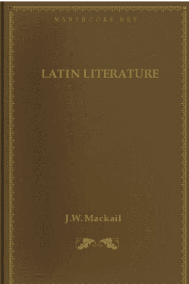

# 拉丁文学（经典重印本）



欢迎来到免费纯文本电子书的世界

自1971年以来，人类和计算机均可阅读的电子书

这些电子书由数千名志愿者准备！

## 作者

J. W. MACKAIL，曾任牛津大学巴利奥学院成员

已故的 William Sellar 教授为这一系列手册撰写了一部《拉丁文学史》。在他去世后，作为他的他的老学生之一，我受要求完成他所承担的工作，这本书现在是作为对我我亲爱的朋友和导师记忆的最后致敬而呈献的。J. W. M.

对于罗马人自己，在两百年后回顾，真正的文学开端似乎出现在第一次和第二次布匿战争之间的那一代。公元前241年的和平确保了一个时代，罗马共和国在这一时期为了在控制地中海世界的权力集团中占据一个稳固地位而斗争。现在这种地位已经获得；随着迦太压力的消除，罗马可以自由追随其殖民地和贸易的自然扩张。财富与和平是相对术语；在与迦太长期而精疲力竭的战争结束后的这种财富与和平中，罗马形成了一个阶层，他们不仅对希腊文学产生了某种兴趣，而且模糊地感觉到，作为最伟大的文明民族之一，拥有属于自己的、实质性的民族文化是他们的责任。

这种新的拉丁文学必须基于希腊文学，无需多言；几乎不可避免的是，其最早形式是以对这些希腊诗歌（史诗和戏剧）的翻译形式出现的，这些诗歌早已在整个希腊语世界确立了文化的共同基础。拉丁文学虽然比其他文学丰富，但并未逃脱所有文学的普遍规律，即必须从诗歌开始再转向散文。

到为止，据我们所能判断，本土拉丁诗歌局限于赞美歌和民谣，两者都具有乡村色彩。与之并列的是通俗表演，其中包含了戏剧的胚芽。这些表演的词始终被记录下来（这比怀疑要可靠得多）。

引用他时，正如此类引用的常态，它们更多是揭示了他对措辞的驾驭以及呈现抽离思想的力量，而非其更具严格意义上的戏剧特质。那种对辞藻的驾驭是惊叹的。从梅拉尼派作品中那月光般银色优美的诗句——

*Lumine sic tremulo terra et caura caerenda,*

到阿基琉斯那雷鸣般的誓言——

*Per ego deum sublimes umidas, oritur imburit saevo et spiritu—*

它们展示了拉丁语所能达到的几乎所有的美。两处引用可以表现他作为翻译者的身份。第一个是《奥利西斯的伊菲尼尼亚》序言中的一段问答片段，这是爱提克诗歌中最动人心且最浪漫的章节之一——

Agam.: Quid nocti viditer in altoiso caeli clipe?

Senex.: Temo subat col sublime atque etiam noctis iter,

这里的不同之处不在于词句与原作的效果完全不同，而在于在看似随机的变体中，恩尼乌斯产生了完全相同的丰富而奇特的效果。这绝非偶然，而是天才。同样，作为他在更平庸的叙述序列中的样本，我们可以选取《美狄亚亚》的序言，其中著名的希腊语原文随后紧随其后——

> _Utnam in nemore Pelio securius Caesar caecisset ab ad tram teres, Ne nide inchoanda exordium Coeptius, quae nunc nonator nomine Argo Argvi in ea dilecti Vecti petebam aramilet Colchis, imperio regio Regis, per dolum: Non nunquam eras mea domino effect pedem Medea, anima aegore, amico saucia._

初读这些行诗，它们对于欧陆语言的流利感来说可能显得粗涩且不优雅；但直到第二次甚至第三次阅读时，人们才会察觉到其中蕴含的一种独特而突兀的美。特别是对省音的欢快运用（在第八行，以及第五行中各一次），这是古代和现代拉丁语的特征。在拉丁语诗歌中，维吉尔是他最后也是最伟大的老师；它在维吉尔之后诗歌中的逐渐衰落，正如它在某些早期作品中的缺失一样，对诗歌的驾驭是致命的，而随着它在中世纪意大利诗歌中的重新出现，它再次回归。

在晚年经过多种文学形式的长期实践后，恩尼乌斯写下了他的宏伟历史著作——八卷《年史》，他在书中记录了从恩尼乌斯到达意大利到他那个时代的罗马国家事件和历史。我们在这里通过奈维乌斯展示了他；第一部主要归功于恩尼乌斯的天才和勤奋，语言的文学能力具有巨大的优势。不确定恩尼乌斯是否曾尝试开发本土韵律，这些韵律在他前者的作品中仍然僵硬且刻板；如果他这样做过，他一定已经放弃了。于是，他承担了重塑拉丁语以契合希腊六步格韵律的任务，他在史诗中的成功是如此定论，以至于两种形式之间的鸿沟再也没有被弥越。《年史》立即成为经典；它们受到埃德多人的赞誉，保持着最富节日且感应最强的罗马诗歌，在随后的几个世纪里，它们继续被阅读和崇仰，许多人都支持它们作为“第一”的主张。他用一种清醒而清晰的方案将其比作某些古老橡树构成的圣林，这种方案强调的是庄严的敬畏，而非美的魅力。西西罗多次对恩尼乌斯给予极高赞誉，承认了奥古斯塔时期诗人所拥有的那种缺陷，但这种强调并非毫无根据。卢克莱提斯的崇高致敬——“正如我们的恩尼乌斯在不朽的诗篇中所唱，他首次从美丽的赫利孔康山上带来了一圈常青叶的花环，在意大利各国中响彻闪耀”——对于一位在风格和考证上得益于恩尼乌斯的诗人来说，这种评价丝毫不亚。

《年史》何时丢失尚未知；在中世纪早期有关于它们存在的疑点迹象。现存的片段虽然总共几百行，但足以对诗人的风格和变化产生清晰的认识，并展现出卓越的广度与远见，这使得该诗成为罗马统治阶层中教养成员的公民智慧宝库，也是诗人眼中节奏与辞藻的宝藏。在那些著名的诗句中，如——

- Non cauponantes bellum belligerantes,
- Quem non ferro potuis portare me avuto,
- Ile vir had magnam cum se replenu-fide,
- Moribus antiquis res romana virisque

恩尼乌斯比维吉尔更具力度和分量地表达了傲慢的美德、敏锐而狭隘的政治直觉，正是这种直觉让这个小而挣扎的中意大利小成为了世界的仲裁；并不是卢克莱提斯对不存在爱国主义的世界的宏而忧郁视角，亦不是维吉尔对生死奥秘的深邃而迷人的借用，如此排他且确定地击中了罗马的基调。

拉丁史诗在恩尼乌斯手中的成功对于那个时代来说是如此的完全，以至于没有留下进一步发展的空间；在接下来的百年里，《年史》一直是唯一的一，但这种诗歌形式令人满意的成就，只有当一股新的希腊影响带来更高、更精的文学标准时，进步才能被实现或被渴望。这并不像悲剧那样，当舞台认为有了新材料，而供应在希腊语出现后才停止时，戏剧在华俗的音乐厅大师面前逐渐萎缩。恩修斯的侄子马尔库斯·帕基丘斯在他死后的一个世纪里写了戏剧，即使是伟大的作品也都具有时代特征，寥寥几部也令人哀叹；我们仍然能从中追溯到他的足迹。


# 卢基斯·阿夫拉尼与罗马喜剧传统

进入`/path/to/xxx`目录，找到`xxx.json`。

卢基斯·阿夫拉尼（`Lucius Afrani`）。他的中产阶级喜剧长久以来一直受欢迎；在他死百年后仍有他的剧作，霍拉斯（`Horace`）用温和的讽刺谈到了那些将他与米兰兰德列并论的狂热者。他的同时代昆图斯·阿塔（`Quintus Atta`，死于公元前77年，即苏拉死后发生彻底革命的一年）其成功很大程度上归功于演员罗西乌斯（`Roscius`），后者创造了一个在他时代之后仍持续了很久的传统。对于大众而言，喜剧（尽管他并未进入过度矫饰的时代）与那些表演相比显得温和，而他们则在统治阶层举行游行，以此作为换取选票的代价。在其他时代和喜剧中，时尚的情妇追随潮流。而那个我们在奥斯塔维安那些明快的速写中熟悉的年轻人，他陪着情人去的地方往往不是喜剧院，而是由芭蕾舞者和角斗士所提供的、最刺激的肉体奇观。这群沉迷于文学的小阶级对他们几乎没有反作用作用，无法阻止他们重复希腊剧作的致命习惯；而爱提克新喜剧（作为早期尝试性戏剧艺术的必然且恰当的产物）仍然这种自身正逐渐背离的艺术的支柱。

## 文本传承与代表作家

我们之所以以相当完整的形式拥有这两位最著名剧作家的作品，并拥有许多同时代及后继者的非同寻常的碎片，是归于某种偶然或一系列我们无法追溯的偶然，我们也不得从中得出过于精确的结论。普劳图斯（`Plautus`）是全心投入喜剧的作家中最早、或许也是作品量最多的作家。在他与特伦斯（`Terence`）之间有一段空缺，由另一位喜剧作家凯西利乌斯（`Caecilius`）填充，据说他的作品融合了每种优点；在特伦斯死后，他的作品由图尔皮杜斯（`Turpidus`）沿着同样的路线继续创作，直到帝国早期时期几乎没有减少。毫无疑问，普劳图斯和特伦斯充分代表了拉丁语原声剧的力量和分量。与阿里斯多芬斯（`Aristophanes`）的元素相结合，自中世纪开始以来，他们实际上是古代喜剧的唯一代表，也是现代喜剧的唯一模型。

## 提图斯·普劳图斯生平与作品

提图斯·普劳图斯（`Titus Plautus`）于公元前254出生于翁布里亚的塔西纳（`Tarsina`），出身于贫门，处于内维乌斯（`Naevvius`）和恩纽乌斯（`Ennius`）之间。他由于某种原因去当一名舞台木工。他本人通过最艰苦的体力劳动从事剧作创作；尽管他在拉丁语中展现出的那种无穷无尽的原初精神解释了他为何能将非凡的文学创造力与艰困贫穷的生活相结合；但他何时以及如何接受的教育，以及他在拉丁语韵律和措辞上令人惊讶的精通，这仍然是一个谜团。在他留下的百零三部喜剧中，除一部外，最后这些作品都被瓦罗（`Varro`）称为“被否弃的”，只有二十一部被列为真作。最后这些被称为《地毯包》（`Vidularia`）或《提包者》（`The Carpet-bag`）的作品在在中世纪失传了；然而，其中一些仍然存在，可能是在瓦罗时代是以删减或残缺的剧本形式存在的。

## 创作特色与希腊原作

这些作品中展现的构建力量，无疑是普劳图斯本人以及他的希腊原作——菲隆（`Philon`）、迪皮卢斯（`Dipilus`）和米兰德列——的体现。但我们并不需要现代国家向我们保证，通过将一种语言适应另一种语言，仅仅为了保持复数形式不受损就意味着超常的技巧或良心。当普劳图斯处于最佳状态时——在《奥拉利亚》（`Aularia`）、《巴克凯》（`Bacchaeae`）或《鲁登斯》（`Rudens`）中，以及最著名的《俘虏》（`Captivi`）中——他很少为了情节的利益或为了对话的丰富与生动而在其中注入情感。

除了他的精通之外，普劳图斯在他宽广的风格上还有进一步的卓越之处。他的原作是否跨越了雅典的新喜剧尚不确定；但在其框架内，他可以在世界范围内自由穿梭，现存的二十部作品包含了几乎所有可以被冠以“喜剧”之称的剧种样本。在第一个列表中，著名的《阿菲特吕翁》（`Amphitruon`）是唯一幸存的滑稽剧。希腊人称此类剧为[希语: iloragodia_odia]——“悲喜剧剧”（`Tragedie-bouffe`）是最接近的现代等价词：“悲喜剧”（`tragico-comedia`）是普劳图斯自己在序言中描述它的名称。《阿菲特吕翁》直到现在仍然是这种类型最精湛的范本之一。莫里的版本对原作几乎没有改进，但作为经典焕发了新的生命力；这部法国剧仅能传达出普劳图斯手中对话的精神和灵活性的不完美构想。

## 代表剧目分析

另一种类型是紧随《阿菲特吕翁》之后、被公认为卓越的作品《俘虏》（`Captivi`）。这是一部情感喜剧，没有女性角色，因此没有其他剧中那种（我们遗憾地不得不看到的）粗俗的丑陋修饰。情节的发展赢得了所有评论家的高度赞誉，并证明了结声词中的自豪——*Hausius paucas poetaer comediaias*，作者对这部作品的赞美——

**Non pertactate fast est neque ut ceterum, Nec specirosunt sunt unus immortables, Hicque perieros non est nec merit Maque miles glorius—*

这实际上是对普劳图斯其他剧组的严厉谴责。《卡西娜》（`Casina`）和《鲁莽者》（`Truculentas`）（后者，正如我们从西西那里所知，是作者特别宠爱的）仅仅是色情研究，只有诗人那永不熄灭的精神使其不至于令人作呕；而《驴子》（`Asinaria`）、《库西奥》（`Curcio`）和《自夸的军兵》（`Miles Glorios`）只是有着细细情节线支撑的粗俗脸谱。后者取决于剧名主角角色略显单调且夸张的性格；而《伪装者》（`Pseudolus`）作为一部内容更丰富的剧作，在韵律和措辞上有着令人惊讶的精通；巴里乌斯（`Ballio`）是一个在无耻和变幻无常上让人联想到史塔的角色。

另一种流调，中产阶级生活的家庭喜剧始于其最成功的作品之一——《特里努斯》（`Trinumus`）或《三分钱》。由于其人物在情感上非常独特，它充满了生命力，且不乏优雅与魅力。在那些狂欢剧之后，回归到常识和良好的情感是一种慰藉。它与《巴克凯》形成了有趣的对比，后者回归了诗人的世界，但其情节冲突的华丽使其在喜剧中处于高地位。

另外两部作品的独特在于，尽管在结构或制作上并未超越平庸，但其中一部的情节核心和另一部的人物塑造是天才般的发明。这两者的希腊原作是皆知的；我们显然应该把普劳图斯本人，归功于《奥拉利亚》（`Auraria`）和《梅纳基米》（`Menachemi`）。《奥拉利亚》或《黄金》，是一个完整的中产阶级故事，是老者尤基诺（`Euchino`）形象的框架——一个充满生命力和光彩的描写，与莫里的哈帕贡（`Harpagon`）原作同样著名。《梅纳基米》或《错误喜剧》，无论情节或人物有何大创意，都依赖于两个童年失散的双胞胎兄弟在同一城市重逢所引发的无穷幽默机会。

## 《鲁登斯》与浪漫情调

普劳图斯的喜剧中还有一部作品值得特别注意，它以不同的流调、并以比所有提到的作品不同的语调创作——这部迷人的浪漫喜剧被称为《鲁登斯》（`Rudens`）或《缆绳》（`Cable`），更贴切的名字是《风暴》（`The Tempest`）。它被放在《俘虏》的情感基调中；但它有一种节奏，在拉丁语中更为罕见。由于一种偶然，而非任何刻意的技巧努力，狄菲洛（`Diph`）的翻译保留了其中某种不可辨认的希腊氛围——《奥德赛》的氛围、西奥克里特的牧歌诗，以及《希腊选集》中数百首小诗的氛围，在这些诗行中，海洋的微声和轰鸣引导着非洲海岸的昔里涅（`Cyrene`）。

我进入天空，也进入内心。我在凡间穿行。

这些开篇诗句中的浪漫情调贯穿了整部喜剧。在这些剧中，通过各处的点睛之笔，场景在我们眼前不断呈现：那是午夜风暴后灿烂阳光下的岩石岸边，拥有和蔼女祭司的寺庙，以及湖沼芦苇旁重新铺设瓦片的乡村别墅，其前方是散落着茴香的孤独牧场。而当《冬天的故事》剩下的部分中，配角人物是渔民而非牧羊人；更多的是一部其自身本身已流传已久的剧作，《提尔斯王子佩里克斯》。

## 余论与文学地位

普劳提斯（`Plautus`）的其他作品可以不加注意地忽略。它们包含了对某一主题的三种变体，这个主题在趣味上已变得极其乏味，即《斯卡宾的四果》——《埃皮库斯》、《莫斯泰拉里亚》和《佩尔萨》；《波埃卢》是一个平庸的剧，其独特的趣味在于包含了太太语的段落，这为剧作家的推测提供了诱人的领域；另外两部是《商人》和《斯斯图斯》，对话混乱乏味；还有一部残缺的《奇斯蒂拉里亚》（或《旅行箱》），如果它遭遇了《地毯包》那样的命运，绝不会被人遗忘。

其中一部的幽默感对于我们来说仅仅是浅薄的；而且在所有文学形式中，喜剧是最不利持久的。值得庆的是，普劳提斯如今在学者内部之外也被广泛阅读；他在这里之所以受到关注，主要是因为他作为语言研究对象具有非凡的产出和趣味。然而，他始终是文学史上极具影响力的作家之一。悲剧在后期雅典喜剧的巨著中包含了大量片段，这将普劳提斯推到了与亚里士多德平行的地位，成为罗马文学复兴的典范；因为那部分文学（是更为重要的）其灵感并非源自拉丁语，相反，普劳提斯是一个独特且极具价值的源，在他所属的文学领域，他的地位等同于西西罗或维吉尔。


# 普劳提斯概述

进入第二次布匿战争的叙述中，根据我们从迦太政权那里获得的信息，特伦提斯·卢卡努斯（Terencius Lucanus）出生于迦太，几年后，在意想不到的变故中作为男奴隶抵达罗马，并成为一名富有且受过教育的元老。从他那里产生了普布库斯·特尔修（Publicus Tercius）的名字。

罗马贵族的一个小圈子——其中许多位高权重的人对保留的东西非常谨慎——接纳了特伦斯进入他们的行列；正如西庇所说，他是盖斯·拉埃留斯（Gaius Laelius）的天才之友，因此广为人知。在共和国的头等公民中，这个知识分子团体将其精力致力于拉丁语的净化和精炼。据说，特伦斯喜剧的草稿会读给他们听，语言和风格会受到细致入微的批评：传闻说这些剧是写得很匆忙的，而且特伦斯本人并没有启发性，从未费心去克服记忆的衰退。

## 罗马文学的转折与希腊模仿

特伦斯喜剧处于罗马文学的转折点。然而，普劳提斯和恩纽斯尽管很大程度上借鉴了希腊语，但他们都融入了一种本质上属于处于增长浪潮中的新文学风格和精神。对希腊的模仿并非终点；随后，诗人们不断放弃希腊语，转而形成他们自己的新风格，他们又陷入了这种风格中，他们对发明或表达的不完美掌握在他们面前崩塌了。

在特伦斯的圈子里，产生了一种致命的学说，即希腊风格本身就是目的，通往完美的道路不在于发展任何原创特质，而在于忠实地复制另一种语言和文明的面貌。自然付诸了迅速而确定的报复。情感的准确性和辞藻的流畅优雅成为了卓越的标准；而当时仍然局限于统治阶级及其随从者的拉丁文学，则从根源上遭受了打击。

在特伦斯身上（正如在英国作家身上），这种平庸确实是好的——一种带有优雅和魅力的平庸。辞藻的流畅、语言的精纯，是其本身就值得赞叹的品质，并伴随着其他优点；事实上，并非戏剧张力或构建力量，而是对人物细致细腻的刻画，以及一种优雅（urbanity），这个词表达了一种世界对此负有深厚债务的特质。

## 特伦斯之后的发展

普劳提斯的成功在两种情况下都可能避免了不满，而只有通过不满才能使新的进步成为可能；然而，当时只有管理层的努力成功吸引了观众。特伦斯的作品是伟大的之一，因为第一次被要求向公众朗读时，这六部剧是在万神山之母的春天制作的，那时戏剧还没有面临竞争。在特伦斯去世后，拉丁语的发展一度停止了。他的继任者仅仅是阴影中的。艺术中残存的生命力通过力量的力量，这种力量在多年以后保持着真正的受欢迎，但从未作为严肃价值的文学占据地位。

即使是这种法律喜剧，也在表演——哑剧剧、角斗士、笑话——的持续竞争中逐渐移动。到此时，文学本能开始探索新的渠道。不仅散文变得一年比一年丰富，罗马人在散文和诗歌之间波动的混合体裁（讽刺剧流派）正处于发明过程中。小说像现在的戏剧一样多样化，它在操作的便利和多样性上提供了巨大且生动的优势，它简单且廉价，不依赖公众和评论家的正式表演，就可以创作和培养。

## 序言与拉丁语发展

这部生机勃勃且幽默的喜剧的序言——那句著名的台词——出自老父亲的崛起。特伦斯的序言（附带在他所有的作品中）从他们展示的作者性格来看，确实非常有趣。不能认为特伦斯像德莱顿那样活到了轻松且受尊敬的晚年，他的声誉仍然建立在这些早期作品上。为了更充分地考虑这种新发明，最好停一下，以作为必要的补充，概述拉丁语是如何发展的：是对希腊模式的回应，还是在一个更本土、独立的过程中。

## 法律与散文的源头

法律和散文是拉丁人的两大伟大成就；拉丁散文的两个源头，一方面是法典文本和法学家的注释，另一方面是罗马内政史和外部扩张与外交。这两者的起源都比拉丁古迹所能追溯的要得多。两个固定点仍然作为传说时代的标志，在它们之后进入是不可能的。被称为《十二表法》的法典（法书中保留了大量片段）根据接受的年表，是在公元前450年制定的。六年后，高卢人对罗马的掠夺导致了几乎所有公共和私人记录的毁灭，而从那时起，才出现了如执政官记录、祭司书籍、法令和条约汇集等可以供分析者使用的材料。罗马法律和历史领域从很早时期就有某种程度的活动，这是显而易见的；但在布匿战争时期，该领域产生的内容从未能被很好地归类。

## 早期历史写作

在散文史上，第一步是在希腊模式的帮助下谨慎迈出的。最古老且最重要的历史学家昆昆·法布乌斯·皮图斯（Quint Fabius Pict），内维乌斯和恩纽斯的同代，用希腊语写作，尽管他的作品有一个拉丁语版本确实存在，是由他本人还是其他人执行尚不清楚，但它是唯一的同时代文献。语法学家引用它的片段作为语言的范例。他的历史范围大致涵盖了两位伟大同时代诗人的时代。它是一段从埃涅阿传奇登陆意大利开始的事件叙述，变得更加虔诚，并详细描述了作者自己时代的事件，充满了丰富的知识。根据判断，该作品结束于第二次布匿战争的结束；波波留因为对皮图斯的偏见和不准确感到不满，写了第一次布匿战争的历史，他是主要的权威著作遵循了李维（Livy）早期几十年的风格。

皮克托（Pictor）的同代人卢基斯·辛丘乌斯·阿利门图斯（Lucius Cincius Alimentus）在反对汉尼拔的战争中指挥罗马军队，他的自传也使用了希腊语，该时期的许多其他士兵和政治家也是如此。直到半世纪后，我们才知道谁是用拉丁语写作的。他们最早的一位卢基斯·卡西乌斯·赫米纳（Lucius Cassius Hemina），在特伦斯去世与格拉古兄弟复兴之间撰写了他的年史；一位更杰出的执政卢基斯·卡尔普尼乌斯·皮索·弗鲁古（Lucius Calpurnius Piso Frug），是广为人知的提伯留斯·格拉古民官期间的革命领袖之一，他作为年史作者的身份闻名，这些年史无疑写得坦诚而简洁。奥卢斯·盖鲁斯（Aulus Gellus）用他所使用的“质朴而优雅”这一美誉，与西西罗（Cicero）所蔑弃的“贫瘠”这一贬义词并不矛盾。

那时的历史或许是用希腊语书写的——事实上，对于任何对这种语言足够熟练的罗马人来说，每种历史写作风格的范本都触手可及。在法学领域，情况则不同。在这里，拉丁语文本不受外国影响，而罗马法的发展在古典时期之后呈现了一条直接且连续的轨迹，罗马本身也逐渐成为早期帝国的中心。最早对半罗马法令集（即后来的实法之基础）撰写注释的法学家，被归溯于萨姆尼战争时期，远在罗马成为地中海大国之前。公元前200年左右，两位兄弟——普布利乌斯（Publius）和塞克斯图斯·埃提乌斯（Sextus Aethius）分别担任执政官和监察官，击败了三盟罗马人，此后被记忆为“*cambula*年”（共同执政年），这一传统在后世世纪中得以延续。五年后，在小西庇执政那年，显赫的穆齐·塞沃拉（Muci Scevola）家族谱系开启。该家族中的三位成员每位都是杰出的法学家，在格拉古兄弟与苏拉（Sulla）之间的半个世纪里升任执政官。他们最后也是最伟大的一位比同时代任何其他公民更能代表理想中的罗马。他既是一位卓越的行政官员，又是一个兼具公私美德的人；在马略留执官时期，他在维斯塔女神坛前被刺杀，被普遍认为是那个恐怖时代最可怕的事件。他那关于民法的、巨巨且详尽的著作成为了几个世纪的教科书，并成为所有晚期罗马法学家著作的基础。

## 法学家与演说家

在小塞沃拉（the younger Scevola）身上，法学家与演说家的结合并为罕见；从早期开始，法学家和诉讼人这两个职业就被严格区分开，尽管两者都是通往官职的道路。他的父亲和表兄弟（三人组中的另外两个）在演辞方面都不出名，他父亲的两位伟大同辈——同样出版过民法著作的马尼乌斯·马尼利斯（Mani Manillis）和马库斯·布鲁图斯（Marcus Brutus）也是如此。演辞的最高领域显然在政治领域而非纯粹的法律领域；而罗马独特的传统——一种大多由全民投票选出的寡头政治制——使得演辞实践对每位政治家来说不仅是需要，更是一种修养。一种归功于共和国早期最伟大政治家阿皮乌斯·克劳狄斯·西撒（Appius Claudius Caesar）的成熟传统，他反对与西庇鲁和和的名演说在西西罗时代被视为罗马最珍贵的文学财富之一。从他那里，书面演说的传承开始了，最初是一股细流，随后在老卡托（the elder Cato）的作品中汇聚成更大的规模。

## 卡托与本土散文

在与汉尼拔战争后的半个世纪历史中，卡托无疑是最引人注目的人物。只有作为一位文学家，他会被注意到；而一个文学家的性格，或许并不是他最被铭记或赞誉的特质。然而，我们这位愤世俗且不可服的人，带着他粗犷的幽默感，却拥有政治才能，他极度的保守主义产生了大量的著作，这些著作为后世奠定并倾向于一套独特且重要的批判教条和文学传统。正如我们已经看到的，来自希腊的影响已经开始彻底渗透罗马的古典文学。面对这种希腊影响（无论是在事务还是习俗上），卡托一生都用他强大的意图和尖利的辞汇与之斗争；最符合这个人性格的特点是，他在晚年亲自学习了希腊语，并深读了希腊文学杰作，由于他足够诚实和聪明，无法拒绝承认这一点。

当许多当代文学正投身于对希腊模式的致命模仿，并将拉丁语强迫进入外国形式的桎梏时，卡托向一种纯洁的发展提供了强力动力，尽管这种发展显得有些狭隘和严苛。本土散文（他可能自由地称之为调用者）由一大庞而强大的拉丁语作家一直保留到了罗马末日。如果不加干预，它会产生什么结果，只能推测；在拉丁语文学的主流中，希腊的影响总体上是胜利的；卡托处于失败的一方（如果可以引用著名的卢卡（[Lucan]的话），而天才们则选择了另一方。


## 卡托的演说与著作

卡托的演说在西西罗时代存有一百五十篇，而现在已遗失，仅剩下一些不足道的碎片。碎片显示了高超的演说天赋：敏锐、幽默、持久的活力和克制的激情；一位晚期但精通拉丁语的人评价卡托道：“有些混乱且生硬，但正如演说所能达到的那样有力生动。我们在某些原作中遭受了损失，拉丁语的，`magnere`——编年史家的解构方法，交织着对各种亚地理、民族学的插叙——以及他自己旅行和经历的回忆。他没有试图保持任何尊严或连续性。他方法的缺失成就了这一工作，由于其内容丰富，引起了后世历史者的渴望：对于他进入细节的部分，他们是如何想的。”

卡托唯一一部完整保存的著作是传统上被称为《农事》`De Re Rustica`或《农业文化》，`De Agri Cultura`。它是少数具有平实教导性的著作，主要是为一位在坎帕尼亚拥有农场的朋友撰写的。它由一系列简洁精要的指令组成，没有任何艺术追求，但充满了严厉的智慧，并偶尔闪过干涩的幽默。从其中早期章节的一个简短摘录来看毫无趣味，既展示了实用的拉丁语风格，也展示了维吉尔《农歌》中宏伟华丽装饰的基础。

## 西庇罗圈子与历史写作

且影响深远。在这个圈子里，罗马历史开始用拉丁语记录。`Cassius Hemina`和`Lucius Calpurnius Piso`已被提到；与西庇罗关系更紧密的是拉埃留斯的女婿`Scipio Gaius Fannius`以及`Lucius Caelius Antipater`，他们都在清晰且丰富的辞藻以及客观公正性方面，达到了罗马历史此前尚未达到的高度。文学文化成为政治家的常备装备；在著名的哲学家中，后来的柱廊大师、罗得的`Pacnaeus of Rhodes`在上层阶中带来了希腊思想和雅典风格的提炼与启蒙。

## 卢基斯与讽刺诗的创立

与此同时，在这个西庇罗圈子里，出现了一个极具原创性和力量的新人物，他是某种文学的创始人，罗马人自豪地声称这种文学是完全本土且原创的。`Gaius Lucius`是一个富裕骑士阶族的成员，他能与他所远离的贵族平起相处；而元老院家族的成员几乎无法不将大部分精力和精力投入政治和行政事务。在`Terence`之后，他是西庇罗朋友中文学史上最卓越、最显赫的人物。他发明并普及的文学形式，尤其是其中一种，被证明适用于拉丁语。他的才华使其作品被称为《谈话集》`Sermones`，即“谈话”——这个名字——

世界在最早的形式中，这个词曾被指代不规则的舞台模式，包括歌曲、故事和半戏剧性的插曲，这些内容遵循世俗节日上叙述艺术家的剧目。将该名称延伸到卢基斯`Lucius`，表明文学现在正上升到与口语同等重要且流行的程度。

`Horace`对卢基斯那种不加装饰且严谨的创作给予了极高的评价。在三十卷《讽刺诗》中，很少有篇幅较长的片段流存至今；或许其中最好的部分如果存在的话，早已流失了其内容。但他作品的遗失是一个真诚的遗憾，因为它生动详细地描绘了当时的社会生活和时代兴趣，正如奥古斯塔时代的罗马《讽刺诗》。他对当时政要的批评是直率且毫不留情的；他对诗歌中的既有声誉并不像对公共生活中的声誉那样。他的大部分作品是关于饮食的描述；许多是关于西庇罗著名的东方远征的生动记录，他访问时仅带着五名随从，却会见了埃及和亚洲的宫廷，并由随从参加。另一部是霍拉斯关于前往布伦迪西乌姆`Brundisium`的旅途中，详细记录了琐碎的冒险以及旅馆中的笑谈。许多片段仍留在了那个世纪的文学争论中；语法学更多地显示了将希腊学派学说转化为日常生活语言的开端，这种转化在后一个世纪的诗人和散文作家那里被完成。但，所有这一切，《讽刺诗》在最完全的意义上是一部自传。关于霍拉斯那段著名的描述，对英语读者来说更为广为人知，是因为`Boswell`在其《约翰逊传》的扉页上以精妙的安排将其放置——

> _Qu fit et unus Omnia Tua patet velit descripta Table vita senis—_

表达了卢基斯的真实本质。他发明了一种文学方法，虽不算伟大，但在趣味和魅力上不亚于任何其他，且为了其完美，需要一种稀有而精致的天赋。不仅是霍拉斯，也不是霍拉斯之后所有的讽刺作家，连`Montaigne`和`Pepys`也属于卢基斯的学派。

## 年代背景与雄辞黄金时代

这就是年轻的西庇罗，他形成于幸福的年代——正如后世回望时似乎是那样——介于皮德纳战战`Pydna`确立罗马霸权与提庇伯留·格拉古`Tiberius Gracchus`的革命运动之间。随后是五十年的动荡不安，并以社会战争以及马略留和辛纳统治下的恐怖统治达到顶峰，最终在苏拉`Sulla`的反革命中通过血海平定。这是区分西庇罗时代与西塞罗时代的时期。自然地，除了雄辞这一个领域外，这并不是一个文学创作丰的时期；这里只需要或可能提供该时期最著名的作者，以及罗马文学在此期间继续推进的路线的简要说明。

在雄辞方面，这一时期被公认为代表了拉丁成就的黄金时代。格拉古兄弟两人的口才是他们伟大的政治武器；盖斯的口才在激发一切所知事物方面最强大；他的死甚至引起了激进政治政敌的哀悼，这是对拉丁文学的巨大损失。在下一代，雄辞的文学完美性由`Marcus Antonius`和`Lucius Crassus`推向了更高的点。他们都获得了共和国所能授予的最高荣誉。幸运的是，他们的风格恰好互补；在这里，两者都是罗马所达到的最高智力成就。到此时，雄辞艺术已经经过仔细研究并被简化为科学著作。其中一部《赫埃里尼乌斯修辞学》`Rhetoric de Herenium`仍流传。它是由`Quintus Cicero`写得最清晰，他是西塞罗的同，作品被归于他。我不怀疑它的保存归功于这种被模糊的传统。前两本书很大程度上被西塞罗在他青少年时期开始创作的修辞著作《论发明》`De Inventione`引用。

## 历史与古物研究

这一时期的拉丁历史取得了显著进展。政治家写自己的生活和时代回忆录是常有的；许多其他不那么著名的人，独裁者苏拉在去世时留下了两部由他的秘书出版的作品。在正史中，最重要的名字是`Claudius Quadrarius`。他的作品与早期盟友的作品的区别在于它跳过了传奇时期，从最早真实的文献开始；研究和批判判断达到了唯萨卢`Sallust`才达的高度。他的风格深受所有古代作者的影响，因此该时期大量的碎片，包括公元前361年提图斯·托尔奎纽斯`Titus Torquinius`与高尔部落之间单挑斗的著名描述，保存在`Aullius Gellius`和帝国后期作者的引用中。克劳狄斯的《编年史》`Annals`价值大于体积，如他同代瓦莱留斯`Valerius`的作品，后者构成了李维早期书籍的主要基础，并在当更可靠的权威可用时，被李维大量用于后期。这一时期的其他历史学家，西森纳`Sisenna`和马肯`Macon`被忽视了——前者太古老，后者太散漫且修辞化，无法具有文学持久性。

除了历史作家之外，还有古物研究家，他们在这一时期大量写作，他们的著作填满了图书馆，西塞罗时代，瓦罗`Varro`就从那里汇编了了他的里程碑式著作。关于农耕、家庭经济和其他务实主题的卡托作者可能非常多，以及语法学家和语言学家，他们的作品构成了瓦罗图书馆的两个大部分部分。所有的散文都充满了活力和高度；西塞罗、凯撒和萨卢斯时代的完全文学完美，或许如未来所预见的那样已经获得了成就。

## 拉丁诗歌的转型

拉丁诗歌曾处于悬而未决的状态。第一波大的希腊式力量在恩纽乌斯`Ennius`身上耗尽了。随后的诗人证明了诗歌形式不再是表达思想的必然，正如在拉丁诗歌的早期那样。这里的诗歌必须，说来说，是为了自身而存在，直到某种新的传统的形成，为各种文学表达提供了载体。在我们的诗歌开头，我们可以注意到格奈乌斯·马提乌`Gnaeus Matius`将《伊利亚乡村》译成六音步，以及同样无名的莱维乌斯·梅莱尔苏斯`Laevius Melelsus`对希腊抒情诗的早期尝试，这预示了拉丁诗歌所感受到的增长；但无论是这些，还是后期由于早期时代风尚残存而偶尔产出的悲剧，对于其自身而言都没有重要性。当西塞罗时代的诗人和散文作家在名声上同样是不朽的，后者只是广阔和谐发展的巅峰，而前者，尽管处于其中但独立于新文学时代的开端，像黑暗中的星光一样闪烁、闪耀，这两个永恒的

卢克莱提乌与卡图卢斯的光芒。


# 西塞罗时代

西塞罗时代是一个广为人知的术语，标志着文学史的巅峰时期之一。虽然其核心和晚期阶段已精确确定，但其起始时间却界限模糊。西塞罗出生于公元前106年，那是尤古尔塔被最终征服的一年，也是奥兰日那场惨烈的坎布里人战败前的一年；他于公元前43年12月在三头政治执政期间逝世。他的公众生涯持续到苏拉的独裁时期；从那时起，直到凯撒时期的庞庇以现代形式重建元老院宪法，这一时代的跨度在某一种情况下都接近四十年。在古代、甚至在现代历史上，很少有一个时期像这样充满趣味性，或被如此充分且亲密地为人所知。与西塞罗时代的罗马相比，早期的相对晦涩，对于现代英语读者来说，就像安妮女王时期的伦敦之于现代法语读者来说，就像拉丁语的奎兹巴黎一样。我们仍然能不加修饰地观察到它政治的日常波动、社会的流言蜚语与丑闻，以及私人信件或法律揭露中所展现的家庭生活的瞬息时尚。在这个灯火辉煌的世界中心，其最卓越的人物之一却笼罩在几乎完全的黑暗之中。

卢克莱提乌的诗《物论》`On the Nature of Things`不仅展现了非凡的天华并开启了拉丁诗歌的新高度，更向世界展示了几乎无尽的一切；而关于作者生，尽管留下了许多关于这位伟大天才的记录，但通过后世评论者只能找出一两个可疑且孤立的事实。圣杰罗姆纪史中有一句实际上总结了我们所有信息的句子如下，位于公元前94年下——

> Titus Lucretius poeta nascitur, a postulo foro virsum cum aliquho per interv insania inquestris scopet poeta Cicero emendavit, propria se manu interfectio anno aestim xiii.—

这句话虽然简练直接，但其中的每一个从句都引发了不同层次的争议。卢克莱提乌是在那一年出生的吗？还是说另一种传统——将他的死亡与维吉尔青少年时期的特定事件联系起来——使他变得早几年或晚几年？他是否曾因诗歌散文或其他原因丧失了理智？一首位列天才杰作之首的诗，是否能在古代清晰的诗行中构建成如此稳定的结构——因为这不属于像霍拉斯或克拉苏斯那样的抒情诗部分？西塞罗是否参与了这首未完成诗歌的编辑？如果是，西塞罗——是马库斯还是昆图斯？——无论何种情况，在他的信件或该时期的任何著作中都没有这一事实的记录？这些问题可能无法解决，而关于卢克莱提乌的记载使得他的一生和诗歌仍然完全隐藏。我们没有更好的依据，只有西塞罗公元前54年的一封信件中偶然的提及可以参考——它提到的是“诗歌”，而不是我们所知的那首特定的诗；而且大多数编辑者都认为这首诗的文本是损毁的，必须标记为插入，尽管他们对于应该插入的那个特定句子的原始版本存在分歧。奥古斯图时代的诗人们完全不了解他们的前驱，这并不令人惊讶，因为这可能只是他们对凯撒时代作家（无论是政治散文还是其他）普遍采取的这种沉默的一部分。卢克莱提乌永远生、毫不吝啬，尽管在赞美时并不刻加甄别，但他出现在一份诗歌名单时，仅有一句模糊的联句。在帝国的反动性周期中，卢克莱提乌得到了认可；但根据塔西的记载，将他列为卢克莱提乌的批评家们，可以合理地怀疑他们这样做是出于任性而非理性的信念。如果诗歌本身认为这种偏好除了某种古董式的学问之外毫无意义，就像同一时期复兴早期悲剧家的戏剧那样，那么保存它的运气和稀缺的赞助者们表明，这种观点无论对错，至少是荒谬且不容辩驳的。对于《物论》`De Rerum Natura`，我们面对的不是一项非凡的文学成就，还有一个深邃且才华横溢的思想，而现代物理和历史科学的进步已充分认可了这一点。

## 希腊影响与教诲诗

拉丁诗歌中最早的希腊影响早已耗尽；而新一代人的潮流是崇佩和研究所有衰落时期的希腊诗人，这些人通常在没有任何实质性不公的情况下被统称为“亚历山大派”。这种诗歌的共同特征是博大学识以及与自然的疏远。它是在图书馆里写就；通过文学和艺术传统这种高度色彩的媒介来观察世界。这种时代品味所要求的、费力追求完美的卓越，通常倾华在微小的主题上，如同在象牙上耐心地雕刻。亚历山大派的一支在很大程度上遵循了教诲派——阿拉拉图斯、尼坎德、欧福丰以及许多不那么成名的作家。西塞罗在晚年对同代人喜爱欧福丰的口味表现出些许蔑视。但他自己年轻时，确实将阿拉拉图斯的《自然现象》`Phaomena`翻译成了极其精炼且优美的韵律诗。

虽然受到这种时代潮流的影响，但转向了更古老、更高贵的典范——希腊语的荷马和恩培多克勒，以及拉丁语的恩尼乌斯——卢克莱提乌引入了受伊壁鸠派哲学的、处理生活与自然的教诲诗歌。他的一生都在为了完成他的终极著作。在某些地方被讨论但未给出；某些段落被重复；但从本质上说，在《埃涅德纪》的情况下，我们面对的是这首诗，并知道它本完全可以通过充分的修订得到改进。

作为纯文学，《物论》具有教诲诗所有不可分割的缺陷，且是一首不仅是教诲而且具有论证性的诗，在某些部分极具争议。这些困难从未被诗歌稍微平滑或覆盖。作为老师，他是严肃认真的；作为论证者，他的首要目标是反驳和说服。诗歌的优雅从未被允许进入论证的充分展开。诗的大部分是通过纯粹的手法锻造成韵律的复杂逻辑链。诗人热烈的想象力在难以驯服的材料中挣扎，将其转化为完美形式的纯金属。他在诗第四部分的序言清晰地展示了对艺术的态度。

_Avia Pieridumo regio nulla ante Trito sol; iuvat ingenio acedes fontes Auque haiere neque decerse Inmeno ego capit idem coronam Unde pris milli velaris mutant Musae: Primum quod magnum deus de rebus, et artis Religium animo nodimus expergo, Deinde quod esse de rem tacita jungit Carmina, musae contiguens cecta le_

## 伊壁鸠派哲学的吸引力

对于我们的时代而言，伊壁鲁派哲学具有双重吸引力。它不仅是一种关于生活和行为的哲学——它努力将生活和行为置于确定的物理规律之下，这使他构建了一套极其详尽且精妙的自然哲学体系，部分基于真正可靠的假设，部分源于对现象的巧妙联系，而且仍然极具趣味和价值。对于伊壁鲁派者以及所有古代思想家来说，他们现在所理解的科学方法是未知的；一系列统一的概括无论多么辉煌和敏锐，都不是通往真理的真正途径。但令人惊讶的事实是，现代许多最重要的发现，都曾被卢克莱提乌暗示或陈述过。原子学说的大纲已被接受为主要真理；在所有重要特征上，它都优于17世纪以前存在的任何宇宙理论。从这个角度看，卢克莱提乌领先于牛顿。在化学亲和力理论上，他的最终观点与当代顶尖物理学家的观点严格一致。科学的核心功能——将表象现象还原为单一规律——对他而言并非怀疑或不确定的对象。

走向质量的进步，我们知道两点同样不可或缺：真正的科学方法和富有想象力的洞察力。前者主要是现代世界的产物，现在卢克莱提乌在此方面占据优势；但在后者方面，他是无可比拟的，甚至是无与伦比。这在科学的另一个领域表现得更为清楚，该领域在过去几代中以人类学取得了巨大成就。二十年前，是《自然论》`De R Natura`的第一本书引发了科学界最大的热情。现在原子理论已进入公认教条的行列，而在第五书中对地球生命之光、人类演化以及人类社会进步的辉煌速写，是他科学想象力最令人惊叹的部分。卢克莱提乌作为一个生活在高度文明社会中的罗马贵族，却依然受到原始野性本能的滋养。他以一种第一次看到这一切的人的眼光，观察日常生活的平凡过程——织造、木工、金属加工，甚至是像抛光大理石表面这类特殊的手工艺艺术。没有任何事因熟悉而对他隐藏。凭借这种绝对的视觉清晰度，他毫不费力地让自己回到史前状态和早期人类的荒野生活中。

更进一步，他穿透了记忆的缺陷，看到了被热带雨林环绕的地球，那里所有奇异的生命形式在永恒夏日的闷热中推挤并为生存而竞争。在千种盛放又凋零的事物中，原始人类虚弱的形态脱颖而出：没有火，没有衣服，没有发音的语言。在多风的午夜，世界在黑暗中潜行者掠食者的叫声中颤抖，他蜷缩在落叶中，等待黎明的绽放。前景在他周围变得清晰。在风风森林中，树枝相互摩擦，结着红色的石南花；他采摘并带回洞穴中。当风雨击打时，火之诞生点燃彻夜，他汇聚了内心的另一个奇妙发明——仅仅因为神秘的符号。从这一点开始，人类种充满了各种可能性，他给出的答案如此真实，且无与伦比。如果我们考虑到卢克莱提乌在重建这段失落的历史时付出的努力，他的想象力简直是神迹。即使对于人类进步的后期阶段，他也主要依靠那双看透表面、直文明基础结构的眼睛。在他实际观察范围内并没有野蛮生活。他处于一个不可能时代的传统，与当时尚无法理解的原始传说碎片之间（这些碎片如今正通过严密的分析揭示其秘密）。再往回溯，在跨越了希腊和意大利种族的文明兴起之后，我们失败了。我们对他所描绘的开端图景进行了补充，但几乎没有增加内容——来自煤层和泥沉积物、皮特人的洞穴和湖泊遗址、隐藏非洲的偏远部落以及太平洋的岛屿。

（注：由于原文后部分存在大量重复的无意义字符，译文已在逻辑结束处停止。）


一个半世纪前的内维维乌斯（Naevius）可能在他的墓上留下了那句骄傲而可怜的格言：他死了，忘记了在罗马说拉丁语。他在语言的完美纯洁中，与朱利斯·凯撒并肩而。后代的文字，无论是散文还是诗歌，都从异国同时者那里汲取了丰富与美丽；如果卢坎（Lucan）的诗没有其他优点，它作为那个时代序言中最纯正的拉丁语格，也是一份无价的文献。这意味着在某些技术点上，卢克修斯（Lucretius）落后于他的时代，或者说，他故意疏开了时代走向复杂精致艺术的潮流。亚历山大主义的浪潮远地触及了他；他看到伊壁派传统拥有了它，并将其置于日益受青睐的训练过的表达中，这种表达一个世纪持续的文学实践以及他清晰敏捷的智力使其得以安顿。

希腊诗人与米尔顿（Milton）的诗人形成了奇特的平行关系。作为当代主流流派中的伊壁派，其统治性哲学在此时正如以往任何时候或更晚时候，都是罗马统治阶层中衰落的信条；但由于他的亚历山大化方面提供了动力之光，它远离了十七世纪的清教徒派诗歌。在两种情况下，一位天才诗人也都深受一种信条精神的渗透。在两种情况下，他的哲学都像早期的诗人一样完美，他的风格又带有某种他自己的独特之处。在这种混合的冲动下，他们都致力于在艺术作品中体现这种信条。但艺术并未严肃地试图确保，信条也没有赋予艺术家那些对他们即时同龄人产生静默影响的东西。

他们之间还有另一个连接点。每一个米米顿顿都知道，这位英国诗人是一个对二流原作的二流翻译者，现在最好忘记他，是为了由于他对比莎士比亚的运用——即在西尔维斯特·杜·巴塔斯（Sylvester's Du Bartas）的《天堂乐》中——并非仅仅内容上的巧合，而是直接的迁移。当卢克修斯还是个孩子时，西西（Cicero）用拉丁六音步格创作了《自然现象》（Phaomena）和《奥古斯塔箴言》（Proagmatic of Augustus），总共十一和十二行，但它们具有真正的价值，并且是建立新风格最有力的影响。卢克修斯对现存的西西诗歌片段的模仿表明，他必须极其仔细地研究过它们的词汇和考证。它们所展示的拉丁六音步中日益增加的技术可能性（对于他们来说，正如他几乎所有的大师一样，西西正在攻克这一问题）甚至可能是导致西西采用这种诗歌形式的决定性影响。那么，这可能仅仅是本土韵律仍然在抵拒。共和国晚期的铭文显示，土星体格律（saturn）仍与逐渐取代它的流行罗马人并肩使用；而纳维留乌斯（Navius）的布匿尼战争是一部经典。对六音步的选择，以及将其作为最精妙、最丰富的表达媒介的明确征服，使这件事变得不可挽回。其中仍然保留的技术缺陷现在已缩小到肉眼可见的范围内；它传达既定论点和对性格最详尽描述的能力，以及适应情感的高度和微妙语调的能力，在它与维吉尔（Virgil）结合时已充分获得。在这里，正如他在广阔的文学领域与其声誉联系得更紧密一样，由于他自己早期作品激发的实际冲动以及对他才华横溢的掌控力的仰慕所加强（甚至比他对这首诗进行批判性修订的这一令人怀疑的传统更为紧密），西西时代的荣光与西西的个人天才有着密切紧密的关系。

与卢克修斯同时，但与他不同，生活在罗马生活狂野与耀光中的，是一群自称为亚历山大派追随者的年轻。。在内战、苏拉复兴（Sullan restoration）与凯撒与元老院之间敌对爆发的某个时期之间隔着的三十年里，罗马上层阶级的社会生活异常地有趣且令人兴奋。希腊文明的外在润饰第一次被完全掌握，对艺术和文学的智性兴趣成为上流社会的时尚。

...它在奥维德（Tullius）的美丽哀歌中拥有最著名的呼唤——"Obvius hiuis, hedera venenia jenc, cum avuto, doce Catulle, tuo_" 我们必须哀悼一个被评论家认为可以与其天才朋友并列的诗集的完全损失。比卢克修斯小七岁，但在他执政之后，是否存在他拥有的传闻的形成，他的才华似乎在他激情的第一年几乎没有被注意到。他的入侵、反叛、复发、新鲜而清新的故事，在卡图卢斯的诗句中生活并呼吸。在最终返回之后，卡图卢斯前往亚洲，这为他的旅行诗提供了契机。在他返回后以巨大的力量和掌控创作的几年里，对几种新风格进行了实验，并在诗歌上扩展了复杂的抒情技巧。学识和技巧与政治诗交替，他在其中倾注了所有的爱恨暴力。尽管古老的流体音反复出现，但这些首批抒情诗的新鲜——在其中生活和诗歌都处于它们的晨光荣耀中——永远无法被完全重新捕捉。或者他不得不经常生活在任何成熟的第二种方式上。他去世时最多三十三岁——可能不超过三十一岁——留下了这本被单位设定为与其莎芙和谢莉并列的第三本诗集。这卷书中诗的顺序似乎是两种系统之间的某种人为折中——一个是一个

一种是按格律排列，另一种是按创作日期排列。在第一种观点下，此书分为几个部分——纯格律诗、抒情诗和哀歌体诗。占据中心位置的是他诗中最长、最精细的一首（即便不是最成功的一首），即关于佩琉斯与提提斯斯婚礼的史诗式田园诗。在此之前是抒情诗，主要是卡图卢斯使用的法莱基音节诗，他的这种写法是如此精妙，但也包含非抑扬格、萨福体格、柯里亚格和其他格律，并以一首为他的朋友马利留斯和维尼娅的婚礼撰写的优美婚礼贺词作终。从这一组诗句到《佩琉斯与提提斯斯婚礼》的过渡是通过另一首婚礼赞歌巧妙完成的，这首诗形式上是田园诗，但语调接近抒情诗，没有任何个人指涉，且显然不是为了任何哀歌体而写的。最后是第三组诗歌，一直延伸到卷末尾，除了唯一首未说明来源的诗《阿提斯》（*Atys*）外，其余均在书中；该诗被插入在卷中间，位于两首六步格诗之间，尽管它狂野的格律和快速的节奏与那两首诗平滑而缓慢的节奏显得更加显眼。整本书的编排是否出自诗人本人非常令人怀疑。位于卷首的他的“反对者们”更有可能仅属于第一部分，即抒情诗集。卡图卢斯几乎肯定死于公元前 54 年；唯一能分配到他的诗歌（无论是抒情诗还是哀歌体）的确定日期，都在他死前的三四年内，虽然没有遵循严格的时间顺序，但书开头的篇目几乎是最早的，而结尾的篇目属于较晚的。

在卡图卢斯的诗中，与莱斯比亚（Lesbia）相关的诗占据首要地位，作为直接情感的表达，它们是无可比拟的，不仅在拉丁语中，在任何文学中都是如此。其中没有关于爱情成长的诗；从第一首开始，莱斯比亚表现她是她爱人锁链的主人：

> _Vivamus, re Lesbia, atque amque, Remoque sen veriorum Omnes unius aestimus assis. Soles occidere et redire redunt: Nost bisem cum occet brevis non est perpetua dum dormienda:—_

因此他在幸福的第一个时刻是这样存在的，却不知道他爱情的短暂生命将在午前熄灭。克洛迪亚（Clodia）证明了，不在意世俗意见的建议在她身上是完全多余的。导致克劳迪亚家族声名狼藉的不可忍的傲慢，以一种违背所有习俗的片段的形式存在。在他们爱情的早期，卡图卢斯只感受到或表达了他的回忆中美好的一面。他说，他对克洛迪亚的情感中包含着某种如父母对孩子般的温柔；这些诗作也承载了这种悖论。我们不需要深入阅读卡图卢斯就能理解她如何化作空气和烈火；他热烈的爱将她的悲伤融合成一个洁白的框架。诗中几乎没有提到莱斯比亚的美丽；她那双闪烁的大眼睛，只通过西西罗对他做的那些讽刺性比喻传给了我们。正如在伯恩的少数最优秀的诗作中（卡图卢斯作为一位爱情诗人常与他相比），在他的演说和信件中也是如此。正如激情的狂热为精髓时刻完成了长长岁月可能在整个灵魂结构中完成的工作——_Concretam exercet laborem periquitum rehiether aernum sunt atque simplicis ingen—_

但在破裂过去很久之后，纠葛依然存在。莱斯比亚的最初不忠被她爱人的锁链所锁住——

> _Amantier between love and hate, in the poise of soul soumalled him in the famous verse—_

_在爱恨之间徘徊，Odi et amo; quae id faciam fortasse Nescio; fer sient serio et excurior—_

存在痛苦的破裂与和解：通过对忠实的抗议，通过对忘恩的哀哀，他陷入了某种被痛苦打破的木滞。然后那个年轻人重新了主导，由于知道自己已经滑出了莱斯比亚的怀抱，他被刺醒了新的生命。他最后的放弃不再对着她那充耳的耳朵，而是通过她在罗马的旧日聚会的两个同伴，掷向她那精心刻意的侮辱。

_Cum suis vivet valeateoch Quos simple complex tamen tenent Nullum amans verse, sed identidem[2] omnium Ilia rumpens__

于是那坚硬而清晰的诗句喷薄而出，在消逝的余韵中融化了所有词句那悠长的甜蜜——


_*Nec meum respectet ut ante Amorem illius culpaaecat, velut prati Ultimi flos, praeestere postunt Tactus astro..._

卡图卢斯其他具有个人指涉的抒情诗主要是关于他前往亚洲的旅行，以及他在那次旅行中探访的深爱的弟弟的死亡。旅行的兴奋和归来的喜悦在这些小抒情诗中表现得更为慷慨，每一行都已家喻户晓，《*Lam ver elegidos eferort toperes》和优美的《Paene Sirmium Inisiumque》；这些韵律在丁尼森的抒情诗中带来了新的甜蜜。但在关于他哥哥去世的一两件作品中，达到了更高的格调，这些作品在技术术语上都是抒情诗。其中最美的是，那种如希腊诗人利奥尼达斯、安提帕特或西蒙德斯本人墓志铭般的细腻简洁；这还包含了特定的拉丁式尊严，以及一系列色调，从其开头的六步格如海洋咆哮般，*Multas perites et multa aequora which it dies away* 逐渐消失，这在莎士比亚的一些十四行诗中几乎无法比拟。

在卡图卢斯其他具有个人指涉的抒情诗中，他的才华最明显地体现在这些激情与情感的抒情诗中；如《狄安娜颂》、为马利留斯和维尼娅创作的婚礼颂。其中第一首虽然简短，但具有一种气质和优雅，正如基业茨的《忧郁颂》那样——契合了伟大的杰作。另一首作为书结尾的抒情诗，在结构上很精妙，规模上很宏大。它比《纪念》(*In Memoriam*)的其他部分要长得多。在完美的美感中，它是他的抒情诗中最美的；但除此之外，它在流畅的律动中展现了从中世纪黑暗崛起的新世界，那个继承了钟声和教堂，并为爱情增添了新的浪漫美的世界。正如在所罗门歌中那种丰富的辞藻，诗句闪烁摇动；打开门吧，新娘到了！看那火炬摇曳的树木……！正如在领主的花园里——也可以放置一朵风信花。火炬摇出金色的诗句；去吧，新娘！天亮了；去吧，新娘！还有结尾那首关于任何母亲怀抱的诗——

_Porgren tenes manus dulce at Seminitite labello__ 是无可比拟的；十五世纪的佛罗伦斯艺术再次用如此真实温柔的笔触描绘。

现代批评在这一深渊之上精疲力竭却毫无结果。这种偶然的法莱基音节格律与主题性质[3]相结合，引发了一种反应，仿佛它是卡图卢斯诗中最狂野、最特别的一首。事实是完全不同的。该诗被插入在书中中间，位于两首六步格诗之间，尽管由于它狂野的格律和快速的节奏与那两首诗平滑而缓慢的节奏显得更加显眼。

与此同时，在共和国的最后时期，拉丁语散文在那个希腊-罗马世界所产生的多产且多才的风格中达到了全盛。西西罗作为罗马第一流政治家之一的地位主张被现代批评家们激烈反对；且两者

在修辞和哲学中，曾经对他倾注的某种过度的崇拜已被一种过度的贬低所取代。这些评价的错误在于，它们同样基于次要的考量。西西罗独特且不朽的荣耀，正如他自己所想的那样，在于平定了卡提林林的革命运动；正如后世所认为的那样，是在他在《第二次腓里比演讲》中摧毁了提美德；或者正如在《神性的本质》中所注定的那样，在于他创造了一种语言，这种语言在十六个世纪的实践世界中一直是通用的，并利用这种语言创造出了一种十九世纪都未能取代、在某些方面又极大改变了风格。他在散文中的地位，犹如连接古代与现代世界的桥梁。在他之前，从广义的角度来看，拉丁语仅仅是许多地方方言之一。当在他离世时，它已成为一种通用语言，一种无疑取代了其他所有语言（包括希腊语），并属于文明人的语言。

绝对的精英阶层将西西罗与柏图、德摩斯梯尼并列甚至置于他们之上，这是基于事实的，尽管现在看来这给出了一个错误的解释。即使是希腊文学家也可能带着些许宽慰地承认，伟大的希腊作家是他们当代艺术家的雕塑，是源自现代生活的产物，需要通过此类研究才能欣赏，并且局限于有限的圈子。西西罗式的散文实际上属于全人类；它不仅属于第一、二世纪的罗马帝国，也属于拉刻坦提斯和奥古斯丁，属于中世纪教会，属于文艺复兴的早期和晚期，甚至在现在——当文艺复兴已成为过去的历史时——属于那个作为文艺复兴之序曲的世界。

西西罗作为个人的生平被分为四个部分，尽管这些部分之间并非完全独立，但为了批评的目的，可以方便地被视为整体。第一部分是他的早期著作——诗歌、修辞学论文和法庭演说——涵盖了从他在高尔童年到公元前70年庞培和克拉苏首次担任执政的时期。第二部分涵盖了他作为首批显赫的活跃政治家的生活，以当年的维里纳案为开始，一直到公元前59年尤利乌·凯撒的执政。这十年标志着他作为演说家的巅峰；除了修辞领域外，他在任何大型著作中都没有过那样的时刻。次年他被流放了，并在一年内返回，但已是一个心力破碎的政治家。从这一时期到公元前50年内战爆发，第三部分继续记录了他伟大的演说；但这些演说不再处于巅峰，也不再占据他的全部精力；以及他在两个极其辉煌的领域——《演说者论》和《国家论》中是如何走向崩溃的。在内战激烈期间，有四个相对沉默的时期，但他出于谨慎而保持了通信；第四个也是最后一个时期，也许是所有时期中最辉煌的，从公元前43年的四年前到他在同年43年去世。

46年和45年的少数几次演讲显示了昔日形式的遗迹；他正变得愈发流畅优雅，这回想起了第一时期的希腊人——带着学院派、塔西图派，以及《神性的本质》、《神性》、《义务论》，他继续展示这些作为关于修辞理论与实践进阶手册，首先是给那个证明了如此优秀学生的儿子的使用的《演说划分论》、《论纲》、《论优秀的演说者类型》。与此同时，世界因凯撒被刺杀而陷入了内战。西西罗的政治影响力不再巨大，但对于年轻人和更多的同胞来说，通过可靠的辩护和对演说家的奉承来利用雄辩仍然是值得的。公元前44年9月和公元前43年4月在罗马针对马库斯·安东尼发表的一系列十四场演讲，是罗马自由修辞的最后绝响——标志着共和国的最终灭亡。但在那时，存在一种不确定感——对于他们正在其他地方争斗的演说——这通过他们接受的第一系列演讲所所属的名称，即《腓里比演讲》，表现出来。在维里纳案和卡提林运动时期，从古希腊语中为政治战争的武器寻找标题并没有好处。然而，在这种不确定感以及他们在最高修辞特质上所表现出的衰落中，《腓里比演讲》仍然是雄辩的一处高贵遗迹。

正如我们所所的，罗马的修辞达到了高度的完美，西西罗投身于公共生活。它的黄金时代在某些批评家看来确实已经结束；老人们们对年轻的西西庇和盖乌斯·格拉古的演讲赞誉有加；而这对挚友般的竞争对手——西西罗和安东尼的死亡，直到他们被并称为的那一刻才发生。尽管这些伟大的演说家是如此令人崇仰，但仍有追求更高形式完美、更详尽精细的技术的空间，而不会失去任何内在特质。下一代的演说家通过更密切、更仔细的研究，将风格分为两种，或者说两种同时代的风格：雅提式和亚细式；前者的普世性不亚于后者的华丽装饰。西西罗在年轻时，凭借天才的直觉，意识到他不能依附于任何一种。一种幸运的健康状况使他在三十七岁时从他成名的法庭实践中隐退了两年；在雅典和罗德斯的演讲中，他在理论和实践上对自己的艺术获得了更广阔的视野，并回罗马，并不是为了遵循某种风格。当时亚细式最著名的代表人物昆图·霍提乌斯·霍拉斯正处于声誉的巅峰。一两年内，西西罗被认为至少与之平起平坐：这对双方都是荣誉，年轻竞争对手对西西罗的掩盖并没有带来任何嫉妒或疏远；直到内战爆发后霍提乌斯的去世，他们一直一直是好朋友。多年后，西西罗在他的作品上签了自己的名字（这件作品已遗失，但在后世流传，它是圣奥古斯丁生命中伟大的转折点之一[4]），他用哲学散文写了这本书作为他哲学作品丛的序言。

西西罗从东方回来后的岁月，被法庭上艰苦且持续的工作填满，唯一的插曲是西西里那次短暂的宁静。这一时期的演讲大多是非政治性的，因此大部分未被保存。仍然存在的是不完整的作品：76年的《论斯科梅迪亚》和72年的《论图莉亚》，连同他访问东方之前的两篇演讲——《论昆图斯》和《论罗斯基乌斯》，以及他关于修辞的青少年著作《论构思》，这代表了他职业前四年的散文体。这些早期作品是遵循当时的学派标准编写的，老派演说家的硬朗风格与精心执行的修辞交替出现。它们的主要意义在于风格的对比；因为无疑，演辞的普遍水平正是由此产生的。

公元前70年，三十六岁的西西罗发现自己正处于最初的巅峰，并抓住了它。对维里纳在西西里执政不当的弹劾是一场具有重大意义的政治审判。这是在庞培的直接鼓励下进行的，他当时进入了第一次民主执政，这无疑是对寡头政治管理的有力攻击，而在老院陪审团中，希腊法是对过度统治的唯一制衡。维里纳的辩护由霍提乌斯承担；选择西西罗作为民主派的领袖，是他作为庞培派最优秀演说家的公开认可。他全力投入了这场审判。在开场白和随后的证据之后，维里纳放弃了辩护并流放了。这无疑导致了案件的结束；但案件涉及了比他个人的是否有罪更大的问题。针对他准备的所有材料被西西罗迅速精炼成五篇大演讲，并作为政治文献出版。这些被称为“第二次维里纳案”的演讲，既是对苏拉宪法运作最有力的攻击，也是演说家西西罗的巅峰。直到多年后他的演辞才达到顶点；但在风格的丰富与充实、表达的易懂与清晰，以及处理大量材料的能力方面，他从未超越这些演讲。他在那时成为了一股令人瞩目的政治力量；因为可能直到后来人们很少见到这种力量是笔直前行还是倒塌的。接下来的十年的政治和半政治演讲，一直到他流放，那是罗马崛起的时期；与这些演讲一起，我们现在开始他的私人信件系列。他执业的公元前66年以两篇他最伟大的演讲为标志，一篇是公开的，另一篇是私人的。第一篇被称为《反对马尼留法案》的演讲，真的应该被描述为对……的赞美。


# 庞培与罗马人民

庞培对于罗马人民而言，他并未对共和国所面临的问题表现出深刻的赞赏；但共和国本身的伟大，从未找到过比他更尊崇的阐释者。在那段庄严的文字中，意大利和南方省被召唤见证庞培的功绩，散发着帝国民族真正的精神。在这一时期及其他伟大的演说中，“罗马人民”是一个反复出现的短语，其效果犹如一条美妙的束带。目光扫过页面，`Consul Populi Romani, Imperium Populi Romani, Fortuna Populi Romani`，在冗长的句式中闪烁着一个几乎无人会屑于使用的短语。

## 西塞罗的演说与辩辞技巧

这一当年的另一场伟大的演说是西西罗针对毒杀指控的《奥雷留·克卢伦提斯案》`De Aurelius Cluentius Larinum`，其语言风格具有优雅的华彩。它所展开的关于首都和省城镇中产阶级生活丑剧的故事，作为研究罗马社会生活的主要文献而闻名。根据昆维全的说法，西西罗承认他的当事人并非无辜，而他所使用的那种详尽且令人印象深刻的演说，在很大程度上是他的虚构。这或许是真也或许是假，但这展现了他对辩辞技巧非凡的掌握。

西塞罗在案件并不明确或绝望的情况下如何进行辩护，通过《阿尔基亚辩护词》`Pro Archia`得到了体现。此案涉及关于公民权的争议。被告是居住在罗马大量的希腊文学家，多年来一直在罗马贵族阶层的文学圈内。这种亲密关系让他获得了罗马首席演说家辩护的荣誉，而在任何情况下，他本不会为一个琐碎的案件费心。但西塞罗发表的这篇演说是拉丁文学永恒的荣耀。案件本身通常由几页富有韵律或性格丰富的文字来处理；学者让他随他而去。伟大的文人对文学发表的许多赞美并非古老的、现代的，或无称完美的；其中一些一直以来一直是文学本身持久的格言和措辞。`Haec studia, adolescant agunt, senectum oblectat, sedens rem, advers, praemium solegum praabent, delinquent, non impotentis forbis, nocturnis praegenit, rusticator; and again. Nullam enim virum atlas mercedum laborum deseriderat, praecter haic laudes gloria; quae quidem iudicicata, quid est in hoc est vitae curiculum, et tam brevi, tantis nobis in laboribus exercet?? Certe, est nisi nihil animus praesisit curikulum, et si quaubius virgis scriptum nostrum est, etiam magnis cogitationes teneraris suas nec, tantis vocis librum franget, neque toc virgis isillillaget anurerget, retes de vita ipsa imariccur?` 执法官法庭！`non fori, neque iudicialiaque`，西塞罗本人这样说道，演说以优雅的诉求之语结束。但随后实际上，正如他深知其中的秘密一样，他尊重面前席上的绅士们。他面对的是更广泛的观众；后代，以及文明世界。

《阿尔基亚辩护词》预示了西塞罗生活中注定发生的变化，这种变化在他四年后的流放中加速了。他发现自己被迫离开了核心圈子，进入了一个更广阔的领域，在那里，政治和雄辩哲学拥有着无可争议的地位，而他现在对这种纤细的散文已完全掌握。他的演说目录在他回来后确实有所增加；但即便在他最伟大的——如公元前55年的《塞斯提奥辩护词》`Pro Sextio`、《卡埃洛辩护词》`Pro Caello`、《执政官事务》`De Publicis Consularis`，或是老派风格的《皮松辩护词》`Pisonem`和《曼西利亚诺辩护词》`Pro Manciliano`中都缺失了；就像同一个声音在更小的范围内说话，节奏缺乏灵活性。现在，演说旁边开始了他关于修辞和哲学的著作，如公元前55年和54年的《国家论》`De Republic`。

## 《演说者》与对话体

三卷《演说者》`De Oratore`也许西塞罗风格最完善的范例。这个主题是他他在整体广度和细节上完全掌握的主题之一；因此，不受素材任何困难的困扰，他能够充分发挥他华丽的风格和措辞。作品的安排遵循严格的学派划分；通过其呈现的对话形式，这种形式高高高技巧，避免了系统性论文中固有的单调性。对话的主要人物是前时代伟大的演说家，卢修斯·克拉苏斯和马库斯·安东尼。

对话的主要人物是前时代伟大的演说家，卢修斯·克拉苏斯和马库斯·安东尼；这种形式避免了系统性论文中固有的单调性。

对话的主要人物是前时代伟大的演说家，卢修斯·克拉苏斯和马库斯·安东尼；这种形式避免了系统性论文中固有的单调性。

对话的主要人物是前时代伟大的演说家，卢修斯·克拉苏斯和马库斯·安东尼；这种形式避免了系统性论文中固有的单调性。

对话的主要人物是前时代伟大的演说家，卢修斯·克拉苏斯和马库斯·安东尼；这种形式避免了系统性论文中固有的单调性。

对话的主要人物是前时代伟大的演说家，卢修斯·克拉苏斯和马库斯·安东尼；这种形式避免了系统性论文中固有的单调性。

对话的主要人物是前时代伟大的演说家，卢修斯·克拉苏斯和马库斯·安东尼；这种形式避免了系统性论文中固有的单调性。

对话的主要人物是前时代伟大的演说家，卢修斯·克拉苏斯和马库斯·安东尼；这种形式避免了系统性论文中固有的单调性。

对话的主要人物是前时代伟大的演说家，卢修斯·克拉苏斯和马库斯·安东尼；这种形式避免了系统性论文中固有的单调性。

对话的主要人物是前时代伟大的演说家，卢修斯·克拉苏斯和马库斯·安东尼；这种形式避免了系统性论文中固有的单调性。

对话的主要人物是前时代伟大的演说家，卢修斯·克拉苏斯和马库斯·安东尼；这种形式避免了系统性论文中固有的单调性。

对话的主要人物是前时代伟大的演说家，卢修斯·克拉苏斯和马库斯·安东尼；这种形式避免了系统性论文中固有的单调性。

## 哲学著作与历史影响

在他创作的作品中，以及他生命中的奇妙精神。其中至少有两部——《论荣耀》`De Gloria`和《论德》`De Virtutibus`已经失传，前者保存得足够久，让彼特拉克读到；但现存的还有《论善恶》`De Finibus`、《学院派》`The Academics`、《图斯库拉对话》`The Tusculans`、《论自然》`De Naturaorum`、《占卜》`The Divination`、《事实》`De Facto`、《论义务》`De Officis`，以及两部精美的《论老年》`De Senectute`和《论友谊》`De Amicita`。

正是这一惊人的年份，总体对文学和人类思想做出了卓越贡献。如果说他的哲学现在似乎耗尽了影响力，是因为它在很大程度上已被吸收进文明社会的结构之中。文艺复兴时期的西塞罗主义，以及18世纪，不仅仅是向进步和华丽风格的追求。这一切都是源于拉丁的人文主义`humanitas`；在当时的欧洲大学，拉丁语被称为“人文文学”，通过这些文学，伟大的作家们——如西塞罗和维吉尔——呈现出了一种比其他国家文学更高的人类生活类型；正如在罗马的公元前一世纪，政治和社会环境为第一批杰人产生了如此多的智慧，足以影响西欧的各种事件。对于比我们见识少或缺乏批判精神的人来说，西塞罗在伦理学和形而上学方面的绝对贡献似乎与那些伟大的希腊人相媲美；论自然》被视为反驳他们的可行论点，而《学院派》中精妙且严谨的论点受到了仔细研究，并始终关注其深度。每种历史方法都将这些设定带入真实的呈现，有人主张微妙的学派表达了另一方的诗意；一段时间内，这种力量强大到无法攻击那个“辞藻造句者”和“记者”的声誉，他的名字曾主导欧洲。这种攻击的猛烈现在已消耗殆尽；我们可以在不进行夸大赞誉或责备的情况下，注意到这些著作多年来产生的实际影响，以及它们所体现并在某种意义上创造的人格类型上所留下的真实印象。西塞罗代表了一个任何历史学家都无法忽视的面孔，其重要性绝不宜高估。他对帝国和中世纪的作用，正如拥有伟大哲学天才的卢基斯`Lucius`，提供了一种鲜活的思想和一套表达体系，使其在拉丁语世界的增长成为可能；他向世展示了一个政治理想，深刻影响了欧洲历史的进程，一直直到法国大革命。没有西塞罗，中世纪将没有奥古斯丁或阿奎那；但是，没有他，取消中世纪的运动既没有伏尔泰，也没有皮特。


## 当代对西塞罗作品的兴趣

当代对西塞罗作品中最感兴趣的部分（且这种兴趣本质上是个人的）尚未被触及。它由他公元前68年的私人信集组成；其中包含了写给他的朋友兼顾问提图斯·庞波尼乌斯·阿提库（Titus Pomponius Atticus）的信，当他们不在罗马时，他与之保持着持续且极其亲密的交往。阿提库的职业（如果他有的话）是银行家，他不仅是一个富有学识和政治远见的人，还是一位具有相当声誉的儒雅评论家和演说家。他作为主要职业的兼职从事出版业务，充分利用西塞罗的演讲稿副本，以满足公众的即时需求。这种亲密程度远超政治家与其机密顾问或其出版者之间的关系。西塞罗在他身上发现了一个朋友，可以在任何场合都完全坦诚和自在，对方那如此冷静、不露情感却完全真诚的依恋，可以让西塞罗那易激且感性的本性毫无保留地得到释放。约四百封信是在西塞罗死几年后由奥古斯丁撰写的。他未能（或至少是没有）发表那些简短的机密笔记——那种说话者声音可闻、令人迷人的对话，这总是令人遗憾。正是写给阿提库的信使西塞罗位列所有信函体风格大师之首。我们很难通过那些更正式、更完备的作品来判断这个真实的人——他他那易激的意大利性格、敏捷的措辞能力和敏感的情感。

## 西塞罗的信件集《亲友信集》

西塞罗庞大的信件集《亲友信集》`Epistolae de Familiares`由他的秘书提罗（Tiro）保存并编辑。当然，这些信的价值和趣味并不平等。有些仅仅是文献；而他在第四卷中写给妻子和家人的信则非常亲密，价值随人意。两个较小的信集——写给他兄弟昆图斯（Quintus）和马库斯·布鲁塔（Marcus Brutus）的信（其片段缺失），几乎没有独立价值。《亲友信集》除了西塞罗自己的信，还有大量收信人的回信；其中有一整本书（并不是不有趣的）是由才华且充满活力的年轻演说家马库斯·凯利乌斯·鲁富斯（Marcus Caelius Rufus）寄给他的信，鲁富斯曾是克洛迪亚（Clodia）作为宠爱情人的临时秘书。这些信充满了那个时代的政治和社会八卦，用一种略显轻率但充满活力的拉丁语写就，比西塞罗当时罗马上阶层熟悉的语言更生动地呈现在我们面前。另一封信在任何拉丁文学史中可能被忽略，那是西塞罗在他爱的女儿图莉娅（Tullia）去世后最崇高的哀悼；由政治家法学家塞尔维乌斯·苏普利齐斯·鲁富斯（Servius Suplicius Rufus）写就，他代表了斯凯沃拉家族（Scaevolae）的伟大传统。

多亏了珍贵的信集，而非其他任何事物，西塞罗时代才是如此完整和亲密。在每一个点，它们都精炼并重振了那个时期复杂的文学创作。书信的艺术在西塞罗手中突然达到了完美的境界。对于第一批人来说，没有任何罗马人曾像他那样精通这种技巧，这种风格足以处理当时引人入胜且不断变化的事件。现代所有伟大的信件作者都或有地或无意识地遵循了西塞罗的模式。18世纪的英国在这方面尤为丰富；但霍拉斯·沃尔波（Horace Walpole）、格雷（Gray）本人都会承认他是他们的大师。

## 凯撒的文学价值

那些能与西塞罗并列的人物，本是值得人们品味的；而奇特的是，其中一位完全是偶然成为文人的，且其文学作品在那个时代仅算平庸——那人就是朱利斯·凯撒本人。他那些非凡的言论具有极高的价值和意义是显而易见的；但作为一位拥有无与伦比的军事和政治天才的极顶尖文学家，这在历史上是独一无二的。

凯撒的演说和信件几乎完全消失，是拉丁文学中最令人遗憾的损失之一。后者在他死后被抄写了几份，并在那个世纪流传；但现在已无存世，除了写给西塞罗的几份笔记（西塞罗曾将这些笔记抄给了阿提库斯）。他的演说片段更不值一提；然而，根据当代及后世评论家的一致证言，在那个雄辞盛行的时代，没有哪一个是不平庸的。他使用的拉丁语极其纯正且独特，无人能及。与与此同时，正如著名的学者昆体良安所言，他的演辞具有某种宏伟感，我们可以从他的现存著作中部分证实这一点——一位后期且出色的评论家曾评价道：“赋予了指挥官般的才华”`magnifica et genera facultas dedi imperatoria`。

凯撒的其他作品寥寥无几。在他的同代人中，他写过诗，包括一部悲剧《类比论》`De Analogia`，塔西佗观察到这些诗并不比西塞罗的好。一部名为《类比论》的语法著作是在他前往北意大利以及在高卢担任总督期间的某次长途旅行中创作的。关于天文学，也许是与历法改革有关），两本小册被归于卡图名下，此外还有格言集也失传了。但我们所拥有的他作品中最重要的部分，是著名的《高卢战记》和《内战记》。

《高卢战记》的七卷写于凯撒在高卢度过的冬天，在攻获阿莱西亚亚并最终镇平阿尔维尼人叛乱之后。这些著作的首要目的是为了服务他的即时政治政策，确实是对作者高卢政策及其宪法地位最完美的辩护。据目前判断，凯撒也能做到这一点，而没有采取任何大规模的镇压行动，这归功于他政策的远见和他非凡的文学造诣。从头到尾，书中没有一个字是在自夸或暗示；但在结尾我们发现，凯撒通过最简单、最清晰的语言（这种语言几乎没有瑕疵或细节可以被反驳），成功地展示了自己的价值并证明了自己的行为，其成功是如此彻底，以至于他的语气是如此温和且看似公正。他的随从在他凯旋期间一直随他，后来增补了一本书，记录了作品创作的轻松与快捷。关于高卢总督时期的历史，他以《战记》`Commentarii`，即“笔记”的名义发表了它，这可以作为历史材料使用；但几年后西塞罗对他给出的华丽赞誉也毫不夸张，任何有理智的人都会认为，这样一部简洁、敏锐且风格华丽的作品——“纯粹而简洁”`pura et brevity`一直是历史学家的模范和向往。

《内战记》三卷表现出同样的优点，但程度略逊。由于它们没有在凯撒生前出版，似乎没有经过任何密切或仔细的修订。凯撒的军官们在他死后表现不一，其中一个或多位可能对他们的出版负责，这从他们试图将其包含在亚历山大、非洲和西班牙战役中的笨拙尝试中是显而易见的；无论是由于原始编辑者的疏忽还是其他原因，文本的内容都处于极其糟糕的状况。然而，这不足以解释其中的许多错误陈述。编辑者们在修改粗糙的散文时手法非常随意，这不仅不太可能，也被其他事实所反驳——凯撒自己惊人的记忆力和无与伦比的洞察力，在五年近乎超凡的事业中并未受损；当时，他肩负着文明世界的重量，感到被二流副官所累，并在每一步面临几乎整个受过训练的统治阶级的公开或消极反对，但他征服了四支罗马军队，确保了埃及和上亚，并将努米迪亚并入共和国，实现了意大利统一，重建了公共秩序和公共信用，并在去世时为自己奠定了帝国的的基础。

忠诚且优秀的军官朱利斯·希尔提乌斯（他后来担任执政，在凯撒遇刺一年后于穆提纳战役中牺牲）尽力补充了他的主人的叙述。他似乎是一个受过良好教育的人，但并没有特殊的文学才能。即使是经过苏埃松仔细的研究，也不确定被称为《亚历山大战记》`Bellum Alexandrinum`的非洲和庞图战役叙述是由他还是盖斯·奥皮乌斯的另一位军官写的。非洲和西班牙的突然胜利由不同的人完成：前者显然是由参加战争的精明同胞完成，显示了那个时期罗马人的智慧和文化水平；后者则出自另一作者之手，拉丁语水平低得多，充满了语法错误和俗语，并夹杂着来自恩尼乌斯的史诗体词句——必须记住，恩尼乌斯是伟大的拉丁语教科书作者。正是这些历史进程比其他任何事物都有助于理解此后拉丁语的衰落。在晚期共和国时期，受过教育的统治阶层大致上是相同的。这种在共和国时期形成的、希腊拉丁语与文学拉丁语之间斗争的各种命运，属于更晚的时期：目前，我们必须回到对西塞罗时代的全面考察。罗马的历史写作，正如我们所看到的，以编年史或回忆录的形式存在。后者当然是历史本身的本身的材料，即使它们没有被昆体良关于“历史主要由流行小册组成”的著名定义所排除。前者尝试的规模过大，且研究或学习投入不足，未能获得任何永恒的价值。在凯撒死后的十年里，拉丁语历史通过萨卢肃这位意大利第一位科学历史家的著作提高到了更高的水平。

## 萨卢肃与罗马史学

来自意大利中部阿米提姆的盖斯·萨卢乌斯·奥古斯图斯属于那个以马库斯·安东尼和马库斯·凯利乌斯·鲁富为成员的年轻一代。他们机灵且审慎，同样反叛了宪法派的严苛传统和新产生的阶级偏见，凯撒在他们身上发现了热诚、虽然谨慎但可赖的支持者。萨卢肃在内战开始前被从元老院驱逐；他被凯撒恢复，并被委托担任伊利留和意大利的高职；随后他以总督军衔担任非洲。他积累了巨额财富，在凯撒死后，退居到他在奎里纳尔山的美丽花园中过私人生活，致力于历史研究。他作品中最大、最重要的著作——涵盖苏拉死后约十年的五卷《史记》`Historiae`，仅存有片段；但他保留下来的关于《尤古古战》和《卡提林阴谋》的两篇专论，使他超越了罗马历史学家的第一行列。

萨卢肃以修西底德为他的文学模型。他的声誉无疑由于这种选择带来的不可避免的比较而遭受损害；昆体良也毫不犹豫地认为他与这位伟大的雅腊人在某种实质品质上具有共性，尽管现在没有人会进行这种类比，除非萨卢肃在处理其感兴趣的问题时的修西底德式的形式是趣味。在序言中，他优雅地构思并执行了演说、对性格的反思，以及这种简洁的叙述方法，萨卢肃紧紧遵循了导师的方式。他甚至模仿了他的缺点，以某种


# 萨卢斯与早期散文作家

风格枯燥且过度使用对仗的句法。但在阅读《卡提林阴谋》或《尤古塔战》时，我们无法感受到这是一位智力顶尖作家的作品。然而，这些历史学家有一个共同点，尽管后者并不优于前者——那就是他们能以成年人的思维和常识来接触并处理主题，而他们的前辈相比之下还是孩子。他们两人完全没有优越感；其政治观点都没有遮蔽他们对事实的观察，尽管事实如此多且确实如此。对真理的尊重——这是历史学家首要美德——在萨卢斯身上比他任何更华丽的继承者都更强烈。因此在研究和文献证据方面，他的理想是异常高的。在《卡提林阴谋》中，他根据对人物和事件的个人知识直接写道；但《尤古塔战》涉及比他创作时期晚两个两个代的时代，包含了大量的研究和准备。他拥有迦太基语原始文件的译本；而且为了完善他的著作，一位希腊秘书还完成了一部完整的罗马史大纲。拉丁历史学家很少会付出这样的心血。

西塞罗派的最后一位，萨卢斯在某种意义上也是第一批散文作家之一。他的风格压缩、富有修辞色彩且经过高度润色；与当时盛行并在此后一段时间内一直占据主流的优雅流畅流派形成了鲜明对比，并预示了塞内卡和塔西佗的风格。他在使用纯正拉丁语方面的古风化，以及同时对希腊词的自由采用，是深刻影响早期和晚期散文运动的开端。奥古斯塔时代的尖锐批评家彼特尼乌斯·波留斯（Petronius Polius）指责他使用了从卡多和更老的罗马作家那里借用的过时词汇。在短时间内，他被李维维华丽华华的风格所掩盖；但李维并非别无选择，萨卢斯仍然处于首位。从马提亚尔到史学上的第一人罗马·克里斯普斯（primus Roman Crispus）的路线——表达了人们对他文学最终衰落的定论；在中世纪，他仍然被广泛阅读并备受推崇。

## 柯尼利乌·尼波斯

与萨卢斯同时的是西塞罗派的兴起和柯尼利乌·尼波斯（Cornelius Nepos，公元前99–24年）的奥古斯塔时代。在早年，他是卡图卢圈子的一员，西塞罗去世时他是阿提库斯的朋友之一，阿提库斯死后写的一本传记至今仍存世。与萨卢斯不同，尼波斯从未参与公共事务，在漫长的一生中是一个诚实善良的文人，但没有任何原创性或能力。在他身上，我们处于散文文学的边缘；毫无疑问，昆体律在此完全将他排除在罗马历史学家名单之外。他关于历史、年代学和语法的著作，我们只拥有一片段，即那部名为《罗马名事传》（*De Viris Illustris*）的罗马外外传集。其中现存一个完整的句子“德塞尔卢斯·奥古斯图斯执行了处决”，以及另一个部分的两个传记，其内容长度和语言简单性使其成为拉丁语初学者的学校教科书；并非如此，因为毫无疑问，尼波斯、后来的编纂者尤特罗皮斯（Eutropius）或奥雷留斯·维克多（Aurelius Victor）对专业学者来说是为人知的，可能只出现在某些充满注释的《罗马作家作品集》（*Scriptorum Romanorum Athenae*）中，语言相当纯正，尽管缺乏任何宏大的主题或辞藻。他所做的一切曾是有价值的，但这仅仅是原作的摘录。但对于这一点，并没有理性的依据。其语言和处理方式（尽管如此，它们并没有堕到非洲和西班牙战争史的水平）属于那个时代而非晚期，并且完全符合尼波斯在罗马批评家手中所遭遇的那种天生蔑视。他作品的主要价值或许在于其进入真理时的清晰度，而我们太容易忘记这一点：伟大的作家在他们的时代是独一无二的，不存在那种广泛传播的高水平文学卓越性。

## 科学与杂项作家

西塞罗时代那些不变的作家在科学、古迹、语法、修辞和数百个杂项主题方面同样遥不可及，这些内容大多只能从后世百科全书派的记载中得知。在这类多产作者中，最著名的是古物学家马库斯·特伦提乌斯·瓦罗（Marcus Terentius Varro），他的一生漫长而艰辛，跨度从老卡多死后两年到帝国最终建立，涵盖了他笔下的六、七百卷著作（这些著作为他的继任者提供了无穷无尽的矿藏，但几乎全部失传了）。其中最重要的有一五十卷《米奈斯杂记集》（Saturae Miinae），这是由加达拉的梅尼普斯（Menippus of Gadara，梅莱阿格尔的导师）开创的风格的散文杂记，他在整个希腊语世界都获得了极高的人；四十一卷《人类与神灵古迹记》（Antiquates Rerum Humanarum et Divinarum），这是关于奥古斯塔时期罗马宗教和世俗古迹的标准著作；五卷《画像集》（Books of Images），带有著名希腊人和罗马人肖像的传记速写；二十五卷《拉丁语论》（De Lingua Latina），其中六卷尚存但状态不完备；以及那部似乎近乎完备的《农事论》（De Rustica）。这部最后的作品是他他在八十岁时写的。它以对话的形式呈现，并不具备描述性和戏剧力量。瓦罗写作中强调的枯燥感留在了那些他完全了解的主题上，而这些主题为他从卡多那里继承的那种粗犷但并非无趣的幽默感提供了充足的空间。

这一时期的其他名字在文学上没有留下永久的印记。萨卢斯在历史上的先驱，西塞罗在哲学上的先驱，在面对任务时仅仅像普通的业余爱好者。伟大的演说家霍滕西乌斯·维鲁斯（Hortensius Verus）写过《编年史》（可能是写在他那个时代的回忆录），我们仅从提比略统治时期的一部后期书中得知。提图斯（Titus）对文学的兴趣超过了出版者，他编写了一部罗马史手册，西塞罗的亲兄弟昆图斯（Quintus）曾多次提到他，他为了文学也创作了一部同类型的作品；然而，他用来缓解高尔胆懦冬营的悲剧是希腊语的译本，而非原创。西塞罗的秘书马库斯·图图利留乌斯·提罗（Marcus Tullius Tiro）因其发明或改进的速记法而闻名（这套系统长时期以来一直是标准代码的基础），他还被提到是语法著作的作者，并且在他死后已被编辑过一部他的信集。德西穆斯·拉比乌斯（Decimus Labius，一位骑士阶族的罗马人）以及来自安提俄的归化人普留斯·西鲁斯（Publius Syrus）写的剧作赢得了巨大的掌声，为这种琐碎的戏剧娱乐形式提供了转瞬即逝的文学地位。以后者为名的名言集在帝国时期形成，并在中世纪从其他来源得到扩充。它提供了许多罗马大众哲学充满活力的佳例；其中一些诗句，如著名的——

- 能够随死亡而去的人活得很好，
- 或者有罪之的人在遭受惩罚时获得宽恕，
- 或者命运让不幸的人长寿，让幸运的人短暂！
- 或者命运让想要毁灭的人变得愚蠢，

维吉尔。随着这些名字，在其他许多模糊且虚幻的人物中，罗马共和国时期的文学就此结束。一个新时代已经站在门门口。

# 普布留斯·维吉尔·马罗

普布留斯·维吉尔·马罗（Publius Virgil Maro）于公元前70年10月15出生于曼图亚附近的安德斯村。尽管坎尔卑亚属高尔省在二十年后才正式并入意大利，但在在此之前，它就已经完全罗马化了，并且是罗马军团主要的兵源地之一。从血缘和情感上来说，那里的人在很大程度上仍是凯尔特人；现代理论家将维吉尔通过这些重大事件引入拉丁诗歌的罗马新元素，追溯到后期在奥古斯坦领土上盛行的凯尔特精神，这种精神激发了中世纪欧洲的整个创作文学。对于莎士比亚和济斯的同胞来说，似乎假设这一浪漫时代的任何新生都有凯尔特起源并非是必要的。马罗可能是凯尔特人，也可能不是；任何基于此的论点其意义都不如人们将维吉尔母亲马吉亚·波利娅（Magia Pollia）的名字解释为超自然的意义，并将维吉尔本人的名字与“处女座”（Virgo）一词联系起来，将这位诗人变成了一个根深蒂固的祭司形象。

维吉尔的父亲是安德斯的一个小自由农，他拥有自己的土地，从事林业和养蜂，并逐渐积累了足够的财富，使能够为儿子（唯一的独子，从外貌看）提供那个时代所能最好的教育。他被送到邻近的克雷莫纳城，随后去了该省的首府米兰。十七岁时，他前往罗马，在当时最优秀的导师门下学习修辞和哲学。一种传闻认为，盖尤斯·奥塔维乌斯（即奥古斯坦皇帝）曾与修辞学家埃皮杜斯（Epicidus）为同学。在伊壁鸠派学者西罗（Siro）的教室里，他可能第一次接触了卢克莱修（Lucretius）的诗。

在接下来的几年里，我们对维吉尔的生活一无所知，但他无疑是一个刻苦的学生。他的父亲去世了，母亲也相继去世，他的赞助足以支撑他直到公共事务的齿轮转动。在费利比之战后，获胜的三头同盟的首要任务是解散并安置为内战而召集的庞大军队。支持共和派的城市的土地被没收并用于此目的；在其中，维吉尔的农场被包含在克雷莫纳的领土内。但维吉尔在地区管理员盖尤斯·阿西尼乌斯·波尼洛（Gaius Asinius Polillo）身上发现了一位卓越的评论家和文学家，一位强大且活跃的赞助人。通过他及其朋友科尔尼利斯·加利乌斯（Cornelius Gallius）和阿芬·瓦鲁斯（Affen Varus）的影响——前者是士兵，后者是法学家，两人都是维吉尔在罗马的同学——他获得了坎帕尼亚的一个庄园作为补偿，并根据休战条款，被邀请进入绝对统治者奥塔维乌斯（Octavianus）的亲密圈子。


大约是在此时，《牧歌》`Eclogues`出版了，无论是单独还是合集形式尚不确定，但维吉尔自己的最终收集和编排不太可能晚于公元前38年。它们对文学界产生的影响是即时且不确定的。在奥塔维乌斯的部长`Maecenas`的影响下，无疑地获得了认可，`Maecenas`已经采取了他后来所发展的路线，即作为新政府利益的艺术和文学的公共赞助人。但如果维吉尔首次亮相仅仅作为宫廷诗人出现，那么《牧歌》可能不会引起多少热烈和严厉的批评。它们的真正意义似乎被同时视为一个新纪元的开始；而在自几个世纪以来围绕它们展开的、有赞美也有贬低的论声中，这一核心事实始终处于显著地位。正如早期文艺复兴的人文主义者，他们在诗歌黄金时代的东方黎明以及卢克莱修对希腊文学的成就中找到了灵感，正如本世纪更近期的评论家，他们将其视为一个已经枯竭的传统的回声和罗马诗歌衰落的开始一样，《牧歌》是真正的转折点，不仅是拉丁文学两个时期之间，更是两个世界之间的转折点。

这些具有如此显著意义的诗，在外部形式上是对`Theocritus`封闭而细心的模仿，并且将诗歌所有的缺点和弱点发挥到了无法超越的程度。这些缺陷也没有被任何华丽的技巧处理所弥补。这在某种程度上对于`Catullus`和其他诗人的纯沉浸式作品是成立的。其执行是不确定的、犹豫的，有时异常软弱。某句著名的诗句，除了解释为对`Theocritus`某个短语的误译外，无法解释，而这种翻译是一个良好的学生不太可能写出来的。当维吉尔遵循希腊牧歌的传统时，他的模仿显得幼稚地脱离了自然；当他尝试进行拟人或寓言时，其本身通常就很软弱，在整体中显得更是无望。其执行通常是非寻常且不完美的。在多首《牧歌》中有些诗句让每个人用自己的语言想起了`Lucius`平坦的牧场。当时的评论家甚至说那里的语言不是拉丁语。

然而，尽管这些这并非全部，但它并未触及这些诗歌首次揭示的那种维吉尔式的独特魅力。通过它们的永恒和狡猾的欺骗，不时出现那种世界诗歌中独一无二的沉思虔诚。第四和第五首《牧歌》被专门挑选出来展示了新方法，这种方法几乎等同于一种新语言，也是维吉尔最偏离罗马田园诗人陈规的作品。第四首《牧歌》不幸地太长且充满了冒险性的想法，以至于需要巨大的努力才能理解其本意。这种将尘世再次转化为基督降生的预言的奇特误解，现代评论家从中看到了以赛亚的类比，并要求将其解读为如此，而其内容和意象实际上只是《农园歌》`Georgics`。那种笼罩在尘世上的奇异光芒与《农园歌》有显著区别。`*Ced et ipse mari*`，就像天气一样，河流——与其说是一个时代的愿景，不如通过奇异的媒介看到的自然本身。在第十首《牧歌》中，牧羊人和神灵假具出现在病人的肝脏面前，或者它是同样的格调，在他父亲的农舍和蜂巢之间；他的回报是在海边，冬季在那不勒斯，夏季在坎帕尼亚迷人的丘陵，环绕着那里最美的风景。他细腻的习惯使他能够对作品进行如此精加工，以至于《农园歌》在纯技巧上是拉丁文学甚至最完美的作品。作品中没有急躁的痕迹。它在某种意义上是一项委托；但奥古斯坦和`Maecenas`如果他们确实暗示了主题的话都有足够的耐心不匆忙。结果更多地履行了《牧歌》灿烂的承诺。维吉尔现在毫无疑问是当代诗人的首位。

### 《农园歌》与史诗转向

在《牧歌》出版七年后，维吉尔创作了《农园歌》`Georgics`。它们写于亚克提姆之战后两年，正处于永恒的最受欢迎文学时期。它们代表了拉丁艺术的成熟巅峰。其主题是一个他完全沉浸其中并感到快乐的主题。他的早年生活在曼西奥的牧场上，在他父亲的……

但他的责任随着他的伟大而增长。一部宏大的罗马史诗计划，一直遵循在他自己的头绪之前，这种头绪已完全定义，并且确实被一种难以抵抗的权威所强加。他脑海中的许多元素也将他引向同一个方向。不需要在第六首《牧歌》的某段落上花费过多的精力——那是他作品中罕见的自传性笔触——他在其中暗示了对“吟唱歌谣与战斗”的早期实验。此类练习是年轻诗人的共同领域。他心智的成熟可以追溯到《农事歌》，这种成熟促使他走向某些艺术方法，而史诗是唯一一种能提供足够广度的文学形式。他愈发地转向了自然和人类生活，以及对人类命运的沉思。《农事歌》中关于心理本能的诗歌在阿里斯塔戈戈斯一节中奇奇地可见，而现在的诗需要这种。根据一种经过充分证实的传统，第四首《农事歌》的最后一百五十行是在诗歌其他部分几年之后写的，以取代原始的结局，原结局包含了对他早年生活的科尔尼乌斯·加卢斯的赞美，而此时加卢斯已处于失落和嘲蔑之中。维吉尔展示了一种新的方法和新的力量。它介于田园诗和史诗之间；但它是它所趋向的方法。不再回到早期的风格；带着对内心的多次探索、许多的情感消沉与不满，他投身于了《埃涅亚斯纪》`Aeneid`的创作。

`Naevius`和`Ennius`的早期时代为罗马史诗奠定了基调，而史诗几乎必然遵循这一基调。他们建立了罗马与特洛伊以及希腊伟大传说之间的神话联系，并开创了将罗马本身作为核心兴趣的构想——即乌提卡的形式是帝国寝室中的一个黄金国家——这同时也使罗马成为了故事的核心人物。要将荷马史诗的方法进行改造，以使史诗作品符合他自身内在的生命与命运的优德，符合他微妙而细腻的品质，并符合所有其他诗人和生命精神正趋向的那激情，是一项无法完美解决的任务。在临终之际，维吉尔最后的愿望是让《埃涅亚斯纪》被销毁，并不是因为完善它需要三年的工作，而是因为人们可以从一种更深层且不那么清晰的感觉中快乐地阅读。皇帝的命令阻止了他的愿望实现。对于未完成的《埃涅亚斯纪》，正如卢克里乌斯未完成的诗一样，很容易看出如果作者活得更久，其中会有什么样的局限或任何改进；在这两种情况下，作品在实质上都已经完成了了。

《埃涅亚斯纪》是在《农事歌》出版后一年写的，当时维吉尔四十岁。在进展期间，他继续为他在罗马的慈善事业中尽最大努力。他在罗马拥有一间很时尚的房子，但很少使用。他经常也待在西西里，《埃涅亚斯纪》的后几章似乎显示了对意大利许多部分的个人观察。他访问希腊不止一次是一件大事。他的最后一次访问是在公元前19年。他决定花三年时间完成他的诗歌，然后将余生的精力投入哲学中。这三年时间从未被给予。他在抵达布林迪西姆后几天去世，即9月26日。他去世时事务处理完毕，被安葬在那不勒附近，他的家园是一处被世纪冒险洗礼过的圣地。《埃涅亚斯纪》由他的两个朋友从诗人的手稿中仔细编辑并立即出版，受到了此前今后任何诗歌都曾获得过的反响。与《伊利亚特》不同，事实似乎，它一旦成为罗马诗歌的典范，就立即开始对拉丁散文以及诗歌产生压倒性的影响。批评家们并不缺乏指出其缺点的人，仍然有一派别追溯到卢克里乌斯和拉丁种族，维吉尔变成了荷马之于希腊那样的存在——“那位诗人”。第三世纪艺术和文学的衰落并没有增加他的缺点，反而为他增添了某种价值。维吉尔成为了荷马对希腊那样的存在，“那位诗人”。即使对于基督教教会，他仍然是神圣的。


No great work of art can be justified by comparison with any other great work of art. It, may indeed, be interesting and fertile to compare one with another, in order to seize more happily and appreciate more vividly the special beauty of each. But press comparison further, and to deprecate one because it has not the special quality of the order, is so low to show the function of criticism. We find not in him the bright speed, the unexhausted joyfulness, in spite of a view of life as Virgil’s, make the *Iliad* and Odyssey in poetry; nor, the genius for story-telling, which is one of the rarest of qualities, and which Ovid alone among the Latin poets possessed in high perfection. We did not find in him who had and concentrated passion in Pindar (as inwards after the dates) fuses the elements of thought and language into a single white heat. We find not in the milieux and untroubled calm, as in spirit in which all poetry has been fused, which makes the poetry of Sophocles so catullian and irreproachable. We find not in the peaceful beauties of his own Latin predecessors, Lucretius et Catullus, and that is merely in amplified words that Virgil was not Lucretius, and that less he was no Homer, or Pindar, or Sophocles; and that may be added, that he in the world which the great Greek and Latin poets had, he looked out of it into another.

The poetic excellences of the Aeneid are so numerous and so splendid that the claim of its author to the Roman Homer is not unreasonable, if it be made that the two poems are fundamentally disparate, and that no more is meant than the poem he is in form and method as he is. In our rest Virgil’s claim to supremacy as on the single quality in which he is unique and unapproachable we may assent to the judgment of his detractors on other points. Yet no one studies the Aeneid, the more profound is expressed by its quality as a masterpiece of construction. The most adverse critic would not deny that portions of the poem, both in dramatic and narrative quality, all but unsurpassed, and in a certain union of imaginative sympathy with their dramatic power and their nature of been unparalleled. The story of Troy could not be told with more breadth, more richness, more than it is in the second book: the story neither flags nor hurries; from the moment the Greek set sail from Teneos and the signal– flame flashes from their flagship, the scenes of the fatal night brings us in of a smooth stream that gathers and volume as it is, till it culminates in the vision of awful faces which rises Aeneas when Venus lifts the cloud of mortality from his startled eyes. The episode of Nisus and Euryalus in the ninth book, and that of Camilla in the eighth are as admirably vividly and stately. The portrait of Dido, again, in the fourth book, is in combined breadth and subtlety of the dramatic masterpieces of human

催促这源自欧里庇得斯或受苏格拉底的启发，或者引用阿波罗尼奥的《墨德亚》作为狄多多故事的原型的精细模仿，都是徒劳的。维吉尔所借用的，他知道如何将其转化为一切；而世界虽然没有否认《阿尔戈斯号》中女主角的优雅与魅力，却往往不再阅读《阿尔戈斯号》，而是被这位太基女王激情的悲剧而震撼，并代代相传。

但对《埃涅阿纪》更深入、更具赏性的研究会发现，伟大的章节不再以孤立的高地形象出现。诚然，《埃涅阿纪》是不均衡的；某些片段显得矫揉，这也是事实；但对于一个有耐心彻底了解它的人来说，其整体效果——而非那些宏大的章节或诗卷——似乎才是最完美的成就。维吉尔似乎错失了一些他的胜利，对他人来说这超出了辩护范围，对他自己（尤其在后几卷中）则是使用了不适应维吉尔式解构处理的素材。那位爱国少女那淡薄而模糊的画像（我们唯一的记忆仅是她那“如花般”的笔触），在许多不同的笔下——例如阿波罗尼奥斯的手——为她出现的场景赋予了新的优雅与魅力。安基塞斯临终时的葬礼游戏，不再像早期希腊诗中那样，从对它们的描写中获得一种真正的乐趣，而是在开始之前就变得乏味。在最后三卷的战斗场景中，我们不禁提醒人们，维吉尔一直顺着古老的传统；当我们把这些章节与其他章节相比时，尽管它们被广泛赞誉为特洛伊史诗，而狄多的死在技法上同样是奇迹——我们不难否认，那些孤立片段的华丽感（远超第七卷，甚至高于十二卷的最后一百五十行，维吉尔或许在宏大的风格与韵律中达到了他最大师的境界，并交织着维吉尔式的温柔）贯穿始终地维持了整个结构。


在技术质量上，维吉尔艺术的卓越地位从未受到质疑。拉丁语六步格，这种“永远由人类双唇塑造的庄严韵律”，被他推向了无法进一步发展的完美。直到最后，它在他手中仍保持着新的精炼与律动形式，这使得《埃涅阿纪》对于语言爱好者而言，成为了一项比形式上更完美的《农耕歌》或《埃涅阿纪》本身早期诗卷更具大师风范的成就。一位现代评论家曾用一段值得仔细研究的话语指出了这一点：“这些创新几乎难以察觉，但合在一起，它们比描述的要更自然地改变了六步格的特征。然而，我们可能注意到的更多变化是：行中的句号更多了，省音更多了，短词比例更大，重复的词汇更多，押韵更多，并且对相同或同源音调词汇重复出现所获得的强调使用得更自由。这些在创作完成时就已静止流传的诗句，其效果是强加且破碎的；当它们成功时，则以一种新的方式将旧形式中缺失的丰富性与维吉尔风格的庄严与独特特征结合在一起。诗人失去了拉丁语中曾暗示其可能性的东西，而后继者无人能实现。”

在这些后书中同样，贯穿整个维吉尔作品并不断成长的心理兴趣和洞察力，在表达心理过程的半音和微妙差别方面，产生了无与伦比的力量。《埃涅阿纪》中的同一句式——

> _Ac velut in somnis occubi lingua praesent Nocte nique, niquam avidus estellus Verse, et in mediis conatus vir, et verba sequunt—_

是他的语言在情感的微妙压力下表达情感的这种令人惊叹的掌控力的一个实例。但维吉尔特定且核心的魅力比单纯的技术质量要深得多。它表达最充分的词是“怜悯”。在他最著名的单行诗中，他提到了“万物的泪水”；这种感觉，这种在最持久的辉煌和最富有韵律的震动着一种奇异的感伤，这最终将他置于艺术家之中。这种声音中的震颤（*colui quem piange e dice*）在他的诗歌中从未缺失。英国英语散文和诗歌的两位伟大大师所说的“忧伤半行诗中的孤独词句”，不断触及情感最深处的源泉；他不像不像其他诗人那样，引领了现实之外的生活与希望中忧伤、耐心与宏伟的深度。

许多短诗流传于世，与维吉尔的名字相关，但关联性存疑。其中三首是六步格诗，属于叙事短诗（epyllion）或“小史诗”类，这种体裁被发明为一种惯例，将那些在主题或处理上并非明确田园诗的作品纳入史诗格律中，而以西奥克里特斯为首的亚历山大诗人曾以极大的酸性和相当的一致性培养了它们。其中最重要的《克里斯》是一首四百行的诗，其中描写了在森林中拯救了一只睡觉的羊的意外，以及一条蛇导致昆虫幽灵升起指责其无意识的杀手。关于维吉尔写过以此为题目的诗，被马提乌斯和斯塔提斯归为描述性事实，但这并非广公认的常识；也没有任何确凿证据反对现存诗出自维吉尔手，但微妙的细节使理性倾向于相信这是一个恒久模仿者的作品，他极其准确地遵循了维吉尔的风格。另一首篇幅较长的、关于西拉和尼索斯的故事诗，同样是马库斯·梅萨拉圈子内某个被遗忘史诗的翻译，作为展示奥古斯都时代心血的作品具有价值。第三首诗《乳酪》也接近尼凯亚的帕特埃纽斯的希腊语原作拷贝，他是该时期一位教授希腊语的杰出学者；认为《乳酪》实际上是维吉尔在学徒时期花费多年进行的早期练习之一，并没有什么不合理，而其他作品被他自己的判断判处了。

到此为止，归属于维吉尔的所有诗歌都集中在单一形式上，他的一生致力于这种形式的完美。其他的哀格律小品并不太关注；另一些则如此轻快和幼稚，以至于是否是伪作并不重要。哀格律史诗中的《科亚》具有令人赞叹的美德与优雅，其中的触感与维吉尔风格如此不同，以至于让人们怀疑其真实性。维吉尔写了许多他刻意交付的内容是显然肯定的；他的严苛和忠诚驱使他追求完美，而他对作品的无情可以通过他对《埃涅阿纪》的意图来衡量——他的狩猎般的流动韵律、庄严的忧伤、优雅与怜悯——他为所有时代体现了使生命艺术本身的秘密。

在以罗马帝国建立为标志的世界历史伟大转折点上，维吉尔的地位是如此独特，因为他几乎同时看向未来和过去。他对那个时代的态度像是一个处其中的人而非属于那里的人。一方面，是对古物的强烈情感，基于并加强了那种古老的知识，这种知识让他深受评论者青睐，也使得他的某些作品比我们所需要的要难接触得多；另一方面，他对未来的持久沉思，使得他在去世后相对短的时间内被视为一位感官处于神谕占卜中的诗人。维吉尔占卜（Sortes Virgilianae），如果我们相信《奥古斯都史》中混乱的传闻，它们几乎是一项国家机构，在那里理性主义仍是国家的信条。因此，在某种意义上，它被呈现出来，并作为它为奥古斯都时代的罗马发了声音，而是以一种超然的方式所做的；他所代表的罗马，无论是城市还是帝国，作为一个并不理想的存在，已经强烈地染上了我们认为本质上是中世纪的神秘主义。这种神秘主义在没有任何剧烈性中断的情况下，最终发展成了一种“精神罗马”的概念，即罗马是上帝在世上的王国，而帝国和教廷只是其中两个不完美且互补的阶段；正如但丁用他特有的广度和精准所表达的那样：作为罗马人的基督。

这种神秘主义倾向与维吉尔同时人的整个思想和艺术形成了最鲜明的对比。与任何其他同样华华的诗人相比，霍拉斯更地生活在当下和现实世界中；只有当他偏离现实时，他才会迷失自我。他们在方法上存在某些外部的相似之处——尤其是对言辞技巧的掌握，这种掌握使得拉丁语在他们手中都变成了一种某种新颖的东西。他们都是勤奋且不知疲倦的，在早期结交时，简直是亲密的朋友。他们时代之间的微小差异在他们的诗歌发展中代表了更为重要的意义。霍拉斯在与维吉尔共处多年的早期作品，至少展现了真实的自我或真实的诗人；并不是维吉尔在《埃涅阿伊斯》中，在远离罗马的略带忧郁的隐生活中，霍拉斯在死后几年内，对首都那快乐而生动的生活感到惊讶，找到了他真正的领域，并创作了让他永恒的作品。

这两位诗人的后期走向截然不同。与维吉尔一样，霍拉斯出身于外省中产阶级，在这些人中，勤奋、节俭和理性的美德通常伴随着极少的优雅；霍拉斯在父亲身上异常幸运。他的父亲是一位优秀的人，儿子总是带着深切的尊重和爱谈论他，他是意大利南部威尼斯的一个人，通过在当地担任收税员的节俭获得了一处小庄园。霍拉斯在小时候就表现出一些非凡的才华；但根据他自己的描述，他的父亲并非出于对教育价值的无私信念，而是决定无论付出多大的个人牺牲，都要给予他最高社会阶层所享受的所有优势。这个男孩十二岁时来到罗马——十七岁的维吉尔大约在同一时间从米兰到来——维吉尔给予了他他所能提供的教育。但他并未止步于此；他去了那座有史以来最著名的城市雅典，花了几年时间完成对文学和哲学的学习。在他在那里期间，凯撒被刺杀，内战爆发。马库斯·布鲁图占领了马其顿，并向希腊人寻求贷款。在新征召的军团中，罗马人的匮乏如此严重，这位二十岁的年轻人，没有出身背景，没有经验，没有军事或组织能力，并没有受到热烈欢迎，而是被赋予了一项崇大的使命。他在菲比之战的共和军队服役，似乎没有任何显眼的失当；失败后，像他的许多同伴一样，他放弃了进一步抵抗的想法，尽力回到意大利。他发现自己的小庄园被没收了，但对于一个不需要担心指责的人来说这并不重要，凭借他已经发展出的强大常识，他在官职中买入或求得了一小块地，足以维持生计。三年后，他由维吉尔介绍给了梅纳斯，他连续的繁荣生活开始了。

我们对霍拉斯在离开大学到成为第一批公认的奥古斯丁诗人期间这段生活的历史了解较少，他的诗歌发展可能让我们感到困惑。这些年的影响显然是将他推后了，阻止或阻碍了他本该的成长。无疑，他不是那种晚年成名的人；但似乎比需要的更多的因素，才能解释他在三十五岁时发表的第一批抒情诗中那种非凡的软弱和糟糕。在五年后出版的《讽刺集》第一书中，他展现了令人赞叹的特质——幽默、常识、文雅、洞察力——但奇怪地夹杂着少量的艺术品质。这不仅仅是因为这部早期作品往往刻意粗俗——这是一种文学传统，要脱离它需要非常的原创性——而是他再次并允许自己陷入这种在成长时期是可以被原谅的绝对平庸中，而这种平庸在他的性格中完全消失了。他所承担并坚持完成的自我教育该是多么精细和严苛，这是从《颂歌》与《短诗》之间精神和技法上的巨大间隔中推测出来的，并可以在《讽刺集》第二本和后来的《书信集》的自传段落中一步步追溯。我们不知道《短诗》是在什么情况下或什么压力下出版的；一个合理的推测是，它的缺陷正如他冒了梅纳斯的风险一样，当时霍拉斯的几乎完全取决于梅纳斯的青睐；如果霍拉斯通过提交这件他糟糕的不成熟的作品，他可能自己也能摆脱它。济慈斯在《恩迪弥恩》序言中著名的段落具有广泛的适用性；在《短诗》出版后，很容易相信霍拉斯可以以更轻松、更不尴尬的状态创作《颂歌》。

与此同时，他被为人知是一位讽刺作家，他的愿望是恢复一种被卢西里乌斯推向成功高度的古老文学形式。《讽刺集》第二本在不久后出版了。它在每一个方面都比第一本有巨大的进步。他已经摆脱了对卢西里乌斯的模仿，他在最早的讽刺诗中通过对这位老诗人及其继任者更好且自意识的否定实现了这一点。霍拉斯生活的繁荣转折迅速成熟，并抵消了早年的负面影响。我们已经彻底离开了鲁皮乌斯·雷克斯和卡米达的圈子。霍拉斯那时可能面临过变成一个有些不完美的法国人维龙的风险；或者他早期的作品在一种卓越且细腻的天赋氛围中结出了果实。


# 霍拉斯《讽刺集》与《颂歌》

这部第二本《讽刺集》是霍拉斯力量的巅峰。帝国初期的辉煌激发了一个生活在罗马心脏的诗人的社会态度和戏剧感知，这种他既不受野心影响，又未受到他晚年产生的忧郁的侵扰。他采用了半动态的对话形式，并辅以非凡的亲和与技巧。忠实的卢西里乌虽然采用了六音步，但在霍拉斯手中仍然是具有攻击性且啰嗦的；对这种韵律的使用就像维吉尔那样，是以一种庄严而严肃的方式呈现的。而在这种精湛的方法背后，隐藏着对普通人性的不对等描绘，一条富含严肃而宁静幽默的丰富矿脉，以及这种语言的力量，其在于它是如此平易近人，似乎能够看清正确的事物。凭借他自然的幽默，他获得了一种不偏倚的自我欣赏能力。《讽刺集》从头到尾都是关于他和他事务的；但“伦理”这个词不能适用于那种公正且确定的自我反思或自我批判。从第一篇讽刺的开头（他注意到早期作品的缺陷）到书的最后一行（带着对卡米达的式的射击以及很久之前的古代作风），没有一页不是充满了自我引用，这种引用在它的真实和技巧中不断超越自身，并折射出人性的本质。阅读《讽刺集》将读出我们的思想和心灵。

自从《讽刺集》第二本和《书信集》第一本出版已已近十年。霍拉斯进入了中年。他从社会中隐退，更多地生活在萨宾尼山丘的宁静中。生活充满了生动的兴趣；书籍对他来说不仅是第二个世界，像维吉尔一样，他回归了对希腊哲学的沉迷，那是他早年的最初激情。青春带来了哲学性的思维；这些岁月充满了《颂歌》的创作劳动，这是一项极其复杂且艰巨的工作，涉及对希腊思想和艺术杰作的不断研究。那座“比青铜更不朽的纪念碑”已经完成；其成果在《书信集》中标志着一种新的、令人赞叹的掌控与精炼。良好的常识、良好的品味——这些特质从霍拉斯一开始就对与他们混杂的粗俗倾向获得了最终的掌控；而在它们的阴影下，现在出现了某种更深层内在性格的暗示，这种性格现在只有他才通过偶尔的一行严肃韵律，或通过某种光芒，向世界展示一个更具魔幻的

对生活的观察以及沿海最早的春光，萨宾树林间和煦的阳光，流动的溪流永恒的低语；或者说，那些令人难忘的辞句——“fallestis semita vitae, or quod hoc est, et tamen restat”，在许多时代的许多人心中，这曾是整个生活的关键词。

在《书信》中，霍拉斯展露得最为亲密，或许也带有最微妙的魅力。他为后世以及他同时代创作的伟大著作是三卷《颂歌》，这于公元前23年出版，当时他四十二岁，代表了十年的持续努力。这部包含88首抒情诗的作品集立即受到了世界的关注。这卷书的每一行都像谚语一样熟悉，它以一种精粹的形式体现了西西罗深爱的[7]抒情中永恒的快乐，给出了如此美丽的表达，其辞句在人们口中流传，正如其他任何作者一样，批评界几乎保持了沉默。在简短而优雅的结语中，霍拉斯毫不含糊、毫不自傲地为自己争取了地位，而这一主张完全合理。作为欧洲世界的教科书，《颂歌》几个世纪以来一直是优雅风度的典范，可以说对它们的赞誉具有前所未有的真实。没有任何分析能解释这种非凡的魅力。如果说所谓的“技巧”是根据真正抒情诗的本质，那么它们完全是纯正的抒情诗。它们摆脱了任何人为的造作，对规范有着近乎僵化的遵循。思想范围并不广；情感范围如此狭窄，却拥有一团卡图卢斯式的抒情之火，霍拉斯那首最苍白、沉重的、带有格律色彩的《颂歌》。与维吉尔那哀婉半句，以及那些比任何时期都更古老的断句和扭曲的表情相比，霍拉斯的散文显得富有光彩且响亮。然而，霍拉斯吸引的受众比卡图卢斯更广——可以说，甚至比维吉尔更广。霍拉斯不是一个诗人；《颂歌》中精炼而精妙的技巧只有受过训练的艺术家才能察觉；对于那些对其他作品感到平庸的未训练者，霍拉斯的艺术凭借其独特的笔触力量，点燃并活跃了他们。他那句“金色旋律”的辞句用诗歌真正的悖论表达了观点；在任何古代或现代诗人中，都没有这样如纯金般不副其实的体面。通过这种方式或直觉——即彼特森概括为诗句另一半的“灵性”（felicity）——他意识到，尽管他的情感范围有限，人类却丰富得多，而核心依然在中心。当他发现自己处于触角无法及的范围边缘时，他会带着微笑退缩；因此，在他有限但核心的范围内，这种集中的效果令人意外，或许也是无与伦比的。昆提利亚斯曾用“verbis felicissime audax”这一短语形容霍拉斯的抒情诗，虽略低于批评家的水准，却足以赋予《颂歌》以价值。霍拉斯对词汇的使用是如此灵巧；远非文本中那样仅仅莽，而是不断地权衡词汇，不计代价地寻找那个恰恰当的词。他在使用形容词上的大胆（如果可以这么说的话）、在希腊语结构上（他使用的比任何其他拉丁诗人都多）以及在隐喻辞句上的大胆，都是经过计算和精确衡量的。他独特的压缩能力并非那种突然闪过金色诗句的诗人，而是更像一个禁锢精华的蒸馏者，或是通过一笔一划雕琢透明石头碎的宝石雕刻师。他拥有极其丰富的语言资源供支配，但他以其独特且严谨的吝啬使用它们：在节制的形容词中，他对许多简单抽象词汇的奇奇心，以及在他最精细设计的诗句中效果的简单，使人想起希腊浮雕的方法，或者更准确地说（考虑到宗教情感带来的所有差异），米诺斯（Mino of Crete）的雕塑作品，其苍白且井然有序的轮廓。霍拉斯自由使用的普通顺序辞句，正如在维吉尔的手中那样，通过他的使用变成了诗歌；它们在他的诗句中赋予了某种尊严，而且在少数罕见的案例中，如静态的 `Motum et Metelo civicum`，它们完全融合进了诗歌的结构之中。同样，在单行和短句中生动且清晰的自然描写，它们本身像马赛克中的金色嵌块一样，每一块在闪烁的氛围中都清晰可见——`quid tumidus regular Arcton; nec porta canis albanicus`——使这些辞句变得如此精妙，但带有所有的疏离感，这使它们更像雕塑，而非绘画或音乐。正如我们从一段有趣的传记片段中得知，维吉尔写草稿是迅速且丰富的，并通过劳动将其磨成最初的严谨格律；对于霍拉斯，可以想象那些低级地、逐个浮现出来的东西，《颂歌》就像蜂窝的沉积物一样，一个细胞一个细胞，他在后的一首诗中将自己的作品与此相比。在《颂歌》显得停滞的一些章节，仿佛材料在诗完成之前就枯竭了，他填补了空白，并非像以前使用那样，而是总是带着刻意的运心。

`Horatius curius felicitas`——这是关于《颂歌》最早的批评之一，剩余部分最完整地描述了它们的价值。通过细致的雕琢，在狭窄的主题范围内，在如此有限的思想和情感范围内，才能从诗歌细腻的平庸中救出霍拉斯的秘密。它是多么幸运，它是如此用心地雕琢，同时也提出了一个让我们面对艺术中不可解决的问题；或许可以提醒我们，在亚里士多德喜爱的引用的阿贡的话中，“在金色的调和中，对利西尼乌斯（Licinius）的建议，霍拉斯某种程度上占据了人类的心灵，甚至是想象力。这种多样性，如此精致、如此克制、如此确定，与任何其他伟大的品质一样不可动摇；我们不能退回到乏味的论点上，要记住天才并不局限于任何理论的边界，而是在自己的范围内运作的。

随着三卷《颂歌》和第一卷《书信》的出版，霍拉斯最精妙、最大师级的作品已经完成。在他生命中仍有发表极少内容的十二年里，是否有理由认为他写的比发表的要多？公元前17年，他根据特别命令创作了一首用于庆祝世俗节典的颂歌。这是一项他深受一种严苛的宗教虔诚所阻碍的任务，这部作品很有趣，但并不成功。我们可以赞赏其形式和散文中的技巧，如果脱离了散文，被强行转化为虽然生硬单调的诗句；但我们的赞赏在于其巧妙，而非诗意。丁尼森勋主的《纪念颂》在韵律上与《世俗赞》奇地相似，你那种不可辨认的个人风格在沉重的正式运动中表现得如此。

《颂歌》出版四年后，《世俗赞》——大部分比上一个不官方，但根据皇帝的直接命令涉及公共事务，庆祝德鲁苏斯和提庇留在东北边疆的胜利，其他则更广泛地庆祝新政府下意大利的和平与繁荣。在这些官方作品中，他还包含了一些其他的：一份《世俗赞》的早期草稿，一段以颂歌形式呈现的奇特文学评论，致一位追随奥古斯时代风气的贵族，以及八首与早期哀歌同类型的作品，它们是在第一三卷出版后的多年内不同时间创作的。一首对青春流逝带有优雅但半讽刺哀情的引入诗，似乎被放在这个小集的开头，学生们贬低了其重要性。如果没有完成官方颂歌的需要，很有可能霍拉斯将会

晚年的这几年被耗空了精力。这些作品在工艺上与其其余展现了同样的细心与完备，但在光彩上有所流失；除了一首圆润而优美的作品外，著名的`Diffugere nives`（雪消云散）已几近老旧。霍拉斯的创作冲动并不强有力或充沛；随着年龄的增长，他对文学成就的兴趣越来越小，完全转向了他的另一个伟大领域——对生活和文学的批判。他生命的最后几年由三首美妙且精湛的诗作代表，其中包含了他的作品清单。其中两首作为《书信》的第二卷放在一起，似乎与《颂歌》第一卷同时出版。第二首写给皇帝的，包含了他对诗歌观点的最审慎、最复杂的表达，并在很大程度上为他所在的时代辩护，反对那些部分出于文学、部分出于政治动机而偏爱早期共和国的学派。第三首是写给提伯留乌圈内的一位年轻朋友的，他在书中回顾了自己的生活，化作一个已经告别文学与名利、投身于追求智慧的人。忧郁的性情和年龄的增长突然介入了他的生活，而那些伴随他一生的幽默与力量的文字——

*Lusasti satis, edis atque bisque, Tempus alibi tibi est, non largius atque Rideet et lasca decentius aest.*

（玩乐已足够，宴会也已两次，时间在别处，你并不如此慷慨。阳光正微笑，微风正宜。）


# 奥古斯图时代的诗歌与文学批评

新一代聪明、大胆却腐败的人，在帝国统治下静静地成长。他们曾是第三，且拥有维吉尔般的才华，却将严肃的诗歌败给了了平庸之辈。这个年轻的族群仅仅学会了早期奥古斯图时代诗人优雅传授的名声教训和正式散文，并捕捉到了他们作品的回声，虽获得了肤浅的收益，但对他们而言缺乏那种迷人的光彩。阴云开始笼罩皇室；美麦凯纳斯的影响在过去的二十年里迅速走向终结。在引用的文字中，带着对卢克莱修斯诗句那种半哀伤、半嘲讽的回响；霍拉拉斯便在诗歌面前逐渐黯然。

## 文学批评与《诗艺》

但文学批评——他在这一领域拥有卓越的品味并是公认的权威——继续吸引着他的兴趣；那些志向高远的年轻诗人也向他寻求建议，而他总是乐意提供。写给皮索等人的《书信》（更广为人知的名为《诗艺》）似乎是在这些晚年间断断断创作的，或许直到公元8年他去世后才出版。这是一篇关于戏剧诗歌的讨论，很大程度上基于希腊教科书，但融入了霍拉斯的经验和他的见解。追求诗名的年轻追求者通常从悲剧开始；霍拉拉斯接受了这一事实，以他晚年对待事物时同样的严肃态度讨论了悲剧的规则，将其视为一部权威性的著作；而霍拉拉斯对这种他几乎没有实际接触的艺术形式的观点，对文学复兴的观点，甚至追溯到一个世纪以来具有巨大影响的、基于模仿普劳提斯和特伦修斯的现代喜剧剧的观点，以及那些幸运地追随塞内卡足迹的早期悲剧尝试，以及他对霍拉拉斯和希腊人两种理论的观点，都是引导性的影响。

## 希腊天才与罗马精神

在希腊天才在人类思想领域的众多成就中，有一首美无与伦比的抒情诗，一种精炼的批判能力，以及晚期在严格学派之后和之外的、一种温和的生活哲学，这种哲学我们在后世普鲁塔克那优美的记述中所见。在所有这三点中，霍拉斯向世界诠释了希腊，同时添加了那种独特的罗马精神——即成年人区别于孩子、区别于世俗者和绅士的精神——这直到此为止一直是欧洲思想和生活的主导理想。

## 帝国时期的拉丁诗歌繁荣

在以维吉尔和霍拉拉斯之名脱颖而出的伟大帝国时期，那是拉丁诗歌的一个极度丰饶的时期。伟大的诗人自然会带来小诗人；在罗马，没有哪一个时代的艺术产出是如此有保障的或在社会上是如此流行的。宫廷定下了基调，其他圈子随之模仿，尤其是老牌贵族中的年轻人，他们现在很大程度上被排除在共和国时期其父母辈所专注的公共生活之外。亚历山大诗人的影响在卡图卢斯时代如此强有力，并未耗尽；更广泛的文化让受过教育的阶层现在熟悉整个希腊诗歌。罗马充满了受过高度教育的希腊学者，他们自己本身就是很有成就的诗人。当时建立图书馆是一种时尚；奥古斯图收集并存放在帕拉提山一座奢华建筑中的藏书，只是罗马许多豪宅中最大的一个。早期的拉丁诗人仅拥有希腊文学的一小部分，而且非常不完美；他们的继承者被对衰落时期希腊学的排他性崇拜所践踏。维吉尔和霍拉拉斯虽然自称为亚历山大派的学生，但他们自己回了过去，将公众注意力重新引回到自由希腊诗人身上，并激发了将整个诗歌领域引入拉丁语的伟大渴望。

## 尝试的过度与戏剧的衰落

但这种尝试证明是过度的；除了少数定义的形式之外，奥古斯图时代的诗歌很大程度上是失败的记录。即便如此，奥古斯图时代的戏剧似乎似乎是腐烂的。许多诗人似乎除了更多的学术练习之外，没有别的理由。许多诗人尝试的仅仅是一连串名字。卢基斯·瓦里乌斯·鲁福斯是维吉尔和霍拉斯拉斯的亲密朋友，也是《埃涅阿德》第一后的两个合编者之一，他写了一部关于提俄斯提斯的悲剧，该剧在庆祝阿克提姆战胜的游戏中演出获得了掌声，并获得了后世评论人的高度评价。但他似乎没有像其他诗人那样重复实验，他转向了史诗模式。奥古斯图本人也开始写悲剧《阿喀》，但从未完成。盖尤斯·阿尼乌斯·波留俄是第一演说家和评论家，也是艺术科学的伟大赞助者，根据阿基乌斯和帕库维乌斯的模式创作了多部悲剧，风格严峻。但那时，也没有在为霍拉拉斯《皮索书信》受益的年轻人的作品中产生任何真正的生命力；诗人们未能创造出更多的悲剧派。

## 其他体裁与说明性诗歌

另一方面，诗歌形式被维吉尔在主轴线上使用得得多，以至于他在众多其他人中脱颖，如果不是由于压倒性的统治，他们本可以享有高声誉。关于这一时期的其他体裁，我们知得太少，无法给出任何结论。说明性史诗和诗歌史诗在很大程度上得到了开发，而史诗本身也并未表现出技巧和敏锐。维吉尔在放弃抒情诗后，写了关于朱利叶·凯撒之死和阿格里帕成就的史诗。然而，他留下的碎片显示了非凡的力量；但他为诚实付出了代价——他所有的心和眼光——流失了并迷失在自己的作品中。另一位维吉尔的亲密朋友、维罗纳的埃利乌斯·马刻，以亚历山大模式就自然史的几个分支写了说明性诗，这些诗曾被《农事诗》的名声所掩盖，但一直是后世尼坎德模仿者的范本。其中一首是维吉尔的年轻同辈所作的诗，仍以不完美的形式存在。在它的名字和博学的准确性上，它仅仅显示了平庸之手中维吉尔风格的早期衰败。

## 加卢斯与情爱哀歌的开创

一个更有趣的人物，其作品之一代表了拉丁文学的一个巨大空白，是盖尤斯·加卢斯，他是奥古斯图时代诗人中最早且最有才华的之一。瓦罗·阿塔库斯称他出生于纳博讷，为罗马诗歌注入了新的高卢式的活力和情感。他的出生年份与维吉尔相同，但他的才华成熟得更早，在《牧歌》创作之前，他已经是一个成名的诗人，同时也是一位卓越的行动家。他的生活故事，包含了从最低的命运到辉煌的埃及总督的快速崛起，以及他突然在四十三岁时遭遇耻辱与死亡，是罗马历史上最具戏剧性的事件之一。他凭借对欧福律（Euphurion）作品的翻译成名，顺应当时的潮流；但与此同时，他也引入了一种新的诗体——情爱哀歌，这取得了迅速且深远的成功。加卢斯（Gallus）比任何其他诗人更将歌体联句在拉丁语中自然化，与霍拉斯的抒情诗和维吉尔的六音节诗共同构成了奥古斯图时期诗歌艺术的三重成就；而在拉丁抒情诗随霍拉斯一同消亡后，这种成就在六音节诗中减了一半。对于欧洲剩余的文学，对于那些遵循古典模型的中世纪文学，乃至文艺复兴早期（这带我们来到了距离今天仅可衡量的距离），由维吉尔确定的六音节以及由加卢斯推广并由其直接追随者迅速完善的六音节，是两个具有真正意义的诗人。

歌体联句在在罗马早已被使用；恩尼乌斯（Ennius）本人就用过它，而塞罗时期的卡图卢斯（Catullus）最近也写过，并且取得了了成功。但他这种成功运用到此为止仅限于短篇，这符合希腊史诗的定义。加卢斯的四部诗集讲述了他对交际女辛提亚（Cynthia）的热情的故事（即《第十牧歌集》），从新的角度展示了这种韵律的能力。他所创作的诗歌被大批诗人效仿。美凯纳斯（Maecenas）和梅萨拉（Messalla）的文学圈各有一位卓越的哀歌诗人；而普罗佩提乌斯（Propertius）和提布卢斯（Tibullus）的早期阶段标志着奥古斯图时期早期诗歌其他形式的衰落，随后则是奥维德（Ovid）巅峰般的华彩。

## 普罗佩提乌斯与哀歌艺术

在奥古斯图时代的哀歌中，来自翁布里亚阿西斯的塞克斯图·普罗佩提乌斯（Sextus Propertiusus）在非常年轻时就加入了美凯纳斯圈，是最引人注目且有趣的形象，这不仅是因为他诗歌的形式价值，更因为他代表了当时古代文学中一种未知的类型。他的生平为人知。像维吉尔一样，他在内战的限制中失去了田园式的端庄，但那时他还只是个孩子。他似乎在二十岁左右出版第一本《哀歌》（*Elegies*）时受到了皇室赞助。如果我们可以从现存诗歌的空白期中得出任何推论，他在三十五岁之前就去世了；他曾写过另外四部哀歌集，这些可能每隔几年分别出版一次。在最后一书中有一条注释，其诗歌范围的显著扩大，预示了在他死后，在奥维德手中哀歌诗的进一步发展。

与维吉尔或霍拉斯相比，普罗佩提乌斯是一个具有伟大且确实是现象级早熟的天才。他的第一本哀歌，即语法学家所谓的《辛提亚》（*Cynthia monobillos*），是一项与济斯（Keats）和拜伦（Byron）早期成就相当的文学壮举。当他掌握哀歌诗的秘密时，甚至卡图卢斯使用它也显得生硬笨拙；他写作的色彩感和节奏的华丽感是后世诗人无人能及的。开头联句那灿烂的光芒——

> —*Cynthia prima suis me cepit occilis / Contactus nulla ante cupidinis*—

必须作为其自身且仅仅作为一种伟大的启示出现。没有任何事情能确保拉丁哀歌拥有辉煌的未来。他对声音丰富性的直觉在拉丁语短语中是如此敏锐，正如在16世纪的开头那样——

> —*Que fuer magnam iis patafectius triunis / Iania Tarpeae notata puiciis / Cuiui erat celebrant limina cumrus / lacrimis etiam supplicis,*

以及当它取决于对希腊修辞的奢华使用时，正如在第三部诗歌的开头那样——

> _Qualis Thesea iacuit decent certa Langunda / Gnosia desertis litoribus, / Qualis et accubit primo Andromede,*

即使人们从维吉尔转向这里，这样的诗句也开启了一个全新的声音世界。希腊哀歌，正如我们通过最优秀的格律诗诗人作品所知，在节奏上具有几乎不平等的灵活性和弹性；普罗佩提乌斯从一开始就抓住了这种品质，并几乎完全为己有。我们无法猜测他是通过什么样的逻辑路径在作品中抑制了这种特质。他被归类为近似且更接近那种由奥维德用法所延续的精美但有些有限且金属感的节奏。在这书中，他自由地使用三、四、五个音节的词构成五步格；那种持续音节终止的单调在后来变成了常规用法，但它给诗歌带来的流畅感并难以补偿这种单调。


这种新的作诗能力伴随着另一个更为显著的特征，作为整个现代欧洲诗歌派的先驱，具有深远的意义。《辛提亚》是文学中这种人的第一次——这种人在上世纪在卢梭的《自传》和歌德的《维特》中出现，并自阿尔弗雷德·德·穆塞（Alfred de Musset）以来一直主导法国文学。这种方式半世纪年前由那位著名的诗人加达拉的梅莱阿格（Meleager of Gadara）所展示，普罗佩提乌斯显然带着敏锐的赞赏之研究过他。《辛提亚》中的短语——

> _Tum mihi consistis deilicium lucatum et imposit Amor peribus_
> 
> or—__Qui non ante patet docet non atgit os,*

是梅莱阿格的核心精神，而非字面上从他那里抄袭，而是具有他节奏和措辞的精确品质。但这种对感性的沉溺……

# 拉丁文学

从罗马前往提布尔的旅程，最终变成了对自己坟墓的阴郁想象；那首优美且卓越的诗（以著名的 `aliquid Manes` 开头）描写了辛提亚的幽魂拜访他，充满了对阴影之子的病态痴迷，以及对“金发女孩”爱人的追忆。在 `At hoc sollicit vapore` 处，头部成为了他祈祷的总和。但不久后，诗人那不安的大脑找到了他渴望的睡眠。

在一个文学批评像霍拉斯那样强大、且诗歌受某种僵板品味审美准则支配的时代，人们更强调普珀罗乌斯（Properius）的缺陷而非优点，这并不令人意外；他显然注意到了霍拉斯；在后以后，普珀罗乌斯一直是少数人的宠儿，而后来人们则更赞美著名的奥古斯图时代的提布卢斯（Tibullus）那些更完美、尽管力度稍弱的哀歌诗。这件悦人的作品创作于普珀罗乌斯之后几年，和他一样，宫廷诗人形成了美凯纳斯（Maecenas）的圈子，但在老贵族精英成员瓦莱里乌斯·梅萨拉（Valerius Messalla）的赞助下，这更像了一个大师学校。梅萨拉接受了新政府并对皇帝效忠，他似乎疏于朝廷，生活在自己的小文学世界里。提布卢斯生前出版了两本哀歌集；在他第三卷出版后（包含了他的几首遗作），以及同一圈内其他成员的作品。其中，有六首是一位化名吕达穆斯（Lydamus）的精英阶层年轻诗人的哀歌，被合理推测为提布卢斯的亲属。另一一首由未知作者创作的赞美梅萨拉的颂诗没有任何诗学价值，仅作为当时业余诗歌的平均范本具有趣味性，并使用了霍拉斯的句式——

`Populus cato u Scrini studenti; poets taversi fronte comici venant et arma dictant.`

一组以索尔普基亚（Solpcia）之名出现的奇特诗集，收录在后来编辑的提布卢斯作品中。

提布卢斯可以被简洁地、或许并不公正地描述为“天才界的维吉尔”。这两位诗人同一年去世，一位同时代的格言将他们称为英雄史诗和哀歌诗的公认大师；奥维德在《爱情术》第三书中那段广为人知的敬文中提到，提布卢斯的去世被整个文学界视为一个巨大的损失。昆体利亚（（Quintilian）那“纯洁而优美”的评价本身就是极大的赞誉；这些诗歌揭示了一种自然的温柔与真诚，这让我们以一种宁静的情感看待他们的作者。提布卢斯和普珀罗乌斯这两位诗人的对比不能更加的了，当他们的主题和处理方式最为接近时。在提布卢斯身上，普珀罗乌斯那种渴望、狂放、不规则的光芒极具价值；正如后者那种狂热的意识以及对品味和常识的缺乏同样是特征。对他而言，诗歌并非源于激情，或高超想象力的毁灭，而是真诚情感在对等且优美的诗句中的精炼表达。那封归于霍拉斯的欢快信件显示了他在第二位批评家的推崇和喜爱中处于多么高的地位，这种相互的友谊并非轻易获得，也不是挥霍表达的。他处于二流拉丁诗人的首位。在细腻、克制、韵律和措辞的优雅上，他无法被超越；他只是缺少了那最终的、不可传的天赋境界，这正是真正伟大的艺术家与世界上其他人的区别。

奥古斯图的和平通过阿克提姆战役获得保障，并在奥古斯图随后的年份里完全建立，开启了首都社会生活的新纪元。奥古斯图那句“我发现罗马是砖石的，留下它是大理石的”，可以延伸到单纯的建筑装饰之外。一位法国批评家观察到，欧洲历史上第一次，宫廷与城市在它们的完整意义上并存了。两者都有组织的生活和闪耀的外表闲适，这种闲适直到大君主（Grand Monarque）统治时期在欧洲几乎没有再次出现。贵族的巨额财富大部分程度上未受到内战中所有浪费和没收的影响；尽管行政更加严厉，新的官僚阶级不断积累新的财富，并从帝国各处涌入，以滋养首都的奢侈与辉华。财富与和平、希腊文化日益增长的影响以及政治激动的缺失，引发了上层阶级的一段辉煌的奢侈时期。共和国时期严苛且节俭的道德在大家族以及帝国赖以生存支撑的中产阶级中仍受苦维持；但在时尚社会中，道德出现了显著且快速的松弛，这被严厉且简易的法律极大地驱逐。女性在社会和政治中拥有的权力是决定一个时代面貌的最强大力量。这种力量在共和国后期已经非常大，现在比以往任何时候都要大。利维娅（Livia）皇后在整个奥古斯图统治时期，甚至在他死后都是罗马最重要的人物之一。在她的影响下（部分源于她的性格和政策），她总体上鄙视并讨厌贵族；但君主制比他们更强大。同样的阴影笼罩了这两个漫长统治的结束。死刑或流逐落在那个奢华繁荣社会的领袖身上；后来的历史学家发现，帝国政策的结果只是给繁荣增添了虚伪，并显然摧残和沉默了文学。

这位后期的奥古斯图时期的维维德是诗意的反叛者。这个世界可以通过提到他认识的两位女士来来说明，她们在当时的风格上截然不同。朱莉娅（Julia），奥古斯图唯一的女儿，在她父亲成为世界之主时还是个孩子，她在极其严格的环境长大，这种严格甚至让那些熟悉早期传统的人感到震惊。她嫁给了表哥马尔库斯·克劳狄斯·阿格里帕（Marcus Claudius Agrippa），并生下一个孩子；丈夫死后，嫁给了皇帝的首席副将；第三次嫁给了皇后的儿子提比略留（Tiberius）——她事实上是一个枢纽。凭借美貌和才华，她在罗马社会中占据第一位置；在皇后的注视下，她左右玩弄她的情人。当她三十七岁时，即奥维德《爱情术》出版的那一年，意外突然降临；她被流逐，被剥夺继承权，并在贫困中惨死。这些是奥古斯图开启的社会改革以及霍拉斯所歌颂的最初果实。

正如这些诗歌所示，当上层社会的年轻女性拥有自由并运用了这种自由时，体面女性与不体面女性之间普通的界限就消失了。关于普珀提乌斯（Propertius）和提贝鲁卢斯（Tiberulus）情诗中的化名对象霍斯提亚（Hostia）和普拉尼亚（Plania），或是多为已婚（罗马有不同程度的婚姻），还是对她们而言婚姻是一个遥远且无关紧要事件，这一直存在无结果的争论。对于奥维的科里娜（Corinna），争议也同样激烈，她被认为是皇帝的女儿朱莉娅（Julia），也被认为是普通的妓女。事实是，在这样一个爱情艺术如此辉煌的社会中，这些区别曾一度被搁置；我们所处的世界，我们我们生活的时代是真实的，正如复兴时期剧作家所生活的时代一样。

年轻的律师、时尚风人物普布利斯·奥维迪乌·纳索（Publius Ovidius Naso）是他那个华丽圈的桂冠诗人，比普珀提乌斯小几岁，两人保持着亲密友好的关系。在奥维出版第一部作品之前，普珀提乌斯和提贝鲁卢斯均早早去世；而老奥古斯塔时代的幸存者霍拉斯（Horace）则在他出版任何重要作品之前的几几年已经去世。奥维创作最丰盛的时期持续了基督教纪元开启后的十年；他比奥古斯塔多活了三年，因此进入了朱利叶-克劳狄王朝的某段时期，并在内罗统治时期达到顶峰。

作为意大利一个骑士阶层家庭的长子，奥维接受了民事和司法职业的训练。他在罗马学习法律，尽管从未在法律工作上刻苦努力，但他担任了几个重要的司法职务。他的兴趣几乎完全在职业的修辞方面；即“激烈的辩论”；从学校的修辞到当时正在产生的高度修辞化的诗歌，之间并没有剧烈的转型。过人的头脑、无穷无竭的记忆和谦逊的社交技巧使他成为社会上的显赫人物；而他对文学和天才的天生热爱——这种在创作中完全没有掺杂一丝文学性或自我意识——使他成为当代文坛的朋友。他从未出版过诗歌；他并不觉得这样做不妥，他的才华也没有很久才成熟，而是源于他那种幽默的大方，使他能如此幽默地对待自己的诗歌。当他大约要按照女性情歌的形式发表作品时，这些诗被重新编辑并收录在现有的三部《诗》中。大约一半的时间，他凭借对中诗（Media）的掌握完全转向了严肃诗歌，然后有些轻快，有些沉重，但在早期的练达上大相同，且从第一首起就对韵律完全且毫不费力的掌握。这一时期包括《情状》（Heroides）、《集》中的后期作品、关于梳妆的精致诗作《美容术》（De Medicamine Faciei）以及现在的其他诗歌。在公元1年或2年，他出版了或许是他最著名的著作，即三卷《爱情术》（*De Arte Amatoria*）。


# 奥维德生平与流放

大约在《爱情术》出版之际，老朱莉娅被流逐对罗马社会来说如同一道雷雳。在苦涩的阳光下，她聚拢了她的女儿和同名者（朱利乌斯·埃米利乌·帕乌卢斯的妻子），围成一圈，虽然不像奥维的圈子那样是主要的点缀。他本人也身处其中；尽管异常地没有文学野心，并愿意将才华投入他宏大的著作中。他无疑证明了自己拥有一种以往罗马诗人从未未过的本能——这种才华即使在荷马之外的希腊诗歌中也难以比拟。作为一个天生的故事讲述人和华丽旋律诗的大师，他自然地转向希腊-罗马神话中无穷无尽的主题，并构思了《变形记》（`Metamorphoses`）的框架。这两部作品几乎有一半已在公元8年底出版，他的生活和事业突然被一场神秘的灾难所粉碎。一份帝国法令命令他在指定的某一天离开罗马，居住在黑海边、文明最外端的小镇托米（`Tomi`）。没有给出任何理由，也不允许上诉。皇帝这一突然行动的原因是无法解决的。官方给出的唯一理由是，《爱情术》的出版（当时已有十年历史）往往违反了公共道德，这在当时看来一直是非常严肃的。奥维本人对他自己的“错误”或“罪行”的解释并不易理解，目前提出的任何理论都未能完全解释事实。但无论原因是什么——无论奥维是参与了反对奥古斯塔的那些贵族阴谋之一，还是卷入了小朱莉娅的阴谋，亦或是某种触及皇帝本人的家庭琐事——这使他的文学生涯不可挽回地终结了。他声称从流放地倾出的哀歌，虽然不乏优雅和忧伤，但从一开始就在他那种似乎在引诱不幸的丛林中挣扎。《哀歌》（`Tristia`）写于被流放的早期，仍保留了主题的独特性，以及他对奥古斯塔谦逊的态度和许多旧日的灵活性。几封《庞提库信》（`Epistles from Ponticus`）包含了对苦难的哀悼，讽刺诗的失败显而易见。他写得非常丰富，因为无事可做；对奥古斯塔和提贝里斯的赞美诗与哈莱提卡地区的自然史交替出现——并还有对他在罗马的敌人的辱骂诗。在奥古斯塔在世期间，他没有放弃希望，或者说没有逃避判决；但提贝里乌从不忘记或宽恕，他的轻蔑最终熄灭了这些希望；奥维在三年后去世，心碎神伤。

## 创作特色与《变形记》

在《爱技》（`Art of Love`）中穿插了许多古老神话故事，引入这些故事是为了说明论点，但其篇幅远超这一目的，源于奥维德沉于讲述故事所带来的活跃乐趣。当他构思《变形记》（`Metamorphoses`）的计划时，他已经意识到这种本能倾向是他的特殊天赋。《墨德亚》（`Medea`）是一部剧剧形式的长篇诗，除非《情状诗》（`Heroides`）被归类为剧性独白。除了少数几行诗，《墨德亚》已经失传；但证据表明，奥维德并没有剧作创作的天赋，那仅仅是一次高明的技巧展示。在《变形记》的主题中，他发现了一个主题，这已经多于一首亚历山大式的诗歌，赋予了他的叙事天赋和多产的才华以灵魂。其结果是一部与《奥赛德》一样长且节奏毫不减的诗篇。这是一部由大量故事构成的巨著，它们唯一的联系在于一个偶然的事实，即人类被转化为石头、树木、植物、鸟类等的各种涉及或诱人的变形。这首诗在处理这一点时表现出的干练，使其成为结构上的杰作。包裹在其中的浪漫织体赋予了它一种等同于史诗统一性的清晰效果。在所有故事中出现的冗余元素，以及它们自然的生存环境——世界、山脉或海洋——总是以新的活力和生动的形式呈现——某些东西赋予了与我们在阅读《千子夜谭》时感受相同的统一感。这不是一个真实的世界；它是一个不断被视为真实的世界；但它是如此令人信服，如此地吸引简单的本能和未完的句子，并且如此地完全被视为理所当然，以至于幻觉在当时是完全的。对于后世而言，《变形记》已成为古典神话伟大的教科书；这些传说按照奥维德叙述的方式被理解，并（例如在整个文艺复兴时期）以这位意大利说故事者的精神和色彩被再现。

对于《变形记》的韵律，奥维德选择了英雄体，但以一种惊人的新颖且原创的方式使用了它。他试图模仿维吉尔那里那种丰富的语调和调制，但并未成功。奥维德的六音步节句是他自己的东西。它随他成为了一种崭新的韵律——轻盈、华丽且快速，带有某种节奏的单调，并具有那种在他前辈身上而非奥维德身上的那种深沉波动。这种快速、均匀的运动极地适应了诗的主题，平滑了故事与故事之间的过渡，从不让一个故事停顿或半途而废。在范围内，工艺是完美无缺的。风格随着主题的多样化而提升。可以说，它是没有道德品质的。奥维德叙述西拉的悲剧时，与他在描写巴克斯斯与菲利斯那迷人的田园诗，或米尔塔，以及法埃蒙与提斯贝的爱情故事时所用的笔触一样，同样是轻快且稳健的；这就是发生在故事中的事情，为了故事本身而发生。在他思想的修辞演变和对韵律的管理中，他像艺术家一样熟练地写作，以艺术良知为指导。他体内的修辞正如他在《爱情集》（`Amores`）中那样丰富；但它是受控制的，很少引导他陷入恶俗趣味的极端，也没有被压制到让他更优良特质——他的善良、幽默、对卓越永不屈的欣赏——在他思想的演变中发挥——他的想象力天赋（他表达出这种偏好）具有亚历山大式的精确和高超的技巧来获得极高品质；或许这本身就具有许多巨大的优点。莎士比亚本人在他早期的作品——剧本和诗歌中，是以同样的方式写作的，而且往往可能是对奥维德的直接模仿；摘自《爱情集》并加在《维纳斯与阿多尼斯》（`Venus and Adonis`）之前的格言并非随意选择。更值得注意的是，尽管不那么显而易见，奥维德与米尔顿之间的亲缘。初看之下，这两位诗人似乎并不相似。但众所周知，奥维德是米尔顿喜欢的诗人之一；如果带着对《失乐园》（`Paradise Lost`）的关注来阅读《变形记》，智力上的相似是显而易见的，不仅体现在修辞的整体结构上，也体现在成熟作品中出现的品味缺失和观点纯真上（有人说过米尔顿并非无知此）。

## 后期作品与评价

《变形记》被奥维德本人视为他的杰作。在离开罗马的绝望之冲动下，他烧掉了自己手中那份尚未完成的诗稿。但其他副本仍然存在；尽管它们在没有他的更正和同意的情况下被抄写，但我们可能怀疑这并非他不知情，也不是违背他的意愿；当他提到缺少“最终稿”（`manus ultima`）时，可能只是一种无害的情感，好让自己看起来像《埃涅阿纪》的作者。《罗马历法》（`Fasti`）的情况就不同了，那是他与《变形记》并肩写的长诗。这部作品的十二卷涉及十二个月的历法，在他被流放时已几乎完成，第一卷即使没有出版，也已经在私下流传了。在托米（`Tomi`），他开始对这首诗进行修订，但显然他从未完成过。诗的前半部分以一段向日尔曼尼库斯的自由赠言为序言，在奥维德去世后出版并再出版（奥维德在其早期形式中曾题给过）；后半部分从未达到被压制的前六卷。可以说，如果前六卷被压制，拉丁诗歌将贫穷得多。抒情形式的学者确实会失去在韵律上拉丁语中最具灵巧的部分，但对于其他读者来说，几乎没有什么损失，因为考古学家寻求更多关于罗马习俗的信息；而《普罗塞庇庇娜的劫持》（`Rape of Proserpine`）本身就像一卷书；是这些作品中最精巧、最美的。奥维德流放期间的诗作，《忧歌》（`Tristia`）和《庞图斯信》（`Letters from Pontus`）是生命力衰的忧郁记录。对皇帝和皇室的奉承超越了边界；耗尽了他本看似无尽的词汇量。写给妻子的信，他对他有着深切的情感，并以完全真诚的情感面对她。不正确的语言和生动的格律与十年前的奥维德形成了鲜明对比；如果他一直写到最后，那是因为写作已成为他的第二本能。

关于奥维德非凡的天赋和技巧，从未有两种不同的意见；如果他能控制它而不是放纵它，在昆提留看来，这种损失更令人遗憾。他性格中极大的良性，正如当时盛行的文学风气，对于这种持续的自我教育是致命的；这个在评价爱人的愚蠢上如此敏锐精明的人，对他自己诗歌的缺陷却有着爱人般的软弱。批评朋友敦促他删除的三行趣味故事证明了（如果需要的话），这种软弱并非盲目，他完全意识到自己作品的缺点。他是那个时代的孩子，他所有的才华毫不犹豫地融入新思想和时尚；用当今流行的术语来说，他的“现代性”比任何其他同类作者都大。“Priscus iellus me nunque denatur Gratul: ha quae moribus apt mea”——这是他一生的刻意态度。这种态度很大程度上并没有被包含在艺术史中，却标记了其衰落的起点。“我不歌唱旧事物，因为新事物好得多，”著名的希腊诗人提摩俄斯在四个个世纪前就说过，而希腊艺术的衰落也是从那个时期开始的。将任何艺术家（无论多么卓越）对艺术的衰败负责，是混淆了因果；奥古斯都对《爱技》表现出的蔑视之，正如斯巴特人割断提摩俄斯琴弦的努力一样徒劳。

塞罗尼亚时代代表了拉丁语散文的巅峰，正如奥古斯塔时代是拉丁语诗歌的巅峰一样。在前者领域，凯撒和西西罗所使用的语言质量，在一个文化日益弥散的时期几乎无法被保留；而修辞学派的影响（其本身基于低劣的希腊模型）变得越来越愈盛。当时，诗歌认为也比散文更重要，结果之一就是散文被染上了诗歌风格的特征。奥古斯塔统治时期仅包含了一位一流的散文家，即历史学家提图斯·李维乌。


虽然李维乌不像维吉尔或霍拉斯那样生活在奥古斯塔的直接圈子里并受到宫廷直接赞助，但他与皇帝关系良好，并诚恳地接受了新政，只是没有多少热情。众所周知，他一生致力于文学追求。他出生于凯撒首次担任执政当年的帕多亚，在七十五岁去世时比奥古斯塔晚逝三年。在年轻时期，他写过一些哲学对话录和论文，但均未存世。他的历史第一书中的一处暗示表明，该书是在雅努斯之门第二次关闭之前（即公元前29年和25年之间）编写或出版的。此后的二十年里，他承担了这项宏巨任务，类似于《罗马帝国兴衰史》，该书分阶段出版。他一直活到完成了全部著作，共一百四十二卷，其特点是将作品按“十年”（decades）划分为独立的卷，每卷篇数不等。将作品划分为“十年”是抄写者在晚得以后完成的，并非作者本人的工作。书中仅有四分之一存过了中世纪。这包括第一卷、第三卷和第五卷的一半，即作品的第一至十卷和十一至十五卷；在那里我们仅拥有第四世纪编写的简短目录，这些目录并非出自原作，而是出自一部已失传且不再使用的删节本。这部历史的规模与现存的两个部分完全不同。第一卷记录了从城市建立、从王政时期到早期共和，一直直到第三次萨姆尼特战争。现存的第三、四、五卷共二十五卷涵盖了二十年的时间，从第二次布匿战争开始到马其多顿战争结束。这半世纪在罗马历史中对任何人来说都没有那么重要。作品的规模有一种不断扩张的倾向，因为时代越接近现代，文献也越丰富；当他写到自己的时代时，几乎每年的事件就占据了整一卷。

由于其作品（至少对于早期而言）是基于建立的，随着时代的推移和文献的充实，当他触及自己的时代时，几乎每年的事件就占据了整一卷……（注：由于原文后半部分出现严重重复和乱码，译文已根据李维乌《罗马史》的学术背景及前文中关于散文风格的描述进行了逻辑还原）。

强烈的亲和力。他对军事艺术和罗马法的了解并不完美，往往限制了他对战役和宪法斗争的叙述，这让我们有理由感谢那位精明而轻率的批评家——皇帝卡里古拉对他指控的那些严重的疏忽。

然而，尽管存在种种不准确之处，尽管存在历史视角不足这一严重缺陷（这使他用自己时代的思想来渲染整个罗马国家的政治发展），但李维陆所叙述的罗马史本质上是真实且充满活力的，因为它基于对人性永恒品质的深刻洞察。他的历史通过演说得到了很好的说明，这种精神在某种程度上奠定了整部作品的基调。他并没有刻意去还原实际说过的话语内容，甚至没有模仿演讲背景时代的语气。他将这些演说作为一种生动且戏剧化的手法来刻画人物和动机。这种方法在其光彩和对事实的忠实上，类似于莎士比亚笔下的科里奥卢斯。亚里士多德《诗学》中对这位著名格言家的这种赞誉，说的是诗歌的真理而非历史；而李维的历史在其华丽且富有色彩的密度中，与动机具有某种相似性，这种基于极其广博的知识和完美诚意的创造性想象力，通过对文献最辛勤的积累和快速的编辑，可以达到一种更高的真理。

李维的浪漫倾向使他没有成为一个政治派别者，即使政治派别立场符合他对自己艺术的看法。他与大多数罗马人一样，理想化了早期共和国，并将他生活的时代描述为衰落和堕落。他有一种对所有时期都惊叹的倾向。他经常哀叹罗马引以为珍的古代事物的丧失——质朴、虔诚、秩序。在他卓越的序言中，他谈到自己转向历史是为了逃避他那个时代的邪恶，并目睹一个帝国在自身伟大和公民恶习的重压下摇摇欲坠。

他继续写道：“进入任何一个国家，我们都贪婪地渴望；在这些晚晚的日子里，随着财富的增长，对享乐的疯狂追求正迅速导致社会结构的崩溃；或者在不断加速的怀疑中，我们已经达到了一个点，我们的恶习和补救措施同样令人无法忍受。”他对早期时代的理想化是学生式的而非反动历史家的。他总是站在秩序、节制、调解的一边；他温和的共和主义对帝国政府没有任何政治危险。每当他遇到暴力，无论站在平民还是统治阶级，他都会本能地退缩；他无法理解为什么人们不能理智，并在温和且稳定的政府下和平生活。那个时代，即使对于同情派的人来说，欢迎也是受欢迎的。

同样，李维对既定宗教和过去信仰的态度也带有感性的基调。奥古斯他的道德改革与宗教仪式的精细复兴和扩大相辅相成。所有公民都被要求一致——“让神的存在是必要的，以便我们认为他们是存在的，“神的存在是一项公共政策，我们必须据此相信它，”李维在他同辈中是最胆大、最愤世嫉俗的一个说的。那些联系着这个虚构圆圈的旧有协会、古董的魅力，强烈地吸引了这位历史家的浪漫爱国主义。他的古老宗教是一种温和的宿命论；他时而停下来，回忆心灵对不幸的盲目，或是人类智慧和对贪婪的无能为力。同时，他也记录了神迹，这并非出于他对真理的信念，而是因为它们故事的一部分。事实是，神迹已不再是从更老、更纯的风俗而来的众多传统之一了。

作为风格大师，李维是历史学家中的第一流。他标志了奥古斯都时代扩张且丰富的散文在开始走向衰落之前所达到的最高点。它不再是晚期共和国著名的韵文，那种统治阶级原始且有些严峻的语言。维吉尔的影响在李维的作品中已经可见，体现在那些曾仅限于诗歌的短语中，也体现在早期散文所未的某种色彩温暖。对于奥古斯都纯主义者来说，这种语言的松弛是地方性的，违背了拉丁语的严谨传统；这可能而非语法或词汇上的任何明确新奇，使得阿西尼乌·波洛库斯评价李维为“平庸”。在李维手中，新风格那种增加的灵活性和流动性被引入到篇幅巨大且规模宏大的作品中，正如旧风格为凯撒等人服务的那样。它以更大的模式进行构思；增加的语调丰富性使他能够在长而复杂的叙述中推进不减，而更简单的描述必然会变得单调，流动性则会更加流畅。在早书中，我们似乎发现这位大师仍然不确定、试探，并对老派古典主义者的传统方法感到一丝局促；随着他工作的进行，他迈开了大步，并以一种类似于吉本的运动前进，而那种带有罗马史剧色彩的叙述在轻松和优雅上与希罗多德的叙述相媲美。由西西发发展出的拉丁语诗歌化结构被他推向了更大的复杂性，并带有更大的胆量和自由；细节中一种精妙的清晰增强了他宏观效果的长度和连续性。当他最紧密地模仿波波留时，他总能为他笨拙的希腊语注入生命和优雅。对于与汉尼拔的战战，我们可以更安全地依靠后者；但我们面前呈现的是这种生动的画面。他的想象力从未未能捕捉伟大的壮举；他比任何其他作者都更给世界留下了深刻印象。

他的想象力从未未能捕捉伟大的壮举；他比任何其他作者都更给世界留下了深刻印象。在描述重大事件、以及伟大人物和行动时，他卓越卓越，他对戏剧效果的敏锐观察力是非凡的。攻占萨图努斯的画面，以及在接待使节时对迦太基家族的精辟描绘，是他本能技巧的体现；它构成了整个战争戏剧的完整序曲。他的伟大战役——尽管对军事科学的理解并不完美——作为艺术作品也是令人赞叹的。其中特别值得关注的是第七十二卷中在马拉松战战胜安提俄库斯的记载，以及更多关于皮德纳战役的激烈竞争、皮里亚冲突中绝望的英雄主义，以及马其顿最终而惨烈的失败。

然而，尽管他对伟大人物和事迹充满崇拜，李维大部分想象和热情的对象是一个更大的主体——罗马共和国本身，它被理想化为一种持续的生命力。这是唯一爱国主义让他保持显著中立的领域。“罗马式的”对他而言意味着一切高尚和尊贵的事。罗马现在能做的是某种带有信仰的错误，他总是倾向于对敌人公正。塔西佗公正地归功于他的雄才和节奏感两种品质，但在处理外交关系和外交时，必须做出后者的推论。在没有伪造历史意图的情况下，他有时会被对罗马的浪漫热情所左右。

这种对罗马的圣化是李维最美丽也最持久的成就。老塞内卡作为他文学同代人之一，在一个精彩的章节观察到，当历史学家在叙述伟大人物时，就像在坟墓前发表雄辩宣告一样，对他的一生进行了总结。他补充道，李维是赞赏才华方面最坦诚的历史学家，他以非凡的优雅和同情做到了这一点。大师可以具有更广阔的视野；因为他的整部作品都被一种对理想化共和国的小精神所激发，他对他生命的故事倾注了华丽的文学才华。正如《埃涅阿德》出现时被命名为《罗马人民的事迹》，那么《罗马建城史》也可以同样真实地称为一篇葬礼词。

颂词——由她最深爱且口才伶辩的孩子，在伟大共和国的坟前发表说。

公元前一世纪伟大诗人和作家对拉丁文学的推动力逐渐消退。所谓“黄金时代”的终结可以方便地定在李维和和奥维德去世的那一年；这一时期的较小文学并没有出现连续性的中断，人们很难给出一个确定的日期来判定白银时代的开始。在罗马统治时期出现一个新的作家派别之前，拉丁文学的历史一直是奥古斯坦传统的延续。这种传统由软弱的手在延续着，并在几种过度训练的影响下逐渐萎缩。这些推动力受到帝国日益增长的专制主义的影响尤为显著，这种专制在奥古斯坦晚年已变得严峻，在其继任者手中达到了一个让自由写作如同演讲一样变得可能的程度；修辞学校日益增加的重要性，这迫使散文和诗歌都追求一种过度拘束且不自然的修辞风气；以及伟大的奥古斯坦作家本人产生的麻痹作用，他们导致诗歌在任何时候都迷失在对任意且僵化的方法限制的模仿中。


然而，从产出量来看，文学在基督教时代的前半世纪仍然保持着活跃。其大部分作品已经灭亡，或许其中很大一部分我们并不需要的，而那些有价值的部分，相对于本质财富而言又是如此激进。斯克里比尼斯（Scribinis）深入学习了诗；霍西是以半母兄弟的身份创作的；奥维德书中那群如秋叶般平庸的人群，仅代表了其巨大产出中的一小部分。奥维德的作品曾多次被其他同时代诗人引用——其中一些如《合并阿迪姆》（Consolidato Adiam）和没有署名的《胡橡树歌》；另一些则已知作者，通过萨比尼乌斯（Sabinius）联系的《赫罗埃德斯》，形式为情人对英雄的回信。关于神话和历史主题的英雄诗大多是作为长篇创作的；但很少有作家属于同一类型。柯尼利斯·塞维鲁斯（Cornelius Severus）是一位关于内战的史诗作者，他在早期作品中提供了更多同类型的内容，但具有更不受约束的自由。那篇完全完备且被塞内卡引用的关于西西罗死亡的稳健叙述，完全达到了——维吉风格的高度。当时有两位著名的诗人，他们在死后不久去世，是阿尔比瓦努斯（Albivanus）和拉比乌斯（Rabius）。前者除写过《忒修伊德》（Theseid）外，还用史诗体写了一首关于日耳尼库斯战役的叙述性诗；后者是一部史诗作者，重复着他在帝国圈中流行的观点，称维吉为时代最激烈的诗人！提比琉斯本人主要在罗马写作，偶尔会摘抄拉丁诗歌的手稿；而声名狼藉的日耳尼库斯，一位博学、才华横溢的天才，有一部类似于《阿拉图斯现象》（Phenomenomena of Aratus）的重要作品，显示了非凡的技巧和才华；另一部更重要的作品《天文学》（Astronomica），无疑是根据手稿编写的且更多源自希腊语，从其中提到的对维斯塔（Vest）部下三个军团的覆灭以及从罗德岛营救提比琉斯的描述来看，一定是在奥古斯坦的晚年，可能在他死后才完成。由于它由五卷组成，最后一卷是完整的；其计划似乎包含第六卷，将使作品扩展到约五千行，约为《自然本质》（De Rem Natura）长度的三之二。因此，与卢克莱修斯的诗相比，它是现存拉丁诗歌中规模最大的。它被遗忘的程度，或许说明了为什么平平无奇的拉丁诗能持续拥有声誉，现在乃至将来。作者并不是一位伟大的诗人；他是一位思想和风格都具有真正力量的作家。《天文学》的韵律化显示了对技术的高水平掌握。内容通常以散文方式处理，并经常在散文处理在精妙修辞中寻求缓解——但贯穿始终是一个强大且原创的思想，对清晰顺从的表达具有巨大的力量。在第三卷的序言中，他拒绝使用六音步诗的常用素材——即来自英雄循环或罗马历史的主题。他叙事天赋的完全匮乏，正如他在试图讲述珀耳修斯和安德罗玛契的故事时那冗长且平淡的章节所示，这足以让他做出这一决定；但他用富有优雅和情感的诗句证证了这一决定，正如他选取自己的诗行，并使其像拉丁文学的一场小征服一样新鲜。

> _Omnis ad lacus Heliconis semita trita est, et iam confusi mansant de finibus Nec quipi hauntum, tambanque ad nota roantum: Integra quasorum rantes per herbas Undam occultis mediterrantum in murinis,_

在一段高贵且更真诚的情感描写中，他中断了对十二宫星的目录，以为抽象科学的艰难研究辩护——

> "Multum" inquis tenueque ubibus me ferme labere Cernere facili lucum ratione videre. Quod deaeus, deus est Scendere cael Fata fati finis cognoscere lege et tenere tuum,,ungo potori: Pre pretio est, nec sum incuntia,_

无论在散文还是诗歌中发现这段话被引用，它都是令人难忘的。这种思想不仅仅是学校的文本；它是如此强烈且精细地连接的，其形式包含了卢卡（Lucan）狂热而高尚的特质，却没有他持续的表达过度。其他显示出同样金属力量的段落出现在《天文学》中；人们可以在关于人类眼睛能力在微小尺度内捕捉整个天空广瀚之处找到例子；或者另一处，通过提到阿尔耳座（Argo），暗示了海权对历史的影响，那里有不可避免的——西西里湾舰队覆灭以及第一类的大战。或者再次，他所使用的那些诗句，作为对命运主宰人类命运的乏味枚举，值得成为一首伟诗：

> _Qid sollicitis vitamimus consunis, Torqueantum meuidine rarer? Acternise sen curis, quidem Perdimus, et nullo votorum forme Victorius agimus semper, nec vivimus unquam?

对于专业的拉丁学生来说，这种做法很大未知。只有另一部分为人知且文学质量平庸，以至于任何引用都是多余的。费德鲁斯是一位奥古斯坦家中的特拉西自由民，他当时那部广为人知的《寓言集》让伪阿纳克里俄斯（Anacreon）之流受益于其作为教科书的使用，流通程度与其价值成正比。其主要意义在于作为拉丁诗歌中最后的*都市感*（urbanus sense）。它们用模仿的抑节拍写就，采用了早期拉丁语流畅且华丽的风格，没有偶尔的怪癖，但完全缺乏当时兴起的悲剧性修辞。《寓言》是特里留最后使用的语言；这种现代拉丁风格诞生并结束于两位出身出身但血统高贵的作者是奇特的。文学的赞助人正逐渐离开政治家的手。特里留曾在年轻诗人的圈子里活动；费德鲁斯的《寓言》之一被献给尤提（Euty），卡利古拉时期著名的绿队赛车手。不久后，费德鲁斯就被用作教科书；塞内卡学习了它，但他没有。但我们必须提醒自己，最著名的作品，无论是散文还是诗歌，并不一定具有最广泛的流通或最大的影响力。在本世纪前十年产生的诗作《简的原创诗集》（*Original Poems of Jane*）和安·泰勒（Ann Taylor）的作品几乎没有出现在所有的文学教科书中；但对于成千上万读者来说，它们相比于华兹华斯、柯勒律或斯科特的当代诗歌，他们更为熟悉。在他们简洁而纯正的英语中（这种语言代代相传，延续了他们诗歌的连续传统），他们留下了许多《费德鲁斯寓言》。

这部集按其流传的形式包含近百篇作品。其中四分之三是真正的寓言；它们并非是对希腊伊索森寓言的翻译，而是作为传统的传说，有口传也有书传，这些故事是雅利来人的共同遗产。其中还夹杂着一些回忆录和评论，这些并不算出名；其中五篇出自伊索森之手，还有关于西门、苏格拉底和马乌罗的记载。两篇出自他当时的历史，一篇讲述了提伯琉留皇帝的一个笑话，另一篇关于一场在前任统治时期曾是全城谈资的家庭悲剧。此外还有若干本书序言和结语，其中几篇费德鲁斯用自己的话（[10]以一种讽刺的语调反驳反对者，这种语调让人想起中世纪的流派。）写道。最新的研究者认为，从费德鲁斯的集中发现的内容，可能得到了同一时期巴布里乌斯独立形成的希腊作品集的补充。

李李维是奥古斯坦时代最伟大的历史学家，尽管那个时期也是回忆录、评论以及正规历史产出的时期。奥古斯坦撰写了三十本关于自己的书，一直记录坎塔布里亚战争结束后的帝国和平。其中一本遗失了；但《功绩索引》（*Index rerum gestum*）——一份对他生涯的简要概述，由他作为一种铭文创作的——现存存。这份文件被刻在固定于提伯琉斯陵墓的青铜板上，如果刻在加拉提亚的安库等许多省份城市为他建立的各种神庙上，或者刻在奥古斯坦和罗马神庙的门厅上。两位主要大臣，梅纳斯和阿格里帕，也撰写了回忆录。然而，后者最重要的作品属于文学范畴；它是对在他监督下进行的帝国地理测绘的注释。

加尤·波利奥（此前已提到他是一位评论家和悲剧作家）也是奥古斯坦时代最重要的历史学家之一，其作品地位与李维并肩。这是一部共计十七卷的《内战史》，记录了从公元前60年第一次三头政治的形成到腓利比战役的历史。虽然李维是一位老练的修辞学家，但他的叙述风格简单而质朴。霍拉斯在撰写这部历史期间向他致敬的一首十四歌似乎暗示，在霍拉斯看来——或者说，在霍拉斯的老师们看来——波利奥在悲剧领域为他的文学才华找到了朋友。但从艺术质量上来说，波利奥的作品具有极高价值，因为它提供了一个受过良好训练的最高级行政人员对内战的看法。它是阿庇安使用的主要来源之一，其价值正如


一位著作宏巨、属于历史百科全书派的作者是庞培乌斯·特洛格斯（Pompeius Trogus），他是一个野蛮高尔人的后裔，其家族已有两代罗马公民身份。他的作品关于动物学和植物学，或者是翻译自亚里士多德和狄奥弗拉图斯的希腊语。特洛格斯写过一部重要的、不包括罗马帝国的《世界史》，这可能被认为是李维著作的补充。原作长达四十四卷，已不复存在；但一部由安东尼王朝时期的马库斯·朱斯提努斯（Marcus Justinus）执行的缩本（他幸运地幸开了与李维同时期的的自传所遭遇的命运）保留了原作的主要大纲和大部分实际形式。他的个人才华仅在于，有足够的智慧尽可能让历史的军团保持原样。纯正而充满活力的风格，以及特洛格斯本人或他追随的希腊历史学家对素材投入的明显关注和研究，使得这部作品具有极高的价值。他的书名`Historiae Philippicae`借用了伊索克拉底的学生狄奥波普斯或亚历山大大帝统治时期的一部以类似计划编写的历史；他效法狄奥波普斯，将马其顿帝国作为核心，记录了包含在内或

各国的历史。加尤·维莱乌斯·帕特尔库卢斯（Gaius Velleius Paterculus）是一位罗马军官，在通过高级军事任命获得声誉后，进入帝国的普通行政部门，并升任执督。他在提伯琉斯统治时期写了一部两卷的罗马史缩本，其水平几乎没有超过一个涉猎文学的军人的准线。他风格的做作部分由于该时期审味的下降，部分由于他自己的想法，认为自己可以模仿萨卢式的风格写作。他的文章在一种自由感和一种充满无尽括号的、随意的谈话式语气之间切换。然而，维莱乌斯有两个真正的优点：作为受过训练的士兵对性格的敏锐观察力，以及对文学一种不加掩饰（尽管并不深厚的）兴趣。他在处理主题时对皇室所有成员以及塞雅纳（提伯琉斯的首辅）表现出奴化的态度，这使得他发表的内容作为历史学家来说几乎毫无用处；但在早期，他的观察也是准确且尖锐的；他似乎是第一位在其工作中包含对更著名历史作家的记述的历史学家。在维莱乌斯同一时期，还有一部艺术水平和造诣较低的作品，即瓦莱乌斯·马克西马斯（Valerius Maximus）的九卷历史记录`Facta et Dicta Memabilia`，其思想和风格并没有通过任何思想或处理上的独创而获得救。

考古学研究作为其语言和物质方面之一，在奥古斯坦时代以巨大的活力进行，尽管在广度和研究多样性上没有名字能与西罗相比。在这些主题上最卓越的评论家之一是加尤·朱利乌·希格纽斯（Gaius Julius Hyginus），他是奥古斯坦的西班牙朋友，被任命为帕拉提图书馆的主管。他是时代最博学的希腊语法学家科尔尼利乌·亚历山大（Cornelius Alexander）和奥普斯（Opus）的学生。他那巨量的著作以目前的形式来说都要晚得多，而且最多是删减和损坏的版本（如果现代评论家倾向于它们的话），它们并非第一世纪的作品。希格纽斯也是维吉最清晰的评论家之一；他拥有一部他手写的珍贵手稿；他对《埃涅赛》的许多注释和评论被奥盖留（Augustus Gellius）和后世评论家保留了下来。在提伯琉斯和克劳狄一统治时期，另一位维吉评论是由威尼斯的奎图斯·马库斯·帕莱埃蒙（Quintus Marcus Palaenemon）引起的，他是首都最流行的老师，也是一部著名的拉丁语法的作者，随后的语法书多或基于此。奥古斯坦学者中最清晰的，是同样闻名的马库斯·维尔修乌斯（Marcus Verciusius），他被奥古斯坦选中教他的孙子，此后在帕拉提宫内开办学校。他编辑的词典`De Verbum Sentimento`是古代的宝库；其在第二和八世纪由塞克斯·庞培乌斯·法斯图斯（Sextus Pompeius Faustus）和保罗·执事（Paulus Diaconus）制作的片段是我们研究早期拉丁语和制度的最宝贵来源之一。该时期更实用的科学方面也是非常有代表性的百科全书，它仅包含了法学、修辞学、哲学和医学综合论。涉及这一主题的八卷是该作品唯一幸存的部分，这部用纯正、简单且优雅的拉丁语写成的著作成为了一部标准著作。它是15世纪最早印刷的书籍之一，直到记忆中的时代仍是医学学生的教科书。现代科学已经达到了，直到18世纪才重新回到那个水平。那么，塞尔斯（Cels），根据我们所知道的，作为任何重要发现或进展的作者，他建立了一套在当时非常复杂的体系，并凭借其广博且准确的知识以及稀有的文学技巧，与他专业领域最高水平的人并列。在拥有卓越医学医学成就的情况下，他竟然能够充分处理许多其他主题，长期以来一直困扰人们的问题。昆提利安（Quintilian）冷冷的指责（他轻微地称其为“能力平庸的人”）可能主要针对关于修辞学的论文，那是他百科全书的一部分。科卢梅拉拉（Columella）在下一代写作时，称他为农业领域的两位领先权威之一；他也被引用为军事战术方面具有相当价值的作者。我们不能假设百科全书作者无论其对一个或多个主题的处理得多么充分，他不会让自己暴露在专家的指责之下。最合理的假设是，塞尔苏（Cellus）属于一种并不罕见的群体——即在自己的领域拥有卓越知识和技能的医生，他们同时也是博学多才、兴趣广泛的人才。

在知识和文学才华方面与塞尔苏相比，尽管在艺术史上同样声名显赫，的是他的同代人著名的建筑师维特鲁威的·波利奥（Vitruvius Polio）。`de Architectura`约于公元前14年献给奥古斯塔，是古代世界流出的关于古典建筑的唯一重要著作，因此，从文艺复兴时期至今，它一直是专业研究的对象。但它的声誉并非源于任何文学成就。然而，维特鲁威作为建筑师虽才华，但常识匮乏，文笔也平庸。他的风格在冷淡与晦涩的简洁之间波动；有时他几乎写得不可懂，且写作从不优雅。当他在引言章节或其他地方尝试越越严格的职责范围时，他的文字就像是一个丧失了淳朴却未获得技巧的半生不熟之辈。

在他那个时代的众多修辞学家中，必须正式提到科尔多瓦的卢基斯·安奈乌·塞内卡（Lucius Annaeus Seneca），这位著名哲学家的父亲，诗人卢坎（Lucan）的祖父。他长寿的一生跨越了凯撒与庞培斯时期的黎明一直到提伯留乌的去世。他唯一的著作是一部在修辞学学校教授的论题集，写于他晚年，即塞普提乌斯倒台之后，见证了他惊人的记忆力，他告诉我们，这种力量在他那个时代是绝对独一无二的。他在罗马度过了多少生活尚不确定。年轻时，他听过他时代除西西罗之外的所有最伟大演说家；直到临终，他都能毫不力地逐字背诵多年前他列过的段落（如果不是完整的演讲的话）。他的`Controversiae`仅以残缺的形式存世，包含七十七篇中的三十五篇；这些作品对于研究奥古斯塔和提伯留乌时代的修辞学来说是无价的信息宝库，包含了许多有趣的引用、轶事和评论。但在阅读时，我们感到自己已彻底离开了黄金时代。然而，再次出现了那句话：“他们忘记了说拉丁语，或者说我们忘记了。”帝国晚期的拉丁语化与奥古斯塔时代迥然不同，因为那是共和国的最后一个时代。诚然，塞内卡并非意大利出生；但这种来自行省的文学浪入（这直到帝国早期才以不断加速的力量进入）决定了新拉丁语化应呈现何种面貌。高卢、西班牙和非洲从那时起并肩作战，而意大利本身也在向权力的平级靠拢。在老塞内卡去世三年内，西班牙语和德语发现了“皇帝的致命秘密可以在罗马以外的地方产生”；另一个发现也同样不分高下，即拉丁语可以用非罗马的方式书写。与这一发现同等重要的，标志着旧世界的最终终结，以及新世界通过交替的极点与痛苦而缓慢诞生的开始。或许已经有人用四百年后一位诗人的话来描述过罗马，她将一个世界变成了一个城市。但在这种将世界吸收为单一公民身份的过程中，城市本身不再是一个属于自己的世界；随着以自我为中心的城市（urb）的消亡，那种作为其文明最美花朵的严峻而高贵的城市语言也随之消失了。

# 拉丁文学

## 内罗的罗马：塞内卡、卢坎、彼得尼乌

朱利叶·克拉劳德王朝的晚年虽然带来了政府完全转变为绝对君主制，但也为柏拉图梦想过的哲学家统治奠定了基础，而这种梦想在基督后第二个世纪的罗马才得到了充分的实现。斯多葛派哲学超越了学派的限制，同时成为一种宗教教条和日常生活的道德准则，渗透到了罗马的生活。它最初与反对帝国政府的贵族联系在一起，经历了一段迫害时期，而这段时期反而加强并巩固了它的增长。最后的斗争发生在多米提卢时期，他在公元94年被赶下台，并驱逐了罗马所有的哲学家；两年后他被刺杀，随后建立了一个持续八十年的浸入斯多葛主义原则的政府。

在那些通过著作引发这场变革的人中，最早且最卓越的是这位修辞学家之子卢基斯·安奈乌·塞内卡。尽管他作为古典作家仅排在第二，但由于他在阐述新教条方面所的工作，他是人类思想史上具有极其重要的人物。作为道德的实践表现者，他与普鲁塔克并列所有希腊和罗马作家之首。


# 塞内卡

## 生平与政治生涯
塞内卡的生活充满了奇异的戏剧对比和波折。他于公元前4年出生于科尔多瓦，父亲年纪已偏大，母亲名叫赫尔维亚（Helvia），一位出身高贵的女士，他在严格的家族传统中长大。通过他母亲的影响（她的姐姐是马塞卢斯·波利奥，曾担任了十六年的埃及总督），他在公职中晋升非常容易。但贯穿终身的虚弱健康使得这位年轻人没有在行政工作中担任名职。他通过担任监职官进入元老院并成为财务官。在克劳狄乌继位时，在梅萨利尼（Messalina）的要求下，他被流放到科西西加，理由是他是朱莉娅·利维拉（Julia Livilla）最小妹妹的宠臣。将他的名字与他的妹妹阿格里皮娜（Agrippina）的名字联系在一起的丑闻，除了围绕所有皇室成员的伪善悲伤外没有其他根据；但当阿格里皮娜嫁给克劳狄乌，七年后梅萨利尼倒台处死后，他被流中召回，获得了财务官的提名，并收内罗为养子。塞内卡作为一名精通社交的宫廷名家，以及一名博学的学者，其影响力持续了足够长；当内罗在二十岁登帝时，塞内卡与他的密友、卫军司令阿弗拉纽斯·布鲁斯（Afranius Burrus）实际上成为了帝国的管理者。他的哲学并非拒绝财富或权力的；三百万的财富可以在没有绝对职责的情况下积累，或者像他所声称的那样，是由内罗慷慨强加给他的，但毫无疑问，纵容内罗的弱点和欲望远超了他的界限，也远超了常的谨慎。新政权早期的温和与开明管理（著名的内罗统治的五年，后来被称为短暂的黄金时代）确实很大程度上归功于塞内卡的影响；但这是建立对内罗欲望的过度纵容之上，而这种纵容很快就变成了他自己的惩罚。进攻的原因是塞内卡影响的终结；塞内卡在回归私人生活、最终提出将其财产转交给皇帝后，没有推迟他的命运。公元65年，以庇护阴谋的复杂为借口，他被命令自杀，并以那种将世界主人的命令视为某种必然法则的、混合了无助与英雄主义的奇异心态接受了。

## 哲学著作
塞内卡的哲学著作非常多；尽管大部分已遗失，但他仍然是古代最优秀的作家之一。这些作品分为三类：正式论文（《道德书信集》），以连续的方式处理相同大范围的主题；以及从斯多葛体系出发的自然哲学著作。然而，所有这些作品都受到同样的精神；在斯多葛哲学中，物理仅仅是伦理学的一个分支，是一种为了道德教化而进行的学习，而非通过仔细的观察或研究达到真理。对自然现象的讨论更多是宗教冥想的文本；以及八篇《自然问题》（Naturales Quaestion）在中世纪曾用作物理科学的教科书；它们完全没有任何科学价值。同样，那二十封道德书信（名义上写给西西里的执官卢西里乌斯）代表了对更正式论文的略微变体，即《仁慈》、《慰藉》、《内心平静》、《生命的短促》以及《施予与接受恩惠》，这些都是塞内卡著作的主题。

## 道德写作与修辞
作为一名道德作家，塞内卡显得十分睿智。尽管受到了那个时代修辞劣习的侵蚀，他的论文具有引人注目且往往是华丽的雄辩，在其在高思想与深层情感的结合中，极少有人能与之比拟。他修辞的手法、丰富的色彩和永恒的语言风格并不意味着任何不真诚或缺乏热诚。在那种刻意雕琢的风格中，逻辑或力量均无缺失，而在其修辞最深奥的地方，也少没有坚实的思想基础。一位自厌恶欺骗并深受斯多葛学派精神影响的学者说：“要列举一位论述道德并说出如此多在实践上正确且真实的话，或以如此迷人的方式掌握了这门艺术的作家，并非易事。”

在道德著作中，我们看到了哲学家塞内卡的形象。而宫臣塞内卡的形象则在一部奇特的小册《奥林匹》（*Apocolocynticum*）中较少呈现，那是对克劳狄皇帝记忆的一次愚蠢而琐小的攻击，引起了内罗宫廷一位作者的嘲笑。这篇讽刺作品的低俗并未因处理上的任何伟大的才华而得到缓解，作者的声誉也不可能因其创作的场合而存续。

## 悲剧创作
塞内卡现存的作品还包括模仿希腊风格、根据史诗中广为人知的主题创作的悲剧。这些人生的哪个阶段创作的尚不清楚。通常情况下，只有那些有勇气尝试这项令人畏惧的任务的人才会这样做；这些戏剧不太可能是塞内卡生前所写的，为了捍卫他皇权对舞台的痴迷。他散文中的修辞劣习在这里被放大了。这些悲剧完全缺乏戏剧技巧，仅由一系列陈述性的演讲组成，但并没有单调的变化，其间穿插着合唱，而合唱与用抑扬格律创作的演讲仅有细微差别。称这些悲剧毫无价值是言过其实了，因为塞内卡虽不是诗人，但在他的诗歌中仍是一位才华横溢的文学家和造的修辞家。《美德亚》中合唱落的诗句让我们想起最克制的维克多·雨果。在所有现存的拉丁语悲剧中，这些作品对17世纪初的英国及其他地区产生了巨大影响。在莎士比亚第一版序言广为人知的诗句中，詹姆斯关于“那个死亡的人”曾说道，并且在雅各宾时期之后很长一段时间，虚假的传统仍然流传，这些关于同一主题的、毫无生命的复制品困扰并窒息了文学批评，而作为古典艺术批评的批评被一个不分希腊-罗马文化与普拉克斯提列斯或菲迪亚斯杰作的时代所混淆。

## 卢卡诺
内罗时代最才华的诗人是塞内卡·安奈乌斯·卢卡诺（Seneca Annaeus Lucanus）。他的父亲因其杰出的儿子而闻名；哲学家兄弟安奈亚·梅纳（Annaea Mena）写了一本关于卢卡人的有趣但富有诗意的传记，描写了他从罗马开始平静生活的起。这可能意味着当他哥哥实际上担任帝国统治者时，他产生了某种巨大的影响；在他短暂的生命中，野心的斗争以巨大的力量爆发，是一个充满热烈活动的时期。二十一岁时，他通过朗诵关于庞培的主题诗歌进行了首次公开演讲，那是对内罗的赞美，而内罗已经杀害了自己的母亲，但尚未摧毁这位诗人的灵魂。后来，他被流逐到图斯卡，并在奥古斯图宫廷获得一席；但他才华的诗歌声誉似乎引起了这位艺术家皇帝的嫉妒；他们之间爆发了激烈的争吵，卢卡作为一名热烈的反叛者，成为了庇索阴谋的主要推动者之一。阴谋者之间讨论的在舞台表演时刺杀内罗的计划，无疑对这位被皇帝公开禁止上台的年轻诗人特别有吸引力。阴谋败露了，卢卡的坚毅随之崩溃；他背叛了一个又一个同谋，除了他的母亲阿西莉娅之外，他是第一个供出的人。他在供词时所得到的宽恕承诺在供词完成后并未兑现；卢卡在二十六岁时被处决，虽然中断了一段卓越的诗歌生涯，却为世界除了一个非常平庸的生物。他死时表现出的最后勇气，通过引用他自己作品中的一段话，使他在最高贵的英国精英中与西德尼和查特顿并列同一行诗句。

但卢卡诺留下的唯一一部大型或不完整的作品《法沙里亚》（*Pharsalia*），以及一系列不同诗歌风格的文章（这是他唯一幸存的作品），尽管其不朽名且品味低俗，但其思想的高度和执行的持续光辉仍令人赞叹。然而，修辞从未如此接近诗歌；如果对思想和表达的过度用力无疑会让读者感到疲劳，那么很少有一部大型作品在追求如此高远和宏大的风格时，能以这样的弹性和力量实现。《法沙里亚》充满了引用，这并非不小的赞美。诸如“*Nil actrem credens dum superset agendam, Nec sibi, sed toti gentium se credo mundo, Lupiter est quandoque voceorum moribus,*”或那段忧伤而高贵的

> _Victrores delant, ut vivere, Felli esse me___

诗句是广为人知的，其深度如伟大的维吉尔本人一样深；不仅在单行诗中，在更长的富有思想段落中，卢卡诺有时触及了与他导师相比的境界。在这些段落中，缺乏任何调律的细腻感，在有限的节奏范围内，他拥有一种像号角般的金属感，令人血液沸腾。但他的思想范围像他的导师一样有限，且思想缺乏坚实的人格基础。他激进的共和主义与对统治皇帝的谄媚并列，比当时罗马所知的任何[共和]（共和主义）更严厉。他让凯撒、庞培、卡西乌本人——史诗中的英雄——并非人类，而只是他用来隐藏英雄式修辞的形象。所有的内战都被视为自由的神圣代理，是世界通过它被引入了不受制专制的恩赐。这些思想是浅薄地借用了伊壁鲁派和斯多葛学派，以顺时之需。重大事件和行动在他身上并未引起任何同情；它们被神圣地捕捉为更多直接的夸张光华的机会。“山峦之地，”这句话征服了流星，使它们像奇迹的英雄；自由、美德、命运、海洋和众神，也让他们自身而出，通过那雷鸣般的散文。这种才华，以其最受推崇的精确方式，闪耀了他的同时代，并对后世诗人保持了持久的影响。斯塔提本人作为更高诗歌理想的作者，用近乎夸张的赞美来描述他；昆提则在可以被视为世界最终批评全部的作品中召唤了他，_ardenis et concitat et sententiis clarissimus, et， ut dam quod sentio, magnis oratoribus quam poetis mitandus_。

卢卡诺密友之一是一个出身名门的男人，埃特拉尼亚沃尔泰的奥雷留·弗拉库斯（Aurelius Flaccus），著名帕克图之妻阿里皮亚的近亲。通过他的亲属，他进入了早期思想家和道德家的圈子，这些人在罗马时代的腐败中维持着更高的生活。这个温柔细腻的少年赢得了所有认识他的人的心。当他在二十八岁去世时，他费尽精力经过长时间撰写了一本包含六首讽刺诗的小集，被他的斯多葛哲学家科努图斯（Cornutus）救回，并由另一位具有一定声誉的诗人凯撒·巴苏斯（Caius Bassus）出版。彼西留留下的其他几部著作我们


# 罗马斯多葛学派与塞内卡

被科努图斯（Cornutus）的天赋所掩盖。这六件作品——总计六百至七百行——立即被认可展现了精湛且非凡的文学造诣。我们虽闻塞内卡（Seneca）的天赋，但对其并无崇仰；事实上，他的风格尽管极尽刻意，彼此之间也互不相似。尽管塞内卡在道德上是崇高的，但他是一个廷臣，是许多罗马人的反对者：斯多葛学派呈现出一种完全不同的“少女般的羞涩”色彩，正如他的传记作家所说的那样，他生活在一个充满奉献的女性亲属的家庭中，仅仅作为一个遥远的旁观者了解这个世界。在他狭窄的经验领域内，他展现了敏锐的观察力和细腻的刻画能力，尽管他所了解的世界仅仅是书本；他对霍拉斯（Horace）的完美模仿与其说是抄袭，不如说是一个年轻学生心智自然的流露，对他来说霍拉斯的《讽刺集》比他当时的罗马更为闻名。因此，他所创造的那种复杂而晦涩的风格，是他透过文学媒介观察的刻意结果而非自然结果，他选择词句并非为了词句本身，而是为了他所回起的联想。他深邃的道德热诚、天性的温柔，而且必须补充的是，他幽默感的缺失，使他成为那些仅被其辞藻和通过暗示与典故表达意义的人所吸引的圈子之外喜爱的作家。他无可置疑的戏剧力量在晚年可能会成熟为更高的成就；正如他生活在那些优美的段落中，在那里他不经意地滑入自然，并带着一种与其其余写作形成鲜然不同的优雅与魅力，描绘了他作为学生的宁静生活，以及在哲学的触碰下道德与智力本性的觉醒。

# 卢卡恩与珀尔修乌斯

卢卡恩（Lucan）和珀尔修乌斯（Persius）代表了罗马斯多葛学派对两种自然感官的影响，但质量和语调迥然不同。尼禄（Nero）时代许多其他斯多葛学派的先知或追随者中，很大一部分也是作家，但用希腊语写作的习惯在一百年后这种比例已增长到这种程度，使得拉丁文学的持续存在已经扎根。最严苛的三位斯多葛派学者——科努图斯、昆图斯·塞克斯图斯（Quintus Sextus）和盖乌·穆西乌·鲁富斯（Gaius Musius Rufus，后两者被尼禄流放），没有用希腊语写过哲学，尽管他们似乎用拉丁语写过其他主题。马尼乌斯（Manius）确实他最显赫的弟子——弗基亚的爱比泰德（Epictetus）更具罗马精神。他们理解的斯多葛学派没有给民族性留下空间，给精艺术写作留下的也极少。

# 希腊语盛行与历史学衰落

希腊语在罗马日益盛行，加上政治原因，限制了重要作品的产生。历史学在政府的审查下尤为凋落。该时期唯一重要的历史作品是一部主题几乎不会引起怀疑的作品，即昆图斯·鲁富斯（Quintus Rufus）所写的《亚历山大大帝传》。其序言尚不确定，某些理论将其归于奥古斯塔（Augustus）或维斯帕山（Vespasian）统治期间的某个更早或更晚的时期。如果作者具有任何程度的堕落，这个主题就会变得令人不安。库提乌斯（Curtius）清晰而平凡的叙述风格与李维（Livy）迥然不同，但保持在更简单的范围内，其有自身的价值；对于战略和战术知识的不完美，必须考虑到他在考虑最佳希腊权威时所付出的努力。

# 记忆与科学论文

记忆是在数字与人的时代写的。塔西佗（Tacitus）写下了关于阿格里皮娜（Agrippina）的记事；我们从那个时代的两位伟大罗马人苏埃提乌斯·帕鲁克斯（Suetonius Paulus）和多米提乌斯·科尔布斯（Domitius Corbul）那里得到了参考。科学或技术论文的产生在前代已如此世俗，但仍在继续。其中只有两部是重要的；我们看到庞培乌·梅拉（Pompeius Mela）的《地理志》，这是一本基于最佳权威并对地点、民族和习俗进行华丽描述的地理手册，与我们拥的最早且许多古代地理完整系统之一一样价值；但在文学造诣上远不及其他——朱尼乌斯·莫德斯泰·科莱拉（Junius Modester Colella）关于农业的详尽著作。梅拉和科莱拉都是西班牙人，属于西班牙拉丁作家派，这一派随塞内卡一同成长，并在后由马提亚尔（Martial）和朱文（Juvenal）延续。马提亚尔在风格上追求新时尚，而科莱拉作为古风的热爱好者和奥古斯塔时期作者的热烈崇拜者，回归了更古典的方式，这种方式后来在弗拉维时期（Flavian period）的作家中占据主导地位。他简单庄重的风格远高于普通论文的水平。确实如此，而且比其中一书中那奇特的诗句更令人愉悦。在《农耕》（Georgics）最美的篇章之一，维吉尔（Virgil）刚刚触及园艺主题，并将其留给后世的人来处理：*praettere aliquis post me memoria*（在我之后将有人记得这件事）。在朋友们的建议下，科卢梅拉（Columella）试图用一部关于园艺的英雄式《农耕》来填补这一空白。他处理得如此谦逊，执行得如此简单，以至于批评者不倾向于严厉；他不是一位诗人，这本书几乎是一部来自维吉尔的剪贴集（cento），写得精细且流畅，几乎没有任何离题或修辞选择。

# 维吉尔风格的回归

对维吉尔风格的回归体现在尼禄统治早期的提图斯·卡尔普尼乌斯·西西俄乌斯（Titus Calpurnius Theseus）身上。这些非凡的样本在近三百年里是直接尝试捕捉维吉尔牧歌风格（Bucolicans）的尝试，而非任何实质性的价值。他们的风格是如此不自然，以令人惊讶的是它被后来具有极高原创天赋的诗人所忽略；以至于即使是二三流诗人也很少尝试模仿那些在声誉上第一证明了维吉尔独特不可逾越性的诗歌。卡尔普尼乌斯的《牧歌》（Eclogues，共六首）包含在普通的之内，第七首是维吉尔的兄弟。关于照顾羊和山羊的照料，正式变成了一段落。

# 弗拉维王朝与文学衰落

三位弗拉维王朝皇帝的统治占据了公元一世纪的最后三十年。在尼禄瓦倒台与韦斯帕先ian继位之间经历过的“四皇帝之年”动摇了整个帝国的根基。罗马世界从中恢复过来，并立足于新的基础。在文学领域，正如在政府和财政领域一样，一段狂热的信贷膨胀时期已将其推向了毁灭边缘。韦斯帕先ian执政初期，他宣布国库赤字四百万英镑（这是一个闻前所未有的数字）；也许有人会通过一种奇特的类比来形成某种估算，即在优秀的文学中也必须发生崩溃，因为文风可以忽略塞内卡和卢卡安所造成的巨额透支。在文学界和政治界，并没有复苏；然而，文学逐渐衰落的痕迹与帝国本身那种神秘的衰败并存，而在持续令人赞叹的政府面前，一切无能为力。

# 普布利斯·斯塔提乌斯

普布利斯·斯塔提乌斯（Publius Statius）是当时最杰出的诗人，出生于提比留统治的末期，似乎在内尔瓦继位前去世。他的诗歌可以归于多米提安统治时期，或在其之前的几年。这些作品可能是在没有太多波折的情况下写的。他当时不在罗马，在完成《底比斯战》（Thebaid）后晚年回到罗马；他一生的大部分都在罗马度过，他的父亲在那里是一位著名的语法学家，曾一度为多米提安效力。他能够进入宫廷，通过对皇帝及其宠臣埃纳里乌斯（Eunarius）毫无杂质的忠诚在那里找到了机会。基督教的中世纪式翻译——丁特在《炼狱篇》中精妙运用的——无法追溯其起源，似乎也没有任何历史依据。

斯塔提乌斯花费十二时间撰写他关于底比斯战争的史诗，该书在92年后出版，并华丽地题献给多米提安。完成后，他开始创作另一部规模宏大的史诗，描写阿基琉斯的一生和整个特洛伊战争。这部名为《阿基琉斯史》（Achillesid）仅涵盖了第一卷和第二卷的部分；如果按照同样的规模写下去，它将成为希腊或拉丁史诗中最长的一部。在《底比斯战》出版后的不同时期，他创作了五卷《诗集》（Silvae），这些关于不同主题的杂锦和随笔诗歌，通常带有个人色彩。另一部关于多米提安在德国远征的史诗则未曾存世。

《底比斯战》非常著名；像诗人奥索尼乌（Ausonian）或克劳狄安（Claudian）一样，恒久不变。它的流畅性、动词化倾向、用词和持续的优雅使其了一种诗歌技巧。但它超越了机械的水平。尽管缺乏任何可以被称为天才的特质，但斯塔提乌斯拥有真正的诗意。这使得他在许多华丽过度的辞藻和大量乏味的神话中，保留了足够的想象力和哀伤，使这首诗引人入胜且永恒迷。在盖尔契诺（Guercino）和卡拉奇兄弟（Carracci）在上述领域成为大师的时代，《底比斯战》也被视为杰作。虽然他本人手稿了一些完整版本，但教皇和格雷（Gray）将其部分内容翻译成自己的英语，它被永远保存在十八世纪的文学中。事实上，它确实保持了在其时代最好的状态。不仅是那些精雕细琢的段落，任何随机选取的片段都可以令人愉悦和赞叹地阅读；然而，那些耐心读完它的人，无论对其技巧的持续卓越性有多么尊重，正如许多读过塔索《耶路撒冷》（Gerusalemme liberata）的人一样，对他们成就的感受几乎不亚于对诗人本身。

《诗集》由短篇组成，展示了斯塔提乌斯集聚优势的卓越才能。在二十首抒情格律诗中，其余的都是用这位《底比斯战》作者所极其精通的流畅六音节格律写成的。主题大多是家庭性质，非常罕见。一首写给妻子克劳迪娅（Claudia）的感人深情的诗是广为人知的。还有一些关于朋友去世的诗；其中一首优美的描写他兄弟阿伦提乌斯·斯泰拉（Aruntius Stella）与一位名叫沃兰蒂拉（Volantilla）的迷人女士的婚礼。关于提沃利和索伦托亲友别墅的描写性诗，以及罗马另一处住所的纪念诗，充满了对自然美的真挚情感。关于他父亲去世的诗，虽然有些浪漫幻想的片段，但因过分堆砌典故而显得扭曲；关于他儿子去世的诗（他没有自己的孩子）作为全集的结尾，因其哀悼的真诚和对已故男孩童年的回忆而非常动人。也许这些作品中第一首，也是最引注目的一首给“睡眠”（Sleep）的诗（人们可以称之为十四行诗）。这首诗虽然在《诗集》的最后一卷中，但一定写于年轻时；它表明斯塔提乌斯并未受到当时世俗趣味对史诗创作的束缚，他可能在古代诗歌中开辟了一种新风格。这首诗非常短，可以全文引用：


> _Crimine quo merui ineni, placidissime vivo. Quo errore miser, omnis solus et egrui, Somne, tuis; Tacet omne pec, voluesque, foreresaque, Et similant fussa certa cumnos; Necius tractius fluviis idem sonidos; occultor Aequoris, et terra marilla quiescent. Septima iam rediens Poobhi mihi asregit Ares status, gotemae Ophae Rephaevius Levantaps, et notrios Nostius Questuas Praiterlo et regio prigrat misarta missello. Ude unico signum? Non mi lumhi Quee acer tantanum statane tenute Argus, et haud unanim vagabile._

## 七卷本的《布匿尼战争》

七卷本的《布匿尼战争》（Bellum Punicum）比《奥德赛》还要长。它遵循了李维（Livy）的历史；但其宏大的元素消失了。在缺乏任何发明性或构建能力的情况下，他像维吉尔（Virgil）那样做过。在多米提安统治下，他通过谄媚奉迎获得了骑士阶级，而非他更看重的辛勤回报。小普林尼（Pliny Younger）带着略微傲慢的赞许给予了更具实质性的满足；马提尔创作随笔诗的天赋足以让他住在城市的三层楼上；晚年，当他像阿基琉斯一样从书商那里获得收入，在扎马战役（Zama）中倒下时，汉尼拔（Hannibal）被驱逐。汉尼拔正像埃涅亚斯（Aeneas）一样追逐着埃布罗河（Ebro）流动。在汉尼拔死后不久，他的诗被遗忘；直到十五世纪波焦·巴西奥尼（Poggio Bracciolini）发现了一份手稿才重见天日。

## 拉丁诗人的幸存作品与马提尔

在那个时代，其他拉丁诗人的作品——库提乌斯（Curatius）、萨莱留乌斯·巴苏斯（Saleius Bassus）、阿伦提乌斯（Aruntius）和苏尔皮基乌斯（Sulpicius）——都是幸存的。一种不同类型但具有相当重要性和价值的作品是诗人马提尔（Martial）。他绝非一流的诗人，根据严格的定义，他并不拥有属于自己的天才。

## 马库斯·瓦莱留斯·马提亚乌斯生平

马库斯·瓦莱留斯·马提亚乌斯（Marcus Valerius Martialis）在奥古斯塔统治末期位于西班牙中部。他在尼禄统治时期作为年轻人来到罗马，尼禄与塞内卡和卢卡安正处于声望巅峰。当他在宫廷立足时，即使在那些为文学提供较不危险保护的富人中，他也生活了三十年的依附生活。多米提安统治下，他勤恳的谄媚赢得了骑士头衔，而非他更推崇的辛勤回报。小普林尼带着略微傲慢的赞许给予了更具实质性的满足；晚年，当他从书商而非私人赞助人那里获得收入时，他负担得起在萨比尼山区（Sabine lines）的一栋别墅。多米提安统治早期，他被放逐去定期发表，每年出一本诗集。提拉真继位后，他回到家乡，但在三年年后给他的罗马出版者寄了最后一卷。他谄媚的天赋终于结了实质性的果实；当地一位富妇为他提供了一小庄园，对罗马的渴望被对首都更强烈的遗憾所取代，他余生都在物质富中度过。

## 马提尔全集与格言艺术

马提尔全集在他去世后（可能可能发生在公元102年）出版，由两卷杂锦诗集组成，在这些诗之前有一本名为《观剧集》（Liber Spectacularum）的书，记录了提图斯和多提提安在专门为他们建造的圆形剧场内进行的表演。最后增加了两卷《馈赠诗》（Xenia）和《奉词诗》（Apothecies），是为土星节期间交换的各种圣诞礼物所写的双联句。这些自然是最后的，正如现代批评家所言，它们并不具有“强烈的诗意”。但这些随笔诗集，虽然包含了各种程度的伟大与平庸，但从它们提供的第一世纪罗马真实日常生活的生动画面来看，具有无价之。同等质量的作家很少有人在作品中表现出如此完全的性格缺失、对所有思想或热情的如此冷漠；正是这种特质使马提尔成为罗马生活外表的完美镜子。对虚伪的不容忍是马提尔对道德情感最接近的。他对多米提安持续的谄媚，虽然粗鲁如山——通常表现为与至神相比，且对后者不利——但其政治意义并不严重。

在其大量格言中表现出的几乎前所未有的淫秽，蕴含着严肃的道德内涵。普林尼那种毫不掩饰的“坦诚”，仅仅就像一张纸的洁白，与其上面写的内容不同，本身是污秽的。他可以声称自己完全没有虚伪的优点——这一点并非微不足道。在他最大的失败之一中，他冷落了那些构成幸福生活的朋友：他将看待社会愚蠢和恶行时同样的宽容，也给了他的朋友。对于他自己的作品，好的极少，平庸的许多，占绝大多数——他是这样描述他的格言的；对于这种标题的批评还有留什么空间呢？如果他选择仅仅是懒惰阻止了其创作更多作品，那么这种无害的情感在一位作家身上是可以被忽视的，他的观察敏锐性和掌控力或许称是高水平的童话式刻画。

## 文学史中的马提尔

根据文学史的一段奇特记载，马提尔（作为唯一留下大量作品的拉丁语铭文学家，他赋予了“格言”（epigram）一词含义，而这个词现在正从这种含义中恢复。这门艺术在所罗门到查斯丁尼之间的每个希腊艺术家曾以如此优雅的方式实践，但在这一时期堕落到了低谷。在《帕拉提尼文集》中保存作品的当代希腊铭文学家，从纳尔基苏斯、卢西留斯到斯特拉托，显示出同样处理手法的笨拙和在表达观点时那种顺从的执着，这使得马提尔的格言未能进入首排。虽然在任何一组希腊铭文集中，这些作者自然地处于他们自己的位置，但马提尔以及他的大部分作品——不包括杯形复制——总共约两百篇——随着他的想象、笔和组合而移动，这对晚期文学来说是一幅原始且近乎灾难的锦。他自豪地诉诸于所有的罗马风味元素——这种笨拙、对言辞技巧的承认，以及这种对权威的倾向。半个世纪后，被创造的维尔·凯撒（其不幸的命运导致帝国走向了高贵的统治者安东尼乌斯·庇庇斯）称呼马提尔为“维吉尔”；这一事件极具意义地标志着这种品味在二世纪期间的腐，其他人也使拉丁文学走向了衰落并几乎灭绝。

## 老普林尼与《自然史》

在那个博学多才的罗马人中，老普林尼（即埃提乌斯·盖乌斯·普林尼·塞昆杜斯）的一生担任高级公职，包括军事和文职，这些职位让他成功地遍布帝国几乎所有的省份。他曾在德国、多瑙河省份、西班牙、高卢和非洲服役，还在叙利亚，即犹太战争期间的提图斯服役。在公元79年的八月，他正驻守在米塞诺姆的舰队，正值著名的维苏威火山爆发时。出于对科学研究的热情，他申请了在军舰上的职位，在火山爆发区域逗留时，被落下的灰雨闷死。他的侄子在给历史学家塔西佗的信中描述了他的死亡，这是古典文学中最为广为人知的段落之一。

通过惊人的勤奋和对时间的极度节省，普林尼将一百六年的海量阅读与规模巨大且价值巨大的文学创作相结合。我们从各种作者那里摘录内容，这些内容是用极小的字迹写在纸上的，由他的侄子传给他。除了关于语法、修辞、军事策略和其他方面的著作，他还写了两部重要的历史——一部是二十卷的关于德国边疆的历史，另一部是二十一卷的罗马通史，从尼罗继位到维斯帕环和提图斯在犹太叛乱怀疑下的共同凯旋。这些珍贵的著作已完全失传，无法确定其内容有多少保留在塔西佗和苏埃塔手中；然而，前者在《编年史》和《历史》中都引用他为作者。但我们幸运地拥有他最重要的作品，即《自然史》的三十七卷。这确实不是一部伟大的文学作品，尽管其风格有时匆忙、有时矫饰，但总体来说是平实、直率且不张扬的；它是关于古代世界各种科学每个分支信息的无价宝库。它在普林尼去世几年前出版，并献给提图斯，在其余生中一直接受他的补充和修正。它是根据海量阅读汇编而成的。在他的目录中引用了近五百位作者（约一百五十位罗马人，其余是外籍人士）。这部百科全书的计划在创作之前就经过深思熟虑。它以一个通用的地理系统开头，然后进入地理、人类学、人体生理学、动物学和比较生理学、植物学（包括农业和园艺）、医学、矿物学和美术。


在长期被视为不可错的权威后，普林尼在近期陷入了信誉和以及对其来源价值判断不足的指责。进一步的研究在某种程度上恢复了他的声誉。尽管他对特定科学没有深奥的知识，但他天生具有科学头。他倾向于给予仅仅奇奇的事物与艺术同样的关注；而本质上重要的事物则无意中保留了许多宝贵的细节，尤其是现代理性往往会忘记那些被明确谴责甚至荒谬的轶事。然而，普林尼更大的价值在于他不被局限在任何体系之中。他的生活哲学和宗教似乎是他那个时代的产物，一种适且理性的斯多葛派。和他的同时人一样，他抱怨现代对自然的背离和道德的衰败。但他总是作为一个一贯的学者和无偏见的观察者出现。在属于这一类的更具科学性的论文中，有三卷属于塞克斯图斯·朱利斯·弗龙提纽斯，以及另一篇关于罗马供水系统的论文；两者都更符合严格的科学而非文学。修辞和语法学派继续繁荣；许多不重要的著作中，昆提利亚的作品在作为作家方面显得脱颖而出。马库斯·法比比乌斯·昆提留纳斯来自卡拉里斯（位于埃布罗河畔的一个小镇），是第一世纪西班牙作家中最卓越的、最著名的。他在罗马接受过教育，回到家乡担任修辞教师。在那里他结识或指导了塞尔维乌·苏利休斯·加尔巴，后者是尼罗时期西班牙塔拉科尼斯的省总督。当加尔巴被元老院宣布为皇帝时，他将昆提留带到了罗马，在那里被任命为修辞教师，领取皇帝的薪水。在随后的统治时期，他保持了他的名声。提密留让他成为继任者的导师，并将其提升到执政官级别。在约二十年里，他一直是首都最著名的教师，将他的教授工作与大量的法庭辩护工作相结合。他的公共著作属于他晚年，当时他已经隐退罗马和公共教学。他的第一部重要著作在几年后（约公元93年）被他的巨著《修辞学》（Institutio Oratoria）所取代，这部著作总结了生活的教学与批判。

这部作品成为拉丁语修辞理论与实践的完整且最终标准，其内容在第一卷。昆提留讨论了学生在进入艺术学习之前所需的训练，并勾勒了孩子从离开托儿开始的教育蓝图，这在现在具有极大的趣味性。第二卷涉及修辞的一般原则和范围，并继续对后期教育目标和方法的讨论。从第三卷到第七卷致力于对修辞主题进行详尽处理，涵盖了罗马人称为“发明”（invention）和“布局”（disposition）的内容。这些书的大部分当然是技术性的。接下来的四卷（第八卷到十一卷）关于修辞的方式，即“风格”一词在广义上所包含的所有内容。在这部著作的一部分，昆提留就年轻修辞家应该进行的希腊语和拉丁语通读课程，给出了对拉丁文学的掌握，这是整部作品最著名的部分。结束作品的第十二卷回到了最高且最谦虚意义上的教育，即贯穿人生的本质问题。

坚持不移地直到最后。

既然昆西里安（Quintilian）修辞学的正式研究已不再是高等教育的一部分，其中更具技术性的部分，如亚里士多德的《修辞学》，在很大程度上已经失去了与现实生活的联系，也随之失去了对广阔世界的普遍兴趣。希腊和罗马读者现在感兴趣的更多是他对人性和艺术基本原理的偶然性观察，而非对某种随时间推移已过时的特定艺术形式的指导。昆西里安的作品并不亚于亚里士多德，既光辉亮又深邃；正如他的现代编辑者所编纂的，《昆西里安名句集》，书中充满了深邃智慧和持久价值的格言。*Nulla multis artis ingenius, nec intra intilium invent est; Plerumcius est factum, quam idem; Nihili in studiis parum est; Cito scribo non fit bene scriptatur, bene scribendo fit cito; Omnia nostra nascumuntur part, aliquoc nec scribentur;*——这些以温情和清晰的方式表达的格言散落在作品的各处，其价值远超任何单一故事的限制。如果它们没有像在亚里士多德作品中那样被疏忽遗漏（亚里士多德的观点几乎总是放在括号里），那么优势并不完全属于那位希腊作者；这位罗马教师更有秩序、更完善的方法标志着比亚里士多德更高的文学造诣，而亚里士多德非凡的天赋让他成为了读者的王，但并未让他进入作家的一流行列。

除了这些智慧和洞察力的偶然触点（它们赋予了整个作品持久的价值）之外，《修辞学》（*Institutio Oratoria*）的主要兴趣在于其三个或或少明确服务于书籍严格目的的部分，这些部分总结了其写作的精神。这些是第一部分关于儿童教育的讨论，最后部分关于成年人高等教育的讨论，以及对他那个时代古代文学的批判性认识，后者占据了第十章的第一章。在历史上第一次——柏拉图的理想体系，无论这种教育本身如何，这成为了一个由深奥思考和研究组成的主题。昆西里安的准则如果详细来看，针对的是罗马帝国的形成，而非现代欧洲的公民。其核心精神独立于任何时代或世纪的偶然。在他思想的广博和详尽建议的智慧中，昆西里安占据了教育类作者的顶尖地位。塔西佗（Tacitus）几年后撰写的对话（该名称被用作自由艺术衰落的代名词），并非因为缺乏实质性的鼓励，而是由于父母的疏忽和教师技巧的匮乏，停止了对统一性的模糊辩护，导致了道德的衰败，并聚焦于“糟糕的教育导致了糟糕的生活”这一大真理，这部分似乎倾向于真正的改革。这位昆西里安以令人赞叹的清晰度处理了这一点。也没有任何关于教育的作家更正式或更充分地表达了这种互补的真理，即教育基于智力和道德本性，其目标是罗马人所说的“优良之人”的产物，而这种形式是用充满意义的词汇表达的。讨论改革为何从未回到原位，或者如果回去了，是否一个小圈子影响了整个帝国的衰落趋势，这属于文学批评的范畴。它们属于一个所有研究中最有趣的话题之一，而且尚未得到充分预见性的研究，即：二世纪罗马世界的社会史。

演说家教育的一个必不可少的部分是对优秀文学进行广泛且仔细的阅读；正是在这种特殊的联系下，昆西里安将他雄辩讨论的部分分为对希腊文学及其本国文学的简要总结。从作品的这部分已经进行的频繁引用表明了其执行的高超能力。他作为修辞教授的特殊地位也得到了关注，他的批评超越了这一形式的限制。他表达了他时代受过教育者的普遍观点；但他的批评形式是如此严谨且精选，以至于他的许多短语对他在他快速综述中提到的作者（无论是散文还是诗歌）留下了最终的定论。他的目录远非被贬义地称为仅仅是一份“优选书单”。它是

是阅读和博学时代，罗马学术界深思熟虑的天赋，是他们自身文学的杰作。他对某些时期和某些风格的偏好非常明显。他从未忘记批评的作用是发掘卓越而非指责缺点；他对比塞内卡（Seneca）和尼禄时代作者的意料之外的反感，并没有阻止他看到他们的优点，这种审慎的敦促

确实，通过昆西里安，对早期帝国时代的反应达到了顶点。地位在某种程度上回到了维吉尔（Virgil）；昆西里安毫无犹豫或理由地回到了西塞罗（Cicero）。他是西塞罗派的先驱；第四世纪的塔西佗、十一世纪的塞尔堡约翰（John of Salisbury）、十四世纪的彼特拉克（（Petrarch）、十六世纪的伊拉斯拉斯（Erasmus），都以一种延续他创立的传统的方式继续着；在十五世纪初发现《修辞学》完整手稿被学者们誉为文艺复兴最重要的事件之一，这令人惊讶吗？他并不是导师风格的单纯模仿者；他的风格在某些特征和某些目的上比他的导师更好。它清晰流畅，完美无缺。他无法达到西塞罗那样的高度；对于普通用途来说，很难创造出一个既能体现早期帝国作家所增加的华丽与精湛，又有西塞罗式的尊严的名字。

昆西里安留下的这一卓越章节的主体要价值得多，因为它包含了所有伟大的拉丁语作家。古典文学在当时看来已几近终结。随着紧随其后的一代，银色时代到来，一个新时代开始了，尽管在许多方面充满趣味，但不再是古典的。延续古典传统的作家寥寥无几，力量较低；拉丁文学的主要兴趣转向其他方向，一方面是基督教作家，另一方面是追求新的风格和方法，其中一些产生了结果，而其他直到晚中世纪都没有发展。这种在弗拉维时代（Flavian era）以如此活力和能力创造的纯罗马文化的终结，几乎没有生存一代，这是一个没有简单答案的问题。它让我们再次面对另一个从一开始困扰拉丁文学的问题：罗马对希腊的追求和吸收并未带来致命性弱点的种子。拉丁文学在希腊影响停止运作后不久就开始衰落，部分归于内在世界，部分归于外部原因；帝国在二世纪末就开始为了生存而战，之后经历了生命力的持续流失。曾经曾更加强烈和内在；完全建立在希腊文学之上的文学以失去独立生命力为代价。拉丁语与拉丁语诗人的实际语言之间的差距变得变得无法弥越。正如我们所看到的，西塞罗的拉丁诗歌始终以一种异质的方式，非常适应其自然结构。在某种程度上，散文也是如此，至少对于通过研究伟大的历史或哲学大师发展出的最重要的散文而言。银色时代的拉丁文学感受到身后有伟大的过去，试图脱离霍拉斯（Horace）并立足自己的地位。西塞罗对他来说就足够了，正如维吉尔对于他自己的人一样。那个时代的语法学家埃米利乌·阿斯佩（Aemilius Asper）、马库斯·瓦莱里乌·普布斯（Marcus Valerius Probus）、昆图斯·阿斯佩亚努（Quintus Asperianus）表现出同样的倾向；他们的主要工作是注释拉丁语作家。正如事实证明的不是第一次也不是最后一次，文学仅仅在古典舞台上是不长久的。

## 塔西西


# 终结尚未到来

进入罗马文学的末期，科尼利乌·塔西西（Cornelius Tacitus）这一个伟岸的身影，作为最后一位伟大的古典作家，为罗马文学增添了最后一抹，且是一如旭日般的辉煌。然而，内罗和图拉真的统治尽管被赞誉为黄金时代的开端，但其文学作品的丰饶程度远不如弗拉维王朝皇帝；而他们所吹嘘的和平恢复，几乎立刻就陷入了拉丁语近乎完全的沉默。当在塔西西的名字之后加上尤维尔（Juvenal）和小普林尼（the younger Pliny）时，直到哈德良时期结束，字面上没有其他作者——没有任何一个微不足道的——被记载；而那时主要的作者是希腊人，像格利留斯（Gellius）和苏埃提纽（Suetonius）这样的诗人或语法学家，就是拉丁语塔西西所提供的全部了。基督教文学在米尼基乌斯·菲利克斯（Minicius Felix）手中开启，中世纪文学在奥雷留乌斯（Aurelius）开启，而《维纳斯的维吉尔》（Verilius Veneris）的结束，都产生于一个产出稀少且内容平庸的时代。

## 出生与出身

关于塔西西的出生和出身，为人所知的仅有他是一个出身名门的罗马人。传统认为他出生于内罗统治早期的因特拉姆纳（Interamna）；然而，他在弗拉维王朝皇帝时期结束了军旅生涯的常规阶段。在韦斯帕先统治末期，他与卓越学者兼行政官格纳乌斯·朱利乌斯·阿里科科拉（Gnaeus Julius Agricola）的女儿、唯一的幸存子女结婚，这有助于他迅速晋升；他在多米提安统治世俗运动会的那一年担任民法官（praetor），并在内罗短暂的统治内升为执政。此时他年仅四十出头。当他还只是一个年轻人时，他写了关于修辞学的对话录，这是拉丁语文学批评作品中最有趣的作品之一；但在多米提安统治期间，他的笔触完全被冷落了。在《阿里科科拉》那著名的序言中，他为自己的婚姻辩护，这可能并未充分说明事实，但所有的事件都奠了他随后作品的基调，并展现了他的天才对第一世纪帝国政府的看法，这种看法已固他在世界的想象中。一个奴隶元老院将两位反动斯多葛学派殉道者——阿里库林斯·鲁斯库斯（Arriculinus Rusticus）和海伦尼乌斯·塞内卡（Helennius Seneca）的作品公开焚烧；“认为如果他们烧掉了罗马人民的声音、他们自己的自由以及人类的良知，那确实伟大”，这些就是我们所描述的他们所能承受之事的证明。古代时代将自由推向了极致，而我们在使用中丧失了记忆；我们本完全有能力保持沉默。现在我们终于有了言语和听觉，但在临终时，我们却变了回来；在人性的时代，记忆比日子更易入睡，学识也更容易被熄灭。十五年从我们的生命中夺走了，他们静静地步入了老年；而我们是不幸的幸存者，不仅是那些被夺走的人，还有我们自己。”即便是一场非凡的翻译，也能为这种强烈光芒的化身提供某种想象。我们必须记住，这些是一个拥有极大特权并处于政治巅峰的人的作品，他对他所论述的原则用了一种近乎狂热的辞藻，以实现他想象中自己为提伯留斯、内罗或多米提安描绘清晰肖像时的精神。

## 作品架构与创作

他岳父那精美绝伦的风格（这段文字出现在引言中），是塔西西在他继任执政之后的那一年写的，当时他正构思一部关于他一生事件的伟大历史著作，为了这部著作，他通过阅读、反思以及行政经验积累了大量的材料。论文《论日曼起源、疾病与疾病》（De Origine Situ Morbis ac publicus Germaniae）大约在同一时间或稍后出版，无疑代表了他为处理日曼战争的历史章节所收集的部分材料，由于其中大部分内容超出了罗马伟大历史书的范畴，他认为将其作为独立的论文发表是值得的。他作品的架构在进展过程中变得更加宏大。正如他最初计划的那样，它从加尔巴（Galba）登基开始，因此处理了一个感觉完全属于他自己一生、事实上也属于他收藏的时期。在完成从加尔巴到多米提安的六位统治者的记载后，他没有像最初提议的那样继续写内尔瓦（Nerva）和图拉真，而是回到更早的时期重新开始，创作了一部从奥古斯塔去世到他早期作品开始之前的同样详尽的帝国史。他仍怀着从内尔瓦登基开始恢复历史的自豪感，但他是否能活到完成这一点尚存疑。《年史》（Annals）中对图拉真东方征服的提及表明，这部作品在115年之后从未出版过，而且似乎——尽管对他晚年的事件或用途一无所知——他没有长寿到度过那个时期。但《年史》和《历史纪》（Histories）本身耗费了他的一生，提供了帝国在其存在中最残酷且总的来说最不凡的时期的连续历史，即从他父亲去世后的八十二年。

## 传世与风格

与许多其他案例一样，这部难忘的作品仅因机缘的微小而免于完全失传。目前，整部作品仅存了一半，由四个大型片段组成。第一个片段从开头开始，在提伯留斯统治的第十五年中断。随后是两年的空白，第二个片段持续到提伯留斯去世。卡里古拉的故事仅丢失了；第三个片段始克劳狄统治的第七年，一直到内罗统治的第十三年。第四个片段由第五卷的前后部分组成，包含了不到一年的事件，但那是一个动摇了罗马世界基础的“皇帝时代”。一份手稿保留了这些片段中的最后一部分；归功于十一世纪某个无名僧侣，我们拥有了最伟大的杰作之一。

塔西西在发表关于修辞学的对话录后，经历了十五年的沉默时期。在《阿格里古拉》和《日耳曼尼亚》中，那种独特的塔西西风格虽显不成熟，但正趋于完善。人们阅读《日耳曼尼亚》更多是为了其文学价值，而非作为主要记载，尽管它是教授们用来系统性地涵盖罗马帝国早期中欧地区的叙述的唯一素材。从他的公职经历来看，塔西西似乎并未驻守过莱茵河或多瑙河的边疆。这本著作几乎没有留下第一手知识的痕迹；他也没有提到他的参考资料，唯独提到了凯撒的《高卢战记》。我们很难说他充分利用了普林尼在《日耳曼尼亚战争》（*Bella Germania*）中积累的素材，他完全可能真的使用了其他来源。因为这部作品虽然信息丰富，但写作极具批判性，历史学家总是倾向于转向道德层面。他那西西罗式的拉丁语已完全消失，但他的风格依然如往常地充满修辞色彩。他的目标是通过与德国人理想化的单纯的对比，来凸显衰落拉丁语世界的恶习；由于他的知识和坦诚使他在某种程度上歪曲了事实，他对事实的选择和安排是受文学而非伦理目的引导的。他对于巴尔卡家族在纯真中赢得生存的所做的清晰且准确的描述，指向了对罗马抒情诗的讽刺引用；而西意志人社会生活的极具价值的特质，则是通过内含或显性的对比，与他所认为的腐败堕落的文明那复杂的社会观点联系在一起的。这种对情感的夸张在他其他任何作品中都不如此显著；因此，那句爆发式的“Nemo villa illat, nec corruptari est seculum volutus”作为一段非常晚期风格的段落的结尾，暗示其写作意图似乎存在缺陷；然而，他足够坦诚地指出了德国人与其他半野蛮族共有的懒惰和醉酒品质；对于野蛮人固有的另一种特质，他带着情感表达了那种响亮而宏大的陈词，并用一句富有仁悲力量且简洁的话将其表达出来：*femina lux homini est, vir veris missinis*（女人是人的光，男人是真理的使命）。

《阿格里古拉》或许是古代文学中最美的传记作品，它的地位远高于《日耳曼尼亚》，因为他的心血倾注在了作品中。修辞的倾向现在已完全受控制，他对“布局”（用学派术语来说）或者说人们所说的书籍的建筑特质已完全掌握，这种掌握只有通过对艺术深邃而持久的研究才能获得。《阿格里古拉》静静伫立，如一场葬礼辞藻般有序的运动；或许——这样也不公平——其最后几章达到了庄重罗马雄辩的最高水平，并随着深沉的情感震动，在他关于拉丁语游行的某段伟大段落中，这种情感深度足以与卢卡阿斯和维吉尔产生共鸣。他哀悼自己和妻子未能守在作者临终前的这种情感——*omnia est sine dubio, optimum parentem, amantissima usque superiore fortuna; paucibris magnis lacrimis inoris et, novissima in luce desideravit oculi*（毫无疑问，命运夺夺了最完美的父母和最亲爱的母亲；在最后的时刻，他用稀少而巨大的泪水哀悼）——显示了拉丁语一种新奇而奇异的力量。这依然是古代语言，但其韵律中承载着武加大译本和庄严的中世纪散文的风。

除了这种对散文非凡的力量，塔西西在《阿格里古拉》中展现了对沉睡且难以遗忘的句式的完全掌握，这使得他的写作如此独特。在两或四行普通的文字中，我们可以放入比任何其他作者都更浓缩的内容。他这些短句与维吉尔的“半行诗”之间的相似与对比，可能值得长期的研究。它们在简洁的语言中以某种方式承载了作者全部的人格；但人格本身却处于最强烈的程度。那些维吉尔式的句法带着庄重的虔诚，浸淫在一种金色的温柔中，这种温柔中点缀着遥远的荒凉，声音中带着哀婉的波动，仿佛泪水近咫尺。是塔西西说了“一颗挂在阴森黑夜中的宝石”，对应了莎士比亚著名的比喻——如《伊利亚纪》中那颗红色而愤怒的秋之星，以及更多。像著名的 *ubi solitudinem facient, pacem amellent*（他们必造荒野，必求和平）和 *felix opportunitatis*（幸运的时机）这样的句子，是一个伟大但深根蒂固的心灵的浓缩表达。


# 早期罗马帝国史观

正是在精神下，塔西西致力于叙述帝国第一个世纪的历史。在图拉真的稳定统治下，朱利叶-克劳狄王朝的统治很少成为一个传奇时代，或一个充满奇迹、噩梦和塔西西式罪行的时期。即使在事件发生时，那些年份的事件已让观众的想象力陷入狂热。克劳狄血脉中那种强烈的疯狂特质似乎传到了由这一系列非凡人物统治的世界，这些人身上充满了人性和超自然的色彩。他们中的大多数人在死前都遭到公开蔑视。城市的命运（`Fortuna Urb`）经历了连续且往往是怪异入侵。奥古斯塔被认为赋予神性的天赋；他的预见超越了其家族的灭绝，跨越了多年的空白，即加尔巴的统治。卡利古拉将一个跨度巨大的行为投向罗马广场，在凯撒大厅的屋顶之上，从他位于帕提山的宅邸出发，他可能更容易与他的兄弟卡林匹·奥林匹会合。尼禄的死在整个帝国中持续了多年；人们在兴奋恐惧的狂热中渴望反基督的再次。甚至弗拉维王朝也被他的执行者们包围在类似的超自然氛围中。韦斯帕先的继通过他在埃及的执行者得以稳定；指示所有接近他的人正式称他为主神，这仅仅是在为古老的宫廷礼仪制定规则。在这一时期，神灵不自然的恶行四处兴起；几乎所有的最后阶段，帝国自身的统治（正如法国革命一样）我们才开始理解。现代历史学派在权威文献中发现了这种对抗元老院的持续个人化政策的痕迹。即使是尼禄和多米提安的统治，也被认为可能是由公共性所决定的。帝国的执行者们像公共安全委员会一样，沉默而活跃，而整个帝国的权威都建立在单一个人身上。需要三代人才能最终走出帝国制度；正如法国革命一旦崩溃，执政政府和执政时期接替了恐怖。

这就是目前对早期罗马帝国的看法。它的弱点在于解释了太多。或者说这个问题如此简单，帝国的传统扩张并消灭了真实事实？一个历史家的恶意天才是否可能盖过从伟大的奥古斯塔到塔西西的整个帝国文学？如果我们把尤文纳和塔西西作为修辞家和八舌佬排除在外，那么只有塔西西的分量显得如此具有压倒性。但我们越研究伟大的天才，就越确定他们都建立在真实的、即使是超验的真理之上。制度、人物要通过其结果而知。帝国在其文化之花和阶级制度的核心圈产生了这类人物，塔西西是其中最著名的例子；而在其后代心中激发的根深仇恨，在历史的审判之前就已经谴责了它。

《元纪》和《通史》的残存片段在读者的脑海中勾勒出宏大的画面：塔西西的人格、尼禄的宫廷，以及四帝时期帝国整个结构和机制。卡利古拉和多米提安统治时期丢失的历史会增加两个同样令人记忆且富有戏剧性的画面，但可能无法像这三个震撼的场景所成功呈现的那样，对帝国理想的主体产生任何严肃改变。

塔西西的性格和治术是罗马历史上最难解决的问题之一；值得注意的是，在所有关于它的讨论中，问题总是回到另一个——即对那个在塔西西继位一个世纪后写作、在他去世后不久就出生的历史学家的看法。塔西西在其作品的任何部分都没有像这样使用暗示这一强大武器并产生如此可怕的效果。他所引用的皇帝演说或信件，他记录的几乎所有行动，都带着这种恶意的阳光：尽管如此，我们对这两位历史学家都没有失去尊重，这对于后者的天才和前者真正的伟大都是有力证据。日耳曼库斯·凯撒的案例就是一个典型。虽然塔西西关于提比里留的关系

## 拉丁文学

关于他的侄子，在陈述的事实中并无不一致之处，甚至称得上诚意。提伯里乌为格尔曼库库斯平定罗马军团叛义发表了长长而庄严的悼词。他将格尔曼库斯从德国边境召回，在那里，罗马的霸权已完全重新确立，而那位鲁莽的年轻将军正处于陷入新的且危险任务的边缘，为了将其任命为东方行省的总司令；但提伯里乌赞美他赢得了一场壮丽的罗马凯旋；格尔曼库斯被派往东方，拥有对整个跨海省份的指挥权（`*imperium*`），这一地位比提伯里乌本人在奥古斯塔在期间拥有的还要辉煌，几乎让他达到了帝国共同治者的地位。随后，格尔曼库斯徒劳地投入了对叙利亚这一从属帝国的任务中，他在安提俄克的疾病和死亡结束了一个迅速变得不可挽回的局面。他的遗骸虽然被带回罗马，并举行了盛大的葬礼，但提伯里乌规定结束公共哀悼的这一行为，在严肃性和理智上，是罗马历史上最引注目的文献之一。然而，塔西佗对提伯里乌的每一个字和行为都没有恶意的解释或评论。他从受过嫉妒者的口中提起格尔曼库斯；他让他在东方的胜利是为了执行一个旨在导致其毁灭的可疑计划。在他最后一次疾病期间，安提俄克易激动且迷信的民众中流传的关于毒药或魔法的模糊传言，构成了最坏怀疑的严重根据。那个可怕的女人，老阿格里皮纳，在丈夫生世期间以及因丈夫死后的骄傲和嫉妒而变得完全疯狂了；她那毒辣的舌头无疑导致了她所有的狂言，这些从历史中收集或保存在内罗母亲记忆中的狂言，代表了严肃的历史文献；而对提伯里乌的刻画从一开始就深受影响，实际上在很大程度上建立在一个疯子的证词之上。

包含内罗统治时期的《元纪》三卷并没有专注于对单一人格的刻画，也不像早期的书籍那样充满了刺耳的辞藻和有毒的暗示。内罗的统治确实，尽管其修辞技巧所呈现出的某些关联内容也少乎无几。帝国在其末期的外部历史并没有显著的事件。亚米尼亚边境的战争几乎没有影响帝国的整体宁静；英国叛乱是一次孤立事件，并被平定了。陷入激烈内部冲突的日耳曼部落没有扰乱莱茵河的军团。各行省虽然遭受着沉重税收的苦难，但总体上尚好。公众的关注集中在首都；而那里发生的开端事件为历史学家提供了充分的展现戏剧天才的空间。在塔西佗精辟的描写下，内罗的宫廷展现在我们面前。内罗、塞内卡、皇后太母阿格里皮纳，以及65年的阴谋者们，构成了一幅华丽的肖像画，其生动力量超过了对提伯里乌更精细、更具艺术感的刻画。尽管塔西佗拥有巨大的才能和深邃的心理洞察力，但他并不是一位深邃的政治思想家；当他接近自己个人所经历的时代时，他越发从狭隘理论的偏见中抽离出来，充分发挥他的戏剧天赋。

正因如此，《通史》所处理的是他完全经历过的时期，以及其中许多他个人亲密熟悉的演员，它是一部比《元纪》更大的著作。他在更广阔的领域中迈得更加稳健。69年的事件占据了《通史》的大部分内容，为罗马历史学家提供了最宏大、最拥挤的画布。塔西佗的叙述完全涵盖了他主题的广度。在《元纪》中，帝国的物质伟大得到了最后的表达。在《元纪》中，罗马是世界的内核，各行省仅仅向它外延伸，偶尔发生的战争或叛乱几乎没有触及首都那伟大的中心生活。在这里，主要兴趣很快转移到了遥远的领域；帝国的生活以罗马为中心汇聚，但不再从一个共同的心脏发出。各行省见证了罗马正成为各行省的灵魂。《通史》中最精彩的叙述，也是任何历史作品中最优秀的片段之一，是贝德里亚库姆的第二次战斗，以及来自摩西亚和潘诺尼亚地区对克雷莫纳的进攻。正是这一核心思想使其是如此悲剧。塔西佗所擅长的生动笔触被极具效果地用于这一目的；例如第三军团向太阳致敬的事件——`*in Siria est*`——标志着伟大的行省军队新而致命的特征；弗拉维时代那些偶然的微风，“`*The bath will soon be heated,*`”，这本将发出焚毁克雷莫纳的信号。我们看到整个帝国的悲剧兴起：多瑙河和莱茵河留下的边境空无防备，而他们在意大利土地的战斗冲击中，仍浸透着罗马人的血，并迎来了不请自来的罗马人潮；在整个帝国全部武装力量的后面——`*immensa belli moles*`——正从高尔、西班牙、叙利亚和匈牙利聚集；这一年结束了，罗马首都本身在敌对小部队之间的微小斗争中，在维特里留罗马军队的火光中付炬。

塔西佗所写的这部伟大的历史，其风格在某些地方非常华丽，这在文学上是独一无二的。在纯粹的语法机制上，他与该期的其他拉丁写作接近，但在其所有无法定义的优质上，它允许塔西佗；他发现了自己的风格，并且没有将其传给权威。维吉尔对散文的影响在他身上达到了最显著的程度。短语的直接转化并不罕见；而且，在阅读《通史》时，人们会联想到《埃涅纪》，不仅通过特定的短语，还通过渗透在风格中的一种无法定义的特质。关于围攻首都的叙述，显然出自一位引用了维吉尔的历史学家之手，具有震撼力。历史学家在这里引用了维吉尔；这种共鸣交织在叙述的结构中。整个三个章节将重复；但某些震撼的共鸣并不缺乏……在语言研究。`*Ruigent actem*`显示了历史，在奥古斯塔在世期间……由于正义的偏离，维特里留的罗马人……火光熄灭。*直到 status, deorum maiorum* 这种悲剧，用血和火焰改变了。我们似乎再次回到了那个可怕的夜晚——

```
Vestimum actum is primum in linea Pyrrhus— Ad vento somma facilis cuminis... turres acta domorum Columna... deumera deoria parententum nec saca, nec uelum Tellum interea ceasunt... armorumque ingruit hoor... et iam per moenia clarior ingis... Que neque Tydeis, nec Larissaeus Achilles. Non auctor domneere, nec carinae... Fit vi; rumpunt aditus Immanis Danat, et late comilent.
```

这些引用显著地表明了塔西佗是如何浸淫在维吉尔式的和辞藻中的。全文必须连续阅读才能理解他使用它的巨大程度，而悲剧性的高度增加了叙述的深度。


现在，他的历史深陷阴郁，尽管装饰着最华丽的修辞，但缺乏对天地的信仰或对未来的明确希望。斯多葛派的人为乐观与他的整个时期格格不入；他对现有体制下多里留统治的实际接触只增加了历史的苦涩。依赖的短语仅仅被他用来掩盖叙述的阴影；`Deum in re Roman`，其中震撼的一个可以被视为他历史的第二个标题。在《元纪》的最后一页，他包含了对卡西乌·阿斯克莱皮奥德堕落和流放的简要说明，他的是因为没有离开一个不幸的朋友，并随着震撼人心的话：“天堂对善恶行为是公平的。”

# 拉丁文学

## 尤文纳尔、小普林尼、苏埃顿乌。古典拉丁语的衰落。

尤文纳尔的名字与塔西佗的名字是密不可分的。历史学家与讽刺作家所描绘的帝国图景如此惊人地一致，它们为普通观点创造了比任何单一呈现都更具说服力的真实感；而尤文纳尔为塔西佗式的帝国传奇增添了额外的分量和色彩，作为回报，他从中获得了若非凭借他那夸张且显眼的华丽辞藻便无法维持的养分。

关于这位最后一位罗马讽刺作家的生活和性格，我们完全一无所知。现存几部关于他的传记，在细节上是混乱且自矛盾的。他出生于水瓶座，可能是在尼禄统治时期；一张由他装饰的刻耳斯瓷砖上的铭文显示，他曾在军队中担任达尔马提军团的指挥官，并在维斯帕ian反叛后负责民事卫队（作为其核心人物之一）。他因得罪一位在皇帝统治时期充满活力的演员而被流逐的情况是有充分证实的；但他的流放地点和时间尚未确定。似乎《讽刺集》本身是在生前创作的；我们得知他活到了八十岁，并活到了安东尼·庇护统治时期。与马提亚尔重新联系在一起的“六姐妹姐妹”（其中最后一位是完美的，但并非真实的）是在特拉真和哈德良时期间断出版的。它们分为两组：前九首既最有力也最缺乏灵活，它们之间相隔了相当多年，其中出现了一种语调的软化，以及一种倾向于赞美美德而非批判恶行的根源的倾向，这种缺陷标志着感性时代的到来。

尤文纳尔是所有罗马讽刺作家中最凶残的——几乎可以说是最残忍的。他所“扫荡全城”的卢西里乌斯，是在一个精神高昂且反复无常的相对简单的时代这样做的。他很快学会了摒弃他在后期讽刺中表现出的苦涩。珀尔修乌斯的写作像是一个学生的作品，他是从书中收集被讽刺的，而非源自尤文纳尔。他的作品不仅要求具备博大的世界知识——或者至少是世界的水平——还需要一种犀利的辞藻力量，以及对粗犷与效果的掌控，这使得他的作品永久地处于令人厌恶与赞叹之间。在平庸的道德中，尽管经常被提升，且偶尔展现出不亚凡常的力量或洞察力；但他生动的写实主义（正如写实主义常有的）并没有显示出任何绝对的严酷形式，使得他的诗句如刀锋利。`Facit inaginatum verum`；他展示了内心的真实运用；凭借同样的灵活性，他拥有斯威夫特式的无情。那个异教教晚期的奇特产物，格言警句式的亚历山大帕拉斯，是唯一表现出这种精神的作者。他的作品第二首和第九首，以及第六首的大部分，具有这种特质。然而，第六首至少是一部不可否认的杰作；无论色彩如何，构图如何被夸张，他对比罗马生活的描绘拥有一种永久烙印在人们想象力中的力量；正如《坏女传》，其讽刺可以被说是早已走向了事实。

正是通过一个正前往寂静省份的小人物之口，这位首都的第三位讽刺作家，描绘了他他所知的罗马及其生活和物理特征，其日常的景象与声音，这甚至比霍拉斯或西塞罗的罗马更清晰、更尖锐地呈现在我们面前。从破旧的阿庇亚路延伸至长长郊区的水门处；瓦片下的花园，正如现在一样，农民们在阳光下观察，雨点敲击屋顶；拥挤的街道被建筑推车半堵塞，泥泞没脚踝，路面在卫兵沉重的靴子下作响；酒馆里的人顶着一塔塔热菜在穿梭；从高窗掉落的花盆；夜晚，破碎的商店，被突如其来的街头斗殴打破的沉默，被火炬摇动的黑暗，一位穿着红色斗篷的大人物正带着他长长的链奴奴隶穿过一场宴会：这些行文属于尤文纳尔，它们是最深刻地印在我们记忆中的古罗马图景。讽刺的主旨对于英语读者来说通过约翰逊的精美版本是熟悉的，他的伦敦紧随其后，这是对古典原作最好且最生动的现代模仿之一。作者关于《愿望的虚空》的伟大诗篇是对该讽刺更自由但同样充满精神的翻译，位于尤文纳尔作品后半部分的结尾。在这些以及随后的未显示出犹豫迹象的讽刺（特别是第十一首和第十八首）中，修辞是如此华丽，思想趋于高贵的格调。讽刺结尾的章节，他描绘了人类允许祈求的内容；而在十八首中，他描绘了未受惩罚的罪人内心的痛苦，这结合了卢克莱底的高尚秩序与霍拉斯的敏锐洞察，对所有时代的读者来说，过去是、现在仍然对行为产生着强大的影响。第十四首的部分语调同样高昂，具有其独特的庄严感，涉及青年的教育。我们在昆提兰那开明的散文中看到了他；在句令人难忘的名言 `Maxima debetur puero reverendi us` 中，体现了这位演说家和道德家的全部精神。在其他地方对童年的引用显示了尤文纳尔最令人喜悦的一面；他的修辞缺陷并没有感染他本性中真正的简单，也没有影响他对善良与纯洁的崇仰。

从尤文纳尔转向塔西佗的另一位杰出同代者小普林尼，就像是将温室的热气氛围和华丽色彩更换为郊外花园。作为他名名叔父的侄子和养子，普林尼从很小就接受了平庸之所能获得的最详尽的训练。他成为一名成功的法庭领导者，并一直担任公职直到执政官。五十岁时，他是比提尼亚的著名使节：与被神化的皇帝之间的官方通信表现出一个诚实、审慎，且显然在无私的情况下无法独立思考和行动。普林尼的犹豫不决与特拉真冷静的力量和不可摇的压力之间的对比，尽管并非普林尼想要表达的，但却是这些信件带给我们的第一印象也是最后的印象。他的九卷私信虽然经过了润色，但在许多方面，作者的优点和弱点是显而易见的。

## 拉丁文学续

最易模仿，也体现了我们愿求的徒劳。我们现在被并列在一起；我说，我们两人在文学界都有一定的名气，因为当我把自己包含在内，对你的赞美必须保持适度。这是写给那位已经出版了《史记》的作者！在如此精妙的自我揭示面前，批评本身也沉默了。

由昆体维兰建立的西西罗崇拜是普林尼书信集的真正起源。西西罗和普林尼反复表达自己的才华，这对他夸大自己的著作产生了相当的影响。西西罗面苍白、脾气暴躁、易激动；他的感官很容易被触动，在他所精通的语言中，他的表达是自然且丰富的。普林尼作为人类中最沉稳重的人，他以极其严肃的态度努力模仿这种激昂的性格；他培养感性，提升了对风景生动而优美的描写——克利特穆斯的喷泉和俯瞰提比河河谷的别墅——没有什么比他为朋友去世流下的泪水，或是他恳促妻子提前一天从乡回来的紧迫感更不虚伪了。这些情感仅仅主要是为了给公众留下印象；而一个本可以目睹一个人举办宴会、并实际上坐在桌旁让客人们共用同一种酒的公众，对于品味的失误并不在乎。

尽管有着种种情感和愚钝，普林尼凭借其品格真正的正直赢得了尊重，甚至是某种程度的钦佩。当一个人过着良好的生活，我们很难对其动机和行动源产生过度的批判；在普林尼身上，对家庭和公民美德的实践是一项巨大的文学成就。如果我们在一个世纪后有一幅与马可·奥勒留具有同样详尽且优美的画作，那将是历史上的一笔无价之宝。普林尼的世界——部分因为它呈现得如此详尽——提醒我们，比罗马历史的任何其他时期都像我们这个时代的故事。在其他方面，从西西罗的信件到他的著作，同样从18世纪延续到19世纪。带着一种我们可能称为18世纪的风味。他的一些描写精细的文章会自然地融入到《旁观者》或《漫游者》的散文中；在许多其他作品中，那种浅薄的常识与所谓感性情调的结合，很难与卢梭的作品相提并论。

这种真实或假定的感性的一部分，是对风景和自然之美的兴趣。在普林尼那里，在8世纪的作者中，他用他最精细的描写性之一作为结尾，那是在托斯卡纳的瓦迪莫湖上——`Me nehil aque ae natura opere delate`——这种语调一直持续到季节时代和格雷的信件时代。像格雷一样，普林尼对探索家乡更浪漫的地区有着敏锐的乐趣；通过他在上述信件中对湖泊的描述，与格雷记录其发现的日记有着奇人的相似之处——因为那里不亚于瑟尔姆和德文特沃尔。他以一位造诣高园艺家的目光审视着齐图姆；他注意到山丘上的顶峰、水边的灰树和杨树林；他数着冰冷水下的卵石，观察着悬树的绿色倒影；最后，正如托马斯或考威尔可能做的那样，将丰饶的美景作为景观的最后一个魅力记录下来。


普林尼对他家乡科穆的慷慨捐助，以及他认为与其将那些最有前途的少年送往米兰（仅30英里外），不如为他们提供现在所谓的大学教育，这些许多迹象表明了罗马这一过程是如何以日益增长的力量持续的。城市，正如意大利对于拉丁语语省份那样。在哈德良和安东尼王朝时期，这种城市与乡村的进程或混合通过小城镇，变得越来越成为时尚，而首都的人口流失在康穆德被刺杀后出现的新的无政府时期之前就已经取得了进展。普林尼和塔西佗死后拉丁语文学的快速衰落，是否与罗马中心生活的这种削弱有关，这是一个我们很难给出确定答案的问题。在他之后的三位君主统治时期，他继承了哈德良的统治，那是六十四内部和平、仁慈统治、开明且人道立法的时期，有教的社会向我们展示了所有的传统，法学院和语法学校保持着它们的轨迹；其余则萎缩并消失了。六十年过去了，没有一位诗人或历史学家，即使是二流的也没有；一两个杰出人物与一两个重要的摘录者和编纂者共同分享这一领域，这些人仅仅从平庸乏味的语法学家群群中脱颖而出。在普林尼笔下的一些无名诗人中，维吉尔的名字可能会引起好奇；他是特伦斯喜剧的作者，这些剧可能在它们创作的私人场合中并没有生存多久。由本无名的马尔库斯·朱尼乌亚诺斯所编纂的《庞埃乌斯·特里通选集》已经完成；正如朱利乌斯·弗洛拉努斯（中世纪常用教材之一）对朱利乌斯的短暂且私人的判定，它可能被归于哈德良时期。雅拉文努斯·普里斯库斯是一位丰富且备受推崇的法律作家，罗马法学两大学派之一，他因其在公开朗读中幽默的插话而被记忆，普林尼用一种比故事本身更丑闻的方式赞扬了它。作为学派领袖的萨尔维苏斯，成就同样卓越；他对法护官官法的编纂得到了哈德良的帝国认可，并成为权威的民法典。他是马可·奥勒留的导师之一。他通过职业获得的财富，由于家族事务奇特的转折，注定成为他的曾孙孙朱里亚努斯斯购买帝国的钱，后者被放在拍卖场上出售。作为文学家，比上述任何一位都更卓越的人物是他的同代人盖乌斯，《民法学记》发表于马可·奥勒留统治初期，以来一直是罗马法学最杰出的人物之一。

这一时代的拉丁语文学诗最引人注目的标志仅仅是提到了盖乌斯的名字。苏埃提乌斯本该排在第二位；他升到了第一位；没有人在重要性或趣味上能与他媲美。作为第三军团的军官，苏埃提乌斯年轻时是小普林尼的密友，并在晚年致力于文学研究和汇编，没有瓦罗那种百科全书式的规模。他的大部分著作都丢失了；他写过许多关于语法、修辞和考古学的著作，以及自然史和科学。来自普林尼的详尽著作《名事传》，是一部直到他那个时代的拉丁文学的详尽历史；除了被杰罗米制作外，它是我们获取许多拉丁作者信息的来源，其几种传记被证明是各自作者的手稿，因此得以独立保存。但他最有趣、可能也最有价值的作品《十二皇帝传》，使他成为后期最广为人知的古典著作之一。它在哈德良时期的120年出版，并献给他的护护官秘书塞普提乌斯·塔西佗。因为后者从未被提及，且不确定不是他所写。两人主要接触的是相同的材料；哈德良秘书的显赫地位和似乎保留了所有某种丑闻的天赋，使得后者没有尝试过公正地编写它。正是这一点，赋予了《十二皇帝传》独特的趣味和价值。

## 拉丁文学 89

在想象力与风格的高级品质衰落之际，勤奋的传统在某种程度上得到了保留。苏埃顿（Suetonius）的传记显示了详尽的研究和完全的诚实；同样的特质，结合软弱的判断力，出现在他年轻的同代人奥利留·盖尔留斯（Aullius Gellius）那些趣味十足的杂文中。这部作品以奇幻的标题《提卡之夜》出版，其本身就像是一部古老作家的摘选集，也是了解他时代知识与研究的信息来源。很少有作者在引用时如此严谨；他表现出的这种责任心以及对伟大作家的由衷钦佩，在他最令人愉悦的一面展现了对时间的匮乏。

《提卡之夜》的二十卷是多年心血的结晶；之所以选择这个标题，是因为作品是作者在雅典的一个冬天开始写的，当时他大约三十岁。他是他同胞中少数不仅年轻，而且发现那所大学的氛围比意大利嘈杂、不健康且拥挤的市场更利于学习的人之一。雅典也曾一度短时间内再次成为欧洲文化的主要中心。希罗多德德（Herodotus）是一位卓越的人物，他将自己的出身追溯到雅典历史的起源以及爱中海半历史的埃阿卡德家族（Aeacidae），并在安东尼·庇斯皇帝（Antonius Pius）时期曾自称罗马人；他留在了故乡雅典，并用巨额财富用于雅典的建筑装点以及赞助文学。他时代最古老的作者花费了大量时间；而哈德良皇帝（Hadrian）通过他反复的长居——他曾在雅典居住了三年——确立了这座城市作为时尚胜地的声誉，并支持建立了一座完全全新的城市以容纳涌入的永久居民。皇室赞助的偶然无疑增加了希腊语的快速增长，使其一度几乎成为帝国的主导语言。在君士坦丁堡建立之前还有两个世纪的时间，这种厚重服装织物的重心已经从意大利转移到巴尔干半岛，而意大利正缓慢但坚定地失去西方省份。哈德良本人似乎将拉丁语的东方边界固定在亚德里得海，甚至在受过教育的阶层中也是如此。苏埃顿、弗龙提（Fronto），哈德良确实用拉丁语和希腊语写过。马可··奥留留（Marcus Aurelius）偏好使用希腊语，即使在描写他的前任和罗马历史事件时也是如此。从普鲁塔到拉丁语，希腊语完全占据主导地位。在希腊文学和拉丁文学都熄灭的那个世纪，第四世纪后者的部分复兴是人为且短暂的；尽管古典风格的传统似乎正在消失，但作家们一直随着苏埃顿彻底停止了。一种新的拉丁语，即中世纪拉丁语，已经兴起取代从共和时期传到帝国的语言。

### V. 平庸修辞法

在哈德良长期的和平统治时期发生的艺术与文学思潮，总体上是希腊式的，或者说任何时候都是希腊罗马式的运动；与此同时，拉丁文学（包括散文和诗歌）也做出了相应的运动尝试，如果外部环境允许进行合理的er选择，这可能会产生重大结果。正如阿普列留斯（Apuleius）和弗龙提，以及新诗派（其中《佩里吉利亚斯》`Perigilius` 的未知作者最为突出且典型）一样，他们代表的不仅是思想和语言人工处理上的肉体精致，更代表了拉丁语本土特质的出现——这些特质长期被共和时期建立的古典风格的决定性统治地位所压制，但在语言的结构和发展中一直潜伏。当拉丁语似乎全方位向希腊人倾斜时，更重大变化的迹象首次出现：一种新拉丁语的兴起，它不仅成为全欧洲的通用语言，而且罗曼语族和六个重要国家的基础。古代文明的衰落、俗语的增长，以及古典时期极度人工的文学语言对优雅的贬低，与敏锐作家们引入的极端微妙和精炼共同促进了这一变化，这些作家不再像昆昆西里安（Quintilian）和普林尼（Pliny）那样满足于黄金时代的风格和辞藻。这派作家的作品在研究价值上并无意义；因为他们可能不可避免地构成了一个派，尽管在无意识的情况下，从不同的方向朝着同一个共同目标努力。

这种新风格的理论通过马可·科内留·弗龙提（Marcus Cornelius Fronto）的作品碎片得到了大量的阐明，这些碎片是本世纪初由安杰洛·迈（Angelo Mai）从梵蒂冈以及罗马和米兰的帕林普塞斯特重写本中恢复的。弗龙提是他那个时代最著名的演说家，对文学批评具有主导影响。西班牙学派的统治已经结束；弗龙提源于非洲；这并不意味着他没有罗马血统，亚热带氛围的影响和非洲教会作家的学校改变了类型，产生了一种新的血脉，我们可以在伟大的非洲学派中以不同形式追踪这种血脉，并在某种程度上在奥古斯丁（Augustine）身上找到。他出生于科林斯城，在昆昆西里安去世后几年。他在罗马升升了显赫的职位，深受马可·安东尼（Marcus Antonius）的高度推崇，后者不仅将他提升为执政官，还让他成为皇帝马可·奥留留和卢基乌斯（Lucius）的精通导师。他恢复的著作片段遗憾地稀少且不连续，关键在于他与马可以及马可·奥留留的信件，特别是当他们似乎关系非常亲密时。老年的修辞学家是个殉道者；他一直在抱怨痛风，而那位哲学家皇帝则必须以两种不同学派的诚意分别给他们写信。无法怀疑马可·奥留留那充满男子气的性格中的正直举止会引起任何有权观察和审阅他的人的感叹；“我亲爱的老师”与“我的主上”之间的交流是如此现代，以至于很难产生同情或理解弗龙提对他学生的唯一原因是他在生活中从文学中退缩到了哲学。对于弗龙提来说，文学是世界上真正重要的东西；在对这一点的反复回归中，他找到了机会详细阐述自己的文学理论和风格准则。这种“平庸修辞法”`Elocutio Nulla`被他认为是扩展和描绘这一伟大作品的方法，是对后期作者风格的一种转向，通过一种新的生长，正如在他们的普通语言中那样。卡图（Cato）和格拉古人的散文在词汇和结构上，就像街道和广场上的活生生的人们，在天才的手中被塑造成型。这为拉丁语注入了巨大的生命力，这种活力本该发生的。他的错误在于未能再次回到公元前二世纪，并从那个点重新开始，仿佛在此期间什么都没有发生过一样。在我们时代，我们看到一些作家犯了类似的错误，他们对英语语言的丰富表现表示崇拜，试图以同样的伊莎莎白时代对韵律的意识和自由来写作。在弗龙提和他们之间存在着不可逾越的障碍，这种障碍形成并完善了18和19世纪的散文；即从西塞到塔西佗的拉丁语古典散文。他们那里产生的简洁是如此令人难以置信、必然且不自然，以至于试图丰富文学语言并形成其重生拉丁语的自由资源，只能通过最极端的问题来招募士兵。然而，如果弗龙提成功找到了这种力量，那也将是后者的最终崩塌和消失。他对西塞时期风格和语言的回归仅仅是一种暂时的时尚；但在审美和学识的普遍衰落中，这足以打破拉丁文学的连续性。恩尼乌斯和卡图的青铜时代在广阔稳健的发展中，被黄金时代和白银时代所取代。在这种新的气息下，白银时代的拉丁语兴起并走向。


## 拉丁文学

这些作品，弗龙托（Fronto）及其同时代未能创造出新的语言，开启了金属时代。马可·奥勒里留去世后帝国体系的崩溃，没有比他的导师去世后文学的崩溃更令人震撼或更彻底了。

这位卓越评论家真正的文学成就，当他从批评转向创作时，通过这些残存的片段，仅能给出一个不完全的印象。大部分片段出自私人信件；其余的来自修辞练习，包括所谓的《历史原理》（`Principia Historiae`），那是一首对金星在亚细行省的军事行动和管理的赞美诗。但在这些信件中，有一些经过刻意雕琢的辞藻，清楚地展示了其作者作为作家的优缺点。在叙述方面，他表现平庸；例如，讲述波利克拉特斯（Polycrates）的故事极其软弱无力且乏味。当他达到力量和精的最高水平时，是在许多富有想象力的段落中，以及在偶尔的反思中，他通过意想不到的语言韵律显得与众不同。可以引用一个片段，如《睡眠的诞生》。有一次，他敦促皇帝在特鲁里的一个海滨小镇度过的几天里，从政务中稍作休息。已故帕特先生（Mr. Pater）在《伊壁鸠派》中给出的令人赞叹的同情表达，似乎比那种独特的浪漫或中世纪批评显得更为抽象，而后者除了被柏拉图和维吉尔的天才赋予之外，现在才首次出现在文学中。

“他们说他们的父亲朱庇斯，当他在世初统治世界时，将时间分为两个完全相等的部分；他给一部分披上光明，另一部分披上黑暗；他称之为白天和夜晚；他将夜晚分配给白天和生命的工作。那时，睡眠还没有出生，人们在清醒中度过生命的时光：他们被安排的是宁静，而不是睡眠。但随着时间的推移，由于人心是不静的，他们昼夜地忙于事务，完全没有留出休息。朱庇斯察觉到他们在夜晚无法从烦扰和动荡中休息，于是决定从他所创造出的神灵中派遣一位作为夜晚的监护者，并对人类的休息拥有权威。海王因其对海洋恒恒职责的严肃而拒绝了，父亲迪斯（Dis）在其他神灵的支持下接受了地下夜晚睡眠的实践，而朱庇斯接管了这项任务，并给了他的孩子们夜晚这一特质；所有艺术和工艺的女主密涅瓦（Minerva）喜爱夜晚；玛尔斯喜欢大笑；因为金星和巴克斯会与那些被他在夜晚唤醒的人在一起。这时，朱庇斯构思了创造睡眠的设计；并将他加入神灵之列，赋予他夜晚和休息的职责，将他的手放在人类眼睛的钥匙上。他用手制备了睡眠可以抚慰凡人内心的尺度——伤害与柔软的草药；采自天堂的一片树林；以及来自阿刻耳农（Acheron）草地的死神之头；从中滴落的一小滴，小到他可以隐藏它。‘用这个，’他说‘涂在凡人的眼睑上，好让他在触碰它们时，它们的力量就会在不移动的情况下向下减轻。但那些不畏他的将复苏，如果他们再次站起来。此后，朱庇斯给了睡眠美酒；水星（Mercury）随在他身边，看起来像爱神的妻子。因为他说，‘似乎睡眠不是以马车和追逐甜美骏马的原因出现在人类眼中，而是以快速而仁慈的飞行，像燕子的翅膀一样——不——不是通过……的抖动。’

这种新风格在结构上的天真和近乎童真的简单，以及在错综复杂的装饰上，像一件床罩或一幅挂毯一样，每一寸空间都留有空白——这种新风格更接近十四世纪或十五世纪的格调，而非古典时期的风格。类似的品质在另一个身上并不显著，但在更大的规模上并带有某种笔触，出现在弗龙托的同代人卢基乌斯·阿普留留斯（Lucius Apuleius）著名的散文中。

和弗龙托一样，阿普留留斯来自非洲。他出生于努米迪亚的罗马殖民地马杜拉（Madura），在迦太基受教育，随后进入雅典大学。半努米迪亚和盖特图卢斯（Gaetulus）这些称号被用来表明他完全感到自己属于一个并非纯粹欧洲的文明。与希腊-叙利亚的联系相结合，这位罗马-非洲人代表了古代文化在消亡或被新形式吸收之前的最后的扩张。他们的职业都是巡回讲师；他们是古代世界向我们现在所说的卢基安（Lucian）高级阶层最接近的。卢基安的一生就像今天应该进入议会的记者——将他的职业与高层公职相结合；阿普留留斯正如大家所知，他一生都在写作和讲课。他既不是演说家也不是哲学家（这包括演讲和哲学论文）；这种区分以及他永久的兴趣在于该词的公认意义——是一个散文小说作家，他在小说中将`novella elocuta`推向了他达到的最高点。那是125年；变形记》（`Metamorphoses`）是他最著名且唯一存的小说是在他三十岁前在罗马创作的，在他完成雅典的学业之后。他生前的哲学或神秘主义论文——《论苏格拉底的神》、《论柏拉图及其学说》，并没有超越新柏拉图主义分裂的普通水平，柏拉图被他误解了，带有固定的东方主义，并包裹在那种观点之中。

这种新风格在结构上的天真和近乎童真的简单，以及在错综复杂的装饰上，像一件床罩或一幅挂毯一样，每一寸空间都留有空白——这种新风格更接近十四世纪或十五世纪的格调，而非古典时期的风格。类似的品质在另一个身上并不显著，但在更大的规模上并带有某种笔触，出现在弗龙托的同代人卢基乌斯·阿普留留斯（Lucius Apuleius）著名的散文中。

和弗龙托一样，阿普留留斯来自非洲。他出生于努米迪亚的罗马殖民地马杜拉，在迦太基受教育，随后进入雅典大学。半努米迪亚和盖特图卢斯称号被用来表明他完全感到自己属于一个并非纯粹欧洲的文明。与希腊-叙利亚的联系相结合，这位罗马-非洲人代表了古代文化在消亡或被新形式吸收之前的最后的扩张。他们的职业都是巡回讲师；他们是古代世界向我们现在所说的卢基安高级阶层最接近的。卢基安的一生就像今天应该进入议会的记者——将他的职业与高层公职相结合；阿普留留斯正如大家所知，他一生都在写作和讲课。他既不是演说家也不是哲学家（这包括演讲和哲学论文）；这种区分以及他永久的兴趣在于该词的公认意义——是一个散文小说作家，他在小说中将`novella elocuta`推向了他达到的最高点。那是125年；变形记》（`Metamorphoses`）是他最著名且唯一存的小说是在他三十岁前在罗马创作的，在他完成雅典的学业之后。他生前的哲学或神秘主义论文——《论苏格拉的神》、《论柏拉图及其学说》，并没有超越新柏拉图主义分裂的普通水平，柏拉图被他误解了，带有固定的东方主义，并包裹在那种观点之中。

在《变形记》中，这部奇幻小说的主体是从希腊语翻译而来的。它与他们所的版本之间的原始关系无法最终确定；以卢基安的名义创作的原文引起了相当大的争论，这个问题无法解决。卢基安用他清晰的风格和非凡的叙述能力，重写了一个无疑是晦涩且更混乱的故事。阿普留留斯显然将故事作为一个基础，以便可以在上面覆盖自己的奇幻意象。他可能被其中的超自然元素所吸引，这种元素对他有很强的吸引力，但不是作为一个自诩的神秘主义者和魔法爱好者，而是作为一个寻求奇异和浪漫情感的`颓废主义者`。在卢基安超自然主义的光芒下，故事的格调是一个童话。

### 拉丁文学 93

并非不相信或本意如此；在《变形记》中，一种忧郁的魔法感笼罩着叙事。在这种精神下，他不倦地塑造了故事的结局。第十一卷的故事，从开头的女神幻象，到结尾英雄对她可爱的仆人团的接纳，是在极度紧张的神秘情感中展开的。“星辰与海风伴随着她的后宫，花丛簇拥，手持胜利的棕榈，在她沉重火焰的辉映下，身着闪烁的柔软藏红花与玫瑰色线条，一个恐怖的身影从月光海中升起：我已在此，她的声音传来，`rem natura pareens, elementorum omnium domina, secularum progenitis`, nisi numernum regina, prima caelum, deorum deque facies unionis, quae cael luminosa lumina, malis saluria flaminifera depoplita natibus meis dispensos*。”正是由于这样的段落，这些话语被诗人们引用，在他去世后不久被认为是基督的化身，被用来传教真上帝的崇拜者。全能的拉克森提乌并非一位奇特的语言艺术家，而是一个受辩证法力量启发的魔术士；奥古斯丁告诉我们，就像提亚的阿波罗尼一样，他被异教设定为耶稣基督的对手。

在阿普留留关于帕特雷变形与冒险故事中引入的新元素中（他称之为马杜拉的帕提修斯，暗示了读者交织的敬畏与困惑，那是发生在他自己身上的事件），结尾处热烈的宗教热情无疑是最重要的；但使其变得如此闻名的是丘比特与普绪惠的故事，它占据了《变形记》近两卷的内容。这部作品的奇特之处在于它本身是一个奇妙且精妙的讲述，将一个疯狂醉酒男人的半部分放在了盗贼的山洞中，那里是部分情节所在地。但她的前六部分，`E erant in iquam vivat rex et regina`，将它提升到了纯粹浪漫世界的时刻。这个故事本身从其组成元素来看，是`mâren`（或民间故事）的著名范例，这不仅存在于古代民族中，而且可以追溯到所有原始民族的神话中。它在本质特征上超越了古老；其独特之处在于它以其最精细的反思的形式突然出现。在阿普留留之前，希腊或罗马文献中没有这个故事的痕迹；他以细腻的笔触和丰富的幻想装饰进行讲述，而这些在后来的讲述中很少或完全没有增加。现代读者最熟悉的版本，在《早期乐园》中，虽然模仿现代诗人的风格，为了描述本身而扩展了描写，但也同样忠实地遵循了阿普留留。

## 拉丁文学


《维纳斯的守夜》`Pervigilium Veneris`是用扬抑格七音节诗写写的，这种格律曾被最早的罗马诗人解放，但从那时起几乎从文学在使用中消失了。随着扬抑格运动的复兴，格律重音与口语重音之间的距离开始被打破。这种格律在量化结构上确实是准确甚至是严谨的；但不像六音节比体或哀歌体那样散文与诗句经常发生冲突，它们倾向于重合，并且在诗的三分之一行诗中完全融合。我们正处于中世纪拉丁诗歌的边缘，这种相似性通过对开头和结尾押韵以及偶尔押韵的自由使用实现的。使用带有重复副歌的诗节在当时是前所未有的；维吉尔遵循提奥里特斯和卡图卢斯，在第八牧牧歌中以非凡的美感使用了这种手法；但这是将副歌添加到具有固定且相等长度诗节诗中的首次实例；它向十一世纪普罗旺斯“黎明歌”`alba`的开启迈了一大步。维吉尔敏锐的补充在一个偶然押韵如此频繁的拉丁语中极易被感知，但这里的韵脚（如果有的话）相对于其表达方式是相当偶然的。

# 拉丁文学

在法国南部，这样的诗句回响着：“反对白蜡花树叶的法令”；而在英国，在晚于乔叟一个世纪后，同样清澈的音调在 `bytene Mershte an Avelin` 的诗句中回响，正值春意来临之时——

但在奥东尼王朝统治时期的罗马帝国，灵魂、种族和语言都同样枯竭了。三世纪的无政府状态导致了整个文明的瓦解；而这种已经广泛传播且强大的新宗教，正开始从各个方面吸收那些趋向于新时代和生活艺术的思想与情感元素。

## 六. 早期拉丁基督教：明基乌斯·费利克斯、特土土留安、拉克坦提乌斯

这种新宗教正在适应其文学形式；可以说，在奥东尼时期到狄奥克列丁时期之间——这一个世纪所有重要的文学都是基督教作品——这主要归功于艺术和文学的普遍衰落，而非早期爱国主义写作的任何文学质量。在底层阶级和帝国希腊语省份的基督教，在进入罗马后，最初局限于分布在所有商业角落的小型犹太和希腊-亚洲殖民地，并从那里扩散到无疑是城市的人口。尼罗的迫害针对的是无名之辈，两位使徒殉道虽广为人知，却是一个未引起关注和注意的事件。早期几个世纪基督徒的沉默，明智地未被提及。普林尼与图拉真之间广为人知的联系（体现在对比提尼亚基督徒采取的压制措施上），这表明到二世纪初，很多年后，我们才有任何迹象表明基督教已进入受过教育的阶层。斯塔图斯皈依的传说似乎纯属中世纪产物。皇帝的表弟弗拉维乌斯·克莱门斯，在他执政那年因“无神论”理由被处决，无疑被认为是最早的高级殉道者。即使在二世纪中期，罗马教会也主要由几乎不会说或写拉丁语的人组成。`穆拉拉托里亚碎片`是最早的拉丁语文献，普遍认为其日期在马可库·奥勒留留去世后几年内，它是罗马教会权威发布的一份极其重要的正典文献清单的一部分，其结构和设计十分粗野。在公元186年的罗马统治时期，杰罗姆提到他是第一位拉丁语神学论文的作者；他与其他人试图在一家教堂被焚毁后，就正确的复活节日期问题与亚洲教会进行交流，这表明拉丁教会现在正获得独立的权力和活力。

从科穆德统治时期开始的基督教文学中可以追溯出两个主要流派。一方面，有一种被称为“非洲派”的拉丁语写作方式；另一方面，是试图掌握古典拉丁语的“意大利派”。对于奥勒留来说，或者说对于阿普列留斯的运动来说，这是最显著的结果；后者继承了昆提伦及其同时代人，成为西西罗主义的第二个学派。这两种对立的方法在各自的最早作者处出现了最剧烈的冲突，即特土土留安和明基乌斯·费利克斯。前者在产量数量和雄辞火力上都占据主导地位，这与教会拉丁语历史上这两个学派的相对重要形成了暗示性的平行。整个三、四世纪，非洲派继续占据主导，它吸收了更多古典的修饰，丧失了早期风格中的最初狂野性。西普里安倾向于特土土留安的风格；拉克坦提乌斯，“这位基督徒”有力地反对古典形式；最后到四世纪末，两种语言被奥古斯丁结合在一起，这种比例在整个中世纪都是拉丁基督教的公认类型。

在 `Deutes of Divinity` 第五卷开头的一个精彩段落中，拉克坦提乌斯遗憾他的两位卓越先驱为基督教提供的文学支持并不完善。他说特土土留安的晦涩和刻板（这还可以加上在异端边缘波动的摩尼派）阻止了他像其伟大的文学才能那样被明智地阅读；明基乌斯在他唯一的论文 `Octavius` 中，展现了他优雅的典范并作为基督护护士，但他没有将这项任务推向极致。这篇最后的论文具有独特的价值，不仅因为它作为对新宗教的一种精彩但局部的辩护（无论是在基督教还是异教阶段），其风格和用词都遵循古典传统，几乎达到了古典标准。至于作者的生平，除了论文本身寥寥的指示外一无所知。甚至他本人身份也不确定，在他最可能的科穆德统治时期，杰罗姆似乎他比特土土留安更晚，一些现代批评家倾向于将作品放在亚历山大·塞维鲁统治时期。`奥塔维乌斯`是一篇西西罗式的对话录，与 `De Natura Rorum` 非常相似。一个简短而优雅的引言介绍了对话的场景。叙述者与奥塔维维乌斯以及农民凯西乌斯（后者是旧信仰的一个有些摇摇不定的信徒）在奥斯提亚附近的滩滩散步。在一个秋日的早晨，看着海浪拍打沙滩，用鹅卵石玩鸭子赛的游戏，凯西乌斯抓住了他的手，用古老的异教习俗比喻星神，并转向神学讨论。凯西乌斯提出了反对基督教的论，奥塔维维乌斯逐点予以回应；最后，凯西乌斯证明了自己，并宣布皈依了信仰。基督教的统一性得以呈现。没有提到基督的名字，也没有直接确认他。没有提到圣礼或救赎学说；奥塔维维乌斯完全不需要引用旧约或新约。在早期基督徒中，这种处理方法一直是典范的。这部作品试图将新宗教作为一种理性的哲学系统呈现给受过教育的人；当我们阅读时，仿佛正处于十八世纪的中间。这种温和的理性主义与清晰纯净的用词相结合，建立在西西罗风格的基础上，但没有了西西罗那种华丽的结构，让人想起金银时代最好的散文。

`奥塔维乌斯`的作者是一位律师，在罗马法庭执业。昆提伦的文学影响并没有持续到法律职业，尽管他主要是为法律职业人士写作的，此外还有代表那个时代文学界倾向的语法学家和记者。即使在法律职业中，新拉丁语也已经建立了自己的地位，似乎几乎已经驱逐了古典大师。在他所生活的时代，他是基督教作家中最显著的阐述者，曾是迦太哥法庭的辩护人。

昆图斯·塞普提姆斯·特土土留安出生在迦太哥，安东尼·庇庇斯统治的末期。当他年轻时，阿普列留作为作家和讲师的名声正处于鼎盛时期；特土土留安从未提到他（不称阿普列留，但用特定术语指代基督教宗教），他们彼此非常熟悉，他们的对立源于本质上的相似性。阿普列留被视为魔法师：特土土留安曾是魔法的信徒，并告诉我们，正是由于皈依基督教后恶魔的证言，导致了当时各阶层中普遍的奇异灵异降会现象消失。他的皈依发生在科穆德统治的最后一年。两种宗教之间的紧张——至少在非洲如此，而且新宗教同样受到热烈的追随——已经达到了界点。一群由“天之母”`Mater ergo Caelestis`祭司领导的狂热暴徒（这是后来转变为狂热崇拜的对象），在非洲分裂前两三年就因为他拒绝命令大杀基督徒。在科穆德被刺杀后的无政府状态下，迫害爆发了，并持续整个塞普提乌斯·塞维鲁统治时期。正是在这些年，特土土留安倾注了护教和争论的种子。

### 拉丁文学续

这些著作以狂热的热情和冲动的雄辩，书写了拉丁基督教的历史。`Apologeticum`是他早期作品中最伟大的，而另一部杰作则是在那场迫害的初期，即该世纪末期创作的。他所陈述的主题——`Quod religio christiana non sit, nisi quis pris intrudatur`（除非有人先介入，否则基督教是不存在的）——可能会让人们预期读到一种像`奥塔维斯书`那样严谨且理性的教义辩护。但德土土安`Tertullian`采取的是攻击，而非防御；他的辩护几乎等同于对异教的一次激烈控诉，充满了非洲修辞学最响亮的口号中的痛苦情感。在最后，他猛烈反对那些认为基督教仅仅是一套哲学体系的人；虽然像朱尼乌斯`Junius`这样的作家也被他归入折衷的异教学者派并予以谴责，但他首次采取了一种此后产生如此巨大影响的立场：即圣经是所有智慧的源泉，而希腊-罗马世界的诗歌和哲学同样源自或歪曲了旧约的启示性著作。摩西比荷马早了五百年；于是，他抛出了那个宏大而横扫的谬论：荷马源自摩西的书。说来奇怪，这一论点几乎一直延续到今天。

通过与异教哲学和诗歌决裂，德土安几乎没有与欧洲的千年传统断绝。圣经作为启示真理的灯塔，无意中不可避免地成为了文学风格的典范。深受希伯来先知和先知引言的著作，无法受到其风格的影响并渗透其中。新、旧约的拉丁语译本——所谓的“意大利语版”`Ital`，其本身就是后期版本的基础——已经完成并在使用。它那粗浅的直译特征渗透进拉丁基督教的大量希腊人和希伯来人中（后者源自原始作者，前者源自旧约的《七十士译本》），并结合其自由的通俗语言和松散的语法，迫使拉丁语进一步远离古典传统。这种宗教虽然在辩论中击败了那些受过教育的对手，并在修辞上上过了他们，但仍效法其早期创始者的榜样，主要寻求平民和穷人。“站出来，噢灵魂！”它呼道，不是带着在学校里形成、在图书馆训练、或在雅典学学院或政治学院中培养的智慧，而是带着那种简单和粗鲁，没有权术或修养；对于拥有你的人来说，那是样的艺术；对于十字路和码头的人来说，那是样的力量。”


在对异教文明攻击的热中，教会的禁欲主义严厉施加于整个文化。在剧院和角斗士比赛中，事实上，它占据了不可撼动的地位。德土安关于一个基督徒妇女去剧院后带着智慧回来，以及魔鬼吞噬式的回答的故事，带有一种冷酷而奇特征的幽默。他在《论女性风俗》（`De Cultu Feminarum`）中——在最后，对教义的驱逐；他在反对角斗场屠杀的恳求中升起了一种高尚的情感——这并不比`Horace`或`Juvenal`的作品更激进或更随意；《论偶像崇》（`De Idolatria`）中对教育和文学的猛烈攻击显示了那种迫害精神的严重性，它在任何发现素材的地方都摧毁了古代艺术和文学，并导致百年后的教皇格高利世（`Pope Gregory`）焚毁了奥古斯丁发现的宏伟图书馆。`Non sumus quos dececurrentes fines seculorum`（我们不是那些将见证世界终结的人）——这是德土安设想的侵略性的负担。对于那些时刻刻刻等待基督复临荣耀的人来说，艺术和文学意味着什么？然而，在十年或更久以后，他变得更加严酷和报复，但他修辞的力量、对讽刺和咒骂的掌控以及词汇的极大丰富，如既往一样动人。在《论灵魂》（`De Anima`）那奇特且往往浪漫色彩的心理学中，他表现为瑞典和特费尔斯德里克（`Tefelsdrick`）的迫害者。在另一篇论文中有一段著名的文字，他谈到了帝国人口过度增长带来的压力，这种压力在战争、饥荒和瘟疫面前已成为必要的不受欢迎的良药，这可能让我们现在重新审视：罗马帝国是因为缺乏人才而衰落灭亡的。随着他对比主教的敌意日益增加，他的风格也变得硬化。《论单配制》（`De Monogamia`）和《论尤尼》（`De Iuni`）中野蛮的禁欲主义被包裹在一种基督教文化正在消失的学院传统中；而在可能是现存最后的《论贞洁》（`Pudicity`）那阴郁的残暴中，他与天主教以及人文文学之间来了最终的破裂。

非洲派的爱国主义作家中，德土安既是最早也是最令人震撼的一位，他确实很大程度上是第一位创始人，在他死后持续了一个世纪，包含了拉丁基督教的主要文学产出。塔西斯·凯西利乌斯·西普里安（`Thasius Caecilius Cyprianus`）从248年起在喀尔基基的著作中显示出受德土安的影响，趋向正统和易于模仿的虔诚。他年轻时是一位修辞学教授；在信仰转变后，他将所有财富捐给穷人，并将他伟大的文学天赋倾注于辩护和劝诫的回响。来自喀尔基基的德西安迫害（`Decian persecution`）；几年后，他被排除在瓦莱列尼（`Valerian`）时期遭受了轻微但灾难性失败的大会议之外。西普里安死四年后，努米迪亚的修辞学家诺比斯库（`Nobiscus`）重新对异教发起攻击，而非对基督教进行防御或阐述，他在写的七书中证明了他转变的诚意——用杰罗姆的话说，“混乱且比例失调”，既不遵循早期非洲派那复杂的修辞，也不遵循西普里安大师级且精炼的风格，而是更新了内在的、缓慢的方式。对于那些时刻刻刻等待基督复临荣耀的人来说，艺术和文学意味着什么？然而，在十年或更久以后，他变得更加严酷和报复，但他修辞的力量、对讽刺和咒的的掌控以及词汇的极大，如既往一样动人。在《论灵魂》那奇特且往往浪漫色彩的心理学中，他表现为……的迫害者。卢路西斯·凯西利乌斯·菲米亚努斯（`Lucius Caecilius Firmianus`）是爱国作家中的杰出者，在人文文学方面也不容小觑，像西普里安一样是一位修辞学教授，并在生活上接受了基督教。关于他是非洲尼乌斯（`Africanus`）学生的说法出自杰罗姆的证言；这只是基于事实的疑点推断。三世纪末，他在尼加亚建立了一所学校，直到他被召回高卢宫廷监督克里斯普斯（`Crispus`）的教育。新宗教经历了在大格奥留世统治下最后也是最剧烈的迫害；两位皇帝中的君士坦丁开放了教会，德土安不得不回到他最初持有的忠诚。当它渗透宫廷并几乎掌握了政权时，教会自然地放弃了早期的斗争。德土安为其服务带来了一种受良好文学传统熏陶的品味；在他精炼三位一体精确定义时，他的教义正统受到了一些怀疑，他纯净优雅的散文被后期作家视为范本。他的巨著《神学教程》（`Institutes of Divinity`）是在君士坦丁在整个罗马战胜马克森提斯（`Maxentius`）后几年出版的，当时两种宗教发生了冲突。他在优雅、丰富且精炼的风格中阐述教义，这在方法上与异教作家产生的拙劣散文形成了鲜明对比。然而，西西留的影响显而易见且被承认；作品中的引用表明作者熟悉拉丁古典的所有领域，包括过去的的散文作家。恩尼乌斯、喜剧以及维吉、霍拉斯被频繁引用；在他的著作《论神》（`On Gods`）中——论点经常借用西西留的语言；路提乌斯（`Luetus`）也被引用并评论。作为著名学生的导师，他更有值得关注。但他的主要价值在于他提供的古学信息。

# 拉丁文学

充斥着新罗马帝国“上帝之城”的巨量著作。

除了大量且持续的产出外，三世纪的拉丁教会也创作了首批诗歌论文；这些作品既显得粗糙又简陋；直到世纪后期，基督教诗歌才在安布鲁罗斯（`Ambrose`）、普鲁登提乌斯（`Prudentius`）的赞美诗以及诺拉的保留斯（`Paulius of Nola`）的六音步诗中达到鼎盛。非洲省虽然盛产散文作家，但从未培养过杰出的诗人。归属于特土土留安（`Tertullian`）和西普里安（`Cyprian`）的诗作——它们很难被称为诗——是后世世纪的大作。但其中大部分是具有语言学研究价值的非洲韵律体作家。马赛的科莫迪安（`Commodian of Marseilles`）在五世纪后期延续圣杰罗姆的教会作家目录时，用一个非常奇特的短语提到了他：“在他皈依之后，”他写了一篇反对异教徒的论文，使用一种接近诗歌的中间语言，即`mediocri sermone quasi verse`。这篇名为《辩护赞美》（`Apologeticus laudes et Genes`）的论文，与其同时期的其他诗，包含了一些优美的诗句，其中对哥特战争和德西乌斯迫害的引用是写于公元250年或其附近的。它以六音步写就，采用了一种在量化和性质处理之间摇摆的体系。两者几乎完全平衡。这首诗是中世纪或古典诗歌发展史上具有重要意义的文献。尽管并非没有野蛮性，但科莫迪安显然既非忽视也不忽略古典格律规则，某些规则——例如格步——他处理得非常韵味。他的精确性显然是故意的。只有少数行是量化的，另一些则完全例外，除非重音恰好重合。现代意大利语在很大程度上这些非凡的词汇积累中达到了某种程度；像意大利语一样，他将长音节的重音去掉并向前滑动到一个音节。重音被频繁使用，但韵脚比帝国晚期的诗歌多得多。不仅在发音上，在语法形态变化上，意大利语的词尾在此处和彼处发生了变化。变格形式相互交织：例如，`insignis`的复数不再分配赋值，而是像意大利语一样，`insigi` 以及格位变化本身在介词的自由使用面前逐渐萎缩，而这种现象在维吉尔的《维吉尔集》（`Vergililius`）中就已经开始显现。

流行诗歌现在已正式与古典模式诗歌并列，具有了独立的地位。但那些在散文中使用高文学标准的作者，在创作诗歌时也同样如此。诗作《论凤凰鸟》（`De Ave Phoenice`）在早期中世纪集集中以拉克坦提乌斯（`Lactantius`）之名出现，根据其近期的评论者，它是用准确且优雅的双韵律诗写成的，这与拉克坦提乌斯在其著作《上帝之怒》（`The Wrath of God`）中为奥维德表达的内容相一致。这也许是散文或共同创作领域之外，新宗教与古代秩序之间形成的最早阶段。一个世纪微弱而最迷人的神秘主义，在这首诗中暗示了凤凰作为复活教义象征的传说，在这首诗中他明显地是一个基督徒。福玻斯（`Phoebus`）和昔西涅（`Cyrene`）的抒情诗被唤起，正如诗人可能会这样做那样。语言开始充满基督教圣经的内容，特别是对于一位熟悉《诗篇》的作家来说，这本是可能的。对大地初期的描述是，“东方之地，鸟类的栖息地，融合了荷马和维吉尔的笔触，以及启示录中的新耶路撒冷；在诗篇中，这是一座从中出来的桥，黑夜和属于一种不属于他们的语言。”

在七世纪后半叶的文学复兴中，这些已经发展成熟，但对于拉丁文化的残余部分来说，它变成了为了建立文明的代价而必须接受的混乱遗产。当君士坦（`Constantine`）那句充满光彩的话——“转动雄鹰”时，双方都付出了沉重的代价。帝国凭借建立在古典训练和斯多葛哲学基础辉煌行政和政治传统被击败；尽管它在三世纪的无政府状态中已经破碎，但那种状态正完全无法挽回地过去。教会则通过其领袖人物背离了早期的传统，随之而来的是完全全新的思想和艺术的增长，并武装了它再也无法摆脱的古典主义。因此，在君士坦之前的世纪，新旧事物处于最激烈的对立中，且两者都处于一种奇异的发酵中——一方是消解的发酵，另一方是快速的终结——古代世界的终结，随之而拉丁文学的终结也可以被合理地安置在此。但帝国与教会联盟的首要结果是赋予了后者尊严，并赋予了前者新的能量。四世纪文学的局部复兴可能使我们扩大调查范围，将奥索尼乌斯（`Ausonian`）和克劳狄亚斯（`Claudian`）视为奥古斯图诗人合法但遥远的继承者。

## VII

### 第四世纪：奥索尼乌斯与克劳狄亚斯。


在马可·奥勒留去世后的整整世纪里，除了基督教作家外，拉丁文学实际上已经灭绝。重要性最小、或者甚至除了专业学者外无人知名字的作者，可以用一只手数出来。罗马法的洪流在这些时代变细，但继续着平稳的进程。帕皮尼安（Papinian）和乌尔比安（Ulpian）这两位塞普提弥斯和亚历山大·塞维鲁斯时期最卓越的两位法官，其声誉与其任何显赫的先驱一样高。在这个世纪兴起的是帝国最高的行政职位——朱律王朝的导师，一位来自埃梅萨（Emeesa），他是塞普提弥斯·塞维鲁斯的亲属。在塞维鲁斯时期，他不仅是卫军指挥官，还履行了我们现在称为法律的职责。他对法律的天赋结合了独立的判断和公正感，限制了形式法学的界限，并成为该领域影响最大的作家之一。他在掌权后不久，被臭名昭著的卡卡拉（Caralla）以极其残忍的方式杀害。多米提（Domitian）时期，乌尔比安是一个叙利亚人，帝国宫廷的一员，曾被近卫军剥夺，后被亚历山大·塞维鲁斯恢复。接替执政官的是尤利乌·保卢斯（Julius Paulus），他是一位口才相当的法学家，但在风格和文学优雅感方面逊于乌尔比安。罗马法在很大程度上停留在这些人离开的地方，或仅仅是追随他们的足迹，直到查士丁尼时期进行了最终的系统化。

在法律领域，这个世纪主要用希腊语书写。赫罗狄亚斯（Herodian）和狄俄·卡西乌（Dio Cassius）的历史著作在质量上似乎超过了同时代的一切。他们的同代者马里乌斯·马克西马斯（Marius Maximus）延续了由苏埃顿（Suetonius）开始的皇帝传记，从内瓦一直到赫利奥加巴卢（Heliogaballus）；他的作品内容目前仅为人知是《古史》早期编纂者使用的主要来源。诗歌创作已落入平庸语法学家的手中。在大量的作品中留存了一些，表明技术技巧并未完全流失。二世纪后期的学者特提亚努斯·毛雷尔（Treatianus Maurer）受推崇的论文表明，格律科学受到了高度重视；不仅在常见的形式中，在不熟悉的抒情格律中也是如此。著名书籍收藏家之子、亚历山大·塞维鲁斯皇帝的朋友昆图斯·萨蒙尼库斯·塞雷努斯（Quintus Sammonicus Serenus）关于诗歌艺术的教学诗，虽然诗意不高，但是用优雅流畅的诗句写就的。如果作为诗歌价值较低，如果能在以下诗句中描述缺陷，那么它就也没什么要害了：

# 拉丁文学

101

他的另一种替代疗法——挂在患者脖子上的一块蝉膜——并不理性。从摄氏度的角度来看，这种下降比其同时代马尼留斯（Manlius）的下降更为惊人。他间歇性的帝国书信模式一直延续。老、小戈尔迪亚（后者是萨蒙尼基乌斯的学生，后者曾将其图书馆传给了他）在作家方面有一定的名声。与塞提米乌斯·塞维鲁斯争夺帝国权的英国总督克劳狄斯·帕乌卢斯，是阿德雷留乌斯的忠实仰慕者，根据他的传记作者，他以类似的方式创作小说，而且流传度不小。

在狄奥斯先及其继任者时期，文学出现了一次微弱而部分的复兴，主要体现在诗歌方面。西基诗人马库斯·奥雷留斯·奥林帕斯·内梅西亚努斯的狩猎教诲诗《天鹅歌》（*Cygetetica*），与同一作者的其他四篇田园诗共同构成了维吉尔传统主干的现存片段。《天鹅歌》尽管具有高雅的品味和卓越的格律，但是一场双重表演；而在其他作品中，田园形式偶尔会引入一点色调，这种色调部分模仿了维吉尔，部分则是新拉丁语的自然特征。

> _Perdit spina rosas non semper liceriaia nec longum tenet uta vas nec cumulus populus, Domun forma breve est, se quod comodet amiss;—

在这些优雅的诗句中，维吉尔式的韵律与真实且假设性的简洁（这属于拉丁文学的第二个童年期）结合在一起，这对于发现这种新风格的作者来说是如此引人注目。新风格也被广泛采用，但只有少数零星的残篇幸存了下来。提伯里乌斯，非洲伯爵、西班牙总督和高卢近卫军长（其帝国的称呼正仅仅从罗马时代过渡到中世纪——正如大君士坦丁一样），通常被认为是这些最引人注目、最美丽的片段作品的作者。一段由二十行精美的扬抑格诗组成的描述性段落，在《佩维吉留斯的维纳斯》中因其语言的丰富和风格的细腻而依然留世。最后几行可以被引用，因为它们与《仙女后》中最精美华美的诗节之一有着惊人的相似之处，该诗描述了吉农在阿克拉西亚的花园里“以一种和谐组合而成”的声音；——

然而，从这个时代流传下来的主要作品显示了风格持续且加剧的衰落。所谓的从哈德里先到尼美里乌斯的罗马人（公元117–284年）的《苏埃森皇帝传》，是在狄奥斯先时期开始，并在君士坦丁时期由六位作家完成——埃利乌斯·斯帕提乌斯、朱利乌斯·卡皮塔努斯、沃拉库斯·加利卡努斯、特雷贝乌斯·阿波罗、埃利乌斯·兰普里杜斯和弗拉维乌斯·波皮斯库。他们中的大多数人（如果不是全部）都是宫廷官员，可以自由查阅元老院记录以及更私人的信息来源。这部作品内容的极度自由被其写作诗意和幼稚所超越。历史陷入了一堆琐碎的八卦和宫廷生活的细节中，用一种配得上黑暗时代二流编史家的语言记录着。他们所叙述的女性仅仅的外在状况——紫衣皇帝（purpurati August），作为权贵领袖为了趣味而选择的大堆垃圾之一（具有全球性的意义），包含了许多奇特的信息和引人入胜的内容。他们的主要价值在于，它们展示了二世纪辉煌的行政组织向异教贫瘠的衰落逐渐沉沦的过程，无论作为一种政治系统还是宗教系统。

作为六位作者的最后一位，沃皮库斯在结束作品时对他自己贫乏的文学力量表示歉，并希望他的材料至少能对“想要开启君主行动的雄辩之士”有用。他所想的可能不是正统的历史，而是赞颂辞，这种形式在当时成为帝国宫廷的一个显著特征，并为一个被称为“赞颂派”（Panegyrici）的作家派奠了名。盖撒，长期以来在非洲线作为北部的司法中心得到开发。直到君士坦丁时代，它一直享有免受野蛮人入侵的实际豁免，并且在整个第三世纪破坏帝国所有地区的内战中只承担了适度的份额。在财富、文明以及和平行动中，它在所有省份中一直占据首要地位。马赛、图卢斯、波尔多、奥坦、兰斯和特卢瓦都拥有著名且繁荣的文学学校。后者在最高权力分配给两个或多位皇帝后，像米兰一样，特卢瓦成为了比罗马更重要的公共生活中心。在现存的赞颂文中，只有两篇是在狄奥斯先的同僚皇帝马克西米亚努斯面前朗诵的。当时盛行的风格是华丽的西西风，而在旧国家时代，在政府正式采用基督教之前，哲学并不是排斥的，而是永久提出的。奥坦的欧美纽乌斯是五部或以上法典的作者，创作于297年至311年间，是他那个群体中最杰出的人物。他流畅且华丽的拉丁语可能过时，尽管这些演说作为事实记录或意见的坦率表达来说没多少价值。在这些兴趣的影响下，一个新的基督教作家学派在四世纪兴起并繁荣。普瓦捷的希拉里乌斯是时期著名的高卢主教之一，他以新西西罗演说家的生动风格写了具有争议和典范意义的作品，这种风格在当时地位很高。作为拉丁赞美诗最早的作者，他是安布鲁修斯和普鲁提乌斯的先驱。安布鲁修斯本人虽然是米兰主教，但他属于意大利神学家派，在特卢瓦优雅地出生并创作。但其文学的最高点出现在该世纪最著名的作者之一，德西穆斯·马格努斯·奥西纽乌斯。奥西纽乌斯的父母拥有高卢血统；他在波尔多大学接受了语法和修辞教育，随后在特卢瓦教授了多年这些科目。像瓦莱尼尼丁之子格拉提一样，他在宫廷中站稳脚跟，并履行了许多国家职务。他晚存的作品类型极其多样，涵盖了从基督教赞美诗、哀歌到对希腊古典和维吉尔作品的译文。在这些作品中，《诗集》（Idyllia）包含了他声誉的基础，是在370年左右在特卢瓦创作的。作为最美的拉丁描述性诗，它的特征是独一二二的。它将抒律节奏和维度与自然的浪漫情感结合在一起。遵循了小克里曼斯信件中被记录的景观魅力后，彼留斯的描述得到了充分展现，并对爆发性的表现力有着敏锐的观察。彼留斯精细且专注的笔触，他北方河流之美——液态的水、更绿的倒影、岸边脆的沙床和随水流动的长草，水下的碎石床点缀着苔藓和在其中穿梭的快鱼；另一部分则在落日色彩的河流和岸边破裂，在如玻璃般的水面上，所有的山丘和波纹在水晶大石石中起伏。由于这首诗，奥西纽乌斯的地位不仅是拉丁语的最后一位（或除最后一位外的所有），更是法国的第一位诗人。他对出生土地的情感具有那种我们习惯与更早或更晚时代联系的早期爱国主义。十六世纪杜·贝莱的语言——

_比精细的板岩大理石更像高尔卢卢之剑——_

在此处被预言。那种柔和的美感，*la douceur Angevine*（安茹式的温柔），对奥西纽乌斯的吸引力超过一切。

## 拉丁文学

阿卡迪亚和西西里的传统之美。他将心爱的摩泽尔河与这些河流相比较：

*Non tibi Tiber anefanter, non Axona praeceeps ... te spasis incerta Ruentia pris.*

*噢，壮丽的卢瓦河、塞纳河和响彻的杜朗河——*

我们似乎能听到现代民谣的词句；在诗的结尾，想象力带着恋人的眷恋，回到了阿西泰尼的湖泊和鸣响的溪，以及他故乡加龙河那广阔如海的海域。


在这首诗中，奥农松以其语言的古典美和英雄主义的现代性，标志了诗歌史上伟大的分界之一。他是帝国最后一位名义上仍与世界并行的诗人，这个世界本身包容了东方、西方以及新旧世界。罗马世界在395年特奥多西乌的两个儿子之间的最终分裂，是从古典诗歌与中世纪诗歌的定义及终极对比开始的；在四世纪的最后几年，两条溪流的分离、晨明之光的离散，通过同时代人克劳狄乌斯和普鲁登提乌斯的作品被凸托得格外清晰。克劳狄乌斯这个独特而孤立的人物，作为古典世界的遗孤之子，与那位被他们视作其形象化身的伟大希腊诗人并列——他们两人的形象正面对着升落的太阳，伫立在地中海渗透入未知西方海域的大西洋之门旁。

克劳狄斯·克劳狄亚努斯源于亚细，在米兰生活并成为米兰宫廷的桂诗人。米兰在特奥多西乌去世那年，根据他自己的说法，转为了拉丁语（他用希腊语写作），因为他一生完全生活在说希腊语的地区。一抵达西方或拉丁帝国，他展现出了对拉丁诗歌语言和形式的精通，这种造诣自第一世纪末以来就未曾出现过。他的诗存存部分完全描写他所征服的十年。据推测，他并未在父亲斯蒂利柯倒台后幸存，斯蒂利柯是一位伟大的汪达尔将，作为皇帝霍诺里乌斯的守护者，曾是罗马西国的统治者。他是最后一位公开信奉异教的杰出文学家。

克劳狄亚努斯相继创作的、涵盖四世纪末五年及五世纪上半叶的历史史诗，如今已极少有人阅读，除了那些为了查阅该时期战争细节或宫廷斗争的历史学家之外。百年前，当斯塔图斯（Status）和伊塔利库斯（Italicus）还是正统古典拉丁语的一部分时，他自然而地与他们并列。他的拉丁语足以与那个时代最好的诗人媲美；在语言的丰富程度和想象力的肥沃上，如果说有超越，也仅被斯塔图斯一人超越。他独自继承了那种仍在亚历山大图书馆中长久流传的学术传统。农努斯（Nonnus），作为后期希腊诗集的最后一位且最优雅的诗人之一，可能在克劳狄亚斯斯死后不久去世；他是埃及出生并受过埃及训练的，他确实是亚历山大学派的最后遗迹，这个学派从一开始就对罗马文学产生了巨大而深远的影响，并被希腊文学所覆盖；当我们考虑到这个在希腊写作历史晚期开始、在灭绝几个世纪前结束的亚历山大学派时，它在两端都重叠了罗马文学的整个生命，从恩尼乌斯一直延续后来的克劳狄亚努斯。

这些历史史诗——《斯蒂利柯执政颂》、《哥尔达里克战争颂》、《波伦提尼战争颂》、《霍诺里乌第三次与第六次执政颂》——还有其他作品相随，它们以同样庄严和谐的风格创作，内容更具个人色彩：针对鲁菲努斯和尤特罗皮乌斯（他生命中的河流）的抨击；对斯蒂利柯风格的赞美；给特奥多西乌斯的侄女塞雷娜的；关于霍诺里乌与斯蒂利柯之女塞雷娜之婚礼的几首用格律诗体创作的婚礼歌；以及许多首格律体诗，他在这些诗中展现了同样的优雅与技巧，尽管并不具有那种非凡的造诣。在收录于《格言集》的较短格律诗作品中，有一首描写一位从未离开过其小郊领地的维罗纳男人的诗，是拉丁诗歌的瑰宝。他描写这种宁静园林生活的诗句——

Frugibus alternis, non consulate computum; Augustum pomi, vir sebi fibora nate; Idem cager aoles ininem reducit, Metiturque rustico orbis deum, Ingenem minim par quo querum Aequaevumquit venit consensuse me——

在优雅和情感上，这是提布鲁卢斯（Tibullus）最顶级的作品；而结尾的联句——

Erret, et extrem alter scuteter Hubius, Plus habet vitae, purus habet iavee—

尽管由于韵律点的问题，它可能无法满足最纯粹的品味，但它并不缺乏一种古典时期伟大人物所具备的尊严与悲悯。

克劳狄亚斯在神话史诗和历史史诗中使用这种形式。关于他的《巨人之战》，我们仅有一段微不足道的片段；未完成的《普罗塞庇涅的劫持》其三卷是纯抒情史诗最优秀的范例之一。描写普罗塞庇涅和她的同伴在火热的春季草甸采花编花环的段落是一个被反复引用的片段。有趣的是，他携带的浪漫主义浪潮在克劳狄亚斯那里处处完全未被触及。那段华丽繁复的文字，是用亚历山大式的清澈笔触完成的；它完全没有《女神守夜歌》（Pervigilium Veneris）中那种震动的自然情感。我们回到了一个时刻，那种诗歌风格不断提醒我们希腊艺术的雕刻浮饰，轮廓勾勒，极其精巧且执行力强，但在他的大师手中却是冰冷的。在给予了克劳狄亚斯那精湛工艺应有的赞誉后，我们仍然感到这种诗歌已经过时了。一种新精神在此时已渗透进文学，任何这种这种精神的诗歌将不仅不如他的前辈，而且是虚假的。古典派的最后，同时也是古典派最早且最卓越的作品之一。

# 拉丁文学

## 第八章

### 中世纪的开始

410年8月，当奥诺留留皇帝（Honorius）在拉文纳不可逾越的沼泽旁圈养家禽时，罗马被奥拉里克（Alaric）指挥的哥特人和匈牙人混合军攻劫了。这座帝国之城被占据已有百年之；尽管它已不再是政府中心，但其被陷落给整个罗马世界带来的冲击是无与伦比的。六年后，一位富有且显赫的摄政克劳狄斯·鲁提留斯·纳马提亚努斯（Claudius Rutilius Namatianus）被迫前往法国南部视各国的状况，那里被一群游荡的西哥特人破坏了。他描述旅程的诗作占了大部分，是旅行诗中最迷人的作品之一，也是中世纪早期文学碎片中最有趣的片段之一。在这里，我们可以强烈地看到罗马对整个西欧依然拥有的魅力，以及人们依然将其视为世界之母和光芒的崇敬程度。帝国敕令的魔幻地位已随着其他异教偶像一起被抛弃；因为“城市之运”（Fortuna Urbis）本身——即国家所代表的神秘神性——再次对人类产生了压倒性的影响。在她的许多显赫子孙几个世纪以来她的赞美消失殆尽后，由这位外国人在衰败时代留下了最完整、最华丽的赞歌——

公民权。随着生命的更新与扩张，罗马随后进入了领土的第二次扩张。叙利亚的并和对高卢的征服完成了其帝国版图；对西班牙的征服完成，东部边疆推向了亚米尼亚和幼发拉河；最后，亚历山大将军建立的王国中最后的幸存者也随着其王室的灭亡完全归于罗马。

在这一充满活力和高水平政治文学的时期，文学散文和诗歌两种形式迅速趋于成熟，至少在散文领域达到了完美。作为独特共和制宪法下的强大武器，修辞学正处于其黄金时代。希腊文化已经渗透了统治阶层。历史开始由受过训练的政治家撰写，他们指挥军队和管理行省的教育是基于精细的语言和修辞研究的。在语法和修辞之外，诗歌和哲学也成为城市高等教育的一部分。抽象思维的能力和能力从雅典学院传入罗马；随着表达能力的增强和实际行动张力的增大，政治科学以及生活与行为哲学变成了一个新颖而华丽的文学领域。伴随雅典学者和诗人而来的博大学识和高超技巧影响着世界。罗马诗歌致力于学习希腊史诗的形式和完成度的教训。在两位顶尖诗人和大量平庸学生的手中，诗歌形式的演变通过了其关键点，为下一世纪拉丁语诗歌的消费做好了准备。

另一个世纪将我们带从奥古斯塔建立帝国到其家族的灭绝，一直直到尼罗的死亡。这一时期开启，帝国因内战而精疲力竭，欢迎任何形式的稳定定居。宪法的确立——即基于一系列精妙的法律构想，将共和形式与强大君主政府的现实相结合——这使得政治局势处于一种极不稳定的平衡状态；整个世纪中，政府都处于一种不确定或甚至是虚假的地位，而尼罗的暴政使其变得不可忍忍，最终它随着一声巨大的轰声崩塌，几乎让帝国四分碎片化。各行省虽然在某种意义上仍然隶属于意大利，但通过多年的保护已经恢复了和平。傲慢且不稳定的罗马寡头贵族通过城市、征服、没收、总督监视以及谨慎地排除在重大政治权力之外进行统治。罗马的市政机构和城市引擎在数千个地方倍增。内部的和平允许商业和文明的传播；尽管首都的奢侈和庞大边境军队的开支造成了巨大的损耗，但行省普遍达到了自建立以来所未有的物质福利高水平。

该世纪的早期是拉丁文学史上最辉煌的时期。在共和国最后的五十年里，一系列具有非凡天才的罗马作者逐渐并精通了散文和诗歌的问题。新一代人进入了他们的荣誉时刻。在散文方面，几乎没有可以进步的空间。在修辞和哲学领域，它已经达到了完美；而在那种对散文和诗歌的研究，从亚历山大学院中学到的艰苦训练，现在在一系列诗歌中结出了果，除了戏剧之外，每一部作品都超越了已知水平，并同时成为后世的范式。拉丁诗歌像帝国一样，建立了更广泛的基础；奥古斯塔时代的诗人仍然是罗马人，但因为罗马已经结束了对意大利的统治。奥古斯塔原则初期那些丰富而华丽的产出已耗尽殆尽；随而来的动荡统治的政治需要，进一步阻碍了拉丁语动力的削弱。随后，拉丁语行省的运动开始了。罗马已经吸收了意大利；转而开始吸收并与高卢、西班牙和非洲融合。田里的第一株葡萄藤是西班牙，它比其他地方更早地拉丁化。在尼罗的宫廷，一个西班牙家族建立了一个新的、引人注目的公众，由于这种纯粹品味所形成的瞬间光芒，使其变成了一个更严肃、更具排他性的公众。

距离尼罗倒台一百世纪后，将我们带到了马可·奥勒里留的统治时期。这个从69年崩溃中恢复的帝国，采取了稳定且可靠的组织。旧有的嫉妒和不满的传统在三位弗拉维皇帝的统治期间持续着；帝国制度现在已进入了永久的运行秩序。尼罗被废黜后的灾难与随后的平顺形成了鲜明对比，这种平顺仅被禁卫军一次动荡叛乱所打破，而这种叛乱在多米提安被暗杀后，仓促地交到了内尔瓦手中。


这个世纪就是众所周知的“银时代”。一群卓越的作家（其中行省特质和意大利特质现在可以很好地区分）在其早期创作了大量令人赞叹的散文和平凡的诗歌。在世纪过半之前，衰败的迹象开始出现。一种神秘的语言占据了思想，并渗透了整个帝国的有机体。哈德良的征服、哈德良的和平与辉煌，随后是一系列几乎没有事件的岁月，突然被166年那令人震惊的失败所打破，同时，北方边疆爆发了长期而绝望的战争。在这些多事云的年里，拉丁语似乎在衰落。古典冲动已经耗尽；对新拉丁语的尝试当时收获甚寥。在这一精疲力竭和反动的时期回到自然终结之前，两个重要的变化颠覆了世界。帝国制度在康斯坦丁手中崩溃。整个第三世纪，帝国文明受控于军事不利。在君士丁和狄奥斯丁之间，二十位皇帝继继。

帝国与教会的联盟在初步准备后由君士丁最终实现，将世界推向了新的阶段；他将帝国首都迁往博斯普鲁斯海岸，将西欧变成了碎片化且独立的宫廷。拉丁语民族正在分崩。一个独立的英国帝国在篡位者卡西里乌斯手中存在了六七年。在四世纪中期之后，高卢实际上已被西哥特人和萨利亚法兰克人占有。在奥诺留乌斯统治期间，达尔曼人、苏埃亚人和阿拉兰人的混合族群穿过高卢进入比利列牛斯山，西班牙被分为部分和野蛮君主国。几年后，受波尼法斯条约约引过直布罗罗陀海峡的达尔曼人赢得了非洲省，并建立了一个强大的王国，其舰队从迦太港出发，横扫地中海并劫掠了部分罗马。罗马通过安东尼·卡拉卡拉著名的法令，赋予了世界单一的公民权；为了赋予这种公民权有机性，并将她的公民变成一个在罗马元老院和名义下受单一统治的国家。拉丁语世界保持了名义，但具有某种外部的统一纽带；随着西帝国分裂为独立的王国，这种表述变得软弱，并从此奠定了法国或西班牙文学的基础。

因为天主教会现在成为了欧洲凝聚力的中心，并为古代文明的散落提供了连续性和共同生活。在五世纪结盟的教皇大列奥留比同代的瓦伦提尼二世更重要，后者是三十年软弱的西罗马皇帝。基督教文学在古典传统仍然强盛时已扎根；在杰罗姆和奥古斯丁等人的手中，这一传统从帝国的废墟中被捕捉，并完好地、依然充满活力地传给现代世界。

拉丁语不再是一种通用语言；古代罗马的直接影响曾经像是不朽的能量，现在像所有能量一样，缓慢地被其自身所吸收。

## 拉丁文学

语言仍然是人类知识半部分的必经基础，而罗马天才的天才所创造的形式支撑了我们的整个文明。只要人类还向前瞻望，罗马的名字将是所有回望之地名称中最伟大的一个。在希腊，人们首先学会了如何做人；在罗马，人们首先学会了如何文明。法律、政府、公民身份，都是拉丁族的创造。在成千上万点上，我们仍然直接吸取罗马源。拉丁法学家的法典是所有现代法律体系的直接来源。早期罗马帝国伟大工作传播到整个行省的公民组织，是我们现代制度和社会生活的基石。我们月份的名称源自拉丁历，而现代历法在经过微调后，正是由尤利叶·凯撒建立的。天主教教首仍被称为共和学院的主席，这一名称可以追溯到确定的罗马历史初期。我们从中世纪继承的建筑，由于历史的偶然性与神灵的名字联系在一起，在帝国时期得以继承，并从拉真大巴西巴西和奥克列提安宫殿一步步追溯到现代。这些只是我们从罗马继承的遗产的少数实例。但在其法律和政府的有序结构以及其文明的宏伟架构背后，隐藏着一种更深层意义的力量；坚强而庄重的罗马性格，它永久地渗透了人类生活的理想。拉丁族的内在精神在其文学中找到了最完整的表达。他们所体现的这种帝国语言结构包含了使罗马之名持久伟大的品质——荣誉、节制、智慧、人性、礼节、宏大，而文明世界仍然回到那个源头，在西西罗和维吉尔的言语中找到了第二种母语。

## 作者索引

- Accius, L. ... 12
- Aelius, P. ... 29
- Aelius, Sex. ... 29
- Emilianus, Palladius Rutitilius Taurus ... 272
- Africanus, L. ... 15
- Africanus, P. Cornelius Scipio Aelianianus ... 33
- Agrippa, M. ... 162
- Albinus, Clodius ... 262
- Alimentus, L. Cincius ... 28
- Ambrosius ... 265, 271
- Andronicus, L. Livius ... 4
- Antias, Valerius ... 37
- Antipater, L. Caelius ... 33
- Antonius, M. ... 36
- Apollinaris, *见* Sidonius.
- Apuleius, L. ... 238
- Arbiter, Petronius ... 183
- Arnobius ... 255
- Asconius, *参见* Pedianus. *
- Asper, Aemilius ... 204
- Atta, Quinctius ... 15
- Atticus, T. Pomponius ... 74, 86
- Augustus, G. Julius Caesar Octavianus ... 121, 162
- Ausonius, Dec. Magnus ... 265
- Bassus, Caesius ... 178
- Bassus, Saleius ... 192
- Boethius, Ancius Manius Torquatus Severinus ... 278
- Brutus, M. Junius ... 30
- Caecilius, Statius ... 16
- Caecus, Ap. Claudius ... 30
- Caelius, *参见* Antipater.
- Caelius, *参见* Rufus.
- Caesar, G. Julius ... 78
- Caesar, Tib. Claudius Drusus Nero ... 157
- Calpurnius, *见* Sicul.
- Calvus, G. Licinius Macer ... 53
- Capitolinus, Julius ... 263
- Carus, T. Lucretius ... 39
- Cassius, *参见* Hemina.
- Cato, M. Porcius ... 30
- Catullus, G. Valerius ... 53
- Celsus, A. Cornelius ... 165
- Cicero, M. Tullius ... 62
- Cicero, Q. Tullius ... 86
- Cincius, *见* Aliment Alimentus.
- Cinna, G. Helvia ... 52
- Claudianus, Claudius ... 267
- Claudius, *见* Caecus.
- Clemens, Aurelius Prudentius ... 270
- Columella, L. Junius Moderatus ... 181
- Commodianus ... 257
- Corbulo, Domitius ... 180
- Cornificius ... 36
- Crassus, L. Licinius ... 36
- Crispus, G. Sallustius ... 82
- Curtius, *参见* Rufus.
- Cyprianus, Thasius Caecilius ... 254
- Donatus, Aelius ... 272
- Ennius, Q ... 7
- Eumenius ... 265
- Eutropius ... 273
- Fabius, *见* Pictor.
- Fannius, G. ... 33
- Felix, Minucius ... 249
- Festus, Sex. Pompeius ... 165
- Flaccusus, Q. Horatius ... 106
- Flaccus, A. Persius ... 178
- Flaccus, G. Valerius ... 190
- Flaccus, M. Verrius ... 165
- Florus, Julius (或 Lucius) Annaeus ... 229
- Frontinus, Sex. Julius ... 197
- Fronto, M. Cornelius ... 234
- Frugi, L. Calpurnius ... 28
- Gaius ... 229
- Gallicanus, Vulculacus ... 263
- Gallus, G. Cornelius ... 122
- Gellius, A. ... 231
- Germanicus ... 157
- Gordianus, M. Antonius ... 262
- Gracchus, G. Sempronius ... 36
- Gratius (或 Grattius) ... 122
- Hemina, L. Cassius ... 28
- Hilarius ... 265, 271


- Hirtius, A. ... 81

- Horatus (或 Maurus) Servius ... 272

- Horace, `见` Flaccus. .

- Hortensius, Q. Hortensius ... 65, 86

- Hortensius, `见` Hortalsus.

- Hyginus, G. Julius ... 164

- Italicus, Tib. Catius ... 191

- Javolenus, `参见` Priscus.

- Julianus, Salviusus ... 229

- Junior, Lucilius ... 182

- Justinus, M. Junianus ... 163

- Juvenalis, D. Junius ... 221

- Juvencus, G. Vettius ... 271

- Laberius, Dec. ... 87

- Lactantius, L. Caecilius Firmianus ... 255, 258

- Laelius, G. ... 33

- Lampridius, Aelius ... 263

- Livius, `参见` Andronicus,

- Livius, T. ... 145

- Lucanus, M. Annaeus ... 175

- Lucilius, G. ... 33

- Lucilius, `参见` Junior.

- Lucretius, `参见` Carus.

- Lygdamus ... 130

- Macer, Aemilius ... 122

- Macer, G. Licinius ... 37

- Macer, `参见` Calvus.

- Maecenas, G. Cilnius ... 162

- Manilius, G. (或 M.) ... 158

- Manilius, M. ... 30

- Marcellinus, Aramianus ... 273

- Marius, `参见` Maximus.

- Marius, `参见` Victorinus.

- Maro, P. Vergilius ... 91

- Martialis, M. Valerius ... 192

- Maternus, Curiatius ... 192

- Matius, Gn. ... 38

- Maurus, Q. Sammonicus ... 261, 71

- Maurus, Terentianus ... 261

- Maximus, Marius ... 261

- Maximus, Valerius ... 164

- Mela, Pomponius ... 180

- Melissus, Laevius ... 38

- Minucius, `见` Felix.

- Naevius, Gn. ... 5

- Namatianus, Claudius Rutilius ... 275

- Naso, P. Ovidius ... 135

- Nemesian, M. Aurelius ... 262

- Nepos, Cornelius ... 84

- Oppius, G. ... 81

- Ovid, `see` Naso.

- Pacuvius, M. ... 11

- Palaemon, Q. Remmius ... 165

- Palladius, `见` Aemilianus.

- Papinianus, Aurelius ... 260

- Paterculus, G. Velleius ... 163

- Paulinus, G. Suetonius ... 180

- Paulinus, Meropius Ponticius ... 257

- Paulus (Diaconus) ... 165

- Paulus, Julius ... 261

- Pedianus, Q. Asconius ... 204

- Pedo, Albinovanos ... 157

- Persius, `参见` Flaccusus.

- Petronius, `参见` Arbiter.

- Phaedrus ... 160

- Philus, L. Furius ... 33

- Pictor, Q. Fabius ... 28

- Piso, `参见` Frugi.

- Plautus, T. Maccius ... 17

- Pliny, `参见` Secundus.

- Pollio, G. Asinius ... 121, 162

- Pollio, Trebellius ... 263

- Pollio, Vitruvius ... 166

- Priscianus ... 278

- Priscus, Javelenus ... 229

- Probus, M. Valerius ... 204

- Propertiius, Sex. ... 123

- Prudentius, `参见` Clemens.

- Publilius, `参见` Syrus.

- Quadrigarius, Q. Claudius ... 36

- Quintilianus, M. Fabius ... 197

- Rabirius ...

- Renatus, Flavius ... 273

- Rufus, M. Caelius ... 75

- Rufus, Q. Curtius ... 180

- Rufus, Ser. Sulpicius ... 75

- Rufus, L. Varius ... 121, 122

- Rutilius, `参见` Namatianus.

- Sabinus ... 157

- Sallust, `参见` Crispus.

- Sammonicus, `参见` Serenus.

- Scevola, Q. Mucius ... 29

- Scipio, `参见` Africanus.

- Secundus, G. Plinius (major) ... 195

- Secundus, (minor) ... 225

- Seneca, L. Annaeus (major) ... 167

- Seneca, (minor) ... 171

- Serenus, Q. Sammonicus ... 261

- Servius, `参见` Honoratus.

- Severus, Cornelius ... 157

- Siculus, T. Calpurnius ... 181

- Sidonius, G. Apollius ... 278

- Silius, `参见` Italicus.

- Sissenna, L. Cornelius ... 37

- Spartanus, Aelius ... 263

- Statius, P. Papinius ... 187

- Stella, L. Aruntius ... 192

- Suetonius, `参见` Tranillus.

- Sulla, L. Cornelius ... 36

- Sulpicia (major) ... 130, 134

- Sulpicia (minor) ... 292

- Sulpicius, `参见` Rufus.

- Syrus, Publilius ... 87

- Tacitus, Cornelius ... 205

- Terentianus, `参见` Maurus.

- Terentius, P. ... 22

- Tertullianus, Q. Septimius Florens ... 251

- Tiberianus ... 263

- Tiberius, `参见` Caesar.

- Tibullus, Albius ... 130

- Tiro, M. Tullius ... 87

- Titinius ... 15

- Tranquillus, G. Suetonius ... 229

- Tribonianus ... 278

- Trogus, Gn. Pompeius ... 163

- Turpilius ... 16

- Ulpianus, Domitius ... 260

- Valerius, `参见` Antias.

- Valerius, `参见` Flaccus.

- Valerius, `参见` Maximus.

- Varius, `参见` Rufus.

- Varro, M. Terentius ... 85

- Varro, P. Terentius (Atacinus) ... 87

- Vegetius, `参见` Renatus.

- Verrius, `参见` Flaccus.

- Victor, Aurelius ... 273

- Victor (Pope) ... 248


- Victorinus, G. Marius ... 271

- Virgil, *参见* Maro.

- Vitruvius, *参见* Pollio.

- Vopiscus, Flavius ... 263

# 拉丁语文学

脚注：

- 1. 本剧中最伟大的演讲之一很可能引用了李维（Livy）书中关于公元前167年帕鲁斯在凯旋后向民众发表演讲的描述，这段演讲后来被费兹杰拉德（Fitzgerald）在《文学遗稿》（Literary Remains）第二卷第483页中再次转化为高贵的悲剧诗。
- 2. 重复优美抒诗《我曾像他》（Ille mi par esse）中的这个词（它出现在诗相同的位置），是微妙而大胆的艺术之笔。
- 3. 这个主题是亚历山大诗人卡图卢斯（Catullus）阅读和模仿的非常常见的主题帕丁纳选》（Anthologia Palatina），vi. 51, 217–220。
- 4. 《忏悔》（Confess.），III. iv.
- 5. 历史是为了叙述而非证明（Historia scriptur ad narrandum non probandum）。《修辞学》（Inst. Or.），X. i. 31。
- 6. 《忏悔》（Confess.），I. xiii.
- 7. 上文，第68页。
- 8. 上文，第48页。
- 9. 这些是手稿的两个部分，较旧的版本将其列为第二册。这种划分是由拉赫斯曼（Lachmann）在某种不确定的基础上做出的。
- 10. 其中之一以以下两行开头——**Aesopi statuum ingenem posuere Atticus Servumque aeterna collocarant in basi.** 这句诗深刻地影响了德·昆塞（De Quincey）的想象。
- 11. 在诗歌流传过程中，它是不规则地间隔保留副歌的；对一个受损且混乱的文本进行最合理的重构，使其在每四行之后恢复，从而构成了标题中提到的二十二节。

由 J. W. Mackail 编写的《拉丁语文学》项目电子书结束

*** 古腾登堡计划-拉丁语文学项目结束 ***

此文件应命名为 `8lit10.txt` `8lit10.zip` 我们的电子书的正确版本会获得新的数字，`8lit11.txt`；基于独立来源的版本会获得新的字母，`8lit10a.txt`

由 Distributed Proof 制作

古腾登堡计划电子书通常根据印刷版创建，除非包含版权声明，否则所有这些版本在美国境内均已确认为公有领域。因此，我们通常不会让电子书符合任何特定的纸质版本。

我们现在正尝试在官方发布日期之前一年发布所有电子书，为留出更好的编辑时间。请随时告诉我们任何错误或更正，即使是在正式出版日期多年后。

# 关于古腾登堡计划的信息

请注意，列表或内容都不是此类公告发布月份最后一日的午夜。所有古腾登堡计划电子书的官方发布日期为该月最后一天的中部时间午夜。通常会发布一个初步版本，供希望这样做的人提供建议、评论和编辑。

大多数人从我们的网站开始：`http://www.gutenberg.net` 或 `http://promo.net/pg`

这些网站包含了有关古腾登堡计划的获奖信息，包括如何捐赠以帮助我们制作新的电子书，以及订阅我们的电子邮件通讯邮件（免费！）。

如果您想在公告之前下载任何电子书，可以按照以下方式获取，只需按日期下载。这也是在公告发布后立即获取它们的好方法，因为索引目录通常在古腾登堡计划通讯邮件发布一段时间后才能获得。

`http://ibiblio.org/gutenberg/etext03` 或 `ftp://ibiblio.org/pub/docs/books/gutenberg/etext03`

或者 `etext02`, `01`, `00`, `99`, `98`, `97`, `96`, `95`, `94`, `93`, `92`, `91`, `90` 或 `99`

只需根据我们在通讯邮件中看到的所需文件名的前五个字母进行搜索。

# 关于古腾登堡计划的信息

（一页）

我们每工作一小时就能产生两万美元。根据我们保守的估计，我们需要五十小时来对任何电子书进行选择、录入、校对、编辑、版权检索和分析，并撰写版权信函。我们的目标受众是一亿读者。如果在2002年我们每小时产生200万美元，每月发布超过100个新文本文件，每部文本的的义价值估计为1美元时：2001年有1240本电子书，总计4000多本已在路上，正尝试在2002年再增加2000本电子书。如果它们达到世界人口的1-2%，那么到年底我们将提供五千亿本电子书。

古腾登堡计划的目标是赠送一万亿本电子书！这意味着一万本书给一百万读者，这仅占目前电脑用户数量的4%。

以下是我们进展的简短记录（*估计*）：

| 电子书 | 年度 | 月份 |
| :--- | :--- | :--- |
| 1 | 1971 | 7月 |
| 10 | 1991 | 1月 |
| 100 | 1994 | 1月 |
| 1000 | 1997 | 8月 |
| 1500 | 1998 | 10月 |
| 2000 | 1999 | 12月 |
| 2500 | 2000 | 12月 |
| 3000 | 2001 | 11月 |
| 4000 | 2001 | 10/11月 |
| 6000 | 2002 | 12月 |
| 9000 | 2003 | 11月 |
| 10000 | 2004 | 1月 |

古腾登堡计划档案创建了未来（*）

为了保护未来，如果您有任何受损的电子书，请捐赠：阿拉斯加州、阿肯色州、亚利桑那州、加罗拉纳州、佛罗里达州、乔治亚州、肯塔基州、缅因纳州、马萨诸塞州、密歇根州、密苏里州、蒙大拿州、内布拉斯加州、内西尼亚州、新罕布什尔州、新泽西州、新墨西哥州、纽约州、北卡罗来纳州、俄亥俄州、俄克拉荷马州、亥华州、宾夕法尼亚州、罗德岛州、南达卡罗来纳州、南达科他达州、俄冈州、田纳西州、德克萨斯州、犹他州、佛蒙特州、弗吉尼亚州、华盛顿州、弗明尼亚州、威斯根州、密苏里达州、蒙大拿州、华盛顿州、西弗吉尼亚州、威斯康星州和怀俄明州。

如果您有任何受损的电子书，请捐赠：阿拉斯加州、阿肯色州、亚利桑纳州、加罗拉纳州、佛罗里达州、乔治亚州、肯塔基州、缅因州、马萨诸塞州、密歇根州、密苏里州、蒙大拿州、内布拉斯加州、内西尼亚州、新罕布什尔州、新泽西州、新墨西哥州、纽约州、北卡罗来纳州、俄亥俄州、俄克拉荷马州、亥华州、宾夕法尼亚州、罗德岛州、南达卡罗来纳州、南达科他达州、俄冈州、田纳西州、德克萨斯州、犹他州、佛蒙特州、弗吉尼亚州、华盛顿州、弗明尼亚州、威斯康星州和怀俄明州。

如果您有任何受损的电子书，请捐赠：阿拉斯加州、阿肯色州、亚利桑纳州、加罗拉纳州、佛罗里达州、乔治亚州、肯塔基州、缅因州、马萨诸塞州、密歇根州、密苏里州、蒙大拿州、内布拉斯加州、内西尼亚州、新罕布什尔州、新泽西州、新墨西哥州、纽约州、北卡罗来纳州、俄亥俄州、俄克拉荷马州、亥华州、宾夕法尼亚州、罗德岛州、南达卡罗来纳州、南达科他达州、俄冈州、田纳西州、德克萨斯州、犹他州、佛蒙特州、弗吉尼亚州、华盛顿州、弗明尼亚州、威斯康星州和怀俄明州。

如果您有任何受损的电子书，请捐赠：阿拉斯加州、阿肯色州、亚利桑纳州、加罗拉纳州、佛罗里达州、乔治亚州、肯塔基州、缅因州、马萨诸塞州（*）

古腾登堡计划档案（Project Gutenberg Archive）

古腾登堡计划档案（Project Gutenberg Archive）

联系：`http://www.gutenberg.org`

如果您有任何问题，请通过邮件联系我们。

或者通过电子邮件联系 `<hart@gutenberg.org>`

费兹杰拉德（Fitzgerald）古腾登堡计划档案（Project Gutenberg Archive）

古腾登堡计划档案（Project Gutenberg Archive）

古腾登堡计划档案（Project Gutenberg Archive）

古腾登堡计划档案（Project Gutenberg Archive）

# 法律细则

123

针对特定目的。

某些州不允许对默示保证进行免责，或排除或限制间接性损害——上述免责声明和排除可能不适用于您，您可能拥有其他法律权利。

# 赔偿

您将对 Michael Hart、基金会及其受托人以及与 Project Gutenberg-tm 文本制作和分发相关的任何志愿者免责，并承担所有责任和费用（包括法律费用），这些费用是由于您实施或导致的以下任何行为直接或间接引起的：[1] 分发本电子书，[2] 对本电子书进行更改、修改或添加，或 [3] 任何缺陷。

# 在“PROJECT GUTENBERG-tm”下分发

如果您删除本“法律细则”以及所有其他对 Project Gutenberg 的引用，您可以通过电子方式、书质形式或其他任何介质分发本电子书的副本：

- [1] 仅提供副本。这要求您不要删除、更改或修改本电子书或“法律细则”声明。但是，如果您愿意，也可以机器可读的二进制、压缩、标记或专有格式分发本电子书，包括由字文字处理器或超文本软件转换产生的任何形式，但仅限于满足以下*条件之一*：


- 电子书在显示时清晰可见，且不包含作品作者意图之外的字符，尽管可以使用波号（`~`）、星号（`*`）和下划线（`_`）字符来传达作者的意图，并可以使用额外的字符指示超链接；或者

- 读者可以从显示电子书的程序以纯 ASCII、EBCDIC 或等效格式无需费用地轻松阅读电子书（例如，大多数字文字处理器的情况如此）；或者

- 您提供（或同意在应要求时不收取额外费用、费用或支出的情况下提供）原始纯 ASCII 格式的电子书副本（或 EBCDIC 或等效专有格式）。

- 遵守本“法律细则！”中关于电子书退款和更换的。

- 向基金会支付商标许可费，金额为您分发利润的 20%，利润使用您用于计算适用税费的方法计算。如果您没有盈利，则无需支付版权费。版权费应在您准备（或法律要求准备）年度（或等效定期）税务申报表后的 60 天内支付给“Project Gutenberg Literary Archive Foundation”。请在此之前联系我们，告知您的计划并商讨细节。

# 如果您不需要，但您想送钱怎么办？

Project Gutenberg 致力于增加可以机器可读格式自由分发的公有领域和许可作品的数量。

本项目感谢接受资金、时间、公有领域材料或免版税版权许可的贡献。资金应支付给“Project Gutenberg Literary Archive Foundation”。

如果您兴趣贡献扫描设备、软件或其他物品，请通过以下邮箱联系 Michael Hart：`hart@pobox.com`

# 法律细则

[本电子书的头部和页尾部分仅在免费分发时可重印。版权所有 (C) 2001, 2002 Michael S. Hart。Project Gutenberg 是注册商标，未经明确许可，不得在销售 Project Gutenberg 电子书或其他材料（无论是硬件、软件或其他任何相关产品）中使用。]

*结束法律细则！针对公有领域电子书*版本 02/11/02*结束*

拉丁语文学

来自 `http://manybooks.net/` 的免费电子书
