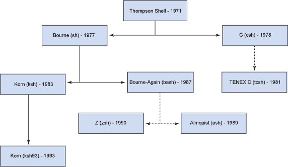
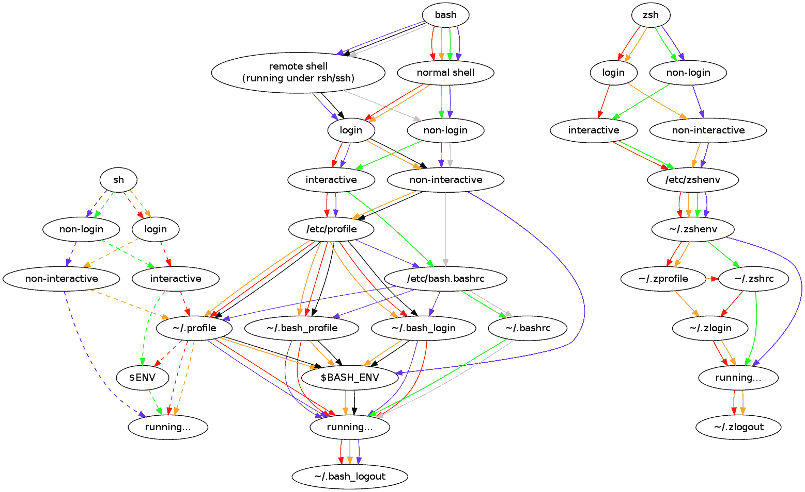

# 硬核学习 Bash


本书可在[`leanpub.com/learnbashthehardway`](http://leanpub.com/learnbashthehardway)购买。

此版本发布于 2019-09-25。


这是一本[Leanpub](http://leanpub.com)书籍。Leanpub 通过精益出版流程为作者和出版者赋能。[精益出版](http://leanpub.com/manifesto)是使用轻量级工具和多次迭代来发布进行中的电子书，以获取读者反馈，不断调整直到获得正确的书籍，并在成功后建立影响力。

© 2017 - 2019 Ian Miell

## 前言

在我 20 年的软件职业中，几乎每天我都要以某种方式与`bash`打交道。Bash 无处不在，以至于我们理所当然地认为人们知道它，并且因为用它就能“应付”，导致这项技能被低估了。

我的观点是，软件社区在学习`bash`方面的服务极度匮乏，而掌握它会带来巨大的回报，而不仅仅是在使用`bash`的时候。

你通常会被：

- 充斥着术语的晦涩手册页（man pages），假设你理解的比实际的要得多
- 解决你特定问题的单行命令（one-liners），让你在下次想做某事时没有获得任何提升
- 像扩展版手册页一样的 Bash“指南”——理论性强、充满术语，且非常难以跟上

以上所有内容都是本书试图解决的。

如果你曾对像这些事情感到困惑：

- `[`和`[[`之间的区别
- 通配符（globbing）和正则表达式（regexes）之间的区别
- bash 中单引号或双引号的区别
- `` ` ``代表什么
- 什么是子壳（subshell）
- 你的终端“发疯”了

那么这本书就是为你准备的。

它采用“硬核（Hard Way）”方法，确保你必须理解阅读那些晦涩手册页所需要的知识，并在需要时加深你的理解。

祝阅读愉快！

## 硬核学习 Bash

这门 bash 课程旨在帮助 bash 用户对 bash 获得更深入的理解和精通。它的目标不是让你立即成为专家，但你会对使用 bash 执行更多而不仅仅是单次命令的任务更有信心。

### 简介

#### 为什么要学习 Bash？

有几个理由要以结构化的学习 bash：

- Bash 无处不在
- Bash 功能非常强大

你经常在没有意识的情况下使用 bash，而且人们经常会困惑为什么它有时不会按照你预期的那样工作，甚至不明白为什么在给他们单行命令运行后 bash 竟然能工作。

深入理解 bash 并不需要长时间，一旦你掌握了基础，它的强大和无处不在意味着你可以在各种场景下大显身手。

#### 为什么要“硬核”地学习 Bash？

“硬核”是一种强调学习任何知识所需过程的方法。你不会通过阅读关于自行车的内容来学骑，也不会通过读食谱来学做饭。书可以提供帮助（希望这本可以），但取决于你自己付出的努力。

本书根据我几十年的经验，通过小而易于消化的片段为你展示路径，并要求你实际输入代码。这就像学自行车时去骑车一样重要。如果没有大脑和身体的协作，知识就无法进入大脑。

如果你遵循这门课程，你将获得对 bash 的理解，这种理解可以作为你未来使用它的基础。

#### 你将获得什么

这门课程旨在为学生提供：

- 对 bash 的实操、快速且实用的理解
- 足够的信息，以便让他们在深入研究 bash 时理解正在发生什么
- 对高级 bash 用法的熟悉

它没有：

- 让你精通所有你在命令行上可能用到的工具，例如`sed`、`awk`、`perl`
- 对 bash 的所有细微之处和底层技术提供完整的理论理解
- 解释一切。如果以后需要，有充足的时间去深入获取所有的细微差别

你有时必须通过思考来理解正在发生什么。这就是硬核方法，也是真正学习的唯一途径。这门课程将节省你的时间，避免你以后在挠头苦恼某事是什么意思，或者为什么那个 StackOverflow 的答案起作用了。

有时课程会涉及与 bash 密切相关的其他领域，但不是直接相关的 bash，例如特定的工具、终端知识。同样，这始终围绕着我使用 bash 和其他 shell 的几十年经验。

### 假设

它假设你对非常基础的 shell 使用和命令有些熟悉。对于那些想要达到那个程度的人，我建议遵循这套微型教程：

[`learnpythonthehardway.org/book/appendixa.html`](https://learnpythonthehardway.org/book/appendixa.html)

它还假设你配备了 bash shell 和一个终端。如果你不确定自己是否在 bash 中，请在终端输入：

```bash
echo $BASH_VERSION
```

如果你在终端输出了如下这样的 bash 版本字符串，说明你处于 bash 中：

```text
3.2.57(1)-release
```

#### 课程是如何运作的

本课程要求你输入所有的练习内容。

经常，文中不会显示输出。任何解释性文本都会假设你已经输入了。再次，这是硬核方法，而且它是唯一的方法。

为了显示你所在的位置，命令行被标记为 1-n，数字后面跟着一个`$`符号，例如：

```text
1 $ 第一条命令
2 $ 第二条命令
```

在每个章节的结尾有一组清理命令（如果需要），如果你不想留下工作的痕迹。

### 结构

本书分为四个部分：

#### 第一部分：核心 Bash

理解命令行 bash 必需的基础性概念。

#### 第二部分：Bash 脚本

让你的 bash 脚本技能达到精通水平。

#### 第三部分：技巧

常用技巧和特征的入门。

#### 第四部分：高级 Bash

在前三章的基础上，引入了一些更高级的功能，本章将你的 bash 技能带出常规。

## 第一部分：核心 Bash

这部分将带你了解进一步深化 bash 知识的基础概念。

在其中我们涵盖：

- 什么是 bash
- 通配符（Globbing）
- 变量
- 函数
- 管道和重定向
- 基础 bash 脚本

### 什么是 Bash？

Bash 是一个 shell 程序。

shell 程序通常是一个可执行的二进制文件，它接收你输入的命令并（一旦你按下回车键）将这些命令翻译为（最终）操作系统 API 的系统调用。

如果你不确定这意味着什么，不要担心。你只需要知道 shell 程序是一个让你告诉计算机要做什么的程序。

让 bash 与许多其他编程语言不同在于，它是一种设计用来“粘合”其他程序的语言。

在这一部分中，你将了解 bash 以及其他相关 shell 的历史。

#### 这一部分重要吗？

这一部分是背景和设定材料。它对于书中其他内容并非至关重要，但在你阅读该主题时，了解这些信息是有用的。

#### 其他 shell

其他的 shell 还包括：

- `sh`
- `ash`
- `dash`
- `ksh`
- `csh`
- `tcsh`
- `tclsh`

这些其他的 shell 有不同的规则、约定、逻辑和历史，这意味着它们看起来可能相似。

由于其他 shell 也是程序，因此你可以在彼此之间运行它们！

在这里，你在`bash`终端内部运行了`tcsh`。注意，你得到了一个不同的提示符（默认情况下）：

```text
1 $ tcsh
2 % echo $dirstack
3 % exit
4 $
```

通常，`tcsh`会给你提供一个带有百分号`%`的提示符，而`bash`会给你一个带有美元符号`$`的提示符。不过，这是可以配置的，所以你的设置可能有所不同。

`dirstack`变量由`tcsh`设置并会输出有意义的内容。在`bash`中默认没有这个变量（当你最后回到`bash` shell 时，尝试输入`echo`命令看看吧！）

## bash 的历史

这张图帮助直观地了解 bash 的历史：



Bash 被称为“Bourne Again SHell”（再次出生的 Bourne Shell）。它是“Thompson Shell”以及 Bourne `sh` shell 的后代。`Bash`还有其他“兄弟姐妹”（例如`ksh`）、“表兄弟”（例如`tcsh`）以及“孩子”（例如`zsh`）。

细节并不重要，但重要的是知道存在不同的 shell，而且它们之间可以存在联系并具有某种程度兼容性。

截至 2017 年，`Bash`是最广泛可见和使用的 shell。然而，在没有安装`bash`的服务器上发现它也并不罕见！

## 你学到了什么

- 什么是 shell
- 如何启动不同的 shell
- shell 的家族树

### 接下来做什么？

接下来你将学习`bash`中两个棘手但无处不在的主题：通配符（globbing）和引号（quoting）。

## 练习

1. 从`bash`命令行运行`sh`。发生了什么？
2. 你能找到哪些命令，这些命令在`bash`中有效但在`sh`中不起作用？

## 拆解 shell：通配符与引号

你可能想过`bash`命令中的`*`到底意味着什么，以及它与正则表达式有什么区别。本节将解释这一切，并向你介绍`bash`中使用引号的乐趣。

在本节中，你将学习：

- 什么是通配符
- 特殊通配符字符
- 单引号和双引号的区别
- 通配符与正则表达式的区别

### 这一节有多重要？

通配符和引号引用是使用`bash`时必经的话题。很难遇到一组不依赖这些知识的命令或脚本。

### 通配符（Globbing）

在你的终端中输入这些命令：

```text
1 $ mkdir lbthw_glob
2 $ cd lbthw_glob
3 $ touch file1 file2 file3
4 $ ls *
5 $ echo *
```

- 上面的第 1 行创建一个不应该已经存在的文件夹。
- 第 2 行进入该文件夹。
- 第 3 行创建三个文件（`file1`、`file2`、`file3`）。
- 第 4 行运行`ls`命令，它会列出匹配`*`的文件。
- 第 5 行运行`echo`命令，并将`*`作为`echo`的参数。

你应该看到的在这两种情况下都列出了三个文件。

shell 获取了你的`*`字符并将其转换为匹配当前工作目录下的所有文件。换句话说，它将字符`*`转换为字符串`file1 file2 file3`，然后处理生成的命令。

### 引号引用（Quoting）

你认为运行这些命令会输出什么？先思考一下，做一个预测，然后输入出来！

```text
6 $ ls '*'
7 $ ls "*"
8 $ echo '*'
9 $ echo "*"
```

- 第 6 行以单引号的形式列出匹配`*`字符的文件。
- 第 7 行以双引号的形式列出匹配`*`字符的文件。
- 第 8 行回显带单引号的`*`字符。
- 第 9 行回显带双引号的`*`字符。

即使你是`bash`专家，这也很困难！

输出是你预想的吗？你能解释它吗？讽刺的是，如果你有在`bash`中引用变量的经验，解释起来可能会更难！

`bash`中的引号引用是一个非常棘手的话题。你可能从中得知，对通配符加引号会消除它们的作用。但在其他语境下，单引号和双引号有不同的含义。

引号引用改变了`bash`读取行的方式，使其决定是取这些字符并将它们转换为其他内容，还是让保持原样。

你应该从中得到的结论是“bash 中的引号引用很复杂”，并为以后可能的一些令人抓头的问题做好准备！

### 其他通配符字符

`*`并不是唯一的通配符原子。其他的通配符原子是：

- `?` - 匹配任意单个字符
- `[abd]` - 匹配`a`、`b`或`d`中的任意字符
- `[a-d]` - 匹配`a`、`b`、`c`或`d`中的任意字符

尝试运行这些命令，看看输出是否符合预期：

```text
10 $ ls *1
11 $ ls file[a-z]
12 $ ls file[0-9]
```

- 第 10 行列出所有以“1”结尾的文件。
- 第 11 行列出所有以“file”开头并以`a-z`结尾的文件。
- 第 12 行列出所有以“file”开头并以`0-9`结尾的文件。

### 点文件（Dotfiles）

点文件就像普通文件，区别在于文件名以点开头。用`touch`创建一些：

```text
13 $ touch .file1
14 $ mkdir .dotfolder
15 $ touch .dotfolder/file2
```

你现在创建了一些点文件。如果你运行`ls`：

```text
16 $ ls
```

这些文件是隐藏的。要看到它们，可以使用通配符。

单点文件夹（`.`）是一个特殊的文件，代表你当前所在的文件夹。例如，如果你输入：

```text
17 $ cd .
```

你哪里也去不了！你切换到了当前所在的文件夹。

双点文件夹（`..`）是另一个特殊文件夹，代表你当前所在文件夹的父目录。你认为在根目录（`/`）执行`cd ..`会发生什么？去看看发现吧。

如果你用`ls`重新运行上一个 echo 命令：

```text
18 $ ls .*
```

你得到了一个稍微复杂的输出，因为`ls`会根据项目是文件还是文件夹返回更丰富的内容。

第一个`*`字符被视为正则表达式，因为它没有被 shell 解释，而是由`rename`命令解释的。它没有被 shell 解释是因为它被包含在单引号中。最后一个`*`被 shell 视为通配符（glob），并展开为本地目录下的所有文件。

再次，这里的关键点在于：上下文（context）决定一切。

请注意，`‘.’`作为通配符没有意义，某些 shell 提供更强大的扩展通配符功能。`Bash`是提供扩展通配符的 shell 之一，我们在这里不涵盖，因为这可能会让读者更加困惑。只需意识到更复杂的通配是可能的即可。

## 清理

现在清理你刚才的操作：

```text
25 $ cd ..
26 $ rm -rf lbthw_glob
```

## 你学到了什么

- 什么是通配符（glob）
- 什么是隐藏文件（dotfile）
- 通配符和正则表达式是不同的
- 通配符周围的单双引号非常重要！

### 接下来是什么？

接下来是另一个基础主题：变量。

### 练习题

1. 创建一个包含名称非常相似的文件文件夹，并使用通配符列出其中一个而不列另一个。
2. 在网上研究正则表达式。
3. 研究`grep`程序。如果你已经认识它，请阅读`grep`的 man 手（输入`man grep`）。

## Bash 中的变量

在任何编程环境中，变量对于理解`bash`都关重要。在本节中，你将学习`bash`中的变量及其的一些微妙之处。

你将涵盖：

- 基础变量
- 变量引号
- 引号与通配符
- `env`和`export`命令
- 简单数组

到结束时，你将对变量在`bash`中如何工作以及一些陷阱有一个良好的概述。

### 这一节有多重要？

变量是理解`bash`命令的基础，就像在任何编程语言中一样。

### 基础变量

从创建一个变量并打印它开始。

```text
1 $ MYSTRING=astring
2 $ echo $MYSTRING
```

非常简单：你通过声明名称、紧接着添加等号、然后紧接着声明值创建一个变量。

变量不需要大写，但按照惯例，它们通常是大写的。

要获取变量中的值，你必须使用美元符号告诉`bash`你想要对变量进行解引用（dereference）。

### 变量与引号

当你开始使用引号时，事情变得更有趣。

引号可以将不同的“单词”分组到单个变量值中：

```text
3 $ MYSENTENCE=A sentence
4 $ MYSENTENCE="A sentence"
5 $ echo $MYSENTENCE
```

由于（默认情况下）shell 通过空格分隔读取每个单词，它认为`‘sentence’`单词与变量赋值无关，并将其视为一个程序。为了将带有空格的句子放入变量中，你可以像上面那样将它包含在双引号中。

当我们在引号的字符串中嵌入其他变量时，事情变得更有趣了：

```text
6 $ MYSENTENCE="A sentence with $MYSTRING in it"
7 $ echo $MYSENTENCE
8 $ MYSENTENCE='A sentence with $MYSTRING in it'
9 $ echo $MYSENTENCE
```

如果你期望看到与上一节相似的行为，你可能会大吃一惊！这说明了阅读 shell 脚本时的一个重要点：如果变量位于双引号中，`bash` shell 会将其翻译为值，但如果位于单引号中，则不会。

记住上一节提到的，这在通配符时不是不成立的！

输入这些内容看看。像既往一样，在看到输出之前确保你考虑了预期的输出：

```text
10 $ MYGLOB=*
11 $ echo $MYGLOB
12 $ MYGLOB="*"
13 $ echo "$MYGLOB"
14 $ MYGLOB='*'
15 $ echo "$MYGLOB"
16 $ echo '$MYGLOB'
17 $ echo $MYGLOB
```

通配符在单引号或双引号中都不会展开。这不很困惑吗？

### Shell 变量

某些变量是特殊的，并在`bash`启动时设置：

```text
18 $ echo $PPID
19 $ PPID=nonsense
20 $ echo $PPID
```

- 第 18 行 - `PPID`是由`bash` shell 设置的特殊变量。它包含了`bash`父进程 ID。
- 第 19 行 - 尝试将`PPID`变量设置为其他内容。
- 第 20 行 - 再次输出`PPID`。

发生了什么？

如果你想创建一个只读变量，在它前面加上`readonly`，如下所示：


```
21 $ readonly MYVAR=astring
22 $ MYVAR=anotherstring
```

### export

输入这些命令，并预测会发生什么：

```
23 $ MYSTRING=astring
24 $ bash
25 $ echo $MYSTRING
26 $ exit
27 $ echo $MYSTRING
28 $ unset MYSTRING
29 $ echo $MYSTRING
30 $ export MYSTRING=anotherstring
31 $ bash
32 $ echo $MYSTRING
33 $ exit
```

基于此，你认为`export`的作用是什么？

你已经看到在`bash`终端中设置的变量以后可以使用美元符号进行引用。

但当你设置一个变量并启动另一个进程时会发生什么？

在这种情况下，你设置了一个变量（`MYSTRING`），然后启动了另一个进程。在该`bash` shell中，`MYSTRING`不存在，因此报错。

### 导出的变量和 Shell 变量

无论你在何处，都可以通过运行`env`来查看导出的变量：

```
34 $ env
```

`env`的输出在不同的运行环境下可能会不同。

但并不是你 shell 中设置的所有变量。它只是导出到 shell 中启动的进程的环境变量。如果你想查看 shell 中可用的所有变量，输入：

```
69 $ compgen -v
```

### 数组

这里值得提还有数组。这样一个内置只读数组是`BASH_VERSINFO`。就像在其他语言中，bash 中的数组是从 0 开始索引的。

输入以下命令，这说明了如何引用版本信息的主版本：

```
70 $ bash --version
71 $ echo $BASH_VERSINFO
72 $ echo $BASH_VERSINFO[0]
73 $ echo ${BASH_VERSINFO[0]}
74 $ echo ${BASH_VERSINFO}
```

数组的处理可能很棘手，而且 bash 并没有给你什么帮助！

第一个需要注意的是，如果没有给出索引，数组将输出第一个元素（0）处的项。

第二个需要注意的是，简单地在普通数组引用后添加`[0]`是不起作用的。Bash 将方括号视为与变量不关联的字符，并将其附加到数组的末尾。

你必须告诉 bash 将整个字符串`BASH_VERSION[0]`视为需要解引的变量。你通过使用大括号来实现这一点。

这些大括号也可以用于简单变量：

```
76 $ echo $BASH_VERSION_and_some_string
77 $ echo ${BASH_VERSION}_and_some_string
```

事实上，“简单变量”可以被视为只有一个元素的数组！

```
78 $ echo ${BASH_VERSION[0]}
```

所以所有的 bash 变量都是“真正的”数组！

Bash 的`BASH_VERSINFO`数组中有 6 个项目（0-5）：

```
79 $ echo ${BASH_VERSINFO[0]}
80 $ echo ${BASH_VERSINFO[1]}
81 $ echo ${BASH_VERSINFO[2]}
82 $ echo ${BASH_VERSINFO[3]}
83 $ echo ${BASH_VERSINFO[4]}
84 $ echo ${BASH_VERSINFO[5]}
85 $ echo ${BASH_VERSINFO[6]}
```

一像变量一样，如果该项不存在，则输出将是一个空行。

#### 你学到的知识

*   bash 中的基础变量用法

*   变量与引号

*   bash 设置的变量

*   `env`和`export`

*   Bash 数组

#### 接下来是什么？

接下来，你将学习 bash 中实现的另一个核心语言特性：函数。

### 练习题

1) 获取你 shell 中获取`env`的输出，并弄清楚每个项为什么在那里，以及它们可能被什么使用。你可能需要使用`man bash`，或者使用 google 来查明。或者你可以尝试重新设置它并看看会发生什么。

2) 找出`BASH_VERSINFO`中各项内容的含义。

### Bash 中的函数

从一个角度来看，bash 可以被视为一种编程语言，尽管它是非常缓慢且原始的。

它拥有的语言特性之一是创建和调用函数的能力。

这引导我们进入 bash 中“命令”可以是什么的话题：

*   函数

*   别名 (alias)

*   程序

*   内置命令 (builtin)

本节涵盖这些项目以及它们之间的关系。结束时，你将对 bash 中的命令有更细致的理解。

#### 这一部分有多重要？

在不了解 bash 函数的情况下也可以应付，但任何严肃的 bash 用户都会知道它们的作用以及工作原理。

#### 基础函数

从创建一个简单的函数开始

```
1 $ function myfunc {
2         echo Hello World
3 }
4 $ myfunc
```

通过声明函数并将需要运行的代码块放在大括号内，你就可以在命令行上调用该函数，就像调用它是一个程序一样。

#### 参数

与其他语言不同，这里对函数的参数没有检查。

预测此代码的输出，然后运行它：

```
 5 $ function myfunc {
 6         echo $1
 7         echo $2
 8 }
 9 $ myfunc "Hello World"
10 $ myfunc Hello World
```

你能解释输出吗？如果不能，你可能需要读读之前的页面！

函数的参数从 1 到 n 编号。管理这些参数由函数本身决定。

#### 变量作用域

变量在 bash 中有作用域。这在函数中特别有用，因为你不希望你的变量从函数外部被访问。

这些命令说明了这一点：

```
11 $ function myfunc {
12         echo $myvar
13 }
14 $ myfunc
15 $ myvar="Hi from outside the function"
16 $ myfunc
```

Bash 函数没有特殊的作用域。外部的变量对它是可见的。

然而，bash 具有将变量声明为局部 (local) 的能力：

```
17 $ function myfunc {
18         local myvar="Hi from inside the function"
19         echo $myvar
20 }
21 $ myfunc
22 $ echo $myvar
23 $ local myvar="Will this work?"
```

用`local`声明的变量仅在函数内部可见和访问，且不会干扰外部。它不能在函数外部声明。

上面的`local`是 bash “内置命令 (builtin)” 的一个例子。现在是讨论不同类型命令的好时机。

#### 函数、内置命令、别名和程序

在 bash 中调用命令至少有四种方法：

*   内置命令

*   函数

*   程序

*   别名

让我们逐一来看。

#### 内置命令

内置命令是“内置”在 bash shell 程序中的命令。通常情况下，你无法轻易区分内置命令、函数、程序或别名。

这一章节是必读内容。

## 基础重定向

从创建一个文件开始：

```
1 $ mkdir lbthw_pipes_redirects
2 $ cd lbthw_pipes_redirects
3 $ echo "contents of file1" > file1
```

`>`字符是“重定向”操作符。它将通常在终端中看到的上一个命令的输出重并发送到你指定的。。在这里，它创建了一个名为`file1`的文件，并将回显的字符串放入其中。如果你想检查文件，可以尝试使用`cat`：`cat file1`。

这里有一个微妙之处，我们稍后会提到：有时你在终端中看到的所有输出并不都能被此操作重定向，但现在不用担心这个。

## 基础管道

输入以下内容：

```
4 $ cat file1 | grep -c file
```

通常情况下，你会将文件名作为最后一个参数运行`grep`，但在这里我们通过“管道”操作符`|`将`file1`的内容“管道”到`grep`命令。

管道接收一个命令的标准输出，并将其作为另一个命令的输入。那么，到底什么是标准输出呢？你很快就会发现！

```
5 $ cat file2
```

那个命令的输出是什么？

现在运行这个，并在运行之前猜猜结果：

```
6 $ cat file2 | grep -c file
```

如果输出不是你预期的，那么答案与所谓的“标准输出”以及其他类型的输出有关。我们将在下文中进一步解释。

## 标准输出与标准错误

在讨论“标准输出”和“标准错误”之前，我们需要退后一步考虑。

在 Linux（以及 UNIX）中，“万物皆文件”是一项基本的设计原则。这意味着当向事物中推送数据或从事物中提取数据时，一切都被视为一个文件。

例如，如果你想向终端（或“简单”文件，或网络接口）写入内容，你需要“打开”对应于终端（简单文件或网络接口）的文件并获取一个“文件描述符”。

“文件描述符”是一个与代表该“文件”的进程关联的数字。然后你可以向该“文件描述符”写入内容，操作系统将确保数据以适当的方式到达正确的地方。

为什么要把 UNIX（以及后来的 POSIX 标准）这样设计？因为通过通用接口与不同类型的数据“汇点”进行交互，意味着你可以无需担心数据在后台是如何被管理的，只需要关注输入和输出的数据即可。例如，你不需要关心一个简单文件是否真的是文件。

同样，你不需要关心你是在向终端还是文件写入。两者具有相同的接口，所以你只需要将数据写入代表你想写入的对象的文件描述符即可。

为什么这对于我们这里的用例非常重要？在你上面看到的例子中，运行`cat file2`时的错误被发送到了与运行`cat file1`时输出不同的文件描述符。请记住，`file2`不存在（所以`cat`运行会报错），而`file1`确实存在。

在 UNIX/Linux 中，每个进程默认获得三个文件描述符。它们的编号从 0 到 2：

* 0 是“标准输入”（stdin）

* 1 是“标准输出”（stdout）

* 2 是“标准错误”（stderr）

当你运行`cat file1`时，它获取你提供的文件名并将该文件的内容写入“标准输出”文件描述符`1`。默认情况下，它链接到终端，因此你在终端上看到了此输出。

当你运行`cat file2`时，它获取你提供的文件名，并发现该文件名不存在。因此，它将包含`No such file or directory`的错误信息写入“标准错误”文件描述符`2`。默认情况下，它也链接到终端，因此通常你看到的输出与“正常”`cat`命令的“标准输出”相比没有区别。

所以关键在于：`|`操作符仅作为传递到左侧命令“标准输出”文件描述符的数据汇点。它忽略所有其他内容。所以当左侧命令（在此例中为`cat`）将数据推送到“标准错误”文件描述符时，数据仍然会进入终端。

同样，当你将输出重定向到文件时，`>`操作符只将标准输出发送到文件。发送到标准错误的任何内容都不会被文件中。

如果你想将标准错误重定向到文件怎么办？尝试一下：

```
7 $ command_does_not_exist
8 $ command_does_not_exist 2> /dev/null
```

在上面的第二行中，文件描述符`2`（标准错误）被指向一个名为`/dev/null`的文件。

当你使用标准重定向操作符时，你隐式地使用了文件描述符`1`。因此，这两个命令是等效的：

```
9 $ echo "contents of file1" 1> file1
10 $ echo "contents of file1" > file1
```

`>`符号之前的数字表示要重定向的文件描述符。

文件`/dev/null`是由 Linux（以及 UNIX）内核创建的一种特殊类型的汇点文件。它实际上是一个黑洞，数据可以向其中注入：写入它的任何内容都会被读取并忽略。

另一个常见的重定向操作符是`2>&1`。

```
11 $ command_does_not_exist 2>&1
```

此操作的作用是告诉 shell 将标准错误（2）重定向到标准输出（1）所指向的地方。

```
12 $ command_does_not_exist > outfile 2>&1
13 $ command_does_not_exist 2>&1 >
```

这种将所有输出发送到文件的模式非常常见，很少有人理解为什么必须是这种顺序。一旦你理解了，你就永远不会思考操作符的顺序应该是怎样的了！

## 管道与重定向的区别

总结一下：

* 管道将“标准输出”作为另一个命令的“标准输入”

* 重定向将输出从文件描述符发送到文件

这里还有两个值得这里的常用操作符：

```
14 $ grep -c file < file1
```

`<`操作符从文件将标准输入（文件描述符`0`）重定向到命令，在这种情况下，效果与`cat file1 | grep -c file`相同。

```
15 $ echo line1 > file3
16 $ echo line2 > file3
17 $ echo line3 >> file3
18 $ cat file3
```

上述前两行使用了`>`运算符，而第三行使用了`>>`运算符。`>`运算符无论文件是否存在，都会有效地创建一个新文件。相比之下，`>>`运算符会将内容**追加**到文件的末尾。因此，只有`line2`和`line3`被添加到了`file3`中。

## 清理

现在清理一下你刚才的操作：

```
19 $ cd ..
20 $ rm -rf lbthw_pipes_redirects
```

## 你学到了什么

- 什么是文件重定向

- 管道的作用

- 标准输出和标准错误之间的区别

- 如何将标准输出重定向到与标准错误相同的位置（反之亦然）

- 如何将标准输出或标准错误（或两者）重定向到文件

### 接下来要做什么？

你快要到达第一节的结尾了。接下来你将学习创建 shell 脚本，以及`bash`启动时会发生什么。

## 练习

1) 尝试几个不同的命令，弄清楚哪些输出到标准输出，哪些输出到标准错误。尝试通过误用程序来触发错误。

2) 编写将标准输出重定向到文件描述符‘3’的命令。

3) 研究`|&`管道运算符的作用。如果你找不到，尝试运行命令`cat file2 |& grep -c file`，看看与你之前运行相比有什么变化。

## 脚本与启动

本节考虑了两个相关主题：

- Shell 脚本

- shell 启动时会发生什么

你可能遇到过 shell 脚本，这部分很快就能涵盖，但 shell 启动是一个有用但棘手的话题，大多数人都会某个地方被它难住，值得深入理解。

### 这一节有多重要？

这一节是必读内容。

## Shell 脚本

```
1 $ mkdir -p lbthw_scripts_and_startups
2 $ cd lbthw_scripts_and_startups
```

shell 脚本仅仅是一组可以非交互式运行的 shell 命令集合。这些可以是你手动运行的快速一次性脚本，也可以是非常复杂的程序。

### Shebang 解释器路径

运行以下命令：

```
3 $ echo '#!/bin/bash' > simple_script
4 $ echo 'echo I am a script' >> simple_script
```

你刚刚创建了一个名为`simple_script`的文件，里面有两行。第一行由两个特殊字符组成：井（#）和感叹号（!）。这通常被称为‘shebang’，为了方便也称为‘hashbang’。当操作系统接收到一个作为程序运行的文件时，如果从开头看到这两个字符，就知道该文件将在另一个程序（通常称为“解释器”）的控制下运行。

现在尝试运行它：

```
5 $ ./simple_script
```

这应该失败了。在我们解释原因之前，让我们先理解这个命令。

命令开头的`./`字符告诉 shell 你想在当前工作目录的范围内运行此文件。后面跟着要运行的文件名。

同样，`../`字符表示你想从当前工作目录的上一级目录运行。

如下：

```
 6 $ mkdir tmp
 7 $ cd tmp
 8 $ ../simple_script
 9 $ cd ..
10 $ rm -rf tmp
```

这将给你相同的输出。

### 执行权限

该脚本失败是因为文件没有被标记为可执行，所以你会收到一个“权限被拒绝”的错误。

要纠正这一点，运行：

```
11 $ chmod +x simple_script
12 $ ./simple_script
```

`chmod`程序更改文件的权限（或“模式”），使得只有特定的用户或用户组可以读、写或执行（即作为程序运行）文件。

### PATH 变量

如果你不指定`./`而直接运行会发生什么：

```
13 $ simple_script
```

我不知道会发生什么。你会收到一个找不到它的错误，或者它会像以前一样工作。

我之所以不知道是因为这取决于你环境中`PATH`变量是如何设置的。

如果你运行这个命令你会看到你的`PATH`变量：

```
14 $ echo $PATH
```

你的输出可能有所不同。例如，我的是：

```
/home/imiell/perl5/bin:/opt/local/bin:/opt/local/sbin:/Users/imiell/google-cloud-sdk\
/bin:/usr/local/bin:/usr/bin:/bin:/usr/sbin:/sbin:/opt/X11/bin:/space/git/shutit:/sp\
ace/git/work/bin:/space/git/home/bin:~/.dotfiles/bin:/space/go/bin
```


`PATH` 变量是一组由冒号分隔的目录。它可能非常简单：

```
/usr/sbin:/usr/bin
```

例如。

这些是 `bash` 按顺序查找命令的目录。

那么如果你没有设置，是谁设置了 `PATH` 变量？答案是：`bash` 启动脚本。

但在讨论它们之前，我们如何确保 `simple_script` 可以在不带 `./` 的情况下运行？

```
15 $ PATH=${PATH}:.
16 $ simple_script
```

就是这样！在第一行中，你将 `PATH` 设置为自身加上当前工作目录。它会查找你之前在 `PATH` 变量中设置的所有目录，最后尝试正如我们之前看到的 `./`，即本地文件夹。

## 启动脚本

理解启动脚本和环境变量是解决许多可能花费你大量时间调试问题的关键！如果某事在一个环境中有效而在另一个环境中无效，答案通常是启动脚本以及它们设置环境的方式存在差异。

## 启动详解

当 `bash` 启动时，它会调用并运行一系列文件来设置你到达终端时的环境。如果你曾经注意到 `bash` 在给你提供提示符之前可以“暂停”，可能是因为启动脚本正在前台执行某个命令。

看这张图：



是的，这可能会让人困惑。

该图显示了不同上下文中不同 shell 的启动脚本顺序。每个上下文都通过遵循图中不同的颜色来显示。

我们将遵循（从上到下）从 `bash` 气泡开始路径，忽略 `zsh` 状态。

通常在启动 `bash` 时避免所有这些启动脚本是有用的，这可以让 `bash` 保持尽可能原始的状态。在调试或测试 `bash` 核心功能时，这可能是无价的。

要实现这一点，请运行以下命令：

```
22 $ env -i bash --noprofile --norc
```

`env` 是一个处理环境的程序。`-i` 标志的作用是从你运行的命令中移除环境变量。这意味着导出的变量将不会被我们正在运行的 `bash` 程序继承。我们带有两个标志运行 `bash` 程序本身。`--noprofile` 标志告诉 `bash` 不要加载系统级的 `bash` 启动文件，而 `--norc` 告诉 `bash` 不要加载你主目录下的个人启动文件。

最终的效果是你的 shell 仅有一组非常少的变量可用：

```
23 $ env
24 $ exit
```

## 清理

现在清理一下你刚才的操作：

```
25 $ cd ..
26 $ unset MYVAR
27 $ rm -rf lbthw_scripts_and_startups
```

## 你学到了什么

* 什么是 `shebang`
* 如何创建和运行 shell 脚本
* `PATH` 环境变量的意义
* `bash` 启动时发生了什么
* 内置命令 `source` 的作用

## 下一步是什么？

干得好！你现在已经完成了课程的第一部分。

你现在已经有了良好的基础来学习稍微高级的 `bash` 脚本编写，你将在第二部分涵盖这些内容。

## 练习题

1) 回顾你的 `bash` 会话所经历的所有脚本。阅读它们并尝试理解它们在做什么。如果你不理解某些部分，尝试通过阅读 `man bash` 来弄清楚发生了什么。

2) 回顾图中存在于你机器上的其他文件。按照第 1 步的操作执行。

# 第二部分 - 脚本化 Bash

在本节中，我将介绍构成 `bash` 脚本基础的概念和技术。这些是编写和理解实用 `bash` 脚本所需的底层构建模块，也是后续更高级章节的基础。

我们将涵盖：

* 命令替换（Command substitution）
* `bash` 中测试（test）的概念
* `bash` 中的循环
* 退出状态与 `bash`
* `set` 命令
* 文件替换
* 内部字段分隔符

# 命令替换与评估

在编写 `bash` 脚本时，你通常想要获取一个命令的标准输出并将其“放入”脚本中，就像你直接把它写在脚本里一样。

可以通过命令替换来实现。

你将学习：

* 什么是命令替换
* 替换命令的不同方式

## 这一节有多重要？

如果你打算编写或处理 shell 脚本，这一节的内容是至关重要的。

## 命令替换示例

示例可以帮助说明。输入这些命令：

```
1 $ hostname
2 $ echo 'My hostname is: $(hostname)'
3 $ echo "My hostname is: $(hostname)"
```

如果将这些行放在脚本中，它将输出运行该脚本的主机宿机名。这可以让你的脚本变得更加动态。你可以根据命令的输出设置变量、添加调试等，就像使用任何其他编程语言一样。

你会注意到，如果包裹在单引号中，`$` 符号的特殊含义会被再次忽略！

## 两种命令替换方法

有两种方法执行命令替换：

```
4 $ echo "My hostname is: `hostname`"
5 $ echo "My hostname is: $(hostname)"
```

这些方法的输出相同，反引号（backticks）的功能也相同。那么你应该用哪一个呢？

### “美元括号”法：`$()`

输入这些：

```
6 $ mkdir lbthw_cmdsub
7 $ cd lbthw_cmdsub
8 $ echo $(touch $(ls ..))
9 $ cd ..
10 $ rm -rf lbthw_cmdsub
```

发生了什么？

你创建了一个文件夹（第 6 行）并进入其中（第 7 行）。

下一行从最内层的括号向外读最容易。

`ls ..` 命令在最内层的括号中运行。它输出了父目录的内容。

该输出被替换到 `$(ls ..)` 中。返回的“单词”被作为参数传递给 `touch` 命令。`touch` 命令根据父目录内容的列表创建一组空文件。

`echo` 命令接收上述替换的输出（在这种情况下为空，因为 `touch` 不产生任何输出）。

所以，总结一下：

* 该行输出了父目录的文件列表
* 这些文件名在本地也被创建为空文件

这是一个子命令如何嵌套的示例。你可以看到，嵌套非常简单——只需将一个包裹在 `$()` 中的命令放在另一个包裹在 `$()` 内的命令内部，`bash` 就会按照适当的顺序从内向外为你替换每个命令的输出。

### “反引号”法

输入这些内容：

```
11 $ mkdir lbthw_cmdsub
12 $ cd lbthw_cmdsub
13 $ echo `touch \`ls ..\``
14 $ cd ..
```

要嵌套反引号版本，你必须用反斜线对内部的反引号进行“转义”（escape），这样 `bash` 才知道应该在哪个层级上解释反引号。

为了说明这里的复杂性，一个简单的例子就足够：

```
15 $ echo $(echo hello1 $(echo hello2))
16 $ echo `echo hello1 `echo hello2``
17 $ echo `echo hello1 \`echo hello2``
```

出于历史原因，反引号形式仍然非常流行，但我更倾向于 `$()` 形式，因为管理嵌套更简单。不过，如果你在查看别人的代码，你需要熟悉这两种！

如果你想看看事情会变得多么混乱，对比一下这两行：

```
18 $ echo `echo \`echo \\\`echo inside\\\\``
19 $ echo $(echo $(echo $(echo inside)))
```

并考虑一下哪一个更容易读（以及写）！

## 清理

删除残留的目录：

```
20 $ rm -rf lbthw_cmdsub
```

## 你学到了什么

* 什么是命令替换
* 它如何与引号相关
* 两种命令替换方法
* 为什么一种方法通常优于另一种

## 下一步是什么？

接下来你将学习退出状态（exit codes），这将增强你编写更整洁的 `bash` 代码和更好脚本的能力。

## 练习题

1) 尝试各种命令替换命令，并输入变量和引号看看发生了什么。

2) 解释为什么最后一个示例需要三个反斜线。

# 退出状态

在学习测试和特殊参数之前，一个关键且相关的概念是退出状态。

我们将涵盖：

* 什么是退出状态
* 如何在脚本和函数设置它
* 退出状态规范
* `bash` 中的其他“特殊”参数

## 这一节有多重要？

如果不理解退出状态，大多数 `bash` 脚本将无法完全理解或安全编写。

## 什么是退出状态？

在你运行命令、函数或内置命令后，会设置一个特殊变量告知你该命令的结果。如果你熟悉 HTTP 状态码（如 200 或 404），这是一个类似的概念。以一个简单的示例为例，输入：

```
1 $ ls
2 $ echo $?
3 $ doesnotexist
4 $ echo $?
```

当该特殊变量设置为 `0` 时，意味着命令执行成功。

现在你已经学习了函数、命令以及退出状态的知识，你应该能够理解这里发生了什么：

```
5 $ bash
6 $ function trycmd {
7         $1
8         if [[ $? -eq 127 ]]
9         then
10                 echo 'What are you doing?'
11         fi
12 }
13 $ trycmd ls
14 $ trycmd doesnotexist
15 $ exit
```

你可以轻松地编写测试来这样使用退出状态。

## 标准退出状态

对于想要遵循标准，退出状态有指南。请注意并非所有程序都遵循这些标准（`grep` 是非标准程序最常见的例子，正如你将学到的！）。

关键的包括：

| 数字 | 含义 | 备注 |
| --- | --- | --- |
| 0 | OK | 命令成功运行 |
| 1 | 通用错误 | 当发生错误但没有特定数字保留来指示具体原因时 |
| 2 | Misuse of shell builtin | 运行内置命令时出现问题 |
| 126 | Cannot execute | 权限问题或命令不可执行 |
| 127 | Command not found | 没有找到与命令匹配的文件 |
| 128 | Invalid exit value | 给出的退出参数无效（例如 `exit 1.76`） |
| 128+n | Signal 'n' | 进程被信号 `n` 终止，例如 130 = 被 `CTRL-c` 终止（信号 2） |

由于代码 `3-125` 通常并不被预留，你可以在应用程序中将其用于自己的用途。

## 退出码与 if 语句

到目前为止都很简单，但遗憾的是（因为它们很有用），退出码可以用于许多原因，而不仅仅是告诉你命令是否成功完成。就像 HTTP 中的退出码一样，应用程序可以使用退出码来表示发生了错误，或者它可以返回“200 OK”并直接给你一条消息。

尝试预测以下代码的输出：

```
16 $ echo 'grepme' > afile.txt
17 $ grep not_there afile.txt
18 $ echo $?
```

你预料到此吗？`grep` 成功结束了（没有段错误或内存故障，没有被杀死等），但没有匹配到任何行，它返回 `1` 作为退出码。因此，`grep` 使用退出码 `0` 表示“匹配”，使用退出码 `1` 表示“未匹配”。

从某方面来说这是很棒的，因为你可以这样写 `if` 语句：

```
19 $ if grep grepme afile.txt
20 then
21         echo 'matched!'
22 fi
```

另一方面，这意味着你无法确定某个退出码对于特定程序的终止意味着什么。我几乎每次都必须查询 `grep` 的退出码，如果我使用一个程序的退出码，我会确保先做几次测试，以确保我知道将发生什么！

## 设置你自己的退出码

如果你在编写脚本，可以通过使用 `exit` 内置命令来设置函数的退出码。你可以简单地通过进入一个新的 `bash` 进程并退出它来模拟这一点。

```
23 $ bash
24 $ exit 67
25 $ echo $?
```

如果你在编写一个函数，可以使用 `return` 内置命令来设置函数的退出码。

输入这些：

```
26 $ bash
27 $ function trycmd {
28         $1
29         if [[ $? -eq 127 ]]
30         then
31                 echo 'What are you doing?'
32                 return 1
33         fi
34 }
35 $ trycmd ls
36 $ trycmd doesnotexit
37 $ exit
```

## 其他特殊参数

变量 `$?` 是 `special parameter`（特殊参数）的一个例子。我不确定为什么它们被称为“特殊参数”而不是“特殊变量”，但也许是因为它们与函数和脚本的普通参数（`$1`、`$2` 等）一起，被视为这些上下文中自动分配的变量。

下面的列表中使用了两个最重要的参数。尝试根据语境弄清楚它们是什么：

```
38 $ ps -ef | grep bash | grep $$
39 $ sleep 999 &
40 $ echo $!
```

如果你仍然卡住了，请运行 `man bash` 查看 `bash` 帮助页。

## 清理

现在清理你刚才的操作：

```
41 $ rm afile.txt
```

## 你学到了什么

* 什么是退出码
* 一些标准退出码及其意义
* 并非所有应用程序都以相同的方式使用退出码
* 测试和退出码是如何协同工作的
* 一些特殊参数

## 接下来做什么？

接下来你将学习测试，它允许你以灵活且动态的方式将目前所学到的知识应用到你的 `bash` 代码条件判断中。

## 练习

1. 查询 `git` 在什么情况下会返回非零退出码。

2. 查询所有的“特殊参数”并查看它们的作用。玩玩它们。研究一下在什么情况下你可能想要使用它们。

# 测试

测试是 `bash` 脚本的基础部分，无论是命令行中的单行命令，还是大得多的脚本中。

主题可能会变得非常复杂且混乱。在本节中，我将向你展示一些陷阱，并为实际的 `bash` 使用提供法则。

`bash` 中的测试不像测试你的程序是否运行良好的测试。它是一种编写可以为真或为假的表达式的方法。

在本节中，你将学习：

* 什么是 `bash` 测试
* 编写 `bash` 测试的不同方式
* 逻辑运算符
* 二元运算符和一元运算符
* `if` 语句

## 这一节有多重要？

这一节非常重要，因为它涵盖了 `[` 和 `]` 的使用。

## 什么是测试？

`bash` 中的测试是一种编写可以为真或为假的表达式的方法。在本节中，你将学习：

* 什么是 `bash` 测试
* 编写 `bash` 测试的不同方式
* 逻辑运算符
* 二元运算符和一元运算符
* `if` 语句

`bash` 中的测试不像测试你的程序是否运行良好的测试。它是一种编写可以为真或为假的表达式的方法。

`bash` 中的测试是一种编写可以为真或为假的表达式的方法。在本节中，你将学习：

* 什么是 `bash` 测试
* 编写 `bash` 测试的不同方式
* 逻辑运算符
* 二元运算符和一元运算符
* `if` 语句

`bash` 中的测试不像测试你的程序是否运行良好的测试。它是一种编写可以为真或为假的表达式的方法。

`bash` 中的测试是一种编写可以为真或为假的表达式的方法。在本节中，你将学习：

* 什么是 `bash` 测试
* 编写 `bash` 测试的不同方式
* 逻辑运算符
* 二元运算符和一元运算符
* `if` 语句

`bash` 中的测试是一种编写可以为真或为假的表达式的方法。


| | | （signal 2） |

由于代码 3-125 通常并不被预留，你可以在应用程序中将其用于自己的用途。

## 退出码与 `if` 语句

到为止都很简单，但遗憾的是（因为它们很有用），退出码可以用于许多原因，而不仅仅是告诉你命令是否成功完成。就像 HTTP 中的退出码一样，应用程序可以使用退出码来表示发生了错误，或者它可以返回“200 OK”并直接给你一条消息。

尝试预测以下代码的输出：

```bash
16 $ echo 'grepme' > afile.txt
17 $ grep not_there afile.txt
18 $ echo $?
```

你预料到此吗？`grep` 成功结束了（没有段错误或内存故障，没有被杀死等），但没有匹配到任何行，它返回 `1` 作为退出码。因此，`grep` 使用退出码 `0` 表示“匹配”，使用退出码 `1` 表示“未匹配”。

从某方面来说这是很棒的，因为你可以这样写 `if` 语句：

```bash
19 $ if grep grepme afile.txt
20 then
21         echo 'matched!'
22 fi
```

另一方面，这意味着你无法确定某个退出码对于特定程序的终止意味着什么。我几乎每次都必须查询 `grep` 的退出码，如果我使用一个程序的退出码，我会确保先做几次测试，以确保我知道将发生什么！

## 设置你自己的退出码

如果你在编写脚本，可以通过使用 `exit` 内置命令来设置函数的退出码。你可以简单地通过进入一个新的 `bash` 进程并退出它来模拟这一点。

```bash
23 $ bash
24 $ exit 67
25 $ echo $?
```

如果你在编写一个函数，可以使用 `return` 内置命令来设置函数的退出码。

输入这些：

```bash
26 $ bash
27 $ function trycmd {
28         $1
29         if [[ $? -eq 127 ]]
30         then
31                 echo 'What are you doing?'
32                 return 1
33         fi
34 }
35 $ trycmd ls
36 $ trycmd doesnotexit
37 $ exit
```

## 其他特殊参数

变量 `$?` 是 `special parameter`（特殊参数）的一个例子。我不确定为什么它们被称为“特殊参数”而不是“特殊变量”，但也许是因为它们与函数和脚本的普通参数（`$1`、`$2` 等）一起，被视为这些上下文中自动分配的变量。

下面的列表中使用了两个最重要的参数。尝试根据语境弄清楚它们是什么：

```bash
38 $ ps -ef | grep bash | grep $$
39 $ sleep 999 &
40 $ echo $!
```

如果你仍然卡住了，请运行 `man bash` 查看 `bash` 帮助页。

## 清理

现在清理你刚才的操作：

```bash
41 $ rm afile.txt
```

## 你学到了什么

- 什么是退出码
- 一些标准退出码及其意义
- 并非所有应用程序都相同的方式使用退出码
- 测试和退出码是如何协同工作的
- 一些特殊参数

### 接下来做什么？

接下来你将学习测试，它允许你以灵活且动态的方式将目前所学到的知识应用到你的 `bash` 代码条件判断中。

## 练习

1. 查询 `git` 在什么情况下会返回非零退出码。
2. 查询所有的“特殊参数”并查看它们的作用。玩玩它们。研究一下在什么情况下你可能想要使用它们。

## 测试

测试是 `bash` 脚本的基础部分，无论是命令行中的单行命令，还是大得多的脚本中。

主题可能会变得非常复杂且混乱。在本节中，我将向你展示一些陷阱，并为实际的 `bash` 使用提供法则。

`bash` 中的测试不像测试你的程序是否运行良好的测试。它是一种编写可以为真或为假的表达式的方法。

在本节中，你将学习：

- 什么是 `bash` 测试
- 编写 `bash` 测试的不同方式
- 逻辑运算符
- 二元运算符和一元运算符
- `if` 语句

### 这一节有多重要？

这一节非常重要，因为它涵盖了 `[` 和 `]`。

### 什么是测试？

`bash` 中的测试是一种编写可以为真或为假的表达式的方法。

### 逻辑运算符

你预料以下代码的输出：

```bash
19 $ [ 1 -eq 1 ] && echo "true" || echo "false"
20 $ [ 1 -eq 2 ] && echo "true" || echo "false"
```

### `[[` 运算符

`[[` 运算符与 `test` 运算符非常相似，只是使用了两个方括号而不是一个。

```bash
[ x = 'x' ]
```

你经常会遇到这样的代码：

```bash
30 $ [[ "x$DOESNOTEXIST" = "x" ]]
```

在这里，用户在两侧都加上了引号，而且加了一个 `x`，并使用了双括号。其实只需要其中一种保护措施，但人们习惯了像出于迷信一样在他们的 `bash` 脚本中加上这些东西。而且这似乎也没有任何害。

再次强调，理解引号的工作原理对于精通 `bash` 至关重要！

噢，`[[` 不喜欢 `-a`（与）和 `-o`（或）操作符。

所以 `[[` 可以处理使用 `[` 时的某些边缘情况。虽然还有其他差异，但我在这里不会详细介绍它们。

### 困惑了？

你并不孤单。在实践中，我遵循大多数风格指南，并且在没有充分理由拒绝的情况下，总是使用 `[[`。

如果我在需要理解的代码中遇到棘手的逻辑，我会去查阅，通常是在 `bash` 的 `man` 手页中。

### 一元和二元运算符

还有其他关于 `test`（及其变体）的快捷方法值得了解。第一组接受单个参数，被称为“一元”运算符：

```bash
31 $ echo $PWD
32 $ [ -z "$PWD" ]
33 $ echo $?
34 $ unset DOESNOTEXIST
35 $ [ -z "$DOESNOTEXIST" ]
36 $ echo $?
37 $ [ -z ]
38 $ echo $?
```

如果你的 `$PWD` 环境变量已设置（它通常是设置过的），那么 `-z` 将返回 `false`。这是因为只有当参数为空字符串时，`-z` 才会返回 `true`。有趣的是，这个测试在没有参数的情况下也是 OK！这关于测试的另一个令人困惑的点……

一元运算符有很多，所以我在这里不会全部介绍。我最常用的是 `-a` 和 `-d`：

```bash
39 $ mkdir lbthw_tests_dir
40 $ touch lbthw_tests_file
41 $ [ -a lbthw_tests_file ]
42 $ echo $?
43 $ [ -d lbthw_tests_file ]
44 $ echo $?
45 $ [ -a lbthw_tests_dir ]
46 $ echo $?
47 $ [ -d lbthw_tests_dir ]
48 $ echo $?
49 $ rmdir lbthw_tests_dir
50 $ rmdir lbthw_tests_file
```

这些被称为“一元运算符”，因为它们接受一个参数。

这种一元运算符有很多，但它们之间的差异只在需要它们的极少数情况下才有用。通常情况下，我只使用 `-d`、`-a` 和 `-z`，在需要其他内容时查阅其他的。

我们在介绍 `bash` 中的类型的同时，将介绍处理两个参数的“二元运算符”。

### 类型

类型安全（如果你熟悉其他语言中的这个概念）在 `bash` 中并不经常作为问题出现。但它仍然很重要。尝试推导出这里发生了什么：

```bash
51 $ [ 10 < 2 ]
52 $ echo $?
53 $ [ '10' < '2' ]
54 $ echo $?
55 $ [[ 10 < 2 ]]
56 $ echo $?
57 $ [[ '10' < '2' ]]
58 $ echo $?
```

从这里你应该能推导出 `<` 运算符期望字符串，而且这是 `[[` 保护你免受使用 `[` 的危险性的另一种方式。

如果你推不出来，就重新运行上面的内容并反复尝试，直到它对你有意义为止！

然后运行这个：

```bash
59 $ [ 10 -lt 2 ]
60 $ echo $?
61 $ [ 1 -lt 2 ]
62 $ echo $?
63 $ [ 10 -gt 1 ]
64 $ echo $?
65 $ [ 1 -eq 1 ]
66 $ echo $?
67 $ [ 1 -ne 1 ]
68 $ echo $?
```

上面使用的二元运算符是：`-lt`（小于）、`-gt`（大于）、`-eq`（等于）和 `-ne`（不等于）。它们在单括号测试中可以很好地处理整数。

### `if` 语句

现在你理解了测试，`if` 语句就会简单了！

输入这个：

```bash
69 $ if [[ 10 -lt 2 ]]
70 then
71   echo 'does not compute'
72 elif [[ 10 -gt 2 ]]
73 then
74   echo 'computes'
75 else
76   echo 'does not compute'
77 fi
```

`if` 语句由一个测试组成，后面跟着 `then` 单词，以及如果该 `if` 返回“true”时要执行的命令。如果它返回 false，如果还有另一个测试，它将跳转到下一个 `elif` 语句；如果没有更多测试，则跳转到 `else`。最后，`if` 块用 `fi` 字符串关闭。

`else` 或 `elif` 块不是必须的。例如，这样也可以行：

```bash
78 $ if [[ 10 -lt 2 ]]; then echo 'does not compute'; fi
```

因为换行符可以被分号替换，分号表示表达式的结束。

### 裸 `if` 语句

很容易忘记 `bash` 中的 `if` 语句完全不需要角括号。如果 `then` 和 `if` 之间的代码是一个 `bash` 命令，那么当该命令的退出码为“true”时，它就会触发。

这会输出什么？不许作弊！

```bash
79 $ if grep not_there /dev/null
80 then
81     echo there
82 else
83     echo not there
84 fi
```

## 你学到了什么

我们在这一节中涵盖了很多内容！

- `bash` 中的什么是“测试”（test）
- 如何在测试中比较值
- 程序 `[` 是什么
- 如何对测试执行逻辑操作
- `[` 和 `[[` 之间的某些差异
- 一元运算符和二元运算符之间的区别
- 类型在 `bash` 中如何重要，以及如何比较它们
- `if` 语句和测试

### 下一步是什么？

接下来你将涵盖 `bash` 编程的另一个基础方面：循环。

## 练习

1. 研究一元运算符，查看 `man`。
2. 创建一个 `while` 循环和 `until` 循环。
3. 写一个使用 `wc` 计数文件的脚本。

## 循环

和几乎任何语言一样，`bash` 也有循环。

### `for` 循环

我们将涵盖 `for` 循环、`case` 语句和 `while` 循环。

### 这有多重要？

在本节中，我们将探索各种形式的 `for` 循环。

### `for` 循环

创建一个新文件夹：

```bash
1 mkdir lbthw_tests_dir
cd lbthw_tests_dir
```

第一个 `for` 循环：

```bash
2 $ for i=0; i<20; i++
3 do
   echo $i
4 done
```

变量没有 `$`：

```bash
7 $ for f in $(ls)
8 do
   echo "File $f contains: $(cat $f)"
9 done
```

我们可以这样写：

```bash
11 $ for f in file1.txt file2.txt file3.txt
12 do
   echo "File $f contains: $(cat $f)"
14 done
```

达到类似的效果。

### `while` 和 `until`

`bash` 中也存在 `while` 循环。尝试推导出这个例子发生了什么：

```bash
15 $ n=0
16 $ while [[ ! -a newfile ]]
17 do
18         ((n++))
19         echo "In iteration $n"
20         if $(cat file${n}.txt) == "15" ]]
21         then
22                 touch newfile
23         fi
24 done
```

在命令行上运行快速脚本时，我经常使用这种“无限循环”形式的 `while` 循环：

```bash
25 $ n=0
26 $ while true
27 do
28         ((n++))
29         echo $n seconds have passed
30         sleep 1
31         if [[ $n -eq 60 ]]
32         then
33                 break
34         fi
35 done
```

### `case` 语句

`case` 语句在其他语言中可能熟悉。在 `bash` 中，它们最常用于在脚本内部处理命令行参数。

在看真实的 `case` 语句之前，输入这个简单的：

```bash
36 $ a=1
37 $ case "$a" in
38 1) echo 'a is 1'; echo 'ok';;
39 2) echo 'a is 2'; echo 'ok';;
40 *) echo 'a is unmatched'; echo 'failure';;
41 esac
```

尝试触发“a is 2”情况，以及“a is unmatched”情况。

这里有一些你以前没见过的新语法。

首先，双分号 `;;` 表示下一个匹配的 `case` 即将到来（而不是像单分号表示的那只是另一个语句）。

接下来，`1)` 表示 `case` 值（`$a`）应该匹配的内容。这些值遵循通配符规则（globbing rules），因此 `*` 将匹配任何内容。尝试在值或通配符值周围加上引号，或者匹配带有空格的较长字符串。

最后，`esac` 表示 `case` 语句结束。

## `case` 语句与命令行选项

`case` 语句通常出现在处理 shell 脚本中命令行选项的语句中。有一个专门为此目的设计的辅助内置命令：`getopts`。

现在你将编写一个更真实的示例，更类似于在使用 `getopts` 的“真实” shell 脚本中看到的代码。

创建一个 `case.sh` 文件来使用 `getopts` 尝试 `case` 语句：

```bash
42 $ cat > case.sh << 'EOF'
43 #!/bin/bash
44 while getopts "ab:c" opt
45 do
46     case "$opt" in
47     a) echo '-a invoked';;
48     b) echo "-b invoked with argument: ${OPTARG}";;
49     c) echo '-c invoked';;
50     esac
51 done
52 EOF
53 $ chmod +x case.sh
```

使用各种组合运行上述命令，并尝试理解发生了什么：

```bash
54 $ ./case.sh -a
55 $ ./case.sh -b
56 $ ./case.sh -b "an argument"
57 $ ./case.sh -a -b -c
58 $ ./case.sh
```

这就是许多 `bash` 脚本从命令行获取参数并处理它们的方式。

## 清理

```bash
59 $ cd .. && rm -rf lbthw_loops
```

## 你学到了什么

你现在涵盖了 `bash` 中循环的主要方法。未来关于 `bash` 循环的内容不应该再让你感到意外了！

### 接下来是什么？

接下来你将学习 `bash` 选项以及 `set` 内置命令。

## 练习

1. 找到一个使用 `getopts` 处理参数的真实程序，并弄清楚它在做什么。
2. 写一个 `while` 循环每隔几秒检查一次文件是否存在。当文件存在时，输出消息并退出循环。

## `set` 内置命令

在使用 `bash` 时，理解选项是什么、如何设置它们以及它们如何影响脚本的运行是非常重要的。

在本节中，你将熟悉 `set` 内置命令，它允许你在脚本中操作这些选项。

你将涵盖：

- `set` 命令
- 什么是 POSIX
- 编写脚本时设置的一些有用选项
- `pipefail` 选项的用途

### 这一节有多重要？

设置选项不是绝对的核心内容，但一旦你使用 `bash` 一段时间后，理解它们就变得重要了。这对于之前涵盖的关于导出（exported）变量与非导出变量的概念来说，也是很好的复习材料。

### 运行 `set`

从单独运行 `set` 开始：

```bash
1 $ set
```

这将产生一个代表你 shell 状态的输出。在通常情况下，你将看到环境中设置的所有变量和函数。

但我的 `bash` 手页上说：

> 在没有选项的情况下，每个 shell 变量的名称和值将以一种格式显示，该格式可以重用作为设置或重置当前设置变量的输入。只读变量无法重置。在 posix 模式下，仅列出 shell 变量。
>
> — `bash` man page

你能根据 `set` 的输出判断是否处于 posix 模式吗？

可能不是。如果是的话，输入：

```bash
2 $ bash
3 $ set -o posix
4 $ set
5 $ exit
```


你将观察到输出中不再包含函数。`-o` 开启了你 bash shell 中的 posix 选项。使用 `+o` 运行相同的命令将关闭它。我每次都很难记住哪个是“开启”，哪个是“关闭”！

上面的命令让你进入了一个新的 bash shell，这样我们就能恢复到之前的状态。

若要显示你所有选项的设置情况，请输入：

```
6 $ set -o
```

你将看到所有选项的当前状态。

你所看到的是 bash 可以设置的所有选项。下面的练习之一是尝试理解它们所有的意，，但在本节中，我们只关注我经常使用的几个。

### `set` 与 `env`

一个让人们困惑点是 `set` 的输出与 `env` 的输出相似但又不同。

```
7 $ set
8 $ env
```

区别在于 `env` 显示的是*导出*变量，而不是 shell 中设置的所有变量。

### 脚本的有用选项

`set` 真正变得非常有用在于编写脚本。

例如，每当我开始编写 shell 脚本时，我都会设置这三个：

```
 9 $ set -o errexit
10 $ set -o xtrace
11 $ set -o nounset
```

尽管它们不需要在脚本中运行也能工作。

`errexit` 选项告诉 bash 如果任何命令失败则退出脚本。

`xtrace` 选项在命令执行时输出每个命令。这对于查看正在运行什么命令非常有用。

（注：提供的文本从 "The xtrace option outputs..." 之后的后部分似乎变成了重复/损坏的字符串。我将按照提示提供的文本处理剩余部分，尽管内容变得没有意义。）

The `errexit` 选项告诉 bash 如果任何命令失败则退出脚本。

The `xtrace` 选项在命令执行时输出每个命令。这对于查看正在运行什么命令非常有用。

（自我修正：用户提供的从 "The xtrace option outputs..." 开始的文本显然是不同句子的重复循环/损坏。我将按照提供的文本进行格式化。）

```
The `errexit` 选项告诉 bash 如果任何命令失败则退出脚本。

The `xtrace` 选项在命令执行时输出每个命令。这对于查看正在运行什么命令

（注：用户提供的文本后半部分确实是不同句子的重复混乱。我将按原样格式化。）

（文本提供的文本以重复模式）
```

1) 读取 `man` 页面以查看所有选项。如果你现在还不完全理解，也不要担心，只需熟悉一下有什么内容即可。

2) 设置一个带有唯一变量和函数的 shell，并使用 `set` 创建一个脚本，在另一个 shell 中重建这些项。

## 进程替换 (Process Substitution)

进程替换是命令行中一种非常实用的节省时间的方法

在本节中，你将涵盖：

* `<()` 运算符

* 较少使用的 `>()` 运算符

### 这一节有多重要？

在理解这个概念之前，我花了多年时间阅读和编写 bash，所以跳过这一节也是可能的。然而，一旦学会了它，我几乎每天都会命令行中使用它，所以我建议你在某个时候学习它。

### 简单的进程替换

输入以下内容为本节设置文件：

```
1 $ mkdir lbthw_process_subst && cd lbthw_process_subst
2 $ mkdir a
3 $ mkdir b
4 $ touch a/1 a/2
5 $ touch b/2 b/3
6 $ ls a
7 $ ls b
```

你创建了两个内容略有不同的文件夹。

现在，假设你想对比 `ls a` 和 `ls b` 的输出（这里是一个简单但实用的简易示例）。你会怎么做？

你可能会这样做：

```
8 $ ls a > aout
9 $ ls b > bout
10 $ diff aout bout
11 $ rm aout bout
```

这行得通，而且没有错，但输入所有内容并清理文件有点麻烦。有一种更整洁的方法可以展示一种非常实用的技巧。

输入以下内容：

```
12 $ diff <(ls a) <(ls b)
```

这样更整洁，不是吗？

到底发生了什么？

### `<()` 运算符

`<()` 运算符在概念上与我们之前看到的 `$()` 相似。就像 `$()` 将其中包含的进程*输出*替换到命令中，例如：

```
13 $ echo $(ls a)
```

`<()` 运算符替换的是一个*包含其中进程的输出的文件*。你可能需要停下来思考一秒。

这意味着这一行：

`diff <(ls a) <(ls b)`

实际上变成了对比两个文件的命令，等同于你在上面输入行中的 `aout` 和 `bout` 文件。

所以，*在任何通常放置文件名的地方*，你都可以使用 `<()` 运算符通过直接放入这些而不是创建文件来节省时间。

### `>()` 运算符

你能猜到它是做什么的吗？它类似于 `<()`，但对我来说，它要难理解得多，而且少见得多（所以可以随时跳过）。

看看你能否根据这一行推出它是做什么的：

```
14 $ tar cvf >(cat > out.tar) /tmp
```

与 `<()` 运算符一样，它替换了命令中的一个文件。这次，它不是将输出发送到文件，而是从通常会指向该文件引用的命令中获取*输入*，并将该输入传递给运算符中的命令。

让我们退一步考虑一下这个，因为这很难跟上。

通常你会写类似这样的代码：

```
15 $ rm -f out.tar
16 $ tar cvf out.tar /tmp
```

命令被读入 bash，被展开，`tar` 命令接受两个参数：一个文件和一个文件夹（`out.tar` 和 `/tmp`）。它将 `/tmp` 文件夹的内容打包并将其放入 `out.tar` 文件中。

上一个命令的区别在于，通常输入到文件的内容现在被传递给了命令 `cat > out.tar`。

显然，在这种情况下该命令是多余的——在两种情况下，你最终都会一个名为 `out.tar` 的 tar 文件。

但是，假设你想为你的 tar 文件使用不同的压缩方案。你可以输入：

```
17 $ tar cvf >(gzip > out.tar.gz) /tmp
```

这会将 tar 文件 gzip 压缩并放入 `out.tar.gz` 文件中。

可以合理地说，大多数版本的 `tar` 都提供一个 gzip 标志（`-z`），可以为你完成这项工作。然而，某些版本没有（特别是像 busybox 这样的最小 Linux 发行版上），因此这可以是解决该问题的一种巧妙方法。

我在现实生活中从未需要使用这种机制，但我以前写过这样的代码，它们没那么整洁（但足够好）：

```
18 $ tar cvf out.tar /tmp
19 $ gzip out.tar
20 $ rm out.tar
```

## 清理

执行清理：

```
21 $ cd .. && rm -rf lbthw_process_subst
```

## 你学到了什么

* `<()` 运算符是什么

* `>()` 运算符是什么

* 如何使用这些运算符

* `<()` 与 `$()` 运算符有什么不同

* `>()` 如何工作

#### 接下来是什么？

接下来你将涵盖子 shell（subshells）以及更通用的命令分组。

## 练习

1) 在网上寻找使用这些运算符的示例，并找出它们在做什么。

2) 查看你的 bash 历史（通过输入 `history`），看看你哪里可以使用这些运算符。

3) 构建一个使用 `$()`、`<()` 和 `>()` 的命令。

## 子 shell (Subshells)

子 shell 的概念并不复杂，但有时会导致一点困惑，偶尔非常有用。

你将涵盖：

* 如何创建子 shell

* 为什么它们很有用

* 与大括号块（curly-braced blocks）的比较

### 这一节有多重要？

与进程替换一样，这是我在 bash 职业后期才学会的概念。它经常派用场，理解它有助于加深你的 bash 智慧。

### 创建子 shell

输入以下内容查看子 shell 的运行：

```
1 $ mkdir lbthw_subshells && cd lbthw_subshells
```

在你的“主” shell 中创建一个变量：

```
2 $ VAR1='the original variable'
```

现在创建一个“子 shell”：

```
3 $ (
```

你会发现提示符发生了变化。现在尝试 echo 一些东西：

```
4 > echo Inside the subshell
```

它还没有运行。这是因为子 shell 的指令在括号关闭之前不会执行。接下来我们尝试 echo 我们创建的变量：

```
5 > echo ${VAR1}
```

然后更新该变量，并再次 echo：

```
6 > VAR1='the updated variable'
7 > echo ${VAR1}
```

最后创建一个变量，然后关闭子 shell：

```
8 > VAR2='the second variable'
9 > )
```

所以子 shell 是继承父 shell 变量的 shell，其执行延迟到括号关闭。

思考输出并回顾子 shell 命令以理解你所看到的。多实验这些命令，直到你熟悉它们能做什么不能做什么。

### 子 shell 与作用域

###子 shell 内部更新的变量变成什么了？

```
10 $ echo ${VAR1}
```

现在你知道变量在子 shell 中可以掩盖父 shell 的值。如果你想在修改环境中执行操作但不需要管理变量以前的值，这非常有用。

如果我们尝试 `export` 该变量会怎样？它会导出到父 shell 吗？

```
11 $ (
12 > export VAR1='the first variable'
13 > )
14 $ echo ${VAR1}
```

### 内置命令 export

`export` 命令在这里会引起很多困惑。让我们在这里实验它是如何工作的：

```
15 $ cat > echoes.sh << 'END'
16 > #!/bin/bash
17 > echo $EXPORTED
18 > echo $NOTEXPORTED
19 > 'END'
```

然后运行它。你认为会发生什么？

```
20 $ chmod +x echoes.sh
21 $ export EXPORTED='exported'
22 $ NOTEXPORTED='exported'
23 $ ./echoes.sh
```

如果你觉得这不符合逻辑，你可能需要重温第一部分，那里涵盖了 `export`。

### 子 shell 与重定向

子 shell 的一个经常实用的属性是代码被视为一个整体。因此，你可以对一组命令进行整体重定向。

你可能会编写类似这样的代码：

```
24 $ echo Some output, ls to follow >> logfile
25 $ ls >> logfile
```

对于几行代码来说没问题，但如果你有成百行这样的代码呢？这会导致代码非常优雅。相反，你可以写：

```
26 $ (
27 > echo Some output, ls to follow
28 > ls
29 > ) >> logfile
```

这样整洁得多，也更容易管理。

## `()` vs `{}`

产生困惑的一个来源是这两种命令分组方式之间的区别。

首先，尝试将上方列表中的 `(` 和 `)` 替换为大括号（`{` 和 `}`），看看会发生什么。

然后，尝试这些操作：

```
30 $ ( echo output ) >> logfile
31 $ { echo output } >> logfile
```

嗯。按下 `CTRL+c` 退出。

大括号需要一个分号来表示结束。

```
32 $ { echo output ; } >> logfile
```

这是因为大括号是一个`grouping command`（分组命令），需要指示命令何时完成。它不会创建子壳（subshell）。环境、`variables`（变量）、当前工作目录甚至整个上下文与周围的代码是相同的。

### 子壳与工作目录

子壳的另一个有用功能是，如果你更改了文件夹，该文件夹的更改只适用于`sub-shell`（子壳）。当你返回时，你会回到之前的地方。

让我们来看实际操作。首先显示你现在所在的位置：

```
33 $ pwd
```

然后，在子壳中创建一个文件夹，进入其中，并通过再次调用 `pwd` 显示你已经移动。

```
34 $ ( mkdir lbthw_subshells_2
35 > cd lbthw_subshells_2
36 > pwd )
```

现在子壳已经运行完毕，除了 `cd` 到新文件夹外没有做任何其他操作，我们已经返回到了子壳启动前所在的文件夹：

```
35 $ pwd
```

在编写脚本时，子壳的一个非常有用的功能，可以节省重复的 `cd` 和 `cd -` 命令。

## 清理

执行清理操作：

```
36 $ cd .. && rm -rf lbthw_subshells
```

## 你学到了什么

*   如何创建子壳

*   `()` 和 `{}` 之间的区别

*   子壳和分组命令中`variable scoping`（变量作用域）是如何运作的

*   子壳和组中的重定向

### 接下来做什么？

接下你将查看处理文件和 for 循环时的一个常见挑战：内部字段分隔符（internal field separator）。

### 内部字段分隔符

如果你打算编写 shell 脚本，了解这个拗口的词是非常重要的。

你将涵盖：

*   `IFS` 变量是做什么的

*   什么时候应该使用它

*   如何设置它

*   在循环中处理特殊文件名的方法

### 这一节有多重要？

学习这个概念将节省你花费大量时间去探究为什么你的 for 循环没有按预期工作的时间，并能帮助你写出更正确且不会报错的 bash 脚本。

### 带空格的文件

创建一个工作文件夹：

```
1 $ mkdir lbthw_ifs && cd lbthw_ifs
```

现在创建几个名称带空格的文件：

```
2 $ echo file1 created > "Spaces in filename1.txt"
3 $ cat "Spaces in filename1.txt"
4 $ echo file2 created > "Spaces in filename2.txt"
5 $ cat "Spaces in filename2.txt"
```

注意，你必须对文件名加引号才能包含空格。如果不加引号，`bash` 将空格视为 token 分隔符。这意味着它会将重定向视为向文件‘Spaces’的写入，而不知道该如何处理‘in’和‘filenameN.txt’这些 token。

现在，如果你针对这些文件写一个 for 循环并对每个文件运行 `ls`，你可能无法得到预期的结果。输入以下内容看看会发生什么：

```
6 $ for f in $(ls)
7 > do
8 >   ls $f
9 > done
```

嗯。for 循环将文件名中的每个单词都视为一个独立的 `ls` 查找的 token。

换句话说，`bash` 将每个空格视为一个`field separator`（字段分隔符）。通常情况下没问题，因为我们的 for 循环项是由空格分隔的，如下所示：

```
10 $ for f in 1 2 3 4
11 > do
12 >   echo $f
13 > done
```

然而，我们希望忽略空格。我们可以通过设置 `IFS` shell 变量来实现这一点。

#### IFS shell 变量

```
14 $ echo $IFS
```

如果你保留了默认值，那么你将在输出中什么都没看到，这没什么帮助。要查看它是如何设置的，我们可以使用 `set`：

```
15 $ set | grep IFS
```

```
IFS=$' \t\n'
```

记得单引号前的 `$` 意味着变量向你显示带有反斜杠转义法的特殊字符。上面，`IFS` 变量被设置为：空格、制表符和换行符。

`bash` 获取该变量中的字符并将其中任何一个视为字段分隔符，这意味着你上面写的原始 for 循环将从这些文件中创建：

```
Spaces in filename1.txt
Spaces in filename2.txt
```

以下项列表：

```
Spaces
in
filename1.txt
Spaces
in
filename2.txt
```

我们想做的是像处理其他字符一样处理空格。我们可以通过设置 `IFS` shell 变量来实现。

```
16 $ IFS=$' \t\n'
17 $ for f in $(ls)
18 > do
19 >   ls $f
20 > done
```

这样整洁得多，也更容易管理。

#### 作为分隔符的空字节

既然说到这个上，值得提到 `NUL` 字节本质上是一个零字节。它不会显示在屏幕上，但可以被 `xargs` 读取为分隔符。通过添加 `-print0` 标志，`find` 不再使用换行符作为字段分隔符。

```
find -type f -print0 | xargs
```

这听起来可能很抽象，但在包含空格的情况下经常会出现。

## 你学到了什么

*   `IFS` 变量的作用

*   如何处理包含特殊字符的文件

*   `find` 和 `xargs` 程序的作用

*   什么是 `NUL` 字节

### 接下来做什么？

做得好！你已经到了脚本部分的最后。现在你完全具备编写和阅读脚本的能力。

下一部分介绍了最常用的技巧。

### 练习题

1) 将 `IFS` 变量设置为各种字符并演示分离如何工作

2) 将 `find -type f` 的输出通过 `hexdump` 处理并提取 `NUL` 字节

# 第三部分 - Bash 功能

在这一节中，我涵盖了日常使用 `bash` 的概念和技术。它们可以被视为 bash 使用技巧，是可选的，但出现的频率高到我认为有必要涵盖。

我们在其中涵盖：

*   readline 与 `bash`


## 终端代码和非标准字符

- 设置你的提示符
- ‘这里’文档
- `bash` 命令历史

## `readline`

`readline` 是那些被频繁使用以至于人们没有意识到它的技术之一。在这一节中，我想让你意识到它的存在，并介绍一些概念和示例，以便你能够处理因使用或误用产生的任何问题。

在这一节你将学习：

- `readline` 是什么
- 没有 `readline` 的 `bash` 看起来什么样
- `readline` 如何被使用
- 快捷键如何被系统解释

### 这一节有多重要？

编写 `bash` 不需要了解 `readline`。理解 `readline` 有助于理解终端和命令行发生了什么。

### 没有 `readline` 的 `bash`

首先，我们将看看没有 `readline` 的 `bash` 看起来什么样。

在你的“正常” `bash` shell 中，连续按两次 Tab 键。你应该看到类似下面的内容：

```text
Display all 2335 possibilities? (y or n)
```

这是因为 `bash` 通常带有一个“自动补全”功能，允许你通过双击 Tab 键来查看可用的命令。

按 ‘n’ 键退出自动补全。

同样，如果你连续按几次向上方向键，之前运行过的命令就会被带回命令行中。

现在输入：

```bash
1 $ bash --noediting
```

`--noediting` 标志会在不启用 `readline` 库的情况下启动 `bash`。如果你现在双击 Tab 键，你将看到与不同的结果：shell 不再能“看”到你的 Tab 键，而是直接将 Tab 键发送到屏幕上。自动补全消失了。

自动补全只是 `readline` 库在终端中为你提供的功能之一。你可能还想尝试像上面那样按向上或向下方向键，你会发现这些功能也不再像以前那样工作了。

按回车键获取一个新的命令行，并退出你未启用 `readline` 的 `bash` 壳：

```bash
2 $ exit
```

## 其他快捷键

如果启用了 `readline`，你会有许多像自动补全这样的快捷键可用。在解释如何查找更多信息之前，我会快速简述其中最常用的四种。

```bash
3 $ echo 'some command'
```

这里应该不会有什么大惊喜。现在，如果你按下“向上”方向键，你会发现可以把上一条命令取回到行中。如果你愿意，可以重新运行该命令，但在按下回车键之前，你还可以使用 `readline` 执行其他操作。

如果你按住 `ctrl` 键并同时按下 ‘a’，光标将返回行首。表示这种“多键”输入方式的另一种方法是写成这样：“`\C-a`”。这是表示此类输入的惯用方法之一。“`\C`”代表控制键，而“`-a`”代表同时按下了 ‘a’ 键。

现在，如果你按下‘`\C-e`’（`ctrl` 和 ‘e’），你的光标就会移动到行尾。我每天都会使用这两个组合几十次。

另一个经常实用的快捷键是‘`\C-l`’，它可以清除屏幕，但保持你的命令行完整。

我最后一个向你展示的功能允许你在输入时搜索历史记录以找到匹配的命令。按下‘`\C-r`’，然后输入‘`ec`’。你应该能看到你刚刚运行的 `echo` 命令，如下：

```text
(reverse-i-search)`ec': echo echo
```

然后再次执行，但不断地重复‘`\C-r`’。你应该能看到之前输入过的所有包含 `ec` 的命令（如果你的历史记录中只有一个 `echo` 命令，那么你只会看到一个）。当你看到这些命令时，光标会置于历史记录中的该位置，你可以从那里向上或向下移动，或者直接按回车键重新运行。

`readline` 提供的提供了许多更多你可以使用的快捷键。接下来我将向你展示如何查看这些内容。

## 使用 `bind` 显示 `Readline` 快捷键

如果你输入：

```bash
4 $ bind -p
```

你将看到 `readline` 能够的所有绑定列表。非常多！如果你感兴趣，可以读一下，但先不用担心理解所有的它们。

如果你输入：

```bash
5 $ bind -p | grep C-a
```

你将筛选出你之前使用的“行首”绑定，并看到我之前向你展示的‘`\C-a`’表示。

作为此时的练习，你可能想寻找我们之前用过的‘`\C-e`’和‘`\C-r`’绑定。

如果你想查看 `bind -p` 输出的全部，你将需要知道 `\M` 指的是 `Meta` 键（你可能也知道它是 `Alt` 键），而 `\e` 指的是键盘上的 `Esc` 键。“转义”键绑定不同之处在于，你不需要同时按下它和另一个键，而是先按下它，然后再按下另一个键。例如，输入 `Esc` 键，然后按‘`?`’键也会尝试自动补全你正在输入的命令。这在输出记录为：

```text
"\e?": possible-completions
```

在 `bind -p` 的输出中。

## `Readline` 和终端选项

如果你已经查看了 `readline` 为你提供的可能性，你可能看到了我们之前看过的‘`\C-r`’绑定：

```text
"\C-r": reverse-search-history
```

你可能还看到有另一个绑定允许你正向搜索历史记录：

```text
"\C-s": forward-search-history
```

我经常发生的情况是，我反复按‘`\C-r`’，然后穿过历史记录的速度太快，过了我要找的命令。在这些情况下，我可能会尝试按‘`\C-s`’来正向搜索并找回我错过的那个。

不过要注意！按‘`\C-s`’正向搜索历史可能对你不起作用。

既然绑定存在且 `readline` 已开启，为什么会这样呢？

这是因为某些东西在‘`\C-s`’到达 `readline` 库之前就被拦截了：终端设置。

你正在运行的终端程序可能有标准设置，在 `readline` 看到它之前对按下某些快捷键执行其他操作。

如果你输入：

```bash
5 $ stty -e
```

你应该得到类似下方的输出：

```text
speed 9600 baud; 47 rows; 20 columns;
lflags: icanon isig iexten echo echoe -echok echoke -echonl echoctl
	-echoprt -altwerase -noflsh -tostop -flusho pendin -nokerninfo
	-extproc
iflags: -istrip icrnl -inlcr -igncr ixon -ixoff ixany imaxbel -iutf8
	-ignbrk brkint -inpck -ignpar -parmrk
oflags: opost onlcr -oxtabs -onocr -onlret
cflags: cread cs8 -parenb -parodd hupcl -clocal -cstopb -crtscts -dsrflow
	-dtrflow -mdmbuf
discard dsusp   eof     eol2    erase   intr    kill    lnext
^O      ^Y      ^D      <undef> <undef> ^?      ^C      ^U      ^V
min     quit    reprint start   status  susp    time    werase
1       ^\      ^R      ^Q      ^T      <undef> ^Z      0       ^W
```

最后，`\C-w` 会删除光标之前的单词。

这些是最常用的快捷键，它们在到达 `readline` 库之前就会被终端捕获。

## 你学到了什么

- 什么是 `readline` 库
- 它为你提供了哪些功能
- 如何获取更多关于这些功能的信息
- 终端选项和 `readline` 被考虑的顺序
- 一些终端原生快捷键
- 组合键在标准文档中是如何表示的

### 接下来做什么？

既然你增加了对 `readline` 库工作原理以及终端程序设置的了解，你现在已经准备好应对终端代码这一棘手课题了。

## 清理

你可能想要关闭当前的 bash shell（也许可以使用 `\C-d`！）并打开一个新的，因为你可能可能已经修改了上面的默认设置。

### 练习题

1. 研究 `stty -e` 表格中的终端选项快捷键及其含义。
2. 研究 `inputrc` 文件并编辑它以配置 `backward-kill-word` 的调用方式。

## 终端代码与非标准字符

虽然与 `bash` 无直接关系，但如果你在终端上花费任何时间，那么理解终端如何处理非标准字符将是非常有益的。

你已经学习了 `readline` 库、终端选项，以及某些按键在到达终端之前如何被“捕获”并以其他方式处理。在这里，我们来看 bash shell 是如何处理其他非标准字符的。

非标准字符是指如制表符（tab）、换行符（newline）、回车（carriage return）甚至是文件结束符。它们不是单词的一部分，也不一定会在屏幕上打印内容，但如果它们到达那里，就是 shell 和终端解释的字节。

在本节中，你将：

- 理解如何使用 `echo` 输出任何字节
- 理解如何在跳过终端选项和 `readline` 库的情况下输入字符
- 学习回车和换行符及其用途
- 学习如何使用 `hexdump`
- 学习标准终端转义码

### 这一节有多重要？

这一节的内容稍微高级，对于刚开始使用 `bash` 可能并非必不可。它可能难以理解，所以如果你是 `bash` 新手，如果第一次读时觉得很难，我建议以后再回来。

然而，这一领域的知识将让你跃升为能够理解如何操控终端的精英，并让你能够理解你的提示符（prompt）是如何被操控的。

### 不打印字符

你使用的终端可以输出所谓的“可打印”字符和“不可打印”字符。

例如，输入像“a”这样的字符（通常）会导致终端在屏幕上添加一个“a”。但还有其他字符告诉终端执行不同的操作，这些操作并不一定涉及写入你所识别的字符。

这一点很容易忘记，但并不是发送到计算机的内容都会直接打印到屏幕上。终端“驱动程序”获取它得到的内容（一个或多个字节）并决定如何处理它。它可能会决定打印它（如果它是“正常”字符），也可能会告诉电脑发出蜂鸣声，或者改变终端的颜色，或者删除并后退一个空格，又可能向正在运行的程序发送退出消息。

在查看不可打印字符时，意识到几个可以帮助你理解内容的工具是有用的。其中第一个就是我们熟悉的：`echo`。

### 使用 `echo`

你已经对 `echo` 很熟悉了，但它包含一些你尚未用过的标志：

```bash
1 $ echo -n 'JUST THESE CHARERS'
```

`-n` 标志告诉 `echo` 不要打印换行符。

```bash
2 $ echo -n $'JUST THESE CHARERS AND A NEWLINE'
```

字符串之前的 `$` 确保 bash 会将 `\n` 解释为屏幕上的换行符，而不是仅仅打印出字符。如果你不确定，尝试一下不加 `$`。在这里，反斜杠 `\` 让 `echo` 意识到一个“特殊”字符即将到来。能够以这种方式添加换行符意味着你可以通过 `echo` 命令向终端发送换行符，而不会通过按回车键打乱行序列。

其他特殊字符包括 `\b`（用于退格）、`\t`（用于制表符）和 `\\`（输出反斜杠）：在按下回车键之前，猜猜这会输出什么？

```bash
3 $ echo -n $'a\bb\de\bf\b'
```

如果你猜对了，那太棒了！如果你正费力理解发生了什么，请注意退格并不会删除上一个字符，它只是让光标向后移动一个空格。你还可以通过指定其十六进制值向终端发送特定的字节：

```bash
4 $ echo -n $'x20\n'
```

思考一下，你可以配合这些标志使用 `echo` 来精确控制发送到屏幕的内容。这对于调试或控制发送到终端的内容非常有价值。它还跳过了你在上一节中看到的对某些字符的“捕获”。

### `CTRL-v` 转义

能够向屏幕输出我们所选择的任何二进制值是有用的，但如果我们只想输出一个“特殊”字符，并跳过终端通过终端选项或 `readline` 库的解释呢？例如，如果我在终端中按下“tab”，它通常会显示一个制表符（或让光标向前移动几个空格），因为 `readline` 库使用制表键（如果连续按两次）来自动补全我们未完成的任何文本。

但如果我正在输入这样的内容：

```bash
5 $ echo 'I want a tab here:>Xa tab'
```

我如何在“X”所在的位置得到一个“真正的”制表符？这是一种方法：不要输入“X”，而是输入 `\C-v` 然后输入 `\C-i`。如果你在 bash 提示符的终端输入这些内容，光标将按照你预期的方式跨越屏幕进行制表。

如果你再次查看 `stty -e` 的输出（就像你在上一节做的那样），你会发现 `^V` 被绑定到了 `lnext` 操作。我相信（但不能确定）这代表“字面字符”。

```text
discard dsusp eol eol2 erase kill lnext
^O ^Y ^D <undef> <undef> ^C ^U ^V
```

有很多字符是以这种方式表示的。你刚刚看到制表符（实际上垂直 TAB）表示为 `^I`，退格表示为 `^H`。你可能在下表中识别这些和其他字符：

| 名称 | 十六进制 | C 转义 | CTRL 键 | 描述 |
| --- | --- | --- | --- | --- |
| BEL | 0x07 | `\a` | ^G | 终端蜂鸣 |
| BS | 0x08 | `\b` | ^H | 退格 |
| HT | 0x09 | `\t` | ^I | 水平 TAB |
| LF | 0x0A | `\n` | ^J | 换行 |
| VT | 0x0B | `\v` | ^K | 垂直 TAB |
| FF | 0x0C | `\f` | ^L | 换页 |
| CR | 0x0D | `\r` | ^M | 回车 |
| ESC | 0x1B | N/A | `^[` | 转义字符 |

那么，你会如何输入这个内容，它会输出什么？

```text
6 $ echo abcc^Hdefg
```

## 回车符与换行符

最常见的不可打印字符是回车。

回车和换行符引起了许多困惑，但并不难就能理解它们的区别以及（更重要的是）为什么它们是不同的。

如果你想象一个在纸上移动并冲出字符的老式打字机或打印机，在某些时刻它必须被告诉：“回到行的开头”。然后，在行开头时，它必须被告诉：“将纸张向上移动一行，以便我开始新的一行”。

“回车符”（carriage return）正如其名称“return”所暗示的，是将光标“返回”到行首。它用字符‘r’表示。“换行符”（line feed）同样如其名所示，是将行向上移动。在现代终端中，这仅仅意味着“将光标向下移动”。

到目前为止，这些都非常清晰易懂。但是，Linux 的做法不同！在 Linux 中，`\n` 就能同时完成这两个操作。而在 Windows 中，你需要同时使用 `\r` 和 `\n` 字符来表示新行。

这意味着在 Linux 终端中文件中可能看起来很奇怪，每行末尾都会出现这些 `^M` 字符。为了让情况更复杂，某些程序会自动为你处理这种差异并向你隐藏它。

那么输出会是什么什么呢？


进入`/path/to/xxx`目录，找到`xxx.json`。

在表达式`cvar = avar + bvar`中，加法运算符（`+`）将`avar`与`bvar`相加，得到它们的和`cvar`

在`List.of(arg0, arg1, arg2)`中，`List`接口的工厂方法`of()`接受一系列的元素，返回包含它们的只读列表。

之后我们这样调用`cmd`命令：`cmd arg0 arg1 arg2`。

```
if (condVar > someVal) {console.log("xxx")}
```


这个技巧是`:h`修饰符。这是多个可用修饰符之一，但我经常使用的只有一个。使用历史快捷键时，你可以在结尾放置一个以冒号开头的修饰符。在这里，`!$`获取上一个命令的最后一个单词（你将其设置为新创建的`file1`完整目录路径）。然后，修饰符`:h`去掉末尾的文件，只留下目录名。我经常用它来快速进入我刚刚查看的文件所在的文件夹。

## 历史环境变量

关于影响历史记录保留的环境变量，有一个简要说明。

输入以下内容并尝试弄清楚发生了什么：

```
25 $ bash
26 $ HISTTIMEFORMAT="%d/%m/%y %T "
27 $ history | tail
28 $ HISTTIMEFORMAT="%d/%m/%y "
29 $ history | tail
30 $ HISTSIZE=2
31 $ ls
32 $pwd
33 $ history | tail
34 $ tail ~/.bash_history
35 $ exit
36 $ history
37 $ tail ~/.bash_history
```

默认情况下，你的 shell 历史记录中保留 500 条命令。要更改此设置，`HISTSIZE`变量决定历史的大小。还有`HISTFILESIZE`，它决定历史文件的大小。

`HISTTIMEFORMAT`变量决定历史记录中显示的时间格式。默认情况下它是未设置。你可以这样设置：

```bash
HISTTIMEFORMAT="%d/%m/%y %T "
```

## 历史记录控制

另一个值得理解的历史控制变量：

```
38 $ HISTCONTROL=ignoredups:ignorespace
39 $ ls
40 $ ls
41 $ pwd    # 注意 'pwd' 前面的空格
42 $ pwd
43 $ history | tail
```

历史记录的输出符合你的预期吗？`HISTCONTROL`可以决定存储什么。指令之间用冒号分隔。在这里我们使用`ignoredups`告诉历史记录忽略上一个命令的重复。如果你想对历史记录非常严格，也可以使用`erasedups`，它会将你最新的命令添加到历史记录中，但清除所有之前的示例。`ignorespace`告诉 bash 不要记录以空格开头的命令，如`pwd`。

## CTRL-r

Bash 提供了另一种使用历史记录的方法。

按下`CTRL`不要松开。然后按“r”键。你应该看到这个：

```
(reverse-i-search)`':```

松开。现在输入`grep`。你应该看到一个之前的命令。如果你继续按`CTRL+r`，将循环遍历包含 grep 的所有，最最近的在前。

如果你想向前循环（如果你按`CTRL+r`次过多错过了想要的命令），按`CTRL+s`。

## 清理

清理你刚才的操作：

```
45 $ cd .. && rm -rf lbthw_history
```

### 你学到的内容

- bash 如何存储命令历史
- 如何引用之前的命令
- 如何通过简单调整重新运行之前的命令
- 如何从之前的命令中提取特定参数
- 如何控制历史记录输出
- 如何控制被添加到历史记录的命令
- 如何动态搜索你的历史记录

## 练习

1. 记得每天使用上面的实用技巧之一，直到你不需要思考就能使用它。然后学习另一个。
2. 阅读所有的历史快捷键。挑选你认为有用的部分。
3. 修改你的 bash 启动文件，以你想要的方式控制历史记录。
4. 思考你的时间在命令行中花在了哪里（例如输入目录或文件名），并研究是否有加速它的方法。

## Bash 实战（Bash in Practice）

到目前为止，我们一直在以相对抽象的方式学习 bash。

在这一节中，你将看到学到的很多概念被整合到更真实的场景中，这样你就可以对 bash 在日常工作中能为你做什么有一个初步感受。

### 这一节重要吗？

如果你愿意，可以轻松跳过这一节，因为这里没有新内容，但遵循这些内容可以加深某些概念，并在最后部分之前保持你的动力！

### 带时间带输出（Output With Time）

经常，我想在获取命令输出的同时获取时间。假设在服务器出现问题时我正在运行`vmstat`，并且我想确保我记录了与`vmstat`相关的时刻。输入以下内容：

```
1 $ function dateit() {
2    while read line
3    do
4      echo "$line $(date '+ %m-%d-%Y %H:%M:%S')"
5    done
6 }
7 $ vmstat 1 | dateit
```

根据你目前学到的知识，你应该能够跟上那里发生了什么，`while read line`这一行除外。`read`是一个 shell 内置命令，从标准输入读取内容直到看到换行符（或单独占一行的“文件结束”字节）。

```
8 $ read
9 some input
```

如果看到了输入，它会返回一个真的退出状态码：

```
9 $ echo $?
```

如果看到了文件结束符（通过控制-d），则返回假的：

```
10 $ read
11 ^D
12 $ echo $?
```

如果给`read`传递一个参数，则一个变量将填充输入的内容：

```
13 $ read myinput
14 some input
15 $ echo $myinput
```

因此，在上面的`dateit`函数中，`while`循环不断从标准输入获取输入，并在读取每行时对其进行操作，将每行回显到标准输出，直到遇到文件结束符，此时由于`read`返回假的退出状态码，`while`循环终止。

你将看到输出的每行后面都附加了日期。尝试该函数，将日期放在行之前，甚至放在单独的一行。另请下方的练习题。

### 我在哪里？（Where Am I?）

你可能熟悉`pwd`内置命令，它会给你提供当前的工作目录（cwd）。同样，bash 通常会设置一个环境变量（`PWD`）来存储当前工作目录。

```
16 $ pwd
17 $ echo $PWD
```

在脚本中，你经常会想知道进程的当前工作目录在哪里。

但（非常经常）你还可能想在脚本内部知道你正在运行的脚本位于何处。

例如，如果你正在运行一个位于你的`PATH`中的脚本（即不在你的本地文件夹中），并且你想在脚本内部相对于该脚本来引用另一个文件，那么你就需要知道该脚本所在的位置。

```
18 $ cat > /tmp/lbthwscript.sh << 'EOF'
19 echo My pwd is: $PWD
20 echo I am running in: $(dirname ${BASH_SOURCE[0]})
21 EOF
22 $ chmod +x /tmp/lbthwscript.sh
23 $ /tmp/lbthwscript.sh
```

试玩玩这个函数看看它是做什么的。

如果你`cd`到`/tmp`并从那里运行它会发生什么？你在第二行得到的是绝对路径吗？你可以做些什么？

### 通用提取函数（Generic Extract Function）

归档工具多到令人眼花。列举最流行的几个：

- `tar`
- `zip`
- `bzip`
- `gzip`
- `compress`

如果你花任何时间处理这些文件，那么这个就可以作为一个放入你的启动文件中节省时间的函数候选方案。

```
24 $ function extract() {
25   if [ -z "$1" ]
26   then
27     echo "Usage: extract <file_name>.<zip|rar|bz2|gz|tar|tbz2|tgz|Z|7z|xz|ex|tar.bz2\
28 |tar.gz|tar.xz>"
29   else
30     if [ -f $1 ] ; then
31        case $1 in
32          *.7z)        7z x $1        ;;
33          *.bz2)       bunzip2 $1     ;;
34          *.exe)       cabextract $1  ;;
35          *.gz)        gunzip $1      ;;
36          *.tar.bz2)   tar xvjf $1    ;;
37          *.tar.gz)    tar xvzf $1    ;;
38          *.tar.xz)    tar xvJf $1    ;;
39          *.tar)       tar xvf $1     ;;
40          *.tbz2)      tar xvjf $1    ;;
41          *.tgz)       tar xvzf $1    ;;
42          *.Z)         uncompress $1  ;;
43          *.xz)        unxz $1        ;;
44          *.lzma)      unlzma $1      ;;
45          *.rar)       unrar x -ad $1 ;;
46          *.zip)       unzip $1       ;;
47          *)           echo "extract: '$1' - unknown archive method" ;;
48        esac
49     else
50         echo "$1 - file does not exist"
51     fi
52   fi
53 }
54 $ mkdir lbthw_misc
55 $ cd lbthw_misc
56 $ touch a b c
57 $ tar cvfz test.tgz a b c
58 $ rm a b c
59 $ extract test.tgz
```

解释每一行的作用。

### 输出绝对文件路径（Output Absolute File Path）

经常，我想给同事提供服务器上我正在查看的文件的绝对引用。实现此点的一种方法是剪切并粘贴`pwd`的输出，加上一个`/`，然后添加我想共享的文件名。

这需要几秒钟来实现，由于它经常发生，它是节省时间函数的绝佳候选：

```
60 $ function sharefiles() {
61       for file in $(ls "$@"); do
62               echo -n $(pwd)
63               [[ $(pwd) != "/" ]] echo -n /
64               echo $file
65       done
66 }
67 $ sharefiles
```

通过函数来节省时间是一个很棒的主意，但决定什么值得自动化并非易事。

以下是你在决定自动化任务时需要考虑的因素：

- 你经常执行任务吗？
- 自动化需要维护成本吗？
- 你在同一台机器上执行它吗？
- 你控制它吗？

思考今天可以自动化什么（见练习）！

### 清理（Cleanup）

第一个是“作业号”，在本例中为`1`，第二个是进程 ID（PID），在本例中为`39165`，但对你来说会不同。

如果在时间结束前你运行了任何其他命令：

```
2 $ pwd
```

那么它们不会受到这个正在运行的作业的干扰。你可以照常继续。

如果你等待程序结束（在本例中为 60 秒），然后运行任何其他命令，bash 将向你报告该作业发生了什么：

```
3 $ pwd

4 [1]+  Done                    sleep 60
```

同样，它报告了作业号，这次带有状态（`Done`）以及原始运行的命令（`sleep 60`）。

### 控制作业

除了启动作业，你还可以通过发送信号来控制作业。

在这里你要启动两个作业，一个睡眠分钟，另一个多一秒（以便我们区分它们）。

```
5 $ sleep 120 &

6 $ sleep 121 &
```

现在你有两个作业在后台运行。你可以使用内置命令`jobs`查看它们的状态：

```
1 $ jobs

2 [1]-  Running                 sleep 120 &

3 [2]+  Running                 sleep 121 &
```

每个作业通过方括号中的数字进行标识，后面跟着一个加号或减号。加号表示如果你运行内置命令`fg`，哪一个作业将被带到前台。

让我们在这里试一下：

```
10 $ fg

11 sleep 121
```

`sleep 121`进程现在正在前台运行。Bash 通过向终端输出前台命令来通知你这一点。

现在通过按下`\C-z`向前台进程发送`STOP`信号。

```
[2]+  Stopped                 sleep 121
```

同样，你看到了作业号、加号和状态（`Stopped`）。如果我们想让进程继续运行，则需要使用内置命令`bg`：

```
12 $ bg

13 [2]+ sleep 121 &
```

进程已从其停止状态继续运行。如果你花费了超过两分钟来完成所有操作，你可能会收到一个进程已终止的报告，消息为（`Done`）。如果是这样，请重新启动两个 sleep 命令并回到这里。

现在你有两个 sleep 在后台运行，你可以向它们发送其他信号。例如，你可以杀掉它们：

```
14 $ kill %1

15 [1]+  Terminated: 15          sleep 120
```

百分号后跟数字被称为“作业规范”（job specification），这是你告诉 bash 你想对该作业号进行操作的方法。当然，你也可以使用进程标识符来发送信号。

### 等待

在 bash 脚本中很有用的技术是启动若干后台进程，然后等待它们完成后再继续。这可以通过内置命令`wait`实现。

如果你的原始 sleep 仍在运行，你就可以运行`wait`。

```
16 $ wait

17 [1]+  Done                    sleep 120
```

最终，`wait`命令返回并报告了该进程的`Done`状态。

通常，`wait`总是返回退出码 0。但如果你添加了作业规范，`wait`会返回上一个完成作业的退出码。

```
18 $ sleep 20 &

19 $ sleep 30 && false &

20 $ wait %1 %2
```

那么这个`wait`会报告什么退出码？通过以下检查：

```
21 $ echo $?
```

如果你交换了上面的 sleep 时间数字 20 和 30 会怎样？

## 你学到了什么

- 使用信号进行作业控制
- 作业规范
- `fg`和`bg`内置命令
- `wait`内置命令

### 接下来？

在下一节中，你将基于这些知识，使用作业控制在后台管理 bash 进程。

## 练习

1. 写一个脚本在后台运行一系列实用的维护或报告命令，并在它们全部完成后在最后输出一条总结消息。

## 陷阱（Traps）与信号

信号是 Linux 进程的基础组成部分。信号（如名所示）向进程发送简单消息的一种。

在本节中，你将学习到：

- 什么是信号
- `kill`命令如何工作
- bash 内置`wait`
- 如何捕获信号（trap）
- 什么是“进程组”

### 这一节有多重要？

陷阱（Traps）是一个高级概念。如果你是 bash 新手，可能想阅读这一节以了解它，并在你对 Linux 知识的深入或对 bash 脚本编写更加深入后应用它。

### 触发信号

触发信号的任何简单方法你可能已经使用过了。

按照这里的指令操作：

```
1 $ sleep 999 # 现在按下 CTRL，按住它，然后按 C (CTRL-c)

2 $ echo $?
```

你应该已经得到了一个大于 128 的数字输出。你当然记得`$?`是一个特殊变量，给出最后一次运行命令的退出码。

你不太可能记得的是退出码大于 128。

（注：原文后续存在大量重复内容，此处已按逻辑流进行翻译）

这说明了关于信号的一个微妙点。它们作用于*当前正在运行的*进程，而不是作用于它们的子进程。

重复上面的部分，但不是使用：

```
sleep 999 &

wait
```

而是输入：

```
sleep 999
```

你对`EXIT`和`INT`信号的行为观察到了什么？

你如何解释运行以下命令：

```
37 $ ./trap_exit.sh # 按 CTRL-c
```

为什么可以杀死 sleep 进程并输出“trapped”，而之前发送信号`-2`却没有这样做？

答案是前台进程的对待方式不同——它们形成“进程组”的一部分，该组会接收终端上的任何信号。

如果这看起来很复杂，请记住：`CTRL-c`会使用`2`（或`INT`）信号杀死终端前台所有“正在运行”的进程，而`kill`向特定进程发送消息，该进程在此时可能正在运行，也可能没有运行。

如果这看起来很复杂，请记住：信号是可以复杂的！

## 清理

```bash
38 $ cd .. && rm -rf lbthw_traps
```


## 你学到了什么

在本节中，你学习了：

* 什么是信号（signal）
* 什么是陷阱（trap）
* `kill` 程序的作用，以及它默认并不发送 `KILL` 信号
* 什么是 `INT` 和 `TERM` 信号
* 如何捕获退出的 `bash` 进程
* 什么是进程组以及它对信号的意义

### 接下来？

接下来我们将查看用于调试 `bash` 脚本的各种方法。

## 练习

1. 在终端中编写一个你无法逃出的 shell 脚本（运行它的机器因此不会导致过载！）
2. 尝试逃离你在 1) 中创建的 shell 脚本
3. 问问你认识的人是否都能逃离该 shell 脚本
4. 如果没有人能逃离，请发送给作者 :)
5. 研究其他的“特殊”信号陷阱。使用 `man bash` 进行此操作。

## 高级变量

你在课程早期已经涵盖了简单变量，但 `bash` 变量比你学到的要多。在本节中，你将涵盖：

* 参数扩展（Parameter Expansion）
* 关联数组（Associative Arrays）

### 本节有多重要？

变量是理解 `bash` 命令的基础，就像在任何编程语言中一样。这一高级部分将带你了解变量的更少使用或更为人知的方面。参数扩展部分特别值得了解。

### 参数扩展

你已经看到可以使用大括号（`${}`）来指定变量名的起始和结束位置。

`Bash` 允许你在这些大括号内对变量进行其他操作，这些操作会影响 shell 对变量的解释。

这些被称为“参数扩展”。尝试以下序列，并弄清楚发生了什么。

```bash
1 $ unset A

2 $ echo ${A:=123}

3 $ echo $A
```

如果变量尚未设置，你可以在变量名后添加 `:=` 来内联设置该变量。

```bash
4 $ unset A

5 $ echo ${A:-123}

6 $ echo $A
```

使用 `:-` 扩展时，变量 `A` 这一次没有被设置。发生的一切只是：如果 `A` 未设置，则用 `123` 替换它的位置。

如果你想设置默认值，或者确保在继续执行脚本之前变量已设置，这非常有用。

通过在命令行上实验看看 `A` 被设置时会发生什么。确保你理解了。

### 关联数组

`Bash` 还支持“关联数组”。

使用关联数组，你使用字符串而不是数字来引用值：

```bash
7 $ declare -A MYAA=([one]=1 [two]=2 [three]=3)

8 $ MYAA[one]="1"

9 $ MYAA[two]="2"

10 $ echo $MYAA

11 $ echo ${MYAA[one]}

12 $ MYAA[one]="1"

13 $ WANT=two

14 $ echo ${MYAA[$WANT]}
```

除了与低于 4.0 版本不兼容外，关联数组的创建和使用相当麻烦，因此我在现实并不经常看到它们。

## 你学到了什么

在本节中，你学习了 `bash` 变量稍微高级的方面。

你查看了关联数组（这在其他脚本语言中很常见，但是 `bash` 较新添加的功能，版本 4.0+），还查看了参数扩展，这是一个非常有用的

### 接下来？

接下来我们将查看一个与参数扩展密切相关的主题：`bash` 中的字符串操作。你可能会对 `bash` 的能力感到惊讶。

## 练习

1. 在 `man` 页面中搜索“Parameter Expansion”，并尝试所有可用的类型。
2. 创建一个关联数组，将颜色名称映射到文本颜色的终端转义码。编写脚本使用该数组根据命令行参数输出指定颜色的文本。

## 字符串操作

由于 `bash` 的大量工作与文件和文本字符串有关，因此操作字符串的能力是有价值的。

虽然像 `sed`、`awk`、`perl`（以及许多其他工具）非常值得学习，在本节中，我想向你展示 `bash` 中可以实现的功能——这可能比你想的要多！

在本节中将涵盖：

* 如何在 `bash` 中编辑字符串
* 什么是 `extglobs` 以及你如何使用它们

### 本节有多重要？

变量是理解 `bash` 命令的基础，就像在任何编程语言中一样。这一高级部分将带你了解变量的更少使用或更为人知的方面。参数扩展部分特别值得了解。

### 字符串编辑

这一节至关重要。`bash` 中的字符串操作有时在执行任务时非常有用。由于 `bash` 的大量工作与文件和文本字符串有关，因此操作字符串的能力是有价值的。

虽然像 `sed`、`awk`、`perl`（以及许多其他工具）非常值得学习，在本节中，我想向你展示 `bash` 中可以实现的功能——这可能比你想的要多！

### 字符串长度

处理字符串时最常见的需求之一是确定长度：

```bash
1 $ A='12345678901234567890'

2 $ echo "${#A}"

3 $ echo "$A"
```

为什么第二个没有“起作用”？

`Bash` 提供了一种提取子字符串的方法。

这输出字符串从第三个字符开始的所有内容：

```bash
4 $ echo ${A:2}
```

而这个输出字符串从第四个字符开始的两个数字：

```bash
5 $ echo ${A:3:2}
```

所以你可以看出字符串是 0 索引的，也就是说第一个字符是零，第二个是 1，以此类推。

### 搜索和替换

你还可以在字符串内进行搜索和替换：

```bash
10 $ B=0000000000

11 $ echo ${B/0/1}
```

简单的模式只替换第一个 0 为 1。如果你想让模式跨越字符串所有的匹配项，请添加另一个斜杠：

```bash
12 $ echo ${B//0/1}
```

第二个命令中是什么？它和第一条有什么不同？

你还可以将小写转换为大写，反之亦然。使用单个逗号会将起始的首写字母转换为小写：

```bash
13 $ C=AbCd

14 $ echo ${C,}
```

而使用两个逗号会将整个字符串转换为小写：

```bash
15 $ echo ${C,,}

16 $ C=aAbCd
```

同样，脱字符字符也会将字符串转换为大写：

```bash
17 $ echo ${C^}

18 $ echo ${C^^}
```

### 更多……

还有许多你可以使用的字符串操作技巧，但不值得一次性学习。

如果你想更详细地研究它们并发现哪些可用（或者当你自己怀疑 `bash` 用字符串可以做什么时），请查看“Parameter Expansion”下的 `man` 页面。

### Extglobs 和删除文本

一种更高级的字符串字符串的方法是通过使用 `bash` 的 `extglobs` 功能实现的。

在这里提个警告：虽然了解此功能很有用，但为了这个目的，学习 `sed` 和 `perl` 程序被认为更有用。此外，除了正则表达式之外，还要学习这种额外类型的通配符（glob）语法，也相当令人困惑（而且正则表达式也有不同的版本！）。如果你觉得这一部分太晦涩，请随意跳过。

```bash
19 $ shopt -s extglob

20 $ A="12345678901234567890"

21 $ B="  ${A}  "
```

你已经确保了 `extglob` 选项已开启，并创建了一个新变量 `B`，它是 `A` 前后各有两个空格。在 `echo` 输出中使用了管道符 `|` 来显示空格所在的位置。

```bash
25 $ echo "B      |${B}|"

26 $ echo "B#+( ) |${B#+( )}|"

27 $ echo "B#?( ) |${B#?( )}|"

28 $ echo "B#*( ) |${B#\*( )}|"

29 $ echo "B##+( )|${B##+( )}|"

30 $ echo "B##*( )|${B##*( )}|"

31 $ echo "B##?( )|${B##?( )}|"
```

通过 `bash` 帮助页并进行实验，你能找出上述 `extglobs` 之间的差异吗？它们是：

* `?( )`
* `+( )`
* `*( )`

现在尝试在上面用 `%` 代替 `#`。发生了什么？

这是一个潜在方便的应用，是在需要移除日期中的前导零时：

```bash
32 $ TODAY=$(date +%j)

33 $ TODAY=${TODAY##+(0)}
```

记住：在美式键盘上，`#` 在左侧，`%` 在右侧。或者在字母表中，“hash”在“per cent”之前。

### 引用地狱

引用——正如你可能已经看到的——在 `bash` 中很快就会变得非常复杂。

尝试这个：

```bash
34 $ echo 'I really want to echo $HOME and I can't avoid it'
```

哦不。你现在卡住了。

你能看出为什么吗？

按下 `CTRL-c` 退出。

所以你可能想尝试这个：

```bash
35 $ echo "I really want to echo $HOME and I can't avoid it"
```

但这次 `$HOME` 变量被求值了，输出不是你想要的。

尝试这个：

```bash
36 $ echo 'I really want to echo $HOME and I'"'"'t avoid it'
```

这行得通了。记住这个技巧，因为它可以节省你大量时间！

## 清理

这一部分不需要清理，尽管你可能想退出当前的 `bash` shell 并启动一个新的，因为你刚才上面设置了一个 shell 选项（`extglob`）。

### 你学到的内容

这一节教了你如何使用纯 `bash` 进行字符串管理。这是一个相对较少涉及的领域，但值得了解一下，以防你以后遇到它。你学习了：

* 如何使用纯 `bash` 编辑字符串
* 如何确定字符串长度
* 什么是 `extglobs` 以及你如何使用它们
* 如何避免常见的引用问题

### 下一步做什么

在下一节中，你将查看 `bash` 的调试能力。

### 练习题

1. 学习如何在 `sed` 中完成上述所有操作。这需要一些研究和时间。
2. 学习如何在 `perl` 中完成上述所有操作。这同样需要一些研究和时间！
3. 构建一个实用的 `echo`，其内部双引号字符串内包含一个单引号字符串，例如输出以下内容的内容：

   He said ‘I thought she’d said “bash was easy when $s are involved” but that can’t be true!’

## 调试 Bash 脚本

有一些有用的技巧值得知道，可以帮助调试你的 `bash` 脚本。在这里介绍一些技巧的同时，你也将学习如何让你的 `bash` 脚本更健壮，更不容易出错。

在这一节中你将学习到：

* 用于调试的各种 `bash` 标记
* 如何追踪 `bash` 代码以确定它正在做什么
* 在 `bash` 进行脚本检查（Linting）

### 这一节有多重要？

如果你编写、使用或维护任何复杂性的 `bash`，你都会想知道如何调试它！

#### 语法检查选项

从创建这个简单的脚本开始：

```bash
1 $ mkdir -p lbthw_debugging && cd lbthw_debugging

2 $ cat > debug_script.sh << 'END'

3 #!/bin/bash

4 A=some value

5 echo "${A}

6 echo "${B}"

7 END
```

现在使用 `-n` 标记运行它。该标记只解析脚本而不运行它。它对于检测基本的语法错误非常有用。

```bash
8 $ bash -n debug_script.sh
```

你可以看到它是坏的。修复它。然后运行它：

```bash
9 $ bash debug_script.sh
```

现在使用 `-v` 运行以详细输出。

```bash
10 $ bash -v debug_script.sh
```

尝试追踪以查看发生情况的更多细节。每个语句都会占一行。

```bash
11 $ bash -x debug_script.sh
```

结合使用这些标记可以帮助存在基础错误的脚本，甚至只是弄清楚发生了什么。

#### 管理变量

变量是 `bash` 的核心部分，所以管理它们是另一个重点。

```bash
23 #!/bin/bash

24 set -o nounset

25 set -x

26 A="some value"

27 echo "${A}"

28 B="another value"

29 echo "${B}"

30 unset -u nounset
```

#### 分析 Bash 脚本

回到 `set` 标记，我们可以利用它的用法。

```bash
33 #!/bin/bash

34 set -o nounset

35 set -x

36 A="some value"

37 echo "${A}"

38 B="another value"

39 echo "${B}"

40 unset -u nounset
```

#### Shellcheck

最后，这里有一个实用的技巧。

1. 在像 `GitHub` 这样的社交编程网站上找到一个大型 `bash` 脚本，并对其运行 `shellcheck`。将你发现的任何改进提交回去。

## 自动补全

如果你已经使用 `bash` 有了一段时间，那么你可能已经熟悉了它的自动补全功能。

如果不熟悉，你可能想要开始使用它！

在本节中，你将涵盖到：

* `bash` 中自动补全是如何工作的
* `bash` `shift` 命令
* 使用字符串处理进行大小写转换

### 这一节有多重要？

在本节中，你将基于之前学过的内容进行构建：

* `Bash` 数组
* 终端转义码（escape codes）
* 内置命令（Built-ins）
* `Bash` 函数
* `Bash` 启动脚本

以便更深入地理解一个你几乎每次使用 `bash` 时都会用到的功能。

### 补全命令

如果你在默认提示符下按两次键盘上的“Tab”键，你应该会看到类似下面的内容：

```text
Display all 2266 possibilities (y or n)?
```

如果你足够勇敢并按下“y”，你将看到你的 `path` 中所有可用命令的列表。

要退出该列表，按“q”。

现在，如果你在一个新的 shell 命令行中输入“z”，然后按两次“Tab”，你可能就会立即看到以“z”开头的可用命令。

这就是 `bash` 中的自动补全——默认情况下，你将获得与你目前为止输入的字母匹配的可用命令。如果你只记得命令的一部分，或者你只想看看哪些命令是以“q”开头的（试一试！），这非常有用。

### 补全参数

除了查找命令外，`bash` 的自动补全还可以被设置为具有上下文感知能力。一个简单的例子是，看看在新的 shell 行上输入 `ls`，然后按一个空格，再按两次“Tab”会发生什么。你会发现，这次没有列出命令，而是其他什么内容……

列出本地文件是 `bash` 的一种默认行为——它假设参数很可能是文件。我接下来要向你展示的是，如何让 `bash` 的自动补全更加依赖上下文，以至于你可以就你的特定程序向用户提供可用信息的建议。

### 一个简单程序

首先，你将创建一个名为 `myecho` 的程序。在你输入它的过程中，尝试理解它在做什么。

如果你不理解其中的某一行或某个命令，尝试通过在测试脚本中运行它来找出它的作用，或者尝试通过 `man bash` 查找。

```bash
1 $ mkdir -p lbthw_autocomplete && cd lbthw_autocomplete

2 $ cat > myecho << END

3 > #!/usr/bin/env bash

4 > function usage() {

5 >     echo "Usage: $0 [red|green|blue] [message]"

6 >     exit $1

7 > }

8 > if [ -z "$1" ]

9 > then

10     usage 1

11 > fi

12 > typeset -l COLOR="$1"

13 > shift

14 > RED='\033[0;31m'

15 > GREEN='\033[0;32m'

16 > BLUE='\033[0;34m'

17 > MSG="$@"

18 > COLOR=${COLOR,,}

19 > if [[ "${COLOR}" = 'red' ]]

20 > then

21 >     MSG="${RED}${@}${RED}"

22 > elif [[ "${COLOR}" = 'green' ]]

23 > then

24 >     MSG="${GREEN}${@}${GREEN}"

25 > elif [[ "${COLOR}" = 'blue' ]]

26 > then

27 >     MSG="${BLUE}${@}${BLUE}"

28 > else

29 >     usage 1

30 > fi

31 > echo -e "${MSG}"

32 > END
```

如果你仍在感到苦恼，这本书的其他章节将为你提供启示。这里唯一的新命令是 `shift`。你可能根据上下文推断出 `shift` 的作用，但以防并不显而易见，它会从你的命令行中获取第一个参数，并从传递的参数列表中删除它。这对于处理命令行参数非常有用，因为你可以不断调用 `shift` 直到所有参数处理完毕。这种循环结构在许多 `bash` 脚本中都会用到。

你之前可能还没有见过变量 `$@`。尝试从 `man bash` 页面查找它包含什么内容。

如果你找不到，不要担心，它在里面并不容易找。寻找“特殊参数”（Special Parameters）部分即可。

如果你仍然无法弄明白，请尝试添加 `echo` 语句来弄清楚发生了什么。坚持下去。

最后，你能弄出 `${COLOR,,}` 中两个逗号的作用吗？如果不能，就在命令行上玩玩它。这种“玩玩”正是你随着水平的提高而学习并内化 `bash` 知识的方式。

现在你已经创建了 `myecho` 脚本，赋予它可执行权限并将其放入你的 `path` 中，然后运行它：

```bash
33 $ chmod +x myecho
```


```bash
34 $ PATH=.:${PATH}
35 $ myecho red WARNING this is dangerous
36 $ myecho green OK good to go
```

尝试更改颜色的大小写（例如`GreeN`），看看会发生什么。

### 添加自动补全

如果你想让`bash`更加智能，那么你就有其他的`COMPREPLY`可用。对于这个简单程序，你将为已经输入颜色的用户提供提示。

```bash
47 $ cat > myecho << END
48 > myecho_completion()
49 > {
50 >   if [ ${#COMP_WORDS[@]} -ge 2
51 >   then
52 >     COMPREPLY+=("Input")
53 >     COMPREPLY+=("message!")
54 >   else
55 >     COMPREPLY+=("red")
56 >     COMPREPLY+=("blue")
57 >     COMPREPLY+=("green")
58 >   fi
59 > }
60 > complete -F myecho_completion myecho
61 > END
62 $ source myecho
```

现在如果你输入`myecho red`，空格后按两次“Tab”，你应该看到行内提示。

这并不是获取这种信息的优雅方式。遗憾的是，完成输出功能并不灵活。你可能想尝试通过`echo`或更长的`COMPREPLY`条目来实现更好的方案。

### 高级自动补全功能

如果你想让`bash`更加智能，那么你就有其他的`COMPREPLY`可用。

```bash
37 $ cat > myecho << END
38 > myecho_completion()
39 > {
40 >   COMPREPLY+=("red")
41 >   COMPREPLY+=("blue")
42 >   COMPREPLY+=("green")
43 > }
44 > complete -F myecho_completion myecho
45 > END
46 $ source myecho
```

现在如果你输入`myecho`，空格后按两次“Tab”，你应该能看到颜色。

## 自动化

虽然很有用，但每次想使用有自动补全脚本的特定命令时都`source`这些脚本是不现实的。

因此，你可以将这些函数添加到你的`bash`启动脚本中（参见第一部分的“脚本与启动”），这样每当你在该机器上使用`bash`时它们都是可用的。

## 清理

清理清理，运行：

```bash
63 $ cd .. && rm -rf lbthw_autocomplete
```

## 你学到了什么

- `bash`中自动补全是如何工作的
- 如何创建自己的自动补全函数
- 如何使用`shift`处理`bash`脚本和函数的参数
- 如何更改字符串变量的大小写

### 接下来做什么？

为了完成这本书，你将看一个更完整的`bash`程序，它可以作为一个持续集成工具。

## 练习

1. 为你经常使用的程序编写自动补全脚本。
2. 在`GitHub`上寻找自动补全脚本，并在本地安装和使用它们。
3. 阅读`bash`手册章节，弄清楚在自动补全时所有的`COMP_`变量存储了什么。编写示例程序来使用这些变量。

### 示例 Bash 脚本

为了结束本课程，我们将查看一个稍大的`bash`项目，以便在更具实践性的语境中演示在本课程中学到的技术。

### 这一部分有多重要？

这一部分并不是至关重要，但查看一个复杂的脚本是什么样的可能会很有趣。

### Cheapci

`cheapci`是我写的一个`bash`脚本，目的是理解`Jenkins`在做什么，并提高我的`bash`水平。

此处的最新版本为：[`github.com/ianmiell/cheapci`](https://github.com/ianmiell/cheapci)

我在这里重现了一个带有注释的修改版代码。和本课程中的每个例子一样，我建议手打输入代码（如果你愿意的话，可以跳过注释！），以感受代码的流程。

### 带有注释的代码

这里是带有注释的代码。并不是每一行都经过了注释，我只是关注了你在课程中学到的那些部分：

```bash
#!/bin/bash

# 选项放置在最顶部。

set -o pipefail
set -o errunset

### 设置为合理的默认值。

FORCE=0
VERBOSE=0
REPO=""
EMAIL=""
NAME="ci"
TEST_DIR="."
TEST_COMMAND="./test.sh"
MAIL_CMD="mail"
MAIL_CMD_ATTACH_FLAG="-A"
MAIL_CMD_RECIPIENTS_FLAG="-t"
MAIL_CMD_SUBJECT_FLAG="-s"
PRE_SCRIPT="/bin/true"
POST_SCRIPT="/bin/true"
TIMEOUT_S=86400

### 设置 `PAGER` 变量，如果环境变量未设置，则默认为 `more`。

PAGER=${PAGER:more}

# `show_help` 是向标准输出发送有用帮助信息的函数。

### 我将其放入函数中，以防它在脚本的多个地方被调用。

function show_help() {
    cat > /dev/stdout << END

${0} -r <repo> -l <local_checkout> [-q <pre-script>] [-w <post-script>]

   [-m <email>] [-a <mail command>] [-t <mail command attach flag>]

   [-s <mail command subject flag] [-e <recipients flag>] [-n name] [-d <dir>]

   [-c <command>] [-f] [-v] [-h]

必需参数:

-r - git 仓库，例如 https://github.com/myname/myproj（必需）

-l - 代码的本地检出（通过更新它来判断是否需要运行）

（必需）

可选参数:

-q - 在实际执行测试之前运行的脚本（默认 ${PRE_SCRIPT}）

-w - 在实际执行测试之后运行的脚本（默认 ${POST_SCRIPT}）

-m - 使用 "mail" 命令发送的邮箱（默认日志到 stdout）

-a - 使用的邮件命令（默认=${MAIL_CMD}）

-n - ci 的名称（唯一，必须是有效的目录名），例如 myproj（default=${NAME}）

-d - 仓库内导航到的目录（default=${TEST_DIR}）

-c - 从 -d 目录运行的测试命令（default=${TEST_COMMAND}）

-t - 邮件命令的附件标记（default=${MAIL_CMD_ATTACH_FLAG}，空字符串表示无附件）

-s - 邮件命令的主题标记（default=${MAIL_CMD_RECIPIENTS_FLAG}）

-e - 收件人标记（default=${MAIL_CMD_RECIPIENTS_FLAG}，空字符串表示不需要）

-f - 即使仓库没有更新强制运行（默认关闭）

-v - 详细日志（默认关闭）

-i - 秒超时（默认 86400，即一天，之后一小时后执行 KILL）

-h - 显示帮助

示例

- "如果对 /space/git/shutit 执行 git pull 表示有更新，则 'Clone -r https://github.com/ianmiell/shutit.git'。

  然后进入 test 目录，运行 ./test.sh，如果有任何问题，则邮件发送 ian@mail.meirionconsulting.com"

  ./cheapci -r https://github.com/ianmiell/shutit.git -l /space/git/shutit -d test -c ./test.sh -m ian@mail.meirionconsulting.com

- "在 crontab 中持续运行此脚本。"

  Crontab 行：

  * * * * * cd /path/to/cheapci && ./cheapci -r https://github.com/ianmiell/shutit.git -l /space/git/shutit -d test -c ./test.sh -m ian@mail.meirionconsulting.com

END
}

### 现在我们收集从命令行传递的选项。你知道下面的`:`和`?`符号是什么意思吗？

while getopts "h?vfm:n:d:r:l:c:a:q:w:t:e:s:" opt
do
    case "$opt" in
        h|?)
            show_help
            exit 0
            ;;
        v) VERBOSE=1 ;;
        f) FORCE=1 ;;
        r) REPO=$OPTARG ;;
        m) EMAIL=$OPTARG ;;
        n) NAME=$OPTARG ;;
        d) TEST_DIR=$OPTARG ;;
        l) LOCAL_CHECKOUT=$OPTARG ;;
        c) TEST_COMMAND=$OPTARG ;;
        a) MAIL_CMD=$OPTARG ;;
        q) PRE_SCRIPT=$OPTARG ;;
        w) POST_SCRIPT=$OPTARG ;;
        t) MAIL_CMD_ATTACH_FLAG=$OPTARG ;;
        e) MAIL_CMD_RECIPIENTS_FLAG=$OPTARG ;;
        s) MAIL_CMD_SUBJECT_FLAG=$OPTARG ;;
        i) TIMEOUT_S=$OPTARG ;;
    esac
done

### 这行`shift`将所有参数从命令中移除。变量`OPTIND`包含了`getopts`找到的选项数量。

shift $((OPTIND-1))

### 我们要求到此时`REPO`变量已设置，如果没有设置，

# 则显示帮助并以非零代码退出，表示运行未成功完成。

if [[ ${REPO} = "" ]] then
    show_help
    exit 1
fi

### 与其每次都设置跟踪，不如在使用了详细日志标志时设置它。

if [[ ${VERBOSE} -gt 0 ]] then
    set -x
fi

### 更多变量，这次派生自可选值。

### 为将重用的项创建变量，而不是使用“硬编码”。

BUILD_DIR_BASE="/tmp/${NAME}"
BUILD_DIR="${BUILD_DIR_BASE}/${NAME}_build"

mkdir -p "${BUILD_DIR}"

# 使用`RANDOM`变量创建一个可能在此次运行中唯一的日志文件。

LOG_FILE="${BUILD_DIR}/${NAME}_build_${RANDOM}.log.txt"
BUILD_LOG_FILE="${BUILD_DIR}/${NAME}_build.txt"

### 根据名称创建锁文件

LOCK_FILE="${BUILD_DIR}/${NAME}_ci.lck"

# 创建一个通用的清理函数，以备以后需要

function cleanup() {
    rm -rf "${BUILD_DIR}"
    rm -f "${LOCK_FILE}"

    # 移除 /tmp 垃圾，保留 2 天前访问过的任何内容

    find "${BUILD_DIR_BASE}"/* -type d -atime +1 | rm -rf

    echo "cleanup done"
}

### 捕获特定信号并运行清理

trap cleanup TERM INT QUIT

### 发送邮件函数。注意在邮件命令中使用数组`log_file_arg`。

function send_mail() {
    msg=${1}

    if [[ ${LOG_FILE} != "" ]] && [[ ${MAIL_CMD_ATTACH_FLAG} != "" ]]; then
        log_file_arg=(${MAIL_CMD_ATTACH_FLAG} ${LOG_FILE})
    fi

    if [[ ${EMAIL} != "" ]] && [[ ${MAIL_CMD} != "" ]]; then
        echo "${msg}" | ${MAIL_CMD} "${MAIL_CMD_SUBJECT_FLAG}" "${msg}" "${log_file_arg[@]}" "${MAIL_CMD_RECIPIENTS_FLAG}" "${EMAIL}"
    else
        echo "${msg}"
    fi
}

### 将日期输出到日志文件。

date 2>&1 | tee -a "${BUILD_LOG_FILE}"

使用`-a`测试判断此 ci 是否正在运行。

if [[ -a ${LOCK_FILE} ]]; then
    echo "Already running" | tee -a "${BUILD_LOG_FILE}"
    exit
else
    touch "${LOCK_FILE}"

    # 从远程服务器获取更改。

    pushd "${LOCAL_CHECKOUT}"
    git fetch origin master 2>&1 | tee -a "${BUILD_LOG_FILE}"

    # 检查是否有传入的更改

    updates=$(git log HEAD..origin/master --oneline | wc -l)

    echo "Updates: ${updates}" | tee -a "${BUILD_LOG_FILE}"

    if [[ ${updates} -gt 0 ]] || [[ ${FORCE} -gt 0 ]]; then
        touch "${LOG_FILE}"

        pushd "${LOCAL_CHECKOUT}"
        git pull origin master 2>&1 | tee -a "${BUILD_LOG_FILE}"
        popd

        # 这个很快就不存在了，所以没必要 pushd

        pushd "${BUILD_DIR}"

        # 克隆到 NAME

        git clone "${REPO}" "${NAME}"

        popd

        ${PRE_SCRIPT} 2>&1 | tee -a "${BUILD_LOG_FILE}"
        EXIT_CODE="${?}"

        if [[ ${EXIT_CODE} -ne 0 ]]; then
            if [[ ${EXIT_CODE} -eq 124 ]]; then
                msg="ANGRY (TIMEOUT) ${NAME} on $(hostname)"
            else
                msg="ANGRY ${NAME} on $(hostname)"
            fi
        else
            msg="HAPPY ${NAME} on $(hostname)"
        fi

        ${POST_SCRIPT} 2>&1 | tee -a "${BUILD_LOG_FILE}"
        EXIT_CODE=$?

        if [[ ${EXIT_CODE} -ne 0 ]]; then
            msg="ANGRY ${NAME} on $(hostname)"
        fi

        send_mail "${msg}"
    fi

    cleanup
fi
```


如果你一直在仔细学习这门课程，你会发现一些可以改进的地方。如果是这种情况，请参阅练习部分了解如何操作！

## 你学到了什么

在本节中，你并没有学到任何特定的新知识，但我希望你已经明确了`bash`的用途不仅仅是“单行命令”。

## 清理

你现在应该已经熟悉流程了。

## 练习

1. 为`cheapci`寻找改进方案并以 pull request（拉请求）的形式提交。如果你不熟悉 pull request 的流程，请在`GitHub`上创建一个账户，通过添加 issue 并填写表单来提出你的更改。

## 完成！

干得好！你已经完成了这门课程。

课程的目标是让你理解`bash`的核心概念，以便你能够：

- 清楚`bash`的功能
- 能够深化对`bash`核心概念的理解

如果非要用一句话来总结，我认为这门课程应该让你在面对遇到的任何`bash`问题时，永远不会感到惊讶或无所措。

希望这就是你从课程中获得的收获！

欢迎通过邮件`ian@mail.meirionconsulting.com`或 Twitter `@ianmiell`向我反馈和评论。

请注意，我也为任何感兴趣的人提供`Git`、`Bash`和`Docker`的培训。如果你想了解更多信息，请随时联系我。
