# 命令行学习教程


*学会足够的™命令行以变得危险* 是面向完全初学者的命令行入门教程，它是一系列旨在教授“计算机魔法”通用基础知识的教程中的第一部。本教程既面向那些与软件开发人员合作的人，也面向那些希望成为开发人员的人。*学会足够的™命令行以变得危险* 除了通用的计算机知识（如何启动应用程序、如何使用网页浏览器等）外，不假设任何前提条件，这意味着它并不假设你知道如何使用文本编辑器，甚至不知道什么是文本编辑器。事实上，本教程甚至不假设你知道什么是命令行，因此如果你被标题弄糊涂了，你仍然在正确的地方。最后，即使你已经熟悉命令行，你可能会喜欢通过本教程（并做练习）来复习基础知识。

## 框 1. 计算机编程的魔法

计算机编程可能是我们在现实世界中最接近*魔法*的东西：我们向机器输入咒语，如果咒语正确——机器就会执行我们的命令。为了施展这种魔法，计算机巫师和女巫不仅依赖言语，还依赖魔杖、药水以及一两本古老的典籍。这些行业技巧的总和被称为*软件开发*：计算机编程，加上*命令行、文本编辑器*和*版本控制*等工具。掌握这些工具的知识或许是“技术人员”和“非技术人员”（或者用魔法术语来说，是巫师/女巫与*麻瓜*）之间的主要分界线。本教程是跨越这条线并*学会足够的*软件开发以变得*危险*——即能够施放计算机咒语，让机器听从指挥——所需的第一个步骤。

我的名字是 *Michael Hartl*，我可能最为人所知的是 Ruby on Rails 教程的创建者，这是一本*书*和一个*视频课程系列*，它们共同构成了网页开发的主要入门资料之一。（你可能还知道我的另一种数学身份，即 *Tau Day* 的创始人和 *《Tau 宣言》* 的作者。）关于 Rails 教程最常被问到的问题是：“Rails 教程适合完全初学者吗？”答案是：“不太适合。”

> 虽然完全初学者可以使用 Ruby on Rails 教程学习网页开发（而且有一大群令人印象深刻的人做到了），但这可能具有挑战性，偶尔会令人沮丧，所以我通常不推荐这样做。相反，我建议你从这里开始。

许多编程教程要么对命令行一笔带过，要么假设你已经知道它。但是，理解命令行的基础对于成为一名熟练的开发者至关重要。<sup>1</sup> 确实，如果你查看经验丰富的计算机程序员的桌面，即使是在像 Macintosh OS X 这样拥有精美图形用户界面的系统上，你也很可能会发现许多“终端窗口”，每个窗口都包含命令行的一系列命令（图 1）。对于任何需要与开发人员合作的人，如产品经理、项目经理和设计师，熟练使用命令行也很有用。<sup>2</sup> 使这一宝贵技能对尽可能广泛的受众可及，是 *学会足够的™命令行以变得危险* 的目标。

## 1 基础

正如作家 Neal Stephenson 著名地所说：“在开始之前，是命令行。” 虽然图形用户界面 (GUI) 可以极大地简化计算机使用，但在许多情况下，通过命令行界面 (CLI) 与计算机交互是最强大和灵活的方式。在这种界面中，用户输入命令，指示计算机执行所需的任务。然后，这些命令可以以各种方式组合，以实现各种结果。典型的命令行命令示例如图 2 所示。

本教程涵盖了 Unix 命令行的基础知识，其中 Unix 指的是一组包括 Linux、Android、iOS 和 Mac OS 在内的操作系统。<sup>3</sup> Unix 系统为万维网上的大多数软件提供服务，运行大多数移动和平板设备，并驱动世界上许多桌面计算机。由于 Unix 在现代计算中的核心作用，本教程介绍了 Unix 软件开发方式。Unix 主导地位的主要例外是 Microsoft® Windows™，它不属于 Unix 传统，但主要使用原生 Windows 开发工具进行开发的人从学习 Unix 命令行中仍会受益。除此之外，这些用户在某个时间点可能需要在一个 Unix 服务器上发出命令（例如，通过“安全外壳”命令 **ssh**），此时熟悉 Unix 命令变得至关重要。因此，强烈建议 Windows 用户运行一个免费的 *Linux 虚拟机*（如框 2 所述），以充分利用本教程。另一个不错的选择是使用云 IDE<sup>4</sup>，例如 [Cloud9](http://www.example.com/cloud9)；如果选择这条路，请遵循 [Ruby on Rails 教程书籍](http://www.example.com/ruby-on-rails-tutorial-book) 中的“*开发环境*”部分。

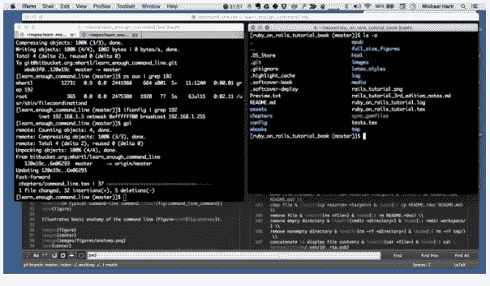

*图 1: 经验丰富的开发人员桌面上的终端窗口。*

```
[projects]$ rm -f foo.txt
```

*图 2: 典型的命令行命令。*

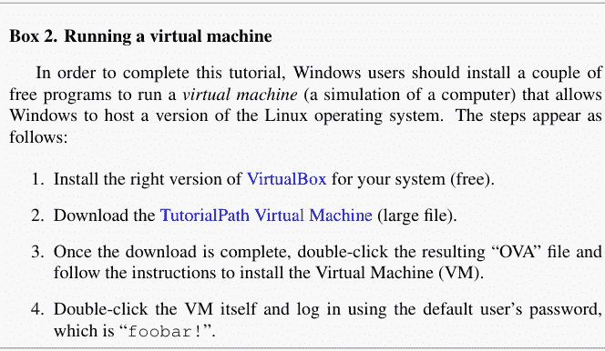

### 框 2. 运行虚拟机

为了完成本教程，Windows 用户应安装两个免费程序来运行 *虚拟机*（计算机的模拟），它允许 Windows 托管 Linux 操作系统的版本。步骤如下：

- 1. 为你的系统安装正确版本的 VirtualBox（免费）。
- 2. 下载 TutorialPath 虚拟机（大文件）。
- 3. 下载完成后，双击生成的“OVA”文件，并按照说明安装虚拟机 (VM)。
- 4. 双击虚拟机本身，使用默认用户的密码登录，密码是“foobar!”。

<sup>1</sup> 如第 1 节所述，该陈述适用于 Unix 传统，这是互联网和万维网背后的主要计算传统，也是本教程遵循的传统。

<sup>2</sup> 了解命令行对于系统管理员（sysadmins）也是必不可少的。

<sup>3</sup> 在一次相当典型的事件转折中，Unix 这个名字始于对竞争对手系统 Multics 的双关语。

<sup>4</sup> IDE 或集成开发环境，通常将多个开发工具（如命令行和文本编辑器）集成到一个应用程序中。


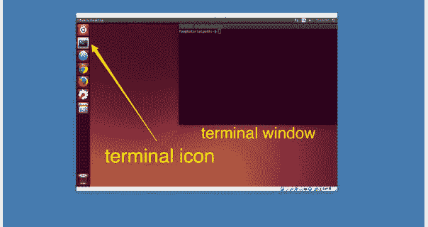

*图 3：在宿主操作系统中运行的 Linux 虚拟机。*

结果将是一个已为本文预先配置好的 Linux 桌面环境（包括一个命令行终端程序）（图 3）。从长远来看，我建议尽可能早地切换到 Mac。你可能需要存点钱，因为 Mac 通常比 Windows 机器更昂贵，但在大多数情况下，生产力的提升很快就能抵消差价。（如果你发现自己喜欢 Linux，请随意继续使用，但 Mac 通常更易于使用，拥有更好的用户界面。此外，你始终可以在 Mac 上的虚拟机中运行 Linux。）

## 1.1 运行终端

要运行命令行命令，我们首先需要启动一个*终端*，即提供命令行的程序。在 Macintosh OS X 上，你可以通过在 Spotlight 中搜索并输入 ⌘_ （Command-space）来打开终端窗口，或者点击右上角的放大镜图标并输入“terminal”；在 Linux 上，你可以点击如图 3 所示的终端图标。结果应该类似于图 4，尽管你系统的具体细节可能会有所不同。

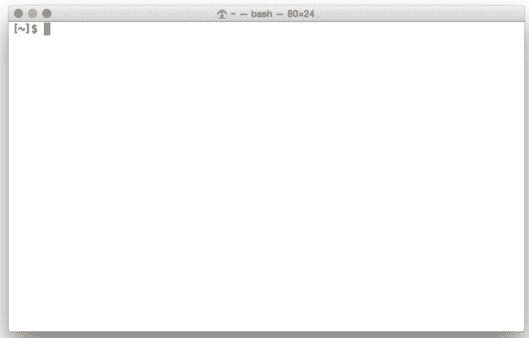

*图 4：一个终端窗口。*

我们在图 2 中看到的例子包含了命令的所有典型元素：提示符后跟随命令、选项和参数（图 5）。至关重要的是要理解，提示符是由终端自动提供的，你不需要输入它。（事实上，如果你输入了它，可能会导致错误。）此外，提示符的具体细节会有所不同，对于本教程的目的来说并不重要（框 3）。

如果你使用 OS X 并且对使用更高级、可定制的终端程序感兴趣，我推荐安装 iTerm，但这一步骤是可选的。

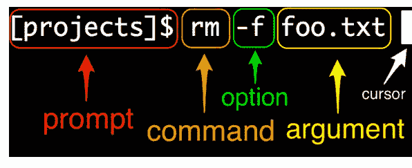

*图 5：命令行的结构。（你的提示符可能不同。）*

#### 框 3. 什么是提示符？

每个命令行都以一些旨在“提示”你行动的标志开头。提示符通常以美元符号 $ 结尾，前面跟随取决于系统详细信息的内容。例如，在某些系统上，提示符可能看起来像这样：

```
Michael's MacBook Air:~ mhartl$
```

在图 4 中，提示符看起来像这样：

```
[~]$
```

而在图 5 中，它看起来像这样：

```
[projects]$
```

最后，我现在看到的提示符看起来像这样：

```
[learn_enough_command_line (master)]$
```

对于本教程的目的来说，提示符的细节并不重要，但我们在下一篇文章（*Learn Enough*™ *Text Editor to Be Dangerous*）中将讨论定制提示符的有用方法。

#### 练习

Learn Enough™ Command Line to Be Dangerous 包含大量练习。我强烈建议在进入下一节之前养成完成这些练习的习惯，因为它们巩固了我们刚刚涵盖的内容，并将为您提供使用所讨论命令的必要实践。

- 1. 参考图 5，识别图 6 中每行的提示符、命令、选项、参数和光标。
- 2. 大多数现代终端程序都有创建多个*标签页*的能力，这对于组织一组相关的终端窗口非常有用。（例如，在开发 Web 应用程序时，除了我的主命令例行程标签页外，我通常还有用于运行本地 Web 服务器和自动化测试套件的单独标签页。）通过查看终端程序的菜单项，找出如何创建新标签页。*额外学分：* 学习创建新标签页的键盘快捷键。（学习系统的键盘快捷键是一个值得培养的好习惯。）

## 1.2 我们的第一个命令

我们现在已经准备好运行第一个命令，该命令会在屏幕上打印“hello”这个词。（字符打印的地方被称为“标准输出”，通常只是屏幕，很少指物理打印机。）该命令是 **echo**，参数是我们想要打印的字符字符串。要运行 **echo** 命令，请在提示符处输入“echo hello”，然后按 Return 键（也称为 Enter）：

```
$ echo hello
hello
$
```

（我建议始终手动输入命令，这比依赖复制和粘贴能学到更多。）在这里我们看到 **echo** **hello** 打印“hello”，然后返回另一个提示符。请注意，为了简洁起见，我省略了提示符中除末尾美元符号 $ 以外的所有字符。

```
[~]$ cd ruby
[ruby]$ ls -a
.           .DS_Store rails
..          projects
[ruby]$ rm -f .DS_Store
[ruby]$ ls -a
.           projects
..          rails
[ruby]$ cd projects/
[projects]$ pwd
/Users/mhartl/ruby/projects
[projects]$ 
```

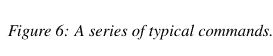

为了清楚地展示模式，让我们尝试第二个 **echo** 命令：

```
$ echo "goodbye"
goodbye
$ echo 'goodbye'
goodbye
$
```

注意，这里我们将“goodbye”包裹在引号中——我们还看到可以使用双引号，如 `"goodbye"`，或者单引号，如 `'goodbye'`。这样的引号可用于在视觉上分组字符串，尽管在许多情况下 **echo** 不需要它们（列表 1）。

### 列表 1：以两种不同方式打印“hello, goodbye”。

```
$ echo hello, goodbye
hello, goodbye
$ echo "hello, goodbye"
hello, goodbye
$
```

使用引号时可能会发生的一件事是无意中未匹配引号，如下所示：

```
$ echo "hello, goodbye
>
```

在此时，我们似乎卡住了。解决这种困境有特定的方法（事实上，在这种情况下，你只需添加一个闭合引号并按回车即可），但拥有一般策略来摆脱困境是很好的（图 7）。这种策略被称为“Ctrl-C”（框 4）。


> *图 7：这只猫似乎卡住了，最好按一下 `Ctrl-C`。*

### 框 4. 摆脱困境

在使用命令行时，有很多事情可能会让你陷入困境，我的意思是终端会挂起或进入使进一步输入命令变得困难或不可能的状态。以下是一些此类命令的示例：

```
$ echo "hello
$ grep foobar
$ yes
$ tail
$ cat
```

在所有情况下，解决方案都是相同的：按 `Ctrl-C`（读作“control-see”）。这里 `Ctrl` 指键盘上的“control”键，`C` 指标记为“C”的键。因此，`Ctrl-C` 意味着“按住 control 键的同时按下 C”。特别是，`C` 不*指*大写字母 `C`，所以你不应该同时按 Shift 和 Ctrl。（`Ctrl-C` 向终端发送一个*控制代码*，与输入普通文本时生成大写 `C` 无关。）输入 `Ctrl-C` 的结果有时写作 `^C`，如下所示：

```
$ tail
^C
```

**Ctrl-C 的起源** 有些晦涩，但作为一个助记符，我喜欢把它理解为“取消”的意思。无论你怎么记忆，*务必*记住它：当你在命令行中遇到麻烦时，最好的办法通常是按 `Ctrl-C`。

*注意：* 当 `Ctrl-C` 失效时，90% 的情况下按 `ESC`（Esc） 可以解决问题。

#### 练习

- 1. 编写一个打印字符串“hello, world”的命令。*额外学分：* 如列表 1 所示，以两种不同的方式完成，一种使用引号，另一种不使用引号。
- 2. 输入命令 `echo ‘hello`（带有不匹配的单引号），然后使用框 4 中的技术摆脱困境。

## 1.3 手册页

我们用来运行命令行的程序，技术上称为*shell*，包含一个强大（尽管通常晦涩）的工具来了解更多


可用命令。这个工具本身是一个名为**man**（“manual”的缩写）的命令行命令。其参数是我们想要了解的命令的名称（例如**echo**）。具体细节因系统而异，但在我的系统上，运行**man echo**的结果如清单 2 所示。

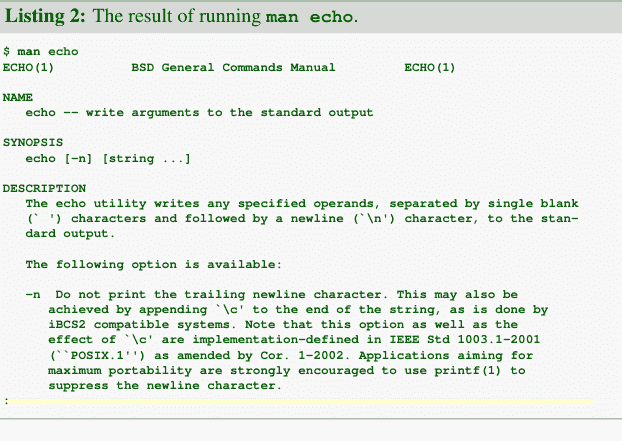

在清单 2 的最后一行，请注意冒号 : 的存在，这表明下方还有更多信息。这一行的具体细节因系统而异，但在任何系统中，你都应该能够按向下箭头键逐行访问后续信息，或按空格键逐页访问。要退出 man 手册页，请按下“q”（代表“quit”/退出）。(这个 man 手册页界面与**less**程序相同，我们将在第 3.3 节中介绍。)

对本教程（第 5 节）的后续教程的重要主题，从《*Learn Enough*™ *Text Editor To Be Dangerous*》（*Learn Enough™ 危险文本编辑器*）开始。


*图 8：将 man 应用于 man。*

由于**man**本身是一个命令，我们可以将**man**应用于**man**（图 8），¹ 如清单 3 所示。

### 清单 3：运行 **man man** 的结果。

```
$ man man
man (1)                    man (1)

NAME
       man - format and display the on-line manual pages

SYNOPSIS
       man [-acdfFhkKtwW] [--path] [-m system] [-P string] [-C config file]
           [-M pathlist] [-p pager] [-B browser] [-H htmtpager] [-S section_list]
           [section] name ... 

DESCRIPTION
       man formats and displays the on-line manual pages. If you specify sec-
       tion, man only looks in that section of the manual.  name is normally
       the name of the manual page, which is typically the name of a command,
       function, or file.  However, if name contains a slash (/) then man
       interprets it as a file specification, so that you can do man ./foo.5
       or even man /cd/foo/bar.1.gz.

       See below for a description of where man looks for the manual page
       files.

OPTIONS
       -C config_file
           :
```

我们可以从清单 3 中看到，**man** 的用法大致如下：

```
`man  [-acdfFhkKtwW]  [--path]  [-m  system]  [-P  string]  ...`
```

很疯狂，对吧？这就是我在上面描述 man 手册页“通常晦涩难懂”时所指的是。事实上，在许多情况下，我发现 man 手册页的细节几乎无法理解，但能够浏览 man 手册页以获得命令的高级概述是一项非常有价值的技能，值得去掌握。为了习惯阅读 man 手册页，我建议在遇到新命令时运行 `man <command name>`。即使细节不完全清楚，阅读 man 手册页也有助于培养*技术熟练度*（框 5）这一有价值的技能。

### 框 5. 技术熟练度

在数学中，许多学科可以通过对少量假设（或*公理*）进行纯演绎推导来发展。例子包括代数、几何、数论和分析。因此，这类学科是完全自洽的，从而没有形式上的先决条件。原则上，即使是小孩子也能从零开始学习这些学科。然而，在实践中，还需要其他东西，数学家通常推荐一种非正式的先决条件——*数学成熟度*，它包括理解和撰写数学证明所需的经验和一般技巧。

在技术领域，存在一种类似的技能（或更准确地说，一组技能），以*技术熟练度*的形式存在。本质上，它由一系列杂七杂八的计算机技巧工具箱组成，结合一种让机器服从你意愿的*态度*（框 1）。如图 9 所示，技术熟练度包括寻找有希望的菜单项以及知道在 Google 中应该使用哪种类型的搜索词。这些技能很难直接教授，因此在你学习本教程和后续*Learn Enough™ 教程*的过程中，请始终留意通过向你的工具箱中添加工具（例如，通过浏览其 man 手册页来了解程序要点的技能（第 1.3 节））来提高你的技术熟练度的机会。随着时间的推移，累积效应将是，就像图 9 的作者一样，你将拥有在所有程序中做任何事情的神秘般的能力。

#### 练习

- 1. 根据 man 手册页，在你的系统上 `echo` 的官方描述是什么？

致各位家长、祖父母、同事和其他“非计算机人士”：

我们并不是魔法般地知道如何在每个程序中做每一件事。当我们帮助你时，我们通常只是在这样做：

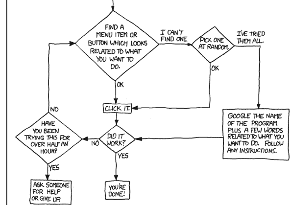

请打印此流程图并将其贴在你的屏幕附近。恭喜你，你现在是当地的计算机专家了！

> 图 9：“*技术支持作弊表*”（来自 xkcd.com）。唯一缺少的是“你试过重启吗？”

- 2. 运行 **echo** 的通常方式包括一个*换行符*（“enter”或“return”），它将新提示符放在单独的一行上，但有一个命令行选项可以防止这种情况。通过阅读 **echo** 的 man 手册页，确定打印“hello”但不带尾部换行符所需的命令，并使用你的终端验证它是否按预期工作。*提示*：结果应该看起来像 `helloworld`[ . . . ]$ ，其中 [ . . . ] 代表你的提示符中不重要的细节。(*注意*：在某些旧版本的 Macintosh OS X 上使用默认终端程序时，此练习可能会失败。在这种情况下，我建议安装 iTerm（无论如何这都不是个坏主意）。)

## 1.4 编辑行

命令行包含几个功能，以便轻松重复以前的命令，可能以编辑后的形式。最基本的功能是“向上箭头”，它只是获取上一条命令。再次按下向上箭头会进一步向上移动命令列表，而向下箭头则向底部移动。

在输入新命令或处理以前的命令时，能够在线内快速移动通常很方便。例如，假设我们输入了

```
$ goodbye
```

但意识到我们想在其前面加**echo**。我们可以使用左箭头键到达行首，但输入`Ctrl-A`更简单，它可以立即让我们到达那里。类似地，`Ctrl-E`移动到行尾。最后，`Ctrl-U`清除到行首并让我们重新开始。

`Ctrl-A`、`Ctrl-E` 和 `Ctrl-U` 的组合在大多数系统上都能正常工作，但如果你在编辑较长行（例如包含威廉·莎士比亚*十四行诗第一首*第一行的这一行（清单 4）），它们对你没什么用。


*图 10：莎士比亚第一首十四行诗的原始外观。*

#### 清单 4：打印莎士比亚第一首十四行诗的第一行。

```
$ echo "From fairest creatures we desire increase,"
```

假设我们要将“From”改为“F**R**om”，以更紧密地匹配原始十四行诗中的文本（图 10）。¹⁰ 我们可以输入`Ctrl-A`，然后按几次右箭头键，但在某些系统上，通过结合键盘和鼠标使用 Option-单击可以直接移动到所需位置。也就是说，你可以按住键盘上的 Option 键，然后用鼠标指针点击命令中你想要光标所在的位置。这将使我们直接移动到“From”中的“o”，允许我们删除“r”，直接得到清单 5。

> ⁹ 图像取自 https://commons.wikimedia.org/wiki/File:Jazz_at_Knicks_man_to_man_defense.jpg，检索于 2015-07-22

> ¹⁰ 请注意，莎士比亚英语的*原始发音*（OP）与现代发音不同。一般来说，莎士比亚的十四行诗包含许多在现代英语中不押韵但在 OP 中押韵的词对。在图 10 的情况下，单词“*memory*’”应发音为“MEM-or-aye”，从而导致第 2 行和第 4 行（分别以 *die* 和 *memory* 结尾）之间押韵。图像取自 https://commons.wikimedia.org/wiki/File:Sonnet_1.jpg，检索于 2015-07-20


**列表 5：** 编辑较长的命令行命令的结果。

```
$ echo "From fairest creatures we desire increase,"
```

我通常通过组合使用 `Ctrl-A`、`Ctrl-E` 以及左右方向键在命令行中移动，但对于较长的命令，Option 点击（在 Mac 上通常是 Option+点击）会非常有帮助。（我经常改变关于我正在输入的确切命令的想法，在这种情况下，我发现按 `Ctrl-U` 重新开始通常是继续的最快方式。）

#### 练习

- 1. 使用向上箭头，在屏幕上打印字符串“fee”、“fie”、“foe”和“fum”，而无需每次都重新输入 `echo`。
- 2. 从列表 4 中的那一行开始，使用 `Ctrl-A`、`Ctrl-E`、方向键或 Option 点击的任何组合，将短 *s* 的出现更改为古英语长 *s* “ſ”，以匹配原始外观（图 10）。换句话说，`echo` 的参数应读作“FRom faireft creatures we defire increase,”。*提示：* 你的键盘不太可能原生产生“ſ”，因此请从本教程的文本中复制它，或者在 Google 上搜索并从互联网上复制。

# 1.5 清理

在使用命令行时，有时能够清理屏幕（清除屏幕）会很方便，我们可以使用 `clear` 来实现：

```
$ clear
```

这个操作的键盘快捷键是 `Ctrl-L`。

同样地，当我们用完终端窗口（或标签页）并准备退出时，我们可以使用 `exit` 命令：

| 命令 | 描述 | 示例 |
|---|---|---|
| `echo <string>` | 打印字符串到屏幕 | `$ echo hello` |
| `man <command>` | 显示命令的手册页 | `$ man echo` |
| `Ctrl-C` | 摆脱困境 | `$ tail^C` |
| `Ctrl-A` | 移动到行首 | |
| `Ctrl-E` | 移动到行尾 | |
| `Ctrl-U` | 删除到行首 | |
| `Option-click` | 将光标移动到点击的位置 | |
| `Up & down arrow` | 在之前的命令中滚动 | |
| `clear` 或 `Ctrl-L` | 清除屏幕 | `$ clear` |
| `exit` 或 `Ctrl-D` | 退出终端 | `$ exit` |

*表 1：第 1 节中的重要命令。*

```
$ exit
```

这个操作的键盘快捷键是 **Ctrl-D**。

#### 练习

- 1. 清除当前标签页的内容。
- 2. 打开一个新标签页，执行 `echo 'hello'`，然后退出。

# 1.6 总结

本节中的重要命令已在表 1 中总结。

#### 练习

- 1. 编写一个命令，打印字符串 **Use** `"man echo"`，*包括*引号；即，注意不要打印出 **Use** `man echo`。*提示：* 在内部字符串中使用双引号，并将整个内容包裹在单引号中。
- 2. 通过运行 `man sleep`，弄清楚如何让终端“休眠”5 秒，并执行该命令。在等待了 5 秒后，执行休眠 5000 秒的命令，意识到这超过了一小时，然后使用框 4 中的说明来摆脱困境。

## 2 操作文件

因为这是一个命令行教程，我们不会假设读者熟悉用于编辑文本的程序。（这些称为*文本编辑器*的程序是序列中下一个教程的主题，*Learn Enough™ Text Editor to Be Dangerous*。）这意味着我们需要在命令行上手动创建文件。但这是一个特性，而不是缺陷（框 6），因为学习在命令行上创建文件本身是一项宝贵的技能。

**框 6. 学习说“极客”语言**

学习软件开发的一个重要部分是熟悉黑客、书呆子和极客文化，很多软件开发都源于此。例如，“这不是一个 bug，这是一个特性”是一种常见的将看似缺陷重新定义为*优点*的方式。正如 Urban Dictionary*所说*：

**这不是一个 bug，这是一个特性**  
软件开发者试图说服用户他们的程序中的一个缺陷实际上正是其应有的表现时所找的借口。

*Jargon File*，其中包含大量有趣的*黑客*术语*词典*，在其关于*特性*的条目中对这一主题进行了扩展：

未记录的特性是 *bug* 的一种常见且据称幽默的委婉说法。还有一个相关的玩笑，有时被称为


*图 11：这不是一个 bug，这是一个特性。*

> “单问题极客测试”。你对某人说：“我今天看到一辆大众甲壳虫，车牌号是 FEATURE（特性）”。如果他/她笑了，那么他/她就是一个*极客*。
>
> 这里的玩笑在于，因为“bug”（甲虫）是大众甲壳虫的常见俚语，带有 FEATURE（特性）车牌的甲壳虫是“这不是一个 bug，这是一个特性”（图 11）在现实中的体现。

### 2.1 重定向和追加

让我们（或多或少）从第 1 节离开的地方继续，使用一个 **echo** 命令来打印出莎士比亚第一首十四行诗的第一行（列表 4）：

```
$ echo "From fairest creatures we desire increase,"
From fairest creatures we desire increase,
```

我们现在任务是创建一个包含这一行的文件。即使没有文本编辑器的帮助，我们也可以使用*重定向运算符* `>` 来做到这一点：

```
$ echo "From fairest creatures we desire increase," > sonnet_1.txt
```

（请记住，你可以使用向上箭头检索之前的命令，而不是从头开始输入。）这里，右尖括号 `>` 获取 **echo** 输出的字符串并将其内容重定向到一个名为 **sonnet_1.txt** 的文件。

我们如何判断重定向是否成功？我们将在第 3 节学习一些更高级的命令行工具来检查文件，但眼下我们将使用 **cat** 命令，它只是将文件的内容转储到屏幕上：

```
$ cat sonnet_1.txt
From fairest creatures we desire increase,
```

**cat** 这个名字是“**c**oncate**n**ate”（连接）的缩写，这是一个提示，说明它可以用来合并多个文件的内容，但上述用法（转储单个文件的内容）极其常见。把 **cat** 想象成查看特定文件内容的“快速且凌乱”的方式（图 12）。[^11]

为了添加十四行诗的第二行（使用现代拼写），我们可以按如下方式使用*追加运算符* `>>`：

[^11]: 图像取自 https://www.flickr.com/photos/tiffanyday/4076289864，日期为 2015-07-22


图 12：使用 **cat** 查看文件。

```
$ echo "That thereby beauty's Rose might never die," >> sonnet_1.txt
```

这只是将该行添加到给定文件的末尾。和之前一样，我们可以使用 cat 查看结果：

```
$ cat sonnet_1.txt
From fairest creatures we desire increase,
That thereby beauty's Rose might never die,
```

（为了得到这个命令，希望你只是按了两次向上箭头，而不是重新输入。如果是这样，你肯定已经掌握了。）上面的结果显示，双右尖括号 >> 将 echo 中的字符串追加到了文件 sonnet_1.txt，符合预期。

十四行诗的现代改编版本有时会将 Rose 改为 rose（从而模糊了可能的含义），我们可以使用两次额外的 echo 调用来制作一个遵循此约定的第二个文件：

```
$ echo "From fairest creatures we desire increase," > sonnet_1_lower_case.txt
$ echo "That thereby beauty's rose might never die," >> sonnet_1_lower_case.txt
```

为了促进对相似但不完全相同的文件进行比较，Unix 系统附带了有用的 diff 命令：

```
$ diff sonnet_1.txt sonnet_1_lower_case.txt
< That thereby beauty's Rose might never die,
---
> That thereby beauty's rose might never die,
```

在讨论计算机文件时，diff 经常被用作名词（“那些文件之间的 diff 是什么？”）和动词（“你应该 diff 那些文件以查看发生了什么变化。”）。与许多技术术语一样，这有时也会渗透到日常用法中，例如“将当前的观点与过去各种文化的观点进行 diff，看看你能得到什么。”[^12]


#### 练习

在完成以下每个练习后，请使用 `cat` 命令来验证你的答案。

1. 使用 `echo` 和 `>，创建名为 `line_1.txt` 和 `line_2.txt` 的文件，分别包含《十四行诗第1首》的第一行和第二行。
2. 通过先将 `line_1.txt` 的内容重定向，然后追加 `line_2.txt` 的内容，来复制原始的 `sonnet_1.txt`（包含十四行诗的前两行）。将新文件命名为 `sonnet_1_copy.txt`，并使用 `diff` 确认它与 `sonnet_1.txt` 完全相同。*提示：当两个文件之间没有差异时，`diff` 不会输出任何内容。*
3. 使用 `cat` 以*单个*命令按相反顺序组合 `line_1.txt` 和 `line_2.txt` 的内容，生成文件 `sonnet_1_reversed.txt`。*提示：`cat` 命令可以接受多个参数。*

### 2.2 列表显示

在 Unix 命令行中最常被输入的命令可能是 `ls`，它是“list”（列表）的缩写（见列表 6）。

**列表 6：** 使用 `ls` 列出文件和目录。（输出可能会有所不同。）
```
$ ls
Desktop
Downloads
sonnet_1.txt
sonnet_1_reversed.txt
```

> “diff”（差异）这个动词是计算机行话，但它是我唯一认为能准确表达我想要意思的词。它源自 Unix 的 `diff` 工具，该工具会列出两个文件之间的所有差异。更广泛地说，它意味着对某物的两个版本进行无选择性和显微镜般彻底的比较。

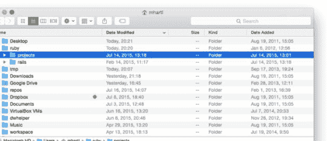

图 13：`ls` 的图形化等价物。

**ls** 命令仅列出当前目录中的所有文件和目录（除了那些*隐藏*的文件，我们稍后将详细介绍）。从这个意义上说，它实际上是图形浏览器的命令行版本，该浏览器用于显示文件和目录（也称为“文件夹”，如图 13 所示）。（我们将在第 4 节中加强对目录和文件夹的理解。）与图形文件浏览器一样，列表 6 中的输出只是一个示例，具体结果会根据你系统的细节而有所不同。（这对于所有 **ls** 示例都适用，因此如果输出有细微差别，请不要担心。）

**ls** 命令可用于检查文件（或目录）是否存在，因为尝试对一个不存在的文件运行 **ls** 会导致错误消息，如列表 7 所示。

**列表 7：对不存在的文件运行 `ls`。**
```
$ ls foo
ls: foo: No such file or directory
$ touch foo
$ ls foo
foo
```

列表 7 使用 `touch` 命令创建一个名为 `foo` 的空文件（方框 7），因此第二次运行 `ls` 时错误消息消失了。（`touch` 的既定目的是更改文件或目录的修改时间，但（滥用）`touch` 来创建空文件，如列表 7 所示，是一种常见的 Unix 习惯用法。）

#### 方框 7. Foo, bar, baz 等

在阅读有关计算机的内容时，你会以惊人的频率遇到某些奇怪的单词——像 *foo*、*bar* 和 *baz* 这样的单词。事实上，除了 `ls foo` 和 `touch foo` 之外，我们在这个教程中已经看到了四次这样的引用：在一个典型的命令行命令中（图 2），在一个虚拟机的密码中（`foobar!`，方框 2），再次是在摆脱困境时（`grep foobar`，方框 4），还有一次是在手册页中（列表 3）。前三次是我自己的用法，但最后一次与我无关：

```
    . . .if name contains a slash (/) then man interprets
    it as a file specification, so that you can do man
    ./foo.5 or even man /cd/foo/bar.1.gz.
```

在这里，我们看到 *foo* 和 *bar* 都出现在了 *man* 本身的手册页中——这是它们在计算中无处不在的一个明确见证。

这些奇术语的起源是什么？一如既往，**Jargon File**（通过其关于 *foo* 的条目）给了我们启发：

**foo**： /foo/

1. interj. 厌恶的术语。
2. [非常常见] 非常普遍地用作任何事物的示例名称，尤其是程序和文件（尤其是临时文件）。
3. 在语法示例中使用的**元语义词变量**标准列表中的第一个。另见 *bar*、*baz*、*qux*、*quux* 等。

当“foo”与“bar”一起使用时，通常可以追溯到二战时期的军队俚语缩写 *FUBAR* [*查看原始含义*]，后来被修改为 *foobar*。Jargon File 的早期版本将此变化解释为战后的查尔斯·兰姆式温和化，但现在似乎更有可能的是，FUBAR 本身就是“foo”的一个衍生词，可能受到德语 *furchtbar*（可怕的）的影响——“foobar”实际上可能是*原始*形式。

沿着链接到*元语义词变量*，我们随后发现以下内容：

> **元语义词变量**： n.
>
> 在示例中使用的名称，被理解为代表正在讨论的任何事物，或正在讨论的事物类别中的任何随机成员。单词 *foo* 是标准示例。为了避免混淆，黑客从不（几乎从不）使用 *foo* 或其他类似词语作为任何事物的永久名称。在文件名中，常见的惯例是，任何以元语义词变量名称开头的文件名都是临时文件，可以随时删除。
>
> 元语义词变量之所以如此称呼，是因为 (1) 它们是用于讨论程序等的元语言中的变量；(2) 它们的值通常是变量（例如像 f(foo,bar) 的值是 foo 和 bar 之和这样的用法。然而，有建议认为，元语义词变量这个术语的真正原因是它听起来很好听。

使用命令行的一种常见模式是改变目录使用 `cd`（在第 4 节中介绍），然后立即输入 `ls` 以查看目录的内容。这让你能够定位自己，并且是迈向下一个动作的第一步。

`ls` 的一个有用功能是对*通配符* `*`（读作“star”）的支持。例如，要列出所有以“*.txt*”结尾的文件，我们会这样输入：

```
$ ls *.txt
sonnet_1.txt
sonnet_1_reversed.txt
```

这里 `*.txt`（读作“star dot tee-ex-tee”）会自动扩展为所有匹配模式“任何字符串后跟 .txt”的文件名。

`ls` 有三种特别重要的可选形式，首先是使用选项 `-l`（读作“dash-ell”）的“长形式”：

```
$ ls -l *.txt
total 16
-rw-r--r-- 1 mhartl staff 87 Jul 20 18:05 sonnet_1.txt
-rw-r--r-- 1 mhartl staff 294 Jul 21 12:09 sonnet_1_reversed.txt
```

目前，你可以放心地忽略 `ls -l` 输出的大部分信息，但请注意，长形式列出了表明文件最后修改时间的日期和时间。日期前的数字是文件大小，以字节为单位。[^13]

[^13]: 位（bit）是一部分是非信息（例如 1 或 0），而字节（byte）是八位。字节可能最熟悉的是来自“兆字节”和“吉字节”，它们分别代表一百万和一十亿字节。（官方故事要复杂一点，但这里详细的程度绝对足以令人危险。）

第二个强大的 `ls` 变体是“按修改时间倒序列出（长格式）”，即 `ls -rtl`。当目录中有大量文件时，但你只关心查看最近修改的那些文件（例如确认文件下载时），这特别有用。我们将在第 3.1 节中看到一个例子，但你也可以现在就尝试：

```
$ ls -rtl
<结果取决于系统>
```

顺便说一句，`-rtl` 是常用的紧凑形式，但你也可以单独传递选项，如下所示：

```
$ ls -r -t -l
```

此外，它们的顺序无关紧要，所以输入 `ls -t*rl` 会得到相同的结果。

最后，Unix 有“隐藏文件（和目录）”的概念，它们在默认列出文件时不会显示。隐藏文件和目录以点 `.` 开头进行标识，通常用于存储用户偏好设置等。例如，在*Learn Enough™ Git to Be Dangerous*中，我们将创建一个名为 `.gitignore` 的文件，它告诉特定程序（Git）忽略匹配某些模式的文件。作为一个具体的例子，要忽略所有以“*.txt”结尾的文件，我们可以这样做：

```
$ echo "*.txt" > .gitignore
$ cat .gitignore
*.txt
```

如果我们然后运行 `ls`，该文件不会显示，因为它是隐藏的：

```
$ ls
sonnet_1.txt
sonnet_1_reversed.txt
```

要使 `ls` 显示隐藏文件和目录，我们需要传入 `-a` 选项（代表“all”）：

```
$ ls -a
.       .gitignore        sonnet_1_reversed.txt
..      sonnet_1.txt
```

现在 `.gitignore` 如期显示。（我们将在第 4.3 节中学习 `.` 和 `..` 指代什么。）

#### 练习

1. 列出所有以字母“s”开头的文件（和目录）的命令是什么？
2. 列出包含字符串“onnet”的所有文件、按修改时间倒序列出的长形式命令是什么？*提示：* 两次使用通配符运算符。


### 2.3 重命名、复制和删除

除了列出文件外，最常见的文件操作可能涉及对文件的重命名、复制和删除。与列出文件一样，大多数现代操作系统都提供图形用户界面来执行这些任务，但在许多场景下，在命令行中执行它们更为方便。

重命名文件的方法是使用 **mv** 命令，即“移动”（move）的缩写：

```
$ echo "test text" > test
$ mv test test_file.txt
$ ls
test_file.txt
```

这将名为 **test** 的文件重命名为 **test_file.txt**。示例中的最后一步运行 `ls` 以确认文件重命名成功，但省略了输出中除测试文件外的其他系统特定文件。（名称“移动”源于 `mv` 的一般用途，即将文件移动到不同的目录（第 4 节），并可能在此过程中重命名该文件。当源目录和目标目录相同时，这种“移动”就简化为简单的重命名。）

复制文件的方法是使用 **cp**，即“复制”（copy）的缩写：

```
$ cp test_file.txt second_test.txt
$ ls
second_test.txt
test_file.txt
```

最后，删除文件的命令是 **rm**，即“移除”（remove）的缩写：

```
$ rm second_test.txt
remove second_test.txt? y
$ ls second_test.txt
ls: second_test.txt: No such file or directory
```

请注意，在许多系统上，默认情况下您会被提示确认删除该文件。任何以字母“y”或“Y”开头的回答都会导致文件被删除，而其他回答则阻止删除发生。

顺便说一下，在上述对 `cp` 和 `rm` 的调用中，我几乎肯定不会完整输入 `test_file.txt` 或 `second_test.txt`。相反，我会输入类似 `tes<tab>` 或 `sec<tab>` 的内容（其中 `<tab>` 代表制表符键），从而利用*选项卡补全*（方框 8）。

##### 方框 8. **选项卡补全**

大多数现代命令行程序（shell）支持*选项卡补全*，这涉及当系统中只有一个有效匹配项时自动补全单词。例如，如果以字母“tes”开头的唯一文件是 `test_file`，我们可以如下创建删除它的命令：

```
$ rm tes<tab>
```

Shell 会补全文件名，生成 `rm test_file`。特别是对于较长的文件名（或目录），选项卡补全可以节省大量的打字工作。它还降低了*认知负荷*，因为你不需要记住文件的完整名称——只需记住其前几个字母即可。

如果匹配项是*歧义的*，例如如果我们拥有名为 `foobarquux` 和 `foobazquux` 的文件，单词只能尽可能多地补全，所以

```
$ ls foo<tab>
```

会被补全为

```
$ ls fooba
```

如果我们再次按下*选项卡键*，我们会看到匹配项列表：

```
$ ls fooba<tab>
foobarquux foobazquux
```

然后我们可以输入更多字母来解决歧义，因此在 **fooba** 之后输入 r 并按下 `<tab>` 将生成

```
$ ls foobar<tab>
```

这将被补全为 **foobarquux**。这种情况很常见，因此经验丰富的命令行用户通常只会按类似 f<tab><tab> 的组合，以让 shell 显示所有可能性：

```
$ ls f<tab><tab>
figure_1.png  foobarquux   foobazquux
```

然后通常会输入额外的字母来解决歧义。

在未配置的 Unix 系统上，**rm** 的默认行为实际上是无需确认即可删除文件，但由于（删除是不可逆的），许多系统*别名* **rm** 命令以使用一个选项来开启确认。（通过运行 **man rm** 可以验证，这个选项是 **-i**，所以实际上 **rm** 就是 **rm -i**。）然而，在许多情况下确认是不方便的，例如当你删除一个文件列表时，并不想逐一确认每一个。特别是当使用第 2.2 节中引入的通配符 \* 时，这种情况尤为常见。例如，要使用单个命令删除所有以“.txt”结尾的文件，*无需*逐一确认，你可以输入：

```
$ rm -f *.txt
```

这里 **-f**（意为“强制”）覆盖了隐式的 **-i** 选项并立即删除所有文件。（**注意** 你现在有能力理解图 2 中的命令。）

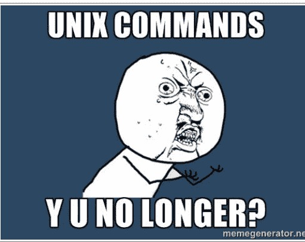

图 14：Unix 命令的简洁性可能会成为困惑的来源。

##### Unix 的简洁性

你可能会注意到本节和第 2.2 节中的命令很短：我们没有使用 list, move, copy 和 remove，而是使用 ls, mv, cp 和 rm。由于前者的命令名称更容易理解和记忆，你可能会想知道为什么实际的命令不是更长（图 14）。

答案是 Unix 起源于大多数计算机用户通过慢速连接登录到集中式服务器的时代，在用户按键和按键出现在终端之间可能有明显的延迟。对于像列出文件这样频繁使用的命令，list 和 ls 或者 remove 和 rm 之间的差异可能相当显著。因此，最常用的 Unix 命令往往只有两三个字母长。这使得它们更难记忆，在学习时可能是一个小不便，但在终身使用命令行的过程中，比如使用 **mv** 所带来的节省确实是很可观的。

#### 练习

- 使用 `echo` 命令和重定向运算符 `>` 创建一个名为 `foo.txt` 的文件，内容包含文本“hello, world”。然后，使用 `cp` 命令，创建 `foo.txt` 的副本，命名为 `bar.txt`。使用 `diff` 命令确认两个文件的内容相同。
- 通过组合 `cat` 命令和重定向运算符 `>`，在不使用 `cp` 命令的情况下，创建 `foo.txt` 的副本，命名为 `baz.txt`。
- 创建一个名为 `quux.txt` 的文件，内容先是 `foo.txt` 的内容，接着是 `bar.txt` 的内容。提示：如第 2.1 节所述，`cat` 可以接受多个参数。
- 对于不存在的文件，`rm nonexistent` 和 `rm -f nonexistent` 有什么区别？

### 2.4 总结

本节中的重要命令在表 2 中总结。

| 命令 | 描述 | 示例 |
|---|---|---|
| `>` | 重定向输出到文件名 | `$ echo foo > foo.txt` |
| `>>` | 追加输出到文件名 | `$ echo bar >> foo.txt` |
| `cat <file>` | 将文件内容打印到屏幕 | `$ cat hello.txt` |
| `diff <f1> <f2>` | 比较文件 1 和 2 | `$ diff foo.txt bar.txt` |
| `ls` | 列出目录或文件 | `$ ls hello.txt` |
| `ls -l` | 列出详细格式 | `$ ls -l hello.txt` |
| `ls -rtl` | 按修改时间倒序列出详细信息 | `$ ls -rtl` |
| `ls -a` | 列出所有（包括隐藏文件） | `$ ls -a` |
| `touch <file>` | 创建一个空文件 | `$ touch foo` |
| `mv <old> <new>` | 从旧名称重命名（移动）到新名称 | `$ mv foo bar` |
| `cp <old> <new>` | 复制旧文件到新名称 | `$ cp foo bar` |
| `rm <file>` | 移除（删除）文件 | `$ rm foo` |
| `rm -f <file>` | 强制移除文件 | `$ rm -f bar` |

表 2：第 2 节中的重要命令。

#### 练习

- 通过复制和粘贴图 15 的 [HTML 版本](#) 中的文本，使用 `echo` 创建一个名为 `sonnet_1_complete.txt` 的文件，包含莎士比亚第一首十四行诗的全诗（原文）。提示：你可能记得当 `echo` 后面跟着未匹配的双引号（第 1.2 节和方框 4）时会卡住，例如 `echo "`，但实际上这种构造允许你打印出多行文本块。只需记得在结尾处加上闭合引号，然后重定向到适当名称的文件。使用 `cat` 检查内容是否正确（图 12）。

From fairest creatures we desire increase,
That thereby beauty's rose might never die,
But as the rich should by time decay,
His tender heir might bear his memory;
But thou contracted to thine own bright eyes,
Feed'st thy light's flame with self-substantial fuel,
Making a famine where abundance lies,
Thy self thy foe, to thy sweet self too cruel:
Thou that art now the world's fresh ornament,
And her heir hope, if thou thy selfe wilt burn,
In thine own glories burial, in thy tomb,
And tender chaste life in niggardly room:
Pity the world, or else this glutton be,
To eat the world's due, by the grave and thee.

图 15：莎士比亚第一首十四行诗的可复制粘贴版本（参见图 10）。


## 3 检查文件

既然已经了解了如何创建和操作文件，现在是学习如何检查其内容的时候了。这对于那些长度超出单屏显示范围的文件尤其重要。特别是，我们从第 2.1 节开始看到了如何使用 `cat` 命令将文件内容转储到屏幕上，但对于较长的文件，这种方法并不太适用。

### 3.1 下载文件

为了让我们有一个起点，而不是手工创建一个长文件（这很繁琐），我们将使用功能强大的 `curl` 实用工具从互联网上下载一个文件，该工具允许我们在命令行中与 URL 交互。虽然它不是核心 Unix 命令集的一部分，但 `curl` 命令在 Unix 系统上广泛可用。为了确定它是否在你的系统上可用，我们可以使用 `which` 命令，该命令用于检查给定的程序是否在命令行上可用。[14] 使用它的方法是在输入 `which` 后跟上程序名称——在本例中是 `curl`：

```bash
$ which curl
/opt/curl
```

> **注意：** 从技术上讲，`which` 位于用户路径（path）上的一个文件，这是可执行程序所在目录列表。

我展示了在我的系统上的输出（通常读作“user bin curl”），但你系统中的结果可能不同。特别是，如果结果只是一行空白行，你将必须安装 `curl`，你可以通过在 Google 上搜索“install curl”后接上你的操作系统名称来完成。

一旦 `curl` 安装完毕，我们就可以使用列表 8 中的命令下载一个包含大量语料库文本的文件。

**列表 8：** 使用 `curl` 下载较长的文件。

```bash
$ curl -OL https://cdn.learnenough.com/sonnets.txt
$ ls -rtl
```

请确保精确复制该命令；特别是注意选项 `-OL` 中包含大写字母 “O”（O），而不是数字零（0）。（弄清楚这些选项的作用留作练习（第 3.5 节）。）此外，在某些系统上（由于神秘的原因）你可能需要运行该命令两次才能使其正常工作；通过检查 `ls -rtl` 的结果，你应该能够判断初始调用 `curl` 是否按预期创建了文件。（如果你确实需要重复 `curl` 命令，你可以按上箭头键两次来检索它，但请参见框 9 中的替代方案。）

**框 9. 重复之前的命令**

重复之前的命令是使用命令行时的常见任务。在本教程到目前为止的内容中，我们使用了上箭头键来检索（并可能编辑）之前的命令，但这并不是唯一的可能性。一种更快地查找并立即运行之前命令的方法是使用感叹号 `!`，在软件开发上下文中通常发音为“bang”。要按原样运行上一条命令，我们可以使用“bang bang”：

```bash
$ echo "foo"
foo
$ !!
```

一个密切相关的用法是“bang”后跟一些字符，这将运行以这些字符开始的最后一个命令。例如，要运行最后一个 `curl` 命令，我们可以输入：

```bash
$ !curl
```

这将省去输入选项、URL 等的麻烦。根据我们的命令历史，甚至更简短的 `!cu` 或 `!c` 也能起作用。当期望的命令是在许多命令之前运行时，这种技术特别有用，因为按下上箭头键可能会很繁琐。

第二种且功能强大的技术是 `Ctrl-R`，它允许你交互式地搜索之前的命令，然后在执行前选择性地编辑结果。例如，我们可以尝试以下操作来调出最后一个 `curl` 命令：

```bash
$ <Ctrl-R>
(reverse-i-search)`:' : curl
```

此时按下回车会将最后一个 `curl` 命令放在我们的提示符后面，允许我们在按下回车执行之前对其进行编辑（如果希望的话）。当你的工作流程恰好涉及反复运行各种类似的命令时，有时可能会感觉“所有命令都以 `Ctrl-R` 开头”。

运行列表 8 的结果是 `sonnets.txt`，一个包含莎士比亚全部 154 首十四行诗的文件。该文件包含 2620 行，太多而无法放在一个屏幕上。学习如何检查其内容是本节其余部分的目标。（除此之外，我们将学习如何确定它有 2620 行，而不用手动数所有行。）

#### 练习

1. 使用命令 `curl -I www.learnenough.com` 获取 **Learn Enough** 网站的 *HTTP 头*。该地址的 **HTTP 状态码**是什么？它与 `learnenough.com` 的状态码有何不同？
2. 使用 `ls` 确认 `sonnets.txt` 在你的系统上存在。它有多少字节？*提示：* 回顾第 2.2 节，`ls` 的“长格式”会显示字节数。
3. 上一个练习中的字节数足够高，因此更自然地以 *千字节*（通常被视为 1000 字节，但实际上等于 $2^{10}=1024$ 字节）来思考。使用 `ls` 的 `-h`（“人类可读”）选项，列出十四行诗文件的长格式，并显示人类可读的字节数。
4. 假设你想使用**人类**可读的字节数列出文件和目录，列出**所有**文件，并按时间倒序排列的长格式。为什么这个命令可能是本教程作者的私人最爱？[15]

> **注意：** 在很长一段时间里一直知道 `ls -a` 和 `ls -rtl`——两者一起产生了具有提示性的命令 `ls -artl`——有一天我决定添加一个“h”（原因显而易见）。实际上，我就是这样在几年前偶然发现了有用的 `-h` 选项。

### 3.2 理解首尾

两个互补的命令用于检查文件是 `head` 和 `tail`，它们分别允许我们查看文件的开头（head）和结尾（tail）。`head` 命令显示文件的前 10 行（列表 9）。

**列表 9：** 查看示例文本文件的头部。

```text
$ head sonnets.txt
Shake-speare's Sonnets
I

From fairest creatures we desire increase,
That thereby beauty's Rose might never die,
But as the riper should by time decease,
His tender heir might bear his memory:
But thou contracted to thine own bright eyes,
Feed'st thy light's flame with self-substantial fuel
```

类似地，**tail** 显示文件的最后 10 行（列表 10）。

**列表 10：** 查看示例文本文件的尾部。

```text
$ tail sonnets.txt
The fairest votary took up that fire
Which many legion of true hearts had warm'd;
And so the general of hot desire
Was, sleeping, by a virgin hand disarm'd.
This brand she quenched in a cool well by,
Which from Love's fire took heat perpetual,
Growing a bath and healthful remedy,
For men diseas'd; but I, my mistress' thrall,
Came there for cure and this by that I prove,
Love's fire heats water, water cools not love.
```

当你确定只需要检查文件的开头或结尾时（这种情况很常见），这两个命令很有用。

#### 字数统计和管道

顺便说一下，我一时想不起 **head** 和 **tail** 默认显示多少行。由于输出中只有 10 行，我可以手动数一下，但实际上我能够使用 **wc** 命令（“wordcount”的缩写；回顾图 14）弄清楚这一点。

**wc** 最常见的用法是针对完整文件。例如，我们可以将 `sonnets.txt` 通过 **wc** 运行：

```bash
$ wc sonnets.txt
2620 17670 95635 sonnets.txt
```

这里的三个数字表示文件中的行数、单词数和字节数，因此有 2620 行（从而兑现了在第 3.1 节末尾做出的承诺），17670 个单词，以及 95635 个字节。

你现在有能力猜测一种确定 `head sonnets.txt` 中有多少行的方法。特别是，我们可以将 `head` 与重定向运算符（第 2.1 节）结合使用，创建一个包含相关内容的新文件，然后对其运行 `wc`，如列表 11 所示。

**列表 11：** 重定向 `head` 并对结果运行 `wc`。

```bash
$ head sonnets.txt > sonnets_head.txt
$ wc sonnets_head.txt
10    46    294 sonnets_head.txt
```

从列表 11 我们可以看到 `head wc` 中有 10 行（以及 46 个单词和 294 个字节）。当然，同样的方法也适用于 `tail`。

另一方面，你可能会觉得仅仅为了运行 `wc` 而创建一个中间文件有点不整洁，确实，有一种使用称为管道（pipes）的技术来避免这种情况的方法。列表 12 展示了如何做。

**列表 12：** 将 `head` 的结果通过管道传递给 `wc`。

```bash
$ head sonnets.txt | wc
10    46    294
```

列表 12 中的命令运行 `head sonnets.txt`，然后使用管道符号 `|`（在 QWERTY 键盘上是 Shift-backslash）将结果通过管道传递给 `wc`。这样行之有效的原因是，`wc` 命令除了接受文件名作为参数外，还可以（像许多 Unix 程序一样）从“标准输入”获取输入（对比第 1.2 节中提到的“标准输出”），在本例中，这就是列表 9 中显示的 `head sonnets.txt` 的输出。`wc` 程序获取此输入并以与计算文件相同的方式对其进行计数，得出与列表 11 相同的行数、单词数和字节数。


#### 练习

- 1. 将 `tail sonnets.txt` 的结果通过管道传递给 `wc`，以确认（与 `head` 类似）`tail` 命令默认输出 10 行。
- 2. 通过运行 `man head`，学习如何查看文件的前 n 行。尝试不同的 n 值，找到一个 `head` 命令，以打印出足够显示第一首十四行诗全文的行数（图 10）。
- 3. 将上一个练习的结果通过管道传递给 `tail`（使用适当的选项），以仅打印组成十四行诗 1 的 14 行。提示：该命令看起来像 `head -n <i> sonnets.txt | tail -n <j>`，其中 `<i>` 和 `<j>` 代表 `-n` 选项的数字参数。
- 4. `tail` 最有用的应用之一是运行 `tail -f` 来查看正在发生变化的文件。这在监控用于记录（例如）Web 服务器活动的文件时特别常见，这种做法被称为“tail 日志文件”。为了模拟创建日志文件，在一个终端标签页中运行 `ping learnenough.com > learnenough.log`。（`ping` 命令向服务器“发 ping”以查看其是否正常工作。）在第二个标签页中，输入 tail 日志文件的命令。（此时，两个标签页都会卡住，因此一旦你掌握了 `tail -f` 的要领，你应该使用方框 4 中的技术来摆脱困境。）

### 3.3 少即是多

Unix 提供了两个实用程序，用于常见情况，即想要查看文件的 head 或 tail 之外的更多内容。这些程序中较旧的一个被称为 `more`，但（我推测最初是一个嬉皮笑脸的玩笑）有一个更强大的变体被称为 `less`。<sup>16</sup> `less` 程序是交互式的，因此很难在印刷品中捕捉，但以下是它的大致外观：

> <sup>16</sup> 在某些系统上，显然它们是*完全*相同的*程序*，因此 `less` 实际上是 `more`（或者更准确地说，`more` 是 `less`）。

```text
$ less sonnets.txt
Shake-speare's Sonnets

I
From fairest creatures we desire increase,
That thereby beauty's Rose might never die,
But as the riper should by time decease,
His tender heir might bear his memory:
But thou contracted to thine owne bright eyes,
Feed'st thy light's flame with self-substantial fuel,
Making a famine where abundance lies,
Thy self thy foe, to thy sweet self too cruel:
Thou that art now the world's fresh ornament,
And only herald to the gaudy spring,
Within thine owne bud buriest thy content,
And tender churl mak'st waste in niggarding:
Pity the world, or else this glutton be,
To eat the world's due, by the grave and thee.

II

When forty winters shall besiege thy brow,
And dig deep trenches in thy beauty's field,
sonnets.txt
```

**less** 的要点在于它允许你通过文件以几种有用的方式导航，例如使用箭头键向上或向下一行，按空格键向下翻一页，按 **Ctrl-F** 向前翻一页（即与空格键相同）或按 **Ctrl-B** 向后翻一页。要退出 **less**，输入 **q**（代表“退出”）。

**less** 最强大的方面也许是斜杠键 `/`，它允许你从头到尾搜索文件。例如，假设我们要搜索 **sonnets.txt** 中的“rose”（图 16），<sup>17</sup> 这是 *十四行诗*中最常用的图像之一。<sup>18</sup> 在 **less** 中这样做的输入是 `/rose`（读作“斜杠 rose”），如清单 13 所示。

> <sup>17</sup> 图像取自 https://commons.wikimedia.org/wiki/File:Tudor\_Rose.svg，检索日期为 2015-07-21
>
> <sup>18</sup> 虽然未注明日期，但莎士比亚的大部分十四行诗可能创作于 *伊丽莎白女王* 统治期间，其 *王室* 采用玫瑰（图 16）作为其 *纹章徽章*。鉴于这种背景，莎士比亚选择花卉意象并不令人惊讶，但实际上只有少数对 *十四行诗* 的评论者 *注意到* 了这个看似显而易见的引用。


图 16：莎士比亚时代的一朵 *著名玫瑰*。

#### **清单 13**：使用 **less** 搜索字符串“rose”。

```text
Shake-speare's Sonnets

I

From fairest creatures we desire increase,
That thereby beauty's Rose might never die,
But as the riper should by time decease,
His tender heir might bear his memory;
But thou contracted to thine owb bright eyes,
Feed'st thy light's flame with self-substantial fuel,
Making a famine where abundance lies,
Thy self thy foe, to thy sweet self too cruel:
Thou that art now the world's fresh ornament,
And only herald to the gaudy spring,
Within thine owb bud burliest thy content,
And tender churl mak'st waste in niggarding:
Pity the world, or else this glutton be,
To eat the world's due, by the grave and thee.

II

When forty winters shall besiege thy brow,
And dig deep trenches in thy beauty's field,
/rose
```

在清单 13 中输入 */rose* 后按回车键的结果是突出显示文件中“rose”的第一个出现位置。然后你可以按 **n** 导航到下一个匹配项，或按 **N** 导航到上一个匹配项。

最后两个必需的 **less** 命令是 **G**（移动到文件末尾）和 **1G**（即 1 后跟 G，移动到文件开头）。表 3 总结了我认为最重要的键组合（即我认为你需要变得*危险*的那些），但如果你好奇，你可以在 [less 的维基百科页面](https://en.wikipedia.org/wiki/Less_(Unix)) 上找到更长的命令列表。

我建议你养成使用 **less** 作为查看文件内容的首选实用程序的习惯。你发展的技能也有其他应用；例如，man 页面（第 1.3 节）使用与 **less** 相同的接口，因此通过了解 **less**，你也会更好地导航 man 页面。

| 命令 | 描述 | 示例 |
| :--- | :--- | :--- |
| `up` 和 `down` 箭头键 | 向上或向下一行移动 | |
| `spacebar` | 向前移动一页 | |
| `Ctrl-F` | 向前移动一页 | |
| `Ctrl-B` | 向后移动一页 | |
| `G` | 移动到文件末尾 | |
| `1G` | 移动到文件开头 | |
| `/string` | 在文件中搜索字符串 | `/rose` |
| `n` | 移动到下一个搜索结果 | |
| `N` | 移动到上一个搜索结果 | |
| `q` | 退出 `less` | |

表 3：最重要的 `less` 命令。

#### 练习

- 1. 在 `sonnets.txt` 上运行 `less`。向下翻三页，然后向上翻三页。转到文件末尾，然后转到开头，然后退出。
- 2. 搜索字符串“All”（区分大小写）。向前翻几个出现位置，然后向后翻几个出现位置。然后转到文件开头，通过向前搜索直到到达文件末尾来计数出现次数。将你的计数与运行 `grep All sonnets.txt | wc` 的结果进行比较。（我们将在第 3.4 节学习 `grep`。）
- 3. 使用 `less` 和 `/`（“斜杠”），找到以“Let me not”开头的十四行诗。`Sonnets` 中还有其他这个字符串的出现位置吗？*提示：按 n 以找到下一个出现位置（如果有的话）。额外学分：聆听该十四行诗的现代和原始发音版本。哪个版本的押韵方案更好？*
- 4. 由于 `man` 使用 `less`，我们现在处于可以交互式搜索 man 页面的位置。通过在 `ls` 的 man 页面中搜索字符串“sort”，发现按大小排序文件的选项。显示按大小排序的文件长格式，使最大文件出现在底部的命令是什么？*提示：以 `ls -rt1` 为模型。*

### 3.4 使用 Grep

检查文件内容的最强大工具之一是 **grep**，它可能代表某个词，但这并不重要。<sup>19</sup> 确实，grep 经常用作动词，例如“你绝对应该 grep 那个文件”。

**grep** 的最常见用途只是搜索文件中的子字符串。例如，我们在第 3.3 节中看到了如何使用 less 在莎士比亚的十四行诗中搜索字符串“rose”。使用 **grep**，我们可以直接找到引用，如清单 14 所示。

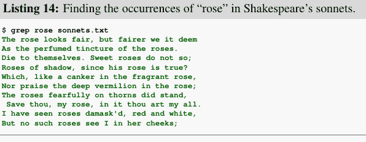

使用清单 14 中的命令，看起来我们可以通过管道连接到 wc（如第 3.3 节所示，如清单 15 所示）来计数包含对“rose”一词的引用的行数。


清单 15 告诉我们有 10 行包含“rose”（或者“roses”，因为“rose”是“roses”的子字符串）。但你可能还记得图 10 中莎士比亚的第一首十四行诗包含大写“R”的“Rose”。参考清单 14，我们看到

<sup>19</sup> 它来自“全局搜索正则表达式并打印”，但我告诉你这并不重要。


这表明该行实际上被忽略了。这是因为 `grep` 默认区分大小写，而 “rose” 并不匹配 “Rose”。

正如你可能猜到的，`grep` 还有一个选项可以执行不区分大小写的匹配。弄清楚这一点的一种方法是搜索 `grep` 的手册页（man page）：

- 输入 `man grep`
- 输入 `/case`，然后按 `Return`（回车）
- 读取结果（图 17）

（正如 1.3 节简要提到的，手册页使用与我们在 3.3 节遇到的 `less` 命令相同的接口，因此我们可以使用 `/` 在其中进行搜索。）

应用上述步骤的结果得到清单 16。将清单 16 的结果与清单 15 进行比较，我们看到现在有 12 行匹配项，而不仅仅是 10 行，因此《十四行诗集》（Sonnets）中总共应该有 $12-10=2$ 行包含 “Rose”（但不包含 “rose”）。$^{20}$

#### 清单 16：执行不区分大小写的 grep。

```bash
$ grep -i rose sonnets.txt | wc
12  96  508
```

`grep` 工具极其强大，尤其是当与所谓的正则表达式结合使用时，但仅学习 `grep` 和 `grep -i` 几乎就足以让你具备危险的操作能力（包括重要的应用程序：使用 grep 查找进程（框 10））。我们将在第 4 章中看到，要达到危险操作能力所需的是第三个也是最后一个 `grep` 变体。

#### 框 10. 使用 Grep 查找进程

$^{20}$ 实际上，“ROSE”、“R oSE”、“rOSE” 等也都匹配，但 “Rose” 是最可能的候选项。验证这一猜测留作练习（3.4 节）。

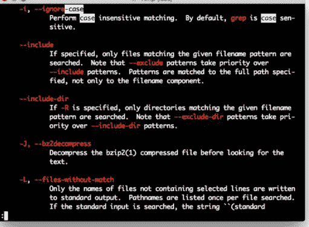

**图 17**：在 `man grep` 中搜索 "case" 的结果。

`grep` 的众多用途之一是过滤 Unix *进程列表*，以查找匹配特定字符串的正在运行的程序。（在类 Unix 系统（如 Linux 和 OS X）中，用户和系统任务各自在一个称为 *进程* 的明确定义的容器中运行。）当系统中存在需要终止的流氓进程时，这特别有用。（查找此类进程的一个好方法是运行 `top` 命令，它会显示消耗资源最多的进程。）

例如，在 *Ruby on Rails 教程* 书中的某个时刻，需要从进程列表中消除一个名为 `spring` 的程序。要做到这一点，首先需要找到该进程，而查看系统中所有进程的方法是使用带有 `aux` 选项的 `ps` 命令：

```bash
$ ps aux
```

如图 14 所示，`ps` 是 “process status”（进程状态）的缩写。而且出于**令人困惑且晦涩的原因**，`ps` 的选项不用破折号书写（所以是 `ps aux` 而不是 `ps -aux`）。（你究竟该如何知道这一点？这正是本教程存在的意义。）

要按程序名过滤进程，请将 `ps` 的结果通过管道传递给 `grep`：

```bash
$ ps aux | grep spring
ubuntu 12241 0.3 0.5 589960 178416 ? Ssl Sep20 1:46
spring app | sample_app | started 7 hours ago
```

显示的结果提供了一些关于进程的详细信息，但最重要的是第一个数字，即*进程 ID*，或 `pid`（通常读作与 “kid” 押韵的词）。要消除不需要的进程，我们使用 `kill` 命令向 `pid` 发出 Unix 终止代码（该代码**恰好是 15**）：

```bash
$ kill -15 12241
```

这是我推荐的用于终止单个进程（例如流氓 Web 服务器（通过 `ps aux | grep server` 找到其 `pid`））的技术，但有时杀死所有匹配特定进程名的进程更方便，例如当你想要清除系统中所有 `spring` 进程时。在这种情况下，你可以使用 `pkill` 命令按以下方式杀死所有名为 `spring` 的进程：

```bash
$ pkill -15 -f spring
```

每当事物未按预期运行，或进程似乎已冻结时，运行 `top` 或 `ps aux` 以查看发生了什么是个好主意，将 `ps aux` 通过管道传递给 `grep` 以选择可疑进程，然后运行 `kill -15 <pid>` 或 `pkill -15 -f <name>` 来清理问题。

#### 练习

- 通过搜索 `man grep` 中的 “line number”（行号），构造一个命令以找到 `sonnets.txt` 中字符串 “rose” 出现的行号。
- 你应该发现 “rose” 的最后一次出现（通过 “roses”）在第 2203 行。找出在运行 `less sonnets.txt` 时如何直接跳转到该行。*提示：* 回忆表 3，`1G` 会跳转到文件顶部，即第 1 行。类似地，`17G` 会跳转到第 17 行。等等。
- 通过将 `grep` 的输出管道传递给 `head`，打印 `sonnets.txt` 中包含 “rose” 的第一个（且*仅*第一个）行。*提示：* 使用 3.2 节第二个练习的结果。
- 在清单 16 中，我们看到两行额外不区分大小写匹配了 “rose”。执行一个命令，确认这两行都包含字符串 “Rose”（而不是例如 “rOSe”）。*提示：* 使用区分大小写的 `grep` 搜索 “Rose”。
- 在上一练习中，你应该发现匹配 “Rose” 的行有*三*行，而不是你可能从清单 16 中预期的两行。

| 命令 | 描述 | 示例 |
|---|---|---|
| `curl` | 与 URL 交互 | `$ curl -O example.com` |
| `which` | 在路径中定位程序 | `$ which curl` |
| `head <file>` | 显示文件的第一部分 | `$ head foo` |
| `tail <file>` | 显示文件的最后一部分 | `$ tail bar` |
| `wc <file>` | 统计行数、字数、字节数 | `$ wc foo` |
| `cmd1 \| cmd2` | 将 cmd1 管道传递给 cmd2 | `$ head foo \| wc` |
| `less <file>` | 交互式查看文件内容 | `$ less foo` |
| `grep <string> <file>` | 在文件中查找字符串 | `$ grep foo bar.txt` |
| `grep -i <string> <file>` | 不区分大小写查找 | `$ grep -i foo bar.txt` |
| `ps` | 显示进程 | `$ ps aux` |
| `top` | 显示进程（排序） | `$ top` |
| `kill -15 <pid>` | 终止进程 | `$ kill -9 24601` |
| `pkill -15 -f <name>` | 终止匹配进程 | `$ pkill -9 -f spring` |

**表 4：第 3 章中的重要命令。**

这是因为有一行同时包含 “Rose” 和 “rose”，因此它同时出现在 `grep rose` 和 `grep -i rose` 的结果中。编写一个命令，确认匹配 “Rose” 但不匹配 “rose” 的行数等于预期的 2 行。提示：将 `grep` 的结果管道传递给 `grep -v`，然后将该结果管道传递给 `wc`。（`-v` 的作用是什么？阅读 `grep` 的手册页（框 5）。）

### 3.5 摘要

本节的重点命令总结在表 4 中。

#### 练习

- `history` 命令打印特定终端 shell 中命令的历史记录（受某些限制，通常限制很大）。将 `history` 管道传递给 `less` 以检查你的命令历史。你的第 17 个命令是什么？
- 通过将 `history` 的输出管道传递给 `wc`，计算到目前为止你执行了多少条命令。
- 历史记录的一个用途是 grep 你的命令，以查找你以前使用过的有用命令，每个命令前都带有对应的命令历史编号。通过将 history 的输出管道传递给 grep，确定 `curl` 最后一次出现的编号。
- 在框 9 中，我们学习了使用 `!!`（“bang bang”）执行上一条命令。类似地，`!n` 执行第 `n` 个命令，因此例如 `!17` 执行命令历史中的第 17 个命令。使用上一个练习的结果重新运行最后一次出现的 `curl`。
- 清单 8 中 `-O` 和 `-L` 选项的含义是什么？提示：将 `curl -h` 的输出管道传递给 `less`，先搜索字符串 `-O`，然后搜索字符串 `-L`。

## 4 目录

在检查了许多用于处理文件的 Unix 实用工具之后，现在是时候学习目录了，目录有时也被称为文件夹（图 18）。正如我们将看到的，许多在文件背景下开发的概念也适用于目录，但两者之间也存在许多差异。

### 4.1 结构

Unix 风格目录的结构通常是由正斜杠分隔的目录名称列表，例如

```bash
$ /Users/mhartl/ruby
```

或

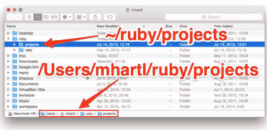

**图 18**：文件夹与目录之间的对应关系。

```bash
$ /usr/local/bin
```

如图 18 所示，这些表示形式对应于层次文件系统中的目录，其中（假设）**mhartl** 是 *User* 的子目录，而 **ruby** 是 **mhartl** 的子目录。

在谈论目录时，惯例各不相同：像 `/Users/mhartl` 这样的*用户目录*可能会被读作 “slash users slash mhartl” 或 “slash users mhartl”，而在口语中，*系统目录*（如 `/usr/local/bin`）通常省略初始斜杠，可能会被发音为 “user local bin”。因为所有 Unix 目录最终都是*根目录* `/`（发音为 “slash”）的子目录，所以前导斜杠和分隔斜杠是隐含的。**注意：** 错误地将正斜杠称为 “反斜杠” 是*痛苦的来源*，应严格避免。

对于特定用户来说，最重要的目录是*主目录*，在我的 OS X 系统中是 `/Users/mhartl`，对应我的用户名（**mhartl**）。主目录可以指定为*绝对路径*，如 `/Users/mhartl`，或者使用主目录的简写形式


波浪号字符 `~`（通过 Shift-backtick 输入，位于大多数键盘上数字 1 的左侧）。因此，图 18 中显示的两个路径是相同的：`/Users/mhart1/ruby/projects` 等同于 `~/ruby/projects`。（有趣的是，波浪号字符被用作主目录的原因是，*在某些早期键盘*上，“Home”键与产生“~”的键是同一个键。）

除了用户目录外，每个 Unix 系统都有用于计算机正常运行所必需程序的*系统目录*。修改系统文件或目录需要仅授予*超级用户*（称为*root*）的特殊权限。超级用户的权限极大，因此以*root*身份登录通常被视为不良习惯；相反，以*root*身份执行的任务通常应使用*sudo* 命令（框 11）。

#### 框 11. “sudo make me a sandwich.”（sudo 帮我做个三明治。）

*sudo* 赋予普通用户以超级用户身份执行命令的权限。例如，让我们尝试在系统目录 */opt* 中 *touch* 一个文件，如下所示：

```bash
$ touch /opt
touch: /opt/foo: Permission denied
```

由于普通用户没有修改 */opt* 的权限，命令失败，但使用 *sudo* 后成功：

```bash
$ sudo touch /opt/foo
Password:
```

如图所示，输入 *sudo* 后，系统会提示输入用户密码；如果输入正确，且用户已配置拥有 *sudo* 权限（这在大多数桌面 Unix 系统中是默认设置），那么命令将成功。如图 19 所示，这种首先被拒绝，仅在使用 *sudo* 时才成功的模式，是计算领域的一个常见主题。

要确认该文件确实已创建，我们可以使用 *ls* 命令：

```bash
$ ls -l /opt/foo
-rw-r--r-- 1 root wheel 0 Jul 23 19:13 /opt/foo
```

注意：(1) 普通用户可以在系统目录中 ls 文件（无需 sudo），(2) 列表中出现名称 root，表明超级用户拥有该文件。（第二个术语 wheel 的含义有些晦涩，但你可以在一个名为 superuser 的网站上了解它。）

要删除我们刚刚创建的文件，我们需要再次获得超级用户状态：

```bash
$ rm -f /opt/foo
rm: /opt/foo: Permission denied
$ sudo !!
$ !ls
ls: /opt/foo: No such file or directory
```

这里第一个 rm 失败了，所以我们运行了 sudo !!，这会运行 sudo 然后执行上一条命令，接着运行了 !ls，执行上一条 ls 命令（框 9）。

作为一个最后的补充，我想提一下类似 sudo !! 这种命令的英语发音，这在口语交流中很重要。如框 9 所述，!! 读作“bang bang”。不过，对于 sudo 的发音存在争议。有些人读作“SOO-doh”，使其听起来像前缀 pseudo，但实际上 sudo 是由命令 su（与流行观点相反，su 代表“substitute user”即“替代用户”，而不是“superuser”即“超级用户”）加上英语单词“do”组成的。换句话说，sudo 是“substitute user do”（替代用户做）的缩写。由于（除了 solfege 和《音乐之声》之外）单词“do”与“too”押韵，sudo 的正确发音是“SOO-doo”，因此 sudo !! 应读作“SOO-doo bang bang”。

#### 练习

- 1. 用文字描述你可能如何口述目录 ~/foo/bar。

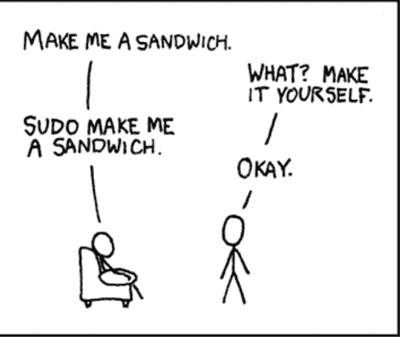

图 19:“*Sandwich*（三明治）”（来自 *xkcd.com*）从 *sudo* 的行为中衍生出幽默感。

- 2. 在 `/Users/bill/sonnets` 中，哪个是主目录？哪个是用户名？哪个目录在层次结构中最深？
- 3. 对于用户名为 `bill` 的用户，`/Users/bill/sonnets` 和 `~/sonnets` 有什么区别（如果有的话）？

### 4.2 创建目录

在本教程中，到目前为止，我们创建（并删除）了大量文本文件。现在终于该创建一个目录来包含它们了。虽然大多数现代操作系统都包含用于此任务的图形界面，但 Unix 的方式是使用 `mkdir`（“make directory”的缩写，参见图 14）：

```bash
$ mkdir text_files
```

创建目录后，我们可以使用通配符将文本文件移动到那里：

```bash
$ mv *.txt text_files/
```

我们可以通过列出目录来确认移动成功：

```bash
$ ls text_files/
sonnet_1.txt    sonnet_1_reversed.txt   sonnets.txt
```

（取决于你跟踪本教程的程度，结果可能有所不同。）

默认情况下，在目录上运行 `ls` 会显示其*内容*，但我们可以使用 `-d` 选项仅显示目录：

```bash
$ ls -d text_files/
text_files
```

这种用法在使用 `-l` 选项时（第 2.2 节）尤其常见：

```bash
$ ls -ld text_files/
drwxr-xr-x  7 mhartl staff  238 Jul 24 18:07 text_files
```

最后，我们可以使用 `cd` 改变目录：

```bash
$ cd text_files/
```

注意 `cd` 通常支持 Tab 补全，因此（如框 8 所述）我们可以实际输入 `cd tex<tab>`。

运行 `cd` 后，我们可以使用“打印工作目录”命令 `pwd` 和另一次 `ls` 调用来确认我们在正确的目录中：

```bash
$ pwd
/Users/mhart1/text_files
$ ls
sonnet_1.txt    sonnet_1_reversed.txt    sonnets.txt
```

输入 `pwd` 以双重检查目录，以及特别是运行 `ls` 以检查目录内容的这些最后步骤，对于许多经验丰富的命令行老手来说是一种习惯。（当然，你的 `pwd` 结果会不同，除非你碰巧在 OS X 上使用用户名“mhart1”。）

#### 练习

- 1. 创建中间目录所需的选项是什么，以便你可以用一条命令创建，例如，`~/foo` 和 `~/foo/bar`？
  - *提示*：参考 `mkdir` 的手册页。
- 2. 使用上一个练习中的选项，用一条命令创建目录 `foo`，并在其中创建目录 `bar`（即 `~/foo/bar`）。
- 3. 通过将 `ls` 的输出管道传输到 `grep`，列出主目录中包含字母“o”的所有内容。

### 4.3 导航目录

我们在第 4.2 节中看到了如何使用 `cd` 更改到给定名称的目录。这是导航最常见的方式之一，但有几种特殊形式值得了解。第一种是使用 `cd ..`（读作“see-dee dot-dot”）更改到层次结构中上一级目录：

```bash
$ pwd
/Users/mhart1/text_files
$ cd ..
$ pwd
/Users/mhart1
```

在这种情况下，由于 `/Users/mhart1` 是我的*主目录*，我们本可以单独使用 `cd` 来达到相同的效果：

```bash
$ cd text_files/
$ pwd
/Users/mhart1/text_files
$ cd
$ pwd
/Users/mhart1
```

这样行得通的原因是，单独使用 `cd` 会更改到用户的主目录，无论它在哪里。这意味着

```bash
$ cd
```

和

```bash
$ cd ~
```

是等价的。

在更改目录时，能够以某种方式指定主目录通常很有用。例如，假设我们创建第二个目录并 `cd` 进入它：

```bash
$ pwd
/Users/mhart1
$ mkdir second_directory
$ cd second_directory/
```

现在，如果我们想要更改到 **text_files** 目录，我们可以通过主目录 `~` 执行 **cd** 到 **text_files**：

```bash
$ pwd
/Users/mhart1/second_directory
$ cd ~/text_files
$ pwd
/Users/mhart1/text_files
```

顺便提一下，我们现在处于可以理解图 6 中显示的提示的位置：我配置我的提示符显示当前目录，可能是诸如 `[~]`、`[ruby]` 或 `[projects]` 之类的东西。（我们将在 *Learn Enough™ Text Editor to Be Dangerous* 中讨论如何自定义提示符。特别急切（或不耐烦）的读者可以通过 Google 搜索 *how to do it*（如何做）来锻炼他们的技术造诣（框 5）。）

与表示“上一级目录”的 `..` 紧密相关的是 `.`（读作“dot”），它意味着“当前目录”。`.` 最常见的用途是将文件或复制到当前目录时：

```bash
$ pwd
/Users/mhart1/text_files
$ cd ~/second_directory
$ ls
$ cp ~/text_files/sonnets.txt .
$ ls
sonnets.txt
```

注意第一次调用 `ls` 返回没有内容，因为 **second_directory** 最初是空的。

`.` 的另一个常见用法是与 **find** 命令结合使用，该命令和 **grep** 一样具有极其强大的功能，但在我自己的使用中，它 **99%** 的时间看起来都像是这样：


简而言之，这条命令的作用是查找文件名匹配模式 `*.txt` 的文件，从当前目录 `.` 开始，然后深入其子目录。find 实用工具在命令行中查找误放的文件时极其有用。

我使用 `.` 最喜爱的场景是在“打开点”（open dot）中，但这仅在 Macintosh OS X 上有效：

```bash
$ cd ~/ruby/projects
$ open .
```

令人惊叹的 open 命令会使用给定文件或目录的默认程序打开其参数。（类似地，xdg-open 命令在某些 Linux 系统上有效。）例如，`open foo.pdf` 会使用默认查看器（在大多数 Mac 上是预览 Preview）打开 PDF 文件。对于像 `.` 这样的目录，其默认程序是 Finder（访达），因此 `open .` 会生成如图 18 所示的结果。

最后一个导航命令，也是我个人最喜欢的之一，是 `cd -`，它会切换到上一次的目录，无论那个目录在哪里：

```bash
$ pwd
/Users/mhartl/second_directory
$ cd ~/text_files
$ pwd
/Users/mhartl/text_file
$ cd -
/Users/mhartl/second_directory
```

我发现 `cd -` 在结合命令时特别有用，如 12 号框中所述。

> 我的目录中有大量的文本文件，因为我就是这样的人，所以我运行的命令实际上是 `find . -name '*.txt' | grep text_files`，它会过滤掉与本教程中使用的目录不匹配的内容。

#### 12 号框. 组合命令

在命令行上组合命令通常非常方便，例如在使用 Unix 程序 configure 和 make 安装软件时，它们通常按以下顺序出现：

```bash
$ ./configure ; make ; make install
```

这行代码从当前目录 `.` 运行 configure 程序，然后运行 `make` 和 `make install`。（你不需要理解这些程序的作用，而且除非你恰好处于一个旨在以此方式安装的程序的目录中，否则它们在你的系统上也不会工作。）由于它们由分号字符 `;` 分隔，因此三个命令按顺序执行。

组合命令的更好方法是使用双与号 `&&`：

```bash
$ ./configure && make && make install
```

区别在于，由 `&&` 分隔的命令仅在前一个命令成功时才运行。相比之下，使用 `;` 时，无论发生什么，所有命令都会执行，这在后续命令依赖于前序命令结果的情况下（这种情况很常见）会导致错误。

我特别喜欢将 `&&` 与 `cd -` 结合使用，这让我可以这样做：

```bash
$ build_article && cd ~/tau && deploy && cd -
```

再次说明，你不需要理解这些命令，但大致思路是：我们可以（比如）在一个目录中构建一篇文章，`cd` 到另一个目录，部署（也许是网站）到生产环境，然后 `cd` 回去（`cd -`）到原始目录，在那里我们可以继续工作。然后，如果需要，我们可以只需使用向上箭头（或 9 号框中的某项技术）来检索整个命令并重新执行一遍。

#### 练习

- 1. `cd` 和 `cd ~` 的效果有何不同（或者它们没有不同吗）？
- 2. 切换到 `text_directory`，然后使用“上一级目录”双点运算符 `..` 切换到 `second_directory`。
- 3. 无论你当前在哪里，使用任意方法在 `text_directory` 中创建一个名为 `nil` 的空文件。
- 4. 使用与之前不同的路径，移除上一个练习中创建的 `nil`。（换句话说，如果你之前使用了路径 `~/text_directory`，请使用类似 `../text_directory` 或 `/Users/<username>/text_directory` 的路径。）

### 4.4 重命名、复制和删除目录

重命名、复制和删除目录的命令与文件的操作类似（第 2.3 节），但存在一些值得注意的细微差别。差别最小的命令是 `mv`，它的行为与对文件的操作一样：

```bash
$ mkdir foo
$ mv foo/ bar/
$ cd foo/
-bash: cd: foo: No such file or directory
$ cd bar/
```

这里的错误消息表明 `mv` 成功了：不存在名为 `foo` 的文件或目录。（单词 `bash` 指的是正在运行的 shell，即“Bourne Again Shell”。）唯一的细微差别是，末尾的斜杠（通常由制表符补全自动添加，见 8 号框）是可选的：

```bash
$ cd
$ mv bar foo
$ cd foo/
```

这个关于末尾斜杠的问题在 `mv` 中永远不会有影响，但在 `cp` 中可能会引起大量困惑。特别是，在复制目录时，你通常想要的行为是复制目录内容 *包括* 目录本身，这在许多系统中需要省略末尾的斜杠。在复制文件时，你还需要包含 `-r` 选项（代表“递归”）。例如，要将 `text_files` 目录的内容复制到一个名为 `foobar` 的新目录中，我们使用列表 17 中显示的命令。

**列表 17：复制目录。**

```bash
$ cd
$ mkdir foobar
$ cd foobar/
$ cp -r ../text_files .
$ ls
text_files
```

注意，我们使用了 `..` 来创建一个 *相对路径*，先上一级目录然后进入 `text_files`。还要注意 `cp -r ../text_files` 中 *没有* 末尾的斜杠；如果我们包含它，得到的将是列表 18。

**列表 18：带末尾斜杠的复制。**

```bash
$ cp -r ../text_files/ .
$ ls
sonnet_1.txt sonnet_1_reversed.txt sonnets.txt text_files
```

换句话说，列表 18 复制了单个文件，但没有复制目录本身。因此，我建议使用列表 17 中所示的方法，始终省略末尾的斜杠；如果你想只复制文件，请使用星号运算符明确指定，例如：

```bash
$ cp ../text_files/* .
```

与重命名（移动）和复制目录使用与文件相同的 `mv` 和 `cp` 命令不同，在删除目录的情况下，有一个专门的命令叫做 `rmdir`。但据我的经验，它很少能正常工作，如下所示：

```bash
$ cd
$ rmdir second_directory
rmdir: second_directory/: Directory not empty
```

这里的错误消息是我尝试删除目录时 99% 的情况下会发生的情况，因为 `rmdir` 要求目录必须为空。你当然可以手动清空它（通过反复使用 `rm`），但这通常不方便，我几乎总是使用更强大（但 *危险* 得多的）“递归强制删除”命令 `rm -rf`，它会删除目录、其文件以及任何子目录，且不需要确认（列表 19）。

**列表 19：使用 `rm -rf` 删除目录。**

```bash
$ rm -rf second_directory/
$ ls second_directory
ls: second_directory: No such file or directory
```

列表 19 中 `ls` 的错误消息（“No such file or directory”）表明，我们对 `rm -rf` 的使用成功删除了该目录。

强大的命令 `rm -rf` 太方便了，不能忽视，但请记住：“能力越大，责任越大”（图 20）。


图 20：这位 *超级英雄* 懂得如何负责任地使用 `rm -rf` 的力量。

#### Grep 再续

既然我们对目录有了一些了解，我们现在可以为第 3.4 节中的工具包添加一个有用的 `grep` 变体。与 `cp` 和 `rm` 类似，`grep` 接受一个“递归”选项，`-r`，在这种情况下，它会对目录中的文件及其子目录中的文件进行 grep。当你在某个目录层次结构中的某处文件中查找字符串，但不确定文件在哪里时，这非常有用的。以下是设置过程，它将单词“*sesquipedalian*”放入名为 `long_word.txt` 的文件中：

```bash
$ cd text_files/
$ mkdir foo
$ cd foo/
$ echo sesquipedalian > long_word.txt
$ cd
```

最后的 `cd` 让我们回到主目录。假设我们现在想要查找包含“sesquipedalian”的文件。*不要* 这样做：

```bash
$ grep sesquipedalian text_files
grep: text_files: Is a directory
```

这里 `grep` 的错误消息表明命令没有成功，但添加 `\-r` 就能解决问题：

```bash
$ grep \-r sesquipedalian text_files
text_files/foo/long_word.txt:sesquipedalian
```

由于大小写通常不重要，我建议在递归 grep 时养成添加 `\-i` 选项的习惯，如下所示：

```bash
$ grep \-ri sesquipedalian text_files
text_files/foo/long_word.txt:sesquipedalian
```

配备了 `grep \-ri`，我们现在可以在任意深度的目录层次结构中查找我们选择的字符串。

#### 练习

- 1. 创建一个带有子目录 `bar` 的目录 `foo`，然后将子目录重命名为 `baz`。
- 2. 将 `text_files` 中的所有文件 *带* 目录复制到 `foo`。
- 3. 将 `text_files` 中的所有文件 *不带* 目录复制到 `bar`。
- 4. 使用单条命令删除 `foo` 及其中的所有内容。

### 4.5 总结

本节中的重要命令总结在表 5 中。


| 命令 | 描述 | 示例 |
|---|---|---|
| mkdir <name> | 创建名为 <name> 的目录 | `$ mkdir foo` |
| pwd | 打印当前工作目录 | `$ pwd` |
| cd <dir> | 切换到 <dir> 目录 | `$ cd foo/` |
| cd ~/ <dir> | 相对于主目录切换 | `$ cd ~/foo/` |
| cd | 切换到主目录 | `$ cd` |
| cd - | 切换到上一个目录 | `$ cd && pwd && cd -` |
| . | 当前目录 | `$ cp ~/foo.txt .` |
| .. | 上一级目录 | `$ cd ..` |
| find | 查找文件和目录 | `$ find . -name foo*.*` |
| cp -r <old> <new> | 递归复制 | `$ cp -r ~/foo .` |
| rmdir <dir> | 删除（空）目录 | `$ rmdir foo/` |
| rm -rf <dir> | 删除目录及其内容 | `$ rm -rf foo/` |
| grep -ri <string> <dir> | 递归搜索（不区分大小写） | `$ grep -ri foo bar/` |

表 5：第 4 节中的重要命令。

#### 练习

- 1. 使用一条命令行命令，创建目录 **foo**，进入该目录，创建一个内容为 "baz" 的文件 **bar**，打印 **bar** 的内容，然后 `cd` 回到你的主目录。*提示：如框 12 所述，组合这些命令。*
- 2. 再次运行上一条命令时会发生什么？有多少个命令被执行了？为什么？
- 3. 解释为什么命令 `rm -rf /` 极其危险，以及为什么你绝不应该在终端窗口中输入它，即使是开玩笑也不行。
- 4. 如何使上一条命令变得更危险？*提示：参见框 11。（这个命令如此危险，你甚至不应该去想它，更不用说输入它了。)*

## 5 结论

恭喜！你正式掌握了足够的命令行知识，足以变得*危险*了。当然，这只是一个更长旅程中的一步，既通往命令行卓越（框 13），也通往软件开发的神秘魔法。在这段旅程中，你可能会发现学习计算机魔法既令人兴奋又赋予你力量，但也可能非常*困难*。事实上，你可能已经通过自己或在做这个教程时发现这一事实。对于希望继续前行的那些勇敢的见习魔法师，我提供以下序列，目前该序列正在准备中：

- 1. **软件开发基础**
  - (a) *Learn Enough™ Command Line to Be Dangerous*（你在这里）
  - (b) *Learn Enough™ Text Editor to Be Dangerous*
  - (c) *Learn Enough™ Git to Be Dangerous*
- 2. **Web 技术基础**
  - (a) *Learn Enough™ HTML to Be Dangerous*
  - (b) *Learn Enough™ CSS to Be Dangerous*
- 3. **Ruby Web 开发路径**
  - (a) *Learn Enough™ Ruby to Be Dangerous*
  - (b) *Learn Enough™ Ruby Web Development to Be Dangerous*
  - (c) *Learn Enough™ Ruby on Rails to Be Dangerous*
- 4. **专业级 Ruby Web 开发**
  - *The Ruby on Rails Tutorial*

上述列表中只有第一个和最后一个标题已完成，但其他所有链接都指向落地页，你可以在那里注册，以便在序列中的下一个教程准备好时收到通知。我们在那里见！

### 框 13. 额外资源

我建议你跟随 Learn Enough™ 序列，因为它代表了通往技术熟练度和软件开发技能的最短路径，但在某个时候，你可能也想要扩展你的命令行技能。当那一刻来临时，我建议查阅此列表，它主要由本教程的读者推荐的资源组成：

- * Mark Bates 的《征服命令行》书籍和屏幕录影（与本教程一样，可免费在线获取）
- * edX 上的 Linux 课程
- * Codecademy 上的命令行课程
- * 同名的《命令行速成课》和《命令行课程》
- * 《学习 Shell》

