# 5天学会 Linux

## 作者的其他书籍

- **Bash 命令行专业技巧**  
  <http://www.linxtrainingacademy.com/bash-pro-tips>

- **命令行功夫：Bash 脚本编写技巧、Linux Shell 编程技巧和 Bash 单行命令**  
  <http://www.linxtrainingacademy.com/command-line-kung-fu-book>

- **LAMP 栈的高可用性：消除单点故障并增加基于 Linux、Apache、MySQL 和 PHP 的 Web 应用程序的运行时间**  
  <http://www.linxtrainingacademy.com/ha-lamp-book>

- **初学者 Python 编程**  
  <http://www.linxtrainingacademy.com/python-programming-for-beginners>

## 您的免费礼物

感谢阅读《5天学会Linux》，我想送给你一份《Linux 版 Windows 替代应用程序》。在书中，你将了解到今天 Linux 上超过 50 个最流行的应用程序。这些应用程序将允许你浏览网页、观看电影、听音乐、连接你喜爱的社交网络、创建演示文稿等。这份礼物是本书的完美补充，将在你的 Linux 之旅中提供帮助。请访问 <http://www.linixtrainingacademy.com/linux-apps> 下载你的免费礼物。

## 引言

作为 Linux 培训学院的创始人和多门课程的讲师，我有幸帮助过数千万的人磨练他们的 Linux 技能。与许多刚开始接触 Linux 操作系统的朋友互动，让我对人们在这个阶段面临的特定困难和挑战有了无足价值的见解。

对于那些想要学习 Linux 细节的人来说，面临的最大挑战之一就是简单的缺乏时间。当你处理有限且极其宝贵的资源时，你希望确保充分利用它。

Linux 新手的下一个一个大挑战是不知道从何开始。可用信息如此之多，以至于决定先将注意力放在哪里成为了一个足够大的障碍，让许多人甚至无法开始。更糟糕的是，开始学习之路后却发现有太多未被解释的棘手概念、命令和细微差别。这种经历是令人沮丧的，并让你留下的问题比答案还多。

这就是我写下这本书的原因。

我不仅将最重要的材料浓缩成五个部分，每个部分都设计为一天内完成，我还以逻辑且系统的方式组织了内容。通过这样，你将确保通过首先学习 Linux 的基础方面，然后每天在基础的基础上继续，从而最充分地利用你的时间。

在《5天学会Linux》中，你将学习到最重要的概念和命令，并在几个实际且真实的示例指导下逐步进行。遇到新的概念、命令或术语时，将用通俗易懂的语言进行解释，使其易理解。

让我们开始吧。

# 第1天

## 获取访问

为了开始学习熟悉环境并测试你新学的知识，你将需要访问一个 Linux 系统。如果你已经在 Linux 系统上有了账户，可以跳到下一章。

### Web 托管 Shell 账户

如果你使用 Web 托管服务来托管你的网站，你可能已经有一个可以使用的 Linux 账户。咨询你托管公司的文档并搜索“SSH”或“shell access”。`SSH` 代表 `Secure Shell`（安全壳），它提供了一种连接方法。

以下是一些可以提供 shell 访问的 Web 托管公司：

- and.com
- BlueHost.com
- DreamHost.com
- HostGator.com
- Site.com

### 使用预装镜像

`VirtualBox` 是一种可以安装在 Windows、Mac、Solaris 或 Linux 上的虚拟化软件。它允许你在操作系统（主机）内部运行操作系统（虚拟机）。它比其他选项更耗时，但对于你自己的 Linux 系统是值得的。要开始，前往位于 <https://www.virtualbox.org/wiki/Downloads> 的 `VirtualBox` 下载页面并获取程序。接下来，从 <http://virtualboxes.org> 下载磁盘镜像（`VDI`）。我建议下载 CentOS 或 Ubuntu 镜像，除非你已经知道将来与哪个 Linux 发行版工作。说实话，你不会做错。启动 `VirtualBox`，创建一个虚拟机，并使用你下载的磁盘镜像。在询问硬盘镜像时选择“使用现有硬盘”单选按钮并点击目录图标。接下来，点击“添加”并选择磁盘镜像。当虚拟机开启电源后，你可以使用提供的用户名和密码登录服务器。

### 深度解析

这些链接以及补充材料可用：<http://www.linuxxtrainingacademy.com/lfb>

- [如何在 Mac 上安装 VirtualBox - 一段引导你在 Mac 上安装 VirtualBox 的视频](https://youtu.be/CBQdflx1L1o)
- [如何在 Windows 上安装 VirtualBox - 一段引导你在 Windows 上安装 VirtualBox 的视频](https://youtu.be/CBhppdewtEQ)
- [VirtualBox 文档 - 官方 VirtualBox 文档](https://www.virtualbox.org/wiki/Documentation)
- [VirtualBox 下载页面 - 获取 VirtualBox 软件的地方](https://www.virtualbox.org/wiki/Downloads)
- [VirtualBoxes.org - 磁盘镜像的好来源](http://virtualboxes.org/)

### 获取连接

当账户创建时，将提供有关连接到 Linux 服务器的详情。你可能会收到部分或全部信息：

- **用户名**。也称为账户、登录名或 ID。
- **密码**
- **SSH 密钥**
- **服务器名称或 IP 地址**
- **端口号**
- **连接协议**

连接协议将是 `SSH`（安全壳）或 `telnet`。`SSH` 和 `telnet` 提供了通过 Internet 或局域网连接到服务器的方法。在大多数情况下，连接协议将是 `SSH`。`telnet` 现在几乎过时，但如果你需要访问遗留系统，你可能会遇到它。

#### 选择 SSH 客户端

如果你被分配了一个特定的 `SSH` 客户端进行使用，请使用该程序并遵循该产品的文档。如果你可以自由选择自己的客户端或没有被提供，我建议在 Windows 上使用 `PuTTY`，或在 Mac 上使用 `Terminal`。

你可以从此网站下载 `PuTTY`：<http://www.LinuxTrainingAcademy.com/putty/>。你只需要 `putty.exe` 即可开始。

`Terminal` 应用程序在 Mac 上是预装的，位于 `/Applications/Utilities` 文件夹下。

在本章节末尾的“深度解析”部分提供了其他 `SSH` 客户端的列表。

#### 从 Windows 通过密码通过 SSH 连接

要使用 `SSH` 连接协议连接到 Linux 服务器，请启动 `PuTTY`。

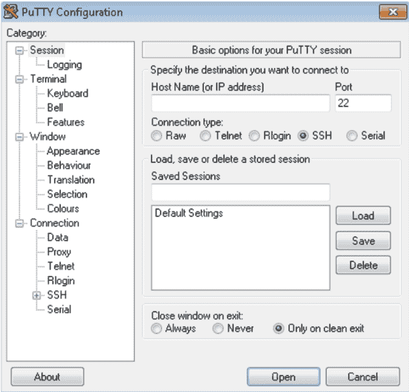

在 `Host Name`（或 `IP address`）框中输入你收到的主机名或 IP 地址。如果没有给你提供端口号，请保持默认值 `22` 不变。

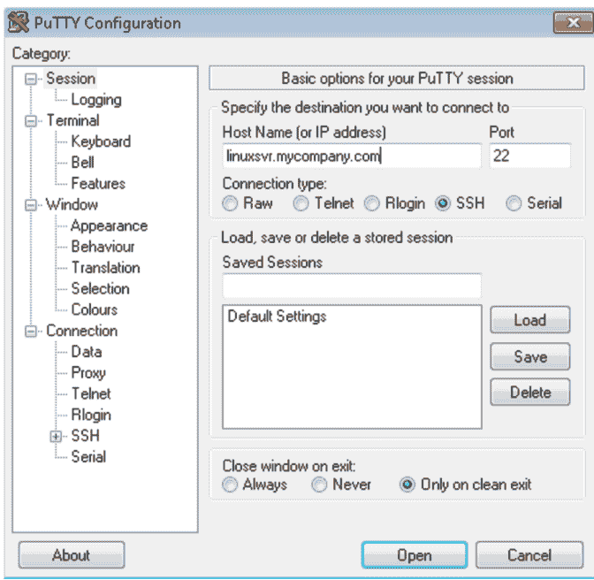

点击左侧面板中的 `Data`（数据）输入你的用户名。它位于 `Connection`（连接）正下方。在 `Auto-login username` 字段中输入你的用户名。如果你跳过这一步，在连接到服务器时将提示你输入用户名。

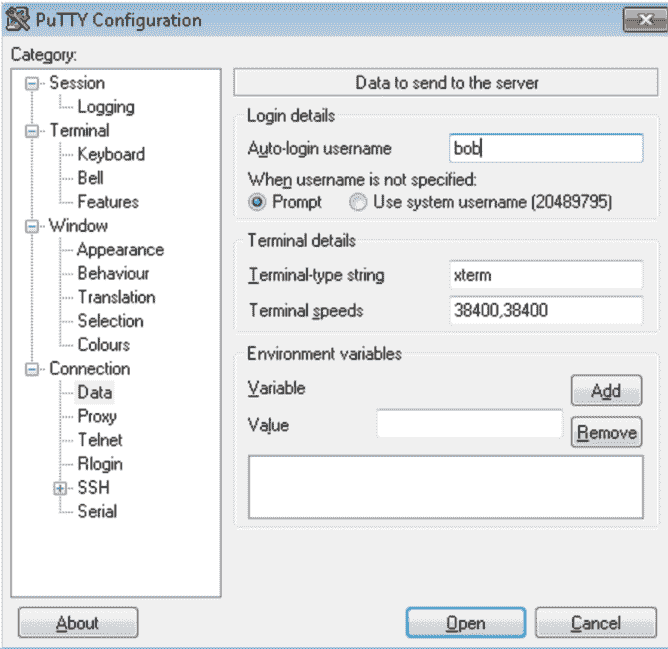

在 `Saved Sessions` 框中输入名称并点击 `Save` 保存会话。这允许你通过简单双击保存的会话来连接 Linux 服务器，从而加速此过程。

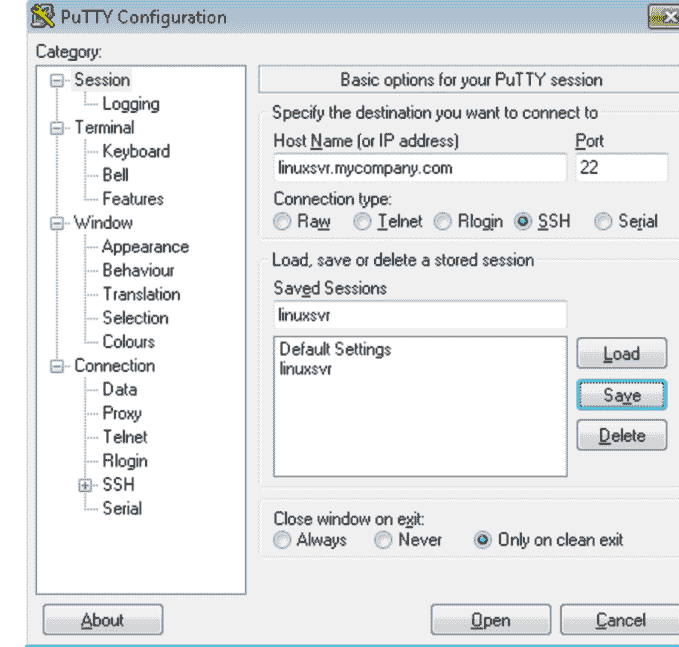

当你点击 `Open` 时，将尝试连接。当你第一次连接到特定服务器时，`PuTTY` 会询问是否缓存该服务器的主密钥。随后的连接将不再提示你。要将服务器的 `SSH` 主密钥添加到 `PuTTY` 缓存中，只需在提示时点击 `Yes` 即可。

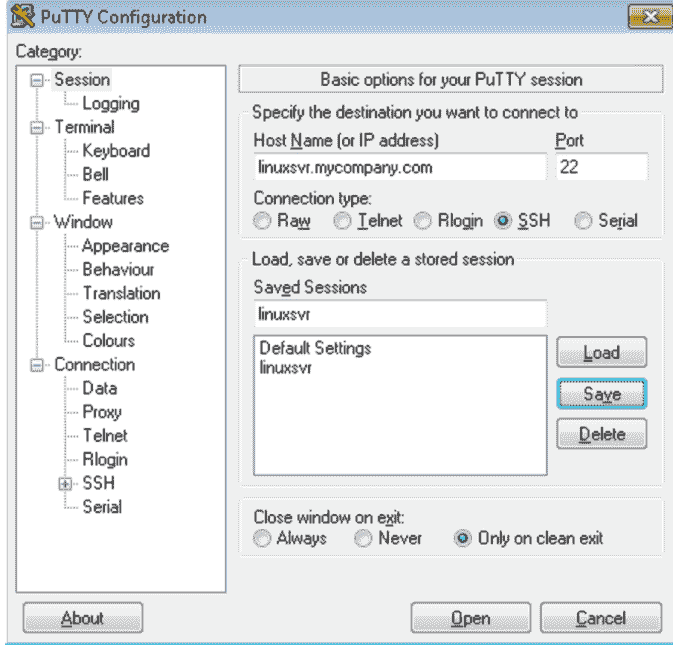

一旦成功登录，你将看到类似下面的内容：

```
[bob@linuxsvr ~] $
```

#### 从 Mac 通过密码通过 SSH 连接

Mac 内置的 `SSH` 客户端是一个命令行程序。命令行程序可以使用 Mac 操作系统自带的 `Terminal` 应用程序运行。它位于 `/Applications/Utilities` 文件夹下。`ssh` 命令的格式为 `ssh -p port_number username@servername`。如果没给你提供端口号，则假设端口为 `22`，你可以在 `ssh` 命令中省略 `-p 22`。同样，只有当服务器上的用户名与你 Mac 工作站上的用户名不同时，才需要指定用户名。例如，你在 Mac 上的用户名是 `bob`，在 `linuxsvr` 上的用户名也是 `bob`，你可以省略 `bob@` 并直接输入 `ssh linuxsvr`。一旦 `Terminal` 运行，输入 `ssh` 命令。命令是大小写敏感的，且 `ssh` 命令是小写的。它看起来应该像这三个选项之一：

```
ssh linuxsvr
ssh bob@linuxuxsvr
ssh -p 2222 bob@linuxuxsvr
```

当你第一次连接到特定服务器时，将会被要求验证该服务器的主密钥。随后的连接将不再提示你。当你被询问 "Are you want to continue connecting (yes/no)?" 时，输入 `yes` 并按回车。一旦建立连接，将提示你输入密码。

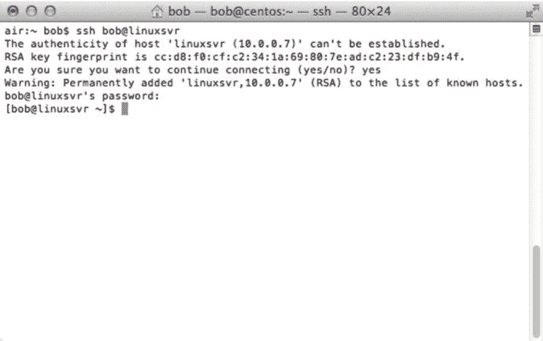

像 Mac 一样，Linux 也带有一个终端程序和一个 `SSH` 客户端。一旦你连接到一个 Linux 服务器，就可以使用 `ssh` 命令连接到另一个 Linux 服务器。你可以嵌套多个连接，并以这种方式在你的 Linux 服务器网络中穿行。

#### 使用密钥通过 SSH 连接的通用信息

你可能没有收到密码，而是收到了一个 `SSH` 密钥，甚至被要求生成一个。在物理世界中，钥匙可以打开门。同样，`SSH` 密钥用于解锁对服务器上账户的访问。如果你没有密钥，就无法打开门。

使用账户密码或账户密码与 `SSH` 密钥的组合是常见做法。随着几年云计算的增长，仅使用 `SSH` 密钥变得越来越流行。由于云服务器通常连接到公共互联网，它们很容易受到暴力破解。一个心怀不轨的人可以写一个程序，反复连接到你的服务器并每次尝试一种新的用户名和密码组合。他们可以使用常用用户名和密码列表来增加进入的几率。配置云服务器不接受账户密码而只接受 `SSH` 密钥，可以消除这种威胁。

你可以通过为密钥设置短语（`passphrase`）来进一步增加 `SSH` 密钥的安全性。在这种情况下，你需要“你拥有的”——密钥——以及“你知道的”——短语——来获取账户的访问权限。如果你确信密钥只受你控制，可以放弃为密钥提供短语。这将允许你无需输入密码即可登录服务器。拥有没有短语的 `SSH` 密钥允许你自动化和调度需要登录远程系统的任务。

#### 在 Windows 上导入 SSH 密钥

如果你收到的 `SSH` 密钥不是 `PuTTY` 格式，你需要进行转换。在 Windows 系统上转换 `SSH` 密钥需要 `PuTTYgen`。

运行 `PuTTY`，点击 `Load` 并导航到你收到的私有 `SSH` 密钥。文件名通常私钥为 `id_rsa`，公钥为 `id_rsa.pub`。

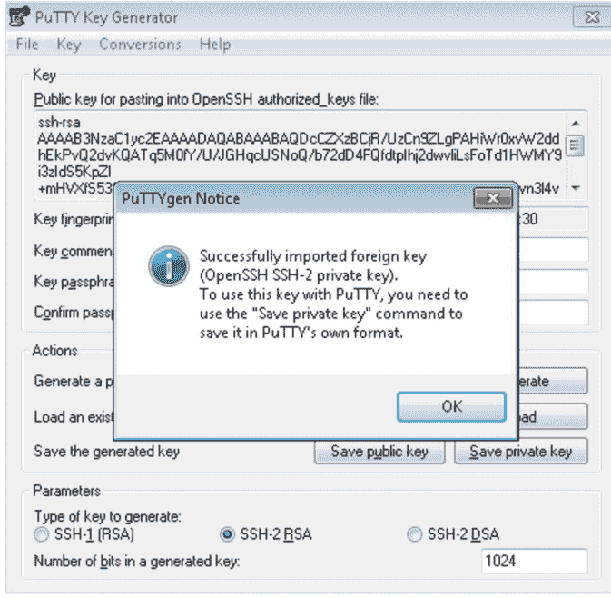

现在你可以保存公钥和私钥，以便以后供 `PuTTY` 使用。

#### 在 Windows 上生成 SSH 密钥

要在 Windows 系统上创建 `SSH` 密钥，你需要 `PuTTYgen`。

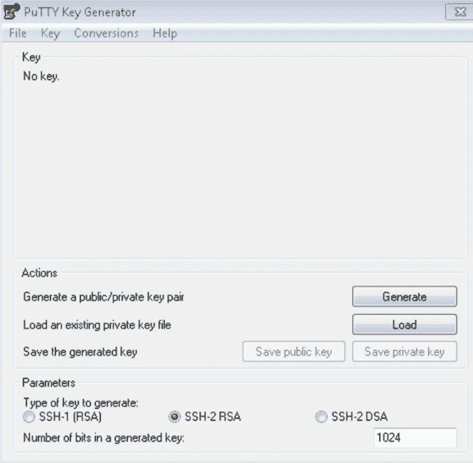

当你运行 `PuTTYgen` 时，会被要求移动鼠标以生成随机数据。

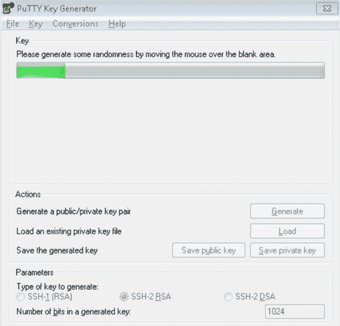

你会被询问是否为密钥设置短语。你也可以将注释（`comment`）更改为有意义的内容，例如 `bob's`。

现在，通过点击 `Save public key` 和 `Save private key` 保存公、私钥。

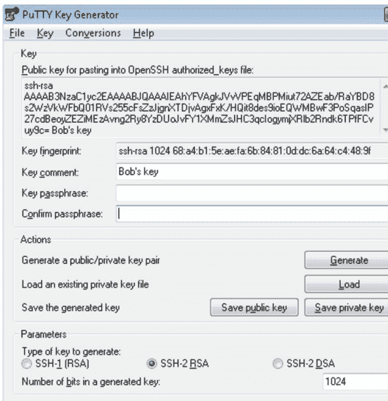

#### 在 Windows 上导出 SSH 密钥

接下来，点击 `Conversions` 并导出为 `OpenSSH key`。此 `OpenSSH` 密钥可以用于 Unix 或 Linux 系统。

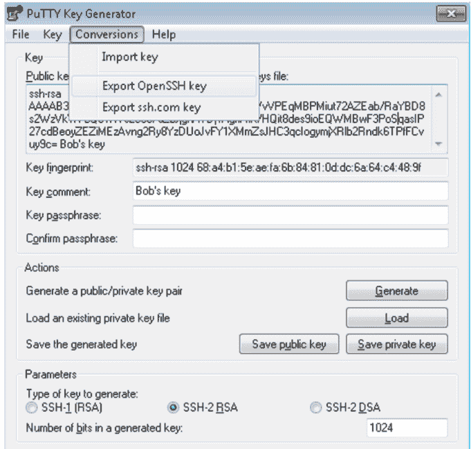

#### 从 Windows 通过密钥通过 SSH 连接

遵循“从 Windows 通过密码通过 SSH 连接”的指令，但这次增加一个指定私钥的步骤。点击 `Auth`。在 `Private key` 下选择 `Browse` 并定位你的密钥。

#### 在 Mac 上配置 SSH 密钥

像 Mac 一样，如果你生成了密钥，这一步已经完成了。如果你收到了密钥，你需要将其放置在 `.ssh` 目录中。打开 `Terminal` 应用程序并输入以下命令。每行结束后按回车键。

```
mkdir ~/.ssh
chmod 700 ~/.ssh
```

随着学习进行，你将充分理解这些命令的作用。为了加快连接过程，这些细节将被保存。

切换到 `Finder` 将密钥复制到 `.ssh` 文件夹。在 `Finder` 菜单中点击 `Go`，然后点击 `Folder...`，在提示时输入 `~/.ssh`。当你点击 `go` 后，将显示 `.ssh` 文件夹。

#### 在 Mac 上生成 SSH 密钥

如果你被要求生成密钥，启动 `Terminal` 应用程序并使用名为 `ssh-keygen` 的命令行工具。将被一系列问题。按回车接受所有默认值。可以选择地为你的密钥输入短语。

```
mac:~ bob$ ssh-keygen
Generating public/private rsa key pair.
Enter file in which to save the key (/Users/bob/.ssh/id_rsa):
Enter passphrase (empty for no passphrase):
Enter same passphrase again:
```

你的身份已保存在 `/Users/bob/.ssh/id_rsa`。

你的公钥已保存在 `/Users/bob/.ssh/id_rsa.pub`。

密钥指纹为：

```
0b:14:c5:85:5f:55:77:35:5f:9e:15:a9:b4:b0:54:05
bob@mac
```

密钥的随机图像：

```
--- RSA 2048-----
| .E+=@ |
|   o  .. oo|
|   ...+ o.o|
|   .      o |
|   . S |
|   . |
|   . |
+-----------------------
```

#### 从 Mac 通过密钥通过 SSH 连接

现在你可以将你的密钥拖到正确的位置了。

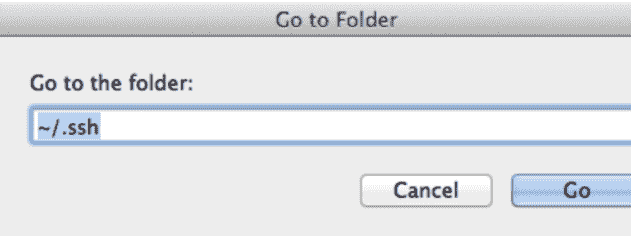

回到终端窗口，为你的密钥文件设置正确的权限。（再次强调，这些命令稍后会介绍。）

```
cd ~/.ssh
chmod 600 *
```

我强烈建议按照以下格式命名密钥：`id_rsa` 和 `id_rsa.pub`，或者 `id_dsa` 和 `id_dsa.pub`。否则，当你使用 `ssh` 命令时，必须指定密钥的位置，或者进行一些额外的配置来告诉 `SSH` 你的密钥不是按标准方式命名的。

通常情况下，遵循标准约定和通惯例会让你的生活轻松得多。我会在过程中指出它们。我最喜欢 Linux 的点之一就是它赋予了你以万种方式处理事情的自由和力量。在某些情况下，不遵循标准约定反而是正确的做法。

如果你仍然希望为密钥命名其他名称，可以通过在 `ssh` 命令中添加 `-i key_location` 来告诉 `SSH` 找到它。记住，我们上面使用的 `ssh` 命令格式是 `ssh -p port_number username@servername`。它可以扩展为 `ssh -i key_location -p port_number username@servername`。这里有一个例子：

```
ssh -i /Users/bob/.ssh_key bob@linuxsvr
```

### 通过 Telnet 连接


Telnet 曾是连接 Unix 或 Linux 服务器的实际方法。多年来，telnet 已被 Secure Shell（简称 SSH）取代。SSH 正如其名，比 telnet 更安全。Telnet 以明文发送你的登录凭据，而 SSH 加密了客户端与服务器之间的通信，从而大大提高了安全性。如果有人嗅探或监听你的连接，他们只会看到乱码和随机字符。如果你需要 telnet 到系统，可以使用上面的 SSH 指令，但需要进行微调。

## 从 Windows 通过 Telnet 连接

运行 `PuTTY` 并选择 Telnet 按钮。如果没有给你端口，请保持默认值 23。当你连接到服务器时，系统会提示输入用户名和密码。

# 5天学会Linux

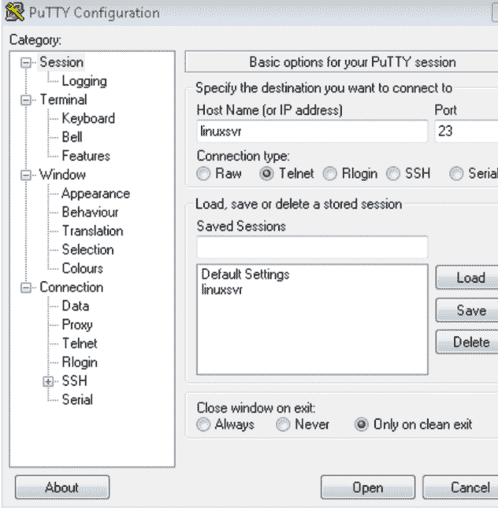

## 从 Mac 通过 Telnet 连接

Mac 自带的 telnet 客户端是一个可以使用 Mac 终端应用程序运行的命令行程序。它位于 `/Applications/Utilities` 文件夹。`telnet` 命令的格式为 `telnet hostname port_number`。如果端口不是默认值 23，你需要包含端口号。当你连接到服务器时，系统会提示输入用户名和密码。

# JASON CANNON

```
mac~ bob$ telnet linuxsvr
Trying 10.0.0.7...
Connected to 10.0.0.7.
Escape character is '^'
Ubuntu 12.04.3
linuxsvr login: bob
Password:
Last login: Thu Nov 7 01:26 UTC 2013
Welcome to Ubuntu 12.04.3

Documentation: https://help.ubuntu.com/

System info as of Nov 7 01:26 UTC 2013

System load: 0.42
Usage of /: 3.1% of 40GB
Memory usage: 32%
Swap usage: 0%
Processes: 89
Users logged in: 0
IP address for eth0: 10.0.0.0
bob@linuxsvr:~$
```

## 直接连接

如上一章所述在 `VirtualBox` 中运行 Linux，或者你有安装了 Linux 的专用硬件，你可以直接登录服务器。系统会提示输入用户名和密码。如果是图形界面，登录后你需要找到一个终端应用程序。大多数情况下，它就叫 "terminal"，但你可能会看到一些变体，如 "gnome terminal"、"konsole" 或 "xterm"。这是 CentOS 中打开终端应用程序的样式。你可以在菜单之一中找到它。

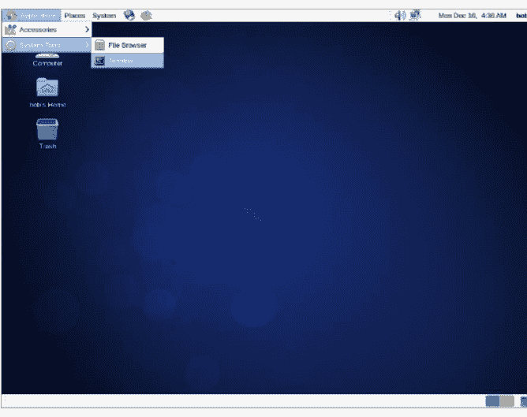


在某些 Linux 图形环境中可能没有传统的菜单系统。在这种情况下，你需要搜索终端应用程序。在这个 Ubuntu 示例中，点击屏幕左上角的按钮调出仪表板。现在你可以开始输入以查找系统中安装的应用程序。

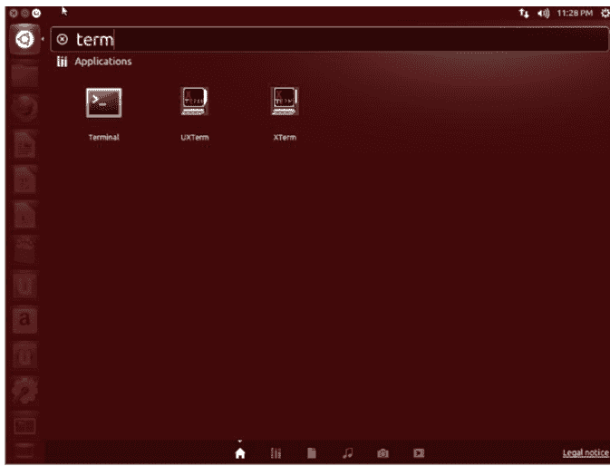

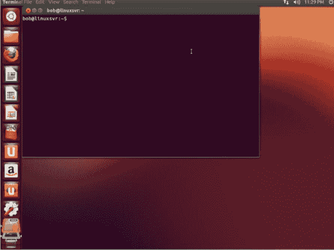

## 深度解析

- Mac SSH 客户端列表
  http://www.openssh.org/macos.html

- 所有平台 SSH 客户端列表
  http://en.wikipedia.org/wiki/Comparison_of_SSH_clients

- 终端模拟器列表 - 包含 Windows、Mac 和 Linux 的终端
  http://en.wikipedia.org/wiki/List_of_terminal_emulators

- Telnet 客户端列表
  https://en.wikipedia.org/wiki/Telnet#Telnet_clients

- Windows SSH 客户端列表
  http://www.openssh.org/windows.html

- OpenSSH.org - OpenSSH 的官方网站。

- PuTTY
  http://www.LinuxTrainingAcademy.com/putty/

- 通过 telnet 连接观看星球大战。
  - `telnet towel.blinkenlights.nl`
  - 要断开连接，按住 `Ctrl` 键并按下右括号 (`]`)。在 `telnet` > 提示符输入 `quit`

- 使用 SSH 密钥认证
  http://www.openssh.org/sshkeys.html

## 欢迎来到 SHELL

当你登录服务器时，shell 会启动并作为界面。shell 仅仅是一个接受你命令的程序。让我们来看提示符。

```
bob@linuxsvr $
```

提示符可能会显示用户名、服务器名称和当前目录。在这个例子中，shell 是普通用户 (`$`) 或超级用户 (`#`)。

Linux 系统上的超级用户也被称为 root。任何在服务器上可以执行的操作，root 都可以完成。然而，普通用户只能执行 root 能做的一部分操作。

# JASON CANNON

在本书的剩余部分，提示符将简短为美元符号 (`$`)，除非显示完整提示符提供额外的清晰度。此外，默认提示符可能随系统而异，但你可以根据自己的喜好进行自定义。

# 第 2 天

## LINUX 目录结构

现在你已经能够连接到服务器并熟悉了你将要使用的界面，是时候学习目录布局了。理解目录结构将对你未来在系统上搜索组件时非常有帮助。它可以帮助你回答这类问题：

- 程序存位于哪里？
- 配置文件存在哪里？
- 我可以在哪里找到此应用程序的日志文件？

### 常见目录

以下是你需要了解并可能作为普通用户与之交互的最常见的顶级目录。

# JASON CANNON

| 目录 (Dir) | 描述 |
| --- | --- |
| `/` | 称为 "root" 的目录。它是文件系统层次结构的起点。注意，这与 root（超级用户）账户无关。 |
| `/bin` | 二进制文件和其他可执行程序。 |
| `/etc` | 系统配置文件。 |
| `/home` | 用户目录。 |
| `/opt` | 可选或第三方软件。 |
| `/tmp` | 临时空间，通常在重启时清理。 |
| `/usr` | 与用户相关的程序。 |
| `/var` | 可变数据，最重要的是日志文件。 |

### 详尽目录列表

以下是你可以在各种 Linux 系统上找到的顶级目录详尽列表。为了清晰定义顶级目录的，列表中包含了一些子目录。你可能永远不会与其中许多目录交互。某些目录将存在于你遇到的每个系统中，如 `/usr`。其他目录则是特定 Linux 发行版特有的。你可以安全地浏览此列表，并在有实际需要时再查阅。

| 目录 (Dir) | 描述 |
| --- | --- |
| `/` | 称为 "root" 的目录。它是文件系统层次结构的起点。注意，这与 root（超级用户）账户无关。 |
| `/bin` | 二进制文件和其他可执行程序。 |
| `/boot` | 启动操作系统所需的文件。 |
| `/cdrom` | CD-ROM 的挂载点。 |
| `/cgroup` | 控制组 (Control Groups) 层次结构。 |
| `/dev` | 设备文件，通常由操作系统和系统管理员控制。 |
| `/etc` | 系统配置文件。 |
| `/export` | 共享文件系统。最出现在 Solaris 系统上。 |
| `/home` | 用户目录。 |
| `/lib` | 系统库。 |
| `/lib64` | 系统库，64 位。 |
| `/last+found` | 文件系统用于在执行文件系统检查后存储恢复的文件。 |
| `/media` | 用于挂载可移动介质（如 CD-ROM）。 |
| `/mnt` | 用于挂载外部文件系统。 |
| `/opt` | 可选或第三方软件。 |
| `/proc` | 提供有关运行进程的信息。 |
| `/root` | root 账户的家目录。 |
| `/sbin` | 系统管理二进制文件。 |
| `/selinux` | 用于显示有关 SELinux 的信息。 |
| `/srv` | 包含系统提供的数据。 |
| `/srv/www` | Web 服务器文件。 |
| `/srv/ftp` | FTP 文件。 |
| `/sys` | 用于显示（有时用于配置）Linux 内核已知的设备和总线。 |
| `/tmp` | 临时空间，通常在重启时清理。该目录可以被操作系统和用户使用。 |
| `/usr` | 与用户相关的程序、库和文档。`/usr` 下的子目录与上述和下述描述的内容相关。 |
| `/usr/bin` | 二进制文件和其他可执行程序。 |

### 深度解析

- 文件系统层级标准 (Filesystem Hierarchy Standard)
  http://refspecs.linuxfoundation.org/FHS_2.3

- `man hier`

- 红帽企业 Linux (RedHat Enterprise Linux)
  http://redhat.com/products/enterprise-linux/

- SUSE Linux 企业服务器 (SUSE Linux Enterprise Server)
  https://www.suse.com/products/server/

- Ubuntu
  http://www.ubuntu.com/

### 基础 Linux 命令

这是一个基础但重要的命令短列表。在 Linux 中，命令是区分大小写的，且通常全小写。被括号 (`[]`) 包围的项是可选的。你可能每次登录 Linux 系统时都都会使用这些命令中的至少几个。请熟悉这些命令，因为它们可以让你在短时间内取得长足进展。

- `ls` - 列出目录内容。你将使用 `ls` 显示文件和目录的信息。
- `cd [dir]` - 将当前目录更改为 dir。如果你执行 `cd` 而不指定目录，`cd` 将把当前目录更改到你的家目录。这就是你如何在系统中进行导航的方式。
- `pwd` - 显示当前工作目录名称。如果你不知道自己在哪个目录中，`pwd` 会告诉你。
- `cat [file]` - 合并并显示文件。这是你运行来查看文件内容的命令。
- `echo [argument]` - 在屏幕上显示参数。
- `man command` - 显示命令的在线手册。输入 `q` 退出查看手册页。`man` 命令提供的文档通常称为“man 手页 (man pages)”。
- `exit`、`logout` 或 `Ctrl-d` - 退出 shell 或你的当前会话。
- `clear` - 清除屏幕。

下面是 Bob 使用上述命令的会话截图。

```
$ ls
PerformanceReviews sales-lecture.mp3 sales.data
tpsreports
$ cd tpsreports
$ pwd
/home/bob/tpsreports
$ ls -l
total 2
-rw-r--r-- 1 bob users 31 Sep 28 14:49 coversheet.doc
-rw-r--r-- 1 bob users 35 Sep 27 08:47 sales-report
$ cat sales-report
We sold lots of widgets this week!
$ echo $PATH
/bin:/usr/bin:/usr/sbin:/usr/local/bin
$ man ls
NAME	ls - list directory contents
...
```

关于如何充分利用这些简单命令的威力，更多细节将在后文中介绍。但现在，拿起你的钓鱼竿——你即将开始学习如何钓鱼了。

## 自学钓鱼

了解可执行命令所在的位置以及 `man` 命令将带你走很远。你可以通过这种方法自学使用 Linux，但这将是一个漫长而缓慢的过程。通常情况下，`man` 命令被用作快速参考。要记忆每个命令的每一个选项几乎是不可能的，而且当你触手可及 `man` 命令时，没有必要这样做。

要获取 `man` 命令的帮助，请在查看手册页时输入字母 `h`。这将给你提供一个你可以用于导航或搜索的命令列表。以下是简洁版。

- `Enter` - 向下移动一行。
- `Space` - 向下移动一页。
- `g` - 移动到页面顶部。
- `G` - 移动到页面底部。
- `q` - 退出。

环境变量是一个具有名称和值的存储位置。

## 5 天学会 Linux

我们目前感兴趣的是 `PATH`。`PATH` 环境变量包含包含可执行命令的目录列表。你可以通过在它前面加上美元符号 (`$PATH`) 并使用 `echo` 命令将其值显示在屏幕上来确定 `PATH` 的值。

```
$ echo $PATH
/bin:/usr/bin:/usr/sbin:/usr/local/bin
```

你在提示符处输入命令并按回车时，将在 `$PATH` 中的目录中搜索该命令。在这个示例中，首先搜索 `/bin`。如果找到了命令，将执行它。如果没找到，将搜索 `/usr/bin`，依此类推。如果找不到匹配你请求的可执行命令，系统会礼貌地告诉你无法找到。

```
$ whatsupdoc
-bash: whatsupdoc: command not found
```

如果你想确切知道命令所在的位置，可以使用 `which` 命令。如果程序 `cat` 位于 `/usr/bin` 和 `/usr/local/bin`，则执行哪一个取决于你的 `$PATH`。

```
$ which cat
/bin/cat
$ which tac
/usr/bin/tac
```

将所有这些整合在一起，你可以开始查看你的 `$PATH` 中每个目录的内容，并使用 `man` 命令发现每一个目录的作用以及如何使用它们。记住，要退出 `man` 命令，输入字母 `q`。

```
$ echo $PATH
/bin:/usr/bin:/usr/sbin:/usr/local/bin
$ cd /bin
$ ls
awk diff cal cat cp date du echo grep groups list
more
$ man diff
NAME
diff - compare two files
...
$ cd /usr/bin
$ ls
clear crontab cut dos2unix find kill mv ptree pwd
sed strings touch ...
$ man touch
```

注意，上述 `ls` 命令的输出被截断了。在实际上，`/bin` 和 `/usr/bin` 中可能有数百个命令。

许多命令会提供如何在命令行使用它们的提示。某些命令接受 `-h` 标志，其他一些接受 `--help`，而有些命令则拒绝提供任何帮助。

```
$ cal -h
Usage:
cal [options] [[day] month]
- 1, show current month
- 3, show next month
- s, show Sunday
```

```bash
$ pwd
/home/bob
$ cd -
/home/bob
```

### 操作目录

目录仅仅是文件和其他目录的容器。它们为系统提供了一个树状结构。目录可以通过它们的名称访问，也可以通过快捷方式访问。Linux 使用符号 `.` 和 `..` 表示目录。将 `.` 视为“当前目录”，将 `..` 视为“父目录”。

| 符号 | 描述 |
| :--- | :--- |
| `.` | 当前目录 |
| `..` | 父目录 |
| `/` | 目录分隔符 |

路径或命令最后的目录分隔符是可选的。例如，以下命令的作用是相同的。

```
$ cd /var/tmp
$ cd /var/tmp/
```

使用快捷方式可以让导航变得更容易。例如，输入 `cd ..` 进入当前目录上目录。

```
$ pwd
/home/bob
$ cd tpsreports
$ pwd
/home/bob/tpsreports
$ cd ..
$ pwd
/home/bob
$ cd ..
$ pwd
/home
$ cd .
$ pwd
/home
```

`cd .` 命令没有带你去任何地方。记住 `.` 是“当前目录”，而 `..` 是“父目录”。另一个导航的快捷方式是 `cd -`。此命令带回到上一个目录。代表上一个工作目录的环境变量是 `OLDPWD`。所以 `cd -` 和 `cd $OLDPWD` 是等效的。

```
$ pwd
/home/bob
$ cd /var/tmp
$ pwd
/var/tmp
$ echo $OLDPWD
/home/bob
$ cd -
/home/bob
$
```

你会如何执行位于当前目录的命令？假设你的当前目录是你的家目录。默认情况下，你的家目录不在 `$PATH` 中。这就是如何操作的方法。

```
$ ./program
```

为什么这可以运行？嗯，`.` 代表“当前目录”，`/` 是目录分隔符，而 `program` 是要执行的程序。你可以始终使用完整路径来执行。这里有两种执行 `program` 的方法。

```
$ pwd
/home/bob
$ ./program
$ /home/bob/program
```

#### 创建和删除目录

`mkdir` 命令用于创建目录，而 `rmdir` 命令用于删除这些目录。

- `mkdir [-p] directory` - 创建目录。使用 `-p` (parents) 选项创建中间目录。
- `rmdir [-p] directory` - 删除目录。使用 `-p` (parents) 选项删除所有指定的目录。`rmdir` 只能删除空目录。要删除目录及其内容，请使用 `rm`。


- `rm -rf directory` - 递归删除目录以及该目录结构中的所有文件和目录。请谨慎使用。在命令行中，没有可以快速恢复你被删除文件的“回收站”容器。当你删除某个东西时，它就消失了。

```
$ mkdir newdir
$ mkdir newdir/product/reviews
mkdir: Failed to make directory "newdir/product/reviews"; No such file or directory
$ mkdir -p newdir/product/reviews
$ rm newdir
rmdir: directory "newdir": Directory not empty
$ rm -rf newdir
$ ls newdir
ls: newdir: No such file or directory
$ pwd
/home/bob
$ cd ..
$ pwd
/home
```

#### 列出文件并理解 `ls` 输出

这是使用 `-l` 选项的 `ls` 命令的输出。`-l` 告诉 `ls` 以长格式显示输出。如果你只需要查看文件或目录是否存在，使用 `ls`。然而，如果你需要详细信息，请使用 `ls -l`。

```
$ ls -l
-rw-rw-r-- 1 bob users 10400 Sep 27 08:52 sales.data
```

在 `ls` 输出的最左侧是一系列代表文件权限的字符。权限后面的数字代表指向文件的链接数。下一部分信息是文件的所有者，然后是组名。接着显示文件大小以及最后修改日期和时间。最后显示文件或目录名称。以下是 `ls -l` 命令以表格形式显示的信息。

| 项目 | 值 |
|---|---|
| 权限 | `-rw-rw-r--` |
| 链接数 | 1 |
| 所有者名称 | bob |
| 组名 | users |
| 文件中的字节数 | 10400 |
| 最后修改时间 | Sep 27 08:52 |
| 文件名 | sales.data |

`-rw-rw-r--` 的意义将在“文件和目录权限详解”章节中详细介绍。

#### 列出所有文件，包括隐藏文件

以点（`.`）开头的文件或目录被视为隐藏文件，并且默认不显示。要显示这些隐藏文件和目录，请使用 `-a` 选项。

```
$ ls -a
.
.profile
.bash_history
lecture.mp3
PerfReviews
sales.data
tpsreports
```

到目前为止，当你使用选项时，在每个选项前都加了一个连字符（`-`）。例如 `-l` 和 `-a`。不需要接受参数的选项可以组合。选项只需要一个连字符。如果你想显示包含隐藏文件的长列表，可以运行 `ls -l -a` 或 `ls -la`。你甚至可以更改标志顺序，所以 `ls -al` 同样有效。它们都是等效的。

```
$ ls -l
total 2525
drwx-r--x 1 bob sales 25628 Sep 27 08:54 lecture.mp3
drwx-xr-x 3 bob users 512 Sep 28 09:20 PerReviews
-rw-r--r 1 bob users 10400 Sep 27 08:52 sales.data
drwx-xr-x 2 bob users 512 Sep 28 14:49 tpsreports

$ ls -la
total 2532
drwx-xr-x 4 bob sales 512 Sep 28 14:56 .
drwx-xr-x 14 root root 512 Sep 28 07:43 ..
-rw-r--r-- 1 bob users 28 Sep 28 14:22 .profile
-rw-------- 1 bob users 3314 Sep 28 14:56 .bash_history
-rw-r--r-- 1 bob sales 25628 Sep 27 08:54 lecture.mp3
drwx-xr-x 3 bob users 512 Sep 28 09:20 PerReviews
-rw-r--r 1 bob users 10400 Sep 27 08:52 sales.data
drwx-xr-x 2 bob users 512 Sep 28 14:49 tpsreports
```

#### 按类型列出文件

当你对 `ls` 使用 `-F` 选项时，文件名后会附加一个字符以显示其类型。

#### 在 LINUX 中学习 5 天

```
$ ls
dirl program
$ ls -F
dirl/ link*
$ ls -lf
total 8
drwx-xr-x 1 bob users 117 Sep 28 15:31 dirl/
lrwxr-xr-x 1 bob users 7 Sep 28 15:32 link@ -> regFile
-rw-r--r 1 bob users 750 Sep 28 15:32 regFile
```

| 符号 | 意义 |
|---|---|
| / | 目录。 |
| @ | 链接。`->` 符号是链接的目标。 |
| * | 可执行文件。 |

链接有时被称为符号链接（symlink），指向实际文件或目录的位置。你可以像操作实际文件或目录一样操作链接。符号链接可以创建快捷方式。另一个常见用法让符号链接指向。

```
$ ls -F
dirl/
drwxr-xr-x 2 bob users 117 Sep 28 15:31 dirl/
lrwxr-xr-x 1 bob users 7 Sep 28 15:32 link@ -> regFile
-rwxr-xr-x 1 bob users 10 Sep 28 15:31 program@
-rw-r--r 1 bob users 750 Sep 28 15:32 regFile
```

#### 按时间列出文件

如果你想按时间排序 `ls` 输出，请使用 `-t` 选项。当你有一个包含许多文件的目录时，反序排序会很方便，最新的文件将出现在顶部。

```
$ ls -lat
total 2532
drwx-xr-x 4 bob sales 512 Sep 28 14:56 .
drwx-xr-x 14 root root 512 Sep 27 08:43 ..
-rw-r--r-- 1 bob users 28 Sep 28 14:22 .profile
-rw-------- 1 bob users 3314 Sep 28 14:56 .bash_history
-rw-r--r-- 1 bob sales 25628 Sep 27 08:54 lecture.mp3
drwx-xr-x 3 bob users 512 Sep 28 09:20 PerReviews
-rw-r--r 1 bob users 10400 Sep 27 08:52 sales.data
drwx-xr-x 2 bob users 512 Sep 28 14:49 tpsreports

$ ls -lrt
total 2532
drwx-xr-x 14 root root 512 Sep 27 08:43 ..
-rw-r--r-- 1 bob sales 25628 Sep 27 08:54 lecture.mp3
-rw-r--r 1 bob users 10400 Sep 27 08:52 sales.data
drwx-xr-x 3 bob users 512 Sep 28 09:20 PerReviews
drwx-xr-x 2 bob users 512 Sep 28 14:49 tpsreports
-rw-r--r-- 1 bob users 28 Sep 28 14:22 .profile
-rw-------- 1 bob users 3314 Sep 28 14:56 .bash_history
drwx-xr-x 4 bob sales 512 Sep 28 14:56 .
```

#### 递归地列出文件

在 `ls` 中使用 `-R` 选项会导致文件和目录递归显示。

```
$ ls -R
.:
PerfReviews lecture.mp3 tpsreports
./PerfReviews:
John old
./PerfReviews/old:
Jane.doc
$
```

你也可以使用 `tree` 命令获得更美观的输出。如果你只想查看目录结构，请使用 `tree -d`。

`tree` - 以树状格式列出目录内容。
`tree -d` - 仅列出目录。
`tree -C` - 输出彩色。

```
$ tree
.
├── PerfReviews
│   ├── Fred
│   │   ├── John
│   │   └── old
│   │       └── Jane.doc
├── sales.data
│   ├── sales.mp3
│   └── tpsreports
2 directories, 6 files

$ tree -d
.
└── PerfReviews
    └── old
2 directories
$
```

#### 列出目录而不是内容

通常当你对目录运行 `ls` 时，会显示该目录的内容。如果你只想获取目录本身，请使用 `-d` 选项。

```
$ ls -l PerfReviews
total 3
-rw-r---- 1 bob 36 Sep 27 08:49 Fred
-rw-r-- 1 bob users 36 Sep 28 09:21 John
drwxxr-xr 2 bob users 512 Sep 27 12:40 old

$ ls -d PerfReviews
drwx-xr-x 3 bob users 512 Sep 28 09:20 PerfReviews
$
```

#### 使用颜色列出文件

之前你使用 `ls -F` 通过在 `ls` 输出的名称末尾添加字符来帮助区分文件类型。你也可以使用 `ls --color` 通过颜色来区分文件类型。

## 常用 `ls` 选项

这里是你已经学过的 `ls` 选项的回顾。

| 选项 | 说明 |
|---|---|
| -a | 所有文件，包括隐藏文件 |
| --color | 以彩色输出列出文件 |
| -d | 仅列出目录名而非其内容 |
| -l | 长格式显示 |
| -r | 反序排序 |
| -R | 递归列出所有文件 |
| -t | 按时间排序，最近修改的在最 |

## 在名称中使用空格操作

如果你想在从命令行操作时让自己的生活变得更轻松，请不要在文件名和目录名中使用空格。连字符 (`-`) 或下划线 (`_`) 是空格的良好替代品。驼峰命名法（CamelCase），即每个单词的首字母都大写的做法，也是另一个很好的选择。例如，与其将你最新的文学作品命名为 "the next great american novel.txt"，你可以使用 "the-next-great-american-novel.txt", "the_next_great_american_novel.txt" 甚至是 "TheNextGreatAmericanNovel.txt"。

你早晚都会遇到名称中包含空格的文件或目录。处理这种情况有两种方法。第一是使用引号。即使文件名是一个文件，也使用 `"a file"` 对其进行操作。第二种选择是转义空格。转义就像使用引号，但针对的是单个字符。转义符号是 `\`，也称为反斜杠。要转义空格，请在空格前加上反斜杠 (`\`) 字符。

```
$ ls -l
-rw-r--r-- 1 bob users 18 Oct 2 05:03 a file
$ ls -l a file
ls: a: No such file or directory
ls: file: No such file or directory
$ ls -l "a file"
-rw-r--r-- 1 bob users 18 Oct 2 05:03 a file
$ ls -l a\ file
-rw-r--r-- 1 bob users 18 Oct 2 05:03 a file
$ ls -lb a*
-rw-r--r-- 1 bob users 18 Oct 2 05:03 a\ file
$
```

`ls` 的 `-b` 选项会导致它打印转义代码。注意，引用和转义不仅适用于空格，还适用于其他特殊字符，包括 `|` `&` `'` `;` `(` `)` `>` 空格和制表符。

### 深度学习

- [在 Linux 和 Unix 中转义特殊字符：带有7 个实用示例](http://linux.net/escaping-special-characters-in-linux-and-unix-with-7-practical-examples/) - 一篇深入探讨转义的文章。
- `man bash` - 查看 "QUOTING" 部分以处理包括空格在内的特殊字符。
- `man ls` - 若要了解 `ls` 的所有可用选项，请参阅其帮助页（man page）。

# 第 3 天

## 文件和目录权限详解

回看 `ls` 命令提供的长列表，你会发现显示的第一个部分信息是给定文件或目录的权限。

```
$ ls -l sales.data
-rw-r--r-- 1 bob users 10400 Sep 27 08:52 sales.data
```

权限字符串中的第一个字符揭示了类型。例如，`-` 是普通文件，`d` 是目录，`l` 是符号链接。这些是你将遇到最常见的类型。要查看完整列表请阅读 `ls` man page。

| 符号 | 类型 |
|---|---|
| - | 普通文件 |
| d | 目录 |
| l | 符号链接 |

你还会注意到权限字符串中的其他字符。它们代表了三种主要的权限类型：读、写和执行。每种权限都由一个字母表示，也称为符号。读由 `r` 表示，写由 `w` 表示，执行由 `x` 表示。

| 符号 | 权限 |
|---|---|
| r | 读 |
| w | 写 |
| x | 执行 |

读、写、执行是相当自显易懂的。如果你有读权限，就可以查看文件的内容。如果你有写权限，就可以修改文件。如果你有执行权限，就可以将该文件作为程序运行。然而，当这些权限应用于目录时，它们的含义与应用于文件时略有不同。

| 权限 | 文件含义 | 目录含义 |
|---|---|---|
| 读 | 允许读取文件。 | 允许读取目录中的文件名。 |
| 写 | 允许修改文件。 | 允许修改目录内的条目。 |
| 执行 | 允许执行文件。 | 允许访问目录内条目的内容和元数据。 |

这些权限可以应用于三类用户。这些类别或分类为用户（user）、组（group）和其它（other）。就像权限类型一样，每组都由一个字母表示。拥有文件的用户由 `u` 表示，属于该文件组的用户由 `g` 表示，不拥有该文件也不属于该文件组的其他用户由 `o` 表示。字符 `a` 代表所有，意味着用户、组和其它。尽管这些字符没有出现在 `ls` 列表中，但它们可以用于更改权限。

| 符号 | 类别 |
|---|---|
| u | 用户 (User) |
| g | 组 (Group) |
| o | 其他 (Other) |
| a | 所有 - 用户，组和其他。 |

每个用户至少都是一个称为主组的组的成员。然而，用户可以并且经常是许多组的成员。组被用于组织用户。为了将用户组织起来，可以使用组。例如，可以使用组的权限。

字符串从 `-rw-rw-r-` 变为 `-rw-rw-r-`。请记住，权限是按照用户、组和其他和其他的顺序显示的。组权限现在包含了 `w` 符号，表示已授予写入权限。现在文件所有者（bob）和组组员（users）可以读取和写入 `sales.data` 文件。反之亦然。这就是减去写入权限的方法。

```
$ ls -l sales.data
-rw-rw-r-- 1 bob users 10400 Sep 27 08:52 sales.data
$ chmod g-w sales.data
$ ls -l sales.data
-rw-r--r-- 1 bob users 10400 Sep 27 08:52 sales.data
```


你可以一次更改多个权限。这次为文件的组添加了写入和执行权限。

```
$ ls -l sales.data
-rw-rw-r-- 1 bob users 10400 Sep 27 08:52 sales.data
$ chmod gwx sales.data
$ ls -l sales.data
-rw-rwx-- 1 bob users 10400 Sep 27 08:52 sales.data
```

你甚至同时对不同的用户类别设置权限。以下是更改用户和组权限的方法。注意，在运行此命令之前，用户已经拥有写入权限。使用 `+` 添加权限不会抵消现有的权限，而是在现有基础上进行添加。

```
$ ls -l sales.data
-rw-r--r-- 1 bob users 10400 Sep 27 08:52 sales.data
$ chmod ugwx sales.data
$ ls -l sales.data
-rw-rwx-- 1 bob users 10400 Sep 27 08:52 sales.data
```

如果你想为不同的用户类别设置不同的权限，可以使用逗号分隔规格。你可以组合以产生你想要的结果。以下是为用户指定 `rwx` 并为组添加 `x` 的方法。

```
$ ls -l sales.data
-rw-r-- 1 bob users 10400 Sep 27 08:52 sales.data
$ chmod u=rwx,g+x sales.data
$ ls -l sales.data
-rwxr-xr-- 1 bob users 10400 Sep 27 08:52 sales.data
```

如果你想让文件所有人都可读，请运行 `a=r file`。当你使用等号 (`=`) 时，权限将被设置为你指定的精确。如果你只指定了读取，那么无论现有权限如何，都只有读取权限可用。

```
$ ls -l sales.data
-rw-r-- 1 bob users 10400 Sep 27 08:52 sales.data
$ chmod a=r sales.data
$ ls -l sales.data
-r----r-- 1 bob users 10400 Sep 27 08:52 sales.data
```

如果你在等号后面没有指定权限，则权限将被移除。以下是这种行为的说明：

```
$ ls -l sales.data
-rw-r-- 1 bob users 10400 Sep 27 08:52 sales.data
$ chmod u=rwx,g=rx,o= sales.data
$ ls -l sales.data
-rwxr-x--- 1 bob users 10400 Sep 27 08:52 sales.data
```

### 基于数字的权限

除了符号模式外，`chmod` 还可以使用八进制模式设置文件和目录权限。理解符号模式背后的概念将有助于学习八进制模式。然而，一旦你学会了八进制模式，可能会发现它比符号模式更快、更好用。由于只有几种常见且实用的权限模式，它们很容易被记忆和提取。

在八进制模式中，权限基于二进制。每种权限类型被视为一个关闭 (0) 或开启 (1) 的位。在权限中，顺序是有意义的。权限始终按照读取、写入和执行的顺序。如果 `r`、`w` 和 `x` 都关闭，二进制表示为 `000`。如果它们都开启，二进制表示为 `111`。为了在省略写入权限的情况下表示读取和执行权限，二进制数为 `101`。

| r | w | x | Description |
|---|---|---|---|
| 0 | 0 | 0 | 关闭的二进制值 |
| 1 | 1 | 1 | 开启的二进制值 |
| 1 | 0 | 1 | 读取和执行的二进制值 |
| 0 | 0 | 0 | 关闭的十进制（decimal）值 |
| 4 | 2 | 1 | 开启的十进制（decimal）值 |

要获得可用于 `chmod` 的数字，请将二进制表示转换为十进制（decimal）。这里的快捷方法是记住读取等于 4，写入等于 2，执行等于 1。权限数字通过相加每种权限类型的值来确定。从零到七共有八种可能的值，因此称为八进制模式。此表演示了所有八种可能的组合。

#### 八进制二进制字符串描述

| Octal | Binary | String | Description |
|---|---|---|---|
| 0 | 000 | --- | 无权限 |
| 1 | 001 | --x | 仅执行 |
| 2 | 010 | -w- | 仅写入 |
| 3 | 011 | -wx | 写入和执行 (2 + 1) |
| 4 | 100 | r-- | 仅读取 |
| 5 | 101 | r-x | 读取和执行 (4 + 1) |
| 6 | 110 | rw- | 读取和写入 (4 + 2) |
| 7 | 111 | rwx | 读取、写入和执行 (4+2+1) |

再次，在权限中顺序是有意义的。用户类别始终是用户、组和其他的顺序。一旦你确定了每个类别的八进制值，按该顺序指定它们。例如，要获得 `rwxr-xr--`，运行 `chmod 754 file`。这意味着文件的所有者（用户）拥有读取、写入和执行权限；组拥有读取和执行权限；其他人只有读取权限。

#### 常用权限

这里是最常用的权限。

| Symbolic | Octal | Description |
|---|---|---|
| rwx------ | 700 | 所有者全权限 |
| rwxr-xr-x | 755 | 所有者全权限，组/其他执行 |
| rw-r--r-- | 644 | 所有者读写，其他人读取 |
| rwxrw---- | 760 | 所有者和组读写 |
| rwxr-xr-- | 754 | 所有者全权限，组读/执行，其他人读取 |

```
$ ls -l directory/
total 0
-rwxrwxr-x 1 bob users 0 Sep 29 22:02 testprog
$ directory/testprog
program ran successfully.
```

#### 默认权限与文件创建掩码

文件创建掩码（umask）决定了文件在创建时被分配的权限。掩码会限制或屏蔽权限，从而决定了文件或目录将获得的最终权限。如果没有掩码，目录将以 777 (rwxrwxrwx) 权限创建，文件将以 666 (rw-rw-rw-) 权限创建。掩码通常由系统管理员设置，但可以通过在个人初始化文件中包含 `umask` 语句来按账户对其进行覆盖。

`umask [-S] [mode]` - 如果指定，则将文件创建掩码设置为 `mode`。如果省略，将显示当前模式。使用 `-S` 参数允许 `umask` 以符号表示显示或设置模式。

提供给 `umask` 的模式工作方式与提供给 `chmod` 的模式相反。当你向 `chmod` 提供 7 时，它被解释为所有权限或 `rwx`。当你向 `umask` 提供 7 时，它被解释为关闭所有权限或 `---`。将 `chmod` 视为开启、添加或赋予权限。将 `umask` 视为关闭、减去或取回权限。

估算 `umask` 对默认权限产生什么影响的快速方法是：对于目录从 777 减去八进制掩码，对于文件从 666 开始。以下是 `umask 022` 的示例，这通常是 Linux 发行版或系统管理员使用的默认值。

| 目录 | 文件 |
| --- | --- |
| 基础权限 | 777 | 666 |
| 减去 Umask | -022 | -022 |
| 创建权限 | 755 | 644 |

使用 002 的 `umask` 对于与组员协作非常理想。你会发现，当创建文件或目录时，权限允许组内成员操作这些文件和目录。

| 目录 | 文件 |
| --- | --- |
| 基础权限 | 777 | 666 |
| 减去 Umask | -002 | -002 |
| 创建权限 | 775 | 664 |

这是另一个用于与组员协作的 `umask`。使用 007，这样就不会给组外的用户授予任何权限。

| 目录 | 文件 |
| --- | --- |
| 基础权限 | 777 | 666 |
| 减去 Umask | -007 | -007 |
| 创建权限 | 770 | 660 |

再次，使用这种八进制减法方法是一个很好的估算。你可以看到这种方法在 `umask` 模式为 007 时失效了。在实际上，为了每次都获得准确的结果，你需要将八进制转换为二进制值。从那里开始，你对 `umask` 模式使用按位取反（NOT）操作，并对基础权限执行按位与（AND）操作。在这里略过这些细微差别是可以接受的，因为只有几种 `umask` 模式。它们是 022、002、077 和 007。省去你的二进制作业吧，直接查看下表其中包含了八种排列组合产生的所有结果权限。

| 八进制 | 二进制 | 目录权限 | 文件权限 |
| --- | --- | --- | --- |
| 0 | 000 | rwx | rw- |
| 1 | 001 | rw- | rw- |
| 2 | 010 | r-x | r-- |
| 3 | 011 | r-- | r-- |
| 4 | 100 | -wx | -w- |
| 5 | 101 | -w- | -w- |
| 6 | 110 | --x | --- |
| 7 | 111 | --- | --- |

#### 特殊模式

看看 `umask` 设置为 022 时的输出。

```
$ umask
0022
```

你会注意到多出一个前导 0。到目前为止，你只处理了代表用户、组和其他用户权限的三个字符。有一类特殊模式。这些模式是 `setuid`、`setgid` 和 `sticky`。知道，这些特殊模式是通过在通常用于 `umask` `chmod` 的八进制模式前面加上一个字符来声明的。这里的关键点是知道 `umask 0022` 等于 `umask 022`。同样，`chmod 644` 等于 `chmod 0644`。

尽管书中不会涵盖特殊模式，但这里列出供你参考。本章末尾有链接，如果你感兴趣，可以学习更多关于这些模式的内容。

- `setuid` 权限 - 允许进程作为文件所有者运行，而不是执行它的用户。
- `setgid` 权限 - 允许进程以文件所属组运行，而不是执行用户所在的组运行。
- `sticky bit`（粘位） - 防止用户删除另一个用户的文件，即使他们通常有权限那样做。

#### umask 示例

以下是 `umask` 模式对文件和目录创建影响的两个示例。

```
$ umask
0022
$ umask -S
u=rwx,g=rx,o=rx
$ mkdir a-dir
$ touch a-file
$ ls -l
total 4
drwxr-xr-x 2 bob users 4096 Dec 5 00:03 a-dir
-rw-r--r-- 1 bob users 0 Dec 5 00:03 a-file
$ rmdir a-dir
$ rm a-file
$ umask 007
$ umask
0007
$ umask -S
u=rwx,g=rwx,o=
$ mkdir a-dir
$ touch a-file
$ ls -l
total 4
drwxrwx--- 2 bob users 4096 Dec 5 00:04 a-dir
-rw-rw---- 1 bob users 0 Dec 5 00:04 a-file
```

### 查找文件

如果你需要定位文件，可以使用 `find` 命令。它可以按名称、大小、权限、所有者、修改时间等来查找文件。

`find [path...] [expression]` - 递归地查找 `path` 中匹配 `expression` 的。如果不提供参数，它将查找当前目录下的所有文件。

```
$ find
./.profile
./bash_history
./PerfReviews
./PerfReviews/Fred
./PerfReviews/current
./PerfReviews/current/tps.log
./PerfReviews/John
./sales.data
```

以下是使用 `find` 命令的一些实用方法。

```
$ find . -name "s*"
./sales.data
./demos/sr.txt
./salesdemo.mp3
```

查找以 "s" 开头的文件并对它们执行 `ls` 操作。

```bash
$ find -name "s*" -ls
52 11 -rw-r--r-- 1 bob users 1040 Sep 27 08:52 ./sales.data
48 1 -rw-r--r-- 1 bob users 35 Sep 27 08:47 ./demos/sr.txt
53 112 -rw-r--r-- 1 bob sales 266 Sep 27 08:54 ./salesdemo.mp3
```

`find` 命令的 `-size` 参数接受一个数字以及一个代表空间单位的字母。有效选项有：

- `c` 表示字节（bytes）
- `k` 表示 KB（单位为 1024 字节）
- `M` 表示 MB（单位为 1048576 字节）
- `G` 表示 GB（单位为 1073741824 字节）

以下是查找大于 300 兆字节文件的示例。

```bash
$ find . -size +300M
./PerfReviews/current/tps-violations.log
```

以下是查找比给定文件更新的目录。在这种情况下，你正在查找比 "b.txt" 更新的目录。

```bash
$ find . -type d -newer b.txt
./PerfReviews
./PerfReviews/current
./tpsreports
```

在某些情况下，你可能想要运行文件列表。你可以使用 `find` 命令配合 `-exec` 选项来实现此类操作。使用一对大括号 (`{}`) 作为当前处理文件的占位符。命令以分号 (`;`) 字符结束。你需要对分号进行转义或加引号，例如 `';'` 或像这样使用 `\;`。如果你想对当前目录下的每个文件运行 `file NAME` 命令，可以使用以下命令。

```bash
$ find -exec file {} \;
::: directory
./.profile: ASCII text
./.bash_history: ASCII text
./PerfReviews: directory
./PerfReviews/Fred: directory
./PerfReviews/current: directory
./PerfReviews/current/tps-violations.log: ASCII text
./PerformanceReviews/John: empty
./sales.data: data
```

如你所示，`find` 是一个非常强大的工具，它拥有的功能比你目前看到的更多。查看帮助页面（man page）或参考本章节末的链接。

#### Locate - 快速查找

每当你运行 `find` 命令时，它都会评估每个文件并返回相应的响应。这有时是一个缓慢的过程。例如，如果你想在系统中查找一个文件，且无法将其位置缩小到子目录，你会运行 `find / -name something`。该命令会查看系统上的每一个文件。如果你知道文件的名称或至少是文件名的一部分，只想知道它在哪里，那么 `locate` 命令就是完成这项工作的正确工具。

`locate 模式` - 列出匹配模式的文件。系统上的所有文件都会由一个名为 `database` 的进程进行索引。当你运行 `locate` 时，它只是在查询索引或实时查看每个文件。这实际上非常快。缺点是数据不是实时的。如果你尝试查找一个刚刚创建的文件，它很可能还没有被索引，`locate` 将找不到它。此外，`locate` 可能会返回匹配搜索的文件，但该文件可能自索引更新以来已从系统中删除。在某些服务器上没有安装 `locate`，因此你唯一的选择使用 `find`。

```bash
$ locate bob
locate: No such file or directory
$ locate tpsrep
/home/bob/tpsreports/report.txt
```

### 深度解析

- Find - 关于 `find` 命令的 Ubuntu 文档。https://ubuntu.com/community/find
- Locate - 关于 `locate` 命令的文章。http://www.linux.org/locate.html
- The /etc/passwd file - 关于 /etc/passwd 文件的文章。http://www.linux.org/etc_passwd.html

### 查看和编辑文件

是一些在屏幕显示文件内容的简单命令：

- `cat` - 显示文件的全部内容。
- `more` - 浏览文本文件。按空格键翻到下一页。按回车键翻到下一行。输入 q 退出文件查看。
- `less` - 类似于 `more`，但允许向后移动和模式搜索。命令基于 `vi` 编辑器，将在下一节介绍。
- `head` - 输出文件的开头（顶部）部分。
- `tail` - 输出文件的结尾（底部）部分。

以下是你如何使用 `cat`、`tail` 和 `more` 命令检查名为 `file.txt` 的文件：

```bash
$ cat file.txt
This is the first line.
This is the second.
Here is some interesting text.
Knock knock.
Who's there?
More filler text.
The quick brown fox jumps over the lazy dog.
The dog was rather impressed.
Roses are red,
Violets are blue,
```


All my base are belong to.

Finally, the 2th and last line.

```
$ head file.txt
```

This is the first line.

This is the second.

Here is some interesting text.

Knock knock.

Who's there?

More filler text.

The quick brown fox jumps over the lazy dog.

The dog was rather impressed.

Roses are red,

Violets are blue,

All my base are belong to.

Finally, the 2th and last line.

```
$ more file.txt
```

This is the first line.

This is the second.

Here is some interesting text.

Knock knock.

Who's there?

More filler text.

The quick brown fox jumps over the lazy dog.

The dog was rather impressed.

Roses are red,

Violets are blue,

All my base are belong to.

Finally, the 2th and last line.

```
$ tail file.txt
```

Roses are red,

Violets are blue,

All my base are belong to.

Finally, the 2th and last line.

```
$ tail -n 5 file.txt
```

More filler text.

The dog was rather impressed.

Roses are red,

Violets are blue,

All my base are belong to.

Finally, the 2th and last line.

### 实时查看文件

`cat` 是查看内容静态文件的良好方法。然而，如果你想跟踪文件中发生的实时更改，`cat` 不是最佳选择。经常变化文件的例子是日志文件。例如，你可能需要启动一个程序并查看程序的日志以了解它正在做什么。对于这种情况，使用 `tail -f` 命令。

`tail -f file` - 跟进文件。在数据写入文件时显示。

```
$ tail -f /opt/app/var/log.txt
Oct 10 16:41:17 app: [ID 107833 user.info] Processing request 7680687
Oct 10 16:42:28 app: [ID 107833 user.err] 用户拒绝访问管理功能
...
```

### 编辑文件

#### Nano

如果你现在需要编辑文件且不想花时间学习编辑器命令，请使用 `nano`。`nano` 是 `pico` 的克隆，因此如果由于某些原因 `nano` 命令不可用，`pico` 可能可用。它不像其他编辑器那样强大，但更容易学习。

当你启动 `nano` 时，你会看到文件内容和底部的命令列表。要运行命令，请将脱符号符号 (`^`) 替换为 `Ctrl` 键。例如，退出 nano 请按 `Ctrl-x`。

```
GNU nano 2.0.6          File:file.txt

这是第一行。

这是第二行。

这里有一些有趣的文本。

咚咚咚。

是谁？

更多填充文本。

敏捷的棕色狐狸跳过了那只懒狗。

那只狗大为惊讶。

玫瑰是红色的。

紫花是蓝色的。

我的基地都属于。

最后，是第二也是最后一行。
```

#### Vi 和 Vim

`vi [file]` - 编辑文件。

`vim [file]` - 与 `vi` 相同，但具有更多功能。

`view [file]` - 以只读模式启动 `vim`。当你只想查看文件而不进行任何更改时，请使用 `view` 命令。

Vim 代表“改进版的 Vi”（Vi IMproved）。它与 `vi` 中的命令兼容。Vim 的一些额外功能包括语法高亮、通过网络编辑文件、多层级撤销/重做以及屏幕分屏。在许多 Linux 发行版中，当你调用 `vi` 时，实际上运行的是 `vim`。

学习 `vi` 的优势之一是 `vi` 或像 `vim` 这样的变体在系统中总是可用的。另一个优势是，一旦你学会了 `vi` 的按键映射，就可以将其应用到其他命令，如 `man`、`more`、`less`、`view` 甚至你的 shell。

##### Vi 模式

###### 命令模式 (Command Mode)

Vi 有模式的概念。你始终处于三种模式之一中：命令模式、插入模式或行模式。当 `vi` 启动时，你将进入命令模式。要随时回到命令模式，请按下退出键 (`Esc`)。在命令模式下输入的字母不会发送到文件中，而是被解释为命令。命令模式允许你在文件中进行移动、执行搜索、删除文本、复制文本和粘贴文本。

以下是一些用于导航的常用按键绑定。

- `k` - 向上移动一行。
- `j` - 向下移动一行。
- `h` - 向左移动一个字符。
- `l` - 向右移动一个字符。
- `w` - 向右一个单词。
- `b` - 向左移动一个单词。
- `^` - 跳到行首。
- `$` - 跳到行尾。

注意，大写和小写命令是区分大小写的。例如，如果你想向下移动一行，输入小写的 `j`。大写的 `J` 会合并行。原始的 `vi` 编辑器并没有使用方向键，但 `vim` 使用了，因此你可能会发现你的系统上可以使用方向键。学习原始按键绑定的优势在于：1) 它们始终有效；2) 速度更快，因为你的手不需要离开主位键。

###### 插入模式 (Insert mode)

要进入插入模式，请按下以下按键之一。

- `i` - 在光标位置插入。
- `I` - 在行首插入。
- `a` - 在光标位置后追加。
- `A` - 在行尾追加。

进入插入模式后，输入所需的文本。完成后，输入 `Esc` 回到命令模式。

###### 行模式 (Line mode)

要进入行模式，你必须从命令模式开始，然后输入冒号 (`:`) 字符。如果你处于插入模式，先按 `Esc` 回到命令模式，然后输入 `:` 进入行模式。以下是一些你可能需要知道的最常见的行命令。

- `:w` - 写入（保存）文件。
- `:w!` - 强制保存文件，即使没有设置写权限。这仅适用于你拥有的文件。
- `:q` - 退出。只有在文件没有任何修改时，此命令才有效。
- `:q!` - 不保存对文件所做的更改直接退出。
- `:wq` - 保存并退出。在修改文件后，此命令确保保存并关闭 `vi`。
- `:x` - 与 `:wq` 相同。
- `:n` - 将光标置于第 n 行。例如，`:5` 将光标放在文件的第五行。
- `:$` - 将光标置于文件的最后一行。
- `:set nu` - 开启行号。
- `:set nonu` - 关闭行号。
- `:help [子命令]` - 获取帮助。如果你想获得更多关于 `:w` 命令的信息，输入 `:help :w`。

### Vi 快捷键参考表

| 模式 | 键 | 描述 |
|---|---|---|
| 命令 | `Esc` | 用于导航、搜索以及复制/粘贴文本。 |
| 插入 | `i` `a` `A` | 也称为文本模式。允许在文件中插入文本。 |
| 行 | `:` | 也称为命令行模式。保存文件、退出 `vi`、替换文本和执行某些导航。 |

这里是 `vim` 的一张截图。波浪号 (`~`) 代表文件末尾之后的行。

```
bob@linuxsvr
File Edit View Terminal Tabs Help

这是第一行。
这是第二行。
这里有一些更多有趣的文本。
咚咚。
是谁在？
更多填充文本。
敏捷的棕色狐狸跳过了懒狗。
那只狗相当惊讶。
玫瑰是红色的，
紫罗花是蓝色的，
我的基地都是你们的。
最后，是第 12 行也是最后一行。
~~
"file.txt" 12L, 296C                 1,1 All
```

### 使用 Vi 进行高级编辑

你可以通过在命令前加上数字来重复 `vi` 命令。例如，如果你想让光标向上移动 5 行，输入 `5k`。如果你想插入 80 次某文本，输入 `80i` 并开始输入文本。一旦按下 `Esc` 回到命令模式，你输入的文本将重复 80 次。如果你想制作一行星号，可以输入 `80i*Esc`。你现在开始看到 `vi` 为什么比 `nano` 这样的编辑器更强大了吗？

#### 删除文本

- `x` - 删除一个字符。
- `dw` - 删除一个单词。要删除五个单词，输入 `d5w`。`vi` 中的重复概念出现在很多地方。
- `dd` - 删除一行。要删除 3 行，输入 `3dd`。
- `D` - 删除从当前位置到行尾的所有文本。

#### 修改文本

- `r` - 替换当前字符。
- `cw` - 修改当前单词。
- `cc` - 修改当前行。
- `c$` - 修改从当前位置到行尾的文本。
- `C` - 与 `c$` 相同。
- `~` - 反转字符的大小写。

#### 复制与粘贴

- `yy` - 复制（提取）当前行。
- `y<位置>` - 复制 `<位置>`。例如，复制一个单词输入 `yw`。复制三个单词输入 `y3w`。
- `p` - 粘贴最近删除或复制的文本。

#### 撤销 - 重做

- `u` - 撤销。
- `Ctrl-r` - 重做。

#### 搜索

- `/<模式>` - 开始正向搜索。
- `?<模式>` - 开始反向搜索。

### Emacs

`emacs [file]` - 编辑文件。

Emacs 代表 "Extensible Editor"。它是一个功能强大的编辑器，包含宏、全局替换等功能。

### 图形编辑器

到目前，你已经学习了在通过 `ssh` 连接到服务器时使用的命令行编辑器。然而，如果你将 Linux 作为桌面操作系统运行，你可能会对一些图形文本编辑器和文字处理器感兴趣。以下是一些供你参考的选项：

- `emacs` - Emacs 也有图形模式。
- `gedit` - Gnome 桌面环境的默认文本编辑器。
- `gvim` - `vim` 的图形版本。
- `kedit` - KDE 桌面环境的默认文本编辑器。

如果你正在寻找 Microsoft Word 的替代品，可以考虑 AbiWord 或 LibreOffice。LibreOffice 不仅包含文字处理器，还是一个完整的办公套件，带有电子表格、数据库和演示文稿。

如果你正在寻找辅助计算机编程的源码编辑器，可以查看 Geany、jEdit 或 Kate。Sublime Text 是另一个选择。它是一个适用于 Windows、Mac 和 Linux 的商业产品。

#### 指定默认编辑器

某些命令依赖环境变量 `$EDITOR` 来告知使用哪个程序进行编辑。由于 `cron` 的主要用途是调度任务，它将编辑文件的任务委托给另一个程序。`crontab -e` 命令调用由 `$EDITOR` 环境变量指定的编辑器。你可以在个人的初始化文件中设置 `$EDITOR`，以确保使用你喜欢的编辑器，无论是 `nano`、`emacs`、`vi` 还是其他。

```
$ echo $EDITOR
vi
```

### 深度学习

- Emacs How To - 一个 emacs 教程。http://help.ubuntu.com/community/EmacsTo
- Emacs built-in tutorial - 启动 `emacs` 并输入 `Ctrl-h`。
- The Beginner's Guide to Nano http://www.howtogeek.com/howto/
- Vi tutorial https://www.washington.edu/computing/unix/vi.html
- vim tutorial - 从命令行运行 `vimtutor`。
- Welcome Back to Shell - `more` 和 `less` 命令之所以这样命名，是因为它们允许你对文件进行分页。你将在“Welcome Back to Shell”章节中学习更多关于它们的知识。

### 文件比较

如果你想比较两个文件并显示差异，可以使用 `diff`、`sdiff` 或 `vimdiff`。

- `diff file1 file2` - 比较两个文件。
- `sdiff file1 file2` - 左右比较两个文件。
- `vimdiff file1 file2` - 在编辑器中突出显示两个文件之间的差异。

```
$ cat secret
site: facebook.com
user: bob
pass: bee!

$ cat secret.bak
site: facebook.com
user: bob
pass: bee

$ diff secret.bak secret
```

```
< pass: bee
> pass: bee!
```

```
$ diff secret.bak secret
site: facebook.com
user: bob
pass: bee
```

在 `diff` 输出中，紧跟小于号 (`<`) 的文本属于第一个文件。紧跟大于号 (`>`) 的文本属于第二个文件。`diff` 输出提供了一些额外信息。第一个数字代表第一个文件的行号，第二个数字代表第二个文件的行号。中间字符将 `c` 表示更改（change）、`d` 表示删除（deletion）或 `a` 表示添加（addition）。示例中，第一个文件的第三行从 `pass: bee` 变为第二个文件第三行的文本。在 `sdiff` 输出中，管道符号 (`|`) 表示文本不同。你还会看到小于号 (`<`) 表示该行仅存在于第一个文件中。大于号 (`>`) 表示行仅存在于第二个文件中。

#### 确定文件类型

线索可以判断文件可能的内容。例如，某些文件会有扩展名。如果文件以 `.txt` 结尾，它可能是一个文本文件。如果一个文件具有执行权限，它可能是一个程序。确定文件类型的一种简单方法是对文件运行 `file` 命令。

- `file` - 显示文件类型。

```
$ file /etc/passwd
/etc/passwd: ASCII text

$ file *
bin: directory
bob.tar: POSIX tar archive
test.data: data
test.txt: English text
reports.sh: Bourne-Again shell script, ASCII text executable
```


#### 在文件中搜索

如果你在文件中查找文本，请使用 `grep` 命令。

- `grep pattern file` - 在文件中搜索模式。
- `grep -v pattern file` - 反向匹配。返回文件中不匹配模式的行。

```
$ cat secret
site: facebook.com
user: bob
pass: bee!
$ grep user secret
user: bob
$ grep o secret
site: facebook.com
user: bob
$ grep -v o
pass: bee!
```

## JASON CANNON

这里是更多与 `grep` 常用的选项。

- `grep -i` - 执行搜索，忽略大小写。
- `grep -c` - 统计文件中出现的次数。
- `grep -n` - 在输出前加上文件的行号。

```
$ grep secret
$ grep -i secret
user: bob
$ grep -ci secret
1
$ grep -ni secret
2:user: bob
```

#### 在二进制文件中搜索文本

如果你对二进制文件运行 `grep`，它将仅仅显示文件中是否找到了该信息，但不会显示周围的文本。要查看二进制文件中的文本数据，使用 `strings` 命令。

- `strings` - 显示二进制文件中的可打印字符串。

```
$ grep -i john BlueTrain.mp3
Binary file BlueTrain.mp3 matches
$ strings BlueTrain.mp3 | grep -i john
John Coltrane
John Coltrane
$
```

### 管道

你会注意到两个命令通过竖线连接在一起，也称为管道符号。管道 (`|`) 意味着获取上一个命令的标准输出并将其传递给下一个命令的标准输入。如果第一个命令显示了错误信息，这些信息不会传递给下一个命令。这些错误信息被称为“标准错误”。你将在“重定向”章节中学习如何处理标准错误。

此外注意，在第一次使用 `grep` 命令时，使用了 `grep -i pattern file` 格式。在第二个时，使用了 `grep -i pattern` 格式。在第一个格式中，`grep` 的输入来自 `file`。在第二个格式中，`grep` 的输入通过管道来自上一个命令。

如果你运行 `strings BlueTrain.mp3`，屏幕上将显示大量文本。与其让这些文本流过，不如通过管道将其传递给 `grep -i john`。正如你所见，结果是 John Coltrane 在 `strings BlueTrain.mp3` 输出中出现了两次。

管道不仅限于两个命令。你可以不断链接命令，直到获得你想要的结果。让我们把 `grep` 的输出传递给 `head -1`，将输出限制为一行。

```
$ strings BlueTrain.mp3 | grep -i john | head -1
John Coltrane
$
```

假设你只想显示上述输出的第二个单词。你可以使用 `cut` 命令来实现该目标。

- `cut [file]` - 切割文件的选定部分。如果省略文件，则使用标准输入。
- `cut -d delimiter` - 使用分隔符作为字段分隔符。
- `cut -f N` - 显示第 N 个字段。

要从 "John Coltrane" 中提取 "Coltrane"，使用空格作为分隔符 (`-d ' '`) 并打印第二个字段 (`-f 2`)。空格被引号括起来。

# JASON CANNON

由于空格通常会被 shell 忽略。在这种情况下，单引号或双引号的作用是相同的。

```
$ strings BlueTrain.mp3 | grep -i john | head -1 | cut -d ' ' -f2
Coltrane
$
```

你会发现有很多小命令只擅长做好某一件事。一些示例包括 `awk`, `cat`, `cut`, `fmt`, `join`, `less`, `more`, `nl`, `pr`, `sed`, `seq`, `sort`, `tr` 和 `uniq`。让我们来看一个例子，使用其中一些命令并用管道符将它们连接起来。

`/etc/passwd` 文件包含了系统中的账户列表以及关于这些账户的信息。在这个例子中，目标是在 `/etc/passwd` 文件中找到所有名为 "bob" 的用户，并按用户名的字母顺序以表格格式打印出来。以下是你可以实现的一种方法。

```
$ cd /etc
$ grep bob passwd
bob:x:1000:1000:home/bob:/bin/bash
bobjr:x:1001:1000:Robert Downey:/home/bobdjr:/bin/bash
bobb:x:1002:1000:Bob Hope:/home/bobh:/bin/bash
bobs:x:1003:1000:Bob Saget:/home/bobs:/bin/bash
bobd:x:1004:1000:Dylan:/home/bob:/bin/bash
bobb:x:1005:1000:Bob Barker:/home/bob:/bin/bash
$ grep bob passwd | cut -f1,5 -d:
bob:Bob
bobjr:Robert Downey
bobb:Bob Hope
bobs:Bob Saget
bobd:Bob Dylan
bobb:Bob Barker
$ grep bob passwd | cut -f1,5 -d: | sort
bob:Bob
bobb:Bob Barker
bobd:Bob Dylan
bobjr:Robert Downey
bobb:Bob Hope
bobs:Bob Saget
$ grep bob passwd | cut -f1,5 -d: | sort | sed 's/:/ /'
bob Bob
bobb Bob Barker
bobd Bob Dylan
bobjr Robert Downey
bobh Bob Hope
bobs Bob Saget
$ grep bob passwd | cut -f1,5 -d: | sort | sed 's/:/ /' | column -t
bob     Bob
bobb    Bob Barker
bobd    Bob Dylan
bobjr   Robert Downey
bobh    Bob Hope
bobs    Bob Saget
```

上面的示例展示了如何从一组输出开始并将其作为下一个命令的输入的逐步思考过程。如果你需要经常执行此操作，可以保存最终命令以备后用。正如你所见到的，管道这种简单的概念让 Linux 变得极其强大。

### 将输出重定向到分页器

管道的另一个常见用途是控制输出在屏幕上的显示方式。如果一个命令产生了大量的输出，它会在你有机会检查它之前就滚出了屏幕。要控制输出，请使用 `more` 或 `less` 等分页器实用程序。你已经直接对文件使用过这些命令了，但请记住它们也可以接受重定向输入。

```
$ grep bob /etc/passwd | less
bob:x:1000:1000:Bob:/home/bob:/bin/bash
bobdjr:x:1001:1000:Robert Downey:/home/bobdjr:/bin/bash
bob:x:1002:1000:Bob Hope:/home/bobh:/bin/bash
bobb:x:1005:1000:Bob Barker:/home/bobb:/bin/bash
```

```
$ ls -l /usr/bin | less
total 62896
-rwxr-xr-x 1 root root 35264 Nov 19 20:28 2to3-2.7
-rwxr-xr-x 1 root root 96 Sep 25 18:23 2to3-3.2
-rwxr-xr-x 1 root root 55336 Mar 18 2013 a2p
...
$ ps -ef | more
UID PID PPID C STIME TTY TIME CMD
root 1 0 Jan 08 ? 00:00:00 /bin/init
root 2 0 Jan 08 ? 00:00:00 [kthreadadd]
root 3 2 Jan 08 ? 00:00:01 [ksoftirqd/0]
root 6 2 Jan 08 ? 00:00:00 [migration/0]
root 7 2 Jan 08 ? 00:00:04 [watchdog/0]
...
$
```

# 第 4 天

## 删除、复制、移动和重命名文件

### 删除文件

最终，你会厌倦你创建的所有旧文件堆在那里，弄乱了你的主目录并占用了宝贵的空间。要删除它们，请使用 `rm` 命令。

- `rm file` - 删除文件。
- `rm -r directory` - 递归地删除目录及其内容。如果你想用 `rm` 删除目录，必须提供 `-r` 参数。
- `rm -f file` - 强制删除且从不提示确认。

可以使用搜索模式来同时删除多个文件。在执行 `rm` 之前，先用 `ls` 双重检查你要删除的内容是个好主意。

```
$ ls s*
sales-data secret.bak
$ rm -d *.profile.bash_history
rm: cannot remove '.'; Is a directory
rm: cannot remove '..': Is a directory
ls -d *
```

注意 `rm *` 不会删除 .（当前目录）和 ..（父目录）。

### 复制文件

要复制文件，请使用 `cp` 命令。如果你想创建一个文件的副本，可以运行 `cp source_file destination_file`。你也可以使用 `cp file(s) dir` 将文件或一系列文件复制到目录。

- `cp source_file destination_file` - 将 source_file 复制到 destination_file。
- `cp source_files destination_directory` - 将 source_files 复制到 destination_directory。
- `cp -i source_file destination_file` - 在交互模式下运行 cp。如果 destination_file 存在，cp 在覆盖文件之前会提示你。
- `cp -r source_directory destination` - 将 source_directory 复制到 destination。如果 destination 存在，则将 source_directory 复制到 destination 内部；否则使用目录内容创建 destination。

```
$ cp file1 file2
$ mkdir dir
$ cp file1 file2 dir/
$ ls dir
file1 file2
$ rm file1 file2
$ cp -i file1 file2
overwrite file2? (y/n [n]) n
not overwritten
$ cp -r dir dir2
$ ls dir2
file1 file2
$ cp dir dir3
dir is a directory (not copied).
$ mkdir dir3
$ cp -r dir2 dir3
$ ls dir3
dir2
dir3
  ├── file1
  └── file2
dir2
  ├── file1
  └── file2
```

### 移动和重命名文件

在 Linux 中重命名文件或目录的方法是使用 `mv` 命令。`mv` 命令将文件从一个位置移动到另一个位置。它可以移动文件或目录，也可以用于重命名它们。

- `mv source destination` - 移动文件或目录。如果 destination 是目录，则 source 将移动到 destination 中。否则，source 将重命名为 destination。
- `mv -i source destination` - 在交互模式下运行 mv。如果 destination 存在，mv 在覆盖文件之前会提示你。

查看以下示例。它们应该能清楚说明命令在各种情况下的行为。

```
$ ls -F
dir/ dir2/ dir3/ file1 file2
$ mv dir firstdir
$ ls -F
dir2/ file1 file2 firstdir/
$ mv file1 file1.renamed
$ ls -F
dir2/ dir3/ file1.renamed file2 firstdir/
$ mv file1.renamed firstdir/
$ ls -F
dir2/ dir3/ file2 firstdir/
$ ls -F firstdir/
file1 file1.renamed file2
$ cat firstdir/file1
This text started out in file1.
$ cat firstdir/file2
This text started out in file2.
$ mv firstdir/file1 firstdir/file2
$ cat firstdir/file2
This text started out in file1.
$ ls -F firstdir/
file1.renamed file2
$ mv -i firstdir/file dir/
overwrite file2? (y/n [n]) n
not overwritten
```

（注：此处根据原文示例结尾处可能存在的输入错误或逻辑断裂进行了翻译上的语义对齐）

## 排序数据

你已经用过 `sort` 命令。在最简单的形式下，它按字母顺序排序。

- `sort file` - 对文件进行排序。
- `sort -k F file` - 按键排序。F 后的字段编号。
- `sort -r file` - 反向排序。
- `sort -u file` - 对文件排序并去除重复行。

```
$ cat more-secrets
tags: credentials
site: facebook.com
user: bob
pass: Abee!
tags: credentials
$ sort more-secrets
pass: Abee!
site: facebook.com
tags: credentials
tags: credentials
user: bob
$ sort -u more-secrets
pass: Abee!
site: facebook.com
tags: credentials
user: bob
$ sort -ru more-secrets
user: bob
tags: credentials
site: facebook.com
pass: Abee!
$ sort -u -k2 more-secrets
pass: Abee!
user: bob
tags: credentials
site: facebook.com
```

### 创建文件集合

如果你想将一组文件和/或目录打包到一个归档，可以使用 `tar` 命令。你可能需要一组文件的副本或备份。你可能有多个文件想要一次传输或作为一个整体。在这些情况下，`tar` 可以提供帮助。

`tar [-] c|x|t tarfile [pattern]` - 创建、提取或列出 tar 归档的内容，如果提供了模式。

你会注意到 `tar` 不需要连字符 (`-`) 位于参数前面。传统上排除了连字符，但 `tar` 仍然可以工作。如果你看到 `tar cf file.tar`，它和 `tar -cf file.tar` 是一样的。

- `-c` 创建 tar 归档。
- `-x` 从归档提取文件。
- `-t` 显示目录内容（列出）。
- `-v` 让 tar 输出详细信息。
- `file` - 要执行操作的 tar 归档文件。

在下面的示例中，`tar` 被用于创建归档（`tar cf tps.tar`）、列出归档内容（`tar tf tps.tar`）以及提取归档内容（`tar xf tps.tar`）。

```
$ tar cf tps.tar tpsreports/
$ tar tf tps.tar
tpsreports/
tpsreports/sales-report.txt
tpsreports/coversheet.doc
$ cd /tmp
$ tar xf /home/bob/tps.tar
$ ls tpsreports/
coversheet.doc sales-report.txt
```

如果你想查看正在被放入归档或从归档中提取出的文件，请使用 `-v` 启用详细模式。

```
$ tar cvf misc.tar sec* tpsreports
secret
secret.bak
tpsreports/
tpsreports/sales-report.txt
tpsreports/coversheet.doc
$ tar xvf /home/bob/misc.tar
secret
secret.bak
tpsreports/
tpsreports/sales-report.txt
tpsreports/coversheet.doc
```


### 压缩文件以节省空间

- `gzip file` - 压缩文件。生成的压缩文件命名为 `file.gz`。
- `gunzip file` - 解压缩文件。
- `gzcat` 或 `zcat` - 合并并打印压缩文件。

你可以使用命令 `du` 来显示文件占用了多少空间。

- `du` - 估计文件使用情况。
- `du -k` - 以千字节（Kilobytes）显示大小。
- `du -h` - 以人类可读的格式显示大小。例如 `1.2M`、`3.7G` 等。

这里有几个快速示例，演示了如何压缩和解压缩文件。

```
$ du -k data
15360 data
$ gzip data
$ du -k data.gz
26 data.gz
$ ls data*
data.gz
$ gunzip data.gz
$ ls data*
data
$ du -k misc.tar
10 misc.tar
$ gzip misc.tar
$ du -k misc.tar*
misc.tar.gz
$
```

### 压缩归档文件

在现代版本的 `tar` 命令中，`gzip` 压缩是内置的。如果你想创建、提取或列出压缩归档的内容，请使用 `-z` 参数。按照惯例，压缩的 tar 文件将以 `.tar.gz` 或 `.tgz` 结尾。其外观如下。

```
$ tar zcf tps.tgz tpsreports
$ ls *.tgz
tps.tgz
$ tar zf tps.tgz
tpsreports/
tpsreports/sales-report.txt
tpsreports/coversheet.doc
$
```

如果你遇到了一个没有内置 `gzip` 压缩的旧版本 `tar`，可以使用管道（pipes）来创建压缩归档。当用连字符 (`-`) 代替文件名时，意味着使用标准输出。运行命令 `tar cf - pattern` 将创建一个 "pattern" 的归档并将输出发送到标准输出（通常是你的屏幕）。如果你在命令后紧跟一个管道符，那么标准输出将作为管道后下一个命令的输入。要强制 `gzip` 将其输出发送到标准输出，请使用 `-c` 参数。基于此，以下是你可以如何使用 `tar`、`gzip` 和管道来创建、列出和提取压缩归档。

```
$ tar cf - tpsreports | gzip > tps.tgz
$ ls *.tgz
tps.tgz
$ gunzip -c tps.tgz | tar tf -
tpsreports/
tpsreports/sales-report.txt
tpsreports/coversheet.doc
$ cd /tmp
$ gunzip -c /home/bob/tps.tar | tar xf -
$ ls tpsreports/
coversheet.doc sales-report.txt
```

## 重定向

你已经学习了如何使用管道重定向一个命令的输出并将其作为另一个命令的输入。在上一个示例中，你看到了另一种使用大于号 (`>`) 重定向输出的方法。有三种输入和输出类型：标准输入、标准输出和标准错误。默认情况下，标准输入来自键盘，标准输出显示在屏幕上。每种 I/O（输入输出）类型都分配了一个文件描述符（file descriptor）。文件描述符只是代表文件的数字。对于人类来说，通过名称引用文件更容易，但对于计算机来说，通过数字引用则更容易。这在某个方面是正确的，但在另一个方面并非如此。Linux 将几乎一切都表示为文件。这种抽象允许你执行强大的操作，例如将通常显示在屏幕上的一个命令的输出作为另一个命令的输入。运行整个文件内容更容易。

为了演示这个概念，运行 `sort`，输入一些文本，并在空行处按 `Ctrl-d`。显示如下。

```
$ sort
a
ccc
bb
```

| I/O 名称 | 缩写 | 文件描述符数字 |
|---|---|---|
| 标准输入 | stdin | 0 |
| 标准输出 | stdout | 1 |
| 标准错误 | stderr | 2 |

使用大于号 (`>`) 重定向输出，使用小于号 (`<`) 重定向输入。重定向的显式方法是提供文件描述符数字，但如果省略了它，则假设输入重定向使用文件描述符 0，输出重定向使用 1。

- `>` 将标准输出重定向到文件，并覆盖（截断）该文件的任何现有内容。如果文件不存在，则创建一个。
- `>>` 将标准输出重定向到文件，并追加到现有内容之后。如果文件不存在，则创建一个。
- `<` 将文件的输入重定向到命令（在小于号之前的显示内容）。

### 标准错误 (Standard Error)

当程序遇到错误时，它会将结果报告到标准错误（standard error）。文件描述符 1 用于标准输出，2 用于标准错误。请记住，文件描述符 1 是输出重定向的默认文件描述符。这意味着程序生成的所有输出默认并不被捕获。以下是一个示例。

```
$ ls here-not-here
ls: not-here: No such file or directory
here
$ ls here-not-here > out
ls: not-here: No such file or directory
$ cat out
here
$ ls here-not-here 2> out.err
here
cat out.err
ls: not-here: No such file or directory
$ ls here-not-here 1> out 2> out.err
$ cat out
here
$ cat out.err
ls: not-here: No such file or directory
$
```

你会发现，使用 `>` 时，错误消息显示在屏幕上，而不是重定向到 `out` 文件。要重定向错误消息，你必须使用 `2>` 显式指定文件描述符 2。你可以将标准输出发送到一个文件，同时将标准错误发送到另一个文件。你可以利用这一点：让一个文件包含已知的良好输出，另一个文件则供你检查错误。

如果你想同时捕获标准输出和标准错误，请使用 `2>&1`。通常情况下，重定向时文件跟在重定向运算符后面。如果你想使用文件描述符而不是文件名，请使用波浪 `&` 符号。因此，与其将标准错误重定向到文件（`2>out.err`），不如将其重定向到标准输出（`2>&1`）。如果你省略了 `&`，`&1` 将被视为名为 `1` 的文件。

- `&` 与重定向配合使用，表示使用文件描述符而非文件名。
- `2>&1` - 合并标准错误和标准输出。

```
$ ls here not-here > out.both 2>&1
$ cat out.both
ls: not-here: No such file or directory
here
```

命令 `ls here not-here > out.both 2>&1` 的意思是“将 `ls here not-here` 的标准输出发送到名为 `out.both` 的文件，并将标准错误附加到标准输出”。由于标准错误被重定向到标准输出，而标准输出被重定向到 `out.both`，所有输出都将写入 `out.both`。

### 空设备 (Null Device)

> `/dev/null` - 将输出重定向到无处。

如果你想忽略输出，可以将其发送到空设备 `/dev/null`。空设备是一个特殊文件，会丢弃输入到它的任何内容。你可能会听到人们将其称为比特桶（bit bucket）”。如果你不想在屏幕上保存错误，也不想将其保存到文件中，可以将它们重定向到 `/dev/null`。

```
$ ls here not-here 2> /dev/null
here
```

```
$ ls here not-here > /dev/null 2>&1
$
```

### 深度学习 (Deep Dive)

- 文件描述符 (File Descriptors) http://en.wikipedia.org/wiki/File_descriptor
- Here 文档 (Here Documents) http://en.wikipedia.org/wiki/Here-document
- 空设备 (Null Device) http://en.wikipedia.org/wiki/dev/null
- 重定向 (Redirection) http://en.wikipedia.org/wiki/Redirection_(computing)

## 传输和复制文件

你已经知道如何使用 `cp` 命令将文件从同一系统的一个位置复制到另一个位置。但如果你想从本地工作站向 Linux 服务器复制文件或在 Linux 服务器之间复制文件怎么办？你可以使用 SCP 或 SFTP。

SCP 是安全拷贝（secure copy），SFTP 是 SSH 文件传输协议（SSH file transfer protocol）。有时 SFTP 被安全文件传输协议。SCP 和 SFTP 都是安全 shell（SSH）协议的扩展。这意味着如果你为 SSH 配置了 SSH 密钥认证，它也同样适用于 SCP 和 SFTP。

为了使用 SCP 或 SFTP，你需要一个客户端。Mac 和 Linux 自带了 `scp` 和 `sftp` 命令行工具。如果你正在运行 Windows，可以使用 PuTTY 安全客户端 (`pscp.exe`) 和 PuTTY 安全文件传输客户端 (`psftp.exe`) 程序。命令行工具并不是你唯一的选择。每个平台都有图形化客户端。有些可以在 Windows、Linux 和 Mac 上运行（如 FileZilla），而另一些仅运行在一个平台上（如适用于 Windows 的 WinSCP）。

### PuTTY SCP 客户端用法

```
C:\WINDOWS\system32\cmd.exe
PuTTY Server client
Release 0.68
Usage: pscp [options] [user]@host:source target
pscp [options] source [source=...] [user]@host:target
pscp [options] -l [user]@host:filespec
Options:
  -v print version information and exit
  -pgp print fingerprints and exit
  -p preserve file attributes
  -q quiet, don't show statistics
  -r copy directories recursively
  -V show verbose message
  -L load settings from saved session
  -P port connect to specified port
  -l connect with specified username
  -pw pass login with specified password
  -A force use of SSH protocol
  -6 force use of IPv6
  -C enable compression
  -i key private key file for authentication
  -moagent disable use of Pagent
  -agent enable use of Pagent
  -batch disable interactive prompts
  -allow allow override wildcards <DANGEROUS>
  -sftp force use of SFTP protocol
  -scp force use of SCP protocol
C:\>
```

### SCP 与 SFTP 基础命令

- `scp source destination` - 将源文件复制到目标位置。
- `sftp [username]@host` - 以用户名身份连接到主机，开始安全文件传输会话。

如果你在寻找更具交互性的体验，可以在其中检查本地和远程文件系统，请使用 SFTP。使用 SCP 时，你需要在使用命令之前就知道想要传输哪些文件。这是一个 SFTP 会话示例。

```
bobby@laptop:~/ $ sftp bob@linuxsvr
bob@linuxsvr's password:
Connected to linuxsvr.
sftp> pwd
Remote working directory: /home/bob
sftp> ls -la
drwx-xr-x 4 bob bob 4096 Dec 25 19:00 .
drwx-xr-x 4 root root 4096 Dec 2 22:01
--rw-r--r-- 1 bob bob 3655 Dec 2 22:02 .bashrc
--rw-r--r-- 1 bob bob 675 Apr 3 2012 .profile
drwx------ 2 bob bob 4096 Dec 25 19:00 .ssh
sftp> lpwd
Local working directory: /tmp
sftp> ls
file.txt
sftp> put file.txt
Uploading file.txt to /home/bob/file.txt
file.txt
100% 18 0.0KB/s 00:00
sftp> ls
file.txt
sftp> ls -la
drwx-xr-x 4 bob bob 4096 Dec 25 19:02 .
drwx-xr-x 4 root root 4096 Dec 2 22:01
--rw-r--r-- 1 bob bob 3655 Dec 2 22:02 .bashrc
--rw-r--r-- 1 bob bob 675 Apr 3 2012 .profile
drwx------ 2 bob bob 4096 Dec 25 19:00 .ssh
sftp> quit
```

使用 `scp` 你可以从本地系统传输到远程系统、从远程系统传输到本地系统，或者在两个远程系统之间传输。示例如所示：

```
$ scp file.txt linuxsvr:~/file.txt
file.txt
100% 35KB 35.3KB/s 00:00
$ scp linuxsvr:~/file.txt .
file.txt
100% 35KB 35.3KB/s 00:00
```

`scp` 并不是向远程系统传输文件的唯一方法。有时会启用 FTP（文件传输协议）。在这种情况下，可以使用 Linux 和 Mac 上内置的 `ftp` 命令以及 Windows 上的 WinSCP 等图形化客户端。请注意，FTP 不使用 SCP 和 SFTP 那样的安全协议。这意味着你的登录凭据是在网络上明文传输的。此外，你上传和下载的文件也没有加密。如果在 SCP/SFTP 和 FTP 之间做出选择，请使用 SCP/SFTP。

```
bobby@laptop:~$ ftp linuxsvr
Connected to linuxsvr.
220 ubuntu FTP server (Version 6.4) ready.
Name (linuxsvr:bobby): bob
331 Password required for bob.
Password:
230 User logged in.
Remote system type is UNIX.
Using binary mode to transfer files.
ftp> pwd
257 "/home/bob" is current directory.
ftp> quit
221 Goodbye.
```

如果 FTP 未启用，你会看到“连接拒绝”（Connection refused）错误消息。

```
bobby@laptop:~$ ftp linuxsvr
ftp: connect: Connection refused
ftp> quit
bobby@laptop:~$
```

## 欢迎回到 SHELL

### 自定义提示符 (Prompt)

- `\h` - 到第一个 `.` 之前的主机名
- `\H` - 主机名
- `\n` - 换行
- `\t` - 24 小时制 HH:MM:SS 的当前时间
- `\T` - 12 小时制 HH:MM:SS 的当前时间
- `\@` - 12 小时制 am/pm 格式的当前时间
- `\A` - 24 小时制 HH:MM 的当前时间
- `\u` - 当前用户的用户名
- `\w` - 当前工作目录，$HOME 用波浪号 `~` 缩写
- `\W` - 当前工作目录的基名（basename），HOME 用波浪号 `~` 缩写
- `\$` - 如果有效 UID 为 0

以下是一些通过操作 `PS1` 变量更改 bash shell 提示符的示例。

```
[bob@linuxsvr ~] echo $PS1
[@\h \w]\$
[bob@linuxsvr ~$] PS1="\u@h "
nbob@linuxsvr $ PS1="\t \u@h \w>"
16:42:58 bob@linuxsvr ~\$ cd /tmp
16:43:02 bob@linuxsvr ~/tmp$ PS1="\d -t \h \w\$"
Nov 18 16:45:51 linuxsvr tmp$ PS1="\t\n[\h \w]\$"
16:46:47
[linuxsvr /tmp]$
```

为了让你自定义的 shell 提示符在登录之间持久存在，将 `PS1` 值写入你的个人初始化文件。个人初始化文件通常被称为“点文件”（dot files），因为它们以点（period）开头。

```
$ echo 'export PS1="[\u@h \w]\$ " >> \
~/.bash_profile
```

### 创建别名 (Aliases)


如果你发现自己在反复输入相同的命令，可以为它创建一个快捷方式，称为别名（alias）。别名可以被看作一个文本扩展器。为很长的命令创建别名也是一种常见的做法。例如，如果你经常输入 `ls -l`，你可能想将其缩写为 `ll`。事实上，这个别名在许多 Linux 发行版中已经预定义了。

`alias [name[=value]]` - 列出或创建别名。如果没有提供参数，则显示当前的别名列表。使用 `name=value` 创建新别名。

```
$ ls -l
total 4
-rw-r--r-- 1 bob 221 Nov 13 11:30 file.txt
$ alias ll1='ls -l'
$ ll
total 4
-rw-r--r-- 1 bob 221 Nov 13 11:30 file.txt
$ alias
alias egrep='egrep --color=auto'
alias fgrep='fgrep --color=auto'
alias grep='grep --color=auto'
alias l=ls='ls -CF'
alias la=ls='ls -A'
alias ll=ls='ls -1'
alias ls=ls='ls --color=auto'
$
```

你甚至可以使用别名来修复常见的输入错误。如果你发现自己本想输入 `grep` 却打成了 `grpe`，就为其创建一个别名。

```
$ alias grpe='grep'
```

创建别名可以让你的工作环境与另一个平台相似。

# 5天学会 Linux

例如，在 Windows 中 `cls` 清除屏幕，但在 Linux 中等效的命令是 `clear`。如果你有 HP-UX 背景，你很可能熟悉显示磁盘用量的 `bdf` 命令。在 Linux 上，非常相似的命令是 `df`。你可以创建这些快捷方式来帮助自己感觉更习惯。

```
$ alias cls='clear'
$ alias bdf='df'
```

注意，如果你注销并重新登录，你的别名将会丢失。为了让它们持久存在，请将它们添加到你的个人初始化文件（点文件）`.bash_profile` 中。

创建多个别名的缺点是，当你处于一个没有你别名的系统时，可能会感到不知所措。如果你希望在访问的任何系统中都能高效工作，请将别名的使用减少到最低。处理这种情况的另一种方法是将配置文件复制到你工作的每个系统中。

## 交互式 vs 非交互式会话 (Interactive vs Non-interactive Sessions)

交互式登录与仅仅连接运行单个命令时，shell 的行为略有不同。有一个例子可以更好地说明交互式和非交互式 shell 之间的区别。

交互式：

```
mac:~ bob$ ssh linuxsvr
Last login: Nov 7 01:26:37 UTC 2013
Welcome to Ubuntu 12.04.3

* Documentation: https://help.ubuntu.com/

System info as of Nov 14 01:26:52 UTC 2013

System load: 0.42
```

# JASON CANNON（注：此处原文可能为人名或占位符，保持原样或翻译）

```
Usage of /: 3.1% of 40GB
Memory usage: 32%
Swap usage: 0%
Processes: 89
Users logged in: 0
IP address for eth0: 10.0.7
```

```
bob@linuxsvr~$ uptime
11:49:16 up 97 days, 2:59, 5 users, load average:
0.15, 0.25, 0.31
```

```
bob@linuxsvr~$ ls
-rw-r--r-- 1 bob 221 Nov 13 11:30 file.txt
bob@linuxsvr~$ exit
logout
Connection to 10.0.0.7 closed.
mac~ bob$
```

非交互式：

```
mac:~ bob$ ssh linuxsvr uptime
11:49:16 up 97 days, 2:59, 5 users, load average:
0.15, 0.25, 0.31
mac~ bob$ ssh linuxsvr 11
bash: 11: command not found
mac~ bob$
```

`.profile` 或 `.bash_profile` 的内容只在交互式会话中执行。如果你没有意识到这种细微的区别，可能会困惑为什么某些东西在登录并输入命令时运行完美，但在非交互式会话中却不可用。你可以通过让交互式和非交互式会话行为一致来节省一些麻烦。为此，配置 `.bash_profile` 将你所有的配置写入 `.bashrc` 中。

# 5天学会 Linux

通过使用 `source` 命令或点操作符 `.` 读取文件。

`source filename` - 读取并执行 filename 并返回。在 filename 中创建或修改的变量在脚本完成后仍然有效。

`.` - 与 `source filename` 相同。

```
$ cat .bash_profile
### 将我们的设置写入 .bashrc 以便拥有相同的登录和非登录 shell 环境
if [ -f ~/.bashrc ]; then
  source ~/.bashrc
fi
$ cat .bashrc
### 使用 vi 风格的行编辑界面
set -o vi

# 设置提示符。
PS1="[\u\h \w]\$"
export PS1

# 设置 PATH。
PATH=$PATH~/bin
export PATH

### 别名
alias grpe='grep'
alias ll='ls -l'
alias utc='TZ=UTC date'
alias vi='vim'
```

现在定义的别名在交互式和非交互式会话中可用。这是更改后会话的行为。

交互式：

```
mac:~ bob$ ssh linuxsvr
Last login: Nov 7 01:26:37 UTC 2013
Welcome to Ubuntu 12.04.3 LTS

* Documentation: https://help.ubuntu.com/

System info as of Nov 14 01:26:52 UTC 2013

System load: 0.42
Usage of /: 3.1% of 40GB
Memory usage: 32%
Swap usage: 0%
Processes: 89
Users logged in: 0
IP address for eth0: 10.0.0.7
```

```
bob@linuxsvr~$ uptime
11:49:16 up 97 days, 2:59, 5 users, load average:
0.15, 0.25, 0.31
```

```
bob@linuxsvr~$ ls
-rw-r--r-- 1 bob bob 221 Nov 13 11:30 file.txt
bob@linuxsvr~$ exit
logout
Connection to 10.0.0.7 closed.
mac~ bob$
```

非交互式：

```
mac~ bob$ ssh linuxsvr uptime
11:49:16 up 97 days, 2:59, 5 users, load average:
0.15, 0.25, 0.31
mac~ bob$ ssh linuxsvr 11
bash: 11: command not found
mac~ bob$
```

## 注释 (Comments)

在上面的示例中，你可能注意到 `.bash_profile` 和 `.bashrc` 文件中井号（#）后面跟着一些类人类可读的文本。井号之后的任何文本都会被 shell 忽略。这是一个非常常见的模式，不仅适用于 shell，也适用于多种编程语言。

井号。也称为 hash、square、pound sign 或 number sign。该符号位于注释之前。

```
$ # 这都不做。
$ 这做了什么。
This: command not found
$ alias -- 显示我的别名。
alias egrep='egrep --color=auto'
alias fgrep='fgrep --color=auto'
alias grep='grep --color=auto'
alias l1='ls -CF'
alias la1='ls -A'
alias ll1='ls -l'
alias ls1='ls --color=auto'
$
```

## 历史扩展

```
$ history
1 ls
2 diff secret secret.bak
3 history
$ !1
ls
PerformanceReviews tpsreports
$ SHELL
/bin/bash
$ !!
echo $SHELL
/bin/bash
$ !d
diff secret secret.bak
3c3
< pass: Abee!
---
> pass: bee
$
```

通过感叹号历史扩展语法，你可以通过编号重新运行某个命令。在上面的示例中，历史记录中的第一个命令通过 `!1` 执行了。如果你想执行第二条命令，可以执行 `!2`。另一个方便的快捷键是 `!-N`，意味着执行倒数第 N 条命令。如果你想执行倒数第二个命令，可以使用 `!-2`。由于 `!!` 重复最近一次的命令，它等同于 `!-1`。

```
$ history
1 ls
2 diff secret secret.bak
3 history
$ !-2
diff secret secret.bak
3c3
< pass: Abee!
---
> pass: bee
$
```

# 5天学习 Linux

默认情况下，bash 在你的 shell 历史中保留 500 条命令。这由环境变量 `HISTSIZE` 控制。如果你想增加这个数字，请在你的个人初始化文件中添加 `export HISTSIZE=1000` 或类似的内容。

`Ctrl-r` - 反向搜索。在你的历史记录中搜索命令。

你可以在历史记录中搜索命令。例如，如果你的 shell 历史记录中有命令 `find /var/tmp -type f`，你可以通过输入 `Ctrl-r` 然后按 `Enter` 来找到它。`Ctrl-r` 启动反向搜索并显示提示符，`fi` 是搜索字符串，而 `Enter` 则执行找到的命令。你不需要搜索字符串的开头。你完全可以搜索 "var"、"tmp" 或 "type"。

```
$ find /var/tmp -type f
/var/tmp/file.txt
(reverse-i-search)`fi`: find /var/tmp -type f
/var/tmp/file.txt
```

## Tab 键补全

在 shell 中提高效率的另一种方法是使用 Tab 补全。在你开始输入命令后，可以按下 Tab 键来调用 Tab 补全。Tab 会尝试自动补全部分输入的命令。如果有多个以 Tab 键之前的字符串开头的命令，这些命令将被显示出来。你可以继续输入并再次按 Tab。当只剩一种可能性时，按下 Tab 键将补全命令。

- `Tab` - 自动补全命令和文件名。

# JASON CANNON

```
$ # 输入 who[Tab][Tab] 结果为：
$ who
    whoami
$ # 输入 whoa[Tab][Enter] 结果为：
$ whoami
bob
$
```

Tab 补全不仅适用于命令，也适用于文件和目录。如果你有以共同前缀开头的文件，Tab 会扩展共同部分。例如，如果你有两个文件 `file1.txt` 和 `file2.txt`，输入 `cat f` 然后按 Tab 将命令行扩展为 `cat file`。然后你可以继续输入，或双击两次 Tab 来列出可能的扩展。输入 `cat f 2` 然后按 Tab 将扩展为 `cat file2.txt`。在实验了 Tab 补全后，它很快就会变成本能。

```
$ # 输入 cat f[Tab] 结果为：
$ cat file
$ # 输入：cat f[Tab][Tab] 结果为：
$ cat file
file1.txt file2.txt
$ # 输入 cat f[Tab] 2[Tab][Enter] 结果为：
$ cat file2.txt
This is
$
```

## Shell 命令行编辑

你有时想要更改当前行上的某些内容。也许你注意到行开头有一个拼写错误，或者需要为当前命令添加一个选项。你可能发现自己想要从 shell 历史记录中调出一个命令并对其进行微调以适应当前情况。命令行编辑使得这类编辑成为可能。bash、ksh、tcsh 和 zsh 等 shell 提供了编辑模式。它们有 emacs（通常是默认模式）和 vi。根据 shell 的不同，你可以使用初始化文件更改模式。

| Shell | Emacs 模式 | Vi 模式 | 默认模式 |
| --- | --- | --- | --- |
| bash | `set -o emacs` | `set -o vi` | emacs |
| ksh | `set -o emacs` | `set -o vi` | none |
| tcsh | `bindkey -e` | `bindkey -v` | emacs |
| zsh | `bindkey -e` | `bindkey -v` | emacs |
| zsh | `set -o emacs` | `set -o vi` | emacs |

### Emacs 模式

正如你预期的，在 emacs 模式下，你可以使用 emacs 编辑器中的键绑定。例如，要回到行首输入 `Ctrl-a`。要调回上一个命令输入 `Ctrl-p`。`Esc` - Escape。与 Tab 补全类似。

- `Ctrl-b` - 光标向左（向后）移动
- `Ctrl-f` - 光标向右（向前）移动
- `Ctrl-p` - 上（上一条命令行）
- `Ctrl-n` - 下（下一条命令行）
- `Ctrl-e` - 移动到行尾
- `Ctrl-a` - 移动到行首
- `Ctrl-x-e` - 在 `$EDITOR` 变量定义的编辑器中编辑当前行

### Vi 模式

当你使用 vi 命令行编辑模式时，你从插入模式开始，以便快速输入命令。要进入命令模式，按下 `Esc`。要移动到上一个命令，例如，输入 `k`。要继续编辑，按下 `i`、`a` 或 `A` 进入插入模式。

`Esc` - 进入命令模式。

命令模式下的键绑定：

- `h` - 光标向左
- `k` - 上（上一条命令行）
- `j` - 下（下一条命令行）
- `l` - 光标向右
- `$` - 移动到行尾
- `^` - 移动到行首
- `i` - 插入模式
- `a` - 插入模式（光标后）
- `A` - 插入模式（行尾）
- `I` - 插入模式（行首）
- `v` - 在编辑器中编辑当前行

## 环境变量

#### 导出环境变量

当一个进程启动时，它会继承创建它的进程所导出的环境变量。设置或更改变量只会影响当前运行的进程，除非它被导出（export）。未导出的变量被称为本地变量。`export` 命令允许变量被后续执行的命令使用。这里是一个示例。

```bash
$ echo $PAGER

$ PAGER=less
$ echo $PAGER
less
$ bash
$ echo $PAGER

$ exit
exit
$ export PAGER=less
$ bash
$ echo $PAGER
less
$ exit
exit
```

在上面的示例中，`PAGER` 在当前环境中定义。当你启动一个子进程时，它会继承你当前环境中导出的所有环境变量。由于 `PAGER` 没有被导出，因此它在派生的 bash shell 中没有被设置。当你导出 `PAGER` 时，你会发现它确实在子进程中是可用的。

#### 从环境中移除变量

你可以使用 `unset` 来移除或删除环境变量。

```bash
$ echo $PAGER
less
$ unset PAGER
$ echo $PAGER
$
```

## 深度学习

- Bash-it - 一个用于管理你的 bash 配置的框架。
  https://github.com/revans/bash-it

- 命令行补全 - Tab 补全详解。
  http://en.wikipedia.org/wiki/Command_line_completion

- Shell 配置文件 - 用于配置 shell 环境的文件列表。
  http://en.wikipedia.org/wiki/Unix_shell#Configuration_files_shells

- Dotfiles.org - 一个用于上传、下载和分享你的 dotfiles 文件的平台。
  http://dotfiles.org/

- Dotfiles.github.io - 关于 github.com 上 dotfiles 的指南。
  http://dotfiles.github.io/

- My ZSH - 一个用于管理你的 zsh 配置的社区驱动框架。
  https://github.com/robbyrussell/oh-my-zsh

#### Shell 种类

- Bourne Shell


# 第 5 天

## 进程与作业控制

### 列出进程并显示信息

使用 `ps` 命令可以显示当前运行的进程。如果不指定选项，`ps` 会显示与当前会话相关的进程。要查看所有进程（包括不属于你的用户的进程），请使用 `ps -e`。要查看特定用户运行的进程，使用 `ps -u username`。

`ps` - 显示进程状态。

常用的 `ps` 选项：

- `-e` - 所有，所有进程。
- `-f` - 完整格式列表。
- `-u username` - 显示作为 username 运行的进程。
- `-p pid` - 显示 pid 的进程信息。PID 是进程 ID。

常用的 `ps` 命令：

- `ps -e` - 显示所有进程。
- `ps -ef` - 显示所有进程。
- `ps -eH` - 显示进程树。
- `ps -e --forest` - 显示进程树。
- `ps -u username` - 显示作为 username 运行的进程。

```bash
$ ps
PID TTY         TIME CMD
19511 pts/2      00:00:00 bash
19554 pts/2      00:00:00 ps
$ ps -p 19511
PID TTY         TIME CMD
19511 pts/2      00:00:00 bash
$ ps -f
      PID PPID C STIME TTY       TIME CMD
bob   19511 19509      0 16:50 pts/2  00:00:00 -bash
bob   19556 19511      0 16:50 pts/2  00:00:00 ps -f
$ ps -ef | head
PID TTY         TIME CMD
1 ?               00:00:02 init
2 ?               00:00:00 kthread
3 ?               00:00:19 ksoftirq/0
5 ?               00:00:00 kworker/0:0H
7 ?               00:00:00 migration/0
8 ?               00:00:00 rcu_bh
9 ?               00:00:17 rcu_sched
10 ?              00:00:12 watchdog/0
11 ?              00:00:00 khelper
UID      PID PPID C STIME TTY       TIME CMD
```

```bash
root      1 0 Dec 27 ?      00:00:02 /sbin/init
root      2 0 Dec 27 ?      00:00:00 [kthreadadd]
root      3 0 Dec 27 ?      00:00:19 ksoftirq/0
root      5 0 Dec 27 ?      00:00:00 kworker/0:0H
root      7 0 Dec 27 ?      00:00:00 migration/0
root      8 0 Dec 27 ?      00:00:00 rcu_bh
root      9 0 Dec 27 ?      00:00:17 rcu_sched
root      10 0 Dec 27 ?      00:00:12 watchdog/0
root      11 0 Dec 27 ?      00:00:00 khelper
UID      PID PPID C STIME TTY       TIME CMD
```

### 作业控制

```bash
[1] Running ./long-running-program &
[2]- Running ./long-running-program &
[3]+ Running ./another-program &
$ fg
./another-program
^Z
[3]+ Stopped ./another-program
$ jobs
[1] Running ./long-running-program &
[2]- Running ./long-running-program &
[3]+ Stopped ./another-program
$ bg %3
[3]+ ./another-program &
$ jobs
[1] Running ./long-running-program &
[2]- Running ./long-running-program &
[3]+ Running ./another-program &
```

你可以使用 `kill` 命令停止或杀死后台作业。例如，要杀死第 1 号作业，请执行 `kill %1`。要杀死正在前台运行的作业，按下 `Ctrl-c`。

```bash
$ jobs
[1] Running ./long-running-program &
[2]- Running ./long-running-program &
[3]+ Running ./another-program &
$ kill %1
[1] Terminated ./long-running-program
$ jobs
[2]- Running ./long-running-program &
[3]+ Running ./another-program &
$ fg %2
./long-running-program
^C
$ jobs
[3]+ Running ./another-program &
$
```

### 杀死进程

- `Ctrl-c` - 杀死前台进程。
- `kill [signal] pid` - 向进程发送信号。
- `kill -l` - 显示信号列表。

`kill` 默认使用的信号是终止（termination）。你将看到该信号被称为 `SIGTERM` 或简写 `TERM`。信号具有与其名称对应的数字。默认的 `TERM` 信号编号为 15。因此，运行 `kill pid`、`kill -15 pid` 和 `kill -TERM pid` 都是等效的。如果发送 `TERM` 信号后进程没有终止，请使用编号为 9 的 `KILL` 信号。

```bash
$ ps | grep hard-to-stop
27398 pts/1 00:00:00 hard-to-stop
$ kill 27398
$ ps | grep hard-to-stop
27398 00:0000 hard-to-stop
$ kill -9 27398
$ ps | grep hard-to-stop
$
```

### 深度解析

- Bash 关于作业控制的文档
  http://gnu.org/software/bash/manual/html_node/Job-Control.html

## 使用 CRON 调度重复任务

如果你需要计划执行某个任务，可以使用 `cron` 服务。`cron` 服务每分钟检查一次是否有任何计划的作业需要运行，如果有，则运行它们。Cron 作业通常用于自动化流程或执行例行维护。你可以通过 `crontab` 命令来调度 cron 作业。

- `cron` - 一种基于时间的作业调度服务。该服务通常在系统启动时启动。
- `crontab` - 一个用于创建、读取、更新和删除作业计划的程序。

crontab（cron 表格）是一个配置文件，指定了 cron 何时执行命令。crontab 中的每行代表一个作业，包含两部分信息：1) 何时运行以及 2) 运行什么。时间规范由五个字段组成。它们分别是：分钟、小时、日期、月份和星期。在时间规范之后，你提供要执行的命令。

### Crontab 格式

| 字段 | 说明 | 取值范围 |
| :--- | :--- | :--- |
| 第 1 字段 | 分钟 | 0-59 |
| 第 2 字段 | 小时 | 0-23 |
| 第 3 字段 | 日 | 1-31 |
| 第 4 字段 | 月份 | 1-12 |
| 第 5 字段 | 星期 | 0-6 (0 代表星期日) |

只有当所有时间规范字段都匹配当前日期和时间时，命令才会执行。你可以指定命令只运行一次，但这并不是 cron 的典型用例。通常，一个或多个时间规范字段会包含一个星号 (`*`)，它可以匹配该字段的任何时间或日期。以下是一个 crontab 示例。

```bash
#### 每周一 07:00 运行。
0 7 * * 1 /opt/sales/weekly-report
```

以下是上述 crontab 条目的图形化表示。

```
0 7 * * 1 /opt/sales/bin/weekly-report
| | |--- 星期 (0-6) |
| |++++ 月份 (1-12) |
| |+ 日 (1-31) |
| +------ 小时 (0-23) |
||+------ 分钟 (0-59) |
```

此作业将仅在月份为 0、小时为 7 且星期为 1 时运行。在星期中，0 代表星期日，1 代表星期一，等等。由于在这两个字段使用了星号，该作业将在任何一天和任何月份运行。

如果命令生成了任何输出，将通过邮件发送给你。你可以使用 `mail` 命令检查本地邮件。如果你不希望接收电子邮件，可以像示例那样重定向命令输出。

```bash
#### 每天 02:00 运行并将输出到日志文件中。
0 2 * * * /opt/acme/bin/backup > /tmp/backup.log 2>&1
```

你可以为每个字段提供多个值。如果你想每半小时运行一次命令，可以这样做。

```bash
#### 每 30 分钟运行一次。
0,30 * * * /opt/acme/bin/half-hour-check
```

```bash
#### 实现相同功能的另一种方法。
*/2 * * * /opt/acme/bin/half-hour-check
```

在分钟字段中，除了 `0,30` 你可以使用 `*/2`。你甚至可以使用带连字符的范围。如果你想在每小时的前四分钟每分钟运行一次作业，可以使用时间规范：`0-4 * * * command`。

cron 调度器有多种实现，某些实现允许你在 crontab 中使用快捷和关键字。下面提供了常用的关键字，但请参考你系统的 cron 文档以确保这些内容可以工作。

| 关键字 | 说明 | 等效写法 |
| :--- | :--- | :--- |
| `@yearly` | 每年 1 月 1 日凌晨运行一次 | `0 0 1 1 *` |
| `@annually` | 与 `@yearly` 相同 | `0 0 1 1 *` |
| `@monthly` | 每月第一号凌晨运行一次 | `0 0 1 * *` |
| `@weekly` | 每周日凌晨运行一次 | `0 0 * * 0` |
| `@daily` | 每天凌晨运行一次 | `0 0 * * *` |
| `@midnight` | 与 `@daily` 相同 | `0 0 * * *` |
| `@hourly` | 每小时开始时运行一次 | `0 * * * *` |
| `@reboot` | 启动时运行 | N/A |

### 使用 Crontab 命令

使用 `crontab` 命令来操作 cron 作业。

- `crontab file` - 从文件安装新的 crontab。
- `crontab -l` - 列出你的 cron。
- `crontab -e` - 编辑你的 cron。
- `crontab -r` - 移除所有 cron。

```bash
$ crontab -l
no crontab for bob
$ cat my-cron
#### 每周一 07:00 运行。
0 * * * 1 /opt/sales/bin/weekly-report
$ crontab my-cron
$ crontab -l
#### 每周一 07:00 运行。
0 * * * 1 /opt/sales/bin/weekly-report
$ crontab -e
# 调用了 #EDITOR。
$ crontab -r
$ crontab -l
no crontab for bob
$
```

### 深度解析

- CronWFT - 解码 crontab 行。打印人类可读的输出。
  http://cronwtf.github.io/
- CronMaker - 帮助你构建 cron 表达式的工具。
  http://www.cronmaker.com/

## 切换用户并以其他身份运行命令

### su

在系统中以另一个用户启动会话的方法之一是使用 `su` 命令。如果没有指定用户名，它会假设你正尝试变为超级用户（superuser）。这就是为什么 `su` 被称为 super user do。

`su [username]` - 切换用户或变为超级用户

常用的 `su` 选项：

- 连字符 (`-`) 用于提供类似于你登录该用户时的预期环境。
- `-c` - 指定要执行的命令。如果命令包含多个单词，则需要引号。

```bash
bob@linuxsvr~$ export TEST=1
bob@linuxsvr~$ su oracle
Password:
oracle@linuxsvr:/home/bob$ echo $TEST
1
oracle@linuxsvr:/home/bob$ pwd
/home/bob
oracle@linuxsvr~$ exit
bob@linuxsvr~$ su -c 'echo $ORACLE_HOME' oracle
Password:
/u01/app/oracle/product/current
bob@linuxsvr~$
```

如果你想知道当前是以什么用户身份操作，运行 `whoami` 命令。

`whoami` - 显示有效用户名。

```bash
$ whoami
bob
$ su oracle
Password:
$ whoami
oracle
$
```

### Sudo - Super用户

另一种切换用户或以其他身份执行命令的方法是使用 `sudo` 命令。`sudo` 允许你以另一个用户的权限运行程序。与 `su` 类似，如果没有指定用户名，它会假设你正尝试以超级用户身份运行命令。这就是为什么 `sudo` 被称为 super user do。它通常用于安装、启动和停止需要超级用户权限的应用程序。

`sudo` - 以另一个用户（通常是超级用户）执行命令。

使用 `su` 命令的一个优点是不需要另一个用户的密码。这可以消除由于共享密码和通用账户产生的问题。当你执行 `sudo` 命令时，系统会提示输入你的密码。如果 `sudo` 配置允许访问，则命令将执行。`sudo` 配置通常由系统管理员控制，修改它需要 root 权限。

`sudo su -` - 切换到用户名账户，其环境将与你登录该用户时所预期的相同。

```bash
$ sudo -l
User bob may run the following commands on this:
(root) NOPASSWD: /etc/init.d/apache2
(fred) NOPASSWD: /opt/freeApp/bin/start
(fred) NOPASSWD: /opt/freeApp/bin/stop
(root) /bin/su - oracle
$ sudo /etc/init.d/apache2 start
* Starting web server apache
$ sudo -u fred /opt/freeApp/bin/start
Fred's app started as user fred.
$ sudo su - oracle
[sudo] password for bob:
oracle@linuxsvr:~$ whoami
oracle
oracle@linuxsvr:~$ exit
$ whoami
bob$
```

`sudo -l` 的输出显示了可以在 sudo 下以及哪个账户下执行哪些命令。在上面的示例中，对于带有 `NOPASSWD` 前的命令，sudo 将不会提示密码。这种配置可能用于通过 cron 自动执行需要提升权限的任务。

### 深度学习

- su 命令
  http://www.linfo.org/su.html
- Sudo - sudo 的官方网站。
  http://www.sudo.ws/sudo/
- Ubuntu Sudo 文档
  http://help.ubuntu.com/community/RootSudo

## 安装软件

通常在在 Linux 系统上安装软件时，你会使用软件包（package）。软件包是构成应用程序的文件集合。此外，软件包还包含有关该应用程序的数据，以及成功安装和删除该应用程序所需的任何步骤。软件包中包含的数据（或元数据）可以包括应用程序描述、应用程序版本以及它所依赖的其他软件包列表等信息。为了安装或删除软件包，你需要超级用户权限（superuser privileges）。


# 软件包管理器

软件包管理器用于安装、升级和删除软件包。任何为了软件包正常运行所需的额外软件被称为依赖项（dependency）。软件包管理器使用软件包的元数据自动安装依赖项。软件包管理器会跟踪哪些文件属于哪些软件包、安装了哪些软件包以及安装了哪些版本。

## 在 CentOS、Fedora 和 RedHat 发行版上安装软件

`yum` 命令行工具是使用 RPM 软件包管理器的 Linux 发行版的包管理程序。CentOS、Fedora、Oracle Linux、RedHat Enterprise Linux 和 Scientific Linux 都是基于 RPM 的发行版，你可以在上面使用 yum。

- `yum search search-string` - 搜索 search-string。
- `yum install [-y] package` - 安装软件包。使用 `-y` 选项自动回答 yum 的问题。
- `yum remove package` - 移除/卸载软件包。
- `yum info [package]` - 显示有关软件包的信息。

要搜索要安装的软件，请使用 `yum search search-string`。

```
$ yum search inkscape
Loaded plugins: refresh-packagekit, security
================ N/S Matched: inkscape ==========
inkscape-docs.i686 : Inkscape 的文档
inkscape.i686 : 使用 SVG 的矢量绘图程序
inkscape-view.i686 : SVG 文件的查看程序
```

仅匹配名称和摘要，使用 "search all" 搜索所有。

要安装软件，请使用 `yum install package`。安装软件需要超级权限。这意味着你需要使用 `sudo` 或者使用 `su` 命令切换到 root。

```
$ sudo yum install inkscape
[sudo] password for bob:
Loaded plugins: refresh-packagekit, security
Setting up Install Process
Resolving Dependencies
--> Running transaction check
--> Package inkscape.i686 0:0.47-6.el16 will be installed
--> Processing Dependency: python for package: ...
Dependencies Resolved
=================================================
Package Arch Version
==================================
Installing:
inkscape i686 0.47-6.el16 base 8.6 M
Installing for dependencies:
ImageMagick i686 6.5.4-7.el6_5 1.7 M
...
Transaction Summary
=================================
Install 21 Package(s)
Total download size: 21 M
Installed size: 97 M
Is this ok [y/N]: y
Downloading Packages:
(1/21): ImageMagick-6.5.4-7.el6_5.rpm ...
Installed:
inkscape.i686 0:0.47-6.el16
Dependency Installed:
ImageMagick.i686 0:6.5.4-7.el6_5 ...
Complete!
```

要卸载软件包，请使用 `yum remove`。卸载软件需要超级权限。

```
$ sudo yum remove inkscape
Loaded plugins: refresh-packagekit, security
Setting up Remove Process
Resolving Dependencies
--> Running transaction check
--> Package inkscape.i686 0:0.47-6.el16 will be erased
--> Finished Dependency Resolution
Dependencies Resolved
| Package | Arch | Version | Repository | Size |
|---|---|---|---|---|
| inkscape | i686 | 0.47-6.el16 | @base | 37 M |
Removing:
Transaction Summary
Remove 1 Package(s)
Installed size: 37 M
Is this ok [y/N]: y
Downloading Packages:
Running rpm_check_debug
Running Transaction Test
Transaction Test Succeeded
Running Transaction
Erasing : inkscape-0.47-6.el16.i686 1/1
Verifying : inkscape-0.47-6.el16.i686 1/1
Removed:
inkscape.i686 0:0.47-6.el16
Complete!
$
```

### rpm 命令

除了 `yum` 命令外，你还可以使用 `rpm` 命令与软件包管理器交互。

- `rpm -qa` - 列出所有已安装的软件包。
- `rpm -qf /path/to/file` - 列出包含该文件的软件包。
- `rpm -ivh package.rpm` - 安装名为 package.rpm 的文件软件包。
- `rpm -ql package` - 列出属于该软件包的所有文件。

```
$ rpm -qa | sort | head
acl-2.2.49-6.el6
```

## 在 Debian、Ubuntu 和相关发行版上安装软件

`apt-get` 命令行工具是使用 DEB 软件包管理器的 Linux 发行版的包管理程序。Debian、Ubuntu、Linux Mint 和 Kali Linux 都是基于 DEB 的发行版，你可以在上面使用 apt-get。

- `apt-get update` - 更新本地软件包缓存。
- `apt-get search search-string` - 搜索 search-string。
- `apt-get install [-y] package` - 安装软件包。使用 `-y` 选项自动回答 apt-get 的问题。
- `apt-get remove package` - 移除/卸载软件包。
- `apt-get purge package` - 移除软件包及其配置文件。
- `apt-cache show package` - 显示有关软件包的信息。

要搜索要安装的软件，请使用 `apt-get search search-string` 或 `apt-cache search search-string`。

```
$ apt-get search inkscape
Sorting... Done
Full Text Search... Done
inkscape/trusty 0.48.4-3ubuntu2 amd64
  vector-based drawing program using SVG
inkscape-doc/trusty 0.48.4-3ubuntu2 all
  documentation for Inkscape
```

要安装软件，请使用 `apt-get install package`。安装软件需要超级权限。

```
$ sudo apt-get install inkscape
Reading package lists... Done
Building dependency tree
Reading state information... Done
The following extra packages will be installed:
  inkscape-doc libcdr-0.0-0 libgsl0ldbl ...
Suggested packages:
  pstoedit python-uniconvertor ...
The following NEW packages will be installed:
  inkscape inkscape-doc libcdr-0.0-0 ...
0 upgraded, 21 newly installed, 0 to remove and 0 not upgraded.
Need to get 21.3 MB of archives.
After this operation, 97.2 MB of additional disk space will be used.
Do you want to continue? [Y/n] y
Get:1 http://archive.ubuntu.com/ubuntu/ trusty/main libcdr-0.0-0 amd64 0.1.0-1 [408 kB]
...
Setting up inkscape (0.48.4-3ubuntu2) ...
Processing triggers for libc-bin (2.19-0ubuntu6) ...
```

要卸载软件包，请使用 `apt-get remove`。卸载软件需要超级权限。

```
$ sudo apt-get remove inkscape
Reading package lists... Done
Building dependency tree
Reading state information... Done
The following packages will be REMOVED:
  inkscape
0 upgraded, 0 newly installed, 1 to remove and 0 not upgraded.
After this operation, 37.1 MB disk space will be freed.
Do you want to continue? [Y/n] y
(Reading database ... 153942 files and directories currently installed.)
Removing inkscape (0.48.4-3ubuntu2) ...
Processing triggers for man-db (2.6.7.1-1ubuntu1) ...
Processing triggers for hicolor-icon-theme (0.13-1) ...
Processing triggers for desktop-file-utils (0.22-1ubuntu1) ...
Processing triggers for gnome-menus (3.10.1-0ubuntu2) ...
Processing triggers for mime-support (3.54ubuntu1) ...
```

### dpkg 命令

除了 `apt-get` 命令外，你还可以使用 `dpkg` 命令与软件包管理器交互。

- `dpkg -l` - 列出所有已安装的软件包。
- `dpkg -S /path/to/file` - 列出包含文件的包。
- `dpkg -i package.deb` - 从名为 package.deb 的文件安装包。
- `dpkg -L package` - 列出属于该包的所有文件。

```
$ dpkg -l | head
Desired=Unknown/Install/Remove/Purge/Hold
| Status=Not/Inst/Conf-files/Unpacked/halfF-conf/Half-
inst/reAWait/Trig-pend
// Err?=(none)/Reinst-required (Status,Err:
uppercase=bad)
|| Name                           Version
Description
+++=====================================================
ii accountservice                  0.6.15-2ubuntu9.6       query
 manipulate user account information
ii acpid                             1:2.0.10-1ubuntu3        Advanced
Configuration and Power Interface event daemon
ii adduser                           3.113ubuntu2             add and
remove users and groups
ii apparmor                          2.7.102-0ubuntu3.9       User-
space parser utility for AppArmor
ii apport                            2.0.1-0ubuntu7.5
automatically generate crash reports for debugging
$ dpkg -S /usr/bin/which
debianutils: /usr/bin/which
$ sudo dpkg -i spiderook-5.1.3_i386.deb
[sudo] password for bob:
Selecting previously unselected package spiderook.
(Reading database ... 153942 files and directories
currently installed).
Unpacking spiderook (from spiderook-5.1.3_i386.deb)
...
Setting up spiderook (1:5.1.3) ...
Processing triggers for man-db ...
Processing triggers for desktop-file-utils ...
Processing triggers for bamfdaemon ...
Rebuilding /usr/share/applications/bamf.index...
Processing triggers for gnome-menus ...
$
```

## 安装 Linux 软件免费视频

如果你想确切地看到在 Linux 系统上安装软件具体是什么样的，请查看我为你制作的这个视频：http://www.linuxtrainingacademy.com/installing/

## 深度解析

- 使用 Yum 管理软件：https://www.centos.org/docs/5/html/yum/
- AptGet 教程：https://help.ubuntu.com/community/AptGet/Howto
- Ubuntu - 安装软件：https://help.ubuntu.com/community/InstallingSoftware
- 安装 Linux 软件视频：http://www.linuxtrainingacademy.com/installing/

# 终与始

尽管这是本书的终点，但我真诚地希望这只是你 Linux 旅程的开始。自 1991 年发布以来，Linux 的普及一直在稳定增长。你会发现 Linux 运行在手机、笔记本电脑、服务器、超级计算机、工业设备，甚至是医疗设备上。学习、探索和成长的可能性是无限的。

# 关于作者

Jason Cannon 于 1999 年开始了他的 Unix 和 Linux 系统工程师的职业生涯。从那时起，他在 Xerox、UPS、惠普和 Amazon.com 等公司施展了他的 Linux 技能。此外，他还担任过中小型企业的技术顾问和独立承包商。

Jason 在处理 CentOS、RedHat Enterprise Linux、SUSE Linux Enterprise Server 和 Ubuntu 方面拥有专业经验。他在个人项目中使用过多种 Linux 发行版，包括 Debian、Slackware、CrunchBang 等。除了 Linux 之外，Jason 还具有支持 AIX、HP-UX 和 Solaris 在内的专用 Unix 操作系统的经验。

他喜欢教授他人如何使用和利用 Linux 操作系统的力量，并在 http://www.LinuxTrainingAcademy.com 提供在线视频培训课程。

Jason 还是《Python Programming for Beginners》、《Command Line Fu: Bash Scripting Tricks, Linux Shell Programming Tips》以及《Bash One-Liners》的作者。

# 作者的其他书籍

- 命令行精要（Command Line Fu）：Bash 脚本技巧、Linux Shell 编程技巧、Bash 单行命令
- 高可用性 LAMP 栈：消除单点故障并提高 Linux 的可用性

# 更多资源

访问：http://www.linuxtrainingacademy.com/command-line-fu/

如果你想阅读《命令行精要》，这本书将帮助你节省大量时间。

# 5 天学会 Linux 软件

## 课程

- 高可用性 LAMP 栈：消除单点故障并提高 Linux 的可用性
  学习如何设置高可用 LAMP 栈（Linux、MySQL、PHP）。你将学习负载均衡、数据库集群、分布式文件系统等。

- Linux 入门
  这是基于本书的在线视频。本课程包含了解释和真实案例。

- 5 天学会 Linux
  在未来的 5 天里每天花 45 分钟，我将教你 Linux 操作系统的所需知识。你将学习最核心的概念。

- Windows 应用程序替代
  如果你想尝试 Linux 但担心无法使用你喜欢的软件、程序或应用程序，请参加本课程。

- LPI 第一级 / 101 考试培训
  本课程提供了交互式视频，帮助你准备 LPI-1 101 考试。该考试对于你准备 Linux+ 和 LPIC-1 认证非常重要，本课程提供了所有所需的材料。

- LPI 第一级 / 102 考试培训
  本课程提供了交互式视频，帮助你准备 LPI-1 102 考试。该考试对于你准备 Linux+ 和 LPIC-1 认证非常重要，本课程提供了所有所需的材料。

## HostGator

http://www.linuxtrainingacademy.com/hostgator

如果你想寻找 Bluehost 的替代方案，可以看看 HostGator。它提供 99.9% 的运行时间保证，并包含一个免费的网站生成器。他们提供 7x24 客户支持，甚至提供 45 天退款保证。

# 附录

## 附录 A：缩写与术语

- ACL - 访问控制列表 (access control list)
- APT - 高级软件包工具 (advanced packaging tool)
- ASCII - 美国信息交换标准代码
- CentOS - 社区企业操作系统
- cd - 切换目录 (Change directory)
- CLI - 命令行界面 (command line interface)
- crontab - 任务表 (cron table)
- dir - 目录 (directory)
- distro - 发行版 (Distribution)，由用户程序、软件和 Linux 内核组成的集合，用于创建操作系统环境。
- FOSS - 自由开源软件 (free open source software)
- FTP - 文件传输协议 (file transfer protocol)
- GID - 组 ID (group identification)
- GB - 吉字节 (gigabyte)
- GNU - GNU 不是 UNIX。（参见 GNU.org）
- GUI - 图形用户界面 (graphical user interface)
- HP - 惠普 (Hewlett-Packard)
- IBM - 国际商业机器 (International Business Machines)
- KB - 千字节 (kilobyte)
- I/O - 输入/输出 (input/output)
- LFS - 从零开始 Linux (Linux from scratch)。访问 http://www.linuxfromscratch.org/
- LSB - Linux 标准基础 (Linux Standard Base)
- LUG - Linux 用户组 (Linux user group)
- LVM - 逻辑卷管理 (logical volume management)
- MB - 兆字节 (megabyte)
- MBR - 主引导记录 (master boot record)
- NFS - 网络文件系统 (network file system)
- NTP - 网络时间协议 (network time protocol)
- OS - 操作系统 (operating system)
- PID - 进程标识符 (process identification number)
- POSIX - 可移动操作系统接口 (portable operating system interface)
- pwd - 当前工作目录 (present working directory)
- RHEL - 红帽企业 Linux (RedHat Enterprise Linux)
- RHCE - 红帽认证工程师 (Red Hat Certified Engineer)
- RPM - 红帽软件包管理器 (RedHat Package Manager)


## 附录 A：缩略语

- **SAN** - 存储区域网络 (storage area network)
- **SELinux** - 安全增强型 Linux (Security Enhanced Linux)
- **SFTP** - 安全文件传输协议或 SSH 文件传输协议 (secure file transfer protocol)
- **SGID** - 设置组 ID (set group ID)
- **SLES** - SUSE Linux 企业版服务器 (SuSE Linux Enterprise Server)
- **SSH** - 安全外壳 (secure shell)
- **STDIN** - 标准输入 (Standard input)
- **STDOUT** - 标准输出 (Standard output)
- **STDERR** - 标准错误 (Standard error)
- **su** - 超用户 (superuser)
- **sudo** - 超用户执行 (superuser do)
- **SUID** - 设置用户 ID (set user ID)
- **symlink** - 符号链接 (symbolic link)
- **tar** - 归档文件 (tape archive)
- **TB** - 太字节 (terabyte)
- **TTY** - 电报终端 (teletype terminal)
- **UID** - 用户标识 (user identification)
- **VDI** - 虚拟磁盘镜像 (virtual disk image)
- **X** - X 窗口系统 (X window system)
- **YUM** - 黄狗更新器修改版 (yum)

## 附录 B：常见问题解答 (FAQ)

**问：我可以在哪里访问书中的所有链接？**

书中涵盖的链接以及其他补充材料可以在此处获取：

<http://www.linxtrainingacademy.com/lfb>

**问：什么是 Linux？**

Linux 是一种模仿 UNIX 设计的开源操作系统。

**问：什么是 Linux 内核？**

Linux 内核负责处理在系统上运行的软件与硬件之间的交互。要了解更多信息，请访问 Linux 内核官方网站 <http://www.kernel.org>。

**问：我应该使用哪种 Linux 发行版？**

如果你的目标是成为一名 Linux 系统管理员，请关注 CentOS 或 Ubuntu。CentOS 是红帽企业 Linux (RHEL) 的衍生版本。根据一般原则，CentOS 和 RHEL 经常出现在企业环境中。Ubuntu 在云端运行业务的初创和小型公司中非常受欢迎。如果你是因为个人原因学习 Linux，请选择一个吸引你的发行版。要获取一些想法，可以查看 DistroWatch.com 的前 10 位发行版页面。

这里是其他常见的 Linux 发行版：

- **Arch Linux** - <https://www.archlinux.org/>
- **Debian** - <http://www.debian.org/>
- **Fedora** - <http://fedoraproject.org/>
- **LinuxMint** - <http://www.linuxmint.com/>
- **Mageia** - <http://www.mageia.org/>
- **openSUSE** - <http://www.opensuse.org/>

还有几种特殊用途的 Linux 发行版，专注于单一领域。这些领域包括教育、极简、多媒体、网络/防火墙以及安全。

- **ArtistX** - 一个将计算机变为功能强大的多媒体工作室的 DVD。<http://artistx.org/>
- **Edubuntu** - 专注于教育的操作系统。<http://www.edubuntu.com/>
- **live.linux-gamers** - 专注于游戏的发行版。<http://live.linux-gamers/>
- **Mythuntu** - 专注于 PVR（个人录像机）系统。<http://www.mythuntu.org/>
- **Parted Magic** - 一种磁盘管理解决方案。<https://partedmagic.com/>
- **Scientific Linux** - 由费米米实验室、CERN 以及全球其他实验室创建。其主要目的是减少实验室的重复工作，并为实验人员提供共同的基础。<https://www.scientificinux.org/>
- **Ubuntu Studio** - 为音频、图形、视频、摄影和出版提供全系列多媒体创作应用。<http://ubuntudio.org/>
- **VortexBox** - 用于提取、存储和传输 CD、数字音乐和网络电台的多功能解决方案。<http://vortexbox/>

**问：我可以在 Linux 上使用 Microsoft Office 吗？**

Microsoft Office 不适用于 Linux，但有 LibreOffice、Open Office 和 AbiWord 等替代方案。

**问：如何在 Linux 中运行 XYZ 程序？**

要查找 Mac 和 Windows 上使用软件的 Linux 替代方案，请访问 <http://alternativo.net/>

## 附录 C：商标

- **BSD/OS** 是 Berkeley Software Design, Inc. 在美国和其他地区的商标。
- **Facebook** 是 Facebook, Inc. 的注册商标。
- **Firefox** 是 Mozilla Foundation 的注册商标。
- **HP** 和 **HEWLETT-PACKARD** 是属于 Hewlett-Packard Development Company, L.P. 的注册商标。
- **IBM®** 是 International Business Machines Corp. 在全球司法管辖区的注册商标。
- **Linux®** 是 Linus Torvalds 在美国和其他地区的注册商标。
- **Open Source** 是 Open Source Initiative 的注册认证标记。
- **Sun** 和 **Oracle Solaris** 是 Oracle Corporatoin 及其公司在美国和其他地区的商标或注册商标。
- **UNIX** 是 The Open Group 的注册商标。
- **Windows** 是 Microsoft Corporation 在美国和其他地区的注册商标。

本文中提到的所有其他产品名称均为其所有者的商标。
