# Linux 快速入门：Ubuntu Linux 命令行全面指南

## Linux 命令行

## 简介

想象一下，某人坐下来使用电脑，屏幕上是一个看起来空无一物的窗口，只有一个光标在闪烁。这个空白、身份不明的窗口看起来可能是某种电子邮件程序或文本编辑器，但缺少菜单或图标这一点排除了这种可能。除了光标，只有一些奇怪的符号串联在一起，看起来像某种代码或提示符。假设用户以前从未见过这样的窗口，你猜接下来会发生什么？

- A）用户在提示符处输入内容并按回车键。
- B）用户将窗口置于后台并忘记了它。
- C）用户对这个窗口感到有些不安，匆忙关闭了它。

任何情况都有可能，但考虑到用户偶然发现了命令行界面，C选项成为这个故事的结局并不令人意外。那么你呢？在这种情况下你会怎么做？

如果你的答案类似于C，那么请放心，这种对命令行界面的反应一点也不罕见。一看到"终端"（这个亲切的称呼）就产生恐惧感是众所周知的，这种情况自从终端屏幕出现以来（自1970年代首次出现）就一直存在。然而如今，由于我们已经如此习惯于图形用户界面（GUI），纯文本界面甚至可能引发更强烈的恐慌。要让我们离开GUI需要费很大劲，但如果你曾认为自己没有GUI就无法生存，我们将告诉你一个小秘密——你不必放弃GUI就能成为一名命令行用户。即使是最经验丰富的Unix权威，在命令行上做某些事情时也会不寒而栗，而是直接伸手去拿鼠标。

事实是，无论经验水平如何，命令行用户都需要不时寻求帮助。每个命令行用户日常事务的一部分就是查阅隐藏在简陋命令行界面背后的帮助文档。那是为初学者准备的文档吗？很遗憾，并不是。这是*经验丰富的*用户为了完成他们的命令行任务而需要的文档。那么初学者怎么办呢？幸运的是，命令行初学者不需要花太长时间就能开始理解其中的门道。你只需要有人为你打开灯，指出重点所在。不久之后，你就能规划自己的路线了。在GUI世界里，我们通常期待某种教程"向导"来引导新用户。

用户围绕一个平台形成社区。而另一方面，Linux 在为没有命令行经验的用户提供内置引导方面做得还很少。命令行用户往往被期望"知道"某些事情，这让许多新用户感到困惑。

那么，Linux 命令行为什么是这样的呢？一种解释在于 Linux 的前身——Unix 的文化和传统。在 1960 年代末和 1970 年代初 Unix 开发期间，"孤独的"计算机用户这一概念还不太存在。当时，每台计算机由同一地点的多人共享，这自然使计算机成为活动的中心，用户社区由此形成，大家协同工作。因此，新用户会被作为社区的新成员而受到欢迎，培训通常以人与人之间传授知识的方式进行。令人惊讶的是，这种社区知识共享的传统恰恰反映在 Unix 命令行对新用户入门*缺乏*特殊照顾上。当时的默认假设是，为全新用户提供的基础知识引导将由用户社区来完成，而不是操作系统本身的工作。此外，有限的内存资源对非必要功能设了上限，而且 Unix 手册页早在 1971 年就已可用，因此试图增强内置帮助功能几乎没有道理。这种不打扰用户的"安静"、克制的界面传统贯穿于整个 Unix 设计哲学，并延续到了 Linux 中。

虽然拥有一群热心的专家用户社区来帮助我们迈出 Linux 命令行的第一步会很美好，但如今，人们倾向于从在线资源和书籍中寻求帮助。现在有许多优秀的入门资源，而本书希望能成为其中之一。本指南的目标是为想要在 Linux 命令行上获得一定能力的读者提供帮助。无需任何 Linux 经验。我们从最基础的内容开始，逐步深入。我们将带你了解文件系统的组织结构，并教你如何使用一些最常用的命令来导航其中。我们将为你提供那些长期使用 Linux 的用户希望自己当初入门时就知道的技巧和方法。我们将带你通过一系列引导式教程，让你亲身体验 Unix 著名的命令行工具。Unix 和 Linux 不仅是系统架构，更是一种文化，在此过程中我们将探索这些系统功能中的一些历史和文化维度。最终，你将建立起扎实的 Linux 命令行技能基础，拥有足够的知识来自信地处理大多数中级命令行任务。如果将来你决定更进一步，你也已具备了向更高级系统管理员技能迈进的良好基础。祝你在学习之旅中一切顺利，我们希望你能享受在命令行中发现所有惊人功能的过程！

### 什么是 Unix？

环顾四周，Unix 很可能就在你身边。如果你使用的是 Android 或 iOS 设备，其核心运行的就是 Unix 的衍生版本。所有 macOS、iPadOS、watchOS、tvOS、Chrome OS、Fire OS、Orbis OS（Playstation）和 Nintendo Switch 设备也是如此。当然，我们也不能忘记安装在全球数百万台台式机、笔记本电脑、服务器、车辆和小众嵌入式设备上的众多 Linux 发行版。这个清单还在不断延伸，毫不夸张地说，Unix 如今无处不在。Unix 甚至通过 Windows 中的 Linux 子系统（WSL）进入了 Microsoft Windows！

**但这一切是怎么来的呢？Unix 是如何征服世界的？**

为了开始回答这个问题，让我们来探索一下 Unix 的历史。

Unix 是一个操作系统，其起源可以追溯到计算机传奇人物肯·汤普森的工作。1969 年，他在 AT&T 贝尔实验室开始编写一套新的指令集，他深知这将带来更好的计算机性能。当汤普森先生开始编写这段后来成为 Unix 的早期代码时，他是在满足对一个轻量级且可靠的操作系统的需求。那么，要在这款新生的操作系统上运行什么软件程序呢？当然是一个游戏！汤普森之前在贝尔实验室的一台大型 GE-645 主机上开发了一款他称之为*太空旅行*的游戏（巧合的是，这是有史以来最早的电子游戏之一）。当汤普森得知他在主机上被分配的项目将被取消时（是他的实际任务，而非游戏），他知道这意味着他将失去主机的使用权，也就无法继续玩*太空旅行*了。那么他做了什么呢？他做了任何人都会做的事——他着手在另一台计算机上从零开始（用汇编语言）构建自己的操作系统，以便他和他的游戏能够重新团聚。这台替代计算机是一台更小[1]的、资源有限的机器，显然没人想要——一台旧的 DEC PDP-7，只有 9k 内存。即使在那个年代，这也算不上很多内存，但汤普森相信他可以化少为多，从头开始构建。有趣的是，这种在有限硬件上运行系统的早期需求后来成为了 Unix 设计哲学的主要原则之一。

图片：DEC PDP-7

汤普森在贝尔实验室的一位同事丹尼斯·里奇（计算领域的另一位泰斗级人物）也是主机上*太空旅行*的粉丝，他也希望看到这款游戏在一个更简单、更坚固的底层架构上复活。于是，两人联手合作，开始在汤普森打下的基础上进行构建，添加了文件系统、带有文件操作命令的命令行解释器（或称"shell"）、文本编辑器、系统进程和用户进程的独立内存空间等等。很快，事情变得显而易见：虽然游戏本身经久不衰，但他们的注意力已经转移到了他们正在构建的这个革命性的东西上。经过大约一个月的紧张工作，他们得到了一个极其高效、稳定的通用操作系统，只需为系统保留 5k 内存即可运行。他们所创造的是 Unix 的第一个可用版本：一个后来改变了世界的操作系统。这是一项重大成就，我们在现代类 Unix 系统（Linux、macOS 等）中看到的许多核心特征，在这个 1969 年的 Unix"测试版"中就能辨认出来。

图 1 通往 Unix 的操作系统发展时间线（精简版）

### AT&T 贝尔实验室

### Unix

#### 1969

#### DEC PDP-7

图片：肯·汤普森（坐者）和丹尼斯·里奇于 1972 年在 DEC PDP-11 前工作

从 1970 年到 1973 年，汤普森、里奇和贝尔实验室的同事们将全部精力投入 Unix，这个团队取得了一系列进步，吸引了外界越来越多的关注。这些成就包括 C 编程语言（由丹尼斯·里奇贡献）、用 C 代码从零开始对 Unix 进行完整重写（这在当时被认为对操作系统来说是不可能的事）、将 Unix 移植到 DEC PDP-11、全面的在线文档（手册页）、分层文件系统（带有文件权限的目录结构）、多用户分时（多任务）、输入/输出重定向、使用正则表达式的模式搜索等等。Unix 开始在 AT&T 内部赢得声誉，成为公司使用 DEC 计算机的首选，证明其优于 DEC 随机器附带的专有操作系统。随后，在 1973 年，人们决定 Unix 已经可以授权给学术机构用于研究目的。为了将这部杰作介绍给世界，汤普森和里奇同年在 IBM 的一次会议上发表了论文《The Unix Time-Sharing System》（Unix 分时系统）。

学术界开始予以关注，并且从 1974 年起，Unix 在美国的大学中得到广泛采用，教学版许可证[2]可以从 AT&T 以 150 美元的价格购买。这使得 Unix 进入了众多计算机科学系的视野，并成为研究对象和不可或缺的教学工具。当 Unix 学术许可证（时称"研究版 Unix"）售出时，包含了整个操作系统的 C 语言源代码，这催生了 Unix 爱好者自行修改和增强系统的文化。渐渐地，不同风格的 Unix 开始涌现，每一种都融合了反映本地程序员社群独特需求的定制功能。这种为共享软件贡献代码的精神，为自由开源软件（FOSS）运动奠定了基础——尽管该运动直到多年后的 1990 年代才正式得名。可以说，研究版 Unix 是开源运动的 ancestral birthplace——它最初作为现象在此兴起。

1975 年，肯·汤普森以客座教授身份在加州大学伯克利分校（UCB）休假。在那里，他帮助计算机科学系安装了最新版本的 Unix，就 Unix 内核设计举办研讨会，并参与开发了多个新的 Unix 工具。汤普森返回贝尔实验室后，UCB 的其他人接手了工具的剩余开发工作，同时添加了自己的改进。其中一人就是当时的研究生比尔·乔伊，他后来对 Unix 做出了许多重要贡献，包括开创性的 Unix 文本编辑器 `vi`（`vim` 编辑器的前身）。不到两年后的 1977 年，UCB 的计算机系统研究组（CSRG）将这些工具中的部分免费发布，包装名为"伯克利软件发行版"（BSD）。这套工具大受欢迎，成为 Unix 世界中备受追捧的物品（最初仅分发了约 30 套）。由于需求旺盛，UCB 的系里在整个 1980 年代持续发布免费的 BSD 更新包。

随着 CSRG 为 AT&T 研究版 Unix 持续开发扩展功能和改进，到 1980 年代初期，BSD 已发展成独立的实体，作为完整的操作系统[3]与扩展功能打包在一起。Unix 最初构建所基于的 1970 年代计算机正迅速被更新的硬件淘汰，其中一些 BSD 扩展成为在现代环境中部署 Unix 的关键组件。最重要的是 BSD 对 32 位 CPU（当时为新兴技术）、虚拟内存（硬盘速度和容量不断提升）以及传输控制协议/互联网协议（TCP/IP）的支持。TCP/IP 功能尤为重要，因为 TCP/IP 于 1983 年正式成为美国标准的互联网数据传输协议。这一标准化为当今的互联网奠定了基础，打开了最终承载万维网的通道。巧合的是，BSD 是当时唯一能提供完全集成 TCP/IP 支持的可行操作系统。这一幸运的处境使 BSD 立即跻身特殊类别，成为改变游戏规则的工具，Unix 用户群在 1980 年代从主要局限于学术圈扩展到几乎所有行业的广大用户。基于 BSD 的系统凭借其完善的网络工具套件成为服务器的热门选择。围绕 BSD 开始形成一种文化，将其标记为互联网构建的平台。或许不足为奇的是，发明万维网的蒂姆·伯纳斯-李正是在一台 BSD 变体机器（NeXTcube）上完成此项工作的。

图片：蒂姆·伯纳斯-李用于构建和托管首个网页的 NeXTcube 计算机

在 1980 年代席卷而来的文化和技术变革中，许多事件剧烈改变了随后的 Unix 格局。IT 产业的扩张促使多家公司授权 AT&T 商业 Unix 并推广各自的 Unix 变体，最著名的包括 Sun Microsystems SunOS、HP-UX、IBM AIX 和 Microsoft Xenix。与此同时，AT&T 正与美国司法部进行反垄断诉讼，1984 年达成和解协议导致公司分拆。这意味着 AT&T 将被拆分为数家较小的公司，协议允许 AT&T 作为（规模较小的）实体继续控制部分原有资产，包括 Unix。AT&T 现在可以自由地将 Unix 作为产品进行市场推广（此前他们无法这样做）。随着 AT&T 开始与众多授权 Unix 的厂商（Sun、HP、IBM、Microsoft 等）竞争，导致的结果是 Unix 世界的分裂。不同品牌开始为其基于 Unix 的系统添加专有功能，将客户锁定在平台依赖中。Unix 的这种分裂也蔓延至硬件领域，各公司坚持其专有设计，使得不同 Unix 分支被隔离在各自的硬件孤岛上。

但这从来不是 Unix 的初衷，这又将我们带回最初的问题：Unix 是什么？从 AT&T 的企业视角看，Unix 是他们拥有的产品，是他们在最初被剥夺机会后有权从中获利的资产。但对许多 Unix 用户，尤其是那些源自 Unix 根基所在的学术社群的用户而言，Unix 是一个活的事物，在十多年的时间里持续进化，凝聚了其广泛用户社群的无数贡献。从这个社群的角度看，Unix 从未属于任何人，他们会认为，正是这种特质使得 Unix 得以成就今日之貌。对这个社群来说，唯一的前进之路是让 Unix 保持其一直以来的状态——自由。为此，他们必须自己重建 Unix——从零开始，提取其能力、功能、命令和行为的精髓，赋予它一个崭新、开放的环境。这种收回 Unix 集体所有权的精神，被理查德·斯托曼在他 1985 年的 GNU（GNU 不是 Unix）宣言中著名地阐发，该宣言概述了他创立的非营利组织自由软件基金会（FSF）的目标。GNU 项目和 FSF 树立了榜样，激励 Unix 社群中的许多人奋起寻找属于自己的 Unix，即属于所有人的 Unix。

这次迁徙耗时数年，尽管 Unix 一直具有精简设计，使其能在最低硬件配置上运行，但直到 1980 年代末，性能足够运行 Unix 的个人计算机才开始进入普通用户的视野。尽管遭遇挫折和技术障碍，最终多种自由的、类 Unix 操作系统开始出现在地平线上——完全独立于 AT&T 的任何商业代码。仿佛 Unix 的精髓从一个代码库跃迁到另一个并得以存续。而且不止一个，而是多个新的基础成为 Unix 的栖息之所。

那么，Unix 是什么？Unix 是一个操作系统，但它不仅仅通过代码传承。它更是一套关于计算机应如何运行的准则和指导原则（技术及其他方面），通过传统建立，并在世代用户间转化。伴随 Unix 这套理想和规范而来的是一种文化，在这种文化中存在亚文化和派系间的分歧。尽管如此，所有 Unix 分支仍共享核心方面，而其核心自始至终都存在一样东西：命令行。

### Unix 设计哲学再探

- 首先构建小巧、简单的组件。
- 每个组件只应做一件事，并且应将这件事做得非常好。
- 使组件模块化，以便一个组件的输出可以插入另一个组件的输入。
- 将组件连接在一起以实现更复杂的功能（根据需要）。
- 努力保持系统尽可能小巧轻量。
- 除非用户另有要求，否则抑制系统输出。
- 以原始文本处理和存储信息，提供从一个应用程序到另一个应用程序处理数据的一致方式。

图 2 Unix - Linux 谱系（简化版）

## 什么是 Linux？

Linux 在计算机史上占有特殊地位，它是一个奇迹之子的故事，诞生于最不可能的环境。截至 1990 年，所有将 Unix 移植到平价硬件的项目都未能产出可用的操作系统。然而，有一个名为 Minix 的半成品系统已接近成功。Minix 以相对低廉的 69 美元价格，通过软盘提供了 Unix 系统的组件。对学生而言，Minix 仅需支付邮费即可获得。

1991 年初，一位名叫林纳斯·托瓦兹的 21 岁芬兰计算机科学学生收到了 Minix 的免费学生版，分装在 16 张软盘中。托瓦兹先生刚用 Intel 80386 处理器购买了一台 IBM PC 兼容机——这是一台配置出色的、足以运行 Unix 的机器。据传说，托瓦兹因大学工作站（他几个月前刚在课堂上接触到 Unix）的价格望而却步。凭借他的 386 PC 和 Minix，他决心尝试用极小的成本打造接近 Sun 工作站的系统。

托瓦兹深入钻研，学习 80386 架构并测试 Minix 与 CPU 的底层交互。他希望能远程登录大学网络，但 Minix 并未附带终端模拟器。别无选择下，托瓦兹决定自己编写一个。向来不畏挑战的托瓦兹给自己设定了额外障碍：编写一个*独立运行*的终端模拟器。这意味着该模拟器将不通过 Minix 系统调用，而是作为独立程序直接与 PC 硬件通信，如同一个迷你操作系统。正是这一步，让 Linux 的雏形首次降临世间。

托瓦兹对结果感到满意，随后编写了硬盘控制器、文件系统基础，接着……灾难降临！他不慎覆盖了部分 Minix 分区，使其无法使用。然而并非一无所获。在此期间，他已逐渐摆脱对 Minix 的依赖，围绕终端模拟器构建功能，直至能够输入 Unix 命令，并由基础 shell 将命令转化为 CPU 可执行的指令。CPU 执行任务后，再将输出返回给终端模拟器显示。

托瓦兹持续组装子系统，为命令行解释器（shell）奠定了立足之基。最终，这层基础强大到足以支持同时运行多个进程。最初仅是终端模拟器（功能类似打字机）的程序，此时已展现出接近 Unix 的特性。这并非假象，因为在 shell 之下，与硬件通信的正是托瓦兹亲手缔造的技术奇迹——一个终将成长为驱动世界的核心：Linux 内核。林纳斯·托瓦兹以一己之力完成了众多资深团队多年未竟的事业。他成功将坚实的 Unix 内核移植到价格适中的现代硬件上。这一成就是 Unix 社区脱离 AT&T 束缚的圣杯，而随着硬件价格的必然下降，它为操作系统的长远未来注入了巨大希望。

尽管 Linux 内核仍需打磨，但托瓦兹已为其奠定了运行 Bash 等应用的基础，此成果不容埋没。1991 年 8 月 25 日，托瓦兹在 Minix 新闻组发布了一篇谦逊的帖子，宣布自己开发了类 Unix 操作系统内核，并准备将其免费发布。

此举引起了一小群热心 Unix 爱好者的支持。1991 年 9 月，Linux 0.01 版本被上传至 ftp 服务器，供所有人下载，附带托瓦兹亲自撰写的通用公共许可证（GPL）。托瓦兹的初衷始终是：Linux 可自由使用、分发和/或修改，悉听用户尊便。


在 Linux 初生之际，21 岁的托瓦兹或许未料到免费发布 Linux 意义重大，但实际上，这成为了影响深远的决定。1992 年，托瓦兹在 Linux 0.99 版本中用 GNU GPL 取代了自制许可证，将 Linux 内核与 GNU 工具包整合。这形成了作为通用操作系统的 Linux 首个测试版。很快，Unix 社区中传开了新消息：一个免费的、运行于平价硬件的类 Unix 系统已崭露头角。这引发了一波热潮，随后数月，全球成千上万的人下载并试用 Linux。

Linux 的时机与环境堪称天作之合。Linux 0.99 的发布恰逢 1993—1994 年“互联网爆发期”（网络接入开始迅猛增长）。托瓦兹一直鼓励社区反馈和参与 Linux 改进，自初始版本发布以来，已有一小队约 100 名专注的开发者贡献代码。但随着 1993—1994 年互联网接入的扩展，开发者数量激增——最终达到数千人——他们都热切希望参与 Linux 内核开发。

彼时，托瓦兹本可筑起高墙，将 Linux 打造为更精专的体系，但他却以热情迎接代码洪流，为 Linux 开发者社区定下了基调：一个汇聚多元专长的程序员、蓬勃发展的自组织集体。从众多个人代码贡献的拼图中，诞生了一套高效得惊人的 Linux 维护与扩展体系。

Linux 开发活动的激增引起了广泛好奇，并开始获得 Unix 社区之外的关注。业界领袖既惊叹又困惑于托瓦兹坚持 Linux 免费的信念。而全球开发者以捐赠时间和编码技术作为回报的方式，令人震撼——这实属空前。某些公司视其为威胁；有人预言它永难成为打造可用操作系统的有效途径。但几乎无人否认，非凡之事正在发生，一场新颖运动已然开启。1994 年 Linux 1.0 发布时，怀疑者和反对者不得不让步，因为 Linux 的可用性已清晰展现，其用户群和开发者社区正不断壮大。

即便林纳斯·托瓦兹仅以编程者身份参与，他也已确保了自己在 Linux 内核起源史上的地位。但历史对他的铭记远超技术贡献。托瓦兹使 Linux 自由的决定，以及对此事业的坚定奉献，产生了改变世界的影响，其历史意义甚至大于 Linux 本身。在 Linux 从年轻程序员的馈赠蜕变为世界级操作系统的变革时期，林纳斯·托瓦兹引领了开源运动的诞生，并将其塑造成可持续、高产的软件开发模式。这将波及所有行业，向世人预示互联网时代将与以往截然不同。

在未来的岁月里，历经 1990 年代及随后的数十年，Linux 持续改进，随互联网渗透社会每个角落而不断演进。1990 年代也出现了其他类 Unix 系统，但大体而言，Unix 社区在 Linux 中找到了新归宿。在所有类 Unix 系统中，Linux 最契合 Unix 创立时的自由与开放精神。通过 Linux，Unix 保持了与社区根基的联系，同时已然成长——其规模或许远超 Unix 创始者的想象。

## Unix 世界

> 我认为 Linux 现象相当可喜，因为它强烈依循了 Unix 奠定的基础。Linux 似乎是众多 Unix 直系衍生系统中最具活力的一个，尽管也存在各种 BSD 系统以及

当我们说 Unix 已经征服了世界，实际上我们想说的是*类 Unix*操作系统已经占据了主导地位。Linux 就是其中一个类 Unix 系统，而且它迄今为止是地球上使用最广泛的操作系统（无论是否类 Unix）。Linux 设备的数量以数十亿计——超过了苹果和微软所有设备的总和。Linux 是每部安卓手机的核心，这解释了其庞大的数字，但远不止于此。它被用于令人叹为观止的各类事物中，从汽车到计算器再到货船。此外，全球排名前一百万的网站中有 96% 运行在 Linux 服务器上。90% 的云计算运行在 Linux 上。世界上 100% 的超级计算机都运行在 Linux 上。而且，Linux 已被移植到几乎*所有*现代硬件平台上。

你同意我们生活在一个类 Unix 的世界里吗？我们确实如此，然而你可能从未意识到这一点。Unix 通常在后台默默运作，不被打断地履行着自己的职责。苹果的 macOS 是 BSD 的一个变体，它有一个终端应用程序，用户可以借此访问命令行，而这恰好使 Mac 成为了世界上使用最广泛的桌面类 Unix 平台，大约占据全球 15% 的市场份额（截至本文撰写时）。另一方面，Linux 是全球约 2% 桌面（和笔记本）电脑的主要操作系统，尽管它在手持设备、嵌入式系统、服务器、云计算和高性能计算市场中广泛普及。除非我们恰好使用 Linux 作为桌面操作系统或在云中与 Linux 交互，否则我们可能永远不会看到 Linux 命令行。

这引出了一个我们应该讨论的问题，即“Linux”一词的语义。人们经常听到“Linux”这个术语指的是——打包在发行版（见第 21 页）中的命令行界面、图形用户界面和软件工具。换句话说，“Linux”通常意味着一个像 Windows 或 macOS 一样的完整通用操作系统。然而，从技术上讲，在最精确的用法中，“Linux”是操作系统的内核（见第 20 页），而带有图形界面和工具的完整操作系统的正式名称是“GNU/Linux”。但是，本指南将避免使用“GNU/Linux”这一术语，而是使用“Linux”来表示内核、命令行环境或通用操作系统，具体取决于上下文语境。不使用“GNU/Linux”的主要原因是它根本不是日常用语的一部分，而“Linux”作为操作系统的名称在全球范围内被广泛认知。

### 什么是操作系统内核？

如果计算机的硬件就像道路，软件应用程序就像在路上开车，那么操作系统内核就像支撑汽车与路面接触的轮胎橡胶。它是直接与机器对话的指令层，引导来自竞争计算机资源的程序的请求。内核提供了一个平台，使软件应用程序可以在不必确切了解脚下发生了什么（或邻居程序在做什么）的情况下运行。有了这一抽象层来管理硬件，它为通用计算的诸多便利打开了大门：拥有文件系统、多个程序同时运行、连接到其他设备的方式等等。对于机器而言，没有应用程序、用户、文件或进程；有的只是一步接一步的指令。正是内核像一位杂耍大师一样调度着这些指令，为我们每天依赖的数字基础设施编织出坚实的基础。

*图 4 Linux 操作系统分层（简化版）*


### 什么是 Linux 发行版（“distro”）？

借鉴了 BSD（伯克利软件发行版）将 Research Unix 与一组实用工具捆绑发行的传统，“发行版”是 Linux 的一种打包形式，通常包含包管理器、图形桌面环境（如适用）以及实用软件包。所有这些组件共同构成了一个人们可以“开箱即用”且几乎无需繁琐配置的操作系统。Ubuntu、Mint 和 Fedora 都是 Linux 发行版。

可以在 Linux 发行版和图书出版行业之间做一个类比。发行版之于 Linux，就像现代版本之于经典文学作品。例如，我们可以找到许多不同出版社出版的莎士比亚《*哈姆雷特*》，每本都有自己的外观和风格，但所有版本的内文都是一样的（《*哈姆雷特*》）。同样，不同的发行版在其核心都包含 Linux。然而与《*哈姆雷特*》不同的是，Linux 的内部代码在持续更新。

### 为什么是 Unix？

在 Unix 非凡的崛起过程中，一个问题随之而来——为什么是 Unix 而不是其他操作系统？自 Unix 首次出现以来，许多其他操作系统已经涌现，甚至在 1969 年 Unix 诞生之前，就已经有了相当多的操作系统设计（如今都已消亡）。为什么 Unix 存活了下来而其他的却失败了？

#### 1. 稳定性

从一开始，Unix 就以其稳定性而闻名。Unix 在操作系统内核与运行在“用户空间”中的软件应用程序之间有着明确的边界。这是通过对进程和内存的精心管理来实现的，使得一个进程无法覆写属于另一个进程的内存。实际上，一个应用程序（理想情况下）不会使另一个应用程序崩溃，应用程序也不会使操作系统崩溃。

#### 2. 多用户设计

Unix 从头开始就被设计和构建为一个多用户“分时”系统。这在 Unix 推出时至关重要，因为当时的计算机都是作为共享资源来分配的。但即使在个人电脑成为常态之后，多用户能力仍然很重要。在 80 年代初，计算机行业的一些人低估了多用户设计的重要性，预测我们将生活在一个一人一机的世界中。最终，随着万维网的出现，很明显多用户功能不会消失，那些之前判断失误的人试图将多用户能力作为附加功能嫁接到他们的系统上。尽管他们付出了努力，Unix 在这个领域始终具有明显优势，因为它就是为多用户从底层构建的。在 Unix 中支撑健壮多用户设计的系统架构，同样是使 Unix 能够优雅地进行多任务处理的架构。

#### 3. 进程间通信

早期使 Unix 区别于其他操作系统的最重要特征之一，是它允许进程之间通信的方式，使用户可以轻松地将一个进程的输出直接连接到另一个进程的输入，依此类推。这一功能被称为“进程间通信”，它涵盖了 Unix 套接字、信号和管道等。其他操作系统已经通过类似的功能逐渐追赶上来，但 Unix 在这方面一直处于领先地位。

#### 4. 可移植性

当 Unix 在 1972 年用 C 语言从头开始重写时，这使其成为最早可以移植到其他硬件平台而无需用汇编语言重写的操作系统之一。这赋予了 Unix 巨大的可移植性优势。同样，基于 C 语言也使 Unix 比用汇编语言编写的系统更具可维护性和可扩展性。C 语言和 Unix 之间的这种共生关系，促使这两种技术作为一个组合共同流行开来。

#### 5. 网络

当 TCP/IP 在 1983 年成为美国互联网通信的标准时，BSD 成为了服务器托管和开发的平台。后来，当万维网在 90 年代开始流行时，Unix 系统在其 TCP/IP 集成的成熟度方面具有明显优势——使其成为 Web 服务器的首选。再加上其强大的多处理器架构，Unix 系统非常适合同时为多个访客提供网站服务的任务。

Unix 系统在这一领域一直保持着优势。

#### 6. 安全性

当 Unix 刚诞生时，防止系统遭受恶意攻击并不是 Unix 创造者首要考虑的问题；然而，在其早期开发阶段，Unix 就获得了一系列安全机制，这些机制已被证明对于保护操作系统及其用户数据的安全至关重要。Unix 安全性的基石在于 Unix 根据每个用户在系统中的状态，向每个用户授予受控的访问权限。每个用户都有一个用户 ID（UID），该 UID 会伴随用户执行的每一个操作（即每一个进程）。例如，如果用户创建了一个文件，Unix 会将该用户的 UID 与文件关联，以确立*该*用户为文件的所有者。然后，如果有另一个用户试图打开该文件，Unix 会检查文件的权限是否允许其他用户访问该文件，以此类推。没有任何系统是完美的，但正是这种用户所有权原则支撑着计算机安全，而 Unix<sup>[4]</sup> 在其他系统过于严格或过于宽松时，正确地把握了这一点。

### 为什么选择 Linux？

我们可能会问另一个问题——Linux 为什么能发展成今天这样？为什么其他类 Unix 操作系统（如 BSD 变体或 Minix<sup>[5]</sup>）没有获得同样多的关注？

#### 1. 互联网之子

1991 年 8 月，全世界只有一个网站（Tim Berners-Lee 在 CERN 制作的第一个网页）。1992 年，有 10 个网站。Linux 正是在这个时期诞生的，当时人们对数字未来的前景充满了期待。那个时候上网的人都是最精通计算机的人，Unix 社区在其中必然有大量代表。如果某人拥有一台 386 PC 或 PC 兼容机，并且能够从 ftp 服务器下载，Linux 完全免费且没有任何访问障碍（Minix 需要邮寄软盘，而且并非免费）。Linux 自带终端模拟器，可以用于 telnet 登录到其他系统（Torvalds 的最初目标），而当时的 Minix 没有终端模拟器（不太方便！）。这些情况，再加上缺乏可行的替代方案[6]，使 Linux 走到了 Unix 社区关注的前沿。

随后，在 1992 年底，Linux 的测试版与 GNU 工具包捆绑发布，Torvalds 让 Linux 保持免费的使命为 Linux 提供了巨大的推动力，使其一飞冲天。与此同时，BSD 深陷法律纠纷和内部冲突，这削弱了 Unix 社区对 BSD 的信心，导致许多人涌向 Linux。随着 Linux 在互联网上成长，它最终超越 BSD 成为网络的主要主机。Linux 向服务器市场的渗透遍及私营和公共部门，因为世界上最强大的利益集团在互联网中的利益越来越大。企业、大学、金融机构和政府对 Linux 的投入越来越多，随着时间的推移，这巩固了该操作系统在全球范围内作为关键基础设施的地位。在此期间，原本可能轻易陷入混乱的局面，被 Linus Torvalds 本人凭借其组织才能和卓越技术巧妙地掌控住了。而且，他始终坚守着让 Linux 保持免费的初衷。

#### 2. 源代码

Linux 是成千上万人贡献的结晶，是世界上最大的开源软件项目。BSD 变体在集体软件开发方面遵循着截然不同的理念，更倾向于由少数专业程序员在非公开的环境下做出贡献。而 Linux 则非常公开，它拥抱自由开源软件（FOSS）运动的精神，这一精神至今仍在推动它向前发展。Linux 内核开发者大致处于一个层级体系中，从编写设备驱动程序的，到开发内核扩展的，再到开发核心内核服务的（位于操作系统最底层）。Linux 源代码仓库平均每分钟有八次变更。这种软件开发速度远远超过 Apple、Microsoft 或 Google 在其专有代码库中所能达到的水平。由于开发速度快，Linux 作为操作系统经历了无与伦比的增长和演进。随着容器化和虚拟化成为主流云计算技术，Linux 已在这些领域占据了领先地位，并可能继续作为世界上最受欢迎的自由开源操作系统。

## 约定、概念和术语

既然我们已经介绍了 Linux 是如何走向世界的，现在是时候让我们开始走向 Linux 命令行了。

在我们即将输入第一个命令之际，让我们花一点时间来建立基本的命令行词汇，以便我们能够在这个环境中进行交流。

### 终端、Shell 和命令行

我们需要澄清在讨论 Linux 命令行界面（CLI）时常听到的这些 Unix 术语：

- 终端
- Shell
- 命令行

#### 什么是“终端”？

在许多 Linux 发行版中，用于访问命令行的应用程序被称为“终端”应用程序（见第 34 页）。一般来说，“终端”指的是该应用程序在屏幕上打开的窗口。这个窗口的唯一用途就是承载 Linux 命令行界面（CLI）。“终端”这个词是一种已经超越其原始语境的语言用法（想想机场和银行里老式的计算机终端）。在关于 Linux CLI 的讨论中，你会听到“终端”、“终端窗口”和“终端模拟器”这些说法。它们指的都是同一件事，即我们去访问命令行的地方。

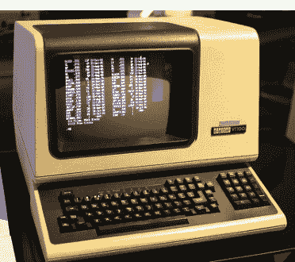

#### 什么是“Shell”？

- “Shell”是在终端窗口内运行的程序。它接收并解释我们在命令行上输入的命令。命令行本身就是 Shell 程序功能的一部分。当终端窗口打开时，一个 Shell 会话会自动在终端窗口内启动，并保持活跃状态直到终端窗口被关闭。理解 Shell 的最佳方式是将其视为一种[环境](https://en.wikipedia.org/wiki/Environment_variable)，它为用户提供了一套全面的工具来与计算机进行交互。

#### 为什么它被称为“Shell”？

- 如果你把内核看作操作系统的核心，那么“Shell”就是处于外层、为人类访问提供界面的一层。根据用户状态的不同，Shell 可以回退，从而暴露出系统更深层的部分。

#### 什么是“Bash”？

- BASH（“Bourne-Again SHell”），由 Brian Fox 编写并于 1989 年通过 FSF 发布，是对 Stephen Bourne 在 1970 年代创建的原始 Bourne Shell 程序 `$ sh` 的增强版本。Bash 是 Linux 中使用最广泛的 Shell。由于其流行性，“Bash”（作为一个术语）在 Linux 术语中通常与“Shell”互换使用。在本指南中，当我们提到“Linux 命令行”时，始终可以理解为指 <u>Bash</u> 命令行。

#### 还有其他 Shell 吗？

☐ 是的。在本指南中，我们只使用 Bash，但还有其他广泛使用的类 Unix Shell 程序。你可能会遇到的其他 Shell 有 Zsh（Z shell）、fish（fish shell）、ksh（KornShell）和 tcsh（C shell）。还有其他的，而且新的 Shell 不时会出现。

#### 什么是“命令行”？

☐ 命令行是我们在 Shell 中输入命令的地方。光标标记了命令行上我们可以插入或删除文本的位置。

#### 什么是“命令行提示符”？


☐ “命令行提示符”、“Bash 提示符”或“Shell 提示符”都指——位于命令行上光标起始位置*之前*（即*提示*）的标记。在 Bash 中，命令行提示符位于终端窗口的左侧。参见*命令行提示符*部分，见第 29 页以获取更多信息。

尽管**终端**、**shell**和**命令行**在含义上彼此不同，但通常听到这些术语被互换使用，指代**Linux 命令行环境（CLE）**。在本指南中，我们将像常见实践中那样，互换使用这些（以及其他）术语。

### 文件、目录和可执行文件

在 Linux 中，我们将操作系统中允许我们访问硬盘驱动器（或其他存储介质）信息的部分称为**Linux 文件系统**。

在本指南中，我们将处理 Linux 文件系统中的这三个要素：

- 文件
- 目录（或“文件夹”）
- 可执行文件（或“程序”）

#### Linux 中的文件是什么？

从一般用途的角度来看，Linux 中的文件与其他操作系统中的文件类似。用户的硬盘驱动器上可能有文本文档、图像、音频、视频或其他纪念品，在 Linux 图形界面环境（例如 Ubuntu 中的 GNOME<sup>[7]</sup>）中，用户与这些文件的交互方式与在任何桌面图形界面环境中相同。也就是说，双击文件将在适当的应用程序中打开该文件。

但如果我们深入到命令行层面，会发现自己处于一个所有信息都以文本形式表示的环境中。这有其局限性，但以这种方式处理信息的优势在于纯文本媒介的严谨规律性。处理文本让字符发挥其作为数据标准化容器的自然作用（可以将 Linux 中的文本字符视为堆叠的数据桶）。这反过来使数据更易于访问和处理。

“Linux 文件系统”这个名称选得很好。它很恰当，因为在 Linux（遵循 Unix 传统）中，文件系统中的所有内容实际上都是一个文本文件。但那是什么意思？*所有东西*都只是文本？图像、音频/视频或其他二进制编码数据呢？


一种理解方式是，在 Linux CLE 中，拥有适当的管理员权限，我们可以使用文本编辑器打开并检查文件系统中任何位置的任何项目。这并不一定意味着我们看到的文件包含人类可读的数据（例如，图像文件会看起来像乱码，编译后的二进制文件也是如此）。不过，如果我们以这种方式浏览文件系统，信息仍会以其“原始文本”表示形式被查看。这部分解释了为什么在 Linux 中说“一切皆文件”。

在其他操作系统中，我们可能会在文本编辑器中打开 `.txt` 文件，但我们会在非类 Unix 系统中使用文本编辑器来打开一个文件夹吗？就好像文件夹是一个文本文件？不，在其他系统中，我们不会这样做。然而，在 Linux 中，如果我们愿意，我们可以使用文本编辑器将目录（即文件夹——见第 28 页）作为一个文件打开。事实上，Linux 中的目录就是文件。

但甚至超出目录，诸如硬件外围设备（如鼠标/触摸板）和其他输入/输出通道之类的东西在 Linux 文件系统中也表示为文件——数据以纯文本形式流经它们。这些用于数据 I/O 的 Linux“特殊文件”并非像硬盘驱动器上存储的数据那样的“常规”文件。相反，它们是连接到不同连接点之间传输中的临时数据的“虚拟文件”。尽管如此，这些特殊文件在 Linux 文件系统中与常规文件并列显示。

最终，计算机处理的是数据，而在 Linux CLE 中，纯文本格式是所有信息传递的媒介。这样，我们就有了一个用于存储、发送、接收和处理信息的统一接口。Shell 为我们提供了丰富的、共享此接口的工具，随着我们的深入，我们将探索如何使用这些工具处理文件。

## Linux 中的目录是什么？

Linux 中的目录$^{[8]}$就是我们在其他操作系统中所说的“文件夹”。它们可以包含文件和/或其他目录，就像我们在图形界面环境中所熟悉的那样。与其他基于存储介质名称（例如“C：”、“D：”等）组织文件系统的操作系统不同，Linux 文件系统完全包含在一个称为根目录的主目录中。

> `/` 表示根目录。更多信息请参见第 30 页的路径部分。

```text
<username>/
<username>
lib/
sbin/
var/
etc/
usr/
dev/
tmp/
home/
```

图 5 Linux 目录结构（简略）

在本指南中，我们将最常活动的目录是 `/home/<username>` 目录，也称为主目录。

## Linux 中的可执行文件是什么？

可执行文件通常是可以作为程序运行的文件。我们输入到 shell 的许多命令[^9]都是可执行文件。在 Linux CLE 中，对于可执行命令，我们通过名称“调用”命令（即输入并按回车键），shell 会找到具有该名称的特定文件，并安排执行文件中的指令（即代码解释器和/或内核处理运行存储在文件内的程序）。

我们也会“调用” shell 的内置命令，尽管它们不是可执行文件⁹。我们将详细讨论调用过程中发生了什么，并比较不同类型的命令。我们还将涵盖不可执行文件和可执行文件之间的区别。

## 命令行约定

当我们学习 Bash 命令行的语法时，会反复看到一些符号和格式约定。为了更容易理解，我们需要熟悉这些不同组合代表的含义。

### 占位符

在许多情况下，我们需要指示在命令行语法中放置特定类型信息的位置。为方便起见，我们通常使用占位符来替代具体示例。以下是我们将使用的一些占位符。

| 占位符 | 含义 |
|---|---|
| `<username>` | 你登录 Linux 机器时使用的用户名 |
| `<hostname>` | Linux 分配给你机器的名称 |
| `<command>` | 上下文中的任何 shell 命令 |

### 命令行提示符

```text
me@MyLinuxBox:~$
```

在本指南中，每当我们引用在命令行上输入的命令时，我们将使用 `$` 表示命令行提示符。请注意，`$` 包含美元符号右侧的一个空格。这很重要，因为稍后我们将遇到美元符号的另一种用法，其右侧没有空格。

当你打开 Linux shell 时，命令行提示符将以以下格式显示信息：`<username>@<hostname>:~$`。在本指南中，我们将通过仅显示尾端来概括提示符：`$`。

请注意，当你在提示符右侧输入命令时，无需键入 `$`。Bash 会自动将光标放在 `$` 旁边。

### 路径

```text
/home/<username>
```

Linux 中的“路径”就像一组方向，告诉我们文件系统中的某个位置在哪里。路径中的起点始终是一个目录（在左侧），终点是目录或文件（在右侧）。终点是我们最终感兴趣的东西，在上面的例子中，终点是一个目录（`<username>` 表示主目录的名称）。

Linux 文件系统中路径最重要的起点是根目录（或简称“root”）。它是文件系统的主目录，包含所有子目录和文件（见第 28 页）。根就像树的主干，其他目录是它的树枝。

在任何 Linux 路径中，如果有一个正斜杠 `/` 且其左侧没有任何内容，则该正斜杠表示根目录作为起点。以下是一些示例。

```text
/
这个路径非常简单！起点和终点都是根。
```

```text
/etc
```

## 命令的剖析

命令行因其赋予我们控制机器的方式而得名。那么我们如何控制机器呢？通过向它发出命令！

在英语中，命令是我们希望某事发生时下达的“指令”。以下是在英语中发出命令时常用的一些模式。

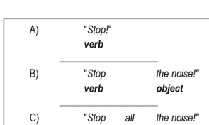

Shell 中的命令与英语类似，只是我们的主要受众是机器。以下是 shell 命令语法的三个主要组成部分，按其通常出现的顺序排列，并附有对应的英语语法成分：

```text
$ <command> [option(s)] <operand(s)>
```

- `<command>`：动词
- `[option(s)]`：形容词/副词
- `<operand(s)>`：宾语

Shell 中的 `$ <command>` 就像英语中的祈使动词：“做这个！别那样！”

Shell 中的 `[option]` 就像英语中的形容词或副词：“做你的事！现在别那样！”

Shell 中的 `<operand>` 就像英语中的宾语：“做这个！别那样！”

与自然语言一样，根据我们想要表达的内容，构建 shell 命令的方式具有灵活性。一些 shell 命令可能包含语法的所有三个组成部分，而有些可能只包含 `$ <command>`（即动词）本身。

以下是一些 shell 命令及其英语翻译的示例。

```text
Bash：                  英语：

$ ls *.xml              “列出 .xml 文件！”

$ <command> <operand>
  动词       宾语

Bash：                  英语：

$ ls -r *.xml            “反向列出 .xml 文件！”

$ <command> [option] <operand>
  动词       宾语       状语
```

让我们再看一个例子。

```text
Bash：                  英语：

$ cp -r ~/Pictures ~/Photos
“递归复制 Pictures 目录并粘贴为名为 Photos 的目录！”
```

在上面的命令中，我们再次看到了 shell 命令语法的三个主要组成部分：

```text
$ cp -r ~/Pictures ~/Photos

$ <command> [option] <operand(s)>
  动词       宾语       状语
```

`[option(s)]` 和 `<operand(s)>` 构成了命令的参数——统称为命令的参数。请记住，一个命令可以有任意（有效）参数的组合，或者如果我们单独使用 `$ <command>`，参数可以是隐含的。

## Shell 环境中的三种命令类型

Bash 命令行上有三种不同类型的可调用命令：

1. **内置命令**

   Shell 内置命令，通常称为“built-ins”，是 `/usr/bin/bash` 程序本身的一部分。这意味着内置命令不是 Linux 文件系统中的可执行文件（`/usr/bin/bash` 是在终端内作为 shell 运行的可执行程序文件）。

2. **外部命令**

   外部命令是通常位于 `/usr/bin` 目录中的可执行程序文件。Ubuntu 安装时附带了许多外部命令，更多命令可以通过 Ubuntu 的包管理实用程序下载。

3. **脚本命令**

   脚本命令包括用 Bash 编程的可执行文件，以及在 shell 启动时加载和定义的 Bash 函数。通常将自定义脚本命令的文件保存在主目录（`~`）内。

> 在 Ubuntu 19.04 之前的系统上，`bash` 可执行文件的位置可能是 `/bin/bash` 而不是 `/usr/bin/bash`。

## 开始使用

我们即将准备好跳入 Linux 命令行环境！在准备工作方面，我们只需要再涵盖几个额外的内容，然后我们就可以开始了！

### Linux 发行版

在本指南中，我们将参考 **Ubuntu 20.04** LTS（Focal Fossa）Linux 发行版。其他版本的 Ubuntu 也应该可以工作（请参阅上面关于 Ubuntu v19.04 之前版本中 `bash` 可执行文件位置的消息）。如果您使用的是另一个 Linux 发行版或其他类 Unix 操作系统变体，请谨慎行事，因为我们无法保证 100% 兼容。如果您尚未安装 Ubuntu，您可以在此处获取有关如何安装的信息：[https://help.ubuntu.com/lts/installation-guide/index.html](https://help.ubuntu.com/lts/installation-guide/index.html)。

就本指南而言，我们假设您，读者，是您自己机器上拥有专用 Linux 启动分区的 Linux 用户账户的管理员。如果您不是您自己 Linux 账户的管理员，那么您可能需要为某些活动请求管理员授权。请咨询您的系统管理员并采取任何必要的预防措施。

### 打开终端窗口

假设一切已安装就绪，并且您已登录并准备好开始，让我们找到终端应用程序并开始吧！在 Ubuntu 中打开终端窗口有几种方法。

```text
ctrl + alt + t
```

- 或者 -

点击 GNOME 应用启动器，在实用工具中找到终端图标，然后单击。


图 6 Ubuntu GNOME 应用启动器示意图

我们建议将终端图标添加到您的 Ubuntu 收藏夹停靠栏中，以便于访问。

### 一些初步命令

如果您迫不及待，在深入之前可以尝试以下几个命令。只需在 shell 提示符下输入它们，按 Enter 键，看看会发生什么！

```bash
$ date
$ cal
$ echo 'Hello World!'
```

## Linux 命令行生存工具包

当您第一次冒险进入命令行环境时，有些事情您应该意识到。带上这些令牌可以为您节省很多挫折感。

### Linux 命令行帮助资源

如果您在任何时候碰巧卡住了，或者不确定在命令行上该做什么，触手可及就有帮助资源可用。请注意，在以下所有示例中（除一个例外），您想要获取帮助的 `$ <command>` 位于 `<operand>` 位置。

```bash
$ man <command>
```

这是解锁 Linux 命令行绝大多数文档资源的关键。调用 `$ man <command>` 将返回命令的“man 页面”（“manual pages”的缩写）。阅读命令的手册页将为您提供几乎所有您想知道的关于该命令的信息。此外，man 页面还包含有关一般 Linux 操作的信息。有时，man 页面中信息量之大可能令人不知所措，但经过一点练习，您就会熟悉 man 页面的流程。尝试 `$ man man`！

所有手册页都遵循以下通用结构：

- `NAME`
- `SYNOPSIS` – 建模如何使用参数格式化命令。
- `DESCRIPTION` – 详细说明命令的操作，并列出用于修改命令行为的每个 `[option]`。

> 专业提示——浏览手册页时，按空格键向下翻页，按 `b` 键向上翻页。按 `/` 搜索。按 `q` 退出并返回到命令行。

#### 获取帮助

```bash
$ <command> --help
```

以下是一种获取 Bash 内置命令帮助文档的方法（参见第 33 页）。这种 `--` 后跟完整单词的 `[option]` 格式被称为长选项。注意，使用此方法时你是直接调用 `$ <command>` 本身，这与这里的其他示例不同。如果你想查找适用于单页显示的内置命令（参见第 33 页）帮助文档，可以尝试此方法。

```bash
$ help <command>
```

`$ help <command>` 方法与 `$ <command> --help` 对内置命令（参见第 33 页）显示的帮助文档相同。调用 `$ help -m <command>` 会告诉 `$ help` 检查是否存在该内置 `$ <command>` 的 `$ man` 手册页，如果有则显示 `$ man` 手册页。请查阅 `$ help help` 以获取更多信息并查看其他选项。

```bash
$ info <command>
```

如果你更喜欢超文本布局的文档，其中主题链接到中央目录，请尝试运行 `$ info <command>`。如果某个命令的 info 文件可用，`$ info` 将以类似书籍的结构呈现信息，并提供大量到相关主题和其他信息的交叉引用。按空格键向前翻页，按退格键向后翻页。

#### `$ apropos <pattern>`

即使你不知道所需命令的名称，这个命令也能帮到你。你可以使用搜索关键字（在 shell 中称为 `<pattern>`）来尝试，它会给你列出具有相关功能的命令建议。试试输入 `"backup"` 之类的内容，看看结果如何！

#### `$ whatis <command>`

如果你只需要一个非常简短的一行描述来说明某个命令的功能，那么 `$ whatis` 工具就是你需要的。事实上，`$ whatis <command>` 返回的描述直接取自该命令的 `$ man` 手册页开头的一行摘要。试试 `$ man whatis`，然后再试试 `$ whatis whatis`。顺便也可以试试 `$ whatis man`！

### 按键命令组合和其他有用的 shell 命令

一旦你开始在终端中工作，你会发现事情与“外部世界”（我们都习惯的 GUI 环境）并不完全相同。有几条命令和按键组合你会想添加到你的技能库中，这会让 shell 中的生活轻松许多，特别是当你需要在终端窗口和其他应用程序之间频繁切换时。

1. 在终端窗口中剪切、复制或粘贴：

   - 剪切：`ctrl + shift + x`
   - 复制：`ctrl + shift + c`
   - 粘贴：`ctrl + shift + v`

2. 在终端窗口中上下翻页（在命令行上）：

   - 向上翻页：`shift + pg up`
   - 向下翻页：`shift + pg dn`

3. 如果你不想在命令行上重新输入某些内容，这些技巧会派上用场。

   - 重新运行最近输入的命令：`$ !!`
   - 插入最近命令参数中的 `<operand>`：`alt + .`
   - 浏览之前的命令：上方向键 `↑` 和下方向键 `↓`

4. 这些按键命令将帮助你在命令行上更高效地移动光标，而不仅仅使用左 `←` 和右 `→` 方向键。

   - 移动到行首（左侧）：`ctrl + a`
   - 移动到行尾（右侧）：`ctrl + e`
   - 向后移动到上一个单词（左侧）：`alt + b` 或 `ctrl + ←`
   - 向前移动到下一个单词（右侧）：`alt + f` 或 `ctrl + →`

5. 有时候你只是需要控制权。这些命令和按键组合将让你在 shell 中重获控制，尤其是在你感觉失去控制的时候！

   - 中断 shell 中的进程（类似按下“取消”）：`ctrl + c`
   - 挂起 shell 中的进程（类似按下“暂停”）：`ctrl + z`
   - 在 `ctrl + z` 之后直接恢复进程，输入 `$ fg`（表示“前台”）。
   - 停止向屏幕打印输出：`ctrl + s`
   - 在 `ctrl + s` 之后直接恢复向屏幕打印输出：`ctrl + q`
   - 在输入文本时发送“EOF”（文件结束）消息：`ctrl + d`
   - 在当前光标位置和行首之间切换：`ctrl + xx`
   - 清空终端窗口：`ctrl + l` 或 `$ clear`
   - 退出 shell 会话并关闭终端窗口：`ctrl + d` 或 `$ exit`
   - 重启计算机：`$ reboot`
   - 关闭计算机：`$ shutdown`

## 命令行上的生活

### 我是谁？

如果你还没有打开，请使用按键命令 `ctrl + alt + t` 打开 Ubuntu 终端应用，或在 Ubuntu 应用启动器面板中点击终端图标。

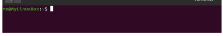

我们到了！我们在 Linux 命令行上的第一天到来了。起初我们将小步前进，继续构建我们对这个环境中事物运作方式的理解。花一点时间适应一下，当你准备好后，尝试在提示符中输入一些内容，看看 shell 对你的输入有什么反应。尽管输入你想写的任何内容。例如，你可以输入 `"My name is..."`，然后按回车键。

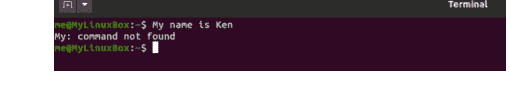

你会看到 Bash 在接收到它不知道如何解释的输入时，只会返回一个 `command not found` 错误。这些错误是无害的，你永远不必担心因为打错字或输入无效命令而造成任何问题。

事实上，如果你因为害怕做错事或损坏系统而对输入命令感到任何紧张，你会放心地知道，Ubuntu 的默认设置对我们用户的权限施加了限制，使我们无论做什么都不会造成系统级的损害。


随着我们开始学习更多的 Linux 命令，我们会发现在某些情况下必须对诸如`$ touch`、`$ cp`（复制）、`$ mv`（移动）和`$ rm`（删除）等操作格外小心。如果我们不注意，可能会意外删除或覆盖*我们自己的*文件（和/或目录）。话虽如此，直到我们真正开始使用这些命令之前，我们可以放心，Ubuntu 的 Linux 配置会保护我们的文件安全。

Linux 如何控制用户可以访问哪些文件和目录？

## Linux 用户身份和权限

Linux 作为多用户系统的根源由来已久，你在 Linux 命令行环境（CLE）中能做什么或不能做什么，完全取决于[你是谁](https://en.wikipedia.org/wiki/User_(computing))以及[你拥有哪些文件](https://en.wikipedia.org/wiki/File_system_permissions)。

那么，你是谁？让我们来找出答案。进入命令行并输入以下命令：

```
$ whoami
```

你应该能在下方输出中看到你的`<username>`。对 Linux 来说，这就是你的身份。你的`<username>`携带一个**用户身份**，它定义了你在 Linux 文件系统中被允许执行的操作的限制。

有两个因素决定了你的用户身份：

**因素 #1** 你是什么类型的用户（root 用户还是普通用户）？

在 Linux 中，如果某人是 **root 用户**（或简称"root"），基本上没有他们不能做的事情。就像根目录包含 Linux 文件系统中的所有文件和子目录一样，root 用户拥有整个系统中每一个文件和目录的所有权。根目录简直就是 root 用户的家目录！root 用户可以随心所欲地查看、打开、修改、创建、运行和/或删除任何文件——他们还可以安装程序。这听起来很棒，但 Linux 赋予了 root 用户不可逆转地破坏系统的能力。这就是为什么我们必须对 root 身份非常谨慎。

**普通用户**，正如你可能猜到的，在 Linux 文件系统中能做的事情具有更有限的**权限**。普通用户保证拥有其家目录（`<username>` 📂）中包含的文件和目录。这确保了普通用户可以随心所欲地查看、打开、修改、创建、运行和/或删除家目录内的文件。除此之外，普通用户通常对可以交互的文件有限制。例外情况是当普通用户属于一个**用户组**，且该用户组的权限扩展到用户家目录之外的目录和文件时。

### 因素 #2 你属于哪些用户组？

#### 用户与组

一个 root 用户默认属于 **root** 用户组。由于 root 权限高于所有其他组，因此其他任何组的成员身份都不会影响 root 用户的文件权限。

普通用户默认属于其自己的组，称为用户的 **主组**。普通用户的主组与 `<username>` 同名（除非用户更改了名称）。除了主组之外，如果系统管理员授权，普通用户还可以属于其他组。

要了解您是什么类型的用户以及属于哪些组，请输入以下简单命令：

```
$ id
```

假设您是在自己的机器[^16]（或虚拟机）上安装的 Ubuntu，那么在输出中您应该会看到类似这样的内容：

```
uid=1000(<username>)
gid=1000(<username>) groups=...27(sudo)
...
```

您会看到列出了其他组，但我们现在可以忽略它们。让我们重点关注这三条信息：

您的**用户 ID (uid)** 是数字 1000（用户 #1000）。这是安装 Ubuntu 时 Linux 自动分配给您的。选择 1000 是源自 Unix 传统的惯例，作为一个"较高"的数字，它基本上是任意的。但是，如果这个数字是 0，那么您就是 root 用户。由于它不是 0，这意味着您是一个普通用户。


您的**主组 ID (gid)** 也是数字 1000（组 #1000）。安装 Ubuntu 时，Linux 将此数字分配给了您的主组。如果这个数字是 0，那么您将是 root 组的成员。由于它不是 0，这再次确认了您是一个普通用户。


这告诉我们您是 sudo 组（组 #27）的成员。这很重要，因为它将允许您使用`$ sudo`命令临时获得 root 权限，以便执行系统管理员操作，例如安装新软件包等。


Ubuntu 默认禁用 root 账户。这是常见的安全措施，旨在保护系统免受攻击和其他风险。从`$ id`命令的结果我们可以得知，您是一个[普通用户](https://en.wikipedia.org/wiki/User_(computing))，*但是*，如果出于任何原因需要，您确实有能力通过`$ sudo`命令（意为"<u>超级</u>用户 <u>执行</u>"）^[[18]](https://en.wikipedia.org/wiki/Sudo) 临时成为 root 用户^[[17]](https://help.ubuntu.com/community/RootSudo)。这是安全性（普通用户身份）和权限（作为 root 行事的能力）之间的最佳折衷。在本指南的后续部分，我们将介绍如何在 Linux CLE 中使用`$ sudo`命令来安装程序并执行其他需要提升权限的操作。现在，请为您是普通用户而感到高兴吧！

### 总结

Linux 的多用户基础始于操作系统的最深处。为了维护系统完整性，Linux 仅为"root"用户（也称为"超级用户"）保留完整的系统访问权限。所有其他用户（称为"普通"用户）则受到限制，具体取决于他们拥有的文件和/或所属的用户组。作为一种安全措施，Ubuntu 默认禁用 root 账户。如果 Ubuntu 用户需要执行需要 root 授权的操作，他们可以在`$ sudo`命令的帮助下完成。

### 命令

```
$ whoami
$ id
```

### 概念

- Linux 命令行错误
- 对某些命令要谨慎
- Linux 用户身份和权限
  - Root 用户
  - 普通用户
  - 文件所有权
  - 组成员身份
  - 临时 root 身份
    - `$ sudo`

### 挑战

查看`$ id`命令的`$ man`手册页（`$ man id`），看看能否找到两个用于`$ id`的\[options\]，使其产生与`$ whoami`命令相同的输出。尝试在命令行输入`$ id [options]`组合。它返回您的`<username>`了吗？

## 我在哪里？

现在我们已经了解了在 Linux 命令行中的身份，接下来我们将查看在 **Linux 文件系统** 中的[位置](https://google.com)以及如何在其中移动。

我们经常将 Linux 命令行描述为集成在一个"环境"中，就好像我们使用它时真的去了某个地方一样。这是理解 shell 的一种有益方式，因为事实上，每当我们使用命令行时，我们总是停留在 Linux 文件系统的某个位置。一种找到我们在文件系统中当前位置的方法是查看 Bash **命令行提示符**。


```
<username>@<hostname>:~$ h
```

在标准的 Ubuntu Bash 命令行提示符中，当我们在主目录范围内时，到当前位置的**相对路径**（见第 30 页）会显示在 `:` 和 `$` 之间。

```
$ pwd
```

在许多情况下，我们希望有一个\[command\]来揭示我们在 Linux 文件系统中的位置。Bash 方便地为我们提供了这样一个命令。尝试在命令行输入以下内容：

```
$ pwd
```

您应该会在输出中看到类似这样的内容：

```
/home/<username>
```

`pwd`（"print working directory"，打印工作目录）命令返回我们当前所在目录的**绝对路径**（见第 30 页）。运行`pwd`命令就像对我们当前在文件系统中的位置进行 GPS 定位。无论我们在哪里，我们都将自己的位置称为**当前工作目录** (cwd)。

## 常用的 Linux 命令

我们准备在 Linux 命令行上迈出更稳健的步伐，并开始使用一些最重要的工具。在 shell 中工作一段时间后，您会发现有少数几个命令的使用频率远高于其他命令。这些命令对您来说会变得如此熟悉，以至于您甚至无需思考就能输入它们。即使您多年不使用命令行界面，这些命令也依然会与您同在。

### ls

当您在 Linux 文件系统中导航时，您会想要知道所访问目录的内容。您会形成输入`$ ls`命令来列出当前工作目录内容的习惯。

试试看！输入以下内容并按回车键：

```
$ ls
```

输出应如下所示。

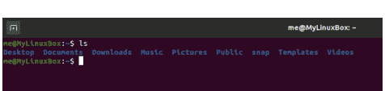

恭喜！您已成功列出了主目录（部分）内容。我们看到了什么？有点难以分辨，但我们可以辨认出这是主目录内的子目录列表[^19]。安装 Ubuntu 时，这些目录会为我们自动创建。

如果能以垂直列表格式看到这些项目就好了。幸运的是，有一个\[option\]可以做到这一点。尝试此组合：

```
$ ls -l
```

`-l` 让我们以长格式列出内容。以这种方式列表也会显示其他有用信息。


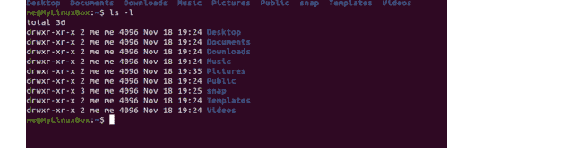

接下来，让我们更进一步，列出主目录的所有内容。在命令行尝试以下操作：

```
$ ls -la
```

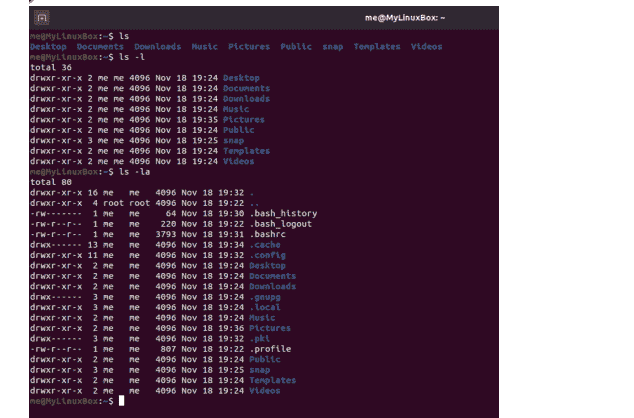

等一下。列表长度突然增加了一倍！发生了什么？注意所有之前不可见的额外项目，它们的名称都以 `.` 开头。在 Linux 中，这类项目被称为**点文件**和**点目录**。除非我们调用 `-a`（或 `-A`）作为`$ ls`命令的\[option\]，否则它们对用户是隐藏的。您可以将"点文件"和"点目录"想象为 Linux 中隐藏文件或目录的代码。

下面列出了`$ ls`命令常用的一些其他 \[options\]。

| **Bash** | **English** |
| :--- | :--- |
| `$ ls -S` | 按大小排列目录内容（从大到小）。 |
| `$ ls -t` | 按修改时间排列目录内容（最近的在前）。 |
| `$ ls -r` | 以相反顺序排列目录内容。 |
| `$ ls -n` | 以数字形式显示用户 ID 和组 ID 来列出目录内容。 |

正如我们在`$ ls -la`中所见，可以混合和匹配不同的 \[options\] 以显示不同种类的信息。通常不...

无论`[选项]`的顺序如何，只要它们如图所示彼此相邻即可。尝试这些命令，看看效果！

```
$ ls -aS
$ ls -alt
$ ls -alnr
```

依赖一组`[选项]`来输出不同结果的一个缺点是`[选项]`可能难以记住。为缓解这一问题，Bash 内置了一些有用的快捷方式，称为**别名**（我们将在后面详细探讨），用于简化输入带有不同`[选项]`的`$ ls`命令。输入这些别名比输入完整命令快得多。

| Bash 别名命令 | 完整 Bash 英文命令 | 说明 |
|---|---|---|
| `$ ll` | `$ ls -alF` | 以*长*格式列出*所有*文件，并带有特殊*格式*。 |
| `$ la` | `$ ls -A` | 列出*所有*文件，但不包括 `.` 和 `..` 目录快捷方式[^20]。 |
| `$ l` | `$ ls -CF` | 以*列*视图列出文件，并带有特殊*格式*。 |

当我们列出目录内容时，有时希望将输出限制为名称符合特定搜索条件的文件和子目录。例如，可能只想列出以字母 "D" 开头的文件和目录。如何做到这一点呢？

一种告诉`$ ls`在输出中显示哪些字符（或字符组）的方法是将字符`<模式>`放在`<操作数>`位置（参见第 31 页），并在其后直接跟一个 `*`。以这种方式使用时，`*` 符号称为**通配符操作符**。`*` 通配符操作符将允许任何匹配`<模式>`的实例在命令输出中触发结果。

让我们在命令行上试试。首先，我们将清除终端窗口，以便从顶部重新开始。

```
$ clear
```

现在，输入以下内容：

```
$ ls -la D*
```


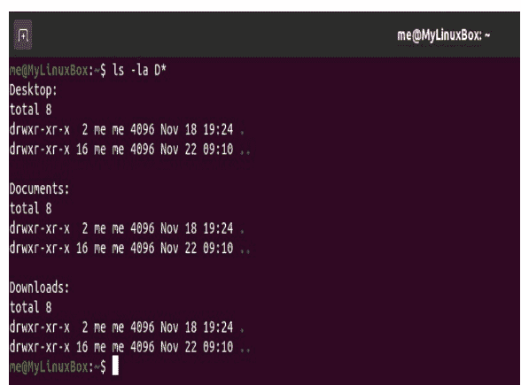

这里我们看到 `~` 中以字母 "D" 开头的三个目录。虽然每个目录都是空的[21]，但 `$ ls` 似乎认为我们想查看它们的内容。这是因为 `<操作数>` 中的 `D*` 会扩展为三个 `D*` 目录的全名，而这些名称成为 `$ ls` 的对象（参见第 31 页）。由于我们不想查看这些目录的内容，而只是想列出它们的名称，因此我们将添加 `-d` [选项]以将输出限制为这些目录的名称。

```
$ ls -lad D*
```

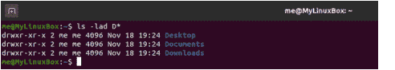

做得好！`$ ls` 命令将伴随你未来的 Linux 之旅，我们将继续在本指南中练习使用它。我们鼓励你查阅`$ ls`的`$ man`手册页（`$ man ls`）并尝试使用可用的多种[选项]。

### cd

到目前为止，我们所有的操作都是在主目录内完成的，但整个文件系统还有待探索。是时候走出家门口，四处看看了。同时，如果需要，我们可以随时快速回到主目录内确定方位。

虽然一开始可能不明显，但命令行实际上具有极大的移动性。只需一个命令，我们就可以从当前工作目录传送到文件系统中的任何其他位置（即我们有权限访问的任何地方）。我们只需要`$ cd`命令（用于切换目录）和一个**路径**来告诉命令带我们去哪里。你想去哪里？

让我们先跳转到一个路径容易记住的地方——根目录。回想一下，作为<u>起点</u>的根目录在路径左侧表示为 `/`。由于本例中的根目录也是<u>终点</u>（即我们的目的地），这意味着整个路径就是简单的 `/`。我们试试？

在命令行上输入以下内容：

```
$ cd /
```

我们到了！注意命令行提示符不再显示 `~` 作为当前工作目录，而是显示 `/`。

让我们用`$ pwd`读取当前位置，然后用`$ ll`列出 `/` 目录的所有内容。

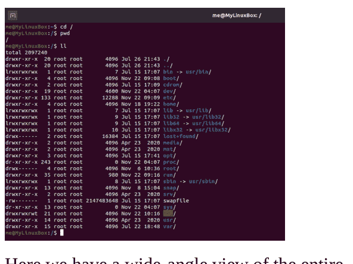

这里我们对整个 Linux 文件系统有了一个广角视图。目录相当多。幸运的是，对于我们当前的目的，我们只需要关注其中少数几个。你会看到一个名为 `/home` 的目录。这就是我们所说的主目录吗？并不完全是。

我们所说的"主目录"实际上*位于* `/home` *内部*。主目录的路径，如你所记，是 `/home/<用户名>`（参见第 28 页）。这正是我们刚刚来的地方。我们回去短暂参观一下吗？

我们可以输入`$ cd /home/<用户名>`，几乎立即到达，但还有更简单的方法可以让我们传送回家。Bash 为我们提供了几个到主目录的快捷方式，使我们如果需要回家变得非常容易。第一个你会很熟悉。我们将简单地使用 `~` 作为`$ cd`命令跟随的路径。试试看！

```
$ cd ~
```

真快。注意命令行提示符中的路径又变回了 `~`。执行`$ pwd`确认我们的位置是 `/home/<用户名>`。让我们运行一个`$ ll`来确认一下。

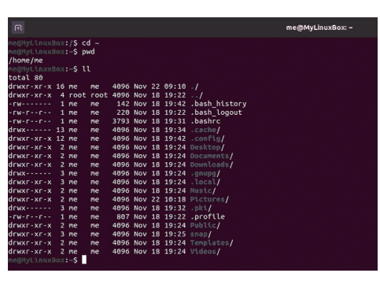

一切看起来都和我们离开时一样。知道我们随时可以回家真好。

现在，让我们再次跳回根目录。

```
$ cd /
```

你应该在命令行提示符中看到 `/` 作为路径。用`$ pwd`确认你的位置。


很好。现在我们将尝试另一种飞回家的方法。这个比上一个更快。只需在命令行上输入：

```
$ cd
```

我们回来了！这是一个极其方便的快捷方式，几乎不可能忘记。`$ pwd` 和`$ ll`将帮助我们确认已到达主目录。


```
me@MyLinuxBox:~$ cd
me@MyLinuxBox:~$ pwd
/home/me
me@MyLinuxBox:~$ ll
total 80
drwxr-xr-x 16 me   me    4096 Nov 22 09:18 .
drwxr-xr-x  4 root root 4096 Nov 18 19:22 ..
-rw-------  1 me   me     880 Nov 22 21:54 .bash_history
-rw-r--r--  1 me   me     220 Nov 18 19:22 .bash_logout
-rw-r--r--  1 me   me    3793 Nov 18 19:31 .bashrc
drwx------ 13 me   me    4096 Nov 18 19:34 .cache/
drwxr-xr-x 12 me   me    4096 Nov 18 19:42 .config/
drwxr-xr-x  2 me   me    4096 Nov 18 19:24 Desktop/
drwxr-xr-x  2 me   me    4096 Nov 18 19:24 Documents/
drwxr-xr-x  2 me   me    4096 Nov 18 19:24 Downloads/
drwx------  3 me   me    4096 Nov 18 19:24 .gnupg/
drwxr-xr-x  3 me   me    4096 Nov 18 19:24 .local/
drwxr-xr-x  2 me   me    4096 Nov 18 19:24 Music/
drwxr-xr-x  2 me   me    4096 Nov 23 13:01 Pictures/
drwx------  3 me   me    4096 Nov 18 19:32 .pkt/
-rw-r--r--  1 me   me     807 Nov 18 19:22 .profile
drwxr-xr-x  2 me   me    4096 Nov 18 19:24 Public/
drwxr-xr-x  3 me   me    4096 Nov 18 19:25 snap/
drwxr-xr-x  2 me   me    4096 Nov 18 19:24 Templates/
drwxr-xr-x  2 me   me    4096 Nov 18 19:24 Videos/
me@MyLinuxBox:~$ █
```

既然我们在这里，看看列表中的前两个条目：`.` 和 `..`，它们看起来都是目录。我们可以 `$ cd` 到这些目录吗？让我们 `$ clear` 终端窗口并尝试第一个。

```
$ cd .
```

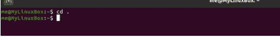

如果你觉得好像什么都没发生，你是对的。在 Linux 中，在路径左侧放置 `.` 总是表示[当前工作目录](cwd)作为路径的起点。因此，对于 `$ cd`，`.` 目录快捷方式没有任何实际用处。但对于其他命令，输入 `.` 比输入当前工作目录的完整路径要容易。在 `.` 后跟一个正斜杠，如 `./`，允许我们定义一个终点在当前工作目录内的相对路径。但对于 `$ cd` 命令，如果 `$ cd <目录>`（在当前工作目录内）能将我们带到同一个地方，我们真的需要指示 `$ cd ./<目录>` 吗？答案是否定的，我们[不需要](dont)在使用 `$ cd` 命令时指定 `./` 路径[22]。

目前对我们来说更实用的是 `..` 目录快捷方式，它表示**父目录**（即包含当前目录的目录）。为了演示如何使用这两个点，让我们再次 `$ clear` 终端窗口，`$ pwd` 提醒自己我们在哪里，然后尝试：

## Linux文件权限

```
$ cd ..
```

我们回到了哪里？再使用一次 `$ pwd` 和 `$ ll` 将帮助我们了解当前位置。

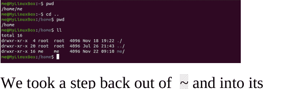

我们从 `~` 步退一步，进入了其父目录 `/home`（参考第28页）。这非常有用！无论我们在何处[23]，我们都可以使用 `$ cd ..` 来跳回上一级父目录。这里有一个巧妙的技巧：我们可以在路径中链式使用 `..` 目录快捷方式，从而跳回任意多级。要了解这是如何工作的，首先让我们使用 `$ cd ~/Documents` 快速前往 `~/Documents` 目录。现在，尝试以下操作：

```
$ cd ../../..
```

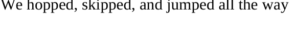

我们一路跳跃，回到了根目录！

当处理层层嵌套的父目录时，这个技巧非常方便。

`$ cd` 命令还有另一个所有Linux用户都应该知道的绝佳快捷方式。在根目录下，让我们再次 `$ clear` 清除终端窗口并试试这个（警告：扶稳了）。

```
$ cd -
```

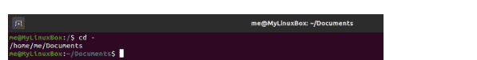

哇！我们现在在哪里？我们回到了 `~/Documents` 目录！`$ cd -` 快捷方式总能带我们回到上一个所在位置，无论它在文件系统中有多远。在某些情况下这可以救急，特别是当我们忘记之前在哪却需要返回时！

有时，在命令行中输入文件和目录名可能有点麻烦，尤其是当名称很长或难以记住拼写时。我们可以使用 `$ ls` 查看目录内容，

但当项目数量超过一定限度时，滚动列表查找一个拼写记不清的文件就变得不切实际。

Unix的设计师们意识到，随着硬盘容量的增加，需要解决大型目录变得过于庞大而难以管理的问题。他们想出了一个优雅的解决方案，并一直沿用到今天的类Unix世界，这就是Linux中称为 **Tab补全** 的功能。

既然我们当前位于 `~/Documents` 目录，让我们使用 `$ cd ..` 命令返回上级目录（主目录）并执行 `$ pwd` 以确认。现在，按以下方式在命令行输入：

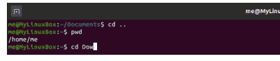

无需输入其他任何内容，按 `tab` 键。

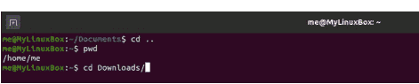

如同魔法一般，Bash自动填充了 `Downloads` 目录名的最后几个字符，当然，如果我们按回车键，我们将进入 `~/Downloads` 目录。Tab补全是另一种将变得习惯化的实践，因为它使命令行生活变得轻松许多。你会发现，如果在输入穿越多个目录的路径时使用Tab补全，会出现一些有趣的行为。此外，当你在输入一个有多个可能补全项的部分名称后按住 `tab` 键时，也会发现一些值得注意之处。你甚至可以将Tab补全用于命令！试试看！当你遇到一个从未见过的命令时，执行 `$ man <command>` 来了解该命令的功能是个好习惯。这可以成为一种学习众多可用命令的有趣方式。

### 摘要

要充分利用Linux命令行，我们需要知道如何在Linux文件系统中定位自己并移动。文件系统本质上是shell环境所依附的领域，而命令行本身就像一辆我们可以用来在此环境中前往任何需要之处的交通工具。我们用于移动的命令是最常见的shell命令，并且有许多有用的快捷方式和技巧可供我们使用，使从一个地方到另一个地方变得更容易。

### 命令

```
$ pwd
$ ls
$ clear
$ cd
```

### 概念

- Linux文件系统

- `.` 和 `..` 目录快捷方式

- 当前工作目录

- 点文件和点目录

- 别名

- 父目录

- `*` 通配符运算符

- Tab补全

**挑战：**

前往 `~` 目录，并使用我们讨论过的一种方法列出其所有内容，以便看到可见和隐藏的项目。现在，使用通配符运算符仅列出隐藏的文件和目录。完成此操作后，作为额外的挑战，看看你是否可以修改命令以仅列出隐藏的目录。

## 与文件初次接触

我们一直在 `~` 和 `/` 之间的路径上来回穿梭，熟悉用于浏览Linux文件系统的命令。现在我们可以在 `~` 中开始安营扎寨，并为我们自己的文件和目录奠定基础。

如果我们把纯文本字符视为Linux中数据的通用货币，那么Linux文件系统中的每个文件就像是一个存放一定数量纯文本货币的保险箱。这将使每个目录变成一个类似金库的地方，里面存放着保险箱（即文件）和其他金库（即子目录）。这种金库套金库等结构，完全包含在最大的金库——根目录之中。

能够访问这些金库，并查看、修改和/或添加其内容，完全取决于附加在文件（即保险箱）和目录（即金库）级别的 **所有权**。正如我们已经讨论过的，我们在Linux文件系统中的所有权取决于 *我们是谁* 和 *我们属于哪个组*（参考第39页）。更进一步，我们在Linux文件系统中被允许或不允许做什么，具体由附加在每个单独文件或目录上的所有者和/或组 **权限** 决定。这些权限确立了我们作为用户对文件系统中某些项目执行某些操作（读取、写入等）的“权利”。

这里我们将介绍在Linux文件系统中查看和解释权限的基础知识。更多信息请参见附录A。

### **Linux文件权限**


```
me@MyLinuxBox:~$ ll
total 80
drwxr-xr-x 16 me    me    4096 Nov 22 09:10 ./
drwxr-xr-x  4 root  root  4096 Nov 18 19:22 ../
-rw-------  1 me    me    1207 Dec  7 18:31 .bash_history
-rw-r--r--  1 me    me     220 Nov 18 19:22 .bash_logout
-rw-r--r--  1 me    me    3793 Nov 18 19:31 .bashrc
drwx------ 14 me    me    4096 Nov 23 15:03 .cache/
drwxr-xr-x 14 me    me    4096 Dec  5 09:38 .config/
drwxr-xr-x  2 me    me    4096 Nov 18 19:24 Desktop/
drwxr-xr-x  2 me    me    4096 Nov 23 17:56 Documents/
drwxr-xr-x  2 me    me    4096 Nov 18 19:24 Downloads/
drwx------  3 me    me    4096 Nov 18 19:24 .gnupg/
drwxr-xr-x  3 me    me    4096 Nov 18 19:24 .local/
drwxr-xr-x  2 me    me    4096 Nov 18 19:24 Music/
drwxr-xr-x  2 me    me    4096 Dec  2 18:41 Pictures/
drwx------  3 me    me    4096 Nov 18 19:32 .pki/
-rw-r--r--  1 me    me     807 Nov 18 19:22 .profile
drwxr-xr-x  2 me    me    4096 Nov 18 19:24 Public/
drwxr-xr-x  4 me    me    4096 Nov 23 17:04 snap/
drwxr-xr-x  2 me    me    4096 Nov 18 19:24 Templates/
drwxr-xr-x  2 me    me    4096 Nov 18 19:24 Videos/
me@MyLinuxBox:~$ █
```

当我们使用 `$ ll` 以长格式列出目录内容时，文件（和子目录）的权限显示在最左侧列（参考第53页）的一个10字符表格布局中。这十个字符揭示了文件类型[24]以及列表中每个项目的所有者、组和“其他”权限。

例如：

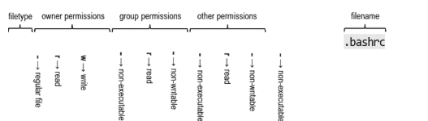


上方是主目录中 `.bashrc` 文件权限的注释视图。文件类型位置中的 `-` 告诉我们 `~/.bashrc` 是一个 **常规文件**。在Linux中成为“常规”文件意味着该文件[25]没有特殊功能[26]且不是目录。回顾第53页列表中的第三列，我们看到 `~/.bashrc` 属于 `<username>`（参考第43页），并且从 **所有者权限** 部分（见上图）我们可以看出，`<username>` 可以从该文件 `读取`，也可以 `写入`。第四个位置的 `-` 表示 `~/.bashrc` 不是一个 `可执行` 程序。我们还看到该文件的 **组权限**（参考第40页）是 `只读`，文件的 **其他** 权限也是如此。

**权限。** 这些"其他"权限（或"所有人"权限）适用于既不是文件所有者，也不属于与该文件相关联的组的任何人。请记住，"其他"权限仅适用于非 root 用户，因为 root 用户始终拥有对系统中所有文件和目录的完整**读取**和**写入**权限。

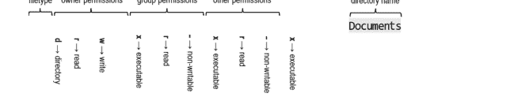


继续往下查看（参见第 53 页），我们来看看 `Documents` 目录的权限。文件类型位置上的 `d` 表明这确实是一个**目录**。**查看**所有者权限位置，`<username>` 拥有从该目录**读取**和**写入**的能力。而在可执行位置，`x` 告诉我们 `~/Documents` 目录是**可执行的**。

等一下。什么？**可执行目录**？这怎么可能？目录又不是程序，对吧？

这就是那些在你准备好之前不会了解到的 Unix/Linux 的秘密之一。是的，访问目录受其**可执行**权限设置的影响。不，目录并不是程序。你可能仍然对这一切意味着什么有些疑问。

对此有多种解释，但理解这一点的最好方式是认识到：如果一个目录是"可执行的"，它的含义与我们通常理解的"可执行"文件完全不同——后者是指我们可以运行或启动的程序。在 Unix/Linux 中，我们可以将目录的"可执行"理解为实际上是"可访问的"[27]。

当 Unix 的设计者在确定文件系统所需的权限时，他们意识到将*查看*目录中项目名称的权限（使用 `$ ls`）与*进入*目录的权限（使用 `$ cd`）分开会很有用。他们确定的最佳方案是重新利用目录的**可执行**权限来控制 `$ cd` 的访问。因此，从用户的角度来看，一个同时具有**可读**和**可执行**（即"可访问的"）权限的目录意味着用户可以进入该目录并访问其中的文件，而一个**可读**但**不可执行**的目录意味着用户只能通过 `$ ls` 查看目录中项目的名称。令人惊讶的是，一个目录可以是**可执行的**（即"可访问的"）但**不可读的**。在这种情况下，用户必须已经知道目录内项目的名称才能访问它们。如果一个目录从用户的角度来看既**不可读**也**不可执行**，那么用户就无法看到或访问目录中的内容。

下表显示了 Linux 中文件和目录权限之间的对应关系。更多信息请参阅附录 A。

| 权限 | 文件 | 目录 |

| :--- | :--- | :--- |

| **读取** | 允许用户打开并查看文件内容。 | 允许用户运行 `$ ls` 以查看目录中包含的项目列表。 |

| **写入** | 如果与**读取**配对，允许用户编辑文件。不控制用户是否可以删除或重命名文件。 | 如果目录的**可执行**权限也已设置，则允许用户在目录中创建、重命名和/或删除文件。 |

| **可执行** | 允许用户运行程序文件。如果文件不是编译后的外部命令（参见第 33 页），执行时还需要**读取**文件的权限。 | 允许用户使用 `$ cd` 命令进入目录。 |

在你使用 Linux 的过程中，如果你主要在只有你一个用户的系统上工作，那么权限不会像在多用户系统上那样发挥重要作用。无论哪种情况，你都会发现某些权限组合非常常见，而另一些则非常不寻常。例如，如果一个目录是可写的，它（几乎）肯定也是可执行的（但反过来不一定成立！）。同样，如果一个文件是可写的，它几乎也总是可读的。

#### **Linux 文件命名约定**

在我们开始创建自己的文件和目录之前，让我们先谈谈 Linux 文件系统中命名的最佳实践。以下是在 Linux 中选择文件名时需要考虑的几个要点。

- Linux 文件名是**区分大小写的**。例如，如果你尝试 `$ cd ~/documents`，你会得到一个 `bash: cd: /home/<username>/documents: No such file or directory` 错误。这种对大小写的严格区分有时可能很烦人，但好处是你可以利用大小写来区分同一目录中名称相似的项目。

- 最好不要在 Linux 文件或目录名中包含空格。使用空格并非不可能，但不建议这样做，因为空格出现在参数中时可能会导致某些命令出错，shell 无法正确解释它（参见附录 B）。

- 在 Linux 中，下划线 `_` 常被用作空格的替代，不过你也会看到很多用连字符 `-` 连接的例子。另外，还有驼峰命名法（camelCase），它使用大写字母来表示通常应该是空格的位置。

- 如果你需要在 Linux 文件或目录名中使用空格，可以在名称作为命令参数时使用 `'引号将名称括起来'`，或者使用**转义字符** `\` 来转义[28]名称中的空格。例如，在 shell 看来，`the\ name\ in\ quotes` 实际上等同于 `'the name in quotes'`。无论哪种方式，使用 `$ ls` 列出时，包含空格的名称会显示在单引号中：`'the name in quotes'`。


- 与其他操作系统不同，Linux 不需要文件具有扩展名才能让系统识别文件类型。例如，Linux 不需要在文件名末尾添加`.txt`扩展名来将文件识别为文本文件。话虽如此，许多 Linux 用户确实选择添加文件扩展名，因为扩展名对于识别某些内容很有用。

### 在 Linux 中创建文件和目录

现在我们要开始在主目录中放置一些自己的文件了。我们在这里创建的文件和目录是为即将到来的命令行活动做准备。这些项目的名称只是建议，当然你可以替换成任何你想要的名称。不过，如果你遵循这里给出的名称，后续可能会减少一些困惑。

#### `$ mkdir`

是时候给我们的 Bash 工具箱再添一件工具了。介绍`$ mkdir`命令，它是“make directory（创建目录）”的缩写。正如其名，这个命令让我们创建自己的目录。来试试吧！

如果你还不在主目录中，请用你喜欢的方式回到那里。准备就绪后，在命令行中输入以下内容：

```bash
$ mkdir Projects
```

很简单吧！我们来运行`$ ll`查看主目录的内容。

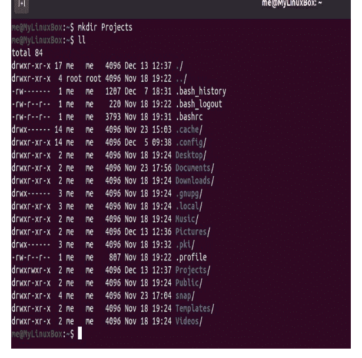

搞定！你应该能看到一个之前没有的新的`Projects`目录。

`$ mkdir`命令使用起来非常直观。如果只在参数中指定目录名称（即`$ mkdir <directoryname>`），它将在当前工作目录中创建一个具有该名称的新目录。如果我们选择指定新目录的路径并调用`$ mkdir <pathname>/<directoryname>`，它会将新目录放在路径指定的目标目录中。

让我们再创建一个目录，这次使用`$ mkdir <pathname>/<directoryname>`方法来练习一下。在命令行中输入以下内容：

```bash
$ mkdir ~/Projects/MyScripts
```

接下来，让我们以类似的方式使用`$ ls`。不需要用`$ cd`命令进入`~/Projects`，试试这种替代方法：

```bash
$ ls -la ~/Projects
```

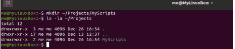

你将在终端窗口中看到类似上图所示的内容。请注意，当前工作目录仍然是主目录。当然，我们本可以先执行`$ cd`进入`~/Projects`，然后直接在`~/Projects`内执行这些命令。然而，我们保持在`~`目录并在`~/Projects`中执行命令的方式说明，我们并不限于在当前位置（当前工作目录）操作文件和目录。在 Bash 中，使用许多命令时，我们可以在参数中指定一个**目标目录**的路径（在此例中为`~/Projects`），然后就像在当前工作目录中一样在目标目录中执行任务——假设目标目录是可执行的，并且我们拥有读写权限。要使用`$ ls`查看目录内容，我们只需要读取权限。

`$ mkdir`命令简单的操作背后隐藏着强大的功能，我们将在本指南的末尾对其进行更多操作。在此期间，请查看`$ man mkdir`以了解该命令的功能。

#### `$ touch`

如果我们有一些文件可以放入这些刚刚创建的新目录中就好了。在这种时候，首先想到的命令行工具是`$ touch`[29]。`$ touch`以其简单著称，它允许我们在命令的参数中提供名称来创建一个**空文件**（即`$ touch <filename>`）。

正如我们之前讨论的，Linux 文件系统中的文件只是文本的容器。如果我们能制作一个空的文本容器，这仍然是一个文件吗？当然是！使用`$ touch`，我们能够简单地在希望出现新空文件的地方“轻触”一下，命令就会为我们处理剩下的事情。

让我们使用`$ cd Projects/MyScripts`进入`~/Projects/MyScripts`目录。进入目录后，在命令行输入以下内容：

```bash
$ touch my_first_file
```

使用`$ ll`检查一下，你会看到当前工作目录中崭新的文件。

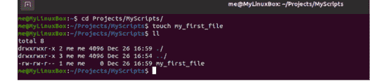

做得好！我们将把这些项目作为接下来命令行实验的基础。

### 获取 Linux 中文件的信息

既然`my_first_file`已经出现在我们的工作区中，让我们看看盖子下面藏着什么。即使文件是空的，我们仍然应该能够了解它作为 Linux 文件系统中一个项目的状态。

在 Linux 中获取文件信息的方法有很多。一种简单的方法是使用`$ ls`，当我们把`<filename>`放在命令的`<operand>`位置时，它让我们专注于特定文件^[30]。例如，`$ ls -la <filename>`将返回长格式显示的列视图，但列表中只有一个文件。当我们对`~/Projects/MyScripts/my_first_file`执行此操作时，我们看到`<username>`是文件所有者，拥有读写权限。我们还通过文件类型插槽知道这是一个常规文件。毫不意外！

#### `$ stat`

当我们需要关于 Linux 中文件或目录的更多信息时，`$ stat`命令（“status”的缩写）将返回比`$ ls`向我们显示的更明确的版本。让我们试一下`$ stat`命令。在`~/Projects/MyScripts`目录中，在命令行输入以下内容：

```bash
$ stat my_first_file
```

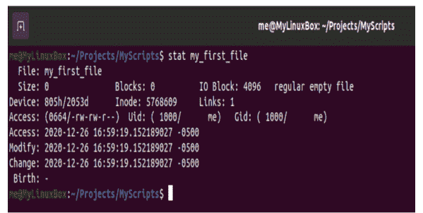

我们可以看到`$ stat`将`my_first_file`识别为空文件，并且我们获得了有关文件最后访问、修改和更改时间的更多信息。稍后，一旦我们对`my_first_file`做了一些操作，我们将再次运行`$ stat`以查看这些细节如何反映我们所做的任何更改。当然，也请随意尝试对你感兴趣的任何其他文件或目录调用`$ stat`！这是接触不同类型文件的好方法。

**总结：**

在 Linux 中，我们的用户身份和状态决定了我们可以访问哪些数据。基于文件和目录所有权的权限管理着我们在 Linux 文件系统中能做什么和不能做什么。在 Linux 中命名文件时，避免空格可以防止命令参数中的格式问题。如果命令的参数包含目标目录的路径，根据权限，命令将在该目录中操作，就像在未指定路径时在当前工作目录中一样。要获取 Linux 中文件和目录的信息，我们可以使用`$ ls`，或者我们可以使用`$ stat`命令获取更详细的信息。

### 命令

- `$ ls`
- `$ cd`
- `$ mkdir`
- `$ touch`
- `$ stat`

### 概念

- 作为数据容器的纯文本文件
- `\`转义字符
- Linux 文件类型
- 单引号
- 文件权限——**读**、**写**、**可执行**
- 可执行目录
- Linux 文件命名约定
- 目标目录
- 空文件
- 获取文件/目录信息

**挑战：**

前往`touch`命令的`man`页面，找到一种方法来编辑`~/Projects/MyScripts/my_first_file`显示的访问和修改日期与时间。你可以将访问和修改信息更改为反映当前时间（如果你愿意）。当你在`~/Projects/MyScripts`目录中执行`ll`时，你应该会看到文件显示新的日期和时间。

## 连接到流

有了第一个文件，现在我们要进入 Linux 工具箱，寻找将文件连接到周围世界的方法。我们希望将我们的文件变成一个暂存区，在那里我们可以使用 Linux shell 环境的输入/输出路由来连接命令和引导文本。我们的目标是使用这些类型的连接作为我们自己的命令行解决方案的构建块。

### Linux 中的标准输入/输出

让我们花点时间谈谈信息是如何进入和离开 Linux 的。当我们在 shell 中运行一个命令时，该命令首先接收一些纯文本[输入](input)，并且基于这些输入，命令返回其[输出](output)，也是纯文本格式的<sup>[31]</sup>。

对于来自外部世界的主要输入接口，Linux 将计算机键盘定义为`stdin`（代表“standard in”——正如它也被发音的那样）。Shell 本身广泛使用`stdin`，方式是 shell 不断“监听”按键事件（任何时候我们在键盘上按下按键）。因为 shell 如此擅长监听和响应`stdin`，许多命令甚至不直接获取`stdin`作为其输入。

相反，以这种方式操作的命令（如`$ ls`）仅在我们按下回车键（执行命令时）才从 shell 发送给它们的内容获取输入。在我们按下回车键之前，shell 监听键盘并收集我们在命令行上输入的**字符串**（那行文本）。当我们输入时，shell 根据我们输入非转义空格的位置（参见第 56 页和附录 B）解析输入字符串。然后当我们按回车键执行命令时，这些片段被捆绑在一起并作为其**参数**发送给命令，这构成了命令的输入。我们到目前为止看过的所有命令都以这种方式运行——即使参数是隐含的，比如单独的`$ ls`。

然而，还有其他命令确实接受来自`stdin`的直接输入，它们非常有用，特别是因为它们可以通过 Linux 中称为“管道”的对象获取其输入（在 Linux 中`|`字符代表一个管道）。当像这样的 Linux 命令通过管道获取其输入时，它们可以有效地接收文本流，并且 Linux 允许我们以这种方式链接命令，这样一个命令的文本输出可以直接流入下一个命令的输入。在本章的后面，我们将仔细研究如何使用管道来处理接受`stdin`作为输入的命令。但在我们深入探讨之前，我们必须谈谈命令如何在 Linux 中输出信息。shell 环境中的几乎所有命令都设置为将其输出发送到终端窗口[32]。当命令将其输出发送到终端窗口时，我们说该命令将其输出发送到`stdout`（代表“standard out”）。我们到目前为止尝试过的所有命令都直接将输出发送到`stdout`。

除了命令到`stdout`的主要输出外，Linux 还为命令提供了另一种类型的输出，称为`stderr`（代表“standard error”）。

**错误**）。`stderr`是一种专门保留用于错误消息的特殊输出。如果你想知道这有什么用，那么像 Linux 中的许多事物一样，它根植于 Unix 的传统，即保持 shell 不受系统消息的杂乱干扰。

Unix 文化强调拥有一个“安静”的界面，这意味着 shell 不应该用无用的警报或错误报告来负担用户。为了保持这种安静，Unix 引入了`stderr`作为一个单独的输出流，专门用于承载错误消息。

通过强制系统的错误报告通过其自己的专用文本流传递，这给了用户更多的控制权，以便在需要将错误消息发送到`stdout`以外的其他地方时，可以重定向该流。在 Linux 中，将`stderr`从`stdout`分流出去以避免 shell 被不需要的系统消息挤占是常见的做法。

总的来说，这三条信息进出 shell 的路径（`stdin`、`stdout`和`stderr`）在 Linux 中被称为**标准流**。在接下来的命令行教程中，我们将通过实践来学习使用所有这些流。

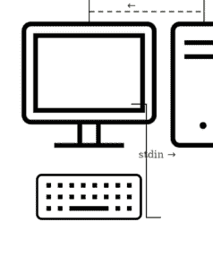

在左侧的图表中，我们可以将显示想象为终端窗口，将计算机想象为封装了 shell。在 Linux 中，除非我们将`stderr`*重定向*到另一个目的地，否则它会与`stdout`一起被导向终端窗口。事实上，所有这些流的*重定向*（或重新连接）都是可能的。我们将详细探讨如何做到这一点，并练习将这些流连接到（或来自）文件。

*图 7 Linux 标准流示意图*

#### `$ echo`

`$ echo`命令执行一个简单而重要的任务：将文本打印到`stdout`。我们可以在命令的参数中放入文本，按回车键，文本将出现在命令行下方的空格中。让我们试一试（我们仍然在上一章的`~/Projects/MyScripts`目录中）。

```bash
$ echo 'something I want to print to stdout'
```


很好。当我们练习将输出重定向到另一个目的地时，有一种方法可以将内容打印到`stdout`会很有用。

#### `$ cat`

我们需要一种快速简便的方法来查看文件内容，而`$ cat`命令（concatenate 的缩写）在这里完全符合要求。顾名思义，`$ cat`的功能不止于简单地显示文件，在下一章我们将探索更多这个命令能做的事情。不过目前，我们将专门使用`$ cat`将文件内容直接打印到`stdout`的能力。

为了测试这一点，让我们用`$ cd`返回到`~`，然后用`$ ll`查看目录中的项目。你应该能在列表中看到一个名为`.bash_history`的文件。在命令行上尝试以下操作。

```bash
$ cat .bash_history
```


看起来很熟悉？我们正在查看一个包含我们在命令行输入的所有命令日志的文件！这是一个相当长的文件，但如果你向上滚动，应该能看到其全部内容。

#### `$ wc`

使用`$ wc`命令，我们可以获取作为命令参数放入的文件的单词计数。当我们在主目录时，让我们使用`$ wc`来查看`.bash_history`文件中有多少“单词”。我们将使用`-w`[选项]，它告诉命令我们只想要文件中单词的计数（而不需要字符数或行数等附加信息）。

```bash
$ wc -w .bash_history
```


你得到的结果可能与此处显示的不同，但输出应类似这样，单词数旁边是`.bash_history`。

## Linux 中的重定向

现在我们将开始通过 shell 的标准流接口（`stdout`、`stdin`和`stderr`）获取一些将命令和文件连接起来的实践经验。我们需要一些附件，或者可以说适配器，来引导文本流*从*命令*到*文件（反之亦然）的流动。Bash 为此目的提供了一套方便的工具，称为**重定向运算符**。这些工具都是类 Unix 系统著名的**进程间通信**功能的一部分。

### `>`运算符

`>`运算符是我们将要尝试的第一个重定向运算符。当放在命令之后时，它会将命令的`stdout`输出重定向到`>`右侧的一个新目标文件名中。该符号的箭头特性标记了信息从*命令*`>`*文件*的流动。

我们可以在我们的老朋友`my_first_file`上尝试，但如果我们这样做，`>`只会用同名的新文件覆盖它，而我们不希望这样。所以，作为替代，在`~/Projects/MyScripts`目录中，让我们使用`>`来创建一个新文件。当你准备就绪时，我们将尝试将一些文本重定向到一个我们称之为`my_second_file`的文件中。

```bash
$ echo 'hello world' > my_second_file
```

让我们执行`$ ll`来检查一切是否就绪。


一切看起来都很好！而`my_first_file`正耐心地等待着，就像我们离开时一样。所以，现在我们需要一种方法来查看`my_second_file`。`$ cat`命令在这里会做得很好。让我们试试。

```bash
$ cat my_second_file
```


你好！你成功地将`stdout`重定向到一个新文件。现在让我们看看是否可以将`stdout`流*添加*到文件内容中。

### `>>`运算符

如果我们想将`stdout`输出重定向到现有文件，并且不想覆盖任何内容，那么我们需要`>>`运算符。`>>`运算符会获取来自其左侧命令的`stdout`输出，并*追加*数据到右侧指定的文件中。双箭头符号暗示了一种累积，这很合适。

既然我们在`my_second_file`上正顺手，让我们继续，再给它添加一点内容。

```bash
$ echo 'this is my second file' >> my_second_file
```

随后执行`$ cat my_second_file`将显示新内容。

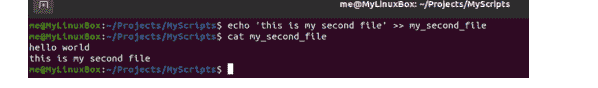

太棒了！我们是否要给`my_first_file`它期待已久的文本？这将演示如何使用`>>`来填充空文件。

```bash
$ echo 'I am getting good at this' >> my_first_file
```

快速执行`$ cat my_first_file`将向我们展示现在的文件内容。

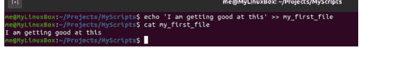

确实如此！但是如果我们想*从*一个文件*到*一个接受`stdin`作为输入的命令呢？

### `<`运算符

这个运算符比从命令的`stdout`输出到文件的重定向运算符稍微不那么直观。`<`不是将文件视为从命令接收输入，而是将文件变成一个*源*，其内容*输出到*一个接受`stdin`作为输入的命令中。我们可以将其想象为：取走从计算机键盘馈送`stdin`的“电缆”，将其从键盘的输出断开，然后将电缆连接到文件的输出！

要了解其工作原理，我们需要一个可以从`stdin`接受输入的命令。幸运的是，我们现在掌握了其中一两个这样的命令。让我们用`$ cd`回到主目录，再次尝试在`.bash_history`文件上使用`$ wc`命令，但这次使用`<`运算符。

```bash
$ wc -w < .bash_history
```

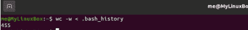


请注意，当我们通过 stdin 将 `.bash_history` 直接输入到 `$ wc` 时，`$ wc` 不会像文件放在 `$ wc` 的参数中时那样输出文件名（`.bash_history`）。部分原因是，当我们使用 `<` 将文件发送到命令的 stdin 输入时，shell 首先提取文件的文本内容，然后将该信息（不包含文件本身）发送到命令的 stdin 输入。实际上，这使得命令在内容到达其 stdin 门槛之前，对其来源一无所知。这在许多情况下都很有用。例如，如果我们需要 `$ wc` 的输出仅为数值，并且不包含承载文本的文件名，那么我们可以使用 `<` 方法（`$ wc -w < <filename>`）。

### 2> 运算符

使用 `2>` 运算符，我们有了一种控制命令的错误消息流向何处的方法。`2>` 运算符让我们可以将 stderr 从终端窗口重定向出去——写入到运算符右侧我们指定的目标文件中。如果你好奇这个"2"代表什么，这源自 Unix 为标准流命名的惯例<sup>[33]</sup>，其中 0 代表 stdin（例如，`<` 运算符只是 `<0` 运算符的简写形式），1 代表 stdout（同样，`>` 运算符是 `1>` 运算符的简写形式），2 代表 stderr（在 `2>` 运算符中以未简写的形式出现）。

为了了解如何使用 `2>` 运算符，我们需要让 Bash 产生一条错误消息。这应该不难！这里有一个思路：

```
$ ls /Projects/MyScripts
```


不出所料，这条命令返回了一个错误。现在，让我们看看如果使用 `2>` 重定向运算符将 stderr 发送到名为 `/dev/null` 的文件会发生什么。

```
$ ls /Projects/MyScripts 2> /dev/null
```

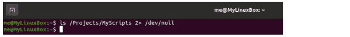

没有错误了！或者至少我们看不到了。将输出发送到 `/dev/null` 就像是把输出扔进了黑洞。有时候这是必要的，尤其是当一条命令返回几十条、几百条甚至几千条对任何人都没有用的错误消息时！

### | 运算符

`|` 运算符通常被称为**管道**，是类 Unix 世界中最强大的工具之一。管道让我们可以将一条命令的 stdout 输出直接"管道传输"到另一条命令的 stdin 输入中（显然，接收方的命令必须接受 stdin 作为输入）。`|` 运算符的强大之处在于它能够将简单的命令串联在一起，让我们能够相对轻松地执行更复杂的操作。

在主目录中，我们将首先尝试将 `|` 运算符与 `$ wc` 命令（我们在本章前面已介绍过）一起使用。准备好后，在命令行中输入以下内容。

```
$ man wc | wc -w
```

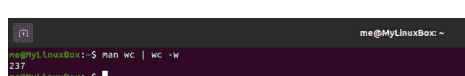

这里我们将 `$ man wc` 的 stdout 输出作为 `$ wc -w` 的 stdin 输入。想象一下，如果我们去掉 `| wc -w` 部分，那么就只剩下 `$ man wc`。按下回车键会将结果发送到 stdout。我们现在所做的几乎就是这件事，但与其将 `$ man wc` 的输出发送到终端，我们是将 `$ man wc` 的输出重定向到 `$ wc` 的 stdin 输入中。这正是通过 `|` 运算符实现的，它让我们可以将一条命令的输出管道传输到另一条命令的 stdin 输入中。当 `$ wc -w` 接收到文本输入后，它会进行字数统计，然后将其结果 237 发送到 stdout。正如这里用 `|` 运算符所演示的，单独的命令可以连接起来形成一条**管道**。这样的管道可以通过多个命令依次连接来进一步扩展，形成一条精细的文本处理链。随着我们继续学习，我们将练习使用 `|` 来构建自己的多命令管道。

## 过滤 stdin 输入的 Linux 命令

现在是时候让我们认识 Linux 中最重要的两个命令了，它们都接受 stdin 作为输入（就像我们上面刚试过的 `$ wc` 一样）。我们把这些命令称为**过滤器**，因为它们在 stdin 处接收文本流，然后对接收到的内容进行修改——移除和/或将文本的某些部分进行转换，再将结果发送到 stdout。

### $ grep

如果 `$ grep` 这条命令可以改名的话，"search"（搜索）将是一个极佳的候选名，因为这正是该命令的本质功能。`$ grep` 最初由 Ken Thompson 本人开发并命名，它是 global-search-for-a-regular-expression-and-print（全局搜索正则表达式并打印，即 g/re/p）的缩写。

这条标志性的命令让我们搜索在参数中提供的`<模式>`。

好的。但我们可以在哪里执行这个搜索呢？一种使用 `$ grep` 进行搜索的方式是将命令指向一个文件，文件名放在 `<操作数>` 的位置（如 `$ grep <模式> <文件名>`），`$ grep` 会搜索该文件内容中所有匹配 `<模式>` 的实例。但除了从 `<操作数>` 中给出的文件获取输入外，`$ grep` 还能够通过管道从其 stdin 接口获取输入（如 `$ <命令> | grep <模式>`）。通过这种方式，我们将前一条 `$ <命令>` 的 stdout 输出直接管道传输到 `$ grep` 的 stdin 输入中，`$ grep` 会过滤掉不符合的内容，只保留包含参数中指定的 `<模式>` 的文本行。

让我们先用 `$ grep <模式> <文件名>` 方法做一些练习，在 `~/.bash_history` 文件中搜索所有我们输入过 `$ pwd` 命令的记录。

```
$ grep pwd .bash_history
```

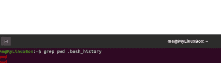

根据你自己的 `.bash_history` 文件，你可能得到相同的结果，也可能不同。但无论显示了什么，这都是因为 `$ grep` 只让 `.bash_history` 中包含我们指定的 `<模式>`（这里是 `pwd`）的行通过。红色文本是 Ubuntu 中 shell 对 `$ grep` 输出的默认格式化效果。

作为一次实验，让我们将这些结果通过管道传输到 `$ wc` 中，看看返回什么数字。

```
$ grep pwd .bash_history | wc -w
```


成功了！现在值得一提的是，`$ grep` 有一个 `-c [选项]`（用于计数），它能产生与管道传输到 `$ wc -w` 相同的结果。这说明在 Linux 中，实现同一个目标的方式往往不止一种。只要能达到你需要的效果，无论选择哪种方式都是完全有效的。

现在我们将通过管道传输一段文本流来测试 `$ grep` 的 stdin 输入功能，并让 `$ grep` 在文本中搜索一个 `<模式>`。我们再次使用 `$ man wc` 作为文本来源，这次要搜索的 `<模式>` 是 `character` 这个单词。准备好后请尝试。

```
$ man wc | grep character
```

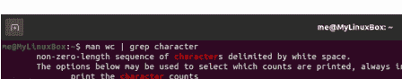

在输出中，`$ grep` 列出了 `$ man` 手册页中所有包含 `character` 这个单词的行。将 `grep <模式>` 放在 `|` 之后，为我们提供了一个强大的信息过滤工具，我们建议你执行 `$ man grep` 来全面了解该命令的功能。在你今后的 Linux 学习中，你会发现 `$ grep` 在命令行工具链中扮演着关键角色的例子不胜枚举。

### $ sed

`$ sed` 命令是"stream editor"（流编辑器）的缩写，是 Unix 传统中的又一巨头。与 `$ grep` 类似，`$ sed` 通常出现在 `|` 之后，对通过 stdin 输入的文本流进行操作。作为一款"编辑器"，`$ sed` 命令的主要功能是通过替换和/或删除字符来过滤传入的文本。`$ sed` 参数中的语法决定了该命令的过滤行为。

让我们尝试在之前 `$ grep` 实验的基础上添加一个 `$ sed` 输出阶段。实用技巧：在命令行中使用 ↑↓ 方向键翻阅命令历史记录，可以快速找回上一条 `$ grep` 命令（参见第 37 页）。

```
$ grep pwd .bash_history | sed s/pwd/PWD/
```

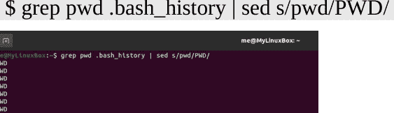

那么，我们做了什么？我们将 `$ grep` 的 stdout 输出通过管道传输到 `$ sed`，并在后者的参数中使用了 `s/pwd/PWD/`。在 `s/pwd/PWD/` 中，我们使用了 `$ sed` 的特殊语法，其中 `s` 表示我们要将所有 `pwd` 实例替换为 `PWD`。`$ sed` 命令将 `/` 识别为语法中字段之间的分隔符。这种 `<模式>` 替换正是 `$ sed` 最为人所知的功能，而这里我们只是窥见了它能力的一角。

与 `$ grep` 一样，`$ sed` 的能力非常深厚，通过查阅 `$ man` 手册页并尝试各种可用的 [选项]，可以获得很多收获。

### 总结：

遵循 Unix 传统，数据进出 Linux Shell 的三个主要通道分别是 stdin（键盘）、stdout（终端窗口）以及 stderr（专门用于错误消息的特殊输出）。我们有一套命令行工具用于连接和重定向这些纯文本数据流，将命令的输出写入文件（反之亦然）。对于像 `$ wc`、`$ grep` 和 `$ sed` 这样接受 stdin 作为输入的命令，我们可以使用管道运算符将命令串联起来，创建自己的管道来过滤文本。

### 命令：

| `$ echo` | `$ wc` |
| --- | --- |
| `$ cat` | `$ grep` |
| `$ cd` | `$ sed` |

### 概念：

- 标准流（stdin、stdout、stderr）
- 输入参数字符串解析
- `/dev/null`
- 过滤命令
- `.bash_history`
- 重定向运算符
  - `>` 运算符
  - `>>` 运算符
  - `<` 运算符
  - `2>` 运算符
- 进程间通信
  - `|` 运算符
- 标准流标签（0、1、2）
- 管道

**挑战：**

回到之前产生错误的 `$ ls /Projects/MyScripts` 命令，使用我们目前介绍过的一些工具来统计错误消息中的单词数量。结果与你手动计数得到的单词数是否一致？看看你能否找到至少两种不同的方法来实现同样的效果。

## 让文本执行命令

我们越深入 Linux 命令行的全文本世界，就会接触到越多类型的文件。其中一些文件只有寥寥数行，而另一些则可能包含数十行、数百行甚至数千行文本。

我们已经知道如何使用 `$ cat` 来显示文件内容，但当文件的长度超过终端窗口的高度时，`$ cat` 作为文件查看器就力不从心了。我们需要一个单独的工具来查看较长文件的内容。这个工具应该允许我们逐行或逐页浏览文本，并且在查看完毕后能方便地返回到命令行上次停留的位置。

### $ less

名字奇特的 `$ less` 可能不会让人一眼就认为它是查看较长文件的理想选择，但事实上它正是为此而生——查看较长文件的首选命令。`$ less` 被誉为对旧版文件查看器命令 `$ more` 的改进，它比 `$ more` 更胜……你大概能猜到后面的梗了。

使用 `$ less` 会有一种莫名的熟悉感。事实上，如果你查看过任何 `$ man` 手册页，那么你已经接触过 `$ less` 了。当我们输入 `$ man <command>` 时，`$ man` 会在后台调用 `$ less` 来负责显示 `<command>` 的手册页（见第 35 页）。

但我们也可以直接在参数中指定一个 `<filename>` 来调用 `$ less` 并查看文件内容（前提是我们拥有查看该文件的权限）。让我们在主目录下对 `.bashrc` 文件试试看（`.bashrc` 是"Bash run commands"的缩写，我们很快就会介绍它）。

```
$ less .bashrc
```

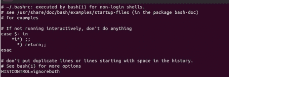

我们看到的是什么？`~/.bashrc` 文件只是一个配置文件，它告诉 Bash 在我们打开新的 shell 会话时该做什么。如果你看不懂这里的内容，不用担心，以后会明白的。

当我们使用 `$ less` 查看这个文件时，可以尝试用方向键 ↓↑ 向下和向上滚动。此外，你可以按空格键或 `f` 键向前翻页，按 `b` 键向后翻页。

如果输入 `:`，终端窗口底部会出现一个交互式提示符，用于在 `$ less` 内部执行特殊命令。你可以输入 `h` 获取帮助，还有一个 `q` 命令可以退出 `$ less`。当你准备好离开 `$ less` 并返回 Bash 命令行时，只需按 `q`，就会回到熟悉的 `<username>@<hostname>:~$` shell 提示符。

我们在这里介绍的内容大概能覆盖你目前大部分的 `$ less` 使用需求，但 `$ less` 还有一些你可能会觉得有用的功能，比如正向搜索（`/<pattern>`）和反向搜索（`?<pattern>`）文件内容。

另外值得注意的是，`$ less` 接受 stdin，并且通过管道将其输入是很常见的做法（即 `$ <command> | less`），这样可以在 `$ less` 的分页布局中查看前一个命令的输出。更多关于该命令的 [选项] 和其他功能，请查阅 `$ man less`。

### Linux shell 中的交互式输入

我们已经讨论过 shell 是如何"监听"我们在键盘上输入的内容的，也看到了接受 stdin 作为输入的命令如何通过管道获取输入。但我们还没有真正弄清楚一个命令"接受 stdin 作为输入"到底意味着什么。

在探讨这个话题之前，让我们先想想那些*不*接受 stdin 作为输入的命令在命令行上的行为。例如 `$ ls`，它不接受 stdin 作为输入。当我们输入 `$ ls` 并按下回车时，其定义行为是列出当前工作目录的内容。但当我们运行该命令时，`$ ls` 的输入究竟是什么？不是 stdin。为什么？

`$ ls` 的输入不是 `stdin`，因为一旦我们按下回车，`$ ls` 并不会监听键盘。相反，当我们按下回车时，`$ ls` 将当前工作目录作为输入（系统将 cwd 像输入到参数中一样提供给该命令），然后开始列出目录内容，完全无视<sup>[34]</sup>我们之后可能输入的任何内容。

但对于许多接受 stdin 作为输入的命令<sup>[35]</sup>，当我们以最基本的形式（即 `$ <command>`）在命令行上调用它们时，会发生不同的情况。这类命令在我们按下回车后会*开始*监听键盘。我们在按下回车后在键盘上输入的内容会被导入命令的输入中，随着我们继续输入，每当我们按下回车键，光标就会移到终端窗口左侧的下一行——就像在文本编辑器中一样。这个过程会一直持续，直到我们通过 `ctrl + d` 发送**文件结束（EOF）**控制状态变更。一旦命令收到 EOF 消息，它就会*停止*接收我们输入的内容，shell 将恢复对 stdin 输入的正常监控。当一个命令以这种方式运行时（即接受 stdin 作为输入），它实际上允许我们将文件内容逐行输入到命令中（正如"文件结束"消息所暗示的那样）。

为了感受一下这个过程，让我们回到 `~/Projects/MyScripts` 并试验 `$ cat` 命令的 stdin 输入功能。我们先简单地输入 `$ cat` 并按回车。

```
$ cat
```

按下回车后，你会看到光标出现在命令行提示符正下方的行上。随意输入一些内容再按回车。每次你输入一些内容并按回车键，都应该能看到你输入的内容被复制显示在正下方。

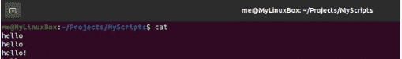

当你准备好返回常规命令行提示符时，最后再按一次回车，使光标位于最后一行文本的下方（如上图所示）。然后按 `ctrl + d`，你就会回到熟悉的 Bash 提示符（`<username>@<hostname>:~/Projects/MySc`）。

那么，刚才发生了什么？我们见证了 `$ cat` 命令如何接收 stdin 输入并将其拼接到输出目的地（本例中是 stdout）。但想象一下，如果不是输出到 stdout，而是可以将输出*重定向*到一个文件。这样，每当我们键盘输入并按 `enter`，输出就会逐行累积，成为文件的内容。要不要试一试？

我们将使用 `>` 运算符将 `$ cat` 的 stdout 重定向到一个新文件，我们称之为 `my_third_file`。

```
$ cat > my_third_file
```


现在，初始按一次回车键后，我们就可以开始将重定向的 stdout 内容拼接到 `my_third_file` 中。请随意输入大约三行内容。

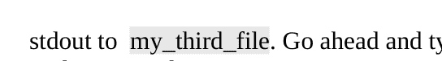

这样使用 `$ cat` 就好像我们拥有了一个文本编辑器。输入几行文本后，按 `ctrl + d` 返回 Bash 提示符。

现在让我们像上一章那样使用 `$ cat` 作为文件查看器来检查 `my_third_file` 的内容。

```
$ cat my_third_file
```


一切都和我们输入的一模一样。注意，参数中的 `my_third_file` 为 `$ cat` 提供了输入，在这种模式下 `$ cat` 会忽略 stdin 输入。

既然我们正在使用 `$ cat` 作为文件查看器，顺便来看一下 `my_first_file`。


是时候对这个文件进行更新了。我们将通过`$ cat`和`>>`操作符来实现，这允许我们通过标准输入键入的内容来追加到`my_first_file`中。请按这种方式添加另一行。

```
$ cat >> my_first_file
```

通过快速按`↑`键在命令历史中回溯到`$ cat my_first_file`，按下回车再次显示`my_first_file`，但这次它包含了新的内容。

这样好多了！但如果我们想在将新行文本追加到`my_first_file`后，又决定回到第一行末尾添加一个句号呢？`$ cat`命令配合`>>`操作符只允许我们*添加*内容（即追加）到文件末尾，看来我们错过了添加句号的时机。当然，`>`操作符在这种情况下也帮不上忙，因为它只提供完全替换。如果我们想有选择地修改文件前面的某些内容，就需要扩展我们的工具集了。

## Linux 命令行文本编辑器

我们现在知道如何向文件添加文本，但还需要一种在 Linux shell 中交互式编辑文件的方法，以便我们可以随意插入或删除文本——类似于我们在喜爱的移动或桌面用户环境中处理文本的方式。幸运的是，Unix 拥有悠久的文本编辑工具历史，可以追溯到 1969 年操作系统首次发布，而 Linux 继承了这一传统，多年来积累了大量令人印象深刻的文本编辑器。在这里，我们将介绍两个最受欢迎的 Linux 命令行文本编辑器。

### `$ nano`

`$ nano` 文本编辑器最初发布于 1999 年，就 Linux 工具而言相对较新。它源自另一个名为`$ pico`的文本编辑器，以其易用性、可靠性和实用的功能集而闻名。在`$ nano`中编辑文本的感觉几乎与在基于 GUI 的文本编辑器中编辑文本一样，这为`$ nano`赢得了 Linux 中“初学者友好”编辑器的美誉。

要在`$ nano`中打开文件，我们只需在参数中调用命令并加上`<文件名>`。让我们在`my_first_file`上试试。

```
$ nano my_first_file
```

按下回车后，你会看到`$ nano`界面占据了整个终端窗口，在顶部你会看到组成`my_first_file`的两行文本。像在基于 GUI 的文本编辑器中一样使用箭头键将光标移动到第一行的末尾。在那里，添加一个句号。

到目前为止一切顺利。现在我们需要保存带有新句号的`my_first_file`。在`$ nano`中，当我们想要保存内容时，我们输入按键命令`ctrl + o`（代表写入）。如果你觉得这很奇怪，你不是第一个。但它确实有效。

`ctrl + o`

你会看到如上所示的提示。只需按`enter`键，`my_first_file`就会被保存。需要注意的一点是，这些按键命令开头显示的`M`实际上并不代表`M`键，而是指`alt`键。历史上，`alt`键曾被标记为“元”键。

当你按下`enter`时，你应该会在终端窗口底部按键指南的上方看到`[ 写入了 2 行 ]`。

当你准备好退出`nano`并返回到 Bash 命令行提示符时，按`ctrl + x`。

在`nano`中使用一段时间后，你会习惯它非传统的按键命令，但如果你真的忘记了任何命令，`nano`总是在终端窗口底部显示按键组合，这很有帮助。由于其强调简单性和易用性，你可能会发现`nano`成为你在 Linux shell 中最喜欢的文本编辑器。

### `vim`

`vim`（代表`vi` improved）源自 1979 年首次作为 BSD 一部分引入的开创性`vi`文本编辑器，它在 Linux 中作为功能强大的编辑器享有盛誉。在第一次接触`vim`时，我们将只介绍基础知识，以便你掌握如何使用`vim`进行日常编辑任务。

首先，让我们调用`vim`来检查`my_second_file`，看看是否有我们可以编辑或添加的内容。就像使用`$ nano`一样，我们可以通过在参数中调用命令并加上`<文件名>`在`$ vim`中打开文件。

```
$ vim my_second_file
```

好的。你会看到`$ vim`和`$ nano`一样，占据了整个终端窗口。你还会注意到`$ vim`的界面不那么吸引人，更具传统 Unix 的简朴风格。想象一下这是 1979 年，这样编辑文本相比使用打字机是一个重大进步。

和`$ nano`一样，你可以在`$ vim`中使用箭头键移动光标。试着在第一行末尾添加一个感叹号。

好的。如果在尝试输入感叹号时发现光标没有响应，深呼吸。它没有坏。这实际上是一个特性。当我们启动`$ vim`时，它以所谓的**普通模式**[36]启动。要能够编辑，我们需要告诉`$ vim`我们希望切换到**插入模式**。要切换到插入模式，只需输入一个小写的`i`。现在你应该能够在第一行末尾添加感叹号了。

趁此机会，也请在第二行末尾添加一个句号。为什么不输入第三行来纪念这个时刻呢。

正在取得进展。现在我们需要将更改保存到`my_second_file`。准备好后，按`esc`键，这将带我们回到普通模式。按下`esc`键后，输入一个冒号`:`，你会在终端窗口左下角看到一个冒号提示符。当终端窗口底部出现`:`提示符时，我们现在进入了令人困惑的**命令行模式**[37]（在`$ vim`内）。最后，在`:`提示符处输入`wq`（代表**写入**和**退出**），按回车，这将带我们回到 Bash 命令行提示符。

呼。众所周知，`$ vim`在初次见面时往往会把人吓跑。如果这是你的情况，不要放弃`$ vim`！通过练习确实会变得更容易。以下是我们在`$ vim`中进行基本编辑的流程回顾。

#### 在`$ vim`中打开和编辑文件

1. 启动`$ vim <文件名>`。
2. 按`esc`键（只是为了确保你在普通模式）。
3. 按小写`i`切换到插入模式。
4. 编辑`<文件名>`的内容。

#### 保存文件并退出`$ vim`

1. 按`esc`键。
2. 输入一个冒号`:`。
3. 在`:`提示符处输入`w`并按回车以写入（保存）文件。
4. 再输入一个冒号`:`。
5. 在`:`提示符处输入`q`并按回车以退出`$ vim`。

以下是`$ vim`中一些重要的按键命令：

|`$ vim`按键命令 | 结果 |

| :--- | :--- |

|`esc` | 普通模式（用于在/到其他模式间切换） |

|`i` | 插入模式（从普通模式进入） |

|`:` | 命令行模式（从普通模式进入） |

|`n` | 搜索中下一个匹配的`<模式>`（见下文） |

以下是在命令行模式（在`:`提示符处）输入的`$ vim`命令的简略列表：

|`$ vim`命令行模式命令 | 操作 |

| :--- | :--- |

|`:e <文件名>` | 打开`<文件名>`进行编辑 |

|`:tabe <文件名>` | 在新标签页中打开`<文件名>`进行编辑 |

|`:tabn` | 转到下一个标签页 |

|`:w` | 写入（即保存）当前文件 |

|`:w <文件名>` | 将当前文件写为`<文件名>` |

|`:q` | 退出`$ vim` |

|`:wq` | 写入当前文件并退出`$ vim` |

|`:q!` | 不保存更改直接退出`$ vim` |

|`:/<模式>` | 在当前文件中向前搜索`<模式>` |

|`:?<模式>` | 在当前文件中向后搜索`<模式>` |

|`:set number` | 显示行号 |

|`:set nonumber` | 隐藏行号 |

已有整本书籍详细阐述`$ vim`的高级用法及其通过插件实现的强大可扩展性，因为这个编辑器的 power 就像一个操作系统本身。即使我们并不需要`$ vim`提供的所有功能，熟悉`$ vim`的基本用法对我们来说仍然是有益的，因为它是 Linux 中*事实上的*文本编辑器。有一点我们可以确定，那就是`$ vim`（或`$ vi`）几乎在每个 Linux shell 中都可用。在某些时候，你可能会发现自己登录到服务器上的远程 shell 中，并且需要编辑某个文件的内容。在这种受限的、容器化<sup>[38]</sup>的 shell 环境中，`$ vim`（或`$ vi`）往往是唯一可用的编辑器，这并不罕见。为了应对这些情况，了解如何使用`$ vim`是很重要的。

### Linux 命令行环境中的别名

现在我们将把注意力转向 Bash 别名，作为我们一直在学习的命令行文本编辑工具的第一个实际应用。在我们目前见过的别名中，你有偏好的`$ ls`别名吗？我们经常使用`$ ll`（`$ ls -alF`的别名），但还有其他的，比如`$ la`（用于`$ ls -A`）和`$ l`（用于`$ ls -CF`），等等。实际上，任何命令都可以在 Bash 中表示为别名。当我们有一个冗长或复杂的命令、可能难以记住如何输入时，这尤其方便。

#### `$ alias`

`$ alias`命令是我们在 Bash 中定义自己的自定义别名时使用的工具。为了了解如何使用这个命令，让我们退回到`~`目录，再看看`.bashrc`文件的内容。这次我们将使用`$ vim`来查看文件内容。

```
$ vim .bashrc
```

在`$ vim`中，向下滚动文件找到下面所示的部分（或者在`$ vim`中使用`:/'alias ll'`进行搜索）。注意，`$ vim`中的普通模式（通过`esc`键进入）充当一种保护盾，防止我们在类似这样的文件中意外编辑。


看到了吗，上述三个别名（`$ ll`、`$ la`、`$ l`)是如何在`~/.bashrc`文件中使用`$ alias`命令定义的？当我们启动一个 shell 会话时，Bash 会查看主目录中的`.bashrc`文件并执行其中包含的命令。由于 Bash 只在 shell 会话期间记住别名（即当我们关闭终端窗口时，Bash 会忘记所有别名），我们需要 Bash 在每次 shell 会话开始时运行这些`$ alias`命令，以便别名能在各个会话之间持久保存。因此，这些`$ alias`命令被包含在`~/.bashrc`中。

如果你继续向下滚动`~/.bashrc`文件，你会看到另一段内容，Bash 在那里接收到指令去主目录中查找`.bash_aliases`文件。如果存在`~/.bash_aliases`文件，Bash 会被指示打开它并运行<sup>[39]</sup>其中包含的任何命令。

但是我们在主目录中有`.bash_aliases`文件吗？我们回到命令行后需要检查一下。当你用`$ vim`浏览完`~/.bashrc`后，让我们退出`$ vim`并返回到主目录的 Bash 命令行。快速执行`$ ll`确认目前确实还没有`~/.bash_aliases`文件。我们稍后会回到这个话题。

我们即将尝试创建自己的别名。尽管已经为`$ ls`命令定义了几个别名，我们当然还可以再添加一个。`$ ls`有一个`-t [option]`，它指示命令按修改时间列出目录的内容。以这种方式查看文件通常是了解目录中情况的关键，所以我们将借此机会为`$ ls -alt`创建自己的别名。

现在我们需要选择一个名称来代表`$ ls -alt`。`$ lt`怎么样？这听起来可行，但首先我们需要确认没有同名的现有别名或命令。让我们通过在命令行中输入`$ alias`来获取当前所有活跃别名的列表。

```
$ alias
```

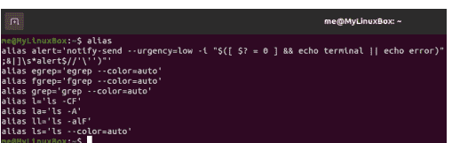

果然，没有名为`$ lt`的现有别名。好的。接下来，我们将冒个险<sup>[40]</sup>，在命令行中输入`$ lt`来看看是否有命令使用这个名称（我们也可以尝试`$ man lt`，但这并不能保证证明某个命令不存在，因为并非所有命令都有`$ man`页面）。在命令行中尝试`$ lt`后，你应该会收到一条以`Command 'lt' not found`开头的错误信息。这正是我们需要知道的。

我们已经准备好创建自己的别名了。准备好后，输入以下内容。

```
$ alias lt='ls -alt'
```

现在让我们在主目录中测试我们的新别名。输入`$ lt`，你应该会看到目录内容按修改时间列出。干得好！现在，我们将`$ exit`退出 shell，然后在终端窗口关闭后，打开一个新的 shell 会话并在命令行中再次输入`$ lt`。这样做时，你应该会收到和之前一样的`Command 'lt' not found`错误。这是因为 Bash 不会在各个 shell 会话之间记住别名。我们需要在每次 shell 会话开始时提醒 Bash 我们想要它记住哪些别名。

正如我们之前看到的，我们可以通过创建一个新文件`~/.bash_aliases`并将我们的`$ alias`命令放入其中来给 Bash 提供所需的提醒。让我们在主目录中使用`$ vim`来处理这件事。

```
$ vim .bash_aliases
```

在`$ vim`中，按照下面所示输入`$ alias`命令。然后保存`~/.bash_aliases`并退出。


要测试这个别名，请关闭当前 shell 会话并打开一个新的。输入`$ lt`，你应该会看到`~`按修改时间排列的内容。做得好！你现在拥有了自己的持久别名。如果出于某种原因你需要在某个 shell 会话中删除一个别名，只需输入`$ unalias <alias>`，该别名将不再生效（在该 shell 会话中）。要永久删除一个别名，请在`.bashrc`或`.bash_aliases`中删除该别名的`'<alias>='<command> [option(s)]'`定义（然后打开一个新的 shell）。

**总结：** `$ cat`命令适合快速查看较短的文件，但随着我们开始在命令行中处理更长、更复杂的文件，我们将需要另一套工具来查看和编辑文件内容。对于浏览较长的文件，`$ less`命令以全页视图显示内容，并提供一些有用的导航功能。对于编辑纯文本，`$ nano`和`$ vim`文本编辑器几乎涵盖了所有可能的使用场景——`$ nano`是两者中更容易学习的，而`$ vim`则更为强大。这些命令行文本编辑器的一种用途是查看、修改和/或创建 Bash 中的配置文件。在配置文件中进行调整（例如使用`$ alias`）使我们能够对命令行偏好和设置进行持久性的更改。

### 命令：

| 命令 | 命令 |

| :--- | :--- |

|`$ less` |`$ vim` |

|`$ cat` |`$ ls` |

|`$ nano` |`$ alias` |

### 概念：

+   查看较大的文件

- Bash 配置文件

  - 交互式输入

    - shell 文件中的`~/.bashrc`

+   接受 stdin 作为直接输入的命令

+   `~/.bash_aliases`文件

+   文件结束控制状态（`ctrl + d`）

+   Bash 中的持久别名

+   在命令行上编辑文本

**挑战：** 使用`|`将`$ ls`和`$ wc`组合成一个命令，输出当前工作目录中可见和隐藏项目的数量。对于这个项目计数，我们希望从列表中排除`.`和`..`，因此你需要找到`$ ls`的正确`[option]`，使其输出目录中除`.`和`..`快捷方式之外的<u>所有</u>内容。如果需要，请查阅`$ ls`的`$ man`页面（或参见第 45 页）。对于`$ wc`，查阅`$ man`页面找到输出接收输入行数的`[option]`。一旦你组装好一个能正确输出当前工作目录中项目数（减去`.`和`..`）的命令，为你的命令创建一个别名（你可以选择如何命名这个别名）并将该别名添加到`~/.bash_aliases`文件中。

## 关于 shell 环境

我们已经在这个环境中使用命令行生活了一段时间，一直无忧无虑地不关心周围发生的事情。这是 shell 环境的一大优点——能够使用命令行而不必关心 shell 跟踪的每一个细节——比如我们上次访问的目录是什么，或者自打开终端窗口以来我们输入了哪些命令。shell 为我们存储这些信息，这样如果，比如说，我们输入像`$ cd -`这样的命令，

### 命令行环境

我们称之为**shell 环境**的这个东西仍然有其奥秘，现在是我们进行一些溯源工作，探究其表面之下内容的时候了。

我们使用“环境”这个术语，是作为一个直观的方式来描述我们命令行活动发生的上下文。诸如*我们是谁*、*我们在哪里*以及其他决定性因素，都是 shell 环境的一部分。这些信息碎片共同定义了我们在命令行上所处的空间。

那么，像*我们是谁*和*我们在哪里*这样的信息是如何存储在 shell 中的呢？shell 环境中的每条信息[^41]都被分配给它自己的**变量**。就计算机而言，变量就像一个信息存储盒，我们可以通过调用其<u>名称</u>来访问其中的信息。

让我们在命令行上做一个小实验，演示 Bash 如何让我们将信息存储在变量中。我们将定义一个名为`a`的变量，然后通过调用该变量的名称来检索其存储的信息。转到命令行并输入以下内容[^42]。

```
$ a=3
```

*图 8 变量赋值示意图*

我们是在告诉 Bash，我们想将值`3`赋给一个我们命名为`a`的变量。我们在 Bash 中为任何变量选择的名称必须以字母字符或`_`（下划线）开头和结尾。


现在，在同一个 shell 会话中，如果我们通过名称调用变量 `a`，例如在 `$ echo` 命令的参数中，Bash 将返回我们赋给 `a` 的值（在本例中为 `3`）。关于在 Bash 中调用变量名称需要了解的一点是，必须在 `<变量>`（即 `$<变量>`[^43]）前面直接放置一个 `$`，Bash 才能返回赋值（见第 29 页）。

```bash
$ echo $a
```

当我们使用带 `$` 前缀的 `$<变量>` 形式来获取变量存储的值时，我们正在执行所谓的**变量展开**[^44]（在 Bash 中正式称为“参数展开”）。您可以将变量展开视为“打开盒子”（即包含存储值的变量）的行为。在本指南中，当我们谈论特定变量时，有时我们只使用变量名（例如 `a`）来指代该变量，而有时如果我们要指代存储在变量内部的值，我们将使用 `$<变量>` 形式（例如 `$a`）。

Bash 中的变量可以包含**整数**值[^45]（如我们刚才演示的），或者我们可以将其他类型的数据赋给变量，例如字母和/或特殊符号。一般来说，由字母和/或其他符号组成的一段存储信息称为**字符串**（例如，`'abc'`、`'A+'`、`'y'`、`'Hello there!'` 和 `'3D'` 都是字符串）。我们将要查看的大多数变量包含字符串，但我们会看到一些确实存储整数的变量，比如我们的变量 `a`。

### Bash 环境变量

现在让我们弄清楚 shell 在我们面前究竟维护着什么样的信息。我们将使用变量展开来解包一些无论我们走到哪里都会伴随我们的**环境变量**。请注意，Unix/Linux 中的环境变量习惯上用`全大写`标记。继续看看当我们打印 `$USERNAME` 时会出现什么。

```bash
$ echo $USERNAME
```

在输出中，你应该会看到你的 `<用户名>`。这看起来完全像是 `$ whoami` 命令！打印 `$USERNAME` 和运行 `$ whoami` 会返回相同的结果，除非出于某种原因，我们选择在命令行上切换到另一个用户账户。有一个命令 `$ su`，允许用户在多用户系统中直接在命令行上替代另一个用户（而无需注销 GNOME）。例如，在你的机器上，如果启用了 root 并且你拥有 root 密码，你可以使用 `$ su` 在命令行上成为 root（除非你有充分理由，否则不应这样做）。在这个假设场景中，如果你切换到 root 后运行 `$ whoami`，`$ whoami` 将返回 `root`，而 `$ echo $USERNAME` 仍将打印你登录时使用的原始 `<用户名>`。同时，shell 将信息存储在另一个环境变量 `USER` 中，在该事件中，如果你以 `$ su` 成为 root，`USER` 将镜像 `$ whoami`（即 `root`）。

所以，Bash 至少在两个环境变量中跟踪我们是谁（其中一个有时存储的是我们之前是谁！）。让我们看看 Bash 在另一个环境变量中存储了什么。

```bash
$ echo $PWD
```

在输出中，你将看到 `/home/<用户名>`（假设你仍在主目录中）。这个 `PWD` 变量看起来诡异的熟悉，不是吗？好像 `$PWD` 和我们从 `$ pwd` 命令得到的结果没有区别！事实上，这两者之间几乎没有区别[^46]。最大的区别可能在于缩写本身：“Present Working Directory”（PWD）与“print working directory”（`$ pwd`），当然这无关紧要。

除了**我们是谁**和**我们在哪里**，还有大量其他信息存储在 Bash 环境中。我们现在将把这些信息作为一个整体来看待。

#### `$ env`

在其最简单的应用中，调用 `$ env` 命令会返回当前 shell 中所有活动环境变量的列表。

尝试输入以下内容，看看会返回什么。

```bash
$ env
```

输出将是一个相当长的列表，可能超出你终端窗口的高度。如果是这种情况，你将需要向上滚动才能看到列表的开头。

查看如此长的信息列表的更好方法是将命令的输出（在本例中是 `$ env`）通过管道传输给 `$ less`，并使用后者的分页查看布局。让我们试试这个。

```bash
$ env | less
```

好多了。但更好的方法是按字母顺序查看这些环境变量。有一种方法来压缩列表也会很有帮助。

### Linux 中的其他过滤命令

```bash
$ sort
```

`$ sort` 过滤器满足了一种对简单命令行实用程序的需求，它可以按字母或数字顺序组织文本信息。与 `$ wc`、`$ grep` 和 `$ sed` 类似，`$ sort` 以标准输入作为输入，并根据一组规则转换它接收到的内容。`$ sort` 操作的规则是根据前导字符的顺序重新排列到达其输入的文本行[^47]。让我们看看这对我们的环境变量列表意味着什么。

```bash
$ env | sort | less
```

有时，看到一个排列整齐的列表，而之前是杂乱无章的，这非常令人满意。如果你滚动或翻阅列表，你会遇到我们已经提到的环境变量，以及其他你可能认识的环境变量，如 `HOME`、`LOGNAME`、`OLDPWD`[^48] 和 `SHELL`。

在 `$ less` 中查看这样的列表比直接向标准输出输出大量信息要好，但如果我们只想快速查看几行文本，我们可能会转向另一种解决方案。

#### `$ head`

过滤命令家族的另一个成员，你会希望随时备用，那就是 `$ head`。就像它的表亲 `$ wc`、`$ grep`、`$ sed` 和 `$ sort` 一样，`$ head` 通过标准输入接收输入——最常见的是在管道之后。然而，与该家族中的所有其他命令一样，`$ head` 完全可以在命令行上使用参数中的 `<文件名>` 来调用。无论是否使用标准输入，`$ head` 的默认行为都是显示在输入中显示文本的前`十行`。如果想查看不同数量的行，可以通过 `-n [选项]` 后跟一个整数来配置（例如，`$ head -n [#]`）。请在命令行中尝试以下操作。

```bash
$ env | sort | head
```

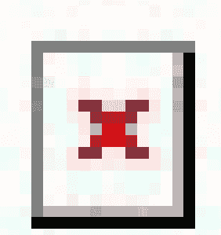

现在，看看你是否能只显示列表中的前五行文本。

```bash
$ env | sort | head -n 5
```


很好！`$ head` 命令以经典的 Unix 风格工作，作为一个简单、模块化的工具，只做一件事并且做得很好。请查看 `$ man` 页面以获取其他有用的选项。

#### `$ tail`

`$ tail` 命令类似于 `$ head`，但位于文本流的尾部。尝试用 `$ tail` 替代 `$ head` 运行前面的两个命令。你将在输出中看到的所有环境变量都以字母 X 开头。

通过在管道中组合使用 `$ tail` 和 `$ head`，我们可以过滤任意范围的文本。其中一个技巧是在 `$ tail` 命令的参数中，将 `+[#]` 与 `-n [选项]` 一起使用。例如，如果我们尝试 `$ env | sort | tail -n +1`，这会将整个列表视为“尾部”；因此，将显示整个列表。如果我们尝试 `$ env | sort | tail -n +2`，“尾部”将是 `$ env` 列表中除第一行之外的所有内容。如果我们想创建一个过滤器来显示，例如，仅 `$ env` 列表中的第二行，可以这样做：`$ env | sort | tail -n +2 | head -n 1`。要只显示第二和第三行，可以使用 `$ env | sort | tail -n +2 | head -n 2`（以此类推）。试试看！

## 修改 Bash 环境

当你浏览 `$ env` 命令返回的环境变量时，你是否注意到我们的变量 `a` 出现在列表中的任何地方？如果需要，可以再看一遍。你会看到它不在那里。

为什么是这样？难道 `a` 不是“环境”的一部分吗——就像我们能调用它并检索其值一样，仿佛它只是漂浮在附近的某处？确实如此！在所有实际用途中，`a` 就在我们当前的 shell 中（比喻地说）漂浮在附近！

要理解为什么 `a` 不在 `$ env` 返回的列表中，我们需要更深入地了解命令行上构成“环境”的内容。想想我们周围的物理环境，我们所谓的“环境”其范围可能因情境而异。我们可以根据 immediate surroundings 来描述我们的环境，也可以向外扩展，谈论更大规模的环境。

同样，shell 并不是一个单一的实体，而是一个多方面的领域，变量根据其定义方式具有不同的**作用域**。通过我们定义 `a` 的方式，即在当前 shell 中输入 `$ a=3`，我们将 `a` 定义为一个**shell 变量**。以这种方式创建的变量被称为“shell 变量”，因为它的意义（即作用域）是局部的（即有限的），仅限于最初定义它的 shell。这里有点复杂。所谓“局部”，我们并不仅仅指主目录，甚至不是指 Linux 文件系统中的任何特定位置。在这种框架下，我们需要纵向思考。一个“局部”shell 变量存在于一个可以想象为穹顶（一个 shell！）覆盖整个文件系统的东西内部。在这个 shell 中，我们的变量 `a` 才有意义，运行某些命令如 `$ bash` 会导致 shell 派生一个**子 shell**，就像俄罗斯套娃（或称俄罗斯嵌套娃娃）“派生”其内部子体一样。例如，如果我们在命令行上以另一个用户身份执行 `$ su`（正如我们之前讨论的——见第 86 页），这实际上会将我们带入原始**父 shell**之下的子 shell 中。现在，在这个子 shell 中，变量 `a` 将没有意义，因为作为 shell 变量，`a` 的作用域被限制在定义它的原始父 shell 内。

因为变量 `a` 被定义为**shell 变量**，当我们进入子 shell 时，它就失去了意义。

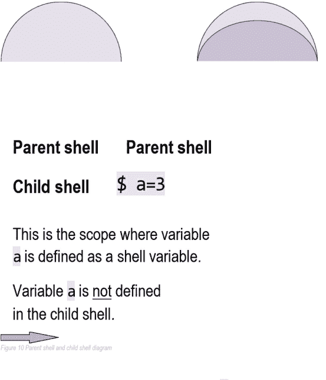

然而，如果我们*导出* `a` 作为**环境变量**，那么 `a` 将被我们从原始父 shell 派生出的任何子 shell**继承**。

如果我们*导出* `a` 作为环境变量，当我们进入子 shell 时，`a` 将保持其意义。


| 环境变量 | 环境变量 |
| :--- | :--- |
| **父 shell** | **父 shell** |
| **子 shell** | `$ export a=3` |

现在 `a` 将作为环境变量在子 shell 中定义。

作为环境变量，`a` 在此作用域中仍然被定义。


`$ env` 命令列出所有当前活动的环境变量；因此，`a`（作为 shell 变量）未包含在列表中。在下一节中，我们将创建另一个变量，并了解如何将其导出为环境变量。

> “环境”消歧

**问：** 所有这些关于“环境变量”的讨论带来了潜在的困惑来源：当我们使用术语“环境”来描述命令行时，我们是否包括了 shell 变量？

**答：** 在本指南中，我们经常以整体意义上使用术语“环境”，意指命令行“用户环境”。我们这样做是因为“处于环境中”的想法自然地作为命令行用户体验的隐喻。但当我们谈论“环境变量”时，Linux 中的“环境”具有更技术性的定义，特指所有当前活动环境变量中包含的信息。因此，在严格的技术意义上，“环境”不包括 shell 变量。尽管如此，如果需要，我们可以将 shell 变量*导出*到环境中。

### `$ export`

如果我们希望一个变量在局部 shell 之外仍然保持其意义，`export` 命令将帮助我们实现这一点。要将变量`导出`到环境中，我们只需将变量赋值放在 `export` 命令的参数中（或者如果变量已经定义，则将 `<变量>` 单独放在参数中）。让我们在命令行中用一个新变量 `A` 来尝试这个。

```bash
$ export A=my_first_environment_variable
```

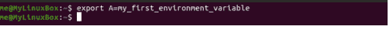

首先，我们将测试一下，以确保我们的新变量 `A` 在局部作用域中定义。

```bash
$ echo $A
```

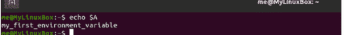

这很令人鼓舞。让我们也确认我们的 shell 仍然记得我们之前定义的变量 `a`。

```bash
$ echo $a
```


一切看起来都很好。现在，我们将尝试一些我们尚未在命令行上尝试过的事情。我们将使用 `$ bash` 命令进入子 shell。这样做，就好像我们在 Bash（父 shell）“之下”运行 Bash（子 shell）。虽然这可能看起来是一件晦涩的事情，但在 Linux 中，许多命令（例如 `$ su`）会自动发生这种情况。目前，我们这样做是为了演示从我们的局部 shell 进入子 shell 时，我们创建的两个变量如何表现。

```bash
$ bash
```

```text
me@MyLinuxBox:~$ bash
me@MyLinuxBox:~$ _
```

我们进去了。这很容易。但发生了什么？看起来好像什么都没变，对吧？然而，我们现在位于从父 shell 派生的子 shell 中。我们可以通过检查变量 `a` 是否随我们一起来证明我们在子 shell 中。

```bash
$ echo $a
```

```text
me@MyLinuxBox:~$ bash
me@MyLinuxBox:~$ echo $a
me@MyLinuxBox:~$ _
```

正如预期，我们的变量 `a` 在此子 shell 中是未知的。这是因为 `a` 在父 shell 中被定义为 [shell 变量](https://google.com)。换句话说，在这个子 shell 中，我们现在处于 `a` 的作用域之外。

那么我们的变量 `A` 呢？

```bash
$ echo $A
```

```text
me@MyLinuxBox:~$ bash
me@MyLinuxBox:~$ echo $a
me@MyLinuxBox:~$ echo $A
my_first_environment_variable
me@MyLinuxBox:~$ _
```

好了！这证实了 `$ export` 确实允许我们创建环境变量。

现在你可以输入 `$ exit` 或使用 `ctrl + d` 来离开子 shell 并返回父 shell。一旦回到父 shell，再次运行 `$ echo $a` 以确保父 shell 没有忘记我们的变量 `a`。你应该再次在输出中看到 `3`。

**总结：**

当我们使用 Linux 命令行时，有一套信息伴随着我们，构成了我们命令行用户体验的背景。Bash 将这些信息存储在多个变量中，根据这些变量的定义方式，它们要么只存在于我们当前的 shell 中，要么会扩展到从我们当前 shell 生成的子 shell 中。当一个变量的含义仅限于当前 shell 的范围时，我们称这种变量为“shell 变量”，而当一个变量从父 shell 传递给子 shell 或进程时，我们称该变量为“环境变量”。

作为一个术语，“环境”指的是存储在所有当前活动的环境变量中的信息主体。

### 命令

| `$ echo` | `$ tail` |
| :--- | :--- |
| `$ env` | `$ export` |
| `$ sort` | `$ bash` |
| `$ head` | `$ exit` |

### 概念

- Shell 环境
- Bash 中的变量
  - 整数
  - 字符串
- `$ su` 命令
- 环境变量
- Shell 变量
- 父 shell
- 变量扩展
- 作用域
- 子 shell
- 过滤命令

**挑战：** 构建一个命令管道，过滤 `$ env` 的输出，仅显示以字母 X 开头的前五个环境变量。有几种方法可以实现，但一种可能是使用 `#` 配合 `$ head`（而不是 `$ tail`）。如有必要，查看 `$ man` 页面！

### 你的新提示

随着我们对命令行中存在的变量形成完整的认识，我们现在将重点关注存储在**shell 变量**中的一些信息。正如我们在上一章所讨论的，shell 变量仅在其定义的 shell 中具有意义。我们将思考为什么某些类型的信息可能更倾向于这样做，并且在此过程中，我们将通过剖析决定 Bash 命令行提示符的 shell 变量字符串来获得一些乐趣。

#### `$ set`

当我们想要查看所有活动的 shell *和* 环境变量的完整列表时，我们调用 `set` 命令，以便全方位查看这些信息。它返回的列表很长，因此再次建议使用管道传输到 `less`。尝试下面的命令。

```bash
$ set | less
```

你会看到 `set` 自己进行了字母排序，并且你会认出一些我们之前讨论过的熟悉的环境变量。你还会看到一些不在 `env` 列表中的变量，例如 `HISTFILE`、`HOSTNAME` 和 `PS1`。因为 `set` 返回的一些变量包含大量数据，所以让我们用两个`[选项]`修改 `less` 的输出。

```bash
$ set | less -SN
```

`-S` [选项] 会截断所有多行条目的末尾，以便列表中的每个项目只占用一行，`-N` 告诉 `$ less` 显示行号。列表仍然会很长，但现在包含变量定义（shell 或环境变量）的行数应该在 87 行左右。列表其余部分中的行包含 `$ set` 返回的 shell 函数代码，我们现在可以忽略它们。

能够看到所有当前定义的变量很棒，但如果我们只想查看 [shell 变量]（而不是环境变量）怎么办？单独使用 `$ set` 命令无法做到这一点；但是，如果我们组合 `$ env` 和 `$ set` 命令的输出，那么我们可以 [过滤] 掉重复的环境变量，仅隔离出 shell 变量。

#### `$ uniq`

为了从文本流中删除相邻的重复行，只显示“唯一”的行，我们使用 `$ uniq` 过滤命令，它在这方面很有天赋。

在这里，我们将构建一个命令，首先将 `$ env` 和 `$ set` 的输出合并到一个合并列表中。然后，我们将列表通过一个包含 `$ uniq -u` 的过滤管道链，以删除重复的环境变量条目，仅留下 shell 变量列表（`-u` [选项] 用于过滤掉非唯一项）。请注意，使用 `$ sort` 后，重复的环境变量是相邻的。


```bash
$ echo "$(env)" "$(set)" | tail -n +1 | head -n 129 | sort | uniq -u | less -SN
```

从左到右，我们将 `$ env` 和 `$ set` 命令的输出连接在 `$ echo` 命令的参数中。然后 `$ echo` 将两个 `$ env` 和 `$ set` 的列表作为一个长列表打印到标准输出（然后通过管道传输到 `$ tail` 的标准输入）。

我们捕获 `$ env` 和 `$ set` 命令输出的方式是通过一种叫做**命令替换**的 shell 技术。通过调用 `$(<command>)` 形式，我们告诉 Bash 用 `$ <command>` 的输出替换（即替换）`$(<command>)`（就像我们在命令行调用 `$ <command>` 时得到的输出）。这让我们得到了两个命令的输出，它们连接在 `$ echo` 的参数中。

我们将 `$(env)` 和 `$(set)` 放在**双引号**中，因为我们想阻止 Bash 将 `$(env)` 和 `$(set)` 输出中的 `<换行符>` 字符转换为空格。这有效地保留了 `$ env` 和 `$ set` 输出的列表特性（正如在命令行调用这些命令时所看到的）。

管道传输到 `$ tail -n +1` 然后 `$ head -n 129` 会过滤掉列表中除了前 129 行之外的所有内容。`$ tail -n +1` 技巧（见第 90 页）用于在管道传输到 `$ head -n 129` 之前从 `$ echo` 的输出中获取整个列表（超过 2000 行）。`tail -n +1` 的这种用法在管道中提供了一个临时缓冲区，并防止了在管道传输大文本流时可能出现的问题。

你在 `$ less` 中看到的行号可能与这里显示的不完全匹配，但在第 18 行左右，你应该看到 `HISTFILE` shell 变量包含指向你的 `/home/<username>/.bash_history` 文件的路径（参考第 63 页）。

```text
17 HISTCONTROL=ignoreboth
18 HISTFILE=/home/me/.bash_history
19 HISTFILESIZE=2000
20 HISTSIZE=1000
21 HOSTNAME=MyLinuxBox
```

### Linux 中的 Shell 变量

为了更好地理解为什么 shell 变量更适合存储某些类型的信息，让我们考虑一下 Bash 如何使用 `HISTFILE` 变量。每当我们打开一个 shell，Bash 会分配一个特殊的内存块（RAM），用于存储我们在此会话期间输入的命令的运行日志。如果我们终止会话（例如，如果我们执行 `$ exit`），就在我们离开 shell 之前，Bash 会将我们在该会话中输入的命令附加到 `HISTFILE` 变量指定的文件中（对于普通用户，该文件是 `/home/<username>/.bash_history`）。

你可能已经注意到，如果你用命令行上的 ↑↓ 箭头浏览之前的命令，Bash 会记住当前会话的命令，此外还有你之前会话的所有内容（直到 `HISTSIZE` 变量中定义的限制）。Bash 能够随时调用你过去的命令，因为在每个 shell 会话开始时，Bash 会去 `$HISTFILE`（即 `/home/<username>/.bash_history`）并将命令历史记录列表预加载到为记录命令而保留的特殊 RAM 块中。然后，当你输入内容时，Bash 会继续将你的最新命令添加到日志（在 RAM 中），直到会话终止。

现在，让我们想象一下你正在一个多用户系统上工作，并且你机器上的某些东西需要系统管理员的注意。在某些情况下，这可能需要系统管理员接管你的机器，并执行 `$ su` 以在命令行上充当“替代用户”，从而进入一个子 shell。在这种情况下，当系统管理员来到你的机器并执行 `$ su` 时，由于 shell 变量 `HISTFILE` 的作用域仅限于当前 shell（不会导出到环境），你的 `$HISTFILE` 不会传递到系统管理员的子 shell 中。相反，当系统管理员执行 `$ su` 时，`HISTFILE` 将在管理员的子 shell 中重新定义为一个 shell 变量。在该作用域内（子 shell 中），`HISTFILE` 将包含系统管理员自己独特的 `.bash_history` 文件路径。将 `HISTFILE` 保留为 shell 变量，使其保持在各自定义的 shell 中，是确保你与系统管理员命令历史相互隔离的关键。

但试想一下，如果我们不是将 `HISTFILE` 存储为 shell 变量，而是通过 `$ export` 命令将其导出到环境。之后生成的任何子 shell 都将继承你的 `HISTFILE` 变量作为环境变量。这不是我们希望发生的情况。为什么呢？首先，系统管理员的子 shell 可能会将你的 `.bash_history` 文件加载到子 shell 的内存中，从而在管理员按 ↑↓ 翻阅历史命令时显示你的命令历史。此外，当管理员退出子 shell 时，管理员输入的命令最终可能被写入你的 `.bash_history` 文件。Linux 中有保护措施可以防止这类问题发生，但避免命令历史出现此类问题最万无一失的方法是简单地将 `HISTFILE` 存储为 shell 变量（默认情况下即如此）。显然，在单用户系统上这个问题不太需要担心，但如果你确实需要在多用户系统上工作，这是需要注意的一点。

## 基础 Linux 账户管理

谈到多用户系统，只需输入几个命令，我们就可以在 Linux 中添加用户账户。我们要试试吗？我们可以为自己创建另一个用户账户，然后练习使用 `$ su` 来获得一些作为另一个用户在命令行上操作的实际经验。这将有助于加深我们对父 shell/子 shell 关系的理解，并且我们将亲眼看到变量在这些不同上下文中的行为方式。

首先，要执行像创建新用户账户这样的提升状态操作，我们必须能够在命令行上临时获取 root 用户身份。

### `$ sudo`

当人们开始使用 `$ sudo` 命令时，这是他们 Linux 学习之旅的一个重大转折点。`$ sudo`（读作 "Sue-Do"）是 "superuser do"（超级用户执行）的缩写，它让我们这样的普通用户有机会体验拥有超能力的感觉——每次一条简短的命令。

成为“超级用户”伴随着重大责任。`$ sudo` 命令暂时允许我们执行专门保留给 root 用户的命令。这就是为什么我们在执行 `$ sudo` 之前应该仔细思考我们正在做什么。话虽如此，如果我们运用良好的判断力，我们应该没问题。

对于任何需要 root 状态才能运行的命令，我们只需将该命令放在 `$ sudo` 的参数中，按回车键，输入我们的账户密码，命令就会执行。这一切之所以可能，是因为正如我们在第一章中发现的，我们属于 `group27(sudo)`，这意味着 Ubuntu 将我们放在了 sudo 组中，拥有临时充当 root 的权限（参见第 40 页）。你可以通过运行带有 `-l` 选项的命令并在提示时输入账户密码来列出你的 `$ sudo` 权限。

```bash
$ sudo -l
```

在输出中，你应该看到以下内容：

> User <username> may run the following commands on <hostname>:

```text
(ALL : ALL) ALL
```

### `$ useradd`

在 Linux 中创建新的用户账户很简单，这要归功于 `$ useradd` 命令。我们将利用 `$ useradd` 为我们自己创建第二个用户账户。输入如下所示的命令，并选择一个 `<newusername>`（新用户名）。我们包含 `-m` 选项，是为了告诉 `$ useradd` 创建一个 `/home/<newusername>` 目录（新账户的主目录），并使用 `-s` 和 `/usr/bin/bash` 作为选项参数 [59] 来将 Bash 设置为新账户的默认 shell。

```bash
$ sudo useradd -m -s /usr/bin/bash <newusername>
```

> *在 19.04 之前的 Ubuntu 系统上，`$ bash` 可执行文件的位置可能是 `/bin/bash` 而不是 `/usr/bin/bash`*

当提示时，输入你的 `<username>` 账户密码（你登录时使用的密码）。

就是这样！现在你的系统上有了一个 `<newusername>` 账户。

```bash
$ passwd
```

你可以使用如下所示的 `$ passwd` 命令为你的 `<newusername>` 账户设置新密码 [60]。因为我们是在更改当前 `<username>` 账户之外的另一个账户的密码，我们需要使用 `$ sudo` 来获取提升的权限。

```bash
$ sudo passwd <newusername>
```

现在我们可以尝试使用 `$ su` 在账户之间来回切换。

```bash
$ su
```

使用 `$ su` 命令（substitute user 的缩写），我们可以直接在命令行上切换用户账户。在启用 root 的 Linux 系统上，单独输入 `$ su` 不带参数允许用户切换到 root，前提是他们输入了 root 密码。因为在 Ubuntu 中登录 root 账户是禁用的，幸运的是，我们不会使用 `$ su` 来“替代”为 root（因为这是危险的）。

相反，我们将使用 `$ su` 在我们当前的普通用户账户（`<username>`）和我们的另一个普通用户账户（`<newusername>`）之间来回切换。让我们试试吧！输入下面的命令，然后输入你的 `<newusername>` 密码。

```bash
$ su <newusername>
```

欢迎！如果你仍在 `/home/<username>` 目录中，你应该看到提示符变为 `<newusername>@<hostname>:/home/<username>`。由于你现在拥有不同的 `$HOME` 目录，你不再看到当前工作目录显示为 `~`。

快速的 `$ whoami` 确认你的（新）身份。

```bash
$ whoami
```

为了测试我们在上一章提到的一些环境变量行为，请尝试以下操作。

```bash
$ echo $USERNAME
```

如前所述，`USERNAME` 在我们执行 `$ su` 时保留了我们之前是谁（参见第 86 页）。

```bash
$ echo $USER
```

而 `USER` 存储了我们现在是谁（参见第 87 页）。

当我们在 `<newusername>` 状态下时，也检查一下 shell 变量 `HISTFILE`。

```bash
$ echo $HISTFILE
```

这是正常现象。`HISTFILE` shell 变量在我们打开一个新 shell 时由 Bash 初始化（包括每次我们通过 `$ su` 进入子 shell 时）。

让我们执行 `$ exit` 退出这个子 shell，回到我们作为 `<username>` 开始的父 shell。

### 父 shell 和子 shell 中的变量

我们现在将测试 `HISTFILE` shell 变量的行为，这在本章前面讨论过（参见第 96 页）。如果我们在当前 shell（我们作为 `<username>` 所在的 shell）中打印 `$HISTFILE`，我们将得到如下所示的结果。

#### `$ echo $HISTFILE`

这个 `/home/<username>/.bash_history` 路径是与我们的 `<username>` 账户关联的 `HISTFILE`——就像之前显示的 `/home/<newusername>/.bash_history` 路径是与我们的 `<newusername>` 账户关联的 `HISTFILE` 一样。因为每个账户的 `HISTFILE` 存储着独特的 `<pathname>/.bash_history` 文件路径，所以一切都井然有序。

现在，我们要尝试一些在“实际环境”中不推荐的操作。仅为了演示目的，我们将从我们的 `<username>` shell 将 `HISTFILE` 导出到环境（即我们将 `HISTFILE` 变为环境变量）。

然后，我们将再次以 `<newusername>` 身份通过 `$ su` 进入一个子 shell。在子 shell 中，我们将检查 `HISTFILE` 中存储的字符串，看看它是否与 `<newusername>` 关联的正确 `<pathname>`。

输入以下命令。由于 `HISTFILE` 已在当前 shell 中定义，我们可以输入 `$ export HISTFILE` 来将该变量导出到环境中，而无需在 `$ export` 命令的参数中赋值。

```bash
$ export HISTFILE
```


现在 `HISTFILE` 就是一个环境变量了。如果你愿意，可以用 `$ env | grep HISTFILE` 来确认这一点。

接下来，我们将再次执行 `$ su <newusername>` 进入一个子 shell。然后，在子 shell 中，我们将再次检查以查看 `<newusername>` 的 `HISTFILE` 存储信息。

```bash
$ su <newusername>
```

```bash
$ echo $HISTFILE
```

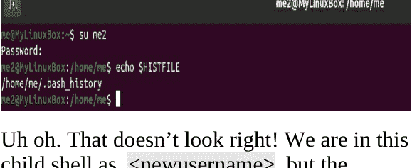

糟糕。看起来不对劲！我们现在是以 `<newusername>` 身份处于这个子 shell 中，但 `HISTFILE` 变量包含的是错误的文件路径（它包含的是属于 `<username>` 的文件路径）。当我们之前测试时（见第 101 页），情况并非如此。发生了什么？

之前，`HISTFILE` 是作为 shell 变量存储在父 shell 中的。当我们通过 `$ su` 进入子 shell 时，`HISTFILE` 被重新初始化——同样作为 shell 变量，但值不同。这使得每个 shell 实例中的 `HISTFILE` 对其定义所在的 shell 来说是独立的。

然而，这一次，`HISTFILE` 是从 `<username>` 父 shell 导出到环境中的，因此在 `<newusername>` 子 shell 中，它与其他父 shell 环境的部分一起被继承了。子 shell 会继承其父 shell 的环境变量值，除非在 shell 启动时的某个配置中定义了一个变量来覆盖继承。例如，在我们之前查看过的 `USER` 环境变量案例中（见第 101 页），我们确认当我们通过 `$ su` 进入子 shell 时，子 shell不会继承父 shell 的 `USER` 值。相反，当我们通过 `$ su` 进入子 shell 时，`USER` 会被重新配置以反映在子 shell 内部的用户账户。另一方面，正如我们所发现的，`USERNAME` 环境变量不会被重新配置，因此当我们通过 `$ su` 进入子 shell 时，我们会继承 `USERNAME`（`USERNAME` 保留了我们曾经是——即我们在父 shell 中登录时是谁——的记录）。

如果 `HISTFILE` 被导出到环境中，它的行为方式与 `USERNAME` 类似——也就是说，父 shell 的 `HISTFILE` 变成了子 shell 的 `HISTFILE`。当这不是我们想要的结果时（就像 `HISTFILE` 的情况），有很多方法可以防止这种事情发生，但一个可能的解决方案（除了避免不必要的 shell 变量 `$ export` 之外！）是使用 `$ su -`（如所示带有短横线参数）而不是不带短横线的 `$ su`。如果我们使用 `$ su - <newusername>` 来调用命令，这将导致 Bash 遗忘来自父 shell 的所有环境变量值，以便在我们进入子 shell 时可以重置它们。

使用 `$ su -` 重置所有环境变量在某些情况下可能有效，但在其他情况下可能会产生不受欢迎的副作用。通常，最好让 shell 变量策略来控制哪些内容从父 shell 传递到子 shell，哪些不传递。Bash 中的变量是临时性的，因此如果我们希望返回 shell 的初始变量设置，一个久经考验且可靠的方法是简单地使用 `$ exit`（或 `ctrl + d`）一路退出父 shell，然后打开一个新的 shell 会话。这样，我们的环境和 shell 变量肯定会重置为其启动配置。

### 修改 Bash 命令行提示符

我们忠实的伙伴——Bash 命令行提示符——在每一步都与我们同在。我们依靠它来指示我们在命令行上的状态，我们在 shell 中越活跃，提示符就变得越成为我们命令行工作区的关键部分。我们可以进行的最有用的 shell 定制之一就是修改提示符，以便以我们喜欢的方式显示信息。在这里，我们将研究控制 Bash 命令行提示符的 shell 变量，并了解重新定义此变量如何导致提示符显示信息的变化。

首先，让我们确保我们回到一个“全新的”shell 环境中，以我们熟悉的 `<username>` 身份。如果你还没有这样做，请使用 `$ exit` 一路退出所有活动的 shell，然后使用 `ctrl + alt + t` 开始一个新的 shell 会话。

完成上述操作后，让我们回到 `$ set` 命令，查看所有当前活动的 shell 和环境变量的列表（见第 95 页）。

```bash
$ set | less -SN
```

在第 56 行左右，你应该会看到一个名为 `PS1` 的变量。


天哪。那是什么？根据你的终端窗口大小，你可能无法看到此变量中包含的整个字符串。不过，没关系。


`PS1` shell 变量（代表“提示符字符串一”）包含了决定我们熟悉的 Bash 命令行提示符的信息。你感觉如何？也许觉得今天已经学够了？等等！`PS1` 变量乍一看可能令人生畏，但一旦你了解了这些符号代表什么，它就会开始变得清晰。

在我们理解 `PS1` 的过程中，首先让我们谈谈这个变量是如何定义的。与大多数 shell 变量一样，要使变量生效，需要在 shell 会话中的某个地方做出诸如 `$ <变量>=<值>` 这样的语句——可以直接在命令行上，也可以在 Bash 在会话开始时加载的某些配置文件中（在每个父 shell 或子 shell 中）。

定义 `PS1` 的配置文件恰好是我们已经查看过的文件。记得 `~/.bashrc` 文件吗（见第 72 页）？让我们再次在 `$ vim` 中打开此文件，并再次查看是否能找到 `PS1` 被定义为 shell 变量的位置。

```bash
$ vim ~/.bashrc
```

在 `$ vim` 中，你可以向下滚动，或者输入 `:/<pattern>`（见第 79 页）在文件文本中进行正向搜索（在这种情况下，`<pattern>` 将是 `PS1`）。按 `n` 键将使你从一个 `<pattern>` 实例跳转到下一个。这样做时，你会发现 `~/.bashrc` 中包含 `PS1` 变量的三行。找到如图所示定义 `PS1` 的行（见下一页）。

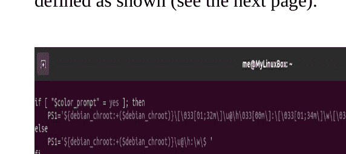

当 Bash 在新的 shell 启动时加载 `~/.bashrc` 文件时，`PS1` 在我们在上面看到的 `if` 语句[61]中被定义。现在，我们将只关注方框内所示的 `PS1` 部分。

在我们对 `PS1` 进行任何更改实验之前，让我们寻找一些线索，了解这个字符序列是如何转换为显示内容的。

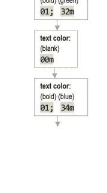

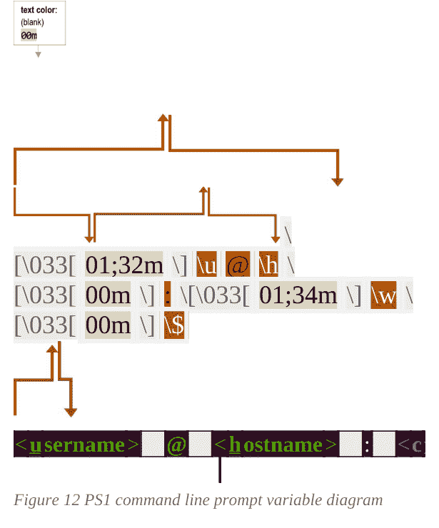

*图 12 `PS1` 命令行提示符变量图解*

在上图中，高亮显示的代码和字符<sup>[62]</sup>决定了我们在提示符中看到的内容。注意 `@`、`:` 和 ` `（提示符末尾的空格）是**字符串字面量**，这意味着当提示符在终端窗口中打印时，它们会原样显示。`\$` 看起来像是一个字符串字面量，但这实际上是一个**特殊字符**，当普通用户在命令行上时显示为 `$`，而如果用户以 root 身份登录，则显示为 `#`（代替 `\$`）。`\u`、`\h` 和 `\w` 也是特殊字符。当提示符渲染到屏幕上时，这些字符会被扩展为它们所代表的 shell 或环境变量信息。所有这些反斜杠转义（见第 56 页和附录 B）的特殊字符<u>仅</u>在 shell 提示符字符串（如 `PS1`）中有意义。在任何其他上下文中，它们被视为没有特殊意义的通用字符。如果我们重新定义 `PS1`——要么直接在命令行上输入 `$ PS1=<值>`，要么通过编辑 `~/.bashrc` 并在开始新的 shell 会话前保存文件，我们就可以用其他代码、特殊字符和字符串字面量来替换这些，从而修改我们的 shell 提示符。

保存对 `~/.bashrc` 文件中 `PS1` 的更改将使我们的定制从

在不同的 shell 会话之间切换时。我们当然想要尝试这个（很快！），但首先让我们通过直接在命令行上使用 `$ PS1=<value>` 方法来对提示符进行临时更改，以此来实验。这样我们就能在将更改正式写入 `~/.bashrc` 文件之前，先“试听”一下效果。

下面是 `PS1` 特殊字符的简要列表，以及它们在 shell 提示符中展开时显示的信息。

| 特殊字符（`PS1`） | 显示的信息（在 shell 提示符中展开） |
|---|---|
| `\u` | `<用户名>` |
| `\h` | `<主机名>` |
| `\w` | `<当前工作目录>` |
| `\W` | `<当前工作目录的基名>`（不含完整路径的 `<目录名>`） |
| `\t` | `<00:00:00>`（以 24 小时格式显示时间，精确到秒） |

| 代码 | 描述 |
|---|---|
| `\A` | `<00:00>`（以 24 小时格式显示时间，精确到分钟） |
| `\T` | `<00:00>`（以 12 小时格式显示时间，精确到分钟） |
| `\@` | `<00:00_上午/下午>`（以 12 小时格式显示时间，精确到分钟） |
| `\d` | `<星期_月_年>`（显示当前日期） |
| `\#` | `<#>`（显示当前 shell 中已输入的命令数量） |
| `\j` | `<#>`（显示当前 shell 中的活跃作业数量） |
| `\$` | `$`（普通用户）或 `#`（root 用户） |

以下是可在 `\[\033[<颜色代码>\]` 转义序列中使用的代码列表。这些颜色代码可以相互替换，以更改提示符中文本的颜色。

| 颜色代码 | 文本颜色（在 shell 提示符中显示） |
|---|---|
| `00m` | 空白/白色 |
| `30m` | 黑色 |
| `31m` | 红色 |
| `32m` | 绿色 |
| `33m` | 棕色 |
| `34m` | 蓝色 |
| `35m` | 紫色 |
| `36m` | 青色 |

还需注意，颜色代码可以加上 `01;` 前缀来指定**粗体**文本。下一页展示了一个如何定义 `PS1` shell 变量的示例，其中字符串文字以**粗体**绿色显示，后跟以普通空白/白色显示的特殊字符 `\$`。一如既往，字符串末尾包含一个字符串文字空格。

> **示例 `PS1` shell 变量定义：**
>
> `PS1='\[\033[01;32m\]MyCustomShellPrompt\[\033[00m\]\$ '`

#### 在终端窗口中显示的提示符：

```text
MyCustomShellPrompt$
```

因为目前我们将直接在命令行上定义 `PS1`，所以所做的任何更改都将是临时的。要恢复默认提示符，我们只需 `$ exit`（或 `ctrl + d`）并打开一个新的 shell 会话即可。

准备好尝试了吗？我们将从一些简单的内容开始。请在命令行上输入以下内容。

```bash
$ PS1='MyNewPrompt: '
```

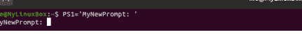

哇！这大不相同，对吧？试着输入几条命令，看看感觉如何。如果你留在当前 shell 中，你的新提示符将保持生效。

在 `PS1` 中实验特殊字符很有趣。尽情尝试吧！下面是将 `\@` 加入其中的一种可能效果。

注意，除 `\@` 之外的所有内容都是字符串文字。

```bash
$ PS1='MyNewPrompt @ \@ '
```

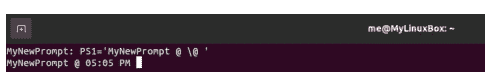

在下一章中，我们将讨论如何设置 `PS1` 的更改，使其在不同的 shell 会话之间持久保留。

### 总结

对于 Linux 的多用户环境，最好将某些信息存储在 shell 变量中，这样在命令行上切换账户时就不会影响其他用户的配置。如果我们想设置一个新的用户账户，在 Ubuntu 中可以使用 `$ sudo` 来执行这类需要提升权限的操作。当系统上有多个账户时，在命令行上直接切换用户账户的一种方式是通过 `$ su` 命令，它将我们从当前 shell（父 shell）带入子 shell。当我们使用 `$ su` 切换用户时，这一更改会反映在多个 shell 和环境变量中——最明显的就是更新后的命令行提示符。如果在任何时候我们想要自定义当前 shell 的 Bash 命令行提示符，我们可以使用格式化代码、特殊字符和字符串文字的组合来修改 `PS1` shell 变量。

### 命令

| 命令 | 命令 |
|---|---|
| `$ set` | `$ passwd` |
| `$ uniq` | `$ su` |
| `$ sudo` | `$ echo` |
| `$ useradd` | `$ export` |

### 概念

- Shell 变量与环境变量
- `HISTFILE` shell 变量
- 命令替换
- 父 shell/子 shell 关系
- 双引号
- Bash 命令行提示符
- Linux 系统管理（基础）
  - 临时 root 权限
  - 添加用户账户
  - 切换用户账户
- `PS1` shell 变量
  - 字符串文字
  - 特殊字符
  - 文本颜色代码

### 挑战

对标准 Bash 命令行提示符进行修改，使六个元素（即 `<用户名>`、`@`、`<主机名>`、`:`、`<当前工作目录>` 和 `$`）各自显示不同的颜色（注意我们将 `$` 视为一个整体元素）。然后，在 `<主机名>` 和 `:` 之间添加两个元素，使提示符显示为 `<用户名>@<主机名>@<时间>:<当前工作目录>$`。选择你喜欢的任何时间格式。这将使元素总数达到八个，恰好也是可用的文本颜色代码数量。尝试对提示符进行格式化，使八个元素各使用不同的颜色。

### 使设置持久保留

好消息是，shell 只需执行 `$ exit`（或 `ctrl + d`）并重新打开终端窗口就能轻松重置。这让我们放心，如果我们在命令行上做了不喜欢的更改，总可以重新启动 shell，设置就会恢复到之前的状态。

但当我们希望某项更改成为 shell 的“永久”特性时，我们会发现 Bash 并不像它想要遗忘某些东西时那样自动处理。这也很好，因为对 shell 进行永久性更改是件严肃的事情，不应该“太容易”。我们必须经过的额外步骤保证了：如果要做任何非临时性的修改，这些修改将是经过深思熟虑的。

那么，如何在 shell 中进行持久性更改呢？通常，要让 Bash 记住任何内容都需要对 **Bash 配置文件**进行一些调整。这涉及进入 `~/.bashrc` 或其他配置文件，进行编辑，然后将更改写入磁盘（即保存文件）。要使更改生效<sup>[64]</sup>，我们只需重新启动 shell，让 Bash 加载新的设置。这本质上就是我们在定义自定义别名 `$ lt` 时所做的，只不过在那种情况下，我们没有修改 `~/.bashrc`，而是创建了一个新的配置文件：`~/.bash_aliases`（见第 80 页）。

直接编辑 `~/.bashrc` 确实存在覆盖（即丢失）Bash 默认设置的风险，因此在全面修改 `~/.bashrc` 之前，我们需要先对文件进行备份。备份完成后，我们就可以继续重新设置我们的 shell 提示符。

## 在 Linux 中复制、移动和删除文件

对于某些用户来说，处理基本文件管理功能（如复制或移动文件）的命令是他们在 Linux 中最先学习的命令之一。这很合理，因为了解如何执行这些操作确实非常重要。

在本指南中，我们采取了不同的方法，倾向于先让自己在命令行上积累一些经验，然后再逐步进入 Linux 文件管理。尽管这些命令既简单又基础，它们确实需要我们保持高度的谨慎。Linux 不会给我们第二次机会——例如，如果我们不小心将文件复制或移动到一个恰好包含同名文件的目录中，同名的那个文件就会被删除。而且这里所说的删除，并不像 GNOME 桌面环境或其他基于 GUI 的操作系统中那样仅仅是移到“回收站”。在 Linux shell 中删除文件时，文件就真的没了，也就是说，是永久性<sup>[65]</sup>删除。我们将采取预防措施，确保这种事情不会意外发生。

### `$ cp`

作为对 `$ cp` 命令（“copy”的缩写）的介绍，我们将对 `~/.bashrc` 文件进行备份。我们希望在将来某个时候需要恢复 shell 的默认设置时，能够保留 `~/.bashrc` 的“原始”配置。

进入 `~` 目录，如果你愿意可以执行 `$ ll`（只是看看里面有什么），准备好后在命令行上输入以下内容。

```bash
$ cp -n .bashrc .bashrc.bak
```

再用 `$ ll` 检查一下，你会看到 `.bashrc` 有了一个新邻居：`.bashrc.bak`。试着用 `$ lt` 列出 `~` 目录（见第 80 页），`.bashrc.bak` 应该会出现在列表的顶部（或靠前的位置）。`.bak` 扩展名用于表示文件的“备份”，只是为了帮助我们跟踪文件（`.bak` 对 Linux 来说并没有什么特殊含义）。

`$ cp` 的语法遵循一个适用于 Linux 文件管理命令的一般模板：

`$ <command> [option(s)] <source> <target>`。

方便的是，`$ cp` 将我们熟悉的图形界面*复制*和*粘贴*操作合二为一，直接从 `<source>` 复制到 `<target>`。注意在上面的例子中，由于 `<source>` 和 `<target>` 都在当前工作目录中，所以不需要为它们指定路径。对于不在当前工作目录中的 `<source>` 或 `<target>`，则需要指定路径。如果我们使用 `$ cp` 操作一个文件作为 `<source>`，并且在 `<target>` 位置给出了目标目录的路径，而没有指定 `<filename>` 作为终点（见第 30 页），那么 `<source>` 文件的副本将被粘贴为目标目录中的 `<target>`。此外，`$ cp` 和 Linux 中的其他文件管理命令不仅可以对文件进行操作，还可以将目录^[66]作为 `<source>` 和 `<target>` 进行操作。

在上一页中，我们使用 `$ cp` 命令时加入了 `-n` 选项，它代表“noclobber”（不覆盖）。`-n` 选项在多个 Linux 命令中调用**noclobber**，通常表示“在放置 `<target>` 时不要覆盖已有的文件（或目录）”。这是一项安全措施，当 `$ cp` 处于可能“覆盖”某些内容的位置时，它会简单地什么都不做。也就是说，`$ cp -n` 会安静地保留已有的 `<target>` 不变。

`$ cp` 和其他文件管理命令的另一个重要安全选项是 `-i`（代表“interactive”，交互模式）。`-i` 强制执行额外的步骤，在覆盖发生之前，用户会收到一个**交互式提示**，要求输入 y 或 n 进行确认——`cp: overwrite '<target>'?`。

有了 noclobber 和 interactive 这两个选项，我们应该能够在使用 `$ cp` 和其他文件管理命令时保护自己免受意外删除的困扰。这里的主要障碍是，我们必须记住在执行 Linux 中的文件管理操作<sup>[67]</sup>时采取这些预防措施。我们希望在开始将这些命令应用于重要文件和目录之前，至少有一个选项能成为我们肌肉记忆中的永久习惯。

> ### 关于 Linux 中的文件管理命令
>
> Linux 世界中关于如何最好地处理这些文件管理操作存在一些争论。在某些阵营中，主流观点是用户应该为这些命令创建别名，使安全选项成为默认行为。例如，这种思路建议对于 `$ cp`，我们应该创建一个与基础命令同名的别名 `$ cp`，并将 `-i` 选项（或 `-n`）作为别名的一部分。他们认为，这样我们就永远不必担心意外删除某些东西。Linux 社区中的其他人，特别是来自 Ubuntu 系统管理阵营的人，认为使用这种别名方式会让我们过于依赖“非标准”配置，如果我们打算在各种环境中使用命令行（服务器、容器、虚拟机等），最好还是坚持使用基础命令，严格要求自己记住输入安全选项。他们认为，这样我们就能在不习惯的 shell 环境中执行命令时，主动防范令人不快的意外。

`$ mv` 命令（代表“move”，移动）与 `$ cp` 非常相似，不同之处在于 `<source>` 会被变成 `<target>`（不像 `$ cp` 那样 `<source>` 保持不变[^68]）。当 `$ mv` 操作对 `<source>` 执行时，从图形界面的角度来看，看到 `<source>` 突然从原来目录的列表中消失是很令人吃惊的。这种“消失”挑战了我们关于文件从一个地方拖到另一个地方时“在途中”如何保持存在的图形界面观念。使用命令行揭示了创建图形界面用户体验背后的抽象层次。

为了在命令行上练习移动文件，让我们 `$ cd` 进入 `~/Projects/MyScripts`，看看这个目录里有哪些文件。这里我们会找到几章前创建的三个文件。由于这些文件目前没有做特别重要的事情，我们将用 `$ mv` 移动它们来点小乐趣。

准备好后，按如下所示输入命令。

```bash
$ mv -n my_first_file ~/
```

现在，让我们执行 `$ ll` 来检查当前工作目录（`~/Projects/MyScripts`）中的文件。

你会看到 `my_first_file` 已经不在那里了。我们把它从当前工作目录移走了，并且（希望如此）移到了 `~` 中。如果你愿意，可以去确认文件已经到达 `~`。

既然我们正在移动的兴头上，让我们再试一次 `$ mv` 命令，但这次在 `<操作数>` 中使用 `* 通配符`（参考第 45 页）。当我们将 `*` 运算符直接紧跟在 `<模式>` 后面时（如 `<模式>*`），它会在 `<操作数>` 中展开为当前工作目录中所有以该 `<模式>` 开头的 `<文件名>`。

最好通过一个例子来说明。尝试输入以下命令，然后再执行 `$ ll` 来盘点当前工作目录。

```bash
$ mv -n my* ~/
```

在我们运行这个命令之前，由于目录中剩余的两个文件都以 `my <模式>` 开头，所以它们在执行过程中都被捕获并包含在了 `<操作数>` 中。实际上，我们在这里使用 `$ mv` 命令同时操作了<u>两个</u> `<source>` 文件。这非常方便！这演示了我们如何使用文件管理命令同时操作多个 `<source>` 文件。我们可以通过手动将每个 `<文件名>` 放在 `<source>` 位置来实现，也可以通过组合一个文件的**通配**[^71]——就像我们这里使用 `*` 作为通配符一样。

现在，我们需要检查我们这三个四处游走的文件是否已经到达了目标目录（`~`）。让我们回到 `~`，到那里后再执行一次 `$ ll`。你会看到我们的三个文件安全地坐在 `~` 的目录列表中。


是时候让这三个流浪的文件收拾行囊，回到`~/Projects/MyScripts`目录了。我们将像之前一样使用`*`运算符放在`$ mv`命令的`<source>`位置。

```
$ mv -n my* Projects/MyScripts
```

检查一下`~/Projects/MyScripts`目录，无需`$ cd`进入该目录。如果你不想输入目标目录的路径，`alt + .`快捷键在这里很方便（见第37页）！

```
$ ll Projects/MyScripts
```

好的。除了跨目录移动文件之外，`$ mv`在shell中还有另一个重要功能——在Linux文件系统中重命名项目。

在Linux shell中重命名文件（或目录）的标准方式是调用`$ mv`命令，将原始`<文件名>`作为`<source>`，新`<文件名>`作为`<target>`——全部在当前工作目录内完成。

让我们用`$ mv`给忠实的`my_first_file`起个新名字。进入`~/Projects/MyScripts`目录，然后尝试以下命令。

```
$ mv -n my_first_file my_very_first_file
```

执行`$ ll`显示`my_very_first_file`一切正常。作为练习，你可以执行

```
$ stat my_very_first_file
```

并将结果与我们在第59页介绍`$ stat`命令时得到的结果进行比较。

## `$ rm`

如果在 Linux 中有一个命令我们应当尽可能避免使用，那就是`$ rm`（代表"删除"）。我们所接触的所有文件管理命令都具有潜在的破坏性，但使用`$ cp`或`$ mv`时，即使我们在`*`操作符上犯了错误，至少不太可能让*每一个*`<源>`文件灾难性地覆盖`<目标>`文件。

然而，使用`$ rm`时，例如我们在`<操作数>`中使用`*`操作符来匹配文件且犯了某种错误，该命令将会毫无疑问地删除与`<模式>`匹配的*每一个*文件。当`<操作数>`中只有`*`时，这意味着删除当前工作目录中的*每一个*非隐藏文件（如果我们加上`-r [选项]`，则可能还包括每一个非隐藏目录）。

那将是多么不幸的事。所以如果我们确实使用`$ rm`，应当格外小心。`$ rm`的一个好用法是清空 GNOME 桌面环境的回收站。我们将演示如何对一个通过 GNOME 图形界面移入回收站的通用截屏文件进行此操作。如果你的 GNOME 桌面回收站里没有任何东西，你可以随意放入一些文件，或者如果你更愿意只是在这里跟随操作而不输入`$ rm`命令，那也是可以的。

首先，我们将`$ cd`进入`~/.local/share/Trash/files`目录并执行`$ ll`。注意，由于`Screenshot from 2021-02-18 10-05-16.png`包含空格，它需要用单引号括起来（更多信息请参见附录 B）。现在我们将用`$ rm`来"清空"回收站。

```
$ rm -i 'Screenshot from 2021-02-18 10-05-16.png'
```

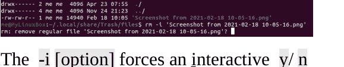

`-i [选项]`会强制弹出交互式`y/n`提示：

```
rm: remove regular file 'Screenshot from 2021-02-18 10-05-16.png'?
```

当我们输入`y`后，文件就消失了。`$ rm`没有`-n [选项]`（因为`$ rm`按定义就是"覆盖"`<操作数>`中的内容），所以重要的是我们要养成将`-i [选项]`与`$ rm`一起使用的习惯，就好像`$ rm`没有它就无法运行一样。在本指南的后续部分，我们将下载并安装一个名为`trash-cli`的实用工具包，它将使我们能够轻松地从命令行将文件移入`~/.local/share/Trash/files`目录。安装了`trash-cli`之后，你可能希望采用这样的策略：你唯一使用`$ rm`的场景就是清空回收站（如果有的话）。

## 你新的持久提示符

既然我们已经备份了`~/.bashrc`文件，就可以继续修改 Bash 命令行提示符了。让我们回到`~`目录并在`$ vim`中重新打开`.bashrc`。再次向下滚动到`.bashrc`中定义`PS1` shell 变量的那一行（参见第 103 页）。

```
me@MyLinuxBox: ~

if [ "$color_prompt" = yes ]; then
    PS1='${debian_chroot:+($debian_chroot)}\[\033[01;32m\]\u@\h\[\033[00m\]:\[\033[01;34m\]\w\[\033[00m\]\$ '
else
    PS1='${debian_chroot:+($debian_chroot)}\u@\h:\w\$ '
fi
```

要进行修改，我们首先需要复制上面高亮显示的那一行。我们将通过鼠标/触控板选中该行并按`ctrl + shift + c`复制到剪贴板（参见第 36 页）。

接下来，我们需要在该行前面添加一个`#`将其变为注释（如需回顾`$ vim`的基本编辑操作，请参见第 79 页）。通过添加`#`并"注释掉"该行，我们告诉 Bash 忽略其中的内容。这为我们提供了一层额外的备份便利，以防我们想快速恢复到原始的`PS1`定义。

```
me@MyLinuxBox: ~

if [ "$color_prompt" = yes ]; then
    # PS1='${debian_chroot:+($debian_chroot)}\[\033[01;32m\]\u@\h\[\033[00m\]:\[\033[01;34m\]\w\[\033[00m\]\$ '
else
    PS1='${debian_chroot:+($debian_chroot)}\u@\h:\w\$ '
fi
```

现在，我们将光标移到行尾并按`enter`（在`$ vim`的普通模式下，`$`会跳转到行尾）在注释下方插入一个空行，然后在注释正下方的新空行上，从剪贴板粘贴"原始"`PS1`变量定义。当光标就位于注释下方时，使用`ctrl + shift + v`进行粘贴。

你准备好开始对`PS1`进行一些修改并将更改保存到`.bashrc`了吗？在这一点上，我们将提出一个关于你*可能*想要如何修改`PS1`变量的建议。你可以将此方法作为修改的基础，或者如果你有其他想法，当然欢迎你自由发挥！

在下一页中，你将看到我们对`PS1`进行修改的三个片段。较小的片段（橙色框出）显示了第一个颜色代码从`32m`（绿色）更改为`33m`（棕色）的位置。这影响了`\u`特殊字符（`<用户名>`）的渲染。两个较长的片段（黄色框出）是我们插入的颜色代码（+转义序列）——`36m`（青色）用于字符串字面量`@`，`35m`（紫色）用于特殊字符`\h`（`<主机名>`）。


下面是修改后的`PS1`变量字符串部分，为了便于查看，颜色代码、特殊字符和字符串字面量都做了高亮处理（以免被转义序列分散注意力）。

```
\[\033[ **01;33m** \] \u \
\[\033[ **01;36m** \] @ \
\[\033[ **01;35m** \] \h \[\033[ **00m** \] : \
\[\033[ **01;34m** \] \w \
\[\033[ **00m** \] \$
```

请注意，在定义`PS1`时，整个字符串需要用单引号括起来，以捕获末尾的字符串字面量` `空格。此外，还有字符串的开头部分（上面未显示）也需要包含在内。新的（修改后的）`PS1`在`.bashrc`中出现的完整定义（不含`$ vim`的文本着色）如下所示。

```
PS1="\u@\h:\w\$ "
```

当你对`PS1`的修改感到满意时，让我们继续保存`.bashrc`并重启 shell，以便查看结果。在`$ vim`中，要保存工作并退出程序，首先按`esc`键，然后输入`:`，接着在`:`提示符后输入`wq`并按`enter`（参见第 79 页）。这将把你带回到 Bash 命令行提示符。现在，让我们`$ exit`（或`ctrl + d`）然后打开一个新的终端窗口。

然后我们就看到了新的提示符！


虽然只是改变了几种颜色，但不知怎的它感觉像是一个完全不同的 shell。回顾上一章的内容，`PS1`被定义为 shell 变量并非偶然。如果我们`$ su`切换到另一个用户（例如再次切换到`<新用户名>`），当前 shell 中定义的`PS1`将**不会**传递到子 shell 中。这种行为源于这样一个概念：父 shell 中的`PS1`自定义设置不一定在子 shell 中也需要；因此，最好将`PS1`的作用范围限制在定义它的 shell 内。

作为一个实验，你可以尝试再次以`<新用户名>`身份执行`$ su`，看看你的新提示符与原始 Bash 提示符相比如何。在存在多个用户账户的情况下，自定义提示符的实用性就真正显现出来了，因为它使你在命令行上切换账户时能更容易地直观识别"你是谁"。

## 总结

shell 从设计上来说是一个临时状态，为了做出任何持久的更改，我们需要修改 Bash 在启动时加载的配置文件。例如，通过编辑`~/.bashrc`，我们可以使 shell 的自定义设置从一个会话延续到下一个会话。配置文件是 shell 设置的存储位置，因此如果我们确实修改了像`~/.bashrc`这样的配置文件，应该先进行备份。在命令行上备份文件和目录最简单的方法之一是使用`$ cp`命令（代表复制）。`$ cp`命令连同`$ mv`和`$ rm`都是 Linux 文件管理命令家族的成员。当我们在命令行上执行文件管理操作时，存在覆盖自身文件和目录的风险，因此在调用这些命令时我们必须记住加上`-n`或`-i [选项]`以确保安全。

## 命令

- `$ cp`
- `$ ls`
- `$ mv`
- `$ cd`
- `$ rm`
- `$ vim`

## 概念

- Bash
- `ctrl + shift + c`
- 配置文件
- （在终端中复制）
- `~/.bashrc.bak` 备份
- `ctrl + shift + v` （在终端中粘贴）
- Linux 文件管理命令
- 通配符 `*` 文件名展开
- `-n [选项]`
- 在 Linux 中重命名文件和目录
- `-i [选项]`
- 清空 GNOME 桌面回收站
- `-r [选项]`
- （目录中）以 `#` 开头的注释——Bash 脚本
- `-a [选项]`
- （针对目录）
- `PS1` 作为 shell 变量

## 挑战：

Unix 将点文件（dot files）隐藏起来的惯例最初是为了防止重要文件和目录被意外删除而引入的。我们可以通过备份主目录中存在的所有点文件来为自己增加一些额外的删除保险。尝试在主目录下创建一个名为`.backups`的新目录（参见第 57 页）。然后构建一个单一命令，将主目录中看到的点文件复制到你的新`.backups`目录中。对于这个任务，我们只想复制点文件（而不是点目录），所以不要在这里使用`-r`或`-a [选项]`。根据你构建命令的方式，当你运行它时，你可能会收到来自 shell 的一条消息，说明它无法复制点目录。这条消息是正常的，但如果你不想看到这条消息，你可以使用`2>`重定向操作符将标准错误重定向到`/dev/null`（参见第 67 页）。与使用所有 Linux 文件管理命令一样，请通过使用`-n`或`-i [选项]`来保持谨慎。

# 从脚本到命令

我们现在正朝着最终目标迈进，即能够在 Linux 命令行上创建我们自己的自定义命令。

我们已经讨论了许多支持 Bash 自定义的框架，现在我们只需要再添加一些零散的部分，就能拥有构建我们自己可调用命令的完整工具箱。然后，当一切就绪，我们将把这些部分连接起来，看着我们的命令变为现实。

## Linux 中的命令由什么构成？

Linux shell 中的命令可以分为三类（参见第 33 页）：**内置命令**、**外部命令**和**脚本命令**^[72]（我们将可调用的 shell 脚本和 shell 函数统称为"脚本命令"）。在不同类型中，它们本质上都是在命令行按名称调用时执行的程序。有些命令存储为可执行文件（外部命令和可调用的 shell 脚本），而另一些则要么内置于 Bash 程序本身（内置命令），要么在启动时从配置文件加载（shell 函数）。

通过名称调用命令，我们实际上是在向计算机发出指令——就像在任何编程语言中一样。根据上下文，我们可能会指示计算机显示信息（`$ man`、`$ help`、`$ whoami`、`$ id`、`$ pwd`、`$ ls`、`$ stat`、`$ echo`、`$ cat`、`$ less`、`$ env`、`$ set` 等）、为信息腾出空间（`$ touch`、`$ mkdir` 等）、过滤信息（`$ wc`、`$ grep`、`$ sed`、`$ sort`、`$ head`、`$ tail`、`$ uniq` 等）、追加信息（`$ cat` 等）、定义信息（`$ export` 等）、移动/管理信息（`$ cp`、`$ mv`、`$ rm` 等），等等。

所有这些命令的共同点在于它们的名字编码了它们执行的动作。同样地，在 Linux shell 中*创建*一个命令涉及到为一个由一系列指令产生的动作分配一个名字^[73]。因为命令本身*就是*我们给计算机的指令，我们可以通过将现有的 shell 命令串联起来并为其组合操作分配一个名字来在 Bash 中*创建*一个自定义命令。然后我们可以（按名称）*调用*我们的自定义命令，并让它以与我们在 shell 中调用任何其他命令相同的方式执行其动作。这样的自定义命令被称为**脚本命令**，因为我们将指令（即构成的 shell 命令）放入一个人类可读的"脚本"中，然后让 Bash 在我们需要时"运行"该脚本。脚本命令可以以**shell 脚本**（存储在可执行文件中）或 **shell 函数**（在配置文件中定义，该文件在 shell 启动时加载）的形式出现。

我们已经在创建自己的别名时瞥见了自定义命令创建的端倪（参见第 80 页），但 Bash 中的别名在处理参数方面能力有限。随着我们构建自己的命令行解决方案取得进展，我们将看到在什么情况下别名是或不是正确的选择——这取决于具体的用例。

## 作为 Linux shell 中可执行文件的命令

为了开始将这些部分组合起来形成我们自己的命令，我们将首先仔细研究作为**可执行文件**运行的命令。

例如，考虑我们可能在 shell 中调用的任何外部命令。当我们输入一个外部命令（例如`$ ls`）时，我们输入的名称^[74]确实是 Linux 文件系统中某个位置的可执行文件的名称。通过输入外部命令并按回车，我们告诉 shell 启动那个名称的可执行文件——无论该文件在哪里（即`<pathname>/ls`）。但这引出了一个问题：文件*在哪里*？更重要的是，shell 如何知道文件的路径？

### `$ whereis`

为了回答上面的第一个问题，我们有方便的`$ whereis`实用程序，它将揭示我们放入参数的任何外部命令的可执行文件位置（假设该外部命令已安装）。让我们看看是否能找到调用`$ ls`命令时启动的可执行文件的位置。使用`$ whereis`，我们将使用`-b [选项]`（代表二进制）来仅显示`<pathname>/ls`信息（不包括额外的细节，如`$ man`手册页的位置）。

```
$ whereis -b ls
```

啊哈。`$ ls`命令的可执行程序文件位于`/usr/bin`目录中。我们何不去`/usr/bin`看看那里有什么？

我们可以`$ cd`进入`/usr/bin`然后执行`$ ll`，但这次让我们尝试一种稍有不同的方法。

作为实验，输入下面所示的**组合命令**并按`enter`。这演示了我们如何使用`;`操作符将多个命令串联为一个操作。

```
$ cd /usr/bin ; ll
```

按下`enter`后，你将被传送到`/usr/bin`，并且（非常长的）项目列表将出现在命令行提示符之前。

尝试在终端窗口中向上滚动或使用`shift + pg up`在列表中查找`ls`。

它就在那里——我们每次列出目录内容时调用的可执行程序文件（当然，当我们输入`$ ll`或任何其他`$ ls`的别名时，启动的也是同一个文件——参见第 122 页关于`$ ls`作为其自身别名的脚注）。注意`ls`的权限在三个可执行位置都显示`x`（参见第 53 页），该目录中大多数其他文件的权限也是如此。

既然我们在`/usr/bin`（"binaries"^[75]的缩写），让我们浏览一下列表，看看是否能找到其他熟悉的东西。如果你向上滚动到开头，你会看到`bash`可执行二进制文件*。这就是我们现在用作 shell 的程序！

> *在 19.04 之前的 Ubuntu 系统中，`$ bash`可执行文件的位置可能是`/bin/bash`而不是`/usr/bin/bash`

```
-rwxr-xr-x 1 root root  39256 Sep 5 2019  basename*
-rwxr-xr-x 1 root root 1183448 Jun 18 2020 bash*
-rwxr-xr-x 1 root root   6794 Jun 18 2020 bashbug*
```


在`/usr/bin`中，你会认出许多我们使用过的命令的可执行文件。你还会注意到某些命令，如`$ cd`、`$ set`和`$ export`不在列表中。这是因为这些命令是内置命令，这意味着它们仅作为 Bash 程序本身的一部分存在。尽管内置命令不是可执行文件，但仍然可以像 shell 中的任何其他外部命令一样调用`$ bash`。事实上，从 shell 会话中启动`/usr/bin/bash`可执行文件正是启动一个**子 shell**的定义（参见第 90 页）！这可以通过在命令行显式调用`$ bash`（参见第 93 页）来发生，或者在例如调用可执行 shell 脚本时发生的一系列步骤中“静默”（即自动）地发生。我们很快将研究 shell 脚本作为可执行文件时这个调用过程是如何工作的。

## 定位作为命令的可执行文件

回到我们之前的第二个问题，我们想知道当我们按名称调用可执行文件时，shell 如何找到它们。一般的答案是，我们必须告诉 shell 每次启动时去哪里查找可执行文件。一种方式是直接输入`$ <pathname>/<filename>`，这会引导 shell 沿着`<pathname>`进入正确的目标目录，在那里它可以找到并启动`<filename>`。另一种告知 shell 在何处查找可执行文件的方式，是将`<pathname>`存储在 PATH 环境变量中，然后当我们以`$ <filename>`作为命令进行调用时，让 shell 自动查找`<pathname>/<filename>`（这就是我们在 shell 中运行外部命令所依赖的机制）。在我们通过第一种方式（输入`$ <pathname>/<filename>`）积累了一些经验之后，我们将继续了解 PATH 变量如何帮助 shell 查找并启动按名称调用的可执行文件。

既然我们仍在`/usr/bin`目录中，让我们看看当我们尝试通过明确指出 shell 需要去*哪里*查找可执行文件来调用外部命令时会发生什么。通常当我们调用外部命令时，我们只需输入名称，让 shell 负责查找可执行文件，但这次我们将直接为指定路径让 shell 沿着该路径去找——即`$ <pathname>/<filename>`。

在`/usr/bin`目录中，输入如下命令并按回车。注意，到当前工作目录的相对路径是由`./`构成的（参见第 50 页）。

```
$ ./ls
```

除了输出文本的[76]颜色外，`$ ./ls`在`/usr/bin`目录中的执行效果与`$ ls`完全一样。通过输入`$ ./ls`，我们实际上是在告诉 shell："嘿，在`./`中查找一个名为`ls`的可执行文件，然后启动它。"现在，作为进一步的实验，让我们尝试用`$ cd ..`后退一步进入`/usr`目录，并再次执行`$ ./ls`。我们将像之前一样使用`;`运算符将两个命令合并为一个操作。

```
$ cd .. ; ./ls
```

我们得到了一个错误：`bash: ./ls: No such file or directory`。

正如错误信息所示，`/usr`目录中没有"ls"文件！这说明——如果我们试图启动一个可执行文件并指定了路径（即`$ <pathname>/<filename>`），除非路径正确指向我们想要启动的文件，否则什么都不会发生。从一般使用的角度来看，如果每次运行命令都需要在前面加上路径才能执行，那将是非常麻烦的。但拥有这个`<pathname>`要求在某些情况下反而是有利的。一个典型的用例是，当我们希望将某个可执行文件限制为只能在特定目录中运行时，比如该文件是一个安装程序。不过很显然，每次调用命令时不必输入可执行文件的路径会更好！

## 使用 PATH 变量将文件变成命令

由于 shell 在没有被告知可执行文件位置的情况下无法启动它，`$PATH`便来为 shell 提供帮助，为我们按名称调用可执行文件时补全所需的缺失信息。那么当我们仅按名称调用可执行文件时，缺失的信息是什么呢？在 shell 看来，缺失的信息就是可执行文件的路径。正是`$PATH`挺身而出，为 shell 提供了所需的信息（例如，在`$ ls`的情况下就是`/usr/bin`）。这填补了 Bash 环境中的一个关键部分，使我们能够调用命令而无需考虑它们的所在位置。

我们需要看一下`$PATH`来了解它是如何工作的。当你准备好了，用`$ cd`回到`~`目录，然后尝试以下操作。

```
$ echo $PATH
```


你会看到`$PATH`由若干路径组成。这里确切地说有九个。你还会看到每条路径之间用冒号 (:) 分隔——形成一个**冒号分隔列表**。PATH 变量的本质就是如此——一个路径列表。但这些路径指向什么呢？这些路径都指向可能存放可执行文件的目标目录。当我们仅按`name`调用外部命令时（即在可执行`file`前面`没有`加上路径），shell 会依次检查这些`$PATH`中的目标目录，直到找到与我们输入的命令名称匹配的可执行文件。然后，有了经过验证的可执行文件路径，shell 会沿着该路径启动文件——让文件中的程序执行——从而产生命令的输出结果。就是这样！

到目前为止，我们一直在以**外部命令**的角度讨论调用可执行文件的过程，但实际上当我们按名称调用可执行的 **shell 脚本**<sup>[77]</sup>（一种**脚本化命令**<sup>[78]</sup>类型）时，应用的是完全相同的过程。与外部命令一样，可调用的 shell 脚本也是 Linux 文件系统中的可执行文件。外部命令（如`$ ls`）和 shell 脚本之间的主要区别在于，外部命令从定义上来说是一个**编译后的二进制文件**（参见第 121 页的脚注），而可调用的 shell 脚本是一个包含一系列人类可读 shell 命令的可执行文件（原理上与将`$ cd <pathname> ; ll`串联为单个操作相同）。要能够按名称将 shell 脚本作为命令调用，我们只需将脚本放入一个可执行文件中，然后在调用时帮助 shell 找到该文件——就像我们在按名称调用外部命令时告诉 shell 在哪里查找可执行文件一样。这一切都有赖于`$PATH`的帮助，它为 shell 提供了查找可执行文件的位置列表。

让我们暂停片刻，盘点一下到目前为止我们关于 shell 脚本作为命令所收集的信息。我们知道可调用的 shell 脚本是可执行文件，我们也知道要将它们作为命令（按名称）调用，必须将这些可执行文件放在`$PATH`目标列表的可见范围内。现在问题来了

> 我们应该将可执行的 shell 脚本放在`$PATH`的哪个目标目录中，以便 shell 在我们按名称调用它们时能够找到这些文件？

考虑到这里讨论的是*我们自己*的自定义 shell 脚本，最佳实践是将它们放在 home 目录 (`~`) 内的某个目录中。但如果你查看`$PATH`，（目前）并没有列出诸如`/home/<username>/<directoryname>`这样的路径。这必须做出改变。我们需要在`~`内专门创建一个目录来存放我们自己的 shell 脚本，并且需要将这个目录添加（即追加或前置）到`PATH`变量中。也就是说，我们将获取该目录的绝对路径，并将其添加到`PATH`变量的路径列表中。所以，`PATH`变量中原本存储的九条路径，在完成之后将变成十条。

在 Unix/Linux 中有一个传统，就是将存放可执行文件（即程序）的目录命名为 "bin"（"binaries"的缩写）。如果你查看`$PATH`中列出的目标目录名称，"bin" 确实是一个常见的选择（"sbin" 代表 "system binaries"）。这是否意味着我们也应该效仿，将自己的可执行 shell 脚本目录命名为 "bin"——即`/home/<username>/bin`？

一如既往，欢迎你随心所欲，但确实，在本指南中我们建议将自制 shell 脚本的目录命名为 "bin"<sup>[79]</sup>。我们这样做部分出于传统，但选择 "bin" 还有另一个令人信服的理由。碰巧 Ubuntu 有一个特殊的默认配置，使得将我们自己的 "bin" 目录添加到 PATH 变量变得非常简单。

要了解我们在说什么，在 home 目录中，如果你执行`$ ll`，你会注意到有一个名为`.profile`的 shell 配置文件。让我们用`$ vim`打开`~/.profile`看看里面的内容（在`$ vim`中显示行号，输入`:set number`——参见第 79 页）。

```
19 # set PATH so it includes user's private bin if it exists
20 if [ -d "$HOME/bin" ] ; then
21     PATH="$HOME/bin:$PATH"
22 fi
```

这很有趣。第 19 行的注释告诉我们，这段 Bash 代码*如果*该目录存在，就会将"用户的私有 bin"目录添加到 PATH 变量中。也就是说，*如果*`/home/<username>/bin`存在，那么`PATH="$HOME/bin:$PATH"`。这很有用！这意味着只要*拥有*一个`~/bin`目录，该目录的路径就会在我们登录时自动添加到 PATH 参量中（参见`~/.profile`开头关于该文件"为登录 shell 执行"的注释）。

让我们详细分析一下，*如果*我们有一个`~/bin`目录，`~/.profile`中第 21 行究竟发生了什么。你会看到第 21 行是 PATH 的一个变量定义（参见第 84 页）。实际上它是一个*重新定义*<sup>[80]</sup>。右边的初始`$PATH`变量前被加上了`$HOME/bin:`，从而在左边创建了重新定义的 PATH 变量。在新的 PATH 变量定义中，`$HOME`和`$PATH`经历了**变量扩展**（参见第 86 页）并使用`/bin:`将它们粘合为一个**字符串字面量**（参见第 105 页）。


```
PATH="$HOME/bin:$PATH"
```

图 13 PATH 变量定义示意图

`~/.profile`中的代码就静静地待在那里，伺机检测`~/bin`目录并将`/home/<username>/bin`添加到`PATH`变量中。我们应该利用这一点，让它帮我们搭建一个放置 shell 脚本的目录。我们只需要创建一个`~/bin`目录，然后确保 shell 加载（即运行）`~/.profile`。

那么，让我们动手吧。在`~`目录下，输入以下命令。

```
$ mkdir bin
```


现在，我们可以注销并重新登录（参见第 #1 行的注释），在这个过程中，shell 会加载`~/.profile`并运行第 #20-22 行的代码，从而将`/home/<username>/bin`添加到 PATH 变量中。这正是我们希望每次登录 Ubuntu 时发生的事情——让`/home/<username>/bin`目录在 PATH 变量中的位置得以保持。

但在我们希望更改立即生效的情况下，我们可以采用另一种方法来启动配置文件，而无需注销甚至关闭并重新打开终端窗口（我们之前曾这样做过，以便在修改后让 shell 重新加载`~/.bashrc`）。

## 从配置文件（及其他文件）中 source

值得花点时间思考一下这些配置文件是如何配置 shell 的。如果我们查看`~/.profile`或`~/.bashrc`的内容，会发现其中包含**命令**、**变量定义**和**控制流逻辑**（如 *if...then* 语句）的组合——全部用 Bash 编写。这里我们使用"Bash"一词作为 shell 所理解的**编程语言**的名称。我们之前没有特别强调这一点，但 Bash 除了是我们 shell 的名称之外，本身也是一门强大的脚本语言。那么这些配置文件究竟是什么呢？它们就是脚本！

像`~/.profile`或`~/.bashrc`这样的文件包含用 Bash 编写的指令，供 Bash 执行以配置当前 shell。Bash 在启动时会按预设顺序自动加载并运行每个配置文件，但如果在任何时候我们决定*重新启动*某个文件以更改 shell 的配置（例如重新定义 PATH 变量），我们可以通过告诉 shell **source** 我们想要重新启动的文件中的代码来实现。这样，所有更改将立即生效。通过 source 代码来重新启动配置文件，比每次想要使持久性更改生效时都要退出并返回 shell 的繁琐操作方便得多。

### `$ source`

认识一下`$ source`<sup>[81]</sup>命令——一个非常有用的内置命令，用于执行包含在配置文件（以及其他"source"文件）中的 Bash 代码。要重新启动`~/.profile`以便将我们的`~/bin`目录添加到 PATH 变量中，在`~`目录下输入下面所示的命令。

```
$ source .profile
```


现在，如果我们再次打印`$PATH`，应该能在列表中看到指向我们`~/bin`目录的绝对路径。

```
$ echo $PATH
```

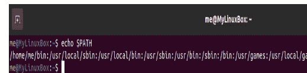

成功了！我们的`~/bin`目录现在已经正式列入 shell 在我们通过名称调用可执行文件时会查找的位置列表（最重要的是我们自己的可执行文件）。

关于如何使用`$ source`在 shell 中触发脚本执行，有几点需要注意。首先，你可能已经注意到`~/.profile`、`~/.bashrc`以及其他 shell 配置文件都没有可执行权限（参见第 54 页）。然而，我们却能用`$ source`"执行"这些文件中的脚本。这是因为可执行权限并不一定决定我们*能否*执行文件中包含的脚本，而是决定我们*如何*执行该脚本。

当我们从文件（如`~/.profile`）中`$ source`一个脚本与我们"调用"一个包含 shell 脚本的可执行文件时，所发生的事情之间存在一个细微但重要的区别。当我们`$ source`一个脚本时，这意味着我们在当前 shell 中执行该脚本。这就是为什么我们可以使用`$ source`来*重新配置 shell*——代码执行发生在当前 shell 中，而<u>不是</u>子 shell。另一方面，当我们调用一个包含 shell 脚本的<u>可执</u>行文件时，当前 shell 不会执行该脚本，而是自动生成一个<u>子 shell</u>（参见第 93 页），在其中由一个独立的`$ bash`实例来执行该脚本。这意味着我们<u>不能</u>通过调用可执行 shell 脚本来重新配置当前 shell。然而，我们可以用可调用的 shell 脚本来做其他事情，我们很快就会了解到！

### 从不可执行文件中 source

### 以可执行方式调用`$ <filename>`

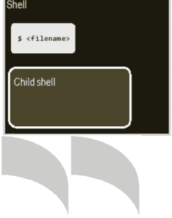

```
Shell
$ source <filename>
```

<filename>

<filename>

图 14 脚本启动方式对比图

## 可执行 shell 脚本中有什么？

我们离拥有在命令行上将自己的 shell 脚本作为命令调用所需的支撑结构已经非常近了。我们现在只需要弄清楚准备可执行文件来存放脚本的细节，以便它们能正确启动。

首先，我们需要创建一个文件来存放我们的第一个 shell 脚本。有几种方法可以做到这一点，但为了简单起见，让我们请出老朋友`touch`来为我们创建一个空白文件。我们先`cd`进入`~/bin`目录。进入`~/bin`后，输入下面所示的命令。我们将第一个 shell 脚本命名为"bak"。你或许能推断出这个名字的用意，但选择这个名字的一个原因是，如果你尝试调用`bak`，你会发现没有同名的现有命令（在推荐安装的软件包列表[82]中也没有）。

```
$ touch bak
```

接着执行`ll`，我们可以查看分配给新`bak`文件的权限。

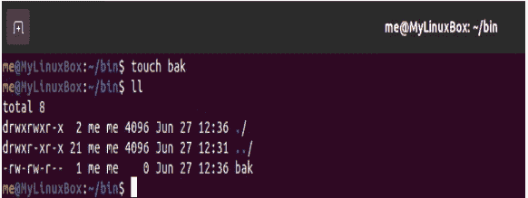

如`~/bin/bak`的`-rw-rw-r--`权限所示（参见第 54 页），当我们像这样创建新文件时，它最初没有可执行权限。但我们需要开启文件的可执行权限，以便将`$ bak`作为命令启动[^83]。让我们看看可以怎么做。

### `$ chmod`

`$ chmod`命令（"change mode"的缩写）是我们在 Linux shell 中更改文件权限的一站式全能工具。如果我们拥有某个文件，那么我们就有权使用`$ chmod`随意更改其权限。这里我们将使用`$ chmod`配合`+x`[选项]来使我们的新文件可执行。尝试下面的命令，然后执行`$ ll`查看结果。

```
$ chmod +x bak
```


注意，我们的 `bak` 文件现在变成了绿色并带有一个星号——就像我们在本章前面在 `/usr/bin` 目录中看到的可执行文件一样（参见第 121 页）。同时，正如我们所期望的，`bak` 现在在所有可执行权限位置都显示了 `x`（参见第 54 页）。

对于我们在单用户系统上的用途，唯一重要的 `x` 是所有者权限位置（从左数第 4 位）上的那个。然而，在多用户系统中，`-rwxrwxr-x` 权限意味着任何登录后能够访问我们 `/home/<username>/bin` 目录的人都可以启动 `$ ./bak`。

这可能没什么好担心的，但如果我们只想将 `~/bin/bak` 的读取和执行权限设置为我们主组中的用户，并排除所有其他用户（root 用户除外——参见第 40 页），那么我们可以在 `~/bin` 目录内输入命令 `chmod u=rwx,g=rx,o= bak`。此时 `~/bin/bak` 的权限将变为 `-rwxr-x---`。查看 `man chmod` 以全面了解该命令在管理文件和目录权限方面的功能。

现在，我们准备开始编写将放入我们的 `bak` shell 脚本中的指令（即代码）。首先，让我们在 `vim` 中打开 `~/bin/bak`。由于目前这是一个空文件，你会看到 `vim` 在原本应该有文本行的地方显示波浪号。这只是 `vim` 的一个惯例，表示这些行中没有任何内容（你可以忽略这些波浪号）。

从脚本最顶部开始，按下 `i` 键进入 `vim` 的插入模式后（参见第 79 页），输入以下两行*，中间用空行隔开（空行仅为提高可读性）：

```bash
#!/usr/bin/bash

echo 'Calling $ bak <filename> will create a backup of <filename> in the cwd.'
```

> *在 19.04 之前的 Ubuntu 系统上，`bash` 可执行文件的位置可能是 `/bin/bash` 而非 `/usr/bin/bash`。

输入完成后，你的脚本应如下图所示显示在 `vim` 中。


进展顺利！现在让我们用 `write`（即保存）命令将 `~/bin/bak` 文件写入磁盘，然后退出 `vim` 返回 Bash 命令行。

那么，我们刚才做了什么？我们创建了第一个可执行的 shell 脚本！你可能好奇 `#!/usr/bin/bash` 这一行的作用。`#!` 字符组合<sup>[84]</sup>被称为 **shebang**（释伴）。

当我们运行 `bak` 命令时，包含 `#!` 的那一行（即“shebang 行”）会向内核发出指令，启动 `/usr/bin/bash`，以便为 `~/bin/bak` 的运行创建一个子 shell。请继续阅读下文，了解启动序列的技术描述（如果你更想直接运行 `bak`，请翻到下一页！）。

> 要启动一个可执行程序（无论是 shell 脚本还是外部命令），Bash 会创建一个**子进程**，让该程序在自己的环境中运行。Bash 为可执行程序设置子进程的方式如下。
>
> 首先，为了创建子进程，Bash 会在 RAM 中复制自身。Bash 在 RAM 中复制自身的操作在 Unix/Linux 中称为 **fork**（分叉）。然后，Bash 请求内核决定如何执行程序（即我们要启动的 shell 脚本或外部命令），以替代新创建的 fork。也就是说，内核现在用子进程替换了 RAM 中 fork 出的 Bash 副本。
>
> 如果要执行的程序是外部命令，那么内核会用外部命令的编译后的二进制代码替换 fork，作为子进程。外部命令的二进制代码随后直接在 CPU 上运行，输出发送到标准输出。完成后，外部命令的进程终止。
>
> 如果程序是像我们的 `~/bin/bak` 文件这样的 shell 脚本，那么内核会查看脚本的 **shebang 行**，获取运行脚本中代码所需的**解释器**<sup>[85]</sup>路径（在我们的例子中是 `/usr/bin/bash`）。
>
> 对于我们的脚本，内核会用一个新的、独立的 `/usr/bin/bash` 实例替换 RAM 中 fork 出的 Bash 副本，作为运行（即“解释”）脚本的**子进程**。这形成了一个**非交互式**<sup>[86]</sup>的**子 shell**，脚本在其中运行并将输出发送到标准输出。
>
> 当脚本完成时，子 shell 进程终止，用户（从未离开调用 shell 的环境）会看到脚本的输出显示在标准输出中。

我们准备好在命令行上尝试调用我们的 `~/bin/bak` shell 脚本了。让我们用 `cd` 命令进入主目录，以演示我们不需要位于 `~/bin` 目录内就能进行此调用。一切就绪后，输入以下内容。

```bash
$ bak
```


太棒了！你现在有了一个可调用的 shell 脚本可供使用。当然，目前这个脚本除了向标准输出打印一条消息外还没做其他事情。尽管如此，这表明调用 `bak` 按预期运行。

有几种方法可以检查 `bak` 作为一个可调用命令的状态。

### `type`

`type` 工具类似于 `whereis`（我们之前在本章尝试过——见第 120 页），但除了关于可执行文件位置的信息外，`type` 还能返回其他信息——例如命令是否是内置的。让我们看看 `type` 对我们 `bak` 脚本的说明。

```bash
$ type bak
```


与 `whereis` 类似，`type` 返回与 `bak` 相关的可执行文件的路径。如果你尝试 `type -t bak`，你会看到 `type` 将 `~/bin/bak` 识别为“文件”（即不是内置命令）。

### `file`

然后是 `file` 工具，用于显示详细的文件类型信息。当我们在参数中提供 `~/bin/bak` 时，就能获得完整信息。

```bash
$ file ~/bin/bak
```


## 总结

在 Linux 的三大类命令（内置、外部和脚本）中，脚本命令类别包括以已有 shell 命令作为指令编程的命令。要创建这样的自定义脚本命令，我们将 shell 命令串联起来，将它们的组合作为一个操作执行。

通过为该操作命名，我们可以像调用 Linux 命令行上的任何其他命令一样“调用”我们的脚本命令。可调用的 shell 脚本是脚本命令的一种类型，它们以文件形式存储在 Linux 文件系统中。

要使 shell 脚本文件“可调用”，我们需要为该文件开启可执行权限。这通过 `chmod` 命令完成。此外，在可调用 shell 脚本的开头，需要有一个 `#!`（shebang），后跟所选命令解释器的路径，以运行脚本中的指令。

一旦这些都设置好，并且我们将 shell 脚本的可执行文件放置在 `PATH` 列出的目标目录中，我们就可以在命令行上按名称调用该文件，脚本中的指令将作为命令执行。

### 命令

- `whereis` & `chmod`
- `source` & `type`
- `vim` & `file`

### 概念

- 脚本命令
- 可调用 shell 脚本
- Shell 函数
- Bash 作为脚本语言
  - 从配置脚本中源引
  - 代码在当前 shell 中运行
- 可执行文件
- 调用可执行 shell 脚本
- 使用 `;` 运算符分组命令
  - 代码在子 shell 中运行
- 启动 `./<filename>`
- 使用 `chmod` 设置文件权限
- `PATH` 环境变量
- `#!`（shebang）
- 以 `:` 分隔的列表
- Bash 作为命令解释器
- 通过 `~/.profile` 添加 PATH 变量
- 非交互式 shell
- `~/bin` 目录
- 检查命令位置和状态

### 挑战

在命令行操作一段时间后，我们开始注意到一些日常使用模式其实应该简化为一个步骤。其中一个模式出现在 `cd` 命令上：每次我们使用 `cd` 访问一个目录后，我们总是立即输入 `ll`（或 `ls` 的其他变体）来查看目录内容。

如果我们总是连续输入这两个命令（`cd` 然后 `ll`），它们难道不能合并为一个操作吗？是的，可以。创建一个名为 `cdll` 的别名，它将在一个操作中 `cd` 到主目录并自动执行 `ll`（或变体）。使用 `;` 运算符将两个命令顺序组合。

作为练习，尝试创建一个（使用不同名称的）可调用 shell 脚本来执行相同操作。剧透一下：它可能无法完全工作。不过，请尝试一下，看看会发生什么。你认为它为什么会这样表现？提示：子 shell。

## 从函数到命令

我们追求自定义命令的下一步是探索**shell 函数**，这是 Linux shell 中使用的另一种**脚本命令**。

在许多层面上，shell 函数（又称“函数”）类似于 shell 脚本。最直接的相似之处是它们都是用 Bash（脚本语言）编写的，这意味着它们都是用我们在 Bash 命令行上使用的命令编码的。

就像 shell 脚本依赖 Bash（shell 程序）来解释和执行代码一样，函数也通过逐行将其代码提供给 Bash 来工作，就像这些行正在被输入一样。这就是为什么我们说 shell 脚本和函数都是“脚本化”的——因为 Bash 从上到下读取它们的代码指令，导航程序的逻辑流程并依次执行每个操作，直到操作完成。

对于可调用的 shell 脚本，我们可以通过按名称调用操作来告诉 Bash 执行该操作，shell 函数也是如此，因为它们也是在被按名称调用时运行。那么，这两种脚本命令基本上是相同的吗？

尽管有相似之处，可调用 shell 脚本和函数在 Linux 中实际上在独立的区域运行。两者之间的主要区别在于 Bash 处理执行其代码的方式。

正如我们在上一章（见第 128 页）所发现的，当我们启动一个可执行（即可调用的）shell 脚本时，脚本不会在调用它的 shell 中执行。相反，可执行 shell 脚本在一个非交互式子 shell（见第 130 页）中运行。然后，当脚本操作完成时，子 shell 终止。

将其与我们调用函数时<sup>[87]</sup>发生的情况进行对比。函数不是在子 shell 中运行，而是在**当前 shell**（即调用它的那个 shell）中运行。当函数完成操作后，函数的代码会留在当前 shell 的内存中，伴随会话持续存在。

这种执行环境的差异会影响命令的行为，我们在比较这两种类型的命令在不同上下文中的运行方式时会留意这一点。

可调用 shell 脚本和函数的另一个主要区别在于它们的加载和存储方式。每当我们在命令行上调用一个可执行 shell 脚本时，我们实际上是在启动一个文件。因此，shell 脚本的可执行文件的名称就决定了我们调用的命令的名称。

而函数则不需要保存在可执行文件中。函数的代码通常存放在像 `~/.bashrc` 这样的配置文件中，当该文件中的代码在 shell 启动时被加载（和/或通过 `source` 引入）时，函数就会在该 shell 会话中被定义，并存储在 shell 的内存中——无限期地保留。

从这个意义上说，函数与变量并无本质区别。例如，我们在定义函数时给它分配一个名称，然后在该 shell 会话中每次调用该函数名称时，它就会返回一个结果。

区别自然在于，调用 `$<variable>`（例如，`echo` 之后）返回的是变量存储的值，而将函数作为命令调用则会使 shell 执行函数的代码——产生命令的输出。

| | **可调用 Shell 脚本** | **Shell 函数** |
|---|---|---|
| **存储** | 保存在可执行文件中。 | 保存在配置文件中<sup>[88]</sup>。 |
| **名称（作为命令）** | 可执行文件的名称就是我们作为命令调用的名称。 | 定义中分配的名称就是我们作为命令调用的名称。 |
| **启动（作为命令）** | 每次调用命令时，其可执行文件被启动，内核设置一个独立的执行环境来运行代码。 | 首先，代码被加载到 shell 的内存中。然后当我们调用命令时，shell 执行内存中保存的函数代码。 |
| **执行环境** | 在非交互式子 shell 中运行，并输出到 stdout。 | 在当前 shell 中运行，并输出到 stdout。 |

随着我们了解 shell 脚本和 shell 函数在运行中的表现，我们将培养出在特定任务中选用其中一种还是另一种的感觉。

### 定义 shell 函数

我们将从直接在命令行上定义一个 shell 函数开始，然后进阶到让函数持久保存在配置文件中。

定义 shell 函数的通用语法<sup>[89]</sup>如下所示。

```bash
$ <function> () { }
```

对于我们的第一个 shell 函数，我们将按照如下方式输入定义。

```bash
$ howdy () { echo 'Hey there!'; echo 'I am a function!'; }
```

关于语法有几点需要注意：注意外层的 `{` 和 `}` 内侧各有一个空格？当我们像这样在一行中定义函数时，这些空格是必需的。

另外，在单行函数定义中，我们需要在最后一个命令指令之后放置一个单独的 `;`（或 `&`<sup>[90]</sup>）。下面是一张示意图，标出了语法中必需的空格位置以及为提高可读性而添加的空格位置。

按下回车键后，在命令行上调用 `howdy` 就会使 shell 执行函数的代码。

```bash
$ howdy
```

很好！

我们可以使用 `type` 来检查我们的新函数。

```bash
$ type howdy
```

在 `type` 命令的输出中，我们看到函数定义以不同的格式显示。空格不再将 `{ }` 与代码指令分开，而是使用**换行分隔**，每个花括号各占一行。

由于这种换行格式通常更容易阅读，它通常是配置文件中定义函数时的首选格式。我们要不要用这种换行格式将函数定义添加到 `~/.bashrc` 中？

在将函数定义添加到 `~/.bashrc` 之前，我们先调用 `unset` 内置命令从 shell 的内存中移除当前定义的函数。这样当我们执行 `source ~/.bashrc` 将重新格式化的函数定义加载到内存时，可以有一个干净的起点。

```bash
$ unset howdy
```

现在当你输入 `howdy` 时，应该会收到 `howdy: command not found` 错误。

好的。在主目录中，用 `vim` 打开 `.bashrc`（在 `vim` 中输入 `:set number` 可以查看行号——参见第 79 页）。向下滚动到文件末尾（大约第 120 行附近），输入如下所示的函数定义。

你会发现当按下 `{` 之后的 `enter` 时，`vim` 会在你开始输入函数的代码指令之前自动缩进光标。此缩进仅为提高可读性而添加，空格数量是任意的。

另外，请注意当代码行以换行方式分隔时（如这里所示），你不需要在代码行后添加分号。当到达第二行代码指令的末尾（第二个 `echo` 命令的末尾）时，按 `enter`，输入 `}`，`vim` 应该会自动停止缩进。然后将更改写入磁盘并退出 `vim`。

现在，回到命令行，我们需要对 `~/.bashrc` 执行 `source` 才能使新添加的函数生效。

这里我们将首次体验 `.` 命令，俗称“点命令”。点命令和 `source` 是**同义词**。也就是说，`.` 和 `source` 的行为之间没有区别。

因为 `.` 比 `source` 更容易输入，你可能会发现自己从现在起更常使用 `.`，但两种方式都可以。在主目录中，输入以下内容。

```bash
$ . .bashrc
```

现在如果你再次调用 `howdy`，应该会看到与之前相同的输出。

### 位置参数

我们准备学习 Bash 提供的一些工具，用于捕获我们在脚本化命令的参数中输入的内容。我们首先在 shell 函数的上下文中介绍这些内容，但同样的框架<sup>[91]</sup>也适用于可执行 shell 脚本。

我们来简要谈谈命令参数。考虑像 `cd` 这样的命令。我们知道当调用 `cd` 时，参数中的内容将完全决定命令的执行结果或输出。

我们可能会在 `cd` 的参数中放入一个 `<路径名>`，或者不放任何内容，甚至放入无效内容（这会返回错误），但无论我们怎么做都会引发命令的响应。

一般来说，这就是命令的用途所在——根据给定输入产生操作或输出的能力。那么，如果我们向 shell 函数发送一个参数会发生什么？让我们来一探究竟。试试下面的操作。

```bash
$ howdy Ken
```

我们的函数似乎不知道也不关心我们在它的参数中放了文本！它似乎也没有意识到它在响应一个错误的名字（函数的名字是 `howdy`——不是 `Ken`）！

我们在这里认识到的是，除非我们告诉脚本化命令如何对参数做出反应，否则命令会盲目地继续运行，就好像参数不存在或无关紧要一样。但参数**确实**很重要（如果我们希望命令能够响应输入的话）！

为了提高函数对自身身份以及我们传入内容的感知，我们要回到 `~/.bashrc` 进行一些小的修改。再次用 `vim` 打开 `~/.bashrc`，向下滚动到我们的函数定义处，并按如下所示进行添加。

我们在此添加了 `$FUNCNAME` 和 `$1`，并且用**双引号**将整个第一个字符串括了起来。让我们来讨论这些更改对命令输出产生的效果。

→ `$FUNCNAME` 展开为我们要调用的函数的名称（当函数代码执行时，shell 会将函数名存储在 `FUNCNAME` 变量中<sup>[92]</sup>）。

→ `$1` 是一个**位置参数**。我们可以将位置参数视为一个特殊变量，其名称指的是命令参数中某块文本的位置。这个 `$1` 捕获了我们放入命令参数中的第一块文本（因此是 1）。

如果在命令参数中提供了两块文本（由空格分隔），那么 `$1` 捕获第一块，`$2` 捕获第二块，依此类推。位置参数的名义范围是 `$0` 到 `$9`（`$0` 展开为调用命令的名称<sup>[93]</sup>）。

如果需要在参数中捕获超过九个位置参数，则可以使用 `${#}` 形式（例如，`${10}`、`${11}` 等）。


添加双引号是为了让 `$FUNCNAME` 和 `$1` 能够展开为其值，而不是被视为字面文本。当字符串[94]使用单引号时，字符串中的所有文本[95]都被视为字面量——即没有任何字符具有特殊含义。因此，我们在这里使用双引号。

在`$ vim`中完成函数定义更新后，请继续执行写入和退出操作。同时，别忘了输入`$ . .bashrc`来使代码更改生效。准备就绪后，让我们再次尝试此命令，看看返回什么。

```bash
$ howdy Ken
```

不错！这里我们可以看到`Ken`是作为`$1`位置参数值返回的文本。但如果我们向参数中放入不止一块文本呢？让我们试试看会发生什么。

```bash
$ howdy Ken Thompson
```

这有效，但如果参数中有多个项目（即多块文本），我们仍然需要一种方式来接收全部输入。我们可以在字符串中添加更多位置参数，形式为`"Hey there! My name is $FUNCNAME. Not $1 $2."`。但有一个更好的方法，可以让我们接收整个参数，而无需猜测要捕获的文本块数量。让我们回到`$ vim`中的`~/.bashrc`并进行另一个小改动。

这次我们用`$*`替换了`$1`。这个`$*`特殊变量是 Bash 中的 shell 参数，用于捕获调用命令时参数中出现的所有文本。`*`符号让人联想到`*`通配符运算符，暗示`$*`包含了任何位置参数的值（不包括`$0`的值）。准备就绪后，再次执行`write`、`quit`和`$. .bashrc`流程，然后再次尝试以下命令。

```bash
$ howdy Ken Thompson
```

有进步！我们的函数在响应输入方面变得更加灵活了。

但事情也有可能变得混乱。例如，尝试像最初那样调用我们的函数，参数为空。

```bash
$ howdy
```

哦，天哪。看起来我们的函数完全搞混了它自己是谁、不是谁。为了纠正这一点，我们需要更深入地了解 Bash 脚本语言。

### 在 Bash 中使用 if…then…else 语句

当我们需要根据**执行环境**[96]中的不同因素来控制脚本化命令的行为时，我们可以为命令配备`if…then…else`语句，为命令何时执行或不执行某些操作创建规则。这种**控制流逻辑**允许代码在执行环境中的**条件**为真时运行。如果条件不满足，则控制权交给语句的`else`[97]部分以执行其他指令。

我们可以让`if`检查执行环境中的任何内容，并以此作为脚本化命令行为的基础（例如，`$ if [ "$PWD" = "/" ]; then echo 'root directory'; else echo 'not root directory'; fi`）。但在这里，我们最感兴趣的`if…then…else`语句用例是它们在控制命令响应其参数时的行为方面所提供的能力。我们将首先仔细研究 Bash 中`if...then...else`语句的结构和语法来着手。然后我们将尝试将其中一条语句构建到我们的函数中，以微调其对给定输入的响应。

在 Bash 中，使用**关键字**[98]`if`，其后紧跟着一段代码，该代码执行**测试**以检查执行环境中的某些内容是否为真。此测试[99]的结果（“true”或“false”）告知 Bash 是继续执行`then`子句（结果为“true”时），还是跳转执行`else`子句（结果为“false”时）。因为测试结果（true 或 false）取决于执行环境的事实是否（或不）与测试中的断言一致，所以在 Bash 中该测试被称为**条件表达式**。参见下图。

```bash
$ if [ "$PWD" = "/" ]; then echo 'root directory'; else echo 'not root directory'; fi
```

我们用于测试的语法[100]是用`[ ]`括住**逻辑比较**（被测试的断言）。方括号与所包含文本之间的单个空格是必需的，`=`**比较运算符**周围的空格也是必需的。`=`周围的空格将其界定为<u>非</u>变量定义（参见第 84 页）。由于这都在单行上，因此使用`;`来分隔每个关键字部分（`if...; then...; else...; fi`）。请注意，Bash 总是要求在`if...then`或`if...then...else`语句末尾使用`fi`关键字。

现在让我们回到`~/.bashrc`，尝试在我们的函数中添加一个`if...then...else`语句。这里的目标是让函数有更好手段来响应命令参数中接收到的输入。尝试输入下面所示的几处添加内容。缩进仅为提高可读性。

这里没有使用像前面例子中的比较运算符，而是使用`-n [option]`来测试`$*`，以查看参数字符串的长度是否非零。

实际上，我们的条件表达式在问：“命令参数中是否有内容？”如果是，则执行前两个`$ echo`指令。如果否，则 Bash 转到`else`子句并执行另外两个`$ echo`指令。

当您输入完所有内容后，一定要执行`write`、`quit`，并执行`$ . .bashrc`。然后，准备好后，让我们再次在命令行上尝试。

```bash
$ howdy
```

我们恢复了旧的行为！现在如果您尝试输入`$ howdy Ken Thompson`（或参数中的任何其他名字），您应该会得到与之前相同的输出。但等等。任何其他名字？如果我们输入函数名在参数中呢？让我们检查一下会发生什么。

```bash
$ howdy howdy
```

我们可怜的函数又迷失了。但不用担心。我们可以通过改进用于测试命令参数的逻辑来修复这个问题。让我们再次打开`.bashrc`，添加两个额外的测试以增强条件表达式的逻辑。现在`if`决策将涵盖三种可能的测试。

这里我们使用了`&&`，即**逻辑与运算符**，将另外两个测试合并到条件表达式中。Bash 中的`&&`运算符有一个独特的特性：只有当之前的测试（或命令）以 0**退出状态**结束时，它才会允许继续执行下一个测试（或命令）。在 Linux 中，命令（或测试）返回退出状态 0 表示该命令（或测试）已成功完成（对于测试而言，被解释为“true”）。否则，命令或测试将以非零退出状态（介于 1 和 255 之间）结束，表示执行失败（对于测试而言，被解释为“false”）。更多信息请参见第 141 页的脚注。

回顾条件表达式，我们还引入了`!=`比较运算符来进行另外两项测试。`!=`表示“不等于”。总的来说，条件表达式现在询问的是：

> “命令的参数中是否有任何内容**并且**它不等于`'howdy'`**并且**也不等于`'Howdy'`？”

如果是，则执行前两个`$ echo`指令。如果否，Bash 将跳转到`else`子句并执行另外两个`$ echo`指令。请注意，条件表达式本身的退出状态在“是”的情况下为 0，在“否”的情况下为非零。Bash 正是使用这个返回的退出状态（来自完整的条件表达式）来决定是继续执行`then`还是跳转到`else`。

在你输入完所有内容、将文件写入磁盘、退出`$ vim`并执行了`$ . .bashrc`之后，让我们再试一次。

```bash
$ howdy howdy
```


谢天谢地。为了彻底验证：

```bash
$ howdy Howdy
```


现在，我们可以想象许多其他输入会使我们的函数失效或需要不同的响应，例如`$ howdy howdy!`、`$ howdy Howdy.`等等。这指出了创建一个健壮的命令接口所面临的挑战，该接口需要能够处理广泛的输入以修改命令行为。在实际使用中，这些输入通常是命令的[选项]。幸运的是，有专门的工具，例如`$ getopts`，可用于解析[选项]，而无需一套详尽的`[ ]`测试。假以时日，你将掌握这些工具，以便轻松地为你自己的命令添加[选项]。

### 总结

在 Bash 领域，我们有两种使用 Bash 脚本语言编写的脚本命令：可调用的 shell 脚本和 shell 函数。这两种类型的脚本命令相似之处在于它们都需要 Bash（shell）来执行其指令。两者的主要区别在于 Bash 安排其代码执行的方式。与可调用的 shell 脚本不同，shell 函数必须先加载到 shell 的内存中，然后才能作为命令被调用。一旦 shell 函数在 shell 的内存中定义，我们就可以通过名称调用该函数，Bash 将在当前 shell 中执行其指令。在 shell 函数（或可调用 shell 脚本）的执行环境中，我们可以访问存储在位置参数中的命令参数，这些参数在`$*`特殊变量中合并为一个字符串。然后，可以在`if...then...else`语句中测试`$*`特殊变量的字符串是否满足代码执行所需的条件，从而让我们能够根据命令参数中包含（或不包含）的内容来塑造命令行为。

### 命令

```bash
$ unset  $ type

$ .      $ echo
```

### 概念

- Shell 函数
  - 与可调用的 shell 脚本对比
- 执行环境
- Bash 中的关键字
- 函数定义语法
- `;`单行格式
- 换行符格式
- `$.`和`$ source`作为同义词
- 位置参数
- `FUNCNAME` shell 变量
- `if...then...else`语句
- 控制流逻辑
- `[ ]`测试
- 条件表达式
- 逻辑比较
- `=`和`!=`比较运算符
- `$*`特殊变量
- `&&`逻辑与运算符
- 双引号与单引号
- 退出状态

### 挑战

当我们谈论`if...then...else`语句时，为了简洁，我们常常忽略了 Bash 中可用的一个额外组件：`elif (else if)`关键字。Bash 中完整的`if...then...else`结构实际上是`if...then...elif...then...else...fi`。使用`elif...then`的一个巨大优势在于，除了单个`else`子句（它始终是可选的）之外，我们可以根据需要包含任意多个`elif...then`语句来涵盖一系列条件。作为挑战，在`$ howdy`函数的`else`子句之前插入一个`elif...then`语句。将你的`elif...then`语句中的测试基于“howdy”的拼写错误（例如“howdie”、“hwdy”等）。作为附加挑战，让你的`elif...then`语句的条件表达式能够测试超过一种“howdy”的拼写错误。如果你尝试这样做，你会想要使用`||`（**逻辑或运算符**）将测试连接在一起（格式就像我们在`if`之后的测试之间使用`&&`运算符一样——参见第 142 页）。

## 实用命令的实践

继续我们创建自己命令的方向，现在我们将利用关于可调用 shell 脚本和 shell 函数的知识，看看我们自己可以构建哪些实用的命令。在组装我们自定义命令的同时，我们还将对标准 Linux 工具箱进行一些重要的最后补充。

## 在 Linux shell 中使用链接

我们的第一个项目，我们将回到`$ bak`可调用 shell 脚本（参见第 128 页），并将其赋予作为文件和目录备份实用程序的用途。

为了准备编辑`~/bin/bak`文件，我们将在`~/bin/bak`和一个新的“同卵双胞胎”文件之间创建一个**链接**，该文件将放置在另一个位置（远离`~/bin`）。这样做时，当我们编辑任一文件（`~/bin/bak`或其同卵双胞胎）时，编辑内容将同时出现在两个文件中，就像它们是两个不同位置的同一个文件一样。这样做的好处是，当我们编写脚本时，可以将测试文件和脚本一起放在一个“工作坊”位置（远离`~/bin`），同时在`~/bin`目录中只保留一个最新的`~/bin/bak`文件（我们不想用测试脚本时放在“工作坊”目录中的随机文件弄乱`~/bin`目录）。

```bash
$ ln
```

我们将用来为`~/bin/bak`创建同卵双胞胎的命令是`$ ln`，是“link”的缩写。Linux 中最强大的工具之一，单独使用`$ ln`而不带任何[选项]，它接受参数中给出的`<目标>`文件，并创建一个指向新文件的**硬链接**（我们也在参数中为新文件命名）。`$ ln`的通用语法遵循此模板：`$ ln [选项] <目标> <链接>`。

让我们尝试在我们的`~/bin/bak`脚本上使用`$ ln`作为`<目标>`，以便我们可以在`~/Projects/MyScripts`目录中拥有一个指向它的新的硬`<链接>`。

```bash
$ ln ~/bin/bak ~/Projects/MyScripts/bak
```

现在，如果我们查看`~/Projects/MyScripts`，我们会看到一个新的`bak`文件。


我们对`~/Projects/MyScripts/bak`文件所做的任何编辑都会立即显示在`~/bin/bak`文件中（反之亦然）。这是因为这两个文件现在在 Linux 文件系统数据库中共享相同的底层资源[101]。也就是说，这些文件不是*连接在一起*的，而是它们都*指向*物理存储介质上的相同数据[102]。

因此，我们甚至可以删除`~/bin/bak`文件，而`~/Projects/MyScripts/bak`将保持不变（因为我们删除的不是`~/bin/bak`的数据——我们只是删除了作为该数据引用的文件）。如果我们同时删除`~/bin/bak`和`~/Projects/MyScripts/bak`，那么它们的共同资源[101]将从文件系统的数据库中移除，并且文件的数据将被覆盖（迟早的事）。

除了硬链接之外，带有`-s [选项]`的`$ ln`命令让我们能够创建**软链接**，也称为**符号链接**（symlink 的缩写）。硬链接和软链接之间的一个主要区别是，软链接可以指向文件或目录作为其`<目标>`，而硬链接不能为目录创建（硬链接只能作为常规文件存在）。

软链接本质上是指向它们所指向的文件或目录的快捷方式，并且非常常见。为了练习使用软链接，让我们在`~`中创建一个指向`~/Projects/MyScripts`目录的软链接。

```bash
$ ln -s ~/Projects/MyScripts ~/MyScripts
```

现在，如果我们列出`~`的内容，会看到一个指向`~/Projects/MyScripts`的`MyScripts`条目。


请注意`~/MyScripts`的文件类型是`l`（参见第 54 页），这表明它是一个软链接。

## 构建和测试一个可调用的 shell 脚本

现在，我们开始将所有部分整合在一起。让我们先概述一下我们希望`$ bak`命令实现的功能。最初，当我们开始编写脚本时（参见第 130 页），我们设想：

> 调用`$ bak <filename>`将在当前工作目录中创建一个`<filename>`的备份。

这是一个很好的初始目标。但我们可以通过包含一个`if…then…elif…then…else`语句来实现更多功能，为我们的脚本提供必要的逻辑，使其不仅能备份常规文件，还能备份目录。我们修订后的目标将是：“调用`$ bak <filename>`或`$ bak <directoryname>`将在当前工作目录中创建`<filename>`或`<directoryname>`的备份。”

这样更好。那么，哪些 Bash 组件能让我们实现这个目标呢？

- 对于备份，我们知道可以使用`$ cp`命令。
- 为了捕获我们想要备份的`<filename>`或`<directoryname>`，我们有`$*`特殊变量来获取`$ bak`的参数。
- 由于我们希望`$ bak`能夠处理常规文件或目录，我们将构建一个如下形式的`if...then...elif...then...else`语句（伪代码）。
  - 如果备份的是常规文件，则创建一个新文件`<filename>.bak`。
  - 如果备份的是目录，则创建一个新目录`<directoryname>.bak`。
  - 否则不执行任何操作，因为备份文件或目录已存在。

在查看下面的完整脚本之前，看看你能否想出自己的解决方案，来实现第 146 页描述的`$ bak`初始目标。作为起点，你可以将`$ bak`制作成一个简单的脚本，当调用`$ bak <filename>`时，使用`$ cp`来备份`<filename>`。

```bash
#!/usr/bin/bash

cp -n "$*" "$*.bak"
```

基于这个简单的核心操作，我们可以用`if...then...elif...then...else`语句将其包装起来，根据`$ bak`参数中是`<filename>`还是`<directoryname>`来控制代码执行。下面显示的脚本遵循这些要求。在`~/Projects/MyScripts`中打开`$ vim bak`，并输入如下所示的新脚本。

```bash
#!/usr/bin/bash

if [ -f "$*" ] && [ ! -f "$*.bak" ] && [ ! -d "$*.bak" ]; then

    cp -n "$*" "$*.bak"

elif [ -d "$*" ] && [ ! -d "$*.bak" ] && [ ! -f "$*.bak" ]; then

    cp -nr "$*" "$*.bak"

else
```


`echo "$*.bak already exists. Please delete or rename $*.bak and try again."`

`exit 1`

请注意测试执行环境中是否存在文件`[-f "$*"]`或目录`[-d "$*"]`。这些使用`-f`和`-d`选项的测试会在`cwd`（从`$PWD`自动检索）中查找与`$*`匹配的`<filename>`或`<directoryname>`（每个测试中都使用双引号`"$*"`来安全地`expand $*`变量——参见第 85 页和第 138 页）。

我们需要测试`$*`是否与文件或目录名称匹配的主要原因是，我们不能简单地对非空目录执行`cp -n <source> <target>`。相反，我们需要为`cp`调用`-r`（递归）或`-a`（归档）选项（参见第 111 页）来复制目录的所有内容。我们这里选择`-r`是因为我们希望备份的时间戳反映备份创建的时间（`-a`会保留`<source>`创建的时间戳）。

此外，在我们的两个条件表达式中，你会在一些测试中看到我们使用了**逻辑非运算符**`!`。例如，`[ ! -f "$*.bak" ]`的意思是："当前工作目录中没有名为`<filename>.bak`的文件吗？"这是为了确保我们不会覆盖一个已存在的`<filename>.bak`文件（这通过`cp`的`-n`选项得到了双重保证——参见第 111 页）。如果这些测试的退出状态非零（参见第 143 页），Bash 会跳转到`else`子句，该子句会向标准输出打印一条消息，通知我们删除或重命名`<filename>.bak`或`<directoryname>.bak`。因为执行`else`子句相当于遇到错误，我们让`exit`命令在子句末尾广播一个 1 的退出状态（这是为了让`bak`命令能与其他可能依赖于接收`bak`命令退出状态的命令良好配合）。

让我们将新的`bak`命令拿出来测试一下，并进行一些测试。在`~/Projects/MyScripts`目录中，输入以下命令。

```
$ bak my_second_file
```

接着执行`ll`，我们在列表中看到一个新的`my_second_file.bak`文件。

```
me@MyLinuxBox:~/Projects/MyScripts$ bak my_second_file
me@MyLinuxBox:~/Projects/MyScripts$ ll
total 28
drwxrwxr-x 2 me me 4096 Sep  5 15:26 ./
drwxrwxr-x 7 me me 4096 Sep  5 11:52 ../
-rwxrwxr-x 1 me me  493 Sep  5 05:49 bak*
-rw-rw-r-- 1 me me   35 Jun 26 20:43 my_second_file
-rw-rw-r-- 1 me me   35 Sep  5 15:26 my_second_file.bak
-rw-rw-r-- 1 me me  135 Jan 24  2021 my_third_file
-rw-rw-r-- 1 me me   60 Jan 29  2021 my_very_first_file
me@MyLinuxBox:~/Projects/MyScripts$ bak my_second_file
my_second_file.bak already exists. Please delete or rename my_second_file.bak and try again.
me@MyLinuxBox:~/Projects/MyScripts$
```

然后，如果我们尝试再次运行`bak my_second_file`，我们的脚本会返回一条错误消息。

现在我们将删除刚才创建的`my_second_file.bak`文件。这是一个很好的实践，以防我们需要用新版本替换备份文件。

```
$ rm -i my_second_file.bak
```

```
me@MyLinuxBox:~/Projects/MyScripts$ ll
total 28
drwxrwxr-x 2 me me 4096 Sep  5 15:26 ./
drwxrwxr-x 7 me me 4096 Sep  5 11:52 ../
-rwxrwxr-x 1 me me  493 Sep  5 05:49 bak*
-rw-rw-r-- 1 me me   35 Jun 26 20:43 my_second_file
-rw-rw-r-- 1 me me   35 Sep  5 15:26 my_second_file.bak
-rw-rw-r-- 1 me me  135 Jan 24  2021 my_third_file
-rw-rw-r-- 1 me me   60 Jan 29  2021 my_very_first_file
me@MyLinuxBox:~/Projects/MyScripts$ rm -i my_second_file.bak
rm: remove regular file 'my_second_file.bak'? y
me@MyLinuxBox:~/Projects/MyScripts$
```

使用`rm`的`-i`选项需要我们在交互式提示符下输入`y`来确认继续。

接下来，我们将创建一个新目录来测试`bak`命令的目录备份功能。

```
$ mkdir files
```

我们将复制三个原始文件作为测试对象，放入新的`./files`目录中。

```
$ cp -n my* files
```


`ll`显示了`~/Projects/MyScripts`内的新`files`目录，`ll files`确认了我们的三个复制的测试对象已到达目标目录。

准备好`./files`目录后，我们将尝试用`bak`命令对其进行备份。

```
$ bak files
```

之后执行`ll`显示在`~/Projects/MyScripts`中出现了一个新的`files.bak`目录。


如果我们尝试第二次对`./files`使用`bak`，会得到同样的警告，提示备份已存在。

再次为了练习，我们将删除刚才创建的`./files`和`./files.bak`两个目录。

```
$ rm -ir files*
```


`rm`的`-r`选项（递归）对于删除非空目录是必需的。通过在`rm -r`中包含`-i`选项，我们会在每个要删除的文件上获得一个交互式提示，要求输入`y`进行确认。这作为安全措施很有用，但如果一个目录包含大量文件，`rm`的`-i`选项可能弊大于利。在这种情况下，如果你不想确认删除每个文件，可以按`ctrl + c`，`rm -ir`进程将终止。然后只需运行不带`-i`选项的`rm -r files*`，任务即可完成。

看来我们的`bak`命令工作正常。现在，我们可以到此为止，满足于现有的成果，但我们还可以在脚本的逻辑中添加另外两个检查，以使我们的命令在健壮性上更上一层楼。

就像我们在上一章看到的，尝试尽可能覆盖多种输入场景是一个好主意（参见第 140 页）。目前，如果我们调用`bak`时不带参数，或者发送的参数无效（例如，我们输入的内容在当前工作目录中不存在），该命令的行为是未定义的。我们可以通过添加两个更多的`elif... then`来解决这个问题。

这里我们添加了一个`[ -z "$*" ]`测试，用于检查`$*`是否为零长度，以及另一个条件表达式，用于检查非零长度的输入字符串是否与当前工作目录中的任何内容不匹配。添加这些行后，让我们针对`bak`再运行两个额外的测试。

```
$ bak
```

```
$ bak t
```


我们会为每种输入收到相应的错误消息。在脚本中包含这类错误消息很有帮助，因为如果有人不熟悉该命令却尝试使用它时，可以提供有用的提示！

**总结：** Linux 最实用的功能之一是其对文件系统链接的支持，而`ln`命令让我们能够在命令行中使用这一功能。通过`ln`，我们可以创建硬链接的"同卵双胞胎"常规文件，使它们在文件系统的不同位置保持同步；我们还可以使用`-s`选项来创建软链接，作为指向文件系统不同部分中目标文件或目录的快捷方式。通过对可调用的 shell 脚本创建硬链接，并将链接文件放在独立的目录中，我们就可以对脚本进行测试和修改，而不必在`~/bin`目录中保留测试文件。要开始构建一个可调用的 shell 脚本，我们可以从一个简单的操作开始，通过将其包装在`if... then... elif... then... else`语句中来逐步开发。然后，我们可以添加针对当前工作目录中文件或目录是否存在的条件表达式，并根据参数中接收到的输入来触发错误消息。

### 命令：

- `ln`
- `mkdir`
- `rm`
- `cp`

### 概念：

- Linux 文件系统中的链接
- 硬链接
- `!`逻辑非运算符
- `exit [#]`用于广播退出状态
- 软链接
- `cp -nr`用于复制目录
- 测试当前工作目录中的文件或目录
- `rm -ir`用于删除目录
- `[ -f "$*" ]`文件测试
- `[ -n "$*" ]`非零长度测试
- `[ -d "$*" ]`目录测试
- `[ -z "$*" ]`零长度测试

挑战：现在轮到你来制作一个脚本命令了！如果你完成了两章前的挑战（见第 132 页），你已经尝试过创建一个名为`cdll`的别名，该别名在被调用时会执行`cd`将当前工作目录切换到主目录，然后执行`ll`列出目录内容，所有操作一步完成。你可能已经注意到，如果你尝试在参数中传递一个目录路径来调用此别名（例如`cdll <pathname>/<directoryname>`），该别名会列出目标目录的内容，但会将当前工作目录切换到`~`（无论参数中包含什么目录，结果都是如此）。这是因为别名在处理输入参数方面的能力有限。现在你的任务是通过将`cdll`别名转换为 shell 函数来修复这个问题。在执行此操作之前，你需要先调用`unalias cdll`来释放`cdll`这个名称，以便将其重新定义为函数。你还需要注释掉`~/.bash_aliases`文件（或你存储别名的其他位置）中的别名定义，这样你的新`cdll`函数才能持久生效。处理好这些之后，创建一个新的`cdll` shell 函数，该函数将当前工作目录切换到目标目录（包含在参数中），然后列出该目录的内容，所有操作一步完成。作为额外挑战，尝试使用相同的代码制作一个可调用的 shell 脚本（使用不同的名称）。你会发现它并不能完全按预期工作。这是为什么呢？提示：可调用的 shell 脚本运行在子 shell 执行环境中。

### 一个包裹送达

在我们送你踏上 Linux 旅程之际，我们将为你整理好最后这些内容，以便你在进入更高级的 Linux 领域时随身携带。

## 在 Linux 文件系统中查找内容

如果有一个地方搜索工具会非常有用，那就是 Linux 文件系统。早前我们介绍`grep`时，我们了解了如何在文件内容中搜索`<pattern>`（见第 69 页）。将这一功能与跨文件和目录搜索的方法相结合，将为我们打开命令行上新一层次的独立性。

### `find`

我们将这些搜索能力结合在一起的方式是使用`find`工具：一个极其通用的工具，允许我们按名称、类型、大小、权限和大量其他参数在文件系统中搜索项目。在其基本配置下，`find`会将匹配搜索条件的项目列表打印到标准输出。这很有用，但`find`的真正威力在于它能够定位文件系统中的项目，并用我们放在`find`命令参数中的命令（或命令等价物）来对它们*执行操作*。请参阅下图了解`find`命令的一般结构。


```
$ find [option(s)] <pathname> [expression]
[action]
```

图 18 `find`命令结构图

`find`的默认行为是对`<pathname>`目录中的所有子目录执行**递归搜索**。默认情况下，`find`命令不会跟踪任何软链接（也就是说，默认情况下，`find`不会*穿过*软链接目录进行搜索，也不会对软链接目标文件执行操作，而只是将链接本身视为搜索中的项目）。除非我们明确指定希望`find`执行的[action]，否则默认的[action]是`-print`（即，将每个匹配的搜索结果打印到标准输出）。

在我们开始使用`find`进行实验之前，让我们回到`~/Projects/MyScripts`目录，使用`bak`命令为`~/Projects/MyScripts/bak`文件创建一个备份。这将有助于稍后产生特定的搜索结果（此外，这通常也是一件好事）。

```
$ bak bak
```


好的。现在我们将从`$ find`的最基本形式开始：`$ find <pathname>`。在`~/Projects/MyScripts`目录中，输入如下所示的命令。

```bash
$ find .
```


这里我们没有指定任何搜索参数或`[action]`。我们只是包含了一个`<pathname>`来确定要搜索的目录：`.`（当前工作目录——见第 50 页）。当我们像这里所做的那样使用`$ find <pathname>`形式调用命令时，默认行为是：

1. 搜索`<pathname>`中的**所有**文件类型（常规文件、目录、软链接和特殊系统文件[103]）。
2. 递归进入任何目录（除了软链接目录——这是默认行为）。
3. 将所有结果打印到标准输出。

注意目录快捷方式`.`（见第 45 页）包含在搜索结果中，而`..`目录快捷方式不在结果中。省略`..`是为了防止`$ find`盲目地递归到父目录，并对源自`<pathname>`的层次树结构之外的文件或目录执行操作。如果我们调用`-L [option]`，`$ find`*会*跟踪从`<pathname>`内部到其他位置的文件和目录的软链接（并对它们执行操作——甚至是`<pathname>`的父目录，如果它被链接的话！）。使用`-L [option]`时，`$ find`将这些软链接的文件和目录视为在`<pathname>`树结构*内部*（`$ find`被设计为可以检测软链接扩展树结构中的任何无限循环，如果卡住则会以错误终止）。

尽管如此，`$ find`仍然不会通过`..`递归进入父目录，因为`..`不是软链接，而且用户无法控制`<pathname>`中`..`的存在（即`..`不是用户配置的结果，所以`$ find`忽略了`..`）。

我们将继续通过退后一步回到`~/Projects`目录并再次调用`$ find <pathname>`来熟悉`$ find`命令。

```bash
$ cd ..
$ find .
```


这里`$ find`搜索了`<pathname>`（即`~/Projects`），找到了`./MyScripts`目录，并将其路径打印到标准输出。然后`$ find`递归遍历了`./MyScripts`——查找并打印了`./MyScripts`的所有内容。

如果我们继续这个趋势，再向后退一步，我们将进入`~`目录。当你在主目录中运行`$ find .`时，搜索结果的数量可能会变得非常大。准备好让你的终端窗口被主目录中的每个文件、目录和软链接所淹没（`~`中不会有任何特殊的系统文件¹⁰³）。

```bash
$ cd ..
$ find .
```

你会看到一个很长的列表在你眼前闪过，命令行提示符直接位于其下方。有多少个项目？让我们找出答案。我们将再次运行相同的命令，但这次我们会将其通过管道传递给`$ wc`（参见第 64 页）。通过使用`$ wc`的`-l [选项]`，我们将告诉该命令不要进行实际的词数统计，而是统计`$ find`在搜索结果中返回的行数。

```bash
$ find . | wc -l
```


你得到的数字可能与上面的结果大相径庭——这取决于你安装了多少个软件包。至少，一个典型的 Ubuntu 主目录大约会有 250 个项目。

为了确切地知道主目录中有多少个*文件*，我们可以再次调用`$ find`，在`[表达式]`位置（参见第 153 页）使用`-type -f`标志，将搜索结果范围缩小到仅限普通文件（即不包括目录或软链接）。让我们试试。

```bash
$ find . -type -f | wc -l
```


继续这种方式，我们可以使用`-type d`来专门获取`~`中的目录数量。

```bash
$ find . -type -d | wc -l
```


何不也用`-type l`来获取软链接的数量呢。

```bash
$ find . -type l | wc -l
```


做一点小算术，`$282 + 2147 + 36752 = 39181$。不错。请注意，如果你安装了任何网页浏览器或其他大型软件应用程序，并且这些程序在你执行这些遍历整个`~`的搜索时恰好在运行，那么文件的数量可能会在每一秒动态变化——这可能会让总数看起来有误差。使用`group`命令会是一个很好的解决方法（参见第 121 页）。

现在我们将使用`-name`标志修改`$ find`搜索，以查找名称匹配我们指定为参数的文本`<模式>`（即搜索词）的项目。我们这里搜索的`<模式>`是熟悉的`.bashrc`文件名。

```bash
$ find . -name .bashrc
```


这是意料之中的！当我们搜索一个没有通配符运算符（例如，没有`*`）的`<模式>`时，除非存在完全逐字匹配，否则`$ find`不会返回任何结果。有时这可能正是我们想要的，但搜索返回一组紧密匹配的结果通常更有用。让我们尝试使用`*`运算符执行**通配符搜索**，以查找`<pathname>`中所有名称以`.bash`开头的项目。

```bash
$ find . -name .bash*
```


什么？我们输入错了吗？这个`$ find`错误是 Linux 中一个著名的拦路虎——让许多 Linux 用户感到困惑。这里的问题与[shell](https://example.com)在`$ find`甚至接收输入之前，将`.bash*`通配符（glob）扩展（参见第 113 页）为当前工作目录（cwd）中每个匹配项的方式有关。在这种情况下，由于 shell 在`~`中看到多个匹配`.bash*`的项目，`$ find`最终在`-name`后面列出了[多个](https://example.com)文件名，却不知道如何处理它们。

解决这个问题的方法很简单，只需将`.bash*`用**双引号**[104]括起来：`".bash*"`。

在 Linux 中双引号的众多作用中，它们的一个主要用途是*隐藏*（即抑制）某些元字符，使其不被 shell 看到——其中一个就是`*`运算符。隐藏`*`有效地意味着 shell 无法执行`*`通配符匹配来查找当前工作目录中的名称。在我们这里的情况下，双引号将允许`$ find`在`-name`后接收到字面字符串`.bash*`（而不是`~`中所有以`.bash <模式>`开头的名称列表）。

但是`$ find`在其输入中接收到的`.bash*`字符串不能被字面解释为要搜索的`<模式>`，对吧？如果不是由 shell 来解释，`.bash*`通配符是如何被求值的呢？`$ find`命令本身就具有此功能！与大多数命令不同，`$ find`拥有自己的通配符扩展功能，并且<u>不</u>依赖 shell 来执行`*`通配符匹配（globbing）。考虑到`$ find`需要能够在`<pathname>`内的子目录中递归执行`*`通配符搜索，这是合理的（传统上，由 shell 执行的通配符匹配仅在当前工作目录的上下文中进行[105]）。

让我们再次尝试我们的通配符搜索，但这次将搜索`<模式>`用双引号括起来。

```bash
$ find . -name ".bash*"
```


现在有眉目了！在结果中，我们看到了四章前创建的`./.bashrc.bak`文件。让我们尝试在主目录中搜索任何其他名称以`.bak`结尾的项目。

```bash
$ find . -name "*.bak"
```


啊，是的。我们刚刚创建了这个`./Projects/MyScripts/bak.bak`文件。请注意，`$ find`已经递归进入了`./Projects/MyScripts`，但它没有递归遍历我们在上一章设置的`./MyScripts`软链接（参见第 146 页）。这是因为`$ find`的默认行为是不跟踪软链接；但是，我们可以通过调用`-L [选项]`来改变这一点。仅出于教学目的，让我们看看当包含`-L`作为[选项]时会发生什么。

```bash
$ find -L . -name "*.bak"
```


你可以看出为什么这不是`$ find`的默认行为了！在结果中，同一个文件出现了两次。在`$ find`中启用`-L [选项]`仅在软链接超出了内部`<pathname>`目录结构时才真正有用。

接下来，我们现在将为`$ find`指定一个[动作]（而非默认的`-print`），以对搜索结果执行操作。我们将尝试的第一个[动作]是`$ ls`（实际上是`$ ls -dils`）。我们将不会直接调用`$ ls`，而是使用`$ find`进行搜索，并在[动作]位置（参见第 153 页）包含`-ls`标志。使用`-ls`标志，`$ find`会在后台自动调用`$ ls -dils`，以返回格式化的搜索结果列表。如下所示尝试。

```bash
$ find . -name "bak*" -ls
```


在这个列表中，我们看到了`<pathname>`中三个名称以`bak`开头的项目。在`$ ls -dils`命令（由`$ find`在后台调用）中的`-i [选项]`代表 "inode"（索引节点）。**inode** 是 Linux 维护的文件系统数据库中的一条记录，用于跟踪每个项目的数据在物理存储介质上的位置[106]。你可以在最左列看到每个文件的**inode 号**。请注意，`./Projects/MyScripts/bak`和`./bin/bak`具有相同的 inode 号，而`./Projects/MyScripts/bak.bak`具有不同的 inode 号。这是因为我们使用了`$ ln`将`./Projects/MyScripts/bak`创建为与`./bin/bak`相同数据的硬链接。然而，`./Projects/MyScripts/bak.bak`文件不是链接而是*复制*（使用`$ cp`），因此它获得了自己的 inode（更多信息请参见第 146 页的脚注）。

另外，在左起第三列，我们可以看到所有这些文件都具有相同的权限。让我们尝试使用`$ find`进行搜索，使用`-perm`标志并指定这些文件的权限作为搜索条件。我们还将使用`-type f`标志将结果限制为文件。

```bash
$ find . -type f -perm u=rwx,g=rwx,o=rx
```


所有这些文件都为用户（即所有者）和主组（参见第 40 页）设置了读、写和执行权限。"其他"类别设置了读和执行权限（参见第 54 页）。

这些权限对于单用户系统来说是可以的，但如果我们想将执行权限仅限于用户，而在多用户系统中，主组？我们可以对每个文件执行`$ chmod`命令，但为什么不用`$ find`命令更高效地完成呢？

为了实现这一点，我们将应用`$ find`命令强大的`-exec`标志，它允许我们使用在`-exec`后作为参数指定的任何外部命令对搜索结果文件进行操作。为了演示，我们将在上面的`$ find`命令后添加`-exec chmod`，将文件的权限设置为`-rwxr-x---`（参考第 129 页）。为了使`$ chmod`生效，我们在`$ chmod`命令的`<operand>`中包含`{}`以表示每个搜索结果。我们还放置一个`;`来向`$ find`表示`$ chmod`段的结束（同时使用`\`来转义`;`——参见第 56 页）。

```bash
$ find . -type f -perm u=rwx,g=rwx,o=rx -exec chmod u=rwx,g=rx,o= {} \;
```


接着使用之前的`$ find . -name "bak*" -ls`，我们看到每个搜索结果的权限现在显示为`-rwxr-x---`。

`$ find`的`-exec`标志赋予了我们在命令行上新的能力，但我们必须谨慎使用，因为如果处理不当，可能会造成广泛的损坏[107]。幸运的是，如果我们只是*搜索*信息，`$ find`和其他命令的组合是无害的，而 Linux 中最强大的此类组合之一就是`$ find`与`$ grep`结合使用。

我们将尝试这个[108]：使用`$ grep`通过`-l`选项搜索文件内容，这使得`$ grep`返回包含`<pattern>`匹配项的任何文件的名称。

```bash
$ find . -type f -exec grep -l "howdy" {} \;
```


这些就是 "howdy"`<pattern>`可能存在的文件（如果有的话）。我们鼓励您继续在文件系统中搜索并测试不同的搜索标准。`$ find`和`$ grep`还有数十种更多功能等待您在`$ man`页面中探索。

## 基础 Linux 进程管理

任何 Linux 旅程的关键部分都是学习如何处理进程，这里我们将介绍一些在 shell 中用于进程管理的基础工具。

### Linux 中的进程是什么？

从最一般的意义上讲，进程是计算机上运行的一个程序。由于有许多程序需要运行，而可用的 CPU 数量有限，Linux 内核必须分配每个程序在 CPU 上花费的时间，以确保有足够的 CPU 时间分配给所有需要它的程序。Linux 内核跟踪这些等待 CPU 的程序的方法是为每个程序分配一个**进程 ID**（PID），然后以轮询方式在进程之间有选择地切换——给予最紧急和/或资源消耗最大的进程最高优先级。

从这个意义上说，Linux 中的进程是一个正在运行的程序，该活动被标记为一个进程 ID（PID），该 PID 跟随程序执行或等待执行。当程序的任务完成时，内核会终止该进程并回收其 PID（直到该 PID 后来被回收使用）。

为了练习 Linux 进程管理，让我们调用一个命令来创建一个长时间运行的进程。这样我们就有足够的时间在它终止之前检查该进程。在主目录中，输入如下所示的命令。

> 关于以下命令的说明：为了防止终端窗口中积累大量搜索结果，我们使用`&>`重定向操作符将 stdout 和 stderr 都发送到一个名为`find_output`的新文件中（写入当前工作目录）。此外，通过在末尾包含`&`操作符，我们告诉 Bash 将此命令作为**后台作业**运行。这将允许我们在命令在后台执行时继续使用 shell。

```bash
$ find / -type f -exec grep "bak" {} \; &> find_output &
```


在输出中，shell 显示一个`1`，表示我们命令的后台作业号是**1**。作业号旁边是`2652`，这是内核分配给`$ find`命令的**PID**。

```bash
$ jobs
```

作业（Jobs）不同于进程，它是 Linux 中用于跟踪在后台运行的命令的构造（例如，当我们以`&`结尾调用一个命令时）。有时一个命令可以启动多个进程——比如我们上面运行的`$ find`和`$ grep`一起（`$ find`和`$ grep`各自构成一个进程——所以是两个进程）。这种情况下的“作业”将是这两个进程（`$ find`和`$ grep`）的逻辑分组。如果我们有一个单进程命令在后台运行，它也会被跟踪为一个作业（因为任何在后台运行的命令都被视为一个作业）。我们可以使用`$ jobs`实用程序来确认我们上面的命令正在作为后台作业运行。

```bash
$ jobs
```


很好。现在让我们看看当前机器上最消耗 CPU 的活动进程列表。

```bash
$ top
```

调用`$ top`命令会显示一个动态更新的进程列表，按 CPU 消耗排序（这是`$ top`的默认配置）。列出的进程是当前在内核进程调度优先级中处于“顶部”的进程。

```bash
$ top
```


在这里，我们看到我们的`find`进程及其 PID `2652` 位于列表的最顶端（在你的机器上可能不同），据报告消耗了 13.6% 的可用 CPU 时间。这里有很多信息，所以我们将专注于与监控我们的`$ find`命令进程最相关的要点。

要过滤`$ top`的输出以仅显示与您的`<username>`关联的进程，您可以键入小写`u`，然后在提示`[Which user]`时输入您的`<username>`，或者您可以键入小写`o`，然后在`[!]FLD?VAL`提示符下输入`USER=<username>`（如上所示）。

看看第二行中的`Tasks`字段（直接在`top`下方）。内核监视下有`250 total`个任务（即进程），其中`1 running`和`249 sleeping`。这个正在运行的进程是我们的`$ find`命令吗？

如果您查看`S`列（状态列），您会看到我们的`find`进程显示`S`（表示睡眠）。但是一个进程怎么可能在睡眠的同时消耗相当百分比的 CPU 呢？这指出了对`$ top`需要一点耐心。如果您盯着`find`行看一会儿，随着列表更新，您可能会偶尔在`S`列中短暂看到`R`闪烁（表示正在运行）。这意味着随着`$ top`更新，它更有可能捕获我们的`$ find`进程处于`等待`（即睡眠）状态，而不是捕获进程正在 CPU 上运行。这种睡眠发生是因为`$ find`进程正在请求磁盘访问，并且必须等待内核完成 I/O 操作才能继续下一步。根据机器规格和其他因素，`$ find`的 sleep-run-sleep-run 切换可能每秒发生数百次（或更多）——每次进程状态（睡眠或运行）持续时间为毫秒级（或更短）。您可以通过在`$ find`命令运行时输入`$ sudo strace -p <PID>`在您的机器上验证这一点（我们很快会讨论这个——如果您现在尝试，需要先按`q`退出`$ top`）。

那么，我们的`grep`命令进程在哪里？难道`$ find`不是要调用`$ grep`搜索每个文件以查找`bak` `<pattern>`并返回每个匹配项吗？`$ grep`启动所需的时间取决于多种因素，但迟早`$ find`会启动`$ grep`进程。当`$ grep`确实启动时，您可能会看到`find`和`grep`行来回争夺榜首位置，但最终，当`$ grep`开始处理大型系统文件时，`find`会退居二线，而`grep`则会跃居首位。

## `$ top`

上面所展示的正是这种情况。在此进程状态下，`$ find`真正处于休眠等待状态，等待`$ grep`完成——因为`$ grep`需要花费大量时间来筛选某些系统文件中海量的无意义内容（甚至以`100.00 %CPU`的占用率运行！）。与`$ find`不同，`$ grep`进程无需等待磁盘 I/O，因此在运行时能够占用更高比例的 CPU（至少在本例中如此）。如果你盯着`grep`这一行观察一段时间，就会注意到它的`PID`不时发生变化。这是因为每次`$ grep`完成对一个文件的搜索后，该特定的`$ grep`进程就会终止，随后`$ find`会再次调用`$ grep`。

以搜索另一个文件。当`$ grep`再次被调用时，内核会分配一个新的 PID，我们可以看到`$ grep`的`PID`号依次递增。根据系统配置的不同，最终内核会达到 PID 上限，不得不开始回收较小的 PID 号——因此我们会看到`$ grep`的`PID`跳回一个较小的数字（然后再次递增）。

`$ top`工具功能丰富且高度可定制。按下`h`键查看帮助，可以获得所有可用按键命令的概览。建议花一些时间阅读`$ top`的`$ man`手册页。现在让我们按下`q`退出`$ top`，返回命令行。

## `$ ps`

`$ ps`命令（即 process status，进程状态）为我们提供当前系统中活动进程的静态快照视图。当我们想要快速查看正在发生什么，而又不想承受`$ top`带来的满屏刷新时，这会非常有用。使用`-a`选项调用`$ ps`，可以让命令过滤出我们直接发起的"所有"进程（排除 Terminal 应用及其子进程，Bash 即为其中之一）。我们启动 Terminal 后，其中运行的许多进程都是由 Terminal 应用自动发起的，或者是从 Linux 启动时产生的级联进程链中衍生而来的。

```bash
$ ps -a
```

这显示了 PID 为 `209281` 的同一个`grep`进程仍在持续运行。如果你想查看全部约 250 个活动进程的完整列表，可以尝试输入`$ ps -aux`。在列表最顶部，你会看到 PID 为 `1` 的进程是`init`（或`init splash`），它是内核在启动过程中启动的第一个程序。

接下来，我们将深入了解`$ find`进程究竟在做什么。

## `$ strace`

`$ strace`命令是一个强大的工具，它能让我们以底层细节的方式查看进程执行时幕后实际发生的"系统跟踪"。我们可以在参数中传入任何外部命令来调用`$ strace`（即`$ strace <command>`），`$ strace`会返回该命令系统调用的实时报告。系统调用是外部命令向内核发出的请求，用于访问文件系统、在内存中存储数据以及需要内核直接与硬件交互的其他任务。例如，如果你输入`$ strace ls`，就能深入了解`$ ls`命令是如何请求内核读取当前工作目录的内容的。试试看吧！

我们将使用`-p`选项调用`$ strace`，来检查`$ find`命令进程的当前状态。由于以这种方式使用`$ strace`本质上相当于对一个活动进程进行"监听"，我们需要使用`$ sudo`提升权限才能实现（参见第 98 页）。

```bash
$ sudo strace -p <PID>
```

由此我们可以确认`$ find`命令正在等待当前`$ grep`进程结束。`$ find`命令的`wait4()`系统调用（末尾括号为说明需要而添加）告诉内核在`$ find`命令的子进程（PID `209281`——即当前的`$ grep`进程）返回退出状态 `0` 之前，不要继续执行`$ find`（即`$ find`需要其子进程`$ grep`成功完成后才能继续——参见第 143 页）。

这说明了 Linux 中进程之间的父子关系——这与我们之前讨论过的父 shell/子 shell 关系类似（子 shell 是从其父 shell 中派生的子进程——参见第 130 页）。

## `$ pstree`

为了进一步研究父子进程关系，我们可以调用`$ pstree`来显示所有当前活动进程的树形结构图。我们将通过管道传入`$ grep`来过滤结果，仅显示当前活动的`$ find`命令进程。

```bash
$ pstree | grep find
```

在这行输出中，我们可以看到`grep`（即上面的 PID `209281`）的父进程是`find`，`find`的父进程是`bash`，而`bash`的父进程是`gnome-terminal`。你可以单独调用`$ pstree`，沿着整个家族树一路追溯到`init`。注意，`bash`作为`find`的父进程，正是 Bash 执行外部命令方式的一个示例（`$ find`是一个外部命令）。如果你打开另一个 shell 并执行`$ strace -f -p <PID>`（`<PID>`为第一个 shell 的 PID）来监控 Bash 在启动`$ find`过程中的行为，你会观察到 Bash 发起了一个`clone(2)`系统调用，在 RAM 中创建自身的副本（即"fork"），以及一个`execve(2)`系统调用，将该副本替换为`/usr/bin/find`可执行二进制文件（随后该文件会作为`$ find`命令运行——参见第 130 页）。

## `$ kill`

当我们完成对某个进程的使用并希望结束它时，可以通过在参数中传入`<PID>`并调用`$ kill`命令来加速这一过程。现在让我们对`$ find`命令进程执行此操作。我们先再执行一次`$ ps -a`，确认该进程仍在活动状态。

```bash
$ ps -a
```

```bash
$ kill <PID>
```

现在再次调用`$ ps -a`，你会发现`find`那一行已经消失了。如果某个`grep`子进程仍在运行，它会继续作为孤儿进程存在，直到自行终止。当然，如果你不想等待，也可以对正在运行的`grep`进程执行`$ kill <PID>`。另一种方式是，不必逐个杀死进程，而是使用`$ kill`命令并在参数中传入命令的作业编号（参见第 162 页）。在本例中，可以输入`$ kill %1`（`%`符号用于区分作业编号而非 PID）。这样两个进程就会几乎同时终止。

## 软件包管理

使用像 Ubuntu、Mint、Fedora、CentOS 或 Red Hat Enterprise Linux 这样成熟的 Linux 发行版的一大便利之处，就是系统内置的软件包管理支持。这些及其他主要发行版都集成了"包管理器"实用工具，用于监控系统上所有软件的版本号。包管理器实用工具（又称"包管理器"）能够跟踪、安装、更新和/或删除软件，包括图形界面应用程序、命令行程序和系统组件（甚至包括 Linux 内核）。在 Ubuntu 中，软件包管理通过 APT（Advanced Packaging Tool，高级包管理工具）框架来处理，该框架维护一个已安装软件的本地数据库，并将其与 Debian（Ubuntu 的母发行版）及其他组织维护的大型公共软件仓库进行比对。Ubuntu 的 APT 服务可以通过命令行中的`$ apt`系列命令来使用。

### Linux 中的"软件包"是什么？

从命令行的角度来看，每个外部命令（包括 shell 本身）都对应着一个它所属的软件"包"。Linux 中的这些"包"基本上等同于其他操作系统中的"安装程序"，只不过 Linux 的包通常对用户是不可见的——在包管理器（在 Ubuntu 中即 APT）的精心管理下运作。除了让一切变得更容易对于用户而言，让软件包远离用户的直接操作，能更有力地保证包管理器维护的已安装与可安装软件包数据库不会遭到破坏。

我们可以将软件包想象成可下载的"舱体"，命令行工具在安装或更新时便从中生成。每个软件包（或者您喜欢的"舱体"）都有一个版本号，包管理器会监控在线软件仓库，检查是否有任何软件包更新（体现在版本号上）。如果已安装的软件包有更新发布，根据设置，包管理器会通知用户有可用的更新。然后，用户可以选择继续下载并安装该更新。

如果我们需要在命令行上安装新的外部命令[110]，只需调用包管理器来负责查找、下载和编录该命令的软件包——可执行文件及其所有支持文件便会自动安装。此外，如果我们需要从系统中移除某个命令（或其他软件），包管理器也会处理此事。APT 框架最便捷的特性之一，就是它能自动跟踪和更新命令（或其他软件）可能依赖的所有依赖项。让 APT 管理依赖项，就免去了我们为了使用某款软件而必须担心哪些附加程序需要安装/更新的麻烦。

## `$ apt update`

在 Ubuntu 的命令行上执行任何软件包管理任务时，最佳实践是先运行`$ apt update`命令。调用此命令会让 APT 扫描我们所有已安装的软件包，并报告任何可用的更新。请确保已连接互联网，然后尝试此操作（此类软件包管理任务需要通过`$ sudo`获得提升的权限）。

```bash
$ sudo apt update
```


在输出列表中，我们看到`$ apt update`检查了多个软件仓库以寻找我们当前已安装软件包的更新。标记为`Hit`的条目表示我们的已安装软件包已是最新，而`Get`条目则表示包含可供我们下载更新的软件包。在底部我们得知`14 packages can be upgraded`。让我们采纳建议，查看这些可升级软件包的列表（当然，您机器上的列表会有所不同）。

```bash
$ apt list --upgradable
```


看起来所有这些软件包都是用于系统程序和文件的。我们在升级选择上非常信任 APT。既然我们知道上面列出的软件仓库都是信誉良好的来源，我们可以假设这些升级是安全的。那么，让我们继续吧。

```bash
$ sudo apt upgrade
```


很好。现在，我们将尝试下载一个软件包，用于安装一些新的脚本命令。几章之前，我们讨论过安装一个名为`trash-cli`的命令行工具软件包（参见第 115 页）。

要安装`trash-cli`，首先我们将进行搜索，看看能否定位到正确的软件包。

## `$ apt search`

同样，如果您在运行上一条命令后的十五分钟内输入此命令，可能不需要输入`$ sudo`。这里我们将使用`trash`作为搜索的`<pattern>`。

```bash
$ apt search trash
```


滚动浏览搜索结果，会显示下面所示的条目。


这就是我们想要的软件包。现在我们可以按名称安装它。

## `$ apt install`

```bash
$ sudo apt install trash-cli
```


太棒了。请注意，`$ apt`已自动处理安装了一些依赖项，这些依赖项是新的`trash-cli`包中的命令正常运行所必需的。

安装完成后，查看`$ man trash`，它说明我们可以使用`$ trash-put`将文件移动到`~/.local/share/Trash/files`（GNOME 桌面回收站目录——参见第 115 页）。让我们对测试`$ find`命令过程后留下的`~/find_output`文件尝试一下这个命令。

```bash
$ trash-put find_output
```


现在让我们检查一下该文件是否已进入`~/.local/share/Trash/files`目录。

```bash
$ trash-list
```


它在那里。您随时可以使用下面的命令来清空回收站。

```bash
$ trash-empty
```


就是这样！我们希望您能找到`$ trash-put`的用武之地，作为`$ rm`的一个安全替代品。

### 总结

`$ find`命令承担着重要职责：根据给定的搜索条件在 Linux 文件系统中定位事物。但更重要的是，`$ find`让我们能够在搜索结果上执行其他命令，这些命令在`$ find`命令的参数中指定。一个强大的组合是让`$ find`根据一组属性定位文件，并让`$ grep`在文件内容中搜索文本`<pattern>`。

我们也可以使用这个命令组合（`$ find`和`$ grep`）来调查它们各自进程如何作为后台作业协同工作。分析任何 Linux 进程的关键信息是进程 ID（PID）——内核分配的一个数字，用于跟踪进程在其各种状态下的情况。Linux 中有强大的命令行工具，可以通过 PID 来观察和管理进程，并且通过跟踪外部命令进程的活动，可以深入了解其内部工作原理。

说到外部命令，除了 Ubuntu 预装的那些，还有更多可用的命令。如果我们任何时候决定要安装新的外部命令（或已发布的脚本命令），我们可以使用`$ apt`实用程序来完成，它是 Ubuntu 用于浏览和管理软件包的 APT 框架的一部分。

**命令：**

| 命令 | 命令 |
| --- | --- |
| `$ find` | `$ kill` |
| `$ grep` | `$ sudo` |
| `$ jobs` | `$ apt update` |
| `$ top` | `$ apt list` |
| `$ ps` | `$ apt upgrade` |
| `$ strace` | `$ apt search` |
| `$ pstree` | `$ apt install` |

### 概念

- 文件系统中的搜索
  - 递归搜索
  - 使用`*`的通配符搜索
  - 使用双引号`""`隐藏`*`
- 后台作业
  - 系统调用
  - 父进程/子进程
  - 孤儿进程
- Inodes
  - Inode 号
- 软件包管理
- APT 包管理器
- Linux 中的进程
- 依赖项
- 进程 ID（PID）
- 安装新命令

### 挑战

在第 166 页，我们提到了使用`$ strace`来监控 Bash 在外部命令启动过程中进行的系统调用。要监控这些调用，首先在终端应用窗口中点击`[icon]`图标打开另一个 shell 标签页。

在这个第二个 shell 标签页中，您需要获取第一个标签页中 shell 的 PID。然后，在第二个 shell 中输入：

```bash
$ sudo strace -e clone,execve -f -p <PID>
```

之后，如果您回到第一个 shell 并输入一个外部命令，您将在第二个 shell 的输出中看到 Bash 发出的`clone(2)`和`execve(2)`系统调用。

## 最终项目

在本指南的最终项目中，您将创建一个新的 shell 函数，具体描述如下。

**函数名：**`$ hst`

**概要：**`$ hst <pattern>`

**描述：**调用`$ hst <pattern>`将返回命令历史记录中所有包含`<pattern>`的实例列表。典型用途是在命令历史中搜索`<pattern>`作为命令被调用的次数（例如，`$ hst <command>`）。

### 一点建议

有几种方法可以实现此任务，但基于`$ history`命令来编写您的函数可能是最方便的。

```bash
$ history
```

`$ history`命令会返回一个带编号的列表，列出最后`$HISTSIZE`（通常为 2000）条命令。

这些是在命令行上调用过的命令。试试看吧！

```bash
$ history
```


在输出中，你会看到一个按数字顺序排列的过往命令列表。这个列表的特别之处在于，如果你想重复执行其中任何一个命令，只需直接输入`!`后紧跟该命令的编号（例如，`$ ![#]`），该命令就会完全按照之前输入的方式执行。为了尝试，从列表中选择一个你想再次运行的命令，然后尝试使用`$ ![#]`方法执行它。

现在，对于你的`$ hst`函数，如果在函数的代码中包含了`$ history`命令，当你调用该函数并以一个过往命令作为参数`<pattern>`时，输出应该如下所示（以`$ hst vim`作为`$ hst <command>`的示例）。

祝你好运！


## 附录 A：关于 Linux 中权限的更多信息

### 权限的八进制表示法

我们知道在 shell 中表示权限的熟悉九字符方案。这九个权限“槽位”可以在`$ ls -la`的输出中看到（为了聚焦于权限，我们省略了通常在左侧第一个位置出现的文件类型槽位——参见第 54 页）。


这种视图信息量很大，但它并不是 Linux 中表示权限的唯一方法。在 shell 中还有另一种用于指示权限的方法，而这种方法基于八进制数。一个数是“八进制”的，意味着单个数字的数值范围不是 2（如二进制），也不是 10（如十进制），而是 8（即八进制）。这意味着八进制数字的范围是 0-7（作为比较——二进制数字范围是 0-1，十进制数字范围是 0-9）。

下图展示了 Linux 文件系统权限如何用八进制表示法来表示。


例如，如果一个目录的权限是`rwxrwxrwx`（见上面的示例），同样的权限在八进制表示法中就是`777`。

每个 0-7 的值编码了文件系统中某个项目（所有者、组或“其他”）的三种权限（`rwx`）的不同组合。

| 八进制表示法 | 符号表示 |
|---|---|
| `0` | --- |
| `1` | --x |
| `2` | -w- |
| `3` | -wx |
| `4` | r-- |
| `5` | r-x |
| `6` | rw- |
| `7` | rwx |

### Umask

当我们在 Linux 文件系统中创建一个新文件或目录时，有一种称为`umask`（“用户文件创建模式掩码”）的机制来控制新项目被分配的权限。例如，当我们用`$ touch`创建新文件或用`$ mkdir`创建新目录时，umask 设置决定了新文件或目录的权限。这同样的 umask 设置适用于*所有*新文件和目录，无论我们使用什么命令创建它们（`$ touch`和`$ mkdir`只是常见示例）。

在没有 umask 的情况下，Linux 中的“用户文件创建模式”将新目录的默认权限（八进制）设置为 777，新文件的默认权限设置为 666。这意味着，在没有 umask 的情况下，所有新创建的目录将具有`rwxrwxrwx`权限，所有新创建的文件将具有`rw-rw-rw-`权限。请注意，出于安全原因，Linux 默认严格禁止创建可执行文件（这意味着，如果文件所有者想要一个可执行文件，他们只能在文件创建之后才能使其可执行）。

这种对创建可执行文件的限制是一项受欢迎的安全措施，但如果我们想进一步限制新文件或目录的权限呢？我们当然不想为每个新创建的文件都给予“其他”类别`rw-`权限，也不希望每个新目录都拥有完整的`rwxrwxrwx`权限！

顾名思义，umask 充当“掩码”来阻止这些默认的“用户文件创建模式”权限。其工作方式是将 umask 设置为一个 3 位八进制数字，有效地掩盖（即阻止）新文件或目录本应被分配的权限。

假设我们不在 Linux 中使用 umask 创建一个新目录。默认情况下，目录的“用户文件创建模式”权限（八进制）是`777`。如果 umask 为`000`（即没有 umask），新目录的最终权限将仍然是`777`（即，与默认的`rwxrwxrwx`相比没有变化）。

但如果 umask 是`002`，那么新目录被分配的最终权限将是`775`（`rwxrwxr-x`）。而且，如果我们创建一个新文件，我们的`002` umask 将导致文件权限为 664（即`rw-rw-r--`）。

现在，人们很容易认为在应用 umask 时，我们是将八进制数`002`从`777`或`666`中减去以得到`775`或`664`。看起来确实如此，但严格来说，当应用 umask 时，我们并不是在做八进制数的减法。为了理解 umask 机制真正的工作原理，我们将把这些八进制数转换为二进制形式，并观察当我们把一个数字“叠加”到另一个数字之上时会发生什么。

这里我们添加了一列每个八进制数的等效二进制形式（二进制计数中，000 是 0，001 是 1，010 是 2……111 是 7）。注意，二进制数字 1 的每个实例直接对应于符号模式中授予权限的槽位，而二进制数字 0 对应于未授予权限的槽位。

| 八进制表示法 | 二进制 | 符号表示 |
| :--- | :--- | :--- |
| `0` | `000` | --- |
| `1` | `001` | --x |
| `2` | `010` | -w- |
| `3` | `011` | -wx |
| `4` | `100` | r-- |
| `5` | `101` | r-x |
| `6` | `110` | rw- |
| `7` | `111` | rwx |

让我们看看当我们取八进制`002`的 umask，将其转换为二进制，然后将其“放置”在八进制权限`777`的二进制形式“之上”时会发生什么。


当我们把这个二进制 umask“叠加”到权限集上时，无论在哪里有一个重叠的 1，权限位都会变为 0；无论在哪里是一个 0 在 1 之上，权限位都保持为 1。

这就是“掩盖”默认权限的含义——umask 中为 1 的位“关闭”（即“掩盖”或“隐藏”）了默认权限中对应的位。如果一个默认权限位已经是 0（例如，我们在新文件的“用户文件创建模式”`rw-rw-rw-`权限中发现的某些位——二进制是 110110110），那么 umask 位为 1 的叠加将不会产生效果<sup>[111]</sup>——因为已经是 0 的权限位已经是“关闭”的。umask 位为 0 叠加在 0 权限位上同样没有效果。

尽管严格来说，当我们应用 umask 时（例如，八进制 6（110）与 umask 八进制 3（011）结果是八进制 4（100），而 6 - 3 ≠ 4），我们并不是在用一个八进制数减去另一个八进制数，但许多常见的 umask 计算的正确答案可以通过“减去”八进制 umask 数从八进制权限数中得出（例如，八进制`777`权限与 umask`022`的结果是目录的八进制`755`权限）。因为这些结果通常是正确的，许多用户发现八进制是 Linux 中处理 umask 的一种便捷模式。我们只需要意识到“减法”不起作用的情况（特别是当我们用 1 位掩盖<sup>[111]</sup>0 位时）。

#### `$ umask`

要查看和/或自定义 umask 设置，我们有一个名为`$ umask`的命令。单独输入不带参数的命令将返回当前的 umask 设置。


输出中的`0002`是 Ubuntu 中普通用户的默认 umask 设置。要更改 umask，我们只需用我们首选的八进制 umask 数字调用该命令（例如，`$ umask 022`——注意 Linux 会自动添加前导 0 使结果 umask 值为`0022`——我们稍后会讨论原因）。如果我们想让自定义的 umask 持久化，我们可以将该命令放在`~/.bashrc`中，让 shell 运行启动时的命令。此外，如果你不想用八进制来设置自定义 umask，`$ umask`也接受符号权限作为参数。更多信息请参阅`$ man`手册页。

你可能在想，当我们执行`$ umask`时，`002`前面那个多余的`0`是从哪来的。在深入探讨为什么 umask 前面有一个多余的`0`之前，有两件事你应该知道。

1. umask 设置实际上是**四**位八进制数字，而不是三位。
2. 在 umask 的四位八进制数字中，第一位始终是 0——也就是说，我们无法更改它。

如果我们无法更改前导的 0，可以忽略它，因为它没有实际作用（值为 0）。但它为什么会存在呢？

umask 设置第一位为 0 的原因是，实际上 Linux 中的八进制权限不仅仅只有三位。事实上，在我们已经讨论过的三位八进制数字之外，还有*另一个*八进制数字，用于对文件和目录权限进行额外控制。这个额外的八进制数字放置在三位数字的*前面*，保留用于 Linux 文件系统中所谓的“特殊权限”。因此，每个文件和目录的八进制权限代码总共包含四位数字。由于 umask 应用于每个新建的文件和目录，umask 前面会填充一个`0`，以正确对齐四位代码。注意，由于 umask 的第一位八进制数字始终为固定的`0`，它不会影响分配给文件或目录的“特殊权限”。

上面我们看到文件的八进制权限代码为`0664`。第一位的 0 表示该文件没有分配特殊权限。该文件的符号形式权限为`rw-rw-r--`（显示在八进制权限代码的右侧）。

### 特殊权限

关于 Linux 中的特殊权限，文件和目录共有三种，分别称为**SUID**（Set User ID，设置用户 ID）、**SGID**（Set Group ID，设置组 ID）和**粘滞位**（Sticky Bit）。在八进制表示法中，特殊权限始终位于四位权限代码的第一位。特殊权限也有符号表示形式，我们接下来会看到。让我们来讨论这些特殊权限的作用以及如何检测它们是否存在于文件和目录中。

#### SUID

我们已经了解了在 shell 中启动的进程如何与我们的`<username>`（用户名）相关联（见第 163 页）。我们也知道，我们的`<username>`是我们的 UID（用户 ID——见第 40 页）的一种更易于人类理解的表示形式。最终，烙印在我们在 shell 中启动的进程上的是我们的 UID，而这些进程在文件系统中能做什么或不能做什么，取决于我们的用户状态（由我们的 UID 表示，如果我们不是 root，则 UID 非零）。因此，例如，如果我们尝试使用`$ find`命令在无权访问的目录中进行搜索，将会收到`permission denied`错误，因为`$ find`进程只能执行我们的 UID 允许的操作，没有访问该目录所需的权限。有时这是可以容忍的，例如`$ find`命令可能只是继续在其他地方搜索。但在其他情况下，被拒绝访问某些文件或目录可能会导致命令中断。这正是 SUID（“Set User ID”）特殊权限的用武之地。

SUID，也称为`setuid`，是 Linux 文件系统中针对编译后的二进制文件[112]的一种特殊权限设置。要使文件携带 SUID 权限[113]，该文件必须：

a) 是可执行的  
b) 是一个编译后的程序（例如外部命令、图形界面二进制应用程序等）

当普通用户启动带有 SUID 特殊权限的可执行文件时，即使该用户不是文件的所有者，该进程也将以*文件所有者*的身份运行。在这种情况下，我们说附加到命令进程的**有效用户 ID**（effective User ID）是文件所有者的 UID，而**实际用户 ID**（real User ID）[114]是启动该文件的用户的 UID。

SUID 权限最常应用于外部命令的可执行文件由 root 拥有，且该命令执行的操作需要 root 权限才能完成的场景。如果普通用户尝试运行此类命令，而可执行文件未设置 root SUID 权限，Linux 将禁止执行该命令，因为普通用户的 UID（作为进程的“徽章”佩戴）缺乏执行该命令操作所需的权限。

一些普通用户可能通过调用`$ sudo <command>`[115]来绕过这一限制，但这要求该用户是 sudo 组的成员[116]。如果用户不是 sudo 组的成员，要使用户能够运行需要 root 权限的进程，则需要特殊权限，以便进程可以将有效用户 ID 设置为可执行文件所有者的 UID（root 的 UID 为 0）。

SUID 权限在实际应用中的一个经典例子是我们使用`$ su`命令在命令行中“切换”为另一个“用户”（见第 100 页）。默认的 Ubuntu 配置[117]不允许我们以 root 身份执行`$ su`。但是，如果我们控制另一个用户账户，就可以以另一个普通用户的身份执行`$ su`。使`$ su`能够验证¹¹⁸我们输入的密码以访问另一个用户账户的功能，正是`/usr/bin/su`文件的 root SUID 权限。

这里我们可以看到`/usr/bin/su`文件的权限，八进制形式为`4755`，符号形式为`rwsr-xr-x`。八进制代码第一位的`4`表示`/usr/bin/su`文件的 SUID 权限已激活。符号形式中文件所有者可执行权限位上的小写`s`也表示了这一点：`rwsr-xr-x`。注意文件所有者的 UID 显示为`0/root`。`$ su`命令必须访问的用于获取用户账户密码的文件是`/etc/shadow`文件（见下文）。

注意，只有`root`和`shadow`组的成员才能访问此文件。因此，`$ su`必须以 root 权限运行，才能根据`/etc/shadow`文件中存储的密码来验证[118]用户输入的密码。

关于为可执行文件设置 SUID 权限，通常不是我们应该自己做的事情，因为 SUID 权限可能带来安全风险。最好保持那几个已经拥有 root SUID 权限的文件原样，如果我们不需要的话，不要激活其他任何文件的 SUID 权限。

#### SGID

SGID 特殊权限设置是“Set Group ID”的缩写，与 SUID 类似，不同之处在于 SGID 权限指向与二进制可执行文件关联的**组 ID（GID）**，使得该组的 GID 成为进程执行时附加的**有效组 ID**（effective Group ID）。这使得当普通用户启动该可执行文件时（无论该用户是否是该组的成员），进程都拥有该组的权限。

与 SUID 的八进制值 4 不同，SGID 权限在四位八进制代码的第一位中用 2 表示。八进制权限代码`2755`转换为符号形式为`rwxr-sr-x`（注意`s`位于组权限的可执行位上）。

SGID 权限有一个在 SUID 中看不到的用途，那就是在目录上激活 SGID 权限。当在目录上设置了 SGID 权限时，在该目录内创建的所有新文件和子目录将自动继承该目录的组所有权作为自己的组所有权。也就是说，拥有 SGID 权限的父目录所在的组将自动成为该目录内所有新建文件和子目录的组所有者。尽管如此，在 SGID 父目录内创建文件和目录的普通用户仍然是这些文件和目录的*用户所有者*（无论该用户是否属于父目录的组）。要为目录设置 SGID 权限，最简单的方法是使用`$ chmod g+s <directoryname>`。要从目录中移除 SGID 权限，请使用`$ chmod g-s <directoryname>`。

#### 粘滞位

粘滞位（Sticky Bit）权限设置的名称源于它在 Unix 中的早期用途——当时它被用于可执行文件，允许其代码“驻留”在交换空间[^119]中而不被删除。这在 1970 年代对于优化计算机性能非常重要。如今，让代码“驻留”在交换空间已无必要，Linux 在文件上设置了粘滞位时会直接忽略它（事实上，粘滞位的原始应用自 1980 年代中期就已过时，且从未在 Linux 中实现）。

在其新的用途中，粘滞位作用于[目录](directories)，作为一种特殊的权限设置，用于保护目录中的文件[^120]不被删除（现在粘滞位唯一“粘滞”的就只剩下它的名字了）。通常在 Linux 中，如果普通用户对某个目录拥有`rwx`权限，那么该用户就可以删除或重命名该目录中的*任何*文件——包括该用户并不拥有的文件！这令人惊讶，但其原因在于*访问*或*编辑*文件的权限（例如作为文件所有者对文件拥有`rw-`权限）与 Linux 中控制我们能否*删除*、*移动*或*重命名*文件的机制是相互独立的。删除、移动或重命名文件的权限是在目录级别处理的（即对目录拥有`rwx`或`-wx`权限）。这意味着，通常情况下，如果我们拥有访问和写入某个目录的权限，那么我们就拥有了删除该目录中文件所需的权限。

粘滞位的出现正是为了弥补这一问题。当粘滞位应用于目录时，它会限制权限，使得任何用户都无法删除目录中的文件<sup>120</sup>，除非该用户是*文件所有者*、*目录所有者*或*超级用户*。粘滞位启用后最著名的例子就是`/tmp`目录。

```
dr-xr-xr-x  13 root root    0 Nov  4 01:36 sys/

drwxrwxrwt  21 root root 4096 Nov  4 05:38 tmp/

drwxr-xr-x  14 root root 4096 Apr 23  2020 usr/

drwxr-xr-x  15 root root 4096 Jul 22  2020 var/
```


注意“其他用户”类别中可执行权限位置上的 `t`。这表示`/tmp`目录的粘滞位已开启。为`/tmp`目录设置粘滞位是合理的，因为`/tmp`是存放属于各 UID（包括 root）文件的地方。`/tmp`中的大多数文件由各种进程（包括 root 拥有的进程）创建，因此需要一种机制来保护这些文件不被未授权删除。粘滞位正好满足了这一需求。在八进制表示中，粘滞位对应四位八进制权限码的第一位数字`1`。上图中`/tmp`目录的八进制权限为`1777`。要为目录激活粘滞位，请使用`$ chmod +t <directoryname>`。要移除粘滞位，请使用`$ chmod -t <directoryname>`。

## 附录 B —— Linux 中的引用与转义

在 shell 中如何以及何时使用**单引号**`'`、**双引号**`" "`和**转义字符**`\`，常常令 Linux 用户感到困惑。下面我们将回顾 shell 语法的这些方面，并讨论它们在不同情况下的效果。

让我们先思考 shell 的用途。shell 程序的主要功能是为用户提供运行命令（即程序）的手段。当我们在命令行中输入一条命令时，shell 会获取我们输入的参数，执行某些“预处理”操作（取决于我们如何组织命令），然后将经过预处理的参数传递到我们想要运行的命令的<u>输入</u>端。接着命令根据从 shell 接收到的输入来执行自身的操作。


shell 在将参数发送给命令之前对其进行“预处理”的方式，取决于我们在输入中包含的 shell 语法片段。例如，让我们比较两条仅在一个小语法片段上有差异的命令。

| 输入的命令 | Shell 预处理 | Shell 处理后 | 命令输出 |
|---|---|---|---|
| `$ echo $USERNAME` | `$ echo` | `Brian Kernighan` | `Brian Kernighan` |
| `$ echo USERNAME` | `$ echo` | `USERNAME` | `USERNAME` |

这两条命令的区别在于`USERNAME`前面是否包含`$`。我们可以看到，当在`$ echo`的参数中使用`$USERNAME`时，添加的`$`促使 shell 将`USERNAME`解释为变量名，并将输入中的`$USERNAME`展开为该变量存储的值（在本例中为`Brian Kernighan`）。我们称这种展开为**变量展开**[121]。

当`USERNAME`前面没有`$`时，shell 将`USERNAME`视为普通文本而非变量名，并将参数作为字符串字面量传递给`$ echo`命令的输入（因此`$ echo`在输出中打印`USERNAME`）。

`$`的使用展示了`$`在 shell 中如何充当**特殊字符**。特殊字符之所以“特殊”，是因为当 shell 在命令参数中“看到”它们时，根据上下文，它们可以控制 shell 处理参数的方式。以下列出了一些我们已经遇到的特殊字符，以及你在后续学习中将会了解到的特殊字符。注意`"`、`'`和`\`都是特殊字符，空格也不例外。

```text
### ; & . ` " ' \ / ! ? * $ [ ] ( ) { } | < > = % ~
```

关于特殊字符的工作方式，有一点需要注意：它们只有在 shell 能够“看到”它们时才会在命令参数中产生效果。例如，让我们看看当我们在`$ echo`命令参数中的`$USERNAME`周围添加`"`引号时会发生什么。

| 输入的命令 | Shell 预处理 | Shell 处理后 | 命令输出 |
|---|---|---|---|
| `$ echo '$USERNAME'` | `$ echo` | `'$USERNAME'` | `$USERNAME` |
| `$ echo "$USERNAME"` | `$ echo` | `"Brian Kernighan"` | `Brian Kernighan` |

在`$USERNAME`周围添加`'`的效果是，单引号将`$`从 shell 的视野中*隐藏*起来，使 shell 在预处理参数以传递给`$ echo`命令输入时无法“看到”它。所谓“隐藏”，是指单引号对 shell 隐藏了`$`字符的“特殊性”。换一种方式来说，单引号“保护”了`$`不被 shell 看到，从而使其免受 shell 的变量展开处理。这展示了`'`作为命令参数中特殊字符的功能。单引号会隐藏它们所包围的所有其他特殊字符，从而从 shell 的角度看，将所有被包围的字符都变成字符串字面量。注意在 shell 的参数预处理过程中，`'`会被移除。我们称这一步为**引号移除**。

下面我们来看看当我们在命令参数中输入一个单独的`'`时会发生什么。

> 在命令参数中输入一个未配对的`'`会导致 shell 显示一个 PS2 提示符`>`，要求我们输入另一个`'`来与未配对的`'`配对。

| 输入的命令 | Shell 预处理（未完成） |
|---|---|
| `$ echo $USERNAME's account` | `$ echo Brian Kernighan's account` |
| | `>` |

如果我们尝试执行上面的命令，然后在`>`提示符处输入一个`'`并按回车，我们会在输出中看到`Brian Kernighans account`。注意 shell 的引号移除会使`n`和`s`紧密相连。

单引号拥有**强引号**这一尊称，因为它们可以对 shell 隐藏*任何*特殊字符。好吧，几乎是任何。单引号无法对 shell 隐藏特殊字符的唯一情况是，当一个未闭合的`'`被放置在两个已有的`"`之间[122]。这一点可以通过执行`$ echo "'`来验证。与第 183 页中参数内含有单个`'`的示例类似，当我们输入`$ echo "'`时会得到`>`提示符。如果 shell 检测到一个未终止的`'`，shell 就会将该`'`视为未定义，只要参数中存在奇数个未被隐藏的`'`字符就会出现这种情况。如果我们在这种情况下按回车，shell 会持续显示`>`提示符，直到我们将那个孤立的`'`与另一个`'`配对（或按`ctrl + c`返回 PS1 提示符）。

但是，如果我们*想要*在命令参数中显示一个单独的`'`——例如作为字符串字面量的撇号（见第 183 页）呢？关键在于将这个单独的`'`从 shell 的视野中*隐藏*起来，这样 shell 就不会试图将其与另一个`'`配对。我们无法通过添加更多单引号来实现这一点（因为单引号可以隐藏除未配对的单引号之外的所有内容）。不过，我们确实有其他方法来保护单个`'`免受 shell 的审查。

将单个`'`从 shell 视野中隐藏起来的一种方法是用 shell 的转义字符`\`来“转义”它。

| 输入的命令 | Shell 预处理 | 命令输出 |
|---|---|---|
| `echo It\'s me` | `echo It's me` | `It's me` |

```text
$ echo $USERNAME\'s account     $ echo
Brian Kernighan's account      ↓
                                Brian Kernighan's account
```

这就是当 shell 在命令参数中看到`\`特殊字符时的功能。`\`会“转义”（即隐藏或保护）紧邻其右侧的特殊字符。请注意，在这种情况下，我们之前在`"`中看到的相同引号移除步骤也适用于`\`。

另一种从 shell 隐藏单个`'`的方法是用双引号将其包围：`""`。

| 输入的命令 | Shell 命令输出 |
|---|---|
| `$ echo "$USERNAME's account"` | `$ echo Brian Kernighan's account` |
| | `Brian Kernighan's account` |

这里我们看到双引号`""`能够保护`'`不被 shell 的窥探目光所及，但无法保护`$USERNAME`字段。因此，shell 对`$USERNAME`执行变量扩展。这就是为什么双引号被称为**弱引用**的一个例子。与单引号不同，双引号本身无法将某些特殊字符隐藏起来，不让 shell 看见。

“弱”这个称谓可能听起来像是一种侮辱，但双引号<u>不</u>将一切都隐藏起来的特性，恰恰使其变得极其有用。双引号允许我们安全地构建参数字符串，其中穿插了字面文本和变量扩展。这一点非常重要，是仅使用单引号无法做到的（见第 183 页）！另外，请注意，我们在`"`和`\`中看到的相同引号移除步骤也适用于`""`。

双引号在 shell（尤其是 Bash）中如此重要，以至于*不*使用它们来包围`$<variable>`扩展^[123]被认为是不良实践。在本指南的不同部分，为了演示和/或简化理解，一些`$<variable>`形式被呈现时没有用双引号包裹。**然而**，在现实世界中，明确的最佳实践是用双引号将命令参数中的*每一个*`$<variable>`扩展都包裹起来。

假设我们有一个`<username>`为 Brian Kernighan 的用户。那么这个用户的主目录将是`/home/Brian Kernighan`。好的。这应该立刻会引起一些警觉。Linux 文件命名惯例的基本规则之一就是避免在文件和目录名中使用空格。然而，现实情况是，现实世界中的真实用户并不总是遵循这些惯例。为了防止因空格导致的潜在错误（或删除！），我们需要为每个`$<variable>`表达式（例如`"$USERNAME"`）加上双引号。这里我们将演示原因。

```text
Command entered preparation    Shell Command output

$ cd /home/$USERNAME           $ cd /home/Brian Kernighan too many arguments
```

请注意，在`$USERNAME`周围没有双引号的情况下，shell 将输入准备为`$ cd`命令的两个独立参数（即两个参数“字段”）。这是由于 shell 对 Brian 和 Kernighan 之间未加引号（即未隐藏）的空格字符的解释。回想一下，空格在 shell 中是一个特殊字符（见第 183 页）。空格作为特殊字符的功能是向 shell 指示命令参数中应在何处进行**词分割**。当 shell 在参数中“看到”一个空格时，它将该空格视为**字段**[^124]（即单词）之间的**分隔符**。结果是 shell 将字段分开，并将它们作为参数列表[^125]发送到命令的输入。这体现在 shell 如何为脚本命令准备一组位置参数上（见第 137 页）。

为了正确解释一个在参数中包含*多个*字段（即“单词”）的命令，shell 的词分割是必要的。例如，如果 shell 在`$ cp "<source> <target>"`中“看不到”`<source>`和`<target>`之间的空格，那么这两个路径`<source> <target>`将会被视为<u>一个</u>路径（例如，`/home/me/pictures /home/me/photos`，就好像出于某种原因，home 目录中存在一个`~/pictures /home`目录，当然不应该有）。因此，尝试调用`$ cp`并对`<source> <target>`使用双引号将会返回错误。

然而，如果一个*单个*文件或目录的名称中确实包含空格（例如`/home/Brian Kernighan`的例子），那么至关重要的是，shell 在执行命令参数中的词分割时不能“看到”这个空格。`/home/Brian Kernighan`目录需要被解释为<u>一个</u>字段，而不是被分成两部分。当`$USERNAME`被扩展时，隐藏空格不被 shell 看见的方法是用双引号将`$USERNAME`包围起来：`$ cd "/home/$USERNAME"`。

为了进一步说明，让我们想象在我们的假设系统中，`/home`目录内有两个文件和一个目录。

```text
/home/Brian ← 文件
/home/Brian Kernighan ← 目录
/home/Kernighan ← 文件
```

如果我们输入`$ cd /home/$USERNAME`，我们将得到与之前相同的**参数过多**错误（见第 185 页）。然而，如果我们位于`/home`目录，并且不幸地在 shell 中输入了`$ cp /home/$USERNAME`然后按下回车键，那么我们将会用`/home/Brian`文件的内容覆盖`/home/Kernighan`文件的内容。

> 警告！不要这样做！

| 输入的命令（意外地） | Shell 准备 |
|---|---|
| `$ cp /home/$USERNAME` | `$ cp /home/Brian Kernighan` |

无论这看起来多么不可能，如果我们不小心，这类事情在我们最意想不到的时候都可能发生。幸运的是，所有这一切都可以通过向 shell 隐藏分隔空格来避免！


向 shell 隐藏空格是双引号作为特殊字符执行的最重要的功能之一。关于这一点，可能令人困惑的是，空格尽管被双引号“隐藏”了，但它们仍然会留在参数中。可以这样理解：当空格被双引号包围时，对 shell 而言它们变得“不可见”，因此在 shell 准备发送到命令输入的参数时，它们失去了作为“字段分隔符”的特殊含义。使用双引号时，扩展后的单个字段能够跨越空格，而不是在每个空格处被分割成独立的字段（见第 186 页）。结果是，变量扩展和命令替换（见第 96 页）可以在不受 shell 词分割影响的情况下发生。

请注意，空格字符并不是 shell 在命令参数中视为字段分隔符的唯一特殊字符。空格字符是 IFS 特殊变量（用于 Internal Field Separator，内部字段分隔符）中定义的三个特殊字符之一，当 shell “看到”它们时，它们都被解释为字段分隔符。这一类特殊字符的名称是“空白字符”。默认情况下，IFS 变量中定义的三种空白字符是空格字符、不可打印的<换行>字符和不可打印的<制表符>字符。双引号、单引号和`\`字符都可用于向 shell 隐藏这三种不同的空白字符。

### `\` 转义字符

- 在命令参数中，隐藏/转义紧邻其右侧的特殊字符。
  - `the\ name\ in\ quotes`等同于`'the name in quotes'`（见第 56 页）。
  - `$ find . -type f -exec grep -l "howdy" {} \;`（见第 161 页）。
- 在 PS1 shell 变量定义的上下文中，用于转义不可打印的特殊字符。
  - `\u`会变成<username>，等等（见第 105 页）。

### `'` 单引号

- 在命令参数中，将所有包含的特殊字符（`'`除外）隐藏起来，不让 shell 看见（防止词分割、变量扩展、命令替换等）。

```text
$ rm -i 'Screenshot from 2021-02-18 10-05-16.png'（见第 115 页）
```

- 在`PS1`变量定义的上下文中（即不是在命令参数中），单引号用于将定义捕获为字符串字面量。特殊的`PS1`反斜杠转义字符在定义时不会被求值/扩展（与调用命令不同，命令的参数在输入时被求值）。特殊的`PS1`反斜杠转义字符在命令行提示符在 shell 中渲染时才会被求值。因此，提示符字符串需要首先定义为一个字面字符串（以建立参考）。

```text
PS1='\[\033[01;32m\]MyCustomShellPrompt\[\033[00m\]\$ '（参见第107页）
```

### `"` 双引号

- 在命令的参数中，双引号允许`$<variable>`变量展开和`$(<command>)`命令替换进行，同时将空格和通配符（globbing）字符`*`等特殊字符隐藏，使其对 shell 不可见。

```text
$ echo "Hey there, my name is $FUNCNAME! Not $1."（参见第138页）

$ find . -name ".bash*"（参见第158页）
```


## 附录 C – Linux 命令行操作指南（通用）

### 目录操作

#### 如何显示当前工作目录

```
$ pwd
```

#### 如何列出当前工作目录的内容

```
$ ls
```
（列出非隐藏的文件和目录）

```
$ ls -a
```
（列出所有文件和目录）

```
$ ls -al
```
（列出所有文件和目录，并以长格式显示）

```
$ ls -alt
```
（列出所有文件和目录，以长格式显示，并按修改时间排序）

```
$ ll
```
（`$ ls -alF` 的别名）

#### 如何更改文件系统中的位置

```
$ cd <pathname>
```
（更改为 `<pathname>` 中指定的目标目录）

```
$ cd -
```
（更改为上一个目录）

```
$ cd /
```
（更改为根目录）

```
$ cd ~
```
（更改为用户主目录）

```
$ cd
```
（更改为用户主目录）

#### 如何获取目录信息

```
$ stat <pathname>
```

```
$ ls -lad <pathname>
```

#### 如何获取目录大小

```
$ du -sh <pathname>
```

#### 如何创建新目录

```
$ mkdir <pathname>
```

#### 如何复制目录

```
$ cp -rn <source> <target>
```

#### 如何重命名目录

```
$ mv -n <source> <target>
```

#### 如何移动目录

```
$ mv -n <source> <target>
```

#### 如何创建目录的软链接

```
$ ln -s <target> <link>
```

#### 如何移除目录的软链接

```
$ unlink -s <link>
```

#### 如何删除空目录

```
$ rmdir <pathname>
```

```
$ rm -d <pathname>
```

#### 如何删除非空目录

```
$ rm -ri <pathname>
```

### 文件操作

#### 如何查看文件内容

```
$ cat <filename>
```

```
$ less <filename>
```

```
$ nano <filename>
```

```
$ vim <filename>
```

```
$ emacs <filename>
```

#### 如何获取文件信息

```
$ stat <filename>
```

```
$ file <filename>
```

```
$ ls -la <filename>
```

#### 如何获取文件大小

```
$ size <filename>
```

#### 如何创建新文件

```
$ touch <filename>
```

#### 如何编辑文件

```
$ nano <filename>
```

```
$ vim <filename>
```

```
$ emacs <filename>
```

#### 如何复制文件

```
$ cp -n <source> <target>
```

#### 如何重命名文件

```
$ mv -n <source> <target>
```

#### 如何移动文件

```
$ mv -n <source> <target>
```

#### 如何按名称搜索文件

```
$ find <pathname> -type f -name <pattern>
```

#### 如何在文件中搜索文本

```
$ find <pathname> -type f -exec grep -Hn <pattern> {} \;
```

#### 如何创建文件的硬链接

```
$ ln <target> <link>
```

#### 如何创建文件的软链接

```
$ ln -s <target> <link>
```

#### 如何移除文件的软链接

```
$ unlink -s <link>
```

#### 如何删除文件

```
$ rm -i <filename>
```

### 环境操作

#### 如何显示所有环境变量

```
$ env | less
```

#### 如何显示所有环境变量和 shell 变量

```
$ set | less
```

#### 如何显示 `$PATH`

```
$ echo $PATH
```

### 用户操作

#### 如何检查您的 `<username>`

```
$ whoami
```

#### 如何检查您所属的组

```
$ id
```

### 命令操作

**如何检查外部命令或可执行 shell 脚本的位置**

```
$ type <command>
```

```
$ whereis <command>
```

**如何检查命令类型**

```
$ type -t <command>
```

**如何以 root（超级用户）身份运行命令**

```
$ sudo <command>
```

### 软件包管理操作

**如何列出所有已安装的软件包**

```
$ apt list --installed
```

**如何检查软件包的可用更新**

```
$ apt update
```

**如何升级所有已安装的软件包**

```
$ apt upgrade
```

**如何在 APT 数据库中搜索软件包**

```
$ apt search <pattern>
```

**如何安装新软件包**

```
$ apt install <package>
```

**如何卸载软件包**

```
$ apt uninstall <package>
```

### 系统操作

**如何获取系统信息**

```
$ uname -a
```

**如何列出所有当前活动的进程**

```
$ ps -aux
```

#### 如何按 CPU 消耗查看动态进程列表

```
$ top
```

#### 如何结束进程

```
$ kill <PID>
```

#### 如何检查文件系统

```
$ fsck
```

#### 如何检查文件系统磁盘的空闲空间量

```
$ du
```

```
$ df -h
```

### 网络操作

#### 如何查看系统网络配置信息

```
$ ip -a
```

#### 如何查看网络设置和统计信息

```
$ netstat -ie
```

#### 如何验证网络连接

```
$ ping <URI>
```

#### 如何查看到主机的网络路由

```
$ traceroute <URI>
```

## 参考文献

Allen, Ian D. 2013. "Shell Command Line Quoting Mechanisms." *CST 8207 课程主页*. 四月. https://teaching.idallen.com/cst8207/13w/

n.d. *Ask Ubuntu*. https://askubuntu.com.

n.d. *Baeldung on Linux*. https://www.baeldung.com/linux.

Ball, Thorsten. 2014. *fork 命令去哪了？* 6月13日. https://thorstenball.com/blog/2014/06/13/did-fork-go.

n.d. *Base64 - 维基百科*. https://en.wikipedia.org/wiki/Base64.

n.d. *Boolean World*. https://www.booleanworld.com.

Both, David. n.d. "A sysadmin's guide to Bash scripting." https://www.opensource.com.

Brousse, Nicolas. 2021. *Shell Tips! 提升您的技术技能*. https://www.shell-tips.com.

n.d. *Computer Hope*. https://www.computerhope.com.

Cooper, Mendel. 2014. *Advanced Bash-Scripting Guide*. https://tldp.org/LDP/abs/html/index.html.

n.d. *Enterprise Open Source and Linux | Ubuntu*. https://ubuntu.com.

Francia, Andrea. 2021. "GitHub - andreafrancia/trash-cli: freedesktop.org 回收站的命令行接口。" *GitHub*. https://github.com/andreafrancia/trash-cli.

Galov, Nick. 2021. *111+ Linux 统计数据和事实 - Linux 真棒！* 八月. https://hostingtribunal.com/blog/linux-statistics/#gref.

Harder, Douglas Wilhelm. n.d. "Command-line Arguments: main( int argc, char *argv[] )." *计算机结构与实时系统导论.* https://ece.uwaterloo.ca/~dwharder/icsrts/

n.d. *Unix 历史 - 维基百科.* https://en.wikipedia.org/wiki/History_of_unix

Kamathe, Guarav. 2019. *使用 strace 理解 Linux 上的系统调用.* 10月25日. https://opensource.com/article/19/10/strace

Kerrisk, Michael. 2010. *The Linux Programming Interface.* No Starch Press.

n.d. *Linux Config - 学习 Linux 配置.* https://linuxconfig.org.

n.d. *Linux Hint*. https://linuxhint.com.

n.d. *Linuxize*. https://linuxize.com.

McKay, Dave. 2020. *关于 Linux 上 inode 您想知道的一切.* 1月21日. https://www.howtogeek.com/465350/everything-you-ever-wanted-to-know-about-inodes-on-linux.

n.d. *nixCraft*. https://www.cyberciti.biz.

O'Reilly. 1998. *Learning the bash Shell, Second Edition*. O'Reilly Media, Inc.

n.d. *软件包管理 | Ubuntu*. https://ubuntu.com/server/docs/package-management.

Prakash, Abhishek. 2020. *Linux 再次运行在所有前500台超级计算机上！* 11月20日. https://itsfoss.com/linux-runs-top-supercomputers.

Raymond, Eric Steven. 2003. *Unix 编程艺术*. https://homepage.cs.uri.edu/~thenry/unix\_art.tar.gz.

Ritchie, Dennis M. and Thompson, Ken. 1974年7月. "UNIX 分时系统." *ACM 通讯* 365-375.

Ritchie, Dennis M. 1979. *Unix 分时系统的演进*. https://www.bell-labs.com/usr/dmr/www/hist.html.

Sarwar, Sayed Mansoor and Koretsky, Robert M. 2019. *Linux, The Textbook, Second Edition*. Boca Raton, FL: Chapman and Hall/CRC.

Shotts, William. 2019. *The Linux Command Line*. No Starch Press.

Sneddon, Joey. 2018. *27 个关于 Linux 的有趣事实*. 八月. https://www.omgubuntu.co.uk/2018/08/in facts-about-linux.

n.d. *Stack Overflow*. https://stackoverflow.com.

n.d. *Super User*. https://superuser.com.

n.d. *Tecmint: Linux 操作指南、教程和手册*. https://www.tecmint.com.

n.d. *GNU 操作系统和自由软件运动*. https://www.gnu.org.

n.d. *UNIX 系统 -- 历史和时间线 -- Unix 历史*. https://unix.org/what_is_unix/history\_tim

Thompson, Ken, 由 Brian Kernighan 采访. 2019. *VCF East 2019 -- Brian Kernighan 采访 Ken Thompson* https://www.youtube.com/watch?v=EY6q5dv\_B-o.

n.d. *Unix & Linux Stack Exchange*.

### Unix 架构与哲学

https://unix.stackexchange.com.

无日期。 *Unix 架构 - 维基百科*。
https://en.wikipedia.org/wiki/Unix_architecture.

无日期。 *Unix 哲学 - 维基百科*。
https://en.wikipedia.org/wiki/Unix_philosophy.

无日期。 *类 Unix 系统 - 维基百科*。
https://en.wikipedia.org/wiki/Unix-like.

Ward, Brian. 2021. *Linux 工作原理：每位超级用户应知之事*. San Francisco: No Starch Press.

Wooledge, Greg. 2021. *Bash 指南 - Greg 的维基*。
https://mywiki.wooledge.org/BashGuide.

—. 2021. *The Bash Hackers 维基*。
https://wiki.bash-hackers.org/start.

> [1] DEC PDP-7 占用约三台全尺寸冰箱的"小"空间。

> [2] 由于 1956 年与美国司法部达成的反垄断同意令，AT&T 被禁止直接营销 Unix。

> [3] 此时 BSD 仍基于 AT&T Research Unix，但进行了修改和扩展。

> [4] 许多关于用户特权和权限的思想源于 Unix 的前身贝尔实验室 Multics。

> [5] MINIX 3 在 2015 年后的英特尔芯片组中找到了其作为硬件子系统操作系统的位置。

> [6] 386BSD 操作系统于 1992 年 3 月发布，但功能完整的版本直到 1994 年才出现。

> [7] GNOME 是一种流行的桌面 GUI 环境，在许多 Linux 发行版中使用。

> [8] 如前页所述，Linux 目录实际上是文件。理解这一点的一种方式是想象一个旧的电话簿。它实际上就像一个文件！

> [9] "内置"于 shell 的命令不是单独的文件，因此技术上不是可执行文件。

> [10] 在 Linux 术语中，"flag"和"switch"一词通常用作"option"的替代。

> [11] **小心** `$ cp` 命令！你可能会意外使用 `$ cp` 覆盖文件或目录。

> [12] 每次我们打开新的终端窗口时，`/usr/bin/bash` 可执行二进制文件会自动启动。在某些情况下，也可能需要在命令行上调用 `$ bash` 作为命令。当我们调用 `$ bash` 时，就好像在已打开的 shell 内部启动了一个新的 shell。

> [13] 除了 Bash，Linux 中使用的其他常见脚本语言包括 Python、Perl 和 Ruby。

> [14] 历史上，"$ man page"（单数）是标准术语，但随着时间的推移，命令功能增强，添加的文档使得"$ man pages"（复数）在使用中变得常见。

> [15] 大多数命令确实有 `$ man` 页面，但如果没有，你通常可以使用这里的其他方法找到帮助。

> [16] 如果你在共享系统上工作，或者你不是安装 Ubuntu 的人，当你运行 `$ id` 命令时，可能会看到非常不同的结果。必要时请咨询你的系统管理员。

> [17] 根据上下文，"root"一词有时指目录，有时指用户状态（例如，"那个用户是 root"）。在这种情况下，它指的是用户状态。

> [18] "superuser"这个名称是另一个常用于指代具有 root 状态的人的术语。

> [19] 在 Ubuntu Bash 中识别目录的一种方式是通过字体的霓虹蓝色。

> [20] 当 `$ ls -la` 返回当前工作目录 (cwd) 中所有文件和目录的列表时，你会在列表开头看到两个特殊条目。这些条目 `.` 和 `..` 分别是代表[当前工作目录](current working directory)和[父目录](parent directory)的符号。我们将在本章的 `$ cd` 部分介绍这些符号如何作为路径快捷方式。

> [21] 它们除了 `.` 和 `..` 快捷方式外是空的，我们将在 `$ cd` 部分讨论。

> [22] 相对于 cwd 的 `./` 相对路径有时用于启动可执行文件，我们稍后会探讨。

> [23] 这个唯一的例外是 `/` 目录，它没有父目录，因为根据定义，root 包含 Linux 文件系统中的所有其他目录。

> [24] 为简单起见，我们将文件类型作为 Linux 权限的一部分包含在此处。然而，从技术上讲，文件类型应归类为文件属性而非文件权限。

> [25] 常规文件类别包括通用文件加上可执行程序文件，我们稍后将研究这些内容。

> [26] 具有"特殊功能"的文件包括软链接（我们稍后介绍）和各种类型的系统文件。

> [27] 对于 Linux 目录，"可执行"意味着什么的另一个常见解释是说可执行目录是"可搜索的"。

> [28] 当 shell 看到转义字符 `\` 时，根据上下文，shell 要么忽略其后的字符（例如这里，`\` 将 h 空格"转义"，使 shell 不将其解释为单词分隔符），要么 shell 将 `\` 后的字符视为 <u>不可打印</u> 从而具有某种特殊功能（如 `\u`，它在控制 Bash 命令行提示符的变量中表示 <username>）。在单引号内，`\` 无效，按字面处理。更多信息请参见附录 B。

> [29] **小心** `touch`！当你使用 `touch` 创建新文件时，如果该目录中存在同名文件，`touch` 会覆盖旧文件并用新的（空白）文件替换它。

> [30] 注意，如果我们尝试对目录执行此操作，除非我们调用 `-d [option]`，`ls` 将只列出目录的内容（`ls` 通常将 <operand> 中的目录视为目标目录）。

> [31] 在 shell 中，我们大多数时候处理的是人类可读的文本数据，但这并不是纯文本媒介可以携带的唯一信息类型。纯文本字符可以在任意编码方案中表示二进制值。例如，Base64 编码将 6 位二进制值（0 到 63）绑定到前 64 个 ASCII 字符（A-Z、a-z、0-9、+ 和 /）。当二进制数据以 Base64 编码表示时，4 个纯文本字符编码 24 位数据（三个字节）。

> [32] 虽然 Linux 中几乎所有 shell 命令都通过其 stdout 接口发送主要输出，但这并不意味着 stdout（即终端窗口）必须是输出数据的目的地。在本章中，我们将探讨如何将命令输出重定向到终端窗口以外的位置。

> [33] 当我们在 shell 中运行外部命令时，Linux 内核将该命令视为一个进程，这是内核跟踪命令执行方式的方法。内核为进程配备三个标准流（stdin、stdout 和 stderr）的接口，以便进程（即命令）可以输出到 stdout，将错误发送到 stderr，并从 stdin（如果需要）获取输入。现在，信不信由你，Linux 中进程实现此输入/输出的方式仅仅是通过写入信息到（即输出到）或读取自（即输入自）文件。由于 Linux 中"一切皆文件"，这甚至适用于连接到计算机的 I/O 设备！例如，键盘输入本身表示为指向文件的软链接（`/dev/stdin`），终端输出（`/dev/stdout`）和标准错误输出（`/dev/stderr`）也是如此。进程实际上通过写入或读取这些软链接文件来进行 I/O。现在，这些文件通过称为"文件描述符"的东西为每个进程抽象，它们只是代表不同 I/O 文件的数字。根据 Unix 传统，这些标准流的文件描述符是 0、1 和 2（0 用于 stdin，1 用于 stdout，2 用于 stderr）。

> [34] 实际上，如果我们发送一个控制信号，例如使用 `ctrl + c`，它可能在 `$ ls` 进程启动后影响它。

> [35] 当 <operand> 位置没有任何内容时，这些命令通常表现出这种行为。如果给出了 <operand>，那么行为将取决于特定命令对 stdin 输入的处理。例如，单独输入 `$ cat` 会使命令进入从 stdin 直接获取输入的模式，而 `$ cat <filename>` 则将 `<filename>` 设置为命令的输入。

> [36] 在一些 Linux 圈子中，我们打开 `$ vim`（或按 `esc` 键）时的默认模式被称为"命令模式"而不是"普通模式"。

> [37] 不要与 Bash 命令行混淆，它位于 `$ vim` 外部。

> [38] 容器被用作在隔离、受控环境中安全分配系统资源以运行应用程序的方法。例如，当我们"启动"一个运行 Linux Web 服务器的容器时，我们实际上是在启动一个完全独立的 Web 服务器，它与同一主机机器上其他容器中运行的其他 Web 服务器隔离工作。为了节省共享硬件资源，容器环境通常被精简为最小的命令行工具集。

> [39] 在此 `~/.bashrc` 文件片段中，`~/.bash_aliases` 中的第一个 `.` 是 `$ source` 的同义词，`$ source` 是一个 Bash 内置命令，用于启动包含在文件中的命令。我们将在更仔细地研究可执行和非可执行文件之间的区别时介绍 `$ source` 命令。

> [40] 在这种情况下，因为我们碰巧知道 `$ lt` 不是现有命令，这样做是安全的。在其他情况下，你可能想使用 `$ compgen -c` 列出所有活动命令。

并检查可用性。由于这将返回一个很长的列表，最好使用 `$ compgen -c | less` 在 `$ less` 中查看结果。

> [41] 在 Bash 中，可以将多个信息片段分配给一个变量，例如在像 `$ array=(1 2 3 ... N)` 这样的数组变量中。

> [42] 在 Bash 中为变量赋值时，`=` 周围不应有空格，如所示。

> [43] 一般而言，当我们在命令的 <操作数> 中遇到 `$<变量>` 扩展时（如此处所示），最好将 `$<变量>` 放在**双引号**中（例如 `$ echo "$a"`），以防止 shell 误解变量中*可能*存储的任何空格或其他特殊字符。此处的 `$<变量>` 即使不加双引号扩展也是安全的，但情况并非总是如此。更多信息请参阅附录 B。

> [44] 我们使用术语"变量扩展"而不是"参数扩展"，因为前者更直观。

> [45] 如果我们像这里一样为变量分配一个数字，Bash 会将该数字视为**字符串**，除非我们尝试在算术表达式中使用该变量。当我们尝试对包含数字的变量执行算术运算时，为了使运算在 Bash 中生效，变量中存储的值必须仅由<ins>数字</ins>组成（即必须是整数），并且不能包含其他类型的字符（例外情况是可能的减号（-）表示负整数）。因此，对于 `$ a=1` 和 `$ b=-2345`，`$ echo (($a + $b))` 在 Bash 中将被视为有效的算术运算，而 `$ a=1.0` 和 `$ b=-2345.0` 将<ins>不</ins>被视为数字，而是字符串。这种行为揭示了 Bash 的一个主要限制，即它只能对纯整数进行运算——结果也是整数。要在 Bash 中进行浮点运算，需要精心设计的变通方法或使用 `$ bc`（基本计算器）——一个具有科学计算器功能的外部命令。

> [46] 当使用 `-P [选项]`（代表 Physical）调用时，`$ pwd` 命令不会报告通往当前工作目录路径中的软链接，而不带 `[选项]` 的 `$ pwd` 以及 `PWD` 变量则会观察软链接。稍后我们将详细介绍如何处理硬链接和软链接。

> [47] `$ sort` 过滤器接收原始文本流，并查找 `<换行>` 字符，将其用作标记将文本切分成离散的行。然后它按字典顺序重新排列这些行。

> [48] 这一条目可能算得上是一个矛盾修辞——OLDPWD（代表 "Old Present Working Directory"）！存储在 `OLDPWD` 变量中的值反映了 `$ cd -` 命令的目标目录（实际上是我们之前所在的位置）。

> [49] 在 `[#]` 前没有 `+` 号的情况下，`$ tail -n [#]` 会过滤掉除最后 `[#]` 行文本之外的所有内容。

> [50] 所谓"这种方式"，我们指的是使用 `$<变量>=<值>` 来定义一个新变量。除非使用额外的命令将变量导出到本地作用域之外，否则变量 `a` 仍然是一个 shell 变量。在本章的 `$ export` 部分，我们将讨论如何定义其意义超出本地作用域的变量。

> [51] 即，我们可访问的文件系统的任何部分，由用户状态和文件权限决定。

> [52] 在 Linux 中，另一种表达方式是说父 shell "fork"出自身的副本作为子进程。

> [53] 请记住，按照惯例，环境变量名称应为 `全大写`。

> [54] 请注意，虽然子 shell 会从其父 shell 继承环境变量，但反之则不然。如果我们在子 shell 中定义了一个环境变量，当我们 `$ exit` 回到父 shell 时，该变量将被遗忘。

> [55] 在这个子 shell 中，尽管我们在文件系统中的位置没有改变（我们仍在 `~` 目录中），但*仿佛*我们现在去了别处，因为我们不再处于 `a` 的作用域内。处于这样的子 shell 中类似于处于*阴阳魔界*（1950年代的电视节目）中，我们可能身处同一个地方，但某些事情与之前不同了。

> [56] 这个数字可能因你使用的 Linux 安装类型（本地安装、虚拟机等）而异。

> [57] 这是假设 `$ set -o history` 已启用，这应该是默认设置。

> [58] 在此情况下，`HISTFILE` 直接从父 shell 继承的原因在于，`HISTFILE` 与许多其他 shell 变量不同，它`不是`在 shell 启动期间加载的配置文件中使用 `HISTFILE=<值>` 语句定义的。相反，`HISTFILE` 在 shell 启动（即，该值本质上硬编码在 shell 二进制文件中）时在 shell 二进制文件 (`/usr/bin/bash`) 的执行过程中被设置为其默认值 (`~/.bash_history`)。如果我们 `$ export HISTFILE` 到环境，那么作为环境变量的 `HISTFILE` 的该值优先于 shell 二进制文件硬编码的 `HISTFILE` 值。

> [59] 对于某些命令，某些 `[选项]` 可以附带其自己的参数来指定命令的行为。当参数像这样跟在 `[选项]` 后面时，我们称这种类型的参数为 `[选项参数]`。

> [60] 如果你在上一个命令执行后的十五分钟内执行此命令，`$ sudo` 不会要求你重新输入 `<用户名>` 密码以获得访问权限。

> [61] 在 `if [ "$color_prompt" = yes ]` 下，`PS1` 是基于所使用的终端模拟器是否能够显示不同颜色的字符来定义的。由于 Ubuntu 终端应用可以显示不同颜色的文本，我们的 `PS1` 变量由第一个定义（而不是 `else` 部分下的定义）设置。

> [62] 未高亮显示的 `\[\033[...\]` 转义序列包围着文本颜色代码，并防止（即"转义"）颜色代码被解释为可打印字符（参见第56页和附录B）。

> [63] 如果在尝试在命令行上重新定义 `PS1` 时，你恰好卡在 `>` 提示符上，这是完全正常的。在这种情况下，shell 显示 `PS2`（代表 Prompt String Two），这是当我们按回车键继续从一行延伸到下一行的命令行输入时得到的提示。这可能发生在输入命令时按下 `\` 和回车，或在 `PS1` 字符串定义末尾输入闭合 `'` 之前按下回车。有时我们可能有意这样做，但通常是意外发生。在遇到 `PS1` 字符串和 `>` 提示符的这种情况下，如果你输入一个 `'` 并按回车，你将回到 `PS1` 命令行提示符（带有重新定义的 `PS1`）。否则，你可以执行 `ctrl + c` 回到未更改的 `PS1` 提示符。

> [64] 如果我们想立即让更改生效而无需重启 shell，Bash 为此提供了一个简单的解决方案。编辑 `~/.bashrc` 文件后，我们可以调用 `$ source ~/.bashrc`，这将导致 Bash 重新启动存储在文件中的所有命令和变量定义。我们稍后将更详细地介绍 `$ source`。

> [65] 在 Linux 中删除文件时，例如通过调用 `$ rm <文件名>`，该文件会从内核的数据库中取消链接，该数据库跟踪文件在存储介质上的位置。理论上，即使文件的位置已从数据库中删除，文件的数据仍可能存在于物理存储设备上，但此时恢复文件将只能凭运气。

> [66] 使用 `$ cp` 复制非空目录时（例如 `$ cp <源> <目标>`，其中 `<源>` 和 `<目标>` 是目录），除非我们包含一个 `[选项]`（如 `-r`（代表递归））来指示命令操作目录中包含的文件*和*子目录，否则 Bash 将返回错误。`-a [选项]`（代表 "archive"）类似于 `-r`，但它还会保留 `<源>` 的元数据和权限。

> [67] 请注意，虽然 `-i [选项]` 适用于 `$ cp`、`$ mv` 和 `$ rm`，但 `-n [选项]` 仅适用于 `$ cp` 和 `$ mv`。

> [68] 这种情况的例外是，如果我们使用 `$ cp` 将 `<源>` 复制到当前工作目录中的 `<目标>`，并且 `<目标>` 覆盖了现有文件。在这种情况下，`$ cp` 会移除 `<源>`，就好像我们打算执行 `$ mv` 操作将文件从 `<源>` 重命名为 `<目标>` 一样。

> [69] 如果当前工作目录中没有 `<文件名>` 匹配 `<模式>`，则 `*` 运算符将不返回任何内容。

> [70] `*` 运算符将 `<pattern>` 中的第一个字符视为前导字符，根据定义，该字符必须位于 `<filename>` 的最开头才能匹配。请注意，`*` 运算符会忽略 `<pattern>` 前的分隔空格，因为该空格被 shell 用于解析命令参数，而并非 `<pattern>` 本身的一部分。

> [71] 作为名词，Unix/Linux 中的 "glob" 术语指通过 `<pattern>` 匹配操作返回的一组零个或多个项目。在上面的 `$ mv -n my* ~/` 命令中，glob 是由 `*` 运算符（具体来说，是 `my_second_file` 和 `my_third_file`）返回的 `<filenames>` 集合。作为动词，"glob" 意为 "收集" 或 "汇编"，因此在此上下文中，我们使用了 "globbing" 运算符 `*` 从当前工作目录中 "glob" 出拼写与 `my` `<pattern>` 匹配的 `<filenames>`。在本例中，这恰好是当前工作目录中的所有文件。

> [72] 就我们此处的目的而言，当我们提及 "脚本化命令" 时，我们仅指 Bash 作为脚本语言，但在 Linux 中，还有其他常用的脚本语言，如 Python、Perl 和 Ruby。

> [73] 长期以来的趋势是 Unix 命令名称尽可能简短紧凑。最初，为了节省内存，Unix 对命令名称的最大长度设定了八个字符的限制。尽管在现代类 Unix 系统中此限制已放宽，但大多数命令名称仍遵循这一传统。

> [74] 我们在 Ubuntu Bash 中调用的 `$ ls` 实际上是 `$ ls --color=auto` 的别名（参见第 122 页的脚注）。尽管如此，别名后的 `$ ls --color=auto` 命令仍会启动 `/usr/bin/ls` 可执行文件。

> [75] "二进制文件" 是指已编译成机器语言（即二进制 1 和 0）以在 CPU 上直接运行的程序。一个命令是 "外部" 命令（相对于 shell 而言的外部）通常意味着该命令是一个编译后的二进制文件。当我们调用一个外部命令并启动其可执行二进制文件时，内核会分配一个新的 [进程](process) 来独立于调用该命令的 shell 进程运行该外部命令。

> [76] 如果你去 `~/.bashrc` 并查看第 78 行（尝试在 `$ vim` 中使用 `:set number` 查看行号），你会看到我们所知的 `$ ls` 命令本身实际上也是一个别名：`alias ls='ls --color=auto'`。这意味着如果我们在 `/usr/bin` 中调用 `$ ./ls`，除非我们包含为 `$ ls` 别名定义的相同颜色 [选项]（即 `$ ./ls --color=auto`），否则 `$ ./ls` 命令输出中的项目列表将以纯白色文本显示。

> [77] 在 Bash 的世界里，你经常会听到 "Bash 脚本" 这个术语被用来替代 "shell 脚本"。

> [78] 我们在本指南中构建的两类 **脚本化命令** 是 **可调用 shell 脚本**（我们此处讨论的）和 **shell 函数**（我们稍后将讨论的）。

> [79] 尽管 "bin" 听起来像是用于可执行 [二进制文件](binaries) 的，但这个名称只是 Unix 早期时代遗留下来的，当时程序必须是 [二进制](binary) 形式才能运行。如今，用户通常将用 Bash 或其他解释型语言编写的脚本放入主目录内的私有 "bin" 目录中。当然，我们仍然可以将编译后的 [二进制文件](binaries) 放在我们的私有 "bin" 目录中！

> [80] 请注意，由于 `PATH` 已经是一个环境变量，我们可以如第 21 行所示重新定义 PATH，并且 PATH 将保持为环境变量，无需调用 export 命令。

> [81] source 命令在 `.` 中有一个直接的 "同义词"，称为 "点" 命令。如果替换上面显示的 source ~/.profile，点命令版本将是 `. ~/.profile`。

> [82] 这是因为 "bak" 不在 apt 包管理器缓存中存储的可下载软件包列表中。

> [83] 此外，启动可执行 shell 脚本需要读取权限（我们此处拥有）（参见第 55 页）。

> [84] 请注意，`#!/usr/bin/bash` 对 Bash 来说看起来像注释（参见第 116 页）。因此，Bash 会忽略 shebang 行。

> [85] 我们说 Bash 在运行 shell 脚本代码时充当 "解释器"，因为 CPU 不理解用 Bash 编写的指令（内核也不理解——内核只识别 shebang 行）。

> [86] 非交互式 shell 没有命令行，而交互式 shell 根据定义具有命令行。

> [87] 在本指南中，我们只处理在当前 shell 中执行的函数（用 { } 语法括住代码指令的函数），但 Bash 也支持在子 shell 中运行的函数（用 ( ) 而不是 { } 括住代码指令定义）。

> [88] 有时你可能会发现一个函数定义在可执行 shell 脚本内部，仅供该脚本使用。然而，如果我们希望一个函数可以作为命令普遍可用，那么我们需要在 shell 启动时加载的配置文件中定义它。

> [89] 还有 `$ function <function> { }` 语法，它使用 Bash 中的 function 关键字（Bash 中其他关键字的例子有 `if` 和 `then`）。在本指南中，我们专注于上面显示的 `$ <function> () { }` 语法。这两种定义 Bash 中 shell 函数的语法在效果上没有区别。

> [90] 如果我们将最后的 `;` 替换为 `&`，那么当我们调用该函数时，它将作为后台作业（在子 shell 中）执行。

> [91] 除了 `FUNCNAME` 变量（参见第 138 页）外，相同的框架也适用于可调用 shell 脚本。

> [92] `FUNCNAME` shell 变量实际上是一个数组变量，它可以在我们调用函数内部的函数时跟踪多个函数名（shell 中允许的函数嵌套级别由 `FUNCNEST` 变量定义）。在上面的例子中，我们只调用了一个函数，所以 `$FUNCNAME` 只返回那个名称。

> [93] shell 解析 `$0` 值的方法无法可靠地捕获脚本化命令的名称。这就是为什么我们使用 `$FUNCNAME` 而不是 `$0` 来获取上面函数的名称。

> [94] 除了像 `PS1` 这样的变量定义外——其中单引号包围字符串是因为变量在 shell 每次打印命令行提示符时都会用双引号中的字符串（实际上是）重新定义。

> [95] 例外情况是单引号 ( `'` ) 本身，它们不能在单引号字符串 *内部* 作为字面字符出现。

> [96] 命令的执行环境包括命令的位置参数以及所有当前定义的 shell *和* 环境变量。特殊变量如 `$*`（参数字符串）、`$?`（命令/测试退出状态）以及其他变量也包括在内。

> [97] `if... then` 语句不需要 `else` 子句（即，包含 `else` 子句始终是可选的）。

> [98] Bash 中的关键字（或 "保留字"）是语言的一部分，通常用于在控制流方案中构建指令。关键字与命令的不同之处在于，单独的关键字无法执行任何操作。除了 `if`，我们见过的其他 Bash 关键字例子包括 `then`、`else` 和 `fi`。

> [99] 测试的结果在 Bash 中是退出状态，退出代码 0 表示 "真"（或 "成功"），任何其他退出代码（1 到 255）表示 "假"（或 "失败"）。shell 中的每个命令或测试都返回一个退出状态。shell 参数 `$?` 始终保存最近执行的命令或测试的退出状态。

> [100] 令人惊讶的是，`$ [` 是一个内置命令（正如一个内置命令）！`$ [` 命令是 `$ test` 内置命令的近乎同义词。尝试 `$ type [` 你会在输出中看到 builtin。

> [101] 这些文件共享的资源称为 inode（索引节点），它是 Linux 为跟踪 Linux 文件系统中的文件和目录而在数据库中维护的一条记录。inode 存储有关文件的信息，例如文件数据在物理存储介质上的位置。

> [102] 确切地说，这两个文件都指向同一个 inode，该 inode 跟踪文件共同共享数据在物理存储介质上的位置。尝试 `$ ll -i ~/bin/bak ~/Projects/MyScripts/bak` 查看这两个文件的共享的 inode 编号。

> [103] 这些"特殊系统文件"是[字符设备文件](https://tldp.org/LDP/intro-linux/html/sect_03_01.html#sect_03_01_04)、[块设备文件](https://tldp.org/LDP/intro-linux/html/sect_03_01.html#sect_03_01_04)、[套接字](https://tldp.org/LDP/intro-linux/html/sect_03_01.html#sect_03_01_05)和[命名管道](https://tldp.org/LDP/intro-linux/html/sect_03_01.html#sect_03_01_06)。本指南不涉及这些文件类型，但最终你会想要熟悉它们。

> [104] 单引号在这里同样可以使用，因为 `$ find` 只是需要在其参数中接收一个字符串字面量 `.bash*`。

> [105] 从 Bash 4.0 版本开始，shell 能够在当前工作目录下递归地进行通配符搜索。这通过 `**`（"globstar"）操作符实现，需通过 `$ shopt -s globstar` 启用。

> [106] Inode 还存储文件的其他元数据——例如文件类型、权限以及访问/修改/变更时间。

> [107] 除了 `-exec` 之外，使用 `$ find` 命令的 `-delete` 标志时也需要格外小心。

> [108] 我们可以通过 `$ grep -sl "howdy" *.*` 达到相同的效果（这实际上会将当前工作目录下的所有 `<filename>` 和 `<directoryname>` 作为命令的参数）。我们甚至可以通过添加 `-r` [选项]来使用 `$ grep` 进行递归搜索。然而，如果需要将某些文件属性作为搜索参数，基于 `$ find` 的搜索方式可能会成为更好的选择。各取所需！

> [109] Linux 内核本身严格来说不是一个进程——因为它没有父进程。内核使用所谓的[线程](https://en.wikipedia.org/wiki/Thread_(computing))来为自身进行 CPU 簿记工作（对内核来说，进程只是"胖线程"）。

> [110] 已发布的脚本化命令也是如此。例如，我们即将下载并安装的 `trash-cli` 软件包，其中包含一套用 Python 编写的命令。

> [111] 这就是二进制"掩码"与减法的不同之处。在二进制减法中，按位运算 0 - 1 等于 1，其中 0 位会从左边相邻的更高位"借入"一个 1。

> [112] 出于安全原因，Linux 允许携带 SUID 或 SGID 权限的文件类型只有可执行二进制文件。这意味着我们无法在可执行的 shell 脚本或其他用解释型语言（Python、Perl 等）编写的程序上设置 SUID 或 SGID 权限。但是，目录*可以*设置 SGID 权限。

> [113] 如果文件的 SUID 或 SGID 权限存在，而文件的可执行权限被移除了（例如使用 `$ chmod -x <filename>`），大写字母 `S` 将分别出现在文件所有者权限的可执行位（如 `rwSr--r-`）或组权限的可执行位（如 `rw-r-Sr--`）中。这个 `S` 表示 SUID 或 SGID 权限处于非活动状态。

> [114] 为了避免冲突，具有 root SUID 权限的进程通常会将实际用户 ID 更改为 `0`（即 root 的 UID）。

> [115] `$ sudo` 命令使非 root 用户能够以 root 身份运行命令，它本身就依赖于授予 `/usr/bin/sudo` 文件的 root SUID 权限。要使用 `$ sudo`，普通用户必须是 `sudo` 组的成员。除了 `$ sudo` 之外，还有其他几个可执行文件设置了 root SUID 权限。这使得这些命令可以被普通用户直接使用，无需使用 `$ sudo`（`$ su` 就是一个例子）。

> [116] `sudo` 组的成员列在 `/etc/sudoers` 配置文件中。要小心这个文件。你通常不应该去编辑它，因为 `sudo` 组管理是通过 `$ sudo` 命令来处理的。如果出于某种原因你确实要编辑这个文件（希望你不会），请使用 `$ visudo` 专用编辑器来完成此任务。如果你尝试用普通文本编辑器如 `$ vim` 来编辑该文件，你会损坏该文件（这可能导致灾难性的系统故障）。

> [117] 在 Ubuntu 系统中，用户无法以 root 身份登录，因为 `/etc/shadow` 文件中未为 root 账户设置密码。

> [118] `$ su` 进程本身不具备验证密码的能力。相反，当 `$ su` 从 `/etc/shadow` 获取加密密码后，它会将加密密码连同用户输入的密码一起交给 Linux 中一个称为可插拔认证模块（PAM）的子系统。然后 PAM 解密存储的密码，并将用户输入的密码与存储的密码进行比对验证。

> [119] 交换空间是硬盘上由系统预留的一个分区（或文件），用于将 RAM 中的二进制映像复制到其中，以释放内存供其他应用程序使用。复制到交换空间的二进制文件在需要时可以被加载（即"换入"）回 RAM。通常，如果交换空间中的某个二进制文件在一定时间内未被访问，系统会将该部分交换空间用从 RAM 复制的其他数据覆盖。在 1985 年之前的 Unix 中，如果为可执行二进制文件设置了粘滞位权限，那么系统将被禁止在该二进制代码位于交换空间时覆盖它。由于硬件的改进，粘滞位的这种用法已不再实行。

> [120] 在启用了粘滞位的目录中，删除保护同样适用于该目录内的子目录。

> [121] 变量展开有时也被称为"参数展开"。

> [122] shell 始终按就近原则配对单引号，因此不会有任何单引号真正位于其他引号"之间"。

> [123] 除了变量展开之外，将命令替换也包裹在双引号中也是最佳实践（参见第 96 页）。

> [124] 这里的术语"字段"仅指一串连续的文本。

> [125] 对于外部命令（即编译后的二进制文件），shell 会准备一个字符串，其中每个参数字段之间用空字符（`\0`）分隔，编译后的二进制文件利用此来对齐并将这些字段传输到其 argv 数组（参数向量）中。

