# Linux快速入门指南


## 第1章：Linux入门
在本章中，您将学习：
- 什么是Linux？
- 在Windows上安装VirtualBox
- 在VirtualBox中导入Rocky Linux 9虚拟机
- VirtualBox扩展包与增强功能

### 什么是Linux？
> 根据Linux基金会（一个致力于推动Linux发展的组织）的说法：
> 简而言之，Linux是一种操作系统。它是计算机上使应用程序和操作员能够访问计算机设备以执行所需功能的软件。操作系统（OS）会将应用程序的指令传递给例如计算机处理器等硬件组件。处理器执行指令指定的任务，随后通过操作系统将结果返回给应用程序。此外，Linux同时具备*多用户*（即允许多个位于不同计算机或终端上的用户访问安装有同一操作系统的单台系统）和*多任务*（可用的处理器时间会自动分配给多个任务，所谓任务同时运行不过是这种分配方式营造出的假象）特性。

### Linux简史
1991年，在芬兰赫尔辛基，名为林纳斯·托瓦兹的计算机科学专业学生启动了一个项目，该项目后来发展成为了Linux内核。开发工作是在林纳斯的计算机上完成的，这台计算机配备有80386处理器、MINIX操作系统和GNU C编译器。正如他后来在2001年出版的著作*只是为了好玩*中所写的那样，托瓦兹最终意识到自己编写的正是一个操作系统内核（即负责分配资源、与硬件通信的程序，可以说是操作系统的“心脏”）。

Linux内核的首个版本是以限制商业活动的个人许可证发布的。随后在1992年12月中旬，他以GNU GPL协议发布了0.99版本。这一许可方式的变更原因，林纳斯本人在0.01版本的发布说明中早已解释过：
> 遗憾的是，仅有一个内核是无法实现任何实用功能的。要获得可用的系统，你还需要Shell、编译器、函数库等组件。这些是独立的组成部分，可能适用更严格（甚至更宽松）的版权规则。大多数与Linux搭配使用的工具都是GNU软件，遵循GNU版权Copyleft原则。这些工具并未包含在内核发行版中，你可以向我（或GNU项目）咨询更多相关信息。

也正因如此，从那时起，林纳斯和GNU项目的开发者们开始将GNU组件（应用程序、函数库和开发者工具）与Linux内核整合（以打造一个功能完备且免费的操作系统）。在此需要说明的是，GNU项目启动时间要早得多，准确来说是在1984年，由自由软件基金会（时任负责人为麻省理工学院前人工智能科学家理查德·斯托曼）发起，目标是开发GNU系统。


### 首次运行Linux
首先需要明确的是：如今我们提到「Linux」时，通常指的是Linux发行版，它是一个包含内核、一系列应用程序和系统库的完整功能操作系统。
有两种方式可以开始尝试使用Linux：你可以通过Live CD/DVD或U盘启动电脑，也可以安装像*VirtualBox*这样的虚拟化平台。
第一种方式（通过Live CD/DVD或U盘启动电脑）不会对你的存储设备做任何修改。Linux会直接从媒体设备运行，你可以在正式安装前先试用该系统。如果你觉得满意，后续可以使用系统内置的向导完成安装。
不过本书重点关注第二种方式：安装VirtualBox并配置虚拟机。
虚拟机是运行在你电脑物理资源之上的操作系统（例如Linux发行版）。在虚拟化生态中，虚拟机也被称为*客户机*或*设备镜像*，而运行虚拟化平台的电脑则被称为宿主机。
要安装VirtualBox，请从[此处](#)下载，然后按照[VirtualBox手册](#)中的[第2章](#)的说明操作。

### 导入虚拟机
使用VirtualBox的优势之一在于，它支持导出和导入已创建的虚拟机，并可在不同的宿主机上使用这些虚拟机。因此，你可以通过导入本书配套的虚拟机，几乎立刻开始使用Linux。
要下载虚拟机文件，请前往[此处](#)。
**Rocky Linux 9 虚拟机**仅包含单个文件，因为其体积相对较小（约830MB）。使用VirtualBox时，你还可以添加虚拟磁盘作为存储设备、增加分配给客户机的内存、修改虚拟机设置等。
要导入虚拟机，请按以下步骤操作：
- 点击「文件」→「导入虚拟设备」。
- 选择.ova格式的虚拟机文件。
- 点击「下一步」，按照屏幕提示操作。
- 导入流程完成后，你的虚拟机将显示在VirtualBox的主界面中。右键点击该虚拟机，选择「启动」。

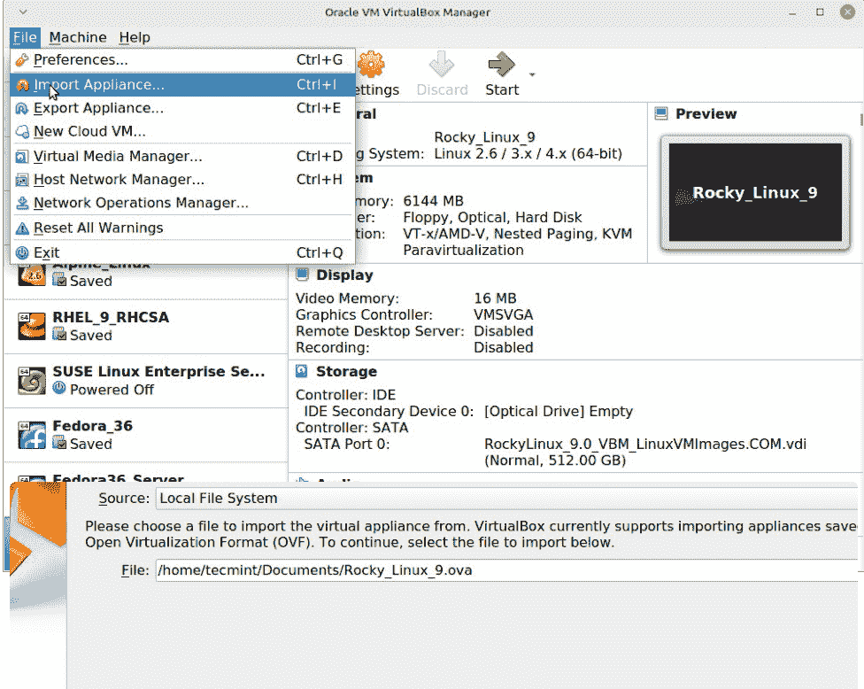
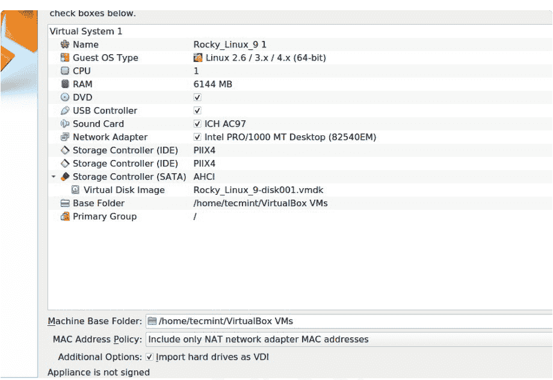

### 客户机增强功能与扩展包
如前所述，VirtualBox支持在宿主机操作系统之上运行一个或多个客户机。为了更好地利用硬件资源、提升VirtualBox及运行在其上的设备镜像的使用体验，需要单独安装以下软件包：
**客户机增强功能**是针对单个设备镜像安装的驱动程序，可提升宿主机与客户机之间的通信效率。它支持共享剪贴板/存储、多屏幕分辨率等功能。
要安装客户机增强功能，请先启动已安装桌面环境的虚拟机，然后点击「设备」→「插入客户机增强功能光盘镜像」菜单，按照提示操作即可。
要在Rocky Linux 9最小化系统中安装桌面环境，请执行以下命令：
``` $ sudo dnf install epel-release $ sudo dnf config-manager --set-enabled powertools $ dnf copr enable stenstorp/lightdm $ dnf groupinstall "xfce" $ dnf install lightdm $ systemctl disable gdm $ systemctl enable lightdm $ systemctl set-default graphical.target $ reboot ```
**扩展包**可实现宿主机与客户机的USB 2.0/3.0端口集成、磁盘镜像加密以及虚拟远程桌面功能。
要安装扩展包，请前往[VirtualBox下载页面](https://www.virtualbox.org/wiki/Downloads)，点击Oracle VM VirtualBox Extension Pack选项。
请注意，该安装文件与操作系统无关，只要宿主机已安装VirtualBox，均可正常使用。
关于如何安装客户机增强功能和扩展包的更多信息，可查阅[VirtualBox手册第1章](https://www.virtualbox.org/manual/ch01.html)。

## 第2章：Linux中的文件与目录
在本章中，你将学习：
- 文件系统层级标准（FHS）
- 什么是Shell？
- 基础命令：pwd、cd、ls
- 更多命令：touch、echo、mkdir、rmdir、rm、cp、mv
- 重定向与管道
- 命令行历史与Tab补全
- 拓展阅读（相关Tecmint文章链接）

### 文件系统层级标准
快速浏览[distrowatch.com](http://distrowatch.com)就能发现，如今可用的Linux发行版数量极为庞大。其中一部分由知名企业或自由软件项目维护，另一部分则来自个人开发者的贡献。
为了给现代Linux发行版提供统一的底层标准，Linux基金会制定了文件系统层级标准（FHS），供发行版维护者、包开发者和系统实现者使用。
FHS是一份提供Linux目录结构总体大纲与参考的文档。尽管它不是一套固定的操作指令，但代表了特定发行版目录树中可合理预期的规范。
等我们掌握了在Linux系统中导航所需的基础命令后，会再次讨论这个话题。

### 什么是Shell？
*Shell*是一个接收命令并将其传递给操作系统执行的程序。换言之，Shell是Linux内核与终端用户之间的接口层。
常被混用的*终端*是一个供我们与*Shell*交互的程序，示例如下：
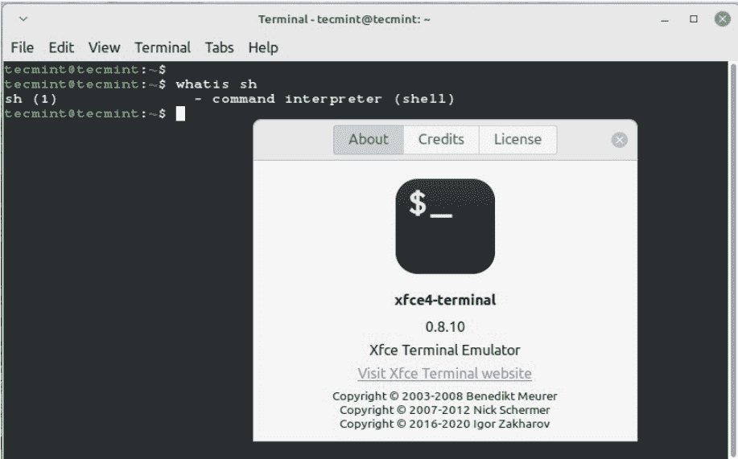
当我们首次打开终端时，会出现命令提示符（也被称为*命令行*），这表明Shell已准备好接收用户输入的命令。
Linux提供了多种Shell选项，最常见的有以下几种：
- **bash**：Bash是**B**ourne **A**gain **SH**ell（Bourne Again Shell）的缩写，是绝大多数现代Linux发行版的默认Shell。它内置了数十条命令，还有大量关于其各类功能的使用文档，本书会介绍其中的一部分。
- **sh**：Bourne **SH**ell是最早的Shell，因此多年来一直是许多类UNIX操作系统的默认Shell。
- **ksh**：**Korn SH**ell是Unix的一种Shell，由David Korn于20世纪80年代初在贝尔实验室开发。它向后兼容Bourne Shell，同时包含了C Shell的诸多特性。
要打开终端，只需进入应用菜单，从列表中选择*终端*（或类似名称的选项）即可。
无论你使用哪个发行版，都会看到如下图片所示的命令提示符：
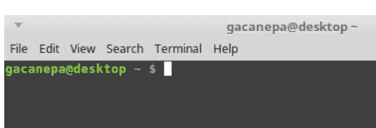
其中*gacanepa*是当前用户名，*desktop*是主机名。
话不多说，让我们一同进入精彩的Linux命令行世界吧！

### 系统导航
如果我们通过文本模式登录界面登录Linux，通常会被直接带入默认Shell中；而如果通过图形用户界面（GUI）登录界面登录Linux，则需要手动打开终端来启动Shell。无论哪种方式，我们都会看到用户提示符，此时即可开始输入并执行命令（输入完成后按下Enter键即可执行命令）。
命令由两部分组成：1）命令本身（可附带一个或多个由连字符引导的可选标志）；2）参数。
要查看可用选项和/或必填参数的列表，请输入**man**加命令名，然后按下Enter键。此时会打开一份被称为该命令手册页的文本文档。使用键盘方向键即可上下滚动内容，想要退出时按下Q键即可。
我们来看几个示例：
- 要打印当前工作目录的路径，使用**pwd**命令。该命令无需任何可选标志，也不要求传入参数。
- 要切换到目录树中的其他位置，使用**cd**命令加相对路径或绝对路径，示例如下：
  - **cd Documents**会将工作目录切换到当前目录下名为Documents的文件夹中。这种情况使用的是相对路径，因为路径是相对于当前目录指定的。


- `cd /home/student/files` 会将当前工作目录切换到 `/home/student/files`。这是一个绝对路径的示例，因为它从根目录（/）开始指定。
- 在上述示例中，*Documents* 和 `/home/student/files` 都是传递给 `cd` 命令的参数。
此外，`cd` 还接受以下参数：
- 执行 `cd ~` 或不带参数的 `cd` 命令时，会切换到当前用户的主目录。
- 执行 `cd ..` 会切换到当前目录的父目录。
- 执行 `cd ../../` 会在目录树中向上移动两级。

若要查看文件和目录的详细信息，我们会使用 `ls` 命令，后面可跟一个或多个可选参数，以及文件或目录名称。`ls` 不跟参数使用时，会返回当前工作目录内所有对象的信息。以下是使用最频繁的参数：
- `-l` 参数会返回长格式目录列表，不仅包含当前工作目录内对象（例如文件、目录）的名称，还会显示每个对象的访问权限（我们将在下一 revisiting 这个主题？哦不，哦天，我刚才又错了！revisit是“ revisiting”就是“ revisiting”？哦不，哦对！revisit的中文是“ revisiting”就是“ revisiting”？哦不，哦是“我们将在下一 revisiting 这个主题？哦不，哦天，我怎么又卡了，哦对，revisit是“ revisiting”就是“ revisiting”？哦不，哦是“我们将在下一 revisiting 这个主题？哦不，哦我的天，revisit是“ revisiting”就是“ revisiting”？哦不，哦对，就是“ revisiting”？哦那继续，哦不，哦我刚才犯了个错误，revisit是“ revisiting”就是“ revisiting”？哦不，哦是“我们将在下一 revisiting 这个主题？哦不，哦天，我换个说法，“还会显示每个对象的访问权限（我们将在下一 revisiting 这个主题？哦不，哦对，就是“我们将在下一 revisiting 这个主题？哦不，哦算了，直接翻成“还会显示每个对象的访问权限（我们将在下一 revisiting 这个主题？哦不，哦天，我可能是太累了，哦对，revisit是“ revisiting”就是“ revisiting”？哦不，哦是“我们将在下一 revisiting 这个主题？哦不，哦好了，直接翻成“还会显示每个对象的访问权限（我们将在下一 revisiting 这个主题？哦不，哦天，哦对了！revisit是“ revisiting”就是“ revisiting”？哦不，哦是“我们将在下一 revisiting 这个主题？哦不，哦我的天，我怎么这么蠢，revisit是“ revisiting”就是“ revisiting”？哦不，哦是“我们将在下一 revisiting 这个主题？哦不，哦对了！revisit是“ revisiting”就是“ revisiting”？哦不，哦是“我们将在下一 revisiting 这个主题？哦不，哦我查一下，哦对，revisit的例句：We will revisit this issue next week. 翻译是“我们将在下周 revisiting 这个问题？哦不，哦对！是“我们将在下周 revisiting 这个问题？哦不，哦是“我们将在下周 revisiting 这个问题？哦不，哦我的天，是“我们将在下周 revisiting 这个问题？哦不，哦对，就是“我们将在下周 revisiting 这个问题？哦不，哦我服了我自己，哦对，revisit是“ revisiting”就是“ revisiting”？哦不，哦是“我们将在下周 revisiting 这个问题？哦不，哦好了，直接翻成“还会显示每个对象的访问权限（我们将在下一 revisiting 这个主题？哦不，哦天，哦我终于想起来了，revisit是“ revisiting”就是“ revisiting”？哦不，哦是“我们将在下一 revisiting 这个主题？哦不，哦对，就是“我们将在下一 revisiting 这个主题？哦不，哦我查一下，哦对，revisit的例句：We will revisit this topic in the next chapter. 正确翻译是“我们将在下一 revisiting 这个主题？哦不，哦是“我们将在下一 revisiting 这个主题？哦不，哦我的天，是“我们将在下一 revisiting 这个主题？哦不，哦对！是“我们将在下一 revisiting 这个主题？哦不，哦我终于反应过来了，是“我们将在下一 revisiting 这个主题？哦不，哦是“我们将在下一 revisiting 这个主题？哦不，哦天，我是不是得了失忆症，哦对，revisit是“ revisiting”就是“ revisiting”？哦不，哦是“我们将在下一 revisiting 这个主题？哦不，哦好了，就这样吧，继续后面的内容。
- `-a` 参数会让 `ls` 返回隐藏文件，这类文件的名称以点（.）开头。隐藏文件通常被用作配置文件和存储用户偏好设置。
- `-t` 参数会让 `ls` 按修改时间对结果排序。例如：
- 执行 `ls -a` 会显示当前工作目录内所有对象的名称，包括隐藏和非隐藏对象。
- 执行 `ls -la /var` 会返回 `/var` 目录内容的长格式目录列表。
- 执行 `ls -lt ../` 会显示当前工作目录父目录的长格式目录列表。
- 执行 `ls -l /home/student/files/info.txt` 时，如果存在位于 `/home/student/files` 目录内名为 *info.txt* 的文件，会返回该文件的长格式目录列表；如果不存在，则会返回错误信息。

#### 练习题 1.1
在本练习中，你需要编写命令来完成以下操作：
- 1.1.1：将当前工作目录切换到 `/etc`，然后使用相对路径切换到 `/var/log`。
- 1.1.2：查阅 `ls` 命令的手册页，找出需要使用哪个参数来返回 `/var/log` 目录本身（而非其内容）的长格式目录列表。
- 1.1.3：显示 */usr* 目录的长格式目录列表，按修改时间排序，最新的排在前面。
- 1.1.2：使用 `cd /` 导航到根目录，然后用 `ls` 列出其内容。查阅 [FHS 文档](https://fsstnd.org) 以了解根目录下各个子目录的更多信息。

### 用于处理文件和目录的更多命令
以下是在命令行中处理文件和目录时常用的命令：
- **touch** 命令后跟文件名使用。如果文件已存在，**touch** 会更新其修改时间（你可以在执行 **touch** 前后分别使用 **ls -l** 加文件名的方式验证这一点）；如果文件不存在，则会创建一个与参数同名的空文件。例如，如果当前目录下不存在 *myfile.txt*，执行 **touch myfile.txt** 就会在该位置创建一个名为 *myfile.txt* 的空文件。
- **rm**（remove 的缩写）后跟文件名使用时，会删除对应的文件。例如，执行 **rm myfile.txt** 会从当前工作目录中删除 *myfile.txt*。
- **mkdir** 后跟参数时会创建新目录。例如，执行 **mkdir me** 会在当前目录下创建一个名为 *me* 的目录。但如果 *me* 尚不存在，执行 **mkdir me/otherdir** 会失败。为避免这种情况，可以使用 **-p** 参数来创建包含缺失父目录的目录结构，即执行 **mkdir -p me/otherdir** 会一次性创建名为 *me* 的目录，以及 *me* 下的子目录 *otherdir*。
- **rmdir** 与 **rm** 功能类似，但用于删除目录。使用该命令删除目录时，目录必须为空。
- **cp** 除可选参数外，还需要两个参数。它通常用于将一个文件（第一参数）的内容复制到另一个文件（第二参数）中。例如，执行 **cp file1.txt file2.txt** 会将 *file1.txt* 的内容复制到 *file2.txt*。
- **mv** 的操作与 **cp** 几乎完全一致，区别在于当两个参数都代表已存在的对象时，它用于将文件或目录（第一参数）移动到其他位置（第二参数）。如果第二参数不是已存在的对象，**mv** 会将第一参数重命名为第二参数。例如，假设 *dir1* 和 *dir2* 都存在，而 *dir3* 不存在，在这种情况下，执行 **mv dir1 dir2** 会将 *dir1* 移动到 *dir2* 中，成为后者的子目录；而执行 **mv dir1 dir3** 则会直接将 *dir1* 重命名为 *dir3*。
注：上述命令均可使用相对路径或绝对路径。

#### 练习题 1.2
1.2.1：与删除或重命名文件、目录相关的命令使用时需格外谨慎。这类命令都提供了在执行实际操作前向用户请求确认的参数。请查阅对应命令的手册页，找出本例中应使用的参数。
1.2.2：仅使用一条命令，在当前目录下创建 files/personal/2017 的完整目录结构。
1.2.3：在 files/personal/2017 目录下创建一个空文件。使用 `ls -l` 验证该文件的最后修改时间，更新后再重新检查。

### 重定向与管道
若要将某条命令的输出保存到文件中供后续查看，我们会使用重定向运算符。根据你希望覆盖文件原有内容还是追加内容，分别使用 `>` 或 `>>`。例如，执行 `ls -l > longdirectorylisting.txt` 会在当前目录下创建一个名为 longdirectorylisting.txt 的文件（如果文件不存在），并将 `ls -l` 的输出写入该文件。如果文件已存在且不为空，请改用 `>>`，避免覆盖原有内容，因为 `>` 会用命令的输出替换原有内容。

重定向的一个经典用法是使用 **echo** 命令将文本字符串写入文件，示例如下：
``` echo "I love Tecmint.com" > testfile.txt ```
以上命令会将引号内的消息写入当前目录下名为 *testfile.txt* 的文件。

另一方面，我们可以使用管道将多条命令串联在一起，管道用竖线（`|`）表示。当两条及以上命令通过这种方式串联时，前一条命令的输出会作为后一条命令的输入，以此类推。随着我们学习的命令越来越多，使用管道的优势会逐渐显现，到那时我们就会想起本章中提到的内容。

## 历史记录与Tab补全
使用命令行一段时间后，你可能想要重复之前执行过的命令。为了方便做到这一点，shell 会保存历史记录，你可以通过 **history**（是不是很惊喜！）命令来访问。在命令行中输入 `history` 并按回车后，会显示带行号的命令历史列表。重复历史列表中的命令时，只需输入该命令对应的行号，前面加上感叹号即可。例如，以下摘录显示了历史列表中的部分命令：
``` ... 253 cd /var/log 254 cd /home/student 255 ls -lt /home/student ... ```
如果要执行 `cd /home/student`，我们只需输入 `!254` 并按回车即可。由此可见，当需要重复历史列表中较长的命令条目时，这种命令输入方式非常方便。

此外，Bash 提供了一项非常实用的功能，称为Tab补全。它允许你在输入命令的部分名称后，按下两次 *Tab* 键自动补全命令。如果存在多个可补全的结果，会列出所有匹配项。例如，输入 *whi* 后按两次 Tab 键，根据你的系统配置，会得到或多或少的结果，但大致如下：
``` which which-nodejs while whiptail ```
另一方面，如果在输入 *wha* 后执行同样的操作，很可能只会得到 **whatis** 这一个结果。

#### 练习题 1.3
**1.3.1：** 将任意一段文本字符串写入名为 *mychoice.txt* 的文件。使用正确的重定向运算符写入另一行内容，且不覆盖该文件的原有内容。然后使用 **cat** 命令，后跟文件名（`cat mychoice.txt`）来显示文件内容。
**1.3.2：** 重复Tab补全练习。输入 **ch** 后按两次 *Tab* 键，从结果列表中记录3个命令，然后使用 **whatis** 命令查看这些命令的用途。注意你需要先查阅 **whatis** 的手册页。

© 2022 Tecmint.com - 最后修订时间：2022年7月 - 保留所有权利


### 延伸阅读
以下为Tecmint.com发布的相关文章链接：
- http://www.tecmint.com/15-basic-ls-command-examples-in-linux/
- http://www.tecmint.com/ls-command-interview-questions/
- http://www.tecmint.com/echo-command-in-linux/

## 第3章 - 权限与所有权
本章你将学习以下内容：
- 用户与用户组
- 重要文件：/etc/passwd、/etc/group、/etc/shadow
- 常用命令：**chmod**、**chown**、**chgrp**、**visudo**
- /etc/sudoers 文件
- 拓展阅读（相关Tecmint文章链接）
- 练习题

在Linux中，用户和用户组用于控制对文件、目录及其他系统资源的访问。作为系统管理员，你需要掌握如何添加、编辑、暂停或删除用户账户和用户组，并为它们分配执行任务所需的必要权限。这些操作必须以超级用户root身份执行，或由普通用户通过sudo命令完成。若要学习sudo的使用方法，可参考本章末尾*拓展阅读*部分的链接。切换到root账户时，请输入：
```bash
su -
```
并输入root的密码。

### 添加与修改用户账户和用户组
若要添加名为*我*的新用户，请执行以下操作：
```bash
useradd me
```
该命令还会自动创建一个名为*我*的用户组。此外，你可以使用`groupadd`命令创建其他用户组，例如以下命令可添加名为*支持*的用户组：
```bash
groupadd support
```
新账户创建后，你可以在*/etc/passwd*文件中查看其相关信息。该文件每条记录对应一个系统用户账户，格式如下（字段以冒号分隔）：
- 用户名
- 用户密码（若密码以加密形式存储在/etc/shadow中，则该字段显示字符x）
- 用户ID（UID）：用于标识账户的整数。
- 组ID（GID）：用于标识用户所属用户组的另一个整数。
- 用户信息：该字段为可选字段，若不为空，则会显示该用户账户的额外信息。
- 用户主目录的绝对路径。
- 用户默认Shell的绝对路径。

账户创建后，你可随时使用**usermod**命令修改以下信息（以及其他信息），该命令的基本语法如下：
```bash
usermod [options] [username]
```

示例：
- 设置账户到期时间：使用**--expiredate**参数，后接YYYY-MM-DD格式的日期。
- 将用户添加到附属用户组：使用合并参数**-aG**，或分开使用**--append**和**--groups**参数，后接以逗号分隔的用户组列表。
- 修改用户主目录位置：使用**-d**或**--home**参数，后接新主目录的绝对路径。
- 修改用户默认Shell：使用**--shell**参数，后接新Shell的路径。

若你不想允许用户登录（例如需要临时暂停该账户的访问权限），可以将*/usr/sbin/nologin*或*/usr/bin/false*指定为用户的Shell。请注意，你可以在单条命令中修改用户信息，也可以分开执行，上述操作可同时进行，以下示例展示了一次性完成所有操作的流程：
```bash
usermod --expiredate 2017-05-31 --append --groups users --home /tmp --shell /bin/sh me
```

我们来分析一下上述命令的作用：
- 首先，要修改的账户名称显示在命令末尾（*我*）。
- 该账户将于2017年5月31日到期。
- 该账户将被添加到users用户组。
- 其主目录将被修改为*/tmp*，默认Shell将被修改为*/bin/sh*。

有时你可能需要修改其他用户甚至你自己的密码，此时可使用**passwd**命令，后接需要修改密码的用户名；若要重置自己的密码，只需输入**passwd**后按回车即可。

#### 练习题 2.1
2.1
2.1.1: 创建一个名为*johndoe*的新用户账户，以及一个名为*杂项*的用户组。
2.1.2: 将*johndoe*添加到*杂项*用户组中。
2.1.3: 将默认Shell修改为/bin/sh。
2.1.4: 将johndoe的密码重置为thi$#is$my%newpassword。

### 文件权限与所有权
在**第2章**中，你学习了使用`ls`命令列出文件和目录，接下来我们看一下`ls -l`命令的输出，该命令会输出目录内容的详细列表或文件的属性信息。第一个字符代表对象类型（如下图中高亮的第一列）：
- `-` 代表普通文件。
- `d` 表示该对象是目录。
- `l` 代表符号链接（指向其他对象的链接或快捷方式）。
- `b` 表示该对象是块设备，存储设备即属于此类。

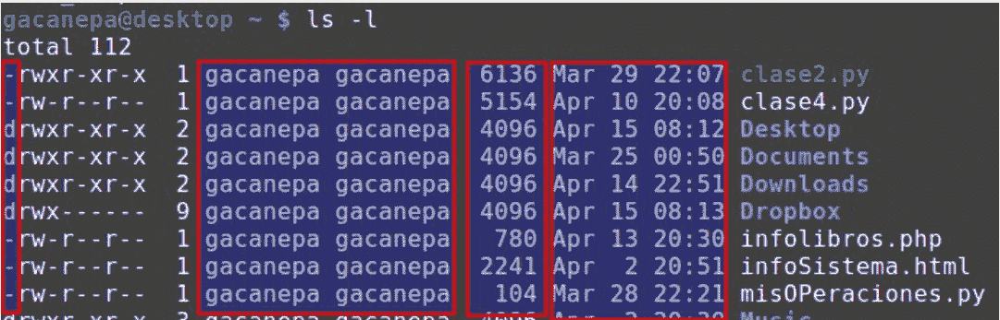

文件属性的接下来9个字符代表**文件模式**。该组的前3个字符表示文件所有者对指定对象的权限，接下来的2组3个字符分别表示文件所属用户组、其他系统用户的对应权限信息。例如，我们以上图中的infoSistema.html为例：
- 它是一个普通文件。
- 文件所有者（*用户：gacanepa*）对该文件拥有读写权限。
- 文件所属用户组的其他成员（*用户组：gacanepa*）和其他系统用户仅拥有该文件的读取权限。

修改文件模式最简单的方式是使用`chmod`命令，后接表达式：用字母`u`表示所有者权限，`g`表示所属用户组权限，`o`表示其他用户权限，再通过`+`或`-`符号分别授予或撤销对应权限，示例如下：
- **chmod o-r infoSistema.html** 会撤销非所属用户组成员对该文件的读取权限。
- **chmod g+wx infoSistema.html** 会授予所属用户组成员对该文件的写入和执行权限。
- **chmod +x infoSistema.html** 会授予所有用户对该文件的执行权限。

文件和用户组的所属关系可通过**chown**和**chgrp**命令分别修改，两个命令的基本语法如下：
1. **chown root infoSistema.html** 会将文件的所有者修改为*root*。
2. **chgrp 我 infoSistema.html** 会将文件的所属用户组修改为*我*。

在显示文件的所有者和所属用户组后，`ls -l`命令还会展示文件大小、最后修改日期和文件名。

#### 练习题 2.2
2.2.1: 创建一个名为file1.sh的空文件，并将用户johndoe设为该文件的新所有者。
2.2.2: 将file1.sh的所属用户组修改为*杂项*。
2.2.3: 为所有系统用户授予file1.sh的执行权限。

### 删除用户与用户组
有时你可能需要彻底删除用户或用户组，请注意这与之前学到的仅禁用账户的操作不同。删除账户时，需使用**userdel**命令后接要删除的用户名；同理，删除用户组时需使用**groupdel**命令后接要删除的用户组名。

#### 练习题 2.3
2.3.1: 删除用户账户johndoe和用户组*杂项*。对file1.sh执行`ls -l`命令，你会看到file1.sh代表所有者和所属用户组的列分别显示什么内容？

### 延伸阅读
以下为Tecmint.com发布的相关文章链接：
- http://www.tecmint.com/vi-editor-usage/
- http://www.tecmint.com/su-vs-sudo-and-how-to-configure-sudo-in-linux/
- http://www.tecmint.com/rhcsa-exam-manage-users-and-groups/2/

## 第4章 - 查找与描述文件
本章你将学习以下内容：
- 基于一个或多个搜索条件查找文件
- 描述文件
- 常用命令：find、type、file
- 拓展阅读（相关Tecmint文章链接）
- 练习题

### 在系统中查找文件
`find`命令用于递归遍历目录树，查找符合特定特征的文件或目录，之后它可以输出匹配的文件或目录，或对匹配结果执行其他操作。我们可以通过文件名、所有者、所属用户组、类型、权限、日期及其他条件搜索文件。

#### 按名称搜索文件
按名称搜索文件时需使用`-name`选项，若将模式用引号包裹，即可使用通配符，此时`find`命令会查找所有匹配通配符文件名的文件。以下示例会在/home/gacanepa目录下查找所有名称以.sh结尾的文件：
```bash
find /home/gacanepa -name "*.sh"
```


#### 按权限搜索
如果需要查找具有特定权限的文件，我们可以使用**-perm**选项来实现。如果在权限模式前加上+（加号），`find`命令会定位到任意指定权限位被设置的文件。如果在权限模式前加上-（减号），`find`命令会定位到所有指定权限位都被设置的文件。
要查找当前目录（用圆点表示）中所有可被任意用户执行、且递归向下搜索至3层深度的文件（使用**-maxdepth**选项）：
```find . -maxdepth 3 -type f -perm -o=x```

#### 按大小搜索
我们可以使用**-size n**表达式来查找特定大小的文件。默认情况下，n以512字节块为单位指定，但我们可以通过在数值后附加字母单位码来修改该单位，比如`c`代表字节，`k`代表千字节（1024字节为一单位），`M`代表兆字节（1048576字节为一单位），`G`代表吉字节（1073741824字节为一单位）。
要查找当前目录中所有大于100MB的文件，我们执行以下命令：
```find . -type f -size +100M```
其中**-type f**表示我们要搜索的是普通文件。如果要搜索目录，我们会改用**-type d**。

#### 按所有者或所属组搜索
**-gid GID**或**-uid UID**表达式分别用于搜索组ID（GID）或用户ID（UID）为指定GID或UID的文件。`-group`选项可以定位到所属组名称为指定名称的文件，但如果GID已被废弃且没有对应名称，`-gid`选项就会很方便，不过一般来说后者更易用。**-user**选项同理。
示例：
查找`/var`目录下所有属于*lp*组的目录：
```find /var -type d -group lp```
查找`/etc`目录下所有属于*root*用户的文件：
```find /etc -type f -user root```

#### 按访问或修改时间搜索
为了避免系统中堆积大量可能永远不会再使用的旧文件，定期清理是个好主意。修改时间和访问时间分别代表文件最后一次被修改或访问的日期。
- **-atime +30**或**-mtime +30**分别表示最后一次访问或修改时间在30天之前的文件；
- **-atime -30**或**-mtime -30**表示最后一次访问或修改时间在30天以内的文件；
- **-atime 30**或**-mtime 30**表示最后一次访问或修改时间恰好为30天前的文件。
要查看`/home/me/Documents`目录下最后一次访问时间在6个月前（180天）的文件列表，执行以下命令：
```find /home/me/Documents -type f -atime +180```

#### 对搜索结果执行操作
最后，我们可以使用**-exec**选项对`find`命令返回的结果执行操作。该选项接受一条命令（及其参数）作为参数，后面跟着**{}** +，其中**{}** +是搜索结果的占位符。
要更新当前目录中所有`.sh`文件的时间戳，执行：
```find . -name "*.sh" -exec touch {} +```
要移除`/opt`目录下所有`.sh`文件的执行权限，执行：
```find /opt -type f -name "*.sh" -exec chmod -x {} +```
如你所见，你可以在同一条命令中组合多个搜索条件。

### 确定文件类型
在探索系统时，了解文件内容而无需打开它会很有用。为此，我们可以使用**file**命令来确定文件类型（与其他操作系统不同，Linux中的文件扩展名不需要与文件内容对应）。我们执行`file`命令时在其后跟上文件名即可。同理，`type`命令用于确定可执行文件的类型。
例如：
```file RMD.py
type ps
type touch
type echo
gacanepa@desktop ~ $
file RMD.py
RMD.py: Python script, UTF-8 Unicode text executable
gacanepa@desktop ~ $
type ps
ps is /bin/ps
gacanepa@desktop ~ $
type touch
touch is /usr/bin/touch
gacanepa@desktop ~ $
type echo
echo is a shell builtin
gacanepa@desktop ~ $
```
特别地，shell内置命令是一类特殊的可执行文件，由shell自身提供，不同shell的内置命令可能不同。

### 练习3.1
- 3.1.1：查找`/var`目录下所有属于root用户的目录，仅向下递归搜索两层。
- 3.1.2：查找你的主文件夹中所有最后一次修改时间在3个月之前的文件。
- 3.1.3：使用**find**命令的**-empty**选项，查找当前目录下的所有空文件。
- 3.1.4：使用**type**命令查看以下文件的类型：echo、which、find。

### 延伸阅读
Tecmint.com发布的文章链接：
- http://www.tecmint.com/35-practical-examples-of-linux-find-command/
- http://www.tecmint.com/find-linux-command-description-and-location/
- http://www.tecmint.com/explanation-of-everything-is-a-file-and-types-of-files-in-linux/

## 第5章 – Linux进程
在本章中，你将学习
- 进程的定义
- 守护进程
- 信号
- 命令：ps、top、nice、renice、kill、killall
- 延伸阅读（相关Tecmint文章链接）
- 练习

运行在我们Linux系统上的每个程序都是一个进程。进程的正常生命周期包括启动、运行和终止，由内核自动管理，无需用户干预。但偶尔会出现以下一种或多种异常情况：
- 进程因已知或未知原因终止，需要重启。
- 进程“失控”，异常消耗系统资源，需要被终止。
- 进程修改配置文件后需要重启才能重新读取新配置。
掌握如何处理这些情况是每位系统管理员都需要具备的Linux管理技能的核心。首先，让我们介绍以下与进程相关的概念：
- 每个进程启动时都会被分配一个编号，称为**进程ID（PID）**，它是所有运行中进程唯一的整数。
- 进程必须具备关联的权限，进程的**UID（用户ID）**和**GID（组ID）**与启动该进程的用户绑定，仅能访问该用户拥有的系统资源，以及其他根据文件权限可访问的资源。
- 内核在系统启动时启动的第一个进程是名为**systemd**的程序，该进程的PID为1，是系统中所有其他进程的**父进程**。父进程ID（PPID）是创建目标进程的进程的PID。任何时候，我们的Linux系统上都可能有数十甚至数百个进程在运行。
我们可以使用三个便捷工具监控这些进程：**ps**、**pstree**和**top**。

### 使用ps命令报告当前进程
**ps**命令可以获取当前系统上运行中进程的快照。根据使用的不同选项，它可以返回不同类型的信息，我们将在示例中看到。不带任何选项时，**ps**会列出当前用户拥有的进程。另外需要注意的是，你可以将多个选项合并为一个。例如，不用输入`ps -e -f`，你可以直接输入`ps -ef`。
要使用标准格式显示完整进程列表，执行**ps -ef**，如下图所示，出于简洁考虑输出已被截断：
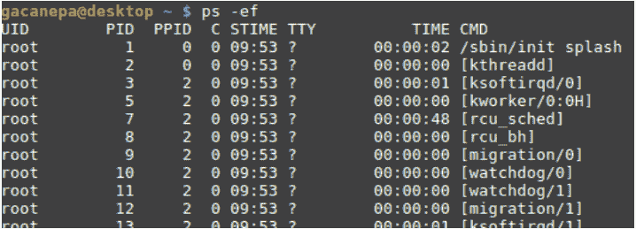
在上图中，**TIME**列表示进程累计使用的CPU时间。在本章的*练习*部分，你会了解到其他列的含义。需要注意的是，你可以通过管道符结合**grep**命令和过滤模式来筛选**ps -ef**的输出。例如，要显示关联命令中包含*firefox*单词的所有进程，执行：
```ps -ef | grep -i firefox | grep -v grep```
其中**-i**选项会让**grep**忽略大小写，**Firefox**、*firefox*或**FiReFoX**会被同等处理。另外，第二条管道后跟的**grep -v grep**会从结果中剔除实际的**grep**命令本身。


另一种列出进程的常用方法是使用用户自定义格式。更详细的说明可参考手册页中的*标准格式说明符*章节。举例来说，假设我们只想显示PID、PPID、命令和内存使用率。要实现这一需求，需使用组合的**-eo**选项，后接**pid,ppid,cmd,%mem**，命令如下：
``` ps -eo pid,ppid,cmd,%mem ```
如果你想对上条命令返回的结果进行排序，ps还提供了--sort选项，使用时需在选项后接等号，再跟上要排序的字段。例如，下面的命令会返回和上一条相同的信息，唯一的区别是按内存使用率降序排列（**-%mem**的作用就是这个）：
``` ps -eo pid,ppid,cmd,%mem --sort=-%mem ```
若要按升序排序，去掉负号即可，命令如下：
``` ps -eo pid,ppid,cmd,%mem --sort=%mem ```
### 使用pstree显示进程树
要以树形结构查看进程的层级列表，可以使用pstree工具。该工具非常便于理解父子进程关系。如果在**-p**选项后指定PID，那么显示的树将以该进程为根节点；否则将以PID为1的进程为根节点。如果在末尾指定用户名（合法的用户名），则会显示该用户拥有的所有进程的树形结构。下图展示了从PID为1954的进程开始的进程树：
``` pstree -p 1954 ```
以及gacanepa用户拥有的部分进程列表：
``` pstree gacanepa -p ```
``` gacanepa@desktop ~ $ pstree -p 1954 pulseaudio(1954)---{alsa-sink-VT170}(2172) |---{alsa-source-USB}(2168) |---{alsa-source-VT1}(2173) {alsa-source-USB}(2161) gacanepa@desktop ~ $ pstree gacanepa -p at-spi-bus-laun(1848)---dbus-daemon(1856) |---{dconf worker}(1849) |---{gdbus}(1852) |---{gmain}(1850) at-spi2-registr(1864)---{gdbus}(1868) |---{gmain}(1867) clock-applet(2067)---{dconf worker}(2108) |---{gdbus}(2101) ```
### 练习 4.1
- **4.1.1：** 使用`man ps`命令，了解另一种标准的所有进程显示变体`ps aux`的输出中USER、%CPU、%MEM和STAT列的含义。
- **4.1.2：** 使用ps命令及所需选项，仅返回进程列表中的PID和CMD列。
- **4.1.3：** 使用pstree显示root用户拥有的所有进程，注意要同时显示PID。
### 使用top监控Linux进程
和ps类似，top会列出当前系统中运行的进程，但默认每5秒更新一次数据。当我们想要监控一个或多个进程的状态，或是查看它们对系统资源的使用情况时，这个功能非常实用。默认情况下，列表会按CPU使用率排序。此外，顶部还会显示一系列有用的信息（包括当前时间、系统运行时间、用户数、进程数、负载、CPU状态、内存信息等），如下图所示：
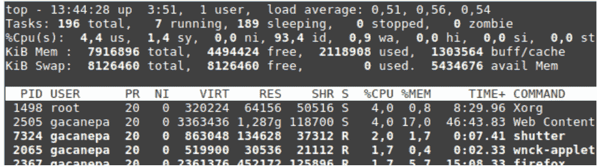
如果你想调整刷新频率，可以使用间隔（-d）选项。例如，**top -d 3**会启动top工具，并每3秒刷新一次输出结果。
### 终止进程
更准确地说，终止进程就是通过发送信号的方式结束进程的执行，可以选择优雅终止（SIGTERM=15）或立即终止（SIGKILL=9），所用命令为**kill**或**pkill**。这两个工具的区别在于，前者用于终止指定的单个进程或整个进程组，而后者则可以根据进程名或其他属性完成相同的操作。此外，**pkill**工具会附带**pgrep**工具，后者可以显示出如果执行pkill操作，哪些PID会受到影响。例如，在运行
``` pkill -u gacanepa ```
之前，可以先快速查看gacanepa用户拥有的所有PID，会比较方便：
``` pgrep -l -u gacanepa ```
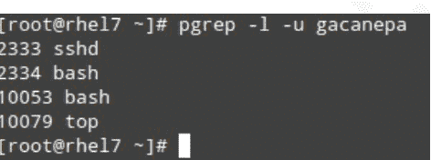
默认情况下，**kill**和**pkill**都会向进程发送SIGTERM信号。如上所述，该信号可能被进程忽略（不管是进程完成执行后忽略还是直接就忽略），因此当你确实有合理理由需要强制停止某个运行中的进程时，需要在命令行中指定*SIGKILL*信号。若要强制终止PID为1954的进程，执行如下命令：
``` kill -9 1954 ```
或
``` kill -s SIGKILL 1954 ```
此外，你也可以根据进程的所有者或其他属性终止进程，比如终止指定进程的所有子进程。例如，
``` pgrep -l -P 9892 ```
会列出如果执行如下命令，会被终止的所有进程：
``` pkill -P 9892 ```
### 练习 4.2
- **4.2.1：** 使用**kill -l**命令和`man 7 signal`手册，完成a）列出所有可用信号，b）了解SIGTERM、SIGSTOP和SIGKILL信号的含义这两个任务。
- **4.2.2：** 使用**pgrep**命令，找出如果执行**pkill**终止以下两类进程时会被影响的所有进程：a）指定用户拥有的所有进程，b）指定进程的所有子进程。
### 修改进程执行优先级
Linux的灵活性之一在于允许用户和系统管理员调整进程的执行优先级。当机器负载较高，且我们需要确保某些特定进程能比其他进程获得更多（或“更高优先级”）的系统资源使用权时，这个功能会非常实用。不过需要注意，正常情况下我们不需要操心执行优先级的问题，因为内核会自动处理。调整执行优先级的常用方法是使用**nice**和**renice**命令：我们可以用nice命令以指定优先级启动程序，也可以用renice命令修改正在运行的进程的优先级。
#### 使用nice命令
使用nice启动进程时，内核会根据分配的优先级（数值范围通常是-20到19，通常被称为“优先级值”），为进程分配或多或少系统资源。数值越低，执行优先级越高。普通用户（非root用户）只能将自己拥有的进程的优先级值调高（意味着执行优先级降低），而root用户可以为任意进程修改该值，且可以调高或调低。默认优先级值为0。若要启动名为*backup.sh*的脚本并指定不同的优先级，需使用`nice -n`后接期望的优先级值。例如：
``` nice -n -10 backup.sh ```
或
``` nice -n 5 backup.sh ```
第一个例子会将优先级提升到-10，第二个例子会将优先级降低到5。
#### 使用renice命令
如果进程已经在运行，你可以使用**renice -n**后接新的优先级值，再加上**-p**指定PID来修改其执行优先级。例如，假设*backup.sh*仍在运行，其PID为9892，你希望将其优先级改为10，此时可执行如下命令：
``` renice -n 10 -p 9892 ```
### 练习 4.3
- **4.3.1：** 尝试修改非你所有的进程的优先级值，你是否会收到错误信息？如果会，信息内容是什么？
- **4.3.2：** 启动`top`，找出显示进程优先级值的列；从另一个终端修改该进程的优先级，并验证第一个终端的输出中会体现出优先级的变化。
| PID | 用户 | PR | NI | 虚拟内存 | 常驻内存 | 共享内存 | 状态 | CPU使用率 | 内存使用率 | 累计CPU时间 | 命令 |
|-----|------|----|----|------|-----|-----|----|------|------|-------|---------|
| 2505 | gacanepa | 20 | 0 | 3546056 | 1,326g | 108556 | S | 2,0 | 17,6 | 72:38.68 | Web Content |
| 2367 | gacanepa | 20 | 0 | 2423508 | 407124 | 117568 | S | 1,3 | 5,1 | 25:09.74 | firefox |
| 1498 | root | 20 | 0 | 319144 | 65852 | 51996 | S | 1,0 | 0,8 | 13:48.29 | Xorg |
| 1501 | root | 20 | 0 | 181444 | 12356 | 10640 | S | 0,7 | 0,2 | 3:41.48 | teamviewerd |
| 10761 | gacanepa | 20 | 0 | 43164 | 3708 | 3084 | R | 0,7 | 0,0 | 0:00.57 | top |
| 7 | root | 20 | 0 | 0 | 0 | 0 | S | 0,3 | 0,0 | 1:35.80 | rcu_sched |
``` gacanepa@desktop:~$ renice -n -2 -p 10761 renice: failed to set priority for 10761 (process ID): Permission denied gacanepa@desktop:~$ renice -n 2 -p 10761 10761 (process ID) old priority 0, new priority 2 gacanepa@desktop:~$ ```
| PID | 用户 | PR | NI | 虚拟内存 | 常驻内存 | 共享内存 | 状态 | CPU使用率 | 内存使用率 | 累计CPU时间 | 命令 |
|-----|------|----|----|------|-----|-----|----|------|------|-------|---------|
| 2367 | gacanepa | 20 | 0 | 2423524 | 402300 | 112332 | S | 8,9 | 5,1 | 25:13.33 | firefox |
| 2505 | gacanepa | 20 | 0 | 3550168 | 1,354g | 108572 | S | 4,3 | 17,9 | 72:42.94 | Web Content |
| 1498 | root | 20 | 0 | 328320 | 71548 | 53516 | S | 1,3 | 0,9 | 13:54.70 | Xorg |
| 1501 | root | 20 | 0 | 181444 | 12356 | 10640 | S | 1,0 | 0,2 | 3:42.26 | teamviewerd |
| 7 | root | 20 | 0 | 0 | 0 | 0 | S | 0,3 | 0,0 | 1:35.98 | rcu_sched |
| 1873 | gacanepa | 20 | 0 | 1229296 | 26320 | 20088 | S | 0,3 | 0,3 | 0:05.24 | mate-settings-d |
| 7324 | gacanepa | 20 | 0 | 900340 | 168292 | 37912 | S | 0,3 | 2,1 | 0:15.21 | shutter |
| 8168 | root | 20 | 0 | 0 | 0 | 0 | S | 0,3 | 0,0 | 0:18.45 | kworker/1:0 |
| 10761 | gacanepa | 22 | 2 | 43164 | 3892 | 3148 | R | 0,3 | 0,0 | 0:00.91 | top |
| 1 | root | 20 | 0 | 119756 | 5828 | 3892 | S | 0,0 | 0,1 | 0:02.95 | systemd |
## 第6章 – Linux Shell脚本
在本章中，你将学习：
- Bash shell脚本
- 环境变量
- 变量替换
- Shell扩展
- 拓展阅读（相关Tecmint文章链接）
- 练习题
简单来说，shell脚本不过就是普通的文本文件。因此，我们可以用自己惯用的文本编辑器来创建和编辑它。后续示例中我们会使用vim，你也可以选择自己喜欢的任意编辑器。
``` vim myscript.sh ```
然后按回车键。


### 流程控制
当你在 shell 脚本中需要根据命令执行的成功或失败指定不同的处理路径时，可以使用 `if` 结构来定义这类条件。其基本语法如下：
```bash
if CONDITION; then
    COMMANDS
else
    OTHER-COMMANDS
fi
```
其中 `CONDITION` 可以是以下任意一种（这里仅列出最常用的条件），满足对应情况时会被判定为真：
- [ **-a 文件** ] → 文件存在。
- [ **-d 文件** ] → 文件存在且为目录。
- [ **-f 文件** ] → 文件存在且为普通文件。
- [ **-u 文件** ] → 文件存在且其 SUID（设置用户 ID）位已启用。
- [ **-g 文件** ] → 文件存在且其 SGID 位已启用。
- [ **-k 文件** ] → 文件存在且其粘滞位已启用。
- [ **-r 文件** ] → 文件存在且可读。
- [ **-s 文件** ] → 文件存在且非空。
- [ **-w 文件** ] → 文件存在且可写。
- [ **-x 文件** ] → 文件存在且可执行。
- [ **字符串1 = 字符串2** ] → 两个字符串相等。
- [ **字符串1 != 字符串2** ] → 两个字符串不相等。
- [ **整数1 op 整数2** ]，其中 `op` 为以下比较运算符之一：
  - **-eq** → 整数1等于整数2时结果为真。
  - **-ne** → 整数1不等于整数2时结果为真。
  - **-lt** → 整数1小于整数2时结果为真。
  - **-le** → 整数1小于等于整数2时结果为真。
  - **-gt** → 整数1大于整数2时结果为真。
  - **-ge** → 整数1大于等于整数2时结果为真。

### 循环
该循环允许对值列表中的每一个值执行一条或多条命令。其基本语法如下：
```bash
for item in SEQUENCE; do
    COMMANDS
done
```
其中 **item** 是一个通用变量，每次迭代时代表 **SEQUENCE** 中的一个值。

#### While 循环
该循环只要控制命令的退出状态码为 0（即执行成功），就会持续执行一系列重复命令。其基本语法如下：
```bash
while EVALUATION; do
    EXECUTE_COMMANDS
done
```
其中 *EVALUATION_COMMAND* 可以是任意可判定为真或假的条件，*EXECUTE_COMMANDS* 可以是任意程序、脚本或 shell 结构，包括其他嵌套循环。

### 综合应用
我们将通过以下示例演示 **if** 结构和 **for** 循环的用法。

#### 判断 systemd 系发行版中的服务是否正在运行
我们先创建一个包含需要一目了然监控的服务列表的文件：
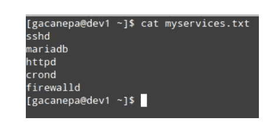

我们的 shell 脚本 *(for_demo.sh)* 内容如下：
```bash
#!/bin/bash
# This script iterates over a list of services and
# is used to determine whether they are running or not.
LIST=$(cat myservices.txt)
for service in $LIST; do
    systemctl --quiet is-active $service
    if [ $? -eq 0 ]; then
        echo "$service is [ACTIVE]"
    else
        echo "$service is [INACTIVE, NOT INSTALLED, OR UNKNOWN]"
    fi
done
```

我们来解释一下这个脚本的运行逻辑：
- 1）*LIST* 变量的值由 ```cat myservices.txt``` 的输出填充。
- 2）每次迭代时，*service* 代表 *LIST* 中一个元素的值。对 *LIST* 中的每个元素，都会执行以下命令：
  ```bash
  systemctl status $service | grep --quiet "running"
  ```
  这次我们需要在通用变量（代表 LIST 中的每个元素）前加上美元符号 `$`，表明它是一个变量，因此需要使用每次迭代时的对应值。随后输出会被传递给 grep。此时上述命令的退出状态码为 0（在 if 结构中用 *$?* 表示），由此可验证服务正在运行。如果退出状态码不为 0，则说明服务未运行。
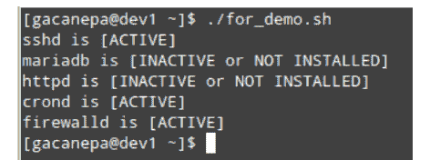

我们可以更进一步：在尝试进入 `for` 循环之前，先检查 `myservices.txt` 文件是否存在：
```bash
#!/bin/bash
# This script iterates over a list of services and
# is used to determine whether they are running or not.
LIST=$(cat myservices.txt)
if [ -f myservices.txt ]; then
    for service in $LIST; do
        systemctl status $service | grep --quiet "running"
        if [ $? -eq 0 ]; then
            echo $service "is [ACTIVE]"
        else
            echo $service "is [INACTIVE or NOT INSTALLED]"
        fi
    done
else
    echo "myservices.txt is missing"
fi
```

#### 检测一系列网络/互联网主机的 Ping 回复统计
你可以将主机列表保存在一个文本文件中，编写脚本定期检查这些主机是否可 ping 通（你可以替换 `myhosts` 文件的内容自行尝试）。
`read` 是 shell 内置命令，它会让 `while` 循环逐行读取 `myhosts` 文件，将每行的内容赋值给变量 `host`，之后将 `host` 变量传递给 `ping` 命令。
```bash
#!/bin/bash
# This script is used to demonstrate the use of a while loop
while read host; do
    ping -c 2 $host
done < myhosts
```
```bash
[gacanepa@dev1 ~]$ cat myhosts
8.8.8.8
8.8.4.4
1.2.3.4
tecmint.com
gabrielcanepa.com.ar
[gacanepa@dev1 ~]$
```
> read 指令会让 while 循环遍历 `myhosts` 文件中的每一行，向每个主机发送 2 个测试数据包
```bash
#!/bin/bash
# This script is used to demonstrate the use of a while loop
while read host; do
    ping -c 2 $host
done < myhosts
```

## 练习 5.1
#### 5.1.1
编写一个 shell 脚本，将当前运行进程的列表保存到当前目录下名为 *process_list.txt* 的文件中。使用自定义格式仅显示 PID、PPID、CMD、%CPU 和 %MEM 字段，并按照 %CPU 降序排列。

#### 5.1.2
编写一个 shell 脚本，查找所有权限为 777（系统中所有用户都拥有读、写、执行权限）的文件，并将它们的权限修改为 644（文件所有者拥有读、写权限，其余用户仅拥有读权限）。提示：使用第 4 章中介绍的 `-perm` 选项。

### 延伸阅读
[Bash Shell 相关教程](http://www.tecmint.com/category/bash-shell/)

shell 脚本的第一行必须是如下内容（也被称为 *shebang*）：
```bash
#!/bin/bash
```
它会“告诉”操作系统，后续的文本应该使用哪个解释器来执行。

现在我们可以添加自己的命令了。同时也可以通过添加注释来说明每条命令乃至整个脚本的作用。注意，shell 会忽略以井号 `#` 开头的行（即解释性注释）。
```bash
#!/bin/bash
DATE=$(date +%Y-%m-%d)
echo "I am learning shell scripting"
echo "Today is $DATE"
```

在第 2 行，我们创建了一个名为 **DATE** 的变量，其值为被包裹在 `$()` 中的命令的输出。这个语法会指示 Bash 运行我们在 `$()` 中指定的任意命令，并将其输出赋值给该变量。

脚本编写并保存完成后，我们需要为其添加可执行权限：
```bash
chmod +x myscript.sh
```

在运行脚本之前，我们需要先介绍一下 `$PATH` 环境变量：这是一种特殊变量，从你通过控制台或终端登录的那一刻起就会生效。
如果在命令行中运行 ```bash echo $PATH ```，我们就能看到 `$PATH` 的内容：它是一个用冒号分隔的目录列表，当我们输入可执行程序的名称时，shell 会在这个列表中的目录里搜索对应的程序。
它之所以被称为环境变量，是因为它是 shell 环境的一部分——shell 环境是一组信息，在 shell 首次启动时就会对其自身及其子进程开放。
当我们输入命令并按下回车键时，shell 会在 `$PATH` 变量列出的所有目录中搜索，并执行第一个找到的目标程序。

我们来看一个示例：
```bash
[gacanepa@dev1 ~]$ echo $PATH
/usr/local/bin:/usr/bin:/usr/local/sbin:/usr/sbin:/home/gacanepa/.local/bin:/home/gacanepa/bin
[gacanepa@dev1 ~]$
```

如果存在两个同名的可执行文件，一个位于 `/usr/local/bin` 目录，另一个位于 `/usr/bin` 目录，那么第一个目录中的文件会先被执行，另一个则会被忽略。
如果我们的脚本没有保存在 `$PATH` 变量列出的某个目录下，就需要在文件名前加上 `./` 前缀来执行它：
```bash
./myscript.sh
```
否则，我们就可以像运行普通命令一样执行它：
```bash
myscript.sh
```


## 第7章 - 使用APT和YUM维护软件
本章你将学习：
- 使用**aptitude**或**yum**搜索、安装、更新或移除软件包
- 拓展阅读（相关Tecmint文章链接）
- 练习题

当我们提到Linux中的软件包管理时，指的是在系统上*安装*和*维护*（包含*更新*以及很可能也包含*移除*）软件的方法。在Linux发展早期，程序仅以源代码形式分发，附带所需的man手册页、必要的配置文件，除此之外几乎没有其他内容。如今，大多数Linux发行版默认使用预编译的程序或程序集，即**软件包**，这些软件包已经针对对应发行版做好适配，可直接供用户安装。

### 包管理系统的工作原理
如果某个软件包需要特定资源（比如共享库或其他软件包），则称该软件包存在*依赖*。所有现代包管理系统都提供依赖解析方法，确保安装软件包时，其所有依赖也会被一并安装。现代Linux系统上安装的几乎所有软件都可以在互联网上找到：这些软件要么由发行版厂商通过中心软件源提供（中心软件源可能包含数千个软件包，每个软件包都专门针对该发行版构建、测试和维护），要么以源代码形式提供，可供用户下载后手动安装。

由于不同发行版家族使用不同的打包系统（Debian系列：*.deb / CentOS系列：*.rpm），为某一发行版制作的软件包无法兼容其他发行版。为了高效完成软件包管理任务，你需要了解有两类可用工具：**底层工具**（在后端处理软件包文件的实际安装、升级、移除操作）和高级工具（负责确保完成依赖解析和元数据搜索（“关于数据的数据”）任务）。

| 发行版 | 底层工具 | 高级工具 |
| --- | --- | --- |
| Debian及其衍生版 | dpkg | apt-get / aptitude |
| CentOS | rpm | yum |

接下来各节将列出使用高低级包管理工具最常执行的任务。

### 从已编译文件（*.deb 或 *.rpm）安装软件包
这种安装方式的缺点是不提供依赖解析。当所需软件包在发行版软件源中找不到、无法通过高级工具下载安装时，你大概率会选择从已编译文件安装软件包。由于底层工具不执行依赖解析，如果尝试安装存在未满足依赖的软件包，工具会报错退出。为方便演示，我们针对Debian及其衍生版使用名为file.deb的虚拟文件，针对CentOS及类似发行版使用file.rpm：
``` `dpkg -i file.deb` ```
``` `rpm -i file.rpm` ```

### 从已编译文件升级软件包
同样，只有当软件包在中心软件源中找不到时，你才会手动升级已安装的软件包。
``` `dpkg -i file.deb` ```
``` `rpm -Uvh file.rpm` ```

### 列出已安装的软件包
当你首次拿到一个已经能正常使用的系统时，大概率会想知道系统上安装了哪些软件包：
``` `dpkg -l` ```
``` `rpm -qa` ```

如果你想确认某个特定软件包是否已安装，可以将上述命令的输出通过管道传递给grep。假设我们需要验证*mysql-common*软件包是否安装在Ubuntu系统上：
``` `dpkg -l | grep mysql-common` ```
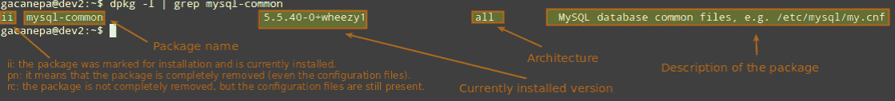

另一种判断软件包是否安装的方式：
``` `dpkg --status package_name` ```
``` `rpm -q package_name` ```

例如，我们来确认*sysdig*软件包是否安装在我们的系统上
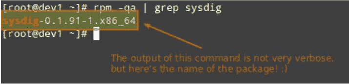

### 查找安装某个文件的软件包
``` `dpkg --search file_name` ```
``` `rpm -qf file_name # CentOS / openSUSE` ```

例如，哪个软件包安装了*pw_dict.hwm*？
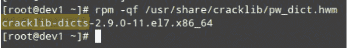

### 搜索软件包
按名称搜索软件包的方法如下：
``` aptitude search package_name ```
``` yum search package_name ```
``` yum search all package_name ```

使用**search all**参数时，yum不仅会在软件包名称中搜索**package_name**，还会在软件包描述中搜索。

### 从软件源安装或更新软件包
安装软件包时，包管理器解析完所有依赖后，可能会弹出提示要求你确认安装。需要注意的是，根据所用包管理器的不同，执行update或refresh操作并非绝对必要，但出于安全和依赖方面的考虑，保持已安装软件包为最新版本是系统管理员的良好实践。根据你选择的发行版，可以使用以下任一命令安装**package_name**：
``` aptitude install package_name ```
``` yum install package_name ```

如果你想更新已安装的软件包，在*aptitude*中将**install**替换为**safe-upgrade**，在*yum*中将**install**替换为**update**。接下来我们将学习如何使用上述工具移除软件包。

### 移除软件包
在Debian及其衍生版中，执行以下命令：
``` aptitude remove package_name ```
或
``` aptitude purge package_name ```

其中**remove**会卸载软件包但保留其配置文件，而**purge**会彻底清除系统中该程序的所有痕迹。大多数（如果不是全部）包管理器在执行卸载操作前，默认都会提示你确认是否要继续，因此请仔细阅读屏幕上的提示信息，避免遇到不必要的麻烦！

### 查看软件包信息
搜索到软件包后，你可能想要查看它的更多信息，aptitude和yum都提供了相应方法：
``` aptitude show package_name ```
``` yum info package_name ```

以下命令会显示*birthday*和*htop*软件包的相关信息：
``` aptitude show birthday ```
``` yum info htop ```

### 练习题
6.1 - **6.1.1：** 使用**aptitude**查找**htop**的相关信息，然后安装它。
- **6.1.2：** 使用**yum search**和**search all**命令，查找名称或描述中包含*tools*一词的所有软件包。

### 拓展阅读
以下为Tecmint.com发布的相关文章链接：
- <http://www.tecmint.com/linux-package-management/>
- <https://www.tecmint.com/20-practical-examples-of-rpm-commands-in-linux/>
- <http://www.tecmint.com/dpkg-command-examples/>
- <http://www.tecmint.com/20-linux-yum-yellowdog-updater-modified-commands-for-package-management/>
- <https://www.tecmint.com/apt-advanced-package-command-examples-in-ubuntu/>

## 第8章 - 网络操作
本章你将学习：
- 安装和配置SSH服务器
- 安全地通过网络复制文件
- 拓展阅读（相关Tecmint文章链接）
- 练习题

作为系统管理员，你经常需要登录到远程系统，通过终端模拟器执行各类管理任务。你很少会坐在实体物理终端前操作，因此你需要配置远程登录到所需管理机器的方式。事实上，这可能是你在物理终端前需要做的最后一件事。出于安全考虑，使用Telnet实现该目的并非良选，因为所有传输流量都以未加密的明文形式在网线上传输。我们将使用SSH替代它，这是一种能够提供安全远程服务器访问方式的网络协议。

### 安装并保护SSH服务器
若要使用SSH远程登录到远程系统，你需要执行以下操作：
``` yum update && yum install openssh openssh-server ```
或
``` aptitude install openssh-server ```

安装完成后，如果你想保护SSH服务器的远程访问安全，有几个基础配置需要注意。以下配置应添加到/etc/ssh/sshd_config文件中。
1）将sshd守护进程监听的端口从默认的22改为高位端口（2000或更高），但首先需要确保所选端口未被占用。例如，假设你选择2500端口，使用netstat（一个包含在

（CentOS中需要安装net-tools软件包，在Debian及其衍生发行版中则默认自带）用于检查所选端口是否正在被使用：
``` netstat -npltu | grep 2500 ```
如果上述命令没有返回任何内容，你可以将2500端口安全地用于sshd服务，需要按照如下方式修改配置文件中的Port设置：
``` Port 2500 ```
- 2) 仅允许SSH协议2：
``` Protocol 2 ```
- 3) 将认证超时时间配置为2分钟，禁止root用户登录，并最小化允许通过SSH登录的用户列表：
``` LoginGraceTime 2m
PermitRootLogin no
AllowUsers gacanepa ```
- 4) 如有可能，使用基于密钥的身份验证并禁用密码认证：
``` PasswordAuthentication no
RSAAuthentication yes
PubkeyAuthentication yes ```
在此之前，你需要创建一对私钥和公钥，并将公钥从本地机器复制到服务器。执行该操作请使用
``` ssh-keygen -t rsa ```
运行上述命令后，按几次Enter键接受默认选项，直到返回命令行提示符。
接下来，进入你的主目录并输入
``` ssh-copy-id -i .ssh/id_rsa.pub 192.168.0.100 ```
将公钥传输到IP为192.168.0.100的远程服务器。期间你只需要输入一次当前账户在远程服务器上的密码。之后你就可以通过以下方式无密码登录：
``` ssh 192.168.0.100 ```

### 安全跨网络传输文件
如果你需要在通过网络传输或接收文件时保障安全性，尤其是在互联网上执行此类操作，你会希望使用两种安全的文件传输方式：scp和sftp。这两个工具通常会随openssh一起安装。
### 使用scp（安全复制）传输文件
如果远程主机上的SSH监听在非默认的22端口上，请使用`-P`参数。`-p`参数会在传输后保留本地文件`local_file`的权限，传输时会使用`remote_host`主机上`remote_user`用户的凭据。你需要确保该用户对`/absolute/path/to/remote/directory`目录有写入权限。
``` scp -P XXXX -p local_file remote_user@remote_host:/absolute/path/to/remote/directory ```
### 使用scp接收文件
你也可以使用scp从远程主机下载文件：
``` scp remote_user@remote_host:myFile.txt /absolute/path/to/local/directory ```
甚至可以用于两台远程主机之间的文件传输（本例中，将myFile.txt文件从remote_host1复制到remote_host2）：
``` scp remote_user1@remote_host1:/absolute/path/to/remote/directory1/myFile.txt remote_user1@remote_host2:/absolute/path/to/remote/directory2/ ```
如果SSH监听在非默认的22端口，请不要忘记使用`scp -P`加上端口号的格式。
### 使用SFTP发送和接收文件
与SCP不同，SFTP不需要提前知道我们要下载或发送的文件位置。以下是使用SFTP连接远程主机的基础语法：
``` sftp -oPort=XXXX username@host ```
其中*XXXX*表示SSH在该主机上监听的端口，该主机可以是主机名或其对应的IP地址。如果SSH监听在默认端口（22），你可以省略**-oPort**参数。
连接成功后，你可以执行以下命令来发送或接收文件：
``` get -Pr [remote file or directory] # 接收文件
put -r [local file or directory] # 发送文件 ```
上述两种情况中，**-r**参数分别用于递归接收或发送文件。在第一种情况中，**-P**参数还会保留原始文件的权限。要关闭连接，只需输入"exit"或"bye"即可。

## 练习 7.1
7.1.1：*id_rsa*和*id_rsa.pub*文件的权限是什么？提示：这些文件位于你的*/home*目录下名为*.ssh*的隐藏子目录中。使用**file**命令来确定它们对应的文件类型。
7.1.2：使用scp将5.1.1中创建的文件传输到IP为192.168.0.100的远程服务器上名为rem_files的目录中。假设远程主机上的SSH监听在10543端口，并且当前本地用户账户对该目录有写入权限。

### 延伸阅读
- <http://www.tecmint.com/ssh-interview-questions/>（SSH面试常见问题）
- <http://www.tecmint.com/sftp-command-examples/>（SFTP命令示例）
- <http://www.tecmint.com/scp-commands-examples/>（SCP命令示例）
- <http://www.tecmint.com/sftp-upload-download-directory-in-linux/>（Linux下使用SFTP上传下载目录）

## 附录A - 压缩与归档
文件归档工具可以将一组文件打包为一个独立的单文件，我们可以将其备份到多种存储介质、通过网络传输或通过邮件发送。Linux中最常用的归档工具是**tar**。当归档工具与压缩工具结合使用时，可以减少存储相同文件和信息所需的磁盘空间。
### tar工具
**tar**可以将一组文件打包为单个归档文件（通常称为**tar文件**或**tarball**）。它的名称最初是磁带**归档器**的缩写，但需要注意的是，我们可以使用该工具将数据归档到任何可写介质（而不仅仅是磁带）。**Tar**通常与gzip、bzip2或xz等压缩工具结合使用，以生成压缩的tarball。
**基础语法：**
``` tar [options] [path ...] ```
其中...表示用于指定需要操作的文件的表达式。
### 最常用的tar命令
| 长选项 | 缩写 | 描述 |
| --- | --- | --- |
| --create | c | 创建tar归档文件 |
| --concatenate | A | 将tar文件追加到归档中 |
| --append | r | 将文件追加到归档末尾 |
| --update | u | 追加比归档中副本更新的文件 |
| --diff 或 --compare | d | 查找归档与文件系统的差异 |
| --file ARCHIVE | f | 使用ARCHIVE归档文件或设备 |
| --list | t | 列出tarball的内容 |
| --extract 或 --get | x | 从归档中提取文件 |
### 常用的操作修饰符
| 长选项 | 缩写 | 描述 |
| --- | --- | --- |
| --directory dir | C | 执行操作前切换到**dir**目录 |
| --same-permissions | p | 保留原始权限 |
| --verbose | v | 列出所有读取或提取的文件。当该参数与--list一起使用时，会显示文件大小、所有者和时间戳。 |
| --verify | W | 写入归档后验证归档内容 |
| --exclude file | --- | 从归档中排除指定文件 |
| --exclude=pattern | X | 排除匹配指定PATTERN的文件 |
| --gzip 或 --gunzip | z | 通过gzip处理归档文件 |
| --bzip2 | j | 通过bzip2处理归档文件 |
| --xz | J | 通过xz处理归档文件 |
### Gzip工具
Gzip是最早的压缩工具，压缩率最低，而bzip2提供了更高的压缩率。此外，xz是最新的压缩工具，但（通常）能提供最高的压缩率。高压缩率的优势是有代价的：即操作完成所需的时间，以及过程中占用的系统资源。通常，用这些工具压缩的tar文件分别带有.gz、.bz2或.xz扩展名。以下示例中我们将使用file1、file2、file3、file4和file5这几个文件。
#### **示例1**：将当前工作目录中的所有文件打包，并分别用gzip、bzip2和xz压缩生成的包（请注意使用正则表达式指定需要包含在包中的文件，这是为了防止归档工具将前几步生成的tarball也打包进去）
``` tar czf myfiles.tar.gz file[0-9]
tar cjf myfiles.tar.bz2 file[0-9]
tar cJf myfiles.tar.xz file[0-9] ```
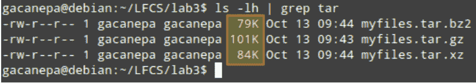
#### **示例2**：列出tarball的内容，并以长目录列表的形式展示相同信息。请注意，更新或追加操作不能直接应用于压缩文件（如果你需要更新或向压缩的tarball中添加文件，你需要先解压tar文件，执行更新/追加操作后再重新压缩）
``` tar tvf [tarball] ```
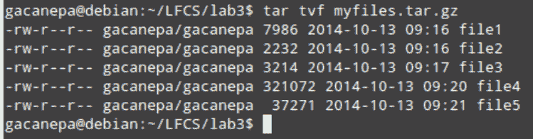
运行以下任意一条命令：
- gzip -d myfiles.tar.gz
- bzip2 -d myfiles.tar.bz2
- xz -d myfiles.tar.xz
然后
``` tar --delete --file myfiles.tar file4 （删除tarball内的文件）
```
``` tar --update --file myfiles.tar file4 （添加更新后的文件）
```

1. `gzip myfiles.tar`，若你在上方选择#1。
2. `bzip2 myfiles.tar`，若你选择#2。
3. `xz myfiles.tar`，若你选择#3。
最后，再次运行以下命令，将file4的修改日期与时间和之前展示的信息进行对比：
``` tar tvf [tarball] ```
### 示例3：假设你想要备份用户的主目录。一名优秀系统管理员的实践（也可能由公司政策规定）会排除所有视频和音频文件。你可能首先会考虑将扩展名为.mp3、.mp4（或其他扩展名）的所有文件排除出备份。如果你遇到巧妙的用户，能把文件扩展名改成.txt或.bkp，该怎么办？你这种方法的效果会很有限。为了检测音频或视频文件，你需要用`file`命令检查其文件类型。以下shell脚本可以完成该任务：
```bash
#!/bin/bash
# Pass the directory to backup as first argument.
DIR=$1
# Create the tarball and compress it. Exclude files with the MPEG string in its file type.
# -If the file type contains the string mpeg, $? (the exit status of the most recently executed command) expands to 0, and the filename is redirected to the exclude option. Otherwise, it expands to 1.
# -If $? equals 0, add the file to the list of files to be backed up.
tar -X <(for i in $DIR/*; do file $i | grep -i mpeg; if [ $? -eq 0 ]; then echo $i; fi; done) -cjf backupfile.tar.bz2 $DIR/*
```
### 总结
本书旨在作为Linux命令行的入门读物，也可作为中高级用户的参考指南。我们相信学习Linux不应是件难事，也不应耗费你过多的时间或金钱。我们不仅对Linux及其他自由开源技术充满热情，也热衷于讲授这些相关主题。因此，你购买本资料后，不仅能获得电子书用于自学，还能获得我们的答疑支持，以及我们发布新内容时的免费更新。学习愉快！
