# C++ Linux 系统编程学习：理解 Linux 内核工作原理及如何与其交互（Python 先驱者秘籍）


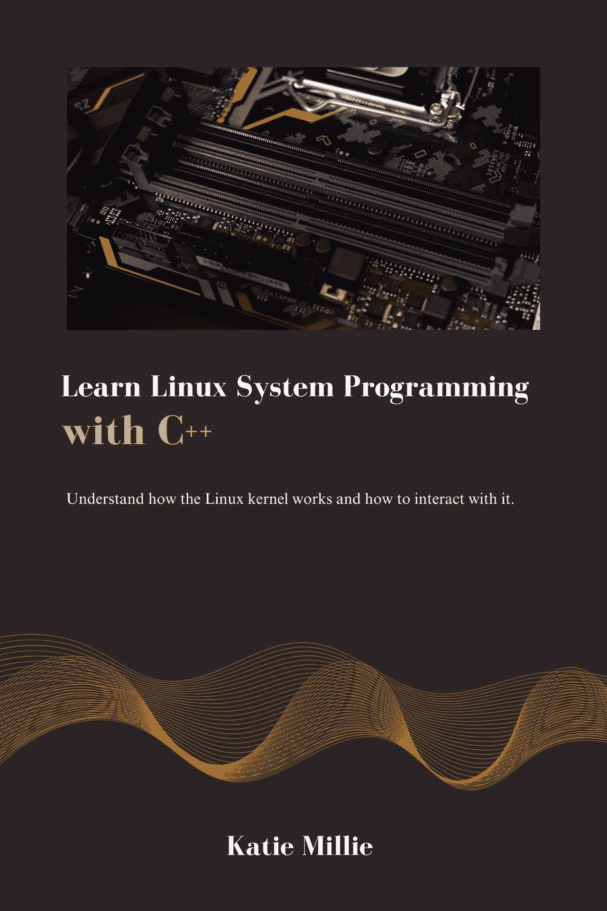
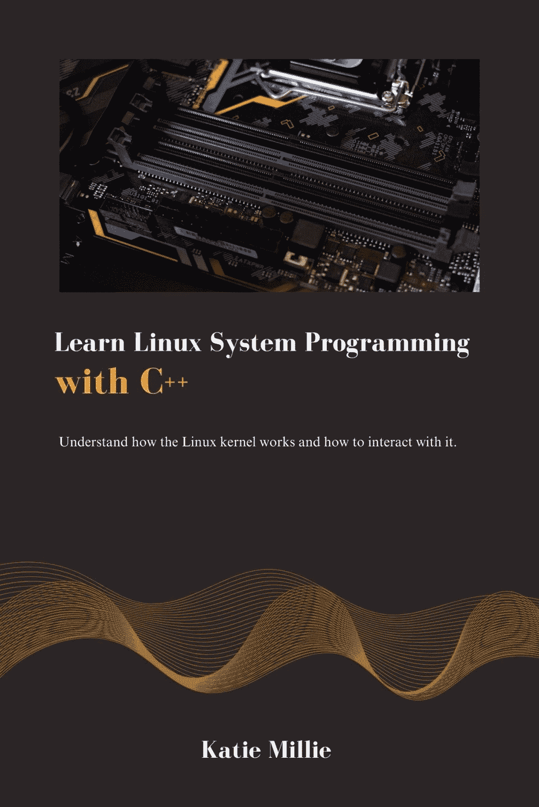


理解 Linux 内核如何工作以及你如何与它进行交互。

***


***


## 请求写书评

感谢购买《使用 C++ 学习 Linux 系统编程》！您的见解对我们和其他读者来说都非常宝贵。我们诚挚地请求您在 Amazon 上留下评论分享您的体验。您的反馈将帮助我们改进未来的版本，并帮助其他开发者做出明智决策。感谢您的支持！


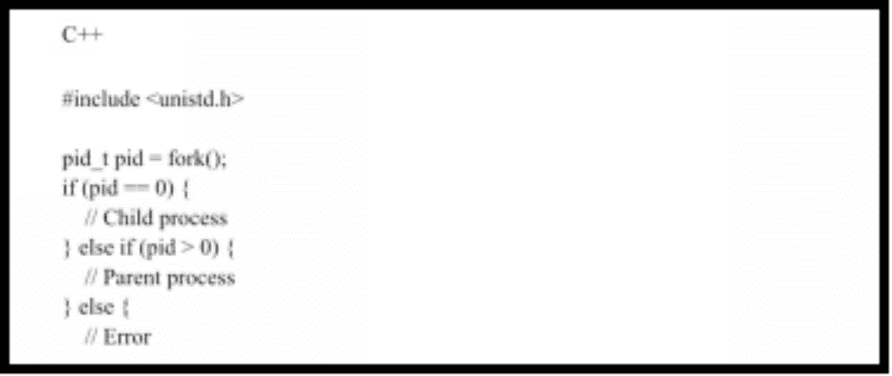

# 内存管理
- 分配和释放物理内存与虚拟内存。
- C++ 程序员使用 `malloc`、`free` 和 `new` 运算符进行内存分配，但内核最终管理物理内存。

# 文件系统管理
- 组织和管理数据存储。
- C++ 程序使用 `open`、`read`、`write` 和 `close` 等函数访问文件。

```cpp
#include <fstream>

std::ofstream file("output.txt");

file << "Hello, world!" << std::endl;

file.close();
```

# 设备驱动
- 与硬件设备交互。
- 可以++编写设备驱动，但出于性能考虑，通常使用 C 完成。

# 进程间通信 (IPC)
- 促进进程之间的通信。
- C++ 为 IPC 提供了 `pipes`、`shared memory` 和 `message queues` 等机制。

# 系统调用
系统调用是用户态程序与内核之间的接口。它们提供了一种受控的访问内核服务的方式。

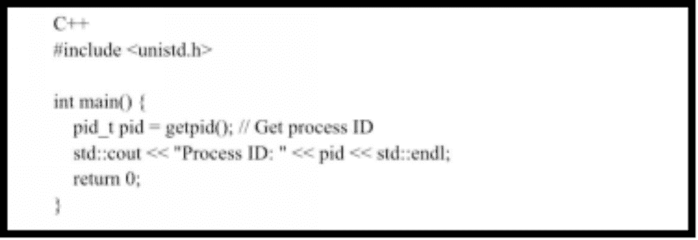

# 系统库
系统库（如 C 标准库 `libc`）为常用操作提供了函数，并抽象了系统调用。

# Shell
Shell 是一个命令行解释器，负责与用户交互并执行命令。`Bash` 是一种流行的 Shell。

# 用户空间
用户空间包含在内核之上的应用程序和实用程序。C++ 广泛用于开发这些应用程序。

# 关键系统组件
- **文件系统**：用于组织文件和目录的分层结构。
- **进程**：正在执行中的程序实例。
- **虚拟内存**：物理内存的抽象。
- **网络栈**：处理网络通信。

# 使用 C++ 和 Linux 进行编程
由于其高效率、低层级访问能力和丰富的标准库，C++ 非常适合 Linux 系统编程。

- **系统调用**：直接使用系统调用对系统资源进行细粒度控制。
- **标准模板库 (STL)**：利用 `STL` 容器和算法处理数据结构和操作。
- **Boost 库**：探索 `Boost` 以获取额外的工具和库。
- **网络编程**：使用 C++ `sockets` 进行网络通信。
- **GUI 开发**：利用 `Qt` 或 `GTK+` 等框架构建图形用户界面。

Linux 架构是构建稳健高效系统的基础。理解这些组件并通过 C++ 与其交互，能够赋予开发者创建强大应用的能力。通过掌握系统调用、库和内核功能，程序员可以充分挖掘 Linux 操作系统的全部潜力。

**注意**：本概述提供了基础性的理解。Linux 是一个具有许多复杂性的复杂系统。高级系统编程需要更深层次的探索。

## 系统编程中 C 和 C++ 的比较

### 系统编程中的 C vs C++
C 和 C++ 都是用于系统编程的强大语言，但它们提供了不同的方法和权衡。让我们深入研究它们的关键区别以及何时使用每种语言。

#### 性能与低级控制
C 和 C++ 都提供了卓越的性能和直接的硬件访问，使它们成为系统编程任务的理想选择。然而，由于其语言结构简单且经过编译器优化，C 在原始速度上通常具有微弱优势。

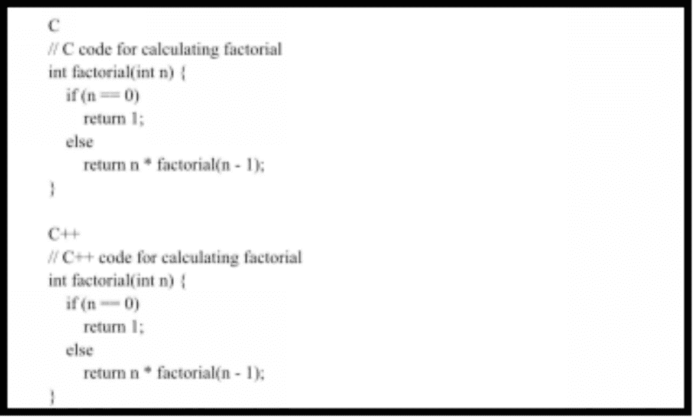

虽然上面的代码段是相同的，但 C 编译器可能会生成稍微优化的机器码。然而，在实际应用中，性能差异通常可以忽略不计。

#### 抽象与代码组织
C 是一种过程化语言，专注于函数和数据结构。它擅长于低级任务，但在大型项目中可能会变得复杂。

另一方面，C++ 支持面向对象编程 (OOP)，提供了 `classes`、`inheritance`、`polymorphism` 和 `encapsulation`。这使得代码的组织、重用和维护性更好。

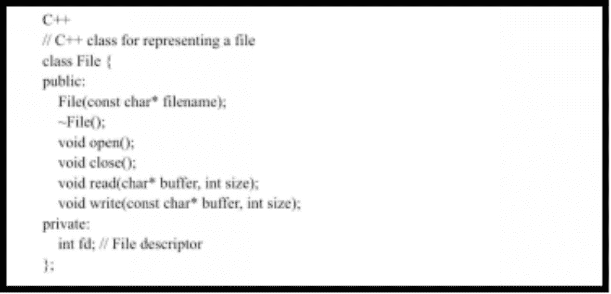

`File` 类封装了文件操作，使代码更具可读性且更不容易出错。

#### 标准库
C 的标准库较小，专注于基础的输入输出、字符串处理和内存管理。C++ 继承了 C 的库，并通过标准模板库 (`STL`) 大幅进行了扩展，提供了 `containers`、`algorithms` 和 `iterators`。

```cpp
#include <vector>
#include <algorithm>

std::vector<int> numbers = {3, 1, 4, 1, 5, 9};

std::sort(numbers.begin(), numbers.end());
```

`STL` 为常见的数据结构和操作提供了强大的抽象，提高了开发效率。

# 内存管理
C 和 C++ 都要求使用 `pointers` 进行手动的内存管理。如果处理不当，可能会出错。C++ 引入了 `RAII`（资源获取初始化）和 `smart pointers` 来缓解这些风险。

```cpp
#include <memory>

std::unique_ptr<int> ptr(new int(42)); // 自动内存释放
```

`Smart pointers` 自动管理内存，减少了内存泄漏的概率。

## 何时使用 C vs C++
**选择 C 的情况：**
- 性能是绝对的首要任务，每个周期都至关重要。
- 你正在资源有限的嵌入式系统上工作。
- 你需要在低层级直接与硬件交互。

**选择 C++ 的情况：**
- 你需要开发具有良好组织的大型复杂系统。
- 你想利用 `OOP` 特性来实现更好的设计和维护性。
- 你优先考虑开发效率和代码安全。

C 和 C++ 都是系统编程的有价值的工具。最佳选择取决于具体的项目需求。在许多情况下，结合使用两种语言是有效的，使用 C 处理性能关键型组件，使用 C++ 处理整体架构。

记住，虽然 C++ 提供了更多功能和抽象，但也带来了更高的复杂性。在做决定时，仔细考虑权衡是至关重要的。

### 在 Linux 上搭建 C++ 开发环境
本指南将引导你如何在 Linux 系统上搭建一个基础的 C++ 开发环境。我们将涵盖编译器、调试器和文本编辑器等基本工具。虽然这是一个基础设置，但对于许多系统编程任务已经足够。

#### 必备工具
1. **编译器**：
- **GNU Compiler Collection (GCC)**：这是 Linux 上最常用的 C 和 C++ 编译器。它通常包含在大多数 Linux 发行版中。要确保已安装，打开终端并运行：

```bash
sudo apt install gcc g++
```

如果你使用的是不同的发行版，请将 `apt` 替换为包管理器（例如 Fedora 的 `yum` 或 CentOS 的 `dnf`）。

2. **调试器**：
- **GNU Debugger (GDB)**：这是一个强大的命令行调试器，对于理解程序行为无价价值。使用以下命令安装：

```bash
sudo apt install gdb
```

3. **文本编辑器/IDE**：
虽然你可以使用 `vim` 或 `nano` 等基础文本编辑器，但 `IDE`（集成开发环境）提供了语法高亮、代码补全和调试集成功能。流行的选择包括：

- **Visual Studio Code**：跨平台、轻量级且高度扩展。
- **CLion**：专门为 C++ 开发设计，提供高级功能。
- **Eclipse CDT**：拥有丰富插件支持的成熟 IDE。

#### 基础 C++ 程序与编译
让我们创建一个简单的 C++ 程序来测试我们的环境：


将此代码保存为 `hello.cpp`。编译并运行它：

```bash
g++ hello.cpp -o hello
./hello
```

这将创建一个名为 `hello` 的可执行文件并运行。

#### 构建项目结构
对于较大的项目，有效地组织代码至关重要。考虑以下结构：

project_name
├── include
│   └── my_header.h
├── src
│   └── main.cpp
└── CMakeLists.txt
```

- `include/`：包含声明的头文件。
- `src/`：包含实现的源文件。


- `CMakeLists.txt`: 可选，用于使用 CMake 构建项目。

# 额外的工具和库

根据你的项目需求，你可能需要：

- `Make`: 用于自动化构建过程。
- `CMake`: 一个跨平台的构建系统。
- `Boost`: 一个 C++ 库集合。
- `Standard Template Library (STL)`: C++ 标准库的一部分，提供了容器、算法等。
- 调试工具：`Valgrind` 用于内存泄漏检测，`gprof` 用于性能分析。

## 示例：使用 CMake

在你的项目目录中创建一个 `CMakeLists.txt` 文件：

```cmake
cmake_minimum_required(VERSION 3.0)
project(my_project)
add_executable(my_executable src/main.cpp)
```

使用以下命令构建项目：

```bash
mkdir build
cd build
cmake ..
make
```

这会创建一个构建目录，生成构建文件并编译项目。

### 使用 GDB 进行调试

要使用 GDB 启动你的程序进行调试：

```bash
gdb ./my_executable
```

这将打开 `GDB` 调试器。使用类似 `run`、`break`、`step` 和 `print` 的命令来检查程序的行为。

本指南为 Linux 上的 C++ 开发提供了基础。随着项目的不断增长，你可能会探索更高级的工具和技术。尝试不同的编辑器、构建系统和调试方法，以找到最适合你的方案。

注意：这是一个基础概述。欲需深入的知识和满足特定项目需求，请咨询额外的资源和文档。

# 深入探索：CMake、调试和 Boost

### CMake：跨平台构建系统

`CMake` 是一个管理复杂的 C++ 项目的强大工具。它根据声明式配置文件（`CMakeLists.txt`）生成特定于平台的构建文件（如 `Makefiles`）。

关键特性：

- 跨平台兼容性：以极小的的更改在不同的操作系统上构建项目。
- 组织结构：鼓励良好的项目结构。
- 集成：轻松集成外部库和工具。
- 效率：可以显著加快构建过程。

示例 `CMakeLists.txt`：

```cmake
cmake_minimum_required(VERSION 3.10)
project(my_project)
# 设置编译器和语言标准
set(CMAKE_CXX_STANDARD 17)
# 所需的库
find_package(Boost COMPONENTS system REQUIRED)
# 添加可执行文件和源码
add_executable(my_executable src/main.cpp)
target_link_libraries(my_executable Boost::system)
```

解释：

- `cmake_minimum_required`: 指定所需的最低 `CMake` 版本。
- `project`: 定义项目名称。
- `set(CMAKE_CXX_STANDARD 17)`: 将 C++ 标准设置为 `C++17`。
- `find_package`: 查找 `Boost` 库。
- `add_executable`: 指定可执行文件名称和源文件。
- `target_link_libraries`: 将可执行文件与 `Boost::system` 库链接。

构建项目：

```bash
mkdir build
cd build
cmake ..
make
```

### 使用 GDB 进行调试

`GDB` 是一个用于 C++ 程序的多功能 调试器。它提供了以下功能：

- 断点：在特定点暂停执行。
- 步进：逐行执行代码。
- 检查变量：检查变量值。
- 回溯：分析调用栈。

基础用法：

```bash
gdb ./my_executable
```

一旦进入 `GDB`，你可以使用以下命令：

- `run`: 启动程序。
- `break main`: 在 `main` 函数的开始处设置断点。
- `step`: 执行下一行代码。
- `next`: 执行下一行，跳过函数调用。
- `print variable`: 打印变量的值。
- `backtrace`: 显示调用栈。
- `quit`: 退出 `GDB`。

示例：

```gdb
(gdb) break main
Breakpoint 1 at 0x400520: file main.cpp, line 5.
(gdb) run
Starting program: /path/to/my_executable
Breakpoint 1 at 0x400520: file main.cpp, line 5.
```

### Boost：强大的 C++ 库

`Boost` 是一系列经过同行评审的免费 C++ 库，它们为各种任务提供支持，包括：

- 字符串和文本处理：正则表达式、区域设置、格式化等。
- 容器和算法：高级数据结构和算法。
- 异步 I/O：高效的网络和文件操作。
- 文件系统：跨平台文件系统操作。
- 数学：线性代数、特殊函数等。

使用 `Boost`：

- 包含头文件：在你的代码中包含必要的 `Boost` 头文件。
- 链接库：在构建项目时链接所需的 `Boost` 库。

使用 Boost 构建：

确保系统上安装了 `Boost`。然后，在你的 `CMakeLists.txt` 中：

```cmake
find_package(Boost COMPONENTS filesystem REQUIRED)
target_link_libraries(my_executable Boost::filesystem)
```

# 第 2 章

## C++ Linux 系统编程的核心语言特性

C++ 是一种种在抽象层抽象和底层系统交互之间提供桥梁的语言，使其成为 Linux 系统编程的理想选择。本节将关注对该领域至关重要的核心语言特性。

### 指针和内存管理

指针是 C++ 系统编程的基石。它们允许直接操作内存位置，对于与硬件交互、高效数据结构和底层内存管理等任务至关重要。

### 引用

引用为现有对象提供别名，提供了一种高效通过引用传递参数的方法。

### 常量正确性 (Const Correctness)

常量正确确保数据不会被无意修改，提高了代码的可靠性。

### 运算符重载

运算符重载允许为内置运算符自定义行为，使代码更具表达且直观。

### 模板

模板通过允许函数和类与不同的数据类型工作，提供了代码的可重用性。

### 底层 I/O

C++ 通过流和文件描述符提供了与文件系统的直接交互。

### 异常处理

异常处理对于系统编程中健壮的错误管理至关重要。

### 附加特性

- 预处理器指令：用于条件编译、宏定义和文件包含。
- 位运算运算符：用于底层的位操作。
- 内存分配：使用 `new` 和 `delete`。
- 标准模板库 (STL)：容器、算法等。

这些核心语言特性结合 C++ 标准库和特定于系统的库，为编写高效可靠的系统级代码提供了坚实的基础。

# 深入探索：内存管理、底层 I/O 和并发

### C++ 中的内存管理

高效的内存管理对于系统编程至关重要，可以避免性能瓶颈和内存泄漏。C++ 提供了手动和自动内存管理机制。

手动内存管理：

- `new` 和 `delete`: 这些运算符用于在堆上动态分配和释放对象。
- `malloc` 和 `free`: 这些是 C 风格函数，用于分配和释放原始内存。

自动内存管理：

- 智能指针：这些对象自动管理对象的生命周期，防止内存泄漏。

```cpp
#include <memory>

std::unique_ptr<int> ptr(new int(42)); // 唯一所有
std::shared_ptr<int> shared_ptr(new int(42)); // 共享所有
```

内存分配和释放考虑因素：

- 适当对齐内存以优化性能。
- 对于具有构造函数和析构函数的对象使用 `new` 和 `delete`。
- 对于原始内存使用 `malloc` 和 `free`。
- 注意内存碎片，并针对大分配考虑内存池。

### C++ 中的底层 I/O


C++ 提供了与文件系统和其他 I/O 设备交互的各种机制。

## 文件 I/O

* C 风格文件 I/O：使用 `fopen`、`fread`、`fwrite` 和 `fclose` 等函数。

* C++ 流：使用 `ifstream`、`ofstream` 和 `fstream` 进行面向对象的文件处理。
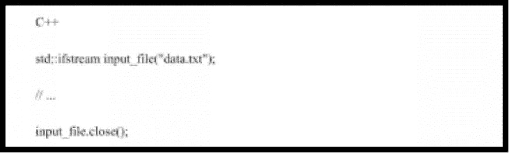
* 低级文件操作：使用 `open`、`read`、`write` 和 `close` 等系统调用直接操作文件。

## 网络 I/O

* Sockets：使用 `socket` API 进行网络通信。
* 异步 I/O：采用异步编程模型实现高效的网络操作。

## 标准输入输出

* `cin` 和 `cout`：用于控制输入输出。
* 格式化 I/O：使用 `printf` 和 `scanf` 进行格式化输出和输入。

## C++ 中的并发

C++ 提供了多种并发编程机制，包括线程、进程和异步编程。

### 线程

* 使用 `<thread>` 头文件创建线程。
* 使用 `mutexes`（互斥量）、`condition variables`（条件变量）和 `semaphores`（信号量）管理线程同步。
* 利用线程池进行高效线程管理。
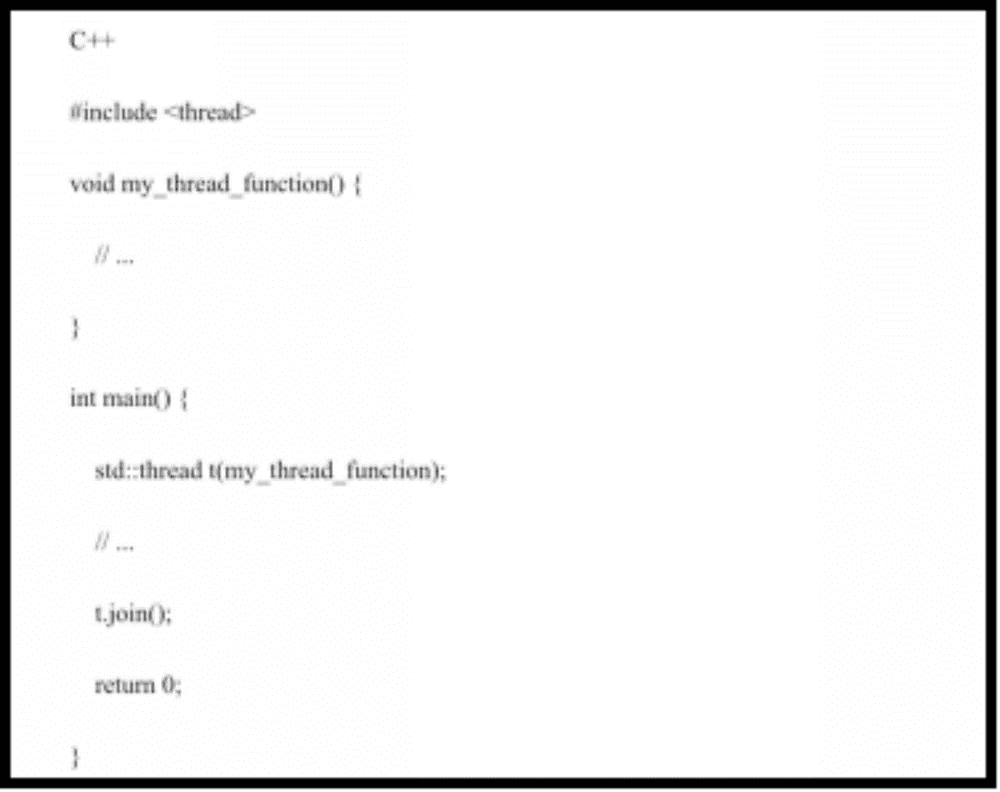

### 进程

* 使用 `fork` 系统调用创建进程。
* 使用 `pipes`（管道）、`shared memory`（共享内存）或 `message queues`（消息队列）进行进程通信。

### 异步编程

* 使用异步 I/O 模型进行非阻塞操作。
* 使用 `Boost.Asio` 等库进行异步网络编程。

### 并发注意事项

* 注意竞态条件和死锁。
* 根据问题领域选择合适的并发模型。
* 优化线程同步以提高性能。

## Linux 系统编程中的 C++ 内存管理与指针

### 理解指针

指针是 C++ 的基础，在系统编程中尤为关键。指针是存储内存地址的变量。这允许直接操作内存，对于与硬件交互、高效数据结构和低级内存管理等任务至关重要。
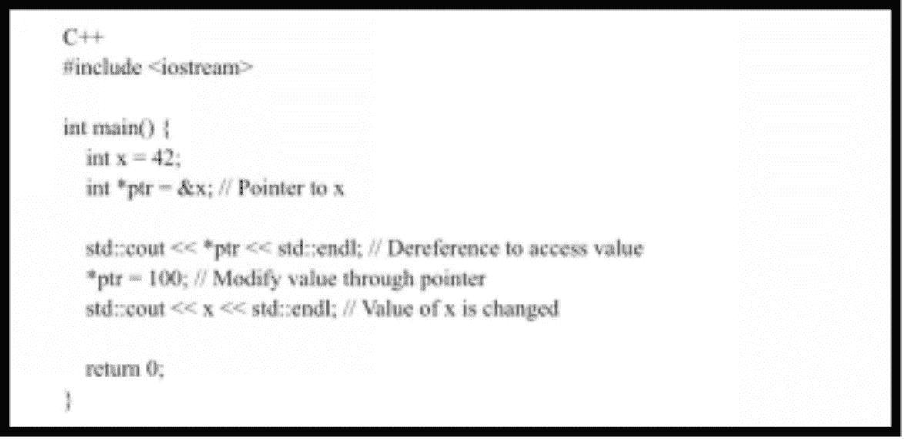

### 内存分配与释放

C++ 提供了两种内存管理方式：手动和自动。

#### 手动内存管理

* `new` 和 `delete`：这些运算符用于在堆上分配和释放对象。

* `malloc` 和 `free`：这些是用于分配和释放原始内存的 C 风格函数。


#### 自动内存管理

* 智能指针：这些对象自动管理对象的生命周期，防止内存泄漏。

```cpp
#include <memory>

std::unique_ptr<int> ptr(new int(42)); // 唯一所有

std::shared_ptr<int> shared_ptr(new int(42)); // 共享所有
```

### C++程序的内存布局

理解 C++ 程序中内存组织对于高效内存管理至关重要。主要的内存区域有：

* 栈（Stack）：用于函数调用、局部变量和返回地址。
* 堆（Heap）：用于通过 `new` 或 `malloc` 动态分配的内存。
* 数据段（Data segment）：存储全局和静态变量。
* 代码段（Code segment）：存储可执行代码。

### 常见的内存管理陷阱

* 内存泄漏：未能释放不再需要的内存。

* 悬挂指针：指向已释放内存的指针。

* 双释放：尝试释放已经释放的内存。

* 缓冲区溢出：写入超出数组分配内存范围。

### 内存管理最佳实践

* 尽可能使用智能指针以避免手动内存管理错误。
* 小心数组索引以防止缓冲区溢出。
* 使用 `valgrind` 或其他内存泄漏检测工具查找内存问题。
* 对于大内存分配考虑内存池以提高性能。
* 理解程序的内存布局以优化内存访问模式。

### 高级内存管理技术

* 内存映射：将文件映射到内存中以便高效访问。
* 虚拟内存：使用操作系统的虚拟内存系统进行内存管理。
* 内存映射 I/O：通过内存直接访问硬件寄存器。


通过理解这些概念并遵循最佳实践，标准模板库 (STL) 同样具有巨大的价值。

## 标准模板库 (STL)

标准模板库 (STL) 是 C++ 的基石。

### STL 组件

STL 主要由以下部分组成：

1. 容器（Containers）：存储元素。例如 `vector`、`list`、`map`、`set`。
2. 算法（Algorithms）：对容器的操作函数。
3. 迭代器（Iterators）：用于访问元素。

### 系统编程中的容器

虽然数组可能是自然选择，但 STL 容器提供了：

* `vector`：动态调整大小的数组，具有高效的随机访问。
```cpp
#include <vector>
std::vector<int> data;
data.push_back(42);
data.push_back(10);
```
* `deque`：双端队列，在两端插入效率高。
```cpp
#include <deque>
std::deque<int> queue;
queue.push_back(1);
queue.push_front(2);
```
* `list`：双向链表，在容器中间插入和删除的效率高。
```cpp
#include <list>
std::list<int> mylist;
mylist.push_back(3);
mylist.insert(mylist.begin(), 2);
```
* `map` 和 `set`：根据键存储元素的关联容器。
```cpp
#include <map>
std::map<std::string, int> ages;
ages["Alice"] = 30;
ages["Bob"] = 25;
```

### 系统编程中的算法

STL 算法提供了一种强大且高效的方法处理容器内的数据。

* 搜索：`find`、`binary_search`、`lower_bound`、`upper_bound`。
* 排序：`sort`、`stable_sort`、`partial_sort`。
* 修改：`copy`、`fill`、`transform`、`remove`、`remove_if`。
* 数值：`accumulate`、`inner_product`、`partial_sum`。

示例：


### 系统编程中的迭代器

迭代器提供了访问容器内元素的方法。它们对于算法和编写泛代码至关重要。

* 输入迭代器：只读访问，只能使用一次。
* 输出迭代器：只写访问。
* 前向迭代器：只读访问，可以多次使用，但只能向一个方向移动。
* 双向迭代器：读写访问，可以在两个方向移动。
* 随机访问迭代器：读写访问，可以任意顺序访问元素。

## STL 与系统性能

虽然 STL 提供了高层次的抽象，但在系统编程中考虑性能影响至关重要。

* 容器选择：容器的选择取决于访问模式和插入/删除频率。
* 算法复杂度：注意算法的时间和空间复杂度。


- `Iterator invalidation`:迭代器失效：理解容器操作如何影响迭代器。
- `Custom allocators`:自定义分配器：为了细粒度的内存管理，可以考虑使用自定义分配器。

# STL 与特定特定的库

STL 可以与特定特定的库集成，用于文件 I/O、网络编程和并发等任务。例如，你可以使用 `std::vector` 存储从文件中读取的数据，或使用 STL 算法处理网络数据包。

STL 是系统程序员的一项非常有价值的工具，提供了高效且灵活的数据结构和算法。通过理解它的组件和权衡，你可以利用 STL 编写健壮且高性能的系统级代码。

## 系统编程中的 STL：特定用与性能优化

虽然 STL 通常与通用编程相关，但它在系统编程中有许多应用。

### 数据结构与算法

- **网络数据包处理**：使用 `vector` 或 `deque` 存储包数据，并使用 `find` 或 `sort` 等算法对数据包进行过滤和处理。
- **文件 I/O**：使用 `vector` 或 `string` 对从读取或写入文件的数据进行缓冲。
- **系统调用封装**：使用 `templates` 和 `algorithms` 为系统调用创建通用封装，以提高代码的可用性。
- **内核数据结构**：虽然不能直接应用于用户空间，但 STL 的概念可以为内核开发的高效数据结构提供灵感。

### 使用 STL 进行性能优化

- **容器选择**：根据访问模式选择合适的容器。例如，`vector` 是随机访问的理想选择，而 `list` 更适合插入和删除。
- **算法选择**：根据数据大小和排序标准仔细选择算法。对于大型数据集，考虑具有更好复杂度的算法，例如带有优化实现的 `std::sort`。
- **迭代器使用**：在修改容器时注意 `iterator invalidation`。高效地使用迭代器以避免不必要的开销。
- **自定义分配器**：对于对性能敏感的应用，创建自定义分配器来控制内存的分配和释放。

### 示例：使用 STL 处理数据包

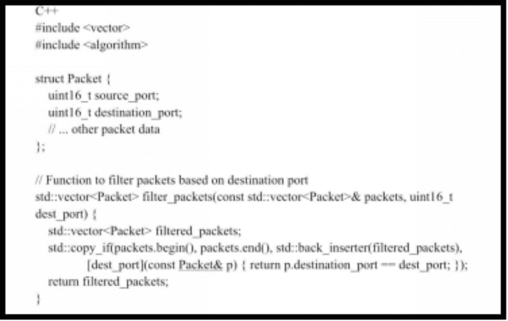

## STL 与系统性能考虑

虽然 STL 提供了许多优势，但意识到潜在的性能影响至关重要：

- **STL 开销**：在对性能极其敏感的代码中，STL 的抽象开销可能是可见的。考虑使用原始指针或数组以获得最大性能。
- **内存分配**：STL 容器涉及动态内存分配，这可能会引入延迟。对于实时系统，仔细的内存管理至关重要。
- **迭代器失效**：注意容器操作如何影响迭代器以避免未定义行为。

## STL 与 C++ 标准库扩展

许多 C++ 标准库扩展提供了为系统编程定制的额外数据结构和算法。例如，`<unordered_map>` 和 `<unordered_set>` 提供了基于哈表的容器，在某些情况下比 `map` 和 `set` 更高效。

STL 是一个多功能工具，可以有效地用于系统编程。通过理解它的优点、缺点和性能影响，你可以利用 STL 编写高效且可维护的代码。

# 第 3 章

## C++ Linux 系统编程中的进程管理：Fork、Exec、Wait

在 Linux 中，进程管理是系统编程的一个基础。`fork`、`exec` 和 `wait` 系统调用是创建和管理进程的关键工具。

### Fork

`fork` 系统调用创建一个新进程（称为子进程），它是父进程的精确副本。子进程继承父进程的内存、打开的文件和其他资源。然而，它们是独立执行的。

这是一个简单的示例：

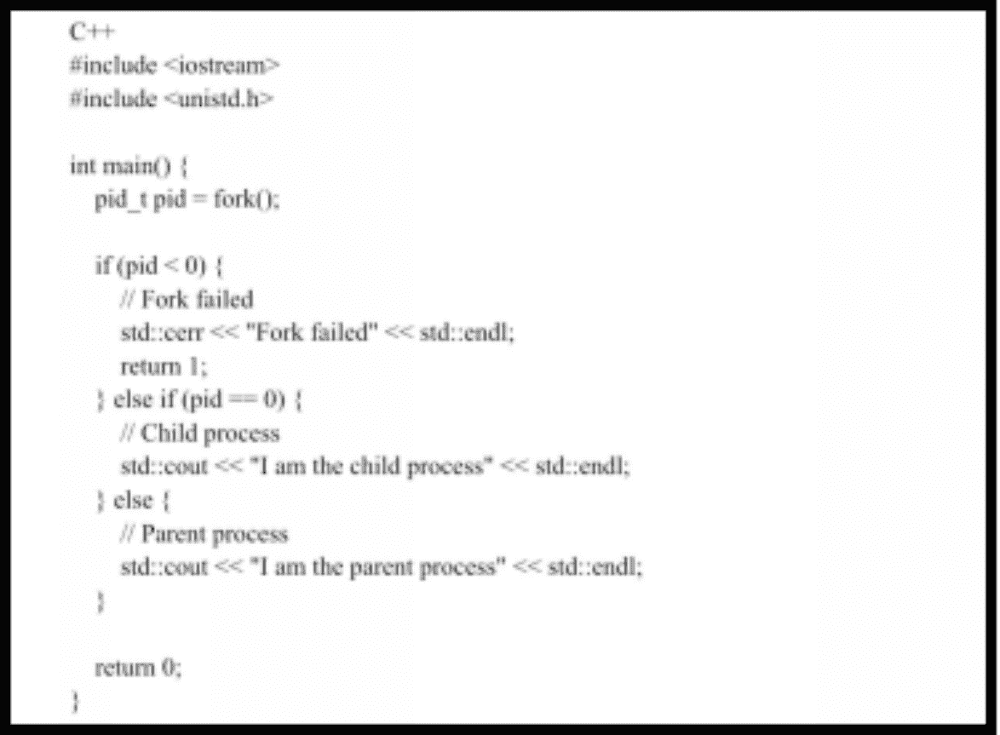

`fork` 函数返回一个值：

- `-1`：发生错误。
- `0`：在子进程中。
- 子进程的 `PID`：在父进程中。

### Exec

`exec` 系列函数用新映像替换当前进程映像。这意味着当前进程被终止并被具有不同执行文件的新进程替换。

这是一个使用 `execl` 的示例：

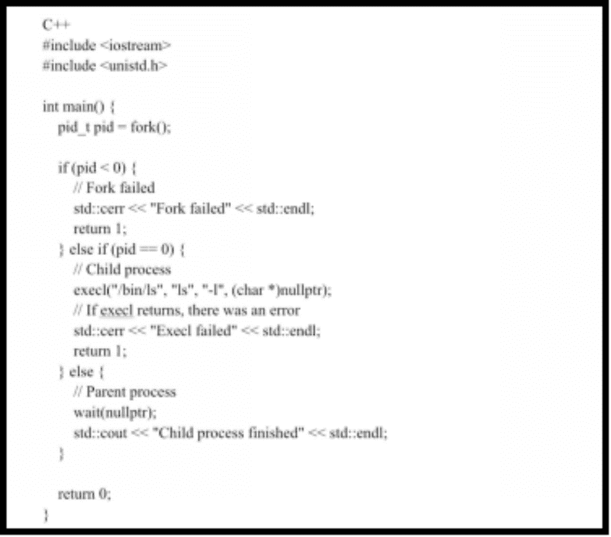

有多个带有不同参数列表的 `exec` 函数：

- `execl`：接受数量数量参数。
- `execv`：接受参数数组。
- `execlp`：与 `execl` 类似但在 `PATH` 环境变量中搜索执行文件。
- `execvp`：与 `execv` 类似但在 `PATH` 环境变量中搜索执行文件。

### Wait

`wait` 系统调用挂起调用进程，直到其中一个子进程终止。它返回已终止子进程的 `PID`。

这是一个示例：

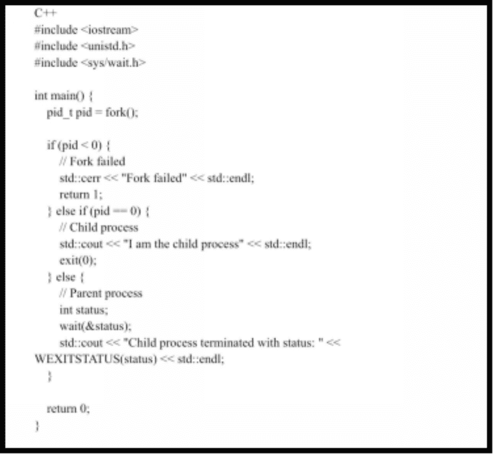

`waitpid` 函数是 `wait` 的更灵活的版本，允许你指定要等待哪个子进程。

### 常见用例

- 创建多个进程并发执行任务。
- 执行外部程序。
- 在继续之前等待子进程完成。
- 管理进程的生命周期和资源。

## 注意事项

字体 使用 `fork`、`exec` 和 `wait` 时，错误处理至关重要。
- 创建子进程时小心文件描述符和内存管理。
- 使用带有适当标志的 `waitpid` 来控制 `wait` 用的行为。
- 考虑使用 `signals` 进行进程通信和同步。

### 基础之外

- 探索 `clone` 系统调用以进行更细粒度的创建。
- 学习进程组和会话以管理进程关系。
- 理解僵进程的概念以及如何避免它们。
- 研究高级管理技术，如 `IPC`（进程间通信）。

## C++ 系统编程中的文件 I/O

文件 I/O 是任何系统中的基础操作。它涉及与文件的交互。主要函数是 `open`、`read`、`write` 和 `close`。

### 打开文件

`open` 系统调用用于打开文件。它返回一个文件描述符，这是一个用于引用已打开文件的非负整数。

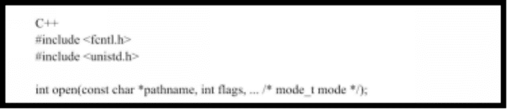

- `pathname`：文件的路径。
- `flags`：指定应如何打开文件。常见标志包括：
    - `O_RDONLY`：仅读打开。
    - `O_WRONLY`：仅写打开。
    - `O_RDWR`：读写打开。
    - `O_CREAT`：如果文件不存在则创建。
    - `O_TRUNC`：如果文件存在，则将其截断为零长度。
    - `O_APPEND`：将数据追加到文件末尾。
- `mode`：如果指定了 `O_CREAT` 则使用。它指定新创建文件的权限。

### 从文件读取

`read` 系统调用用于从打开的文件读取数据。

```cpp
#include <unistd.h>

ssize_t read(int fd, void *buf, size_t count);
```

- `fd`：打开的文件的描述符。
- `buf`：指向存储数据的缓冲区的指针。
- `count`：最多读取的字节数。

`read` 函数返回实际读取的字节数，如果发生错误则返回 -1。

### 写入文件

`write` 系统调用用于向打开的文件写入数据。

```cpp
#include <unistd.h>

ssize_t write(int fd, const void *buf, size_t count);
```

- `fd`：打开的文件的描述符。
- `buf`：指向包含写入数据的缓冲区的指针。
- `count`：写入的字节数。

`write` 函数返回实际写入的字节数，如果发生错误则返回 -1。

### 关闭文件

`close` 系统调用用于关闭打开的文件。

```cpp
#include <unistd.h>

int close(int fd);
```


```cpp
#include <unistd.h>

int close(int fd);
```

- `fd`: 要关闭的文件描述符。

`close` 函数在成功时返回 0，在发生错误时返回 -1。

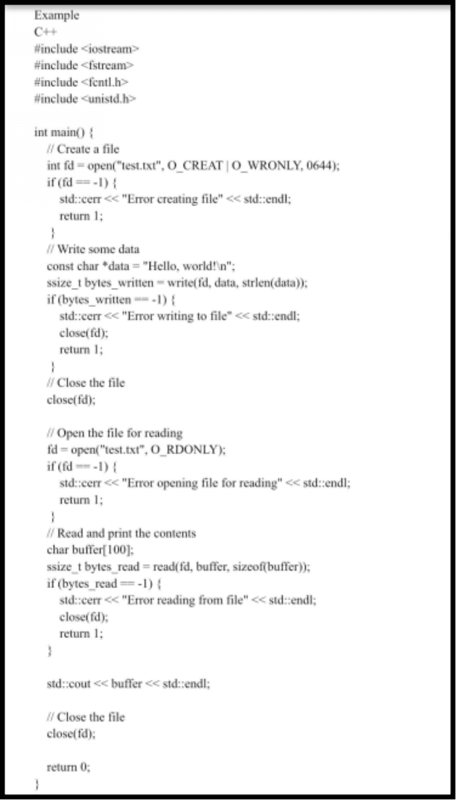

## 注意事项

- **错误处理**：始终检查系统调用的返回值以确认是否存在错误。
- **文件权限**：确保你的进程具有打开、读取和写入文件的必要权限。
- **缓冲**：考虑使用较大的缓冲区来提高性能，特别是在读取或写入大量数据时。
- **文件模式**：在创建文件时使用适当的文件模式来控制权限。
- **标准文件描述符**：文件描述符 `0`、`1` 和 `2` 分别与标准输入、标准输出和标准错误关联。
- **C++ 流**：虽然此示例使用了 C 风格的文件 I/O 函数，但 C++ 提供了更高级别的流（例如 `std::ifstream`、`std::ofstream`）用于文件 I/O 操作。

通过理解这些核心函数和概念，你可以有效地在 Linux 系统编程项目中执行文件 I/O 操作。

# Linux 系统编程中的高级文件 I/O

## 文件权限

文件权限决定了谁可以访问文件以及他们对文件可以做什么。它们在创建文件时，通过 `open` 系统调用中的模式参数进行设置。

### C++

```cpp
#include <sys/stat.h>

// 示例：创建一个文件，所有者具有读、写、执行权限，组具有读写权限，其他人读取权限

int fd = open("my_file", O_CREAT | O_WRONLY, S_IRUSR | S_IWUSR | S_IXUSR | S_IRGRP | S_IWGRP | S_IROTH);
```

`stat` 系统调用可以检索文件权限和其他信息：

### C++

```cpp
#include <sys/stat.h>

struct stat st;

if (stat("my_file", &st) == 0)
// 使用 st.st_mode 检查权限
```

## 文件锁

文件锁防止多个进程同时访问一个文件。这对于数据完整性至关重要。

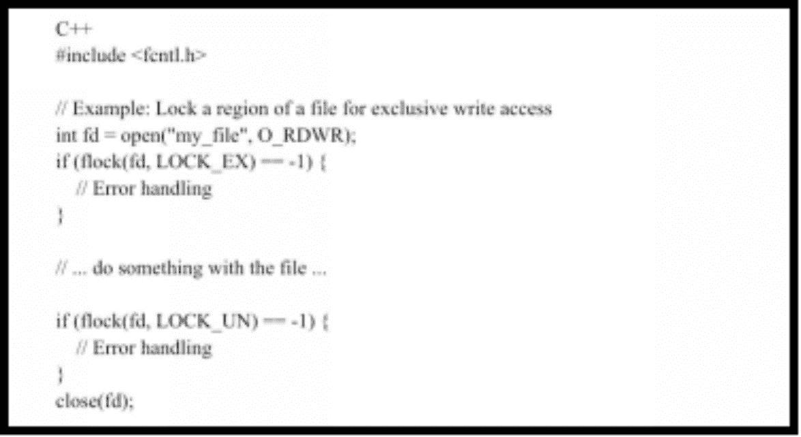

## 缓冲 I/O

标准 C 库提供了如 `fopen`、`fread`、`fwrite` 和 `fclose` 等用于高级文件操作的缓冲输出 函数。这些函数使用内部缓冲区来提高性能。

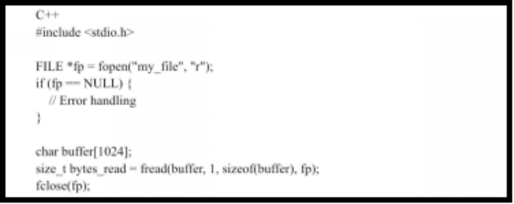

## 低级 I/O

为了对 I/O 操作进行更强的控制，可以使用 `read` 和 `write` 等低级系统调用。然而，你需要自己管理缓冲。

```cpp
#include <unistd.h>

int fd = open("my_file", O_RDONLY);

char buffer[1024];

ssize_t bytes_read = read(fd, buffer, sizeof(buffer));

close(fd);
```

## 文件描述符和文件表

当文件被打开时，内核会创建一个文件描述符，它是进程特定文件表中的索引。文件表项包含有关打开文件的信息，包括指向 inode 的指针、文件偏移量和文件状态标志。

## I/O 重定向

可以使用 `dup` 和 `dup2` 系统调用重定向标准输入、输出和错误。

```cpp
#include <unistd.h>

// 将标准输出重定向到文件

int fd = open("output.txt", O_CREAT | O_WRONLY, 0644);

dup2(fd, STDOUT_FILENO);

close(fd);
```

## 文件系统操作

除了基础 I/O 外，你还可以执行各种文件系统操作，如：

- 创建和删除目录
- 修改文件所有者和权限
- 链接和取消链接
- 管理硬链接和符号链接

这些操作通常使用 `mkdir`、`rmdir`、`chown`、`chmod`、`link`、`unlink` 等函数执行。

## C++ Linux 系统编程中的 IPC: 管道与套接字

进程间通信 (IPC) 是操作系统中的基本机制，允许多个进程进行交互和数据交换。本文深入探讨了两种主要的 IPC 方法：管道和套接字，重点关注它们在 C++ Linux 系统编程中的实现。

### 管道

管道是连接两个进程的单向通信通道。写入管道一端的数据可以从另一端读取。管道通常用于相关进程，例如一个进程的输出成为另一个进程的输入。

#### 创建管道

`pipe()` 系统调用创建一个管道。它返回一个包含两个文件描述符的数组：`fd[0]` 用于读取，`fd[1]` 用于写入。

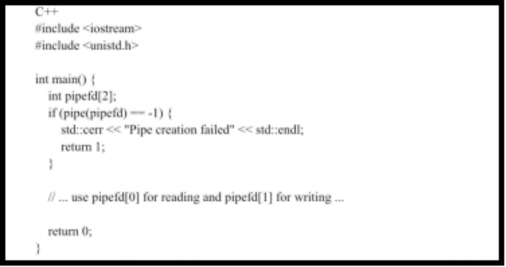

#### 使用管道

使用 `write()` 和 `read()` 系统调用分别从管道写入和读取数据。

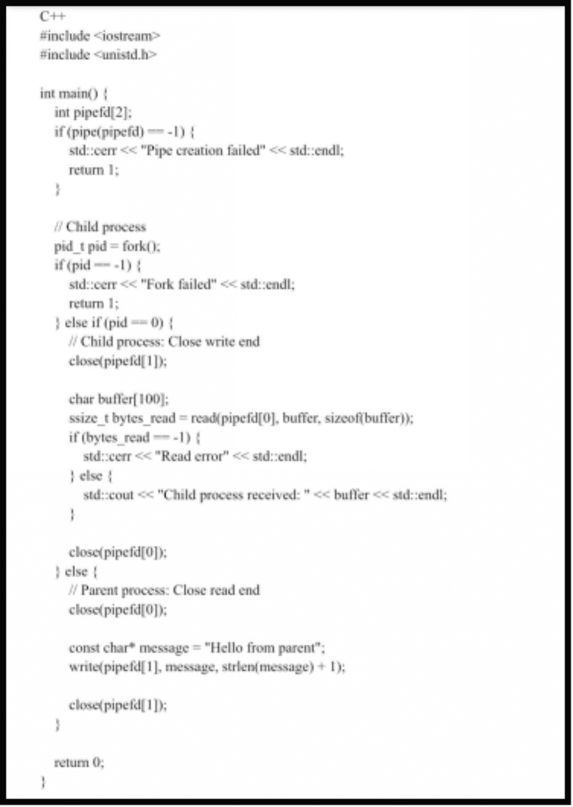

### 套接字

套接字提供了更灵活、更通用的 IPC 机制。它们可以用于同一机器上进程之间的通信，也可以用于网络通信。

#### 创建套接字

`socket()` 系统调用创建一个套接字。参数指定地址族（例如 IPv4 的 `AF_INET`）、套接字类型（例如 TCP 的 `SOCK_STREAM`）和协议（通常为 0）。

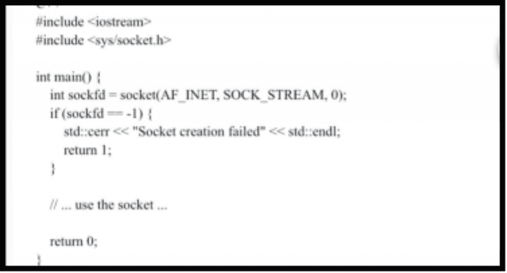

#### 绑定与监听

对于服务端套接字，你需要将套接字绑定到地址并监听传入的连接。

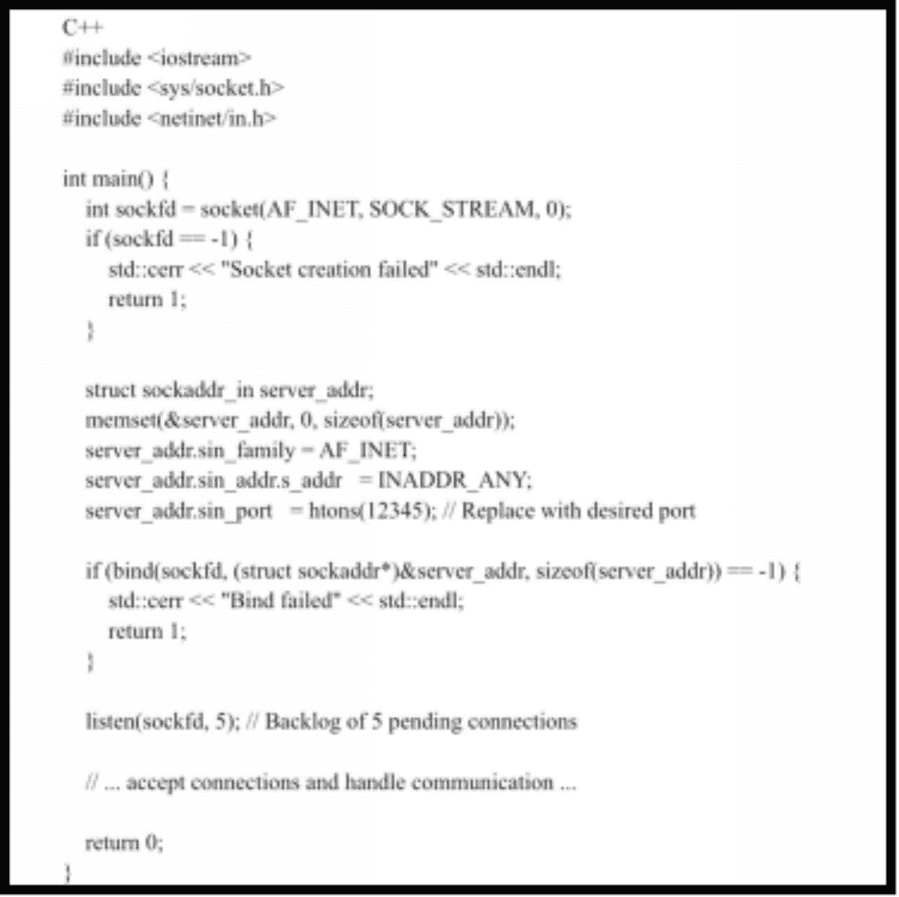

#### 连接与通信

对于客户端套接字，你需要连接到服务器，然后发送和接收数据。

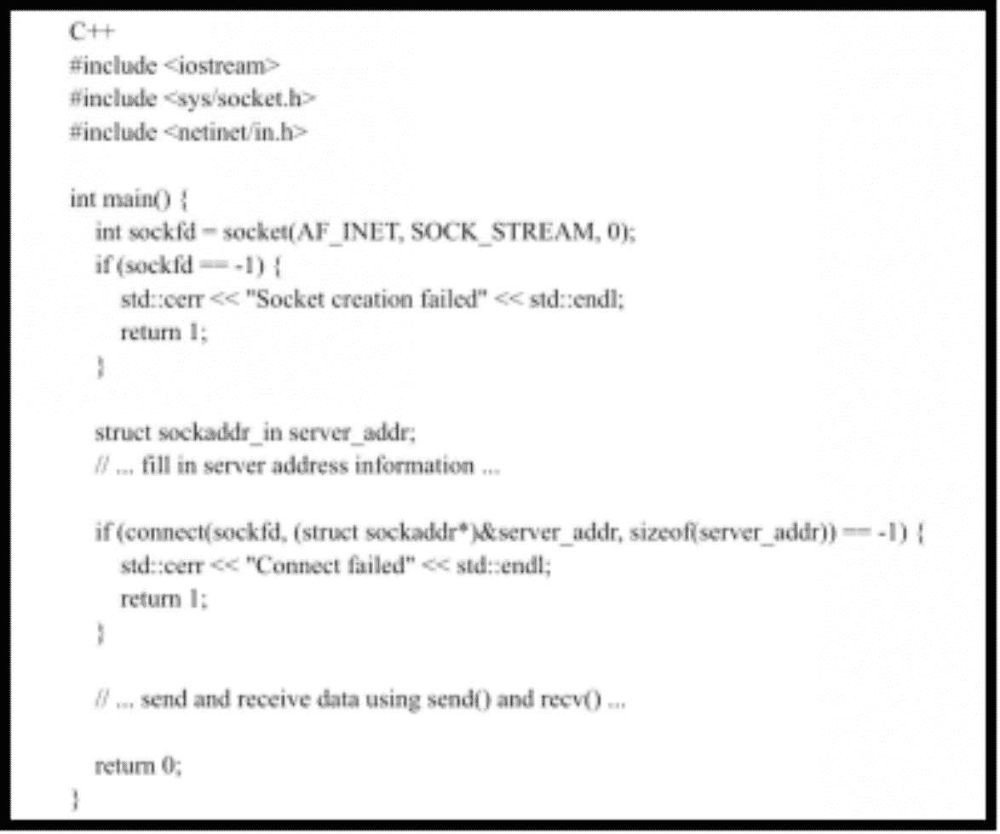

## 注意事项

- **错误处理**：始终检查系统调用的返回值以确认是否存在错误。
- **同步**：对于共享资源的并发访问，请考虑使用信号量或互斥锁等同步机制。
- **效率**：根据应用程序的具体需求选择合适的 IPC 机制。
- **安全**：注意安全影响，特别是在使用套接字进行网络通信时。

本文提供了 Linux 系统编程中管道和套接字的基本概述。了解更高级的用法，请参考 Linux 系统编程文档。

# 深入探讨 IPC：管道与套接字

## 具体用例

很棒的选择！让我们探索一下管道和套接字的一些具体用例。

### 管道

- **父子进程通信**：如我们所见，管道非常适合相关进程之间的简单数据传输。考虑一种场景：父进程生成数据并将其发送给子进程进行进一步处理。
- **流水线 (Pipelines)**：多个进程可以通过管道链在一起形成流水线。每个进程从其标准输入（连接到上一个进程的输出）读取，并写入其标准输出（连接到下一个进程的输入）。这在 Unix 类系统中用于分阶段处理数据时非常常见。
- **文件重定向**：管道可以用于重定向进程的标准输入或输出。例如，`ls -l | grep "txt"` 将 `ls -l` 的输出传递给 `grep`，以过滤以 ".txt" 结尾的文件。

### 套接字

- **网络应用**：套接字是大多数网络应用的基础，包括 Web 服务器、客户端、文件传输协议 (FTP)、电子邮件 (SMTP) 和即时消息。
- **跨机器进程间通信 (IPC)**：虽然管道局限于同一机器上的进程，但套接字可以促进不同机器进程之间的通信。
- **客户端-服务器架构**：套接字是构建客户端-服务器应用的理想选择，服务器进程监听传入的连接并多个客户端通信。

## 高级主题与考虑

### 管道局限性

- **单向性**：数据只能从写端流向读端。
- **有限缓冲**：管道具有内部缓冲区，如果读取进程比写入进程慢，可能会导致阻塞。
- **相关进程**：管道通常用于紧密相关的进程。

### 套接字类型

- **TCP (传输控制协议)**：可靠、面向连接、保证交付、有序交付、错误检查。
- **UDP (用户数据报协议)**：不可靠、无连接、不保证交付、无顺序、无错误检查、比 TCP 快。
- 其他套接字类型包括原始套接字 (raw sockets)、Unix 域套接字等。

### 套接字 API:


- `bind()`: 将 socket 与本地地址关联。
- `listen()`: 表明 socket 准备好接受连接。
- `accept()`: 接收一个入站连接。
- `connect()`: 与远程 socket 建立连接。
- `send()` 和 `recv()`: 在 socket 上发送和接收数据。
- `close()`: 关闭 socket。

### Socket 选项

- `SO_REUSEADDR`: 允许多个进程绑定到同一个地址和端口。
- `SO_KEEPALIVE`: 启用心跳探针以检查连接存活状态。
- `SO_LINGER`: 控制关闭 socket 的行为。
- 还有许多其他选项用于微调 socket 行为。

### Socket 安全

- `Encryption` (加密): 使用 `TLS/SSL` 等加密协议保护传输中的数据。
- `Authentication` (身份验证): 使用身份验证机制验证对方身份。
- `Authorization` (授权): 根据用户权限控制对资源的访问。

# 使用 C++ Linux 系统编程中的信号处理

## 信号简介

信号是发送给进程的异步通知，用于指示某个事件。它们可以由内核、其他进程甚至进程本身生成。一些常见的信号包括：

- `SIGINT`: 中断（通常由 `Ctrl+C` 生成）
- `SIGTERM`: 终止请求
- `SIGKILL`: 立即杀死进程
- `SIGSEGV`: 段错误
- `SIGALRM`: 闹钟信号

## 使用 `signal()` 处理信号

`signal()` 函数是处理信号最简单的方法。它接受两个参数：信号编号和指向信号处理函数的指针。

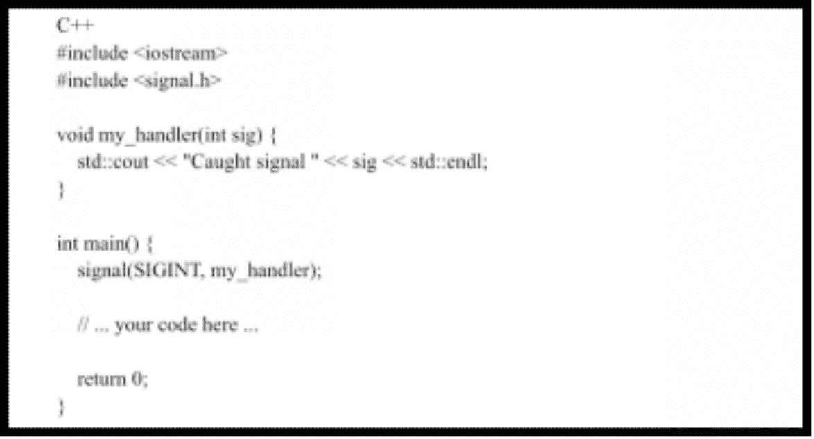

然而，`signal()` 有其局限性：

- 它不是线程安全的。
- 每个信号只能安装一个处理器。
- 处理器返回后，`signal` 的行为并不总是确定的。

## 使用 `sigaction()` 处理信号

`sigaction()` 函数对信号处理提供了更强大的控制：

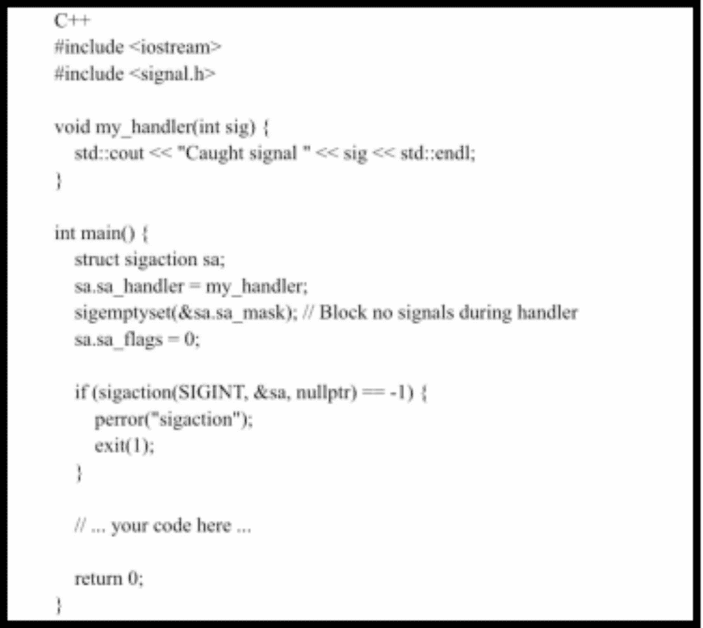

`sigaction` 结构提供了更多选项：

- `sa_handler`: 指向信号处理函数的指针。
- `sa_mask`: 信号集，指定在处理器执行期间应该阻塞哪些信号。
- `sa_flags`: 额外的标志位，例如 `SA_RESTART` 用于重新启动被中断的系统调用。

## 信号掩码

`sigprocmask()` 函数可阻塞或取消阻塞信号：

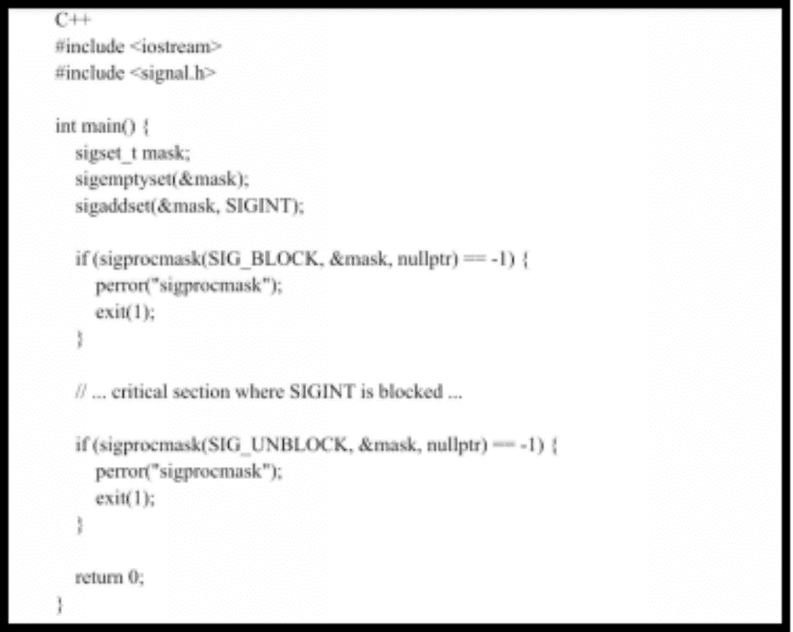

## 挂起信号

`sigpending()` 函数可用于检查挂起的信号：

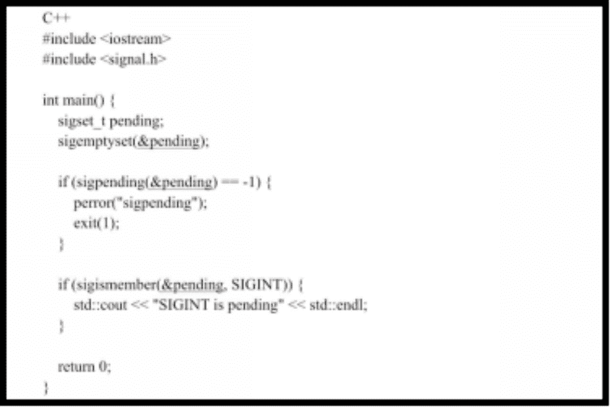

## 常见信号处理场景

- 优雅退出: 处理 `SIGINT` 和 `SIGTERM` 以在退出前执行清理操作。
- 错误处理: 处理 `SIGSEGV` 和 `SIGABRT` 等信号，以记录错误并提供信息性消息。
- 超时: 使用 `SIGALRM` 为操作实现超时。
- 进程间通信: 信号可用于进程之间的简单通信。

## 注意事项

- 信号处理器应尽可能短且简单。避免在处理器内部执行复杂的操作。
- 注意重入性问题。信号处理器可以在任何时候被调用，即使你的程序正处于关键区时也是。
- 使用 `sigaction()` 代替 `signal()` 以获得更多的控制和灵活性。
- 考虑在信号处理器中使用异步信号安全函数。
- 彻底测试你的信号处理代码。

## 示例：优雅退出

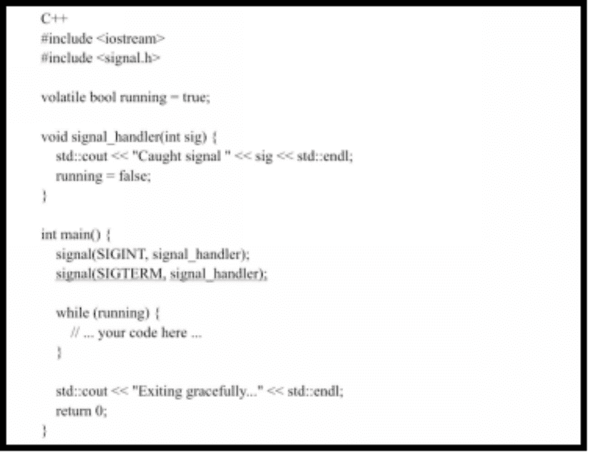

通过理解并有效使用信号，你可以在 Linux 系统编程中编写更健壮、恢复能力更应用程序。

# 使用 C++ Linux 系统编程中的时间与调度

时间和调度是系统编程的基础方面。Linux 提供了一系列丰富的函数和系统调用来操作时间并控制进程执行。本文将探索使用 C++ 的一些关键概念和实践示例。

## 测量

### 时间相关的数据结构

- `time_t`: 表示日历时间，自 Unix 纪（1970 年 1 月 1 日 00:00:00 UTC）以来过的秒数。
- `struct tm`: 存储分解的时间信息（年、月、日、时、分、秒等）。

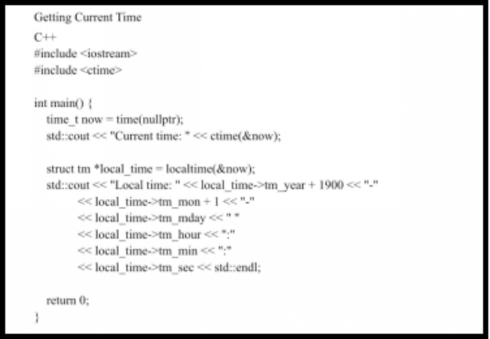

### 高精度定时器

为了获得更精确的时间测量，使用 `clock_gettime`：

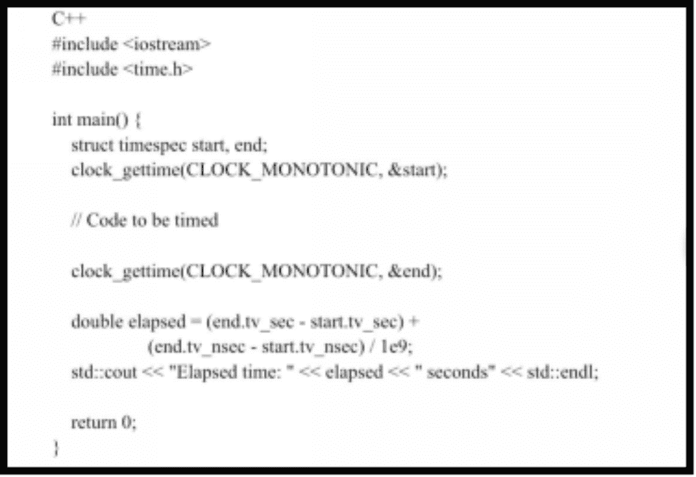

## 调度

Linux 提供了各种机制来控制进程调度：

### 调度策略

- `SCHED_OTHER`: 标准时间分片策略。
- `SCHED_FIFO`: 先进先出实时策略。
- `SCHED_RR`: 轮询实时策略。

### 设置调度策略和优先级

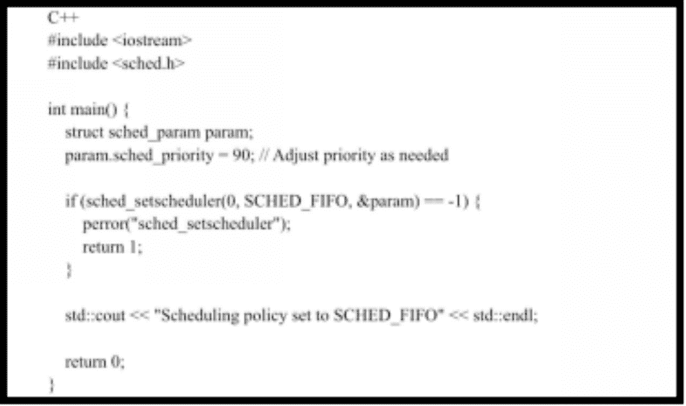

注意：设置实时优先级需要相应的权限。

### 睡眠与闹钟

- `sleep`: 挂起当前进程指定的秒数。
- `usleep`: 挂起当前进程指定的微秒数。
- `alarm`: 调度指定秒数后向进程发送信号。

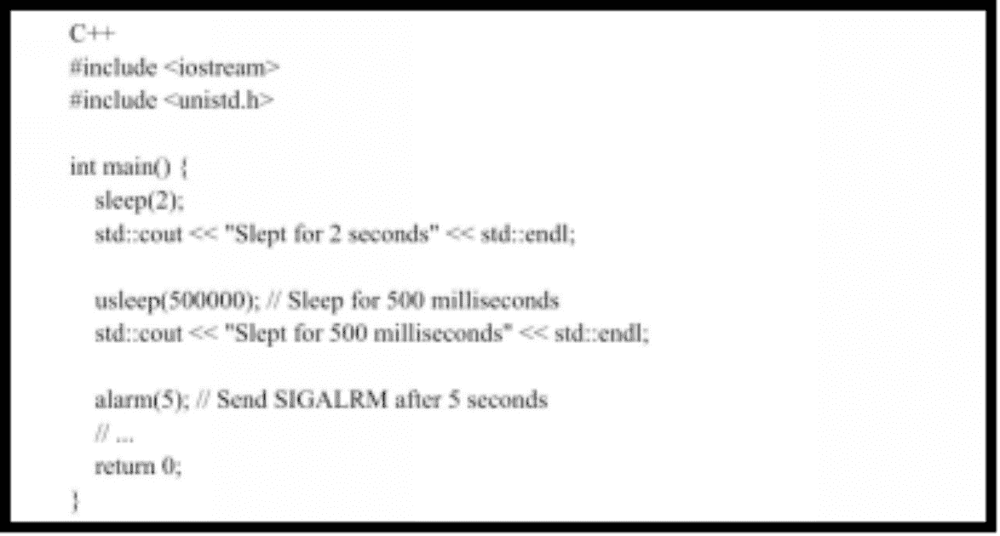

### 定时器

- `timer_create`, `timer_settime`, `timer_delete`: 创建、设置和删除定时器。
- `timerfd_create`, `timerfd_settime`: 创建和设置基于定时器的文件描述符。

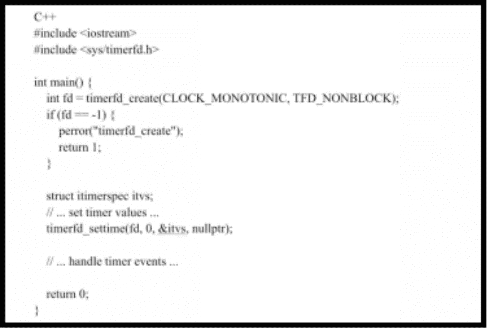

## 高级主题

- 实时调度: 对于需要精确计时的关键应用，探索时钟同步、低延迟内核和实时操作系统 (RTOS) 等高级技术。
- 高性能定时器: 对于极精确的测量，使用硬件特定的定时器或性能计数器。
- 调度算法: 理解不同的调度算法（例如 FIFO、RR、基于优先）以及它们对系统性能的影响。
- 线程调度: 探索线程调度概念以及它们与进程调度的区别。

时间和调度对于构建高效且响应的应用程序至关重要。Linux 提供了一系列丰富的工具和 API 来管理时间并控制进程执行。通过理解这些概念并利用适当的函数，你可以创建结构良好且高性能的软件。

# 第 4 章

## 使用 C++ Linux 系统编程中的虚拟内存、分页与交换

虚拟内存是现代操作系统（包括 Linux）中的一个基本概念。它在物理内存和运行在系统上的进程之间提供了一个抽象层。这种抽象允许进程能够感知到连续的地址空间，即使物理内存是碎片化的。分页和交换是实现虚拟内存的关键机制。

### 虚拟内存

虚拟内存是一种允许进程访问比物理可用内存更多的内存的技术。这是通过将进程的地址空间划分为“页”，并在这些页未被活动使用时将其存储在磁盘上实现的。当进程需要访问当前不在物理内存中的页时，会发生页错误，操作系统会将所需的页从磁盘带入内存。

虚拟内存的主要优势是：

- 增加进程隔离性：进程无法直接访问彼此的内存。
- 高效的内存利用：物理内存可以在多个进程之间共享。
- 更大的地址空间：进程的地址空间可以比可用的物理内存大。

### 分页

分页是一种内存管理方案，将虚拟地址空间划分为固定大小的块，称为“页”(pages)。物理内存也被划分为固定大小的块，称为“帧”(frames)。当进程被加载到内存时，它的页会被映射到物理帧。操作系统使用页表维护这种映射关系。


# 页表
页表是一种存储虚拟页与物理帧之间映射的数据结构。页表中的每个条目都包含对应页面所在的帧号，以及访问权限和页面状态等其他信息。


# 交换 (Swapping)
交换是一种内存管理技术，涉及将整个进程在主内存和次级存储（通常是磁盘）之间移动。当物理内存满时，操作系统会选择一个进程将其交换到磁盘。稍后当该进程需要再次执行时，它会被交换回内存。

交换的效率低于分页，因为涉及涉及整个进程的移动，这可能非常耗时。然而，对于物理内存有限的系统来说，它是很有用的。

## 实现考虑因素
虽然 C++ 为内存管理提供了强大的抽象，但虚拟内存和分页的直接操作通常由操作系统处理。然而，理解这些概念对于高效的内存使用和调试至关重要。

- 内存分配：使用 `malloc` 和 `free` 进行动态内存分配。C++ 标准库在内部处理内存管理，但意识到内存泄漏和碎片化至关重要。
- 虚拟内存限制：注意操作系统施加的虚拟内存限制。超过这些限制会导致内存溢出错误。
- 缺页中断：虽然你无法在 C++ 中直接处理缺页，但理解它们对性能的影响是重要的。
- 内存映射：考虑使用内存映射文件来实现高效的文件 I/O。

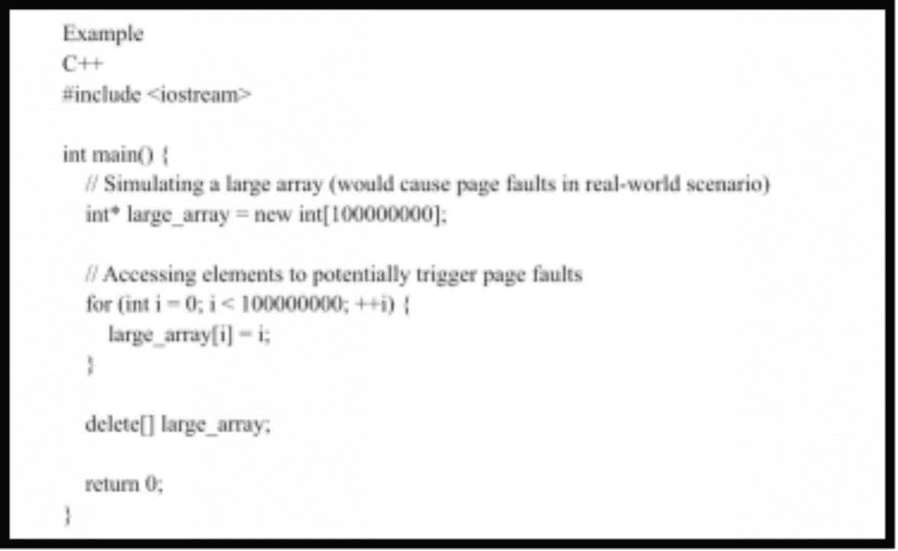

注意：这段代码是一个用于说明虚拟内存概念的简化示例。在实践中，操作系统会自动处理内存管理。

虚拟内存、分页和交换是复杂的课题，对系统性能和资源利用有重大影响。虽然 C++ 程序员通常不直接与这些机制交互，但理解它们的底层原理对于编写高效且可靠的代码至关重要。

### 额外主题：
- 内存映射文件
- 共享内存
- 虚拟内存性能优化
- 现代操作系统中的内存管理

通过掌握虚拟内存的基础知识，你可以对 C++ 应用程序中的内存使用做出明智决策，并有助于提高系统性能。

# 使用 C++ 进行 Linux 系统编程中的内存分配与释放
内存管理是系统编程的一个关键方面。在 C++ 中，程序员对内存分配和释放具有控制权，这对于构建高效且健壮的应用程序至关重要。本文将深入探讨使用 C++ 进行 Linux 系统编程时内存分配和释放的机制。

## 内存分配
内存分配是指为程序预留特定数量内存的过程。在 C++ 中，内存分配有两种主要方法：

### 1. 静态内存分配
- 编译时分配：内存在线编译时分配，并在整个程序执行期间保持固定。
- 存储期：全局变量和静态变量具有静态存储期，意味着它们贯穿整个程序的生命周期。
- 示例：


### 2. 动态内存分配
- 运行时分配：根据程序需求在运行时分配内存。
- 灵活性：允许更高效的内存使用，因为程序可以根据需要请求内存。
- 操作符：C++ 提供了 `new` 和 `delete` 操作符用于动态内存分配和释放。

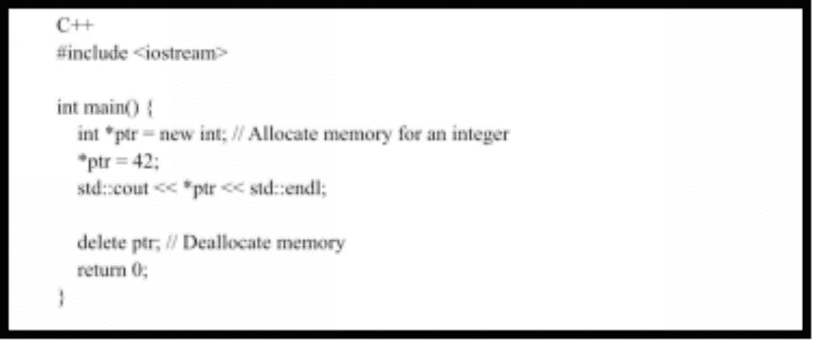

### 使用 malloc 和 free 进行内存分配
虽然主要用于 C 语言，但 `malloc` 和 `free` 也可以在 C++ 中用于动态内存分配。

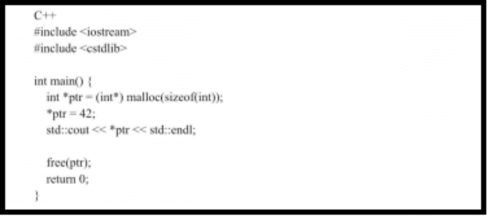

### 使用 calloc 进行内存分配
`calloc` 类似于 `malloc`，但会将分配的内存初始化为零。

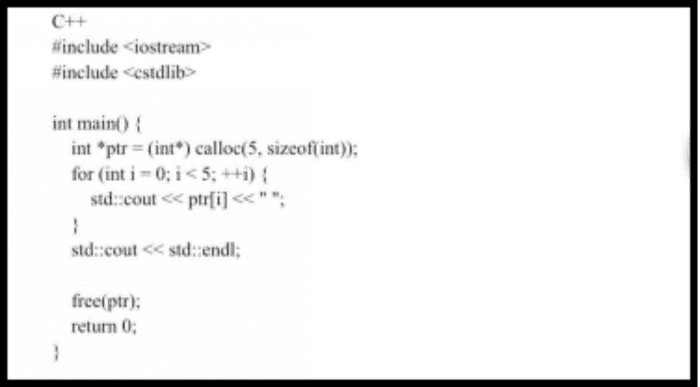

## 内存释放
内存释放是释放不再需要的内存的过程。未能释放内存会导致内存泄漏，从而降低应用程序的性能稳定性。

### 使用 delete
对于使用 `new` 分配的对象，使用 `delete` 释放内存。


### 使用 free
对于使用 `malloc`、`calloc` 或 `realloc` 分配的内存，使用 `free` 释放内存。


## 内存管理挑战
- 内存泄漏：当分配了内存但未释放时，会导致内存耗尽。
- 悬指针：内存释放后指向无效内存位置的指针。
- 重复释放：尝试释放已经释放的内存，导致未定义行为。

## 最佳实践
- 使用智能指针（例如 `std::unique_ptr`、`std::shared_ptr`）自动管理内存。
- 尽可能避免使用原始指针。
- 在解引用之前检查空指针。
- 使用 `valgrind` 或其他内存泄漏检测工具查找内存问题。
- 在特定场景下考虑使用内存池进行性能优化。

## 额外考虑
- 内存对齐：某些数据类型需要特定的内存对齐以获得最佳性能。
- 内存碎片：过度的分配和释放会导致内存碎片，减少可用内存块。
- 虚拟内存：操作系统管理虚拟内存，在物理内存之上提供了一个抽象层。

有效的内存管理对于编写高效且可靠的 C++ 程序至关重要。理解不同的内存分配技术及其影响对于防止内存相关问题至关重要。通过遵循最佳实践并使用适当工具，你可以显著提高应用程序的性能稳定性。

# 内存池：优化内存分配

### 理解内存池
内存池是一种通过预分配大块内存并将其分为较小块来提高内存分配和释放性能的技术。这种方法可以显著减少与系统调用和内存碎片相关的开销。

内存池的主要优势：
- 提高性能：通过避免频繁调用内存分配系统，内存池可以大幅提升性能，特别是对于频繁分配和释放内存的应用程序。
- 减少碎片：通过从预分配的块中分配和释放块，内存池可以帮助最小化内存碎片。
- 可定制分配大小：内存池可以针对特定的分配大小进行定制，优化特定数据结构的内存使用。

### 基础实现
简单的内存池可以如下实现：

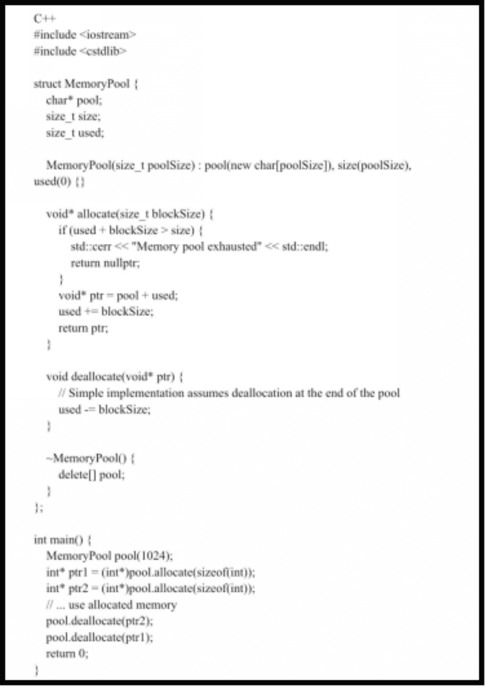

该实现为内存池提供了基础。然而，它存在局限性：
- 它不支持池内任意块的释放。
- 它没有考虑内存对齐要求。
- 缺乏错误处理和健壮性。

### 高级考虑因素
更健壮的内存池实现应该解决以下问题：
- 空闲列表管理：实现数据结构来跟踪池中的空闲块。
- 内存对齐：确保分配的块对于不同的数据类型正确对齐。
- 线程安全：如果在多线程环境内存池，必须采用适当的同步机制。
- 内存压缩：为了解决碎片问题，考虑实现内存压缩机制，将分配的块移动在一起。
- 定制：允许用户指定块的大小和池的大小。

# 如何有效地使用内存池


-   识别合适的用例：内存池对于频繁进行小内存分配和释放的应用最为有利。
-   选择正确的池大小：应该根据应用程序的内存使用模式仔细选择池的大小。
-   考虑内存对齐：根据数据类型的要求对内存块进行对齐，避免性能损失。
-   实现适当的错误处理：优雅地处理内存耗尽和其他错误。
-   性能分析与优化：衡量使用内存池对性能的影响，以确保它们提供了实际益处。

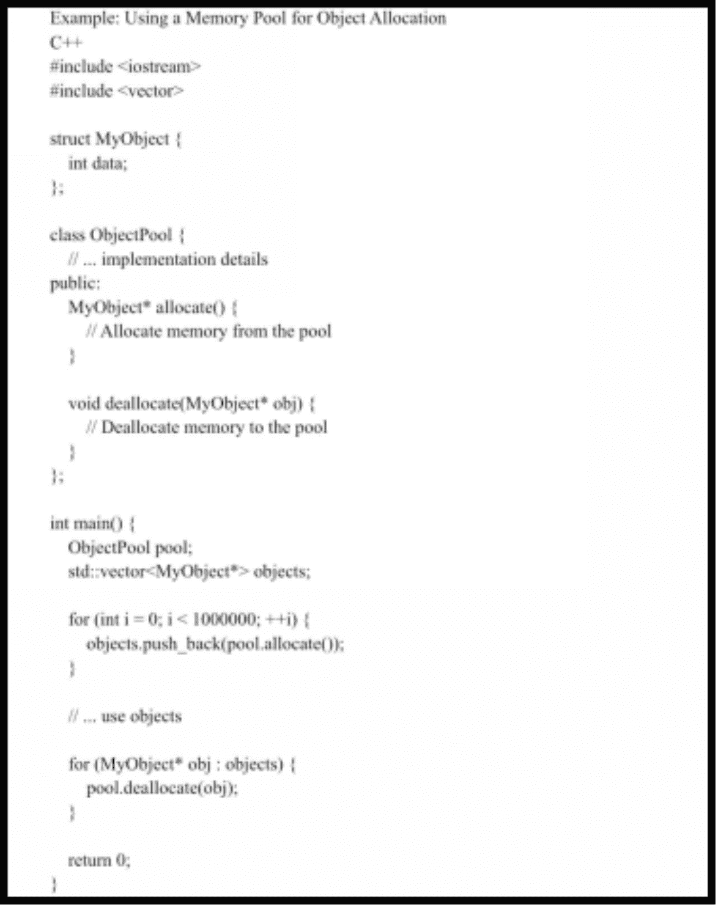

通过使用内存池进行对象分配，与直接使用 `new` 和 `delete` 相比，你可能提高性能并减少内存碎片。

## 使用 C++ 进行 Linux 系统编程中的内存泄漏与调试

### 理解内存泄漏

当程序分配了内存但在不再需要时未能释放它时，就会发生内存泄漏。随着时间的推移，这会导致可用内存逐渐耗尽，可能引起性能下降、应用程序崩溃甚至系统不稳定。

### 内存泄漏的常见原因

- 忘记调用 `delete` 或 `free`：未能释放动态分配的内存。
- 资源泄漏：未关闭文件句柄、网络连接或其他资源。
- 循环引用：对象互相持有引用，导致垃圾回收失效（适用于带有垃圾回收的语言）。
- 智能指针使用不当：误用 `std::shared_ptr` 或 `std::unique_ptr` 可能导致泄漏。

### 检测内存泄漏

及早检测内存泄漏至关重要。可以使用多种技术和工具：

#### 1. 手动检查

- 代码审查：仔细检查代码中是否存在潜在的内存泄漏，特别是在复杂的分配和释放模式中。
- 内存使用监控：使用 `top` 或 `free` 等工具监控系统内存使用情况。如果内存占用持续增加而没有相应的释放，则可能表明存在泄漏。

#### 2. 基于调试器的检测

- GDB：GNU 调试器 (`GDB`) 可用于检查程序执行期间的内存使用。如 `info malloc` 等命令可以提供有关分配内存块的信息。
- Valgrind：该工具专门为检测内存错误设计，包括泄漏、无效内存访问和未初始化内存。它提供了关于内存使用的的详细报告。

#### 3. 内存泄漏检测工具

- AddressSanitizer (`ASan`)：作为 Clang/LLVM 工具链的一部分，`ASan` 可以检测包括泄漏在内的各种内存错误。
- Leak Detector：一个可以集成到 C++ 项目中检测内存泄漏的独立工具。
- 自定义内存分配器：实现具有泄漏检测能力的自定义内存分配器可以提供更细粒度的控制。

### 调试内存泄漏

一旦检测到内存泄漏，下一步是识别其根源。以下是一些常见的调试技术：

- 打印语句：插入 `printf` 或 `cout` 语句以跟踪内存分配和释放点。
- 内存性能分析：使用 `Valgrind` 等工具分析内存使用并识别内存热点。
- 代码简化：临时移除不必要的代码以隔离泄漏点。
- 减少测试用例：创建能够复现泄漏的最小测试用例。

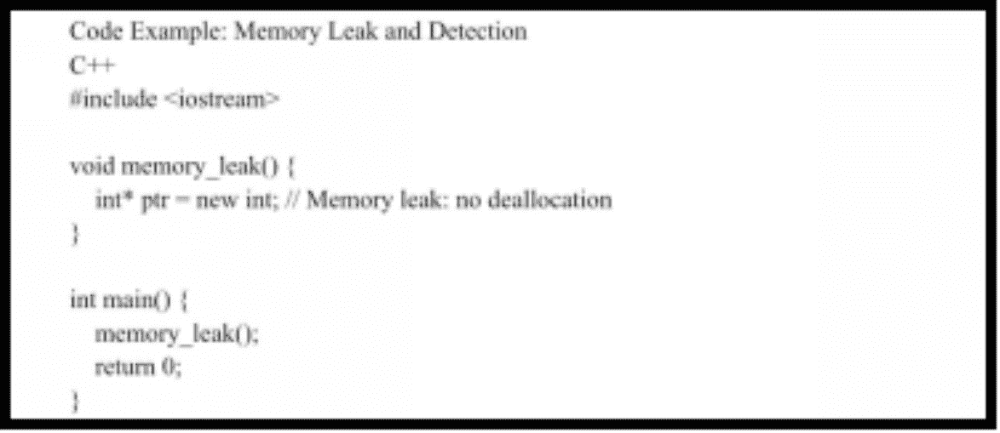

使用 `Valgrind` 检测此泄漏：

```bash
valgrind ./my_program
```

`Valgrind` 将输出一份指示内存泄漏的详细报告。

### 防止内存泄漏

- 使用智能指针：`std::unique_ptr` 和 `std::shared_ptr` 可以帮助自动管理内存。
- RAII（资源获取即初始化）：在构造函数中获取资源并在析构函数中释放它们。
- 谨慎使用原始指针：如有必要，谨慎使用原始指针并确保妥善释放。
- 代码审查和测试：定期审查代码中的潜在泄漏，并编写单元测试来涵盖内存相关的方面。

### 其他考虑

- 内存碎片：虽然不是严格的泄漏，但过度的内存分配和释放会导致碎片，减少可用内存。
- 性能影响：内存泄漏会随着时间的推移降低应用程序性能。
- 工具局限性：内存泄漏检测工具可能存在局限，例如误报或漏报。

内存泄漏可能是 C++ 程序中的严重问题，会导致性能和稳定性问题。通过理解内存泄漏的常见原因采用有效的检测技术并遵循最佳实践，你可以显著降低应用程序中内存相关问题的风险。

## 高级内存管理：智能指针

### 理解智能指针

智能指针是 C++ 内存管理的重大进步。它们封装了原始指针并提供了自动内存管理，有助于防止内存泄漏和悬挂指针。

### 智能指针类型

C++ 标准库提供了三种主要的智能指针类型：

#### 1. `std::unique_ptr`

- 表示独占所有权。
- 保证资源在 `unique_ptr` 出作用范围时恰好删除一次。
- 允许移动（move）。

#### 2. `std::shared_ptr`

- 表示共享所有权。
- 多个 `shared_ptr` 对象可以共享同一个资源的所有权。
- 当最后一个 `shared_ptr` 出作用范围时，资源被删除。
- 涉及引用计数。

#### 3. `std::weak_ptr`

- 不拥有资源，但可以用于观察 `shared_ptr`。
- 防止循环引用。
- 可用于检查对象仍然存在。

### 自定义删除器

你可以定义自定义删除器以特定方式处理资源清理。

### 智能指针使用最佳实践

- 需要独占所有权时优选 `std::unique_ptr`。
- 由于性能考虑，谨慎使用 `std::shared_ptr` 进行共享所有权。
- 使用 `std::weak_ptr` 循环引用。
- 尽可能避免原始指针。
- 理解不同智能指针类型的所有权语义。

## 高级主题

#### 智能指针的自定义分配器。
#### 智能指针与 STL 容器的兼容性。
#### 使用智能指针检测内存泄漏。

# 第 5 章

## 使用 C++ 进行 Linux 系统编程中的线程与进程

在操作系统领域，进程和线程是管理并发执行的基础概念。虽然它们都代表工作单元，但在资源共享和开销方面有显著差异。本文深入探讨进程与线程的区别，探索它们在 Linux 中使用 C++ 的实现。

### 进程

进程是运行中的程序实例。它封装了自身的地址空间、内存、打开的文件和其他资源。创建新进程涉及巨大的开销，因为操作系统需要分配并管理这些资源。

在 C++ 中，进程创建通常通过 `fork()` 系统调用实现。该函数创建一个子进程，子进程是父进程的精确副本，包括其内存空间。然而，`fork()` 的返回值对于父进程和子进程不同：

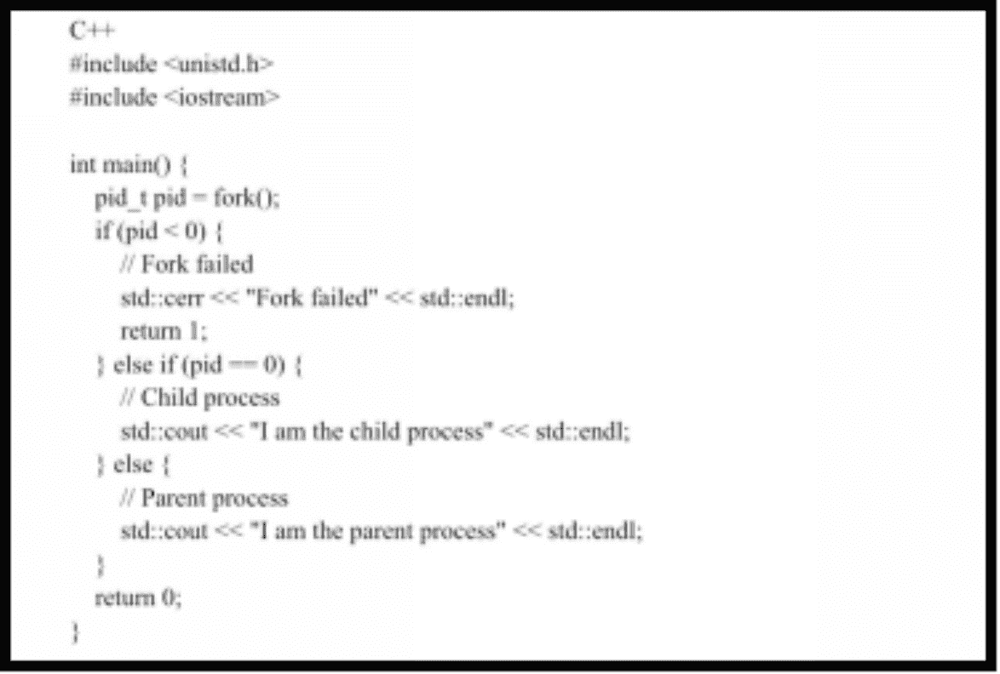


# 进程通信

进程可以通过多种机制进行通信，包括：

- `Pipes`（管道）：单向通信通道。
- `Named pipes`(命名管道）：命名管道允许无关进程之间进行通信。
- `Message queues`(消息队列）：存储消息以供后检索。
- `Shared memory`(共享内存）：进程间共享的内存区域。
- `Sockets`套字）：进程间的网络通信。

### 线程

线程是进程内的轻量级执行单元。线程共享进程的地址空间、打开的文件和其他资源，但有自己的栈和程序计数器。创建线程的代价远小于创建进程。

## 线程创建
在 C++ 中，线程创建通常使用 POSIX 线程 (`pthreads`) 库处理。使用 `pthread_create()` 函数创建新线程：

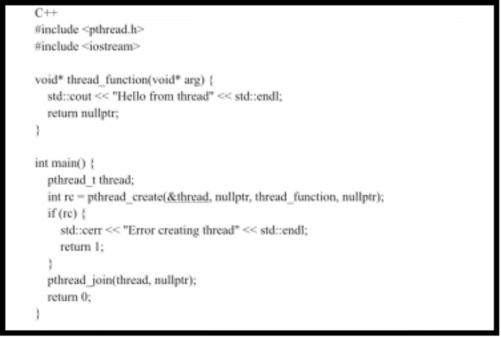

## 线程同步
由于线程共享进程的地址空间，同步对于防止竞态条件和数据损坏至关重要。常见的同步机制包括：

- `Mutexes`（互斥锁）：保护共享数据的互斥锁。
- `Condition variables`（条件变量）：允许线程等待特定条件的满足。
- `Semaphores`（信号量）：通用的同步原语。

# 线程与进程

| 特性 | 进程 | 线程 |
| :--- | :--- | :--- |
| 资源共享 | 独立 | 共享 |
| 创建开销 | 高 | 低 |
| 上文切换 | 昂贵 | 低廉 |
| 通信 | IPC 机制 | 共享内存、同步原语 |
| 可扩展性 | 受进程数量限制 | 在多核系统上可以更好地扩展 |

# 何时使用线程或进程

- `Independent tasks`(独立任务)：如果任务是相互独立的且需要隔离，请使用进程。
- `CPU-bound tasks`(CPU 密集型任务)：使用线程处理 CPU 密集型任务以利用多核优势。
- `I/O-bound tasks`(I/O 密集型任务)：使用线程让 I/O 操作与计算并行。
- `Shared data`(共享数据)：如果任务需要高效共享数据，请使用线程。
- `Scalability`(可扩展性)：考虑在多核系统上获得更好的扩展性。

理解进程和线程之间的差异对于在 Linux 中进行有效的并发编程至关重要。通过仔细考虑应用程序的特性，你可以选择合适的方法来优化性能和资源利用率。

**注意**：虽然本文提供了基本概述，但线程和进程管理还涉及许多其他细微差别和考虑。适当同步和错误处理对于可靠的多线程应用程序至关重要。

# 深入探讨：线程安全与死锁

## 线程安全
线程安全是多线程编程中的关键概念。它确保代码可以被多个线程同时安全执行，而不会导致数据损坏或意外行为。

线程安全的关键考虑因素：

- `Shared mutable state`(共享可变状态)：如果多个线程访问并修改相同的数据，则同步是必不可少的。
- `Reentrancy`(重入性)：函数应该是重入的，这意味着它们可以从多个线程安全地调用而互不干扰。
- `Atomic operations`原子操作)：对简单的读写操作使用原子操作以避免同步开销。

线程不安全的代码示例：

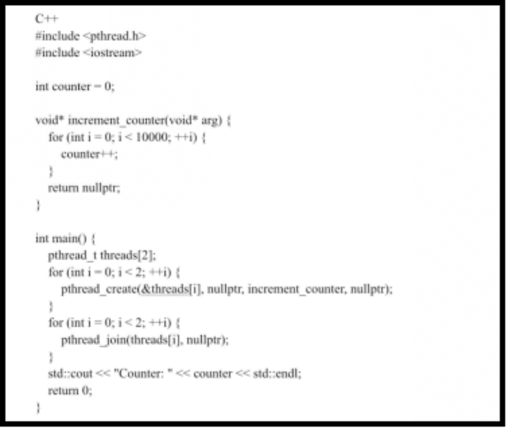

这段代码不是线程安全的，因为多个线程可以并发访问并修改 `counter`，导致不可预测的结果。

使用互斥锁使代码变得线程安全：

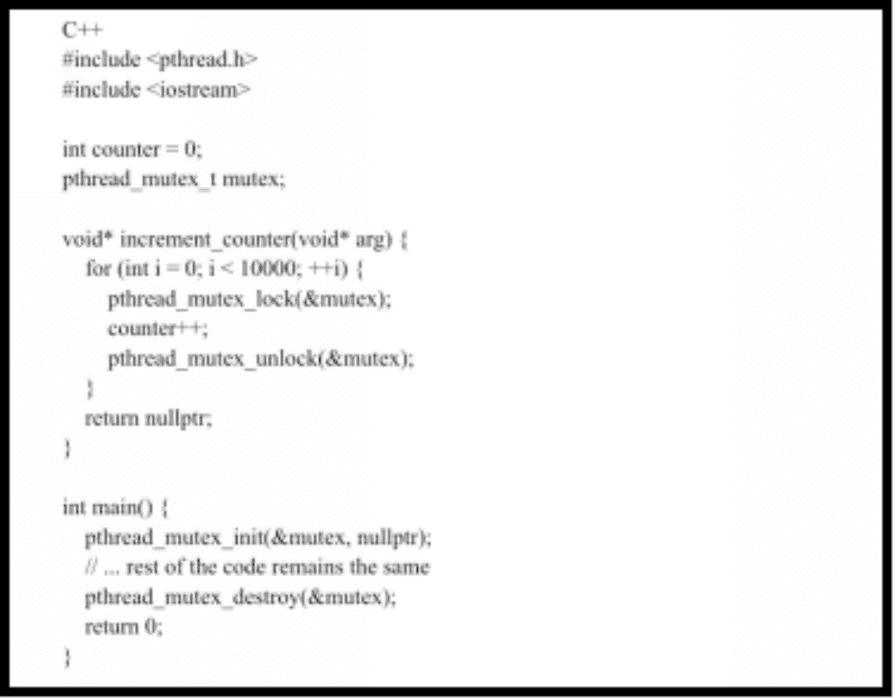

通过使用 `mutex`，我们确保一次只有一个线程可以访问 `counter`，从而防止竞态条件。

## 死锁
死锁发生在两个或多个线程被阻塞时，每个线程都在等待另一个线程持有的资源。这会导致停滞。

死锁发生的条件：

- `Mutual exclusion`(互斥)：资源一次只由一个线程独占。
- `Hold and wait`(持有并等待)：一个线程持有至少一个资源，并等待额外的资源。
- `No preemption`(非抢夺)：资源不能从线程中强制夺取。
- `Circular wait`(循环等待)：线程之间存在依赖链，每个线程都在等待链中下一个线程所持有的资源。

防止死锁：

- `Avoid nested locks`(避免嵌套锁)：按特定顺序获取锁。
- `Use timeoutsASA 使用超时)：为资源获取设置超时，以避免无限等待。
- `Deadlock detection and recovery`(死锁检测与恢复)：实现检测死锁并采取纠正措施的机制。

死锁示例：

```cpp
// 两个线程和两个互斥锁的代码
```

如果两个线程都获取了一个互斥锁，然后尝试获取另一个，就会发生死锁。

# 其他主题

- `Thread pools`(线程池)：高效管理线程的创建和重用。
- `Process groups`(进程组)：管理相关进程组。
- `Signals`(信号)：处理异步事件。
- `Inter-process communication (IPC) mechanisms`：管道、命名管道、消息队列、共享内存和套字的深度探索。

## 同步原语：互斥锁、信号量和条件变量

在并发编程中，同步原语是管理共享资源和协调多个线程执行的重要工具。它们有助于防止竞态条件、死锁和其他并发相关问题。本节将深入探讨三种基本的同步原语：互斥锁、信号量和条件变量。

### 互斥锁 (Mutexes)
互斥锁（mutual exclusion）是一种二值信号量，用于保护共享数据免受并发访问。它确保一次只有一个线程可以持有互斥锁，防止数据损坏。

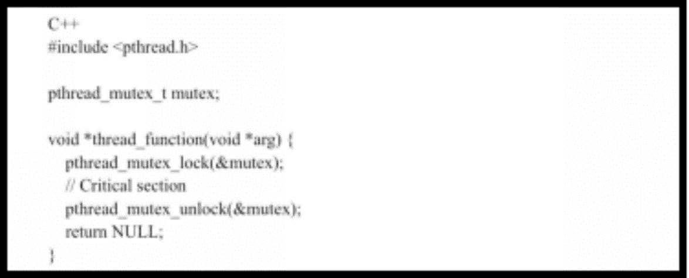

- `pthread_mutex_init`：初始化互斥锁。
- `pthread_mutex_lock`：获取互斥锁。如果互斥锁已被占用，线程将阻塞直到它变得可用。
- `pthread_mutex_unlock`：释放互斥锁。
- `pthread_mutex_destroy`：销毁互斥锁。

### 信号量 (Semaphores)
信号量是一种通用的同步原语，用于计算可用资源的数量。它可以用于互斥（类似于互斥锁），也可以用于控制对有限资源的访问。

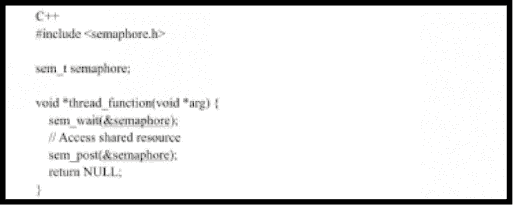

- `sem_init`：使用初始值初始化信号量。
- `sem_wait`：减少信号量值。如果值变为负数，线程阻塞。
- `sem_post`：增加信号量值。如果有阻塞的线程，其中一个将被解除阻塞。
- `sem_destroy`：销毁信号量。

### 条件变量 (Condition Variables)
条件变量用于信号共享条件的变化。线程可以在条件变量上等待，直到另一个另一个线程信号。它通常与互斥锁结合使用以保护共享条件。


- `pthread_cond_init`：初始化条件变量。
- `pthread_cond_wait`：阻塞线程直到条件变量被信号。在调用 `pthread_cond_wait` 之前必须持有互斥锁。
- `pthread_cond_signal`：通知等待条件变量的线程。
- `pthread_cond_broadcast`：通知所有等待条件变量的线程。
- `pthread_cond_destroy`：销毁条件变量。

# 选择正确的原语

同步原语的选择取决于问题的具体需求。

- `Mutexes`：最适合保护共享数据免受并发访问。
- `Semaphores`：适用于控制有限资源的访问或实现更复杂的同步场景。
- `Condition variables`：适用于等待特定条件的发生，通常用于生产者-消费者模式。

## 示例：生产者-消费者问题
生产者-消费者问题是一个经典的同步问题，可以使用条件变量和互斥锁解决。


# 其他考虑因素


- **死锁**：在使用多个同步原语时，请注意潜在的死锁。
- **性能**：同步原语的选择会影响性能。请考虑每个原语的开销。
- **正确性**：确保正确使用同步原语，以防止竞态条件和其他错误。
- **错误处理**：妥善处理错误，例如无法获取 `mutex` 或 `semaphore` 时。

通过理解并有效使用这些同步原语，你可以编写健壮且高效的多线程应用程序。

# 深入探索：信号量

## 深入理解信号量

我们已经提到过信号量作为一种通同步原语，但让我们更彻底地探索它的功能。

### 信号量基础

- **计数信号量 (Counting Semaphore)**：这种类型的信号量具有非负整数值。它用于控制对有限数量资源的访问。该值表示可用资源的数量。
- **二值信号量 (Binary Semaphore)**：计数信号量的一种特殊情况，最大值为 1。本质上，它的行为类似于 `mutex`。

### 信号量操作
- `sem_init`：使用指定的初始值初始化信号量。
- `sem_wait`：减少信号量值。如果值变为负数，线程将阻塞。
- `sem_post`：增加信号量值。如果有阻塞的线程，其中一个将被解除阻塞。
- `sem_destroy`：销毁信号量。

### 示例：资源池
考虑一种场景，你有数量有限的数据库连接。你可以使用 `semaphore` 来控制对这些连接的访问：

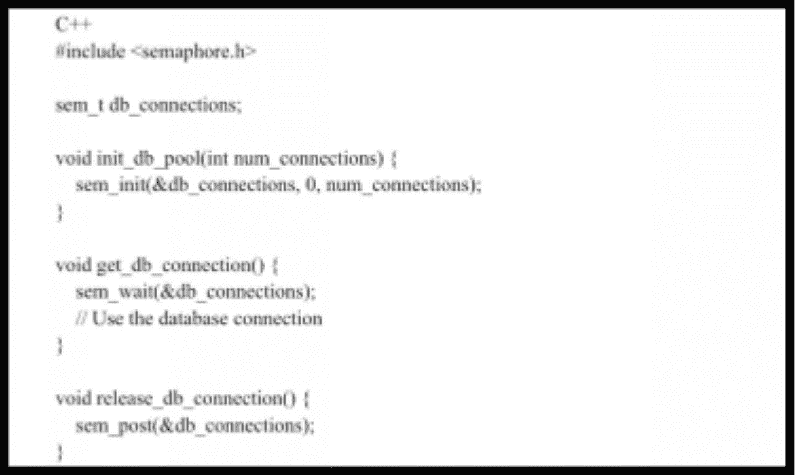

### 信号量高级用法

- **读写锁 (Reader-Writer Locks)**：虽然不是直接的信号量实现，但可以使用信号量构建读写锁，允许多个读取者或单个写入者访问共享资源。
- **屏障同步 (Barrier Synchronisation)**：信号量可以实现屏障，即多个线程等待所有线程到达特定点后继续。
- **生产者-消费者问题 (Producer-Consumer Problem)**：尽管通常优选条件变量，但信号量也可以解决生产者-消费者问题。

## 信号量 vs 互斥锁

虽然信号量和互斥锁都用于同步，但它们有不同的用途：
- **互斥锁 (Mutex)**：主要用于互斥，确保一次只有一个线程可以访问临界区域。
- **信号量 (Semaphore)**：更通用，既可用于互斥，也可用于控制对有限资源的访问。

### 何时使用信号量：
- 控制对资源池的访问
- 实现生产者-消费者模式（尽管通常优选条件变量）
- 在特定点同步多个线程（屏障）

### 关键考虑因素
- **正确性**：确保正确使用信号量，以避免死锁和其他问题。
- **性能**：考虑信号量操作的开销，特别是在对性能敏感的区域。
- **错误处理**：优雅地处理错误，例如无法获取信号量时。

# Linux 系统编程中的线程安全与竞态条件

## 理解线程安全
线程安全是并发编程中的一个关键概念，它确保一段代码可以被多个线程执行而不会导致数据损坏或意外行为。当多个线程访问共享数据时，存在竞态条件的风险，其结果取决于线程执行的不可预测顺序。

### 竞态条件
当两个或多个线程并发访问共享数据，且至少有一个线程修改数据时，就会发生竞态条件。程序的结果变得不确定，并往往会导致错误结果。

### 竞态条件示例：
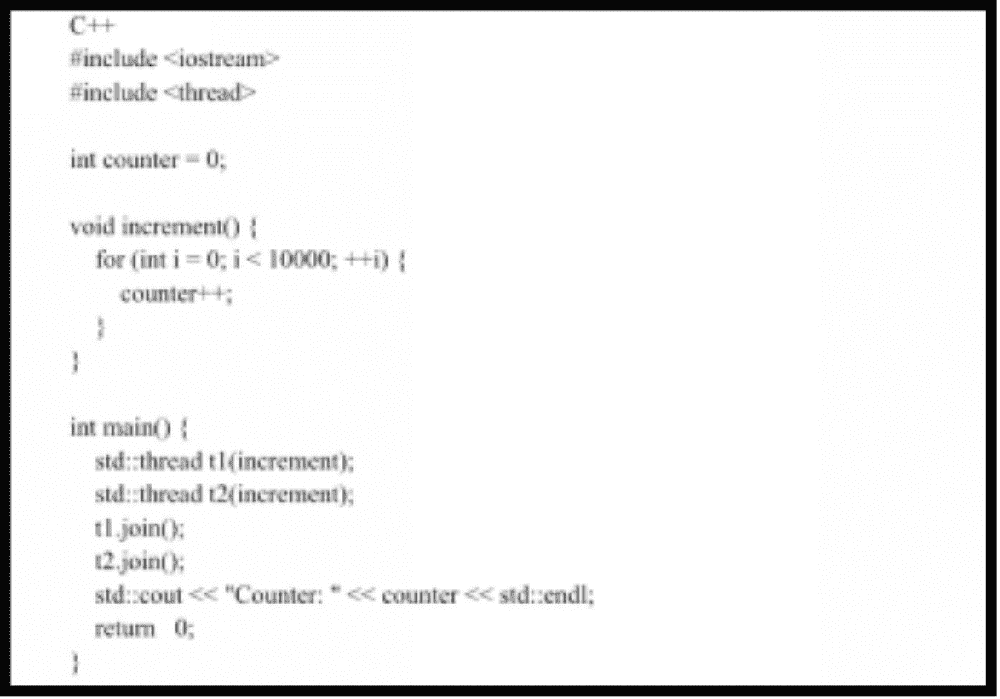

在此示例中，多个线程并发递增 `counter` 变量。由于竞态条件，`counter` 的最终值是预测的，且可能小于 20000。

## 使用同步防止竞态条件
为了确保线程安全并防止竞态条件，我们使用同步原语。这些机制控制对共享数据的访问，确保一次只有一个线程可以访问并修改它。

**互斥锁 (Mutexes)**：`mutex`（互斥）是一种二值信号量，用于保护共享数据免受并发访问。一次只有一个线程可以持有 `mutex`。

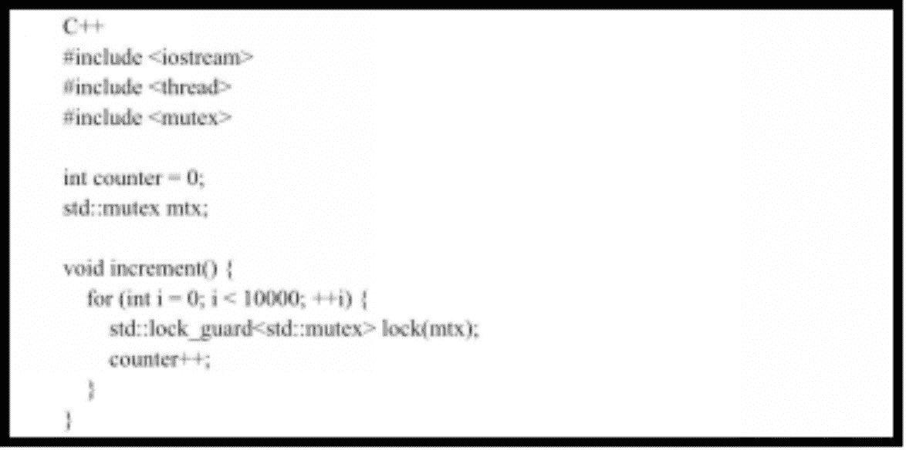

在这段代码中，`std::lock_guard` 确保在访问共享 `counter` 变量之前获取 `mutex`，并在锁离开范围时自动释放。

### 其他同步原语：
- **信号量 (Semaphores)**：互斥锁的泛化，允许多个线程访问资源直到达到计数。
- **条件变量 (Condition variables)**：用于基于条件的线程同步。
- **原子操作 (Atomic operations)**：对于简单的读写操作，可以使用原子操作而显式锁定。

## 常见陷阱与最佳实践
- **死锁**：避免锁之间的循环依赖。
- **饥饿**：确保公平分配资源，以防止线程被阻塞。
- **活锁 (Livelock)**：避免线程持续尝试获取资源的情况。
- **使用适当的同步原语**：为任务选择正确的工具。
- **保持临界区短**：最小化线程持有锁的时间以提高并发性。
- **充分测试**：在各种条件下严格测试多线程代码。

### 额外考虑因素
- **线程安全库**：可用时使用线程安全的版本的库。
- **性能影响**：注意同步的开销。
- **调试工具**：利用调试工具识别并修复竞态条件。

### 示例：生产者-消费者问题
生产者-消费者问题是线程同步的经典示例。生产者线程生成数据并将其放入共享缓冲区，而消费者线程从缓冲区中移除数据。

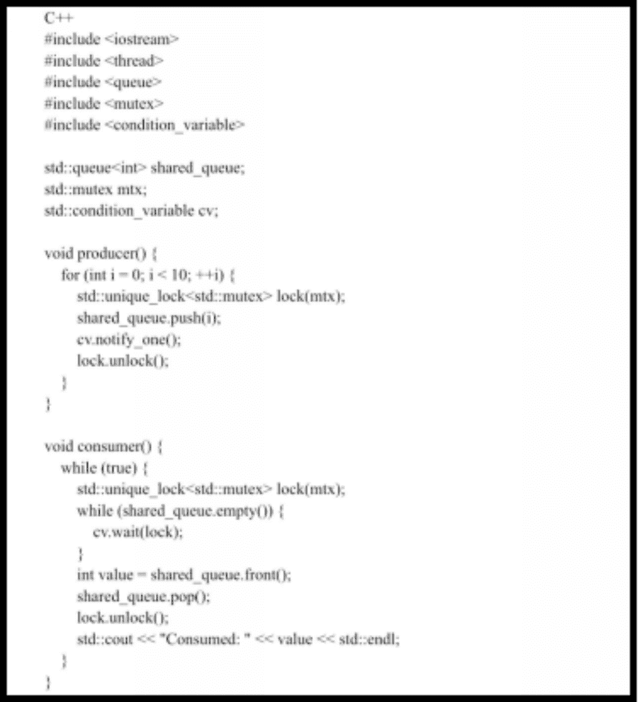

在此示例中，生产者和消费者线程使用 `mutex` 和 `condition variable` 来同步对共享队列的访问。生产者在有新数据可用时使用 `cv.notify_one()` 通知消费者，而消费者使用 `cv.wait()` 等待数据。

通过理解线程安全并有效使用同步原语，你可以在 Linux 系统编程中编写可靠高效的多线程应用程序。

# 深入探索：条件变量

## 理解条件变量
条件变量是同步原语，允许线程等待特定条件的满足。它们通常与 `mutexes` 配合使用以保护共享条件。

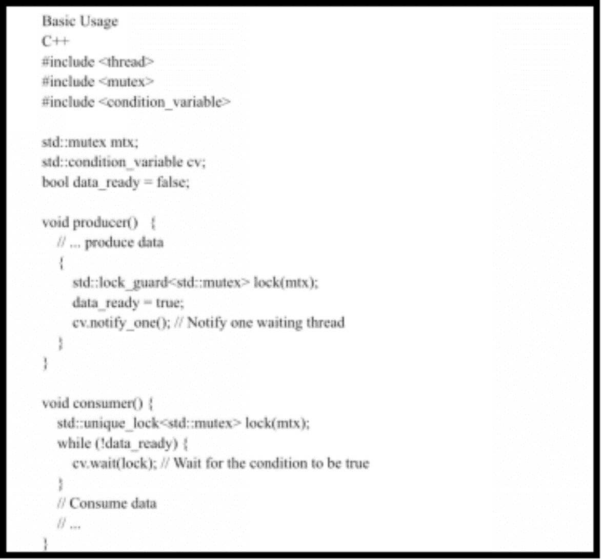

- `std::condition_variable::wait`：阻塞当前线程直到条件被信号。
- `std::condition_variable::notify_one()`：唤醒一个等待条件变量的线程。
- `std::condition_variable::notify_all()`：唤醒所有等待条件变量的线程。

## 高级用法
**虚假唤醒 (Spurious Wakeups)**：线程可能会在条件仍为假时被唤醒。这被称为虚假唤醒。为了处理这种情况，通常会使用 `while` 循环并在循环内部进行条件检查。

**假共享 (False Sharing)**：如果条件变量与其它共享数据距离过近，可能会发生假共享，从而降低性能。为了避免这种情况，请仔细对条件变量进行填充或对齐。

**条件变量组合 (Condition Variable Combinations)**：条件变量与其他同步原语结合，创建复杂的同步模式。


在本示例中，当缓冲区有空空间时会发出 `not_full` 信号，当有数据可消费时会发出 `not_empty` 信号。

# 条件变量 vs 信号量

条件变量和信号量都可以用于同步，但它们的目的不同：

- 信号量：主要用于计数资源或作为通用同步原语。
- 条件变量：专门为等待条件而设计，通常与 `mutexes`（互斥锁）配合使用。

## 何时使用条件变量：

- 等待特定条件的发生
- 生产者消费者模式
- 实现更复杂的同步场景

## 额外考虑

- 正确性：确保正确使用条件变量，以避免死锁和其他问题。
- 性能：考虑条件变量操作的开销。
- 错误处理：优雅地处理错误，例如当条件变量意外发送信号时。

通过理解条件变量，你可以有效地实现复杂的同步模式，并提高多线程应用程序的响应能力。

# 第 6 章

## 使用 C++ 进行 Linux 系统编程中的 Socket 和网络 API

Socket 是网络通信的底层构建块。它们为应用程序提供了在网络上发送和接收数据的接口。在 Linux 中，Socket 是通过一组系统调用和数据结构实现的。本文将深入探讨 Linux 上 C++ Socket 编程的基础，涵盖关键概念、代码示例和常用的网络 API。

## 理解 Socket

Socket 本质上是进程间通信的端点。它由三个组件组成：

- 域（Domain）：指定地址族（例如 IPv4 使用 `AF_INET`，IPv6 使用 `AF_INET6`）。
- 类型（Type）：定义通信样式（例如 TCP 使用 `SOCK_STREAM`，UDP 使用 `SOCK_DGRAM`）。
- 协议（Protocol）：指定要使用的协议（TCP 或 UDP 通常为 0）。

## 创建 Socket

使用 `socket()` 系统调用创建 Socket。这是一个示例：


## 绑定 Socket

在服务器开始监听连接之前，它必须将其 Socket 绑定到特定的地址和端口。使用 `bind()` 系统调用来实现此：


## 监听连接（服务器）

服务器使用 `listen()` 系统调用将其 Socket 置于监听状态：

```cpp
listen(sockfd, 5); // 队列中允许有 5 个等待的连接
```

## 接受连接（服务器）

当客户端连接到服务器时，服务器使用 `accept()` 系统调用接受连接：


## 连接服务器（客户端）

客户端使用 `connect()` 系统调用连接到服务器：


## 发送和接收数据

一旦建立连接，可以使用 `send()` 和 `recv()` 系统调用发送接收数据，或者使用它们高级的对应函数如 `write()` 和 `read()`。


## 关闭 Socket

通信完成后，应使用 `close()` 系统调用关闭 Socket：

```cpp
close(sockfd);
```

## 网络 API

Linux 提供了基本 Socket 函数之外的丰富网络 API。一些常见的包括：

- `gethostname()`：获取本地机器的主机名。
- `gethostbyname()`：将主机名解析为 IP 地址。
- `inet_addr()`：将点十进制 IP 地址转换为二进制地址。
- `inet_ntoa()`：将二进制 IP 地址转换为点十进制字符串。
- `getsockopt()`：检索 Socket 选项。
- `setsockopt()`：设置 Socket 选项。

## 额外考虑

- 错误处理：适当错误处理对于健壮的网络应用程序至关重要。
- 非阻塞 Socket：对于异步操作，考虑使用配合 `select()` 或 `poll()` 的非阻塞 Socket。
- Socket 选项：探索 `SO_REUSEADDR`、`SO_KEEPALIVE` 等 Socket 选项以精调 Socket 行为。
- 安全：实施适当的安全措施以防止网络攻击。
- 高级库：考虑使用 `Boost.Asio` 等高级库来处理更复杂的网络应用。

Socket 编程为构建网络应用提供了强大的基础。通过理解核心概念并使用提供的代码示例，你可以在 Linux 上使用 C++ 创建客户端和服务器。

注意：本文提供了基本概述。网络编程可能是复杂的，深入研究特定主题并为生产级应用考虑高级技术是必要的。

## UDP Socket：深度解析

UDP（用户数据报协议）是一种无连接协议，意味着它在发送数据之前不在端点之间建立可靠连接。它通常用于对速度和效率优先于保证交付的应用，例如实时音频/视频流、在线游戏和 DNS。


## 绑定 UDP Socket

与 TCP 类似，UDP Socket 也可以绑定到特定的地址和端口：


## 发送 UDP 数据报

要发送 UDP 数据报，使用 `sendto()` 函数：


## 接收 UDP 数据报

要接收 UDP 数据报，使用 `recvfrom()` 函数：


## UDP 和 TCP 的主要区别

- 面向连接 vs 无连接：TCP 是面向连接的，而 UDP 是无连接的。
- 可靠性：TCP 保证交付、排序和校验，而 UDP 没有。
- 速度：由于协议简单，UDP 通常比 TCP 快。
- 错误处理：TCP 自动处理错误，而 UDP 需要应用层处理。
- 头部开销：UDP 头部比 TCP 头部小。

## UDP 的用例

- 实时应用：在线游戏、视频会议
- DNS：域名系统
- 网络发现：DHCP、ARP
- 媒体流：直播

## 额外考虑

- 错误处理：由于 UDP 不保证交付，你需要实现自己的错误处理机制。
- 数据报丢失：准备好在应用程序逻辑中处理丢失的数据报。
- 数据报顺序：UDP 不保证数据报顺序，因此你可能需要对其进行重新排序。
- 校验和：UDP 包含用于检测错误的校验和，但不能保证能捕获所有错误。

### 客户端-服务器架构

客户端-服务器架构是一种分布式应用结构，在服务提供者（服务器）和服务请求者（客户端）之间划分任务或负载。这种模型广泛应用于网络和互联网应用程序中。在这种架构中，客户端和服务器通过网络通信，服务器提供资源或服务，而客户端请求这些资源。

#### 客户端-服务器架构概述

客户端-服务器模型包括：

1. 客户端：向服务器请求服务或资源的软件应用程序或计算机。客户端与服务器建立通信会话，服务器等待传入请求。
2. 服务器：为客户端提供服务或资源的软件程序或计算机。它监听客户端的请求并做出响应。
3. 网络：网络连接客户端和服务器，允许它们通信并交换数据。

#### 客户端-服务器架构的优势

- 集中化资源：服务器集中管理资源，使其更容易更新和维护。
- 可扩展性：可以轻松添加新客户端而而不影响现有的客户端。
- 安全性：服务器可以实施安全策略来控制对资源的访问。

#### 客户端-服务器架构的挑战


- **单点故障**：如果服务器故障，所有客户端将失去对服务的访问。
- **网络依赖**：该架构依赖于网络连接，这可能成为一个瓶颈。
- **资源密集型**：服务器可能会因为过多的客户端请求而过载。

# 在 Linux 上使用 C++ 构建客户端-服务器架构

下面，我们将使用 Linux 系统上的 C++ 实现一个简单的客户端-服务器应用程序。服务器将监听传入的连接，并回显它从客户端接收的任何消息。

## 服务器代码

```cpp
#include <iostream>
#include <string.h>
#include <unistd.h>
#include <arpa/inet.h>

#define PORT 8080
#define BUFFER_SIZE 1024

int main() {
    int server_fd, new_socket;
    struct sockaddr_in address;
    int opt = 1;
    int addrlen = sizeof(address);
    char buffer[BUFFER_SIZE] = {0};

    // Creating socket file descriptor
    if ((server_fd = socket(AF_INET, SOCK_STREAM, 0)) == 0) {
        perror("socket failed");
        exit(EXIT_FAILURE);
    }

    // Forcefully attaching socket to the port 8080
    if (setsockopt(server_fd, SOL_SOCKET, SO_REUSEADDR | SO_REUSEPORT, &opt, sizeof(opt))) {
        perror("setsockopt");
        exit(EXIT_FAILURE);
    }

    address.sin_family = AF_INET;
    address.sin_addr.s_addr = INADDR_ANY;
    address.sin_port = htons(PORT);

    // Bind the socket to the network address and port
    if (bind(server_fd, (struct sockaddr *)&address, sizeof(address)) < 0) {
        perror("bind failed");
        exit(EXIT_FAILURE);
    }

    // Listen for incoming connections
    if (listen(server_fd, 3) < 0) {
        perror("listen");
        exit(EXIT_FAILURE);
    }

    std::cout << "Server listening on port " << PORT << std::endl;

    // Accept an incoming connection
    if ((new_socket = accept(server_fd, (struct sockaddr )&address, (socklen_t)&addrlen)) < 0) {
        perror("accept");
        exit(EXIT_FAILURE);
    }

    // Read data from the client and echo it back
    int valread = read(new_socket, buffer, BUFFER_SIZE);
    std::cout << "Received: " << buffer << std::endl;
    send(new_socket, buffer, valread, 0);
    std::cout << "Message echoed back to client" << std::endl;

    close(new_socket);
    close(server_fd);
    return 0;
}
```

## 客户端代码

```cpp
#include <iostream>
#include <string.h>
#include <unistd.h>
#include <arpa/inet.h>

#define PORT 8080
#define BUFFER_SIZE 1024

int main() {
    int sock = 0;
    struct sockaddr_in serv_addr;
    char buffer[BUFFER_SIZE] = {0};
    std::string message = "Hello, Server!";

    // Creating socket file descriptor
    if ((sock = socket(AF_INET, SOCK_STREAM, 0)) < 0) {
        std::cout << "Socket creation error" << std::endl;
        return -1;
    }

    serv_addr.sin_family = AF_INET;
    serv_addr.sin_port = htons(PORT);

    // Convert IPv4 and IPv6 addresses from text to binary form
    if (inet_pton(AF_INET, "127.0.0.1", &serv_addr.sin_addr) <= 0) {
        std::cout << "Invalid address / Address not supported" << std::endl;
        return -1;
    }

    // Connect to the server
    if (connect(sock, (struct sockaddr)&serv_addr, sizeof(serv_addr)) < 0) {
        std::cout << "Connection Failed" << std::endl;
        return -1;
    }

    // Send a message to the server
    send(sock, message.c_str(), message.length(), 0);
    std::cout << "Message sent to server: " << message << std::endl;

    // Receive the echoed message from the server
    int valread = read(sock, buffer, BUFFER_SIZE);
    std::cout << "Echoed message from server: " << buffer << std::endl;

    close(sock);
    return 0;
}
```

## 代码解释

1. **创建套接**：服务器和客户端都使用 `socket()` 系统调用创建一个套接。该套接是通信的端点。
2. **绑定（服务器）**：服务器使用 `bind()` 函数将套接绑定到 IP 地址和端口。这允许它在指定的端口监听传入的连接。
3. **监听（服务器）**：服务器使用 `listen()` 函数监听传入的连接。
4. **接受连接（服务器）**：服务器使用 `accept()` 函数接受传入的连接，为每个连接创建一个新的套接。
5. **连接（客户端）**：客户端使用 `connect()` 函数连接到服务器，指定服务器的 IP 地址和端口。
6. **数据传输**：客户端使用 `send()` 函数向服务器发送数据。服务器使用 `read()` 函数读取数据并将其回显给客户端。
7. **关闭套接**：在通信完成后，客户端和服务器都使用 `close()` 函数关闭它们的套接。

## 编译并运行代码

在 Linux 终端中使用以下命令来编译服务器和客户端代码：

```bash
g++ -o server server.cpp
g++ -o client client.cpp
```

在一个终端窗口中运行服务器：

```bash
./server
```

在另一个终端窗口中运行客户端：

```bash
./client
```


```bash
./client
```

# 增强与考虑

- **并发性**：可以使用线程或异步 I/O 增强服务器，使其能够并发处理多个客户端。
- **错误处理**：应该添加健壮的错误处理机制，以便更优雅地管理异常和错误。
- **安全性**：实现加密（例如 `SSL/TLS`）以确保客户端与服务器之间的通信安全。
- **协议设计**：对于更复杂的应用，应该设计良好的通信协议，以处理不同类型的请求和响应。
- **资源管理**：实现资源管理策略，以高效处理客户端请求并防止服务器过载。

客户端-服务器架构是网络编程中的基础模型，能够实现分布式应用程序高效的资源共享和通信。通过在 Linux 系统上使用 C++ 实现一个简单的客户端-服务器应用程序，我们演示了涉及该架构的基本概念和操作。通过进一步的增强，该架构可以用于构建健壮且可扩展的网络应用程序。

## 网络协议 (TCP, UDP)

### 在在使用 C++ 的 Linux 系统级编程中理解 TCP 和 UDP

`TCP`（传输控制协议）和 `UDP`（用户数据报协议）是构成互联网通信骨石的基础网络协议。虽然两者都用于数据传输，但它们的方法和保证存在显著差异。本文将深入探讨这两种协议的特性，提供使用 Linux 系统编程的 C++ 代码示例，并强调它们的用场景。

### TCP (传输控制协议)

`TCP` 是一种面向连接的协议，这意味着在传输数据之前会在两个端点之间建立可靠、有序且经过错误检查的连接。这确保了数据的完整性和交付。

**关键特性：**
- **面向连接**：在数据传输前需要进行握手。
- **可靠**：保证数据交付，重传丢失的数据包。
- **有序**：按照发送时的相同顺序交付数据。
- **错误检查**：检测并纠正传输中的错误。
- **流量控制**：防止接收端数据过载。
- **拥塞控制**：管理网络流量以避免拥塞。

#### C++ 代码示例 (TCP 服务器):

```cpp
#include <iostream>
#include <sys/socket.h>
#include <netinet/in.h>
#include <arpa/inet.h>
#include <string.h>
#include <unistd.h>

int main() {
    int sockfd = socket(AF_INET, SOCK_STREAM, 0);
    if (sockfd < 0)
        perror("socket");
        exit(1);
    }

    struct sockaddr_in server_addr;
    memset(&server_addr, 0, sizeof(server_addr));
    server_addr.sin_family = AF_INET;
    server_addr.sin_addr.s_addr = INADDR_ANY;
    server_addr.sin_port = htons(8080); // 替换为所需的端口

    if (bind(sockfd, (struct sockaddr )&server_addr, sizeof(server_addr)) < 0) {
        perror("bind");
        exit(1);
    }

    listen(sockfd, 5); // 5 个等待连接的队列

    struct sockaddr_in client_addr;
    socklen_t client_len = sizeof(client_addr);
    int new_sockfd = accept(sockfd, (struct sockaddr *)&client_addr, &client_len);
    if (new_sockfd < 0) {
        perror("accept");
        exit(1);
    }

    char buffer[1024];
    int bytes_received = recv(new_sockfd, buffer, sizeof(buffer), 0);
    if (bytes_received < 0) {
        perror("recv");
        exit(1);
    }

    std::cout << "Received: " << buffer << std::endl;
    // Send 响应
    const char *response = "Hello from server!";
    send(new_sockfd, response, strlen(response), 0);
    close(new_sockfd);
    close(sockfd);
    return 0;
}
```

#### C++ 代码示例 (TCP 客户端):

```cpp
#include <iostream>
#include <sys/socket.h>
#include <netinet/in.h>
#include <arpa/inet.h>
#include <string.h>
#include <unistd.h>

int main() {
    int sockfd = socket(AF_INET, SOCK_STREAM, 0);
    if (sockfd < 0) {
        perror("socket");
        exit(1);
    }

    struct sockaddr_in server_addr;
    memset(&server_addr, 0, sizeof(server_addr));
    server_addr.sin_family = AF_INET;
    server_addr.sin_addr.s_addr = inet_addr("127.0.0.1"); // 替换为服务器 IP
    server_addr.sin_port = htons(8080); // 替换为服务器端口

    if (connect(sockfd, (struct sockaddr )&server_addr, sizeof(server_addr)) < 0) {
        perror("connect");
        exit(1);
    }

    const char message = "Hello from client!";
    send(sockfd, message, strlen(message), 0);
    char buffer[1024];
    int bytes_received = recv(sockfd, buffer, sizeof(buffer), 0);
    if (bytes_received < 0) {
        perror("recv");
        exit(1);
    }

    std::cout << "Received: " << buffer << std::endl;
    close(sockfd);
    return 0;
}
```

### UDP (用户数据报协议)

`UDP` 是一种无连接协议，意味着它在发送数据之前不会建立连接。它比 `TCP` 快，但可靠性较低。

**关键特性：**
- **无连接**：不需要握手，数据报独立发送。
- **不可靠**：不保证交付，数据包可能会丢失或重序。
- **无序**：数据包可能按非顺序到达。
- **无错误检查**：不检测或纠正错误。
- **无流量控制**：如果发送端太快可能会导致丢包。
- **无拥塞控制**：不管理网络流量。

#### C++ 代码示例 (UDP 服务器):

```cpp
#include <iostream>
#include <sys/socket.h>
#include <netinet/in.h>
#include <arpa/inet.h>
#include <string.h>
#include <unistd.h>

int main() {
    int sockfd = socket(AF_INET, SOCK_DGRAM, 0);
    if (sockfd < 0) {
        perror("socket");
        exit(1);
    }

    struct sockaddr_in server_addr;
    memset(&server_addr, 0, sizeof(server_addr));
    server_addr.sin_family = AF_INET;
    server_addr.sin_addr.s_addr = INADDR_ANY;
    server_addr.sin_port = htons(8080); // 替换为端口
    if (bind(sockfd, (struct sockaddr )&server_addr, sizeof(server_addr)) < 0) {
        perror("bind");
        exit(1);
    }

    struct sockaddr_in client_addr;
    socklen_t client_len = sizeof(client_addr);
    char buffer[1024];
    int bytes_received = recvfrom(sockfd, buffer, sizeof(buffer), 0, (struct sockaddr *)&client_addr, &client_len);
    if (bytes_received < 0) {
        perror("recvfrom");
        exit(1);
    }

    std::cout << "Received: " << buffer << std::endl;
    // Send 响应
    const char response = "Hello from server!";
    sendto(sockfd, response, strlen(response), 0, (struct sockaddr *)&client_addr, client_len);
    close(sockfd);
    return 0;
}
```

#### C++ 代码示例 (UDP 客户端):

```cpp
#include <iostream>
#include <sys/socket.h>
#include <netinet/in.h>
#include <arpa/inet.h>
#include <string.h>
#include <unistd.h>

int main() {
    int sockfd = socket(AF_INET, SOCK_DGRAM, 0);
    if (sockfd < 0) {
        perror("socket");
        exit(1);
    }

    struct sockaddr_in server_addr;
    memset(&server_addr, 0, sizeof(server_addr));
    server_addr.sin_family = AF_INET;
    server_addr.sin_addr.s_addr = inet_addr("127.0.0.1"); // 替换为服务器 IP
    server_addr.sin_port = htons(8080); // 替换为端口

    const char message = "Hello from client!";
    sendto(sockfd, message, strlen(message), 0, (struct sockaddr *)&server_addr, sizeof(server_addr));

    char buffer[1024];
    socklen_t server_len = sizeof(server_addr);
    int bytes_received = recvfrom(sockfd, buffer, sizeof(buffer), 0, (struct sockaddr *)&server_addr, &server_len);
    if (bytes_received < 0) {
        perror("recvfrom");
        exit(1);
    }

    std::cout << "Received: " << buffer << std::endl;
    close(sockfd);
    return 0;
}
```

### 选择协议

选择 `TCP` 还是 `UDP` 取决于需求：
- **使用 TCP**：可靠性至关重要（文件传输、邮件）、数据完整性本质（金融交易）、需要有序交付（视频流）。
- **使用 UDP**：优先考虑速度（实时游戏、视频会议）、可以接受偶尔丢包（直播）、低开销（DNS）。

# 第 7 章：文件系统结构与操作

## 理解文件系统

文件系统是在存储设备上组织和存储数据的方法。在 Linux 中，它是一个层次结构，数据被组织成目录和文件。根目录 `/` 是起点。

Linux 文件系统的关键组件：
- **索引节点 (Inodes)**：包含文件的元数据，如权限、大小、创建时间和数据块的位置。
- **数据块**：存储实际内容。
- **目录项**：将文件名链接到索引节点。

### C++ 中的文件系统操作

我们将使用 `unistd.h` 头文件提供的系统调用来与系统交互。

- `open()` 创建或打开文件，返回文件描述符。
- `O_CREAT`、`O_WRONLY` 和 `O_RDONLY` 分别用于创建、写入和读取标志。
- `0644` 指定文件权限。
- `close()` 关闭文件。
- `write()` 将数据写入文件。
- `read()` 从文件中读取数据。
- `stat()` 获取文件属性。`st_size` 是以字节为的文件大小。`st_mode` 包含文件权限。
- `opendir()` 打开目录。
- `readdir()` 读取目录项。
- `closedir()` 关闭目录。

# 第 8 章：使用 C++ 进行 Linux 系统级编程中的性能分析与性能分析

性能分析是测量程序性能特征的过程。它有助于识别瓶颈和优化区域。性能分析是解释分析数据以理解程序行为并寻找改进方法的过程。

### 分析分析工具

多种工具可用于 Linux 上的 C++ 应用分析：

#### gprof
传统的性能分析工具，提供函数调用频率和执行时间的信息。它需要使用 `-pg` 标志重新编译代码。
```bash
g++ -pg main.cpp -o main
./main
gprof main gmon.out
```

#### Valgrind
强大的工具，用于内存泄漏检测、缓存分析和性能分析。它的 `callgrind` 工具提供了详细的调用图信息。
```bash
valgrind --tool=callgrind ./main
```

#### perf
Linux 内核性能计数器，提供低开销分析。它可以测量 CPU 周期、缓存缺失、分支预测和其他性能指标。
```bash
perf record -g ./main
perf report
```

### 性能指标
- **执行时间**：程序运行所需的总时间。
- **CPU 时间**：CPU 执行程序所花费的时间。
- **内存使用**：程序分配的内存量。
- **缓存缺失**：CPU 未能从缓存中找到数据的次数。
- **分支缺失**：CPU 预测错误分支的次数。

### 识别瓶颈
一旦收集了分析数据，可以通过寻找消耗大量时间的函数或代码段来识别瓶颈。

### C++ 优化技术
- **算法优化**：选择高效算法。
- **数据结构优化**：使用适当的数据结构。
- **循环优化**：减少迭代。
- **循环融合**：如果可能，将多个循环合并为一个。
- **循环分**：将计算分解为小块以提高缓存局部性。

# 第 11 章：嵌入式系统编程（可选）

## 嵌入式系统简介

嵌入式系统是为更大系统内部设计的计算机系统。与通用计算机不同，嵌入式系统资源有限，并针对性能功耗进行了优化。它们无处不在，从手机、汽车到工业控制系统和医疗设备。

### 嵌入式系统的关键特性
- **专用功能**：为特定任务设计。
- **实时性限制**：通常需要严格的时间限制。
- **资源限制**：处理器小、内存少、功耗低。
- **可靠性**：需要在恶劣环境下运行。
- **效率**：由于性能和直接访问硬件，C++ 是一种流行选择。

### 在 Linux 中创建加载内核模块

内核模块（加载内核模块 LKM）是可以动态加载和卸载到内核中的代码。

####内核模块的基本结构
- **头文件**：包含必要的内核头。
- **模块初始化函数**：模块加载时调用。
- **模块清理函数**：模块卸载时调用。
- **模块信息**：关于模块的元数据，如作者、许可证和描述。

#### 编译和加载模块
编译模块使用 `Makefile`。
```make
obj-m += hello.o

all:
	make -C /lib/modules/$(uname -r)/build M=$(PWD) modules

clean:
	make -C /lib/modules/$(uname -r)/build M=$(PWD) clean
```
加载模块：
```bash
sudo insmod hello.ko
```
卸载模块：
```bash
sudo rmmod hello
```

