# 简易学习与使用 Linux：家庭、办公室与移动办公

一旦精通，`Linux`就可以成为一个极其高效且稳定的操作系统。而且完全不需要任何费用。`Linux`用户拥有更改桌面设计的自由，可以根据个人喜好决定哪些软件适合自己，并确保为电脑提供卓越的安全保护。本书包含了分步骤的指导指南和实用的插图，涵盖了你掌握`Linux`需要的所有知识。

《`Linux`轻松易学》是一本极好的实用书籍，为首次尝试理解该操作系统的读者以及任何希望在现有知识基础上进一步深造的人提供了支持。通过易于阅读的`Linux`操作指南，你将获得关于选择哪种发行版的建议、哪种存储系统最适合你，以及如何充分利用操作系统性能的技巧。除了涵盖了安装所选发行版的基础知识外，你还将获得关于如何在网络上保持安全的专家建议，以及关于无线安全和下载合适防火墙的有用信息。此外，你还将学习内核以及不同的`shell`家族，包括`sh`、`bash`和`tch`。

后续章节还包含了关于`Linux`网络连接的指导以及一个实用的故障排除章节。在这里，你将找到针对最常见问题的有效解决方案，以及一份你可能需要的所有技术术语列表，这将帮助你克服任何潜在问题。本书书中充满了直观的指令和专家知识，对于任何想要充分利用`Linux`的功能的人来说都是完美的。

## 引言

开始学习`Linux`可能会很困难，特别是对于这个有时复杂的操作系统完全陌生的学者来说。本指南将教你入门所需的所有知识，从最基础的知识到`Linux`的更高级功能。

## 关于本书

这是一本关于`Linux`的书：如果你是一个习惯于争论`Debian`和`Fedora`优劣的硬核`Linux`用户，那么它不适合你。如果你是一个已经在管理`Apache` Web 服务器的专业 IT 人员，它也不适合你……但如果你对一种适应性强、灵活且高效的操作系统感兴趣，并想知道如何发挥它的最大价值，那么这本书绝对适合你。

虽然通过商业发行版（`distro`）或使用合作伙伴来获取`Linux`确实可行，但亲手完成这一切会有趣得多也更有意义。是的，有很多东西要学，你必须掌握`Linux`终端（`shell`）的概念以及命令行界面的要求，但这本书将引导你完成。


## 你可以期待什么？

在第一章中，你将学习`Linux`的历史：林纳斯·托瓦尔斯（`Linus Torvalds`）是谁；自由开源软件背后的哲学；以及为什么有这么多开发者投入时间让服务运行起来。虽然这不会帮助你成为`Linux`专家，但你将理解该操作系统的某些逻辑依据，以及为什么会有这么多发行版。


## 操作系统的核心

第二章介绍`Linux`本身及其支持生态系统。它将带我们进入操作系统的核心，帮助你理解`Linux`的结构：内核中有什么，终端中有什么（见第 44 页）。

关于各种`Linux`发行版还有更多细节，主要版本提供的功能以及它们之间的区别。有丰富的信息帮助你选择正确的版本。

最后，我们将进入一些技术差异，检查不同的`shell`家族，并将`sh`、`ksh`和`bash`与`csh`和`tcsh`进行比较（见第 68 页）——这看起来可能像是回到代数课，但它们所有的含义将变得非常清晰。简而言之，每种`shell`都赋予你编写配置文件的能力，按照你想要的方式设置`Linux`。

## 选择你的发行版

我们进入第三章。这是我们真正开始学习`Linux`的地方。我们现在进入了下载所选发行版的细节部分（见第 52 页）。它们并不尽相同，有分步骤的指南可以遵循，以确保你所选的发行版能够正常运行。步骤指南旁边的截图将确保所有内容都易于遵循，以便你按照自己的方式设置`Linux`。


## 有哪些可用程序？

我们还将查看使用你的发行版可以运行哪些程序。例如，如果你想选择一个邮件系统，有很多供你选择。例如，你如何在`Postfix`和`Sendmail`之间做决定？我们将介绍在决定哪种最适合你时需要考虑的因素。

## 深度细节

你可以在第四章中获取关于不同发行版如何运作的更多信息（见第 60 页）。这一次，我们将进入它们工作原理的细节，并捕捉它们的特性和缺点。它们都有自己的优劣，了解这些至关重要。文本旁边的“`Hot Tip`”框将为你提供可能产生巨大差异的额外建议。

## 安全

操作系统的最重要的方面之一是安全。关于`Windows`的安全性以及微软寻求增强其自身操作系统安全性的方法，一直存在大量的争论。`Linux`机器要安全得多，但这并不意味着应该忽视安全。

在第五章中，我们将深入研究`Linux`安全的各个方面，详细检查安全远程登录设施——`SSH`——如何使用它以及你应该注意哪些事项。


`Linux`防火墙

这一章的内容不仅是`SSH`；它还查看了如何配置和管理`Linux`防火墙，并详细介绍了无线安全，这是任何现代 IT 用户装甲中不可或缺的一部分。

## 设置你的连接

计算机通常不是孤立工作的，因此第六章将检查用户如何建立`Linux`连接。该章将同时考虑有线和无线连接——涵盖你关于`Linux`网络所需的所有知识。

## Linux 作为 Web 服务器

你可能对将`Linux`作为服务器感兴趣。在这种情况下，会对第七章感兴趣。这章详细详细介绍了建立一个可行的`Linux`服务器需要做什么，以及如何配置个人`NAS`（网络附属存储）服务器（见第 214 页）。

## Apache Web 服务器

我们还在查看`Linux`的主要用途之一：它如何被用于驱动 Web 服务器。如果你打算将`Linux`作为服务器，第八章将向你如何生成`SSL`证书。

## 故障排除

之后，我们有故障排除章节。我们将查看无法登录时该怎么办，以及如何修复常见问题。


## 一种独特的替代方案

尽管商业界正日益转向`Linux`，但桌面市场却有所不同。同样的企业仍然在`Windows`上运行桌面系统（更不用说商业领域内手机和平板电脑的使用量日益增加），`Linux`不会获得太多的关注。

假装你正在购买一种极其普及的操作系统是徒劳的。无论`Linux`以何种形式存在，其桌面市场的份额不到百分之三——不足以引起重大的波澜。但正如它的所有支持者所说说，你选择的是一个比微软和苹果对应品更丰富、更灵活、更安全且更高效的操作系统。而且，免费是另一个巨大的奖励。

## 什么是 Linux？

本书将介绍这些优势优势，并更详细地探讨`Linux`的优势之处以及它为何优于其商业竞争对手。

## 不仅是一个，而是多个

这里需要稍作一点解释：当我们说到“操作系统”时，我们的说法有一点不完全诚实。`Linux`并不是一个操作系统，而是多个。`Linux`基于单个内核，并有海量的其他组件与其内核进行切换，这些组件提供了许多不同的功能。

本书将介绍一些主要的发行版（或`distros`——`distributions`的缩写）以及它们之间的区别。`Linux`的美丽之处在于，与微软`Windows`或`Mac OS`相，你得到的不是一个“一刀切”的软件软件包，而是一个可以根据你的特定需求进行调整的软件。如果你是`Linux`新手，你可能很想尝试`Ubuntu`或`Mint`（`Mint`是`Ubuntu`的变体，就像`Ubuntu`是`Debian`的变体一样）。

下方：`Ubuntu`，领先的`Linux`发行版之一。

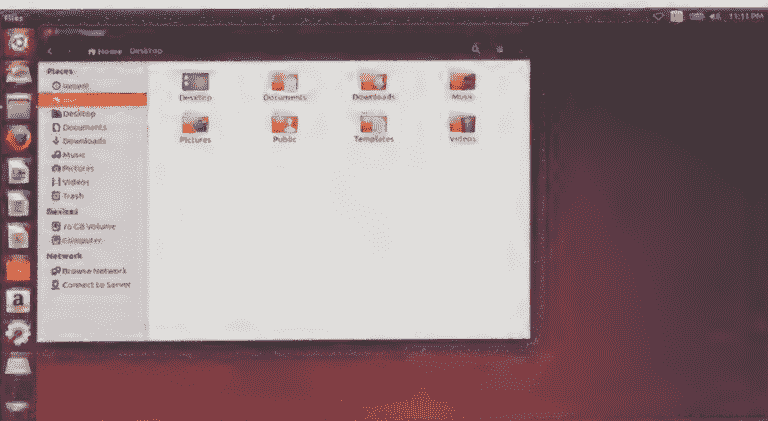

## Linux 的缺点


关于 Linux 存在着一些争议。广为人知的 Linux 合同案例之一，是慕尼黑市在 2003 年决定从 Windows 切换到 Linux。他们开始将 4,000 台桌面迁移到一个名为 `LiMuk` 的发行版，但情况并不完全符合预期，五年后，采用率仅为 20%。最终，目标桌面都完成了迁移，但正赶上副市宣布该市失败了，每个人都在推自己的喜好。这并非完全是个人喜好：有一些零散的例子显示某个产品在某个 Linux 发行版无法运行，但在另一个上可以运行。这种情况并不经常发生，但确实存在细微的异常现象。

# Linux 程序员

Linux 是开放的，这提供了充足的讨论空间，这通常被视为操作系统的优势，但它也可能是一个缺点。可能会给出相互冲突的建议，并不总是容易从不想要的建议中筛选出有用的建议。还出现过这种情况，开发者偏离了对编程挑战很有趣但对用户并没实用的领域。微软和苹果等公司会要求他们的程序员去解决真实的用户挑战，以提供实用的功能（必须说，这并不总是成功的）。

Linux 程序员可能可能对解决技术问题更感兴趣。

但对于家庭用户来说，这些都是次要问题。对于大多数人来说，Linux 提供了一个新体验的世界，以及一个摆脱 Windows 局限的机会。

> 小贴士
>
> 被许多不同的发行版选项困扰了吗？你可以查看 Distrowatch 网站上的前 100 名：`distrowatch.com`

# Linux 历史

Linux 并非凭空出现，研究该软件是如何产生的很有用。这是因为历史影响了今天对该操作系统的认知，以及为什么某些本该对它产生同情的公司和个人会对 Linux 产生意见。

Linux 有一种哲学在驱动着：一种协作、共享的运动。这是对专有软件（如微软或苹果的软件）的反击。重要的一是，Linux 在这里并不是孤立的，这里还有许多类似的倡议——只是 Linux 是可见度最高的一个。

**下方：** GNU 操作系统是自由软件项目的早期示例之一。

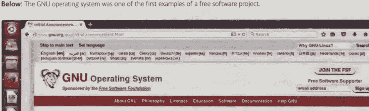

# 自由的 Unix！

从现在开始我将编写一个完全兼容 Unix 的软件系统 GNU（GNU is Not Unix，即 GNU 不是 Unix），并免费提供给任何想要的人。时间、金钱、程序的贡献被视为同等对待。

首先，Unix 将是一个内核加上所有编写和运行 C 程序的工具：编辑器、C 编译器、链接器、汇编器以及其他一些东西。之后，我们将添加一个文本格式化器：一个 YACC、一个 Em 游戏、一个表格和其他东西。我们希望提供用户所需的一切以及他可能需要的任何其他东西，包括在线和纸质文档。

GNU 将运行 Unix 程序，但与 Unix 相同。我们将根据方便的情况进行所有改进，基于

## 介绍 Linux

# 开源

你经常会听到一个术语是“开源”。这个短语源于自由软件运动启动的大致时期。它始于另外两个程序员埃里克·雷蒙德（Eric Raymond）和布鲁斯·珀斯（Bruce Perens）发起的另一个自由软件运动，他们将其称为开源倡议（OSI）。


OSI 的出现是因为自由软件支持者之间的政治分歧：一些人选择这一概念是因为它能带来更好的程序，而另一些人则认为自由软件本身内在价值。在某种程度上，这种争论持续到了今天 – 关于开源和自由软件的含义，存在着各种观点流。

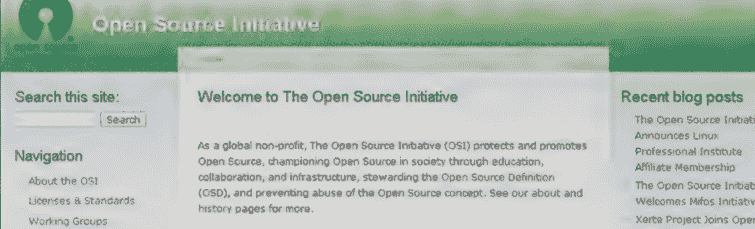

# 开源倡议

搜索此项：搜索

# 欢迎开源倡议

作为一个全球非营利组织，开源倡议（OSI）保护并推广开源，通过教育、行业和基础设施在社会中支持开源，防止开源概念被滥用。更多信息请查看我们的“关于我们”和“历史”。

开源软件是任何人都可以自由使用、修改和共享（以未修改的形式）的软件。开源软件由许多人制作，并在符合开源定义的许可证下分发。

# 最新消息

开源倡议宣布 Linux 学院附属成员

领先的独立厂商 Linux 认证机构扩展了承诺，进一步推动 Linux 和开源的发展。


- 最近的博客文章
- 开源倡议宣布 Linux 学院附属成员
- 开源倡议在 OSCON 2015 上欢迎 Free Project 开源
- 信息基金会加入 OSI 成为附属
- 开源倡议夏季实习生
- 开源倡议面向高等教育的外部附属计划
- 开源倡议 &

上方：开源倡议：软件开发领域新运动的开始。


# 自由和开源软件

这种讨论导致了一个合成词的产生——自由和开源软件（FOSS），这是两种观点派之间的一种折中方案。事实上，这两者之间已经有了很强的重叠，而这两个学派之间的某些差异，其本质与中世纪哲学家争论天使的性别，具有同样的深奥性质。一些论点触及生活的方方面面 –它们不仅仅是技术问题（而且完全超出了本书的范围）。对于这个世界之外的大多数人来说，这两者是可以互换的，但如果你在与软件开发人员交流，如果他们持有更细致的观点，请不要惊讶。

## 介绍 Linux

### 大教堂与集市

如果你想了解更多关于这些观点派的内容，非常好的入门书籍是埃里克·雷蒙德的《大教堂与集市》（*The Cathedral and the Bazaar*）。这本书区分了这两种方法。一种 GNU 方式（大教堂），一小群开发者秘密合作，在项目结束时展示他们的成果；另一种 Linux 方式（集市），代码在公共场合开发，许多人对成功做出贡献。从这里，雷蒙德得出了林纳斯定律：“只要眼睛足够多，所有的漏洞都是浅显的”，或者换句话说，就是“人多力量大”。


# LINUX 的发展

那是自由软件运动的历史，现在是时候看看 Linux 本身是如何出现的了。虽然 Linux 的优势之一是贡献代码的人数之多，但这个操作系统是由一个男人独自开始的。一位年轻的芬兰程序员——名叫林纳斯·托瓦尔兹（Linus Torvalds），正在研究一种使用名为 `MINIX` 的程序的新方法，`MINIX` 是一个名为 `Unix` 的系统的精简版本，它将永远改变计算领域。

# 林纳斯·托瓦尔兹

1991 年，他向 `Usenet` 组发送了一篇著名的帖子，宣布他的新操作系统：

> 大家好，使用 minix 的各位 - 我正在编写一个（免费的）操作系统（只是一个爱好，不会像 gnu 那样大而专业），用于 `386(486)` `AT` 隆机。这从四月就开始酝酿，正开始准备就绪。我想让大家对 minix 中喜欢/不喜欢的地方提供任何反馈，因为我的操作系统在某些方面与其相似（由于实用原因，文件系统的物理布局相同）；

剩下的，正如所说，都是历史了。那个帖子开启了计算的新篇章，导致了各种形式的 Linux 操作系统的出现。然而要注意，他最初选择的操作系统是 `Freax`（free 和 Unix 的混合体）；Linux 这个名字实际上是由他的合作者 Ari Lemmke 设计的。该软件的第一个版本是专有的，但很快就在 `GPL` 下发布了

# SLACKWARE 和 DEBIAN

在早期，许多发行版（称为 distros）涌现，这使得用户能够采用 Linux。许多发行版已经消失，但两个留了下来：`Slackware` 和 `Debian`。后者是前驱（见第 52 页）。


## 为什么选择 Linux？

那是对 Linux 历史的简要回顾。了解背景并不能帮助你运行操作系统，但它有助于理解为什么。选择 Linux 的主要原因有哪些？

有许多用户转向该操作系统，我们列出了其中一些。它们没有特定的顺序；对一个人的主要原因对另一个人可能无效。

# 没有臃肿软件

记得你买电脑时吗？你可能必须在一堆不需要的程序中挑选，如果你是从大型商店购买的机器的话。你那里有一包游戏。你可以通过卸载来删除这些程序，但这有点麻烦。通过选择 Linux，你消除了这些问题——没有试用期结束的危险，也绝没有任何服务的订阅请求。在 Linux 中，所见即所得。


## 病毒问题

大多数使用过 Windows 机器的人在某个时候都经历过病毒攻击（即使你自己没有受到影响，你可能也为别人修复过机器）。病毒的创建非常容易，而且极易感染电脑：你不应该点击的那个链接；你不应该插入的那个 CD；你不应该运行的程序——这些都会带来它们自己的问题。

### Linux 是没有病毒的

苹果用户也别自得意地认为你的机器免受攻击：Mac 也会感染病毒。事实上，如果你真的想避免电脑上出现任何形式的恶意软件，Linux 是唯一的选择。

> 小贴士


> 如果你一直在与病毒、恶意软件斗争，或者只是经常遇到经常崩溃，Linux 可能适合你。它是最稳定的操作系统。

理论上，Linux 病毒是可能的，但正如前面提到的，有更多的眼睛在观察 Linux 软件。漏洞和缺陷会被更早发现，修复得也更快。

## 网络犯罪分子

大众共识是，使用某个操作系统的人越多，它中病毒的可能性就越大。根据这一理论，Windows 之所以如此容易受到攻击，是因为它是最流行的操作系统——网络犯罪分子想要攻击用户最多的系统。

这意味着 Linux 被忽视是因为它的用户较少，但还有另一个更具主导地位的因素，这与 Linux 验证系统更改的方式有关。

## 在线安全

如果你思考发送到 Windows 机器的恶意软件会发生什么，你就能明白为什么可能需要更严格的身份验证规则。我们都听过关于病毒以及不该做的警告：不要打开未知发件者的网站链接；不要加载来源不明的 CD；保持你的防毒软件更新到最新版本，等等。


## Linux 密码保护

当关于不该做的警告被忽视时，病毒或木马就能干预底层操作系统并导致各种混乱。受害者不得不从头开始完全安装操作系统的情况也未未闻。

这在 Linux 上不会发生，因为如果你想对底层操作系统进行更改，就需要一个身份验证密码。所以，除非你有一个特别聪明的病毒，不仅能搞乱你电脑的内部，还能读取你的密码，否则你是安全的。

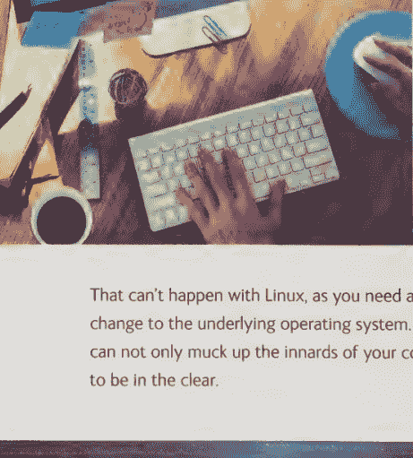

## 缺少驱动程序

如果你想给你的电脑连接任何类型的硬件——打印机、扫描仪或任何此类设备——你就需要运行一个名为“驱动程序”的小程序。当你首次设置设备时，这不是一个问题，因为它会被包含在安装盘中。当你想要使用另一台电脑并必须从头开始时，问题就开始了。在很多情况下，你没有安装 CD，即使你有，你也必须担心自己使用的是否是最新版本的驱动程序。通常发生的是，你需要在制造商的网站上搜索并查看长长的驱动列表。这并不总是一项简单的任务，因为你必须与产品完全匹配，而且在制造商网站上并不总是容易找到驱动程序列表。

你不需要经过 Linux 的这简直是一个奇迹，因为大量的驱动程序已经包含在 Linux 内核中了。设备开箱即用，第一次尝试就成功。

下方：在 Linux 机器上处理驱动程序容易得多。

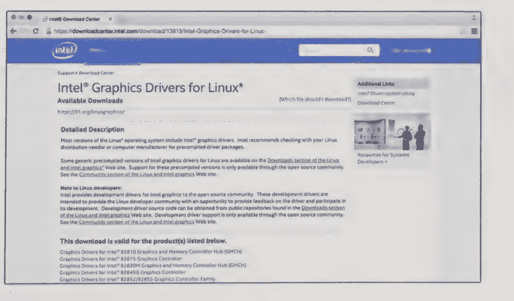

## 免费软件

正如你可能注意到的，你不必担心 Linux 软件的成本。运行文字处理程序？不要为 Microsoft Office 花钱，改运行 LibreOffice 吧。你想处理图像？把 Photoshop 挪到一边，选择 GIMP。想要一个邮件程序？Thunderbird。事实上，你可以挑选大多数商业软件产品，并发现某处有一个免费的 Linux 等效产品。

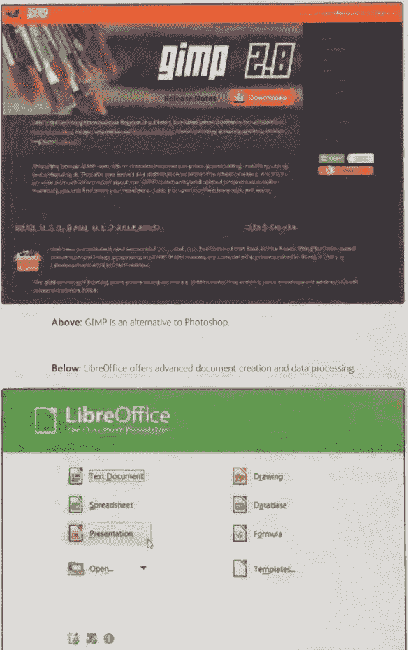

上方：GIMP 是 Photoshop 的替代品。

下方：LibreOffice 提供高级文档创建和数据处理。

Linux 和创意类用户特别喜欢 Apple 的软件和机器，并且对任何其他软件不屑一顾。然而，Linux 完全有能力处理这类需求。除了 GIMP 之外，还有许多可以由创意专业人士部署的产品——例如 DarkTable 或 RawStudio。而且不仅限于照片处理；例如，Laidout 提供了另一种出版方式；LibreOffice 不仅仅是文字处理，还可以提供更高级的功能。

## 为什么选择 Linux？

免费并不是它们唯一的优势（尽管这一点不容忽视）；处理漏洞的方式才是真正的加分项。多年来，微软程序中出现过很多漏洞。过去，等待第二个版本曾是一项信条，因为该公司通常将其初次尝试视为测试。修复这些漏洞需要时间。这并不是因为微软开发人员的技能不够，而是因为大公司的官僚机构会显著减慢一切的速度。

Linux 这样的开源产品并非如此。正如其名字所示，一切都是公开的，没有任何隐藏的。这意味着任何人都可以更改源代码。在实践中，这意味着意义不大，因为只有熟练的开发者才能从代码中提取出重要的信息并进行修改。


## 介绍 Linux

但这并不重要：那里有足够的代码专家可以做这些，你可以放心不会有恶意的开发者（即使有，他们也会被很快踢出去）。在 Linux 中，将有一个漏洞跟踪器来报告任何缺陷，与微软不同，你能够看到缺陷是如何修复的。

> 贴士
>
> 不要假设你所使用的任何东西都没有免费等效品，通常都有。

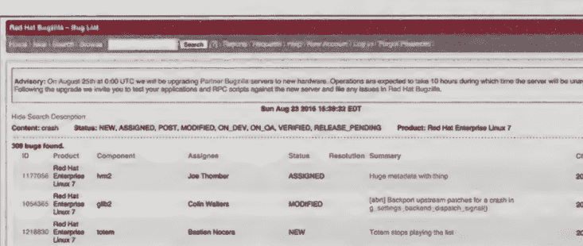

| ID | 组件 | 分配人员 | 状态 |
| :--- | :--- | :--- | :--- |
| 17356 | Enterprise | Thom | 已分配 |
| 109544 | Red Linux | Bastien | 修改 |
| 121683 | Enterprise | Waters | 新 |
| 120065 | Red Linux | Hammer | 已分配 |
| 115083 | Enterprise | Ray | 新 |
| 124357 | Enterprise | Holko | 已分配 |

## 屏

我们都见过：蓝屏告诉我们出问题了。无论你使用的是哪个版本的 Windows。XP？Vista？Windows 7？它们都容易受到这种影响。

上方：漏洞跟踪器是开放的解决方法。

事实是，Windows 似乎比其他系统更不稳定——正如 Mac 用户喜欢指出的那样——而且有很多重启。这已经成为任何问题的标准笑话——关机重启。事实是，这大多数时候有效，但是一种低效的处理方法。

## 处理更新

首先，有常规 Windows 更新需要处理。这些对于保持系统新鲜非常重要。然后你可能在更新你机器上的程序。每当你这样做时，你都会看到关于重启的消息——通常在你正在做某事时。

在 Linux 上你可以忘记这一切。这不会发生。每当机器上有任何微小的变化时，都不会重启。轻声地说，世界上有很多 Linux 机器已经运行了多年，一次都没有重启过。

## 强大的 Shell

Linux 的结构是一个核心内核（被 Linux 工具包围的操作系统核心）以及 Shell（用户处理的部分）。对于旧的微软用户来说，Linux 就像回到了 DOS 时代。你必须使用命令行界面并学习一整套命令。它不像 GUI 那样直观，并且你需要确保语法完全正确；然而，Shell 可以比 GUI 更强大，提供一种在那些华丽选项中并不总是获得的控制水平。当然，这我们在 Windows 中也能看到；当需要执行某些复杂任务时，GUI 被推到一边。微软本身通过引入 PowerShell 承认了这一点，这是一种针对 Windows 用户的非常强大的工具——这表明 Linux 思维方式对更传统的公司产生了影响。

> 贴士
>
> Shell（也称为命令行）曾是吓跑人们远离 Linux 的原因。在现代 Linux 桌面面上，没有必要使用 Shell。

# 互操作性与双系统

Linux 与其他系统相处很好。它承认 Windows 和 Mac OS X 有自己的位置，并会与它们并排安装、共享文件，并且通常对它们非常友善。这与 Windows 的观点非常不同，Windows 认为双系统启动意味着在 Windows 7 和 Vista 之间进行选择。

对于许多 Linux 用户来说，Windows 是必不可少的——也许是为了某个特定的游戏，也许是为了为了与业务系统进行互操作。在这种情况下，双系统启动不仅是一个选项，更是必选项。

> 下文：Linux 运行在各种硬件平台上，包括许多卫星导航仪上。
>
> 小贴士
>
> 如果你正在考虑双系统启动 Windows 和 Linux，最好为 Linux 准备一块独立的硬盘并留出未分配空间。否则，你将需要调整 Windows 分区。


作为此的副产品，我们还应该注意到，Linux 非常乐意运行在各种硬件平台上。我们已经看到它是如何成为从 Tivo 盒子到卫星导航套件等各种设备的核心，但它也可以被任何 PC 或笔记本电脑使用，包括流行的树莓派机器。在商业领域，Linux 可以部署在任何芯片架构上——从英特尔家族到 SPARC 和 IBM Power。关于这一点稍后会有介绍。

# Linux 的局限性

值得指出的是，Linux 其实没有什么是做不到的：只是体验不会像 Windows 或苹果的 iOS 那样流畅。你可以在 Linux 上完成你在这些系统上能做的任何事情——只是需要进行一些折腾和搜索。不要让这让你望而却步，因为那是使用 Linux 的乐趣的一半。

# 可操作性

Linux 与其他软件具有良好的互操作性。但并不意味着每一个 Linux 发行版都能运行所有编写过的每一段软件。即使是最热衷的 Linux 用户也会承认，有时某个特定的发行版在尝试运行异源程序时会闹情绪。


正如我们在第 20 页看到的慕尼黑市案例所示，困扰 Linux 商业实施的因素之一是某些 Linux 发行版无法与微软软件协作，考虑到微软在商业领域的主导地位，这是一个相当大的污点。

# 软件可用性

我们提到过，有免费（或有时是付费的）软件可以取代现有的许多商业软件包。这在某种程度上是真实的，但你得到的是等效替换。例如，`GIMP` 是 `Photoshop` 的一个极佳的免费替代品，可以完成后者约 99% 的功能，但 `GIMP` 存在明显的差距。例如，它不提供 CMYK 选项（对于任何寻求专业用途的软件包来说，都是商业上的自杀）。`Photoshop` 还拥有更丰富的生态系统，提供了一系列工具和插件，让专业设计师或艺术编辑师的生活更加轻松。

> 下文：曾经，运行 PC 意味着要仔细观察这些。

而且不仅仅是 `Photoshop`。还有许多 Windows 或 Mac 程序提供了更复杂的用户体验。对于家庭用户或狂热的业余爱好者来说，有许多替代品，但硬核专业人士需要更多。

# 缺乏图形用户界面 (GUI)

使用 Windows 或 Mac 的人都有易于使用的图形用户界面（`GUI`）来帮助他们操作操作系统。`GUI` 自从以来一直是苹果的一部分，但（这现在很难想象）Windows 直到 20 世纪 90 年代初才开始使用 `GUI`。在此之前使用微软系统必须学习大量的 `DOS` 命令。这并不直观。

| 文档和设置 | | | | |
| :--- | :--- | :--- | :--- | :--- |
| 2009-07-15 | 08:51 | 7019 | 14b6c27f3a2f | | |
| 2009-07-25 | 08:21 | 7019 | 4457c27f3a2f |b | |
| 2009-07-25 | 22:13 | 7016 | 611 | | |
| 2009-08-10 | 20:08 | 7016 | 611 | | |
| 2009-08-10 | 23:08 | 7013 | CONFIG.09 | | |
| 2009-08-08 | 24:41 | 2411 | 92719 | | |
| 2009-08-08 | 18:14 | 2411 | de11 | | |
| 2009-07-17 | 19:06 | 7012 | druissen32 | | |
| 2009-07-17 | 19:59 | 7012 | 57.775 install.103.1 | | |
| 2009-07-17 | 21:13 | 7013 | 52.236 install.103.1 | | |
| 2009-07-17 | 23:14 | 7013 | 110 install.103.1 | | |
| 2009-07-12 | 14:57 | 7012 | 110 install.103.1 | | |
| 2009-07-12 | 19:19 | 7012 | 110 install.103.1 | | |
| 2009-07-12 | 21:43 | 7012 | 110 install.103.1 | | |
| 2009-07-12 | 23:53 | 7012 | 110 install.103.1 | | |
| 2009-07-11 | 07:28 | 7011 | 110 install.103.1 | | |
| 2009-07-11 | 09:38 | 7011 | 110 install.103.1 | | |
| 2009-07-11 | 12:51 | 7011 | 110 install.103.1 | | |
| 2009-07-11 | 15:55 | 7011 | 110 install.103.1 | | |
| 2009-07-11 | 18:12 | 7011 | 110 install.103.1 | | |
| 2009-07-11 | 21:03 | 7011 | 110 install.103.1 | | |
| 2009-07-11 | 23:14 | 7011 | 110 install.103.1 | | |
| 2009-07-11 | 23:58 | 7011 | 110 install.103.1 | | |
| 2009-07-10 | 03:47 | 7010 | 110 install.103.1 | | |
| 2009-07-10 | 06:53 | 7010 | 110 install.103.1 | | |
| 2009-07-10 | 09:12 | 7010 | 110 install.103.1 | | |
| 2009-07-10 | 11:44 | 7010 | 110 install.103.1 | | |
| 2009-07-10 | 13:52 | 7010 | 110 install.103.1 | | |
| 2009-07-10 | 16:18 | 7010 | 110 install.103.1 | | |
| 2009-07-10 | 18:44 | 7010 | 110 install.103.1 | | |
| 2009-07-10 | 21:05 | 7010 | 110 install.103.1 | | |
| 2009-07-10 | 22:33 | 7010 | 110 install.103.1 | | |
| 2009-07-10 | 23:58 | 7010 | 110 install.103.1 | | |
| 2009-07-09 | 01:22 | 7009 | 110 install.103.1 | | |
| 2009-07-09 | 04:15 | 7009 | 110 install.103.1 | | |
| 2009-07-09 | 06:44 | 7009 | 110 install.103.1 | | |
| 2009-07-09 | 08:51 | 7009 | 110 install.103.1 | | |
| 2009-07-09 | 11:13 | 7009 | 110 install.103.1 | | |
| 2009-07-09 | 13:38 | 7009 | 110 install.103.1 | | |
| 2009-07-09 | 15:52 | 7009 | 110 install.103.1 | | |
| 2009-07-09 | 18:12 | 7009 | 110 install.103.1 | | |
| 2009-07-09 | 20:33 | 7009 | 110 install.103.1 | | |
| 2009-07-09 | 22:44 | 7009 | 110 install.103.1 | | |
| 2009-07-09 | 23:58 | 7009 | 110 install.103.1 | | |
| 2009-07-08 | 02:15 | 7008 | 110 install.103.1 | | | |
| 2009-07-08 | 04:44 | 7008 | 110 install.103.1 | | | |
| 2009-07-08 | 07:12 | 7008 | 110 install.103.1 | | | |
| 2009-07-08 | 09:38 | 7008 | 110 install.103.1 | | | |
| 2009-07-08 | 11:55 | 7008 | 110 install.103.1 | | | | |
| 2009-07-08 | 14:12 | 7008 | 110 install.103.1 | | | | |
| 2009-07-08 | 16:33 | 7008 | 110 install.103.1 | | | | |
| 2009-07-08 | 18:51 | 7008 | 110 install.103.1 | | | | |
| 2009-07-08 | 21:12 | 7008 | 110 install.103.1 | | | | |
| 2009-07-08 | 23:38 | 7008 | 110 install.103.1 | | | | |


# 预装 Linux 的 PC

如果你从 `PC World` 或像 `Dabs` 这样的在线零售商购买电脑，它将预装 `Windows`（除非你买的是 `Mac`，它将预装 `iOS`）。如果你想买一台装有 `Linux` 的机器呢？嗯，问题就在这里：虽然有几个地方可以做到，但你将需要处处寻找。

自从戴尔推出了一系列 `Linux` 桌面电脑并在几年后停止生产以来，没有哪一家主要的制造商走过那条路线。原因是纯粹的经济学考虑：对 `Windows` 机器的需求大得多，因此大众市场推动了降低价格所需的规模经济。你还可以加上之前提到的那些预装软件（`bloware`）。是的，它们很讨厌，但它们的供应商付费以被在内，并且有助于进一步降低价格。


# 运行游戏

如果你是一个硬核玩家，你会坚持使用 Windows（即使 Mac 在游戏方面也处于次要）。Linux 在游戏领域根本不在考虑范围内。

> 下文：运行 Windows 的 Alienware 笔记本电脑深受玩家欢迎。


# 视频

我们都习惯了在电脑屏幕上观看视频内容。电视作为获取这些内容的方式已不再流行，我们越来越多地使用 PC、平板电脑和手机。

并不是说 Linux 不让你看视频：可以采用通通方法来观看视频，但它们并不简单。大多数人想做的是打开设备、点击网站并观看——这在 Linux 上并不总是可行，但别担心，仍然有方案。

# Linux 的限制

去寻找一些可以实现此操作的工具；最为人知的是 `Banshee`，它允许用户观看视频或听音乐。它以极快的速度闻名，并且与所有发行版都具有兼容性（它甚至可以在 `iPod` 上运行）。它作为标准配置包含在某些发行版中，例如 `OpenSUSE`。

> 提示：Linux 有许多媒体播放器。`Miro` 不仅能让你看视频，还能提供一系列视频内容。知名的播放器 `VideoLAN` 为其 `VLC` 播放器提供了 Linux 版本。`MPlayer`（及其相关的前端 `SMPlayer`）、`MPV`、`Kaffine`、`Gnome Videos` 和 `Tomahawk` 都是其他可以尝试的选项。

**下方：** 在 Linux 计算机上观看视频比在 Windows 或 iOS 上复杂，但绝对可以实现。


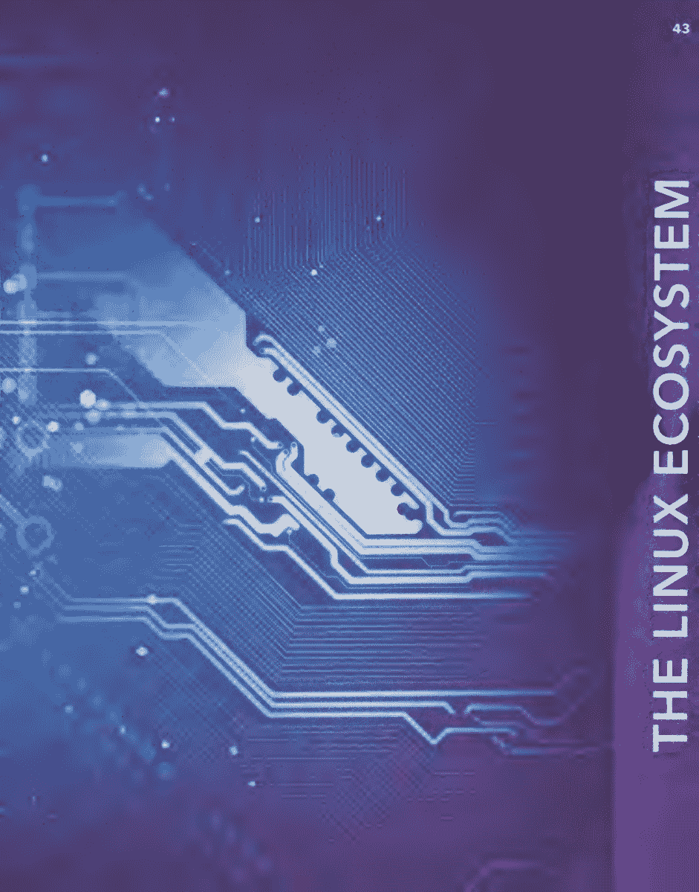

## 内核与外壳

计算中的每个概念都有几个关键组件，而 Linux 有两个：内核（`kernel`）和外壳（`shell`）。内核是操作系统的核心部分——代码的核心，没有它，Linux 就不是 Linux。

### 内核

Linux 内核在操作系统内核代码中是非常不寻常的，因为它是免费，你可以下载并自己构建它。在 20 世纪 90 年代初，源代码只需要几张软盘。在本书时，最新的可用版本是 4.1.3，它

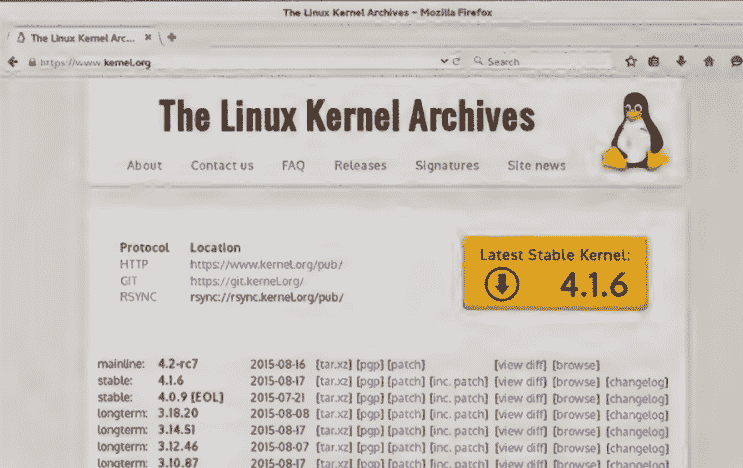

世界各地的开发者都在 Linux 内核存档做出贡献，以提高 Linux 的性能。

```
char *EXP_COM[] = (
char *RV_TIME() = (
int summary(void *arg,void)
{
char *str = (char*)arg;
st_board *board = (st_board
int ret = 0;

}
char *ptr_shuttercounter =
```

上方：操作系统源代码的一个示例，下载大小约为 80MB。随着 Linux 开始流行，世界各地的人们希望产生越来越多的功能。内核的每个发行版本都吸收了越来越多的这些选项，但当然，普通用户并不想要也不需要大部分选项。在内存和磁盘空间稀乏的年代，如果你的电脑有一个以太网适配器，你不想使用 RAM 来托管 Token Ring 卡的代码。同样，如果你的网络使用 IP 寻址，你想节省掉由支持 IPX 或 DECnet 的代码将占据的空间。解决方案很简单：内核源代码为你提供了一个交互式菜单系统，让你在构建代码之前挑选你想要的部分。

## 万物皆变，唯独你不变

你知道吗？你仍然可以使用完全相同的界面来做同样的事情。公平地说，它比 20 年前要复杂得多，但这仅仅是因为今天的 Linux 内核支持的许多新技术和概念比以前要多得多。

**下方：** 构建内核不是一个快速的过程，但它相对简单。

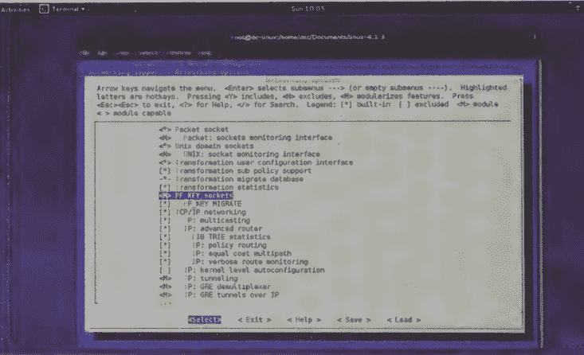

构建内核是一个非常简单的过程，只需遵循一份傻瓜式指南，确保你的系统上有几个简单的先决条件，运行配置程序然后告诉它进行构建。运行你自己的内核，实际构建并不是最复杂的部分。

> 提示：如果你想构建自己的内核，请花时间决定你想包含哪些功能和驱动程序：这并不太难，但如果你不包含核心部分，你的机器可能无法启动——你需要理解在基于菜单的配置工具中呈现的众多选项所意味着什么。哦，这不是那种你一两分钟就能运行完的东西：我刚刚在我的 `Acer` 笔记本电脑上根据默认选项运行了内核构建，花了大约 1 小时 40 分钟。

## 基础开发

内核的基础原理在今天与发布时基本相同。最重要的例外是可加载内核模块（`LKM`）。你可能对 Windows 电脑熟悉，当你连接新设备时，它会提示你安装驱动程序——这是允许内核与该新设备接口的代码块。在非常早时期

**下方：** 正在使用的可加载内核模块（`LKMs`）可以在这里看到。

```
dsc@linuxpc-local:~ $ 
File Edit View Search Terminal Help
auth_repl 65536 1 infed
nta_acl 16384 7 infed
tasku 64380 1 infed
grace 16384 7 infed,lock
suntpro 831295 7 infed,auth_rp_pcgos,lockin
1915 107248 7 1915
dev_alloc_init 16384 1 1915
```

上方：操作系统源代码的一个示例，下载大小约为 80MB。随着 Linux 开始流行，世界各地的人们希望产生越来越多的功能。内核的每个发行版本都吸收了越来越多的这些选项，但当然，普通用户并不想要也不需要大部分选项。在内存和磁盘空间稀乏的年代，如果你的电脑有一个以太网适配器，你不想使用 RAM 来托管 Token Ring 卡的代码。同样，如果你的网络使用 IP 寻址，你想节省掉由支持 IPX 或 DECnet 的代码将占据的空间。解决方案很简单：内核源代码为你提供了一个交互式菜单系统，让你在构建代码之前挑选你想要的部分。

- 大多数 Shell 会根据文件类型对 `ls` 等命令的输出进行颜色标记。
- 限制你可以运行的内容，以确保没有程序耗尽系统资源。
- 告诉 Shell 在后台运行程序——将其从 Shell 中分离，这样你可以在不杀死程序的情况下杀掉 Shell。

## 提示符

在我们刚才提供的命令示例中，你可能已经注意我们输入命令的那一行部分——提示符：

```
[dsc@localhost ~]$
```

这是所有 Shell 都能实现的功能——为你提供一个显示有用信息的提示符。在这种情况下，它告诉我们：


- `dsc@localhost`：我们以用户 `dsc` 的身份登录在名为 `localhost` 的机器上。
- `~`：我们当前正在当前用户的家目录下工作（在 Linux 中 `~` 是“家目录”的缩写）。
- `$`：我们正以普通用户身份运行（如果是特权用户 `root`，则显示为 `#`）。

我们稍后会对比一下在普通 Linux 发行版中可能会遇到的流行 Shell（见第 68 页）。某些 Shell 是默认安装的，另一些则是你可以轻松开启的选项。


## 什么是发行版 (DISTRO)

我们已经看到内核允许我们运行程序，而 Shell 让我们能够实际指令它运行——但程序本身呢？它们从哪里来？这就是发行版的用武之地。它们是包，将你所需的所有整合在一起，使你的 Linux 内核和 Shell 组合变得实用。

## 命令

在基础层面，我们拥有管理 Linux 计算机的命令。所以就像我们在之前的示例中看到的像 `ls` 和 `df` 这样的命令，但实际上有数百个这样的命令可以执行巨大的任务。有 `zip` 用于压缩文件，`mount` 用于连接本地和远程磁盘存储，`ping` 用于检查远程计算机是否有响应……列表远超我们这里能容纳的范围。


## 代码库 (CODE LIBRARIES)

所有的操作系统都拥有库——程序员在编写代码时可以使用的常用函数集合。这个想法非常简单：如果有大量程序员经常使用的函数，就不要每次都写一遍，而是将其作为操作系统的一部分包含起来，让程序员在代码中调用它们。非常常用的函数是如字符串处理（反转字符串、计算字符串长度等）或三角函数。在普通的 Linux 发行版中，还有大量其他更复杂的内容。

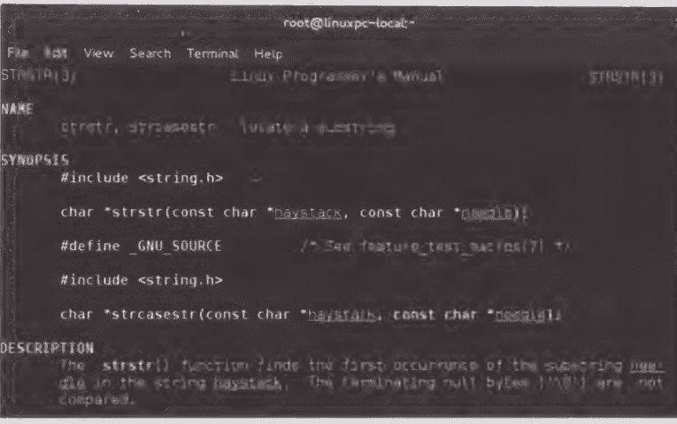

上方：Linux 程序员手册，显示了库函数。

## 包管理器 (PACKAGE MANAGER)

在过去，发行版是以 CD 和 DVD 形式分发的。如今，你仍然可以下载整个发行版，但随着现代高速互联网的普及，从一个非常小的“入门”安装程序镜像开始，并让安装程序下载它所需的组件也同样常见。

为了实现这一点，发行版制造商制作了包管理器——这些应用程序将程序的所有关键组件打包成单个包，然后你可以下载并解压它。内容会从包中提取出来，并放置在计算机磁盘上适当的位置。包管理器还了解一个包中的软件对其他项目的任何依赖关系，因此如果你尝试安装某个依赖于你未安装软件的程序，它会告诉你并提议下载并安装它。

## Linux 生态系统

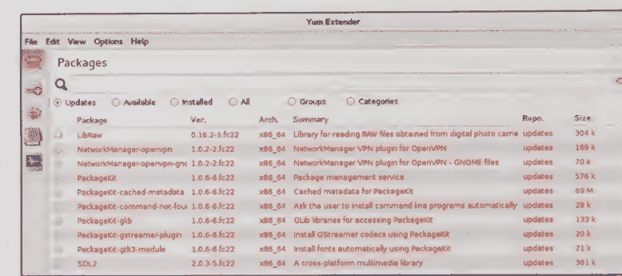

上方：这是 Yum，Fedora 的图形化包管理器。

## Linux 的巨大胜利

> **热点**
>
> 了解你的包管理器——能够轻松地查询你的 Linux 系统以查看安装了哪些内容以及对应的版本是非常棒的。

为了让你直观感受包管理器提供的巨大好处，让我们以 MySQL 数据库包为例。在我的测试电脑上，MySQL 数据库包大约有 20 个依赖项。如果你尝试安装某个依赖于你未安装软件的东西，它会告诉你并提议下载并安装它。

## 文档 (DOCUMENTATION)

文档对任何系统来说都是至关重要的。下面是 `df` 的手册页。

```
root@linux:~$ man df
File: /usr/share/man1/df.1
                                                                             DF(1)

NAME
  df - 报告文件系统使用情况

SYNOPSIS
  df [OPTION]... [FILE]

DESCRIPTION
  df 显示文件系统上可用磁盘空间。
  如果没有给出 FILE，则显示所有当前挂载的文件系统。
  如果给了参数，则显示该设备上的可用空间。
  默认以块显示磁盘空间，除非设置了环境变量 POSIX_BLOCKSIZE，
  在这种情况下使用 512 字节块。
```

发行版制作商通常会为你提供一个以上的桌面环境；实际上，它们和其他应用程序一样，只是程序，但恰恰目标是为 Linux 提供图形界面。大多数发行版都有一个默认的桌面环境，如果你点击“下一步 -> 下一步”进行设置，它就会安装，但如果你出于某种原因不喜欢他们的选择，你通常会有选项进行切换（例如，在我们的测试机上从标准的 Fedora 桌面切换到 KDE 仅花费了 345MB 的下载和几条命令）。

> 小贴士
>
> 作为 Shell 用户，选择一个你最喜欢的桌面环境并坚持用下去。最糟糕的事情莫过于因为在不同的 PC 上选择了不同的桌面环境而导致自己身处不同的环境之中。


## 标准配置

Linux 发行版中的程序来自许多不同的开发者。正如我们所说，发行版的制作商获取这些应用程序，对其进行配置和编译，然后将它们作为包包含在发行版中。他们并不是简单地下载每个应用程序的源代码并进行编译；他们规划了一个系统级的目录结构，并安排所有的应用程序，使得所有的配置文件都存储在一个单一的、全面的目录结构中。配置文件和可执行程序的默认位置因应用程序而异，因此发行版制作商付出了巨大努力来组织一切，并将位置从应用开发者的默认设置更改为他们在发行版中包含的所有内容通用的目录。

当应用程序之间存在相互依赖关系时，这一点尤为重要。例如，在 Linux 上运行基于数据库的网站是非常常见的——一种流行的方法是将 Apache Web 服务器、PHP 开发语言和 MySQL 数据库结合起来。发行版的构建使得这些内容中的每一个部分都已设置好可以立即与其他协作工作，无需进一步调整，它们是根据通用的配置和目录布局构建的。这种方法节省了大量时间，因此对发行版制作者表示感谢是理应当的。

## 发行版是一个整体

Linux 发行版不仅仅是其组成部分的总和。在它的基本形式下，它汇集了一个内核、一组命令并在它们周围封装了一个安装程序。但发行版的真正价值在于所有组件之间巨大的协调性——标准化的目录结构，以及软件包由于基于一套标准构建而它们之间是兼容的这一。在可以让你随心添加和删除元素的软件包管理器中，发行版的价值是显而易见的。

> 小贴士
>
> 当你探索了几种应用程序后，你会发现自己开始熟练地处理配置文件的常见位置，而无需刻意思考。

## 主要厂商的优缺点

尽管这是一个开源概念，但实际上有几个非常流行的商业 Linux 产品。你为什么要为你一个可以免费下载的东西付费呢？简单来说：稳定性和支持。

## 为心安买单

不可否认，免费的 Linux 发行版通常经过了良好的测试且极其稳定——但并不能保证。作者曾仅仅通过使用其标准配置界面设置 Linux 服务器的 IP 地址，就弄坏了他的部分网络；结果发现 GUI 中存在一个错误，导致它错误地设置了地址并导致了极其糟糕的崩溃结果。商业厂商能够对他们提供的发行版进行更严谨的测试。

> 上图：如果你倾向于购买一个可能比其他开源发行版更稳定的发行版，Red Hat 在线商店是一个选择。

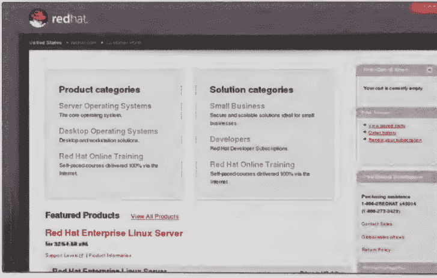

## 包含的额外内容

在此时，重要的是记住，Linux 发行版——无论是商业还是其他的——不仅包含内核和核心 Linux 可执行文件，还包含大量的附带应用程序。商业厂商有自己的应用程序仓库，他们的付费 Linux 产品从那里下载（通常是复杂的）套件更新。发行版制作商付出了巨大努力来组织一切，并将位置从应用开发者的默认设置更改为他们在发行版中包含的所有内容通用的目录。

当应用程序之间存在相互依赖关系时，这一点尤为重要。例如，在 Linux 上运行基于数据库的网站是非常常见的——一种流行的方法是将 Apache Web 服务器、PHP 开发语言和 MySQL 数据库结合起来。发行版的构建使得这些内容中的每一个部分都已设置好可以立即与其他协作，无需进一步调整，它们是根据通用的配置和目录布局构建的。这种方法节省了大量时间，因此对发行版制作者表示感谢是理应当的。

## 发行版是一个整体

Linux 发行版不仅仅是其组成部分的总和。在它的基本形式下，它汇集了一个内核、一组命令并在它们周围封装了一个安装程序。但发行版的真正价值在于所有组件之间巨大的协调性——标准化的目录结构，以及软件包由于由于基于一套标准构建而它们之间是兼容的这一事实。在可以让你随心添加和删除元素的软件包管理器中，发行版的价值是显而易见的。

> 小贴士
>
> 当你探索了几种应用程序后，你会发现自己开始熟练地处理配置文件的常见位置，而无需刻意思考。

## 主要厂商的优缺点

尽管这是一个开源概念，但实际上有几个非常流行的商业 Linux 产品。你为什么要为你一个可以免费下载的东西付费呢？简单来说：稳定性和支持。

## 为心安买单


不可否认，免费的 Linux 发行版通常经过了良好的测试且极其稳定——但并不能保证。作者曾仅仅通过使用其标准配置界面设置 Linux 服务器的 IP 地址，就弄坏了他的部分网络；结果发现 GUI 中存在一个错误，导致它错误地设置了地址并导致了极其糟糕的崩溃结果。商业厂商能够对他们提供的发行版进行更严谨的测试。

> 上图：如果你倾向于购买一个可能比其他开源发行版更稳定的发行版，Red Hat 在线商店是一个选择。


## 包含的额外内容

在此时，重要的是记住，Linux 发行版——无论是商业还是其他的——不仅包含内核和核心 Linux 可执行文件，还包含大量的附带应用程序。商业厂商有自己的应用程序仓库，他们的付费 Linux 产品从那里下载（通常是复杂的）套件更新。发行版制作商付出了巨大努力来组织一切，并将位置从应用开发者的默认设置更改为他们在发行版中包含的所有内容通用的目录。

当应用程序之间存在相互依赖关系时，这一点尤为重要。例如，在 Linux 上运行基于数据库的网站是非常常见的——一种流行的方法是将 Apache Web 服务器、PHP 开发语言和 MySQL 数据库结合起来。发行版的构建使得这些内容中的每一个部分都已设置好可以立即与其他协作工作，无需进一步调整，它们是根据通用的配置和目录布局构建的。这种方法节省了大量时间，因此对发行版制作者表示感谢是理应当的。

## 发行版是一个整体

Linux 发行版不仅仅是其组成部分的总和。在它的基本形式下，它汇集了一个内核、一组命令并在它们周围封装了一个安装程序。但发行版的真正价值在于所有组件之间巨大的协调性——标准化的目录结构，以及软件包由于基于一套标准构建而它们之间是兼容的这一事实。在可以让你随心添加和删除元素的软件包管理器中，发行版的价值是显而易见的。

> 小贴士
>
> 当你探索了几种应用程序后，你会发现自己开始熟练地处理配置文件的常见位置，而无需刻意思考。

## 主要厂商的优缺点

尽管这是一个开源概念，但实际上有几个非常流行的商业 Linux 产品。你为什么要为你一个可以免费下载的东西付费？简单来说：稳定性和支持。

## 为心安买单

不可否认，免费的 Linux 发行版通常经过了良好的测试且极其稳定——但并不能保证。作者曾仅仅通过使用其标准配置界面设置 Linux 服务器的 IP 地址，就弄坏了他的部分网络；结果发现 GUI 中存在一个错误，导致它错误地设置了地址并导致了极其糟糕的崩溃结果。商业厂商能够对他们提供的发行版进行更严谨的测试。

> 上图：如果你倾向于购买一个可能比其他开源发行版更稳定的发行版，Red Hat 在线商店是一个选择。


发行版制作商通常会为你提供一个以上的桌面环境；实际上，它们和其他应用程序一样只是程序，但恰恰目标是为 Linux 提供图形界面。大多数发行版都有一个默认的桌面环境，如果你点击“下一步 -> 下一步”进行设置，它就会安装，但如果你出于某种原因不喜欢他们的选择，你通常会有选项切换（例如，在我们的测试机上从标准的 Fedora 桌面切换到 KDE 仅花费了 345MB 的下载和几条命令）。

> 小贴士
>
> 作为 Shell 用户，选择一个你最喜欢的桌面环境并坚持用下去。最糟糕的事情莫过于因为在不同的 PC 上选择了不同的桌面环境而导致自己身处不同的环境之中。


## 标准配置


Linux 发行版中的程序来自许多不同的开发者。正如我们所说，发行版的制作商获取这些应用程序，对其进行配置和编译，然后将它们作为包包含在发行版中。他们并不是简单地下载每个应用程序的源代码并进行编译；他们规划了一个系统级的目录结构，并安排所有的应用程序，使得所有的配置文件都存储在一个单一的、全面的目录结构中。配置文件和可执行程序的默认位置因应用程序而异，因此发行版制作商付出了巨大努力来组织一切，并将位置从应用开发者的默认设置更改为他们在发行版中包含的所有内容通用的目录。

当应用程序之间存在相互依赖关系时，这一点尤为重要。例如，在 Linux 上运行基于数据库的网站是非常常见的——一种流行的方法是将 `Apache` Web 服务器、`PHP` 开发语言和 `MySQL` 数据库结合起来。发行版的构建使得这些内容中的每一个部分都已设置好可以立即与其他协作工作，无需进一步调整，它们是根据通用的配置和目录布局构建的。这种方法节省了大量时间，因此对发行版制作者表示感谢是理应当的。

## 发行版是一个整体

Linux 发行版不仅仅是其组成部分的总和。在它的基本形式下，它汇集了一个内核、一组命令并在它们周围封装了一个安装程序。但发行版的真正价值在于所有组件之间巨大的协调性——标准化的目录结构，以及软件包由于基于一套标准构建而它们之间是兼容的这一事实。在可以让你随心添加和删除元素的软件包管理器中，发行版的价值是显而易见的。

> 小贴士
>
> 当你探索了几种应用程序后，你会发现自己开始熟练地处理配置文件的常见位置，而无需刻意思考。

## 主要厂商的优缺点

尽管这是一个开源概念，但实际上有几个非常流行的商业 Linux 产品。你为什么要为你一个可以免费下载的东西付费？简单来说：稳定性和支持。

### 为心安买单

不可否认，免费的 Linux 发行版通常经过了良好的测试且极其稳定——但并不能保证。作者曾仅仅通过使用其标准配置界面设置 Linux 服务器的 IP 地址，就弄坏了他的部分网络；结果发现 GUI 中存在一个错误，导致它错误地设置了地址并导致了极其糟糕的崩溃结果。商业厂商能够对他们提供的发行版进行更严谨的测试。

> 上图：如果你倾向于购买一个可能比其他开源发行版更稳定的发行版，Red Hat 在线商店是一个选择。


### 包含的额外内容

在此时，重要的是记住，Linux 发行版——无论是商业还是其他的——不仅包含内核和核心 Linux 可执行文件，还包含大量的附带应用程序。商业厂商有自己的应用程序仓库，他们的付费 Linux 产品从那里下载（通常是复杂的）套件更新。发行版制作商付出了巨大努力来组织一切，并将位置从应用开发者的默认设置更改为他们在发行版中包含的所有内容通用的目录。

# 主要供应商的优缺点

如果你正在考虑在非技术人员的桌面上运行 Linux，这非常有吸引力——事实上，某些 PC 厂商将其作为 Windows 的替代方案出售。它在非 PC 设备中也越来越流行，例如手机和平板电脑。

# ORACLE（甲骨文公司）

`Oracle Linux` 并不是一个真正独立的 Linux 发行版，它实际上源自红帽企业级 Linux（`RHEL`）（尽管 Oracle 推出了自己所谓的“不可破坏的企业内核”，该内核声称比红帽的产品更优，且与之兼容）。Oracle 决心要吞下世界，并将 RHEL 客户吸引到自己的产品中，这并不令人意外。公平地说，这并不是一个没有吸引力的提议，因为 `Oracle Linux` 免费下载和分发，你也可以选择付费的支持选项。

下方：`Oracle Linux` 是免费的，但提供一个可选的支持选项，需要支付费用。


# LINUX 生态系统

如果你在寻找通用的、主流的 Linux，那么 `Oracle Linux` 并不是显而易见的选择。然而，如果你倾向于 Oracle 的应用程序产品，那么你可以考虑它，随着时间的推移，在他们的供应商原生操作系统上运行应用程序不可避免地会有性能优势。顺便一下，不要忘记这不仅意味着商业化的 Oracle 应用程序——他们还拥有 `MySQL` 数据库应用等，该应用起源于开源世界。

> 贴士
>
> 如果你在使用亚马逊的云，为什么不考虑他们的 `AMI Linux` 呢？毕竟，你知道它是针对该平台进行了优化，并且经过了良好的测试。

# 其他值得关注的发行

我们提到的 Linux 供应商很少，但它们涵盖了全球绝大多数的 Linux 安装。不过，简要提到其他几个也是值得的。

## AMI

首先是亚马逊的 Linux `AMI`。正如你可能猜的那样，这是由亚马逊制作并维护的 Linux 变体。如果你打算使用 Amazon EC2 云服务器平台，这不无意料之地是一个很有吸引力的选择，因为你可以确保兼容性和性能。

## Debian

接下来是 `Debian Linux`。说实话，它本身已经不再是一个大足轻重的角色了。事实上，`Debian` 和 `Ubuntu` 之间有着非常紧密的关系，但目前受欢迎的是后者——主要是因为 Canonical 提供的开发和支持支持。所以 `Debian` 远未灭亡，但人们倾向于选择 `Ubuntu`。

## Android

最后，让我们提到一个你可能没料到会读到的操作系统：`Android`。据估计，`Android` 在全球运行的设备比任何其他操作系统都多，人们很容易忘记它实际上是基于 Linux 内核的。当然，`Android` 与之前讨论的那意义上的 Linux 发行版；它是一个为特定目的设计的非常紧密的组件集。标准的 Linux 发行版带有一套开发者工具，用于为 `Android` 编写应用程序，你可以在另一台单独的 PC 上运行开发者工具。尽管如此，不要忘记 `Android` 的底层实际上是 Linux。

## 那么，我该选哪一个？

没有标准答案，但指导非常简单：如果你有特定的需求可以由某个商业产品满足（例如，`Oracle` 应用程序），那么就倾向于该产品。如果你正在寻找商业支持和 DIY 的混合体，那么 `Ubuntu` 模式可能适合你。如果你想利用对非 Intel 处理器的支持，那么你可以根据你需要的支持的 CPU 去 Google（对于 SUSE 来说，IBM 的 Power 系列是一个选项，如果你是一个全能型人才，那么很难不选择红帽）。


## 奇特的 Shell - 值得提及

我们提到的这些 Shell 是你将会遇到的。然而，对于那些具有冒险精神的人来说，还有一些特殊用途的 Shell。例如：

- `Fish`：“友好的交互式 shell”，设计初衷比传统 Shell 更友好。它的血统中既没有 `sh` 也没有 `csh`。
- `Scsh`：一种基于 Scheme 编程语言的 shell。
- `Wish`：一种让你使用 GUI 组件的 shell。

> 热门提示：你不太可能使用那些更奇特的 Shell，因为它们真的只是为硬核 Linux 技术人员准备的。根据我们的预测，你最终会使用 `bash` 或 `tcsh`。

除了你可能不会使用它们之外，这些 Shell 之间几乎没有共同点。

## 比较 - 启动与停止

现在我们已经对 Linux 机器上的各种 Shell 有了些许了解，让我们来看一些实际的差异。尽管你可以以原始形式使用任何 Shell，但每一个都赋予了你编写配置文件的能力，以按照你想要的方式进行设置：例如，设置命令行显示的提示符，或者为经常使用的命令定义别名（`aliases`）。

遗憾的是，不同的 Shell 使用不同的启动文件。让我们比较一下 `bash` 和 `tcsh`；我们将先看它们首先查找哪些配置文件，然后解释实际执行了什么。

当你用 `bash` 登录时，它会首先检查系统级配置文件：

```
/etc/profile
```

## Linux 生态系统

## 主目录

Linux 机器上的每个用户 ID 都有一个默认的主目录。如果你是一个普通用户，这是一个私有目录，因此你可以使用主目录中的本地配置文件来指定任何想要的自定义内容。在你的主目录中有三个备选文件的情况下：

> 热门提示：了解你的启动文件以及哪些文件与 Shell 配合使用——否则你将为某些事情似乎不起作用而抓耳挠腮；结果发现你用错了文件。

```
.bash_profile
.bash_login
.profile
```

它将按照此顺序查找文件，并只处理遇到的第一个。这三个文件中的最后一个 `.profile` 是对旧 `sh` 时代的致敬——它曾是个人配置文件的默认名称。请注意，如果你同时使用 `sh` 和 `ksh`（如果你有此倾向），那么要在 `.bash_profile` 中添加一个引用 `.profile` 的条目，然后将仅限 `bash` 的命令放在 `.bash_profile` 中，将兼容 `sh` 的命令放在 `.profile` 中。`sh` 会处理后者，并且两个都会处理。

这里举个例子。我们从一个既有 `.bash_profile` 又有 `.profile` 用户开始。前者将提示符设置为以 `bash_profile` 开头，后者则为 `profile`。我们预期提示符会提到 `bash_profile`，事实确实如此：


```
Davids-MacBook-Pro:~ davidcartwright$$ ssh dsc@192.168.1.186 dsc@192.168.1.186's password:
```

Last login: Mon Jul 27 21:02:13 2015

bash_profile@21:02:42:~$

```

我们将删除 `.bash_profile`，并预计它会选取 `.profile`，果真，它确实如此：

```
Davids-MacBook-Pro~: davidcartwright$ ssh dsc@192.168.1.186

dsc192.168.1.186's password:

Last login: Mon Jul 27 21:02:42 2015 from 192.168.1.156

profile@21:02:54:~$
```

以下：bash 的 etc profile。

```
root@linuxpc-local:~~

File Edit View Search Terminal Help

/etc/profile

## 系统级环境和启动程序，用于登录设置

## 函数和别名存放在 /etc/bashrc

## 除非你清楚自己在做什么，否则修改此文件不是好主意。

## 最好在 /etc/profile.d/ 中创建一个 custom.sh shell 脚本

## 对你的环境进行自定义更改，因为这可以避免在未来的更新中需要进行合并。

path() {

case $1 in

(PATH)

if [ "$2" -ne "$PATH" ]; then

export PATH="$2:$PATH"

fi

else

export PATH="$PATH:$2"

fi

*)

esac

}

if [ -x /usr/bin/id ]; then
```

接下来是 tcsh shell，它采取了不同的方法——事实上，它有时感觉像是想运行已知宇宙中的每一个配置文件。系统级启动文件是：

```
/etc/csh.cshrc
/etc/csh.login
```

在你的主目录下有一组文件：

```
.tcshrc
.cshrc
.login
```

| 打开 | csh.cshrc [只读] | 存储 |
|---|---|---|
| #/etc/cshrc | | # 所有 shell 调用的 tcsh 配置。 |
| | | # 当你进入 shell 时，它 |
| | | # 用于非交互的。 |
| | | # set prompt = "n" |

# LINUX 生态系统

```
dsc@linuxpc-local:
[dsc@linuxpc local]$ touch tcsh files.tcsh

1 from the tcsh script
2 from the bash script
3 from the bash script
[dsc@linuxpc local]$ touch bash files.bash

1 from the bash script
2 from the bash script
3 from the bash script
[dsc@linuxpc-local]$ _|
```

上方：正在运行的 tcsh 和 bash 脚本。

```
[dsc@localhost Documents]$ tcsh files.tcsh
1 from the tcsh script
2 from the tcsh script
3 from the tcsh script

[dsc@localhost Documents]$ bash files.bash
1 from the bash script
2 from the bash script
3 from the bash script
```

## 编写脚本

当谈到 shell 命令时，你可以完成非常强大的操作。我们在这里只是触皮一角，但你可以编写调用其他脚本并进行复杂交互的脚本——从文件中读取数据、将输出写入文件，并使用变量进行计算和字符串处理。Shell 唯一的缺点是如果你习惯了一种类型并被迫使用另一种，那么需要一些学习，因为正如我们所看到的，它们的语法确实有所不同。所以，如果我们尝试用 bash 运行上面的 tcsh 脚本，它会报错：

```
profile@21:37:01:~/Documents$ bash files.tcsh

files.tcsh: line 1: syntax error near unexpected token `('

files.tcsh: line 1: `foreach i `ls files`'
```

但别担心，正如我们所看到的，shell 之间有很多相似之处。所以，如果我们尝试用 ksh 运行我们的 bash 脚本：

```
profile@21:38:58:~/Documents$ ksh files.bash

1 from the bash script
2 from the bash script
3 from the bash script
```


它运行得完美，因为我们在 bash 脚本中使用的命令集和语法是 bash 和 ksh 通用的。

> 小贴士：问问 Google 了解一下“shebang”或“魔术行”（magic line）——这是一种强制系统使用正确的 shell 来运行脚本的方法。

## 关于 shell 的重点

使用哪种 shell 实际上并不重要。事实上，功能在很大程度上是相同的，尽管在 csh 系和 sh 系之间在命令和语法上存在一些细微差别和显著差异。在编写脚本方面，除非你是个火箭科学家，否则你在一个 shell 中能做的事情，在另一个 shell 中几乎都能做到。

你应该选择哪一个？如果你是初学者，那么 sh 系（主要是 bash）是明智的选择。毕竟 sh 风格的 shell 已经吸收了 csh 系的大多数酷功能，而且考虑到所有的启动脚本都是基于 sh 的，所以当你开始学习 Linux shell 时，这是明智之流的选择。


# 下载你选择的发行版

如果你是流行 Linux 杂志的读者，你会在每期杂志附带的光盘上找到一个或多个 Linux 发行版。不过，那可能不是你想要使用的那个——所以你想去获取你想要的那个。

对于 Red Hat 和 SUSE 等提供的商业产品，你必须支付真金白银；这两个公司都有在线商店。对于免费产品，只需访问该发行版的网站下载你需要的即可。

下方：在决定之前阅读一下该发行版是明智的。

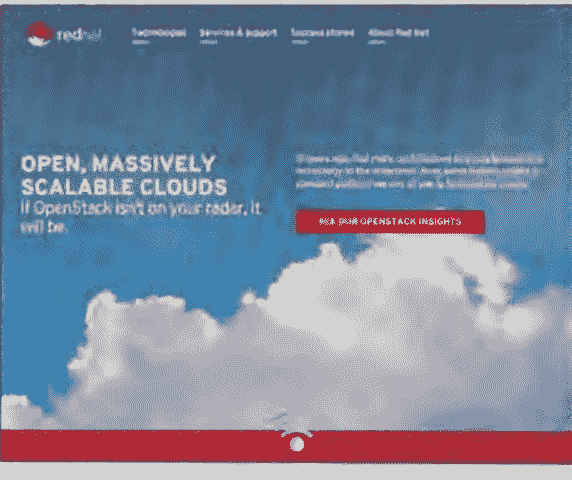

## 哪里哪里

在我们已经提到的发行版中，以下是去处：

- Red Hat Enterprise Linux: www.redhat.com/en
- Fedora: www.getfedora.org
- CentOS: www.centos.org
- SUSE (商业版): www.suse.com
- openSUSE: www.opensuse.org
- Ubuntu: www.ubuntu.com
- Debian: www.debian.org

> 小贴士：我们倾向于使用“Live”镜像——它们包含了整个 Linux，而不仅仅是安装程序。通常安装 Linux 的方法是下载基础安装程序并通过 DVD 或 USB 盘启动（我们更倾向于 USB，因为它方便得多）。基础安装程序镜像并不是完整的安装文件集。相反，它只包含了足够启动大多数机器、在屏幕上显示安装程序、配置网络（有线或无线）然后通过互联网下载其余选项的代码。这取决于你的网络速度。

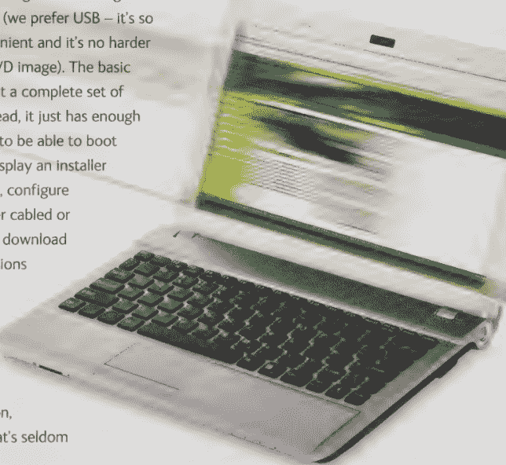

### 我们的选择

对于我们的测试机，我们正在下载 Fedora——特别是 release 22。它于 2015 年 5 月发布——在写作时它已经发布几个月了。对于不运行关键应用程序的 Linux 机器，这是我们会考虑的最小年龄。如果你是为了业务稳定性，可能会选择上一个版本，因为它会有更多的错误修复。对于 Fedora 来说，release 21 发布了七个月了，正合适。但为了我们的目的，我们将坚持 release 22。

### 获取安装程序

第一步：前往 `www.getfedora.org` Fedora 首页。顺便的是我们在运行 Windows 8.1 的 PC 上下载。

> 下方：Fedora 首页非常易用。

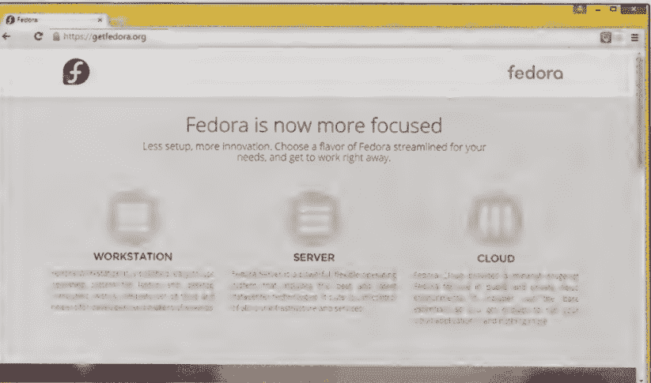

有三个选项：Workstation、Server 和 Cloud——在这个例子中我们将选择 Workstation。

有一个很大的、友好的“立即下载”链接，让我们点击它。我们进入了一个可以选择特定安装程序的页面。确定 64 位 1.3GB 的 Live 镜像可能是我们要的，它就在页面顶部的“下载”按钮旁边。

如果你看右侧，你会看到其他替代方案。有一个 32 位 Live 镜像，以及两个“netinstall”镜像——一个 32 位一个 64 位。由于我们使用的机器确实是 64 位 PC，且我们使用 Live 镜像，只需点击“下载”。在我们的网络下，下载大约需要 20 分钟，所以不需要太久。

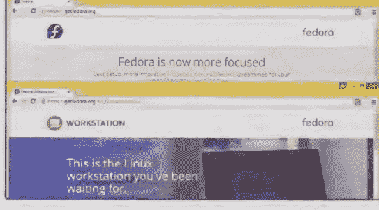

> 小贴士：确保你选择了正确的版本

### LiveUSB

现在我们需要一个将 Fedora 安装程序的 ISO 镜像写入优盘的程序。推荐的方法是使用 LiveUSB Creator，这是一个你可以从网上下载的免费工具：`fedorahost.org/liveusb-creator`


上方：这个 LiveUSB Creator 将 Fedora 安装程序放在 USB 盘中。

### 制作启动盘

1. 我们要的第一件事是确保它是空的。插入 USB 盘并打开“计算机”工具（见下方）。

2. 在“设备”下找到 USB 盘（见下方）。

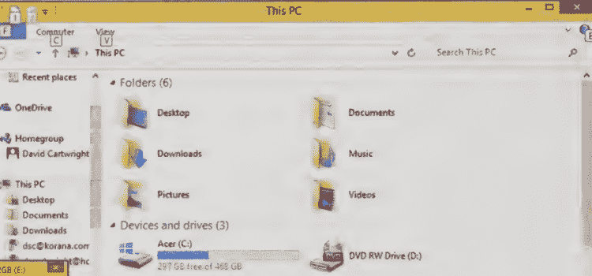

右键点击并选择“格式化”。我们将 FAT32 作为文件系统，卷标为 Fedora。

3. 一旦我们点击“开始”并确认我们确实想要格式化设备，只需要几秒钟。


### LiveUSB

`liveusb-creator` 是一个跨平台工具，用于在 USB 驱动器上轻松安装操作系统。

#### 特性

- 在 Windows 和 Linux 中运行
- 完全非破坏性安装。无需处理对 USB 的格式化或分区
- 支持“破坏性”安装方法，使用 `dd` 直接将 ISO 复制到驱动器。这会覆盖所有数据和分区。这种方法启动更可靠，且全自动。
- 支持自动下载 Fedora 版本，以及 Sugar on a Stick！
- 持久性存储创建。这允许你在 USB 盘上分配额外空间，以便在重启后保留对 的更改。这本质上让你随身携带自己的 Fedora。
- 已知版本的校验和，以确保你下载了正确的文件
- 多语言翻译

#### 证言

“作为一名非 Linux 用户，Live-USB Creator 改进了……”

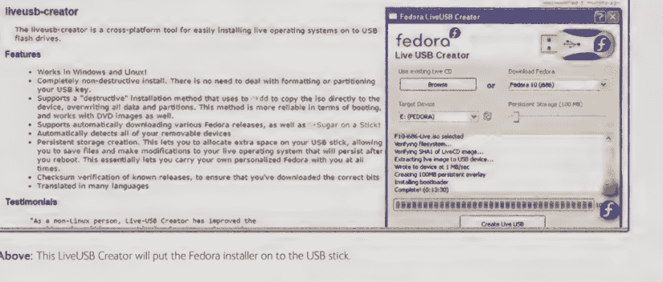

上方：这个 LiveUSB Creator 将 Fedora 安装程序放在 USB 盘中。

4. 向下滚动，Windows 版本的链接在那里。大约是 12MB 的下载，所以不需要很长时间。该文件是 Windows 安装程序，所以打开它。点击下一步（见右侧）。

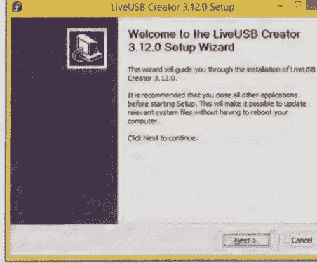

上方：一旦打开安装程序，就会出现此页面。

下方：这是安装的最后一个界面。

不需要更改安装目录，只需点击“Install”（安装）并让它运行完毕。完成后，点击“Next”（下一步），你就会到达最后一个界面（左侧）。


- 确保勾选了“Run LiveUSB”（运行 LiveUSB）复选框并点击“Finish”（完成）。程序将在几秒钟后弹出（下方）。

一旦程序启动，LiveUSB Creator 将显示此界面。


要将 Fedora 镜像拷贝到 U 盘，只需点击“Browse”（浏览）并导航到我们下载的镜像，同时确保“Target Device”（目标设备）是我们刚刚格式化的 U 盘（右侧）。

Fedora 安装程序已成功写入 U 盘。

现在我们要做的是点击“Create Live USB”（创建 Live USB）并等待。这个文件只有 1.3MB，所以花费两三分钟是正常的。完成后，你可以关闭 Creator 应用程序。

### 小贴士

手头准备一个好用的 U 盘以备此类用途。它们相对便宜，而且当你需要时如果没有备用，跑去商店买会很麻烦。

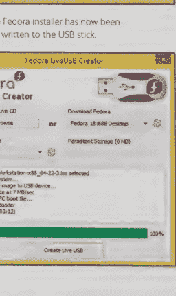

### 运行安装程序

我们现在拥有的是一个可以启动电脑的 U 盘。现在，你可能需要更改电脑 BIOS 中的启动设置，使其在从内置硬盘启动之前从 USB 端口启动。这你需要在 Google 上搜索或查看你的 PC 文档，因为这因机器而异。

一旦你处理好了 PC 的启动选项，就可以在插入 U 盘的情况下启动它。你应该能看到一个黑色屏幕，上面有几个选项，包括“Test this media & start Fedora Live”（测试此媒体并启动 Fedora Live）。

上方：Fedora 欢迎界面为你提供了在安装前测试 Fedora 的选项。

这是默认选项，只需等待它就会启动。过了一会儿，你应该会看到“Welcome to Fedora”界面，上面有两个选项：“Try Fedora”（尝试 Fedora）和“Install to Hard Drive”（安装到硬盘）（见下方）。

现在，我们想要进行安装，但在此之前，我们需要连接网络以便安装程序下载其文件。在我们的情况下，我们将使用无线网络。


#### 连接 WiFi

- 1. 要进入 WiFi 配置页面，转到右上角并点击小三角形。会出现一个摘要窗口，显示关于蓝牙和电池电的一些基本信息，更重要的是，WiFi 尚未连接（见右侧）。
- 2. 点击“Not Connected”（未连接）链接，系统将扫描无线网络；几秒钟后，你将得到列表。
- 3. 点击你想要的一项，它会向你索要安全密钥。

假设你的手指没有问题，它将确认你已连接。

- 3. 现在我们已经处理好了 WiFi 连接，可以开始安装了。点击左角的角的Activities”（活动）菜单，你将在底部看到“Install to Hard Drive”（安装到硬盘）选项。点击此项，安装程序窗口将在几秒后出现。

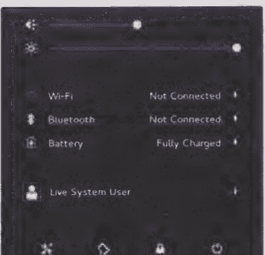

上方：工具菜单显示 WiFi 尚未配置。

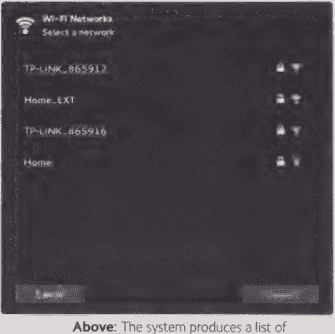

上方：系统生成了可用的无线网络列表。

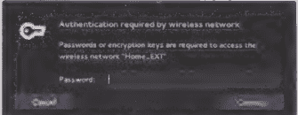

> 小贴士
现在的 Linux 安装程序非常好，但请仔细检查每个屏幕，以确保你没有错过任何设置。

上方：在提示时输入 WiFi 密码。


这是一个非常简单的向导。在第一个屏幕上你将选择语言和变体；我们将选择英语和英国（见顶部）。

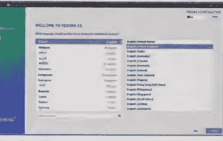

上方：第一步是设置你的语言。

- 点击“Continue”（继续），它会思考一会儿你的系统；在我们的情况下，我们已经选择了 WiFi 网络——我们看到的唯一警告是关于“Installation Destination”（安装目标）的（见右侧）。

所以让我们点击它。在我们的 PC 上，我们有两个选项。现在，SanDisk Cruiser 实际上是我们正在用于截图的 U 盘——我们需要选择 31.5GB 的磁盘。

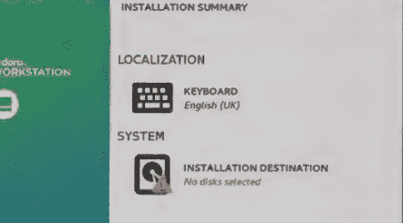

上方：这里还需要设置安装目标。

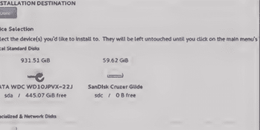

点击它，会出现一个小勾号（右下角）。然后点击“Done”（完成）。

上方：已选择磁盘。

### 开始

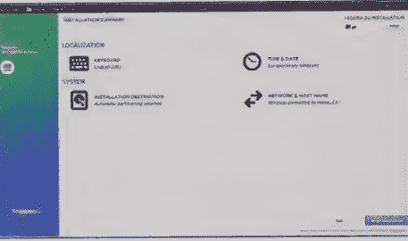

上方：没有错误消息意味着现在可以启动。


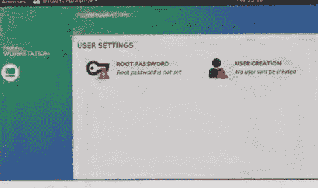

- 5. 现在我们回到了没有警告的安装界面。“Begin Installation”（开始安装）按钮已启用，让我们点击它。

上方：带有感叹号的图标显示未设置 root 密码。
- 6. 安装程序现在将花时间安装软件。在此，你可以做几件事。你会看到没有设置 root（见中间）。

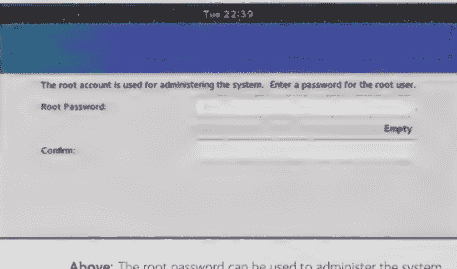

点击图标，将提示你设置密码，确保选择一个像样的——如果你选择的是明显的，它会警告你。

上方：root 密码用于管理系统。

完成后点击“Done”。你应该创建一个普通用户——点击“User Creation”（用户创建）并输入真实姓名、ID 和你想使用的密码。运行几分钟后，安装程序将完成（你可以查看进度条了解它的运行情况）。

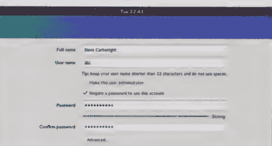

上方：你应该作为普通用户登录机器，而不是 root 用户。

- 7. 点击“Quit”（退出），安装程序将退出。现在你需要做的是点击右上角的三角形并选择“Restart”（重启）。一旦屏幕变黑，拔掉 U 盘，你将看到 PC 启动到新安装的设置。

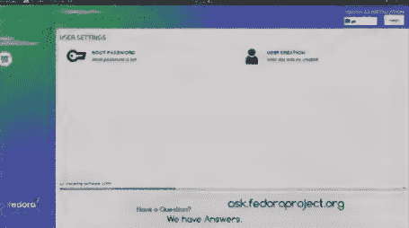

上方：在 Fedora 安装期间，你可以设置密码并创建账户。

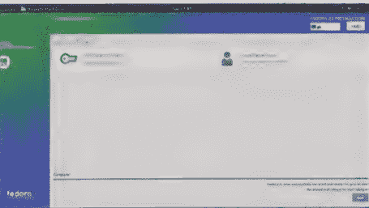

上方：Fedora 已成功安装。

> 小贴士
如果你想对 PC 进行“双系统”——即同时安装 Windows 和 Linux 并在启动时选择你想要的一个。

### 下一步工作

一旦安装了 Linux，你就拥有了一个工作系统，但不是最新的。制作人员不会每出一个新微调就不断更改镜像；例如，你看到的下一个镜像将是版本23。

### 你应该寻找什么？

所以当你安装任何其他操作系统——例如 Mac 或 Windows 时——要做的第一件事是确保所有内容都是最新的。这非常简单，我们马上就会看到。

为什么要立即运行更新？因为我们总是希望从最新的系统开始（我们稍后会回到管理更新）。不同的发行版有不同的包管理器，因此运行更新的方式不同。从版本 22 开始，Fedora 实际上将包管理器从 Yum 更改为 DNF。使用它非常简单——只需运行 `dnf update`：

```


`[root@localhost]# dnf update`

Fedora 22 - x86_64 - Updates 998 KB/s | 00:13

Last metadata expiration check performed 0:00:09 ago on Sat Aug 1 17:04:41 2015.

Dependencies resolved.

===============================================================

Package Arch Version Repository Size

===============================================================

Installing:

drm x86_64 0.2.0-2.fc22 updates 30 k

kernel x86_64 4.1.3-200.fc22 updates 67 k

kernel-core x86_64 4.1.3-200.fc22 updates 19 M

kernel-modules x86_64 4.1.3-200.fc22 updates 133 k

PackageKit-gstreamer-plugin x86_64 1.0.6-6.fc22 updates 20 k

PackageKit-gtk3-module x86_64 1.0.6-6.fc22 updates 21 k

SDL2 x86_64 2.0.3-5.fc22 updates 361 k

abrt x86_64 2.6.1-2.fc22 updates 518 k

abrt-addon-cpppp x86_64 2.6.1-2.fc22 updates 187 k

xorg-x11-server-Xorg x86_64 1.17.2-2.fc22 updates 1.4 M

xorg-x11-server-Wayland x86_64 1.17.2-2.fc22 updates 914 k

xorg-x11-server-common x86_64 1.17.2-2.fc22 updates 44 k

zenity x86_64 3.16.3-1.fc22 updates 3.4 M

zip x86_64 3.0-14.fc22 updates 267 k

===============================================================

Transaction Summary

Install 10 Packages

Upgrade 522 Packages

Total download size: 715 M

Is this ok [y/N]:

我们精简了这个列表，因为正如你所看到的，它想要升级 522 个软件包（并逐列出了每一个）。这听起来像是一件大事，但实际上并非如此——在极少数情况下，你只需要让它自行运行即可。如你所见，它告诉我们有 715MB 的数据需要下载，并询问我们是否可以。我们将通过回答 `y` 来同意：

总下载大小: 715 M
是否可以 [y/N]: y

安装程序在下载内容时不断向我们更新进度：

```
Downloading Packages:
(1/532): drpm-0.2.0-fc22.x86_64.rpm 238 KB/s | 30 kB 00:00
(2/532): kernel-4.1.3-200.fc22.x86_64.rpm 275 KB/s | 67 kB 00:00
(3/532): python-firewall-0.13.14-2.fc22.noarch.rpm 582 KB/s | 236 kB 00:00
(4/532): systemd-compat-libs-219-20.fc22.x86_64.rpm 498 KB/s | 135 kB 00:00
```

以此此类推。下载完成后，它会通过软件包的事务向我们更新进度：

```
Running transaction check
Transaction check succeeded.
Running transaction test
Transaction test succeeded.
Running transaction
```
Upgrading : libgcc-5.1.1-4.fc22.x86_64 1/1055
Upgrading : fontpackages-filesystem-1.44-12.fc22.noarch 2/1055
Upgrading : google-noto-fonts-common-20150417-1.fc22.noarch 3/1055
Upgrading : dejavu-fonts-common-2.35-1.fc22.noarch 4/1055

以此此类推。

## 后续步骤

> 小贴士

更新可能花费很长时间，但它们很少失败，所以没有什么可以阻止你离开并让它在后台一直运行一会儿。

## 选择你的程序

好了，现在我们有了一个运行良好良好且处于最新版本的系统。现在是时候决定我们实际上想在系统上运行哪些程序了。

开源世界的特点之一是，在选择要采用的程序时，通常有多个替代方案。例如，如果你想要一个电子邮件系统，你有大量的选择，其中两个最流行的是 Postfix 和 Sendmail。同样，如果你想要一个数据库系统，你可能会在 MariaDB（著名 MySQL 软件包的新替代方案）和 PostgreSQL 之间进行选择。

你必须二选一吗，还是实际上可以并行运行两个系统？答案是取决于情况。对于邮件服务器软件包，你需要选择一个并坚持使用：因为邮件软件以特定的方式“监听”入站连接，在任何时候只能有一个程序在监听。


对于数据库和许多其他软件包，你完全可以并排运行两个或多个等效程序——尽管当然，我们总是建议选择一个并坚持使用，因为这可以节省学习多个系统的麻烦。

## 尽可能坚持使用软件包

有时，你会遇到尚未针对你所选择的特定 Linux 发行版制作成官方软件包的程序。当然，开源软件可以以你可以下载并自行构建的形式提供，但这严格来说不适用于初学者。尽管作者们尽了努力让构建过程尽可能简单，你仍然经常会遇到晦涩难懂且安装文档中未涵盖的错误信息，这意味着你花在 Google 搜索并希望别人也见过那个问题上的时间比花在安装和使用程序上的时间更多。


> > 小贴士

软件包非常棒，因为已经有人搞定了构建它们的所有棘手问题。充分利用他们的劳动成果吧！

所以，除非你真的必须使用某个特定的软件包，并且自构建过程痛苦值得的，否则请坚持使用可以从预构建软件包安装的程序。

## 程序依赖关系

我们之前提到过软件包之间通常相互依赖。让我们来看一个例子——PHP 系统（一种网页脚本语言，如果你以后构建基于 Linux 的网站，可能会用到它）。让我们运行安装 PHP 程序的命令，`dnf install php`：

```
[root@localhost ~] # dnf install php
Last metadata expiration check performed 0:35:26 ago on Sat Aug 1
17:04:41 2015.
Dependencies resolved.
```

| 软件包 | 架构 | 版本 | 存储库 | 大小 |
|---|---|---|---|---|
| php | x86_64 | 5.6.11-2.fc22 | updates | 2 M |
| php-cli | x86_64 | 5.6.11-2.fc22 | updates | 4 M |
| php-common | x86_64 | 5.6.11-2.fc22 | updates | 1 M |
| php-pecl-json | x86_64 | 1.3.7.fc22 | fedora | 57 k |

事务摘要

安装 4

总下载大小: 7.8 M

安装大小: 29 M

是否可以 [y/N]: y

## 保持程序更新


当我们第一次安装时，第一件事是运行更新器以确保一切都是最新的。根据 `dnf list installed`，我们目前的版本是 2.0.2-5，根据 `dnf check-update`，当前发布是 2.0.3-1。我们将使用 DNF 更新它：

## 功能变更

通常情况下，Linux 的更新是正确的，但某些更新是因为设计方式已被取代而发生的。让我们以一个在全球范围内使用的东西为例——PHP 开发语言。阅读 PHP 网站上关于从版本 5.5 迁移到 5.6 的页面。

> 小贴士
>
> 这些调用将在未来的 PHP 版本中被移除。

## 筛选更新

你应该采取的方法非常简单。运行软件包器的“检查是否有可用更新”命令（在 DNF 中，这将是 `dnf check-update`）。然后查看它告诉你的可以更新的项目列表，并对你高度依赖的核心组件进行记记。它会告诉你计划升级到哪个版本，你可以要求软件包管理器显示当前安装的版本（在 DNF 中，那就是 `dnf list installed`）。

## 更新 CUPS

一旦决定了更新哪些项目，将它们传递给软件包管理器。在示例中，我们将更新 CUPS（Linux 的打印核心）。根据 `dnf list installed`，我们目前的版本是 2.0.2-5，根据 `dnf check-update`，当前发布是 2.0.3-1。我们将使用 DNF 更新它：

```bash
[root@localhost ~]# dnf upgrade cups
Last metadata expiration check performed 00:03:17 ago on Sat Aug 1 19:45:51 2015.
Dependencies resolved.
```

| 包 | 架构 | 版本 | 存储库 | 大小 |
|---|---|---|---|---|
| cups | x86_64 | 1:2.0.3-1.fc22 | updates | 1.3 M |
| cups-client | x86_64 | 1:2.0.3-1.fc22 | updates | 153 k |
| cups-filesystem | noarch | 1:2.0.3-1.fc22 | updates | 99 k |
| cups-libs | x86_64 | 1:2.0.3-1.fc22 | updates | 387 k |

升级：

事务摘要

升级 4 个包

总下载大小：2.0 M

是否确定 [y/N]:

噢，如果你在 wonder为什么我们使用了 `upgrade` 指令而不是之前使用的 `update` 指令：它们的作用是一样的，但作者似乎保留了 `upgrade` 指令，因为它对任何用过 Yum 包管理器的人来说都是熟悉的。

这种受控的更新将保持你的 Linux 平台稳定。

## 我想要另一个桌面管理器吗？

我们已经提到过，Linux 上有许多替代程序可以实现你想要的任何操作。其中一个关键选项是为你的 Linux 机器提供图形用户界面（GUI）的桌面环境。在我们的测试机器上，默认安装了 Gnome 桌面，但你有很多选择。

由于桌面环境是复杂的集合体，它们在 Linux 中是以“包组”（package groups）的形式实现的。因此，如果我们运行 `dnf grouplist`，它会告诉我们有哪些可用选项：

```bash
[root@localhost ~]# dnf grouplist
Last metadata expiration check performed 03:31:12 ago on Sat Aug 1 19:45:51 2015.
可用环境组：
```

- 最小安装 (Minimal Install)
- Fedora 服务器 (Fedora Server)
- Fedora 工作站 (Fedora Workstation)
- Fedora 云服务器 (Fedora Cloud Server)
- KDE Plasma 工作空间 (KDE Plasma Workspaces)
- Xfce 桌面 (Xfce Desktop)
- LXDE 桌面 (LXDE Desktop)

> 小贴士
>
> 桌面环境可能很大，所以不要下载了之后就让它们闲置在那里而不使用。

顺便说一下，这是一个简化列表。如果我们想安装 KDE，可以运行 `dnf groupinstall KDE Plasma Workspaces`。同样，要安装 Xfce 桌面，我们需要运行 `dnf groupinstall Xfce Desktop`。

我们选择了 Xfce，它花费了大约五分钟下载安装。然而，一旦下载完成，你需要告诉系统使用它。这是一个运行 `switchdesk` 工具的简单案例（注意你必须先安装 `switchdesk` 包——现在你应该已经知道怎么做了）：

```bash
[root@localhost ~]# switchdesk xfce
Red Hat Linux switchdesk 4.0
Copyright (C) 1999-2010 Red Hat, Inc
Redistributable under the terms of the GNU General Public License Desktop now set up to run xfce.
```

有趣的是，你可以在 `switchdesk` 的输出中看到 Fedora 的传承，其中提到了 Red Hat 是原始生产者。

## 需要注意的问题

我们已经走过了从裸机系统到可运行 Linux 机器的过程，结果应该非常令人印象深刻——一台拥有吸引人的用户界面（它们开箱即用的效果都很好）的运行机器，能够与其他计算机通信、上网并运行你想要使用的应用程序。然而，这才是现实世界，当你真正安装和使用 Linux 时，有几点需要记住。


## 它是真实的吗？

在下载 Linux 发行版的章节中，我们没有提到一点：每当你下载任何开源文件时，都应该确保下载的镜像是真实的。如果你是从官方网站下载的，通常没问题，但你应该检查一下。你使用“校验和”（checksum）来完成——它是由一个程序计算的，该程序读取文件的每一个字节并执行计算，得出一个字符字符串。原理是，只有该文件会计算出该字符串。

以我们的 Fedora 镜像为例，来说如何检查文件的完整性。如果我们看 Fedora 网站上安装程序文件所在的目录，会看到许多文件：

- `Fedora-Live-Workstation-x86_64-22-3.iso`
- `Fedora-Workstation-22-x86_64-CHECKSUM`
- `Fedora-Workstation-netinst-x86_64-22.iso`

`Fedora-Live-Workstation-x86_64-22-3.iso` 是我们下载并用于安装 Linux 的镜像。如果我们下载 `Fedora-Workstation-22-x86_64-CHECKSUM` 文件（非常小）并检查其内容，我们看到一条加密信息：

```
--BEGIN PGP MESSAGE--
Hash: SHA256
The image (s) are generated with sha256.
SHA256 (Fedora-Workstation-netinst-x86_64-22.iso) = c9d22e708b213358b2193670fc4b4824cf96d4d07bd6c28
SHA256 (Fedora-Live-Workstation-x86_64-22-3.iso) = 615abcf89709a46078dd1d39638019aa6f6b0ff823534f1af0551bbbc
-----BEGIN SIGNATURE-----
Version: GPG v1
iQIBCAAGBQQV4xe1A0JBtwOFDHV40QaJPHV0Ye5mcyQQPT0Q9HpTMW0AdGpbnBCQtJi2MeoqP5LX8AD55FC5qmnQzzbXQC6666fff0YUtUtUtUtUtm43Eb0DG9Y111b22141444449999999999999992222222222222222222222222222222222222222222222222222222222222222222222222222222222222222222
-----END SIGNATURE-----
```

看到 `Hash: SHA256` 的地方了吗？它告诉我们校验和的类型是安全算法（Secure Algorithm）。它还告诉我们安装程序的校验和是：

615abcf89709a46078dd1d39638019aa6f6b0ff823534f1af0551bbbc

## 开始开始

所以，如果我们为 ISO 计算 SHA256 校验和，在 Windows 上应该得到相同的序列。在 Mac 上，我们使用 `shasum` 命令完成：


```bash
davidcartwright$ shasum -a 256 Fedora-Live-Workstation-x86_64-22-3.iso
615abfc89709a46078dd1d39638019aa6f6b0ff823534f1af0551bbbc Fedora-Live-Workstation-x86_64-22-3.iso
```

果不其然，我们得到了匹配的校验和。这不仅告诉我们它是真实文件，也是检查文件是否完整的方便方法。如果你想在 Windows 上检查 SHA 校验和，有多种选择——例如在 `www.raylin.wordpress.com/downloads/md5-sha-1-checksum-utility` 提供的免费工具！正如我们所提到的，这是一个非常值得学习的习惯。


| 文件: | |

|---|---|---|

| E:\Fedora-Live-Workstation-x86_64-22-3.iso | 浏览 |

| MD5 | DD8B4533AA37A81247182B0794F927 | 复制 |

| SHA-1 | E50C8A2E81A9A2E9B8D112F98FB369598C | 复制 |

| SHA-256 | 615ABFC89709A46A078DD1D39638019AA6F6B0FF832534F1AF10551BB6CF | 复制 |

| SHA-512 | 8A293A6458EC9C40DC3FF53D2A0D3F76435570045176443836E112C770FA8E7 | 复制 |

| 哈希: | |

| 使用生成的哈希验证 (MD5, SHA-1, SHA-256 或 SHA-512) | |

| | 验证 |

下方：检查 SHA 校验和是一个非常值得学习的习惯。

升级专业版以获取更多功能

## 108 入门

备份是为了在机器完全无法使用时恢复数据——例如，当磁盘损坏时。最明智的工作方法通常是决定：如果发生完全崩溃，可能从头重新安装 Linux 可能会更简单（我们可以在一小时内完成，所以现在可以开始学习教程了）。因此，你会将备份管理器 `Backup-Manager` 的配置集中在你的数据文件，以及某些关键应用程序的配置文件上。

## 某些功能仍然无法

在 Linux 早期，经常发现它在应用程序可用性以及新电脑硬件的驱动程序支持方面落后于其他平台（主要是 Windows）。多年来，这种情况已变得越来越少——Linux 如今已成为一种主流的操作系统，以至于设备供应商在发布新硬件时，会将其视为开发任务的正常组成部分。

**下方：** `Google Drive` 对于无论你在何地访问文件都非常有用。

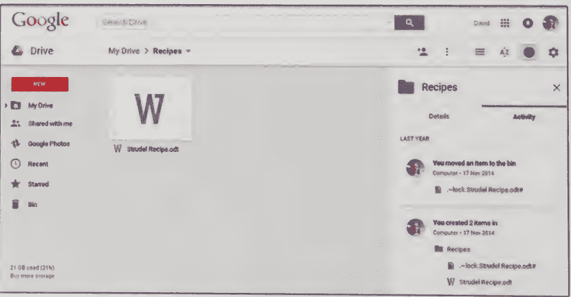

然而，这并不意味着它被所有供应商的普遍接受和支持。例如，由于我们刚刚看了如何备份你的机器，我正在寻找在 Linux 平台上访问云存储的替代方案。现在，虽然 `Dropbox` 等软件有 Linux 版本，但 `Google Drive` 就不能这么说了——这让我们感到很惊讶。同样的还有 `Citrix ShareFile`，以及可能没那么令人意外的 `Apple iCloud`。

## Google Drive

你仍然可以使用没有 Linux 版本的云存储系统。就 `Google Drive` 为例。在 Windows 和 Mac 上，你可以自动在本地磁盘和远程副本之间同步文件，因为这些每个平台都有相应的桌面应用程序。在 Linux 上，你无法这样做。不过，你可以做的是通过网络浏览器使用该服务。虽然文件不会自动同步，但你至少可以轻松地将它们下载到本地磁盘进行处理，然后简单地将它们拖入网络浏览器窗口即可重新上传。

## 某些软件未打包

我们之前提到过，某些软件是没有打包的，你应该尽量避免使用它们。但是，它们有时非常有用，以至于你愿意付出努力。

幸运的是，未打包的软件安装并不总是完全的噩梦。如果你下载源代码并自行编译，这可能会充满难以理解的错误信息，以及编译器抱怨缺少一个或多个所需的组件导致无法继续。但在其他情况下，你会发现软件提供商已经为你做了大量工作。例如，如果你想使用 `OpenOffice` 应用程序套件，你可以从生产者的网站下载一组包文件，并按照相对简单的“read me”说明文件来安装这些组件。

> 小贴士
>
> 准备好反复调试和使用 Google：对于未打包的程序，“如何”文档通常很好用，但在你特定的系统上，你可能会遇到它们没有涵盖的错误信息。

## 兼容性

在简单讨论了某些应用程序尚未适用于 Linux 的事实后，值得考虑你的 Linux 机器在与你拥有的其他电脑或可能在工作中使用的电脑连接时，兼容性如何（或是否不兼容）。

### 应用程序兼容性

某些应用程序在 Linux 上根本不存在。例如，`Microsoft Office`；它有 Mac 版本和 Windows 版本，但没有 Linux 版本。在这种情况下，你需要依靠你所拥有的应用程序能够使用与你使用的其他平台兼容的格式打开文件。`LibreOffice`（Linux 办公套件）能够打开 `Microsoft Office` 格式的文档，尽管无法保证在 `LibreOffice` 中打开时，例如 Word 2013 文档的格式会被绝对正确地保留。

> 那些想要处理非 Linux 文档的用户，但兼容性并不总是 100%。

**下方：**在你的 Linux 电脑上访问 Mac 文件是非常简单的。

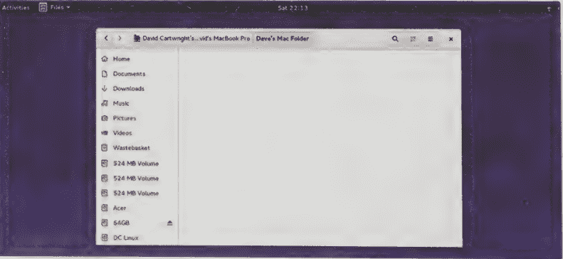

## 网络交互

考虑通过网络与其他操作系统交互的能力，事实上，这往往于非常简单，因为你拥有的几乎任何东西可能都能使用 Windows 的基本文件共享协议进行通信。例如，在 Mac 上开启文件共享并在 Linux 电脑上导航到它确实非常容易。


## 企业目录服务

接下来是如果你想在公司网络上使用 Linux，你可能需要使用的更高级的功能。在这种背景下，主要要求是 Linux 用户能够对企业目录服务进行身份验证——十之九将是 `Microsoft Active Directory`。好消息是，尽管传统上相当棘手，但在今天这是完全可行的；坏消息是，这超出了刚接触 Linux 的人的理解范围，因为你需要运行许多看起来非常晦涩的命令。

## GUI 是你的朋友

你可能已经注意到我们在书中使用的插图分为两类。第一类是传统的截图，显示了现代 Linux 系统的图形界面。第二类是我们使用的文本命令片段，用于显示无论你是否在机器上运行图形界面，都可以使用的命令。

在 Linux 早期，由于内存和处理能力非常有限，图形用户界面并不常见，且通常运行起来非常棘手。今天的情况已不同了，因此使用 Linux 的正常方式（至少在台式电脑上是）是使用桌面环境之一。

## 入门

所以，充分利用它吧。是的，你可以使用命令行来例如安装软件，或者同样，无论你选择哪种 Linux 发行版，都会有一个图形化包管理器。例如，在我们研究上一节时，我们就用它来安装了 `Dropbox` 客户端。

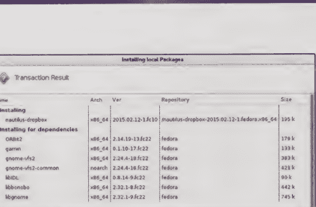

左侧：在这里，`Dropbox` 客户端正在使用图形化包管理器安装。

## 开箱即相当安全

最后需要记住点是，Linux 被认为是一个非常安全、稳固的系统。如果你是从头开始安装的，很有可能是当你使用键盘和屏幕时电脑运行正常，但在其他地方却无法连接。让我们举个例子。Unix 类系统的一个基本功能是从另一台电脑连接并输入命令。但如果我们尝试使用安全壳连接我们的机器（在此情况下是从 Mac），我们被拦截了：


```
DCPro:~ ssh dsc@192.168.1.186
ssh: connect to host 192.168.1.186 port 22: Connection refused
```

这是因为默认情况下情况下 Linux——在开启接受连接的服务之前，我们无法连接：

```
[root@localhost ~]# systemctl start sshd
```

现在我们可以再次尝试从 Mac 连接：


```
DCPro:~ davidcartwright$ ssh dsc@192.168.1.186
The authenticity of host '192.168.1.186 (192.168.1.186)' can't be established.
RSA key fingerprint is
77:72:78:b0:5b:f7:d1:02:ce:cd:44:a5:92:7e:ed.
Are you sure you want to continue connecting (yes/no)? yes
Warning: Permanently added '192.168.1.186' (RSA) to the list of known hosts.
dsc@192.168.1.186's password:
Last login: Sat Aug 1 22:24:59 2015
```

成功！并没有拒绝连接，而是询问我们是否想要接受安全密钥，然后在提供正确的密码后，我们允许进入。

## 额外安全

你可能会发现你选择 Linux 了一些额外的安全项目，即使你开启了连接功能也会阻止远程访问，例如 IPTables 防火墙系统。所以，如果你在配置中勾选了所有选项仍然无法进入，请检查它是否运行了未知的防火墙。

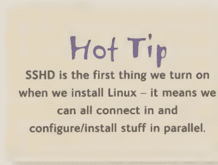


# 不同发行版是如何运作的

可用的 Linux 发行版如此之，以至于你会认为它们不可能都相同——而且，当然你是对的。不过，这并不是指某些发行版支持多种不同处理器架构的变体（flavours），因为对于特定的发行版来说，不同的变体看起来大大相同。


区别体现在两个方面。首先是安装产品本身的方式——从 USB 闪盘上的“精简版”镜像（它仅提供足够通过互联网安装剩余部分的内容），到装满 DVD 的钱包（它们共同包含了你所需的整套软件）。其次是支持模型——从自救到 24/7 呼叫中心的企业级远程协助。

# 你可以以什么形式获得它们？

我们的第一次 Linux 安装——第 27 页的 Slackware——是来自互联网下载的，我们把它写在了一叠软磁盘上。在这方面，Linux 按照它本该的方式开始了。直到今天，大多数 Linux 安装的起点仍然是从网站下载。这包括了商业版：`RHEL` 是一个可下载的产品，只要你拥有活跃的订阅并因此可以登录支持门户；同样，`SUSE` 的在线商店在产品页的“库存状态”列中告诉我们，它是电子下载。

同样，当你去在线零售商处购买时，你买的产品是装有 CD 和说明书的盒子，但对于在线订阅——你只会收到一些晦懂的代码，你可以通过访问供应商网站进行注册。既然在下一个版本发布后，有这么多 DVD 和说明书最终会变成垃圾填埋场或回收桶里的垃圾，供应商为什么要费心去打印 DVD 和说明书呢？

> 小贴士
>
> 我们从不费心于 CD 或 DVD 发行版——一个 USB 闪盘和良好的互联网连接对我们来说就足够了。

下方：你可以从各自的网站下载许多不同的发行版。这是 Ubuntu 的下载页面。

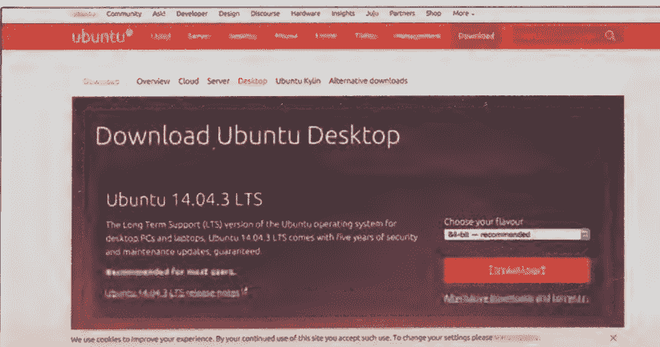

有基于 CD 的 Linux 版本，通常由第三方制作，而不是 Linux 发行版本身。因此，亚马逊美国站会以 9.99 美元卖给你一张 Linux Mint CD，或者你可以从亚马逊英国以 8.79 英镑获得一个 USB 闪盘上的启动版本。哦，当然，如果你关注当地报刊店的 Linux 杂志，通常会发现封面 DVD 上包含一个或多个发行版。


# 安装模型

通常有三种你可以使用的安装模型，如果你做过我们之前过的 Fedora 安装，那么你已经尝试过其中一种了。

## 基础网络安装

在基础网络安装中，你下载一个非常、非常小的镜像并将其写入 CD、DVD 或 USB 闪盘。这种方法的想法是让机器启动到一个非常基础且下载很小的镜像中，该镜像包含足够让机器运行并连接网络的内容，并为你提供一个（希望是）易懂的用户界面，通过该界面你可以选择安装选项。

下方：在进行基础网络安装之前，检查你的网络速度是非常重要的。

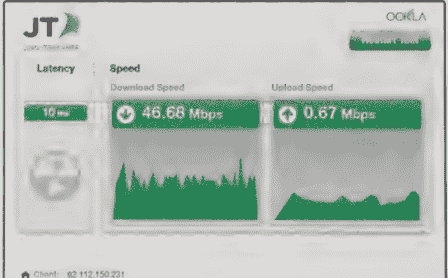

基础网络安装的优点是，你不需要一个巨大的 USB 闪盘来存放安装文件，如果你打算针对少量功能进行相当自定义的安装，这就太棒了（如果你只想使用其中几百 MB，为什么要下载几个 GB 呢？）。

| 上次结果： |
| :--- |
| 下载速度: 46677 kbps (5834.6 KB/sec 传输) |
| 上传速度: 671 kbps (83.9 KB/sec 传输) |

缺点是，除非你在你的网络中有某种缓存服务器，否则如果你进行多次安装，你将不得不反复地从互联网下载数据。如果你使用的是像我们这样的 50M/s 宽链路，那没问题；但如果你使用的是速度只有几兆字节的宽带连接，即使是很小的安装也可能是痛苦的。

## Live 安装（现场安装）

我们在示例中做的安装使用了 Fedora Live 安装。这些在发行版中非常常见，而且是一个极佳的折中方案，因为如果你进行默认安装且不修剪那些花哨的功能，安装介质上已经包含了它所需的所有文件。如果你还记得，我们在演示步骤时，在安装之前设置了无线局域网设置。实际上，我们没必要这样做，因为它所需的一切本就在 USB 闪盘上；我们仅仅是因为认为这很有很有用（而且当安装完成后，它会将无线设置写入 Linux 安装中，这样我们重启后就直接连接到了网络）。

> 小贴士
>
> Live 安装是我们的最爱——它让你启动一个相当完整的 Linux，并且比精简版的网络安装更具灵活性。


## DVD 安装

最后的选择是下载一组 ISO 镜像，但将它们刻录到 CD 或 DVD 作为安装媒体。这最接近“传统的”安装方法了，因此你可以在被提示时享受半小时更换光盘的怀旧时光。我们建议对较大的发行版使用 CD，但 DVD 是可以的（例如，Debian 8 使用 17 张 CD，包括如果你选择完整版时的更新程序，但只需要四张 DVD）。


# 支持选项

发行版运作方式的最后一个考虑因素是支持模型——你如何获得帮助。

## 自行其路

第一个选项是自己来。那里有庞大的 Linux 用户社区，有论坛和维基。如果你遇到问题，可能会找到解决过它的人。这是学习最好的方式，但它需要大量的时间和精力。

## 免费 Linux 咨询

第二个选项是从他人那里获得免费帮助。许多发行版都通过邮件列表和社区论坛提供某种程度的支持。这对于大多数人来说很棒，但如果你需要快速答案，它可能不够快。

## 商业支持

第三种选项是付费支持。这对于需要保证响应时间的企业来说至关重要。你可以获得专业技术人员的支持，他们可以帮你解决任何问题。这可能很贵，但对许多人来说，这种安心感是值得的。

## SUSE

在提到 Slack-ware 时，我们不能不提到 SUSE（其“U”在多年后神奇性地变成了大写——为了避免混淆，我们将使用全大写的版本）。为什么？因为 Slack 是源于 1992 年的名为 SLS 的东西的“绑定”版本；SUSE 4.2（尽管版本如此，这是第一个化身）是 Slack 的德语翻译版。

Debian 的最初版本也于 1993 年问世，这得益于一位开发者的努力，但与其他版本一样，社区的成长使其发展成了今天的模样。尽管在如今，它可能被一些知名度更高的发行版所掩盖，但它从一开始就一直存在着。

## Red Hat

仅仅几年后，1995 年5 月见证了 Red Hat Linux 1.0 的诞生；我们今天熟知的产品在 2002 年 3 月随着 RHEL 2.1 的正式发布而加入了“Enterprise”（企业级）一词，人们意识到 Linux 有机会作为一种企业操作系统被严肃对待。

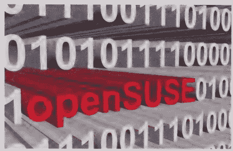

> 小贴士
>
> 不要轻视 Debian —— 它仍然是非常优秀的发行版，尽管有些大猩猩发行版获得了多得关注。


## CentOS

CentOS 出于 2004 年春季，源自 RHEL，并继续随着新 RHEL 版本的发布以其为基础。作者们极力强调，CentOS 仅仅是 RHEL 的免费复制，尽管如此，它是基于 Red Hat 提供的开源代码构建的，而且 CentOS 项目委员会也包含了 Red Hat 的人员。

## Fedora


沿着类似的 RHEL 血缘进入 Fedora 线路，Fedora Core 1（前六个左右版本都是 Fedora Core 某某版本）于 2003 年 11 月发布。令人惊喜的是——Fedora 也有来自 Red Hat 团队的正式赞助和投入。

## Ubuntu

大约 2004 年，我们迎来了 Ubuntu，其第一个正式发布版本被混乱地命名为 4.1。尽管正如我们提到的，Ubuntu 与 Canonical 有着紧密的联系，但它仍然是一个真正的社区驱动的 Linux 实现。


## 最近十年的发展

最后，2004 年 SUSE 开启了向开源版本的探索，OpenSUSE 运生。
这可能会让你感到惊讶（我们也是如此），Oracle Linux 在 2006 年 10 月发布，正如我们提到的，它和这里提到的其他口味一样，源自 Red Hat 的血统。Oracle 决定发布自己的 Linux 并不意外。既然应用程序的性能直接受到底层操作系统性能的影响和影响——为什么不采用一个源代码免费获取的操作系统，并制作出一种融入了应用程序开发者知识成果的自己的口味版本呢？
Oracle Linux 基于 Red Hat，并自 2006 年起一直在运行。

> ### Linux 发行版多到你挥棍子都数不完。在我们没有关注的版本中，Mint 是最受欢迎的之一，请看一看。

## 相似点与差异

## 系统的变化

在其他情况下，差异更具相关性，因为它们直接影响你如何使用系统。不同的窗口管理器会将元素放在屏幕上的不同位置，因此，如果你有三台运行三个不同窗口管理器的机器，且它们的 GUI 部分位于不同位置，或者交互屏幕在质量和易用性上有所不同，那么在多个环境之间切换可能会挑战你的理智。窗口管理器很容易更换，尽管软件包组可能有几百 MB，所以请确保你的磁盘空间足够。


## 不同的包管理器

发行版（distros）之间最令人困惑的差异在于它们不同的包管理器。我们在示例中使用的 Fedora 安装使用 DNF，它是 Yum 包管理器的继者。红帽（Red Hat）使用 RPM。Yum 和 DNF 都与 RPM 包配合，因此基本相同（尽管语法不同）。Debian 用户会习惯高级软件包工具（APT）。它们的功能几乎完全相同，只是 DNF 是 Yum 的现代替代方案且它们具有不同的语法；只是，如果你有不同的变体，你需要记住不同的命令。

> 小贴士
> 检查你发行版的包管理器并看看它来自哪一个家族——通过这一点，你就知道可以下载和安装哪些类型的包了。

## 大小

你在 Linux 发行版中发现另一个巨大差异是它们的大小。虽然这看起来有点怪异（Linux 难道不是 Linux 吗？），但如果每个人的需求都相同，那么确实会有几十个 Linux 发行版的市场。

| 名称 | 大小 | 修改日期 |
| --- | --- | --- |
| puppy_demont | 720 B | 29/06/2008, 12:00 AM |
| _readme_fist.txt | 1.4 MB | 01/08/2008, 12:00 AM |
| bootfile.img | 55 B | 01/08/2008, 12:00 AM |
| bootfile-swtmp.md5.txt | 1.4 MB | 07/08/2008, 12:00 AM |
| config.ini | 49 B | 12/20/2007, 12:00 AM |
| kernel | 46.8 MB | 01/01/2007, 12:00 AM |
| documents/ | | 01/04/2007, 12:00 AM |
| dai-4.3.10-embedded.md5 | 50.2 MB | 11/17/2008, 12:00 AM |
| dai-4.3.10-linux.md5.txt | 50.2 MB | 11/17/2008, 12:00 AM |
| dai-4.3.10-amd.md5 | 56 B | 11/17/2008, 12:00 AM |
| dai-4.3.10-amd.md5.txt | 56 B | 11/17/2008, 12:00 AM |
| dai-4.3.10-kernel.md5 | 58 B | 11/17/2008, 12:00 AM |
| dai-4.3.10-kernel.md5.txt | 58 B | 11/17/2008, 12:00 AM |
| dai-4.3.10-root.md5 | 49 B | 11/17/2008, 12:00 AM |
| dai-4.3.10-root.md5.txt | 49 B | 11/17/2008, 12:00 AM |
| install.iso | 53 B | 11/17/2008, 12:00 AM |
| install.iso.md5.txt | 49 B | 11/17/2008, 12:00 AM |
| modules/ | 2.0 KB | 09/05/2006, 12:00 AM |
| root | 30.2 MB | 10/25/2006, 12:00 AM |
| squash.img | 1.4 MB | 10/24/2007, 12:00 AM |
| squash.img.md5.txt | 51 B | 01/04/2007, 12:00 AM |

所以，我们在这里讨论的主流 Linux 发行版是所谓的通用型：它们在你的硬盘上占用几百 MB 或几 GB 空间，这没问题，因为你可能有一个不错的处理器和几百 GB 的硬盘空间。但如果你受限了呢？广受欢迎的树莓派（Raspberry Pi）在诞生之初只有 256MB 板载内存，并依赖 SD 卡进行磁盘存储，在那个时代，16GB 被认为是大容量。我们在研究这一部分时使用的参考之一是，基础安装要求从 16MB（对于小型 Linux 发行版来说很惊讶）到 1GB（对于像 Fedora 这样的发行版）之间的 SD 卡。
上述：Linux 是一个功能强大的发行版，尽管其大小不一。

## 处理器平台

发行版之间最困惑的差异在于它们拥有不同的包管理器。我们在示例中使用的 Fedora 安装使用 DNF，它是 Yum 包管理器的继者。红帽使用 RPM。Yum 和 DNF 都与 RPM 包配合，因此基本相同（尽管语法不同）。Debian 用户会习惯高级软件包工具（APT）。它们的功能几乎完全相同，只是 DNF 是 Yum 的现代替代方案且它们具有不同的语法；只是，如果你有不同的变体，你需要记住不同的命令。

> 小贴士
> 检查你发行版的包管理器并看看它来自哪一个家族——通过这一点，你就知道可以下载和安装哪些类型的包了。

最后，这意味着发行版之间存在处理器支持。如果你基于 Intel 风格的处理器（x86 或 x86-64），那么你有很多选择——虽然并不是所有的 Linux 都支持这些非 Intel 处理器，ARM 架构被一系列设备支持，而且像 Yellow Dog 这样的朋友也有相当的选择。

## Gentoo Linux

有一个发行版我们偶然没有提到，顺便提一下，它非常疯狂且值得特别提及。我们检查了 Gentoo Linux 的下载页面，得到了 x86、x86-64、Alpha、HPPA、IA64、PowerPC、s390、SuperH 和 SPARC 等选择。而且 MIPS 版本并没有跨平台。

> 小贴士
> 你可能没有 IBM 主机，所以 x86 或 x86-64 已经足够了。

## 使用什么硬件

如果你打算运行 Linux，你需要一些东西来运行它。现在，我们假设你将使用一台真实的、活的、某种描述的计算机（虽然亚马逊云服务等云服务很棒，但不是我们要讨论的）。现代 Linux 实现非常棒的一点是，它们支持的硬件范围非常广泛——所以你有从你组装的 PC 到高性能商业机器的各种选择。


## Intel 与其他处理器

我们够老的人会记得，Windows 不仅仅是 Intel 处理器的操作系统。Windows 也适用于 DEC Alpha 处理器，事实上，我们亲眼见证过。同样，Sun 的 Solaris 不仅兼容 Sun 自己的 SPARC 处理器，还支持 x86 和 x86-64（当然，它在 SunOS 时代支持过 6800 系列处理器，而 PowerPC 处理器仅支持过一个短暂的版本）。

| 发行版 | x86 | x86-64 | IA64 | POWER | SPARC | ARM | MIPS | SH | IBM 主机 | ALPHA |
|---|---|---|---|---|---|---|---|---|---|---|
| CentOS | | 是 | | | | | | | | |
| Debian | 是 | 是 | | 是 | | 是 | | | | |


| Fedora | 是 | 是 |  |  |  | 是 |  |  |  |  |
| Gentoo | 是 | 是 | 是 | 是 | 是 |  |  | 是 | 是 | 是 |
| openSUSE | 是 | 是 |  |  |  |  |  |  |  |  |
| Oracle Linux | 是 | 是 |  |  |  |  |  |  |  |  |
| Red Hat Enterprise Linux |  | 是 |  | 是 |  |  |  |  | 是 |  |
| Slackware | 是 | 是 |  |  |  |  |  |  |  |  |
| SUSE Linux Enterprise Server | 是 | 是 | 是 | 是 |  |  |  |  | 是 |  |
| Ubuntu | 是 | 是 |  | 是 |  | 是 |  |  |  |  |
| Yellow Dog Linux |  |  | 是 |  |  |  |  |  |  |  |

## CPU 技术

关于 Linux 的惊事实之一是，它支持的不是两三个处理器家族，而是一个荒谬的 CPU 技术列表。当然，我们从明显的 x86 和 x86-64 架构开始，还有 PowerPC（如 IBM RS/6000）和 IBM 的 Power 处理器。然后是 ARM 处理器，如果你正在构建一个小型 ARM 设备设备并希望在上面运行自定义软件，它是嵌入式操作系统的超级选择。但规模增大后，它也支持如 IBM S/390 和 z 主机架构的大系统。

## 什么处理器？

见上表，显示哪些发行版支持哪些处理器。它包含了提供主机版本的处理器；例如，Fedora 有针对 MIPS 的“次要”版本，但它们没有包含在内，因为这些版本无法保证发布。

## 需要考虑的因素

事实是，你不会先决定使用 Linux，然后再决定要在哪个平台上运行它。硬件平台或操作系统的选择很少是孤立的决策，相反，你是一对选择选择。

举个例子。假设你是一家想要运行大型数据库系统的公司，并且已经决定 Oracle 是你想要使用的数据库包。你有多种选择：你可以使用运行 SPARC 处理器（当然是 Oracle 拥有的）上的 Solaris，也可以使用 Intel 基础设备运行 Windows，或者你可以选择你喜爱的 Intel 服务器供应商（可能是 HP 或 Dell）运行 Oracle Linux 并在其上部署 Oracle 数据库。

# 电源

首先是处理器。我们已经讨论过不同的处理器家族，但在这里我们讨论的是组装 PC，所以我们讨论的是英特尔（Intel）或 AMD 处理器。在 32 位和 64 位处理器之间进行选择时，我们总是选择 64 位的；成本差异可以忽略不计，而且对于 Linux 而言，完全不需要担心它在 64 位平台上的运行效果与 32 位平台一样良好。


# 内存

然后是板载内存，答案很简单：在你的负担范围内越好越好。我们实验室的笔记本电脑标准配了 8GB RAM，这对于我们的需求来说足够了；如果你正在组装台式机，为什么不从 16GB 开始呢？我们遵循的主要规则是留出空内存槽以备未来扩展，所以如果你有四个插槽并想要使用 16GB，请使用两个 8GB 的模块，而不是四个 4GB 的模块。


# 连接

接下来是网络适配器，正如我们稍后讨论网络时将会看到的，唯一合理的选择是千兆以太网。主板标准配有板载千兆以太网。

当我们讨论主板时，你会发现标准主板配有板载 SATA 连接；这对于家庭组装的台式机来说没问题，我们稍后会在存储部分稍微解释一下 SATA 是什么，并提供关于选择什么硬盘的建议。

# 其他设备

你还需要一个机箱和一个电源，但这些东西随处可见。你可以为家庭组装台式机购买各种花哨机箱，你只需要记住决定你需要多少个内置硬盘，并购买一个足够容纳它们的机箱即可。

> 小贴士 如果是自己组装，请购买主板/CPU 套装——这比尝试理解哪个处理器与哪个主板兼容要容易得多。

自组装 PC 最困难的部分是将 CPU 与主板匹配——那些规格表可能是一系列令人眼花缭乱的插槽类型等。我们倾向于通过购买包含主板和处理器的单盒套装来规避这个问题：不过，你可以花低至约 £160/$251 买一套套装，当然，价格没有上限（一台配有 8GB RAM 的主板的英特尔 i5 需要 £470/$739，有人要吗？）。


# 公司办公室里的服务器

如果你想为办公室准备一台服务器作为文件服务器、电子邮件服务器或 Web 服务器，该怎么办？简单，简单。让我们以一台入门级主流服务器为例——单处理器、单块 1TB 硬盘和 8GB RAM。配备 Windows Server 2012，其价格为 £1,899/$2,988。不过等一下：如果我们决定使用红帽企业 Linux（Red Hat Enterprise Linux），价格实际上会涨到 £2,016/$3,172。对于 SUSE，则是 £2,102/$3,307。

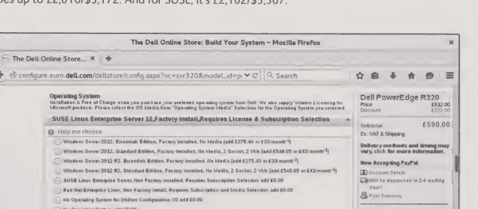

这让 Linux 听起来有点没吸引力。当然，正如我们所看到的，如果你有足够的信心维护系统，就不必使用商业版 Linux，或者你可以聘请合作伙伴来完成。因为如果我们检查同一台服务器的价格，裸机价格将仅为 £252/$369，单台机器节省了一大笔钱，但如果你有两或三台服务器，费用就会累积。在小型企业中——它通常从一两台机器开始，可能会增长到四或五台。这种节省是实实在在的，即使你决定使用 Windows 服务器（如果你想使用 Active Directory 的话，这并不是什么愚事），也没有什么能阻止你集成 Linux 服务器，让各个平台和谐工作。

> 小贴士 Linux 的支持比 Windows 的商业价格贵，但从真正的技术人员来说，你花的钱物有所值。


# 成本比较

记住，在比较 Windows 和 Linux 的成本时，你并不是在进行同类比较；Linux 带给你的不仅是操作系统和运行更新的能力，还有……（注：原文此处不完整，但根据语境通常指代 Linux 的其他价值）。

# 虚拟机上的 Linux

在关于虚拟化章节的最后，如果你在办公室环境中运行多个，请务必使用扩展器来提高无线环境的可靠性。虚拟化无疑是当务之急，因为它能让硬件共享更顺畅。而且，如果你运行的是 Windows 虚拟机，这需要花费费用，但如果你运行的是 Linux 虚拟机，这完全可以免费。虚拟化化允许你能够运行多台虚拟机，而不需要额外花钱。虚拟化在开发测试非常非常有用，但确保网络网络网络 Windows Windows Windows ，，这确实是物有所价的。

# 需要连接什么

当你考虑要安装 Linux 的网络设备时，你还需要考虑连接方式——但关于网络本身呢？

> 小贴士 如果你的电脑不会移动，请使用有线网络——它比无线网络快得多。

# 以太网络

第一条规则是，如果你使用的是不需要移动的设备（例如台式机），请使用有线网络——而不是无线网络。WiFi 对于便携设备来说很棒，但如果你的设备不是便携的，为什么不使用电缆呢？使用千兆以太网：所有新设备都带有千兆端口，你可以花大约20 买一个八口交换机将它们连接起来。

# 无线网络

你几乎会为便携设备使用无线网络，确保你开启最好的认证和加密选项（WPA2 AES 加密），并让共享密钥非常复杂以免他人猜到。如果你有少量设备，为什么不使用路由的功能（我们打赌它有


根据其网络适配器的硬件地址为特定机器分配特定的 IP 地址。这意味着如果某些功能无法正常，你知道它的 IP 地址应该是多少，从而可以对网络进行连接性测试。

最后，无线网络只有在空气中才能真正良好工作——它们不喜欢墙和门。如果你打算让超过十二台 Linux 机器通过无线连接到其他设备，请确保花精力让无线网络可靠，并使用扩展器来增强信号。扩展器有两种类型：一种是纯无线的（它们与你的互联网路由器进行无线通信，然后呈现为 WiFi 网络），另一种是利用电源电缆将信号传输到整个场所（它们实际上是有线到路由器的，然后呈现自己的 WiFi 网络）。我们两种都用，其性能比我们关闭所有扩展器并让所有设备到达中央路由器要好十倍。

下方：你可以使用无线扩展器来确保你的信号覆盖得更远。

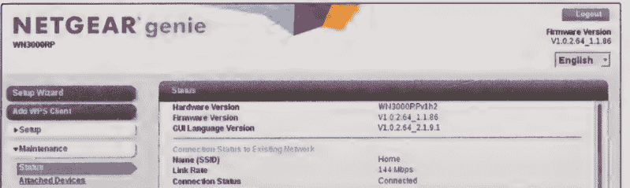

# 应使用什么存储设备


正如我们所提到的，Linux 可以运行在各种不同的硬件上。然而，影响其可靠性的关键因素之一，是你用于支撑运行机器的底层存储设备。计算机存储是一个极其广泛的话题，很有可能如果你问三个人对你的 Linux 机器推荐什么种存储设备，你至少会得到两个、甚至是三个不同的答案。因此，关于你应该做什么，这里有一个中立的观点。

# 磁盘类型

主要的存储——即你启动 Linux 系统时所使用的设备——是硬盘。如今，你有两种选择：““传统的”磁性磁盘（我们将其称为“旋转磁盘”）和固态硬盘（也称为 `SSD`）。

## 旋转磁盘

旋转磁盘顾名其实义——存储单元是一组涂有磁性材料的磁盘，它们以高速旋转。一个安装在移动臂上的“磁头”会在磁盘上移动，以便在磁性表面写入数据或将其从中读取出来。相比之下，`SSD` 完全由闪存内存组成——没有移动部件，但它使用在设备关闭时仍能保留数据的固态内存。

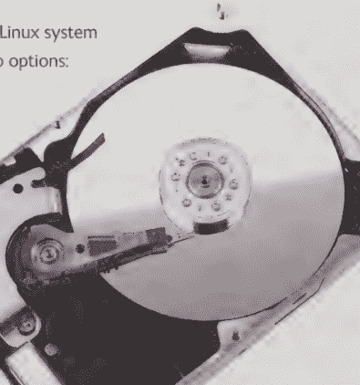

**上方：** 旋转磁盘的速度越快，价格越高。

旋转磁盘有不同的速度类别。入门级磁盘的转速为 5,400 rpm，而在高端，你可以看到 15,000 rpm。正如你预期的那样，速度越快，磁盘的吞吐量就越高——价格也越高。

> **热点提示**
>
> **`SSD`** 曾经昂贵得离谱，但现在仅仅是非常贵了！随着它的普及，价格正在大幅下降，所以请查看在线商店寻找廉价。

# 固态硬盘

`SSD` 是一个完全不同的概念：它比旋转磁盘快得多——例如，从旋转磁盘迁移到 `SSD` 单元可以使你的机器启动速度至少快两到三倍，某些专业的基准测试显示这种差异远超于此。`SSD` 极快，而且你还获得了静音的特性（正如我们提到的，它没有移动部件），并且功耗也低于旋转磁盘。

另一个区别是价格。我们刚刚在一家热门在线零售商处对比了 1TB 的 `SSD` 和 1TB 的 5,400 rpm 磁盘，`SSD` 的价格是后者的五倍（£254/$400 对 £46/$72）。这反映了 `SSD` 仍然是一项相对新的技术。价格已经从早期的水平大幅下降，随着制造技术变得更便宜以及供应商的竞争，价格将继续下降。

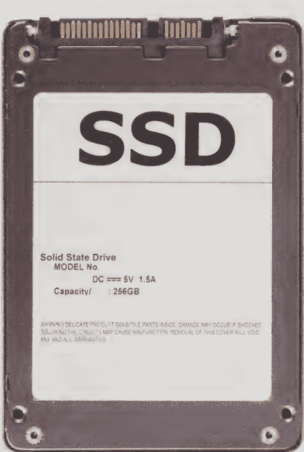

**上方：** 固态硬盘使用闪存内存且没有移动部件

# 接口

在你使用的存储设备方面，同样重要的是磁盘的接口。如果你是一个正在构建大型服务器集群的企业级 IT 人员，那么你将使用光纤通道（`Fibre Channel`）或串行连接存储（称为 `SAS`）。这些都是高速接口，如果你在使用 `SSD`，那么对于充分榨出这些昂贵磁盘的性能是至关重要的。

如果你只是一个正在组装台式机、笔记本电脑，或者用于进行 Web 开发的小型服务器的普通人，那么你更有可能选择串行 ATA（称为 `SATA`）接口。带有 `SATA` 接口的磁盘通常比 `SAS` 或光纤通道便宜，但更重要的是，如今大多数台式机和笔记本电脑默认都有 `SATA` 磁盘接口。

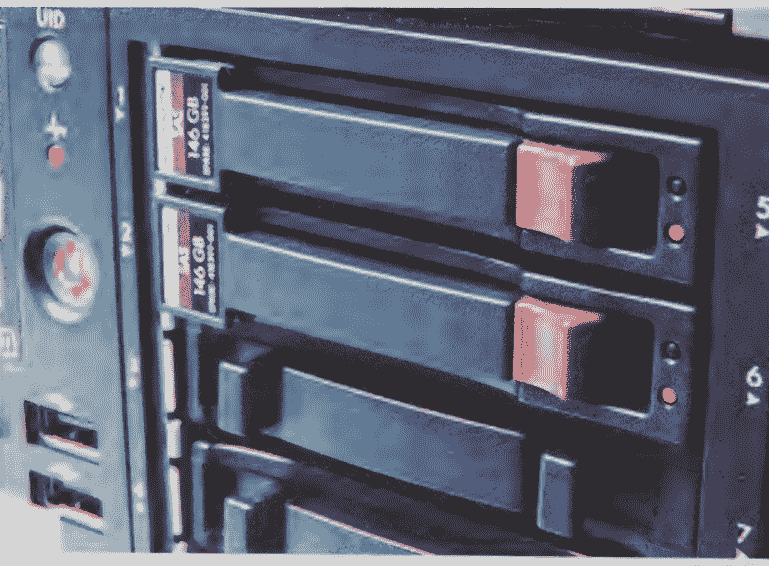

# 容错

如果你在构建 Linux 笔记本电脑，通常只有一个磁盘。但如果你在组装台式机，通常会有比一个磁盘更多的空间。这让你的系统更具健壮性。

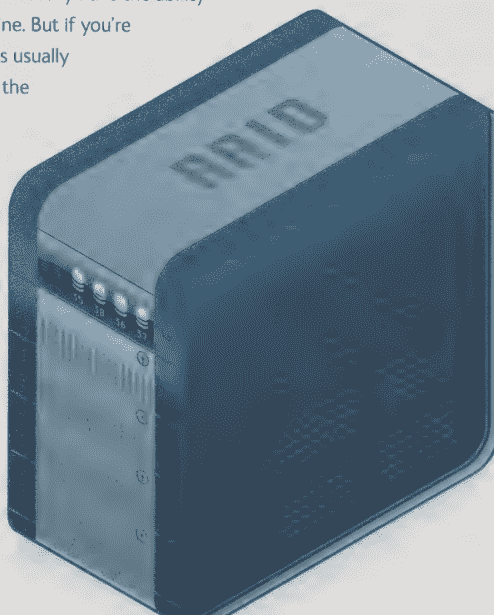

# RAID

存储技术有一种称为 `RAID`，它最初代表冗余磁盘阵列（Redundant Array of Inexpensive Disks）。如今它被认为是独立冗余阵列（Redundant Array of Independent Disks），因为在 `RAID` 中使用的磁盘并不廉价——`RAID` 对于高速存储同样有效。

你可以使用多种 `RAID` 配置，但我们关注的是 `RAID 1`。在这种方法下，你有连接到适配器的磁盘，每个数据都会同时写入两个磁盘。如果其中一个磁盘损坏，另一块将继续运行，对你的操作来说没有影响。还有其他 `RAID` 种类，但对于大多数中小型安装，你会选择 `RAID 1` 或 `RAID 5`（在后者中，你有三个磁盘，数据分布使得你可以丢失其中一个而不受影响）。

# 单磁盘

如果你打算使用单磁盘，如果负担得起，请买一个 `SSD`。与“传统”磁性设备的速度相比，性能提升是巨大的，而且随着程序变得越来越大越来越慢（过去几年似乎一直如此），你会感谢自己投入了这项投资。

# 分离启动盘和数据盘

虽然你经常听到人们谈论他们的机器启动有多快，但这真的重要吗？如果是笔记本电脑，那可能确实很重要，因为你会频繁地启动和关机。另一方面，如果是台式机，也许并不重要；我们的 iMac 大部分时间都是开启着的——它静静地坐在角落里，我们很少关闭它。

你关心的是它运行程序和访问数据的速度。因此，如果你想优化运行速度，为什么不用一个小的机械硬盘作为启动盘，然后安装一个更大的 `SSD` 硬盘并将其用于程序和数据呢？

一旦内核加载到内存，它就不需要对引导启动的磁盘进行任何主要访问，因此性能实际上并不是什么大问题。

## 小贴士

把钱花在会被频繁访问的数据盘上，而不是只在启动时才用到的启动盘上。


# 使用什么种存储设备

```
root@sharpe-local:~$
[root@sharpe-local ~] -a generate
shell 0.4 2015-04-04 (x86_64-linux-gnu)
Copyright (C) 2007-2015 Free Bash Project, Inc.
Released under GNU GPL v3.

--- START OF INFORMATION SECTION ---
Model Family:Western Digital Blue HDD
Serial Number:  WD-WAC671A7428
With Device:1: SATA
Firmware Version:  B1AD
User Capacity:100020486880 bytes (931 GiB)
Rotation Rate:7200 RPM
Device Type:SATA
ATA Version:3.0
Local Time:2015-03-27 20:45:18
SMART support:Enabled

--- START OF READ SMART DATA SECTION ---
SMART self-test result: PASSED

General Smart:
Offline selection status: passed data collection activity
was never started.
```

上面：`smartctl` 可以让你深入了解磁盘的细节。

# RAID 数据盘

我们讨论过备份的概念（见第 107 页），如果你读过那部分就会知道，重新安装操作系统通常比尝试修复它的各种奇怪问题要简单。因此，我们说过，重点应该放在备份你的数据上，因为你无法从标准镜像中恢复这些数据。为什么不使用 `RAID` 呢？

正如我们所说的，`RAID` 提供的可以让磁盘在不被中断的情况下工作。然而，在选择 `RAID` 适配器时需要稍微谨慎，因为你需要知道磁盘何时“坏掉”了。我们不会建议特定的控制器卡，因为选择取决于预算，而且极有可能在你输入这段文字到你读到它的这段时间内，某些型号已经被过时了。技巧是找到一些候选设备，然后仔细研究规格表（并咨询 Google），以验证是否有 Linux 版本的管理工具，或者是否有标准的 Linux 命令（如 `smartctl`）可以对其进行查询。通常的建议是选择 `Adaptec` 或 `LSI` 等主流厂商，因为对知名厂商的支持通常更好。

# 更换磁盘

大多数 `RAID` 适配器允许你使用不同的磁盘但仍然运行 `RAID 1` 配置。现在，你不会为了好玩而这样做——如果你在组装新电脑，你当然会买一个 `RAID` 适配器和两块相同的磁盘。但如果其中一块磁盘故障了，你极可能买不到完全相同的型号——磁盘会过时，新模型会不断出现。通常情况下，只要你更换的磁盘 (a) 速度与坏掉的磁盘一样快，且 (b) 容量至少与故障单元一样大，适配器通常就能胜任。当然，你无法利用磁盘的所有空间，但这是你为了韧性而付出的代价。


# 仅仅因为它仍在运行


廉价的 `RAID` 适配器通常需要你关机以更换故障单元——这并不是什么大问题，因为你至少可以选择一个低使用时段来进行。

关于 `RAID` 适配器的最后一个说明：仅仅因为它们能从连接磁盘的死亡，并不意味着你可以在不关闭服务器的情况下更换磁盘。企业级服务器中昂贵的 `RAID` 控制器具有“热插拔”功能，你可以在服务器运行的同时拔出故障设备并推入新设备。小型服务器和台式机的廉价设备没有热插拔功能，所以你经常发现为了更换磁盘，必须关闭电源并更换组件。当然，你至少有自由选择一个系统未使用的时间来关机，而且如果你练练使用螺丝刀，这花不了多久。


# 它是如何重建的？

当你更换磁盘时，控制器会接手从工作磁盘复制数据的任务。这是一个自动过程，但取决于磁盘的大小和系统的速度，可能需要 15–20 分钟。


- 响应返回路由器的公网 IP 地址。
- 路由器反转这种奇的转换，并将响应传递给 PC。

现在，虽然互联网上的设备可以看到路由器的公网 IP 地址并尝试向其发送数据，但它只会接受它知道是其发出的请求的回复的内容。因此，你的 PC 隐式地免受来自互联网的随机攻击。

> ### 小贴士
> 内部始终使用私有地址。这无论如何都是所有路由器的标准，而且这意味着你可以确定没有人能从互联网直接路由到你的机器。

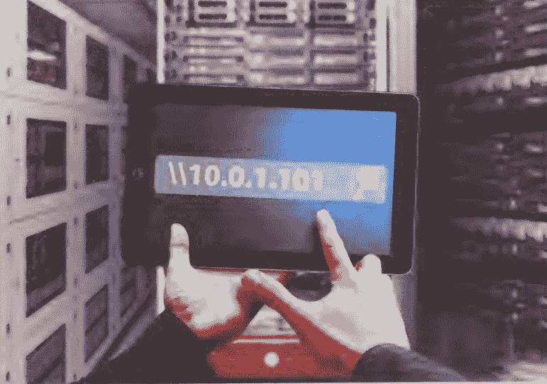

# LINUX 与安全

158

## DMZ 主机

现在，存在一种微小的可能性，你可能实际上想允许来自互联网的某些入站连接。例如，你可能在车库里运行了一个小型 Web 服务器。大多数家庭路由器都允许你允许某些基础连接 - 通常通过让你设置一台 DMZ（非军事化区）计算机。这听起来有点奇怪，但基本上是告诉路由器：“如果你收到任何你已知的入站连接，将它们传递到你的内部地址”，其中内部地址是你的 Linux 机器的 IP 地址。下面是一个 Tilgin 家庭路由器的示例。我们将 Linux 机器的 IP 地址放在“DMZ host IP address”框中。如果你考虑这样做，你可能需要在稍后阅读防火墙部分（参见第 168–73 页）。

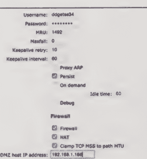

上方：Tilgin 家庭路由器的页面，你可以在此处设置 DMZ主机 IP 地址。

> ### 小贴士
> 不要使用 DMZ 主机允许入站连接，除非你完全对其含义满意 - 并且你已经关闭了所有非本质服务并加固了防火墙。

## 默认关闭

正如我们在讨论远程连接和运行 Web 服务器等问题时看到的，Linux 机器上的网络服务默认是关闭的。为了让它监听任何网络连接，我们通常必须先开启相应的服务，否则传入的连接将简单地忽略。始终采用这种方法 - 如果不需要某个项在网络上监听，就将其关闭。

对于你可以通过用户界面控制的应用程序，确保你不仅停止了该程序，还禁用了它在重启机器时复活。在 Fedora 上，这意味着使用 `systemctl stop` 关闭它，并使用 `systemctl disable` 防止在重启时重新启动。

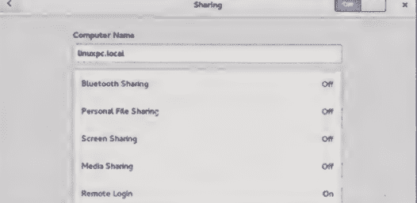

如果你真的想确保某些事情的安全，如果你不需要某个可以接受网络连接的应用程序，那么你应该卸载它而不是简单地关闭它。包管理器卸载东西就像帮助你安装它们一样容易。

上方：共享控制面板，显示默认关闭的服务。

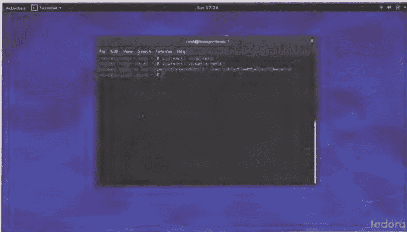

上方：在 Fedora 上，你可以使用 `systemctl stop` 和 `systemctl disable`：或者，你可以卸载该应用程序。

## 理智地处理出站连接

我们已经提到过，如果你是一个没有超级用户 root 权限的普通用户，你无法严重破坏 Linux。但我们也提到，即使你是一个普通特权用户，你也可能给他人带来麻烦。假设你正在使用许多基于 GUI 的免费电子邮件程序之一在你的 Linux 桌面面上读邮件。如果有人给你发了一个附件，而该附件实际上是一个包含命令的脚本，该脚本会向各种地址发送数百万封邮件，那时会发生什么？你难道

> ### 小贴士
> Linux 本身是安全的，但如果你做了某些愚蠢的事，比如运行别人发给你的脚本，你那就是在自找麻烦。


双击它吗？即使你只是回答了“不”，但并不是所有人都想得一样。毕竟，我们见过所有在 Windows 邮件程序中双击可疑附件并导致其机器感染某种病毒的人。

那么，请保持理智。就像你处理任何其他平台一样，在点击之前思考，因为虽然没有多少 Linux 病毒，但并不意味着完全没有。

## 保持应用程序更新

最后，就像你处理任何其他平台一样，确保定期更新你的应用程序和其他 Linux 组件。我们提到过，你不应该在每个机会都进行全面更新，因为这样有破坏某些东西的风险，但同样，你需要确保一切都运行在相当较新的版本上。

原因很简单：许多 Linux 依赖运行在平台上的应用程序和其他模块的漏洞（即具有安全影响的错误）。如果你确保频繁更新内容，就可以尽可能地减少别人利用你机器上旧的、有漏洞版本的概率。


163

## 安全连接

当计算机最初流行时，使用控制台是很常见的。这种方法非常昂贵：你需要多端口串口适配器。这个想法很简单：当客户端计算机连接到服务器的服务时，两个端点相互协商以建立一个加密通道，一旦建立，整个端到端过程对用户来说就像终端连接一样。然而，区别在于，任何通过“嗅探”网络观察飞而过的流量的人都会失望，因为他们看到的只是一堆无法理解的垃圾信息，除了参与交互的两个点之外，任何人都无法轻易解码。


## 局域网

因此，替代方案 - 通过局域网（LAN）连接变得具有吸引力。

## TELNET

Telnet 是允许数十个用户通过网络连接到单个主机的协议。Telnet 的问题在于 (a) 它运行在与他人共享的连接上，以及 (b) 你输入或接收的所有内容都以明文传输。在网络上放置“嗅探器”并观察飞过的流量并不是一项困难的工作。因此加密是常态。

> ### 小贴士
> 永远、永远不要 Telnet 程序。SSH 更安全，且现在是绝对的标准，因此无需考虑它的明文祖先。

## SSH

SSH 是 Secure Shell（许多缩写大小写不规范的缩写之一）。这个想法很简单：当客户端连接到服务器的服务时，两个端点相互协商以建立一个加密通道，一旦建立，整个端到端过程对用户来说就像 Telnet 连接一样。然而，区别在于，任何通过“嗅探”网络观察飞而过的流量的人都会失望，因为他们看到的只是一堆无法理解的垃圾信息，除了参与交互的两个点之外，任何人都无法轻易解码。


## 警惕自满

当我们说“无法轻易解码”时，并不是说 SSH 是完全不可破解的。时间在进步，计算机变得越来越强大，但在破解 SSH 流编码的通常任务中，它是*难以解决的*，这意味着花费的时间和资源太多，不值得尝试。

还要注意，虽然你通常在传统的 Telnet 连接上使用简单的用户名/密码交换进行身份验证，但现在你有各种其他工具可用。虽然你仍然可以使用用户名/密码组合，但你也可以选择在客户端和服务器上放置数字证书。这样做的好处是，从第一个


关于连接，两个端点知道加密机制和要使用的密钥，而证书提供的凭据比密码要复杂得多。你还可以使用一次性代码或其他双重身份验证机制的选择。

### 公钥加密简直疯了

既然说到这个上，我们将提到公钥加密（PKE）——这是一种被 SSH 以及其他类似概念（如安全网络协议）所采用的技术。当你使用数字证书来加密或“签名”一段数据时，它有两个“密钥”——一个公钥和一个私钥——它们在数学上是关联的。当你设置证书时，你对私钥保持保密（再次，线索就在这里），然后向世界公布公钥是什么。PKE 的酷之处在于，如果你用某人的公钥对某些内容进行编码，他们就可以用私钥轻松进行解码，但算法的本质（用于加密的实际函数）很难反向操作。由于这个原因，它通常被称为“陷门算法”——向一个方向（加密）非常容易，但向另一个方向（解密）则会非常吃力。


我们在这里并不描述如何实现 PKE 算法，因为它更适合作为一个整个章节的内容，而不是一小段落。这完全是一个非常疯狂的想法，特别是当你读到它时（查看一下 RSA 算法，第一个主流的 PKE 机制），你会发现自己自己在想：‘他们到底是怎么想出这种主意的？’

> ### 小贴士
> 了解一下 PKE。互联网上有大量的资料，尽管读起来可能很费劲，但当你灵光一现并感觉自己已经有了基本理解时，那是非常棒的。

关于 PKE 需要记住的一点是，随着计算机变得越来越快，你需要越长的密钥，以便让解密你的传输尽可能困难。密钥越长，你执行实际加密时使用的处理器开销就越大。

### SSH 是通往其他酷玩的路径

在某些其他程序运行之前，你可能需要启用 SSHD 程序，因为它们依赖于 SSH 通道的可用才能完成工作。


关于 `SSH` 的最后一点是，它不仅仅是 `Telnet` 的替代品——它的用途远比远程计算机的基于文本的命令行会话多。IT 世界倾向于重用技术而不是发明轮子，因此你会发现其他概念寄挂在 `SSH` 上。

例如，文件传输协议（`FTP`），这是另一个古老的互联网标准，在它的基本形式中，它以未加密的流发送数据。逻辑跳跃并不大：‘等等，让我们启动一个 `SSH` 连接，然后通过它进行我们的 `FTP` 传输。’让 `SSH` 软件承担加密的困难工作，然后简单地将 `FTP` 流量通过安全的“隧道”，这是完全合理的。`FTP` 并不孤单——全球开发者都使用 `SSH` 作为其私有协议的底层安全层，因为这是一个毫不努力就能实现高度安全通信的简单方法。


## LINUX 防火墙

到为止，我们讨论了很多 Linux 的固有安全性，即除非你告诉它，否则它不会监听入站网络连接，而且除非你是 `root` 用户，否则无法破坏核心组件。但它的防火墙能力呢？Linux 不仅仅可以因为某些东西没有监听而拒绝流量，还能检测入站流量并主动决定是否允许其进入。

### IPTABLES

我们提到 `IPTables`，这是最常见的 Linux 防火墙包，因为我们为了让示例中的内容运行，必须调整它的规则。如果你把 Linux 机器的组件比作一个洋葱，那么核心就是内核。


### SELINUX

在当今的 Linux 设备上，`SELinux`（安全增强型）包与 `IPTables` 配合使用。它并不是 `IPTables` 的替代品，而是一个作为内核模块实现的补充包，以不同的方式提供额外的安全防护。`IPTables` 重点在于定义网络流量的进入或退出，而 `SELinux` 则定义了 Linux 机器内部哪些组件被允许相互交互，以及交互到什么种程度。正如 `SELinux` 团队所说，它允许你“定义应用程序和用户访问不同资源（如文件、设备、网络和进程间通信）的方式”。`SELinux` 的核心在于使用“策略”仅在需要的地方限制访问。然而，其动机与 `IPTables` 相同——具体来说就是在允许实际所需的功能的同时，防止恶意活动。

> 小贴士
>
> `SELinux` 比 `IPTables` 稍微难上手一点，文档可能有些晦涩，但只要你坚持下去，你就没问题的。

```bash
user@localhost:~$ getenforce
Enforcing
user@localhost:~$ setenforce 0
Permissive
Class: 43  Permissive
Types: 483  Attributes
Domain: 29  Policy
Allow: 107254  Neverallow
Audit: 158  Contextype
Type: 16  Type
mem: 78  allowed
Role: 414  Range
Context: 121  Valid
Status: 27  used
Defcontext: 101  Port
Process: 8  App
Permissive: 1  Failed
```

你可能记得在我们将 Linux 设置 NAS 的示例中，我们必须使用 `setsebool -P samba_enable_home_dirs` 指令，`SELinux` 才会允许我们作为共享文件夹访问 Max 的家目录。

左图：`SELinux` 策略示例。

## Linux 作为防火墙？

我们已经讨论了 Linux 如何通过网络级安全（`IPTables`）和对访问权限的内部限制（`SELinux`）来保护自己。但如果你正在经营一家小企业并想要保护你的世界，你真的会将 Linux 当作防火墙吗？说实话，可能不会。你肯定不会决定把你的文件服务器配置 `IPTables` 作为你公司的防火墙。为什么要让你的主数据仓库变成一个你积极预期它去防御攻击的东西呢？如果你的廉价路由器无法胜任，市场上还有许多专用设备，它们的设置起来要容易得多，而且可能比一台等着损坏的带有机械硬盘的 PC 要可靠得多。


所以，请利用手头的工具——`IPTables` 和 `SELinux`——来保护你的 Linux 机器，但我们建议不要急于将其作为保护你世界的安全设备，因为有比这简单得多的方法。

## 无线安全

Linux 世界的最后一个安全领域是无线安全。我们已经简要触及了你可以选择的无线网络选项，现在我们将对其进行详细介绍。

### 什么时候不该使用无线网络

在关于无线安全的章节中讨论为什么不使用它，可能有点奇怪，但在某些情况下，你选择使用有线网络是有完全充分的理由的。


### 固定设备

如果你在网络插座附近有一台台式 PC，可以通过铜缆或光纤方便地连接到网络，那就这样做吧。虽然网络发明者们正竭尽努力让他们的心血运行得更快，但他们仍然落后于基于电缆的一方。今天买一台台式 PC，它将带有内置千兆以太网口，而在基础设施端，交换机方面也相当便宜。

### 故障诊断

有线网络也比无线网络容易诊断得多，因为你确切知道什么连接到了哪里，并且可以轻松将异常流量追踪到特定的设备或交换机端口。


尽管如此，我们都想尽可能地使用无线网络——特别是对于我们那些喜欢随身携带的智能手机、平板电脑和笔记本电脑（希望是基于 Linux 的）。你正在打字这段文字的这台 MacBook Pro 实际上并没有以太网口来使用电缆连接（需要一个小转换器），因此无线正日益成为常态。

> 小贴士
>
> 我们建议你在可行的情况下使用有线网络，但如果不可行，那么无线网络也可以——而且如果你为某些机器使用了电缆，就会为无线网络留出更少的设备进行共享（这意味着它运行得更快）。

### 无线基础设施至关重要

如果你操作得当，无线网络并不简单。当我们写下这些文字时，我们连接的并不是驱动我们网络的无线路由器，而是一个小型扩展器单元，它通过建筑的电源电路将我们的数据流发送到路由器。顺便提一下，这是增加无线覆盖范围的一种流行方法。

### 简单措施

如果你正在设置无线网络，可以做几件事来提高其安全性。首先，更改 `SSID`（网络名称），使其不会识别路由器型号或你个人信息的名称。其次，使用强加密协议。正如我们所见，`WPA2` 是目前的标准。第三，为你的网络使用复杂的密码。最后，考虑禁用 `WPS`（Wi-Fi 安全设置），因为它可能存在安全漏洞。

### 管理界面

当你想要配置无线路由器时，你需要访问它的管理界面。这通常通过在浏览器中输入路由器的 IP 地址来实现。登录后，你就可以更改设置，包括 `SSID`、密码和加密类型。务必更改管理界面本身的默认密码，因为这是一个常见的安全风险。


## 180 LINUX 与安全

### 越权接入点 (ROGUE ACCESS POINTS)

在我们讨论无线网络安全时，最后要说的话是当你遇到与你无关的无线设备时。正如我们之前提到的，在选择无线网络时，看到一堆你不认识的名称是完全正常的。尽管你的无线信号可能会通过最薄的门或木质墙而产生沮丧的衰减，但有时感觉即使是六英寸厚的铅也无法阻止邻居的无线网络在你的客厅里可见。如果这是你邻居的合法网络，那并不是大问题（除非他们的设备决定与你的设备在相同的通道通信并杀死吞吐量）。但如果有人运行了一个与你预期的网络名称相同的不法无线设备，并且在不需要密钥的情况下允许连接了呢？

答案是，你必须保持警惕和理智。告诉你的电脑，在没有明确选择的情况下，不允许连接到任何旧网络；当你连接到合法网络时，确保它向你索要 `PSK`（如果它没有询问，你可能已经被那个诈骗网络骗了，因为你的网络本应该要求身份验证）。


### 持续关注

对于无线安全，最重要的是跟上发展的步伐。幸运的是，这是 IT 领域中变化并不频繁的领域之一。例如，`WPA2` 从 2004 年起一直伴我们，所以不需要急于掌握新标准。`WPA2` 是完全没问题的，`CCMP/AES` 对加密来说很棒，但不要因为忘记更改路由器的管理员密码而让任何傻瓜进入路由器配置页面，从而毁了它的安全性。

> 小贴士：对你看到的任何新网络保持警惕，不要尝试连接它。有些程序会自称为 WiFi 网络，只在当你连接时等待着扑向你攻击。


## 188 LINUX 与网络

### 接入


多年来，计算机网络发生了巨大的变化。但奇怪的是，与宇宙中几乎所有其他事物不同，网络世界的复杂度并没有增加四倍。事实上，它变得更简单了。如今，普通用户遇到的唯一网络协议是 `IP` —— 互联网协议。在 20 世纪 90 年代之前并非如此，在此之前我们拥有难以置信的网络协议范围。仅举几个，我们有 `DECNet`（由 Digital Equipment Corporation 发明，其发明是为了让计算机相互通信）、`AppleTalk`（Apple 在 20 世纪 80 年代中期推出）、`IPX`（另一个老协议，这次来自 Novell 和 NetWare 操作系统）以及 `X25`（在同一时期广域网中非常流行）。

所有这些协议之上的底层连接也变得简单了。除了 Mac 内置的 `LocalTalk` 外，我们还有 IBM 的令牌环（`Token Ring`）、`FDDI`（一种光纤技术，在 100Mbit/s 速率下当时被认为是超快速的）、`ATM`（一种尝试过但在数据网络中失败的电信技术）以及许多其他技术。Linux 一直支持极其广泛的网络协议——在配置应用程序的截图中可以看到其中一些。如今，几乎全是以太网（`Ethernet`）统治天下；我们稍后会介绍无线部分。


上方：可以在此配置应用程序上看到网络协议范围。

## 开始吧

因此，我们将基于这样一个前提：我们想使用 `IP` 连接到以太网网络。我们的测试网络与大多数人家里宽带连接的情况相似：有一个路由器连接到宽带链路，而这个路由器通常有几个以太网端口并具备无线通信的能力。

> 小贴士：即使你不打算使用它们，也要查看网络选项列表并在互联网上了解其中一些。老实说，非常有趣！

`IP` 网络分为称为子网（`subnets`）的段（实际上还有很多其他术语，但如果你说子网，每个人都会明白你的意思）。这些段通过路由器连接。注意，我们几句之前提到过普通家庭网络有一个连接到服务提供商的路由器。如果你在想……是的，那个家庭网络仅仅是服务提供商网络的一个子网，你的世界通过路由器与他们隔离开。计算机能够直接与位于同一子网的其他计算机通信。在我们写这个句子时，我们的台基于 Linux 的笔记本电脑和一台相当老旧的 iMac 都连接到同一个子网。Linux 笔记本电脑通过网络连接到 MacBook 上的共享目录，两台机器正在直接通信。我们可以关掉路由器，尽管无法访问互联网，但这两台机器不会失去彼此的联系。

## 路由的作用

然而，当一台机器想要与其自身子网之外的东西通信时，它无法建立直接连接。毕竟，它想要连接的东西可能在世界的任何地方。这就是路由的工作——知道如何路由流量以到达目的地。


上方：有线网络状态。

下方：典型的路由器。

## 域名解析服务：其工作原理

动态主机配置协议（`DHCP`）是你的好朋友。当你将计算机连接到家庭网络时，可能可能设置任何信息。当设备启动时，它将使用 `DHCP` 地址。它在网络中广播“有人能给我一个 IP 地址吗？”，路由器从它的地址池中分配一个。大多数情况下，你什么都不需要做。

> 小贴士：检查路由器的“`DHCP` 池”——它会向你展示允许选择的范围，以及哪些机器被分配了哪些地址。

## 使用以太网连接

1. 现在连接我们的测试机器。我们用以太网线将其接入路由器并启动。现在，如果我们看屏幕右上角，可以看到有线项目显示为关闭，且网络连接图标上有一个小叉（见左侧）。
2. 点击右侧的箭头会出现另一个菜单（见右侧）。


上方：有线网络目前已关闭。
3. 我们可以点击“连接”，由于我们的路由器是 `DHCP` 服务器，它会分配一个地址。一旦 Linux 认为连接正常，我们将在窗口右上角获得一个新的网络端口图标（见下方）。


4. 再次点击右上角的三角形图标，我们可以拉下有线菜单并选择“有线设置”来查看服务器分配了什么（见对应图）。

上方：有线网络已就绪。

下方：一个新的网络端口图标现在出现在右上角。


这告诉我们，我们分配了以下内容：

- `IPv4` 地址：`192.168.1.173`
- 默认路由：`192.168.1.1`
- `DNS` 服务器：`192.168.1.1`

5. 现在，我们恰好知道路由器的 IP 地址为 `192.168.1.1` —— 考虑到默认路由，这并不意外。许多小型路由器一样，该设备可以充当 `DNS` 服务器，因此它告诉我们的 Linux 机器使用它进行 `DNS` 名称到地址的查询。


上方：由服务器分配的有线设置。

## 手动配置

如果我们的路由器上没有 `DHCP` 服务器怎么办？这很简单。我们需要手动设置地址，再次进入“Wired Settings”（有线设置），点击“Add Profile”（添加配置），在左侧窗格中选择“`IPv4`”，并在地址下拉菜单中选择“Manual”（手动）来手动填写信息，并将 `DNS` 的自动开关切换为关闭（见右图）。


但请注意：我们提到过，你需要确保网络中只有一个设备在使用任何特定的 IP 地址。在我们的测试中，我们尝试为 Fedora 机器设置了与另一个设备相同的地址，它完全没有报错。重复地址会导致你的系统工作产生不可预测的结果，因此在使用手动地址时请务必小心。


上方：手动设置地址。

## 设置无线网络

所以，我们已经通过电缆连接让 Linux 机器与世界通信，但当然，大多数在台式机或笔记本上使用 Linux 的人并不希望被——字面上的——束缚在电缆网络上。因此，无线网络是当务之急。

## 早期无线网络

率地说，Linux 早期对无线的支持非常糟糕。这主要是因为有各种无线网络适配器供应商，他们正忙于专注于让其可用，而没有时间制作 Linux 驱动程序或向开源社区提供重大帮助。


事实上，回想起那个时代，整个无线领域在婴儿时期确实有些不稳定，因为协议的发展有几个不同的分支，目前还不清楚事情会向何种方向发展。然而，这可能是意料之中的，因为在许多技术领域都会这种情况。

> 小贴士
>
> 无线技术现在已经非常成熟，所以你不需要像早期那些老古董那样去尝试使用它。

一旦无线技术成熟并趋于稳定，Linux 开始在利用无线技术的能力上追赶。今天，Linux 开发者对无线网络的支持已与有线以太网连接一样完善。

## 无线技术

无线网络的技术标准属于 `IEEE802.11` 规范范围。最初的发展很大程度上分为两个流：一个使用 2.4GHz 无电，另一个使用 5GHz 无电。你可能会遇到的主要的有：

```
root@encoder-local:~$ ifconfig wlan0
```

**上方：** 我们可以使用 `ls i s p c 1` 来查找我们拥有什么无线适配器。一旦知道了这些，就可以在互联网上搜索它的功能

- `802.11b`：第一个主流 2.4GHz 实现，最高速度为 11Mbit/s。
- `802.11a`：第一个主流 5GHz 实现，最高速度为 54Mbit/s；尽管它与 `802.11b` 大于同一时期发布，但价格贵得多，因此大多数小型安装选择了速度较慢但便宜得多的选项。
- `802.11g`：2.4GHz 方案的演进，将最高速度提高到与 `802.11a` 相同的 54Mbit/s。
- `802.11n`：适用于两种频率速度，在单通道上提供高达 72Mbit/s 的链路速度（外具有聚合通道以更高速度的能力）。

> 小贴士
>
> 选择无线设备时要理智——如果你只有 8Mbit/s 的 ADSL 线，你需要超高速无线网络吗？记住，你应该使用支持旧标准的设备，以便你的手机等设备可以使用它。

## 设置无线网络

- `802.11ac`：另一个 5GHz 实现，于 2014 年通过，旨在将速度提升到几百兆。

### 这意味着什么

在我们的测试中，我们尝试为 Fedora 机器设置了与另一个设备相同的地址，它完全没有报错。重复地址会导致你的系统工作产生不可预测的结果，因此在使用手动地址时请务必小心。


上方：手动设置地址。

## 无线速度

在我们的测试中，我们尝试为 Fedora 机器设置了与另一个设备相同的地址，它完全没有报错。重复地址会导致你的系统工作产生不可预测的结果，因此在使用手动地址时请务必小心。

这是因为 Linux 机器可以推断出正在运行的安全机制，因此它不会询问你。

> 小贴士
>
> 如果你选择 WEP 作为无线安全方案，那等同于把你的前门换了一张湿透的纸。千万不要这样做。

所使用的安全类型并非 Linux 机器决定，而是由托管网络的设备——你的路由器、无线扩展器或无线访问点决定。无论它配置为使用什么，你都可以在你的 Linux PC 上使用它。

无线安全有一个简单的规则：永远、永远不要使用 WEP（有线等效隐私）。WEP 是一个非常、非常老的标准，尽管它的名字暗示它能让无线连接像有线连接一样安全（即通过以太网线连接的），但事实并非如此。技术（包括安全技术）一直在不断进步，WEP 现在再也不被认为是安全的，因为使用现代计算机非常容易破解。


## 安全密钥

无线安全包含两个部分：身份验证和加密。身份验证部分用于检查你是否有权使用该网络。在企业环境中，可以使用高级技术来交换安全密钥，并根据公司的核心网络系统对你的计算机进行身份验证。但对于普通用户和小小型企业来说，这通常意味着使用某种密码（最好是难以被猜到的复杂密码）。

加密部分旨在确保没有人能看到在你无线网络上流传输的数据。鉴于你正在使用无线电波在周围相当的范围内广播所有内容，因此对你发送的数据进行加密是明智的。

## 设置无线

你通常有三种身份验证选项：

WEP、WPA（无线网络保护访问）和 WPA2。WPA2 是最新的，而且令人惊讶的是它最安全。

> 小贴士
>
> 如果你的路由器支持，带有 AES 加密的的 WPA2 是最佳选择。

同样，数据加密有两种常见的选项：TKIP（临时性密钥完整性协议）和 AES（高级加密标准）。AES 被认为更安全。

因此，在开始将你的 Linux 工作站连接到网络之前，请检查网络配置，如果你的设备支持，请将其切换到 WPA2 和 AES。如果不是如此，请不要惊讶：例如，我们的互联网服务提供商路由器不支持。如果是这种情况，请选择替代方案（不要碰 WEP）。

下方：WPA2 和 AES 是 WiFi 更安全的选项。


## TELNET 和端口配置

到为止，我们已经看了如何连接到网络。一旦连接，你就可以做所有显而易见的事情，如浏览以及连接家里或办公室其他计算机上的共享文件夹。但如果你想把 Linux 机器作为某种服务器呢？

即使你打算在服务器上运行实时网站（有很多公司愿意收取少量费用为你托管网站），在自己的机器上开发内容也是很常见的，这样你可以在发送到托管中心的实时服务器之前，在内部机器上对其进行充分测试。这正是我们在编写关于 Linux 的书籍时对处理的服务所做的事情。所以，让我们来看看它是如何工作的。

## TCP

TCP 是 IP 协议族的一部分。它代表传输控制协议（Transmission Control Protocol），被大多数提供某种网络服务的程序使用。它有一个姐妹协议叫 UDP，即用户数据报协议（User Datagram Protocol），它稍微小众一点，但仍然相关，因为它被用于语音通话和流媒体视频——事实上还有我们之前讨论的 DNS 服务（参见第 189 页）。不过，我们将主要关注 TCP。

下方：`services` 文件列出了常见的 TCP 端口。

```
services [Read-Only]
# /etc/services:
# $id: services,v 1.55 2013/04/14 ovasik Exp $\n
# Network services, Internet style
# IANA services: last updated 2013-04-10

# 注意，IANA 目前的政策是为 TCP 和 UDP 分配同一个
# 良知端口号；因此，这里的大多数条目都有两个，
# 即使该协议不支持 UDP 操作。
# 更新自 RFC 1700，“Assigned Numbers"... (1994年10月)。并非所有端口
# 都列出，仅出最常见的。
# 最新的 IANA 端口分配可以从此处获取
# 良知端口是 0 到 1023。
# 注册端口是 1024 到 49151。
# 动态和私有端口是 49152 到 65535。
# 每行描述一个，格式为：
# service-name  port/protocol
tcpmux          1/tcp
tcpmux          1/udp
rje             5/tcp
rje             5/udp
echo            7/tcp
discard         9/tcp
discard         9/udp
systat          11/tcp
systat          11/udp
```


### TELNET 和端口配置

### 205

## TCP 端口的工作原理

当客户端设备尝试建立连接时，请求包含两个部分。首先是显而易见的要尝试连接的系统的 IP 地址。其次是它想要连接的端口号，范围在 0 到 65535 之间。

当像 Web 服务器这样的程序启动时，它会在网络链路上“监听”传入的连接。但技巧在于，软件会在特定的端口或端口上监听。想象你有一个有 65536 个扩展机的电话系统；你有相同数量的电话，并为每个电话标记了 0 到 65535 的数字。任何一个电话都可能响铃，但你告诉 Web 服务器只接 80 号线，邮件服务器只接 25 号线。这就是 Linux 服务器软件完全发生的情况。

## 良知端口

0 到 1023 端口被称为良知端口，已分配给代码、通用功能：Web 服务器、电子邮件服务器、远程连接等。一些常用端口包括：

- 22：SSH，安全外壳机制，允许你连接到 Linux 机器并使用命令行运行命令和程序。
- 25：SMTP，简单邮件传输协议（基本上是互联网电子邮件）。
- 53：DNS，域名系统服务。
- 80：HTTP，超文本传输协议（Web 服务器）。
- 109 和 110：POP，用于从服务器拉取电子邮箱。
- 443：HTTPS，HTTP 的高安全版本。


## LINUX 与网络

```
root@linuxuxpc-local:~$
文件 编辑 视图 搜索 终端 帮助
[root@linuxuxpc-local ~]# -l netstat -
Active Internet connections only (servers)
Proto Recv-Q Send-Q Local Address Foreign Address         State
tcp        0.0.0.0:80              0.0.0.0:*               LISTEN
tcp        0.0.0.0:443             0.0.0.0:*               LISTEN
tcp        0.0.0.0:5322            0.0.0.0:*               LISTEN
tcp        127.0.0.1:8080        0.0.0.0:*               LISTEN
tcp6       *:::80                   LISTEN
tcp6       *:::443                  LISTEN
tcp6       *:::5322                 LISTEN
tcp6       *:::8080                 LISTEN
tcp6       *:::22                   LISTEN
tcp6       *:::61631                LISTEN
```

上方：`netstat` 命令显示了我们正在监听哪些端口。

## Linux 超用户

上述这些已知端口的特殊之处在于，如果你运行的是 Unix 或 Linux 机器，你必须是 root 超用户才能运行在其中一个端口上进行监听的程序。这对于拥有一台多功能服务器的用户来说非常有用，因为普通用户无法在已知端口上随机运行自己的邮件服务器或 Web 服务器，从而导致系统故障。

## 其他端口


在继续之前，简单要说明一点：没有什么可以阻止你在除标准已知端口以外的任何端口上运行服务器程序。然而，这些是客户端软件将使用的默认端口。所以例如，如果我们在网络浏览器中输入此 URL：

`www.mysupplier.com`

# TELNET 与端口配置

... 浏览器将使用 DNS 查找名为 `www.mysupplier` 的机器的 IP 地址，并尝试通过 `80` 端口与其建立连接，因为它知道那是 Web 服务器的常用端口。如果 Web 服务器运行在不同的端口上，你可以通过不同的方式访问它。例如，在同一台服务器上通过不同端口（如 `8080`）运行测试版本是常见的的，在这种情况下，用户必须在 URL 中指定端口：

```
www.mysupplier.com:8080
```

# 注册端口

端口 `1,024` 到 `49,151` 被称为注册端口。这些端口已在中央机构注册，正式分配给特定厂商的特定应用程序。例如，IBM 的 Notes 邮件服务器使用 `1,352` 端口，而 Windows Live Messenger 在微软停止支持它之前使用的是 `1,503` 端口。使用这些端口并不需要超用户权限。

> 小贴士
>
> 并没有人真正关乎 `49,151` 的分界线——我们真正关乎的是它是特权端口（`1,024` 以下）还是非特权端口（`1,024` 及以上）。

# 剩余部分

`49,151` 以上的端口供任何人根据需要使用。


# 获取应用程序

当然，你的 Linux 机器在没有运行 Web 服务器程序的情况下，不可能神奇地变成（比如）一台 Web 服务器。将浏览器指向一台新安装的 Linux 机器，它将无法连接。

你需要做两件事来实现它：获取一个 Web 服务器程序，并确保任何内置防火墙软件已配置为允许连接。

下方：Web 服务器连接被拒绝。


最流行的 Web 服务器程序是 Apache，通过 `dnf install HTTPD` 可以很容易地为我们的 Fedora 服务器获取。顺便注意，`HTTPD` 代表超文本传输协议守护进程；在 Unix/Linux 术语中，守护进程基本上是一个持续在后台运行并响应请求的程序。

一旦获取了它，我们需要启动它。我们将使用 `systemctl` 来执行。

```
[root@dc-linux ~]# systemctl start httpd
```

现在，如果我们再次从客户端机器尝试连接到 Web 服务器，会有好运吗……或者呢？下方：一条错误消息表明我们仍然无法连接。


等一下。怎么了？我们已经启动了 Web 服务器，可以使用 `ps` 命令检查它是否正在运行：

```
[root@dc-linux ~]# ps ax | grep httpd
6050 Ss 0:00 /usr/sbin/httpd -DFGROUND
6109 S 0:00 /usr/sbin/httpd -DFGROUND
6111 S 0:00 /usr/sbin/httpd -DFGROUND
6112 S 0:00 /usr/sbin/httpd -DFGROUND
6113 S 0:00 /usr/sbin/httpd -DFGROUND
6114 S 0:00 /usr/sbin/httpd -DFGROUND
```

# IPTABLES

我们已经提到过 Linux 是相当安全的，这也是 `IPTables` 成为默认安装部分的原因之一。防火墙是一种软件，充当入站和出站连接的屏障，并确保无论系统上运行哪些程序，只有系统允许的连接才被允许发生。开箱即用的方法是让系统允许一组最小的连接。让我们运行一个 `IPTables` 命令：

```
iptables -I INPUT 1 -p tcp -m state NEW --dport 80 -j ACCEPT
```

此命令基本上是告诉 `IPTables` 添加一条“输入”规则（即：对于目标为此机器、使用 TCP 协议、目标端口为 `80`（Web 服务器端口）的新连接，应该接受这些连接）。再次尝试使用我们的浏览器（见右侧）。这样才一样了——机器已经响应了我们的请求并向我们发送了测试。所以我们要让机器保存设置。`IPTables` 在我们告诉它之前是不会保存的，因此重启会导致规则丢失，所以：

```
root@dc-linux ~# iptables-save > /etc/sysconfig/iptables
```

`IPTables` 并不是给胆小的人准备的。幸运的是，如果你对网络工作原理并不感到困惑，那么在网上有足够的信息可以帮助你完成大部分工作，我们通过试错来证明它是可行的。下方：Web 服务器现在正常工作。


# Linux 作为服务器

# 配置 NAS（网络附加存储）服务器

Linux 作为服务器非常受欢迎——即托管某种服务如文件存储、打印机协调、数据库、邮件传输系统或 Web 服务器的机器。

对于面向互联网的服务器（例如企业 Web 服务器），数量是巨大的：根据 2015 年 Netcraft Web 服务器调查（`http://news.netcraft.com/archives/2015/07/22/July-2015-web-server-survey.html`），全球有超过 `3.25` 亿运行 Apache Web 服务器的服务器，可以肯定，其中绝大多数基于 Linux。数据非常惊人。

# 共享文件

Linux 服务器并不一定要面向公众。例如，人们通常想在家里有一个系统可以存储文件，这样既可以保留备份，更常见的是家庭成员之间共享。那些在互联网上托管自己网站的人通常会在家里有一台机器进行开发，这样他们可以在上传代码到互联网之前确保一切万无一失。我们将查看一些常见的操作。

# 网络文件系统

首先，我们将查看如何使用 Linux 机器运行文件服务器。现在我们可以使用名为 `NFS`（网络文件系统）的东西，因为这是 Unix 风格系统（如 Linux）的原生文件共享协议。问题是，并没有许多机器支持 `NFS`——我们都是 Windows 或 Mac 用户。由于连接到我们服务器的大多数机器是 Windows PC，我们将采用 Windows 标准，它也被统称为 `SMB`（服务器消息块）或 `CIFS`（通用互联网文件系统）——通过这样做我们不会疏远 Mac 或 Linux 客户端，因为它们都可以访问 `SMB` 文件共享。

# 运行 SAMBA

在 Linux 上，`SMB` 是使用 Samba 软件包实现的，它源于 `1992` 年，并且从一开始就大获成功。这是我们测试机器上 Fedora 安装的标准部分，尽管我们之前已经展示了一些使用命令行指令的示例，但我们将通过图形化配置界面来展示其中的一些内容。嗯，它比输入命令要友好得多，为什么不试试呢？

# 在开始之前

为了运行配置过程，我们必须能够运行管理员级别的功能。有两种方法可以实现：

- 在开始配置过程之前，在 Linux 机器上以 '`root`' 用户身份登录。
- 以你创建的 '`Administrator`' 管理员用户身份登录。

对于这个示例，我们以 '`root`' 身份登录了。


# 我们的共享设置

我们将采用的是非常基本的设置：我们将创建用户 '`max`'，他将拥有一个属于他自己的私有目录。一旦你让基础 Samba 设置运行起来，战斗就赢了 `95%` 百比——如果你接着想开始玩转共享目录之类的内容，你不会发现它非常困难。

# 创建用户

一种不那么笨拙的创建用户的方法是直接使用 `user add` 命令通过几条命令完成上述所有操作。首先是创建用户：

```
[root@fileserver-local ~]# useradd -c 'Max Cooter' max
```

现在我们设置密码：

```
[root@fileserver-local ~]# passwd max
Changing password for user max.
New password:
Retype new password:
passwd: all authentication tokens updated successfully.
```

# 设置 SAMBA


如果你还没有安装 Samba，请打开你的软件包管理器并安装它（对我们来说 `dnf install Samba`）。我们通过编辑位于 `/etc` 目录下的 `smb.conf` 文件来实现，我们可以通过“活动”菜单中的“文件”（Files）功能来完成——只需向右滚动并双击它即可。

配置文件看起来很可怕——但不要惊慌！你只需要编辑极小的一部分内容即可开始。我们将服务器配置为单机模式（因为它确实是——它不是公司目录服务的一部分）。我们将它放在工作组 'LINUXWG' 中，并将机器命名为 'LINUXSVR'：所以我们只需要寻找与左侧（'–' 符号之前的部分）匹配的行，并更新右侧。不要随机把它们丢进去，否则可能无法工作——配置文件是分段的，你可能会把东西放在错误的地方。另请注意，你会发现某些行看起来像这样，但以 ';' 或 '#' 开头。这些是注释，除非你删除开头的 ';' 或 '#'，否则它们将起起作用。


```
workgroup = LINUXWG
netbios name = LINUXSVR
security = user
passdb backend = tbdsam
```

注意这里的第三行——它是 Samba 服务器允许接入的 IP 地址范围列表。我们告诉它允许任何 IP 地址以 '127' 开头的设备（这是一个被称为“回环”的特殊地址，你总是要包含它）或 '192' 开头的设备。如果你的本地电脑 IP 以其他数字开头（例如 '10' 并不罕见），请在这里列出，否则你的系统将无法连接。


# 特殊用户

在我们继续之前，有一个陷阱：如果你像我们这样运行单机机器，Samba 会使用它自己的密码文件，因此你需要告诉它关于我们的新用户。我们使用 `smbpasswd` 命令来实现这一点：

```
[root@fileserver-local samba]# smbpasswd -a max
New SMB password:
Retype new SMB password:
Added user max.
```

在更复杂的设置中，你可以有一个目录服务，Samba 和你所有其他系统都对其进行身份验证，但那是另一的话（也是另一本书）。


# SELINUX

还有一件事，它可能安装在你的 Linux 机器但也可能可能。许多 Linux 发行版（包括我们 Fedora 机器上的）的另一个标准安全特性是 SELinux——“安全增强 Linux”的简称。它是内核的一部分的安全模块，用于监控活动。它默认阻止的操作之一就是 Samba 对主目录的使用。让我们告诉它允许：

```
[root@fileserver]# setsebool samba_home_dirs on
```


# 测试一下

好的，现在我们认为 Samba 服务器已经运行了，可以使用名为 `smclient` 的酷酷工具进行检查。这是 Samba 安装的一部分，它允许我们探测机器是否能看到我们的 Samba 服务。我们在 Linux 终端窗口运行它，使用 `L` 标志告诉它连接到 `localhost`（自身），并使用 `U` 标志告诉它我们要以用户 'max' 的身份连接。它会询问 max 的密码，然后告诉我们它可以做什么：

```
[root@fileserver-local]# smclient -L localhost -U max
Enter max's password:
Domain=[LINUXWG] OS=[6.1] Server=[Samba 4.2]
```

| Sharename | Type | Comment |
| :--- | :--- | :--- |
| IPC$ | Service (Samba Version 4.2) | |
| max | Home Directories | Domain=[LINUXWG] OS=[6.1] Server=[Samba 4.2] |
| LINUXSVR | | Master |
| LINUXWG | | LINUXSVR |

这里的关键点是我们可以看到有服务器 'LINUXSVR' 和工作组 'LINUXWG'。在顶部的 Sharename 部分，我们可以看到 'max' 是一个可用共享。所以让我们从我们的机器尝试连接服务器。点击“连接服务器”选项并输入我们的共享名称 - sm://linuxsvr/


**上方:** 一旦输入了共享名称，你就能够连接到服务器。

如果服务器可用，它会要求我们登录——如果没有，我们将收到错误。如果我们看到登录框，这是一个好信号——我们将输入详细信息并点击“连接”。


**上方:** 在登录框中输入你的信息。

等一会儿连接，我们就可以像使用其他文件夹一样使用我们的共享文件夹了。

> 提示
> 'smclient' 是你的它是它是验证 Samba 配置正常工作并发布你想共享的文件的佳方法。


**上方:** 我们的共享文件夹。

# 使用 Apache 服务器

我们之前提到 Apache 是一个非常流行的服务器；我们没有提到它是世界上最流行的。

我们引用的调查中 3.25 亿 Apache 安装占了调查发现服务器的约 38%；微软的服务器仅占约 27%，因此落后了很多。我们已经完成了如何让 Apache 服务器运行的基础工作（见第 209-211 页），因此在本节中我们将深入探讨，并展示如何使用你的 Apache 服务器做一些更有趣的事情。


## 它叫 'HTTPD'

曾经 Apache 只指代该名的 Web 服务器软件。但多年来，Apache 项目已大幅扩展，现在在其伞下有很多不同的应用程序。HTTPD（超文本传输协议守护进程）是 Web 服务器软件包——你在你的 Linux 机器上遇到的每一个引用都会以某种方式谈论 HTTPD。


例如，你通过引用 'httpd' 服务来启动和重启服务器：

```
[root@fileserver~]# systemctl start httpd
[root@fileserver~]# systemctl enable httpd
[root@fileserver~]# systemctl stop httpd
```

## 配置服务器

你将修改的是配置文件，它被称为 `httpd.conf`。

在 Fedora 机器上，它位于 `/etc/httpd` 目录，由于它是一个文本文件，你可以直接使用“文件”工具进行导航并双击打开。


- 这是主 Apache 配置文件。
- 它包含了赋予服务器指令的指令。
- 详细信息请参见 http://httpd.apache.org/docs/2.4/mod/。
- 特别是，请参见 http://httpd.apache.org/docs/2.4/core/index.html
- 关于每个配置指令的讨论。
- ServerRoot: 存放配置、错误和日志文件的目录树。
- 使用 "/"，ServerRoot 的值已准备就——对于 WIN32，服务器将创建 /var/log。
- 在非本地磁盘上 ServerRoot，请确保指向网络机器上的本地磁盘。如果你想为多个 httpd 进程使用相同的 ServerRoot，你需要至少更改一个文件。
- Listen: 允许 Apache 绑定到 IP 地址和/或端口而不是默认端口。另见 <VirtualHost> 指令。
- 在不了解它们作用的情况下，不要编辑这里的指令。它们在这里作为提示或注释。

你将修改的是配置文件，它被称为 `httpd.conf`。

你会发现 Linux 配置文件看起来很可怕——就像我们之前看到的 Samba 配置文件一样。但正如我们所说的，真的没什么好担心的，因为它“开箱即用”的设置通常足够让它运行起来或至少接近要求。

必需的。这是一个非常好的起点，因为如果你从一个可以运行的东西开始，你就可以一次更改一个配置项，如果出错了，你只需撤销上一次操作并重试即可。

### 页面所在位置


如果你检查配置文件，你会看到一个关于 `'DocumentRoot'`（文档根目录）的设置：

```
DocumentRoot "/var/www/html"
```


因此在这种情况下，我们看到 `'/var/www/html'` 是我们文档存放的地方。使用文件（Files）工具导航到那里，我们看到了它的内容，在默认安装的情况下，那里什么都没有！

如果你没有在里面放入任何文件供其读取，服务器将为你返回一个“嘿，我正在工作”的页面。现在，让我们检查配置文件中的 `'DirectoryIndex'` 目录索引）行：

> 上方：导航到 `'/var/www/html'` 以查看 `'DocumentRoot'`

```
DirectoryIndex index.html
```

Web 服务器的工作是：如果你在浏览器中输入的 URL（网页地址）以 `'/'` 结尾，服务器将寻找某种默认文件。`DirectoryIndex` 设置告诉我们，它将尝试寻找一个名为 `'index.html'` 文件。所以，让我们创建一个简单的文件：

### 使用 APACHE WEB 服务器 227

```
<HTML>
<HEAD><TITLE>Test page</TITLE></HEAD>
<BODY>
<h1>Test title</h1>
This is a test.
</BODY>
</HTML>
```


现在我们在目录中拥有了索引文件（见上方右侧）。

> 上方：你可以在 `'DocumentRoot'` 中看到该索引文件。

让我们启动浏览器并将其指向我们的机器。它的 IP 地址是 `192.168.1.186`，所以我们使用 URL `'http://192.168.1.186'` 并观察它如何找到 `'index.html'`（见右侧）。


我们承认，这个测试页面并不漂亮，但相信我们，当你第一次实现它时，感觉非常酷。

> 上方：计算机找到了我们之前创建的 `'index.html'` 文件。

## 轮到你了

现在你已经了解了入门所需的基础知识，未来是无限的。开始制作你的页面吧，一步步来——你会对自己自己的进步速度之快而感到惊讶的。

> 小贴士

玩玩文档和链接——这样做不会弄坏任何东西。当你需要不仅仅是规划 HTML 文档的操作时，请查看 PHP 编程语言。

## 生成自签名证书和 SSL 保护的网站

我们已经教你如何让你的 Web 服务器运行起来，但对于商业网站至关重要的另一个关键部分是安全网络连接。我们指的是 HTTPS —— 即 HTTP 的安全版本。


为了让 HTTPS 发工作，我们需要所谓的数字证书。这是一个电子“密钥”（本质上是一个充满深度加密信息的文本文件），它起两个作用：它允许浏览器验证服务器（即确认服务器确实是它所声称的身份）；它提供信息，允许浏览器和接收方在数据传输过程中进行加密，以便入侵者无法简单地接入并读取数据流。

### SSL 证书

顺便提一下，你会发现这些证书通常被称为“SSL证书”。SSL 是安全套接层（Secure Sockets Layer），是网络领域多年以来使用的标准安全机制之一。实际上，SSL 已被 TLS（传输层安全）取代。它们之间存在差异，但你可以基于这样一个前提：无论有人谈论 SSL 证书、数字证书还是（较少情况下）TLS，他们基本上说的是同一件事。

### 自签名证书

商业网站拥有安全证书。这些证书的优点是它们由受信任的权威机构（CA）提供，因此网站用户知道它属于谁。对于我们的目的，我们将坚持使用所谓的“自签名”证书：这是我们自己生成的证书，让我们的服务器能够以 HTTPS 方式运行，这将导致浏览器由于不是来自 CA 而显示某些警告。不过这不是问题——大多数人运行开发服务器并不是因为商业证书需要钱（而且是很贵的钱）。


### 创建加密内容

为了运行安全服务器，我们需要数字证书。正如我们所说，我们不会从 CA 获取，而是自己生成。我们将通过让系统生成一个安全密钥、生成证书请求，然后根据它创建我们自己的证书。如果你使用 CA，则就不需要这样了。

## LINUX 作为服务器

在开始之前，我们需要确保 Apache 已经安装并配置好。

证书。正如我们所说，我们不会从 CA 获取证书，而是自己生成。我们将通过让系统生成一个安全密钥、生成证书请求，然后根据它创建我们自己的证书。如果你使用 CA，则就不需要这样了。

### Apache 配置

在开始之前，我们需要确保 Apache 已经安装并配置好。

### 证书请求

#### 生成密钥

首先，让系统生成一个安全密钥。`DirectoryIndex` 设置告诉我们它将尝试寻找一个名为 `'index.html'` 文件。所以，让我们创建一个简单的文件：

### 使用 APACHE WEB 服务器 227

生成密钥。

```
[root@local]# openssl genrsa -out linux.key 2048
Generating RSA private key
++++++
RSA private key, 2048 bits
```

### 创建证书请求

现在我们将创建证书请求。在此之前，我们必须执行一个特殊步骤，移除密钥文件的密码，以便证书生成器可以使用它：

```
[root@local]# mv linux.key linux.key.org
[root@local]# openssl rsa -in linux.key.org -out linux.key
Enter passphrase for linux.key.org:
writing RSA key
```

我们将使用 `openssl` 命令创建证书请求。

```
[root@local]# openssl req -new -key linux.key -out linux.csr
Enter passphrase for linux.key:
```

### 生成证书

最后，我们将生成证书本身。

```
[root@local]# openssl x509 -req -days 90 -in linux.csr -signey linux.key -out linux.crt
Signature ok
subject=/C=GB/ST=Jersey/L=St Helier/O=Linux Made Easy/CN=www.mylin.local/emailAddress=dsc@linuxmadeasy
```


# 配置 HTTPD

现在我们已经准备了所需的所有组件，可以将它们添加到 HTTPD 配置中了。为了这一步，我们需要将文件存放在合理的地方，然后让配置文件指向它们。我们将在 HTTPD 配置目录中创建一个名为 `ssl` 的子目录，并将密钥文件和证书拷贝到其中：

```
[root@local]# mkdir /etc/httpd/conf/ssl/
[root@local]# cp linux.crt /etc/httpd/conf/ssl/linux.crt
[root@local]# cp linux.key /etc/httpd/conf/ssl/linux.key
```

现在，我们需要编辑 `httpd.conf` 并告诉它：a) 我们想使用安全的 HTTP 协议进行通信，以及 (b) 它的密钥在哪里找到。我们通过添加一个“虚拟主机”（virtual host）条目来实现（在我们的示例中，我们将其直接放在了配置文件的 `Listen 80` 行之后）：

```
# SSL config
<VirtualHost _default_:443>
  DocumentRoot /var/www/html
  ServerName www.mylinus.local
  SSLEngine on
  SSLCertificateFile /etc/httpd/conf/ssl/linux.crt
  SSLCertificateKey /etc/httpd/conf/ssl/linux.key
</VirtualHost>
```

这基本上是在告诉 HTTPD：

- 网站文档存放在 `/var/www/html`。

- 服务器名称为 `www.mylinus.local`。

- 我们想开启 SSL 引擎（提供安全功能的模块）。

- 证书文件和密钥文件位于指定的路径，并具有指定的名称。

由于我们编辑了配置文件，因此需要重启 HTTPD 才能让更改生效：

```
root@local]# systemctl restart httpd
```


# 别忘记 IPTABLES

记得我们之前必须告诉 `IPTables` 允许连接进入我们的基础 Web 服务器吗？猜猜看……端口 `443` 是 HTTPS 端口，所以我们需要将该添加到 `IPTables` 权限中并保存以备后用。

```
[root@local]# iptables
-I INPUT 1 -p tcp -m state
-state NEW --dport 443 -j ACCEPT
[[root@local]# iptables-save
> /etc/sysconfig/iptables
```

这就完成了。我们现在可以在浏览器中通过 HTTPS 连接访问我们的服务器了。当然，我们预计它会抱怨证书不是由 CA 颁发的（见右侧）。

我们可以通过点击浏览器中相应的链接来检查证书信息——在我们的示例中，它确实显示了我们几页前创建证书时输入的详细信息。点击警告我们就进入了。


上方：浏览器将弹出安全警告


上方：检查证书是否正确


上方：我们的页面现在受 SSL 保护。


# 出现问题时该怎么办

当然，总会有某个时刻出现问题。Linux 通常是一个非常稳定的平台，但始终存在问题的可能性——也许是硬件罢工，但更有可能是用户人为造成的（我们稍后会回到这一点）。做一些愚蠢的事情并破坏系统配置导致其停止工作并不罕见，那么当问题出现时我们该怎么办呢？

# 如果你无法远程登录

Linux 最常见的问题是机器正在运行，但你无法通过 SSH 或其他工具从远程机器登录。这可能有许多原因：网线故障；机器丢失了 IP 设置；系统没有正确启用网卡；网络配置问题（例如身份验证更改了机器设置，导致不再匹配）；`IPTables` 配置将你锁定在外面；或者其他许多问题。


答案是尝试从机器本身的控制台登录。如果你无法以普通用户登录，请点击登录屏幕上的“root”链接并尝试以 root 用户身份登录。

# 如果系统启动但未完成

更常见的情况是系统启动到一半就停止了。这通常是由于某些错误导致文件系统无法挂载，或者显示出“内核恐慌”（kernel panic）信息。这是由于磁盘损坏或强制关机导致的。在正常关机的情况下，Linux 比强行关机更健壮且具有恢复性。

如果发生这种情况，我们可以尝试进入单用户模式（single mode）启动。你可以通过以下方式操作：

- 在启动屏幕上按 `e` 来编辑命令。
- 找到包含 `linux` 的那行。
- 在行末尾添加 `single`。
- 按 `Ctrl+X` 启动。

进入单用户模式后，我们可以修复文件系统：

```
root@local]# fsck -y /dev/sda1
```

修复后，重启系统即可。

在某些情况下，Linux 是非常宽容的。例如，你可能会认为如果你使用 SSH 连接到机器并停止 SSH 服务进程，它将会将你踢出去，但事实并非如此：

```
[root@dc-linux ~]# systemctl stop sshd
[root@dc-linux ~]# ls
anaconda-ks.cfg Desktop Documents Downloads initial-setup-ks.cfg Music Pictures
```

在这里，我们杀掉了 SSH 服务器，但它允许我们的会话继续。不过，如果我们断开连接并尝试重新连接，它会如预期地拒绝我们的连接：


## 小贴士

如果你的 Linux 图形桌面冻结了，最好的办法是按下 `Ctrl + Alt + F2` 切换到控制台。这将允许你从控制台登录并找到导致桌面冻结的原因。

```
[root@dc-linux ~]# exit
[dsc-dc-linux ~]$ exit
Connection to 192.168.1.186 closed.
DCPro:~ davidcartwright$ ssh dsc@192.168.1.186
ssh: connect to host 192.168.1.186 port 22: Connection refused
DCPro:~ davidcartwright$
```

然而，对于其他配置项，你可能就不会那么幸运。因此，在远程重新配置系统时要务必极其小心。保持一个开启的连接以防万一，并且如果控制台位置较远，要有一个进入控制台的备用方案，因为我们职业生涯中的某个时刻都曾见过“锯掉自己正坐着的树枝”的情况。

# 术语表

**Apache**: 这是开源软件真正影响业务的地方。它是最广泛使用的 Web 服务器软件，占据了约 40% 的市场。它是开源开发的巅峰，由一群开发者维护，并由 Apache 软件基金会支持。

**Bloatware（臃肿软件）**: 不必要的程序和应用程序，或者内存和磁盘空间占用远超其需求的软件。特别指随操作系统一起交付的软件。

**BSD**: Berkeley Software Distribution（伯克利软件发行）的缩写。Linux 最早的实现之一，根源于 Unix。

**Bash**: 简单来说，它是将你的 CLI 命令转换并对其进行处理的程序之一。换句话说，它处理 Linux 命令，但它本身并不是 CLI。

**Compile（编译）**: 将源代码转换为可执行内容的艺术。程序员们经常使用这个词，但新手通常不会做很多编译。

**Copyleft（反向许可）**: 开源版的版权的等价物。它明确表示源代码可以自由地分发、修改和随意摆弄。

**CLI**: Command Line Interface（命令行界面）：你最初向计算机输入那些 Linux 指令的方式。曾经，所有的计算机都使用这种界面，后来我们发现了 GUI（图形用户界面）。

**CUPS**: Common Unix Printing System（通用 Unix 打印系统）。顾如名，这是一个打印实用，帮助 Linux 成为打印服务器并允许 Linux 与打印机通信。


**Daemon（守护进程）**: 与菲利普·普尔曼和《黑暗物质》无关，而是一种在后台运行以处理特定计算机请求的特殊程序。

**Debian**: 最早的 Linux 发行版之一。许多发行版都诞生于 Debian 的影子下。

**Distro（发行版）**: distribution 的缩写，赋予 Linux 不同变体的名称。市面上有很多发行版，几乎不可能列全。这是你在 Linux 世界中听到的最常用术语之一。

**Emacs**: 一个 Linux 编辑器。

**Fedora**: 由 Fedora 项目开发并由红帽支持的 Linux 发行版。Linus Torvalds 本人使用的 Linux 版本。

**Fork（分支）**: 这是开源开发中一个既定的部分，一种源自 Unix 的技术，通过复制并修改一个进程来创建一个完全不同的进程。有时分叉会产生如此显著的区别。

**FOSS**: Free and Open Source Software（自由开源软件）。它是“免费”与“软件”之间的一种折中，并且是开放修改的。

**Gimp**: 为想要 Photoshop 替代品的用户提供的照片处理程序。

**GitHub**: 一个用于软件的 Web 仓库。程序员在那里下载软件、进行修订并提供更改。

**Gnome**: 一个图形桌面环境；是你启动计算机时出现在屏幕上的图标、小部件、文件夹和工具栏集合。这两个产品根源非常不同（尽管都源自 Unix 世界）；Gnome 是作为一个项目开始的，而 KDE 设计的目标是尽可能高效。

**GPL Licence**: 代表 General Public Licence（通用公共许可证）。严格来说，GPL 许可证已成为被接受的术语（就像我们谈论 ATM 一样），指反向许可，任何修改都必须对其施加一套新的条件。

**GNU Project**: 非常自由软件项目之一，由理查德·斯托曼启动。Linux 是在 GNU 许可证下发布的（尽管该项目本身不是）。


# Linux 术语表

### `Grub`
计算机启动时运行的程序名称。它是启动内核以准备运行计算机程序。

### `Kernel（内核）`
`Linux`的核心。所有处理都发生在这里。发行版对内核有两种处理方法：一种是保持内核不变，另一种是按某种方式修改内核——例如`Fedora`就是这样做。


### `KDE`
另一个桌面环境；如果你不想使用`Gnome`，`KDE`是你的选项之一。

### `LAMP`
代表`Linux`, `Apache`, `MySQL`, `PHP`，一组用于网站开源组件。由于所有元素都是免费且开源的，它被网站开发者广泛使用，以避免任何的供应商锁定。

### `MySQL`
一个开源关系型数据库系统。它最初由瑞典公司`MySQL AB`开发，但现在归`Oracle`所有。`MySQL`最初在`GPL`条款下开发，广泛用于数据库驱动的网站，是`LAMP`软件包中的元素之一。

### `LEAF（Linux 嵌入式设备防火墙）`
`LEAF`是一种易于使用的嵌入式`Linux`系统，旨在为小型办公室、家庭办公和家庭自动化环境创建网络设备。

### `Open Source（开源）`
任何对所有人开放、修改和随意摆弄的软件名称，区别于`微软`、`苹果`、`Oracle`等公司拥有的专有代码。

### `LibreOffice`
（源自`OpenOffice`，在其被分支之后。）`Microsoft Office`的免费替代品，几乎提供了`Microsoft`提供的所有功能——与`Office`的兼容性不是很好。

### `Windows`
有点奇怪。这是一种`Linux`风格的操作系统，但看起来像`Windows`（对于那些真的离不开它的用户）。陷阱在于它是专有的——所以根本完全不是`Linux`风格。

### `Minix`
`Unix`的一个分支，采用微内核架构。当`Linus Torvalds`开始编写该软件时，`Linux`随诞生了。


### `Package manager（包管理器）`
顾如名，这是一组协助用户安装和配置操作系统软件的工具包。虽然可以在不使用包管理器的情况下安装`Linux`，但用户必须确保所有软件都是最新的，必须直接从源代码编译软件（不适合胆子小的人）并单独配置每个元素。换句话说，你将在`Linux`上使用运行底层的几种包管理器。高级软件包工具（`APT`）被设计用于处理`Debian`系软件的安装和删除，而`DNF Yum（DNF）`是`Fedora`的默认包管理器。


### `RMS`
理查德·斯托曼常用的别号。

### `PGP`
代表`Pretty Good Privacy`（良好的隐私）。这是一项由菲利普·齐尔曼开发的开源加密程序，作为保护电子邮件和文件的安全措施。

### `Root`
是`Unix`时代的遗留物，但它从根本上实现了对系统的绝对控制。如果你回想你使用`Windows`的方式，你可以进行一些微不足道的更改（例如外观），这些更改对计算机的工作方式没有影响，但如果你想做一些基础性的操作，你需要管理员权限。`Root`就是这种权限在`Linux`中的等价物。

### `SourceForge`
另一个与`GitHub`类似的源码仓库。程序员共享代码资源的一种受认可的方式。

### `Vi`
`Linux`用户最主要的文本编辑器之一。

### `Wine`
当你安装的许多程序出现问题时，你需要它。或者更通俗地说说，它是一种允许让你在`Linux`上运行`Windows`软件的程序。对于那些确实能想出替代常用`Linux`应用程序的人来说，这是一个非常实用的工具。

### `SSH`
`Secure Shell`是一种用于安全远程登录的`Linux`协议。

### `Richard Stallman（理查德·斯托曼）`
自由软件运动的泰斗，`GNU`项目创始人，火种守护者。

### `SUSE`
一家德国公司，提供两个操作系统：`openSUSE`——一个免费的`Linux`桌面版本，以及`SUSE Linux Enterprise`——一项付费产品。


### `Linus Torvalds（林纳斯·托瓦兹）`
核心人物，整个这一切的始祖。还以界定“`Linux`法则”（由`Eric Raymond`制定的表述）而闻名：“只要眼睛足够多，所有的`Bug`都是浅的。”

### `Ubuntu`
最受欢迎的`Linux`发行版之一，基于`Debian`，并由英国公司`Canonical`支持。

### `Unix`
这一切的祖父。`Linux`（通过某些更改）由此诞生的操作系统。许多服务于`Linux`的程序和实用工具都源自`Unix`。

## 延伸阅读

Barrett, Daniel J., *Linux Pocket Guide*, O'Reilly Media, 2012

Negus, Christopher, *Linux Bible*, John Wiley and Sons, 2012

Brown, M J., *Linux: Linux Command Line – A Complete Introduction to the Linux Operating System and Command Line*, CreateSpace Independent Publishing Platform, 2015

Nemith, Evi, et et al., *Unix and Linux System Administration Handbook*, Prentice Hall, 2010

Phillips, Dusty, *Arch Linux Handbook 3.0: A Simple, Lightweight Survival Guide*, 2012

Shotts Jr, William E., *The Linux Command Line: A Complete Introduction*, No Starch Press, 2012

Cannon, Jason, *Linux for Beginners and Command Line Kung Fu*, CreateSpace Independent Publishing Platform, 2014

Dulaney, Emmett, *Linux All-in-one for Dummies*, John Wiley and Sons, 2014

Saunders, Mike, *Linux Manual*, Haynes Publishing, 2010

Lawfield, Terence, *Linux for Beginners: Complete Guide for Linux Operating System and Command Line*, CreateSpace Independent Publishing Platform, 2015

Soyinka, Wale, *Linux Administration: a Beginners Guide*, McGraw-Hill Education, 2012

Ward, Brian, *How Linux Works: What Every Superuser Should Know*, No Starch Press, 2014

McCarty, Bill, *Learning Red Hat Enterprise Linux and Fedora*, O'Reilly Media, 2004

Will, Steve, *Linux for Beginners: The Ultimate Beginner Guide to Linux Command Line, Linux Programming and Linux Operating System*, CreateSpace

McGr, Mike, *Linux in Easy Steps*, In Easy Steps Limited, 2010

Moello, Jonathon, *The Linux Command Line Beginner's Guide*, Azure Flame Media, 2013

## 网站

- www.linuxjournal.com/

如果你需要关于`Linux`的建议、支持或帮助，这是一个非常棒的网站。

- www.brunolinux.com/

初次接触`Linux`的人可以访问此网站寻找有帮助的信息。

- www.linuxnewbigguide.org

该网站通过简单易懂的章节和教程向新用户清晰地解释`Linux`，让他们成为`Linux`用户时更有自信。

- www.codecoffee.com/tipsforlinux/index-linux.html

这是一个非常实用的网站，包含了你可能需要的任何`Linux`相关查询的技巧和技巧。

- www.pctechguide.com


## 网站推荐

如果你打算更换服务器或有任何相关问题，该网站提供了关于如何选择的优质建议和文章。
- `www.computerhope.com`

访问这个网站，它可以提供你可能需要的直接建议、软件对比以及其他有用信息。
- `www.pcworld.com`

该网站为任何水平的用户提供技术建议，以及计算机指南和教程。
- `www.digitalocean.com`

该网站包含一个提供技术支持和建议的在线论坛。
- `www.ryantutorials.com`

该网站对许多计算机查询提供清晰的建议，并提供了一份成功使用 Linux 的详细指南。
- `www.digitalunite.com`

这是一个非常棒的网站，特别是对于初级用户，他们可能需要关于使用和理解计算机的入门指南；包括创建文档；访问和使用互联网等。
- `www.server.com`

对于任何想要更换服务器的人，这个网站是理想的，因为它提供了最新的新闻和对比，帮助你选择正确的服务器。
- `www.ee.surrey.ac.uk/Teaching/Linux/`

该网站非常适合制作分步演示的教程，将帮助你真正理解 Linux。
- `www.tecmint.com`

这是一个理想的网站，适合想要深入了解 Linux 的用户。
- `www.howtogeek.com`

该网站提供了关于 Linux 管理的建议，涵盖了各种问题。
- `www.techpublic.com`

该网站收集了关于 Linux 的文章。
- `www.lifeacker.com`

该网站提供了关于 Linux 的技巧。
- `www.tutorialspoint.com`

这是一个了解 Linux 基础的网站。

## 索引

AES, 240
Amazon, 66
Android, 66
Apache, 22
Backing up computer, 107
Blue, 252
Bootstrap, 10
Butter, 25
Carmelle, 69
Cherry, 25
CentOS, 124
Code, 52
Common, 55
Connection, 252
Connections, 90
Connecting, 197
Configuration, 59
Data, 251
Daemon, 24
Debian, 123
Desktop, 18
Desktop environments, 19
Desktop tools, 102
Dell, 40
Domain Name Service (DNS), 189
DMZ, 158
Download, 85
Dynamic, 57
Dynamic Configuration, 107
Development, 251
Development environments, 18
Documentation, 55
Disk, 251
Disk image, 50
Disks, 149
Dual, 25
Ease, 56
Encryption, 229
Ethernet, 90
Experts, 254
Fish, 253
File, 253
Free Software, 23
Free Software Foundation, 25
Firewalls, 168
Fedora, 124
General Public License (GPL), 27
Gimp, 37
GNU Project, 23
GUI, 35
GUIs, 11
Hard disks, 42
Hot Tips, 13
HTTP, 24
IPTables, 68
IPtable rules, 70
Internet, 82
Kernel, 253
Local, 196
Linux, 252
Linux as a firewall, 173
Linux distros, 10
Manual, 210
Manual configuration, 191
Making, 86
Network, 116
Networking, 92
Networking, 193
Novices, 254
OS, 56
Open source, 25
Packet filtering, 169
Package libraries, 52
Package managers, 53
Processor platform, 130
RAID, 145
Replacing, 51
Separate, 244
Single disk, 147
SSL, 228
SSL certificates, 229
Shell, 68
Shell, 69
Shell, 71
Software, 25
Software, 56
Started, 87
Starting point, 254
Technical, 93
Technical, 96
Technical tips, 24
Tutorials, 254
Variety, 254
Video, 31
Wireless, 92
Wireless, 93
Wireless technologies, 193
WiFi, 99

## httppdf 225

## I

- 业务使用
- 特殊用户 255
- IP 协议 204
- 安装, 118
- 选择你的发行版 10–11
- 尝试一下 222–23
- IPTables 169, 211
- 备份你的电脑
- 兼容性 110–121
- NAT（网络地址翻译） 107–108
- 现场列表 119
- 桌面文章 18–19 155
- 日志文件 241
- 基础网络 118–19
- 发行版选项 20–21
- 网络文件系统 (NFS) 215
- 媒体播放器 41
- 选择你的程序 97–98
- 缺点 20–21 184–85
- Mint
- 兼容性 110–121
- 作为 Web 服务器的 Linux 2
- 使用 WiFi 连接 90–123
- NAT（网络地址翻译）管理器 102–103
- 使用以太网连接 190–21
- 翻译 155
- 操作系统 9
- 域名系统 (DNS) 89
- 网络 185
- 动态主机配置协议 (DHCP) 189
- 软件包管理器 54, 129
- 入门 85–88
- 手动配置 191
- 软件包 151, 109
- 子网 186–87
- 页面创建 227
- 路由器做什么的？

## O

- 预装 Linux Linux 40
- 办公服务器 37–43
- 私有 IP 地址 157
- 开源倡议 (OSI) 24
- USEOS 622, 125
- 处理器平台 131, 344
- 网站 83
- 密钥公共加密 (KPE) 366
- Oracle Linux 65–66
- RAID, 46, 151
- Linux 历史 22–23
- Linux 的发展 26–27
- 免费开源软件 25–96
- 开源 24
- Samba 210
- 自由 23
- Debian 27
- 现场列表 119
- 数字, 188, 191
- 本地内核模块 (LKM) 47–48
- 本地网络 162
- 日志文件 241
- 脚本, 77 160
- 桌面环境 136 160, 181, 189, 201
- 魔法行线
- MariaDB 97
- 媒体播放器 41
- 记忆 135
- SELINUX 172
- MINIX 27
- Mint 19, 125
- SSD 143
- Moody, Lynn Rebel Code 27
- SHD, 117
- MPPlayer 41
- MPY 4
- 软件选项 138
- MySQL SQL 54, 97

## N

- NAT（网络地址翻译）
- Telnet 163
- 更新 100
- 在开始之前 216
- 用户日志 239
- 创建用户 217–218 220
- 版本 29
- 有线网络 140, 175
- 网络文件系统 (NFS) 215
- 无线控制 193, 194
- 我们的共享设置 217
- Samba 216–219
- SELINUX 221
- Kaffine 41
- 内核 44–45
- 构建内核 46–47
- 核心开发 47–48
- Shell 48–49
- Lemmike, Ari 27
- LibreOffice 32, 310
- Linux 8–10
- 保持程序更新 100–102
- 程序依赖项 99
- 公钥加密 (PKE) 65–66
- 无线基础设施 16–77
- 无线安全 198–201
- 无线安全协议
- 分离启动盘和数据盘 148
- 单磁盘 147
- 磁盘类型 142–43
- 子网 186–87
- Android 66–67
- Debian Linux 66
- 包含的额外内容 61
- Oracle Linux 65–66


- 买个安心 60–61

- Red Hat 62–63 178–79

- 自建桌面 134–35

- 连接列表 136

- itkit 137

- 内存 135

- 电源 135

- 支持 IoT 的选项 128

- 常见服务器导出 121

- 自行其事 (DIY) 126

- 免费 Linux 加顾问 121

- SUSE 62–67, 123

- 网站 83

- VideoLAN 41

- 虚拟服务器 139

- 病毒 29

- RAID 145–46

- 数据磁盘 149

- 替换磁盘 150

- 树莓派 31, 160

- RawStudio 33

- 费曼 24

- 教堂与集市 26

- Red Hat 62–63

- 网站 82

- SELinux 172

- Sendmail 97

- Shell 79

- Bourne shell 64

## T

- TCP（传输控制协议）203–04

- TCP 如何工作 205–07

- Telnet 162

## W

- WEP（无线等效加密）178–19

- 为什么用 Linux 28

- 无线攻击 31

- 免费软件 32–43

- 无线双栈 26

- 缺乏 Linux 的 174

- 遗忘 39

- 可操作性 37

- 安装的 Linux 40

- 运行游戏 39

- 软件 37

- 观看视频 44

- RHEL（红帽企业 Linux）62

- 网站 82

- 路由器 187–89

- 比较某些

- 启动并停止 71–75

- 衍生品 68

- Fish 71

- 混合型 70

- 重要事项 72

- POSIX shell 标准 70

- 获取无线选项 28–90

- 如果它启动了

- TCP 203–04

- 雷电 12

- Torvalds, Linux 9, 27

- 排除故障 13

- 备份 242

- 蓝屏死 34–35

- 密码保护 30

- 强大的 35

- 病毒问题 29

## S

- Samba 26–17

- 创建用户初始化 217–28

- SELINUX 221

- 带你通过防火墙 225

- 设置二进制 18–19

- 特殊用户 219

- 有线网络 139–141, 75

- 网络 192–93

- 连接 197

- 隐藏用户 198

- 网络速度 196

- Linux 技术 193–99

- 无线安全 147–98

- 企业网络 179

- 尝试一下 223

- 脚本 76

- 交换机 140, 75

- 企业网络 179

- 保持它 161

- 保持它 185

- 保持它 201

- 简单 176

- 何不使用 Linux 174

- 无线基础设施 76

- 无线安全 75

- Solus 126

- SSD 143

- SSH 117

- SSL 228

- WEP（无线等效加密）178

- 路由器做什么

- Ubuntu 622

- 网站 82

- 网站 82

- Unix 125

- 用户日志 239

- 用户 214

- 版本 29

- 病毒 29

- VideoLAN 41

- 虚拟服务器 139

- 有线网络 140, 175

- 有线网络 139–141

- 无线控制 193, 194

- 无线安全 198–201

- 无线安全协议 147–98

- 无线安全协议

- WPA（Wi-Fi 安全保护）
