# CentOS 入门指南：Linux 使用指南

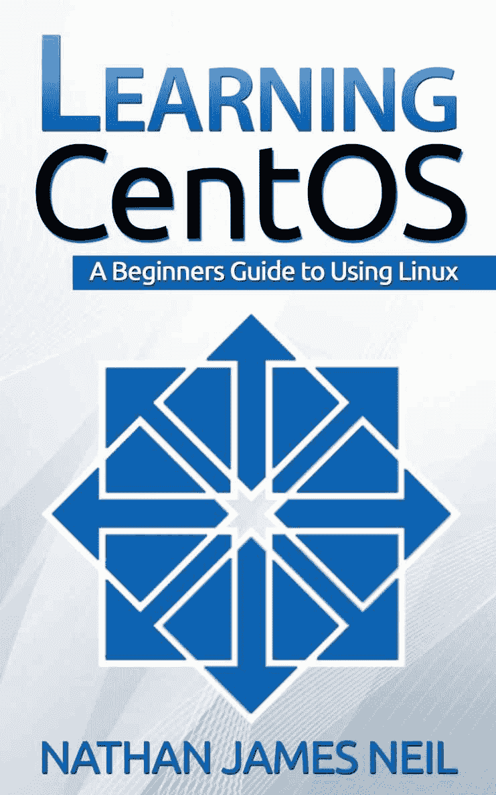

Copyright © 2016

查看 Nathan Neil 的更多书籍：

[NeilPublishing.com](http://neilpublishing.com)

> “[在真正的开源世界中，你有权掌控自己的命运。](http://www.brainyquote.com/quotes/quotes/l/linustorva587384.html)”
>
> — Linus Torvalds

## 目录

- 第 1 章
  - 什么是 Linux 和 CentOS？
  - 安装 CentOS 7 的方法与快速入门
  - 快速回顾
- 第 2 章
  - 在 VPS 上安装 CentOS
  - 在 Linode 上设置 CentOS
  - 在 Digital Ocean 上设置 CentOS
- 第 3 章
  - 在虚拟机上安装 CentOS
  - 安装 Oracle VirtualBox
  - 获取 ISO 镜像
  - 在 Oracle VirtualBox 中配置并安装 CentOS
  - CentOS 7 安装
- 第 4 章
  - 60 秒文档训练营
- 第 5 章
  - 进入命令行界面（CLI）
  - 首次登录
  - 导航
  - 快速回顾
- 第 6 章
  - 创建新用户
  - 快速回顾
- 第 7 章
  - 系统状态概览
  - 导航、创建目录和文件
  - 使用 Nano 创建和编辑文件
  - 编辑、删除、移动和复制
- 第 8 章
  - 更新服务器
- 第 9 章
  - 搭建 Web 服务器
  - Apache2
  - Web 文件夹
  - 安装 MySQL/MariaDB 数据库
  - 安装 PHP5
  - 安装 Sendmail
- 第 10 章
  - 通过浏览器管理
- 第 11 章
  - 理解权限
  - 权限组
  - 权限类型
  - 使用二进制引用设置权限
  - 概述：文件和目录的所有权
- 第 12 章
  - 向 MariaDB 中添加数据库
- 第 13 章
  - 准备并安装 WordPress
  - 下载 Wordpress
  - 更改所有权和编辑文件的回顾
  - 通过浏览器访问 WordPress
- 第 14 章
  - [结语]

# 第 1 章

## 什么是 Linux 和 CentOS？

你可能熟悉微软 Windows 和苹果的 MacOS。这两者都是操作系统的例子，Linux 也是如此。

韦尔-字典词典将操作系统定义为计算机中控制计算机工作方式并使其他程序能够运行的主要程序。本质上，操作系统是让用户与计算机交互的程序。在互联的世界里，如果没有操作系统，设备只是塑料、玻璃和硅的堆砌。

Linux 是一个开源操作系统。开源意味着软件提供了原始代码，并可以免费分发和修改。这正是 Linux 的独特之处。

如果你想为自己的作品集增加一项新技能，学习使用 Linux 将非常有用。根据 ZDNet 2014 年的数据，87% 的企业业务增加了一台 Linux 服务器，82% 的企业计划在 2015 年增加。

Linux 及其发行版在数据库、Web 以及其他类型的服务器非常流行。自 90 年代以来，Linux 运行着互联网、科学突破的超级计算机以及全球股市。观察互联网，Linux 运行着超过 36% 的在线资源，其中 21% 是 CentOS 发行版。

发行版（distro）是以 Linux 内核为基础的 Linux 版本或“口味”。内核是真正被称为 Linux 的组件。内核是操作系统的底层，管理 CPU、内存和设备的主要系统功能。

1991 年，Linus Torvalds 的个人项目是创建一个新的免费操作系统内核。从那时起，内核在过去的 25 年里经历了不断的增长。它从少数的 C 语言文件增长到超过 1800 万行代码，并根据 GNU 通用许可许可证开放。

## 安装 CentOS 7 的方法与快速入门

你所需的工具取决于你选择的路线。有四种安装方法，你可以使用它们来实验书中的课程。

### 实验安装操作系统的方法

1. 使用低廉的云虚拟专用服务器（VPS）。
2. 使用虚拟化软件安装操作系统。
3. 将操作系统安装到计算机上。
4. 为你的现有电脑设置双启动。

我们将在书中探索这些选项中的前两个。当我开始写关于 Linux 的书籍时，我的第一本书之一是：`Learning Ubuntu`。这本书被评誉为学习 Ubuntu 和在该环境下管理 Linux 的顶尖书籍之一，但我确实收到过一次批评。一些人不喜欢我建议使用一种需要付费的服务（VPS），并希望有其他学习替代方案。

我的座右铭是：知识是值得分享的，但将操作系统安装到机器上（尤其是你所赖以的机器）是有风险的。为了提供更详细的说明，我们将审查两个 VPS 服务，并介绍如何使用虚拟化软件（`Oracle VirtualBox`）在你的电脑上安装 `OS`。

如果你想使用选项 3 或 4，你可以在 YouTube 上找到很多教程可以参考。如果你是该领域的新学者，我强烈建议不要尝试自己动手安装，并建议你先熟悉书中概述的其他选项。选项 1 和 2 是快速上手最安全且最有效的方法。

在讨论这些入门方法之前，让我们先过一下书中将使用的 `CentOS` 版本。虽然这本书适用于其他版本的 `CentOS`，但它最适合 `CentOS 7`。`CentOS` 变得流行的主要原因之一是他们的操作系统自发布起提供十支持，而许多其他系统只有五年的支持周期。`CentOS 7` 于 2014 年发布，支持将到 2024 年。许多人并没有意识到操作系统的支持是有期限的。

一旦支持过期，可能无法获得相应的安全补丁和其他升级。

在我的书籍 [Securing Business Data: Establishing a Core Value for Data Security](http://www.amazon.com/gp/product/B016PMLIW0) 中，我们更深入地讨论了操作系统支持问题。如果你从事技术工作或管理业务，我强烈建议你阅读它。

`CentOS` 几乎所有的 VPS 提供商都支持。`VPS` 代表 `Virtual Private Server`（虚拟专用服务器）。`Virtual Private Server` 是一种作为托管服务出售的机器，通常比购买服务器及其带宽要便宜得多。随着云服务的普及，许多企业现在运行更多的虚拟专用服务器以节省成本并更快速地扩展。

通过 `VPS`，你为你实际使用的部分付费，如果你发现需要更多处理能力或内存，可以随着时间的推移增加更多资源。

### 快速回顾

1. 操作系统是计算机中的主程序，控制计算机的工作方式，使其他程序能够运行。
   1. `Microsoft Windows`、`Mac OSX` 和 `Linux` 是操作系统的示例。
2. 开源意味着软件提供源代码，并免费分发和修改。
3. `distro` 或 `distribution`（发行版）是以 `Linux` 内核为基础的 `Linux` 版本。
4. `Virtual Private Server` 是作为托管服务出售的机器，通常比购买服务器及其带宽要便宜得多。
5. 建议你实验 `CentOS` 的方法是搭建 `VPS`。
   1. 本书的重点是使用 `DigitalOcean` 或 `Linode` 作为主机，但也可以选择其他提供商。

# 第 2 章

## 在 VPS 上安装 CentOS

在书的这一部分，我们将介绍使用 `Virtual Private Server` 的安装方法。

`VPS` 是由互联网托管服务作为服务出售的虚拟机。它运行自己的 `OS`，并向客户提供操作系统的超级用户权限。这允许用户为他们的操作系统安装和管理他们想要的几乎任何内容。

`VPS` 的其他几个优点是你可以从任何地方访问它。它托管在云端，如果你想用 `CentOS` 托管网站，它提供了一个极佳的入门方式，不需要你自己的高带宽和合适的硬件。个人而言，这是我用于网站的方式。它比购买用于快速网页体验的互联网连接以及在家里运行稳定服务器的硬件要便宜得多。

在本节中，我们将介绍如何开始两个 VPS 提供商：`Linode` 和 `DigitalOcean`。它们各有自己的定价和服务方案，但两者都非常容易上手。

当你选择 `VPS` 提供商时，有几点需要考虑。由于你正处于入门和学习阶段，如果你选择这种方法，价格可能是你决策的主要因素。在 `Linode` 上，他们提供一台 `1GB` 内存、`1CPU`、`24GB` 存储和 `2 TB` 流量的服务器，每月 10 美。`DigitalOcean` 有一个入门套餐，包含 `512MB` 内存、`1 CPU`、`20GB` 存储和 `1 TB` 流量，每月 5 美元。选择取决于你。`DigitalOcean` 也有一个 10 美元的计划，与 `Linode` 的入门计划类似。

## 在 Linode 上设置 CentOS

开始使用 `Virtual Private Server` 或 `VPS` 非常简单。你只需要一张信用卡和这本书！你可以在几分钟内让你的服务器上线运行。

首先，你需要访问：[`www.linode.com/`](https://www.linode.com/)

从那里你可以注册并选择你喜欢的计划。对我来说，制作此指南的目的是启动小型电子商务网站，所以我将从 10 美元的计划开始。

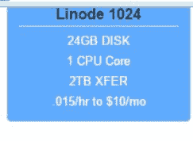

选择计划后，你需要选择你想要使用的数据中心。我的建议是选择一个离你所在地最近的。


我位于宾法尼亚州，所以新泽西州的 Newark 是最近的数据中心。我选择了它，然后点击“Add this Linode”（添加此 Linode）。

完成此操作后，你将进入 `Linode Manager`。这是你可以管理所有 `VPS` 系统的地方（如果你有多个的话）。

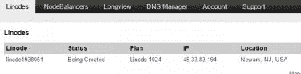

上面的图片可能很难看清，但在这里我们可以看到我们 `Linode` 的状态、我们正在使用的 `Plan` 以及我们的 `IP address`。那个 `IP address` 数字将是我们用来连接服务器并最终连接我们域名的地址。它非常重要，所以把它记录下来可能不是坏主意。

现在，服务器是空的，没有操作系统。我们需要在上面安装我们想要使用的 `OS`，在这里是 `CentOS 7`。

点击你的 `Linode` 名称。你的显示的看起来会像那样。

当你点击名称时，你会发现它看起来相当空。同样，是因为我们需要安装 `OS`。`VPS` 提供商让这变得非常简单。在 `Linode` 上，我们只需要点击部署链接（deploy）。


点击“Deploy an Image”（部署镜像）。

从这个窗口，我们可以选择我们需要的 `Image`，即 `CentOS 7`。部署磁盘大小和交换磁盘目前保持默认设置即可。输入你想要为 `root` 设置的密码（稍后会详细讨论），并确保这是一个安全的密码。完成所有这些后，点击“Deploy”（部署）按钮。

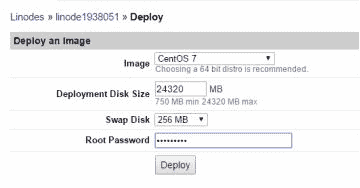

一旦你点击“Deploy”，系统将开始安装。留几分钟让其完成，但现在你的安装工作已经完成了！如果你选择使用 Linode，可以跳过下一节关于替代方案 `DigitalOcean` 的内容。

## 在 Digital Ocean 上设置 CentOS

像 `Linode` 一样，`DigitalOcean` 也提供了一个快速开始并部署 `CentOS` 安装的流程。如果你已经决定为任何提供商支付 `VPS` 的月费，我认为你做了正确的决定。我喜欢使用 `VPS` 的一点是它不占用我机器的硬件，我可以在任何有连接的地方对它进行操作。

让我们在几分钟内通过 DigitalOcean 设置好我们的服务器吧。

首先，访问 [`www.digitalocean.com/`](https://www.digitalocean.com/) 并点击右上角的“Sign Up”（注册）。在那里，输入你想要用于账户的电子邮件地址和密码。然后点击“Sign Up”。

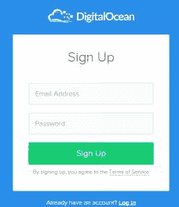

现在我们需要确认电子邮件地址。打开你的电子邮箱，找到来自 DigitalOcean 的邮件。邮件标题为“DigitalOcean – Please confirm your email address.”。打开邮件并点击验证链接。

太棒了，现在我们的邮箱已经确认，我们需要选择一种支付方式。DigitalOcean 提供使用信用卡或 PayPal 的选项。对于我来说，我使用 PayPal 比较方便。

如果你使用 PayPal，你需要预付 5 美，这笔钱将存入你的账户。这将涵盖我们第一个月的费用！

一旦添加了支付方式，我们就可以创建 VPS 了，DigitalOcean 将称为 Droplet。在右上角，点击绿色的“Create Droplet”（创建 Droplet）按钮。


接下来，它会要求你选择发行版。我们要选择 `CentOS` 以及他们提供的最新版本，即 `7.2`。

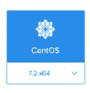

一旦你选择了 `CentOS`，向下滚动选择你想要部署的服务器尺寸。他们默认选中了每月 20 美元的计划。如果你想从每月 5 美元的计划开始，只需点击每月 5 美元的计划即可。

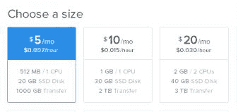

我建议根据你的地理位置选择一个区域。由于我住在美国东海岸，我为该服务商选择了纽约节点。


在“附加选项”（additional options）下，是否需要备份取决于你。如果我们是在进行开发或任何训练测试之外的活动，我会建议选择备份选项，但由于我们现在只需要一些基础功能来学习，所以我将不勾选这些选项。


从那里，滚动到最后并点击大绿色“Create”（创建）按钮。

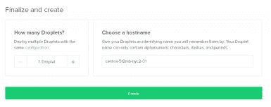

在几秒钟后，你的系统就设置好并准备就绪了。DigitalOcean 将向给你发送服务器的 IP 地址、用户名和密码。请保留这些信息。稍后我们需要这些 IP 地址和登录信息。

# 第 3 章：在虚拟机上安装 CentOS

如果你暂时不想使用 VPS 并且想在本地进行测试，那么下一个最佳选择是使用虚拟环境。市场上有很多这类产品。我推荐这种方法有两个原因：它比安装在你正在使用的机器上风险更小，而且如果你有一台配置相当的电脑，入门几乎不需要任何费用。

假设你是一个初学者并刚刚开始，我们将从零开始首先安装虚拟化软件。Oracle 的 `VirtualBox` 是我们在本教程中使用的程序，它是开源且免费的。

## 安装 Oracle VirtualBox

在演示中，我将使用一台 x64 Windows 10 电脑。

要安装 `VirtualBox`，请访问：[`www.virtualbox.org/wiki/Downloads`](https://www.virtualbox.org/wiki/Downloads)

从那里选择最适合你系统的版本。对于使用 Windows 10 x64 机器的我，我将下载适用于 Windows 主机的 `VirtualBox 5.0.20`。

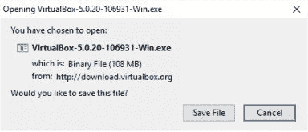

当你点击下载链接并收到提示时，点击“Save File”（保存文件）。下载完成后，点击可执行文件开始安装。

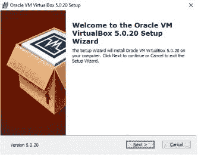

出现提示时点击“Next”（下一步）。

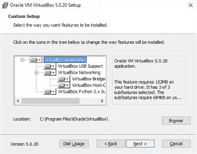

保持默认设置并再次点击“Next”。

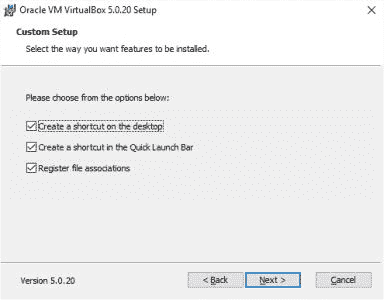

如果你想要快捷方式（这可能很有用），请保留默认设置并再次点击“Next”。现在我们已经完成了所有的点击“Next”操作。

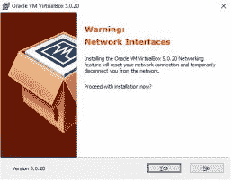

接下来的提示将提醒你，安装 Oracle Virtual Box 网络功能将重置你的网络连接并临时断开互联网连接。这没关系，你可以点击“Yes”（是）继续。

一旦点击了“Yes”，你将看到所示的最终安装提示。点击默认的“Install”（安装）按钮。

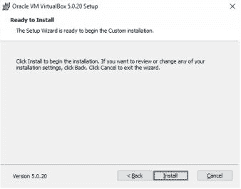

现在我们等待。这不像热门书籍和电视剧《权力的游戏》中等待冬天的到来那样漫长，但确实需要几分钟时间。

随着安装程序的进行，你可能需要再次点击一次“Yes”或“Install”。完成后，你将看到一个完成界面。点击“Finish”（完成），它将启动 `VirtualBox`。

## 获取 ISO

无论是使用 `VirtualBox` 安装 `CentOS` 还是使用 `VirtualBox` 将其设置，我们都需要选择你想要部署的服务器尺寸。

一旦你选择了 `CentOS`，向下滚动选择你想要部署的服务器尺寸。他们默认选中了每月 20 美元的计划。如果你想从每月 5 美元的计划开始，只需点击每月 5 美元的计划即可。

无论是使用 `VirtualBox` 安装 `CentOS` 还是使用 `VirtualBox` 将其设置，我们都需要下载 ISO 文件。

## 在 VirtualBox 上配置并安装 CentOS

现在我们已经下载了 ISO 并安装了 `VirtualBox`，我们可以设置环境了。在 `VirtualBox` 中点击“New”（新建）按钮，以便配置虚拟机。

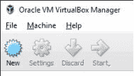

一旦点击“New”，我们需要为机器命名并提供一些基本信息。请参考下图指南。记住 `CentOS` 是基于 Red Hat 的。

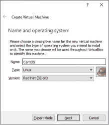

完成后，点击“Next”。软件将推荐分配给虚拟机的内存量。我个人建议至少分配 1GB 内存（即 1024MB）。确定后，点击“Next”，然后选择“Create a Hard Disk”（创建硬盘）。点击“Create”（创建）为机器分配虚拟硬盘。


之后，它会询问你偏好的格式。我个人一直倾向于使用默认的`VDI`格式。一旦选择了该格式，下一个提示会询问你是否想要使用动态磁盘（它只在虚拟机使用空间时占用磁盘空间）。固定磁盘会自动使用你机器上分配磁盘的全部空间。我的偏好是动态分配选项。

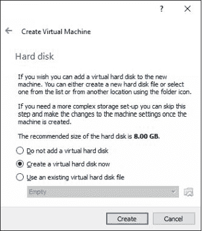

完成向导后，你需要将 ISO 挂载到虚拟光驱上。基本上这是将安装媒体（在本例中为 DVD）插入物理机器。在`VirtualBox`中点击`Settings`设置，然后点击`Storage`存储，最后点击`Add Optical Drive`添加光驱。

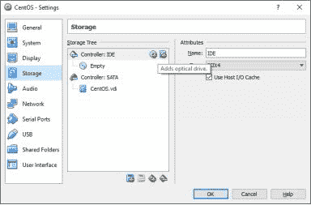

选择 ISO 文件并点击确定。现在回到主菜单点击“Start”（启动）。

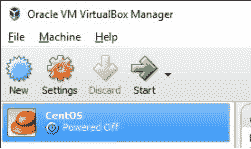

## CentOS 7 安装

虚拟机将开始启动。

一旦虚拟机启动，你将看到下面的屏幕。

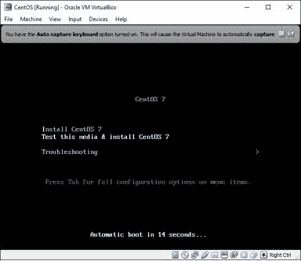

选择`Install CentOS 7`并按回车。

如果你的安装失败或出现挂起，可能是因为你的系统不支持虚拟运行 64 位软件。我在在一台旧电脑上测试此本书时就遇到过这个问题。

你可以从此链接下载 32 位的 i386 版本：[`mirror.centos.org/altarch/7/isos/i386/`](http://mirror.centos.org/altarch/7/isos/i386/)

一旦安装程序成功加载，你将需要选择语言和位置。完成后，点击“继续”（Continue）。

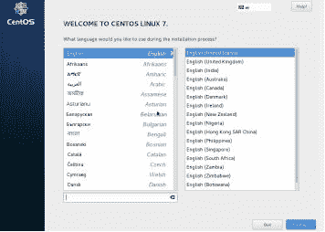

接下来你将看到 CentOS 预配置各种设置。

你可能需要配置“系统”（system）标题下的“安装目标”（Installation Destination）。选择“安装目标”，并在该界面中选择硬盘并点击“完成”（done），如下所示。

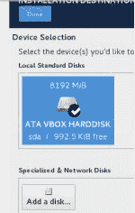

完成后，你回到了主安装界面。现在，我们需要确保能够建立互联网连接。点击“网络和主机名”（Network and Hostname）。在此面板内部配置并确保勾选了“网络可用时自动连接”（Automatically Connect When Network is Available）。完成后，点击保存（save）。在主机名（hostname）框中输入你的服务器名称。我将其命名为`centOS`。完成后，将网络适配器的开关拨到开启。它就在网络适配器旁边。点击左上角的“完成”（Done），这将带回到主屏幕，你可以在右下角点击“开始安装”（Begin Installation）。

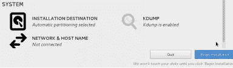

在 CentOS 安装期间，我们可以配置两项内容：“Root 密码”（Root Password）和“用户创建”（User Creation）。现在让用户配置保持不变，设置“Root 密码”。点击“Root 密码”，输入两次新密码，然后点击完成。务必记住这个密码，因为我们稍后会需要它。


安装完成后，你需要点击右下角的“重启”（Reboot）按钮。

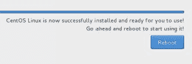

现在卸载 ISO 镜像（如果不卸载你将反复进入安装过程）并关闭虚拟机。

现在我们需要对虚拟机进行一些额外的配置，以便它既能访问互联网，你稍后又可以在书中通过浏览器查看系统。

在虚拟机关闭状态下，点击“设置”（Settings）。在设置面板中，点击左侧的“网络”（Network）。你会看到适配器 1 已配置并连接到 NAT。保持该设置不变。点击适配器 2，然后勾选“启用网络适配器”（Enable Network Adapter）复选框。在“连接到”（Attached to）下拉菜单中选择“仅主机网络”（Host-only Adapter），然后确定。

现在点击启动，启动完成后，你将看到一个登录的命令行提示符。我们完成了 CentOS 的安装和初始配置。

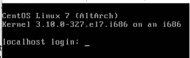

登录并查找 IP 地址，以便我们可以像使用 VPS 一样继续（目前我们确实是这样，但仅在内部可用）。

| 查找你的 IP 地址 |
| --- | --- |
| 命令 | `ip addr` |
| 结果 | 系统将显示网络信息 |

输入`ip addr`并按回车后，你会在页面上看到大量信息。我们不关心 1（回环连接）或 2 之后的信息，但在 3 下，有一个 inet 看起来像这样：`192.168.1.50/24`。你的 IP 地址将是`192.168.1.50`。所有网络都是不同的，但可以以此作为通用指南。

务必记下这个 IP。它可能是动态的，可能会随着时间推移而变化。如果你认为它可能已经更改，请参考上面的“查找你的 IP 地址”框。

# 第 4 章

## 60 秒文档训练营

在技术领域，我们的成败取决于我们产出的文档。想象一下客户的系统出现问题，而你不知道它在运行什么，或者 IP 或密码是什么。这是一个常见问题。通常将密码存储在任何地方都是安全的，但你必须想出一种安全存储这些信息的方法。当你处理大量的 IP 和密码时，记住所有它们是不可能的。下面是一份实用的文档指南，帮助你入门。由于是为了学习 CentOS 而非生产环境，把密码写下来可能是没问题的。如果你是阅读电子版，请创建一个你自己的表格来放置这些信息。

### 示例数据

服务器名称：CentOS

操作系统：CentOS 7

支持直到：2024

Root 密码：`*********`

IP 地址：000.000.000.000

主要用途：Web 服务器

安装日期：2016/6/20

最后更新日期：2016/6/20

### 我的文档

服务器名称：______________________________

操作系统：CentOS 7

支持直到：2024

Root 密码：_____________________________

IP 地址：___________________________________

主要用途：Web 服务器

安装日期：________________________________

最后更新日期：___________________________

# 第 5 章

## 进入 CLI

CLI 是命令行界面（command line interface）的缩写，你可以通过输入文本行与系统进行交互。这就是我们与服务器交互的方式。

如果你决定不使用推荐的方法来设置 VPS，那么你可以在电脑的显示器上看到 CLI。当你启动电脑时，它将带你进入 CLI，然后你可以在那里登录。

我们可以使用名为`SSH`的协议连接到 CentOS 服务器。`SSH`代表安全外壳（Secure Shell），这是我们远程登录服务器的一种加密方式。

为了给下一步做准备，请参考我们在上一章中作为文档训练营一部分而记录的信息。我们需要 IP 地址和登录信息。IP 地址是识别网络上计算机的数字字符串。对于我们的 VPS，IP 地址是公网 IP，可以从任何连接互联网的地方访问。对于虚拟机，请使用启动时显示的 CLI 接口。

我推荐用于 SSH 连接到 VPS 服务器的程序叫做`PuTTY`。`PuTTY`是一个免费的开源`SSH`客户端，支持 Windows。你可以从以下链接下载它：[`putty.org`](http://putty.org)

你下载的文件是一个可执行文件（`.exe`），不需要安装。下载后，你可以将其拖到桌面以便快速访问。

使用此工具连接到 VPS 或虚拟机非常简单。在“主机名或 IP 地址”处，输入提供的 IP 地址。选择`SSH`作为连接类型，然后点击打开。查看图 1 以了解示例样子。

注意：你的 IP 地址将与图中不同。

图 1：Putty 配置

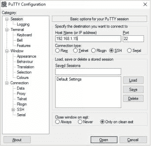

当你点击连接时，可能会收到图 2 这样的消息。点击“是”。

图 2：PuTTY 安全警告

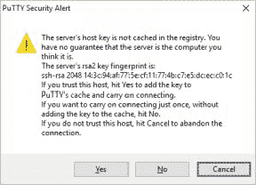

## 首次登录

现在你将被提示首次登录。输入用户名`root`，然后输入提供的或你在设置 VPS 时设置的密码。

如果你使用的是 DigitalOcean，系统会在你第一次登录时要求重置密码。你需要重新输入提供的密码，然后输入两次你想设置的新密码。确保你遵循安全密码指南，并为 root 用户设置安全的密码。

注意：在本书中，我使用表格来解释我们要学习的不同命令。第一行是我们要执行的任务，第二行是我们需要使用的命令，第三行是你的 CLI 看起来的样子。我认为这是描述和解释我们要学习的命令的最佳方式。

如果你没有被提示更改密码，但想更改，可以输入命令`passwd`。更多细节请见下一页表格。

| 修改我的密码 |
| --- | --- |
| 命令 | `passwd` |
| 结果 | 系统将提示输入新密码 |
| CLI 显示 | `[root@centos:~]# passwd` 正在更改用户 root 的密码。新密码:再次输入新密码:passwd: 密码更新成功 |

当系统提示你输入新密码时，请输入，不要担心密码不会显示在屏幕上。完成后，请按回车键并再次输入一次。

## 导航

不要被 CLI 上的白字黑背景所吓到。我知道这里没有鼠标或图形界面，但过了一会儿，你就会习惯于在服务器的目录间进行导航了。目录就像你可能 Windows 或 Mac 设备上用过的文件夹。作为一名长期使用这种工具的人，我实际上更喜欢这种方式，而不是图形化用户界面。在做任何其他操作之前，让我们学会探索服务器。通过使用`pwd`命令，我们可以看到当前查看的目录位置。

| 查找你的当前目录位置 |
| --- | --- |
| 命令 | `pwd` |
| 结果 | 系统将输出你当前所在的目录。 |
| CLI 显示 | `[root@centos:~]# pwd/root` |

现在我们处于一个名为`root`的目录中，它本质上是用户`root`的家目录。这个 root 家目录与系统的实际根之间有很大区别。

路径`/`是系统的根，但现在我们处于一个名为`root`的子目录中 (`/root`)。

服务器的根是顶级目录。一切都是它里面的子目录。从我们现在的位置，有两种方法可以到达那里。让我们从最简单的带我们进入根目录命令开始。

| 进入根目录 (/) |
| --- | --- |
| 命令 | `cd /` |
| 结果 | 我们切换到主根目录 |
| CLI 显示 | `[root@centos:~]# cd /[root@centos:/]#` |

现在让我们再次使用`pwd`看看我们现在哪里。

| 查找你的当前目录位置 |
| --- | --- |
| 命令 | `pwd` |
| 结果 | 系统将输出你当前所在的目录。 |
| CLI 显示 | `[root@centos:~]# pwd/` |

如果你想查看文件夹里有什么内容，可以使用`ls`命令。

| 列出文件 |
| --- | --- |
| 命令 | `ls` |
| 结果 | 列出当前目录下的文件 |
| CLI 显示 | `[root@centos:/]# lsbin dev home media opt root sbin sysvar boot etc lib mnt proc run srv tmp var` |

我们还可以通过`ls`后面添加标志（flag）来查看更多细节。

标志是在提示符处作为命令的一部分输入的，并添加额外的参数来告诉系统我们想要什么。

尝试运行此命令：`ls –la`

在示例中，–la 就是标志。`l`告诉系统我们想查看更多细节并列出目录中的所有文件，甚至是隐藏文件。

现在，让我们切换到名为`home`的目录。

| 切换目录 |
| --- | --- |
| 命令 | `cd home` |
| 结果 | 系统将我们移动到子文件夹 home |
| CLI 显示 | `[root@centos:/]# cd home[root@centos: home]#` |

注意：理解父目录和子目录的区别很重要。如果我们有一个名为`documents`的目录，并在里面另一个名为`pictures`的目录。那么`pictures`就是`documents`的子目录。在此例中，我们处于父目录`/`并切换到子目录`/home`。如果你不在父文件夹中，你仍然可以进入`home`，但在`cd`之后你必须列出完整路径（例如：`cd /home`）。如果你遇到诸如“无此类文件或目录”的错误，你可能需要输入完整路径，因为你可能不在正确的目录中。

如果我们想回到根目录，可以使用另一个切换目录命令，它可以轻松向上移动一个目录。

| 向上移动一个目录 |
| --- | --- |
| 命令 | `cd ..` |
| 结果 | 系统将我们移动到父文件夹 |
| CLI 显示 | `[root@centos: home]# cd ..[root@centos:/]#` |

使用`cd`配合目录名和`..`可以允许我们快速在服务器中移动。

### 快速回顾

1. `CLI`代表命令行界面（command line interface），你可以通过输入文本行与系统交互。

2. `SSH`代表安全外壳（Secure Shell），这是我们登录服务器的加密方式。

3. `IP 地址`是一个识别网络上计算机的数字字符串。

4. `PuTTY`是一个免费、开源且支持 Windows 的 SSH 客户端。

5. `passwd`命令允许我们更改当前密码。

6. 输入`pwd`将为我们提供服务器目录中的当前位置。

7. 使用`ls`将列出当前目录下的文件和目录。

8. 在`ls`之后添加标志（如 –la）将我们提供更多细节并显示隐藏文件。

9. 我们可以使用`cd`来切换目录：

   - 我们可以通过`cd ..`向上移动文件夹。

   - 在`cd`后面加上子目录将我们带入目录（示例：`cd home`）。

10. 路径`/`是系统的根，但`/root`是子目录或子目录。

# 第 6 章：创建新用户

`root`用户对系统具有完全访问权限。虽然我们用它来学习一些导航，但不应将其作为系统的主要用户名。这会违背这种极佳的安全模型。在我们做其他事情之前，让我们先学习探索服务器。通过使用`pwd`命令，我们可以看到当前查看的目录位置。

在继续之前，我们可以学习两个快速命令。现在你的 CLI（命令行界面）可能有很多文本。如果你想清理这些内容，可以使用`clear`命令。

| 清理屏幕 |
| :--- | :--- |
| 命令 | `clear` |
| 结果 | 系统将清除屏幕 |
| CLI 显示 | `[root@centos:/]# clear` |

现在我们有了整洁的屏幕，如果你使用的是 VPS，可以关闭 PuTTY 了。如果你使用的是虚拟机，请使用`logout`。我们将继续使用新用户 ID`tidus`进行操作。

| 注销 |
| :--- | :--- |
| 命令 | `logout` |
| 结果 | 系统将关闭 SSH 会话并退出 PuTTY 或注销虚拟机 |
| CLI 显示 | `[root@centos:/]# logout` |

# 第 7 章

## 系统状态概览

### 快速回顾

1

1) 作为一个良好的使用习惯，我们应该避免使用`root`用户。

2) 在命令前加上`sudo`可以允许用户拥有超级用户权限。

3) 我们可以使用`adduser`命令加上用户名来添加用户。

   - 1. 1. 示例：`adduser nathan`

4) 我们可以通过在用户名之前使用`passwd`命令更改用户的密码。

   - 1. 1. 示例：`passwd nathan`

5) 要获得使用`sudo`的权限，用户必须先添加到配置文件，可以通过`visudo`命令进行编辑。

6) 如果我们的 CLI 变得太混乱，可以使用`clear`命令将其清理。

7) 要结束会话并注销，我们可以使用`logout`。

使用我们在上一章中创建的新用户登录服务器。从现在开始，在本书的剩余部分中，我们将不再使用`root`用户 ID。

让我们来看一些设置，看看我们的服务器性能如何。

首先，我们可以查看系统的运行时间（uptime）。这在系统管理中非常有用。它能让你知道服务器已经运行了多久、有多少个用户登录以及系统的平均负载负载。

| 检查运行时间 |
| :--- | :--- |
| 命令 | `uptime` |
| 结果 | 系统将显示运行时间和平均负载数据 |
| CLI 显示 | `[tidus@centos:~]$ uptime` |

接下来，我们可以使用`top`命令查看系统上哪些进程占用了最多的内存。如果你的系统运行缓慢，这个命令可以帮助查看什么在占用系统资源。

前几行将为你提供系统资源利用情况的摘要，你可以按 CPU 或内存使用对进程列表进行排序，这让你能够快速看到服务器资源资源需求最大的地方。

| 检查系统 CPU 使用率 |
| :--- | :--- |
| 命令 | `top` |
| 结果 | 系统将显示占用最多 CPU 资源的进程 |
| CLI 显示 | `[tidus@centos:~]$ top` |

要退出`top`，请按`control and c`。

要检查系统的内存资源，可以使用`vmstat`命令。

| 检查内存使用 |
| :--- | :--- |
| 命令 | `vmstat` |
| 结果 | 系统将显示空闲和使用的内存量 |
| CLI 显示 | `[tidus@centos:~]$ vmstat` |

随着你对`vmstat`和`top`越来越熟练，你将能够在出现问题时确定哪些脚本或程序耗尽了系统资源。监控这些内容是一个良好的习惯，以确保使用率处于正常范围。

在较大的环境中，你可能想看到哪些用户登录了服务器。使用`w`命令可以为我们提供这些信息。

| 检查用户 |
| :--- | :--- |
| 命令 | `w` |
| 结果 | 系统将显示服务器上的用户 |
| CLI 显示 | `[tidus@centos:~]# w` |

## 导航、创建目录和文件

部分内容将是对前面章节的复，但这种重复对于记住日常使用中频繁使用的命令非常重要。


现在我们已经登录，使用`pwd`命令查看我们当前的目录。

| 查找你的当前目录位置 |
| :--- | :--- |
| 命令 | `pwd` |
| 结果 | 系统将输出你所在的目录 |
| CLI 显示 | `[tidus@centos:~]$ pwd/home/tidus` |

注意，这次的目录与我们用`root`用户登录时不同。上一次我们在`/root`，那是`root`的家目录。这次我们在`/home/tidus`，这是用户`tidus`的家目录。

提示：如果你以后需要回到家目录，请使用`cd`回到你的用户家文件夹。

现在我们已经在家目录下了了，让我们创建一个名为`documents`的新目录。

| 创建新目录 |
| :--- | :--- |
| 命令 | `mkdir documents` |
| 结果 | 系统将创建一个名为`documents`的子目录 |
| CLI 显示 | `[tidus@centos:~]$ mkdir documents[tidus@centos:~]$` |

使用`ls`命令列出我们家目录的内容，查看`documents`目录是否存在。

| 列出文件 |
| :--- | :--- |
| 命令 | `ls` |
| 结果 | 列出当前目录下的文件 |
| CLI 显示 | `[tidus@centos:~]# lsdocuments` |

通过使用`ls`，我们现在看到除了`documents`目录外，我们的目录是空的。

让我们利用之前章节中学到的知识练习导航技能，并进入`documents`目录。

尝试使用命令：`cd Documents`

你可能会发现它返回“`cd: Documents: No such file or directory.`”`Linux`是区分大小写的，这意味着`Documents`和`documents`是两个不同的东西。在使用`CentOS`时你需要记住这一点，因为使用正确的大小写很重要。

现在让我们用正确的方法操作。

| 切换子目录 |
| :--- | :--- |
| 命令 | `cd documents` |
| 结果 | 切换到`documents`目录 |
| CLI 显示 | `[tidus@centos:~]$ cd documents[tidus@centos: documents]$` |

使用`ls`命令列出目录中的文件，你会发现它是空的。

现在让我们通过`cd`回家。

| 切换到家目录 |
| :--- | :--- |
| 命令 | `cd` |
| 结果 | 切换到用户家目录 |
| CLI 显示 | `[tidus@centos: documents]$ cd[tidus@centos:~]$` |

如果我们使用`pwd`会发现我们回到了`/home/tidus`。

现在使用完整路径`cd`进入目录。记住，`Linux`是区分大小写的。

| 使用路径切换目录 |
| :--- | :--- |
| 命令 | `cd /home/tidus/documents` |
| 结果 | 切换到指定的目录 |
| CLI 显示 | `[tidus@centos:~]$ cd /home/tidus/documents[tidus@centos: documents]$` |

如果我们想回到这个目录的父目录，也可以使用：`cd ..`

| 返回上级目录 |
| :--- | :--- |
| 命令 | `cd ..` |
| 结果 | 进入父目录 |
| CLI 显示 | `[tidus@centos: documents]$ cd ..[tidus@centos:~]$` |

你应该入门了！

多尝试几次，在下一节我们将使用内置编辑器`nano`创建文件。

### 使用 nano 创建和编辑文件

`Nano`是`Linux`系统命令行界面（`CLI`）中非常有用的文本编辑器。由于我们在使用`CLI`，`nano`是面向键盘的，而不是鼠标。通过学习一些控制键，你将能够使用`nano`编辑文件。一旦你掌握了这些并学会了更多通过命令行使用`Linux`，就可以转向像`vi`这样更高级的编辑器，它们很棒，但学习曲线较陡。

`Nano`易于使用，对学者非常友好。它在大多数`CentOS VPS`配置中默认安装，但在虚拟机上可能需要安装。它是一个所见即所得（`WYSIWYG`）编辑器。

我们将在后面的章节更详细地讨论向`CentOS`安装软件包，但万一你还没有`nano`，可以使用以下命令并在提示时输入密码来安装：`sudo yum install nano`

`CLI`可能还会询问你许可。如果是的话，按`y`然后按回车。

让我们直接使用`nano`创建文件。

| 在 nano 中创建文件 |
| :--- | :--- |
| 命令 | `nano notes.txt` |
| 结果 | 系统启动`nano`处理新文件`notes.txt` |
| CLI 显示 | `[tidus@centos:~]$ nano notes.txt` |

现在，你会注意到我们正处于一个简单的文本编辑器中。由于我们没有鼠标，可以通过同时按下`control`和`G`来获取控制键列表。

请参阅下表完整的`nano`命令键列表：

| Nano 命令键 | |
| :--- | :--- |
| `^` 代表控制键`Ctrl` | |
| `^G` (F1) | 显示此帮助文本 |
| `^X` (F2) | 退出`nano` |
| `^O` (F3) | 将当前文件写入磁盘 |
| `^J` (F4) | 对当前段落进行两端对齐 |
| `^R` (F5) | 将另一个文件插入到当前文件中 |
| `^W` (F6) | 搜索字符串或正则表达式 |
| `^Y` (F7) | 回到上一页 |
| `^V` (F8) | 转到下一页 |
| **Nano 命令键（续）** | |
| `^K` (F9) | 剪切当前行并存储在剪贴板中 |
| `^U` (F10) | 在当前行粘贴之前的内容 |
| `^C` (F11) | 显示光标位置 |
| `^T` (F12) | 调用拼写检查器（如果可用） |
| `M-\` (M-\|) | 转到文件的第一行 |
| `M-/` (M-?) | 转到文件的最后一行 |
| `^Y` | 上页 |
| `^P` | 上一行 |
| `^X` | 退出 |
| `^V` | 下页 |
| `^N` | 下一行 |

在`nano`编辑器中，输入以下文本：

`Nano`笔记：`Nano`是`Linux`系统命令行界面（`CLI`）中一个实用的文本编辑器。由于我们正在使用`CLI`，`nano`面向键盘并使用控制键，而不是使用鼠标。

一旦输入了文本，使用退出键：`Control + X`。然后系统会提示你是否要保存修改过的缓冲区？按`Y`然后按回车即可保存文件。现在，让我们使用`ls`命令查看文件夹中的内容。

| 列出文件 | |
| :--- | :--- |
| 命令 | `ls` |
| 结果 | 列出当前目录下的文件 |
| CLI 显示 | `[tidus@centos:~]$ ls documents` |

## 编辑、删除、移动和复制

创建`notes.txt`文件后，我们现在可以学习如何移动、删除和复制。为了开始，让我们将`notes.txt`文件复制到名为`test.txt`的新文件中。为了这一点，我们将使用`cp`命令，它允许我们将一个文件复制到另一个文件。使用`cp`时，我们需要提供要复制的文件以及要复制到的目标文件。请看下表：

| 复制到新文件 | |
| :--- | :--- |
| 命令 | `cp notes.txt documents/test.txt` |
| 结果 | 系统复制`notes.txt`并创建一个新文件`test.txt` |
| CLI 显示 | `[tidus@centos:~]$ cp notes.txt documents/test.txt` |

通过使用`ls`命令，我们可以检查文件是否已复制。

| 列出文件 | |
| :--- | :--- |
| 命令 | `ls` |
| 结果 | 列出当前目录下的文件 |
| CLI 显示 | `[tidus@centos:~]$ ls documents notes.txt` |

现在我们有两个文件了，我们应该在`nano`中打开`notes.txt`并进行一些更改。

| 在 Nano 中打开文件 | |
| :--- | :--- |
| 命令 | `nano notes.txt` |
| 结果 | 系统将在`nano`中打开`notes.txt` |
| CLI 显示 | `[tidus@centos:~]$ nano notes.txt` |

当你打开文件时，你会发现它的内容与我们的`notes.txt`文件相同。在文档的开头，让我们添加一行：此文档是用于学习`Linux`的测试。添加后，像我们之前一样保存文件。

使用`cp`命令，文件被复制了。当我们移动文件时，就像在`Windows`中使用“剪切”一样，因为原始文件会被删除。现在我们将`notes.txt`移动到`documents`目录。通过使用`mv`命令，我们可以移动文件。在`mv`之后，我们输入想要移动的文件名，然后输入我们将其移动到的位置。

| 移动文件 | |
| :--- | :--- |
| 命令 | `mv notes.txt documents/test.txt` |
| 结果 | 系统将在`nano`中打开`test.txt`。 |
| CLI 显示 | `[tidus@centos:~]$ mv notes.txt documents/test.txt` |

如果你切换目录到`documents`并使用`ls`，你会发现`test.txt`文件现在位于那里。

| 切换目录到 Documents 并列出文件 | |
| :--- | :--- |
| 命令 | `cd documents; ls` |
| 结果 | 系统将切换到`documents`并列出文件 |
| CLI 显示 | `[tidus@centos:~]$ cd documents; ls documents]$ test.txt` |

你可能注意到我在`cd documents`之后使用了分号。这允许我们组合两个命令。在这个示例中，分号允许我们切换目录然后列出文件。

现在我们还可以使用`mv`来重命名文件。使用下面的命令，我们可以重命名文件并列出目录中的文件。

| 使用 mv 重命名文件 | |
| :--- | :--- |
| 命令 | `mv notes.txt test.txt; ls` |
| 结果 | 系统将文件名改为`test.txt`并列出目录中的文件 |
| CLI 显示 | `[tidus@centos: documents]$ mv notes.txt test.txt` |

希望你对这个文件并不太留恋，因为在下一个表格中，我们将学习如何使用`rm`删除文件。

| 使用 rm 删除文件 | |
| :--- | :--- |
| 命令 | `rm test.txt` |
| 结果 | 系统将删除`test.txt` |
| CLI 显示 | `[tidus@centos: documents]$ rm test.txt[tidus@centos]$` |

如果你愿意，可以使用`ls`，但你会发现目录是空的。现在让我们回到父目录。

| 回到父目录 | |
| :--- | :--- |
| 命令 | `cd ..` |
| 结果 | 系统将移动到上级目录 |
| CLI 显示 | `[tidus@centos: documents]$ cd ..[tidus@centos:~]$` |

删除文件或目录时，请务必非常小心，因为一步失误可能会删除整个系统。避免使用`root`用户有助于这一点。有时你可能想要删除一个目录，但删除目录时必须添加一个标记。如果我们使用`rm documents`，将收到错误提示这是一个目录。要删除目录，我们必须使用表中的命令。

| 删除目录 | |
| :--- | :--- |
| 命令 | `rm -r documents` |
| 结果 | 系统将删除名为`documents`的目录 |
| CLI 显示 | `[tidus@centos:~]$ rm -r documents[tidus@centos:~]$` |

`Linux`服务器的一种常见配置是将其设定为`Web`服务器。80%托管网站的服务器都在运行`Linux`。为了建立良好的基础，学习如何安装这些功能至关重要。

要开始将此服务器配置为`Web`服务器，我们需要安装`Apache2`。`Apache2`是`Linux`系统上最常用的`Web`服务器。`Web`服务器用于为客户端请求的网页提供服务。要运行像`WordPress`这样的网站软件，我们需要比这多多的包，但安装`Apache2`是最好的起点。

### 安装 Apache2

| 项目 | 详情 |
| :--- | :--- |
| 命令 | `sudo yum install httpd` |
| 结果 | 系统将向服务器安装`Apache2`及其依赖包。 |
| CLI 命令行显示 | `[tidus@centos:~]$ sudo yum install httpdpassword for tidus:Do you want to continue? [Y/n] y[tidus@centos:~]$` |

现在，我们应该创建一个基础`HTML`文件来测试我们的`Web`服务器。在命令行中输入以下命令：

```bash
sudo nano /var/www/html/index.html
```

在`nano`内部输入：`<h1>It Works</h1>`

然后按`control`和`x`，然后按`y`保存并回车。

`<h1>`和`</h1>`如果你不熟悉，它是用于标题的`HTML`标签。它会让文本在页面顶部大号并加粗显示。

在本书的后续章节，我们将介绍更改权限，但现在使用以下命令使测试`HTML`文件可视图：

```bash
sudo chmod –R 755 /var/www/html/
```

该命令正在递归地设置`html`文件夹的权限。关于这一点稍后会详细介绍。

我们必须启动`Apache2`服务，以便`Web`服务运行并使页面可见。

### 启动 Apache2

| 项目 | 详情 |
| :--- | :--- |
| 命令 | `sudo service httpd start` |
| 结果 | 系统将启动`Apache2` |
| CLI 命令行显示 | `[tidus@centos:~]$ sudo service httpd startpassword for tidus:[tidus@centos:~]$` |

你现在可以在任何浏览器中输入你的`IP`地址并看到我们的测试`HTML`文件。

在浏览器中，你应该看到：`It Works`

提醒，如果你使用的是虚拟机而不是`VPS`，你将只能在主机计算机的浏览器上看到此内容。

### 停止和重启 Apache2

可能会出现你想要停止或重启`Apache2` `Web`服务器的情况。

你可以使用以下命令执行：

- 停止`Apache2`：`sudo service httpd stop`

- 启动`Apache2`：`sudo service httpd start`

- 重启`Apache2`：`sudo service httpd restart`

默认情况下，你的`CentOS`服务器不会在启动机时启动`Apache2`，如果发生断电，这可能会是一个问题。使用以下命令让它在开机时默认启动：

```bash
sudo systemctl enable httpd.service
```

### Web 文件夹

你可能在想，我的网站文件在哪里？在大多数`CentOS`安装中，你可以通过切换目录到`/var/www/html`进入`Web`目录。

| 项目 | 详情 |
| :--- | :--- |
| 命令 | `cd /var/www/html; ls` |
| 结果 | 系统将切换到`html`目录并列出文件。 |
| CLI 命令行显示 | `[tidus@centos:~]$ cd /var/www/htmlindex.html` |

如果你愿意，可以在`nano`中打开默认的`index.html`文件。

| 项目 | 详情 |
| :--- | :--- |
| 命令 | `nano index.html` |
| 结果 | 系统将`index.html`加载到`nano`中。 |

注意：为了保存并进行更改，你可能需要使用`sudo`打开文件。

现在让我们使用`cd`回到我们的主目录。

### 安装 MySQL/MariaDB 数据库

除了`Apache2`和`PHP`之外，你的服务器许多需要存储数据的`Web`还需要`MySQL`。这包括广泛流行的`WordPress CMS`。最近，`CentOS`删除了`MySQL`并将`MariaDB`设置为默认数据库包。这也能为我们完成工作。

### 安装 MariaDB 服务器

| 项目 | 详情 |
| :--- | :--- |
| 命令 | `sudo yum install mariadb-server` |
| 结果 | 系统将安装`MariaDB`服务器 |

和`Apache2`一样，我们需要输入一个命令让`MariaDB`在系统启动时启动。输入以下：

```bash
sudo systemctl enable mariadb.service
```

可能会出现你想要停止或重启`MariaDB`数据库的情况。

你可以使用以下命令执行，这些与`Apache2`的命令类似：


- 停止 MariaDB：`sudo service mariadb stop`
- 启动 MariaDB：`sudo service mariadb start`
- 重启 MariaDB：`sudo service mariadb restart`

现在我们的数据库系统已经在运行了，我们需要运行一个安全脚本来移除一些可能危险的默认设置。

### 安全 MariaDB 服务器

| 项目 | 详情 |
| :--- | :--- |
| 命令 | `sudo mysql_secure_installation` |
| 结果 | 系统将提示你输入数据库服务器的当前密码。尚未设置，请按回车。然后按 Y 设置密码并按照屏幕指令操作。 |

### 安装 PHP5

`PHP` 是一种流行的 Web 服务器端脚本语言。

### 安装 PHP

| 项目 | 详情 |
| :--- | :--- |
| 命令 | `sudo yum install php` |
| 结果 | 系统将安装 php 及其依赖包。 |
| CLI 命令行显示 | `[tidus@centos:~]$ sudo yum install phppassword for tidus:Do you want to continue? [Y/n] y[tidus@centos:~]$` |

为了让更改生效，我们需要重启 `Apache`。

```bash
sudo service httpd restart
```

默认情况下，可以通过以下地址访问 webmin：

`http://myipaddress:10000`

如果没有提示登录，请在命令行界面（CLI）中输入以下命令在您的系统防火墙上打开该端口：

```
firewall-cmd –add-port=10000/tcp
```

如果您选择使用 webmin，可以在以下地址找到大量关于如何使用的文档和资源：

[`doxfer.webmin.com/Webmin/Main_Page`](http://doxfer.webmin.com/Webmin/Main_Page)

如果您选择通过此资源管理服务器，请将该链接作为使用此平台的资源。

# 第 11 章：理解权限

要理解如何向用户和组分配权限，我们必须首先理解 Linux 权限的工作原理。一旦你建立了理解，它比确定 Windows Server 权限要简单得多。

在 Windows Server 上，有多种权限类型可以分配。见下图：

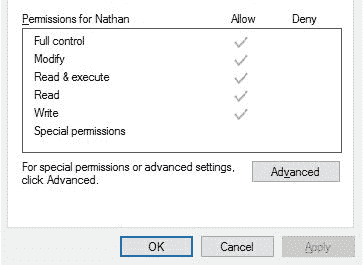

CentOS 和其他 Linux 系统有三个基本的权限组和基本权限类型。

### 权限组

**所有者 (Owner)**：所有者权限仅适用于文件或目录的所有者。

**组 (Group)**：组权限仅适用于分配给该文件或目录的组。

**所有用户 (All Users)**：所有用户的权限适用于系统上的所有用户。这是你需要最小心的权限组。

### 权限类型

**读取 (Read)**：读取权限是指用户读取文件内容的能力，但不允许他们写入或保存更改。

**写入 (Write)**：写入权限是指用户写入或修改文件或目录的能力。

**执行 (Execute)**：执行权限影响用户执行文件或查看目录内容的能力。

我们可以通过使用命令行界面（CLI）和我们熟悉的 `ls` 命令配合 `-l` 标志来查看并检查现有权限。

| 列出详细文件的示例 |
| :--- |
| 命令：`ls -l` |
| 结果：列出当前目录下的文件详细信息 |
| CLI 显示：`[tidus@centos:~]$ ls –l-rw-rw-r-- 1 tidus tidus 196 Feb 13 20:48 notes.txt` |

解析输出内容：

`-rw-rw-r-- 1 tidus tidus 196 Feb 13 20:48 notes.txt`

显示的第一个部分 `-rw-rw-r--` 显示了文件的权限。

当我们使用 `ls –l` 命令查看权限时，可以通过以下关键点来理解它们。

| 理解文件权限 |  |
| :--- | :--- |
| 读取 (Read) | `r` |
| 写入 (Write) | `w` |
| 执行 (Execute) | `x` |

当我们查看 `notes.txt` 文件的权限时，我们可以根据输出 `-rw-rw-r--` 得出几点观察。

前三个字符 `-rw` 告诉我们用户 `tidus` 对文件 `notes.txt` 读取和写入权限。第二组字符显示组 `tidus` 也具有读取和写入权限。最后一组显示了所有用户的权限。从输出来看，所有用户都可以读取文件，但不能进行写入。

### 使用二进制引用设置权限

现在我们理解了权限组和权限类型的基本知识，使用二进制引用设置权限应该非常简单。重要的是，当你以这种方式设置文件权限时，它是通过三个整数完成的。整数是一个整数数（例如：1、2 和 4）。

要设置权限，我们必须确定 `rwx` 字符串的二进制表示。RWX 字符串是允许我们设置读取、写入和执行权限的二进制表示。

我们必须使用下表计算我们想要为文件或目录设置权限。

| 文件权限：二进制表示 |
| :--- |
| 读取 (Read) | 4 |
| 写入 (Write) | 2 |
| 执行 (Execute) | 1 |

我们通过将整数相加得到权限数字。我们必须对三个权限组中的每一个执行此操作。

例如：

- 读取访问 = 4
- 读取和写入访问 = 6
- 读取、写入和执行权限 = 7

每个权限组都需要一个数字。我们为设置权限生成的数字将是 3 位。记住，顺序是用户、组和所有用户。

**练习 1：权限 777 意味着什么？**

这意味着用户、组和所有用户都具有读取、写入和执行权限。使用 `777` 作为权限设置对于建立强大的安全性并不好。

**练习 2：权限 655 意味着什么？**

这意味着用户具有读取和写入权限。组具有读取和执行权限。所有用户也可以读取和执行权限。

**练习 3：权限 444 意味着什么？**

这意味着用户、组和所有用户对文件仅有读取权限。

**练习 4：权限 755 意味着什么？**

这意味着用户具有读取、写入和执行权限。组和所有用户只能读取和执行。这通常是为使用 WordPress 的用户推荐的 Web 权限设置。

在我们概述应用权限的步骤之前，我们应该首先学习如何传输文件。该过程将为应用程序打开大门，将在其中学习如何设置权限。

### 概述：文件和目录的所有权

在本书的接几页中，我们将提供一些示例让 `tidus` 更改文件和目录的权限。当你准备好时，让我们用之前学的命令创建一些示例文件和目录。

在 `tidus` 的家目录下创建一个名为 ‘files’ 的文件夹：

```
mkdir /home/tidus/files
```

使用 `nano` 创建名为 ‘test.txt’ 的文件：

```bash
nano /home/tidus/files/test.txt
```

在 `nano` 内部，你可以根据此练习输入任何内容。

`tidus` 已经拥有了 `files` 目录，但如果他没有，你可以使用以下命令。你会注意到使用了 `-R` 标志。这意味着所有适用于所有文件和子目录。

| 更改目录的所有者 |
| :--- |
| 命令：`sudo chown tidus -R /home/tidus/files` |
| 结果：系统将 `tidus` 设为目录的所有者，以及所有子目录。 |
| CLI 显示：`[tidus@centos:~]$ sudo chown tidus -R /home/tidus/files` |

这太简单了！现在我们需要创建一个新的用户账户，该账户只能操作我们创建的数据库。这可以提供良好的安全性并对数据库权限进行更好的控制。

对我来说，我将把这个新用户账户命名为 `wpuser`。在下面的命令中，如果你愿意，可以使用不同的名称，并将 `password` 更改为安全的密码。在我们连接 WordPress 到数据库时，我们需要这个密码。

```
CREATE USER wpuser@localhost IDENTIFIED BY ‘password’;
```

现在你已经有一个数据库和一个用户账户，但该用户还无法访问 `wordpress` 数据库。我们需要通过以下命令授予该用户访问 `wordpress` 数据库的权限。

```
GRANT ALL PRIVLEGES ON wordpress.* TO wpuser@localhost IDENTIFIED BY ‘password’;
```

我们的用户现在有了访问数据库的权限，但我们需要执行名为 `flush` 的操作，以便 MySQL/MariaDB 知道我们所所的权限更改。使用以下命令：

```
FLUSH PRIVLEGES;
```

既然我们已经执行了这些命令，可以使用以下命令退出 MySQL/MariaDB：

```
exit
```

很简单对吧？使用 MySQL 和 MariaDB 还有很多东西需要学习。我建议你继续扩展这些主题的知识，因为它们是非常受欢迎的技能。

# 第 13 章：准备并安装 WordPress

有许多不同的内容管理系统和平台可以安装。根据 2015 年的报告，在线所有网站的近 25% 使用 WordPress。这使其成为最常用的平台之一。除了非常流行之外，通过在我们的服务器上安装它，我们还可以从中中学到很多知识，供你以后在使用其他系统部署网站时参考。我们已经知道了如何创建数据库和用户，现在我们需要知道如何安装这样的包。

在安装 WordPress 之前，根据你的 VPS 或虚拟机的安装情况，你可能需要安装几个包。使用以下操作确保你已经有了正确的配置。

我们首先需要加载的是 `php-gd`。WordPress 和其他平台需要它来正确地调整缩略图的大小。我们可以通过以下命令安装它：

```
sudo yum install php-gd
```

在提示时，务必输入你的密码并按 y。

为了让 Apache 能够看到新模块，我们需要重启 `httpd`。

```
sudo service httpd restart
```

现在我们还需要几个包。第一个是 `wget`。Wget 是一个从 Web 服务器收集内容的程序。它允许我们从网络下载文件到我们的服务器。要安装 `wget`，使用以下命令：

```
sudo yum install wget
```

同样，在提示时，务必输入你的密码并按 y。

我们下一个用于简化流程的工具叫做 `rsync`。Rsync 是一种允许我们在计算机系统中保留文件副本并将文件同步到其他文件夹的实用。要安装 `rsync`，使用以下命令：

```
sudo yum install rsync
```

## 下载 WordPress

我喜欢在教程中使用 WordPress 的原因之一是它对新用户来说很容易配置，而且 WordPress 团队始终将最稳定的软件版本放在同一个链接上。

在继续之前，确保你正处于主目录。记住，你可以随时在 CLI 中输入 `cd` 回到主目录。

现在我们已经确定在主目录下了，可以使用以下命令使用 `wget` 获取最新版本的 WordPress：

```
cd ~ && wget http://wordpress.org/latest.tar.gz
```

这会下载 WordPress 的压缩版本，我们现在需要使用 `tar` 命令将其解压。在 Linux 中，`tar` 代表早期的 tape archive（磁带归档），当时大多数系统管理员会将文件备份到磁带驱动器中。对于我们的目的，它允许我们从下载中收集压缩文件并将其解压到我们的主目录。我们可以通过以下命令实现：

```
tar xzvf latest.tar.gz
```

在你的主文件夹内部，现在将有一个名为 `wordpress` 的目录。要完成安装，我们需要将文件移动到 Apache 文档根目录（`/var/www/html`）。使用方便的 `rsync` 工具，这非常简单。使用以下命令将文件同步到 Apache 目录。

```
sudo rsync –avP ~/wordpress/ /var/www/html/
```

记住，大小写很重要。此命令中的一个微小错误都可能导致你今后出现问题。命令运行后，`rsync` 将执行工作并将所有文件复制到 `/var/www/html` 目录。

我们还有一件事要做，我们需要为 WordPress 创建一个 uploads 文件夹来存储文件。使用我们之前用过的 `mkdir` 命令可以让这变得简单。

```
sudo mkdir /var/www/html/wp-content/uploads
```

## 更改所有权、权限和编辑文件的回顾

现在我们还有两个步骤来完成一个正确的配置。我们需要更改 WordPress 文件和文件夹的所有权权限。这将增加安全性并允许 WordPress 按照预期运行。为了做到这一点，我们将使用书中早些解释过的 `chown` 命令。

```
sudo chown –R apache:apache /var/www/html/*
```

| 更改 Apache Web 目录的所有者 |
| :--- |
| 命令：`sudo chown –R apache:apache /var/www/html/*` |
| 结果：系统将 `/var/www/html` 目录及其子目录的所有权更改为 apache |
| CLI 显示：`[tidus@centos:~]$ sudo chown –R apache:apache /var/www/html/*password for tidus:[tidus@centos:~]$` |

现在我们的最后一步是配置 WordPress 文件，它将连接我们到我们创建的数据库。确保你记得我们设置的数据库名称、用户名和密码。

首先，我们需要切换到 `/var/www/html` 目录。

| 切换目录 |
| :--- |
| 命令：`cd /var/www/html` |
| 结果：系统将我们移动到 html 目录 |
| CLI 显示：`[tidus@centos:~]$ cd /var/www/html[tidus@centos: html]$` |

WordPress 使用一个名为 `wp-config.php` 的文件连接数据库。在安装过程中，提供了一个示例文件。我们需要复制该文件并用我们的数据库设置进行配置。

| 复制文件 |
| :--- |
| 命令：`sudo cp wp-config-sample.php wp-config.php` |
| 结果：系统将该文件复制为具有所需文件名的新文件 |
| CLI 显示：`[tidus@centos: html]$ sudo cp wp-config-sample.php wp-config.php[tidus@centos: html]$` |

现在我们有了可以修改的配置文件，可以使用 `nano` 进行编辑。

```
sudo nano wp-config.php
```

为了连接数据库，我们需要在该文件中修改的只有以下字段：`DB_NAME`、`DB_USER` 和 `DB_PASSWORD`。这将允许网站与数据库通信。查看下一页获取我的配置示例。

注意：你不应该将 `password` 作为密码，这仅在书中作为指南。

| WP-config.php 配置 |
| :--- |
| `/** WordPress 的数据库名称 */define('DB_NAME', 'wordpress');/** MySQL 数据库用户名 */define('DB_USER', 'wpuser');/** MySQL 数据库密码 */define('DB_PASSWORD', 'password');` |

这些是你在该文件中应该修改的值。完成后，从 `nano` 关闭并保存更改。

## 通过浏览器访问 WordPress

我们在这一部分需要做的最后步骤是通过浏览器访问 WordPress。要执行操作，在浏览器中输入你的 IP 地址（`http://myipaddress`）。你应该看到一个如下所示的屏幕。

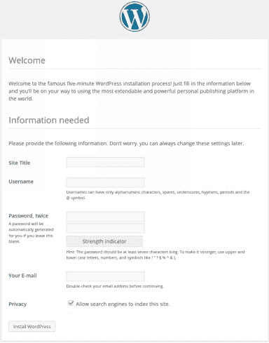

填写所需信息，然后点击“安装 WordPress”按钮。这将确认安装并自动在数据库中创建表。

要继续，点击页面底部的“登录”按钮。

# 第 14 章：结语

恭喜！在不到 85 页的内容里，我们建立了一些 CentOS 7 基础知识，并利用这些信息构建了一个基础 Web 服务器。

当然，还有很多需要学习的内容，但这只是一个开始。随着你不断进行实验和学习，本指南将让你熟练地在 CentOS 7 上进行和安装软件包。希望现在使用命令行界面已经不再那么可怕了。

如果你对进一步学习有任何问题，请随时通过 `info@nathanneil.com` 向我发送电子邮件。

感谢，并祝你在学习的道路上好运！
