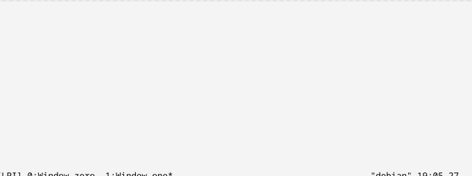

# LPIC-1 (101)（5.0版）


## 主题 101：系统架构

### 101.1 确定和配置硬件设置

**参考 LPI 目标**

LPIC-1 v5，考试 101，目标 101.1

**权重**

2

**主要知识领域**

- 启用和禁用集成外设。
- 区分不同类型的块存储设备。
- 确定设备的硬件资源。
- 用于列出各种硬件信息的工具和实用程序（例如 lshw、lspci 等）。
- 用于操作 USB 设备的工具和实用程序。
- 对 sysfs、udev 和 dbus 的概念性理解。

**使用的文件、术语和实用程序部分列表**

- `/sys/`
- `/proc/`
- `/dev/`
- `modprobe`
- `lsmod`
- `lspci`
- `lsusb`

#### 101.1 课程 1

| 证书： | LPIC-1 |
| --- | --- |
| 版本： | 5.0 |
| 主题： | 101 系统架构 |
| 目标： | 101.1 确定和配置硬件设置 |
| 课程： | 第 1 节（共 1 节） |

##### 简介

自电子计算早期以来，商务和个人计算机制造商就在其机器中集成了各种硬件部件，进而需要操作系统提供支持。对于操作系统开发人员而言，如果没有行业建立的指令集和设备通信标准，这可能会令人望而生畏。类似于操作系统为应用程序提供的标准化抽象层，这些标准使得编写和维护不绑定于特定硬件型号的操作系统变得更容易。然而，集成底层硬件的复杂性有时需要对资源如何向操作系统暴露进行调整，以便其能够正确安装和运行。

即使在没有安装操作系统时，也可以进行其中一些调整。大多数机器都提供了一个配置实用程序，可以在机器启动时执行。直到 2000 年代中期，配置实用程序都是在 BIOS（*基本输入/输出系统*）中实现的，这是 x86 主板中包含基本配置例程的固件标准。从 2000 年代第一个十年结束时开始，基于 x86 架构的机器开始用一种称为 UEFI（*统一可扩展固件接口*）的新实现来取代 BIOS，它具有更复杂的识别、测试、配置和固件升级功能。尽管发生了这种变化，但将配置实用程序仍称为 BIOS 并不罕见，因为两种实现都满足相同的基本目的。

有关 BIOS 和 UEFI 之间相似点和差异的更多细节将在后续课程中介绍。

##### 设备激活

在计算机启动时按下特定键后，会出现系统配置实用程序。按哪个键因制造商而异，但通常是 F1 或某个功能键，如 F2 或 F12。要使用的键组合通常显示在开机屏幕上。

在 BIOS 设置实用程序中，可以启用和禁用集成外设，激活基本错误保护，并更改 IRQ（中断请求）和 DMA（直接内存访问）等硬件设置。在现代机器上很少需要更改这些设置，但可能需要进行调整以解决特定问题。例如，某些 RAM 技术与默认值相比支持更快的数据传输速率，因此建议将其更改为制造商指定的值。某些 CPU 提供的功能对于特定安装可能并非必需，因此可以将其停用。被停用的功能会降低功耗并可能增强系统保护，因为包含已知漏洞的 CPU 功能也可以被禁用。

如果机器配备了许多存储设备，确定哪一个具有正确的引导加载程序且应该是设备启动顺序中的第一项至关重要。如果 BIOS 启动验证列表中不正确的设备排在第一位，操作系统可能无法加载。

##### Linux 中的设备检查

一旦设备被正确识别，就由操作系统来关联它们所需的相应软件组件。当硬件功能未按预期工作时，确定问题具体发生在哪里很重要。如果操作系统未能检测到某件硬件，最可能是该部件——或其连接的端口——有故障。如果硬件部件被正确检测到但仍不能正常工作，则可能是操作系统端存在问题。因此，处理硬件相关问题时的第一步之一是检查操作系统是否正确检测设备。在 Linux 系统上识别硬件资源有两种基本方法：使用专用命令或读取特殊文件系统内的特定文件。

##### 用于检查的命令

在 Linux 系统中识别连接设备的两个基本命令是：

`lspci`

显示当前连接到 PCI（*外围组件互连*）总线的所有设备。PCI 设备可以是连接到主板的组件，如磁盘控制器，也可以是插入 PCI 插槽的扩展卡，如外部显卡。

`lsusb`

列出当前连接到机器的 USB（*通用串行总线*）设备。尽管存在几乎任何用途的 USB 设备，但 USB 接口主要用于连接输入设备——键盘、指向设备——以及可移动存储介质。

lspci 和 lsusb 命令的输出由操作系统识别的所有 PCI 和 USB 设备列表组成。然而，设备可能尚未完全运行，因为每个硬件部件都需要一个软件组件来控制相应的设备。这个软件组件被称为*内核模块*，它可以是官方 Linux 内核的一部分，也可以从其他来源单独添加。

与硬件设备相关的 Linux 内核模块也被称为*驱动程序*，与其他操作系统中的含义相同。然而，Linux 的驱动程序并不总是由设备制造商提供。虽然一些制造商提供需要单独安装的二进制驱动程序，但许多驱动程序是由独立开发人员编写的。从历史上看，例如在 Windows 上工作的部件可能没有对应的 Linux 内核模块。如今，基于 Linux 的操作系统具有强大的硬件支持，大多数设备都能轻松工作。

与硬件直接相关的命令通常需要 root 权限才能执行，或者当由普通用户执行时只显示有限信息，因此可能需要登录为 root 或使用 *sudo* 执行命令。

例如，命令 `lspci` 的以下输出显示了几个已识别的设备：

```
$ lspci
01:00.0 VGA compatible controller: NVIDIA Corporation GM107 [GeForce GTX 750 Ti] (rev a2)
04:02.0 Network controller: Ralink corp. RT2561/RT61 802.11g PCI
04:04.0 Multimedia audio controller: VIA Technologies Inc. ICE1712 [Envy24] PCI Multi-Channel I/O Controller (rev 02)
04:0b.0 FireWire (IEEE 1394): LSI Corporation FW322/323 [TrueFire] 1394a Controller (rev 70)
```

此类命令的输出可能长达几十行，因此前面的示例和下一个示例包含


仅关注感兴趣的章节。每行开头的十六进制数是相应 PCI 设备的唯一地址。`lspci` 命令在使用 `-s` 选项提供地址并配合 `-v` 选项时，会显示特定设备的更多详细信息：

```bash
$ lspci -s 04:02.0 -v
04:02.0 Network controller: Ralink corp. RT2561/RT61 802.11g PCI
    Subsystem: Linksys WMP54G v4.1
    Flags: bus master, slow devel, latency 32, IRQ 21
    Memory at e3100000 (32-bit, non-prefetchable) [size=32K]
    Capabilities: [40] Power Management version 2
    kernel driver in use: rt61pci
```

输出现在显示了位于地址 `04:02.0` 的设备更详细的许多信息。这是一个网络控制器，其内部名称为 `Ralink corp. RT2561/RT61 802.11g PCI`。子系统与设备的品牌和型号——`Linksys WMP54G v4.1`——相关联，并可有助于诊断目的。

可以在 `kernel driver in use`（正在使用的内核驱动）这一行中识别出内核模块，它显示了模块 `rt61pci`。根据收集到的所有信息，可以正确假设：

- 设备已被识别。
- 匹配的内核模块已加载。
- 设备应已准备好使用。

验证指定设备使用哪个内核模块的另一种方法是通过 `lspci` 较新版本中可用的 `-k` 选项提供：

```bash
$ lspci -s 01:00.0 -k
01:00.0 VGA compatible controller: NVIDIA Corporation GM107 [GeForce GTX 750 Ti] (rev a2)
    kernel driver in use: nvidia
    kernel modules: nouveau, nvidia_drm, nvidia
```

对于选定的设备（一块 NVIDIA GPU 显卡），`lspci` 表明正在使用的模块名为 `nvidia`，在 `kernel driver in use: nvidia` 一行中显示，并且所有对应的内核模块都列在 `kernel modules: nouveau, nvidia_drm, nvidia` 一行中。

命令 `lsusb` 类似于 `lspci`，但专门列出 USB 信息：

```bash
$ lsusb
Bus 001 Device 029: ID 1781:0c9f Multiple Vendors USBtiny
Bus 001 Device 028: ID 093a:2521 Pixart Imaging, Inc. Optical Mouse
Bus 001 Device 020: ID 1131:1001 Integrated System Solution Corp. KY-BT100 Bluetooth Adapter
Bus 001 Device 011: ID 04f2:0402 Chicony Electronics Co., Ltd Genius LuxeMate i200 Keyboard
Bus 001 Device 007: ID 0424:7800 Standard MicroSystems Corp.
Bus 001 Device 003: ID 0424:2514 Standard MicroSystems Corp. USB 2.0 Hub
Bus 001 Device 002: ID 0424:2514 Standard MicroSystems Corp. USB 2.0 Hub
Bus 001 Device 001: ID 1d6b:0002 Linux Foundation 2.0 root hub
```

命令 `lsusb` 显示可用的 USB 通道以及连接到这些通道的设备。与 `lspci` 类似，`-v` 选项会显示更详细的输出。可以通过向 `-d` 选项提供其 ID 来选择特定设备进行检查：

```bash
$ lsusb -v -d 1781:0c9f
Bus 001 Device 029: ID 1781:0c9f Multiple Vendors USBtiny
Device Descriptor:
    bLength                 18
    bDescriptorType         1
    bcdUSB            1.01
    bDeviceClass         255 Vendor Specific Class
    bDeviceSubClass           0
    bDeviceProtocol         0
    bMaxPacketSize0           8
    idVendor          0x1781 Multiple Vendors
    idProduct         0x0c9f USBtiny
    bcdDevice           1.04
    iManufacturer             0
    iProduct                2 USBtiny
    iSerial                 0
    bNumConfigurations        1
```

使用 `-t` 选项，`lsusb` 命令以层级树的形式显示当前 USB 设备映射：

```bash
$ lsusb -t
/:  Bus 01.Port 1: Dev 1, Class=root_hub, Driver=dwc_otg/1p, 480M
    |__ Port 1: Dev 2, If 0, Class=Hub, Driver=hub/4p, 480M
        |__ Port 1: Dev 3, If 0, Class=Hub, Driver=hub/3p, 480M
            |__ Port 2: Dev 11, If 1, Class=Human Interface Device, Driver=usbhid, 1.5M
            |__ Port 2: Dev 11, If 0, Class=Human Interface Device, Driver=usbhid, 1.5M
        |__ Port 3: Dev 20, If 0, Class=Wireless, Driver=btusb, 12M
        |__ Port 3: Dev 20, If 1, Class=Wireless, Driver=btusb, 12M
        |__ Port 3: Dev 20, If 2, Class=Application Specific Interface, Driver=, 12M
        |__ Port 1: Dev 7, If 0, Class=Vendor Specific Class, Driver=lan78xx, 480M
    |__ Port 2: Dev 28, If 0, Class=Human Interface Device, Driver=usbhid, 1.5M
    |__ Port 3: Dev 29, If 0, Class=Vendor Specific Class, Driver=, 1.5M
```

可能并非所有设备都有相应的模块与之关联。某些设备的通信可以由应用程序直接处理，而不需要模块的中介。然而，`lsusb -t` 提供的输出中包含重要信息。当存在匹配的模块时，其名称会显示在该设备行的末尾，例如 `Driver=btusb`。设备的 `Class` 标识了通用类别，如 `Human Interface Device`（人机接口设备）、`Wireless`（无线）、`Vendor Specific Class`（厂商特定类）、`Mass Storage`（大容量存储）等。要验证哪个设备正在使用之前列表中存在的模块 `btusb`，应将 `Bus` 和 `Dev` 号都提供给 `lsusb` 命令的 `-s` 选项：

```bash
$ lsusb -s 01:20
Bus 001 Device 020: ID 1131:1001 Integrated System Solution Corp. KY-BT100 Bluetooth Adapter
```

在标准的 Linux 系统中，任何时刻都可能会加载大量的内核模块。与它们交互的首选方式是使用 `kmod` 包提供的命令，这是一组用于处理 Linux 内核模块常见任务（如插入、删除、列出、检查属性、解析依赖和别名）的工具。例如，`lsmod` 命令显示当前加载的所有模块：

```bash
$ lsmod
Module                     Size  Used by
kvm_intel                  138528   0
kvm                        421021   1 kvm_intel
itc0_wdt                   13480   0
itc0_vendor_support        13419   1 itc0_wdt
snd_usb_audio              149112   2
snd_hda_codec_realtek      51465   1
snd_ice1712                75006   3
snd_hda_intel              44075   7
arc4                       12608   2
snd_cs8427                 13978   1 snd_ice1712
snd_i2c                    13828   2 snd_ice1712,snd_cs8427
snd_ice17xx_ak4xxx         13128   1 snd_ice1712
snd_ak4xxx_adda            18487   2 snd_ice1712,snd_ice17xx_ak4xxx
microcode                  23527   0
snd_usbmidi_lib            24845   1 snd_usb_audio
gspca_pac7302              17481   0
gspca_main                 36226   1 gspca_pac7302
videodev                   132348   2 gspca_main,gspca_pac7302
rt61pci    32326  0
rt2x00pci  13083  1 rt61pci
media      20840  1 videodev
rt2x00mmio 13322  1 rt61pci
hid_dr     12776  0
snd_mpu401_uart  13992  1 snd_ice1712
rt2x00lib  67108  3 rt61pci,rt2x00pci,rt2x00mmio
snd_rawmidi 29394  2 snd_usbmidi_lib,snd_mpu401_uart
```

`lsmod` 命令的输出分为三列：

##### 模块
模块名称。

##### 大小
模块占用的内存（RAM）量，以字节为单位。

##### 被使用者
依赖的模块。

某些模块需要其他模块才能正常工作，音频设备模块便是这种情况：

```bash
$ lsmod | fgrep -i snd_hda_intel
snd_hda_intel       42658  5
snd_hda_codec      155748  3 snd_hda_codec_hdmi,snd_hda_codec_via,snd_hda_intel
snd_hda            81999  3 snd_hda_codec_hdmi,snd_hda_codec,snd_hda_intel
snd_page_alloc      13852  2 snd_pcm,snd_hda_intel
snd               59132  19 snd_hwdep,snd_timer,snd_hda_codec_hdmi,snd_hda_codec_via,snd_pcm,snd_seq,snd_hda_intel,snd_seq_device
```

第三列 `Used by`（被使用者）显示了需要第一列中的模块才能正常工作的模块。Linux 声音架构的许多模块，前缀为 `snd`，是相互依赖的。在进行系统诊断寻找问题时，卸载当前已加载的特定模块可能很有用。`modprobe` 命令可用于加载和卸载内核模块：要卸载一个模块及其相关模块，只要它们未被正在运行的进程使用，就应该使用 `modprobe -r` 命令。例如，要卸载模块 `snd-hda-intel`（HDA Intel 音频设备的模块）以及其他与声音系统相关的模块：


# modprobe -r snd-hda-intel

除了在系统运行时加载和卸载内核模块外，还可能在内核加载期间更改模块参数，这与向命令传递选项的做法没有太大区别。每个模块都接受特定的参数，但大多数时候建议使用默认值，不需要额外的参数。然而，在某些情况下，有必要使用参数来更改模块的行为，使其按预期工作。

使用模块名称作为唯一参数，`modinfo` 命令会显示给定模块的描述、文件、作者、许可证、标识、依赖项以及可用参数。可以通过将自定义参数包含在文件 `/etc/modprobe.conf` 或目录 `/etc/modprobe.d/` 中扩展名为 `.conf` 的独立文件中，使模块的自定义参数持久化。选项 `-p` 将使命令 `modinfo` 显示所有可用参数并忽略其他信息：

```bash
# modinfo -p nouveau
vram_pushbuf:Create DMA push buffers in VRAM (int)
tv_norm:Default TV norm.
        Supported: PAL, PAL-M, PAL-N, PAL-Nc, NTSC-M, NTSC-J,
            hd480i, hd480p, hd576i, hd576p, hd720p, hd1080i.
        Default: PAL
    NOTE Ignored for cards with external TV encoders. (charp)
nofbaccel:Disable fbcon acceleration (int)
fbcon_bpp:fbcon bits-per-pixel (default: auto) (int)
mst:Enable DisplayPort multi-stream (default: enabled) (int)
tv_disable:Disable TV-out detection (int)
ignorelid:Ignore ACPI lid status (int)
duallink:Allow dual-link TMDS (default: enabled) (int)
hdmi_mhz:Force a maximum HDMI pixel Clock (in MHz) (int)
config:option string to pass to driver core (charp)
debug:debug string to pass to driver core (charp)
noaccel:disable kernel/abi16 acceleration (int)
modeset:enable driver (default: auto, 0 = disabled, 1 = enabled, 2 = headless) (int)
atomic:Expose atomic ioctl (default: disabled) (int)
runpm:disable (0), force enable (1), optimus only default (-1) (int)
```

示例输出显示了模块 `nouveau` 的所有可用参数，该模块是由 *Nouveau 项目* 提供的内核模块，作为 NVIDIA GPU 显卡专有驱动程序的替代方案。例如，选项 `modeset` 允许控制显示分辨率和深度是在内核空间还是用户空间中设置。向文件 `/etc/modprobe.d/nouveau.conf` 添加选项 `nouveau modeset=0` 将禁用 modeset 内核功能。

如果某个模块导致问题，可以使用文件 `/etc/modprobe.d/blacklist.conf` 来阻止加载该模块。例如，要防止自动加载模块 `nouveau`，必须将行 `blacklist nouveau` 添加到文件 `/etc/modprobe.d/blacklist.conf` 中。当安装了专有模块 `nvidia` 并且应使默认模块 `nouveau` 停用边时，需要执行此操作。

> **注意**
> 您可以修改系统中默认已存在的 `/etc/modprobe.d/blacklist.conf` 文件。但是，首选的方法是创建单独的配置文 `/etc/modprobe.d/<module_name>.conf`，该文件将仅包含针对给定内核模块的设置。

##### 信息文件和设备文件

命令 `lspci`、`lsusb` 和 `lsmod` 充当前端，用于读取操作系统存储的硬件信息。这类信息保存在目录 `/proc` 和 `/sys` 中的特殊文件里。这些目录是挂载点，指向不存在于设备分区中，而仅存在于内核用于存储运行时配置和运行中进程信息的 RAM 空间中的文件系统。这些文件系统不用于常规文件存储，因此被称为伪文件系统，并且仅在系统运行时存在。`/proc` 目录包含有关运行中进程和硬件资源信息的文件。`/proc` 中用于检查硬件的一些重要文件包括：

- **`/proc/cpuinfo`**
  列出操作系统找到的 CPU 的详细信息。

- **`/proc/interrupts`**
  每个 IO 设备针对每个 CPU 的中断数量列表。

- **`/proc/ioports`**
  列出当前正在使用的已注册输入/输出端口区域。

- **`/proc/dma`**
  列出正在使用的已注册 DMA（直接内存访问）通道。

`/sys` 目录中的文件具有与 `/proc` 中文件类似的角色。然而，`/sys` 目录有特定的用途，即存储与硬件相关的设备信息和内核数据，而 `/proc` 还包含有关各种内核数据结构的信息，包括运行中的进程和配置。

在标准 Linux 系统中，与设备直接相关的另一个目录是 `/dev`。`/dev` 中的每个文件都与系统设备相关联，特别是存储设备。例如，当连接到主板第一个 IDE 通道的传统 IDE 硬盘时，它由文件 `/dev/hda` 表示。此磁盘中的每个分区将由 `/dev/hda1`、`/dev/hda2` 直到找到的最后一个分区来标识。

可移动设备由 udev 子系统处理，该子系统在 `/dev` 中创建相应的设备。Linux 内核捕获硬件检测事件并将其传递给 udev 进程，该进程随后识别设备，并使用预定义的规则在 `/dev` 中动态创建相应的文件。

在当前的 Linux 发行版中，udev 负责识别和配置在机器开机时已存在的设备（冷插检测）以及在系统运行时识别的设备（热插拔检测）。Udev 依赖于 SysFS，这是挂载在 `/sys` 中的用于硬件相关信息的伪文件系统。

> **注意**
> Hotplug（热插拔）是指系统在运行时检测和配置设备的术语，例如当插入 USB 设备时。Linux 内核从 2.6 版本起支持热插拔功能，允许大多数系统总线（PCI、USB 等）在设备连接或断开时触发热插拔事件。

当检测到新设备时，udev 会在存储在目录 `/etc/udev/rules.d/` 中的预定义规则中查找匹配的规则。最重要的规则由发行版提供，但可以为特定情况添加新规则。

##### 存储设备

在 Linux 中，存储设备通常被称为块设备，因为数据以不同大小和位置的缓冲数据块的形式从这些设备读取和写入。每个块设备都由 `/dev` 目录中的一个文件标识，该文件的名称取决于设备类型（IDE、SATA、SCSI 等）及其分区。例如，CD/DVD 和软盘设备将在 `/dev` 中根据其类型命名：连接到第二个 IDE 通道的 CD/DVD 驱动器将被标识为 `/dev/hdc`（`/dev/hda` 和 `/dev/hdb` 保留给第一个 IDE 通道上的主设备和从设备），而旧的软盘驱动器将被标识为 `/dev/fd0`、`/dev/fd1` 等。

从 Linux 内核 2.4 版本开始，大多数存储设备现在被标识为 SCSI 设备，而不管其硬件类型如何。IDE、SSD 和 USB 块设备将以 `sd` 为前缀。对于 IDE 磁盘，将使用 `sd` 前缀，但第三个字母将根据驱动器是主设备还是从设备来选定（在第一个 IDE 通道中，主设备将是 `sda`，从设备将是 `sdb`）。分区按数字列出。路径 `/dev/sda1`、`/dev/sda2` 等用于标识第一个识别的块设备的第一和第二分区，而 `/dev/sdb1`、`/dev/sdb2` 等用于标识第二个识别的块设备的第一和第二分区。这种模式的例外情况是存储卡（SD 卡）和 NVMe 设备（连接到 PCI Express 总线的 SSD）。对于 SD 卡，路径 `/dev/mmcblk0p1`、`/dev/mmcblk0p2` 等用于标识第一个识别设备的第一和第二分区，而 `/dev/mmcblk1p1`、`/dev/mmcblk1p2` 等用于标识第二个识别设备的第一和第二分区。NVMe 设备获得 `nvme` 前缀，例如 `/dev/nvme0n1p1` 和 `/dev/nvme0n1p2`。


##### 指导练习

1. 假设在系统中添加第二块 SATA 磁盘后，操作系统无法启动。已知所有部件均无故障，此错误的可能原因是什么？
2. 假设你想确认新购台式机 PCI 总线连接的外部显卡确实是制造商宣传的那一款，但打开机箱会使保修失效。可以使用什么命令来列出操作系统检测到的显卡详细信息？
3. 以下行是命令 `lspci` 生成输出的一部分：

```
03:00.0 RAID bus controller: LSI Logic / Symbios Logic MegaRAID SAS 2208 [Thunderbolt] (rev 05)
```

应该执行什么命令来识别用于此特定设备的内核模块？
4. 一位系统管理员希望在不对系统进行重启的情况下尝试为 `bluetooth` 内核模块设置不同的参数。然而，任何使用 `modprobe -r bluetooth` 卸载模块的尝试都导致以下错误：

```
modprobe: FATAL: Module bluetooth is in use.
```

此错误的可能原因是什么？

##### 探索练习

1. 在生产环境中发现旧式机器并不罕见，例如某些设备使用过时的连接与控制计算机通信，因此需要特别关注这些较旧机器的某些特性。例如，一些具有旧版 BIOS 固件的 x86 服务器如果未检测到键盘将无法启动。如何避免这一特定问题？
2. 基于 Linux 内核构建的操作系统也可用于 x86 以外的多种计算机架构，如基于 ARM 架构的单板计算机。细心的用户会注意到此类机器（如树莓派）上缺少 `lspci` 命令。与 x86 机器的什么差异证明了该命令的缺失？
3. 许多网络路由器都有一个 USB 端口，允许连接外部设备，如 USB 硬盘。鉴于大多数此类路由器使用的是基于 Linux 的操作系统，假设路由器中不存在其他传统块设备，外部 USB 硬盘在 `/dev/` 目录中将如何命名？
4. 2018 年，发现了一种名为 *Meltdown* 的硬件漏洞。它影响许多架构的几乎所有处理器。Linux 内核的较新版本可以告知当前系统是否易受攻击。如何获取此信息？

##### 总结

本课介绍了 Linux 内核处理硬件资源的一般概念，主要涉及 x86 架构。本课涵盖了以下主题：

- BIOS 或 UEFI 配置实用程序中定义的设置如何影响操作系统与硬件的交互方式。
- 如何使用标准 Linux 系统提供的工具获取硬件信息。
- 如何在文件系统中识别永久和可移动存储设备。

涉及的命令和程序如下：

- 检查已检测硬件的命令：`lspci` 和 `lsusb`。
- 管理内核模块的命令：`lsmod` 和 `modprobe`。
- 与硬件相关的特殊文件，即位于 `/dev/` 目录或 `/proc/` 和 `/sys/` 伪文件系统中的文件。

##### 指导练习答案

1. 假设在系统中添加第二块 SATA 磁盘后，操作系统无法启动。已知所有部件均无故障，此错误的可能原因是什么？

应在 BIOS 设置实用程序中配置启动设备顺序，否则 BIOS 可能无法运行引导加载程序。

2. 假设你想确认新购台式机 PCI 总线连接的外部显卡确实是制造商宣传的那一款，但打开机箱会使保修失效。可以使用什么命令来列出操作系统检测到的显卡详细信息？

命令 `lspci` 将列出当前连接到 PCI 总线的所有设备的详细信息。

3. 以下行是命令 `lspci` 生成输出的一部分：

```
03:00.0 RAID bus controller: LSI Logic / Symbios Logic MegaRAID SAS 2208 [Thunderbolt] (rev 05)
```

应该执行什么命令来识别用于此特定设备的内核模块？

命令 `lspci -s 03:00.0 -v` 或 `lspci -s 03:00.0 -k`

4. 一位系统管理员希望在不对系统进行重启的情况下尝试为 `bluetooth` 内核模块设置不同的参数。然而，任何使用 `modprobe -r bluetooth` 卸载模块的尝试都导致以下错误：

```
modprobe: FATAL: Module bluetooth is in use.
```

此错误的可能原因是什么？

`bluetooth` 模块正被正在运行的进程使用。

##### 探索练习答案

1. 在生产环境中发现旧式机器并不罕见，例如某些设备使用过时的连接与控制计算机通信，因此需要特别关注这些较旧机器的某些特性。例如，一些具有旧版 BIOS 固件的 x86 服务器如果未检测到键盘将无法启动。如何避免这一特定问题？

BIOS 配置实用程序有一个选项，可以在未检测到键盘时禁用计算机锁定。

2. 基于 Linux 内核构建的操作系统也可用于 x86 以外的多种计算机架构，如基于 ARM 架构的单板计算机。细心的用户会注意到此类机器（如树莓派）上缺少 `lspci` 命令。与 x86 机器的什么差异证明了该命令的缺失？

与大多数 x86 机器不同，像树莓派这样的基于 ARM 的计算机没有 PCI 总线，因此命令 `lspci` 毫无用处。

3. 许多网络路由器都有一个 USB 端口，允许连接外部设备，如 USB 硬盘。鉴于大多数此类路由器使用的是基于 Linux 的操作系统，假设路由器中不存在其他传统块设备，外部 USB 硬盘在 `/dev/` 目录中将如何命名？

现代 Linux 内核将 USB 硬盘识别为 SATA 设备，因此，由于系统中不存在其他传统块设备，对应的文件将是 `/dev/sda`。

4. 2018 年，发现了一种名为 *Meltdown* 的硬件漏洞。它影响许多架构的几乎所有处理器。Linux 内核的较新版本可以告知当前系统是否易受攻击。如何获取此信息？

文件 `/proc/cpuinfo` 中有一行显示了相应 CPU 的已知漏洞，例如 `bugs: cpu_meltdown`。


### 101.2 启动系统

**参考 LPI 目标**

> LPIC-1 v5，考试 101，目标 101.2

**权重**

3

**关键知识领域**

- 向引导加载程序提供常用命令，并在启动时向内核提供选项。
- 展示从 BIOS/UEFI 到启动完成的知识。
- 理解 SysVinit 和 systemd。
- 了解 Upstart。
- 在日志文件中检查启动事件。

**使用的文件、术语和实用程序的部分列表**

- `dmesg`
- `journalctl`
- BIOS
- UEFI
- 引导加载程序 (bootloader)
- 内核 (kernel)
- `initramfs`
- `init`
- SysVinit
- systemd

#### 101.2 课程 1

| | |
|---|---|
| **证书:** | LPIC-1 |
| **版本:** | 5.0 |
| **主题:** | 101 系统架构 |
| **目标:** | 101.2 启动系统 |
| **课程:** | 1 / 1 |

##### 引言

为了控制机器，操作系统的主要组件——内核——必须通过一个名为*引导加载程序*（bootloader）的程序加载，而该程序本身由预装的固件（如 BIOS 或 UEFI）加载。引导加载程序可以进行自定义，以向内核传递参数，例如哪个分区包含根文件系统，或者操作系统应以何种模式执行。一旦加载，内核将继续识别并配置硬件以完成启动过程。最后，内核调用负责启动和管理系统服务的实用程序。

> 注意 在某些 Linux 发行版中，本课时执行的命令可能需要 root 权限。

##### BIOS 或 UEFI

x86 机器执行的用于运行引导加载程序的步骤因其使用

BIOS 或 UEFI。BIOS（Basic Input/Output System，基本输入/输出系统）的缩写，是一个存储在连接到主板的非易失性存储芯片中的程序，每次计算机开机时都会执行。这种程序被称为固件，其存储位置独立于系统可能拥有的其他存储设备。BIOS 假设第一个存储设备（遵循 BIOS 配置实用程序定义的顺序）的前 440 字节是引导加载器（也称为自举程序）的第一阶段。使用标准 DOS 分区方案的存储设备的前 512 字节被称为 MBR（主引导记录），除了引导加载器的第一阶段外，还包含分区表。如果 MBR 不包含正确的数据，除非采用了替代方法，否则系统将无法启动。

一般来说，在配备 BIOS 的系统上启动到操作系统之前的步骤包括：

-   执行 POST（上电自检）流程，以便在机器通电后立即识别简单的硬件故障。
-   BIOS 激活用于加载系统的基本组件，如视频输出、键盘和存储介质。
-   BIOS 从 MBR 加载引导加载器的第一阶段（定义为 BIOS 配置实用程序中第一个设备的前 440 字节）。
-   引导加载器的第一阶段调用引导加载器的第二阶段，负责显示启动选项并加载内核。

UEFI（Unified Extensible Firmware Interface，统一可扩展固件接口）在几个关键点上与 BIOS 不同。与 BIOS 一样，UEFI 也是一种固件，但它能够识别分区并读取其中找到的许多文件系统。UEFI 不依赖 MBR，仅考虑存储在主板附带的非易失性存储器（NVRAM）中的设置。这些定义指示了 UEFI 兼容程序的位置，这些程序被称为 EFI 应用程序，它们会被自动执行或从启动菜单调用。EFI 应用程序可以是引导加载器、操作系统选择器、用于系统诊断和修复的工具等。它们必须位于传统存储设备分区中，并处于兼容的文件系统中。对于块设备，标准的兼容文件系统是 FAT12、FAT16 和 FAT32；对于光媒体，则是 ISO-9660。这种方法允许实现比 BIOS 所能实现的更为复杂的工具。

包含 EFI 应用程序的分区被称为 EFI 系统分区或简称 ESP。此分区不得与其他系统文件系统（如根文件系统或用户数据文件系统）共享。ESP 分区中的 EFI 目录包含由 NVRAM 中保存的条目所指向的应用程序。

一般来说，在配备 UEFI 的系统上启动到操作系统之前的步骤包括：

-   执行 POST（上电自检）流程，以便在机器通电后立即识别简单的硬件故障。
-   UEFI 激活用于加载系统的基本组件，如视频输出、键盘和存储介质。
-   UEFI 的固件读取存储在 NVRAM 中的定义，以执行存储在 ESP 分区文件系统中的预定义 EFI 应用程序。通常，预定义的 EFI 应用程序是一个引导加载器。
-   如果预定义的 EFI 应用程序是一个引导加载器，它将加载内核以启动操作系统。

UEFI 标准还支持一种称为安全启动（Secure Boot）的功能，该功能仅允许执行经过签名的 EFI 应用程序，即由硬件制造商授权的 EFI 应用程序。此功能增加了对恶意软件的保护，但可能使得安装制造商保修范围之外的操作系统变得困难。

##### 引导加载器

在 x86 架构的 Linux 中，最流行的引导加载器是 GRUB（Grand Unified Bootloader，通用引导加载器）。一旦由 BIOS 或 UEFI 调用，GRUB 就会显示可启动的操作系统列表。有时列表不会自动出现，但在 BIOS 调用 GRUB 时按住 Shift 键可以调用该列表。在 UEFI 系统中，应改用 Esc 键。

从 GRUB 菜单中，可以选择加载哪个已安装的内核，并向其传递新参数。大多数内核参数遵循 `option=value`（选项=值）的模式。一些最有用的内核参数包括：

### acpi
启用/禁用 ACPI 支持。`acpi=off` 将禁用对 ACPI 的支持。

### init
设置替代的系统初始化程序。例如，`init=/bin/bash` 将把 Bash shell 设置为初始化程序。这意味着在内核启动过程结束后将立即开始 shell 会话。

### systemd.unit
设置要激活的 systemd 目标。例如，`systemd.unit=graphical.target`。Systemd 还接受为 SysV 定义的数字运行级别。例如，要激活运行级别 1，只需在内核参数中包含数字 1 或字母 S（“single”的缩写）即可。

### mem
设置系统可用的 RAM 数量。此参数对于虚拟机非常有用，可用于限制每个客户机可用的 RAM 数量。使用 `mem=512M` 将特定客户机系统的可用 RAM 数量限制为 512 兆字节。

### maxcpus
限制对称多处理器机器中系统可见的处理器（或处理器核心）数量。它对虚拟机也很有用。值为 0 时，将关闭对多处理器机器的支持，其效果与内核参数 `nosmp` 相同。参数 `maxcpus=2` 将操作系统可用的处理器数量限制为两个。

### quiet
隐藏大多数启动消息。

### vga
选择视频模式。参数 `vga=ask` 将显示一个可用模式的列表供选择。

### root
设置根分区，该分区与引导加载器中预配置的分区不同。例如，`root=/dev/sda3`。

### rootflags
根文件系统的挂载选项。

### ro
使根文件系统的初始挂载为只读。

### rw
允许在初始挂载时在根文件系统中进行写入。

通常不需要更改内核参数，但在检测和解决与操作系统相关的问题时可能很有用。内核参数必须添加到文件 `/etc/default/grub` 中的 `GRUB_CMDLINE_LINUX` 行中，以便在重启时保持持久性。每当 `/etc/default/grub` 更改时，必须生成一个新的引导加载器配置文件，这可以通过命令 `grub-mkconfig -o /boot/grub/grub.cfg` 来完成。一旦操作系统正在运行，用于加载当前会话的内核参数可在文件 `/proc/cmdline` 中读取。

> **注意** GRUB 的配置将在后续课程中进一步讨论。

##### 系统初始化

除了内核之外，操作系统还依赖于提供预期功能的其他组件。这些组件中的许多都是在系统初始化过程中加载的，范围从简单的 shell 脚本到更复杂的服务程序。脚本通常用于执行短暂的任务，这些任务在系统初始化过程中运行并终止。服务（也称为*守护进程*）可能会一直活动，因为它们可能负责操作系统的固有方面。

在 Linux 发行版中，将具有不同特性的启动脚本和守护进程整合在一起的方式多种多样，这一事实历史上阻碍了开发满足所有 Linux 发行版维护者和用户期望的单一解决方案。然而，发行版维护者选择的用于执行此功能的任何工具至少能够启动、停止和重启系统服务。这些操作通常由系统本身在软件更新后执行，例如，但系统管理员在修改其配置文件后几乎总是需要手动重启服务。

系统管理员能够根据情况激活特定的守护进程集也是方便的。例如，应该可以仅运行最小的一组服务以执行系统维护任务。

> > 严格来说，操作系统只是内核及其控制硬件并管理所有进程的组件。然而，通常更宽松地使用“操作系统”一词，以指代组成软件环境的整个不同程序组，用户可以在其中执行基本计算任务。
> >
> > **注意**

操作系统的初始化始于引导加载器将内核加载到 RAM 中。然后，内核将接管 CPU，并开始检测和设置操作系统的根本方面，如基本硬件配置和内存寻址。

随后，内核将打开 *initramfs*（*初始 RAM 文件系统*）。initramfs 是一个包含在启动过程中用作临时根文件系统的文件系统存档。initramfs 文件的主要目的是提供所需的模块，使内核能够访问操作系统的“真实”根文件系统。

一旦根文件系统可用，内核将挂载 `/etc/fstab` 中配置的所有文件系统，然后执行第一个程序，即名为 `init` 的工具。`init` 程序负责运行所有初始化脚本和系统守护进程。除了传统的 init 之外，还有不同的系统初始化程序实现，如 *systemd* 和 *Upstart*。一旦 init 程序加载，initramfs 就会从 RAM 中移除。


##### SysV 标准

  基于 SysVinit 标准的服务管理器通过采用 *运行级别* 的概念，来控制哪些守护进程和资源将可用。运行级别从 0 到 6 编号，并由发行版维护者设计以实现特定用途。所有发行版之间共有的运行级别定义仅为运行级别 0、1 和 6。

##### systemd

  systemd 是一个现代化的系统和*服务管理器*，拥有针对 SysV 命令和运行级别的兼容层。systemd 具有并发结构，使用套接字和 D-Bus 进行服务激活、按需执行守护进程、使用 cgroups 进行进程监控、支持快照、恢复系统会话、控制挂载点以及基于依赖的服务控制。近年来，大多数主要 Linux 发行版已逐渐采用 systemd 作为其默认系统管理器。

##### Upstart

  与 systemd 类似，Upstart 也是 init 的替代方案。Upstart 的重点是通过并行化系统服务加载过程来加速启动过程。在旧版本的发行版中，Ubuntu 基础发行版使用了 Upstart，但现在已让位于 systemd。

##### 初始化检查

  在启动过程中可能会发生错误，但它们可能并不关键到足以完全停止操作系统。尽管如此，这些错误可能会损害系统的预期行为。所有错误都会产生消息，可用于后续调查，因为它们包含关于错误发生时间和方式的重要信息。即使没有生成错误消息，启动过程中收集的信息也可以用于调整和配置目的。

  内核存储其消息（包括启动消息）的内存空间称为 *内核环形缓冲区*。即使在初始化过程中未显示消息（例如显示动画时），这些消息仍保留在内核环形缓冲区中。然而，当系统关机或执行命令 `dmesg --clear` 时，内核环形缓冲区会丢失所有消息。如果不带选项，命令 `dmesg` 会显示内核环形缓冲区中的当前消息：

```bash
$ dmesg
[    5.262389] EXT4-fs (sda1): mounted filesystem with ordered data mode. Opts: (null)
[    5.449712] ip_tables: (C) 2000-2006 Netfilter Core Team
[    5.460286] systemd[1]: systemd 237 running in system mode.
[    5.480138] systemd[1]: Detected architecture x86-64.
[    5.481767] systemd[1]: Set hostname to <torre>.
[    5.636607] systemd[1]: Reached target User and Group Name Lookups.
[    5.636866] systemd[1]: Created slice System Slice.
[    5.637000] systemd[1]: Listening on Journal Audit Socket.
[    5.637085] systemd[1]: Listening on Journal Socket.
[    5.637827] systemd[1]: Mounting POSIX Message Queue File System...
[    5.638639] systemd[1]: Started Read required files in advance.
[    5.641661] systemd[1]: Starting Load Kernel Modules...
[    5.661672] EXT4-fs (sda1): re-mounted. Opts: errors=remount-ro
[    5.694322] lp: driver loaded but no devices found
[    5.702609] ppdev: user-space parallel port driver
[    5.705384] parport_pc 00:02: reported by Plug and Play ACPI
[    5.705468] parport0: PC-style at 0x378 (0x778), irq 7, dma 3 [PCSPP,TRISTATE,COMPAT,EPP,ECP,DMA]
[    5.800146] lp0: using parport0 (interrupt-driven).
[    5.897421] systemd-journald[352]: Received request to flush runtime journal from PID 1
```

  `dmesg` 的输出可能长达数百行，因此上述列表仅包含显示内核调用 systemd 服务管理器的摘录。行开头的值相对于内核开始加载时的秒数。

  在基于 systemd 的系统中，命令 `journalctl` 可以使用选项 `-b`、`--boot`、`-k` 或 `--dmesg` 显示初始化消息。命令 `journalctl --list-boots` 显示相对于当前启动的启动编号列表、它们的识别哈希值以及对应消息的起始和结束时间戳：

```bash
$ journalctl --list-boots
-4  9e5b3eb49528452088b41ad4dbe1afa6  Thu 2019-10-03 13:39:23 -03-Thu 2019-10-03 13:40:30 -03
-3  9ed379955535430aa43baa17758f40fa  Thu 2019-10-03 13:41:15 -03-Thu 2019-10-03 14:56:19 -03
-2  17672d88561946e9c9b102df7355452e  Thu 2019-10-03 14:56:57 -03-Thu 2019-10-03 19:27:16 -03
-1  55c0d9439bfb485a20a62776d0b8d4  Thu 2019-10-03 19:27:53 -03-Fri 2019-10-04 00:28:47 -03
 0  08fbbedd9f964a748b402bb27b200622  Fri 2019-10-04 00:31:01 -03-Fri 2019-10-04 10:17:01 -03
```

  在基于 systemd 的系统中，之前的初始化日志也会保留，因此仍可以检查先前操作系统会话的消息。如果提供选项 `-b 0` 或 `--boot=0`，则显示当前启动的消息。选项 `-b -1` 或 `--boot=-1` 将显示上次初始化的消息。选项 `-b -2` 或 `--boot=-2` 将显示再上一次初始化的消息，依此类推。以下摘录显示了内核调用 systemd 服务管理器处理最后一次初始化过程的情况：

```bash
$ journalctl -b 0
oct 04 00:31:01 ubuntu-host kernel: EXT4-fs (sda1): mounted filesystem with ordered data mode. Opts: (null)
oct 04 00:31:01 ubuntu-host kernel: ip_tables: (C) 2000-2006 Netfilter Core Team
oct 04 00:31:01 ubuntu-host systemd[1]: systemd 237 running in system mode.
oct 04 00:31:01 ubuntu-host systemd[1]: Detected architecture x86-64.
oct 04 00:31:01 ubuntu-host systemd[1]: Set hostname to ‘torrie’.
oct 04 00:31:01 ubuntu-host systemd[1]: Reached target User and Group Name Lookups.
oct 04 00:31:01 ubuntu-host systemd[1]: Created slice System Slice.
oct 04 00:31:01 ubuntu-host systemd[1]: Listening on Journal Audit Socket.
oct 04 00:31:01 ubuntu-host systemd[1]: Listening on Journal Socket.
oct 04 00:31:01 ubuntu-host systemd[1]: Mounting POSIX Message Queue File System...
oct 04 00:31:01 ubuntu-host systemd[1]: Started Read required files in advance.
oct 04 00:31:01 ubuntu-host systemd[1]: Starting Load Kernel Modules...
oct 04 00:31:01 ubuntu-host kernel: EXT4-fs (sda1): re-mounted. Opts: commit=300,barrier=0,errors=remount-ro
oct 04 00:31:01 ubuntu-host kernel: lp: driver loaded but no devices found
oct 04 00:31:01 ubuntu-host kernel: ppdev: user-space parallel port driver
oct 04 00:31:01 ubuntu-host kernel: parport_pc 00:00:02: reported by Plug and Play ACPI
oct 04 00:31:01 ubuntu-host kernel: parport0: PC-style at 0x378 (0x778), irq 7, dma 3 [PCSPP,TRISTATE,COMPAT,EPP,ECP,DMA]
oct 04 00:31:01 ubuntu-host kernel: lp0: using parport0 (interrupt-driven).
oct 04 00:31:01 ubuntu-host systemd-journald[352]: Journal started
oct 04 00:31:01 ubuntu-host systemd-journald[352]: Runtime journal (/run/log/journal/abb765408ff3741ae9519ab3b960e3a15) is 4.9M, max 39.4M, 34.5M free.
oct 04 00:31:01 ubuntu-host systemd-modules-load[335]: Inserted module 'lp'
oct 04 00:31:01 ubuntu-host systemd-modules-load[335]: Inserted module 'ppdev'
oct 04 00:31:01 ubuntu-host systemd-modules-load[335]: Inserted module 'parport_pc'
oct 04 00:31:01 ubuntu-host systemd[1]: Starting Flush Journal to Persistent Storage...
```

  操作系统发出的初始化和其他消息存储在目录 `/var/log/` 中的文件中。如果发生严重错误，且操作系统在加载内核和 initrads 后无法继续初始化过程，可以使用替代启动介质来启动系统并访问相应的文件系统。然后，可以搜索 `/var/log/` 下的文件，以查找导致启动过程中断的可能原因。命令 `journalctl` 的选项 `-D` 或 `--directory` 可用于读取 `/var/log/journal/`（系统日志消息的默认位置）之外目录中的日志消息。由于 systemd 的日志消息不以原始文本形式存储，因此必须使用命令 `journalctl` 来读取它们。

##### 指导练习

- 1. 在配备 BIOS 固件的机器上，引导二进制文件位于哪里？
- 2. UEFI 固件支持由外部程序提供的扩展功能，称为 EFI 应用程序。然而，这些应用程序有其自己的特殊位置。EFI 应用程序位于系统的哪里？
- 3. 引导加载程序允许在加载内核之前传递自定义内核参数。假设由于根文件系统位置信息错误，系统无法启动。位于 `/dev/sda3` 的正确根文件系统如何作为参数传递给内核？
- 4. 一台 Linux 机器的启动过程最终以以下消息结束：

```
ALERT! /dev/sda3 does not exist. Dropping to a shell!
```

  这个问题的可能原因是什么？


##### 探索性练习

1. 当机器上安装了多个操作系统时，引导加载程序会显示一个可供选择的操作系统列表。然而，新安装的操作系统可能会覆盖硬盘的主引导记录（MBR），擦除引导加载程序的第一阶段，从而导致其他操作系统无法访问。为什么在配备 UEFI 固件的机器上不会发生这种情况？

2. 安装自定义内核但未提供适当的 initramfs 镜像时，常见的后果是什么？

3. 初始化日志长达数百行，因此 `dmesg` 命令的输出通常会被管道传输到分页命令——如 `less` 命令——以便于阅读。`dmesg` 的哪个选项会自动对其输出进行分页，从而无需显式使用分页命令？

4. 一块包含离线机器整个文件系统的硬盘被移除并作为次要驱动器连接到一台运行正常的机器上。假设其挂载点为 /mnt/hd，如何使用 `journalctl` 检查位于 /mnt/hd/var/log/journal/ 的日志文件内容？

##### 摘要

本课介绍了标准 Linux 系统的启动顺序。正确了解 Linux 系统启动过程的工作原理有助于防止可能导致系统无法访问的错误。本课涵盖了以下主题领域：

- BIOS 和 UEFI 启动方式的区别。
- 典型的系统初始化阶段。
- 恢复启动消息。

涉及的命令和步骤包括：

- 常用内核参数。
- 读取启动消息的命令：`dmesg` 和 `journalctl`。

##### 指导性练习答案

- **在配备 BIOS 固件的机器上，引导程序二进制文件位于哪里？**

位于 BIOS 配置实用程序定义的第一个存储设备的 MBR 中。

- **UEFI 固件支持由外部程序提供的扩展功能，称为 EFI 应用程序。然而，这些应用程序有其自己特殊的位置。EFI 应用程序在系统中的哪里？**

EFI 应用程序存储在 EFI 系统分区（ESP）中，位于任何可用且文件系统兼容的存储块上（通常是 FAT32 文件系统）。

- **引导加载程序允许在加载内核之前传递自定义内核参数。假设系统由于根文件系统位置信息错误而无法启动。如何将位于 `/dev/sda3` 的正确根文件系统作为参数传递给内核？**

应使用 *root* 参数，例如 `root=/dev/sda3`。

- **Linux 机器的启动过程最终以以下消息结束：**

```
ALERT! /dev/sda3 does not exist. Dropping to a shell!
```

这个问题可能的原因是什么？

内核无法找到作为根文件系统指定的设备 `/dev/sda3`。

##### 探索性练习答案

1. 当机器上安装了多个操作系统时，引导加载程序会显示一个可供选择的操作系统列表。然而，新安装的操作系统可能会覆盖硬盘的主引导记录（MBR），擦除引导加载程序的第一阶段，从而导致其他操作系统无法访问。为什么在配备 UEFI 固件的机器上不会发生这种情况？

UEFI 机器不使用硬盘的 MBR 来存储引导加载程序的第一阶段。

2. 安装自定义内核但未提供适当的 initramfs 镜像时，常见的后果是什么？

如果根文件系统类型被编译为外部内核模块，则该根文件系统可能无法访问。

3. 初始化日志长达数百行，因此 `dmesg` 命令的输出通常会被管道传输到分页命令——如 `less` 命令——以便于阅读。`dmesg` 的哪个选项会自动对其输出进行分页，从而无需显式使用分页命令？

命令 `dmesg -H` 或 `dmesg --human` 将默认启用分页器。

4. 一块包含离线机器整个文件系统的硬盘被移除并作为次要驱动器连接到一台运行正常的机器上。假设其挂载点为 `/mnt/hd`，如何使用 `journalctl` 检查位于 `/mnt/hd/var/log/journal/` 的日志文件内容？

使用命令 journalctl -D /mnt/hd/var/log/journal 或 journalctl --directory=/mnt/hd/var/log/journal

### 101.3 更改运行级别 / 启动目标以及关闭或重启系统

**LPI 目标参考**
LPIC-1 v5，考试 101，目标 101.3

**权重**
3

**关键知识领域**

- 设置默认运行级别或启动目标。
- 在运行级别 / 启动目标之间切换，包括单用户模式。
- 从命令行关机并重启。
- 在切换运行级别 / 启动目标或其他重大系统事件之前提醒用户。
- 正确终止进程。
- 了解 acpid。

**所用文件、术语和工具的部分列表**

- `/etc/inittab`
- `shutdown`
- `init`
- `/etc/init.d/`
- `telinit`
- `systemd`
- `systemctl`
- `/etc/systemd/`
- `/usr/lib/systemd/`
- `wall`


#### 101.3 第 1 课

| 证书： | LPIC-1 |
| 版本： | 5.0 |
| 主题： | 101 系统架构 |
| 目标： | 101.3 更改运行级别 / 启动目标以及关闭或重启系统 |
| 课程： | 1 / 1 |

##### 简介

遵循 Unix 设计原则的操作系统中一个常见的特性是使用独立的进程来控制系统的不同功能。这些进程称为守护进程（或更广义地称为服务），它们还负责操作系统底层的扩展功能，如网络应用服务（HTTP 服务器、文件共享、电子邮件等）、数据库、按需配置等。尽管 Linux 使用单一内核，但操作系统的许多底层方面都受到守护进程的影响，例如负载均衡和防火墙配置。

哪些守护进程应该处于活动状态取决于系统的用途。活动守护进程的集合也应在运行时可修改，以便可以在不重启整个系统的情况下启动和停止服务。为了解决这个问题，每个主要的 Linux 发行版都提供某种形式的服务管理工具来控制系统。

服务可以通过 shell 脚本或通过程序及其支持配置文件来控制。第一种方法由 SysVinit 标准实现，也称为 System V 或简称为 SysV。第二种方法由 systemd 和 Upstart 实现。从历史上看，基于 SysV 的服务管理器是 Linux 发行版中最常用的。如今，基于 systemd 的服务管理器在大多数 Linux 发行版中更为常见。服务管理器是内核在启动过程中启动的第一个程序，因此其 PID（进程标识符）始终为 1。

##### SysVinit

基于 SysVinit 标准的服务管理器将提供预定义的系统状态集，称为*运行级别*，以及要执行的相应服务脚本文件。运行级别的编号从 *0* 到 *6*，通常分配给以下用途：

- **运行级别 0**
  系统关机。

- **运行级别 1, *s* 或 *single***
  单用户模式，无网络和其他非基本功能（维护模式）。

- **运行级别 2, 3 或 4**
  多用户模式。用户可以通过控制台或网络登录。运行级别 2 和 4 不常使用。

- **运行级别 5**
  多用户模式。它等同于 *3*，外加图形模式登录。

- **运行级别 6**
  系统重启。

负责管理运行级别及相关守护进程/资源的程序是 `/sbin/init`。在系统初始化期间，init 程序识别请求的运行级别（由内核参数或 `/etc/inittab` 文件定义），并加载在那里列出的与该运行级别关联的脚本。每个运行级别可能有许多关联的服务文件，通常是在 `/etc/init.d/` 目录中的脚本。由于并非所有 Linux 发行版中的运行级别都等效，因此在基于 SysV 的发行版中也可以找到运行级别用途的简短描述。

`/etc/inittab` 文件的语法使用以下格式：

```
id:runlevels:action:process
```

*id* 是一个通用名称，长度最多为四个字符，用于标识条目。*runlevels* 条目是一个运行级别编号列表，针对这些级别应执行指定操作。*action* 术语定义了 *init* 将如何执行由 *process* 术语指示的进程。可用的操作如下：


## boot

该进程将在系统初始化期间执行。`runlevels` 字段被忽略。

## bootwait

该进程将在系统初始化期间执行，且 `init` 会等待其完成后再继续。`runlevels` 字段被忽略。

## sysinit

该进程将在系统初始化后执行，无论处于何种运行级别（runlevel）。`runlevels` 字段被忽略。

## wait

该进程将在指定的运行级别下执行，且 `init` 会等待其完成后再继续。

## respawn

如果该进程终止，它将被重新启动。

## ctrlaltdel

当 `init` 进程接收到 `SIGINT` 信号时（即按下 `Ctrl + Alt + Del` 键序列时触发），该进程将被执行。

默认运行级别——即未作为内核参数指定其他级别时所选用的级别——也定义在 `/etc/inittab` 文件中，位于条目 `id::x:initdefault` 中。`x` 是默认运行级别的数字。由于如果该数字为 0 或 6，系统会在完成引导过程后立即关机或重启，因此该数字绝不应为 0 或 6。典型的 `/etc/inittab` 文件如下所示：

```bash
# Default runlevel
id:3:initdefault:

# Configuration script executed during boot
si::sysinit:/etc/init.d/rcS

# Action taken on runlevel 5 (single user)
~:5:wait:/sbin/sulogin

# Configuration for each execution level
10:0:wait:/etc/init.d/rc 0
11:1:wait:/etc/init.d/rc 1
12:2:wait:/etc/init.d/rc 2
13:3:wait:/etc/init.d/rc 3
14:4:wait:/etc/init.d/rc 4
15:5:wait:/etc/init.d/rc 5
16:6:wait:/etc/init.d/rc 6

# Action taken upon ctrl+alt+del keystroke
ca::ctrlaltdel:/sbin/shutdown -r now

# Enable consoles for runlevels 2 and 3
1:23:respawn:/sbin/getty tty1 VC linux
2:23:respawn:/sbin/getty tty2 VC linux
3:23:respawn:/sbin/getty tty3 VC linux
4:23:respawn:/sbin/getty tty4 VC linux

# For runlevel 3, also enable serial
# terminals ttyS0 and ttyS1 (modem) consoles
S0:3:respawn:/sbin/getty -L 9600 ttyS0 vt320
S1:3:respawn:/sbin/mgetty -x0 -D ttyS1
```

每次修改 `/etc/inittab` 文件后，都应执行 `telinit q` 命令。参数 `q`（或 `Q`）指示 `init` 重新加载其配置。由于 `/etc/inittab` 中配置不当可能导致系统停机，因此这一步骤至关重要。

`init` 用于设置每个运行级别的脚本存储在目录 `/etc/init.d/` 中。每个运行级别在 `/etc/` 中都有一个对应的目录，命名为 `/etc/rc0.d/`、`/etc/rc1.d/`、`/etc/rc2.d/` 等，其中包含在相应运行级别启动时应执行的脚本。由于同一脚本可被不同的运行级别使用，这些目录中的文件只是指向 `/etc/init.d/` 中实际脚本的符号链接。此外，运行级别目录中链接文件名的第一个字母指示该服务在对应运行级别下是被启动还是被终止。以字母 `K` 开头的链接文件名表示进入该运行级别时服务将被终止（kill）。以字母 `S` 开头的链接文件名表示进入该运行级别时服务将被启动（start）。例如，目录 `/etc/rc1.d/` 将包含许多以字母 `K` 开头的网络脚本链接，因为运行级别 1 是单用户运行级别，没有网络连接。

命令 `runlevel` 显示系统的当前运行级别。`runlevel` 命令显示两个值，第一个是之前的运行级别，第二个是当前的运行级别：

```bash
$ runlevel
N 3
```

输出中的字母 `N` 表示自上次引导以来运行级别没有发生变化。在此示例中，`runlevel 3` 是系统的当前运行级别。

相同的 `init` 程序可用于在运行中的系统之间切换运行级别，而无需重启。命令 `telinit` 也可用于在运行级别之间切换。例如，命令 `telinit 1`、`telinit s` 或 `telinit S` 会将系统更改为运行级别 1。

##### systemd

目前，systemd 是管理 系统资源和服务最广泛使用的一组工具，这些在 systemd 中被称为**单元（units）**。单元由名称、类型和相应的配置文件组成。例如，`httpd` 服务器进程（如 Apache Web 服务器）的单元在基于 Red Hat 的发行版中将是 `httpd.service`，其配置文件也将命名为 `httpd.service`（在基于 Debian 的发行版中，此单元命名为 `apache2.service`）。

systemd 单元有七种不同的类型：

### service

最常见的单元类型，用于可启动、中断和重新加载的活动系统资源。

### socket

socket 单元类型可以是文件系统套接字或网络套接字。所有 socket 单元都有一个对应的 service 单元，当 socket 接收到请求时加载该 service 单元。

### device

设备单元与内核识别的硬件设备相关联。只有当存在用于此目的的 udev 规则时，设备才会被视为 systemd 单元。当检测到特定硬件时，设备单元可用于解决配置依赖关系，因为 udev 规则中的属性可作为设备单元的参数使用。

### mount

挂载单元是文件系统中的挂载点定义，类似于 `/etc/fstab` 中的条目。

### automount

自动挂载单元也是文件系统中的挂载点定义，但是自动挂载的。每个自动挂载单元都有一个对应的挂载单元，当访问自动挂载挂载点时，该挂载单元将被启动。

### target

目标单元是其他单元的分组，作为一个单一单元进行管理。

### snapshot

快照单元是 systemd 管理器的保存状态（并非所有 Linux 发行版都可用）。

控制 systemd 单元的主要命令是 `systemctl`。命令 `systemctl` 用于执行有关单元激活、去激活、运行、中断、监控等所有任务。对于一个名为 `unit.service` 的虚构单元，例如，最常用的 `systemctl` 操作将是：

- **`systemctl start unit.service`**
  启动单元。
- **`systemctl stop unit.service`**
  停止单元。
- **`systemctl restart unit.service`**
  重启单元。
- **`systemctl status unit.service`**
  显示单元的状态，包括它是否正在运行。
- **`systemctl is-active unit.service`**
  如果单元正在运行则显示 *active*，否则显示 inactive。
- **`systemctl enable unit.service`**
  启用单元，即该单元将在系统初始化期间加载。
- **`systemctl disable unit.service`**
  该单元不会随系统启动。
- **`systemctl is-enabled unit.service`**
  验证单元是否随系统启动。答案存储在变量 `$?` 中。值 `0` 表示单元随系统启动，值 `1` 表示单元不随系统启动。

较新版本的 systemd 实际上会列出单元在引导时的配置。例如：

> 注意
> `$ systemctl is-enabled apparmor.service`
> `enabled`

如果系统中不存在其他同名单元，则点号后的后缀可以省略。例如，如果只有一个类型为 service 的 httpd 单元，那么对于 `systemctl` 来说，仅使用 httpd 作为单元参数就足够了。

`systemctl` 命令还可以控制系统目标。例如，`multi-user.target` 单元结合了多用户系统环境所需的所有单元。这类似于使用 SysV 的系统中的运行级别 3。

命令 `systemctl isolate` 在不同的目标之间切换。因此，要手动切换到目标 multi-user：

```bash
# systemctl isolate multi-user.target
```

存在与 SysV 运行级别对应的目标，从 `runlevel0.target` 到 `runlevel6.target`。然而，systemd 不使用 `/etc/inittab` 文件。要更改默认系统目标，可以将选项 `systemd.unit` 添加到内核参数列表中。例如，要将 `multi-user.target` 用作标准目标，内核参数应为 `systemd.unit=multi-user.target`。通过更改引导加载程序配置，可以使所有内核参数持久化。

更改默认目标的另一种方法是修改符号链接 `/etc/systemd/system/default.target`，使其指向所需的目标。可以使用 `systemctl` 命令本身来重新定义该链接：

```bash
# systemctl set-default multi-user.target
```

同样，你可以使用以下命令确定你系统的默认引导目标：

```bash
$ systemctl get-default
graphical.target
```

类似于采用 SysV 的系统，默认目标绝不应指向 `shutdown.target`，因为它对应运行级别 0（关机）。

与每个单元相关的配置文件位于 `/lib/systemd/system/` 目录中。命令 `systemctl list-unit-files` 列出所有可用的单元，并显示它们是否被启用以在系统启动时启动。选项 `--type` 将仅选择给定类型的单元，例如 `systemctl list-unit-files --type=service` 和 `systemctl list-unit-files --type=socket`。


files --type=target.

处于活动状态的单元，或者在当前系统会话期间曾处于活动状态的单元，可以使用命令 `systemctl list-units` 进行列出。与 `list-unit-files` 选项类似，命令 `systemctl list-units --type=service` 将仅选择类型为 service 的单元，而命令 `systemctl list-units --type=target` 将仅选择类型为 target 的单元。

systemd 还负责触发和响应与电源相关的事件。`systemctl suspend` 命令会将系统置于低功耗模式，并保持当前数据在内存中。命令 `systemctl hibernate` 会将所有内存数据复制到磁盘，以便在关机后能够恢复系统的当前状态。与此类事件相关的操作定义在文件 `/etc/systemd/logind.conf` 或目录 `/etc/systemd/logind.conf.d/` 内的单独文件中。然而，只有当系统中没有运行其他电源管理器（如 `acpid` 守护进程）时，才能使用此 systemd 功能。`acpid` 守护进程是 Linux 的主要电源管理器，允许对电源相关事件（如合上笔记本电脑盖子、低电量或电池充电级别）后的操作进行更精细的调整。

##### Upstart

Upstart 使用的初始化脚本位于目录 `/etc/init/` 中。可以使用命令 `initctl list` 列出系统服务，该命令还会显示服务的当前状态，以及（如果可用）其 PID 号。

```
# initctl list
avahi-cups-reload stop/waiting
avahi-daemon start/running, process 1123
mountall-net stop/waiting
mountfns-bootclean.sh start/running
nmbd start/running, process 3085
passwd stop/waiting
rc stop/waiting
rsyslog start/running, process 1095
tty4 start/running, process 1761
udev start/running, process 1073
upstart-udev-bridge start/running, process 1066
console-setup stop/waiting
irqbalance start/running, process 1842
plymouth-log stop/waiting
smbd start/running, process 1457
tty5 start/running, process 1764
failsafe stop/waiting
```

每个 Upstart 操作都有其独立的命令。例如，可以使用命令 **start** 来启动第六个虚拟终端：

```
# start tty6
```

资源的当前状态可以使用命令 **status** 进行验证：

```
# status tty6
tty6 start/running, process 3282
```

而停止服务是通过命令 **stop** 完成的：

```
# stop tty6
```

Upstart 不使用 `/etc/inittab` 文件来定义运行级别，但遗留命令 `runlevel` 和 `telinit` 仍然可以用于验证和切换运行级别。

> 注意
>
> Upstart 是为 Ubuntu Linux 发行版开发的，旨在帮助促进进程的并行启动。自 2015 年从 Upstart 切换到 systemd 以来，Ubuntu 已停止使用 Upstart。

##### 关机与重启

一个用于关机或重启系统的非常传统的命令，毫不令人意外地被称为 **shutdown**。**shutdown** 命令为关机过程增加了额外功能：它自动向所有已登录用户发送警告消息，并在其 shell 会话中显示，同时阻止新的登录。命令 **shutdown** 充当 SysV 或 systemd 过程的中间层，也就是说，它通过调用系统采用的服务管理器中的相应操作来执行请求的操作。

执行 **shutdown** 后，所有进程都会收到 SIGTERM 信号，随后是 SIGKILL 信号，然后系统关机或更改其运行级别。默认情况下，当未使用选项 `-h` 或 `-r` 时，系统会切换到运行级别 1，即单用户模式。若要更改 **shutdown** 的默认选项，应以以下语法执行该命令：

```
$ shutdown [option] time [message]
```

只有参数 **time** 是必需的。**time** 参数定义了将执行请求操作的时间，接受以下格式：

-   `hh:mm`
    此格式指定执行时间为小时和分钟。
-   `+m`
    此格式指定执行前等待多少分钟。
-   `now` 或 `+0`
    此格式确定立即执行。

`message` 参数是发送给所有已登录用户终端会话的警告文本。

SysV 实现允许限制能够通过按 `Ctrl` + `Alt` + `Del` 组合键重启机器的用户。这可以通过在 `/etc/inittab` 文件中关于 `ctrlaltdel` 的行上放置 `shutdown` 命令的选项 -a 来实现。这样做之后，只有用户名列在 `/etc/shutdown.allow` 文件中的用户才能通过 `Ctrl` + `Alt` + `Del` 按键组合重启系统。

在采用 `systemd` 的系统中，也可以使用 `systemctl` 命令来关闭或重启机器。要重启系统，应使用命令 `systemctl reboot`。要关闭系统，应使用命令 `systemctl poweroff`。这两个命令都需要 root 权限才能运行，因为普通用户无法执行此类操作。

一些 Linux 发行版会将 `poweroff` 和 `reboot` 链接到 `systemctl`，作为独立的命令。例如：

> 注意
>
> ```
> $ sudo which poweroff
> /usr/sbin/poweroff
> $ sudo ls -l /usr/sbin/poweroff
> lrwxrwxrwx 1 root root 14 Aug 20 07:50 /usr/sbin/poweroff -> /bin/systemctl
> ```

并非所有的维护活动都需要系统关机或重启。但是，当有必要将系统状态更改为单用户模式时，重要的是警告已登录用户，以免他们的活动因突然终止而受损。

类似于 `shutdown` 命令在关机或重启系统时的操作，`wall` 命令能够向所有已登录用户的终端会话发送消息。为此，系统管理员只需提供一个文件或直接将消息作为参数写入命令 `wall`。

##### 指导练习

-   1. 如何使用 `telinit` 命令重启系统？
-   2. 当系统进入运行级别 1 时，与文件 `/etc/rc1.d/K90network` 相关的服务会发生什么？
-   3. 使用命令 `systemctl`，用户如何验证单元 `sshd.service` 是否正在运行？
-   4. 在基于 systemd 的系统中，必须执行什么命令才能在系统初始化期间启用单元 `sshd.service` 的激活？

##### 探索练习

-   1. 在基于 SysV 的系统中，假设在 /etc/inittab 中定义的默认运行级别为 3，但系统始终以运行级别 1 启动。可能的原因是什么？
-   2. 尽管在基于 systemd 的系统中可以找到文件 /sbin/init，但它只是一个指向另一个可执行文件的符号链接。在此类系统中，/sbin/init 指向的文件是什么？
-   3. 在基于 systemd 的系统中，如何验证系统的默认目标？
-   4. 如何取消使用 shutdown 命令调度的系统重启？

##### 摘要

本课涵盖了 Linux 发行版用作服务管理器的主要实用程序。SysVinit、systemd 和 Upstart 实用程序各自拥有控制系统服务和系统状态的方法。本课介绍了以下主题：

-   - 什么是系统服务及其在操作系统中的作用。
-   - SysVinit、systemd 和 Upstart 命令的概念和基本用法。
-   - 如何正确启动、停止和重启系统服务以及系统本身。

所讨论的命令和程序包括：

-   - 与 SysVinit 相关的命令和文件，如 init、/etc/inittab 和 telinit。
-   - 主要的 systemd 命令：systemctl。
-   - Upstart 命令：initctl、status、start、stop。
-   - 传统的电源管理命令，如 shutdown，以及命令 wall。

##### 指导练习答案

-   1. 如何使用 `telinit` 命令重启系统？
    命令 `telinit 6` 将切换到运行级别 6，即重启系统。
-   2. 当系统进入运行级别 1 时，与文件 `/etc/rc1.d/K90network` 相关的服务会发生什么？
    由于文件名开头的字母 K，相关服务将被停止。
-   3. 使用命令 `systemctl`，用户如何验证单元 `sshd.service` 是否正在运行？
    使用命令 `systemctl status sshd.service` 或 `systemctl is-active sshd.service`。
-   4. 在基于 systemd 的系统中，必须执行什么命令才能在系统初始化期间启用单元 `sshd.service` 的激活？
    由 root 执行命令 `systemctl enable sshd.service`。


##### 探索练习答案

- 在基于 SysV 的系统中，假设 `/etc/inittab` 中定义的默认运行级别（runlevel）为 3，但系统总是以运行级别 1 启动。造成这种情况的可能原因是什么？

内核参数列表中可能存在参数 `1` 或 `S`。

- 虽然可以在基于 systemd 的系统中找到文件 `/sbin/init`，但它只是指向另一个可执行文件的符号链接。在此类系统中，`/sbin/init` 指向的文件是什么？

主 systemd 二进制文件：`/lib/systemd/systemd`。

- 如何验证基于 systemd 的系统的默认系统目标（target）？

符号链接 `/etc/systemd/system/default.target` 将指向定义为默认目标的单元文件。也可以使用命令 `systemctl get-default`。

- 如何取消使用 `shutdown` 命令调度的系统重启？

应使用命令 `shutdown -c`。


## 主题 102：Linux 安装与包管理


### 102.1 设计硬盘布局

**参考 LPI 目标**

LPI-1 v5，考试 101，目标 102.1

**权重**

2

**关键知识领域**

- 将文件系统（filesystems）和交换空间（swap space）分配给独立的分区或磁盘。
- 根据系统的预期用途定制设计。
- 确保 `/boot` 分区符合硬件架构的启动要求。
- 了解逻辑卷管理器（LVM）的基本功能。

**使用的文件、术语和工具的部分列表**

- /（根）文件系统
- /var 文件系统
- /home 文件系统
- /boot 文件系统
- EFI 系统分区（ESP）
- 交换空间（swap space）
- 挂载点
- 分区


| 证书： | LPIC-1 |
| --- | --- |
| 版本： | 5.0 |
| 主题： | 102 Linux 安装与包管理 |
| 目标： | 102.1 设计硬盘布局 |
| 课程： | 第 1 课，共 1 课 |

##### 简介

要成功掌握本目标，你需要理解*磁盘、分区、文件系统*和*卷*之间的关系。

将磁盘（或者说是*存储设备*，因为现代设备根本不包含“磁盘”）视为数据的“物理容器”。

在磁盘被计算机使用前，需要进行分区。分区是物理磁盘的逻辑子集，就像逻辑上的“围栏”。分区是一种将存储在磁盘上的信息进行“分隔”的方式，例如将操作系统数据与用户数据分开。

每个磁盘至少需要一个分区，但根据需求也可以有多个分区，关于它们的信息存储在分区表中。该表包含分区的首末扇区信息及其类型，以及每个分区的进一步详细信息。

每个分区内部都有一个文件系统。文件系统描述了信息实际上是如何存储在磁盘上的。这些信息包括目录是如何组织的、它们之间的关系是什么、每个文件的数据存储在哪里等。

分区不能跨越多个磁盘。但使用*逻辑卷管理器*（LVM）可以将多个分区组合在一起，甚至可以跨磁盘组合，以形成一个单一的逻辑卷。

逻辑卷抽象了物理设备的限制，让你可以操作“池化”的磁盘空间，这些空间可以以比传统分区更灵活的方式进行组合或分布。当你需要在不将数据迁移到更大设备的情况下为分区增加更多空间时，LVM 很有用。

在本目标中，你将学习如何为 Linux 系统设计磁盘分区方案，并在需要时将文件系统和交换空间分配给独立的分区或磁盘。

如何*创建*和*管理*分区和文件系统将在其他课程中讨论。我们将在本目标中讨论 LVM 的概述，但详细解释超出了范围。

#### 挂载点

在 Linux 上，在访问文件系统之前需要将其*挂载*。这意味着将文件系统附加到系统目录树中的特定点，称为*挂载点*。

当文件系统*挂载*后，其内容将在挂载点下可用。例如，假设你有一个分区存储着用户个人数据（他们的家目录），包含目录 `/john`、`/jack` 和 `/carol`。当挂载到 `/home` 下时，这些目录的内容将可在 `/home/john`、`/home/jack` 和 `/home/carol` 下访问。

挂载点必须在挂载文件系统之前存在。如果目录 `/mnt/userdata` 不存在，你就不能将分区挂载到 `/mnt/userdata`。然而，如果目录存在并且包含文件，那些文件将在你卸载文件系统之前不可用。如果你列出目录内容，你会看到存储在已挂载文件系统上的文件，而不是目录的原始内容。

文件系统可以挂载到你想要的任何位置。但是，有一些最佳实践应该遵循，以便使系统管理更容易。

传统上，`/mnt` 是所有外部设备挂载的目录，并且在其下存在一些预配置的常见设备的*锚点*，如 CD-ROM 驱动器（`/mnt/cdrom`）和软盘（`/mnt/floppy`）。

这已被 `/media` 取代，`/media` 现在是任何用户可移除介质（例如外部磁盘、USB 闪存盘、内存卡读卡器、光盘等）连接到系统时的默认挂载点。

在大多数现代 Linux 发行版和桌面环境中，可移除设备连接到系统时会自动挂载到 `/media/USER/LABEL`，其中 USER 是用户名，LABEL 是设备标签。例如，标签为 FlashDrive 的 USB 闪存盘由用户 john 连接时，将挂载到 `/media/john/FlashDrive/`。处理方式因桌面环境而异。

话虽如此，当你需要*手动*挂载文件系统时，将其挂载到 `/mnt` 下是一种良好的实践。用于控制 Linux 下文件系统挂载和卸载的具体命令将在另一节课中讨论。

#### 保持分离

在 Linux 中，有一些目录你应该考虑将其放在独立的分区上。这样做有很多原因：例如，通过将引导加载程序相关文件（存储在 `/boot` 中）保留在*引导分区*上，你可以确保即使在根文件系统崩溃的情况下系统仍然能够启动。

将用户个人目录（位于 `/home` 下）保留在独立分区上，使重新安装系统时更不容易意外触碰到用户数据。将与 Web 或数据库服务器相关的数据（通常位于 `/var` 下）保留在独立分区（甚至独立磁盘）上，使系统管理更易于处理那些需要增加磁盘空间的情况。

甚至出于性能原因，也可能需要将某些目录保留在独立分区上。你可能希望将根文件系统（`/`）保留在快速的 SSD 单元上，而将 `/home` 和 `/var` 等较大的目录保留在速度较慢但提供以极低价格提供大量空间的硬盘上。

#### 引导分区 (/boot)

引导分区包含引导加载程序用于加载操作系统的文件。在 Linux 系统中，引导加载程序通常是 GRUB2，或者在较旧的系统中是 GRUB Legacy。该分区通常挂载在 `/boot` 下，其文件存储在 `/boot/grub` 中。

技术上讲，不需要引导分区，因为在大多数情况下，GRUB 可以挂载根分区（`/`）并从单独的 `/boot` 目录加载文件。

然而，出于安全原因（确保即使在根文件系统崩溃的情况下系统也能启动），或者如果你希望在根分区上使用引导加载程序无法理解的文件系统，或者如果它使用了不支持的加密或压缩方法，可能需要一个单独的引导分区。

引导分区通常是磁盘上的第一个分区。这是因为原始的 IBM PC BIOS 使用*柱面*、*磁头*和*扇区*（CHS）寻址磁盘，最大为 1024 个柱面、256 个头和 63 个扇区，导致最大磁盘容量为 528 MB（在 MS-DOS 下为 504 MB）。


这意味着超过此标记的内容在旧系统上将无法访问，除非使用不同的磁盘寻址方案（如 *逻辑块寻址*，LBA）。

因此，为了实现最大兼容性，引导分区通常位于磁盘的开头，并在圆柱体 1024（528 MB）之前结束，从而确保无论如何机器始终能够加载内核。

由于引导分区仅存储引导加载程序、初始 RAM 磁盘和内核映像所需的文件，按照今天的标准来看，它的体积可以非常小。一个合适的大小约为 300 MB。

#### EFI 系统分区（ESP）

*EFI 系统分区*（ESP）用于基于 *统一可扩展固件界面*（UEFI）的机器，以存储已安装操作系统中的引导加载程序和内核映像。

该分区采用基于 FAT 的文件系统进行格式化。在采用 GUID 分区表（GUID Partition Table）分区的磁盘上，它具有全局唯一标识符 `C12A7328-F81F-11D2-BA4B-00A0C93EC93B`。如果磁盘是在 MBR 分区方案下格式化的，分区 ID 为 `0xEF`。

在运行 Microsoft Windows 的机器上，该分区通常是磁盘上的第一个分区，尽管这并不是强制要求。ESP 在安装时由操作系统创建（或填充），在 Linux 系统中挂载于 `/boot/efi`。

#### /home 分区

系统中的每个用户都有一个主目录来存储个人文件和偏好设置，其中大多数位于 `/home` 之下。通常，主目录与用户名相同，因此用户 John 的目录位于 `/home/john`。

但是存在例外。例如，root 用户的主目录是 `/root`，某些系统服务可能具有位于其他位置主目录的关联用户。

没有规则来确定用于 `/home` 目录（主目录分区）的分区大小。你应该考虑系统中的用户数量及其使用方式。例如，仅进行网页浏览和文字处理的用户所需的磁盘空间少于从事视频编辑的用户。

#### 可变数据（/var）

此目录包含“可变数据”，即系统在运行期间必须能够写入的或目录。这包括系统日志（位于 `/var/log`）、临时文件（`/var/tmp`）以及缓存的应用程序数据（位于 `/var/cache`）。

`/var/www/html` 也是 Apache Web 服务器数据文件的默认目录，`/var/lib/mysql` 是 MySQL 服务器数据库文件的默认位置。不过，这两者都可以更改。

将 `/var` 放在单独分区上的一个好原因是稳定性。许多应用程序和进程会向 `/var` 及其子目录（如 `/var/log` 或 `/var/tmp`）写入数据。一个行为异常的过程可能会持续写入数据，直到文件系统没有剩余空间为止。

如果 `/var` 位于 `/` 之下，这可能会触发内核恐慌和文件系统损坏，导致一种难以恢复的情况。但如果 `/var` 保留在单独分区中，根文件系统将不受影响。

与 `/home` 类似，没有通用的规则来确定用于 `/var` 的分区大小，因为它会随系统的使用方式而变化。在家用系统中，可能只需要几 GB。但在数据库或 Web 服务器上，可能需要更多的空间。在这种情况下，将 `/var` 放在与根分区不同磁盘上的分区上可能是明智的，从而为物理磁盘故障提供额外的保护层。

#### 交换空间（Swap）

交换分区用于根据需要将内存页面从 RAM 交换到磁盘。该分区必须是特定类型的，并在使用前需要用名为 mkswap 的适当实用程序进行设置。

交换分区不能像其他分区那样挂载，这意味着你无法像普通目录一样访问它并查看其内容。

一个系统可以有多个交换分区（尽管这种情况并不常见），Linux 还支持使用交换*文件*代替分区，这在需要时快速增加交换空间方面非常有用。

交换分区的大小是一个有争议的问题。Linux 早期时代的旧规则（“两倍于 RAM 的量”）可能不再适用，具体取决于系统的使用方式以及安装的物理 RAM 数量。

在 Red Hat Enterprise Linux 7 的文档中，Red Hat 建议如下：

| RAM 数量 | 建议的交换大小 | 带有休眠功能的建议交换大小 |
| :--- | :--- | :--- |
| < 2 GB RAM | 2 倍 RAM 数量 | 3 倍 RAM 数量 |
| 2-8 GB RAM | 等于 RAM 数量 | 2 倍 RAM 数量 |
| 8-64 GB RAM | 至少 4 GB | 1.5 倍 RAM 数量 |
| > 64 GB RAM | 至少 4 GB | 不建议 |

当然，交换量的大小可能取决于工作负载。如果机器正在运行关键服务，如数据库、Web 或 SAP 服务器，明智的做法是查阅这些服务（或你的软件供应商）的文档以获取建议。

> **注意** 有关创建和启用交换分区及交换文件的更多信息，请参阅 LPIC-1 的目标 104.1。

#### LVM

我们已经讨论了磁盘如何组织成一个或多个分区，每个分区包含一个描述文件和关联元数据存储方式的文件系统。分区的一个缺点是系统管理员必须预先决定设备上可用的磁盘空间将如何分配。如果分区所需空间超过最初计划，这可能会带来一些挑战。当然，分区可以调整大小，但如果例如磁盘上没有空闲空间，这可能无法实现。

逻辑卷管理（LVM）是一种存储虚拟化形式，它为系统管理员提供了一种比传统分区更灵活的方法来管理磁盘空间。LVM 的目标是便于管理最终用户的存储需求。基本单元是物理卷（PV），它是系统中的块设备，如磁盘分区或 RAID 阵列。

PVs 被分组到卷组（VG）中，卷组抽象了底层设备，并被视为单个逻辑设备，具有组件 PV 的总存储容量。

卷组中的每个卷都被细分为固定大小的块，称为扩展（extents）。PV 上的扩展称为物理扩展（PE），而逻辑卷上的扩展称为逻辑扩展（LE）。通常，每个逻辑扩展映射到一个物理扩展，但如果使用了磁盘镜像等功能，这可能会改变。

卷组可以被细分为逻辑卷（LVs），它们在功能上的工作方式类似于分区，但具有更多的灵活性。

逻辑卷的大小（在创建期间指定）实际上由物理扩展的大小（默认为 4 MB）乘以卷上的扩展数量定义。由此可以很容易理解，例如，要扩展逻辑卷，系统管理员只需要从卷组可用的池中添加更多扩展即可。同样，可以移除扩展以缩小 LV。

创建逻辑卷后，操作系统将其视为正常的块设备。将在 `/dev` 中创建一个设备，命名为 `/dev/VGNAME/LVNAME`，其中 `VGNAME` 是卷组的名称，`LVNAME` 是逻辑卷的名称。

可以使用标准实用程序（例如 `mkfs.ext4`）用所需的文件系统格式化这些设备，并使用通常的方法进行挂载，无论是使用 `mount` 命令手动挂载，还是通过将它们添加到 `/etc/fstab` 文件自动挂载。

##### 引导练习

- 在 Linux 系统中，GRUB 引导加载程序的文件存储在哪里？
- 为了确保 PC 始终能够加载内核，引导分区应该在何处结束？
- EFI 分区通常挂载在哪里？
- 在手动挂载文件系统时，通常应该挂载在哪个目录下？


##### 探索性练习
1. 卷组内部最小的单位是什么？
2. 逻辑卷的大小是如何定义的？
3. 在采用 MBR 分区方案的磁盘上，EFI 系统分区的 ID 是多少？
4. 除了交换分区（swap partition）之外，如何快速增加 Linux 系统上的交换空间？

##### 摘要

在本课程中，你学习了分区管理、哪些目录通常被保存在独立分区中以及这样做的原因。此外，我们还概述了 LVM（逻辑卷管理）以及与传统分区相比，它如何提供一种更灵活的方式来分配数据和磁盘空间。

以下列出了本讲讨论过的文件、术语和实用工具：

- **/**
  Linux 根文件系统。

- **/var**
  “可变数据”（随时间增长或减少的数据）的标准存储位置。

- **/home**
  系统中普通用户主目录的标准父目录。

- **/boot**
  引导加载程序文件、Linux 内核和初始 RAM 磁盘（initramfs）的标准存储位置。

- **EFI 系统分区 (ESP)**
  由实现了 UEFI 的系统用于存储系统引导文件。

- **交换空间 (Swap space)**
  当 RAM 大量使用时，用于换出内核内存页的空间。

- **挂载点**
  设备（如硬盘）将被挂载到的目录位置。

- **分区**
  硬盘上的划分区域。

##### 引导练习答案

1. 在 Linux 系统中，GRUB 引导加载程序的文件存储在哪里？
   在 */boot/grub* 目录下。

2. 引导分区应在何处结束，以确保 PC 始终能够加载内核？
   在 1024 号柱面之前。

3. EFI 分区通常挂载在哪里？
   在 */boot/efi* 目录下。

4. 手动挂载文件系统时，通常应挂载在哪个目录下？
   在 */mnt* 目录下。但这并非强制要求。你可以将分区挂载到任何你想挂载的目录下。

##### 探索性练习答案

1. 卷组内部最小的单位是什么？
   卷组被细分为块（extents）。

2. 逻辑卷的大小是如何定义的？
   由物理块的大小乘以该卷上的块数量来定义。

3. 在采用 MBR 分区方案的磁盘上，EFI 系统分区的 ID 是多少？
   ID 为 0xEF。

4. 除了交换分区之外，如何快速增加 Linux 系统上的交换空间？
   可以使用交换文件。


### 102.2 安装引导管理器

#### LPI 目标参考
*LPIC-1 v5，考试 101，目标 102.2*

#### 权重
2

#### 关键知识领域
- 提供替代引导位置和备份引导选项。
- 安装和配置 GRUB Legacy 等引导加载程序。
- 对 GRUB 2 进行基本配置更改。
- 与引导加载程序交互。

#### 使用的文件、术语和实用工具的部分列表
- * menu.lst、grub.cfg 和 grub.conf
- * grub-install
- * grub-mkconfig
- * MBR


#### 102.2 课程 1

| 认证: | LPIC-1 |
| :--- | :--- |
| 版本: | 5.0 |
| 主题: | 102 Linux 安装和包管理 |
| 目标: | 102.2 安装引导管理器 |
| 课程: | 1 共 1 |

##### 引言

当计算机通电时，首先运行的软件是引导加载程序。这是一段代码，其唯一目的是加载操作系统内核并将控制权交给它。内核将加载必要的驱动程序，初始化硬件，然后加载操作系统的其余部分。

GRUB 是大多数 Linux 发行版使用的引导加载程序。它可以加载 Linux 内核或其他操作系统（如 Windows），并且可以将多个内核映像和参数作为单独的菜单项进行处理。引导时的内核选择是通过键盘驱动界面完成的，并且有一个命令行界面用于编辑引导选项和参数。

大多数 Linux 发行版会自动安装和配置 GRUB（实际上是 GRUB 2），因此普通用户不需要考虑这个问题。然而，作为系统管理员，了解如何控制引导过程至关重要，这样你就可以从引导失败中恢复系统，例如在内核升级失败之后。

在本课程中，你将学习如何安装、配置并与 GRUB 交互。

##### GRUB Legacy 与 GRUB 2

GRUB (*Grand Unified Bootloader*) 的原始版本现在被称为 *GRUB Legacy*，于 1995 年作为 GNU Hurd 项目的一部分开发，后来被许多 Linux 发行版采用为默认引导加载程序，取代了 LILO 等早期替代方案。

GRUB 2 是 GRUB 的完整重写版本，旨在更简洁、更安全、更健壮且更强大。与 GRUB Legacy 相比，其许多优势包括更灵活地配置文件（包含更多命令和条件语句，类似于脚本语言）、更模块化的设计以及更好的本地化/国际化支持。

它还支持主题和带有启动画面的图形化引导菜单，可以直接从硬盘启动 LiveCD ISO 映像，更好地支持非 x86 架构，对 UUID 的通用支持（使识别磁盘和分区更容易）等等。

GRUB Legacy 不再处于积极开发状态（最后一个版本是 2005 年的 0.97 版），如今大多数主要 Linux 发行版都安装 GRUB 2 作为默认引导加载程序。然而，你可能仍然会发现使用 GRUB Legacy 的系统，因此了解如何使用它以及它与 GRUB 2 的不同之处非常重要。

##### 引导加载程序在哪里？

历史上，IBM PC 兼容系统上的硬盘是使用 MBR 分区方案进行分区的，该方案于 1982 年为 IBM PC-DOS (MS-DOS) 2.0 创建。

在此方案中，磁盘的前 512 字节扇区被称为*主引导记录*（Master Boot Record），包含描述磁盘上分区的表（分区表）以及引导自举代码，即引导加载程序。

当计算机打开时，这个非常精简（由于大小限制）的引导加载程序代码会被加载、执行，并将控制权传递给磁盘上的二级引导加载程序，后者通常位于 MBR 和第一个分区之间的 32 KB 空间内，进而加载操作系统。

在 MBR 分区的磁盘上，GRUB 的引导代码安装到 MBR。这加载并传递控制权给安装在 MBR 和第一个分区之间的“核心”映像。从这一点开始，GRUB 能够加载所需的其余资源（菜单定义、配置文件和额外模块）从磁盘。

然而，MBR 在分区数量（最初最多 4 个主分区，后来最多 3 个主分区加 1 个扩展分区，扩展分区再细分为若干逻辑分区）和最大磁盘大小（2 TB）方面有限制。为了克服这些限制，创建了一种称为 GPT (*GUID 分区表*) 的新分区方案，它是 UEFI (*统一可扩展固件接口*) 标准的一部分。

GPT 分区的磁盘可用于使用传统 PC BIOS 的计算机或使用 UEFI 固件的计算机。在带有 BIOS 的机器上，GRUB 的第二部分存储在一个特殊的 BIOS 引导分区中。

在带有 UEFI 固件的系统上，GRUB 由固件从称为 ESP (EFI 系统分区) 的分区中的文件 grubia32.efi（用于 32 位系统）或 grubx64.efi（用于 64 位系统）加载。

##### /boot 分区

在 Linux 中，引导过程所需的文件通常存储在引导分区上，该分区挂载在根文件系统下，俗称 /boot。

当前系统不需要单独的引导分区，因为诸如 GRUB 等引导加载程序通常可以挂载根文件系统并在 /boot 目录中查找所需文件，但将其作为独立分区是一种良好习惯，因为它将引导过程所需的文件与文件系统的其余部分分离开来。

这个分区通常是磁盘上的第一个分区。这是因为最初的 IBM PC BIOS 使用柱面、磁头和扇区（CHS）地址化磁盘，最大支持 1024 个柱面、256 个磁头和 63 个扇区，导致最大磁盘大小为 528 MB（MS-DOS 下为 504 MB）。这意味着超出此标记的任何内容都不可访问，除非使用不同的磁盘寻址方案（如 LBA，逻辑块寻址）。

因此，为了最大兼容性，/boot 分区通常位于磁盘的开始位置，并在 1024 号柱面（528 MB）之前结束，确保机器始终能够加载内核。对于当前机器，推荐此分区的大小为 300 MB。

单独 /boot 分区的其他原因包括加密和压缩，因为某些方法可能尚未被 GRUB 2 支持，或者如果你需要将系统根分区 (/) 格式化为不支持的文件系统。

##### 引导分区的内容

/boot 分区的内容可能因系统架构或使用的引导加载程序而异，但在基于 x86 的系统上，你通常会发现以下文件。其中大多数文件名带有 -VERSION 后缀，其中 -VERSION 是对应 Linux 内核的版本。因此，例如，Linux 内核版本 4.15.0-65-generic 的配置文件将被称为 config-4.15.0-65-generic。


##### 配置文件

此文件通常称为 `config-VERSION`（见上文示例），存储 Linux 内核的配置参数。此文件在新内核编译或安装时自动生成，用户*不应直接*修改此文件。

##### 系统映射文件

此文件是一个查找表，将符号名称（如变量或函数）与其在内存中的相应位置相匹配。当调试一种称为*内核恐慌*的系统故障时，这非常有用，因为它允许用户知道发生故障时正在调用哪个变量或函数。与配置文件一样，其名称通常为 `System.map-VERSION`（例如 `System.map-4.15.0-65-generic`）。

##### Linux 内核

这是真正的操作系统内核。其名称通常为 `vmlinux-VERSION`（例如 `vmlinux-4.15.0-65-generic`）。你也许还会发现使用 `vmlinuz` 代替 `vmlinux`，末尾的 z 表示文件已被压缩。

##### 初始内存盘

这通常称为 `initrd.img-VERSION`，包含加载到 RAM 盘中的一个最小根文件系统，其中包含内核挂载真实根文件系统所需的实用程序和内核模块。

##### 引导加载程序相关文件

在安装了 GRUB 的系统上，这些文件通常位于 `/boot/grub`，包括 GRUB 配置文件（GRUB 2 为 `/boot/grub/grub.cfg`，或 GRUB Legacy 为 `/boot/grub/menu.lst`）、模块（在 `/boot/grub/i386-pc` 中）、翻译文件（在 `/boot/grub/locale` 中）和字体（在 `/boot/grub/fonts` 中）。

##### GRUB 2

## 安装 GRUB 2

可以使用 `grub-install` 实用工具安装 GRUB 2。如果您的系统无法启动，您需要使用 Live CD 或救援盘启动，查明系统的引导分区，挂载它，然后运行该实用工具。

以下命令假设您已以 root 身份登录。如果不是，请先运行 `sudo su -` 以“成为”root。完成后，输入 `exit` 注销并返回普通用户。

**注意**

系统中的第一块磁盘通常是*引导设备*，您可能需要知道该磁盘上是否有*引导分区*。这可以使用 `fdisk` 实用工具完成。要列出机器第一块磁盘上的所有分区，请使用：

```bash
# fdisk -l /dev/sda
Disk /dev/sda: 111.8 GiB, 120034123776 bytes, 234441648 sectors
Units: sectors of 1 * 512 = 512 bytes
Sector size (logical/physical): 512 bytes / 512 bytes
I/O size (minimum/optimal): 512 bytes / 512 bytes
Disklabel type: dos
Disk identifier: 0x97f8fef5

Device     Boot     Start       End  Sectors   Size Id Type
/dev/sda1  *         2048   2000895  1998848  976M 83 Linux
/dev/sda2       2002942  234440703  232437762  110.9G  5 Extended
/dev/sda5       2002944   18008063   16005120    7.6G 82 Linux swap / Solaris
/dev/sda6       18010112  234440703  216430592   103.2G 83 Linux
```

引导分区在 boot 列下用 `*` 标识。在上面的示例中，它是 `/dev/sda1`。

现在，在 `/mnt` 下创建一个临时目录，并挂载该分区：

```bash
# mkdir /mnt/tmp
# mount /dev/sda1 /mnt/tmp
```

然后运行 `grub-install`，将其指向*引导设备*（不是分区）和挂载引导分区的目录。如果系统有专用的引导分区，命令为：

```bash
# grub-install --boot-directory=/mnt/tmp /dev/sda
```

如果您正在安装到没有引导分区、但根文件系统上有 `/boot` 目录的系统，请将 `grub-install` 指向该目录。因此，命令为：

```bash
# grub-install --boot-directory=/boot /dev/sda
```

## 配置 GRUB 2

GRUB 2 的默认配置文件是 `/boot/grub/grub.cfg`。此文件是自动生成的，不推荐手动编辑。要对 GRUB 配置进行更改，您需要编辑 `/etc/default/grub` 文件，然后运行 `update-grub` 实用工具以生成符合规范的文件。

> **注意**
> `update-grub` 通常是 `grub-mkconfig -o /boot/grub/grub.cfg` 的快捷方式，因此它们产生相同的结果。

文件 `/etc/default/grub` 中有一些选项可以控制 GRUB 2 的行为，例如默认启动的内核、超时时间、额外的命令行参数等。最重要的选项包括：

- **GRUB_DEFAULT=**
  默认启动的菜单项。这可以是一个数值（如 `0`、`1` 等），也可以是菜单项的名称（如 `debian` 或 `saved`，后者与下文解释的 `GRUB_SAVEDDEFAULT=` 配合使用）。请记住菜单项从零开始编号，因此第一个菜单项是 `0`，第二个是 `1`，等等。

- **GRUB_SAVEDDEFAULT=**
  如果此选项设置为 `true`，且 `GRUB_DEFAULT=` 设置为 `saved`，则默认启动选项将是引导菜单中最后一次选择的选项。

- **GRUB_TIMEOUT=**
  在默认菜单项被选择之前的超时秒数。如果设置为 `0`，系统将直接启动默认项而不显示菜单。如果设置为 `-1`，系统将等待直到用户选择一个选项，无论花费多长时间。

- **GRUB_CMDLINE_LINUX=**
  这将列出将添加到 Linux 内核条目的命令行选项。

- **GRUB_CMDLINE_LINUX_DEFAULT=**
  默认情况下，每个 Linux 内核会生成两个菜单项，一个带有默认选项，另一个用于恢复模式。使用此选项，您可以添加仅添加到默认条目的额外参数。

- **GRUB_ENABLE_CRYPTODISK=**
  如果设置为 `y`，像 `grub-mkconfig`、`update-grub` 和 `grub-install` 这样的命令将查找加密磁盘，并添加启动时访问它们所需的命令。这会禁用自动启动（`GRUB_TIMEOUT=` 除 `-1` 以外的任何值），因为需要在访问磁盘之前输入口令来解密磁盘。

### 管理菜单项

当运行 `update-grub` 时，GRUB 2 将扫描机器上的内核和操作系统，并在 `/boot/grub/grub.cfg` 文件中生成相应的菜单项。可以手动向 `/etc/grub.d` 目录内的脚本文件添加新条目。

这些文件应该是可执行的，并由 `update-grub` 按数值顺序处理。因此，`05_debian_theme` 在 `10_linux` 之前被处理，依此类推。自定义菜单项通常添加到 `40_custom` 文件中。

菜单项的基本语法如下所示：

```text
menuentry "Default OS" {
    set root=(hd0,1)
    linux /vmlinuz root=/dev/sda1 ro quiet splash
    initrd /initrd.img
}
```

第一行始终以 `menuentry` 开始，并以 `{` 结束。引号中的文本将作为 GRUB 2 引导菜单上的条目标签显示。

`set root` 参数定义了操作系统根文件系统所在的磁盘和分区。请注意，在 GRUB 2 中磁盘从零开始编号，因此 `hd0` 是第一块磁盘（Linux 下的 `sda`），`hd1` 是第二块，等等。然而，分区从一开始编号。在上方的示例中，根文件系统位于第一块磁盘（`hd0`）、第一个分区 `(,1)`，即 `sda1`。

除了直接指定设备和分区外，您还可以让 GRUB 2 搜索具有特定标签或 UUID（*通用唯一标识符*）的文件系统。为此，请使用参数 `search --set=root`，后跟要搜索的 `--label` 参数和文件系统标签，或后跟文件系统的 UUID 的 `--fs-uuid`。

您可以使用以下命令找到文件系统的 UUID：

```bash
$ ls -l /dev/disk/by-uuid/
total 0
lrwxrwxrwx 1 root root 10 nov 4 08:40 3e0b34e2-94c9-43f2-90b0-2545ac1595d -> ../../sda5
lrwxrwxrwx 1 root root 10 nov 4 08:40 428e35ee-5ad5-4dcb-adca-539aba6c2d84 -> ../../sda6
lrwxrwxrwx 1 root root 10 nov 5 19:10 56C11DCDC5D2E1334 -> ../../sdb1
lrwxrwxrwx 1 root root 10 nov 4 08:40 ae71b214-0aec-48e8-80b2-090b6986b625 -> ../../sda1
```

在上方的示例中，`/dev/sda1` 的 UUID 是 `ae71b214-0aec-48e8-80b2-090b6986b625`。如果您希望将其设置为 GRUB 2 的根设备，命令将是 `search --set=root --fs-uuid ae71b214-0aec-48e8-80b2-090b6986b625`。

使用 `search` 命令时，通常添加 `--no-floppy` 参数，以免 GRUB 在软盘上浪费时间搜索。

`linux` 行指示操作系统内核的位置（在本例中，是文件系统根目录下的 `vmlinuz` 文件）。之后，您可以向内核传递命令行参数。

在上方的示例中，我们指定了根分区（`root=/dev/sda1`）并传递了三个内核参数：根分区应以只读方式挂载（`ro`），大多数日志消息应被禁用（`quiet`），并且应显示开屏画面（`splash`）。

`initrd` 行指示初始内存盘的位置。在上方的示例中，文件是 `initrd.img`，位于文件系统根目录下。

大多数 Linux 发行版实际上并不将内核和 initrd 放在根文件系统的根目录中。相反，这些是 `/boot` 目录或分区内实际文件的链接。

菜单项的最后一行应只包含字符 `}`。

## 与 GRUB 2 交互

使用 GRUB 2 启动系统时，您会看到一个选项菜单。使用箭头键选择选项，并按 `Enter` 确认并启动所选条目。

如果您只看到倒计时，而没有菜单，请按 `Shift` 调出菜单。

要编辑选项，使用箭头键选择该选项并按 `E`。这将显示一个编辑器窗口，其中包含与该选项相关的 `menuentry` 内容，如在 `/boot/grub/grub.cfg` 中定义的那样。

编辑选项后，输入 `ctrl` + `X` 或 `F10` 以启动，或按 `Esc` 返回菜单。

要进入 GRUB 2 shell，请在菜单屏幕上按 `c`（或在编辑窗口中按 `ctrl` + `C`）。您会看到这样的命令提示符： `grub >`

输入 `help` 以查看所有可用命令的列表，或按 `Esc` 退出 shell 并返回菜单屏幕。


## 注意
如果在 `/etc/default/grub` 中将 `GRUB_TIMEOUT` 设置为 `0`，此菜单将不会显示。

## 从 GRUB 2 Shell 引导

如果菜单项配置错误导致系统启动失败，你可以使用 GRUB 2 shell 来引导系统。

首先，你需要弄清楚引导分区在哪里。你可以使用命令 `ls` 来完成，该命令会显示 GRUB 2 发现的分区和磁盘列表。

```
grub> ls
\(proc\) \(hd0\) \(hd0,msdos1\)
```

在上面的示例中，情况很简单。只有一个磁盘（`hd0`），且上面只有一个分区：（`hd0,msdos1`）。

你系统中列出的磁盘和分区可能不同。在我们的示例中，`hd0` 的第一个分区被称为 `msdos1`，因为该磁盘是使用 MBR 分区方案进行分区的。如果使用 GPT 分区，名称将是 `gpt1`。

要引导 Linux，我们需要一个内核和初始 RAM 磁盘（initrd）。让我们检查一下 (`hd0,msdos1`) 的内容：

```
grub> ls \(hd0,msdos1\)/
lost+found/ swapfile etc/ media/ bin/ boot/ dev/ home/ lib/ lib64/ mnt/ opt/ proc/ root/
run/ sbin/ srv/ sys/ tmp/ usr/ var/ initrd.img initrd.img.old vmlinuz cdrom/
```

你可以给 `ls` 添加 `-l` 参数以获取长列表，类似于你在 Linux 终端上得到的结果。使用 `Tab` 键可以自动补全磁盘、分区和文件名。

注意，我们在根目录下就有内核（`vmlinuz`）和 initrd（`initrd.img`）镜像。如果没有，我们可以使用 `ls` (`hd0,msdos1`)/`boot/` 检查 `/boot` 的内容。

现在，设置引导分区：

```
grub> set root=(hd0,msdos1)
```

使用 `linux` 命令加载 Linux 内核，后跟内核的路径以及 `root=` 选项，以告诉内核操作系统的根文件系统位于何处。

```
grub> linux /vmlinuz root=/dev/sda1
```

使用 `initrd` 加载初始 RAM 磁盘，后跟 `initrd.img` 文件的完整路径：

```
grub> initrd /initrd.img
```

现在，使用 `boot` 引导系统。

## 从救援 Shell 引导

在引导失败的情况下，GRUB 2 可能会加载一个救援 shell，这是我们之前提到的 shell 的一个简化版本。你可以通过命令提示符识别它，它显示为 `grub rescue>`。

从此 shell 引导系统的过程与之前展示的大致相同。但是，你需要加载一些 GRUB 2 模块才能使事情正常工作。

在确定哪个分区是引导分区后（使用 `ls`，如前所述），使用 `set prefix=` 命令，后跟包含 GRUB 2 文件的目录的完整路径。通常是 `/boot/grub`。在我们的示例中：

```
grub rescue> set prefix=(hd0,msdos1)/boot/grub
```

现在，使用 `insmod` 命令加载模块 `normal` 和 `linux`：

```
grub rescue> insmod normal
grub rescue> insmod linux
```

接下来，按照之前的指示使用 `set root=` 设置引导分区，加载 `linux` 内核（使用 `linux`）、初始 RAM 磁盘（`initrd`）并尝试使用 `boot` 引导。

##### GRUB Legacy

### 从运行中的系统安装 GRUB Legacy

要从运行中的系统在磁盘上安装 GRUB Legacy，我们将使用 `grub-install` 实用工具。基本命令是 `grub-install DEVICE`，其中 `DEVICE` 是你希望安装 GRUB Legacy 的磁盘。示例为 `/dev/sda`。

```bash
# grub-install /dev/sda
```

注意，你需要指定安装 GRUB Legacy 的*设备*，例如 `/dev/sda`，而*不是*像 `/dev/sda1` 这样的*分区*。

默认情况下，GRUB 会将所需文件复制到指定设备上的 `/boot` 目录中。如果你希望将它们复制到另一个目录，请使用 `--boot-directory=` 参数，后跟文件应复制到的完整路径。

### 从 GRUB Shell 安装 GRUB Legacy

如果由于某种原因无法引导系统，并且需要重新安装 GRUB Legacy，你可以从 GRUB Legacy 启动盘上的 GRUB shell 进行安装。

从 GRUB shell（在启动菜单中输入 `c` 进入 `grub>` 提示符），第一步是设置引导设备，该设备包含 `/boot` 目录。例如，如果该目录位于第一个磁盘的第一个分区中，命令将是：

```bash
grub> root (hd0,0)
```

如果你不知道哪个设备包含 `/boot` 目录，你可以使用 `find` 命令让 GRUB 查找，如下所示：

```bash
grub> find /boot/grub/stage1
(hd0,0)
```

然后，按照上述说明设置引导分区，并使用 `setup` 命令将 GRUB Legacy 安装到 MBR 并将所需文件复制到磁盘：

```bash
grub> setup (hd0)
```

完成后重启系统，它应该能正常引导。

### 配置 GRUB Legacy 菜单项和设置

GRUB Legacy 菜单项和设置存储在 `/boot/grub/menu.lst` 文件中。这是一个简单的文本文件，包含命令和参数列表，可以直接用你喜欢的文本编辑器进行编辑。

以 `#` 开头的行被视为注释，空白行将被忽略。

菜单项至少有三个命令。第一个，**`title`**，设置菜单屏幕上操作系统的标题。第二个，**`root`**，告诉 GRUB Legacy 从哪个设备或分区引导。

第三个条目，**`kernel`**，指定选择相应条目时应加载的内核镜像的完整路径。请注意，此路径是相对于 **`root`** 参数中指定的设备而言的。

一个简单的示例如下：

```
# This line is a comment
title My Linux Distribution
root (hd0,0)
kernel /vmlinuz root=/dev/hda1
```

与 GRUB 2 不同，在 GRUB Legacy 中，磁盘*和*分区都是从零开始编号的。因此，命令 **`root (hd0,0)`** 将把引导分区设置为第一个磁盘（`hd0`）的第一个分区（`0`）。

如果你在 **`kernel`** 命令的路径前指定引导设备，则可以省略 **`root`** 语句。语法相同，因此：

```
kernel (hd0,0)/vmlinuz root=/dev/hda1
```

等价于：

```
root (hd0,0)
kernel /vmlinuz root=/dev/hda1
```

两者都将从第一个磁盘（`hd0,0`）第一个分区的根目录（`/`）加载文件 `vmlinuz`。

**`kernel`** 命令后的参数 **`root=/dev/hda1`** 告诉 Linux 内核应使用哪个分区作为根文件系统。这是一个 Linux 内核参数，而不是 GRUB Legacy 命令。

> 要了解有关内核参数的更多信息，请参阅 [https://www.kernel.org/doc/html/v4.14/admin-guide/kernel-parameters.html](https://www.kernel.org/doc/html/v4.14/admin-guide/kernel-parameters.html)。

你可能需要使用 `initrd` 参数指定操作系统初始 RAM 磁盘镜像的位置。文件的完整路径可以像 `kernel` 参数那样指定，也可以在路径前指定设备或分区，例如：

```
# This line is a comment
title My Linux Distribution
root (hd0,0)
kernel /vmlinuz root=/dev/hda1
initrd /initrd.img
```

GRUB Legacy 具有模块化设计，其中模块（通常存储为 `/boot/grub/i386-pc` 中的 `.mod` 文件）可以加载以增加额外功能，如对特殊硬件、文件系统或新压缩算法的支持。

使用 `module` 命令加载模块，后跟相应 `.mod` 文件的完整路径。请记住，与内核和 initrd 镜像一样，此路径是相对于 `root` 命令中指定的设备而言的。

下面的示例将加载模块 `915resolution`，该模块用于在配备 Intel 800 或 900 系列视频芯片组的系统上正确设置帧缓冲区分辨率。

```
module /boot/grub/i386-pc/915resolution.mod
```

### 链式加载其他操作系统

可以使用 GRUB Legacy 通过称为*链式加载*（chainloading）的过程来加载不受支持的操作系统，例如 Windows。首先加载 GRUB Legacy，当选择相应选项时，将加载目标系统的引导加载程序。

用于链式加载 Windows 的典型条目如下所示：

```
# Load Windows
title Windows XP
root (hd0,1)
makeactive
chainload +1
boot
```

让我们逐个参数走一遍。如前所述，`root (hd0,1)` 指定了我们要加载的操作系统引导加载程序所在的设备和分区。在这个例子中，该


第一个磁盘的*第二个*分区。

**makeactive** 会设置一个标志，指示这是一个活动分区。这仅在 DOS 主分区上有效。

**chainload +1** 告诉 GRUB 加载启动分区的第一扇区。引导加载程序通常位于此处。

**boot** 将运行引导加载程序并加载相应的操作系统。

##### 引导练习

1. GRUB 2 配置文件的默认位置是什么？
2. 更改 GRUB 2 设置需要哪些步骤？
3. 自定义的 GRUB 2 菜单项应添加到哪个文件中？
4. GRUB Legacy 的菜单项存储在哪里？
5. 从 GRUB 2 或 GRUB Legacy 菜单中，如何进入 GRUB Shell？

##### 探索性练习

1. 假设一名用户正在配置 GRUB Legacy 以从第一个磁盘的第二个分区启动。他编写了以下自定义菜单项：

   ```
   title My Linux Distro
   root (hd0,2)
   kernel /vmlinuz root=/dev/hda1
   initrd /initrd.img
   ```

   然而，系统无法启动。错在哪里？

2. 假设你有一个标识为 `/dev/sda` 的磁盘，其中包含多个分区。可以使用哪个命令来查找系统中的启动分区？

3. 可以使用哪个命令来查找分区的 UUID？

4. 考虑以下 GRUB 2 条目：

   ```
   menuentry "Default OS" {
   set root=(hd0,1)
   linux /vmlinuz root=/dev/sda1 ro quiet splash
   initrd /initrd.img
   }
   ```

   对其进行修改，使系统从 UUID 为 5dda0af3-c995-481a-a6f3-46dcd3b6998d 的磁盘启动。

5. 如何设置 GRUB 2 在启动默认菜单项前等待 10 秒？

6. 在 GRUB Legacy shell 中，安装 GRUB 到第二个磁盘第一个分区的命令是什么？

##### 总结

在本课中，我们学习了：

- 什么是引导加载程序。
- GRUB Legacy 和 GRUB 2 之间的区别。
- 什么是启动分区，以及其内容。
- 如何安装 GRUB Legacy 和 GRUB 2。
- 如何配置 GRUB Legacy 和 GRUB 2。
- 如何为 GRUB Legacy 和 GRUB 2 添加自定义菜单项。
- 如何与 GRUB Legacy 和 GRUB 2 的菜单屏幕和控制台交互。
- 如何从 GRUB Legacy 或 GRUB 2 shell 或救援 shell 启动系统。

本课中讨论了以下命令：

- `grub-install`
- `update-grub`
- `grub-mkconfig`

##### 引导练习答案

1. GRUB 2 配置文件的默认位置是什么？

   `/boot/grub/grub.cfg`

2. 更改 GRUB 2 设置需要哪些步骤？

   对文件 `/etc/default/grub` 进行修改，然后使用 `update-grub` 更新配置。

3. 自定义的 GRUB 2 菜单项应添加到哪个文件中？

   `/etc/grub.d/40_custom`

4. GRUB Legacy 的菜单项存储在哪里？

   `/boot/grub/menu.lst`

5. 从 GRUB 2 或 GRUB Legacy 菜单中，如何进入 GRUB Shell？

   在菜单屏幕上按 `c`。

##### 探索性练习答案

1. 假设一名用户正在配置 GRUB Legacy 以从第一个磁盘的第二个分区启动。他编写了以下自定义菜单项：

   ```
   title My Linux Distro
   root (hd0,2)
   kernel /vmlinuz root=/dev/hda1
   initrd /initrd.img
   ```

   然而，系统无法启动。错在哪里？

   启动分区不正确。请记住，与 GRUB 2 不同，GRUB Legacy 从 0 开始计算分区。因此，第一个磁盘第二个分区的正确命令应为 `root (hd0,1)`。

2. 假设你有一个标识为 `/dev/sda` 的磁盘，其中包含多个分区。可以使用哪个命令来查找系统中的启动分区？

   使用 `fdisk -l /dev/sda`。启动分区将在列表中标记为星号（\*）。

3. 可以使用哪个命令来查找分区的 UUID？

   使用 `ls -la /dev/disk/by-uuid/` 并查找指向该分区的 UUID。

4. 考虑以下 GRUB 2 条目：

   ```
   menuentry "Default OS" {
       set root=(hd0,1)
       linux /vmlinuz root=/dev/sda1 ro quiet splash
       initrd /initrd.img
   }
   ```

   对其进行修改，使系统从 UUID 为 `5dda0af3-c995-481a-a6f3-46dcd3b6998d` 的磁盘启动。

   您需要更改 `set root` 语句。不要指定磁盘和分区，而是告诉 grub 搜索具有所需 UUID 的分区。

   ```
   menuentry "Default OS" {
       search --set=root --fs-uuid 5dda0af3-c995-481a-a6f3-46dcd3b6998d
       linux /vmlinuz root=/dev/sda1 ro quiet splash
       initrd /initrd.img
   }
   ```

5. 如何设置 GRUB 2 在启动默认菜单项前等待 10 秒？

   在 /etc/default/grub 中添加参数 GRUB_TIMEOUT=10。

6. 在 GRUB Legacy shell 中，安装 GRUB 到第二个磁盘第一个分区的命令是什么？

   ```
   grub> root (hd1,0)
   grub> setup (hd1)
   ```


### 102.3 管理共享库

**LPI 目标参考**

_LPI-C v5, 考试 101, 目标 102.3_

**权重**

1

**关键知识领域**

- 识别共享库。
- 识别系统库的典型位置。
- 加载共享库。

**使用文件、术语和实用程序的部分列表**

- `ldd`
- `ldconfig`
- `/etc/ld.so.conf`
- `LD_LIBRARY_PATH`


#### 102.3 第 1 课

| 认证 | 版本 | 主题 | 目标 | 课程 |
| :--- | :--- | :--- | :--- | :--- |
| LPIC-1 | 5.0 | 102 Linux 安装和包管理 | 102.3 管理共享库 | 第 1 部分 |

##### 引言

在本课中，我们将讨论共享库，也称为共享对象：这些是编译好的、可重用的代码片段，如函数或类，被各种程序反复使用。

首先，我们将解释什么是共享库，如何识别它们以及在哪里可以找到它们。接下来，我们将深入了解如何配置其存储位置。最后，我们将展示如何搜索特定程序所依赖的共享库。

##### 共享库的概念

与它们的实物对应物类似，软件库是旨在供许多不同程序使用的代码集合；正如实体图书馆保存书籍和其他资源供许多不同人使用一样。

要从程序的源代码构建可执行文件，需要两个重要步骤。首先，编译器将源代码转换为存储在所谓的对象文件中的机器代码。其次，链接器将对象文件组合起来并将它们链接到库，以生成最终的可执行文件。这种链接可以*静态*完成，也可以*动态*完成。根据我们选择的方法，我们将谈论静态库，或者在动态链接的情况下，谈论共享库。让我们来解释它们的区别。

#### 静态库

静态库在链接时与程序合并。库代码的副本嵌入到程序中并成为其一部分。因此，程序在运行时对库没有依赖关系，因为程序已经包含了库的代码。没有依赖关系可以被视为一个优点，因为你不必担心确保使用的库始终可用。缺点是，静态链接的程序更重。

#### 共享（或动态）库

对于共享库，链接器只需确保程序正确引用库即可。然而，链接器不会将任何库代码复制到程序文件中。不过在运行时，共享库必须可用以满足程序的依赖关系。这是一种管理系统资源的经济方法，因为它有助于减少程序文件的大小，即使多个程序使用它，内存中只加载一次库的副本。

##### 共享对象文件命名约定

共享库的名称，也称为 *soname*，遵循由三个元素组成的模式：

- 库名称（通常以 lib 为前缀）
- so（代表“共享对象”）
- 库的版本号

这里有一个例子：`libpthread.so.0`

相比之下，静态库名称以 `.a` 结尾，例如 `libpthread.a`。

> **注意**
>
> 由于包含共享库的文件在程序执行时必须可用，大多数 Linux 系统都包含共享库。由于静态库仅在链接程序时需要位于专用文件中，它们可能不存在于最终用户系统中。

glibc（GNU C 库）是共享库的一个很好的例子。在 Debian GNU/Linux 9.9 系统中，其文件名为 `libc.so.6`。这种相当通用的文件名通常是指向包含库的实际文件的符号链接，而该实际文件的名称包含确切的版本号。在这种情况下


对于 glibc，此符号链接看起来是这样的：

```
$ ls -l /lib/x86_64-linux-gnu/libc.so.6
lrwxrwxrwx 1 root root 12 Feb  6 22:17 /lib/x86_64-linux-gnu/libc.so.6 -> libc-2.24.so
```

通过更通用的文件名来引用具有特定版本名的共享库文件，这种做法很常见。

共享库的其他示例包括 libreadline（允许用户在输入时编辑命令行，并支持 Emacs 和 vi 编辑模式）、libcrypt（包含与加密、哈希和编码相关的函数）或 libcurl（一种多协议文件传输库）。

Linux 系统中共享库的常见位置有：

- `/lib`
- `/lib32`
- `/lib64`
- `/usr/lib`
- `/usr/local/lib`

> **注意** 共享库的概念并非 Linux 独有。例如，在 Windows 中，它们被称为 DLL，即动态链接库（dynamic linked libraries）的缩写。

##### 配置共享库路径

动态链接程序中包含的引用在程序运行时由动态链接器（ld.so 或 ld-linux.so）解析。动态链接器会在多个目录中搜索库。这些目录由库路径指定。库路径在 `/etc` 目录中配置，具体位于文件 `/etc/ld.so.conf` 中，而如今更常见的是位于 `/etc/ld.so.conf.d` 目录中的文件。通常，前者仅包含一行用于包含后者中 `*.conf` 文件的指令：

```
$ cat /etc/ld.so.conf
include /etc/ld.so.conf.d/*.conf
```

`/etc/ld.so.conf.d` 目录包含 `*.conf` 文件：

```
$ ls /etc/ld.so.conf.d/
libc.conf  x86_64-linux-gnu.conf
```

这些 `*.conf` 文件必须包含指向共享库目录的绝对路径：

```
$ cat /etc/ld.so.conf.d/x86_64-linux-gnu.conf
# Multiarch support
/lib/x86_64-linux-gnu
/usr/lib/x86_64-linux-gnu
```

`ldconfig` 命令负责读取这些配置文件，创建上述有助于定位各个库的符号链接集合，并最终更新缓存文件 `/etc/ld.so.cache`。因此，每次添加或更新配置文件时，都必须运行 `ldconfig`。

`ldconfig` 的有用选项包括：

### -v, --verbose

显示库版本号、每个目录的名称以及创建的链接：

```
$ sudo ldconfig -v
/usr/local/lib:
/lib/x86_64-linux-gnu:
libc_myhostname.so.2 -> libnss_myhostname.so.2
libfuse.so.2 -> libfuse.so.2.9.7
libidn.so.11 -> libidn.so.11.6.16
libnss_mdns4.so.2 -> libnss_mdns4.so.2
libparted.so.2 -> libparted.so.2.0.1
(...)
```

因此，我们可以看到，例如，`libfuse.so.2` 是如何链接到实际的共享对象文件 `libfuse.so.2.9.7` 的。

### -p, --print-cache

打印当前缓存中存储的目录和候选库列表：

```
$ sudo ldconfig -p
1094 libs found in the cache `/etc/ld.so.cache'
libzvb1.so.0 (libc6,x86-64) => /usr/lib/x86_64-linux-gnu/libzvb1.so.0
libzvb1-chains.so.0 (libc6,x86-64) => /usr/lib/x86_64-linux-gnu/libzvb1-chains.so.0
```

```
libzmq.so.5 (libc6, x86-64) => /usr/lib/x86_64-linux-gnu/libzmq.so.5
libzeitgeist-2.0.so.0 (libc6, x86-64) => /usr/lib/x86_64-linux-gnu/libzeitgeist-2.0.so.0
(...)
```

注意缓存如何使用链接的全限定 soname：

```
$ sudo ldconfig -p | grep libfuse
libfuse.so.2 (libc6, x86-64) => /lib/x86_64-linux-gnu/libfuse.so.2
```

如果我们详细列出 `/lib/x86_64-linux-gnu/libfuse.so.2`，我们会发现指向存储在同一目录中的实际共享对象文件 `libfuse.so.2.9.7` 的引用：

```
$ ls -l /lib/x86_64-linux-gnu/libfuse.so.2
lrwxrwxrwx 1 root root 16 Aug 21 2018 /lib/x86_64-linux-gnu/libfuse.so.2 ->
libfuse.so.2.9.7
```

> **注意**
>
> 由于需要写入 `/etc/ld.so.cache`（属于 root 所有）的访问权限，您必须是 root 用户或使用 sudo 来调用 `ldconfig`。有关 `ldconfig` 开关的更多信息，请参阅其手册页。

除了上述配置文件外，还可以使用环境变量 `LD_LIBRARY_PATH` 临时为共享库添加新路径。它由一组以冒号（:）分隔的目录组成，系统会在其中查找库。例如，要在当前 shell 会话中向库路径添加 `/usr/local/mylib`，您可以输入：

```
$ LD_LIBRARY_PATH=/usr/local/mylib
```

现在您可以检查它的值：

```
$ echo $LD_LIBRARY_PATH
/usr/local/mylib
```

要在当前 shell 会话中向库路径添加 `/usr/local/mylib` 并将其导出到从该 shell 生成的所有子进程，您将输入：

```
$ export LD_LIBRARY_PATH=/usr/local/mylib
```

要删除 `LD_LIBRARY_PATH` 环境变量，只需输入：

```
$ unset LD_LIBRARY_PATH
```

要使更改永久生效，您可以将这一行

```
export LD_LIBRARY_PATH=/usr/local/mylib
```

写入 Bash 的初始化脚本之一，例如 `/etc/bash.bashrc` 或 `~/.bashrc`。

> **注意** `LD_LIBRARY_PATH` 对于共享库的作用就像 `PATH` 对于可执行文件的作用一样。有关环境变量和 shell 配置的更多信息，请参阅相应的课程。

### 查找特定可执行文件的依赖项

要查询特定程序所需的共享库，请使用 `ldd` 命令，后接程序的绝对路径。输出将显示共享库文件的路径以及加载它的十六进制内存地址：

```
$ ldd /usr/bin/git

    linux-vdso.so.1 => (0x00007ffc3b310000)
    libpcre.so.3 => /lib/x86_64-linux-gnu/libpcre.so.3 (0x00007f18241eb000)
    libz.so.1 => /lib/x86_64-linux-gnu/libz.so.1 (0x00007f1823fd1000)
    libresolv.so.2 => /lib/x86_64-linux-gnu/libresolv.so.2 (0x00007f1823db6000)
    libpthread.so.0 => /lib/x86_64-linux-gnu/libpthread.so.0 (0x00007f1823b99000)
    librt.so.1 => /lib/x86_64-linux-gnu/librt.so.1 (0x00007f1823991000)
    libc.so.6 => /lib/x86_64-linux-gnu/libc.so.6 (0x00007f18235c7000)
    /lib64/ld-linux-x86-64.so.2 (0x00007f182445b000)
```

同样，我们使用 `ldd` 来查找共享对象的依赖项：

```
$ ldd /lib/x86_64-linux-gnu/libc.so.6

    /lib64/ld-linux-x86-64.so.2 (0x00007ffbfd578000)
    linux-vdso.so.1 (0x00007ffbf7bf5000)
```

使用 `-u`（或 `-unused`）选项时，`ldd` 会打印未使用的直接依赖项（如果存在）：

```
$ ldd -u /usr/bin/git
Unused direct dependencies:
    /lib/x86_64-linux-gnu/libz.so.1
    /lib/x86_64-linux-gnu/libpthread.so.0
    /lib/x86_64-linux-gnu/librt.so.1
```

未使用依赖项的原因与构建二进制文件时链接器使用的选项有关。虽然程序不需要未使用的库，但它仍然被链接，并在对象文件的信息中被标记为 NEEDED。您可以使用诸如 `readelf` 或 `objdump` 等命令来调查此事，您很快将在探索性练习中使用它们。

##### 指导练习

1. 将以下共享库名称分解为各部分：

| 完整文件名 | 库名称 | so 后缀 | 版本号 |
| --- | --- | --- | --- |
| linux-vdso.so.1 | | | |
| libprocps.so.6 | | | |
| libdl.so.2 | | | |
| libc.so.6 | | | |
| libsystemd.so.0 | | | |
| ld-linux-x86-64.so.2 | | | |

2. 您开发了一个软件部件，并希望向您的系统添加一个新的共享库目录（`/opt/lib/mylib`）。您将它的绝对路径写入名为 `mylib.conf` 的文件中。
   - 您应该将此文件放在什么目录中？
   - 您应该运行什么命令以使更改完全生效？

3. 您将使用什么命令来列出 `kill` 所需的共享库？

##### 探索性练习

1. `objdump` 是一个显示对象文件信息的命令行实用程序。使用 `which objdump` 检查它是否已安装在您的系统中。如果没有，请安装它。

   - 使用 `objdump` 配合 `-p`（或 `--private-headers`）选项和 `grep` 打印 `glibc` 的依赖项：

     

   - 使用 `objdump` 配合 `-p`（或 `--private-headers`）选项和 `grep` 打印 `glibc` 的 soname：

     

   - 使用 `objdump` 配合 `-p`（或 `--private-headers`）选项和 `grep` 打印 `Bash` 的依赖项：

     


##### 摘要

在本课中你已了解以下内容：

-   什么是共享库（或动态库）。
-   共享库与静态库之间的区别。
-   共享库的名称（*sonames*）。
-   在 Linux 系统（如 `/lib` 或 `/usr/lib`）中共享库的首选位置。
-   动态链接器 `ld.so`（或 `ld-linux.so`）的用途。
-   如何通过 `/etc/` 中的文件（如 `ld.so.conf` 或 `ld.so.conf.d` 目录中的文件）配置共享库路径。
-   如何通过环境变量 `LD_LIBRARY_PATH` 配置共享库路径。
-   如何查找可执行文件和共享库的依赖项。

本课使用的命令：

**ls**

列出目录内容。

**cat**

拼接文件并在标准输出中打印。

**sudo**

以超级用户身份执行具有管理权限的命令。

**ldconfig**

配置动态链接器的运行时绑定。

**echo**

显示环境变量的值。

**export**

将环境变量的值导出到子 Shell。

**unset**

移除环境变量。

**ldd**

打印程序共享对象依赖项。

**readelf**

显示有关 ELF 文件的信息（ELF 代表 *可执行和可链接格式*）。

**objdump**

打印目标文件中的信息。

##### 指导练习答案

1.  将以下共享库名称分解为其组成部分：

| 完整文件名 | 库名称 | so 后缀 | 版本号 |
|---|---|---|---|
| `linux-vdso.so.1` | `linux-vdso` | `so` | `1` |
| `libprocps.so.6` | `libprocps` | `so` | `6` |
| `libdl.so.2` | `libdl` | `so` | `2` |
| `libc.so.6` | `libc` | `so` | `6` |
| `libsystemd.so.0` | `libsystemd` | `so` | `0` |
| `ld-linux-x86-64.so.2` | `ld-linux-x86-64` | `so` | `2` |

2.  你开发了一款软件并希望向系统添加一个新的共享库目录（`/opt/lib/mylib`）。你将该目录的绝对路径写入名为 `mylib.conf` 的文件中。

   - 你应该将此文件放在哪个目录中？
     - `/etc/ld.so.conf.d`
   - 你应该运行什么命令以使更改完全生效？
     - `ldconfig`

3.  你使用什么命令来列出 `kill` 所需的共享库？

   `ldd /bin/kill`

##### 探索性练习答案

1.  **objdump** 是一个显示对象文件信息的命令行实用工具。使用 `which objdump` 检查它是否已安装在你的系统中。如果未安装，请安装它。
   - 使用带有 `-p`（或 `--private-headers`）选项的 `objdump` 和 `grep` 来打印 `glibc` 的依赖项：
     ```
     objdump -p /lib/x86_64-linux-gnu/libc.so.6 | grep NEEDED
     ```
   - 使用带有 `-p`（或 `--private-headers`）选项的 `objdump` 和 `grep` 来打印 `glibc` 的 `soname`：
     ```
     objdump -p /lib/x86_64-linux-gnu/libc.so.6 | grep SONAME
     ```
   - 使用带有 `-p`（或 `--private-headers`）选项的 `objdump` 和 `grep` 来打印 Bash 的依赖项：
     ```
     objdump -p /bin/bash | grep NEEDED
     ```


### 102.4 使用 Debian 包管理

#### LPI 目标参考
LPI 1 v5, 考试 101, 目标 102.4

#### 权重
3

#### 关键知识领域
- 安装、升级和卸载 Debian 二进制包。
- 查找包含特定文件或库的包，这些文件/库可能已安装也可能未安装。
- 获取包信息，如版本、内容、依赖项、包完整性及安装状态（是否已安装）。
- 对 apt 的了解。

#### 使用的文件、术语和工具的部分列表
- `/etc/apt/sources.list`
- `dpkg`
- `dpkg-reconfigure`
- `apt-get`
- `apt-cache`


#### 102.4 第 1 课

| | |
| :--- | :--- |
| **证书：** | LPIC-1 |
| **版本：** | 5.0 |
| **主题：** | 102 Linux 安装和包管理 |
| **目标：** | 102.4 使用 Debian 包管理 |
| **课程：** | 共 1 课中的第 1 课 |

##### 引言

很久以前，当 Linux 还处于幼年阶段时，分发软件最常见的方式是包含源代码的压缩文件（通常是 `.tar.gz` 归档），你需要自行解压并编译。

然而，随着软件数量和复杂性的增长，对分发预编译软件的需求变得显而易见。毕竟，并非每个人在时间和精力以及计算能力方面都拥有足够的资源来编译像 Linux 内核或 X 服务器这样的大型项目。

很快，标准化分发这些软件“包”的努力日益增加，最早的包管理器应运而生。这些工具使得从系统中安装、配置或移除软件变得更加容易。

其中之一是 Debian 包格式（`.deb`）及其包工具（`dpkg`）。如今，它们不仅被广泛用于 Debian 本身，也被用于其衍生版（如 Ubuntu 及其衍生版本）。

另一个在基于 Debian 的系统中很流行的包管理工具是 *高级包工具*（apt），它可以简化包的安装、维护和移除的许多方面，使其变得更加容易。

在本课中，我们将学习如何使用 dpkg 和 apt 在基于 Debian 的 Linux 系统中获取、安装、维护和移除软件。

##### Debian 包工具 (dpkg)

Debian 包工具（dpkg）是在基于 Debian 的系统上安装、配置、维护和移除软件包的基本实用工具。最基本的操作是安装 .deb 包，这可以通过以下命令完成：

```
# dpkg -i PACKAGENAME
```

其中 PACKAGENAME 是你想要安装的 .deb 文件的名称。

包升级以相同的方式处理。在安装包之前，dpkg 会检查系统中是否已存在先前版本。如果有，该包将被升级到新版本。如果没有，则安装一个新副本。

### 处理依赖项

通常情况下，一个包可能需要其他包才能按预期工作。例如，图像编辑器可能需要库来打开 JPEG 文件，或者另一个实用工具可能需要像 Qt 或 GTK 这样的部件工具包作为其用户界面。

dpkg 会检查这些依赖项是否已安装在你的系统中，如果未安装，则安装该包将失败。在这种情况下，dpkg 会列出哪些包缺失。然而，它本身无法解决依赖项问题。用户需要找到具有相应依赖项的 .deb 包并安装它们。

在下面的示例中，用户试图安装 OpenShot 视频编辑器包，但缺少一些依赖项：

```
# dpkg -i openshot-qt_2.4.3+dfsg1-1_all.deb
(Reading database ... 269630 files and directories currently installed.)
Preparing to unpack openshot-qt_2.4.3+dfsg1-1_all.deb ...
Unpacking openshot-qt (2.4.3+dfsg1-1) over (2.4.3+dfsg1-1) ...
dpkg: dependency problems prevent configuration of openshot-qt:
 openshot-qt depends on fonts-cantarell; however:
  Package fonts-cantarell is not installed.
openshot-qt depends on python3-openshot; however:
  Package python3-openshot is not installed.
openshot-qt depends on python3-pyqt5; however:
  Package python3-pyqt5 is not installed.
openshot-qt depends on python3-pyqt5.qtsvg; however:
  Package python3-pyqt5.qtsvg is not installed.
openshot-qt depends on python3-pyqt5.qtwebkit; however:
  Package python3-pyqt5.qtwebkit is not installed.
openshot-qt depends on python3-zmq; however:
  Package python3-zmq is not installed.

dpkg: error processing package openshot-qt (--install):
  dependency problems - leaving unconfigured
Processing triggers for mime-support (3.60ubuntu1) ...
Processing triggers for gnome-menus (3.32.0-1ubuntu1) ...
Processing triggers for desktop-file-utils (0.23-4ubuntu1) ...
Processing triggers for hicolor-icon-theme (0.17-2) ...
Processing triggers for man-db (2.8.5-2) ...
Errors were encountered while processing:
  openshot-qt
```

如上所示，OpenShot 依赖于 fonts-cantarell、python3-openshot、python3-pyqt5、python3-pyqt5.qtsvg、python3-pyqt5.qtwebkit 和 python3-zmq 包。在安装 OpenShot 成功之前，必须安装所有这些依赖包。

## 移除包

要移除一个包，向 `dpkg` 传递 `-r` 参数，后跟包名。例如，以下命令将从系统中移除 `unrar` 包：

```
# dpkg -r unrar
(Reading database ... 269630 files and directories currently installed.)
Removing unrar (1:5.6.6-2) ...
Processing triggers for man-db (2.8.5-2) ...
```

移除操作也会运行依赖项检查，除非移除所有依赖该包的其他包，否则无法移除该包。如果你尝试这样做，你将得到如下的错误消息：

```
# dpkg -r p7zip
dpkg: dependency problems prevent removal of p7zip:
```


## 获取软件包信息

要获取 .deb 软件包的信息，例如其版本、架构、维护者、依赖项等，请使用带有 `-I` 参数的 `dpkg` 命令，后接您想要检查的软件包的文件名：

```
# dpkg -I google-chrome-stable_current_amd64.deb
new Debian package, version 2.0.
size 59477810 bytes: control archive=10394 bytes.
    1222 bytes,    13 lines      control
   16906 bytes,    457 lines *  postinst             #!/bin/sh
   12983 bytes,    344 lines *  postrm               #!/bin/sh
    1385 bytes,     42 lines *  prerem               #!/bin/sh
Package: google-chrome-stable
Version: 76.0.3809.100-1
Architecture: amd64
Maintainer: Chrome Linux Team <chromium-dev@chromium.org>
Installed-Size: 205436
Pre-Depends: dpkg (>= 1.14.0)
Depends: ca-certificates, fonts-liberation, libappindicator3-1, libasound2 (>= 1.0.16), libatk-bridge2.0-0 (>= 2.5.3), libatk1.0-0 (>= 2.2.0), libatspi2.0-0 (>= 2.9.90), libc6 (>= 2.16), libcairo2 (>= 1.6.0), libcupsc2 (>= 1.4.0), libdbus-1-3 (>= 1.5.12), libexpat1 (>= 2.0.1), libgcc1 (>= 1:3.0), libgdk-pixbuf2.0-0 (>= 2.22.0), libglib2.0-0 (>= 2.31.8),
libgtk-3-0 (>= 3.9.10), libnspr4 (>= 2:4.9-2~), libnss3 (>= 2:3.22), libpango-1.0-0 (>= 1.14.0), libpangocairo-1.0-0 (>= 1.14.0), libuuid1 (>= 2.16), libx11-6 (>= 2:1.4.99.1),
libx11-xcb1, libxcb1 (>= 1.6), libxcomposite1 (>= 1:0.3-1), libxcursor1 (>= 1:1.1.2),
libxdamage1 (>= 1:1.1), libxext6, libxfixes3, libxi6 (>= 2:1.2.99.4), libxrandr2 (>=
2:1.2.99.3), libxrender1, libxss1, libxst6, lsb-release, wget, xdg-utils (>= 1.0.2)
Recommends: libu2f-udev
Provides: www-browser
Section: web
Priority: optional
Description: The web browser from Google
Google Chrome is a browser that combines a minimal design with sophisticated technology to
make the web faster, safer, and easier.
```

## 列出已安装的软件包及软件包内容

要获取系统上所有已安装软件包的列表，请使用 `--get-selections` 选项，例如 `dpkg --get-selections`。您还可以通过向 `dpkg` 传递 `-L PACKAGENAME` 参数来获取特定软件包安装的所有文件列表，如下所示：

```
# dpkg -L unrar
/.
/usr
/usr/bin
/usr/bin/unrar-nonfree
/usr/share
/usr/share/doc
/usr/share/doc/unrar
/usr/share/doc/unrar/changelog.Debian.gz
/usr/share/doc/unrar/copyright
/usr/share/man
/usr/share/man/man1
/usr/share/man/man1/unrar-nonfree.1.gz
```

## 查找拥有特定文件的软件包

有时，您可能需要查找系统中哪个软件包拥有某个特定文件。您可以使用 `dpkg-query` 工具，后接 `-S` 参数以及目标文件的路径来实现：

```
# dpkg-query -S /usr/bin/unrar-nonfree
unrar: /usr/bin/unrar-nonfree
```

## 重新配置已安装的软件包

当软件包安装时，有一个称为安装后（post-install）的配置步骤，其中脚本会运行以设置软件运行所需的一切，例如权限、配置文件的放置位置等。这还可能会询问用户一些问题，以设置软件运行的偏好。

有时，由于配置文件的损坏或格式错误，您可能希望将软件包的设置恢复为“初始”状态。或者，您可能希望更改您对初始配置问题的回答。为此，请运行 `dpkg-reconfigure` 工具，后接软件包名称。

该程序将备份旧的配置文件，在正确的目录中解包新的配置文件，并运行软件包提供的安装后脚本，就好像该软件包是首次安装一样。使用以下示例尝试重新配置 `tzdata` 软件包：

```
# dpkg-reconfigure tzdata
```

##### 高级软件包工具 (apt)

高级软件包工具 (APT) 是一个软件包管理系统，包含一套工具，极大地简化了软件包的安装、升级、删除和管理。APT 提供了高级搜索功能和自动依赖项解析等功能。

APT 不是 `dpkg` 的“替代品”。你可以将其视为一个“前端”，它简化了操作，并弥补了 `dpkg` 功能中的不足，例如依赖项解析。

APT 与包含可安装软件包的软件源协同工作。这些软件源可以是本地或远程服务器，或者（较少见的）CD-ROM 光盘。

Linux 发行版，如 Debian 和 Ubuntu，维护它们自己的软件源，其他软件源可能由开发人员或用户组维护，以提供主要发行版软件源中不可用的软件。

有许多与 APT 交互的工具，主要的有：

- **apt-get** 用于从系统下载、安装、升级或删除软件包。
- **apt-cache** 用于在软件包索引中执行操作，如搜索。
- **apt-file** 用于在软件包内搜索文件。

还有一个名为 `apt` 的更“友好”的工具，它结合了 `apt-get` 和 `apt-cache` 中最常用的选项。`apt` 的许多命令与 `apt-get` 的命令相同，因此在这种情况下它们通常是可互换的。然而，由于系统上可能未安装 `apt`，建议学习如何使用 `apt-get` 和 `apt-cache`。

> **注意** `apt` 和 `apt-get` 可能需要网络连接，因为可能需要从远程服务器下载软件包和软件包索引。

## 更新软件包索引

在使用 APT 安装或升级软件之前，建议先更新软件包索引，以获取关于新软件包和更新软件包的信息。这是通过 `apt-get` 命令后接 `update` 参数来完成的：

```
# apt-get update
Ign:1 http://dl.google.com/linux/chrome/deb stable InRelease
Hit:2 https://repo.skype.com/deb stable InRelease
Hit:3 http://us.archive.ubuntu.com/ubuntu disco InRelease
Hit:4 http://repository.spotify.com stable InRelease
Hit:5 http://dl.google.com/linux/chrome/deb stable Release
Hit:6 http://apt.pop-os.org/proprietary disco InRelease
Hit:7 http://ppa.launchpad.net/system76/pop/ubuntu disco InRelease
Hit:8 http://us.archive.ubuntu.com/ubuntu disco-security InRelease
Hit:9 http://us.archive.ubuntu.com/ubuntu disco-updates InRelease
Hit:10 http://us.archive.ubuntu.com/ubuntu disco-backports InRelease
Reading package lists... Done
```

> **提示** 除了使用 `apt-get update`，您还可以使用 `apt update`。

## 安装和删除软件包

更新软件包索引后，现在您可以安装软件包。这是通过 `apt-get install` 后接您希望安装的软件包名称完成的：

```
# apt-get install journal
Reading package lists... Done
Building dependency tree
Reading state information... Done
The following NEW packages will be installed:
  xournal
0 upgraded, 1 newly installed, 0 to remove and 75 not upgraded.
Need to get 285 kB of archives.
After this operation, 1041 kB of additional disk space will be used.
```

类似地，要删除软件包，请使用 `apt-get remove`，后接软件包名称：

```
# apt-get remove xournal
Reading package lists... Done
Building dependency tree
Reading state information... Done
The following packages will be REMOVED:
  xournal
0 upgraded, 0 newly installed, 1 to remove and 75 not upgraded.
After this operation, 1041 kB disk space will be freed.
Do you want to continue? [Y/n]
```

请注意，在安装或删除软件包时，APT 会自动进行依赖项解析。这意味着您正在安装的软件包所需的任何额外软件包*也将被安装*，以及依赖于您正在删除的软件包的软件包*也将被删除*。在询问您是否继续之前，APT 始终会显示将要安装或删除的内容：

```
# apt-get remove p7zip
Reading package lists... Done
Building dependency tree
The following packages will be REMOVED:
  android-libbacktrace android-libunwind android-libutlis
  android-libziparchive android-sdk-platform android-tools fastboot p7zip p7zip-full
0 upgraded, 0 newly installed, 8 to remove and 75 not upgraded.
After this operation, 6545 kB disk space will be freed.
Do you want to continue? [Y/n]
```

请注意，当软件包被删除时，相应的配置文件会保留在系统上。要删除软件包*和*任何配置文件，请使用 `purge` 参数代替 `remove`，或者使用带有 `--purge` 选项的 `remove` 参数：


# apt-get purge p7zip

或者

# apt-get remove --purge p7zip

> **提示**：你也可以使用 `apt install` 和 `apt remove`。

## 修复损坏的依赖项

系统中可能会出现“损坏的依赖项”。这意味着一个或多个已安装的包依赖于未安装或已不存在的其他包。这可能是由于 APT 错误，或者手动安装的包造成的。

为了解决这个问题，请使用 `apt-get install -f` 命令。这将通过安装缺失的依赖项来尝试“修复”损坏的包，确保所有包再次保持一致。

> **提示**：你也可以使用 `apt install -f`。

## 升级软件包

APT 可用于自动将已安装的软件包升级到仓库中可用的最新版本。使用 `apt-get upgrade` 命令完成此操作。在运行该命令之前，请先使用 `apt-get update` 更新软件包索引：

```bash
# apt-get update
Hit:1 http://us.archive.ubuntu.com/ubuntu disco InRelease
Hit:2 http://us.archive.ubuntu.com/ubuntu disco-security InRelease
Hit:3 http://us.archive.ubuntu.com/ubuntu disco-updates InRelease
Hit:4 http://us.archive.ubuntu.com/ubuntu disco-backports InRelease
Reading package lists... Done

# apt-get upgrade
Reading package lists... Done
Building dependency tree
Reading state information... Done
Calculating upgrade... Done
The following packages have been kept back:
  gnome-control-center
The following packages will be upgraded:
  cups cups-bfd cups-client cups-common cups-core-drivers cups-daemon
  cups-ipp-utils cups-pd c cups-server-common firefox-locale-ar (...)

74 upgraded, 0 newly installed, 0 to remove and 1 not upgraded.
Need to get 243 MB of archives.
After this operation, 30.7 kB of additional disk space will be used.
Do you want to continue? [Y/n]
```

输出底部的摘要显示了将升级多少个软件包，将安装、移除或保留多少个软件包，总下载大小以及完成操作所需额外磁盘空间。要完成升级，只需回答 `Y` 并等待 `apt-get` 完成任务。

要升级单个软件包，只需在 `apt-get upgrade` 后跟上软件包名称即可运行。与 `dpkg` 一样，`apt-get` 首先会检查是否已安装该软件包的早期版本。如果是，该软件包将升级到仓库中可用的最新版本。如果不是，将安装一个全新副本。

> **提示**：你也可以使用 `apt upgrade` 和 `apt update`。

## 本地缓存

当你安装或更新软件包时，相应的 `.deb` 文件会在软件包安装之前下载到本地缓存目录。默认情况下，该目录是 `/var/cache/apt/archives`。部分下载的文件会被复制到 `/var/cache/apt/archives/partial/`。

随着你安装和更新软件包，缓存目录可能会变得相当大。为了回收空间，你可以使用 `apt-get clean` 命令清空缓存。这将删除 `/var/cache/apt/archives` 和 `/var/cache/apt/archives/partial/` 目录的内容。

> **提示**：你也可以使用 `apt clean`。

## 搜索软件包

`apt-cache` 实用程序可用于对软件包索引执行操作，例如搜索特定软件包或列出包含特定文件的软件包。

要进行搜索，请使用 `apt-cache search` 后跟搜索模式。输出将是包含该模式的每个软件包的列表，该模式可能出现在软件包名称、描述或提供的文件中。

```bash
# apt-cache search p7zip
liblzma-dev - XZ-format compression library - development files
liblzma5 - XZ-format compression library
forensics-extra - Forensics Environment - extra console components (metapackage)
p7zip - 7zr file archiver with high compression ratio
p7zip-full - 7z and 7za file archivers with high compression ratio
p7zip-rar - non-free rar module for p7zip
```

在上面的示例中，**liblzma5 – XZ-format compression library** 条目似乎不匹配该模式。然而，如果我们使用 **show** 参数显示软件包的完整信息（包括描述），我们会在那里找到该模式：

```bash
# apt-cache show liblzma5
Package: liblzma5
Architecture: amd64
Version: 5.2.4-1
Multi-Arch: same
Priority: required
Section: libs
Source: xz-utils
Origin: Ubuntu
Maintainer: Ubuntu Developers <ubuntu-devel-discuss@lists.ubuntu.com>
Original-Maintainer: Jonathon Nieder <jrnieder@gmail.com>
Bugs: https://bugs.launchpad.net/ubuntu/+filebug
Installed-Size: 259
Depends: libc6 (>= 2.17)
Breaks: liblzma2 (<< 5.1.1alpha+20110809-3~)
Filename: pool/main/x/xz-utils/liblzma5_5.2.4-1_amd64.deb
Size: 92352
MD5sum: 223533a347dc76a8cc9445cfc6146ec3
SHA1: 8ed14092fb1caecfebc556fd a0745e1e74ba5a67
SHA256: 01020b5a0515dbc9a7c00b464a65450f788b0258c3fbb733ecad0438f5124800
Homepage: https://tukaani.org/xz/
Description-en: XZ-format compression library
XZ is the successor to the Lempel-Ziv/Markov-chain Algorithm
compression format, which provides memory-hungry but powerful
compression (often better than bzip2) and fast, easy decompression.
.
The native format of liblzma is XZ; it also supports raw (headerless)
streams and the older LZMA format used by lzma. (For 7-zip’s related
format, use the **p7zip** package instead.)
```

你可以使用*正则表达式*进行搜索模式，从而实现非常复杂（且精确）的搜索。然而，这个话题超出了本课的范围。

## 源列表

APT 使用一个源列表来确定从哪里获取软件包。此列表存储在 `/etc/apt` 目录中的 `sources.list` 文件中。可以直接使用文本编辑器（如 `vi`、`pico` 或 `nano`）编辑此文件，也可以使用 `aptitude` 或 `synaptic` 等图形实用工具进行编辑。

`sources.list` 中的一行典型内容如下：

```bash
deb http://us.archive.ubuntu.com/ubuntu/ disco main restricted universe multiverse
```

语法为：存档类型、URL、发行版以及一个或多个组件，其中：

### 存档类型

软件仓库可能包含即开即用的软件（二进制软件包，类型 `deb`）或该软件的源代码（源软件包，类型 `deb-src`）。上面的示例提供的是二进制软件包。

### URL

软件仓库的 URL。

### 发行版

提供软件包的发行版的名称（或代号）。一个软件仓库可能托管多个发行版的软件包。在上面的示例中，`disco` 是 Ubuntu 19.04 `Disco Dingo` 的代号。

### 组件

每个组件代表一组软件包。这些组件在不同的 Linux 发行版中可能有所不同。例如，在 Ubuntu 及其衍生版中，它们包括：

- `main`
    - 包含官方支持的开源软件包。
- `restricted`
    - 包含官方支持的闭源软件，例如显卡设备驱动程序。
- `universe`
    - 包含社区维护的开源软件。
- `multiverse`
    - 包含不受支持、闭源或受专利约束的软件。

在 Debian 中，主要组件包括：

- `main`
    - 由符合 *Debian Free Software Guidelines* (DFSG) 且不依赖该区域外软件即可运行的软件包组成。包含在此处的软件包被认为是 Debian 发行版的一部分。
- `contrib`
    - 包含符合 DFSG 的软件包，但它们依赖于不在 main 区域的其他软件包。
- `non-free`
    - 包含不符合 DFSG 的软件包。
- `security`
    - 包含安全更新。
- `backports`
    - 包含 main 中软件包的较新版本。Debian 稳定版本的开发周期相当长（大约两年），这确保了用户可以在不修改主核心软件仓库的情况下获得最新的软件包。

> 你可以在这里了解更多关于 *Debian Free Software Guidelines* 的信息：<https://www.debian.org/social_contract#guidelines>

要添加新软件仓库以获取软件包，你只需将对应的行（通常由软件仓库维护者提供）添加到 `sources.list` 的末尾，保存文件并使用 `apt-get update` 重新加载软件包索引。之后，新软件仓库中的软件包就可以使用 `apt-get install` 进行安装。

请记住，以 `#` 字符开头的行被视为注释，将被忽略。

## /etc/apt/sources.list.d 目录

在 `/etc/apt/sources.list.d` 目录内，你可以添加包含 APT 使用的额外软件仓库的文件，而无需修改主 `/etc/apt/sources.list` 文件。这些是


具有上述描述的相同语法和 `.list` 文件扩展名的简单文本文件。

以下是名为 `/etc/apt/sources.list.d/buster-backports.list` 的文件内容：

```
deb http://deb.debian.org/debian buster-backports main contrib non-free
deb-src http://deb.debian.org/debian buster-backports main contrib non-free
```

### 列出软件包内容和查找文件

可以使用名为 `apt-file` 的工具在软件包索引中执行更多操作，例如列出软件包的内容或查找包含特定文件的软件包。此工具可能未默认安装在您的系统中。在这种情况下，通常可以使用 `apt-get` 来安装它：

```
# apt-get install apt-file
```

安装后，您需要更新用于 `apt-file` 的软件包缓存：

```
# apt-file update
```

这通常只需几秒钟。之后，您就可以使用 `apt-file` 了。

要列出软件包的内容，请使用 `list` 参数，后跟软件包名称：

```
# apt-file list unrar
unrar: /usr/bin/unrar-nonfree
unrar: /usr/share/doc/unrar/changelog.Debian.gz
unrar: /usr/share/doc/unrar/copyright
unrar: /usr/man/man1/unrar-nonfree.1.gz
```

> **提示** 您也可以使用 `apt list` 代替 `apt-file list`。

您可以使用 `search` 参数在所有软件包中搜索文件，后跟文件名。例如，如果您想知道哪个软件包提供了名为 `libSDL2.so` 的文件，可以使用：

```
# apt-file search libSDL2.so
libSDL2-dev: /usr/lib/x86_64-linux-gnu/libSDL2.so
```

答案是软件包 `libSDL2-dev`，它提供了文件 `/usr/lib/x86_64-linux-gnu/libSDL2.so`。

`apt-file search` 和 `dpkg-query` 的区别在于，`apt-file search` 也会搜索未安装的软件包，而 `dpkg-query` 只能显示属于已安装软件包的文件。

##### 指导性练习

- 1. 使用 `dpkg` 安装名为 `package.deb` 的软件包的命令是什么？
- 2. 使用 `dpkg-query`，查找包含名为 `7zr.1.gz` 文件的软件包。
- 3. 如果软件包 `file-roller` 依赖于 `unzip`，您能否使用 `dpkg -r unzip` 从系统中移除名为 `unzip` 的软件包？如果不能，正确的方法是什么？
- 4. 使用 `apt-file`，如何查找包含文件 `unrar` 的软件包？
- 5. 使用 `apt-cache`，显示软件包 `gimp` 信息的命令是什么？

##### 探索性练习

- 1. 假设有一个存储库，包含 `xenial` 发行版的 Debian 源软件包，托管在 `http://us.archive.ubuntu.com/ubuntu/`，并且包含 `universe` 组件的软件包。应该添加到 `/etc/apt/sources.list` 中的相应行是什么？
- 2. 在编译程序时，您遇到了一个错误消息，抱怨系统上没有头文件 `zzip-io.h`。如何找出哪个软件包提供了该文件？
- 3. 即使系统中有依赖于该软件的包，如何使用 `dpkg` 忽略依赖警告并移除软件包？
- 4. 如何使用 `apt` 获取更多关于名为 `midori` 的软件包的信息？
- 5. 在使用 `apt` 安装或更新软件包之前，应该使用哪个命令来确保软件包索引是最新的？

##### 总结

在本课中，您学习了：

- 如何使用 **dpkg** 安装和移除软件包。
- 如何列出已安装的软件包和软件包内容。
- 如何重新配置已安装的软件包。
- 什么是 **apt**，以及如何使用它安装、升级和移除软件包。
- 如何使用 **apt-cache** 搜索软件包。
- `/etc/apt/sources.list` 文件是如何工作的。
- 如何使用 **apt-file** 显示软件包的内容，或查找包含特定文件的软件包。

讨论了以下命令：

**dpkg -i**

安装单个软件包，或安装以空格分隔的软件包列表。

**dpkg -r**

移除一个软件包，或移除以空格分隔的软件包列表。

**dpkg -I**

检查软件包，提供有关所安装软件及其所需依赖项的详细信息。

**dpkg --get-selections**

列出 dpkg 在系统中安装的每个软件包。

**dpkg -L**

打印出特定软件包安装的所有文件列表。

**dpkg-query**

指定文件名后，此命令将打印出安装了该文件的软件包。

**dpkg-reconfigure**

此命令将重新运行软件包的 _post-install_（安装后）脚本，以便管理员可以对软件包的安装进行配置调整。

**apt-get update**

此命令将更新本地软件包索引，以匹配 `/etc/apt/` 目录下配置的存储库中可用的内容。

**apt-get install**

此命令将从远程存储库下载软件包并连同其依赖项一起安装，也可用于安装已下载的 Debian 软件包。

**apt-get remove**

此命令将从系统中卸载指定的软件包。

**apt-cache show**

与 `dpkg -I` 命令一样，此命令可用于显示特定软件包的详细信息。

**apt-cache search**

此命令将在本地 APT 缓存数据库中搜索特定软件包。

**apt-file update**

此命令将更新软件包缓存，以便 `apt-file` 命令可以查询其内容。

**apt-file search**

此命令将搜索文件包含在哪个软件包中。将返回包含该模式的所有软件包列表。

**apt-file list**

此命令用于列出软件包的内容，就像 `dpkg -L` 命令一样。

##### 指导性练习答案

1. 使用 dpkg 安装名为 `package.deb` 的软件包的命令是什么？

将 `-i` 参数传递给 dpkg：

```
# dpkg -i package.deb
```

2. 使用 `dpkg-query`，查找包含名为 `7zr.1.gz` 文件的软件包。

将 `-S` 参数添加到 `dpkg-query`：

```
# dpkg-query -S 7zr.1.gz
```

3. 如果软件包 `file-roller` 依赖于 `unzip`，您能否使用 `dpkg -r unzip` 从系统中移除名为 `unzip` 的软件包？如果不能，正确的方法是什么？

不能。`dpkg` 不会解决依赖关系，如果另一个已安装的软件包依赖于它，它将不允许您移除该软件包。在此示例中，您可以先移除 `file-roller`（假设没有软件包依赖于它），然后移除 `unzip`，或者同时使用以下命令移除两者：

```
# dpkg -r unzip file-roller
```

4. 如何使用 `apt-file` 工具找出包含文件 `/usr/bin/unrar` 的软件包？

使用 `search` 参数，后跟路径（或文件名）：

```
# apt-file search /usr/bin/unrar
```

5. 使用 `apt-cache`，显示软件包 `gimp` 信息的命令是什么？

使用 `show` 参数，后跟软件包名称：

```
# apt-cache show gimp
```

##### 探索性练习答案

1. 假设有一个存储库，包含 `xenial` 发行版的 Debian 源软件包，托管在 `http://us.archive.ubuntu.com/ubuntu/`，并且包含 `universe` 组件的软件包。应该添加到 `/etc/apt/sources.list` 中的相应行是什么？

源软件包的类型是 `deb-src`，因此该行应为：

```
deb-src http://us.archive.ubuntu.com/ubuntu/ xenial universe
```

该行也可以添加在 `/etc/apt/sources.list.d/` 中的 `.list` 文件内。名称由您决定，但应具有描述性，例如 `xenial_sources.list`。

2. 在编译程序时，您遇到了一个错误消息，抱怨系统上没有头文件 `zzip-io.h`。如何找出哪个软件包提供了该文件？

使用 `apt-file search` 查找包含系统中不存在的文件的软件包：

```
# apt-file search zzip-io.h
```

3. 即使系统中有依赖于该软件的包，如何使用 `dpkg` 忽略依赖警告并移除软件包？

可以使用 `--force` 参数，但除非您确切知道自己在做什么，否则*永远不要*这样做，因为系统存在很大的风险会被置于不一致或“损坏”的状态。

4. 如何使用 `apt-cache` 获取更多关于名为 `midori` 的软件包的信息？

使用 `apt-cache show`，后跟软件包名称：

```
# apt-cache show midori
```

5. 在使用 `apt-get` 安装或更新软件包之前，应该使用哪个命令来确保软件包索引是最新的？

应使用 `apt-get update`。这将下载 `/etc/apt/sources.list` 文件或 `/etc/apt/sources.list.d/` 目录中描述的存储库中的最新软件包索引。


### 102.5 使用 RPM 和 YUM 包管理

**LPI 目标参考**  
LPIC-1 v5，考试 101，目标 102.5

**权重**  
3

**关键知识领域**
- 使用 RPM、YUM 和 Zypper 安装、重新安装、升级和移除软件包。
- 获取关于 RPM 软件包的信息，例如版本、状态、依赖项、完整性和签名。
- 确定某个软件包提供哪些文件，并查找特定文件属于哪个软件包。
- 了解 dnf。

**使用的文件、术语和工具的部分列表**
- `rpm`
- `rpm2cpio`
- `/etc/yum.conf`
- `/etc/yum.repos.d/`
- `yum`
- `zypper`


#### 102.5 第 1 课

| 证书： | LPIC-1 |
| 版本： | 5.0 |
| 主题： | 102 Linux 安装与软件包管理 |
| 目标： | 102.5 使用 RPM 和 YUM 包管理 |
| 课程： | 1 of 1 |

##### 引言

在很久以前，当 Linux 还处于萌芽阶段时，分发软件最常见的方式是压缩文件（通常作为 `tar.gz` 归档文件）附带源代码，你需要自行解包并编译。

然而，随着软件数量和复杂度的增加，分发预编译软件的需求变得显而易见。毕竟，并不是每个人都有在时间和计算资源上编译大型项目（如 Linux 内核或 X Server）的能力。

很快，标准化分发这些软件“软件包”的努力开始兴起，最初的软件包管理器由此诞生。这些工具使得在系统中安装、配置或移除软件变得更加容易。

其中之一就是* RPM 软件包管理器 *及其对应工具（`rpm`），由 Red Hat 开发。如今，它们不仅在 Red Hat Enterprise Linux (RHEL) 本身上被广泛使用，也在其衍生发行版（如 Fedora、CentOS 和 Oracle Linux）、其他发行版（如 openSUSE）甚至其他操作系统（如 IBM 的 AIX）中被广泛使用。

在 Red Hat 兼容发行版上流行的其他软件包管理工具包括 `yum` (YellowDog Updater Modified)、`dnf` (Dandified YUM) 和 `zypper`，它们可以简化软件包安装、维护和移除的许多方面，使软件包管理变得更加容易。

在本课中，我们将学习如何使用 `rpm`、`yum`、`dnf` 和 `zypper` 在 Linux 系统上获取、安装、管理和移除软件。

尽管使用相同的软件包格式，但不同发行版之间存在内部差异，因此专门为 openSUSE 制作的软件包可能无法在 RHEL 系统上工作，反之亦然。在查找软件包时，请始终检查兼容性，并尽量查找适合您特定发行版的软件包。

##### RPM 软件包管理器（`rpm`）

RPM 软件包管理器（`rpm`）是在 Red Hat 基础（或衍生）系统上管理软件包的基本工具。

### 安装、升级和移除软件包

最基本的操作是安装软件包，可以使用以下命令完成：

```bash
# rpm -i PACKAGENAME
```

其中 PACKAGENAME 是您想要安装的 `.rpm` 软件包的名称。

如果系统中存在该软件的旧版本，您可以使用 `-U` 参数升级到新版本：

```bash
# rpm -U PACKAGENAME
```

如果系统中没有安装 PACKAGENAME 的旧版本，则会安装一份新的副本。为了避免这种情况并*仅升级已安装的*软件包，请使用 `-F` 选项。

在这两种操作中，您可以添加 `-v` 参数以获得详细输出（安装过程中显示更多信息），并添加 `-h` 以打印哈希符号（`#`）作为可视辅助来跟踪安装进度。多个参数可以合并为一个，因此 `rpm -i -v -h` 等同于 `rpm -ivh`。

要移除已安装的软件包，请向 `rpm` 传递 `-e` 参数（意为“erase”），后跟您希望移除的软件包名称：

```bash
# rpm -e wget
```

如果已安装的软件包依赖于要移除的软件包，您将看到错误消息：

```bash
# rpm -e unzip
error: Failed dependencies:
/usr/bin/unzip is needed by (installed) file-roller-3.28.1-2.el7.x86_64
```

要完成该操作，您需要先移除依赖于您希望移除的软件包的软件包（在上面的例子中，是 *file-roller*）。您可以向 `rpm -e` 传递多个软件包名称以一次移除多个软件包。

### 处理依赖项

通常情况下，一个软件包可能依赖于其他软件包才能正常工作。例如，图像编辑器可能需要库来打开 JPG 文件，或者实用工具可能需要 Qt 或 GTK 等小工具包来实现用户界面。

`rpm` 会检查这些依赖项是否已安装在您的系统上，如果未安装则软件包安装将失败。在这种情况下，`rpm` 将列出缺失的内容。但是，它*无法*自行解决依赖项。

在下面的例子中，用户试图安装 GIMP 图像编辑器的软件包，但缺少一些依赖项：

```bash
# rpm -i gimp-2.8.22-1.el7.x86_64.rpm
error: Failed dependencies:
   babl(x86-64) >= 0.1.10 is needed by gimp-2:2.8.22-1.el7.x86_64
   gegl(x86-64) >= 0.2.0 is needed by gimp-2:2.8.22-1.el7.x86_64
   gimp-libs(x86-64) = 2:2.8.22-1.el7 is needed by gimp-2:2.8.22-1.el7.x86_64
   libbabl-0.1.so.0()(64bit) is needed by gimp-2:2.8.22-1.el7.x86_64
   libgegl-0.2.so.0()(64bit) is needed by gimp-2:2.8.22-1.el7.x86_64
   libgimp-2.0.so.0()(64bit) is needed by gimp-2:2.8.22-1.el7.x86_64
   libgimpbase-2.0.so.0()(64bit) is needed by gimp-2:2.8.22-1.el7.x86_64
   libgimpcolor-2.0.so.0()(64bit) is needed by gimp-2:2.8.22-1.el7.x86_64
   libgimpconfig-2.0.so.0()(64bit) is needed by gimp-2:2.8.22-1.el7.x86_64
   libgimpthread-2.0.so.0()(64bit) is needed by gimp-2:2.8.22-1.el7.x86_64
   libgimpmodule-2.0.so.0()(64bit) is needed by gimp-2:2.8.22-1.el7.x86_64
   libgimpthm-2.0.so.0()(64bit) is needed by gimp-2:2.8.22-1.el7.x86_64
   libgimpui-2.0.so.0()(64bit) is needed by gimp-2:2.8.22-1.el7.x86_64
   libgimpwidgets-2.0.so.0()(64bit) is needed by gimp-2:2.8.22-1.el7.x86_64
   libmng.so.1()(64bit) is needed by gimp-2:2.8.22-1.el7.x86_64
   libwmf-0.2.so.7()(64bit) is needed by gimp-2:2.8.22-1.el7.x86_64
   libwmflite-0.2.so.7()(64bit) is needed by gimp-2:2.8.22-1.el7.x86_64
```

用户需要自行找到具有相应依赖项的 `.rpm` 软件包并安装它们。`yum`、`zypper` 和 `dnf` 等软件包管理器提供了可以告知哪个软件包提供特定文件的工具。这些将在本课程的后面部分讨论。

### 列出已安装的软件包

要获取系统中所有已安装软件包的列表，请使用 `rpm -qa`（可理解为“查询全部”）。

```bash
# rpm -qa
selinux-policy-3.13.1-229.el7.noarch
pciutils-libs-3.5.1-3.el7.x86_64
redhat-menus-12.0.2-8.el7.noarch
grubby-8.28-25.el7.x86_64
hunspell-en-0.20121024-6.el7.noarch
dejavu-fonts-common-2.33-6.el7.noarch
xorg-x11-drv-dummy-0.3.7-1.el7.1.x86_64
libevdev-1.5.6-1.el7.x86_64
[...]
```

### 获取软件包信息

要获取关于*已安装*软件包的信息，例如其版本号、架构、安装日期、打包者、摘要等，请使用带有 `-qi`（可理解为“查询信息”）参数的 `rpm`，后跟软件包名称。例如：

```bash
# rpm -qi unzip
Name          : unzip
Version       : 6.0
Release       : 19.el7
Architecture:  x86_64
Install Date:  Sun 25 Aug 2019 05:14:39 PM EDT
Group         : Applications/Archiving
Size          : 373986
License       : BSD
Signature     : RSA/SHA256, Wed 25 Apr 2018 07:50:02 AM EDT, Key ID 24c6a8a7f4a80eb5
Source RPM : unzip-6.0-19.el7.src.rpm
Build Date : Wed 11 Apr 2018 01:24:53 AM EDT
Build Host : x86-01.bsys.centos.org
Relocations : (not relocatable)
Packager : CentOS BuildSystem <http://bugs.centos.org>
Vendor : CentOS
URL : http://www.info-zip.org/UnZip.html
Summary : A utility for unpacking zip files
Description :
The unzip utility is used to list, test, or extract files from a zip
archive. Zip archives are commonly found on MS-DOS systems. The zip
utility, included in the zip package, creates zip archives. Zip and
unzip are both compatible with archives created by PKWARE(R)'s PKZIP
for MS-DOS, but the programs' options and default behaviors do differ
in some respects.

Install the unzip package if you need to list, test or extract files from
a zip archive.
```

要获取*已安装*软件包内部文件列表，请使用 `-ql` 参数（可理解为“查询列表”），后跟软件包名称：

```bash
# rpm -ql unzip
/usr/bin/funzip
/usr/bin/unzip
/usr/bin/unzipsfx
/usr/bin/zipgrep
/usr/bin/zipinfo
/usr/share/doc/unzip-6.0
/usr/share/doc/unzip-6.0/BUGS
/usr/share/doc/unzip-6.0/LICENSE
/usr/share/doc/unzip-6.0/README
/usr/share/man/man1/funzip.1.gz
/usr/share/man/man1/unzip.1.gz
/usr/share/man/man1/unzipsfx.1.gz
/usr/share/man/man1/zipgrep.1.gz
/usr/share/man/man1/zipinfo.1.gz
```

如果您希望从尚未*安装*的软件包获取信息或文件列表，只需在上述命令中添加 `-p` 参数，后跟 RPM 文件的名称（FILENAME）。因此，`rpm -qi PACKAGENAME` 变为 `rpm -qip FILENAME`，而 `rpm -ql PACKAGENAME` 变为 `rpm -qlp FILENAME`，如下所示。


```
# rpm -qip atom.x86_64.rpm
Name    : atom
Version : 1.40.0
Release : 0.1
Architecture: x86_64
Install Date: (not installed)
Group   : Unspecified
Size    : 570783704
License : MIT
Signature : (none)
Source RPM : atom-1.40.0-0.1.src.rpm
Build Date : sex 09 ago 2019 12:36:31 -03
Build Host : b01lbbeaf3a88
Relocations : /usr
URL     : https://atom.io/
Summary : A hackable text editor for the 21st Century.
Description:
A hackable text editor for the 21st Century.
```

```
# rpm -qlp atom.x86_64.rpm
/usr/bin/apm
/usr/bin/atom
/usr/share/applications/atom.desktop
/usr/share/atom
/usr/share/atom/LICENSE
/usr/share/atom/LICENSES.chromium.html
/usr/share/atom/atom
/usr/share/atom/atom.png
/usr/share/atom/blink_image_resources_200_percent.pak
/usr/share/atom/content_resources_200_percent.pak
/usr/share/atom/content_shell.pak

(listing goes on)
```

## 查找特定文件所属的软件包

若要了解哪个已安装的软件包拥有某个文件，请使用 `-qf`（可联想为“查询文件”），后接文件的完整路径：

```
# rpm -qf /usr/bin/unzip
unzip-6.0-19.el7.x86_64
```

在上面的示例中，文件 **/usr/bin/unzip** 属于 **unzip-6.0-19.el7.x86_64** 软件包。

##### YellowDog 更新器修改版（YUM）

**yum** 最初是作为 *Yellow Dog Updater*（黄色狗更新器，YUP）开发的，它是 Yellow Dog Linux 发行版上的软件包管理工具。随着时间推移，它演变为能够管理其他基于 RPM 的系统（如 Fedora、CentOS、Red Hat Enterprise Linux 和 Oracle Linux）上的软件包。

在功能上，它类似于基于 Debian 的系统中的 **apt** 工具，能够搜索、安装、更新和删除软件包，并自动处理依赖关系。**yum** 可用于安装单个软件包，也可以一次性升级整个系统。

### 搜索软件包

若要安装软件包，您需要知道其名称。为此，您可以使用 **yum search PATTERN** 执行搜索，其中 PATTERN 是你要搜索的软件包名称。结果将是一个列表，列出名称或摘要中包含指定搜索模式的软件包。例如，如果你需要一个处理 7Zip 压缩文件（扩展名为 **.7z**）的工具，你可以使用：

```
# yum search 7zip
Loaded plugins: fastestmirror, langpacks
Loading mirror speeds from cached hostfile
 * base: mirror.ufscar.br
 * epel: mirror.globo.com
 * extras: mirror.ufscar.br
 * updates: mirror.ufscar.br
========================= N/S matches: 7zip =========================
p7zip-plugins.x86_64 : Additional plugins for p7zip
p7zip.x86_64 : Very high compression ratio file archiver
p7zip-doc.noarch : Manual documentation and contrib directory
p7zip-gui.x86_64 : 7zG - 7-Zip GUI version

Name and summary matches only, use "search all" for everything.
```

### 安装、升级和删除软件包

若要使用 **yum** 安装软件包，请使用命令 **yum install PACKAGENAME**，其中 PACKAGENAME 是软件包的名称。**yum** 将从在线仓库获取该软件包及相应的依赖关系，并在你的系统中安装所有内容。

```
# yum install p7zip
Loaded plugins: fastestmirror, langpacks
Loading mirror speeds from cached hostfile
* base: mirror.ufscar.br
* epel: mirror.glob0.com
* extras: mirror.ufscar.br
* updates: mirror.ufscar.br
Resolving Dependencies
---> Running transaction check
---> Package p7zip.x86_64 0:16.02-10.el7 will be installed
---> Finished Dependency Resolution

Dependencies Resolved

=============================================================
 Package          Arch           Version            Repository   Size
=============================================================
Installing:
p7zip             x86_64         16.02-10.el7       epel          604 k

Transaction Summary
=============================================================
Install  1 Package

Total download size: 604 k
Installed size: 1.7 M
Is this ok [y/d/N]:
```

若要升级已安装的软件包，请使用 yum update `PACKAGENAME`，其中 PACKAGENAME 是你想要升级的软件包名称。例如：

```
# yum update wget
Loaded plugins: fastestmirror, langpacks
Loading mirror speeds from cached hostfile
* base: mirror.ufscar.br
* epel: mirror.glob0.com
* extras: mirror.ufscar.br
* updates: mirror.ufscar.br
Resolving Dependencies
---> Running transaction check
---> Package wget.x86_64 0:1.14-18.el7 will be updated
---> Package wget.x86_64 0:1.14-18.el7_6.1 will be an update
---> Finished Dependency Resolution

Dependencies Resolved

================================================================================
 Package          Arch          Version            Repository        Size
================================================================================
Updating:
 wget             x86_64       1.14-18.el7_6.1    updates            547 k

Transaction Summary
================================================================================
Upgrade  1 Package

Total download size: 547 k
Is this ok [y/d/N]:
```

如果你省略了软件包名称，你可以更新系统中所有有可用更新的软件包。

若要检查特定软件包是否有可用更新，请使用 yum `check-update PACKAGENAME`。与之前一样，如果你省略软件包名称，yum 将检查系统中所有已安装软件包的更新。

若要删除已安装的软件包，请使用 yum `remove PACKAGENAME`，其中 PACKAGENAME 是你希望删除的软件包名称。

### 查找提供特定文件的软件包

在一个先前的示例中，我们展示了尝试安装 gimp 图像编辑器的过程，但由于依赖关系未满足而失败。然而，rpm 只显示缺少哪些文件，并未列出提供这些文件的软件包名称。

例如，其中一个缺失的依赖项是 `libgimpui-2.0.so.0`。要查看是哪个软件包提供了它，可以使用 yum `whatprovides`，后接你要搜索的文件名称：

```
# yum whatprovides libgimpui-2.0.so.0
Loaded plugins: fastestmirror, langpacks
Loading mirror speeds from cached hostfile
* base: mirror.ufscar.br
* epel: mirror.globo.com
* extras: mirror.ufscar.br
* updates: mirror.ufscar.br
2:gimp-libs-2.8.22-1.el7.i686 : GIMP libraries
Repo : base
Matched from:
Provides : libgimpui-2.0.so.0
```

答案是 gimp-libs-2.8.22-1.el7.i686。然后你可以使用命令 yum install gimp-libs 安装该软件包。

这也适用于系统中已存在的文件。例如，如果你想知道文件 /etc/hosts 来自哪里，你可以使用：

```
# yum whatprovides /etc/hosts
Loaded plugins: fastestmirror, langpacks
Loading mirror speeds from cached hostfile
* base: mirror.ufscar.br
* epel: mirror.globo.com
* extras: mirror.ufscar.br
* updates: mirror.ufscar.br
setup-2.8.71-10.el7.noarch : A set of system configuration and setup files
Repo : base
Matched from:
Filename : /etc/hosts
```

答案是 setup-2.8.71-10.el7.noarch。

## 获取软件包信息

若要获取软件包的信息，如版本、架构、描述、大小等，请使用 yum info PACKAGENAME，其中 PACKAGENAME 是你想要获取信息的软件包名称：

```
# yum info firefox
Last metadata expiration check: 0:24:16 ago on Sat 21 Sep 2019 02:39:43 PM -03.
Installed Packages
Name : firefox
Version : 69.0.1
Release : 3.fc30
Architecture : x86_64
Size : 268 M
Source : firefox-69.0.1-3.fc30.src.rpm
Repository : @System

From repo: updates
Summary: Mozilla Firefox Web browser
URL: https://www.mozilla.org/firefox/
License: MPLv1.1 or GPLv2+ or LGPLv2+
Description: Mozilla Firefox is an open-source web browser, designed for standards compliance, performance and portability.
```

## 管理软件仓库

对于 yum 而言，“repos”（仓库）列在目录 `/etc/yum.repos.d/` 中。每个仓库由一个 `.repo 文件表示，例如 `CentOS-Base.repo`。

此外，用户可以在上述目录中添加 `.repo 文件，或在 `/etc/yum.conf` 的末尾添加，以添加额外的外部仓库。然而，添加或管理仓库的推荐方式是使用 `yum-config-manager` 工具。

若要添加仓库，请使用 `--add-repo` 参数，后接 `.repo` 文件的 URL。

```
# yum-config-manager --add-repo https://rpms.remirepo.net/enterprise/remi.repo
Loaded plugins: fastestmirror, langpacks
adding repo from: https://rpms.remirepo.net/enterprise/remi.repo
grabbing file https://rpms.remirepo.net/enterprise/remi.repo to /etc/yum.repos.d/remi.repo
repo saved to /etc/yum.repos.d/remi.repo
```

若要获取所有可用仓库的列表，请使用 `yum repolist all`。你将得到类似以下的输出：

```
# yum repolist all
Loaded plugins: fastestmirror, langpacks
Loading mirror speeds from cached hostfile
 * base: mirror.ufscar.br
 * epel: mirror.glob0.com
 * extras: mirror.ufscar.br
 * updates: mirror.ufscar.br
repo id             repo name                          status
updates/7/x86_64    CentOS-7 - Updates                   enabled:   2,500
updates-source/7    CentOS-7 - Updates Sources           disabled
```

**已禁用的仓库** 在安装或升级软件时将被忽略。要启用或禁用仓库，请使用 `yum-config-manager` 实用工具，后接仓库 ID。


在上述输出中，每行的第一列（repo id）显示了存储库 ID。请仅使用第一个 `/` 之前的部分，因此 CentOS-7 - Updates 存储库的 ID 是 updates，而不是 updates/7/x86_64。

```
# yum-config-manager --disable updates
```

上述命令将禁用 updates 存储库。若要重新启用它，请使用：

```
# yum-config-manager --enable updates
```

> 注意 Yum 将下载的包及相关元数据存储在缓存目录中（通常是 /var/cache/yum）。随着系统升级和新软件包的安装，此缓存可能会变得相当大。要清理缓存并回收磁盘空间，可以使用 yum clean 命令，后接要清理的内容。最有用的参数是 packages（yum clean packages）用于删除已下载的包，以及 metadata（yum clean metadata）用于删除相关元数据。有关更多信息，请参阅 yum 的手册页（输入 man yum）。

##### DNF

dnf 是 Fedora 上使用的包管理工具，是 yum 的分支。因此，许多命令和参数都类似。本节将为您提供 dnf 的快速概述。

### 搜索软件包

- `dnf search PATTERN`，其中 `PATTERN` 是您要搜索的内容。例如，`dnf search unzip` 将显示名称或描述中包含单词 `unzip` 的所有软件包。

### 获取软件包信息

- `dnf info PACKAGENAME`

### 安装软件包

- `dnf install PACKAGENAME`，其中 `PACKAGENAME` 是您希望安装的软件包名称。您可以通过执行搜索来查找名称。

### 移除软件包

- `dnf remove PACKAGENAME`

### 升级软件包

- `dnf upgrade PACKAGENAME` 用于仅更新一个软件包。省略软件包名称以升级系统中的所有软件包。

### 查找提供特定文件的软件包

```
dnf provides FILENAME
```

### 获取系统中已安装软件包的列表

```
dnf list --installed
```

### 列出软件包的内容

```
dnf repoquery -l PACKAGENAME
```

> **注意** `dnf` 有一个内置的帮助系统，它显示每个命令的更多信息（如额外参数）。要使用它，请输入 `dnf help` 后跟命令，例如 `dnf help install`。

## 管理软件库

与 `yum` 和 `zypper` 一样，`dnf` 与软件库（repos）配合使用。每个发行版都有一个默认软件库列表，管理员可以根据需要添加或删除软件库。

要获取所有可用软件库的列表，请使用 `dnf repolist`。要仅列出已启用的软件库，请添加 `--enabled` 选项；要仅列出已禁用的软件库，请添加 `--disabled` 选项。

```
# dnf repolist
Last metadata expiration check: 0:20:09 ago on Sat 21 Sep 2019 02:39:43 PM -03.
repo id                       repo_name                              status
*fedora                       Fedora 30 - x86_64                     56,582
*fedora-modular               Fedora Modular 30 - x86_64                 135
*updates                      Fedora 30 - x86_64 - Updates           12,774
*updates-modular              Fedora Modular 30 - x86_64 - Updates     145
```

要添加软件库，请使用 `dnf config-manager --add-repo URL`，其中 `URL` 是软件库的完整 URL。要启用软件库，请使用 `dnf config-manager --set-enabled REPO_ID`。

同样，要禁用软件库，请使用 `dnf config-manager --set-disabled REPO_ID`。在这两种情况下，`REPO_ID` 都是软件库的唯一 ID，您可以通过使用 `dnf repolist` 获取。添加的软件库默认是启用的。

软件库存储在目录 `/etc/yum.repos.d/` 中的 `.repo` 文件中，使用与 `yum` 完全相同的语法。

##### Zypper

zypper 是 SUSE Linux 和 openSUSE 上使用的包管理工具。在功能上，它类似于 apt 和 yum，能够从系统中安装、更新和移除软件包，并具备自动化依赖项解析功能。

### 更新软件包索引

与其他包管理工具一样，zypper 与包含软件包和元数据的存储库配合使用。这些元数据需要不时刷新，以便该工具了解可用的最新软件包。要进行刷新，只需输入：

```
# zypper refresh
Repository 'Non-OSS Repository' is up to date.
Repository 'Main Repository' is up to date.
Repository 'Main Update Repository' is up to date.
Repository 'Update Repository (Non-Oss)' is up to date.
All repositories have been refreshed.
```

zypper 具有自动刷新功能，可以按存储库启用，这意味着某些存储库可能在查询或安装软件包之前自动刷新，而其他存储库可能需要手动刷新。您很快就会了解如何控制此功能。

### 搜索软件包

要搜索软件包，请使用 `search`（或 `se`）运算符，后跟软件包名称：

```
# zypper se gnumeric
Loading repository data...
Reading installed packages...

S | Name            | Summary                                  | Type
--+------------------+------------------------------------------+--------
| gnumeric          | Spreadsheet Application              | package
| gnumeric-devel    | Spreadsheet Application              | package
| gnumeric-doc      | Documentation files for Gnumeric     | package
| gnumeric-lang     | Translations for package gnumeric    | package
```

搜索运算符也可用于获取系统中所有已安装软件包的列表。为此，请使用不带软件包名称的 `-i` 参数，如 `zypper se -i`。

要查看是否安装了特定软件包，请将软件包名称添加到上述命令中。例如，以下命令将在已安装的软件包中搜索名称包含“firefox”的任何软件包：

```
# zypper se -i firefox
Loading repository data...
Reading installed packages...

S | Name                            | Summary                       | Type
--+-----------------------------------+-----------------------------+------
i | MozillaFirefox                  | Mozilla Firefox Web B-> | package
i | MozillaFirefox-branding-openSUSE | openSUSE branding of -> | package
i | MozillaFirefox-translations-common | Common translations f-> | package
```

要仅搜索未安装的软件包，请在 `se` 运算符中添加 `-u` 参数。

### 安装、升级和移除软件包

要安装软件包，请使用 `install`（或 `in`）运算符，后跟软件包名称。如下所示：

```
# zypper in unrar
zypper in unrar
Loading repository data...
Reading installed packages...
Resolving package dependencies...

The following NEW package is going to be installed:
 unrar

1 new package to install.
Overall download size: 141.2 KiB. Already cached: 0 B. After the operation, additional 301.6 KiB will be used.
Continue? [y/n/v/...? shows all options] (y): y
Retrieving package unrar-5.7.5-lp151.1.1.x86_64
(1/1), 141.2 KiB (301.6 KiB unpacked)
Retrieving: unrar-5.7.5-lp151.1.1.x86_64.rpm .............[done]
Checking for file conflicts: ..........................[done]
(1/1) Installing: unrar-5.7.5-lp151.1.1.x86_64 .............[done]
```

zypper 还可用于安装磁盘上的 RPM 软件包，同时尝试使用存储库中的软件包来满足其依赖项。为此，只需提供软件包的完整路径，而不是软件包名称，如 `zypper in /home/john/newpackage.rpm`。

要更新系统中已安装的软件包，请使用 `zypper update`。与安装过程一样，这将显示待安装/升级的软件包列表，然后询问您是否要继续。

如果您只想列出可用的更新而不安装任何内容，可以使用 `zypper list-updates`。

要移除软件包，请使用 `remove`（或 `rm`）运算符，后跟软件包名称：

```
# zypper rm unrar
Loading repository data...
Reading installed packages...
Resolving package dependencies...

The following package is going to be REMOVED:
unrar

1 package to remove.
After the operation, 301.6 KiB will be freed.
Continue? [y/n/v/...? shows all options] (y): y
(1/1) Removing unrar-5.7.5-1p151.1.1.x86_64 ...................[done]
```

请记住，移除一个软件包也会移除任何依赖于它的其他软件包。例如：

```
# zypper rm libgimp-2_0-0
Loading repository data...
Warning: No repositories defined. Operating only with the installed resolvables. Nothing can be installed.
Reading installed packages...
Resolving package dependencies...

The following 6 packages are going to be REMOVED:
gimp gimp-help gimp-lang gimp-plugins-python libgimp-2_0-0 libgimpui-2_0-0

6 packages to remove.
After the operation, 98.0 MiB will be freed.
Continue? [y/n/v/...? shows all options] (y):
```


## 查找包含特定文件的软件包

要查看哪些软件包包含特定文件，请使用搜索运算符，后跟 `--provides` 参数和文件名（或其完整路径）。例如，如果您想知道哪些软件包包含 `/usr/lib64/` 目录下的 `libgimpmodule-2.0.so.0` 文件，您可以使用以下命令：

```
# zypper se --provides /usr/lib64/libgimpmodule-2.0.so.0
Loading repository data...
Reading installed packages...

S | Name            | Summary                                   | Type
--+-------------------+-----------------------------------------+-------
i | libgimp-2.0.0   | The GNU Image Manipulation Program - Libra-> | package
```

## 获取软件包信息

要查看与软件包相关的元数据，请使用 `info` 运算符，后跟软件包名称。这将为您提供来源仓库、软件包名称、版本、架构、供应商、安装大小、是否已安装、状态（如果是最新的）、源软件包以及描述。

```
# zypper info gimp
Loading repository data...
Reading installed packages...

Information for package gimp:
----------------------------------
Repository    : Main Repository
Name          : gimp
Version       : 2.8.22-lp151.4.6
Arch          : x86_64
Vendor        : openSUSE
Installed Size : 29.1 MiB
Installed     : Yes (automatically)
Status        : up-to-date
Source package : gimp-2.8.22-lp151.4.6.src
Summary       : The GNU Image Manipulation Program
Description   :
	The GIMP is an image composition and editing program, which can be
	used for creating logos and other graphics for Web pages. The GIMP
	offers many tools and filters, and provides a large image
	manipulation toolbox, including channel operations and layers,
effects, subpixel imaging and antialiasing, and conversions, together with multilevel undo. The GIMP offers a scripting facility, but many of the included scripts rely on fonts that we cannot distribute.
```

## 管理软件仓库

zypper 也可用于管理软件仓库。要查看系统中当前注册的所有仓库列表，请使用 `zypper repos`：

```
# zypper repos
Repository priorities are without effect. All enabled repositories share the same priority.
#    | Alias                  | Name                           | Enabled | GPG Check | Refresh
-------+------------------------+--------------------------------+---------+-----------+--------
   1 | openSUSE-Leap-15.1-1 | openSUSE-Leap-15.1-1           | No      | (r ) ---- | ----
   2 | repo-debug           | Debug Repository               | No      | (r ) ---- | ----
   3 | repo-debug-non-oss   | Debug Repository (Non-OSS)     | No      | (r ) ---- | ----
   4 | repo-debug-update    | Update Repository (Debug)      | No      | (r ) ---- | ----
   5 | repo-debug-update-non-oss | Update Repository (Debug, Non-OSS) | No    | (r ) ---- | ----
   6 | repo-non-oss         | Non-OSS Repository             | Yes     | (r ) Yes  | Yes
   7 | repo-oss             | Main Repository                | Yes     | (r ) Yes  | Yes
   8 | repo-source          | Source Repository              | No      | (r ) ---- | ----
   9 | repo-source-non-oss  | Source Repository (Non-OSS)    | No      | (r ) ---- | ----
  10 | repo-update          | Main Update Repository         | Yes     | (r ) Yes  | Yes
  11 | repo-update-non-oss  | Update Repository (Non-Oss)    | Yes     | (r ) Yes  | Yes
```

请注意“Enabled”列中，一些仓库是启用的，而另一些则没有。您可以使用 `modifyrepo` 运算符来更改此设置，该运算符后跟 -e（启用）或 -d（禁用）参数以及仓库别名（即上方输出的第二列）。

```
# zypper modifyrepo -d repo-non-oss
Repository 'repo-non-oss' has been successfully disabled.

# zypper modifyrepo -e repo-non-oss
Repository 'repo-non-oss' has been successfully enabled.
```

之前我们提到 **zypper** 具有 *自动刷新* 功能，可以按仓库单独启用。启用此标志后，**zypper** 将在处理指定仓库之前执行 **刷新** 操作（等同于运行 **zypper refresh**）。这可以通过 **modifyrepo** 运算符的 `-f` 和 `-F` 参数来控制：

```
# zypper modifyrepo -F repo-non-oss
Autorefresh has been disabled for repository 'repo-non-oss'.

# zypper modifyrepo -f repo-non-oss
Autorefresh has been enabled for repository 'repo-non-oss'.
```

### 添加和移除仓库

要为 **zypper** 添加新的软件仓库，请使用 **addrepo** 运算符，后跟仓库 URL 和仓库名称，如下所示：

```
# zypper addrepo http://packman.inode.at/suse/openSUSE_Leap_15.1/ packman
Adding repository 'packman' ..........................................[done]
Repository 'packman' successfully added

URI        : http://packman.inode.at/suse/openSUSE_Leap_15.1/
Enabled    : Yes
GPG Check  : Yes
Autorefresh : No
Priority   : 99 (default priority)

Repository priorities are without effect. All enabled repositories share the same priority.
```

在添加仓库时，您可以使用 `-f` 参数启用自动更新。新添加的仓库默认是启用的，但您可以同时添加并禁用仓库，方法是使用 `-d` 参数。

要移除仓库，请使用 **removerepo** 运算符，后跟仓库名称（别名）。若要移除上面示例中添加的仓库，命令如下：

```
# zypper removerepo packman
Removing repository 'packman' .............................................[done]
Repository 'packman' has been removed.
```

##### 指导练习

- 1. 在 Red Hat Enterprise Linux 系统上使用 `rpm`，如何在安装过程中显示进度条并安装软件包 `file-roller-3.28.1-2.el7.x86_64.rpm`？
- 2. 使用 `rpm`，找出哪个软件包包含文件 `/etc/redhat-release`。
- 3. 如何使用 `yum` 检查系统中所有软件包的更新？
- 4. 使用 `zypper`，如何禁用名为 `repo-extras` 的仓库？
- 5. 如果您有一个描述新仓库的 `.repo` 文件，该文件应该放在哪里以便被 `DNF` 识别？

##### 探索性练习

- 1. 如何使用 `zypper` 找出拥有文件 `/usr/sbin/swapoff` 的软件包？
- 2. 如何使用 `dnf` 获取系统中所有已安装软件包的列表？
- 3. 使用 `dnf`，将位于 `https://www.example.url/home:reponame.repo` 的仓库添加到系统的命令是什么？
- 4. 如何使用 `zypper` 检查软件包 `unzip` 是否已安装？
- 5. 使用 `yum`，找出哪个软件包提供了文件 `/bin/wget`。

##### 总结

在本课中，您学习了：

- 如何使用 `rpm` 安装、升级和移除软件包。
- 如何使用 `yum`、`zypper` 和 `dnf`。
- 如何获取有关软件包的信息。
- 如何获取软件包内容的列表。
- 如何查找文件来自哪个软件包。
- 如何列出、添加、移除、启用或禁用软件仓库。

讨论了以下命令：

- `rpm`
- `yum`
- `dnf`
- `zypper`

##### 指导练习答案

- 1. 在 Red Hat Enterprise Linux 系统上使用 `rpm`，如何在安装过程中显示进度条并安装软件包 `file-roller-3.28.1-2.el7.x86_64.rpm`？
    - 使用 `-i` 参数来安装软件包，并使用 `-h` 选项启用“哈希标记”以显示安装进度。因此，答案是：`rpm -ih file-roller-3.28.1-2.el7.x86_64.rpm`。
- 2. 使用 `rpm`，找出哪个软件包包含文件 `/etc/redhat-release`。
    - 您正在查询有关文件的信息，因此使用 `-qf` 参数：`rpm -qf /etc/redhat-release`。
- 3. 如何使用 `yum` 检查系统中所有软件包的更新？
    - 使用 `check-update` 操作而不指定软件包名称：`yum check-update`。
- 4. 使用 `zypper`，如何禁用名为 `repo-extras` 的仓库？
    - 使用 `modifyrepo` 操作来更改仓库的参数，并使用 `-d` 参数来禁用它：`zypper modifyrepo -d repo-extras`。
- 5. 如果您有一个描述新仓库的 `.repo` 文件，该文件应该放在哪里以便被 DNF 识别？
    - DNF 的 `.repo` 文件应放置在 YUM 使用的同一位置，即 `/etc/yum.repos.d/` 内。


##### 探究性练习答案

1.  如何使用 *zypper* 查找哪个包拥有文件 `/usr/sbin/swapon`？

    使用 `se`（搜索）操作符和 `--provides` 参数：`zypper se --provides /usr/sbin/swapon`。

2.  如何使用 *dnf* 获取系统中所有已安装包的列表？

    使用 `list` 操作符，后跟 `--installed` 参数：`dnf list --installed`。

3.  使用 *dnf*，向系统添加位于 `https://www.example.url/home:reponame.repo` 的软件源时，对应的命令是什么？

    处理软件源属于“配置更改”，因此请使用 *config-manager* 和 `--addrepo` 参数：
    `dnf config-manager --addrepo https://www.example.url/home:reponame.repo`

4.  如何使用 *zypper* 检查软件包 *unzip* 是否已安装？

    你需要对已安装的（`-i`）包进行搜索（`se`）：`zypper se -i unzip`。

5.  使用 *yum*，查找提供文件 `/bin/wget` 的软件包。

    要查找哪个软件包提供了某个文件，请使用 `whatprovides` 和文件名：`yum whatprovides /bin/wget`。


### 102.6 Linux 作为虚拟化客户机

**参考 LPI 目标**
LPIC-1，考试 101，目标 102.6

**权重**
1

#### 关键知识领域

- 理解虚拟机和容器的一般概念
- 理解 IaaS 云中虚拟机的常见元素，如计算实例、块存储和Networking
- 理解 Linux 系统的独特属性，这些属性在系统被克隆或用作模板时需要更改
- 理解系统映像如何用于部署虚拟机、云实例和容器
- 了解集成 Linux 与虚拟化产品的 Linux 扩展
- 了解 cloud-init

#### 使用的文件、术语和实用程序的部分列表

- 虚拟机
- Linux 容器
- 应用程序容器
- 客户机驱动程序
- SSH 主机密钥
- D-Bus 机器 ID


#### 102.6 第 1 课

| | |
| :--- | :--- |
| **证书：** | LPIC-1 |
| **版本：** | 5.0 |
| **主题：** | 102 Linux 安装和包管理 |
| **目标：** | 102.6 Linux 作为虚拟化客户机 |
| **课程：** | 第 1 课，共 1 课 |

##### 引言

Linux 的一个巨大优势是其多功能性。这种多功能性的一个方面是利用 Linux 作为宿主其他操作系统或单个应用程序的手段，在一个完全隔离且安全的环境中运行。本课程将专注于虚拟化和容器技术的概念，以及在云平台上部署虚拟机时需要考虑的一些技术细节。

##### 虚拟化概述

虚拟化是一种技术，它允许一种称为*Hypervisor*（虚拟机监视器）的软件平台运行包含完全模拟计算机系统的进程。Hypervisor 负责管理各个虚拟机可用的物理硬件资源。这些虚拟机被称为 Hypervisor 的*客户机*（guests）。虚拟机在软件中模拟物理计算机的许多方面，例如系统的 BIOS 和硬盘磁盘控制器。虚拟机通常使用作为单独文件存储的硬盘映像，并通过 Hypervisor 软件访问宿主机的 RAM 和 CPU。Hypervisor 在客户机之间隔离对宿主系统硬件资源的访问，从而允许多个操作系统在单个宿主系统上运行。

常用于 Linux 的 Hypervisor 包括：

##### Xen

Xen 是一个开源的第一代（Type-1）Hypervisor，意味着它的运行不依赖于底层操作系统。这种类型的 Hypervisor 被称为*裸机 Hypervisor*，因为计算机可以直接启动到 Hypervisor。

##### KVM

内核虚拟机（Kernel Virtual Machine）是一个用于虚拟化的 Linux 内核模块。KVM 既是一代（Type-1）也是二代（Type-2）Hypervisor，因为它虽然需要一个通用的 Linux 操作系统才能工作，但它通过集成到正在运行的 Linux 安装中，能够完美地充当 Hypervisor。使用 KVM 部署的虚拟机使用 *libvirt* 守护程序和相关软件实用程序来创建和管理。

##### VirtualBox

VirtualBox 是一个流行桌面应用程序，使创建和管理虚拟机变得容易。Oracle VM VirtualBox 是跨平台的，可在 Linux、macOS 和 Microsoft Windows 上运行。由于 VirtualBox 需要底层操作系统才能运行，因此它是第二代（Type-2）Hypervisor。

某些 Hypervisor 允许虚拟机的动态迁移。将一个虚拟机从一个 Hypervisor 安装移动到另一个的过程称为*迁移*（migration），并且不同 Hypervisor 实现中涉及的技术有所不同。某些迁移只能在客户机系统完全关闭时执行，而其他的可以在客户机运行时执行（称为*热迁移*或*live migration*）。这些技术可以在 Hypervisor 的维护窗口期间提供帮助，或者在 Hypervisor 变得无法工作时提高系统弹性，此时可以将客户机移动到正常工作的 Hypervisor 上。

##### 虚拟机的类型

主要有三种类型的虚拟机：*完全虚拟化*客户机、*半虚拟化*客户机和*混合*客户机。

##### 完全虚拟化

客户机操作系统预期执行的所有指令都必须能够在完全虚拟化的操作系统安装中运行。这是因为没有额外的软件驱动程序安装在客户机内部，以将指令转换为模拟或真实硬件。完全虚拟化的客户机是指客户机（或 HardwareVM）不知道自己是一个正在运行的虚拟机实例的情况。为了使这种类型的虚拟化在基于 x86 的硬件上发生，必须在安装了 Hypervisor 的系统上启用 Intel VT-x 或 AMD-V CPU 扩展。这可以通过 BIOS 或 UEFI 固件配置菜单完成。

##### 半虚拟化

半虚拟化客户机（或 PVM）是指客户机操作系统知道自己是一个正在运行的虚拟机实例的情况。这些类型的客户机将利用修改后的内核和特殊驱动程序（称为*客户机驱动程序*），帮助客户机操作系统利用 Hypervisor 的软件和硬件资源。由于这些软件驱动程序提供的优势，半虚拟化客户机的性能通常优于完全虚拟化客户机。

##### 混合

半虚拟化和完全虚拟化可以结合使用，通过使用半虚拟化驱动程序在完全虚拟化的操作系统上，使未修改的操作系统获得接近原生的 I/O 性能。半虚拟化驱动程序包含具有增强磁盘和网络 I/O 性能的存储和网络设备驱动程序。

虚拟化平台通常为虚拟化的操作系统提供打包的客户机驱动程序。KVM 使用 *Virtualio* 项目提供的驱动程序，而 Oracle VM VirtualBox 使用可从下载的 ISO CD-ROM 映像文件获得的 *Guest Extensions*（客户机扩展）。

##### libvirt 虚拟机示例

我们将查看一个由 *libvirt* 管理并使用 KVM Hypervisor 的虚拟机示例。虚拟机通常由一组文件组成，主要是一个*定义*虚拟机的 XML 文件（例如其硬件配置、网络连接、显示能力等）以及一个包含操作系统及其软件安装的关联硬盘映像文件。

首先，让我们开始检查虚拟机的一个示例 XML 配置文件及其网络环境：

```bash
$ ls /etc/libvirt/qemu
total 24
drwxr-x-x 3 root root 4096 Oct 29 17:48 networks
-rw----1 root root 5667 Jun 29 17:17 rhe18.0.xml
```

> **注意** 目录路径中的 *qemu* 部分指的是基于 KVM 的虚拟机所依赖的底层软件。QEMU 项目提供用于...


hypervisor 会模拟虚拟机将要使用的硬件设备，例如磁盘控制器、对宿主机 CPU 的访问、网卡模拟等。

请注意，有一个名为 **networks** 的目录。此目录包含定义文件（同样使用 XML），用于创建虚拟机可使用的网络配置。此 hypervisor 仅使用一个网络，因此只有一个定义文件，其中包含这些系统将使用的虚拟网络段的配置。

```bash
$ ls -l /etc/libvirt/qemu/networks/
total 8
drwxr-x 2 root root 4096 Jun 29 17:15 autostart
-rw------ 1 root root  576 Jun 28 16:39 default.xml
$ sudo cat /etc/libvirt/qemu/networks/default.xml
<!--
  WARNING: THIS IS AN AUTO-GENERATED FILE. CHANGES TO IT ARE LIKELY TO BE
  OVERWRITTEN AND LOST. Changes to this xml configuration should be made using:
    virsh net-edit default
  or other application using the libvirt API.
-->

<network>
  <name>default</name>
  <uuid>55ab064f-62f8-49d3-8d25-8ef36a524344</uuid>
  <forward mode='nat'/>
  <bridge name='virbr0' stp='on' delay='0'/>
  <mac address='52:54:00:b8:e0:15'/>
  <ip address='192.168.122.1' netmask='255.255.255.0'>
    <dhcp>
      <range start='192.168.122.2' end='192.168.122.254'/>
    </dhcp>
  </ip>
</network>
```

此定义包含一个 C 类私有网络和一个模拟硬件设备，充当该网络的路由器。还有一组 IP 地址范围，供 hypervisor 与 DHCP 服务器实现一起使用，可分配给使用此网络的虚拟机。此网络配置还利用网络地址转换 (NAT) 将数据包转发到其他网络，例如 hypervisor 的局域网。

现在我们将注意力转向一个 Red Hat Enterprise Linux 8 虚拟机定义文件。（特别值得注意的部分使用**粗体**文本）：

```bash
$ sudo cat /etc/libvirt/qemu/rhel8.0.xml
```

```xml
<!--
WARNING: THIS IS AN AUTO-GENERATED FILE. CHANGES TO IT ARE LIKELY TO BE
OVERWRITTEN AND LOST. Changes to this xml configuration should be made using:
 virsh edit rhel8.0
or other application using the libvirt API.
-->

<domain type='kvm'>
  <name>rhel8.0</name>
  <uuid>fadd8c5d-c5e1-410e-b425-30da7598d0f6</uuid>
  <metadata>
    <libosinfo:libosinfo xmlns:libosinfo="http://libosinfo.org/xmlns/libvirt/domain/1.0">
      <libosinfo:os id="http://redhat.com/rhel/8.0"/>
    </libosinfo:libosinfo>
  </metadata>
  <memory unit='KiB'>4194304</memory>
  <currentMemory unit='KiB'>4194304</currentMemory>
  <vcpu placement='static'>2</vcpu>
  <os>
    <type arch='x86_64' machine='pc-q35-3.1'>hvm</type>
    <boot dev='hd'/>
  </os>
  <features>
    <acpi/>
    <apic/>
    <vmport state='off'/>
  </features>
  <cpu mode='host-model' check='partial'>
    <model fallback='allow'/>
  </cpu>
  <clock offset='utc'>
    <timer name='rtc' tickpolicy='catchup'/>
    <timer name='pit' tickpolicy='delay'/>
    <timer name='hpet' present='no'/>
  </clock>
  <on_poweroff>destroy</on_poweroff>
  <on_reboot>restart</on_reboot>
  <on_crash>destroy</on_crash>
  <pm>
    <suspend-to-mem enabled='no'/>
    <suspend-to-disk enabled='no'/>
  </pm>
  <devices>
<emulator>/usr/bin/qemu-system-x86_64</emulator>
<disk type='file' device='disk'>
    <driver name='qemu' type='qcow2'/>
    <source file='/var/lib/libvirt/images/rhel8'/>
    <target dev='vda' bus='virtio'/>
    <address type='pci' domain='0x0000' bus='0x04' slot='0x00' function='0x0'/>
</disk>
<controller type='usb' index='0' model='qemu-xhci' ports='15'>
    <address type='pci' domain='0x0000' bus='0x02' slot='0x00' function='0x0'/>
</controller>
<controller type='sata' index='0'>
    <address type='pci' domain='0x0000' bus='0x00' slot='0x1f' function='0x2'/>
</controller>
<controller type='pci' index='0' model='pcie-root'/>
<controller type='pci' index='1' model='pcie-root-port'>
    <model name='pcie-root-port'/>
    <target chassis='1' port='0x10'/>
    <address type='pci' domain='0x0000' bus='0x00' slot='0x02' function='0x0' multifunction='on'/>
</controller>
<controller type='pci' index='2' model='pcie-root-port'>
    <model name='pcie-root-port'/>
    <target chassis='2' port='0x11'/>
    <address type='pci' domain='0x0000' bus='0x00' slot='0x02' function='0x1'/>
</controller>
<controller type='pci' index='3' model='pcie-root-port'>
    <model name='pcie-root-port'/>
    <target chassis='3' port='0x12'/>
    <address type='pci' domain='0x0000' bus='0x00' slot='0x02' function='0x2'/>
</controller>
<controller type='pci' index='4' model='pcie-root-port'>
    <model name='pcie-root-port'/>
    <target chassis='4' port='0x13'/>
    <address type='pci' domain='0x0000' bus='0x00' slot='0x02' function='0x3'/>
</controller>
<controller type='pci' index='5' model='pcie-root-port'>
    <model name='pcie-root-port'/>
    <target chassis='5' port='0x14'/>
    <address type='pci' domain='0x0000' bus='0x00' slot='0x02' function='0x4'/>
</controller>
<controller type='pci' index='6' model='pcie-root-port'>
    <model name='pcie-root-port'/>
    <target chassis='6' port='0x15'/>
    <address type='pci' domain='0x0000' bus='0x00' slot='0x02' function='0x5'/>
</controller>
<controller type='pci' index='7' model='pcie-root-port'>
    <model name='pcie-root-port'/>
    <target chassis='7' port='0x16'/>
    <address type='pci' domain='0x0000' bus='0x00' slot='0x02' function='0x6'/>
</controller>
<controller type='virtio-serial' index='0'>
    <address type='pci' domain='0x0000' bus='0x03' slot='0x00' function='0x0'/>
</controller>
<interface type='network'>
    <mac address='52:54:00:50:a7:18'/>
    <source network='default'/>
    <model type='virtio'/>
    <address type='pci' domain='0x0000' bus='0x01' slot='0x00' function='0x0'/>
</interface>
<serial type='pty'>
    <target type='isa-serial' port='0'>
        <model name='isa-serial'/>
    </target>
</serial>
<console type='pty'>
    <target type='serial' port='0'/>
</console>
<channel type='unix'>
    <target type='virtio' name='org.qemu.guest_agent.0'/>
    <address type='virtio-serial' controller='0' bus='0' port='1'/>
</channel>
<channel type='spicevmc'>
    <target type='virtio' name='com.redhat.spice.0'/>
    <address type='virtio-serial' controller='0' bus='0' port='2'/>
</channel>
<input type='tablet' bus='usb'/>
    <address type='usb' bus='0' port='1'/>
</input>
<input type='mouse' bus='ps2'/>
<input type='keyboard' bus='ps2'/>
<graphics type='spice' autoport='yes'/>
    <listen type='address'/>
    <image compression='off'/>
</graphics>
<sound model='ich9'>
    <address type='pci' domain='0x0000' bus='0x00' slot='0x1b' function='0x0'/>
</sound>
<video>
    <model type='virtio' heads='1' primary='yes'/>
    <address type='pci' domain='0x0000' bus='0x00' slot='0x01' function='0x0'/>
</video>
<redirdev bus='usb' type='spicevmc'>
    <address type='usb' bus='0' port='2'/>
</redirdev>
<redirdev bus='usb' type='spicevmc'>
    <address type='usb' bus='0' port='3'/>
</redirdev>
<memballoon model='virtio'>
    <address type='pci' domain='0x0000' bus='0x05' slot='0x00' function='0x0'/>
</memballoon>
<rng model='virtio'>
    <backend model='random'>/dev/urandom</backend>
    <address type='pci' domain='0x0000' bus='0x06' slot='0x00' function='0x0'/>
</rng>
  </devices>
</domain>
```

该文件定义了一些由此来宾使用的硬件设置，例如分配给它的 RAM 数量、来宾可以访问的 hypervisor 的 CPU 核心数、与此来宾关联的硬盘镜像文件（在 disk 配置段下）、其显示功能（通过 SPICE 协议），以及来宾对 USB 设备的访问权限，以及模拟的键盘和鼠标输入。

##### 虚拟机磁盘存储示例

此虚拟机的硬盘镜像位于 /var/lib/libvirt/images/rhel8。以下是此 hypervisor 上的磁盘镜像本身：

```bash
$ sudo ls -lh /var/lib/libvirt/images/rhel8
-rw------- 1 root root 5.5G Oct 25 15:57 /var/lib/libvirt/images/rhel8
```

此磁盘镜像的当前大小仅占用 hypervisor 上 5.5 GB 的空间。然而，此来宾中的操作系统看到一个 23.3 GB 大小的磁盘，如下列在运行的虚拟机内执行的命令输出所示：

```bash
$ lsblk
NAME         MAJ:MIN RM   SIZE RO TYPE MOUNTPOINT
vda            252:0    0  23.3G  0 disk
└─vda1         252:1    0     1G  0 part /boot
```


└─vda2     252:2 0 22.3G 0 part
  ├─rhel-root 253:0 0   20G 0 lvm /
  └─rhel-swap 253:1 0 2.3G 0 lvm [SWAP]

这是由于该客户机所使用的磁盘配置类型所致。虚拟机可以使用多种类型的磁盘映像，但两种主要类型如下：

##### COW

写时复制（也称为*精简配置或稀疏映像*）是一种创建具有预定义上限大小的磁盘文件的方法。只有当新数据写入磁盘时，磁盘映像的大小才会增加。正如前一个示例所示，客户机操作系统看到的是 23.3 GB 的预定义磁盘限制，但实际写入磁盘文件的数据仅为 5.5 GB。示例虚拟机使用的磁盘映像格式是 qcow2，这是一种 QEMU COW 文件格式。

##### RAW

*原始或全量*磁盘类型是一种预先分配了所有空间的文件。例如，一个 10 GB 的原始磁盘映像文件会占用 hypervisor 上 10 GB 的实际磁盘空间。这种磁盘样式具有性能优势，因为所需的磁盘空间已经全部存在，因此底层 hypervisor 可以直接将数据写入磁盘，而无需承受监控磁盘映像以确保其未达到限制并在新数据写入时扩展文件大小的性能开销。

还有其他虚拟化管理平台，例如 *Red Hat Enterprise Virtualization* 和 *oVirt*，可以利用物理磁盘作为虚拟机操作系统的后备存储位置。这些系统可以利用存储区域网络 (SAN) 或网络附加存储 (NAS) 设备来写入数据，并且 hypervisor 会跟踪哪些存储位置属于哪些虚拟机。这些存储系统可以使用逻辑卷管理 (LVM) 等技术来根据需要增长或缩小虚拟机的磁盘存储空间，并有助于创建和管理存储快照。

##### 处理虚拟机模板

由于虚拟机通常只是运行在 hypervisor 上的文件，因此创建*模板*以便针对特定部署场景进行定制非常容易。通常，虚拟机会安装一个基础操作系统，并预配置一些身份验证设置，以简化解锁未来系统启动。通过减少通常重复性工作（如基础软件包安装和区域设置）的工作量，这大大缩短了构建新系统所需的时间。

随后，此虚拟机模板可以复制到新的客户机系统中。在这种情况下，新的客户机将被重命名，为其网络接口生成新的 MAC 地址，并根据其预期用途进行其他修改。

##### D-Bus 机器 ID

许多 Linux 安装都会利用在安装时生成的机器识别码，称为 **D-Bus 机器 ID**。然而，如果虚拟机被克隆以用作其他虚拟机安装的模板，则需要创建一个新的 D-Bus 机器 ID，以确保来自 hypervisor 的系统资源被定向到适当的客户机系统。

可以使用以下命令验证正在运行的系统是否存在 D-Bus 机器 ID：

```bash
$ dbus-uuidgen --ensure
```

如果没有显示错误消息，则表示该系统存在一个 ID。要查看当前的 D-Bus 机器 ID，请运行以下命令：

```bash
$ dbus-uuidgen --get
17f2e0698e844e31b12ccd3f9aa4d94a
```

显示的文字字符串即为当前 ID 号。运行在 hypervisor 上的两个 Linux 系统不应具有相同的 D-Bus 机器 ID。

D-Bus 机器 ID 位于 /var/lib/dbus/machine-id，并符号链接到 /etc/machine-id。不建议在运行中的系统上更改此 ID 号，因为可能会导致系统不稳定和崩溃。如果两个虚拟机确实拥有相同的 D-Bus 机器 ID，请按照以下步骤生成新的 ID：

```bash
$ sudo rm -f /etc/machine-id
$ sudo dbus-uuidgen --ensure=/etc/machine-id
```

如果 /var/lib/dbus/machine-id 不是指向 /etc/machine-id 的符号链接，则必须删除 /var/lib/dbus/machine-id。

##### 将虚拟机部署到云

有许多可用的 IaaS (*基础设施即服务*) 提供商，它们运行 hypervisor 系统并可以为组织部署虚拟客户机映像。实际上，所有这些提供商都配备了工具，允许管理员根据多种 Linux 发行版构建、部署和配置自定义虚拟机。许多此类公司还配备了系统，允许部署和迁移由客户组织内部构建的虚拟机。

在评估 IaaS 环境中的 Linux 系统部署时，管理员应注意以下关键要素：

##### 计算实例

许多云提供商会基于“计算实例”或云基础设施将使用的 CPU 时间收取使用费。仔细规划应用程序实际所需的处理时间，有助于使云解决方案的成本保持在可管理的范围内。

计算实例通常也指在云环境中配置的虚拟机数量。同样，同时运行的系统实例越多，组织将被收取的总体 CPU 时间费用也越高。

##### 块存储

云提供商还为组织提供不同级别的块存储。某些产品仅旨在作为基于 Web 的文件网络存储，而其他产品则涉及云配置虚拟机用于托管文件的外部存储。

此类产品的成本将根据使用的存储量以及提供商数据中心内的存储速度而有所不同。更快的存储访问通常成本更高，相反，静态数据（如归档存储）通常非常便宜。

##### 网络

与云解决方案提供商合作的主要组件之一是虚拟网络将如何配置。许多 IaaS 提供商都拥有某种形式的基于 Web 的工具，可用于设计和实施不同的网络路由、子网划分和防火墙配置。有些甚至提供 DNS 解决方案，以便可以为面向互联网的系统分配公开可访问的 FQDN (*完全限定域名*)。甚至还有可用的“混合”解决方案，可以通过 VPN (*虚拟专用网络*) 将现有的本地网络基础设施连接到基于云的基础设施，从而将两个基础设施连接在一起。

##### 安全访问云中的客户机

在云平台上访问远程虚拟客户机最普遍的方法是使用 OpenSSH 软件。驻留在云中的 Linux 系统将运行 OpenSSH 服务器，而管理员将使用具有预共享密钥的 OpenSSH 客户端进行远程访问。

管理员将运行以下命令

```bash
$ ssh-keygen
```

并按照提示创建一对公开和私有 SSH 密钥。私钥保留在管理员的本地系统上（存储在 `~/.ssh/` 中），公钥则复制到远程云系统，这与在企业 LAN 上处理联网机器时使用的方法完全相同。

然后管理员将运行以下命令：

```bash
$ ssh-copy-id -i <public_key> user@cloud_server
```

这将把刚刚生成的密钥对中的公钥 SSH 密钥复制到远程云服务器。公钥将记录在云服务器的 `~/.ssh/authorized_keys` 文件中，并设置该文件的适当权限。

> 注意：如果在 `~/.ssh/` 目录中只有一个公钥文件，则可以省略 `-i` 开关，因为 `ssh-copy-id` 命令将默认使用该目录中的公钥文件（通常是扩展名为 `.pub` 的文件）。

一些云提供商在新配置的 Linux 系统上会自动生成密钥对。然后，管理员需要从云提供商下载新系统的私钥并将其存储在本地系统上。请注意，SSH 密钥的权限对于私钥必须是 `0600`，对于公钥必须是 `0644`。

##### 预配置云系统

一个用于简化基于云的虚拟机部署的有用工具是 `cloud-init` 实用程序。该命令连同相关的配置文件和预定义的虚拟机映像，是一种厂商中性的部署 Linux 客户机的方法，适用于众多 IaaS 提供商。利用 YAML (*YAML Ain't Markup Language*) 纯文本文件，管理员可以预配置网络设置、软件包选择、SSH 密钥配置、用户账户创建、区域设置以及许多其他选项，以快速构建新系统。

在新系统首次启动期间，`cloud-init` 将从 YAML 配置文件读取设置并应用它们。此过程仅需应用于系统的初始设置，


并且使得在云提供商平台上部署一批新系统变得轻而易举。

`cloud-init` 所使用的 YAML 文件语法称为 `cloud-config`。以下是一个 `cloud-config` 文件示例：

```yaml
#cloud-config
timezone: Africa/Dar_es_Salaam
hostname: test-system

# Update the system when it first boots up
apt_update: true
apt_upgrade: true

# Install the Nginx web server
packages:
 - nginx
```

请注意，在第一行中，井号（#）与术语 `cloud-config` 之间没有空格。

> 注意：`cloud-init` 不仅适用于虚拟机。`cloud-init` 工具套件还可用于在部署前预配置容器（例如 LXD Linux 容器）。

##### 容器

容器技术在某些方面与虚拟机类似，都能提供一个隔离的环境，以便轻松部署应用程序。与虚拟机模拟整台计算机不同，容器仅使用运行应用程序所需的最少软件。因此，其开销要小得多。

容器提供了比虚拟机更大的灵活性。应用程序容器可以从一台主机迁移到另一台主机，正如虚拟机可以从一个 hypervisor 迁移到另一个 hypervisor 一样。然而，有时虚拟机在迁移前需要关机，而容器在迁移过程中应用程序始终处于运行状态。此外，容器使并行部署应用程序的新版本变得更加容易。当用户关闭正在运行的容器会话时，容器编排软件可以自动从系统中移除这些容器，并替换为最新版本，从而减少停机时间。

> 注意：Linux 上有许多可用的容器技术，例如 Docker、*Kubernetes、LXD/LXC、systemd-nspawn、OpenShift* 等。容器软件包的具体实现超出了 LPIC-1 考试的范围。

容器利用 Linux 内核中的 *控制组*（更常被称为 *cgroups*）机制。cgroup 是一种将系统资源（如内存、处理器时间以及磁盘和网络带宽）分配给单个应用程序的方法。管理员可以直接使用 cgroups 为应用程序或位于单个 cgroup 内的一组应用程序设置系统资源限制。本质上，容器软件为管理员所做的就是这一点，同时提供了简化 cgroups 管理和部署的工具。

> **注意**
>
> 目前，通过 LPIC-1 考试不需要掌握 cgroups 的知识。这里提及 cgroup 概念，是为了让考生至少对应用程序如何为系统资源利用而进行隔离有一些背景知识。

##### 引导练习

1. 在运行完全虚拟化来宾系统的 x86 架构硬件平台上，需要哪些 CPU 扩展？

2. 对于需要最高性能的关键任务服务器安装，可能会使用哪种类型的虚拟化？

3. 两台从同一模板克隆的虚拟机利用 D-Bus 但运行状况不稳定。它们都有独立的主机名和网络配置设置。使用什么命令来确定每台虚拟机是否具有不同的 D-Bus 机器 ID？

##### 探索练习

1. 运行以下命令，查看你的系统是否已启用运行虚拟机所需的 CPU 扩展（你的结果可能因 CPU 而异）：

   ```bash
   grep --color -E "vmx|svm" /proc/cpuinfo
   ```

   根据输出结果，你可能会看到 vmx 被高亮显示（对于启用了 Intel VT-x 的 CPU）或 svm 被高亮显示（对于启用了 AMD SVM 的 CPU）。如果没有得到任何结果，请查阅你的 BIOS 或 UEFI 固件说明，了解如何为你的处理器启用虚拟化。

2. 如果你的处理器支持虚拟化，请查找你的发行版关于运行 KVM hypervisor 的文档。

   - 安装运行 KVM hypervisor 所需的软件包。
   - 如果你使用的是图形化桌面环境，建议同时安装 virt-manager 应用程序，这是一个可以在 KVM 安装中使用的图形化前端。这将有助于虚拟机的安装和管理。
   - 下载你喜欢的 Linux 发行版 ISO 镜像，并按照你的发行版的文档使用此 ISO 创建一个新的虚拟机。

##### 总结

在本课中，我们介绍了虚拟机和容器概念的基本知识，以及这些技术如何与 Linux 一起使用。

我们简要描述了以下命令：

**dbus-uuidgen**
用于验证和查看系统的 DBus ID。

**ssh-keygen**
用于生成公钥和私钥 SSH 密钥对，以便在访问远程、基于云的系统时使用。

**ssh-copy-id**
用于将系统的公钥 SSH 密钥复制到远程系统，以促进远程身份验证。

**cloud-init**
用于辅助配置和部署虚拟机和容器到云环境。

##### 引导练习答案

1. 在运行完全虚拟化来宾系统的 x86 架构硬件平台上，需要哪些 CPU 扩展？

   Intel CPU 需要 VT-x，AMD CPU 需要 AMD-V。

2. 对于需要最高性能的关键任务服务器安装，可能会使用哪种类型的虚拟化？

   使用半虚拟化技术的操作系统，例如 Xen。作为来宾操作系统，它可以通过使用专为与 hypervisor 协作设计的软件驱动程序，更有效地利用可用的硬件资源。

3. 两台从同一模板克隆的虚拟机利用 D-Bus 但运行状况不稳定。它们都有独立的主机名和网络配置设置。使用什么命令来确定每台虚拟机是否具有不同的 D-Bus 机器 ID？

   ```bash
   dbus-uuidgen --get
   ```

##### 探索练习答案

1. 运行以下命令，查看你的系统是否已启用运行虚拟机所需的 CPU 扩展（你的结果可能因 CPU 而异）：`grep --color -E "vmx|svm" /proc/cpuinfo`。根据输出结果，你可能会看到 `"vmx"` 被高亮显示（对于启用了 Intel VT-x 的 CPU）或 `"svm"` 被高亮显示（对于启用了 AMD SVM 的 CPU）。如果没有得到任何结果，请查阅你的 BIOS 或 UEFI 固件说明，了解如何为你的处理器启用虚拟化。

   结果会根据你所拥有的 CPU 而有所不同。以下是一台在 UEFI 固件中启用了虚拟化扩展的 Intel CPU 计算机的示例输出：

   ```bash
   $ grep --color -E "vmx|svm" /proc/cpuinfo
   flags        : fpu vme de pse tsc msr pae mce cx8 apic sep mtrr pge mca cmov pat pse36
                  clfsh dts acpi mmx fxsr sse sse2 ss ht tm pbe syscall nx pdpe1gb rdtscp lm constant_tsc
                  art arch_perfmon pebs bts rep_good nopl xtopology nonstop_tsc cpuid aperfmperf pni
                  pclmulqdq dtes64 monitor ds_cpl vmx smx est tm2 sse3 sdbug fma cx16 xtop pdcm pcid sse4_1
                  sse4_2 x2apic movbe popcnt tsc_deadline_timer aes xsave avx f16c rdrand lahf_lm abm
                  3dnowprefetch cpuid_fault epb invpcid_single ptu ssbd ibrs ibpb stibp tpr_shadow vnmi
                  flexpriority ept vpid ept_ad fsgsbase tsc_adjust bmi1 hle avx2 smep bmi2 erms invpcid rtm
                  mpx rdseed adx smap clflushopt intel_pt xsaveopt xsavec xgetbv1 xsaves dtherm ida arat
                  pln pts hwp hwp_notify hwp_act_window hwp_epp md_clear flush_l1d
   ```

2. 如果你的处理器支持虚拟化，请查找你的发行版关于运行 KVM hypervisor 的文档。

   - 安装运行 KVM hypervisor 所需的软件包。

     这将因你的发行版而异，但以下是一些起点：

     Ubuntu — [https://help.ubuntu.com/lts/serverguide/libvirt.html](https://help.ubuntu.com/lts/serverguide/libvirt.html)

     Fedora — [https://docs.fedoraproject.org/en-US/quick-docs/getting-started-with-virtualization/](https://docs.fedoraproject.org/en-US/quick-docs/getting-started-with-virtualization/)

     Arch Linux — [https://wiki.archlinux.org/index.php/KVM](https://wiki.archlinux.org/index.php/KVM)

   - 如果你使用的是图形化桌面环境，建议同时安装 `virt-manager` 应用程序，这是一个可以在 KVM 安装中使用的图形化前端。这将有助于虚拟机的安装和管理。

     同样，这也因发行版而异。使用 Ubuntu 的示例如下：


### 103.1 在命令行上工作

**参考 LPI 目标**

LPI 第 5.0 版，考试 101，目标 103.1

**权重**

4

**关键知识领域**

- 使用单个 shell 命令和单行命令序列在命令行上执行基本任务。
- 使用和修改 shell 环境，包括定义、引用和导出环境变量。
- 使用和编辑命令历史。
- 在定义的路径内部和外部调用命令。

**使用的文件、术语和实用程序的部分列表**

- bash
- echo
- env
- export
- pwd
- set
- unset
- type
- which
- man
- uname
- history
- .bash_history
- Quoting

#### 103.1 课程 1

| | |
|---|---|
| **证书：** | LPIC-1 |
| **版本：** | 5.0 |
| **主题：** | 103 GNU 和 Unix 命令 |
| **目标：** | 103.1 在命令行上工作 |
| **课程：** | 2 中的第 1 课 |

##### 引言

对于 Linux 管理领域和 Bash shell 的新手来说，如果没有图形用户界面（GUI）的舒适功能，往往会感到有些迷茫。他们习惯于通过右击访问图形文件管理实用程序提供的视觉提示和上下文信息。因此，快速学习和掌握相对较小的命令行工具集非常重要，通过这些工具，你可以立即获取旧 GUI 提供的全部数据——甚至更多。

##### 获取系统信息

盯着闪烁的命令行提示符矩形框时，你的第一个问题可能是“我在哪里？”，或者更确切地说，“我现在在 Linux 文件系统中的哪个位置，如果，比方说，我创建了一个新文件，它在哪里？” 这里你要找的是你的*当前工作目录*，`pwd` 命令会告诉你答案：

```bash
$ pwd
/home/frank
```

假设 Frank 当前已登录系统并且现在位于他的主目录 `/home/frank/`。如果 Frank 使用 `touch` 命令创建一个空文件，而未指定文件系统其他位置，该文件将在 `/home/frank/` 中创建。使用 `ls` 列出目录内容将显示该新文件：

```bash
$ touch newfile
$ ls
newfile
```

除了你在文件系统中的位置，你通常还需要关于正在运行的 Linux 系统的信息。这可能包括你发行版的精确版本号或当前加载的 Linux 内核版本。这里你需要的是 `uname` 工具。特别是使用 `-a`（“all”）选项的 `uname`。

```bash
$ uname -a
Linux base 4.18.0-18-generic #19~18.04.1-Ubuntu SMP Fri Apr 5 10:22:13 UTC 2019 x86_64 x86_64 x86_64 GNU/Linux
```

这里，`uname` 显示 Frank 的机器安装了 Linux 内核版本 4.18.0，并在 64 位（x86_64）CPU 上运行 Ubuntu 18.04。

##### 获取命令信息

你经常会遇到关于你不熟悉的 Linux 命令的文档。命令行本身提供了关于命令功能以及如何有效使用它们的许多有用信息。最有用的信息通常可以在 `man` 系统的众多文件中找到。

通常，Linux 开发人员编写 `man` 文件，并与他们创建的工具一起分发。`man` 文件是结构高度化的文档，其内容按标准节标题直观地划分。输入 `man` 后跟命令名称将获得包括命令名称、简要用法综合说明、更详细的描述以及一些重要的历史和许可背景信息。以下是一个示例：

```bash
$ man uname
UNAME(1)                User Commands               UNAME(1)
NAME
     uname - print system information
SYNOPSIS
     uname [OPTION]...
```

DESCRIPTION

打印某些系统信息。如果没有选项，则等同于 -s。

- -a, --all
  按以下顺序打印所有信息，除非省略未知的 -p 和 -i：
- -s, --kernel-name
  打印内核名称
- -n, --nodename
  打印网络节点主机名
- -r, --kernel-release
  打印内核版本
- -V, --kernel-version
  打印内核版本号
- -m, --machine
  打印机器硬件名称
- -P, --processor
  打印处理器类型（不可移植）
- -i, --hardware-platform
  打印硬件平台（不可移植）
- -o, --operating-system
  打印操作系统

- --help
  显示此帮助并退出
- --version
  输出版本信息并退出

AUTHOR

由 David MacKenzie 编写。

REPORTING BUGS

GNU coreutils 在线帮助：<http://www.gnu.org/software/coreutils/>
报告 uname 翻译错误至：<http://translationproject.org/team/>

COPYRIGHT

版权所有©2017 Free Software Foundation, Inc. 许可证 GPLv3+：GNU
GPL 第 3 版或更高版本 <http://gnu.org/licenses/gpl.html>。
这是自由软件：你可以自由更改和重新分发它。
在法律允许的范围内，没有任何保证。

SEE ALSO

arch(1), uname(2)

完整文档位于：<http://www.gnu.org/software/coreutils/uname>
或者本地可用：info '(coreutils) uname invocation'

GNU coreutils 8.28 2018 年 1 月 UNAME(1)

`man` 仅在你给出确切命令名时有效。但是，如果你不确定你要找的命令名称，可以使用 `apropos` 命令搜索 `man` 页面的名称和描述。例如，假设你记不起 `uname` 才是给你当前 Linux 内核版本的命令，你可以将单词 `kernel` 传递给 `apropos`。你通常会得到许多行输出，但应包含以下内容：

```bash
$ apropos kernel
systemd-udevd-kernel.socket (8) - Device event managing daemon
uname (2) - get name and information about current kernel
urandom (4) - kernel random number source devices
```

如果你不需要命令的完整文档，可以使用 `type` 快速获取关于命令的基本数据。此示例使用 `type` 同时查询四个独立的命令。结果显示，`cp`（“copy”）是一个位于 `/bin/cp` 的程序，而 `kill`（更改正在运行的进程的状态）是一个 shell 内置命令——意味着它实际上是 Bash shell 的一部分：

```bash
$ type uname cp kill which
uname is hashed (/bin/uname)
cp is /bin/cp
kill is a shell builtin
which is /usr/bin/which
```

请注意，除了 `cp` 这样的常规二进制命令外，`uname` 也被“哈希”了。这是因为 Frank 最近使用了 `uname`，为了提高系统效率，它被添加到哈希表中，以便下次运行时更容易访问。如果在系统启动后运行 `type uname`，Frank 会发现 `type` 再次将 `uname` 描述为常规二进制文件。

> 注意：清理哈希表的一种快速方法是运行命令 `hash -d`。

有时——特别是在处理自动化脚本时——你需要关于命令的更简单的信息来源。`which` 命令（我们之前的 `type` 命令追踪了它）仅返回命令的绝对位置。此示例定位了 `uname` 和 `which` 命令。

```bash
$ which uname which
/bin/uname
/usr/bin/which
```

> 注意：如果你想显示有关“内置”命令的信息，可以使用 `help` 命令。

##### 使用你的命令历史

你通常会仔细研究命令的正确用法，并成功运行带有复杂选项和参数轨迹的命令。但是几周后，当你需要以相同的选项和参数运行相同命令但记不起细节时怎么办？与其从头开始重新研究，通常可以使用 `history` 恢复原始命令。

键入 `history` 将返回你执行的最新命令，最近的命令显示在最后。你可以轻松地将特定字符串管道传输到 `grep` 命令来搜索这些命令。此示例将搜索包含文本 `bash_history` 的任何命令：

```bash
$ history | grep bash_history
1605 sudo find /home -name ".bash_history" | xargs grep sudo
```

这里返回单个命令及其序列号 1605。

说到 `bash_history`，这实际上是你应该在自己的用户主目录中查找的一个隐藏文件的名称。由于它是一个隐藏文件（通过文件名前的点指定），只有使用带 `-a` 参数的 `ls` 列出目录内容时才可见：

```bash
$ ls /home/frank
newfile
$ ls -a /home/frank
. .. .bash_history .bash_logout .bashrc .profile .ssh newfile
```

`.bash_history` 文件里有什么？自己看看：你会看到数百条最近的命令。然而，你可能会惊讶地发现一些最近的命令缺失了。这是因为，虽然它们立即被添加到动态历史数据库中，但你命令历史的最新条目不会写入 `.bash_history` 文件，直到你退出会话。

你可以利用 `history` 的内容使命令行体验变得更加快速和高效，使用键盘上的向上和向下箭头键。多次按向上键会用最近的命令填充命令行。当你找到想要第二次执行的命令时，可以按 Enter 运行它。这使得在 shell 会话期间轻松回忆并在需要时修改命令成为可能。


##### 引导练习

- 1. 使用 **man** 系统来确定如何指示 **apropos** 输出一个**简短**的命令，使其仅输出**简短的用法**信息然后退出。
- 2. 使用 **man** 系统来确定 **grep** 命令被分配了哪种版权许可。

##### 探索练习

- 1. 以易于阅读的输出格式识别你的计算机正在使用的硬件架构和 Linux 内核版本。
- 2. 打印动态历史数据库和 .bash_history 文件的最后二十行以便进行对比。
- 3. 使用 apropos 工具找到手册页，在该页中你可以找到所需的命令，用于以字节而非兆字节或吉字节为单位显示连接的物理块设备的大小。

##### 摘要

在本课中，你学到了：

- 如何获取关于你的文件系统位置和操作系统软件栈的信息。
- 如何查找命令使用的帮助信息。
- 如何识别命令二进制文件的文件系统位置和类型。
- 如何查找并重新使用之前执行的命令。

以下命令在本课中进行了讨论：

**pwd**
打印当前工作目录的路径。

**uname**
打印你的系统的硬件架构、Linux 内核版本、发行版及发行版版本。

**man**
访问记录命令用法的手册帮助文件。

**type**
打印一个或多个命令的文件系统位置和类型。

**which**
打印命令的文件系统位置。

**history**
打印或重新使用你之前执行过的命令。

##### 引导练习答案

- 1. 使用 man 系统来确定如何指示 apropos 输出一个简短的命令，使其仅输出简短的用法信息然后退出。
  运行 man apropos 并在“Options”部分向下滚动，直到你找到 `--usage` 段落。
- 2. 使用 man 系统来确定 grep 命令被分配了哪种版权许可。
  运行 man grep 并向下滚动到文档的“Copyright”部分。注意该程序使用了自由软件基金会（Free Software Foundation）的版权。

##### 探索练习答案

- 1. 以易于阅读的输出格式识别你的计算机正在使用的硬件架构和 Linux 内核版本。
  运行 `man uname`，阅读“Description”部分，并识别仅显示你想要的确切结果的命令参数。注意 `-v` 将提供内核版本，而 `-i` 将提供硬件平台信息。
  ```
  $ man uname
  $ uname -v
  $ uname -i
  ```
- 2. 打印动态历史数据库和 `.bash_history` 文件的最后二十行以便进行对比。
  ```
  $ history 20
  $ tail -n 20 .bash_history
  ```
- 3. 使用 `apropos` 工具找到 `man` 手册页，在该页中你可以找到所需的命令，用于以字节而非兆字节或吉字节为单位显示连接的物理块设备的大小。
  一种方法是运行带有字符串 `block` 的 `apropos`，阅读结果，注意到 `lsblk` 列出了块设备（因此它可能是我们需求中最合适的工具），运行 `man lsblk`，在“Description”部分滚动，注意到 `-b` 将以字节为单位显示设备大小。最后，运行 `lsblk -b` 查看输出。
  ```
  $ apropos block
  $ man lsblk
  $ lsblk -b
  ```


#### 103.1 第 2 课

| 证书： | LPIC-1 |
|---|---|
| 版本： | 5.0 |
| 主题： | 103 GNU 和 Unix 命令 |
| 目标： | 103.1 在命令行上工作 |
| 课程： | 2 / 2 |

##### 引言

操作系统环境包含你为了完成工作所需的基本工具，例如命令行 shell 以及有时还有图形用户界面（GUI）。但是，你的环境还将包含快捷方式和预设值的目录。在这里，我们将学习如何列出、调用和管理这些值。

##### 查找你的环境变量

那么，我们如何识别每个环境变量的当前值呢？一种方法是通过 env 命令：

```bash
$ env
DBUS_SESSION_BUS_ADDRESS=unix:path=/run/user/1000/bus
XDG_RUNTIME_DIR=/run/user/1000
XAUTHORITY=/run/user/1000/gdm/Xauthority
XDG_CONFIG_DIRS=/etc/xdg:/xdg-ubuntu:/etc/xdg
PATH=/usr/local/sbin:/usr/local/bin:/usr/sbin:/usr/bin:/sbin:/bin:/usr/games:/usr/local/games:/snap/bin
GJS_DEBUG_TOPICS=JS ERROR;JS LOG
[…]
```

你会得到大量输出——远多于上面摘录中显示的内容。但请注意 PATH 条目，它包含 shell（以及其他程序）在寻找其他程序时查看的目录，而无需指定完整路径。设置好之后，你可以在主目录中运行位于 /usr/local/bin 的二进制程序，就像该文件是本地的一样。

让我们暂时换个话题。echo 命令会将你告诉它的内容打印到屏幕上。信不信由你，让 echo 字面重复某些内容在很多情况下会非常有用。

```
$ echo "Hi. How are you?"
Hi. How are you?
```

但是，你还可以用 echo 做别的事情。当你给它一个环境变量的名称——并通过在变量名前加 $ 前缀来告诉它这是一个变量——shell 不会仅仅打印变量的名称，而是会将其展开给你其值。不确定你喜欢的目录是否在当前的路径中？你可以通过让 echo 运行它来快速检查：

```
$ echo $PATH
/usr/local/sbin:/usr/local/bin:/usr/sbin:/usr/bin:/sbin:/bin:/usr/games:/usr/local/games:/snap/bin
```

##### 创建新的环境变量

你可以向你的环境添加自定义变量。最简单的方法是使用 = 字符。左侧的字符串将成为你新变量的名称，右侧的字符串将成为其值。你现在可以将变量名称传递给 echo 以确认它是否有效：

```
$ myvar=hello
$ echo $myvar
hello
```

> **注意** 注意在变量赋值时，等号两边都没有空格。

但它真的起作用了吗？在终端中输入 bash 以打开一个新的 shell。这个新的 shell 看起来和你刚才所在的那个完全一样，但它实际上是原始 shell（我们称之为 *父级*）的一个 *子级*。现在，在这个新的子 shell 中，尝试让 echo 像以前那样施展魔法。什么都没有。这是怎么回事？

```
$ bash
$ echo $myvar
```

你以刚才的方式创建的变量仅在本地可用——即在当前的 shell 会话内。如果你启动一个新的 shell——或使用 exit 关闭会话——变量不会随之而去。在这里输入 exit 会将你带回到原来的父 shell，而目前我们正希望在那里。如果你愿意，可以再次运行 echo $myvar 以确认变量仍然有效。现在输入 export myvar 以将变量传递给你可能随后打开的任何子 shell。试一试：输入 bash 打开一个新的 shell，然后输入 echo：

```
$ exit
$ export myvar
$ bash
$ echo $myvar
hello
```

当我们出于没有任何实际目的而创建 shell 时，这一切可能感觉有点傻。但一旦你开始编写严肃的脚本，理解 shell 变量如何贯穿你的系统传播就变得非常重要。

##### 删除环境变量

想知道如何清理你创建的那些短暂变量吗？一种方法是简单地关闭你的父 shell——或者重启你的计算机。但也有更简单的方法。例如，unset。输入 unset（不带 $）会终止该变量。echo 现在将证明这一点。

```
$ unset myvar
$ echo $myvar
```

如果存在 unset 命令，那么你可以肯定存在与之配套的 set 命令。

单独运行 set 会显示大量输出，但实际上它与 env 提供的结果并没有太大区别。当你过滤 PATH 时，查看你将得到的输出的第一行：

```
$ set | grep PATH
PATH=/usr/local/sbin:/usr/local/bin:/usr/sbin:/usr/bin:/sbin:/bin:/usr/games:/usr/local/games:/snap/bin
[...]
```

set 和 env 之间的区别是什么？对于我们的目的而言，主要区别在于 set 将输出所有变量和函数。让我们来说明这一点。我们将创建一个名为 mynewvar 的新变量，然后确认它的存在：

```
$ mynewvar=goodbye
$ echo $mynewvar
goodbye
```

现在，使用 grep 过滤字符串 mynewvar 运行 env 不会显示任何输出。但以相同方式运行 set 将显示我们的本地变量。

```
$ env | grep mynewvar

$ set | grep mynewvar
mynewvar=goodbye
```

##### 引用以转义特殊字符

现在是一个介绍特殊字符问题的好时机。字母数字字符（a-z 和 0-9）通常会被 Bash 按字面读取。如果你试图创建一个名为 myfile 的新文件，你只需在 touch 后面输入 myfile，Bash 就知道该怎么处理。但是，如果你想在文件名中包含特殊字符，你需要做更多的工作。

为了说明这一点，我们将输入 touch 并跟随标题：my big file。问题在于词之间有两个空格，Bash 会对其解释。虽然从技术上说，你不会称空格为“字符”，但在 Bash 不按字面读取它这方面，它就像一个字符。如果你列出当前目录的内容，你不会看到一个名为 my big file 的文件，而是会看到三个分别名为 my、big 和 file 的文件。这是因为 Bash 认为你想创建多个文件，并将它们的名称作为列表传递：


$ touch my big file
$ ls
my big file

如果你删除 (rm) 这三个文件并且都在一条命令中执行，空格将以相同的方式被解释：

$ rm my big file

现在让我们用正确的方式尝试一下。输入 `touch` 和你文件名的三个部分，但这次将名称用引号括起来。这次它成功了。列出目录内容将显示一个具有正确名称的单个文件。

$ touch "my big file"
$ ls
'my big file'

还有其他方法可以获得相同的效果。例如，单引号的作用与双引号一样好。（注意，单引号将保留所有字符的字面值，而双引号将保留所有字符，*除了* `$`、`\` 以及在某些情况下的 `!`。）

$ rm 'my big file'

在每个特殊字符前加上反斜杠将“转义”该字符的特殊性，并使 Bash 按字面意思读取它。

$ touch my\ big\ file

##### 引导练习

- 1. 使用 `export` 命令向你的路径添加一个新目录（这将不会在重启后保留）。
- 2. 使用 `unset` 命令删除 `PATH` 变量。尝试运行一个命令（如使用 `sudo` 运行 `sudo cat /etc/shadow`）。发生了什么？为什么？（退出你的 shell 将使你回到原始状态。）

##### 探索练习

- 1. 搜索互联网以查找并探索特殊字符的完整列表。
- 2. 尝试使用由特殊字符组成的字符串运行命令，并使用各种方法来转义它们。这些方法的行为方式之间是否有差异？

##### 总结

在本课中，你学到了：

- 如何识别系统的环境变量。
- 如何创建自己的环境变量并将其导出到其他 shell。
- 如何删除环境变量，以及如何同时使用 env 和 set 命令。
- 如何转义特殊字符，以便 Bash 按字面意思读取它们。

以下命令在本课中被讨论：

**echo**
   打印输入字符串和变量。

**env**
   理解和修改你的环境变量。

**export**
   将环境变量传递给子 shell。

**unset**
   取消设置 shell 变量和函数的值和属性。

##### 引导练习答案

- 1. 使用 `export` 命令向你的路径添加一个新目录（这将不会在重启后保留）。

你可以使用 `export PATH="/home/yourname/myfiles:$PATH"` 临时将新目录（例如名为 `myfiles` 且位于主目录中的目录）添加到你的路径中。在 `myfiles/` 目录中创建一个简单的脚本，使其可执行，并尝试从不同目录运行它。这些命令假设你位于包含名为 `myfiles` 的目录的主目录中。

$ touch myfiles/myscript.sh
$ echo '#!/bin/bash' >> myfiles/myscript.sh
$ echo 'echo Hello' >> myfiles/myscript.sh
$ chmod +x myfiles/myscript.sh
$ myscript.sh
Hello

- 2. 使用 `unset` 命令删除 `PATH` 变量。尝试使用 `sudo` 运行一个命令（如 `sudo cat /etc/shadow`）。发生了什么？为什么？（退出你的 shell 将使你回到原始状态。）

输入 `unset PATH` 将擦除当前的路径设置。尝试在不指定绝对地址的情况下调用二进制文件将会失败。因此，尝试使用 `sudo` 运行命令（其本身是位于 `/usr/bin/sudo` 的二进制程序）将会失败——除非你指定绝对位置，如：`/usr/bin/sudo /bin/cat /etc/shadow`。你可以使用 `export` 或简单地退出 shell 来重置你的 `PATH`。

##### 探索练习答案

- 1. 搜索互联网以查找并探索特殊字符的完整列表。

这是一个列表：`& ; | * ? " ' [ ] ( ) $ < > { } # / \ ! ~`。

- 2. 尝试使用由特殊字符组成的字符串运行命令，并使用各种方法来转义它们。这些方法的行为方式之间是否有差异？

使用 `"` 字符进行转义将保留美元符号、反引号和反斜杠的特殊值。另一方面，使用 `` ` `` 字符进行转义将使 *所有* 字符按字面意思渲染。

$ echo "$mynewvar"
goodbye
$ echo '$mynewvar'
$mynewvar


### 103.2 使用过滤器处理文本流

参考 LPI 目标

LPIC-1 v5, 考试 101, 目标 103.2

权重

2

关键知识领域

- 通过文本实用程序过滤器发送文本文件和输出流，使用 GNU textutils 包中找到的标准 UNIX 命令修改输出。

使用的文件、术语和实用程序的局部列表

- bzcatt
- cat
- cut
- head
- less
- md5sum
- nl
- od
- paste
- sed
- sha256sum
- sha512sum
- sort
- split
- tail
- tr
- uniq
- wc
- xzcat
- zcat


#### 103.2 课程 1

| 证书： | LPIC-1 |
| :-- | :-- |
| 版本： | 5.0 |
| 主题： | 103 GNU 和 Unix 命令 |
| 目标： | 103.2 使用过滤器处理文本流 |
| 课程： | 1 共 1 课 |

##### 引言

处理文本是每个系统管理员工作的主要部分。Unix 原始开发团队的成员 Doug McIlroy 总结了 Unix 哲学并说（除了其他重要的事情外）：“编写程序来处理文本流，因为这是一个通用接口。” Linux 受到 Unix 操作系统的启发并坚定地采用其哲学，因此管理员必须预期在 Linux 发行版中有大量的文本操作工具。

##### 重定向和管道的快速回顾

同样来自 Unix 哲学：

- 编写只做一个事情并把它做好的程序。
- 编写能够协同工作的程序。

使程序协同工作的一个主要方式是通过*管道*和*重定向*。你的几乎所有文本处理程序都将从标准输入 (*stdin*) 获取文本，将其输出到标准输出 (*stdout*) 并将最终错误发送到标准错误输出 (*stderr*)。除非你另有指定，标准输入将是你在键盘上输入的内容（程序会在你按下 Enter 键后读取它）。类似地，标准输出和错误将显示在你的终端屏幕上。让我们看看这是如何工作的。

在你的终端中，输入 `cat` 然后按 Enter 键。然后输入一些随机文本。

$ cat
This is a test
This is a test
Hey!
Hey!
It is repeating everything I type!
It is repeating everything I type!
(I will hit ctrl+c so I will stop this nonsense)
(I will hit ctrl+c so I will stop this nonsense)
^C

有关 `cat` 命令（该术语源自“concatenate”）的更多信息，请参阅 man 页面。

**注意**
如果你在一个非常普通的 Linux 服务器安装上工作，某些命令，如 `info` 和 `less` 可能不可用。如果这种情况发生，使用相应课程中描述的正确程序在你的系统中安装这些工具。

如上面所示，如果你不指定 `cat` 应该从哪里读取，它将从标准输入（你输入的任何内容）读取，并将其读取的内容输出到你的终端窗口（其标准输出）。

现在尝试以下操作：

$ cat > mytextfile
This is a test
I hope cat is storing this to mytextfile as I redirected the output
I will hit ctrl+c now and check this
^C

$ cat mytextfile
This is a test
I hope cat is storing this to mytextfile as I redirected the output
I will hit ctrl+c now and check this

`>`（大于号）告诉 `cat` 将其输出定向到 `mytextfile` 文件，而不是标准输出。

现在尝试这个：

$ cat mytextfile > mynewtextfile
$ cat mynewtextfile
This is a test
I hope cat is storing this to mytextfile as I redirected the output
I will hit ctrl+c now and check this

这具有将 **mytextfile** 复制到 **mynewtextfile** 的效果。你实际上可以通过执行 diff 来验证这两个文件具有相同的内容：

$ diff mynewtextfile mytextfile

由于没有输出，文件是相等的。现在尝试追加重定向运算符 (>>)：

$ echo 'This is my new line' >> mynewtextfile
$ diff mynewtextfile mytextfile
4d3
< This is my new line

到目前为止，我们已经使用重定向来创建和操作文件。我们还可以使用管道（由符号 | 表示）将一个程序的输出重定向到另一个程序。让我们找到包含单词 “this” 的行：

$ cat mytextfile | grep this
I hope cat is storing this to mytextfile as I redirected the output
I will hit ctrl+c now and check this

$ cat mytextfile | grep -i this
This is a test
I hope cat is storing this to mytextfile as I redirected the output
I will hit ctrl+c now and check this

现在我们将 **cat** 的输出通过管道传输到另一个命令：**grep**。请注意，当我们忽略大小写（使用 -i 选项）时，结果中会增加一行。

##### 处理文本流


##### 读取压缩文件

我们将创建一个名为 `ftu.txt` 的文件，其中包含以下命令的列表：

```
bzcate
cat
cut
head
less
md5sum
nl
od
paste
sed
sha256sum
sha512sum
sort
split
tail
tr
uniq
wc
xzcat
zcat
```

现在，我们将使用 `grep` 命令来打印所有包含字符串 `cat` 的行：

```
$ cat ftu.txt | grep cat
bzcate
cat
xzcat
zcat
```

获取此信息的另一种方法是直接使用 `grep` 命令过滤文本，而不需要通过另一个应用程序将文本流发送到 `stdout`。

```
$ grep cat ftu.txt
bzcate
cat
xzcat
zcat
```

**注意** 请记住，在 Linux 中使用多种方法都可以执行相同的任务。

还有其他命令用于处理压缩文件（bzip 用于 bzip2 压缩文件，xzcat 用于 xz 压缩文件，zcat 用于 gzip 压缩文件），每个命令都根据其使用的压缩算法来查看压缩文件的内容。

验证新创建的文件 ftu.txt 是目录中唯一的文件，然后创建该文件的 gzip 压缩版本：

```
$ ls ftu*
ftu.txt
$ gzip ftu.txt
$ ls ftu*
ftu.txt.gz
```

接下来，使用 zcat 命令查看经过 gzip 压缩的文件的内容：

```
$ zcat ftu.txt.gz
bzip2
cat
cut
head
less
md5sum
nl
od
paste
sed
sha256sum
sha512sum
sort
split
tail
tr
uniq
wc
xzcat
zcat
```

请注意，gzip 会将 ftu.txt 压缩为 ftu.txt.gz，并删除原始文件。默认情况下，不会显示 gzip 命令的任何输出。然而，如果您希望 gzip 告知您它正在做什么，请使用 `-v` 选项获得“详细”输出。

##### 在分页器中查看文件

你知道 `cat` 将文件连接到标准输出（一旦在命令后提供了文件）。文件 `/var/log/syslog` 是您的 Linux 系统存储系统中所有重要事件的地方。使用 `sudo` 命令提升权限，以便能够读取 `/var/log/syslog` 文件：

```
$ sudo cat /var/log/syslog
```

...您会在终端窗口中看到消息快速滚动。您可以将输出管道到程序 `less`，以便结果分页显示。通过使用 `less`，您可以使用方向键在输出中导航，并使用类似于 `vi` 的命令在文本中导航和搜索。

然而，与其将 `cat` 命令管道到分页程序，更实际的做法是直接使用分页程序：

```
$ sudo less /var/log/syslog
... (输出已省略以便清晰)
```

##### 获取文本文件的一部分

如果只需要查看文件的开头或结尾，还有其他方法可用。命令 `head` 默认用于读取文件的前十行，而命令 `tail` 默认用于读取文件的最后十行。现在尝试：

```
$ sudo head /var/log/syslog
Nov 12 08:04:30 hypatia rsyslogd: [origin software="rsyslogd" swVersion="8.1910.0" x-pid="811" x-info="https://www.rsyslog.com"] rsyslogd was HUPed
Nov 12 08:04:30 hypatia systemd[1]: logrotate.service: Succeeded.
Nov 12 08:04:30 hypatia systemd[1]: Started Rotate log files.
Nov 12 08:04:30 hypatia vdr: [928] video directory scanner thread started (pid=882, tid=928, prio=low)
Nov 12 08:04:30 hypatia vdr: [882] registered source parameters for 'A - ATSC'
Nov 12 08:04:30 hypatia vdr: [882] registered source parameters for 'C - DVB-C'
Nov 12 08:04:30 hypatia vdr: [882] registered source parameters for 'S - DVB-S'
Nov 12 08:04:30 hypatia vdr: [882] registered source parameters for 'T - DVB-T'
Nov 12 08:04:30 hypatia vdr[882]: vdr: no primary device found - using first device!
Nov 12 08:04:30 hypatia vdr: [929] epg data reader thread started (pid=882, tid=929, prio=high)

$ sudo tail /var/log/syslog
Nov 13 10:24:45 hypatia kernel: [ 8001.679238] mce: CPU7: Core temperature/speed normal
Nov 13 10:24:46 hypatia dbus-daemon[2023]: [session uid=1000 pid=2023] Activating via systemd: service name='org.freedesktop.Tracker1.Miner.Extract' unit='tracker-extract.service' requested by ':1.73' (uid=1000 pid=2425 comm="/usr/lib/tracker/tracker-miner-fs ")
Nov 13 10:24:46 hypatia systemd[2004]: Starting Tracker metadata extractor...
Nov 13 10:24:47 hypatia dbus-daemon[2023]: [session uid=1000 pid=2023] Successfully activated service 'org.freedesktop.Tracker1.Miner.Extract'
Nov 13 10:24:47 hypatia systemd[2004]: Started Tracker metadata extractor.
Nov 13 10:24:54 hypatia kernel: [ 8010.462227] mce: CPU0: Core temperature above threshold, cpu clock throttled (total events = 502907)
Nov 13 10:24:54 hypatia kernel: [ 8010.462228] mce: CPU4: Core temperature above threshold, cpu clock throttled (total events = 502911)
Nov 13 10:24:54 hypatia kernel: [ 8010.469221] mce: CPU0: Core temperature/speed normal
Nov 13 10:24:54 hypatia kernel: [ 8010.469222] mce: CPU4: Core temperature/speed normal
Nov 13 10:25:03 hypatia systemd[2004]: tracker-extract.service: Succeeded.
```

为了帮助说明显示的文本行数，我们可以将 head 命令的输出管道到 nl 命令，该命令将显示流入命令的文本行数：

```
$ sudo head /var/log/syslog | nl
     1  Nov 12 08:04:30 hypatia rsyslogd: [origin software="rsyslogd" swVersion="8.1910.0" x-pid="811" x-info="https://www.rsyslog.com/"] rsyslogd was HUPed
     2  Nov 12 08:04:30 hypatia systemd[1]: logrotate.service: Succeeded.
     3  Nov 12 08:04:30 hypatia systemd[1]: Started Rotate log files.
     4  Nov 12 08:04:30 hypatia vdr: [928] video directory scanner thread started (pid=882, tid=928, prio=low)
     5  Nov 12 08:04:30 hypatia vdr: [882] registered source parameters for 'A - ATSC'
     6  Nov 12 08:04:30 hypatia vdr: [882] registered source parameters for 'C - DVB-C'
     7  Nov 12 08:04:30 hypatia vdr: [882] registered source parameters for 'S - DVB-S'
     8  Nov 12 08:04:30 hypatia vdr: [882] registered source parameters for 'T - DVB-T'
     9  Nov 12 08:04:30 hypatia vdr[882]: vdr: no primary device found - using first device!
    10  Nov 12 08:04:30 hypatia vdr: [929] epg data reader thread started (pid=882, tid=929, prio=high)
```

我们也可以通过将 tail 命令的输出管道到 wc 命令来实现相同的效果，wc 命令默认会计算文档中的单词数，并使用 -l 开关打印命令读取的文本行数：

```
$ sudo tail /var/log/syslog | wc -l
10
```

如果管理员需要查看文件开头或结尾的更多内容（或更少内容），可以使用 -n 选项来限制命令的输出：

```
$ sudo tail -n 5 /var/log/syslog
Nov 13 10:37:24 hypatia systemd[2004]: tracker-extract.service: Succeeded.
Nov 13 10:37:42 hypatia dbus-daemon[2023]: [session uid=1000 pid=2023] Activating via systemd: service name='org.freedesktop.Tracker1.Miner.Extract' unit='tracker-extract.service' requested by ':1.73' (uid=1000 pid=2425 comm="'/usr/lib/tracker/tracker-miner '")
Nov 13 10:37:42 hypatia systemd[2004]: Starting Tracker metadata extractor...
Nov 13 10:37:43 hypatia dbus-daemon[2023]: [session uid=1000 pid=2023] Successfully activated service 'org.freedesktop.Tracker1.Miner.Extract'
Nov 13 10:37:43 hypatia systemd[2004]: Started Tracker metadata extractor.

$ sudo head -n 12 /var/log/syslog
Nov 12 08:04:30 hypatia rsyslogd: [origin software="rsyslogd" swVersion="8.1910.0" x-pid="811" x-info="http://www.rsyslog.com/"] rsyslogd was HUPed
Nov 12 08:04:30 hypatia systemd[1]: logrotate.service: Succeeded.
Nov 12 08:04:30 hypatia systemd[1]: Started Rotate log files.
Nov 12 08:04:30 hypatia vdr: [928] video directory scanner thread started (pid=882, tid=928, prio=low)
Nov 12 08:04:30 hypatia vdr: [882] registered source parameters for 'A - ATSC'
Nov 12 08:04:30 hypatia vdr: [882] registered source parameters for 'C - DVB-C'
Nov 12 08:04:30 hypatia vdr: [882] registered source parameters for 'S - DVB-S'
Nov 12 08:04:30 hypatia vdr: [882] registered source parameters for 'T - DVB-T'
Nov 12 08:04:30 hypatia vdr[882]: vdr: no primary device found - using first device!
Nov 12 08:04:30 hypatia vdr: [929] epg data reader thread started (pid=882, tid=929, prio=high)
Nov 12 08:04:30 hypatia vdr: [882] no DVB device found
Nov 12 08:04:30 hypatia vdr: [882] initializing plugin: vnsiserver (1.8.0): VDR-Network-Streaming-Interface (VNSi) Server
```

##### sed 流编辑器基础

让我们看看其他不包含名称中 "cat" 的文件、术语和实用工具。我们可以通过将 -v 选项传递给 grep 来实现这一点，该选项指示命令仅输出不包含 cat 的行：

```
$ zcat ftu.txt.gz | grep -v cat
```


- cut
- head
- less
- md5sum
- nl
- od
- paste
- sed
- sha256sum
- sha512sum
- sort
- split
- tail
- tr
- uniq
- wc

我们可以用 `grep` 做到的大多数事情，也可以用 `sed` 做到——`sed` 是用于过滤和转换文本的流编辑器（如 `sed` 手册页所述）。首先，我们将通过解压文件的 `gzip` 归档来恢复我们的 `ftu.txt` 文件：

```
$ gunzip ftu.txt.gz
$ ls ftu*
ftu.txt
```

现在，我们可以使用 `sed` 仅列出包含字符串 `cat` 的行：

```
$ sed -n /cat/p < ftu.txt
bzcat
cat
xzcat
zcat
```

我们使用了小于号 `<` 将文件 `ftu.txt` 的内容重定向到我们的 `sed` 命令中。斜杠之间（即 `/cat/`）的单词是我们搜索的目标。`-n` 选项指示 `sed` 不产生任何输出（除非由后续的 `p` 命令指示）。试着在不带 `-n` 选项的情况下运行相同的命令，看看会发生什么。然后试试这个：

```
$ sed /cat/d < ftu.txt
cut
head
less
md5sum
nl
od
paste
sed
sha256sum
sha512sum
sort
split
tail
tr
uniq
wc
```

如果我们不使用 `-n` 选项，`sed` 将打印文件中的所有内容，除了由 `d` 指示 `sed` 从输出中删除的内容。

`sed` 的一个常见用法是在文件中查找和替换文本。假设你想将每个 `cat` 替换为 `dog`。你可以通过向 `sed` 提供 `s` 选项来实现，该选项用于将第一个术语 `cat` 的每个实例替换为第二个术语 `dog`：

```
$ sed s/cat/dog/ < ftu.txt
bzzdog
dog
cut
head
less
md5sum
nl
od
paste
sed
sha256sum
sha512sum
sort
split
tail
tr
uniq
wc
xzdog
zdog
```

与其使用重定向运算符（`<`）将 `ftu.txt` 文件传递给我们的 `sed` 命令，我们可以让 `sed` 命令直接操作该文件。接下来我们将尝试这样做，同时为原始文件创建备份：

```
$ sed -i.backup s/cat/dog/ ftu.txt
$ ls ftu*
ftu.txt ftu.txt.backup
```

`-i` 选项将对原始文件执行原地 `sed` 操作。如果你在 `-i` 参数后不使用 `.backup`，那么你就会直接重写原始文件。你在 `-i` 参数后使用的任何文本都将是原始文件在执行请求的修改之前被保存的名称。

##### 确保数据完整性

我们已经演示了在 Linux 中操作文件是多么容易。有时，你可能希望将文件分发给其他人，并希望确保接收者最终获得的是原始文件的真实副本。这种技术的一个非常常见的用法是，当 Linux 发行版服务器托管其软件的可下载 CD 或 DVD 镜像以及包含这些光盘镜像计算校验值的文件时。以下是来自 Debian 下载镜像的示例列表：

| 文件名 | 大小 | 日期 |
| :--- | :--- | :--- |
| [PARENTDIR] 父目录 | - | |
| [SUM] MD5SUMS | 274 | 2019-09-08 17:46 |
| [CRT] MD5SUMS.sign | 833 | 2019-09-08 17:52 |
| [SUM] SHA1SUMS | 306 | 2019-09-08 17:46 |
| [CRT] SHA1SUMS.sign | 833 | 2019-09-08 17:52 |
| [SUM] SHA256SUMS | 402 | 2019-09-08 17:46 |
| [CRT] SHA256SUMS.sign | 833 | 2019-09-08 17:52 |
| [SUM] SHA512SUMS | 658 | 2019-09-08 17:46 |
| [CRT] SHA512SUMS.sign | 833 | 2019-09-08 17:52 |
| [ISO] debian-10.1.0-amd64-netinst.iso | 335M | 2019-09-08 04:37 |
| [ISO] debian-10.1.0-amd64-xfce-CD-1.iso | 641M | 2019-09-08 04:38 |
| [ISO] debian-edu-10.1.0-amd64-netinst.iso | 405M | 2019-09-08 04:38 |
| [ISO] debian-mac-10.1.0-amd64-netinst.iso | 334M | 2019-09-08 04:38 |

在上述列表中，Debian 安装器镜像文件伴随着包含来自各种算法（MD5、SHA1、SHA256 和 SHA512）的文件校验值的文本文件。

> **注意**
> 校验值是基于密码学哈希函数，通过数学计算从文件中导出的值。存在不同类型的密码学哈希函数，其强度各异。考试将期望你熟悉使用 `md5sum`、`sha256sum` 和 `sha512sum`。

一旦你下载了一个文件（例如 `debian-10.1.0-amd64-netinst.iso` 镜像），你然后将下载文件的校验值与提供给你的校验值进行比较。

以下是说明此点的一个示例。我们将使用 `sha256sum` 命令计算 `ftu.txt` 文件的 SHA256 值：

```
$ sha256sum ftu.txt
345452304fc26999a715652543c352e5fc7ee0c1b9deac6f57542ec91daf261c  ftu.txt
```

文件名前的长字符串是此文本文件的 SHA256 校验值。让我们创建一个包含该值的文件，以便我们可以使用它来验证原始文本文件的完整性。我们可以使用相同的 `sha256sum` 命令并将输出重定向到文件来完成此操作：

```
$ sha256sum ftu.txt > sha256.txt
```

现在，为了验证 `ftu.txt` 文件，我们只需使用相同的命令，并提供包含我校验值的文件名以及 `-c` 开关：

```
$ sha256sum -c sha256.txt
ftu.txt: OK
```

文件中包含的值与我们 `ftu.txt` 文件计算得出的 SHA256 校验值相匹配，正如我们预期的那样。然而，如果原始文件被修改过（例如，文件下载过程中丢失了几个字节，或者有人故意对其进行了篡改），校验值检查将失败。在这种情况下，我们知道我们的文件是损坏的或无效的，并且我们不能信任其内容的完整性。为了证明这一点，我们将在文件末尾添加一些文本：

```
$ echo "new entry" >> ftu.txt
```

现在我们将尝试验证文件的完整性：

```
$ sha256sum -c sha256.txt
ftu.txt: FAILED
sha256sum: WARNING: 1 computed checksum did NOT match
```

我们可以看到校验值与该文件的预期值不匹配。因此，我们不能信任此文件的完整性。我们可以尝试下载文件的新副本，向文件发送者报告校验值失败，或者根据文件的重要性将其报告给数据中心安全团队。

##### 深入查看文件内容

八进制转储（`od`）命令通常用于调试应用程序和各种文件。`od` 命令本身只会以八进制格式列出文件的内容。我们可以使用之前的 `ftu.txt` 文件来练习这个命令：

```
$ od ftu.txt
0000000 075142 060543 005164 060543 005164 072543 005164 062550
0000020 062141 066012 071545 005163 062155 071465 066565 067012
0000040 005154 062157 070012 071541 062564 071412 062145 071412
0000060 060550 032462 071466 066565 071412 060550 030465 071462
0000100 066565 071412 071157 005164 070163 064554 005164 060564
0000120 066151 072012 005162 067165 070551 073412 005143 075170
0000140 060543 005164 061572 072141 000012
0000151
```

输出的第一列是每行输出的*字节偏移量*。由于 `od` 默认以八进制格式打印信息，每行以八位的字节偏移量开始，随后是八列，每列包含该列中数据的八进制值。

提示：回忆一下，一个字节长度为 8 位。

如果你需要以十六进制格式查看文件内容，请使用 `-x` 选项：

```
$ od -x ftu.txt
0000000 7a62 6163 0a74 6163 0a74 7563 0a74 6568
0000020 6461 6c0a 7365 0a73 646d 7335 6d75 6e0a
0000040 0a6c 646f 700a 7361 6574 730a 6465 730a
0000060 6168 3532 7336 6d75 730a 6168 3135 7332
0000100 6d75 730a 726f 0a74 7073 696c 0a74 6174
0000120 6c69 740a 0a72 6e75 7169 770a 0a63 7a78
0000140 6163 0a74 637a 7461 000a
0000151
```

现在，字节偏移量之后的八列均由其十六进制等价物表示。

`od` 命令的一个实用用途是调试脚本。例如，`od` 命令可以显示文件中存在的通常不可见的字符，如*换行符*条目。我们可以使用*-c* 选项来完成此操作，这样，每列条目将以字符等价物显示，而不是显示每个字节的数值表示：

```
$ od -c ftu.txt
0000000  b  z  c  a  t  \n  c  a  t  \n  c  u  t  \n  h  e
0000020  a  d  \n  l  e  s  s  \n  m  d  5  s  u  m  \n  n
0000040  l  \n  o  d  \n  p  a  s  t  e  \n  s  e  d  \n  s
0000060  h  a  2  5  6  s  u  m  \n  s  h  a  5  1  2  s
0000100  u  m  \n  s  o  r  t  \n  s  p  l  i  t  \n  t  a
0000120  i  l  \n  t  r  \n  u  n  i  q  \n  w  c  \n  x  z
0000140  c  a  t  \n  z  c  a  t  \n
0000151
```

文件中的所有换行符条目都由隐藏的 `\n` 字符表示。如果你只想查看文件中的所有字符，并且不需要看到字节偏移量信息，可以从输出中移除字节偏移量列，如下所示：

```
$ od -An -c ftu.txt
  b  z  c  a  t  \n  c  a  t  \n  c  u  t  \n  h  e
  a  d  \n  l  e  s  s  \n  m  d  5  s  u  m  \n  n
  l  \n  o  d  \n  p  a  s  t  e  \n  s  e  d  \n  s
  h  a  2  5  6  s  u  m  \n  s  h  a  5  1  2  s
  u  m  \n  s  o  r  t  \n  s  p  l  i  t  \n  t  a
  i  l  \n  t  r  \n  u  n  i  q  \n  w  c  \n  x  z
  c  a  t  \n  z  c  a  t  \n
```


##### 指导练习

- 1. 某人刚刚向你们学校捐赠了一台笔记本电脑，现在你希望在上面安装 Linux。没有手册，你被迫通过一个没有任何图形界面的 USB 拇指驱动器启动它。你确实获得了一个 shell 终端，并且你知道，对于你拥有的每个处理器，在 `/proc/cpuinfo` 文件中都有一行对应记录：

```
processor   : 0
vendor_id   : GenuineIntel
cpu family  : 6
model       : 158

(lines skipped)

processor   : 1
vendor_id   : GenuineIntel
cpu family  : 6
model       : 158

(more lines skipped)
```

  - 使用命令 `grep` 和 `wc` 显示你拥有的处理器数量。
  - 用 `sed` 代替 `grep` 做同样的事情。

- 2. 按照以下任务，使用 `grep`、`sed`、`head` 和 `tail` 命令探索你本地的 `/etc/passwd` 文件：
  - 哪些用户可以访问 Bash shell？
  - 你的系统中有各种用户，它们的存在是为了处理特定程序或用于管理目的。它们无法访问 shell。你的系统中存在多少个这样的用户？
  - 你的系统中存在多少用户和组？（记住：只使用 /etc/passwd 文件）
  - 仅列出你的 `/etc/passwd` 文件的第一行、最后一行和第十行。

- 3. 考虑这个 `/etc/passwd` 文件示例。对于此练习，将下面的行复制到一个名为 `mypasswd` 的本地文件中。

```
root:x:0:0:root:/root:/bin/bash
daemon:x:1:1:daemon:/usr/sbin:/usr/sbin/nologin
bin:x:2:2:bin:/bin:/usr/sbin/nologin
sys:x:3:3:sys:/dev:/usr/sbin/nologin
sync:x:4:65534:sync:/bin:/bin/sync
nvidia-persistenced:x:121:128:NVIDIA Persistence Daemon,,,:/nonexistent:/sbin/nologin
libvirt-qemu:x:64055:130:Libvirt Qemu,,,:/var/lib/libvirt:/usr/sbin/nologin
libvirt-dnsmasq:x:122:133:Libvirt Dnsmasq,,,:/var/lib/libvirt/dnsmasq:/usr/sbin/nologin
carol:x:1000:2000:Carol Smith,Finance,,Main Office:/home/carol:/bin/bash
dave:x:1001:1000:Dave Edwards,Finance,,Main Office:/home/dave:/bin/ksh
emma:x:1002:1000:Emma Jones,Finance,,Main Office:/home/emma:/bin/bash
frank:x:1003:1000:Frank Cassiady,Finance,,Main Office:/home/frank:/bin/bash
grace:x:1004:1000:Grace Kearn,Engineering,,Main Office:/home/grace:/bin/ksh
henry:x:1005:1000:Henry Adams,Sales,,Main Office:/home/henry:/bin/bash
john:x:1006:1000:John Chapel,Sales,,Main Office:/home/john:/bin/bash
```

  - 从你的 `mypasswd` 文件中列出组 `1000` 中的所有用户（使用 sed 仅选择适当的字段）。
  - 仅列出该组所有用户的完整姓名（使用 sed 和 cut）。

##### 探索性练习

- 1. 再次使用上一个练习中的 `mypasswd` 文件，设计一个 Bash 命令，从主办公室（Main Office）中随机挑选一人赢得抽奖活动。使用 `sed` 命令仅打印出属于主办公室的行，然后使用 `cut` 命令序列从这些行中检索每个用户的名。接下来，你需要随机对这些名字进行排序，并且仅打印出列表中的第一个名字。

- 2. 有多少人从事财务、工程和销售人员？（考虑探索 `uniq` 命令。）

- 3. 现在你希望准备一个 CSV（逗号分隔值）文件，以便你可以轻松地将前一个示例中 `mypasswd` 文件的文件 `names.csv` 导入到 LibreOffice 中。文件内容将具有以下格式：
  ```
  First Name,Last Name,Position
  Carol,Smith,Finance
  ...
  John,Chapel,Sales
  ```
  提示：使用 `sed`、`cut` 和 `paste` 命令来实现所需结果。请注意，逗号 (,) 将是此文件的分隔符。

- 4. 假设在上一个练习中创建的 `names.csv` 电子表格是一个重要文件，我们希望确保从我们发送给某人到收件人接收它的那一刻起，没有人会篡改它。我们如何使用 `md5sum` 来保证此文件的完整性？

- 5. 你向自己承诺每天阅读一本经典书籍 100 行，并决定从赫尔曼·梅尔维尔的《Mariner and Mystic》（水手与神秘家）开始。设计一个使用 `split` 的命令，将该书分成每个 100 行的部分。为了获得纯文本格式的书，请在 [https://www.gutenberg.org](https://www.gutenberg.org) 上搜索它。

- 6. 使用 `ls -l` 在 `/etc` 目录上，你会得到什么类型的列表？使用 `cut` 命令对给定的 `ls` 命令的输出，你会如何仅显示文件名？对于文件名和文件的所有者呢？结合 `ls -l` 和 `cut` 命令，利用 `tr` 命令将多个空格压缩为单个空格，以帮助使用 cut 命令格式化输出。

- 7. 此练习假设你在一台真实机器上（而不是虚拟机）。你还必须随身携带一个 USB 闪存盘。查看 tail 命令的手册页，找出如何跟踪随着文本追加到文件而变化的文件。在监控 /var/log/syslog 文件的 tail 命令输出的同时，插入一个 USB 闪存盘。写出你用来获取 USB 闪存盘的产品、制造商和总内存量的完整命令。

##### 总结

在处理任何 Linux 系统时，处理文本流至关重要。文本流可以使用脚本进行处理，以自动化日常任务或在日志文件中查找相关的调试信息。以下是本教程中涵盖的命令的简短总结：

**cat**  
用于合并或读取纯文本文件。

**bzipcat**  
允许使用 `bzip2` 方法处理或读取压缩文件。

**xzcat**  
允许使用 `xz` 方法处理或读取压缩文件。

**zcat**  
允许使用 `gzip` 方法处理或读取压缩文件。

**less**  
此命令对文件内容进行分页，并允许导航和搜索功能。

**head**  
此命令默认显示文件的前 10 行。使用 `-n` 开关可以显示更少或更多的行。

**tail**  
此命令默认显示文件的最后 10 行。使用 `-n` 开关可以显示更少或更多的行。`-f` 选项用于跟踪文本文件的新数据写入时的输出。

**wc**  
“word count”（单词计数）的缩写，但根据你使用的参数，它将计数字符、单词和行数。

**sort**  
用于将列表输出按字母顺序、逆字母顺序或随机顺序组织。

**uniq**  
用于列出（并计数）匹配的字符串。

**od**  
“octal dump”（八进制转储）命令用于以八进制、十进制或十六进制表示法显示二进制文件。

**nl**  
“number line”（行号）命令显示文件中的行数，并重建一个每个行都带有行号前缀的文件。

**sed**  
流编辑器可以使用正则表达式查找字符串的匹配出现，并使用预定义模式编辑文件。

**tr**  
转换命令可以替换字符，还可以删除和压缩重复字符。

**cut**  
此命令可以根据文件的字符分隔符打印文本文件的列作为字段。

**paste**  
根据字段分隔符的使用，按列连接文件。

**split**  
此命令可以根据命令选项设定的标准将较大的文件拆分为较小的文件。

**md5sum**  
用于计算文件的 MD5 哈希值。还用于将文件与现有哈希值进行验证，以确保文件的完整性。

**sha256sum**  
用于计算文件的 SHA256 哈希值。还用于将文件与现有哈希值进行验证，以确保文件的完整性。

**sha512sum**  
用于计算文件的 SHA512 哈希值。还用于将文件与现有哈希值进行验证，以确保文件的完整性。

##### 指导练习答案

- 1. 某人刚刚向你们学校捐赠了一台笔记本电脑，现在你希望在上面安装 Linux。没有手册，你被迫通过一个没有任何图形界面的 USB 拇指驱动器启动它。你确实获得了一个 shell 终端，并且你知道，对于你拥有的每个处理器，在 `/proc/cpuinfo` 文件中都有一行对应记录：

```
processor      : 0
vendor_id      : GenuineIntel
cpu family     : 6
model          : 158

(lines skipped)

processor      : 1
vendor_id      : GenuineIntel
cpu family     : 6
model          : 158

(more lines skipped)
```

  - 使用命令 `grep` 和 `wc` 显示你拥有的处理器数量。

这里有两个选项：

```
$ cat /proc/cpuinfo | grep processor | wc -l
$ grep processor /proc/cpuinfo | wc -l
```

现在你知道做同样的事情有好几种方法，那么什么时候应该使用其中一种方法？这实际上取决于几个因素，其中最重要的两个是性能和可读性。大多数时候，你将在 shell 脚本中使用 shell 命令来自动化任务，而你的脚本变得越大、越复杂，你就越需要担心保持它们的速度。

  - 用 `sed` 代替 `grep` 做同样的事情

现在，我们将尝试用 `sed` 代替 `grep`：

```
$ sed -n /processor/p /proc/cpuinfo | wc -l
```


在这里，我们使用 `-n` 参数调用 `sed`，这样 `sed` 根据 `p` 命令的指示，除了匹配表达式 `processor` 的内容外，不会打印任何内容。正如我们在 `grep` 解决方案中所做的那样，`wc -l` 将计算行数，从而得出处理器数量。

研究下一个示例：

```
$ sed -n /processor/p /proc/cpuinfo | sed -n '$='
```

该命令序列提供了与上一个示例相同的结果，在上一个示例中，`sed` 的输出被管道传输到 `wc` 命令。这里的区别在于，我们不是使用 `wc -l` 来计算行数，而是再次调用 `sed` 以提供等效功能。再次使用 `-n` 选项抑制 `sed` 的输出，除了我们显式调用的表达式 '$='。该表达式告诉 `sed` 匹配最后一行 ($)，然后打印该行号 (=)。

### 2. 按照以下任务，使用 `grep`、`sed`、`head` 和 `tail` 命令探索你本地的 `/etc/passwd` 文件：

- 哪些用户拥有 Bash 外壳的访问权限？

```
$ grep ":/bin/bash$" /etc/passwd
```

我们将通过仅显示使用 Bash 外壳的用户名来改进这个答案。

```
$ grep ":/bin/bash$" /etc/passwd | cut -d: -f1
```

用户名是第一个字段（`cut` 命令的 -f1 参数），并且 `/etc/passwd` 文件使用 `:` 作为分隔符（`cut` 命令的 -d: 参数），所以我们只需将 `grep` 命令的输出管道传输到合适的 `cut` 命令即可。

- 你的系统中有各种用户，它们的存在是为了处理特定程序或用于管理目的。它们没有外壳的访问权限。你的系统中有多少这样的用户？

找到这些用户的最简单方法是打印出不使用 Bash 外壳的账户的行：

```
$ grep -v ":/bin/bash$" /etc/passwd | wc -l
```

- 你的系统中有多少用户和组（记住：仅使用 `/etc/passwd` 文件）

`/etc/passwd` 文件中任何一行的第一个字段是用户名，第二个通常是 x，表示用户密码不存储在这里（它在 `/etc/shadow` 文件中加密）。第三个是用户 ID (UID)，第四个是组 ID (GID)。因此，这应该能给出用户数量：

```
$ cut -d: -f3 /etc/passwd | wc -l
```

嗯，大多数时候它是这样。然而，存在你设置不同的超级用户或其他特殊类型用户共享相同 UID（用户 ID）的情况。因此，为了保险起见，我们将 `cut` 命令的结果管道传输到 `sort` 命令，然后计算行数。

```
$ cut -d: -f3 /etc/passwd | sort -u | wc -l
```

现在，关于组的数量：

```
$ cut -d: -f4 /etc/passwd | sort -u | wc -l
```

- 仅列出 `/etc/passwd` 文件的第一行、最后一行和第十行

这样做即可：

```
$ sed -n -e '1'p -e '10'p -e '$'p /etc/passwd
```

请记住，参数 -n 告诉 sed 除了 p 命令指定的内容外不打印任何东西。这里使用的美元符号 ($) 是一个正则表达式，意味着文件的最后一行。

- 考虑这个 `/etc/passwd` 文件示例。将下面的行复制到一个名为 mypasswd 的本地文件中，用于本练习。

```
root:x:0:0:root:/root:/bin/bash
daemon:x:1:1:daemon:/usr/sbin:/usr/sbin/nologin
bin:x:2:2:bin:/bin:/usr/sbin/nologin
sys:x:3:3:sys:/dev:/usr/sbin/nologin
sync:x:4:65534:sync:/bin:/bin/sync
nvidia-persistenced:x:121:128:NVIDIA Persistence Daemon,,,:/nonexistent:/sbin/nologin
libvirt-qemu:x:64055:130:Libvirt Qemu,,,:/var/lib/libvirt:/usr/sbin/nologin
libvirt-dnsmasq:x:122:133:Libvirt Dnsmasq,,,:/var/lib/libvirt/dnsmasq:/usr/sbin/nologin
carol:x:1000:2000:Carol Smith,Finance,,Main Office:/home/carol:/bin/bash
dave:x:1001:1000:Dave Edwards,Finance,,Main Office:/home/dave:/bin/ksh
emma:x:1002:1000:Emma Jones,Finance,,Main Office:/home/emma:/bin/bash
frank:x:1003:1000:Frank Cassidy,Finance,,Main Office:/home/frank:/bin/bash
grace:x:1004:1000:Grace Kearn,Engineering,,Main Office:/home/grace:/bin/ksh
henry:x:1005:1000:Henry Adams,Sales,,Main Office:/home/henry:/bin/bash
john:x:1006:1000:John Chapel,Sales,,Main Office:/home/john:/bin/bash
```

从你的 mypasswd 文件中列出组 1000 中的所有用户（使用 sed 仅选择适当字段）：

GID 是 `/etc/passwd` 文件中的第四个字段。你可能会想试试这个：

```
$ sed -n /1000/p mypasswd
```

在这种情况下，你还会得到这一行：

```
carol:x:1000:2000:Carol Smith,Finance,,Main Office:/home/carol:/bin/bash
```

你知道这是不正确的，因为 Carol Smith 是 GID 2000 的成员，匹配是因为 UID 发生的。但是，你可能已经注意到，在 GID 之后，下一个字段以一个大写字母开头。我们可以使用正则表达式来解决这个问题。

```
$ sed -n /1000:[A-Z]/p mypasswd
```

表达式 [A-Z] 将匹配任何单个大写字母。你将在相应课程中对此了解更多。

仅列出该组所有用户的完整姓名（使用 sed 和 cut）：

使用你解决此练习第一部分时使用的相同技术，并将其管道传输到 `cut` 命令。

```
$ sed -n /1000:[A-Z]/p mypasswd | cut -d: -f5
Dave Edwards,Finance,,Main Office
Emma Jones,Finance,,Main Office
Frank Cassidy,Finance,,Main Office
Grace Kearns,Engineering,,Main Office
Henry Adams,Sales,,Main Office
John Chapel,Sales,,Main Office
```

还不完全正确！请注意结果中的字段可以由 `,` 分隔。因此，我们将输出管道传输到另一个 `cut` 命令，使用 `,` 作为分隔符。

```
$ sed -n /:1000:[A-Z]/p mypasswd | cut -d: -f5 | cut -d, -f1
Dave Edwards
Emma Jones
Frank Cassidy
Grace Kearns
Henry Adams
John Chapel
```

##### 探索性练习答案

1. 再次使用之前练习中的 mypasswd 文件，设计一个 Bash 命令，从 Main Office 中随机选择一个人赢得抽奖比赛。使用 `sed` 命令仅打印 Main Office 的行，然后使用 `cut` 命令序列从这些行中获取每个用户的第一部分姓名。接下来，你想随机对这些姓名进行排序，并仅打印列表中的顶部姓名。

首先探索参数 -R 如何操作 `sort` 命令的输出。在你的机器上重复此命令几次（注意你需要用单引号括住 'Main Office'，以便 `sed` 将其作为单个字符串处理）：

```
$ sed -n /'Main Office'/p mypasswd | cut -d: -f5 | cut -d, -f1 | sort -R
```

这是该问题的解决方案：

```
$ sed -n /'Main Office'/p mypasswd | cut -d: -f5 | cut -d, -f1 | sort -R | head -1
```

2. Finance、Engineering 和 Sales 中有多少人工作？（考虑探索 `uniq` 命令。）

在之前练习所学的基础上继续构建。尝试以下操作：

```
$ sed -n /'Main Office'/p mypasswd
$ sed -n /'Main Office'/p mypasswd | cut -d, -f2
```

注意，现在我们不再关心 `:` 作为分隔符。当我们按 `,` 字符拆分行时，我们只想要第二个字段。

```
$ sed -n /'Main Office'/p mypasswd | cut -d, -f2 | uniq -c
      4 Finance
      1 Engineering
      2 Sales
```

`uniq` 命令仅输出唯一行（非重复行），参数 -c 告诉 `uniq` 计算相等行出现的次数。这里有一个注意事项：`uniq` 仅考虑相邻行。当这种情况不适用时，你必须使用 `sort` 命令。

3. 现在你想准备一个 CSV（逗号分隔值）文件，以便你可以轻松地从上一个示例中的 mypasswd 文件导入文件 names.csv 到 LibreOffice。文件内容将具有以下格式：

```
First Name,Last Name,Position
Carol,Smith,Finance
...
John,Chapel,Sales
```

提示：使用 `sed`、`cut` 和 `paste` 命令来实现所需结果。注意，逗号 (,) 将是此文件的分隔符。

从 `sed` 和 `cut` 命令开始，在之前练习所学的基础上构建：

```bash
$ sed -n '/Main Office'/p mypasswd | cut -d: -f5 | cut -d" " -f1 > firstname
```

现在我们有文件 firstname，其中包含员工的名。

```bash
$ sed -n '/Main Office'/p mypasswd | cut -d: -f5 | cut -d" " -f2 | cut -d, -f1 > lastname
```

现在我们有文件 lastname，其中包含每个员工的姓。

接下来我们确定每个员工在哪个部门工作：

```bash
$ sed -n '/Main Office'/p mypasswd | cut -d: -f5 | cut -d, -f2 > department
```

在我们开始处理最终解决方案之前，尝试以下命令，看看它们产生什么类型的输出：

```bash
$ cat firstname lastname department
$ paste firstname lastname department
```

现在是最终解决方案：

```bash
$ paste firstname lastname department | tr '\t' ','
$ paste firstname lastname department | tr '\t' ',' > names.csv
```


在这里，我们使用 `tr` 命令将制表符分隔符 `\t` 转换为空格 ` `。`tr` 在我们需要将一个字符替换为另一个字符时非常有用。请务必查阅 `tr` 和 `paste` 的 man 手册页。例如，我们可以使用 `-d` 选项来指定分隔符，从而让前面的命令变得不那么复杂：

```
$ paste -d, firstname lastname department
```

一旦我们需要熟悉它，这里就使用了 `paste` 命令。然而，我们也可以在单个命令链中轻松完成所有这些任务：

```
$ sed -n /'Main Office'/p mypasswd | cut -d: -f5 | cut -d, -f1,2 | tr '\t' ' ' > names.csv
```

4. 假设上一步练习中创建的 `names.csv` 电子表格是一个重要文件，我们希望确保在我们将其发送给某人直到收件人收到文件的这段时间内，没有人会对该文件进行篡改。我们如何使用 `md5sum` 来保证此文件的完整性？

如果你查看 `md5sum`、`sha256sum` 和 `sha512sum` 的 man 手册页，你会发现它们都以以下文本开头：

“计算并检查 XXX 消息摘要”

其中 “XXX” 是用于创建此 *消息摘要* 的算法。

我们将以 `md5sum` 为例，稍后你可以尝试其他命令。

```
$ md5sum names.csv
61f0251fcab61d9575b1d0cbf0195e25  names.csv
```

现在，例如，你可以通过安全的 `ftp` 服务使文件可用，并使用另一种安全通信方式发送生成的 *消息摘要*。如果文件被轻微修改，*消息摘要* 将完全不同。为了证明这一点，编辑 `names.csv` 并按照下面所示将 Jones 更改为 James：

```
$ sed -i .backup s/Jones/James/ names.csv
$ md5sum names.csv
f44a0d68cb480466099021bffd6d2e65  names.csv
```

每当你的文件可供下载时，分发一个对应的消息摘要总是良好的实践，这样下载你文件的人就可以生成一个新的消息摘要并与原始消息摘要进行比对。如果你浏览 <https://kernel.org>，你会找到页面 <https://mirrors.edge.kernel.org/pub/linux/kernel/v5.x/sha256sums.asc>，在那里你可以获取所有可供下载文件的 sha256sum。

5. 你承诺自己每天阅读经典书籍 100 行，并决定从赫尔曼·麦尔维尔的《水手与神秘客》（*Mariner and Mystic*）开始。构思一个使用 `split` 的命令，将这本书分成每 100 行一个的部分。为了以纯文本格式获取这本书，请在 <https://www.gutenberg.org> 上搜索它。

首先，我们将从古腾堡计划（Project Gutenberg）网站获取整本书，你可以在那里获取这本及其他公有领域的书籍。

```
$ wget https://www.gutenberg.org/files/50461/50461-0.txt
```

如果你的系统中尚未安装 `wget`，你可能需要安装它。或者，你也可以使用 `curl`。使用 `less` 验证书籍内容：

```
$ less 50461-0.txt
```

现在我们将书分成每 100 行一块：

```
$ split -l 100 -d 50461-0.txt melville
```

`50461-0.txt` 是我们将分割的文件。`melville` 将是分割后文件的前缀。`-l 100` 指定行数，`-d` 选项告诉 `split` 对文件进行编号（使用提供的后缀）。你可以对任何分割后的文件（可能不包括最后一个文件）使用 `nl`，并确认每个文件都有 100 行。

6. 使用 `ls -l` 对 `/etc` 目录进行列时，你会得到什么类型的列表？使用 `cut` 命令对给定的 `ls` 命令输出进行操作，你如何仅显示文件名？如果要显示文件名和文件所有者呢？结合 `ls -l` 和 `cut` 命令，利用 `tr` 命令将 *压缩*（squeeze）多个空格出现的情况为单个空格，以辅助使用 `cut` 命令格式化输出。

单独的 `ls` 命令只会给你文件名。然而，我们可以准备 `ls -l`（长列表）的输出以提取更具体的信息。

```
$ ls -l /etc | tr -s ' ' ,
```

```
drwxr-xr-x,3,root,root,4096,out,24,16:58,acpi
-rw-r--r--,1,root,root,3028,dez,17,2018,adduser.conf
-rw-r--r--,1,root,root,10,out,2,17:38,adjtime
drwxr-xr-x,2,root,root,12288,out,31,09:40,alternatives
-rw-r--r--,1,root,root,401,mai,29,2017,anacrontab
-rw-r--r--,1,root,root,433,out,1,2017,app.conf
drwxr-xr-x,6,root,root,4096,dez,17,2018,appm
drwxr-xr-x,3,root,root,4096,out,24,16:58,apparmor
drwxr-xr-x,9,root,root,4096,nov,6,20:20,apparmor.d
```

-s 参数指示 tr 将重复的空格收缩为单个空格。tr 命令适用于你指定的任何重复字符。然后我们将空格替换为逗号 ,。实际上在我们的示例中并不需要替换空格，所以我们将省略逗号。

```
$ ls -l /etc | tr -s ' '
drwxr-xr-x 3 root root 4096 out 24 16:58 acpi
-rw-r--r-- 1 root root 3028 dez 17 2018 adduser.conf
-rw-r--r-- 1 root root 10 out 2 17:38 adjtime
drwxr-xr-x 2 root root 12288 out 31 09:40 alternatives
-rw-r--r-- 1 root root 401 mai 29 2017 anacrontab
-rw-r--r-- 1 root root 433 out 1 2017 app.conf
drwxr-xr-x 6 root root 4096 dez 17 2018 appm
drwxr-xr-x 3 root root 4096 out 24 16:58 apparmor
```

如果我只需要文件名，那么我们只需要显示第九个字段：

```
$ ls -l /etc | tr -s ' ' | cut -d" " -f9
```

对于文件名和文件的所有者，我们需要第九个和第三个字段：

```
$ ls -l /etc | tr -s ' ' | cut -d" " -f9,3
```

如果我们只需要文件夹名称及其所有者呢？

```
$ ls -l /etc | grep ^d | tr -s ' ' | cut -d" " -f9,3
```

7. 此练习假设你在一台真实机器上（不是虚拟机）。你手中必须有一个 USB 存储棒。查看 `tail` 命令的手册页，找出如何跟随文件以查看追加到其中的文本。在监控 `tail` 命令对 `/var/log/syslog` 文件的输出时，插入一个 USB 存储棒。写出你会用来获取 USB 存储棒的 Product（产品）、Manufacturer（制造商）和总内存量的完整命令。

```
$ tail -f /var/log/syslog | grep -i 'product:\|blocks\|manufacturer'
Nov  8 06:01:35 brod-avell kernel: [124954.369361] usb 1-4:3: Product: Cruzer Blade
Nov  8 06:01:35 brod-avell kernel: [124954.369364] usb 1-4:3: Manufacturer: SanDisk
Nov  8 06:01:37 brod-avell kernel: [124955.419267] sd 2:0:0:0: [sdc] 61056064 512-byte logical blocks: (31.3 GB/29.1 GiB)
```

当然，这是一个例子，结果可能因你的 USB 存储棒制造商而异。注意，现在我们在 `grep` 命令中使用 `-i` 参数，因为我们不确定我们要搜索的字符串是大写还是小写。我们还使用 `|` 作为逻辑或，以便搜索包含 product 或 blocks 或 manufacturer 的行。


### 103.3 执行基本的文件管理

#### 参考 LPI 目标

_LPIC-1 v5, 考试 101, 目标 103.3_

#### 权重

4

#### 关键知识领域

- 单独复制、移动和删除文件和目录。
- 递归地复制多个文件和目录。
- 递归地删除文件和目录。
- 在命令中使用简单和高级通配符规范。
- 使用 find 基于类型、大小或时间查找并处理文件。
- 使用 tar、cpio 和 dd。

#### 使用的文件、术语和实用程序的局部列表

- `cp`
- `find`
- `mkdir`
- `mv`
- `ls`
- `rm`
- `rmdir`
- `touch`
- tar
- cpio
- dd
- file
- gzip
- gunzip
- bzip2
- bunzip2
- file globbing（文件通配）


#### 103.3 第 1 课

| 证书： | LPIC-1 |
| :--- | :--- |
| 版本： | 5.0 |
| 主题： | 103 GNU 和 Unix 命令 |
| 目标： | 103.3 执行基本的文件管理 |
| 课程： | 1 / 2 |

##### 介绍

Linux 中的一切都是文件，因此知道如何操作它们非常重要。在本课中，我们将涵盖文件的基本操作。

一般来说，作为 Linux 用户，你将需要浏览文件系统，将文件从一个位置复制到另一个位置，以及删除文件。我们还将介绍与文件管理相关的命令。

文件是存储数据和程序的实体。它由内容和元数据（文件大小、所有者、创建日期、权限）组成。文件组织在目录中。目录是存储其他文件的文件。

不同类型的文件包括：

- 存储数据和程序的常规文件。


##### 目录

包含其他文件的目录。

##### 特殊文件

用于输入和输出的文件。

当然，还存在其他类型的文件，但这超出了本课的范围。稍后，我们将讨论如何识别这些不同的文件类型。

##### 文件操作

##### 使用 ls 列出文件

ls 命令是你在导航文件系统时应该学习的最重要的命令行工具之一。

在其基本形式中，ls 仅列出文件和目录名称：

```
$ ls
Desktop Downloads emp_salary file1 Music Public Videos
Documents emp_name examples.desktop file2 Pictures Templates
```

当使用 -1（被称为“长列表”格式）时，它会显示文件或目录的权限、所有者、大小、修改日期、时间和名称：

```
$ ls -l
total 60
drwxr-xr-x 2 frank frank 4096 Apr 1 2018 Desktop
drwxr-xr-x 2 frank frank 4096 Apr 1 2018 Documents
drwxr-xr-x 2 frank frank 4096 Apr 1 2018 Downloads
-rw-r--r-- 1 frank frank 21 Sep 7 12:59 emp_name
-rw-r--r-- 1 frank frank 20 Sep 7 13:03 emp_salary
-rw-r--r-- 1 frank frank 8980 Apr 1 2018 examples.desktop
-rw-r--r-- 1 frank frank 10 Sep 1 2018 file1
-rw-r--r-- 1 frank frank 10 Sep 1 2018 file2
drwxr-xr-x 2 frank frank 4096 Apr 1 2018 Music
drwxr-xr-x 2 frank frank 4096 Apr 1 2018 Pictures
drwxr-xr-x 2 frank frank 4096 Apr 1 2018 Public
drwxr-xr-x 2 frank frank 4096 Apr 1 2018 Templates
drwxr-xr-x 2 frank frank 4096 Apr 1 2018 Videos
```

输出中的第一个字符指示文件类型：

- `-` 表示常规文件。
- `d` 表示目录。
- `c` 表示特殊文件。

要以人类可读的格式显示文件大小，请添加选项 `-h`：

```
$ ls -lh
total 60K
drwxr-xr-x 2 frank frank 4.0K Apr 1 2018 Desktop
drwxr-xr-x 2 frank frank 4.0K Apr 1 2018 Documents
drwxr-xr-x 2 frank frank 4.0K Apr 1 2018 Downloads
-rw-r--r-- 1 frank frank 21 Sep 7 12:59 emp_name
-rw-r--r-- 1 frank frank 20 Sep 7 13:03 emp_salary
-rw-r--r-- 1 frank frank 8.8K Apr 1 2018 examples.desktop
-rw-r--r-- 1 frank frank 10 Sep 1 2018 file1
-rw-r--r-- 1 frank frank 10 Sep 1 2018 file2
drwxr-xr-x 2 frank frank 4.0K Apr 1 2018 Music
drwxr-xr-x 2 frank frank 4.0K Apr 1 2018 Pictures
drwxr-xr-x 2 frank frank 4.0K Apr 1 2018 Public
drwxr-xr-x 2 frank frank 4.0K Apr 1 2018 Templates
drwxr-xr-x 2 frank frank 4.0K Apr 1 2018 Videos
```

要列出所有文件，包括隐藏文件（以 . 开头的文件），请使用选项 `-a`：

```
$ ls -a
.                .dbus     file1      .profile
..               Desktop   file2      Public
.bash_history    .dmrc     .gconf     .sudo_as_admin_successful
```

像 `.bash_history` 这样的配置文件默认是隐藏的，现在可以看到了。

通常，`ls` 命令的语法如下：

```
ls OPTIONS FILE
```

其中 OPTIONS 是前面显示的任意选项（要查看所有可能的选项，请运行 man ls），而 FILE 是你希望列出详细信息的文件或目录的名称。

**注意** 当未指定 FILE 时，默认指代当前目录。

##### 创建、复制、移动和删除文件

### 使用 touch 创建文件

touch 命令是创建新的空文件的最简单方法。你还可以使用它来更改现有文件和目录的时间戳（即修改时间）。使用 touch 的语法如下：

```
touch OPTIONS FILE_NAME(S)
```

如果不带任何选项，touch 会为作为参数提供的任何文件名创建新文件，前提是具有这些名称的文件尚不存在。touch 可以同时创建任意数量的文件：

```
$ touch file1 file2 file3
```

这会创建三个名为 file1、file2 和 file3 的新空文件。

有几个 touch 选项专门设计用于允许用户更改文件的时间戳。例如，-a 选项仅更改访问时间，而 -m 选项仅更改修改时间。同时使用这两个选项会将访问时间和修改时间都更改为当前时间：

```
$ touch -am file3
```

### 使用 cp 复制文件

作为 Linux 用户，你经常需要将文件从一个位置复制到另一个位置。无论是将音乐文件从一个目录移动到另一个目录，还是系统文件，对于所有复制任务，请使用 cp：

```
$ cp file1 dir2
```

该命令的字面意思是将 `file1` 复制到目录 `dir2` 中。结果是 `file1` 存在于 `dir2` 内部。为了使该命令成功执行，`file1` 必须存在于用户的当前目录中。否则，系统会报告“No such file or directory”（没有那个文件或目录）错误。

```
$ cp dir1/file1 dir2
```

在这种情况下，请注意，`file1` 的路径更为明确。源路径可以表示为相对路径或绝对路径。相对路径是相对于特定目录给出的，而绝对路径则不以参考为基础。下面我们将进一步阐明这一概念。

暂时只需注意到，该命令将 `file1` 复制到目录 `dir2`。由于用户当前不在 `dir1` 中，因此 `file1` 的路径提供了更详细的信息。

```
$ cp /home/frank/Documents/file2 /home/frank/Documents/Backup
```

在第三种情况下，位于 `/home/frank/Documents` 的 `file2` 被复制到目录 `/home/frank/Documents/Backup`。这里提供的源路径是绝对路径。在上面的两个示例中，源路径是相对路径。当路径以字符 / 开头时，它是绝对路径，否则它是相对路径。

cp 的一般语法如下：

```
cp OPTIONS SOURCE DESTINATION
```

SOURCE 是要复制的文件，DESTINATION 是将复制文件到其中的目录。SOURCE 和 DESTINATION 可以指定为绝对路径或相对路径。

### 使用 mv 移动文件

就像 cp 用于复制一样，Linux 提供了一个用于移动和重命名文件的命令。它被称为 mv。

移动操作类似于你通常通过图形用户界面 (GUI) 执行的操作“剪切”和“粘贴”。

如果你想将文件移动到新位置，请按照以下方式使用 mv：

```
mv FILENAME DESTINATION_DIRECTORY
```

这是一个示例：

```
$ mv myfile.txt /home/frank/Documents
```

结果是 myfile.txt 被移动到目标位置 /home/frank/Documents。

若要重命名文件，请按照以下方式使用 mv：

```
$ mv old_file_name new_file_name
```

这将把文件名从 old_file_name 更改为 new_file_name。

默认情况下，如果你希望覆盖（重命名）现有文件，mv 不会寻求你的确认（技术上说“不会提示”）。但是，你可以通过使用选项 -i 允许系统提示：

```
$ mv -i old_file_name new_file_name
mv: overwrite 'new_file_name'?
```

该命令在将 old_file_name 覆盖为 new_file_name 之前会询问用户是否允许。

相反，使用 -f：

```
$ mv -f old_file_name new_file_name
```

将强制覆盖文件，无需征求任何许可。

### 使用 rm 删除文件

rm 用于删除文件。将其视为单词“remove”的缩写。请注意，删除文件的操作通常是不可逆的，因此应谨慎使用此命令。

```
$ rm file1
```

该命令将删除 file1。

```
$ rm -i file1
```

```
rm: remove regular file 'file1'?
```

该命令在删除 `file1` 之前会请求用户确认。请记住，我们在上面使用 `mv` 时看到了 `-i` 选项。

```
$ rm -f file1
```

该命令强制删除 `file1`，无需征求你的确认。

可以同时删除多个文件：

```
$ rm file1 file2 file3
```

在此示例中，`file1`、`file2` 和 `file3` 被同时删除。

`rm` 的语法通常如下所示：

```
rm OPTIONS FILE
```

##### 创建和删除目录

### 使用 `mkdir` 创建目录

创建目录对于整理你的文件和文件夹至关重要。通过将文件保存在目录内，可以逻辑地对文件进行分组。要创建目录，请使用 `mkdir`：

```
mkdir OPTIONS DIRECTORY_NAME
```

其中 `DIRECTORY_NAME` 是要创建的目录的名称。可以同时创建任意数量的目录：

```
$ mkdir dir1
```

将在用户的当前目录中创建目录 `dir1`。

```
$ mkdir dir1 dir2 dir3
```


前面的命令会同时创建三个目录 `dir1`、`dir2` 和 `dir3`。

若要连同其子目录一起创建目录，请使用选项 `-p`（"parents"）：

```bash
$ mkdir -p parents/children
```

该命令会创建目录结构 `parents/children`，即它会创建目录 `parents` 和 `children`。`children` 将位于 `parents` 内部。

## 使用 `rmdir` 删除目录

`rmdir` 仅在目录*为空*时删除该目录。其语法如下：

```
rmdir OPTIONS DIRECTORY
```

其中 `DIRECTORY` 可以是单个参数或参数列表。

```bash
$ rmdir dir1
```

该命令将删除 `dir1`。

```bash
$ rmdir dir1 dir2
```

该命令将同时删除 `dir1` 和 `dir2`。

你可以连同其子目录一起删除目录：

```bash
$ rmdir -p parents/children
```

这将移除目录结构 `parents/children`。注意，如果其中任何目录非空，它们将不会被删除。

##### 文件和目录的递归操作

若要操作目录及其内容，你需要应用*递归*。递归意味着执行一个操作，并沿着目录树重复该操作。在 Linux 中，选项 `-r` 或 `-R` 或 `--recursive` 通常与递归相关联。

以下场景将帮助你更好地理解递归：

你列出目录 *students* 的内容，其中包含两个子目录 *level 1* 和 *level 2* 以及名为 *frank* 的文件。通过应用递归，`ls` 命令将列出 *students* 的内容，即 *level 1*、*level 2* 和 *frank*，但这并不是终点。它还会进入子目录 *level 1* 和 *level 2*，并列出它们的内容，依此类推，直到目录树结束。

### 使用 `ls -R` 进行递归列表显示

`ls -R` 用于列出目录的内容及其子目录和文件。

```bash
$ ls -R mydirectory
mydirectory/:
file1	newdirectory

mydirectory/newdirectory:
```

在上面的列表显示中，*mydirectory* 及其所有内容都被列出了。你可以观察到 *mydirectory* 包含子目录 *newdirectory* 和文件 *file1*。*newdirectory* 是空的，因此没有显示任何内容。

一般来说，要列出包括其子目录在内的目录内容，请使用：

```bash
ls -R DIRECTORY_NAME
```

在 `DIRECTORY_NAME` 后添加尾部斜杠没有影响：

```bash
$ ls -R animal
```

类似于

```bash
$ ls -R animal/
```

### 使用 `cp -r` 进行递归复制

`cp -r`（或 -R 或 --recursive）允许你复制目录及其所有子目录和文件。

```bash
$ tree mydir
mydir
|_file1
|_newdir
    |_file2
    |_insidenew
    |_lastdir

3 directories, 2 files
$ mkdir newcopy
$ cp mydir newcopy
cp: omitting directory 'mydir'
$ cp -r mydir newcopy
$ tree newcopy
newcopy
|_mydir
    |_file1
    |_newdir
        |_file2
        |_insidenew
        |_lastdir

4 directories, 2 files
```

在上面的列表显示中，我们观察到，尝试在没有使用 `-r` 的情况下使用 `cp` 将 `mydir` 复制到 `newcopy` 时，系统会显示消息 `cp: omitting directory 'mydir'`。然而，通过添加选项 `-r`，`mydir` 的所有内容（包括其本身）都被复制到了 `newcopy` 中。

要复制目录和子目录，请使用：

```bash
cp -r SOURCE DESTINATION
```

### 使用 `rm -r` 进行递归删除

`rm -r` 将删除目录及其所有内容（子目录和文件）。

> **警告** 在使用 `rm` 命令时，务必非常小心地使用 `-r` 或选项组合 `-rf`。对重要系统目录执行递归删除命令可能导致系统无法使用。仅当绝对确定目录的内容可以安全地从计算机中删除时，才使用递归删除命令。

在尝试不使用 -r 删除目录时，系统会报告错误：

```bash
$ rm newcopy/
rm: cannot remove 'newcopy/' : Is a directory
$ rm -r newcopy/
```

你必须像在第二个命令中那样添加 -r，删除才能生效。

> 注意 你可能想知道为什么在这种情况下我们不使用 rmdir。这两个命令之间存在细微差别。只有当给定目录为空时，rmdir 才能成功删除，而 rm -r 无论目录是否为空都可以使用。

添加选项 -i 以便在删除文件之前寻求确认：

```bash
$ rm -ri mydir/
rm: remove directory 'mydir' ?
```

系统在尝试删除 mydir 之前会提示确认。

##### 文件通配与通配符

文件通配（File Globbing）是由 Unix/Linux shell 提供的一种功能，用于使用称为通配符的特殊字符来表示多个文件名。通配符本质上是可用于替代一个或多个字符的符号。例如，它们可以用于显示所有以大写字母 A 开头的文件，或所有以 .conf 结尾的文件。

通配符非常有用，因为它们可以与 cp、ls 或 rm 等命令一起使用。

以下是文件通配的一些示例：

| 命令 | 描述 |
| :--- | :--- |
| `rm *` | 删除当前工作目录中的所有文件。 |
| `ls 1?st` | 列出所有名称以 1 开头，后跟任意单个字符，并以 st 结尾的文件。 |
| `rmdir [a-z]*` | 删除所有名称以字母开头的目录。 |

##### 通配符的类型

在 Linux 中，有三个字符可以用作通配符：

- `*`（星号）
  - 表示任意字符的零次、一次或多次出现。
- `?`（问号）
  - 表示任意字符的单次出现。
- `[ ]`（括号内的字符）
  - 表示方括号内包含的字符的任意出现。可以使用不同类型的字符，无论是数字、字母还是其他特殊字符。例如，表达式 `[0-9]` 匹配所有数字。

## 星号

星号 `*` 匹配任意字符的零次、一次或多次出现。

例如：

```bash
$ find /home -name *.png
```

这将找到所有以 .png 结尾的文件，例如 photo.png、cat.png、frank.png。find 命令将在后续课程中进一步探讨。

类似地：

```bash
$ ls lpic-*.txt
```

将列出所有以字符 lpic- 开头，后跟任意数量的字符，并以 .txt 结尾的文本文件，例如 lpic-1.txt 和 lpic-2.txt。

星号通配符可用于操作（复制、删除或移动）目录的所有内容：

```bash
$ cp -r animal/* forest
```

在此示例中，animal 的所有内容都被复制到了 forest 中。

一般来说，要复制目录的所有内容，我们使用：

```bash
cp -r SOURCE_PATH/* DEST_PATH
```

如果我们已经在所需目录中，则可以省略 SOURCE_PATH。

星号就像其他通配符一样，可以在同一命令中重复使用，并位于任何位置：

```bash
$ rm *ate*
```

文件名以前缀为零次、一次或多次任意字符出现，后跟字母 ate，并以零次、一次或多次任意字符出现结尾的文件将被移除。

## 问号

问号 `?` 匹配字符的*单次*出现。

考虑以下列表显示：

```bash
$ ls
last.txt    lest.txt    list.txt    third.txt   past.txt
```

要仅返回以大写字母 l 开头，后跟任意单个字符，然后是 st.txt 字符的文件，我们使用问号 `?` 通配符：

```bash
$ ls l?st.txt
last.txt    lest.txt    list.txt
```

只有 last.txt、lest.txt 和 list.txt 文件被显示，因为它们符合给定的条件。

类似地，

```bash
$ ls ??st.txt
last.txt    lest.txt    list.txt    past.txt
```

输出文件名以任意两个字符开头，后跟文本 st.txt 的文件。

## 括号内的字符

括号通配符匹配方括号内包含的字符的任意出现：

```bash
$ ls l[ae]st.txt
last.txt    lest.txt
```

该命令将列出所有以 l 开头，后跟集合 aef 中任意字符，并以 st.txt 结尾的文件。

方括号还可以表示范围：

```bash
$ ls l[a-z]st.txt
last.txt    lest.txt    list.txt
```

这将输出所有文件名以 1 开头，后跟范围 a 到 z 中任意小写字母，并以 st.txt 结尾的文件。

方括号中还可以应用多个范围：

```bash
$ ls
student-1A.txt  student-2A.txt  student-3.txt
$ ls student-[0-9][A-Z].txt
student-1A.txt student-2A.txt
```

列表显示了一个学校目录，其中列出了注册的学生。要仅列出注册编号符合以下条件的学生：

- 以 `student-` 开头
- 后跟一个数字和一个大写字母
- 并以 `.txt` 结尾

## 组合通配符

通配符可以组合使用，例如：

```bash
$ ls
last.txt    lest.txt    list.txt    third.txt    past.txt
```


```text
$ ls [plf]?st*
last.txt     lest.txt     list.txt     past.txt
```

第一个通配符组件（`[plf]`）匹配字符 p、l 或 f 中的任意一个。第二个通配符组件（?）匹配任意单个字符。第三个通配符组件（\*）匹配任意字符出现零次、一次或多次的情况。

```text
$ ls
file1.txt file.txt  file23.txt   fom23.txt
$ ls f*[0-9].txt
file1.txt file23.txt  fom23.txt
```

上一条命令显示所有以字母 f 开头的文件，随后跟随任意一组字母，至少包含一个数字，并以 .txt 结尾。请注意，file.txt 未被显示，因为它不符合此标准。

##### 引导练习

1. 查看以下列表：

```bash
$ ls -lh

    total 60K
drwxr-xr-x 2 frank frank 4.0K Apr 1 2018 Desktop
drwxr-xr-x 2 frank frank 4.0K Apr 1 2018 Documents
drwxr-xr-x 2 frank frank 4.0K Apr 1 2018 Downloads
-rw-r--r-- 1 frank frank 21 Sep 7 12:59 emp_name
-rw-r--r-- 1 frank frank 20 Sep 7 13:03 emp_salary
-rw-r--r-- 1 frank frank 8.8K Apr 1 2018 examples.desktop

-rw-r--r-- 1 frank frank 10 Sep 1 2018 file1
-rw-r--r-- 1 frank frank 10 Sep 1 2018 file2
drwxr-xr-x 2 frank frank 4.0K Apr 1 2018 Music
drwxr-xr-x 2 frank frank 4.0K Apr 1 2018 Pictures
drwxr-xr-x 2 frank frank 4.0K Apr 1 2018 Public
drwxr-xr-x 2 frank frank 4.0K Apr 1 2018 Templates
drwxr-xr-x 2 frank frank 4.0K Apr 1 2018 Videos
```

- 输出中的字符 **d** 代表什么？
- 为什么大小是以人类可读格式给出的？
- 如果使用不带参数的 **ls**，输出会有什么不同？

2. 查看以下命令：

```bash
$ cp /home/frank/emp_name /home/frank/backup
```

- 如果此命令成功执行，文件 **emp_name** 会发生什么？
- 如果 **emp_name** 是一个目录，应该向 **cp** 添加什么选项来执行该命令？
- 如果将 **cp** 更改为 **mv**，你预期会出现什么结果？

3. 查看以下列表：

```bash
$ ls
file1.txt file2.txt file3.txt file4.txt
```

哪个通配符有助于删除该目录中的所有内容？

4. 基于上面的列表，以下命令会显示哪些文件？

```bash
$ ls file*.txt
```

5. 通过在方括号中添加适当的数字和字符，补全该命令，以列出上述所有内容：

```bash
$ ls file[].txt
```

##### 探索练习

1. 在你的主目录中，创建名为 `dog` 和 `cat` 的文件。
2. 仍然在你的主目录中，创建名为 `animal` 的目录。将 `dog` 和 `cat` 移动到 `animal` 中。
3. 进入主目录中的 Documents 文件夹，并在其中创建目录 `backup`。
4. 将 `animal` 及其内容复制到 `backup` 中。
5. 将 `backup` 中的 `animal` 重命名为 `animal.bkup`。
6. /home/lpi/databases 目录包含许多文件，其中包括：`db-1.tar.gz`、`db-2.tar.gz` 和 `db-3.tar.gz`。你可以使用哪一条单独的命令来仅列出上述提到的文件？
7. 查看以下列表：

```bash
$ ls
cne1222223.pdf
cne12349.txt
cne1234.pdf
```

使用单个通配符字符，什么命令可以仅删除 pdf 文件？

##### 总结

在本课中，我们探讨了如何使用 `ls` 命令查看目录内容，如何复制（`cp`）文件和文件夹，以及如何移动（`mv`）它们。我们还查看了如何使用 `mkdir` 命令创建新目录。删除文件（`rm`）和文件夹（`rmdir`）的命令也进行了讨论。

在本课中，你还学习了文件通配符和通配模式。文件通配符用于通过使用称为通配符的特殊字符来表示多个文件名。基本通配符及其含义：

- `?`（**问号**）代表一个字符的单次出现。
- `[ ]`（**方括号**）代表方括号内包含的字符的任何一次出现。
- `*`（**星号**）代表任意字符出现零次、一次或多次。

你可以在同一语句中组合使用这些通配符。

##### 引导练习答案

1. 查看以下列表：

```bash
$ ls -lh
    total 60K
    drwxr-xr-x 2 frank frank  4.0K Apr 1  2018 Desktop
    drwxr-xr-x 2 frank frank  4.0K Apr 1  2018 Documents
    drwxr-xr-x 2 frank frank  4.0K Apr 1  2018 Downloads
    -rw-r--r-- 1 frank frank  21 Sep 7 12:59 emp_name
    -rw-r--r-- 1 frank frank  20 Sep 7 13:03 emp_salary
    -rw-r--r-- 1 frank frank  8.8K Apr 1  2018 examples.desktop
    -rw-r--r-- 1 frank frank  10 Sep 1  2018 file1
    -rw-r--r-- 1 frank frank  10 Sep 1  2018 file2
    drwxr-xr-x 2 frank frank  4.0K Apr 1  2018 Music
    drwxr-xr-x 2 frank frank  4.0K Apr 1  2018 Pictures
    drwxr-xr-x 2 frank frank  4.0K Apr 1  2018 Public
    drwxr-xr-x 2 frank frank  4.0K Apr 1  2018 Templates
    drwxr-xr-x 2 frank frank  4.0K Apr 1  2018 Videos
```

- 输出中的字符 **d** 代表什么？
  - **d** 是标识目录的字符。
- 为什么大小是以人类可读格式给出的？
  - 由于使用了选项 **-h**。
- 如果使用不带参数的 **ls**，输出会有什么不同？
  - 将仅提供目录和文件名。

2. 查看以下命令：

```bash
$ cp /home/frank/emp_name /home/frank/backup
```

- 如果此命令成功执行，文件 **emp_name** 会发生什么？
  - **emp_name** 将被复制到 backup 中。
- 如果 **emp_name** 是一个目录，应该向 **cp** 添加什么选项来执行该命令？
  - -I
- 如果将 **cp** 更改为 **mv**，你预期会出现什么结果？
  - emp_name 将被移动到 backup 中。它将不再存在于用户 frank 的主目录中。

3. 查看以下列表：

```bash
$ ls
file1.txt file2.txt file3.txt file4.txt
```

哪个通配符有助于删除该目录中的所有内容？
- 星号 *。

4. 基于上面的列表，以下命令会显示哪些文件？

```bash
$ ls file*.txt
```

所有文件，因为星号字符代表任意数量的字符。

5. 通过在方括号中添加适当的数字和字符，补全该命令，以列出上述所有内容：

```bash
$ ls file[].txt
```

```bash
file[0-9].txt
```

##### 探索练习答案

1. 在你的主目录中，创建名为 dog 和 cat 的文件。

```bash
$ touch dog cat
```

2. 仍然在你的主目录中，创建名为 animal 的目录。将 dog 和 cat 移动到 animal 中。

```bash
$ mkdir animal
$ mv dog cat -t animal/
```

3. 进入主目录中的 Documents 文件夹，并在其中创建目录 backup。

```bash
$ cd ~/Documents
$ mkdir backup
```

4. 将 animal 及其内容复制到 backup 中。

```bash
$ cp -r animal ~/Documents/backup
```

5. 将 backup 中的 animal 重命名为 animal.bkup。

```bash
$ mv animal/ animal.bkup
```

6. /home/lpi/databases 目录包含许多文件，其中包括：db-1.tar.gz、db-2.tar.gz 和 db-3.tar.gz。你可以使用哪一条单独的命令来仅列出上述提到的文件？

```bash
$ ls db-[1-3].tar.gz
```

7. 查看以下列表：

```bash
$ ls
cne122223.pdf cne12349.txt cne1234.pdf
```

使用单个通配符字符，什么命令可以仅删除 pdf 文件？

```bash
$ rm *.pdf
```

#### 103.3 第 2 课

| 证书： | LPIC-1 |
|---|---|
| 版本： | 5.0 |
| 主题： | 103 GNU 和 Unix 命令 |
| 目标： | 103.3 执行基本文件管理 |
| 课程： | 共 2 课中的第 2 课 |

##### 简介

##### 如何查找文件

随着你使用计算机，文件的数量和大小会逐渐增加。有时很难定位某个特定文件。幸运的是，Linux 提供了 `find` 命令，可以快速搜索和定位文件。`find` 使用以下语法：

```
find STARTING_PATH OPTIONS EXPRESSION
```

**STARTING_PATH** 定义了搜索开始的目录。

**OPTIONS** 控制行为并添加特定标准以优化搜索过程。

**EXPRESSION** 定义搜索查询。


$ find . -name "myfile.txt"
./myfile.txt

在此情况下，起始路径是当前目录。选项 `-name` 指定搜索基于文件名进行。`myfile.txt` 是要搜索的文件名。在使用文件通配符时，请务必将表达式放在引号中：

$ find /home/frank -name "*.png"
/home/frank/Pictures/logo.png
/home/frank/screenshot.png

此命令查找从 `/home/frank/` 目录开始及其下方的所有以 `.png` 结尾的文件。如果您不了解星号（*）的用法，请参考前一课的内容。

##### 使用条件加速搜索

使用 `find` 根据*类型*、*大小*或*时间*来定位文件。通过指定一个或多个选项，可以更快获得所需结果。

按类型查找文件的开关包括：

- **type f**：文件搜索。
- **type d**：目录搜索。
- **type l**：符号链接搜索。

$ find . -type d -name "example"

此命令查找当前目录及下方所有名为 example 的目录。

可用于 `find` 的其他条件包括：

- **name**：基于给定名称执行搜索。
- **-iname**：基于名称进行搜索，但大小写不敏感（即测试用例 `myFile` 与 `MYFILE` 相似）。
- **-not**：返回不匹配测试用例的那些结果。
- **-maxdepth N**：搜索当前目录以及下 N 层深度的子目录。

### 按修改时间定位文件

`find` 还允许根据文件修改时间来过滤目录层次结构：

$ sudo find / -name "*.conf" -mtime 7
/etc/logrotate.conf

此命令将搜索整个文件系统（起始路径是根目录，即 `/`）中所有以 `.conf` 字符结尾且在最近七天内被修改过的文件。由于需要访问系统目录结构基部的目录，因此该命令需要提升权限（使用 `sudo`）。传递给 `mtime` 的参数表示自文件最后修改以来经过的*天数*。

### 按大小定位文件

`find` 还可以根据大小定位文件。例如，在 `/var` 中搜索大于 2G 的文件：

$ sudo find /var -size +2G
/var/lib/libvirt/images/debian10.qcow2
/var/lib/libvirt/images/rhel8.qcow2

`-size` 选项显示大小与所传参数相对应的文件。一些示例参数包括：

- **-size 100b**：恰好为 100 字节的文件。
- **-size +100k**：大于 100 千字节的文件。
- **-size -20M**：小于 20 兆字节的文件。
- **-size +2G**：大于 2 吉字节的文件。

**注意**：要查找空文件，可以使用：`find . -size 0b` 或 `find . -empty`。

##### 对结果集执行操作

一旦完成搜索，可以使用 `-exec` 对结果集执行操作：

$ find . -name "*.conf" -exec chmod 644 '{}' \;

这会对当前目录（`.`）及下方所有对象进行过滤，找出文件名以 `.conf` 结尾的文件，然后对结果执行 `chmod 644` 命令以修改文件权限。

暂时不必在意 `'{}' \;` 的含义，稍后将会讨论。

##### 使用 grep 基于内容过滤文件

`grep` 用于搜索关键词的出现。

考虑一种我们需要基于内容查找文件的情况：

$ find . -type f -exec grep "lpi" '{}' \; -print
./.bash_history
Alpine/M
helping/M

这将搜索当前目录层次结构（`.`）中所有是文件（`-type f`）的对象，然后对每个满足条件的文件执行命令 `grep "lpi"`。匹配这些条件的文件会打印在屏幕上（`-print`）。花括号（`{}`）是 `find` 匹配结果的占位符。花括号被单引号（`'`）包围，以避免将包含特殊字符的文件名传递给 `grep`。`-exec` 命令以分号（`;`）结尾，必须转义（`\;`）以避免被 shell 解释。

在表达式末尾添加 `-delete` 选项会删除所有匹配的文件。只有当您确定结果仅匹配您希望删除的文件时，才应使用此选项。

在下例中，`find` 定位从当前目录开始的层次结构中所有文件，然后删除所有以 `.bak` 字符结尾的文件：

$ find . -name "*.bak" -delete

##### 文件归档

##### tar 命令（归档与压缩）

`tar` 命令是 “tape archive(r)” 的缩写，用于通过将从一组文件转换为归档文件来创建 tar 归档。创建归档是为了轻松移动或备份一组文件。将 `tar` 视为一种工具，它创建一种“胶水”，文件可以附加在其上、分组并轻松移动。

`tar` 还具有提取 tar 归档、显示归档中包含的文件列表以及向现有归档添加额外文件的能力。

`tar` 命令语法如下：

`tar [OPERATION_AND_OPTIONS] [ARCHIVE_NAME] [FILE_NAME(S)]`

### 操作 (OPERATION)

仅允许且必须指定一个操作参数。最常用的操作包括：

- `--create (-c)`：创建新的 tar 归档。
- `--extract (-x)`：提取整个归档或归档中的一个或多个文件。
- `--list (-t)`：显示归档中包含的文件列表。

### 选项 (OPTIONS)

最常用的选项包括：

- `--verbose (-v)`：显示由 `tar` 命令处理的文件。
- `--file=archive-name (-f archive-name)`：指定归档文件名。

`ARCHIVE_NAME`：归档的名称。

`FILE_NAME(S)`：要提取的文件名的空格分隔列表。如果未提供，则提取整个归档。

## 创建归档

假设我们有一个名为 `stuff` 的目录在当前目录中，我们要将其保存为名为 `archive.tar` 的文件。我们运行以下命令：

$ tar -cvf archive.tar stuff
  stuff/
  stuff/service.conf

这些开关的实际含义如下：

- **-c**：创建归档。
- **-v**：在创建归档时在终端显示进度，也称为“详细”模式。在这些命令中，`-v` 始终是可选的，但它很有帮助。
- **-f**：允许指定归档文件名。

通常，要在 Linux 上归档单个目录或单个文件，我们使用：

`tar -cvf NAME-OF-ARCHIVE.tar /PATH/TO/DIRECTORY-OR-FILE`

> **注意** `tar` 是递归工作的。它将对指定目录内的每个后续目录执行所需的操作。

要一次归档多个目录，我们在 `/PATH/TO/DIRECTORY-OR-FILE` 部分列出所有目录，并以空格分隔：

`$ tar -cvf archive.tar stuff1 stuff2`

这将生成一个包含 `stuff1` 和 `stuff2` 的归档，保存在 `archive.tar` 中。

## 提取归档

我们可以使用 `tar` 提取归档：

$ tar -xvf archive.tar
stuff/
stuff/service.conf

这将把 `archive.tar` 的内容提取到当前目录。

此命令与上面用于创建归档的命令相同，只是用 `-x` 开关替换了 `-c` 开关。

要将归档内容提取到特定目录，我们使用 `-C`：

$ tar -xvf archive.tar -C /tmp

这将把 `archive.tar` 的内容提取到 `/tmp` 目录。

$ ls /tmp
stuff

## 使用 `tar` 进行压缩

Linux 发行版中包含的 GNU `tar` 命令可以在一条命令中创建 `.tar` 归档，然后使用 `gzip` 或 `bzip2` 对其进行压缩：

$ tar -czvf name-of-archive.tar.gz stuff

此命令使用 `gzip` 算法（`-z`）创建压缩文件。

虽然 `gzip` 压缩最常用来创建 `.tar.gz` 或 `.tgz` 文件，但 `tar` 也支持 `bzip2` 压缩。这允许创建 `bzip2` 压缩文件，通常命名为 `.tar.bz2`、`.tar.bz` 或 `.tbz` 文件。


为此，我们将 gzip 的 `-z` 替换为 bzip2 的 `-j`：

```
$ tar -cjvf name-of-archive.tar.bz2 stuff
```

若要解压文件，我们将 `-c` 替换为 `-x`，其中 x 代表“extract”（提取）：

```
$ tar -xzvf archive.tar.gz
```

gzip 速度更快，但压缩率通常稍低，因此生成的文件会稍微大一些。bzip2 速度较慢，但压缩率稍高，因此生成的文件会稍微小一些。不过总的来说，gzip 和 bzip2 在实际应用中几乎无异，两者的表现也很相似。

或者，我们可以使用 `gzip` 命令进行 gzip 压缩，或使用 `bzip` 命令进行 bzip 压缩。例如，若要进行 gzip 压缩，请使用：

```
gzip FILE-TO-COMPRESS
```

### gzip

创建一个同名但后缀为 .gz 的压缩文件。

### gzip -d

在创建压缩文件后删除原始文件。

bzip2 命令的工作方式类似。

若要解压文件，我们根据用于压缩文件的算法选择使用 gunzip 或 bunzip2。

##### cpio 命令

cpio 代表“copy in, copy out”（输入复制，输出复制）。它用于处理诸如 *.cpio 或 *.tar 等归档文件。

cpio 执行以下操作：

- 将文件复制到归档中。
- 从归档中提取文件。

它从标准输入（通常是 ls 的输出）获取文件列表。

若要创建 `cpio` 归档，我们使用：

```
$ ls | cpio -o > archive.cpio
```

`-o` 选项指示 `cpio` 创建输出。在这种情况下，创建的输出文件为 `archive.cpio`。`ls` 命令列出当前目录的内容，这些内容将被归档。

若要提取归档，我们使用：

```
$ cpio -id < archive.cpio
```

`-i` 选项用于执行提取操作。`-d` 选项会创建目标文件夹。字符 < 代表标准输入。要提取的输入文件为 `archive.cpio`。

##### dd 命令

`dd` 将数据从一个位置复制到另一个位置。`dd` 的命令行语法与许多其他 Unix 程序不同；它使用 `option=value` 语法作为其命令行选项，而不是 GNU 标准的 `-option value` 或 `--option=value` 格式：

```
$ dd if=oldfile of=newfile
```

此命令会将 `oldfile` 的内容复制到 `newfile` 中，其中 `if=` 是输入文件，`of=` 指的是输出文件。

> **注意** `dd` 命令在命令完成之前通常不会在屏幕上输出任何内容。通过提供 `status=progress` 选项，控制台将显示该命令正在完成的工作量。例如：`dd status=progress if=oldfile of=newfile`。

`dd` 还用于将数据转换为大写/小写，或直接写入块设备，例如 `/dev/sdb`：

```
$ dd if=oldfile of=newfile conv=ucase
```

这会将 `oldfile` 的所有内容复制到 `newfile` 中，并将所有文本大写。

以下命令将位于 `/dev/sda` 的整个硬盘备份到名为 `backup.dd` 的文件中：

```
$ dd if=/dev/sda of=backup.dd bs=4096
```

##### 引导练习

1. 考虑以下列表：

```
$ find /home/frank/Documents/ -type d
/home/frank/Documents/
/home/frank/Documents/animal
/home/frank/Documents/animal/domestic
/home/frank/Documents/animal/wild
```

- 此命令会输出哪种类型的文件？
- 搜索从哪个目录开始？

2. 某用户希望压缩他的备份文件夹。他使用了以下命令：

```
$ tar cvf /home/frank/backup.tar.gz /home/frank/dir1
```

若要使用 gzip 算法压缩备份，缺少哪个选项？

##### 探索性练习

1. 作为系统管理员，需要定期执行检查以删除体积庞大的文件。这些大文件位于 `/var` 中，并以 `.backup` 扩展名结尾。

   - 写下使用 `find` 定位这些文件的命令：
   - 对这些文件大小的分析显示，它们的大小在 `100M` 到 `1000M` 之间。利用这一新信息完善之前的命令，以便定位大小在 `100M` 到 `1000M` 之间的备份文件：
   - 最后，完善此命令，添加 `delete` 操作以删除这些文件：

2. 在 `/var` 目录中，存在四个备份文件：

```
db-jan-2018.backup
db-feb-2018.backup
db-march-2018.backup
db-apr-2018.backup
```

   - 使用 `tar`，指定创建名为 `db-first-quarter-2018.backup.tar` 的归档文件的命令：
   - 使用 `tar`，指定创建归档并使用 `gzip` 进行压缩的命令。注意，生成的文件名应以 `.gz` 结尾：

版本：2023-09-04 | 许可证：CC BY-NC-ND 4.0 | learning.lpi.org | 261

##### 摘要

在本节中，你学习了：

- 如何使用 `find` 查找文件。
- 如何通过向 `find` 提供参数来添加基于时间、文件类型或大小的搜索条件。
- 如何对返回的结果集执行操作。
- 如何使用 `tar` 归档、压缩和解压文件。
- 使用 `cpio` 处理归档。
- 使用 `dd` 复制文件。

##### 引导练习答案

1. 考虑以下列表：

```
$ find /home/frank/Documents/ -type d
/home/frank/Documents/
/home/frank/Documents/animal
/home/frank/Documents/animal/domestic
/home/frank/Documents/animal/wild
```

- 此命令会输出哪种类型的文件？

目录。

- 搜索从哪个目录开始？

/home/frank/Documents

2. 某用户希望压缩他的备份文件夹。他使用了以下命令：

```
$ tar cvf /home/frank/backup.tar.gz /home/frank/dir1
```

若要使用 gzip 算法压缩备份，缺少哪个选项？

选项 -z。

##### 探索性练习答案

1. 作为系统管理员，需要定期执行检查以删除体积庞大的文件。这些大文件位于 `/var` 中，并以 `.backup` 扩展名结尾。

   - 写下使用 find 定位这些文件的命令：

```
$ find /var -name *.backup
```

   - 对这些文件大小的分析显示，它们的大小在 100M 到 1000M 之间。利用这一新信息完善之前的命令，以便定位大小在 100M 到 1000M 之间的备份文件：

```
$ find /var -name *.backup -size +100M -size -1000M
```

   - 最后，完善此命令，添加 delete 操作以删除这些文件：

```
$ find /var -name *.backup -size +100M -size -1000M -delete
```

2. 在 `/var` 目录中，存在四个备份文件：

```
db-jan-2018.backup
db-feb-2018.backup
db-march-2018.backup
db-apr-2018.backup
```

   - 使用 tar，指定创建名为 `db-first-quarter-2018.backup.tar` 的归档文件的命令：

```
$ tar -cvf db-first-quarter-2018.backup.tar db-jan-2018.backup db-feb-2018.backup db-march-2018.backup db-apr-2018.backup
```

   - 使用 tar，指定创建归档并使用 gzip 进行压缩的命令。注意，生成的文件名应以 `.gz` 结尾：

```
$ tar -zcvf db-first-quarter-2018.backup.tar.gz db-jan-2018.backup db-feb-2018.backup db-march-2018.backup db-apr-2018.backup
```


### 103.4 使用流、管道和重定向

**LPI 目标参考**

*LPI-1 v5, 考试 101, 目标 103.4*

**权重**

4

**关键知识领域**

- 重定向标准输入、标准输出和标准错误。
- 将一个命令的输出管道到另一个命令的输入。
- 将一个命令的输出作为另一个命令的参数使用。
- 将输出同时发送到 stdout 和文件。

**使用的文件、术语和工具的部分列表**

- tee
- xargs


#### 103.4 第 1 课

| | |
| :--- | :--- |
| **证书：** | LPIC-1 (101) |
| **版本：** | 5.0 |
| **主题：** | 103 GNU 和 Unix 命令 |
| **目标：** | 103.4 使用流、管道和重定向 |
| **课程：** | 第 1 课，共 2 课 |

##### 简介

所有计算机程序都遵循同一个一般原则：从某个源接收的数据经过转换以生成可理解的结果。在 Linux shell 环境中，数据源可以是本地文件、远程文件、设备（如键盘）等。程序的输出通常显示在屏幕上，但也很常见的是将输出数据存储到本地文件系统中、发送到远程设备或通过音频扬声器播放等。

受 Unix 启发的操作系统，如 Linux，提供了多种多样的输入/输出方法。特别是*文件描述符*方法允许动态地将整数与数据通道关联，以便进程可以将其引用为输入/输出数据流。

标准的 Linux 进程默认打开三个通信通道：*标准输入*通道（通常简称为 *stdin*）、*标准输出*通道（*stdout*）和*标准错误*通道（*stderr*）。分配给这些通道的数字文件描述符分别为：0 对应 stdin，1 对应 stdout，2 对应 stderr。通信通道也可以通过特殊设备 */dev/stdin*、*/dev/stdout* 和 */dev/stderr* 访问。

这三个标准通信通道允许程序员编写代码，以读取和


写入数据时无需担心数据的来源或去向。例如，如果一个程序需要一组数据作为其输入，它只需向标准输入请求数据，而任何被用作标准输入的设备都将提供这些数据。同样，程序显示输出的最简单方法是将写入标准输出。在标准的 shell 会话中，键盘被定义为 `stdin`，而监视器屏幕被定义为 `stdout` 和 `stderr`。

Bash shell 在加载程序时能够重新分配通信通道。它允许例如覆盖屏幕作为标准输出，并改用本地文件系统中的一个文件作为 `stdout`。

##### 重定向

在 shell 环境中，通道的文件描述符的重新分配称为重定向。重定向由命令行内的一个特殊字符定义。例如，要将进程的标准输出重定向到文件，大于号符号 `>` 位于命令的末尾，并跟随接收重定向输出的文件路径：

```
$ cat /proc/cpuinfo >/tmp/cpu.txt
```

默认情况下，只有到达 `stdout` 的内容会被重定向。这是因为文件描述符的数值应在大于号符号之前指定，当未指定时，Bash 会重定向标准输出。因此，使用 `>` 等同于使用 `1>`（`stdout` 的文件描述符值为 1）。

要捕获 `stderr` 的内容，应使用重定向 `2>`。大多数命令行程序将调试信息和错误消息发送到标准错误通道。例如，可以捕获尝试读取不存在的文件时触发的错误消息：

```
$ cat /proc/cpu_info 2>/tmp/error.txt
$ cat /tmp/error.txt
cat: /proc/cpu_info: No such file or directory
```

`stdout` 和 `stderr` 都可以通过 `&>` 或 `>` 重定向到同一目标。重要的是，不要在 & 号旁边放置任何空格，否则 Bash 会将其解释为在后台运行进程的指令，而不是执行重定向。

目标必须是可写文件的路径，如 /tmp/cpu.txt，或可写的文件描述符。文件描述符目标由一个 & 号后跟文件描述符的数值表示。例如，`1>&2` 将 `stdout` 重定向到 `stderr`。要执行相反操作，即将 `stderr` 重定向到 `stdout`，应使用 `2>&1`。

尽管不太常用，因为存在更短的方式来完成相同的任务，但可以将 `stderr` 重定向到 `stdout`，然后再重定向到文件。例如，将 `stderr` 和 `stdout` 都写入名为 log.txt 文件的重定向可以写为 `>log.txt 2>&1`。然而，将 `stderr` 重定向到 `stdout` 的主要原因是允许解析调试和错误消息。可以将程序的标准输出重定向到另一个程序的标准输入，但不能直接将标准错误重定向到另一个程序的标准输入。因此，程序发送到 `stderr` 的消息首先需要重定向到 `stdout`，以便被另一个程序的 `stdin` 读取。

如果要仅丢弃命令的输出，可以将其内容重定向到特殊文件 /dev/null。例如，`>log.txt 2>/dev/null` 将 `stdout` 的内容保存在文件 log.txt 中，并丢弃 `stderr`。任何用户都可以向文件 /dev/null 写入，但无法从中恢复任何数据，因为它不会存储在任何地方。

如果指定的目标不可写（如果路径指向目录或只读文件），则会显示错误消息，并且不会修改目标。然而，输出重定向会在没有任何确认的情况下覆盖现有的可写目标。除非启用了 Bash 选项 noclobber，否则文件会被输出重定向覆盖，这可以通过当前会话中的命令 `set -o noclobber` 或 `set -C` 来实现：

```
$ set -o noclobber
$ cat /proc/cpu_info 2>/tmp/error.txt
-bash: /tmp/error.txt: cannot overwrite existing file
```

要取消当前会话的 noclobber 选项，请运行 `set +o noclobber` 或 `set +C`。要使 noclobber 选项持久化，必须将其包含在用户的 Bash profile 或系统范围的 profile 中。

即使启用了 noclobber 选项，也可以将重定向的数据追加到现有内容中。这是通过使用两个大于号 `>>` 编写的重定向来实现的：

```
$ cat /proc/cpu_info 2>>/tmp/error.txt
$ cat /tmp/error.txt
cat: /proc/cpu_info: No such file or directory
cat: /proc/cpu_info: No such file or directory
```

在上一个示例中，新的错误消息被追加到文件 `/tmp/error.txt` 中现有的消息后面。如果文件尚不存在，它将使用新数据创建。

进程标准输入的数据源也可以重新分配。小于号符号 `<` 用于将文件的内容重定向到进程的 `stdin`。在这种情况下，数据流向是从右到左：重新分配的说明符假设在小于号符号左侧为 `0`，而数据源（文件的路径）必须位于小于号符号的右侧。命令 `uniq` 像大多数用于处理文本的命令行实用程序一样，默认接受发送到 `stdin` 的数据：

```
$ uniq -c </tmp/error.txt
 2 cat: /proc/cpu_info: No such file or directory
```

`-c` 选项使 `uniq` 显示重复行在文本中出现的次数。由于被重定向文件描述符的数值被省略，示例命令等同于 `uniq -c 0</tmp/error.txt`。仅在特定上下文中，使用除 `0` 以外的文件描述符进行输入重定向才有意义，因为程序可以请求文件描述符 `3, 4,` 等处的数据。实际上，程序可以使用 `2` 以上的任何整数作为新的文件描述符用于数据输入/输出。例如，以下 C 代码从文件描述符 `3` 读取数据并将其复制到文件描述符 `4`：

> **注意：** 程序必须正确处理这些文件描述符，否则可能会尝试无效的读取或写入操作并导致崩溃。

```c
#include <stdio.h>

int main(int argc, char **argv){
  FILE *fd_3, *fd_4;
  // Open file descriptor 3
  fd_3 = fdopen(3, "r");
  // Open file descriptor 4
  fd_4 = fdopen(4, "w");
  // Read from file descriptor 3
  char buf[32];
  while ( fgets(buf, 32, fd_3) != NULL ){
    // Write to file descriptor 4
    fprintf(fd_4, "%s", buf);
  }
  // Close both file descriptors
  fclose(fd_3);
  fclose(fd_4);
}
```

要测试此代码，请将示例代码保存为 `fd.c` 并使用 `gcc -o fd fd.c` 编译它。该程序需要文件描述符 3 和 4 可用，以便可以对其进行读写。例如，之前创建的文件 `/tmp/err0r.txt` 可以用作文件描述符 3 的数据源，并且可以将文件描述符 4 重定向到 `stdout`：

```
$ ./fd 3</tmp/err0r.txt 4>&1
cat: /proc/cpu_info: No such file or directory
cat: /proc/cpu_info: No such file or directory
```

从程序员的视角来看，使用文件描述符避免了处理选项解析和文件系统路径的麻烦。同一个文件描述符甚至可以同时用作输入和输出。在这种情况下，文件描述符在命令行中同时使用小于号和大于号定义，如 `3</tmp/err0r.txt` 所示。

##### Here Document 和 Here String

重定向输入的另一种方式涉及 *Here document* 和 *Here string* 方法。Here document 重定向允许输入多行文本，这些文本将用作重定向内容。两个小于号 `<<` 指示 Here document 重定向：

```
$ wc -c <<EOF
> How many characters
> in this Here document?
> EOF
43
```

在两个小于号 `<<` 的右侧是结束词 EOF。插入模式将在输入仅包含结束词的一行时结束。可以使用任何其他词作为结束词，但重要的是，不要在小于号符号和结束词之间放置任何空白字符。在上面的示例中，两行文本被发送到 `wc -c` 命令的 `stdin`，该命令显示字符计数。与文件的输入重定向一样，如果省略了被重定向的文件描述符，则假设 `stdin`（文件描述符 0）。

Here string 方法与 Here document 方法非常相似，但仅限于单行：

```
$ wc -c <<<"How many characters in this Here string?"
41
```

在这个例子中，三个小于号右侧的字符串被发送到 `wc -c` 的 `stdin`。


该命令用于计算字符数量。包含空格的字符串必须放在引号内，否则只有第一个单词会被用作 Here 字符串，其余部分将作为参数传递给该命令。

##### 引导练习

- 除了文本文件，命令 `cat` 还可以处理二进制数据，例如将块设备的内容发送到文件。使用重定向，如何使 `cat` 将设备 `/dev/sdc` 的内容发送到当前目录下的文件 `sdc.img`？
- 命令 `date 1> now.txt` 重定向的标准通道名称是什么？
- 当用户尝试使用重定向覆盖文件时，收到一个错误提示，称选项 `noclobber` 已启用。如何为当前会话禁用 `noclobber` 选项？
- 命令 `cat <</dev/stdout` 的结果将是什么？

##### 探索练习

- 命令 `cat /proc/cpu_info` 显示错误信息，因为 `/proc/cpu_info` 不存在。命令 `cat /proc/cpu_info 2>1` 将错误信息重定向到哪里？
- 如果当前 Shell 会话启用了 `noclobber` 选项，是否仍然可以丢弃发送到 `/dev/null` 的内容？
- 在不使用 `echo` 的情况下，如何将变量 `$USER` 的内容重定向到命令 `sha1sum` 的标准输入？
- Linux 内核在 `/proc/PID/fd/` 中为进程打开的每个文件保持符号链接，其中 *PID* 是对应进程的标识号。系统管理员如何利用该目录来验证由 *nginx* 打开的日志文件位置，假设其 PID 为 *1234*？
- 仅使用 Shell 内置命令就可以执行算术计算，但浮点运算需要特定的程序，如 *bc*（*基础计算器*）。使用 *bc* 甚至可以通过参数 `scale` 指定小数位数。然而，*bc* 仅通过其标准输入接受操作，通常是在交互模式下输入。使用 Here 字符串，如何可以将浮点运算 `scale=6; 1/3` 发送到 *bc* 的标准输入？

##### 总结

本课介绍了运行程序并重定向其标准通信通道的方法。Linux 进程将这些标准通道用作通用的*文件描述符*来读取和写入数据，这使得可以任意将其更改为文件或设备。本课涵盖以下步骤：

- 什么是文件描述符及其在 Linux 中的作用。
- 每个进程的标准通信通道：*stdin*、*stdout* 和 *stderr*。
- 如何正确执行命令并进行数据重定向，包括输入和输出。
- 如何在输入重定向中使用*Here Documents* 和 *Here Strings*。

涉及的命令和步骤包括：

- 重定向运算符：`>`、`<`、`>>`、`<<`、`<<<`。
- 命令 `cat`、`set`、`uniq` 和 `wc`。

##### 引导练习答案

- 除了文本文件，命令 `cat` 还可以处理二进制数据，例如将块设备的内容发送到文件。使用重定向，如何使 `cat` 将设备 `/dev/sdc` 的内容发送到当前目录下的文件 `sdc.img`？

```bash
$ cat /dev/sdc > sdc.img
```

- 命令 `date 1> now.txt` 重定向的标准通道名称是什么？

标准输出或 `stdout`

- 当用户尝试使用重定向覆盖文件时，收到一个错误提示，称选项 `noclobber` 已启用。如何为当前会话禁用 `noclobber` 选项？

```bash
set +C
# 或
set +o noclobber
```

- 命令 `cat <</dev/stdout` 的结果将是什么？

Bash 将进入 Heredoc 输入模式，然后当一行单独出现一个句点时退出。输入的文本将被重定向到 `stdout`（显示在屏幕上）。

##### 探索练习答案

- 命令 `cat /proc/cpu_info` 显示错误信息，因为 `/proc/cpu_info` 不存在。命令 `cat /proc/cpu_info 2>1` 将错误信息重定向到哪里？

重定向到当前目录下一个名为 1 的文件。

- 如果当前 Shell 会话启用了 `noclobber` 选项，是否仍然可以丢弃发送到 `/dev/null` 的内容？

是的。`/dev/null` 是一个特殊文件，不受 `noclobber` 影响。

- 在不使用 `echo` 的情况下，如何将变量 `$USER` 的内容重定向到命令 `sha1sum` 的标准输入？

```bash
$ sha1sum <<<$USER
```

- Linux 内核在 `/proc/PID/fd/` 中为进程打开的每个文件保持符号链接，其中 `PID` 是对应进程的标识号。系统管理员如何利用该目录来验证由 `nginx` 打开的日志文件位置，假设其 PID 为 `1234`？

通过执行命令 `ls -l /proc/1234/fd/`，这将显示目录中每个符号链接的目标。

- 仅使用 Shell 内置命令就可以执行算术计算，但浮点运算需要特定的程序，如 `bc`（*基础计算器*）。使用 `bc` 甚至可以通过参数 `scale` 指定小数位数。然而，`bc` 仅通过其标准输入接受操作，通常是在交互模式下输入。使用 Here 字符串，如何可以将浮点运算 `scale=6; 1/3` 发送到 `bc` 的标准输入？

```bash
$ bc <<<"scale=6; 1/3"
```


#### 103.4 第 2 课

| **证书：** | LPIC-1 (101) |
| :--- | :--- |
| **版本：** | 5.0 |
| **主题：** | 103 GNU 和 Unix 命令 |
| **目标：** | 103.4 使用流、管道和重定向 |
| **课程：** | 2/2 |

##### 引言

Unix 哲学的一个方面规定，每个程序应该有一个特定的用途，并且不应该试图整合其范围之外的功能。但保持简单并不意味着结果不细致，因为不同的程序可以串联起来以产生组合输出。垂直线字符 `|`，也称为*管道*符号，可用于创建一个管道，将一个程序的输出直接连接到另一个程序的输入，而*命令替换*允许将程序的输出存储在变量中，或将其直接用作另一个命令的参数。

##### 管道

与重定向不同，管道中的数据从左到右流动，目标是另一个进程，而不是文件系统路径、文件描述符或 Here 文档。管道字符 `|` 告诉 Shell 同时启动所有不同的命令，并将前一个命令的输出连接到下一个命令的输入，从左到右。例如，不使用重定向，`cat` 发送到标准输出的文件 `/proc/cpuinfo` 的内容可以通过以下命令管道传输到 `wc` 的 stdin：

```bash
$ cat /proc/cpuinfo | wc
208   1184   6096
```

在没有文件路径的情况下，wc 计算其 stdin 接收到的行数、单词数和字符数，如示例所示。复合命令中可能存在多个管道。在下面的示例中，使用了两个管道：

```bash
$ cat /proc/cpuinfo | grep 'model name' | uniq
model name        : Intel(R) Xeon(R) CPU        X5355 @ 2.66GHz
```

由 `cat /proc/cpuinfo` 产生的文件 `/proc/cpuinfo` 的内容被管道传输到命令 `grep 'model name'`，该命令随后仅选择包含术语 `model name` 的行。运行示例的机器有许多 CPU，因此存在带有 `model name` 的重复行。最后一个管道将 `grep 'model name'` 连接到 `uniq`，后者负责跳过任何与前行相等的行。

管道可以与重定向在同一命令行中组合。前面的示例可以重写为更简单的形式：

```bash
$ grep 'model name' </proc/cpuinfo | uniq
model name        : Intel(R) Xeon(R) CPU        X5355 @ 2.66GHz
```

`grep` 的输入重定向并非严格必要，因为 `grep` 接受文件路径作为参数，但该示例演示了如何构建此类组合命令。

管道和重定向是互斥的，即一个源只能映射到一个目标。然而，可以使用程序 `tee` 将输出重定向到文件并在屏幕上看到它。为此，第一个程序将其输出发送到 `tee` 的 stdin，并向后者提供文件名以存储数据：

```bash
$ grep 'model name' </proc/cpuinfo | uniq | tee cpu_model.txt
model name        : Intel(R) Xeon(R) CPU        X5355 @ 2.66GHz
$ cat cpu_model.txt
model name        : Intel(R) Xeon(R) CPU        X5355 @ 2.66GHz
```

链中最后一个程序（由 `uniq` 生成）的输出被显示并存储在文件 `cpu_model.txt` 中。为了在提供文件时不覆盖其内容而是向其中追加数据，必须向 `tee` 提供选项 `-a`。


进程的标准输出会被管道捕获。假设你需要在屏幕上经历一个漫长的编译过程，同时希望将标准输出和标准错误都保存到一个文件中以便后续检查。假设当前目录中没有 *Makefile*，以下命令将输出错误：

```
$ make | tee log.txt
make: *** No targets specified and no makefile found.  Stop.
```

虽然错误消息显示在了屏幕上，但 *make* 生成的错误消息并未被 *tee* 捕获，文件 *log.txt* 被创建为空。在管道捕获 stderr 之前，需要进行重定向：

```
$ make 2>&1 | tee log.txt
make: *** No targets specified and no makefile found.  Stop.
$ cat log.txt
make: *** No targets specified and no makefile found.  Stop.
```

在这个例子中，*make* 的 stderr 被重定向到了 stdout，因此 *tee* 能够捕获它，在屏幕上显示并将其保存到文件 *log.txt* 中。在这种情况下，保存错误消息以便后续检查可能很有用。

##### 命令替换

捕获命令输出的另一种方法是*命令替换*。通过将命令放在反引号内，Bash 会将其替换为其标准输出。以下示例展示了如何将一个程序的 stdout 用作另一个程序的参数：

```
$ mkdir `date +%Y-%m-%d`
$ ls
2019-09-05
```

程序 *date* 的输出，即格式化为 *年-月-日* 的当前日期，被用作 *mkdir* 创建目录的参数。使用 *$( )* 代替反引号也可以获得相同的结果：

```
$ rmdir 2019-09-05
$ mkdir $(date +%Y-%m-%d)
$ ls
2019-09-05
```

同样的方法也可以用于将命令的输出存储为变量：

```
$ OS=`uname -o`
$ echo $OS
GNU/Linux
```

命令 `uname -o` 输出当前操作系统的通用名称，该名称被存储在会话变量 `OS` 中。将命令的输出赋值给变量在脚本中非常有用，这使得可以以多种不同的方式存储和评估数据。

根据被替换命令生成的输出，内建命令替换可能并不合适。一种更高级的方法是使用程序输出作为另一个程序参数，采用名为 `xargs` 的中间工具。程序 `xargs` 使用通过 stdin 接收的内容，将这些内容作为参数运行给定的命令。以下示例展示了 `xargs` 运行程序 `identify`，其参数由程序 `find` 提供：

```
$ find /usr/share/icons -name 'debian*' | xargs identify -format "f: %wx%h\n"
debian-swirl.svg: 48x48
debian-swirl.png: 22x22
debian-swirl.png: 32x32
debian-swirl.png: 256x256
debian-swirl.png: 48x48
debian-swirl.png: 16x16
debian-swirl.png: 24x24
debian-swirl.svg: 48x48
```

程序 `identify` 是 *ImageMagick* 的一部分，*ImageMagick* 是一组用于检查、转换和编辑大多数图像文件类型的命令行工具。在示例中，`xargs` 获取了 `find` 列出的所有路径，并将它们作为参数传递给 `identify`，`identify` 随后按照选项 `-format` 的要求格式显示每个文件的信息。示例中 `find` 找到的文件是包含 Debian 文件系统中发行版标志的图像。`-format` 是 `identify` 的参数，而不是 `xargs` 的参数。

选项 `-n 1` 要求 `xargs` 每次只使用一个参数运行给定的命令。在示例中，而不是将 `find` 找到的所有路径作为参数列表传递给 `identify`，使用 `xargs -n 1` 将为每个路径单独执行命令 `identify`。使用 `-n 2` 将以两个路径作为参数执行 `identify`，`-n 3` 以三个路径作为参数，等等。类似地，当 `xargs` 处理多行内容时（如 `find` 提供的输入），可以使用选项 `-L` 来限制每次命令执行时使用的行数。

> **注意**
> 使用 `xargs` 配合选项 `-n 1` 或 `-L 1` 来处理由 `find` 生成的输出可能是不必要的。命令 `find` 具有选项 `-exec`，可以为每个搜索结果项运行给定的命令。

如果路径包含空格字符，重要的是使用选项 `-print0` 运行 `find`。此选项指示 `find` 在每个条目之间使用空字符，以便列表可以被 `xargs` 正确解析（输出被抑制）：

```
$ find . -name '*.avi' -print0 -o -name '*.mp4' -print0 -o -name '*.mkv' -print0 | xargs -0 du | sort -n
```

选项 `-0` 告诉 `xargs` 应使用空字符作为分隔符。这样，即使 `find` 给出的文件路径包含空格或其他特殊字符，也能被正确解析。上一个示例展示了如何使用命令 `du` 找出每个找到的文件的磁盘使用情况，然后按大小对结果进行排序。为了简洁，输出被抑制。请注意，对于每个搜索标准，都需要为 `find` 放置 `-print0` 选项。

默认情况下，`xargs` 将执行命令的参数放在最后。要改变这种行为，应使用选项 `-I`：

```
$ find . -mindepth 2 -name '*.avi' -print0 -o -name '*.mp4' -print0 -o -name '*.mkv' -print0 | xargs -0 -I PATH mv PATH ./
```

在最后一个示例中，`find` 找到的每个文件都被移动到当前目录。由于源路径必须在目标路径之前告知 `mv`，因此为 `xargs` 的选项 `-I` 提供了一个替换术语，然后该术语被适当放置在 `mv` 旁边。通过使用空字符作为分隔符，没有必要用引号括起替换术语。

##### 引导练习

- 保存自动化脚本执行操作的日期是方便的。命令 `date +%Y-%m-%d` 以 *年-月-日* 格式显示当前日期。如何使用命令替换将此类命令的输出存储在名为 `TODAY` 的 shell 变量中？
- 使用命令 `echo`，如何将变量 `TODAY` 的内容发送到命令 `sed s/-/./g` 的标准输入？
- 如何将命令 `date +%Y-%m-%d` 的输出用作命令 `sed s/-/./g` 的 Here 字符串？
- 命令 `convert image.jpeg -resize 25% small/image.jpeg` 创建 `image.jpeg` 的较小版本，并将结果图像放置在子目录 `small` 中同名文件中。使用 `xargs`，如何对文件 `filelist.txt` 中列出的每个图像执行相同的命令？

##### 探索性练习

- 一个简单的备份例程定期使用 `dd < /dev/sda1 > sda1.img` 创建分区 /dev/sda1 的镜像。为了执行未来的数据完整性检查，该例程还使用 `sha1sum < sda1.img > sda1.sha1` 生成文件的 SHA1 哈希。通过添加管道和命令 `tee`，如何将这两个命令合并为一个？
- 命令 `tar` 用于将许多文件归档到单个文件中，同时保留目录结构。选项 `-T` 允许指定包含要归档的路径的文件。例如，`find /etc -type f | tar -cJ -f /srv/backup/etc.tar.xz -T -` 根据命令 `find` 提供的列表（选项 `-T -` 指示标准输入作为路径列表）创建压缩 tar 文件 `etc.tar.xz`。为了避免因路径包含空格而可能导致的解析错误，`find` 和 `tar` 应该存在哪些命令选项？
- 除了打开一个新的远程 shell 会话，命令 `ssh` 还可以执行作为其参数指示的命令：`ssh user@storage "remote command"`。鉴于 `ssh` 也允许将本地程序的标准输出重定向到远程程序的标准输入，如何通过 `ssh` 将 `cat` 命令将名为 `etc.tar.gz` 的本地文件管道传输到 `user@storage` 上的 `/srv/backup/etc.tar.gz`？

##### 总结

本课程涵盖了 Linux 使用的传统进程间通信技术。命令管道在两个进程之间创建单向通信通道，而命令替换允许将进程的输出存储在 shell 变量中。课程经过以下步骤：

- 如何使用 `管道` 将进程的输出流式传输到另一个进程的输入。
- 命令 `tee` 和 `xargs` 的用途。
- 如何捕获进程的输出，将其存储在变量中，或将其直接用作另一个命令的参数。

涉及到的命令和程序包括：

- 使用 `|` 进行命令管道。
- 使用反引号和 `$()` 进行命令替换。
- 命令 `tee`、`xargs` 和 `find`。


##### 引导练习答案

-   1. 保存由自动化脚本执行的操作的日期很方便。命令 `date +%Y-%m-%d` 以年-月-日格式显示当前日期。如何使用命令替换将该命令的输出存储到一个名为 `TODAY` 的 shell 变量中？

    ```bash
    $ TODAY=`date +%Y-%m-%d`
    ```
    
    或者
    
    ```bash
    $ TODAY=$(date +%Y-%m-%d)
    ```

-   2. 使用命令 `echo`，如何将变量 `TODAY` 的内容发送到命令 `sed s/-/.g` 的标准输入？

    ```bash
    $ echo $TODAY | sed s/-/.g
    ```

-   3. 如何将命令 `date +%Y-%m-%d` 的输出用作命令 `sed s/-/.g` 的 Here 字符串？

    ```bash
    $ sed s/-/.g <<< `date +%Y-%m-%d`
    ```
    
    或者
    
    ```bash
    $ sed s/-/.g <<< $(date +%Y-%m-%d)
    ```

-   4. 命令 `convert image.jpeg -resize 25% small/image.jpeg` 创建 `image.jpeg` 的缩小版本，并将生成的图像放置在子目录 `small` 中同名文件中。使用 `xargs`，如何对文件 `filelist.txt` 中列出的每个图像执行相同的命令？

    ```bash
    $ xargs -I IMG convert IMG -resize 25% small/IMG < filelist.txt
    ```
    
    或者
    
    ```bash
    $ cat filelist.txt | xargs -I IMG convert IMG -resize 25% small/IMG
    ```

##### 探索性练习答案

1.  一个简单的备份例程定期使用 `dd < /dev/sda1 > sda1.img` 创建分区 `/dev/sda1` 的映像。为了进行未来的数据完整性检查，该例程还使用 `sha1sum < sda1.img > sda1.sha1` 生成该文件的 SHA1 哈希值。通过添加管道和命令 `tee`，如何将这两个命令合并为一个？

    ```bash
    $ dd < /dev/sda1 | tee sda1.img | sha1sum > sda1.sha1
    ```

2.  命令 `tar` 用于将多个文件归档到单个文件中，并保留目录结构。选项 `-T` 允许指定包含要归档的路径的文件。例如，`find /etc -type f | tar -cJ -f /srv/backup/etc.tar.xz -T -` 根据命令 `find` 提供的列表（选项 `-T -` 指示标准输入作为路径列表）创建压缩 tar 文件 `etc.tar.xz`。为了避免由于路径中包含空格而可能导致的解析错误，`find` 和 `tar` 应该使用哪些命令选项？

    选项 `-print0` 和 `--null`：

    ```bash
    $ find /etc -type f -print0 | tar -cJ -f /srv/backup/etc.tar.xz --null -T -
    ```

3.  除了打开一个新的远程 shell 会话外，命令 `ssh` 还可以直接执行作为其参数指定的命令：`ssh user@storage "remote command"`。鉴于 `ssh` 也允许将本地程序的标准输出重定向到远程程序的标准输入，`cat` 如何通过 `ssh` 将名为 `etc.tar.gz` 的本地文件管道传输到 `user@storage` 的 `/srv/backup/etc.tar.gz`？

    ```bash
    $ cat etc.tar.gz | ssh user@storage "cat > /srv/backup/etc.tar.gz"
    ```
    
    或者
    
    ```bash
    $ ssh user@storage "cat > /srv/backup/etc.tar.gz" < etc.tar.gz
    ```


### 103.5 创建、监控和终止进程

**LPI 目标参考**

| 类别 | 详情 |
| :--- | :--- |
| 考试 | LPIC-1 v5, 考试 101 |
| 目标 | 103.5 |
| 权重 | 4 |

**关键知识领域**

-   在前台和后台运行作业。
-   向程序发送信号以在注销后继续运行。
-   监控活动进程。
-   选择和排序进程以供显示。
-   向进程发送信号。

**所用文件、术语和实用工具的部分列表**

-   `&`
-   `bg`
-   `fg`
-   `jobs`
-   `kill`
-   `nohup`
-   `ps`
-   `top`
-   `free`
-   `uptime`
-   `pgrep`
-   `pkill`
-   `killall`
-   `watch`
-   `screen`
-   `tmux`


#### 103.5 第 1 课

| | | |
| :--- | :--- | :--- |
| **证书：** | LPIC-1 |
| **版本：** | 5.0 |
| **主题：** | 103 GNU 和 Unix 命令 |
| **目标：** | 103.5 创建、监控和终止进程 |
| **课程：** | 1 / 2 |

##### 简介

每次我们调用命令时，都会启动一个或多个进程。训练有素的系统管理员不仅需要具备创建进程的能力，还需要能够跟踪这些进程，并在必要时向它们发送不同类型的信号。在本课中，我们将查看作业控制以及如何监控进程。

##### 作业控制

*作业*是通过终端交互式启动、发送到后台且尚未完成执行的进程。您可以通过运行 *jobs* 来了解您 Linux 系统中的活动作业（及其状态）：

```bash
$ jobs
```

上面的 *jobs* 命令没有产生任何输出，这意味着目前没有任何活动作业。让我们通过运行一个需要一些时间才能完成执行的命令（参数为 60 的 `sleep` 命令）来创建我们的第一个作业，并在运行过程中按 `Ctrl` + `Z`：

```bash
$ sleep 60
^Z
[1]+  Stopped                 sleep 60
```

命令的执行已被停止（或者——更确切地说——挂起），并且命令提示符再次可用。你可以第二次查找作业，现在会发现那个*挂起*的作业：

```bash
$ jobs
[1]+  Stopped                 sleep 60
```

让我们解释一下输出：

-   `[1]`
    此数字是作业 ID，可以配合百分号符号 (%) 一起使用，通过 `fg`、`bg` 和 `kill` 实用工具来更改作业状态（后文将向您展示）。
-   `+`
    加号指示当前默认作业（即最近被挂起或发送到后台的那个）。前一个作业用减号 (-) 标记。其他较早的作业没有标记。
-   `Stopped`
    作业状态的描述。
-   `sleep 60`
    命令或作业本身。

使用 `-l` 选项，jobs 将在状态右侧额外显示进程 ID (PID)：

```bash
$ jobs -l
[1]+  Stopped  1114 sleep 60
```

`jobs` 的其他可能选项包括：

-   `-n`
    仅列出自上次通知以来状态发生变化的进程。可能的状态包括：运行中 (Running)、已停止 (Stopped)、已终止 (Terminated) 或已完成 (Done)。
-   `-p`
    列出进程 ID。
-   `-r`
    仅列出正在运行的作业。
-   `-s`
    仅列出已停止（或挂起）的作业。

**注意** 请记住，作业既有一个*作业 ID*，也有一个*进程 ID* (PID)。

##### 作业指定

`jobs` 命令以及其他实用工具如 `fg`、`bg` 和 `kill`（将在下一节中介绍）需要作业指定符（或 *jobspec*）来针对特定作业进行操作。正如我们刚刚看到的，这可以是（通常也是）以 % 开头的作业 ID。然而，也可以使用其他作业指定符。让我们来看看它们：

-   **%n**
    ID 为 n 的作业：

    ```bash
    $ jobs %1
    [1]+  Stopped              sleep 60
    ```

-   **%str**
    命令行以 *str* 开头的作业：

    ```bash
    $ jobs %sl
    [1]+  Stopped              sleep 60
    ```

-   **%?str**
    命令行包含 *str* 的作业：

    ```bash
    $ jobs %?le
    [1]+  Stopped              sleep 60
    ```

-   **%+ 或 %%**
    当前作业（最后一个在后台启动或从前台挂起的作业）：

    ```bash
    $ jobs %+
    [1]+  Stopped     sleep 60
    ```

-   **%-**
    前一个作业（在默认的当前作业之前是 %+ 的那个）：

    ```bash
    $ jobs %-
    [1]+  Stopped     sleep 60
    ```

在我们的情况下，由于只有一个作业，它既是当前的也是前一个。

##### 作业状态：挂起、前台和后台

一旦作业在后台或已挂起，我们可以对其执行以下三种操作之一：

1.  使用 `fg` 将其带到前台：

    ```bash
    $ fg %1
    sleep 60
    ```

    `fg` 将指定的作业移至前台并使其成为当前作业。现在我们可以等待它完成，再次用 `Ctrl + Z` 停止它，或用 `Ctrl + C` 终止它。

2.  使用 `bg` 将其带到后台：

    ```bash
    $ bg %1
    [1]+ sleep 60 &
    ```

    一旦在后台，作业可以用 `fg` 带回前台或被终止（见下文）。注意，& 符号表示作业已发送到后台。事实上，您也可以使用 & 符号直接在后台启动进程：

    ```bash
    $ sleep 100 &
    [2] 970
    ```

    除了新作业的 ID ([2])，我们现在还得到了它的进程 ID (970)。现在两者


正在后台运行的任务：

```bash
$ jobs
[1]-  Running           sleep 60 &
[2]+  Running           sleep 100 &
```

稍后，第一个任务执行完毕：

```bash
$ jobs
[1]-  Done                sleep 60
[2]+  Running             sleep 100 &
```

3. 使用 `kill` 通过 SIGTERM 信号终止它：

```bash
$ kill %2
```

为确保任务已被终止，再次运行 `jobs`：

```bash
$ jobs
[2]+  Terminated        sleep 100
```

> **注意**
> 如果未指定任务，`fg` 和 `bg` 将作用于当前的默认任务。然而，`kill` 始终需要指定任务。

##### 分离任务：nohup

我们在前面章节中看到的所有任务都隶属于调用它们的用户会话。这意味着，如果会话终止，这些任务也会随之消失。但是，可以将任务与会话分离，使其在会话关闭后继续运行。这是通过 `nohup`（“no hangup”）命令实现的。语法如下：

```bash
nohup COMMAND &
```

请记住，`&` 将进程发送到后台，并释放你正在操作的终端。

让我们将后台任务 `ping localhost` 从当前会话中分离出来：

```bash
$ nohup ping localhost &
[1] 1251
$ nohup: ignoring input and appending output to 'nohup.out'
^C
```

输出显示了任务 ID ([1]) 和 PID (1251)，随后是一条关于文件 `nohup.out` 的消息。这是保存 `stdout` 和 `stderr` 的默认文件。现在我们可以按 `Ctrl` + `C` 来释放命令提示符，关闭会话，以 `root` 身份启动另一个会话，并使用 `tail -f` 检查命令是否正在运行，以及输出是否正在写入默认文件：

```bash
$ exit
logout
$ tail -f /home/carol/nohup.out
64 bytes from localhost (::1): icmp_seq=3 ttl=64 time=0.070 ms
64 bytes from localhost (::1): icmp_seq=4 ttl=64 time=0.068 ms
64 bytes from localhost (::1): icmp_seq=5 ttl=64 time=0.070 ms
^C
```

> **提示**
> 你可以不使用默认的 `nohup.out`，而是通过 `nohup ping localhost > /path/to/your/file &` 指定你想要使用的输出文件。

如果要终止该进程，应指定其 PID：

```bash
# kill 1251
```

##### 进程监控

进程或任务是运行中的程序的一个实例。因此，每次你在终端中输入命令时，都会创建新的进程。

`watch` 命令定期（默认 2 秒）执行一个程序，并允许我们`watch`该程序的输出随时间的变化。例如，我们可以通过输入 `watch uptime` 来监控随着更多进程运行，平均负载如何变化：

```bash
Every  2.0s: uptime          debian: Tue Aug 20 23:31:27 2019

23:31:27 up 21 min,  1 user,  load average: 0.00, 0.00, 0.00
```

该命令运行直到被中断，因此我们必须使用 `Ctrl` + `C` 来停止它。我们获得两行输出：第一行对应 uptime，告知我们命令执行的频率（Every 2.0s: uptime）、要监控的命令/程序（uptime）以及主机名和日期（debian: Tue Aug 20 23:31:27 2019）。第二行输出是 uptime 的，包括时间（23:31:27）、系统已启动的时间（up 21 min）、活跃用户数（1 user）以及过去 1、5 和 15 分钟的平均系统负载或处于执行或等待状态的进程数（load average: 0.00, 0.00, 0.00）。

类似地，随着新进程的创建，你可以使用 `watch free` 检查内存使用情况：

```text
Every 2.0s: free                debian: Tue Aug 20 23:43:37 2019

23:43:37 up 24 min, 1 user,  load average: 0.00, 0.00, 0.00
          total        used         free     shared buff/cache available
Mem:      16274868     493984     14729396       35064     1051488    15462040
Swap:      16777212          0     16777212
```

要更改 watch 的更新间隔，请使用 `-n` 或 `--interval` 选项加上秒数，例如：

```bash
$ watch -n 5 free
```

现在，`free` 命令将每 5 秒运行一次。

有关 uptime、free 和 watch 选项的更多信息，请参阅它们的手册页。

> uptime 和 free 提供的信息也集成在更全面的工具 top 和 ps 中（见下文）。

##### 向进程发送信号：kill

每个进程都有一个唯一的进程标识符或 PID。查找进程 PID 的一种方法是使用 `pgrep` 命令后跟进程名称：

```bash
$ pgrep sleep
1201
```

> 进程标识符也可以通过 `pidof` 命令发现（例如 `pidof sleep`）。

与 `pgrep` 类似，`pkill` 命令根据进程名称终止进程：

```bash
$ pkill sleep
[1]+  Terminated    sleep 60
```

要终止同一进程的多个实例，可以使用 `killall` 命令：

```bash
$ sleep 60 &
[1] 1246
$ sleep 70 &
[2] 1247
$ killall sleep
[1]-  Terminated    sleep 60
[2]+  Terminated    sleep 70
```

`pkill` 和 `killall` 的工作原理与 `kill` 非常相似，即向指定进程发送终止信号。如果未提供信号，则默认发送 `SIGTERM`。然而，`kill` 只接受任务或进程 ID 作为参数。

信号可以通过以下方式指定：

- 名称：
  ```bash
  $ kill -SIGHUP 1247
  ```
- 编号：
  ```bash
  $ kill -1 1247
  ```
- 选项：
  ```bash
  $ kill -s SIGHUP 1247
  ```

要让 `kill` 以类似 `pkill` 或 `killall` 的方式工作（并省去先查找 PID 的命令），我们可以使用命令替换：

```bash
$ kill -1 $(pgrep sleep)
```

你应该已经知道，另一种语法是 `kill -1 $(pgrep sleep)`。

> **提示**
> 要查看所有 `kill` 信号及其代码的详尽列表，请在终端中输入 `kill -l`。当其他信号都失败时，使用 `-KILL (-9 或 -s KILL)` 来终止不守规矩的进程。

##### top 和 ps

在进程监控方面，两个非常有价值的工具是 `top` 和 `ps`。前者产生动态输出，而后者则是静态的。无论如何，两者都是查看系统中所有进程的综合视图的绝佳工具。

##### 与 top 交互

要调用 `top`，只需输入 `top`：

```bash
$ top

top - 11:10:29 up  2:21,  1 user,  load average: 0,11, 0,20, 0,14
Tasks:  73 total,   1 running,  72 sleeping,   0 stopped,   0 zombie
%Cpu(s):  0,0 us,  0,3 sy,  0,0 ni, 99,7 id,  0,0 wa,  0,0 hi,  0,0 si,  0,0 st
KiB Mem : 1020332 total,   909492 free,    38796 used,    72044 buff/cache
KiB Swap:  1046524 total,  1046524 free,        0 used.    873264 avail Mem

  PID USER     PR  NI    VIRT     RES    SHR S  %CPU %MEM     TIME+ COMMAND
  436 carol    20   0  42696    3624   3060 R   0,7  0,4   0:00,30 top
    4 root     20   0      0       0      0 S   0,3  0,0   0:00,12 kworker/0:0
  399 root     20   0  95204    6748   5780 S   0,3  0,7   0:00,22 sshd
    1 root     20   0  56872   6596   5208 S   0,0  0,6   0:01,29 systemd
    2 root     20   0      0       0      0 S   0,0  0,0   0:00,00 kthreadd
    3 root     20   0      0       0      0 S   0,0  0,0   0:00,02 ksftirqd/0
    5 root      0 -20      0       0      0 S   0,0  0,0   0:00,00 kworker/0:0H
    6 root     20   0      0       0      0 S   0,0  0,0   0:00,00 kworker/u2:0
    7 root     20   0      0       0      0 S   0,0  0,0   0:00,08 rcu_sched
    8 root     20   0      0       0      0 S   0,0  0,0   0:00,00 rcu_bh
    9 root     rt    0      0       0      0 S   0,0  0,0   0:00,00 migration/0
   10 root      0 -20      0       0      0 S   0,0  0,0   0:00,00 lru-add-drain
   ...
```

`top` 允许用户进行一些交互。默认情况下，输出按每个进程使用的 CPU 时间百分比降序排序。此行为可以通过在 `top` 内部按以下键进行修改：

- **M**
  按*内存*使用情况排序。
- **N**
  按进程 ID*编号*排序。
- **T**
  按运行*时间*排序。
- **P**
  按 CPU 使用*百分比*排序。

> **提示**
> 要在降序/升序之间切换，只需按 **R** 即可。

与其他*top*交互的其他有趣按键包括：

- **? 或 h**
  帮助。
- **k**
  终止进程。*top* 会要求输入要终止的进程的 PID 以及要发送的信号（默认为 `SIGTERM` 或 `15`）。
- **r**
  更改进程优先级（*renice*）。*top* 会要求你输入*nice*值。可能的值范围从 -20 到 19，但只有超级用户（*root*）可以将其设置为负值或低于当前值的数值。
- **u**
  列出特定用户的进程（默认显示所有用户的进程）。
- **c**
  显示程序的绝对路径，并区分用户空间进程和内核空间进程（在方括号中）。
- **v**
  进程的森林/层次视图。
- **t 和 m**
  分别更改 CPU 和内存读数的显示样式，按四次循环：前两次按压显示进度条，第三次隐藏进度条，第四次又显示出来。


##### 将配置设置保存到 ~/.toprc

> 一个更华丽且用户友好度更高的 top 替代方案是 htop。另一个——或许更全面的——替代方案是 atop。如果系统中尚未安装它们，请使用包管理器安装并尝试使用。

##### top 输出详解

top 的输出分为两个区域：摘要区域和任务区域。

### top 中的摘要区域

摘要区域由顶部五行的内容组成，提供以下信息：

```text
top - 11:10:29 up 2:21, 1 user, load average: 0,11, 0,20, 0,14
```

- 当前时间（采用24小时制）：11:10:29
- 系统运行时间（系统启动并运行了多长时间）：up 2:21
- 已登录用户数以及过去1、5和15分钟的CPU平均负载：load average: 0,11, 0,20, 0,14

```text
Tasks: 73 total, 1 running, 72 sleeping, 0 stopped, 0 zombie
```

- 处于活动模式的进程总数：73 total
- 正在运行（正在执行）的进程：1 running
- 睡眠中（等待恢复执行）的进程：72 sleeping
- 已停止（由作业控制信号停止）的进程：0 stopped
- 僵尸进程（已完成执行但仍在等待父进程将其从进程表中移除）：0 zombie

```text
%Cpu(s): 0,0 us, 0,3 sy, 0,0 ni, 99,7 id, 0,0 wa, 0,0 hi, 0,0 si, 0,0 st
```

- 用户进程：0,0 us
- 系统/内核进程：0,3 sy
- 设置了 nice 值的进程——nice 值越高，优先级越低：0,0 ni
- 空闲（CPU 空闲时间）：99,7 id
- 等待 I/O 操作的进程：0,0 wa
- 处理硬件中断的进程——外设向处理器发送需要关注的信号：`0,0 hi`
- 处理软件中断的进程：`0,0 si`
- 处理虚拟环境中其他虚拟机任务的进程，因此称为偷取时间：`0,0 st`

```text
KiB Mem : 1020332 total, 909492 free, 38796 used, 72044 buff/cache (memory information in kilobytes)
```

- 内存总量：`1020332 total`
- 未使用的内存：`909492 free`
- 正在使用的内存：`38796 used`
- 用于缓冲和缓存以避免过度磁盘访问的内存：`72044 buff/cache`

请注意，总量是其他三个数值——free、used 和 buff/cache——的总和（在本例中约为 1 GB）。

```text
KiB Swap: 1046524 total, 1046524 free, 0 used. 873264 avail Mem (swap information in kilobytes)
```

- 交换空间总量：`1046524 total`
- 未使用的交换空间：`1046524 free`
- 正在使用的交换空间：`0 used`
- 可以分配给进程而不会导致更多交换的交换内存量：`873264 avail Mem`

### top 中的任务区域：字段和列

在*摘要区域*下方是*任务区域*，它包含一系列报告正在运行的进程信息的*字段*和*列*：

**PID**

进程标识符。

**USER**

生成该进程的进程所隶属的用户。

**PR**

进程对内核的优先级。

**NI**

进程的 nice 值。值越低，优先级越高。

**VIRT**

进程使用的内存总量（包括 Swap）。

**RES**

进程使用的 RAM 内存。

**SHR**

进程与其他进程共享的内存。

**S**

进程状态。可能的值包括：S（可中断睡眠——等待事件完成）、R（可运行——正在执行或在等待执行的队列中）或 Z（僵尸——已终止的子进程，其数据结构尚未从进程表中移除）。

**%CPU**

进程使用的 CPU 百分比。

**%MEM**

进程使用的 RAM 百分比，即以百分比表示的 RES 值。

**TIME+**

进程的总活动时间。

**COMMAND**

生成该进程的命令行/程序名称。

##### 静态查看进程：ps

如上所述，ps 显示进程的快照。若要查看所有具有终端（tty）的进程，请输入 `ps a`：

```bash
$ ps a
PID TTY STAT TIME COMMAND
386 tty1 Ss+ 0:00 /sbin/agetty --noclear tty1 linux
424 tty7 Ss1+ 0:00 /usr/lib/xorg/Xorg :0 -seat seat0 (...)
655 pts/0 Ss 0:00 -bash
1186 pts/0 R+ 0:00 ps a
```

### **ps** 选项语法和输出详解

关于选项，`ps` 可以接受三种不同的风格：BSD、UNIX 和 GNU。让我们看看当报告特定进程 ID 的信息时，这些风格分别如何工作：

#### BSD

选项不以前导破折号开头：

```bash
$ ps p 811
  PID TTY          STAT      TIME COMMAND
  811 pts/0        S         0:00 -su
```

#### UNIX

选项以单个前导破折号开头：

```bash
$ ps -p 811
  PID TTY          TIME CMD
  811 pts/0        00:00:00 bash
```

#### GNU

选项以双前导破折号开头：

```bash
$ ps --pid 811
  PID TTY          TIME CMD
  811 pts/0        00:00:00 bash
```

在上述三种情况下，`ps` 都会报告 PID 为 811 的进程的信息——在这种情况下是 `bash`。类似地，您可以使用 `ps` 搜索由特定用户启动的进程：

- `ps U carol` (BSD)
- `ps -u carol` (UNIX)
- `ps --user carol` (GNU)

让我们查看由 `carol` 启动的进程：

```bash
$ ps U carol
  PID TTY          STAT     TIME COMMAND
  811 pts/0        S        0:00 -su
  898 pts/0        R+       0:00 ps U carol
```

她启动了两个进程：`bash` (-su) 和 `ps` (ps U carol)。STAT 列告诉我们进程的状态（见下文）。

我们可以通过组合 ps 的一些选项来充分发挥其功效。一个非常有用的命令（产生与 top 类似的输出）是 `ps aux`（BSD 风格）。在这种情况下，显示来自所有 shell（不仅仅是当前 shell）的进程。这些开关的含义如下：

- a
  - 显示连接到 tty 或终端的进程。
- u
  - 显示面向用户的格式。
- x
  - 显示未连接到 tty 或终端的进程。

```bash
$ ps aux
USER       PID %CPU %MEM    VSZ   RSS TTY      STAT START     TIME COMMAND
root         1  0.0  0.1 204504  6780 ?       Ss   14:04   0:00 /sbin/init
root         2  0.0  0.0      0     0 ?        S    14:04   0:00 [kthreadd]
root         3  0.0  0.0      0     0 ?        S    14:04   0:00 [ksoftirqd/0]
root         5  0.0  0.0      0     0 ?       S<   14:04   0:00 [kworker/0:0H]
root         7  0.0  0.0      0     0 ?        S    14:04   0:00 [rcu_sched]
root         8  0.0  0.0      0     0 ?        S    14:04   0:00 [rcu_bh]
root         9  0.0  0.0      0     0 ?        S    14:04   0:00 [migration/0]
...
```

让我们解释一下这些列：

- **USER**：进程的所有者。
- **PID**：进程标识符。
- **%CPU**：使用的 CPU 百分比。
- **%MEM**：使用的物理内存百分比。
- **VSZ**：进程以 KiB 为单位的虚拟内存。
- **RSS**：进程使用的非交换物理内存（以 KiB 为单位）。
- **TTY**：控制该进程的终端（tty）。
- **STAT**：代表进程状态的代码。除了我们在描述 top 输出时看到的 S、R 和 Z 之外，其他可能的值包括：D（不可中断睡眠——通常是在等待 I/O）、T（已停止——通常是由控制信号停止）。额外的修饰符包括：<（高优先级——对进程不 nice）、N（低优先级——对进程 nice）或 +（位于前台进程组中）。
- **START**：进程启动的时间。
- **TIME**：累计的 CPU 时间。
- **COMMAND**：启动该进程的命令行。

##### 指导练习

1. oneko 是一个有趣的程序，它会显示一只猫追逐你的鼠标光标。如果你的桌面系统尚未安装，请使用你的发行版的包管理器进行安装。我们将用它来研究作业控制。
   - 启动该程序。你怎么做到这一点？
   - 移动鼠标光标以查看猫是如何追逐它的。现在挂起该进程。你怎么做到这一点？输出是什么？
   - 检查你当前有多少个作业。你输入什么？输出是什么？
   - 现在通过指定其作业 ID 将其发送到后台。输出是什么？你怎么知道该作业正在后台运行？
   - 最后，通过指定其作业 ID 终止该作业。你输入什么？

2. 使用两个不同的命令发现由 Apache HTTPD Web 服务器（apache2）生成的所有进程的 PIDs：

3. 不使用它们的 PIDs，使用两个不同的命令终止所有 apache2 进程：

4. 假设你必须终止所有 apache2 实例，且没有时间查找它们的 PIDs。如何使用带有默认 SIGTERM 信号的 kill 通过单行命令完成此操作：

5. 启动 top 并通过执行以下操作与之交互：


## 6. 输入 `ps` 命令以显示由 Apache HTTPD Web 服务器用户（`www-data`）启动的所有进程

- 使用 BSD 语法：
  ```
  $ ps U www-data
  ```
- 使用 UNIX 语法：
  ```
  $ ps -u www-data
  ```
- 使用 GNU 语法：
  ```
  $ ps --user www-data
  ```

##### 探索性练习

1. **SIGHUP** 信号可以作为重启某些守护进程的一种方式。以*Apache HTTPD Web 服务器*为例——向父进程（由 *init* 启动的那个）发送 **SIGHUP** 会终止其子进程。然而，父进程会重新读取其配置文件、重新打开日志文件并生成一组新的子进程。请执行以下任务：

   - 启动 Web 服务器：
   - 确保你知道父进程的 PID：
   - 通过向父进程发送 **SIGHUP** 信号使 Apache HTTPD Web 服务器重启：
   - 检查父进程未被终止且新的子进程已生成：

2. 虽然 `ps` 的输出最初是静态的，但可以通过结合 *ps* 和 *watch* 将其*变为动态*。我们将监控 *Apache HTTPD Web 服务器* 的新连接。在执行下方描述的任务之前，建议你先阅读 [Apache MPM 通用指令](https://httpd.apache.org/docs/2.4/mod/mpm_common.html) 中 **MaxConnectionsPerChild** 指令的说明。

   - 在 *apache2* 的配置文件中添加值为 1 的 **MaxConnectionsPerChild** 指令——在 *Debian* 及其衍生系统中，该文件位于 */etc/apache2/apache2.conf*；在 *CentOS* 系列中，位于 */etc/httpd/conf/httpd.conf*。不要忘记重启 *apache2* 以使更改生效。
   - 输入一个使用 *watch*、*ps* 和 *grep* 来查看 *apache2* 连接的命令。
   - 现在打开一个 Web 浏览器或使用 *lynx* 等命令行浏览器，通过其 IP 地址与 Web 服务器建立连接。你在 *watch* 的输出中观察到了什么？

3. 正如你所学到的，默认情况下 *top* 按 CPU 使用率百分比降序排列任务（数值较高的排在前面）。这种行为可以通过交互式按键 M（内存使用量）、N（进程唯一标识符）、T（运行时间）和 P（CPU 时间百分比）进行修改。然而，你也可以通过在启动 top 时使用 -o 开关按照自己的喜好对任务列表进行排序（更多信息，请查看 top 的手册页）。现在，执行以下任务：

   - 启动 `top`，使任务按内存使用量排序：
   - 通过高亮显示内存列来验证你输入了正确的命令：

4. `ps` 还有一个 `o` 开关用于指定你想要显示的列。请调查此选项并执行以下任务：

   - 启动 `ps`，使其仅显示 `user（用户）`、`percentage of memory used（内存使用百分比）`、`percentage of CPU time used（CPU 时间使用百分比）` 和 `full command（完整命令）` 的信息：
   - 现在，启动 `ps`，使其仅显示用户及其正在使用的程序名称的信息：

##### 总结

在本课中，你学习了*作业*和*作业控制*。需要牢记的重要事实和概念是：

- 作业是被发送到后台的进程。
- 除了*进程 ID*（*process ID*）之外，作业在创建时还会被分配一个*作业 ID*（*job ID*）。
- 要控制作业，需要作业规范（jobspec）。
- 作业可以被带到前台、发送到后台、挂起或终止（或*杀死*）。
- 作业可以与其所在的终端和会话分离。

同样，我们也讨论了*进程*和*进程监控*的概念。最相关的想法是：

- 进程是正在运行的程序。
- 进程可以被监控。
- 不同的工具让我们能够找出进程的*进程 ID*以及向它们发送信号以终止它们。
- 信号可以通过名称（例如 -SIGTERM）、数字（例如 -15）或选项（例如 -s SIGTERM）来指定。
- 在监控进程方面，top 和 ps 功能非常强大。前者的输出是动态的，会不断更新；而后者静态地显示输出。

本课使用的命令：

| 命令 | 描述 |
| :--- | :--- |
| `jobs` | 显示活动作业及其状态。 |
| `sleep` | 延迟特定时间。 |
| `fg` | 将作业带到前台。 |
| `bg` | 将作业移到后台。 |
| `kill` | 终止作业。 |
| `nohup` | 将作业与进程/会话分离。 |
| `exit` | 退出当前 shell。 |
| `tail` | 显示文件中最新的行。 |
| `watch` | 重复运行一个命令（默认周期为 2 秒）。 |
| `uptime` | 显示系统已运行的时间、当前用户数和系统平均负载。 |
| `free` | 显示内存使用情况。 |
| `pgrep` | 根据名称查找进程 ID。 |
| `pidof` | 根据名称查找进程 ID。 |
| `pkill` | 按名称向进程发送信号。 |
| `killall` | 按名称终止进程。 |
| `top` | 显示 Linux 进程。 |
| `ps` | 报告当前进程的快照。 |

##### 引导练习答案

1. `oneko` 是一个有趣的程序，它显示一只猫追逐你的鼠标光标。如果桌面系统中尚未安装，请使用你的发行版的包管理器安装它。我们将使用它来研究作业控制。

   - 启动该程序。你该怎么做？
     通过在终端中输入 `oneko`。
   - 移动鼠标光标以查看猫如何追逐它。现在挂起该进程。你该怎么做？输出是什么？
     通过按下组合键 `Ctrl` + `Z`：
     ```
     [1]+  Stopped                 oneko
     ```
   - 检查你当前有多少个作业。你输入什么？输出是什么？
     ```
     $ jobs
     [1]+  Stopped                 oneko
     ```
   - 现在指定其作业 ID 将其发送到后台。输出是什么？如何判断该作业正在后台运行？
     ```
     $ bg %1
     [1]+  oneko &
     ```
     猫又开始移动了。
   - 最后，指定其作业 ID 来终止该作业。你输入什么？
     ```
     $ kill %1
     ```

2. 使用两个不同的命令发现由 *Apache HTTPD* Web 服务器（`apache2`）生成的所有进程的 PID：
   ```
   $ pgrep apache2
   ```
   或
   ```
   $ pidof apache2
   ```

3. 不使用它们的 PID，使用两个不同的命令终止所有 **apache2** 进程：
   ```
   $ pkill apache2
   ```
   或
   ```
   $ killall apache2
   ```

4. 假设你必须终止所有 **apache2** 实例，且没有时间找出它们的 PID。如何使用 `kill` 配合默认的 `SIGTERM` 信号以单行命令完成此操作：
   ```
   $ kill $(pgrep apache2)
   $ kill ‘pgrep apache2’
   ```
   或
   ```
   $ kill $(pidof apache2)
   $ kill ‘pidof apache2’
   ```

   > 由于 `SIGTERM (15)` 是默认信号，因此没有必要向 `kill` 传递任何选项。

5. 启动 `top` 并通过执行以下操作与其交互：

   - 显示**进程**的森林视图：
     按 `V`。
   - 显示进程的完整路径，区分用户空间和内核空间：
     按 `c`。

6. 输入 `ps` 命令以显示由 *Apache HTTPD Web 服务器* 用户（`www-data`）启动的所有进程：

   - 使用 BSD 语法：
     ```
     $ ps U www-data
     ```
   - 使用 UNIX 语法：
     ```
     $ ps -u www-data
     ```
   - 使用 GNU 语法：
     ```
     $ ps --user www-data
     ```

##### 探索性练习答案

1. SIGHUP 信号可以作为重启某些守护进程的一种方式。以**Apache HTTPD Web 服务器**为例——向父进程（由 init 启动的那个）发送 SIGHUP 会终止其子进程。然而，父进程会重新读取其配置文件、重新打开日志文件并生成一组新的子进程。请执行以下任务：

   - 启动 Web 服务器：
     ```
     $ sudo systemctl start apache2
     ```
   - 确保你知道父进程的 PID：
     ```
     $ ps aux | grep apache2
     ```
     父进程是由 root 用户启动的那个。在我们的例子中，是 PID 为 1653 的那个。
   - 通过向父进程发送 SIGHUP 信号使 Apache HTTPD Web 服务器重启：
     ```
     $ kill -SIGHUP 1653
     ```
   - 检查父进程未被终止且新的子进程已生成：
     ```
     $ ps aux | grep apache2
     ```
     现在你应该能看到父 apache2 进程以及两个新的子进程。

2. 虽然最初是静态的，但通过结合 ps 和 watch，ps 的输出可以*变为*动态。我们将监控**Apache HTTPD Web 服务器**的新连接。在执行下方描述的任务之前，建议你先阅读 **Apache MPM 通用指令**中 MaxConnectionsPerChild 指令的说明。

   - 在 apache2 的配置文件中添加值为 1 的 **MaxConnectionsPerChild** 指令 —— 在 *Debian* 及其衍生系统中，该文件位于 /etc/apache2/apache2.conf；在 **CentOS** 系列中，位于 /etc/httpd/conf/httpd.conf。不要忘记重启 apache2 以使更改生效。

     需要包含在配置文件中的行是 **MaxConnectionsPerChild 1**。重启 Web 服务器的一种方式是使用 **sudo systemctl restart apache2**。


#### 103.5 课程 2

| **证书：** | LPIC-1 |
| :--- | :--- |
| **版本：** | 5.0 |
| **主题：** | 103 GNU 和 Unix 命令 |
| **目标：** | 103.5 创建、监控和终止进程 |
| **课程：** | 第 2 课，共 2 课 |

##### 引言

输入一条使用 `watch`、`ps` 和 `grep` 来监控 `apache2` 连接的命令。

```bash
$ watch 'ps aux | grep apache2'
```

或者

```bash
$ watch "ps aux | grep apache2"
```

- 现在打开一个 Web 浏览器，或者使用命令行浏览器（如 `lynx`）通过 IP 地址与 Web 服务器建立连接。你在 `watch` 的输出中观察到了什么？
  - 由 `www-data` 拥有的某个子进程消失了。

- 如你所知，默认情况下 `top` 按 CPU 使用率百分比降序排列任务（数值较高的排在上方）。这种行为可以通过交互式按键进行修改：`M`（内存使用量）、`N`（进程唯一标识符）、`T`（运行时间）和 `P`（CPU 时间百分比）。此外，你还可以通过在启动 `top` 时使用 `-o` 开关来按喜好对任务列表进行排序（更多信息请查阅 `top` 的手册页）。现在，请执行以下任务：
  - 启动 `top` 使任务按内存使用量排序：
    ```bash
    $ top -o %MEM
    ```
  - 通过突出显示内存列来验证你输入的命令是否正确：
    - 按下 `x`。

- `ps` 也有一个 `o` 开关用于指定要显示的列。请研究这一功能并完成以下任务：
  - 启动 `ps` 使其仅显示关于*用户*、*内存使用百分比*、*CPU 时间使用百分比*和*完整命令*的信息：
    ```bash
    $ ps o user,%mem,%cpu,cmd
    ```
  - 现在，启动 `ps` 使其仅显示用户以及他们正在使用的程序名称的信息：
    ```bash
    $ ps -o user,comm
    ```


上一课中介绍的工具和实用程序对于大规模的进程监控非常有用。然而，系统管理员可能需要更进一步。在本课程中，我们将讨论终端多路复用器的概念，并学习 `GNU Screen` 和 `tmux`——尽管如今的终端模拟器非常现代化且强大，但多路复用器仍然保留了一些对高效系统管理员非常有用的强大功能。

##### 终端多路复用器的特性

在电子学中，多路复用器（或称 mux）是一种允许将多个输入连接到一个输出的设备。因此，终端多路复用器使我们能够根据需要切换不同的输入。尽管不完全相同，`screen` 和 `tmux` 共享一系列共同特性：

- 任何成功的调用都会产生至少一个会话，该会话进而包含至少一个窗口。窗口中包含程序。
- 窗口可以被分割为区域或窗格（panes），这在同时操作多个程序时有助于提高生产力。
- 易于控制：要运行大多数命令，需使用键组合——即所谓的*命令前缀*或*命令键*——后跟另一个字符。
- 会话可以从当前终端分离（即程序被发送到后台并继续运行）。这保证了无论我们是否意外关闭终端、遇到偶发的终端冻结甚至远程连接丢失，程序都能完整执行。
- 套接字连接。
- 复制模式。
- 它们具有高度可定制性。

##### GNU Screen

在 Unix 的早期（1970 年代 - 80 年代），计算机基本上是由连接到中央计算机的终端组成的。仅此而已，没有多个窗口或标签页。这就是 GNU Screen 在 1987 年被创建的原因：在单个物理终端上模拟多个独立的*VT100 屏幕*。

#### 窗口

只需在终端中输入 `screen` 即可调用 GNU Screen。你首先会看到一条欢迎信息：

```text
GNU Screen version 4.05.00 (GNU) 10-Dec-16

Copyright (c) 2010 Juergen Weigert, Sadrul Habib Chowdhury
Copyright (c) 2008, 2009 Juergen Weigert, Michael Schroeder, Micah Cowan, Sadrul Habib Chowdhury
Copyright (c) 1993-2002, 2003, 2005, 2006, 2007 Juergen Weigert, Michael Schroeder
Copyright (c) 1987 Oliver Laumann
(...)
```

按空格键或回车键关闭该信息，你将看到一个命令提示符：

```text
$ 
```

虽然看起来好像什么都没发生，但事实是 `screen` 已经创建并正在管理其第一个会话和窗口。Screen 的命令前缀是 `Ctrl` + `a`。要在终端显示的底部查看所有窗口，输入 `Ctrl` + `a-w`：

```text
0*$ bash
```

这就是我们目前唯一的一个窗口！注意计数是从 0 开始的。要创建另一个窗口，输入 `Ctrl` + `a-c`。你会看到一个新的提示符。让我们在新窗口中启动 `ps`：

```text
$ ps
  PID TTY          TIME CMD
  974 pts/2    00:00:00 bash
  981 pts/2    00:00:00 ps
```

然后再次输入 `Ctrl` + `a-w`：

```text
0-$ bash  1*$ bash
```

现在我们可以看到两个窗口（注意星号指示当前正在显示的窗口）。然而，由于它们是用 Bash 启动的，它们被赋予了相同的名称。既然我们在当前窗口中调用了 `ps`，让我们将其重命名为相同的名称。为此，你需要输入 `Ctrl` + `a-A`，并在提示时写入新的窗口名称（`ps`）：

```text
Set window's title to: ps
```

现在，让我们再创建另一个窗口，但从一开始就提供名称：yetanotherwindow。这是通过调用 `screen` 并使用 `-t` 开关来实现的：

```text
$ screen -t yetanotherwindow
```

你可以以不同方式在窗口之间移动：

- 使用 `Ctrl` + `a-n`（转到*下一个窗口*）和 `Ctrl` + `a-p`（转到*上一个窗口*）。
- 使用 `Ctrl` + `a-number`（转到窗口编号 *number*）。
- 使用 `Ctrl` + `a-` 查看所有窗口的列表。你可以使用箭头键上下移动，并按回车键选择你想要的窗口：

```text
Num  Name                                      Flags
0 bash
1 ps
2 yetanotherwindow
```

在使用窗口时，请记住以下几点非常重要：

- 窗口中运行的程序彼此完全独立。
- 即使窗口不可见，程序也会继续运行（当我们稍后看到分离 screen 会话时也是如此）。

要移除一个窗口，只需终止在其中运行的程序（一旦最后一个窗口被移除，screen 自身也会终止）。或者，在你想要移除的窗口中输入 `Ctrl` + `a-k`；系统会要求你确认：

```text
Really kill this window [y/n]
Window 0 (bash) killed.
```

#### 区域

screen 可以将终端屏幕划分为多个区域以容纳窗口。这些划分可以是水平方向（`Ctrl` + `a-s`）或垂直方向（`Ctrl` + `a-|`）。

新区域显示的唯一内容就是仅仅 --，位于底部，意味着它是空的：

```text
1 ps
--
```

要切换到新区域，输入 `Ctrl` + `a-Tab`。现在你可以使用我们已经看到的任何方法添加一个窗口，例如：`Ctrl` + `a-2`。此时 -- 应该变成了 `2 yetanotherwindow`：

```text
$ ps
  PID TTY          TIME CMD
 1020 pts/2    00:00:00 bash
 1033 pts/2    00:00:00 ps
$ screen -t yetanotherwindow

1 ps
2 yetanotherwindow
```

在使用区域时，需要记住的重要方面是：

- 通过输入 `Ctrl` + `a-Tab` 在区域之间移动。
- 可以使用 `Ctrl` + `a-Q` 终止除当前区域以外的所有区域。
- 可以使用 `Ctrl` + `a-X` 终止当前区域。
- 终止一个区域并不会终止其关联的窗口。

#### 会话

到目前为止，我们玩了一些窗口和区域，但它们都属于同一个且唯一的会话。是时候开始玩会话了。要查看所有会话的列表，输入 `screen -list` 或 `screen -ls`：

```text
$ screen -list
There is a screen on:
1037.pts-0.debian (08/24/19 13:53:35) (Attached)
1 Socket in /run/screen/S-carol.
```

那是我们目前唯一的会话：

| PID | 1037 |
| :--- | :--- |
| 名称 | pts-0.debian（指示终端——在我们的情况下是伪终端从设备——以及主机名）。 |
| 状态 | 已附加（Attached） |

让我们创建一个新会话，并赋予其更具描述性的名称：

```text
$ screen -S "second session"
```

终端显示将被清空，你将获得一个新的提示符。你可以再次检查会话：


```
$ screen -ls
There are screens on:
1090.second session (08/24/19 14:38:35) (Attached)
1037.pts-0.debian (08/24/19 13:53:36) (Attached)
2 Sockets in /run/screen/S-carol.
```

要终止一个会话，请退出其所有窗口，或者输入命令 `screen -S SESSION-PID -X quit`（你也可以使用会话名称替代会话 PID）。让我们终止第一个会话：

```
$ screen -S 1037 -X quit
```

你将回到 `screen` 之外的终端提示符。但请记住，我们的第二个会话仍然活跃：

```
$ screen -ls
There is a screen on:
1090.second session (08/24/19 14:38:35) (Detached)
1 Socket in /run/screen/S-carol.
```

然而，由于我们终止了其父会话，它被赋予了一个新的标签：`Detached`。

## 会话分离

出于多种原因，你可能希望将 screen 会话从其终端分离：

- 让工作中的电脑继续运行，之后从家里远程连接。
- 与其他用户共享会话。

你使用按键组合 `Ctrl` + `a-d` 来分离会话。你将回到终端：

```
[detached from 1090.second session]
$ 
```

若要重新连接到该会话，你可以使用命令 `screen -r SESSION-PID`。或者，正如上面所示，你可以使用 `SESSION-NAME`。如果只有一个分离的会话，这些都不是必须的：

```
$ screen -r
```

此命令足以重新连接我们的第二个会话：

```
$ screen -ls
There is a screen on:
        1090.second session     (08/24/19 14:38:35)     (Attached)
1 Socket in /run/screen/S-carol.
```

会话重新连接的重要选项：

- `-d -r`
  重新连接会话，并在必要时先将其分离。
- `-d -R`
  与 `-d -r` 相同，但如果会话不存在，*screen* 甚至会自动创建该会话。
- `-d -RR`
  与 `-d -R` 相同。但是，如果存在多个分离的会话，则使用第一个会话。
- `-D -r`
  重新连接会话。如有必要，先远程分离并注销。
- `-D -R`
  如果会话正在运行，则重新连接（如有必要，先远程分离并注销）。如果未运行，则创建会话并通知用户。
- `-D -RR`
  与 `-D -R` 相同——但更强。
- `-d -m`
  以**分离模式**启动 *screen*。这创建了一个新会话，但未将其附着到终端。这对于系统启动脚本非常有用。
- `-D -m`
  与 `-d -m` 相同，但不会派生一个新进程。如果会话终止，命令将退出。

阅读 *screen* 的手册页以了解其他选项。

## 复制与粘贴：回卷模式

GNU Screen 具有复制或*回卷模式*功能。一旦进入该模式，你可以使用方向键在当前窗口及其历史内容中移动光标。你可以标记文本并将其跨窗口复制。步骤如下：

1. 进入复制/回卷模式：`Ctrl + a-[`。
2. 使用方向键移动到你想要复制的文本片段的开头。
3. 标记你想要复制的文本片段的开头：空格键。
4. 使用方向键移动到你想要复制的文本片段的结尾。
5. 标记你想要复制的文本片段的结尾：空格键。
6. 转到你选择的窗口并粘贴该文本片段：`Ctrl + a-]`。

# 自定义 screen

screen 的系统级配置文件是 `/etc/screenrc`。或者，可以使用用户级别的 `~/.screenrc`。该文件包含四个主要配置部分：

## 屏幕设置

你可以通过指定*指令*后跟一个空格，然后是*值*来定义通用设置，例如：`defscrollback 1024`。

## 屏幕按键绑定

这一部分非常有趣，因为它允许你重新定义可能与日常终端使用发生冲突的按键绑定。使用关键字 `bind`，后跟一个空格，命令前缀后要使用的字符，另一个空格，以及命令，例如：`bind l kill`（此设置会将默认的关闭窗口方式更改为 `Ctrl + a-l`）。

要显示 screen 的所有按键绑定，输入 `Ctrl + a-?` 或查阅手册页。

> 提示：当然，你还可以更改命令前缀本身。例如，要从 `Ctrl + a` 更改为 `Ctrl + b`，只需添加这一行：`^Bb`。

## 终端设置

这一部分包含与终端窗口大小和缓冲区相关的设置——等等。例如，为了更好地应对不稳定的 SSH 连接，要启用非阻塞模式，使用以下配置：`defnonblock 5`。

## 启动屏幕

你可以包含命令，使各种程序在 screen 启动时运行；例如：`screen -t top top`（screen 将打开一个名为 top 的窗口，并在其中运行 top 程序）。

##### tmux

tmux 于 2007 年发布。虽然与 *screen* 非常相似，但它有一些显著的不同之处：

- 客户端-服务器模型：服务器提供多个会话，每个会话可以关联多个窗口，这些窗口又可以被多个客户端共享。
- 通过菜单交互式选择会话、窗口和客户端。
- 同一个窗口可以关联到多个会话。
- 支持 *vim* 和 *Emacs* 键位布局。
- 支持 UTF-8 和 256 色终端。

### 窗口

只需在命令提示符下输入 **tmux** 即可调用 tmux。你将看到一个 shell 提示符，以及窗口底部的状态栏：


除了主机名、时间和日期外，状态栏还提供以下信息：

**会话名称**

[0]

**窗口编号**

0:

**窗口名称**

bash*。默认情况下，这是窗口内运行的程序名称——与 *screen* 不同——tmux 会自动更新它以反映当前运行的程序。请注意，星号表示这是当前可见的窗口。

你可以在调用 tmux 时指定会话和窗口名称：

```
$ tmux new -s "LPI" -n "Window zero"
```

状态栏将相应地改变：

```
[LPI]  0:Window zero*                       "debian"  19:01  27-Aug-19
```

tmux 的命令前缀是 `Ctrl` + `b`。要创建新窗口，只需输入 `Ctrl` + `b`-`c`；你将进入一个新的提示符，状态栏将反映新的窗口：

```
[LPI]  0:Window zero~  1:bash*                 "debian"  19:02  27-Aug-19
```

由于 Bash 是底层 shell，新窗口默认命名为 bash。启动 `top` 并观察名称如何变为 `top`：

```
[LPI]  0:Window zero~  1:top*                  "debian"  19:03  27-Aug-19
```

无论如何，你都可以使用 `Ctrl` + `b`-`r` 重命名窗口。当提示时，输入新名称并按 Enter：

```
(rename-window) Window one
```

你可以使用 `Ctrl` + `b`-`w` 显示所有窗口供选择（使用方向键上下移动，`enter` 进行选择）：

```
(0)  0: Window zero~  "debian"
(1)  1: Window one* "debian"
```

类似于 `screen`，我们可以使用以下命令从一个窗口跳转到另一个窗口：

- `Ctrl` + `b`-`n`
  转到*下一个*窗口。
- `Ctrl` + `b`-`p`
  转到*上一个*窗口。
- `Ctrl` + `b`-`number`
  转到窗口编号 *number*。

要删除一个窗口，使用 `Ctrl` + `b`-`&`。系统会要求确认：

```
kill-window Window one? (y/n)
```

其他有趣的窗口命令包括：

- **Ctrl** + **b** + **f**
  按名称查找窗口。
- **Ctrl** + **b** + **.**
  更改窗口索引号。

要阅读完整的命令列表，请查阅手册页。

## 窗格

**screen** 的窗口分割功能在 **tmux** 中也存在。但结果的分隔不称为*区域*，而称为*窗格*。区域和窗格之间最重要的区别在于，后者是链接到窗口的完整伪终端。这意味着杀死一个窗格也会杀死其伪终端及其内部运行的任何相关程序。

要水平分割窗口，我们使用 **Ctrl** + **b** + **-**：

```
Tasks:   93 total,   1 running,  92 sleeping,   0 stopped,   0 zombie
%Cpu(s):  0.0 us,  0.0 sy,  0.0 ni,100.0 id,  0.0 wa,  0.0 hi,  0.0 si,  0.0 st
KiB Mem :  4050960 total,  3730920 free,  114880 used,  205160 buff/cache
KiB Swap:  4192252 total,  4192252 free,       0 used.  3716004 avail Mem

  PID USER     PR  NI  VIRT   RES  SHR S %CPU %MEM   TIME+ COMMAND
1340 carol  20   0 44876  3400 2800 S  0.3  0.1   0:00.24 top
   1 root     20   0 139088 6988 5264 S  0.0  0.2   0:00.50 systemd
   2 root     20   0      0     0    0 S  0.0  0.0   0:00.00 kthreadd
   3 root     20   0      0     0    0 S  0.0  0.0   0:00.04 ksoftirqd/0
   4 root     20   0      0     0    0 S  0.0  0.0   0:01.62 kworker/0:0
   5 root     0 -20      0     0    0 S  0.0  0.0   0:00.00 kworker/0:0H
   7 root     20   0      0     0    0 S  0.0  0.0   0:00.06 rcu_sched
   8 root     20   0      0     0    0 S  0.0  0.0   0:00.00 rcu_bh
   9 root      rt   0     0     0    0 S  0.0  0.0   0:00.00 migration/0
  10 root     0 -20      0     0    0 S  0.0  0.0   0:00.00 lru-add-drain
  11 root      rt   0     0     0    0 S  0.0  0.0   0:00.01 watchdog/0
  12 root     20   0      0     0    0 S  0.0  0.0   0:00.00 cpuhp/0

$ ____________
```


若要垂直分割窗格，请使用 <kbd>Ctrl</kbd> + <kbd>b-%</kbd>：

```
$
1 root 20 0 139088 6988 5264 S 0.0 0.2 0:00.50 systemd
2 root 20 0 0 0 0 S 0.0 0.0 0:00.00 kthreadd
3 root 20 0 0 0 0 S 0.0 0.0 0:00.04 ksoftirqd/0
4 root 20 0 0 0 0 S 0.0 0.0 0:01.62 kworker/0:0
5 root 20 -20 0 0 0 S 0.0 0.0 0:00.00 kworker/0:0H
7 root 20 0 0 0 0 S 0.0 0.0 0:00.06 rcu_sched
8 root 20 0 0 0 0 S 0.0 0.0 0:00.00 rcu_bh
9 root rt 0 0 0 0 S 0.0 0.0 0:00.00 migration/0
10 root 0 -20 0 0 0 S 0.0 0.0 0:00.00 lru-add-dra
11 root rt 0 0 0 0 S 0.0 0.0 0:00.01 watchdog/0
12 root 20 0 0 0 0 S 0.0 0.0 0:00.00 cpuhp/0
$
```



若要销毁当前窗格（包括其内部运行的伪终端以及任何关联的程序），请使用 `Ctrl` + `b-x`。您将在状态栏中被要求确认：

```
kill-pane 1? (y/n)
```

重要的窗格命令：

- `Ctrl` + `b-i,j,k,l` — 在窗格之间移动。
- `Ctrl` + `b-;` — 移动到最近使用的窗格。
- `Ctrl` + `b-Ctrl` + `方向键` — 按一行调整窗格大小。
- `Ctrl` + `b-Alt` + `方向键` — 按五行调整窗格大小。
- `Ctrl` + `b-{` — 交换窗格（当前到上一个）。
- `Ctrl` + `b-}` — 交换窗格（当前到下一个）。
- `Ctrl` + `b-z` — 放大/缩小窗格。
- `Ctrl` + `b-t` — tmux 在窗格内显示一个精美的时钟（按 q 键退出）。
- `Ctrl` + `b-!` — 将窗格转换为窗口。

若要查看完整的命令列表，请查阅手册页。

## 会话

要列出 **tmux** 中的会话，您可以使用 `Ctrl` + `b-s`：

```
(0) + LPI: 2 windows (attached)
```

或者，您可以使用 **tmux ls** 命令：

```
$ tmux ls
LPI: 2 windows (created Tue Aug 27 19:01:49 2019) [158x39] (attached)
```

目前只有一个会话（LPI），其中包含两个窗口。让我们从当前会话中创建一个新会话。这可以通过使用 `Ctrl` + `b,` 并在提示符下输入 `:new`，然后按 **Enter** 来实现。您将被发送到新会话，如状态栏所示：

```
[2] 0:bash*                          "debian" 19:15 27-Aug-19
```

默认情况下，**tmux** 将该会话命名为 2。若要重命名它，请使用 `Ctrl` + `b-$`。在提示时，提供新名称并按 **Enter**：

```
(rename-session) Second Session
```

您可以使用 `Ctrl` + `b-s` 切换会话（使用方向键和 `enter`）：

```
(0) + LPI: 2 windows
(1) + Second Session: 1 windows (attached)
```

若要终止会话，您可以使用命令 `tmux kill-session -t SESSION-NAME`。如果您从当前已附加的会话中输入该命令，您将退出 `tmux` 并返回到您的初始终端会话：

```
$ tmux kill-session -t "Second Session"
[exited]
$
```

## 分离会话

通过终止 `Second Session`，我们被抛出了 `tmux`。但是，我们仍然有一个活动会话。向 `tmux` 请求会话列表，您肯定会在其中找到它：

```
$ tmux ls
LPI: 2 windows (created Tue Aug 27 19:01:49 2019) [158x39]
```

然而，此会话已与其终端分离。我们可以使用 `tmux attach -t SESSION-NAME` 重新附加（`attach` 可以替换为 `at` 或简单地用 `a`）。当只有一个会话时，名称指定是可选的：

```
$ tmux a
```

您现在已回到您的会话；要从此分离，请按 `Ctrl` + `b-d`：

```
[detached (from session LPI)]
$
```

> **提示**
> 同一会话可以附加到多个终端。如果您希望附加一个会话并确保它首先与其他所有终端分离，请使用 `-d` 开关：`tmux attach -d -t SESSION-NAME`。

会话附加/分离的重要命令：

- `Ctrl` + `b-d` — 选择要分离的客户端。
- `Ctrl` + `b-r` — 刷新客户端的终端。

若要查看完整的命令列表，请查阅手册页。

## 复制与粘贴：回滚模式

tmux 还具有复制模式，基本上与 `screen` 相同（请记住使用 tmux 的命令前缀，而不是 `screen` 的）。唯一的区别在于，您使用 `Ctrl` + `Space` 来标记选择的开始，并使用 `Alt` + `w` 来复制选定的文本。

## 自定义 tmux

tmux 的配置文件通常位于 `/etc/tmux.conf` 和 `~/.tmux.conf`。启动时，如果这些文件存在，`tmux` 会加载它们。还可以使用 `-f` 开关启动 `tmux` 以提供替代配置文件。您可以在 `/usr/share/doc/tmux/example_tmux.conf` 找到一个 `tmux` 配置文件示例。您可以实现的自定义级别非常高。您可以执行的一些操作包括：

- 更改前缀键
- 为编号高于 9 的窗口设置额外的键绑定

```
# 将前缀键更改为 C-a
set -g prefix C-a
unbind C-b
bind C-a send-prefix
```

```
# 一些额外的键绑定，用于选择编号更高的窗口
bind F1 selectw -t:10
bind F2 selectw -t:11
bind F3 selectw -t:12
```

若要查看所有绑定的完整列表，请输入 `Ctrl` + `b` + `?`（按 `q` 退出）或查阅手册页。

##### 引导练习

1.  指示以下语句/功能对应于 GNU Screen、tmux 还是两者都有：

| 功能/语句 | GNU Screen | tmux |
| :--- | :--- | :--- |
| 默认命令前缀是 `Ctrl + a` |  |  |
| 客户端-服务器模型 |  |  |
| 窗格是伪终端 |  |  |
| 终止区域不会终止其关联的窗口 |  |  |
| 会话包含窗口 |  |  |
| 会话可以被分离 |  |  |

2.  在您的计算机上安装 GNU Screen（软件包名称：`screen`）并完成以下任务：

- 启动程序。您使用什么命令？
- 启动 top：
- 使用 `screen` 的键前缀，打开一个新窗口；然后，使用 `vi` 打开 `/etc/screenrc`：
- 列出屏幕底部的窗口：
- 将当前窗口的名称更改为 `vi`：
- 将剩余窗口的名称更改为 `top`。为此，首先显示所有窗口的列表，这样您就可以上下移动并选择正确的那个：
- 通过再次在屏幕底部显示窗口名称来检查名称是否已更改：


- 现在，分离会话并让 `screen` 创建一个名为 `ssh` 的新会话：


- 也从 `ssh` 分离并让 `screen` 显示会话列表：


- 现在，使用其 PID 附加到第一个会话：


- 您应该回到了显示 `top` 的窗口。水平分割窗口并移动到新的空区域：


- 让 `screen` 列出所有窗口，并选择 `vi` 在新的空区域中显示：


- 现在，垂直分割当前区域，移动到新创建的空区域并将其与一个全新的窗口关联：


- 终止除当前区域以外的所有区域（请记住，虽然您终止了区域，但窗口仍然存活。然后，退出当前会话的所有窗口，直到会话本身被终止：


- 最后，让 `screen` 再次列出其会话，通过 PID 终止剩余的 `ssh` 会话，并检查实际上是否没有剩余的会话：


3.  在您的计算机上安装 `tmux`（软件包名称：`tmux`）并完成以下任务：

- 启动程序。您使用什么命令？


- 启动 top（注意窗口名称如何在几秒钟内变为 status bar 中的 top）：
- 使用 tmux 的键前缀，打开一个新窗口；然后，使用 nano 创建 ~/.tmux.conf：
- 垂直分割窗口并多次缩小新创建的窗格的大小：
- 现在将当前窗口的名称更改为 `text editing`；然后，让 `tmux` 显示所有会话的列表：
- 使用相同的键组合移动到运行 `top` 的窗口并返回到当前窗口：
- 从当前会话分离并创建一个名为 `ssh` 且窗口名称为 `ssh window` 的新会话：
- 也从 `ssh` 会话分离并让 `tmux` 再次显示会话列表：

> **注意**
> 从这一点开始，练习要求您使用*远程*机器进行*ssh*连接到您的本地主机（虚拟机是完全有效且可能非常实用的）。确保您的本地机器上安装并运行 `openssh-server`，并且远程机器上至少安装了 `openssh-client`。

- 现在，启动一个远程机器并通过 `ssh` 连接到您的本地主机。一旦建立连接，检查 `tmux` 会话：
- 在远程主机上，通过名称附加到 `ssh` 会话：


##### 探索性练习

1.  **screen** 和 **tmux** 都可以通过*命令前缀*加上 `:` 进入命令行模式（我们之前已经看过 tmux 的一个简要示例）。请进行一些研究，并在命令行模式下完成以下任务：
    -   让 **screen** 进入复制模式：
        ```
        ```
    -   让 **tmux** 重命名当前窗口：
        ```
        ```
    -   让 **screen** 关闭所有窗口并终止会话：
        ```
        ```
    -   让 **tmux** 将一个窗格分割为两个：
        ```
        ```
    -   让 **tmux** 销毁当前窗口：
        ```
        ```

2.  当你进入 **screen** 的复制模式时，你不仅可以方向键和 $PgUp$ 或 $PgDown$ 键来导航当前窗口和回滚缓冲区。还可以使用类似 vi 的全屏编辑器。使用该编辑器，完成以下任务：
    -   在你的 **screen** 终端中回显 *supercalifragilisticexpialidocious*：
        ```
        ```
    -   现在，复制光标正上方那一行中连续的五个字符（从左到右）：
        ```
        ```
    -   最后，将选中的文本（*stice*）粘贴回你的命令提示符处：
        ```
        ```

3.  假设你想与另一个用户共享一个 **tmux** 会话（*our_session*）。你已经创建了一个具有适当权限的套接字（*/*tmp/our_socket*），使得你和另一个用户都可以读写。为了使第二个用户能够通过 **tmux -S** */tmp/our_socket a -t** *our_session* 成功附加到该会话，还应满足哪两个其他条件？


##### 摘要

在本课中，你学习了关于*终端复用器*的一般知识，特别是 GNU Screen 和 tmux。需要记住的重要概念包括：

-   **命令前缀**：`screen` 使用 Ctrl + a + *字符*；`tmux` 使用 Ctrl + b + *字符*。
-   会话、窗口和窗口划分（区域或窗格）的结构。
-   **复制模式**。
-   **会话分离**：复用器最强大的功能之一。

本课中使用的命令：

**screen**

启动一个 screen 会话。

**tmux**

启动一个 tmux 会话。

##### 引导练习答案

1.  指出以下陈述/功能对应 GNU Screen、tmux 还是两者都有：

| 功能/陈述 | GNU Screen | tmux |
|---|---|---|
| 默认命令前缀是 | x | |
| | Ctrl + a | |
| 客户端-服务器模型 | | x |
| 窗格是伪终端 | | x |
| 终止区域不会终止其关联的窗口 | x | |
| 会话包含窗口 | x | x |
| 会话可以分离 | x | x |

2.  在你的计算机上安装 GNU Screen（软件包名称：`screen`），并完成以下任务：
    -   启动程序。你使用什么命令？
        -   `screen`
    -   启动 top：
        -   `top`
    -   使用 screen 的键前缀，打开一个新窗口；然后，使用 `vi` 打开 `/etc/screenrc`：
        -   `Ctrl + a^c`
        -   `sudo vi /etc/screenrc`
    -   在屏幕底部列出窗口：
        -   `Ctrl + a^w`
    -   将当前窗口的名称更改为 `vi`：
        -   `Ctrl + a^A`。然后我们需要输入 `vi` 并按 `enter`。
    -   将剩余窗口的名称更改为 `top`。要做到这一点，首先显示所有窗口的列表，以便你可以上下移动并选择正确的那个：首先我们按 Ctrl + a-。然后我们使用方向键标记显示为 0 bash 的那个并按 enter。最后，我们按 Ctrl + a-A，输入 top 并按 enter。
    -   通过再次在屏幕底部显示窗口名称来检查名称是否已更改：
        -   Ctrl + a-w
    -   现在，分离会话并让 screen 创建一个名为 ssh 的新会话：
        -   Ctrl + a-d
        -   screen -S "ssh" 并按 enter。
    -   也从 ssh 分离并让 screen 显示会话列表：
        -   Ctrl + a-d
        -   screen -list 或 screen -ls。
    -   现在，使用其 PID 附加到第一个会话：
        -   screen -r 会话的PID
    -   你应该回到显示 top 的窗口。水平分割窗口并移动到新的空白区域：
        -   Ctrl + a-S
        -   Ctrl + a-Tab
    -   让 screen 列出所有窗口并选择 vi 以在新的空白区域中显示：
        -   我们使用 Ctrl + a- 来显示所有窗口供选择，标记 vi 并按 enter。
    -   现在，垂直分割当前区域，移动到新建的空白区域，并将其与一个全新的窗口关联：
        -   Ctrl + a-|
        -   Ctrl + a-Tab
        -   Ctrl + a-c
    -   终止除当前区域以外的所有区域（记住，虽然你终止了区域，但窗口仍然存活）。然后，退出当前会话的所有窗口，直到会话本身被终止：
        -   Ctrl + a-q。
        -   exit（以退出 Bash），Shift + ~，然后我们输入 quit 并按 enter（以退出 vi）。
        -   之后，我们输入 `exit`（以退出底层 Bash shell），`q`（以终止 `top`）；然后我们输入 `exit`（以退出底层 Bash shell）。
    -   最后，让 `screen` 再次列出其会话，通过 PID 终止剩余的 `ssh` 会话，并检查是否确实没有剩余的会话：
        ```
        screen -list 或 screen -ls

        screen -S 会话的PID -X quit

        screen -list 或 screen -ls
        ```

3.  在你的计算机上安装 `tmux`（软件包名称：`tmux`），并完成以下任务：
    -   启动程序。你使用什么命令？
        ```
        tmux
        ```
    -   启动 `top`（注意如何——在几秒钟内——窗口名称在状态栏中变为 `top`）：
        ```
        top
        ```
    -   使用 `tmux` 的键前缀，打开一个新窗口；然后，使用 `nano` 创建 `~/.tmux.conf`：
        ```
        `Ctrl` + `b`-`c`
        `nano ~/.tmux.conf`
        ```
    -   垂直分割窗口，并多次缩小新建窗格的大小：
        ```text
        `Ctrl` + `b`-``^``

        `Ctrl` + `b`-`Ctrl` + `↓`
        ```
    -   现在将当前窗口的名称更改为 `text editing`；然后，让 `tmux` 显示包含其所有会话的列表：
        ```text
        `Ctrl` + `b`-`↓`。然后我们提供新名称并按 `enter`。
        `Ctrl` + `b`-`s` 或 `tmux ls`。
        ```
    -   使用相同的键组合移动到运行 `top` 的窗口，然后回到当前窗口：
        ```
        `Ctrl` + `b`-`n` 或 `Ctrl` + `b`-`p`
        ```
    -   从当前会话分离，并创建一个名称为 `ssh` 且窗口名称为 `ssh window` 的新会话：
        ```
        Ctrl + b-d
        tmux new -s "ssh" -n "ssh window"
        ```

    **注意** 从这一点开始，练习要求你使用远程机器进行 ssh 连接到你的本地主机（虚拟机器是完全有效的，并且可以证明非常实用）。确保你的本地机器上安装并运行 openssh-server，并且远程机器上至少安装了 openssh-client。

    -   现在，启动远程机器并通过 ssh 连接到你的本地主机。一旦连接建立，检查 tmux 会话：
        -   在远程主机上：`ssh 本地用户名@本地ip地址`。
        -   一旦连接到本地机器：`tmux ls`。
    -   在远程主机上，按名称附加到 ssh 会话：
        ```
        tmux a -t ssh (a 可以替换为 at 或 attach)。
        ```
    -   回到你的本地机器，按名称附加到 ssh 会话，确保首先终止与远程主机的连接：
        ```
        tmux a -d -t ssh (a 可以替换为 at 或 attach)。
        ```
    -   显示所有会话以供选择，并转到你的第一个会话（[0]）。一旦到达那里，按名称终止 ssh 会话：
        -   我们输入 `Ctrl + b-s`，使用方向键标记会话 0 并按 enter。
        -   `tmux kill-session -t ssh`。
    -   最后，从当前会话分离并按名称终止它：
        ```
        Ctrl + b-d
        tmux kill-session -t 0。
        ```


##### 探索性练习答案

1. **screen** 和 **tmux** 都可以通过*命令前缀* `:` 进入命令行模式（我们已经简要展示过 **tmux** 的例子）。请自行查阅资料，并在命令行模式下完成以下任务：
    - 让 **screen** 进入复制模式：
      按下 `Ctrl + a`——然后输入 `copy`。
    - 让 **tmux** 重命名当前窗口：
      按下 `Ctrl + b`——然后输入 `rename-window`。
    - 让 **screen** 关闭所有窗口并终止会话：
      按下 `Ctrl + a`——然后输入 `quit`。
    - 让 **tmux** 将窗格分割为两个：
      按下 `Ctrl + b`——然后输入 `split-window`。
    - 让 **tmux** 杀死当前窗口：
      按下 `Ctrl + b`——然后输入 `kill-window`。

2. 当你在 **screen** 中进入复制模式时，你不仅可以查看当前窗口和回卷缓冲区。还*可以使用 vi 风格的全屏编辑器*来导航。使用该编辑器，执行以下任务：
    - 在你的 `screen` 终端中回显 `supercalifragilisticexpialidocious`：

      ```bash
      echo supercalifragilisticexpialidocious
      ```

    - 现在，复制光标正上方那一行中从左到右连续的五个字符：
      我们进入复制模式：按下 `Ctrl + a` 或 `Ctrl + b`，然后输入 `copy`。接着，使用 `k` 移动到上一行，并按下 `space` 标记选择的起始位置。最后，使用 `l` 向前移动四个字符，再次按下 `space` 标记选择的结束位置。

    - 最后，将所选内容（`stice`）粘贴回你的命令提示符处：
      `Ctrl + a`

   3. 请确保 socket（`/tmp/our_socket`）具有正确的权限，以便你和其他用户都能读写。为了让第二个用户能够通过 `tmux -S /tmp/our_socket a -t our_session` 成功附加到会话，还需要满足另外两个什么条件？

      两个用户必须有一个共同的组，例如 `multiplexer`。然后，我们必须将 socket 更改为该组：`chgrp multiplexer /tmp/our_socket`。


### 103.6 修改进程执行优先级

#### 对应 LPI 目标

LPIC-1 v5, 考试 101, 目标 103.6

#### 权重

2

#### 关键知识领域

- 了解新创建作业的默认优先级。
- 以高于或低于默认值的优先级运行程序。
- 更改正在运行的进程的优先级。

#### 使用的文件、术语和实用工具部分列表

- nice
- ps
- renice
- top


#### 第 103.6 课 1

| 认证 | 版本 | 主题 | 目标 | 课程 |
| :--- | :--- | :--- | :--- | :--- |
| LPIC-1 | 5.0 | 103 GNU 和 Unix 命令 | 103.6 修改进程执行优先级 | 1 / 1 |

##### 引言

能够同时运行多个进程的操作系统被称为多任务或多处理系统。虽然只有当有多个处理单元可用时才会发生真正的“同时性”，但即使单处理器系统也可以通过在进程之间快速切换来模拟这种同时性。在多等效 CPU 或*对称多处理器（SMP）*系统中也采用了这种技术，因为潜在并发进程的数量远远超过可用的处理器单元数量。

事实上，一次只能有一个进程控制 CPU。然而，大多数进程活动是*系统调用*，即运行中的进程将 CPU 控制权转移给操作系统的某个进程，以便其执行请求的操作。系统调用负责所有设备间通信，如内存分配、文件系统读写、在屏幕上打印文本、用户交互、网络传输等。在系统调用期间转移 CPU 控制权允许操作系统决定是将 CPU 控制权交还给之前的进程，还是将其交给另一个进程。由于现代 CPU 执行指令的速度远快于大多数外部硬件相互通信的速度，因此新的控制进程可以在先前请求的硬件响应仍不可用时完成大量的 CPU 工作。为了确保最大限度地利用 CPU，多处理操作系统会维护一个等待 CPU 时间槽的活动进程动态队列。

虽然仅依靠系统调用来在进程之间切换可以显著提高 CPU 时间利用率，但这不足以实现令人满意的多任务性能。一个不进行系统调用的进程可能会无限期地控制 CPU。这就是为什么现代操作系统也是*抢占式*的原因，即运行中的进程可以被放回队列，以便更重要的进程控制 CPU，即使运行中的进程尚未进行系统调用。

##### Linux 调度器

Linux 作为一个抢占式多处理操作系统，实现了一个组织进程队列的调度器。更准确地说，调度器还决定哪个排队的*线程*将被执行——一个进程可以分支出许多独立的线程——但在本上下文中，进程和线程是可以互换的术语。每个进程都有两个谓词会影响其调度：*调度策略*和*调度优先级*。

有两种主要类型的调度策略：*实时策略*和*正常策略*。在实时策略下的进程直接由其优先级值进行调度。如果一个更重要的进程变得就绪，则一个较不重要的运行中进程会被抢占，较高优先级的进程将接管 CPU 控制权。只有当较高优先级的进程处于空闲或等待硬件响应时，较低优先级的进程才会获得 CPU 控制权。

任何实时进程都具有比正常进程更高的优先级。作为通用操作系统，Linux 只运行少数几个实时进程。大多数进程，包括系统和用户程序，都在正常调度策略下运行。正常进程通常具有相同的优先级值，但正常策略可以使用另一个进程谓词——*nice 值*——来定义执行优先级规则。为了避免与由 nice 值推导出的动态优先级混淆，调度优先级通常被称为*静态调度优先级*。

Linux 调度器可以以多种不同的方式配置，并且存在更复杂的优先级建立方式，但这些总体概念始终适用。在检查和调整进程调度时，重要的是要记住，只有处于正常调度策略下的进程会受到影响。

##### 读取优先级

Linux 保留 0 到 99 范围的静态优先级用于实时进程，而正常进程被分配 100 到 139 范围的静态优先级，这意味着正常进程有 39 个不同的优先级级别。数值越小表示优先级越高。活动进程的静态优先级可以在其位于 `/proc` 文件系统相应目录中的 sched 文件中找到：

```
$ grep ^prio /proc/1/sched
    prio                  :	120
```

如示例所示，以 `prio` 开头的行给出了该进程的优先级值（PID 为 1 的进程是 `init` 或 `systemd` 进程，是内核在系统初始化期间启动的第一个进程）。正常进程的标准优先级为 120，因此可以将其降低到 100 或增加到 139。可以使用命令 `ps -Al` 或 `ps -el` 验证所有运行中进程的优先级：

```
$ ps -el
F S   UID   PID  PPID  C    PRI  NI ADDR SZ WCHAN  TTY          TIME CMD
4 S     0    1     0  80  0 - 9292 -      ?    00:00:00 systemd
4 S     0   19     1  80  0 - 8817 -      ?    00:00:00 systemd-journal
4 S   104   61     1  80  0 - 64097 -      ?    00:00:00 rsyslogd
4 S     0   63     1  80  0 - 7244 -      ?    00:00:00 cron
1 S     0  126     1  80  0 - 4031 -      ?    00:00:00 dhclient
4 S     0  154     1  80  0 - 3937 -      pts/0  00:00:00 agetty
4 S     0  155     1  80  0 - 3937 -      pts/1  00:00:00 agetty
4 S     0  156     1  80  0 - 3937 -      pts/2  00:00:00 agetty
4 S     0  157     1  80  0 - 3937 -      pts/3  00:00:00 agetty
4 S     0  158     1  80  0 - 3937 -      console  00:00:00 agetty
4 S     0  160     1  80  0 - 16377 -      ?    00:00:00 sshd
4 S     0  280     0  80  0 - 5301 -      ?    00:00:00 bash
0 R     0  392  280  80  0 - 7221 -      ?    00:00:00 ps
```

`PRI` 列指示内核分配的静态优先级。然而，请注意，`ps` 显示的优先级值与之前示例中获得的值不同。由于历史原因，`ps` 显示的优先级值默认范围为 -40 到 99，因此实际优先级是通过将其加上 40 获得的（特别是，$80 + 40 = 120$）。

还可以使用程序 `top` 持续监控当前由 Linux 内核管理的进程。与 `ps` 一样，`top` 以不同的方式显示优先级值。为了更容易识别实时进程，`top` 将优先级值减去 100，从而使所有实时优先级变为负数，并通过负数或 `rt` 来标识它们。因此，`top` 显示的正常优先级范围从 0 到 39。

要从 `ps` 命令获取更多详细信息，可以使用额外的选项。将此命令的输出与我们之前的示例进行比较：


##### 进程优先级

每个普通进程都以默认的 nice 值 0（优先级 120）开始。“nice”名称源于这样一种理念：“更好”（nicer）的进程允许其他进程在特定的执行队列中先于它们运行。Nice 值的范围从 -20（nice 值较低，优先级较高）到 19（nice 值较高，优先级较低）。Linux 还允许为同一进程内的不同线程分配不同的 nice 值。**ps** 输出中的 **NI** 列指示 *nice* 值。

只有 root 用户才能将进程的 nice 值降低到零以下。可以使用命令 **nice** 以非标准优先级启动进程。默认情况下，**nice** 将 nice 值更改为 10，但可以使用选项 **-n** 指定：

```
$ nice -n 15 tar czf home_backup.tar.gz /home
```

在这个示例中，命令 **tar** 以 nice 值 15 执行。命令 **renice** 可用于更改正在运行的进程的优先级。选项 **-p** 指示目标进程的 PID 号。例如：

```
# renice -10 -p 2164
2164 (process ID) old priority 0, new priority -10
```

选项 **-g** 和 **-u** 分别用于修改特定组或用户的所有进程。使用 **renice +5 -g users** 时，*users* 组中用户所拥有的进程的 nice 值将提高 5。

除了 **renice** 之外，还可以使用其他程序来修改进程的优先级，例如程序 **top**。在 top 主屏幕上，可以通过按 **r** 键，然后输入进程的 PID 号来修改进程的 nice 值：

```
top - 11:55:21 up 23:38, 1 user, load average: 0,10, 0,04, 0,05
Tasks: 20 total, 1 running, 19 sleeping, 0 stopped, 0 zombie
%Cpu(s): 0,5 us, 0,3 sy, 0,0 ni, 99,0 id, 0,0 wa, 0,2 hi, 0,0 si, 0,0 st
KiB Mem : 4035808 total, 774700 free, 1612600 used, 1648508 buff/cache
KiB Swap: 7999828 total, 7738780 free, 261048 used. 2006688 avail Mem
PID to renice [default pid = 1]
PID USER PR NI VIRT RES SHR S %CPU %MEM TIME+ COMMAND
1 root 20 0 74232 7904 6416 S 0,000 0,196 0:00.12 systemd
```

| PID | USER | PR | NI | VIRT | RES | SHR | S | %CPU | %MEM | TIME+ | COMMAND |
| :--- | :--- | :--- | :--- | :--- | :--- | :--- | :--- | :--- | :--- | :--- | :--- |
| 15 | root | 20 | 0 | 67436 | 6144 | 5568 | S | 0,000 | 0,152 | 0:00.03 | systemd-journald |
| 21 | root | 20 | 0 | 61552 | 5628 | 5000 | S | 0,000 | 0,139 | 0:00.01 | systemd-login |
| 22 | message+ | 20 | 0 | 43540 | 4072 | 3620 | S | 0,000 | 0,101 | 0:00.03 | dbus-daemon |
| 23 | root | 20 | 0 | 45652 | 6204 | 4992 | S | 0,000 | 0,154 | 0:00.06 | wicked-dhcp4 |
| 24 | root | 20 | 0 | 45648 | 6276 | 5068 | S | 0,000 | 0,156 | 0:00.06 | wicked-auto4 |
| 25 | root | 20 | 0 | 45648 | 6272 | 5060 | S | 0,000 | 0,155 | 0:00.06 | wicked-dhcp6 |

消息“PID to renice [default_pid = 1]”与默认选中的第一个列出的进程一起显示。要更改其他进程的优先级，请输入其 PID 并按 Enter。然后，消息“Renice PID 1 to value”将出现（带有请求的 PID 号），并且可以分配一个新的 nice 值。

##### 引导练习

- 1. 在抢占式多任务系统中，当一个低优先级进程占用处理器，而一个高优先级进程排队等待执行时，会发生什么？
- 2. 考虑以下 top 屏幕：

```
top - 08:43:14 up 23 days, 12:29,  5 users,  load average: 0,13, 0,18, 0,21
Tasks: 240 total,   2 running, 238 sleeping,   0 stopped,   0 zombie
%Cpu(s):  1,4 us,  0,4 sy,  0,0 ni, 98,1 id,  0,0 wa,  0,0 hi,  0,0 si,  0,0 st
MiB Mem :  7726,4 total,   590,9 free,  1600,8 used,  5534,7 buff/cache
MiB Swap: 30517,0 total,  30462,5 free,    54,5 used.  5769,4 avail Mem

  PID USER     PR  NI  VIRT   RES   SHR  S  %CPU %MEM TIME+ COMMAND
    1 root     20   0 171420 10668 7612 S  0,0  0,1 9:59.15 systemd
    2 root     20   0     0     0     0  S  0,0  0,0 0:02.76 kthreadd
    3 root     0 -20     0     0     0  I  0,0  0,0 0:00.00 rcu_gp
    4 root     0 -20     0     0     0  I  0,0  0,0 0:00.00 rcu_par_gp
    8 root     0 -20     0     0     0  I  0,0  0,0 0:00.00 mm_percpu_wq
    9 root     20   0     0     0     0  S  0,0  0,0 0:49.06 ksoftirqd/0
   10 root     20   0     0     0     0  I  0,0  0,0 18:24.20 rcu_sched
   11 root     20   0     0     0     0  I  0,0  0,0 0:00.00 rcu_bh
   12 root     rt   0     0     0     0  S  0,0  0,0 0:08.17 migration/0
   14 root     20   0     0     0     0  S  0,0  0,0 0:00.00 cpuhp/0
   15 root     20   0     0     0     0  S  0,0  0,0 0:00.00 cpuhp/1
   16 root     rt   0     0     0     0  S  0,0  0,0 1:11.79 migration/1
   17 root     20   0     0     0     0  S  0,0  0,0 0:26.01 ksoftirqd/1
```

哪些 PID 具有实时优先级？

- 3. 考虑以下 ps -e1 列表：

```
F S  UID  PID  PPID  C PRI  NI ADDR SZ WCHAN TTY          TIME CMD
4 S   0    1    0   0  80   0 - 42855 -    ?          00:09:59 systemd
4 S   0    2    0   0  80   0 -    0 -    ?          00:00:02 kthreadd
1 I   0    3    2   0  60 -20 -    0 -    ?          00:00:00 rcu_gp
1 S   0    9    2   0  80   0 -    0 -    ?          00:00:49 ksoftirqd/0
1 I   0   10    2   0  80   0 -    0 -    ?          00:18:26 rcu_sched
1 I   0   11    2   0  80   0 -    0 -    ?          00:00:00 rcu_bh
1 S   0   12    2   0 -40  - -    0 -    ?          00:00:08 migration/0
```

```
L PIC-1 (101) (Version 5.0) | **Topic 103: GNU and Unix Commands**
```
1  S  0  14  2  0  80  0  -  0  -  ?  00:00:00  cpuhp/0
5  S  0  15  2  0  80  0  -  0  -  ?  00:00:00  cpuhp/1

哪个 PID 具有更高的优先级？

- 4. 尝试使用 renice 更改进程优先级后，发生以下错误：

```
$ renice -10 21704
renice: failed to set priority for 21704 (process ID): Permission denied
```

该错误的可能原因是什么？

##### 探索性练习

- 1. 当进程占用过多的 CPU 时间时，通常需要更改进程优先级。使用 `ps` 配合打印所有系统进程长格式的标准选项，哪个 `--sort` 标志可以按 CPU 使用率升序对进程进行排序？
- 2. 命令 `schedtool` 可以设置 Linux 支持的所有 CPU 调度参数，或显示给定进程的信息。如何使用它显示进程 `1750` 的调度参数？此外，如何使用 `schedtool` 将进程 `1750` 更改为实时优先级 -90（如 `top` 所示）？

##### 摘要

本课时介绍了 Linux 如何在受管进程之间共享 CPU 时间。为了确保最佳性能，更关键的进程必须超越不太关键的进程。本课时通过以下步骤进行讲解：

- 关于多处理系统的基本概念。
- 什么是进程调度器以及 Linux 如何实现它。
- Linux 优先级、nice 值及其目的。
- 如何在 Linux 中读取和解释进程优先级。
- 如何在进程执行前后更改其优先级。

##### 引导练习答案

- 1. 在抢占式多任务系统中，当一个低优先级进程占用处理器，而一个高优先级进程排队等待执行时，会发生什么？
  低优先级进程暂停，高优先级进程被执行。
- 2. 考虑以下 top 屏幕：

```
top - 08:43:14 up 23 days, 12:29, 5 users, load average: 0,13, 0,18, 0,21
Tasks: 240 total, 2 running, 238 sleeping, 0 stopped, 0 zombie
%Cpu(s): 1,4 us, 0,4 sy, 0,0 ni, 98,1 id, 0,0 wa, 0,0 hi, 0,0 si, 0,0 st
MiB Mem : 7726,4 total, 590,9 free, 1600,8 used, 5534,7 buff/cache
MiB Swap: 30517,0 total, 30462,5 free, 54,5 used. 5769,4 avail Mem

PID USER PR NI VIRT RES SHR S %CPU %MEM TIME+ COMMAND
  1 root 20 0 171420 10668 7612 S 0,0 0,1 9:59.15 systemd
  2 root 20 0 0 0 0 S 0,0 0,0 0:02.76 kthreadd
  3 root 0 -20 0 0 0 I 0,0 0,0 0:00.00 rcu_gp
  4 root 0 -20 0 0 0 I 0,0 0,0 0:00.00 rcu_par_gp
  8 root 0 -20 0 0 0 I 0,0 0,0 0:00.00 mm_percpu_wq
  9 root 20 0 0 0 0 S 0,0 0,0 0:49.06 ksftirqd/0
 10 root 20 0 0 0 0 I 0,0 0,0 18:24.20 rcu_sched
 11 root 20 0 0 0 0 I 0,0 0,0 0:00.00 rcu_bh
 12 root rt 0 0 0 0 S 0,0 0,0 0:08.17 migration/0
 14 root 20 0 0 0 0 S 0,0 0,0 0:00.00 cpuhp/0
 15 root 20 0 0 0 0 S 0,0 0,0 0:00.00 cpuhp/1
 16 root rt 0 0 0 0 S 0,0 0,0 0:11.79 migration/1
 17 root 20 0 0 0 0 S 0,0 0,0 0:26.01 ksftirqd/1
```

哪些 PID 具有实时优先级？
PID 12 和 16。

- 3. 考虑以下 ps -e1 列表：

```
F S UID PID PPID C PRI NI ADDR SZ WCHAN TTY TIME CMD
4 S 0 1 0 0 80 0 - 42855 - ? 00:09:59 systemd
1 S 0 2 0 0 80 0 - 0 - ? 00:00:02 kthreadd
1 I 0 3 2 0 60 -20 0 - ? 00:00:00 rcu_gp
1 S 0 9 2 0 80 0 - 0 - ? 00:00:49 ksftirqd/0
1 I 0 10 2 0 80 0 - 0 - ? 00:18:26 rcu_sched
```


哪个 PID 具有更高的优先级？

PID 12。

4. 尝试使用 renice 修改进程优先级后，出现以下错误：

```
$ renice -10 21704
renice: failed to set priority for 21704 (process ID): Permission denied
```

导致该错误的可能原因是什么？

只有 root 用户可以将 nice 值降低到零以下。

##### 探索性练习答案

1. 当某个进程占用了过多的 CPU 时间时，通常需要更改其优先级。使用带有用于以长格式打印所有系统进程的标准选项的 `ps` 命令，哪个 `--sort` 标志可以按 CPU 利用率升序对进程进行排序？

```
$ ps -e1 --sort=pcpu
```

2. `schedtool` 命令可以设置 Linux 支持的所有 CPU 调度参数，或者显示指定进程的信息。如何使用它显示进程 1750 的调度参数？此外，如何使用 `schedtool` 将进程 1750 更改为实时模式，优先级为 -90（如 `top` 所示）？

```
$ schedtool 1750
```

```
$ schedtool -R -p 89 1750
```


### 103.7 使用正则表达式搜索文本文件

#### 参考 LPI 目标

LPI-1 v5, 考试 101, 目标 103.7

#### 权重

3

#### 关键知识领域

- 创建包含多个符号元素的简单正则表达式。
- 理解基本正则表达式和扩展正则表达式之间的区别。
- 理解特殊字符、字符类、量词和锚点的概念。
- 使用正则表达式工具在文件系统或文件内容中进行搜索。
- 使用正则表达式删除、修改和替换文本。

#### 使用的文件、术语和实用程序部分列表

- **grep**
- **egrep**
- **fgrep**
- **sed**
- **regex (7)**


#### 103.7 第 1 课

| 认证： | LPIC-1 |
| :--- | :--- |
| 版本： | 5.0 |
| 主题： | 103 GNU 和 Unix 命令 |
| 目标： | 103.7 使用正则表达式搜索文本文件 |
| 课程： | 第 1 课（共 2 课） |

##### 引言

字符串搜索算法被许多数据处理任务广泛使用，以至于类 Unix 操作系统都有自己通用的实现：*正则表达式*，通常缩写为 *REs*。正则表达式由构成通用模式的字符序列组成，用于在较大的字符字符串中定位并有时修改相应的序列。正则表达式极大地扩展了以下能力：

-   *为 HTTP 服务器（特别是 nginx）的请求编写解析规则。*
-   *编写脚本将基于文本的数据集转换为其他格式。*
-   *在日志条目或文档中搜索感兴趣的匹配项。*
-   *过滤标记文档，保留语义内容。*

最简单的正则表达式至少包含一个*原子*。原子之所以这样命名，是因为它是正则表达式的基本元素，它只是一个可能具有特殊含义也可能没有的字符。大多数普通字符没有歧义，它们保留其字面含义，而其他字符具有特殊含义：

-   **. (点)**
    原子匹配任何字符。
-   **^ (脱字符)**
    原子匹配行的开头。
-   **$ (美元符号)**
    原子匹配行的末尾。

例如，由字面原子 b 和 c 组成的正则表达式 bc 可以在字符串 abcd 中找到，但不能在字符串 a1cd 中找到。另一方面，正则表达式 .c 可以在字符串 abcd 和 a1cd 中都找到，因为点 . 匹配任何字符。

脱字符和美元符号原子仅在对字符串开头或结尾的匹配感兴趣时使用。因此，它们也被称为锚点。例如，cd 可以在 abcd 中找到，但 ^cd 不能。同样，ab 可以在 abcd 中找到，但 ab$ 不能。脱字符 ^ 是字面字符，除了当它位于正则表达式的开头时；$ 是字面字符，除了当它位于正则表达式的末尾时。

##### 括号表达式

还有一种名为*括号表达式*的原子类型。虽然不是单个字符，但括号 []（包括其内容）被视为单个原子。括号表达式通常只是一个由 [] 包围的字面字符列表，使原子匹配列表中的任何单个字符。例如，表达式 [1b] 可以在字符串 abcd 和 a1cd 中都找到。要指定原子不应匹配的字符，列表必须以 ^ 开头，如 [^1b]。在括号表达式中也指定字符范围。例如，[0-9] 匹配数字 0 到 9，[a-z] 匹配任何小写字母。必须谨慎使用范围，因为不同的区域设置中可能不一致。

括号表达式列表除了单个字符和范围外，还接受字符类。传统的字符类有：

-   **[:alnum:]**
    表示字母数字字符。
-   **[:alpha:]**
    表示字母字符。
-   **[:ascii:]**
    表示适合 ASCII 字符集的字符。
-   **[:blank:]**
    表示空白字符，即空格或制表符。
-   **[:cntrl:]**
    表示控制字符。
-   **[:digit:]**
    表示数字（0 到 9）。
-   **[:graph:]**
    表示除空格外的任何可打印字符。
-   **[:lower:]**
    表示小写字符。
-   **[:print:]**
    表示包括空格在内的任何可打印字符。
-   **[:punct:]**
    表示既不是空格也不是字母数字字符的任何可打印字符。
-   **[:space:]**
    表示空白字符：空格、换页符（\f）、换行符（\n）、回车符（\r）、水平制表符（\t）和垂直制表符（\v）。
-   **[:upper:]**
    表示大写字母。
-   **[:xdigit:]**
    表示十六进制数字（0 到 F）。

字符类可以与单个字符和范围组合使用，但不能用作范围的端点。此外，字符类只能用于括号表达式中，不能作为括号外的独立原子使用。

##### 量词

原子（无论是单个字符原子还是括号原子）的匹配范围可以使用*原子量词*进行调整。原子量词定义*原子序列*，即当在字符串中找到原子的连续重复时发生匹配。与匹配对应的子串称为片段。尽管如此，量词和正则表达式的其他功能根据所使用的标准不同而有所不同。

根据 POSIX 的定义，有两种形式的正则表达式：“基本”正则表达式和“扩展”正则表达式。任何传统 Linux 发行版中与文本相关的大多数程序都支持这两种形式，因此了解它们的区别以避免兼容性问题并选择最适合预期任务的实现是很重要的。

* 量词在基本正则表达式和扩展正则表达式中具有相同的功能（原子出现零次或多次），如果它出现在正则表达式的开头或前面有一个反斜杠 \，则它是字面字符。加号量词 ` + `将选择包含一个或多个连续原子匹配的片段。使用问号量词 `?` ，如果相应的原子出现一次或完全未出现，则会发生匹配。如果前面有一个反斜杠 `\` ，则不考虑其特殊含义。基本正则表达式也支持 `+` 和 `?` 量词，但它们前面必须有一个反斜杠。与扩展正则表达式不同，在基本正则表达式中，+ 和 ? 本身是字面字符。

##### 边界

*边界*是一种原子量词，顾名思义，允许用户指定原子的精确数量边界。在扩展正则表达式中，边界可以用三种形式指定：

```
{i}
```

原子必须恰好出现 i 次（i 为整数）。例如，[[ :blank:]]{2} 匹配恰好两个空白字符。

```
{i,}
```

原子必须至少出现 i 次（i 为整数）。例如，[[ :blank:]]{2,} 匹配任何由两个或更多空白字符组成的序列。

```
{i,j}
```

原子必须至少出现 i 次且最多出现 j 次（i 和 j 为整数，j 大于 i）。例如，x y z{2,4} 匹配字符串 x y 后跟随两个到四个 z 字符。

无论如何，如果某个子串与正则表达式匹配，且从同一点开始的较长子串也匹配，则较长子串将被考虑。

基本正则表达式也支持边界，但分隔符前面必须有 \：\{ 和 \}。本身，{ 和 } 被解释为字面字符。一个 \{ 后面跟随其他字符


##### 分支与反向引用

基本正则表达式（BRE）与扩展正则表达式（ERE）在另一个重要方面也存在差异：扩展正则表达式可以被划分为多个分支，每个分支都是一个独立的正则表达式。分支之间用 `|` 分隔，组合后的正则表达式将匹配任意一个分支所对应的内容。例如，`he|him` 在被检查的字符串中找到子串 `he` 或 `him` 中的任意一个时即匹配成功。基本正则表达式将 `|` 视为字面字符。但是，大多数支持基本正则表达式的程序都允许使用 `\|` 来表示分支。

用 `()` 括起来的扩展正则表达式可用于反向引用。例如，`([…]digit:]+) \1` 将匹配任何至少重复一次的正则表达式，因为表达式中的 `\1` 是指向第一个括号子表达式所匹配部分的反向引用。如果正则表达式中存在多个括号子表达式，则可以使用 `\2`、`\3` 等依次进行引用。

对于基本 RE（正则表达式），子表达式必须用 `\( \)` 括起来，而 `( )` 本身仅作为普通字符。反向引用指示符的用法与扩展正则表达式相同。

##### 使用正则表达式进行搜索

正则表达式带来的直接好处是改进文件系统和文本文档中的搜索。命令 `find` 的 `-regex` 选项允许将目录层次结构中的每个路径与正则表达式进行测试。例如：

```sh
$ find $HOME -regex '.* / .*' -size +100M
```

此命令搜索大于 100 兆字节（100 个 1048576 字节单位）的文件，但仅限于用户主目录内部路径中包含 `.* / .*` 匹配项的文件，即 `/` 被任意数量的其他字符包围。换言之，只有隐藏文件或位于隐藏目录内的文件才会被列出，无论 `/` 在相应路径中的位置如何。对于不区分大小写的正则表达式，应使用 `-iregex` 选项：

```sh
$ find /usr/share/fonts -regextype posix-extended -iregex '
.*(dejavu|liberation).*sans.*(italic|oblique).*'
/usr/share/fonts/dejavu/DejaVuSansCondensed-BoldOblique.ttf
/usr/share/fonts/dejavu/DejaVuSansCondensed-Oblique.ttf
/usr/share/fonts/dejavu/DejaVuSans-BoldOblique.ttf
/usr/share/fonts/dejavu/DejaVuSans-Oblique.ttf
/usr/share/fonts/dejavu/DejaVuSansMono-BoldOblique.ttf
/usr/share/fonts/dejavu/DejaVuSansMono-Oblique.ttf
/usr/share/fonts/liberation/LiberationSans-BoldItalic.ttf
/usr/share/fonts/liberation/LiberationSans-Italic.ttf
```

在此示例中，正则表达式包含分支（以*扩展*风格书写），以便仅在 `/usr/share/fonts` 目录层次结构下列出特定的字体文件。默认情况下不支持扩展正则表达式，但 `find` 允许通过 `-regextype posix-extended` 或 `-regextype egrep` 启用它们。`find` 的默认 RE 标准是 *findutils-default*，这基本上就是基本正则表达式的克隆版。

当程序输出无法在一屏内显示时，经常需要将其传递给命令 `less`。命令 `less` 将其输入分页，每次显示一屏，允许用户轻松地在文本中上下导航。此外，`less` 还允许用户执行基于正则表达式的搜索。这一功能非常重要，因为 `less` 是许多日常任务（如检查日志条目或查阅手册页）的默认分页器。例如，在阅读手册页时，按下 `/` 键将打开搜索提示符。这是一个正则表达式非常有用的典型场景，因为在通用手册页布局中，命令选项通常紧跟在页边距之后列出。然而，同一个选项可能在文本中出现多次，使得字面搜索不可行。尽管如此，在搜索提示符中输入 `^[[ :blank:] ]*-[o-O]` ——或者更简单地：`^ *-[o-O]`——然后按 Enter，将立即跳转到 `-o` 选项部分（如果存在），从而允许更快地查阅选项描述。

##### 引导练习

- 1. 什么扩展正则表达式可以匹配任何电子邮件地址，如 `info@example.org`？
- 2. 什么扩展正则表达式可以仅匹配标准点分四元组格式的任何 IPv4 地址，如 `192.168.15.1`？
- 3. 如何使用 `grep` 命令列出文件 `/etc/services` 的内容，并丢弃所有注释（以 # 开头的行）？
- 4. 文件 `domains.txt` 包含域名列表，每行一个。如何使用 `egrep` 命令仅列出 `.org` 或 `.com` 域名？

##### 探索练习

- 1. 从当前目录出发，如何使用 `find` 命令配合扩展正则表达式搜索所有不包含标准文件后缀的文件（例如文件名不以 `.txt` 或 `.c` 结尾）？
- 2. 命令 `less` 是在 shell 环境中显示长文本文件的默认分页器。通过输入 `/`，可以在搜索提示符中输入正则表达式以跳转到第一个匹配项。为了停留在当前文档位置并仅高亮显示相应的匹配项，在搜索提示符处应输入什么键组合？
- 3. 在 `less` 中，如何过滤输出，使仅显示匹配正则表达行的内容？

##### 摘要

本课程介绍了 Linux 对正则表达式的一般支持，这是一种被广泛使用的标准，其模式匹配功能得到大多数文本相关程序的支持。课程涵盖以下步骤：

- 什么是正则表达式。
- 正则表达式的主要组件。
- 正则表达式与扩展正则表达式的区别。
- 如何使用正则表达式执行简单的文本和文件搜索。

##### 引导练习答案

- 1. 什么扩展正则表达式可以匹配任何电子邮件地址，如 `info@example.org`？

```
egrep "\S+@\S+\.\S+"
```

- 2. 什么扩展正则表达式可以仅匹配标准点分四元组格式的任何 IPv4 地址，如 `192.168.15.1`？

```
egrep "[0-9]{1,3}\.[0-9]{1,3}\.[0-9]{1,3}\.[0-9]{1,3}"
```

- 3. 如何使用 `grep` 命令列出文件 `/etc/services` 的内容，并丢弃所有注释（以 # 开头的行）？

```
grep -v ^# /etc/services
```

- 4. 文件 `domains.txt` 包含域名列表，每行一个。如何使用 `egrep` 命令仅列出 `.org` 或 `.com` 域名？

```
egrep "\.org$|\.com$" domains.txt
```

##### 探索练习答案

1.  从当前目录出发，如何使用 `find` 命令配合扩展正则表达式搜索所有不包含标准文件后缀的文件（例如文件名不以 `.txt` 或 `.c` 结尾）？

```
find . -type f ! -regex '.*\.[[:alnum:]]{1,}$'
```

2.  命令 `less` 是在 shell 环境中显示长文本文件的默认分页器。通过输入 `/`，可以在搜索提示符中输入正则表达式以跳转到第一个匹配项。为了停留在当前文档位置并仅高亮显示相应的匹配项，在搜索提示符处应输入什么键组合？

在输入搜索表达式之前按 Ctrl + k。

3.  在 `less` 中，如何过滤输出，使仅显示匹配正则表达行的内容？

通过按 `&` 并输入搜索表达式。


#### 103.7 第 2 课

| 证书 | LPIC-1 |
| :--- | :--- |
| 版本 | 5.0 |
| 主题 | 103 GNU 和 Unix 命令 |
| 目标 | 103.7 使用正则表达式搜索文本文件 |
| 课程 | 2/2 |

##### 引言

将数据流通过管道命令链传递，允许应用基于正则表达式的复合过滤器。正则表达式是一种重要的技术，不仅用于系统管理，还用于数据挖掘及相关领域。两个命令特别适合使用正则表达式操纵文件和文本数据：`grep` 和 `sed`。`grep` 是模式查找器，`sed` 是流编辑器。它们单独使用很有用，但与其他方式结合使用时更为突出。

##### 模式查找器：grep

`grep` 最常见的用途之一是使用正则表达式作为应用于每一行的过滤器，从而简化对长文件的检查。它可用于仅显示以特定术语开头的行。例如，可以使用 `grep` 来调查内核模块配置文件，仅列出选项行：

```
$ grep 'options' /etc/modprobe.d/alsa-base.conf
options snd-pcsp index=-2
options snd-usb-audio index=-2
```


options bt87x index=-2
options cx88_alsa index=-2
options snd-atiixp-modem index=-2
options snd-intel8x0m index=-2
options snd-via82xx-modem index=-2

可以使用管道符 `|` 将命令的输出直接重定向到 grep 的输入中。以下示例使用括号表达式从 `fdisk -l` 的输出中选择以“Disk /dev/sda”或“Disk /dev/sdb”开头的行：

```
# fdisk -l | grep '^Disk /dev/sd[ab]'
Disk /dev/sda: 320.1 GB, 320072933376 bytes, 625142448 sectors
Disk /dev/sdb: 7998 MB, 7998537728 bytes, 15622144 sectors
```

仅仅选择包含匹配项的行可能不适合某些特定任务，因此需要通过 grep 的选项来调整其行为。例如，选项 -c 或 --count 告诉 grep 显示有多少行包含匹配项：

```
# fdisk -l | grep '^Disk /dev/sd[ab]' -c
2
```

该选项可以放置在正则表达式之前或之后。其他重要的 grep 选项包括：

-   **-c 或 --count**
    不显示搜索结果，仅显示匹配项在给定文件中出现的总次数。
-   **-i 或 --ignore-case**
    使搜索不区分大小写。
-   **-f FILE 或 --file=FILE**
    指定包含要使用的正则表达式的文件。
-   **-n 或 --line-number**
    显示行号。
-   **-v 或 --invert-match**
    选择所有不包含匹配项的行。
-   **-H 或 --with-filename**
    打印包含该行的文件名。
-   **-z 或 --null-data**
    不再将输入和输出数据流视为独立的行（默认使用*换行符*），而是将输入或输出视为一系列行。当使用 find 命令的 -print0 选项结合 grep 命令处理输出时，应使用 -z 或 --null-data 选项以相同方式处理数据流。

虽然在给出多个文件路径作为输入时，选项 -H 默认激活，但对于单个文件则不会激活。这在某些特殊情况下可能至关重要，例如当 find 直接调用 grep 时：

```
$ find /usr/share/doc -type f -exec grep -i '3d modeling' "{}" \; | cut -c -100
artistic aspects of 3D modeling. Thus this might be the application you are
This major approach of 3D modeling has not been supported
oce is a C++ 3D modeling library. It can be used to develop CAD/CAM softwares, for instance [FreeCad
```

在此示例中，find 列出 /usr/share/doc 下的每个文件，并将每个文件传递给 grep，后者在文件内部执行对“3d modeling”的不区分大小写的搜索。管道到 cut 仅用于将输出长度限制为 100 列。然而，请注意，无法知道这些行来自哪个文件。通过在 grep 中添加 -H 选项可以解决此问题：

```
$ find /usr/share/doc -type f -exec grep -i -H '3d modeling' "{}" \; | cut -c -100
/usr/share/doc/openscad/README.md:artistic aspects of 3D modeling. Thus this might be the applicatio
/usr/share/doc/openscad/doc/publications.html:This major approach of 3D modeling has not been support
```

现在可以识别找到每个匹配项的文件。为了使列表更具信息量，可以在匹配行前后添加行：

```
$ find /usr/share/doc -type f -exec grep -i -H -1 '3d modeling' "{}" \; | cut -c -100
/usr/share/doc/openscad/README.md:-application Blender), OpenSCAD focuses on the CAD aspects
rather t
/usr/share/doc/openscad/README.md:artistic aspects of 3D modeling. Thus this might be the applicatio
/usr/share/doc/openscad/README.md:-looking for when you are planning to create 3D models of
machine p
/usr/share/doc/openscad/doc/publications.html-3D graphics library for Constructive Solid
Geometry (CS
/usr/share/doc/openscad/doc/publications.html-This major approach of 3D modeling has not been
support
/usr/share/doc/openscad/doc/publications.html-by real-time computer graphics until recently.
```

选项 -1 指示 grep 在找到匹配行时，包含前一和后一各一行。这些额外的行被称为*上下文行*，在输出中通过文件名后的减号进行标识。使用 -C 1 或 --context=1 也可以获得相同的结果，并且可以指定其他数量的上下文行。

grep 有两个互补程序：egrep 和 fgrep。egrep 程序等同于命令 grep -E，除了基本正则表达式外，它还包含额外的功能。例如，使用 egrep 可以利用扩展正则表达式功能，如分支：

```
$ find /usr/share/doc -type f -exec egrep -i -H -1 '3d (modeling|printing)' '{ }' \; | cut -c -100
/usr/share/doc/openscad/README.md-application Blender), OpenSCAD focuses on the CAD aspects
rather t
/usr/share/doc/openscad/README.md-artistic aspects of 3D modeling. Thus this might be the
applicatio
/usr/share/doc/openscad/README.md-looking for when you are planning to create 3D models of
machine p
/usr/share/doc/openscad/RELEASE_NOTES.md-* Support for using 3D-Mouse / Joystick / Gamepad
input dev
/usr/share/doc/openscad/RELEASE_NOTES.md:* 3D Printing support: Purchase from a print
service partne
/usr/share/doc/openscad/RELEASE_NOTES.md-* New export file formats: SVG, 3MF, AMF
/usr/share/doc/openscad/doc/publications.html-3D graphics library for Constructive Solid
Geometry (CS
/usr/share/doc/openscad/doc/publications.html-This major approach of 3D modeling has not been
support
/usr/share/doc/openscad/doc/publications.html-by real-time computer graphics until recently.
```

在此示例中，“3D modeling”或“3D printing”都会匹配该表达式，且不区分大小写。要仅显示文本流中与 egrep 使用的表达式匹配的部分，请使用 -o 选项。

fgrep 程序等同于 grep -F，即它不解析正则表达式。它在目标为匹配字面表达式的简单搜索中非常有用。因此，像美元符号和点号这样的特殊字符将被按字面意思处理，而不是按其在正则表达式中的含义处理。

##### 流编辑器：sed

sed 程序的目的是以非交互方式修改基于文本的数据。这意味着所有的编辑都是通过预定义的指令完成的，而不是直接在屏幕上显示的文本上随意输入。用现代术语来说，sed 可以被理解为一种模板解析器：给定文本作为输入，它会在预定义的位置放置自定义内容，或者在找到正则表达式的匹配项时进行替换。

正如名称所暗示的那样，sed 非常适合通过管道流传输的文本。其基本语法是 `sed -f SCRIPT`（当编辑指令存储*在文件 SCRIPT* 中时）或 `sed -e COMMANDS`（直接从命令行执行*命令*）。如果既没有 `-f` 也没有 `-e`，*sed* 会使用第一个非选项参数作为脚本文件。也可以通过将路径作为参数传递给 *sed* 来使用文件作为输入。

sed 指令由单个字符组成，前面可能带有地址，后面可能带有一个或多个选项，并逐行应用于每一行。地址可以是单个行号、正则表达式或行范围。例如，可以使用 `1d` 删除文本流的第一行，其中 `1` 指定应用 `delete` 命令 `d` 的行。为了澄清 *sed* 的用法，查看命令 `factor $(seq 12)` 的输出，它返回 1 到 12 的数字的质因数：

```
$ factor $(seq 12)
1:
2: 2
3: 3
4: 2 2
5: 5
6: 2 3
7: 7
8: 2 2 2
9: 3 3
10: 2 5
11: 11
12: 2 2 3
```

使用 `1d` 删除第一行：

```
$ factor $(seq 12) | sed 1d
2: 2
3: 3
4: 2 2
5: 5
6: 2 3
7: 7
8: 2 2 2
9: 3 3
10: 2 5
11: 11
12: 2 2 3
```

可以使用逗号分隔符指定行范围：

```
$ factor $(seq 12) | sed 1,7d
8: 2 2 2
9: 3 3
10: 2 5
11: 11
12: 2 2 3
```

可以在同一次执行中使用多个指令，以分号分隔。在这种情况下，重要的是用括号将它们括起来，以便分号不被 shell 解释：

```
$ factor $(seq 12) | sed "1,7d;11d"
8: 2 2 2
9: 3 3
10: 2 5
12: 2 2 3
```

在此示例中，执行了两个删除指令，首先针对第 1 到 7 行，然后针对第 11 行。地址也可以是正则表达式，因此只有包含匹配项的行才会受指令影响：

```
$ factor $(seq 12) | sed "1d;/:.*2.*/d"
3: 3
5: 5
7: 7
9: 3 3
11: 11
```


正则表达式 `:.*2.*` 匹配冒号后任意位置出现的数字 2，导致删除那些以 2 为因数的数字对应的行。在 `sed` 中，斜杠（`//`）之间的任何内容都被视为正则表达式，默认支持所有基本正则表达式（RE）。例如，`sed -e "/^#/d" /etc/services` 会显示文件 `/etc/services` 的内容，但不包括以 `#` 开头的行（即注释行）。

删除指令 `d` 只是 `sed` 提供的众多编辑指令之一。除了删除某一行，sed 还可以用指定的文本替换该行：

```bash
$ factor $(seq 12) | sed "1d;/:.*2.*/c REMOVED"
REMOVED
3: 3
REMOVED
5: 5
REMOVED
7: 7
REMOVED
9: 3 3
REMOVED
11: 11
REMOVED
```

指令 `c REMOVED` 简单地用文本 REMOVED 替换该行。在示例的情况下，所有包含匹配正则表达式 `:.*2.*` 子串的行之内容都会受到指令 `c REMOVED` 的影响。指令 `a TEXT` 将 TEXT 指示的文本复制到匹配行之后的一个新行中。指令 `r FILE` 执行相同的操作，但复制的是由 FILE 指示的文件内容。指令 `w` 执行与 `r` 相反的操作，即将该行追加到指定的文件中。

迄今使用最广泛的 `sed` 指令是 `s/FIND/REPLACE/`，用于将匹配正则表达式 FIND 的内容替换为 REPLACE 指示的文本。例如，指令 `s/hda/sda/` 将匹配字面量正则表达式 hda 的子串替换为 sda。除非在指令后放置标志 `g`（如 `s/hda/sda/g`），否则该行中找到的第一个匹配项将被替换。

一个更实际的案例有助于说明 sed 的功能。假设一家医疗诊所希望向其客户发送短信，提醒他们明天的预约。典型的实施场景依赖于专业的即时消息服务，该服务提供 API 来访问负责传递消息的系统。这些消息通常源自运行客户预约控制应用程序的同一系统，由一天中的特定时间或其他事件触发。在这个假设的情境中，应用程序可以生成一个名为 `appointments.csv` 的文件，其中包含明天所有预约的制表数据，然后由 sed 使用名为 template.txt 的模板文件来渲染文本消息。CSV 文件是从数据库查询中导出数据的一种标准方式，因此示例预约可以如下所示：

```bash
$ cat appointments.csv
"NAME","TIME","PHONE"
"Carol","11am","55557777"
"Dave","2pm","33334444"
```

第一行包含每列的标签，这些标签将用于匹配示例模板文件中的标签：

```bash
$ cat template.txt
Hey <NAME>, don't forget your appointment tomorrow at <TIME>.
```

小于号 `<` 和大于号 `>` 符号放在标签周围，仅有助于将它们识别为标签。以下 Bash 脚本使用 template.txt 作为消息模板，解析所有排队的预约：

```bash
#!/bin/bash

TEMPLATE=`cat template.txt`
TAGS=`sed -ne '1s/^//;1s/","/\n/g;s/"/ /g' appointments.csv`
mapfile -t -s 1 ROWS < appointments.csv
for ( x = 0; x < ${#ROWS[*]}; x++ )
do
    MSG=$TEMPLATE
    VALS=`sed -e 's/^//;s/","/\n/g;s/"/ /g' <<<"${ROWS[$x]}"`
    for ( c = 0; c < ${#TAGS[*]}; c++ )
    do
        MSG=`sed -e 's/${TAGS[$c]}>/${VALS[$c]}</g' <<<"$MSG"`
    done
    echo curl --data message="`echo $MSG`" --data phone="`echo ${VALS[2]}`" https://mysmsprovider/api
done
```

实际的生产脚本还应处理身份验证、错误检查和日志记录，但此示例具备基本功能以作为起点。sed 执行的第一条指令仅应用于第一行——`1s/^//;1s/","/\n/g;s/"/ /g` 中的地址 1——以移除开头和结尾的引号——`1s/^"/` 和 `1s/"$//`——并将字段分隔符替换为换行符：`1s/","/\n/g`。只需要第一行来加载列名，因此不匹配的行将由选项 `-n` 抑制，需要在最后一个 sed 命令后放置标志 `p` 以打印匹配的行。然后，标签存储在 Bash 数组变量 `TAGS` 中。另一个 Bash 数组变量通过命令 **mapfile** 创建，用于将包含预约的行存储在数组变量 `ROWS` 中。

使用 **for** 循环处理在 **ROWS** 中找到的每个预约行。然后，使用 **sed** 替换预约中的引号和分隔符——预约存储在变量 `"${ROWS["$x"]}` 中，用作*这里字符串*——类似于用于加载标签的命令。该预约的分隔值随后存储在数组变量 **VALS** 中，其中数组下标 0、1 和 2 分别对应 **NAME**、**TIME** 和 **PHONE** 的值。

最后，嵌套的 **for** 循环遍历 **TAGS** 数组，并将模板中找到的每个标签替换为 **VALS** 中对应的值。变量 **MSG** 持有渲染后模板的副本，通过替换命令 `s/</${TAGS["$c"]}>/${VALS["$c"]}/g` 在遍历 **TAGS** 的每次循环中更新。

这会生成类似以下渲染消息：`"Hey Carol, don't forget your appointment tomorrow at 11am."` 渲染后的消息可以作为参数通过 **curl** 发送 HTTP 请求，作为电子邮件消息，或任何其他类似方法发送。

### 结合使用 grep 和 sed

当需要更复杂的文本挖掘过程时，命令 **grep** 和 **sed** 可以联合使用。作为系统管理员，您可能希望检查所有登录服务器的尝试，例如。文件 `/var/wtmp` 记录所有登录和注销，而文件 `/var/log/btmp` 记录失败的登录尝试。它们以二进制格式写入，可以分别由命令 **last** 和 **lastb** 读取。

**lastb** 的输出不仅显示不良登录尝试中使用的用户名，还显示其 IP 地址：

```bash
# lastb -d -a -n 10 --time-format notime
user        ssh:notty  (00:00)   81.161.63.251
roostagn  ssh:notty  (00:00)   vmd60532.contaboserver.net
pi          ssh:notty  (00:00)   132.red-88-20-39.staticip.rima-tde.net
pi          ssh:notty  (00:00)   132.red-88-20-39.staticip.rima-tde.net
pi          ssh:notty  (00:00)   46.6.11.56
pi          ssh:notty  (00:00)   46.6.11.56
nps         ssh:notty  (00:00)   vmd60532.contaboserver.net
narmadan  ssh:notty  (00:00)   vmd60532.contaboserver.net
nominati  ssh:notty  (00:00)   vmd60532.contaboserver.net
nominati  ssh:notty  (00:00)   vmd60532.contaboserver.net
```

选项 `-d` 将 IP 号码转换为对应的主机名。主机名可能提供有关用于执行这些不良登录尝试的 ISP 或托管服务的线索。选项 `-a` 将主机名放在最后一列，这有助于简化即将应用的过滤。选项 `--time-format notime` 抑制登录尝试发生的时间。如果不良登录尝试过多，命令 `lastb` 可能需要一些时间才能完成，因此使用选项 `-n 10` 将输出限制为十个条目。

并非所有远程 IP 都有关联的主机名，因此反向 DNS 不适用于它们，它们可以被忽略。虽然您可以编写一个正则表达式来匹配行尾的主机名预期格式，但编写一个匹配行尾字母或单个数字的正则表达式可能更简单。以下示例展示了命令 `grep` 如何接收标准输入上的列表并移除没有主机名的行：

```bash
# lastb -d -a --time-format notime | grep -v '[0-9]$' | head -n 10
nvidia ssh:otty (00:00) vmd60532.contaboserver.net
n_tonson ssh:otty (00:00) vmd60532.contaboserver.net
nrostag ssh:otty (00:00) vmd60532.contaboserver.net
pi ssh:otty (00:00) 132.red-88-20-39.staticip.rima-tde.net
pi ssh:otty (00:00) 132.red-88-20-39.staticip.rima-tde.net
nps ssh:otty (00:00) vmd60532.contaboserver.net
narmadan ssh:otty (00:00) vmd60532.contaboserver.net
nominati ssh:otty (00:00) vmd60532.contaboserver.net
nominati ssh:otty (00:00) vmd60532.contaboserver.net
nominati ssh:otty (00:00) vmd60532.contaboserver.net
```

命令 `grep` 的选项 `-v` 仅显示不匹配给定正则表达式的行。匹配以数字结尾的任何行（即 `[0-9]$`）的正则表达式将仅捕获没有主机名的条目。因此，`grep -v '[0-9]$'` 将仅显示以主机名结尾的行。

输出可以进一步过滤，通过保留域名并移除每行中的其他部分。命令 `sed` 可以通过替换命令做到这一点，即用行中域名的反向引用来替换整行：

```bash
# lastb -d -a --time-format notime | grep -v '[0-9]$' | sed -e 's/.* \([^ ]*\)$/\1/' | head -n 10
vmd60532.contaboserver.net
vmd60532.contaboserver.net
vmd60532.contaboserver.net
132.red-88-20-39.staticip.rima-tde.net
```


132.red-88-20-39.staticip.rima-tde.net
vmd60532.contaboserver.net
vmd60532.contaboserver.net
vmd60532.contaboserver.net
vmd60532.contaboserver.net
vmd60532.contaboserver.net

`. * \(.*\)$` 中的转义括号告诉 `sed` 记住行中的那部分，即最后一个空格字符到行尾的部分。在示例中，该部分使用 `\1` 引用，并用于替换整行。

显而易见，大多数远程主机尝试登录的次数多于一次，因此相同的域名会重复出现。为了抑制重复条目，首先需要对其进行排序（使用命令 `sort`），然后传递给命令 `uniq`：

```
# lastb -d -a --time-format notime | grep -v ' [0-9]$' | sed -e 's/.* \\(.*)\$/\1/' | sort | uniq | head -n 10
116-25-254-113-on-nets.com
132.red-88-20-39.staticip.rima-tde.net
145-40-33-205.power-speed.at
tor.laquadrature.net
tor.momx.site
ua-83-226-233-154.bbcust.telenor.se
vmd38161.contaboserver.net
vmd60532.contaboserver.net
vmi488063.contaboserver.net
vmi515749.contaboserver.net
```

这展示了如何组合不同的命令以产生所需的结果。随后可以使用该主机名列表来编写阻止防火墙规则，或采取其他措施来加强服务器安全。

##### 引导练习

- 1. 命令 `last` 显示最近登录用户的列表，包括其源 IP。如何使用 `egrep` 命令来过滤 `last` 的输出，仅显示 IPv4 地址的出现，并丢弃对应行中的其他信息？
- 2. 为了给 `grep` 提供哪个选项才能正确过滤由带有选项 `-print0` 执行的命令 `find` 生成的输出？
- 3. 命令 `uptime -s` 显示系统上次开机的日期，例如 `2019-08-05 20:13:22`。命令 `uptime -s | sed -e 's/(.*) (.*)/\1/'` 的结果是什么？
- 4. 应该给 `grep` 提供哪个选项，使其统计匹配的行数而不是显示它们？

##### 探索性练习

- 1. HTML 文件的基本结构以元素 `html`、`head` 和 `body` 开始，例如：

  ```html
  <html>
  <head>
      <title>News Site</title>
  </head>
  <body>
      <h1>Headline</h1>
      <p>Information of interest.</p>
  </body>
  </html>
  ```

  描述如何在 `sed` 中使用地址来仅显示 `body` 元素及其内容。

- 2. 什么 `sed` 表达式可以移除 HTML 文档中的所有标签，仅保留渲染后的文本？
- 3. 扩展名为 `.ovpn` 的文件在配置 VPN 客户端时非常流行，因为它们不仅包含设置，还包含客户端的密钥和证书的内容。这些密钥和证书最初位于单独的文件中，因此需要复制到 `.ovpn` 文件中。给定以下 `.ovpn` 模板摘录：

  ```ini
  client
  dev tun
  remote 192.168.1.155 1194
  <ca>
  ca.crt
  </ca>
  <cert>
  client.crt
  </cert>
  <key>
  client.key
  </key>
  <tls-auth>
  ta.key
  </tls-auth>
  ```

  假设文件 `ca.crt`、`client.crt`、`client.key` 和 `ta.key` 位于当前目录，如何使用 `sed` 修改模板配置，将每个文件名替换为其内容？

##### 总结

本课时涵盖了与正则表达式相关的两个最重要的 Linux 命令：**grep** 和 **sed**。脚本和复合命令依赖 **grep** 和 **sed** 来执行广泛的文本过滤和解析任务。本课时通过以下步骤进行讲解：

- 如何使用 **grep** 及其变体，如 `egrep` 和 `fgrep`。
- 如何使用 **sed** 及其内部指令来操纵文本。
- 使用 **grep** 和 **sed** 应用正则表达式的示例。

##### 引导练习答案

- 1. 命令 `last` 显示最近登录用户的列表，包括其源 IP。如何使用 `egrep` 命令来过滤 `last` 的输出，仅显示 IPv4 地址的出现，并丢弃对应行中的其他信息？

  ```
  last -i | egrep -0 '[0-9]{1,3}\.[0-9]{1,3}\.[0-9]{1,3}\.[0-9]{1,3}'
  ```

- 2. 为了给 `grep` 提供哪个选项才能正确过滤由带有选项 `-print0` 执行的命令 `find` 生成的输出？

  选项 `-z` 或 `--null-data`，例如 `find . -print0 | grep -z expression`。

- 3. 命令 `uptime -s` 显示系统上次开机的日期，例如 `2019-08-05 20:13:22`。命令 `uptime -s | sed -e 's/(.*) (.*)/\1/'` 的结果是什么？

  会发生错误。默认情况下，在 `sed` 中使用反向引用时，括号需要转义。

- 4. 应该给 `grep` 提供哪个选项，使其统计匹配的行数而不是显示它们？

  选项 `-c`。

##### 探索性练习答案

- 1. HTML 文件的基本结构以元素 `html`、`head` 和 `body` 开始，例如：

  ```html
  <html>
    <head>
      <title>News Site</title>
    </head>
    <body>
      <h1>Headline</h1>
      <p>Information of interest.</p>
    </body>
  </html>
  ```

  描述如何在 `sed` 中使用地址来仅显示 `body` 元素及其内容。

  为了仅显示 `body`，地址应为 `/<body>/` 和 `/<\/body>/`，例如 `sed -n -e `/<body>/,/<\/body>/p``。向 `sed` 提供选项 `-n` 是为了默认不打印行，因此在 `sed` 表达式末尾使用命令 `p` 来打印匹配的行。

- 2. 什么 `sed` 表达式可以移除 HTML 文档中的所有标签，仅保留渲染后的文本？

  `sed` 表达式 `s/<[^\>]*>//g` 将 `< >` 内的任何内容替换为空字符串。

- 3. 扩展名为 `.ovpn` 的文件在配置 VPN 客户端时非常流行，因为它们不仅包含设置，还包含客户端的密钥和证书的内容。这些密钥和证书最初位于单独的文件中，因此需要复制到 `.ovpn` 文件中。给定以下 `.ovpn` 模板摘录：

  ```text
  client
  dev tun
  remote 192.168.1.155 1194
  <ca>
    ca.crt
  </ca>
  <cert>
    client.crt
  </cert>
  <key>
    client.key
  </key>
  <tls-auth>
    ta.key
  </tls-auth>
  ```

  假设文件 `ca.crt`、`client.crt`、`client.key` 和 `ta.key` 位于当前目录，如何使用 `sed` 修改模板配置，将每个文件名替换为其内容？

  该命令

  ```
  sed -r -e 's/^\([^\.]*\)\.\(crt\|key\)$/e\u1.\u2/' < client.template > client.ovpn
  ```

  将任何以 `.crt` 或 `.key` 结尾的行替换为名称等于该行的文件的内容。选项 `-r` 告诉 `sed` 使用扩展正则表达式，而表达式末尾的 `e` 告诉 `sed` 用命令 `cat \1.\2` 的输出替换匹配项。反向引用 `\1` 和 `\2` 对应于在匹配中找到的文件名和扩展名。


### 103.8 基本文件编辑

**LPI 目标参考**
LPI-1 v5, 考试 101, 目标 103.8

**权重**
3

**关键知识领域**

- 使用 `vi` 在文档中导航。
- 理解并使用 `vi` 模式。
- 在 `vi` 中插入、编辑、删除、复制和查找文本。
- 了解 `Emacs`、`nano` 和 `vim`。
- 配置标准编辑器。

**使用的文件、术语和实用程序的部分列表**

- `vi`
- `/`、`?`
- `h`、`j`、`k`、`l`
- `i`、`o`、`a`
- `d`、`p`、`y`、`dd`、`yy`
- `ZZ`、`:w!`、`:q!`
- `EDITOR`


#### 103.8 第 1 课

| **证书：** | LPIC-1 |
| :--- | :--- |
| **版本：** | 5.0 |
| **主题：** | 103 GNU 和 Unix 命令 |
| **目标：** | 103.8 基本文件编辑 |
| **课时：** | 1 共 1 |

##### 引言

在大多数 Linux 发行版中，**vi** —— “visual” 的缩写 —— 是预安装的，并且是 shell 环境中的标准编辑器。`Vi` 是一个交互式文本编辑器，它在编辑时于屏幕上显示文件内容。因此，它允许用户在文档的任何位置进行移动和修改。然而，与图形桌面的可视化编辑器不同，*vi* 编辑器是一个带有针对每个编辑任务的键盘快捷键的 shell 应用程序。

**vi** 的一个替代方案称为 **vim**（*vi improved*），有时被用作 **vi** 的现代替代品。除了其他改进外，`vim` 提供语法高亮支持、多级撤销/重做和多文档编辑。尽管 `vim` 功能更丰富，但它与 `vi` 完全向后兼容，使得两者在大多数任务中无法区分。

启动 **vi** 的标准方式是将其参数设置为文件路径。若要直接跳转到特定行，应使用加号输入行号，例如 `vi +9 /etc/fstab` 打开 */etc/fstab* 并将光标置于第 9 行。如果没有数字，仅使用加号会将光标置于最后一行。

vi 的接口非常简单：终端窗口中可用的所有空间都用于呈现一个


文件通常作为命令参数提供，并由用户知晓。唯一的视觉提示是显示光标当前位置的页脚行，以及指示文件结尾处的波浪号 ~。vi 具有不同的执行模式，在这些模式下程序行为会发生变化。最常见的是：插入模式和普通模式。

##### 插入模式

插入模式很直观：在键盘上输入的文本会立即显示在屏幕上。这是大多数用户期望的文本编辑器交互方式，但 vi 初始呈现文档时并非如此。要进入插入模式，用户必须在普通模式下执行插入命令。按 Esc 键会结束插入模式并返回普通模式（vi 的默认模式）。

> **注意** 如果您想了解其他执行模式的更多信息，请打开 vi 并输入：
> 
> :help vim-modes-intro

##### 普通模式

普通模式（也称为命令模式）是 vi 的默认启动模式。在此模式下，键盘按键与导航和文本操作命令相关联。该模式下的大多数命令是唯一的按键。以下是普通模式下的一些按键及其功能：

- **0、$** 转到行首和行尾。
- **1G、G** 转到文档开头和文档末尾。
- **(、)** 转到句首和句尾。
- **{、}** 转到段落开头和段落末尾。
- **w、W** 跳转单词，W 包括标点符号。
- **h、j、k、l** 向左、向下、向上、向右。
- **e 或 E** 转到当前单词末尾。
- **/、?** 向前和向后搜索。
- **i、I** 在当前光标位置前和当前行行首进入插入模式。
- **a、A** 在当前光标位置后和当前行行尾进入插入模式。
- **o、O** 在下一行或上一行添加新行并进入插入模式。
- **s、S** 擦除光标下的字符或整行，并进入插入模式。
- **c** 更改光标下的字符。
- **r** 替换光标下的字符。
- **x** 删除选中的字符或光标下的字符。
- **v、V** 从当前字符或整行开始新的选择。
- **y、yy** 复制（yanks）字符或整行。
- **p、P** 在当前位置之后或之前粘贴复制的内容。
- **u** 撤销最后一个操作。
- **Ctrl-R** 重做最后一个操作。
- **ZZ** 关闭并保存。
- **ZQ** 关闭且不保存。

如果在命令前加上数字，该命令将执行相应次数。例如，按 **3yy** 可复制当前行及其后的两行，按 **d5w** 可删除当前单词及其后的 4 个单词，等等。

大多数编辑任务是多个命令的组合。例如，按键序列 **ve y** 用于复制从当前位置开始直到当前单词末尾的选择。命令重复也可以用于组合，因此 **v3ey** 将复制从当前位置开始直到从那里数第三个单词末尾的选择。

**vi** 可以将复制的文本组织到寄存器中，从而允许同时保留不同的内容。寄存器由引号 " 后面的字符指定，一旦创建，它将保留到当前会话结束。按键序列 **"1y** 创建一个包含当前选择的寄存器，可以通过按键 **1** 访问它。然后，寄存器 **1** 可以通过 **"1p** 粘贴其内容。

还有一种方法可以在文本的任意位置设置自定义标记，以便更容易地在它们之间快速跳转。通过按下按键 **m** 然后按一个代表当前位置的按键来创建标记。完成后，当按下 **'** 并跟随所选按键时，光标将返回到标记的位置。

任何按键序列都可以记录为宏以便将来执行。例如，可以记录一个宏来用双引号包围选定的文本。首先，选择一个字符串文本，按下按键 **q**，然后按一个与宏关联的寄存器键，如 **d**。页脚行将显示 **recording @d**，表示正在录制。假设已经选中了一些文本，因此第一个命令是 **x**，用于移除（并自动复制）选定的文本。按下按键 **i** 以在当前位置插入两个双引号，然后按 **Esc** 返回普通模式。最后一个命令是 **P**，将删除的选择重新插入到最后一个双引号之前。再次按下 **q** 将结束录制。现在，由按键序列 **x, i, ", ", Esc** 和 **P** 组成的宏将在普通模式下每次按下按键 **@d** 时执行，其中 **d** 是与宏关联的寄存器键。

然而，该宏仅在当前会话期间可用。为了使宏持久化，应将其存储在配置文件中。由于大多数现代发行版使用 **vim** 作为 **vi** 兼容编辑器，用户的配置文件是 `~/.vimrc`。在 `~/.vimrc` 中，行 `let @d = '\xi\"\^[P'` 将寄存器 `d` 设置为单引号内的按键序列。之前分配给宏的相同寄存器可用于粘贴其按键序列。

##### 冒号命令

普通模式还支持另一组 **vi** 命令：**冒号命令**。正如名称所暗示的，冒号命令是在普通模式下按下冒号键 `:` 后执行的。冒号命令允许用户执行搜索、保存、退出、运行 shell 命令、更改 **vi** 设置等。要返回普通模式，必须执行命令 `:visual` 或不带任何命令按下 Enter 键。这里列出了一些最常见的冒号命令（开头的冒号不是命令的一部分）：

- **:`s`/REGEX/TEXT/**`g`
  在当前行中将正则表达式 REGEX 的所有出现替换为 TEXT。它接受与命令 **sed** 相同的语法，包括地址。
- **:`!`**
  运行后续的 shell 命令。
- **:`quit` 或 `:q`**
  退出程序。
- **:`quit!` 或 `:q!`**
  不保存退出程序。
- **:`wq`**
  保存并退出。
- **:`exit` 或 `:x` 或 `:e`**
  如需要则保存并退出。
- **:`visual`**
  返回导航模式。

标准的 **vi** 程序能够完成大多数文本编辑任务，但也可以使用其他非图形编辑器在 shell 环境中编辑文本文件。

> **提示** 新手用户可能很难一次性记住 **vi** 的所有命令按键。

采用 **vim** 的发行版也有命令 **vintutor**，它使用 **vim** 本身打开一个逐步指南，介绍主要活动。该文件是一个可编辑的副本，可用于练习命令并逐渐习惯它们。

##### 替代编辑器

不熟悉 **vi** 的用户可能会发现难以适应，因为它的操作并不直观。一个简单的替代方案是 **GNU nano**，这是一个小型文本编辑器，提供所有基本的文本编辑功能，如撤销/重做、语法着色、交互式查找和替换、自动缩进、行号、单词补全、文件锁定、备份文件以及国际化支持。与 **vi** 不同，**nano** 中按下的所有键都直接插入到正在编辑的文档中。**nano** 中的命令是通过使用 `Ctrl` 键或 **Meta** 键（根据系统不同，Meta 是 `Alt` 或 `⊥`）来执行的。

- **Ctrl-6 或 Meta-A**
  开始新的选择。也可以通过按下 **Shift** 并移动光标来创建选择。
- **Meta-6**
  复制当前选择。
- **Ctrl-K**
  剪切当前选择。
- **Ctrl-U**
  粘贴复制的内容。
- **Meta-U**
  撤销。
- **Meta-E**
  重做。
- **Ctrl-\**
  替换选择中的文本。
- **Ctrl-T**
  开始对文档或当前选择进行拼写检查会话。

Emacs 是 shell 环境中另一个非常流行的文本编辑器。与 **nano** 类似，只需输入即可插入文本；与 **vi** 类似，通过键盘命令辅助在文档中导航。Emacs 包含许多使其不仅仅是一个文本编辑器的功能。它也是一个 IDE


*集成开发环境），能够编译、运行和测试程序。Emacs 可以配置为电子邮件、新闻或 RSS 客户端，使其成为一个真正的生产力工具包。*

Shell 本身在需要时会运行默认文本编辑器，通常是 `vi`。例如，当执行 `crontab -e` 以编辑 `cronjobs` 时，就会出现这种情况。Bash 使用会话变量 `VISUAL` 或 `EDITOR` 来确定 shell 环境的默认文本编辑器。例如，命令 `export EDITOR=nano` 将 `nano` 定义为当前 shell 会话中的默认文本编辑器。为了使此更改在会话之间持久化，应将该命令包含在 `~/.bash_profile` 中。

##### 引导练习

- 1. `vi` 最常用作配置文件和源代码的编辑器，其中缩进有助于识别文本部分。按下 `<` 可以将选中的内容向左缩进，按下 `>` 则可以向右缩进。在普通模式下，应按下哪些键将当前选择向左缩进三步？
- 2. 在 `vi` 普通模式下按下 `V` 可以选择整行。但是，终止的换行符也被包含在内。在普通模式下，应按下哪些键从起始字符选择到不包括换行符的位置？
- 3. 在命令行中如何执行 `vi` 以打开 `~/.bash_profile` 并直接跳转到最后一行？
- 4. 在 `vi` 普通模式下，应按下哪些键从当前光标位置开始删除字符，直到下一个句号字符？

##### 探索练习

- 1. `vim` 允许选择任意宽度的文本块，而不仅仅是包含整行的部分。在普通模式下按下 `Ctrl` + `v`，通过移动光标上、下、左、右进行选择。使用这种方法，如何删除一个从当前行第一个字符开始，包含接下来八列和五行文本的块？
- 2. 一次 `vi` 会话被意外的断电中断。重新打开文件时，`vi` 提示用户是否要恢复交换文件（`vi` 自动制作的副本）。用户应如何丢弃交换文件？
- 3. 在一个 `vim` 会话中，之前将一行复制到了寄存器 `1` 中。什么按键组合可以记录一个宏到寄存器 `a` 中，以在当前行之前立即粘贴寄存器 `1` 中的那行内容？

##### 摘要

本课涵盖了 Linux shell 环境中的标准文本编辑器：`vi` 编辑器。尽管对于不熟悉它的用户来说可能有些令人生畏，但 `vi` 具有使其成为技术性和非技术性文本编辑良好选择的功能。本课经过以下步骤：

- `vi` 的基本用法和实用功能。
- 什么是 `vim`——改进的 `vi`——以及其他替代编辑器。
- 如何为 shell 环境定义默认文本编辑器。

涉及到的命令和程序包括：

- 编辑器 `vi` 及其改进版本 `vim`。
- 在 `vi` 中进行基本文本编辑。
- 替代编辑器 `emacs` 和 `nano`。

##### 引导练习答案

- 1. `vi` 最常用作配置文件和源代码的编辑器，其中缩进有助于识别文本部分。按下 `<` 可以将选中的内容向左缩进，按下 `>` 则可以向右缩进。在普通模式下，应按下哪些键将当前选择向左缩进三步？

  按下 `3<`，意为向左缩进三步。

- 2. 在 `vi` 普通模式下按下 `V` 可以选择整行。但是，终止的换行符也被包含在内。在普通模式下，应按下哪些键从起始字符选择到不包括换行符的位置？

  按下 `0\$h`，意为 `0`（“跳转到行首”）、`v`（“开始字符选择”）、`$`（“跳转到行尾”）和 `h`（“后退一个位置”）。

- 3. 在命令行中如何执行 `vi` 以打开 `~/.bash_profile` 并直接跳转到最后一行？

  命令 `vi + ~/.bash_profile` 将打开文件并将光标置于其最后一行。

- 4. 在 `vi` 普通模式下，应按下哪些键从当前光标位置开始删除字符，直到下一个句号字符？

  按下 `d\t.`，意为 `d`（“开始删除”）、`t`（“跳转到下一个字符”）和 `.`（句号字符）。

##### 探索练习答案

- 1. `vim` 允许选择任意宽度的文本块，而不仅仅是包含整行的部分。在普通模式下按下 `Ctrl` + `V`，通过移动光标上、下、左、右进行选择。使用这种方法，如何删除一个从当前行第一个字符开始，包含接下来八列和五行文本的块？

  组合 `0, Ctrl-V` 和 `815jd` 将选择并删除相应的块。

- 2. 一次 `vi` 会话被意外的断电中断。重新打开文件时，`vi` 提示用户是否要恢复交换文件（`vi` 自动制作的副本）。用户应如何丢弃交换文件？

  当 `vi` 提示时按下 `d`。

- 3. 在一个 `vim` 会话中，之前将一行复制到了寄存器 `1` 中。什么按键组合可以记录一个宏到寄存器 `a` 中，以在当前行之前立即粘贴寄存器 `1` 中的那行内容？

  组合 `qa"1Pq`，意为 `q`（“开始宏录制”）、`a`（“将寄存器 `a` 分配给宏”）、`"1`（“选择寄存器 1 中的文本”）、`P`（“粘贴在当前行之前”）和 `q`（“结束宏录制”）。


## 主题 104：设备、Linux 文件系统、文件系统层次结构标准


### 104.1 创建分区和文件系统

**参考 LPI 目标**
LPI C-1 v5, Exam 101, 目标 104.1

**权重**
2

**关键知识领域**
- 管理 MBR 和 GPT 分区表
- 使用各种 `mkfs` 命令创建各种文件系统，例如：
    - ext2/ext3/ext4
    - XFS
    - VFAT
    - exFAT
- Btrfs 的基本功能知识，包括多设备文件系统、压缩和子卷。

**使用的文件、术语和实用工具部分列表**
- `fdisk`
- `gdisk`
- `parted`
- `mkfs`
- `mkswap`


#### 104.1 课程 1

| 证书： | LPIC-1 |
|---|---|
| 版本： | 5.0 |
| 主题： | 104 设备、Linux 文件系统、文件系统层次结构标准 |
| 目标： | 104.1 创建分区和文件系统 |
| 课程： | 第 1 课，共 1 课 |

##### 介绍

在任何操作系统上，磁盘在使用前都需要进行分区。分区是物理磁盘的逻辑子集，关于分区的信息存储在一个分区表中。此表包括分区的第一和最后扇区及其类型，以及每个分区的详细信息。

通常，每个分区被操作系统视为一个独立的“磁盘”，即使它们都位于同一物理介质中。在 Windows 系统中，它们被分配字母，如 *C:*（历史上是主磁盘）、*D:* 等。在 Linux 中，每个分区都被分配到 `/dev` 下的一个目录，如 `/dev/sda1` 或 `/dev/sda2`。

在本课中，你将学习如何使用三个最常见的实用工具（`fdisk`、`gdisk` 和 `parted`）创建、删除、恢复和调整分区大小，如何在其上创建文件系统，以及如何创建和设置*交换分区*或*交换文件*以用作虚拟内存。

> 注意
> 由于历史原因，在本课中我们将存储介质称为“磁盘”，尽管现代存储系统（如 SSD 和闪存存储）根本不包含任何“磁盘”。

##### 理解 MBR 和 GPT

在硬盘上存储分区信息主要有两种方式。第一种是 **MBR**（*主引导记录*），第二种是 **GPT**（*GUID 分区表*）。

**MBR**

这是 MS-DOS 早期（更具体地说，是 1983 年的 PC-DOS 2.0）的遗留物，几十年来一直是 PC 上的标准分区方案。分区表存储在磁盘的第一个扇区，称为*引导扇区*，此外还包含引导加载程序，在 Linux 系统中通常是 *GRUB* 引导加载程序。但 MBR 有一系列限制，阻碍了其在现代系统中的使用，例如无法寻址 2 TB 以上的磁盘，以及每个磁盘最多只能有 4 个主分区。

**GUID**

一种解决 MBR 许多限制的分区系统。磁盘大小没有实际限制，最大分区数仅受操作系统本身限制。它在比旧 PC BIOS 使用 UEFI 的更现代机器上更为常见。

在系统管理任务中，很可能会发现两种方案都在使用中，因此了解如何使用与每种方案相关的工具来创建、删除或修改分区是非常重要的。

##### 使用 FDISK 管理 MBR 分区

Linux 上管理 MBR 分区的标准实用工具是 `fdisk`。这是一个交互式、菜单驱动的工具。要使用它，请输入 `fdisk` 后跟对应于你想要编辑的磁盘的设备名称。例如，命令

```
fdisk /dev/sda
```

将编辑系统中第一个 SATA 连接设备（`sda`）的分区表。请记住，你需要指定对应于物理磁盘的设备，而不是其分区（如 `/dev/sda1`）。

注意    本课中所有与磁盘相关的操作都需要以用户 *root*（系统管理员）身份执行，或使用 `sudo` 获得 root 权限执行。


# 打印当前分区表

`p` 命令用于打印当前分区表。输出内容类似于：

```
Command (m for help): p
Disk /dev/sda: 111.8 GiB, 120034123776 bytes, 234441648 sectors
Disk model: CT120BX500SSD1
Units: sectors of 1 * 512 = 512 bytes
Sector size (logical/physical): 512 bytes / 512 bytes
I/O size (minimum/optimal): 512 bytes / 512 bytes
Disklabel type: dos
Disk identifier: 0x97f8fef5

Device Boot Start End Sectors Size Id Type
/dev/sda1 4096 226048942 226048847 107.8G 83 Linux
/dev/sda2 226048944 234437550 8388607 4G 82 Linux swap / Solaris
```

各列的含义如下：

### 设备
分配给分区的设备。

### 启动
显示分区是否“可启动”。

### 起始
分区开始的扇区号。

### 结束
分区结束的扇区号。

### 扇区数
分区中扇区的总数。将其乘以扇区大小即可得到以字节为单位的分区大小。

##### 大小
以“人类可读”格式显示的分区大小。在上例中，数值以 GB 为单位。

### 代码
表示分区类型的数值。

### 类型
分区类型的描述。

# 主分区与扩展分区

在 MBR 磁盘上，主要有两种类型的分区：*主分区* 和 *扩展分区*。如前所述，磁盘上最多只能有 4 个主分区，并且如果你想让磁盘“可启动”，第一个分区必须是主分区。

克服这一限制的一种方法是创建一个扩展分区，作为*逻辑*分区的容器。例如，你可以拥有一个主分区，一个占据磁盘剩余空间的扩展分区，以及该扩展分区内的五个逻辑分区。

对于 Linux 等操作系统而言，主分区和扩展分区受到的处理方式完全相同，因此使用其中一种相对于另一种并没有“优势”。

# 创建分区

要创建分区，请使用 `n` 命令。默认情况下，分区将在磁盘未分配空间的起始处创建。系统会要求你输入分区类型（主分区或扩展分区）、起始扇区和最后扇区。

对于起始扇区，除非你需要分区从特定扇区开始，否则通常可以接受 `fdisk` 建议的默认值。除了指定最后扇区外，你还可以指定一个后跟字母 K、M、G、T 或 P（千、兆、吉、太或拍）的大小。因此，如果你想创建一个 1 GB 的分区，可以指定 **+1G** 作为最后扇区，fdisk 会相应地调整分区大小。以下是创建主分区的一个示例：

```
Command (m for help): n
Partition type
   p   primary (0 primary, 0 extended, 4 free)
   e   extended (container for logical partitions)
Select (default p): p
Partition number (1-4, default 1): 1
First sector (2048-3903577, default 2048): 2048
Last sector, +/-sectors or +/-size{K,M,G,T,P} (2048-3903577, default 3903577): +1G
```

## 检查未分配空间

如果你不知道磁盘上有多少空闲空间，可以使用 `f` 命令来显示未分配空间，例如：

```
Command (m for help): f
Unpartitioned space /dev/sdd: 881 MiB, 923841536 bytes, 1804378 sectors
Units: sectors of 1 * 512 = 512 bytes
Sector size (logical/physical): 512 bytes / 512 bytes

Start         End           Sectors   Size
2099200       3903577       1804378   881M
```

## 删除分区

要删除分区，请使用 `d` 命令。除非磁盘上只有一个分区，否则 fdisk 会要求你输入要删除的分区编号。在这种情况下，该分区将被立即选中并删除。

请注意，如果你删除扩展分区，其中的所有逻辑分区也都会被删除。

## 注意间隙！

请记住，在使用 fdisk 创建新分区时，最大大小将受限于磁盘上连续未分配空间的最大量。假设你拥有以下分区映射：

| 设备 | 启动 | 起始 | 结束 | 扇区数 | 大小 | 代码 | 类型 |
| :----- | :--- | :--- | :--- | :----- | :--- | :--- | :--- |
| /dev/sdd1 | | 2048 | 1050623 | 1048576 | 512M | 83 | Linux |
| /dev/sdd2 | | 1050624 | 2099199 | 1048576 | 512M | 83 | Linux |
| /dev/sdd3 | * | 2623488 | 3147775 | 524288 | 256M | 83 | Linux |
| /dev/sdd4 | | 3147776 | 3903577 | 755802 | 369M | 83 | Linux |

# 更改分区类型

偶尔，你可能需要更改分区类型，特别是在处理将在其他操作系统和平台上使用的磁盘时。使用命令 `t` 加上你要更改的分区编号即可完成此操作。

分区类型必须通过其对应的十六进制代码来指定，你可以使用命令 `l` 查看所有有效代码的列表。

不要将分区类型与其上使用的文件系统混淆。虽然最初它们之间存在关联，但现在你不能再假设这种关系成立。例如，Linux 分区可以包含任何 Linux 本地文件系统，如 ext4 或 ReiserFS。

> **提示**  
> Linux 分区的类型为 83（Linux）。交换分区的类型为 82（Linux Swap）。

##### 使用 GDISK 管理 GUID 分区

工具 `gdisk` 是处理 GPT 分区磁盘时 `fdisk` 的等价物。实际上，其界面模仿了 `fdisk`，具有交互式提示以及相同（或非常相似）的命令。

## 打印当前分区表

`p` 命令用于打印当前分区表。输出内容类似于：

```
Command (? for help): p
Disk /dev/sdb: 3903578 sectors, 1.9 GiB
Model: DataTraveler 2.0
Sector size (logical/physical): 512/512 bytes
Disk identifier (GUID): AB41B5AA-A217-4D1F-8200-E062C54285BE
Partition table holds up to 128 entries
Main partition table begins at sector 2 and ends at sector 33
First usable sector is 34, last usable sector is 3903544
Partitions will be aligned on 2048-sector boundaries
Total free space is 1282071 sectors (626.0 MiB)

Number  Start (sector)    End (sector)      Size       Code  Name
     1          2048        2099199      1024.0 MiB   8300  Linux file
     2        2623488       3147775       256.0 MiB   8300  Linux file
```

一开始，我们就注意到一些不同之处：

1.  每个磁盘都有一个唯一的磁盘标识符（GUID）。这是一个 128 位十六进制数，在创建分区表时随机分配。由于该数有 $3.4 \times 10^{38}$ 种可能的值，两个随机磁盘拥有相同 GUID 的概率极低。可以使用 GUID 来标识启动时挂载（以及在何处挂载）哪些文件系统，从而无需使用设备路径（如 /dev/sdb）来完成此操作。
2.  注意短语 **分区表最多包含 128 个条目**？没错，GPT 磁盘上最多可以有 128 个分区。因此，不再需要*主分区*和*扩展分区*的概念。


-  可用空间显示在最后一行，因此不需要使用 fdisk 中的 F 命令的等价操作。

## 创建分区

创建分区的命令是 n，这与 fdisk 相同。主要区别在于，除了分区号以及起始扇区和结束扇区（或大小）之外，你还可以在创建时指定分区类型。GPT 分区支持比 MBR 更多的类型。你可以使用 l 命令查看所有受支持类型的列表。

## 删除分区

要删除一个分区，请输入 d 和分区号。与 fdisk 不同的是，如果磁盘上只有一个分区，第一个分区不会自动被选中。

在 GPT 磁盘上，分区可以轻松重新排序或“排序”，以避免编号序列中出现间隙。要做到这一点，只需使用 s 命令即可。例如，假设一个磁盘具有以下分区表：

| 编号 | 起始位置（扇区） | 结束位置（扇区） | 大小 | 代码 | 名称 |
|---|---|---|---|---|---|
| 1 | 2048 | 2099199 | 1024.0 MiB | 8300 | Linux 文件系统 |
| 2 | 2099200 | 2361343 | 128.0 MiB | 8300 | Linux 文件系统 |
| 3 | 2361344 | 2623487 | 128.0 MiB | 8300 | Linux 文件系统 |

如果你删除第二个分区，表格将变为：

| 编号 | 起始位置（扇区） | 结束位置（扇区） | 大小 | 代码 | 名称 |
|---|---|---|---|---|---|
| 1 | 2048 | 2099199 | 1024.0 MiB | 8300 | Linux 文件系统 |
| 3 | 2361344 | 2623487 | 128.0 MiB | 8300 | Linux 文件系统 |

如果你使用 s 命令，它将变为：

| 编号 | 起始位置（扇区） | 结束位置（扇区） | 大小 | 代码 | 名称 |
|---|---|---|---|---|---|
| 1 | 2048 | 2099199 | 1024.0 MiB | 8300 | Linux 文件系统 |
| 2 | 2361344 | 2623487 | 128.0 MiB | 8300 | Linux 文件系统 |

请注意，第三个分区变成了第二个。

## 间隙？什么间隙？

与 MBR 磁盘不同，在 GPT 磁盘上创建分区时，其大小不受最大*连续*未分配空间量的限制。你可以使用最后一个空闲扇区，无论它位于磁盘的什么位置。

## 恢复选项

GPT 磁盘存储 GPT 头和分区表的备份副本，这使得在此类数据损坏的情况下轻松恢复磁盘成为可能。`gdisk` 提供了辅助这些恢复任务的功能，通过 `r` 命令访问。

你可以分别使用 `b` 和 `c` 重建损坏的主 GPT 头或分区表，或者使用 `d` 和 `e` 利用主头和表重建备份。你还可以通过 `f` 将 MBR 转换为 GPT，并通过 `g` 执行相反操作，以及其他操作。在恢复菜单中键入 `?` 可以获取所有可用恢复命令及其功能描述的列表。

##### 创建文件系统

对磁盘进行分区只是能够使用磁盘的第一步。在那之后，在使用它存储数据之前，你需要用文件系统格式化该分区。

文件系统控制数据在磁盘上如何存储和访问。Linux 支持许多文件系统，一些是原生的，如 ext（Extended Filesystem）系列，而另一些则来自其他操作系统，例如来自 MS-DOS 的 FAT，来自 Windows NT 的 NTFS，以及来自 Mac OS 的 HFS 和 HFS+ 等。

在 Linux 上创建文件系统的标准工具是 `mkfs`，它根据所需处理的不同文件系统有许多不同的“版本”。

##### 创建 ext2/ext3/ext4 文件系统

*扩展文件系统*（ext）是 Linux 的第一个文件系统，经过多年发展，被新版本的 ext2、ext3 和 ext4 所取代，目前 ext4 是许多 Linux 发行版的默认文件系统。

实用程序 `mkfs.ext2`、`mkfs.ext3` 和 `mkfs.ext4` 用于创建 ext2、ext3 和 ext4 文件系统。实际上，所有这些“实用程序”都仅作为指向另一个名为 `mke2fs` 的实用程序的符号链接而存在。`mke2fs` 根据被调用的名称更改其默认值。因此，它们都具有相同的行为和命令行参数。

最简单的使用形式是：

```
# mkfs.ext2 TARGET
```

其中 TARGET 是应创建文件系统的分区名称。例如，要在 /dev/sdb1 上创建 ext3 文件系统，命令将是：

```
# mkfs.ext3 /dev/sdb1
```

你可以选择不使用对应于你要创建的文件系统的命令，而是将 `-t` 参数传递给 `mke2fs`，后跟文件系统名称。例如，以下命令是等价的，并将在 `/dev/sdb1` 上创建 ext4 文件系统。

```
# mkfs.ext4 /dev/sdb1
# mke2fs -t ext4 /dev/sdb1
```

## 命令行参数

mke2fs 支持广泛范围的命令行参数和选项。以下是一些最重要的参数。它们同样适用于 `mkfs.ext2`、`mkfs.ext3` 和 `mkfs.ext4`：

- -b SIZE
  将设备中数据块的大小设置为 SIZE，可以是每块 1024、2048 或 4096 字节。
- -c
  在创建文件系统之前检查目标设备是否有坏块。你可以通过两次传递此参数来运行彻底但慢得多的检查，例如 `mkfs.ext4 -c -c TARGET`。
- -d DIRECTORY
  将指定目录的内容复制到新文件系统的根目录。如果你需要用一组预定义的文件来“预填充”磁盘，这将非常有用。
- -F
  危险，威尔·罗宾逊！此选项将强制 mke2fs 创建文件系统，即使传入的其他选项或目标很危险或毫无意义。如果指定两次（如 -F -F），它甚至可以用于在已挂载或正在使用的设备上创建文件系统，这是一件非常非常糟糕的事情。
- -L VOLUME_LABEL
  将卷标签设置为在 VOLUME_LABEL 中指定的值。此标签长度最多为 16 个字符。
- -n
  这是一个真正有用的选项，它模拟创建文件系统的过程，并显示如果执行而不带 **n** 选项将会执行的操作。可以将其视为一种“试用”模式。适合在实际将任何更改提交到磁盘之前进行检查。
- -q
  安静模式。**mke2fs** 将正常运行，但不会向终端产生任何输出。这在通过脚本运行 **mke2fs** 时非常有用。
- -U ID
  这将把分区的 UUID（*通用唯一标识符*）设置为指定为 ID 的值。UUID 是用于向操作系统唯一标识分区的 128 位十六进制数字。此数字指定为 8-4-4-4-12 格式的 32 位字符串，意味着 8 位数字、连字符、4 位数字、连字符、4 位数字、连字符、4 位数字、连字符、12 位数字，例如 D249E380-7719-45A1-813C-35186883987E。除了 ID，你还可以指定像 **clear** 这样的参数来清除文件系统 UUID，**random** 来使用随机生成的 UUID，或者 **time** 来创建基于时间的 UUID。
- -V
  详细模式，在操作过程中打印比平时更多的信息。适用于调试目的。

##### 创建 XFS 文件系统

XFS 是一种高性能文件系统，最初由 Silicon Graphics 于 1993 年为其 IRIX 操作系统开发。由于其性能和可靠性特性，它常用于服务器以及其他需要高（或保证）文件系统带宽的环境。

管理 XFS 文件系统的工具是 **xfsprogs** 包的一部分。可能需要手动安装此包，因为它未包含在某些 Linux 发行版的默认中。其他发行版，如 Red Hat Enterprise Linux 7，使用 XFS 作为默认文件系统。

XFS 文件系统至少分为两部分，一个*日志部分*，其中维护所有文件系统操作（通常称为*日志*）的日志，以及*数据部分*。日志部分可以位于数据部分内部（默认行为），甚至完全位于单独的磁盘上，以获得更好的性能和可靠性。

创建 XFS 文件系统的最基本命令是 **mkfs.xfs TARGET**，其中 TARGET 是你希望创建文件系统的分区。例如：**mkfs.xfs /dev/sda1**。

与 `mke2fs` 一样，`mkfs.xfs` 支持一些命令行选项。以下是一些最常见的。

- -b size=VALUE
  将文件系统中的块大小设置为 `VALUE` 中指定的字节数。默认值为 4096 字节（4 KiB），最小值为 512，最大值为 65536（64 KiB）。
- -m cxc=VALUE
  以 `-m` 开头的参数是元数据选项。此选项启用（如果 `VALUE` 为 1）或禁用（如果 `VALUE` 为 0）使用 CRC32c 校验来验证磁盘上所有元数据的完整性。这可以启用更好的错误检测和从与硬件问题相关的崩溃中恢复，因此默认启用。此校验的性能影响应该很小，通常没有理由禁用它。
- -m uuid=VALUE
  将分区 UUID 设置为指定为 `VALUE` 的值。请记住，UUID 是 32 位字符（128 位）的十六进制数字，以 8、4、4、4 和 12 位数字的组表示，用破折号分隔，例如 `1E83E3A3-3AE9-4AAC-BF7E-29DFECCD36C0`。
- -f
  即使检测到目标设备上存在文件系统，也强制在该设备上创建文件系统。
- -l logdev=DEVICE
  这将把文件系统的日志部分放在指定的设备上，而不是数据部分内部。
- -l size=VALUE
  这将把日志部分的大小设置为 `VALUE` 中指定的大小。大小可以以字节为单位指定，并且可以使用如 `m` 或 `g` 之类的后缀。例如，`-l size=10m` 将把日志部分限制为 10 兆字节。
- -q
  安静模式。在此模式下，`mkfs.xfs` 不会打印正在创建的文件系统的参数。
- -L LABEL
  设置文件系统标签，其长度最多为 12 个字符。
- -N
  类似于 `mke2fs` 的 `-n` 参数，将使 `mkfs.xfs` 打印所有用于


创建文件系统，而实际上并不创建它。

##### 创建 FAT 或 VFAT 文件系统

FAT 文件系统源自 MS-DOS，多年来经历了多次修订，最终在 1996 年随 Windows 95 OSR2 发布的 FAT32 格式达到顶峰。

VFAT 是 FAT16 格式的扩展，支持长文件名（最长可达 255 个字符）。这两种文件系统均由同一实用工具 `mkfs.fat` 处理。`mkfs.vfat` 是该工具的一个别名。

FAT 文件系统存在重要的缺点，限制了其在大型磁盘上的使用。例如，FAT16 支持最多 4 GB 的卷大小和 2 GB 的最大文件大小。FAT32 将卷大小提升至最多 2 PB，并将最大文件大小提升至 4 GB。因此，如今 FAT 文件系统更常用于小容量闪存驱动器或存储卡（大小不超过 2 GB），或者不支持更高级文件系统的遗留设备和操作系统。

创建 FAT 文件系统的最基本命令是 `mkfs.fat TARGET`，其中 **TARGET** 是希望在其中创建文件系统的分区。例如：`mkfs.fat /dev/sdc1`。

与其他实用工具一样，`mkfs.fat` 支持许多命令行选项。以下是其中最重要的选项。所有选项的完整列表及说明可以在该工具的手册中通过命令 `man mkfs.fat` 阅读。

- `-c`
  在创建文件系统之前，检查目标设备是否存在坏块。
- `-C **FILENAME** **BLOCK_COUNT**`
  将创建 **FILENAME** 中指定的文件，然后在其中创建 FAT 文件系统，从而有效地创建一个空的“磁盘映像”，该映像可以使用诸如 `dd` 之类的实用工具稍后写入设备，或者作为回环设备挂载。使用此选项时，必须在设备名称之后指定文件系统的块数（**BLOCK_COUNT**）。
- `-F **SIZE**`
  选择 FAT（*文件分配表*）的大小，介于 12、16 或 32 之间，即介于 FAT12、FAT16 或 FAT32 之间。如果未指定，`mkfs.fat` 将基于文件系统大小选择适当的选项。
- `-n **NAME**`
  设置文件系统的卷标签或名称。长度最长可达 11 个字符，默认没有名称。
- `-v`
  详细模式。打印比平时多得多的信息，适用于调试。

> **注意**
>
> `mkfs.fat` *无法* 创建“可引导”文件系统。根据手册页说明，“这并不像你可能想的那么容易”，且此功能不会被实现。

##### 创建 exFAT 文件系统

exFAT 是微软在 2006 年创建的一种文件系统，它解决了 FAT32 最重要的限制之一：文件和磁盘大小。在 exFAT 中，最大文件大小为 16 EB（exabyte，艾字节）（FAT32 为 4 GB），最大磁盘大小为 128 PB（petabyte，拍字节）。

由于它受到三大主要操作系统（Windows、Linux 和 mac OS）的良好支持，因此它是需要互操作性时的良好选择，例如在大容量闪存驱动器、存储卡和外部磁盘上。事实上，正如 *SD 协会* 所定义的那样，它是大于 32 GB 的 SDXC 存储卡的默认文件系统。

创建 exFAT 文件系统的默认实用工具是 `mkfs.exfat`，它是 `mkexfatfs` 的一个链接。最基本的命令是 `mkfs.exfat TARGET`，其中 `TARGET` 是希望在其中创建文件系统的分区。例如：`mkfs.exfat /dev/sdb2`。

与本课讨论的其他实用工具相反，`mkfs.exfat` 的命令行选项非常少。它们包括：

- `-i VOL_ID`
  将卷 ID 设置为 `VOL_ID` 中指定的值。这是一个 32 位十六进制数。如果未定义，则设置基于当前时间的 ID。
- `-n NAME`
  设置卷标签或名称。最长可以有 15 个字符，默认没有名称。
- `-p SECTOR`
  指定磁盘上第一个分区的首个扇区。这是一个可选值，默认为零。
- `-s SECTORS`
  定义每个分配簇的物理扇区数。这必须是 2 的幂，如 1、2、4、8 等。

##### 了解 Btrfs 文件系统

Btrfs（官方名称为 B-Tree 文件系统，发音类似 "Butter FS"、"Better FS" 甚至 "Butterfuss"，由你选择）是一种自 2007 年起专为 Linux 开发的文件系统，由 Oracle 公司及其他公司（包括富士通、红帽、英特尔和 SUSE 等）共同开发。

许多特性使 Btrfs 在现代系统中具有吸引力，在这些系统中，海量存储是常态。这些特性包括多设备支持（包括条带化、镜像以及类似于 RAID 设置中的条带化+镜像）、透明压缩、SSD 优化、增量备份、快照、在线碎片整理、离线检查、对子卷（带配额）的支持、去重以及更多。

由于它是一种写时复制文件系统，它对崩溃具有极强的恢复能力。此外，Btrfs 使用简单，并得到许多 Linux 发行版的良好支持。其中一些发行版（如 SUSE）将其用作默认文件系统。

> **注意**
>
> 在传统文件系统中，当你要覆盖文件的一部分时，新数据直接放置在它所替换的旧数据之上。在写时复制文件系统中，新数据被写入磁盘的免费空间，然后文件的原始元数据更新以指向新数据，只有在那时旧数据才会被释放，因为不再需要它。这降低了数据丢失的可能性，因为在崩溃的情况下，旧数据只有在文件系统绝对确定不再需要且新数据已就位后才会被丢弃。

##### 创建 Btrfs 文件系统

实用工具 `mkfs.btrfs` 用于创建 Btrfs 文件系统。不使用任何选项使用该命令会在给定设备上创建 Btrfs 文件系统，如下所示：

```bash
# mkfs.btrfs /dev/sdb1
```

> **提示**
>
> 如果你的系统中没有 `mkfs.btrfs` 实用工具，请在你的发行版包管理器中查找 `btrfs-progs`。

你可以使用 `-L` 为你的文件系统设置标签（或名称）。Btrfs 标签最长可达 256 个字符，换行符除外：

```bash
# mkfs.btrfs /dev/sdb1 -L "New Disk"
```

> **提示**
>
> 如果标签包含空格（如上所示），请将其用引号括起来。

注意 Btrfs 的这个特别之处：你可以向 `mkfs.btrfs` 命令传递*多个*设备。传递多个设备将使文件系统跨越所有设备，这类似于 RAID 或 LVM 设置。要指定元数据如何在磁盘阵列中分布，请使用 `-m` 参数。有效参数为 `raid0`、`raid1`、`raid5`、`raid6`、`raid10`、`single` 和 `dup`。

例如，要创建一个跨越 `/dev/sdb1` 和 `/dev/sdc1` 的文件系统，将两个分区合并为一个大的分区，请使用：

```bash
# mkfs.btrfs -d single -m single /dev/sdb1 /dev/sdc1
```

> **警告**
>
> 跨越多个分区的文件系统（如上所示）乍一看可能很有优势，但从数据安全角度来看并非好主意，因为阵列中单个磁盘的故障意味着数据必然丢失。使用的磁盘越多，风险越大，因为你也拥有更多可能的故障点。

##### 管理子卷

子卷就像文件系统内的文件系统。可以将它们想象成一个可以作为（并作为）独立文件系统挂载的目录。子卷使组织和管理变得更容易，因为每个子卷都可以有独立的配额或快照规则。

> **注意**
>
> 子卷不是分区。分区在驱动器上分配固定的空间。这可能会在后续导致问题，例如一个分区空间用尽，而另一个分区还有大量剩余空间。子卷不同，因为它们“共享”根文件系统的免费空间，并随需求增长。

假设你有一个挂载在 `/mnt/disk` 上的 Btrfs 文件系统，你希望在其中创建一个子卷来存储备份。让我们称它为 BKP：

```bash
# btrfs subvolume create /mnt/disk/BKP
```

接下来，我们列出 `/mnt/disk` 文件系统的内容。你将看到一个新目录，以我们的子卷命名。

```bash
$ ls -lh /mnt/disk/
total 0
drwxr-xr-x 1 root root 0 jul 13 17:35 BKP
```


```bash
drwxrwxr-x 1 carol carol 988 jul 13 17:30 Images
```

**注意** 是的，子卷也可以像其他目录一样被访问。

我们可以通过以下命令检查子卷是否处于活动状态：

```bash
# btrfs subvolume show /mnt/disk/BKP/
    Name:                   BKP
    UUID:                   e90alafe-69fa-da4f-9764-3384f66fa32e
    Parent UUID:            -
    Received UUID:          -
    Creation time:          2019-07-13 17:35:40 +0300
    Subvolume ID:           260
    Generation:            23
    Gen at creation:       22
    Parent ID:              5
    Top level ID:           5
    Flags:                  -
    Snapshot(s):
```

可以通过向 `mount` 命令传递 `-t btrfs -o subvol=NAME` 参数，将子卷挂载到 `/mnt/bkp`：

```bash
# mount -t btrfs -o subvol=BKP /dev/sdb1 /mnt/bkp
```

**注意** `-t` 参数指定要挂载的文件系统类型。

##### 处理快照

快照就像子卷一样，但其中预填了创建快照时所在卷的内容。

创建时，快照和原始卷具有完全相同的内容。但从那一刻起，它们将开始分离。对原始卷所做的更改（如添加、重命名或删除文件）不会反映在快照上，反之亦然。

请记住，快照*不会*复制文件，并且初始时几乎不占用磁盘空间。它只是复制了文件系统树，同时指向原始数据。

创建快照的命令与创建子卷的命令相同，只需在 `btrfs subvolume` 后添加 `snapshot` 参数即可。下面的命令将在 `/mnt/disk/snap` 中为挂载在 `/mnt/disk` 的 Btrfs 文件系统创建一个快照：

```bash
# btrfs subvolume snapshot /mnt/disk /mnt/disk/snap
```

现在，假设 `/mnt/disk` 中包含以下内容：

```bash
$ ls -lh

    total 2,8M
    -rw-rw-r-- 1 carol carol 109K jul 10 16:22 Galaxy_Note_10.png
    -rw-rw-r-- 1 carol carol 484K jul  5 15:01 geminoid2.jpg
    -rw-rw-r-- 1 carol carol 429K jul  5 14:52 geminoid.jpg
    -rw-rw-r-- 1 carol carol 467K jul  2 11:48 LG-G8S-Thinq-Mirror-White.jpg
    -rw-rw-r-- 1 carol carol 654K jul  2 11:39 LG-G8S-Thinq-Range.jpg
    -rw-rw-r-- 1 carol carol  94K jul  2 15:43 Memoji_Comparativo.jpg
    -rw-rw-r-- 1 carol carol 112K jul 10 16:20 Note10Plus.jpg
    drwxr-x--- 1 carol carol  366 jul 13 17:56 snap
    -rw-rw-r-- 1 carol carol 118K jul 11 16:36 Twitter_Down_20190711.jpg
    -rw-rw-r-- 1 carol carol 324K jul  2 15:22 Xiaomi_Mimoji.png
```

注意包含快照的 `snap` 目录。现在，让我们删除一些文件，并检查目录内容：

```bash
$ rm LG-G8S-Thinq-*
$ ls -lh

    total 1,7M
    -rw-rw-r-- 1 carol carol 109K jul 10 16:22 Galaxy_Note_10.png
    -rw-rw-r-- 1 carol carol 484K jul  5 15:01 geminoid2.jpg
    -rw-rw-r-- 1 carol carol 429K jul  5 14:52 geminoid.jpg
    -rw-rw-r-- 1 carol carol  94K jul  2 15:43 Memoji_Comparativo.jpg
    -rw-rw-r-- 1 carol carol 112K jul 10 16:20 Note10Plus.jpg
    drwxr-x--- 1 carol carol  366 jul 13 17:56 snap
    -rw-rw-r-- 1 carol carol 118K jul 11 16:36 Twitter_Down_20190711.jpg
    -rw-rw-r-- 1 carol carol 324K jul  2 15:22 Xiaomi_Mimoji.png
```

然而，如果你在 `snap` 目录内部查看，你删除的文件仍然存在，如果需要还可以恢复它们。

```bash
$ ls -lh snap/

    total 2,8M
    -rw-rw-r-- 1 carol carol 109K jul 10 16:22 Galaxy_Note_10.png
    -rw-rw-r-- 1 carol carol 484K jul  5 15:01 geminoid2.jpg
    -rw-rw-r-- 1 carol carol 429K jul  5 14:52 geminoid.jpg
    -rw-rw-r-- 1 carol carol 467K jul  2 11:48 LG-G8S-Thinq-Mirror-White.jpg
    -rw-rw-r-- 1 carol carol 654K jul  2 11:39 LG-G8S-Thinq-Range.jpg
    -rw-rw-r-- 1 carol carol  94K jul  2 15:43 Memoji_Comparativo.jpg
    -rw-rw-r-- 1 carol carol 112K jul 10 16:20 Note10Plus.jpg
    -rw-rw-r-- 1 carol carol 118K jul 11 16:36 Twitter_Down_20190711.jpg
    -rw-rw-r-- 1 carol carol 324K jul  2 15:22 Xiaomi_Mimoji.png
```

还可以创建只读快照。它们的工作方式与可写快照完全相同，区别在于快照的内容不能被修改，它们在时间上是“冻结”的。只需在创建快照时添加 `-r` 参数：

```bash
# btrfs subvolume snapshot -r /mnt/disk /mnt/disk/snap
```

##### 关于压缩的几点说明

Btrfs 支持透明文件压缩，并为用户提供三种不同的算法。只要文件系统以 `-o compress` 选项挂载，就会自动在单个文件基础上完成。这些算法足够智能，能够检测不可压缩的文件并尝试不压缩它们，从而节省系统资源。因此，在单个目录中，可能会同时存在压缩和未压缩的文件。默认的压缩算法是 ZLIB，但也可以使用 LZO（更快，但压缩率更差）或 ZSTD（比 ZLIB 更快，压缩率相当），并且具有多个压缩级别（参见相应的挂载选项目标）。

##### 使用 GNU Parted 管理分区

GNU Parted 是一个非常强大的分区编辑器（因此得名），可用于创建、删除、移动、调整大小、救援和复制分区。它可以处理 GPT 和 MBR 磁盘，几乎可以满足你所有的磁盘管理需求。

有许多图形前端使使用 `parted` 变得更加容易，例如基于 GNOME 桌面环境的 GParted 和用于 KDE 桌面的 KDE 分区管理器。然而，你应该学习如何在命令行中使用 `parted`，因为在服务器环境中，你无法指望总有图形桌面环境可用。

> **警告**
> 与 `fdisk` 和 `gdisk` 不同，`parted` 在发出命令后立即对磁盘进行修改，而不等待另一个命令将更改写入磁盘。练习时，最好在空磁盘或备用磁盘或闪存驱动器上进行操作，以免因失误而导致数据丢失。

开始使用 `parted` 的最简单方法是输入 `parted DEVICE`，其中 `DEVICE` 是你想要管理的设备（例如 `parted /dev/sdb`）。程序将启动一个类似于 `fdisk` 和 `gdisk` 的交互式命令行界面，带有 `(parted)` 提示符供你输入命令。

```bash
# parted /dev/sdb
GNU Parted 3.2
Using /dev/sdb
Welcome to GNU Parted! Type 'help' to view a list of commands.

(parted)
```

> **警告**
> 小心！如果你不指定设备，`parted` 会自动选择主磁盘（通常是 `/dev/sda`）进行操作。

### 选择磁盘

若要切换到命令行中指定的磁盘以外的其他磁盘，你可以使用 `select` 命令，后跟设备名称：

```bash
(parted) select /dev/sdb
Using /dev/sdb
```

### 获取信息

`print` 命令可用于获取特定分区的更多详细信息，甚至所有连接到你系统的块设备（磁盘）。

若要获取当前选定分区的信息，只需输入 `print`：

```bash
(parted) print
Model: ATA CT120BX500SSD1 (scsi)
Disk /dev/sda: 120GB
Sector size (logical/physical): 512B/512B
Partition Table: msdos
Disk Flags:

Number  Start   End     Size    Type     File system  Flags
   1     2097kB 116GB   116GB  primary  ext4
   2     116GB  120GB   4295MB primary  linux-swap(v1)
```

你可以使用 `print devices` 获取连接到你系统的所有块设备的列表：

```bash
(parted) print devices
/dev/sdb (1999MB)
/dev/sda (120GB)
/dev/sdc (320GB)
/dev/mapper/cryptswap (4294MB)
```

若要一次性获取所有连接设备的信息，你可以使用 `print all`。如果你想知道每个设备中有多少可用空间，可以使用 `print free`：

```bash
(parted) print free
Model: ATA CT120BX500SSD1 (scsi)
Disk /dev/sda: 120GB
Sector size (logical/physical): 512B/512B
Partition Table: msdos
Disk Flags:

Number  Start   End     Size     Type     File system      Flags
   1     32.3kB 2097kB  2065kB  Free
   2     2097kB 116GB   116GB   primary  ext4
   3     116GB  116GB   512B    Free
   4     116GB  120GB   4295MB  primary  linux-swap(v1)
   5     120GB  120GB   2098kB  Free
```

### 在空磁盘上创建分区表

要在空磁盘上创建分区表，请使用 `mklabel` 命令，后跟你希望使用的分区表类型。

有许多支持的分区表类型，但你应该了解的主要类型是 `msdos`（此处用于指代 MBR 分区表）和 `gpt`（用于指代 GPT 分区表）。要创建 MBR 分区表，请输入：

```bash
(parted) mklabel msdos
```

而要创建 GPT 分区表，命令如下：

```bash
(parted) mklabel gpt
```


## 创建分区

创建分区使用 `mkpart` 命令，其语法为 `mkpart PARTTYPE FSTYPE START END`，其中：

- **PARTTYPE**：分区类型，如果使用 MBR 分区表，可以是 *主分区*、*逻辑分区* 或 *扩展分区*。
- **FSTYPE**：指定该分区将使用的文件系统。请注意，`parted` 不会 *创建* 文件系统。它只是在分区上设置一个标志，告诉操作系统期望从中读取什么类型的数据。
- **START**：指定分区在设备上的确切起始点。你可以使用不同的单位来指定此点。例如，`2s` 可用于指代磁盘的第二个扇区，而 `1m` 则指代磁盘第一兆字节的起始位置。其他常用单位包括 B（字节）和 %（磁盘百分比）。
- **END**：指定分区的结束位置。请注意，这 *不是* 分区的大小，而是 *磁盘上分区结束的点*。例如，如果你指定 `100m`，分区将在磁盘起始点之后 100 MB 处结束。你可以使用与 START 参数相同的单位。

因此，命令：

```
(parted) mkpart primary ext4 1m 100m
```

创建了一个类型为 `ext4` 的主分区，起始于磁盘的第一兆字节，并在第 100 兆字节之后结束。

## 删除分区

要删除分区，请在分区编号前使用命令 `rm`，你可以通过 `print` 命令查看分区编号。因此，`rm 2` 将删除当前选中磁盘上的第二个分区。

## 恢复分区

`parted` 可以恢复已删除的分区。假设你有以下分区结构：

| 编号 | 起始 | 结束 | 大小 | 文件系统 | 名称 | 标志 |
| :--- | :--- | :--- | :--- | :--- | :--- | :--- |
| 1 | 1049kB | 99.6MB | 98.6MB | ext4 | primary | |
| 2 | 99.6MB | 200MB | 100MB | ext4 | primary | |
| 3 | 200MB | 300MB | 99.6MB | ext4 | primary | |

你不小心使用 `rm 2` 删除了分区 2。要恢复它，你可以使用 `rescue` 命令，其语法为 `rescue START END`，其中 `START` 是分区起始的大致位置，而 `END` 是分区结束的大致位置。

`parted` 将扫描磁盘以查找分区，并询问是否恢复找到的任何分区。在上面的例子中，分区 2 从 99.6 MB 开始，到 200 MB 结束。因此，你可以使用以下命令来恢复该分区：

```
(parted) rescue 90m 210m
Information: A ext4 primary partition was found at 99.6MB -> 200MB.
Do you want to add it to the partition table?

Yes/No/Cancel? y
```

这将恢复分区及其内容。请注意，`rescue` 只能恢复安装了文件系统的分区。空分区无法被检测到。

## 调整 ext2/3/4 分区大小

可以使用 `parted` 调整分区大小，使其变大或变小。然而，有一些注意事项：

- 在调整分区大小时，分区必须未被使用且未挂载。
- 你需要在分区 *之后* 有足够的空闲空间才能将其扩展到你想要的大小。

命令为 `resizepart`，后跟分区编号及其应结束的位置。例如，如果你有如下分区表：

| 编号 | 起始 | 结束 | 大小 | 文件系统 | 名称 | 标志 |
| :--- | :--- | :--- | :--- | :--- | :--- | :--- |
| 1 | 1049kB | 99.6MB | 98.6MB | ext4 | primary | |
| 2 | 99.6MB | 200MB | 100MB | ext4 | | |

尝试使用 `resizepart` 扩展分区 1 会触发错误消息，因为在新的大小下，分区 1 将与分区 2 重叠。然而，分区 3 可以调整大小，因为其后方有空闲空间，这可以通过 `print free` 命令进行验证：

```
(parted) print free
Model: Kingston DataTraveler 2.0 (scsi)
Disk /dev/sdb: 1999MB
Sector size (logical/physical): 512B/512B
Partition Table: gpt
Disk Flags:

Number  Start   End     Size    File system  Name     Flags
        17.4kB  1049kB  1031kB  Free Space
  1     1049kB  99.6MB  98.6MB  ext4         primary
  2     99.6MB  200MB   100MB   ext4
  3     200MB   300MB   99.6MB  ext4         primary
        300MB   1999MB  1699MB  Free Space
```

因此，你可以使用以下命令将分区 3 调整为 350 MB：

```
(parted) resizepart 3 350m

(parted) print
Model: Kingston DataTraveler 2.0 (scsi)
Disk /dev/sdb: 1999MB
Sector size (logical/physical): 512B/512B
Partition Table: gpt
Disk Flags:

Number  Start   End     Size    File system  Name     Flags
  1     1049kB  99.6MB  98.6MB  ext4         primary
  2     99.6MB  200MB   100MB   ext4
  3     200MB   350MB   150MB   ext4         primary
```

请记住，新的结束点是从磁盘起始处开始计算的。因此，由于分区 3 原本在 300 MB 处结束，现在它需要在 350 MB 处结束。

但调整分区大小只是任务的一部分。你还需要调整其中驻留的文件系统的大小。对于 ext2/3/4 文件系统，这使用 `resize2fs` 命令完成。在上面的例子中，当挂载时，分区 3 仍显示“旧”的大小：

```
$ df -h /dev/sdb3
Filesystem  Size  Used Avail Use% Mounted on
/dev/sdb3     88M  1.6M   80M   2% /media/carol/part3
```

要调整大小，可以使用 `resize2fs DEVICE SIZE` 命令，其中 `DEVICE` 对应你想要调整大小的分区，而 `SIZE` 是新的尺寸。如果你省略 size 参数，它将使用分区的所有可用空间。在调整大小之前，建议先卸载该分区。

在上面的例子中：

```
$ sudo resize2fs /dev/sdb3
resize2fs 1.44.6 (5-Mar-2019)
Resizing the filesystem on /dev/sdb3 to 146212 (1k) blocks.
The filesystem on /dev/sdb3 is now 146212 (1k) blocks long.

$ df -h /dev/sdb3
Filesystem  Size  Used  Avail Use% Mounted on
/dev/sdb3     135M  1.6M  123M   2% /media/carol/part3
```

要缩小分区，过程需要按相反顺序进行。首先，你将文件系统调整到新的、更小的尺寸，然后使用 parted 调整分区本身的大小。

> **警告** 缩小分区时要特别注意。如果你搞错了顺序顺序，你会丢失数据！

在我们的例子中：

```
# resize2fs /dev/sdb3 88m
resize2fs 1.44.6 (5-Mar-2019)
Resizing the filesystem on /dev/sdb3 to 90112 (1k) blocks.
The filesystem on /dev/sdb3 is now 90112 (1k) blocks long.

# parted /dev/sdb3
(parted) resizepart 3 300m
Warning: Shrinking a partition can cause data loss, are you sure
you want to continue?

Yes/No? y
```

```
(parted) print
Model: Kingston DataTraveler 2.0 (scsi)
Disk /dev/sdb: 1999MB
Sector size (logical/physical): 512B/512B
Partition Table: gpt
Disk Flags:

Number  Start   End     Size    File system  Name     Flags
 1      1049kB  99.6MB  98.6MB  ext4                 primary
 2      99.6MB  200MB   100MB   ext4
 3      200MB   300MB   99.7MB  ext4                 primary
```

提示：除了指定新的大小，你还可以使用 `resize2fs` 的 `-M` 参数来调整文件系统的大小，使其刚好足够容纳其上的文件。

##### 创建交换分区

在 Linux 中，系统可以根据需要将内存页面从 RAM 交换到磁盘，将其存储在通常作为磁盘上单独分区实现的独立空间中，称为 *交换分区* 或简称 *swap*。此分区需要是特定类型，并在使用前通过适当的实用工具（`mkswap`）进行设置。

使用 `fdisk` 或 `gdisk` 创建交换分区时，只需按照之前描述的创建常规分区的方法进行即可。唯一的区别是你需要将分区类型更改为 *Linux swap*。

- 在 `fdisk` 中，使用 `t` 命令。选择你要使用的分区，并将其类型更改为 `82`。使用 `w` 将更改写入磁盘并退出。
- 在 `gdisk` 中，更改分区类型的命令也是 `t`，但代码是 `8200`。使用 `w` 将更改写入磁盘并退出。

如果你使用 `parted`，则应在创建时将分区标识为交换分区，只需使用 `linux-swap` 作为文件系统类型。例如，创建从磁盘 300 MB 处开始的 500 MB 交换分区的命令是：

```
(parted) mkpart primary linux-swap 301m 800m
```

一旦分区创建并正确标识，只需使用 `mkswap` 后跟代表你要使用的分区的设备，例如：


# mkswap /dev/sda2

要在此分区上启用 swap，请使用 swapon 命令后跟设备名称：

```bash
# swapon /dev/sda2
```

同样，swapoff 命令后跟设备名称，将禁用该设备上的 swap。

Linux 还支持使用 swap 文件代替分区。只需使用 `dd` 创建一个你想要大小的空文件，然后使用 `mkswap` 和 `swapon` 将此文件作为目标对象。

以下命令将在当前目录创建一个名为 `myswap` 的 1 GB 文件，填充零，然后设置并启用它作为 swap 文件。

创建 swap 文件：

```bash
$ dd if=/dev/zero of=myswap bs=1M count=1024
1024+0 records in
1024+0 records out
1073741824 bytes (1.1 GB, 1.0 GiB) copied, 7.49254 s, 143 MB/s
```

`if=` 是输入文件，即写入到目标文件的数据源。在这种情况下，它是 `/dev/zero` 设备，该设备提供尽可能多的 NULL 字符，满足请求量。`of=` 是输出文件，即将要创建的文件。`bs=` 是数据块的大小，这里以兆字节（Megabytes）指定，`count=` 是要写入输出的块数量。1024 个每 1 MB 的块等于 1 GB。

```bash
# mkswap myswap
Setting up swap-space version 1, size = 1024 MiB (1073737728 bytes)
no label, UUID=49c53bc4-c4b1-4a8b-a613-8f42cb275b2b

# swapon myswap
```

使用上述命令，此 swap 文件仅在当前系统会话期间使用。如果机器重启，该文件仍然存在，但不会被自动加载。你可以通过将新的 swap 文件添加到 `/etc/fstab` 中来自动化此过程，我们将在后续课程中讨论这一点。

> **提示** 如果 swap 文件的权限不安全，`mkswap` 和 `swapon` 都会报错。推荐的文件权限标志是 0600。所有者和组应为 root。

##### 引导练习

1. 应该使用哪种分区方案将 3 TB 硬盘分区为三个 1 GB 的分区？为什么？
2. 在 `gdisk` 中，我们如何知道磁盘上还有多少可用空间？
3. 要在设备 `/dev/sdc1` 上创建 ext3 文件系统，并在之前检查坏块，标签为 `MyDisk`，UUID 随机，命令应该是什么？
4. 使用 `parted`，在磁盘 500 MB 处开始创建一个 300 MB 的 ext4 分区的命令是什么？
5. 假设你有两个分区，一个在 `/dev/sda1`，另一个在 `/dev/sda2`，大小均为 20 GB。你如何在一个单一的 Btrfs 文件系统中使用它们，使得其中一个分区的内容自动镜像到另一个分区，就像在 RAID1 设置中那样？该文件系统有多大？

##### 探索练习

1. 考虑一个 2 GB 的磁盘，具有 MBR 分区表和以下布局：

   ```text
   Disk /dev/sdb: 1.9 GiB, 1998631936 bytes, 3903578 sectors
   Disk model: DataTraveler 2.0
   Units: sectors of 1 * 512 = 512 bytes
   Sector size (logical/physical): 512 bytes / 512 bytes
   I/O size (minimum/optimal): 512 bytes / 512 bytes
   Disklabel type: dos
   Disk identifier: 0x31a83a48

   Device     Boot  Start     End  Sectors  Size Id Type
   /dev/sdb1         2048  1050623   1048576  512M 83 Linux
   /dev/sdb3        2099200  3147775   1048576  512M 83 Linux
   ```

   你能在它上面创建一个 600 MB 的分区吗？为什么？

2. 在 `/dev/sdc` 磁盘上，我们有一个 1 GB 的第一分区，包含大约 256 MB 的文件。使用 `parted`，你如何缩小它，使其仅有足够的空间容纳这些文件？

3. 假设你有一个位于 `/dev/sdb` 的磁盘，你希望在其起始位置创建一个 1 GB 的 swap 分区。因此，使用 `parted`，你使用 `mkpart primary linux-swap 0 1024M` 创建分区。然后，你使用 `swapon /dev/sdb1` 在此分区上启用 swap，但得到以下错误消息：

   ```text
   swapon: /dev/sdb1: read swap header failed
   ```

   出了什么问题？

4. 在本课程期间，你正在尝试一些 `parted` 命令，但不小心删除了硬盘上的第 3 个分区。你知道它位于一个 250 MB 的 UEFI 分区和一个 4 GB 的 swap 分区之后，大小为 10 GB。你可以使用哪个命令来恢复它？

5. 假设你在 `/dev/sda3` 上有一个 4 GB 的未使用分区。使用 `fdisk`，将其转换为活动的 swap 分区的操作序列是什么？

##### 总结

在本课程中，你学习了：

- 如何使用 `fdisk` 在磁盘上创建 MBR 分区表，以及如何使用它创建和删除分区。
- 如何使用 `gdisk` 在磁盘上创建 MBR 分区表，以及如何使用它创建和删除分区。
- 如何创建 ext2, ext3, ext4, XFS, VFAT 和 exFAT 分区。
- 如何使用 `parted` 在 MBR 和 GPT 磁盘上创建、删除和恢复分区。
- 如何调整 ext2, ext3, ext4 和 Btrfs 分区的大小。
- 如何创建、设置和激活 swap 分区和 swap 文件。

本课程中讨论了以下命令：

- `fdisk`
- `gdisk`
- `mkfs.ext2, mkfs.ext3, mkfs.ext4, mkfs.xfs, mkfs.vfat 和 mkfs.exfat`
- `parted`
- `btrfs`
- `mkswap`
- `swapon 和 swapoff`

##### 引导练习答案

1. 应该使用哪种分区方案将 3 TB 硬盘分区为三个 1 GB 的分区？为什么？
   - 使用 GPT，因为 MBR 最多支持 2 TB 硬盘。

2. 在 `gdisk` 中，我们如何知道磁盘上还有多少可用空间？
   - 使用 `p`（打印）。总空闲空间将显示为分区表本身之前的最后一行信息。

3. 要在设备 `/dev/sdc1` 上创建 ext3 文件系统，并在之前检查坏块，标签为 `MyDisk`，UUID 随机，命令应该是什么？
   - 命令是 `mkfs.ext3 -c -L MyDisk -U random /dev/sdc1`。或者，也可以使用 `mke2fs -t ext3` 代替 `mkfs.ext3`。

4. 使用 `parted`，在磁盘 500 MB 处开始创建一个 300 MB 的 ext4 分区的命令是什么？
   - 使用 `mkpart primary ext4 500m 800m`。请记住，你必须使用 `mkfs.ext4` 创建文件系统，因为 `parted` 不会执行此操作。

5. 假设你有两个分区，一个在 `/dev/sda1`，另一个在 `/dev/sda2`，大小均为 20 GB。你如何在一个单一的 Btrfs 文件系统中使用它们，使得其中一个分区的内容自动镜像到另一个分区，就像在 RAID1 设置中那样？该文件系统有多大？
   - 使用 `mkfs.btrfs /dev/sda1 /dev/sda2 -m raid1`。结果文件系统大小为 20 GB，因为一个分区仅作为另一个分区的镜像。

##### 探索练习答案

1. 考虑一个 2 GB 的磁盘，具有 MBR 分区表和以下布局：

   ```text
   Disk /dev/sdb: 1.9 GiB, 1998631936 bytes, 3903578 sectors
   Disk model: DataTraveler 2.0
   Units: sectors of 1 * 512 = 512 bytes
   Sector size (logical/physical): 512 bytes / 512 bytes
   I/O size (minimum/optimal): 512 bytes / 512 bytes
   Disklabel type: dos
   Disk identifier: 0x31a83a48

   Device Boot Start End Sectors Size Id Type
   /dev/sdb1 2048 1050623 1048576 512M 83 Linux
   /dev/sdb3 2099200 3147775 1048576 512M 83 Linux
   ```

   你能在它上面创建一个 600 MB 的分区吗？为什么？

   你不能，因为没有足够的连续空间。第一个表明某些地方“不对劲”的线索是设备列表：你有 `/dev/sdb1` 和 `/dev/sdb3`，但没有 `/dev/sdb2`。所以，缺少了某项。

   然后，你需要查看一个分区在哪里结束，另一个在哪里开始。第一个分区在扇区 1050623 结束，而第 3 个分区（在输出中显示为 `/dev/sdb3`，尽管在空间分配逻辑上可能跟随第 1 个分区，或者暗示存在隐藏的第 2 个分区）从 2099200 开始。这是一个“间隙”，包含 1048577 个扇区。按每个扇区 512 字节计算，这是 536,871,424 字节。如果你除以 1024，得到 524,288 千字节。再除以 1024，得到... 512 MB。这是“间隙”的大小。

   如果磁盘是 2 GB，那么在第 3 个分区之后最多还有 512 MB。即使我们总共大约有 1 GB 未分配，最大的连续块是 512 MB。因此，没有空间创建 600 MB 的分区。

2. 在 `/dev/sdc` 磁盘上，我们有一个 1 GB 的第一分区，包含 ext4 文件系统和 241 MB 的文件。使用 `parted`，你如何缩小它，使其仅有足够的空间容纳这些文件？

   这是一个多部分操作。首先，你必须使用 `resize2fs` 缩小文件系统。直接指定新大小不是必须的，你可以使用 `-M` 参数使其“刚好足够大”。所以：`resize2fs -M /dev/sdc1`。

   然后，使用 `parted` 通过 `resizepart` 调整分区本身的大小。由于它是第一个分区，我们可以假设它从零开始，结束于 241 MB。所以命令是 `resizepart 1 241M`。


3. 假设你有一个位于 /dev/sdb 的磁盘，并且你想在其起始位置创建一个 1 GB 的分区。因此，使用 parted 时，你使用 mkpart primary linux-swap 0 1024M 创建分区。然后，你使用 swapon /dev/sdb1 在该分区上启用交换空间，但得到了以下错误信息：

```
swapon: /dev/sdb1: read swap header failed
```

哪里出错了？

你创建了正确类型（linux-swap）的分区，但请记住，mkpart 不会创建文件系统。你在之前忘记先用 mkswap 将分区设置为交换空间。

4. 在这堂课的学习过程中，你正在尝试使用 parted 中的某些命令，但误删了硬盘上的第 3 个分区。你知道它位于一个 250 MB 的 EFI 分区和一个 4 GB 的交换分区之后，且大小为 10 GB。你可以使用哪个 parted 命令来恢复它？

别惊慌，你拥有恢复该分区所需的所有信息，只需使用 rescue 并进行计算即可。在它之前有 250 MB + 4.096 GB (4*1024)，所以起始点应该在 4346 MB 左右。加上 10,240 MB (10*1024) 的大小，它应该在 14,586 MB 处结束。所以，rescue 4346m 14586m 应该就能解决问题。根据你的磁盘几何结构，你可能需要给 rescue 留一些“余量”，例如稍微早一点开始，稍微晚一点结束。

5. 假设你在 /dev/sda3 上有一个 4 GB 的未使用分区。使用 fdisk，将其转换为一个激活的交换分区的操作序列是什么？

首先，将分区类型更改为“Linux Swap”（82），将你的更改写入磁盘并退出。然后，使用 mkswap 将分区设置为交换区域。最后，使用 swapon 启用它。

### 104.2 维护文件系统完整性

**参考 LPI 目标**

*LPIC-1 版本 5.0，考试 101，目标 104.2*

**权重**
2

**关键知识领域**

- 验证文件系统的完整性。
- 监控可用空间和 inode。
- 修复简单的文件系统问题。

**使用的文件、术语和实用工具的部分列表**

- du
- df
- fsck
- e2fsck
- mke2fs
- tune2fs
- xfs_repair
- xfs_fsr
- xfs_db


#### 104.2 课程 1

| **证书：** | LPIC-1 |
| :--- | :--- |
| **版本：** | 5.0 |
| **主题：** | 104 设备、Linux 文件系统、文件系统层次结构标准 |
| **目标：** | 104.2 维护文件系统完整性 |
| **课程：** | 共 1 节中的第 1 节 |

##### 引言

现代 Linux 文件系统都是带日志的（journaled）。这意味着在执行每个操作之前，它们都会被记录在一个内部日志（即 journal）中。如果由于系统错误（如内核恐慌、电源故障等）导致操作中断，可以通过检查日志来重建该操作，从而避免文件系统损坏和数据丢失。

这大大减少了对手动文件系统检查的需求，但在某些情况下仍可能需要。了解用于此目的的工具（以及相应的参数）可能意味着你是与家人在家共进晚餐，还是在工作场所的服务器机房通宵达旦。

在本课中，我们将讨论用于监控文件系统使用情况、优化其运行以及检查和修复损坏的工具。

##### 检查磁盘使用情况

有两个命令可用于检查文件系统中使用了多少空间以及还剩多少空间。第一个是 du，它代表“磁盘使用量”（disk usage）。

du 本质上是递归的。其最基本形式下，该命令仅显示当前目录及其所有子目录使用了多少 1 Kiobyte 块：

```
$ du
4816    .
```

这不是非常有用，因此我们可以通过添加 -h 参数请求更“人类可读”的输出：

```
$ du -h
4.8M    .
```

默认情况下，du 仅显示目录的使用计数（考虑其中的所有文件和子目录）。要显示目录中所有文件的单独计数，请使用 -a 参数：

```
$ du -ah
432K    ../geminoid.jpg
508K    ../Linear_B_Hero.jpg
468K    ../LG-G8S-ThinQ-Mirror-White.jpg
656K    ../LG-G8S-ThinQ-Range.jpg
60K    ../Stranger3_Titulo.png
108K    ../Baidu_Banho.jpg
324K    ../Xiaomi_Mimoji.png
284K    ../Mi_CC_9e.jpg
96K    ../Mimoji_Comparativo.jpg
32K    ../Xiaomi_FCC.jpg
484K    ../geminoid2.jpg
108K    ../Mimoji_Abre.jpg
88K    ../MiB_Hero.jpg
832K    ../Tablet_Linear_B.jpg
332K    ../Mimoji_Comparativo.png
4.8M    .
```

默认行为是显示每个子目录的使用情况，然后是当前目录的总使用量（包括子目录）：

```
$ du -h
4.8M    ../Temp
6.0M    .
```

在上面的示例中，我们可以看到子目录 Temp 占用了 4.8 MB，而当前目录（包括 Temp）占用了 6.0 MB。但是，当前目录中的文件占用了多少空间（不包括子目录）？为此，我们有 `-S` 参数：

```
$ du -Sh
4.8M    ./Temp
1.3M    .
```

1. 提示：请记住，命令行参数区分大小写：`-s` 与 `-S` 不同。

如果你想保留当前目录中文件使用的空间与子目录使用的空间之间的这种区别，但同时也想在最后显示一个总计，你可以添加 `-c` 参数：

```
$ du -Shc
4.8M    ./Temp
1.3M    .
6.0M    total
```

你可以使用 `-d N` 参数来控制 du 输出的“深度”，其中 N 描述层级。例如，如果你使用 `-d 1` 参数，它将显示当前目录及其子目录，但不显示那些子目录的子目录。

请查看下方的区别。不使用 `-d` 时：

```
$ du -h
216K    ./somedir/anotherdir
224K    ./somedir
232K    .
```

使用 `-d 1` 将深度限制为一级时：

```
$ du -h -d1
224K    ./somedir
232K    .
```

请注意，即使 anotherdir 没有被显示，其大小仍然被计入在内。

你可能希望从计数中排除某些类型的文件，你可以使用 `--exclude`="PATTERN" 来实现，其中 PATTERN 是你希望匹配的模式。考虑这个目录：

```
$ du -ah
124K    ./ASM68K.EXE
2.0M    ./Contra.bin
36K ./fixheadr.exe
4.0K    ./README.txt
2.1M    ./Contra_NEW.bin
4.0K    ./Built.bat
8.0K    ./Contra_Main.asm
4.2M    .
```

现在，我们将使用 `--exclude` 来过滤掉所有扩展名为 `.bin` 的文件：

```
$ du -ah --exclude="*.bin"
124K    ./ASM68K.EXE
36K ./fixheadr.exe
4.0K    ./README.txt
4.0K    ./Built.bat
8.0K    ./Contra_Main.asm
180K    .
```

注意，总计不再反映被排除文件的大小。

### 检查可用空间

du 在文件级别工作。还有另一个命令可以在文件系统级别显示你磁盘的使用情况以及可用空间。这个命令是 `df`。

命令 `df` 将提供你系统上所有可用（已挂载）文件系统的列表，包括它们的总大小、已使用空间、可用空间、使用百分比以及挂载点：

```
$ df
Filesystem   1K-blocks     Used Available Use% Mounted on
udev         2943068        0    2943068  0% /dev
tmpfs         595892     2496     593396  1% /run
/dev/sda1    110722904  25600600  79454800 25% /
tmpfs         2979440    951208   2028232 32% /dev/shm
tmpfs          5120         0       5120  0% /run/lock
tmpfs         2979440        0    2979440  0% /sys/fs/cgroup
tmpfs          595888       24     595864  1% /run/user/119
tmpfs          595888      116     595772  1% /run/user/1000
/dev/sdb1        89111     1550      80824  2% /media/carol/part1
/dev/sdb3        83187     1550      75330  3% /media/carol/part3
/dev/sdb2        90827     1921      82045  3% /media/carol/part2
/dev/sdc1     312570036 233740356  78829680 75% /media/carol/Samsung Externo
```

然而，以 1 KB 块显示大小对用户来说不太友好。与 du 一样，你可以添加 -h 参数以获得更“人类可读”的输出：

```
$ df -h
Filesystem     Size  Used Avail Use% Mounted on
udev           2.9G   0  2.9G   0% /dev
tmpfs          582M 2.5M 580M   1% /run
/dev/sda1       106G   25G   76G  25% /
tmpfs          2.9G 930M  2.0G  32% /dev/shm
tmpfs          5.0M   0 5.0M   0% /run/lock
tmpfs          2.9G   0  2.9G   0% /sys/fs/cgroup
tmpfs          582M 24K 582M   1% /run/user/119
tmpfs          582M 116K 582M   1% /run/user/1000
/dev/sdb1        88M 1.6M   79M   2% /media/carol/part1
/dev/sdb3        82M 1.6M   74M   3% /media/carol/part3
/dev/sdb2        89M 1.9M   81M   3% /media/carol/part2
/dev/sdc1        299G  223G   76G  75% /media/carol/Samsung Externo
```

你还可以使用 -i 参数来显示已用/可用 inode 而不是块：

```
$ df -i
Filesystem     Inodes  IUsed   IFree IUse% Mounted on
udev           737142   547  736595   1% /dev
tmpfs          745218   908 744310   1% /run
/dev/sda6      6766592 307153 6459439   5% /
tmpfs          745218   215 745003   1% /dev/shm
tmpfs          745218     4 745214   1% /run/lock
tmpfs          745218    18 745200   1% /sys/fs/cgroup
/dev/sda1       62464   355   62109   1% /boot
tmpfs          745218    43 745175   1% /run/user/1000
```

一个有用的参数是 -T，它将打印每个文件系统的类型：


知道文件系统类型后，你可以过滤输出。你可以使用 `-t TYPE` 仅显示给定类型的文件系统，或者使用 `-x TYPE` 排除给定类型的文件系统，如下面的示例所示。

排除 tmpfs 文件系统：

```bash
$ df -hx tmpfs
Filesystem   Size  Used Avail Use% Mounted on
udev       2.9G     0  2.9G   0% /dev
/dev/sda1   106G   25G   76G  25% /
/dev/sdb1     88M  1.6M   79M   2% /media/carol/part1
/dev/sdb3     82M  1.6M   74M   3% /media/carol/part3
/dev/sdb2     89M  1.9M   81M   3% /media/carol/part2
/dev/sdc1     299G  223G   76G  75% /media/carol/Samsung Externo
```

仅显示 ext4 文件系统：

```bash
$ df -ht ext4
Filesystem    Size  Used Avail Use% Mounted on
/dev/sda1      106G   25G   76G  25% /
/dev/sdb1       88M  1.6M   79M   2% /media/carol/part1
/dev/sdb3       82M  1.6M   74M   3% /media/carol/part3
/dev/sdb2       89M  1.9M   81M   3% /media/carol/part2
```

你还可以通过 `df` 的 `--output=` 参数来自定义输出，该参数后跟一个逗号分隔的字段列表，用于指定要显示的内容及其顺序。

可用的部分字段如下：

- **source**
  对应于文件系统的设备。
- **fstype**
  文件系统类型。
- **size**
  文件系统的总大小。
- **used**
  已使用的空间量。
- **avail**
  可用的空间量。
- **pcent**
  使用百分比。
- **target**
  文件系统的挂载点（mount point）。

如果你想要一个显示目标、源、类型和使用率的输出，可以使用：

```bash
$ df -h --output=target,source,fstype,pcent
Mounted on               Filesystem      Type    Use%
/dev                    udev            devtmpfs 0%
/run                    tmpfs           tmpfs   1%
/        /dev/sda1       ext4    25%
/dev/shm                tmpfs           tmpfs   32%
/run/lock               tmpfs           tmpfs   0%
/sys/fs/cgroup          tmpfs           tmpfs   0%
/run/user/119           tmpfs           tmpfs   1%
/run/user/1000          tmpfs           tmpfs   1%
/media/carol/part1      /dev/sdb1       ext4    2%
/media/carol/part3      /dev/sdb3       ext4    3%
/media/carol/part2      /dev/sdb2       ext4    3%
/media/carol/Samsung External Hard Drive /dev/sdc1 fuseblk 75%
```

`df` 还可以通过向 `--output=` 传递以下字段来检查 inode 信息：

- **itotal**
  文件系统中 inode 的总数。
- **iused**
  文件系统中已使用的 inode 数量。
- **iavail**
  文件中可用的 inode 数量。
- **ipcent**
  文件系统中已使用 inode 的百分比。

例如：

```bash
$ df --output=source,fstype,itotal,iused,ipcent
Filesystem    Type      Inodes  IUsed  IUse%
udev          devtmpfs  735764    593    1%
tmpfs         tmpfs     744858   1048    1%
/dev/sda1     ext4      7069696 318651   5%
tmpfs         tmpfs     744858    222    1%
tmpfs         tmpfs     744858      3    1%
tmpfs         tmpfs     744858     18    1%
tmpfs         tmpfs     744858     22    1%
tmpfs         tmpfs     744858     40    1%
```

##### 维护 ext2、ext3 和 ext4 文件系统

为了检查文件系统错误（并希望修复它们），Linux 提供了 `fsck` 实用工具（记住“filesystem check”的意思，你就永远不会忘记这个名字）。在最基本的使用形式中，你可以通过在 `fsck` 后跟想要检查的文件系统位置来调用它：

```bash
# fsck /dev/sdb1
fsck from util-linux 2.33.1
e2fsck 1.44.6 (5-Mar-2019)
DT_2GB: clean, 20/121920 files, 369880/487680 blocks
```

> **警告** 切勿在已挂载的文件系统上运行 `fsck`（或相关实用工具）。如果这样做，可能会丢失数据。

`fsck` 本身不会检查文件系统，它只是调用适合该文件系统类型的相应实用工具进行检查。在上面的示例中，由于未指定文件系统类型，`fsck` 默认假设为 ext2/3/4 文件系统，并调用了 `e2fsck`。

要指定文件系统，请使用 `-t` 选项，后跟文件系统名称，例如 `fsck -t vfat /dev/sdc`。或者，你可以直接调用特定于文件系统的实用工具，例如用于 FAT 文件系统的 `fsck.msdos`。

**提示** 输入 `fsck` 然后按两次 Tab 键，以查看系统中所有相关命令的列表。

`fsck` 可以接受一些命令行参数。以下是其中一些最常用的参数：

- **-A**
  这将检查 `/etc/fstab` 中列出的所有文件系统。
- **-C**
  在检查文件系统时显示进度条。目前仅适用于 ext2/3/4 文件系统。
- **-N**
  这将打印将要执行的操作并退出，而不会实际检查文件系统。
- **-R**
  当与 `-A` 一起使用时，这将跳过对根文件系统的检查。
- **-V**
  详细模式，在操作期间打印比平时更多的信息。这对于调试很有用。

ext2、ext3 和 ext4 文件系统的特定实用工具是 `e2fsck`，也称为 `fsck.ext2`、`fsck.ext3` 和 `fsck.ext4`（这三个只是指向 `e2fsck` 的链接）。默认情况下，它以交互模式运行：当发现文件系统错误时，它会停止并询问用户要做什么。用户必须输入 `y` 来修复问题，输入 `n` 表示不修复，或者输入 `a` 表示修复当前问题以及所有后续问题。

当然，坐在终端前等待 `e2fsck` 询问该怎么办并不是时间的有效利用方式，特别是如果你正在处理大型文件系统时。因此，有一些选项可以让 `e2fsck` 以非交互模式运行：

- **-p**
  这将尝试自动修复发现的任何错误。如果发现需要系统管理员介入的错误，`e2fsck` 将提供问题描述并退出。
- **-y**
  这将对所有问题回答 `y`（是）。
- **-n**
  与 `-y` 相反。除了对所有问题回答 `n`（否）之外，这还将使文件系统以只读方式挂载，因此无法修改。
- **-f**
  强制 `e2fsck` 检查文件系统，即使其被标记为“干净”，即已正确卸载。

## 微调 ext 文件系统

ext2、ext3 和 ext4 文件系统有许多可由系统管理员调整或“微调”的参数，以更好地满足系统需求。用于显示或修改这些参数的实用工具称为 `tune2fs`。

要查看任何给定文件系统的当前参数，请使用 `-l` 参数，后跟代表分区的设备。下面的示例显示了对机器上第一个磁盘的第一个分区（`/dev/sda1`）执行此命令的输出：

```bash
# tune2fs -l /dev/sda1
tune2fs 1.44.6 (5-Mar-2019)
Filesystem volume name:   <none>
Last mounted on:          /
Filesystem UUID:          6e2c12e3-472d-4bac-a257-c49ac07f3761
Filesystem magic number:  0xEF53
Filesystem revision #:    1 (dynamic)
Filesystem features:      has_journal ext_attr resize_inode dir_index filetype
                         needs_recovery extent 64bit flex_bg sparse_super large_file huge_file dir_nlink extra_isize
                         metadata_csum
Filesystem flags:         signed_directory_hash
Default mount options:    user_xattr acl
Filesystem state:         clean
Errors behavior:          Continue
Filesystem OS type:       Linux
Inode count:              7069696
Block count:              28255605
Reserved block count:     1412780
Free blocks:              23007462
Free inodes:              6801648
First block:              0
```


## 文件系统属性

- 块大小：4096
- 碎片大小：4096
- 组描述符大小：64
- 保留的 GDT 块数：1024
- 每组块数：32768
- 每组碎片数：32768
- 每组 inode 数：8192
- 每组节点块数：512
- 灵活块组大小：16
- 文件系统创建时间：2019年6月17日 星期一 13:49:59
- 最后一次挂载时间：2019年6月28日 星期五 21:14:38
- 最后一次写入时间：2019年6月17日 星期一 13:53:39
- 挂载次数：8
- 最大挂载次数：-1
- 最后检查时间：2019年6月17日 星期一 13:49:59
- 检查间隔：0（<无>）
- 生命周期写入量：20 GB
- 保留块 uid：0（用户 root）
- 保留块 gid：0（组 root）
- 第一个 inode：11
- inode 大小：256
- 必需的额外 isize：32
- 期望的额外 isize：32
- 日志 inode：8
- 第一个孤儿 inode：5117383
- 默认目录哈希：half_md4
- 目录哈希种子：fa95a22a-a119-4667-a73e-78f77af6172f
- 日志备份：inode 块
- 校验和类型：crc32c
- 校验和：0xe084fe23

ext 文件系统具有挂载计数。每次文件系统被挂载时，计数增加 1。当达到阈值（最大挂载次数）时，系统将在下次启动时自动使用 e2fsck 进行检查。

可以使用 `-c N` 参数设置最大挂载次数，其中 N 是文件系统在被检查之前可以挂载的次数。`-C N` 参数将系统已挂载的次数设置为 N。请注意，命令行参数是区分大小写的，因此 `-c` 与 `-C` 不同。

还可以使用 `-i` 参数定义检查之间的时间间隔，后面跟着一个数字以及表示天数的字母 d、表示月份的字母 m 或表示年的字母 y。例如，`-i 10d` 将每 10 天在下次重启时检查文件系统。使用零作为值可禁用此功能。

可以使用 `-L` 为文件系统设置标签。此标签最多可以包含 16 个字符。`-U` 参数设置文件系统的 UUID，它是一个 128 位十六进制数。在上例中，UUID 是 `6e2c12e3-472d-4bac-a257-c49ac07f3761`。标签和 UUID 都可以代替设备名称（如 `/dev/sda1`）来挂载文件系统。

选项 `-e BEHAVIOUR` 定义了发现文件系统错误时内核的行为。有三种可能的行为：

- **continue**
  将继续正常执行。
- **remount-ro**
  将文件系统重新挂载为只读。
- **panic**
  将导致内核恐慌。

默认行为是 `continue`。`remount-ro` 在数据敏感应用中可能很有用，因为它会立即停止对磁盘的写入，避免更多的潜在错误。

ext3 文件系统基本上是具有日志的 ext2 文件系统。使用 `tune2fs`，你可以为 ext2 文件系统添加日志，从而将其转换为 ext3。该过程很简单，只需将 `-j` 参数传递给 `tune2fs`，后跟包含该文件系统的设备：

```
# tune2fs -j /dev/sda1
```

之后，在挂载转换后的文件系统时，不要忘记将类型设置为 `ext3`，以便可以使用日志。

在处理带有日志的文件系统时，`-J` 参数允许你使用额外参数来设置某些日志选项，例如使用 `-J size=` 设置日志大小（以兆字节为单位），使用 `-J location=` 指定日志应存储的位置（特定的块，或使用诸如 M 或 G 等后缀表示磁盘上的特定位置），甚至可以使用 `-J device=` 将日志放置在外部设备上。

你可以通过用逗号分隔来同时指定多个参数。例如：`-J size=10,location=100M,device=/dev/sdb1` 将在设备 `/dev/sdb1` 的 100 MB 位置创建一个 10 MB 的日志。

> **警告**
>
> tune2fs 有一个“强制”选项，`-f`，它将强制在完成操作时继续执行，即使发现错误。不言而喻，这应谨慎使用。

##### 维护 XFS 文件系统

对于 XFS 文件系统，`fsck` 的等效命令是 `xfs_repair`。如果你怀疑文件系统有问题，首先要做的是扫描其损坏情况。

可以通过将 `-n` 参数传递给 `xfs_repair` 后跟包含该文件系统的设备来完成。`-n` 参数意味着“不修改”：文件系统将被检查，错误将被报告，但不会进行修复：

```
# xfs_repair -n /dev/sdb1
Phase 1 - find and verify superblock...
Phase 2 - using internal log
    - zero log...
    - scan filesystem freespace and inode maps...
    - found root inode chunk
Phase 3 - for each AG...
    - scan (but do not clear) agi unlinked lists...
    - process known inodes and perform inode discovery...
    - agno = 0
    - agno = 1
    - agno = 2
    - agno = 3
    - process newly discovered inodes...
Phase 4 - check for duplicate blocks...
    - setting up duplicate extent lists...
    - check for inodes claiming duplicate blocks...
    - agno = 1
    - agno = 3
    - agno = 0
    - agno = 2
No modify flag set, skipping phase 5
Phase 6 - check inode connectivity...
    - traversing filesystem ...
    - traversal finished ...
    - moving disconnected inodes to lost+found ...
Phase 7 - verify link counts...
No modify flag set, skipping filesystem flush and exiting.
```

如果发现错误，你可以去掉 `-n` 参数继续进行修复，例如：`xfs_repair /dev/sdb1`。

`xfs_repair` 接受许多命令行选项。其中包括：

- **-l LOGDEV 和 -x RTDEV**
  如果文件系统具有外部日志和实时部分，则需要这些选项。在此情况下，请将 LOGDEV 和 RTDEV 替换为对应的设备。
- **-m N**
  用于将 xfs_repair 的内存使用量限制为 N 兆字节，这在服务器设置中可能有用。根据手册页，默认情况下 xfs_repair 会根据需要调整其内存使用量，最高可达系统物理内存的 75%。
- **-d**
  “危险”模式将启用对以只读方式挂载的文件系统的修复。
- **-v**
  你可能已经猜到了：详细模式。每次使用该参数时，“详细程度”都会增加（例如，-v -v 将比仅使用 -v 打印更多信息）。

请注意，xfs_repair 无法修复带有“脏”日志的文件系统。你可以使用 `-L` 参数将损坏的日志“清零”，但请记住，这是最后的手段，因为它可能导致文件系统损坏和数据丢失。

要调试 XFS 文件系统，可以使用实用程序 xfs_db，例如 `xfs_db /dev/sdb1`。这主要用于检查文件系统的各个元素和参数。

该实用程序具有类似 parted 的交互式提示符，包含许多内部命令。还有一个帮助系统可用：输入 `help` 可查看所有命令的列表，输入 `help` 后跟命令名称可查看有关该命令的更多信息。

另一个有用的实用程序是 `xfs_fsr`，它可用于重新组织（“整理碎片”）XFS 文件系统。在不带任何额外参数的情况下运行时，它将运行两小时并尝试整理 `/etc/mtab/` 文件中列出的所有已挂载、可写 XFS 文件系统的碎片。你可能需要使用 Linux 发行版的软件包管理器安装此实用程序，因为它可能不是默认安装的一部分。有关更多信息，请查阅相应的手册页。

##### 引导练习

- 1. 使用 `du`，我们如何检查仅当前目录中的文件占用了多少空间？
- 2. 使用 `df`，列出所有 ext4 文件系统的信息，输出按以下顺序包含以下字段：设备、挂载点、inode 总数、可用 inode 数、空闲空间百分比。
- 3. 在 `/dev/sdc1` 上以非交互模式运行 `e2fsck` 并尝试自动修复大多数错误的命令是什么？
- 4. 假设 `/dev/sdb1` 是一个 ext2 文件系统。如何将其转换为 ext3，同时重置其挂载次数并将其标签更改为 UserData？
- 5. 如何检查 XFS 文件系统中的错误，*且不*修复发现的任何损坏？


##### 探索性练习

- 1. 假设你在 `/dev/sda1` 上有一个 ext4 文件系统，并通过 `tune2fs` 获得了以下参数：

```
挂载次数：                    8
最大挂载次数：                -1
```

如果在启动下一次系统时执行命令 `tune2fs -c 9 /dev/sda1`，会发生什么？

- 2. 考虑以下 `du -h` 的输出：

```
$ du -h
216K    ./.somedir/anotherdir
224K    ./.somedir
232K    .
```

仅当前目录中的文件占用了多少空间？我们如何重写该命令以更清晰地显示此信息？

- 3. 如果执行以下命令，ext2 文件系统 `/dev/sdb1` 会发生什么变化？

```
# tune2fs -J /dev/sdb1 -J device=/dev/sdc1 -i 30d
```

- 4. 我们如何检查位于 `/dev/sda1` 上且日志部分位于 `/dev/sdc1` 的 XFS 文件系统的错误，而不进行实际修复？

- 5. `df` 命令的 `-T` 和 `-t` 参数有什么区别？

##### 摘要

在本课中，你学习了：

- 如何检查文件系统的已用空间和空闲空间。
- 如何调整 `df` 的输出以适应你的需求。
- 如何使用 `fsck` 和 `e2fsck` 检查文件系统完整性并修复文件系统。
- 如何使用 `tune2fs` 微调 ext 文件系统。
- 如何使用 `xfs_repair` 检查和修复 XFS 文件系统。

本课讨论了以下命令：

- **du**
  查看文件系统中正在使用的磁盘空间量。

- **df**
  查看文件系统中可用的（空闲的）磁盘空间量。

- **fsck**
  文件系统检查和修复工具。

- **e2fsck**
  专门用于扩展（ext2/3/4）文件系统的检查和修复工具。

- **tune2fs**
  修改扩展（ext2/3/4）文件系统上的文件系统参数。

- **xfs_repair**
  XFS 文件系统的 `fsck` 等效工具。

- **xfs_db**
  该工具用于查看 XFS 文件系统的各种参数。

##### 指导练习答案

- 1. 使用 `du`，我们如何检查仅当前目录中文件占用的空间量？

  首先，使用 `-S` 参数将当前目录的输出与其子目录分开。然后，使用 `-d 0` 将输出深度限制为零，即“不包含子目录”。别忘了使用 `-h` 以“人类可读”格式获取输出：

  ```
  $ du -S -h -d 0
  ```

  或者

  ```
  $ du -Shd 0
  ```

- 2. 使用 `df`，列出每个 ext4 文件系统的信息，输出包括以下字段，按顺序排列：`设备`、`挂载点`、`inode 总数`、`可用 inode 数`、`空间使用百分比`。

  你可以使用 `-t` 选项后跟文件系统名称来过滤文件系统。为了获得所需的输出，请使用 `--output=source,target,itotal,iavail,pcent`。因此，答案是：

  ```
  $ df -t ext4 --output=source,target,itotal,iavail,pcent
  ```

- 3. 在 `/dev/sdc1` 上以非交互模式运行 `e2fsck` 并尝试自动修复大多数错误的命令是什么？

  自动尝试修复大多数错误的参数是 `-p`。因此答案是：

  ```
  # e2fsck -p /dev/sdc1
  ```

- 4. 假设 `/dev/sdb1` 是一个 ext2 文件系统。如何将其转换为 ext3，同时重置其挂载次数并将其标签更改为 `UserData`？

  请记住，将 ext2 文件系统转换为 ext3 只需添加日志，这可以使用 `-j` 参数完成。要重置挂载次数，请使用 `-C 0`。要更改标签，请使用 `-L UserData`。正确的答案是：

  ```
  # tune2fs -j -C 0 -L UserData /dev/sdb1
  ```

- 5. 如何检查 XFS 文件系统中的错误，*而不*修复发现的任何损坏？

  使用 `-n` 参数，例如 `xfs_repair -n`，后跟相应的设备。

##### 探索性练习答案

- 1. 假设你在 `/dev/sda1` 上有一个 ext4 文件系统，并通过 `tune2fs` 获得了以下参数：

  ```
  挂载次数：
  8
  最大挂载次数： 
  -1
  ```

  如果在启动下一次系统时执行命令 `tune2fs -C 9 /dev/sda1`，会发生什么？

  该命令会将文件系统的最大挂载次数设置为 9。由于当前的挂载次数为 8，因此下一次系统启动将触发文件系统检查。

- 2. 考虑以下 `du -h` 的输出：

  ```
  $ du -h
  216K      ./somedir/anotherdir
  224K      ./somedir
  232K      .
  ```

  仅当前目录中的文件占用了多少空间？我们如何重写该命令以更清晰地显示此信息？

  在总共使用的 232 K 中，224 K 被目录 `somedir` 及其子目录使用。因此，排除这些部分后，当前目录中的文件占用了 8K。使用 `-S` 参数可以更清晰地显示此信息，该参数会在计数中将目录分开。

- 3. 如果执行以下命令，ext2 文件系统 `/dev/sdb1` 会发生什么变化？

  ```
  # tune2fs -J /dev/sdb1 -J device=/dev/sdc1 -i 30d
  ```

  将在 `/dev/sdb1` 上添加日志，将其转换为 ext3。日志将存储在设备 `/dev/sdc1` 上，并且文件系统将每 30 天检查一次。

- 4. 我们如何检查位于 `/dev/sda1` 上且日志部分位于 `/dev/sdc1` 的 XFS 文件系统的错误，而不进行实际修复？

  使用 `xfs_repair`，后跟 `-l /dev/sdc1` 以指示包含日志部分的设备，并使用 `-n` 以避免进行任何更改。

  ```
  # xfs_repair -l /dev/sdc1 -n
  ```

- 5. `df` 的 `-T` 和 `-t` 参数有什么区别？

  参数 `-T` 将在 `df` 的输出中包含每个文件系统的类型。`-t` 是一个过滤器，它将仅在输出中显示指定类型的文件系统，排除其他所有类型。


### 104.3 控制文件系统的挂载与卸载

#### 参考 LPI 目标

LPIC-1 版本 5.0，考试 101，目标 104.3

#### 权重

3

#### 关键知识领域

- 手动挂载和卸载文件系统。
- 配置开机时挂载文件系统。
- 配置用户可挂载的可移动文件系统。
- 使用标签和 UUID 来识别和挂载文件系统。
- 了解 systemd 挂载单元。

#### 使用的文件、术语和工具的部分列表

- /etc/fstab
- /media/
- mount
- umount
- blkid
- lsblk


#### 104.3 课程 1

| 认证： | LPIC-1 |
| --- | --- |
| 版本： | 5.0 |
| 主题： | 104 设备、Linux 文件系统、文件系统层级标准 |
| 目标： | 104.3 控制文件系统的挂载与卸载 |
| 课程： | 1 共 1 课 |

##### 简介

到目前为止，你已经学习了如何分区磁盘以及如何在磁盘上创建和维护文件系统。但是，在 Linux 上访问文件系统之前，需要将其*挂载*。

这意味着将文件系统附加到系统目录树中的特定点，称为*挂载点*。文件系统可以手动或自动挂载，实现方式有很多种。我们将在本课中学习其中的一些方法。

##### 挂载和卸载文件系统

手动挂载文件的命令称为 **mount**，其语法为：

```bash
mount -t TYPE DEVICE MOUNTPOINT
```

其中：

**TYPE**

正在挂载的文件系统类型（例如 ext4, btrfs, exfat 等）。

**DEVICE**

包含文件系统的分区名称（例如 `/dev/sdb1`）

**MOUNTPOINT**

文件系统将被挂载的位置。被挂载的目录无需为空，但它必须存在。然而，只要文件系统处于挂载状态，该目录中的任何文件都无法通过名称访问。

例如，要将包含位于 `/dev/sdb1` 上的 exFAT 文件系统的 USB 闪存盘挂载到你主目录下名为 `flash` 的目录，你可以使用：

```
# mount -t exfat /dev/sdb1 ~/flash/
```

> **提示** 许多 Linux 系统使用 Bash shell，在这些系统中，路径中的波浪号 `~` 是当前用户主目录的简写。例如，如果当前用户名为 `john`，它将被替换为 `/home/john`。

挂载后，文件系统的内容将在 `~/flash` 目录下可访问：

```
$ ls -lh ~/flash/
total 469M
-rwxrwxrwx 1 root root 454M jul 19 09:49 lineage-16.0-20190711-MOD-quark.zip
-rwxrwxrwx 1 root root 16M jul 19 09:44 twrp-3.2.2.3-mod_4-quark.img
```

##### 列出已挂载的文件系统

如果你只输入 `mount`，你将获得当前系统中所有已挂载文件系统的列表。由于除了连接到系统的磁盘外，列表还包含许多在内存中用于各种目的的运行时文件系统，因此该列表可能相当大。要过滤输出，你可以使用 `-t` 参数来仅列出对应类型的文件系统，如下所示：

```
# mount -t ext4
/dev/sda1 on / type ext4 (rw,noatime,errors=remount-ro)
```

你可以通过逗号分隔来同时指定多个文件系统：


# mount -t ext4,fuseblk

/dev/sda1 on / type ext4 (rw,noatime,errors=remount-ro)
/dev/sdb1 on /home/carol/flash type fuseblk
(rw,nosuid,nodev,relatime,user_id=0,group_id=0,default_permissions,allow_other,blksize=4096)
[DT_8GB]

上述示例中的输出格式可以描述为：

```
SOURCE on TARGET type TYPE OPTIONS
```

其中 *SOURCE* 是包含文件系统的分区，*TARGET* 是其挂载的目录，*TYPE* 是文件系统类型，*OPTIONS* 是在挂载时传递给 mount 命令的选项。

##### 附加命令行参数

mount 命令可以使用许多命令行参数。其中一些最常用的是：

- -a
  这将挂载 /etc/fstab 文件中列出的所有文件系统（下一节将详细介绍）。
- -o 或 --options
  这将向 mount 命令传递一个以逗号分隔的 *挂载选项* 列表，这会改变文件系统的挂载方式。这些选项也会在 /etc/fstab 中讨论。
- -r 或 -ro
  这将把文件系统挂载为只读。
- -w 或 -rw
  这将把文件系统挂载为可写。

若要卸载文件系统，请使用 umount 命令，后跟设备名称或挂载点。以上面的示例为例，以下命令是可以互换使用的：

```
# umount /dev/sdb1
# umount ~/flash
```

umount 的一些命令行参数包括：

- **-a**
  这将卸载 /etc/fstab 中列出的所有文件系统。
- **-f**
  这将强制卸载文件系统。如果您挂载了一个远程文件系统且该文件系统已无法访问，这可能非常有用。
- **-r**
  如果无法卸载文件系统，这将尝试将其设为只读。

##### 处理打开的文件

在卸载文件系统时，您可能会遇到一条错误消息，提示目标是忙的。如果文件系统上有任何文件处于打开状态，就会发生这种情况。然而，打开的文件位于何处或是什么正在访问该文件系统，可能并不明显。

在这种情况下，您可以使用 lsof 命令，后跟包含该文件系统的设备名称，以查看正在访问该文件系统的进程列表以及哪些文件是打开的。例如：

```
# umount /dev/sdb1
umount: /media/carol/External_Drive: target is busy.

# lsof /dev/sdb1
COMMAND PID USER FD TYPE DEVICE SIZE/OFF NODE NAME
evince 3135 carol 16r REG 8,17 21881768 5195 /media/carol/External_Drive/Documents/E-Books/MagPi40.pdf
```

COMMAND 是打开该文件的可执行文件名称，PID 是进程号。NAME 是打开的文件名称。在上例中，文件 MagPi40.pdf 是由 evince（一个 PDF 阅读器）程序打开的。如果我们关闭该程序，那么我们将能够卸载该文件系统。

> 在 lsof 输出显示之前，GNOME 用户可能会在终端窗口中看到一条警告消息。
>
> **注意**
> lsof: WARNING: can't stat() fuse.gvfsd-fuse file system /run/user/1000/gvfs
> Output information may be incomplete.

lsof 试图处理所有已挂载的文件系统。出现此警告消息是因为 lsof 遇到了 GNOME 虚拟文件系统（GVFS）。这是用户空间文件系统（FUSE）的一种特殊情况。它充当 GNOME、其 API 和内核之间的桥梁。除了挂载它的主人（在这种情况下是 GNOME）之外，没有人——即使是 root——可以访问这些文件系统之一。您可以忽略此警告。

##### 在哪里挂载？

您可以将文件系统挂载到您想要的任何位置。然而，为了便于系统管理，应遵循一些最佳实践。

传统上，/mnt 是挂载所有外部设备的目录，并且在其下存在许多为常见设备（如 CD-ROM 驱动器（/mnt/cdrom）和软盘（/mnt/floppy））预配置的“锚点”。

这已被 /media 取代，/media 现在是系统中任何用户可移除媒体（例如外部磁盘、USB 闪存驱动器、存储卡读卡器等）的默认挂载点。

在大多数现代 Linux 发行版和桌面环境中，当可移除设备连接到系统时，它们会自动挂载在 /media/USER/LABEL 下，其中 USER 是用户名，LABEL 是设备标签。例如，由用户 john 连接的标签为 FlashDrive 的 USB 闪存驱动器将挂载在 /media/john/FlashDrive/ 下。具体的处理方式因桌面环境而异。

话虽如此，每当您需要手动挂载文件系统时，最好将其挂载在 /mnt 下。

##### 启动时挂载文件系统

/etc/fstab 文件包含关于可以挂载的文件系统的描述。这是一个文本文件，其中每一行描述一个要挂载的文件系统，每行包含六个字段，顺序如下：

```
FILESYSTEM MOUNTPOINT TYPE OPTIONS DUMP PASS
```

其中：

**FILESYSTEM**

包含要挂载的文件系统的设备。您可以指定分区的 UUID 或标签，而不是设备名称，我们稍后会讨论这一点。

**MOUNTPOINT**

文件系统将挂载的位置。

**TYPE**

文件系统类型。

**OPTIONS**

将传递给 *mount* 的挂载选项。

**DUMP**

指示是否应该考虑对 ext2、ext3 或 ext4 文件系统使用 dump 命令进行备份。通常为零，意味着应忽略它们。

**PASS**

当非零时，定义启动时检查文件系统的顺序。通常为零。

例如，机器第一个磁盘上的第一个分区可以描述为：

```
/dev/sda1 / ext4 noatime,errors
```

**OPTIONS** 中的挂载选项是以逗号分隔的参数列表，可以是通用的或特定的文件系统选项。通用选项包括：

**atime 和 noatime**

默认情况下，每次读取文件时，访问时间信息都会更新。禁用此功能（使用 *noatime*）可以加快磁盘 I/O 速度。不要将其与修改时间混淆，修改时间在每次写入文件时都会更新。

**auto 和 noauto**

文件系统是否可以（或不可以）通过 `mount -a` 自动挂载。

**defaults**

这将向 *mount* 传递选项 *rw*、*nosuid*、*dev*、*exec*、*auto*、*nouser* 和 *async*。

**dev 和 nodev**

是否解释已挂载文件系统上的字符或块设备。

**exec 和 noexec**

允许或拒绝在文件系统上执行二进制文件的权限。

**user 和 nouser**

允许（或不允许）普通用户挂载文件系统。

**group**

如果用户属于拥有包含该文件系统的设备的组，则允许该用户挂载文件系统。

**owner**

如果用户是包含该文件系统的设备的所有者，则允许该用户挂载文件系统。

**suid 和 nosuid**

是否允许 SETUID 和 SETGID 位生效。

**ro 和 rw**

将文件系统挂载为只读或可写。

**remount**

这将尝试重新挂载已经挂载的文件系统。这不是 /etc/fstab 中使用的，而是 mount -o 的参数。例如，要将已挂载的分区 /dev/sdb1 重新挂载为只读，可以使用命令 mount -o remount,ro /dev/sdb1。重新挂载时，您不需要指定文件系统类型，只需指定设备名称或挂载点即可。

**sync 和 async**

是否对文件系统执行同步或异步的 I/O 操作。async 通常是默认设置。mount 的手册页警告称，在具有有限写入次数的介质（如闪存驱动器或存储卡）上使用 sync 可能会缩短设备的使用寿命。

##### 使用 UUID 和标签

指定包含要挂载的文件系统的设备名称可能会引起一些问题。有时，根据连接系统的时间或位置，相同的设备名称可能会被分配给另一个设备。例如，连接在另一个端口上或另一个闪存驱动器之后的 /dev/sdb1 上的 USB 闪存驱动器可能会被分配为 /dev/sdc1。

避免这种情况的一种方法是指定卷的标签或 UUID（*通用唯一识别码*）。两者都是在创建文件系统时指定的，除非文件系统被销毁或手动分配新的标签或 UUID，否则它们不会改变。

命令 `lsblk` 可用于查询文件系统信息并找出标签


以及与其关联的 UUID。要做到这一点，请使用 `-f` 参数，后跟设备名称：

```
$ lsblk -f /dev/sda1
NAME FSTYPE LABEL UUID                       FSAVAIL FUSE% MOUNTPOINT
sda1 ext4      6e2c12e3-472d-4bac-a257-c49ac07f3761  64,9G 33% /
```

以下是每一列的含义：

- **NAME**
  - 包含文件系统设备的名称。
- **FSTYPE**
  - 文件系统类型。
- **LABEL**
  - 文件系统标签。
- **UUID**
  - 分配给文件系统的通用唯一标识符 (UUID)。
- **FSAVAIL**
  - 文件系统中可用的空间大小。
- **FUSE%**
  - 文件系统的已用空间百分比。
- **MOUNTPOINT**
  - 文件系统的挂载点。

在 `/etc/fstab` 中，可以使用 `UUID=` 选项后跟 UUID，或者使用 `LABEL=` 后跟标签来指定设备。因此，而不是使用：

```
/dev/sda1  /  ext4  noatime,errors
```

你应该使用：

```
UUID=6e2c12e3-472d-4bac-a257-c49ac07f3761  /  ext4  noatime,errors
```

或者，如果你有一个标记为 home disk 的磁盘：

```
LABEL=homdisk /home ext4 defaults
```

相同的语法也可以用于 mount 命令。代替设备名称，传入 UUID 或标签。例如，要在 `/mnt/external` 上挂载一个 UUID 为 56C11DCC5D2E1334 的外部 NTFS 磁盘，命令如下：

```
$ mount -t ntfs UUID=56C11DCC5D2E1334 /mnt/external
```

##### 使用 Systemd 挂载磁盘

Systemd 是初始化进程，在许多 Linux 发行版中是第一个运行的进程。它负责生成其他进程、启动服务和引导系统。除了许多其他任务外，systemd 还可以用于管理文件系统的挂载（和自动挂载）。

要使用 systemd 的这个功能，你需要创建一个称为 *mount unit*（挂载单元）的配置文件。每个要挂载的卷都有其自己的挂载单元，它们需要放置在 `/etc/systemd/system/` 目录下。

挂载单元是具有 .mount 扩展名的简单文本文件。基本格式如下所示：

```ini
[Unit]
Description=

[Mount]
What=
Where=
Type=
Options=

[Install]
WantedBy=
```

**Description=**
挂载单元的简短描述，类似于“挂载备份磁盘”。

**What=**
应该挂载什么。卷必须指定为 `/dev/disk/by-uuid/VOL_UUID`，其中 VOL_UUID 是卷的 UUID。

**Where=**
应该是卷应挂载到的完整路径。

**Type=**
文件系统类型。

**Options=**
你可能希望传递的挂载选项，这些与 **mount** 命令或 */etc/fstab* 中使用的选项相同。

**WantedBy=**
用于依赖项管理。在这种情况下，我们将使用 **multi-user.target**，这意味着每当系统启动到多用户环境（正常启动）时，该单元都会被挂载。

我们之前的外部磁盘示例可以写成如下形式：

```ini
[Unit]
Description=External data disk

[Mount]
What=/dev/disk/by-uuid/56C11DCC5D2E1334
Where=/mnt/external
Type=ntfs
Options=defaults

[Install]
WantedBy=multi-user.target
```

但我们还没有做完。为了正确工作，挂载单元的名称**必须**与挂载点相同。在这种情况下，挂载点是 `/mnt/external`，因此文件应命名为 **mnt-external.mount**。

之后，你需要使用 **systemctl** 命令重启 systemd 守护进程，并启动该单元：

```sh
# systemctl daemon-reload
# systemctl start mnt-external.mount
```

现在，外部磁盘的内容应该在 `/mnt/external` 上可用。你可以使用 `systemctl status mnt-external.mount` 命令检查挂载状态，如下所示：

```
# systemctl status mnt-external.mount
- mnt-external.mount - External data disk
  Loaded: loaded (/etc/systemd/system/mnt-external.mount; disabled; vendor preset: enabled)
  Active: active (mounted) since Mon 2019-08-19 22:27:02 -03; 14s ago
  Where: /mnt/external
  What: /dev/sdb1
  Tasks: 0 (limit: 4915)
  Memory: 128.0K
  CGroup: /system.slice/mnt-external.mount

Aug 19 22:27:02 pop-os systemd[1]: Mounting External data disk...
Aug 19 22:27:02 pop-os systemd[1]: Mounted External data disk.
```

`systemctl start mnt-external.mount` 命令只会为当前会话启用该单元。如果你希望每次启动时都启用它，请将 `start` 替换为 `enable`：

```
# systemctl enable mnt-external.mount
```

##### 自动挂载挂载单元

当访问挂载点时，可以自动挂载挂载单元。要做到这一点，你需要一个 `.automount` 文件，与描述该单元的 `.mount` 文件一起存放。基本格式是：

```
[Unit]
Description=

[Automount]
Where=

[Install]
WantedBy=multi-user.target
```

与之前一样，`Description=` 是文件的简短描述，而 `Where=` 是挂载点。例如，我们之前示例的 `.automount` 文件如下：

```
[Unit]
Description=Automount for the external data disk

[Automount]
Where=/mnt/external

[Install]
WantedBy=multi-user.target
```

保存该文件时，请使用与挂载点相同的名称（在这种情况下为 mnt-external.automount），重新加载 systemd 并启动该单元：

```
# systemctl daemon-reload
# systemctl start mnt-external.automount
```

现在，每当访问 /mnt/external 目录时，磁盘将被挂载。与之前一样，要在每次启动时启用自动挂载，请使用：

```
# systemctl enable mnt-external.automount
```

##### 指导练习

1. 使用 mount，如何以只读方式在 /dev/sdc1 上挂载 ext4 文件系统到 /mnt/external，并使用 noatime 和 async 选项？

2. 在卸载 /dev/sdd2 上的文件系统时，你收到“目标正忙”的错误消息。如何找出哪些文件正在打开该文件系统，以及哪些进程打开了它们？

3. 考虑 /etc/fstab 中的以下条目：/dev/sdb1 /data ext4 noatime,noauto,async。如果发出 mount -a 命令，这个文件系统会被挂载吗？为什么？

4. 如何找到 /dev/sdb1 下文件系统的 UUID？

5. 如何使用 mount 将位于 /mnt/data 的 UUID 为 6e2c12e3-472d-4bac-a257-c49ac07f3761 的 exFAT 文件系统重新挂载为只读？

6. 如何获取当前系统中所有已挂载的 ext3 和 ntfs 文件系统列表？

##### 探索性练习

1. 考虑 `/etc/fstab` 中的以下条目：`/dev/sdc1  /backup  ext4  noatime,nouser,async.`。用户可以使用 `mount /backup` 命令挂载此文件系统吗？为什么？

2. 考虑一个由于网络连接丢失而无法访问的远程文件系统，它挂载在 `/mnt/server`。如何强制卸载它，或者如果无法卸载，如何将其挂载为只读？

3. 编写一个 `/etc/fstab` 条目，用于在 `/mnt/backup` 上挂载标签为 `Backup` 的 btrfs 卷，使用默认选项且不允许执行其中的二进制文件。

4. 考虑以下 systemd 挂载单元：

```ini
[Unit]
Description=External data disk

[Mount]
What=/dev/disk/by-uuid/56C11DCC5D2E1334
Where=/mnt/external
Type=ntfs
Options=defaults

[Install]
WantedBy=multi-user.target
```

- 这个文件系统等效的 `/etc/fstab` 条目是什么？

5. 为了使上面的单元可以被 systemd 使用，文件名应该是什么？应该放在哪里？

##### 总结

在本课中，你学习了如何手动或自动挂载和卸载文件系统。解释的一些命令和概念包括：

- **mount**（将设备挂载到某个位置）
- **umount**（卸载设备）
- **lsof**（列出访问文件系统的进程）
- `/mnt` 和 `/media` 目录
- `/etc/fstab`
- **lsblk**（列出文件系统的类型和 UUID）
- 如何使用 UUID 或标签挂载文件系统。
- 如何使用 systemd 挂载单元挂载文件系统。
- 如何使用 systemd 挂载单元自动挂载文件系统。

##### 指导练习答案

1. 使用 mount，如何以只读方式在 /dev/sdc1 上挂载 ext4 文件系统到 /mnt/external，并使用 noatime 和 async 选项？

```
# mount -t ext4 -o noatime,async,ro /dev/sdc1 /mnt/external
```

2. 在卸载 /dev/sdd2 上的文件系统时，你收到“目标正忙”的错误消息。如何找出哪些文件正在打开该文件系统，以及哪些进程打开了它们？

使用 lsof 后跟设备名称：

```
$ lsof /dev/sdd2
```

3. 考虑 /etc/fstab 中的以下条目：/dev/sdb1 /data ext4 noatime,noauto,async。如果发出 mount -a 命令，这个文件系统会被挂载吗？为什么？

它不会被挂载。关键在于 noauto 参数，这意味着该条目将被 mount -a 忽略。

4. 如何找到 /dev/sdb1 下文件系统的 UUID？

使用 lsblk -f，后跟文件系统名称：

```
$ lsblk -f /dev/sdb1
```

5. 如何使用 mount 将位于 /mnt/data 的 UUID 为 6e2c12e3-472d-4bac-a257-c49ac07f3761 的 exFAT 文件系统重新挂载为只读？

由于文件系统已挂载，你不需要担心文件系统类型或 ID，只需使用 remount 选项和 ro（只读）参数以及挂载点：

```
# mount -o remount,ro /mnt/data
```

6. 如何获取当前系统中所有已挂载的 ext3 和 ntfs 文件系统列表？

使用 mount -t，后跟以逗号分隔的文件系统列表：


##### 探索练习解答

- **1. 考虑 /etc/fstab 中的以下条目：** `/dev/sdc1 /backup ext4 noatime,nouser,async`。用户能否使用命令 `mount /backup` 来挂载此文件系统？为什么？
  - 不能，参数 `nouser` 将不允许普通用户挂载此文件系统。

- **2. 考虑一个挂载在 /mnt/server 的远程文件系统，由于网络连接中断而无法访问。如何强制将其卸载，或者如果无法卸载，如何将其挂载为只读？**
  - 传递 `-f` 和 `-r` 参数进行卸载。命令应为 `umount -f -r /mnt/server`。请记住，你可以将参数组合在一起，因此 `umount -fr /mnt/server` 也可以正常工作。

- **3. 编写一个 /etc/fstab 条目，以将标签为 Backup 的 btrfs 卷挂载到 /mnt/backup，使用默认选项，并且不允许从中执行二进制文件。**
  - 该行应为 `LABEL=Backup /mnt/backup btrfs defaults,noexec`

- **4. 考虑以下 systemd 挂载单元：**
  ```ini
  [Unit]
  Description=External data disk
  
  [Mount]
  What=/dev/disk/by-uuid/56C11DCC5D2E1334
  Where=/mnt/external
  Type=ntfs
  Options=defaults
  
  [Install]
  WantedBy=multi-user.target
  ```
  - 对于此文件系统，等效的 /etc/fstab 条目是什么？
  - 该条目应为：`UUID=56C11DCC5D2E1334 /mnt/external ntfs defaults`

- **5. 为了使 systemd 能够使用上述单元，文件名应该是什么？它应该放在哪里？**
  - 文件名必须与挂载点相同，因此应为 `mnt-external.mount`，放置在 `/etc/systemd/system` 中。


### 104.5 管理文件权限和所有权

#### LPI 目标参考

LPIC-1 版本 5.0，考试 101，目标 104.5

#### 权重

3

#### 关键知识领域

- 管理普通文件、特殊文件以及目录的访问权限。
- 使用 suid、sgid 和粘滞位等访问模式来维持安全性。
- 了解如何更改文件创建掩码。
- 使用组字段授予组成员文件访问权限。

#### 使用的文件、术语和实用工具的部分列表

- chmod
- umask
- chown
- chgrp


#### 104.5 课程 1

| 证书 | LPIC-1 |
| :--- | :--- |
| 版本 | 5.0 |
| 主题 | 104 设备、Linux 文件系统、文件系统层次标准 |
| 目标 | 104.5 管理文件权限和所有权 |
| 课程 | 1 / 1 |

##### 简介

作为一个多用户系统，Linux 需要某种方式来追踪每个文件的所有者，以及用户是否被允许对文件执行操作。这是为了确保希望保持文件内容私密性的用户的隐私，同时也通过让某些文件对多个用户可访问来促进协作。

这是通过三级权限系统实现的。磁盘上的每个文件都归属于一个用户和一个用户组，并拥有三组权限：一组用于其所有者，一组用于拥有该文件的组，还有一组用于其他所有人。在本课程中，您将学习如何查询文件的权限，这些权限的含义以及如何操作它们。

##### 查询文件和目录的信息

命令 `ls` 用于获取任何目录内容的列表。在这种基本形式中，你只能看到文件名：

```
$ ls
Another_Directory  picture.jpg  text.txt
```

但每个文件都有更多可用的信息，包括其类型、大小、所有权等。要查看这些信息，你必须使用 `-l` 参数请求 `ls` 提供“长格式”列表：

```
$ ls -l
total 536
drwxrwxr-x 2 carol carol   4096 Dec 10 15:57 Another_Directory
-rw------- 1 carol carol  539663 Dec 10 10:43 picture.jpg
-rw-rw-r-- 1 carol carol    1881 Dec 10 15:57 text.txt
```

上述输出中的每一列都有特定含义。让我们看看与本课程相关的列。

- 列表中的 `第一` 列显示文件类型和权限。例如，在 `drwxrwxr-x` 中：
  - 第一个字符 `d` 表示文件类型。
  - 接下来的三个字符 `rwx` 表示文件 `所有者` 的权限，也被称为 `user` 或 `u`。
  - 接下来的三个字符 `rwx` 表示拥有该文件的 `组` 的权限，也被称为 `g`。
  - 最后三个字符 `r-x` 表示其他所有人的权限，也被称为 `others` 或 `o`。
    > 也很常见听到将 `others` 权限集称为 `world` 权限，意为“世界上其他所有人都有这些权限”。

- `第三` 和 `第四` 列显示所有权信息：分别是拥有该文件的用户和组。
- `第七` 列也就是最后一列显示文件名。

`第二` 列指示指向该文件的硬链接数量。`第五` 列显示文件大小。`第六` 列显示文件最后修改的日期和时间。但这些列与当前主题无关。

##### 目录呢？

如果你尝试使用 `ls -l` 查询目录的信息，它会显示目录内容的列表而不是目录本身的信息：

```
$ ls -l Another_Directory/
total 0
-rw-r-- 1 carol carol 0 Dec 10 17:59 another_file.txt
```

为了避免这种情况并查询目录本身的信息，请向 `ls` 添加 `-d` 参数：

```
$ ls -l -d Another_Directory/
drwxrwxr-x 2 carol carol 4096 Dec 10 17:59 Another_Directory/
```

##### 查看隐藏文件

我们之前使用 `ls -l` 获取的目录列表是不完整的：

```
$ ls -l
total 544
drwxrwxr-x 2 carol carol 4096 Dec 10 17:59 Another_Directory
-rw------- 1 carol carol 539663 Dec 10 10:43 picture.jpg
-rw-rw-r-- 1 carol carol 1881 Dec 10 15:57 text.txt
```

该目录中还有三个其他文件，但它们是隐藏的。在 Linux 中，以句点 (.) 开头的文件名会自动被隐藏。要查看它们，我们需要向 `ls` 添加 `-a` 参数：

```
$ ls -la
total 544
drwxrwxr-x 3 carol carol 4096 Dec 10 16:01 .
drwxrwxr-x 4 carol carol 4096 Dec 10 15:56 ..
drwxrwxr-x 2 carol carol 4096 Dec 10 17:59 Another_Directory
-rw------- 1 carol carol 539663 Dec 10 10:43 picture.jpg
-rw-rw-r-- 1 carol carol 1881 Dec 10 15:57 text.txt
-rw-r-r-- 1 carol carol 0 Dec 10 16:01 .thisIsHidden
```

文件 `.thisIsHidden` 仅仅因为其名称以 `.` 开头而被隐藏。

然而，目录 `.` 和 `..` 是特殊的。`.` 是指向当前目录的指针。`..` 是指向父目录的指针，即包含当前目录的那一个。在 Linux 中，每个目录至少包含这两个目录。

> **提示**：你可以组合 `ls`（以及许多其他 Linux 命令）的多个参数。例如，`-l -a` 可以写为 `ls -la`。

##### 理解文件类型

我们之前已经提到，`ls -l` 输出的第一个字母描述了文件的类型。三种最常见的文件类型是：

- **普通文件**

  文件可以包含任何类型的数据，并有助于管理这些数据。文件可以被修改、移动、复制和删除。

- **d (目录)**

  目录包含其他文件或目录，并有助于组织文件系统。从技术上讲，目录是一种特殊的文件。

- **l (符号链接)**

  这个“文件”是指向文件系统中其他位置的文件或目录的指针。

除了这些之外，还有三种其他文件类型，你至少应该知道它们，但它们超出了本课程的范围：

- **b (块设备)**

  此文件代表虚拟或物理设备，通常是磁盘或其他类型的存储设备，例如第一个硬盘可能由 `/dev/sda` 表示。

- **c (字符设备)**

  此文件代表虚拟或物理设备。终端（如 `/dev/ttyS0` 上的主终端）和串行端口是字符设备的常见示例。

- **s (套接字)**

  套接字充当两个程序之间传递信息的“管道”。

> **警告**：除非你知道自己在做什么，否则不要更改块设备、字符设备或套接字的任何权限。这可能会导致你的系统无法工作！

##### 理解权限

在 `ls -l` 的输出中，文件权限紧跟在文件类型之后显示，表现为三组各三个字符，顺序为 `r`、`w` 和 `x`。以下是它们的含义。请记住，破折号 `-` 代表缺少某项权限。


##### 文件权限

- **r**
  代表 *读*，其八进制值为 4（不用担心，我们稍后会讨论八进制）。这意味着拥有打开文件并读取其内容的权限。
- **w**
  代表 *写*，其八进制值为 2。这意味着拥有编辑或删除文件的权限。
- **x**
  代表 *执行*，其八进制值为 1。这意味着该文件可以作为可执行文件或脚本运行。

例如，权限为 `rw-` 的文件可以被读取和写入，但不能被执行。

##### 目录权限

- **r**
  代表 *读*，其八进制值为 4。这意味着拥有读取目录内容（如文件名）的权限。但它 *并不* 意味着拥有读取文件本身的权限。
- **w**
  代表 *写*，其八进制值为 2。这意味着拥有在目录中创建或删除文件的权限。
  
  请记住，仅凭 *写* 权限无法进行这些更改，还需要 *执行* 权限（**x**）才能进入该目录。
- **x**
  代表 *执行*，其八进制值为 1。这意味着拥有进入目录的权限，但不能列出其文件（为此需要 **r** 权限）。

关于目录的最后一点可能会听起来有点令人困惑。让我们想象一下，例如，你有一个名为 `Another_Directory` 的目录，其权限如下：

```
$ ls -ld Another_Directory/
d--x--x-x 2 carol carol 4,0K Dec 20 18:46 Another_Directory
```

再假设在这个目录内有一个名为 `hello.sh` 的 shell 脚本：

```
-rwxr-xr-x 1 carol carol 33 Dec 20 18:46 hello.sh
```

如果你是用户 carol 并尝试列出 Another_Directory 的内容，你会收到错误信息，因为你的用户账户缺少该目录的读取权限：

```
$ ls -1 Another_Directory/
ls: cannot open directory 'Another_Directory/': Permission denied
```

然而，用户 carol 拥有执行权限，这意味着她可以进入该目录。因此，只要她对相应文件拥有正确的权限，用户 carol 就可以访问目录内的文件。假设用户对该脚本 hello.sh 拥有完全权限（rwx），那么即使她无法读取包含该脚本的目录内容，只要她知道完整的文件名，她就可以运行该脚本：

```
$ sh Another_Directory/hello.sh
Hello LPI World!
```

正如我们之前所说，权限的指定顺序是：首先是文件所有者，然后是所属组，最后其他用户。每当有人尝试对文件执行操作时，系统会以同样的方式检查权限。

首先，系统检查当前用户是否拥有该文件，如果是，则仅应用第一组权限。否则，系统检查当前用户是否属于拥有该文件的组。在这种情况下，仅应用第二组权限。在其他任何情况下，系统都会应用第三组权限。

这意味着，如果当前用户是文件的所有者，只有所有者权限有效，即使组权限或其他用户的权限比所有者权限更宽松。

##### 修改文件权限

chmod 命令用于修改文件的权限，它至少需要两个参数：第一个参数描述要更改哪些权限，第二个参数指向要更改权限的文件或目录。请记住，只有文件的所有者或系统管理员（root）可以更改文件权限。

要更改的权限可以用两种不同的方式或“模式”来描述。

第一种称为 *符号模式*，提供细粒度的控制，允许你添加或撤销单个权限，而无需更改权限集中的其他权限。另一种模式称为 *八进制模式*，如果你希望一次性设置所有权限值，它更容易记忆且使用更快。

两种模式都会导致相同的结果。因此，例如，以下命令：

```
$ chmod ug+rw-x,o-rwx text.txt
```

和

```
$ chmod 660 text.txt
```

将产生完全相同的输出，即权限设置为以下内容的文件：

```
-rw-rw--- 1 carol carol 765 Dec 20 21:25 text.txt
```

现在，让我们看看每种模式是如何工作的。

### 符号模式

在 *符号模式* 中描述要更改哪些权限时，第一个字符（或字符组）指示你将修改谁的权限：用户（u）、组（g）、其他用户（o）和/或所有人（a）的权限。

然后你需要告诉命令要执行什么操作：你可以授予权限（+）、撤销权限（-），或将其设置为特定值（=）。

最后，你指定要操作的哪种权限：读（r）、写（w）或执行（x）。

例如，假设我们有一个名为 `text.txt` 的文件，其权限集如下：

```
$ ls -l text.txt  
-rw-r-- 1 carol carol 765 Dec 20 21:25 text.txt
```

如果你希望授予拥有该文件的组成员写权限，你应该使用 g+w 参数。这样思考会更容易：“对于组（g），授予（+）写权限（w）”。因此，命令将是：

```
$ chmod g+w text.txt
```

让我们用 *ls* 检查结果：

```
$ ls -l text.txt
-rw-rw-r-- 1 carol carol 765 Dec 20 21:25 text.txt
```

你是否希望移除同一文件所有者的读权限？可以这样思考：“对于用户（u），撤销（-）读权限（r）”。因此参数是 *u-r*，如下所示：

```
$ chmod u-r text.txt
$ ls -l text.txt
---rw-r-- 1 carol carol 765 Dec 20 21:25 text.txt
```

如果我们想将权限精确设置为所有人的 *rw-* 怎么办？可以这样思考：“对于所有人（a），精确设置（=）读（r）、写（w），无执行权限（-）”。因此：

```
$ chmod a=rw- text.txt
$ ls -l text.txt
-rw-rw-rw- 1 carol carol 765 Dec 20 21:25 text.txt
```

当然，可以同时修改多个权限。在这种情况下，用逗号（,）分隔它们：

```
$ chmod u+rxw,g-x text.txt
$ ls -lh text.txt
-rwxrw-rw- 1 carol carol 765 Dec 20 21:25 text.txt
```

上面的示例可以读作：“对于用户（u），授予（+）读、写和执行（rwx）权限；对于组（g），撤销（-）执行权限（x）”。

当在目录上运行时，chmod 只修改目录的权限。chmod 还有一个递归模式，当你想要更改“目录及其子目录中所有文件”的权限时很有用。要使用此功能，在命令名称之后、要更改的权限之前添加参数 *-R*：

```
$ chmod -R u+rwx Another_Directory/
```

这条命令可以读作：“递归地（-R），对于用户（u），授予（+）读、写和执行（rwx）权限”。

> **警告** 使用 -R 开关时要小心，并三思而后行，因为很容易更改你不想更改的文件和目录的权限，特别是对于包含大量文件和子目录的目录。

### 八进制模式

在 *八进制模式* 中，权限的指定方式不同：使用八进制表示法的三位数值，即八进制系统。

每个权限都有对应的值，它们按以下顺序指定：首先是读（r），值为 4，然后是写（w），值为 2，最后是执行（x），由 1 表示。如果没有权限，则使用值零（0）。因此，权限 rwx 的值是 7（4+2+1），而 r-x 的值是 5（4+0+1）。

权限集中的三个数字中，第一个代表用户（u）的权限，第二个代表组（g）的权限，第三个代表其他用户（o）的权限。如果我们希望将文件的权限设置为 rw-rw----，八进制值将是 660：

```
$ chmod 660 text.txt
$ ls -l text.txt
-rw-rw---- 1 carol carol 765 Dec 20 21:25 text.txt
```

除此之外，*八进制模式* 的语法与 *符号模式* 相同，第一个参数代表你希望更改的权限，第二个参数指向要更改权限的文件或目录。

> **提示** 如果权限值是 *奇数*，那么该文件肯定具有可执行权限！

你应该使用哪种语法？如果你希望将权限更改为特定值，例如 640（rw- r-- ---），则建议使用 *八进制模式*。

如果你想翻转某个特定值，而不管文件的当前权限如何，*符号模式* 更实用。例如，你可以使用 chmod u+x script.sh 为用户添加执行权限，而无需考虑甚至触碰组和当前其他用户的权限。


##### 修改文件所有权

`chown` 命令用于修改文件或目录的所有权。其语法相当简单：

```
chown USERNAME:GROUPNAME FILENAME
```

例如，让我们检查一个名为 `text.txt` 的文件：

```
$ ls -l text.txt
-rw-rw---- 1 carol carol 1881 Dec 10 15:57 text.txt
```

该文件的所有者是 `carol`，所属组也是 `carol`。现在，我们将文件所属的组更改为另一个组，例如 `students`：

```
$ chown carol:students text.txt
$ ls -l text.txt
-rw-rw---- 1 carol students 1881 Dec 10 15:57 text.txt
```

请记住，拥有文件的所有者不需要属于拥有该文件的组。在上面的示例中，用户 `carol` 不需要是 `students` 组的成员。

如果你不想更改某些权限，可以省略用户或组权限设置。因此，若要仅更改拥有文件的组，请使用 `chown :students text.txt`。若要仅更改用户，命令应为 `chown carol: text.txt` 或仅仅 `chown carol text.txt`。或者，你也可以使用命令 `chgrp students text.txt`。

除非你是系统管理员（`root`），否则你不能将文件的所有权更改为不属于你的其他用户或组。如果你尝试这样做，你会收到错误消息 `Operation not permitted`（操作不被允许）。

##### 查询组

在更改文件所有权之前，了解系统中存在哪些组、哪些用户是某个组的成员以及某个用户属于哪些组可能是很有用的。

要查看系统中存在哪些组，请输入 `getent group`。输出将类似于以下内容（输出已被精简）：

```
$ getent group
root:x:0:
daemon:x:1:
bin:x:2:
sys:x:3:
adm:x:4:syslog,rigues
tty:x:5:rigues
disk:x:6:
lp:x:7:
mail:x:8:
news:x:9:
uucp:x:10:rigues
```

如果你想知道某个用户属于哪些组，请将用户名作为参数添加到 `groups` 命令中：

```
$ groups carol
carol : carol students cdrom sudo dip plugdev lpadmin sambashare
```

若要执行反向操作（查看哪些用户属于某个组），请使用 `groupmems`。参数 `-g` 指定组，而 `-l` 将列出其所有成员：

```
# groupmems -g cdrom -l
carol
```

> `groupmems` 只能由 root（系统管理员）运行。如果你当前不是以 root 身份登录，请在命令前添加 `sudo`。

##### 默认权限

让我们做一个实验。打开一个终端窗口，使用以下命令创建一个空文件：

```
$ touch testfile
```

现在，让我们看看这个文件的权限。在你的系统上，这些权限可能*不同*，但让我们假设它们如下所示：

```
$ ls -lh testfile
-rw-r--r-- 1 carol carol 0 jul 13 21:55 testfile
```

权限是 `rw-r--r--` ：对所有者*读取*和*写入*，对组和其他用户为*读取*，或者以八进制模式表示为 `644`。现在，尝试创建一个目录：

```
$ mkdir testdir
$ ls -lhd testdir
drwxr-xr-x 2 carol carol 4,0K jul 13 22:01 testdir
```

现在权限是 `rwxr-xr-x` ：对所有者*读取*、*写入*和*执行*，对组和其他用户为*读取*和*执行*，或者以八进制模式表示为 `755`。

无论你在文件系统中的哪个位置，你创建的每个文件或目录都将获得这些相同的权限。你是否曾好奇它们从何而来？

它们来自*用户掩码*或 `umask`，它设置了每个创建文件的默认权限。你可以使用 `umask` 命令检查当前值：

```
$ umask
0022
```

但这看起来不像 `rw-r--r--`，甚至不像 `644`。也许我们应该尝试使用 `-S` 参数，以符号模式获取输出：

```
$ umask -S
u=rwx,g=rx,o=rx
```

这些与上述示例中测试目录获得的权限相同。但是，为什么当我们创建一个文件时权限却不同？

嗯，默认情况下为每个文件设置全局执行权限对所有人都没有意义，对吧？目录需要执行权限（否则你无法进入它们），但文件不需要，因此它们不会获得执行权限。因此是 `rw-r--r--`。

除了显示默认权限外，`umask` 还可以用于更改当前 shell 会话的权限。例如，如果我们使用命令：

```
$ umask u=rwx,g=rwx,o=
```

每个新目录都将继承权限 `rwxrwx---`，每个文件为 `rw-rw---`（因为它们不会获得执行权限）。如果你重复上面的示例来创建 `testfile` 和 `testdir` 并检查权限，你应该得到：

```
$ ls -lhd test*
drwxrwx--- 2 carol carol 4,0K jul 13 22:25 testdir
-rw-rw---- 1 carol carol   0 jul 13 22:25 testfile
```

如果你在检查 `umask` 时不使用 `-S`（符号模式）参数，你会得到：

```
$ umask
0007
```

结果看起来不熟悉，因为使用的值不同。下面是一个包含每个值及其相应含义的表格：

| 值 | 文件权限 | 目录权限 |
| :--- | :--- | :--- |
| 0 | rw- | rwx |
| 1 | rw- | rw- |
| 2 | r-- | r-x |
| 3 | r-- | r-- |
| 4 | -w- | -wx |
| 5 | -w- | -w- |
| 6 | --- | --x |
| 7 | --- | --- |

正如你所见，`007` 对应 `rwxrwx---`，正如我们请求的那样。前导零可以忽略。

##### 特殊权限

除了针对用户、组和其他用户的读取、写入和执行权限外，每个文件还可以拥有其他三种*特殊权限*，这些权限可以改变目录的工作方式或程序的运行方式。它们可以在符号模式或八进制模式下指定，如下所示：

### 粘滞位

粘滞位（sticky bit），也称为*受限删除标志*，八进制值为 1，在符号模式下由其他用户权限中的 `t` 表示。这仅适用于目录，对普通文件没有影响。在 Linux 上，它阻止用户删除或重命名目录中的文件，除非他们拥有该文件或目录。

设置了粘滞位的目录在 `ls -l` 的输出中，*其他用户*权限中的 `x` 会被 `t` 取代：

```
$ ls -ld Sample_Directory/
drwxr-xr-t 2 carol carol 4096 Dec 20 18:46 Sample_Directory/
```

在八进制模式下，特殊权限使用 4 位表示法指定，第一位代表要操作的特殊权限。例如，要在八进制模式下为目录 AnOther_Directory 设置粘滞位（值 1），权限为 755，命令应为：

```
$ chmod 1755 AnOther_Directory
$ ls -ld AnOther_Directory
drwxr-xr-t 2 carol carol 4,0K Dec 20 18:46 AnOther_Directory
```

### Set GID

Set GID（又称 SGID 或 Set Group ID 位），八进制值为 2，在符号模式下由*组*权限中的 `s` 表示。这可以应用于可执行文件或目录。在文件上，它使进程以拥有该文件的组的权限运行。当应用于目录时，它使在其下创建的每个文件或目录继承父目录的组。

带有 SGID 位的文件和目录在 `ls -l` 的输出中，*组*权限中的 `x` 会被 `s` 取代：

```
$ ls -l test.sh
-rwxr-sr-x 1 carol root 33 Dec 11 10:36 test.sh
```

要在符号模式下为文件添加 SGID 权限，命令应为：

```
$ chmod g+s test.sh
$ ls -l test.sh
-rwxr-sr-x 1 carol root 33 Dec 11 10:36 test.sh
```

以下示例将帮助你更好地理解 SGID 对目录的影响。假设我们有一个名为 `Sample_Directory` 的目录，由用户 `carol` 和组 `users` 拥有，具有以下权限结构：

```
$ ls -ldh Sample_Directory/
drwxr-xr-x 2 carol users 4,0K Jan 18 17:06 Sample_Directory/
```

现在，让我们切换到该目录，并使用命令 `touch` 在其中创建一个空文件。结果将是：

```
$ cd Sample_Directory/
$ touch newfile
$ ls -lh newfile
-rw-r--r-- 1 carol carol 0 Jan 18 17:11 newfile
```

我们可以看到，文件由用户 `carol` 和组 `carol` 拥有。但是，如果目录设置了 SGID 权限，结果将会不同。首先，让我们为 `Sample_Directory` 添加 SGID 位并检查结果：

```
$ sudo chmod g+s Sample_Directory/
$ ls -ldh Sample_Directory/
drwxr-sr-x 2 carol users 4,0K Jan 18 17:17 Sample_Directory/
```

组权限中的 `s` 表示已设置 SGID 位。现在，我们将切换到该目录，再次使用 `touch` 命令创建一个空文件：

```
$ cd Sample_Directory/
$ touch emptyfile
$ ls -lh emptyfile
-rw-r--r-- 1 carol users 0 Jan 18 17:20 emptyfile
```

文件所属的组是 `users`。这是因为 SGID 位使文件继承了其父目录的组所有者，即 `users`。


## 设置 UID

SUID，也称为 Set User ID（设置用户 ID），其八进制值为 4，在符号模式下通过用户权限中的 `s` 表示。它仅适用于文件，对目录没有影响。其行为与 SGID 位类似，但进程将以文件所有者的权限运行。带有 SUID 位的文件在 `ls -l` 的输出中，其用户权限上的 `x` 会被替换为 `s`：

```bash
$ ls -ld test.sh
-rwsr-xr-x 1 carol carol 33 Dec 11 10:36 test.sh
```

你可以在一个参数中组合多个特殊权限。因此，要在八进制模式下为权限为 755 的脚本 test.sh 设置 SGID（值为 2）和 SUID（值为 4），你应该输入：

```bash
$ chmod 6755 test.sh
```

结果将是：

```bash
$ ls -lh test.sh
-rwsr-sr-x 1 carol carol 66 Jan 18 17:29 test.sh
```

> **提示**
>
> 如果你的终端支持颜色，而现在的终端大多都支持，你可以通过查看 `ls -l` 的输出快速判断这些特殊权限是否已设置。对于粘滞位（sticky bit），目录名可能以黑色字体显示在蓝色背景上。同样适用于带有 SGID（黄色背景）和 SUID（红色背景）位的文件。颜色可能因你使用的 Linux 发行版和终端设置而异。

##### 引导练习

1. 使用命令 `mkdir emptydir` 创建一个名为 `emptydir` 的目录。现在，使用 `ls` 列出目录 `emptydir` 的权限。
2. 使用命令 `touch emptyfile` 创建一个名为 `emptyfile` 的空文件。现在，使用符号模式的 `chmod`，为文件 `emptyfile` 的所有者添加执行权限，并移除其他所有人的写入和执行权限。请使用一条 `chmod` 命令完成此操作。
3. 如果 `umask` 值设置为 `027`，文件的默认权限是什么？
4. 假设一个名为 `test.sh` 的文件是一个 shell 脚本，具有以下权限和所有权：

   ```
   -rwxr-sr-x 1 carol root       33 Dec 11 10:36 test.sh
   ```

   - 文件所有者的权限是什么？
   - 使用八进制表示法，`chmod` 的语法应该是什么才能“取消”授予此文件的特殊权限？
5. 考虑这个文件：

   ```
   $ ls -l /dev/sdb1
   brw-rw---- 1 root disk 8, 17 Dec 21 18:51 /dev/sdb1
   ```

   `sdb1` 是什么类型的文件？谁可以向其写入？
6. 考虑以下 4 个文件：

   ```
   drwxr-xr-t 2 carol carol 4,0K Dec 20 18:46 Another_Directory
   ---r--r--  1 carol carol     0 Dec 11 10:55 foo.bar
   -rw-rw-r--  1 carol carol 1,2G Dec 20 18:22 HugeFile.zip
   drwxr-sr-x  2 carol users  4.0K Jan 18 17:26 Sample_Directory
   ```

   使用四位表示法的八进制模式，写下每个文件和目录对应的权限。

##### 探索练习

1. 在终端上尝试以下操作：使用命令 `touch emptyfile` 创建一个名为 `emptyfile` 的空文件。现在，使用 `chmod 000 emptyfile` 将文件的权限“清零”。如果在八进制模式下只传递 *一个* 值给 `chmod` 来更改 `emptyfile` 的权限，例如 `chmod 4 emptyfile`，会发生什么？如果使用两个值，如 `chmod 44 emptyfile`，又会发生什么？我们可以从 `chmod` 读取数值的方式中学到什么？
2. 考虑 Linux 系统中临时目录的权限，`/tmp`：

   ```
   $ ls -l /tmp
   drwxrwxrwt 19 root root 16K Dec 21 18:58 tmp
   ```

   用户、组和其他人都具有完整权限。但是普通用户可以删除此目录内的 *任何* 文件吗？为什么会这样？
3. 一个名为 `test.sh` 的文件具有以下权限：`–rwsr-xr-x`，这意味着 SUID 位已设置。现在，运行以下命令：

   ```
   $ chmod u-x test.sh
   $ ls -l test.sh
   -rwsr-xr-x 1 carol carol 33 Dec 11 10:36 test.sh
   ```

   我们做了什么？大写的 S 意味着什么？
4. 如何创建一个名为 Box 的目录，使其中的所有文件自动由组 users 拥有，并且只能由创建它们的用户删除？

##### 总结

在本课中，你学习了如何使用 `ls` 获取（并解码）关于文件权限的信息，如何使用 `chmod` 控制或更改谁可以创建、删除或修改文件（包括八进制和符号模式），如何使用 `chown` 和 `chgrp` 更改文件的所有权，以及如何查询和更改文件和目录的默认权限掩码 `umask`。

本课中讨论了以下命令：

- **ls**：列出文件，可选地包含详细信息，如权限。
- **chmod**：更改文件或目录的权限。
- **chown**：更改文件或目录的所有者用户和/或组。
- **chgrp**：更改文件或目录的所有者组。
- **umask**：查询或设置文件和目录的默认权限掩码。

##### 引导练习答案

1. 使用命令 `mkdir emptydir` 创建一个名为 `emptydir` 的目录。现在，使用 `ls` 列出目录 `emptydir` 的权限。

   在 `ls` 中添加 `-d` 参数可以查看目录的文件属性，而不是列出其内容。因此，答案是：

   ```text
   ls -l -d emptydir
   ```

   如果你将这两个参数合并为一个，如 `ls -ld emptydir`，则可以获得额外分数。

2. 使用命令 `touch emptyfile` 创建一个名为 `emptyfile` 的空文件。现在，使用符号模式的 `chmod`，为文件 `emptyfile` 的所有者添加执行权限，并移除其他所有人的写入和执行权限。请使用一条 `chmod` 命令完成此操作。

   请这样思考：

   - “为文件所有者 (u) 添加 (+) 执行 (x) 权限”，即 u+x。
   - “为组 (g) 和其他用户 (o) 移除 (-) 写入 (w) 和执行 (x) 权限”，即 go-wx。

   要合并这两组权限，我们在它们之间添加一个逗号。因此，最终结果是：

   ```text
   chmod u+x,go-wx emptyfile
   ```

3. 如果 `umask` 值设置为 `027`，文件的默认权限是什么？

   权限将是 `rw-r----`

4. 假设一个名为 `test.sh` 的文件是一个 shell 脚本，具有以下权限和所有权：

   ```text
   -rwxr-sr-x 1 carol root      33 Dec 11 10:36 test.sh
   ```

   - 文件所有者的权限是什么？

     文件所有者的权限（`ls -l` 输出中的第 2 到第 4 个字符）是 `rwx`，因此答案是：“读取、写入和执行文件的权限”。

   - 使用八进制表示法，取消授予此文件的特殊权限的 chmod 语法应该是什么？

     我们可以通过向 chmod 传递第 4 位数字 0 来“取消”特殊权限。当前权限是 755，因此命令应该是 chmod 0755。

5. 考虑这个文件：

   ```
   $ ls -l /dev/sdb1
   brw-rw---- 1 root disk 8, 17 Dec 21 18:51 /dev/sdb1
   ```

   sdb1 是什么类型的文件？谁可以向其写入？

   `ls -l` 输出的第一个字符显示文件类型。`b` 是块设备，通常是连接到机器的磁盘（内部或外部）。所有者 (root) 和属于 disk 组的任何用户都可以向其写入。

6. 考虑以下 4 个文件：

   ```
   drwxr-xr-t 2 carol carol 4,0K Dec 20 18:46 Another_Directory
   ---r--r-- 1 carol carol 0 Dec 11 10:55 foo.bar
   -rw-rw-r-- 1 carol carol 1,2G Dec 20 18:22 HugeFile.zip
   drwxr-sr-x 2 carol users 4,0K Jan 18 17:26 Sample_Directory
   ```

   使用四位表示法的八进制模式，写下每个文件和目录对应的权限。

   八进制模式下对应的权限如下：

   | 文件/目录 | 八进制表示 | 说明 |
   | :--- | :--- | :--- |
   | Another_Directory | 1755 | 1 代表粘滞位，755 代表常规权限（用户 rwx，组和其他人 r-x）。 |
   | foo.bar | 0044 | 无特殊权限（因此第一位是 0），用户无权限 (--)，组和其他人仅有读取权限 (r--)。 |
   | HugeFile.zip | 0664 | 无特殊权限，因此第一位是 0。用户和组为 6 (rw-)，其他人为 4 (r--)。 |
   | Sample_Directory | 2755 | 2 代表 SGID 位，755 代表常规权限（用户 rwx，组和其他人 r-x）。 |


| Sample_Directory | 2755。SGID 位设为 2，用户权限为 7（rwx），组和所有者的权限为 5（r-x）。 |

##### 探索练习答案

- 1. 在终端中尝试此操作：使用命令 `touch emptyfile` 创建一个名为 emptyfile 的空文件。现在使用 `chmod 000 emptyfile` 将该文件的权限“清零”。如果你只在八进制模式下传递一个值来更改 emptyfile 的权限，例如 `chmod 4 emptyfile`，会发生什么？如果使用两个值，如 `chmod 44 emptyfile` 又会怎样？关于 chmod 读取数值的方式，我们能学到什么？
- 2. 考虑 Linux 系统上临时目录 `/tmp` 的权限：
  ```sh
  $ ls -l /tmp
  drwxrwxrwt    19 root root   16K Dec 21 18:58 tmp
  ```
  用户、组和其他人的权限均为完全权限。但是，普通用户可以删除该目录内的*任何*文件吗？为什么会这样？

请记住，我们将 emptyfile 的权限“清零”了。因此，其初始状态如下：
```
---------- 1 carol carol    0 Dec 11 10:55 emptyfile
```
现在，让我们尝试第一个命令 `chmod 4 emptyfile`：
```sh
$ chmod 4 emptyfile
$ ls -l emptyfile
----r----- 1 carol carol  0 Dec 11 10:55 emptyfile
```
看到了吗？*其他人*的权限发生了变化。如果我们尝试两个数字，比如 `chmod 44 emptyfile`，会怎样？
```sh
$ chmod 44 emptyfile
$ ls -l emptyfile
---r--r--- 1 carol carol  0 Dec 11 10:55 emptyfile
```
现在，*组*和*其他人*的权限受到了影响。由此我们可以得出结论，在八进制模式下，chmod 是“从后往前”读取值的，从最低有效位（*其他人*）到最高有效位（*用户*）。如果你传递一个数字，你修改的是*其他人*的权限。两个数字修改*组*和*其他人*的权限，三个数字修改*用户*、*组*和*其他人*的权限，四个数字修改*用户*、*组*、*其他人*以及特殊权限。

/tmp 是我们所谓的*全局可写*目录，这意味着任何用户都可以向其中写入数据。但我们不希望一个用户干扰其他用户创建的文件，因此设置了*粘滞位*（由其他人权限中的 t 表示）。这意味着用户可以删除 /tmp 中的文件，但只能删除自己创建的文件。

- 3. 一个名为 `test.sh` 的文件具有以下权限：`-rwsr-xr-x`，这意味着设置了 SUID 位。现在，运行以下命令：
  ```
  $ chmod u-x test.sh
  $ ls -1 test.sh
  -rwsr-xr-x 1 carol carol 33 Dec 11 10:36 test.sh
  ```
  我们做了什么？大写 S 是什么意思？

  我们移除了文件所有者用户的执行权限。s（或 t）在 `ls -1` 的输出中取代了 x，因此系统需要一种方式来显示用户是否有执行权限。它通过改变特殊字符的大小写来实现这一点。

  第一组权限中的小写 s 表示文件所有者用户拥有执行权限，并且设置了 SUID 位。大写 S 表示文件所有者用户缺少（-）执行权限，但设置了 SUID 位。

  对于 SGID 也是如此，第二组权限中的小写 s 表示文件所属组拥有执行权限，并且设置了 SGID 位。大写 S 表示文件所属组缺少（-）执行权限，但设置了 SGID 位。

  这也适用于粘滞位，它由第三组权限中的 t 表示。小写 t 表示设置了粘滞位且其他人拥有执行权限。大写 T 表示设置了粘滞位且其他人没有执行权限。

- 4. 如何创建一个名为 Box 的目录，使得其中所有文件自动属于 users 组，并且只能由创建它们的用户删除？

  这是一个多步骤过程。第一步是创建目录：
  ```
  $ mkdir Box
  ```
  我们希望在此目录中创建的每个文件都自动分配给 users 组。我们可以通过将该组设置为目录的所有者，然后在其上设置 SGID 位来实现这一点。我们还需要确保该组的任何成员都可以向该目录写入数据。

  由于我们不关心其他权限是什么，并且只想“翻转”特殊位，使用符号模式是有意义的：
  ```
  $ chown :users Box/
  $ chmod g+wxs Box/
  ```
  请注意，如果当前用户不属于 users 组，你需要在上述命令前使用 sudo 命令以 root 身份进行更改。

  现在是最后一部分，确保只有创建文件的用户才允许删除它。这是通过在目录上设置粘滞位（由 t 表示）来实现的。请记住，它设置在其他人的权限（o）上。
  ```
  $ chmod o+t Box/
  ```
  目录 Box 的权限应如下所示：
  ```
  drwxrwsr-t 2 carol users 4,0K Jan 18 19:09 Box
  ```
  当然，你可以使用单个 chmod 命令同时指定 SGID 和粘滞位：
  ```
  $ chmod g+wxs,o+t Box/
  ```
  如果你想到了这一点，奖励分。


### 104.6 创建和修改硬链接和符号链接

**LPI 目标参考**  
*LPIC-1 版本 5.0，考试 101，目标 104.6*

**权重**  
2

- **关键知识领域**
  - 创建链接。
  - 识别硬链接和/或软链接。
  - 复制文件与链接文件的区别。
  - 使用链接支持系统管理任务。
- **使用的文件、术语和实用程序的部分列表**
  - ln
  - ls


#### 104.6 第 1 课

|  |  |
| --- | --- |
| 认证： | LPIC-1 |
| 版本： | 5.0 |
| 主题： | 104 设备，Linux 文件系统，文件系统层次标准 |
| 目标： | 104.6 创建和修改硬链接和符号链接 |
| 课程： | 第 1 课（共 1 课） |

##### 引言

在 Linux 中，某些文件会得到特殊处理，这要么是因为它们存储的位置（例如临时文件），要么是因为它们与文件系统交互的方式（例如链接）。在本课程中，你将了解链接是什么以及如何管理它们。

##### 理解链接

如前所述，在 Linux 中，一切都作为文件处理。但有一类特殊的文件，称为链接。Linux 系统上有两种类型的链接：

##### 符号链接

也称为软链接，它们指向另一个文件的路径。如果你删除链接指向的文件（称为目标），链接仍然存在，但它“停止工作”，因为它现在指向“空”。

##### 硬链接

可以将硬链接视为原始文件的第二个名称。它们不是副本，而是文件系统中的额外条目，指向磁盘上的相同位置（inode）。

> *inode* 是一种数据结构，用于存储文件系统中对象（如文件或目录）的属性。这些属性包括权限、所有权以及对象数据存储在磁盘的哪些块上。将其视为索引上的一个条目，因此得名，其名称来自“索引节点”（index node）。

##### 使用硬链接

### 创建硬链接

在 Linux 上创建硬链接的命令是 ln。基本语法是：

```bash
$ ln TARGET LINK_NAME
```

TARGET 必须已经存在（这是链接将指向的文件），如果目标不在当前目录中，或者你想在其他位置创建链接，则必须指定其完整路径。例如，命令：

```bash
$ ln target.txt /home/carol/Documents/hardlink
```

将在目录 `/home/carol/Documents/` 中创建一个名为 hardlink 的文件，该文件链接到当前目录中的文件 target.txt。

如果你省略最后一个参数（LINK_NAME），将在当前目录创建一个与目标同名的链接。

### 管理硬链接

硬链接是文件系统中具有不同名称但指向磁盘上相同数据的条目。所有这些名称都是等价的，可以用来引用文件。如果你更改其中一个名称的内容，指向该文件的所有其他名称的内容也会改变，因为这些名称指向相同的数据。如果你删除其中一个名称，其他名称仍然有效。

这种情况发生是因为当你“删除”一个文件时，数据实际上并没有从磁盘上擦除。系统只是删除了文件系统中指向磁盘上对应 inode 的条目。但如果你有一个指向相同 inode 的第二条目，你仍然可以访问数据。把它想象成两条道路汇聚于同一点。即使你阻塞或重定向其中一条道路，你仍然可以使用另一条道路到达目的地。


## 5.2.1 创建硬链接

你可以通过使用 `ls` 的 `-i` 参数来检查这一点。考虑以下目录内容：

```
$ ls -li
total 224
3806696 -r--r--r-- 2 carol carol 111702 Jun 7 10:13 hardlink
3806696 -r--r--r-- 2 carol carol 111702 Jun 7 10:13 target.txt
```

权限前的数字是 inode 编号。你是否注意到文件 `hardlink` 和文件 `target.txt` 具有相同的编号（3806696）？这是因为其中一个是另一个的硬链接。

那么，哪一个是原始文件，哪一个是链接？实际上你无法分辨，因为在所有实际用途中，它们都是相同的。

请注意，每个指向文件的硬链接都会增加该文件的*链接数*。这是 `ls -l` 输出中紧随权限之后的数字。默认情况下，每个文件的链接数为 1（目录的计数为 2），每个指向它的硬链接都会使计数增加 1。因此，这就是上述列表中文件链接数为 2 的原因。

与符号链接不同，你只能创建指向文件的硬链接，并且链接和目标必须位于同一个文件系统中。

##### 移动和删除硬链接

由于硬链接被视为常规文件，因此可以使用 `rm` 删除它们，并可以使用 `mv` 在文件系统中重命名或移动它们。并且由于硬链接指向目标的同一个 inode，因此可以随意移动，而不必担心“断开”链接。

## 5.2.2 符号链接

##### 创建符号链接

创建符号链接的命令也是 `ln`，但需要添加 `-s` 参数。如下所示：

```
$ ln -s target.txt /home/carol/Documents/softlink
```

这将在目录 `/home/carol/Documents/` 中创建一个名为 `softlink` 的文件，指向当前目录中的文件 `target.txt`。

与硬链接一样，你可以省略链接名称，以在当前目录中创建一个与目标同名名的链接。

##### 管理符号链接

符号链接指向文件系统中的另一个路径。你可以为文件和*目录*创建软链接，甚至可以在不同的分区上。通过 `ls` 命令的输出，识别符号链接非常容易：

```
$ ls -lh
total 112K
-rw-r--r-- 1 carol carol 110K Jun 7 10:13 target.txt
lrwxrwxrwx 1 carol carol  12 Jun 7 10:14 softlink -> target.txt
```

在上面的示例中，文件 `softlink` 权限的第一个字符是 `l`，表示这是一个符号链接。此外，文件名后可以看到链接所指向的目标名称，即文件 `target.txt`。

请注意，在文件和目录列表中，软链接本身始终显示用户、组和其他人的权限为 `rwx`，但实际上它们的访问权限与目标相同。

##### 移动和删除符号链接

与硬链接一样，可以使用 `rm` 删除符号链接，并使用 `mv` 移动或重命名。然而，创建它们时需要格外小心，以避免在将其从原始位置移动时“断开”链接。

创建符号链接时，你应该知道，除非完全指定路径，否则目标的位置被视为*相对于*链接位置。如果链接或其指向的文件被移动，这可能会导致问题。

通过示例更容易理解。假设你在当前目录中有一个名为 `original.txt` 的文件，你想为它创建一个名为 `softlink` 的符号链接。你可以使用：

```
$ ln -s original.txt softlink
```

显然一切都会正常。让我们用 `ls` 检查一下：

```
$ ls -lh
total 112K
-r--r--r-- 1 carol carol 110K Jun 7 10:13 original.txt
lrwxrwxrwx 1 carol carol  12 Jun 7 19:23 softlink -> original.txt
```

看看链接是如何构建的：`softlink` 指向 (->) `original.txt`。然而，让我们看看如果你将链接移动到上一级目录并尝试使用 `less` 命令显示其内容时会发生什么：

```
$ mv softlink ../
$ less ../softlink
../softlink: No such file or directory
```

由于没有指定 `original.txt` 的路径，系统假设它与链接位于同一目录中。当这不再成立时，链接将停止工作。

防止这种情况的方法是始终在创建链接时指定目标的完整路径：

```
$ ln -s /home/carol/Documents/original.txt softlink
```

这样，无论你将链接移动到何处，它仍然可以工作，因为它指向目标的绝对位置。用 `ls` 检查：

```
$ ls -lh
total 112K
lrwxrwxrwx 1 carol carol 40 Jun 7 19:34 softlink -> /home/carol/Documents/original.txt
```

##### 指导练习

- 1. 在符号模式下，chmod 的哪个参数用于在目录上启用粘性位（sticky bit）？
- 2. 假设在目录 /home/carol/Documents 中有一个名为 document.txt 的文件。在当前目录创建一个名为 text.txt 的符号链接指向该文件的命令是什么？
- 3. 解释文件的硬链接和该文件的副本之间的区别。

##### 探索性练习

- 1. 假设你在某个目录内创建了一个名为 `recipes.txt` 的文件。在此目录中，你还将创建指向此文件的硬链接，名为 `receitas.txt`，以及一个指向它的符号（或*软*）链接，名为 `rezepte.txt`。

```bash
$ touch recipes.txt
$ ln recipes.txt receitas.txt
$ ln -s recipes.txt rezepte.txt
```

该目录的内容应该如下：

```bash
$ ls -lhi
total 160K
5388833 -rw-r--r-- 4 carol carol 77K jun 17 17:25 receitas.txt
5388833 -rw-r--r-- 4 carol carol 0K jun 17 17:25 recipes.txt
5388837 lrwxrwxrwx 1 carol carol 12 jun 17 17:25 rezepte.txt -> receitas.txt
```

请记住，作为硬链接，`receitas.txt` 指向与分配给 `recipes.txt` 相同的 inode。如果文件 `receitas.txt` 被删除，软链接 `rezepte.txt` 会发生什么？为什么？

- 2. 想象你的系统中插入并挂载了 U 盘在 `/media/youruser/FlashA`。你想在你的主目录中创建一个名为 `schematics.pdf` 的链接，指向 U 盘根目录中的文件 `esquema.pdf`。因此，你输入以下命令：

```bash
$ ln /media/youruser/FlashA/esquema.pdf ~/schematics.pdf
```

会发生什么？为什么？

- 3. 考虑 `ls -lah` 的以下输出：

```bash
$ ls -lah
total 3.1M
drwxr-xr-x 2 carol carol 4.0K jun 17 17:27 .
drwxr-xr-x 5 carol carol 4.0K jun 17 17:29 ..
-rw-rw-r-- 1 carol carol 2.8M jun 17 15:45 compressed.zip
-rw-r-r--- 4 carol carol 77K jun 17 17:25 document.txt
-rw-rw-r-- 1 carol carol 216K jun 17 17:25 image.png
-rwxr-xr-x 2 carol carol 77K Jun 17 17:25 text.txt
```

有多少个链接指向文件 document.txt？

它们是软链接还是硬链接？

你应该向 ls 传递哪个参数来查看每个文件占据哪个 inode？

- 4. 想象你的 ~/Documents 目录中有一个名为 clients.txt 的文件，包含一些客户姓名，以及一个名为 somedir 的目录。在此目录内部，还有一个同名但内容不同的文件 clients.txt。要复制此结构，请使用以下命令。

```
$ cd ~/Documents
$ echo "John, Michael, Bob" > clients.txt
$ mkdir somedir
$ echo "Bill, Luke, Karl" > somedir/clients.txt
```

然后，你使用以下命令在 somedir 内部创建一个指向该文件的链接，名为 partners.txt：

```
$ cd somedir/
$ ln -s clients.txt partners.txt
```

因此，目录结构如下：

```
Documents
|-- clients.txt
|-- somedir
    |-- clients.txt
    `-- partners.txt -> clients.txt
```

现在，你将 partners.txt 从 somedir 移动到 ~/Documents，并列出其内容。

```
$ cd ~/Documents/
$ mv somedir/partners.txt .
$ less partners.txt
```

该链接还能工作吗？如果可以，将列出哪个文件的内容？为什么？

- 5. 考虑以下文件：

```
-rw-r--r-- 1 carol carol 19 Jun 24 11:12 clients.txt
lrwxrwxrwx 1 carol carol 11 Jun 24 11:13 partners.txt -> clients.txt
```

partners.txt 的访问权限是什么？为什么？


##### 摘要

在本课中，你学到了：

- 链接是什么。
- *符号*链接和*硬*链接之间的区别。
- 如何创建链接。
- 如何移动、重命名或删除这些链接。

本课上讨论了以下命令：

- `ln`：“链接”命令。单独使用时，该命令创建一个硬链接。使用 `-s` 开关可以创建*符号*链接或*软*链接。请记住，硬链接只能位于同一个分区和文件系统上，而符号链接可以跨越分区和文件系统（即使通过网络附加存储）。
- `ls` 命令的 `-i` 参数，它允许查看文件的 inode 编号。

##### 指导练习答案

1. 在*符号*模式下，chmod 用于在目录上启用粘滞位的参数是什么？

符号模式下粘滞位的符号是 t。由于我们要向目录添加（增加）此权限，参数应为 +t。

2. 假设目录 /home/carol/Documents 中有一个名为 document.txt 的文件。在当前目录下创建一个指向它的、名为 text.txt 的符号链接的命令是什么？

`ln -s` 是创建符号链接的命令。由于你需要指定所链接文件的完整路径，该命令是：

```
$ ln -s /home/carol/Documents/document.txt text.txt
```

3. 解释指向某个文件的硬链接和该文件的一个副本之间的区别。

硬链接只是文件的另一个名称。尽管它看起来像是原始文件的副本，但在所有目的上，链接和原始文件都是相同的，因为它们指向磁盘上的相同数据。对链接内容的修改将反映在原始文件上，反之亦然。副本是一个完全独立的实体，占用磁盘上的不同位置。对副本的修改不会反映在原始文件上，反之亦然。

##### 探索练习答案

1. 假设你在某个目录内创建了一个名为 `recipes.txt` 的文件。在这个目录中，你还将为此文件创建一个名为 `receitas.txt` 的硬链接，以及一个名为 `rezepte.txt` 的符号（或*软*）链接。

```
$ touch recipes.txt
$ ln recipes.txt receitas.txt
$ ln -s receitas.txt rezepte.txt
```

目录的内容应该是这样的：

```
$ ls -lh
total 160K
5388833 -rw-r--r-- 4 carol carol 77K jun 17 17:25 receitas.txt
5388833 -rw-r--r-- 4 carol carol 0K jun 17 17:25 recipes.txt
5388837 lrwxrwxrwx 1 carol carol 12 jun 17 17:25 rezepte.txt -> receitas.txt
```

请记住，作为硬链接，`receitas.txt` 指向与 `recipes.txt` 相同的 inode。如果删除文件 `receitas.txt`，软链接 `rezepte.txt` 会发生什么？为什么？

软链接 `rezepte.txt` 将停止工作。这是因为软链接指向的是名称，而不是 inode，并且名称 `receitas.txt` 不再存在，即使数据仍以名称 `recipes.txt` 存在于磁盘上。

2. 假设你将一个闪存驱动器插入系统，并挂载在 `/media/youruser/FlashA` 上。你想在你的主目录中创建一个名为 `schematics.pdf` 的链接，指向闪存驱动器根目录中的文件 `esquema.pdf`。于是，你输入命令：

```
$ ln /media/youruser/FlashA/esquema.pdf ~/schematics.pdf
```

会发生什么？为什么？

命令会失败。错误信息将是 `Invalid cross-device link`（无效的设备间链接），这清楚地说明了原因：硬链接不能指向不同分区或设备中的目标。创建此类链接的唯一方法是使用*符号*链接或*软*链接，给 `ln` 添加 `-s` 参数。

3. 考虑以下 `ls -lah` 的输出：

```
$ ls -lah
total 3.1M
drwxr-xr-x 2 carol carol 4,0K jun 17 17:27 .
drwxr-xr-x 5 carol carol 4,0K jun 17 17:29 ..
-rw-rw-r-- 1 carol carol 2,8M jun 17 15:45 compressed.zip
-rw-r--r-- 4 carol carol 77K jun 17 17:25 document.txt
-rw-rw-r-- 1 carol carol 216K jun 17 17:25 image.png
-rw-r--r-- 4 carol carol 77K jun 17 17:25 text.txt
```

- 有多少个链接指向文件 document.txt？

每个文件都从 1 个链接计数开始。由于该文件的链接计数为 4，因此有三个链接指向该文件。

- 它们是软链接还是硬链接？

它们是硬链接，因为软链接不会增加文件的链接计数。

- 你应该向 `ls` 传递哪个参数来查看每个文件占用的 inode？

参数是 -i。inode 将显示为 `ls` 输出的第一列，如下所示：

```
$ ls -lahi
total 3,1M
5388773 drwxr-xr-x 2 carol carol 4,0K jun 17 17:27 .
5245554 drwxr-xr-x 5 carol carol 4,0K jun 17 17:29 ..
5388840 -rw-rw-r-- 1 carol carol 2,8M jun 17 15:45 compressed.zip
5388833 -rw-r--r-- 4 carol carol 77K jun 17 17:25 document.txt
5388837 -rw-rw-r-- 1 carol carol 216K jun 17 17:25 image.png
5388833 -rw-r--r-- 4 carol carol 77K jun 17 17:25 text.txt
```

- 假设你的 ~/Documents 目录中有一个名为 `clients.txt` 的文件，其中包含一些客户姓名，以及一个名为 `somedir` 的目录。里面还有一个不同的文件，也命名为 `clients.txt`，包含不同的姓名。要复制此结构，请使用以下命令。

```
$ cd ~/Documents
$ echo "John, Michael, Bob" > clients.txt
$ mkdir somedir
$ echo "Bill, Luke, Karl" > somedir/clients.txt
```

然后，你在 somedir 内部创建一个名为 partners.txt 的链接，指向该文件，使用以下命令：

```
$ cd somedir/
$ ln -s clients.txt parters.txt
```

因此，目录结构如下：

```
Documents
|-- clients.txt
`-- somedir
    |-- clients.txt
    `-- parters.txt -> clients.txt
```

现在，你将 parters.txt 从 somedir 移动到 ~/Documents，并列出其内容。

```
$ cd ~/Documents/
$ mv somedir/partners.txt .
$ less partners.txt
```

链接还能正常工作吗？如果能，将列出哪个文件的内容？为什么？

这是一个“棘手”的问题，但链接将正常工作，列出的文件将是位于 ~/Documents 中的那个，包含 John、Michael 和 Bob 的姓名。

请记住，由于在创建软链接 parters.txt 时没有指定目标 clients.txt 的完整路径，目标位置将被解释为相对于链接所在的位置，在本例中是当前目录。

当链接从 ~/Documents/somedir 移动到 ~/Documents 时，它本应停止工作，因为目标不再与链接在同一目录中。然而，恰好 ~/Documents 中有一个名为 clients.txt 的文件，所以链接将指向此文件，而不是 ~/somedir 内部的原始目标。

为避免这种情况，在创建符号链接时，始终指定目标的完整路径。

5. 考虑以下文件：

```
- rw -- r -- 1 carol carol 19 Jun 24 11:12 clients.txt
lrwxrwxrwx 1 carol carol 11 Jun 24 11:13 parters.txt -> clients.txt
```

`partners.txt` 的访问权限是什么？为什么？

`partners.txt` 的访问权限是 `rw-r--`，因为链接总是继承与目标相同的访问权限。


### 104.7 查找系统文件并将文件放置到正确位置

**对 LPI 目标的引用**

LPI-C 1 版本 5.0，考试 101，目标 104.7

**权重**
2

- **关键知识领域**
  - 理解 FHS 下文件的正确位置。
  - 在 Linux 系统上查找文件和命令。
  - 了解 FHS 定义的重要文件和目录的位置及用途。

- **使用的文件、术语和实用程序的部分列表**
  - find
  - locate
  - updatedb
  - whereis
  - which
  - type
  - /etc/updatedb.conf


#### 104.7 第 1 课

| | |
|---|---|
| **证书：** | LPIC-1 |
| **版本：** | 5.0 |
| **主题：** | 104 设备，Linux 文件系统，文件系统层次结构标准 |
| **目标：** | 104.7 查找系统文件并将文件放置到正确位置 |
| **课程：** | 共 1 课中的第 1 课 |

##### 引言

Linux 发行版形态各异，但它们几乎都有一个共同点，即遵循*文件系统层次结构标准*（FHS），该标准为文件系统定义了“标准布局”，从而大大简化了互操作性和系统管理。在本课中，你将深入了解此标准以及如何查找 Linux 系统上的文件。

##### 文件系统层次结构标准

文件系统层次结构标准（FHS）是 Linux 基金会为标准化 Linux 系统上的目录结构和目录内容而做出的努力。虽然不强制要求符合该标准，但大多数发行版都遵循它。

注意  对文件系统组织细节感兴趣的读者可以阅读 FHS 3.0 规范，该规范以多种格式提供，位于：http://refspecs.linuxfoundation.org/fhs.shtml


根据标准规定，基本的目录结构如下：

## /
这是根目录，是层级结构中的最高目录。其他所有目录都位于其内部。文件系统常被比作一棵“树”，那么这就是所有分支都连接到的“树干”。

## /bin
可供所有用户访问的基本二进制文件。

## /boot
引导过程所需的文件，包括初始 RAM 磁盘（initrd）以及 Linux 内核本身。

## /dev
设备文件。这些可以是连接到系统的物理设备（例如，/dev/sda 代表第一个 SCSI 或 SATA 磁盘），也可以是内核提供的虚拟设备。

## /etc
特定主机的配置文件。如有需要，程序可以在 /etc 下创建子目录来存储多个配置文件。

## /home
系统中的每个用户都有一个“家”目录来存储个人文件和偏好设置，其中大多数位于 /home 下。通常，家目录与用户名相同，因此用户 John 的目录位于 /home/john 下。例外情况是超级用户（root），它有一个单独的目录（/root），以及一些系统用户也是如此。

## /lib
引导操作系统以及运行 /bin 和 /sbin 下的二进制文件所需的共享库。

## /media
用户可挂载的可移动媒体。例如，闪存盘、CD 和 DVD-ROM 驱动器、软盘、存储卡和外部磁盘都挂载在此目录下。

## /mnt
临时挂载文件系统的挂载点。

## /opt
应用程序软件包。

## /root
超级用户（root）的家目录。

## /run
运行时变量数据。

## /sbin
系统二进制文件。

## /srv
由系统提供的数据。例如，Web 服务器提供的页面可以存储在 */srv/www* 下。

## /tmp
临时文件。

## /usr
只读用户数据，包括某些辅助实用程序和应用程序所需的数据。

## /proc
包含与运行进程相关数据的虚拟文件系统。

## /var
在系统运行期间写入的变量数据，包括打印队列、日志数据、邮箱、临时文件、浏览器缓存等。

请记住，其中一些目录，如 */etc*、*/usr* 和 */var*，在其下包含一整套子目录层级结构。

##### 临时文件

临时文件是由程序用来存储仅需短时间的数据的文件。这可能是运行中进程的数据、崩溃日志、自动保存的草稿文件、文件转换过程中使用的中间文件、缓存文件等。

## 临时文件的位置

*文件系统层次结构标准*（FHS）3.0 版定义了 Linux 系统上临时文件的标准位置。每个位置都有不同的用途和行为，建议开发者在将临时数据写入磁盘时遵循 FHS 设定的约定。

### /tmp

根据 FHS，程序不应假设在此处写入的文件会在程序调用之间保留。建议该目录在系统启动时清除（删除所有文件），但这并非强制要求。

### /var/tmp

这是另一个临时文件的位置，但在系统启动时*不应清除*此位置。存储在此处的文件通常会在重启后保留。

### /run

此目录包含运行进程使用的运行时变量数据，例如进程标识符文件（.pid）。需要多个运行时文件的程序可以在此处创建子目录。此位置*必须在*系统启动时清除。此目录的用途曾经由 `/var/run` 承担，在某些系统中，`/var/run` 可能是指向 `/run` 的符号链接。

请注意，没有任何东西能阻止程序在系统其他地方创建临时文件，但尊重 FHS 设定的约定是一种良好的实践。

##### 查找文件

要在 Linux 系统上搜索文件，可以使用 `find` 命令。这是一个非常强大的工具，拥有众多参数，可以根据其行为精确修改输出以满足您的需求。

首先，`find` 需要两个参数：一个起始点和要查找的内容。例如，要搜索当前目录（及子目录）中所有文件名以 `.jpg` 结尾的文件，可以使用：

```
$ find . -name '*.jpg'
./pixel_3a_seethrough_1.jpg
./Mate3.jpg
./Expert.jpg
./Pentaro.jpg
./Mate1.jpg
./Mate2.jpg
./Sala.jpg
./Hotbit.jpg
```

这将匹配文件名最后四个字符为 .jpg 的任何文件，无论前面是什么，因为 * 是代表“任何内容”的通配符。但是，看看如果在模式末尾再添加一个 * 会发生什么：

```
$ find . -name '*.jpg*'
./pixel_3a_seethrough_1.jpg
./Pentaro.jpg.zip
./Mate3.jpg
./Expert.jpg
./Pentaro.jpg
./Mate1.jpg
./Mate2.jpg
./Sala.jpg
./Hotbit.jpg
```

文件 Pentaro.jpg.zip（如上高亮显示）未包含在前面的列表中，因为即使其名称中包含 .jpg，但它后面还有额外字符，因此不匹配该模式。新模式意味着“任何内容 .jpg 任何内容”，因此它可以匹配。

> **提示** 请记住，-name 参数区分大小写。如果您希望进行不区分大小写的搜索，请使用 -iname。

*.jpg 表达式必须放在单引号内，以避免 shell 解释该模式本身。尝试去掉引号看看会发生什么。

默认情况下，find 将从起始点开始，并遍历找到的任何子目录（以及这些子目录的子目录）。你可以使用 -maxdepth N 参数来限制此行为，其中 N 是最大层级数。

若要仅搜索当前目录，需使用 -maxdepth 1。假设你有以下目录结构：

```
directory
├─ clients.txt
├─ partners.txt -> clients.txt
└─ somedir
   ├─ anotherdir
   └─ clients.txt
```

要在 somedir 内部进行搜索，你需要使用 -maxdepth 2（当前目录 + 向下 1 层）。要在 anotherdir 内部进行搜索，需要 -maxdepth 3（当前目录 + 向下 2 层）。

参数 -mindepth N 以相反的方式工作，仅在至少向下 N 层的目录中进行搜索。

可以使用 -mount 参数避免 find 进入已挂载的文件系统内部。你还可以使用 -fstype 参数将搜索限制在特定的文件系统类型。因此，`find /mnt -fstype exfat -iname "*report*"` 将仅在挂载于 /mnt 下的 exFAT 文件系统中进行搜索。

##### 搜索属性

你可以使用以下参数来搜索具有特定属性的文件，例如你的用户可写入的文件、具有特定权限集的文件或具有特定大小的文件：

- **-user USERNAME**
  匹配由用户 USERNAME 拥有的文件。
- **-group GROUPNAME**
  匹配由组 GROUPNAME 拥有的文件。
- **-readable**
  匹配当前用户可读的文件。
- **-writable**
  匹配当前用户可写的文件。
- **-executable**
  匹配当前用户可执行的文件。对于目录，这将匹配用户可进入的任何目录（x 权限）。
- **-perm NNNN**
  这将匹配具有确切 NNNN 权限的任何文件。例如，-perm 0644 将匹配用户和组可读写且其他人可读（即 rw-rw-r--）的文件。

你可以在 NNNN 前添加 - 来检查至少具有指定权限的文件。例如，-perm -644 将匹配至少具有 644（rw-r--r--）权限的文件。这包括权限为 664（rw-rw-r--）甚至 775（rwxrwxr-x）的文件。

- **-empty**
  将匹配空文件和空目录。

- **-size N**
  将匹配任何大小为 N 的文件，其中 N 默认为 512 字节的块数。你可以为 N 添加后缀以表示其他单位：Nc 将以字节计数大小，Nk 将以 kibibytes（KiB，1024 字节的倍数）计数，NM 将以 mebibytes（MiB，1024 * 1024 的倍数）计数，NG 将以 gibibytes（GiB，1024 * 1024 * 1024 的倍数）计数。

再次说明，你可以添加 + 或 - 前缀（在这里分别意味着*大于*和*小于*）来搜索相对大小。例如，`-size -10M` 将匹配任何小于 10 MiB 大小的文件。

例如，要搜索家目录下的文件，这些文件的名称中包含不区分大小写的模式 report，权限为 `0644`，上次访问时间是在 10 天前，且大小至少为 1 MiB，你可以使用：

```
$ find ~ -iname "*report*" -perm 0644 -atime 10 -size +1M
```

##### 按时间搜索

除了搜索属性，你还可以按时间进行搜索，找出在特定时间段内被访问、属性被更改或被修改的文件。参数如下：

- **-amin N, -cmin N, -mmin N**
  这将匹配在 N 分钟前被访问、属性被更改或被修改（分别对应）的文件。
- **-atime N, -ctime N, -mtime N**
  这将匹配在 N*24 小时前被访问、属性被更改或被修改的文件。

对于 `-cmin N` 和 `-ctime N`，任何属性更改都会导致匹配，包括权限变更、读取或写入文件。这使得这些参数特别强大，因为实际上任何涉及该文件的操作都会触发匹配。

以下示例将匹配当前目录中在过去 24 小时内被修改且大小超过 100 MiB 的任何文件：

```
$ find . -mtime -1 -size +100M
```


##### 使用 locate 和 updatedb

`locate` 和 `updatedb` 是用于在 Linux 系统中快速查找匹配给定模式文件的命令。但与 `find` 不同，`locate` 不会在文件系统中搜索该模式：相反，它在通过运行 `updatedb` 命令构建的数据库中查找。这可以提供非常快速的结果，但根据数据库最后更新的时间，结果可能不够精确。

使用 `locate` 最简单的方法是直接给它一个要搜索的模式。例如，要找到系统中的每个 JPEG 图像，你可以使用 `locate .jpg`。结果列表可能很长，但应该如下所示：

```bash
$ locate jpg
/home/carol/Downloads/Expert.jpg
/home/carol/Downloads/Hotbit.jpg
/home/carol/Downloads/Mate1.jpg
/home/carol/Downloads/Mate2.jpg
/home/carol/Downloads/Mate3.jpg
/home/carol/Downloads/Pentaro.jpg
/home/carol/Downloads/Sala.jpg
/home/carol/Downloads/pixel_3a_seethrough_1.jpg
/home/carol/Downloads/jpg_specs.doc
```

当请求 `jpg` 模式时，`locate` 会显示包含此模式的任何内容，无论其前后是什么。你可以在上述列表中的文件 `jpg_specs.doc` 中看到这一点：它包含该模式，但扩展名不是 `.jpg`。

**提示** 请记住，使用 `locate` 时匹配的是模式，而不是文件扩展名。

默认情况下，模式是区分大小写的。这意味着包含 `.JPG` 的文件不会被显示，因为模式是小写的。为避免这种情况，请向 `locate` 传递 `-i` 参数。重复我们之前的示例：

```bash
$ locate -i .jpg
/home/carol/Downloads/Expert.jpg
/home/carol/Downloads/Hotbit.jpg
/home/carol/Downloads/Mate1.jpg
/home/carol/Downloads/Mate1_old.JPG
/home/carol/Downloads/Mate2.jpg
/home/carol/Downloads/Mate3.jpg
/home/carol/Downloads/Pentaro.jpg
/home/carol/Downloads/Sala.jpg
/home/carol/Downloads/pixel_3a_seethrough_1.jpg
```

请注意，文件 `Mate1_old.JPG`（如上所述加粗显示）并未出现在之前的列表中。

你可以向 `locate` 传递多个模式，只需将它们用空格分开即可。下面的示例将对匹配 `zip` 和 `jpg` 模式的任何文件进行不区分大小写的搜索：

```bash
$ locate -i zip jpg
/home/carol/Downloads/Expert.jpg
/home/carol/Downloads/Hotbit.jpg
/home/carol/Downloads/Mate1.jpg
/home/carol/Downloads/Mate1_old.JPG
/home/carol/Downloads/Mate2.jpg
/home/carol/Downloads/Mate3.jpg
/home/carol/Downloads/OPENMSXPIHAT.zip
/home/carol/Downloads/Pentaro.jpg
/home/carol/Downloads/Sala.jpg
/home/carol/Downloads/gbs-control-master.zip
/home/carol/Downloads/lineage-16.0-20190711-MOD-quark.zip
/home/carol/Downloads/pixel_3a_seethrough_1.jpg
/home/carol/Downloads/jpg_specs.doc
```

使用多个模式时，你可以要求 `locate` 仅显示匹配所有这些模式的文件。这是通过使用 `-A` 选项来完成的。以下示例将显示任何匹配 `.jpg` 和 `.zip` 模式的文件：

```bash
$ locate -A .jpg .zip
/home/carol/Downloads/Pentaro.jpg.zip
```

如果你希望计算匹配给定模式的文件数量，而不是显示它们的完整路径，可以使用 `-c` 选项。例如，要计算系统中的 `.jpg` 文件数量：

```bash
$ locate -c .jpg
1174
```

`locate` 的一个问题是，它仅显示由 `updatedb` 生成的数据库（位于 `/var/lib/mlocate.db`）中存在的条目。如果数据库已过时，输出可能会显示自上次更新以来已删除的文件。避免这种情况的一种方法是添加 `-e` 参数，这将使其在输出中显示文件之前先检查该文件是否仍然存在。

当然，这并不能解决在最后一次数据库更新后创建的文件未显示出来的问题。为此，你必须使用命令 `updatedb` 更新数据库。这将花费多长时间取决于磁盘上的文件数量。

##### 控制 updatedb 的行为

`updatedb` 的行为可以通过文件 */etc/updatedb.conf* 来控制。这是一个文本文件，其中每一行控制一个变量。空行将被忽略，以 # 字符开头的行被视为注释。

- **PRUNEFS=**
  在此参数后面指示的任何文件系统类型都不会被 `updatedb` 扫描。类型列表应通过空格分隔，并且类型本身不区分大小写，因此 NFS 和 nfs 是相同的。

- **PRUNENAMES=**
  这是一个以空格分隔的目录名称列表，这些目录不应被 `updatedb` 扫描。

- **PRUNEAPTHS=**
  这是一个 `updatedb` 应忽略的路径名称列表。路径名称必须通过空格分隔，并应按 `updatedb` 显示它们的方式指定（例如，*/var/spool* */media*）

- **PRUNE_BIND_MOUNTS=**
  这是一个简单的 *yes* 或 *no* 变量。如果设置为 yes，绑定挂载（使用 `mount --bind` 命令挂载在其他位置的目录）将被忽略。

##### 查找二进制文件、手册页和源代码

`which` 是一个非常有用的命令，它显示可执行文件的完整路径。例如，如果你想定位 `bash` 的可执行文件，你可以使用：

```bash
$ which bash
/usr/bin/bash
```

如果添加了 `-a` 选项，该命令将显示所有匹配该可执行文件的路径名。观察区别：

```bash
$ which mkfs.ext3
/usr/sbin/mkfs.ext3

$ which -a mkfs.ext3
/usr/sbin/mkfs.ext3
/sbin/mkfs.ext3
```

**提示** 要查找 PATH 中有哪些目录，请使用 `echo $PATH` 命令。这将打印（echo）变量 PATH ($PATH) 的内容到你的终端。

`type` 是一个类似的命令，它将显示有关二进制文件的信息，包括其位置及其类型。只需使用 `type` 后跟命令名称：

```bash
$ type locate
locate is /usr/bin/locate
```

`-a` 参数的作用与 `which` 中相同，显示所有匹配该可执行文件的路径名。如下所示：

```bash
$ type -a locate
locate is /usr/bin/locate
locate is /bin/locate
```

而 `-t` 参数将显示命令的文件类型，可以是别名、关键字、函数、内置命令或文件。例如：

```bash
$ type -t locate
file

$ type -t ll
alias

$ type -t type
type is a built-in shell command
```

命令 `whereis` 更加多功能，除了二进制文件外，还可以用于显示手册页的位置，甚至程序的源代码（如果在你的系统中可用）。只需键入 `whereis` 后跟二进制文件名称：

```bash
$ whereis locate
locate: /usr/bin/locate /usr/share/man/man1/locate.1.gz
```

上述结果包括二进制文件（/usr/bin/locate）和压缩的手册页（/usr/share/man/man1/locate.1.gz）。

你可以使用命令行开关（如 `-b`，将结果限制为仅二进制文件；`-m`，将结果限制为仅手册页；或 `-s`，将结果限制为仅源代码）快速过滤结果。重复上面的例子，你会得到：

```bash
$ whereis -b locate
locate: /usr/bin/locate
$ whereis -m locate
locate: /usr/share/man/man1/locate.1.gz
```

##### 引导练习

- 1. 假设一个程序需要创建一个一次性临时文件，该文件在程序关闭后将不再需要。在哪个目录下创建此文件是正确的？
- 2. 哪个临时目录*必须*在启动过程中被清除？
- 3. 使用 `find`，仅搜索当前目录，查找用户可写、在过去 10 天内修改过且大于 4 GiB 的文件。
- 4. 使用 `locate`，查找文件名中包含模式 `report` 以及 `updated`、`update` 或 `updating` 中任意一个的所有文件。
- 5. 如何查找 `ifconfig` 的手册页存储在哪里？
- 6. 需要向 `/etc/updatedb.conf` 添加哪个变量才能使 `updatedb` 忽略 ntfs 文件系统？
- 7. 系统管理员希望挂载一个内部磁盘（`/dev/sdc1`）。根据 FHS（文件系统标准），这个磁盘应该挂载在哪个目录之下？

##### 探索性练习

- 1. 使用 **locate** 时，结果是从由 **updatedb** 生成的数据库中获取的。然而，该数据库可能会过时，导致 **locate** 显示不再存在的文件。如何让 **locate** 仅在其输出中显示现有的文件？
- 2. 查找当前目录或子目录（向下最多 2 层）中任何文件名包含模式 Status 或 statute 的文件，排除已挂载的文件系统。
- 3. 将搜索限制在 ext4 文件系统上，查找 /mnt 下至少对组具有执行权限、对当前用户可读且在过去 2 小时内有任何属性更改的文件。
- 4. 查找创建于 30 天前且距离当前目录至少两层深度的空文件。
- 5. 假设用户 carol 和 john 是组 mkt 的一部分。在 john 的主目录中查找 carol 也可以读取的任何文件。


##### 摘要

在本课程中，您学习了根据文件系统层次结构标准（FHS）组织的 Linux 机器上文件系统的基本结构，以及如何通过名称或属性查找二进制文件和文件。本课程讨论了以下命令：

- **find**
  一个多用途命令，用于根据多种搜索条件查找文件和文件夹。

- **locate**
  一个使用本地数据库的工具，该数据库包含本地存储文件的位置。

- **updatedb**
  更新 locate 命令所使用的本地数据库。

- **which**
  显示可执行文件的完整路径。

- **whereis**
  显示系统中手册页、二进制文件和源代码的位置。

- **type**
  显示二进制文件的位置及其应用程序类型（例如已安装的程序、内置 Bash 程序等）。

##### 引导练习的答案

1. 假设一个程序需要创建一个一次性临时文件，在程序关闭后将不再需要该文件。应该在哪个目录中创建此文件？

   由于我们在程序运行结束后不再关心该文件，正确的目录是 `/tmp`。

2. 在启动过程中*必须*清除的临时目录是哪个？

   该目录是 `/run`，或者在某些系统中是 `/var/run`。

3. 使用 `find`，仅在当前目录中搜索用户可写入、在过去 10 天内被修改且大小超过 4 GiB 的文件。

   这需要 `-writable`、`-mtime` 和 `-size` 参数：

   ```
   find . -writable -mtime -10 -size +4G
   ```

4. 使用 `locate`，查找名称中同时包含 report 以及 updated、update 或 updating 中任意一个模式的文件。

   由于 `locate` 需要匹配所有模式，请使用 `-A` 选项：

   ```
   locate -A "report" "updat*"
   ```

5. 如何查找 `ifconfig` 的手册页存储在哪里？

   对 `whereis` 使用 `-m` 参数：

   ```
   whereis -m ifconfig
   ```

6. 需要在 `/etc/updatedb.conf` 中添加什么变量才能使 `updatedb` 忽略 ntfs 文件系统？

   该变量是 `PRUNEFS=`，后跟文件系统类型：`PRUNEFS=ntfs`

7. 一位系统管理员希望挂载一个内部磁盘（`/dev/sdc1`）。根据 FHS，该磁盘应该挂载在哪个目录下？

   在实践中，磁盘可以挂载在任何位置。然而，FHS 建议在 `/mnt` 下进行临时挂载。

##### 探索性练习的答案

1. 当使用 `locate` 时，结果来自由 `updatedb` 生成的数据库。然而，该数据库可能会过时，导致 `locate` 显示不再存在的文件。如何让 `locate` 仅在输出中显示现存的文件？

   在 `locate` 中添加 `-e` 参数，例如 `locate -e PATTERN`。

2. 在当前目录或其子目录中（向下最多 2 级），查找包含模式 `Status` 或 `statue` 的文件，排除挂载的文件系统。

   请记住，对于 `-maxdepth`，您还必须考虑当前目录，因此我们需要三级（当前加上向下 2 级）：

   ```
   find . -maxdepth 3  -mount -iname "*statu*"
   ```

3. 将搜索限制在 `ext4` 文件系统，查找 `/mnt` 下具有至少组执行权限、当前用户可读且在过去 2 小时内任何属性发生变化的文件。

   使用 `find` 的 `-fstype` 参数将搜索限制为特定的文件系统类型。当前用户可读的文件在权限的第一位中至少具有 `4`，而组可执行的则在第二位中至少具有 `1`。由于我们不关心“其他人”的权限，第三位可以使用 `0`。使用 `-cmin N` 来过滤最近的属性变化，请记住 N 是以分钟为单位的。因此：

   ```
   find /mnt -fstype ext4 -perm -410 -cmin -120
   ```

4. 查找在 30 天前被修改过且位于当前目录下至少两级深度的空文件。

   参数 `-mindepth N` 可用于将搜索限制为至少 N 级深度，但请记住您必须在计数中包含当前目录。使用 `-empty` 来检查空文件，并使用 `-mtime N` 来检查修改时间。因此：

   ```
   find . -empty -mtime +30 -mindepth 3
   ```

5. 假设用户 `carol` 和 `john` 是 `mkt` 组的成员。在 `john` 的主目录中查找 `carol` 也可读的任何文件。

   考虑到他们是同一组的成员，我们需要在组权限中至少有一个 r（4），我们并不关心“其他人”。因此：

   ```
   find /home/john -perm -040
   ```

##### 版权信息

© 2023 Linux 专业协会：学习材料，“LPIC-1 (101) (版本 5.0)”。

PDF 生成日期：2023-09-04

本作品基于 [Creative Commons Attribution-NonCommercial-NoDerivatives 4.0 International License (CC BY-NC-ND 4.0)](https://creativecommons.org/licenses/by-nc-nd/4.0/) 授权发布。要查看此许可协议的副本，请访问
[https://creativecommons.org/licenses/by-nc-nd/4.0/](https://creativecommons.org/licenses/by-nc-nd/4.0/)

尽管 Linux 专业协会已尽最大努力确保本作品中包含的信息和说明准确无误，但 Linux 专业协会对错误或遗漏不承担任何责任，包括但不限于对本作品的使用或依赖所导致的损害负责。使用本作品中包含的信息和说明的风险由您自行承担。如果本作品包含或描述的任何代码示例或其他技术受开源许可或他人知识产权的保护，确保您的使用符合此类许可和/或权利是您的责任。

LPI 学习材料是 Linux 专业协会（[https://lpi.org](https://lpi.org)）的一项倡议。学习材料及其翻译可在 [https://learning.lpi.org](https://learning.lpi.org) 上找到。

关于此版本及整个项目的问题和意见，请发送电子邮件至：[learning@lpi.org](mailto:learning@lpi.org)。
