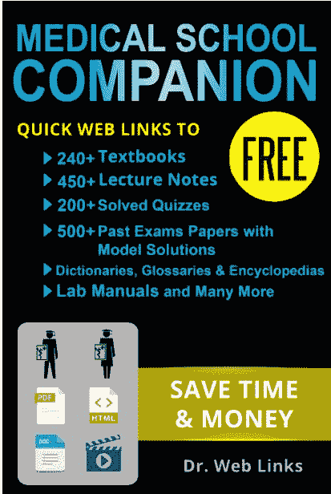
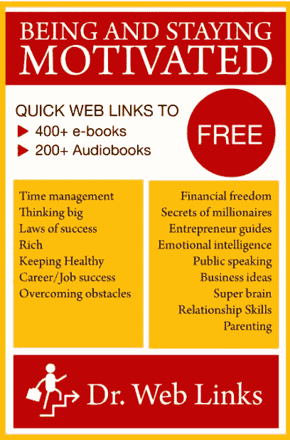

# 学习 Python、Java、JavaScript、C、C++、C#、CSS、HTML、jQuery、MySQL、SQL、Linux、Perl、PHP 或 XML：300+ 份免费教材、100+ 份速查表、100+ 份 vi 快速链接

## 献辞

献给所有勤工作的介绍作者和 Dr. Links 网页搜索团队

## 缩写词

| 缩写 | 含义 |
| :--- | :--- |
| AJAX | 异步 JavaScript 和 XML |
| C# | C Sharp |
| CSS | 层叠样式表 |
| HTML | 超文本标记语言 |
| N/A | 不适用 |
| NF | 未找到 |
| PHP | 超文本预处理处理器 |
| SQL | 结构化查询语言 |
| XML | 可扩展标记语言 |

## 关于作者

Dr. Web Links 是一位亚马逊畅销书的笔名，他拥有奥克兰大学的博士学位（R 语言的诞生地）。他曾在两所公立大学授课，现在致力于帮助学生取得优异成绩。[Dr. Links](https://www.amazon.com/s/ref=dp_byline_sr_ebooks_1?ie=UTF8&text=Dr+Web+Links&search-alias=digital-text&field-author=Dr+Web+Links&sort=relevancerank）及其团队还有类似的书籍：

- [大学生物课程](https://www.amazon.com/dp/B07HMT7KSY)
- [大学数学与统计学：](https://www.amazon.com/dp/B07G5X3JWD)
- [大学物理](https://www.amazon.com/dp/B07DSLQJ1C)
- [大学化学与生物化学](https://www.amazon.com/dp/B07GZ8TZTL)
- [医学院指南](https://www.amazon.com/dp/B07JDJVY97)
- [护理学院指南](https://www.amazon.com/dp/B07JLBZZNT)

## 序言

如你可能所知，互联网包含大量优秀的计算机编程学习材料，适用于学生、教师、专业人士以及想要精通编程或编码的人。这些资源包括：许多开放/可访问的教科书、优秀的参考指南以及视频课程/教程。挑战在于，这些资源分散、杂乱，并充满了广告和浏览干扰。大多数情况下，即使运气好，也需要多次点击才能获得良好的网页材料。因此，在网上寻找可以免费阅读或下载的关键计算机编程材料是非常令人沮丧且耗时的。这正是本书大用用场，它让你更接近互联网提供的相关且有趣的链接。

这些链接可以帮助你进行补充阅读，找到更多示例案例、代码、备查表，并在学习或使用`python`、`java`、`javascript`、`C`、`C++`、`C#`、`CSS`、`HTML`、`jQuery`、`MySQL`、`SQL`、`LINUX`、`Perl`、`PHP`、`Ruby`、`BASH`、`D`、`Unix`和`XML`时享受乐趣。最重要的是，这本书可以节省大量的金钱。

在我的整个教育过程中（从本科到博士），我发现比较学习材料以及解决更多问题是促进理解的最佳方式之一。本书将引导你这样做。

本书将你连接到来自世界优秀程序员的最相关的计算机编程学习资源。它将让你能够快速在线探索或免费下载：

- 多本教科书
- 多个视频教程
- 大量示例案例
- 关键备查表和参考指南
- 致力于介绍编程语言的优秀 YouTube 频道
- 以及更多有趣的内容。

将所有这些链接汇集在一个方便的地方，这不酷吗？

预计本书将引导你找到实用的学习资源，这对增强你对任何语言的理解将非常有帮助。

## 如何使用本书

`Python 3` 安排如下：

## 链接集 1. Python, Java, JavaScript, C, C++, C#...现在就可以下载的备查表和参考指南

`python-sheet.00206.jpeg`

## 链接集 2. 关于 Python, Java, JavaScript, C, C++, C# 及其他 13 种编程语言的可访问/下载教科书

`python`

## 链接集 3. 你可以访问下载额外书籍的计算机编程书籍网络数据库

`python`

## 链接集 4. 你喜欢的优秀 Youtube 频道和其他相关视频

`python`

## 链接集 5. 你可以探索的计算机编程在线论坛

`python`

## Python 速表

- [Python 快速入门 - 速表](https://ehmatthes.github.io/pcc/cheatsheets/README.html)
- [Python 语言与语法速表](https://ddi.ifi.lmu.de/probestudium/2013/ws-i-3d-programmierung/tutorials/python-referenzkarte)
- [Python 速表](http://www.datasciencefree.com/python.pdf)
- [Python 3 – 快速参考卡](https://www.cs.put.poznan.pl/csobaniec/software/python/py-qrc.html)
- [数据科学 Python 速表 - Python 基础](http://www.utc.fr/~jlaforet/Suppl/python-cheatsheets.pdf)
- [Python 基础](http://huttenhower.sph.harvard.edu/moodle/pluginfile.php/1409/mod_folder/content/0/python_cheat_sheet.pdf?forcedownload=1)
- [Python 2.7 快速参考表](http://huttenhower.sph.harvard.edu/moodle/pluginfile.php/1409/mod_folder/content/0/Python_qr.pdf?forcedownload=1)
- [Python 语言与语法速表](http://huttenhower.sph.harvard.edu/moodle/pluginfile.php/1409/mod_folder/content/0/PythonCheatSheet.pdf?forcedownload=1)
- [PYTHON 速表](http://vis.usal.es/rodrigo/documentos/bioinfo/avanzada/pythonCheatsheet.pdf)
- [Python 快速入门指南](https://s3.amazonaws.com/michael-kennedy/downloads/DM/python_cheat_sheet.pdf)
- [Python 速表](https://blogs.sans.org/pen-testing/files/2016/07/SEC573_PythonCheatSheet_06272016.pdf)
- [Python 速表](https://bit.ly/2TqHxxj)
- [Python 速表](http://ai.unibo.it/webfm_send/27)
- [Python & Pylab 速表](https://www.uzh.ch/cmsssl/physik/dam/jcr:1d91aa92-1c3a-419a-b3dd-6888a2b1b187/python.pdf)
- [ANACONDA 速表](http://janroman.dhis.org/AFI/Python/Anaconda_CheatSheet.pdf)
- [Python 快速参考（PQR 2.7 及以下)](http://rgruet.free.fr/#QuickRef%20)
- [Python 参考指南](http://overapi.com/python)

## Ajax 速表

- [Ajax 入门](http://web-algarve.com/books/JS%20AJAX%20jquery%20&%20angular/ajax_online%20QuickRef.pdf)
- [ajax 速表](https://gist.github.com/joelrojo/c54765a748cd87a395a2b865359d6add)

## BASH 速表

- [BASH 参考](http://index-of.es/EBooks/English/Bash%20Quick%20Reference.pdf)
- [Linux Bash Shell 速表](https://learncodethehardway.org/unix/bash_cheat_sheet.pdf)
- [Bash 速表](http://ftp.psu.ac.th/pub/bash-howto/reference_bash-cheat.pdf)
- [Bash 参考手册](https://www.gnu.org/software/bash/manual/bash.pdf)

## C 速表

- [C 参考卡](http://mmc.geofisica.unam.mx/femp/Herramientas/Lenguajes/CyC++/ReferenceC.pdf)
- [C 语言快速入门指南](https://courses.cs.washington.edu/courses/cse351/14sp/sections/1/Cheatsheet-c.pdf)
- [C 参考速表](https://www.cheatography.com/ashlyn-black/cheat-sheets/c-reference/pdf/)
- [C 速表](https://sites.ualberta.ca/~ygu/courses/geoph624/codes/C.CheatSheet.pdf)
- [C 语言编程快速参考](https://www.engr.uvic.ca/~mech410/ACAD_and_C/c_reference.pdf)
- [C 参考速表](https://www.cs.mun.ca/~dchurchill/pc/pdf/c.pdf)
- [C 参考卡](https://www.math.brown.edu/~jhs/ReferenceCards/CRefCard.v2.2.pdf)
- [C 参考手册](https://www.bell-labs.com/usr/dmr/www/cman.pdf)

## C# 速表

- [C# 参考表](https://www.dreamincode.net/downloads/ref_sheets/csharp_basics_reference_sheet.pdf)
- [C# 速表](https://www.codingguys.net/resources/cheat-sheet)
- [C# 速表](http://www.rpi.edu/public_html/destem/cSharp_cheat_sheet)
- [基础 C# 速表](https://learnappdevelopment.com/wp-content/uploads/2016/05/csharp_cheat_sheet)
- [C# 参考指南](https://www.glowtouch.com/downloads/C_Sharp_Reference)
- [面向开发者的 C#](https://download.microsoft.com/download/D/E/DEE91FC0-7AA9-4F6E-B6FA-08C##CheatSheet.pdf)

## C++ 速表

- [C++ 参考卡](http://index-of.es/Programming/C++.Ref)
- [如何用 C++ 编程](https://cs.fit.edu/~mahoney/cse2050/how2cpp)
- [初学者版 C++ 速表](http://xlb2.es/C++%20for%20Dummies%20Cheat%20Sheet)
- [C++ 语法表](https://github.com/gibsjose/cpp-sheet/master/C%2B%2BSyntax.md)
- [C++ 快速参考](https://cloud.netlifyusercontent.com/assets/344dbf88-fdf9-42bb-adb4-46f01eedd629/Cpp_ref.pdf)
- [C++ 参考卡](https://www.disi.unige.it/person/Moggi/PG1-13/Cpp_reference.pdf)

## CSS 速表

- [QuickRef 1.0](http://web-algarve.com/books/CSS%20LESS&20bootstrap/CSS1_QuickRef)
- [css3 基础参考](http://web-algarve.com/books/CSS%20LESS&20bootstrap/css3_basics_QuickRef)
- [CSS 3 快速参考指南](https://www.kobzarev.com/wp-content/uploads/cheatsheets/css3-sheet.pdf)
- [CSS 速表](https://cdn.rawgit.com/hostinger/94941d64/tutorials/pdf/CSS-3-Cheatsheet)
- [CSS 速表](https://cdn.rawgit.com/hostinger/94941d64/tutorials/pdf/CSS-3-Cheatsheet) (注：此处链接重复，原文中可能不同或特有，此处按样翻译)
- [CSS3 速表](https://www.onblast.com/wp-content/uploads/2017/01/css)
- [CSS 速表](https://cheatsheet.com/)
- [CSS 帮助表](https://downloads.gosquared.com/help/CSS3%20Sheet)
- [CSS3 速表](https://css3.com)
- [CSS 词汇](http://apps.workflower.fi/css/en)
- [HTML 速表（新手版）](https://hostingfacts.com/wp-content/uploads/2016/06/hf-cheat-sheet.pdf)

## HTML 速表

- [HTML & XHTML 标签参考](http://web-algarve.com/books/HTML%20&20HTTP/HTML-XHTML%20QuickRef.pdf)
- [HTML5 Canvas 速表](http://web-algarve.com/books/HTML%20&20HTTP/HTML5_Canvas%20QuickRef.pdf)
- [HTML 速表](http://www.stanford.edu/group/csp/cs21/htmlcheatsheet.pdf)
- [html5 速表](https://www.hostingreviewbox.com/wp-content/uploads/2016/02/html5-cheat-sheet.pdf)
- [HTML5 超级速表](https://cdn.makeawebsitehub.com/wp-content/uploads/2015/06/HTML5-Mega-Cheat-Sheet-A4-Print-ready.pdf)
- [HTML5 速表](https://websitesetup.org/HTML5-cheat-sheet.pdf)
- [HTML5 视觉速表](https://cdn.woorkup.com/wp-content/uploads/2016/01/HTML5-Visual-Cheat-Sheet1.pdf)
- [CSS3 快速参考指南](https://cloud.netlify.com/assets/344dbf88-fdf9-42bb-adb4-46f01eedd629/d7fb67af-5180-463d-b58a-bf4a220d5d0/css3-cheat-sheet.pdf)

## 参考指南

### Java

- [Java 参考指南](http://overapi.com/java)
- [Java 编程速查表](https://introcs.cs.princeton.edu/java/11cheatsheet/)
- [JAVA 语法速查表](http://lesliefranke.com/sandbox/ref/javacheatsheet.html)

### Javascript

- [Javascript 快速参考卡](http://www.cheat-sheets.org/saved-copy/jsquick.pdf)
- [JavaScript 与浏览器对象快速参考](http://web-algarve.com/books/JS%20AJAX%20jquery%20&%20angular/JS%20&%20visual%20objects%20QuickRef.pdf)
- [javascript 速查表](http://web-algarve.com/books/JS%20AJAX%20jquery%20&%20angular/javascript%20QuickRef.pdf)
- [Javascript 快速参考卡](http://web-algarve.com/books/JS%20AJAX%20jquery%20&%20angular/jsquick%20QuickRef.pdf)
- [JavaScript 速查表](https://www.cheatography.com/davechild/cheat-sheets/javascript/pdf_bw/)

- [JavaScript 速查表](https://htmlcheatsheet.com/js/)
- [JavaScript 速查表（入门必备）](https://websitesetup.org/wp-content/uploads/2018/04/wsu-js-cheat-sheet.pdf)
- [javascript 参考指南](http://overapi.com/javascript)

### jQuery

- [jQuery 1.5 视觉化速查表](http://index-of.co.uk/Cheat-Sheet/jQuery-1.5-Visual-Cheat-Sheet.pdf)
- [jQuery 1.5 视觉化速查表](http://web-algarve.com/books/JS%20AJAX%20jquery%20&%20angular/jQuery-1.5%20QuickRef.pdf)
- [jquery_online 快速参考](http://web-algarve.com/books/JS%20AJAX%20jquery%20&%20angular/jquery_online%20QuickRef.pdf)
- [jquery 速查表](http://www.define-web.com/jquery_cheat_sheet/jquery_cheat_sheet_080306_v1.pdf)
- [jquery 速查表](http://www.define-web.com/jquery_cheat_sheet/jquery_cheat_sheet_080306_v1_pg2.pdf)
- [jQuery 速查表](https://htmlcheatsheet.com/jquery/)
- [jquery 参考指南](http://overapi.com/jquery)
- [jQuery 视觉化速查表](http://researchers.lille.inria.fr/~yabouzid/refCardJQUERY.pdf)
- [jQuery 快速 API 参考](https://oscarotero.com/jquery/)

### MySQL

- [MySQL 参考指南](http://overapi.com/mysql)
- [MySQL 速查表](http://www.dusun-think.net/dosya/czyayin/mysqlcheatsheet.pdf)
- [MySQL 核心速查表](https://www.cheatography.com/guslong/cheat-sheets/essential-mysql/pdf_bw/)
- [MySQL 速查表](https://havel.mojeservery.cz/wp-content/uploads/2015/10/mysql-ref-card.pdf)
- [MySQL 速查表](http://www.davidmckie.com/Carleton%20MySQL%20cheat%20sheet.pdf)
- [MySQL 速查表](https://www.codeconquest.com/wp-content/uploads/MySQL-Cheat-Sheet-by-CodeConquestDOTcom.pdf)
- [MySQL 教程](https://downloads.mysql.com/docs/mysql-tutorial-excerpt-5.5-en.pdf)
- [MySQL 速查表](https://appletree.or.kr/quick_reference_cards/Databases-SQL-NoSQL/mysql-reference-sheet.pdf)

### Perl

- [Perl 快速参考卡](http://index-of.co.uk/Cheat-Sheet/Perl%20Quick%20Reference%20Card%20%5bjjohnbokma%5d.pdf)
- [Perl 正则表达式快速参考卡](http://index-of.co.uk/Cheat-Sheet/Perl%20Regular%20Expression%20Quick%20Reference%20Card%20%5bIain%20Truskett%5d.pdf)
- [Perl 正则表达式快速参考](http://index-of.co.uk/Cheat-Sheet/Perl%20Regular%20Expression%20Quick%20Reference%20v1.04.pdf)

### PHP

- [PHP 速查表](http://index-of.co.uk/Cheat-Sheet/php_cheat_sheet%20%5bDave%20Child%5d.pdf)
- [PHP 参考表](https://www.dreamincode.net/downloads/ref_sheets/php_reference_sheet.pdf)
- [PHP 参考表（进阶版）](https://www.dreamincode.net/downloads/ref_sheets/php_reference_sheet.pdf)
- [PHP 速查表](http://www.fzolee.hu/download.php?fname=./atsheets/php-cheat-sheet-v1)
- [PHP 速查表](https://www.cheatography.com/krabat1/cheat-sheets/php_bw/)
- [PHP 速查表（入门必备）](https://websitesetup.org/wp-content/uploads/2018/04/wsu-js-cheat-sheet.pdf)
- [PHP 参考表](http://overapi.com/php)

### AJAX 速查表

| 作者 | 标题 | 日期 |
| :--- | :--- | :--- |
| Thomas A. Powell | [AJAX：完全指南](https://robot.bolink.org/ebooks/AJAX%20-%20Complete%20Reference.pdf) | 2008 |
| Steve Holzner | [傻鱼学 AJAX](https://doc.lagout.org/programmation/Ajax/20For%20Dummies%20%282006%29.pdf) | 2006 |
| Dave Crane 等人 | [AJAX 实战](https://doc.lagout.org/programmation/Ajax/20In%20Action%20%282006%29.pdf) | 2006 |
| Jeremy Keith | [无敌 AJAX](http://doc.lagout.org/programmation/Bulletproof%20Ajax.pdf) | 2007 |
| Lee Babin | [从入门到精通 PHP AJAX](https://doc.lagout.org/programmation/Beginning%20Ajax%20With%20PHP-.pdf) | 2007 |
| Ryan Asleson 和 Nathaniel T. Schutta | [AJAX 基础](https://doc.lagout.org/programmation/Foundations%20Of%20Ajax.pdf) | 2006 |
| Andy Harris | [JavaScript 与 AJAX 傻鱼学](https://the-eye.eu/public/Books/For%20Dummies/JavaScript%20and%20AJAX%20for%20Dummies%20%28ISBN%20047017994%29.pdf) | 2010 |
| Rebecca M. Riordan | [Head First AJAX](https://robot.bolink.org/ebooks/Head%20First%20Ajax%20-%20ora%202008.pdf) | 2008 |
| Carl Albing 等 | [bash 食谱](http://index-of.es/Programming/Bash/O'Reilly%20bashCookBook.pdf) | 2007 |
| Cameron Newham | [学习 bash Shell](https://doc.lagout.org/operating%20system%20/linux/Learning%20the%20bash%20Shell%20-%20Unix%20Shell%20Programming.pdf) | 2009 |
| Arnold Robbins | [Bash 口口袋指南](https://the-eye.eu/public/Books/HumbleBundle/bashreference_2ndedition.pdf) | 2016 |
| Ivor Horton | [从入门到精通 C](https://doc.lagout.org/programmation/C/Beginning%20C%20From%20Novice%20to%20Professional%20%284th.ed.%29%20%5BHorton%202006-10-20%5D.pdf) | 2006 |
| P. J. Deitel 和 H. M. Deitel | [C 程序设计](http://index-of.es/C++/C%20How%20to%20Program.pdf) | 2010 |

**注意**：如果你电脑或设备的浏览器设置过强，会将某些链接标记为危险。为了避免这种误报，请使用不同的浏览器（例如 Internet Explorer）；在 Windows 浏览器中复制粘贴！如果你仍然收到警报，请发送邮件给我：`weblinks@gmail.com`。

| 作者 | 书名 | 年度 |
| :--- | :--- | :--- |
| Gary J. Bronson | [工程师与科学家的 C 语言：使用 ANSI C 的编程入门](http://index-of.es/C++/C%20for%20Engineers%20and%20Scientists%20-%20An%20Introduction%20to%20Programming%20With%20ANSI%20C.pdf) | 1993 |
| David Griffiths and Dawn Griffiths | [从上开始学 C](http://index-of.es/C++/Griffiths%20D.,%20Griffiths%20D.%20-%20Head%20First%20C%20-%202012-.pdf) | 2012 |
| Stephen G. Kochan | [C 语言编程](http://index-of.es/C++/Programming%20in%20C%203rd%20edition%20by%20Stephen%20G.%20Kochan.pdf) | 2005 |
| Greg Perry and Dean Miller | [C 语言编程：初学者指南](http://cache3.pdfdrive.com/dl.php?id=34434517&h=16305f3570927791787abd82e5e0ea39&u=cache) | 2014 |
| Bradley L. Jones and Peter Aitken | [Sams 21 天自学 C 语言](http://www.e-reading.mobi/bookreader.php/135186/Aitken,_Jones_-_Sams_Teach_Yourself_C_in_21_Days,_6th_Edition.pdf) | 2003 |
| Ben Klemens | [21 世纪 C 语言](https://doc.lagout.org/programmation/C/21st%20Century%20C%20%5BKlemens%202012-11-05%5D.pdf) | 2013 |
| Paul Deitel and Harvey Deitel | [C 语言程序设计](https://drive.uqu.edu.sa/_/ajshaor/files/Scientific/Deitel-C_%20How%20to%20Program,%207th.pdf) | 2013 |
| Tim Bailey | [C 语言编程与软件设计入门](http://www-personal.acfr.usyd.edu.au/tbailey/ctext/ctext.pdf) | NF |

### C#

| 作者 | 书名 | 年度 |
| :--- | :--- | :--- |
| Svetlin Nakov and Veselin Kolev | [使用 C# 的计算机编程基础](http://ksuweb.kennesaw.edu/~rgesick1/Fundamentals-of-Computer-Programming-with-CSharp-Nakov-eBook-v2013.pdf) | 2013 |
| Andrew Stellman and Jennifer Greene | [从上开始学 C#](https://robot.bolink.org/ebooks/Head%20First%20CSharp%202e%20May%202010.pdf) | 2010 |
| 同上 | [链接 2](https://doc.lagout.org/programmation/CSharp/Head%20First%20CSharp%202nd%20Edition%20May%202010.pdf) | 同上 |
| Jesse Liberty | [C# 编程](http://index-of.es/Programming/CSharp/O'Reilly%20-%20Programming%20C%23%202nd%20Edition.pdf) | 2002 |
| 同上 | [链接 2](https://doc.lagout.org/programmation/CSharp/Programming_C%23.pdf) | 同上 |
| Jay Hilyard and Stephen Teilhet | [C# 3.0 菜谱](http://index-of.es/Programming/CSharp/O'Reilly%20C%23%203.0%20Cookbook%20(3rd%20Edition).pdf) | 2008 |
| Bradley L. Jones | [Sams 21 天自学 C# 语言](http://ceit.aut.ac.ir/~shiry/lecture/programming/Sams%20-%20Teach%20Yourself%20the%20C%20sharpLanguage%20in%2021%20Days.pdf) | 2004 |
| Eric Gunnerson | [程序员者的 C# 入门](https://doc.lagout.org/programmation/CSharp/APress%20A%20Programmer%27s%20Introduction%20to%20C%23.pdf) | 2000 |
| Trey Nash | [加速 C# 2010](https://doc.lagout.org/programmation/CSharp/Apress%20Accelerated%20C%20Sharp%202010.pdf) | 2010 |
| Stephen Randy Davis and Chuck Sphar | [傻呆版 C# 2005](https://doc.lagout.org/programmation/CSharp/C%23%202005%20for%20Dummies.pdf) | 2006 |
| Paul Deitel and Harvey Deitel | [Visual C# 2012 程序设计](http://cache3.pdfdrive.com/dl.php?id=1943714&h=c0d85ec4d92f71d8b90a2f11) | 2012 |
| John Sharp | [微软 C# 2012 教程](http://zeus.nyf.hu/~bajalinov/VS_C_2012_Step.pdf) | 2012 |

### C++

| 作者 | 书名 | 年度 |
| :--- | :--- | :--- |
| Bjarne Stroustrup | [C++ 语言](https://robot.bolink.org/ebooks/The%20C++%20Language%20Bjarne%20Stroustrup.pdf) | 1997 |
| 同上 | [链接 2](http://index-of.es/C++/Addison%20Wesley%20-%20C++%20Programming%20Third%20Edition.pdf) | 同上 |
| C. Pozrikidis | [C++ 编程入门](https://robot.bolink.org/ebooks/Introduction%20to%20C++%20Programming%20and%20Graphics.pdf) | 2007 |
| Alan Parker | [C++ 中的算法与数据结构](https://robot.bolink.org/ebooks/CRC%20Press%20-%20Algorithms%20Data%20Structures%20in%20C++.pdf) | 1993 |
| Herbert Schildt | [C++：完全参考](http://amarblog.yolasite.com/resources/pdf++) | 2003 |
| Stanley B. Lippman | [必备 C++](http://index-of.es/C++/Addison%20Wesley%20-%20C++.pdf) | 2002 |

| 作者 | 标题 | 年份 |
| :--- | :--- | :--- |
| Nicolai M. Josuttis | [C++ 标准库：教程与参考](http://index-of.es/C++/Addison%20Wesley%20-%20C++%20Standard%20Library.pdf) | 1999 |
| Stephen Prata | [C++ Primer Plus](http://index-of.es/C++/Addison%20Wesley%20-%20C++Plus) | 2012 |
| Ivor Horton | [入门 Visual C++](http://index-of.es/C++/Beginning%20C++.pdf) | 2005 |
| P. J. Deitel and H. Deitel | [C 程序设计](https://drive.uqu.edu.sa/_/ajshaor/files/Scientific/Deitel-C_%20How%20to%20Program,%207th.pdf) | 2009 |
| Jesse Liberty et al. | [Sams 每天一小时自学 C++](http://index-of.es/C++/Sams%20C++%20One%20Hour%20Day.pdf) | 2009 |
| Victor Shtern | [核心 C++：软件工程方法](http://index-of.es/C++/Core%20C++.pdf) | |
| Joe White | [科学计算 C++](http://index-of.es/C++/Guide%20to%20Scientific%20Computing%20in%20Cpp.pdf) | 2012 |
| John Smiley | [用 C++ 编程](http://index-of.es/C++/Learn%20To%20Program%20With%20C++.pdf) | 2003 |
| Jeff Kent | [解密 C++：自学指南](http://index-of.co.uk/Misc/McGraw-Hill%20-%20C++%20Demystified.pdf) | 2004 |
| Nicholas A. Solter and Scott J. Kleper | [专业 C++](http://index-of.es/C++/Professional%20CPP.pdf) | 2005 |
| Vladimir Kushnir | [安全 C++](http://index-of.es/C++/Safe%20cpp.pdf) | 2012 |
| Matthew Telles | [傻呆版 C++技巧](http://index-of.es/C++/Wiley%20Publishing%20-%20C++%20Timesaving%20Techniques%20for%20Dummies.pdf) | 2005 |

| 作者 | 标题 | 年份 |
| :--- | :--- | :--- |
| Elisabeth Freeman and Eric Freeman | [Head First HTML with CSS & XHTML 指南](https://robot.bolink.org/ebooks/Head%20First%20HTML%20with%20CSS%20&%20XHTML%20Big.pdf) | 2006 |
| Molly E. Holzschlag | [250 HTML 和 Web 设计秘密](https://robot.bolink.org/ebooks/250%20HTML%20And%20Web%20Design%20Secrets.pdf) | 2004 |
| Thomas A. Powell | [HTML & CSS：完全参考](http://cloudforall.weebly.com/uploads/1/2/7/5/12759856/htmlandcss-thecompletereference5thed-t.powellmcgraw-hill2010bbs_nxpowerlite.pdf) | 2010 |
| Rob Larsen | [HTML 和 CSS 入门](http://pdf.th7.cn/down/files/1312/beginning_html_and_css.pdf) | 2013 |
| Jeremy Osborn | [使用 HTML 和 CSS 进行 Web 设计](https://stevebraysduis.files.wordpress.com/2014/02/web-design-with-html-and-css-digital-classroom.pdf) | 2011 |
| Jeremy Osborn et al. | [使用 HTML 和 CSS 进行 Web 设计](https://stevebraysduis.files.wordpress.com/2014/02/web-design-with-html-and-css-digital-classroom.pdf) | NF |
| Jon Ducket | [HTML & CSS 设计与网站构建](https://robot.bolink.org/ebooks/HTML%20And%20CSS%20-%20Design%20And%20Build%20Websites.pdf) | 2011 |
| Leslie F. Sikos | [精通 HTML5、CSS3 和 XML](https://robot.bolink.org/ebooks/Web%20Standards%20Mastering%20HTML5,%20CSS3,%20and%20XML.pdf) | NF |
| Luke Stevens | [HTML5 的真相（针对 Web 设计师）](https://robot.bolink.org/ebooks/Preview%20-%20The%20Truth%20About%20HTML5%20(For%20Web%20Designers).pdf) | 2012 |
| Andy Harris | [傻呆 HTML5 快速参考](https://bit.ly/2BUwK6K) | 2011 |
| Steve Fulton and Jeff Fulton | [HTML5 Canvas](https://robot.bolink.org/ebooks/HTML5%20Canvas%20-%20S.%20Fulton,%20J.%20Fulton%20(O'Reilly,%202011)%20WW.pdf) | 2011 |
| Eric Freeman and Elisabeth Robson | [Head First HTML5 编程](https://robot.bolink.org/ebooks/Head%20First%20HTML5%20Programming%20-%20Building%20Web%20Apps%20with%20JavaScript.pdf) | 2011 |
| Jeremy Keith | [面向 Web 设计师的 HTML5](https://robot.bolink.org/ebooks/HTML5%20for%20Web%20Designers%20By%20Jeremy%20Keith.pdf) | 2010 |
| Eric Rowell | [HTML5 Canvas 食谱指南](https://robot.bolink.org/ebooks/HTML5%20Canvas%20Cookbook%20-%20Eric%20Rowell.pdf) | 2011 |
| Rob Hawkes | [用于游戏和娱乐的 HTML5 Canvas ](https://robot.bolink.org/ebooks/Foundation%20HTML5%20Canvas%20-%20Rob%20Hawkes.pdf) | NF |
| Mark Pilgrim | [深入学习 HTML5](https://robot.bolink.org/ebooks/Dive%20into%20HTML5%20By%20Mark%20Pilgrim.pdf) | NF |
| David Geary | [核心 HTML5 Canvas：图形、动画和游戏开发](https://robot.bolink.org/ebooks/Core%20HTML5%20Canvas%20-%20Graphics,%20Animation,%20and%20Game%20Development) | 2012 |
| ALEX GOLDSTEIN et al. | [实战中的 HTML5 和 CSS3](http://index-of.es/CSS/HTML5%20and%20CSS3%20for%20world) | 2011 |
| PETER LUBBERS et al. | [面向丰富互联网应用的专业 HTML5 编程](http://index-of.es/HTML/Pro%20HTML5%20Programming) | 2010 |
| Christopher Schmitt and Kyle Simpson | [HTML5 食谱指南](http://index-of.es/HTML/Cookbook) | 2012 |
| Bruce Lawson and Remy Sharp | [初识 HTML5](http://index-of.es/HTML/Introducing%20HTML5) | 2011 |
| Jesse Cravens and Jeff Burtoft | [HTML5 技巧](http://web-algar.com/books/HTML5%20Hacks) | 2013 |
| Brian P. Hogan | [HTML5 和 CSS3](http://web-algar.com/books/HTML5%20and%20CSS3) | 2013 |

| 作者 | 标题 | 年份 |
| :--- | :--- | :--- |
| Wikibooks.org | [Java 编程](https://robot.bolink.org/ebooks/Java%20Programming) | 2011 |
| Brian D. Eurbanks | [Wicked Java：代码、开源库和创意](https://robot.bolink.org/ebooks/Wicked%20Java%20Code,%20Open-Source%20Libraries,%20and%20Ideas) | 25 |
| James Gosling et al. | [Java 规范](https://robot.bolink.org/ebooks/The%20Java%20Specification) | 2011 |
| Danny Goodman with Michael Morrison | [Javascript 圣经](https://robot.bolink.org/ebooks/Javascript%20Bible) | 2004 |
| Nathan Meyers | [Linux 上的 Java 编程](https://robot.bolink.org/ebooks/Waite/Java%20Programing%20on%20Linux) | 2001 |
| Tim Lindholm et al. | [Java 虚拟机](https://robot.bolink.org/ebooks/The%20Java%20Virtual%20Machine) | 2013 |
| Phil Ballard and Michael Moncur | [Sams 自学教程 Ajax 和 PHP](https://robot.bolink.org/ebooks/Sams%20Teach%20Yourself%20Ajax%20PHP) | 2009 |
| E. Balagurus | [Java 编程：入门](https://robot.bolink.org/ebooks/Programming%20with%20Java%2Aa%20Primer) | 2007 |
| Mauro Marnilli | [专业 Java 接口](https://robot.bolink.org/ebooks/Professional%20Java%20Interfaces) | 2006 |
| W. Clay Richardson et al. | [专业 Java JDK](https://robot.bolink.org/ebooks/Professional%20Java%20JDK) | 2007 |
| Herbert Schildt and James Holmes | [Java 艺术](https://robot.bolink.org/ebooks/The%20Art%20Of%20Java) | 2003 |
| Nicholas C. Zakas | [面向 Web 开发人员的专业 JavaScript](https://robot.bolink.org/ebooks/Professional%20JavaScript%20For%20Web%20Developers) | 2009 |
| Gennadiy Nikishkov | [Java 有限元法编程](https://robot.bolink.org/ebooks/Programming%20Finite%20Elements%20in%20Java) | 2010 |
| David Flanagan | [Java 快速详解：桌面快速参考](https://robot.bolink.org/ebooks/OReilly%20-%20Java%20In%20A%20Nutshell) | 2005 |
| Danny Goodman | [Javascript 圣经](https://robot.bolink.org/ebooks/Javascript%20Bible) | 2004 |
| Nathan Meyers | [Linux 上的 Java 编程](https://robot.bolink.org/ebooks/Waite/Java%20Programing%20on%20Linux) | 2001 |
| Tim Lindholm et al. | [Java 虚拟机](https://robot.bolink.org/ebooks/The%20Java%20Virtual%20Machine) | 2013 |
| Phil Ballard and Michael Moncur | [Sams 自学教程 Ajax 和 PHP](https://robot.bolink.org/ebooks/Sams%20Teach%20Yourself%20Ajax%20PHP) | 2009 |
| E. Balagurus | [Java 编程：入门](https://robot.bolink.org/ebooks/Programming%20with%20Java%2Aa%20Primer) | 2007 |
| Mauro Marnilli | [专业 Java 接口](https://robot.bolink.org/ebooks/Professional%20Java%20Interfaces) | 2006 |
| W. Clay Richardson et al. | [专业 Java JDK](https://robot.bolink.org/ebooks/Professional%20Java%20JDK) | 2007 |
| Herbert Schildt and James Holmes | [Java 艺术](https://robot.bolink.org/ebooks/The%20Art%20Of%20Java) | 2003 |
| Nicholas C. Zakas | [面向 Web 开发人员的专业 JavaScript](https://robot.bolink.org/ebooks/Professional%20JavaScript%20For%20Web%20Developers) | 2009 |
| Gennadiy Nikishkov | [Java 有限元法编程](https://robot.bolink.org/ebooks/Programming%20Finite%20Elements%20in%20Java) | 2010 |
| David Flanagan | [Java 快速详解：桌面快速参考](https://robot.bolink.org/ebooks/OReilly%20-%20Java%20In%20A%20Nutshell) | 2005 |
| Emily A. Veer | [JavaScript Dummies 第 4 版](http://index-of.es/JavaScript%20for%20Dummies%204th%20Ed) | 2014 |
| Dr. Axel Rauschayer | [impatient JavaScript](http://exploringjs.com/impatient-js) | NF |
| Marijn Haverbek | [Eloquent JavaScript：现代编程](http://art.yale.edu/file_columns/0000/9186/eloquent_javascript) | 2014 |
| Marijn Haverbek | [Eloquent JavaScript：现代编程](https://eloquentjavascript.net/) | 2018 |
| Mark Myer | [更智能的学习 JavaScript：一种利用技术减少一半努力的方法](https://www.cpp.edu/~jcmcgar/513_2016/ASmarterWayLearnJavaScript) | 2013 |

# Java 技术书籍参考列表

## 一、Java 基础

| 作者 | 书名 | 年份 |
| :--- | :--- | :--- |
| Herbert Schildt | [Java™ 2：完全参考，第五版](https://robot.bolink.org/ebooks/Java%20-%20Complete%20Reference%205e) | 2002 |
| Barry Burd | [Java Dummies 第 6 版](https://doc.lagout.org/programmation/Java/Java%20for%20Dummies%20%286th%20ed.%29%20%5BBurd%202014-03-31%5D.pdf) | 2014 |
| Herbert Schildt | [Java：学者指南](https://robot.bolink.org/ebooks/Java%20A%20Beginners%20Guide%203e%20McGrawHill.pdf) | 2005 |
| Jonathan Knudsen | [Java 2D 图形](https://robot.bolink.org/ebooks/Java%202D%20Graphics.pdf) | 2001 |
| Michael Morrison | [浅浅学 JavaScript](https://robot.bolink.org/ebooks/Head%20First%20Java%20Script.pdf) | 2008 |
| ü | [链接 2](http://web-algarve.com/books/JS%20AJAX%20jquery%20&%20angular/Head%20First%20JavaScript.pdf) | ü |
| Kathy Sierra and Bert Bates | [浅浅学 Java](https://robot.bolink.org/ebooks/Head%20First%20Java%202e%20by%20Kathy%20Sierra%20and%20Bert%20Bates.pdf) | NF |
| Joan Krone et al. | [Java 编程语言教程](https://robot.bolink.org/ebooks/Essentials%20of%20the%20Java%20Programming%20Language.pdf) | NF |
| Joshua Bloch | [Effective Java：编程语言指南](https://robot.bolink.org/ebooks/Effective%20Java%20Programming%20Language%20Guide.pdf) | 2001 |
| JOHN R. HUBBARD | [Java 数据结构](https://robot.bolink.org/ebooks/Data%20Structures%20with%20Java%20e%20By%20John%20R%20hubbard,%20Schaum's%20Outline%20Series.pdf) | 2007 |
| Michelle Waite | [Java 数据结构与算法](https://robot.bolink.org/ebooks/Data%20Structures%20&%20Algorithms%20in%20Java%20-%20Robert%20Lafore.pdf) | 2001 |
| Robert Lafore | [Java 数据结构与算法](https://robot.bolink.org/ebooks/Data%20Structures%20and%20Algorithms%20in%20Java%20e%20-%20Robert%20Lafore.pdf) | 2003 |
| Vivek Chopra et al. | [入门 JavaServer Pages](https://robot.bolink.org/ebooks/Beginning%20JavaServer%20Pages.pdf) | 2005 |
| Herbert Schildt | [Java 完全参考](https://memberfiles.freewebs.com/74/74/55387474/documents/Java%20The%20Complete%20Reference,%207th%20Edition.pdf) | 2007 |
| Cay Horstmann | [大 Java：兼容 Java 5, 6, 和 7](http://newton.uam.mx/xgeorge/uea/Lab_Prog_O_O/materiales_auxiliares/Big_Java_4th_Ed.pdf) | 2010 |
| Paul Wilton and Jeremy McPeak | [入门 JavaScript](https://robot.bolink.org/ebooks/Beginning%20JavaScript%204e.pdf) | 2010 |
| Kevin Mukhar et al. | [入门 Java EE 5：从新手到专家](https://robot.bolink.org/ebooks/Beginning%20Java%20EE%205.pdf) | 2006 |
| Bruce Eckel | [深入 Java](http://www.dblab.ntua.gr/~gtsat/collection/Java%20books/Bruce.Eckel.Thinking.In.Java.4th.Edition.Dec.2007.eBook-BBL.pdf) | 2006 |
| Doug Lowe | [傻呆书 Java 全上手书](http://1.droppdf.com/files/1lTSh/java-all-in-one-for-dummies-4th-edition-doug-lowe.pdf) | 2014 |
| Mark Watson | [Java 编程：10 分钟解决方案](https://doc.lagout.org/programmation/Java/Java%20Programming_%2010-Minute%20Solutions%20%5BWatson%202003-12-30%5D.pdf) | 2004 |
| Rogers Cadenhead | [21 天自自学会 Java](http://file.allitebooks.com/20151230/Java%20in%2021%20Days,%20Sams%20Teach%20Yourself%20(Covering%20Java%208),%207th%20Edition.pdf) | 2016 |

## 二、JavaScript 与 jQuery

| 作者 | 书名 | 年份 |
| :--- | :--- | :--- |
| Danny Goodman | [JavaScript 圣经，黄金版](http://www3.dsi.uminho.pt/iiee/JavaScript%20Gold.pdf) | 2001 |
| Danny Goodman et al. | [JavaScript 圣经，第 7 版](https://bit.ly/zDhECr) | 2010 |
| Danny Goodman | [JavaScript 示例](https://doc.lagout.org/programmation/JavaScript%20Examples%20Essential%20Companion%20Javascript%20[Goodman%20001-08%5D) | 2001 |
| David Sawyer McFarland | [JavaScript & jQuery：入门指南](https://web-algarve.com/books/JS%20AJAX%20jquery%20&%20angular/JavaScript%20The%20Manual,%23rd%20Edition) | 2014 |
| Andriy Redko | [高级 Java](http://enos.it.ee/~jpo/alladimised/Advanced-java) | NF |
| jQuery | ü | ü |
| Castine and Craig Sharkie | [jQuery：入门](https://robot.bolink.org/ebooks/jQuery%20Novice%20Ninja) | 2012 |
| Bear Bibeault and Yehuda Katz | [jQuery 实战](http://dlaneshjoar.com/book/jQuery.in.Action) | 2010 |
| Ryan Benedetti and Ronan Cranley | [浅浅学 jQuery](http://web-algarve.com/books/JS%20AJAX%20jquery%20&%20angular/First) | 2011 |
| Jonathan Chaffer and Karl Swedberg | [学习 jQuery](https://web-algarve.com/books/JS%20AJAX%20jquery%20&%20angular/Learning%24th%20Edition) | 2013 |
| Leon Revill | [jQuery 2.0 食南](http://web-algarve.com/books/JS%20AJAX%20jquery%20&%20angular/jQuery%2.0.Cookbook) | 2014 |
| Arun K. Pande | [jQuery 2 解决方案](http://web-algarve.com/books/JS%20AJAX%20jquery%20&%20angular/jQuery%20Recipes) | NF |

## 三、Linux 编程

| 作者 | 书名 | 年份 |
| :--- | :--- | :--- |
| LINUX 编程 | ü | ü |
| Neil Matthew and Richard Stones | [专业 Linux](https://robot.bolink.org/ebooks/Wrox%20Professional%20Linux.pdf) | 2004 |
| Neil Matthew and Richard Stones | [入门 Linux](https://robot.bolink.org/ebooks/Wrox%20Beginning%20Linux%23e.pdf) | 2004 |
| Daniel J. Barrett | [Linux 口袋指南](https://the-eye.eu/public/Humble/linuxguide_3dedition.pdf) | 2016 |

## 四、MySQL

| 作者 | 书名 | 年份 |
| :--- | :--- | :--- |
| MySQL | ü | ü |
| Seyed M.M. Saied and Hugh E. Williams | [学习 MySQL](https://robot.bolink.org/ebooks/Learning%20MySQL.pdf) | 2007 |
| Mark Maslakowski | [21 天自自学会 MySQL](http://www.webbasedprogramming.com/MySQL/Teach%20Yourself%20MySQL%20in%2021%20Days.pdf) | 2000 |
| Michael Kofler | [MySQL 5 权威指南](https://doc.lagout.org/programmation/Databases/mysql/The%20Definitive%20Guide%20To%20MySQL%205,3rdEd.pdf) | 2005 |
| Alexander Pachev | [MySQL 企业解决方案](http://index-of.es/EBooks/English/John%20Wiley%20&%20Sons%20MySQL%20Solutions.pdf) | 2003 |
| Paul DuBois | [MySQL 食南](http://index-of.es/EBooks/O'Reilly%20-%20MySQL%20Cookbook.pdf) | 2002 |
| ü | [链接 2](https://doc.lagout.org/programmation/Databases/mysql/MySQL%20Cookbook.pdf) | ü |
| ü | [链接 3](http://web-algarve.com/books/MySQL%20&%20PHP/MySQL%20Cookbook.pdf) | ü |
| George Reese | [MySQL 口袋参考](http://index-of.es/EBooks/O'Reilly%20-%20MySQL%20Pocket%20Reference%20ndEdition%20Jul%2007.pdf) | 2007 |
| ü | [链接 2](http://web-algarve.com/books/MySQL%20&%20PHP/mysql%20pocket%20reference%20edition.pdf) | ü |
| ü | [链接 3](http://web-algarve.com/books/JS%20AJAX%20jquery%20&%20angular/mysql%20pocket%20reference%20edition.pdf) | ü |

## 五、Perl

| 作者 | 书名 | 年份 |
| :--- | :--- | :--- |
| Perl | ü | ü |
| Ellen Siever et al. | [Perl 壳指南](http://index-of.es/Perl/O'Reilly%20-%20Perl%20In%20Nutshell.pdf) | 1998 |
| Brian D. Foy | [精通 Perl](http://index-of.es/Perl/O'Reilly%20-%20Mastering%20Perl(2009).pdf) | 2007 |
| Paul Gruhn | [图解 Perl 基础](http://index-of.es/Perl_Basics.pdf) | NF |
| David Till | [21 天自自学会 Perl 5](http://index-of.es/Perl/Teach%20Yourself%20Perl%205%20In%2021%20Days.pdf) | NF |

## 六、PHP 与 MySQL

| 作者 | 书名 | 年度 |
| :--- | :--- | :--- |
| George Schlossnagle | [高级 PHP 编程](https://doc.lagout.org/programmation/tech_web/Sams.Advanced.PHP.Programming.673pp.3-2004.pdf) | 2004 |
| Marc Rochkind | [Expert PHP and MySQL](http://web-algarve.com/books/MySQL%20&%20PHP/Expert%20PHP%20and%20MySQL.pdf) | 2013 |
| Robin Nixon | [学习 PHP, MySQL, JavaScript, CSS 和 HTML5](http://web-algarve.com/books/MySQL%20&%20PHP/Learning%20PHP,%20MySQL,%20JavaScript,%20CSS%20&%20HTML5,%203rd%20Edition.pdf) | 2014 |
| Andrew Curioso 等人 | [Expert PHP and MySQL.](https://robot.bolink.org/ebooks/Expert%20PHP%20and%20MySQL.pdf) | 2010 |
| PHP and MySQL |  |  |
| Shelley Johnston 等人 | [PHP and MySQL Web 开发](https://robot.bolink.org/ebooks/PHP%20and%20MySQL%20Web%20Development.pdf) | 2001 |
| KevinYank | [PHP & MySQL: 从入门到忍者](https://robot.bolink.org/ebooks/PHP%20&%20MySQL%20Novice%20To%20Ninja.pdf) | 2012 |
| Tim Converse 等人 | [PHP5 MySQL 圣经](https://robot.bolink.org/ebooks/PHP5%20And%20MySQL%20Bible%20(2004).pdf) | 2004 |
| ü | [链接 2](https://robot.bolink.org/ebooks/PHP5%20and%20MySQL%20Bible%20-%20John%20Wiley%20&%20Sons.pdf) | ü |
| Ellie Quigley | [PHP & MySQL 实例](https://robot.bolink.org/ebooks/PHP%20and%20MySQL%20by%20Example.pdf) | 2007 |
| Brett McLaughlin | [PHP & MySQL: 缺失手册](https://robot.bolink.org/ebooks/PHP%20and%20MySQL%20The%20Missing%20Manual.pdf) | 2012 |
| Steve Suehring 和 Janet Valade | [自学者教程 PHP MySQL JavaScript 和 HTML5 五合一](https://robot.bolink.org/ebooks/PHP%20MySQL%20JavaScript%20and%20HTML5%20All-in-One%20For%20Dummies%20Small.pdf) | 2013 |

| 作者 | 书籍 | 年份 |
|---|---|---|
| ü | [链接 2](https://khmerbamboo.files.wordpress.com/2014/09/php-mysql-javascript-html5-all-in-one-for-dummies.pdf) | ü |
| Robin Nixon | [学习 PHP, MySQL, JavaScript 和 CSS](https://robot.bolink.org/ebooks/PHP%20MySQL%20JavaScript%20And%20CSS%202e.pdf) | 2012 |
| Robin Nixon | [学习 PHP, MySQL 和 JavaScript](https://robot.bolink.org/ebooks/Learning%20PHP,%20MySQL,%20and%20JavaScript%20-%20Robin%20Nixon.pdf) | 2009 |
| Kevin Yank | [使用 PHP & MySQL 构建你自己的数据库驱动型网站](https://robot.bolink.org/ebooks/Build%20Your%20Own%20Database%20Driven%20Website%20Using%20PHP%20&%20MySQL%204e%20By%20Kevin%20Yank%20Big.pdf) | 2009 |
| W. Jason Gilmore | [PHP 和 MySQL 入门: 从入门到专业](http://minitorn.tlu.ee/~jaagup/kool/java/kursused/14/webpr/beginning_php_and_mysql_from_novice_to_professional_4th_edition.pdf) | 2010 |
| Larry ULLman | [用于动态网站的 PHP 和 MySQL](http://personal.graceland.edu/~aallshou/classwork/csit2100/GFX-PHP.and.MySQL.for.Dynamic.Web.Sites.Visual.QuickPro.Guide.4th.Edition.pdf) | 2012 |
| Lynn Beighley 和 Michael Morrison | [Head First PHP & MySQL](http://web-algarve.com/books/MySQL%20&%20PHP/Head%20First%20PHP%20&%20MySQL.pdf) | 2009 |

| Python | ü | ü |
|---|---|---|
| John M. Zelle | [Python 编程: 计算机科学导论](https://mybiostats.files.wordpress.com/2015/03/python-programming-an-introduction-to-computer-science.pdf) | 2002 |
| ü | [链接 2](https://robot.bolink.org/ebooks/Python%20Programming-An%20Introduction%20Science.pdf) | ü |
| Jennifer Campbell 等人 | [实用编程: 科学入门](https://robot.bolink.org/ebooks/Practical%20Programming%20Introduction%20Science%20Using%20Python.pdf) | 2009 |
| ü | [链接 2](https://doc.lagout.org/Pragmatic_Programmers) | ü |
| Allen B. Downey | [软件设计: 像科学家一样思考](https://robot.bolink.org/ebooks/Python%20for%20Software%20Design%20How%20Think%20Like%20Scientist.pdf) | 2009 |
| Allen B. Downey | [软件设计: 像科学家一样思考](https://robot.bolink.org/ebooks/Python%20for%20Software%20Design%20How%20Think%20Like%20Scientist.pdf) | 2009 |
| Paul Barry | [Head First Python](https://robot.bolink.org/ebooks/Head%20First%20Python.pdf) | 2011 |
| Dave Kuhlman | [Python 书籍: 入门与练习](http://www.daveuhlman.org/python_book_01.pdf) | 2009 |
| Allen B. Downey | [Think Python: 像科学家一样思考](https://allbooks.com/2015218/Think%20Python%20Edition.pdf) | 2016 |
| ü | [链接 2](http://mmc.geofica.unam.mx/femp/Lenguajes/Python/thinkpython.pdf) | ü |
| David Beazley | Python Essential | 2006 |
| NAOMI R. CEDER | [Quick Python](http://www.astrotech.edu/vieira/The_Quick_Python.pdf) | 2010 |
| ü | [链接 2](https://github.com/unkashyap/master/The-Python-Book.pdf) | ü |
| John Paul Mueller | [Python 入门编程](https://doc.lagout.org/programmation/Beginning%20Programming%20with%20Dummies.pdf) | 2014 |
| Magnus Hetland | [从入门到专业的 Python 入门](https://www.pallier.org/lectures/2016/books/Beginning_Python_from_Novice_to_pro.pdf) | 2008 |
| ü | [链接 2](https://bit.ly/Aqgha) | ü |
| Magnus Hetland | [Python 入门]() | |
| Charles R. Severance | [Python 3 基础](https://do1.dr-chuck.com/pythonlearn/EN_us/pythonlearn.pdf) | 2016 |
| Mark Lutz | [学习 Python](http://mmc.geofica.unam.mx/femp/Lenguajes/Python/Learning%20Python,%205th%20Edition.pdf) | 2013 |
| Alex Martelli 和 David Ascher | [Python 食谱](http://index-of.es/Programming/O'Reilly%20-%20Python%20Cookbook.pdf) | 2001 |
| Mark Lutz | [Python 快速参考](http://mmc.geofica.unam.mx/femp/Lenguajes/Python/Python%20Pocket%20Reference_%20in%20Your%20Pocket(5th ed.)-Lutz2014-09.pdf) | 2014 |
| Zed A. Shaw | [从方法学习 Python](http://index-of.es/Python/Shaw%20Z.A.%20-%20Learn%20Python%20the%20Hard%20Way,%20nd%20Edition%20[2011,%20PDF,%20ENG].pdf) | 2011 |
| Anders Michel | [Python 3 Web 开发指南](http://index-of.es/Python/Anders%20Michel%20-%20Python%203%20Web%20Development%20Beginners%20Guide%20-%202011.pdf) | 2011 |
| James Payne | [使用 Python2.6 和 3.1 入门 Python](http://index-of.es/Python/Beginning%20Python%20Using%20Python%202.6%20and%20Python%203.1.pdf) | 2010 |
| Steven F. Lott | [提升 Python 技能](http://index-of.es/Python/Building.Skills.in.Python.Steven.F.Lott.2010.pdf) | 2010 |
| Timothy A. Budd | [探索 Python](http://index-of.es/Python/Exploring%20Python.pdf) | NF |
| Tarek Ziad | [Expert Python 编程](http://index-of.es/Python/Expert.Python.2008.pdf) | 2008 |
| ü | [链接 2](http://www.e-reading.by/138816/Ziade_-_Expert_python.pdf) | ü |
| Anthony Briggs | [Hello Python](http://index-of.es/Python/Hello%20Python.pdf) | 2012 |
| Magnus Lie Hetland | [Python 算法: 掌握 Python 语言基础算法](http://index-of.es/Python/Python.Algorithms.pdf) | 2010 |
| Mark Lutz | [编程 Python](http://mmc.geofica.unam.mx/femp/Lenguajes/Python/Python.(Programming.Python.4th.Edition).Mark.Lutz.pdf) | 2009 |
| Sebastian Vinci | [Python 编程食谱](http://mmc.geofica.unam.mx/femp/Lenguajes/Python/Python.pdf) | 2016 |
| David Mertz | [Python 中的函数式编程](http://mmc.geofica.unam.mx/femp/Lenguajes/Python/functional-programming-python.pdf) | 2015 |
| Al Sweigart | [Python 自动化无琐任务](http://1.droppdf.com/files/5iHzx/automate-the-boring-stuff-with-python-2015-.pdf) | 2015 |
| Gopi Subramanian | [Python 数据科学食谱](http://file.allitebooks.com/20151124/Python%20Data%20Science%20Cookbook.pdf) | 2015 |
| Igor Milovanović 等人. | [Python 数据可视化菜谱](http://file.allitebooks.com/20151216/Python%20Data%20Visualization%20Cookbook,%20Second%20Edition.pdf) | 2015 |
| Brett Slatkin | [高效 Python：编写更好 Python 的 59 种方法](https://arisuchan.jp/%CE%BB/src/1498628824511-0.pdf) | 2015 |
| Luciano Ramalho | [流利的 Python](http://1.droppdf.com/files/X06AR/fluent-python-2015-.pdf) | 2014 |
| Al Sweigart | [用 Python 编写自己的电脑游戏](http://inventwithpython.com/IYOCGwP_book1.pdf) | 2012 |
| Zed A. Shaw | [Python 学习之路：通往美妙计算机与代码世界的极简单介绍](http://nuovolabs.fauser.edu/~valeria/materiale-didattico/python/Learn%20Python%20The%20Hard%20Way%203rd%20Edition.pdf) | 2014 |
| ü | [链接 2](http://nuovolabs.fauser.edu/~valeria/materiale-didattico/python/Learn%20Python%20The%20Hard%20Way%203rd%20Edition.pdf) | ü |
| Michael Driscoll | [Python 101](http://nuovolabs.fauser.edu/~valeria/materiale-didattico/python/python_101.pdf) | 2014 |
| Samir Madhavan | [数据科学 Python 精通](http://nuovolabs.fauser.edu/~valeria/materiale-didattico/python/Packt.Mastering.Aug.2015.ISBN.1784390151.pdf) | 2015 |
| Wes McKinney | [Python 数据分析](http://nuovolabs.fauser.edu/~valeria/materiale-didattico/python/Wes%20McKinney-Python%20for%20Data%20Analysis-O'Reilly%20Media%20(2012).pdf) | 2013 |
| Bryson Payne | [教孩子写代码：父母友好的 Python 编程指南](http://file.allitebooks.com/20150810/Teach%20Your%20Kids%20to%20Code.pdf) | 2015 |
| Peter Norten 等人. | [Python 入门](https://doc.lagout.org/programmation/python/Beginning%20Python.pdf) | 2005 |
| Hans Petter Langtangen | [Python 科学编程入门](https://doc.lagout.org/programmation/python/A%20Primer%20on%20Scientific%20Programming%20with%20Python%20%5BLangtangen%202009-10%5D.pdf) | 2009 |
| Brian Heinold | [Python 实用入门](https://www.brianheinold.net/python/A_Practical_Introduction_to_Python.pdf) | 2012 |
| Mark Summerfield | [Python 3 编程：完全介绍](https://www.pdfdrive.com/download.pdf?id=34537598&h=51ee9445b723dc5cf40913) | 2010 |
| Jason R. Briggs | [少儿 Python](https://the-eye.eu/public/HumbleBundle/pythonids_14900541) | 2013 |
| Mahesh Venkitalam | [Python 游场](https://the-eye.eu/public/HumbleBundle/pythonplayground_geekforthecurious) | 2016 |
| Eric Matthes | [Python 速教程](https://the-eye.eu/public/HumbleBundle/pythoncourse_updated) | 2016 |

| Ruby | ü |
|---|---|
| Peter Cooper | [入门 Ruby：从新手到专业人士](http://index-of-es/Ruby/Begining-Ruby-1.9) | 2009 |
| Huw Collingbourne | [Ruby 之书](http://index-of-es/Ruby/BookofRuby) | 2009 |

| SQL | ü | ü |
|---|---|---|
| Paul Weinberg 等人. | [SQL 完全参考指南](https://robot.bolink.org/ebooks/SQL%20-%20Complete%20Reference%20e) | 2010 |
| James R. Groff 等人. | [SQL - 完全参考](https://robot.bolink.org/ebooks/SQL%20-%20Complete%20Reference%203) | 2009 |
| Lynn Beighley | [入门 SQL](https://robot.bolink.org/ebooks/Head%20First%20SQL%20By%20Beighley) | 2007 |
| ü | [链接 2](http://web-algarve.com/books/MySQL%20&%20PHP/Head%20First%20SQL) | ü |

| Dušan Petković | [Microsoft SQL Server 2008：初学者指南](https://robot.bolink.org/ebooks/Beginners%20Guide%20to%20SQL%20Server%2008.pdf) | 2008 |

| Andy Oppel and Robert Sheldon | [SQL：学者指南](https://doc.lagout.org/programmation/Databases/SQL-%20A%20Beginner’s%20Guide,%203rd%20Edition.pdf) | 2009 |

| Allen G. Taylor | [自 way 教程 SQL](http://file.allitebooks.com/20151213/SQL%20For%20Dummies,%208th%20Edition.pdf) | 2013 |

| Allen G. Taylor | [自 way 教程 SQL 合集](https://drive.google.com/uc?export=download&id=1xn0dCF05QnL7soEWkvDup) | 2011 |

| Alex Kriegel | [探索 SQL：初学者实践指南](https://www.pdfdrive.com/download.pdf?id=156844262&h=518bb68b99413e64f218be06a0af5) | 2011 |

| Ryan Stephens 等人. | [24 小时自学 SQL](http://file.allitebooks.com/20151224/SQL%20in%2024%20Hours,%20Sams%20Teach%20Yourself,%206th%20Edition.pdf) | 2016 |

| Jonathan Gennick | [SQL 口手册](https://isidore.co/calibre/get/pdf/6535) | 2011 |

| Alan Beaulieu | [学习 SQL](http://www.r-5.org/files/books/computers/languages/sql/mysql/Alan_Beaulieu-Learning_SQL-EN.pdf) | 2009 |

| Unix | ü | ü |

| Kay A. Robbins and Steven Robbins | [Unix™ 系统编程：通信、并发与线程](https://robot.bolink.org/ebooks/Unix%20Systems%20Programming%20-%20Communication,%20Concurrency,%20and%20Threads.pdf) | 2003 |

| W. Richard Stevens and Stephen A. Rago | [Unix 环境下的高级编程](http://file.allitebooks.com/20151213/Advanced%20Programming%20in%20the%20UNIX%20Environment) | |

### C 语言编程

- [初学者 C 语言视频教程](https://www.youtube.com/playlist?list=PLfVsf4Bjg79CZ5kHTiQHcm-l2q8j06ofd)
- [C 语言编程教程 [ 基础 ]](https://www.youtube.com/playlist?list=PLfVsf4Bjg79A_LrMgUr5DUkT4IBAAb1it)

### C#

- [C# 教程](https://youtu.be/lisiwUZJXqQ)
- [C# 编程教程 Visual Studio](https://www.youtube.com/playlist?list=PLS1QulWo1RIZrmdggzEKbhnfvCMHtT-Sa)
- [初学者 C# 教程（零基础）](https://www.youtube.com/playlist?list=PLS1QulWo1RIZWLRQfMwDjdknN5cV7LM9m)
- [C# 教程 - 初学者完整课程](https://youtu.be/GhQdlIFylQ8)
- [零基础 C# 基础](https://youtu.be/nRjHGKaJY8M)
- [完整 C# 教程：从零开始成为 C# 高手](https://youtu.be/QKzqmV1ofig)
- [初学者 C# 教程](https://www.youtube.com/playlist?list=PLAC325451207E3105)

### C++

- [C++ 编程](https://youtu.be/Rub-JsjMhWY)
- [初学者 C++ 教程 - 完整课程](https://youtu.be/vLnPwxZdW4Y)
- [C++ 从基础到进阶教程](https://youtu.be/mUQZ1qmKlLY)
- [C++ 编程教程播放列表](https://www.youtube.com/playlist?list=PLAE85DE8440AA6B83)
- [初学者 C++ 编程教程（零基础）](https://www.youtube.com/playlist?list=PLS1QulWo1RIYSyC6w2-rDssprPrEsgtVK)
- [初学者 C++ 编程视频教程（完整系列）](https://www.youtube.com/playlist?list=PLfVsf4Bjg79Cu5MYkyJ-u4SyQmMhFeC1C)
- [进阶 C++ 编程视频教程](https://www.youtube.com/playlist?list=PLfVsf4Bjg79AxxmZwARAh3J9SHNGarty8)
- [让我们学习 C++：中级教程](https://www.youtube.com/playlist?list=PL82YdDfxhWsBZG0EwdxNIegmCc7LtQv5l)
- [让我们学习 C++：基础教程](https://www.youtube.com/playlist?list=PL82YdDfxhWsCyZLsg_kXhH8sy5ixQNras)
- [C++ 从基础到进阶教程](https://youtu.be/mUQZ1qmKlLY)

### CSS

- [零基础 CSS 速成班](https://youtu.be/yfoY53QXEnI)
- [初学者 CSS 教程](https://www.youtube.com/playlist?list=PLr6-GrHUlVf8JIgLcu3sHigvQjTw_aC9C)
- [CSS 视频教程](https://www.youtube.com/playlist?list=PL07454EA7FF8D28AB)

### D

- [D 语言语言](https://www.youtube.com/playlist?list=PLW0ahWDuXZ9w0brZKNFXMkT4Db57Sb-gf)
- [D 编程语言](https://www.youtube.com/playlist?list=PLBF7AE87D0F93C02D)

### HTML

- [HTML5 教程播放列表](https://www.youtube.com/playlist?list=PL081AC329706B2953)
- [初学者 HTML5 教程](https://www.youtube.com/playlist?list=PLS1QulWo1RIbU9SCKLXBou3-p6LZye5L_)
- [HTML5 教程](https://www.youtube.com/playlist?list=PL1A2CSdiySGIlme1vVXbXBZpK1aDb4TBG)
- [HTML 教程](https://www.youtube.com/playlist?list=PLWKjhJtqVAbnSe1qUNMG7AbPmjIG54u88)

### HTML & CSS

- [初学者 HTML 和 CSS 教程](https://www.youtube.com/playlist?list=PLS1QulWo1RIbPrLaiosApdbbTwk-xMlIa)
- [HTML & CSS](https://www.youtube.com/playlist?list=PLillGF-RfqbZTASqIqdvm1R5mLrQq79CU)
- [HTML 和 CSS 教程](https://www.youtube.com/playlist?list=PL0eyrZgxdwhwNC5ppZo_dYGVjerQY3xYU)
- [初学者 HTML & CSS](https://www.youtube.com/v=48FS3q1Esg)
- [HTML5 & CSS3 教程：从入门到专家](https://youtu.be/3MH8P2nk)
- [零基础 HTML5 & CSS3 基础](https://youtu.be/zgRx5A)
- [HTML5 和 CSS3 初学者](https://www.youtube.com/playlist?list=PLAFE1C18AE)

### Java

- [Java 视频教程](https://www.youtube.com/playlist?list=PLE7E8B5F6C9)
- [初学者 Java 教程](https://www.youtube.com/playlist?list=PL9ooVr1h0B4auWwNg4F)
- [Java（初学者）编程教程](https://.youtube.com/playlist?list=PLS1QulWo1RIj7j)
- [初学者 Java 教程（循序渐）](https://www.youtube.com/playlist?list=PLsye0zWxlo6DYk)
- [面向经验丰富的者的 Java](https://www.youtube.com/playlist?list=PLFE29D3E8)
- [2018 零基础 Java 基础](https://youtu.be/YMvQSI6pQ)

### JavaScript

- [JavaScript 教程](https://www.youtube.com/playlist?list=PL7f00H8)
- [JavaScript 教程](https://youtu.be/fju9iiGs)
- [学者  教程](https://www.youtube.com/playlist?list=PL96ZX_55)
- [ [   httpshttps.....playlistplaylistplaylistplaylistplaylist
-----playlistlistPLs0zWlo6DY)
- [初学者 JavaScript 教程](https://www.youtube.com/playlist?list=PL410R-6DYDY)
- [  教程](https://youtu.be/Wgh98sF6)
- [  教程](https://youtu.be/Bv5c-T)
- [JavaScript 教程](https://www.youtube.com/playlist?list=PL41lfR-6DnOph)

### JQuery

- [JQuery 视频教程](https://www.youtube.com/playlist?list=PL7f00H8)
- [JQuery 教程](https://www.youtube.com/playlist?list=PL442FA2C127377F07)
- [初学者 JQuery 教程](https://www.youtube.com/playlist?list=PLS1QulWo1RIZc4GM_E04HCPEd_xpcagg)
- [JQuery 前到后](https://www.youtube.com/playlist?list=PLillGF-Rfqbap2IB6ZS4BBBcYPagAjpjn)
- [初学者 JQuery 教程](https://www.youtube.com/playlist?list=PL41lfR-6DnOph)

### LINUX Programming

- [LINUX 完整课程：从入门到高级用户](https://youtu.be/wBp0Rb-Zjak)
- [LINUX 编程](https://www.youtube.com/playlist?list=PL442F07U9A)

### MySQL

- [MySQL 教程](https://youtu.be/yPu6V5by4)
- [初学者 MySQL 教程](https://www.youtube.com/playlist?list=PLS1QulWo1RIahlYDqZb81)
- [初学者 MySQL](https://www.youtube.com/playlist?list=PL41lfR-6DnOokJfmY)
- [MySQL 课程](https://www.youtube.com/playlist?list=PL5e7G88U9A)

### Perl

- [Perl 教程](https://youtu.be/WEghIXs8F6)
- [Perl 6 教程](https://youtu.be/l0zPwhgWTM)
- [Perl 教程](https://www.youtube.com/playlist?list=PL_RGaFnxSHWpqRBcStwV0NwMA3nXMh5GC)
- [PHP 编程](https://www.youtube.com/playlist?list=PL5eJgcQ87sgcXxN8EG7RUGZ_kTDUDwYX)
- [Perl 编程](https://www.youtube.com/playlist?list=PL4DE79AEF93C8E4C7)

### PHP

- [PHP 编程](https://youtu.be/7TF00hJI78Y)
- [PHP 教程播放列表](https://www.youtube.com/playlist?list=PL442FA2C127377F07)
- [初学者 PHP 教程（零基础）](https://www.youtube.com/playlist?list=PLS1QulWo1RIZc4GM_E04HCPEd_xpcagg)
- [PHP 从前到后](https://www.youtube.com/playlist?list=PLillGF-Rfqbap2IB6ZS4BBBcYPagAjpjn)
- [初学者 PHP 教程](https://www.youtube.com/playlist?list=PL41lfR-6DnOphKZdzukiMDU5B6i_JLY8w)

### Python

- [Python 编程](https://youtu.be/N4mEzFDjqtA)
- [Python 教程](https://www.youtube.com/playlist?list=PL-osiE80TeTt2d9bfVyTiXJA-UTHn6WwU)
- [Python 编程入门教程](https://www.youtube.com/playlist?list=PL-osiE80TeTskrapNbzXhwoFUiLCjGgY7)
- [Python - 设置 Python 环境](https://www.youtube.com/playlist?list=PL-osiE80TeTt66h8cVpmbayBKlMTuS55y)
- [Python 初学者教程](https://www.youtube.com/playlist?list=PLei96ZX_m9sWS2gm1zGqGq6ZzU9T5QSg7)
- [学习 Python 3.5](https://www.youtube.com/playlist?list=PLei96ZX_m9sW2Ih2W_MVi0kMscY3CfCpG)
- [针对零基础者的 Python 教程](https://www.youtube.com/playlist?list=PLBZBJbE_rGRWeh5mIBhD-hhDwSEDxogDg)
- [Python 训练：教程](https://www.youtube.com/playlist?list=PLYx7XA2nY5Ge5eBbY1f-eDNPy3A8ANgvF)
- [用 Python 3 编程 (py 3.7)](https://www.youtube.com/playlist?list=PLQVvvaa0QuDeAams7fkdcwOGBpGdHpXln)
- [Python 机器学习](https://www.youtube.com/playlist?list=PLQVvvaa0QuDfKTOs3Keq_kaG2P55YRn5v)
- [针对初者的 Python 教程](https://www.youtube.com/playlist?list=PL9ooVrP1hQOHY-BeYrKHDrHKphsJOyRyu)
- [Python 3.4 编程教程](https://www.youtube.com/playlist?list=PL6gx4Cwl9DGAcbMi1sH6oAMk4JHw91mC_)
- [针对初者的 Python 教程（适合零基础）](https://www.youtube.com/playlist?list=PLS1QulWo1RIaJECMeUT4LFwJ-ghgoSH6n)
- [针对初者的 Python 3 教程](https://www.youtube.com/playlist?list=PLS1QulWo1RIYt4e0WnBp-ZjCNq8X0FX0J)
- [学习 Python - 初学者完整课程](https://youtu.be/rfscVS0vtbw)

## Python 资源

- [针对初者的 Python 教程](https://www.youtube.com/playlist?list=PLsyeobzWxl7poL9JTVyndKe62ieoN-MZ3)
- [初初编程者的 Python 实战介绍](https://youtu.be/rkx5_MRAV3A)
- [Python 教程](https://www.youtube.com/playlist?list=PLTjRvDozrdlxj5wgH4qkvwSOdHLOCx10f)
- [Python 编程入门](https://youtu.be/2Thymdugfp4)
- [面向大家的 Python 编程](https://www.youtube.com/playlist?list=PLaatXkJEXKyKLF0T-sk0so4Lrb7o2DHlj)
- [Python 教程 - 初学者完整课程](https://www.youtube.com/playlist?list=PLlz0muypSBNaksy2PnUeA7NQqGJc17VBH)
- [使用 Python 的统计教程](https://www.youtube.com/playlist?list=PLlz0muypSBNZXEDDy7RftBdIJNHEN0t1a)
- [从零到大师 Python 编程 - 2017 从初学者到高级者的完整 Python 教程](https://youtu.be/3cZsjOclmoM)
- [Python 与编程简介](https://youtu.be/Xmxy2NU9LOI)
- [使用 Python 学习编程](https://www.youtube.com/playlist?list=PL0845FEB57E5894C2)
- [微软虚拟学院 Python 编程入门播放列表](https://www.youtube.com/playlist?list=PLK_wBJzvInVUFcLYuThCG_5mpxd954zv8)
- [可汗 - Python](https://www.youtube.com/playlist?list=PLJR1V_NHIKrCkswPMULzQFHpYa57ZFGbs)
- [让我们学习 Python：基础](https://www.youtube.com/playlist?list=PL82YdDfxhWsDJTq5f0Ae7M7yGcA26wevJ)
- [Python3 高级教程](https://www.youtube.com/playlist?list=PL1A2CSdiySGIPxpSlgzsZiWDavYTAx61d)
- [Python3 初级教程](https://www.youtube.com/playlist?list=PL1A2CSdiySGIPxpSlgzsZiWDavYTAx61d)
- [Python3 中级教程](https://www.youtube.com/playlist?list=PL1A2CSdiySGIPxpSlgzsZiWDavYTAx61d)
- [Python 核心与高级](https://youtu.be/iKtp9wckw4)
- [从基础到高级的 Python 教程](https://youtu.be/Qhwjn2fho)
- [高级 Python 教程](https://www.youtube.com/playlist?list=PLB5jA40tNf6arv0wC-VU0Z)
- [从学者到高级的 Python 课程](https://www.youtube.com/playlist?list=PLZXhNPldnphTK3CTb0y9SN_Mm)
- [初学者 Python 编程视频](https://www.youtube.com/playlist?list=PLzg3Yo_unqao5nnTa6Rps5u2T)
- [针对初者的 Python 编程课程](https://www.youtube.com/watch?v=fMW7NF_ZZc)
- [Python 101](https://www.youtube.com/playlist?list=PLD24796EE3EF07D)

## SQL 资源

- [SQL 教程](https://www.youtube.com/playlist?list=PLD24796EE3EF07D)
- [SQL - 初学者完整课程](https://youtu.be/HXV3zeQKqGY)
- [1 小时学会 SQL - 针对初者的 SQL](https://youtu.be/9PzjAj25lw)

## UNIX 资源

- [UNIX 教程](https://youtu.be/v4pWACsTs)
- [Unix 教程](https://www.youtube.com/playlist?list=PLRt-r4QiDOMnd_ARDNWpJBYLJmeu7)

## XML 资源

- [XML 视频教程](https://www.youtube.com/playlist?list=PLBB413675AFBD1F4)
- [针对初者的 XML 教程](https://youtu.be/yUw-aTOAw8)
- [学习 XML](https://www.youtube.com/playlist?list=PL-sysBkJAYtSn0Cs7Z6X3bYWItdW5WP)

## 链接集 5：你可以探索的计算机编程在线论坛

以下是你可以寻求帮助和分享信息的计算机编程在线社区。

### 论坛（点击探索）

- [`stackoverflow.com`](https://stackoverflow.com/)
- [`dreamincode.net`](https://www.dreamincode.net/forums/76-programming-help/)
- [`codecall.net`](http://forum.codecall.net/)
- [`linuxquestions.org`](https://www.linuxquestions.org/questions/programming-9/)
- [`codeguru.com`](http://forums.coduru.com/)
- [`devshed.com`](http://forums.devshed.com/)
- [`quora.com`](https://www.quora.com/topic/Computer-Programming)
- [`hackforums.net`](https://hackforums.net/forumdisplay.php?fid=5)
- [`stackexchange.com`](https://softwareengineering.stackexchange.com/)
- [`devshed.com/beginner-programming`](http://forums.devshed.com/beginner-programming-16/)
- [`python-forum`](https://python-forum.io/)
- [`go4expert.com`](https://www.go4expert.com/forums/python/)
- [`freecodecamp.org`](https://www.freecodecamp.org/forum/t/python-for-beginner/169628/4)
- [`javaprogrammingforums`](http://www.javaprogrammingforums.com/)
- [`cplusplus.com`](http://www.cplusplus.com/forum/general/)
- [`cboard.cprogramming`](https://cboard.cprogramming.com/)
- [`codoproject.com`](https://www.codoproject.com/Forums/1580226/JavaScript.aspx)

---

## 免责声明

在本书出版时，所有链接都是有效的。请注意，任何在线文档都可能存在错误，因此请自行决定使用。对于您对书中链接指向的每个网站内容的使用，我不承担任何责任。其他人或机构的讲义笔记或录制视频不能替代您去听课。请记住，我不拥有这些链接内容的版权。如果版权所有者希望删除删除链接，请立即联系我。

[`www.amazon.com/dp/B07F76N8QH`](https://www.amazon.com/dp/B07F76N8QH)（Kindle）

[`www.amazon.com/dp/1983311022`](https://www.amazon.com/dp/1983311022)（平装版）

[`www.amazon.com/dp/B07JYN1MQK`](https://www.amazon.com/dp/B07JYN1MQK)

1
