# 学习 Ubuntu：Linux 使用初学者指南

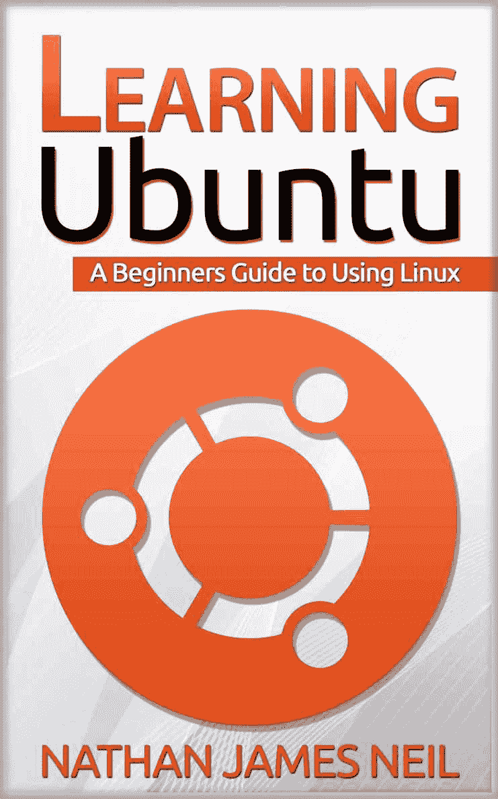

查看 Nathan Neil 的更多书籍：

[NeilPublishing.com](http://neilpublishing.com)

“[在真正的开源世界里，你有权掌控自己的命运。](http://www.brainyquote.com/quotes/quotes/l/linustorva587384.html)”

— 林纳斯·托瓦斯 (Linus Torvalds)

# 第 1 章

## 什么是 Linux & Ubuntu？

你可能熟悉微软 Windows 和苹果的 MacOSX。这些都是操作系统的示例。

韦氏词典（Merriam-Webster）将操作系统定义为计算机中控制计算机工作方式并使其他程序运行的主要程序。

基本上，操作系统是让你与计算机交互，并让计算机理解你想做的程序。它的含义比此更深，但我想保持在话题范围内。

Linux 是一个开源操作系统。开源是 Linux 与其他流行操作系统之间的主要区别。开源意味着软件提供了原始源代码，并免费供重新分发和修改。这正是 Linux 的独特性之处。它有一个强大的社区在修改代码、参与论坛并以比替代品快的速度修复漏洞。

如果你想为你的个人简历增加一项新技能，学习如何使用 Linux 会非常有用。根据 ZDNet 2014 年的数据，87% 的企业业务至少增加了一台 Linux 服务器，82% 的企业计划在 2015 年增加更多。Linux 及其发行版在数据库、Web 和其他类型的服务器中非常受欢迎。

发行版（distro or distribution）是以 Linux 内核为基础的 Linux 版本。有数百 Linux 发行版，大部分都是免费的。Ubuntu 是 Linux 的发行版，由一家名为 Canonical 的公司发布。他们免费提供操作系统，但对产品的商业支持收费。运行 Linux 的服务器中近四分之一使用的是 Ubuntu。这使其成为首次 Linux 体验的绝佳选择。

## 开始之前需要什么？

你所需的工具取决于你想选择的路线。你有四种方法可以尝试书中的课程。与其他两种选项相比，我更倾向于其中一种，特别是如果你对这个过程还很陌生。让我们快速浏览前三种，重点关注第四种，这是我为阅读这本书的你们推荐的首选方法。

用于尝试书中课程的前三种方法将要求你手动进行设置。在讨论这些开始方法之前，让我们先看一眼我们将使用的 Ubuntu 版本。虽然这本书可以适用于其他版本，但最适用于 Ubuntu 14.04 LTS。LTS 代表“长期支持”（Long Term Support）。这意味着它将获得 Canonical 为期五年的更新支持。很多人没有意识到操作系统的支持会过期。一旦支持过期，可能无法获得安全补丁和其他升级。在我的书籍《企业数据安全：建立数据安全的核心》（http://www.amazon.com/gp/product/B016PMLIW0）中，我们深入地讨论了操作系统。如果你从事技术或管理业务，我强烈建议阅读它。

Ubuntu 15.10 现在也可以，但它不是 LTS 版本。我倾向于使用具有长期支持的版本。

Ubuntu 14.04 LTS 通过了 AWS、Microsoft Azure、Joyent、IBM 和 HP Cloud 的认证。它也被几乎所有的 VPS 商支持。VPS 代表虚拟专用服务器。虚拟服务器是一种作为托管服务出售的机器，通常比购买服务器及其所需的带宽更廉。随着云服务的普及，许多企业现在运行更多的虚拟服务器以节省成本并更快地扩展。对于 VPS，你为你需要使用的资源付费，并随着时间的推移增加更多资源，如果你需要更多的处理能力或内存。

我喜欢 Ubuntu 14.04 LTS 的一点是它对热门软件包进行了更新，我们将在书中介绍其中很多。Ubuntu 14.04 LTS 也可以安装在大多数设备上，支持：x86、x86-64、ARM v7、ARM64 和 Power。如果你不确定这些东西意味着什么，没关系，但你可以确信 Ubuntu 支持大多数设备，这是一个巨大的优势。

对于设置 Ubuntu 的前三种方法，你需要下载 iso 文件。iso 是用于刻录 CD 或 DVD（取决于大小）的文件扩展名。本质上，它是安装 Ubuntu 所需的光盘镜像。

你可以通过以下地址下载 Ubuntu 服务器：

[`www.ubuntu.com/server`](http://www.ubuntu.com/server)

一旦下载了 iso 文件，你需要将它刻录到光盘。有多种 iso 刻录工具。过去，我曾使用过 [Ashampoo Burning Studio Free](https://www.ashampoo.com/en/usd/pin/7110/burning-software/burning-studio-free)，并且非常成功。

## 方法 1：在闲置电脑上安装 Ubuntu

如果你有一台可以运行 Ubuntu 的闲置电脑，那可能是学习如何安装和设置它的最佳方式。由于这是一台闲置的电脑，即使在安装过程中出现错误，风险也很低。你需要的是这台闲置电脑，以及我们刻录了 Ubuntu 镜像的光盘。

确保电脑已设置为从光驱驱动器启动，然后你就可以启动到安装光盘并安装 Ubuntu。安装过程非常简单，但始终可能遇到问题。我发现 Ubuntu 论坛和 YouTube 在解决常见问题方面提供了很棒的资源。

安装完成后，取出光盘，系统将启动进入 Ubuntu。

## 方法 2：使用虚拟化软件安装 Ubuntu

如果你没有闲置电脑，但电脑上有相当多的内存，你可以使用虚拟化软件进行安装。此类软件的示例包括 Oracle 提供的免费软件 VirtualBox 和付费版的 VMWare。

这种方法适合初学者，因为它降低了因操作错误而可能意外清空电脑数据的风险。

我使用过 VirtualBox，它是 Oracle 提供的且免费的，但它偶尔会出现小故障。这是一种选择，但不是我推荐给这本书读者的首选。

若要继续操作并使用这些免费工具，你需要下载并安装 VirtualBox，可以在以下链接找到它：

[`www.virtualbox.org/wiki/Downloads`](https://www.virtualbox.org/wiki/Downloads)

你也可以配置虚拟机从 Ubuntu 的 iso 文件启动，而不是将其刻录到光盘。

## 方法 3：为你的电脑设置双启动

老实说，我不想将此列为一个选项。对于那些熟练并知道如何正确设置机器运行多个操作系统的用户来说，这是一个流行的选择，但如果你不熟悉，我不建议你尝试这个选项。

这种方法风险最高，因为如果你不小心，可能会意外破坏机器的引导循环或覆盖你现有的操作系统。

*本书的首选方案*

## 方法 4：使用低成本 VPS

考虑到本书的性质以及旨在教育初学者的目标，我建议使用 VPS。如果你没有闲置电脑，使用 VPS 比买一台电脑更便宜，比使用虚拟化软件更稳定，而且没有像双启动那样损坏主电脑的风险。我最喜欢使用 VPS 的一点是由于它是托管在云端的，你可以从任何地方访问它。

另一个优势是 VPS 商会为你安装操作系统。我们仍然需要安装包并学习如何使用它，但通过这种方式你可以快速地设置并部署 Ubuntu 服务器。

为了制作书中的教程，我将使用 DigitalOcean。他们有一个每月 5 美元的入门套餐，包括：1TB 流量、512 内存、1 个 CPU 和 20 GB 存储。使用 DigitalOcean，最快 55 秒内即可开始。

另一个我推荐的选项是 Linode。Linode 的入门计划资源翻倍，但价格也是每月 10 美元。由于我们只是在学习而并没有部署任何东西，DigitalOcean 的入门套餐对我们的目的来说最实用。

市场上还有很多其他 VPS 服务商，你可以自己进行研究，但我发现这两者的支持和价格是最好的。

使用此选项，我们不需要下载或刻录 Ubuntu iso，也不需要对我们的电脑进行任何特殊操作。设置过程快速且相对简单。你只需要一张信用卡，并且可以随时取消。

如果你决定使用方法一、二或三，你的培训将从下一章开始。下一章是一个简短的章节，将带你了解如何在 DigitalOcean 上设置 VPS。

## 快速回顾

1.  操作系统是计算机中的主程序，控制计算机的工作方式，使得其他程序的运行成为可能。
    -   Microsoft Windows、Mac OSX 和 Linux 都是操作系统的示例。

2.  开源意味着该软件提供了原始源代码，并免费提供供重新分发和修改。

3.  发发行版（distro 或 distribution）是使用 Linux 内核作为基础的 Linux 版本。

4.  虚拟专用服务器（VPS）是一种作为托管服务出售的机器，通常比购买服务器及其所需的带宽更便宜。

5.  建议你尝试 Ubuntu 的方法是设置 VPS。
    -   本书的指令重点是使用 DigitalOcean 作为你的主机，但你也可以选择其他提供商。

# 第 2 章

## 在 DigitalOcean 上设置 VPS

如果你决定支付 VPS 每月的小额费用，我认为你做出了正确的决定。我喜欢使用 VPS 的点是它不占用我的硬件，我可以从任何地方处理它。

首先，访问 `www.digitalocean.com/` 并点击 `Sign Up`（注册）。从那里，输入你想使用的电子邮件地址和密码。然后点击 `Sign Up`。

现在我们的邮箱已确认，我们需要选择一种支付方式。DigitalOcean 提供了使用信用卡或 PayPal 的选项。对于我，我使用 PayPal。

如果你使用 PayPal，你需要预付 5 美元，这会存入你的账户。

添加支付方式后，我们就可以创建 VPS，DigitalOcean 称为 `Droplet`。在右上角点击 `Create Droplet`。

接下来，它会要求你选择发行版。我们要选择 `Ubuntu14.04`。

一旦选择了 `Ubuntu`，向下滚动选择你想部署的服务器大小。他们默认选择了每月 20 美元的方案。点击每月 5 美元的方案（如果这是你需要的尺寸），然后向下滚动选择数据中心区域。

我建议根据你的位置选择区域。由于我在美国东部，纽约是我的选择。

在附加选项下，取决于你是否想要备份。如果我们是在进行开发或其他培训之外的操作，我会建议选择备份选项，但由于我们现在只需要基础功能，我将不勾选这些选项。

从那里向下滚动到底点击大绿色 `Create`（创建）按钮。

然后在几秒钟内，你的系统就设置好并就绪了。DigitalOcean 然后会向你发送服务器的 IP 地址、用户名和密码。

# 第 3 章

## 进入 CLI

CLI 代表命令行界面，你通过输入文本行与系统交互。这是我们与服务器交互的方式。

如果你决定不使用推荐的在 DigitalOcean 或提供商处设置 VPS 的方法，那么你可以在电脑屏幕上看到 CLI。当你启动电脑时，它会带你进入 CLI，然后你就可以登录。

如果你正在使用 VPS，那么你需要一种连接并查看 CLI（命令行界面）的方法。我们可以使用名为 `SSH` 的协议连接到 VPS。`SSH` 代表 Secure Shell（安全外壳），这是我们远程登录服务器的加密方式。

当我们注册 DigitalOcean 时，他们会向我们发送一封包含我们的 IP 地址、用户名和密码的邮件。如果你使用了类似的服务，它也会为你提供这些信息或允许你手动设置。虽然你可能熟悉用户名和密码熟悉，但你可能不熟悉 IP 地址。IP 地址是一段标识网络上计算机的数字字符串。对于我们的 VPS，IP 地址是公网 IP，可以从任何连接互联网的地方访问。

我推荐用于 SSH 连接到服务器的程序叫做 `PuTTY`。`PuTTY` 是一个免费、开源的 SSH 客户端，支持 Windows 系统。你可以从以下链接下载它：

[`putty.org`](http://putty.org)

你下载的文件是一个可执行文件（`.exe`），不需要安装。下载后，你可以将其拖到桌面以便快速访问。

使用此工具连接到你的 VPS 非常简单。在 Host Name（主机名）或 IP address 下，输入提供的 IP 地址。选择 `SSH` 作为连接类型，然后点击 open。参见图 1 以示例其外观。

注意：你的 IP 地址将与图中不同。

图 1：Putty 配置

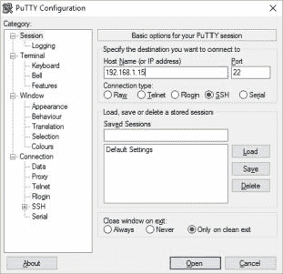

当你点击 connect 时，可能会收到类似图 2 所示的消息。点击 Yes。

图 2：PuTTY 安全警报

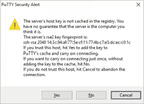

## 首次登录

现在你将被提示登录。输入用户名 `root`，然后输入提供的密码。

如果你使用的是 DigitalOcean，系统会在你第一次登录时要求重置密码。你需要重新输入提供的密码，然后输入两次你想设置的新密码。确保你遵循安全密码指南，并为 root 用户设置安全的密码。

注意：在整本书中，我使用表格来解释我们将要学习的不同命令。第一行是我们想要执行的任务，第二行是我们需要使用的命令，第三行是你的 CLI 对应的示例。我认为这是描绘和解释我们将学习的命令的最佳方式。

如果你没有被提示更改密码，但想更改，可以输入命令 `passwd`。更多细节请参见下页的表格。

| 修改我的密码 |
| :--- | :--- |
| 命令 | `passwd` |
| 结果 | 系统提示新密码 |
| CLI 显示 | `root@ubuntu:~# passwdEnter new UNIX password:Retype new UNIX password:passwd: password updated successfully` |

## 导航

不要被 CLI 上的白字和黑背景吓到。我知道这里没有鼠标或图形，但过了一会儿，你就会习惯在服务器的目录之间导航。目录（Directory）就像你在 Windows 或 Mac 设备上使用的文件夹。作为一个长期使用这种工具的人，我实际上更喜欢而不是图形用户界面。在进行任何其他操作之前，让我们学会探索服务器。通过使用 `pwd` 命令，我们可以看到当前查看的目录位置。

| 查找你的当前目录位置 |
| :--- | :--- |
| 命令 | `pwd` |
| 结果 | 系统将输出你所在的目录 |
| CLI 显示 | `root@ubuntu:~# pwd/root` |

现在我们处于一个名为 `root` 的目录中，它本质上是 root 用户的家目录。这个 root 目录和系统的根目录之间有很大区别。

路径 `/` 是系统的根目录，但现在我们处于一个名为 `root` 的子目录中（`/root`）。

服务器的根目录是顶级目录。它包含子目录。从我们当前的位置，有两种方法到达那里。让我们从最简单的命令开始进入根目录。

| 进入根目录 (/) |
| :--- | :--- |
| 命令 | `cd /` |
| 结果 | 我们切换到根目录 |
| CLI 显示 | `root@ubuntu:~# root@ubuntu:/#` |

现在让我们再次使用 `pwd` 查看我们所在地。

| 查找你的当前目录位置 |
| :--- | :--- |
| 命令 | `pwd` |
| 结果 | 系统将输出你所在的目录 |
| CLI 显示 | `root@ubuntu:~# pwd/` |

如果你想查看文件夹里有什么，我们可以使用 `ls` 命令。

| 列出文件 |
| :--- | :--- |
| 命令 | `ls` |
| 结果 | 列出当前目录下的文件 |
| CLI 显示 | `root@ubuntu:/# lsbin  home  lib64  opt  sbin  usrboot initrd.img lost+found  proc  srv  vardev  media  root  sys  vmlinuzetc  lib  mnt  run  tmp` |

在命令之前加上 `sudo`，允许我们的用户 `milo` 能够将其提升到更高的安全权限，以便安装软件和进行更改。`sudo` 会以超级用户的身份运行该命令，尽管用户 `milo` 通常只具有有限的访问权限。这一点稍后在我们深入使用它时会详细介绍，但首先我们需要创建 `milo` 的账户。

| 添加新用户 |
| :--- | :--- |
| 命令 | `adduser milo` |
| 结果 | 系统设置了用户 `milo` |
| CLI 显示 | `root@ubuntu:/# adduser miloAdding user 'milo' …` |

一旦你运行了该命令，系统将会要求你设置账户。系统会首先提示你输入密码。然后它会提示你输入用户信息，例如全名（Full Name），你可以通过按 `ENTER` 使用默认设置来跳过这些信息。如果这是一个生产系统，添加姓名、房间号、工作电话、家庭电话和其他信息可能会很有用，但目前没有理由不跳过它们。一旦到达末尾，你需要输入 `Y` 然后按回车键。

你可以在下方看到我添加 `milo` 过程的截图，如果你需要额外帮助。

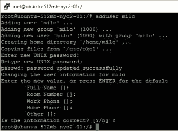

早些时候，我们学习了如何更改密码。如果你是 `root` 或 `sudo` 用户，也可以按照下面的步骤更改用户的密码。由于我们刚刚设置了 `milo` 的密码，你可能不想更改它，但这些是你将会会采取的步骤。

| 修改用户密码 |
| :--- | :--- |
| 命令 | `passwd milo` |
| 结果 | 系统将提示你为用户 milo 设置新密码。 |
| CLI 显示 | `root@ubuntu:/# passwd miloEnter new UNIX password:Retype new UNIX password:passwd: password updated successfully` |

好了，现在我们已经设置好了 `milo`，但仍然需要授予他使用 `sudo` 的权限。我们只对可能需要增加安全权限的用户执行此操作。

首先，我们需要打开 sudoer 配置文件进行修改。我们可以通过使用 `visudo` 命令来实现。

| 授予用户 Sudo 权限 |
| :--- | :--- |
| 命令 | `visudo` |


| 结果 | 系统将打开 `sudoers` 文件。 |
| :--- | :--- |
| CLI 显示 | `root@ubuntu:/# visudo` |

```text
# This file MUST be edited with the 'visudo' command as root.

# Please consider adding local content in /etc/sudoers.d/ instead of
# Directly modifying this file.

# See the man page for details on how to write a sudoers file.
Defaults      env_reset
Defaults      mail_badpass
Defaults      secure_path="/usr/local/sbin:/usr/local/bin:/usr/sbin:/usr/bin:/sbin:/bin"

# Host alias specification
# User alias specification
# Cmnd alias specification

# User privilege specification
root    ALL=(ALL:ALL) ALL
…
```

### 配置 `sudo` 权限

此文件中有很多文本，但不要被它吓到。在上面的表格中我强调了：`root ALL=(ALL:ALL) ALL`。

在该选择下方，我们需要添加以下内容：

`milo    ALL=(ALL:ALL) ALL`

按下方向键，直到进入 User privilege specification（用户权限规范）下 `root` 下方的空白处。在那里输入 `milo`，按 `Tab` 键，输入 `ALL=(ALL:ALL)`，然后按空格，输入 `ALL`。现在按控制键和 `X`。系统会询问你是否想要保存修改后的缓冲区。按 `Y` 并按回车。

现在你可以松口气了。我知道我们进展得有点快，但开始使用除 `root` 以外的用户 ID 是重要的。同时，我们能够安装软件并学习更多知识也很重要，因此这是必要的。

在继续之前之前，我们可以学习两个快速命令。现在你的 CLI 上可能有很多文本。如果你想清理它们，可以使用 `clear` 命令。

#### 清除屏幕

| 项目 | 描述 |
| :--- | :--- |
| 命令 | `clear` |
| 结果 | 系统将清屏 |
| CLI 显示 | `root@ubuntu:/# clear` |

现在我们已经有了清洁的屏幕，在继续使用新用户 ID `milo` 之前，我们可以关闭 PuTTY。

#### 退出

| 项目 | 描述 |
| :--- | :--- |
| 命令 | `exit` |
| 结果 | 系统将关闭 SSH 会话并退出 PuTTY |
| CLI 显示 | `root@ubuntu:/# exit` |

## 快速回顾

1. 作为一种良好的使用习惯，我们应该避免使用 `root` 用户。
2. 在命令前使用 `sudo` 允许用户拥有超级用户权限。
3. 我们可以使用命令 `adduser` 加用户名来添加用户。
   - 示例：`adduser nathan`
4. 我们可以通过在用户名之前使用 `passwd` 命令来更改用户的密码。
   - 示例：`passwd nathan`
5. 要获得使用 `sudo` 的权限，用户必须先添加到配置文件中，可以通过 `visudo` 命令进行编辑。
6. 如果我们的 CLI 变得太混乱，可以使用 `clear` 命令将其清理。
7. 要结束会话并注销 PuTTY，我们可以使用 `exit`。

# 第 5 章

## 系统状态概览

使用我们在上一章中创建的新用户登录你的服务器。

## 导航、创建目录和文件

部分内容是对前章节的复习。现在我们已经登录了，使用 `pwd` 命令查看你的位置。

#### 查找当前目录位置

| 项目 | 描述 |
| :--- | :--- |
| 命令 | `pwd` |
| 结果 | 系统将输出你所在的目录。 |
| CLI 显示 | `milo@ubuntu:~$ pwd`<br>`/home/milo` |

注意，我们这次的目录与登录时不同。上次我们在 `/root`，那是 `root` 的家目录。这次我们在 `/home/milo`，这是 `milo` 的家目录。

提示：如果你需要回到家目录，请使用 `cd`。

现在我们已经在家目录了，让我们创建一个名为 `documents` 的新目录。

#### 创建新目录

| 项目 | 描述 |
| :--- | :--- |
| 命令 | `mkdir documents` |
| 结果 | 系统将创建子目录 `documents` |
| CLI 显示 | `milo@ubuntu:~$ mkdir documents`<br>`milo@ubuntu:~$` |

使用 `ls` 命令列出家目录的内容，查看 `documents` 目录是否存在。

#### 列出文件

| 项目 | 描述 |
| :--- | :--- |
| 命令 | `ls` |
| 结果 | 列出当前目录下的文件 |
| CLI 显示 | `milo@ubuntu:~$ ls`<br>`documents` |

通过使用 `ls`，我们现在看到除了 `documents` 之外，目录是空的。

让我们利用之前章节中学的知识练习导航技能，进入 `documents` 目录。

尝试使用命令：`cd Documents`

你可能会发现它返回 `cd: Documents: No such file or directory.`。Linux 是大小敏感的，这意味着 `Documents` 和 `documents` 是两个不同的东西。在使用 Ubuntu 时要记住这一点，因为正确的大小写非常重要。

现在让我们用正确的方法来。

#### 切换到子目录

| 项目 | 描述 |
| :--- | :--- |
| 命令 | `cd documents` |
| 结果 | 切换到 documents 目录 |
| CLI 显示 | `milo@ubuntu:~$ cd documents`<br>`milo@ubuntu:~/documents$` |

使用 `ls` 命令列出目录中的文件，你会发现它是空的。

现在让我们使用 `cd` 回家目录。

#### 切换到用户家目录

| 项目 | 描述 |
| :--- | :--- |
| 命令 | `cd` |
| 结果 | 切换到用户的家目录 |
| CLI 显示 | `milo@ubuntu:~/documents$ cd`<br>`milo@ubuntu:~$` |

如果我们使用 `pwd`，会发现我们回到了 `/home/milo`。

现在，使用 `cd` 配合完整路径进入文档目录。记住，Linux 是区分大小写的。

### 使用完整路径切换目录

| 项目 | 描述 |
| :--- | :--- |
| 命令 | `cd /home/milo/documents` |
| 结果 | 切换到指定的目录 |
| CLI | `milo@ubuntu:~$ cd /home/milo/documents`<br>`milo@ubuntu:~/documents$` |

如果我们想进入此文件夹的父目录，也可以使用：`cd ..`

### 向上移动一级目录

| 项目 | 描述 |
| :--- | :--- |
| 命令 | `cd ..` |
| 结果 | 系统将我们移动到父文件夹 |
| CLI 显示 | `milo@ubuntu:~/documents$ cd ..`<br>`milo@ubuntu:~$` |

你现在应该开始上道了！再多尝试一下，在下一节中我们将使用内置文本编辑器 `nano` 创建一些文件。

### 使用 Nano 创建和编辑文件

`nano` 是 Linux 系统命令行界面（CLI）中一个非常有用的文本编辑器。由于我们使用的是 CLI，`nano` 是面向键盘的，使用控制键而不是鼠标。通过学习一些控制键，你将能够从 `nano` 编辑器快速编辑文件。一旦你掌握了这些并学习了更多如何通过命令行使用 Linux，你就可以转向更高级的编辑器，如 `vi`，它们非常棒，但通常学习曲线更陡峭。

`nano` 易于使用，非常适合初学者。它通常在 Ubuntu 和其他发行版中默认安装，并与命令行中的 `sudo` 配合得很好。它是一个 WYSIWYG 编辑器；“见即所得”。

如果你使用 DigitalOcean 或其他 VPS 提供商构建了 Ubuntu 服务器，它可能已经安装了。在某些情况下，如果你是手动安装的 Ubuntu，可能没有安装。我们将在后面的章节中详细讨论在 Ubuntu 上安装软件包，但万一你没有 `nano`，可以使用以下命令进行安装：`sudo apt-get install nano`

我们稍后还会更详细地讨论安装软件包，但如果你还没有 `nano`，该命令将将其安装到你的服务器上。让我们继续使用 `nano` 创建一个文件吧。

### 在 `nano` 中创建文件

| 项目 | 描述 |
| :--- | :--- |
| 命令 | `nano notes.txt` |
| 结果 | 系统为新文件 `notes.txt` 启动 `nano` |
| CLI 显示 | `milo@ubuntu:~$ nano notes.txt` |

现在，你会注意到我们处于一个简单的文本编辑器中。由于我们没有鼠标，可以通过同时按下控制键和 `G` 来获取控制键列表。查看下表中的 `nano` 命令键完整列表：

| Nano 命令键 | 说明 |
| :--- | :--- |
| `^` 代表控制键 `Ctrl` |  |
| `^G` (F1) | 显示此帮助文本 |
| `^X` (F2) | 退出 `nano` |
| `^O` (F3) | 将当前文件写入磁盘 |
| `^J` (F4) | 均齐当前段落 |
| `^R` (F5) | 将另一个文件插入当前文件 |
| `^W` (F6) | 搜索字符串或正则表达式 |
| `^Y` (F7) | 回到上一页 |
| `^V` (F8) | 转到下一页 |
| `^K` (F9) | 切割当前行并存储在剪贴缓冲区 |
| `^U` (F10) | 粘贴到当前行 |
| `^C` (F11) | 显示光标位置 |
| `^T` (F12) | 启动拼写检查器（如果可用） |
| `M-\` (M-\|) | 转到文件的第一行 |
| `M-/` (M-?) | 转到文件的最后行 |
| `^Y` | 上页 |
| `^P` | 上一行 |
| `^X` | 退出 |
| `^V` | 下页 |
| `^N` | 下一行 |

在 `nano` 编辑器中，输入以下文本：

```text
Nano notes: Nano 是 Linux 系统命令行界面 (CLI)中一个非常有用的文本编辑器。由于我们使用的是 CLI， nano 是面向键盘的，使用控制键而不是鼠标。
```

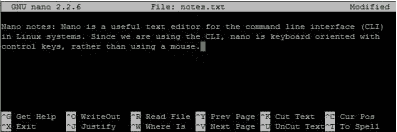

一旦输入了文本，使用退出命令键：

`Control + X`

然后会提示你是否要“保存修改的缓冲区？”按 `Y` 然后按 `Enter` 保存文件。

现在，让我们使用 `ls` 命令查看文件夹里有什么。

### 列出文件

| 项目 | 描述 |
| :--- | :--- |
| 命令 | `ls` |
| 结果 | 列出当前目录下的文件 |
| CLI 显示 | `milo@ubuntu:~$ ls`<br>`documents notes.txt` |

## 编辑、删除、移动和复制

创建 `notes.txt` 文件后，我们现在可以学习如何移动、编辑、删除和复制文件。要进入此文件夹的父目录，我们使用：`cd ..`

### 向上移动一级目录

| 项目 | 描述 |
| :--- | :--- |
| 命令 | `cd ..` |
| 结果 | 系统将我们移动到父文件夹 |
| CLI 显示 | `milo@ubuntu:~/documents$ cd ..`<br>`milo@ubuntu:~$` |

你现在应该开始上道了！再多尝试一下，在下一节中我们将使用内置文本编辑器 `nano` 创建一些文件。

创建 `notes.txt` 文件后，我们现在可以学习如何移动、编辑、删除和复制文件。要进入此文件夹的父目录，我们可以使用：`cd ..`

### 列出文件

| 项目 | 描述 |
| :--- | :--- |
| 命令 | `ls` |
| 结果 | 列出当前目录下的文件 |
| CLI 显示 | `milo@ubuntu:~$ ls`<br>`documents notes.txt` |

| CLI 显示 | `milo@ubuntu:~$ rm –r documents`<br>`milo@ubuntu:~$` |

要删除目录，我们必须使用 `-r` 标记。

# 第 6 章

## 更新服务器

在过去的章节中，我们学习了导航和文件管理的基础知识。建立坚实基础的另一个至关重要的点是如何更新你的服务器。

在安装更新和软件包时，我们将使用一个名为 `apt-get` 的实用。`apt-get` 是一个强大的包管理程序。`APT` 是高级软件包工具（advanced packaging tool）的缩写，我们将通过它来更新、添加和删除软件包。

为了更新服务器，我们需要赋予 `milo` 超用户权限。在下面的第一个 `apt-get` 命令中，我们将更新包列表并获取最新版本的信息。

### 更新包信息

| 项目 | 描述 |
| :--- | :--- |
| 命令 | `sudo apt-get update` |
| 结果 | 系统将提升用户权限，搜索更新后的包列表并查找新版本。 |


| CLI 显示 |
| :--- |
| `milo@ubuntu:~$ sudo apt-get update`<br>`[sudo] password for milo:` |

运行该命令后，你的 CLI 将列出一长串 Web 地址，因为它正在检查各种包列表的更新。完成后，它会显示“Reading package lists… Done.”

有了可用更新的新信息，我们现在可以升级服务器，以获得当前软件包的最新版本。使用下面的命令将获取新版本并安装到服务器上。

### 升级服务器软件包

| 项目 | 内容 |
| :--- | :--- |
| 命令 | `sudo apt-get upgrade` |
| 结果 | 系统将提升用户权限，搜索更新后的包列表并查找新版本。 |
| CLI 显示 | `milo@ubuntu:~$ sudo apt-get upgrade`<br>`[sudo] password for milo:`<br>`Do you want to continue? [Y/n] y`<br>`milo@ubuntu:~$` |

在输入 `Y` 继续后，服务器将配置并安装所有最新软件包的软件包安装到我们的服务器上。

保持服务器安装最新的更新是实现核心级安全保障的关键基础。要加固你的系统，你还需要学习更多知识，但这是入门的基础步骤之一。

# 第 7 章

## 设置 Web 服务器

### Apache2

Linux 服务器的常见配置是将它们设置为 Web 服务器。80% 托管网站的服务器都在运行 Linux。为了建立良好的基础，学习如何安装这些功能至关重要。

要开始将此服务器设置为 Web 服务器，我们需要安装 `Apache2`。`Apache2` 是 Linux 系统上最常用的 Web 服务器。Web 服务器用于为客户端计算机提供 Web 页面。运行像 WordPress 这样的网站软件，我们需要比这更多的软件包，但安装 `Apache2` 是最好的起点。

#### 安装 Apache2

| 项目 | 内容 |
| :--- | :--- |
| 命令 | `sudo apt-get install apache2` |
| 结果 | 系统将向服务器安装 `apache2` 及其依赖包。 |
| CLI 显示 | `milo@ubuntu:~$ sudo apt-get install apache2`<br>`[sudo] password for milo:`<br>`Do you want to continue? [Y/n] y`<br>`milo@ubuntu:~$` |

现在，如果我们打开浏览器并输入我们的 IP 地址，我们将看到 `Apache2` 的落地页。

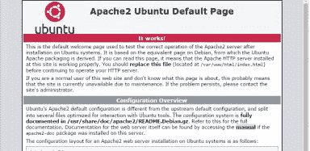

### 停止和重启 Apache2

可能会遇到你想停止或重启 `Apache2` Web 服务器的情况。

你可以使用以下命令来实现：

- 停止 `Apache2`：`sudo service apache2 stop`
- 启动 `Apache2`：`sudo service apache2 start`
- 重启 `Apache2`：`sudo service apache2 restart`

### Web 文件夹

你可能想知道，我的网站文件在哪里？在大多数 Ubuntu 安装中，你可以通过切换目录到 `/var/www/html` 来进入 Web 目录。

#### 进入 HTML 目录

| 项目 | 内容 |
| :--- | :--- |
| 命令 | `cd /var/www/html; ls` |
| 结果 | 系统将切换到 `html` 目录并列出文件。 |
| CLI 显示 | `milo@ubuntu:~$ cd /var/www/html`<br>`index.html` |

如果你愿意，可以使用 `nano` 打开默认的 `index.html` 文件。

#### 在 nano 中打开 index.html

| 项目 | 内容 |
| :--- | :--- |
| 命令 | `nano index.html` |
| 结果 | 系统将 `index.html` 加载到 `nano`。 |

注意：要保存并进行更改，你可能需要使用 `sudo` 打开文件。

现在让我们使用 `cd` 回到主目录。

### 安装 PHP5

`PHP` 是一种流行的 Web 服务器端脚本语言。它非常流行，被大多数内容管理系统（如 WordPress）使用。

#### 安装 PHP5

| 项目 | 内容 |
| :--- | :--- |
| 命令 | `sudo apt-get install php5` |
| 结果 | 系统将安装 `php5` 及其依赖。 |
| CLI 显示 | `milo@ubuntu:~$ sudo apt-get install php5`<br>`[sudo] password for milo:`<br>`Do you want to continue? [Y/n] y`<br>`milo@ubuntu:~$` |

### 安装 MySQL

除了 `Apache2` 和 `PHP`，你的服务器还需要 `MySQL` 来处理许多需要数据的 Web 应用程序。这包括流行的 WordPress CMS。

#### 安装 MySQL 服务器

| 项目 | 内容 |
| :--- | :--- |
| 命令 | `sudo apt-get install mysql-server` |
| 结果 | 系统将安装 `MySQL` 服务器。 |

一旦运行此命令，除了像之前一样同意继续外，你还需要输入密码。完成后，安装程序提示你输入 `root` 用户的密码。强烈建议为 `MySQL` 使用不同的密码。

输入你的密码，然后按 Tab 键到 `ok` 并按回车。之后你需要再次输入密码。

现在，我们需要安装另一个软件包以允许 `PHP` 与 `MySQL` 通信。

#### 安装 PHP5 MySQL 依赖

| 项目 | 内容 |
| :--- | :--- |
| 命令 | `sudo apt-get install php5-mysql` |
| 结果 | 系统将安装 `MySQL` 的 `php5` 依赖。 |
| CLI 显示 | `milo@ubuntu:~$ sudo apt-get install php5-mysql`<br>`[sudo] password for milo:`<br>`Do you want to continue? [Y/n] y`<br>`milo@ubuntu:~$` |

接下来我们需要安装一个软件包以允许 `apache2` 与 `MySQL` 通信并进行身份验证。

要实现这一点，请使用以下命令：

`sudo apt-get install libapache2-mod-mysql`

在某些情况下，你可能需要在网站上使用表单来联系你（此处原文意可能为邮件邮件）。为了能够从服务器发送邮件，我们需要安装另一个软件包：`postfix`。

### 安装 Postfix

`Postfix` 是一种邮件服务器，起源于 IBM 实验室，作为 `Sendmail` 的替代方案。它的目标是快速、易用（对初学者友好）且安全。如果你想在服务器上运行邮件服务，这是我的建议。

| 项目 | 内容 |
| :--- | :--- |
| 命令 | `sudo apt-get install postfix` |
| 结果 | 系统将安装 `phpmyadmin`。 |
| CLI 显示 | `milo@ubuntu:~$ sudo apt-get install phpmyadmin`<br>`[sudo] password for milo:`<br>`Do you want to continue? [Y/n] y` |

批准安装后，你会看到下面的窗口：

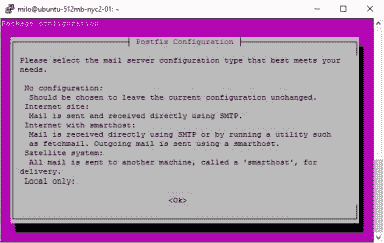

点击 OK 按钮，然后在下一个提示中选择 `Internet Site`。完成后按 Tab 到 `ok` 然后按回车。下一步询问你的完全限定域名 (FQDN)。如果你还没有，只需按 Tab 到 `ok` 并使用默认值。

现在它安装好了！我们不会在书中涵盖其他各种配置设置，但你可以在网上找到许多帮助资源。

### 安装 PHPMYADMIN

测试我们是否正确配置了这一切的一种棒方法是安装 `phpmyadmin`。`Phpmyadmin` 是一个很好的工具，可以提供 Web 界面管理你的 `MySQL` 服务器、表和数据库。

| 项目 | 内容 |
| :--- | :--- |
| 命令 | `sudo apt-get install phpmyadmin` |
| 结果 | 系统将安装 `phpmyadmin`。 |
| CLI 显示 | `milo@ubuntu:~$ sudo apt-get install phpmyadmin`<br>`[sudo] password for milo:`<br>`Do you want to continue? [Y/n] y` |

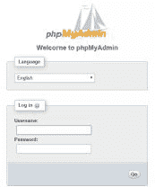

在 `phpmyadmin` 安装期间，它会提示你选择想要配置的 Web 服务器。在 `apache2` 旁边按下空格键，然后按 Tab 到 `ok`，最后按回车。稍后，安装程序会询问你是否想使用 `dbconfig-common` 为 `phpmyadmin` 配置数据库。确保选择了 `yes` 并按回车。之后你将被提示输入管理用户的密码。完成提示并继续。

现在 `phpmyadmin` 已安装，我们可以通过访问 `http://myipaddress/phpmyadmin` 并输入凭据来检查它是否正常工作。

如果安装成功，你应该能看到类似下面的屏幕：

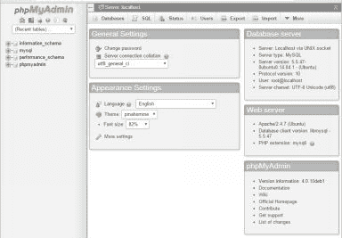

我们稍后会回到更多相关，但在此之前，我们还需要学习其他几点。

到为止，我们已经了解了 VPS 安装、更新、导航和设置的一些基础知识。

接下来，我们将了解 Linux 文件和目录权限。

# 第 8 章

## 理解权限

要理解如何向用户和组分配权限，我们必须首先理解 Linux 权限的工作原理。一旦你理解了它，就会比确定 Windows Server 权限要容易得多。

在 Windows Server 上，有多种权限类型可以分配。见下图：

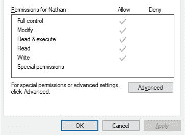

Ubuntu 和其他 Linux 系统有三个基本的权限组和三个基本的权限类型。

### 权限组

- 所有者 (Owner) – 所有者权限仅适用于文件或目录的所有者。
- 组 (Group) – 组权限仅适用于分配给该文件或目录的组。
- 所有用户 (All Users) – 所有用户权限适用于系统上的所有用户。这是你最需要谨慎的权限组。

### 权限类型

- 读取 (Read) – 读取权限是指用户读取文件内容的能力，但不允许其写入或保存更改。
- 写入 (Write) – 写入权限是指用户写入或修改文件或目录的能力。
- 执行 (Execute) – 执行权限影响用户执行文件或查看目录内容的能力。

我们可以使用 CLI（命令行界面）以及熟悉的 `ls` 命令配合 `-l` 标志来查看并检查现有权限。

#### 详细列出文件

| 项目 | 内容 |
| :--- | :--- |
| 命令 | `ls -l` |
| 结果 | 列出当前目录下的文件详细信息。 |
| CLI 显示 | `milo@ubuntu:~$ ls –l`<br>`-rw-rw-r-- 1 milo milo 196 Feb 13 20:48 notes.txt` |

解析输出内容：

`-rw-rw-r-- 1 milo milo 196 Feb 13 20:48 notes.txt`

显示的第一个部分 `-rw-rw-r--` 显示了文件的权限。

当我们使用 `ls –l` 命令查看权限时，可以通过以下键值来理解它们。

#### 理解文件权限

| 权限 | 表示 |
| :--- | :--- |
| 读取 | `r` |
| 写入 | `w` |
| 执行 | `x` |

当我们查看 `notes.txt` 文件的权限时，我们可以根据输出 `-rw-rw-r--` 得出几点观察结果。

前三个字符 `rw-` 告诉我们用户 `milo` 对文件 `notes.txt` 具有读写权限。第二组字符显示组 `milo` 也具有读取和写入权限。最后一组显示了所有用户的权限。从输出中可以看出，所有用户都可以读取该文件，但不能写入。

### 使用二进制引用设置权限

现在我们已经了解了权限组和权限类型的基础知识，使用二进制引用设置权限应该相当简单。重要的一点是，当你这样设置文件权限时，它是通过三个整数完成的。整数是一个整数数字（例如：1、2 和 4）。

要设置权限，我们必须确定 `rwx` 字符串的二进制表示。`RWX` 字符串是允许我们设置读取、写入和执行权限的二进制表示。

我们必须使用下表来计算我们为文件或目录所需的权限。

#### 文件权限：二进制表示

| 权限 | 数值 |
| :--- | :--- |
| 读取 | `4` |
| 写入 | `2` |
| 执行 | `1` |

我们通过将整数相加得到权限数字。我们必须对三个权限组中的每一个执行操作。

例如：

- 读取访问 = `4`
- 读取和写入访问 = `6`
- 读取、写入和执行权限 = `7`

每个权限组都需要一个数字。我们为设置权限生成的数字将是 3 位。记住，顺序是用户、组和所有用户。

**练习 1：权限 `777` 意味着什么？**

这意味着用户、组和所有用户具有读取、写入和执行权限。使用 `777` 作为权限设置对于建立强大的安全性不是好的。

**练习 2：权限 `655` 意味着什么？**

这意味着用户具有读取和写入权限。组具有读取和执行权限。所有用户也可以读取和执行。

**练习 3：权限 `444` 意味着什么？**

这意味着用户、组和所有用户对文件只有读取访问权限。

**练习 4：权限 `755` 意味着什么？**

这意味着用户具有读取、写入和执行权限。组和所有用户只能读取和执行。这通常是使用 WordPress 的用户推荐的目录权限设置。

在我们介绍应用权限的步骤之前，我们应该先学习如何传输文件。该过程将为应用程序打开大门，在应用程序中我们将学习如何设置权限。

## FTP 传输

假设你想安装 WordPress，一种简单的方法是使用 FTP。FTP 代表文件传输协议，用于在客户端和服务器之间传输文件。

为了连接并向我们的服务器发送文件，我们将使用名为 `FileZilla` 的程序。`FileZilla` 同时提供客户端和服务器。为了上传文件，我们需要客户端。你可以从这里下载 `FileZilla`：[`filezilla-project.org/`](https://filezilla-project.org/)

我们的 DigitalOcean VPS 已经预装了用于 `SFTP` 的 FTP 能力，这就是我们将使用的。`SFTP` 使用 `SSH` 通过安全外壳传输文件。如果你决定不用我推荐的，你也可以在服务器上安装其他 FTP 选项。

我用过并推荐的是 `VSFTPD`，但我们不会在这本初级书中介绍它的设置过程。

让我们在电脑上创建一个文件进行传输。打开记事本并创建一个名为 `ftptest.txt` 的文件。你可以在文件中输入任何你想的内容，但我们将用它来测试文件传输。

一旦创建了该文件并安装了 `FileZilla` 客户端，我们就可以启动 `FileZilla` 客户端继续。

为了连接，需要在 `FileZilla` 顶部输入信息：主机、用户名、密码和端口。

在主机字段中，我们需要输入 IP 地址。在用户名字段和密码字段中，我们将输入用户 `milo` 及其密码。`SFTP` 的端口号为 `22`。输入完成后我们就可以点击快速连接。

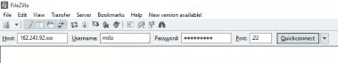

一旦连接成功，你将在 `FileZilla` 的右侧看到 `milo` 的主目录。在左侧，你将看到本地电脑的文件结构。导航到你 PC 上创建 `ftptest.txt` 文件的文件夹，将其拖动到 `milo` 的主目录。几秒钟后，你将看到传输成功。现在，如果我们用 `PuTTY` 登录服务器并使用 `ls` 命令，我们将看到该文件。

如果你想将 VPS 用作 Web 服务器，我们需要将文件放入 `/var/www/html` 目录。在 `FileZilla` 中，将远程站点目录更改为 `/var/www/html`。参考下图：

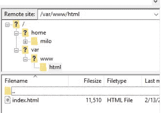

现在尝试向此目录上传我们的 `ftptest.txt` 文件。

你的上传将会失败，如下所示。

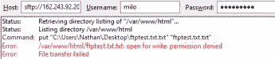

为什么呢？嗯，我们没有让 `milo` 向该目录上传的权限。

### 文件和目录所有权概述

在本书接下来的几页中，我们将允许 `milo` 上传 WordPress 文件，并更多地了解更改文件或目录所有权。我们将通过更改权限并修改为 WordPress 推荐的权限设置来实现。

登录你的 VPS，准备好后运行下表中的命令。

#### 更改目录所有者

| 项目 | 内容 |
| :--- | :--- |
| 命令 | `sudo chown milo -R /var/www` |
| 结果 | 系统将使 `milo` 成为目录及其所有子目录的所有者。 |
| CLI 显示 | `milo@ubuntu:~$ sudo chown milo -R /var/www`<br>`[sudo] password for milo:`<br>`milo@ubuntu:~$` |

为了查看上面的命令，我们必须注意需要使用 `sudo`。这会提升 `milo` 的权限。如果不使用 `sudo`，我们将得到错误且命令将失败。

在 `sudo` 之后，我们使用 `chown`，它允许我们更改目录的所有者。`chown` 命令需要一个用户（`milo`）和一个目录（`/var/www`）。`-R` 标志将使 `milo` 也成为所有子目录的所有者。通过这种方式，`milo` 也拥有了 `html` 目录。

虽然我们目前还没有显示更改文件所有者的示例，但你可以参考下表。这与更改目录所有者非常相似。请尝试此操作进行练习。

### 更改文件的所有者

| 命令 | 结果 |
| :--- | :--- |
| `sudo chown milo /home/milo/test.txt` | 系统将 `milo` 设置为该文件的所有者。 |

在本示例指南的后续步骤中，我们需要下载 WordPress。你可以在此处下载：[`wordpress.org/download/`](https://wordpress.org/download/)

一旦下载了包含 WordPress 文件的 `.zip` 文件，请使用 `FileZilla` 将其上传到 `/var/www/` 目录。记住，你可以浏览它或将其拖入界面。

完成上传后，它看起来应该像下面的图片。


**重要提示：** WordPress 在不断更新，因此你的版本可能有所不同。

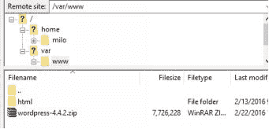

如果你有了这个文件，就可以登录你的 VPS。如果尚未包含包，我们现在可以安装一个包来解压 WordPress 文件。

## 解压 `.Zip` 文件

| 命令 | 结果 |
| :--- | :--- |
| `sudo apt-get install unzip` | 系统将安装 `unzip` 包 |

DigitalOcean VPS 不带此软件包，因此我们需要安装 `unzip`。安装过程应该看起来很熟悉。同样，我们使用 `sudo` 给 `milo` 额外的权限来安装包并进行系统更改。

安装完成后，切换到`/var/www`目录。

### 切换到`/var/www`目录

| 命令 | 结果 |
| :--- | :--- |
| `cd /var/www/` | 系统将移动到 `var` 下的 `www` 子目录。 |

到此时，导航和安装软件大部分操作应该变得简单了。

一旦我们进入`/var/www`目录，使用`ls`命令。通过这个命令我们可以看到我们的 WordPress 压缩文件。现在让我们使用`unzip`来提取这些文件。

### 解压 Zip 文件

| 命令 | 结果 |
| :--- | :--- |
| `unzip wordpress-4.4.2.zip` | 系统将解压文件 `wordpress-4.4.2.zip` |

**重要提示回顾：** WordPress 在不断更新，因此你的版本可能有所不同。你的`.zip`文件名可能会有所不同。

再次运行`ls`，你会发现我们现在有一个 WordPress 文件夹。

在接下来的几页中，我们将通过更改 Apache 配置文件并继续讨论此实际用途的权限问题。

## 修改 Apache2 站点配置

由于 WordPress 的 zip 文件在`www`目录中创建了一个新目录，我们需要告诉 Apache 指向新目录。你可以通过在位于`/etc/apache2/sites-available`的`sites-available`目录中创建配置文件并在服务器上托管多种站点。

让我们使用`cd`切换到此目录并使用`ls`命令查看那里有什么。

### 移动到 Site-Available

| 命令 | 结果 |
| :--- | :--- |
| `cd /etc/apache2/sites-available; ls` | 系统将将 `milo` 移动到 `sites-available` 并列出站点配置文件。 |

CLI 显示：`milo@ubuntu:~$ cd /etc/apache2/sites-available; ls 000-default.conf default-ssl.conf`

如果你托管了多个站点，你需要多个配置文件。此书将解释如何启用和禁用这些配置，但为了更深入地理解它们，我建议找一份关于 Apache 配置的详细指南。那本身就是一本书，但我将尝试涵盖基础知识。

对于我们正在要做，我们需要修改`00-default.conf`文件。作为参考，这是默认的 Apache 配置文件。记住，要使用`nano`编辑此文件，`milo`需要通过使用`sudo`获得超级权限。

### 使用`nano`修改`000-default.conf`

| 命令 | 结果 |
| :--- | :--- |
| `sudo nano 000-default.conf` | 系统将启动 `nano` 来编辑 `000-default.conf` 文件。 |

以下是`000-default.conf`文件的内容。

**000-default.conf**

```apache
<VirtualHost *:80>
    # ServerName 指令设置了服务器用于标识身份的请求方案、主机名和端口。这在创建重定向 URL 时使用。在虚拟主机的上下文中，ServerName 指定了请求的 Host: 头中必须出现什么主机名以匹配此虚拟主机。对于默认虚拟主机（此文件），此值不是决定性的，因为无论如何它都作为最后手段使用。然而，你必须显式地为任何虚拟主机设置它。
    #ServerName www.example.com
    ServerAdmin webmaster@localhost
    DocumentRoot /var/www/html
    # 可用的日志级别: trace..., debug, notice, error, alert, emerg. 也可以为特定模块配置日志级别，例如 LogLevel info ssl:warn
    ErrorLog ${APACHE_LOG_DIR}/error.log
    CustomLog ${APACHE_LOG_DIR}/access.log combined 对于大多数来自 conf-available/ 的配置文件（这些文件在全局范围内启用或禁用），可以仅为某一个特定的虚拟主机包含一行。例如，接下来的行在通过 "a2disconf" 全局禁用后，仅启用此主机的 CGI 配置。
    #Include conf-available/serve-cgi-bin.conf</VirtualHost>
```

当我们查看此文件时，它看起来可能非常杂乱。重要的是，以井号/哈希符号（`#`）开头的行是注释，用于帮助用户理解如何使用。

如果我们省略此文件中的注释，它将更容易理解。在你的文件中保留注释，你可能需要它们作为参考，但下面你可以看到没有注释的内容。

**000-default.conf**

```apache
<VirtualHost *:80>
    #ServerName www.example.com
    ServerAdmin webmaster@localhost
    DocumentRoot /var/www/html
    ErrorLog ${APACHE_LOG_DIR}/error.log
    CustomLog ${APACHE_LOG_DIR}/access.log combined
</VirtualHost>
```

这是配置的基础框架，概述了：主机名、服务器管理员、文档根以及错误日志。

我留下了注释`#ServerName www.example.com`。我们将在后面的章节中回到这里。

我们需要更新的是`DocumentRoot`行和`ServerAdmin`行。你可以在`ServerAdmin`行中输入你的电子邮件地址。

将`DocumentRoot`更改为：`/var/www/wordpress`

完成后，配置应该像下一页所示。

**000-default.conf（更新后）**

```apache
<VirtualHost *:80>
    #ServerName www.example.com
    ServerAdmin info@nathanneil.com
    DocumentRoot /var/www/wordpress
    ErrorLog ${APACHE_LOG_DIR}/error.log
    CustomLog ${APACHE_LOG_DIR}/access.log combined
</VirtualHost>
```

更改完成后，使用`control`和`x`退出。按`Y`和`Enter`保存更改。

在我们回到讨论更改权限之前，我们应该考虑如何启用和禁用站点配置。

### 禁用站点配置

| 命令 | 结果 |
| :--- | :--- |
| `sudo a2dissite 000-default.conf` | 系统将禁用 `000-default` 站点配置。 |

CLI 显示：

```text
milo@ubuntu:/var/apache2/sites-available$ sudo a2dissite 000-default.conf
Site 000-default disabled
```

要激活新配置，你需要运行`service apache2 reload`。

当你对 Apache2 配置文件进行更改时，几乎总是需要重启 apache。你可以使用以下命令来实现：`sudo service apache2 restart`

完成后，新设置将生效。现在，由于我们想要使用`000-default.conf`站点配置，我们需要重新启用它。请参考下表。

### 启用站点配置

| 项目 | 内容 |
| :--- | :--- |
| 命令 | `sudo a2ensite 000-default.conf` |
| 结果 | 系统将启用为 `000-default` 的站点配置。 |
| CLI 显示 | `milo@ubuntu:/var/apache2/sites-available$ sudo a2ensite 000-default.conf`<br>`Enabling site 000-default.`<br>`To activate the new configuration, you will need to run service apache2 reload.`<br>`milo@ubuntu:/var/apache2/sites-available$` |

再次，我们需要使用以下命令重启 apache：`sudo service apache2 restart`

现在，如果我们在浏览器中加载 IP 地址，将看到 WordPress 的安装落地页。请先不要点击“Let’s Go!”，因为我们还有一些权限需要更新。

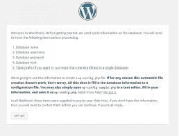

## 更改所有权和权限回顾

现在在继续之前，我们需要对所有权权限进行一些更改。这是将整个章节内容整合在一起的一个极佳方法。

一旦登录服务器，我们必须首先将文件夹的所有者更改非特权用户，该用户已内置在 Apache2 安装程序中。该用户是`www-data`。

### 更改目录所有者

| 项目 | 内容 |
| :--- | :--- |
| 命令 | `sudo chown www-data -R /var/www` |
| 结果 | 系统将 `milo` 设置为目录及其所有子目录的所有者。 |
| CLI 显示 | `milo@ubuntu:~$ sudo chown www-data -R /var/www`<br>`[sudo] password for milo:`<br>`milo@ubuntu:~$` |

现在我们需要为目录设置权限。

WordPress 建议使用`755`作为权限二进制值。

这意味着用户（`www-data`）拥有读、写、执行权限。组和其他所有用户只能读取和执行。这允许`www-data`修改目录中的文件，而其他用户只能读取和执行。这些权限是用户加载网站所必需的。

### 更改目录权限

| 项目 | 内容 |
| :--- | :--- |
| 命令 | `sudo chmod 755 -R /var/www/wordpress` |
| 结果 | 系统将更改`/var/www`及其所有子目录的权限。 |
| CLI 显示 | `milo@ubuntu:~$ sudo chown www-data -R /var/www/wordpress`<br>`[sudo] password for milo:`<br>`milo@ubuntu:~$` |

记住使用`-R`标志会将设置应用于所有子目录。如果不使用它，我们将无法为 wordpress 父目录下的其他子目录授予权限。

现在权限已设置，我们就可以继续在 MySQL 中创建数据库了。

# 第 8 章

## 在 MySQL 中创建数据库

关于 MySQL 的书籍数不胜数。本章将非常短，但将涵盖如何为安装几乎任何流行的内容管理系统或其他需要数据库的软件创建一个数据库。

我通常使用 CLI 来管理 MySQL，但由于这是针对初学者的，使用`phpMyAdmin`创建数据库可能对我们来说更简单。

在网页浏览器中，输入你的 IP 地址`/phpmyadmin`（例如：`http://162.243.92.xxx/phpmyadmin`）。将`162.243.92.xxx`替换为你的 IP 地址。然后登录`phpMyAdmin`。

你应该能看到像下面的主仪表板：

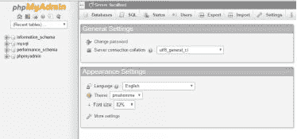

我们将为 WordPress 创建一个特殊的用户以及一个限制其访问的数据库。这是一个良好的安全实践。

在左上角，点击“Users”（用户）。


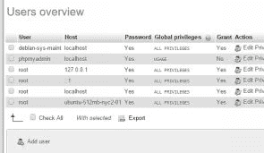

现在点击“Add User”（添加用户）。

在新窗口中为新用户输入用户名。我将使用：`website`。将 host 留为任何主机（any host）。之后向下滚动并点击“Generate”（生成）按钮创建一个安全的密码。务必记下此密码，因为我们在安装 WordPress 时需要它。

在生成按钮下方，有一个“Create database with same name and grant all permissions”（创建同名数据库并授予所有权限）的字段。勾选该框。取消勾选“Global Permissions”（全局权限），因为我们只希望 WordPress 访问这一个数据库。

向下滚动并点击右下角的“Go”（执行）按钮。你会弹出一个窗口显示用户已添加，在屏幕右侧你将看到为该用户添加了新数据库。

再次，这只是基础操作，但对于初学者来说是添加数据库的一种简单且安全的方法。

如果你想学习更多关于 MySQL 以及如何从 CLI 运行它的知识，随着你的成长，有大量的书籍可以满足这一需求。

# 第 9 章

## 附录

### 安装 WordPress

要建立使用 Ubuntu 的基础，你还有很多需要学习，但我认为这本书的优点在于涵盖了一些基础知识以及实际应用。在具备正确权限并设置好数据库后，我们可以继续设置 WordPress。

在你的网页浏览器中输入服务器的 IP 地址。你应该会看到“Welcome to WordPress”启动页。在页面底部点击“Let’s Go!”按钮！


现在它会要求你提供以下信息。如果你按照我之前的示例操作，它看起来应该像这样：

数据库名称：`website`

用户名：`website`

密码：[你随机生成的密码]

数据库主机：`localhost`

表前缀：`wp_`

输入这些信息后，系统将提示你运行安装。

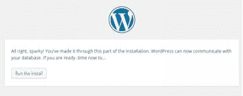

点击“Run the install”（运行安装）。

随后将提示你输入想要用于 WordPress 站点的信息。

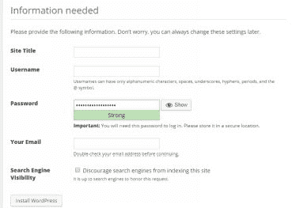

提供要求的信息并点击“Install WordPress”（安装 WordPress）。

恭喜你！在不到 70 页的范围内，我们已经建立了一些 Ubuntu 基础知识，并利用这些信息构建了一个基础 Web 服务器。

当然，还有更多需要学习的，但这仅仅是一个开始。这本指南应该让你熟悉在 Ubuntu 上进行导航和安装软件包。

如果你对进一步学习有任何问题，请随时发送电子邮件至`info@nathanneil.com`联系我。

感谢，并祝你在持续学习中顺利！
