# LF315 Inside Android：Android 内部入门指南

- 实验 12 (Lab 12) . 308

# 16 输入设备 . . . . . . . . . . . . . . . . . . . 396

# 17 音频与视觉 . . . . . . . . . . . . . . . 418

# 18 资源管理 430

# 19 结论 447

# 实验答案 449

# 第一课节 简介

## 第一课节：简介

# LF315 深入 Android：Android 内部原理简介

* 致力于促进 Linux 成长的非营利财团

* 推广 Linux 并提供中立协作与教育

* 保护并支持 Linux 开发

* 改进 Linux 作为技术平台

* 赞助 Linux 创始人林纳斯·托瓦尔斯（Linus Torvalds）的工作

* 受全球领先科技公司和开发者支持

自 1991 年成立以来，Linux 已经成为计算领域的一股力量，驱动着从纽约证券交易所到手机，再到超级计算机和消费设备的一切设备。Linux 的增长。Linux 基金会是一个致力于促进 Linux 成长的非营利财团。Linux 基金会成立于于 2000 年，赞助 Linux 创始人林纳斯·托瓦尔斯的工作，并受到全球领先科技公司和开发者的支持。

Linux 基金会通过集结其成员和开源开发社区的资源来促进、保护和推进 Linux，以确保 Linux 保持免费和技术上的领先地位。

## Linux 基金会活动

* LinuxCon 北美、欧洲和日本

* CloudOpen

* 协作峰会 (Collaboration Summit)

* 北美和欧洲嵌入式 Linux 大会

* 企业终端用户峰会

* Android 构建者峰会 (Android Builders Summit)

* Tizen 开发者大会

Linux 基金会在全球范围内举办技术活动。无论是为了为下一次内核发布提供开放论坛，还是汇聚开发者在实时环境中解决问题，或是举办工作组和社区小组进行活跃讨论，亦或是连接终端用户与内核开发者。

## 第二节 Android 简介

Android 像一个四层饼蛋糕。

底层是经过少量修改的 Linux 内核。

第二层是“用户空间”，由共享库（如 C 库，命名为 `bionic`）、命令行工具（包括 `shell`）以及原生守护进程组成。

与此同时，还有一层名为“硬件抽象层”（HAL）的共享库，这些库供下一层调用以访问内核服务。该层的大部分是用 C 语言编写的。

第三层是 Android 框架（Android Framework），它是 Android 的主体部分。它包含了大量的（>50 个）服务以及形成上层应用接口的管理器代码。框架由 C++ 和 Java 混合编写。

顶层是 Android 应用程序运行的地方。这是大多数 Android 开发者熟悉的部分，因为在 `developer.android.com` 上有详尽的文档。应用程序大部分使用 Android SDK 用 Java 编写，但也可以通过 NDK 使用 C 和 C++ 代码。

### 核心特性

- 针对移动设备设计

  - 低功耗、慢 CPU、小内存、低速存储

- 触摸屏是主要的用户界面

- 使用组件架构用 Java 编写应用程序

  - 使用 Dalvik VM 而非传统的 Sun JVM

- 核心组件开源

## 第二节 Android 简介

- 从本质上说，Android 是版本的嵌入式 Linux

- “嵌入式 Android”意味着在手机或平板电脑以外的设备上使用 Android 代替“普通”嵌入式 Linux

- 优势是什么？

### 为什么选择嵌入式 Android？

- 熟悉

  - 文档齐全且支持良好的 API

  - Java 是一种易于使用的语言

  - 开发者多

  - 终端用户熟悉并喜欢该界面

- 工具

  - 对于应用程序员：SDK 和 Eclipse ADT

  - 对于开发者：`adb` 和 `fastboot`

- 健壮的设计

- 源码可用

## 第二节 Android 简介

### 挑战

- Android 是单体架构

  - 框架内的服务之间相互依赖

  - 移除或修改其中一个可能会导致其他服务失效

- 不易于添加其他开源包

  - 运行时 libc (`Bionic`) 并不完全兼容 POSIX

  - 文件布局不符合 Linux 文件系统层次结构规范 (FHS)

- 框架不支持有线网络接口

  - 没有 `ConnectivityManager` 或 `ConnectivityService`

  - 意味着 Java 应用程序无法使用以太网

## 无头 Android (Headless Android)

- 无头 Android = 没有显示器的 Android

- 为什么？

  - 跨产品线的通用操作系统，有些带 UI，有些没有

  - 缩短启动时间、代码 own、内存占用和功耗需求

- 如何实现？

  - 去掉框架中的显示部分：

  - `SurfaceFlinger`, `WindowManager`, `WallpaperService`, `InputManager`

  - 更多信息请访问 `http://www.cyborgstack.org/`

## 应用开发工具

- Android SDK

  - 用于开发 Java 应用程序

  - `http://developer.android.com/sdk/index.html`

- Android NDK (原生开发包)

  - 用于使用“原生代码”（即 C/C++）的方法和活动

  - 从 SDK 相同的 URL 获取

- Eclipse 插件 Android Developer Tools (ADT)

  - 点点式开发

  - `http://developer.android.com/tools/index.html`

## LF315 Inside Android：Android 内部

| 代码名称 | 版本 | API级别 |
| :--- | :--- | :--- |
| Jelly Bean | 4.3 | 18, NDK r9 |
| Jelly Bean | 4.2.x | 17 |
| Jelly Bean | 4.1.x | 16 |
| Ice Cream Sandwich | 4.0.3 - 4.0.4 | 15, NDK r8 |
| Ice Cream Sandwich | 4.0.1 - 4.0.2 | 14, NDK r7 |
| Honeycomb | 3.2.x | 12, NDK r6 |
| Honeycomb | 3.1 | 11 |
| Honeycomb | 3 | 11 |
| Gingerbread | 2.3.3 - 2.3.7 | 10 |
| Gingerbread | 2.3 - 2.3.2 | 9, NDK r5 |

## 第二节 Android 简介

## 关于 API 级别的说明

- **API level** 指 Android 框架 API（Java 和 xml）

  - API 向后兼容：针对 API 10 编写的程序可以在所有后续级别运行

- **NDK level** 是 NDK 版本

  - 即 NDK 提供的 C/C++ API

  - NDK 版本同样向后兼容

  - 详情见 `ndk/docs/STABLE-APIS.html`

## Android 开源项目 (AOSP)

- 源码和构建工具由 Google 以 AOSP 发布

- `http://source.android.com/`

- Android 新版本由 OHA 成员“内部”开发

- 代码在内部发布一段时间后加入 AOSP 仓库

  - 通常是几周后

  - 有时完全不加入，如 Honeycomb 版本

AOSP 不包含 Linux 内核或引导加载程序的源码。我们必须自己获取并适配这些组件。将在后面的章节中讨论这两者。不发布 Honeycomb 源码是因为它当时处于变动状态，那是 Android 首次运行在平板硬件上。

## 第二节 Android 简介

## 许可协议 (Licenses)

- 大部分代码使用宽松性许可证 (BSD/Apache)

- 策略是从用户空间中排除 GPL 代码

- 使用的主要许可证

  - GPL：内核和蓝牙栈 (`bluez/dbus`)

  - BSD：C 库 (`bionic`)

  - Apache 2.0：所有

## LF315 Inside Android：Android 内部

Android 兼容性文档 (CDD) 定义了硬件和软件：

- 显示：至少 480x

- 支持 OpenGL ES 1.0 和 2.0

- 内存：256MB

- 内部闪存内存：50MB

- 必须允许更新更新

## 第二节 Android 简介

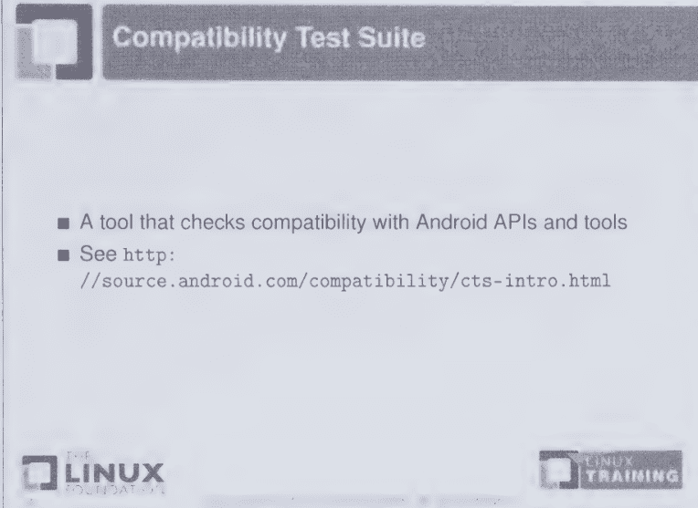

## LF315 Inside Android：Android 内部

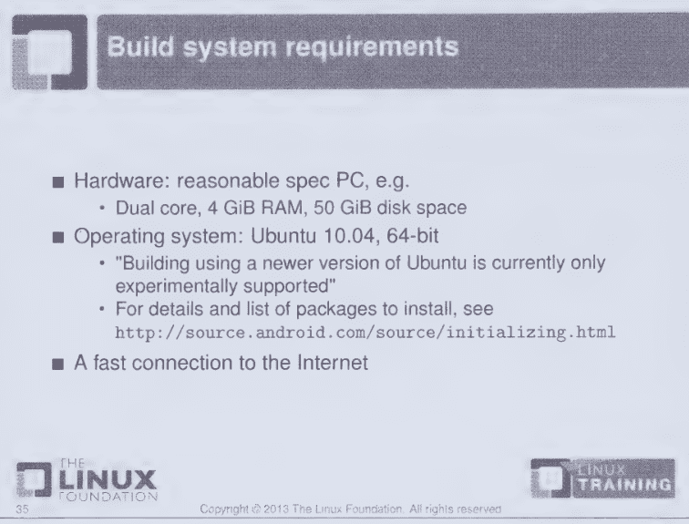

- 硬件：配置合理的 PC，例如双核、4 GB 内存、50 GB 磁盘空间

- 操作系统：Ubuntu 10.04, 64位

  - “目前仅支持构建更高版本的 Ubuntu”

- 详情和要安装的包列表，请见 `http://source.android.com/initializing.html`

## 第二节 Android 简介

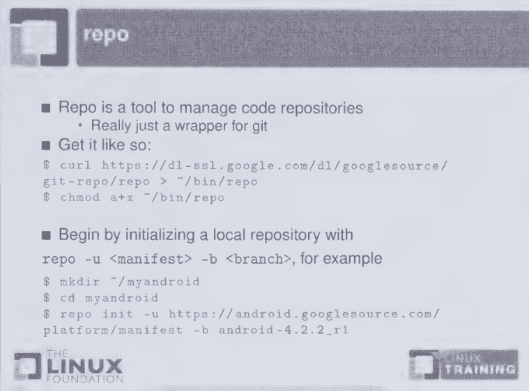

- Repo 是一个管理代码仓库的工具

- 实际上只是 git 的封装

如下如下获取：

```bash
$ curl https://dl-ssl.google.com/dl/googlesource/git-repo/repo > ~/bin/repo
```

- 通过以下命令初始化本地仓库
```bash
repo -u <manifest> <branch>, 例如
```

```bash
$ mkdir ~/myandroid
$ cd ~/myandroid
$ repo init -u <manifest> https://android.googource.com/platform/manifest -b android.4.2_r1
```

## 第 2 节 Android 简介

## LF315 Android 内部：Android 内部简介

## 分支

- 对于 Google 仓库，分支名称可以是：

- 默认（不带 -b）："master"

- 发布名称，例如 froyo, gingerbread

- 发布版本号，例如 android-2.3_r1, android-4.0.1_r1

- 参见 `http://source.android.com/source/build-numbers.html` 获取分支名称和 Android 版本的表格

## 第 2 节 Android 简介

截至 2013 年 4 月，repo 需要 git 1.7.2 或更高版本，这意味着如果你正在使用 Android 开发者推荐的 Ubuntu 10.04，你将需要升级 git：

```bash
$ sudo add-apt-repository ppa:git-core/ppa
$ sudo apt-get update
$ sudo apt-get install git
```

## LF315 Android 内部：Android 内部简介

## 在分支间切换

- 要要在分支间切换，只需执行

```bash
$ repo init -b <otherbranch>
$ repo sync
```

## 第 2 节 Android 简介

## repo 帮助

- 来自 repo get本身的帮助

```bash
$ repo help
$ repo help <command>
```

- 在此处有大量有用信息：

`http://source.android.com/source/using-repo.html`

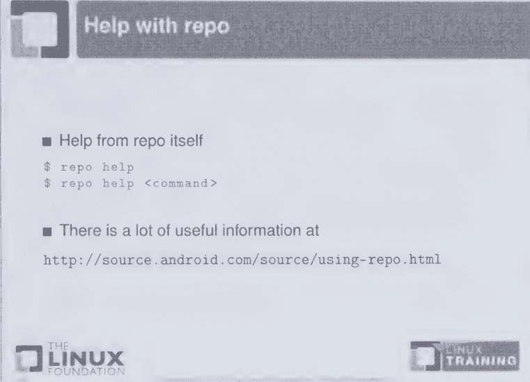

## 顶层 repo 目录 (1)

- `bionic`：bionic C 库

- `bootable`：bootloader 和 fastboot 协议

- `build`：构建系统

- `cts`：兼容性测试套件

- `dalvik`：Dalvik 虚拟机

- `development`：开发工具

- `device`：各种设备的配置

- `docs`：生成所有 Android 文档的脚本和模板

- `external`：第三方代码，大部分为开源软件 (OSS)

要构建 docs/ 中的文档，请进入该目录并运行构建脚本：

```bash
$ cd docs
$ python scripts/build.py
```

这会生成 `./out` 目录，它是完全构建的站点。

在 `scripts/micro-httpd.py` 中甚至有一个 http 服务器，这在自己的机器上测试该站点非常有帮助。

```bash
$ cd /out
$ HTTP_PORT=8080 python ../scripts/micro-httpd.py
```

## 第 2 节 Android 简介

## 开始构建

- 首先通过运行 `build/envsetup.sh` 来设置正确的 shell 环境

```bash
$ build/envsetup.sh
```

- `envsetup.sh` 包含了几个实用的命令，包括
- `hmm`：帮助文本
- `croot`：切换目录到树根节点
- `m`：从树根开始构建
- `mm`：构建当前目录下的所有模块
- `mmm`：构建指定目录下的所有模块
- `cgrep`：搜索所有本地 C/C++ 文件
- `jgrep`：搜索所有本地 Java 文件
- `godir`：跳转到包含文件的目录

## 第 2 节 Android 简介

- `envsetup.sh` 的部分内容是 *lunch* 命令
- 选择目标平台和构建类型
- 平台定义在 `device/` 目录下
    - 我们稍后会查看这个构建器
    - 默认的模拟器构建在 ICS 中被称为 "full"（以前是 "generic"）
- 构建类型是以下之一

| 类型 | 描述 |
| :--- | :--- |
| user | 限制访问；适用于生产环境 |
| userdebug | 类似 "user" 但具有 root 权限，适用于调试 |
| eng | 带有额外调试工具的开发配置 |

## 38 LF315 Android 内部：Android 内部简介

- AOSP 在 `prebuilds/gcc` 中提供了预编译的 GNU 工具链
  `envsetup.sh` 在这些 shell 变量中记录了路径
- `$ANDROID_TOOLCHAIN`：当前工具链
- `$ANDROID_EABI_TOOLCHAIN`：当前 ARM 工具链（与 `$ANDROID_TOOLCHAIN` 相同）
- `$ARM_EABI_TOOLCHAIN`：裸机工具链，适用于编译内核和 bootloader

- 要使用外部工具链，请在运行 make 之前设置 `TARGET_TOOLS_PREFIX`
- `TARGET_TOOLS_PREFIX=<工具链路径>/bin/<工具链前缀>`
- 示例

## 运行

- 简单运行 `make`
为了利用多个 CPU，添加 `-jN`，N 是 CPU 的数量
在四核机器上构建需要小时

## 结果

 所有的中间文件都在 `out/`
主机可执行文件在 `out/host/linux-x6/`
目标文件在 `out/target/`

## 第 2 节 Android 简介

## 总结
- Android 是基于 Linux 的开源操作系统
- repo 轻松地同步每个分支
- 源码是公开的
- 源码有大量的代码，在 `out/target/`

## 实验

### 实验 2.1 安装 Java
Android 需要 64 位的 Java，你可以从此处下载
在本例中我们将

```bash
$ cd ~/aosp
$ build/envsetup.sh
$ lunch
```

选择第一个选项，你使用的是哪个 ARM 工具链？

### 实验 2.2 构建 Android

目标：构建模拟器。在

```bash
$ JAVA_HOME=${HOME}/jdk-6
PATH=$JAVA_HOME/bin:$PATH
```

并将其添加到 `.bashrc` 的末尾

## LF315 Android 内部：Android 内部

## 大纲

第 3 节：首次查看

- Android 模拟器

- `adb`：Android 调试桥

- 文件系统和文件布局

## 模拟器

- 主要用于测试应用程序，也可用于验证我们的首次构建

- 构建 Android 后，它位于 `out/host/linux-x86/bin/emulator`

  - 作为 Android SDK 的一部分提供给开发者

- 基于 qemu

- 支持 armv5te 和 armv7 架构以及 x86

## 运行模拟器

- 如果你之前通过运行 `envsetup.sh` 和 `lunch` 选择了目标，所有路径都已设置，你只需要输入 `emulator`

## 第 3 节 首次查看

- 模拟器接受许多命令选项，

  运行 `emulator -help` 获取列表

- 在此阶段有两个有用：

  - `-show-kernel`：在当前终端显示内核消息

  - `-shell`：启用 root shell

48 LF315 深入理解 Android：Android 内部原理

## 系统镜像

- 模拟器所需的文件位于 `out/target/product/generic/`

- `hardware-qemu.ini`: 模拟器配置设置

- `ramdisk.img`: 启动 RAM 磁盘

- `system.img`: 系统文件

- `userdata.img`: 用户数据文件

- 这些镜像也作为 Android SDK 的一部分提供

## 第 3 节 初探

## 第 3 节 初探

- `adb devices`: 列出连接到 adb 服务的设备

- 每个设备都有唯一的标识符或序列号

- 在发送命令时你需要传递此标识符

```bash
$ adb devices
```


List of devices attached

emulator-5554 device

Blade-CM7 device

- 如果只有一个设备，则不需要 `-s device-name`
- 仅通过 USB 连接了唯一设备：使用 `-d`
- 只有一个模拟器：使用 `-e`

# LF315 深入理解 Android：Android 内部原理

## 旁白：USB 权限

- 如果你看到这个：

```
$ adb devices
```

List of devices attached ????????? no permissions

- 你需要为 USB 设备配置权限
- 运行命令 `lsusb` 查找查找厂商 ID 和产品 ID
- 在 `/etc/udev.rules.d/51-android.rules` 中创建一个规则：`SUBSYSTEM="usb", ATTRS{idVendor}==="19d2", ATTRS{idProduct}="1354", MODE="0666"`
- 拔掉 USB 线并重新插上

## 第 3 节 初探

### 通过 TCP 连接

在设备上（重）启动 `adbd`

```
# setprop service.adb.tcp.port 5555
# stop adbd
```

从宿主机连接到设备

```
$ adb connect 192.168.1.101:5555
connected to 192.168.1.101:5555
$ adb shell
#
```

# LF315 深入理解 Android：Android 内部原理

## shell 命令和文件拷贝

| 命令 | 描述 |
| shell | 运行远程 shell |
| push <local> <remote> | 将文件/目录拷贝到设备 |
| pull <remote> [<local>] | 从设备拷贝文件/目录 |
| sync [<directory>] | 仅在发生变化时从宿主机到设备 |

## 第 3 节 初探

# LF315 深入理解 Android：Android 内部原理

- `adb` 可以通过 USB 转发 TCP 端口
- 例如，使用 `gdb` 进行远程调试
- 命令 `adb forward <local port> <remote port>`
- 示例：将主机的 5555 端口连接到目标机的 1234 端口：

```
adb forward tcp:5555 tcp:1234
```

## 第 3 节 初探

## 使用真实硬件配合 adb

- 在设备上启用调试
- 在 Ice Sandwich 之前，选项是：设置->应用程序->USB 调试
- 在 Jelly Bean 上是：设置->开发者选项->USB 调试
- 点击“版本号”7 次进入开发者选项
- 拔掉 USB 线并重新插上

## Android 文件系统

## 第 3 节 初探

## 用户空间

- 在 `/system/bin`
- `toolbox` 提供了许多命令
  - 类似于 Busybox 但体积更小
- 自 Jelly Bean 起，`shell` 使用来自 `ash`
  - 命令行补全

```
pwd
ls -l
df
cat /proc/cpuinfo
cat /proc/meminfo
cat /proc/version
```

注意许多传统的命令缺失，例如 `find`, `grep`, `tar` (yes)

最后，输入 `"exit"` 或 `Ctrl-D` 终止 shell。

练习 3.4（可选）连接真实硬件

如果你有 Android 手机或平板，用 USB 线连接设备和笔记本电脑，并按照幻灯片所示启用调试。在笔记本电脑上运行 `adb devices`。如果你看到这个：

```
$ adb devices
List of devices attached
% ????????? no permissions
```

... 参考“旁白：USB 权限”幻灯片的指令。再次运行 `adb devices` 并检查它是否出现。使用以下命令启动 `adb shell`：

```
$ adb -s <设备名称> shell
```

## 第 4 节 应用剖

## 第 4 节：应用剖

* Android 应用和 Activity 简介
* 遍历项目
* 构建并安装应用
* 应用与进程
* 应用生命周期
* Android 日志

## 第 4 节 应用剖

## 应用 SDK

- 编写应用你需要 SDK
- 你可以从这里下载：
  http://developer.android.com/sdk/index.html
- 或者，从 AOSP 构建

```
$ . build/envsetup.sh
$ lunch sdk-eng
$ make sdk
```

结果位于

`out/host/linux-x86/sdk/android-sdk-eng.[name]_linux-x86`

## 代码应用

- 接下来几页幻灯片展示了一个非常简单的应用
- 应用主要用 Java 编写，并编译为 Dalvik 虚拟机的字节码
  - 如我们后面看到的，可以使用 C/C++ 编写应用，但要困难得多

## 第 4 ：应用程序结构

要创建一个 Dalvik 可执行文件，首先使用 Java 编译器 `javac` 创建一个 ".class" 文件，然后使用 Dalvik 编译器 `dx` 创建一个 ".dex" 文件。

Dalvik 这个名字源于冰岛北岸的一个小镇镇，那里是其中一名开发者的祖乡。它距离南太平洋的 Java 岛非常遥远。

## 创建项目

- 你可以使用带有 Android Development Toolkit 插件的 Eclipse
  - 在 http://developer.android.com/ 查看教程
- 或者使用 `android` 命令行工具
  - `-name` 用户可见的应用程序名称
  - `-path` 项目文件的目录
  - `-activity` 初始活动类名
  - `-package` 包名（小写，字母组成）

```
$ android create project --target 1 --name HelloWorld \
--path ./helloworld --activity HelloWorldActivity \
--package com.example.helloworld
```

## 第 4 ：应用程序结构

## Manifest 文件：AndroidManifest.xml

- 应用程序的顶层描述
- 除其他内容外，它包含
  * `minSdkVersion="N"`: 此应用需要 API N 或更高版本
  * `package="..."` - 包名
  * 各组件的入口点：
`<activity> ... </activity>` - 一个活动 (activity)
`<service> ... </service>` - 一个服务 (service)
`<receiver> ... </receiver>` - 一个广播接收器 (receiver)
`<provider> ... </provider>` - 一个内容提供者 (provider)

关于 `AndroidManifest.xml` 的更多信息请访问：http://developer.android.com/guide/topics/manifest/intro.html

## 第 4 ：应用程序结构

### AndroidManifest.xml (1)

- 第一部分可能像这样

```xml
<?xml version="1.0" encoding="utf-8"?>
<manifest xmlns:android="http://schemas.android.com/apk/res/android"
    package="com.example.helloworld"
    android:versionCode="1"
    android:versionName="1.0">
    <uses-sdk android:minSdkVersion="10" />
    ..
</manifest>
```

### AndroidManifest.xml (2)

- 在 manifest 部分，定义一个带有 label（标签）的 application
- label 是应用程序的人可读名称
- 通常 label 是一个字符串资源

```xml
<manifest ...>
  <application android:label="@string/app_name">
    ...
  </application>
</manifest>
```

## 第 4 ：应用程序结构

### AndroidManifest (3)

- 在 application 部分，定义组件，在本例中是一个单个 activity
- 它有一个 name，与 Java 类名匹配
- 并且有一个 label，在活动活动可见时显示

```xml
<activity android:name="HelloWorldActivity" android:label="@string/app_name">
...
</activity>
```

### AndroidManifest.xml (4)

在 activity 部分，应该有一个 intent-filter（意图过滤器）

- 定义哪些意图（消息）可以通过此活动传递
- 为了让主活动能够被启动器（或主应用）启动，你需要这样一个这样的 intent-filter

```xml
<intent-filter>
  <action android:name="android.intent.action.MAIN" />
  <category android:name="android.intent.category.LAUNCHER" />
```

## 第 4 ：应用程序结构

- `res/layout/main.xml` 定义了屏幕布局

```xml
<LinearLayout xmlns:android="http://schemas.android.com/apk/res/android"
    android:orientation="vertical"
    android:layout_width="fill_parent"
    android:layout_width="fill_parent"
    android:layout_height="wrap_content"
    android:text="Hello World, HelloWorld"/>
</LinearLayout>
```

## Android Android：Android 内部简介

对于这个简单的示例，我们只需要
- 一个继承自 `"Activity"` 的类 `"HelloWorldActivity"`
- 在首次启动时调用的 `onCreate` 函数
- 在 `onCreate` 中，调用 `setContentView(R.layout.main);` 来显示屏幕布局中定义的 UI

- 源文件存放在
- `src/com/example/helloworld/HelloWorld.java`

## 第 4 ：应用程序结构

```java
package com.example.helloworld;
import android.app.Activity;
import android.os.Bundle;
public class HelloWorldActivity extends Activity {
    /** 当活动首次创建时被调用。 */
    @Override
    public void onCreate(Bundle savedInstanceState)
    {
        super.onCreate(savedInstanceState);
        setContentView(R.layout.main);
    }
}
```

## 构建

- 你可以使用命令行通过 `ant` 进行构建，它是一个类似于 make 的工具
- `ant` 使用 `build.xml` 中的规则
- 默认规则定义了 debug 和 release 选项
- 或者使用 Eclipse ADT 构建
- 生成一个 Android 包

```bash
$ ant debug
Buildfile: build.xml
...
BUILD SUCCESSFUL
Total time: 1 second
```

## 第 4 应用程序结构

- 应用程序被封装成 `.apk` 格式
- 一个压缩包

```bash
$ unzip -l bin/HelloWorld.apk
Archive: bin/HelloWorld.apk
Length Date Name
------------------------------------------------
708 2013-03-24 11:33 res/layout/main.xml
1316 2013-03-24 11:33 AndroidManifest.xml
776 2013-03-24 11:33 classes.dex
```

## 安装

- 你可以使用 `adb` 安装到目标
- 替换任何现有应用

```bash
$ adb install -r bin/HelloWorld.apk
Success
```

- 注意：你可以使用 `adb` 完全移除应用

```bash
$ adb uninstall com.example.helloworld
```

## 第 4 应用程序结构

应用程序与进程

- 每个应用程序运行在一个独立的 Dalvik 虚拟机中
- 每个虚拟机作为一个独立的 Linux 进程运行
- 进程无法访问属于其他进程的内存
- 如果一个进程终止（例如崩溃），它不会影响其他进程（除非存在显式依赖）

应用程序 ID

- 进程模型防止对另一个应用程序内存的干扰
- 通过为每个应用程序使用唯一的 ID，其他应用程序无法访问文件
- 应用程序 ID 在安装时分配，从 10000 开始
- 所以，`app_26` 是 10000 + 26 = 10026
- 存储在 `/data/system/packages.xml`
- 属于应用程序的所有文件都被设置为相同的用户 ID
- 其他应用程序（具有不同的 ID）无法访问这些文件

## 组 ID (Group IDs)

- 根据 `AndroidManifest.xml` 中请求的权限，每个进程都会分配一个组 ID
- 例如：

```bash
# ps
...
u00_a27 360 36 170720 35972 S com.android.email
# cat /proc/360/status
...
Groups: 1015 3003
```

- 从 `android_filesystem_config.h` 中我们可以看到：
`#define AID_SDCARD_RW 1015`
`#define AID_INET 3003`


## 应用权限

- 应用权限在 `AndroidManifest.xml` 的 `uses-permission` 部分中请求
- 在安装应用时，用户将看到一个权限列表并被要求接受或拒绝安装
- 格式如下：
- 例如，访问外部存储（例如 SD 卡）：
`<uses-permission android:name="android.permission.WRITE_EXTERNAL_STORAGE"/>`


标准系统权限列表定义在 `Manifest.permission` 类描述中。
其他示例包括：
- BLUETOOTH：连接已配对的蓝牙设备
- CAMERA：使用相机设备
- INTERNET：使用 Internet 套接字
- WAKE_LOCK：使用 WakeLocks 防止处理器进入休眠

## 将权限映射到 GID

- 映射定义在 `/system/etc/permissions/platform.xml` 中
- 示例

```xml
<permission name="android.permission.WRITE_EXTERNAL_STORAGE">
  <group gid="sdcard_rw" />
</permission>
```

此外，`android_filesystem_config.h` 中有一张将 "sdcard_rw" 映射到 GID 的表：

```cpp
static const struct android_id_info android_id_ids[] = {
  "sdcard_rw", AID_SDCARD_RW,
  ..
};
```


## 第 4 节 应用的结构

你可以使用 `ps` 配合 `-t` 选项显示线程：

| USER | PID | PPID | SIZE | RSS | NAME |
| :--- | :--- | :--- | :--- | :--- | :--- |
| u0_a45 | 872 | 37 | 176476 | 20860 | com.example.helloworld |
| u0_a45 | 874 | 872 | 176476 | 20860 | GC |
| u0_a45 | 875 | 872 | 176476 | 20860 | Signal Catcher |
| u0_a45 | 877 | 872 | 176476 | 20860 | JDWP |
| u0_a45 | 878 | 872 | 176476 | 20860 | Compiler |
| u0_a45 | 879 | 872 | 176476 | 20860 | ReferenceQueueD |
| u0_a45 | 881 | 872 | 176476 | 20860 | FinalizerDaemon |
| u0_a45 | 882 | 872 | 176476 | 20860 | FinalizerWatch |
| u0_a45 | 883 | 872 | 176476 | 20860 |  |

| 线程 | 描述 |
| :--- | :--- |
| GC | 垃圾回收 |
| Signal Catcher | 信号捕获 |
| JDWP | Java 调试代理 |
| Compiler | 编译器 |
| ReferenceQueueD | 引用队列 |
| FinalizerDaemon | 终化器守护进程 |
| FinalizerWatch | 终化器监视器 |

| 映射权限到 GID |
- `android_filesystem_config.h`
- `Manifest.permission` |
- `AndroidManifest.xml` |
- `platform.xml` |

*(注：由于原文中部分表格内容存在乱码或重复，译文已根据上下文逻辑进行了对齐处理)*

## 第 4 节 应用程序的结构

## 练习 4.2 创建测试应用程序

目标：创建一个简单的应用程序并观察其行为

通常情况下，你会使用 Eclipse 和 ADT（Android 开发工具包）完成此任务，但你也可以像这里一样使用命令行工具。

启动一个新的 shell 并运行上一个练习的脚本

列出所有可用的目标（恰好有一个）：

```
$ android list targets
```

在目录 `helloworld` 目录下创建一个名为 `HelloWorld` 的骨架项目，包名为 `com.example.helloworld`，主 Activity 为 `HelloWorldActivity`：

```
$ mkdir ~/src
$ cd ~/src
$ android create project --target 1 --name HelloWorld --path ./helloworld --activity HelloWorldActivity --package com.example.helloworld
```

然后使用以下命令进行构建：

```
$ cd helloworld
$ ant debug
```


# LF315 深入 Android：Android 内部原理简介

创建一个名为 `jbttest` 的 Android 虚拟设备进行测试：

```
$ android create avd --name jbttest --target 1
```

使用新的 avd 启动模拟器

```
$ emulator -avd jbttest &
```

启动后，安装该应用程序：

```
$ adb install bin/HelloWorld-debug.apk
```

现在，你可以点击模拟器上的应用程序图标，找到你的 HelloWorld 应用程序并运行它。

## 练习 4.3 位于何处？

打开 `adb shell` 并在这些目录中查找应用程序的组件：
- `/data/app` - 包文件
- `/data/data` - 数据文件
- `/data/dalvik-cache` - 缓存的 dex 文件

## 练习 4.4 用户 ID

打开 `adb shell` 并输入 "`ps`" 以获取进程列表。找到你的应用程序 (`com.example.helloworld`) 并注意用户名是 `uu0_axx`。它总是相同的吗？例如，当你重启模拟器或设备时？如果你删除（`adb uninstall com.example.helloworld`）并重新安装它，用户 ID 还是相同的吗？

## 练习 4.5 生命周期

在你的 hello world 应用程序中添加生命周期回调：

- `onStart`, `onResume`, `onPause`, `onStop`, `onDestroy`

在每个情况下，使用 `Log.d` 编写一条日志消息

运行应用程序并监控日志

查看更改显示器方向会发生什么（如果使用模拟器，按 Ctrl-F12）

注意，进程会一直运行，直到你从 UI 杀死它，如下所示：
设置 -> 应用程序 -> 管理应用程序，然后点击你的测试应用程序并选择强制停止（Force Stop）

114 LF315 深入 Android：Android 内部原理简介

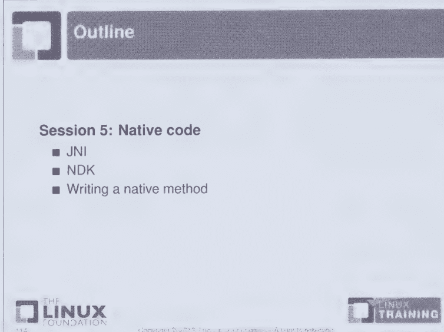

## 第 5 节 原生代码

- JNI
- NDK
- 编写原生方法

## 第 5 节 原生代码

## 原生代码的

- “原生代码”意味着用 C 和 C++ 编写
- 用原生代码编写的 Android 组件包括：
    - 守护进程，例如 `rild`、`netd` 和 `init`
    - 工具，例如 `shell`、`netcfg`
    - Android 框架的底层部分
    - 用 Java 编写的应用程序“原生方法”
    - “原生活动”：完全用 C 和 C++ 编写的活动
    - 加上内核
- 本节涉及编写“原生方法”


# LF315 深入 Android：Android 内部原理简介

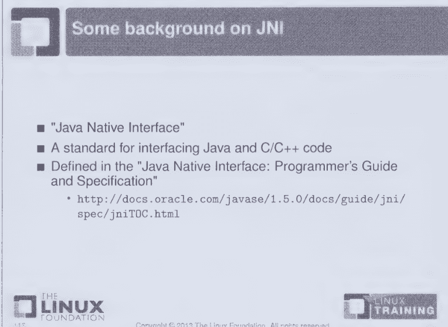

- “Java Native Interface”（Java 原生接口）
- 用于 Java 和 C/C++ 代码交互的标准
- 定义在《Java Native Interface: Programmer's Guide and Specification》中
  - http://docs.oracle.com/javase/1.5.0/docs/guide/jni/spec/jniTOC.html

## 第 5 节 原生代码

JNI 的 Java 端
```java
package com.example.hellojni;
import android.app.Activity;
import android.widget.TextView;
import android.os.Bundle;
public class HelloJni extends Activity {
    public native String stringFromJNI();
    static {
        System.loadLibrary("hello-jni");
    }
    @Override
    public void onCreate(Bundle savedInstanceState) {
        super.onCreate(savedInstanceState);
        TextView tv = new TextView(this);
        tv.setText(stringFromJNI());
        setContentView(tv);
    }
}
```


## JNI 的 C 端 (1)

带有 JNI 定义的头文件

函数名必须采用 `Java_<package>_<class>_<method>` 的形式

```
#include <string.h>
#include <jni.h>
jstring
Java_com_example_hellojni_HelloJni_stringFromJNI(JNIEnv *env, jobject thiz) {
    return (*env)->NewStringUTF(env, "Hello from native");
}
```

## JNI 的 C 端 (2)

```
#include <string.h>
#include <jni.h>
jstring
Java_com_example_hellojni_HelloJni_stringFromJNI(JNIEnv *env, jobject thiz) {
    return (*env)->NewStringUTF(env, "Hello from native");
}
```

## JNI 的 C 端 (3)

```
#include <string.h>
#include <jni.h>
jstring
Java_com_example_hellojni_HelloJni_stringFromJNI(JNIEnv *env, jobject thiz) {
    return (*env)->NewStringUTF(env, "Hello from native");
}
```

原生代码

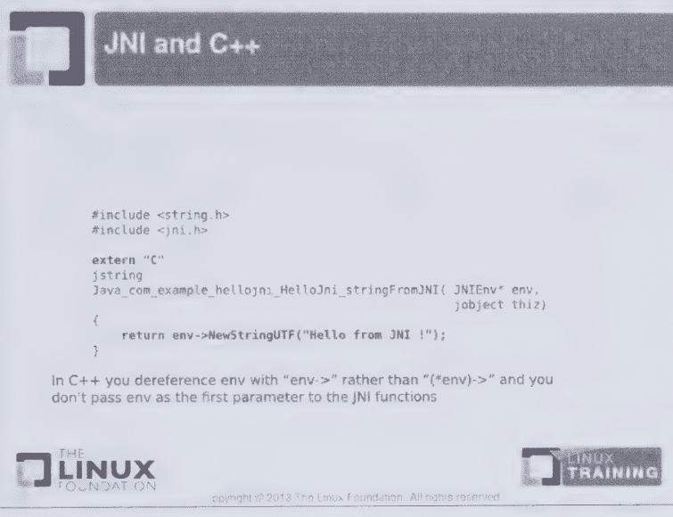

```
#include <string.h>
#include <jni.h>
extern "C"
jstring
Java_com_example_hellojni_HelloJni_stringFromJNI(JNIEnv *env, jobject thiz) {
    return (*env)->NewStringUTF(env, "Hello from native");
}
```

这些简单类型可以转换为 Java：

| 原生类型 | JNI 类型 |
|---|---|
| unsigned char | jboolean |
| signed char | jbyte |
| unsigned short | jchar |
| short | jshort |
| long | jint |
| unsigned long | jlong |
| float | jfloat |
| double | jdouble |


## 第 5 节 原生代码

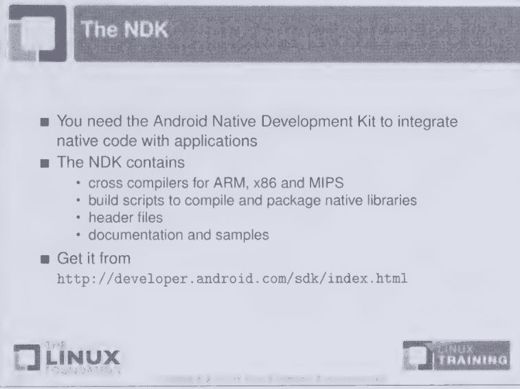

# LF315 深入 Android：Android 内部原理简介


- armeabi：兼容 ARM926，软浮点
- armeabi-va：兼容 ARMv7，硬浮点
- x86：兼容 i686，MMX, SSE, SSE2
- mips：兼容 MIPS32r1，硬浮点

原生代码的稳定 API 文档位于 NDK 目录下的 `STABLE-APIS.html`。通过 `Android.mk` 中的 `APP_PLATFORM` 选择 API 级别。

下表总结了你可以使用的库：

| 库 | API 级别 | 说明 |
|---|---|---|
| libc, libm, librt | 3 | C、数学和实时扩展 |
| libthread | 3 | POSIX 线程 |
| libstdc++ | 3 | C++ 支持库 |
| liblog | 3 | -llog Android 日志 |
| libz | 3 | -lz Zlib 压缩 |
| libdl | 3 | -idl 动态链接器库 |
| libGLESv1 | 4 | -IGLESv1_CM OpenGL ES 1.x |
| libGLESv2 | 5 | -IGLESv2 OpenGL ES 2.0 |
| libandroid | 8 | 读取/写入 Java 像素缓冲区 |
| libEGL | 9 | -iEGL 访问 OpenGL ES 表面 |
| libOpenSLES | 9 | -iOpenSLES OpenSL ES 原生音频 |
| libandroid | 9 | -landroid 原生活动 |
| libOpenMAXAL | 14 | -iOpenMAXAL OpenMAX AL 原生多媒体 |

# 在 Android.mk 中指定库

- `LOCAL_LDLIBS`: 要链接的库列表

```
LOCAL_PATH := $(call my-dir)
include $(CLEAR_VARS)
LOCAL_MODULE := hello-jni
LOCAL_SRC_FILES := hello-jni.c
LOCAL_LDLIBS := -llog -ljnigraphics
include $(BUILD_SHARED_LIBRARY)
```

## 第 5 节 原生代码

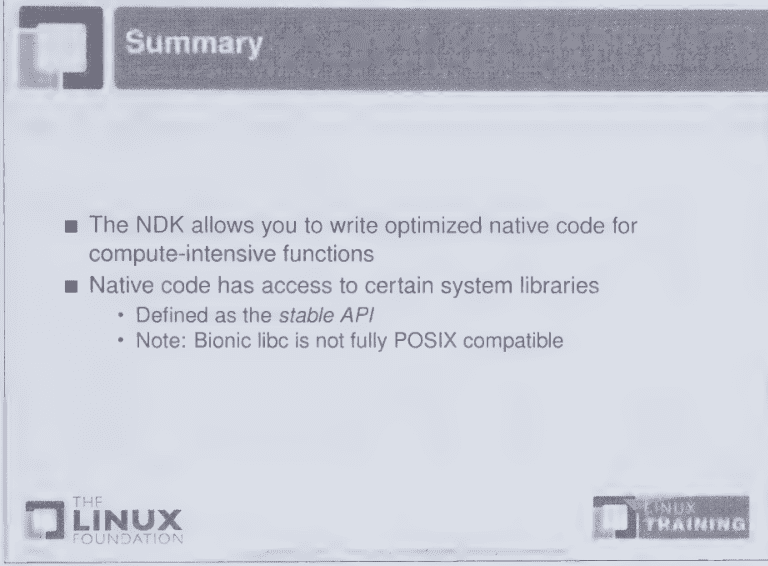

- NDK 允许你为计算密集型函数编写优化的原生代码
- 原生代码可以某些系统库
  - 定义为稳定 API
  - 注意：Bionic libc 并非完全兼容 POSIX

# 实验 5

练习 5.1 安装 NDK

```
$ cd
$ tar xf /embedded-android/resources/lab5/android-ndk-xxxxxxxxxx-linux-x86.tar.bz
```

请注意，可以从 AOSP 代码创建 NDK。我们目前没有这样做，是因为 (a) 耗时很长且 (b) 4.2.1_r1 版本中的构建脚本已损坏。为了完整起见，方法如下：

```
$ cd ndk/build/tools/
$ export ANDROID_NDK_ROOT=$HOME/embedded-android/aosp/ndk
./make-release.sh
```

练习 5.2 编写原生方法

创建一个名为 `HelloJni` 的新 Android 项目，包名为 `com.example.hellojni` 并编译它。

在 `HelloJni` 项目中创建一个名为 `jni` 的新文件夹，并将 `/embedded-android/resources/lab5` 中的两个文件（`Android.mk` 和 `hello-jni.c`）复制到该目录。使用 `ndk-build` 脚本从命令行构建库：


```
/android-ndk-xxxxxxxxxx/ndk-build
```

注意目录 `libs/armeabi` 已经创建并并包含该库。

修改生成的 Java 源文件 `HelloJniActivity.java`，按照幻灯片所示所示调用 `stringFromJNI`。

测试其运行情况。你应该应该在屏幕上看到字符串 "Hello from JNI !"，如果你运行 `logcat`，你应该能看到它报告正在加载你的原生库。

扩展函数以接收两个整数，将它们相加并将结果作为字符串返回。原生函数的原型将是

```
jstring Java_com_example_hellojni_HelloJni_stringFromJNI(JNIEnv* env, object this, jint n1, jint n2)
```

# 第 6 节 Intent（意图）

- 显式 Intent
- 隐式 Intent
- Intent 过滤器

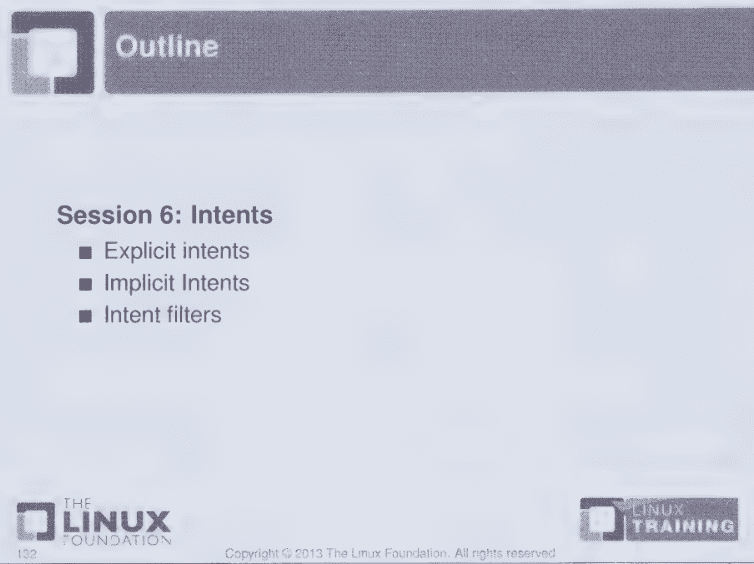

## Intent

- Intent 是在应用组件之间传递的消息：
  - Activity
  - 服务
  - 广播接收器
- 目标组件可能在同一个应用程序中，也可能在不同的应用程序中
- Intent 也用于发送系统级通知（广播 Intent）

用于发送 Intent 的函数示例包括：

`startActivity (Intent)` 用于启动一个 Activity

`startService(Intent)` 或 `bindService(Intent, ServiceConnection, int)` 用于启动后台服务

`sendBroadcast (Intent)` 将其发送到任何感兴趣的 BroadcastReceiver 组件。

广播 Intent 将在稍后详细介绍

## Intent 的类型

- 显式：目标是全限定名（包名和类）
- 隐式
  - 目标是模糊的：例如显示一个网页
  - 系统将选择一个可以执行该操作的目标
  - 如果有多个选项，可能会提示用户进行选择
- 广播
  - 一种用于通知事件的隐式 Intent，例如 WiFi 连接状态的变化


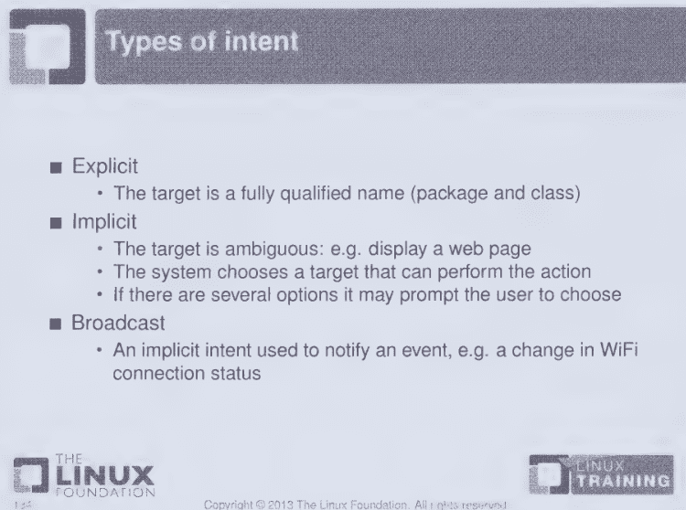

# 第 6 节 Intent

## Intent 对象

- `android.content.Intent` 类包含这些字段

  - `ComponentName`：用于显式 Intent，指定目标类
  - `action`：Intent 的目的
  - `data`：与 `action` 相关的 URI
  - `type`：描述数据的 MIME 类型
  - `category`：包含有关应处理该 Intent 的组件类型的额外信息的字符串
  - `extras`：任意数量的键值对

## LF315 Android 内部：Android 原简介

### 显式 Intent

```text
- 显式 Intent 拥有
  - ComponentName 中的一个目标
- 可能有 action, data, type, category 和 extras
- ComponentName 由两个字符串组成：
  - package，例如 "com.example.helloworld"
  - class，例如 "com.example.helloworld.HelloWorldActivity"
- 使用 setComponent(ComponentName) 或 setClass(Context, Class)
```


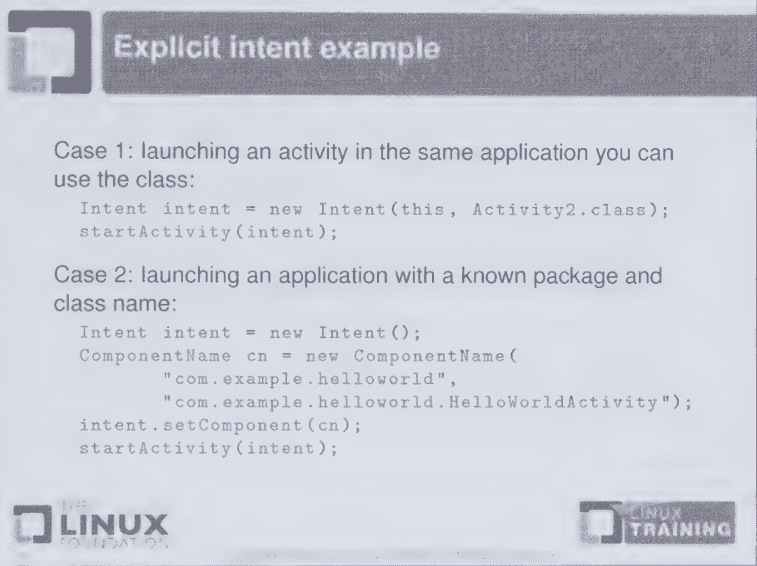

### 案例

案例 1：在同一个应用程序中启动 Activity，你可以使用类：

```
Intent intent = new Intent(this, Activity.class);
startActivity(intent);
```

案例 2：使用已知包名和类启动应用程序：

```
Intent intent = new Intent();
ComponentName cn = new ComponentName(
"com.example.helloworld",
"com.example.helloworld.HelloWorldActivity");
intent.setComponent(cn);
startActivity(intent);
```

## LF315 Android 内部：隐式 Intent

- 隐式 Intent 拥有

  - 一个空的 `ComponentName`
  - 至少一个 `action`
  - 可选的 `data`, `type` 和 `extras`
  - 系统将选择可以处理该 Intent 的应用程序


## Action 和 data

- `Action` 是字符串，例如：

  - `"intent.action.DIAL"`
  - 通常使用 `Intent.ACTION_DIAL`

- `Data` 是与 `action` 相关的可选对象

使用 `ACTION_DIAL`：

- `data = "tel:123"` 显示拨号 123 的应用程序
- `data = "content://contacts/1"` 显示联系人 1 的拨号应用程序


## LF315 Android 内部：Category

- `Category` 是关于 Intent 类型的额外信息

  - 类似于动作，例如：
  - `"intent.category.LAUNCHER"`
  - 对应的常量 `Intent.CATEGORY_LAUNCHER`

## 过滤器

- 应用组件必须指定 `intent filter` 以接收隐式 Intent
- 显式 Intent 不需要匹配 `filter`
- `Filter` 编写在 `AndroidManifest` 中

示例：

```xml
<intent-filter>
  <action android:name="intent.action.MAIN" />
  <category android:name="intent.category.LAUNCHER" />
</intent-filter>
```

## LF315 Android 内部

- `filter` 匹配 Intent 的 `action`、`type` 和 `category`
- 如果 Intent 有 `action`，必须匹配 `filter` 中的 `action`
- 如果 Intent 有 `type`，必须匹配 `filter` 中的 `type`
- 如果 Intent 有一个或多个 `category`，必须全部匹配 `filter` 中的 `category`
- 如果有多个可能的目标，将弹出对话框让用户选择


## am 命令

- `am` 命令可以用于发送 Intent 等其他操作
- 例如，这将启动 `com.example.helloworld` 中的主 Activity：

```
am start -a intent.action.MAIN -n com.example.helloworld/com.example.helloworld.HelloWorldActivity
```


## 启动新应用程序

- 让 `PackageManager` 帮你！

```java
Intent intent = getActivity().getPackageManager().getLaunchIntentForPackage(com.package.address);
if (intent != null) {
    // 启动 activity
    intent.addFlags(Intent.FLAG_ACTIVITY_NEW_TASK);
    startActivity(intent);
}
```


Copyright © 2013 Linux Foundation.

所有权利保留。请勿分发。


## 自定义主页应用

- 将应用程序扩展为按下主页键运行的“启动器”，只需将意图过滤器（`intent filter`）替换为此代码：

```xml
<intent-filter>
  <action android:name="android.intent.action.MAIN" />
  <category android:name="android.intent.category.HOME" />
  <category android:name="android.intent.category.DEFAULT" />
</intent-filter>
```

- 查看 `packages/apps/Launcher2` 中默认启动器的代码

## 第 6 节意图 (Intents)

## 总结

- 意图是从应用程序组件到另一个组件的消息
- 如果目标完全定义，则它是一个显式意图

  - 即存在一个 `ComponentName`
- 否则，它是一个隐式意图，Android 将通过意图解析（`intent resolution`）找到合适的目标

  - 这是对象之间的一种延迟绑定形式


## 第 6 实验

### 练习 6.1 启动另一个 Activity

`/embedded-android/lab/lab6/testactivity` 中的示例应用程序有两个 Activity。主 Activity 有三个按钮。

扩展它，使得点击第一个按钮启动另一个 Activity，点击第二个按钮启动另一个应用程序中的 Activity（例如 `helloworld`），第三个按钮启动带有 URL 的浏览器。要从字符串创建 `Uri` 对象，请使用

```java
Uri.parse("http://some-url");
```

### 练习 6.2 启动应用程序

使用 `am` 命令从命令行启动 Activity

### 练习 6.3（可选）自定义主页应用

编写一个实现主页功能的应用程序

# 第 7 节：其他应用程序组件

151

- 服务 (`Service`)
- 内容提供者 (`Content provider`)
- 广播接收器 (`Broadcast receiver`)


## 服务 (Service)

- 一个没有用户界面的长时间运行组件
- 服务在应用程序进程的范围内运行

  - 默认情况下，服务不会作为单独进程运行
- 服务从主线程运行

  - 默认情况下，服务不会作为单独线程运行

## 声明服务

- 扩展接口 `Service`

```java
import android.app.Service;

public class TestServer extends Service {
```

- 在 `AndroidManifest.xml` 中声明

```xml
<application ...>
  <service android:name=".TestServer" />
</application>
```

## 服务类型

- 与服务的交互有两种
- “异步地”：它被启动并在后台运行，直到被停止
- “同步地”：服务提供客户端-服务器接口，只要有客户端它就一直运行

## 异步服务

- 当另一个组件（通常是 Activity）调用 `startService` 时启动
- `start` 有一个参数：指定服务的 `intent`

```java
Intent intent = new Intent(TestServerActivity.this, TestServer.class);
startService(intent);
```


## 同步服务

- 实现 `IBinder` 接口
- 当客户端调用 `bindService` 时启动
- 当最后一个客户端调用 `unbindService` 时销毁

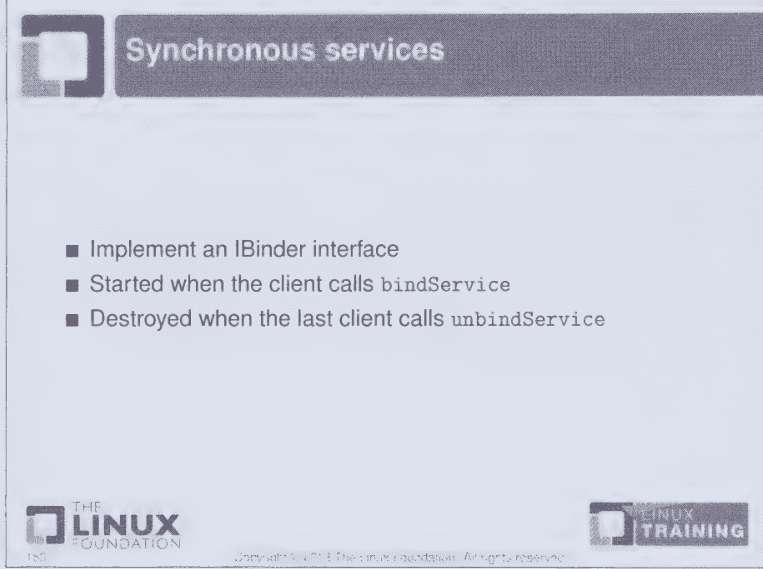

## 服务回调函数 (1)

- 在服务创建和销毁时调用 `onCreate` 和 `onDestroy`
- 注意：不要像 Activity 那样调用 `super`

```java
@Override
public void onCreate() {
}

@Override
public void onDestroy() {
}
```


## 服务回调函数 (2)

- 当有人调用 `startActivity` 时调用 `onStartCommand`
- 返回位位之一

  - `START_STICKY` 表示如果在带有待处理意图时被杀死，则会自动重启

```java
@Override
public int onStartCommand(Intent intent, int flags, int startId) {
    return START_STICKY;
}
```


## 服务回调函数 (3)

- 返回 `IBinder` 接口
- 如果不实现同步服务，此函数返回 `null`

```java
@Override
public IBinder onBind(Intent intent) {
    return null;
}
```

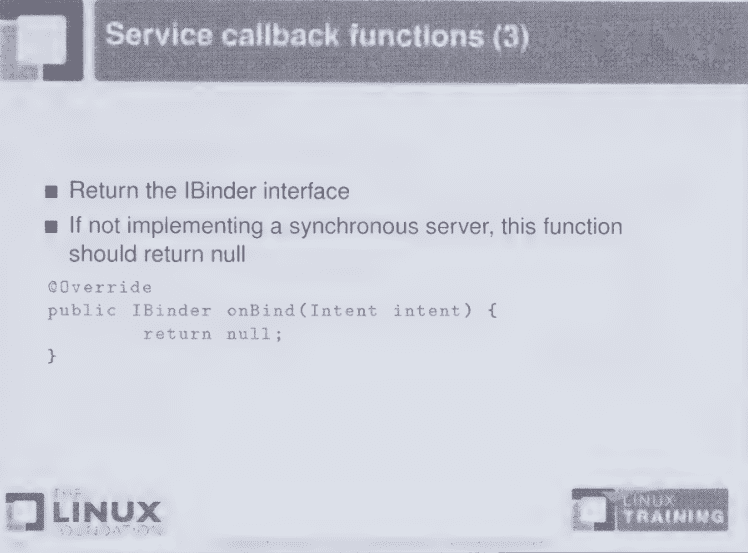

LF315 Android 内部：Android 原理

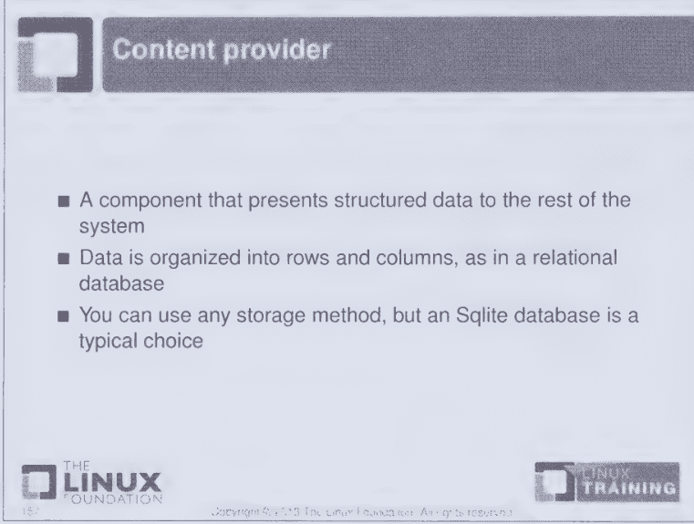

- 向系统其他部分呈现结构化数据的组件
- 数据像关系型数据库一样组织成行和列
- 你可以使用任何存储方法，但 `SQLite` 数据库是选择

## 声明内容提供者

- 扩展接口 `ContentProvider`

```java
public class TestProvider extends ContentProvider {
```

- 在 `AndroidManifest.xml` 中声明

```xml
<application ...>
    <provider android:name=".TestProvider"
       android:authorities="com.example.test.provider"/>
</application>
```


## 通过 URI 访问

- 查询可以构建为 URI
- 例如，给定包含 `table1` 的内容提供者类 `com.example.test.provider`：

  - `content://com.example.test.provider/table1`

## 示例

```java
public class TestProvider extends ContentProvider {
    private static final UriMatcher sUriMatcher;

    sUriMatcher.addURI("com.example.test.provider",
        "table1", 1);
    sUriMatcher.addURI("com.example.test.provider",
        "table/#", 2);
}
```


Copyright © 2013 Linux Foundation. 保留所有权利。禁止发行。


## 广播接收器

- 广播接收器接收广播意图
- 只有一个回调：`onReceive`

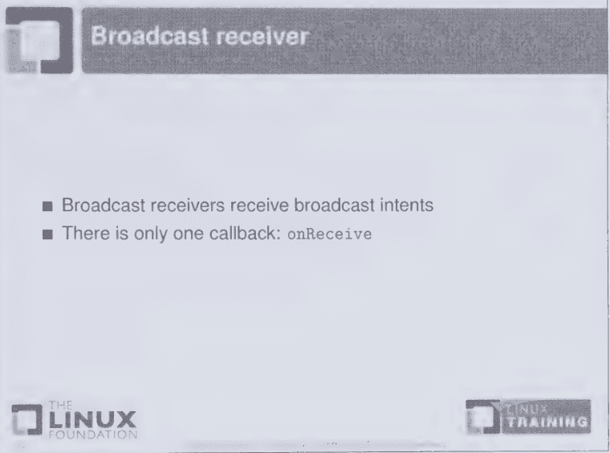

## 广播意图

- 大多数由系统生成，例如电量低、来电
- 可以通过调用 `Context.sendBroadcast()` 生成

  - `Context.sendOrderedBroadcast()`, `Context.sendStickyBroadcast()`

## 声明广播接收器

- 扩展接口 `BroadcastReceiver`

```java
public class TestReceiver extends BroadcastReceiver {
```

- 在 `AndroidManifest.xml` 中声明

```xml
<application>
  <receiver android:name=".TestReceiver" />
</application>
```

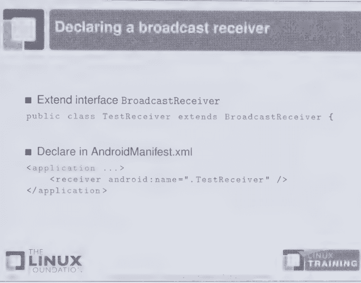

## 总结

- 已经有四种应用程序组件
- 已经涵盖了 Activity
- 服务：提供没有用户界面的后台处理

  - 类型：异步——运行直到停止，同步——实现接口并只要有客户端绑定到该接口就一直运行
- 内容提供者：提供其他组件可以查询的数据存储
- 广播接收器：接收广播意图的方法


## 第 7 实验

### 练习 7.1 创建服务

在 `$HOME/embedded-android/lab7` 中有一个包含服务和一个带有启动和停止服务按钮的 Activity 的示例应用程序

运行应用程序的同时在另一个窗口运行 `logcat`，并检查生命周期是否符合预期。注意即使 Activity 不可见，它也会继续运行（例如，按下主页键时，服务的 `onDestroy` 方法不会被调用）

### 练习 7.2 内容提供者

在 `$HOME/embedded-android/lab7` 中有一个示例内容提供者

### 练习 7.3 广播接收器

在 `$HOME/embedded-android/lab7` 中有一个示例广播接收器

## 第 8 节：板级配置


# 第 8 板卡配置

## 创建新设备

- Android 构建系统的工作与 Yocto 及类似系统相同
- 设备定义位于 `device/` 目录
- 存在一个两级层次结构
  - 组织/产品 `organization/product`
  - 后面的示例使用了 `myorg` 和 `mydevice`
- 接下来的几页幻灯片描述了这些核心配置文件：
  - `AndroidProducts.mk`
  - 产品 makefile，`[PRODUCT_NAME].mk`
  - `device.mk`
  - `BoardConfig.mk`
  - `vendorsetup.sh`
  - `Android.mk`

## 172 LF315 Android 内部：Android 内部原理简介

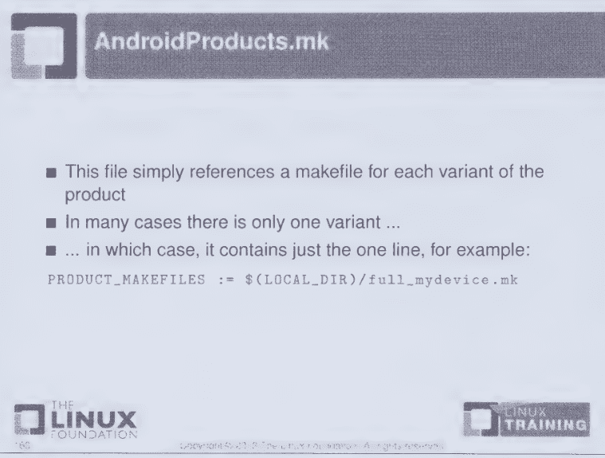

- 该文件简单地为产品的每个变体引用一个makefile
- 在很多情况下，只有一个变体……
- ... 在这种情况下，它只包含一行，例如：

```
PRODUCT_MAKEFILES := $(LOCAL_DIR)/full_mydevice.mk
```

## 产品 makefile

- 该文件包含两件事：
- 定义哪些包将包含在构建中
- 定义产品名称，`PRODUCT_NAME`
- 文件名必须命名为 `[PRODUCT_NAME].mk`
- 为了节省大量输入工作，从预定义的产品继承包
- 在 `build/target/product/` 中查找示例
- 然后提供本地覆盖 `overrides`


## 产品 makefile 示例

- 例如：`full_mydevice.mk`

```
$(call inherit-product, $(SRC_TARGET_DIR)/product/full_base.mk)
$(call inherit-product, device/myorg/mydevice/device.mk)

PRODUCT_NAME := full_mydevice
PRODUCT_DEVICE := mydevice
PRODUCT_MODEL := Full Android on My Device
```

## device.mk

- 提供对产品 makefile 中继承属性的覆盖，并添加新属性
- 接下来的几页幻灯片描述了这些变量：
  - `PRODUCT_COPY_FILES`
  - `PRODUCT_PACKAGES`
  - `PRODUCT_PROPERTY_OVERRIDES`
  - `PRODUCT_CHARACTERISTICS`
  - `PRODUCT_TAGS`

### device.mk: PRODUCT_COPY_FILES

- 将文件列表复制到构建目录，以便它们包含在最终系统中
- `PRODUCT_COPY_FILES += source-path:destination-file`
- 若要包含在根文件系统 `ramdisk`，将 `destination-file` 设置为 `root`
- 例如：
  `device/myorg/mydevice/init.rc:root/init.rc`

## 第 8 板卡配置

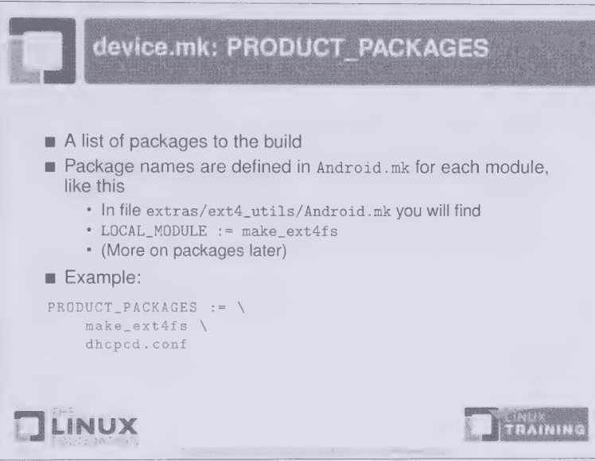

- 要构建到构建的包列表
- 包名在 `Android.mk` 中为每个模块定义，如下所示
- 在 `extras/ext4_utils/Android.mk` 中你会找到
  `LOCAL_MODULE := make_ext4fs`
- （稍后会介绍更多包）
- 示例：

```
PRODUCT_PACKAGES := \
    make_ext4fs \
```

- 定义将写入 `/system/build.prop` 的系统属性
- 当我们讨论引导 `bootstrapping` 时会介绍更多系统属性
- 有许多系统属性，查看 `device.mk` 示例
- 一些有用的属性：
  - `hw.nobattery` - 如果设备不掉电则设置为 true
  - `hwui.render_dirty_regions` - 设置为 `"false"` 以禁用部分脏区域
- 示例：

```
PRODUCT_PROPERTY_OVERRIDES := hw.nobattery=true \
  hwui.render_dirty_regions=false
```

Copyright © 2013 Linux Foundation. 版权所有。

## PRODUCT_CHARACTERISTICS

- 特性列表，包括：
- `tablet` - 覆盖默认的 `"phone"`
- `nosdcard` - 外部存储不使用 SD 卡
- 例如：

```
PRODUCT_CHARACTERISTICS := tablet,nosdcard
```


## device.mk: PRODUCT_TAGS

- 几乎普遍情况下，这一行包含在 `device.mk` 中：
- `PRODUCT_TAGS += dalvik.gc.type`
- 这配置了 Dalvik 垃圾回收器 `dalvik.gc.type`

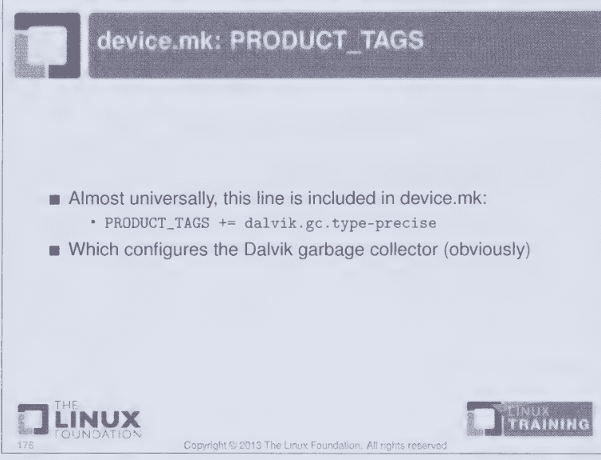

## 第 8 板卡配置

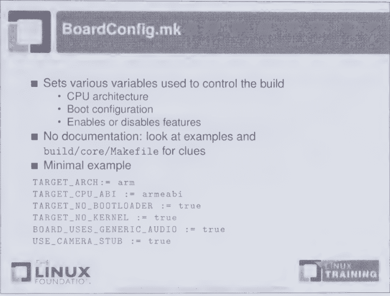

## BoardConfig.mk - CPU

- 你可以如下配置 CPU 类型和特性：
- `TARGET_ARCH`
  - 在 4.0.x 和 4.1.x 中为 `arm`
  - 在 4.2.x 中为 `arm, x86`
  - `TARGET_CPU_ABI` 应该设置为主 ABI：
  - `TARGET_CPU_ABI_SECONDARY` 应该设置为次要 ABI：
- 如果是多核，添加：
  `TARGET_SMP`

## BoardConfig.mk - ARM

- 有些 ARM 特有的设置
- 如果芯片有 TLS `Thread Local Storage`，例如 Cortex-A，添加：
  `ARM_HAVE_TLS := true`
- 如果芯片有 NEON 协处理器，添加：
  `ARCH_VARIANT := armv7-neon`


## BoardConfig.mk - 文件系统

- 配置 ext4 文件系统类型和大小：

```
TARGET_IMAGES_USE_EXT4 := true
BOARD_FLASH_SIZE := 4096
BOARD_SYSTEM_PARTITION_SIZE := nnnnnn
BOARD_USERDATA_PARTITION_SIZE := nnnnnn
BOARD_CACHE_PARTITION_SIZE := nnnnnn
```

- `nnnnnn` 是字节

## 第 8 板卡配置

## BoardConfig.mk - 文件系统

- 使用原始 NAND 时需要设置页大小、备用大小和块大小：

```
BOARD_NAND_PAGE_SIZE := 2048
BOARD_NAND_SPARE_SIZE := 64
BOARD_NAND_BLOCK_SIZE := 131072
BOARD_SYSTEM_PARTITION_SIZE := nnnnnn
BOARD_USERDATA_PARTITION_SIZE := nnnnnn
BOARD_CACHE_PARTITION_SIZE := nnnnnn
```

- `vendorsetup.sh` 会搜索 `device/` 中的 `vendorsetup.sh`
- 在 `device/*` 中查找 `vendorsetup.sh`
- 使用它将产品添加到 lunch 菜单，如下：
  `lunch full_mydevice`

## 第 8 板卡配置

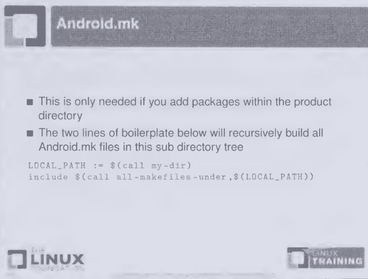

- 只有当你添加目录时才需要
- 下面的两行将递归构建：

```
LOCAL_PATH := $(call dir)
include all
```

## 添加 overlay

- Overlay 允许你覆盖 framework 和 base 包中的文件
- 即你可以自定义存储在系统中的设置
- 将要覆盖的文件放入目录，通常为 `framework/base/res/values/config.xml`
- 在 `device.mk` 中添加：`PRODUCT_OVERLAYS := device/myorg/mydevice/overlay`


## 其他 make target

- `make clean`：移除 `out/` 下的所有内容
- `make installclean`：移除 `out/target/product`
- `make clean-<module>`:仅清理指定的模块
- `make snod`：重新构建 `system.img` 而不检查依赖
- `make offline-sdk`：生成开发者文档
- `make sdk`：创建 SDK


## LF315 Android 内部：Android 内部原理

## 关于 ext4 格式的说明

- 构建 ext4 `system`, `userdata` 和 `cache` 镜像时，格式不是格式是稀疏格式，通过消除空区域来缩小体积
- Android 引导程序或支持 `fastboot` 的 U-Boot 可以理解这种格式
- 如果不使用 `fastboot`，将其转换为纯 ext4 二进制格式，如下：

```
$img2img system.img system-ext4.img
```


## 实验 8

### 8.1 创建新产品

目标：定义一个运行在 Beaglebone 上的产品并检查其是否可以构建。你还无法测试它，因为之后还有一些工作要做。

首先为 `myorg` 和 `mydevice` 选择一个名称，并在 `device/` 中创建相应的子目录。示例解决方案使用了 `ti/beaglebone`，这很有描述性但很无。。`source build/envsetup.sh`，从 lunch 组合中选择你的产品并进行构建。与模拟器构建一样，它需要一段时间才能完成。

完成后，检查 `out/target/product` 目录是否包含生成的 `cache.img`、`ramdisk.img`、`system.img` 和 `userdata.img` 文件。

192 LF315 深入 Android：Android 内部介绍

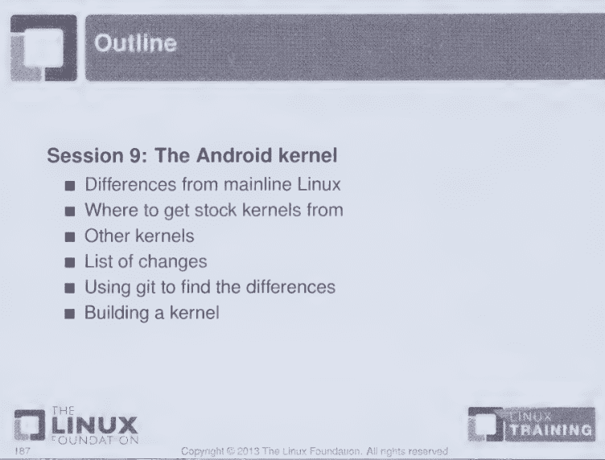

# 第 9 节：Android 内核

- 与主线 Linux `Linux` 的差异
- 从哪里获取官方内核
- 其他内核
- 更改列表
- 使用 `git` 查找差异
- 编译内核

## 与主线 Linux 的差异


# LF315 深入 Android：Android 内部介绍

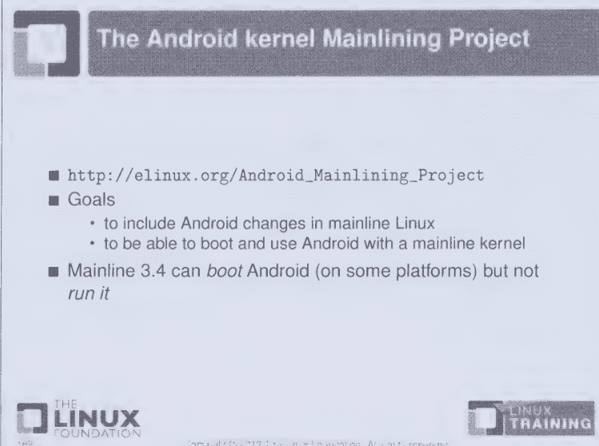

- http://elinux.org/Android_Mainlining_Project
- 目标
  * 在主线 Linux 中包含 Android 修改
  * 能够使用主线内核启动并运行 Android
- 主线 3.4 版本可以启动 Android `在某些平台上`，但无法运行它

## 第 9 节 Android 内核

## 从哪里获取官方内核

- AOSP 仓库中不包含内核
- 相反，大多数 `"Nexus"` 设备的参考实现以及模拟器位于：
  https://android.googlesource.com
- 例如，模拟器使用的内核位于：
  https://android.googlesource.com/kernel/goldfish
- 获取副本的步骤为：

```
$ git clone https://android.googlesource.com/kernel/goldfish

$ goldfish

$ git checkout origin/android-goldfish-2.6.29
```


# LF315 深入 Android：Android 内部介绍


- 除了寻找 Android 支持外，你还需要获取一个支持你的 SoC 或设备的内核
- Linaro 提供了支持多个 ARM SoC 的 Android 内核
- 如今大多数硅厂商都提供 Linux 和 Android 支持（但通常比主线落后几个版本）
- 像三星、HTC 等设备制造商有义务根据 GPL 协议发布内核源码


Copyright © 2013 The Linux Foundation. 保留权利

## 第 9 节 Android 内核

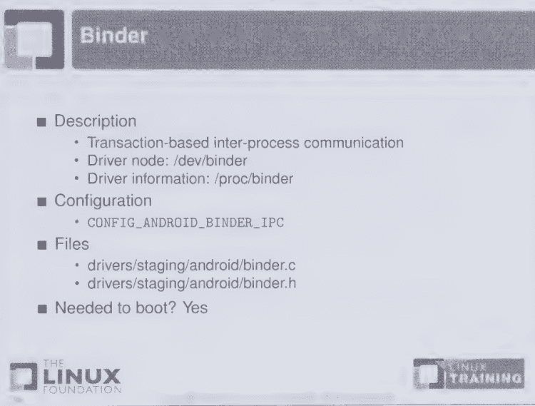

- 描述
- 基于事务的进程间通信（IPC）
- 驱动节点：`/dev/binder`
- 驱动信息：`/proc/binder`
- 配置
  - `CONFIG_ANDROID_BINDER_IPC`
- 文件
  - `drivers/staging/android/binder.c`
  - `drivers/staging/android/binder.h`
- 启动所需？是

## 偏态网络（Paranoid network）

- 描述
- 通过 GID 限制对网络字字的访问
- 只有属于特定组的应用程序创建网络连接（查看 `include/linux/android_uid.h`）
- 配置
  - `CONFIG_ANDROID_PARANOID_NETWORK`
- 文件
  - `include/linux/android_uid.h`
  - `net/` 下的各种
- 启动所需？否

## 第 9 节 Android 内核

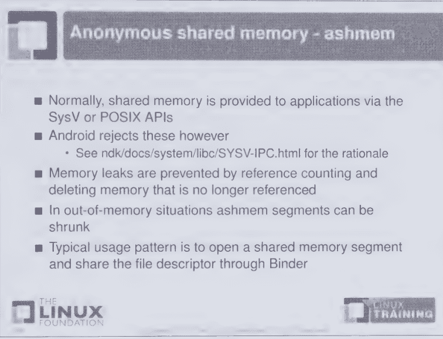

- 描述
- 匿名共享内存（ashmem）允许进程共享段。与 System V 和 POSIX 共享内存类似，不同在于发生 OOM（内存溢出）时可以回收内存。
- 配置
  - `CONFIG_ASHMEM`
- 文件
  - `drivers/staging/android/ashmem.c`
  - `drivers/staging/android/ashmem.h`
- 启动所需？是

## 第 9 节 Android 内核

- 传统上，应用程序通过系统日志 syslogd 将日志消息写入文件
- 这很慢——需要多次任务切换
- 并且向闪存写入日志也很慢且会损坏内存
- Android 日志器（logger）是一个简单的字符驱动程序，写入内存中的环形缓冲区
  - 无需任务切换
  - 无需写入闪存
- 使用 `logcat` 读取日志

LF315 深入 Android：Android 内部介绍

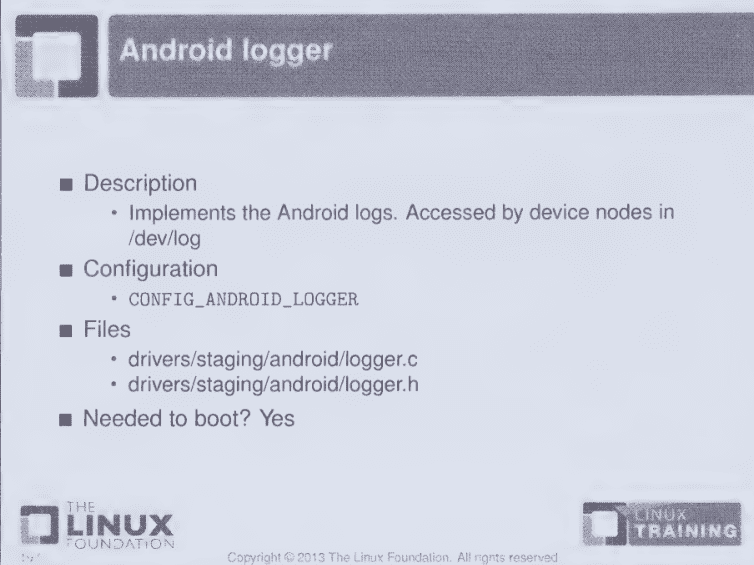

- 描述
- 实现了 Android 日志。通过 `/dev/log` 下的设备节点访问
- 配置
  - `CONFIG_ANDROID_LOGGER`
- 文件
  - `drivers/staging/android/logger.c`
  - `drivers/staging/android/logger.h`
- 启动所需？是

## 低内存管理（Low memory）

- 描述
- 当空闲内存通过阈值时，通过杀死具有特定 `oom_adj` 值的进程来实现低内存处理。
- 控制于
  - `/sys/module/lowmemorykiller/parameters/adj`
  - `/sys/module/lowmemorykiller/parameters/minfree`
- 配置
  - `CONFIG_ANDROID_MEMORY_KILLER`
- 文件
  - `drivers/staging/android/memorykiller.c`
- 启动所需？否

## 闹钟定时器（Alarm timers）

- 描述
- 与 POSIX 定时器类似，但它们在设备挂起时继续运行
- 通过 `/dev/alarm` 访问
- 配置
  - `CONFIG_ANDROID_ALARM`
- 文件
  - `drivers/staging/android/alarm.c`
- 启动所需？否

## 第 9 节 Android 内核


- 描述
- 在挂起时，在某个内存区域保存数据。通过 `/proc/kmesg` 访问
- 配置
  - `CONFIG_ANDROID_RAM`
- 文件
- `drivers/staging/android/ram_console.c`
- 启动所需？否

## 定时 GPIO（Timed GPIO）

- 描述
- 在某个时间调度特定的 GPIO 设置。即使应用程序被杀死也能确保其关闭
- 配置
  - `CONFIG_ANDROID_TIMED_GPIO`
  - `CONFIG_TIMED_OUTPUT`
- 文件
  - `drivers/staging/android/timed_gpio.c`
  - `drivers/staging/android/timed_output.h`
  - `drivers/staging/android/timed_output.c`
- 启动所需？否

## 唤醒锁（Wake locks）

- 桌面操作系统根据需要（例如关闭笔记本盖子时）挂起
- 手持设备在空闲一段时间后需要更激进的挂起
- 但当应用程序播放音乐或视频时，内核驱动程序需要防止挂起
- 当多个唤醒锁被锁定时，允许进入睡眠状态


## 唤醒锁

- 描述
- 持有唤醒锁防止内核进入睡眠状态
- 配置
  - `CONFIG_WAKELOCK`
  - `CONFIG_WAKELOCK_STAT`
  - `CONFIG_USER_WAKELOCK`
- 文件
  - `include/linux/waklock.h`
  - `kernel/power/userlock.c`
  - `kernel/power/welock.c`
  - 需要持有唤醒锁的驱动
- 启动所需？否

## 第 9 节 Android 内核

## 使用 git 查找差异

- 这种技术将显示你的内核与主线稳定树之间的差异
- `git format-patch` 为每个 commit 创建补丁文件

```
$ git clone https://android.googlesource.com/
kernel/goldfish
$ cd goldfish
$ git checkout origin/android-goldfish-2.6.29
$ git remote add stable git://git.kernel.org/pub/scm/
linux/kernel/git/stable/linux-stable.git
$ git fetch stable
$ git format-patch v<kernel-version>..HEAD
```

## 准备编译

- 内核交叉编译需要两个信息
- CPU 架构：`ARCH`
  * `arch/` 目录下的子目录
  * 对于 ARM 处理器
  * `$ export ARCH=arm`
- 交叉编译器前缀：`CROSS_COMPILE`
  * 取决于工具链
  * 对于预编译 Android ARM 工具链：
  * `$ export CROSS_COMPILE=arm-eabi-`

## 编译内核

- 通常内核有超过 1000 个配置选项
- 目标板的默认配置通常存储在 `arch/$ARCH/configs`
  - 例如 Beaglebone Android 的 `am335x_evm_android_defconfig`
- 使用以下设置配置
  - `$ make <config file>`
- 使用这些命令调整配置
  - `make menuconfig`（ncurses 文本菜单）
  - `make xconfig`（使用 Qt 的图形界面）
  - `make gconfig`（使用 Gtk+ 的图形界面）
- 生成的文件
  - `.config`
  - `include/generated/autoconf.h`

# LF315 深入 Android：Android 内部原理


- 大多数嵌入式设备需要一个纯压缩内核镜像：
  - `$ make zImage`
  - 或者一个压缩的内核镜像加上 U-Boot 头部文件
  - `$ make uImage` (*)
- 对于大多数 x86 系统：
  - `$ make bzImage`
- 内核镜像在 `arch/$ARCH/boot` 中生成

(*) 要创建一个 uimage，你需要 U-Boot `mkimage` 工具，该工具可以通过 Ubuntu 软件包 `u-boot-tools` 获取，或者从 U-Boot 源码编译。


# 第 9 节：Android 内核

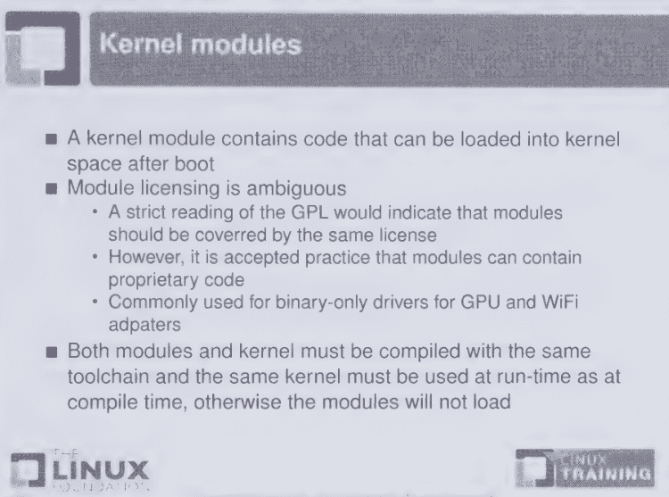

- 内核模块包含可以在启动后加载到内核空间的代码
- 模块的许可协议是模糊的
  - 对 GPL 的严格解读表明，模块应该受相同许可证的
  - 然而，模块包含专有代码是种接受的惯常做法
  - 通常用于 GPU 和 WiFi 适配器的仅二进制驱动程序
- 模块和内核必须使用相同的工具链进行编译，且运行时使用的内核必须与编译时相同，否则模块将无法加载

# 内核模块命令

- `insmod <module file>`: 加载模块
  - 需要 root 权限
- `lsmod`: 列出已加载的模块
- `rmmod <module name>`: 移除（卸载）模块

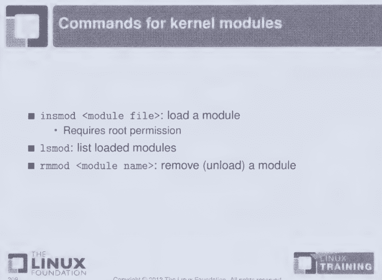

# 第 9 节：Android内核

## 总结

- Android 使用 Linux 内核，并针对移动操作系统的需求进行了少量修改
- 内核源码不是 AOSP 的一部分
- 内核必须与 AOSP 独立编译


## 实验 9

### 练习 9.1：编译内核

目标：为 Beaglebone 构建内核

在这种情况下，你只需要从 rowboat 项目获取 Linux 3.2 内核，该内核支持 TI AM355 SoC 并带有 Android 补丁。

```bash
cd ~/embedded-android
git clone git://github.com/rowboat/kernel
cd kernel
git checkout rowboat-am35x-kernel
```

```bash
patch -p1 < ~/embedded-android/resources/lab9/change-default-kernel-to-boot.patch
```

现在进行编译。你需要先 source `envsetup.sh` 并运行 `lunch` 选择 Beaglebone 目标以选取 Android 工具链。然后回到 kernel 目录：

# 第 9 节：Android内核

```bash
export ARCH=arm
export CROSS_COMPILE=arm-linux-gnueabi-
make am335x_evm_android_config
make -j4 uImage
```

检查 `arch/arm/boot/uImage` 的大小：它应该是 4 MiB 左右。

# LF315 深入 Android：Android 内部原理


# 第 10 节大：启动

- 启动基础
- Fastboot
- U-Boot
- Android init 和 init.rc
- 系统属性

Copyright © 2013 Linux Foundation. 保留所有权利。请勿传播。

# 第 10 节：启动

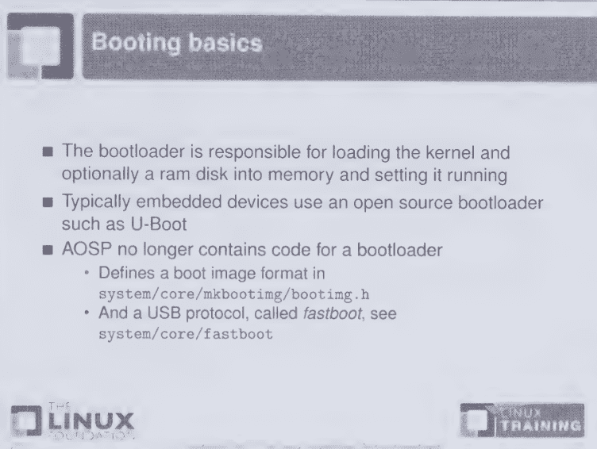

到 Jelly Bean 版本，可以在 `bootable/bootloader/legacy` 找到引导程序代码。某些 Android 设备使用 Little Kernel 引导程序，参见 https://codeaurora.org/tags/little-kernel。`fastboot` 协议定义位于 `bootable/bootloader/legacy/fastboot_protocol.txt`。目前还不确定规范存放在哪里。LINUX FOUNDATION Copyright © 2013 保留所有权利。

## 旧式启动方式

- 引导程序位于已知向量的 NOR flash
- 早期启动设置 SDRAM 并重定位到 RAM
- 主启动代码在 RAM 中运行


由于 NOR flash 可以按字节访问并映射到处理器地址空间，代码可以立即执行。

# 第 10 节：启动

### 从 NAND flash 启动

- 不再使用 NOR flash - 太贵
- NAND flash 复杂得多，需要代码运行
- 代码必须存储在某处，通常在 SoC 内部
- 典型序列：
  - 启动代码从 NAND (或 MMC、USB...)加载预启动加载到内部 RAM (SRAM)
  - 预启动加载的大小受 SRAM 限制，通常为 16 KiB .. 128 KiB
  - 预启动加载初始化 SDRAM
  - 将主引导程序加载到 SDRAM 并启动


NAND flash 内存只能一次访问一个页面，页面通常为 2048 字节。对 NAND flash 页面的访问是在程序控制下进行的，这在引导阶段会导致鸡生蛋问题。因此， SoC 内部必须有一些代码能够从 NAND flash 加载一个或多个页面。许多 扩展了此代码，能够从 MMC、UART 和 USB 等源加载。### 从 SD

- 在 TI OMAP 和 Sitara 芯片上，启动代码可以从 SDIO (SD 卡)接口加载镜像
- 文件必须命名为 `MLO`
- 它必须存储在卡的第一个分区
- 它必须使用 FAT32 格式

Beagleboard 拥有 Sitara 335x 芯片，其启动代码可以从 MMC（在我们的案例中连接到 SD 卡器）加载。代码非常有限，因此分区格式需要为 FAT32 名称固定为 "MLO"。MLO 二进制文件可以从 U-Boot 源码编译。

## Fastboot

- `fastboot` 可以指三个内容：
  - 一种用于向内存加载和编程镜像的 USB 协议
  - 一个命令行工具
  - 该协议的二进制实现
- 注意：`fastboot` 不是为了启动速度；而是为了加快开发过程


## 进入 fastboot 模式

```bash
adb reboot bootloader
```


- 然后你可以使用 `fastboot` 命令与它通信


## Fastboot 命令

- 基础命令
- `devices`：列出接受 `fastboot` 命令的设备
- `getvar`：获取变量：
  - `version`, `product`, `serialno`, `secure`
- 注意：`secure` 为 `yes` 表示引导程序在安装前需要签名
- `continue`：继续正常启动启动
- `reboot`：重启设备

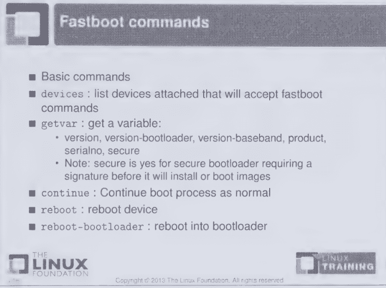

## Fastboot 命令

- Flash 命令
- `erase <partition>`
- `flash <partition> <filename>`
- `flashall`

# 第 10 节：启动

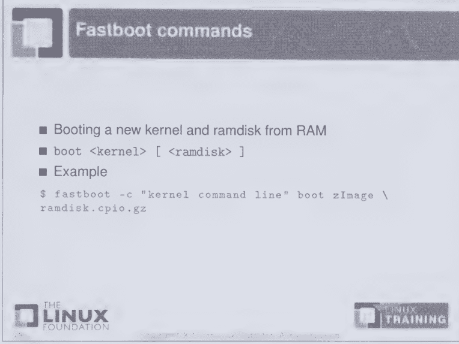

# LF315 深入 Android：Android 内部原理

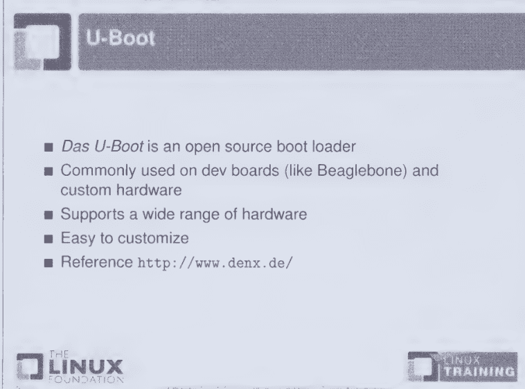

- U-Boot 是一个开源引导加载程序
- 常用于开发板（如 Beaglebone）
- 支持广泛的硬件
- 易自定义
- 参考 http://www.denx.de/

# 第 10 节：启动

## U-Boot 命令

- U-Boot 可以在串口上提供用户界面
- 命令包括转储/修改内存位置和寄存器
- 从 NOR/NAND flash、SD 卡、串口、网络等加载内核镜像
- 启动内核镜像


# 示例命令

- 从 NAND flash 加载镜像（例如内核）
  - `nand read <RAM address> <flash address> <length>`
- 示例
  - `nand read 80100000 1000000 200000`
- 从 SD 卡加载内核
  - `fatload mmc <device>:<partition> <RAM address> <file>`
- 示例
  - `mmc rescan 0`
  - `fatload mmc 0:1 80100000 uImage`
- 启动 RAM 中的内核镜像
  - `bootm 80100000`

## RAM 磁盘 (RAM disks)

- RAM 磁盘镜像加载到内存的方式与内核完全相同
- `bootm` 命令将 RAMdisk 镜像地址作为第二个参数

```
nand read 80100000 1000000 2000000

nand read 80400000 1200000 600000

bootm 80100000 80400000
```

## Android Inside LF315：Android 内部原理

## U-Boot 变量

- U-Boot 将信息存储在变量中，变量可能存储在闪存内存块或 SD 卡上的文件中
- 你可以使用 `setenv` 创建和修改变量，例如：
  - `setenv ipaddr 192.168.1.1`
- 你可以使用 `printenv` 显示变量
- ... 并使用 `saveenv` 将它们永久保存到闪存中（如果有的话）
- 如果没有 NAND 闪存进行存储，可以从名为 `Env.txt` 的文件中读取变量


## 第 10 节启动

- 变量 `bootcmd` 可以包含由分号 `;` 分隔的命令序列，这些命令会在 U-Boot 启动时执行

- 变量 `bootdelay` 可以包含执行 `bootcmd` 之前的秒数
  - 如果在 `bootdelay` 结束前按下控制台上的按键，自动启动将被中断，U-Boot 进入交互模式

- 示例 `bootcmd`
  - `bootcmd=mmc rescan; fatload mmc 0:1 80100000 uImage; boot 80100000`

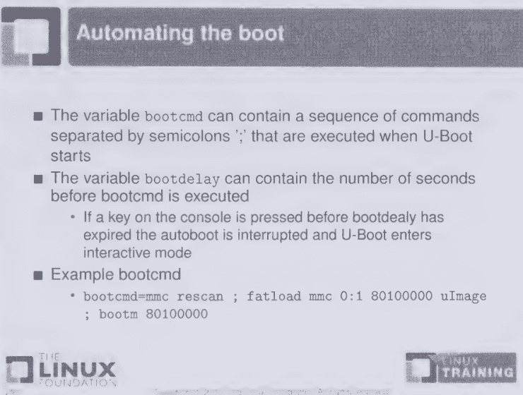

## U-Boot 与 fastboot

- 某些版本的 U-Boot 包含了对 fastboot 的支持
- NAND 闪存或 eMMC/SD 卡分区信息编码在 U-Boot 的板级支持文件中
- U-Boot 中添加了 fastboot 命令，可将其置于 fastboot 模式
- 此后它将像其他 Android 设备一样响应 fastboot USB 协议
- 了解更多信息，请阅读此描述
  - http://www.omappededia.com/wiki/Android_Fastboot


遗憾的是，实验中使用的 U-Boot 版本不支持 fastboot，因此我们将使用 U-Boot 特有的命令来启动板卡。

## 第 10 节启动

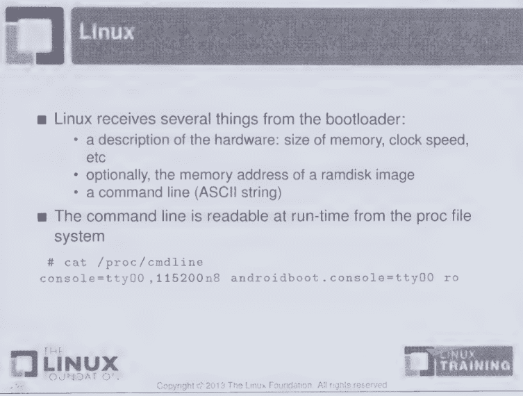

- Linux 从引导加载程序接收几项内容：
- 硬件描述：内存大小、时钟频率等
- 可选的，ramdisk 镜像的内存地址
- 一行命令行（ASCII 字符串）

命令行可以在运行时从 `proc` 文件系统读取

```
## cat /proc/cmdline

console=tty00,115200n8 androidboot.console=tty00
```

## Android Inside LF315：Android 内部原理

## 哪种根文件系统？

- 根文件系统可以是：
- 磁盘 (ramdisk)
  - 由引导加载程序传递的地址
  - 默认第一个程序：`/init`
  - 在命令行上通过 `androidrd=` 覆盖
- 磁盘分区、闪存分区或 NFS 导出
  - 内核挂载命令行中 `root=` 指定的设备
  - 默认第一个程序：`/sbin/init`
  - 在命令行上通过 `init=` 覆盖

## 第 10 节启动

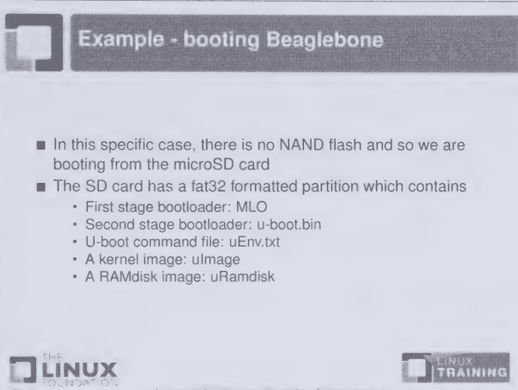

- 在特定情况下，没有 NAND 闪存，因此我们从 microSD 卡启动

- SD 卡有一个格式化为 fat32 的分区，其中包含：
  - 第一阶段引导加载程序：`MLO`
  - 第二阶段引导加载程序：`u-boot.bin`
  - U-boot 命令文件：`uEnv.txt`
  - 一个内核镜像：`uImage`
  - 一个 RAMdisk 镜像：`uRamdisk`

## Android Inside LF315：Android 内部原理

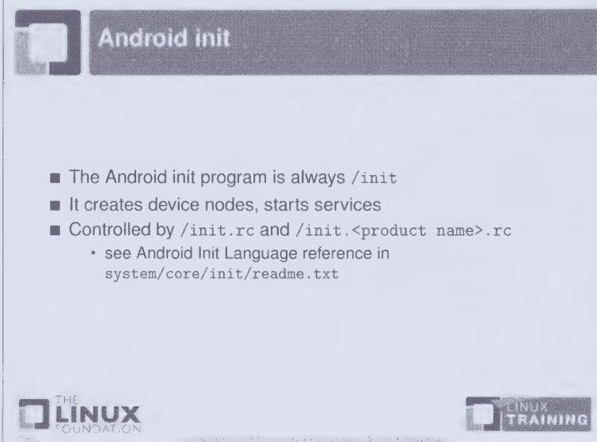

- Android init 程序始终是 `/init`
- 它创建设备节点，启动服务
- 由 `/init.rc` 和 `/init.<product name>.rc` 控制
  - 参见 `system/core/init/readme.txt` 中的 Android Init 语言参考

## 第 10 节启动


从 `/proc/cpuinfo` 的 `Hardware` 字段获取

```
Processor : ARM926EJ-S rev 5 (v51)

BogoIPS : 242.48

Features : swp half thumb fastmult vfp edsp

CPU implementer : 0x41

CPU architecture : 5TEJ

CPU variant : 0x0

CPU part : 0x926

CPU revision : 5

Hardware : Goldfish
```

或者，你也可以这样在内核命令行上覆盖它：
`androidboot.hardware="my-device"`


## Android Inside LF315：Android 内部原理

## init 序列

- 挂载 `/proc`、`/sys`、`/dev` 的必要文件系统
- 解析 `/init.rc` 和 `/init.<product name>.rc`
- 发出早期初始化 (early-init) 触发
- 向 `/dev/tty0` 输出文本 A N D R O I D
- 发出 init、early-fs、fs、post-fs 和 post-fs-data 触发
- 发出 charger、early-boot 和 boot 触发
- 发出属性触发
- 循环处理硬件事件并重启进程


## 第 10 节启动

## Android init 语言

- 规范：`system/core/init/readme.txt`
- 由动作 (Actions)、命令 (Commands)、服务 (Services) 和选项 (Options) 组成
- Action：接收到触发时执行的命令序列
- Command：类似于 shell 脚本
- Service：可以启动和停止的程序
- Option：服务的修饰符

## Android Inside LF315：Android 内部原理

## 动作 (Actions)

- 一般形式为：

```
on <trigger>

<command>

<command>

<command>
```

- 示例
`on init`
 `sysclktz 0`
 `loglevel 3`
 `# 设置全局环境`
 `export PATH /sbin/vendor/bin:/system/sbin:/system/bin`


## 第 10 节启动

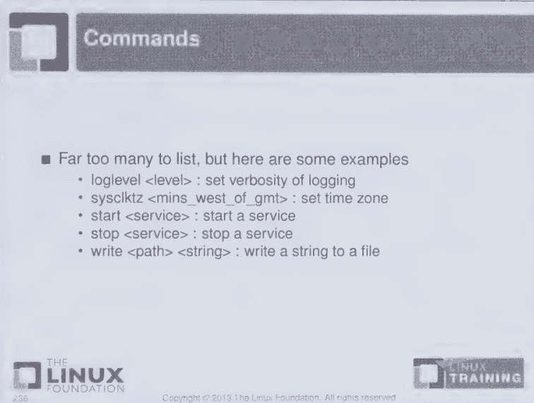

## Android Inside LF315：Android 内部原理

## 服务 (Services)

- 服务是一个可以启动和停止的守护进程 (daemon)

```
service <name> <pathname>

<argument>

<option>
```

- 服务名称应小于 16 个字符

- 每个服务属于一个类，由 `<class>` 设置

- 如果未指定类，默认类为 default


## 第 10 节启动

## 选项 (Options)

| class <name> | 服务所属的类 |
| :--- | :--- |
| critical | 进入恢复模式 |
| disabled | 不自动启动 |
| oneshot | 不重启 |
| socket <name> | 创建 unix 套字 /dev/socket/<name> |


## Android Inside LF315：Android 内部原理

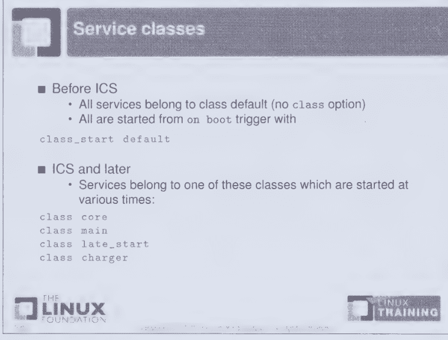

- ICS 之前
- 所有服务都属于默认（无类）
- 从默认触发启动

```
class_start
```

- ICS 及以后
- 服务属于以下类之一，它们在不同的时间启动：

```
class core

class main

class late_start

class charger
```

## 第 10 节启动

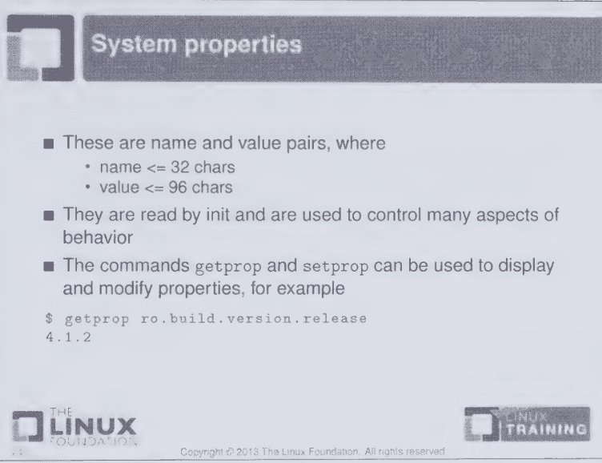

## Android Inside LF315：Android 内部原理


- 启动时，init 按顺序从这些文件中读取属性
`/default.prop`
`/system/build.prop`
`/system/default.prop`
`/data/local.prop`

- 当属性被修改时，init 发出触发 `<name>=<value>`，示例见后文

## 第 10 节启动

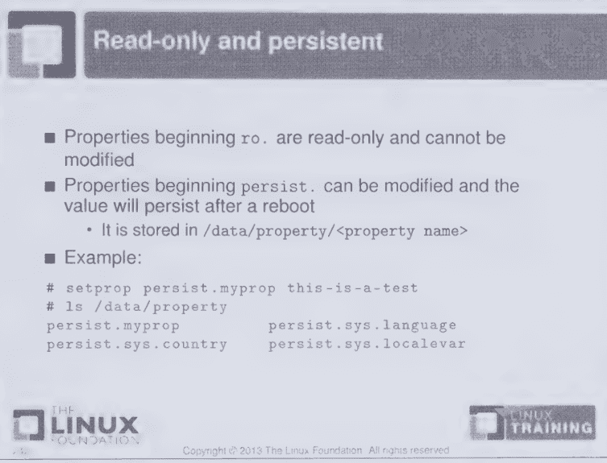

- 以 `ro.` 开头的属性是只读，不可修改
- 以 `persist.` 开头的属性可以修改，且值在重启后依然存在
  - 它存储在 `/data/property/<property name>`
- 示例：

```
## setprop persist.myprop this-is-a-test

## ls /data/property

persist.myprop persist.sys.language

persist.sys.country persist.sys.localevar
```

## Android Inside LF315：Android 内部原理

```
ctl.start 和 ctl.stop
```

- 设置这些属性将启动或停止命名服务
- 例如，启动 dumpstate 服务

# setprop ctl.start dumpstate


## 第 10 ：启动


- 这些属性定义在 `/default.prop` 中
- adbd 以 root 用户身份运行且在满足以下条件时提示符为 '# ':
  * `ro.secure == 0`，或
  * `ro.secure == 1` 且 `ro.debuggable == 1` 并定义了 `service.adb.root`
- 否则，adbd 以 shell 用户身份运行 (UID 2000，提示符为 '$')
- 按构建类型设置：

| 构建类型 | ro.secure | ro.debuggable |
| :--- | :--- | :--- |
| user | 1 | 0 |
| userdebug | 1 | 1 |
| eng | 0 | 1 |


## LF315 Android 内部：Android 内部原理介绍


如果 `ro.secure == 1` 且 `ro.debuggable == 1`，你可以从主机上通过命令 "`adb root`" 以 root 身份重启 adbd：

```
$ adb root

restarting adbd as root

$ adb shell

#
```


## 示例属性触发

```
service adbd /sbin/adb

    disabled

# 模拟器在启动时开启 adbd

    on property:ro.kernel.qemu=1

    start adbd

on property:persist.service.adb.enable=1

    start adbd

on property:persist.service.adb.enable=0

    stop adbd
```

## 设备节点的权限

- Init 还负责在启动时以及发现新设备时（例如通过插入 USB 设备）在 `/dev` 中填充设备节点
- 权限、用户和用户组在文件中设置
  - `/ueventd.rc`
  - `/ueventd.<product name>.rc`
- 格式为
  - "file name" "权限" "uid" "gid"

```
/dev/null    0666 root root

/dev/zero   0666 root root

/dev/full   0666 root root
```

## 总结

- 系统启动从 bootloader 开始
  - bootloader 极度依赖于特定设备
  - 许多 Android bootloader 实现了 fastboot 协议
- bootloader 加载 Linux 内核和 ramdisk
- ramdisk 包含 Android init 程序
- Android init 是基于事件的
  - 事件触发会执行 init.rc 的部分内容
  - 某些事件将启动在 init.rc 中定义的原生服务


## 实验 10

**练习 10.1** 准备 SD 卡

目标：格式化 microSD 卡以供 Android 使用。你只需要执行一次。

第一件事是找到 SD 卡读取器显示为哪个设备。*正确获取这一点至关重要，否则你可能会格式化硬盘，这会让任何人都不高兴*

记录下你目前在 `/dev` 中的 `sd*` 节点。你会看到类似下面的内容：

```
$ ls /dev/sd*

/dev/sda /dev/sda1 /dev/sda2 /dev/sda5
```


将 SD 卡插入读卡器并找到创建了哪些新节点：

```
$ ls /dev/sd*
```

`/dev/sda` `/dev/sda1` `/dev/sda2` `/dev/sda5` `/dev/sdb` `/dev/sdb1`

这表明在这种情况下 SD 卡是 `/dev/sdb`，并且它有一个分区 `/dev/sdb1`

## 第 10：启动

卸载 SD 卡上的所有分区

```
$ sudo umount /dev/sdx1
$ sudo umount /dev/sdx2
etc...
```

运行 `fdisk /dev/sdx`

- 输入 `p` (打印)。第一行包含大小：`Disk /dev/sdb: 3965 MB`。如果是数百 GB，那么你拥有的是硬盘而不是 SD 卡。请重新开始。
- 删除所有现有分区（命令 `d`）。
- 创建一个新的编号为 1 的 `primary` 分区，默认起始扇区和结束扇区 +64M（命令 `n`）。
- 将分区 ID（命令 `t`）设为 `c` (W95 FAT32 (LBA))）。
- 将其标记为可启动（命令 `a`）。
- 为系统、用户数据和缓存再创建另外三个主分区，使用您在 `BoardConfig.mk` 文件中指定的大小。将系统-id 保持为默认值 83。

在继续之前，检查您的分区表是否与解决方案中的一致。

## 输入 'w' 保存并退出

格式化第一个分区

```
$ sudo mkfs -t vfat -n boot /dev/sdx1
```

拔出 SD 卡并重新插入。第一个分区应该挂载在 `/media/boot`。将 U-Boot 二进制文件和配置拷贝到启动分区：

```
$ cp ~/embedded-android/resources/lab10/u-boot/* /media/boot
```

提示：`uEnv.txt` 包含

```
bootargs=console=ttyS0,115200 rootwait
bootcmd=-mmc rescan; fatload mmc 0 8200000 uImage
fatload mmc 0 8300000 ramdisk; bootm 8200000 envcmd=boot
```

注意：这里的大部分信息是为了处理 Beaglebone 的特定设置。对于使用 U-Boot 从 SD 卡启动的设备，过程会有所不同。

### 练习 10.2 拷贝内核和 ramdisk

将 `$HOME/embedded-android/kernel/arch/boot/uImage` 拷贝到 `/media/boot`

## 第 10：启动

创建 ramdisk 镜像：
```
$ mkimage -A arm -T linux -d ramdisk.img ramdisk
```
将其拷贝到 `/media/boot`

### 练习 10.3 拷贝 system、userdata 和 cache 到 SD

将镜像文件“稀疏化”并拷贝到 SD 卡如下：

```
$ s2img out/target/beaglebone/system.img system-ext4.img
$ sudo dd if=system-ext4.img of=/dev/sdx2 bs=4M
$ sudo e2label /dev/sdx2 system
$ s2img out/target/beaglebone/userdata.img userdata-ext4.img
$ sudo dd if=userdata-ext4.img of=/dev/sdx3 bs=4M
$ sudo e2label /dev/sdx3 data
$ s2img out/target/beaglebone/cache.img cache-ext4.img
$ sudo dd if=cache-ext4.img of=/dev/sdx4 bs=4M
$ sudo e2label /dev/sdx4 cache
```

### 练习 10.4 启动 Beaglebone

将 SD 卡插入 Beaglebone，然后插入 USB 线。设备 `/dev/ttyUSB1` 将出现：这是串口台。

`img/c6f4acfaca4829cadfb14f4d738cba2c_268_0.png`

## LF315 Android 内部：Android 内部原理介绍

将你的用户加入 dialout 组：

```
$ adduser <name> dialout
```

注销并重新登录以更改（你可以输入 `id` 来验证你现在是 dialout 的成员）。

设置 `/etc/minicom` 的权限，minicom 可以保存

```
$ sudo chmod 777 /etc/minicom
```

输入 `minicom -s` 串口，按 `a` 将串口设备改为 `/dev/ttyUSB1`。按 `e` 选择速度 115200、无校验、8位数据、1位停止并按回车。选择无硬件流控和软件流控。

回车，选择 Save setup as d 并再次按回车。最后退出 Minicom

再次启动带有折行的行的 minicom

注意：退出 minicom 请输入 Ctrl-A 然后 q（即同时按下 Ctrl 和 A，松开后按 q）。

按下 Beaglebone 上的重置按钮（它是以太网右侧的一个非常小的按钮）。

你应该看到内核启动，但随后会出现类似 init: 的消息

`14f4d738cba2c_269_0.png`

Copyright 2013 Linux Foundation. 版权所有。勿分发。

`img/c6f4acfaca4829cadfb14f4d738cba2c_269_1.png`

## 第 10：启动

找不到 `'/system/bin/servicemanager'`。继续下一个练习以解决问题。

### 练习 10.5 添加自定义 init 命令

问题在于没有挂载 SD 卡分区的指令。将 `init.am35xvm.rc`、`init.am35xvm.usb.rc` 和 `fstab.beaglebone` 从 `$HOME/embedded-android/resources/lab10/init` 拷贝到你的 `device/myorg/myproduct`

编辑你的 `device.mk` 并添加 `PRODUCT_COPY_FILES` 规则将三个文件包含在构建中。

构建 Android 并新的 `ramdisk.img` 拷贝到 SD 卡。启动 Beaglebone。

### 练习 10.6 让 adb 工作

运行 `"adb devices"`：你应该看到

```
+ List of devices attached
0123456789ABCDEF device
```

如果没有，找到 USB 厂商 ID 和产品 ID (*) 并像之前一样将它们添加到 `51-android.rules` 中。

现在运行 `adb shell` 并检查你是否获得了 root shell。

这些数字从哪里来？它们存储在目录 `/sys/class/android_usb/android0` 中的 `idProduct`、`idVendor`、`iSerial` 文件中并由 `/init.usb.rc` 配置。

## 第 11 节添加新包

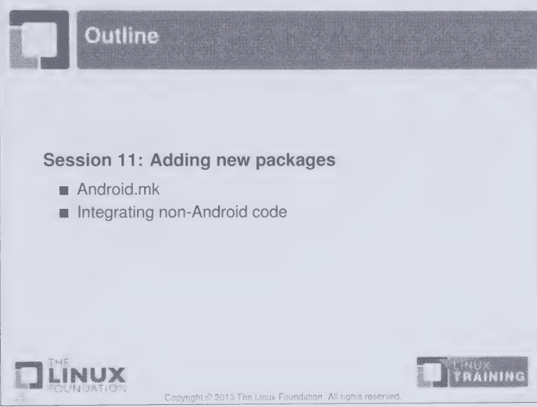

## LF315 深入 Android：Android 内部原理

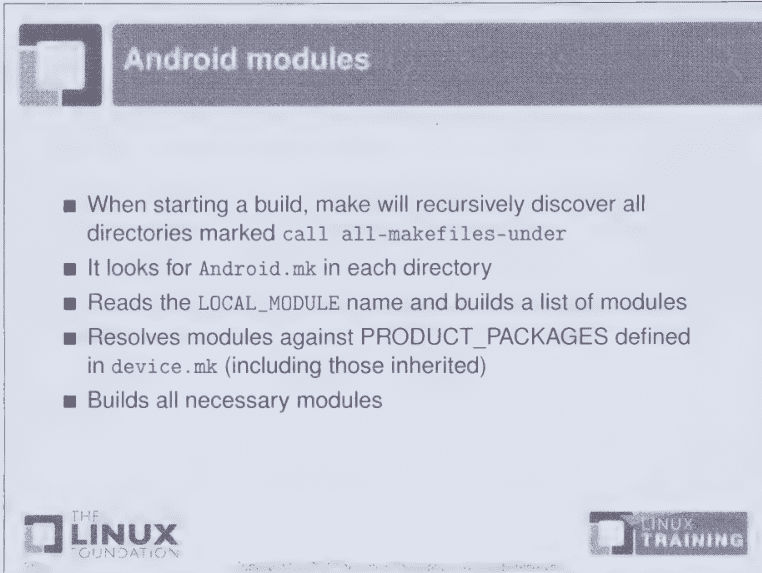

- 当启动构建时，`make` 会递归地发现所有标记为 `all-makefiles-under` 的目录
- 它会在每个目录中查找 `Android.mk`
- 读取 `LOCAL_MODULE` 名称并构建模块列表
- 结合 `device.mk` 中定义的 `PRODUCT_PACKAGES`（包括继承的包）对模块进行解析
- 构建所有必要的模块

## 第 11 节添加新包

```makefile
Android.mk
这是一个简单的示例，来自 `external/ping/Android.mk`：
LOCAL_PATH:= $(call my-dir)
include $(CLEAR_VARS)
LOCAL_SRC_FILES := ping.c
LOCAL_MODULE := ping
LOCAL_STATIC_LIBRARIES := libcutils libc
LOCAL_MODULE_TAGS := optional
include $(BUILD_EXECUTABLE)
```


Copyright © 2013 Linux Foundation. 保留所有权利。

## Android.mk

- `LOCAL_PATH` 几乎总是 `$(call my-dir)`
- 总是需要 `include $(CLEAR_VARS)`
- `LOCAL_SRC_FILES` 包含源文件列表
- `LOCAL_MODULE` 给出模块名称
- `LOCAL_STATIC_LIBRARIES` 列出需要静态链接的库（如果有的话）
- `include $(BUILD_EXECUTABLE)` 表示构建可执行文件


## 模块标签 (Module tags)

- `LOCAL_MODULE_TAGS` 说明该模块属于哪一组
- 可能的值
  - optional：仅当被 `device.mk` 引用时构建（如前所述）
  - eng, tests, samples：在 `eng` 版本中构建
  - debug：在 `eng` 和 `userdebug` 版本中构建
- 推荐（且简单）的方法是使用 `optional`
- 如果你想让模块包含在所有构建中，将其标记为 `optional` 并添加到 `build/target/product/core.mk` 的 `PRODUCT_PACKAGES` 部分


## 构建目标 (Build targets)

| Target | 描述 |
| :--- | :--- |
| BUILD_EXECUTABLE | 在目标上运行的可执行文件 |
| BUILD_SHARED_LIBRARY | 目标所需的共享库 |
| BUILD_STATIC_LIBRARY | 目标所需的静态库 |
| BUILD_PREBUILT | 预编译的二进制包 (binary blob) |
| BUILD_HOST_EXECUTABLE | 在主机上运行的可执行文件 |
| BUILD_HOST_SHARED_LIBRARY | 主机所需的共享库 |
| BUILD_HOST_STATIC_LIBRARY | 主机所需的静态库 |
| BUILD_PACKAGE | Android 包 (.apk 文件) |

## C 和 C++ 特有选项

- `LOCAL_CFLAGS`：C 编译器的额外标记
- `LOCAL_C_INCLUDES`：搜索头文件的额外目录
- `LOCAL_SHARED_LIBRARIES`：额外的共享库
- `LOCAL_FORCE_STATIC_EXECUTABLE := true`：对此可执行文件使用静态链接


## LF315 深入 Android：Android 内部原理

## 哪个目录？

- 模块的默认位置由构建目标设置

| Target | 目标地 |
| :--- | :--- |
| BUILD_EXECUTABLE | /system/bin |
| BUILD_SHARED_LIBRARY | /system/lib |
| BUILD_PACKAGE | /system/app |

## 哪个目录？

- `LOCAL_MODULE_PATH` 覆盖安装目录
- 定义的输出目录列表在 `build/envsetup.sh` 中。
以下是一些常用的目录：

| Target | 目标地 |
| :--- | :--- |
| $(TARGET_ROOT_OUT) | / |
| $(TARGET_ROOT_OUT_BIN) | /sbin |
| $(TARGET_OUT_OPTIONAL_EXECUTABLES) | /system/xbin |
| $(TARGET_OUT_ETC) | /system/etc |
| $(TARGET_OUT_JAVA_LIBRARIES) | /system/framework |
| $(TARGET_OUT_APPS) | /system/app |
| $(TARGET_OUT_DATA) | /data |

## LF315 深入 Android：Android 内部原理

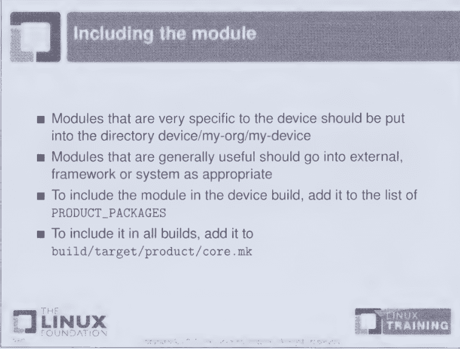

## 第 11 节添加新包

## 集成非 Android 代码

- 一些挑战
- 文件布局不兼容 FHS（文件层次层次标准）
- 运行时不兼容 POSIX
- 构建系统不使用标准工具（如 GNU autotools），这些问题中的每一个都可以通过努力来克服

Copyright © 2013 Linux Foundation. 保留所有权利。

## LF315 深入 Android：Android 内部原理

| 特性 | 注意 |
| :--- | :--- |
| LOCALE 和 wchar_t | 未实现 |
| syslog() | 使用 Android 的实现 |
| 用户和密码 | 使用 Android 方案 |
| gethostname() | 使用 Android 解析器 |

Copyright © 2013 Linux Foundation. 不得重新分发。

## 第 11 节添加新包

## Bionic 的差异 (2)

| 特性 | 注意 |
| :--- | :--- |
| POSIX 线程 | 未实现线程取消、优先级继承/条件互斥 |
| System V IPC | 未实现信号量 |
| 时区 | 取自 TZ 变量 |

## 共存策略

- 适配 Android 方式
- 将代码打包为 Android 模块，并
- 根据需要修改以适应 Bionic
- 在 Android 旁创建 GNU 环境，使用静态链接所需的库 (但注意这会影响 GPL 合规性)
- 使用 chroot 创建 GNU 环境

## Android 和 GNU 共存

- 创建一个将成为 GNU 根的目录 (/system/gnu)
- 在目录下放入程序、库和配置文件（例如静态链接的 Busybox）

```bash
chroot /system/gnu /bin/my_program
```

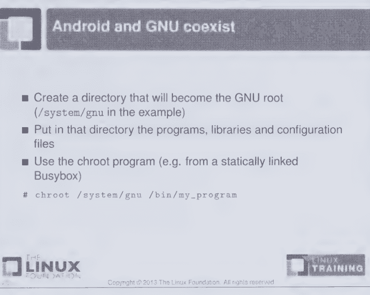

## 实验 11

### 实验11.1 为 Android 添加 VNC 服务器

目标：将 droid-vnc-server 加入构建。

```bash
cd ~/aosp/external
tar xf ~/embedded-android/resources/lab11/droid-vnc-server.tar.gz
```

注意生成的 droid-vnc-server 目录中有几个 `Android.mk` 文件。构建 vnc 服务器本身的一个位于 `droid-vnc-server/jni/vnc/Android.mk`。

记住 `LOCAL_MODULE` 的名称。注意 `LOCAL_MODULE_TAGS` 是 `optional`，

修改你的 `device.mk` 以包含该模块。

在 `init.am335xevrm` 中添加服务，以便启动时运行 `androidvncserver`。

构建 Android 并检查文件是否已生成 `out/target/product/my-device`。

写入 SD 卡并启动 Beaglebone。

### 实验11.2 使用 androidvncserver

## LF315 深入 Android：Android 内部原理

目标：使用 vnc 客户端 vinagre 检查虚拟屏幕。

配置 adb 将 TCP 端口 5901 转发到目标：
```bash
adb forward tcp:5901 tcp:5901
```

然后运行 vinagre 客户端：
```bash
vinagre localhost:5901
```

它对点击和拖拽的响应相当慢，但应该可以工作。键盘输入在点击鼠标后才会传输。重要键：

Home：返回主屏幕
Delete：返回上一页

### 实验11.3 添加非 Android 代码：Busybox

Busybox 在这里代表了一个典型且常用的开源包。
它无法使用 Android 工具链编译，因为 Bionic 缺少某些函数。可以修改 Busybox 使其能够编译，许多人已经这样做了，但这里的目的是使用“原味” (vanilla) 的 Busybox。

首先，提取标准的 GNU 工具链（来自 Openembedded 项目）并按常规方式编译 Busybox：

## 第 11 节 添加新包

281

```
$ cd /
$ sudo tar xf ~/embedded-android/resources/lab11/angstrom-eibc-i686-armv7a-v2012.05-toolchain.tar.bz
$ cd ~/embedded-android
$ tar xf resources/lab11/busybox-1.20.1.tar.bz
$ cd busybox-1.20.1
```


`$ PATH=/usr/local/oorece-i686/sysroots/i686-angstromdk-linux/usr/bin/armv7a-android-linux-gnueababi:$PATH`

`$ export ARCH=arm`

`$ export CROSS_COMPILE=arm-angstrom-linux-gnueababi-`

`$ make defconfig`

`$ make`

`$ make install`

注意，在最后阶段 busybox 被安装到了 `_install` 目录中。接下来，你需要将这些文件拷贝到 SD 卡中。你将在 Android 安装之后作为一个独立的阶段进行此。Busybox 将位于 `/system/gnu`，并且 `/bin`, `/sbin`, `/usr/bin`, `/usr/sbin` 和 `lib` 会指向该目录的符号链接。

将 SD 卡插入读取器。在系统分区中创建一个名为 'gnu' 的子目录。

```
$ sudo cp -a _install/* /media/system/gnu
$ cp -a /usr/local/oorece-i686/sysroots/armv7a-angstrom-linux-gnueababi/lib /media/system/gnu
```

## LF315 深入 Android：Android 内部原理

向 `init.am335xvm.rc` 添加以下行以创建符号链接并将 busybox 添加到路径

on init

```
symlink /system/gnu/bin /bin
symlink /system/gnu/usr /usr/bin
symlink /system/gnu/usr/sbin /usr/sbin
symlink /system/gnu/lib /lib
export PATH /sbin:/vendor/bin:/system/sbin:/system/bin:/system/xbin:/bin:/usr/bin:/usr/bin
```

编译 Android 并像以前一样将新的 ramdisk 拷贝到启动分区。

启动 Beaglebone 并验证你是否可以使用 `grep`, `cp`, `vi` 等 busybox 命令。

## 第 12 节 图形与 OpenGL


## 第 12 节：图形与 OpenGL

- Android 和 OpenGL
- EGL
- 图形栈
- 图形驱动
- 设备配置

Copyright © 2013 The Linux Foundation. All rights reserved

## LF315 深入 Android：Android 内部原理

## OpenGL 和 OpenGL ES

- OpenGL 是用于 2D 和 3D 图形的跨平台 API
- 由 Khronos Group 发布的规范
  - http://www.khronos.org/
- OpenGL ES 是为嵌入式设备设计的 OpenGL 子集
- 例如，OpenGL ES 具有：
  - 没有双精度浮点或长整数数据类型
  - 没有四边形或多边形图元：使用三角形代替

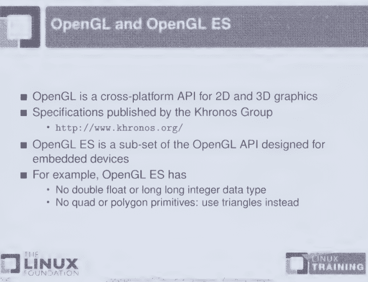

284


## 第 12 节 图形与 OpenGL

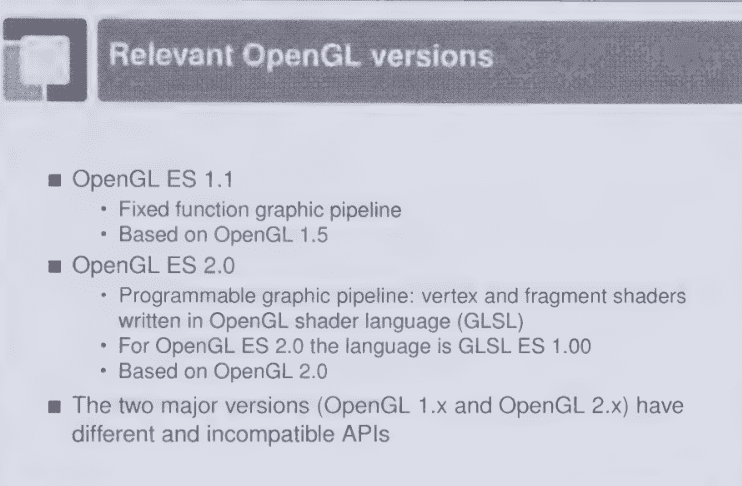

Copyright © 2013 The Linux Foundation. All rights reserved.

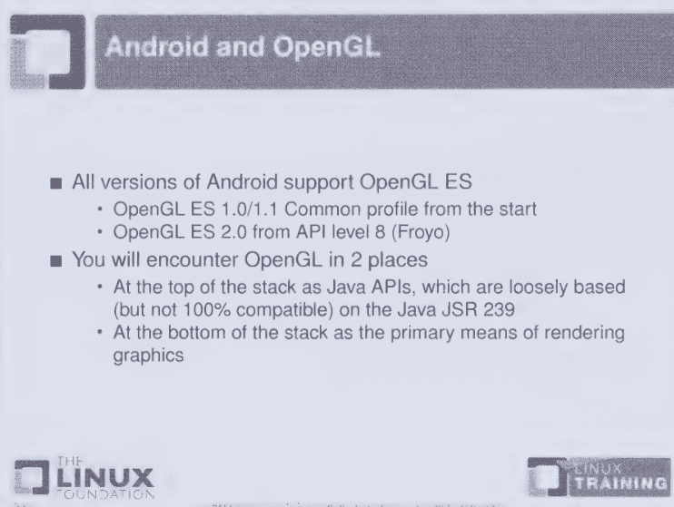

- 所有版本的 Android 都支持 OpenGL ES
- 从开始就支持 OpenGL ES 1.0/1.1 Common profile
- 从 API level 8 (Froyo) 开始支持 OpenGL ES 2.0
- 你会在两个地方遇到 OpenGL：
  - 在栈顶端作为 Java API，它们松基于 Java JSR 239（但并非 100% 兼容）
  - 在栈底部作为渲染图形的要手段

## 第 12 节 图形与 OpenGL

## EGL

- EGL 是 Khronos 原生平台图形接口
- 描述 OpenGL ES（以及 OpenVG）如何与底层窗口系统交互
  - 将表面映射到显示器
  - 分配缓冲区
  - 双缓冲和单缓冲表面
  - 显示尺寸、色彩深度等

## EGL 示例 (1)

应用程序使用 EGL 分配窗口缓冲区，然后使用 OpenGL ES 在后缓冲区中绘制一帧

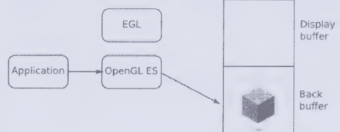

## 第 12 节 图形与 OpenGL

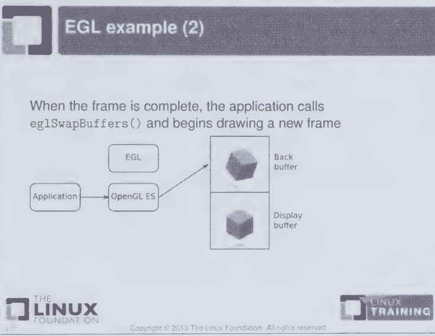

## LF315 深入 Android：Android 内部原理


Copyright © 2013 The Linux Foundation.
All rights reserved. DO NOT DISTRIBUTE.

## 第 12 节 图形与 OpenGL


## LF315 深入 Android：Android 内部原理


Copyright © 2013 Linux Foundation. All rights reserved. DO NOT DISTRIBUTE.

## UI 组件

- 典型的 UI 由按钮、菜单等组成
- 这些每一个渲染到 Canvas 并成为应用程序的 Surface
- 有两条渲染路径：
  - Skia - 软件渲染器
  - HWUI - 硬件渲染器
- 使用的是 View 的一个属性
  - `android.view.setLayerType` 设置 `LAYER_TYPE_NONE`、`LAYER_TYPE_SOFTWARE`、`LAYER_TYPE_HARDWARE`

## LF315 深入 Android：Android 内部原理


## 第 12 节 图形与 OpenGL


- JSR 239 是 Java 绑定 OpenGL ES 的 API
  - http://docs.oracle.com/javame/config/cldc/opt-pkgs/api/jb/jsr239/index.html
- EGL
  - `javax.microedition.khronos.egl`
  - EGL
  - EGL0
  - EGL1
- OpenGL
  - `javax.microedition.khronos`
  - GL
  - GL10
  - GL11

## LF315 深入 Android：Android 内部原理


Copyright © 2013 Linux Foundation.
All rights reserved.

## 第 12 节 图形与 OpenGL

## 图形加速

- 大多数平台都有图形处理器 (GPU)
- 驱动程序通常是厂商特定的
- 大多数平台都有帧缓冲区 (framebuffer)
- EGL 和 OpenGL ES 层
- 首先尝试编号最高的
  - EGL/libELES1/libGLES1
  - /lib/LES2/libGLES2


## LF315 深入 Android：Android 内部原理


## 第 12 节 图形与 OpenGL


- `egl.cfg` 文件包含：
  - <显示器编号> <实现>
- 库文件为：

```
0 0
```
- 例如，TI AM335 SoC 有一个 PowerVR SG530 GPU
- `egl.cfg` 将包含：

```
0 0
```
- 所需要的库：
`/system/lib/egl/libEGL.so`
`/system/lib/egl/libGLES1.so`
`/system/lib/egl/libGLES2.so`
（根据 OCR 上文修正）

## LF315 深入 Android：Android 内部原理


## 设备配置

- 添加到 `BoardConfig.mk`

```
BOARD_EGL_CFG := device/ti/bebone/egl.cfg
USE_OPENGL_RENDERER := true
```
- 将库拷贝到正确的目录
- 将驱动程序添加到内核配置，或编译为模块并添加到系统镜像

## LF315 深入 Android：Android 内部原理


- 低级图形缓冲区处理由硬件模块 **gralloc** 执行
- gralloc 实现了两个接口
- framebuffer
  - 映射显示位图内存
  - 见 `hardware/libhardware/include/hardware/fb.h`
- gralloc
  - 分配并管理适用于 2D 和 3D 图形使用的内存
  - 见 `hardware/libhardware/include/hardware/gralloc`

## 内核 framebuffer驱动

- Linux framebuffer 驱动提供了显示位图的标准接口
- 设备 `/dev/fb0` (Android 上的 `/dev/graphics/fb0`)
- 用于读取固定参数的 ioctl 函数
  - 屏幕和缓冲区尺寸等
- 用于读写变量参数的 ioctl 函数
  - 例如用于“平移”显示（确定缓冲区的可见部分）
- `mmap` 函数将缓冲区映射到应用程序地址


# LF315 深入 Android：Android 内部原理


## 第12 节：图形与 OpenGL

### 使用 fbset 进行测试

- 使用 Busybox 中的 fbset 实用
- 注意：帧缓冲区高度为 1600，显示高度为 800
- 像素格式为 RGB 565

```
# fbset -fb /dev/graphics/fb0
mode "480x800-260"
# D: 100.000 MHz, H: 208.333
geometry 480 800 480 1600 16
timeings 10000 0 0 0 0 0
accel false
endmode rgba 5/11,6/5,5/0,0/0
```


## LF315 深入 Android：Android 内部原理

## 缓冲区格式

Android 识别以下格式：
- 32 位/像素：
    - `HAL_PIXEL_FORMAT_RGBA_8888`
    - `HAL_PIXEL_FORMAT_RGB_8888`
    - `HAL_PIXEL_FORMAT_BGRA_8888`
- 24 位/像素：
    - `HAL_PIXEL_FORMAT_RGB_888`
- 16 位/像素：
    - `HAL_PIXEL_FORMAT_RGB_565`
    - `HAL_PIXEL_FORMAT_RGBA_4444`


## 第12 节：图形与 OpenGL

```
gralloc.default
```
- 一个与硬件无关的版本 (`gralloc.default`) 实现在 `hardware/lib/modules` 中
- 典型的厂商实现会提供一个优化的版本，以利用硬件特性


## 实验 12

## 练习 12.1 旋转立方体

在 `$HOME/embedded-android/resources/lab12/OpenGL-cube` 中有一个旋转立方体演示。将其拷贝到 `aosp/external/OpenGL-cube`，在目标机上编译并安装：

```
cd external/OpenGL-cube
mm
adb remount
adb sync
```

重启目标板并运行演示。

### 练习 12.2 添加 GPU 驱动程序

目前目标机正在使用软件渲染（SurfaceFlinger）。现在你将配置对 PowerVR GPU 的支持。将 `$HOME/embedded-android/resources/lab12/sgx` 拷贝到你的设备目录（即 `/dev/sgx`）。按照幻灯片上的示例创建 `egl.cfg`。

## 第12 节：图形与 OpenGL

在 `BoardConfig.mk` 中添加 `BOARD_EGL_CONFIG` 规则，并将 `USE_OPENGL_RENDER` 设置为 true。

```
service pvr /system/bin/sgx.rc start
```


将 `$HOME/embedded-android/resources/lab12/README` 底部的文本粘贴到你的 `device.mk` 中。编译并拷贝新的 `system.img` 和 `ramdisk` 到 SD 卡。要验证驱动程序是否正确加载，运行 `logcat` 并查找 `"SurfaceFlinger"` 之后的行。注意 `"vendor"` 和 `"renderer"`。再次运行 OpenGL 立方体看看速度是否变快。

# LF315 深入 Android：Android 内部原理

## 第13 节：Binder

### 什么是 Binder？

- `AIDL`
- 其他形式的 IPC（进程间通信）
- 服务与 Android 框架

### 第13 节 Binder

### 什么是 Binder？

- 一种进程间通信的形式
- 由于每个应用程序都是独立的进程，因此它是必不可少的
- 支持类似于 CORBA 的分布式组件架构
- `IBinder` 接口和数据描述
- 衍生自 OpenBinder、BeOS 和 Palm OS
- Binder 是这些事物之间的共同纽带

## 组件

### Binder 的特性

- 无内存泄漏：引用计数和“死亡通知”处理了这个问题
- “线程迁移”和线程池的自动管理
- 同步和异步（单向）调用
- 通过 UID 和 PID 识别发送者
- 可以从一个进程向另一个进程发送文件描述符
- 使用 Android 定义语言 (`AIDL`) 定义接口
- 如果客户端和服务端在同一个进程中，则使用本地执行模式（无需 IPC/数据序列化）

### Binder 驱动程序

- 最底层组件
- 持有 Binder 的状态
- 跟踪 Binder 连接
- 发送死亡通知
- 实现为简单的字符设备驱动：`dev/binder`
- 大部分工作由 `ioctl` 函数完成

源码自 3.2 版本起进入 Linux 主线，位于：
`drivers/staging/android/binder.c`
`drivers/staging/android/binder.h`

- `ServiceManager` 是 Binder 命名服务器
- 将如 `"phone"` 等名称映射到 Binder 对象
- 在启动时，`ServiceManager` 请求驱动程序授予其“管理器”状态
    - 使用 `ioctl`! `BINDER_SET_CONTEXT_MGR`
    - 只能有一个管理器
- 作为管理器，`ServiceManager` 拥有已知的 Binder 句柄 `0`
    - 这是唯一的已知句柄

`ServiceManager` 的源码位于 `frameworks/base/cmds/servicicemanager/service_manager.c`。

# LF315 深入 Android：Android 内部原理

## 其他 Android 服务

- 其他服务调用 `ServiceManager` 来注册自己
- 只有 Android 框架的组件需要应用：
- 你必须以 UID `AID_ROOT` (0) 或 `AID_SYSTEM` (1000) 身份运行，或者列在 `service_manager.c` 中。

# LF315 深入 Android：Android 内部原理

Copyright © 2013 Linux Foundation.
保留所有权利。请勿分发。

## Parcelable 对象

- 要成为 parcelable 对象，该对象必须：
  - 实现 `Parcelable` 接口
  - 拥有一个 `writeToParcel` 函数
  - 拥有一个实现 `Parcelable.Creator` 接口的静态字段 `CREATOR`

## 使用 Binder 句柄进行认证

- Binder 消息的真实性是已知的因为它因为它了 binder 驱动程序的验证
- 消息由一个不可伪造的令牌（token）表示
- 者的 UID 和 PID 是消息头部的一部分
- 软件包管理器（Package Manager）拥有一个应用程序名称和 UID 的列表
- 因此，服务器可以验证客户端是否有权限访问服务器内的给定函数

```java
int Binder.getCallingUid();

int Binder.getCallingPid();

int Context.checkPermission(String permission, int pid, int uid);
```

## 单向 Binder 消息

- 单向意味着没有回复
- 调用者不等待调用者
- 异步消息
- 示例：发送死亡通知消息（下一个主题）

## 死亡通知

- Binder 对象拥有一个观察者列表
- 本地对象可以请求在另一个（远程）对象终止时被通知
- 通常用于在客户端死亡时向服务器发送回调
- 允许回收资源
- 对于 Binder 和 Android 至关重要，因为进程可能会由于内存不足而被杀掉

## Binder 对象引用

- 一个 32 位数字，可以是进程地址空间中的本地地址，也可以是指向另一个进程地址空间中对象的透明引用
- 当对象从一个进程传递到另一个进程时，Binder 负责本地和远程对象引用的映射
- binder 驱动程序保留所有这些信息（每个进程）并进行引用计数，当计数减为零时通知对象的所有者

## Intents（意图）

- Intent 是应用组件之间传递的消息
- 可能在同一个应用程序中，也可以在不同的应用程序中
- Intent 是构建在 Binder 之上的高级抽象

## 其他形式的 IPC

- 除了基于 Binder 的 IPC，Android 还会使用：
  - 本地 (Unix) sockets
  - 信号 (Signals)

这些是所有操作系统的潜在问题，但由于大多数系统运行良好因此被避免了：它们只运行来自受信任存档的代码，并且不会耗尽内存。

## 启动

服务管理器和系统服务器 从 `init.rc` 启动，如下：

```
service servicemanager /system/bin/servicemanager user system group system

service zygote /system/bin/zygote root system group
```

## System Server

- 注册服务的中心位置
- 许多服务在独立的线程中运行
- 以用户 `system` 运行
- 代码位于 `/framework/base/services/java/android/server`

以下幻灯片展示了添加新服务的简单示例
- 该服务只有两个函数：`addInts()` 和 `echoString()`
- 组件：
  - `SimpleService`：一个在启动时自动启动的应用程序
  - `ISimpleService`：在 AIDL 中定义的接口
  - `SimpleManager`：一个实现 SimpleService 客户端接口的 Java 库
  - `SimpleManagerApp`：一个演示使用管理器的应用程序

## 接口

- 一个简单的 AIDL 文件 (`ISimpleManager.aidl`)

```java
package com.example.simplemanager;

interface ISimpleManager {
    int addInts(int a, int b);
    String echoString(String s);
}
```

- 生成：
  - manager 代理：`ISimpleManager`
  - service 存根：`ISimpleManager.Stub`

## SimpleService 实现

```java
class ISimpleServiceImpl extends ISimpleManager.Stub {
    private final Context context;
    ISimpleServiceImpl(Context context) {
        this.context = context;
    }
    public int addInts(int a, int b) {
        return a + b;
    }
    public String echoString(String s) {
        return s;
    }
}
```

```java
public class SimpleServiceApp extends Application {
    private static final String REMOTE_SERVICE_NAME = ISimpleManager.class.getName();
    private ISimpleServiceImpl serviceImpl;
    public void onCreate() {
        super.onCreate();
        this.serviceImpl = new ISimpleServiceImpl(this);
        ServiceManager.addService(REMOTE_SERVICE_NAME, this.serviceImpl);
    }
}
```

## SimpleManager Java 库 (1)

- `SimpleManager.java` 作为 Java 库实现了管理器接口

```java
public class SimpleManager {
    private static final String REMOTE_SERVICE_NAME = ISimpleManager.class.getName();
    private final ISimpleManager service;
    public static SimpleManager getInstance() {
        return new SimpleManager();
    }
    private SimpleManager() {
        this.service = ISimpleManager.Stub.asInterface(ServiceManager.getService(REMOTE_SERVICE_NAME));
    }
}
```

## SimpleManager Java 库 (2)

- 这里是调用服务的存根函数

```java
public int addInts(int a, int b) {
    try {
        return service.addInts(a, b);
    } catch (RemoteException e) {
        throw new RuntimeException("addInts", e);
    }
}
```

## 编译库

- 这是 SimpleManager 库的 `Android.mk`
- 生成 `com.example.simplemanager.jar`

```
LOCAL_PATH := $(CLEAR_VARS)

include MODULE_TAGS := optional

LOCAL_MODULE := com.example.simplemanager

LOCAL_SRC_FILES := $(call all-java-files,.)

LOCAL_SRC_FILES += com/example/simplemanager/

include $(BUILD_JAVA_LIBRARY)
```

- Android 应用程序不允许与不可信的库链接
- 需要向 `/system/etc/permissions/` 添加 `com.example.simplemanager.xml`
- 内容为：

```xml
<?xml version="1.0" encoding="utf-8"?>
<permissions>
  <library name="com.example.simplemanager" file="/system/framework/com.example.simplemanager.jar"/>
</permissions>
```

## SimpleManager 应用 (1)

应用程序可以如下所示调用 SimpleManager

```java
// 导入类
import com.example.simplemanager.SimpleManager;
// 创建实例
SimpleManager mSimpleManager = new SimpleManager();
// 调用函数
ret = mSimpleManager.addInts(1, 2);
```


# LF315 深入 Android：Android 内部原理


- 需要在使用 AndroidManifest 中声明 uses-library 库

```xml
<application ...
  <uses-library android:name="com.example.simplemanager" android:required="true"/>
```

## 复习

- 服务运行在 UID 为 *system* 的独立进程中
- 通过 Java 库访问
- 使用该服务的应用程序具有正常的应用程序 UID
- 因此，我们允许应用程序调用可以访问通常无法访问资源的函数
  - 但这是受控的，并且如果设计和实现良好，它们是安全的
- 此类服务的良好示例包括用于串口的 SerialManager
  - `frameworks/base/core/java/android/hardware`


# LF315 深入 Android：Android 内部原理


## 第 13 Binder 351

## 实验 13

### 练习 13.1 查看服务

使用 `service list` 获取服务列表

你也可以使用 service 命令来调用服务。例如
`service call phone 1 s16 "123"`

这将要求手机应用显示数字 123 的拨号界面。`service call` 的参数为：

- 服务名称
- 要调用的函数索引号（阅读代码以查找）
- 一个或多个整数或字符串参数。整数长度为 32 位，前面带有 `i32`；字符串编码为 16 位 UTF，前面带有 `s16`

手机应用相关的字体是 `@frameworks/base/telephony/java/com/android/internal/telephony/ITelephony.aidl@`

### 练习 13.2 简单服务器


# LF315 深入 Android：Android 内部原理

在 `$HOME/embedded-android/resources/lab13/simple-service` 中有一个示例服务器实现，在 `$HOME/embedded-android/resources/lab13/simple-manager` 中有相应的管理器（manager）。将两个目录复制到 `/dev/ti/beagle`。编译它们并安装到目标机上。

重启目标机并运行 `service list` 验证它是否正在运行。

查看定义的接口
`simple-manager/com/example/simplemanager/ISimpleManager.aidl`。使用 `service call` 用适当参数调用这两个函数。

### **练习 13.3** 可选 - 扩展服务

现在利用该服务访问硬件 GPIO - 即你在 liblights 实验中使用的那些 GPIO。

已经写了一个 jni 库：它被称为 `jnilights`

1. 向接口中添加新函数

将此接口

```c
int setLed(int led, int on);
```


添加到此文件：
`simple-manager/com/example/simplemanager/ISimpleManager.aidl`

2. 编写管理器代理（proxy）

在 `simple-manager/com/example/simplemanager/SimpleManager.java` 中添加 `setLed` 代理

编译并安装 `simple-manager`

3. 编写服务存根（stub）实现

`setLed` 的实现放入 `simple-service/src/com/example/pleservice/ISimpleServiceImpl.java`

只需要调用原生函数 `nativesetled(int led,int on)`，你需要调用 `loadLibrary("jnilights")`。

编译并安装 `simple-service`

4. 编译 jnlights

复制 `$HOME/embedded-android/resources/lab13/jnlights` 并编译它

5. 编译应用程序

最后，这里有一个允许你测试一切的应用程序……

复制 `$HOME/embedded-android/resources/lab13/simple-led-app`

编译并安装它。

## 第 14 Android 的硬件抽象层

### 第 14 ：Android 的硬件抽象层

- 硬件模块
- `liblights`
- 访问 GPIO 引脚

### LF315 深入 Android：Android 内部原理


- 内核设备驱动接口是硬件抽象的一层
- Android 通过各种共享库扩展了这一点，这些库进一步抽象了内核接口
- Android 框架（framework）的编写是为了使用 Android HAL
- 原因
  - 为了消除 Linux 驱动接口中的不规则之处（例如对 LED 和背光的访问）
  - 为了添加缺失的功能（例如在 framebuffer 驱动中）
  - 为了避免 GPL 许可证（例如对于图形驱动程序）


Copyright © 2013 Linux Foundation. 版权所有。请勿发行。

### HAL 的类型

- 有两种主要的 HAL 实现
- 位于 `/vendor/lib/hw` 和 `/system/lib/hw` 的杂接口硬件模块
- 位于 `/vendor/lib/egl` 和 `/system/lib/egl` 的 OpenGL 库

OpenGL 库将单独讨论：本节重点关注硬件模块


### LF315 深入 Android：Android 内部原理


- 硬件模块控制如下内容：
- 音频
- 摄像头
- 帧（framebuffer）
- gps - 位置服务
- gralloc - 帧和 GPU 缓冲区管理
- 灯光 - LCD 背光、键盘灯和各种 LED 的控制
- 传感器 - 传感器设备集合，包括加速度计、压力计、接近传感器和磁力计

### 第 14 Android 的硬件抽象层


- 硬件模块命名为 `module_id.<modifier>.so`
- modifier 可以是（从具体到不具体）
  - `ro.hardware`
  - `ro.product.board`
  - `ro.board.platform`
  - `ro.arch`
  - `default`
- 搜索路径为 `/vendor/lib/hw` `/system/lib/hw`
Linux Foundation 2013 版权所有。

### LF315 深入 Android：Android 内部原理


- `ro.product.board`
- `ro.board.platform`
- `ro.arch`
- `default`
- 搜索路径为 `/vendor/lib/hw` `/system/lib/hw`

```
camera.so

gralloc.so

lights.so
```

### 第 14 Android 的抽象层

### 通用硬件接口

- 定义在 `hardware/include/hardware.h`
- 每个都有一个 `hw_module` 结构
- 有一个标识字符串，如 `"camera"` 或 `"lights"`
- 有 `open()` 函数指针
- `open()` 可获取特定设备的数据和函数

### 示例：liblights (1)

```c
struct hw_module_t HAL_INFO = {
  tag = HARDWARE_MODULE_TAG,
  version_major = 1,
  version_minor = 0,
  id = LIGHTS_HARDWARE_MODULE,
  name = "Goldfish lights",
  author = "The Android Source Project",
  methods = &lights_methods,
};
```


### 第 14 Android 的硬件抽象层


```c
static struct hw_module_methods_t
    lights_methods = {
    open = open_lights,
};
```

### LF315 深入 Android：Android 内部原理


### 第 14 Android 的硬件抽象层

### 示例：liblights (4)

```c
static struct hw_module_methods_t lights_module_methods = {
    open = open_lights,
};
```

- 设备设备 id 为之一：

- `"backlight"`
- `"keyboard"`
- `"buttons"`
- `"battery"`
- `"notifications"`
- `"attention"`


### LF315 深入 Android：Android 内部原理


- `open` 返回的实际类型取决于设备
- 始终以 `struct hw_device_t common;` 开始
- 对于 `liblights` 用例：

```c
struct light_device_t {
  struct hw_device_t common;
  int (*set_light)(struct light_device_t* dev,
  struct light_state_t const* state);
};
```

### 第 14 节 Android 硬件抽象层

### 示例：llbl (6)

- 要使用硬件模块，按如下方式加载：

```c
#include <hardware/lights.h>
{
  int err;
  hw_module_t *module;
  err = hw_get_module(LIGHTS_HARDWARE_MODULE_ID, (hw_module_t const**)&module);
}
```


### LF315 Android 内部：Android 内部简介


- 最后，打开背光并设置为最大亮度

```c
{
int err;
hw_module_t *module;
struct light_device_t *backlight;
struct light_state_t state;
err = module->methods->open(module, LIGHT_ID_BACKLIGHT,
(hw_device_t *)&backlight);
memset(&state, 0, sizeof(struct light_state_t));
state.color = 0xffffff;
backlight->set_light(backlight, &state);
}
```


### 旁论 - GPIO

- 为了完成实验，你需要了解如何从应用程序访问 GPIO 引脚
- GPIO = 通用输入/输出（General Purpose Input/Output）
- 通常，每个引脚都可以配置为输入或输出
- 典型用途：
  - 作为输出：控制 LED、继电器和电机
  - 作为输入：读取按按钮和开关的输入状态

### LF315 Android 内部：Android 内部简介


- 嵌入式设备可能来自多个地方的 GPIO 引脚
- 大多数 SoC 都有几十个 GPIO 引脚
  - 通常以 16 或 32 为一组
- 电源管理芯片 (`pmic`) 通常具有一些 GPIO 引脚
- FPGA 通常被配置为提供 GPIO
- 有专用的 GPIO 芯片，可以连接到 i2c 或 SPI 总线


Copyright © 2013 Linux Foundation. 版权所有。禁止传播。

### Linux "gpiolib"

- 所有多样性都由内核中名为 `"gpiolib"` 的 GPIO 子系统处理
  - （它实际上并不是库）
- `gpiolib` 提供：
  - 用于注册 GPIO 芯片的内核接口
  - 用于其他内核代码配置和使用 GPIO 引脚的内核接口
  - `/sys/class/gpio` 下一组用户空间应用程序可以使用的文件

### LF315 Android 内部：Android 内部简介

### /sys/class/gpio

- 每个 GPIO 引脚都被赋予一个 GPIO 
- GPIO 编号通常从 0 开始（芯片 0 上的引脚 0），直到最后一个芯片上的最后一个引脚
  - （编号范围内可能存在空隙，且第一个引脚不一定为 0）

```bash
## /sys/class/gpio/
export gpiochip0 gpiochip32 gpiochip64 gpiochip96
```

此设备有 4 个 gpiochip 芯片，每个芯片有 32 个引脚

向此文件写入可以将 GPIO 引脚导出到用户空间

向此文件写入可以将 GPIO 引脚从用户空间取消导出


Copyright © 2013 Linux Foundation. 版权所有。禁止传播。


### gpiochip

- 每个芯片由由包含这些文件的目录表示：

```
## /sys/class/gpio/gpiochip0
base device label ngpio power subsystem uevent
```


### 导出引脚

要从内核将引脚导出到用户空间，将 GPIO 编号写入 `/sys/class/gpio/export`

```bash
## echo 42 > /sys/class/gpio/export
## ls /sys/class/gpio
export gpio42 gpiochip16 gpiochip32 gpiochip64 gpiochip96 unexport
```

如果导出成功，将创建一个新目录


### 第 14 节 Android 硬件抽象层

### 输入和输出

```
# is /sys/class/gpio/gpio42
active_low device direction edge power subsystem event value
```

设置为 1 以反转输入和输出

通过写入 `"out"` 或 `"in"` 设置方向。默认为 `"in"`

引脚的逻辑电平。通过写入 `"0"` 或 `"1"` 改变输出电平


Copyright © 2013 The Linux Foundation. 版权所有

### LF315 Android 内部：Android 内部简介

### 总结

- `libhardware` 接口允许供应商库将 Android 对硬件的视图映射到特定 Linux 内核提供的实际设备上
- 接口由 `hardware/libhardware/include` 中的头文件定义
- 一个简单的示例是灯库，我们可以将其映射到 Beaglebone 板板上的用户 LED 上


### 第 14 节 Android 硬件抽象层

### 实验 14

#### 练习 14.1 GPIO

查看 Beaglebone 上的目录 `/sys/class/gpio`。注意有 4 个 gpio 芯片，每个芯片有 32 个引脚。

Beaglebone 的数据表位于 `$HOME/embedded-android/datasheets/BONE.pdf`。注意有 4 个 gpio 芯片，每个芯片有 32 个引脚。

### ifconfig

- `ifconfig` 用于设置静态 IP 地址和其他参数
`ifconfig <interface> up`
`down`
`pointtoopoint <IP address>`
`netmask <net mask>`

- 例如
`# netcfg eth0 up`
`# ifconfig eth0 192.168.1.1 netmask 255.255.255.0`
`# -prop net.dns 8.8.8.8`

Copyright © 2013 The Linux Foundation. All rights reserved

### LF315 深入 Android：Android 内部原理

```
route
添加静态路由
# route add default dev <interface>
# route add default gw <address> dev <interface>
# route add -net <address> netmask <netmask> gw <address>
```

### DHCP

- 代码位于 `system/core/libnetutils`
- 通常通过 `netcfg` 调用
- 有一个独立的 DHCP 客户端进程：`/system/bin/dhcpcd`
- 配置脚本位于
  - `/system/etc/dhcpcd/dhcpcd.conf`
  - 列出了需要 DHCP 的网络接口，例如 `wlan0`


### DNS

- DNS 名称服务器存储在系统属性中
- `dhcpclient` 为每个接口保留最多 4 个名称服务器
  - 查看脚本 `/system/etc/dhcpcd/dhcpcd-hooks/20-dns.conf`
- 格式：
  - `dhcp.<interface>.dns[1..4]`

- 当前活动接口的 DNS 服务器 1 和 2 被复制到

```
net.dns1
net.dns2
```


- 这些是 bionic 用于名称解析的属性

# 第15 节 网络


# LF315 深入 Android：Android 内部原理


## 第15 节 网络


- `BoardConfig.mk` 中包含一些 WiFi 相关设置：
  - `BOARD_WPA_SUPPLICANT_DRIVER` - 例如 `"NL80211"`
  - `WPA_SUPPLICANT_VERSION` - 例如 `"VER_0_8_X"`
  - `BOARD_WLAN_DEVICE` - 例如 `"bcmdhd"`
  - `WIFI_DRIVER_MODULE_PATH` - 例如 `"/system/lib/modules/bcmdhd.ko"`

Copyright © 2013 Linux Foundation. All rights reserved. 请勿传播。

# LF315 深入 Android：Android 内部原理


- 管理 WiFi、蓝牙和 USB 网络连接
- 检测新连接，断开旧连接
- 管理 USB 共享网络和 WiFi 热点
- 与 `ConnectivityManager` 通信
- 在 `init.rc` 中作为服务启动
- 编写为一个独立的 root 权限进程，以便将高层组件与 root 权限级隔离
- 引入于 2.2 Froyo 版本

Copyright © 2013 Linux Foundation.
All rights reserved. 请勿传播。

## 第15 节 网络


- 管理各种网络连接
- 当某个连接失败时，回退到其他连接
- 当某个连接可用/不可用时通知系统
- 允许应用程序获取有关连接的各种信息

Copyright © 2013 Linux Foundation. All rights reserved. 请勿传播。

### 网络接口类型

- `ConnectivityManager` 完全支持
- `TYPE_MOBILE_DUN`, `TYPE_MOBILE_HIFI`,
  `TYPE_MOBILE_MMS`, `TYPE_MOBILE_SUPL`
- `TYPE_BLUETOOTH`
- `TYPE_WIFI`
- `TYPE_ETHERNET`

## 第15 节 网络

# 393

### 接口管理

- 正常模式
  - 仅一个接口启动，`wlan0` 或 `rmnet0`
- USB 共享网络模式
  - 开启 IP 转发
  - 将 `rndis0` 作为 USB gadget 启动
  - 为 `rndis0` 添加路由
  - 启动 `/system/bin/dnsmasq`
- WiFi 热点
  - 关闭 WiFi 接口 (`wlan0`)
  - 启动接入点接口 (例如 `athap0`)
  - 创建与共享网络相似的路由

# LF315 深入 Android：Android 内部原理

### 以太网问题

- 以太网在 Android 中并不是一等公民
- 底层工具 (`netcfg...`) 可以工作但 `ConnectivityManager` 忽略了它
- 某些应用无法工作（例如：Google Play Store）
- 浏览器是正常的，因为它们绕过了 CM（但多媒体将失败）
- 解决方案：Android 团队提供的以太网连接管理器 (ECM) 补丁


## 实验 15

**练习 15.1 配置接口**

将网线插入 Beaglebone。

使用 `netcfg` 和 `ifconfig` 启动 `eth0` 并赋予 IP 地址。检查是否可以 ping 网络上的其他节点。使用 DHCP 配置 `eth0`。

如果你可以访问网页，尝试使用浏览器检查是否可以访问网站。


# 第16 节 输入设备

397

Copyright © 2013 Linux Foundation. All rights reserved.

### Android 输入层

- 从底层...
- Linux evdev 驱动生成事件并向上传递
- `EventHub` 读取事件并向上传递
- `InputReader` 解码并转换为 Android 事件
- `InputDispatcher` 将事件发送到相应的窗口

Android 组件的代码位于
`EventHub`: `frameworks/base/services/input/EventHub.cpp`
`InputReader`: `frameworks/base/services/input/InputReader.cpp`
`InputDispatcher`: `frameworks/base/services/input/InputDispatcher.cpp`

## 第16 节 输入设备


- Linux 输入层 (`evdev`) 为产生数据的设备提供事件机制
- 通常用于人类输入设备：键盘、鼠标、触摸屏
- 这些事件由 `EventHub` 处理
- 但也用于定时产生输入的设备：距离传感器、罗盘
- 这些事件由 Android 传感器子系统处理

(img/c6f4acfaca4829cadfb14f4d738cba2c_408_2.png)

### 输入设备驱动

- 事件驱动的结构在 Linux 源码树的 `Documentation/input` 中
- 每个输入驱动注册时会在 `/dev/input` 中创建一个节点
- 从节点读取事件
- 有各种 `ioctl` 命令来获取其他信息

```
ls /dev/input

event0

event1

event2

event3

event4
```


## 第16 节 输入设备

401

### getevent 工具

- Android 命令 `getevent` 在调查输入设备非常有用
- 使用 `getevent -h` 查看选项列表

```
# getevent

add device 1: /dev/input/event4

name: "lightsensor-level"

add device 2: /dev/input/event3

name: "proximity"

add device 3: /dev/input/event2

name: "tuna-gpio-keypad"

add device 4: /dev/input/event0

name: "barometer"

add device 6: /dev/input/event1

name: "Melsas MMSxx Touchscreen"
```

(img/c6f4acfaca4829cadfb14f4d738cba2c_410_1.png)Copyright © 2013 Linux Foundation. All rights reserved

# LF315 深入 Android：Android 内部原理

### 事件

- 每个事件由一个 16 字节的 `input_event` 描述

```
struct input_event {
    struct timeval time;
    __u16 type;
    __u16 code;
    __s32 value;
}
```

- `time`: 时间戳
- `type`: 事件类型，例如按键、鼠标移动
- `code`: 取决于类型，例如对于键盘，`code` = 键
- `value`: 取决于类型，例如对于键盘，1 表示按下，0 表示释放

(img/c6f4acfaca4829cadfb14f4d738cba2c_411_1.png)Copyright © 2013 Linux Foundation. All rights reserved. 请勿传播。

### 事件类型

* 键盘
    * `type` = `EV_KEY`
    * `code` = keycode，在 `include/uapi/linux/input/` 中定义
    * `value` = 1 (按下) 0 (弹起)
* 鼠标
    * `type` = `EV_REL`
    * `code` = `REL_X` 或 `REL_Y`
    * `value` = X 或 Y 坐标
* 触摸屏
    * `type` = `EV_ABS`
    * `code` = `ABS_X`, `ABS_Y`, `ABS_Z` (压力)
    * `value` = X, Y 或 Z 坐标

 同步事件由于某些事件类型（例如 `EV_ABS`）需要 2 或 3 个事件包来提供 X、Y 和 Z 的完整信息，因此需要一种方法指示所有输入已报告：`EV_SYN`

- `type` = `EV_SYN`
- `code` = `SYN_REPORT`
- `value` = 0

- 所有事件报告（包括键盘等单值事件）都必须发送 `EV_SYN` 以表示此报告的结束

## 多点事件

- 多点事件通过以下报告：
  - `EV_ABS`, `ABS_MT_TRACKING_ID`, `value` = 此触点的唯一 ID
- 随后是一个或多个
  - `EV_ABS`, `ABS_MT_PRESSURE`, `value`
  - `EV_ABS`, `ABS_MT_POSITION_X`, `value`
  - `EV_ABS`, `ABS_MT_POSITION_Y`, `value`
  - `EV_SYN`, `SYN_REPORT`
- 由以下终止：
  - `EV_ABS`, `ABS_MT_TRACKING_ID`, `value` = 0xffffff
  - `EV_SYN`, `SYN_REPORT`

## 键布局文件

- Linux 扫描码通过键布局文件 (`.kl`) 翻译为 Android 键码
- 格式为：
  - `key <scancode> <keycode> [flags]`
  - `scancode` 是 Linux 键码
  - `keycode` 是 Android 键名
  - `flags` 是可选的策略标志，用空格分隔
  - 示例（来自 Galaxy Nexus, `tuna-gpio-keypad.kl`）

```
key 114 VOLUME_DOWN WAKE
key 115 VOLUME_UP WAKE
key 116 POWER WAKE
```

Linux 键码定义在 `include/linux/input.h` 中

Android 键名定义在 `android.view.KeyEvent` 中。注意键布局文件中的名称已去除了 `KEYCODE_` 前缀。

## 策略标志

- `WAKE` 和 `WAKE_DROPPED`: 唤醒设备
- `SHIFT`: 解释为 shift
- `CAPS_LOCK`: 解释为大写锁定
- `ALT`: 解释为 alt
- `ALT_GR`: 解释为 alt gray
- `FUNCTION`: 解释为功能键
- `VIRTUAL`: 这是一个相邻主触摸的虚拟软键


## 文件命名

- 系统按顺序搜索键布局文件：
  - `/system/usr/keylayout` 和 `/data/system/devices/keylayout`
- 文件可能基于 Linux 输入设备名称命名
  - 例如 `tuna-gpio-keypad.kl`
- 通过 USB 或蓝牙连接的外部设备可能会改用厂商 ID 和产品 ID（以及可选版本号）：
  - `Vendor_XXXX_Product_XXXX.kl` 或
  - `Vendor_XXXX_Product_XXXX_Version_XXXX.kl`
  - 例如 `Vendor_045e_Product_028e.kl`
- 在所有情况下，如果未找到特定的 `.kl` 文件，则回退到 `Generic.kl`


## 验证键映射

- 构建工具

```
$ mmm frameworks/base/tools/validatekeymaps
```

- 使用它检查修改后的文件

```
$ validatekeymaps tuna-gpio-keypad.kl
```

正在验证文件 'tuna-gpio-keypad.kl'...
E/KeyLayoutMap(87688): tuna-gio-keypad.kl:24: Expected Error -22 parsing key layout file.

失败！


## 键字符映射文件

- 键字符映射文件 (`kcm` 文件) 将 Android 键码与修饰符的组合映射到 Unicode 字符
- 每个内部键盘应该有一个
- 以 `type <type declaration>` 开始
- 其中 `<type declaration>` 是以下之一：
  - `FULL`: 完整的 PC 风格键盘
  - `ALPHA`: 仅包含字母数字键但很少（没有）其他键的键盘
  - `NUMERIC`: 数字（12 键）键盘
  - `PREDICTIVE`: 包含所有字母的键盘，但每个键有多个字母
  - `SPECIAL_FUNCTION`: 系统控制功能而非用于打字


## 第 16 节 输入设备


- 键映射根据 shift、alt 和 ctrl 状态决定生成的字符
- 每个 Android 键码都有一个格式如下的映射：

```
key <key name> {
  label: <键上打印的字符>
  base: <基础字符>
  shift: <按下 shift 时的字符>
}
...
```

该格式非常复杂，这只是可能映射的概览。完整详情请参阅 http://source.android.com/tech/input/key-character-map-files.html

## LF315 Android 内部：Android 内部原理简介

## 示例

```
key A {
  label: 'A'
  base: 'a'
  shift, capslock: 'A'
}

key C {
  label: 'C'
  base: 'c'
  shift, capslock: 'C'
  alt: '\u00e7'
  shift+alt: '\u00c7'
}
```

注意：'u000e7' 是 Unicode 字符 e7，即小 c 变音；c7 是大 C 变音

## .kcm 文件命名

- 系统按顺序搜索键字符映射文件：
  - `/system/usr/keychars` 和 `/data/system/devices/keychars`
- 文件可能基于 Linux 输入设备名称命名
  - 例如 `tuna-gpio-keypad.kcm`
- 通过 USB 或蓝牙连接的外部设备可能会改用厂商 ID 和产品 ID（以及可选版本）：
  - `Vendor_XXXX_Product_XXXX.kcm` 或
  - `Vendor_XXXX_Product_XXXX_Version_XXXX.kcm`
  - 例如 `Vendor_045e_Product_028e.kcm`
- 在所有情况下，如果未找到特定的 `.kcm` 文件，则回退到 Generic `.kcm`

## 输入设备配置文件

- 输入设备配置文件 (`.idc` 文件) 包含影响输入设备行为的设备特定配置属性
- 触摸屏通常需要
- 你可以设置的一些属性是：
  - `touch.deviceType` = `touchScreen` | `touchPad` | `pointer` | `default`
  - `touch.orientationAware` = 0 | 1
  - `touch.size.calibration` = `none` | `geometric` | `diameter` | `area` | `default`

背景信息参阅
http://source.android.com/tech/input/input-device-configuration-files.html
触摸屏详情参阅
http://source.android.com/tech/input/touch-devices.html

## 第 16 节 输入设备


```
touch.deviceType = touchscreen
touch.orientationAware = 1
touch.size.calibration = diameter
touch.size.scale = 10
```


`touch.size.bias = 0`

`touch.size.isSummed = 0`

`touch.pressure.calibration = amplitude`

`touch.pressure.scale = 1`

`touch.orientationAware = none`

```
等待，文本说：
```

`touch.orientationAware = none`

Copyright © 2013 The Foundation.

# LF315 Android 内部：Android 内部原理简介

## .idc 文件命名

- 按顺序搜索输入设备配置文件：
  - `/system/usr/idc` 和 `/data/system/devices/idc`
- 文件可能基于 Linux 输入设备名称命名
  - 例如 `tuna-gpio-keypad.idc`
- 通过 USB 或蓝牙连接的外部设备可能会改用厂商 ID 和产品 ID（以及可选版本）：
  - `Vendor_XXXX_Product_XXXX.idc` 或
  - `Vendor_XXXX_Product_XXXX_Version_XXXX.idc`
  - 例如 `Vendor_045e_Product_028e.idc`
- 在所有情况下，如果未找到特定的 `.idc` 文件，则回退到 `Generic .idc`


### 实验 16

**练习 16.1** 运行 `getevent -l` 并识别输入设备

**练习 16.2** 查看键布局文件

# LF315 Android 内部：Android 内部原理简介

## 第 17 节 声音与视觉

- 底层是 Linux 驱动程序，见后文
- `libaudio` 是 Android 模块
- `audioflinger` 是音频混音器


概述框架 `MediaPlayer` `audioflinger` kernel `ALSA` 驱动

# LF315 Android 内部：Android 内部原理简介

- 从 4.1 Jelly Bean 开始，底层 Android 音层使用 `libhardware` 接口实现
- 定义在：
  - `hardware/libhardware/include/hardware/audio.h`
- 在 `hardware/libhardware/modules/audio` 中有一个虚拟默认实现
- 实际平台实现的示例，请查看 `devices` 目录，例如：
  - `device/samsung/tuna/audio`

## 音频库的命名

- 音频库像正常一样放在 `/system/lib/hw` 中
- 命名格式为：
  - `audio.<type>.<hardware/etc>.so`
  - 其中 `<type>` 为 `'primary'`、`'a2dp'`、`'usb'` 等
  - 必须有一个 `primary`（主）实现


# LF315 深度解析 Android：Android 内部原理简介

## 示例

- 在 Galaxy Nexus 上：
  `ls /system/lib/hw/audio*`
  `audio.a2dp.default.so`
  `audio.primary.default.so`
  `audio.primary.tuna.so`
  `audio.usb.default.so`
  `audio_policy.default.so`


## tinyalsa

- 预期是实现使用 ALSA 驱动
- `libtinyalsa.so` 中提供了辅助函数用于连接
  - 混音器和流参数
  - `external/tinyalsa`
  - 产生 `/system/lib/libtinyalsa.so`

## 测试

- 播放简单音频
  `# tinyplay testfile.wav`
- 录制简单音频
  `# tinycap testfile.wav`


## 第 17 节音频与视觉

## ALSA 混音器设置

- 初始混音器设置可以在 `/system/etc/mixer_paths.xml` 中定义
- 在设备目录中查找示例


# LF315 深度解析 Android：Android 内部原理简介


- `MediaPlayer` 是播放和采集音频/视频的整体框架
- `MediaPlayerService` 实现了服务端元素
- `StagefPlayer` 是播放引擎，包括
  - `AwesomePlayer`：文件和网络播放
  - `OMXCodec`：OpenMAX（参见 http://www.chronos.org/openmax/）

这些组件源码位于：
- `MediaPlayer`: `frameworks/base/media/java/android/media/MediaPlayer.java`
- `MediaPlayerService`: `frameworks/av/media/libmediayer/MediaPlayerService.cpp`
- `StagefPlayer`: `frameworks/av/media/libmediayer/StagefPlayer.cpp`
- `AwesomePlayer`: `frameworks/av/media/libstagef/AwesomePlayer.cpp`
- `OMXCodec`: `frameworks/av/media/libstagef/OMXCodec.cpp`

## 第 17 实验

练习 17.1 本节没有实验

# LF315 深度解析 Android：Android 内部原理简介

## 大纲

## 第 18 节：资源管理

- 低内存处理
- 唤醒锁 `Wake locks`
- 应用唤醒锁


Copyright © 2013 Linux Foundation. 版权所有。允许发行。

## 低内存处理

- 在 Android 中，低内存是生活的常态
- 在大多数实现中，低内存是不寻常且很少被处理
- Android 应用在 `onDestroy()` 之后仍然存在于内存中
- 低内存处理程序负责杀死不再需要的应用程序


# LF315 深度解析 Android：Android 内部原理简介


- 每个进程都有一个参数 `oom_adj`
- 取值范围为 -16 到 +15
- 当内存低时，低内存驱动程序将向高 `oom_adj` 值的进程发送 `SIGKILL`
- `oom_adj` 可以通过 `/proc/<pid>/oom_adj` 查看

## ActivityManager 和 oom_adj

- `oom_adj` 的值随着应用组件经历生命周期而变化
- 级别定义如下：

```
FOREGROUND_APP_ADJ 0

VISIBLE_APP_ADJ 1

PERCEPTIBLE_APP_ADJ 2

HEAVY_WEIGHT_APP_ADJ 3

SECONDARY_SERVER_ADJ 4

BACKUP_APP_ADJ 5

HOME_APP_ADJ 6

HIDDEN_APP_MIN_ADJ 7

EMPTY_APP_ADJ 15
```


Copyright © 2013 Linux Foundation. 版权所有。允许发行。


## lowmmemory 内核驱动

- 提高了对低内存情况的反应
- 比传统的“内存溢出 `Out-of-Memory`”更好，后者生效太晚
- `lowmmemory` 驱动根据 `oom_adj` 设置多个阈值
- 杀死处于阈值下的进程

## 第 18 节资源管理

## 阈值

该表显示了典型的页数和 MiB 以及对应的 `oom_adj` 值：

| 页数 (Pages) | MiB | oom_adj |
| :--- | :--- | :--- |
| 2048 | 8 | 0 |
| 3072 | 12 | 1 |
| 4096 | 16 | 2 |
| 6144 | 24 | 4 |
| 7168 | 28 | 7 |
| 8192 | 32 | 15 |


它们在 `frameworks/base/services/core/am/ProcessList.java` 的 `updateOom()` 方法中调整。

# LF315 深度解析 Android：Android 内部原理简介


Copyright © 2013 Linux Foundation. 版权所有。允许发行。

## 唤醒锁 `Wake locks`

- 某些子系统需要唤醒锁才能正常工作
- 以防止系统进入睡眠模式
- 内核 API 为：

```
#include <linux/wakock.h>

wake_init(struct wakock *lock, int type, const char *name);

void wake_lock(struct wakock *lock);
```


## 唤醒锁引起的问题

- 唤醒锁在内核代码中侵入性很强
- Android 中的许多组件都需要获取唤醒锁

通过两个文件：
- `/sys/power/wakock` - 向此文件写入字符串创建唤醒锁
- `/sys/power/unlock` - 向此文件写入相同的字符串释放唤醒锁


因此防止系统睡眠的简单方法是创建唤醒锁：
`echo testwakock > /sys/power/wakock`

## PowerManager 和唤醒锁

- `PowerManager` 服务为唤醒机制提供了更高层级的 API
- 增加了设置屏幕和键盘级别的参数
- 步骤如下：
  - 获取 Power 服务句柄
  - 创建唤醒锁并指定屏幕、超时等标志
  - 获取唤醒锁
  - 在不睡眠的情况下执行（例如播放音乐）
  - 释放唤醒锁


## PowerManager 唤醒锁类型

| 类型 | CPU | 屏幕 | 键盘 |
| :--- | :--- | :--- | :--- |
| PARTIAL_WAKE_LOCK |  | 关闭 | 关闭 |
| SCREEN_DIM_WAKE_LOCK |  | 变暗 | 关闭 |
| SCREEN_BRIGHT_WAKE_LOCK |  | 亮起 | 关闭 |
| FULL_WAKE_LOCK |  | 亮起 | 开启 |


## 唤醒锁示例

```java
PowerManager pm = (PowerManager) getSystemService(
    Context.POWER_SERVICE);
PowerManager.WakeLock wl = pm.newWakeLock(
    PowerManager.SCREEN_DIM_WAKE_LOCK, "My Tag");
wl.acquire();
// ..在此期间屏幕将保持开启..
wl.release();
```

- 在 `AndroidManifest.xml` 的应用部分中声明此权限：
`<uses-permission android:name="android.permission.WAKE_LOCK" />`

# LF315 深入 Android：Android 原理简介

## Summary

- Android 的设计目标是在低内存环境下运行
- Activity 管理器（Activity manager）控制 `oom_adj` 值
- 当空闲内存低于各种阈值时，低内存内核驱动程序会杀死应用程序
- 进进电源管理意味着系统会在短暂超时后进入挂起（suspend）模式
- 唤醒锁（Wake locks）允许应用程序在用户界面需要时避免挂起
- ... 以及在关键操作期间设备驱动


Copyright © 2013 Linux Foundation. 版权所有。请勿分发。

# 实验 18

### 练习 18.1 oom_adj

运行你的 hello 应用。在 Android shell 中找到它的 PID，然后读取 `/proc/<pid>/oom_adj`。

### 练习 18.2 低内存

注意应用程序经历生命周期期间的 `oom_adj` 值。通过查看 `/sys/kernel/lowmemory` 中的配置文件，注意低内存的设置。

```bash
$ adb push embedded-android /data
```

### 练习 18.3 唤醒锁

注意 `oom_adj` 值较高的应用程序会被先杀死。


# LF315 深入 Android：Android 原理简介

在模拟器上，运行命令 `dumpsys power`，它会显示电源管理器的状态。显示内容的最后是唤醒锁列表。构建并安装唤醒锁，再次运行 `dumpsys power`。

## 第 19 节结论

## 提纲

## 第 19 节：结论

Copyright © 2013 Linux Foundation. 版权所有。

## 调查

- 评估您的培训情况：https://training.linuxfoundation.org/surveys
- 使用第一天提供的密钥
- 我们将通过电子邮件向您发送参会证书
- 感谢您的反馈！


# 实验解答

实验 1
实验 2
实验 3
实验 4
实验 5
实验 6
实验 7
实验 8
实验 9

## 实验 10

10.1 当你打印分区表时，它看起来应该是这样的：

| 设备 | 启动 | 开始 | 结束 | 块 | Id | 系统 |
| :--- | :--- | :--- | :--- | :--- | :--- | :--- |
| `/dev/sdX1` | * | 2048 | 133119 | 65536 | c | FAT32 (LBA) |
| `/dev/sdX2` | | 133120 | 657407 | 262144 | 83 | Linux |
| `/dev/sdX3` | | 657408 | 1705983 | 524288 | 83 | Linux |
| `/dev/sdX4` | | 1705984 | 2230271 | 262144 | 83 | Linux |

实验 11
实验 12
实验 13
实验 14
实验 15
实验 16

实验 17
实验 18

# 与 Linux 专家一起培训

Linux Foundation 的使命是培训下一代 Linux 开发者、架构师和系统管理员。我们通过创建最全面、先进的 Linux 培训课程实现了这一目标，并使其能够定制以满足您的需求。

如果 Linux 对对您的业务至关重要，请信任 Linux Foundation，确保您的开发人员或 IT 员工充分利用 Linux。我们已经帮助数百家公司迁移到 Linux，或获得该技术的高级知识，从而为他们的开发或运营团队带来竞争优势。

欲了解更多信息或参加即将进行的 Linux 培训课程，请访问 `training.linuxfoundation.org`。


