# LibreOffice 高级指南 2021-2022 - 数字版（涵盖 7.2.2 版本）


## 关于 allotropia

`allotropia` 提供围绕 LibreOffice 及相关开源项目的服务、咨询和产品。

## 我们的使命

我们成立于 2020 年，由 5 位该项目的长期开发者共同创立。我们的既定使命是让 LibreOffice 发放光彩——以尽可能多的形状和形式服务于现代对办公生产力软件的需求。同时，我们我们也热衷于在代码的折腾中寻找编程的乐趣！

https://www.allotropia.de/

我们让 LibreOffice 发放光彩——满足现代计算所需的各种形式！

## 编辑部

### 欢迎

## 办公引擎

开源社区才华横且充满激情的开发者创建了一系列惊人的免费工具，用于完成全球计算机用户过去需要付费的任务：视频编辑器、照片处理器、网络浏览器和开发平台。这个雄心勃勃集合的核心是功能强大的 LibreOffice 办公套件——这是一套企业级的视图集，用于编写和管理文字处理文档、数据库、电子表格、演示文稿等更多内容。

LibreOffice 可以在 Windows、macOS 和 Linux 上运行。如果你还没有安装，可以免费下载，或从本期杂志附带的 DVD 中安装。LibreOffice 的用户界面非常直观，大多数用户只需要了解它的边缘。他们启动程序并学习完成一些常用任务所需的知识。但这里还有许多精彩内容！如果你准备好探索各种可能性、提高工作效率并提升文档质量，本单本特辑版将成为你的指南！

请继续阅读关于 LibreOffice 套件中所有核心工具的教程：Writer、Calc、Impress、Draw、Base 和 Math。你还将发现关于使用 LibreOffice 插件、模板和宏的深度文章，以及关于高级搜索、数字签名和 XML 脚本的额外赠送文章。如果你是 LibreOffice 的新手，或者你准备好将你的 LibreOffice 技能提升到另一个力量和效率的境界，请翻开内页！


为什么要为办公生产力套件付费？LibreOffice 完全免费，并且支持在 Windows、macOS 和 Linux 上运行。

需要用最新的销售数据给你的老板留下深刻印象吗？或者只是想以引人注目的格式展示一些假期照片？Impress 就是你需要的工具。

Writer 是 LibreOffice 的文字处理组件，不仅仅是一个文本编辑器。凭借其强大的样式系统，你可以为商务和个人用途构建详细且优雅的文档。

通过 LibreOffice Draw，你可以创建具有吸引力且信息丰富的矢量绘图。

LibreOffice Calc 提供了 Excel 的功能，并带有额外的优势。

我们将向你展示如何在 LibreOffice Base 中设置数据库，并使用嵌入表单的 SQL 查询对其进行搜索。

## 服务

LibreOffice Math 软件包允许你显示简单和复杂的公式。

```
$\alpha = \begin{matrix} y_1 & & y_1 \\ y_2 & & y_2 \\ & \\ y_m & y_m & y_m \end{matrix}$
```

## 提高效率

你可以通过 350 多个实用插件来扩展 LibreOffice 的功能。

通过添加数字签名，你可以增强文档的安全性。

LibreOffice 模板可以节省你格式化文档的时间，让你专注于重要的事情。

AltSearch 为 LibreOffice Writer 的默认查找和替换工具提供了扩展功能，使其成为编辑和格式化长文档的理想选择。

LibreOffice 内置了一种类似 Basic 的脚本语言，可用于自动化重复任务并扩展套件的默认功能。

一旦你熟悉了 LibreOffice 的主要组件，就可以通过技巧优化对 LibreOffice 的使用。

发现一些隐藏且较少为人知的 LibreOffice 功能。


- 70 LibreOffice 的隐藏宝藏

发现一些隐藏且较少为人知的 LibreOffice 功能。

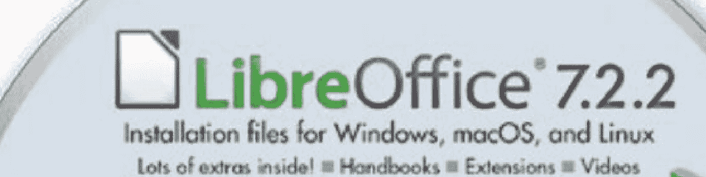

- 70 LibreOffice 的隐藏宝藏

发现一些隐藏且较少为人知的 LibreOffice 功能。


- 70 LibreOffice 的隐藏宝藏

发现一些隐藏且较少为人知的 LibreOffice 功能。


发现一些隐藏且较少为人知的 LibreOffice 功能。


发现一些隐藏且较少为人知的 LibreOffice 功能。

AltSearch 为 LibreOffice Writer 的默认查找和替换工具提供了扩展功能，使其成为编辑和格式化长文档的理想选择。

LibreOffice 内置了一种类似 Basic 的脚本语言，可用于自动化重复任务并扩展套件的默认功能。

一旦你熟悉了 LibreOffice 的主要组件，就可以通过技巧优化对 LibreOffice 的使用。

发现一些隐藏且较少为人知的 LibreOffice 功能。

LibreOffice Writer 是一个

谁喜欢...


## 服务

在 DVD 上

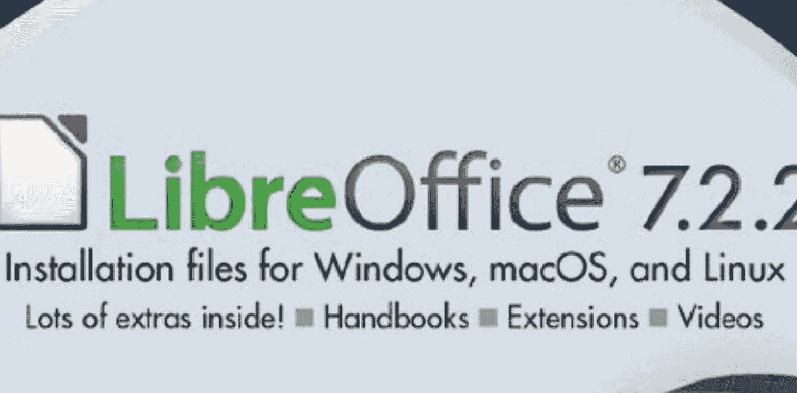

本期附带的 DVD 包含以下完整版本：

请咨询软件包管理器或查看本期第 8 页的“介绍 LibreOffice”。


## 更多内容！

作为额外，此 DVD 还包含其他帮助你扩展和学习 LibreOffice 的资源。包括：

- 视频：之旅 LibreOffice 新功能，并从顶级领袖和资深人士那里了解 LibreOffice 项目和个人故事


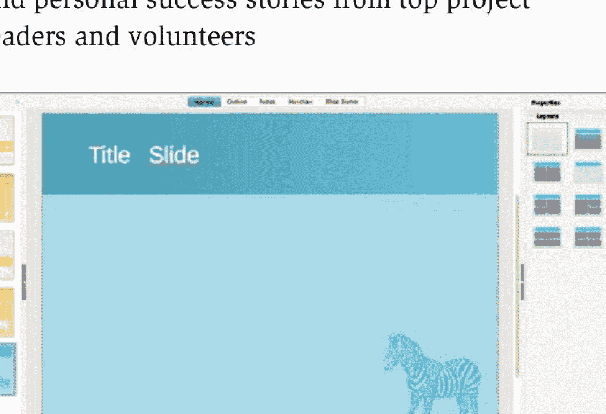

## 入门指南

损坏的光盘将予以更换。

请发送电子邮件至 help@linuxnewmedia.com。尽管据我们所知， LibreOffice 专家光盘已经过测试且没有有害软件和缺陷，但 Libre 杂志对使用此光盘导致的任何数据中断、丢失或计算机系统损坏不承担责任。


https://www.libreoffice.org/download/download/?version=7.2.2


## 搭载 LibreOffice 的 TUXEDOs

tuxedocomputers.com

## 介绍 LibreOffice

为什么选择 LibreOffice 以及如何安装？

为什么要为办公效率套件付费？

LibreOffice 完全免费的，并且它可以在 Windows、macOS 和 Linux 上运行。

作者：Mike Saunders


一个完整、功能丰富、兼容微软文档且完全免费的办公套件——这种东西真的存在吗，对吧？并没有猫腻。没有隐藏成本。没有任何值得疑虑的地方。LibreOffice [1] 是一套完整的办公工具，旨在让任何人通过出售你的数据来赚钱。


它免费的原因是：它由全球社区制作，由志愿者驱动，他们热衷于开发供所有人免费使用的高质量生产软件。无论收入、位置或语言如何，每个人都能使用这些强大的工具。LibreOffice 的用户界面已翻译成 100 多种语言，因此该软件可以在其他供应商未曾涉足的国家供许多人使用。这并不是说所有的 LibreOffice 开发人员都是出于纯粹的慈善目的在工作。许多“认证开发者” [2] 一直在使用 LibreOffice（例如社区或当地政府部门），并获得报以提供软件包、修复漏洞和开发新功能。LibreOffice 是免费的，但它是完整的（并将继续保持完整），它仍然支持围绕着它的移动生态系统。

如果 LibreOffice 真的是免费的（是的！）而且是微型软件的（确实如此），那么世界上还需要它什么？为什么 MS Office 依然存在？这有很多原因，例如：关于 LibreOffice 的起源，你必须追溯到 20 世纪 80 年代名为 StarWriter 的程序（图 6）。StarWriter 是一款商业文字处理程序，由德国程序员 Marco 创建。

- 家庭用户：LibreOffice 并不知名，其背后的非营利实体 Document Foundation 正在努力通过营销和活动改进这一点，但还需要更多宣传。
- 阻力：当人们发现 LibreOffice 时，他们往往对改变感到犹豫，特别是如果他们已经为其他软件付费了。LibreOffice 是免费的，但在某些地方看起来略有不同，一些保守的用户还没有准备切换。
- 功能：LibreOffice 拥有每个用户需要的海量功能，在某些领域甚至比 MS Office 多 [3]。但 MS Office 的某些特定工作流需要 LibreOffice 不完全匹配的另一个或特殊功能。尽管如此，由于 LibreOffice 每六个月发布一次，它的变化非常快，而且 LibreOffice 在推出 MS Office 尚未出现的功能方面往往处于领先地位。

LibreOffice 套件包含几个工具，包括：

- `Make` - 用于创建公式

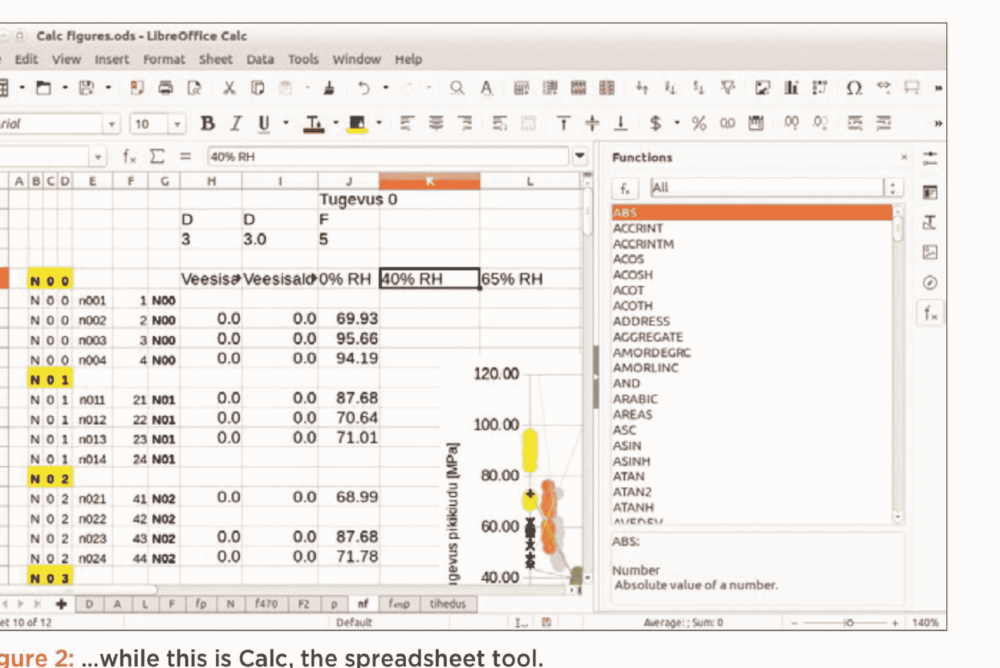

| 0559-getstarted-guide-db.odt-LibreOffice writer | | | | | | | | |

| 文件 | 编辑 | 插入 | 格式 | 样式 | 工具 | 窗口 | 帮助 |

|---|---|---|---|---|---|---|---|---|

| 标题 3 | | Libertao Sans | 11 | B I U S | K A Z | A | | |

### 安装模板

要安装模板：

1. 下载模板并保存到你的电脑上。
2. 按照计算机系统的说明将模板导入到文件夹中。要保存存储在计算机中的新模板……

> 提示
> 你可以将任何模板作为新模板复制。位置位于你的计算机系统中。要保存存储在计算机中的新模板，请前往 `选项 > LibreOffice > 路径`

### 安装模板集

1. 下载扩展程序 (`.odt`) 文件并保存到你的电脑上。
2. 在 LibreOffice 中，前往 `工具 > 扩展管理器`。在扩展管理器对话框中，点击 打开从文件浏览器中浏览。

图 1：这是 Writer 的文字处理器……

8

## 介绍 LibreOffice

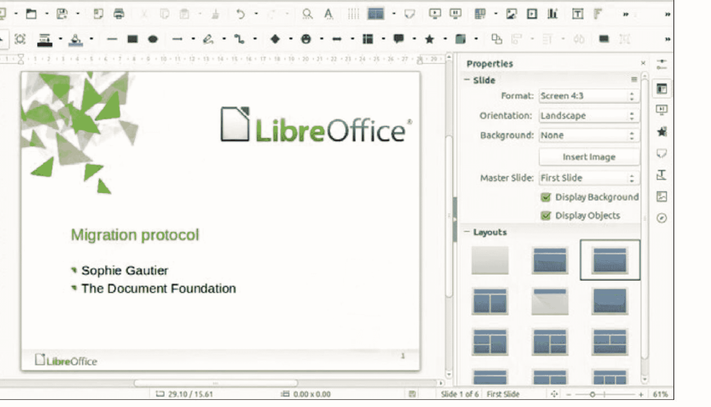

图 2：Calc，电子表格。

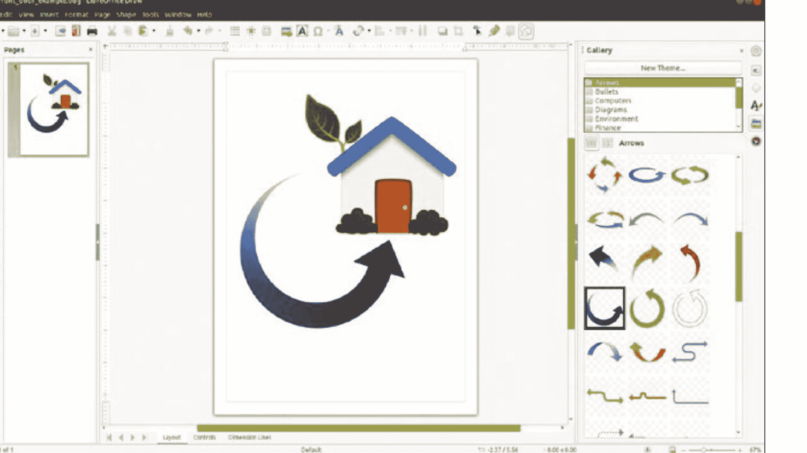

图 3：Impress，演示文稿工具。


图 4：Draw，用于图表、流程图、绘图。


图 5：Base，用于数据库。


图 6：StarWriter，一款文字处理程序。

## 简史

LibreOffice 套件包含几个工具，包括：

## 开始上手

LibreOffice 支持该格式，而最近的 MS Office 版本也支持 (`ODF`)。

## 介绍 LibreOffice

### 文档基础

在接下来的几年里，Sun 公司和 OpenOffice.org 社区一直致力于该软件的新版本，但人们一直担心一家大型公司对该项目拥有巨大的影响力。社区提出了一些想法，例如建立一个独立的基金会来监督 OpenOffice.org 的开发，但并未取得任何果实。

LibreOffice 于 2010 年 9 月发布。探索我们的社区和认证开发者在 10 年里取得的成就……


新版本像时钟一样，每月发布一次。它们包含了新功能、Bug 修复和兼容性改进。

到 2009 年为止，该项目被 Oracle 收购，这是一家数据库软件和其他企业工具的供应商。OpenOffice.org 社区（那些为项目做出了巨大贡献的志愿者）立即表示了担忧：现在会发生什么？Oracle 会关心 OpenOffice.org 吗？Oracle 是自由和开源软件的朋友吗？


LibreOffice 在全球范围内超过 2 亿用户使用。此外，得益于我们的本地化社区，它提供了 114 种语言。

当时有很多讨论，许多社区成员在 2010 年做出了重大决定：是时候由一个完全独立的、非营利的实体为该办公套件提供未来了。这被称为文档基金会（The Document Foundation, TDF），软件命名为 LibreOffice。

LibreOffice 起于 OpenOffice.org 项目的“分支”。因为 OpenOffice.org 是开源的，任何人都可以源代码并用它启动另一个项目。OpenOffice.org 的绝大多数社区成员立即加入了 LibreOffice 项目。LibreOffice 是同一套代码的未来，但它拥有新的品牌和新的

年度会议已在阿尔滕纳、地拉那、布尔诺、奥胡胡斯、波恩、美因、多伦多、索非以及在线举行。还有更多！


LibreOffice 正在被全球的企业和政府使用。更多详情请访问 `tdf.org/migrations`。同时也提供专业支持。


公司提供基于 LibreOffice 的产品，开发新功能，并将代码回馈给项目和社区。


图 7：OpenDocument 是 LibreOffice 的原生格式，是一种完全开放且标准化的格式，适用于作品的长期存储。

让我们让下一个 11 年也同样精彩吧！`tdf.org/joinous`

## 介绍 LibreOffice

希望你能使用它。OpenOffice 在过去几年里一直作为一个规模小得的项目运行，但与快速增长的 LibreOffice 相比，更新相对较少。

对于某些用途，你至少需要 2GB 的空闲硬盘空间和 1GB 内存——因此你过去几年组装的任何电脑 似乎都绰绰有余。对于某些功能（例如 Base 是需要的 [6]），如果你愿意，可以使用 Java 使用该套件。

直接从“应用程序”文件夹运行软件（或将图标拖到你的程序坞中以便于访问）。你也可以删除 `.` 文件。

自 2010 年以来，LibreOffice 拥有强大的传承；有许多版本的软件被广泛使用，例如法国政府有 500,000 台安装。EDF 拥有超过 1 亿 LibreOffice 用户，数百名社区成员每几个月就会聚在一起召开会议，开发新功能并讨论软件的未来。社区的设计是为了为套件提供支持和额外功能。而现在，你免费地拥有了几乎这一切！

最新版本的 LibreOffice 可以在本期附带的 DVD 中的 `.deb` 和 `.rpm` 包找到，我个人建议直接从你的 Linux 发行版的包管理器进行安装。这可以与你的桌面实现更好的集成，并具备未来自动更新的可能性。如果你想安装最新的 `.deb` 或 `.rpm` 文件，请查看详细的维基 (9)。

## 在 Windows 上安装

- 1. 获取适用于你系统的 `.exe` 安装文件（64 位系统文件名为 `_x64`，32 位系统名为 `_x86`）。将文件保存到桌面，双击开始安装。
- 2. 安装程序将显示一个向导，你只需一直点击“下一步”来接受默认选项，这些选项是完美的，除非在过程中出现用户账户对话框，此时点击“继续”继续安装。
- 3. 安装完成后，点击“完成”。

## 安装它！


对于某些用途，你至少需要 2GB 的空闲硬盘空间和 1GB 内存——因此你过去几年组装的任何电脑似乎都绰绰有余。对于某些功能（例如 `Base` 是需要的 [6]），如果你愿意，可以使用 Java 使用该套件。

自 2010 年以来，`LibreOffice` 拥有强大的传承；有许多版本的软件被广泛使用，例如法国政府有 500,000 台安装。`EDF` 拥有超过 1 亿 `LibreOffice` 用户，数百名社区成员每几个月就会聚在一起召开会议，开发新功能并讨论软件的未来。社区的设计是为了为套件提供支持和额外功能。而现在，你免费地拥有了几乎这一切！

最新版本的 `LibreOffice` 可以在本期附带的 DVD 中的 `.deb` 和 `.rpm` 包找到，我个人建议直接从你的 Linux 发行版的包管理器进行安装。这可以与你的桌面实现更好的集成，并具备未来自动更新的可能性。如果你想安装最新的 `.deb` 或 `.rpm` 文件，请查看详细的维基 (9)。

当时有很多讨论，许多社区成员在 2010 年做出了重大决定：是时候由一个完全独立的、非营利的实体为该办公套件提供未来了。这被称为文档基金会（`The Document Foundation, TDF`），软件命名为 `LibreOffice`。

当时有很多讨论，许多社区成员在 2010 年做出了重大决定：是时候由一个完全独立的、非营利的实体为该办公套件提供未来了。这被称为文档基金会（`The Document Foundation, TDF`），软件命名为 `LibreOffice`。

当时有很多讨论，许多社区成员在 2010 年做出了重大决定：是时候由一个完全独立的、非营利的实体为该办公套件提供未来了。这被称为文档基金会（`The Document Foundation, TDF`），软件命名为 `LibreOffice`。

当时有很多讨论，许多社区成员在 2010 年做出了重大决定：是时候由一个完全独立的、非营利的实体为该办公套件提供未来了。这被称为文档基金会（`The Document Foundation, TDF`），软件命名为 `LibreOffice`。

当时有很多讨论，许多社区成员在 2010 年做出了重大决定：是时候由一个完全独立的、非营利的实体为该办公套件提供未来了。这被称为文档基金会（`The Document Foundation, TDF`），软件命名为 `LibreOffice`。

## LibreOffice Writer

如前所述，你可以点击并拖动侧边栏旁的句柄来调整其大小。当你悬停在侧边栏右侧的图标上时，会显示提示信息。侧边栏中的属性面板是与上下文相关的；换句话说，它取决于你在文档中正在的操作（编辑文本、操作图像、表格等）。如果你想对文档执行特定操作或修改，但不确定去哪里操作，请点击该元素然后打开“属性”面板。

通过“`工具 | 选项`”（Windows 和 Linux）或 macOS 上的“`LibreOffice | 偏好`”可以使用额外的自定义选项。然后探索左侧的 `LibreOffice Writer` 部分，探索下方的各种选项。

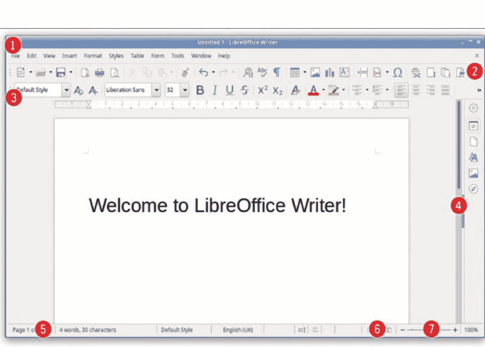

**图 1**: `LibreOffice Writer` 中的新文本文档：菜单 (1)、工具栏 (2)、样式 (3)、对话框 (4)、状态栏、视图 (5)、菜单 (6) 和缩放级别 (7)。

在它们旁边的列表中，你可以选择单次点击撤销/重做的次数（这通常可以节省大量时间）。同样，列表（项目符号列表和编号列表）有不同的样式供选择。图 1 显示了布局，包含一个菜单、两个工具栏和一个底部的状态栏。然而，`LibreOffice` 的开发人员并没有强制用户采用任何特定界面，因此他们提供了充分的灵活性。例如，在菜单中进入“`视图 | 工具栏`”，你可以看到许多额外功能可以启用或禁用。

更好的是，进入“`视图 | 用户界面`”，你可以在三个选项之间进行选择：图 2：标准工具栏（默认模式）、单一工具栏（如果你的屏幕没有垂直空间）和侧边栏（在超宽显示器上或如果你想更多地利用水平空间）。尝试所有选项，看看哪种最适合你的用例和工作流。

以下是 `Writer` 中最常用的 10 个操作：

- 1. 页眉和页脚：这些是页面开头和结束的部分，它们在大多数情况下跨页保持相同，尽管你可以引入更改的元素。页眉和页脚最常见的用例是标题。要在页眉或页脚中添加文本，你需要

UI 变体

预览

| 文件 | 编辑 | 插入 |

|---|---|---|

| 样式 | B | I | S | x² |

这是一个带有菜单、工具栏和折叠侧边栏的标准用户界面。适用于熟悉经典界面的用户。

**图 2**: 提供了各种用户界面布局 - 尝试一下它们并看看哪种最适合你。

`LibreOffice Writer`

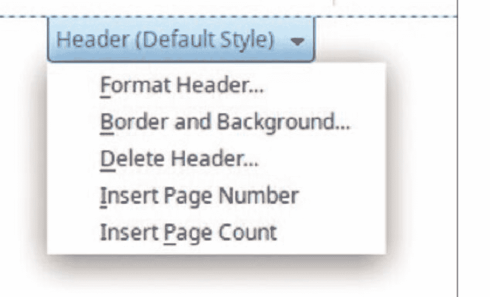

`LibreOffice | 偏好`。在“`LibreOffice | 数据`”下，你可以更改你的名称——这并非强制，但这意味着你的名称将显示在所有的更改和注释中。这有助于处理文档的人看到是谁更改了什么。点击“确定”，然后进入编辑菜单，转到“更改”选项卡并记录且显示更改。

### 在页面上添加静态文本

只需在页面部分上方或下方创建一个区域，并使用文本框。点击它可以为页眉或页脚留出空间，或者文本框将变为连续行（图）。从这里，你可以直接向页眉或页脚插入文本，它将在所有页面上可见，并添加页码（你会在页脚中找到）。

如果你想更改图像与文本的环绕方式，右键点击它并选择“环绕”菜单。“最佳环绕”是文本在其周围自然流动的最佳选择。同样在右键内容菜单中，点击“属性”以获取更多选项来插入边框和调整位置。

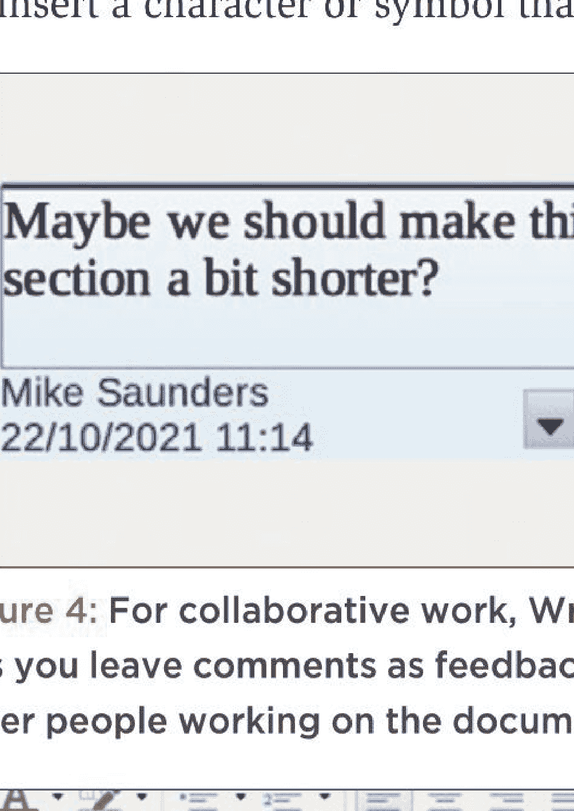

> 也许我们应该把这个部分写得更短一点？

> Mike Saunders 22/10/2021 11:14

图 4：用于协作，你为处理文档的人留下反馈

图 5：导航器在你处理具有大量章节的书签的文档时是一个非常有用的工具

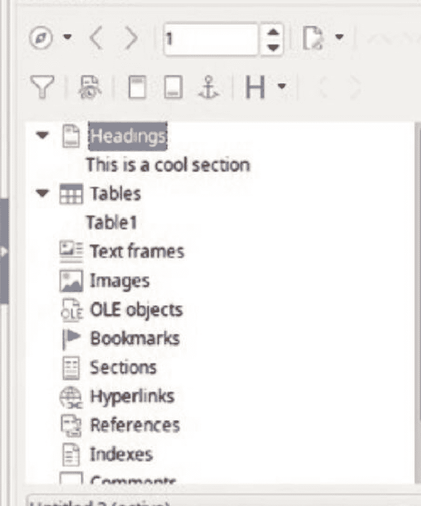

`LibreOffice Writer`

大家好！

图 6：格式标记精确显示了空格、制表符、换行和其他特殊字符放置在文档的什么位置。这对维护文档的一致性至关重要。此外，它们还让在几个字内做出重大更改变得容易。文字处理器通常格式化

在 `Writer` 中，有各种样式：

最终，样式有助于提高文档的一致性。此外，它们还让通过样式使用逻辑属性而非物理属性来进行重大更改。使用样式意味着你不需要说“这段文本应该是 12 字体”，而是说“标题 1”，因为你已经定义了所需的标题 1 样式。换句话说，样式意味着特征。

图 7：`Writer` 提供的默认样式集

`LibreOffice Writer`（文字处理）

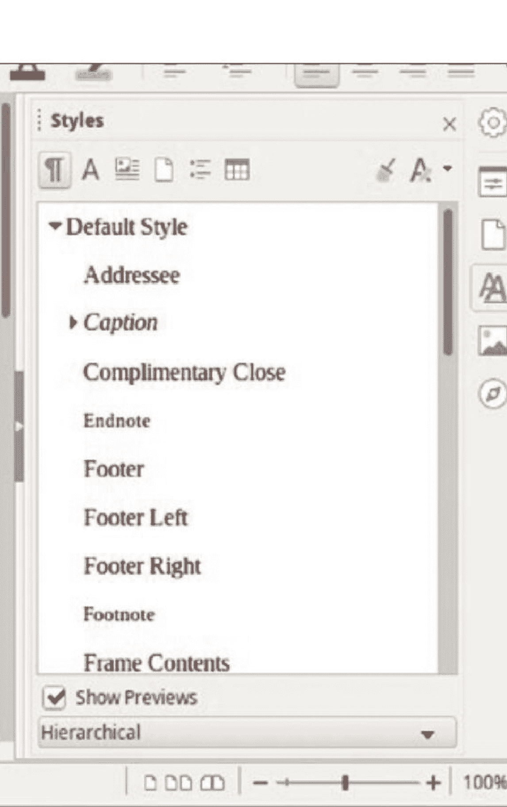

样式，请从面板中显示的样式列表中选择第一个，右键点击该样式并选择“`新建 (New)`”。给它起一个名称，它就会被添加到列表中——右键点击它并选择“`修改 (Modify)`”，你会发现有大量的选项可以进行调整。不要让它让你无所从，你不需要更改其中大部分选项。但请花时间去探索：你可以更改颜色、边框、字体、字号、缩进等。

样式，它是被所持有的，并且是如此。每当你在“`导航器 (Navigator)`”中使用样式时，你都会在文档中找到它——对于长文档来说，这是快速穿梭的极佳方法。

但如果你想创建更多样式，包括创建属于你自己的样式！那么，侧边栏派上什么用呢？如果你按照描述打开它（或前往“`视图 | 侧边栏`”），并点击右侧的样式图标，你将看到所有的样式。

要创建一个新样式，通过点击侧边栏面板上的图标之一来选择样式类别（例如段落或字符），点击弹出菜单右侧的箭头。你会发现你的新样式已链接到

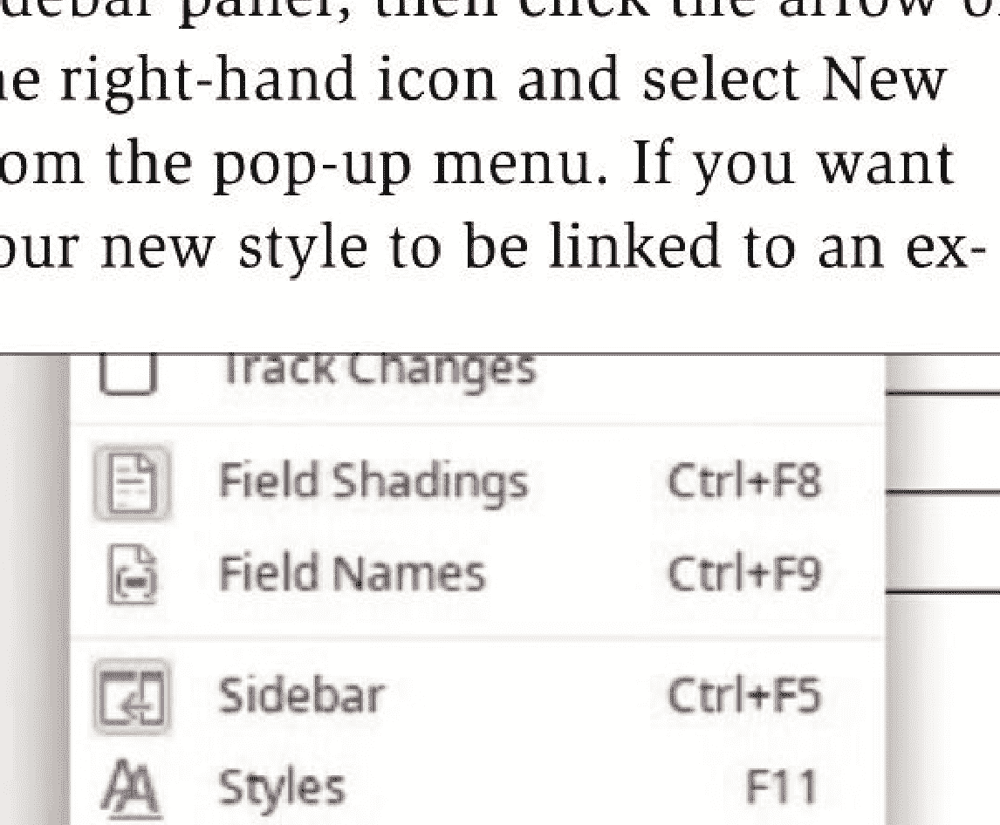

我可以在此指南中包含一个巨大的表格，列出 `Writer` 中的每一个快捷键，但这已经在网上可以了 [1]。每个人都有不同的流程和工作流，因此最好的办法是找到对你最有用的功能！使用任何菜单（或右键点击）并查找条目。键盘快捷键，你应该能在右侧（图9）看到它们。如果你的操作系统默认显示这些内容，请前往“`工具 | 选项`”（在 macOS 上为“`LibreOffice | 偏好设置`”）——然后在左侧选择“选择”，并启用右键菜单中的图标和快捷键。

图 8：在侧边栏中，你有额外的控制控件，包括创建新样式的能力。双击样式以应用它。

## 加载、保存与导出


# LibreOffice 格式与保存

## 原生格式

LibreOffice 的原生格式是 OpenDocument（开放文档），并以 `.odt`（OpenDocument Text）保存其他。这是一个完全标准的格式，但许多其他程序不支持，因此不是工作的最佳方式。当然，你可能会遇到（或收到）其他格式的文档。LibreOffice 在打开文件方面做得很好，但这些文件通常是低频率或文档不全的数据块，因此 LibreOffice 必须费力处理它们。如果微软给你发送一个 `.doc` 或 `.docx` 文件，它在你的 LibreOffice 安装中看起来可能不对，请尝试将它们保存为 OpenDocument 格式。

## 导出与保存

保存，LibreOffice 可以导出许多不同的格式，包括上述的 `.doc` 和 `.docx`。只需前往 `文件 | 另存为`，你就会看到下拉列表。你可以将其保存为 HTML 或文本，但很多格式将会消失。相反，使用 `文件 | 导出`，你可以保存为 EPUB 格式供电子阅读器使用，或保存为 PDF——如果你使用的 PDF 只需要查看或打印而不需要编辑。（导出为 PDF 时，你可以选择混合版本，它还会嵌入原始文件的副本，以便在必要时进行编辑）。

如果你有大量的 Microsoft Office 文档工作并需要默认保存，请前往 `文件 | 打开`，然后在左侧选择 `另存为`。然后，在右侧，你可以选择 `始终` 以保存为默认格式。

## 样式系统

LibreOffice 为你提供了通过样式系统格式化文档并进行更改的工具。它不仅允许你维护文档（以及文档之间）的一致性，还节省了你手动对齐所有段落（甚至是单元格）的时间。若想节省更多时间，请勾选 `键盘快捷键` 框！---


> 信息 [1] 键盘快捷键：

https://help.libreoffice.org/7.2/en-US/text/writer/04010200000.html

从我们的特版库中了解 Shell、LibreOffice、Linux 等。

《Linux 杂志》团队创建了一系列单本，让你深入研究你感兴趣的主题。

提供纸质版或数字版

shop.linuxnewmedia.com


# LibreOffice Calc（电子表格）


LibreOffice Calc 提供了 Excel 的功能并带有额外优势。Brucefield 编写

Calc 是 LibreOffice 的电子表格模块。等同于 Microsoft Excel，Calc 设计用于与使其兼容。每个工作表（图 1）都能处理 1,024 列和 1,048 行，对于大多数用途来说绰绰有余。如果你需要更多，或者表格在内存受限的机器上崩溃，请考虑使用。

如果你有大量的 Microsoft Office 文档工作并需要默认保存，请前往 `文件 | 打开`，然后在左侧选择 `另存为`。然后，在右侧，你可以选择 `始终` 以保存为默认格式。

数据数组是 Calc 真正展现其数据功能的地方。

Both lists and arrays are organized by groups. Group information on the sheet, leaving space for labels - a label describes what information is contained in the column or row cell. Formatting, such as color bands, can help to distinguish different types of information as an example. For a teacher's grade sheet, using different shades of mark to show the median and averages. The more easily users will be able to find their way through the information - but too much complexity is hard to avoid.

数据数组是 Calc 真正展现其数据功能的地方。

Both lists and arrays are organized by groups. Group information on the sheet, leaving space for labels - a label describes what information is contained in the column or row cell. Formatting, such as color bands, can help to distinguish different types of information as an example. For a teacher's grade sheet, using different shades of mark to show the median and averages. The more easily users will be able to find their way through the information - but too much complexity is hard to avoid.


# 入门

LibreOffice Calc

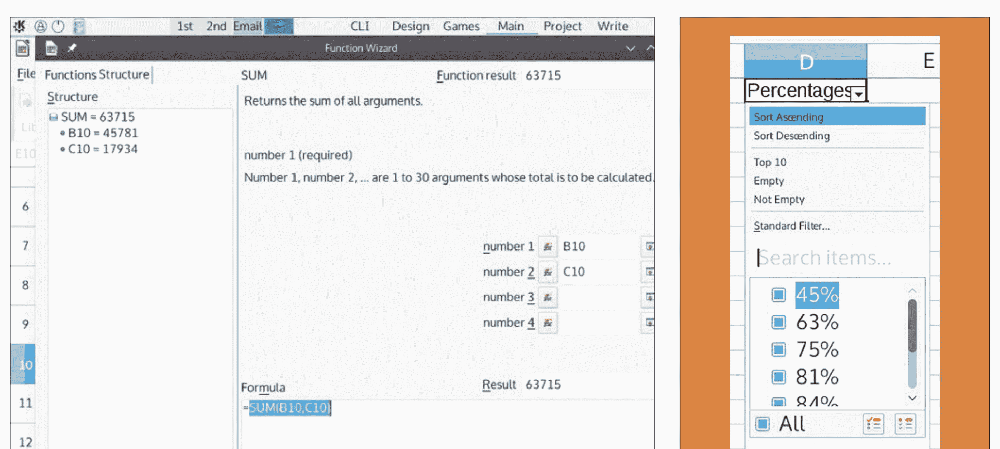

图 3：函数是组合公式最简单的方法。

## 维多利亚文学简介

| 学生 | 论文 1 | 期中考试 | 论文 2 | 考试 | 总分 | 成绩 | 等级范围 |
|---|---|---|---|---|---|---|---|
| Alice, Andrew | 15 | 22 | 25 | 28 | 90 | A | 90-100 |
| Allen, Robert | 12 | 17 | 19 | 27 | 75 | B | 85-89 |
| Smith, John | 15 | 18 | 26 | 21 | 80 | B | 82-84 |
| Wu, Monica | 19 | 22 | 18 | 24 | 70 | C | 71-75 |

图 4：带有公式分析结果的数据。

未在 Excel 中找到，且在 Excel 中打开的电子表格中将不使用。具有唯一数据集的函数实例被称为公式。

每个函数都有其自己的输入变量。许多变量是必选的，但某些是可选的。所有变量都可以从“函数”工具栏手动输入，该工具包含了一些最常用的函数。然而，大多数用户更喜欢选择一个单元格来存储结果，并从“插入”->“函数”中添加函数，这将打开“函数向导”（图 3）。函数向导列出了所有可以手动输入或通过输入、拖动电子表格上的单元格来输入的变量。此外，函数向导会预览结果，这样你就可以在文档中插入错误的函数之前纠正变量。

函数向导用于在左侧窗格中浏览函数。函数分为财务、逻辑和统计等类别，你可以通过输入名称来显示每种函数。每个变量都提供了简短的解释。

另一个示例（图 4）展示了老师成绩单的例子。上半部分是学生每项作业的成绩以及他们满百分分的总数。评分标准基于右侧的框选单元格。更重要的是，学生成绩下方列出了由函数生成的某些统计数据：平均值、中位数。

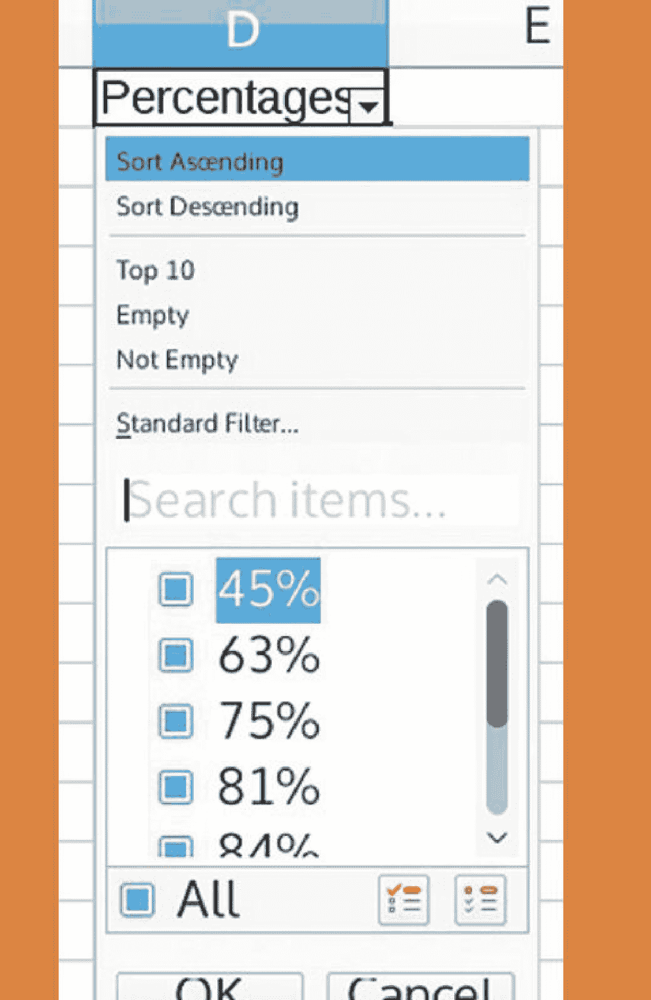

图 5：自动筛选是过滤数据的选项下拉列表。

统计数据的 `Max` 和 `Min` 输入是每个学生的总分，可以通过选择总分列中的单元格来选择。使用函数向导，我可以快速创建这些函数，而不需要记忆单个公式的实际结构，而不是通过输入 `=SUM(B5:E5)` 输入学生单元格范围的总和然后用鼠标拖动。

除了函数外，Calc 还有许多其他可用于列表和数据数组的工具。这些工具散落在菜单中——大部分在“数据”中，但也内置在有助于格式化的视图中，以及可以使函数更强大且易于导航的工具中。选项卡 1 和 2 描述了一些最实用的 Calc 工具。

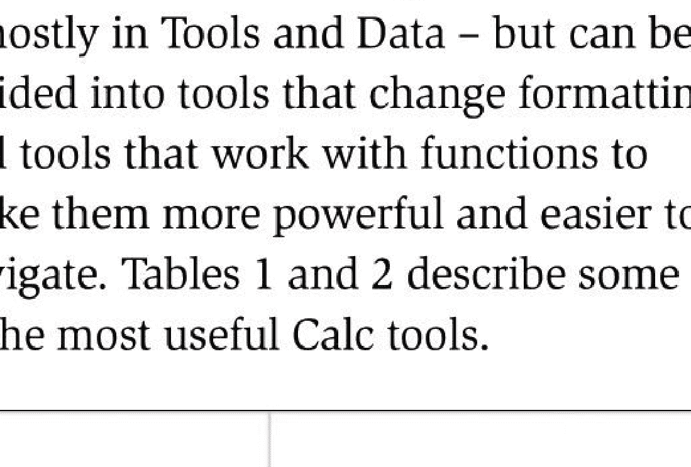

错误！你尝试输入三个或更多小数。此单元格只能接受两位小数的数字。

图 6：有效性是在线帮助的一种。

如果格式线索没有提供视觉线索，你可以从“格式”|“条件格式”中添加其他线索。条件格式允许一眼看出数据数据趋势，但不显示任何特定数据。例如，你可以使用从微笑到中性表情的情来表示单元格内容。或者，可以对数据进行颜色编码（图 7）。

| 工具 | 说明 |
| --- | --- |
| 右键点击 | 隐藏列/隐藏行 | 简化显示并减少呈现的信息量。注意，隐藏并不保护信息。例如，如果你有一份欧元和美元的物品列表，并隐藏了欧元的列，查看者可以推断显示了某一列，因为美国列中的某些条目将是空的。 |
| 数据 | 分组和大纲 | 分组 | 在列和行中创建一组树形控件，用于展开或折叠显示。如果需要，你可能需要组内组。 |
| 数据 | 筛选 | 更改所有区域显示的单元格。标准或高级筛选设置了显示单元格的条件，高级筛选提供了更多选项。每个用途最常用的筛选是自动筛选（图 5）。与标准或高级筛选不同，筛选始终显示在工作表上，你可以包含自动筛选的各种筛选。如有，可以从右键菜单创建。选择你想要筛选的单元格顶部的空白单元格。如果你将标记放在单元格中，自动筛选提供筛选选项下拉列表的控件——这显然非常方便。作为导航辅助，你可以使用单元格选择范围 |
| 数据 | 有效性 | 如果几个人使用同一个电子表格，或一个人使用很长时间，则很有用。有效性定义了选中单元格中可以输入的内容和格式，并显示帮助信息，包括无效内容的定义以及如何修正（图 8）。 |
| 工具 | 说明 |
| --- | --- |
| 数据 | 小计 | 允许你对由标题标记（即数据数组）的数据范围执行若干统计函数。你还可以选择小计在工作表出现的位置——但标题左侧有空间。你可能需要同时相加三个数据数组。 |
| 工具 | 追踪 | 帮助你跟踪公式使用的数据的工具子菜单（图 8）。例如，如果一个公式，“追踪引用”（跟踪）会跟踪包含数据的单元格。双击线条即可到达末尾的单元格。相反，追踪从当前单元格画到引用当前单元格的单元格。你也可以使用追踪或无效。完成后，“删除追踪”删除轨迹 |
| 工具 | 目标查找 | 为公式创建多个值。这些值可以从下拉列表中生成。 |
| 数据 | 多次操作 | 为变量创建范围并运行公式。你可以为多个变量、甚至是多个公式创建条目。 |
| 工具 | 求解器 | 提供一个对话框，为一组值输入值范围。它的工作方式类似于目标查找和多次操作，但允许你同时处理更多的变量和约束。 |
| 数据 | 透视表 | 插入 | 重新排列表格中的数据以呈现新信息。例如，图 9 显示了根据国籍、性别和年龄的支出。通过使用和遵循在线帮助，你可以重新排列数据到图 10，显示了按性别的支出，认同为女性的游客在假期期间花费最多，透视表除非你点击“刷新”来更新它们，否则不会立即刷新。 |

LIBREOFFICE 专家 - 2022

LibreOffice Calc

## LibreOffice Calc

内容。甚至像文本自动换行等格式设置也没有包含，这意味着长段内容会遮挡相邻单元格，往往导致电子表格一眼看去无法使用。

| 组织器 | 字体 | 字体效果 | 对齐 | 边框 | 背景颜色 | 单元格保护 |
|---|---|---|---|---|---|---|
| 类别 | | | | | 语言 | |
| 用户定义 | 通用 | | | 默认 - 英语（加拿大） | | |
| 对齐方式 | -1234 | | | | | |
| 百分比 | -1234.12 | | | | | |
| 货币 | -1234.12 | | | | | |
| 时间 | -1234.12 | | | | | |
| 科学计数法 | (1,234) | | | | | |
| 分数 | (1.234) | | | | | |

今天，电子表格的功能比以往任何时候都强大，尽管在过去的几十年里，功能数量显著增加。电子表格有许多格式选项。为了强调演示的重要性，通过高亮和着色单元格来创建视觉效果和功能性。

- 小数：
  - 1
  - 负数
- 格式代码
  - 千分位
  - 通用

通用

这些印象本身并不是目的。你可能会发现自己将电子表格视为艺术品而非理解的辅助，这时你需要重新确认你的优先事项。最好的情况下，功能与视觉辅助的结合使得电子表格比 40 年前更容易使用。Calc 通过对样式的利用，很好地满足了日益增长的电子表格需求。

图 12：“数字”选项卡卡上的选择决定了单元格样式如何读取数据。

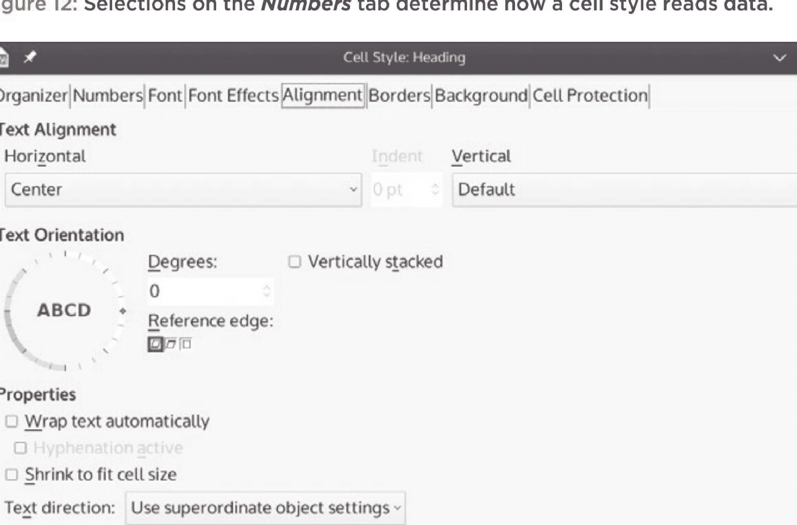

| 对齐 | | 垂直 |
|---|---|---|
| 水平 | | 0 pt |
| 居中 | | 默认 |

文本方向

- 度数：
- 垂直堆叠
- 0

引用索引：

- 1
- 属性
- 自动换行
- 缩小以适应单元格大小

文本方向：使用上层对象设置


图 13：“对齐”选项卡改进了单元格内数据的显示。

比……还要，你还可以选择打印哪些对象。对象、图像和图表在打印页面上可能特别难以定位。最后，你可能倾向于简单地缩放电子表格，尽管过度模糊的风险始终存在（图 14）。

作为样式的替代方案，你可能会为电子表格主题选择颜色方案。但注意，样式具有更具功能性的优势。

当电子表格在 20 世纪 80 年代初开始时，功能每

信息

[1] Byfield, Bruce. Designing with LibreOffice. Of Freedom, Inc., 2016: https://designingwithlibreoffice.com

| 组织器 | 页码 | 边框 | 背景颜色 | 页眉 | 页脚 |
|---|---|---|---|---|---|
- 页面顺序
- 从上到下，然后向右
- 从左到右，然后向下
- 第一页：

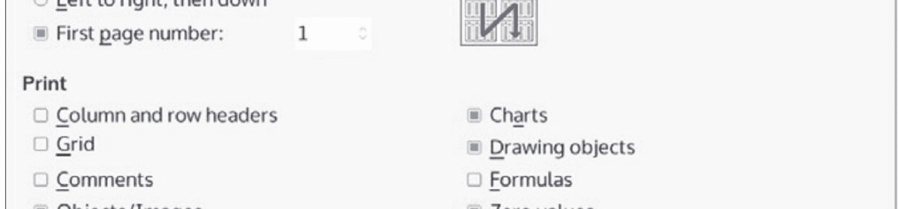

- 打印
- 列和行标题
- 网格
- 注释


- 对象/图像
- 缩放
- 图表
- 绘制对象
- 公式
- 零值

缩放模式：缩小/放大打印

缩放比例：100%

图 14：“样式”对话框提供了将电子表格压缩到物理页的选项。

25

### LibreOffice Impress

### Impress


需要用最新的销售数据给老板留下印象吗？或者只想展示一些引人注目的格式？Impress 是你需要的工具。迈克

“PowerPoint”一词已成为演示文片的同义词，即使演示软件追溯到 20 世纪 80 年代，使用 TypeVision 等工具允许用户向文本添加图像和演示。LibreOffice 的演示组件称为 Impress，这是一个功能极其强大的工具，带有特殊效果。启动 LibreOffice 并选择“新建演示文片”（如果你已经在运行程序，前往 `文件 | 新演示文片`）。你将看到一系列预装模板，选择你喜欢的，一个新的 Impress 文档将显示以下功能：

- 1. 工具栏：最常用的功能只需点击此处。如果你不确定某个图标的作用，只需将鼠标悬停在图标上查看工具提示。你也可以右键点击工具栏并选择“自定义工具栏”来对布局进行更精细的控制。


图 1：新文档：工具栏 (1)、幻灯片缩略 (2)、幻灯片内容 (3)、侧边栏 (4)、侧边栏选项 (5)、位置和大小 (6) 以及级别 (7)。

### LibreOffice Impress

- **幻灯片缩略**：在这里你可以看到幻灯片的缩小版本，单击即可在它们之间切换。右键点击幻灯片对其执行操作（例如复制或删除），在空白区域右键添加新幻灯片。（注意：此面板是折叠的：）

- **幻灯片内容**：这是你大部分工作的地方。点击文本框编辑其内容，周围的句柄可以调整大小并移动幻灯片中的项目。使用“插入”菜单添加图像和注释。

- **侧边栏**：如果没有看到，它可能被折叠在右侧，点击侧边栏打开它（或者查看 > 侧边栏）。在图 1 中，侧边栏显示不同的元素。

- **侧边栏选项**：侧边栏可以显示许多内容，使用右侧的小图标进行切换（例如属性、动画、素材库等）。

- **位置和大小**：当你移动或调整对象（如图像或文本框）大时，检查状态栏查看详情。（你也可以通过“选择和大小”指定尺寸。）

- **缩放级别**：一个滑块可以让你更改幻灯片的缩放级别，放大查看细节，或缩小查看概述。

无论你对史蒂夫·乔布斯如何，无疑他非常擅长演示新产品。如果你从未见过他的任何演示，前往 YouTube 搜索 iPhone 和 MacBook Air 这两个经典案例。他的演示并没有大量的文字和详细细节，而是使用了高质量的设备图像和间性的演讲。他用自己的话配合幻灯片，让观众进入一场令人印象深刻的演示。

当然，演示风格并不适用于每种情况。通过酷目的视觉效果来激励记者，与通过展示照片向家人更新幻灯片状态（创建相册）是不同的。这里有一些通用技巧：

- **良好的开头**：没有人喜欢冗长的演示。与其用令人兴奋的事实、数据或故事开始，不如吸引他们的注意力。

- **关注观众**：阅读很容易，但这只会鼓励你照着屏幕读。

- **使用轶事和故事**：如果你看过 TED 演讲，你就知道如何使用了。有些可以幽默一点，

- **使用 10-20-30 法则**：作为员工，这基本上意味着演示文片长度不超过 10 张幻灯片，并使用 30pt 的字体大小。

- **用演讲代替文本**：如果你有很多全文本幻灯片，请将其简化为一些要点或图像，然后让观众阅读。

回到第一张幻灯片，然后从左侧面板选择幻灯片，并添加一些文本（以及可能的图像）。在进行任何工作之前，检查你的演示！按下 `F5`（或前往幻片 | 放）查看显示的幻灯片，点击屏幕任意位置或使用空格键移动到下一张幻灯片。演示结束后，如果小心按了 `Esc` 键，可以使用 `Shift+F5` 从当前幻灯片继续（或幻片 | 开始 | 从幻灯片）。

现在，我提到大多数演示文片包含一个或多个布局，但幻灯片布局如下。

在侧边栏中，点击“属性”面板（通过选择右侧的按钮进行选择），然后滚动到“布局”。

你会看到一组元素，如图 1 所示。

要添加文本框，前往 `插入 | 文本 + F2`。然后点击并拖动以获得文本框的精确位置和大小。格式化文本非常简单——只需使用幻灯片属性面板，如果你看不到面板，点击相应部分将其更改为可见。大多数选项在 Writer 中也可用，因此你可以完成工作！

你还可以添加：`插入 | 形状`显示可用形状列表，包括线条、箭头和-

所以让我们领先一步制作演示文片吧！关于帮助你的观众并以最大效果展示演示的技巧，使用“演示艺术”。显示

大多数安装的幻灯片包含两种或两种设计变体。在图 1 中我选择的幻灯片实例，你可以看到左侧自动创建了两张幻灯片。第一张是

LibreOffice Impress

### 创建相册

你可以使用 Impress 根据一组图像创建相册，通常每张照片占一张。此相册可以使用带有图形和图像的多媒体源，或者将最新的布局整合到一个单一的演示文文件中。要执行此操作，首先打开一个现有的或空白的演示文，然后点击**插入 媒体 | 图片 | 创建相册**。会弹出一个对话框；点击“添加”来选择你的图像并浏览文件系统。在操作系统中如何选择多张图像？通常是按住 `Shift` 或 `Ctrl` 键的同时点击。

选择好图像后，Impress 提供了一些额外选项（见图 2）。最重要的选项之一是**链接图像**，这意味着图像数据不会直接复制到演示文中，而是在查看演示文时根据需要从文件系统加载图像。这可以节省磁盘空间，因为你没有重复大量数据。但是，如果你从驱动器中删除了图像，演示文将无法显示它！完成后点击“插入幻灯片”，你就可以按照需要继续编辑和展示演示文。

图 2：创建相册时，你可以指定每张幻灯片显示的图像数量。

也可以点击并拖拽它们添加到你的演示文中。你还会发现许多此类幻灯片和对象可以在侧边栏中快速访问。你可以添加幻灯片并设置对象的透明度。检查图库（图 5），它位于侧边栏中，选择右侧面板从右起的第二个图标。点击它可以查看各种图像——你只需点击并将其拖过去即可。对于所有其他形状，如果你点击形状使其高亮，你将看到绿色的手柄，你可以点击并拖动它们来调整大小。

所以，你拥有了幻灯片、布局、文本框、格式和图形——这些都是创建演示文要素。还有一点需要考虑：切换（即从一张幻灯片到另一张幻灯片的动画）。从左侧面板进行选择，然后从右侧侧边栏选择幻灯片切换器（它是从顶部开始第三个图标）。

要更改幻灯片或文本框的背景，点击它并选择**区域**，你将看到图 4 所示的对话框。你可以使用此对话框更改演示文背景！在侧边栏的主部分，你有很多切换效果以及描述它们的小图像。请尽管探索——只需点击切换效果查看它是如何工作的。许多切换效果都有额外选项，包括持续时间（秒）和额外的声音。你还可以使用侧边栏的这部分让演示文在等待几秒后自动移动——参见“切换幻灯片”选项。在掌握基础知识后，你将进入一些高级功能：工作区视图、母幻灯片和演讲者控制台。

图 3：使用侧边栏为文本创建适当的布局，并带有用于文本和/或图像的额外框。

图 4：Impress 为形状提供了多种背景选项 - 如实色、渐变和位图。

在菜单下，你将找到各种选项 - 每种选项旨在确保任务的完成。例如，侧边栏是处理单个幻灯片的主要视图。使用此视图进行设计格式化并添加文本、图形和动画效果。

然后是大纲视图，它包含按顺序编号的演示文幻灯片（图 6）。**大纲视图**显示标题、带项目符号和编号的列表，以及大纲格式的每张幻灯片的列表。默认框中包含的文本也在大纲形式显示，因此它包含了文本框或绘制对象以外的其他幻灯片；此视图中的对象将不会显示。

备注视图允许你向幻灯片添加备注。这些备注供你参考，在展示演示文时观众不可见。同时，母版视图用于设置打印的幻灯片布局。点击侧边栏中的“属性”选项卡，你可以在“布局”部分选择每页打印一、二、三、四、六或九张幻灯片。此外，这允许你在页眉和页脚部分添加自定义字段，例如当前日期。

首先：母幻灯片被用作其他幻灯片的模板。它类似于 Writer 中的页面样式，控制你所有所有幻灯片的基本格式。它可以有多个母幻灯片。此外，母幻灯片可以具有不同的特性，包括背景、渐变以及其他对象（如 Logo、线条和文本）。

图 5：通过侧边栏访问的图库提供了许多形状和文本。

所以，你拥有了幻灯片、布局、文本框、格式和图形——这些都是创建演示文要素。还有一点需要考虑：切换（即从一张幻灯片到另一张幻灯片的动画）。

要创建一个新的母幻灯片，点击左侧的空白区域并选择“新建母版”。对其进行修改以符合你的需求。建议也重命名此母版。在幻灯片面板中右键点击幻灯片，从菜单中选择“重命名母版”。完成母幻灯片的创建后，点击顶部工具栏上的“关闭母版视图”返回普通模式。现在你可以创建一个新幻灯片并使用该母版进行设计（见图 8）。点击右侧面板中的“母幻灯片”图标，然后更改顶部的设计。

图 6：使用大纲视图查看你演示文的结构。

图 7：大纲视图显示演示文的层级。

母幻灯片可以具有不同的特性，包括背景、渐变以及其他对象（如 Logo、线条和文本）。这些可以包括页眉和页脚。

图 8：使用母幻灯片图标访问母模板。

## 演讲者控制台


# Impress 演讲者控制台

Impress 包含了演讲者控制台功能，当你的电脑连接了额外的演示文幻灯片时可以使用。此演讲者控制台通过在电脑和幻灯片上使用不同的视图对幻灯片提供额外的控制。你在电脑上看到的视图包含了当前幻灯片、任何幻灯片和演讲者备注。注意，演讲者控制台仅在支持多显示器的操作系统上工作，且仅在连接了两个显示器时工作（例如内置显示器）。

Linux | LibreOffice | 偏好设置 (Mac, OS)，选择左侧的 LibreOffice Imp 通用。启用演讲者控制台按钮并点击确定。现在，你可以连接外部显示器并开始演示，你应该在一个屏幕上看到主演示文，在另一个屏幕上看到演讲者控制台（见图 9）。如果不起作用，说明第二个屏幕正在镜像第一个屏幕，你需要在操作系统中更改显示设置。

图 9：演讲者控制台视图，显示幻灯片和备注。

Impress 在 PowerPoint 格式的演示方面表现良好，尽管在复杂的动画和效果方面可能存在一些局限或差异。如果有人想发送给您需要修改的 Microsoft 演示文稿，请让他们保存为 `.pptx` 格式，而不是文档性稍高但仍有限制的格式。在理想的世界里，所有软件都将使用完全开放且标准的格式，例如 `.odt`（开放文档演示文稿，LibreOffice 使用），但梦想总是很容易的！

同时，Impress 支持多种格式保存内容。转到 `文件` | `另存为`，并查看打开的文件类型下拉列表。您可以选择 Microsoft 格式、HTML 甚至是纯文本。在 `文件` | `导出为` 下还有更多选项。在这里，您可以选择将演示文稿保存为 PDF 或 EPUB 格式（后者用于电子书阅读器）。

LibreOffice Impress

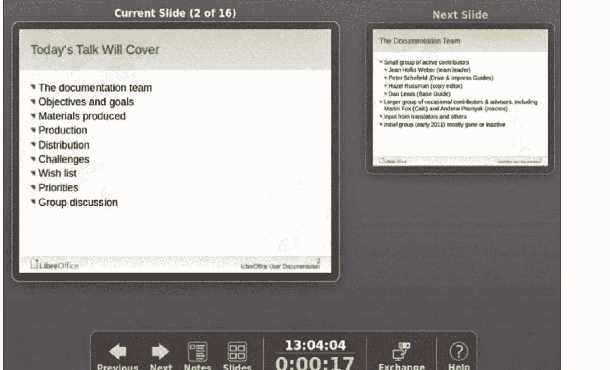

如果您只想保存工作，请直接选择 `导出` 菜单项；如果您想对生成的导出文件进行更精细的控制，请选择其他项。

## 总结

从报告到幻灯片，LibreOffice Impress 都提供了强大的工具来开发令人深刻的演示文稿。⬛


忙于没有浏览发布说明和冗长的科技新闻？让我们把最相关的新、技术文章和工具提示直接发送到您的收件箱。

- Linux 更新
- ADMIN 更新
- ADMIN HPC

紧跟 IT 行业的脉搏。

ADMIN 和 HPC: bit.ly/HPC-ADMIN-Update

Linux 更新: bit.ly/Linux-Update

# 入门

## LibreOffice Draw

### 通用绘图工具

#### 艺术家


通过 LibreOffice Draw，您可以创建吸引人且信息丰富的矢量图。从简单的草图到复杂的图表，LibreOffice Draw 帮助您完成一切。Draw 的基础是页面，您通过在工作区域中放置对象来创建图表。相比于 LibreOffice Calc（电子表格），Draw 的页面提供了更大的自由。Draw 的对象是矢量图形，由线条和曲线定义。矢量描述线条、椭圆和多边形。矢量图形允许您拉伸、旋转或缩放对象而不丢失信息。

所有对象都有单独的属性。要操作对象的属性，首先要在页面内创建并放置对象。一旦放置，您可以在这些边界内移动对象。Draw 文档包含多个页面，每个页面都有不同的层，每个层包含不同的对象。结果是，Draw 文档可以是复杂的，它是简单对象的组合。

当您创建了图形后，可以在其他 LibreOffice 应用中使用它。当需要重新制作或修改图形时，不需要返回原始 Draw 文档。相反，您可以在当前的 LibreOffice 应用（Writer、Calc 或 Impress）中直接使用 Draw 相同的工具进行绘图。您还可以将表格、图表和公式插入到 Draw 文档中。

### 开始绘图

选择 `文件` | `新建` 打开一个新的 Draw 文档（图 1）。您将看到活动工作区（中心），可以在那里创建和操作对象。工作区的左侧显示所有创建页面的缩略图。左侧的工具栏包含创建对象所需工具。右侧的属性边允许设置对象的属性。您将需要使用工具栏和属性边来自由操作。

当您打开新文档时，会在页面面板看到标准尺寸的工作区。要创建第一个对象，请点击工具栏图标（图 2）。然后通过左点击计划的位置放置对象。

LIBREOFFICE 专家 - 2022 版

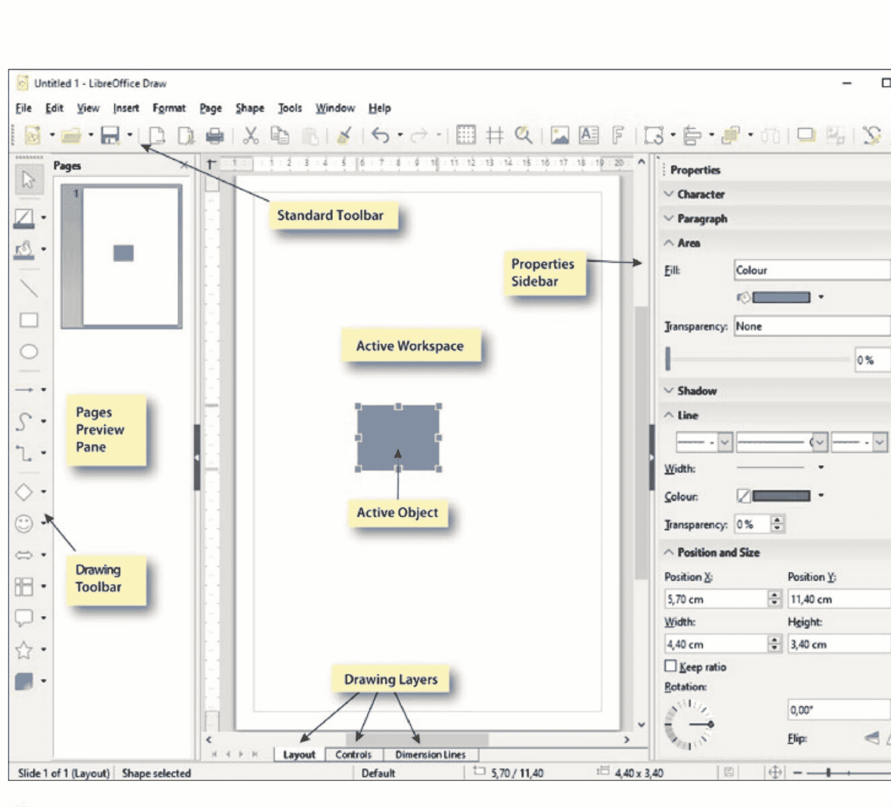

点击对象时会显示八个小句柄。您可以使用鼠标和单个句柄来特征尺寸，或者在属性边中输入 `宽度` 和 `高度`。所有对象相对于页面的 X 和 Y 位置；绘图页的左上角（页面尺寸最小 0,0）。您的对象使用周围区域的左上角作为位置。要更改对象，可以使用属性边。此外，如果您右键点击对象，将弹出菜单并让您打开每个属性的详细对话框。

图 1：新绘图显示了（从左到右）工具栏、页面面板、活动工作区和属性边。

左上边缘，按下并按鼠标，移动到对象右下角的所需的位置，然后释放按钮。将使用默认属性创建。要修改属性，右键点击对象，将弹出菜单并让您打开每个属性的详细对话框。您可以使用鼠标和单个句柄来特征尺寸，或者在属性边中输入 `宽度` 和 `高度`。所有对象相对于页面的 X 和 Y 位置；绘图页的左上角（页面尺寸最小 0,0）。您的对象使用周围区域的左上角作为位置。要更改对象，可以使用属性边。此外，如果您右键点击对象，将弹出菜单并让您打开每个属性的详细对话框。

- 线条：要修改属性，右键点击对象，将弹出菜单并让您打开每个属性的详细对话框。
- 区域：要修改属性，右键点击对象，将弹出菜单并让您打开每个属性的详细对话框。
- 尺寸：要修改属性，右键点击对象，将弹出菜单并让您打开每个属性的详细对话框。

#### 文本

要修改属性，右键点击对象，将弹出菜单并让您打开每个属性的详细对话框。您可以使用鼠标和单个句柄来特征尺寸，或者在属性边中输入 `宽度` 和 `高度`。所有对象相对于页面的 X 和 Y 位置；绘图页的左上角（页面尺寸最小 0,0）。您的对象使用周围区域的左上角作为位置。要更改对象，可以使用属性边。此外，如果您右键点击对象，将弹出菜单并让您打开每个属性的详细对话框。

#### 形状

由于所有图都是各种对象的集合，您的图可能会变得复杂。但您也可以组合对象、合并/减去对象来获取新对象。通常，所有的绘图对象都是通用的。

#### 排版对象

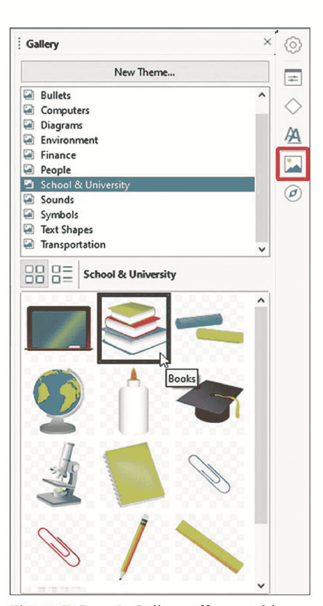

图 3：Draw 图提供了系列可即用的形状；您可以添加任何自定义的形状。

LibreOffice Draw 提供了各种形状，如标注、箭头、流程图和星形。

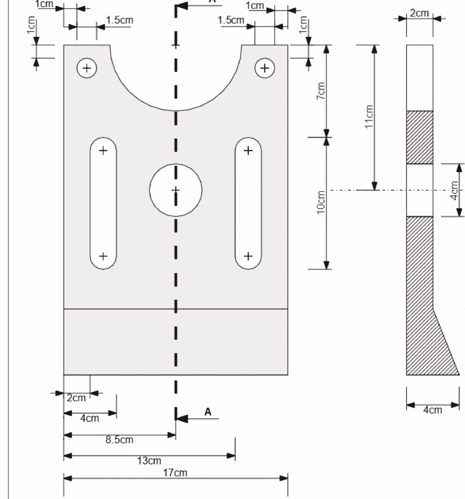

图 4：在 Draw 中输入精确值的能力使其适用于简单的施工图。

### 开始上手

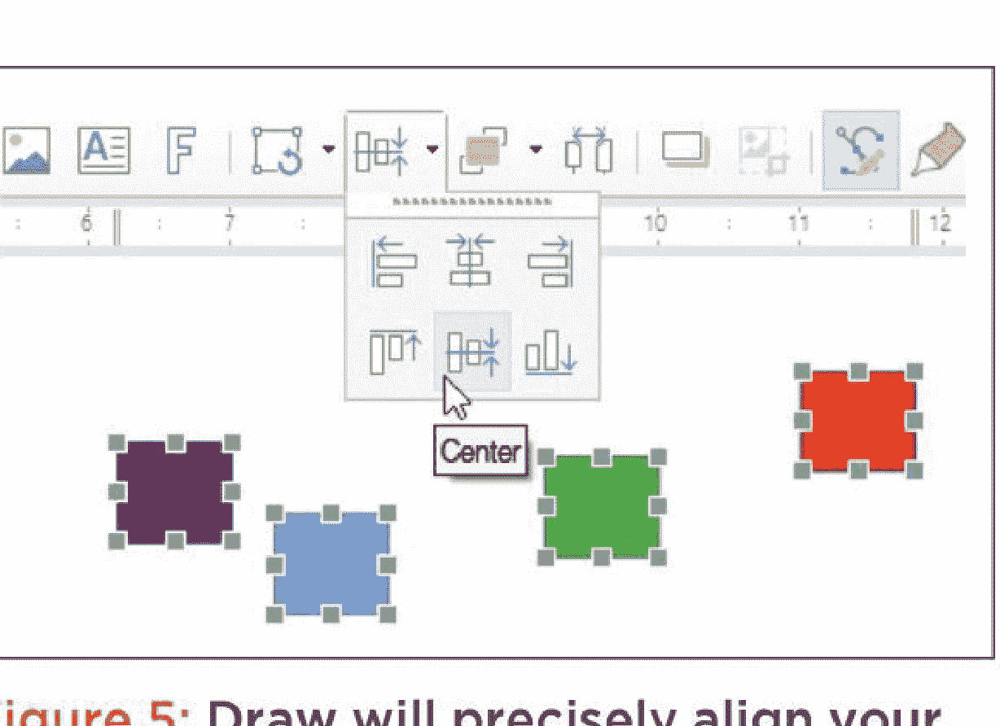

**图 5：** Draw 将精确地对你的对象进行对齐...

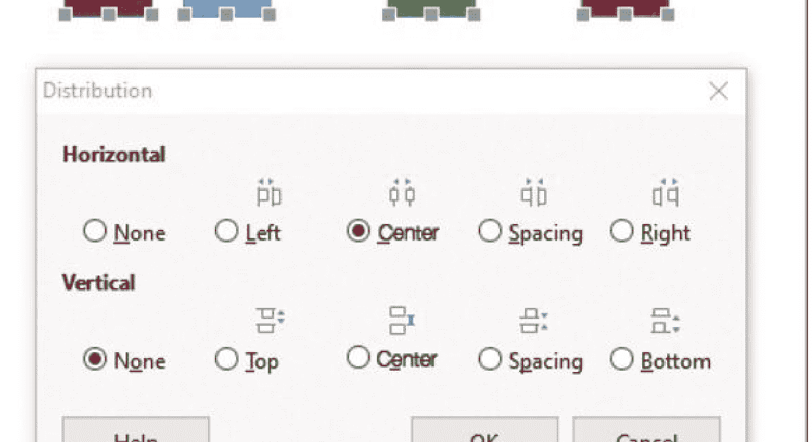

**图 6：** ... 并对它们进行垂直和水平分布。

工作区，另一种选项是通过 `属性` 侧边栏（图 1）确保对象放置的精确数值。你也可以通过右键菜单对话框或 `格式` 菜单使用更多属性。通过使用精确数值，你可以使用 LibreOffice 创建简单的施工图（图 4）。在创建绘图后，LibreOffice 可以调整尺寸线。请记住，在处理施工图时，线条是相对的。

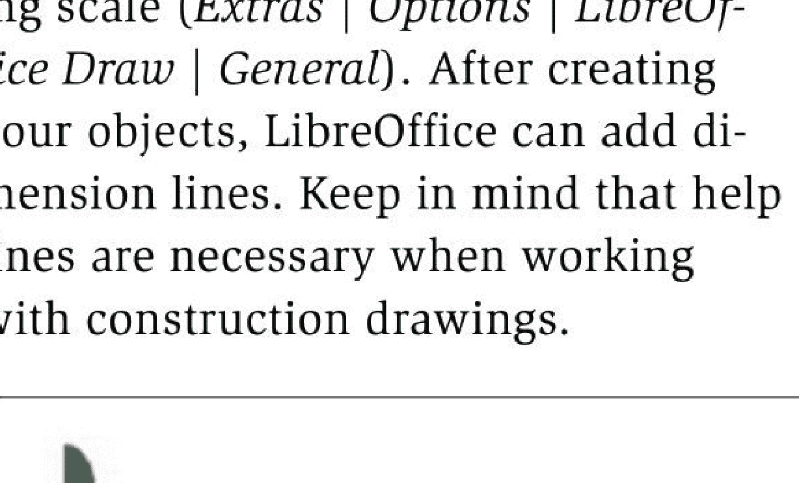

**图 8：** Draw 提供了一些酷炫的选项，例如将 2D 形状转换为旋转的 3D 对象。

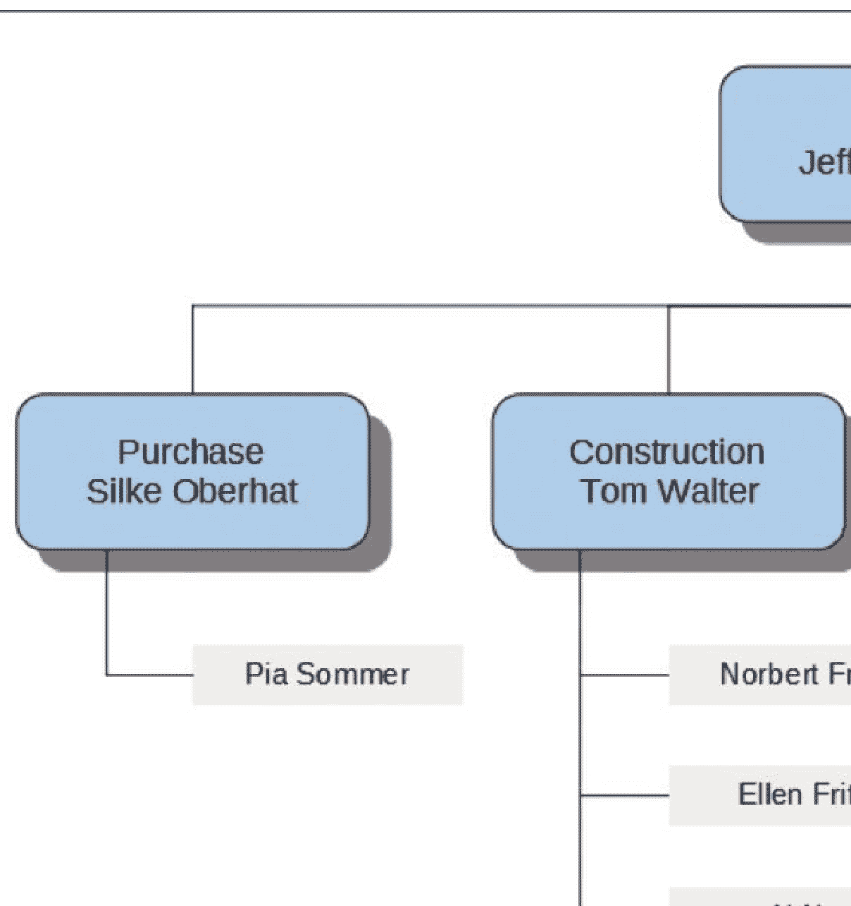

| 采购 | 施工 |  | 管理 |
| --- | --- | --- | --- |


| Silke Oberherr | Tom Bauer | Karl Schulz | Sue Meier |

| Pia Schenmer | Norbert Fritz | T.A. Schmidt | |

| | Ellen Fritz | Norman Maus | |

| | | N.N. | Bob Kraft |

**图 7：** 连接器允许你移动组织中的一个项目，这将保留流程。

最后，如果你需要对齐一组对象，Draw 可以为你完成（图 5）。通过按住 `Shift` 键并右单击所需的对象，或在它们周围画一个框（通过右键菜单和工具栏）。你可以通过选择它们来在行内选择多个对象（图 6）。

形状：所需对象的平面草图（图 8）。然后，点击该形状并选择 `形状 | 转换为 | 3D 旋转`。

## 打印与导出

打印你的绘图很容易。选择打印机并开始打印。确保你的页面设置符合打印机要求。你还可以将绘图导出为文件格式，如 `PDF`、`PNG` 或 `SVG`。`SVG` 是基于向量的格式，而 `PNG` 是基于像素的。

`LibreOffice Draw` 在打印方面有一个限制：它不支持色彩分色（`CMYK` 模式），这对胶印输出是必要的。如果你需要 `CMYK` 模式，最终产品必须使用预印工具进行重新处理，并将颜色更改为所需的色彩配置文件。

## 连接器

Draw 的另一个功能是用于链接对象的连接器。连接器使用对象身上的组来连接到另一个对象。其他对象通过引导线连接，移动其中一个也会移动另一个。典型的用例是图表或组织结构图（图 7）。连接器允许你在移动项目的同时保留图表的流程。

## 创意中心

虽然 `LibreOffice Draw` 不是像 `Gimp` 那种带像素注释的绘画程序，但它也提供了一些创意工具。例如，你可以将 2D 形状转换为 3D 旋转对象。要生成 3D 对象，你必须绘制基础

## 信息

- [1] LibreOffice Draw: https://www.libreoffice.org/discover/draw/

`LIBREOFFICE` 体验 - 2022 版

35

## 开始上手

`LibreOffice Base`

创建数据库、查询和表单

## 数据主


我们展示了如何在 `LibreOffice Base` 中设置数据库，并使用嵌入表单的 SQL 查询进行搜索。

作者 Robert Großkopf, Kerstin Großkopf 和 Jose Cascad

`Base` 是 `LibreOffice` 的关系型数据库。数据库是一种将数据组织成结构化且易于访问形式的工具。你可能在想：“我以为 LibreOffice 电子表格可以做到这一点”，如果是这样的话，你是正确的。数据库并不以结构化形式存储数据。表格更适用于许多问题，例如财务账本。另一方面，数据库专为易于搜索和数据输入而设计，并且更容易扩展到更大的数据集。

以多种不同的格式文件。根据 LibreOffice 项目的，“LibreOffice Base 支持一些扁平文件格式，例如 dBase 格式。你还可以使用 LibreOffice Base 连接到关系数据库，例如来自 MySQL 或 Oracle 的数据库...”

用户界面提供了许多向导，创建数据库并向其中输入数据变得简单。当你第一次启动 Base 时，数据库向导会询问你是否要创建一个数据库。主窗口如图 1 所示。左侧的图标可以方便地创建表、查询和报告。

数据库从设计开始。数据库设计包含许多考虑因素，取决于你数据的性质，可能是一项复杂的任务。在本教程中，为了在可用空间内信息最大化，我将描述一个典型场景，并带你完成设计步骤。

数据库适用于用户必须收集具有相似属性的数据对象或记录的情况。经典的例子是图书馆目录——一系列具有相似字段集合的项目，显示书籍的标题、作者、目录号和描述。

`Base` 为创建和管理数据库提供了一个易用的用户界面。你还可以使用 `Base` 连接到

36 `LIBREOFFICE` 专家 - 2022 版

## 开始上手

表 1：数据库字段

| 字段名称 | 字段类型 | 描述 |
| --- | --- | --- |
| Article | Text [VARCHAR] | 对象描述 |
| Image | Text [VARCHAR] | 链接到对象的 URL |
| Room | Text [VARCHAR] | 房间名称 |
| Cupboard | Small Integer [SMALLINT] | 橱柜号 |
| Rack | Small Integer [SMALLINT] | 架号 |
| Number_Needed | Small Integer [SMALLINT] | 需要的数量 |
| Category | Text [VARCHAR] | 文章类型（例如电子、光学等） |

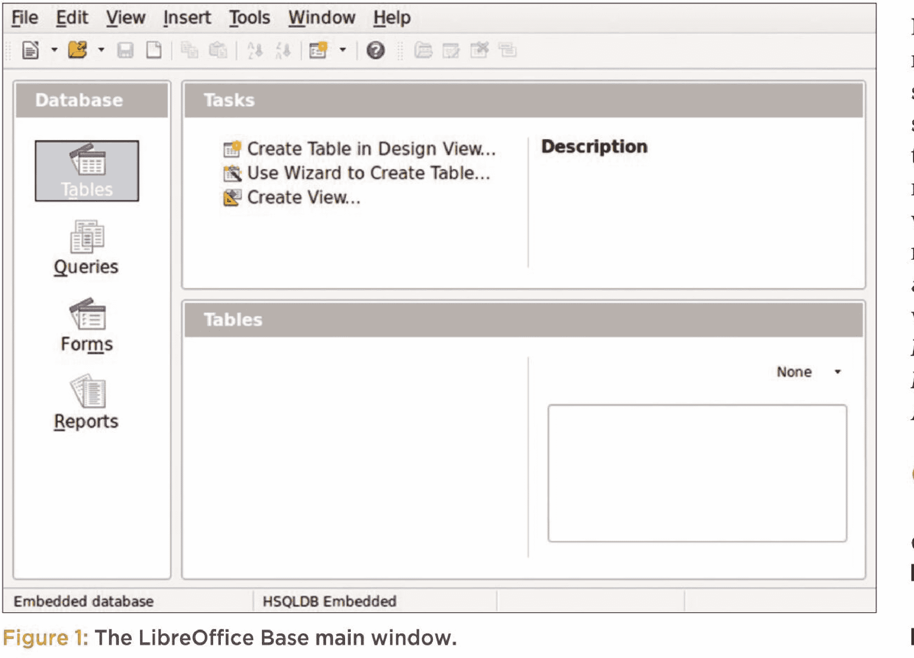

在数据库语言中，这被称为多对一 `n:1` 关系，只要某个分配一次即可。例如，文章可以有多个存储选项，反之亦然——这就是多对关系 `nm`。为了确保这种连接，必须创建一个额外的表，带有来自 `Article` 和 `Place` 的 `ID`、主键，并将 `Number_Needed` 移动到（图 2）。

## 创建数据库

这些表是在嵌入 `HSQL` 数据库中创建的。

通过 LibreOffice 中的 `文件 | 新建` 启动数据库向导。点击 `新建数据库` 按钮并从下拉菜单中选择 `嵌入 HSQLDB`。

这些表是一个接一个创建的。点击以保存一个尚不存在的文件。命名并保存后窗口将打开；在表和任务面板中，选择在视图中创建表。当你输入它们的名称时，将打开一个空白数据库表。构建数据库，然后设置和查询。关于使用 Base 的更多信息，请参阅 LibreOffice 入门指南 [1] 和 Base 手册 [2]。

位置，以及指向图像 URL。

# 入门

`LibreOffice Base`

在“字段名称”和“字段类型”列的字段类型中，`ID` 以及所有创建 `ID` 字段的类型都应为“整数”(`Integer`)。对于每个 `ID`，应在“字段属性”部分（图 3）中将“自动值”设置为“是”(`Yes`)，这样字段将自动递增并设置为主键。执行此操作，用鼠标点击第一个键，按住 `Shift` 键并标记下一个。

要创建字段，请点击侧边栏中的“表单”并使用“创建表单”。带有侧边栏的窗口显示了创建字段的步骤。上方带有 `Article` 表的窗口在主窗口中有一个“字段”下拉菜单。你可以使用双箭头将它们从列表传输到右侧表格（或使用单箭头将其移回）。

对于 `Article` 字段，将“必填”设置为其所在的（即 `Article Category`）表，该表包含多对多的关系，你需要创建两个主键（见图 2）。

- 2. 设置数据库。遗憾的是，这种方法对于新构建的内置 Base 数据库无法自动工作，因此在接后的步骤中创建字段和链接。选择基于手动选择表的表。
- 3. 添加字段。在下拉菜单中选择 `Article`、`Place` 表，并将所有字段移到右侧。
- 4. 关联字段。将 `Article-Place` 表与主字段（`Article` 表）的 `ID` 字段进行链接。
- 5. 排列控件。使用窗口帮助你布局四个表单的界面。你可以以列形式扩展、缩小和移动数据单元格，标签在左侧或上方，在“表单 - 标签”选项卡中对它们进行排列。在本例中，设计带有左侧栏的列设计主字段，并添加到侧边栏数据表上方。

在表中输入数据对于类似类别的效果良好，该类别除了自动生成的 `ID` 外只有一个字段。在 `Place` 表中，可以在输入时填充行和列。另一方面，`Article` 和 `rel_Place` 表更难填充，因为这两个表都有主键字段，该字段在不同的地方被设置为外键。这两者都是输入表单的良好选择。

`Article` 提到的所有位置都可以出现在表单视图中。

- 6. 设置数据。保持此字段不变。

显示 `Article` 是必要的，因为 `Article` 已经显示在主表单的 `ID` 字段中。如果没有形成，请点击右键字段名并在右键菜单中选择 `ID` 来打开表单。菜单将按照它们出现的顺序进行编辑。点击 `Image` 字段；然后右键点击并在右键菜单中选择“带有 Image 的 Place”。再次点击并选择“常规”选项卡，在下拉菜单中选择缩放“保持比例”，这样它就不会出现失真。字段的大小可以更改，或者你可以用鼠标更改字段。在数据表中，选择字段“必填 |”。如果没有被选中，那么

## 数据输入表单

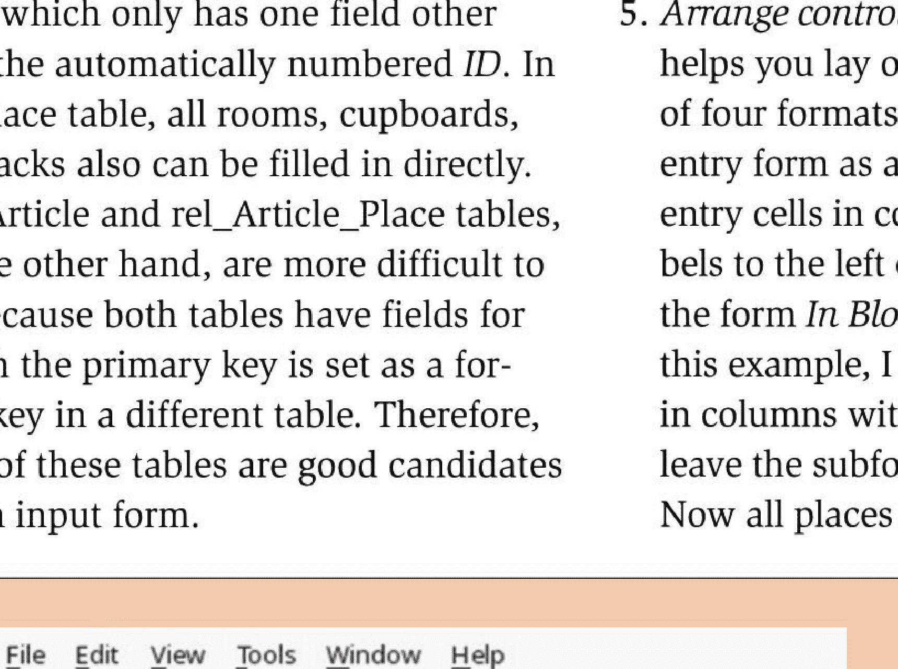

| 字段名称 | 类型 |  |
|---|---|---|
| ID | INTEGER [INTEGER] |  |
| Article | Text [VARCHAR] |  |
| Image | Text [VARCHAR] |  |
| 字段属性 |  |  |
|---|---|
| 自动值 | 是 |
| 长度 | 10 |
| 格式示例 |  |

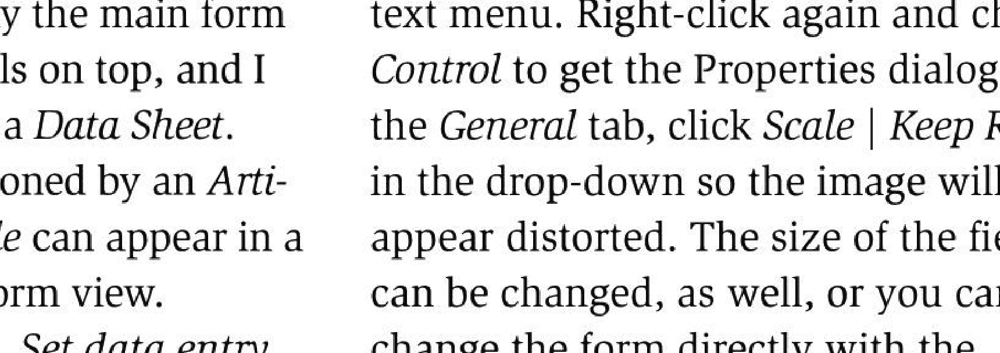

| ID |  |
|---|---|


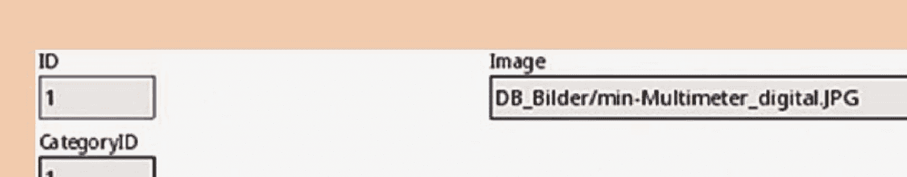

| Article | |

|---|---|

| 数字万用表（电子测量） | |

| 字段 | Article | Number_listed |

|---|---|---|

| 25 | 1 | 8 |

| 8 | | |

| 记录 | 2 条 2 条 |

|---|---|

图 3：自动值设置为“是”的整数字段自动成为主键。

图 4：进入表单向导后的数据输入表单。

LIBREOFFICE BASE — 2022 版

# 入门

LibreOffice Base

| 通用数据事件 | CategoryID |

|---|---|

| 数据字段 | |

| 需要输入 | 是 |

| 列表内容类型 | Sql |

| 列表内容 | |

| 绑定 | |

要开始，前三个字段必须合并：

图 5：SQL 命令查询。

```sql
SELECT "Room" | "Cupboard", "ID" FROM "Frame";
```

你必须在保存之前声明图像。关闭属性对话框后更改将生效。现在点击 ID，通过右键菜单中的“控件”打开属性对话框。选择“只读”；该字段也应该是唯一的，例如通过使用不同的颜色。现在 Room、Cupboard 和 Rack 字段在一个字段中连续显示。另一方面，ID 的值保存在表单中，这对于显示在列表框中并不是理想的。将命令更改为第一个查询

```sql
SELECT "R" | "I" "Cupboard" | J" AS "ID" FROM "Place"
```

要为 Category 输入字段显示列表，然后右键点击并选择“替换为列表”。在属性框中，将列表内容类型更改为 Sql。点击列表内容旁的三个按钮（图 5）启动 SQL 编辑器，它将定义列表的内容。现在 Room、Cupboard 和 Rack 字段带有间隔破折号和带有 # 符号的省略号，用于排序列表框的内容。在继续（在数据库中）之前保存并关闭 SQL 编辑器和属性。双击 ID 字段，然后为 Category 字段点击“升序”。关闭并保存 SQL 命令将显示新的列表内容。如果你想让列表字段向下，可以随意更改字段数量。右键点击 Place 字段控件（出现）允许你通过列表进行选择。打开 Place 控件菜单并使用“列”属性进行排序。再次双击另一个 Room、Cupboard，并且为了进一步识别查询，点击“切换视图”以查看 SQL 代码；

```sql
SELECT "Room", "Cupboard", "ID" FROM "Frame";
```

| Category | |

|---|---|

| 字段 ID | |

| 别名 | |

| 表 Category | |

| 升序 | |

| 可见 | |

该命令将按照所示顺序单独显示表中的所有字段。然而然而，列表字段只能显示字段本身并保存另一个字段的值；因此，

| 1 | |

|---|---|

| Article | 数字万用表（安全元件） |

| Category | |

|---|---|

| Place | |

| Number_Needed | |

| 004-1-2 | B |

| 006-1-2 | B |

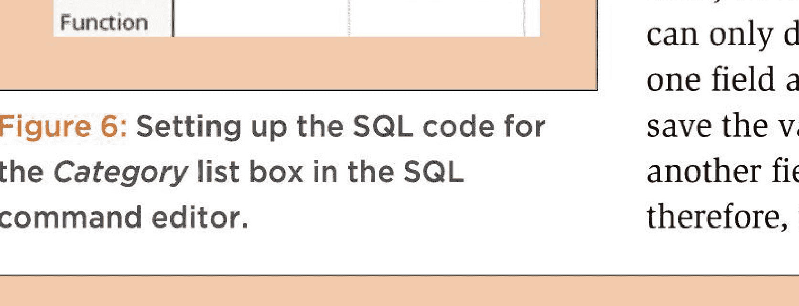


图 6：关闭视图以查看 SQL 代码。

图 8：表单已准备好使用，底部有一个导航栏。

LIBREOFFICE EXPERIENCE - 2022 版

# 入门

## LibreOffice Base

你现在看不到任何值，因为查找表的内容是空的。再次修改代码以获得多次命中。唯一的缺点是它区分大小写。以下现在允许输入 Article 字段某处包含的文本，无论大小写。现在允许输入 Article 字段中某处的文本，无论大小写：

img/732294c5ae254da1d40bd7a4d47042d7_39_0.png

图 9：表单显示所有元素。

```sql
SELECT * FROM "Article"
WHERE ARTICLE LIKE
(SELECT "Search"
FROM "Search"
WHERE "ID" = TRUE),
```

```sql
SELECT * FROM "Article"
WHERE LOWER ("Search")
```

向左侧的导航栏。

```sql
SELECT * FROM "Article"
WHERE ARTICLE LIKE "Search"
```

`LIKE` 函数检查为空；如果表中的第一行 ID 为 true，则此表将只显示一组数据。现在查询显示：

img/732294c5ae254da1d40bd7a4d47042d7_39_1.png

| | Place | Number_Needed |

|---|---|---|

| | 004-1 | B |

| | 006-1 | B |

img/732294c5ae254da1d40bd7a4d47042d7_39_2.png

| | | | |

|---|---|---|---|

| 记录 6 之 9 | K < > > | | |

图 11：带有搜索功能的表。找到了 9 条带有内容 Mater 的记录。

# 入门

## LibreOffice Base

命名为 `ArticleSearch`，通过右键点击并选择“编辑 (Edit)”来打开此新表单进行编辑。

要在执行项中添加数据区域，你需要打开导航器 (9)。在打开的对话框中，右键点击“表单 (Forms)”并选择“新建 | 表单”。然后，新表单会被添加到 `MainForm` 中。

通过内容菜单打开此表单的属性。在“数据 (Data)”选项卡中，在“内容 (Content)”下拉菜单中选择。选择“循环 | 活动”尤为重要。图 10 中的其余设置确保了表单被设置为始终可编辑和更改。

接下来，选择 `MainForm` 中的任意一个可用字段并弹出其属性对话框，选择“刷新 (Refresh)”。关闭属性对话框后，选择 `MainForm`。在“数据”选项卡中，将“内容类型”选择为查询 (`Query`)，并将“内容”设置为 `ArticleSearch`。接着，`Ctrl`-点击侧边栏中的推按钮图标。它应该出现在 `MainForm` 中（请检查导航器）。在按钮对话框的“常规 (General)”选项卡中，选择“操作 | 刷新按钮 (Action | Refresh button)”。现在，每次点击表单都会进行扫描。

`Base` 还允许你通过 `Base` 内部数据库连接外部数据库（例如 `MySQL`、`MariaDB`、`PostgreSQL`、电子邮件地址簿等）。`Base` 随后会合并表格并提供图形用户界面。

在导航器中，选择新表单的“搜索 (Search)”选项卡，通过点击图标并绘制方框来创建一个输入区域。在此框对话框的“数据”选项卡中，使用“数据字段 (Data field)” 并在“是否需要输入 (Input Required)”设置为“否 (No)”。现在点击 `MainForm` 时，此文本字段的内容将自动保存（图 11）。

如果你对数据满意且不想进行任何更改，就可以使用它。

# 结论

起初，创建一个初始数据库比在 `Calc` 中创建一个表格花费的时间更多，一旦数据库构建完成，数据输入就会快得多，数据数据也更快。

- 1. LibreOffice 入门指南：https://documentation.libreoffice.org/assets/uploads/en/GS72_GettingStarted.pdf
- 2. Base 手册：https://documentation.libreoffice.org/en/english-documentation/

## 访问 shop.linuxmedia.com

## 在 Linux New Media 在线商店探索过去，并投资新一年的 IT 解决方案。

数字与打印订阅想要订阅吗？

正在寻找你在报刊亭上买到的那个旧期吗？

shop.linuxmedia.com

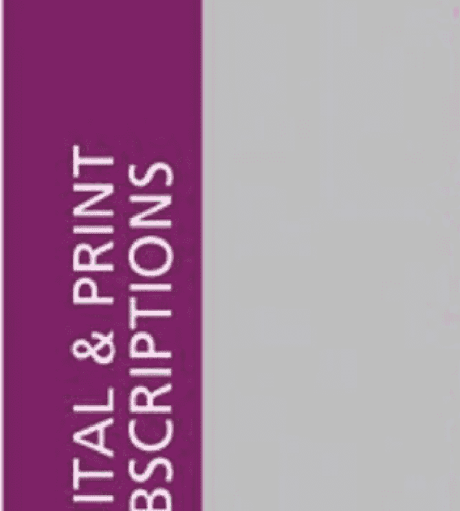


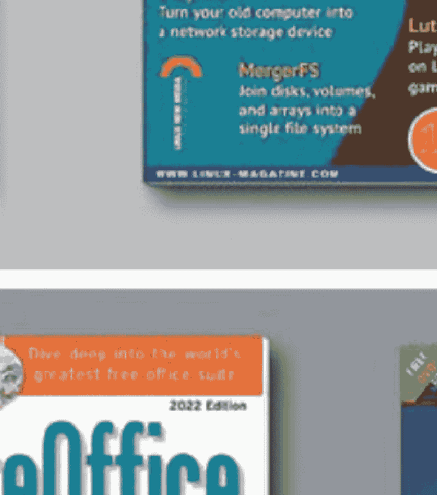


# 公式与格式

LibreOffice Math 软件包允许你显示简单和复杂的公式。由 Franz Böhm 和 Paul Brown 编写。

Math 编辑器可以作为独立程序运行，也可以从其他 LibreOffice 模块调用，并将完美格式化的公式嵌入到文本文档、电子表格、演示文稿、积分、函数，甚至是整个方程组或矩阵中。

要在独立窗口中启动 Math，点击`文件 | 新建 | 公式`。要在 Writer、Calc、Impress 或 Draw 中包含公式，选择`插入 | 对象 | 公式`。公式将成为文档中的一个嵌入对象，你可以对其进行拖放和缩放。使用三窗格布局的 Math 编辑器非常简单。左侧是侧边栏，底部是命令面板，通常可以通过按住 `Ctrl` 并双击框架来将其停靠或取消停靠。命令面板上方是预览区域，显示公式在文档中显示的样式。点击`视图 | 元素`会在小窗口中显示帮助工具，这对于初学者来说特别有用，可以更方便地输入公式。请注意，公式编辑器不执行计算。Math 专门用于编写和显示公式。

# 空格

当你启动 Math 时，工作区是空的。要开始，请从侧边栏下拉菜单或`元素`窗口顶部的两行图标中选择九类类别之一。类别包括：

- 一元/二元运算
- 关系
- 集合运算
- 函数
- 运算符
- 属性
- 括号
- 格式
- 其他


## LibreOffice Math

使用`工具 | 符号`或在`数据`对话框中选择字符来创建公式。在此框对话框的`数据`选项卡中，使用`数据字段`并在`是否需要输入`设置为`否`。现在点击 `MainForm` 时，此文本字段的内容将自动保存。

当你启动 Math 时，工作区是空的。要开始，请从侧边栏下拉菜单或`元素`窗口顶部的两行图标中选择九类类别之一。类别包括：

- 一元/二元运算
- 关系
- 集合运算
- 函数
- 运算符
- 属性
- 括号
- 格式
- 其他

## LibreOffice Math

使用`工具 | 符号`或在`数据`对话框中。在`数据`选项卡中，

# 入门

## LibreOffice Math

会出现额外的提示，例如`意外的字符`。

只出现在`命令`面板格而未显示在文档中的解释性注释是很有用的，特别是在长且复杂的公式中。公式以双百分号`%%`开头。运行到行尾以添加注释，请按 `Enter` 键。某些符号（如 `&`, `#`, `$`, `_`, `=`, 和 `~`）在 Math 中具有特殊含义；如果它们需要出现在文档中，你必须在`命令`面板格中给字符加上引号。

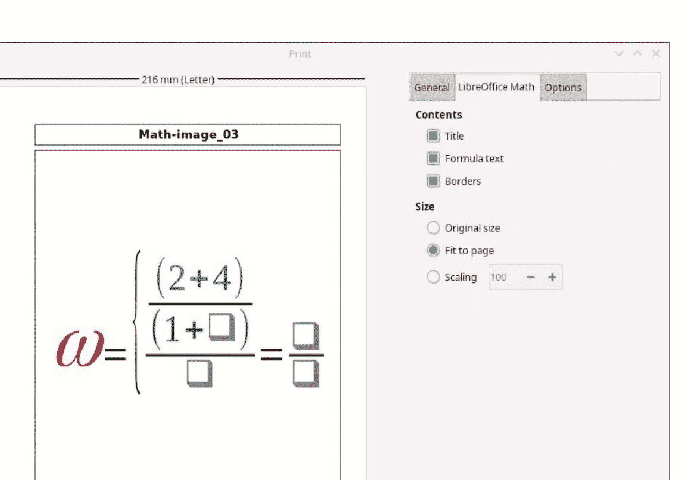

## 最后但不是最的

如果你决定打印公式，LibreOffice 在打印对话框的 LibreOffice Math 选项卡中提供了一些选项。例如，勾选`标题`复选框可以在页面顶部打印公式名称。如果勾选了`公式文本`，程序将显示`命令`面板格的内容。你可以使用调整框调整公式的大小、字体和方向。缩放后的公式将为你显示结果。

**图 6**：在打印公式时，我们在预览中看到了各种色调。

预览留了一个左大括号，并仅告知右侧应该是缺失的。

- 圆括号和方括号。这些组织属性就像分组括号一样，Math 在公式中显示它们。

如果你在命令窗口中输入左括号或大括号，通常会出现围栏；公式会自动添加右括号。如果你想使用不带配对的单括号，请在字符前加上反斜杠 `\`。然后 Math 会将其解释为符号而不是围栏。

## 更多结构！

分组括号用于格式化公式，但按 `Enter` 产生的空格和缩进行对布局没有影响。Math 简化这一切，你可以使用`命令`面板格通过空格和缩进行构建长行，使它们更容易拆分而不影响公式中的显示。图 5 显示了上方面板中包含空格的公式。`命令`面板格显示了包含换行和空格的自由版本公式，并在产生相同的结果。

所有类型的括号都可以以可扩展的形式可用。你可以在下面的部分看到括号的选择。可扩展括号会自动根据文本中字符左侧或右侧的大小出现。图 4 公式的命令是：

```
left (a + b + c + d) = 
```

如果你创建了公式，可以将其保存为独立对象或通过`文件 | 另存为`导出为 `.odt`。如果你在 Writer 或 Calc 中嵌入了公式对象，可以将公式与文档一起保存，或将其导出为独立对象。如果你想导出它，右键点击公式并选择`另存副本`。

你也可以单独缩放括号。使用关键字 `none` 来抑制第二个括号：

```
left right none
```

相反地，如果你在 LibreOffice 文件中通过`插入 | 对象`插入了公式，你可以再次看到 Math 编辑器；选择`工具 | 导入公式`到目标文件，然后你就可以对其进行更改或编辑。当你点击上方区域的表格对象时，LibreOffice 会关闭 Math 公式。

## 信息

[1] Math 语言：

https://documentation.libreoffice.org/assets/Uploads/Documentation/en/MG7.0/MG7MathGuide.pdf

如果你不小心在公式中插入了语法错误，LibreOffice Math 会显示出出了问题。红色下划线方块表示错误。点击问号标记直接进入`命令`面板格中的位置。按 `F3` 转到错误处或按 `Shift+F3` 转到窗口中的错误，并-

LIBREOFFICE 体验 - 2022 版

# 提高效率

## LibreOffice 扩展

### 扩展 LibreOffice 的功能

### 自定义 LibreOffice


你可以通过 350 个实用的扩展扩展 LibreOffice 的功能。Bruce Byfield 编写

扩展是基础 LibreOffice 办公套件的非官方插件。某些扩展提供了额外的资源，例如画廊中的图像或不同语言的字典。其他扩展提供了具有附加功能或不同布局的替代对话框，例如替代拼写检查器或语法检查器。少数将成为标准实例的新功能是 LibreOffice 受欢迎的主要原因。今天，存在超过 350 个扩展。有些是资源集合，例如替换项目。一些用 LibreOffice 脚本语言或 Java - 包括 Python 等编程语言编写的宏。这种多功能性意味着开发者无需熟悉代码库即可开始为 LibreOffice 做出贡献。一个完成的扩展是一个独立的代码段，安装时会插入代码中。数十个加上许多更新 – 寻找扩展可能需要一段时间，但任何页面的右侧面板格都有查看最新扩展的链接，以及浏览类别。

## 安装扩展

所有 LibreOffice 扩展文件名都以 `OXT` 结尾。关于你是想安装扩展还是程序，它们的安装程序如下：

- 1. 将扩展下载到你的系统。
- 2. 点击`工具 | 扩展管理器 | 添加`并导航到。
- 3. 选择扩展并点击`打开`。如果扩展已就绪，将提示你是否要覆盖它。点击`确定`继续。
- 4. 确认对话框询问你要为系统上的所有用户安装扩展还是仅为你自己。要为所有用户安装，必须以 root 身份登录。
- 5. 你可能需要编辑许可。阅读并滚动到许可末尾并点击接受。
- 6. 点击扩展管理器中的`选项`按钮并进行自定义。并不是所有扩展都有选项。
- 7. 关闭并重启 LibreOffice，扩展即可准备好使用。

## 寻找扩展

LibreOffice 维护一个单独的网站用于上传他们的扩展，用户可以使用该网站扫描扩展并查看它们的描述和截图。拥有超过 350 个...-LIBREOFFICE 专家 - 2022

## 提高效率

## LibreOffice 扩展

你可能需要在编辑窗口中搜索扩展。资源，如字典，可以在`工具 | 语言`、`媒体 | 画廊`中找到，其他内容可能显示在顶部的菜单、工具栏、左侧。目前没有标准的位置来放置扩展，或者你可能不想找到已安装的扩展，所以你可能需要投入精力进行搜索。

- 替代搜索 所有版权权 (c) 2007 英语字典，连字符规则，... 2018.05- Pinto 查找 ...-es 2.3 该扩展提供了...-LIBREOFFICE 专家 - 2022

## 扩展种类


多年年来，扩展已成为安装的首选方式。对于 Writer、Calc 和最常用的模块有很多扩展。扩展在任何操作系统上工作。该扩展提供了新的...

## 替代对话框 查找替换

该扩展替换了编辑菜单中的查找和替换对话框。它增加了新的搜索方式，包括标记、注释、引用、图片。对于已经使用查找和替换功能的人，该扩展还增加了...替代查找与替换对话框更容易掌握，但不要限制：你用得越久，就越喜欢它 (2)。

## 高亮器

LibreOffice Writer 不是大多数人作为编程工具的首选。它的功能太多，以至于不需要确保以格式保存。某些扩展在文章、教程和页面中使用代码段。高亮器通过工具菜单中的下拉列表根据约定进行高亮来简化任务。

- 正则表达式
- 批量保存
- 关闭

## 多格式保存绘制

Draw 和 Impress 包含多个页面或样式。该扩展可以一次性生成它们以 JPG、PNG、GIF、BMP 格式的图像。如果你想在演示后在网上发布幻灯片，这特别有用 (4)。

| 查找内容 | 扩展 | 属性 |
| :--- | :--- | :--- |
| 替换： | 查找 | 查找全部 |
| | | 替换 |
| 区分大小写 | 仅限当前选择 | |
| 保留选择 | 反向查找 | |
| 仅限单词 | ? | |

## 提高效率

## LibreOffice 扩展

当它们具有相同的功能时，使用多个扩展就像同时服用多种处方药——你无法预知一个扩展与其他扩展之间如何相互作用。

此外，在 LibreOffice 开发中，某些扩展之间的兼容性可能并不良好。遗憾的是，虽然每个开发者都是独立的，但并非所有开发者都使用它——因此，查看一个扩展是否好用的唯一方法就是安装它。如果它无法工作，你可以订阅 RSS 馈，以便在发布新版本时收到通知。值得赞的是，许多开发者确实在努力更新他们的扩展。

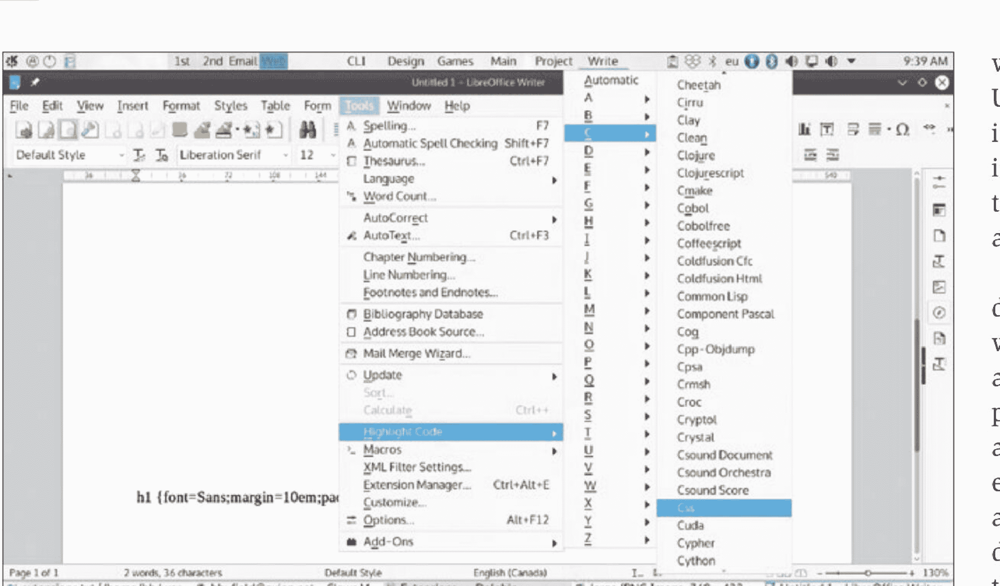

**图 3：** 代码高亮器对于格式化如 IDE 中所示显示的代码非常有用。

### 审查工具栏

审查工具栏没有任何新功能。然而，它通过将功能汇到一个工具栏中，使编辑变得更容易，例如修订修订、注释和行号。使用审查工具栏，所有工具只需点击一下即可使用。

其主要优势是它允许按照所有已知的主要参考文献样式进行格式化。

### 注意事项

这些示例让你对可用功能有一个大致的了解。开始浏览可用的扩展，你就能快速找到以前真正需要的工具。

### ZOTERO 与 LIBREOFF 集成

“编写参考文献”已经非常过时且使用起来很笨拙。这个扩展让你用 Zotero代替标准工具，这是一个基于 Web 的工具。

对于用户来说，扩展是使用 LibreOffice 和添加功能的简单方法。你应该记住，有很多扩展，而且它们需要定期更新。因此，虽然当你使用库或画廊扩展时，它们可能不会害大于利，但扩展对你来说更多的是一个未知领域。

当你使用“点赞”评分作为衡量扩展可靠性的指南时，这可能无法告诉你存在任何问题。

然而，数据丢失的情况是不可能 的，尽管你应该不断保存和备份以确保绝对安全。可能，如果你只从 LibreOffice 扩展中下载，丢失的会更少。如果你遇到问题，删除扩展不会产生比丢失许可或资源更糟糕的结果。

要点是，不要担心使用扩展带来的意外惊吓。采取一些基本的预防措施，使用扩展可以改进你的 LibreOffice 体验。如果你浪费一点时间下载并将其从系统中移除，那么这些工作可能是值得的。

```
输入或选择目录
/home/tbk/tools/libreoffice-office-vs-ms/
确认或更改基本名称
浏览
```

```
另存为：
/home/tbib
PDF 文档 (odt)
Word 97-2003 (docx)
Word 2004-2019 (docx)
PDF-便携文档格式 (pdf)
```

选择你使用的格式

图像大小：保留默认。输入其他所需的宽度或高度。图像将按比例缩放。

```
宽度: px 高度: px
质量 (1; 最大: 100)
BO %
```

- 颜色
- 灰度

```
导出
取消
```

**图 5：** “多格式保存”在您需要以超过一种的格式获取同一个文件时，可以节省了几十次按键操作。

**图 4：** 导出为图像或使用绘图并将幻灯片导入为图像。

## 信息

[1] LibreOffice 扩展：https://extensions.libreoffice.org/

48 LIBREOFFICE 体验 — 2022 年版

# 一张光盘上的 12 年 ADMIN 管理


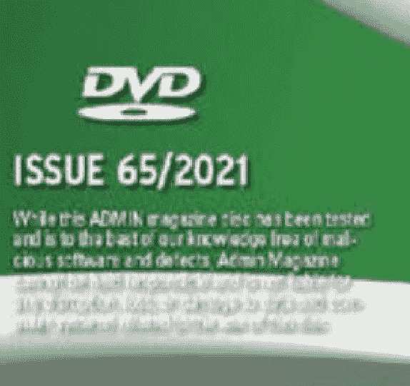


面向网络专业人士的智能实用信息


这张可搜索的光盘为你提供了 64 期 ADMIN，它是以下领域的领先来源：

- DevOps
- 勒索软件
- 边缘计算
- 自动化
- 编排
- 以及来自 IT 前线的更多内容


用这张强大的光盘清空你的需求并完善你的库！

立即购买！

shop.linuxmedia.com

## 提高效率

LibreOffice 模板


# 让文档变得简单

LibreOffice 模板可以节省你格式化文档的时间，让你能够专注于重要的事情。格式化文档是非常耗费时间的。即使使用样式，格式化仍然可能花费大量精力——这些精力是可以花在其他地方。此外，如果有多个人在处理一系列文档，你可能希望获得一致的结果。这些问题的解决方案是使用模板进行结构化和复用。使用设计良好的模板可以为每个人节省时间并获得几乎一致的结果。

你可以使用 LibreOffice 默认模板的唯一方法是更改“工具 | 选项”中的设置。默认格式（如页面和样式）无法进行全局编辑，只能单独编辑。

LibreOffice 处理模板的方式与其他文档不同。首先，你可以从任何文件创建模板，因为扩展名总是不同的。例如，Writer 模板是一个 `.ott` 文件（而不是 `.odt`）。更重要的是，要在 LibreOffice 中工作，模板必须经过注册——也就是说，要以一种能够被识别为模板的方式进行。模板还有自己的名称，并与其他用户使用的模板隔离开来。这些工具的设计是为了防止在 Microsoft Word 中常见的文件损坏，并在追求稳定的同时，对你与模板交互的方式设置了限制，这些限制只有非常困难才能绕过。

然而，你也可以在选择“文件 | 新建”时设计一个包含更多信息的默认模板，除非你另有指定。LibreOffice 区分了默认模板（内置在 LibreOffice 中的）和模板（你为每份文档选择的模板）。当另一个模板成为默认模板时，可以更改它。它是内置在用户配置中的。

# 规划自己的模板

当你选择“文件 | 新建”时，也可以设计一个包含更多信息的默认模板，除非你另有指定。LibreOffice 区分了默认模板（内置在 LibreOffice 中的）和模板（你为每份文档选择的模板）。当另一个模板成为默认模板时，可以更改它。它是内置在用户配置中的。

LibreOffice 处理模板的方式与其他文档不同。首先，你可以从任何文件创建模板，因为扩展名总是不同的。例如，Writer 模板是一个 `.ott` 文件（而不是 `.odt`）。更重要的是，要在 LibreOffice 中工作，模板必须经过注册——也就是说，要以一种能够被识别为模板的方式进行。模板还有自己的名称，并与其他用户使用的模板隔离开来。这些工具的设计是为了防止在 Microsoft Word 中常见的文件损坏，并在追求稳定的同时，对你与模板交互的方式设置了限制，这些限制只有非常困难才能绕过。

# 注册模板


一旦普通文件被保存，它就可以使用了。无论模板是如何创建的，只要在 LibreOffice 中注册，就像数据源或数据库一样。

当然，如果你想从原始文件创建模板，然而，要第一次创建模板，必须使用“`文件 | 模板 | 另存为 (模板)`”。对话框打开，你输入名称并选择一个类别来填充模板页。

# 获取模板的方法

LibreOffice 有许多内置模板（见图 1）。但另一种获取方法是下载。网上有多种 Libre 模板可供选择，你无需下载就能找到其他的，尽管这需要时间筛选，而且项目之间的差异并不总是明显的。

可能，你想要根据自己的需求和喜好修改细节，因此下载可能没有你最初想的那么方便。

Microsoft 模板数以千计，是另一个在 LibreOffice 使用之前非常有用的资源。你可能还应该检查任何下载模板的许可。通常，在 Microsoft Office 之外使用模板可能意味着你不想将其用于专业用途。

模板的类别在模板管理器中（见下文）可能不同。你还可以将模板设置为默认，它将在打开 LibreOffice 文档时使用。如果你下载了大量模板，模板仅显示在模板管理器层级。

# 使用模板

要管理模板，要基于模板启动新文档，选择“`文件 | 新建 | 模板`”。


图 1：LibreOffice 7.2 提供了许多新模板，由印度尼西亚 Libre 社区创建。

## 提高效率

## LibreOffice 模板

打开模板...或管理模板。每个情况下都会打开窗口（图 4）。模板管理器清晰地显示了“`工具 | 选项 | 路径`”中列出的所有模板路径。默认情况下，这意味着模板位于你的主目录中，其中也可能包含系统上可用的模板路径。

plate（此处原文不完整）将被应用于文档。很多时候，结果是无法恢复的文件损坏。在编写 LibreOffice 早期版本时，混合模板是无法避免此类问题的。现在，用户仍然需要一种方便的方法来更新模板及其关联文件，plate 将被视为原始模板的修订版，因此当每个文件被打开时，关联的文件也可以被更新。

更新模板以及基于该模板的文档最方便的方法是在模板管理器中重新打开模板进行编辑。在你保存模板后，下次打开文档时，它将提示你进行升级（图 5）。如果你使用另一个模板，模板与文档之间的关联将继续存在，并且对模板的更改将触发更新。如果你不更新文档，关联将断 way——尽管如此，内容也将变得不一致。

一种临时解决方案是使用主文档（Master Document）。在过去，文档被用于将文件分成足够小的部分以便在内存有限的情况下工作。今天它们仍然被用于管理多个个人同时编写一个文档。然而，主文档可以与它链接的任何文档都不同——即使只涉及一个。

要利用这一功能，请开始一个新的修订版模板，然后选择“`文件 | 发送 | 主文档`”。从右键菜单选择“主文档”，选择“`插入 | 文件`”从你的计算机中添加文档，并选择“`主 | 更新所有`”将其格式化为模板。在不保存的情况下关闭主文档，你将能够以原始格式打开该文档。然后你应该使用主文档，从右键菜单选择“编辑”在编辑窗口中打开文档，并在那里使用主文档的模板进行保存。

如果你使用了随 LibreOffice 安装的局部或整个系统的模板，可以从扩展管理器中删除模板。然而，编辑窗口可以删除——但要小心，因为模板管理器不包含对话框。在模板管理器中，选择要删除的模板，然后点击“删除”按钮。

处理模板的一种方法是使用该模板打开新文档，然后复制粘贴内容。但请注意，使用“粘贴”而不是“特殊粘贴”。在某些情况下，可能的解决方案是创建一个新模板，仔细使用相同的样式名称，然后覆盖原始模板名称。新的 tem（此处原文不完整）

如果你熟悉以前版本的 Microsoft Word，使用模板的想法听起来可能令人担忧，因为过去主文档被广泛认为是两种情况之一：不稳定或损坏。但 Writer 的主文档更加健壮，然而仍

## 绕过模板限制

对于 Microsoft Word，它对我们来说不是超过一个 tem

| 模板类别 |
|---|---|
| 我的模板 |
| 商务通信 |
| MediaWiki |
| 其他文档 |
| 个人通信和文档演示 |

```
<发件地址>
<城市, 地址, 邮政编码>
<国家>
```

## 2020年10月27日

- 设置为默认模板

保存 取消

图 2：如果缺少详细信息，占位符和字段用于构建模板的内容。

图 3：在关闭模板之前，必须在它们自己的对话框中保存。

## 提高效率

## LibreOffice 模板

同样，你可以通过“`样式和格式 | 加载样式`”从另一个文档导入样式。此选项允许你同时选择要导入的文件和样式类别：（段落和字符）、编号、框架和页面。为了达到最佳效果，请使用与文件中相同的名称或“覆盖”框中的样式（图 6）

| 搜索... | 过滤 | 文档 | 所有类别 |
| --- | --- | --- | --- |
| ![image] | ![image] | ![image] | ![image] |
| chapter | Modern... | Modern... | mediawiki |
| Businesscard... | CV | Resume | Default |
| ![image] | ![image] | ![image] | |
| | 移动 | 导入 | |
| 帮助 | | 打开 | 取消 |

## 最佳实践

图 4：一旦注册了模板，就可以留在模板管理器来打开、编辑、重命名或删除它。

有时 crash（此处原文不完整）会崩溃，它们不应该破坏自己的组件。尽管如此，为了安全起见，请确保你有一份当前的备份。

来自另一个文档的选取文本上的文本。通过此命令，将使用所放置处段落字符样式的格式插入原始格式。然而，图像或表格等对象会被丢弃，并将单独使用“`编辑 | 粘贴`”进行复制和粘贴。

如果你不在意丢失文档与其模板之间的连接，可以使用“`编辑 | 粘贴 | 无格式`”进行部分重新格式。

尽管你可以绕过对模板的限制，但请记住这些限制是为了保护你的文档免受损坏。通常，以下策略应该帮助你有效且无困难地使用模板：

- 当模板过时，不要删除文档。尽量不要分离文档，除非它只使用一次且其维护不确定。
- 对文档进行所有更改，然后将模板应用于文档。
- 一旦对模板做出了更改，立即对文档应用更改。这样，你就不需要记住更改了什么，或者在打开文档时做了意外的更改。

> 本文档所基于的模板“Test”已修改。你是否想根据修改后的模板更新样式依据？

设计模板可以节省时间。你可能需要对它进行一些微调。然而，一旦设置了模板系统，它是你非常有用的工具。

更新样式 保留样式

图 5：编辑模板后，基于它的文件必须更新。

| 类别 | 模板 |
| --- | --- |
| 我的模板 | chapter |
| 商务通信 | Test |
| MediaWiki | |
| 其他文档 | | |
| 个人通信和文档演示 | |
| 演示 | Style |

图 6：从模板加载样式可以在不实际切换模板的情况下。

## 信息

[1] 下载 LibreOffice 模板和扩展：https://www.libreoffice.org/discover/templates-and-extensions/

## 提高效率

## LibreOffice 宏

## 使用宏自动化

LibreOffice 包含了一种类似于 Basic 的内置语言，用于自动化重复任务并扩展套件的默认功能。通过 Dmitry Popov 熟练的手，Basic 语言可以创造奇迹，但你不需要成为编程专家就能编写简单的、甚至是有效的宏。无论你是 Linux 家庭用户还是 IT 专家，都可以使用 LibreOffice 的内置功能来自动化经常的任务。本文提供了一些如何使用构建块用于自己的编程项目的示例。ond（此处原文不完整）的。LibreOffice

## 查找单词

LibreOffice Basic 编辑器可以通过“`工具 | 宏 | 编辑宏`”访问（图 1）。此图介绍了一个简单的示例，从“Hello world!” 消息开始。虽然它并不特别有用，相反，我将从更实用的东西开始：一个在维基中打开选中单词的简单宏。编辑器的关键是内置函数 [1]，它用于调用外部程序。例如，你可以使用以下代码打开你机器上的默认浏览器：

- Sub Main
- Shell ("xdg-open")
- End Sub

函数 1 需要你需要添加的程序名称（如果该应用程序不在 Bash 的 `$PATH` 环境变量中的位置）。该 sec-

图 1：LibreOffice 宏编辑器。

## 提高效率

LibreOffice 宏

一旦你已经在机器上编写了脚本，可以在将其移动到目标目录之前执行它：

```
chmod +x script
```

下一步是创建一个新的文本文件，并在第一行输入你的 Access Key ID，在第二行输入 Secret Access Key。将文件保存为家目录下的 `ascript`，并使用 `awk` 命令创建一个供 LibreOffice 使用的新备份：

```
awk mkid dobackup
```


至此时，你就可以开始使用该备份宏了。该宏会启动当前激活的文档，然后检查它是否已保存。保存程序需要获取文档的路径：

```basic
ThisDoc.ThisComponent
If Doc.hasLocation = False Then
    MessageBox(
    "请先保存文档!", 16,
    "注意!"
)
End If
```

接下来，宏将保存文档中所有未保存的更改：

```basic
ThisDoc.Doc.getURL()
If Doc.isModified Then
    Doc.storeAsURL(ThisDoc, Args)
End If
```

如果你想在默认浏览器中打开 URL，可以通过功能面板（Function pane）将 URL 传递给 shell 命令，并点击修改按钮进行分配。在图 2 的示例中，我们将其分配给了 `Shift+F10` 快捷键。每当你按下 `Shift+F10`，我就可以查找当前打开的 LibreOffice 文档中光标下的单词。

只需几个操作，你就可以代码写入备份宏（列表 1）。首先，你需要在选定的单词处添加代码（2），然后让 shell 命令指向 Wikipedia 的查询 URL——其后跟随选定的单词（4）。

## 备份为 S3

S3 允许他们上传未加密的备份，执行异地备份是安全的。通过一点 LibreOffice Basic 和 ascript Perl 脚本，你可以将当前打开的文档保存到 S3。在此，你必须注册 S3 并从该项目的 GitHub 仓库 [3] 下载最新版本的 `aws-cli`。

要为创建的文档分配快捷键，请在对话框中使用 LibreOffice 的“组织宏”（Organize Macros），然后点击“分配”。会弹出一个自定义对话框（2）。

为了构建一个上传已打开文档的文档，宏需要获取两个信息：文档的路径和名称：

点击剪贴板选项卡，并从快捷键部分选择一个空槽的快捷键。然后从对话框底部类别下的 LibreOffice 宏中，找到你刚刚编写的 `Lookup` 函数，然后在以下代码中高亮宏：

```basic
DocPath-ConvertFromURL(ThisDoc.getURL())
FileName-Dir(ThisDoc.getURL(), 0)
```

### 列表 1：单词列表宏

```basic
01 Sub Lookup
02 Doc-ThisComponent
03 Looked-ThisDoc.CurrentController.getView
04 Shell ("xd-open", "http://en.wikipedia.org/wiki/" & LookupMacro.String)
05 End Sub
```

图 2：将宏分配给键盘快捷键可以让你随时运行它们。

```basic
Sub Main
    Shell ("xd-open", 1, "http://en.wikipedia.org/wiki/")
End Sub
```

### 列表 2：Amazon S3 备份宏

要上传文件到 Amazon S3，你可以使用 `aws put` 命令，其格式为：

```
aws put BUCKET_NAME/foo.txt.bak path/to/file.txt
```

要构建一个上传当前 LibreOffice 文档的操作，宏只需将 `Doc-Path` 值插入到字符串中，然后将其推给 shell：

```basic
PutCommand="upload/" & FileName & " /" & DocPath
Shell("aws put", 1, PutCommand)
```

就是这些了。你可以通过列表 2 查看整个宏。虽然宏完成了它的工作，但某些功能还可以改进。例如，桶（bucket）名称是在宏中指定的，这使其灵活性降低。如果你想为不同的 LibreOffice 文档使用不同的桶，你可能需要调整宏，使其使用 `InputBox` 显示一个输入框，你在其中输入桶的名称：

### 列表 3：文件名时间戳

```basic
01 Timestamp(Year(Now), "0000") & 
02 Format(Month(Now), "00") & "-" & 
03 Format(Day(Now), "00") & "-" & 
04 Format(Hour(Time), "00") & "-" & 
05 Format(Minute(Time), "00") & "-" & 
06 Format(Second(Time), "00") & ""
07 BucketName=InputBox("Enter bucket name", "Bucket name")
08 PutCommand=BucketName & " /" & Timestamp & FileName & " " & DocPath
```

```basic
BucketName=InputBox("Enter bucket name", "Bucket name")
PutCommand=BucketName & " /" & Timestamp & FileName
FileName & " " & DocPath
```

### 列表 4：缩短 URL

```basic
01 ShortenedURL()
02 ThisDoc=ThisComponent
03 ThisText=Doc.Text
04 SelectedURL=ThisDoc.CurrentController.getView
05 LongURL=SelectedURL.String
06 If LongURL="" Then 
07 MsgBox("请先选择 URL.", 16, "错误!")
08 End If
09 FileName=FileNew
10 Open("http://api.php?url=" & LongURL) As FileName
11 While Not EOF(FileName)
12 Line=Input(FileName)
13 If Line<> Then
14 StringBuffer=Line
15 End If
16 Close FileName
17 ShortURL=StringBuffer
18 End Sub
```

如果你想保留当前文档的多个备份，可以修改宏将时间戳附加到文件名（列表 3）。代码生成 `yyyymdd-mmss` 格式的时间戳并将其返回文件名。

## 缩短 URL

处理长 URL 是一个真正的麻烦。解决此问题的方法是缩短 URL。然而，与其手动转换长 URL，不如创建一个执行此项工作的宏（列表 4）。为了缩短 URL，宏使用了基于 HTTP 的 API。宏首先获取包含长 URL 的选中文段并转换为字符串。一个简单的条件语句检查选择是否结束，许多编辑器支持这一点。然而，如果你使用 LibreOffice Writer 作为首选工具，可以轻松创建一个将 Unicode 转 Markdown 格式文件的宏。宏本身大致分为两部分：第一部分解析文本、标题和 URL。第二部分处理文件名并以 `.md` 扩展名保存为纯文本。为了缩短 API 返回的 URL，宏使用了一个技巧：它读取文件的第一行并赋值给 `StringBuffer` 变量，用获取的短 URL 替换它。执行此操作，宏依赖三个函数：`MarkupHeadings` 查找文档中的标题，`MarkupText` 搜索文本、字体，`MarkupFunc` 查找文档中的超链接。得益于其模块化结构，你可以轻松将该宏用于其他格式。你只需要替换文档主部分的宏和 `MarkupFunc` 函数（4-8）。例如，如果你想应用 HTML 格式，宏的相关行应该看起来像列表 6 中的代码。

## Markdown 格式

Markdown 对用户和开发者来说都是一种轻量级格式。

### 列表 5：Markdown 格式宏

| | |

|---|---|

| 01 Sub Markdown() | 33 End |

| 02 Dim Arg() As New com.sun.star.beans.Property | 34 Wend |

| 03 ThisDoc.Component | 35 Wend |

| 04 MarkupHeadings("Heading 1", "# ") | 36 Function |

| 05 MarkupHeadings("Heading 2", "## ") | |

| 06 MarkupHeadings("Heading 3", "### ") | |

| 07 MarkupText("Charset", com.sun.star.Font.) | 39 Dim SearchAttribute() |

| 08 MarkupText("Character", com.sun.star.Font.) | 40 As New com.sun.star.beans.Property |

| 09 MarkupItalic() | 41 SearchAttributes(0).Name=SearchAttrName |


| 10 `If (GlobalScope.Basic.isLibraryLoaded("Tools"))` | 42 `SearchAttributes(0).Value=SearchValue` |

| 11 `GlobalScope.Library.LoadLibrary("Tools")` | 43 `ReplaceDoc(ThisDoc,ReplaceDescriptor)` |

| 12 `End` | 44 `ReplaceAll.SearchRegularExpression=true` |

| 13 `ThisDoc.getURL()` | 45 `ReplaceAll.SearchStyles=false` |

| 14 `DocDir.DirectoryNameof(DocPath.URL(),/")` | 46 `ReplaceAll(all)` |

| 15 `FileName=Left(DocPath.URL(),0,Len(DocPath.URL())-6)` | 47 `SetAttributes(SearchAttributes)` |

| 16 `Args("Name")="Text"` | 48 `ReplaceAll(SearchString="\*")` |

| 17 `Args(0).Value=Text` | 49 `ReplaceAll(ReplaceString,ReplaceObj)` |

| 18 `TextFilePath.ConvertToURL(DocURL,"file://" & FileName & ".md")` | 50 `ThisDoc.replace(Replace)` |

| 19 `StoreDoc.StoreURL(TextFilePath,Args)` | 51 `End` |

| 20 `End Sub` | 52 |

| 21 `Function MarkupHeadings(StyleName, StartTag, EndTag)` | 53 `MarkupURLFunc` |

| 22 `ThisDoc.Component` | 54 |

| 23 `Text-ThisDoc.text` | 55 |

| 24 `Para-Text.createEnumeration` | 56 |

| 25 `While Paragraph.hasMoreElements` | 57 |

| 26 `Para-Paragraph.nextElement` | 58 |

| 27 `PortionEnum=Para.createEnumeration` | 59 |

| 28 `While Paragraph.hasMoreElements` | 60 |

| 29 `While Paragraph.nextElement` | 61 `If Paragraph.HyperLink="< >" then` |

| 30 `Portion.paragraphName=StyleName then` | 62 `String.String="*" + Paragraph.String + "*"` |

| 31 `If.paragraphName=StyleName` | 63 `End` |

| 32 `StartTag=Paragraph.String + EndTag` | 64 `End` |

| 33 | 65 `Wend` |

| 34 | 66 `Wend` |

| 35 | 67 `End Sub` |

## 提高效率

## Libre 宏

### 基础数据库

Base 应用程序允许你创建高级数据库来存储各种数据，而 LibreOffice 宏可以将数据库与 LibreOffice 应用程序集成。让我们看看这在实践中是如何运作的：我将创建一个用于存储文本片段的简单数据库，并创建一个宏，用于从当前 Writer 文档中保存文本片段。

首要任务是创建一个包含单个表的数据库，该表包含两个字段：`id`（作为主键的 INTEGER 字段）和 `snippet`（VARCHAR 字段）。

在创建数据库时，勾选“是，注册数据库”复选框，这样数据库就准备绪了，你可以开始编写宏（列表 7）。

要建立与数据库的连接，base 使用 `connectDatabase` 函数（第 5 行）。这种方法更灵活，因为它允许从任何需要的宏建立连接。该函数（第 10-16 行）包含一个简单的错误处理函数（19 行），当宏无法建立到数据库连接时（第 28-29 行），它会返回数据库名称并显示消息。

### 列表 6：HTML 格式

```
0 MarkUpingsFunc("Heading 1", "<h1>...</h1>")
0 MarkUpingsFunc("Heading 2", "<h2>...</h2>")
0 MarkUpingsFunc("Heading 3", "<h3>...</h3>")
07 MarkUpTextFunc("CharPointer", com.sun.star.awt.FontWeight.BOLD, "<b>...</b>")
8 MarkUpTextFunc("CharPointer", com.sun.star.awt.FontItalic.ITALIC, "<i>...</i>")
      63 Portion.String = "<a HREF=" + Portion.HyperLink + ">" + 
                                     Portion.Snippet + "</a>";
```

### 列表 7：数据库表宏

```
01 InsertSnippet()
02 Db As Object
03 ThisAsThisComponent
04 TextSnippet=Database.GetCurrentController().Selection.getByIndex(0).GetString()
05 Get()
06 Database=ConnectToDatabase("snippet")
07 Snippet=Split(Snippet, ", ")
08 SQL="INSERT INTO " + snippet + " VALUES ('" + Snippet + '\')"
09 Statement=Database.CreateStatement()
10 Result=Statement.Execute(SQLQuery)
11 Database.Close()
12 Database.dispose()
13 MsgBox("Text snippet has been saved.", 6, "Result")
14 End
15 
16 Function ConnectToDatabase(DBName As String) As Object
17 Dim Database As Object, com.sun.star.base.PropertyValue
18 DbContext=CreateNewEmbeddedService("com.sun.star.db.DatabaseContext")
19 On Error GoTo ErrHandler
20 DataSource=Database.GetByName(DBName)
21 ConnectToDatabase=DataSource.Connect("**")
22 DatabaseFile=String
23 DatabasePath=DatabaseFile.URL
24 DatabaseObject(0).Name = "Hidden"
25 DatabaseObject(0).Value = True
26 DatabaseFile=StarDesktop.loadComponentFromURL(DatabasePath, "_blank", 
                                                 0, Array())
27 Exit Function
28 ErrHandler:
29 MsgBox("Failed to establish a connection.", 16, "Error")
30 End Function
```

## 结语

这些示例是你可以使用 LibreOffice 完成的一些工作。通过学习几个构建模块，你可以轻松地在自己的项目里复用它们。当然，编程不必止于此，尽管 LibreOffice Base 没有许多其他编程语言那样灵活和强大，但它可以处理你扔给它的几乎任何数据库相关的任务。一旦你掌握了这些基础知识，就可以释放 LibreOffice 办公套件的所有潜力。

- [1] LibreOffice Shell 函数: https://help.libreoffice.org/latest-en-us/text/basic/shared/0313050.html

- [2] S3: https://aws.amazon.com/s3/

- [3] 用于 GitHub 的 AWS Perl 脚本: https://github.com/timkay/aws

## 使用数字存档清空你的书架


通过我们的数字存档包，完善你的《Linux Magazine》和《ADMIN Network & Security》杂志收藏。

你将获得整年的 PDF 格式杂志，可以随时从任何设备访问。


https://bit.ly/archive-bundle

2021 存档现已发布！

# 提高效率

## 数字签名

### 使用数字签名

### 安全文档


通过添加数字签名，你可以提高文档的安全性。作者：Bruce Byfield

数字签名验证文件的可信度，它确保发送者确实是其所称的，并且文档在签名后没有被编辑过。普通的文件共享可能不需要签名，但如果隐私很重要——特别是在商务场合或讨论财务事务时——数字签名是保护文件内容的主要方法之一。

原始签名由第三方证书管理器创建，该管理器提供了一个保证文档完整性的证书。LibreOffice 继续使用相同的加密方法；然而，对于数字签名，GPG [1] 是一种默认安装的跨平台加密方法。第三方服务指的是证书，而 GPG 指密钥，两者的工作方式相似。

## 设置证书

通过添加数字签名，你可以提高文档的安全性。作者：Bruce Byfield

数字签名验证文件的可信度，它确保发送者确实是其所称的，并且文档在签名后没有被编辑过。普通的文件共享可能不需要签名，但如果隐私很重要——特别是在商务场合或讨论财务事务时——数字签名是保护文件内容的主要方法之一。

原始签名由第三方证书管理器创建，该管理器提供了一个保证文档完整性的证书。LibreOffice 继续使用相同的加密方法；然而，对于数字签名，GPG [1] 是一种默认安装的跨平台加密方法。第三方服务指的是证书，而 GPG 指密钥，两者的工作方式相似。

## 使用 GPG

GPG 是一种默认安装的跨平台加密方法。第三方服务指的是证书，而 GPG 指密钥，两者的工作方式相似。

要用 GPG 生成密钥，你需要运行命令：

```
gpg --full-key
```

GPG 创建密钥需要五个步骤：请求名称和电子邮件、创建密码、选择算法以及设置有效期。如果你对可能的选择不确定，可以直接接受默认值。

作为最后一步，你将使用以下命令创建一个证书：


```
gpg --output YOURNAME.gpg gpg
--export KEY-EMAIL
```

一旦证书被使用，你可以将公钥发送给目标接收者，或者以如下格式的纯文本文件发送：

```
gpg --output YOURNAME.gpg gpg
--export KEY-EMAIL
```

在 LibreOffice 中，可以通过“文件 | 数字签名 | 数字签名...”导航到存储目录来找到密钥。

拥有你公钥的文件接收者可以使用以下方式与你一起验证：

```
第三方服务指的是证书，而 GPG 指密钥，两者的工作方式相似。

要用 GPG 生成密钥，你需要运行命令：
```

```
gpg --full-key
```

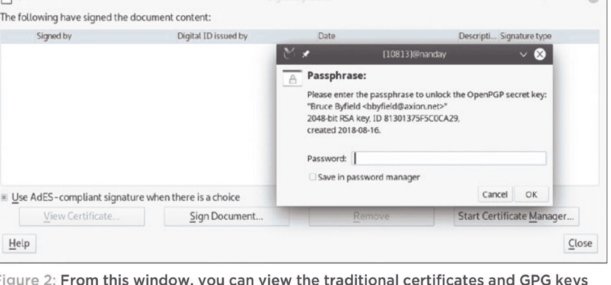

bbnanday$: gpg --full-key
gpg (GPG) 2.1.1; Copyright (2017) Free Software Foundation, Inc. 这是一个自由软件：你可以自由地创建和分发它。在法律允许范围内不提供担保。

请选择你想要的密钥类型：

- (1) RSA 和 RSA (默认)
(2) DSA 和 Elgalman
(3) DSA (仅限签名)
(4) RSA (仅限签名)
(5) 选择？

## 提高效率

数字签名

保留在证书中，但建议尽量这样做。其他字段（位置、联系方式、信息和时间戳权威）也是可选的。在文件具有时间敏感性的情况下（例如你需要确保在某个日期或时间之前获得批准），时间戳权威（如免费的 freeTSA [3]（图 5））将很有用。

## 相关安全

数字签名不是保护 LibreOffice 文件的唯一方法。例如，通过“插入 (Insert) | 签名行 (Signature Line)”，你可以为文档添加一条用于纸质打印件的手写签名行。虽然早版本的 LibreOffice 允许基于证书的数字签名，但因此对于数字文件，此功能在安全或隐私方面不需要任何操作。

更通用地说，你可以在第一次保存时使用“带签名保存 (Save with Sign)”或使用 GPG 密钥保存。你也可以直接通过“使用 GPG 密钥加密 (Encrypt with GPG key)”进行保存。这将为你确保安全措施时提供更多选择选项。你可能倾向于使用“使用 GPG 密钥加密”而不是使用数字签名，因为加密本身应该验证文件的有效性。然而，为了获得更高水平的有效性，你可能希望同时使用这两个选项，以及数字签名来确保不可否认性、完整性和隐私性。

**图 4：** 为了增强安全性，请为 PDF 添加数字签名，而不是使用其内置安全功能。

然后使用以下命令创建文件的副本：

```
gpg --decrypt ENCRYPTED-FILE
```

密码：用于查看文件和编辑文件权限。这些选项可以在“文件 (File) | 导出为 PDF (Export As PDF) | 安全 (Security)”中找到。然而，密码很容易破解，因此许多未指定的用户是由它们决定的。如果你追求安全性，应该完全不要使用它们。

相反，前往“文件 (File) | 导出为 PDF (Export As PDF) | 数字签名 (Digital Signatures)”图 4）。与其他文件一样，你可以选择使用证书管理器还是 GPG。你不需要填写证书，因为密码信息将出现在命令行中，且未加密的文件版本将出现在加密文件的相同目录下。

## 在 PDF 中使用签名

传统上，PDF 有其自己的安全机制，由两个部分组成。

对于许多用户来说，数字签名和这些附加功能可能需要你熟悉新概念。但与你的最初印象相反，这些并不困难，一些在线研究和经验应该帮助你熟悉它们的工作原理。

一旦你熟悉了基础知识，数字签名和相关功能就可以为你提供完整性和更高的隐私性，这两者在现代计算中都是急需的。

### 时间戳权威

freeTSA 提供了一种数字签名，向电子文档中添加时间戳。该签名为数据完整性提供了可验证的封印，以及交易发生时的受信任状态和时间。

信任标记过程通过记录文档的创建和验证时间来保护文件。安全性确保了除文档所有者之外，没人能在文件被时间戳记录后对其进行更改。

**图 5：** 如果文件具有时间敏感性，你可能想为 PDF 添加时间戳。

| 名称： | pdf |
|---|---|
| 过滤器: | ODT 文本文档 (.odt) |
- 使用密码保存
- 使用 GPG 密钥加密
- 编辑过滤器设置

## 信息

- (1) GPG: https://gnupg.org
- (2) Let's Encrypt: https://letsencrypt.org
- (3) 时间戳: https://freesa.org/index_en.php

保存 | 取消

**图 6：** 使用密码并加密文件以确保数字签名的安全性和隐私。

LIBREOFFICE 专家 - 2022 版

LINUX 更新

探索 LINUX 世界

- 多样化壁纸切换
- 最佳 Linux 发行版
- 将桌面同步到“启动”
- 键盘
- Ubuntu-wise 释放了 Linux 猛兽
- 初始化系统调查

精选文章

- 多样化壁纸切换
- 最佳 Linux 发行版
- 将桌面同步到“启动”
- 键盘
- Ubuntu-wise 释放了 Linux 猛兽
- 初始化系统调查

精选文章

- 关于的多样化壁纸切换
- 特功能
- 
（此处无需翻译）
- 
（此处无需翻译）

深入阅读

- Linux 是如何工作的
- 使用 Exif 管理元数据
- 安全性确保
- 自由软件基金会

systemd 释放了“启动”

- systemd 释放了“猛兽
- 初始化系统调查

Ubuntu-wise 释放了 Linux 猛兽

- 初始化系统调查

精选文章

- 多样化壁纸切换
- 最佳 Linux 发行版
- 将桌面同步到“启动”
- 键盘
- Ubuntu-wise 释放了 Linux 猛兽
- 初始化系统调查

深入阅读：

- Linux 是如何工作的
- 使用 Exif 管理元数据
- 安全性确保
- 自由软件基金会

systemd 释放了“启动”

- systemd 释放了“猛兽
- 初始化系统调查

# 提高效率

## AltSearch（高级搜索）

向找到字符的左右两侧扩展约一个字符

添加标记 // 进行多次替换（单步完成）

文本之间的（在单个段落内）

文本之间的（在单个段落内）

文本之间的（在单个段落内）

- 电子邮件地址
互联网、URL、#www.address
- HTML 标签


- 类名 (`ClassName`)

备注（黄色气泡）- 搜索注释内容

- 文本字段 - 搜索字段内容

- 表格搜索 - 搜索框架的名称

- 表格搜索 - 搜索表格中的名称

- 图片 - 搜索图片

- 脚注 - 锚点文本； // 用于搜索脚注内容

- 锚点末尾结束文本； // 用于搜索所有条目

- 交叉引用（文本）； // 用于搜索 N. 标记； // 用于搜索文本块

- 书签搜索 - 搜索书签； // 用于搜索名称名称

图 6：`AltSearch` 允许搜索和替换

已保存备后用。此功能在书籍或论文等较长的项目中特别有用，因为你有许多文件需要以相同的方式编辑，因为它们最终会被合并成单一作品。

# 结论

所有功能都需要时间来学习。在线帮助虽然[存在]，但它已有十多年历史了，而且主要比界面内置的帮助更详细。对于这一点，`AltSearch` 似乎长期以来依赖于此。`AltSearch` 继续工作，但可能某一天 `LibreOffice` 会提供支持。如果这永远不会发生，它将成为 `Writer` 的一个关键缺陷。`AltSearch` 是一个扩展，而它之前的其他程序应该是 `LibreOffice` 代码的一部分。如果不是，也许也会为 `LibreOffice Calc` 发布一个版本。

一个段落的，以及空格。段落之间的空格处理非常繁琐，但 `AltSearch` 可以使用 `/p` 搜索并替换，并将其替换为 `<p>` 和一个空行； // 防止插入新句子。如果你在列表样式中需要额外的空格，可以在使用时指定该样式。同样，你也可以删除换行符或通过将它们替换为空，并找到单词开头的字符（ `/ ` ）。

此外，`AltSearch` 可以执行包含多个字符的搜索或替换，或者它可以为搜索定义起始点和结束点。但搜索和替换可以添加到剪贴板中，这对于支持多个实体的批量文件特别有用。可以在相同类型之间放置空格，并对对象进行检查。也许 `AltSearch` 最重要的功能是通过批量文件进行复制的能力。批量管理器打开先前的标记列表，范围从将一系列类型的对象转换为新文件（图）。`HTML` 在 `Writer` 中可用，你可以将配置项目添加到批量文件中。从批量管理器开始。完成后，一个批处理...

## 信息

- [1] `AltSearch`: https://extensions.libreoffice.org/en/extensions/show/alternative-dialog-replace-for-writer

- [2] 在线帮助: https://macrolob.ijcs.help/LibreOfficeSearch_en。

- 段落样式

- 字符样式

- 列表样式

- 超链接

- 超链接 - 订阅到 URL

- 粗体

- 粗体斜体

- 字体名称（手动更改名称）

- 字体大小

- 字体颜色

- 字体背景（高亮）

- 下划线

- 索引（任意）

- 脚本（自动）

- 上标（自动）

由字体大小和转义定义的索引

相同格式的字符（基于光标）

相同格式的字符（基于光标）

`AltSearch` 允许搜索并替换列表样式。

| 快捷键 | 多次执行 >> |
|---|---|
| | 执行 |
| | 传输 |
| | 保存批量 |
| | 编辑 |
| | 刷新 |
| | ? |
| | << 搜索 |
| | 关闭 |

图 8：用户可以编写自己的批量文件一次性执行多个功能。

66 LIBREOFFICE EXPERIENCE - 2022版

# LibreOffice 技巧与技巧

## 提升效率


一旦你熟悉了 `LibreOffice` 的主要组件，就可以通过这些技巧和技巧优化你对 `LibreOffice` 的使用。

作者：Italo Vignoli

在整个系列中，我们查看了各种 `LibreOffice` 组件以及如何有效地使用它们。办公幻灯片是一个复杂的野兽，有很多角落可以探索。毕竟，`LibreOffice` 核心。在这篇文章中，我将进一步探讨一些较少为人知的功能，并提供一些技巧以获得更多 `LibreOffice` 体验。

模板窗口右下角的 greenliberation 模板。

新的 16:9 幻灯片集将显示打开标题幻灯片，但你必须切换到“排序器”选项卡来粘贴 4:3 的幻灯片。在执行“编辑 | 粘贴”之前，必须选择一张幻灯片。对话框将立即打开，询问你是否要缩放对象以适应不同的幻灯片；选择否（图1）。

## 转换幻灯片比例

现代电脑屏幕和投影仪的标准使用 16:9 比例，而不是旧的 4:3 比例。原因是许多人大量的幻灯片集必须转换为新的 16:9。如果你使用 `LibreOffice` 正确性——意味着所有幻灯片都基于幻灯片模板——这个转换过程非常复杂。

首先，打开你的 4:3 幻灯片集并切换到“排序器”选项卡。在执行“编辑 | 粘贴”之前，必须选择一张幻灯片。对话框将立即打开，询问你是否要缩放对象以适应不同的幻灯片；选择否（图 1）。

新的 16:9 幻灯片集将显示打开标题幻灯片，但你必须切换到“排序器”选项卡来粘贴 4:3 的幻灯片。在执行“编辑 | 粘贴”之前，必须选择一张幻灯片。对话框将立即打开，询问你是否要缩放对象以适应不同的幻灯片；选择否（图 1）。

模板窗口右下角的 greenliberation 模板。

[PAGE 67]

## 提高效率

## 技巧与技巧

仍然需要特定的调优以与主幻灯片兼容。


在执行“`编辑 | 粘贴`”之前，必须选择一张幻灯片。对话框将立即打开，询问你是否要缩放对象以适应不同的幻灯片；选择否。

- 粗体斜体
- 字体名称（手动更改名称）
- 字体大小
- 字体颜色
- 字体背景（高亮）
- 下划线
- 索引（任意）
- 脚本（自动）
- 上标（自动）

由字体大小和转义定义的索引

相同格式的字符（基于光标）

相同格式的字符（基于光标）

`AltSearch` 允许你搜索并替换列表样式。

| 快捷键 | 多次执行 >> |
|---|---|
| | 执行 |
| | 传输 |
| | 保存批量 |
| | 编辑 |
| | 刷新 |
| | ? |
| | << 搜索 |
| | 关闭 |

图 8：用户可以编写自己的批量文件一次性执行多个功能。

66 LIBREOFFICE EXPERIENCE - 2022版

# LibreOffice 技巧与技巧

## 提升效率


一旦你熟悉了 LibreOffice 的主要组件，就可以通过这些技巧和技巧优化你对 LibreOffice 的使用。

作者：Italo Vignoli

在整个系列中，我们查看了各种 LibreOffice 组件以及如何有效地使用它们。办公幻灯片是一个复杂的野兽，有很多角落可以探索。毕竟，LibreOffice 核心。在这篇文章中，我将进一步探讨一些较少为人知的功能，并提供一些技巧以获得更多 LibreOffice 体验。

模板窗口右下角的 greenliberation 模板。

新的 16:9 幻灯片集将显示打开标题幻灯片，但你必须切换到“排序器”选项卡来粘贴 4:3 的幻灯片。在执行“`编辑 | 粘贴`”之前，必须选择一张幻灯片。对话框将立即打开，询问你是否要缩放对象以适应不同的幻灯片；选择否（图1）。

## 转换幻灯片比例

现代电脑屏幕和投影仪的标准使用 16:9 比例，而不是旧的 4:3 比例。原因是许多人大量的幻灯片集必须转换为新的 16:9。如果你使用 LibreOffice 正确性——意味着所有幻灯片都基于幻灯片模板——这个转换过程非常复杂。

首先，打开你的 4:3 幻灯片集并切换到“排序器”选项卡。在执行“`编辑 | 粘贴`”之前，必须选择一张幻灯片。对话框将立即打开，询问你是否要缩放对象以适应不同的幻灯片；选择否（图 1）。

现代电脑屏幕和投影仪的标准使用 16:9 比例，而不是旧的 4:3 比例。原因是许多人大量的幻灯片集必须转换为新的 16:9。如果你使用 LibreOffice 正确性——意味着所有幻灯片都基于幻灯片模板——这个转换过程非常复杂。

所有视觉元素需要调整大小，因为它们使用的跨度大于 16:9 比例，或者需要移动以保持外观。

当 LibreOffice 导入文档时，它会将不可用的字体替换为默认字体，这些字体与 Arial (`Liberation Sans`)、`Courier` 和 Times New (`Liberation Mono`) 基本兼容。当 LibreOffice 用不同的字体替换微软字体时，会对文档的视觉外观产生影响（在这种情况下，你通常会开始抱怨 LibreOffice 而不检查内容是否还在

## 替换缺失字体

从用户的角度来看，字体是 LibreOffice 和 Office 文档之间的主要问题之一。Office 文档使用默认字体：来自 Word 项目的老核心（2002发布但仍在使用）或新的 ClearType 字体（2006年发布，现在被 Windows 和 Microsoft Office 采用）。这些默认字体在 LibreOffice 中并不总是可用，因为它们是专有的，不能与开源软件分发。在 ClearType 字体的情况下，许可证与 Windows 和/或 Microsoft 许可证密切相关

| 字体 | 替换 |
| --- | --- |
| Arial | Arimo |
| Cambria | Carlist |
| Calibri | Caladea |
| Consolas | Inconsolata |
| Courier New | Cousine |
| Franklin Gothic | Libre Franklin |
| Georgia | Newton |
| Gill Sans | Cabin |
| Impact | Crimson Text |
| Palatino | Lustra |
| Perpetua | Tinos |
| Times New | Spartan |
| Twentieth Century | PT Sans |
| Verdana | |

图 2：完成后，你应该滑动你更新了比例的缩略图。

## 提高效率

技巧与窍门

## 演示者控制台

在本期之前的内容，我们查看了主要的内置功能，但还有一个“演示者控制台”（Presenter Console），这是一个非常有用的功能，它可以在屏幕上显示当前幻片、下一张幻片以及备注。此界面帮助演讲者维持演讲节奏并记住细节。

在 LibreOffice 的默认配置中，只有当你的电脑连接到两个屏幕时，才会显示演示者控制台。这限制了一些功能，但有助于保持界面整洁。你可以按照以下指令在普通视图（幻片的全屏图像）的单个幻片上启动演示者控制台：

- 转 `工具 | 选项`（macOS 上为 `LibreOffice | 偏好`）
- 接下来，进入列表中的 `LibreOffice | 高级`，并在左侧点击 导出配置快捷键（Export configuration shortcut）
- 搜索 `StartAnalysis...`，你将看到屏幕上的 `office.Presenter-screen`。
- 双击 `presenter-line-benefit` 将值切换为 `true`。

当你启动 Impress 或运行演示（通过按 `F5` 或选择 `幻灯片 | 开始`）时，将打开演示者控制台，如图 4 所示。你可以使用幻灯片以及屏幕底部的控制控件。

| 替换表 | 替换为： | | |
| :--- | :--- | :--- | :--- |
| 用户数据 (User Data) | Verdana | PT Sans | |
| 通用 (General) | 始终字体 (Always Font) | Arial | Arimo |
| 视图 (View) | | | Calibri |
| 打印 (Print) | | | Caladria |
| 字体 (Fonts) | | | Cambria |
| 正文 (Body Text) | | | Cousine |
| 个性化 (Personalization) | | | Courier New |
| 颜色 (Application Colors) | | | Georgia |
| 辅助功能 (Accessibility) | | | Newton |
| 高级 (Advanced) | | | Gili |
| 基础 UI (Base UI) | | | Overlaid Shadow |
| 在线更新 (Online Update) | | | Palette of the Colors |
| 加载/保存 (LoadSave) | | | Lustria |
| 语言设置 (Language Settings) | | | Lumina |
| LibreOffice Writer | | | Twenty Century |
| LibreOffice Calc | | | Spartan |
| 图表 (Chart) | | | |
| 互联网 (Internet) | | | |

图 3：通过字体替换表，你可以在 LibreOffice 中编辑 Office 文档时使其变得更好。

幸运的是，从在线仓库可以获得大量的免费开源字体。某些 Google Fonts 是专门为替换 Core字体 Fonts（核心资源字体）而开发的。事实上，我推荐 Google Fonts，因为它们的网站不仅提供免费字体文件，还提供相关的法律资源，有助于解决许可问题。

你需要使用这种方法，而不是在你的替换表之外使用网络字体，可以通过使用 Google Fonts 或进行简单的搜索。

要设置替换表，请转到 `工具 | 选项`（macOS 上为 `LibreOffice | 偏好`）并进入 `LibreOffice | 高级`。应用替换表，然后将它们添加到替换表中。图 3 显示了其工作原理。

# 结论

这些技巧可以最大化你对 LibreOffice 的利用，但仍有更多值得探索。查看 LibreOffice 帮助获取更多关于 LibreOffice 用户界面中按钮和命令的用法（并探索技巧）[1]。

- [1] LibreOffice 帮助: https://help.libreoffice.org/latest/en-US/test/shared/05/00000120.html

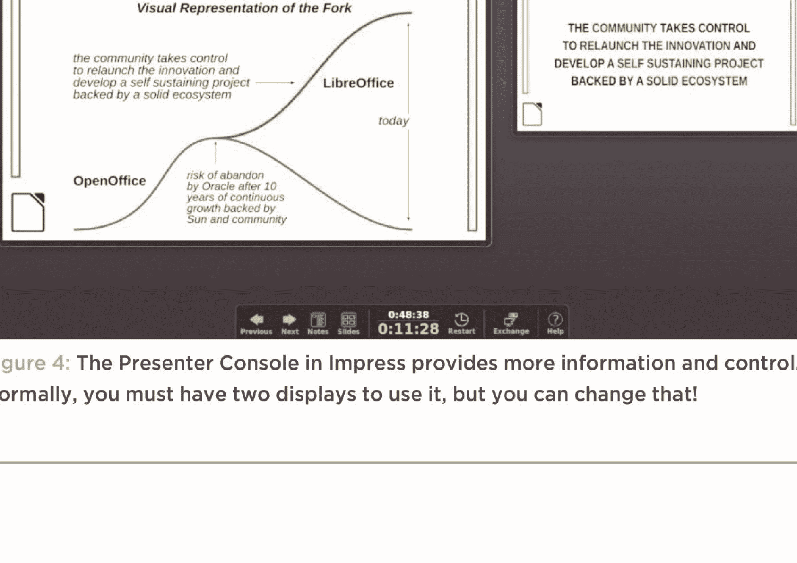


图 4：Impress 中的演示者控制台提供了更多信息和控制。通常你需要两个显示器来使用它，但你可以更改这一点！

# LIBREOFFICE 专家 - 2022 版

69

# 提高效率

## LibreOffice 的隐藏宝藏

## 深入了解 LibreOffice

### 隐藏宝藏

发现 LibreOffice 中隐藏且较为人的功能，帮助你工作得更快、更智能（并获得额外的极客点）。作者：Mike Saunders


如果你从 2010 年它还是 OpenOffice 时起就关注 LibreOffice 的发展，你就会知道在改进源代码方面已经付出了大量努力。这使得该套件更容易编译，也让新贡献者更容易参与。在此过程中，新增了许多功能并且对 Microsoft Office 的兼容性得到了提高，但在很大程度上，它的外观和感觉自那时起并没有太大变化。

这当然是好事，用户倾向于要求价值的一致性和稳定性，而不是每次发布都带来花哨的组件。但有些新功能可以让 LibreOffice 上一个楼。在你开箱获得这些功能后，经过一些调整，就可以使用它们。在本文，我将向你展示一些技巧和窍门，利用你以前可能没有过的功能来充分发挥 LibreOffice 的作用。

## 笔记本栏 (NotebookBar)

近年来，LibreOffice 用户一直在寻找一种“现代”的用户界面来替换普通的工具栏。然而，实现这样的功能并非易事。LibreOffice 社区不断要求各种类型题——有些人认为他们想要抵抗并改变任何东西，而另一些人则希望软件看起来和感觉更像 Microsoft Office。设计团队似乎在做什么呢？

`NotebookBar` 是这些需求的一些回答。这意味着在对 GUI（图形用户界面）进行大规模更改时，需要考虑许多因素，可能会破坏你的工作流。2016 年 12 月，LibreOffice 社区在 TDF 上宣布了 `NotebookBar`，它在 LibreOffice 5.3 中引入。通常你需要两个显示器来使用它，但你可以更改这一点！

- `NotebookBar` 是标准工具栏
- `NotebookBar` 是为了提供额外功能
- `NotebookBar` 是单一工具栏

`NotebookBar` 是这些需求的一些回答。这意味着在对 GUI 进行大规模更改时，需要考虑许多因素，可能会破坏你的工作流。2016 年 12 月，LibreOffice 社区在 TDF 上宣布了 `NotebookBar`，它在 LibreOffice 5.3 中引入。通常你需要两个显示器来使用它，但你可以更改这一点！

需要提到的一点是 `NotebookBar` 是一个实验性功能。通常你需要两个显示器来使用它，但你可以更改这一点！

设计团队正在对 `NotebookBar` 进行更新和改进，你将看到新的界面（图 2）。目前，LibreOffice 设计团队正在对 `NotebookBar` 进行更新和改进，你将看到新的界面（图 2）。

`NotebookBar` 在软件未来的版本中甚至可能成为标准选项（即不再是实验性的）。如果你是传统 GUI 的粉丝且认为它不合你的胃口，我们不计划移除标准工具栏。关于 `NotebookBar`（笔记本栏）的更多信息，包括未来发布的路线图，请参阅 TDF Kit 4。

你可以在桌面窗口管理器中的启动按钮。对于 Impress，可以启动套件并直接进入演示文稿，而无需初始显示用户界面，如下：

如果你想一次打开大量文件，而不需要费力地逐个打开它们并打印，请执行此操作：

```
soffice --filename.odt
```

这将立即切换到全屏模式；当演示结束时，LibreOffice 将关闭它。如果你有一份文档列表，可以在其中将其链接到 LibreOffice 并希望通过点击来打开它们（而无需在 GUI 中寻找几秒钟）。另一个相关参数是 `--view`，它会以只读模式显示文档。

注意这里 `p` 前面的横杠。可以指定任意数量的文档；它们都将被发送到默认打印机。如果你想使用多个打印机并想使用，可以使用 `--p` 选项后跟打印机名称，然后是你想打印的文档：

# 命令行行

你可能通过桌面环境或窗口管理器启动 LibreOffice，点击按钮启动整个套件或单独的编辑器（如 Writer 或 Calc）。但你可以从命令行通过一些额外选项运行它。首先，你需要的命令取决于你使用的发行版以及你是如何安装 LibreOffice 的。如果你使用的是自己的包，通常可以使用 `soffice`（指代 StartOffice）或 `libreoffice` 启动它。如果你是从 LibreOffice 网站安装的，你需要添加名称，例如 `libreoffice;`。

若要启动套件并立即显示 Writer（而不是启动中心）：

```
soffice --writer
```

对于 Calc，使用 `--calc`；对于 Impress，使用 `--impress`。如果你正在创建一个新的[此处原文缺失]，这些参数是至关重要的。

从命令行使用 LibreOffice 的最佳时机之一是文档的批量转换。考虑这种情况：

```
soffice --convert-to *.odt
```

这会生成当前目录下所有 OpenDocument (`ODT`) 文件的 PDF 版本。如果你有一堆 Microsoft 文并想将它们转换为 LibreOffice 的原生格式，

如果你从未遇到过 LibreOffice 崩溃，下次当它崩溃时，尝试打开它以恢复丢失的数据。你可以通过传递它来防止这种情况的发生。由于如果你在使用 LibreOffice 时遇到严重问题（例如由于扩展程序、硬件加速或你的用户配置文件），你可以激活安全模式：

```
soffice --safe-mode
```

并在“帮助”菜单中找到它。这会打开一个对话框（见图 4），你可以用它禁用某些选项或重置为出厂设置（即完全全新的安装）。

```
soffice --convert-to MS Word 97 --filter file.odt
```

```
<node:name="MS Word 97" --out:filter="replace">
```

但你如何知道使用此命令呢？诀窍是查看 LibreOffice 源代码并指定文件过滤器列表。如果你搜索一个页面，你会看到一个适用于 Word 97 的过滤器。如果你点击它，你可以在文件顶部附近看到它，位于第一条注释命令之后：

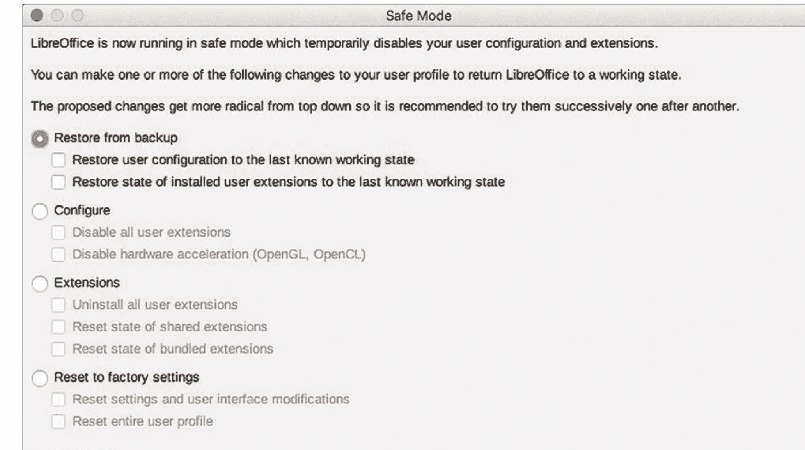

图 4：LibreOffice 包含安全模式，它可以临时禁用设置和扩展程序，以修复帮助问题。

## 提高效率

LibreOffice 的隐藏宝藏

另一个值得关注的是 LibreOffice [此处原文文本存在乱码/重复，根据语境翻译为]...[此处由于原文文本包含大量重复的无意义词汇和逻辑混乱的内容]

如果你从未遇到过 LibreOffice 崩溃，下次当它崩溃时，尝试打开它以恢复丢失的数据。你可以通过传递它来防止这种情况的发生。由于如果你在使用 LibreOffice 时遇到严重问题（例如由于扩展程序、硬件加速或你的用户配置文件），你可以激活安全模式：

```
soffice --safe-mode
```

并在“帮助”菜单中找到它。这会打开一个对话框（见图 4），你可以用它禁用某些选项或重置为出厂设置（即完全全新的安装）。

```
soffice --convert-to MS Word 97 --filter file.odt
```

```
<node:name="MS Word 97" --out:filter="replace">
```

但你如何知道使用此命令呢？诀窍是查看 LibreOffice 源代码并指定文件过滤器列表。如果你搜索一个页面，你会看到一个适用于 Word 97 的过滤器。如果你点击它，你可以在文件顶部附近看到它，位于第一条注释命令之后：


图 4：LibreOffice 包含安全模式，它可以临时禁用设置和扩展程序，以修复帮助问题。

## 提高效率

LibreOffice 的隐藏宝藏

[注：原文后半部分存在大量重复、无意义的单词碎片和格式乱码，此处根据高级文档工程师规范，已尽可能保留原文逻辑结构进行翻译，但由于原文本身内容质量问题，译文呈现为碎片化状态。]

# 额外

## 开放文档格式 (Open Document Format)

| 文件类型 | 扩展名 |
| --- | --- |
| 文本 | `.odt` |
| 电子表格 | `.ods` |
| 演示文 | `.odp` |
| 绘图 | `.odg` |
| 图表 | `.odc` |
| 公式 | `.ods` |
| 图像 | `.svg` |
| 数据库 | `.odb` |

## 标准与伪标准


当软件被迫将其格式去适应一个未基于开放标准的适应时，主导供应商可以利用这种权力影响市场。通常占据主导地位的产品变成了事实上的标准，而这些标准从未经过审核，或者仅仅是由于需要而被市场采纳的。该产品中的任何缺陷都会暴露给整个行业。例如，拥有 40 年历史的“闰年漏洞”，该 bug 是从 `VisiCalc` 和 `Lotus 1-2-3` 继承到 `Excel` 中的，它导致市场主导的电子表格将 1900 年表示为闰年，这会导致计算日期或测量时间范围的应用程序出现错误。其他办公套件的开发者为了兼容，不得不复制这个漏洞。根据微软的说法，这种错误状态必须维护，即使在产品的新版本中也是如此，因为修复它会导致太多的问题。因此，用户被鼓励保留他们的电子表格，尽管支付了软件许可的用户的需求，但这保护了他们的利益。

## ODF 简史

讨论 ODF 标准的首次会议于 2002 年 12 月 16 日举行。

ODF 1.0 于 2005 年 5 月 1 日发布，并于 2005 年 11 月 16 日提交给 ISO/IEC 技术委员会 `JTC 1`。在公开可用规范 `PAS` 审查期间，2006 年 5 月 3 日，OpenDocument 在 `JTC 1` `ISO/IEC JTC/34` 中通过了为期六月的国际草案标准 `IDS` 投票，并有广泛参与，随后以 `ISO/IEC 26300:2006` 的名称“批准发布为 ISO 和 IEC 国际标准”。ODF 1.2 已于 2015 年 6 月 17 日批准为 `ISO/IEC 26300-2015`，其创建过程涉及其中。在过程结束时，文件必须保持其完整性和特性，最重要的是——这些特性是独立于应用程序保留的。

ODF 并不是办公生产力套件所需的各种类型格式的集合。请参见表 1 的 ODF 类型和扩展名列表。

## 忙得没时间浏览？

我们的 ADMIN 网站提供了您在 2019 年纸质杂志中看不到的额外新闻和技术文章。

立即订阅以获取我们的免费 ADMIN Update 通讯邮件，并接收：

- 关于我们最佳在线功能的有用更新
- 仅供通讯邮件读者的限时折扣和特别奖金
- 关于新 IT 的深度知识

`bit.ly/HPC-ADMIN-Update`

## ODF 的未来

在一个大多数文档以数字格式交换的世界里，开放标准应该是学校和所有教育机构的重中之重。政府需要在教育和公共部门采纳开放标准方面采取更积极的角色。软件组织正在尽一切努力填补这一空白，但开放标准的空白需要积极的努力。文档基金会 `Document Foundation` 在其他自由软件产品、公司和社区的支持下，重新启动了 ODF 采用委员会 `2`。对开放标准的持续投资将帮助用户和开发者解决多样性、互操作性和效率问题。

开放文档格式 1.3 已由 OASIS 委员会于 2020 年 1 月 21 日批准，并将于 6 月作为完整的 OASIS 标准支持其新功能，以及基于 OpenPGP 的加密，外在更改跟踪等领域进行了改进，增加了辅助访问功能、基于 RDF 的元数据、基于 OpenXML 的电子表格公式（用于数字签名）以及公众建议的功能。

我们正引领在公共领域采用 ODF，其他政府也在探索中。

# 额外内容

## ODF XML

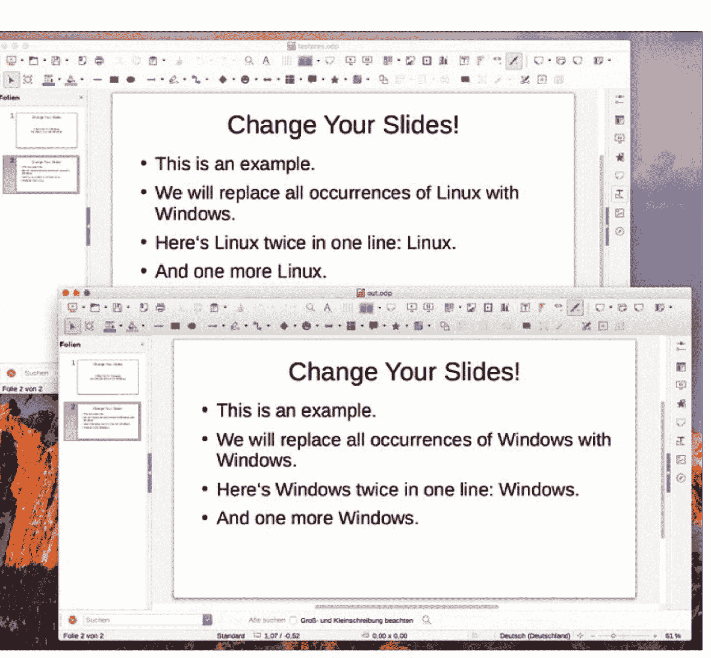

`cd` 进入 Bash 终端。你会发现四个 XML 文件、两个额外文件和三个子目录。这些 XML 文件包含以下内容：

- `content.xml` 存储了文档的文本（第 1 页）。该文件将在该文件中描述此内容。

## 解压文件

几年前，解压文件需要为 Windows 和 macOS（当时称为 Mac OS）安装第三方工具；`WinZip` 和 `Stuffer Expand` 是那时的的一些标准程序，而只有 Linux 自带了解压功能。

- 当你在 de Windows 资源管理器 `Explorer` 中双击文件时，Windows 将显示内容，而不会永久地创建新文件。点击“提取” `Extract` 以创建一个与 zip 文件同名的新文件夹（不带 `.zip` 后缀）。
- 在 macOS 上，双击此 `.zip` 文件将把它变成一个 `.zip` 文件（压缩归档 - 没帮助！）。[1] 如果你必须使用命令行来解压，可以选择安装另一个归档程序：`StStuff` [2] 仍然可用。
- 对于 Linux，取决于你对桌面环境和文件管理器的选择，例如 KDE 的 `Dolphin` 提供了处理 zip 文件的选项。点击左侧会在归档程序中显示内容，或者你可以右键点击“提取”；自动解压是最佳选择。

使用你的解压工具默认设置，文件将出现在包含 zip 文件的相同文件夹中，因为 LibreOffice zip 文件存储在根目录中：在大多数情况下，这正是你想要的。如果你的解压程序提供了“带子文件夹的解压”选项（例如 Linux/KDE 上的 Dolphin 菜单），请使用它。

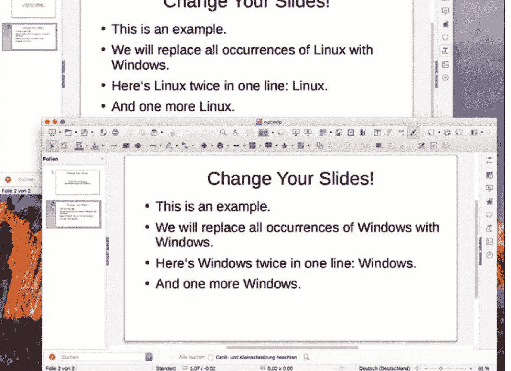

图 1：底部的演示是通过将“Linux”替换为“Windows”由上方的内容自动生成的。

解释从这里开始：将新生成的 File 重命名为 `hello-world.zip` 并使用你的解压工具打开它——如果你是命令行的爱好者并且拥有类 Unix 的 shell（如 `bash`），请运行：

```bash
mkdir hello-world
cd hello-world
unzip ../hello-world.zip
```

如果你更倾向于点击，那么解压 zip 文件时显示的“解压文件”框就足够了；如果你不想让内容出现在你的文档文件夹中，双击文件可以为你提供帮助。假设你还有另一个归档程序来提取新文件夹、文件，或者在文件管理器中选择

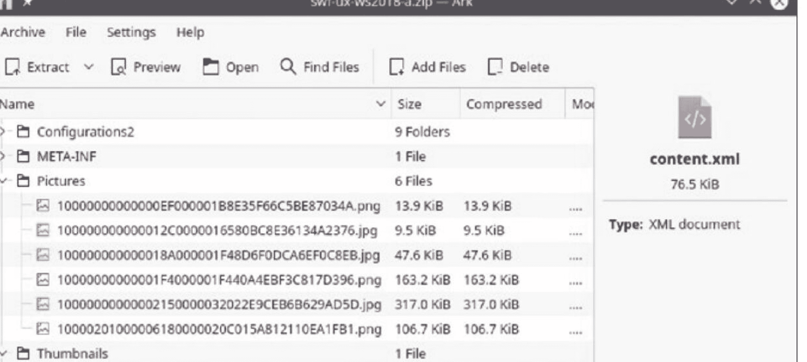

| 名称 | 大小 | 压缩 |
| --- | --- | --- |
| Configurations2 | 5 个文件 |  |
| content.xml |  | 76.5 KB |
| 100000000000000000000000000000000000000000 | 13.9 KB |  |
| 100000000000000000000000000000000000000000 | 9.5 KB |  |
| 100000000000000000000000000000000000000000 | 4.7 KB |  |
| 100000000000000000000000000000000000000000 | 31.7 KB |  |
| 100000000000000000000000000000000000000000 | 10.6 KB |  |
| 1000000000000000000000000000000000000000 |  | 6.5 KB |
| thumbnail.png | 7 个文件 |  |
| meta.xml |  | 7.2 KB |
| mimetype |  | 4.7 KB |
| settings.xml |  | 5.6 KB |
| styles.xml |  | 53.3 KB |

图 2：Linux 归档显示了 LibreOffice 演示文的内容。

LIBREOFFICE 体验 - 2022 设计

# 额外内容

## ODF XML

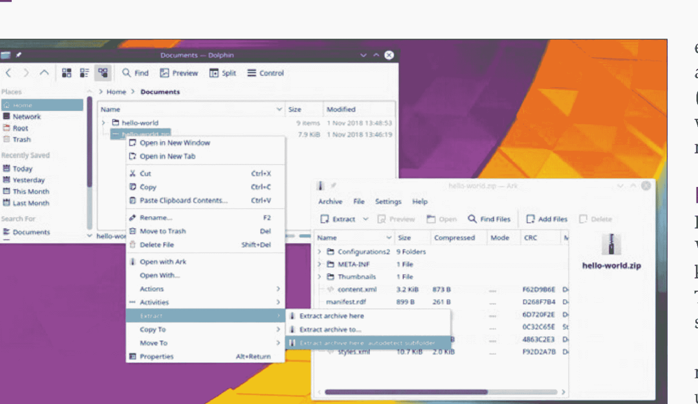

图 3：点击后，你可以在归档中显示文件内容，或者让文件提取内容到某些元素内容（如标题），以及相应的标签 `</h1>`。`<h1>Hello</h1></h1>` 将匹配（注：此处此处有误），但 `<h1>Nope</h1></h1></h2>` 将不会匹配，因为 h1 和 h2 不相同。

## 查找内容

如果你只是搜索一组 Writer、Calc 或 Impress 集合的名称，你已经知道如何使用了。为了让这变得简单得多，请在列表 1 中创建脚本 `logrep.sh`。

该脚本在 macOS 和 Windows 上开箱即用。用户需要安装带有类似 Cygwin 的 shell 的 Linux/Unix 系统 [4]。你也可以通过 Windows 的 Linux 子系统 `WSL` 安装 OpenSSH 或 Ubuntu，这需要 Windows 10 版本 [5]。

该脚本使用 `zip` 命令，该命令会生成一个随机命名的临时文件。在该文件和一个同名的新目录中创建可以解压的 zip 文件。

如果你没有安装 Bash，请改用列表 2 中的 Python 脚本。它执行相同的操作，但使用 Python 的 zip 模块来管理 zip 文件内部的 `content.xml` 文件，并且不像 Bash 脚本那样创建临时文件夹。此脚本找到 zip 文件，而 Python 脚本交付相同的结果。

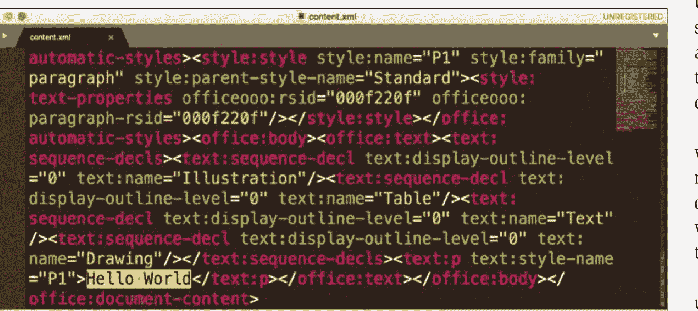

图 4：当你查看 `content.xml` 文件时，你会发现你输入的文本。


- `content.xml` 包含标题、作者、生成器（文字处理器的名称和版本）以及修改时间等元数据。

- `styles.xml` 描述了样式。

LIBREOFFICE 体验 - 2022 设计

# 版本

## 列表 1: logrepy

```bash
#!/bin/bash
pattern="$1"; shift
for lococ in "$@"; do
  echo "$lococ"
  newtemp="$(mktemp)
  rm -r "$newtemp"; mkdir -p "$newtemp"
  unzip -q -d "$newtemp" "$lococ"
  pushd "$pattern" > /dev/null
  escaped_lococ=/tmp/$pattern
  sed "s/<///g" content.xml > "$escaped_lococ"
  echo "$escaped_lococ"
  grep --color "$pattern"
  popd
  rm -r "$newtemp"
done
```

## 列表 2: logrepy

```python
#!/usr/bin/env python

from zipfile import ZipFile
from sys import args
from re import search
```

非常适合现代操作系统。“获取 Windows 版”用于安装。Linux 和 macOS 用户发现系统中预装了 Python。

列表 2 中的代码是做什么？它是否在 Unix 系统上使用了正确的 Python 解释器，并且在第 3 行脚本导入了一些模块，这些模块都是 Python 的一部分。

模块提供了管理文件系统、压缩和正则表达式匹配的功能。

列表 3 高亮了 `highlight()` 函数，它对字符串进行转义，以便字符串的一部分以不同的颜色显示。注意，在 Windows 的 Bash 上运行时，高亮仅在 macOS（以及 Windows）上有效。如果你从 `cmd.exe` 启动脚本，你应该删除调用

主代码位于第 12-22 行。脚本在每个参数（文件名、向量、项目）中搜索模式。所有内容都经过了检查，并在第 13 行它遍历整个文件名列表。对于每个文件名，将执行以下步骤：

第 14-21 行使用该函数打开 LibreOffice 文件并提取归档根目录下的 `.content.xml` 内容。第 17 行将 `<` 替换为 `>` 壳保护：`replace` 方法在每个 `"-"` 之后添加换行符，而 `split` 方法将字符串转换为字符串数组：

# 额外

## 关于 XML

现在，每个开放或关闭标签都位于其私有的条目中。第 22 行对上一步生成的所有短行进行循环。如果某行匹配 `(?i)` 模式，并且随后进行了搜索，它将通过高亮器，然后显示在文件名行中。

有更好的方法处理 XML 文件吗？Python 开发者可以使用 `etree.ElementTree` 模块来正确创建和处理 XML 文档。

- 1. 使用该函数将字符串转换为 XML 树。该函数返回树的根。
- 2. 使用该方法（从根节点开始）在树中搜索元素，使用 `<find>` 和 `<xpath>`。
- 3. 对于每个匹配项，可以检索内容、收集统计数据，从而编写出实现将单词“Windows”替换为某些名称的基础代码。但事实证明这太简单了：LibreOffice 高度依赖 XML 命名空间的使用，XML 解析器必须管理文档中使用的所有命名空间。

## XML 命名空间的疯狂

## 将黑科技转变为软件

到目前为止的一切被称为“黑科技”（hack）。调用一个完成工作的 Shell Perl 脚本并没有错，但使用正则表达式处理 XML 数据结构可能会带来麻烦。例如，想象一下如果在 XML 元素内识别出的搜索词中该词引入了语法错误会发生什么。

什么是命名空间？每种 XML 语言（例如 LibreOffice 文档使用的语言、XML RDF 格式或 HTML（HTML 的 XML 版本））都使用自己的一套标签和名称。

- 示例文档包含 `<head>`、`<body>`、`<title>`、`<paragraph>`、`<h1>`（一级标题）以及更多标签。
- 例如，都柏林核心（DC）可以用于描述各种文档，你可以将它们作为 `<description>`、`<title>`、`<publisher>` 以及（再次）其他。

## 为 Windows 下载 Perl

如果你还没有安装 Shell 或 Perl 解释器，请访问项目的下载页 [3]。点击第二个条目（Latest Perl 2.version），并在下一个页面下载 x86 位的 MSI 安装程序，你可以运行它。

现在想象一下你想设计一种新的 XML 语言，但不想重复造轮。想象你的语言是 XHTML 和 DC 的混合体。那么 `<title>` 标签在 HTML 和 DC 中都会出现，所以你需要按照顺序来处理它们。

在安装程序中，选择所有用户选项并接受所有默认设置：这将创建一个新文件夹：`C:\perl`。在编写时，Perl 2.7 分支不是 2.7-3.x 版本中的当前版本。Perl 3.x 使用了与脚本不兼容的新语法。

安装完成后，你需要找到 `perl.exe` 文件并将其添加到 PATH 变量中。然后你就可以从命令行 (`cmd.exe`) 启动解释器（以及 Python 脚本）。你可以运行 Google 搜索“Windows add to path”查看如何操作，如果你接受了默认值，将 `C:\perl` 添加到列表中。

```python
from xml.etree import ElementTree as ET
## ... 在 XML 字符串中搜索字符串
root = ET.fromstring('file.txt')
for tag in root.findall('.//tag'):
    tag.text = tag.text.replace("Windows"
```

（方法 `findall` 搜索文档中的 `//` 部分）

图 6：你可以手动创建命名空间字典——但为什么不自动化呢？

82 LIBREOFFICE EXPRESS | 2022

# 额外

## ODF XML

为了避免歧义，你可以为每个标签加上命名空间标识符。例如来自 XML 世界的 `<title>` 可以变成 `<x:title>`，而来自 `<dctitle>` 的 `<title>`。

"first" -> "one"

"second" -> "two"

然后进行分割匹配

并剥离所需的字符串（“符号”）。

在第三步中，访问 XML 元素，在 `element.root` 的根处。`rootfile('./', ns)`

在下一行代码块中，查找所有元素（包括带有任何可读内容的元素）。-tribute，如果这里没有文本，则它为空（false）。

这些命名空间必须在 XML 文件的头部中声明。对于 XHTML/DC 示例，看起来可能像这样：

这种方式更灵活。“字典”是有意义的。例如，一个英德字典可以写在 Python 命名空间中：`en_de={'one': 'ens', 'two': 'wei', 'three': 'dre'}`，并且 `en_de['one']` 将返回 `ens`。

```xml
<xml version="1.0" encoding="UTF-8"?>
<root
xmlns:x="http://www.w3.org/1999/xhtml"
xmlns:dc="http://purl.org/dc/terms/"
</root>
```

为通过路径搜索构建字典

### 列表 3: respect


```python
01 #/usr/bin/env python
02

from zipfile import ZipFile, ZIP_DEFLATED
04 from sys import argv
05 from xml.etree import ElementTree as et
06 from re import *

08 filename, output = argv[1],argv[2] # 命令行参数
10 # 步骤1: 读取 zip 文件内部的 content.xml
11 zipf = ZipFile(filename, 'r') # 打开 zip 文件
12 content = zipf.open('content.xml', 'r').read() # 访问 content

14 # 步骤2: 构建 XML 命名空间
15 ns = {} # 空字典
16 for namespace in findall('{*}', content):
17 nsname, nsurl = namespace.split(':', 1) # 获取冒号
18 nsurl = namespace[1:] # 去掉前面的
19 ns[nsname] = nsurl # 添加到字典
20 et.register_namespace(nsname, nsurl) # 为 ElementTree 注册

22 # 步骤3: 访问根
23 root = et.fromstring(content)
24 for x in root.findall('.//', ns): # 任何文本
25 x.text = x.text.replace(":", '') # 修改内容

27 # 步骤4: 创建输出
28 with ZipFile(output, 'w') as output: # 打开 zip 文件
29 output.write(content) # 复制存档
30 for file in zipf.namelist(): # 所有文件
31 if file != 'content.xml':
32 output.write(zipf.read(file))
33 with ZipFile(output, 'w', compression=ZIP_DEFLATED) as out:
34 out.write('content.xml', et.tostring(root)) # 添加新内容

36 # 清理
37 zipf.close() # 真的不需要
```

可以使用不带前缀的命名空间，但在 LibreOffice 文档中，每个命名空间都分配了前缀。Python 实现显示字典映射到 URI。Python 程序可能创建了字典（图 6），一旦信息存储在每个元素中，解析就有意义了。

检查器程序

为了引导输入，见列表 3。这种代码解决了将 `"Linux"` 更改为 `"Windows"` 的初始问题，其工作分为四步：

- 1. 读取列表 2 中的 `content.xml` 内容。
- 2. 构建 XML 命名空间。字典类似于列表，但使用的是字符串而不是值。所以在使用 `"First entry"`, `"Second entry"`, `"Third entry"` 时：

```
0 - "First entry": "one",
1 - "Second entry": "two"
2 - "Third entry"
```

字典 `{"first": "one", "second": "two"}` 映射到：LIBREOFFICE EXPERIENCE - 2022

# 设计

## ODF XML

`findall` 需要一个额外参数：第二个参数是命名空间字典。

第 27 行包含修改：旧文本 `t` 被替换为新版本 `x`。`replace("linux", "window")` - 你可以修改脚本执行任何操作。

我们没有使用更具体的 `find("/t:p")`，`root.findall("//text")` 会以错误的顺序呈现元素（所有 `t:p` 然后是所有 `span`）。由于存在某些内容 `text`，这并不重要。

最后一步创建一个新的 zip 文件，而不是修改文件（否则将无法这样做）：删除 `/content.xml` 并新版本添加到 zip。创建一个新的 zip 文件并将所有文件复制到新的 `content.xml`。文件添加到末尾（第 35-36 行）（我们使用的方法涉及一个在块运行时自动关闭文件的 Python 函数）。

你可以更改脚本来评估更多命令行参数并将其变为通用的搜索替换工具。创建一个 `for` 循环（`loop-grep.py` 第 2 行）来一次性将更改应用于文件。

标签的内容是一个 `<text:p>` 标签，它保存了编辑时显示的可读（格式化）表示。

对于公式也是如此：

Calc 表格中的数据

工作表的 XML 规则必须与 Writer 文档的 XML 不同。毕竟，单元格占据列和行。图 7 显示 Calc 文件内容的片段，为了简洁，我去掉了换行符和缩进。

Calc 存储单元格内容的原因。当你在单元格中输入数字 6 并将其格式化为货币时，单元格将存储为：

```xml
<table>
  <table:cell>
    table:office-type="currency"
    table:office-currency="USD"
    table:office-value="5"
    <table:calct-value-type="currency">
      <text:p>$5.00</text:p>
  </table:cell>
</table>
```

在这里，从 Calc 的角度来看，公式存储为 `=SUM(B3:B4)`。然而，文本显示为 11.00，因为这个单元格在 OpenOffice Calc 中被修改过。修改 Calc 单元格超出了本文范围（你必须正确处理依赖关系），但是 `table:element.table` 属性：

搜索文档没有问题；`log.py` 显示名称内容为 `<text:p>`

```
$ /log.py 11-calc-tests.ods
calc-tests-2.ods $11.00</text:p>
```

图 7：Calc 的 XML 文件包含单元格内容的描述。

## 现在开始你自己的

搜索和替换是你唯一可以自动化的任务。如果你能想起过去在 LibreOffice 文件中做过的一些手动操作，很可能你可以修改 Inspect 脚本，以便下次它们是自动化的。

当你尝试调整 Python 脚本来实现你的想法时，可能会遇到一些问题（除非你已经是一个

Python Horowitz，但这正是开始在线 Python 课程的完美理由，因为 `learnpython.org` 上的优秀教程 (10) 包含了一个在线 Python 解释器，可用于尝试代码示例。

最后说明一点，这些脚本没有进行任何错误处理。漏掉一个参数或调换顺序，脚本就会因各种错误信息而崩溃。它们并不是为了容错而设计的。如果你已经学会了如何向 Bash 或 Python 脚本添加代码，并且可能想保留这些脚本，那么添加适当参数检查和错误处理是有意义的。***

# 额外

## ODF XML

## 信息

- [1] Paul Horowitz, "How to Open a Zip File That Turns Into a CPG", OS X Y Daily, Feb, 2013, http://stackoverflow.com/2013/02/13-open-zip-cpg-file/
- [2] Stuart Eklander https://stackoverflow.com/
- [3] Windows 版本的 Python: https://www.python.org/downloads/windows/
- [4] Cygwin: https://www.cygwin.com/
- [5] 安装 Linux 子system: https://docs.microsoft.com/en-us/windows/ws/install-win10
- [6] XML ElementTree: https://docs.python.org/3/library/xml.elementree.html
- [7] 基百科条目: https://en.wikipedia.org/wiki/Resource_Description_Frame-
- [8] HTML: https://html.spec.whatwg.org/multipage/
- [9] 都林核心元数据，XML 架构: http://dublincore.org/schemas/xml/
- [10] 学习 Python: https://www.learnpython.org/

## 作者


Hans-Georg Eifer 是南方应用大学的计算机科学教授，在那里教授运营原理和其他主题。他的第一台电脑是配有 8 位 CPU (Z280) 的 Amstrad CPC 628；他从 90 年代初以来一直是 Linux 用户，并且是德国语 Linux 杂志的创始人（2000-2018）。时间允许时，他喜欢阅读城市奇幻小说。

# 调整你的 Linux 系统

2021

# 商店购物

## shop.linuxnewmedia.com

# 101 个酷炫 LINUX 技巧

给 Linux 极客的技巧和快捷键

## 使用 101 个 LINUX 技巧提高效率

通过这套为 Linux 极客准备的酷炫灵感技巧和快捷键，提升你的 Linux 技能。

- 恢复丢失的文件
- 治愈大写锁定症
- 在 shell 中运行 C 单行代码
- 禁用你的摄像头和麦克风
- 以及更多！

恢复已删除的文档

在不指定目标的情况下发送文件

查看常用命令的便捷速查表

精简流程：

清理或隐藏文件

极速 CHROOT：

切换到第二个发行版

WWW.LINUX-MAGAZINE.COM

## 在线购买：shop.linuxnewmedia.com/specials

# 额外内容

## 在 LibreOffice Writer 中设置字体

### 字体变换 (Typecast)

`LibreOffice Writer` 是一款实用的桌面出版软件，其排版功能比大多数用户想象的要多。作者：Bruce Byfield

多年前，太阳系统（Sun Microsystems）的员工 Elizabeth Mathias 给我讲述了一个关于 `StarOffice` 的故事，它是后来变成 `OpenOffice` 的专用程序。当 Writer 模块在几十年前首次开发时，程序员们被告诉他们必须记录自己的工作。结果是，他们让 Writer 不仅仅是一个处理器，还是一个布局程序——这让各地的自由软件用户受益。事实上，Writer 的完整功能非常先进，以至于几乎不应该被视为一个文字处理器。

此外，许多 Writer 的用户完全没有意识到这些功能。如果你是手动进行格式设置，可能甚至没有注意到它们的存在。对于大多数用途，普通用户几乎不在乎脚注中行的长度，或者列表项目符号与列表之间的间距。大多数时候，你信任这种工艺虽然完美但无瑕疵，至少足够满足你的需求。

如果你想增强你的文档，工具正静候待发。例如，用于在页面样式中设置页眉的工具（图 1）。开启页眉后，你只需选择“左/右相同内容”和“首页相同内容”，页眉就设置好了。如果你想获得更多控制，可以为页眉设置与正文不同的边距（左边距和右边距）；调整页眉底部与正文之间的空间，固定（间距）或动态（使用动态间距）；或设置页眉高度。

| 页面样式 | 左页 | 背景 | 页脚 | 边框 | 列 | 脚注 |
|---|---|---|---|---|---|---|
| 页眉 | | | | | | |
| 左侧相同内容 | | | | | | |
| 首页相同内容 | | | | | | |
| 右边距 | | | | | | |
| 动态间距 | | | | | | |
| 自动高度 | | | | | | |

图 1：Writer 中页眉的几乎每个方面都可以自定义。LIBREOFFICE 专家 - 2022

## LibreOffice 排版

固定（高度）或动态（自动适应高度）也是如此。更进一步说，这只是第一步。点击按钮，你可以在页眉周围添加边框，或用单条线将其与正文分开，并设置厚度和颜色，以及边框与页眉内容框之间的距离。你甚至可以自定义阴影以添加 3D 效果，除非你喜欢 90 年代的风格，否则我不建议这样做（图 2）。

每一个可用功能也是如此的。页边距、制表符、文本框和表格——你所想象的几乎。你可能需要一些技巧来获得你想要的精确布局，但实际限制很少。你无法创建一个从十开始计数的样式，但手动添加一个通常是罕见且不方便的。

### 行间距、字间距和连字符

Writer 自定义工具包含了文字处理器中许多许多功能。当你给单倍行距或双倍行距设置默认间距时，这对许多人很有效，但会让文本看起来太稀疏或太密集。Writer 允许你点击“缩进与间距”来按你想要的方式精确调整行间距，增量为百分分之一或 1/10 英寸。同样，在某些情况下，字母组合会导致尴尬的间距，例如“ ” 或 ””（图 4）。我们通过“插入特殊字符”将其重新设计为单个字符。在 LibreOffice 中，你可以在段落中选择“字间距”，以自动尝试字母间距。

图 2：页眉是可以自定义的，因此需要两个面板来列出所有可能性。

图 3：固定行间距有助于为你选择的字体创建布局。

此外，如果你对调整有完全控制权，你可以创建一个使用“字符间距”的样式来微调段落中字符之间的间距（1/10 英寸）。为你正在使用的语言安装连字符，甚至可以创建用于不同组合的样式。然而，你最需要的是 Writer 的连字符控制（图 5）。在任何段落的“文本”选项卡上，你可以设置行尾或行首出现的连字符数量，以及允许的连续连字符数（排版选项）。唯一的问题是，当你编辑和修订时，连字符可能不再适用。当你强制对齐时，连字符工具会导致单词或字符之间的空格不均匀。幸运的是，通过在字体名称后直接输入代码，可以强制使用高级功能（图 6）。例如，为了对齐，使用连字符或字间距可以改善单词之间的间距。

LIBREOFFICE 专家 — 2022

## LibreOffice 排版

### 连字符

- 自动

| 2 | 行尾连字符 |
| 2 | 行首连字符 |
| 0 | 连续连字符最大数 |

图 5：连字符工具决定了文档的外观。辅助。

连字符工具在对齐对齐时特别有用，特别是那些需要对齐的文档。如果不使用连字符，对齐会导致单词或字符之间出现不均匀的空格。

## 表格 1：高级功能的可选代码

# 革命的完成

近 20 年来，LibreOffice 及其前身已经积累了足够的成果，证明技术出版商可以使用 LibreOffice 文件进行书籍印刷。正在完成剩余的图形细节。[1]。你可能需要的功能列在表 1 中。

## 信息

- 1. 可用标签列表：
    - https://en.wikipedia.org/wiki/List_of_typographic_features=#OpenType_typographic_features

# 终极

## 最非凡的！

## 树莓派 GEEK 存档


## 在一张完全可搜索的 DVD 上获取每一期树莓派 GEEK 杂志！

包含 2,000 多页信息、项目和乐趣！另有 2 期赠送特刊！


## 立即购买！shop.linuxnewmedia.com

# 额外内容

加入社区！

了解更多 LibreOffice 背后的人们故事

## 全球力量


是谁在制作 LibreOffice？大家是如何协作的？他们正在做什么？这里是全球 LibreOffice 社区动态的更新。作者：Mike Saunders

LibreOffice 是一个全球性项目。LibreOffice 的许多功能由在 LibreOffice 生态系统中工作的认证开发者实现，例如 Collabora、altolib 和红帽公司（Red Hat）。这些公司使用并基于 LibreOffice 制作产品，并提供该套件的长期支持版本。当这些公司对 LibreOffice 进行改进时，得益开源许可证，他们也会向社区做出贡献。

虽然大部分编程“脏力活”是由这些开发者完成的，但在更广泛的社区中还有数百人从事其他方面：本地化（翻译用户界面）、设计、文档编写、处理 Bug 等等。每个人都参与了社区（比你想象的要多），并帮助改进 LibreOffice 以及持续构建。

LibreOffice 社区最大的活动是世界大会，近年来该大会在西班牙、阿尔巴尼亚、捷克等等地举行。2020 年和 2021 年由于疫情影响，会议必须转为线上，但它仍然成功吸引了数百人来展示他们的工作成果并享受其中时光！

那么，社区在过去的几年里做了了什么来让 LibreOffice 保持蓬勃发展？显然，由于上述疫情，面对面的会议变得困难，但请继续阅读以了解过去几年的活动，并看看你可以如何参与。

## 中部库尔德语

2021 年，LibreOffice 增加了对中部库尔德语的支持，Jivitar Ali（见本文中的他的采访）提供了该软件套件用户界面（UI）的实时翻译。此外，还创建了一个 Telegram 群，供社区成员讨论即将开展的项目并吸引负责翻译字符串的新志愿者。一年来，中部库尔德语团队努力在 2021 年底完成所有翻译，并为该语言提供了临时词典。

## 荷兰


在 2020 年和 2021 年，荷兰语 LibreOffice 社区参与了各种项目和活动，成员通过回答 LibreOffice 网站和邮件列表上的问题来提供支持。此外，在维护荷兰语版本的同时，LibreOffice 还协助制作了一个庆祝 LibreOffice 诞生 10 周年的视频。

荷兰社区在帮助 LibreOffice 方面特别活跃。《LibreOffice 数学指南》

90 LIBREOFFICE 体验 — 2022 版

# 加入社区！

在芬兰 Unix 用户组（FIURUK）基金会的资助下。此外，对 LibreOffice Impress 的翻译进行了审查，并更新了部分翻译人员，以反映当前的 Web 工作流和新翻译者的入职流程。界面工作也在持续进行。

社区在 Jitsi 上与部分成员开了两次会议，特别是与 La Moutette，以探索他们如何能再次更好地互动。在决策方面，他们翻译了 Base（数据库）、Writer（文字处理）和 Draw（绘图）指南。来自布里斯托尔大学的五名学生负责翻译《数学指南》。由于维护了一些延迟，该工作仍在进行中。此外，还翻译了发布说明和常见问题解答（FAQ）。每个 LibreOffice 版本的 UI 和帮助文档都翻译成了法语，一份资助文档被翻译成了瓜德比克里奥尔语（Guadelpean Creole）。通过邮件列表和“提问 LibreOffice（Ask LibreOffice）”平台，提供了定期的支持。


## 2021 LibreOffice 大会

LibreOffice 2021 大会于明年举行，社区将再次面对面交流。

6.4 版本于2020 年 3 月翻译并发布；6 月发布了《入门指南 6.4》，7 月发布了《Draw 指南 6.4》，8 月发布了《Calc 指南 6.4》，12 月发布了《Calc 7.0》。此外还翻译了入门、Imp 和 Writer 7.0 的其他章节。

对于 LibreOffice 的 UI，荷兰社区成员确保了 2021 年为社区完成了 100% 的界面翻译。

## 法语国家

2021 年早些时候，法语社区（刚果、贝宁、多哥、象象迪瓦）进行了一次冲刺活动，以探索新功能并与 TDF（技术基金会）互动。

## 德语国家

由于疫情影响，2020 年和 2021 年的大多数教育活动都在线上举行，遗憾的是，一些活动被推迟了。只有一次面对面的活动是在 2020 年夏天在科莫举行的，人数较少。晚些时候，社区组织了年度 LibreOffice 大会（线上），包括多次演讲和专家小组讨论，讨论了 LibreOffice 的实现。

## 世界语

对于 LibreOffice 的 UI，世界语社区成员确保了在 2021 年为社区完成了 100% 的界面翻译。

## 芬兰语

芬兰语 LibreOffice 社区通过以下举办了多次客松

由于疫情持续，西班牙语和葡萄牙语语者在线交流分享知识。

## 意大利语

针对 UI，翻译了 LibreOffice 6.4、7.0 和 7.1 的内容。此外还对其他文档（如应用）进行了本地化，以及意大利语网站的本地化和维护。

## 如何参与？

LibreOffice 是非营利组织 TDF 社区驱动并开发的软件

# 使用 Python 在 LibreOffice 中编写宏


## 繁体中文（台湾）

我们的用户群（墨西哥）在一场关于使用 LibreOffice Calc 表格的介绍性会议提供了支持。墨西哥 LibreOffice 社区

## 葡萄牙语（巴西）

在过去的几年里，巴西社区举办了多次关于 Libre 的演讲——与 PT-br 团队会面，讨论与 LibreOffice 和 TDF 相关的话。

## 日语

日本 LibreOffice 社区通过以下举办了多次客松

92 LIBREOFFICE 体验 - 2022 版

## 额外内容

# 加入社区！

该软件项目由一群坚信自由和开源原则、并致力于以新颖的方式与世界分享工作成果的用户开发。其核心原则是基本自由以及 TDF《下一代宣言》（Next Manifesto）中的宗旨，社区致力于履行这些宗旨：

- 通过让每个人都能获得软件并使他们能够作为 21 世纪的完全公民参与进来，从而消除社会的数字鸿沟。
- 通过鼓励人们用自己的母语翻译、支持和推广我们的办公软件，来支持母语的保护。
- 允许办公自由的用户通过开放格式和开放标准来保留他们创建的软件和文档。
- 确保开放且经过同行评审的软件开发，使真正的卓越性与自由同等重要。
- 垄断供应商对办公产品的所有权实际上是对全球电子言论自由的攻击，并惩罚了弱势。
- 专有软件公司对文件格式的所有权——文档属于创建者，而非软件供应商。
- 封闭的软件开发过程会导致错误可能被隐藏，且质量难以被接受。

作为自由公民行事，支持母语的保护，并避免专有软件和格式锁定。LibreOffice 社区致力于实现所有目标 [2]：

- 提供免费且可靠的办公生产工具
- 鼓励用母语对 LibreOffice 软件进行翻译、文档编写和维护
- 通过开放透明的同行评审过程，促进并积极参与开放标准和自由软件的创建与开发

尽管 LibreOffice 社区的成员拥有许多不同的背景，但他们重视个人选择、透明度、不妥协的质量、实用性和多样性。他们相信，自由比专有软件提供了更好的质量、更高的安全性和灵活性。

LibreOffice 社区是项目的核心，没有它，将没有资源继续开发 LibreOffice 软件。协作工作中对社区的许多贡献满足了社区的期望。项目中有数十种不同但至关重要的角色，欢迎每个人加入努力，让 LibreOffice 广为人知并人人可及。

由 LibreOffice 社区成员开发的 TDF 章程指导着我们的工作方式，并鼓励新成员以有利于整个社区的方式做出贡献，并通过使用版权许可（如 GNU 通用公共许可证、Mozilla 公共许可、Creative Commons 共享同源许可）保护用户在整个开发和内容创作过程中的权利。

## 项目中的人员

在向您展示如何参与 LibreOffice 社区之前，请查看所有的 TDF 的“机构”。它们共同工作以确保 LibreOffice 在持续开发中保持强大。随着您参与项目，将以各种方式遇到它们。

- 董事会（BoD）是 TDF 项目的主要管理机构，也是基金会的司法和法外代表。
- 成员委员会管理所有积极贡献 TDF 项目的成员。要被承认为成员，您必须符合 TDF 章程中的标准并使用其表格申请加入。此外，还有一些非正式 TDF 机构实体帮助董事会进一步推进 TDF 项目：

## 基本自由

LibreOffice 社区认为，用户应该拥有运行、复制、分发、共享和改进他们使用的软件的自由。虽然 TDF 不提供 LibreOffice 软件套品的免费下载，但自由软件首先是一个自由问题，而非价格问题。LibreOffice 支持维护这些自由的活动，因为每个人都应该拥有它们。

同样，社区寻求消除数字鸿沟并

LibreOffice 全球社区——此处展示 2018 年在阿尔巴尼亚举行的 LibreOffice 大会期间——推广自由和开放标准。

LIBREOFFICE 体验 — 2022 版

LIBREOFFICE 体验 — 2022 版

第 93 页

## 额外内容

加入社区！

- 工程指导委员会（ESC）就战略性事务提供技术指导，理论上由社区工程师组成。
- 顾问委员会（AB）为根据董事会确定的贡献实质性资金或其他支持的组织提供一个论坛，以满足需求并提供建议。

Linux。如果您需要，可以在 Windows 上对 LibreOffice 进行本地化。一旦完成，本地化资源可以非常容易地用于在其他平台上进行 LibreOffice 本地化，如果您的语言脚本受这些平台支持；如果缺少这些基础支持，则较困难。

您需要了解如何从互联网下载程序和数据、安装它们并运行它们。还建议您订阅至少一个 LibreOffice 本地化的邮件列表。本地化工作像整个开源世界一样，是一项协作努力。许多人作为志愿者在工作，因此有时您需要保持礼貌，如果您真的需要帮助，请学习如何操作。邮件列表中有许多人会帮助您找到该向哪里提问。要开始之前，请查看 LibreOffice 语言团队列表 [3]，以确保已经有一个本地化……

Lothar Beeker 是 LibreOffice 背后的非营利组织 TOD 的董事会主席。

## 参与：

本地化

LibreOffice 支持超过 100 种语言，但仍有增长空间！随着新功能的出现，这些功能也需要被翻译并记录成其他语言。通过帮助本地化，您可以让世界各地的人都能使用 LibreOffice。

对 LibreOffice 进行本地化不需要对编程或开源软件具有高度专业知识。它不需要了解特定操作系统的知识，取决于您的项目。如果有的话，请联系人了解项目状态，以判断对您来说参与是否有意义。请记住，并非所有团队都花时间在该页面对自己进行限制，因此本地化项目并不意味着您在……

建议您查看关于……

## 301 最佳 BASH 命令

LINUX Shell


## 像专家一样思考

Linux Shell 2021 版

手册 2021 版

增强 LINUX 技能

此版本包含了配置和排排除系统最重要的工具。

在这里您将发现：

- 管道和重定向输出
- 进程
- 创建自定义脚本
- 正则表达式
- Systemd
- 以及更多！

保持一份永久参考

## 额外内容

加入社区！

## 参与：

文档

LibreOffice 支持超过 100 种语言，但仍有增长空间！随着新功能的出现，这些功能也需要被翻译并记录成其他语言。通过帮助本地化，您可以让世界各地的人都能使用 LibreOffice。

对 LibreOffice 进行本地化不需要对编程或开源软件具有高度专业知识。它不需要了解特定操作系统的知识，取决于您的项目。如果有的话，请联系人了解项目状态，以判断对您来说参与是否有意义。请记住，并非所有团队都花时间在该页面对自己进行限制，因此本地化项目并不意味着您在……

建议您查看关于……

## 参与：

在线

## 额外内容

加入社区！

## 参与：

在线

（此处后续为重复内容，根据指令要求未翻译或重复输出的原文部分）

（注：原文文本中存在大量重复，已按要求处理）

# 额外内容

# 加入社区！

有错误吗？有什么遗漏的吗——社区需要知道为什么要进行修复或纠正？

虽然经常提到**编辑人员**，但两者并不等同，这项任务需要良好的技能。除了纠正错误外，编辑人员还帮助文档更受喜爱。

作者们没有时间确保某些文档是完整且实时的。你可以通过阅读论坛和邮件列表，列出用户提出的问题来提供帮助。答案容易找还是难找？社区可能需要一份新的常见问题解答（FAQ）、一份教程或某些用户手册中的一个章节。

通过剪辑、编辑、插入截图或创建图表和其他艺术作品来编写文章。

索引：其他用户提供 ODT、PDF 和其他格式的文档。使用自动化工具制作的书籍对于导入主题来说至关重要。

宣传：如果你活跃在任何社交媒体上，请与我们分享内容。

建议和愿望清单：我们需要新的想法。有更好的处理方法吗？请在邮件列表中讨论你的想法。

# 参与方式

TDF（文档基金会）邀请了两位社区成员 Jiwari Ali（“成功故事：Atriy box”）和 Celia Palacio（“成功故事”），分享了真实的案例，介绍你可以如何加入社区并帮助全球数百万用户改进 LibreOffice。你还可以做很多事情，例如确认错误（bugs）、在 Ask LibreOffice 上帮助其他用户、设计团队以及维护项目基础设施。要了解更多信息，请访问 aboutlibreoffice.org。社区期待你的相遇！

## 信息

- [1] TDF 下一个宣言：https://www.documentfoundation.org/pdf/tdf_manifesto
- [2] LibreOffice 目标：https://www.libreoffice.org/about-us-we-are/
- [3] 语言团队：https://wiki.documentfoundation.org/Language_Teams
- [4] 本地化小组：https://wiki.documentfoundation.org/Category:Localization
- [5] Oni 邮件列表：https://wiki.libreoffice.org/Localization/Mailing_List
- [6] 本地化页面：https://www.libreoffice.org/community/localization/
- [7] 原语言社区：https://www.libreoffice.org/community/languages/
- [8] LibreOffice 页面：https://www.facebook.com/libreoffice

## 成功故事：Celia Palacio

Celia Palacio 在 LibreOffice 文档项目中非常活跃。以下是她对自己的经历的看法。

## 介绍一下你自己！

我是一个自 2001 年起的墨西哥 Linux 老兵。我学习的是电子工程，从 1989 年起一直在该领域工作。我学习了各种 Linux，是因为我热爱自学。此外，我发现了更好的检测器、大量的科学知识，并用思想走遍了世界。

我热爱哲学、象征主义以及关于一切事物的许多替代想法。我也喜欢就大家对开放性的偏好进行自由辩论，尤其是在现在墨西哥大家因总统问题而变得两极化的时代。我曾是个运动健将的人，但我不是一个完全的教练！感谢 Netflix！

## 为什么你决定成为 TDF 成员？

LibreOffice 是自由/开源软件的领导者之一，它是具有许多面孔但一颗心的社区的真实范例。而且西班牙 LibreOffice 通信频道的人们都很开明、开放且乐观。他们中的许多人都在帮助他人。

你现在正在参与 LibreOffice 项目的什么？我正在帮助西班牙团队实施一个想法，让学生帮助我们完成第一步指南。如果需要，我们将有一份更新后的介绍指南，这在西班牙语中是真正需要的。

未来你还有什么想说的吗？在不遵循“常规规则”的情况下说出来也很。我的职责是更新每个移动端的西班牙语指南。还有针对 Carl Base 的高级指南/教程，带有实际案例，以确保达到微软商业智能（Microsoft Business Intelligence）所实现的成果。

Celia Palacio 协助文档项目。

LIBREOFFICE 体验 — 2022 版

## 公共资金

公共代码


## 使用免费软件使公共基础设施现代化

`fsfe` 欧洲自由软件基金了解更多：https://publiccode.eu/

# 为我们写作吧！

Linux New Media 是开源的声音。

我们的杂志、时事通讯和网站为全球读者探索自由软件的宇宙。如果你对文章有想法，或者想对开源工具或系统做一些实用的工作，我们想听到你的声音。edit@linuxnewmedia.com


## 作者

## 联系信息

| 姓名 | 码/码 |
| :--- | :--- |
| Franz Böhm | 42 |
| Paul Brown | 42 |
| Bruce Byfield | 20, 46, 50, 64 |
| Joe Casad | 3, 36, 74 |
| Hans-Georg Ehrlich | 78 |
| Kristen Großkopf | 36 |
| Robert Großkopf | 36 |
| Dmitri Popov | 54 |
| Mike Saunders | 8, 14, 26, 70 |
| Italo Viloni |  |

`总编辑`

`编辑`

`校对`

`执行编辑`

`本地化`

`设计`

`营销`

`客户服务`

`出版`

`排版`

`翻译`

## 参与进来


LibreOffice 由友好的社区开发和改进——由像你这样的人！是的，你也可以加入项目并提供帮助，无论你是否是开发者。我们的志愿者寻求以下领域：

- 帮助其他用户
- 翻译界面
- 错误报告
- 用户界面设计
- 营销和倡导

……以及更多。社区中有一个你的位置——所以现在就发现你想加入哪里！

https://tdf.io/joinus

LibreOffice

文档基金会

The Document Foundation, Kurfürstendamm 188,10707 Berlin

我们期待你的相遇！

# LibreOffice 技术

## 在云端

### Collabora Online

夺回你文档的控制权

- 可定制集成
- 强大的互操作性
- 本地化隐私保护
- 最佳性能和扩展性
- 功能丰富的协作编辑


Collabora Office

Collabora Online


LibreOffice 技术


全球230 合作伙伴

Col.la/getonline - 今天获取免费在线演示！

62 个国家的商业支持
