# LibreOffice 高级指南：深度探索全球最强大的免费办公套件

## 关于 Allotropia

Allotropia 提供围绕 LibreOffice、相关开源项目以及开放标准的咨询服务和产品。

### 我们的使命

> 公司于 2020 年由 5 位项目资深开发者联合创立，我们的明确使命是让 LibreOffice 焕发光彩——以尽可能多元的形式和形态，适配现代办公生产力软件的各类需求。同时，我们也热衷于在代码世界中尽情享受 `hacking` 的乐趣！

[https://www.allotropia.de/](https://www.allotropia.de/)

我们让 LibreOffice 焕发光彩——以契合现代计算需求的多元形态！

## 卷首语

### 欢迎辞

#### 办公引擎

开源社区的开发者们才华横溢、动力十足，打造出了一系列令人惊叹的免费工具，全球电脑用户过去需要付费使用的功能，如今都能通过这些工具实现：视频编辑器、图片处理器、网页浏览器、开发平台一应俱全。这套雄心勃勃的工具集合的核心，是多功能 LibreOffice 办公套件——这是一套企业级工具集，可用于撰写和管理文本文档、数据库、电子表格、演示文稿等各类文件。LibreOffice 支持 Windows、macOS 和 Linux 系统，如果你尚未安装，可以免费下载，也可以通过本期附赠的 DVD 进行安装。

LibreOffice 的用户界面非常直观，大多数用户仅需了解其基础功能即可：启动后学习完成几项常见任务所需的知识就足够了。但它的功能远不止于此！如果你已经准备好探索更多可能、提升工作效率、优化文档质量，这本单册特刊就是你的最佳指南！翻开它，你就能看到 LibreOffice 套件所有核心工具的教程：`Writer`、`Calc`、`Impress`、`Draw`、`Base` 和 `Math`。你还能找到关于 LibreOffice 扩展、模板和宏的深度解析文章，以及高级搜索、数字签名、XML 脚本编写的附加文章。如果你是 LibreOffice 新手，或是已经准备好将 LibreOffice 使用技巧提升到更高层级，实现更强功能与更高效率，快翻开书看看吧！


## 服务信息

## 所有办公任务轻松搞定：搭载 LibreOffice 的 TUXEDO 电脑


- 文本文档（`Writer`）
- 电子表格（`Calc`）
- 演示文稿（`Impress`）
- 公式编辑（`Math`）
- 数据库（`Base`）
- 100% Linux 适配
- 5 年质保
- 终身技术支持
- 德国制造
- 德国隐私保护
- 本地支持

### TUXEDO 电脑

[www.tuxedocomputers.com](https://www.tuxedocomputers.com)

## 什么是 LibreOffice 以及如何安装它？

### LibreOffice 简介

#### 为什么要花钱购买办公套件？

LibreOffice 完全免费，可运行在 Windows、macOS 和 Linux 系统上。

作者：迈克·桑德斯

一套功能全面、特性丰富、兼容微软文档且完全免费的办公套件——这种东西真的存在吗？肯定有什么陷阱吧！其实并没有。没有任何套路。没有隐藏费用。没什么好怀疑的。LibreOffice [1] 确实是一套功能完整的办公工具，完全免费，它不会通过广告或售卖用户数据盈利。部分机构（例如企业或地方政府部门）会付费购买其支持服务包、漏洞修复和新功能实现服务。LibreOffice 本身（也将永远）完全免费，但它依然支撑着周边可行的商业生态。

它免费的原因很简单：它由全球志愿者社区驱动开发，这些志愿者热衷于打造人人都能免费使用的高质量生产力软件。LibreOffice 的目标是弥合“数字鸿沟”，让每个人都能用上强大的工具，无论其收入、所在地或语言如何。事实上，LibreOffice 的用户界面已被翻译成 100 多种语言，这让其他软件厂商未覆盖的国家的众多用户也能使用这款软件。

如果 LibreOffice 真的完全免费（没错！）且兼容微软 Office（确实如此！），那为什么全世界还没有全部转用它？为什么 MS Office 依然存在？原因有很多，例如：

- **认知度不足：** 很多人仍然不知道 LibreOffice 的存在。其背后的非营利组织文档基金会正在通过营销和活动改善这一情况，但还需要做更多工作来扩大宣传。
- **抵触变化：** 即便人们发现了 LibreOffice，也往往不愿意更换，尤其是如果他们已为其他办公套件付过费的话。LibreOffice 虽然用户熟悉，但部分界面和操作略有不同，一些更保守的用户也不急于切换。
- **功能差异：** LibreOffice 拥有绝大多数日常用户需要的功能，在某些领域甚至比 MS Office 的功能更多[3]。但部分为 MS Office 设计的特定工作流需要使用宏或特殊功能集，这些与 LibreOffice 并不完全匹配。不过，由于 LibreOffice 每六个月就会发布新版本，这一问题很快就能得到改善，LibreOffice 还经常率先推出 MS Office 尚未具备的新功能。

LibreOffice 套件包含多款工具，包括：

- `Writer`——文字处理器（图 1）
- `Calc`——电子表格（图 2）
- `Impress`——演示工具（图 3）
- `Draw`——用于绘制图表、流程图、宣传页等（图 4）
- `Base`——数据库工具（图 5）

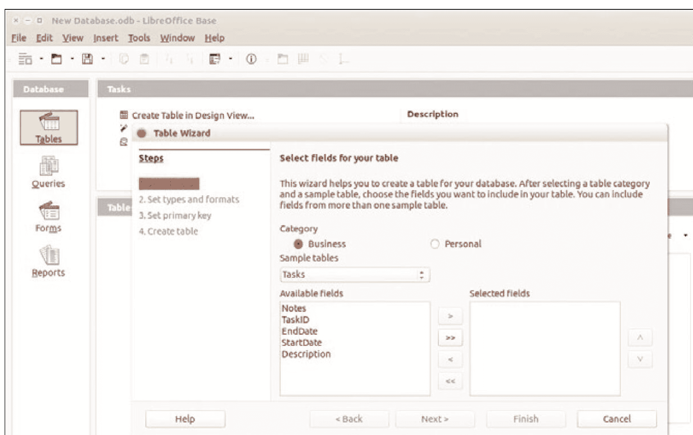

**图 5：** `Base` 是 LibreOffice 的数据库前端工具。

- `Math`——公式编辑工具

在接下来的几页中，我会介绍更多关于 LibreOffice 及其背后社区的背景知识，并教你如何安装它。如果你已经迫不及待想要开始，可以直接跳到安装部分——但别忘了之后回来了解更多关于这个套件的知识！

通过了解它的历史和背景，你可以帮助宣传 LibreOffice，并向其他潜在用户推广。有很多“认证开发者”[2]的客户都在使用 LibreOffice。

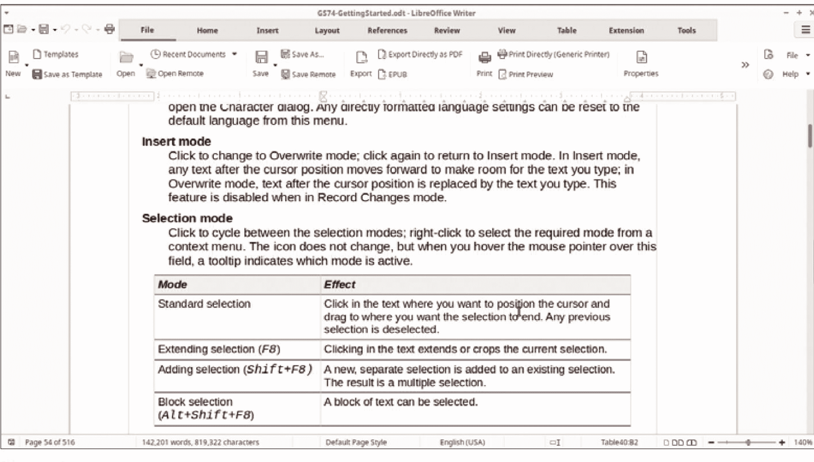

**图 1：** 这就是文字处理器 `Writer`……

### 快速上手

#### LibreOffice 简介

LibreOffice 诞生于 2010 年，但它的历史其实可以追溯到很多年前。事实上，要探究如今名为 LibreOffice 的软件的起源，还得回到 20 世纪 80 年代的一个名为 `StarWriter` 的程序（图 6）。

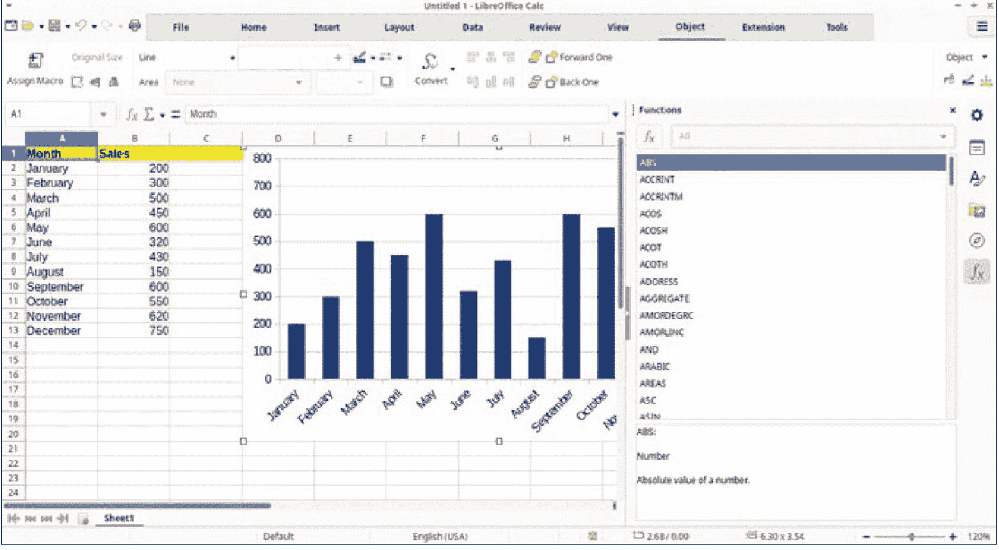

| 月份 | 销量 |
| --- | ---: |
| 1 月 | 200 |
| 2 月 | 300 |
| 3 月 | 500 |
| 4 月 | 450 |
| 5 月 | 600 |
| 6 月 | 320 |
| 7 月 | 430 |
| 8 月 | 150 |
| 9 月 | 600 |
| 10 月 | 550 |
| 11 月 | 620 |
| 12 月 | 750 |

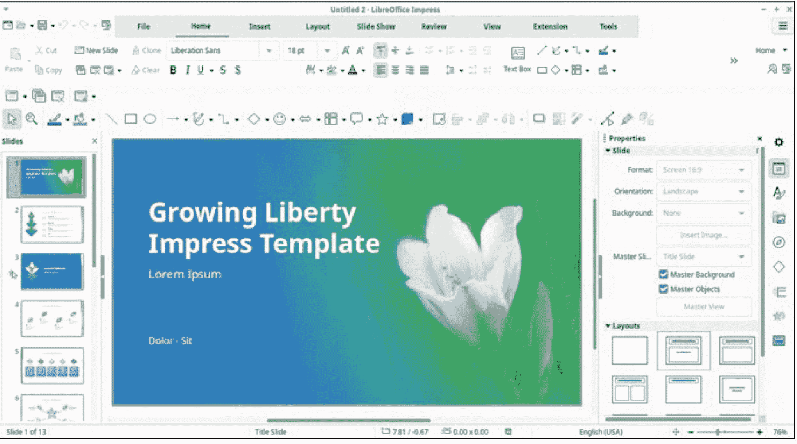

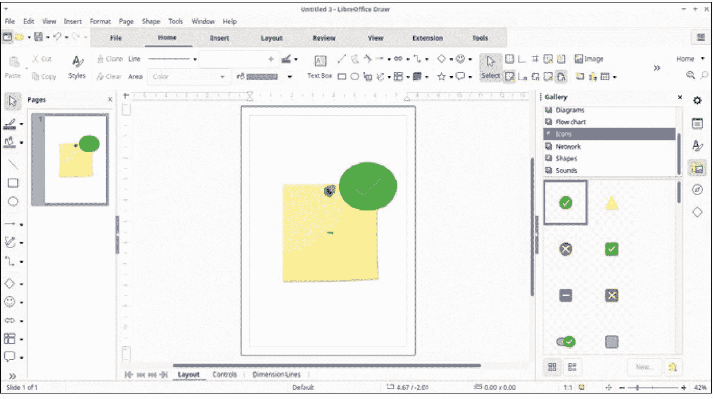

## 简史

LibreOffice 诞生于 2010 年，但它的历史其实可以追溯到很多年前。事实上，要探究如今名为 LibreOffice 的软件的起源，还得回到 20 世纪 80 年代的一个名为 `StarWriter` 的程序（图 6）。

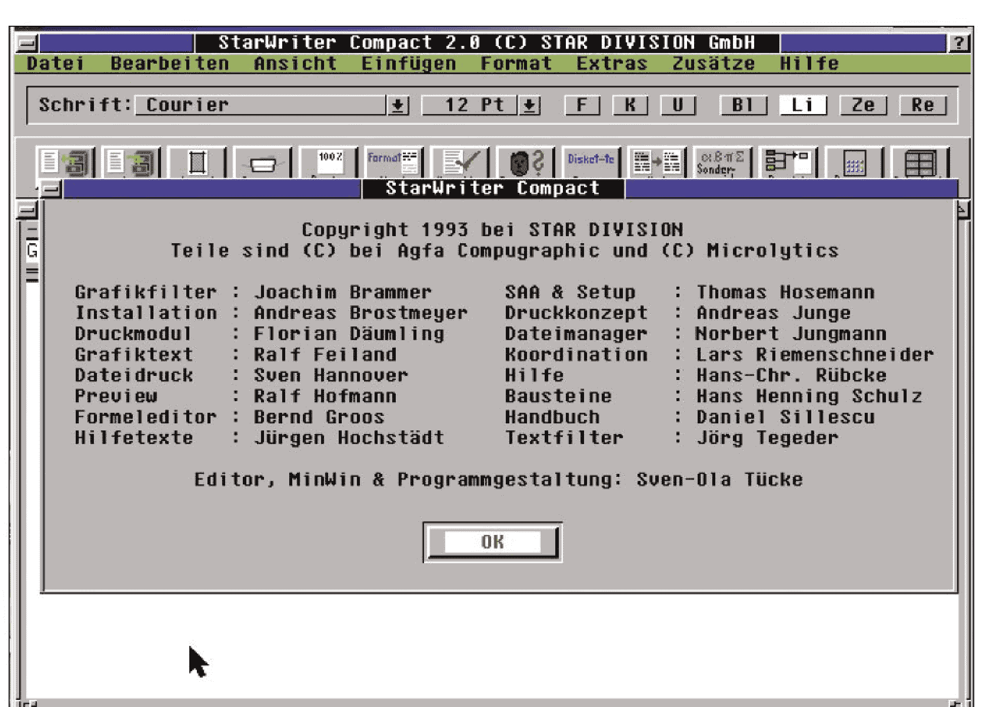

**图 6：** `StarWriter` 是现代 LibreOffice 的始祖（图片来源：Masterhit，CC BY-SA 3.0，[https://tinyurl.com/y7qbj47h](https://tinyurl.com/y7qbj47h)）。

此后发生了一件大事：高端服务器和工作站的主要厂商太阳微系统公司（Sun Microsystems）以高达 7350 万美元的价格收购了 Star Division 公司。背后的原因是什么？很多人猜测，对于当时拥有 2 万多名员工的太阳微系统来说，收购 Star Division 公司比为所有员工购买 MS Office 许可证更划算。还有人推测太阳微系统急于打入家庭/个人电脑市场。无论如何，这意味着 StarOffice 突然有了更大的公司背书——有更多的资源和开发者投入到其开发中。

2000 年，太阳微系统发布了 StarOffice 5.2，可免费供个人下载使用；这套软件还被收录在许多杂志的附赠光盘中。微软突然多了一个强有力的竞争对手，很多人发现 StarOffice 完全足够满足他们的日常办公需求。

随后又发生了一次重大变革。当时自由开源软件运动正在蓬勃发展，它倡导源代码（即人类可读的程序“配方”）可自由获取的软件的优势。对于开源程序来说，任何人都可以“深入内部”进行修改、优化，并将成果提交给开发者。开源是一项大规模的协作工程，全世界都可以从中学习并做出贡献，这与 MS Office 这类闭源程序形成鲜明对比——后者几乎没人能查看其内部代码并进行改进。

太阳微系统看到其他开源项目也在不断发展，比如 GNU/Linux 操作系统和 Mozilla 网页浏览器（后者以 Firefox 的形式存活至今，可能是最知名的开源应用）。作为回应，太阳微系统决定将 StarOffice 的代码公开，发起了一个名为 `OpenOffice.org` 的新项目，所有人都可以探索其代码。

是的，这意味着全世界从此有了一套完全免费的办公套件——不仅指零成本免费，也指人人都可以研究其工作原理、对其进行优化并分享成果。

经过几年的开发，`OpenOffice.org 1.0` 于 2002 年发布。这并不是一个完美的版本，存在不少粗糙的地方，性能也不算出众，但依然是一个重要的里程碑。尤其是 Linux 用户，很高兴能有一款功能全面、开源的办公套件作为其操作系统的默认预装软件。

一年后，团队发布了小幅更新的 `OpenOffice.org 1.0.1`，随后 2005 年推出的 `OpenOffice.org 2.0` 带来了大量性能改进。

## ODF 格式的诞生

2.0 版本也将开放文档格式（ODF）[4]作为默认格式（图 7）。

文档、电子表格和绘图在计算机中都是以计算机可读的数据块形式存储的。当时，微软文档以复杂的、混淆过的专有数据块形式存储，其他程序很难读取。ODF 应运而生作为替代方案：数据以开放的、标准化的、基于 XML 的结构进行组织，因此用 OpenOffice 保存的文件也可以被其他程序轻松打开和识别。

用户如果将文件保存为 ODF 格式，就能保证未来无论 OpenOffice.org 发生什么，都可以用其他工具读取这些文件。（多年后，微软推出了名为“OOXML”的伪标准，LibreOffice 也支持该格式，而 MS Office 的近期版本也支持 ODF。）

在接下来的几年里，太阳微系统和 OpenOffice.org 社区一直在开发软件的新版本，但人们一直担心单一大型公司对这个项目有太大的影响力。社区曾提出过一些想法，比如成立一个独立的基金会来监督 OpenOffice.org 的开发，但都没有落地。直到 2009 年，太阳微系统被数据库软件及其他企业工具的供应商甲骨文公司收购。OpenOffice.org 社区立即出现了担忧。

社区，尤其是为项目做出过大量贡献的志愿者们：接下来会发生什么？甲骨文会在意 OpenOffice.org 吗？甲骨文是自由及开源软件的朋友吗？当时引发了大量讨论，随后一群社区成员在 2010 年做出了一个重要决定：是时候由一个完全独立的非营利机构为这款办公套件谋求未来了。该机构被称为文档基金会（The Document Foundation，简称 TDF），这款软件则命名为 LibreOffice。LibreOffice 最初是 OpenOffice.org 项目的一个“分支”。（因为 OpenOffice.org 是开源的，任何人都可以获取其源代码并用于启动其他项目。）OpenOffice.org 的绝大多数社区成员立刻加入了 LibreOffice 项目。因此 LibreOffice 就是 OpenOffice.org 的未来——它基于相同的源代码构建，但背后有了新的基金会、新的品牌，以及对未来的新希望。之后的几年里 OpenOffice.org 仍作为规模小得多的项目存续，但与快速发展的 LibreOffice 相比，更新非常少。自 2010 年以来，LibreOffice 不断发展壮大：如今这款套件已在全球范围内大规模部署，例如法国政府就部署了 50 万份。TDF 估计 LibreOffice 的用户数已超过 1 亿，每年有数百名社区成员会参加会议，共同开发新功能、探讨软件的未来发展方向。

已有公司开始为这款软件提供支持与额外功能。


**图 7：** OpenDocument 是 LibreOffice 的原生格式，这是一种完全开放、标准化的格式，非常适合长期存储你的工作成果。

## 13 年


LibreOffice 于 2010 年 9 月发布。来看看我们的社区和认证开发者在 13 年里取得了哪些成果……

## 30 个主要版本

新主要版本的发布极为准时，每 6 个月一次。每个版本都包含新功能、错误修复和兼容性改进。


## 超过 2 亿用户

LibreOffice 在全球有超过 2 亿用户。此外，得益于我们的本地化社区，这款软件支持超过 110 种语言。

## 十二届大会

年度大会曾先后在巴黎、柏林、米兰、伯尔尼、奥胡斯、布尔诺、罗马、地拉那、阿尔梅里亚举办，也曾以线上形式开展。未来还有更多大会等你参与！


## 大规模部署

LibreOffice 已被全球各地的企业和政府投入使用。更多详情可访问 [tdf.io/migrations](https://tdf.io/migrations) 查看。我们也提供专业支持服务。

## 商业生态

企业会推出基于 LibreOffice 的产品，开发新功能，并向项目和社区回馈代码。


让我们共同把接下来的 13 年也变得同样精彩！[tdf.io/joinus](https://tdf.io/joinus)

### 快速上手

### 认识 LibreOffice 办公套件。现在你手上就拿着一本关于它的杂志！

## 那就安装吧！

你可以在随本杂志附赠的 DVD 中找到 LibreOffice 完整版，也可以随时从 LibreOffice 官网[5]下载。这款软件支持三大桌面操作系统——Windows、macOS 和 Linux，不过主题和颜色可能会因你的系统有所不同。第一步先确认系统要求：

- **Windows：** 已安装 KB3063858 更新的 Windows 7 SP1、Windows 8、2012 至 2022 版 Windows Server、Windows 10 或 11。
- **Apple macOS**（也称为 macOS X）：macOS 10.14（Mojave）或更高版本。
- **Linux：** Linux 内核 3.10 或更高版本。

要流畅使用，你至少需要 2GB 的可用硬盘空间和 1GB 的 RAM——因此近几年生产的任何电脑都完全能够胜任。部分功能（例如 `Base`）需要安装 Java [6]，但如果你愿意，也可以在不安装 Java 的情况下使用这款套件。

### 在 Windows 上安装

1. 获取适用于你系统的 `.msi` 安装文件（64 位系统请选择文件名以 `Win_x64.msi` 结尾的文件，32 位系统请选择以 `Win_x86.msi` 结尾的文件）。将文件保存到桌面，双击即可开始安装流程。
2. 安装向导会弹出，你只需要一直点击“下一步”按钮即可接受默认选项，这些默认选项完全能满足日常使用需求。（如果过程中弹出“用户账户控制”对话框，点击“是”即可继续安装。）
3. 安装完成后，点击“完成”，此时你就可以删除桌面上的 `.msi` 文件了。新安装好的 LibreOffice 会出现在你的程序菜单里！

如果你需要帮助，可以查看官网[7]上的安装指南，如果遇到问题无法解决，可以尝试向 LibreOffice 支持社区[8]求助。发帖时请记得附上详细信息（LibreOffice 版本、操作系统版本，以及你看到的任何错误提示）。

### macOS

macOS 版的 LibreOffice 以 `.dmg` 格式提供，这是一种虚拟磁盘文件。将 `.dmg` 文件保存到桌面后双击打开即可，点击并拖动 LibreOffice 图标到你的“应用程序”文件夹中即可完成安装。（你可能需要输入管理员密码。）之后你可以直接从“应用程序”文件夹启动这款新软件（也可以将图标拖到程序坞上以便快速访问）。你还可以弹出并删除 `.dmg` 文件。

### Linux

本期杂志附赠的 DVD 中包含最新版本的 LibreOffice 的 `.deb` 和 RPM 包格式安装文件，不过我一般建议你直接通过 Linux 发行版的包管理器安装。这种方式能与你的发行版更好地集成，也支持未来自动更新。如果你想通过最新的 `.deb` 或 RPM 文件安装，可以参考维基[9]上的详细步骤。

#### 结语

LibreOffice 是一款功能完善的办公生产力套件，全球 Windows、macOS 和 Linux 用户可以免费使用。如果你已经准备好开始制作电子表格、演示文稿和文本文档，不想把钱浪费在价格昂贵的工具和复杂的授权方案上，就继续读下去，探索 LibreOffice 的强大功能与灵活用途吧！■■■

## 重要提示：切换到标签页界面！

LibreOffice 默认的用户界面基于菜单和工具栏，但本指南其余部分我们将使用标签页用户界面，所以现在就来切换吧！首次启动 LibreOffice 后，新建一个 `Writer` 文档，在菜单中找到“视图 > 用户界面”选项，选择“标签页”选项即可。然后点击底部的“全部应用”，瞬间完成——LibreOffice 现在就会全程使用标签页界面了（图 8）。（如果要用传统菜单界面操作 LibreOffice，可以参考往期《Linux Magazine》杂志的教程。）

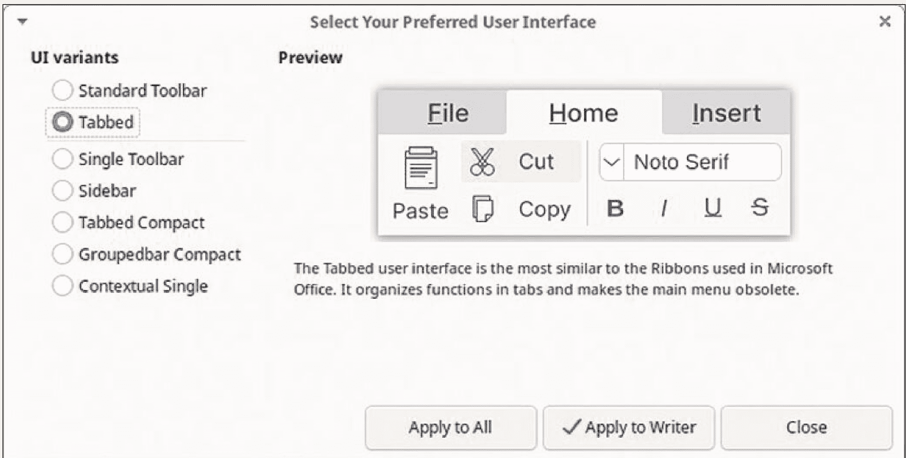


图8：安装完成后切换到标签页用户界面，即可跟随本杂志后续的教程学习。

## 通过特刊精进你的技能！

从我们的特刊库中了解 Shell、LibreOffice、Linux 等更多内容。


《Linux Magazine》团队打造了一系列单期特刊，帮助你深入探究你感兴趣的主题。提供纸质版和电子版 > 查看完整特刊库！`shop.linuxnewmedia.com`


# 基于样式的文字处理系统

## 样式专家


照片由 Marcos Amaral 拍摄，来源 Unsplash

`Writer` 是 LibreOffice 的文字处理组件，它远不止是一个文本编辑器。凭借强大的样式系统，你可以创建细节丰富、优雅美观的商务或个人文档。

作者：迈克·桑德斯

**上世纪80年代**，文字处理器本质上是带有一些额外功能的文本编辑器，换句话说，就是处理文字的工具。然而如今，大家都对这类程序有了更高的期待：丰富的排版功能、与其他办公软件的高兼容性，以及对复杂文档进行结构梳理和导航的能力。

LibreOffice 的文字处理组件 `Writer` 是一款功能极为强大的工具，其样式系统能切实帮你保持文档的一致性——关于这点我们后面再细说。首先，让我们来了解一些基础操作！

启动 LibreOffice 并选择新建 `Writer` 文档时（如果你已经打开了软件，可以在菜单中选择「文件 | 新建 | 文本文档」），会弹出如图1所示的窗口，具备以下特性：

- **1. 标签栏：** 点击标签即可切换不同的功能分组。右侧的三横线“汉堡”菜单则提供了一些额外选项。
- **2. 工具栏：** 可快速访问当前标签下的常用功能。如果还有更多功能无法在屏幕上显示，点击右侧的箭头即可查看更多。
- **3. 样式：** 会显示预设样式列表，你也可以自行添加更多样式。建议使用样式功能，而非手动逐段设置字体、字号、字符样式等格式，这样效率更高。
- **4. 侧边栏：** LibreOffice 的用户界面非常灵活，侧边栏可用于调整文档各部分的设置。点击并拖动箭头即可展开侧边栏。
- **5. 状态栏：** 会显示页数、字数、当前使用的语言（点击可切换其他语言），以及文档是否已被修改。
- **6. 视图模式：** 这些图标可切换文档的显示方式（例如单页显示、双页并排显示等）。
- **7. 缩放等级：** 拖动滑块（或使用加减按钮）即可放大或缩小文档。

图1：标签视图模式下的 LibreOffice Writer（如果你的界面和图中不一致，请查看第12页的对应选项）

## 自定义界面

这里不会逐一介绍每个工具栏按钮的功能，你只需将鼠标悬停在按钮上，查看弹出的工具提示即可了解其作用。

不过有几点需要留意：撤销和重做按钮旁边带有下拉列表，你可以选择单次点击撤销/重做的操作步数，这通常能节省大量时间。类似地，项目列表（包括无序列表和有序列表）也提供了多种样式可供选择。

如图1所示，标签视图的布局为：顶部是标签栏，每个标签下方是功能按钮，侧边栏在界面一侧，底部是状态栏。不过 LibreOffice 的开发者认为不应强制最终用户使用某种特定界面，因此这款软件提供了非常高的自定义灵活性。例如，在菜单中选择「视图 | 工具栏」，你就可以看到许多额外的工具栏，可按需启用或禁用。此外，你还可以通过「工具 | 选项」（Windows 和 Linux 系统）或「LibreOffice | 偏好设置」（macOS 系统）进行更多自定义设置。在左侧打开「LibreOffice Writer」板块，即可查看其下的各类配置选项。

如前所述，你可以点击并拖动侧边栏旁的箭头手柄来调整其宽度。展开侧边栏后，将鼠标悬停在其右侧的图标上，即可查看对应的工具提示。侧边栏中的属性面板是上下文相关的，换句话说，它会根据你当前在文档中的操作（编辑文本、处理图片、编辑表格等）自动切换内容。因此，如果你需要对文档中的某个元素执行特定操作或修改，但不知道具体入口，只需点击该元素，再打开属性面板即可找到对应选项。

如果你需要其他界面布局选项，可以进入「视图 | 用户界面」，这里有三种可选布局（见图2）：「标准工具栏」（默认模式）、「单工具栏」（适合屏幕垂直空间有限的用户）、「侧边栏」（如果你使用超宽显示器，想充分利用水平空间，选这个很合适）。你可以逐一试用这些布局，找到最适合你屏幕尺寸和工作流程的选项。

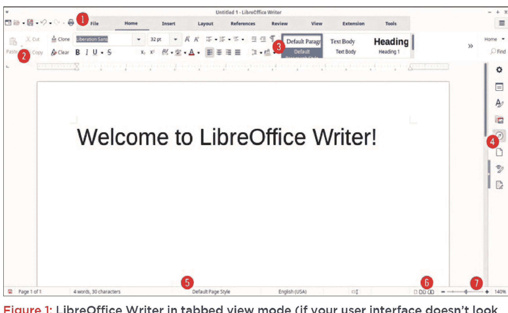

图2：Writer 提供了多种用户界面布局，你可以都试用一下，找到最适合自己的那款。

# 十大实用功能

以下是 `Writer` 中最实用的10个功能：

- **1. 页眉和页脚：** 页眉和页脚是每页顶部和底部的区域，通常在所有页面中保持一致，你也可以添加动态变化的内容。页眉页脚最常用的场景是添加标题。如果要向页眉或页脚添加文本，首先需要为其预留空间：只需点击页面主体部分上方或下方的区域，就会看到一个蓝色框，点击该框，蓝色框会变为菜单（见图3）。在这里你可以直接向页眉或页脚添加文本，这些内容会在所有页面中保持一致，你还可以添加页码、总页数（通常书籍的页脚会包含这类信息）。

  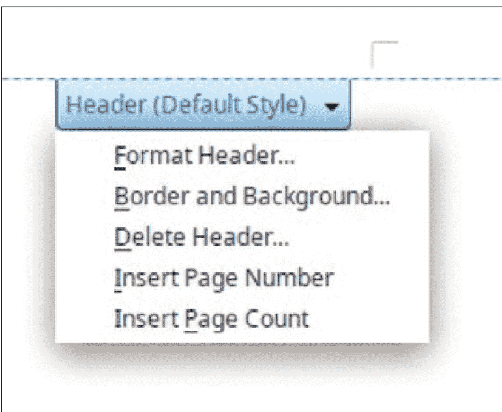

  > 图3：向页眉页脚添加静态文本和页码非常简单。

- **2. 图片和文本框：** 如果你想用 `Writer` 实现桌面排版效果，就需要在页面上添加浮动元素，比如图片和文本框。你可以在「插入」菜单中找到这两个功能。插入图片时，系统会提示你从电脑中选择图片，选中的图片会显示在页面上，你可以点击并拖动图片来调整位置，也可以拖动边缘和角落的蓝色手柄来调整图片大小。如果你要设置图片与周围文本的排版交互方式，右键点击图片，选择「环绕」菜单即可。最优页面环绕是图片的最佳环绕方式，能让文本自然地分布在图片周围。此外，在这个右键菜单中，你还可以点击「属性」查看更多设置选项，包括图片边框、精确位置等。文本框的操作逻辑类似：点击「插入 | 文本框」，然后在页面上点击并拖动即可确定文本框的位置。之后你可以拖动文本框的手柄来调整位置，点击文本框内部即可输入文本。

- **3. 修订跟踪：** 如果你需要和他人协作编辑文档，这个功能必不可少。首先进入「工具 | 选项」（macOS 系统为「LibreOffice | 偏好设置」），在「LibreOffice | 用户数据」板块输入你的姓名——这一步不是强制的，但输入后你的姓名会显示在所有的修改和评论旁，方便其他协作者清楚地看到每处修改是由谁完成的。点击「确定」后，在「编辑」菜单中找到「修订跟踪」子菜单，确保「记录」和「显示」两个选项都已启用。此时你输入的内容都会被标记上颜色和下划线，将鼠标悬停在某处修改上，就会弹出工具提示，显示修改者和修改时间。如果别人给你发来文档，你需要给出具体反馈、明确标注自己做的修改，现在你知道怎么操作了吧！

- **4. 评论：** 这个功能和上个功能相关，也是协作文档中的重要功能。将光标放在你要添加评论的段落或行内，点击「审阅 | 评论」，文档右侧会出现一个评论框，你可以在其中输入评论内容，你的姓名（以及评论时间）也会显示在框内。此外，点击评论框中的下拉图标，还能看到更多选项，比如删除评论等。

  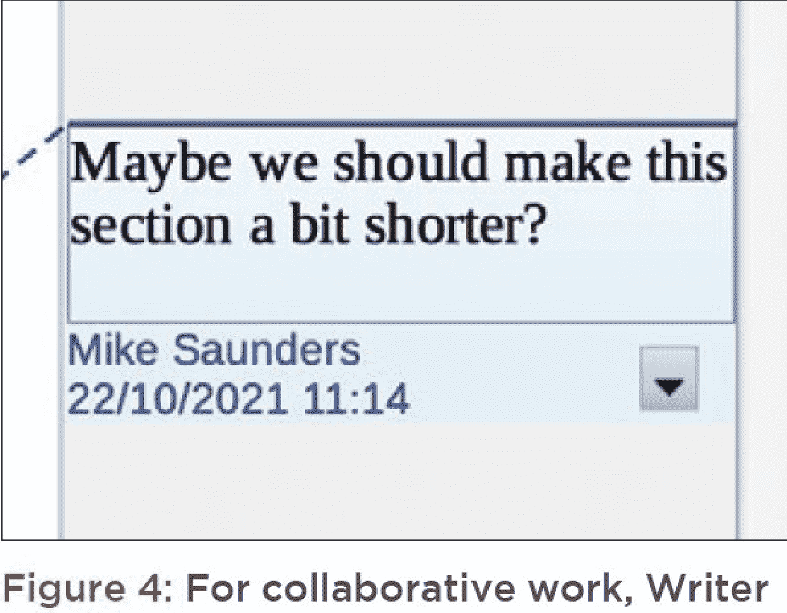

  > 图4：针对协作场景，Writer 支持添加评论，方便你给其他文档协作者反馈。

- **5. 拼写检查：** 根据你的操作系统设置，这个功能可能默认已启用，若未启用，可以点击「审阅 | 自动拼写检查」开启。和所有现代文字处理器一样，拼写错误的文本会被标上红色下划线。如果你在编辑一些不在标准词典里的词汇，又不想一直看到红色错误提示，右键点击该词汇，选择添加到词典（或选择忽略）即可。如果你从 LibreOffice 官网安装了多个词典，想要切换拼写检查使用的词典，可以点击底部状态栏中的语言选项进行修改。（你也可以通过「审阅 | 其他审阅菜单 | 语言」对单个段落单独设置语言。）如果需要更多语言相关设置，可以进入「工具 | 选项 | 语言设置 | 语言」，在这里你可以为所有文档设置默认语言。

- **6. 页面布局：** 工具栏中你已经见过基础的格式选项（字体、字号、粗体/斜体/下划线、颜色等），如果需要调整更全面的页面设置，可以进入菜单中的「格式 | 页面」。在这里你可以切换纵向/横向页面模式，选择不同的页面尺寸，调整页边距和页面边框，甚至可以在「区域」标签页中设置背景渐变或背景图片。

- **7. 导航器：** 当你的文档内容越来越复杂，包含多种元素、样式、标题时，可能会难以快速定位。幸运的是，你可以使用贴切地命名为「导航器」的工具来解决这个问题：点击「视图 | 导航器」即可启用，也可以在侧边栏中找到它（见图5）。点击不同元素旁的箭头，即可展开对应的内容列表。

- **8. 特殊字符：** 如果你需要插入键盘上没有的字符或符号，可以进入「插入 | 符号 | 更多字符」（工具栏上也有对应的快捷图标）。你可以在窗口右上角的下拉列表中选择特定字符集，或搜索指定字符，窗口底部会显示你最近使用过的特殊字符，方便快速调用。

- **9. 自动更正：** LibreOffice `Writer` 会自动帮你格式化特定内容（比如日期），或修正你拼写错误的单词，省去不少操作。如果你不需要这个功能，可以点击左上角的菜单栏图标临时显示菜单，然后进入「工具 | 自动更正 | 自动更正选项」。在弹出的对话框中查看「替换」标签页，就能看到 LibreOffice 自动替换的内容列表。如果你不需要任何自动替换规则，可以切换到「选项」标签页，取消勾选「使用替换表」。这个「选项」标签页还可以禁用其他许多功能，比如 URL 识别、连续两个首字母大写自动修正等。

- **10. 格式标记：** 有时候了解 LibreOffice 对文本的具体处理方式会很有用，比如你想知道具体哪些位置有空格，或者你的文本是按 Enter 键产生的新段落，还是按 Shift+Enter 产生的普通换行。要查看这些“幕后”的格式数据，可以进入「视图 | 格式标记」。

  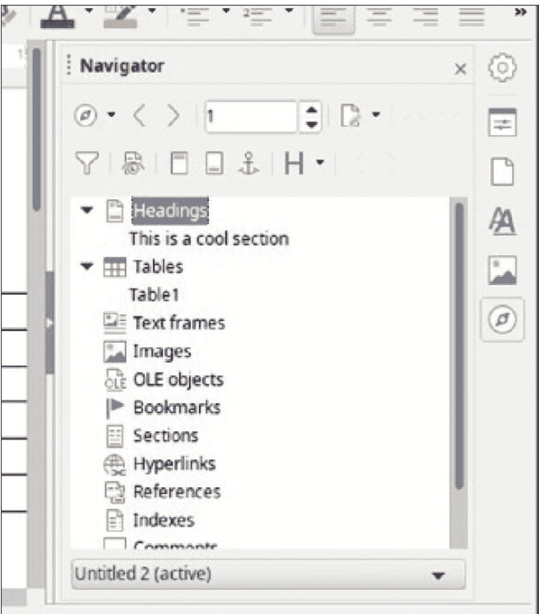

  > 图5：当你编辑包含大量章节、书签和其他元素的长文档时，导航器是非常实用的工具。

## 快速入门 LibreOffice Writer

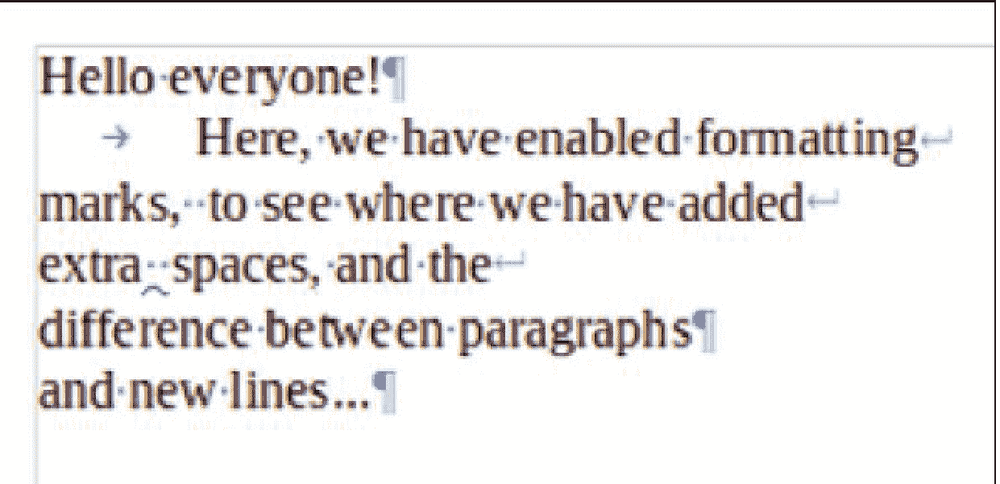

**图6：** 格式标记选项可以清晰显示文档中空格、制表符、换行符和换段符的所在位置。启用该选项后，你会发现通常不会打印的“空白内容”会以蓝色显示（见图6）。要禁用此功能，只需在菜单中再次点击该选项即可。

### 样式入门

如前所述，样式是 `Writer` 的核心功能。处理长文档时，样式对于保持多份文档的一致性而言至关重要，而且还能让你通过几次点击就完成全文档的格式修改，十分便捷。

许多文字处理软件用户会手动设置段落、文字、表格、页面布局等文档部分的格式，完全忽略了样式的存在。他们已经习惯了基于单个物理属性来编辑文档：比如逐段甚至逐字指定字体、字号，以及加粗、斜体等格式。

手动格式并不是理想的选择。样式是格式的集合，你可以将其应用到选中的页面、文字、文本框及其他文档元素上，快速改变它们的外观。应用样式时，往往相当于一次性应用一组格式，因此样式属于逻辑属性，而非手动格式中使用的物理属性。

使用样式时，你不需要明确指定“这段文字要用12号无衬线字体、加粗、右对齐”，而是直接使用“标题1”样式——因为你已经将“标题1”样式定义为了具备这些属性。换句话说，使用样式意味着你把重点从“文字（或页面、其他元素）长什么样”转移到了“文字是什么内容”上。

归根结底，样式有助于提升文档的一致性，同时还能让大规模格式修改变得简单很多。比如你要调整所有段落的缩进，或者更换所有标题的字体，如果手动操作长文档，可能需要逐处修改几十个位置，非常耗时！而使用样式的话，你只需要做一次修改即可。

### 样式实战

在 `Writer` 中，样式分为多种类型：

- **页面样式**：包含页边距、页眉页脚、边框和背景设置。
- **段落样式**：控制段落外观的所有方面，比如文本对齐、制表位、行间距、边框，还可以包含字符格式。
- **字符样式**：作用于段落内选中的文字，比如设置文字的字体、字号，或者加粗、斜体格式。
- **列表样式**：用于选择、设置列表中的编号或项目符号的格式及位置。

想要尝试使用这些样式，只需在文档中输入一些文字，然后查看窗口左上角的“默认样式”下拉列表。点击该列表就能看到 `Writer` 内置的其他样式，比如标题样式等（见图7）。

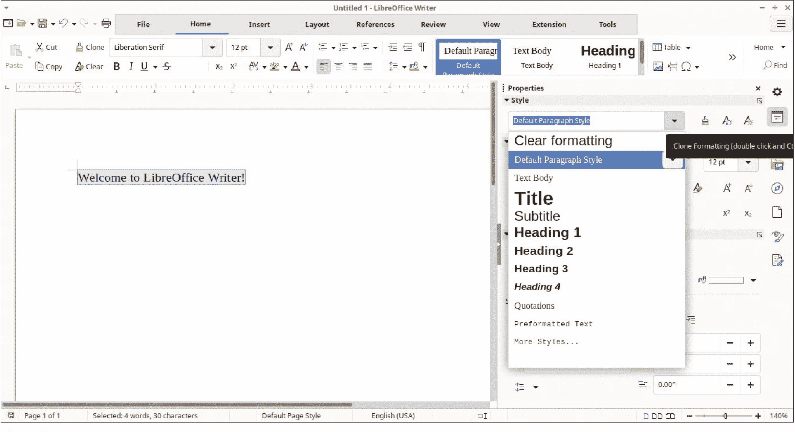

**图7：** `Writer` 内置的部分默认样式。现在你可以使用这些样式快速修改段落格式，包括字号、字体、是否加粗等。只要你文档中使用了标题，就能在之前提到的导航面板中找到它，处理长文档时用这个功能快速跳转非常方便。

但如果你想更灵活地控制样式，比如修改现有样式或者创建自定义样式要怎么办？这时候就用得上便捷的侧边栏了！按照之前提到的方法打开侧边栏，或者通过「视图 | 侧边栏」菜单打开，然后点击右侧的样式图标，就能看到如图8所示的界面。

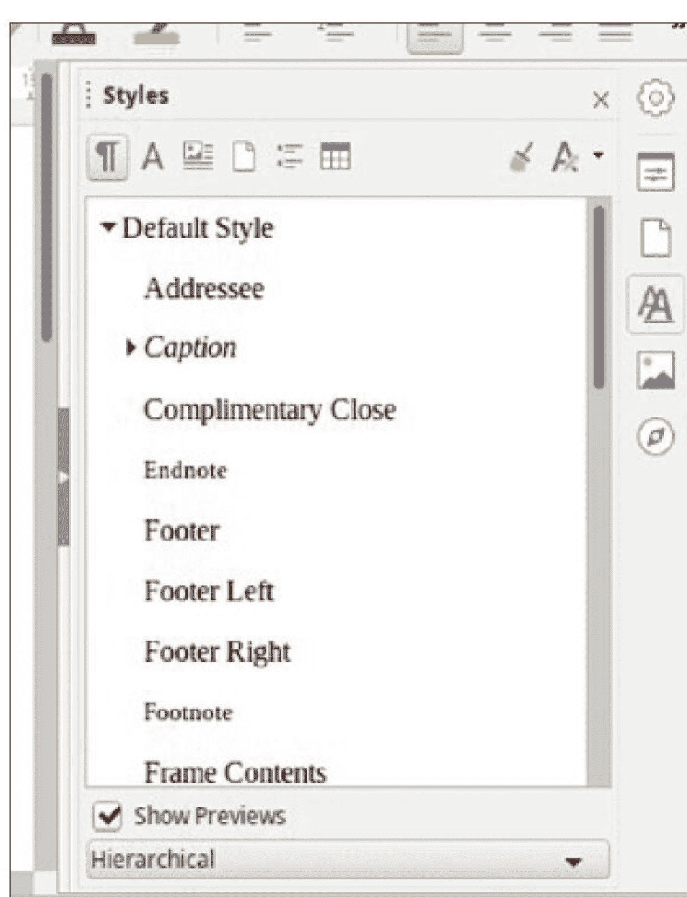

创建新样式时，首先点击侧边栏顶部的图标，选择要创建的样式类型，比如段落样式或字符样式，然后点击右侧的箭头，在弹出的菜单中选择「新建」。如果你希望新样式和现有样式关联，先从样式列表中选中目标样式，右键点击该样式，选择「新建」，给新样式命名后，它就会被添加到列表中——之后右键点击该样式，选择「修改」，就能看到海量可调整的选项。别被这么多选项吓到，你并不需要修改大部分设置！可以花点时间探索一下：你可以设置首字下沉、边框、字体效果、高亮、缩进等众多选项。

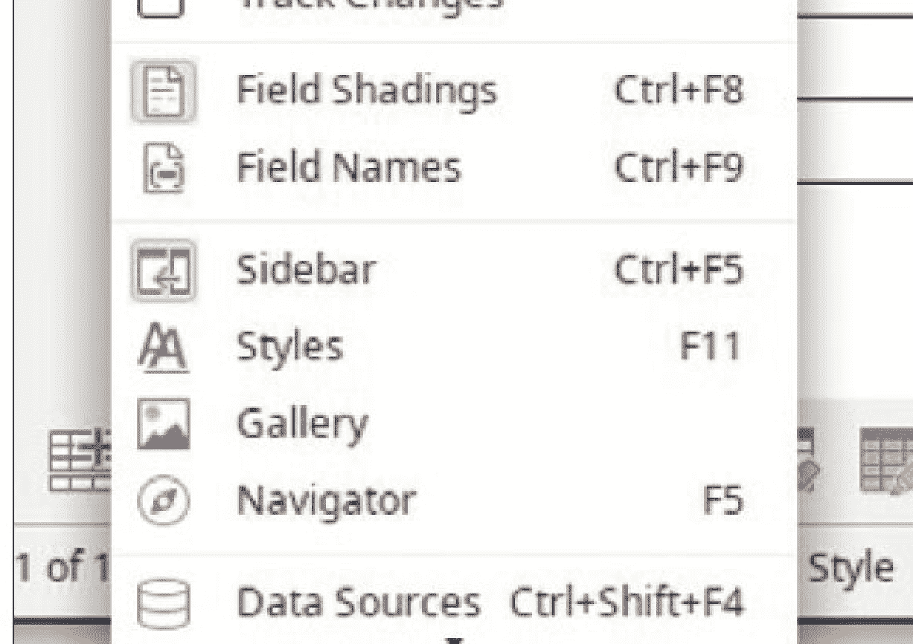

**注意：** 如果关联了样式，之后你修改基础样式（比如把字体从衬线体改成无衬线体），所有关联的样式也会同步修改。有时候这正是你需要的，但有时候你并不希望修改应用到所有关联样式上。新建样式和修改现有样式的对话框与选项是一致的。

### 加载、保存与导出

LibreOffice 的原生文件格式是开放文档格式，`Writer` 文档的默认扩展名为 `.odt`，即开放文档文本。这是一种完全开放、标准化的格式，被许多其他程序支持，因此绝对是存储文档的最佳选择。

当然，你可能会遇到或收到其他格式的文档，比如微软 Word 的 `.doc` 和 `.docx` 格式。LibreOffice 通常都能很好地打开这类文件，但这类文件往往包含混淆或文档不完整的数据块，因此 LibreOffice 需要费一番功夫才能正常处理。

如果有微软 Word 用户给你发了 `.doc` 或 `.docx` 文件，在你的 LibreOffice 中打开后显示不正常，可以让他们尝试用开放文档文本格式重新保存（新版微软 Office 也支持该格式）。

保存文档时，LibreOffice 可以导出为多种不同格式，包括前面提到的 `.doc` 和 `.docx`。你只需点击「文件 | 另存为」，然后打开格式下拉列表即可选择。你也可以将文档保存为 HTML 或纯文本格式，但显然这类格式会丢失大部分格式。

同理，通过「文件 | 导出」，你可以将文档导出为适合电子书阅读器的 EPUB 格式，或者 PDF 格式——如果你要发送的文件只需要查看或打印、不需要编辑，PDF 是最佳选择。（导出为 PDF 时，你可以选择混合 PDF 版本，该版本会嵌入一份原始 `.odt` 文件的副本，后续需要编辑时可直接使用。）

一个小提示：如果你经常处理微软 Office 文档，希望默认以该格式保存，可以在菜单中点击「工具 | 选项」，然后在左侧选择「加载/保存」下的「常规」，在右侧就可以通过「始终另存为」选项设置默认保存格式。

### 键盘快捷键

我完全可以在这份指南里放一张包含 `Writer` 所有快捷键的大表格，但这些内容在网上已经能查到[1]。每个人的工作流程和工作内容都不一样，最好的方法是学习对你最有用的那些快捷键！

打开任意菜单（或右键上下文菜单）查看菜单项：如果你开启了快捷键显示，就能在菜单项右侧看到对应的快捷键（见图9）。（如果你的操作系统默认不显示这些内容，可以点击「工具 | 选项」，macOS 系统下点击「LibreOffice | 偏好设置」，然后在左侧选择「视图」，开启「菜单中的图标」和「上下文菜单中的快捷键」选项即可。）

### 总结

LibreOffice `Writer` 为你提供了文档格式工具，借助强大的样式系统还可以完成全局修改。它不仅能帮你保持单篇文档乃至多份文档的一致性，还能避免你浪费时间去手动设置单个段落（甚至单个文字）的格式。想要进一步提升效率，可以查看「键盘快捷键」部分。祝你排版顺利！

## 信息

> [1] 快捷键说明：https://help.libreoffice.org/latest/en-US/text/swriter/04/01020000.html

## 想在开源领域找到你的位置吗？


立即设置职位提醒，开启你的求职之旅吧！

### 开源工作中心


`opensourcejobhub.com/jobs`

## 快速入门

### LibreOffice Calc 电子表格

### 兼具风格与实力的电子表格

### 表单功能

### 附加功能

### 函数功能


**LibreOffice Calc 具备 Excel 的功能，还拥有更多附加优势。**

作者：布鲁斯·拜菲尔德


Calc是LibreOffice的电子表格模块。作为微软Excel的对应产品，Calc在设计上与Excel高度兼容。每个Calc工作表（图1）最多可处理16384列、1048576行，足以满足绝大多数使用需求。

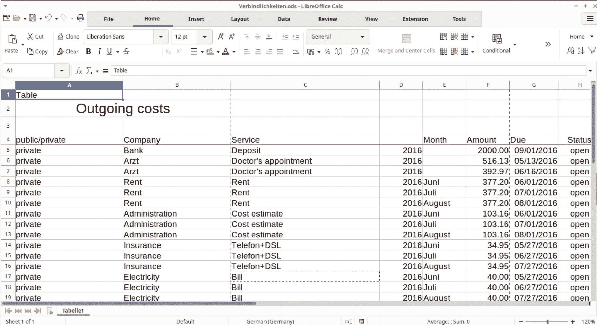

图1：Calc是一款电子表格应用（如果你的界面没有这样的选项卡，请参阅第12页的提示框）。

如果你需要处理更多数据，或是发现电子表格在内存不足的设备上容易崩溃，可以考虑在LibreOffice Base中创建数据库。如果你是完完全全的新手，可以这样理解：Calc这类电子表格本质上是文本文档中表格的高级版本。事实上，在LibreOffice Writer中，表格也可以设置使用部分简单的电子表格功能。

电子表格（Spreadsheet）是这类文件的统称，工作表（worksheet）则是文件内的单页。每个工作表中，列用大写字母标注，行用阿拉伯数字标注。因此左上角的第一个单元格是A1，这个标识在数据处理时可用来调用其中存储的信息。

电子表格的强大之处在于其丰富的数据展示与处理功能。这些功能包括列表筛选、全类型数据处理函数，以及各类额外工具。如果你用过Excel，大概率可以很快上手Calc。这两款电子表格应用中的函数及名称大多一致，仅少数函数的位置有所不同。两者最大的区别可能是：Calc和LibreOffice Writer一样支持样式功能——单元格样式用于设置电子表格的格式，页面样式用于生成电子表格的纸质打印版本。这两种样式一旦设置完成，就能帮你节省时间，让你专注于数据录入而非格式调整。

## 规划电子表格

电子表格很容易越做越大，这大概也是它们最常被用于在线协作的原因。但如果你提前花时间设计好电子表格模板，后续查找数据就会方便很多。

首先可以设计一个通用的默认电子表格模板，设置好个人或企业专属的颜色和字体。以此模板为基础衍生出更多细分模板，对应你使用的每一种电子表格类型。

通常，一个需要重点考虑的参数是每个电子表格的默认工作表数量（可通过`工具 | 选项 | LibreOffice Calc | 默认值`路径设置）。例如，你可以为不同类别的员工设置不同颜色标记的工作表。你也可以单独设置一个工作表用于存放数据透视表（即已有数据的新视图）。大多数电子表格可归为两类：一是基于文本的列表和数值数据集合，二是数据数组。

列表是电子表格最简单的用法，包括待办清单、通讯录、日历、项目进度表等。而数据数组则包含原始信息表格，以及用于分析数据的函数（如求和、平均值计算等）。数据数组的常见例子包括个人/企业财务表单、成绩单等。有时数据数组也会被用作带练习题的教程。

列表和数据数组通常都按列排序。把同类信息放在同一个工作表中，同时预留标签空间——标签是用来描述列/行所存储信息的标题。单元格格式（如边框、底色）可以帮你一眼区分不同类型的信息。例如，在教师的成绩单中，你可以用不同深浅的绿色标记显示中位数和平均分的单元格。色彩标注越多，用户越容易快速定位信息——但过多的颜色分类反而会使表格过于复杂，失去便捷性。你可以先草拟大致的布局，但一定要预留未来扩展的空间。

### 设计列表

电子表格列表和文本文档中的表格用途基本一致。它的核心作用是让信息比段落排布更容易查找。字体、颜色、位置等格式设置可以帮助归类信息、区分不同类型的内容。例如，在项目进度表中，可以为每个项目成员分配不同的颜色标记。成员记住自己的对应颜色后，就可以只关注个人任务，忽略其他人的内容。项目进度表也可以设置签收列，或者为已完成的任务添加对应颜色标记。

由于列表通常存储的都是简单信息，所以很少使用电子表格函数，不过也可以添加一些简单函数，比如统计工作时长总和用于预算核算。

图2展示的是我在2022年出版的《设计基于LibreOffice的文档（第二版）》一书中用作示例的出行规划表[1]。


图2：以列表为核心的电子表格。

| 公私类型 | 公司/机构 | 服务/事项 | 月份 | 金额 | 到期日 | 状态 |
|---|---|---|---|---|---|---|
| 私人 | Bank | 存款 | 2016年 | 2000.00 | 2016年9月1日 | 未完成 |
| 私人 | Arzt | 医生预约 | 2016年 | 516.13 | 2016年5月13日 | 未完成 |
| 私人 | Arzt | 医生预约 | 2016年 | 392.97 | 2016年6月16日 | 未完成 |
| 私人 | Rent | 房租 | 2016年6月 | 377.20 | 2016年6月1日 | 未完成 |
| 私人 | Rent | 房租 | 2016年7月 | 377.20 | 2016年7月1日 | 未完成 |
| 私人 | Rent | 房租 | 2016年8月 | 377.20 | 2016年8月1日 | 未完成 |
| 私人 | Administration | 费用估算 | 2016年6月 | 103.16 | 2016年6月1日 | 未完成 |
| 私人 | Administration | 费用估算 | 2016年7月 | 103.16 | 2016年7月1日 | 未完成 |
| 私人 | Administration | 费用估算 | 2016年8月 | 103.16 | 2016年8月1日 | 未完成 |
| 私人 | Insurance | 电话+DSL网络费 | 2016年6月 | 34.95 | 2016年5月27日 | 未完成 |
| 私人 | Insurance | 电话+DSL网络费 | 2016年7月 | 34.95 | 2016年6月27日 | 未完成 |
| 私人 | Insurance | 电话+DSL网络费 | 2016年8月 | 34.95 | 2016年7月27日 | 未完成 |
| 私人 | Electricity | 电费账单 | 2016年6月 | 40.00 | 2016年5月27日 | 未完成 |
| 私人 | Electricity | 电费账单 | 2016年7月 | 40.00 | 2016年6月27日 | 未完成 |
| 私人 | Electricity | 电费账单 | 2016年8月 | 40.00 | 2016年7月27日 | 未完成 |

注意不同类型的信息是如何通过边框归类的，每组信息都有专属表头。空白单元格被用来进一步区分不同信息。左侧的概览下方，不同任务按执行顺序排列，表格其余部分是每日行程安排。这张表格的用途是可以打印出来，之后有什么新增内容也可以手写补充。

### 设计数据数组

数据数组是Calc真正发挥优势的场景。数据数组可以像列表一样设置格式来整理信息。不过，和多数列表不同，数据数组会包含大量用于处理原始数据的函数（也常被称为公式）。Calc内置超过450个函数，其中多数函数名称与MS Excel一致，方便用户轻松切换到Calc。

### 使用Calc工具

少数Calc函数的输入变量在Excel中不存在，若包含这类函数的电子表格在Excel中打开，这些函数将无法使用。带有特定数据集的具体函数实例被称为公式。每个函数都有对应的输入变量，多数变量为必填项，也有部分是可选的。所有变量都可以通过公式工具栏手动输入，该工具栏还列出了一部分最常用的函数。不过大多数人更习惯先选中一个单元格存放结果，再通过`插入 | 函数`选项添加函数，点击该选项会打开函数向导（图3）。

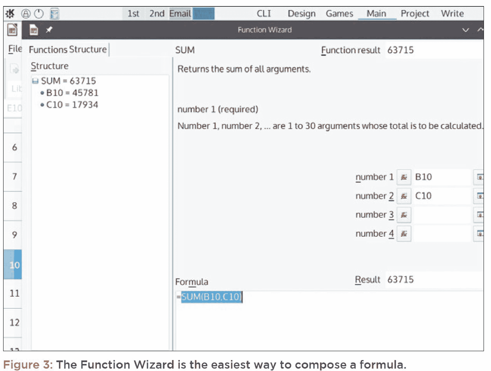

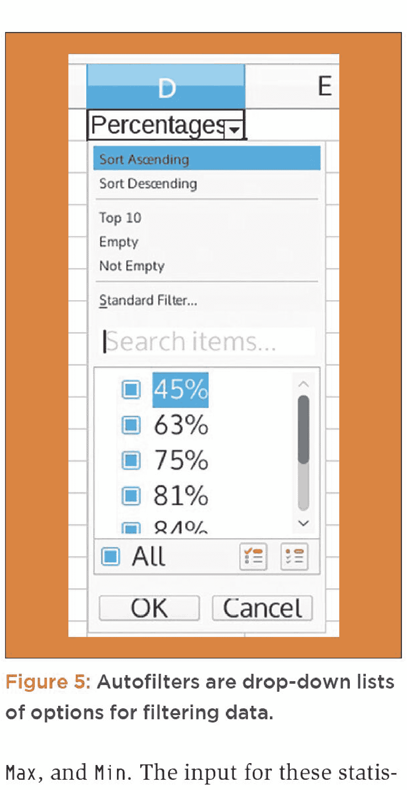

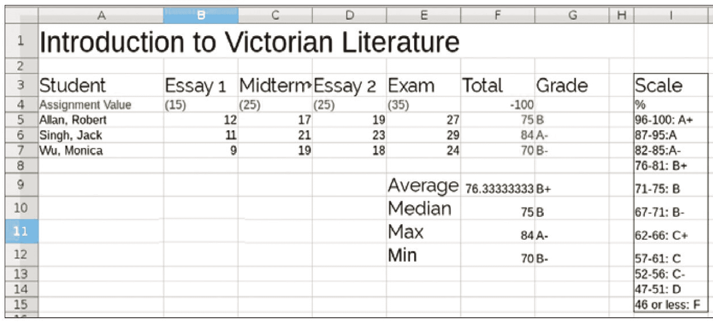

函数向导会列出所有变量，你可以手动输入，也可以直接把电子表格中的单元格拖拽到对应位置完成输入。此外，函数向导还能预览计算结果，方便你在插入错误函数到文档前修正变量。

除了函数之外，Calc还内置了多种可用于列表和数据数组的工具。这些工具分散在各个菜单中，大多位于「工具」和「数据」菜单下，可分为两类：一类用于调整格式，另一类用于配合函数增强功能、简化操作。表1和表2介绍了部分最实用的Calc工具。

另一项来自《设计基于LibreOffice的文档》一书的示例如图4所示，是一份教师成绩单的节选。上半部分是学生各作业的得分，以及满分100分的课程总分。右侧带边框的单元格是评分等级。更重要的是，学生成绩下方列出了部分基础统计数据，由`Average`（平均值）、`Median`（中位数）、`Max`（最大值）、`Min`（最小值）这几个函数生成。这些统计数据的输入项是每个学生的总分，可以通过选中「总分」列的数字来选取。

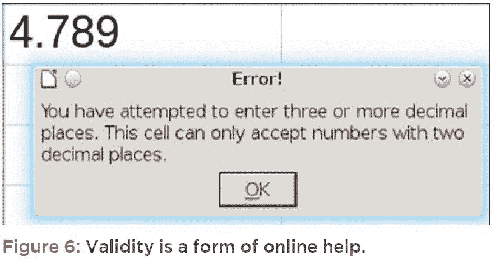

通过函数向导，我可以快速使用这些函数，无需牢记每个函数的计算结构。例如，计算学生总分时，我不需要输入`=SUM(B5:E5)`手动列出行列对应的单元格范围，只需要用鼠标拖拽选中目标单元格即可。函数向导的左面板还可以用来浏览所有函数。函数按财务、逻辑、统计等类别分类，输入类别的首字母就可以只显示对应类别的函数。函数向导会为每个函数和变量提供简要说明。

## 入门指南

### 条件格式

如果标准格式无法提供足够的视觉提示，你可以从`格式 | 条件格式`中添加其他提示。条件格式能让用户一眼识别数据的总体趋势，但不会展示具体数值。例如，你可以使用从笑脸、中性表情到皱眉的各类表情符号来标注单元格内容。或者，也可以给数据标注颜色（图7）。

| 工具 | 说明 |
|---|---|
| `右键单击 | 隐藏列/隐藏行` | 可简化展示效果，减少需要打印的信息量。注意：隐藏操作不会保护信息。例如，如果你同时有欧元和美元的收支列表，且隐藏了欧元收支列，查看者可以通过美元列的部分空白条目推断出某一列未显示。 |
| `数据 | 组合` | 可在列和行标题中创建一组树形控件，用于展开或折叠展示内容。如果需要，还可以在组合内嵌套子组合。 |
| `标准筛选器或高级筛选器` | 可控制某列中哪些单元格被展示。标准筛选器和高级筛选器都会设置单元格的展示条件，其中高级筛选器提供更多选项。不过，日常使用最方便的筛选器通常是自动筛选（图5）。和标准/高级筛选器不同，自动筛选会始终显示在工作表中，且可包含空白单元格。此外，必要时你还可以通过自动筛选的右键菜单创建其他类型的筛选器。使用自动筛选时，需要在你希望筛选的单元格区域的顶部留出一个空白单元格。如果将鼠标放在该单元格中，选中自动筛选后就会添加下拉筛选选项列表的控件，非常方便。作为导航辅助，你可以使用该单元格控件为单元格区域添加标签。 |
| `数据 | 有效性` | 适用于多人共用同一张表格，或单人长期使用同一张表格的场景。有效性可定义所选单元格允许输入的内容类型和格式，同时显示自定义帮助消息，包括无效内容的定义及修正方法（图6）。 |
| `数据 | 分类汇总` | 可对带有表头（又称数据数组）标注的数据区域执行多种统计函数。你还可以选择分类汇总在工作表中的显示位置——但请确保左侧有足够的空间放置表头，必要时你可能需要新增一列来腾出空间。分类汇总最多可同时处理3个数据数组。 |
| `工具 | 审查` | 是一系列用于追踪公式所用数据的实用工具子菜单（图8）。例如，如果你选中带公式的单元格，“追踪引用”会画出线条（追踪线）指向公式中使用的数据所在的单元格。双击某条追踪线，即可跳转到该线条末端的单元格。反过来，“追踪从属”会从当前单元格画出线条，指向引用了当前单元格的公式所在的单元格。你还可以使用“追踪错误”或“标记无效数据”功能。操作完成后，使用“删除追踪线”即可清除所有追踪线。 |
| `工具 | 扩展工具菜单 | 单变量求解` | 可生成函数变量的多个取值，这些取值可通过下拉列表修改。 |
| `数据 | 模拟分析` | 可为变量创建数据区域，随后使用该变量运行公式。你可以为多个变量输入数据区域，甚至为多个公式输入数据区域。 |
| `工具 | 扩展工具菜单 | 规划求解` | 提供可同时为多个单元格输入取值范围的对话框。其功能和单变量求解、模拟分析类似，但允许你同时处理更多单元格和变量。 |
| `数据 | 数据透视表` | 可重新排列数据数组中的数据，呈现新信息。例如，图9中的数据数组按国籍、性别和年龄展示了游客支出情况。按照在线指引操作，你可以重新排列数据生成图10，该图按性别展示了游客支出情况。从该表可以看出，女性游客在度假时的支出最多，这是从图9中无法直接看出的信息。数据透视表不会在数据变更时自动刷新，你需要点击`数据 | 数据透视表 | 刷新`来更新数据。 |

目前，LibreOffice尚不支持迷你图，即条件格式的原始形态——一种标注了主要数据点的微型折线图。不过，你可以使用图表的子系统创建图表后再缩小尺寸，使其适配单个单元格或多个合并单元格，也可以使用条形图。


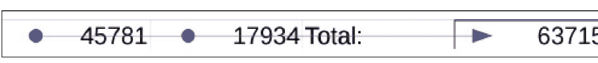

### 使用单元格样式

在电子表格中，Calc对样式的使用（尤其是单元格样式和页面样式）独具特色。和Writer一样，Calc的样式可基于现有样式创建，既能节省时间，又能保证风格统一。Calc样式可以应用到单个或多个单元格、整列或整行，也可以点击第1行上方、A列左侧的空白区域，应用到整个工作表。按下F11键即可在“样式与格式”对话框中查看和编辑样式。如果你之前已经使用了手动（直接）格式，请选中对应单元格，右键单击后选择“清除直接格式”，避免应用样式时出现问题。

Calc安装时自带多个默认单元格样式，这些样式预设了多种参数，多用于标题等不同场景。另有列在“状态”分类下的单元格样式，用于标注工作状态的评估，可在工作优化时随时修改。你也可以创建单元格样式，用于标注包含特定函数的单元格的分类汇总或总计结果。相比之下，Calc仅自带2种页面样式，但可根据需要新增更多样式。

单元格样式支持“字体”和“字体效果”设置，同时“单元格样式”和“页面样式”对话框都设有“边框”和“背景”选项卡。这些选项卡和LibreOffice其他模块中的对应选项卡几乎一致，通过设置不同的字体、边框和背景，可以让不同数据数组更易区分（图11）。


不过，Calc样式确实有一些其他LibreOffice模块没有的选项卡。在单元格样式中，“数字”选项卡是最重要的选项卡之一。虽然Calc默认将所有字符视为靠左对齐显示的文本，将所有数字视为靠右对齐显示的数字，但你可以在“数字”选项卡中指定单元格包含的信息类型。在同一选项卡中，你可以为日期等信息选择格式。“语言”和“区域”选项也在“数字”选项卡上，因为它们决定了不同类型数字的默认格式，包括用于方便读取大数字的分隔符（图12）。

单元格样式的第二个独特选项卡是“对齐”。在“对齐”选项卡中，你可以倾斜单元格内容，节省标题的空间。更重要的是，你可以设置文本自动换行和断字，这两个设置能让工作表更易阅读。你也可以缩小内容以适配单元格大小，不过这可能会降低用户体验（图13）。

单元格样式的第三个独特选项卡是“单元格保护”。在此可以设置是保护整个工作表还是仅保护公式，以及打印时是否隐藏单元格。

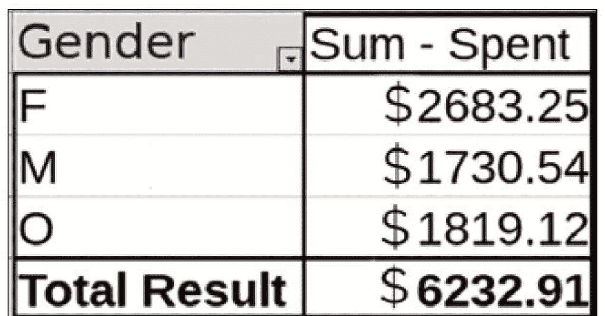

这些设置的主要目的并非保障安全，而是防止意外损坏、减少页面冗余。

页面样式仅在打印电子表格时生效。为方便使用，你可以为每页添加页眉和页脚，所用选项卡和Writer中的段落样式选项卡类似。页面样式中最重要的选项卡是“工作表”，其中包含将通常供在线使用的工作表适配到物理页面的相关选项。由于总列数较多时，这种适配很容易出现排版问题。

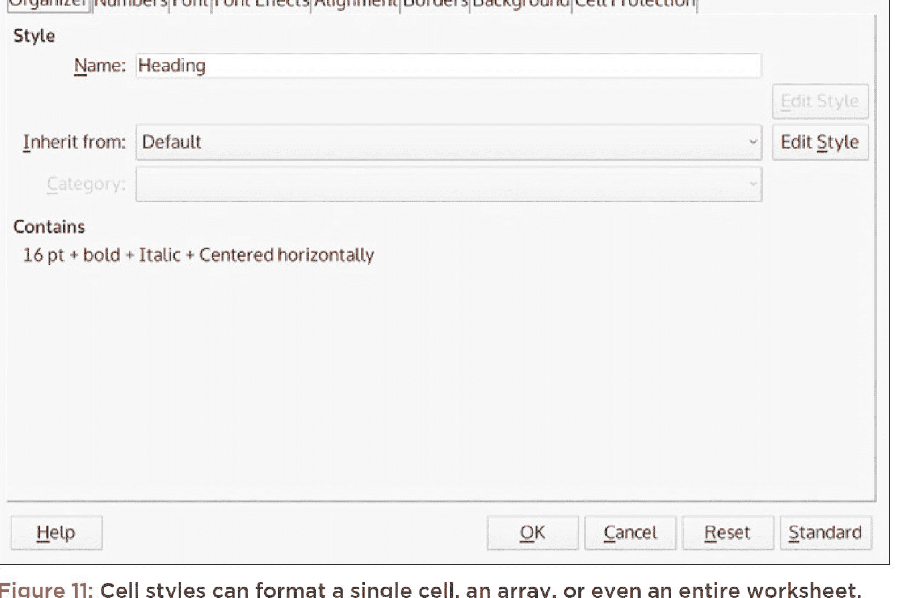

## 入门指南：LibreOffice Calc

LibreOffice Calc的早期版本甚至缺乏基础功能。甚至连文本换行这类基础格式功能都没有，这意味着长段内容会遮挡相邻单元格，往往会让表格扫一眼就看不懂。

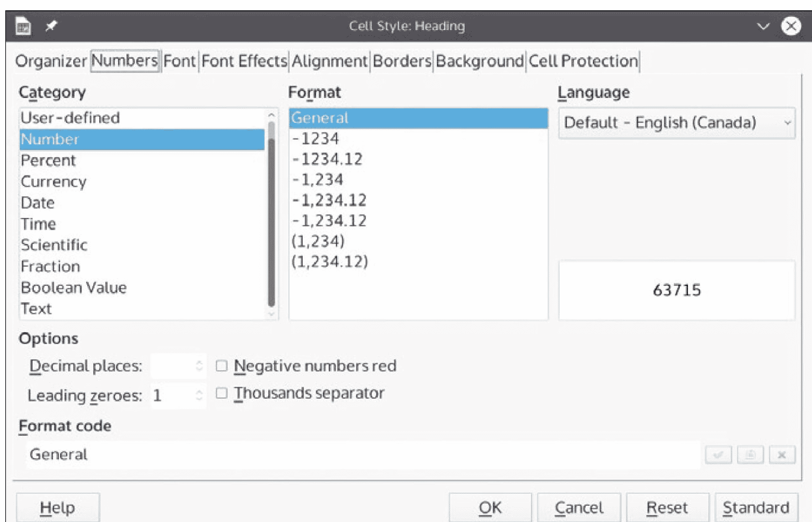

图12：`数字`选项卡的选择项决定了单元格样式读取数据的方式。

如今的电子表格功能依然齐全，尽管过去二三十年来功能数量的增长较为缓慢。电子表格真正的进化体现在格式选项的丰富上。受爱德华·塔夫特等信息设计师的影响，电子表格也开始重视呈现效果，在保持功能性的基础上，通过高亮、给单元格填色的方式打造视觉印象和引导标识。

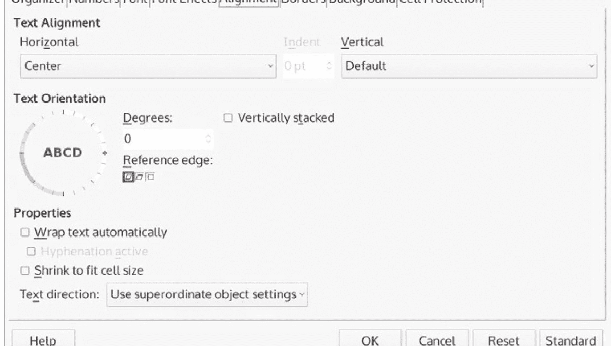

图13：`对齐`选项卡改善了单元格内的数据显示效果。

这些视觉效果本身并非最终目的。如果你发现自己把电子表格当成了艺术品而非理解内容的辅助工具，那你需要重新审视自己的优先级。但话说回来，功能性和视觉辅助的最佳组合，让如今的电子表格比40年前更易用。凭借样式功能，Calc完全能够满足人们日益提升的电子表格使用需求。

#### 参考信息

> [1] 布鲁斯·拜菲尔德。《使用LibreOffice设计（第二版）》。开放文档之友公司，2022年：https://designing-withlibreoffice.com

> 如果表格比页面宽，你还可以选择打印哪些对象。对象、图片和图表在打印页上的排版尤其困难。最终，你可能会选择直接缩小表格，尽管这样可能会造成眼疲劳，甚至内容难以辨认（图14）。

作为样式的替代方案，你可以通过`布局 | 电子表格主题`选择配色方案。不过要注意，主题比样式的通用性更强，而样式具备更多功能优势。

## 不断演进的电子表格

20世纪80年代初电子表格开始普及时，功能性是首要考虑因素。

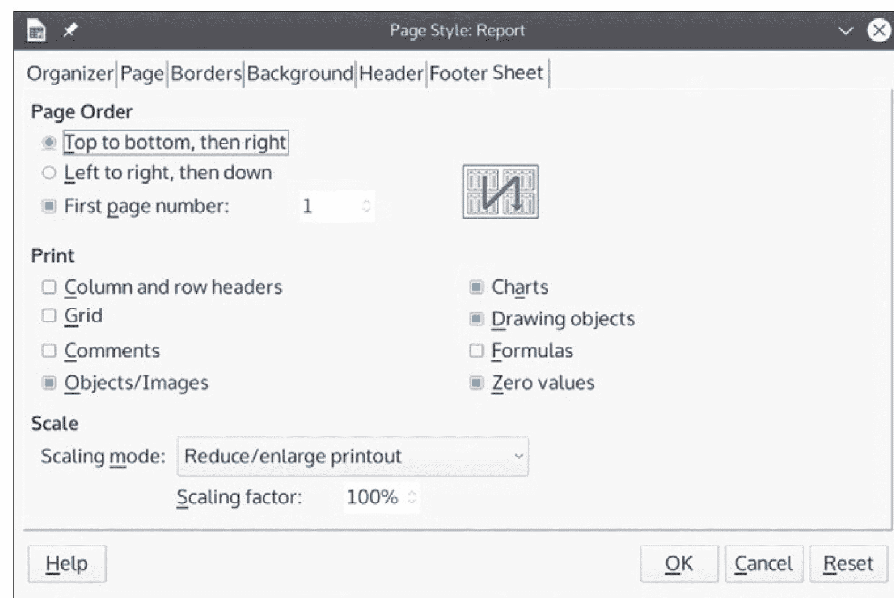

图14：`页面样式`对话框提供了将电子表格压缩到实体页面的相关选项。

## 入门指南：LibreOffice Impress

### Impress：完美演示文稿


# LibreOffice Impress

想用最新的销售数据给老板留深刻印象？还是想用吸睛的方式展示假期照片？Impress就是你需要的工具。

*作者：迈克·桑德斯*

即便文件是用其他程序制作的，“PowerPoint”一词如今也已经成了演示文稿的代名词。

演示软件的历史可以追溯到20世纪80年代初，比如VCN ExecuVision这类工具，允许用户给文本添加图片，并以幻灯片形式展示。LibreOffice的演示组件名为Impress，这是一款功能极其丰富的工具，拥有大量特性和特效。那么，就让我们开始了解它吧！

- **选项卡栏：** 点击选项卡即可切换不同的功能分组。右侧的三线“汉堡”菜单提供了一些额外选项。如果你不确定某个图标的作用，只需将鼠标悬停在图标上即可查看工具提示。你也可以右键点击工具栏，选择相应选项。

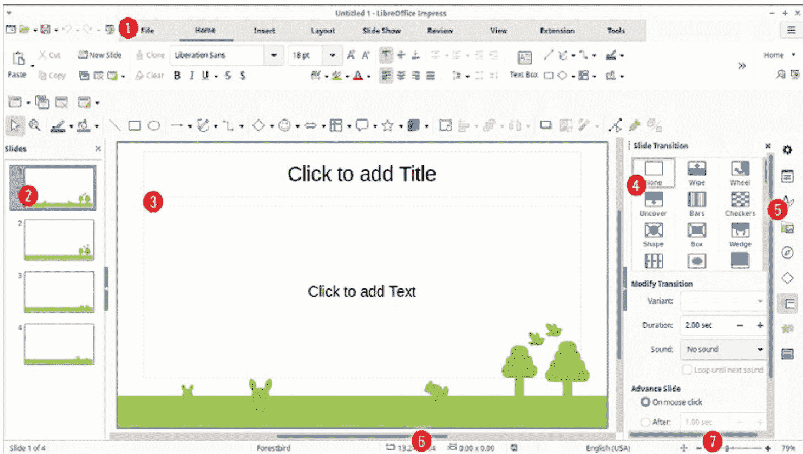

*图1：* 采用选项卡视图模式的LibreOffice Impress（如果你的界面看起来不一样，请查看第12页的对应设置）。

启动LibreOffice，选择新建演示文稿（如果你已经在运行该程序，可以在菜单中打开`文件 | 新建演示文稿`）。你会看到预安装的模板列表，选择你喜欢的模板，新的Impress文档就会打开，展示以下功能：

- **可见按钮：** 你可以选择“可见按钮”或`自定义工具栏`，来更精细地调整布局。

- **幻灯片缩略图：** 这里可以查看幻灯片的缩小版本，单击即可切换幻灯片。右键点击幻灯片可对其实施操作（例如复制、删除），右键点击空白区域可添加新幻灯片。你也可以通过点击拖拽来调整幻灯片顺序。（注：该面板可折叠；如果没看到它，点击灰色箭头即可打开。）你也可以使用 aptly 命名的“幻灯片”菜单来新建幻灯片。

- **幻灯片内容区：** 这是你大部分工作的区域。点击文本框即可编辑内容，点击文本框周围的灰色区域会出现绿色控制点，你可以通过它们调整幻灯片内元素的大小和位置。使用“插入”菜单可添加图片和额外的文本框。

- **侧边栏：** 如果没看到侧边栏，它可能被折叠到了右侧，点击灰色箭头即可打开（也可以在菜单中打开`视图 | 侧边栏`）。图1中，侧边栏正展示不同的幻灯片切换特效。

- **侧边栏选项：** 侧边栏可以展示多种不同内容，点击右侧的小图标即可切换（例如文本属性、动画、实用剪贴画库等）。

- **位置和大小：** 移动或调整图片、文本框等对象的大小时，可以查看状态栏获取精确的参数信息。（你也可以右键点击对象，选择“位置和大小”来精确指定尺寸。）

- **缩放级别：** 快速滑块可调整缩放比例，既能放大查看细节，也能缩小预览整体。

## 演示的艺术

无论你对史蒂夫·乔布斯的评价如何，他确实非常擅长展示苹果的新产品。如果你从没见过他的演示，可以去YouTube上搜一下，初代iPhone和MacBook Air就是两个经典案例。乔布斯的演示不会堆满文字和冗余细节，而是逐一展示产品特性、设备图片，偶尔还会标注参数。他会用语言对幻灯片内容进行补充，最终组合成令人印象深刻的演示。

当然，乔布斯的演示风格并不适用于所有场景。对着垂涎欲滴的科技记者展示炫酷的新潮电子产品，非常不同于给老板汇报销售情况，或是给亲友展示假期照片（参见“制作相册”提示框）。但以下是需要始终牢记的一些通用技巧：

- **快速切入正题。** 没人喜欢冗长的开场。不要一上来就说“我今天要讲的是……”，立刻抛出一个有趣的事实、数据或发现，能快速抓住观众的注意力，让他们对接下来的内容产生期待。

- **把注意力放在观众身上。** 人们很容易忍不住一直回头看幻灯片，这只会让你照着屏幕念内容、复述屏幕上的信息，对演示毫无帮助。看着你的观众，感受他们的反应。

- **加入趣闻和故事。** 如果你看过TED演讲，会发现里面满是轶事。有时候这可能会显得有点俗套，所以不要用太多，但演示中加入一两个幽默的插曲能打破沉闷——还能叫醒快要打瞌睡的观众！

- **遵循“10-20-30”规则。** 这条规则同样来自苹果员工，核心内容是：演示文稿通常不超过10页幻灯片，时长不超过20分钟，字体大小不小于30磅。

- **用讲解代替文字。** 如果你的幻灯片上全是文字，尝试把它们删减成关键要点或图片，剩下的内容你口头讲给观众听。你站在台上做演示，就要确保自己提供了额外的价值！

## 创建新的演示文稿

那么，就让我们开始制作演示文稿吧！关于如何吸引观众、优化演示效果以获得最佳呈现效果的通用技巧，可以查看“演示的艺术”提示框。现在，我们先专注于软件本身的操作。

预安装的模板大多包含同一设计的两种或更多变体。例如我在图1中选取的茜素红模板，左侧会自动生成两张幻灯片：

第一张适合用作演示开头（或结尾），第二张则适合放置文字和图片的常规幻灯片。

因此，在第一张幻灯片上添加一些文字，然后从左侧面板选中第二张幻灯片，也添加一些文字（还可以加一张图片）。

在做更多操作前，先看看你刚做好的两张幻灯片演示吧！按下`F5`键（或打开菜单中的`幻灯片放映 | 开始放映`），就能看到效果了。

第一张幻灯片展示时，点击屏幕任意位置——或是按空格键——即可切换到第二张幻灯片，之后演示就会结束。

如果你不小心按`Esc`键中断了演示，可以按下`Shift+F5`（或打开菜单中的`幻灯片放映 | 从当前幻灯片开始`）从当前幻灯片继续演示。

前面提到过，大多数模板包含两种或更多版式，此外还有子版式。

在侧边栏中，点击属性“卡片”（即分区——通过右侧的按钮选择），然后向下滚动到“版式”选项。

你会看到一组替代设计，如图3所示。

要添加额外的文本框，可以打开菜单中的`插入 | 文本框`，或按下`F2`键。

之后点击并拖拽即可确定文本框的精确位置和大小。

格式化这些框内的文字非常简单——只需使用侧边栏的“属性”卡片，再打开“字符”和“段落”卡片即可（如果看不到这些卡片，点击“-”部分将其改为“+”即可显示）。

大部分选项和Writer里的都一样，你可以直接复用之前学到的知识！

你还可以添加形状：插入选项卡（可能在额外箭头下方）会列出所有可用的形状。

# 入门指南

## 创建相册

你可以使用Impress从一组图片中创建相册，通常每张幻灯片放置一张照片。这个相册可以使用带图形和图像的多媒体源，甚至能把最新的假期照片收集到一个演示文稿文件中。要执行此操作，首先打开一个现有或空白的演示文稿，然后选择`插入 | 相册`。

在出现的“创建相册”对话框中，点击“添加”选择图片并浏览文件系统。具体如何选择多张图片取决于你的操作系统，但通常你可以按住`Shift`或`Ctrl`键的同时点击图片来完成选择。这样做不仅能节省演示时的存储空间，还能节省磁盘空间，因为你不需要复制大量重复数据。不过请注意：如果你从硬盘中删除了图片文件，演示文稿也会丢失该图片！完成后点击`插入幻灯片`，你就可以像往常一样继续编辑和放映演示文稿了。

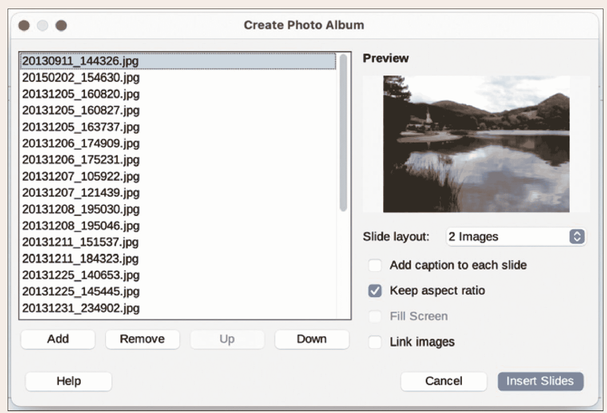

> 图2：创建相册时，你可以指定每张幻灯片上显示多少张图片。

选择好图片后，Impress会提供一些额外选项。其中一个重要选项是`链接图片`，这意味着图片数据不会被直接复制到演示文稿中，而是在放映演示文稿时按需从文件系统加载图片。你可以在演示文稿中添加各种形状，包括线条、箭头、符号等。和添加文本框一样，点击并拖动即可将它们添加到演示文稿中。你还会注意到，这些形状和对象很多都在第二个工具栏中，方便快速调用。想要为演示文稿添加更多形状和剪贴画？可以查看侧边栏中的图库（图5），它位于右侧面板从下往上数第二个图标处。点击该图标即可看到各类可添加的内容，只需点击并拖动即可添加到文稿中。和其他所有形状一样，如果你点击形状将其选中，就会看到绿色的调整手柄，点击并拖动该手柄即可调整形状大小。至此，你已经掌握了幻灯片、版式、文本框、文本格式化、形状和图形这些创建演示文稿的核心工具。但还有一点需要注意：切换效果（即用于从一张幻灯片切换到另一张幻灯片的动画）。在左侧面板中选择一张幻灯片，然后选择右侧边栏中的`幻灯片切换`面板（它是侧边栏从上往下数第三个图标）。你会在侧边栏的主区域看到各种切换效果，以及展示切换效果的小预览图。你可以自由探索，只需点击某个切换效果即可查看其运行效果。许多切换效果下方还有额外选项，包括持续时间（以秒为单位）和附加音效。你还可以使用侧边栏的这部分功能设置演示文稿在等待一定秒数后自动翻页，相关选项位于侧边栏下方的“自动换片”选项处。掌握了这些基础知识后，接下来我会介绍几个高级功能：工作区视图、母版幻灯片和演示者控制台。

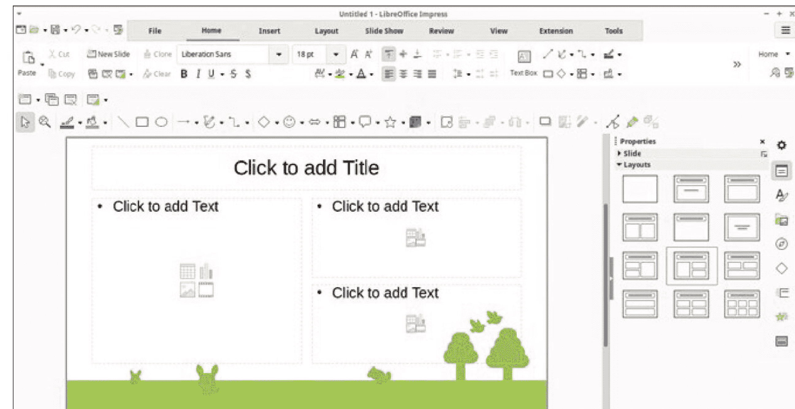

> 图3：使用侧边栏可以选择模板中的其他版式，这些版式带有额外的文本和/或图像框。

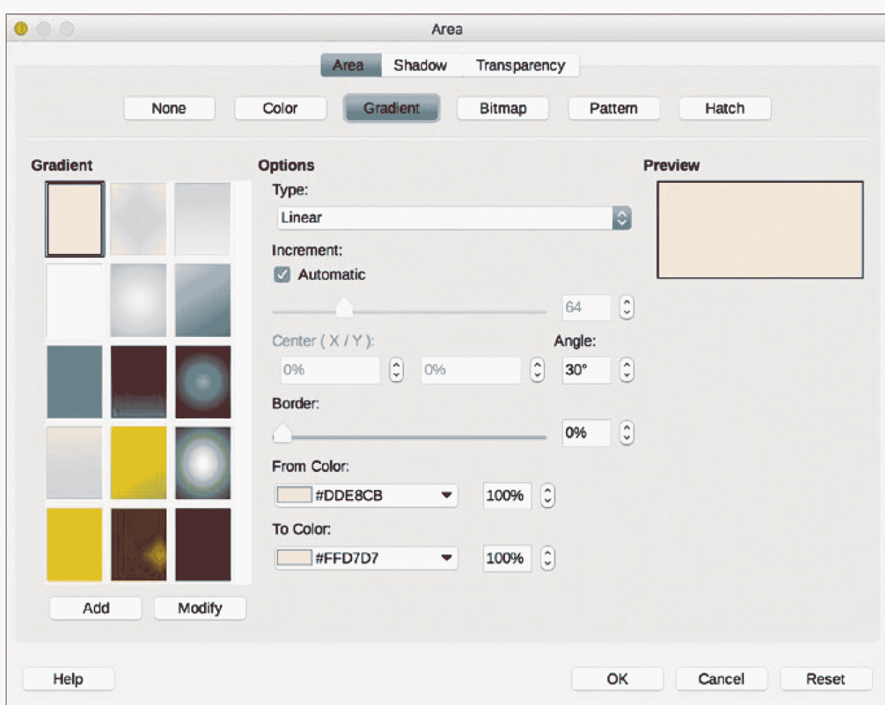

> 图4：Impress为形状提供了丰富的背景选项，例如纯色、渐变和位图。要更改形状或文本框的背景，请右键单击该对象，选择“区域”，即可看到图4所示的对话框。你还可以使用该对话框为对象添加阴影并设置透明度。

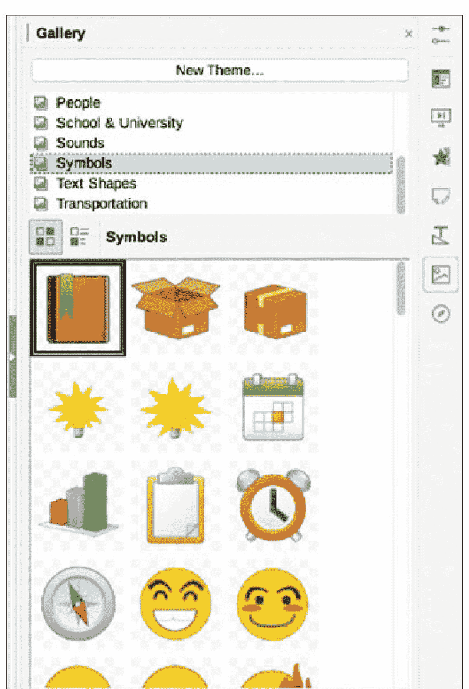

> 图5：通过侧边栏可访问的图库提供了大量额外形状和图形，可以让你的演示文稿更出彩。

## 工作区视图

在“视图”菜单中，你可以找到多种工作区选项——这些工作区视图均旨在简化特定任务的完成。例如，`普通`视图是处理单张幻灯片的主要视图，你可以使用该视图对幻灯片进行格式化、设计，以及添加文本、图形和动画效果。`大纲`视图会按顺序编号显示演示文稿中的所有幻灯片（图6）。`大纲`视图以大纲格式显示每张幻灯片的主题标题、项目符号列表和编号列表。该视图仅显示每张幻灯片默认文本框中的内容，如果你的幻灯片包含其他文本框或绘图对象，这些对象中的文本不会显示。`备注`视图允许你为幻灯片添加备注，这些备注仅为你个人可见，放映演示文稿时观众无法看到。同时，`讲义母版`视图用于设置幻灯片的打印版式。点击侧边栏中的`属性`选项卡，你可以在`版式`部分选择每页打印1、2、3、4、6或9张幻灯片。此外，你还可以使用该功能在页眉和页脚部分添加自定义域，例如当前日期——只需点击其中一个文本框，然后前往`插入 | 域`即可查看可用的选项。

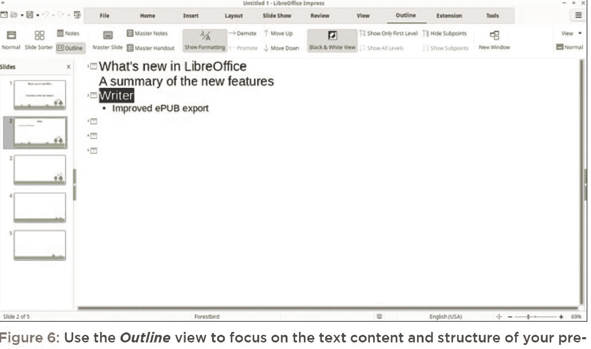

> 图6：使用`大纲`视图可以专注于演示文稿的文本内容和结构，而非图形层面。

### 母版幻灯片

使用母版幻灯片时，所有基于该母版的幻灯片都会继承其样式。修改母版幻灯片中的样式，所有基于该母版的幻灯片都会同步发生变化。不过，你可以修改单张幻灯片，而不会影响母版幻灯片本身。首先简单介绍一下背景知识：母版幻灯片是用于制作其他幻灯片的起始模板，类似于Writer中的页面样式，可控制所有基于它的幻灯片的基本格式。一个演示文稿可以包含多个母版幻灯片。此外，母版幻灯片具有一组固定的特征，包括背景颜色、图形和渐变，以及其他对象（例如徽标、装饰线等）、页眉和页脚、文本框的位置和大小、文本格式等。母版幻灯片关联两种类型的样式：演示样式和图片样式。预装的演示样式可以被修改，但无法创建新的演示样式。而对于图片样式，你既可以修改预装的样式，也可以创建新的图片样式。样式可控制母版幻灯片的所有特征。使用母版幻灯片创建的新幻灯片，会继承其所属母版幻灯片的样式。演示样式会影响母版幻灯片的三个元素：背景、背景对象（例如图标、装饰线和文本框）以及幻灯片上的文本。文本样式进一步细分为`备注`、`大纲1`至`大纲9`、`副标题`和`标题`。大纲样式用于对应大纲的不同层级，例如`大纲2`用于`大纲1`的子要点，`大纲3`用于`大纲2`的子要点，以此类推。图片样式没有限制，可以影响幻灯片的多个元素。注意，文本样式在演示样式和图片样式的选项中均存在。

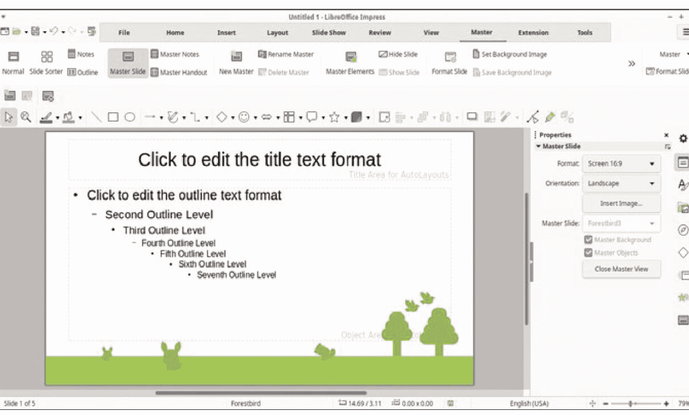

> 图7：Impress的母版幻灯片模式：你可以进行会影响所有基于该母版的幻灯片的修改。现在来试一下吧！使用Alizarin模板新建一个演示文稿，在介绍页和第一张幻灯片上添加一些文本。然后前往`视图 | 母版幻灯片`，你会看到类似图7所示的界面。现在尝试更改幻灯片标题栏和其他部分的文本格式（例如更换为其他字体）。如果你返回`视图 | 普通`，就会发现格式修改已经应用到所有幻灯片上。这样你就可以快速、轻松地一次性修改多张（或所有）幻灯片，如果你手上有大量公司的旧演示文稿，但需要按照新的品牌规范更新它们，这个功能可以帮你节省大量时间。

要创建新的母版幻灯片，请右键单击左侧幻灯片面板的空白区域，选择`新建母版`。根据你的需求修改该母版。注意，建议你重命名这个新母版。右键单击幻灯片面板中的幻灯片，从上下文菜单中选择`重命名母版`。完成母版幻灯片的创建后，点击顶部工具栏中的`关闭母版视图`，即可返回普通幻灯片编辑模式。现在你可以新建一张幻灯片，使用侧边栏为其应用母版幻灯片设计（见图8）。只需点击右侧面板中的`母版幻灯片`图标，然后从顶部选择所需的设计即可。

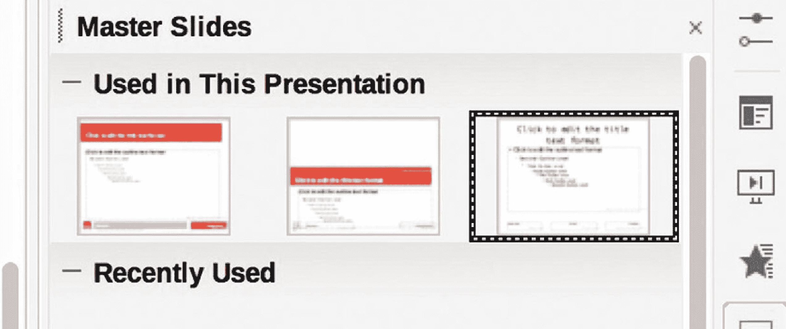

> 图8：创建母版幻灯片后，你可以通过侧边栏将其应用到新幻灯片上。

### 演示者控制台

Impress包含演示者控制台功能，当你将额外的演示显示设备连接到电脑时可以使用该功能。演示者控制台通过在电脑显示器上显示不同视图、在观众看到的演示屏幕上显示放映内容，为幻灯片放映提供额外控制。你在电脑显示器上看到的视图包括当前幻灯片、下一张幻灯片、任何幻灯片备注以及放映计时器。请注意，演示者控制台仅支持支持多显示器的操作系统，且需要连接两台显示器（例如其中一台可以是笔记本电脑的内置显示器）。要启用演示者控制台，请前往`工具 | 选项`（Windows和Linux系统）或`LibreOffice | 偏好设置`（Mac OS系统），然后在左侧选择`LibreOffice Impress`，再选择`常规`。勾选`启用演示者控制台`选项，点击`确定`即可。现在，当你连接外部显示器并开始放映演示文稿时，应该会在一块屏幕上看到主放映视图，另一块屏幕上看到演示者控制台（见图9）。（如果无法正常使用，第二块屏幕只是镜像复制第一块屏幕的内容，你需要在操作系统中更改显示设置。）

## 快速入门

### 导入与导出

Impress软件能很好地导入PowerPoint格式的演示文稿，但对于复杂动画和效果可能存在一些限制或差异。如果有人需要你修改他们发来的Microsoft Office演示文稿，请让他们发送`.pptx`格式而非`.ppt`格式——前者的文档规范更完善，但仍存在一些限制。理想状态下，所有办公软件都会使用完全开放、标准化的格式，比如LibreOffice使用的`.odp`（开放文档演示文稿格式），不过想想就好啦！

与此同时，Impress支持多种格式的保存。你可以前往`文件 | 保存下拉菜单 | 另存为`，在弹出的对话框里查看`文件类型`下拉列表，可以选择Microsoft系列格式、HTML，甚至纯文本格式。更多选项可以在`文件 | 保存下拉菜单 | 导出`中找到，在这里你可以选择将演示文稿保存为PDF或EPUB格式（后者适合电子书阅读器使用）。如果只是想快速保存作品，可以选择`直接导出`菜单项；如果想要对生成的文件进行更精细的控制，可以选择其他选项。

### 总结

从销售报告到照片幻灯片，LibreOffice Impress都提供了强大的工具来制作令人印象深刻的演示文稿。

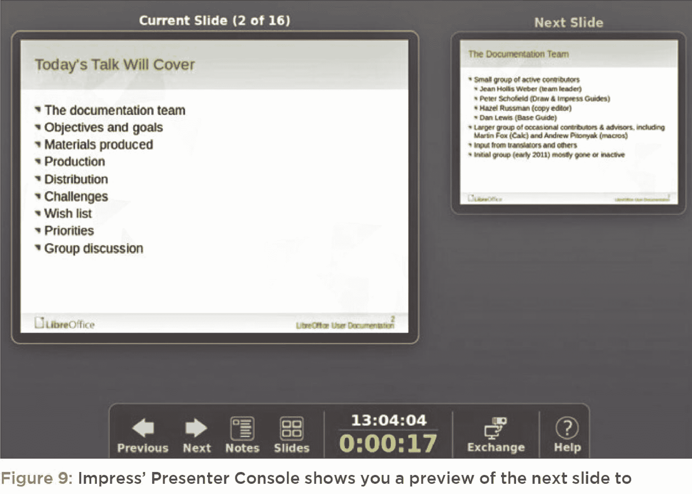

### IT要闻速览

没空浏览通篇套话的新闻稿和冗杂的科技资讯网站？让我们把最相关的资讯、技术文章和工具提示直接推送到你的收件箱。

- Linux更新
- ADMIN更新
- ADMIN HPC

助你把握IT行业动态。

- ADMIN与HPC：`bit.ly/HPC-ADMIN-Update`
- Linux更新：`bit.ly/Linux-Update`

## 草图艺术家

### 通用草图工具


*作者：托马斯·克鲁姆拜因*

LibreOffice Draw [1]是一款免费的矢量数学绘图程序，可支持你从最简单的草图到复杂示意图的各类创作。Draw是一款面向页面、基于对象的程序，其基础是页面——初始为空白的绘图区域，你可以通过在页面上放置对象来完成绘图创作。与基于段落的文字处理软件Writer、基于单元格的电子表格软件Calc不同，Draw的空白页面赋予了用户更大的创作自由度。

Draw中的对象都是矢量图形，由数学向量定义的线条和曲线构成。向量基于几何属性描述线条、椭圆和多边形。矢量图形允许你拉伸、旋转或缩放Draw对象，而不会造成信息丢失。所有对象都具有独立的属性。要修改对象属性，首先需要在页面边界内创建并放置对象，放置完成后你就可以在这些边界内自由移动对象。Draw文档可以包含多个页面，每个页面拥有不同的图层，每个图层包含不同的对象。因此，最终的Draw文档可能是复杂的创作成果，但其本质是简单对象的组合。你用Draw创建好图形后，可以在其他LibreOffice应用中使用，且不会造成任何信息损耗。当你需要重新调整或修改图形时，无需回到最初的Draw源文档，而是可以直接在当前使用的LibreOffice应用（Writer、Calc或Impress）中，使用Draw原本提供的工具直接编辑图形。你也可以将其他LibreOffice程序中创建的对象（如表格、图表、公式）插入到Draw文档中。

#### 开始绘图

选择`文件 | 新建 | 绘图`即可打开新的Draw文档（图1）。你会看到中间的活动工作区，你可以在此创建和操作对象。工作区左侧是页面面板，会显示文档中所有已创建页面的缩略图。最左侧是工具栏，包含了所有对象创建所需的工具。最右侧是属性侧边栏，会显示当前选中对象的属性。要完全使用Draw的功能，你需要同时用到工具栏和属性侧边栏。打开新文档时，页面面板中只会显示一个缩略图，工作区则是基于标准页面尺寸的空白区域。

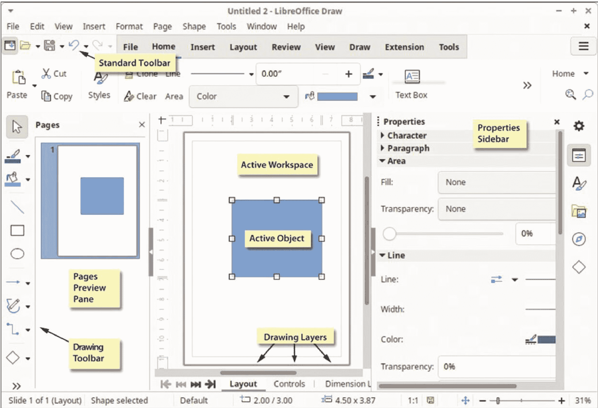

*图1：新建的Draw文档（从左到右依次为工具栏、页面面板、活动工作区、属性侧边栏）*


要创建你的第一个对象，点击工具栏上对应的图标选择所需的绘图工具（图 2）。接着在计划放置对象的左上角大致位置单击鼠标左键，按住鼠标按钮不放，移动鼠标到所需的右下角位置，松开按钮即可完成对象创建。创建出的对象会带有默认属性。要修改对象属性，请在对象上单击右键，你会看到对象外边缘有 8 个绿色或蓝色的小控制点。通过这些控制点你可以调整或更改对象的属性。如果只需要添加简短的文本内容，无需先绘制文本框。这种情况下，只需选择文本框工具，然后在活动页面的大致文本起始位置单击：此时光标会显示出来，你可以直接输入文本，文本框会随着输入自动向下扩展。文本对象和其他绘图对象具有相同的属性，因此可以用同样的方式操作。此外，绘图对象还具备文本属性。要向绘图对象中插入文本，请先选中一个对象（例如矩形），然后双击该对象：此时会出现光标，你可以输入文本，这些文本属于绘图对象的一部分，会随对象一起移动。针对所有文本，Draw 都提供了文字处理功能，支持你修改字符和段落的属性。你可以通过属性侧边栏或右键菜单，对选中的文本使用这些功能。每个对象至少具备以下属性（见图 1 中的属性侧边栏）：

- **线条：** 所有对象周围都有边框线，线条属性通常包括宽度、颜色、样式、边缘和透明度。如果想要不可见的线条，请在样式选项中选择*无*。要绘制发丝线（即打印机可打印的最细线条，具体取决于打印机型号），请在宽度选项中选择*0.00mm*。
- **区域：** 所有对象都具备填充属性，但仅当对象为封闭对象时才会显示（即边框为闭合线条，即便线条不可见也是如此，见上文）。简单的线条对象也可以设置填充属性，但不会显示。
- **尺寸：** 所有对象都有独立的尺寸属性，包括宽度和高度。选中对象时，对象周围会显示一个带有 8 个小控制点的方形框，你可以通过鼠标拖动单个控制点调整尺寸，也可以通过属性侧边栏输入宽度和高度的具体数值。
- **位置：** 所有对象都有相对于页面的 X 轴位置和 Y 轴位置。通常绘图页面的左上角（页面尺寸减去页边距）坐标为 *(0,0)*，默认情况下对象会以周围方形框的左上角作为自身位置。你可以通过属性侧边栏修改属性，也可以在对象上单击右键打开上下文菜单，进入每个属性的单独对话框进行设置；这种方式下可查看的属性比属性侧边栏提供的更详细。

## 文本

文本被视为对象的一部分，因此你需要先创建对象，才能输入和编辑文本。你可以使用文本工具创建空文本框作为对象。遗憾的是，文本工具已从默认绘图工具栏中移除（图 2），但你可以通过右键单击工具栏，选择*可见按钮 | 文本框*，将*文本*图标重新添加到工具栏中。你也可以在标准工具栏（图 1）中找到替代的文本框工具，或使用快捷键 `F2` 唤出该工具。创建好文本对象后，文本框左上角会出现光标，你就可以开始输入文本了。文本框会显示文本框架的左右边框，并自动换行。如果输入的文本超出原文本框的容量，文本框会自动向下扩展。

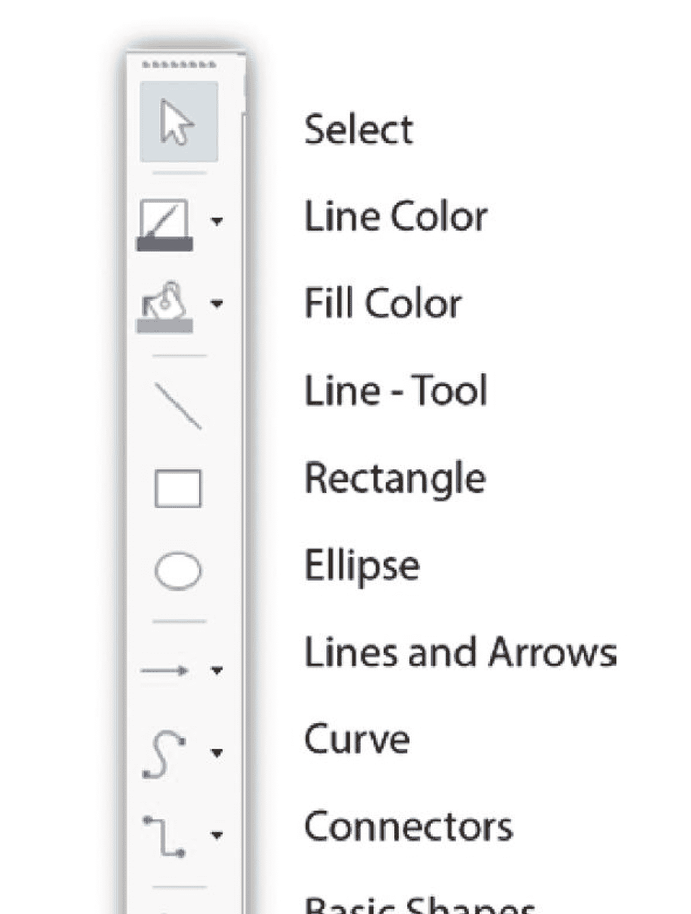

*图 2：绘图工具栏提供了多种对象创建工具*

## 快速上手

### LibreOffice Draw

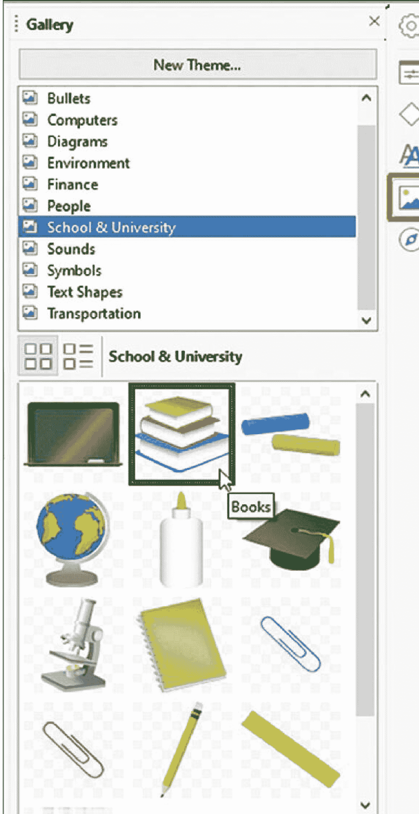

图 3：Draw 的图库提供了大量现成可用的图形；你甚至可以添加自己的自定义图形。

## 图形

由于所有绘图都是各类对象的集合，你的绘图可能会变得非常复杂。你可以对对象进行组合，也可以对选中的对象执行合并、减去、相交操作，从而得到一个新的复杂独立对象。通常所有绘图对象都由非常简单的几何图形（如线条、矩形、椭圆）生成，不需要手动生成或构建所有需要的形状。LibreOffice Draw 提供了一系列预定义的绘图对象，涵盖基本图形、符号、箭头、流程图、标注、星形等类别。你只需从绘图工具栏（图 2）中选择目标图形，再用鼠标即可创建对应对象。创建完成后，你可以修改图形的属性与位置。此外，你还可以通过在图库中点击「新建主题」添加自定义分类，保存专属对象供后续使用。选中图形后，你可以通过*区域*属性、*透明度*和*填充*功能为对象制作精美效果。

## 排列对象

对象会按照创建顺序依次放置在活动工作区中，首个对象位于最底层，后续每个对象都会叠在前一个对象的上一层。要调整对象的层级顺序，可以右键点击对象选择*排列*，或进入*布局*选项卡操作。使用鼠标创建和放置对象是快速获得可接受结果的便捷方式，但部分场景下需要更高的精度，Draw 为此提供了多种选项。如果你仍习惯使用鼠标，可以开启*显示网格*或*辅助线*功能：开启*显示网格*后，对象会自动吸附到页面网格上；如果需要更多自定义对齐参考，*辅助线*功能可以创建不会打印的对齐参考线。要创建辅助线，只需将鼠标光标移至页面标尺的任意一侧，按住鼠标按钮后拖动光标到绘图区域内即可。创建完成后，你可以修改辅助线的属性（X 轴或 Y 轴坐标），甚至可以直接输入坐标来放置辅助线。由于所有对象都具备公制尺寸和工作区位置属性，你也可以通过属性侧边栏（图 1）输入精确的放置数值来调整对象位置，还可以通过右键菜单或「格式」菜单打开对应属性的详细设置对话框。使用精确数值，你可以在 LibreOffice 中制作简单的工程绘图（图 4），还可以修改绘图比例（*工具 | 选项 | LibreOffice Draw | 常规*）。创建对象后，LibreOffice 可以自动添加尺寸标注线。注意：处理工程绘图时辅助线是必需的。


图 4：Draw 支持输入精确数值的特性使其适用于简单的工程绘图场景。

最后，如果你需要对齐一组对象，Draw 也可以帮你完成（图 5）：选中要操作的对象（可以通过按住 `Shift` 键+右键点击目标对象，或在对象周围绘制选框批量选中），然后选择*对齐*（可通过右键菜单或标准工具栏打开）。你可以精确对齐你的对象。

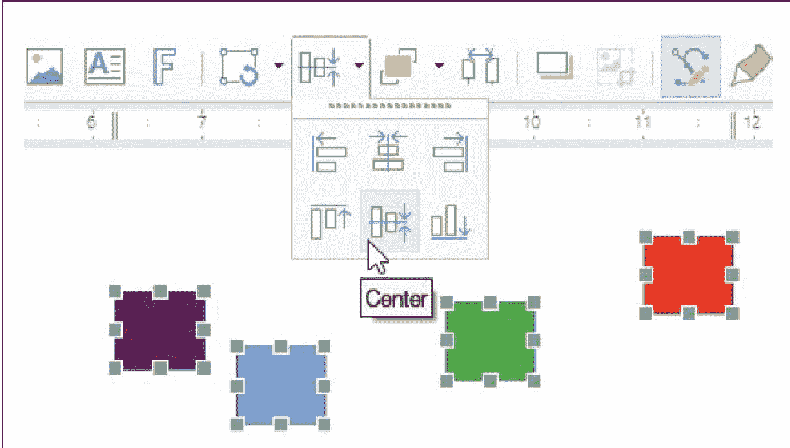

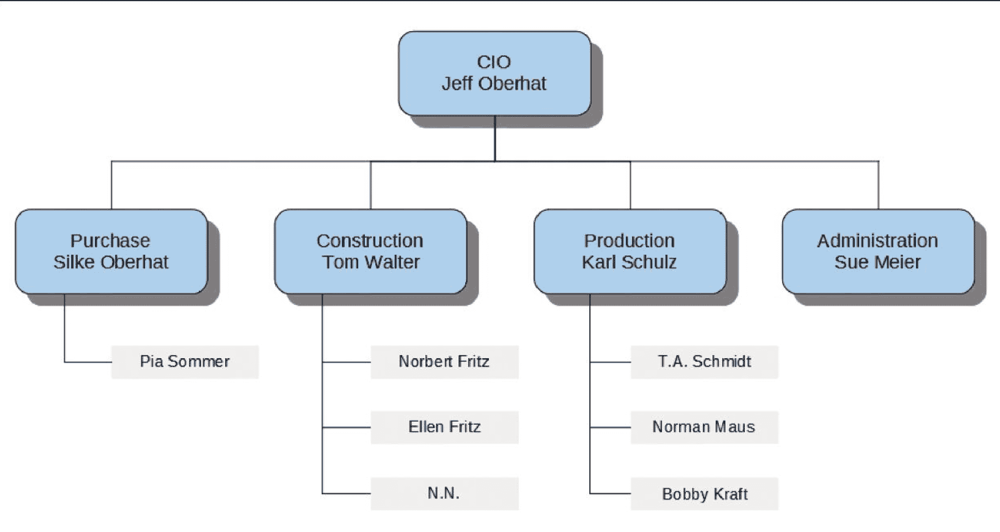

**图 5：** Draw 可以精确对齐你的对象……并实现对象在垂直和水平方向的均匀分布。你可以通过选择*分布*（图 6）进一步调整单排对象的分布效果。

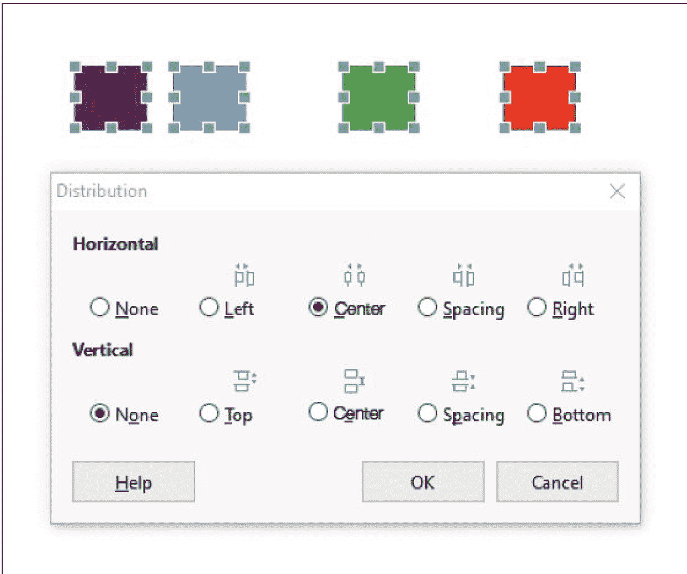

**图 6：** ……并实现对象在垂直和水平方向的均匀分布。

**图 7：** 连接线支持你在组织结构图中移动单个元素，同时保留整体流程走向。

## 连接线

Draw 的另一项实用功能是用于连接对象的连接线。连接线通过对象边缘的粘附点与其他对象实现连接，一旦两个对象通过粘附点关联，移动其中一个对象时，相连的对象也会同步移动。连接线的典型使用场景是流程图或组织结构图（图 7），它支持你在移动单个对象时保留图表的整体流程走向。

## 创意中心

虽然 LibreOffice Draw 不是 GIMP 这类面向像素的绘图程序，但也提供了一些创意工具。例如你可以将 2D 图形转换为 3D 旋转对象：要生成 3D 对象，首先绘制基础图形，即目标对象的平面半剖视图（图 8），然后点击该图形，选择*绘图 | 转换 | 转为 3D 旋转对象*即可。


**图 8：** Draw 提供了一些实用的功能，例如将 2D 图形转换为可旋转的 3D 对象。

## 打印与导出

打印绘图非常简单，选择目标打印机后即可开始打印，注意确保文档页面设置与打印机要求匹配。你也可以将绘图导出为 PDF、PNG、SVG 等常见文件格式。注意：SVG 是基于矢量的格式，PNG 是基于像素的格式，因此不同场景下导出质量会有所差异。LibreOffice Draw 在打印文件方面存在一个限制：不支持分色打印（CMYK 分色）功能，而该功能是胶印的必备条件。如果你需要 CMYK 分色，最终成品需使用预检工具重新处理，同时将颜色转换为要求的色彩配置。

## 总结

借助 LibreOffice Draw 这款强大的矢量绘图工具，你可以完成从最简单草图到复杂图表的各类设计。完成作品后，你既可以在其他 LibreOffice 应用中直接使用，也可以导出供第三方应用调用。

■■■

## 资讯

- [1] LibreOffice Draw：https://www.libreoffice.org/discover/draw/

## 快速上手

### LibreOffice Base

### 创建数据库、查询和表单

### 数据主控


本文将向你展示如何在 LibreOffice Base 中搭建数据库，并通过嵌入表单的 SQL 查询检索数据。作者：Robert Großkopf、Kerstin Großkopf 和 Joe Casad

Base 是 LibreOffice 套件的关系型数据库组件。数据库是一种将数据组织为结构化、易访问形式的工具。你可能会疑惑「我以为这是 LibreOffice Calc 电子表格的功能」，如果这么想也没错：数据库和电子表格都会以结构化形式存储数据。电子表格更适合解决特定类型的问题，例如财务台账；而数据库的设计初衷是便于检索和数据录入，也更容易扩展以适应更大的数据集。数据库适用于用户需要管理具有相似属性的离散数据对象或记录的场景，典型例子就是图书馆卡片目录——由一系列具有相似字段集合的同类条目组成，包含书名、作者、编目号和书籍简介等信息。

Base 提供了简易的用户界面用于创建和管理数据库，你也可以用 Base 连接多种不同格式的现有数据库文件。据 LibreOffice 项目介绍：「LibreOffice Base 原生支持部分平面文件数据库格式，例如 dBASE 格式。你也可以使用 LibreOffice Base 连接外部关系型数据库，例如 MySQL 或 Oracle 的数据库……」

Base 的用户界面集成了多种向导和设计辅助工具，可以简化数据库创建、构建数据录入表单的流程。首次启动 Base 时，*创建数据库*向导会询问你是否要新建数据库。Base 主窗口如图 1 所示，左侧的图标可以便捷地创建表、查询、表单和报表。

数据库搭建从设计开始。数据库设计包含诸多考量，根据数据性质不同，可能是一项复杂的任务。本教程为了在有限篇幅内提供最多信息，将以典型的数据库场景为例，带你完成设计和

## 入门指南

本指南适用于 LibreOffice Base

| 字段名称 | 字段类型 | 说明 |
|-----------|-----------|-------------|
| Article | 文本 [VARCHAR] | 对象描述 |
| Image | 文本 [VARCHAR] | 通过URL与数据库关联的对象图像 |
| Room | 文本 [VARCHAR] | 房间名称 |
| Cupboard | 小整数 [SMALLINT] | 储物柜编号 |
| Rack | 小整数 [SMALLINT] | 货架编号 |
| Number_Needed | 小整数 [SMALLINT] | 所需对象的数量 |
| Category | 文本 [VARCHAR] | 物品类型（例如电子设备、光学器材等） |

构建数据库，然后设置表单和查询。如需了解有关使用Base的更多信息，请参阅《LibreOffice入门指南》[1]和《Base手册》[2]。

### 设计数据库

本文中的示例是一个用于存储公司设备库存的简单数据库。表1列出了基础数据库字段。Article字段是对象的描述。该数据库还包含对象所在房间、存放对象的储物柜/货架编号、物品类别、该位置存放的物品数量，以及对象数字图像的URL。表1中的所有数据都可以存储在一张表中，但如果某些字段存在重复的相同数据，通常更高效的做法是将重复数据拆分到单独的表，并通过分配为主键的唯一ID字段将其与主表连接（见表2）。一个简单的库存数据库可以仅由以下三张表构成：每件物品都只会分配一个Category和一个Place（Room、Cupboard和Rack）。

| Article | Category | Place |
|---------|----------|-------|
| ID | ID | ID |
| Article | Category | Room |
| Image | | Cupboard |
| Number_Needed | | Rack |

在数据库术语中，这被称为一对多（n:1）关系，只要某项仅被分配一次，这种关系就足够了。但对于本示例数据库，每件物品可以有多个存放位置，反之亦然——即多对多（n:m）关系。为确保建立这种关联，需要额外创建一张表，其中包含来自Article表的ID和来自Place表的ID，两者均为主键，同时将Number_Needed字段从Article表迁移到这张新表中（图2）。

### 创建数据库

现在在内部HSQLDB数据库中逐一创建这些表：

- 在LibreOffice中通过「文件 | 新建 | 数据库」启动数据库向导。
- 选择「创建新数据库」单选按钮，然后从下拉菜单中选择「HSQLDB嵌入式」。
- 点击「完成」保存无需注册的数据库文件。

命名并保存文件后，将打开一个多面板窗口；首先进入「表」部分，在「任务」面板中选择「以设计视图创建表」。（要完成这一步需要Java支持。前往「工具 | 选项 | 高级」查看系统中存在的`Java`运行时环境，并选择其中一个。）

应会打开一个空白数据库表，你可以在「字段名称」列输入字段名，在「字段类型」列选择字段类型。所有*ID*字段以及所有与*ID*字段关联的字段的字段类型都应设置为*Integer*。对于每个*ID*，在「字段属性」部分将*自动值*设置为*是*（图3），这样该字段将自动递增并被设为表的主键。执行该操作时，用鼠标左键选中第一个键，按住 `Shift` 键再选中下一个键。对于*Article*字段，在「字段属性」下将*必填*设置为*是*。每张表以其名称（即Article、Category或Place）保存。在用于建立多对多关系的`rel_Article_Place`表中，你需要创建两个主键（见图2）。保存所有表后，打开「工具 | 关系」，通过从主键（*ID*）选择并拖动到外键的方式创建关联，如图2所示。

### 数据录入表单

对于Category这类仅有一个除自动编号*ID*外字段的表，直接向表中录入数据效果很好。在Place表中，所有房间、储物柜和货架也可以直接录入。而Article和`rel_Article_Place`表因两个表中都有字段将主键设置为另一张表的外键，填写难度更高。因此这两张表都适合制作录入表单。要创建表单，点击侧边栏中的*表单*，选择*使用向导创建表单*。带有侧边栏的窗口会展示创建表单的8个步骤。

#### 1. 字段选择

向导打开时，主向导窗口的下拉列表中已默认选中Article表。所有字段都应显示在主表单中，因此使用双向箭头将字段从左侧框（可用字段列表）移至右侧框（要在表单中显示的字段列表）。

#### 2. 设置子表单

遗憾的是，该步骤尚无法与新内置的`Firebird`数据库自动兼容，因此你需要在后续步骤中手动选择表并链接字段。选择*手动选择字段创建子表单*。

#### 3. 添加子表单字段

在下拉列表中选择`rel_Article_Place`表，将所有字段移至最右侧的框。

#### 4. 关联字段

将子表单（`rel_Article_Place`表）的*ArticleID*字段与主表单（Article表）的*ID*字段链接。

#### 5. 排列控件

向导现在会以四种格式之一帮你布局界面。你可以将录入表单保留为表格样式，以列形式呈现数据录入单元格，标签在左侧或顶部，或者将表单设置为*分块布局 - 标签在上*。本示例中，主表单以列布局、标签在顶部的方式显示，子表单则保留为*数据表*。

#### 6. 设置数据录入

保留此步骤不变。*Article*提及的所有位置都可以出现在

#### 7. 应用样式

这一步可根据个人喜好选择。如图4所示，表单背景设置为*浅灰色*，边框设置为*扁平*。

#### 8. 设置名称

现在表单已可使用，但存在一些缺陷，因此在输入名称后，选择*修改表单*并点击*完成*。现在可以解决以下缺陷：

- *Image*字段仅显示图像的路径，而非图像本身。
- *ID*字段可编辑（尽管此处不可见）。应设置写入保护以防止修改主键。
- *CategoryID*字段显示外键值（Category表的*ID*），而非*Category*值本身。
- 在表格控件字段（子表单）中，显示的是*PlaceID*的外键值，而非Place表*ID*的内容。
- *ArticleID*的显示没有必要，因为该值已在主表单的*ID*字段中显示。


如果表单无法编辑，右键点击表单名称，在右键菜单中选择`编辑`，关闭并重新打开表单。此时字段将按照表中的排列顺序显示。按住`Ctrl`键点击`Image`输入框，然后右键点击，在右键菜单中选择`替换为 | 图像控件`。再次右键点击，选择`控件`打开属性对话框。在「常规」选项卡的下拉列表中点击`缩放 | 保持比例`，这样图像不会出现变形。也可以调整字段大小，或直接用鼠标修改表单。在「数据」选项卡中，选择`必填输入 | 否`。如果不选择此项，保存前必须声明图像。关闭属性对话框即可使更改生效。现在按住`Ctrl`键点击`ID`输入字段，通过右键菜单中的`控件`打开属性对话框。选择「常规 | 只读 | 是」。该字段还应具备唯一可识别性，例如使用不同的配色方案。要为`CategoryID`输入字段显示列表框，按住`Ctrl`键点击，然后右键点击，在右键菜单中选择`替换为 | 列表框`。在列表框的属性对话框「数据」选项卡中，将`列表内容类型`改为`Sql`。点击`列表内容`旁带三个点的按钮（图5）可打开SQL命令编辑器，在其中可以定义列表字段的内容。双击`ID`字段，使其成为第二个查询字段（图6）。接下来，为`Category`字段点击`排序 | 升序`。关闭并保存SQL命令对话框后，新的SQL查询会显示在`列表内容`下拉列表中。现在切换到「常规 | 下拉列表 | 是」，这样列表框将向下展开。在此处还可以修改显示的字段数量。在表格控件字段（子表单）中右键点击`PlaceID`，会打开右键菜单，可选择`替换为 | 列表框`。再次打开`PlaceID`的右键菜单，从`列`属性开始操作。和之前一样，列表内容应在SQL命令查询编辑器中创建，在其中添加`Place`表。现在依次双击`Room`、`Cupboard`、`Rack`和`ID`。要进一步编辑查询，点击`切换设计视图开/关`图标查看SQL代码（图7）：

```sql
SELECT "Room", "Cupboard", "Rack", "ID" FROM "Place"
```

图5：SQL命令查询图形界面的起始界面。

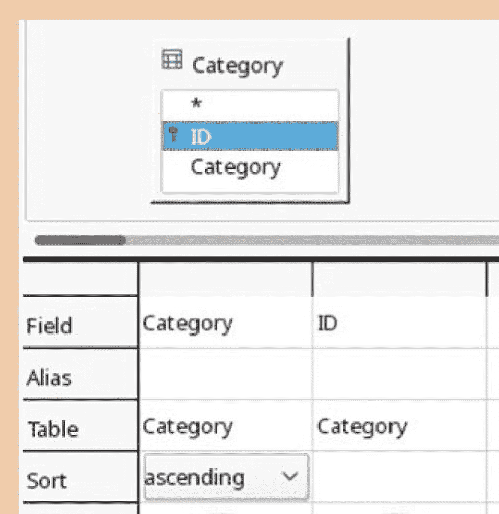

图6：在SQL命令编辑器中设置Category列表框的SQL代码。

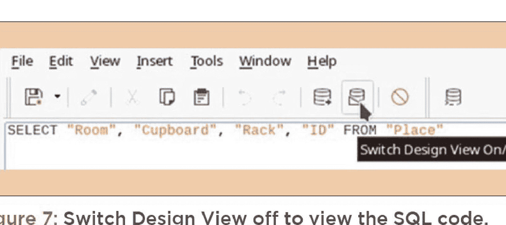

图7：关闭设计视图以查看SQL代码。该命令会按所示顺序分别显示表的所有字段。但列表字段只能显示一个字段，且只能保存另一个字段的值，因此

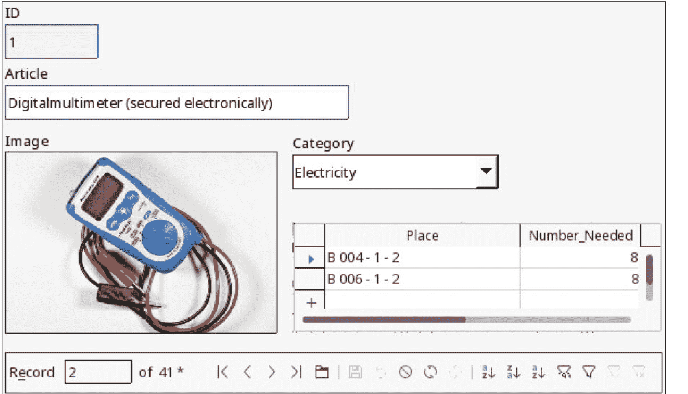

图8：带有底部导航栏的可使用表单。


首先，在「添加表或查询」对话框的`表`部分添加`Category`表。会出现一个新的Category框，其中包含其字段列表。双击`Category`字段，使其成为第一个查询字段。前三个字段的内容需要合并：

```sql
SELECT "Room"||"Cupboard"||"Rack", "ID" FROM "Place"
```

现在`Room`、`Cupboard`和`Rack`字段会按顺序显示在同一个字段中。另一方面，`ID`的值会保存在表单中，这对于在列表框中显示而言不是最优选择。修改SQL命令为：

```sql
SELECT "Room"||' - '||'R' || "Cupboard"||' - '||'R', "Rack" AS "R", "ID" FROM "Place" ORDER BY "R"
```

用带空格的连字符分隔`Room`、`Cupboard`和`Rack`字段，并使用`AS`语句指定别名，该别名用于对列表框的内容进行排序。在继续操作前，关闭并保存SQL命令编辑器和属性框。最后一步修改：在控件表中右键点击`ArticleID`，在右键菜单中选择`删除列`。尽管表单现在已可使用，但仍需修改字段大小，也可以修改`CategoryID`和`PlaceID`的标签。在表单中导航、搜索数据记录等操作可以通过屏幕底部的导航栏进行（图8），一旦录入数据，导航栏会自动显示。有时需要在输入字段旁设置单独的导航栏。要创建该导航栏，需要再次打开表单进行编辑。首先点击主表单中的一个字段，然后点击`更多控件`按钮。保存前必须声明图像。

## 入门指南

LibreOffice Base

*图9：表单导航器显示表单的所有元素。*

点击左侧边栏底部的导航栏图标。按住`Ctrl`键单击新控件中的`导航栏`，表单中会出现一个新的导航栏，其中包含与屏幕底部导航栏几乎完全相同的所有字段。现在您可能看不到任何值，因为“搜索”表中`搜索`字段的内容为空。再次修改代码如下：

```sql
SELECT * FROM "Article" WHERE "Article" LIKE COALESCE (
    ( SELECT "Search" FROM "Search" WHERE "ID" = TRUE ), "Article"
)
```

### 搜索数据集

Base自身内置了一些搜索功能。不幸的是，这些功能在使用表单时更难管理。要改变这一点，你需要更深入一些，SQL代码的基础知识是必须的。如需通用帮助，可参阅可下载的Base手册。

`COALESCE`函数会检查`搜索`是否为空；但如果为TRUE，则`文章`和`文章`会相互比较。由于`文章`应该始终有内容，且`文章`应该始终与`文章`相同，因此该查询现在会显示文章表的全部数据。如果在`搜索`中输入单词，则只会显示与输入值匹配的`文章`条目。这个查询还需要稍加改进，才能同时显示搜索词条部分的结果：词条前后的字符。因此，一个输入可以获得多个匹配结果。唯一的缺点是它仍然区分大小写。以下查询现在允许在`文章`字段中任意位置输入文本，不受大小写限制：

```sql
SELECT * FROM "Article" WHERE LOWER ( "Article" ) LIKE COALESCE (
    '%' || ( SELECT LOWER ( "Search" ) FROM "Search" WHERE "ID" = TRUE ) || '%', "Article"
)
```

首先，使用`表格|设计视图创建表`创建另一个表来保存搜索词条，并添加以下字段：

- `ID`为是/否 *[布尔型]*
- `搜索`为文本 *[字符型]*

右键单击`ID`字段将其设为主键，然后将表保存为`搜索`。在表的第一行插入`ID` = true。该表应仅保存这唯一一条数据集。

打开`查询|SQL视图创建查询`，比设计视图更快地输入代码，然后输入：

```sql
SELECT * FROM "Article" WHERE "Article" LIKE COALESCE (
    '%' || ( SELECT "Search" FROM "Search" WHERE "ID" = TRUE ) || '%', "Article"
)
```

现在将这个查询保存为`qrySearchArticle`，复制在`表单`下已创建的表单，将副本粘贴为名为ArticleSearch的新表单，通过右键单击并选择“编辑”打开这个新表单进行编辑。

*图10：仅遍历活动记录-无导航栏、无新行……*

要测试查询，请单击工具栏中的`运行查询`图标或按`F5`。会显示文章表的所有数据集。最后一行在`ID`字段中显示`自动字段`。修改代码以在搜索表中查找值为`搜索`的条目，并将其与`文章`表中的`文章`字段进行比较：

```sql
SELECT * FROM "Article" WHERE "Article" LIKE (
    ( SELECT "Search" FROM "Search" WHERE "ID" = TRUE ) || '%'
)
```

使用`%`后，搜索词条的匹配结果现在可以包含词条前后的任意数量的字符。因此，一个输入可以获得多个匹配结果。唯一的缺点是它仍然区分大小写。以下查询现在允许在`文章`字段中任意位置输入文本，不受大小写限制：

```sql
SELECT * FROM "Article" WHERE LOWER ( "Article" ) LIKE COALESCE (
    '%' || ( SELECT LOWER ( "Search" ) FROM "Search" WHERE "ID" = TRUE ) || '%', "Article"
)
```

```sql
SELECT * FROM "Article" WHERE "Article" LIKE (
    SELECT "Search" FROM "Search" WHERE "ID" = TRUE
)
```

*图11：带搜索功能的表单。找到了9条包含Meter内容的记录。*

要向现有表单添加搜索输入区域，您需要打开表单导航器（图9）。在打开的对话框中，右键单击`Forms`并选择`新建|表单`。随后会在MainForm旁边添加一个新表单。通过其上下文菜单打开此表单的属性。在“数据”选项卡中，在内容下拉列表中选择`搜索`。选择“循环|活动记录”尤为重要。图10中显示的其他设置可确保始终编辑和更改同一数据集。

接下来，选择MainForm中可用的一个表单字段，打开其属性对话框。在属性对话框的“常规”选项卡中，将“操作”设置为“刷新表单”。关闭新表单的属性对话框后，选择MainForm。在“数据”选项卡中，将内容类型设置为查询，内容设置为`qrySearchArticle`。

在边栏中按住`Ctrl`键单击“按钮”图标。此按钮应显示在MainForm中（在表单导航器中查看）。在该按钮属性对话框的“常规”选项卡中，选择`操作|刷新表单`。现在，每次单击此按钮时，表单都会重新扫描。

在表单导航器中，再次为搜索表选择新表单，通过选择“文本框”图标并使用鼠标绘制框来创建输入区域。在此框的属性对话框的“数据”选项卡中，将“数据字段”设置为`搜索`，“必填输入”设置为“否”。单击MainForm中的按钮时，此文本字段的内容现在将自动保存（图11）。

如果对表单感到满意且不想进行任何设计更改，现在可以保存它，并在电子表格中使用数据。另一个优点是可以生成报表。

Base还支持连接到Base内部数据库之外的外部数据库（例如MySQL/MariaDB、PostgreSQL、电子邮件地址簿等）。Base仅需访问这些表并提供图形用户界面即可。由于Base可以访问众多数据库，了解SQL基础知识始终是有利的。否则，访问将很快被限制为仅包含单个表、且仅使用Base内置搜索功能的数据库。

### 结论

起初，创建内部数据库比在Calc中创建表格花费的时间多得多，但一旦数据库构建完成，数据录入比手动输入数据要准确和快速得多。

## 信息

> [1] LibreOffice入门指南：https://nextcloud.documentfoundation.org/s/BimPSBPLf3TRRbTR
> [2] Base手册：https://documentation.libreoffice.org/en/english-documentation/

## 打造你的Linux技巧宝库！2023版

### 酷炫Linux技巧

91个技巧

面向Linux极客的技巧和快捷方式

- 使用Ventoy制作多发行版可启动U盘
- 使用功能强大的Converseen GUI工具转换图片
- 处理PDF：你不需要Acrobat即可搜索、编辑、恢复密码或开启密码保护
- ISO CD/DVD镜像：挂载并检查镜像文件
- 现代编程：在Jupyter Notebooks中编写和记录代码

发现专家的秘诀 www.linux-magazine.com


### 商店选购

shop.linuxnewmedia.com

### 借助酷炫Linux技巧提升效率

通过这套专为Linux极客准备的激励技巧与快捷方式合集，提升你的Linux技能。

- 命令行使用Google
- OpenSnitch应用程序防火墙
- 解析systemd日志
- 用lazygit控制Git
- 用DOSBox运行老式DOS游戏
- 还有更多！

在线订购：shop.linuxnewmedia.com

## 使用公式编辑器

### 公式与格式

*作者：Franz Böhm 和 Paul Brown*

LibreOffice Math套件可让你展示简单与复杂的公式。Math公式编辑器既可以作为独立程序运行，也可以从其他LibreOffice模块中调用，将格式完美的公式嵌入文本文档、电子表格、演示文稿和绘图中。Math可以表示分数、幂、积分、函数，甚至完整的方程组或矩阵。

要在独立窗口中启动Math，请点击`文件|新建|公式`。要在Writer、Calc、Impress或Draw中插入公式，请选择`插入|对象|公式`。公式将成为文档中的嵌入对象，你可以对其进行拖放、放大或缩小。

使用三栏式Math编辑器的工作方式在这两种情况下是相同的：左侧是侧边栏，右下角是“命令”窗格，该窗格默认处于停靠状态，按住`Ctrl`键并双击其框架即可将其分离并重新停靠。命令窗格上方是预览区域，可显示公式在文档中的最终呈现效果。点击`视图|元素`会弹出一个小元素窗口显示辅助工具，这对Math初学者尤其有用，可简化公式输入流程。

注意：公式编辑器不会执行计算。Math仅用于编写和显示公式。

### 工作区

启动Math时，工作区为空。要开始使用，请从侧边栏下拉列表或元素窗口顶部的两排图标中选择九个类别之一。这些类别包括：

- 一元/二元运算
- 关系运算
- 集合运算
- 函数
- 运算符
- 属性
- 括号
- 格式
- 其他

> 首图 © Roman Gorielov，123RF.com

**图1：** 选择某个运算后，该运算会立即出现在文档和命令面板中。随后你可以用数字或变量替换`<?>`占位符。你也可以通过`工具 | 符号`菜单插入符号，或者点击前述工具栏中的更多欧米伽图标，调出右键菜单插入符号。在弹出的符号对话框中，选中某个字符（图2），依次点击`插入`和`关闭`。此外，你也可以通过双击字符完成上述最后两步操作。对应的符号会插入到命令面板和预览面板中，同时对话框自动关闭。你会发现，特殊希腊字符会显示在命令面板中，且字符名称前带有百分号。大写字母的名称全部使用大写形式（例如%ALPHA、%BETA、%GAMMA）；小写字符的名称仅使用小写字母（例如%psi、%phi、%theta）。如需了解所有希腊字母及对应标记的完整列表，请参阅数学手册[1]。通过符号对话框，你还可以修改已有符号，或添加公式中常用的新符号。每个分类下会展示一组运算。点击任意运算，命令区域会显示对应的运算指令，预览面板则会展示该运算在文档中的最终呈现效果。例如，在侧边栏中选择`一元/二元运算`分类，然后点击`乘法（点乘）`符号。此时命令面板中会显示如下内容：

```text
<?> cdot <?>
```

预览区会出现两个带点的灰色占位框（图1）。当你在命令区域将`<?>`占位符替换为数字或`$x$`、`$y$`这类变量后，对应的内容会取代预览区中的灰色方块显示出来。插入新公式后，命令面板中的第一个占位符会自动处于选中状态，你可以直接输入内容覆盖它。按下`F4`可跳转到下一个占位符，按下`Shift+F4`可返回上一个占位符。默认情况下，数学编辑器会自动更新公式，你可以通过`视图 | 自动更新显示`关闭该功能，之后按下`F9`即可手动更新所有内容。点击`视图 | 工具栏 | 工具`，即可在工具栏中添加可点击的图标，用于放大/缩小视图或让视图自适应窗口大小。从右数第二个图标是公式光标，点击公式或命令面板中的某个区域后，该图标会高亮对应位置，帮助你快速定位到文档或命令面板中的对应公式部分。

**希腊字母入门**
数学公式中经常会用到希腊字母，你可以在符号对话框中找到这些字符。

**图2：** 符号对话框可用于向公式中插入希腊字母。

**LibreOffice Math 入门**
**图3：** “编辑符号”对话框可用于将已有符号添加到符号集，或创建包含常用特殊字符的新符号集。点击`编辑`按钮即可找到上述功能所需的工具。例如，如果你想添加“对应”（带帽等号）特殊字符到特殊符号集，可在顶部下拉菜单中选择`特殊`，然后点击`编辑`按钮调出“编辑符号”对话框（图3）。注意已显示字符集下方的五个下拉菜单。`符号`字段包含待编辑字符的名称，原本为perthousand（千分号）。如果从上方字符区域选中带帽等号，该字段的值会变为U+2259（即“对应”符号的Unicode编码）。`符号集`字段包含待编辑符号所属的集合名称，此处为“特殊”集合。要将带帽等号字符添加到该集合，点击`添加`即可。此外，你也可以在符号集字段中输入自定义名称，创建新的符号集合。

**括号类符号**
括号（包括圆括号、方括号、花括号、竖线）是构建公式时不可或缺的元素。在左侧边栏的下拉菜单中，有专门的`括号`分类。LibreOffice Math对括号做了如下区分：

- 分组括号：用于包裹关联的表达式，但不会显示在最终公式中。
- 花括号：如果在命令面板中直接通过键盘输入花括号，Math会将其识别为分组括号。若要通过点击方式插入花括号，需在`括号`下拉菜单中点击花括号图标，此时命令窗口会插入`lbrace`和`rbrace`，预览窗口会显示一对花括号。
- 圆括号和方括号：作用和分组括号类似，但会显示在预览的公式中。

括号通常成对出现。如果在命令窗口中输入左圆括号或左方括号，公式编辑器会自动补全对应的右括号。如果你想单独使用单侧括号，可在括号前添加反斜杠（`\`），Math会将其识别为普通符号而非成对括号。所有类型的括号都支持缩放形式，位于不可缩放括号选项的正下方区域。可缩放括号会自动适配所需尺寸（图4），且在命令窗口中，括号指令前会带有`left`或`right`标识。因此图4中公式的对应指令为：

```text
left( (a + b) over c + d right) = e
```

你也可以单独输入可缩放括号，使用`none`关键字可省略右侧括号。


```text
left lbrace right none
```

此时预览区仅显示一个左侧大花括号，告知`Math`右侧括号为缺失状态。

**图4：**括号尺寸可自适应包裹的公式内容。

以下矩阵公式最初会在命令面板中作为单行长字符串输入：

```text
%alpha = left [ matrix { %gamma_{1_1} # %gamma_{1_2} # dotsaxis # %gamma_{2_1} # %gamma_{2_2} # dotsaxis # %gamma_{2_n} ## dotsvert # dotsvert # dotsdown # dotsvert # %gamma_{m_1} # %gamma_{m_2} # dotsaxis # %gamma_{m_n} } right ]
```

通过添加空格和换行重新排版后，同一公式的可读性会大幅提升，且最终呈现结果完全一致：


进入`/path/to/xxx`目录，找到`xxx.json`。

在表达式`cvar = avar + bvar`中，加法运算符（`+`）将`avar`与`bvar`相加，得到它们的和`cvar`。

在`List.of(arg0, arg1, arg2)`中，`List`接口的工厂方法`of()`接受一系列的元素，返回包含它们的只读列表。

之后我们这样调用`cmd`命令：`cmd arg0 arg1 arg2`。

```
if (condVar > someVal) {console.log("xxx")}
```

---

```text
%alpha = left [ matrix { %gamma_{1_1} # %gamma_{1_2} # dotsaxis # %gamma_{1_n} ## %gamma_{2_1} # %gamma_{2_2} # dotsaxis # %gamma{2_n} ## dotsvert # dotsvert # dotsdown # dotsvert %gamma_{m_1} # %gamma_{m_2} # dotsaxis # %gamma_{m_n} } right ]
```

**图5：** 顶部的公式以单行长字符串形式输入到命令窗口中，结构不清晰；同一公式通过添加空格和换行排版后，可读性大幅提升，右侧的呈现结果完全一致。

编辑复杂冗长的公式时很容易出现输入错误，若不小心插入了语法错误，LibreOffice Math会发出提示。预览区中出现倒置的深红色问号即表示存在错误，双击该问号即可直接跳转到命令面板中对应的错误位置。按下`F3`可跳转到下一个错误位置，按下`Shift+F3`可返回上一个错误位置。窗口底部会显示额外的提示信息，例如`意外字符`。注释仅会显示在命令面板中，不会出现在文档里，在编辑长而复杂的公式时非常实用。注释以双百分号（`%%`）开头，会延续到行尾，按下`Enter`键即可结束当前注释。部分符号（例如`#`、`%`、`^`、`&`、`_`、`|`）在Math中有特殊含义，如果这些符号需要出现在文档的公式中，需要在命令面板中给它们加上英文双引号。如果你直接在Math模块中创建了公式，可以通过选择`文件 | 另存为`，将其保存为扩展名为`*.odf`（开放式文档公式）的独立对象。如果你将公式对象嵌入到了Writer或Calc中，可以将公式随文本文档或电子表格一起保存，也可以将其导出为独立对象。要导出公式，右键点击公式，在弹出的上下文菜单中选择`另存为副本`即可。反之，你可以通过`插入 | 对象 | 公式`功能，将已编辑完成的公式文件导入到LibreOffice文件中。此时会再次打开Math公式编辑器，选择`工具 | 导入公式`即可导入目标文件，你可以选择修改导入的公式，或直接保持原样使用。点击上方的文本文档或表格文档后，LibreOffice会自动关闭Math窗口。

**最后同样重要**

如果你需要打印公式，可在打印对话框的`LibreOffice Math`标签页中找到诸多实用设置。例如，勾选`标题`复选框，即可在打印页顶部输出文件名。勾选`公式文本`选项，程序会打印命令面板中的内容。你还可以选择是否添加边框，以及打印尺寸：可按原始尺寸打印、适配页面打印，或按自定义比例缩放。预览区会展示最终的打印效果（图6）。

**更多排版技巧！**

分组括号可以为公式提供结构，但按下`Enter`键插入的空格和换行不会影响公式的排版效果。Math会自动忽略这些空格和换行，也就是说你可以在命令面板中使用空格和换行来排版冗长复杂的公式，提升可读性，且不会影响预览区的呈现效果。

> **提示**
> **[1] 数学手册：** https://nextcloud.documentfoundation.org/s/mQWELLbAX9R52MN

---

## 扩展LibreOffice的功能


你可以通过350多个实用的扩展来增强LibreOffice的功能。

作者：布鲁斯·拜菲尔德

扩展是LibreOffice基础办公套件的非官方附加组件。有些扩展会提供额外的资源，比如图库的图片或多语言词典。有些则提供带有额外功能或不同布局的替代对话框，比如替代拼写检查器或语法检查器。少数扩展甚至提供的新功能最终会被纳入标准安装版。和Mozilla Firefox或GIMP（GNU图像处理程序）一样，扩展是LibreOffice广受欢迎的主要原因之一。如今，已有超过350个扩展可供使用。

有些扩展是资源的集合，比如替换图标。有些则是用LibreOffice的Basic脚本语言，或是Java、Python等标准编程语言编写的宏。这种多语言兼容性意味着开发者无需熟悉LibreOffice的代码库就可以开始为其贡献扩展。完成后的扩展是一段独立的代码，安装时会嵌入到基础代码中。

### 查找扩展

LibreOffice为模板和扩展维护了一个独立的网站[1]。开发者可以在该网站注册账号以上传自己的作品，用户则可以在此浏览扩展，查看扩展的简要说明、许可信息和截图。由于扩展总数超过350个，且还有很多更新，查找扩展可能会花费一些时间，但每个页面的右侧边栏都提供了查看最新扩展以及按分类浏览的链接。

### 安装扩展

所有LibreOffice扩展的文件名都以`OXT`结尾。无论扩展是资源还是程序，安装流程都是相同的：

1. 将扩展下载到你的系统中。
2. 点击`扩展`标签页，然后点击右侧的`扩展附加`菜单，选择`扩展管理器 | 添加`，然后定位到下载的扩展文件（图1）。
3. 选中扩展后点击`打开`。如果该扩展已存在于你的系统中，系统会询问你是否要覆盖它，点击`确定`继续即可。
4. 确认对话框会询问你是要将扩展安装到系统中所有用户，还是仅安装给你自己。如果要为所有用户安装，你需要具备`root`用户登录权限，选择这两个选项中的一个即可。
5. 你可能会被要求接受许可协议，请阅读协议并滚动到末尾，点击接受即可。
6. 在扩展管理器中点击`选项`按钮自定义扩展设置。不是所有扩展都有可配置的选项。
7. 关闭并重启LibreOffice，扩展即可使用。你可能需要在编辑窗口中搜索才能找到扩展入口。词典这类资源通常在`工具 | 语言`中，而图库图片则可以在`插入 | 媒体 | 图库`中看到。

### 提升使用效率

其他语言相关的扩展可能位于菜单的任意位置，通常在工具菜单的底部。还有些扩展可能在工具栏中，尤其是左侧工具栏。扩展没有固定的存放位置，很多扩展开发者也不会说明已安装扩展的查找位置，因此你有时需要灵活变通地搜索。部分旧扩展仅支持标准工具栏界面，因此你可能需要先通过右上角的三条横线（汉堡）菜单中的`用户界面`选项临时切换到标准工具栏界面。

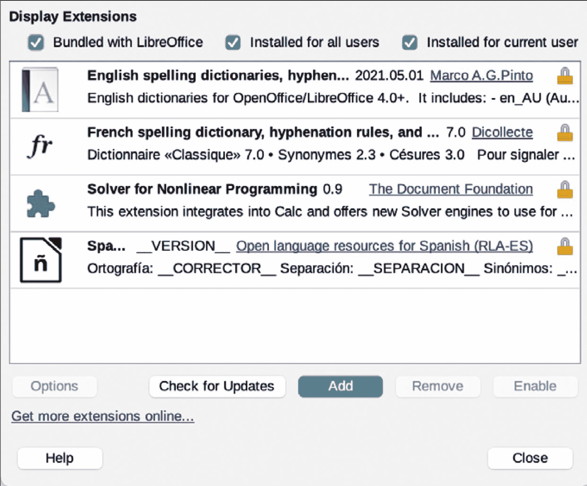

图1：扩展管理器用于添加、删除、禁用和修改扩展。

### 丰富的扩展类型

多年来，扩展已成为安装拼写和连字符词典的首选方式。其中大部分适用于LibreOffice最常用的两个组件Writer（文字处理）和Calc（电子表格）。除非特别说明，大多数扩展都支持LibreOffice所兼容的所有操作系统。最受关注的是那些新增或扩展功能的扩展，这类扩展数量过多无法逐一介绍，下面我们会讨论最通用实用的几款。

### OpenClipart集成

需要为文档补充一些额外图片吗？OpenClipart是一个公共领域的在线图片资源库——也就是说任何人都可以将这些图片用于任何目的。该扩展提供了一种快速方式，让你无需先访问网站，就能直接在文档中插入来自OpenClipart资源库的图片（位于插入菜单下）（图3）。

### 替代版「查找与替换」对话框

这款扩展会替换编辑菜单中的标准「查找与替换」对话框，它新增了无数种查找方式，支持搜索书签、注释、交叉引用、图片和文本框。对于已经受够了默认「查找与替换」功能的用户来说，这款扩展的一个重要新增功能是支持按字符样式而非设计特征进行搜索。此外，内置的正则表达式功能让新手也能轻松完成高级搜索。用户还可以搜索多个段落，同时执行多次查找。这款替代版「查找与替换」对话框可能需要花一点时间熟练使用，但不要被它看起来简陋的下拉列表迷惑：它早该成为默认工具了。你撰写的文档越长，就越会感受到它的实用之处（图2）。

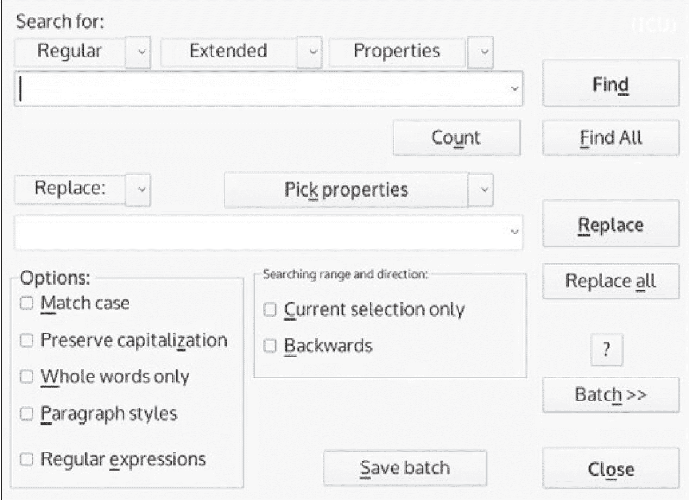

图2：替代版「查找与替换」对话框极大地增强了LibreOffice的默认搜索能力。


图3：OpenClipart是一个公共领域的在线图片资源库。

### 仅复制可见单元格

在Calc电子表格中，你可以隐藏行或列，但复制时会连同隐藏的内容一起复制。使用「仅复制可见单元格」扩展，只会复制可见单元格，省去粘贴后额外删除隐藏内容的步骤。

### 导出为图片

Draw（绘图）和Impress（演示）组件都包含多个页面或版式，该扩展可以一键将所有页面导出为JPG、PNG、GIF、BMP或TIFF格式的图片。如果你在演示结束后需要将幻灯片发布到网上，这款扩展会非常实用（图4）。

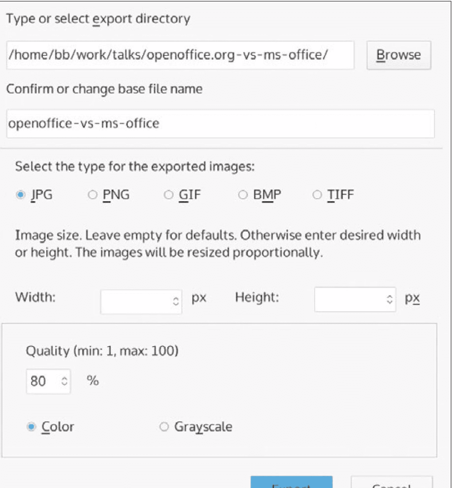

图4：「导出为图片」扩展可将Draw和Impress的幻灯片转换为图片。

### 多格式保存-Draw

多格式保存-Draw扩展替代了早期不支持Draw模块的多格式保存扩展。这款扩展非常实用，因为在微软主导的市场环境中，你经常需要将同一份文件保存为多种不同格式。它支持开放文档格式（ODF，LibreOffice的原生格式）、传统和现代微软Office格式以及PDF，所有格式的文件都会保存在同一目录下。你在保存文档时就能找到这款扩展（图5）。

### 审阅工具栏

审阅工具栏没有新增任何功能，但通过将跟踪修订、插入批注、行编号和行高亮等实用功能整合到同一个工具栏中，让编辑工作更高效。有了审阅工具栏，所有工具只需点击一次即可使用。

### Zotero与LibreOffice集成

Writer（文字处理组件）的参考文献工具已经非常过时，且操作繁琐。这款扩展可以让你用Zotero这款基于Web的工具替换默认的参考文献工具。它最大的优势之一是支持轻松格式化所有主流的参考文献格式。

### 注意事项

以上例子可以让你了解到扩展的功能非常多样。开始浏览现有扩展，你经常会发现一些你之前从未意识到自己需要的工具。对用户而言，扩展是自定义LibreOffice、添加实用功能的简单方式。但你需要知道，扩展数量多达数百个，且没有经过系统审核。因此，词典、图库图片这类资源顶多占些硬盘空间，不会造成其他危害，但其他扩展的可靠性就难以保证了。

你可以通过点赞/点踩的评分粗略判断扩展的可靠性，但这终究无法告诉你扩展是否存在问题，尤其是当多个扩展影响同一功能时。同时安装多个扩展就像同时服用多种处方药——无法提前确定扩展之间会如何相互作用。此外，由于LibreOffice一直在持续开发，某个版本可用的扩展可能在下一个版本中就无法使用。遗憾的是，虽然每个扩展页面都有列出兼容性的标签页，但并非所有开发者都会填写；无论如何，确定扩展是否可用的唯一方法就是安装它。如果扩展无法使用，你可以订阅官网的RSS源，在新版本发布时收到通知。

值得肯定的是，很多开发者确实会努力更新自己的扩展。不过数据丢失的概率极低，但为了绝对安全，你还是应该经常保存并备份文件。另外，如果只从LibreOffice的官方扩展站点下载扩展，出现问题的概率也会更低。如果真的遇到问题，你完全可以删除异常的扩展，最多只是损失一个喜欢的附加组件或资源而已。关键是要不要让意外行为的担忧吓退你使用扩展。只要采取一些基本预防措施，使用扩展就能极大提升你的LibreOffice使用体验。最坏的情况不过是下载试用一个扩展后，再将其从系统中删除，浪费一点时间而已。

> *信息* [1] LibreOffice 扩展：https://extensions.libreoffice.org/

同理，也无法预知多个扩展同时使用时会有什么效果，尤其是当它们影响同一功能时。同时安装多个扩展就像同时服用多种处方药——无法提前确定扩展之间会如何相互作用。当你需要将同一份文件保存为多种格式时，多格式保存-Draw扩展可以省去数十次按键操作。

图5：多格式保存-Draw扩展可在你需要将同一份文件保存为多种格式时，省去数十次按键操作。

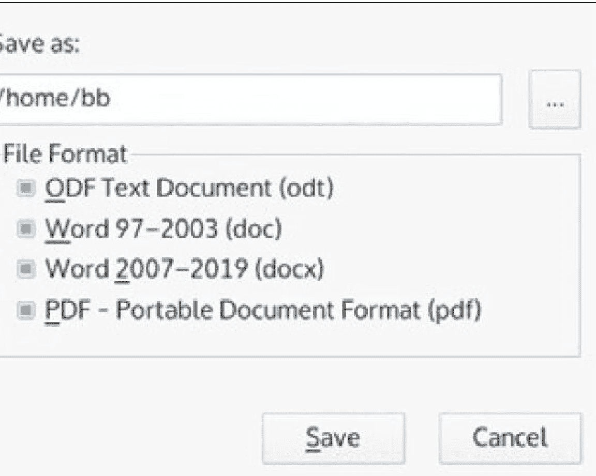

---

## 公共资金

### 公共代码


### 用自由软件实现公共基础设施现代化


自由软件基金会欧洲分会

了解更多：[https://publiccode.eu/](https://publiccode.eu/)

## 提升工作效率

### LibreOffice 模板

#### 轻松搞定文档格式

#### 示例文档 *作者：布鲁斯·拜菲尔德*

文档格式调整非常耗时。哪怕你用了样式，格式设置依然要耗费大量精力——这些精力本可以用来打磨内容。此外，如果多个人共同处理一系列文档，你肯定不希望每个人自行设置格式，最终导致结果不一致。针对这两个问题的解决方案就是模板——这类特殊文件可以同时存储结构和内容，方便重复使用。搭配样式使用的话，设计精良的模板能节省大量时间，并且可以沿用多年。

#### 模板的工作原理

不同于微软Word，LibreOffice的菜单中不会显示任何默认模板。这一设计避免了用户过度编辑默认模板导致文档损坏的问题。如果不使用模板，唯一能修改LibreOffice默认格式的方式是更改`工具 | 选项 | LibreOffice Writer | 西文基础字体`中的字体设置。页面样式、列表样式这类默认格式无法全局修改，只能逐个调整。不过你也可以设计一个包含更多格式信息的模板作为默认模板：只要你没特意选择其他模板，每次选择`文件 | 新建`时创建的所有文档都会使用该模板的配置。注意LibreOffice官方文档中区分了两个概念：默认模板（LibreOffice内置的模板）和「Default模板」（你设置为所有文档通用的模板）。默认模板可以是Default模板，但即便其他模板被设置为Default，内置的默认模板依然存在。如果删除了Default模板，系统会重新启用内置默认模板。

#### 模板的规划与命名

很多人因为觉得自己的每一份文档都是独特的，所以抗拒使用模板。但这种说法更多是想象力不足，而非事实。退一步说，几乎每个人都有自己的格式偏好，比如偏好的字体、企业用色之类。把这些偏好放进默认模板里，你每次创建文档时都不用重新设置格式，可以直接开始工作。你的默认模板还可以作为其他文档的基础。如果你不确定要创建哪些其他模板，不妨想想你经常要写哪些类型的文档，比如备忘录、信件或是随笔。如果想不起来，可以去`文件 | 最近使用的文档`里看看，也可以查看你平时邮件里会附上的文件类型。如果还是没思路，可以连续几周记录自己产出的文档类型。现在花的心思未来几年都能用得上，还能省下不计其数的工时。整理模板库的时候，尽量给模板起描述性强的名字。描述性的标题能让你更容易找到需要的模板，在把模板传到其他电脑时，还能避免命名冲突。别把模板命名为`article.ott`这种模糊的名字，最好起更具体的，比如`Linux-Pro-Magazine.ott`。到时候你会庆幸自己花时间做了合理规划。

#### 获取模板的渠道

LibreOffice自带大量内置模板（见图1）。


图1：LibreOffice预装了大量由印度尼西亚LibreOffice社区创作的全新模板。

另一种获取模板的方式是下载。线上有数百份LibreOffice模板可供下载[1]，你肯定还能找到其他下载站点。但下载的缺点是，你需要在可选模板里筛选，会耗费不少时间，而且不同模板的差异不一定一眼就能看出来。另外，你大概率需要修改下载的模板来适配自己的需求和偏好，所以下载未必有你最初想得那么方便。

线上有成千上万的微软Office模板，也是很好的模板来源。不过在使用前，你需要先测试这些模板在LibreOffice中的显示效果是否正常。另外，你最好也检查一下所下载模板的授权协议。从技术角度来说，在微软Office之外使用微软Office模板属于侵权行为，因此你可能需要避免将它们用于工作场景。

还有一个更便捷的获取渠道：`文件 | 向导`。由于向导的创建过程是交互式的，它能在你设计模板的过程中教你思考方法。但这个渠道的缺点是，向导提供的可选模板数量有限，很多模板虽然能用，但功能设计得过于复杂，超出了实际需求。

但无论如何，你迟早需要自己设计模板。不管是修改下载的模板还是从零开始创建，操作方式和创建普通文档没有区别。除了格式之外，你可能还想往模板里加一些内容。可以在模板开头加一段简短说明，解释模板的使用方法。你也可以加入样板文本——这些内容在所有文档中都保持一致，比如个人简介、企业背景介绍之类。如果你知道模板某个位置需要放哪类信息，但还没确定具体内容，可以通过`插入 | 字段 | 更多字段… | 功能 | 占位符`添加占位符。其他字段，比如文档信息，或是存储在`工具 | 选项 | LibreOffice | 用户数据`中的通用用户信息，也可以像添加普通文档内容一样添加到模板中（见图2）。


图2：哪怕你还没有详细信息，占位符和字段也非常适合用来存储模板的结构。其中部分字段（比如日期和时间）可以设置为固定值，插入时就会把当时的日期/时间固定写入，也可以设置为变量，打开文档时会自动显示当前的日期/时间。

这些和普通文档的差异，只有在你保存结果时才会体现出来。

#### 注册模板

普通文件保存后就可以直接使用了，但模板不管怎么创建，都必须在注册到LibreOffice之后才能使用，和通讯录、数据库这类数据源的要求一样。你当然可以通过普通文件保存对话框保存模板，但如果想让系统识别这个模板，第一次保存时必须使用`文件 | 模板 | 另存为模板`（见图3）。

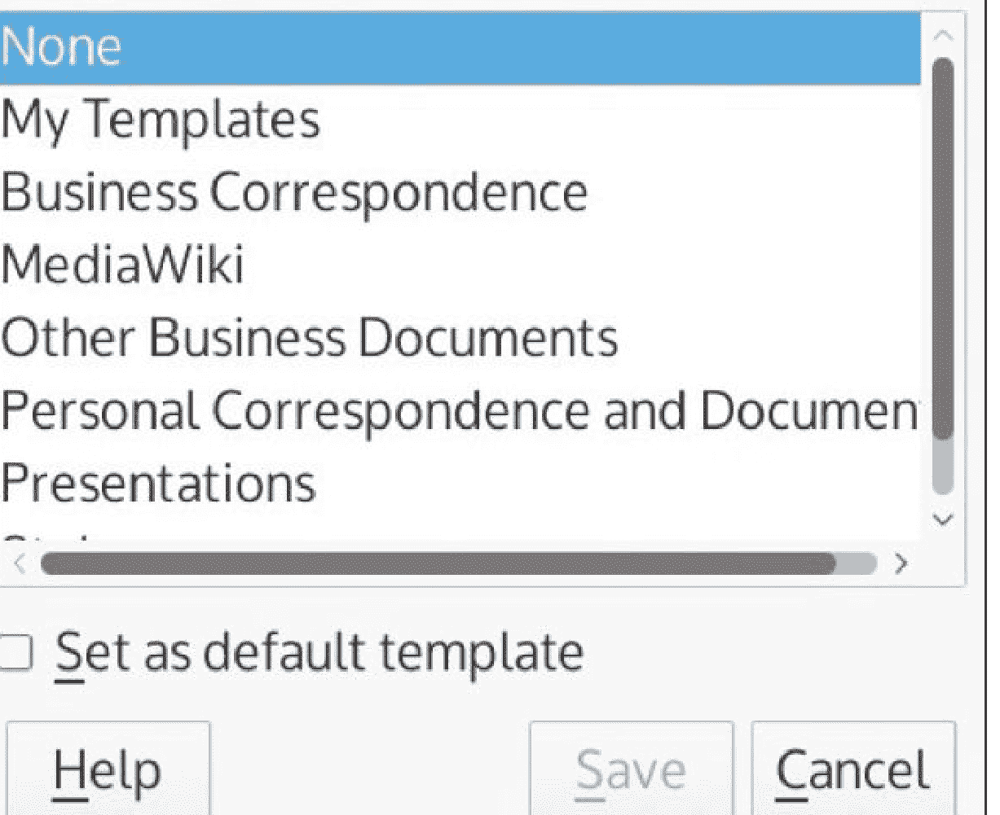

图3：模板必须先通过专属对话框保存后才能使用。打开对话框后，输入模板名称，再选择一个分类来归档该模板。这些分类对应模板管理器中的显示筛选器（见下文）。你也可以选择将该模板设为默认模板，这样除了你特意选择其他模板的情况，打开LibreOffice文件时都会自动使用它。如果你不分配分类，模板就会显示在模板管理器的顶层。

在编辑窗口中，每次只能注册一个模板。如果你下载了大量模板，可以通过文件管理器把它们放进`工具 | 选项`中「路径」部分列出的某个目录里，也可以使用模板管理器中的导入工具来完成批量注册。

#### 使用模板

要管理模板，或是基于模板新建文档，可以选择`文件 | 新建 | 模板`。你也可以通过`文件 | 模板 | 打开模板…或管理模板`来管理模板，这两种方式都会打开模板管理器窗口（见图4）。

模板管理器会以虚拟视图的形式，展示`工具 | 选项 | 路径`中列出的所有模板路径下的模板。默认情况下，它只会展示你的主目录中的模板，不过路径配置里也可能包含系统所有用户都能访问的模板仓库。模板管理器顶部有三种查找已注册模板的方式：搜索框、LibreOffice模块筛选器、分类筛选器。窗口底部则是管理编辑窗口视图、导入导出文件的工具。

要操作某个特定模板，只需右键点击它。在右键菜单中，你可以基于选中的模板新建文档、将其设为对应LibreOffice模块的默认模板，或者打开模板进行编辑。如果是编辑已注册的模板，你可以用普通的`文件 | 保存`对话框来保存。通过扩展安装的、或是面向整个系统的LibreOffice预装模板无法删除，但你可以通过`扩展选项卡 | 扩展菜单 | 扩展管理器`删除对应的扩展。不过通过编辑窗口创建的模板可以删除——但要小心，因为模板管理器没有删除确认弹窗。在模板管理器中选择要删除的模板，再点击删除按钮即可。

#### 规避模板限制

多年来，微软Word一直以允许给一份文档应用多个模板而臭名昭著，结果往往导致文件损坏且无法恢复。LibreOffice的前身StarOffice在开发时，为了避免这类问题，直接禁止了模板混用。唯一的问题是，用户仍然需要一种便捷的方式来修改模板，以及和模板关联的文件。

修改模板以及基于该模板创建的文档最便捷的方式，就是在模板管理器中右键点击模板进行编辑。保存修改后的模板后，下次打开关联的文档时，系统会提示你是否升级文档（见图5）。如果你不升级文档，它和模板的关联就会被切断——但令人困惑的是，该模板依然会显示在`文件 | 属性 | 常规`中。你偶尔会看到一些声称可以更换模板的扩展，但和所有扩展一样，使用这类工具需要你自行承担风险。考虑到微软Word几十年来一直存在的相关问题，你最好还是避免使用这类工具。

将文档重新关联到模板的一种方法是：先用目标模板新建一个空白文档，再把未关联的文档内容复制粘贴进去。注意这里要用`粘贴`，不要用`选择性粘贴`。某些情况下，你也可以设计一个新模板，注意使用和原模板完全相同的样式名称，然后覆盖原模板的名称。新模板会被视为原模板的修订版本，因此所有关联的文档在打开时都可以更新为新的模板格式。

临时解决方案是使用主文档。过去，主文档常被用来把长文件拆分成多个小部分，以便在内存有限的情况下编辑。如今主文档依然用于支持多人同时编辑同一份文档。但这里的关键是，主文档可以使用和它的任意子文件不同的模板——哪怕只有一份子文件。

要使用这个功能，先用修改后的模板新建一个文档，然后选择`文件 | 发送 | 主文档`。接着打开主文档，在右键菜单中选择`插入 | 文件`，从文件管理器中添加目标文档，再选择`更新 | 全部`来应用主文档的格式。不保存直接关闭主文档的话，你依然可以原格式打开目标文档。如果你决定保留主文档的格式，可以在右键菜单中选择`编辑`，在编辑窗口中打开目标文档，之后就可以用主文档的模板保存它了。

如果你熟悉旧版微软Word，可能会觉得把文件交给主文档管理的想法很可怕——旧版Word的主文档基本只有两种状态：已经损坏，和即将损坏。不过Writer主文档的稳定性高得多，虽然它们

---

# 提升效率

### LibreOffice 模板

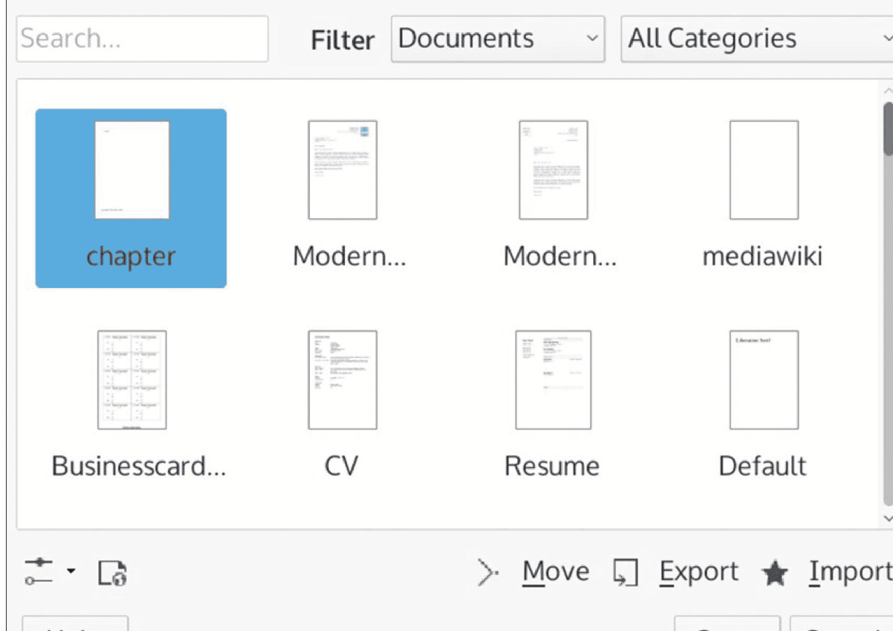

类似地，你可以通过在另一份文档中临时打开菜单栏（左上角按钮），再选择`样式与格式 | 载入样式`来导入样式。该选项允许你同时选择要上传的文件和样式类别：`文本`、`编号`、`框架`和`页面`。为获得最佳效果，请使用与原文件中名称相同的导入样式，并勾选`覆盖`选框。

**图 4：** 模板注册完成后，模板管理器就是用来打开、编辑、移动或删除模板的场所。尽管模板偶尔会崩溃，但它们不应破坏其组件文件。不过为了安全起见，请确保你已做好最新备份。

`选择性粘贴`功能可让你粘贴另一份文档中的选中文本。使用该命令时，原始格式的文本会按照其所插入位置的段落或字符样式进行格式呈现。但图片、表格等对象会被丢弃，需要你通过`开始 | 粘贴`单独复制粘贴。如果你不介意忽略或丢失文档与其模板的关联，可以使用`开始 | 粘贴下拉菜单 | 无格式文本`对后续内容进行部分重新格式化：


**图 5：** 编辑完模板后，基于该模板的文件必须更新。


**图 6：** 从模板中载入样式，可以达到不实际切换模板却实现切换模板的效果。

# 最佳实践

虽然必要时你可以绕过模板的限制，但请记住这些限制是为了保护你的文档不受损害。通常，以下方法可以帮助你高效、无障碍地使用模板：

- 尽可能避免将文档与其模板分离。
- 除非文档仅会使用一次且无需维护，否则尽量不要分离文档。
- 仅在模板上修改格式。
- 所有格式修改都在模板上进行，之后将修订后的模板应用到文档中。
- 模板修改后立即将其应用到文档，这样你就不用记住改了什么，也不用在下次打开文档时怀疑自己是否误改了内容。

设计一个模板可能需要花费数小时。很可能你在使用一两次模板后，会想要做一些微调。不过一旦模板能满足你的需求，它就能帮你节省数小时的时间，并且可以多年实用。约束自己，优先使用模板系统而非选择短期便利，这样模板就能成为LibreOffice中最有价值的工具之一。

> [1] LibreOffice 模板和扩展下载地址：https://www.libreoffice.org/discover/templates-and-extensions/

# 通过宏自动化操作 LibreOffice

#### 办公自动化

LibreOffice 内置了一种类似 Basic 的脚本语言，可用于自动化处理重复性任务，并扩展套件的默认功能。

> 作者：德米特里·波波夫（Dmitri Popov）

在擅长使用者手中，LibreOffice Basic 脚本语言能发挥奇效，但你不需要成为编程专家，就能编写出能完成实用任务的简单甚至高级宏。无论你是 Linux 家庭用户还是 IT 专家，都可以使用 LibreOffice 套件内置的脚本功能来自动化处理重复性任务。本文提供了一些示例，你可以将其用作自己 LibreOffice 编码项目的基石。例如，你可以使用以下代码打开你设备上的默认浏览器：

```vbnet


# LibreOffice 宏

## 提升效率

### 通过 Shell 函数调用外部程序

```vbnet
Sub Main

Shell ("xdg-open", 1)

End Sub
```

`Shell`函数需要传入要运行的程序的名称（如果应用程序不在 Bash 的 `$PATH` 环境变量包含的路径中，你可能需要添加完整路径）。第二个参数用于指定程序的打开方式（例如全屏；窗口最小化、最大化或隐藏；窗口是否有焦点等）。需要说明的是，`xdg-open` 是目前调用用户为特定文件类型或 URL 设置的默认应用程序的最常用方式。例如，运行`xdg-open http://<some.url>`就会在用户偏好的网页浏览器中打开`http://<some.url>`。


头图 © Ioannis Kounadeas, Fotolia.com

#### 查询单词

你可以通过**工具 | 宏 | 编辑宏**打开 LibreOffice Basic 宏编辑器（图 1）。通常，编程语言的入门介绍都会从一个显示"Hello world!"信息的简单示例开始。虽然这个示例很可爱，但实用价值不高，因此我将从一个更实用的内容开始：一个用于查询维基百科中当前选中单词的简单宏。该宏的核心元素是内置的`Shell`函数[1]，用于调用外部程序。如果你希望该宏在默认浏览器中打开特定 URL，可以将 URL 作为第三个参数传入 shell 命令：

```vbnet
Sub Main

Shell ("xdg-open", 1, "http://en.wikipedia.org/")

End Sub
```

只需做几处简单修改，你就可以将上述代码转换为查询宏（清单 1）。首先，你需要添加获取当前选中单词的代码（第 2-3 行），然后修改 `Shell` 命令，使其指向维基百科的查询 URL 并拼接上选中的单词（第 4 行）。要为创建的宏分配键盘快捷键，请选择**工具 | 宏 | 管理宏 | LibreOffice Basic**。在弹出的对话框中，点击**分配**按钮。会弹出新的"自定义"对话框（图 2）。点击**键盘**选项卡，在快捷键区域选择一个未占用的快捷键。要找到你刚编写的查询函数，请在对话框底部的"类别"面板中找到**LibreOffice 宏**，然后在"函数"面板中选中该宏，点击**修改**按钮完成分配。在图 2 所示的示例中，我将**查询**功能分配给了 Shift+F10 快捷键。现在，我每次按下 Shift+F10，就能查询当前打开的 LibreOffice 文档中光标下的单词。

#### 清单 1：单词查询宏

```vbnet
01 Sub Lookup()
02     ThisDoc=ThisComponent
03     LookupWord=ThisDoc.CurrentController.getViewCursor
04     Shell ("xdg-open", 1, "http://en.wikipedia.org/wiki/" & LookupWord.String)
05 End Sub
```

### 备份到亚马逊 S3

亚马逊 S3 [2] 提供价格极具优势的无限存储空间，是异地备份的理想服务。只需借助一点 LibreOffice Basic 的魔法和 `aws` Perl 脚本，你就可以无缝地将当前打开的文档备份到亚马逊 S3。开始前，你需要注册亚马逊 S3 账号，并从项目的 GitHub 仓库[3]下载最新版本的 `aws` 脚本。

将脚本保存到你的设备后，在将其移动到`/usr/bin`目录前，你可以通过以下命令为其添加可执行权限：

```bash
chmod +x aws
```

下一步是创建一个新的文本文件，在第一行输入你的访问密钥 ID，第二行输入私密访问密钥。现在将该文件以".awssecret"为名保存到你的主目录，并使用`aws mkdir`命令创建一个供 LibreOffice 使用的新存储桶：

```bash
aws mkdir lobackup
```

至此，你可以开始编写备份宏了。该宏首先获取当前激活的文档，然后检查该文档是否已经保存。后者是为了获取文档的路径：

```vbnet
ThisDoc=ThisComponent

If ThisDoc.hasLocation=False Then

    MsgBox ("Save the document first!", 16, "Attention!") :End

End If
```

接下来，该宏会保存文档中的所有未保存更改：

```vbnet
ThisDocURL=ThisDoc.getURL()

If ThisDoc.isModified Then

    ThisDoc.storeAsURL(ThisDocURL, Args)

End If
```

要构造上传当前打开文档的命令，宏需要获取两个信息：文档的路径和文件名：

```vbnet
DocPath=ConvertFromURL(ThisDoc.getURL())

FileName=Dir(ThisDoc.getURL(), 0)
```

要将文件上传到 Amazon S3，可以使用`aws put`命令，其格式如下：

```bash
aws put BUCKET_NAME/foo.txt.bak /path/to/foo.txt
```

要构建上传当前 LibreOffice 文档的命令，该宏只是将获取到的`DocPath`值插入到字符串中，再将其传递给 shell 例程：

```basic
PutCommand="lobackup/" & FileName & " " & DocPath

Shell("aws put ", 1, PutCommand)
```

内容就是这么简单。你可以在清单 2 中看到完整宏的所有细节。虽然这个备份宏能完成基本功能，但仍有一些特性可以优化。例如，存储桶名称在宏中是直接指定的，灵活性较低。如果你计划对不同类型的 LibreOffice 文档使用不同的存储桶，可以修改宏，让它调用`InputBox()`例程弹出输入框，供你输入目标存储桶的名称：

```basic
BucketName=InputBox("Enter bucket name", "Bucket name")

PutCommand=BucketName & "/" & FileName & " " & DocPath
```

如果你想保留当前文档的多个备份副本，可以修改宏，为文件名附加时间戳（见清单 3）。代码会生成 `yyyyymmdd-hhmmss`格式的时间戳，并将其添加到文件名开头。

#### 清单 2：Amazon S3 备份宏

```basic
Sub AmazonS3Backup()

Dim Args(0) As New com.sun.star.beans.PropertyValue

ThisDoc=ThisComponent

If ThisDoc.hasLocation=False Then

MsgBox ("You have to save to document first!", 16, "Attention!") :End

End If

ThisDocURL=ThisDoc.getURL()

If ThisDoc.isModified Then

ThisDoc.storeAsURL(ThisDocURL, Args)

End If

DocPath=ConvertFromURL(ThisDoc.getURL())

FileName=Dir(ThisDoc.getURL, 0)

PutCommand="lobackup/" & FileName & " " & DocPath

Shell("aws put ", 1, PutCommand)

End Sub
```

#### 清单 3：为文件名添加时间戳

```basic
Timestamp=Format(Year(Now), "0000") & _

Format(Month(Now), "00") & _

Format(Day(Now), "00") & "-" & _

Format(Hour(Time), "00") & _

Format(Minute(Time), "00") & _

Format(Second(Time), "00")

BucketName=InputBox("Enter bucket name", "Bucket name")

PutCommand=BucketName & "/" & Timestamp & "-" & FileName & " " & DocPath
```

### 缩短链接

在 Writer 文档中处理长链接非常麻烦。解决这个问题的一个方法是使用短链接。不过，你无需手动将长链接转换为对应的短链接，只需要编写一个宏就能帮你完成这项繁琐的工作（见清单 4）。要执行链接缩短操作，该宏依赖 `is.gd` 服务，该服务提供简单的基于 HTTP 的接口用于转换链接。宏首先会获取包含长链接的当前选中文本片段，并将其转换为字符串。随后，一个简单的条件语句会检查是否已做出选择，如果选择为空，则显示错误消息并中止执行。要获取 `is.gd` 服务 API 调用返回的短链接，该宏使用了一个简单技巧：它打开一个文件用于输入，并将获取到的结果写入该文件。接着宏会读取文件的第一行，将其值赋给`StringBuffer`变量，再将该值传递给`ShortURL`变量（第 9-18 行）。最后，宏会将选中的长链接替换为获取到的短链接。

#### 清单 4：缩短链接

```basic
Sub ShortenSelectedURL()

ThisDoc=ThisComponent

ThisText=ThisDoc.Text

SelectedURL=ThisDoc.CurrentController.getViewCursor

LongURL = SelectedURL.String

If LongURL="" Then

MsgBox("Select URL first.", 16, "Error!"):End

End If

FileNum=FreeFile

Open "http://is.gd/api.php?longurl=" & LongURL for Input As #FileNum

While Not EOF(FileNum)

Line Input #FileNum, SingleLine

If SingleLine <>"" Then

StringBuffer=SingleLine

End If

Wend

Close FileNum

ShortURL=StringBuffer

ThisText.insertString(SelectedURL, ShortURL, True)

End Sub
```

### Markdown 格式化

Markdown 是一种轻量级格式，深受开发者和普通用户的喜爱，多个 Linux 文本编辑器都支持该格式。不过，如果你习惯用 LibreOffice Writer 作为常用写作工具怎么办？虽然这款文档处理器不支持 Markdown 格式，但你可以轻松创建一个 LibreOffice Basic 宏，将 Writer 文档转换为 Markdown 格式的文本文件。清单 5 中的宏可以处理标题、粗体、斜体和链接。要执行格式化操作，该宏依赖三个函数：`MarkupHeadingsFunc`函数用于处理当前打开的文档中的标题，`MarkupTextFunc`函数按文本属性（即粗体、斜体）搜索并执行替换，`MarkupURLFunc`函数用于查找并格式化文档中的超链接。该宏本身大致可分为两部分：第一部分处理文档的正文，为标题、格式化文本和链接添加 Markdown 标记；第二部分获取当前处理文档的文件名和路径，将其另存为带 `.md`扩展名的纯文本文件。得益于其模块化结构，你可以轻松修改该宏以适配其他标记格式：你只需要替换宏主体部分的起始和结束标签，并调整 `MarkupURLFunc`函数（第 53-67 行）即可。例如，如果你希望该宏应用 HTML 格式，宏和函数的相关部分（第 4-8、63 行）应如清单 6 中的代码所示。

#### 清单 5：Markdown 格式化宏

```basic
Sub Markdown()

Dim Args(0) As New com.sun.star.beans.PropertyValue

ThisDoc=ThisComponent

MarkupHeadingsFunc("Heading 1", "#", "")

MarkupHeadingsFunc("Heading 2", "##", "")

MarkupHeadingsFunc("Heading 3", "###", "")

MarkupTextFunc("CharWeight", com.sun.star.awt.FontWeight.BOLD, "**&**")

MarkupTextFunc("CharPosture", com.sun.star.awt.FontSlant.ITALIC, "*&*")

MarkupURLFunc

If (Not GlobalScope.BasicLibraries.isLibraryLoaded("Tools")) Then

GlobalScope.BasicLibraries.LoadLibrary("Tools")

End If

DocURL=ThisDoc.getURL()

DocDir=DirectoryNameOutOfPath(DocURL, "/")

FileName=Left(Dir(DocURL, 0), Len(Dir(DocURL, 0))-4)

Args(0).Name="FilterName"

Args(0).Value="Text"

TextFilePath=ConvertToURL(DocDir & "/" & FileName &".md")

ThisDoc.StoreToURL(TextFilePath, Args())

End Sub

Function MarkupHeadingsFunc (StyleName, StartTag, EndTag)

ThisDoc=ThisComponent

ThisText=ThisDoc.Text

ParaEnum=ThisText.createEnumeration

While ParaEnum.hasMoreElements

Para=ParaEnum.nextElement

PortionEnum=Para.createEnumeration

While PortionEnum.hasMoreElements

Portion=PortionEnum.nextElement

If Portion.paraStyleName = StyleName then

Portion.String = StartTag + Portion.String + EndTag

End if

Wend

Wend

End Function

Function MarkupTextFunc (SearchAttrName, SearchAttrValue, ReplaceStr)

Dim SearchAttributes(0) As New com.sun.star.beans.PropertyValue

ThisDoc=ThisComponent

SearchAttributes(0).Name=SearchAttrName

SearchAttributes(0).Value=SearchAttrValue

ReplaceObj=ThisDoc.createReplaceDescriptor

ReplaceObj.SearchRegularExpression=true

ReplaceObj.searchStyles=false

ReplaceObj.searchAll=true

ReplaceObj.SetSearchAttributes(SearchAttributes)

ReplaceObj.SearchString=".*"

ReplaceObj.ReplaceString=ReplaceStr

ThisDoc.replaceAll(ReplaceObj)

End Function

Sub MarkupURLFunc

ThisDoc=ThisComponent

ThisText=ThisDoc.Text

ParaEnum=ThisText.createEnumeration

While ParaEnum.hasMoreElements

Para=ParaEnum.nextElement

PortionEnum=Para.createEnumeration

While PortionEnum.hasMoreElements

Portion=PortionEnum.nextElement

If Portion.HyperlinkURL <> "" then

Portion.String = "[" + Portion.String +"](" + Portion.HyperlinkURL + ")"

End if

Wend

Wend

End Sub
```

#### 清单 6：HTML 格式化

```basic
' 省略部分与Markdown格式化逻辑一致的代码

MarkupHeadingsFunc("Heading 1", "<H1>", "</H1>")

MarkupHeadingsFunc("Heading 2", "<H2>", "</H2>")

MarkupHeadingsFunc("Heading 3", "<H3>", "</H3>")

MarkupTextFunc("CharWeight", com.sun.star.awt.FontWeight.BOLD, "<B>&</B>")

MarkupTextFunc("CharPosture", com.sun.star.awt.FontSlant.ITALIC, "<I>&</I>")

' 省略部分与Markdown格式化逻辑一致的代码
```


`Portion.String = "<A HREF=\"" + Portion.HyperlinkURL + "\">" + Portion.String + "</A>"`

#### 基础数据库

`Base`应用程序可以让你构建相当高级的数据库来存储各类数据，而`LibreOffice Basic`宏可以帮助你将数据库与其他`LibreOffice`应用程序集成。为了展示其实际工作效果，我将创建一个简单的`Base`数据库用于存储文本片段，再创建一个宏，用于将当前`Writer`文档中的文本选择内容保存到该数据库中。首先要做的是创建一个`Base`数据库，其中仅包含一个`snippets`（片段）表，该表由两个字段组成：`id`（作为主键的`INTEGER`类型字段）和`snippet`（用于存储文本片段的`VARCHAR`文本类型字段）。创建数据库时，勾选`Yes, register the database for me`（是的，为我注册数据库）复选框，以将数据库注册为`LibreOffice`中的数据源。数据库就绪后，你就可以开始处理宏了（见清单7）。要建立与数据库的连接，该宏使用了`ConnectToDatabase`函数（第5行）。这种方法更加灵活，因为允许你在需要时从任何其他宏建立连接。该函数（第16-30行）包含一个简单的错误处理机制（第19行），当宏无法建立与数据库的连接时，会中止宏的执行并显示错误消息（第28-29行）。宏本身会执行多个操作：首先，它会初始化当前文档并获取选中内容；接着建立与在`LibreOffice`中注册为`snippets`的数据库的连接；然后，宏使用`Join()`和`Split()`例程对文本选中内容进行清理，正确转义其中的单引号（`'`）字符，这是生成有效`SQL`查询的必要步骤。随后宏会构建一条`SQL`查询语句，将文本片段插入到`snippets`表中。

##### 清单 7：数据库表宏

```basic
Sub InsertSnippet()

Dim Library As Object

ThisDoc=ThisComponent

TextSnippet=ThisDoc.getCurrentController().getSelection().getByIndex(0).getString()

Database=ConnectToDatabase("snippets")

TextSnippetSanitized = Join(Split(TextSnippet, "'"), "''")

SQLQuery="INSERT INTO ""snippets"" VALUES ('" + TextSnippetSanitized + "')"

SQLStatement=Database.createStatement

Result=SQLStatement.executeQuery (SQLQuery)

Database.close

Database.dispose()

MsgBox ("Text snippet has been saved.", 64, "Result")

End Sub

Function ConnectToDatabase(DBName As String) As Object

Dim DatabaseOpt(0) as new com.sun.star.beans.PropertyValue

DBContext=createUnoService("com.sun.star.sdb.DatabaseContext")

On Error GoTo ErrHndl

DataSource=DBContext.getByName(DBName)

ConnectToDatabase=DataSource.GetConnection ("","")

DatabaseFile = DataSource.DatabaseDocument

DatabasePath = DatabaseFile.URL

DatabaseOpt(0).Name = "Hidden"

DatabaseOpt(0).Value = True

DatabaseFile = StarDesktop.loadComponentFromURL(DatabasePath, "_blank", 0, DatabaseOpt())

Exit Function

ErrHndl:

MsgBox("Failed to establish a database connection.", 16, "Error"):End

End Function
```

#### 结语

这些示例只是你可以使用`LibreOffice Basic`完成的众多操作中的一部分。即使这些相对简单的宏也有一些可复用的构建块，你可以轻松在自己的脚本中复用这些组件。当然，编程的乐趣远不止于此。虽然`LibreOffice Basic`的灵活性和强大程度不及许多其他主流编程语言，但它几乎可以处理你抛给它的任何与`LibreOffice`相关的任务。因此，一旦你掌握了它的基础知识，你就可以充分发挥`LibreOffice`办公套件的全部潜力。

#### 参考信息

- [1] `LibreOffice Shell`函数：<https://help.libreoffice.org/latest/en-US/text/sbasic/shared/03130500.html>
- [2] `Amazon S3`：<https://aws.amazon.com/s3/>
- [3] `GitHub`上的`AWS Perl`脚本：<https://github.com/timkay/aws>

## 使用数字签名

### 安全文档


*首图 © olegdudko，123RF.com*

通过添加数字签名，可以提升文档的安全性。

*作者：布鲁斯·拜菲尔德*

数字签名可验证文档的可信度，它能确保发件人是其声称的身份，且文档自签名后未被篡改。普通文件共享可能不需要数字签名，但若隐私至关重要——尤其是在商务往来或涉及财务事项的场景中——数字签名就是保护文件内容的主要方式之一。

最初，数字签名由第三方证书管理机构生成，这类机构会提供保证文档完整性的证书。`LibreOffice`仍沿用“数字签名”这一说法，但容易让人困惑的是，它也用这个术语指代功能相同的`GNU`隐私保护（`GPG`）密钥。`GPG` [1] 是一种跨平台加密方法，可安装在`Linux`、`macOS`或`Windows`系统上。尽管第三方服务使用的是证书，`GPG`使用的是密钥，但两者的运作方式相似：都包含私钥/私用证书和公钥/公用证书，收件人需要获取公钥才能读取发送的文件；作为文件创建者，你也可以用私钥或私用证书读取自己加密的文件。

生成证书或密钥是使用数字签名过程中最耗时的步骤，一旦创建完成，只需将数字签名与文件关联即可，在`LibreOffice`的任意主要模块中，这一过程仅需几分钟。

### 配置证书

几年前，使用证书管理机构的成本很高，对普通家庭用户来说几乎遥不可及。不过如今已存在大量免费的证书管理机构，这些免费机构有时会缺少传统付费机构的全部功能，且它们颁发的证书有时有有效期限制。例如，`Linux`基金会的`Let's Encrypt` [2] 颁发的证书有效期仅为90天，除非主动续期。但在多数场景下，这些免费证书对普通用户来说已经足够使用。

由于所有主流证书管理机构的配置流程篇幅过长，此处无法一一赘述。不过`Let's Encrypt`（图1）的操作步骤与其他机构足够相似，你可以根据实际需求灵活调整：

- 登录并按照指引生成`certificate`，你需要为证书命名、指定加密类型、确定与证书关联的`Web`服务器、提供所在地区信息，还需选择是否自动续期证书或任其过期。
- 在网页浏览器的偏好设置中添加证书`URL`，完成配置后即可用于文件。
- 通过 *文件 | 附加组件 | 数字签名...* 将证书应用到文件，之后重启`Writer`即可。此过程需要输入密钥的密码（图2）。在同一对话框窗口中，你还可以查看或删除证书，以及用证书为文档签名。

### 使用 GPG

`GPG`是一类跨平台加密工具的统称，有多个相似的名称。将`GPG`用于数字证书的优势在于完全免费、无需注册、可自主选择密钥有效期。此外，由于`GPG`密钥是独立的系统，使用时无需在`Web`服务器注册——不过你需要将公钥单独发送给接收文件的收件人。

要使用`GPG`生成密钥，请运行以下命令：

```gpg --full-generate-key```


> 图1：`Let's Encrypt`是新兴的免费证书管理机构之一。


> 图2：通过此窗口可以查看系统中可用的传统证书和`GPG`密钥。


> 图3：`GPG`密钥是替代传统证书的现代方案。

`GPG`创建密钥共分5步：输入姓名和邮箱、创建密码、选择算法、设置密钥长度、指定过期日期。如果你不确定部分选项的参数，直接选择默认配置即可，这些默认配置不一定能提供最高等级的加密强度，但在多数场景下已经足够。如果你需要最高级别的安全性，也可以在遇到相关选项时自行查询资料了解。

最后一步，你需要创建吊销证书，这样当密钥泄露时就可以让该密钥失效，运行以下命令即可：

```gpg --armor --output revoke.asc --gen-revoke PUBLIC KEY ID```

密钥创建完成后，你可以通过以下命令向数字签名文件的指定收件人发送公钥：

```gpg --output YOURNAME.gpg --export KEY-EMAIL```

也可以生成受保护的纯文本格式文件，命令如下：

```gpg --armor --output YOURNAME.gpg --export KEY-EMAIL```

在`LibreOffice`中，你可以通过 *文件 | 附加组件 | 数字签名...* 进入对应目录选择密钥。拥有你公钥的文件接收者可以通过以下命令验证文件来源：

```gpg --fingerprint KEY-EMAIL```

### 在 PDF 中使用数字签名

传统上，`PDF`文件有专属的安全机制，包含两个密码：一个用于查看文件，一个用于编辑文件（含权限设置）。你可以通过 *文件 | 导出为*，选择`PDF`选项 | 数字签名（图4）来替代传统安全机制。与其他文件类型一样，你可以选择使用证书管理机构或`GPG`。你无需填写证书密码，因为相关信息已存储在证书中，但建议填写。其他字段（位置、联系信息、原因、时间戳机构）为选填项。时间戳机构（如`freeTSA.org` [3]，见图5）在文件内容具有时效性时非常实用，比如你需要在截止时间前审批某项操作的场景。


> 图4：为了提升安全性，建议为`PDF`添加数字签名，而非使用其内置安全功能。

接下来创建文件的解密副本，请运行以下命令：


`gpg --decrypt ENCRYPTED-FILE`文件的文本会显示在命令行中，解密后的文件会与加密文件保存在同一目录。


> 图5：如果文件内容具有时效性，你可以为 PDF 添加时间戳。


> 图6：使用密码加密文件可进一步提升数字签名的安全性和隐私性。

### 相关安全选项

数字签名并非保护 LibreOffice 文件的唯一方式。例如，你可以通过「插入 | 签名行」为文档添加手写签名行。旧版本的 LibreOffice 支持将该功能与证书配合使用，但 LibreOffice 7.0（及更高版本）不再支持，因此对于数字文件而言，该功能对安全性和隐私性没有任何提升。

更实用的方式是，当你首次保存文件或通过「文件 | 另存为」保存副本时，还可以勾选“使用密码保存”和“使用 GPG 密钥加密”选项，两种选择都会弹出额外配置项用于设置这些附加安全措施。实际上，你甚至可以完全不用数字签名，仅使用“使用 GPG 密钥加密”功能，因为加密本身就可以验证文件的有效性。但如果你需要更高等级的安全性，也可以同时使用这两个选项以及数字签名（图6）。对许多用户来说，数字签名和这些附加功能需要你熟悉不少新概念，但和你最初印象不同的是，这些概念并不复杂，只要稍作线上研究和实践，你很快就能了解它们的运作方式。一旦你掌握了基础操作，数字签名及相关功能就能为你提供强大的安全性和隐私保护——在现代计算环境普遍不安全的当下，这两项能力都是亟需的。

> **信息**
> [1] GPG：*https://gnupg.org*
> [2] Let's Encrypt：*https://letsencrypt.org*
> [3] 时间戳：*https://freetsa.org/index_en.php*

## 使用LibreOffice Calc创建图表

### 绘图与数据可视化

*作者：马尔科·菲奥雷蒂*

首图 © lucadp，123RF.com

每个人迟早都需要图表，而LibreOffice Calc是使用自由开源软件制作图表的最简便方式。现代生活充满了数字。即使不是数学家，也迟早会有那么一天，需要快速理解数字间的关系，或将其分享给他人。本教程将介绍如何使用自由软件完成这项任务的最简便方式，也就是LibreOffice Calc中的图表功能[1]。但它们是图表（charts）还是图形（graphs）？我们首先来厘清这个问题。

### 图表与图形的区别

图表和图形都是将信息以可视化方式进行汇总和呈现的工具。尽管大多数人将这两个术语视作同义词，但严格来说，二者并不等同[2]。部分原因如图1所示，但本质上，图表会通过直观且吸引人的方式汇总数据集，比如用柱形、饼图或其他符号呈现。图表的核心目的是传递数据的高层含义以及数据内部的关联。而图形是图表的子集，专门用于展示原始数值数据点之间的实际数学关系。另一种区分二者的方式是：图表更适合用于商务演示，或任何对（不一定为数值型！）数据的高层描述；而对数值公式的实际分析则需要用到图形。但在实际操作中，这种区分往往很难辨别，更不要说落地应用了。对大多数用户而言，上述语义差异的重要性远低于弄清楚哪种Calc图表样式最贴合自身需求（后续会进一步介绍）。因此，由于LibreOffice Calc将其数据可视化功能称为“图表”，之后本文会统一使用这一术语。

图1：所有图形都属于图表，但并非所有图表都是图形[2]。

由于图表只能展示已有的数据，你首先需要学习如何快速向大量Calc单元格填入数字，以便后续操作。事实上，无论是否用到图表，这个技巧都值得学习，因为它能提供原始数据，帮你掌握任意电子表格的任意功能。举个例子，假设我想可视化某通用Linux发行版发布后前30天内，三个不同版本的下载量。这就需要制作如图2所示的电子表格，将发布后的天数、不同版本的每日下载量分别排成列，第2-4列的最上方单元格标注标签，用于标识每个发行版版本。

| 天数 | 桌面版 | 服务器版 | 容器版 |
|-----|---------|--------|-----------|
| 1 | 65 | 288 | 30 |
| 2 | 196 | 233 | 346 |
| 3 | 173 | 300 | 308 |
| 4 | 105 | 70 | 185 |
| 5 | 157 | 221 | 91 |
| 6 | 195 | 198 | 233 |
| 7 | 25 | 85 | 128 |
| 8 | 81 | 315 | 35 |
| 9 | 108 | 246 | 117 |
| 10 | 167 | 229 | 35 |
| 11 | 146 | 95 | 367 |
| 12 | 116 | 295 | 55 |
| 13 | 162 | 243 | 374 |
| 14 | 72 | 97 | 237 |
| 15 | 97 | 140 | 186 |
| 16 | 28 | 296 | 394 |
| 17 | 28 | 146 | 123 |

图2：带标签和数据的表格可以通过Calc的单元格填充功能快速创建。图2中最左侧的列是我通过在第二个单元格输入1，再将该单元格的右下角向下拖拽30行生成的。当你对包含整数或日期的单元格执行该操作时，Calc会自动填充同类型、按递增规律排列的数值。图2中的其余三列都是通过生成随机数创建的。要生成这些随机数，请点击左上角的菜单按钮，在Calc的主菜单中依次选择「工作表」>「填充单元格」>「填充随机数」，即可打开如图3所示的弹窗。

图3：LibreOffice Calc中的随机数生成器用于填充图2的表格。

另一个原因是，如果你在意识到可能需要将某部分数据用于制图时，这些数据的行和列还没有事先排列在一起且顺序正确，那么制图过程会比预期更艰难。在电子表格中对数据进行正确分组可以加快制图速度，但依然很难判断应该选择哪种图表类型。图表类型的选择取决于数据之间存在何种关联。为了理解这一点，我们可以考虑一个只有两列的表格。如果两列数据之间是一一对应的关系——也就是说（真正的数学家们请原谅这个近似表述！），第一列的每个数值都唯一对应第二列的一个数值（比如今年每一天的最高气温），那么折线图可能是最佳选择。反过来，如果任意给定的x轴数值对应多个y轴数值，那么散点图可能会更合适。尽管如此，我强烈建议你在熟悉图表向导的所有设置之前，先只尝试折线图。之后，掌握其他图表类型会容易得多，更重要的是，你能制作出传达信息清晰的图表，而不是仅为了在朋友或同事面前炫耀。

## 提升效率

### LibreOffice图表


启动图表向导后，会首先看到选择图表类型的面板。虽然只需要点击几次，但这很可能也是最难做对的一步。其中一个原因是，合适的图表类型很大程度上取决于你的数据实际属性，以及你希望通过该图表看到、学到并向他人传达的具体内容。比如，你需要辨别哪些是实际需要绘制的原始数值数据，哪些（至少从图表的角度来看）并不是数值，而是数据类别的标签。后一种情况的一个例子是包含出生年份的列，在图表中该列只会被用于分类和区分不同的年龄段。但如果无法重新排列数据，也无需气馁，稍后我会介绍如何处理这类情况。

### 分步制图流程

准备好数据后，就可以开始制作图表了：选中所有需要可视化的单元格（包括表头），然后在主菜单中选择「插入」>「图表」。这会启动如图4至图7所示的分四步的图表向导。在第一个面板（图4）中，你可以选择想要的图表类型，并设置该类型的所有可用选项。

图4：选择图表类型看起来简单，但可能是制图过程中最难的部分。

向导的第二和第三个面板分别用于配置图表的*数据范围*（图5）和*数据系列*（图6）。第一个术语指的是包含所有需要绘制或用作图表标签的单元格的完整集合。而数据系列是该范围内的单个数据子集，会在图表中生成一个独立的子绘图区。默认情况下，向导加载的数据范围对应你启动向导前用鼠标选中的所有单元格。在本例中，这些单元格组成了图2中部分展示的31行4列的矩形区域。向导会通过列出该矩形的左上角和右下角坐标来识别这个区域，每个坐标采用`$SHEET$COLUMN$ROW`格式，中间用冒号连接。图5中显示的数据范围表示「从工作表1的B109单元格到同一工作表的E139单元格之间的所有区域」，你可以快速验证，这正好是31行4列的矩形。这里最重要的是，你可以在图5的*数据范围*输入框中自行输入内容来定义任意数据范围，也可以点击其右侧的按钮（图5中未展示）用鼠标选择区域。更棒的是，你可以将不连续的“子范围”（比如表格中两个独立的区域）组合在一起，只需逐个输入上述格式的坐标即可。子范围之间需要用Calc的“适当分隔符”隔开，几乎所有语言区域的默认分隔符都是逗号。要查看或更改范围分隔符，请进入「工具 | 选项 | LibreOffice Calc | 公式」，在“数组列”字段中查看。在*数据范围*面板中，另一个同等重要的操作是，指定整个数据范围的首行或首列是否在图表中用作其他数据的标签，或独立坐标。如果不进行指定，Calc会将首行或首列视为和其他数据集一样需要绘制的普通数据。图5展示了如果选择图2的数据范围，且将首行和首列分别标记为其他数据的标签时会出现的情况。这样向导就会将最左侧的列（也就是B109到B139的单元格）识别为“分类”数据，它本身不会被绘制，而是用作x轴的独立坐标。对于其余三列，将首行标记为标签后，每个顶部单元格的名称会分别分配给这三列各自对应的独立数据系列。

图6还包含其他几项重要信息。其一，在Calc中（如果我问你的话，这有点容易混淆），每个数据系列内部的数值也被称为该系列的数据范围。好消息是，你可以通过和输入整体数据范围相同的方式，在对应的文本框中输入任意系列的实际范围。图6中还有一个藏在明面上的重要元素，当你把它和图4对比时就会注意到：每个数据系列都有不同的配置选项，这些选项取决于你在第一个面板中选择的图表类型。在图6中，你可以为每个系列设置边框颜色、填充颜色、名称以及实际数据（Y值），因为在图4中选择的是柱形图类型，这些是该类型可用的选项。如果当时我选择的是折线图，那么图6只会显示折线图相关的参数——需要绘制的Y值以及生成折线的名称。最后同样重要的是，注意图6中的添加、删除和箭头按钮。有了这些按钮，你可以更改系列在图表中的排列顺序，而无需打乱电子表格中对应的行或列。你也可以移除整个系列

## 提升效率：LibreOffice 图表

> 
> **图 8：** 由前几张图所示的数据和设置生成的直方图仍需要进一步调整。
> 
> **图 9：** 如果坐标轴上的标签太拥挤，就旋转它们！（注意，仅是在图表中旋转，不要修改电子表格中的数据！），或者按照之前说明的方法，输入标签范围来添加全新的标签。同样的建议也适用于 Calc 图表中许多非常冷门的选项。大多数时候，忍住使用这些选项的冲动，反而能让你的图表更好。

向导的最后一个面板（图 7）可能是最简单的。在这里你可以设置图表的描述性“元数据”，也就是标题、副标题、坐标轴标签和图例。所有这些工作的最终结果如图 8 所示。Calc 称之为“分类”的 x 轴坐标完全无法辨认，不过没问题！在 Calc 中，你只要双击现有图表就能进入“编辑模式”，在编辑模式下你可以选中任意元素，然后右键点击它（或者选择顶部菜单中的「格式」选项），就能重新打开向导的对应部分。我就是对 x 轴做了这个操作，打开了图 9 所示的面板，在其中旋转了文本让它变得可读，结果如图 10 所示！

不过，Calc 中还有一些重要功能值得了解，它们能让你的图表更加出色。其中第一个功能是必备的：当你需要在同一个图表中展示两个单位不同、或量级差异极大的数据序列时必须用到它。举个例子，如果一个序列的变化范围是 0 到 1000，另一个只有 0 到 30，仅用一条纵轴绘制它们的话，第二个序列几乎会看不见！

在继续之前，我们先回到图 8 学习一些图表相关的术语。容纳所有内容的主矩形是图表的**背景墙**，你设置为背景的任何内容都属于图表区域。三维（3D）图表还会有“图表底面”。你可以为图表区域加载任意你想要的图片，包括照片，不过这么做几乎从来都不是个好主意。除非你有非常充分的理由这么做，并且非常谨慎地选择图片和图表的配色，否则结果往往会难读得多。

> 
> **图 10：** 图 8 中同样的标签现在易读多了。这个解决方案仅在图表创建完成后适用：双击图表，点击出现的两个序列中的一个，然后进入图 11 所示的「选项」选项卡。接下来，为了让该序列适配坐标轴，选择*次纵轴*就能得到图 12 所示的结果。
> 
> **图 11：** 能让图表更易读的另一个选项是添加次纵轴。
> **图 12：** 右侧多出的纵轴为两条线提供了可比的量级，让两者都更易读。

另一个能大幅提升图表清晰度的方面是配色，这里我用这个词指代三种不同的操作：首先，你可以更改 Calc 为每个数据序列分配的颜色，方法是选中图表内的颜色，右键点击它，然后选择「格式数据序列」。如果你想更改所有图表的默认颜色，可以前往**工具 | 选项 | 图表 | 默认颜色**进行设置。不过，LibreOffice 图表中最有意思的配色方式是基于条件格式的。举个例子，条件格式可以根据对应的数值是否满足特定条件，给直方图中的每个柱形设置不同的颜色。想要了解这项技术的详细说明，可以参阅《使用条件格式创建图表》教程 [3]。

制作优秀 Calc 图表的最后一个功能（和用图片做图表背景一样）很容易被误用：3D 图表。3D 图表的可读性很大程度上取决于合适的光照和角度，而 Calc 让优化这些参数变得非常简单。创建好 3D 图表后，双击它，然后选择「格式 | 3D 视图」，就能打开一个交互式面板，面板里有三个非常直观的选项卡，你可以在其中调整参数来优化 3D 显示效果。

LibreOffice v7.2 改进了一项功能，虽然对很多用户来说没什么用，但对于做统计分析的用户来说是必备的：图 13 所示的面板——当你选中图表中的数据序列，然后点击「插入趋势线」时就会打开该面板——现在支持更多类型的移动平均线（图 14）。你可以轻松尝试并为这些参数设置不同的值（图 15）。

### 后续步骤

本教程包含了所有你需要的基础定义和概念，可以帮助你使用 LibreOffice 7.2 或更高版本入门专业图表设计。如果你能确保真正理解这里讲解的基础内容，那么练习 Calc 的众多图表选项会比从零开始快得多、容易得多。祝你绘图顺利！

#### 参考资料
- [1] 《LibreOffice Calc 指南》v7.5 版：https://books.libreoffice.org/en/CG75/CG75-CalcGuide.pdf
- [2] 图表与图形：https://www.wallstreetmojo.com/graphs-vs-charts/
- [3] 使用条件格式创建图表：https://www.ryananddebi.com/2019/02/02/libreoffice-calc-creating-charts-with-conditional-formatting/

### 作者

Marco Fioretti（http://mfiorretti.com）是一位常驻意大利罗马的自由撰稿人、培训师和研究员。他自 1995 年起开始接触自由/开源软件，2005 年起参与开放数字标准相关工作。Marco 还在 https://stop.zona-m.net 上开设了关于数字权利的博客。

> 
> **图 13：** LibreOffice Calc 7.2 新增了更多移动平均趋势线选项，是个很实用的更新。
> 
> **图 14：** 使用图 13 所示的选项，图表中添加了移动平均趋势线（蓝色）。
> 
> **图 15：** 3D 图表可以很出色，但前提是拥有合适的光照、角度和配色。

## LibreOffice 实用技巧

### 效率提升 作者：Italo Vignoli

在本期中，我们已经介绍了 LibreOffice 的各个组件以及如何高效使用它们。办公套件是个相当复杂的系统，还有很多隐藏的角落值得探索。（毕竟，LibreOffice 由 700 万行源代码组成！）在本文中，我将进一步介绍一些鲜为人知的功能，并提供一些技巧，帮助你更充分地利用 LibreOffice 套件。

#### 转换幻灯片宽高比

如今大多数现代电脑屏幕和投影仪都采用 16:9 的宽高比，而非老旧的 4:3 宽高比。这就导致很多人手里有大量基于 4:3 宽高比的幻灯片，需要转换为新的 16:9 版本。如果你正确使用了 LibreOffice Impress——也就是说所有幻灯片都基于幻灯片模板——那么转换流程非常简单。首先，打开你旧的 4:3 幻灯片文件，然后前往「视图 | 幻灯片浏览」。首先，你需要按住 Shift 键的同时点击幻灯片，选中所有幻灯片，然后右键点击并选择「复制」。要创建新的 16:9 幻灯片文件，你需要前往「文件 | 新建 | 模板…」。在 4:3 幻灯片文件上方打开的模板窗口中，你可以选择 16:9 的模板。本文的示例中，我选择了模板窗口右下角的 tdf-greenliberation 模板。新的 16:9 幻灯片文件会打开并显示标题幻灯片，但你需要切换到「幻灯片浏览」选项卡，才能粘贴 4:3 的幻灯片。使用「编辑 | 粘贴」之前，你需要先选中一个幻灯片缩略图。随后会几乎立刻弹出一个对话框，询问你是否要缩放对象以匹配目标文档的不同幻灯片尺寸；选择「否」。

> 
> **图 1：** 注意此时不要缩放对象，否则画面可能会显得很奇怪。

现在，所有粘贴过来的 4:3 幻灯片都会变成 16:9 的宽高比，但母版幻灯片仍然是旧的宽高比。这是预期内的结果，没必要惊慌！你可以使用侧边栏中的「母版幻灯片」部分，右键点击你选中的模板，一次性更改所有幻灯片的宽高比。使用同样的操作，你也可以单独更改某张幻灯片的宽高比，以满足特定需求。有些幻灯片将

## 提升效率

### 技巧与窍门

这些技巧仍然需要针对性的调整，才能适配新的母版幻灯片。例如，部分文本框的尺寸可能需要缩小，避免与母版幻灯片元素重叠。所有视觉元素都需要调整尺寸，因为它们占用的垂直空间会超过16:9宽高比的限制，也可以移动这些元素以保持视觉效果。所有幻灯片编辑完成后，你就能看到最终效果（图2）。

LibreOffice打开Microsoft Office文档时，会将缺失的字体替换为默认的Liberation系列字体，这类字体与Arial（对应Liberation Sans）、Courier New（对应Liberation Mono）、Times New Roman（对应Liberation Serif）在度量上兼容。但如果LibreOffice将Microsoft Office默认字体替换为其他字体，就会影响文档的视觉效果（此时用户通常还没检查内容是否完好，就会开始大肆抱怨LibreOffice）。只要用户还在创意性地使用字体，这个问题就至少目前无法完全消除，不过你可以降低它的影响。LibreOffice提供了字体替换表，你可以在LibreOffice的选项中找到它，并可根据自身需求进行配置。如果替换表配置正确，LibreOffice就会将字体替换为用户定义的、度量兼容（或者至少有更高相似度）的字体。大多数情况下，这样就能避免文档外观出现差异。幸运的是，多个在线资源库都提供大量免费开源字体，其中部分字体是专门为替代微软字体开发的，Croscore字体就是典型例子。我推荐Google Fonts，因为它的网站不仅提供字体文件，还附带所有相关法律资源，包括许可证。你在配置替换表之前，需要先从网络安装这些字体，既可以通过Google Fonts官网下载，也可以直接进行简单搜索获取。

### 替换微软字体

从最终用户的角度来看，字体是LibreOffice与Microsoft Office文档之间主要的互操作性问题之一。Microsoft Office文档通常使用以下一类默认字体：要么是旧版“网络核心字体”项目的字体（2002年已废弃但仍有人使用），要么是2000年推出、如今已被Windows和Microsoft Office采用的ClearType新字体。这些默认字体并非在LibreOffice中始终可用，因为它们是专有字体，无法与开源软件一同分发。此外，ClearType字体的许可证与Windows和/或Microsoft Office的许可证严格绑定，因此若要合法在LibreOffice中使用它们，你就需要持有使用这些字体所在设备的Windows许可证。

| 字体 | 替换字体 |
|------|-------------|
| Arial | Arimo |
| Calibri | Carlito |
| Cambria | Caladea |
| Consolas | Inconsolata |
| Courier New | Cousine |
| Franklin Gothic | Libre Franklin |
| Georgia | Neuton |
| Gill Sans | Cabin |
| Impact | Oswald |
| Palatino | Crimson Text |
| Perpetua | Lustria |
| Times New Roman | Tinos |
| Twentieth Century | Spartan |
| Verdana | PT Sans |


图2：完成后，你应该能看到更新了宽高比的幻灯片缩略图。


图3：配置自定义字体替换表后，在LibreOffice中编辑Microsoft Office文档时，可以让它们的显示效果更接近原版。

要设置字体替换表，请依次进入「工具 | 选项」（macOS系统为「LibreOffice | 偏好设置」），然后在打开的对话框中进入「LibreOffice | 字体」。勾选「应用替换表」复选框，之后在表1中添加替换规则。图3展示了具体操作方式。

### Impress演示者屏幕

演示者控制台是资深演示者的最爱，它会同时在屏幕上显示当前幻灯片、下一张幻灯片以及相关备注。这个界面能帮助演示者把控演讲节奏，记住演讲的细节内容。

- 进入「工具 | 选项」（macOS系统为「LibreOffice | 偏好设置」）
- 接着在左侧列表中找到「LibreOffice | 高级」，点击右下角的「打开专家配置」
- 搜索「StartAlways」，你应该能看到「org.openoffice.Office.PresenterScreen」节点。双击下方的「Presenter」行，将布尔值切换为「true」

重启LibreOffice Impress并启动演示（可以按F5，或选择「幻灯片放映 | 开始」），你就会打开演示者控制台，如图4所示。此时你可以看到即将播放的幻灯片，并使用屏幕底部的控制按钮。

LibreOffice的默认配置中，演示者控制台仅在电脑连接两台显示器时才会显示。有人觉得这是功能，有人却认为是bug。不过你可以按照以下步骤，在单块显示器上启动演示者控制台，而非普通的幻灯片全屏视图：


图4：Impress中的演示者控制台能提供更多信息和控制选项。

通常情况下你需要两台显示器才能使用它，但你可以更改这一限制！

### 总结

这些技巧可以帮助你最大限度地发挥LibreOffice的作用，但还有更多内容值得探索。你可以查阅LibreOffice帮助中的提示（以及扩展提示），获取更多关于LibreOffice用户界面中按钮和命令的信息[1]。

> **提示信息**
> [1] LibreOffice帮助文档：*https://help.libreoffice.org/latest/en-US/text/shared/05/00000120.html*

## 提升效率

### LibreOffice隐藏珍宝


### 深入探索LibreOffice

探索LibreOffice中一些鲜为人知的隐藏功能，帮你更高效、更聪明地办公（还能收获额外的极客加分）。

作者：迈克·桑德斯（Mike Saunders）

如果你从2010年LibreOffice从OpenOffice.org分叉开始就关注它的开发，应该知道项目在清理源代码上投入了大量精力。这不仅让整套软件的编译变得更加容易，更重要的是，也让新贡献者更轻松地参与进来。在此过程中，新功能不断加入，与Microsoft Office的兼容性也不断提升，但总体而言，这些年来LibreOffice的外观和操作逻辑并没有太大变化。这当然是好事——办公套件的用户通常更看重一致性和稳定性，而不是每次更新都推出花里胡哨的新组件。不过确实有一些改动和新功能，能够真正让LibreOffice提升一个档次。这些功能并非开箱即用，但经过一点调整，你就可以体验到。本文将为你介绍一些技巧和窍门，帮你用上那些你可能从未接触过的LibreOffice功能，进一步挖掘它的潜力。举个例子，假设某个功能被藏在LibreOffice的某个菜单深处，几乎没多少人知道，而且说它藏错了地方也不为过。LibreOffice设计社区可以把它移到其他位置，但熟悉原位置的老用户就会感到困扰；而从未发现过这个功能的新用户，又会因为找到它而非常开心。这确实是个需要权衡的难题。不过，还是有一些功能是大多数用户迫切需求且高度认可的，比如深色模式。如果你之前没听过“深色模式”，简单来说就是：所有界面都会变暗。真的！开启后，按钮、滚动条、菜单等所有元素都会变成深色。


### 什么是深色模式？

LibreOffice的设计社区[1]负责改进软件的用户界面，同时也会考量“UX”（即用户体验），不仅关注软件的视觉外观，还会考虑用户与软件交互时的感受。他们的工作充满挑战：既要让新功能在整合后易于访问、易于理解，又要做出能提升效率、且不会惹恼老用户的界面改动。

图1：如果你的操作系统已经开启了深色模式，但LibreOffice还没适配，你可以按照以下步骤手动启用。

# 提升效率

## LibreOffice 隐藏实用功能

深色模式已激活——不过当然，文本颜色会从黑色变为白色，这样你就能看清按钮和图标上的文字内容。但这样设计到底有什么用呢？嗯，很多人在使用深色界面时觉得眼睛没那么容易疲劳，尤其是在傍晚和夜晚自然光较少的时候。部分操作系统还可以在特定时间自动从浅色模式切换到深色模式。除了能减轻视疲劳之外，不少人还觉得深色模式本身看起来就很酷！

当然，只有当操作系统和所有应用都使用统一的模式时，深色模式才能真正发挥效果。举个例子，如果你平时的工作流程大部分都在用深色模式的应用，这时候打开一个网页突然跳出全白的屏幕，就会觉得很闹心。所以支持（可选的）深色模式的应用和网站越多越好！

### 激活深色模式

在LibreOffice中，深色模式可能会默认跟随操作系统设置自动激活——但这取决于你使用的操作系统。如果其他所有应用都是深色，只有LibreOffice格外扎眼，这里有个激活它的方法：

点击上方的*工具*选项卡，然后点击右侧的*选项*。在弹出的对话框中，点击左侧的*视图*，你会在顶部看到*外观*选项（如图1所示）。在*模式*下拉菜单中，你可以手动切换浅色和深色模式（如果希望界面随操作系统设置自动切换，可以选择*系统*选项）。

现在，就算你已经激活了深色模式，可能还是会发现文档区域是亮白色的。你肯定不想看到这种情况——毕竟太刺眼了——所以这里还有个技巧能让所有内容都更适配深色模式。回到刚才的*选项*对话框，点击左侧的*应用配色*，你会看到针对文档不同部分的诸多设置项：背景、表格边框、已访问链接、阴影等等（如图2所示）。


**图2：** 激活深色模式后，亮白色的文档背景可能会让你觉得不舒服——不过*文档背景*设置项可以解决这个问题。把*文档背景*的设置改为黑色，然后点击*应用*。现在差不多所有内容都会变成深色了，效果如图3所示。


**图3：** 当你同时启用了界面组件的深色模式和文档背景的深色设置后，LibreOffice应该是这样的效果。

当然，有些带有硬编码颜色的文档可能会难以阅读，如果你在处理特定文档时遇到问题，可以在编辑过程中临时把背景改回白色。

### 实验性功能

如果某项新功能还存在一些bug，开发者可以把它藏在*实验性功能*选项后面，确保普通用户不会意外碰到它。所以如果你在阅读LibreOffice相关文档时看到提到了这种“实验性”模式，可以按以下方法激活：

点击上方的*工具*选项卡，然后点击右侧的*选项*。在弹出的对话框中，查看左侧的LibreOffice菜单，点击*高级*选项。接着查看右侧面板的*可选功能*部分，你会看到一个名为*启用实验性功能（可能不稳定）*的复选框——勾选它之后点击*应用*。

你也可以点击*打开专家配置*按钮，打开一个包含套件各方面幕后配置的窗口。这些配置你在日常工作中大概率用不到，但如果你之后在使用过程中看到“LibreOffice专家设置”的相关内容，就可以在这里找到对应的选项。

### 命令行技巧

如果你运气不好遇到了LibreOffice崩溃的情况，下次启动时它会（尝试）恢复丢失的数据。你可以通过传递`--norestore`参数来避免这个恢复流程出现。同理，如果你甚至无法正常启动LibreOffice（比如因为扩展、硬件加速或用户配置文件的问题），可以使用`--safe-mode`参数激活套件的安全模式，也可以在帮助菜单中找到这个选项。这会弹出一个对话框（见图4），你可以在其中禁用某些选项，甚至重置为“出厂设置”（也就是相当于全新的安装[2]）。


**图4：** LibreOffice内置了安全模式，该模式会临时禁用部分设置和扩展，帮助用户排查解决问题。

你平时启动LibreOffice大概率是通过桌面环境或窗口管理器，点击按钮来启动整个套件或者某个模块（比如Writer或Calc）。但你也可以通过命令行启动它，还能使用一些实用的额外参数。首先，你使用的具体命令会根据你的发行版以及LibreOffice的安装方式有所不同。如果你使用的是发行版自带的安装包，通常可以用`soffice`（对应此前的StarOffice）、`loffice`或`libreoffice`命令来启动。但如果你是通过LibreOffice官网的安装包安装的，你就需要加上版本号，比如`libreoffice7.3`。

要启动套件并直接打开Writer（而不是启动中心），可以使用以下命令：

```
soffice --writer
```


启动 Calc 的话，用 `--calc` 参数；启动 Impress 用 `--impress` 参数。如果你要在桌面或窗口管理器中创建新的启动器按钮，这些参数会特别实用。

如果你想批量打印文件，不用挨个打开再点打印，可以用这个方法：

```bash
soffice -p doc1.odt doc2.odp
```

你可以输入任意数量的文档路径，这些文件都会被发送到默认打印机。

如果你有多个打印机，想要指定其中一台，可以使用 `--pt` 参数，后面跟上打印机名称，再跟上你要打印的文档路径。

对于 Impress，你可以启动套件后直接进入放映模式，不需要先显示用户界面，命令如下：

```bash
soffice --show filename.odp
```

注意这里 `p` 前面是单个短横线。

另一个相关的参数是 `--view`，它会以只读模式打开文档——也就是说无法编辑。

通过命令行使用 LibreOffice，最大的省时功能之一就是批量转换文档。举个例子：

```bash
soffice --convert-to pdf *.odt
```

这条命令会为当前目录下所有 OpenDocument 文本（ODT）文件生成对应的 PDF 版本。

如果你有一堆微软 Word 文档，想把它们转换成 LibreOffice 的原生格式，可以用这条命令：

```bash
soffice --convert-to odt *.docx
```

现在，LibreOffice 内置了海量文件格式的导入导出过滤器，你可以在批量转换任务中使用其中大部分过滤器。但遗憾的是，官方文档没有列出所有这些格式——所以你得去正确的地方查找。

如果你想将 LibreOffice Writer 创建的 ODT 文档转换成微软 Word 97 格式，可以使用以下命令：

```bash
soffice --convert-to doc:"MS Word 97" file.odt
```

但你怎么知道要用这条正确的命令呢？技巧是去查看 LibreOffice 的源代码仓库，尤其是文件格式过滤器的列表[3]。在那个网页上，你会看到一个名为 `MS_Word_97.xcu` 的文件——这就说明存在对应 Word 97 文件的过滤器。

如果你点击这个文件，在文件顶部、第一个注释块下方会看到这样一行代码：

```xml
<node oor:name="MS Word 97" oor:op="replace">
```


这行代码说明，在应用过滤器时，我们应该使用的名称是“MS Word 97”。（这个名称和文件名一致，只是把下划线去掉了——不过最好还是顺便检查一下过滤器文件的具体内容。）

### 在线版LibreOffice

还有一个值得关注的是LibreOffice在线版（见图5）。顾名思义，这是一套可以在网页浏览器内运行的办公套件版本，内容通过网络提供。LibreOffice在线版已经开发了数年，不过在Collabora的助力下取得了长足进展，Collabora专注于推出该套件的长期支持版本（例如面向政府和企业的使用场景）。目前，LibreOffice在线版的界面和操作体验与桌面版非常相似，但并非所有菜单项或功能都可用——部分功能有所精简。不过它正在快速迭代，这很大程度上要归功于Collabora。因为在线版和桌面版LibreOffice使用相同的底层文档布局引擎，所以在浏览器和原生应用之间切换时，开放文档格式（ODF）文件的显示效果应当完全一致。LibreOffice在线版可以和Nextcloud集成，搭建一套完全基于FOSS的文档共享与协作系统。它仍有改进空间，尤其是在性能方面，但发展态势良好——你可以在Collabora的官网上访问演示版本[4]。

请注意，TDF暂无计划提供托管版的LibreOffice在线版，因为一旦用户量快速攀升，将需要消耗大量资源。相反，该软件可供第三方在服务器上安装和运行。[5]


图5：LibreOffice在线版进展良好，不过仍需在性能方面做进一步优化。

通过这个方法——在引号中输入文档扩展名，后接过滤器名称，你就能支持多种文件格式。如果你需要处理大量遗留文档，且要将它们从一种格式转换为另一种格式，这个命令可以说是救星。没错，你需要深入LibreOffice的源代码来探索这个方法，操作起来略显繁琐，但它确实有效。而且，如果你想为这个套件做贡献，开发团队非常欢迎你为此撰写相关文档！

在LibreOffice 7.6之后，社区计划采用“年份+月份”的版本号发布体系——例如LibreOffice 24.2将于2024年2月发布。这将帮助用户了解当前版本的发布日期，以及是否有新版本可供更新。除新功能外，每个大版本更新还会包含错误修复、性能提升和兼容性改进。同时，社区会尽量避免对现有界面做大幅改动，因此即便你升级到更新版本的LibreOffice，依然可以使用本杂志的所有教程！请关注维基[6]获取关于变更和改进的最新详情！此外，你也可以查看“LibreOffice在线版”信息框了解浏览器端版本的相关信息。

### LibreOffice 7.6及后续版本前瞻

LibreOffice社区正在全力开发下一版本。到你阅读本文时，LibreOffice 7.6可能已经发布了，新增功能包括页码向导、Writer中的跨页浮动表格，以及Calc自动筛选中的按颜色排序功能。此外，新版本还将支持文档主题，你只需点击几次鼠标，就能对文档的多个部分进行外观调整。

## 补充内容

### 开放标准确保文档在不同应用和版本间兼容

#### 保持开放

开放文档标准是LibreOffice取得成功的重要原因。作者：伊塔洛·维尼奥利、乔·卡萨德

办公应用开放文档格式（OpenDocument）是LibreOffice文字处理文件、电子表格、图表和演示文稿的原生格式。OpenDocument是一种为办公应用开发的开放标准格式。2005年，OpenDocument由结构化信息标准推进组织（OASIS）联盟的技术委员会（TC）发布，并于2006年作为ISO/IEC 26300:2006获批成为ISO/IEC国际标准。


在OpenDocument开发时期，最流行的办公文档格式是MS Office格式集。当时MS格式是封闭的私有格式，但由于使用极为普遍，它们成了保存、共享和传输文档文件的准标准。（详见“标准与准标准”信息框。）这些私有文件格式的广泛使用增强了微软的市场控制力，使其能够主导市场并排挤竞争对手。

OpenDocument脱胎于OpenOffice.org办公套件（LibreOffice的前身）的XML规范。OpenOffice的开发者希望有一款能同微软文件格式竞争的免费、开放办公格式。此后，OpenDocument作为存储和传输文档数据的免费替代方案，在全球范围内获得了广泛应用。法律问题以及其他工具的竞争，最终促使微软对其曾经保密的格式采取了更开放的态度。微软Office开放XML格式（OOXML，也称MOX）的开放程度足以供开发者查看并为其编写程序，但微软仍保留对该标准的部分控制权。而OpenDocument独立于LibreOffice或任何其他软件项目。开放的标准化流程意味着，除LibreOffice外，如今已有数十种其他办公工具支持OpenDocument。

#### 它是什么？

文档格式用于描述保存在文档文件中的数据结构。现代办公文档内的数据远不止字母和数字。文档必须存储字体、字符标签、段落标签、分页信息，以及页眉页脚、脚注、目录和修订追踪相关信息。该格式还会记录文档加密、数字签名和宏的相关信息。此外，该格式必须具备较强的鲁棒性，因为每个文件都会被不同的应用多次读取和编辑，包括那些未参与创建该文件的应用。

表1列出了OpenDocument的文件类型及对应扩展名。

| 文件类型 | 扩展名 |
|---|---|
| 文本文档 | .odt |
| 电子表格 | .ods |
| 演示文稿 | .odp |
| 绘图文档 | .odg |
| 图表 | .odc |
| 公式 | .odf |
| 图像 | .odi |
| 数据库 | .odb |

文件必须保持其完整性和固有特征，最重要的是，要保证内容不依赖特定应用程序即可保存。

#### OpenDocument简史

首次讨论OpenDocument标准的会议于2002年12月16日召开。2005年5月1日，OpenDocument 1.0规范发布，同年11月16日，该规范以公开可用规范（PAS）的形式提交给ISO/IEC联合技术委员会1（JTC1）。经过六个月的评审期，2006年5月3日，OpenDocument在各方广泛参与下，于JTC1（ISO/IEC JTC1/SC34）的六个月国际标准草案（DIS）投票中全票通过，被批准以ISO/IEC 26300:2006的名称作为ISO和IEC的国际标准发布。OpenDocument 1.2已于2015年获批成为ISO/IEC 26300:2015标准

#### 标准与准标准

当软件被强制将其格式适配到并非基于开放标准的主导产品时，主导厂商就可以利用这种优势地位影响市场。通常，主导产品会成为一种事实上的准标准——它从未经过审核或批准，只是因为市场的实际需要而被采用。主导产品中的任何缺陷都会随之扩散到整个行业。

例如，那个已有40年历史的“闰年bug”从VisiCalc和Lotus 1-2-3继承而来，又传递给了Excel，导致这款市场领先的电子表格软件错误地将1900年判定为闰年，这会给计算天数或测量时间范围的应用造成错误。其他办公套件的开发者为了兼容性，不得不复制这个bug。据该厂商称，这种错误状态必须一直保留，即便在新版本发布时也不例外，因为修复它会造成太多问题。因此，厂商鼓励用户保留这些有问题的电子表格，因为它宁愿牺牲付费用户的需求，也要保护自身的商业利益。

## 《Linux Magazine》订阅

提供纸质版和数字版订阅选项

每年12期

## 订阅

shop.linuxnewmedia.com

## 提升你的Linux技能：

- 热门话题的深度文章，涵盖比特币、勒索软件、云计算等领域！
- 实用工具的操作指南与教程，帮你节省时间、保护数据
- 故障排除与性能优化技巧
- 开源领域重要动态资讯
- 树莓派、Arduino及其他创客开发板的趣味项目

## 用好Linux，走得更远、做得更多，立即订阅，不再错过任何一期！


## 想要了解更多Linux相关内容？

## 免费订阅《Linux Update》资讯

我们的免费《Linux Update》资讯每周为你推送有深度的文章和技术技巧。

bit.ly/Linux-Update

## 补充内容


英国、荷兰、法国、瑞典和台湾在公共领域采用开放文档格式方面处于领先地位，其他政府也在探索开放文档格式的应用。

### 开放文档格式的未来

在大多数文档都以数字格式交换的当下，开放标准应成为所有学校及教育机构的优先事项。政府需在教育和公共领域推广开放标准方面发挥更积极的作用。自由软件组织正在尽最大努力填补这一缺口，但开放标准事业的推进仍需积极的倡导。文档基金会（The Document Foundation）已在其他自由软件基金会项目、企业及公共管理机构的支持下，重新启动了开放文档格式采用技术委员会（见图2）。持续投入开放标准有助于保护用户和开发者免受封闭格式带来的安全、互操作性及效率问题的影响。

**图1：** 要查看开放文档格式文件的内容，只需将文件后缀名改为`.zip`，再用ZIP压缩工具打开即可。

开放文档格式1.2于2015年6月17日发布，新增了无障碍功能、基于RDF的元数据、基于OpenFormula的电子表格公式描述、数字签名支持，以及一些公众提出的功能。开放文档格式1.3于2020年1月21日获批为OASIS委员会规范，2021年6月成为完整的OASIS标准。未来版本的LibreOffice将新增对其新功能的支持，例如数字签名和基于OpenPGP的加密，同时还会优化修订跟踪等功能。LibreOffice能够开发原生具备互操作性的应用程序。像开放文档格式这类基于开放XML的格式，相较于旧版二进制格式和伪标准格式，支持更严格的安全检查。凭借上述优势，开放文档格式已被多个国家选定为公共行政领域内的文档交换标准。英国、荷兰、法国、瑞典和台湾在公共领域采用开放文档格式方面处于领先地位，其他政府也在探索开放文档格式的应用。

### 开放文档格式的内部结构

- 概览
- 委员会产出的技术成果
- 外部资源
- 邮件列表与评论

开放文档格式文件通常以ZIP压缩包的形式存储和分发，其中包含若干XML文件以及关联的二进制内容，如图片或其他多媒体文件。每个开放文档格式文件都包含4个核心内嵌XML文件：`manifest.xml`（ZIP压缩包的目录文件）；`meta.xml`（存储文档级元数据）；`styles.xml`（存储文档的样式定义）；以及`content.xml`（存储文档的全部结构化内容）。开放文档格式提供了灵活的容器机制，可嵌入几乎任何现有数字对象，并支持将其用于办公文档中。如果你想查看开放文档格式文件的实际结构，可以先创建一个LibreOffice Writer文档，将文件名末尾的`.odt`后缀改为`.zip`，再用ZIP压缩工具打开容器即可查看内部内容（见图1）。

### 开放文档格式的优势

开放文档格式采用的开放XML格式意味着软件厂商


**图2：** OASIS开放文档格式技术委员会为正在考虑采用基于开放文档格式工具的组织提供相关信息。

### 将你的想法变为现实！

这不是一本普通的计算机杂志！*MakerSpace*聚焦于可用于自制物品的技术。如果你对电子技术感兴趣，但暂时没有时间或相关技能，学习这些创客项目或许能成为你入门的最后助力。本期特刊将带你深入了解以下内容：

- 树莓派
- Arduino
- 复古游戏
- 还有更多内容！


还可查阅《MakerSpace》第01期和第02期，线上订购地址：shop.linuxnewmedia.com


#### 检查LibreOffice文件内的XML代码

##### 深入探究

你可能听说过LibreOffice文件“基于XML”或“使用XML”，但当你尝试用文本编辑器打开Writer文档时，只会看到一堆二进制乱码。快来学习如何使用脚本访问和修改这些隐藏的XML内容吧。

*作者：汉斯-格奥尔格·埃尔瑟*

想象一下，去年你在公司的回收活动上做过一次演讲，你为此制作了一份演示文稿和一份配套讲义，里面满是涉及去年和今年的相关内容。如今你被要求再做一次同样的演讲，于是你打开LibreOffice，载入旧文档——你想复用其中大部分幻灯片——开始手动搜索替换内容。想跳过这些手动操作吗？本文将为你介绍具体方法。当然，这其中存在一定的学习曲线。本文将介绍XML、Bash和Python三种可能对你而言较陌生的语言（一种用于处理数据，两种用于编写代码）。读完本文，你将能够自动完成LibreOffice文件的搜索、分析和修改。例如，图1展示了如何在Impress演示文稿中将所有“Linux”替换为“Windows”。用文本编辑器打开Writer、Calc或Impress文件时，只会看到一堆毫无可读性的随机字符——完全无法识别其中的内容。但一旦你了解到这些文件都是经ZIP压缩的压缩包，一切就说得通了。要查看这类压缩包的内部内容，只需重命名文件（或创建副本），将文件名后缀改为`.zip`即可。之后你就可以用自己常用的压缩工具（或命令行工具`unzip`）解压该压缩包，你会发现其中包含一整套层级文件（见图2）。其中最重要的文件是`content.xml`，它位于顶层文件夹中：该文件包含你在LibreOffice应用中输入的文本或数据，还包含指向多媒体元素（通常是图片文件）的链接。你可以用文本编辑器打开`content.xml`和其他XML文件。那么，为什么要如此细致地检查XML代码呢？我们能想到的实用场景有很多。例如，假设你编写了一篇包含某种编程语言源代码片段的文档，你希望其中的关键词能够高亮显示。通常，人们会选择最省事的办法（即在开启了语法高亮的文本编辑器窗口中截取代码截图，再粘贴到文档中），但这样做会导致无法从文档中复制粘贴代码。如果能直接输入代码原内容并自动完成格式化，效果会好得多。通过查看（并修改）XML数据就能实现这一点，但这实际上属于进阶操作，因为你需要从零开始创建新的文本字符样式，并向XML树中添加新节点。本文仅介绍两项标准操作：


> 头图 © picsfive，123RF.com

本文仅介绍两项标准操作：在文档中搜索关键词，以及自动对文档进行小幅修改。

#### ODF XML

你也可以在文件管理器中导航到该文件夹，或在Bash shell中使用`cd`命令进入该目录。你会看到4个XML文件、2个附加文件和3个子目录。这些XML文件的作用如下：

- `content.xml`：存储文档的文本内容（见图4），本文会详细介绍该文件。

##### 解压ZIP文件

几年前，在Windows和macOS（当时还叫Mac OS）上解压ZIP文件需要安装第三方工具，当时常用的标准应用包括WinZip和StuffIt Expander，只有Linux系统预装了解压工具。

- **在Windows系统中双击ZIP文件**，资源管理器会显示其内容，但不会永久创建新文件。点击*全部解压缩*即可创建一个包含所有解压文件的新文件夹，默认情况下，资源管理器会创建一个与ZIP文件同名的文件夹（不带`.zip`后缀）。
- **在macOS系统中**，双击`.zip`文件可能会将其转换为`.zip.cpgz`文件，这是gzip格式的压缩tar包，并无实际用处[1]。如果你在Mac上遇到这种情况，可以使用命令行解压，或者安装其他压缩工具：StuffIt Expander [2] 目前仍可用。
- **在Linux系统中**，具体操作取决于你选择的桌面环境和文件管理器。以KDE的Dolphin为例，它提供了多种处理ZIP文件的选项：左键单击文件会调用Ark程序显示其内容，右键单击会打开上下文菜单，其中*解压* | *在此处解压存档*、*自动检测子文件夹*是最佳选择（见图3）。如果你的解压工具默认设置是直接将解压后的文件放到ZIP文件所在的同文件夹中，这是因为LibreOffice的ZIP文件将内容存储在顶级目录下：大多数情况下这并不是你想要的结果。如果你的解压程序提供*解压到子目录*的选项（比如Linux/KDE下Dolphin上下文菜单中的对应选项），请使用该选项。


**图1：** 下方的演示文稿是通过将上方的演示文稿中的“Linux”替换为“Windows”自动生成的。

##### 一个“你好，世界”文档

要开始实验，请创建一个Writer文档，在其中输入一行文本：“Hello World”。不要应用任何样式或其他格式，将文档保存为`hello-world.odt`。现在可以开始探索了：将新建的Writer文件重命名为`hello-world.zip`，用你常用的解压工具打开或解压它——如果你喜欢命令行，并且有类Unix shell（比如Bash），可以尝试以下命令：

```bash
mkdir hello-world
cd hello-world
unzip ../hello-world.zip
```


如果你更喜欢点击操作，请参考“解压ZIP文件”部分：尽管解压ZIP文件本身很简单，但你肯定不希望内容直接散落到你的默认文档文件夹中，要是你直接双击文件，就可能会发生这种情况。假设你已经将压缩包解压到一个新的测试文件夹中，打开


| 名称 | 类型 | 大小 | 压缩后大小 | 修改时间 |
|------|------|------|------------|----------|
| Configurations2 | | 9个文件夹 | | |
| META-INF | | 1个文件 | | |
| Pictures | | 6个文件 | | |
| 1000000000012C000016580BC8E36134A2376.jpg | | 9.5 KiB | 9.5 KiB | ... |
| 1000000000018A000001F48D6F0DCA6EF0C8EB.jpg | | 47.6 KiB | 47.6 KiB | ... |
| 100000000001F400001F440A4EBF3C817D396.png | | 163.2 KiB | 163.2 KiB | ... |
| 100000000002150000032022E9CEB6B629AD5D.jpg | | 317.0 KiB | 317.0 KiB | ... |
| 1000201000061800000C015A81210EA1FB1.png | | 106.7 KiB | 106.7 KiB | ... |
| Thumbnails | | 1个文件 | | |
| thumbnail.png | | 6.5 KiB | 6.5 KiB | ... |
| content.xml | | 76.5 KiB | 7.7 KiB | ... |
| meta.xml | | 1.3 KiB | 614 B | ... |
| mimetype | | 47 B | 47 B | ... |
| settings.xml | | 9.6 KiB | 1.5 KiB | ... |
| styles.xml | | 50.3 KiB | 4.5 KiB | ... |

**图2：** Linux归档管理器Ark正在显示LibreOffice Impress演示文稿的内容。

### 额外内容

ODF XML元素内容（例如标题）及其对应的闭合标签（`</h1>`）。因此，`<h1>Hello</h1>`会匹配成功，但`<h1>Nope</h2>`不会匹配，因为`h1`和`h2`不是相同的标签。


#### 查找内容

由于我只关注文本内容，因此我会重点分析`content.xml`文件。

- `meta.xml`包含元数据，例如文档标题、作者、处理器生成器（文字处理软件的名称和版本），以及文件的创建和修改时间戳。
- `styles.xml`用于描述文档中使用的文本样式和段落样式。
- `settings.xml`存储部分文档属性。

在图4中，你可以看到"Hello World"文本在XML文件中的呈现形式：它被包含在开合的`<text:p>`标签中。

若要快速查找这类标签内的文本，你可以在命令行中使用`grep`（或其兄弟工具`egrep`）来完成这个任务，但XML文件中没有换行符，因此我们首先需要在每个`>`符号后添加换行。流编辑器`sed`可以实现这个功能：

```bash
$ sed -e 's/>/>\n/g' content.xml | egrep "?text:(p|span)"
```

```xml
<office:automatic-styles><style:style style:name="P1" style:family="paragraph" style:parent-style-name="Standard"><style:text-properties officeooo:rsid="000f220f" officeooo:paragraph-rsid="000f220f"/></style:style></office:automatic-styles><office:body><office:text><text:sequence-decls><text:sequence-decl text:name="Illustration"/><text:sequence-decl text:display-outline-level="0" text:name="Table"/><text:sequence-decl text:display-outline-level="0" text:name="Text"/><text:sequence-decl text:display-outline-level="0" text:name="Drawing"/></text:sequence-decls><text:p text:style-name="P1">Hello World</text:p></office:text></office:body></office:document-content>
```

```xml
<text:p text:style-name="P1">Hello World</text:p>
```

如果你检查其他（格式更复杂的）文档，你会发现`<text:p>`不是唯一承载文本的XML标签；Writer还会将文本存储在`<text:span>`标签中。

这两个标签对应的合适`egrep`匹配模式是```regex "?text:(p|span)" ```

实际上，这个模式是正则表达式。正则表达式被应用于计算机领域的诸多方向，涵盖理论和实践：它允许你使用一种简洁的语法来描述搜索规则，支持非常复杂的模式。

例如，```regex <([a-z][a-z0-9]*)\b[^>]*>(.*?)$ ``` 是一个正则表达式，用于匹配所有由开合HTML标签（例如`<h1>`）、部分内容和对应闭合标签（`</h1>`）组成的文本块。因此，`<h1>Hello</h1>`会匹配成功，但`<h1>Nope</h2>`不会匹配，因为`h1`和`h2`不是相同的标签。

如果你只想在一组Writer、Calc或Impress文件中搜索某些关键词，那么你已经掌握了所有需要的知识。

为了让工具更易用，你可以创建清单1中展示的shell脚本`logrep.sh`。该脚本在macOS和Linux系统上无需额外配置即可直接运行，Windows用户需要安装带Bash Shell的Unix/Linux子系统，例如安装Cygwin [4] 即可。另外，你也可以通过Windows 10系统新增的“Linux子系统（WSL）”功能安装openSUSE或Ubuntu，不过该选项需要进行一些配置[5]。

该脚本使用`mktemp`命令生成一个随机名称的临时文件，该文件会被立即删除，随后会创建一个同名的新目录，用于解压zip文件。

如果你的系统没有安装Bash Shell，可以使用清单2中的Python脚本替代。它的功能与Bash脚本一致，但使用Python的`zipfile`模块访问zip文件内的`content.xml`文件，不会像Bash脚本那样创建临时文件夹或文件。

图5展示了Bash脚本和Python脚本的输出结果是完全一致的。

若要在Linux或macOS的命令行中运行`logrep.py`脚本，只需进入脚本文件所在的目录，输入带有前缀点号和斜杠的`./logrep.py`，并传入搜索模式和文件名列表作为参数即可。

使用`cmd.exe` Shell的Windows用户需要输入`python logrep.py`，后面跟上相同的参数。

如果你运行Python脚本时出现奇怪的错误信息，请确保你使用的是Python 2.x版本——该脚本不兼容Python 3.x。

Python并非Windows系统的默认安装组件，但如果你觉得在Windows上安装Bash Shell和其他Unix工具太奇怪，那么安装Python对你来说会更合适。

毕竟，Python是一门通用脚本语言，对所有现代操作系统都有良好的支持。

具体安装步骤请阅读“Windows版Python获取指南”部分。

同样，Linux和macOS用户的系统中通常已经预装了Python。

#### ODF XML

##### 清单1：logrep.sh

```bash
#!/bin/bash

pattern="$1"; shift

for lodoc in "$@"; do

	# echo "${lodoc}"

	newtmp=$(mktemp)

	rm -r "${newtmp}";

	mkdir -p "${newtmp}"

	unzip -q -d "${newtmp}" "${lodoc}"

	pushd "${newtmp}" >/dev/null

	escaped_lodoc=${lodoc}//\\/\\\/}

	sed -e 's/>/\\n/g' content.xml \

		| egrep "?text:(p|span)" \

		| grep "${pattern}" \

		| sed -e 's/^/${lodoc}: /' \

		| grep --color "${pattern}"

	popd >/dev/null

	rm -r "${newtmp}"

done
```

##### 清单2：logrep.py

```python
#!/usr/bin/env python

from zipfile import ZipFile

from sys import argv

from re import search, split

def highlight(s,pat):

	normal = '\033[0m'; high = '\033[31m' # 31=red

	parts = split(pat,s)

	return (high+pat+normal).join(parts)

pattern = argv[1]

for lodoc in argv[2:]:

	zipf = ZipFile(lodoc,'r')

	content = zipf.open("content.xml",'r').read()

	zipf.close()

	lines = content.replace(">",">\n").split("\n")

	for line in lines:

		if search("</?text:(p|span)>",line):

			if pattern in line:

				line = highlight(line,pattern)

				print("%s: %s" % (lodoc,line))
```


清单2中的Python代码是做什么的？第1行用于让程序在类Unix系统上找到正确的Python解释器，第3-5行导入了一些默认模块，这些模块是每个Python安装包都自带的。这些模块提供了打开zip文件、解析命令行参数、以及将正则表达式与字符串进行匹配的相关函数。

第7-10行实现了`highlight()`函数，该函数会为字符串的特定部分添加转义序列，使这部分字符串以不同的颜色显示。

注意：高亮功能仅在Linux、macOS（以及Windows上的Bash环境中）有效。如果你在`cmd.exe`中运行该脚本，需要将倒数第二行的`highlight()`调用注释掉，也就是在该行前加上`#`号。

主代码位于第12-22行。该脚本将传入的搜索模式作为第一个参数（即参数向量`argv[1]`，第1个条目）。其余参数可通过`argv[2]`、`argv[3]`等访问，第13行的`for`命令会遍历所有这些文件名。

对于每个文件名，都会执行以下所有步骤。

第14-16行使用`ZipFile`函数打开当前的LibreOffice文件，并从压缩包的根目录中提取`content.xml`的内容。

第17行复刻了该程序的Shell版本的运行逻辑：`replace`方法会在每个`>`字符后添加换行符，`split`方法会将字符串拆分为字符串数组：此时每个开合标签都会单独位于一个数组条目中。

第18-22行会遍历上一步生成的所有短行。如果某一行匹配`</?text:(p|span)>`模式，且该行中包含搜索词，就会将该行传给高亮函数处理，随后以“文件名: 行内容”的格式输出。

#### 图5：在一组操作系统的德语课程幻灯片中，Bash版本和Python版本的logrep工具都找到了搜索词“Betriebs”并对其进行了高亮标记。

#### 将临时脚本转化为正式软件

到目前为止，我们提到的所有内容都只能称为临时脚本。快速编写一个能“完成工作”的Shell或Python脚本没什么问题，但使用简单的正则表达式处理XML数据结构可能会带来问题。

例如，试想如果搜索词刚好和某个XML元素名称相同会发生什么：搜索并替换该词为其他随机内容会向文件中引入语法错误。

#### Windows版Python获取指南

如果你的Windows系统既没有安装Bash Shell也没有安装Python解释器，请前往Python项目Windows下载页[3]。点击第二个条目（最新的Python 2版本发布包），在打开的下一页中点击Windows x86-64 MSI安装程序的链接。你会下载到MSI格式的安装文件，直接运行该文件即可。在安装程序中选择“所有用户安装”选项，并接受所有默认设置，这将会创建一个新的文件夹`C:\Python27`。

在撰写本文时，Python 2.7分支的最新版本为2.7.18——请不要安装3.x版本，因为Python 3.x使用了全新的语法，无法兼容本文中的脚本。

安装完成后，你需要找到`python.exe`文件，并将其所在文件夹添加到`%PATH%`环境变量中：只有完成这一步，你才能从命令行（`cmd.exe`）中启动Python解释器（以及运行Python脚本）。

你可以搜索“Windows 添加环境变量”来了解具体操作方法。

如果你使用了默认安装路径，就将`C:\Python27`添加到环境变量列表中即可。

有没有更合适的XML文件处理方法？Python开发者可以使用`xml.etree.ElementTree`模块[6]对XML文档进行正确解析。

具体使用方法如下：

- 使用`fromstring`函数将字符串转换为XML树形结构，该函数调用会返回该树的根节点。
- 使用`findall`方法从根节点开始遍历树，查找目标元素，例如`<text:p>`和`<text:span>`。
- 对于每个匹配的元素，通过其`text`属性访问其内容。你可以对内容进行打印、修改、收集统计数据等操作。

因此，实现前文提到的目标（将“Linux”替换为“Windows”）的基础代码如下：

```python
from xml.etree import ElementTree as et

# ...content is a string w/ XML inside

root = et.fromstring(content)

for x in root.findall('.//text:p') \

	+ root.findall('.//text:span'):

	x.text = x.text.replace("Linux", "Windows")

new_content = et.tostring(root)
```

（`findall`方法要求元素名称前带有`.//`前缀。）

但事实证明这太简单了：LibreOffice重度依赖XML命名空间，XML解析器必须知晓文档中使用的所有命名空间。


##### XML命名空间的那些坑

什么是命名空间？每种特定的XML语言（例如LibreOffice文档使用的XML、RDF格式用到的XML[7]，或者HTML的XML版本XHTML[8]）都有一套独立的标签和属性名称。

- 例如，XHTML文档可以包含`<head>`、`<body>`、`<title>`（文档标题）、`<p>`（段落）、`<h1>`（1级标题）等众多标签。
- 再比如，都柏林核心（DC）[9]元数据可以用来描述各类文档，它使用的标签包括`<description>`（描述）、`<title>`（标题）、`<publisher>`（发布者）等还有很多其他标签。

现在假设你要设计一种新的XML语言，但不想重复造轮子，你希望这种语言是XHTML和DC的混合体。你发现`<title>`标签在XHTML和DC中都存在，不知道该如何处理这种情况。为此

#### 图6：你可以手动创建命名空间字典，但为什么不将其也自动化呢？

为了避免歧义，你可以为每个标签添加命名空间标识符作为前缀。例如XHTML体系中的`<title>`可变为`<x:title>`，DC（都柏林核心）体系中的`<title>`可变为`<dc:title>`，这种方式灵活性更高。

“字典”这个命名很贴合实际。例如，一本英德词典可以存储在Python字典中，格式为`en_de = {"one":"eins", "two":"zwei", "three":"drei", ...}`，此时`en_de["one"]`会返回"eins"。

```
"first" -> "one"

"second" -> "two"
```

```
xmlns:name="url"
```

接着分割每个匹配的字符串，去掉不需要的部分（即双引号）。这些命名空间必须声明在XML文件的头部。对于前面提到的XHTML/DC示例，声明内容可能如下所示：

```xml
<?xml version="1.0" encoding="UTF-8"?>

<myroot xmlns:x="http://www.w3.org/1999/xhtml" xmlns:dc="http://purl.org/dc/terms/">

...

</myroot>
```


构建字典时会搜索`xmlns:[^=]+"[^"]+"`这一正则模式。在第三步中，我会从根元素开始访问XML元素树。`root.findall('.//', ns)`会找出所有元素（包括任何无可见内容的元素），而下一行我会检查`text`属性，如果元素没有文本内容，该属性值为空（即`false`）。请注意这个逻辑的运行方式。虽然可能存在无需前缀即可生效的命名空间，但在LibreOffice文档中，所有命名空间都会被分配前缀。Python的`xml.etree.ElementTree`模块要求你使用一个*字典*，来实现从前缀到URI的映射。

本文早期版本的配套Python代码中包含一段较长的代码块，用于手动创建该字典（图6），因为LibreOffice会同时使用38种不同的命名空间。不过，由于所有命名空间相关信息也存储在根元素中，因此解析这些信息并自动生成字典是更合理的选择。

## 检查器程序

这就对应了清单3中展示的`inspect.py`代码。该版本的代码解决了将所有“Linux”替换为“Windows”的初始问题，其工作流程分为四个步骤：

1. 将`content.xml`的内容读取到字符串变量中。你已经在清单2中见过相关实现。
2. 构建XML命名空间字典。字典是一种可像数组一样使用的变量，但其索引值为字符串而非数字。因此数组`["First entry", "Second entry", "Third entry"]`存储的映射关系如下：

```
0 -> "First entry"
1 -> "Second entry"
2 -> "Third entry"
```

而字典`{"first":"one", "second":"two"}`存储的映射关系为：

```
"first" -> "one"
"second" -> "two"
```

3. 第三步中，我会从根元素开始访问XML元素树。`root.findall('.//', ns)`会找出所有元素（包括任何无可见内容的元素），而下一行我会检查`text`属性，如果元素没有文本内容，该属性值为空（即`false`）。请注意这个逻辑的运行方式。
4. 创建包含修改后内容的输出文件。

### 清单3：inspect.py

```python
#!/usr/bin/env python

from zipfile import ZipFile, ZIP_DEFLATED
from sys import stdout, argv
from xml.etree import ElementTree as et
from re import findall

filename, outputfilename = argv[1], argv[2] # command line arguments

##### Step 1: Read /content.xml inside zip file
inZipf = ZipFile(filename, 'r') # open zip file
content = inZipf.open("content.xml", 'r').read() # access /content.xml

##### Step 2: Build the XML namespace dictionary
ns = {} # {} = empty dictionary
for namespace in findall('xmlns:[^=]+"[^"]+"', content):
    namespace = namespace.split(":", 1)[1] # get rid of "xmlns:"
    nsname, nsurl = namespace.split("=", 1)
    nsurl = nsurl[1:-1] # cut " in front/back
    ns[nsname] = nsurl # add to dictionary
    et.register_namespace(nsname, nsurl) # register for ElementTree module

##### Step 3: Access the XML tree
root = et.fromstring(content)
for x in root.findall('.//', ns):
    if x.text: # any text inside?
        x.text = x.text.replace("Linux", "Windows") # modify the content

##### Step 4: Create output file
with ZipFile(outputfilename, "w") as outZipf: # open zip file for writing
    outZipf.comment = inZipf.comment # copy archive comment
    for file in inZipf.infolist(): # copy all files /except/
        if file.filename != "content.xml": # /content.xml
            outZipf.writestr(file, inZipf.read(file.filename))

with ZipFile(outputfilename, mode="a", compression=ZIP_DEFLATED) as outZipf:
    outZipf.writestr("content.xml", et.tostring(root)) # add new content.xml

##### Clean up
inZipf.close() # not really needed...
```

## 扩展内容

### ODF XML

`findall`方法有一个额外参数：第二个参数是命名空间字典。第27行包含一处修改：旧文本（`x.text`）会被新版本（`x.text.replace("Linux","Windows")`）替换——你可以修改这一处的代码，实现任意你需要的功能。

我们没有使用更精确的`root.findall('//text:p')` + `root.findall('//text:span')`，因为这会以错误的顺序呈现元素（先列出所有`text:p`元素，再列出所有`text:span`元素）。由于代码后续会进一步筛选是否存在`text`（内容），因此顺序问题并不影响结果。

4. 最后一步会创建新的压缩包：`zipfile`模块无法修改已有文件（否则更合理的做法是删除旧`/content.xml`，再将新版本添加到压缩包中）。因此我选择创建新的压缩包，再将旧压缩包中的所有文件复制到新压缩包中，仅排除`/content.xml`。该文件会在最后添加（对应第35-36行）。（`with`关键字启用了Python的一项特性：离开`with`代码块时，会自动关闭已打开的文件。）至此就完成了：只需做一些小改动，你就可以让该脚本解析更多命令行参数，将其转变为通用搜索替换工具。编写一个`for`循环（参考清单2中的`logrep.py`），即可一次性对多个文件应用你的修改。

### Calc表格中的数据

Calc表格的XML需遵循与Writer文档不同的规则：毕竟Calc要求将每个表格严格按列和行的顺序排列。图7展示了Calc文件`content.xml`的一个片段，我已对其做了重新格式化（调整了换行和缩进），以便于阅读。Calc存储单元格内容的方式存在一定冗余：当你在单元格中输入数字6，再将其格式化为货币单元格时，该条目的存储形式如下：

```xml
<table:table-cell office:value-type="currency" office:currency="USD" office:value="6" calcext:value-type="currency">
  <text:p>$6,00</text:p>
</table:table-cell>
```

实际上，这种冗余是有帮助的：Calc会将数值（6）和格式提示（货币、美元）存储在`<table:table-cell>`的属性中，该标签的内容为`<text:p>`标签，其中保存的是编辑时显示的可读（格式化后）表示形式。

公式的存储方式同理，例如：

```xml
<table:table-cell table:formula="of:=SUM([.B3:.B4])" office:value-type="currency" office:currency="USD" office:value="$11" calcext:value-type="currency">
  <text:p>$11.00</text:p>
</table:table-cell>
```

从Calc的视角来看，这里的实际内容是公式，其存储形式为`of:=SUM([.B3:.B4])`。不过文本字段显示的是$11.00，因为该单元格同样被格式化为美元货币。修改Calc单元格超出了本文的讨论范围（因为你需要处理正确的依赖关系），但这是可行的：`xml.etree.ElementTree`模块也支持你检查元素属性。搜索文档完全没问题；`logrep.py`可以展示`text:p`标签内的匹配内容：

```
$ ./logrep.py 11 calc-test2.ods
calc-test2.ods: $11.00</text:p>
```


#### 动手打造你自己的工具

搜索替换只是你可以实现自动化的其中一个任务。如果你想到过去对 `LibreOffice` 文件做过的某些手动编辑操作，那么你大概率可以修改`inspect.py`脚本，让这些操作在下次自动完成。

当你尝试根据自己的需求改编 `Python` 脚本时，可能会遇到一些问题（除非你已经是专家）。

图7：`Calc` 的 `XML` 文件包含对单元格内容的冗余描述。

## 附加内容

`Python` 程序员？但这恰恰是学习在线 `Python` 课程的绝佳理由，比如 `Learn Python`（`learnpython.org`）的优质教程[10]就配备了在线 `Python` 解释器，你可以用它运行代码示例进行练习。

最后需要说明的是，这些脚本没有做错误处理。如果你漏传参数或者传参顺序错误，脚本就会报出各类错误信息并终止运行。它们本就不是为容错设计的。如果你已经知道如何在 `Bash` 或 `Python` 脚本中添加这类代码，而且希望继续使用这些脚本，那么最好给脚本加上合理的参数校验和错误处理逻辑。

#### 参考资料

1. 保罗·霍洛维茨（Paul Horowitz），《如何打开变为 CPGZ 格式的压缩包》，《*OS X 日报*》，2013 年 2 月，[http://osxdaily.com/2013/02/13/open-zip-cpgz-file/](http://osxdaily.com/2013/02/13/open-zip-cpgz-file/)
2. StuffIt 解压工具：[https://stuffit.com/](https://stuffit.com/)
3. Windows 版 Python：[https://www.python.org/downloads/windows/](https://www.python.org/downloads/windows/)
4. Cygwin：[https://www.cygwin.com/](https://www.cygwin.com/)
5. 《安装「适用于 Linux 的 Windows 子系统」》：[https://docs.microsoft.com/en-us/windows/wsl/install-win10](https://docs.microsoft.com/en-us/windows/wsl/install-win10)
6. Python XML ElementTree 库：[https://docs.python.org/3/library/xml.etree.elementtree.html](https://docs.python.org/3/library/xml.etree.elementtree.html)
7. RDF（资源描述框架）维基百科条目：[https://en.wikipedia.org/wiki/Resource_Description_Framework](https://en.wikipedia.org/wiki/Resource_Description_Framework)
8. XHTML（可扩展超文本标记语言）：[https://html.spec.whatwg.org/multipage/](https://html.spec.whatwg.org/multipage/)
9. 都柏林核心元数据 XML 架构：[http://dublincore.org/schemas/xmls/](http://dublincore.org/schemas/xmls/)
10. Learn Python 在线教程：[https://www.learnpython.org/](https://www.learnpython.org/)

### 作者

汉斯-格奥尔格·埃瑟（Hans-Georg Eßer）是南威斯特法伦应用科学大学的计算机科学教授，主讲操作系统原理等相关课程。他的第一台电脑是搭载 Z80 八位 CPU 的 Amstrad CPC 6128；他从 20 世纪 90 年代初就开始使用 Linux，曾于 2000 年至 2018 年担任两家德国 Linux 杂志的创刊编辑。闲暇时，他喜欢阅读都市奇幻小说。


### 忙到没空冲浪？

我们的《ADMIN Update》时事通讯每周都会将新闻和技术文章直送你的收件箱。免费订阅即可获得：

- 安全、云计算、DevOps 等领域的实用技术文章
- IT 行业资讯
- IT 专业人士的招聘信息
- IT 行业活动
- 更多精彩内容


**bit.ly/HPC-ADMIN-Update**

## 附加内容

### LibreOffice 排版

#### 设置 LibreOffice Writer 中的字体

##### 字体设置


**LibreOffice Writer 是一款堪用的桌面排版软件，其排版功能远比大多数用户想象的丰富。**

*作者：布鲁斯·拜菲尔德（Bruce Byfield）*

多年前，太阳微系统公司（Sun Microsystems）的员工伊丽莎白·马西斯给我讲过一段关于 StarOffice 的故事：这款专有软件后来演变为 OpenOffice.org，再后来又分化出 LibreOffice 和 Apache OpenOffice。据马西斯回忆，几十年前 Writer 模块首次开发时，开发人员被要求必须用它来编写自己的工作文档。正因如此，他们确保了 Writer 不仅仅是一款文字处理软件，同时也是一款排版软件，这让全球自由软件用户都从中受益。

事实上，尽管 Writer 的功能并非完全无缺，但已经足够先进，完全不该被归为普通的文字处理软件。不可否认，Writer 的很多功能并不起眼。如果你手动排版，可能会完全察觉不到它们的存在；就算你使用了样式功能，也未必能完全意识到这些功能的作用。对大多数普通用户来说，很少有人会关心正文与脚注之间的分隔线长度，或是项目符号与列表项之间的间距。多数情况下，软件的默认设置就算不是完美的，至少也能满足你的使用需求。

不过如果你想进一步优化文档，这些工具都随时可用。就拿页面样式的页眉设置功能举例（图 1）：一旦开启页眉，你只要勾选*左右页内容相同*和*首页内容相同*，就能完成页眉的基础设置。如果需要更精细的控制，你还可以给页眉设置与正文不同的边距（*左页边距*和*右页边距*）；调整标题底部与正文之间的距离，可设置为固定值（*固定间距*）或动态值（*使用动态间距*）；也可以将页眉高度设置为固定值（*固定高度*）或自动调整（*自动调整高度*）。

> 图 1：Writer 中页眉的几乎所有属性都可以自定义。

此外，这还仅是第一个选项卡的内容。点击"更多"按钮，你还可以给页眉添加边框，或用分隔线将其与正文隔开，同时可以设置边框/分隔线的样式、粗细、颜色，以及边框/分隔线与页眉内容之间的距离（图 2）。Writer 的所有功能都支持这类自定义：页边距、表格、文本环绕、目录、上下标字母——几乎所有属性都提供了你能想到的自定义选项。有时候你可能需要花点心思才能实现想要的精准排版，但实际的功能限制非常少。举个例子，你无法创建从 10 开始倒计数的列表样式，但手动添加这类列表最多只是个小麻烦，很少会碰到。

> 图 2：页眉的自定义选项极多，需要两个面板才能列出全部可能。

#### 行距、字距调整与断字

Writer 的自定义工具包含许多仅在专业排版软件中才会有的功能。和大多数文字处理软件一样，Writer 默认提供的单倍行距、双倍行距对多数字体来说效果都不错。但不少字体使用默认行距时，文本会显得过疏或过密。遇到这种情况，你可以点击「缩进与间距 | 行距 | 固定值」，按照专业出版物的标准精确调整行距，调整精度可达百分之一磅（即 1/7200 英寸）（图 3）。

> 图 3：固定行距有助于打造适配所选字体的排版效果。

类似的情况也存在于字距调整中：部分字体的某些字母组合会出现间距不协调的问题，比如「Va」，或是重复的字母如「ff」「ll」（图 4）。部分字体提供了连字功能——将特定字母组合重新设计为单个字符，你可以通过点击「插入 | 符号 | 特殊字符」选择插入连字。而在 LibreOffice 中，你还可以在段落设置中选择「位置 | 字距调整」，让 LibreOffice 自动优化不协调的字母间距。如果需要完全手动控制间距，你可以先选中文本，右键点击后进入「字符 | 字符... | 位置 | 间距」，将字符间距的调整精度设置为十分之一磅（即 1/720 英寸）。追求完美的用户甚至可以为不同的字母组合分别创建独立的字符样式。

> 图 4：字距调整的前后对比示例。以「ll」为例，优化字母间距意味着增大两个字符之间的空白距离。

和其他文字处理软件一样，Writer 会在你输入时依据这些设置自动生成最优的断字效果。唯一的问题是，等你完成编辑和修订后，当初的断字结果可能已经不是最优的了。好在你如果安装了当前使用语言的断字词典，就可以点击「审阅 | 附加审阅菜单 | 断字」来检查文档的断字情况，将连字符精准放置在你想要的位置（图 6）。如果仍有不理想的断字位置，你可以通过按下 `Ctrl + -`（连字符）手动插入断字，也可以在「工具 | 选项 | 语言设置 | 写作辅助」中将某个单词添加到永不断词列表，避免在该位置断字。需要注意的是，只有当一个单词符合当前段落样式的断字范围时，上述两种手动工具才会生效。

> 图 6：断字工具非常实用，所有 LibreOffice 用户都应该

## 附加内容

### LibreOffice 排版


**图5：连字符控制功能可改善文档外观。**

很多人习惯在每份文档完成拼写检查后立刻使用该功能。不过，连字符工具在两端对齐的排版场景下尤为实用——这类排版会让字符填满左右页边距之间的所有空间。如果不加以处理，两端对齐的行会在单词或字符之间留下难看不规则的空格，因此许多设计师更偏爱左对齐。但有了连字符工具，只要肯花时间，你通常就能消除段落最后一行的不规则间距。

### 自动化高级功能

自5.3版本起，LibreOffice采用了HarfBuzz字体渲染引擎。HarfBuzz简化了小体大写字母和连字等功能的使用，只要字体支持，它就会在合适的时机自动启用这些功能，无需手动排版，甚至不需要修改样式。例如，如果字体支持特殊连字"ff"，LibreOffice会自动使用该字符，而无需输入两个独立的"f"，还能自动添加专业印刷符号。如果某个功能在字体中可用，你会在「插入」-「符号」- *特殊字符* 中看到它。你可以在任意用于指定字体的输入框中，直接在字体名称后（无空格）输入小写字母编写的代码标签，来强制启用或关闭某项高级功能（见图7）。例如，`:smcp` 或 `:smcp=on` 都可以自动将小写字母转换为小体大写字母。如果要关闭小体大写字母功能，可以添加 `:-smcp` 或 `:smcp=off`。还可以连续添加多个代码片段，比如 `:liga:onum:cpsp` 会强制启用标准连字、旧式数字和大写字母紧排。部分情况下只能使用长格式代码，因为需要指定变量。例如，`:frac=1` 会强制使用带斜线分隔符的小尺寸分数，而 `:frac=2` 会强制使用带水平分隔符的小尺寸分数。包含非拉丁字符书写系统标签的完整可用标签列表可在线查阅[1]。部分最实用的功能列在表1中。使用这些代码只需设置一次高级排版功能，即可保存为模板，让你的文档拥有专业出版物的排版效果。


**图6：在发布前使用连字符工具可改善文档效果，尤其是包含两端对齐段落的文档。**


**图7：在较新版本的LibreOffice中，你可以在任意用于输入字体的字段中添加代码片段，强制自动启用高级功能。图中Liberation Sans字体被设置为使用旧式数字和小体大写字母。**

#### 表1：高级功能常用代码

| 代码 | 功能 |
| :--- | :--- |
| `:smcp` | 将大写字母转换为小体大写字母。 |
| `:liga` | 应用标准连字。 |
| `:pnum` | 将旧式数字转换为比例数字。 |
| `:onum` | 将所有数字转换为旧式数字。 |
| `:frac=1` | 将分数转换为带斜线分隔符的小尺寸分数。 |
| `:frac=2` | 将分数转换为带水平分隔符的小尺寸分数。 |
| `:kern` | 对字符进行紧排。 |

> **INFO** [1] 可用标签列表：[https://en.wikipedia.org/wiki/List_of_typographic_features#OpenType_typographic_features](https://en.wikipedia.org/wiki/List_of_typographic_features#OpenType_typographic_features)

### 快速上手Linux


#### Linux入门指南

《Linux入门指南》是安装和探索强大的Linux操作系统所需的一切资料。你将学习如何搭建Linux系统，实现以下功能：

- 安装Linux
- 下载并安装适用于Linux系统的免费软件
- 玩游戏


**在线订购：[shop.linuxnewmedia.com](shop.linuxnewmedia.com)**

## 附加内容

### 加入社区！了解LibreOffice背后的团队成员

#### 全球力量

*作者：迈克·桑德斯*

LibreOffice是一个全球性项目。LibreOffice的许多功能由LibreOffice生态系统内的认证开发者实现，这些开发者就职于Collabora、allotropia、CIB、红帽等企业。这些企业会使用基于LibreOffice开发的产品，并提供套件的长期支持版本。得益于开源许可证，这些企业在为LibreOffice做出改进时，也会将修改内容贡献给社区。尽管这些开发者完成了大部分编程"杂活"，但更广泛的社区中还有数百人参与其他方面的工作：本地化（翻译用户界面）、设计、营销、文档撰写、bug处理等。所有人都可以参与社区贡献（后续会有更多介绍），帮助改进LibreOffice——在此过程中还能结识新朋友、提升技能。LibreOffice社区最大的活动是全球大会，近年该大会已在西班牙、阿尔巴尼亚、意大利、捷克共和国等多个国家举办。2020和2021年，由于疫情，大会不得不转为线上举办，但2022年，大会恢复了线下形式，在意大利北部城市米兰举行。过去几年，社区还开展了哪些活动推动LibreOffice不断进步？接下来阅读了解过去几年的社区活动，看看你也可以如何参与。

#### 捷克

捷克语使用者参与了LibreOffice用户界面和内置帮助内容的更新翻译工作，确保翻译内容保持完整。他们还参与了指南书籍的翻译：《LibreOffice 7.3入门指南》于2022年5月完成翻译并出版；《LibreOffice 6.4 Base指南》于2022年3月完成翻译并出版；《LibreOffice 7.2 Writer指南》于2022年2月完成翻译并出版。Calc和Base指南的新版本正在翻译中。在Ask LibreOffice网站上，捷克社区成员为终端用户提供支持，同时还运营着捷克语的Facebook和Twitter账号。此外，他们还更新了Numbertext库，使其支持捷克语。最后，在布拉格举办的InstallFest大会上，社区成员设立了LibreOffice周边商品展位，为访客答疑解惑。

#### 荷兰

全年中，荷兰语社区通过回答Ask LibreOffice网站和邮件列表中的问题为用户提供支持。他们还运营荷兰语LibreOffice官网，通过审阅章节、版本内容来参与文档团队英文指南的编写工作，并发布视频介绍新功能。在Weblate平台上，LibreOffice用户界面的翻译完成度为100%，帮助内容的翻译完成度为98%。

#### 德语

LibreOffice德语社区更新了7.4版本的*Base指南*，并于2022年8月出版。同期，他们还发布了大量专业数据库解决方案的示例文件和内容（"Beispieldatenbanken_V74"）。两者都调整了排版——内容现在默认使用"DejaVu"字体，代码也改为以"001""002"等格式编号。翻译方面：Weblate平台上LibreOffice用户界面的翻译完成度为100%，帮助内容的翻译完成度为98%。德语社区成员通过回答Ask LibreOffice和邮件列表中的问题为用户提供支持，同时还参与了LibreOffice主要版本的发行说明翻译工作，并发布视频介绍新功能。


2023年LibreOffice大会将在罗马尼亚布加勒斯特举办，是今年规模最大的活动。


德语社区喜欢在埃森的Linuxhotel举办聚会，共同探讨LibreOffice的创意和未来规划。

#### 印度尼西亚语

2022年LibreOffice翻译与质量保障活动（LOTQ）于2022年8月13-14日先后在西爪哇的茂物和东爪哇的格列斯克成功举办。本次活动旨在展示印度尼西亚社区对LibreOffice的积极贡献，尤其是在翻译和质量保障方面。Andika Triwidada作为资深印度尼西亚语翻译导师出席了2022年LOTQ活动。约25名来自不同背景的人参加了本次活动。遗憾的是，质量保障环节的发言人Rizal Muttaqin无法到场，因此由Ahmad Haris接管了质量保障主题的分享。在两天的活动中，参与者们在指导下将源语言字符串翻译为印度尼西亚语。此外，他们还讨论了其他多项翻译相关事宜。以下是讨论环节中提出的部分问题：

- 能否将LibreOffice官方页面翻译为印度尼西亚语？
- LibreOffice拼写检查器中的词汇需要更新——因此有必要改进LibreOffice拼写检查器中各单词的词汇和连字符信息。
- 有必要开展一项大规模调研（预计3000名参与者），明确哪些组件和内容应优先翻译。

#### 葡萄牙语（巴西）

2022年8月，拉丁美洲LibreOffice社区在巴西首都巴西利亚举办了地区大会。大会共吸引约400人参加，其中包括学生和IT从业者，并于8月25日周四举办公开典礼，由代表UCB的Wesley Sepulvida教授、文档基金会前董事会成员Lothar Becker以及代表LibreOffice社区的Olivier Hallot共同主持。文档基金会为本次活动提供了支持，帮助组织者印制了LibreOffice T恤，并在 workshop 期间为参会者提供零食。本次大会完全由志愿者组织，是2019年在巴拉圭亚松森举办的首届活动后的延续。巴西利亚被选为2022年大会的举办地，是因为其在拉丁美洲的重要地位和出色的基础设施。讲座和 workshop 由来自意大利的LibreOffice社区成员主讲。

#### 法语

得益于法语贡献者的努力，LibreOffice用户界面的翻译完成度已达100%，帮助内容的翻译完成度达到95%。维基上Calc函数的翻译工作持续推进，发行说明也已完成翻译，Ask LibreOffice上的法语问题也得到解答。社区成员参加了在巴黎举办的OSXP（开源体验）活动，以及在图卢兹举办的Capitole du Libre大会。此外，他们还在里昂的两场活动中设立了LibreOffice展位：分别是Campus du Libre和自由软件日。

##### 额外内容

加入社区！


拉丁美洲的活动将当地社区凝聚在一起，共同交流关于LibreOffice未来发展的想法。西班牙、墨西哥、巴西、阿根廷的相关活动于8月25日至26日在巴西利亚天主教大学塔瓜廷加校区举办。

与此同时，LibreOffice指南的翻译工作仍在持续推进，在Vitor Ferreira的协助下，《数学指南7.3》已正式发布。

此外，社区已借助Weblate平台完成了LibreOffice帮助内容的100%翻译（参与人员：Luciana Mota、Rafael Lima、Timothy Brennan、Olivier Hallot），以及该套件用户界面的100%翻译（Olivier Hallot）。

Diego Peres负责多个维基页面的翻译工作，Henderson Matsuura则协助完成了博客文章的撰写与发布。

更多相关数据：

巴西社区运营着两个Telegram群组，其中"LibreOfficeBR"群组已有965名成员，LibreOffice葡萄牙语群组有384名成员。

此外还有一个葡萄牙语的Facebook群组和Ask LibreOffice论坛，其中已有超过3700个问题；YouTube上还有Jessé Moreira、Beto Garcia（昵称NOMOUSE）以及众多其他用户发布的相关视频。

该群组的链接已被添加到TDF的缺陷追踪系统中。

此外，在2022年于米兰举办的LibreOffice大会上，与会者围绕RTL（从右到左书写）相关问题展开了热烈讨论。

关于RTL相关缺陷：2022年（截至12月10日）共上报了44个非语言专属的已知缺陷，其中18个由社区/频道成员上报，14个由非频道成员的核心LibreOffice贡献者上报，16个由Eyval Rozenberg上报，9个由Hossein Nourikah上报。

社区成员参与了其中大部分缺陷的分类和测试用例编写工作。

此外还有23个RTL语言专属缺陷。

上报的缺陷中仅有约一半被标记为阻塞RTL-CTL、RTL-Arabic、RTL-Hebrew或RTL-UI相关功能（如果不算频道成员上报的缺陷，这一比例会更低）。

这一问题随后得到修正，目前所有这些缺陷均被关联到对应的元缺陷下。

和往年一样，频道内氛围积极友好、协作融洽，完全没有矛盾冲突。

尽管今年没有举办社区活动或相关项目，但在2022年LibreOffice大会上仍有两场围绕社区相关议题的演讲，分别是《LibreOffice中RTL语言支持的现状》以及《我们可以做的五件事来助力语言社区发展》。

最后，RTL社区公开了一部分人口统计数据。

#### 从右到左（RTL）书写语言

RTL语言即从右到左书写的语言，主要包括（但不限于）阿拉伯语、希伯来语、克什米尔语、普什图语、波斯语、维吾尔语、索拉尼库尔德语、巴基斯坦旁遮普语、信德语和乌尔都语。

2022年，"LibreOffice RTL"Telegram群组及邀请频道偶有活动。

成员方面，群组共有32名成员（当年新增7人，退出1人）。

语言分布方面：阿拉伯语在成员规模和活跃度上均存在代表不足的情况，希伯来语在这两方面均存在代表过剩的情况，波斯语则存在代表不足的问题。

社区中暂无乌尔都语、N’Ko语、罗兴亚语、库尔德语、曼丁哥语、富拉语或门德语等其他RTL语言的使用者，但仍有部分匈牙利用户加入（他们关注的是古老的RTL匈牙利如尼文书写体系）。

#### 西班牙语

2022年，LibreOffice西班牙语用户界面和帮助内容的翻译完成度分别达到99%和87%。

同年，西班牙语博客共发布了28篇文章，其中一部分是英文博客公告的翻译内容，也有多篇为独立原创文章。

在文档方面，《入门指南7.2》西班牙语版已正式发布，《Writer指南7.3》的翻译工作正在有序推进中。

此外，《Impress指南7.0》和《入门指南7.2》也已推出HTML格式版本。

西班牙语社区成员在Telegram群组中为LibreOffice用户提供支持，该群组已有超过1000名订阅者。

`Python` 宏群组（近期已迁移至Mastodon平台）的活动仍在持续，西班牙语Ask LibreOffice子论坛的用户支持工作也正常开展。

社区还举办了一场基于LibreOffice和Firebird的发票管理工作坊，旨在测试使用LibreOffice Base管理小型企业发票业务的可行性。

工作坊的每一步操作流程均已发布至YouTube，并在Telegram频道中进行了公告。

此外，"LibreOffice西班牙语文档公益服务"高校项目也开展了新一轮活动。

该项目目前已发布三份杂志，并参与了用户界面的翻译工作。

除线下见面会外，社区也会举办线上活动。

#### 核心自由

LibreOffice是非营利组织TDF主导的社区驱动型软件项目，由信奉自由开源软件原则、愿意以非限制性方式向全世界共享工作成果的用户共同开发。

这些原则的核心是四大核心自由，以及社区承诺遵守的TDF《下一个十年宣言》[1]的准则：

> 通过向所有人免费提供办公生产力工具，消除社会数字鸿沟，让每个人都能作为完整公民参与21世纪的社会生活。

> 鼓励人们用母语翻译、记录、支持和推广我们的办公生产力工具，助力母语保护工作。

> 通过使用开放文档格式和开放标准，保障办公生产力软件用户对其所创建文档的著作权。

> 推动开放、透明的同行评审软件开发流程，重视技术卓越性。

同样，该宣言反对以下行为：

- 垄断供应商掌控办公生产力工具，实质上对全球电子言论自由征税，损害弱势群体利益。
- 单一语言逐步垄断计算机桌面环境，迫使所有人在进行电子表达前必须先学习外语。
- 专有软件公司掌控文件格式——文档属于其创作者，而非软件厂商。
- 封闭的软件开发流程，这类流程容易藏匿错误，且容忍低质量产品。

LibreOffice社区认为，用户应当享有运行、复制、分发、学习、修改和改进其发行软件的自由。

尽管TDF确实提供LibreOffice套件的免费下载，但自由软件首要强调的是自由权，而非免费。

LibreOffice的支持者为这些自由奔走呼吁，因为他们相信每个人都应享有这些权利。

同样，社区致力于消除数字鸿沟、赋能所有人成为完整的社会公民，支持母语保护，并避免陷入专有软件和格式锁定陷阱。

LibreOffice社区通过以下方式实现其目标[2]：

> 免费提供无限制的办公生产力工具访问权限。

> 鼓励人们用母语开展LibreOffice软件的翻译、文档编写和维护工作。

> 通过开放、透明的同行评审流程，推广并积极参与开放标准和自由软件的创建与开发。

尽管LibreOffice社区成员来自各行各业、背景各异，但所有人都重视个人选择权和透明度，这实际上表现为更广泛的兼容性、更高的实用性，以及最终用户不会被单一产品锁定的优势。

他们认为，自由软件在质量、可靠性、安全性和灵活性方面都优于专有替代品。

#### LibreOffice社区

LibreOffice背后的社区是整个项目的核心，没有社区，项目就没有足够的资源继续开发LibreOffice软件。

每个成员为社区投入的热情与动力，推动协作开发往往能取得超出社区自身预期的成果。

项目中有数十个不同但至关重要的角色，欢迎所有人加入贡献，助力LibreOffice被更多人知晓、惠及所有用户。

由LibreOffice社区成员制定的TDF章程，为指导社区工作提供了准则，同时鼓励新成员以兼顾整个社区和自身利益的方式贡献力量。

社区通过使用GNU宽松通用公共许可证、Mozilla公共许可证、知识共享署名-相同方式共享许可等著佐权许可，承诺保护用户作为开发者和内容创作者的权利。

#### 项目参与人员

在介绍如何加入LibreOffice社区之前，我们先快速了解一下TDF不同的"机构"。这些机构协同运作，确保LibreOffice通过持续开发保持强大生命力。

当你更深入地参与项目时，总会以各种方式接触到这些机构。

TDF的机构包括：

- 董事会（BoD）是TDF各项目和团队的核心管理机构，董事会成员是本基金会的司法及非司法代表。
- 会员委员会（MC）负责处理会员申请、续期事宜，并监督董事会选举工作。
- 董事会（会员）由所有为TDF项目做出积极贡献的人员组成，需满足相应标准才能被认证为会员


##### 额外内容

加入社区！请根据文档基金会（TDF）的章程，使用其申请表申请会员资格。此外，还有一些并非TDF正式机构的实体，帮助董事会（BoD）推进TDF的项目：

- 工程技术指导委员会（ESC）负责为战略事务提供技术指导，理论上将由社区中最优秀的工程师组成。
- 顾问委员会（AB）为满足董事会确定的实质性最低财务或其他支持贡献标准的组织提供论坛，供其与董事会会面并提供建议。

#### 参与方式：本地化

LibreOffice现已支持100多种语言，但仍欢迎更多语言版本的贡献！随着新功能的不断添加，这些功能也需要被翻译并文档化为其他语言版本。通过参与本地化工作，你可以让LibreOffice惠及全世界更多用户。

本地化LibreOffice不需要掌握高度专业的编程或开源软件知识，也不需要了解特定操作系统（如Linux）的相关知识。如果你愿意，也可以在Microsoft Windows系统上进行LibreOffice的本地化工作。完成后，如果你的文字系统被其他平台支持，你的本地化资源可以非常容易地用于在其他平台上本地化LibreOffice；如果平台缺乏基础支持，则会稍费一些功夫。

你需要掌握如何从互联网下载程序和データ，按照详细说明安装并运行它们。同时强烈建议你订阅至少一个讨论LibreOffice本地化的邮件列表。

LibreOffice与整个开源世界一样，都是一项协作成果。有许多人作为志愿者参与其中，因此有时你需要保持礼貌、有耐心，如果你真的想要达成某个目标，还要表现得亲和且有说服力，或者学会自己动手完成。邮件列表中有很多人，只要你说得恰当，他们都很乐意帮助你。

入门的第一步，可以先查看LibreOffice语言团队列表[3]，确认你的语言是否已有本地化项目。如果已有相关项目，请联系项目负责人了解项目状态，判断你参与其中是否有意义。

> 托尔斯滕·贝伦斯是TDF（文档基金会）董事会主席，TDF是LibreOffice背后的非营利实体。

在Linux New Media的线上商店回顾过往，投资新一年的IT解决方案。想要订阅吗？正在找那本你后悔在报刊亭没买到的过刊？
[shop.linuxnewmedia.com](shop.linuxnewmedia.com) [shop.linuxnewmedia.com](shop.linuxnewmedia.com)

### 数字版与印刷版订阅


不过要记住，并非所有团队都有时间在该页面登记，因此没有找到本地化项目并不代表没有对应的团队。同时建议你查看TDF维基[4]上的其他页面，并快速浏览一下用于翻译的工具Weblate。如果你的语言支持状态仍不明确，可以联系L10n邮件列表[5]。

本地化LibreOffice并非易事，包含多个层级。最低层级是确保LibreOffice能正确支持你的文字系统（如果你的文字不是基于拉丁字母的话）。即使LibreOffice的界面是英语或其他外语，也应该允许你所在国家的人们使用自己的文字系统进行工作。检查你的文字系统的支持情况可能可以独自完成，但将整个LibreOffice界面翻译成一种新语言是庞大得多的任务，需要至少一人一年的工作量，理想情况下需要多人协作完成。关于本地化的更多详情，请参阅LibreOffice本地化官网[6]。

#### 参与方式：文档编写

LibreOffice文档团队是一群志愿者，致力于为LibreOffice用户提供英文（及其他语言）的高质量指南。你可以通过参与一个或多个项目，成为文档团队的一员。无论你的经验水平如何，都可以做出有价值的贡献，如此一来，你还可以积累宝贵的经验，为将来从事技术写作类职业打下基础。

当前开展的项目包括：

- 用户指南、常见问题解答（FAQ）、应用内帮助、教程以及操作演示视频。

你可以通过以下方式提供帮助：

- 写作：如果你擅长整理信息、解释概念、编写操作说明，那么写作是你最能帮上忙的方式。理想情况下你是经验丰富的技术写作者，且具备良好的英语能力，但这两项并非硬性要求，因为其他人可以帮你修改英文内容。如果你想用其他语言写作或协助翻译，请联系对应的母语项目。更多详情请参阅LibreOffice官网[7]。
- 审核：如果你对自己的写作能力或对LibreOffice本身的了解程度没有信心，审核一个帮助主题或用户指南章节是很好的入门方式。在使用LibreOffice的同时阅读相关内容：内容是否适合目标受众？操作说明是否正确？是否有遗漏的内容？截图是否已经过时？告知社区哪些内容需要修改，或者亲自修正。
- 编辑：该任务有时也被称为校对（但二者并不完全相同），需要良好的英语能力。编辑除了修正错误外，还要帮助提升文档的可读性。
- 调研：作者们往往没有时间确保现有文档完整且及时更新。你可以通过阅读论坛和邮件列表，了解用户提出的问题：文档是否遗漏了相关信息，还是只是难以找到？社区是否需要新的常见问题解答、操作指南，或是用户指南中的新章节？
- 美工：通过截取、裁剪、标注截图等方式协助作者，或

#### 成功案例：阿夫欣·法拉托尼（Afshin Falatoni）

> 阿夫欣负责LibreOffice的本地化工作，最近成为了该软件背后的非营利组织文档基金会（The Document Foundation）的成员。

> 首先，请你简单介绍一下自己吧！

我来自伊朗的马什哈德市，说波斯语（法尔斯语），我非常乐意参与LibreOffice的贡献工作！今年一月我刚满46岁。我的爱好是登山，如果时间允许，我通常在周五去爬山，周五是我们国家的周末假日。我是一名书籍编辑、排版人员和平面设计师。因为工作关系，我对LibreOffice项目产生了兴趣。许多编辑和排版人员都最常用Microsoft Word，我在了解LibreOffice之前也是如此。但如今我了解了LibreOffice作为自由软件项目的优势，只要出版行业的常规允许，我都会尽量使用Writer。

> 你目前在LibreOffice项目中负责什么工作？

我定期在波斯语版LibreOffice博客上发文，目标是提供与LibreOffice相关的教学类内容。此外，如果我发现的漏洞与波斯语直接或间接相关，除了附带必要的截图和文档向Bugzilla报告外，我还会将其发布到博客上，让其他人也注意到这些重要漏洞。我们还有一个Telegram上的波斯语交流群，我会和其他管理员一起，尽可能回答群内的问题。

很多年前，我向OpenOffice.org项目添加了大量波斯语易错词词汇表。借助该词汇表，波斯语被加入了OpenOffice.org的自动校正功能中。该词库在LibreOffice中保留至今，对波斯语用户非常有用。

#### 额外事项

- 加入社区！：创建图表和其他美术作品。
- 索引编制：其他用户指南会生成ODT、PDF和印刷版本。书籍索引可以由自动化工具生成初稿，但通过人类针对主题的输入可以大幅优化。
- 宣传：如果你在使用任何社交媒体，可以分享你看到的关于LibreOffice或其文档的内容，比如LibreOffice Facebook主页[8]的帖子，或者Twitter账号（@libreoffice）的动态。
- 建议与愿望清单：我们欢迎新想法。有没有更好的做事方式？可以在邮件列表中讨论你的想法。你可以加入社区，帮助改善LibreOffice，惠及全球数百万用户。Peter和Nnamani只是其中的两个例子，你还可以做很多事情，比如确认错误报告、在Ask LibreOffice上帮助其他用户、协助设计团队、维护项目基础设施。想要了解更多，请访问whatcanidoforlibreoffice.org。社区期待你的加入！

#### 其他参与方式

TDF采访了两位社区成员，Afshin Falatooni（参见"成功案例：Afshin Falatooni"专栏）和Rachael Odetayo（参见"成功案例：Rachael Odetayo"专栏），获取了关于如何参与LibreOffice项目的真实案例。

#### 参考资料

- [1] TDF下一个十年宣言：[https://www.documentfoundation.org/media/tdf-manifesto.pdf](https://www.documentfoundation.org/media/tdf-manifesto.pdf)
- [2] LibreOffice目标：[https://www.libreoffice.org/about-us/who-are-we/](https://www.libreoffice.org/about-us/who-are-we/)
- [3] 语言团队：[https://wiki.documentfoundation.org/Language_Teams](https://wiki.documentfoundation.org/Language_Teams)
- [4] 本地化团队：[https://wiki.documentfoundation.org/Category:L10n](https://wiki.documentfoundation.org/Category:L10n)
- [5] L10n邮件列表：[https://wiki.documentfoundation.org/Language/Mailing_List](https://wiki.documentfoundation.org/Language/Mailing_List)
- [6] 本地化页面：[https://www.libreoffice.org/community/localization/](https://www.libreoffice.org/community/localization/)
- [7] 母语社区：[https://www.libreoffice.org/community/nlc/](https://www.libreoffice.org/community/nlc/)
- [8] LibreOffice Facebook主页：[https://www.facebook.com/libreoffice.org](https://www.facebook.com/libreoffice.org)

#### 成功案例：Rachael Odetayo

**Rachael Odetayo正在参与Outreachy项目，改进LibreOffice安装程序，该项目为身处的技术行业遭受系统性偏见、代表性不足的人群提供实习机会。**

##### 介绍一下你自己吧！

我叫Rachael Odetayo，来自尼日利亚。我在尼日利亚国家开放大学学习大众传播。目前，我很荣幸能参与Outreachy实习项目。闲暇时间，我喜欢阅读、编程、烹饪，以及向他人分享我对圣经的理解。

##### 你是如何参与Outreachy项目的？

我在寻找机会磨练技能、希望能获得一份技术工作时了解到Outreachy。后来一位校友在群聊频道里分享了申请链接。他分享了自己在Outreachy的经历，以及这个项目如何帮助他提升技能、最终帮他获得了一份技术工作。我立刻被Outreachy实习项目的理念和它为那些难以进入技术行业的人提供的支持吸引了。

##### 你现在在做什么项目？

我目前正在改进Windows版LibreOffice安装程序。我的工作重点是简化安装流程，让Windows用户的体验更轻松、更友好。这包括改进用户界面、修复错误、提升安装程序的整体性能。我为这个项目感到兴奋，因为它将对Windows版LibreOffice的用户体验产生重大影响。我的目标是简化和改进Windows用户的安装流程，但我一个人做不到。如果其他人能参与进来、为这个项目提供帮助就再好不过了。

##### 其他人可以如何提供帮助？

大家可以通过多种方式提供帮助。比如Windows用户可以测试新的安装程序，就发现的问题或希望改进的地方提供反馈。软件开发人员可以通过贡献代码来修复错误、提升性能或提供新功能。


#### FOSS生活

- 开放包容
- 新闻
- 职业
- 科技生活
- 技能
- 资源

[FOSSlife.org](FOSSlife.org)


#### 服务

##### 联系信息

##### 诚征稿件！

Linux New Media是开源领域的声音。我们的杂志、通讯和网站为全球读者探索自由软件的宇宙。如果你有关于如何使用开源工具或系统完成实际任务的投稿想法，我们期待你的来信。请联系我们：edit@linuxnewmedia.com


#### 参与贡献！


**LibreOffice**由友好的全球社区开发并持续改进——参与者正是像你一样的普通人！没错，无论你是不是开发者，都可以加入项目贡献自己的力量。我们的志愿者正在这些领域寻求支持：

- 帮助其他用户
- 翻译用户界面
- 确认错误报告
- 用户界面设计
- 营销与推广
- 更新文档

……以及更多工作。我们的社区里总有适合你的位置——现在就来看看，你想加入哪个领域吧！
[https://tdf.io/joinus](https://tdf.io/joinus)

LibreOffice
The Document Foundation
The Document Foundation，地址：Kurfürstendamm 188, 10707 Berlin

> 我们期待你的加入！


#### Collabora 在线


Collabora 在线是一款功能强大、支持协作、基于LibreOffice技术的在线办公套件。

- **首页**
- **中小企业**
- **大型企业**
- **教育**
- **托管服务**
- **OEM**
- 兼容数万亿份现有文档
- 高性能特性
- 可与自有系统集成
- 随业务增长灵活扩容
- 本地部署
- 符合GDPR要求
- 安全优先
- 服务等级协议（SLA）与技术支持


> **全球230+合作伙伴** | **col.la/getonline** 立即获取免费在线演示！ | **62个提供商业支持的国家**

- 加入COOL社区，助力开源事业大放异彩！[COOL官方页面](col.la/io)
- 参与黑客松、贡献代码、翻译、论坛讨论等更多活动。
