# 林纳斯·托瓦尔斯：软件反叛者

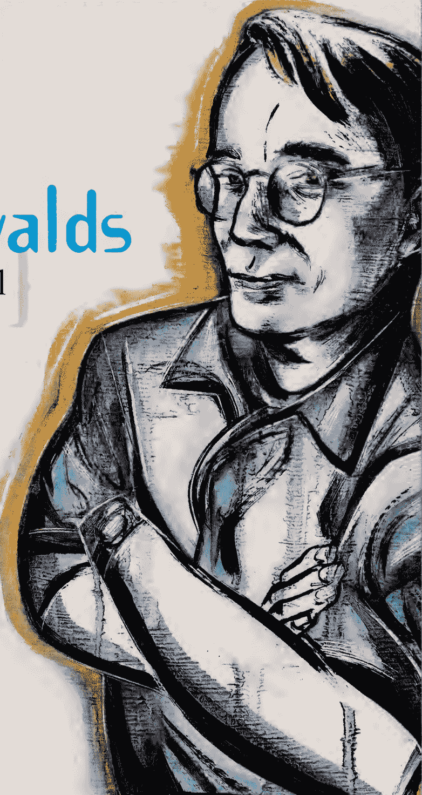

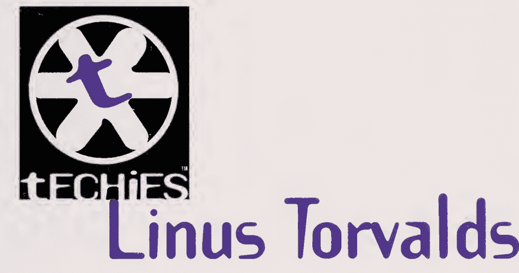

特别感谢布拉利·威灵顿贡献“技术对话”

# 第一章

## 改变未来

### 世界最著名的计算机程序员

谁是世界上最著名的计算机程序员？

你可能会回答是比尔·盖茨，你说对了一部分。尽管盖茨的职业生涯始于程序员，但他获得名声和财富是因为他是一名商人和营销人员——而不是技术人员。

谁是世界上最著名的计算机程序员？

如果你向一群技术极客提这个问题，很可能得到一个且响亮的答案：里纳斯·托瓦尔斯。他在万维网上的相关列表比史蒂夫·乔布斯、比尔·盖茨、拉里·艾利森甚至汤姆·克鲁斯还要多。

里纳斯是谁？

好吧，他不是一个家喻户晓的名字。他不是亿万富翁。他没有私人喷飞机。他从未像你可能听过的许多技术极客那样，通过高涨的首次募股（IPO）让公司上市。

但这正是里纳斯·托瓦尔斯如此特别之处。他经常被称为“反比尔·盖茨者”。他没有从他的软件中赚过任何钱，尽管他实际上创造了一场革命。他编写了一个名为 Linux 的操作系统，这是一个广受赞誉的与 Windows 竞争的平台。而令人惊讶的部分是：他是免费提供的。是的，免费。你和地球上任何其他拥有电脑、调制解调器并且硬盘上有足够空间的人，都可以从互联网下载它。

你可能没听过他，但你可以打赌比尔·盖茨听过。托瓦尔斯没有从 Linux 中赚取任何钱，但他正在改变软件的编写、更新和分发。他让很多人好奇，为什么既然可以免费获得 Linux，还要为 Windows 或其他昂贵的系统付费。

更重要的是，托瓦尔斯在创建一个繁荣的社区方面发挥了关键作用。他邀请每一个 Linux 用户和程序员帮助他编写代码并消除漏洞以让 Linux 变得。Linux 是一个伟大程序员的结晶，但它是数百人的产物。

所以，尽管里纳斯·托瓦尔斯可能还不是一个家喻户晓的名字…………但他让软件变得免费，让它具有包容性，让它具有适应性，顺便，他改变了计算的未来。

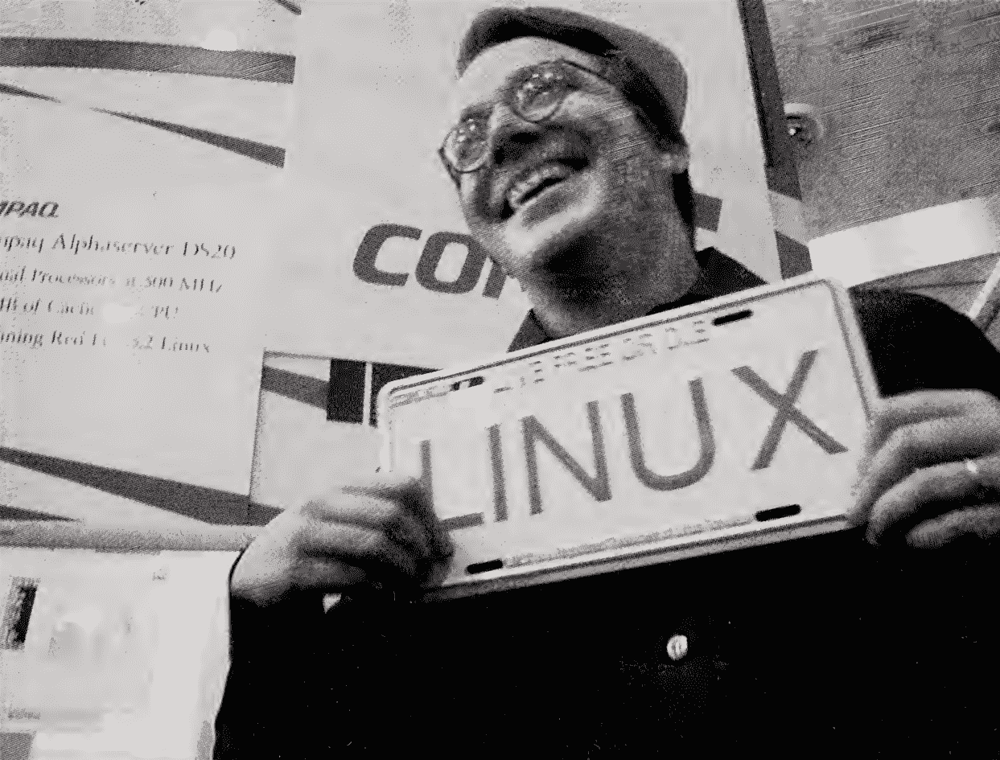

里纳斯·托瓦尔斯自豪地拿着一块写有“Linux”字样的牌照。

### 强大且独立的心

里纳斯（读音为 LEE-nuss）本尼迪克·托瓦尔斯出生于 1969 年 12 月 28 日，芬兰首都赫尔辛基。根据传说，他的名字命名既是为了纪念里纳斯·保林，


里纳斯·保林博士，诺贝尔化学奖和和平奖获得者

11


赫尔辛基，芬兰——里纳斯的家乡

化学家，而且瑞典语占芬兰人口的 6%，与芬兰语一起被列为芬兰的两种语言之一。

根据他父亲尼尔斯·托瓦尔斯的说法，他的儿子在八岁时就表现出了强大且独立的思想。圣诞节那天，“我给了他一艘相当不错的模型船，他认为我们会父子一起

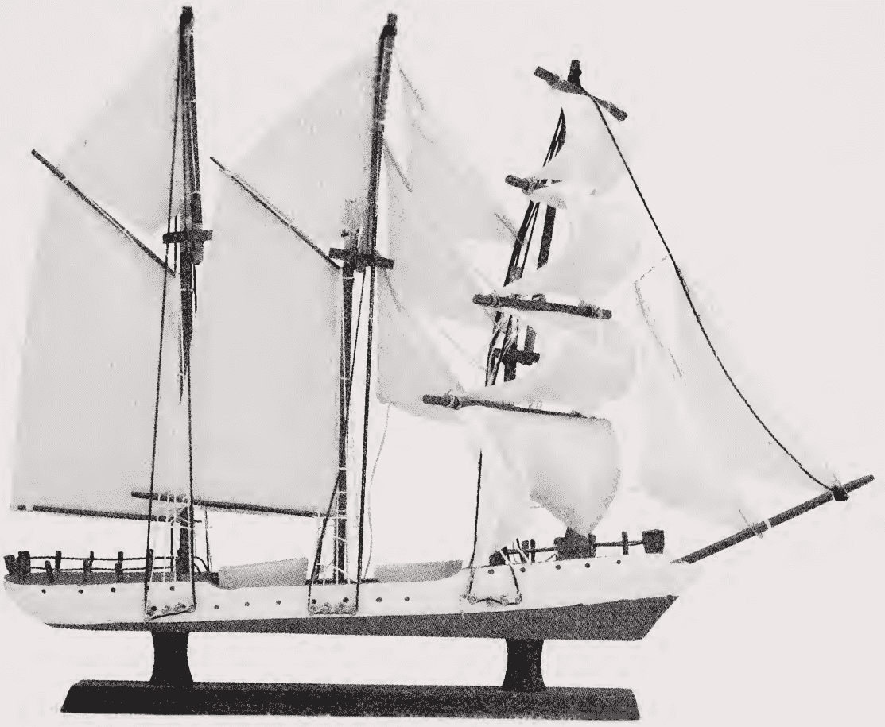

会造出它。第二天早上，他就已经自己做好了，”父亲回忆道。

QA76.2.S7 B273 2001

托瓦尔斯在十岁时对计算机着迷。“如果你讨厌冰球，在芬兰还能做什么呢？”他开玩笑说。他的祖父奥·托尔奎斯特是赫尔辛基大学的统计学教授，带回了一台最早的个人电脑之一 VIC-20，并鼓励托瓦尔斯使用它。“我开始编程是因为得让它运行，”托瓦尔斯回忆道。不久，年轻的托瓦尔斯就开始编写电脑游戏。

尽管他的父亲试图让他对运动感兴趣，但并没有成功。“我从不擅长，”托瓦尔斯现在说。

小时候，他非常自律且专注，但并不固执。“他曾说过他不吃甜点，”父亲回忆道，“我承诺如果他坚持一年，就送他一百芬兰马克。他做到了，但在赌约完成后的第二天，他拿了那笔钱买了一大堆甜点。”

### Free软件的黄金时代

托瓦尔斯并不是第一个认为软件不应该被拥有或控制，而应该供所有人免费使用的计算机程序员。事实上，直到 20 世纪 80 年代，没有人真正把软件看作是可以大规模销售的东西。当时软件之所以免费并不是因为理想主义。程序员们并没有意识到他们正在送出任何具有价值的东西。硬件——那些你可以触摸、打字、看到的东西——才被认为是真正的产品。那是工程师和商界认为你可以在其上赚钱的东西。软件仅仅是让你的硬件实用的必要之恶。

在许多方面，这是一个更加理想化和纯真的时代，

在人们还没有过控制软件并对其进行打包之前。许多计算机科学家和程序员回首那段时光时，充满了怀念。在早期的计算机专业人士和爱好者之间，存在着一种开放、学术、注重实验和勇于冒险的氛围。他们代表了一个极少数而有远见的群体，在很大程度上他们团结在一起，支持着他们初生的技术。

早期的个人电脑爱好者习惯性地复制并流传软件，而不怎么考虑版权和许可问题。位于加利福尼亚州梅洛公园的如今著名的“酿酒电脑俱乐部”（Homebrew Computer Club）就是那种老精神的缩影。（其信实者包括苹果公司的创始人史蒂夫·沃兹尼亚克克和史蒂夫·乔布斯，以及许多其他计算机远见者。）酿酒俱乐部是获取或共享任何流行软件的首选之地。讽刺的是，许多人声称自由软件时代正是从那里正式结束的。

### 信息时代

1976年，比尔·盖茨是一个非常年轻、刚从大学辍的学生。他正努力为他的新公司——当时名为微软（Microsoft）争取合法化，并对他发现自己的新软件正在酿酒俱乐部流传而感到懊恼。盖茨并没有对此掉以轻。他回了一封愤怒的《给爱好者的开放信》作为回应。

“你们中的大多数人都在偷窃软件，”盖茨指责酿酒俱乐部的信徒们。“你们做的其中件事……就是阻止优秀软件的编写。谁能负担得起免费提供专业工作？”对于老辈来说，这就像夏娃咬了苹果，结束了纯真时代的到来。它引入了一种新意识：想法并不非要分享，而且它们绝不是免费的。

那家巨大的蓝筹计算机巨头IBM，是最出名地仍用老旧方式思考软件而措手不及的公司。他们至少犯了两个致命的失误，这导致他们损失了数百亿美元，并帮助造就世界上最富有的两个男人——当然是微软的比尔·盖茨和甲骨文的拉里·埃里森。

IBM 的第一堂苦课是1981年由比尔·盖茨之下的。那一年，他们授予微软许可，在其新款的个人电脑上提供操作系统——MS-DOS。但他们没有要求微软具有排他性——换句话说，他们没有要求微软不要将同样的软件卖给其他任何人。微软将同样的软件卖给了一群全新的IBM竞争对手，突然之间，IBM在硬件市场上失去了优势。


软件巨头：甲骨文的拉里·埃里森

IBM 并不是标准（正如他们所希望的那样）。微软才是。

这一发现带来的启示像闪电一样贯穿了整个计算机行业。未来不在硬件，而在软件。任何人都可以花更少的几分钱制造一个包含合适芯片的塑料盒子。软件才是专有的、独特的产品——即知识产权。这一启示标志着我们现在所说的“信息时代”的一个重要里程碑。人们开始理解想法的价值。他们意识到，你并不一定能触摸或感受到的东西——软件、音乐、电影、小说、诗歌、文章、游戏——最终比你能触碰到的东西更有价值。但知识产权是公认的难以保护。可以说，声称你的山地车比声称你的想法容易得多。

IBM 的第二个失误发生在20世纪80年代中期。IBM的高级科学家编写并发布了关于如何编写所谓的“关系型数据库”的论文。关系数据库是一种软件系统，允许你完全按照你选择的方式在海量信息中进行筛选。假设你的关系数据库包含了历史上每一场棒球赛的信息。你可以问它，在20世纪70年代温度低于40华氏度（4.4摄氏度）时，堪萨斯州投出了哪些无安打局，它会告诉你（如果有这类比赛的话）。我们使用的搜索引擎依赖于这项技术。事实上，关系数据库与任何其他技术一样，让互联网变成了今天的样子。IBM的科学家想出了如何编写这种软件，但是拉里·埃里森的公司——甲骨文通过销售它赚了数十亿美元。为什么？因为IBM甚至没有想过保守这些想法。他们在旨在作为计算机科学家之间更大对话的学术论文中发布了数据库的虚拟蓝图。你并不拥有这类想法。你不出售它们。或者至少他们是这样想的。

80年代和90年代代表了一个更加愤世嫉俗的时代，像微软这样激进的巨型公司控制了世界上超过85%计算机的软件，并让小公司竞争变得极其困难。（以至于美国政府对微软发起了大规模法庭诉讼，指控微软进行不公平竞争……但那是另一个故事了。）

然而，新千年纪似乎正见证着另一个回到思想自由流动的根本转变。这种转变部分上归功于互联网。它对任何和所有知识产权的即时免费传播使得控制信息流变得非常困难。事实上，有些人认为互联网将意味着版权——即思想的法律和实际所有权的终结。这种转变部分归功于林斯·托瓦尔斯和其他理想主义程序员（或者正如托瓦尔斯所说的，仅仅是务实的程序员），他们唤醒了自由软件的精神。现在自由软件运动在全球范围内增长并加强。有些人甚至相信自由软件运动最终将推倒这些巨头。

# 第二章

## Linux的诞生

林斯·托瓦尔斯传播Linux的消息

### 起因


1990年，当林斯·托瓦尔斯在赫尔辛基大学上大二时，他决定买一台电脑。他想要一个Unix版本，但它太贵了，而且它并不是为PC设计的。那么他做了什么？“我决定编写我自己的Unix，”托瓦尔斯解释道，“我需要什么？我大量的无知，因为如果你知道得太多，你就知道这是不可能的。然后你需要傲慢——是的，我可以做到，而且我可以比任何人都做得更好。”你开始时需要这两点……你必须有一点疯狂，并付诸行动。

起初，他想编写足够的软件来让他的电脑能够完成他需要的任务。他开始编写代码，允许各种硬件部分——计算机、显示器、磁盘驱动器——进行通信。

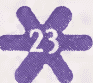

操作系统（OS）就像计算机的神经系统。它在硬件和软件之间进行通信。应用程序——游戏、电子表格、浏览器——运行在操作系统之上。

托瓦尔斯喜欢个人电脑，但所有的电脑都配备了微软的操作系统。“我不想要DOS，”托瓦尔斯解释道。“我注意到这开始成为一个操作系统，”他说。他从一个名为Minix的系统中借鉴了想法，那是一个用于教学Unix的微型、简化版本，并将其作为他初生系统的骨架。但很快他就用完全适合自己需求的代码替换了所有的Minix代码。

1991年秋，21岁的他将他的操作系统Linux（Linux，发音为LINN-ucks）0.01版本发布到了互联网上，并告诉了一些人。他不仅发布了系统本身；还发布了所谓的源代码——用于创建软件的底层指令。看到源代码允许其他程序员能够像作者一样获取他是如何实现的。这种开放或可访问的源代码还允许原始作者以外的人修复软件，根据他们自己的需求对其进行修改，甚至将其分发给其他用户和程序员。这就是为什么Linux被称为开源代码系统，而不是Windows或其他专有软件，在后者中源代码是关闭或隐藏的——无法供更广泛的程序员社区进行修复或修改。由于瓦尔德（Torvalds）没有向任何人收取任何费用，它加入了被称为“免费软件”的自由软件库：

最初，他选择了 Freix 这个名字（取自 Unix 的 -ix）。这本意是一个愚蠢的双关语。“但事实证明，那个在芬兰拥有 *FTP 站点*的人并不喜欢‘Freix’这个部分，所以他直接决定用 Linux 了，”瓦尔德回忆道。

“我收到的第一件事大量的建议，”瓦尔德说。他回应了这些建议，让系统变得更大、更好。不久之后，用户不仅开始通过电子邮件向他提出改进建议，还开始向他发送代码——用于修复错误或将系统适配到新用途的实际编程补丁。如果瓦尔德觉得这个补丁有用且执行得良好，他就会将其应用到更大的系统中。起初，他大约从五个人那里那里收到建议和代码，然后贡献者的数量就开始增长了。”

> *FTP 代表“文件传输协议”。FTP 站点是一个用于发布和下载文件的公共访问 Web 网站。

“它变得越来越好，”瓦尔德谈到早期的 Linux 时说。瓦尔德协调了日益增加的开发者的努力，确保系统以健康且连贯的方式持续改进和增长。他发布了随后的版本 .02、.03 和 .04，对其合作者的改进做出快速响应。

## “反向版权 (Copyleft)”

为了确保 Linux 源代码保持开放且软件免费，瓦尔德以一种名为“反向版权”的许可正式发布了该操作系统。这种许可由自由软件斗士理查德·史蒂曼（Richard Stallman）创立，他是位于马萨诸塞州剑桥市的自由软件基金会的创始人。

“反向版权”（与传统的版权相反，后者在法律上确保个人对其的所有权）意味着软件可以被复制、修改和无限次传播，但源代码必须始终保持开放并对所有人可见。瓦尔德想要确保，无论他或其他开发者在生活中做出什么样的个人或职业决定，他们中的任何人都都不可能拥有 Linux——没有人能把它卖给微软或埋藏源代码。“我希望人们能够信任我，而不是在个人层上信任我，”瓦尔德说，“所以即使我转向黑暗面，也没有人能接管它。”

随着 Linux 的增长，越来越多的程序员在基础内核或系统核心之外贡献了大量内容，瓦尔德鼓励他们以自己的名义发布类似的许可，因此现在有很多 Linux 的许可者。“现在没有人能从根本上改变它，因为他们必须协调拥有这些部分的人，”瓦尔德解释道。

他从未后悔这个决定。“提到 Linux，”他说，“我最自豪的决定并不是系统的实际物理设计，而是让它免费的决定。”

## Linux 1.0（且仍在进行中）

1994 年 3 月，瓦尔德发布了 Linux 1.0——再次是通过互联网发布——这标志着该系统第一个稳定的、完整的版本。尽管 Linux 已经拥有超过 10 万名用户，但在它具备完善的网络能力（允许计算机轻松相互连接）之前，瓦尔德一直拒绝称其为 1.0 版本。因此，在项目开始三年后，它终于拥有了真正操作系统的每一个基本组件。

用户和代码开发人员的数量以惊人的速度增长，但瓦尔德仍然设他在赫尔辛基的一间小公寓里运行这个庞大的网络，那间公寓是他当时的女友（现在的妻子）托夫（Tove）共同住的，她是芬兰的六次空手道冠军。Linux 的名声开始在其追随者圈之外传播，沉默寡言的瓦尔德迅速成为一个编程传奇。然而，他仍然是芬尔辛基大学的一名研究生，领取微薄的津贴。大学允许他将几乎所有时间投入到 Linux 中，Linux 社区帮助他还了他在家里用于 Linux 开发的电脑债务。

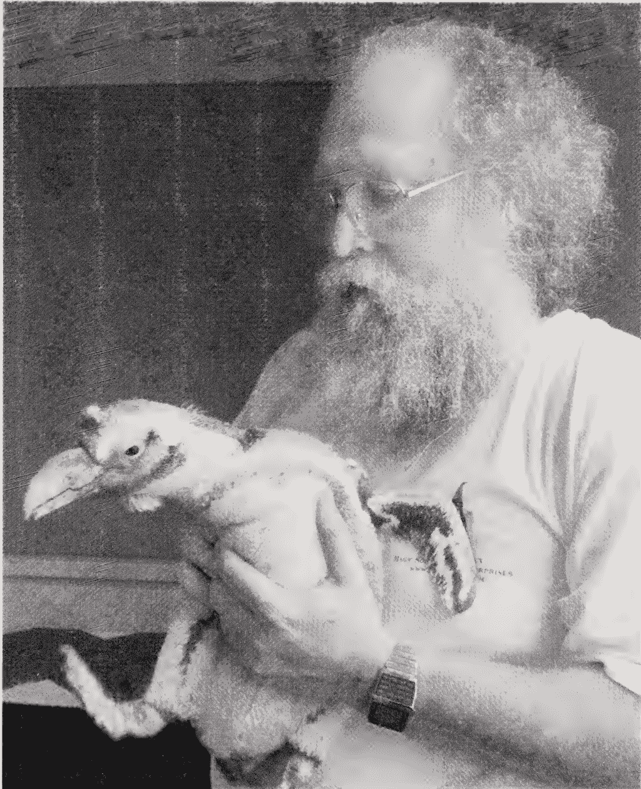

Linux International 的执行董事乔·哈尔（Jon Hall）正在玩一只活的企鹅。


游游的企鹅——Linux 图标的灵感

当人们质疑为什么这位技术远见家宁愿留在芬兰当一个贫穷的学生，而不是找一份“真正的工作”时，他回答道：“我对这种安排非常满意——我可以做我想做的任何事，而且在做这些时完全没有商业压力……由于我一直靠大学的工资生活得很愉快，决定因素与其说是钱，不如说是任何‘真正工作’的兴趣程度（但为了防止有人认为钱完全不重要，我只需提一下，是的，它很重要）。

1996 年 6 月，在经历了许多中间版本后，瓦尔德发布了版本 2.0，它为用户提供了在各种平台上运行 Linux 的能力——例如使用非 Intel x86 芯片的计算机，或由其他处理器驱动的计算机。

到那时，Linux 用户组成了一个疯狂的代码编写军。由于项目增长如此迅速，投入了如此多的智力，以至于瓦尔德自己的代码缩减到了极少数。他估计至少 90% 的 Linux 代码是由他人编写的。虽然他的原始版本只有 1 万行代码——这些代码后来都被重写——但 Linux 现在有 1500 万行。

Linux 大军决定需要一个标志，因此选择权交给了瓦尔德。他选择了企鹅。为什么？“部分是偶然，部分是因为我喜欢企鹅，”他解释道，“部分是因为我被企鹅咬过。那是在一家动物园。我用鱼当诱饵——结果企鹅上钩了。”一些 Linux 信徒抱怨标志不够严肃或不够高科技，但瓦尔德不同意。“比起静态和无聊，我与一个有趣且反叛的标志在一起要开心得多。”

## 是的，Linux 是免费的，但它好吗？

总的来说，Linux 的用户群体比 Windows 或 Macintosh 更具技术水平。Linux 不像那些平台那样易用（至少还没有），它没有让普通用户的计算体验变得透明的大型复杂覆盖层。此外，Linux 提供的应用程序种类远没有 Windows 多样。

然而，Linux 用户说它是比 Windows 或 Mac 更稳定、可靠的系统。Linux 粉丝分享了运行 Linux 的计算机持续数月甚至几年而不崩溃或需要重启的故事。Linux 比 Windows 精简得多，没那么臃肿，因此运行得更快，对处理器的要求也更低。

如果你的 Linux 系统发现了漏洞，你或你熟悉的任何黑客*理论上可以立即修复它，而微软系统通常需要等几天或几周让微软员工为你修复。计算机用户赞赏 Linux 健壮的稳定性，但也赞赏你可以让程序完全按照你的需求运行。

> *尽管在平民中，“黑客”一词带有负面含义——会联想到编写病毒、故障排除、破解五角大楼的犯罪——但这个词在道德上实际上是中性的。在这里以及广泛的技术社区中，黑客仅仅是指程序员。破解是指编写计算机代码——任何代码，而不只是那些引起麻烦的代码。如果说的话，黑客在技术人员之间被用作尊敬称呼。

所以，Linux 是好的。它不仅仅是好——对于老用户来说，它是深受宠爱的。

# 第三章

## 喧杂的集市

## Linux 开发是如何运作的

在《纽约时报杂志》的一篇文章中，作家艾米·哈蒙（Amy Harmon）描述了 Linux 涯中一个典型的时刻。来自德国埃兰根的25 岁的马库斯·迈斯纳（Marcus Meissner）在操作家用电脑时程序崩溃了。于是，他向更大的 Linux 社区发送了一封邮件。片刻之后，他收到了一位住在匈牙利布佩斯、26 岁的用户 Mingo 提供的修复建议。不久后，保加利亚人佩特汗（Petkhan）又发送了另一个补丁。

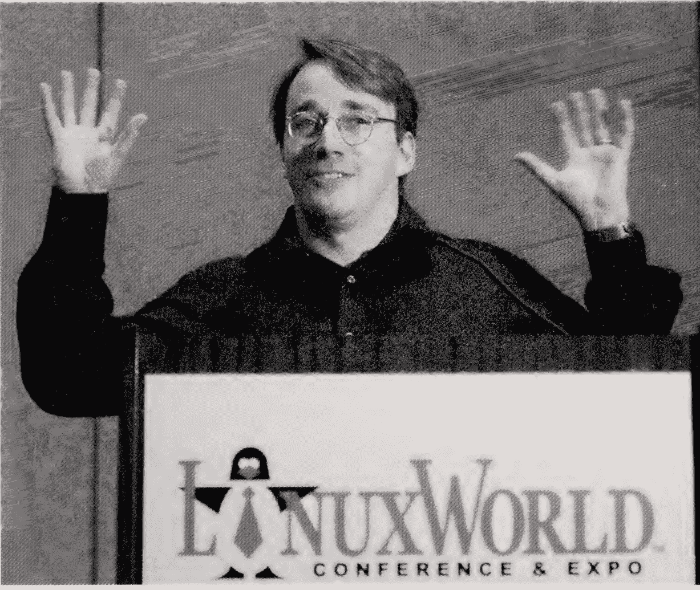

Linus 鼓励 Linux 用户提供反馈。


哈蒙写道：“重点不仅在于修复程序，还在于找到修复程序最优雅的方法。当然，大家都知道托瓦尔斯这个自我旋转网中心的 . . . 蜘蛛……”这正是 Linux 的运作方式。用户在工作或娱乐过程中让 Linux 经受考验，当 Bug 出现时，他们协作将其修复 . . . 快速。在许多情况下，Linux 的改进不仅来自用户的调试，还来自用户将其适配到其他用途——例如，其他类型的微处理器，或新的硬件设备（如用于语音识别的设备）。随着技术的进步，托瓦尔斯和他的共同开发者寻求抓住每一个让 Linux 变得更有用、更高效、更前沿的机会。

如果你想参与 Linux，可以做什么呢？使用它。当新的 Linux 用户询问托瓦尔斯他们应该做些什么时（他们每年会问几百次），托瓦尔斯告诉他们去使用 Linux，等他们知道答案后再回来。“尽管用这个系统吧，你会因为想做而进行 Linux 开发的。”

托瓦尔斯每天大约花费八到十小时回复邮件、筛选建议的补丁，并亲自编写一些代码。尽管他现在只编写一小部分代码，但他解释道：“我是那个对所有领域的情况拥有全局视野的人。”他并不一定管理系统的每一个部分。在他之下是第二层程序员，他们负责管理子系统，并向他发送经过审核和清理的补丁。

作为一个真正的务实者，托瓦尔斯不喜欢为 Linux 设定长期目标，而是希望对新的技术发展保持开放。“我打算对市场做出反应，看看开发者想做什么。”

Linux 会增长到托瓦尔斯可能无法控制的范围之外吗？托瓦尔斯说不会。与软件大师们不同，托瓦尔斯对营销、分发、服务或客户支持感兴趣。他不对这些巨型工作承担责任。他认为，如果他和他的程序员同事们能够提供一个优秀、稳定且不断改进的操作系统，他们就完成了任务。剩下的部分可以自行处理。“技术压力的好处是，技术问题总有完美的答案——只有非技术问题有时完全没有答案。”

所以，托瓦尔斯只关注 Linux 的技术开发。因此，他感激那些盈利的商业活动涌入，填补了他无法且不愿填补的需求。这意味着公司正在销售 Linux 并从中获利吗？是的。我们稍后会讨论这一点。

## 为什么 Linux 开发是有效的

在篇名为《大教堂与集市》（The Cathedral and the Bazaar）的极具影响力的文中，程序员兼开源代码传教士埃里克·雷蒙德（Eric Raymond）试图解释 Linux 现象背后奇特而神奇的心理学。Linux 没有雇用任何人，不付任何工资，也不向任何人收费。它没有正式组织，没有传统的分发，没有广告，也没有营销。然而，它的程序员被广泛认为是该领域的顶尖水平，其适应性和可靠性几乎不受挑战，而且改进速度迄今为止是最好的。

在文中，雷蒙德解释了 Linux 的出现如何完全改变了他对优秀软件创作的认知。在 Linux 出现之前，雷蒙德是开源开发的坚定支持者，但他写道：“我认为最重要的软件 . . . 需要像大教堂一样被建造，由个人巫师或在华丽孤立中工作的少数几个魔法法师精心打造。”他认为程序员需要工作、磨练和重新制作，直到他们能够发布出真正优秀的东西。

“林斯·托瓦尔斯的开发风格——早期且频繁地发布、尽可能委派一切、开放到近乎放荡的地步——令我感到惊讶，”雷蒙德写道，“这里没有宁静、虔诚的大教堂建设——相反，Linux 社区似乎像一个由不同议程和方法组成的巨大喧杂集市……一个连贯且稳定的系统似乎只能通过一系列奇迹才能出现。”

但 Linux 这种风格*生效了*。雷蒙德发现这一点不可否认。“Linux 世界不仅没有在混乱中分崩，反而似乎以一种大教堂建造者难以想象的速度不断壮大。”

为什么？

Linux 程序员，像托瓦尔斯本人一样，是一群自选的人，他们这样做没有其他原因，仅仅是因为他们想。雷蒙德认为，对于他们来说，用最优雅的方法解决他们遇到的特定问题在智力上是刺激的。帮助创造这种对他们个人有用、对所有人免费且被数百万人使用的工具是令人欣慰的。与如此技术熟练度和技能的同行合作，在职业上是令人兴奋的。他们在 Linux 上的工作往往与许多程序员日常度过一天形成鲜明对比。“雷蒙德写道，“软件开发者经常花费一天为了薪水在他们既不需要也不喜欢的程序上苦苦工作。”

由于 Linux 开发者也是 Linux 用户，他们天生对程序非常熟悉，并有动力让它运行良好。托瓦尔斯让他的开发团队保持忙碌投入。

雷蒙德认为将是 Linux 的必要前提条件。否则，托瓦尔斯如何能同时与全球成千上万名代码作者交流，除了 Linux 之外，他与他们没有任何地理、个人或职业联系？“Linux 是第一个有意识并成功利用整个世界作为其人才库的项目。我不认为 Linux 的孵化期与万维网的诞生相合是巧合……Linux 是第一个学会根据普及的互联网访问所可能的新规则玩游戏的人。”

最后，雷蒙德给出了可能是 Linux 流程有效的最关键的原因：“我们在做自己的事时很快乐，”雷蒙德解释道，“我们的创造性游戏正以惊人的速度在技术、市场份额和心智份额上取得成功。我们不仅证明了我们可以做出更好的软件，还证明了快乐也是资产。”

托瓦尔斯由表赞同。“最重要的设计问题 . . . 是 Linux 应该是好玩的。”

## 更宏大的免费软件运动

尽管 Linux 可能是最知名、最推崇的开源系统，但它绝不是唯一的。例如，Apache 互联网上最常用的应用程序，运行着超过一半的网站，包括 Yahoo! 等大站。Apache 是由八位对服务器软件有共同兴趣的程序员开发的免费软件应用程序。他们从交流想法、挑战和解决方案开始。他们最初将自己的软件称为“一个补丁的服务器”（A Patchy Server），开玩笑地指的是其即时开发风格，但后来为了尊重美原住民部落，将其重命名为 Apache。现在甚至计算机巨头 IBM 也采用了 Apache 软件，尽管 IBM 法律部门发现没有人可以向他们支付许可费而感到困惑。作为使用该软件的回报，松散组织的 Apache 仅要求他们的软件被非排他性地使用——源代码必须对任何想要它的人开放。

Sendmail 是一款最初由 Eric Allman 创建的免费软件程序，负责了网上传输的 80% 以上邮件的路由。FreeBSD 和 NetBSD 与 Linux 一样，都是基于 Unix 的免费操作系统，尽管与 Linux 不同，它们没有维持同样的集中心化控制。

Netscape 这家凭借其 Navigator 浏览器普及互联网的公司，深受埃里克·雷蒙德（Eric Raymond）在《大教堂与大集市》（The Cathedral and the Bazaar）中所提出的论点的影响，以至于他们在 1999 年 3 月发布了浏览器的源代码。世界各地涌入了修复和适配，其中包括一组澳大利亚程序员提供的一个功能（在 Netscape 发布代码后的几个小时内完成），该功能实现了 Web 上的安全交易。在一个月内，Netscape 就推出了新版本的 Navigator 供用户下载。

免费软件的进展是如此惊人地快速且高效，以至于很难任何个人甚至公司能够与之相拟。上述的澳大利亚人没有报酬，但他们赢得了全球编程社区的关注和尊重。

正如记者 Josh McHugh 在《福布斯》杂志的封面故事中所写：“解放的软件已成为一场智力奥林匹克运动，世界上一些顶尖的工程大脑在其中竞争——不是为了风险投资，而是为了给同伴留下深刻印象。”

尽管托瓦尔斯（Torvalds）是开源运动极其强大且有效的倡导者，但他并不认为自己是一个主义者。与自由软件基金会的支持者不同，他也不认为自己具有政治色彩。对他对他来说，这并不关乎做一件好事，尽管这是一个非常令人愉悦的结果。在他看来，开源是制作伟大软件的最佳、最快、最务实的方法。他的首要目标不是让软件免费，而是让软件卓越。而在他看来，要做到卓越，它必须免费。

随着开源运动在效率和流行程度上的飞速发展，你不禁怀疑它是否开始让那些闭源软件巨头感到有些紧张。

# 第四章

## 黄金时代

### 红帽与 Caldera 为 Linux 的企业应用提供了合法性

无论他们是否愿意，Linux 反叛军们正迅速获得企业界的合法性。总部位于北罗来纳州达纳姆的红帽（Red Hat）由一个名叫 Marc Ewing 的人创立，旨在为 Linux 提供更简单、更友好的访问方式。他知道 Linux 无法提供足以在商业和桌面市场立稳脚跟的类型包装和客户支持。大型企业

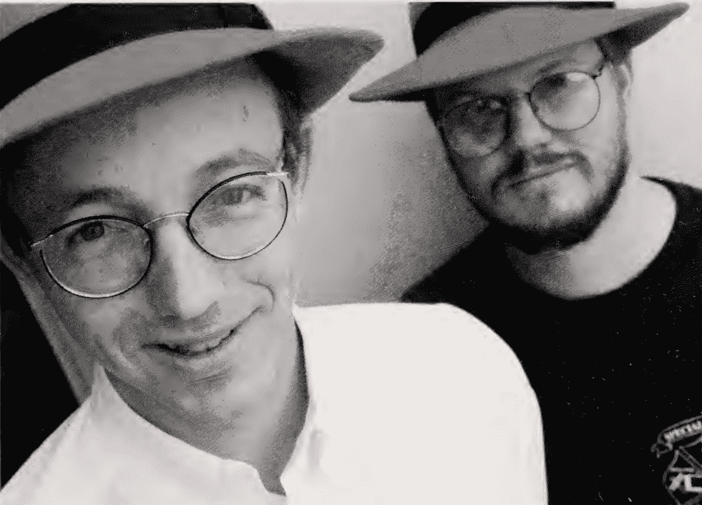

红帽软件（一家提供 Linux服务的公司）担心 Linux 的原因与许多技术人员热爱它的原因相同——没有人拥有它。因为没有人拥有它，企业假设如果 Linux 停止工作，他们将无处可去——没有人能帮助他们重新运行，没有人可以起诉，也没有人可以被扣款。

Ewing 创立红帽是为了提供这些服务，包括说明手册和电话支持。个人用户通常希望拥有比 Linux 原始下载版本更精细的桌面和更简单的界面，红帽也提供了这些。只需大约 50 美元，红帽将为你提供一张 CD，提供易于安装的 Linux（这一过程在其他情况下是著名的棘手），以及几个针对桌面使用的设计的实用程序。


许多老兵对红帽试图兜售某种任何人都可以免费获得的东西的明智表示怀疑，但少数大巨头认为 Ewing 做出了一个非常高明的举措。对红帽的大量投资来自巨型芯片制造商 Intel 和 Netscape。红帽在某些方面保持了 Linux 的精神——它添加到 Linux 中的任何代码，都按照开源规则发布。在其他方面他们并没有这样做——他们想要并需要赚钱。而且是很多，而且红帽现在是股市上的一上市公司，价值数十亿美元。

Caldera Systems 是另一家分发 Linux 并提供企业培训和支持的公司。与红帽一样，他们明确表示自己不对知识产权收费。他们是为支持知识产权的服务收费。

托瓦尔斯对对此何看？

“商业供应商是好的，是的。他们都使用标准内核，所以从技术上讲，没什么好担心的。他们倾向于对 Linux 系统进行不同的定位，以针对不同的市场。即使我想做，也做不到，而且我不想做，”他说，“在想要让安装变得简单的商业人士与想要在技术上做正确事情的技术人员之间存在着这样的协同效应，以至于我不再担心了。……我看不出我们怎么会输。”

红帽和 Caldera 等商业供应商为 Linux 在市场中提供了巨大的推动。现在，IBM、Dell Computer、Corel Computer 和 VA Research 等硬件供应商正在提供预装 Linux 的计算机。


开发者已为手持设备 PalmPilot 适配了一个版本的 Linux。

越来越多，电脑购买者将会有选择——他们不会被强制购买预装微软系统的 PC；他们能够选择 Linux。像 Oracle 和 Sun Microsystems 这样巨大的科技公司正在编写它们的软件版本以在 Linux 上运行。在微软经历了近二十年的垄断后，这对托瓦尔斯和他编写代码的伙伴们来说以及对几乎每一个开源支持者来说，都是梦想成真。现在，应用程序也将选择它们想要运行的操作系统，而 Linux 将是选项之一。一个 Linux 版本已被移植到手持设备 PalmPilot 上。甚至像 Quake 和 Doom 等世界上最流行的几个游戏也被移植到了 Linux。现在，美国企业正在转向 Linux。电影制片人詹姆斯·卡梅隆所有的特效公司 Digital Domain 选择 Linux 来运行他们为《泰坦尼克号》创作特效的计算机。

电子文档检索公司 Archive Retrieval 为华盛顿州梅迪纳市（Medina）在运行 Linux 的计算机上安装了一个系统。总裁 Ray A. Jones 记得当梅迪纳的新系统出现一个漏洞时的情况。“我们在网上问了一个问题，在几个小时内我们就得到了答案，”他说，“我用三行代码修复了它。如果是商业产品，我得等微软来修复——如果他们真的修的话。这样一来，整个 Linux 社区都受益了。”讽刺的是，梅迪纳市采用该系统部分是因为比尔·盖茨建造的豪宅塞满了文件。里奇（Ridge）也使用 Linux。NASA 使用 Linux 作为计算机集群的基础，该集群是全球五大快速计算机系统之一，并节省了同等速度超级计算机 90% 的成本。洛斯阿拉莫斯国家实验室的研究人员将 68 台运行 Linux 的计算机连接作为单台超级计算机，达到了

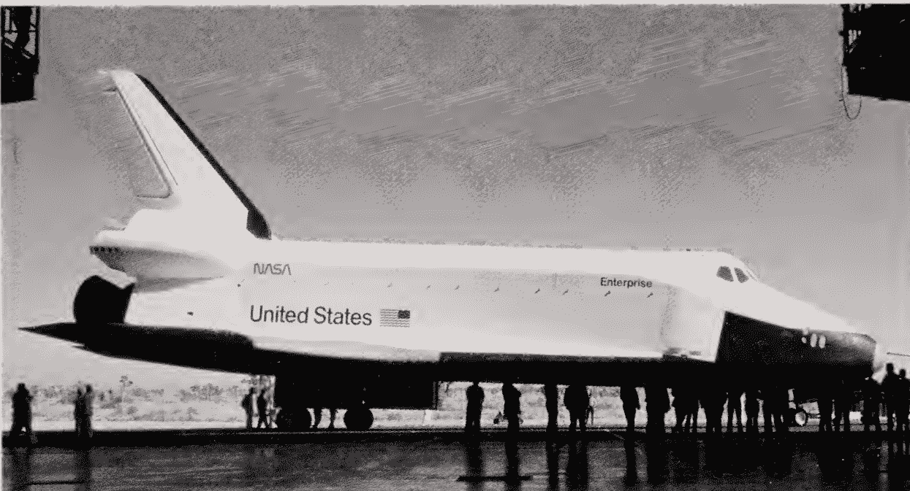

Linux 帮助 NASA 开发了世界上最快的计算机系统之一。

每秒 190 亿次计算。这使其位居世界第 315 位。它已经运行了三个月，没有重启过。橡树国家实验室也使用 Linux。

Linux 无疑已成为计算机世界中的一个合法参与者。其使用量估计每年增长 40%。它快速、强大、灵活且免费。这让我们产生了一个问题 . . .

# 比尔·盖茨害怕吗？

嗯，既是，也不是。很难说 Linux 对无强大的微软 Windows 来说究竟有多大的威胁。为了让你直观感受，去年大约有 900 万台电脑在运行 Linux，而大约有 3 亿台在运行微软 Windows。Windows 运行在全球 90% 到 95% 的桌面电脑上。所有其他操作系统——MacOS、Linux、Unix、Sun 以及其他几种——共享了剩下的 5% 到 10% 份额。简而言之，微软非常*庞大*。但你可能已经知道这一点。

在商业世界中，重要的不是规模，而是趋势。财务分析师想知道你的市场份额是在增长还是萎缩。这是一个关键问题。这也是股东关心的。这也是计算机行业高管们在深夜彻夜难眠的原因。你们是在崛起，还是在退场？

Linux 绝对正在崛起。但微软会退场吗？

## 技术杂谈

### 什么是源代码？

你可能听说过所谓的开源代码。源代码到底是什么？为什么它又开始变得如此有名呢？

当一家公司或个人编写了一个计算机程序，并将该程序的源代码提供给任何想要它的人时，这段代码就被称为开源。编写开源程序的程序员就像一位发明了新食谱并在报纸上发表的大的大厨师。

什么是源代码？程序员用 C++、Java 或 Smalltalk 等高级计算机语言编写他们的程序。用高级语言编写的程序被称为源代码。接下，源代码会被翻译成机器语言，以便计算机运行它。机器语言只是一系列 0 和 1 的数字，被称为二进制代码，是计算机可以理解的语言。计算机无法直接理解高级语言，而人类也发现阅读机器语言非常困难，因此它总是需要翻译。

例如，如果我想让计算机打印“hello”这个词，高级语言中的指令可能看起来像这样：

```
printf("hello");
```

在转换为二进制代码后，这些指令可能像这样：

```
101000101010110110100101010101010010010101010
```

虽然计算机本身可以读取机器语言，但为了让程序员轻松地理解计算机到底在做什么，她需要在翻译之前看到程序。换句话说，程序员需要拥有源代码。

许多公司（如微软）字面上封锁了他们程序的源代码，因为他们觉得如果代码落入他人手中，他们的创意可能会被盗窃，他们可能会损失。

开源是一个强大的思想，因为开发者没有将代码锁起来，而是允许整个程序员社区使用并对其进行改进。此外，如果代码中发现了漏洞，它的修复速度可能比只允许原始开发者进行工作要快得多。

例如，假设我正在为 Macintosh 编写一个文字处理程序。现在，假设另一个开发者也在为 Macintosh 编写一个文字处理程序。如果我的程序不是开源的，那么我们都会做相同的工作，并最终得到非常相似的产品。在开源世界中，第二个开发者将从我的源代码开始，然后可能花费她的所有时间添加一个复杂的拼写检查器。然后她会将更新后的源代码还给我，我们最终都会获得一个比我们任何一个单独制作的更好的产品。

有些人认为，微软体量太大了，*不*可能持续获胜。它是旋转虚拟圈的受益者。有太多的个人和公司依赖它。软件和硬件世界都是围绕微软构建的。要撼动一个根深蒂固的产品是非常的。

另一些人认为，微软确实很脆弱。首先也是最重要的一点是，许多人（包括 Torvalds）认为，虽然微软的许多应用程序还可以甚至很好，但作为其核心的操作系统基本上很糟糕。


比尔·盖茨认为 Linux 是潜在威胁吗？

许多开源支持者认为，微软被 Linux 等开源项目的飞速改进甩在了后面。微软每三年发布一次 Windows 版本——远不如 Linux 的速度。而且微软虽然雇佣了许多才华横溢的程序员，但无法与成千上万的人竞争。此外，开源支持者认为用户将对微软代码的可访问性失去耐心。红帽首席执行官 Robert Young 将闭源软件比作购买一辆封死引擎盖的汽车。

微软的另一个潜在威胁是安全，自互联网爆发以来，这是一个首要问题。破坏性的病毒是通过微软流行的 Outlook 电子邮件应用程序发布的。作家 Patrick Humphreys 这样描述：“在 20 世纪，世界的计算变成了一种单植栽培，就像一片只有一种树木的森林。任何疾病都可以毁灭它。”

Linux 更安全吗？Torvalds 认为是这样。“如果你查看安全公告，Linux 受安全漏洞的影响与其他任何供应商一样大。问题在于，当你收到公告时，Linux 已经有了补丁，而其他供应商倾向于说‘我们正在调查’。”

微软还担心被称为 WINE 的东西。WINE 是由 Linux 开发者编写的 Windows 模拟器，使 Linux 运行为 Windows 的所有应用程序。尽管 WINE 已经在运行，但还没有 Torvalds 想要的那样精良可靠。他和他的同事预计很快就会实现，一旦实现，WINE 可能会削弱微软的竞争优势。

微软意识到这些潜在威胁了吗？是的。一份微软内部备录泄露给了外部，让微软清楚他们反对什么。备录指出：“Linux 和其他开源系统支持者正在提出越来越有说服力的论据，认为开源软件至少同于、甚至优于商业替代品。. . . 开源过程收集和利用跨越互联网的成千上万个个体的集体智慧的能力简直令人惊讶。”

这就是计算机代码的真实模样！

# 开源的未来


# 开源报告与林纳斯·托瓦兹

根据福森咨询（Forrester Research）2000年发布的一份报告，Linux及其他开源项目将在2004年前彻底改变软件格局。该报告预测：“专有软件供应商将突然发现软件开发是一场不公平的战斗：他们由被俘开发者组成的雇佣兵团，将面对一支武装互联网的革命军军。”报告结论说，所有软件供应商都将被迫开放其代码，或者大幅降低其许可的价格。

这份名为《开源破解密码》的报告是根据对2500家公司信息技术（IT）经理的采访汇编而成的。报告发现，56%的公司已经在使用开源软件。

报告预测，获胜者中将包括IBM，报告将其称为“基础设施大猩猩”，因为它们已经提供并支持开源系统；以及戴尔电脑（Dell Computer），因为它们似乎也正在对Linux等开源软件提供强力支持。

那么输家呢？并不意乎料的是，最大的头头是微软。福森咨询研究预测，微软的企业文化和策略与开源模型的对比如此鲜明，以至于它将开始衰落，最终仅作为所谓的“遗留供应商”生存，徘留在支持其旧产品上。

不用说，Linux粉丝对这份报告感到非常高兴。“哈！”乔治·诺里克（George Nobick）一位Linux开发者说道，“微软现在可能拥有桌面系统，但我们拥有未来。”

瓦尔德斯（Torvalds）希望Linux能取代微软成为世界的软件巨头吗？完全没有。“我实际上希望它占据的市场份额不要超过25%或30%。如果Linux占据了95%的市场，那将同样糟糕。竞争是有必要的。”

虽然有强有力的论据可以对微软提出反面论点，但许多人认为微软在未来的很长一段时间内将仍然是一个强大的软件力量。无论如何，比尔·盖茨斯（Bill Gates）最好考虑一下，企鹅并不总是可爱且好抱的。它们会咬人。

## 移居硅谷与Transmeta

1996年12月，瓦尔德斯从计算机领域可能最不神秘的职业生活转变为最神秘的生活。在他们的第一个女儿帕特里夏·米兰达·瓦尔德斯（Patricia Miranda Torvalds）出生一周后，这对快乐的父母将小家庭从芬兰赫尔辛基搬到了加利福尼亚州的圣克拉拉。圣克拉拉正处于著名的硅谷中心，那里是高科技的历史发源地。他们住进了一个简朴的独栋房子（里面有很多填充的企鹅），瓦尔德斯在一家名为Transmeta的公司当了程序员。这是他的第一份所谓的“正式工作”。

Transmeta是做什么的？这是一个好问题，直到最近还没有答案。Transmeta对他们的使命隐藏得如此秘密，以至于没有一个员工被允许谈论他们正在做的事情。Transmeta的办公室窗户总是遮着深色的。他们甚至不会说何时可能对他们正在的工作发表任何信息。传言四起，而林斯·瓦尔德斯（Linus Torvalds）的加入进一步点燃了好奇心的火焰。

Transmeta成为了硅谷最大的谜。“我可以告诉你我在做什么，但那样我就得杀掉你，”瓦尔德斯在有人问起他的新工作时开开玩笑道。

尽管人们质疑瓦尔德斯为什么留在芬兰，但瓦尔德斯却很快地赞扬了他的母国。“来自芬兰的一个主要优势是极高的教育水平（而且几乎是免费的，所以我在接受教育时不需要担心经济问题）。而且芬兰是非常高科技国家——我认为在人均互联网访问次数方面，芬兰是世界第一。” 他的家乡还有另一种方式从根本上塑造了他的生活：“在芬兰，一个人的价值不是用美元来衡量的，”他说。

尽管如此，他确实非常感激他在加利福尼亚新家的好处。“我很喜欢这里的天候……我不记得上一次不能整天穿短裤走动是什么时候时候了。”他还发现传奇硅谷的高科技活动水平非常有启发性。“虽然芬兰非常高科技，但芬兰公司倾向于非常传统并且

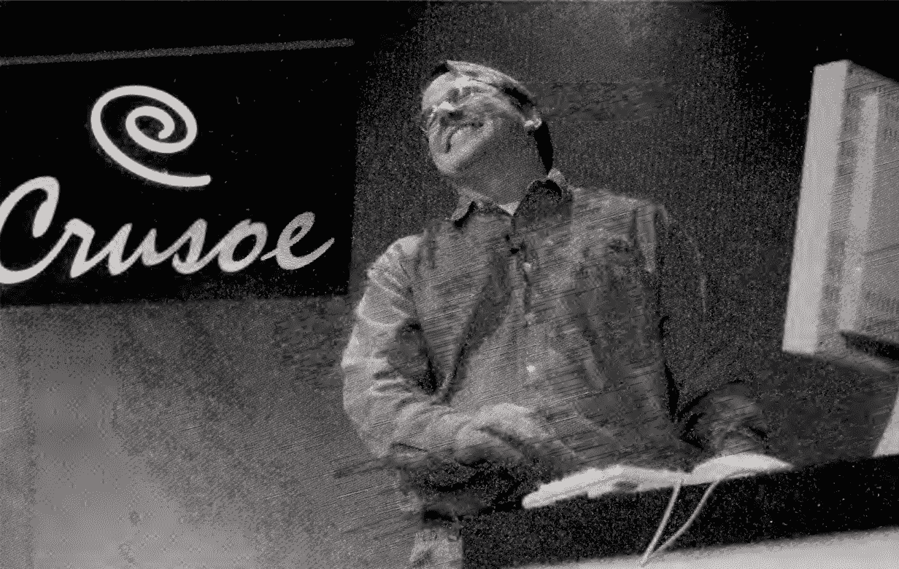

瓦尔德斯展示了新的Crusoe芯片。

不承担很多风险，也不做真正有趣的事情。硅谷则完全不同：这里的人真的生活在边缘，而且这里有很多在技术上非常有趣的项目。

Transmeta事实证明是这些有趣项目之一。2000年1月，该公司终于打破了沉默，宣布了其名为Crusoe的突破性新微芯片的计划。Crusoe旨在通过欺骗软件来运行几乎任何操作系统或应用程序，

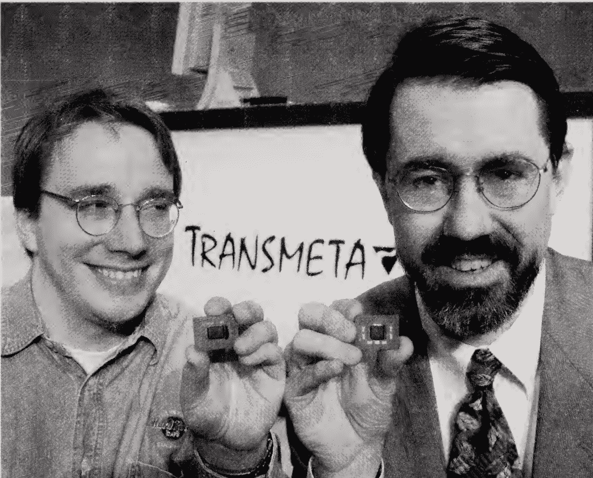

林斯·瓦尔德斯和Transmeta公司首席执行官戴夫·迪策（Dave Ditzel）展示了Crusoe芯片。

让软件认为它运行在Intel基于x86架构的无处不在芯片上——这就是瓦尔德斯最初设计Linux时基于架构。Crusoe芯片并不使用x86架构；它使用一种被称为VLIW（或极长指令）的技术。那么Crusoe是如何欺骗软件的呢？通过Transmeta的程序员所谓的“代码变形软件（code-morphing software）”。代码变形软件不是运行在操作系统之上（像软件应用程序一直以来那样运行），而是在操作系统之下。“操作系统认为它运行在一段裸裸的硬件上，”瓦尔德斯解释道。

这层额外的软件实际上承担了芯片通常需要的大部分处理工作，这意味着Crusoe芯片需要的晶体管少得多。这种转变意味着Crusoe可以在更紧凑的系统中工作——例如手持电脑和互联网电话，专家认为这些设备将占据未来计算机市场的很大一部分。另一个益处是，这层额外的软件使得Crusoe能够容易地、几乎瞬时地升级。这些特性可能让Crusoe芯片一旦投产，就会对Intel构成严重威胁。

瓦尔德斯被Transmeta招留是为了帮助设计和编写代码变形软件。Transmeta的创始人卫·迪策（David Ditzel）想要瓦尔德斯不是为了他的Linux名声（在1996年这比现在小得多），而是为了他卓越的编程能力以及对x86架构的熟悉。

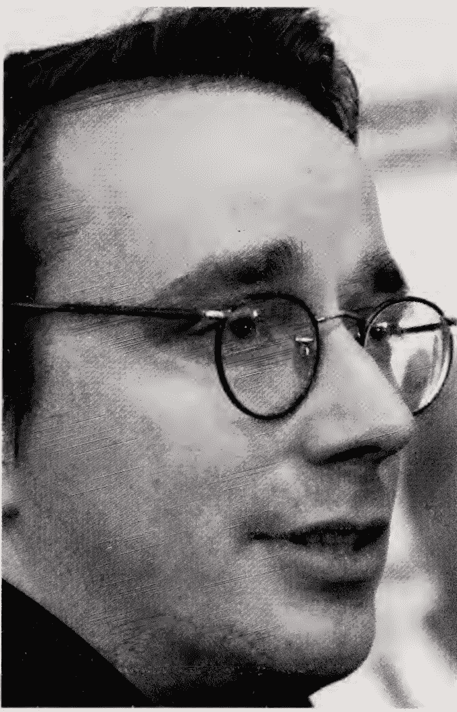

瓦尔德斯认为，“Transmeta正在做一些别人没有做的事情。”瓦尔德斯也很欣慰Transmeta已经在使用Linux，并且同意他投入部分时间继续开发Linux。这对Linux用户来说也是一个受欢迎的消息。

值得注意的是，Transmeta的主要投资者正是保罗·艾伦（Paul Allen），微软的联合创始人，比尔·盖茨的前合伙伴。

## 满足的生活

瓦尔德斯无疑忙于他在Transmeta令人兴奋且要求要求的工作以及对Linux的维护。全球各地的计算机会议和展览让他供不应求。此外，他将与妻子托以及他们的两个女儿帕特里夏和丹尼埃拉共处的时间视为生活的首要任务。一位名叫查尔斯·鲍科布（Charles Babcock）的记者描述了斯坦福大学开源商业论坛上的这样一个场景：“瓦尔德斯的妻子托安排自己和他们的金发孩子坐在第一排前面的地板上。会议进行到一半，最小的瓦尔德斯了一声……林斯随口离开了小组，去在大厅更远的地方安顿他的家人。”没有人认为这很奇怪，因为瓦尔德斯将其视为生活的一部分。尽管他在该领域非常著名并受喜爱，但他生活简朴、低调，他开的那辆普通的绿色雪佛就证明了这一点。瓦尔德斯没有私人飞机，也没有购买计划，但他从Linux的技术成就中获得了巨大的乐趣，更不用说它为他和开发者赢得的所有声誉。1999年，他被《PC杂志》评为年度人物，并被《信息世界》杂志授予行业成就奖。

对于瓦尔德斯来说，终究不是为了金钱，不是为了东西，也不是为了一个大华丽的办公室。作为一名开发-超级大师，他曾说：“对于工程师来说，一切都取决于酷炫黑客。”而托瓦兹是酷炫黑客的大师。他利用酷炫黑客创造了一个充满活力、蓬勃发展的社区。

在 MSNBC 电视频道的一场现场直播中，一位 Linux 用户询问托瓦兹，他是否曾考虑过通过授权 Linux 能够赚到多少钱。托瓦兹回答道：“我甚至没试过。我只知道玩得有多开心。”

Raymond, Eric. 《大教堂与大集市》。纽约：O’Reilly and Associates, 1999.

Wayner, Peter. 《自由竞争：LINUX 和自由软件运动如何削弱高科技巨头》。纽约：HarperBusiness, 2000.

Young, Robert, and Wendy Goldman Rohm. 《红帽如何改变软件业务并让微软措手不及》。斯科洛茨代尔：The Coriolis Group, 1999.

本文还使用了以下杂志和在线服务：

- *福布斯* | www.bootnet.com
- Linux Magazine | www.linuxjournal.com
- 纽约时报 | www.linuxworld.com
- 圣何塞水讯报 | www.msnbbc.com
- 时代 | www.virtualfinland.com
- 美国今日 | www.wired.com
- Wired | www.zdnet.com

斜体页码指代插图。

- Caldera Systems 52 Harmon, Amy 37
- Commodore 14, 23 Humphreys, Patrick 62
- Corel Computer 52 以及 MS-DOS 操作系统 19
- Dell 电脑 52, 66 使用 Linux 操作系统 52
- Ditzel, Dave 71, 73 Intel 24, 33, 51, 72, 73
- Ewing, Marc 49, 51 互联网 21, 22, 26, 45, 47, 88
- 软件基金会 28, 48 Jones, Ray A. 55
- Nobick, George 67


- 操作系统 (OS) 23–24
- PalmPilot 53, 54
- 企鹅 31, 32, 34
- Raymond, Eric 41–45, 47
- 关系型数据库 20–21
- Sendmail 47
- Stallman, Richard 28
- Sun 操作系统 57
- Torvqvist, Leo 14
- 童年 10–15
- 在 Transmeta 68–74
- 托瓦兹, Nils 13
- Unix 操作系统 23–27, 57 Wozniak, Steve 17
- VLIW 72 Young, Robert 62
- 调试 35, 55, 60, 62

AP/Wide World Photos，9, 11, 16, 19, 25, 31, 38, 50, 53, 61, 70, 71, 73
- PictureQuest，12, 13, 32, 56, 65

## 想要编写一个突破性的计算机操作系统吗？

你可能需要：

- 一整年不吃糖果
- 选择一只企鹅作为你的产品标志
- 将你的程序发布在互联网上，让其他程序员可以免费使用

听起来像又一个程序员吗？林纳斯·托瓦兹了自己的操作系统——有些人说这个系统比 MS-DOS 更好、更强大。他的系统 Linux 对任何想要使用它的人都是免费。Linux 是一种全新的编程哲学的成果，它让作者成为了一个真正的崇拜人物。

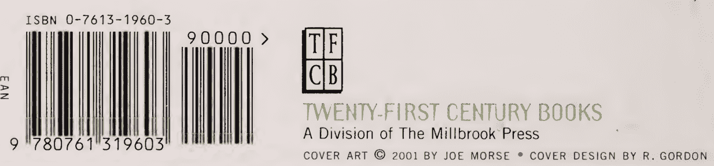
