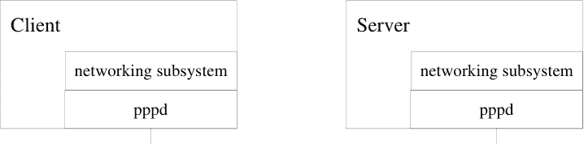
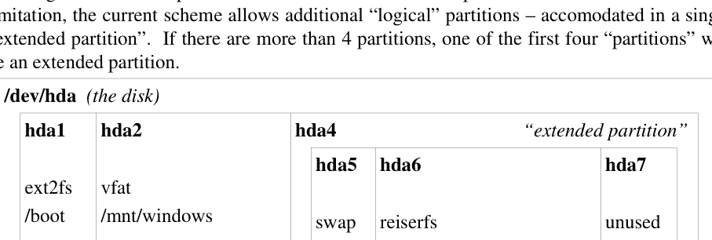
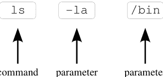
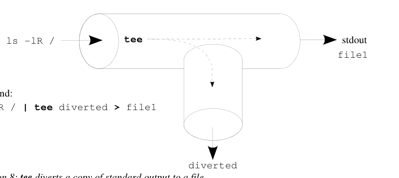
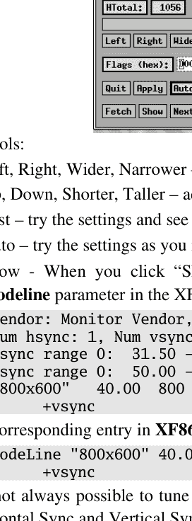
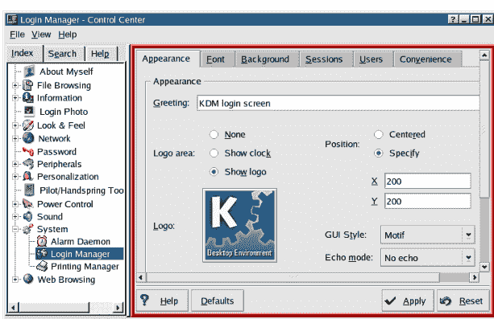

# Linux 101 考试：模块化培训笔记


## 前言
A对应**awk**，运行起来像蜗牛；B对应**biff**，会读取你所有的邮件。
C对应**cc**，正如黑客们的回忆；D对应**dd**，是无所不能的命令。
E对应**emacs**，会重新绑定你的按键；F对应**fsck**，可以重建你的目录树。
G对应**grep**，是个聪明的侦探；H对应**halt**，看似存在故障。
I对应**indent**，很少让人愉悦；J对应**join**，几乎无人使用。
K对应**kill**，让你成为掌控者；L对应**lex**，在DOS系统中缺失。
M对应**more**，**less**正是由它衍生而来；N对应**nice**，实际却并不“友好”。
O对应**od**，能漂亮地打印输出内容；P对应**passwd**，会两次读取输入的字符串。
Q对应**quota**，是伯克利式的寓言；R对应**ranlib**，用于对**ar**的表进行排序。
S对应**spell**，试图贬低拼写功能；T对应**true**，几乎什么都不做。
U对应**uniq**，通常跟在**sort**之后使用；V对应**vi**，很难中止退出。
W对应**whoami**，会告知你的用户名；X嘛，就是**X**，名声褒贬不一。
Y对应**yes**，能产生强烈印象；Z对应**zcat**，可处理压缩文件。
> - UNIX字母表
> /usr/share/games/fortune/songs-poems

本课程资料基于Linux专业协会LPI 101考试（具体为考试目标的2.0版本）的要求制定。本课程旨在为你提供操作和管理Linux系统所需的基础技能。每一门优质的培训课程都应让学生在结束后能拿到一份纸质资料，存入公司的文件柜中。真正优秀的课程还会让学生在脑海中收获知识和实践能力。我们希望这些讲义至少能实现第一个目标，第二个目标则取决于讲师。

## 课程目标
本课程旨在帮助你掌握通过LPI 101考试（2.0版本）所需的知识。我们希望你学习本课程的过程中，能够习得伴随对Linux工作原理理解而来的相关技能。

### 目标受众
- 希望参加LPIC 1级认证中的LPIC 101考试的人员。
- 对Linux有技术兴趣、希望熟悉Linux，尤其是以系统管理为目标的人员。

### 课程前置要求
- 你应具备使用Linux的基础技能，包括命令行使用能力。建议至少有3个月的使用经验，完成入门级Linux课程可作为同等经验的替代。
- 你是系统管理员，或持有类似技术岗位（或希望获得此类岗位）。
- 你对技术事物感兴趣，喜欢探究让计算机运行异常的有趣细节。
- 你想了解事物的运作原理——尤其是Linux的运作原理，且愿意投入时间探索。
- 你拥有其他计算机系统的实践管理经验。
- 你已经具备使用Linux的初步实践经验，很可能已经安装过Linux并使用过，只是尚未完全理解诸多功能。我们建议本课程的受众为已完成中等教育、可能拥有更高学历的专业人士。最好你目前已有在日常工作中使用Linux的岗位。

### 授课流程
讲义中的每个章节均为独立单元，每个章节覆盖一个LPIC主题，结构如下：
- LPIC考试目标
- 入门资料
- 详细资料
- 复习资料（测验题和作业）
部分章节难度高于其他章节，且认证考试不会对所有章节赋予相同权重。
学习本资料有多种方式：
- 数周时间内，搭配部分课堂时间的自学模式。该方式推荐给新手。
- 两周时间内，详细学习所有章节。
- 一周时间内，讲师指导的授课模式。该方式会在短时间内塞入大量内容，推荐给有经验的Linux用户作为考前冲刺。
推荐以下学习顺序，尤其是你此前未学习过相关内容时（即首次接触的用户）。该顺序与官方手册中的内容顺序不同。
1. 主题103 GNU与Unix命令
2. 主题101 硬件与架构
3. 主题102 Linux安装与包管理
4. 主题104 设备、Linux文件系统、文件系统层次标准
5. 主题110 X

如果你用两周时间学习本资料，可按以下安排使用内容：
| 101部分A – Linux Shell | 101部分B – 安装与管理 |
|--------------------------|----------------------------------------------|
| 1.103.1 - 命令行操作 | 1.101.1 - 配置基础BIOS设置 |
| 1.103.2 - 使用过滤器处理文本流 | 1.101.3 - 配置调制解调器和声卡 |
| 1.103.3 - 执行基础文件管理 | 1.101.4 - 配置SCSI设备 |
| 1.103.4 - 使用流、管道和重定向 | 1.101.5 - 配置不同PC扩展卡 |
| 1.103.5 - 创建、监控和终止进程 | 1.101.6 - 配置通信设备 |
| 1.103.6 - 修改进程执行优先级 | 1.101.7 - USB硬件 |
| 1.103.7 - 正则表达式 | 1.102.1 - 设计硬盘布局 |
| 1.103.8 - 使用vi执行基础文件编辑操作 | 1.102.2 - 安装启动引导器 |
| 1.104.5 - 使用文件权限控制文件访问 | 1.102.3 - 从源代码编译并安装程序 |
| 1.104.6 - 管理文件所有权 | 1.102.4 - 管理共享库 |
| 1.104.7 - 创建和修改硬链接与符号链接 | 1.102.5 - 使用Debian包管理 |
| 1.104.8 - 查找系统文件并将文件放置在正确位置 | 1.102.6 - 使用红帽包管理器（RPM） |
| | 1.104.1 - 创建分区和文件系统 |
| | 1.104.2 - 维护文件系统完整性 |
| | 1.104.3 - 控制文件系统的挂载与卸载 |
| | 1.104.4 - 管理磁盘配额 |
| | 1.110.1 - 安装并配置XFree86 |
| | 1.110.2 - 配置显示管理器 |
| | 1.110.4 - 安装并定制窗口管理器环境 |

### 本课程所需材料——为期8周的兼职学习
你需要以下材料来完成本课程：
- 一台用于课外作业的专用计算机。课程进行过程中，该计算机上的现有数据大概率会被清除。如果你没有合适的计算机，建议购买一台笔记本电脑，或至少为现有计算机更换一块新硬盘。
- 连续8个工作周的投入时间：
  - 授课、辅导和复习时间：每周2小时（不含通勤时间）。
  - 自学和练习时间：每周一至周五每天至少2小时。

### 本课程所需材料——1周讲师指导授课
你需要以下材料来完成本课程：
- 1个工作周的投入时间：每天6小时的授课、辅导和复习时间。培训场地需配备合适的计算机。课程结束后，建议在参加认证考试前复习本资料。

## 排版约定
命令名称和命令示例以**粗体**显示。例如，`ls -la`用于打印当前目录下的文件列表，`pwd`用于打印当前工作目录。
语法说明会以如下形式展示：
``` ls [目录名] ```
在本例中，它的含义是你可以让ls命令列出指定目录的内容。
交互式命令会话会以如下代码块展示：
``` # 这是交互式会话 # 输入的内容会以**粗体**显示。 foo:~ $ su - jack 密码： [jack@foo jack]$ ls [jack@foo jack]$ ls -a ... .bash_logout .bash_profile .bashrc .emacs .gtkrc .kde .xauthwEl4ka [jack@foo jack]$ pwd /home/jack ```

我们鼓励学生在自己的¹计算机上尝试这些示例命令，因为不同系统的输出可能存在差异。通常展示的输出是不完整的，只有足够大胆输入粗体内容的人，才能获得宝贵的学习体验。

## 1.1 关于本讲义
本讲义的编写考虑了LPI对已批准培训材料的目标和标准。我们将其设计为模块化结构，方便按照LPI目标搭建课程时从各类主题中自由选取。本手册及其他手册的印刷版可从Leading Edge Business Solutions (Pty) Ltd购买——详见www.ledge.co.za。我们提供基于本资料的培训课程。关于本讲义的咨询联系方式为lpnotes@ledge.co.za。
> ¹ 我们所说的“他”也适用于女性学员。


## 1.2 修订与错误
亲爱的读者，我们希望这些笔记能为你带来愉快的学习体验。在这个过程中，恳请你向我们指出文本中的笔误、风格瑕疵及严重错误。如果你对这些笔记进行了修改，或是以其他格式制作了这些笔记，我们将非常感激你能将修改后的版本副本发送给我们。

### 已知缺陷
OpenOffice.org 的列表符号与编号系统存在混淆缺陷，影响了本文档的正常排版。子文档的编号与列表格式设置正确，但在主文档中未能正常显示。如果你知道如何解决该问题，请务必告知我们。


## 1.4 GNU 自由文档许可证 第1.2版，2002年11月
版权所有 (C) 2000、2001、2002 自由软件基金会公司
地址：美国马萨诸塞州波士顿市圣殿广场330号套房，邮编02111-1307
所有人都可以复制和分发本许可证文档的原件，但不得修改本许可证。

### 0. 序言
本许可证的目的是为了让手册、教科书或其他实用型文档在自由意义上是“自由的”：确保每个人都享有有效的自由，可以复制、再分发该文档，无论是否对其进行修改，也无论用于商业还是非商业用途。其次，本许可证为作者和出版方保留了获得其作品署名权的方式，同时不要求其为他人做出的修改承担任何责任。
本许可证属于“著佐权（copyleft）”类许可证，这意味着文档的衍生作品本身也必须符合同样的自由要求。它是对《GNU 通用公共许可证》的补充，后者是一款专为自由软件设计的著佐权许可证。我们设计本许可证，是希望将其用于自由软件的手册，因为自由软件需要自由文档：一款自由程序应附带享有同等自由度的手册。但本许可证不限于软件手册；它可以用于任何文字作品，无论其主题是什么，也无论是否以纸质书籍的形式出版。我们主要推荐将本许可证用于以教学或参考为目的的作品。

## 2. 适用范围与定义
本许可证适用于任何介质上的手册或其他作品，只要该作品包含版权所有者发布的声明，说明其可依据本许可证的条款进行分发。此类声明授予一项全球性、免版税、无限期的许可，允许依据本许可证所述条件使用该作品。下文中的“文档”即指此类手册或作品。
任何公众成员均为被许可人，下文以“你”指代。如果你以需要依据版权法获得授权的方式复制、修改或分发该作品，即视为你接受本许可。
文档的“修改版本”指任何包含文档或其部分内容的作品，无论是完全照搬原文，还是经过修改及/或翻译为其他语言。
“次要章节”是指文档中有标题的附录或前置章节，内容仅涉及文档出版方或作者与文档整体主题（或相关事务）的关系，且不包含任何可直接归入该整体主题的内容。（例如，若文档部分是数学教科书，则次要章节不得解释任何数学相关内容。）这种关系可以是与主题或相关事务的历史关联，也可以是与之相关的法律、商业、哲学、伦理或政治立场。
“不可更改章节”是指在声明文档依据本许可证发布的告知中，被明确指定为不可更改的特定次要章节。如果某章节不符合上述次要章节的定义，则不允许被指定为不可更改章节。文档可包含零个不可更改章节。如果文档未标识任何不可更改章节，则不存在此类章节。
“封面文字”是在声明文档依据本许可证发布的告知中，被列为封面文字或封底文字的特定短篇幅文本。封面文字最多不超过5个词，封底文字最多不超过25个词。
文档的“透明副本”是指机器可读的副本，采用面向公众公开其规范的格式，可使用通用文本编辑器直接修改该文档（对于由像素构成的图像，可使用通用绘图程序；对于绘图，可使用广泛可用的绘图编辑器），且适合输入文本格式化工具，或自动转换为适合输入文本格式化工具的各种格式。若某一原本属于透明文件格式的副本，其标记（或无标记）的设定是为了阻碍或阻止读者后续修改，则该副本不属于透明副本。若某图像格式用于承载大量文本，则其不属于透明格式。
非“透明”的副本称为“不透明副本”。透明副本的适用格式包括：无标记的纯ASCII格式、Texinfo输入格式、LaTeX输入格式、使用公开可用DTD的SGML或XML格式、符合标准的简易HTML、PostScript或专为人工修改设计的PDF格式。透明图像格式的例子包括PNG、XCF和JPG。不透明格式包括：仅能由专属文字处理软件读取和编辑的专有格式、DTD和/或处理工具未公开可用的SGML或XML格式，以及部分文字处理软件仅用于输出目的生成的机器生产HTML、PostScript或PDF格式。
“标题页”对于纸质书籍而言，指标题页本身，以及后续足以清晰容纳本许可证要求出现在标题页上的内容的页面。对于本身没有标题页的格式作品，“标题页”指作品标题最醒目位置附近的、位于正文开始前的文本。
标题为“XYZ”的章节是指文档中有命名的子单元，其标题要么完全为XYZ，要么在将XYZ翻译为其他语言的文本后，括号内包含XYZ。（此处XYZ指下文提及的特定章节名称，如“致谢”“题献”“背书”“版本历史”）。当你修改文档时，“保留某章节标题”指该章节仍符合本定义，即仍为“标题为XYZ”的章节。
文档可能在声明本许可证适用于该文档的告知旁附上免责声明。这些免责声明被视为通过引用纳入本许可证，但仅涉及免责范围：这些免责声明可能蕴含的任何其他含义均属无效，不影响本许可证的含义。

## 3. 批量复制
若你发布的文档纸质副本（或通常带有印刷封面的介质副本）数量超过100份，且文档的许可声明要求包含封面文字，则必须用封面封装所有副本，封面需清晰、易读地印有全部封面文字：封面文字印在封面正面，封底文字印在封面背面。两份封面还需清晰、易读地标明你为这些副本的出版方。封面正面需呈现完整标题，标题中的所有单词需同等醒目、清晰可见。你还可以在封面上添加其他内容。
若仅对封面进行修改，且修改后仍保留文档标题、符合上述条件，则在其他方面可视为逐字复制。若任一封面的所需文字过多，无法清晰容纳在封面上，你应将先列出的内容（尽可能多的合理数量）印在实际封面上，剩余内容印在相邻页面上。
若你发布或分发的文档不透明副本数量超过100份，你必须为每份不透明副本附带一份机器可读的透明副本，或在每份不透明副本上或其附带材料中注明一个计算机网络地址，普通网络用户可通过该地址使用公共标准网络协议下载一份无额外添加内容的完整文档透明副本。若你选择后者，则在开始批量分发不透明副本时，需采取合理审慎的措施，确保该透明副本在指定地址保持可访问状态，至少持续到你最后一次向公众分发该版本的不透明副本（直接分发或通过代理人、零售商分发）的一年后。我们请求但并非要求你在重新分发大量副本前提前联系文档作者，以便他们有机会为你提供文档的更新版本。

## 4. 修改
你可以依据上述第2、3章的规定复制和分发文档的修改版本，前提是你需以完全相同的本许可证发布修改版本，使修改版本承担文档的角色，由此向所有持有修改版本副本的人授予分发和修改该版本的许可。此外，你需要在修改版本中完成以下操作：
- A. 在标题页（以及封面，如果有的话）使用一个与本文档及过往版本均不同的标题（过往版本的标题若有，应列在文档的“版本历史”章节中）。若过往版本的原始出版方许可，你可以使用与过往版本相同的标题。


- **B.** 在扉页上将负责修改版本中修改内容署权的个人或实体列为作者，同时至少列出文档的五位主要作者（如果文档的主要作者少于五位，则需全部列出），除非对方免除你的这一要求。
- **C.** 在扉页上将修改版本的出版者名称标注为出版方。
- **D.** 保留文档所有的版权声明。
- **E.** 在其他版权声明旁边添加适用于你所作修改的恰当版权声明。
- **F.** 在版权声明之后立即附上许可声明，以下附附录所示的形式，授予公众依据本许可条款使用修改版本的权利。
- **G.** 在该许可声明中保留文档许可声明中给出的所有恒定章节（Invariant Sections）和必需封面文本（Cover Texts）的完整列表。
- **H.** 附上一份未经修改的本许可副本。
- **I.** 保留标题为“历史”（History）的章节，保留其标题，并为其添加至少包含修改版本标题、发布年份、新作者及扉页所示出版方信息的一条记录。如果文档中没有标题为“历史”的章节，则新建一个该章节，其中记录文档的标题、发布年份、作者及扉页所示的出版方，再按照前一句的要求添加一条描述修改版本的记录。
- **J.** 保留文档中给出的、用于公开访问文档透明副本的所有网络地址（如有），以及文档中给出的其先前版本所基于的所有网络地址。这些地址可以放在“历史”章节中。若某份作品在文档发布至少四年前就已出版，或其引用版本的原始出版方许可，你可以省略该作品的网络地址。
- **K.** 对于任何标题为“致谢”（Acknowledgements）或“奉献”（Dedications）的章节，保留该章节的标题，同时保留章节中所有贡献者致谢和/或奉献内容的完整实质与语气。
- **L.** 保留文档的所有恒定章节，不得修改其正文和标题。章节编号或等效标识不属于章节标题的组成部分。
- **M.** 删除所有标题为“背书”（Endorsements）的章节。修改版本不得包含此类章节。
- **N.** 不得将任何现有章节更名为标题为“背书”的章节，或使其标题与任何恒定章节冲突。
- **O.** 保留所有免责声明。如果修改版本包含新的前置章节或附录，且这些内容属于次要章节（Secondary Sections）、未复制文档的任何内容，你可以自主选择将部分或全部此类章节指定为恒定章节。为此，需将这些章节的标题添加到修改版本许可声明中的恒定章节列表里，这些标题必须与任何其他章节标题互异。你可以添加一个标题为“背书”的章节，前提是该章节仅包含各方对你修改版本的背书内容——例如同行评审声明，或某组织已批准该文本为标准正式定义的相关声明。你可以添加一段最多5个词的首页封面文本（Front-Cover Text），以及一段最多25个词的封底封面文本（Back-Cover Text），放在修改版本封面文本列表的末尾。任何单一实体仅可添加一段首页封面文本和一段封底封面文本。如果文档已包含由你或你所代表的同一实体事先添加的、针对同一封面的封面文本，你不得再添加新的；但若事先添加该旧文本的出版方明确许可，你可以替换旧文本。本许可并未授予文档作者和出版方允许将他们的名字用于宣传，或支持、暗示认可任何修改版本的权利。
## 5. 合并文档
你可以将本文档与本许可下发布的其他文档合并，前提是遵循上述第4条针对修改版本的规定，且合并后的作品包含所有原始文档的所有未修改的恒定章节，并在其许可声明中将所有这些章节列为合并作品的恒定章节，同时保留所有的免责声明。合并后的作品只需包含一份本许可副本，多个完全相同的恒定章节可以用单个副本替代。如果有多个名称相同但内容不同的恒定章节，需通过在章节标题末尾添加括号注明该章节原始作者或出版方名称（如已知），或添加唯一编号，使每个此类章节的标题唯一。同时，也需对合并作品许可声明中的恒定章节列表的章节标题做同样的调整。在合并作品中，你必须合并各原始文档中所有标题为“历史”的章节，整合为一个标题为“历史”的章节；同样合并所有标题为“致谢”的章节，以及所有标题为“奉献”的章节。你必须删除所有标题为“背书”的章节。
## 6. 文档合集
你可以将本文档与本许可下发布的其他文档制作成合集，并将各文档中本许可的独立副本替换为合集中包含的单个副本，前提是在所有其他方面你都遵循本许可关于逐字复制各文档的规定。你可以从合集中提取单个文档，并在遵循本许可所有其他逐字复制相关规定的前提下，将提取的文档单独分发，只需在提取的文档中插入一份本许可副本即可。
## 7. 与独立作品的聚合
将本文档或其衍生作品与其他独立、不关联的文档或作品汇编在存储或分发介质的同一卷册中，若该汇编产生的版权未用于限制汇编用户的法定权利（超出各独立作品允许的范围），则称为“聚合体”。当本文档被纳入聚合体时，本许可不适用于聚合体中不属于本文档衍生作品的其他作品。如果第3条的封面文本要求适用于这些文档副本，当本文档占整个聚合体的比例不足一半时，可将本文档的封面文本放在聚合体中包裹文档的封面上，若文档为电子形式则可采用等效的电子封面；否则封面文本必须出现在包裹整个聚合体的印刷封面上。
## 8. 翻译
翻译被视为一种修改，因此你可以依据第4条的规定分发本文档的翻译版本。替换恒定章节的翻译版本需要获得其版权持有者的特别许可，但你可以在保留这些恒定章节原始版本的同时，额外包含部分或全部恒定章节的翻译版本。你可以包含本许可、文档中所有许可声明及任何免责声明的翻译版本，前提是你也同时附上本许可及其这些声明、免责声明的原始英文版本。如果本许可或某声明、免责声明的翻译版本与原始版本存在冲突，以原始版本为准。如果文档中某章节的标题为“致谢”“奉献”或“历史”，第4条中关于保留其标题（第1条）的要求通常需要修改实际标题。
## 9. 终止
除本许可明文允许的情况外，你不得复制、修改、再许可或分发本

许可。任何其他试图复制、修改、再许可或分发本文档的行为均无效，且将自动终止您在本许可下的权利。不过，若相关方是从您处依据本许可获得副本或权利的，只要这些方完全遵守许可条款，其许可不会被终止。

## 10. 本许可的未来修订
自由软件基金会可能会不时发布GNU自由文档许可的新修订版本。此类新版本在精神上与当前版本相似，但在细节上可能有所不同，以应对新的问题或关切。参见 http://www.gnu.org/copyleft/。

许可的每个版本都有专属的版本号。若本文档规定本许可的某一特定编号版本“或任何后续版本”适用于它，您可自主选择遵守该指定版本的条款，或自由软件基金会已发布（非草案）的任何后续版本的条款。

若本文档未指定本许可的版本号，您可选择自由软件基金会已发布的任意（非草案）版本。

## 2 BIOS设置
>> valerie内核：mtrr：您的CPU存在不一致的可变MTRR设置
>> valerie内核：mtrr：可能您的BIOS没有为所有CPU完成配置
>> 这表明您的BIOS开发人员不熟悉标准。这是非常普遍的情况，内核自动帮他们处理这类问题早已是家常便饭
>> — Alan Cox，来自linux-kernel

本章讲解BIOS的配置。虽然本章主要是信息类内容，但要顺利完成学习，您需要掌握如何启动Linux系统、执行命令并使用**less工具**读取文件。

## LPIC主题1.101.1 — 配置基础BIOS设置 **权重：1**
**目标：** 考生应能够通过系统BIOS中的正确设置来配置基础系统硬件。该目标包含对BIOS配置相关问题的正确理解，例如在大于1024柱面的IDE硬盘上使用LBA、启用或禁用集成外设，以及配置带（或不带）键盘等外接外设的系统。同时包含为所有BIOS管理的端口设置正确的IRQ、DMA和I/O地址，以及错误处理相关设置。

**关键文件、术语及实用工具包括：**
| /proc/ioports | Linux视角下的已用I/O端口 |
| ------------------- | ---------------------------------- |
| /proc/interrupts | Linux视角下的已用中断 |
| /proc/dma | Linux视角下的已分配DMA通道 |
| /proc/pci | PCI总线信息 |

### 2.1 BIOS架构
如果你打开电脑机箱，会看到许多组件。你可能可以辨认出其中一部分：
- CPU。对于IBM PC兼容机而言，其CPU一直与8088处理器兼容。
- 包含BIOS代码的ROM芯片
- 用于存储BIOS设置的CMOS内存芯片（互补金属氧化物半导体）
- 一块电池，用于确保断电时CMOS设置不会丢失

BIOS是您电脑的**基**本**输**入/**输**出**系**统（**B**asic **I**nput/**O**utput **S**ystem）。在过去，它是作为操作系统最低层存在的，MS-DOS就曾以此方式使用它。现代操作系统自身实现了基础输入输出功能。

近年来，BIOS被降级为功能更有限的集合：
- 开机自检（P.O.S.T.）。包含内存检测（尽管检测并不全面）。
- 将硬件置于正常可预测的状态（例如设置显示卡的文本模式视频模式及时序参数、配置电源管理、初始化硬盘）
- 针对机器芯片组的专属配置（例如配置PCI总线及内置外设）
- 从磁盘（软盘、IDE硬盘、SCSI设备、网络等）加载操作系统
- 提供基础输入输出功能（键盘、软盘、硬盘、光驱）

现代BIOS程序包含可交互的配置程序，可用于修改配置项，也就是更改配置内容。这就是大多数人说的“进入BIOS”（例如“进入BIOS让它自动检测硬盘”）。

### 2.2 修改BIOS配置
进入BIOS设置程序的方法因BIOS制造商的不同而不同，不同电脑厂商也采用不同的操作方式。你可以在自检（P.O.S.T.）开始前、进行中或刚结束（通常是结束后）时，按以下任意一组按键进入BIOS：Del、F2、Ctrl+Alt+Esc、Ctrl+Alt+S、Ctrl+Alt+Ins、Ctrl+Alt+Del（不过在大多数电脑上这会触发重启）、F1、F3、F10、Fn+F1（笔记本）、Esc。这要求电脑必须连接键盘。如果你正在配置一台没有键盘的电脑，就需要在配置过程中接入键盘，但要确保后续系统可以在没有键盘的情况下正常运行。

### 2.3 IDE硬盘
IDE（集成/智能驱动电子设备）硬盘是大多数PC默认的固定数据存储介质。IDE硬盘通常按容量描述，小到20MB，大到80GB[^2^]。BIOS参与IDE硬盘的使用主要有三个原因：
- 启动时，BIOS需要从硬盘加载操作系统的核心部分。
- BIOS需要向操作系统提供关于已安装存储介质的正确信息，这些信息包括硬盘的柱面数、磁头数和扇区数。过去这些数值对应旋转盘片数、磁读写头数量和磁介质密度，现在虽然大多数硬盘只有一个读写头，但报告的数量仍取决于硬盘容量，你实际上不需要为此担心。

### 2.3.1 磁盘几何结构与寻址
为了完成加载操作系统的重要任务，操作系统引导加载程序需要从磁盘的精确位置请求数据。定义数据精确位置的方法随着时间推移发生了变化[^2^]。磁盘几何结构指的是磁盘的逻辑尺寸——也就是磁盘控制器可以访问的柱面、磁头和扇区数量。这些数值曾经对应物理实际，但现在已不再如此，它们指的是IDE接口接受的、用于指定数据扇区的3组坐标。

#### 中断13h
从磁盘读取数据扇区的BIOS功能通过软件中断13h（十六进制）调用。使用中断13h从磁盘读取数据时，需要指定精确的磁头、柱面和扇区编号，这些数值的上限如下表所示。
| 参数 | 位数 | 上限值 |
| --- | --- | --- |
| 柱面 | 10 | 1024 |
| 磁头 | 8 | 256 |
| 扇区 | 6 | 64 |
| 总计 | 24 | 1670万 |

数据位置由24位指定，这意味着最多可以访问1670万个扇区。按每个扇区512字节计算，最多可以访问8.4GB的硬盘。不过这里存在一个问题：硬盘的磁头数和柱面数恰好符合中断13h设计限制的情况非常罕见。解决这个问题的首个方案是采用各种转换模式，在磁头和扇区地址之间重新分配位。这样做只需要修改BIOS，不需要修改操作系统。然而硬盘容量很快就超过了8.4GB。为了支持大于8.4GB的硬盘，扩展版的中断13h功能允许使用64位指定数据位置，这意味着该方案可以支持到硬盘容量达到9.4×10²¹字节，今年大概率不会出现这么大的硬盘。这种模式被称为逻辑块寻址（LBA模式）。使用LBA模式时，柱面地址是单个数值，除为了兼容旧操作系统外，不再存在柱面、扇区、磁头的概念。

#### “普通”模式（CHS）
该模式下，磁盘上的数据位置由数据所在的柱面、磁头和扇区[^3^]来描述。通过BIOS读取磁盘的接口是软件中断13h（十六进制）。柱面、磁头和扇区编号的上限与IDE驱动器接口的上限并不对应，尽管这些限制对于旧硬盘来说已经足够。
| 接口 | 柱面数 | 磁头数 | 扇区数 |
| --- | --- | --- | --- |
| IDE/ATA | 65536 | 16 | 256 |

[^2^]：我们撰写本文时，80GB的硬盘容量已经很大了，现在可能不算大了。
[^3^]：硬盘可能有多个电磁读写头，每个*磁头*可以移动到旋转的盘片上对应的*柱面*处，等待指定的*扇区*转到读写头下方。


| 接口 | 柱面数 | 磁头数 | 扇区数 |
| --- | --- | --- | --- |
| BIOS Int 13h | 1024 | 256 | 64 |
| 普通模式折中方案 | 1024 | 16 | 64 |

在普通模式下，调用中断13h时请求的柱面、磁头和扇区号会原样使用。这种安排的结果之一是普通模式无法处理大于504MB的磁盘（即1024个柱面、16个磁头和64个扇区）。

#### “大容量”模式
如果磁盘容量在504MB到8GB之间，存在一种蹩脚的补丁可以让磁盘可寻址，且无需修改软件。你可能会注意到，中断13h服务的“磁头”参数有4位的额外容量，在IDE磁盘上永远不会被用到。大容量模式会将柱面规范中的1、2或4位位移到磁头规范中。位移4位意味着你可以指向16倍的数据量。这虽是个蹩脚的补丁，但意味着你可以使用最大8GB的磁盘。由于转换机制不可预测，当你请求的柱面高于1024时，BIOS可能无法访问你 intended 的扇区。磁盘的外观也和“普通”模式下的样子大不相同。

### 2.3.2 逻辑块寻址（LBA）
当磁盘处于LBA模式时，磁盘上的每个位置都用单个编号指定，最长24位。并非所有BIOS都支持LBA寻址。如果BIOS不支持LBA寻址，它访问1024柱面之后的数据通常是危险的。这里还有一个复杂情况。BIOS负责设置LBA地址和CHS地址之间的正确转换。并非所有BIOS的转换都可预测——特别是在柱面高于1024之后，各种转换补丁开始生效。为了稳妥起见，许多Linux发行版会确保创建一个启动分区，无论BIOS是否支持LBA模式，该分区都可以被读取。此分区包含启动系统所需的系统文件。

#### 限制汇总
| 寻址方式 | 磁盘大小限制 | 柱面数 | 位数 |
| --- | --- | --- | --- |
| 普通模式（CHS寻址） | 504MB | 1024 | 24 |
| 中断13h | 8.4GB | 1024 | 24 |
| 大容量模式（ECHS寻址） | 8.4GB | 16384 | 24 |
| ATA接口 | 128GB | - | 28 |
| 扩展中断13h | 9.4×10^21字节 | - | 32 |
| LBA模式 | 9.4×10^21字节 | - | 32 |

适用于2.4.18内核的内核补丁支持其寻址最多48位的磁盘。

### 2.3.3 数据传输
#### PIO模式
读取和写入IDE磁盘的原始方法称为可编程输入输出（PIO）。PIO模式的选择决定了CPU从IDE接口读取数据的速度。模式0最慢，模式4最快。

#### DMA模式
DMA是一种技术，IDE接口通过*直接内存访问*将数据写入内存。这几乎不需要CPU干预，CPU可以腾出时间执行更有价值的工作。新型硬盘和主板都支持该技术。不过，如果你将新硬盘连接到旧主板上，你可能需要手动指定不使用DMA，以避免触发硬件错误。如果BIOS支持设置DMA模式，模式0最慢，模式5最快（也可能最容易出错）。

#### 32位传输
IDE接口始终使用16位传输。你在部分BIOS配置程序中看到的32位传输模式设置，指的是PCI总线上的传输，而非实际接口的传输。启用该选项会带来小幅性能提升。

#### 块模式
块模式指在IDE接口和内存之间传输最多32块数据，无需CPU监控。该模式在某些旧主板上无法正常工作，但BIOS仍提供启用该选项。

### 2.4 集成外设
主板制造商会在硬件中集成多种实用的外设。

### 显示适配器
BIOS通常会提供两个与板载显示适配器相关的设置：
- 启用/禁用：如果你有更偏好的独立显示卡，可以选择使用独立显卡。
- 分配内存：板载显示适配器会占用系统内存顶部4MB到16MB（或更多）的空间。你可以在BIOS设置中调整该数值。

### 网卡
如果有板载网卡，你可以选择启用或禁用它。

### 打印机和通信端口
通常内置并行口允许你选择端口使用的IO地址和中断。

| 端口 | LPT1 | LPT2 | LPT3 | COM1 | COM2 | COM3 | COM4 |
| --- | --- | --- | --- | --- | --- | --- | --- |
| IO地址 | 0x378 | 0x278 | 0x3BC | 0x3F8 | 0x2F8 | 0x3E8 | 0x2E8 |
| 中断 | 7 | 5 | 7 | 4 | 3 | 4 | 3 |
| Linux设备 | /dev/lp0 | /dev/lp1 | /dev/lp2 | /dev/ttyS0 | /dev/ttyS1 | /dev/ttyS2 | /dev/ttyS3 |

### 2.5 IRQ、DMA、I/O地址
- IRQ：中断请求（用于向CPU发出数据可用的信号）。
- DMA通道：部分设备会直接写入内存。每个执行此类操作的设备都必须使用独立的DMA通道。
- I/O地址：每个设备都需要能被CPU寻址。I/O地址用于向设备进行输入输出操作。PC架构要求同一时间只能有一个设备使用以下资源。由于每个参数都必须唯一，当设备之间重复占用资源时就会产生冲突。要解决冲突，你可以执行以下配置操作：
  - 更改内置设备的配置
  - 更改插槽式扩展卡上的跳线
  - 通过运行软件配置设备
  - 不使用该设备，或停用设备的对应功能。
BIOS会自动为以下设备处理资源分配：
- PCI设备。PCI总线上的设备*可以*相互共享中断。
- ISA即插即用设备：ISA即插即用协议旨在允许BIOS为设备分配资源，并配置设备使用这些资源。通常让Linux配置ISA即插即用设备是更好的选择。

### 2.6 错误处理
BIOS对错误处理的选择可以决定你的计算机在某些条件下能否正常启动。BIOS需要检测和初始化的外设之一是键盘。如果键盘不存在，BIOS会友好地提示“键盘错误，按F1继续”。最好设置BIOS忽略所有错误——尤其是在没有键盘和显示器的系统中运行的情况。

### 2.7 电源管理*
BIOS可能包含多种电源管理选项。这些选项通常实现质量较差，会导致Linux系统出现问题——例如，BIOS可能出于某种原因决定关闭硬盘电源。如果你遇到随机崩溃的问题，通常和电源管理错误有关。

### 2.8 Linux对BIOS的认知
当Linux运行时，有多种命令可以查看BIOS对你的硬件执行了哪些操作。

### 2.8.1 /proc/{iops,interrupts,dma,pci}
/proc文件系统包含多个虚拟文件，显示你的硬件状态。

#### /proc/ioports
该文件显示已加载内核模块的设备正在使用的端口号。如果两个设备使用相同的IO端口，它们很可能无法同时工作。其中一个需要被重新配置——可以通过更改跳线设置、即插即用配置，或重新配置内置外设来实现。

``` foo:~ $ cat /proc/ioports 0000-001f : dma1 0020-003f : pic1 0040-005f : timer 0060-006f : keyboard 0070-007f : rtc 0080-008f : dma page reg 00a0-00bf : pic2 00c0-00df : dma2 00f0-00ff : fpu 0170-0177 : ide1 01f0-01f7 : ide0 0376-0376 : ide1 03c0-03df : vga+ 03f6-03f6 : ide0 03f8-03ff : serial(auto) 0cf8-0cff : PCI conf1 1000-10ff : VIA Technologies, Inc. VT82C686 AC97 Audio Controller 1000-10ff : via82cxxx_audio 1400-141f : VIA Technologies, Inc. UHCI USB 1400-141f : usb-uhci 1420-142f : VIA Technologies, Inc. Bus Master IDE 1420-1427 : ide0 1428-142f : ide1 1430-1433 : VIA Technologies, Inc. VT82C686 AC97 Audio Controller 1430-1433 : via82cxxx_audio 1434-1437 : VIA Technologies, Inc. VT82C686 AC97 Audio Controller 1434-1437 : via82cxxx_audio 4000-40ff : PCI CardBus #02 ```

4400-44ff : PCI CardBus #02
4800-48ff : PCI CardBus #06
4c00-4cff : PCI CardBus #06
6800-687f : 威盛科技有限公司 VT82C686 [Apollo Super ACPI]
8080-808f : 威盛科技有限公司 VT82C686 [Apollo Super ACPI]
I/O端口范围以十六进制形式列出。部分设备集成在主板上（例如DMA控制器）。内核会追踪这些设备的端口号，以避免其运行中出现意外干扰（例如来自用户空间程序的干扰）。
#### /proc/interrupts
该文件展示了内核及已加载模块所支持的设备正在使用的中断分配。如果两个设备使用同一个中断，这未必是问题。PCI总线上的设备通常会共享中断，这不会引发任何问题。ISA设备无法轻易共享中断，因为ISA总线采用边沿触发，而共享中断需要电平触发。
``` foo:~ $ cat /proc/interrupts CPU0 0: 560557 XT-PIC timer 1: 11392 XT-PIC keyboard 2: 0 XT-PIC cascade 5: 0 XT-PIC usb-uhci, via82cxxx 8: 1 XT-PIC rtc 10: 139 XT-PIC 02 Micro, Inc. 6832, 02 Micro, Inc. 6832 (#2) 12: 114626 XT-PIC PS/2 Mouse 14: 37059 XT-PIC ide0 15: 1 XT-PIC ide1 NMI: 0 ERR: 0 ``` 
上述示例来自单CPU机器，在这台特定设备上，USB控制器和威盛声卡控制器共享中断5。
#### /proc/dma
DMA通道支持无需CPU参与的高速数据传输。
``` foo:~ $ cat /proc/dma 4: cascade ``` 
该机器没有值得注意的DMA分配，其问题显然由其他因素导致。
## ## 2.8.2 lspci
旧版Linux内核通过/proc/pci列出插入PCI总线的设备，新版则使用lspci命令。
``` foo:~ $ /sbin/lspci 00:00.0 Host bridge: VIA Technologies, Inc. VT8501 [Apollo MVP4] (rev 03) 00:01.0 PCI bridge: VIA Technologies, Inc. VT8501 [Apollo MVP4 AGP] 00:07.0 ISA bridge: VIA Technologies, Inc. VT82C686 [Apollo Super South] (rev 19) 00:07.1 IDE interface: VIA Technologies, Inc. VT82C586B PIPC Bus Master IDE (rev 06) 00:07.2 USB Controller: VIA Technologies, Inc. USB (rev 0a) 00:07.4 Non-VGA unclassified device: VIA Technologies, Inc. VT82C686 [Apollo Super ACPI] (rev 20) 00:07.5 Multimedia audio controller: VIA Technologies, Inc. VT82C686 AC97 Audio Controller (rev 21) 00:0a.0 CardBus bridge: O2 Micro, Inc. OZ6832/6833 Cardbus Controller (rev 34) 00:0a.1 CardBus bridge: O2 Micro, Inc. OZ6832/6833 Cardbus Controller (rev 34) 01:00.0 VGA compatible controller: Trident Microsystems CyberBlade/i7d (rev 5c) ``` 
### 2.8.3 启动日志与dmesg*
启动时显示的消息对应内核初始化系统中已安装设备的过程，这些消息通常会被追加到**/var/log/messages**中，系统启动完成后可通过**dmesg**命令查看。
## 2.9 复习测验题 +
1. 你有一台带有ISA总线和内置调制解调器的系统，该调制解调器需要使用IRQ 5，而BIOS已将IRQ5分配给板载并行口。会出现什么问题（如果有的话）？如何让调制解调器和并行口同时正常工作？
2. 硬盘1024柱面对BIOS有什么意义？
3. 何时更适合使用LBA模式？
4. 部分BIOS支持的错误处理设置有哪些？
5. **/proc**中的哪些“文件”展示了Linux视角的BIOS信息？
6. 哪些命令可以列出PCI和ISA外设？
7. 为什么**dmesg**对诊断BIOS问题很重要？
作业 +
1. 配置你的BIOS，让系统在键盘和显示器缺失的情况下也能启动，测试系统是否真的可以正常启动。
2. 配置你的BIOS让系统完全无法启动，再修复该问题。你修改了什么设置？还有其他可能导致问题的设置吗？
3. 列出你PC上可用的IRQ。
测验题答案 +
1. 你可以在“集成外设”板块禁用并行口，也可以修改其设置使其不再使用IRQ 5，同时需要为ISA总线保留IRQ 5。
2. 文本中已解释。
3. 始终适用。
4. 键盘中断时停止等。
5. pci、dma、interrupts
6. lspci和lspnp（适用于较新的内核）
7. **dmesg**可显示内核消息，而内核在启动过程中会与BIOS通信。
## 3 调制解调器与声卡
> > 如果你把餐盘贴在耳边，就能听到餐厅里的声音。
> > *史努比*
本章讲解调制解调器和声卡硬件的配置。独立的章节会讲解PPP连接的相关内容（尽管该内容已纳入本章的学习目标）。ISA即插即用标准会在PC卡相关章节中做更详细的讨论。如果要跟进本章的示例，你需要安装以下软件：
+ - setserial
- uucp（用于**cu**程序）
- ISA即插即用工具
## ## LPIC主题 1.101.3 —— 配置调制解调器与声卡 [1] **权重：** 1 **目标：** 确保设备满足兼容性要求（尤其是调制解调器不能是Win调制解调器），验证调制解调器和声卡均使用唯一且正确的IRQ、I/O和DMA地址，（如果声卡是即插即用设备）安装并运行sndconfig和isapnp，配置调制解调器用于出站拨号连接，配置调制解调器用于出站PPP | SLIP | CSLIP连接，并将串口速率设置为115.2 Kbps。
**关键文件、术语和实用工具包括：**
+ - Linux兼容性（包括Win调制解调器）
- 硬件资源分配（IRQ、I/O、DMA）
- 即插即用声卡
- 串口配置
- PPP出站连接
- SLIP出站连接
- CSLIP出站连接
### 3.1 调制解调器兼容性与Win调制解调器
调制解调器（Modem）是**调制器/解调器**的缩写，意味着调制解调器可以将二进制信息转换为模拟信号（调制），也可以将模拟信号解码为二进制（解调）。二进制信号由计算机提供，模拟信号则通过电话线传输。并非所有调制解调器都是一样的，绝大多数调制解调器都可以在Linux下正常工作，只有少数不行。
#### 3.1.1 外置调制解调器
在调制解调器速率仅为9600波特（比特每秒）的旧时代，人们会把调制解调器插到计算机的RS232串口上，用Hayes AT命令与其通信。如果你有一台连接到**/dev/ttyS0**的外部调制解调器，且已安装**uucp**（或**minicom**），你就可以通过如下方式与其通信：
``` foo:~ $ cu -l /dev/ttyS0 atz AT command to reset the modem OK The modem responds ati4 AT information request 56000 BPS External Modem D56RSN-W1 It's that kind of modem OK atdt0800011111 Phone someone CONNECT 57600 They're there! Red Hat Linux release 8.0 (Psyche) And we can log in :) Kernel 2.4.18-19.8.0 on an i586 login: ``` 
几乎所有外部调制解调器都支持这一接口，包括伪装成模拟调制解调器的ISDN终端适配器。（ISDN终端适配器不属于“调制解调器”，因为它做的是数字到数字的转换，而非数字到模拟的调制/解调。）
#### **3.1.2 内置调制解调器**
PC上的第一和第二个串口（Linux下为**/dev/ttyS0**和**/dev/ttyS1**，DOS环境下为COM1和COM2）通常无需配置。遗憾的是，额外串口没有统一标准，因此通常需要手动配置。内置调制解调器和外部调制解调器基本一致，只是RS232端口不在计算机外部，而在内部。要使用内置调制解调器（以及额外串口），你需要使用**setserial**命令告知Linux RS232端口的位置。
以下是**setserial**命令涉及的参数：
``` [root@sarge /root]# setserial /dev/ttyS0 -a /dev/ttyS0, Line 0, UART: 16550A, Port: 0x03f8, IRQ: 4 Baud_base: 115200, close_delay: 50, divisor: 0 closing_wait: 3000 Flags: spd_normal skip_test ``` 
如果你有一个端口和IRQ设置已知的内置调制解调器，你可以通过如下方式设置端口和IRQ：
``` [root@sarge /root]# /bin/setserial -v /dev/ttyS2 irq 7 /dev/ttyS2, UART: 16450, Port: 0x03e8, IRQ: 7 ``` 
“标准MS-DOS”端口对应关系如下：
``` /dev/ttyS0 (COM1), port 0x3f8, irq 4 /dev/ttyS1 (COM2), port 0x2f8, irq 3 /dev/ttyS2 (COM3), port 0x3e8, irq 4 /dev/ttyS3 (COM4), port 0x2e8, irq 3 ``` 
你会注意到四个端口共享两个中断，这意味着只有使用电平触发中断，或者配置了额外中断线时，串口才能正常工作。IRQ 5是个不错的选择，因为Linux并行口驱动默认使用轮询而非中断。


### 3.1.3 Winmodems⁴
内置调制解调器以尽可能快的速度（115200 bps）运行会很有用。部分老旧应用不会请求高于38400 bps的连接速度。当应用请求38400 bps的连接速度时，如果给定**spd_vhi**标志，实际波特率将被设置为115200。
``` foobar:~# /bin/setserial -v /dev/ttyS2 irq 4 spd_vhi /dev/ttyS2, UART: 16550A, Port: 0x03f8, IRQ: 4, Flags: spd_vhi ```
市面上有多种被称为Winmodems的设备，包括基于主机的、HCF型、HSP型、无控制器的、主机控制型以及软调制解调器。Winmodems依赖厂商*软件*来实现真正调制解调器的功能。虽然部分版本的微软**Win**dows有可用的配套软件，但Linux驱动并不总是能获得。许多USB调制解调器都属于Winmodems，Winmodems的Linux支持由www.linmodems.org统筹。

Winmodems：
- 需要相对较高的CPU频率才能稳定运行（优于400MHz）（虽然这在现代个人电脑上已不成问题）
- 运行可能需要闭源软件，因此你可能被锁定在特定内核版本上
- 通常需要加载内核模块才能让Winmodem正常工作，这可能需要进行一些调研并重新编译Linux内核

⁴ Winmodem是美国机器人公司（US Robotics）的商标。

### 3.2 声卡
安装ISA声卡颇为有趣，因为很少会有辅助工具帮你选择正确的参数，你必须正确指定参数才能让设备正常工作。

### 3.2.1 ISA卡……I/O、IRQ和DMA值
安装新硬件时，你需要选择不会和现有地址冲突的I/O端口、IRQ和DMA通道值。你可以通过跳线、**isapnp**或BIOS来配置声卡使用你选定的值。
- 查阅文档或检查声卡上的跳线等，确认可用的I/O、IRQ和DMA值
- 配置所有其他设备
- 通过查看**/proc/ioports**、**/proc/interrupts**和**/proc/dma**，确认哪些值可被你的声卡使用。如果没有合适的值，就调整系统中其他设备的配置
- 配置声卡使用你选定的值
- 配置内核模块使用相同的值
- 进行测试

### 3.3 即插即用声卡
**sndconfig**是红帽基于控制台的声卡配置工具，它会按照pnpdump给出的默认设置自动配置ISA即插即用声卡，默认安装中不包含该工具。

#### 2.2版内核
2.2版及更早的内核需要使用isapnptools。pnpdump会输出所有设备的可能配置组合，你只需编辑它生成的文件，该文件就会成为你的/etc/isapnp.conf。
``` # /sbin/pnpdump > /etc/isapnp.conf ```
生成的文件包含多行注释，删除注释后，文件的有用部分大致如下：
``` # Card 1: (serial identifier 48 00 1b e3 d6 e4 00 8c 0e) # Vendor Id CTL00e4, Serial Number 1827799, checksum 0x48. # Version 1.0, Vendor version 1.0 # ANSI string -->Creative SB AWE64 PnP<-- # Vendor defined tag: 73 02 45 20 (CONFIGURE CTL00e4/1827799 (LD 0 # ANSI string -->Audio<-- (INT 0 (IRQ 9(MODE +E))) (DMA 0 (CHANNEL 3)) (DMA 1 (CHANNEL 7)) (IO 0 (SIZE 16) (BASE 0x0220)) (IO 1 (SIZE 2) (BASE 0x0330)) (IO 2 (SIZE 4) (BASE 0x0388)) (NAME "CTL00e4/1827798[0]{Audio }") # End dependent functions (ACT Y) ) ) ```
modprobe对应的行用于指定加载声卡模块的参数。
``` modprobe sb io=0x220, irq=9, dma=3, dma16=7, mpu_io=0x330, midi=0x388 ```
/etc/modules.conf中需要添加以下行：
``` options sb io=0x220, irq=9, dma=3, dma16=7, mpu_io=0x330, midi=0x388 ```
/etc/isapnp.conf文件创建完成后，你可以运行isapnp将声卡配置为选定的设置，再加载声卡模块。
``` # /sbin/isapnp /etc/isapnp.conf # modprobe sb ```
这相当于物理拨动声卡上的跳线来选择I/O端口、中断和DMA通道的电子化操作。

#### 2.4版内核
2.4版内核引入了isa-pnp内核模块，可自动处理ISA即插即用设备的配置。如果你使用的模块尚未更新为支持isa-pnp配置，你就需要借助pnpdump和isapnp进行手动配置。

### 3.4 复习

#### 测验题
- PPP、SLIP和CSLIP之间有何区别？（属于LPIC考核目标范畴）
- 即插即用（PnP）标准的目标是什么？
- 要确定即插即用兼容卡使用的IRQ、I/O端口和DMA设置，需要怎么做？
- 哪个程序用于配置ISA即插即用声卡？
- 哪些调制解调器通常兼容Linux？
- 为什么需要将串口速度设置为115200波特？

#### 作业
- 使用Hayes AT指令拨打远程调制解调器
- 尝试找一台带ISA总线的电脑以及适配的声卡，使用cat /dev/urandom > /dev/dsp或**sox**让声卡播放声音

#### 测验题答案
- PPP出现更晚，支持多种选项，且可动态配置为兼容最低共通标准；SLIP需要两端配置匹配；CSLIP是压缩版SLIP
- 无需硬件配置
- 运行**pnpdump**
- 使用对应配置文件运行**isapnp**
- 外置调制解调器
- 你需要能够以调制解调器提供数据的同等速度获取数据

## 4 SCSI设备
SCSI，n. *[小型计算机系统接口]* 一种用于计算机和智能设备之间系统级接口的独立于总线的标准。通常文献中会用'sexy'（/sek'see/）、'sissy'（/sis'ee/）和'scuzzy'（/skuh'zee/）标注其发音，其中最后一个使用最为广泛，这让设计者及其营销人员十分沮丧。通常来说，如果有人把发音读成/S-C-S-I/，那说明他完全没概念。
> > ——《Jargon File》4.2.0
学习本章时，拥有带SCSI设备的系统会很有帮助。你可以通过在内核启动命令行中添加**hdc=ide-scsi**或类似参数来设置IDE-SCSI，适配你的光驱设备。

### LPIC考核目标1.101.4 —— 配置SCSI设备[1]
**权重：** 1
**目标：** 考生应能够使用SCSI BIOS及必要的Linux工具配置SCSI设备，同时能够区分不同类型的SCSI。该目标包括操作SCSI BIOS检测已占用和可用的SCSI ID，为不同设备（尤其是启动设备）设置正确的ID号；还包括在同时使用SCSI和IDE驱动器时，管理计算机BIOS的设置以确定所需的启动顺序。
**关键文件、术语和工具包括：**
| 术语 | 描述 |
| --- | --- |
| SCSI ID | 每个SCSI设备都有专属编号（通常为1到7） |
| /proc/scsi/ | Linux在此处展示SCSI相关信息 |
| scsi_info | /proc/scsi/scsi下的内容 |

### 4.1 SCSI架构
使用SCSI协议的硬件种类繁多，速度从5MBps到320Mbps不等。幸运的是，理解SCSI布线不属于LPI考核目标，所以我们祝你顺利，愿你的SCSI总线始终正确端接（两端都要）。
根据设计，连接到SCSI总线的设备可以相互通信。搭建SCSI总线时，SCSI主机适配器是其中的设备之一，每个硬盘、光驱、磁带机或扫描仪也都是独立设备。要在Linux中使用SCSI，内核必须支持对应的SCSI主机适配器。SCSI磁盘、磁带机和CD-ROM无需额外软件，因为这些设备的协议属于SCSI协议的一部分。

#### ID与跳线
SCSI链上的每个设备都必须有唯一的SCSI ID，该ID需要手动设置，即通过更改跳线或开关⁵实现。
| 跳线 | 1 | 2 | 4 | 8 |
| --- | --- | --- | --- | --- |
| 选中 | O | ◉ | ◉ | O |
*图：SCSI ID跳线设置，展示ID=6（选中跳线2和4）*
图1 ID=6设备的跳线设置（2+4）
SCSI链上不能有两个设备使用相同的SCSI ID，主机适配器也需要一个设备ID。你可以通过SCSI BIOS或Linux工具查询哪些SCSI ID已被占用。

### 4.2 Linux下的SCSI视图

#### 4.2.1 内核模块
要和SCSI磁盘通信，你需要加载对应的内核模块，或者将SCSI主机适配器的支持编译进内核。如果根文件系统位于SCSI磁盘上，就需要在运行**mkinitrd**之前修改**/etc/modules.conf**，添加一行指定SCSI主机适配器的驱动。
``` # /etc/modules.conf alias scsi_hostadapter "aic7xxx" ```
然后运行**mkinitrd**。
``` # cd /boot # mkinitrd /boot/initrd-2.4.19.img 2.4.19 ```
**lilo.conf**（或**grub.conf**）必须指定该特定初始根磁盘在启动时加载：
``` # /etc/lilo.conf image=/boot/vmlinuz-2.4.19 label=linux initrd=/boot/initrd-2.4.19 read-only root=/dev/sda7 title Boot from SCSI root (hd0,6) kernel /boot/vmlinuz-2.4.19 ro root=LABEL=/ initrd /boot/initrd-2.4.19 ```
> 请注意，**grub**不使用Linux磁盘命名规则——**hd0**指的是“第一块”硬盘，而非特指IDE硬盘。


## 4.2.2 /proc/scsi 目录
在 **/proc/scsi** 目录下，你可以找到关于SCSI子系统的实用信息。一个非常有用的条目是 **/proc/scsi/scsi**，它会列出所有已连接的SCSI设备。
```
# cat /proc/scsi/scsi
Attached devices:
Host: scsi0 Channel: 00 Id: 00 Lun: 00
Vendor: IBM Model: DGHS09U Rev: 03E0
Type: Direct-Access ANSI SCSI revision: 03
Host: scsi0 Channel: 00 Id: 06 Lun: 00
Vendor: PIONEER Model: CD-ROM DR-U06S Rev: 1.04
Type: CD-ROM ANSI SCSI revision: 02
```
每个SCSI适配器（或至少其驱动程序）在 **/proc** 目录下都有一个对应条目，比如 **/proc/scsi/aic7xxx/0**。驱动程序名称可能是 **aic7xxx** 或 **BusLogic** 这样的形式。数字代表总线编号，当你的系统中有多条SCSI总线时，这个编号非常重要。
```
# cat /proc/scsi/aic7xxx/0
Adaptec AIC7xxx driver version: 5.1.19/3.2.4
Compile Options:
  TCQ Enabled By Default : Disabled
  AIC7XXX_PROC_STATS : Disabled
  AIC7XXX_RESET_DELAY : 5
Adapter Configuration:
  SCSI Adapter: Adaptec AHA-294X Ultra SCSI host adapter
  Ultra Wide Controller
  PCI MMAPed I/O Base: 0xeb001000
  Adapter SEEPROM Config: SEEPROM found and used.
  Adaptec SCSI BIOS: Enabled
  IRQ: 10
  SCBs: Active 0, Max Active 2, Allocated 15, HW 16, Page 255
  Interrupts: 160328
  BIOS Control Word: 0x18b6
  Adapter Control Word: 0x005b
  Extended Translation: Enabled
  Disconnect Enable Flags: 0xffff
  Ultra Enable Flags: 0x0001
  Tag Queue Enable Flags: 0x0000
  Ordered Queue Tag Flags: 0x0000
  Default Tag Queue Depth: 8
  Tagged Queue By Device array for aic7xxx host instance 0: {255,255,255,255,255,255,255,255,255,255,255,255,255,255,255,255}
  Actual queue depth per device for aic7xxx host instance 0: {1,1,1,1,1,1,1,1,1,1,1,1,1,1,1,1}
  Statistics:
    (scsi0:0:0:0) Device using Wide/Sync transfers at 40.0 MByte/sec, offset 8
      Transinfo settings: current(12/8/1/0), goal(12/8/1/0), user(12/15/1/0)
      Total transfers 160151 (74577 reads and 85574 writes)
    (scsi0:0:6:0) Device using Narrow/Sync transfers at 5.0 MByte/sec, offset 15
      Transinfo settings: current(50/15/0/0), goal(50/15/0/0), user(50/15/0/0)
      Total transfers 0 (0 reads and 0 writes)
```
文件内容取决于底层驱动程序。对于部分驱动程序，可以通过向该文件写入数据来设置相关参数。

## 4.2.3 设备
Linux SCSI设备名称的一个示例是*/dev/sda*，即第一块SCSI硬盘。Linux SCSI除了硬盘外，还支持其他SCSI设备。
| 名称 | 含义 | 用法 |
| :--- | :--- | :--- |
| sd | SCSI磁盘 | 用于fdisk、mount，以及（在一定程度上）hdparm |
| sr<br>或scd | SCSI CD-ROM | 音频和数据CD-ROM |
| st | SCSI磁带 | 用于tar、cpio等相关工具，以及用于控制的mt（磁带工具） |
| sg | SCSI通用<br>字符<br>接口 | 被扫描仪（SANE）、CD刻录机（cdrecord、cdrdao）以及用于数字读取音频CD的工具（cdda2wav、cdparanoia）使用 |

## 4.2.4 SCSI命名规则
若要定位特定的SCSI设备，内核会将这些详细信息提供给SCSI适配器。
- host – SCSI适配器编号——SCSI适配器是SCSI总线上的主机，编号从0开始，随机分配。
- bus – 通道编号——单个SCSI适配器可能连接多条SCSI总线。
- target – 目标ID编号——指SCSI总线上被寻址的远端主机。
- lun – 逻辑单元号——指被寻址的远端主机上所连接的设备。
有时bus 1、target 3和lun 0会被写作“1,3,0”。除非你使用的是**devfs**（设备文件系统），否则不需要过于关注这些内容。

### 4.3 从SCSI硬盘启动
你需要让主板BIOS设置为从SCSI硬盘启动，同时需要告知SCSI BIOS具体要从哪块SCSI硬盘启动：
- 如果同时安装了SCSI和非SCSI驱动器，默认启动设备为非SCSI硬盘驱动器，必须通过BIOS配置程序修改该设置，将SCSI驱动器设为默认启动设备。在部分BIOS程序中，你可以将“BIOS启动顺序”设置为“SCSI、C、A”。
- 在SCSI BIOS配置程序中，你必须将启动SCSI ID和LUN设置为目标启动SCSI硬盘对应的ID和LUN。SCSI硬盘的SCSI ID通常通过硬盘上的跳线或开关进行设置。
如果你使用的是Adaptec SCSI卡，在BIOS启动过程中你会看到一个类似以下的提示：
```
Press <Ctrl><A> for SCSISelect(TM) Utility!
```
SCSI BIOS配置界面：
```
SCSI Bus Interface Definitions
Host Adapter SCSI ID: 7
SCSI Parity Checking: Enabled
Host Adapter SCSI Termination: Automatic

Boot Device Options
Boot SCSI ID: 0
Boot LUN Number: 0
```

### 4.4 复习
#### 测验问题
- 使用SCSI外设有哪些优势？
- 有哪些可用的SCSI架构类型？
- 为什么SCSI硬盘比IDE硬盘更贵？
- SCSI ID的作用是什么？
- 如何设置设备的SCSI ID？
- 如果存在IDE硬盘，如何配置从SCSI硬盘启动？
- Linux在哪里提供了关于你计算机中现有SCSI系统的通用信息？

#### 作业
- 配置你的BIOS，使其从指定的SCSI硬盘启动Linux，无需依赖软盘或IDE硬盘。
- 查明你们国家最流行的SCSI总线格式是什么。
- 了解**ide-scsi**是什么，以及它被使用的原因。

#### 测验问题答案
- SCSI是设计精良的协议，会减轻CPU的负载，因此SCSI的运行速度更快。
- 类型非常多。
- 它们性能更好。
- ID可以唯一标识SCSI链上的每个设备（或控制器）。
- 手动设置——通常通过更改跳线实现，偶尔也通过软件设置。
- 将SCSI启动设备设置为该硬盘，并将BIOS设置为从SCSI硬盘启动，在SCSI硬盘上安装启动引导程序。
- /proc/scsi/scsi

## 5 PC卡
> *有没有API或其他方法可以确定用户在其机器上安装的视频卡（尤其是芯片组）是什么？*
> 在现代X86机器上使用PCI/AGP总线数据。在PS/2上使用MCA总线数据。在nubus上使用nubus探测数据。在老式ISA总线的PC上，戴上尖尖的高帽，花上几年时间阅读晦涩难懂的禁忌卷轴
> –Alan Cox 谈硬件探测
学习本章内容前，你需要掌握如何以root用户身份登录并执行命令。如果拥有一台搭载非典型ISA和PCI卡的系统进行实验，将会大有帮助。
### LPIC 主题 1.101.5 —— 配置不同的PC扩展卡[3]
**权重：** 3
**目标：** 考生应能够为各类扩展槽配置不同的扩展卡，应了解ISA卡与PCI卡在配置方面的差异。本目标涵盖正确设置卡的IRQ（中断请求）、DMA（直接内存访问）和I/O端口，尤其是避免设备间的冲突，同时还包括若卡为ISA即插即用设备，需使用isapnp工具。
### 包含的关键文件、术语和工具：
| 文件/工具 | 说明 |
| :--- | :--- |
| /proc/dma | 分配给设备的直接内存访问通道 |
| /proc/interrupts | 分配给设备的中断 |
| /proc/ioports | 分配给设备的输入/输出端口 |
| /proc/pci | PCI总线信息，与**lspci**命令显示的内容一致 |
| pnpdump(8) | 转储ISA即插即用设备的可用配置 |
| isapnp(8) | 向ISA即插即用设备分配端口 |
| lspci(8) | 显示PCI总线信息 |

### 5.1 总线架构
总线在物理上是一组并行导体，用于连接计算机的各个组件⁶。计算机各组件通过总线互相发送电信号实现通信。通过总线连接的组件包括CPU、系统内存（RAM和ROM）以及外设（例如磁盘接口、显示适配器、中断控制器）。

### 5.2 总线资源
> ⁶总线也是一种用于搭载乘客的长型机动车辆，通常沿固定路线行驶。“固定路线”是计算机领域使用该术语的原因。


- I/O地址 – 要指定总线上的特定组件，CPU会使用其I/O地址。这意味着总线上的系统无法共享I/O地址。
- 内存地址 – 要从内存的特定位置读取或写入数据，CPU硬件会使用内存地址。ISA总线将内存地址和I/O地址的概念区分开来，尽管二者的差异并不大。
- 中断请求（IRQ）– 当外设需要CPU处理时，会发出中断请求。CPU收到请求后会暂停当前正在执行的任务，与对应的外设通信（通常是从外设读取数据，或是向外设发送更多数据）。总线通常设有若干条中断请求线，内核可以通过这些线路判断是哪个外设触发了中断。如果两个外设共享一条中断请求线，二者可能同时触发中断请求，内核需要同时响应两个设备才能保证系统正常运行。共享中断仅在中断为电平触发（例如PCI总线）时生效，边沿触发（例如ISA总线）的情况下无法共享。
- DMA通道 – 直接内存访问 – 使用DMA通道可以让外设直接将数据复制到计算机内存中，或从内存中直接复制数据出来。这意味着数据一旦开始传输，CPU无需深度参与传输过程。使用DMA通道的设备就可以执行直接内存访问操作。通常情况下外设之间无法共享DMA通道。

### 5.3 总线冲突解决
Linux内核负责管理IRQ（中断请求线）、I/O端口和DMA通道的分配。除非资源可共享（例如PCI总线上的电平触发中断），否则内核不会将同一资源分配给两个驱动程序。总线上可能会出现多种资源冲突。
- I/O地址冲突 – 遭遇该冲突时，一个或两个设备都会无法正常工作。哪怕其中一个设备未被配置、也没有为其加载对应的内核模块，它仍可能响应该I/O地址并引发故障。
- IRQ共享 – 如果是电平触发中断共享IRQ，当内核只服务其中一个设备而非两个时，就可能引发冲突。这种情况在新版内核中很少出现，但依然存在发生的可能。如果是边沿触发中断共享IRQ，会导致一个或两个设备都无法正常工作。如果某个设备对应的内核模块未被加载，该设备永远不会发出中断，可以和其他设备共存。
- DMA通道无法共享。内核会拒绝将同一个DMA通道分配给两个设备，最先加载对应模块的设备可以正常运行。

要解决资源冲突，你需要重新配置设备以避免冲突：
- 非常老的卡（以及部分新卡）可以通过更改卡上的跳线进行配置。
- isapnp工具可以修改即插即用卡的资源分配，部分PC BIOS也具备该功能。
- BIOS通常提供修改内置设备的中断和内存地址的功能。
- PCI总线设备和ISA总线设备之间的IRQ冲突，可以通过让BIOS预留部分IRQ线给ISA总线来解决。由于PCI总线使用独立的端口地址范围，I/O端口不会出现冲突。

### 5.4 PCI卡配置
外设部件 interconnect 标准（PCI）的规范中包含了资源分配的相关内容。要让PCI卡正常工作，只需加载正确的内核模块即可。你可以通过**lspci**命令的输出结果确定需要加载的模块，之后使用**modprobe modulename**命令加载模块。如果模块需要配置参数，可以在**/etc/modules.conf**文件中输入参数，再运行**depmod -a**命令。

### lspci – 列出PCI设备
PCI总线上的每个设备都插在特定的插槽中，通过厂商和设备编号标识自身：
```bash
bar:~ # /sbin/lspci -n
00:00.0 Class 0600: 1106:0305 (rev 03)
00:01.0 Class 0604: 1106:8305
00:07.0 Class 0601: 1106:0686 (rev 40)
00:07.1 Class 0101: 1106:0571 (rev 06)
00:07.2 Class 0c03: 1106:3038 (rev 1a)
00:07.3 Class 0c03: 1106:3038 (rev 1a)
00:07.4 Class 0680: 1106:3057 (rev 40)
00:07.5 Class 0401: 1106:3058 (rev 50)
00:09.0 Class 0200: 1282:9102 (rev 31)
01:00.0 Class 0300: 10de:002d (rev 15)
```
幸运的是，**lspci**可以交叉引用包含厂商及产品列表的`/usr/share/pci.ids`文件，来显示设备的名称。哪怕厂商ID未被收录，**lspci**也会告知你设备的类型。你可以查看`/proc/pci`文件，或使用**lspci**命令来列出PCI总线上的组件。
```bash
foo@bar:~> /sbin/lspci
00:00.0 Host bridge: VIA Technologies, Inc. VT8363/8365 [KT133/KM133] (rev 03)
00:01.0 PCI bridge: VIA Technologies, Inc. VT8363/8365 [KT133/KM133 AGP]
00:07.0 ISA bridge: VIA Technologies, Inc. VT82C686 [Apollo Super South] (rev 40)
00:07.1 IDE interface: VIA Technologies, Inc. VT82C586B PIPC Bus Master IDE (rev 06)
00:07.2 USB Controller: VIA Technologies, Inc. USB (rev 1a)
00:07.3 USB Controller: VIA Technologies, Inc. USB (rev 1a)
00:07.4 Bridge: VIA Technologies, Inc. VT82C686 [Apollo Super ACPI] (rev 40)
00:07.5 Multimedia audio controller: VIA Technologies, Inc. VT82C686 AC97 Audio Controller (rev 50)
00:09.0 Ethernet controller: Davicom Semiconductor, Inc. Ethernet 100/10 MBit (rev 31)
01:00.0 VGA compatible controller: nVidia Corporation RIVA TNT2 Model 64 (rev 15)
```
lspci还可以显示更多信息，以下是lspci展示特定插槽信息的示例：
```bash
nobar:~ # /sbin/lspci -s 00:09 -v
00:09.0 Ethernet controller: Davicom Semiconductor, Inc. Ethernet 100/10 MBit (rev 31)
        Subsystem: Unknown device 3030:5032
        Flags: bus master, medium devsel, latency 32, IRQ 11
        I/O ports at e800 [size=256]
        Memory at dd000000 (32-bit, non-prefetchable) [size=256]
        Expansion ROM at <unassigned> [disabled] [size=256K]
        Capabilities: [50] Power Management version 1
```
这和`/proc/pci`中的信息非常相似（下方是部分列表）。
```bash
bar:~ # cat /proc/pci
PCI devices found:
#################### lotsa stuff ###################
Bus 0, device 9, function 0:
        Class 0200: PCI device 1282:9102 (rev 49).
        IRQ 11.
        Master Capable. Latency=32. Min Gnt=20.Max Lat=40.
        I/O at 0xe800 [0xe8ff].
        Non-prefetchable 32 bit memory at 0xdd000000 [0xdd0000ff].
Bus 1, device 0, function 0:
        Class 0300: PCI device 10de:002d (rev 21).
        IRQ 10.
        Master Capable. Latency=32. Min Gnt=5.Max Lat=1.
        Non-prefetchable 32 bit memory at 0xda000000 [0xdaffffff].
        Prefetchable 32 bit memory at 0xd8000000 [0xd9ffffff].
```

### 5.5 ISA卡配置
修改ISA卡使用的设置通常需要更改卡上的跳线。下一节将介绍如何修改支持ISA即插即用的ISA卡的设置。
除少数例外情况外，支持ISA卡的内核模块需要配置特定参数。大多数驱动可以自动检测中断值，因此需要手动分配的关键参数是I/O地址。分配参数的最佳方式是查阅相关文档，根据PC上的空闲资源设置跳线。不过你也可以尝试猜参数。以下是以太网适配器NE-2000的内核模块加载示例，NE2000驱动需要依赖8390驱动：
```bash
bar:~ # insmod 8390.o
bar:~ # insmod ne.o
ne.o: init_module: No such device or address
Hint: insmod errors can be caused by incorrect module parameters, including valid IO or IRQ parameters.
You may find more information in syslog or the output from dmesg
```
好的，刚才的操作失败了——我们来猜一个I/O地址……
```bash
bar:~ # insmod ne.o io=0x220
ne.o: init_module: No such device or address
Hint: insmod errors can be caused by incorrect module parameters, including invalid IO or IRQ parameters.
You may find more information in syslog or the output from dmesg
```
由此可知网卡不在**0x220**这个地址上。我们可以使用如下方法遍历所有可能的地址：
```bash
bar:~ # for ((IO=0x200;IO<0x380;IO+=0x10)) ; do IOX=`printf '%x' $IO `; insmod ne io=$IOX ; done
```
```bash
bar:~ # lsmod
```

### 5.6 ISA PnP设备
“即插即用”（PnP）设备和通过跳线配置的卡片非常相似，只是没有跳线而已。ISA PnP设备会由BIOS或操作系统自动完成配置。
在ISA PnP标准推出之前，许多硬件厂商会使用基于MS-DOS的特殊工具程序来配置硬件的I/O地址，**isapnp**程序替代了这部分功能。
配置PnP设备的步骤如下：
- 使用**pnpdump > /etc/isapnp.conf**命令确定设备可能的配置参数。
- 编辑**/etc/isapnp.conf**文件，删除注释（也可以选择修改默认参数）
- 运行**isapnp /etc/isapnp.conf**命令，设置设备实际要使用的参数。
- 为设备加载对应的内核模块。

需要编辑的`/etc/isapnp.conf`文件部分内容示例如下：
```bash
(CONFIGURE TCM5094/614027740
  (LD 0
    # Compatible device id PNP80f7
    # IRQ 3, 5, 7, 9, 10, 11, 12 or 15.
    # High true, edge sensitive interrupt (by default)
    # (INT 0 (IRQ 3 (MODE +E)))
    # Logical device decodes 16 bit IO address lines
    # Minimum IO base address 0x0210
    # Maximum IO base address 0x03e0
    # IO base alignment 16 bytes
    # Number of IO addresses required: 16
    # (IO 0 (SIZE 16) (BASE 0x0210) (CHECK))
    (NAME "TCM5094/614027740[0]{3Com 3C509B EtherLink III}")
    # (ACT Y)
  )
  # End tag... Checksum 0x00 (OK)
)
```
修改方式就是删除选中的注释即可。
```bash
(CONFIGURE TCM5094/614027740
  (LD 0
    # Compatible device id PNP80f7
    # IRQ 3, 5, 7, 9, 10, 11, 12 or 15.
```

``` # High true, edge sensitive interrupt (by default) (INT 0 (IRQ 3 (MODE +E)))
# Logical device decodes 16 bit IO address lines
# Minimum IO base address 0x0210
# Maximum IO base address 0x03e0
# IO base alignment 16 bytes
# Number of IO addresses required: 16
(IO 0 (SIZE 16) (BASE 0x0210) (CHECK))
(NAME "TCM5094/614027740[0]{3Com 3C509B EtherLink III}")
(ACT Y ))
# End tag...
Checksum 0x00 (OK)
```
较新的内核包含一个名为**isa-pnp**的模块，可自动配置 ISA 即插即用卡。你可以通过向**/proc/isapnp**写入内容来手动配置运行异常或不受支持的扩展卡，不过使用**pnpdump**和**isapnp**工具可能会更简单。

### 5.7 内核接口命令
**/proc**目录下的以下内核接口文件会显示已分配的总线资源：
#### /proc/interrupts
针对每个CPU，**/proc/interrupts**会显示内核正在使用的中断，以及每个中断被触发的次数。
``` [root@onecpu /proc]# cat /proc/interrupts
CPU0
 0: 810743 XT-PIC timer
 1: 33722 XT-PIC keyboard
 2: 0 XT-PIC cascade
 5: 0 XT-PIC usb-uhci, via82cxxx
 8: 1 XT-PIC rtc
10: 16270 XT-PIC 02 Micro, Inc. 6832, 02 Micro, Inc. 6832 (#2), eth0
12: 61166 XT-PIC PS/2 Mouse
14: 73642 XT-PIC ide0
15: 1 XT-PIC ide1
NMI: 0   ERR: 0
```
对称多处理（SMP）处理器会显示更有用的信息，例如中断在各处理器之间的分配情况。
``` [root@threecpio /proc]# cat /proc/interrupts
     CPU0       CPU1
 0: 1245694   1389471 IO-APIC-edge timer
 1 :     157       121 IO-APIC-edge keyboard
 2:         0         0 XT-PIC cascade
 8:         0         1 IO-APIC-edge rtc
10:     10685      10958 IO-APIC-level usb-uhci, e100
14:     36926      50216 IO-APIC-edge ide0
15:         1         1 IO-APIC-edge ide1
NMI:         0         0
LOC: 2635076  2635074
ERR:         0         0
MIS:         0         0
```

### /proc/ioports 和 iomem
**ioports**接口会显示内核驱动正在使用的I/O端口。
``` baa:~ # cat /proc/ioports
0000-001f : dma1
0020-003f : pic1
0040-005f : timer
0060-006f : keyboard
0070-007f : rtc
0080-008f : dma page reg
00a0-00bf : pic2
00c0-00df : dma2
00f0-00ff : fpu
01f0-01f7 : ide0
0210-021f : 3c509 PnP
0233-0233 : isapnp read
0240-025f : eth0
02f8-02ff : serial(auto)
03c0-03df : vga+
03f6-03f6 : ide0
03f8-03ff : serial(auto)
0a79-0a79 : isapnp write
0cf8-0cff : PCI conf1
d400-d40f : PCI device 1039:5513
```
在此特定配置下，添加一个需要**0x210**地址的扩展卡将无法正常工作，因为该地址已被3c509网卡占用。
**iomem**接口从2.4版本内核开始提供，用于显示32位内存映射I/O的分配情况：
``` baa:~ # cat /proc/iomem
00000000-0009ffff : System RAM
000a0000-000bffff : Video RAM area
000c0000-000c7fff : Video ROM
000f0000-000fffff : System ROM
00100000-01ffffff : System RAM
00100000-0025b584 : Kernel code
0025b585-002c0eab : Kernel data
f4000000-f7ffffff : PCI device 5333:8901
fffe0000-ffffffff : reserved
```
上述列表中的PCI设备是一块VGA显示适配器。内存映射设备包括网卡、PCMCIA设备、ACPI支持组件和视频ROM。

#### /proc/dma
**dma**接口会显示ISA总线正在使用的DMA分配情况。
``` baa:~ # cat /proc/dma
1: SoundBlaster8
4: cascade
5: SoundBlaster16
```

### 5.8 复习
#### 测验题
这些问题的答案出现在本章中。
- 1. 中断的作用是什么？
- 2. I/O地址的作用是什么？
- 3. DMA通道的作用是什么？
- 4. 当两个设备出现资源冲突时会发生什么？
- 5. 在什么情况下两个设备可以共享相同的IRQ值？

#### 作业
- 1. 在你的电脑上实验使用lspci和pnpdump（可能还有lspnp）命令，撰写一份说明，解释这些命令的输出如何与`/proc/interrupts`、`/proc/dma`和`/proc/ioports`的内容相对应。
- 2. 获取一块扩展卡（例如网卡）并将其安装到你的计算机中，说明仅插入这块卡对BIOS以及各种诊断命令的输出有什么影响。为这块卡加载合适的内核模块，并说明这一步会对诊断命令的输出产生什么影响。

#### 测验题答案
- 1. 中断表示外设需要CPU关注——即进行数据的读取或写入操作。
- 2. I/O地址用于在总线上标识特定的外设或外设的某个组件。
- 3. DMA通道用于协调外设与内存之间的数据传输，从而将CPU解放出来执行更有价值的任务。
- 4. 两个设备中有一个或两个都无法正常工作，其中某个设备可能会运行不稳定。
- 5. 在使用电平触发中断的总线上，可以共享中断值。在ISA总线和EISA总线上无法实现中断共享，而在PCI总线上，中断共享是常态。

## 6 设备配置
> 我的一些读者问我“串口”是什么。
> 答案是：我也不知道。
> 难道是那种早餐时喝的酒吗？
> ——*幸运签语饼数据库（未注明来源）*

ISDN、DSL和PPP都是将你从当前位置连接到目标位置的方式。请注意，本节中的部分目标在“调制解调器和声卡硬件”一章中会有涉及（即**setserial**工具的使用以及调制解调器的兼容性要求）。学完本章后，你应该掌握足够的知识来配置通信控制器，但不一定知道如何将其用于网络连接。

### *LPIC主题1.101.6 — 配置通信设备[1]*
**权重：** 1
**目标：** 考生应能够安装和配置内部及外部通信设备，例如调制解调器、ISDN适配器和DSL交换机。该目标包括验证兼容性要求（若调制解调器为Winmodem时此项尤为重要）、内部设备的必要硬件设置（IRQ、DMA、I/O端口），以及加载和配置合适的设备驱动。同时还包括通信设备和接口的配置要求，例如115.2Kbps速率对应的正确串口，以及出站PPP连接的正确调制解调器设置。

**关键文件、术语和实用工具包括：**
- `/proc/dma` — 正在使用的直接内存访问通道
- `/proc/interrupts` — 正在使用的中断
- `/proc/ioports` — 正在使用的I/O端口
- `setserial(8)` — 配置内部调制解调器的串口访问

### 6.1 PPP连接
以太网、帧中继和ATM等网络可将多台计算机连接在一起。连接到网络的计算机可同时通过同一连接与多台其他计算机通信。点对点连接则将两台计算机互联，通常用于连接到互联网服务提供商（ISP）。人们向互联网服务提供商付费，以便接入组网良好的网络。实现这一目标有多种方式：
- **模拟调制解调器** – 我们通过普通电话拨打ISP的号码，我们的调制解调器与ISP的调制解调器通信，从而实现我们的计算机与ISP计算机的通信。
- **ISDN调制解调器** – 我们通过先进的数字电话拨打ISP的号码，我们的ISDN终端适配器与ISP的ISDN终端适配器通信，从而实现双方计算机的通信。
- DSL – 电信公司会安装一条专用线路，通过本地电话交换机直接连接到ISP的DSL集中器。我们的计算机与高性能DSL调制解调器通信，后者再与ISP的昂贵设备通信，通过这些设备的“黑魔法”将我们接入网络。ADSL的原理与此相同，只是（对电信公司而言）成本更低。

### 6.2 调制解调器类型
调制解调器的基本功能是提供双向的数字文本通信信道。点对点协议（PPP）会利用调制解调器连接来运行网络协议。通过PPP通信的两台机器都会运行**pppd**程序，该程序会将信息发送至内核进行网络处理。

### 6.2.1 模拟调制解调器上的PPP
PPP的一个特性是它是一种对等协议，连接的一端或两端都可以请求身份验证。通常，在协商出站链路时，拨出方不需要进行身份验证，而接听来电的服务器则需要身份验证。


> **图2：** pppd运行在点对点链路的两端，创建对等网络链路。

要拨号接入互联网服务提供商（ISP），你需要找到合适的方式来提供以下数据：
- 要使用的调制解调器（例如/dev/ttyS0）（注意，如果这是Winmodem，你需要加载一个可用的内核模块……但这可能无法实现。另外注意，对于内置调制解调器，你需要先使用**setserial**对其进行配置。）
- 要拨打的电话号码（例如555 5555）
- ISP要求的用户名（例如"user42"）
- 该用户对应的密码（例如"bigsecret"）

可用于设置PPP参数的程序有很多，例如kppp、wvdial。许多发行版都提供了接口激活脚本，运行**ifup ppp0**即可激活该链路。


#### 6.2.2 pppd 呼叫 myisp
若要直接使用**pppd**激活您的互联网服务提供商（ISP）链路：
``` /etc/ppp/peers/myisp – this file is consulted when you run **pppd call myisp**: ```
``` ttyS0 19200 crtscts connect "chat /etc/ppp/chat-myisp" user user42 ```
聊天脚本**/etc/ppp/chat-myisp**提供了调制解调器的初始化字符串，并说明了如何拨打ISP的号码。
``` ABORT "NO CARRIER" ABORT "NO DIALTONE" ABORT "ERROR" ABORT "NO ANSWER" ABORT "BUSY" ABORT "Username/Password Incorrect" "" "at" OK "at&d0&c1" OK "atdt55555555" CONNECT ```
若要提供用户名和密码，您需要根据ISP使用的认证方式，在**/etc/ppp/chap-secrets**或**/etc/ppp/pap-secrets**中添加条目。如果愿意，您可以同时在两个文件中添加该条目。
``` "user42" * "bigsecret" ```
当您运行**pppd call myisp**时，输出内容会被追加到**/var/log/messages**中（具体取决于您的**syslogd**的配置）。

### 6.3 ISDN适配器
### 内置ISDN适配器
支持大多数内置ISDN终端适配器的内核模块是**hisax**模块，该模块支持西门子制造的hisax ISDN芯片组。
### 外置ISDN终端适配器
目前市面上的外置ISDN终端适配器可模拟模拟调制解调器的功能。连接这类设备时，您*通常*需要指定正确的初始化字符串。该字符串可能是以下任意一种（如果有疑问，请查阅Windows驱动盘中的.INF文件）：
``` ATB30 # I've seen it work on a ... junk modem ... AT*PPP=1 # At least one US Robotics requires this ```

### 6.4 数字用户线路（DSL）
DSL使用一种称为以太网点对点协议（PPPoE）的技术。要使用DSL，您需要一块配置正确的以太网网卡，然后运行以下命令：
``` pppd pty 'pppoe [pppoe_options]' [pppd_options] ```
幸运的是，通常会有现成的脚本来完成这一操作。

### 6.5 诊断工具
以下工具可用于故障诊断，即使后续课程会对其做更详细的讲解。
### ifconfig
**ifconfig**可显示当前已配置的接口。如果其中一个接口是**ppp0**或类似接口，说明PPP连接处于活动状态；如果不存在**ppp0**接口，则连接处于非活动状态。
### route -n
当PPP连接处于活动状态时，会存在一条指向PPP连接远程端的路由，通常还会存在一条指向对端网络的路由。启动PPP时，如果将默认路由配置到了本地网络，这是一种常见的PPP错误。这种情况下，PPP不会用自己的路由覆盖默认路由。
### ping
使用**ping**诊断PPP连接的流程如下：
- 1.  Ping回环接口（**ping 127.0.0.1**）
- 2.  Ping PPP连接的本地端。
- 3.  Ping PPP连接的远程端。
- 4.  Ping PPP连接的默认网关。
如果其中任意一步失败，说明您存在路由问题，或PPP连接存在问题（例如防火墙干扰）。

### 6.6 复习
#### 测验题
- 1.  哪些通信设备通常不兼容Linux？
- 2.  将内置调制解调器用于PPP时，为什么需要使用**setserial**？
- 3.  调制解调器的波特率设置有什么作用？
- 4.  Linux如何处理外置ISDN终端适配器？
- 5.  有哪些可用于内置ISDN适配器的模块？
- 6.  哪些文件用于配置**pppoe**？
- 7.  如何激活DSL连接？
#### 作业
- 1.  获取一台调制解调器和一条电话线，然后建立到您自己的ISP的实际网络连接。检查您是否可以使用**lynx**或**w3m**等网页浏览器浏览网页，并记录您配置调制解调器的方法。
- 2.  Linux的**pppoe**守护进程**pppoed⁷**和DSL调制解调器功能相同。搭建一台**pppoed**服务器，然后使用网络中的另一台计算机上的**pppoe**连接到该服务器，使用本章所述技术诊断连接，并确认服务器是否为您转发数据包。
#### 测验题答案
- 1.  Winmodems（威魔Modem），包含多种USB设备。
- 2.  告诉内核调制解调器的I/O地址和中断请求（IRQ）是多少。
- 3.  设置通信速率（单位为比特每秒）。
- 4.  它会被识别为外置模拟调制解调器。
- 5.  hisax——并且您需要告知它使用的是哪款具体芯片。
- 6.  通常是/etc/ppp/pppoe，但在您的发行版中可能有所不同。
- 7.  **pppd pty 'pppoe [pppoe_options]' [pppd_options]**

## 7 USB硬件
> 在我看来这挺有意思，但如果你想说服林纳斯接受内核调试补丁，几乎唯一的办法就是把它转成十六进制，伪装成USB固件 ;)
> ——艾伦·考克斯《Linux补丁提交指南》，今日第3章，内核调试器
学习本章时，最好准备一些USB硬件用于实验，例如USB扫描仪、U盘、USB摄像头或任意USB设备都可以。
### LPIC 1.101.7 —— USB硬件 [1]
**权重：** 1 **目标：** 考生应能够启用USB支持，使用并配置不同的USB设备。该目标包括正确选择USB芯片组及对应的模块，同时要求掌握USB分层模型的基本架构，以及各层使用的不同模块。
**关键文件、术语和工具包括：**
| 命令 | 描述 |
|-----------------|----------------------------------------------|
| lspci(8) | 列出PCI设备 |
| usb-uhci.o | UHCI芯片组支持内核模块 |
| usb-ohci.o | OHCI芯片组支持内核模块 |
| /etc/usbmgr/ | USB即插即用信息（前者） |
| usbmodules | 可能支持已连接硬件的USB模块 |
| /etc/hotplug | USB即插即用信息（后者） |
### 7.1 USB架构
1994年，康柏、英特尔、微软和NEC制定了通用串行总线（USB）规范，提出了以下目标：
- 易用性
- 必须支持基于PC的语音通话
- 端口扩展（即不受计算机物理端口数量限制）
1999年，USB 2.0规范正式发布。USB是一种分层总线，由单一主机控制。总线上的所有通信都由主机发起，设备之间无法建立连接。USB 1.0版本最多允许同时连接127台设备，运行速率为12Mbit/s。在实际使用中，最佳条件下实际吞吐量也不会超过约8.5Mbit/s。USB 2.0的运行速率最高可达480Mbit/s，已接近竞品技术的速度。如果总线上的设备数量超过可用端口数量，您可以使用USB集线器扩展，集线器分为总线供电和自供电两种类型。只有低功耗设备可以连接到自供电集线器。
### 7.2 USB芯片组与驱动
目前存在两种USB主机控制器规范，对应两款内核模块提供支持：
- **usb-ohci.o** —— 开放主机控制器接口（OHCI，由康柏开发）（英伟达芯片组使用）
- **usb-uhci.o** —— 通用主机控制器接口（UHCI，由英特尔开发）标准（硬件更简单，软件更复杂，CPU负载略高）（威盛芯片组以及英特尔芯片组使用）
要确定某台计算机使用的控制器类型，您可以使用**lspci**命令。如下系统所示，其使用的控制器为UHCI控制器。
``` foodbar:~ $ /sbin/lspci -v | grep -i usb 00:07.2 USB Controller: VIA Technologies, Inc. USB (rev 0a) (prog-if 00 [UHCI]) Subsystem: VIA Technologies, Inc. (Wrong ID) USB Controller cashbar:~ $ /sbin/lspci -v | grep -i usb 00:02.2 USB Controller: Intel Corporation 82371AB PIIX4 USB (rev 01) (prog-if 00 [UHCI]) ```
随着USB的普及，您可能会遇到以下支持特定类别USB设备的内核模块：
- **mousedev** —— USB鼠标或指针设备
- **keybdev** —— USB键盘
- **usb-storage** —— 光盘驱动器、硬盘或ZIP驱动器
- **audio** —— USB声卡
- **joydev** —— USB游戏手柄
以上所有模块都依赖**usbcore.o**，以及**usb-uhci.o**或**usb-ohci.o**其中之一。
### 7.3 USB协议
USB为其他内核模块提供以下基本功能：
- 控制消息 —— 用于配置外设和传输小型消息
- 批量传输 —— 扫描仪和硬盘适配器使用该传输方式
- 中断传输 —— 这类传输是周期性轮询的批量传输，轮询间隔为1ms到127ms
- 等时传输 —— 用于高速发送或接收数据，但不保证可靠性。音视频设备使用这种传输方式
内核的USB子系统提供基础的USB连接功能（即底层接口）。这足以让设备在USB总线上“显示”出来，但要让设备实现实用功能，必须加载对应的内核模块。USB设备在总线上通过供应商信息和USB类别（例如鼠标、键盘等）标识自身。内核会在**/proc/bus/usb/**中提供这些信息，**lsusb**工具可以更直观地展示这些信息。
``` cheapo:~ # /sbin/lsusb Bus 002 Device 001: ID 0000:0000 ```
 Bus 001 设备 001：ID 0000:0000
Bus 001 设备 007：ID 04a5:20b0 宏碁外设公司 S2W 3300U/4300U
使用`-v`参数可显示更多信息（多得多）。
``` cheapo:~ # lsusb -s 001:007 -v | head -11 Bus 001 Device 007: ID 04a5:20b0 Acer Peripherals Inc. S2W 3300U/4300U Device Descriptor: bLength 18 bDescriptorType 1 bcdUSB 1.00 bDeviceClass 255 Vendor Specific Class bDeviceSubClass 255 Vendor Specific Subclass bDeviceProtocol 255 Vendor Specific Protocol bMaxPacketSize0 8 idVendor 0x04a5 Acer Peripherals Inc. idProduct 0x20b0 S2W 3300U/4300U bcdDevice 1.20 iManufacturer 1 Color iProduct 2 FlatbedScanner 23 ```
### 7.4 usbmgr
如果你的系统没有使用基于内核的**/sbin/hotplug**，那你很可能正在使用**usbmgr**，且你的内核版本大概为2.2。你可能也还没有安装**lsusb**。**usbmgr**是一个用户态守护进程，用于加载和卸载USB内核模块。当USB设备插入或从USB集线器拔出时，**usbmgr**会基于其配置目录**/etc/usbmgr/**执行以下操作：
- 加载和卸载Linux内核模块。
- 执行文件以配置USB设备。
以下是**/etc/usbmgr**目录下的内容：
``` gabriel:/etc/usbmgr # ls -F class/ host/ preload.conf usbmgr.conf vendor/ ```
**class/**目录用于指定各类USB设备应加载的模块：
``` gabriel:/etc/usbmgr # find class -type f | xargs grep . class/03/01/01/module:hid class/03/01/01/module:keybdev class/03/01/02/module:hid class/03/01/02/module:mousedev class/07/01/01/module:printer class/07/01/02/module:printer class/07/01/03/module:printer class/02/module:acm class/01/01/module:audio class/08/04/module:scsi_mod class/08/04/module:sd_mod class/08/04/module:usb-storage class/e0/01/01/module:bluetooth class/09/module:none ```
**vendor**目录用于指定厂商和产品ID，以及应加载的对应模块：
``` gabriel:/etc/usbmgr # find vendor -type f | xargs grep . | tail vendor/04bb/0904/script:network vendor/05e9/0009/module:pegasus vendor/05e9/0009/script:network vendor/082d/0100/module:usb-serial vendor/07b5/9902/module:hid vendor/07b5/9902/module:joydev vendor/047d/3002/module:hid vendor/047d/3002/module:joydev vendor/050d/0004/module:plusb vendor/067b/0000/module:plusb ```
### 7.5 /sbin/hotplug
当USB设备（或PCMCIA卡等）插入内核2.4时，会触发一系列事件：
- 内核会运行**/sbin/hotplug**程序。
- **/sbin/hotplug**会运行**/etc/hotplug/*.agent**下的对应脚本。
- 如果设备是USB设备，**/etc/hotplug/usb.agent**会运行**usbmodules**，以查找哪些内核模块可以管理当前插入的USB设备的接口。
**/etc/hotplug/usb.agent**的作用大致等价于以下操作：
``` for module in $(usbmodules --device $DEVICE) ; do modprobe -s -k "$module" done ```
**/etc/hotplug/usb.agent**的配置文件位于**/etc/hotplug**目录下：
- **usb.distmap**、**usb.usermap**：内核模块列表，以及这些模块适用的USB ID。
- **usb.handmap**：可在内核2.2上热插拔的内核模块列表。
- **usb.rc**：USB的启动和关闭脚本。
### 7.6 复习
#### 测验问题
- 1. 为什么存在两种USB驱动程序？
- 2. USB模型包含哪些层级？
- 3. 哪些文件用于配置热插拔？
#### 作业
- 1. 将USB设备（如鼠标、硬盘、扫描仪或U盘）连接到你的计算机，记录设备的名称和型号，并确认插入设备时加载了哪些内核模块。如果没有加载任何内核模块，请验证**hotplug**或**usbmgr**是否已配置并运行，以及该设备是否受支持。
- 2. 配置计算机以使用该设备，例如配置X系统以使用你的鼠标，或挂载你的U盘，或为硬盘配置**xsane**、为相机配置**gphoto**。
#### 测验问题答案
- 1. 存在两种USB接口标准。
- 2. 基础USB层，以及高层设备通信层（即usb-uhci、usbcore、keybdev）。
- 3. 根据你的内核和软件版本不同，要么是**/etc/hotplug**，要么是**/etc/usbmgr**。
## 8 磁盘分区
> 九兆空间留给得体文秘，
> 七兆空间留给稀缺黑客，
> 五兆空间留给烟屋里的研究生，
> 三兆空间留给系统源码
> 一磁盘统御全部，
> 一磁盘束缚所有，
> 一磁盘存放文件
> 于黑暗之中磨碾它们。
> —— 幸运签语数据库
为了让计算机整洁有序，磁盘空间会被划分为称为“分区”的区域。磁盘分区可以将磁盘的不同部分分配给各个操作系统或特定用途。对于初学者来说，磁盘分区是安装Linux系统时最复杂的部分。
LPIC主题1.102.1 —— 设计硬盘分区方案 [5] 权重：5
### 目标
考生应能够为Linux系统设计磁盘分区方案。该目标包括将文件系统或交换空间分配到独立的分区或磁盘，并根据系统的预期用途调整设计方案。同时还包括将/boot放置到符合BIOS启动要求的分区上。
### 关键文件、术语和工具包括：
- /（根）文件系统 —— 所有内容的存放位置
- /var文件系统 —— 可变数据
- /home文件系统 —— 用户文件
- 交换空间 —— 额外内存
- 挂载点 —— 文件系统出现的“目录”
- 分区 —— 硬盘的切片
- 1024柱面 —— 旧版BIOS无法识别的上限
### 8.1 磁盘与分区
磁盘分区的核心目的是整理数据。一旦完成数据整理，你可以放入分区的数据类型包括：
- Linux文件系统（例如ext2、ext3、reiser、vfat）
- 其他操作系统文件系统（例如Windows NTFS、BSD UFS）
- 交换空间（额外内存）
- 其他分区（“扩展分区”中的“逻辑分区”）
分区表包含每个分区的以下信息：
- 分区类型（即所属的操作系统）
- 分区的起始柱面
- 分区的结束柱面
### Linux命名规范
Linux磁盘命名规范用于标识每块磁盘及其上的每个分区。IDE磁盘名称以"hd"（代表"hard disk"）为前缀，按"a"、"b"、"c"、"d"（可能还有"e"、"f"等）编号。SCSI磁盘以"sd"（代表"SCSI disk"）为前缀。分区从1开始编号，最高到32（如果你的分区数达到了32，那你需要帮助了）。
以下是一些磁盘和分区名称的示例：
| 设备名称 | 含义 |
|-------------|----------|
| /dev/hda | 设备，硬盘"a"（IDE，主通道，主盘） |
| /dev/hdb | 设备，硬盘"b"（IDE，主通道，从盘） |
| /dev/hdc5 | 设备，硬盘"c"，分区"5"（IDE，副通道，主盘） |
| /dev/hdd2 | 设备，硬盘"d"，分区"2"（IDE，副通道，从盘） |
| /dev/sda | 设备，SCSI硬盘"a" |
| /dev/sdd9 | 设备，SCSI硬盘"d"，分区"9" |
### 扩展分区
最初的MS DOS分区表最多只支持4个分区。为了突破这一限制，现有方案允许创建额外的“逻辑”分区——这些逻辑分区被容纳在一个单独的“扩展分区”中。如果分区总数超过4个，那么前4个“分区”中会有一个是扩展分区。

> *图3 分区与扩展分区*
当你设置新的Linux系统时，通常需要执行以下操作：
- 创建扩展分区，将所有实际的分区都放入其中。
- 创建新的**/boot**分区，大小约为32MB，将其类型设置为**83**（Linux）。
- 创建新的交换分区（容量为内存大小的2倍），将其类型设置为**82**（Linux交换分区）。
- 创建根分区，将其类型设置为**83**（Linux）。
如果你需要独立的**/home**分区
> 你为何会需要超过四个分区？

如果同时创建/var分区，也需要创建这些（分区）。你也可以选择不先创建扩展分区，最多创建四个主分区。部分Linux发行版在安装时会使用**fdisk**磁盘分区工具。大多数发行版要么使用基于控制台、可视化布局的**cfdisk**，要么使用自带的图形化分区工具。

### 8.2 设计准则
### 其他操作系统
要双系统启动的话，一般最好先安装其他操作系统，再安装Linux。这样做可以避免其他操作系统误删你精心安装的Linux系统。另外，Linux可以兼容其他操作系统使用的大量特殊分区方案。安装操作系统前，最好先确定在该系统上运行需要多少磁盘空间。文件系统一旦创建完成并存储了重要数据，就很难甚至无法调整其大小。

### /boot分区位于1024柱面内
较老的BIOS机型很难访问1024柱面之外的数据。如果Linux内核和引导加载程序存储在1024柱面之外的分区中，BIOS可能根本无法加载操作系统。为避免这个问题，可以创建一个16MB到32MB左右的引导分区，确保该分区完全位于1024柱面以内。引导分区的文件系统通常设置为ext2fs。如果创建reiserfs文件系统时没有提供**notail**选项，LILO可能无法识别该分区。

### /var、/home和/分区
可以将整个Linux系统安装在一个分区中，该分区挂载在挂载点“/”下。为**/var**创建独立分区是有益的，这样可以限制可变数据的增长上限（尤其是假脱机文件）。如果磁盘空间耗尽，系统可能无法正常运行，因此将影响限制在**/var**目录内是很有必要的。根据后续要使用的应用，**/var**分区的合适大小为200MB到500MB。出于类似原因，**/home**通常也会被设置为独立分区。

### 交换空间
交换空间的经验法则是，配置的交换空间大小应为物理内存的2倍。当电脑内存被用满两倍之后，系统运行会变得卡顿，此时如果有可用的交换空间，就可以继续运行，避免应用崩溃。
> ⁹ 埃德叔叔的经验法则是，永远不要用拇指做测量，不然要么画歪，要么会被锤子砸到。

#### 8.2.1 挂载分区
分区挂载后，其文件系统中的文件就会成为系统的一部分。在Linux中，分区会挂载到*目录*下，分区内的文件会变成该目录下的文件。要挂载新创建的分区，操作如下：
```shell
# mke2fs /dev/hda2 # create the filesystem on a partition
# mkdir /home # make a place to put it
# mount /dev/hda2 /home # put it there
```

#### 8.2.2 fstab
创建好分区后，需要使用**mkfs**命令在分区中创建文件系统。系统启动时，**/etc/fstab**中列出的文件系统会自动挂载，成为系统的一部分。**/etc/fstab**的内容会显示你电脑上可用的文件系统。
| /dev/hda7 | / | ext3 | defaults | 1 1 |
| --- | --- | --- | --- | --- |
| /dev/hda3 | /home | ext3 | defaults | 1 2 |
| /dev/hda6 | /var | ext3 | defaults | 1 1 |
| /dev/hda2 | swap | swap | defaults | 0 0 |

#### 8.2.3 交换空间
交换分区用于扩展内存（虚拟内存）。要将分区用作交换分区，需要使用**mkswap**命令为分区写入交换签名。这个操作可以避免你误把写给妈妈的信当成交换文件浪费掉。执行**mkswap /dev/hda7**命令就会在整个分区上创建交换空间。如果**/dev/hda7**无法被格式化，你也可以用文件代替真实分区来体验交换空间的使用。
```shell
# swapon -s
$ free
$ dd if=/dev/zero of=testswap bs=1k count=2000
$ /sbin/mkswap testswap
# swapon testswap
# swapon -s
$ free
# swapoff testswap
$ free
```

#### 8.2.4 LVM概述
LVM（逻辑卷管理）可以通过将任意物理磁盘分组为虚拟磁盘卷来实现磁盘卷管理。LVM支持物理设备的在线添加、移除，以及磁盘卷的动态调整大小。使用LVM时，可以挂载逻辑卷，无需再挂载分区。逻辑卷管理器支持将存储卷按自定义组别管理，系统管理员可以操作名为“开发”“销售”这类语义明确的卷组，而无需处理“**sda**”“**sdb**”这类物理磁盘名称。要准备使用LVM设备，需执行以下命令：
```shell
# /sbin/vgscan
# /sbin/vgchange -ay
```
执行完成后，**/dev/vg**设备就可以被格式化并用作文件系统了。

### 8.3 复习
#### 测验题
- 1. 哪个**/dev/**文件代表第二个主IDE磁盘？
- 2. 相比交换文件，使用交换分区有哪2个优点？
- 3. 什么时候需要设置独立的**/boot**分区，应该如何安装？

#### 作业
为一台同时作为文件服务器的邮件服务器设计分区方案。系统管理员的顾虑之一是，大量传入邮件不能导致文件服务器系统停止运行，文件服务器存储空间占满也不能导致邮件服务器停止运行。待使用的磁盘大小为12GB，共有1467个柱面。

#### 测验题答案
- 1. /dev/hdc
- 2. 速度更快，且无需提前挂载文件系统即可使用。
- 3. 当你使用老旧或存在故障的BIOS时需要。该分区应位于1024柱面之前。

## 9 启动管理器
> > 太棒了！超级用户要启动我了！对当前情况的回应真是精准！
> > > > *fortune数据库*
要运行Linux，必须将其加载到内存中。将Linux加载到内存中的程序称为启动管理器。学习使用**vi**编辑文件（可以运行**vimtutor**教程），为学习本章内容做准备。

### LPIC主题 1.102.2 — 安装启动管理器[1]
**权重：** 1
**目标：** 考生应能够选择、安装和配置启动管理器。该目标包含提供备用启动位置和备份启动选项（例如使用启动软盘）。
**关键文件、术语和实用工具包括：**
- /etc/lilo.conf — LILO配置文件（由/sbin/lilo读取）
- /boot/grub/grub.conf — GRUB配置文件（启动时读取）
- grub-install — GRUB安装工具
- MBR — 主引导记录——引导加载程序的安装位置
- superblock — 文件系统存储自身元数据的区域
- first stage boot loader — GRUB或LILO中存储在MBR中的部分

### 9.1 启动与启动管理器
BIOS完成启动后，会将启动磁盘的第一个扇区加载到内存中，并运行其中的代码。软盘的引导扇区就是其第一个扇区，情况就是这样。
*图4：软盘引导扇区（“逻辑”布局）*
对于硬盘而言，磁盘的第一个扇区（例如**/dev/hda**）是分区扇区。该扇区通常包含一个程序，用于加载“活动”分区的引导扇区。这个第一个扇区被称为MBR（主引导记录）。微软操作系统（MS-DOS中的**FDISK /MBR**）会安装分区扇区加载器，功能如下：
- 检查哪个分区被标记为“活动”分区。
- 加载该分区起始位置的扇区并运行。
| /dev/hda | 主引导记录 | 分区信息 |
| --- | --- | --- |
| /dev/hda1 | 引导扇区 | /dev/hda1数据区 |
| /dev/hda2 | 引导扇区 | /dev/hda2数据区 |
*图5：* 硬盘上的每个分区都有自己的引导扇区。
如果安装Linux引导加载程序，通常会将其安装在**/dev/hda**上。如果安装在**/dev/hda1**（第一个分区的第一个扇区）上，则需要分区扇区加载器来加载分区引导扇区中的代码。Linux引导加载程序通常有以下**共同特性**：
- 存储在引导扇区或分区扇区中的代码仅为*第一级加载器*，不负责加载操作系统，仅负责将引导加载程序加载到内存中。
- 引导加载程序可配置为加载其他操作系统，加载其他操作系统时，引导加载程序可以将其加载到内存，也可以调用对应操作系统自身的引导加载程序。
- 可以交互式输入传递给待加载内核的*选项*，内核选项可用于指示根文件系统位置（例如**root=/dev/hda3**），也可用于调试（例如**init=/bin/sh**）。

### 9.2 LILO
LILO是（几乎）最早的**Linux引导加载程序（LInux LOader）**。它不依赖特定文件系统，可以从软盘启动Linux内核镜像，也可以作为其他操作系统的启动管理器。LILO的工作流程大致如下：
- 创建配置文件**/etc/lilo.conf**
- 执行**/sbin/lilo**
- **/sbin/lilo**会扫描磁盘上存储启动所需数据（内核、配置选项）的扇区
- **/sbin/lilo**会记录启动所需数据（内核、配置选项）在磁盘上的存储位置，该映射表会保存在**/boot/map**中。


/sbin/lilo 会将引导加载程序安装到磁盘中，并配置其使用 **/boot/map** 的位置。LILO 的运行机制有一个重要后果：创建 **/boot/map** 后，磁盘上数据的位置*可能不会*发生变化。这意味着如果你修改了 **/etc/lilo.conf** 中的配置、安装了内核升级包，或者重命名了文件和目录，就需要再次运行 **/sbin/lilo**，才能让各项功能按预期工作。

## 9.2.1 /etc/lilo.conf
**lilo.conf** 用于确定由 **/sbin/lilo** 安装的引导加载程序的配置。以下是 **/etc/lilo.conf** 的内容示例：
```
# cat /etc/lilo.conf
prompt
timeout=50
default=linux
boot=/dev/hda
map=/boot/map
install=/boot/boot.b
message=/boot/message
linear
image=/boot/vmlinuz-2.4.18-14
  label=linux
  initrd=/boot/initrd-2.4.18-14.img
  read-only
  append="root=LABEL=/"
other=/dev/hda1
  optional
  label=Windows
```
文件的第一部分包含适用于整个 LILO 配置的项：
- **prompt**：表示 LILO 会显示启动菜单，即便启动过程中无人按下 Shift 键。
- **timeout=50**：50 表示 50 个十分之一秒¹⁰，即 5 秒。用户有 5 秒时间选择菜单项，或修改内核命令行。
- **default=linux**：如果 5 秒内未作出响应，就会将下方带有 "label=linux" 参数定义的内核镜像加载到内存中。
- **boot=/dev/hda**：第一阶段的引导加载程序会安装到这里（即第一块 IDE 磁盘的主引导记录）。如果将其替换为 **/dev/fd0**，则 **/sbin/lilo** 会将第一阶段加载程序安装到软盘的引导扇区中。可以通过运行 `lilo -b /dev/fd0` 来覆盖该选项。
- **linear**：该选项会让 LILO 使用线性扇区地址，而非扇区/磁头/柱面地址来定位数据文件的位置。虽然该选项在旧硬件上可靠性稍高，但如果将磁盘安装到另一台 BIOS 行为不同的计算机上，系统可能无法启动。对于搭配旧 BIOS 使用的大容量磁盘，/sbin/lilo 可能会生成指向系统启动时无法访问的磁盘区域的引用。

这些全局参数不像其他参数那样需要特别设置——实际上它们可以被省略，因为都保持了默认值：
- **message=/boot/message**：系统启动时会显示该文件的内容。在较新版本的 LILO 中，该文件包含多数发行版使用的图形启动菜单的指令。
- **map=/boot/map**：该文件用于存储内核和 LILO 自身的位置信息。通常不需要修改该文件。
- **install=/boot/boot.b**：该文件包含 /sbin/lilo 安装到引导扇区中的数据。这部分文件用于指定 Linux 内核的加载：
```
image=/boot/vmlinuz-2.4.18-14
label=linux
initrd=/boot/initrd-2.4.18-14.img
read-only
append="root=LABEL=/"
```
- **image=/boot/vmlinuz-2.4.18-14**：文件 /boot/vmlinuz-2.4.18-14 包含由 LILO 加载到内存中的内核镜像。
- **label=linux**：启动时可以选择该选项，从 /boot/vmlinuz-2.4.18-14 加载内核镜像。
- **initrd=/boot/initrd-2.4.18-14.img**：初始根磁盘。目前多数发行版提供的标准内核不支持关键文件系统和硬件（例如 SCSI 控制器）。启动这些系统时，会先使用从指定文件加载的内存磁盘（文件系统）运行，待必要内核模块加载完成后，再继续正常启动流程。
- **read-only**：该选项会被添加到内核命令行中，指示系统启动时将根文件系统以只读方式挂载。系统初始化脚本会在继续初始化前，以只读挂载状态检查文件系统。

##### **9.2.2 lilo 命令选项**
/sbin/lilo 会根据你指定的配置安装引导加载程序。

###### *安装 LILO*
要安装 LILO，你需要编辑 /etc/lilo.conf 然后运行 /sbin/lilo。

###### 卸载 LILO
有时你可能希望将系统恢复到安装 LILO 之前的状态。好在 LILO 会保存你安装它的每个设备的原始扇区副本（软盘可能除外）。如果你要求 LILO 卸载自身，它只需将该扇区复制回设备，系统就会恢复到之前的状态。
```
foo:~ # lilo -u
```
你也可以通过重新安装其他操作系统的引导加载程序来卸载 LILO。要重新安装 DOS/Windows 95~ME 的默认引导加载程序，命令为：
```
C:\> FDISK /MBR
```

###### LILO 启动软盘
如果你将 LILO 安装到软盘上，该软盘只能用于启动它被制作出来的那台计算机。将 LILO 安装到软盘上，可以让你在不影响其他操作系统运行的情况下启动 Linux：
```
foo:~ # lilo -b /dev/fd0
```
**-b** 命令行选项会覆盖 */etc/lilo.conf* 中 **boot=** 指定的值。

##### 9.2.3 LILO 双系统引导
Linux 和其他操作系统可以安装到同一台 PC 的不同分区中。启动时，引导管理器会决定将哪个操作系统加载到内存中，这个负责决策的引导加载程序可以是 LILO。
在上文给出的 **lilo.conf** 中，以下配置行用于让 LILO 引导其他操作系统：
```
other=/dev/hda1
optional
label=Windows
```
多数操作系统会在自身数据分区的开头安装专属的引导加载程序。这段代码运行后，系统就会按设计启动。LILO 只需要知道可以通过这种方式启动的操作系统即可。
如果你觉得配置 LILO 很困难，可以在 Windows NT 系统上配置 **boot.ini**，让它从对应分区加载 Linux 引导加载程序。
如果你正在使用 Windows NT，应该很清楚如何操作。只需要注意要将 LILO 安装到 Linux 分区中，而不是覆盖整个主引导记录。

### 9.3 GRUB
GRUB 是 GNU **G**rand **U**nified **B**oot 加载程序。GRUB 提供了许多 PC BIOS 程序不具备的功能：
- 提供功能齐全的命令行和图形界面
- 识别分区（支持 DOS 和 BSD 两种分区格式）
- 识别大多数文件系统
- 引导 Linux、BSD 以及符合 Multiboot 规范的内核（例如 GNU Mach）

GRUB 对分区和文件系统有足够的识别能力，无需借助 map 文件即可找到其配置文件 **grub.conf**。如果操作人员技术足够娴熟，GRUB 甚至可以在没有配置文件的情况下启动系统。

### 9.3.1 /boot/grub/grub.conf
这是 GRUB 的配置文件。
```
default=0
timeout=10
splashimage=(hd0,6)/boot/grub/splash.xpm.gz
title Red Hat Linux (2.4.18-19.8.0)
  apm-off
  floppy-nodma
  root (hd0,6)
  kernel /boot/vmlinuz-2.4.18-19.8.0 ro root=LABEL=/ apm=off floppy=nodma
  initrd /boot/initrd-2.4.18-19.8.0.img
```

### 9.3.2 制作启动软盘
可以参考以下命令：
```
foobar ~ # dd if=/boot/vmlinuz of=/dev/fd0
foobar ~ # rdev /dev/fd0 /dev/hda3
```
上述命令会将内核镜像复制到软盘，并将内核中编码的根设备设置为 **/dev/hda3**。这张软盘就是可启动的内核镜像。唯一的问题是，多数 Linux 发行版要求提供初始根磁盘（通常为 **/boot/initrd**），因此该方法并非普遍适用。

#### 测验题
- 1. 编辑 /etc/lilo.conf 后需要执行什么操作才能使更改生效？
- 2. LILO 和 GRUB 有什么区别？
- 3. 如何启动未安装引导加载程序的 Linux 系统？

#### 作业
- 1. 将你的引导加载程序从 LILO 切换为 GRUB。将引导加载程序安装到第一块硬盘，并创建对应的配置文件。执行该操作时请准备好救援系统。
- 2. 将 LILO 作为首要引导加载程序安装（例如安装到 /dev/hda），并配置其加载 GRUB（例如从 /dev/hda3 加载），再由 GRUB 加载 Linux。这将帮助你积累配置 GRUB 和 LILO 的经验。

#### 测验题答案
- 1. 运行 **lilo**
- 2. LILO 会记录其所加载文件的绝对扇区地址，而 GRUB 具备识别多种文件系统的能力。


## 10 从源代码安装
> 要是我们能直接查看源代码就好了，人生该简单得多。— 戴夫·奥尔森
源代码是告诉计算机该如何分配时间使用的人类可读指令。当编译器“消化”完你的源代码后，会吐出一个二进制可执行文件，如果你本意是运行程序的话，这个二进制文件大概才是你需要的。如果你不熟悉以下内容，建议提前了解：
- 使用wget、ftp或浏览器下载文件
- 使用tar和gzip从下载的压缩包中提取源代码
- 使用vi编辑文件

## LPIC 考点 1.102.3 — 从源码编译并安装程序 [5]
**权重：** 5
**目标：** 考生应能够从源代码构建并安装可执行程序。该目标包含能够解包源代码文件的能力。考生应能够对Makefile进行简单的自定义修改，例如更改路径或添加额外的头文件包含目录。
**关键文件、术语和实用工具包括：**
| 术语 | 说明 |
| --- | --- |
| gunzip | 使用gzip算法解压文件 |
| gzip | 使用gzip算法压缩文件 |
| bzip2 | 使用bzip2算法进行压缩 |
| tar | 磁带归档程序，也用于源码归档 |
| configure | 运行make之前需要执行的程序 |
| make | 运行configure之后需要执行的程序 |

### 10.1 解包源码分发包
软件包的源代码分发包通常以.tar.gz格式（压缩磁带归档）分发。提取原始文件的工具是tar。具体命令用法取决于你所处理的归档格式。你可以先解压文件，再用tar提取：
``` user@bar $ gunzip gnomovision-0.31.tar.gz user@bar $ tar -xf gnomovision-0.31.tar ```
或者，你也可以通过z选项一步完成上述操作：
``` user@bar $ tar -zvxf gnomovision-0.31.tar.gz ```
如果文件是bzip2压缩的，你可以使用bunzip2，或者使用tar的-j选项：
``` user@bar $ gunzip gnomovision-0.31.tar.gz user@bar $ tar -xf gnomovision-0.31.tar user@bar $ tar -jvxf gnomovision-0.31.tar.bz2 ```

### 10.2 编译程序
有时候你下载的程序会是简单的C程序，仅由单个源文件组成。这种情况你可以使用**cc**非常简单地编译它。**cc**的**-o**选项用于指定输出文件（而非默认的文件名**a.out**）。
``` foo:~ $ ls -la rootkit.c -rw-rw-r-- 1 jack jack 3736 Mar 24 15:42 rootkit.c foo:~ $ cc -o rootkit rootkit.c foo:~ $ ls -la rootkit* -rwxrwxr-x 1 jack jack 15707 Mar 27 15:44 rootkit -rw-rw-r-- 1 jack jack 3736 Mar 24 15:42 rootkit.c ```
如果你不习惯直接使用**cc**，可以让**make**帮你完成编译：
``` foo:~ $ make rootkit cc rootkit.c -o rootkit ```
实际上make能做的事情远不止这些。如果当前目录存在Makefile，它可以判断你编辑了哪些文件，仅重新编译这些变更过的文件。

### 10.3 简单的构建与安装
大多数源代码分发包都至少附带一些文档，往往还有多得过分的文档。通常压缩包中会包含名为**INSTALL**或**README**的文件，其中说明了如何编译程序，以及所需的软件和硬件要求。很多程序分发时会附带**Makefile**，这个文件包含编译程序的指令。**make**依赖这些指令，进而运行编译器将源代码转换为二进制代码。
GNU程序通常分发时会附带名为**configure**的脚本，该脚本的任务是确定Makefile的正确内容并生成Makefile，从而让软件能够被构建。构建软件时的一个常见问题是，系统常常缺失所需的库和头文件，这些需要先安装完成。在基于rpm的系统上，**-devel**软件包通常包含对应的库。你当然也可以自行下载并安装所需的库。如果你从网上下载了一个软件包，你可能会发现以下命令可以直接为你安装好它：
``` fred@bar ~ $ tar -zvxf wget-1.5.3.tar.gz fred@bar ~ $ cd wget-1.5.3 fred@bar ~/wget-1.5.3 $ less README fred@bar ~/wget-1.5.3 $ ./configure fred@bar ~/wget-1.5.3 $ make fred@bar ~/wget-1.5.3 $ su root@bar /home/fred/wget-1.5.3 # make install ```

### 10.4 ./configure选项
可以通过传递命令行选项自定义GNU **autoconf** configure脚本的行为。以下是普通configure脚本帮助信息中的一些重点内容：
``` $ ./configure --help
`configure' configures this package to adapt to many kinds of systems.
Usage: ./configure [OPTION]... [VAR=VALUE]...
To assign environment variables (e.g., CC, CFLAGS...), specify them as VAR=VALUE.
See below for descriptions of some of the useful variables.
Defaults for the options are specified in brackets.

Configuration:
-h, --help display this help and exit

Installation directories:
--prefix=PREFIX install architecture-independent files in PREFIX [/usr/local]
--exec-prefix=EPREFIX install architecture-dependent files in EPREFIX [PREFIX]

By default, `make install' will install all the files in `/usr/local/bin', `/usr/local/lib' etc.
You can specify an installation prefix other than `/usr/local' using `--prefix', for instance `--prefix=$HOME'.
For better control, use the options below.

Fine tuning of the installation directories:
--bindir=DIR user executables [EPREFIX/bin]
--sbindir=DIR system admin executables [EPREFIX/sbin]
--includedir=DIR C header files [PREFIX/include]

Optional Features:
--disable-FEATURE do not include FEATURE (same as --enable- FEATURE=no)
--enable-FEATURE[=ARG] include FEATURE [ARG=yes]
--enable-debug Turn on debugging

Some influential environment variables:
CFLAGS C compiler flags
LDFLAGS linker flags, e.g. -L<lib dir> if you have libraries in a nonstandard directory <lib dir>
CPPFLAGS C/C++ preprocessor flags, e.g. -I<include dir> if you have headers in a nonstandard directory <include dir>

Use these variables to override the choices made by `configure' or to help it to find libraries and programs with nonstandard names/locations. ```
默认安装前缀是**/usr/local**，因此程序最终会安装在**/usr/local/bin**，手册页在**/usr/local/man**，以此类推。你可能更希望用不同的前缀进行安装。
``` $ ./configure --prefix=/ ```
如果你之前运行过configure，通常需要删除缓存的结果才能让它正常工作。（注意configure的实际输出比这里展示的要长几页）
``` $ rm config.status $ ./configure --prefix=/ checking whether build environment is sane... yes checking for gawk... gawk checking whether make sets ${MAKE}... yes checking for gcc... gcc checking for stdio.h... yes checking for off_t... yes checking for crypt in -lcrypt... yes ```

### 10.5 编辑Makefile
其他Unix系统的源代码包通常可以在Linux上运行。不过偶尔会出现目录名或文件名的变更导致编译失败的情况。需要修改的文件是Makefile，你要修改出问题的条目。
如果你正忙着编译《喷气战机威利》的克隆版，你可能会看到下面这些信息飞快闪过：
``` $ make gcc -02 -march=i686 -mcpu=i686 -pipe -I/usr/X11R6/include -DLinux -D__i386__ -D_POSIX_C_SOURCE=199309L -D_POSIX_C_SOURCE -D_XOPEN_SOURCE -D_BSD_SOURCE -D_SVID_SOURCE -DFUNCPROTO=15 -DNARROWPROTO -DSCOREFILE=\ ```
文件**/usr/games/lib/jetset/jetset.score.lock**不是理想的值，我们更希望使用**/usr/share/games/jetset**。实际需要编辑的文件是**Makefile**，不过我们编辑**Makefile**也能达到同样的效果，把下面的内容：
``` SAVEDIR = /usr/games/lib/jetset SCOREFILE = ${SAVEDIR}/jetset.score LOCKFILE = ${SAVEDIR}/jetset.score.lock ```
…改成：
``` SAVEDIR = /usr/share/games/jetset SCOREFILE = ${SAVEDIR}/jetset.score LOCKFILE = ${SAVEDIR}/jetset.score.lock ```
顺便我们也会把安装位置改成**/usr/local/bin**，而不是**/usr/games**（我的系统上没有这个目录）。所以把下面的内容：
``` DESTDIR = /usr/games/ BINDIR = bin ```
…改成：
``` DESTDIR = /usr/local/ BINDIR = bin ```

3. a) 准备一张带有内核映像的软盘，并使用**rdev**指定正确的根设备。
b) 从包含GRUB的软盘启动，输入正确的参数来定位内核和根设备。
c) 从发行版或救援CDROM启动，但在内核命令行指定特定的根设备。
d) 启动救援系统，挂载已安装的系统（例如**mount /dev/hda4 /mnt**），切换到挂载后的系统（**chroot /mnt**），然后在软盘或硬盘上安装引导加载程序。


```makefile MANPATH = man MANSUFFIX = 6 ... becomes ... DESTDIR = /usr/local/ BINDIR = bin MANPATH = man MANSUFFIX = 6 ```
进行这些更改后，程序会使用新设置进行编译。
侧记——对于这个特定程序，需要在运行**make**之前先运行**xkmkf**，这一点在**INSTALL**文件中有说明（与使用**autoconf**的程序对应的**configure**工具非常类似）。

### 10.6 复习
#### 测验问题
- 1. 从源代码解压并安装GNU程序的命令顺序是什么？
- 2. 为什么必须以root用户运行**make install**？是否存在例外情况？
- 3. 为什么通常不应以root用户运行**configure**和**make**？
- 4. 使用**configure**的哪些选项可以更改安装目录？
- 5. 如何向Makefile中添加头文件目录？
- 6. **configure**会生成哪个文件？
#### 作业
- 自行选择并下载一个源码包，在你的系统上安装它。如果找不到其他软件包，可以下载并安装游戏**rocksndiamonds**。你所需的应用库可以从发行版自带的**-devel（开发）**包中安装。
- 编写针对你的系统从源码安装该应用的说明，包含你安装的库软件列表。
#### 测验问题答案
- 1. **tar** -zxf file.tar.gz ; ./configure ; make ; su -c "make install"
- 2. 为了能够访问目标目录，例如**/usr/local/bin**。如果你对目标目录有访问权限（例如使用**./configure -prefix=$HOME**），则不需要使用root用户。
- 3. configure脚本和Makefile中的错误或恶意代码可能会破坏你的安装。
- 4. **--prefix**和**--exec-prefix**（更不用说**--bindir**、**--sbindir**、**--libexecdir**、**--datadir**、**--sysconfdir**、**--sharedstatedir**、**--localstatedir**、**--libdir**、**--includedir**、**--oldincludedir**、**--infodir**和**--mandir**）
- 5. 在Makefile中找到列出**-Idirectory**的变量，并为其添加**-Iotherdirectory**值。
- 6. 通常是**Makefile**，有时还会生成**config.h**（仅作为额外补充）。

## 11 共享库
> **维纳图书馆定律：**
> 没有标准答案，只有交叉引用。
>
> *——幸运签语数据库*

### LPIC主题 1.102.4 — 管理共享库 [3]
**权重：** 3 **目标：** 考生应能够确定可执行程序依赖的共享库，并在必要时安装它们。考生应能够说明系统库的存储位置。
**关键文件、术语和实用工具包括：**
- **ldd** — 显示程序使用的共享库
- **ldconfig** — 重新生成ld.so.cache
- **/etc/ld.so.conf** — 额外的库目录
- **LD_LIBRARY_PATH** — 用于库的环境变量

### 11.1 共享库的用途和结构
在Linux中，所有真正有用的功能都由内核实现。如果你选择直接调用内核编写程序，这完全可行。大多数程序员通常会以相同的方式使用内核，这些方法被存储在*libraries*中。这些库使用的内存在多个程序之间*共享*，因此它们被称为*共享库*[11]。当程序加载到内存中时，加载过程的一部分是确保相关*共享库*随程序一起加载。如果没有可用的正确共享库，程序就是不完整的，无法运行。库也可能需要其他库。库之间的依赖是很正常的，对于大型应用程序来说尤其如此。程序可能会使用图形库，而图形库又会使用X11库，X11库再使用C语言库。
[11] 在Microsoft Windows中，共享库是“动态链接库”（或DLL），命名为`WHATEVER.DLL`。

### 11.2 使用ldd
**ldd**会打印指定程序或库所需的共享库列表。
```bash foo:~$ ldd /bin/bash libtermcap.so.2 => /lib/libtermcap.so.2 (0x40024000) libdl.so.2 => /lib/libdl.so.2 (0x40028000) libc.so.6 => /lib/libc.so.6 (0x4002b000) /lib/ld-linux.so.2 => /lib/ld-linux.so.2 (0x40000000) ```
左列表示程序希望链接到的内容（通常不给出路径名），右列显示程序实际会链接到的内容（完整路径）（通常是符号链接…）
```bash foo:~ $ ls -lg /lib/libc.so.6 lrwxrwxrwx 1 root 14 Oct 14 10:47 /lib/libc.so.6 -> libc-2.2.93.so ```
```bash foo:~ $ ls -lg /lib/libc-2.2.93.so -rwxr-xr-x 1 root 132706 Sep 6 2002 /lib/libc-2.2.93.so ```
因此，**bash**请求链接到"**libc.so.6**"，最终实际链接到的是"**/lib/libc-2.2.93.so**"。

### 11.3 符号版本
虽然检查是否加载了正确的库很有用，但Linux世界的变化相当快，如果特定功能有多个可用接口会非常方便。这意味着即使有变更，新旧代码都可以继续工作。这样做的副作用是，动态加载器可以识别过老的库——这些库可能不包含所有符号，或包含不兼容的实现。

### 11.4 配置动态链接器
动态链接器的配置文件是**/etc/ld.so.conf**。其中包含除**/lib**和**/usr/lib**之外的目录列表，这些目录都包含库文件。**/sbin/ldconfig**会更新*/etc/ld.so.cache*。通过设置**LD_LIBRARY_PATH**的值，可以让应用程序加载未列在**/etc/ld.so.conf**中的目录下的库。**LD_PRELOAD**变量指定包含符号的库，这些符号会覆盖真实库中的符号。**LD_PRELOAD**很少被使用，除调试和兼容性应用外（例如SOCKS代理支持）。

### 11.5 复习
#### 测验问题
- 1. 为什么共享库要包含版本号？
- 2. 为什么程序要使用共享库，而不是将库代码直接包含在可执行文件中？
- 3. **LD_PRELOAD**的用途是什么？
- 4. 什么时候需要运行**ldconfig**？
- 5. 什么是**LD_LIBRARY_PATH**，它配置的是什么？
- 6. Linux系统上的系统库存储在哪里，每个位置的用途是什么？
#### 作业
- 1. 找到**glibc**库文件在你的计算机上的存储位置。
- 2. 安装Mozilla或OpenOffice.org中的任意一个。找到作为应用一部分加载的动态库，并判断这些库是否在常规库路径中。应用启动时会设置哪些环境变量，该应用的实际可执行文件是什么？
- 3. 下载并安装一个动态链接到**libc5**（或你没有的**glibc**版本）的程序二进制文件，并使其正常工作。（你需要下载它链接的库，并让这些库正常工作。）
#### 测验问题答案
- 1. 这使得使用旧库的程序能够和新的程序一起运行。
- 2. 将共享库的代码包含进去会让可执行文件变得冗余庞大，而系统由多个程序共享同一份库代码时运行效率更高。
- 3. 可以将这个变量设置为一个库的名称，该库会覆盖标准库中的函数。
- 4. 这是系统库的搜索路径。它决定了动态可执行文件加载时会搜索哪些目录。
- 5. **LD_LIBRARY_PATH**是一个环境变量。它决定了动态加载器会搜索哪些目录来查找库。
- 6. **/lib**包含**/bin**中系统命令所需的库。**/usr/lib**包含大多数系统库。额外的目录完整列表存储在**/etc/ld.so.conf**中，这些大多是X及其应用程序使用的目录。

## 12 Debian软件包管理
"软件供应商正试图让他们的软件包更“用户友好”。……迄今为止，他们最好的做法是拿掉所有旧宣传册，在封面上印上“用户友好”的字样。" —— *比尔·盖茨，微软公司*
Debian（以Debbie和Ian的名字命名）是一个免费的Linux发行版。它的软件包管理包含缓存未安装软件包的功能。可以查询该缓存，并且在安装软件包时可以自动确定依赖关系。要真正理解本章内容，你应该安装Debian——事实上，这是作业之一。

### LPIC主题 1.102.5 — 使用Debian软件包管理 [8]
**权重：** 8
### 目标：
考生应能够使用Debian软件包管理器执行软件包管理操作。该目标包括能够使用命令行和交互式工具安装、升级或卸载软件包，以及查找包含特定文件或软件的软件包（这些软件包可能已安装也可能未安装）。该目标还包括能够获取软件包的相关信息，例如版本、内容、依赖关系、软件包完整性和安装状态（无论软件包是否已安装）。
**关键文件、术语和实用工具包括：**
- **解包**：dpkg首先从软件包中解压文件
- **配置**：dpkg在解包软件包后执行的操作
- **/etc/dpkg/dpkg.cfg**：dpkg的配置文件
- **/var/lib/dpkg/***：已安装软件包的dpkg数据库
- **/etc/apt/apt.conf**：apt的配置文件
- **/etc/apt/sources.list**：apt的软件源位置
- **dpkg**：Debian软件包安装器
- **dselect**：Debian软件包选择工具
- **dpkg-reconfigure**：Debian软件包重新配置工具
- **apt-get**：Debian下载工具
- **alien**：Debian软件包导入/导出工具

### 12.1 Debian与`.deb`包
Debian发行版使用自己的二进制打包格式来分发软件。Debian软件包文件的命名规范是
```makefile program_version_architecture.deb ```
以下是实际的命名示例。示例中的特定FTP服务器列出了Debian Linux

i386 及 Debian hurd-i386 软件包。
```ftp
ftp> cd rxvt
250 OK. Current directory is /debian/pool/main/r/rxvt
ftp> ls
227 Entering Passive Mode (196,4,160,12,175,197)
150 Accepted data connection
-rw-r--r-- 1 253200 Jun 16 2001 rxvt-ml_2.6.2-2.1_i386.deb
-rw-r--r-- 1 282262 May 1 2002 rxvt-ml_2.6.4-6_hurd-i386.deb
-rw-r--r-- 1 256320 Apr 9 2002 rxvt-ml_2.6.4-6_i386.deb
-rw-r--r-- 1 19500 Jun 16 2001 rxvt_2.6.2-2.1.diff.gz
-rw-r--r-- 1 1262 Jun 16 2001 rxvt_2.6.2-2.1.dsc
-rw-r--r-- 1 216576 Jun 16 2001 rxvt_2.6.2-2.1_i386.deb
-rw-r--r-- 1 26137 Apr 9 2002 rxvt_2.6.4-6.diff.gz
-rw-r--r-- 1 591 Apr 9 2002 rxvt_2.6.4-6.dsc
-rw-r--r-- 1 234662 May 1 2002 rxvt_2.6.4-6_hurd-i386.deb
-rw-r--r-- 1 223030 Apr 9 2002 rxvt_2.6.4-6_i386.deb
```

Debian 软件包包含以下内容：
- 软件包的说明文件（包含文件列表）
- 本软件包所依赖的软件包或功能
- 需要安装的二进制文件
- 安装前后（以及卸载时）需要执行的脚本

以下**dpkg**操作用于安装软件包和查询已安装软件包，是最常用的操作：
- **dpkg -i package.deb**：安装软件包文件（类似于**rpm -i package.rpm**）
- **dpkg -r package**：卸载已安装的软件包（类似于**rpm -e package**）
- **dpkg -L package**：列出软件包安装的所有文件（类似于**rpm -ql package**）
- **dpkg -S file**：在已安装文件列表中搜索指定模式（类似于**rpm -qf file**，但更接近**rpm -qla | grep file**的功能）

以下**dpkg**选项可以对软件包的配置时机进行更精细的控制：
- **dpkg --unpack package.deb**：解压安装软件包，但暂不配置，之后可通过dpkg-reconfigure进行配置。
- **dpkg --configure package**：配置已安装的软件包。

## 重新配置软件包
软件包安装完成后，通常由**apt**自动完成配置（后续会介绍）。如果配置有误，可使用**dpkg-reconfigure**重新配置已安装的软件包。**dpkg-reconfigure**最常用于重新配置X服务器或邮件服务器。

### 12.2 apt
**apt**会维护可安装软件包的缓存。
- **apt-cache search searchstring**：显示包含指定名称的软件包相关信息
- **apt-get update**：连接**/etc/apt/sources.list**中列出的apt源，获取缓存中软件包的最新版本信息。
- **apt-get install package**：安装缓存中列出的软件包，同时会自动安装该软件包的依赖项。
- **apt-get upgrade**：将所有过期的软件包升级到缓存中记录的最新版本。

如需了解**apt**的完整信息，可阅读**apt-get**和**apt-cache**的man手册页。

### 12.3 复习
#### 测验题
1. Debian软件包管理的独特性体现在哪里？
2. 如何使用**dpkg**实现以下功能：
   - 安装软件包
   - 获取已安装软件包的信息
   - 获取软件包文件的信息
   - 卸载软件包
   - 查找指定文件所属的软件包
   - 判断软件包是否已安装
3. 如何使用**apt-cache**实现以下操作：
   - 查找未安装的软件包？
   - 根据软件包内容查找其完整描述？
4. 如何使用**apt-get**实现以下操作：
   - 安装软件包？
   - 安装软件包及其所有依赖项？

#### 作业
1. 获取并安装Debian系统。
2. 使用**dpkg-reconfigure**配置或重新配置X服务器，你需要先通过**apt-cache**查找X服务器对应的软件包名称。
3. 使用**apt-cache**查找一款好游戏，并使用**apt-get**安装。《英雄》这款游戏就很有趣。
4. 使用**apt-get**检查当前安装的系统发行版是否有可用的升级包。

#### 测验题答案
1. Debian支持在安装软件包时自动安装其所有依赖项。
2. dpkg相关操作如下：
   - dpkg -i package.deb：安装软件包
   - 留给读者自行练习 :)
   - dpkg -I package.deb：查看软件包信息
   - dpkg -r package：卸载软件包
   - dpkg -S `pwd`/filename：查找文件所属软件包
   - dpkg -s package：查看软件包状态
3. 查找未安装软件包使用apt-cache search string；查看软件包完整描述使用apt-cache show package
4. 安装软件包使用apt-get install package；安装软件包及其依赖项同样使用apt-get install package

## 13 RPM —— Red Hat软件包管理器
> 当然没法用，我们刚完成了软件升级。
> —— 出自幸运饼干数据库的BOFH（恶劣运维人员）的借口合集

学习本章内容时，最好拥有基于RPM的Linux发行版，例如RedHat（没想到吧）、Mandrake和SuSE。

### LPIC考试主题 1.102.6 —— 使用Red Hat软件包管理器（RPM） [8]
权重：8 考试目标
考生应能够在使用RPM进行软件包分发的Linux发行版中执行软件包管理操作。该考试目标涵盖安装、重装、升级、卸载软件包，以及获取软件包的状态和版本信息。此外还包括获取软件包的版本、状态、依赖项、完整性校验值和签名等信息，能够判断软件包提供了哪些文件，以及查找指定文件所属的软件包。

关键文件、术语和工具包括：
- `/etc/rpmrc`：rpm配置文件
- `/usr/lib/rpm/*`：已安装软件包的rpm数据库
- `rpm`：rpm命令行工具
- `grep`：grep工具可用于搜索`rpm -qa`的输出结果

### 13.1 RPM的作用
并非所有人都喜欢编译源代码，或是愿意花时间在网上查找每个软件包的最新版本。针对这类人群，出现了二进制软件包，比如Redhat软件包管理器（RPM）使用的软件包，这类包仅包含可执行文件，且针对你当前使用的发行版进行了定制$^{12}$。
- 检查系统是否已安装所需的库和程序，若未安装则会报错，无法继续后续操作。
- 将软件包中的文件复制到文件系统对应位置：程序二进制文件（通常放入bin目录或/opt目录）、配置文件（通常放入/etc目录）以及部分文档（如man手册页）
- （可选）运行安装后脚本，确保软件包具备基础功能。

$^{12}$ RPM软件包通常在各个Linux发行版之间兼容。
除此之外，**rpm**还会记录已安装的软件包及其包含的内容。

### 13.2 RPM数据库
**rpm**会记录系统中作为**rpm**软件包一部分安装的所有文件，该数据库存储在**/var/lib/rpm**中。
每个软件包包含以下信息：
- 软件包的名称、版本号和修订号
- 软件包的详细描述
- 软件包安装的所有文件列表，以及文件的原始时间戳和MD5校验值
- 本软件包所需的依赖项，以及本软件包提供的功能
- 安装、卸载前后需要执行的脚本

### 13.3 RPM功能
以下是rpm功能的简要说明（不包括查询功能）：

| 命令 | 功能 |
|---------|---------|
| rpm -i package.rpm | 安装软件包 |
| rpm -U package.rpm | 将软件包升级到新版本 |

**已安装软件包的操作**

| 命令 | 功能 |
|---------|---------|
| rpm -e package | 卸载已安装的软件包 |
| rpm -V package | 验证软件包安装后发生的变更 |

### 13.3.1 查询数据库和软件包文件
RPM查询命令可以查询已安装的软件包，也可以配合**-p**参数查询未安装的软件包。以下是rpm查询命令的用法：
```rpm
rpm -q [-lRi] [ -p package.rpm | -f /some/file | package-name ]
```
你可以通过以下参数告诉**rpm**需要查看的内容：
- **-l**：列出软件包包含的文件
- **-R**：列出软件包的依赖项
- **-i**：显示软件包信息

指定需要查询的软件包有以下三种方式：
- **-p package.rpm**：你本地持有的特定rpm文件
- **-f /some/file**：属于特定软件包的文件
- **package-name**：已安装的软件包（可以是简写名称，也可以是名称加版本号的完整形式）

以下是查询功能的具体用法示例：
*查询已安装的软件包：*
- **rpm -qi package**：查询软件包的信息
- **rpm -ql package**：查询软件包的文件列表
- **rpm -q package**：查询软件包名称

### RPM查询命令
- 查询已安装的软件包：
- 查询软件包文件：
  - `rpm -qip package.rpm`：查询软件包文件的信息
  - `rpm -qlp package.rpm`：查询软件包文件的文件列表
  - `rpm -qp package.rpm`：查询软件包文件的软件包名称
- 查询属于已安装rpm包的某个文件：
  - `rpm -qif /some/file`：查询拥有`/some/file`的软件包的信息
  - `rpm -qlf /some/file`：查询拥有`/some/file`的软件包的文件列表
  - `rpm -qf /some/file`：查询拥有`/some/file`的软件包名称

以下是执行`rpm -qi`命令时的输出示例：
```
bar:/data/rpm # rpm -qip xsnow-1.42-8.i386.rpm
Name : xsnow
Relocations: (not relocateable)
Version : 1.42
Vendor: Red Hat, Inc.
Release : 8
Build Date: Mon 26 Aug 2002 22:51:09
Install date: (not installed)
Build Host: daffy.perf.redhat.com
Group : Amusements/Graphics
Source RPM: xsnow-1.42-8.src.rpm
Size : 111829
License: MIT
Signature : DSA/SHA1, Tue 03 Sep 2002 23:45:26 SAST, Key ID 219180cddb482a60e
Packager : Red Hat, Inc. <http://bugzilla.redhat.com/bugzilla>
URL : http://www.euronet.nl/~rja/Xsnow/
Summary : An X Window System based dose of Christmas cheer.
Description : The Xsnow toy provides a continual gentle snowfall, trees, and Santa Claus flying his sleigh around the screen. Xsnow is only for the X Window System, though; consoles just get coal.
```

软件包依赖项的示例如下：
```
bar:~ $ rpm -q fpging
fpging-2.2b1-551
bar:~ $ rpm -qR fpging
ld-linux.so.2
libc.so.6
libc.so.6(GLIBC_2.0)
libc.so.6(GLIBC_2.1)
rpmlib(PayloadIsBzip2) <= 3.0.5-1
```

## 13.3.2 安装与升级软件包
当你使用**rpm**安装软件包时，它会执行以下操作：
- 检查依赖项（所有必需组件都已存在）
- 检查冲突（是否存在阻碍安装的内容）
- 解压二进制文件（以及文档和配置文件）
- 运行安装后脚本

安装软件包时，你可以使用以下常用选项：
- **-i** – 安装
- **-v** – 显示详细输出
- **-h** – 用哈希符号显示安装进度
- **--nodeps** – 忽略依赖项（即依赖缺失时也强行尝试安装，大概率无法正常运行）

软件包安装示例如下：
```
bar:/data/rpm # ls -la xsnow-1.42-8.i386.rpm
-rw-r--r-- 1 root root 36302 Nov 19 11:51 xsnow-1.42-8.i386.rpm
bar:/data/rpm # rpm -ivh xsnow-1.42-8.i386.rpm
Preparing... [100%]
1:xsnow ################################## [100%]
```

如果软件包当前未安装，**rpm -U**会执行安装操作；如果软件包已经安装，则会执行升级。
**rpm -F**仅当软件包已经安装时才会执行升级，*前提是*该软件包已存在于系统中。

以下是在SuSE Linux系统上升级**sendmail**的示例：
```
loco:~ # rpm -q sendmail
sendmail-8.12.6-104
```

在安装下载的更新包之前，我们会先校验它是否由SuSE的打包密钥签名，随后使用**rpm -F**完成安装。
```
loco:~ # rpm --checksig sendmail-8.12.6-109.i586.rpm
sendmail-8.12.6-109.i586.rpm: md5 gpg OK
loco:~ # rpm -Fvh sendmail-8.12.6-109.i586.rpm
sendmail ###########################################
Updating etc/sysconfig/sendmail...
Updating etc/sysconfig/mail...
```

## 13.3.3 卸载软件包
当你不再需要某个软件包时，可以使用`rpm -e`将其卸载。你可以指定带版本号的完整软件包名称，也可以仅提供软件包名称。
```
bar:~ # rpm -q xsnow
xsnow-1.42-8
bar:~ # rpm -e xsnow-1.42-8
# rpm -e xsnow 也可正常执行
```

### 13.4 RPM完整性校验
存储于`/var/lib/rpm`目录的RPM数据库中保存了所有通过RPM安装的文件的校验和，借此可以校验自软件包安装以来哪些文件发生了变更。

`rpm -V`会根据每个文件的变更情况输出对应的标识字母。
```
bar:~ $ rpm -Vf /etc/motd
S5....T c /etc/inputrc
S5....T c /etc/printcap
S5....T c /etc/profile
..?.... c /etc/securetty
```

`rpm -V`可能输出以下字母标识：
- **S** – 文件**大小**不一致
- **M** – **权限模式**不一致（包含权限和文件类型）
- **5** – **MD5**校验和不一致
- **D** – **设备**主/次编号不匹配
- **L** – **readlink**(2)路径不匹配
- **U** – **用户**所有者不一致
- **G** – **用户组**所有者不一致
- **T** – m**Time**（修改时间）不一致
- **?** – 无法校验（例如权限不足）

### 13.5 复习
#### 习题
1. 哪个命令可以列出**bogus-10.1.rpm**软件包中包含的文件？
2. 已知`/sbin/lilo`文件是某个rpm软件包安装的内容，哪个命令可以识别**lilo**的作者？
3. `rpm -q`的哪个参数用于通过指定软件包安装的文件来查询对应的已安装软件包？
4. **rpm**的配置文件是什么？
5. 已安装软件包的**rpm**数据库中存储了什么内容？
6. 如何将**grep**与**rpm**结合使用？
7. 如何校验rpm文件自打包后未被篡改？

#### 作业
1. 查找拥有`/bin/cut`文件的**rpm**软件包，阅读该软件包的相关信息，其中还包含哪些其他文件？
2. 校验你系统中所有已安装的**rpm**软件包，所有列出的变更是否都是你本人手动做出的？
3. 通过命令行使用**rpm**安装你所用发行版安装介质中可用的游戏。请选择一个需要多个库依赖的游戏，查询该软件包的依赖项，并安装满足依赖的其他软件包。
4. 从你所用发行版的FTP站点下载一个已安装软件包的更新版RPM。校验下载软件包的签名与校验和，然后将已安装的软件包升级到该下载版本。

#### 习题答案
1. `rpm -qlp bogus-10.1.rpm`
2. `rpm -qif /sbin/lilo`
3. `-f`
4. `/etc/rpmrc`
5. 每个软件包的相关信息，以及每个已安装文件的相关信息。
6. `rpm -qa | grep 软件包名；rpm -ql 软件包名 | grep bin；等其他用法`
7. `rpm --checksig 软件包名.rpm`

## 14 命令行操作
> “Linux：带有CLUE的操作系统……命令行用户环境” – 该内容出现在comp.software.testing新闻组的帖子中

### LPIC主题1.103.1 — 命令行操作
**权重：5**

#### 考察目标
考生应能够通过命令行与Shell及命令进行交互，具体能力包括：输入合法的命令与命令序列、定义、引用和导出环境变量、使用命令历史与编辑功能、调用路径内与路径外的命令、使用命令替换、递归对目录树执行命令，以及使用man命令查询命令相关信息。

#### 关键文件、术语与工具
| 术语 | 描述 |
|------|-------------|
| . | 当前目录 |
| bash | 用于输入命令的Shell环境 |
| echo | 输出指定内容 |
| env | 显示当前环境变量 |
| exec | 执行指定程序且执行完成后不返回当前Shell |
| export | 将变量添加到可导出列表 |
| man | 命令手册页 |
| pwd | 打印当前工作目录 |
| set | 显示当前环境变量与Shell设置 |
| unset | 清除指定的环境变量 |
| ~/.bash_history | 最近输入的n条命令记录 |
| ~/.profile | 交互式登录时自动执行的配置脚本 |

### 14.1 命令行概述
当你在命令行输入命令时，Bash会在系统中执行对应的程序。以下是命令行操作时需要遵守的规则：
- 多按**Enter**键 – 你输入的内容只有按下Enter（回车）键后才会被系统执行，否则不会产生任何操作。
- 按下**Ctrl+C** – 如果你对系统响应上一条命令的结果有异常，按下**Ctrl+C**即可向当前正在运行的程序发送*中断*信号。
- 多按**Tab**键 – 大多数Linux发行版使用的Bash Shell具备便捷的自动补全功能，可以帮你补全剩余的命令和文件名。配合帮助功能使用，你能获得很多便利。


烦人的哔哔声。
- 按下**Ctrl+Z** – 如果你正在运行一个耗时较长的进程，希望它继续在后台运行，可以按下**Ctrl+Z**暂停该进程，然后输入**bg**并按下**回车键**，就能将其切换到后台运行。
- 按下**Shift+PgUp** – 你可以通过多次按下**Shift+PgUp**查看刚从屏幕顶部滚走的最近几屏文本（这实际上是终端功能，而非bash功能）。

### 14.2 命令行结构
### 提示符和工作目录
**bash**中的提示符是可编程的。默认的提示符通常会显示你正在使用的机器名称（有时也会包含你的用户名），以及你当前所在的目录（要么是目录名称的最后一段，要么是完整路径名）。以下是在Linux系统中常见的几种提示符示例：
```shell
linux:~ # 
abe:/var/log # 
foobar:~ $ 
mail:/var/lib # 
[root@yabba root]#
```
如果提示符以**#**结尾，说明你以root用户登录。如果提示符以**$**结尾，说明你以普通用户登录。

命令行中有一个重要概念是工作目录。你可以使用**cd**（切换目录）命令修改工作目录，使用**pwd**（打印工作目录）命令查看当前工作目录。在大多数系统中，工作目录会作为提示符的一部分显示。默认情况下，文件名为相对于工作目录的*相对*路径。**ls**、**du**等命令会显示当前工作目录的相关信息。
```shell
foo:~ $ pwd
/home/joe
foo:/usr/share/doc $ cd /usr/share/doc
foo:/usr/share/doc $ pwd
/usr/share/doc
foo:/usr/share/doc $ cd ..
foo:/usr/share $ pwd
/usr/share
foo:/usr/share $ cd .
foo:/usr/share $ pwd
/usr/share
```
部分系统的默认提示符仅显示工作目录的最后一段。
```shell
[root@foo root]# pwd
/root
[root@foo root]# cd /usr/share/doc
[root@foo doc]# pwd
/usr/share/doc
[root@foo doc]# cd ..
[root@foo share]# pwd
/usr/share
[root@foo share]# cd .
[root@foo share]# pwd
/usr/share
[root@foo share]# cd
[root@foo root]# pwd
/root
```

## 命令
你可以在任意工作目录下输入命令，系统会通过查找预存的位置列表（即PATH环境变量）来定位对应的命令。以下是一些命令示例：
```shell
ls
mail
cal
ls -la
date
cat /etc/motd
cp /etc/motd /tmp
```
**bash**运行的每条命令都可以接收若干可选参数（参数）。每个参数之间用空格（或多个空格、制表符）分隔。

> *图6：`ls -la /bin`的命令行结构*

简而言之，命令行的结构为：命令 + 空格 + 选项 + 空格 + 选项 + 空格……。命令后的空格可以让**bash**识别出输入内容中哪一部分是命令本身。

## 命令行选项
大多数命令支持*开关*，这是一种以短横线开头的命令行参数（选项）。
- **command -x** – 单个字母的命令行选项会让命令的行为产生细微变化。例如，要让`ls`使用长格式输出，对应的命令为**ls -l**。下表列出了一些更常用的单字符标志。
| 标志 | 含义 | 适用命令 |
|------|---------|------------|
| -l | 长格式输出 | ls |
| -v | 详细输出 | cp |
| -f | 强制 | ln、cp、mv、rm |
| -r | 递归 | grep |
| -R | 递归 | chown、chmod、ls |
- **-xyz** – 对于大多数支持单字符标志的命令，你可以按任意顺序组合这些标志。因此，以下两条命令效果完全相同：
```shell
foo:~ $ ls -l -a
foo:~ $ ls -la
```
- **--option** – 许多命令允许你使用更易理解的格式指定选项（尽管需要输入更多字符）。一个常见且实用的例子是**--help**。另一个常用选项是**--verbose**。
```shell
foo:~ $ ls -a
foo:~ $ ls --all
foo:~ $ rm -i *
foo:~ $ rm --interactive *
foo:~ $ mv --help
foo:~ $ tar --create --verbose --gzip --file backups.tar.gz /bin
foo:~ $ tar -cvzf backups.tar.gz /bin
foo:~ $ tar --list --gzip --file backups.tar.gz
foo:~ $ tar -tzf backups.tar.gz
```
- **文件名** – 大多数命令要求你指定要处理的文件或目录名称，这类命令包括**cp**、**mv**和**cd**。注意：**../**表示上一级目录，**./**表示当前目录，**~/ **表示你的主目录。
```shell
foo:~ $ cp ../../etc/services ~/my-copy-of-services
```

### 14.4 $PATH
当你输入命令时，bash会在多个目录中搜索可执行程序，搜索的位置由**PATH**环境变量指定。
```shell
foo:~ $ echo $PATH
/home/user/bin:/bin:/usr/bin:/usr/X11R6/bin:/usr/local/bin
```
默认情况下，bash*不会*搜索的目录之一是当前目录——通常是这样。部分发行版*确实*会在路径中包含当前目录（注意二者的差异）。
```shell
linux:~ > echo $PATH
/bin:/usr/bin:/usr/X11R6/bin:/usr/local/bin:/home/joe/bin:
```
正因为存在**PATH**环境变量，你可以在任意工作目录下输入命令：
```shell
linux:/usr/bin $ cd /bin
linux:/bin $ ls -la
ls -rwxr-xr-x 1 root root 90811 Apr 20 16:32 ls
linux:/bin $ cd /usr/bin
linux:/usr/bin $ ls -la
ls /bin/ls: ls: No such file or directory
```

### 14.5 编辑命令与命令历史
bash拥有诸多命令编辑功能，可以加快你的操作速度，减少不必要的麻烦：
- 编辑键 – 输入命令时，你可以使用**Backspace**键删除已输入的内容，也可以使用**左**和**右**箭头键在命令行内移动光标。你可以使用**Ctrl+A**跳转到行首，使用**Ctrl+E**跳转到行尾，使用**Ctrl+C**取消整个操作。
- **Tab**键 – 命令与文件名补全（如果你按下**Tab**键，bash会自动补全文件名；再次按下**Tab**键，bash会显示所有选项的列表）。
- **上**和**下**箭头键 – 要显示你之前输入的命令，按下**上**箭头键即可。之后你可以使用编辑键修改这条命令。
- **Ctrl+R** – 历史搜索（按下**Ctrl+R**，输入你之前输入过的内容，然后按下回车键或**Esc**键）。

### 14.6 命令替换$(...)和'...'
有些命令会输出有用的内容，你可能希望将这些内容作为其他命令的参数。命令替换运算符允许你将一条命令的输出嵌入到另一条命令中。
```shell
foo:~ $ whoami
gerald
foo:~ $ grep gerald /etc/passwd
gerald:x:500:500:G Smith:/home/gerald:/bin/bash
```
使用替换会让操作简单很多：
```shell
foo:~ $ grep `whoami` /etc/passwd
gerald:x:500:500: G Smith:/home/gerald:/bin/bash
foo:~ $ grep $( whoami ) /etc/passwd
gerald:x:500:500: G Smith:/home/gerald:/bin/bash
```

### 14.7 递归命令
Linux命令中的递归指的是将命令应用到指定目录下的所有文件，以及所有子目录（和子目录的子目录）中的所有文件。部分命令（如**ls**、**chown**、**chmod**、**cp**、**rm**和**grep**）支持**-R**或**-r**开关。对于没有内置递归运行模式的命令，你可以将该命令与**find**命令组合使用，来实现你需要的效果。


### 14.7.1 -r 开关
常用的 **-r** 开关代表*递归*。以下是一些支持此类递归的命令^13：
- **chown -R** – 修改文件所有权
- **chmod -R** – 修改文件模式（权限）
- **cp -r** – 复制文件和子目录
- **rm -r** – 删除文件*和*子目录
- **grep -r** – 在文件*和*目录中执行 grep 搜索
```shell
% cp /tmp/alpha /tmp/beta # copy?
% cp -r /tmp/alpha /tmp/beta # copy?
```

### 14.7.2 cp -r
你可以通过以下方式使用 **cp** 命令复制目录：
```shell
% cp -r /etc ~
```
这会在你的家目录中创建一份 **etc** 目录的副本。当然这份副本并不完美，因为文件权限会被修改，符号链接也会被更新为指向新路径。通常你需要的是 **cp -a**（归档拷贝），而非 **cp -r**。

### 14.7.3 chown 与 chmod
若要递归修改文件所有权，最简单的方法是使用 **-R** 开关：
```shell
mkdir -p /tmp/alpha/bravo/charlie # make lots of directories
ls -lR /tmp/alpha # see what we got
chown nobody /tmp/alpha # change ownership
ls -lR /tmp/alpha # see what we got
chown -R nobody /tmp/alpha # change ownership - subdirs too
ls -lR /tmp/alpha # see what we got
```
当然还有其他可实现该目标的方法，只是你可能不会想用：
```shell
chown -R user.group .
find . -exec chown nobody.wheel {} \;
find . | xargs chown user.group
chown -R user.group * */* */*/*
```
如果文件名包含空白字符（即空格、制表符和换行符），使用 **xargs** 会失败。最后一个示例使用了 shell 通配符展开，会遗漏所有“隐藏”文件，且仅能处理三层深度的目录。
就递归用法而言，**chmod** 和 **chown** 非常相似：
```shell
chmod 700 /tmp/alpha # change permissions on directory
ls -lR /tmp/alpha # see what we got
chmod -R 700 /tmp/alpha # change directory and subdirectories
ls -lR /tmp/alpha # see what we got
```
以下所有命令效果完全相同：
```shell
chmod -R go+rX .
```
```shell
find . -exec chmod go+rX {} \;
```
```shell
find . | xargs chmod go+rX
```
^13 要理解递归，首先你得理解递归。

### 14.7.4 grep -r
grep 提供了一个递归读取目录中每个文件内容的选项，支持在某个目录及其所有子目录中搜索指定内容：
```shell
grep "pop3" /etc # search /etc?
```
```shell
grep -r "pop3" /etc # search for "pop3" in all files in /etc
```
```shell
grep -r "127.0.0.1" /etc
```
也有其他方式可以实现该功能：
```shell
find /etc -type f -exec grep "pop3" {} /dev/null \;
```
如果 /etc 目录下存在 FIFO（命名管道），那么使用 grep -r 的第一个示例会执行失败，除非 grep 打开 FIFO 一端后，有应用程序主动关闭 FIFO 的另一端。（新版本的 grep 已避免打开 FIFO。）

### 14.7.5 使用 find 实现递归命令
cat 是没有递归功能的命令示例，你无法通过 `cat -r /etc` 命令读取 /etc 下的所有文件。我们可以借助 find 的递归功能，让原本不支持递归的命令实现对文件的递归处理。
`find ... -exec` 可以在每次找到文件时执行指定命令：
```shell
find /etc -type f -exec cat {} \; # find with find, then cat each one
```
find 的输出也可以直接在命令行中作为参数列表：
```shell
cat `find -type f /etc` # cat whatever find says
```
```shell
find /etc -type f | xargs cat # run cat with parameters from find
```
给 find 命令传入 `-type f` 参数可以确保仅处理普通文件。当然，find 还支持通过文件名、权限、修改时间等众多其他条件筛选文件。find 的更详细介绍会在其他章节说明。

### 14.8 Bash 会话
登录会话期间，bash 会自动执行一些特殊配置：
- 会话启动时，会自动执行 ~/.profile 文件，你在该文件中配置的特殊命令会在每次登录时自动运行。
- 会话结束时，你输入的所有命令都会被追加到 ~/.bash_history 文件中。
有时 ~/.profile 文件的内容会包含 exec 命令，该命令会以指定程序替换当前 shell。如果你把该命令写入用户的 ~/.profile 文件，那么该用户交互式登录时会自动启动 **pine** 程序。
```shell
exec /usr/bin/pine # when pine exits, the session is over
```

### 14.9 **Man 手册页**
大多数命令都有**手册页**，可以通过 **man** 命令查看。查看方法如下：
```shell
man command
```
```shell
man section command
```
Linux **man** 手册页系统按以下章节分类：
- 第1节 – 用户命令（如 **ps**、**ls**、**ln** 等重要命令）
- 第2节 – 系统调用（用于编程）
- 第3节 – 子程序（用于编程）
- 第4节 – 设备
- 第5节 – 文件格式（如 **passwd**、**hosts_access**、**shadow**、**inittab** 等）
- 第6节 – 游戏
- 第7节 – 杂项
- 第8节 – 系统管理（如 **fsck**、**ping**、**reboot** 等）
- 第9节 – 内核
- 第n节 – 新指令
入门使用时，第1、5、8节提供了最有用的信息。

### 14.10 **复习**
#### **测验题**
- 1. 对于以下示例，bash 会尝试运行什么命令：
```shell
% hello help me type
```
- 2. 创建名为 **EXAMPLE** 的环境变量并将其值设为 "Hello there" 的命令是什么？
- 3. 为什么以下代码会打印空行？
```shell
EXAMPLE="Hello there"
```
```shell
echo "$example"
```
- 4. **PATH** 环境变量中包含 "." 会有什么效果？为什么这不是一个好做法？
- 5. 如何设置环境变量（**MYNAME**），使其内容为文件（**/etc/HOSTNAME**）的内容？
- 6. 编写一条命令，将 **/etc** 下的文件和子目录复制到 **~/etcbackup** 中。

#### **作业**
- 1. 在你的家目录中创建名为 **testdir** 的目录，将 **/usr/bin/vi** 复制到 **~/testdir/myeditor**，并且在不修改 **PATH** 环境变量的前提下从命令行运行它。接着将上述目录添加到 **PATH** 环境变量中，通过运行 **myeditor** 命令验证你是否已正确修改 **PATH** 环境变量。
- 2. 使用 **echo** 命令显示 **SHELL** 环境变量的当前值。如果运行 "exec $SHELL" 会发生什么？（可以在运行 **exec** 前后使用 "echo $$" 显示当前进程ID）
- 3. 将变量 **HELLO** 的值设为 "Hello world"，然后运行一个子 shell（即运行 **bash**）。**HELLO** 的值是否仍然保留？退出子 shell 后运行一条命令，让 **HELLO** 能够被子 shell 访问。
- 4. 修改你的 **~/.profile** 文件，将 **date** 命令的输出存储到shell变量 **LOGIN_TIME** 中。在控制台登录，验证该变量是否在登录时被正确设置。
- 5. 阅读 bash 手册页，重点关注「SHELL GRAMMAR」和「QUOTING」章节。

#### **测验题答案**
- 1. bash 会运行 **hello** 命令，第一个参数为 "help"，第二个为 "me"，第三个为 "type"。
- 2. 对应的命令为
```shell
EXAMPLE="Hello there"
```
- 3. 环境变量名称区分大小写。
- 4. "." 代表当前目录，这意味着 shell 会在当前目录中搜索命令。这不是一个好习惯，因为当前目录可能包含你不希望运行的不可信文件。
- 5. 设置变量并显示其值的命令如下：
```shell
MYNAME=`cat /etc/HOSTNAME`
echo "$MYNAME"
```
- 6. 以下命令可以实现该需求：
```shell
cp -a /etc ~/etcbackup
```

## 15 文本过滤器
```shell
cat > /dev/null # bash: sorry, no pets ~/.signature
```
要进行 bash 脚本编程，你需要掌握文本过滤的相关方法。
### *LPIC 主题 1.103.2 — 使用过滤器处理文本流 [6]*
**权重：6**
### 目标
考生应能够对文本流应用过滤器。任务包括将文本文件和输出流通过文本工具过滤器发送以修改输出，以及使用 GNU textutils 包中的标准 UNIX 命令。
### **关键文件、术语和工具包括**
| 命令 | 说明 |
|---------|-------------|
| cat | 显示文件内容 |
| cut | 从输入中截取指定列 |
| expand | 将制表符转换为空格 |
| fmt | 执行单词换行和行换行 |
| head | 显示输入内容的前几行 |
| join | 文本数据库连接 |
| nl | 为输出内容添加行号 |
| od | 八进制转储（支持其他格式） |
| paste | 将多文件的行并排合并 |
| pr | 用于打印的文本格式转换 |
| sed | 流编辑器 |
| sort | 对输入内容的行排序 |
| split | 将输入内容分割为多个小文件 |
| tac | 倒序输出输入内容 |
| tail | 显示输入内容的后几行 |
| tr | 转换字符集 |
| unexpand | 将空格转换为制表符 |
| uniq | 对**sort**排序后的内容去重 |
| wc | 统计输入内容中的单词数、字符数和行数 |

### 15.1 简介
文本过滤器是接收数据流输入、输出修改后数据流的命令，这类过滤器会对输入的数据进行筛选、排序、重新格式化或汇总。文本过滤器是 UNIX shell 脚本编程的核心工具。
使用文本过滤命令时，以下是你系统上几乎必定存在、值得把玩的实用文件：
- **/etc/services** – TCP/IP 服务编号列表


- /etc/passwd – 系统用户列表
- /etc/protocols – 基于IP的协议列表
- /etc/profile – 默认登录脚本
- /etc/inittab – **init**的配置文件

以下是本章将介绍的命令的简要概览：
- **cat** – 拼接文件（或仅展示单个文件不做任何修改）
- **cut** – 从文件的每一行中提取指定文本并展示
- **expand** – 将制表符扩展为空格
- **fmt** – 为文本文件重新设定一致的右页边距
- **head** – 展示文件的前几行（默认10行）
- **join** – 基于公共字段合并两个文件的对应行
- **nl** – 打印带**行号**的文件
- **od** – 文件的**八进制转储**（也可转十六进制）。
- **paste** – 并排打印多个文件的内容
- **pr** – 用于**打印**的格式化工具（可将内容拆分为页面或列，并添加页眉）
- **sed** – 流编辑器（支持查找替换、追加、剪切、删除等操作）
- **sort** – 按字母顺序（也支持数字顺序）排序
- **split** – 将单个输入拆分为多个文件
- **tac** – 从后往前打印文件的各行（反向版本的**cat**）
- **tail** – 打印文件的最后几行
- **tr** – 字符转换（例如大写转小写）。
- **unexpand** – 将空格转换为制表符（与**expand**功能相反）。
- **uniq** – 从已排序的文件中删除重复行
- **wc** – 统计单词数（同时支持统计行数、字节数）

## 其他textutils程序
更完整的GNU textutils程序列表如下……
```shell
$ rpm -ql textutils | grep bin | sed 's:.*/::' | sort | uniq | fmt
cat
cksum
comm
csplit
cut
expand
fmt
fold
head
join
md5sum
nl
od
paste
pr
ptx
sha1sum
sort
split
sum
tac
tail
tr
tsort
unexpand
uniq
wc
```

本节未介绍的程序如下：
- **comm** – 逐行比较两个已排序的文件
- **csplit** – 按上下文行将文件拆分为多个部分
- **fold** – 文本换行（功能类似**fmt -s -80**）
- **ptx** – 生成文件内容的置换索引
- **cksum** – 计算文件的CRC校验和
- **md5sum** – 计算并校验MD5消息摘要（校验和）
- **sha1sum** – 计算并校验SHA1消息摘要（校验和）

### 15.2 输入输出重定向
Bash允许对命令的输入输出进行重定向。正常情况下，输入来自键盘（按下**Ctrl+D**可结束输入），输出和所有错误信息会显示在屏幕上。通过重定向，你可以修改进程的输入、输出以及错误信息的输出目的地。

| 重定向 | 重定向效果 |
| --- | --- |
| command < file | 命令从文件中读取输入 |
| command > file | 命令的输出写入文件 |
| command 2> file | 命令的错误信息写入文件 |
| command >> file | 命令的输出追加到文件末尾 |
| command > file 2>&1 | 输出和错误信息都写入文件 |
| command >& file | |

请动手执行以下命令，亲身体验重定向的效果。
```shell
$ ls > file # pipe output to "file"
$ cat < file # read input from file and write to ..
$ ls -la | grep file # search output of **ls** using **grep**
$ cat /etc/passwd | sed 's/:.*//' # filter output of **cat** through sed
$ badcommandorfilename 2> errorlog # send errors to a file
$ grep pop3 /etc/* 2>/dev/null # send errors to the bit bucket
$ grep pop3 /etc/* 2>&1 | less # send errors(2) along with stdout(1)
$ less < errorlog # **less** gets input from file
$ less errorlog # **less** sees file name (look at prompt)
```

### 15.3 选取文件内容
以下是可以打印出所接收输入的不同部分的过滤器。
### cat – 拼接文件
cat命令可以打印整个文件的内容。
```shell
foo:~ $ cat /etc/crontab
SHELL=/bin/sh
PATH=/usr/bin:/usr/sbin:/sbin:/bin:/usr/lib/news/bin
MAILTO=root
#
# check scripts in cron.hourly, cron.daily, cron.weekly, and cron.monthly
#
-*/15 * * * * root test -x /usr/lib/cron/run-crons && /usr/lib/cron/run-crons >/dev/null 2>&1
59 * * * * root rm -f /var/spool/cron/lastrun/cron.hourly
14 0 * * * root rm -f /var/spool/cron/lastrun/cron.daily
29 0 * * 6 root rm -f /var/spool/cron/lastrun/cron.weekly
44 0 1 * * root rm -f /var/spool/cron/lastrun/cron.monthly
```
**cat**也可以将多个文件合并到一起。该功能支持文本文件和二进制文件。
```shell
foo:~/tmp $ cat /etc/passwd /etc/group /etc/protocols
foo:~/tmp $ echo hello > file1
foo:~/tmp $ echo there > file2
foo:~/tmp $ cat file1
hello
foo:~/tmp $ cat file2
there
foo:~/tmp $ cat file1 file2
file1
hello
there
hello
```

### head – 打印前若干行
默认情况下，head会打印文件的前10行内容。
```shell
foo:~ # head /var/log/boot.log
Apr 7 08:28:22 foo allrc: syslogd startup succeeded
Apr 7 08:28:22 foo allrc: klogd startup succeeded
Apr 7 08:28:23 foo allrc: portmap startup succeeded
Apr 7 08:27:56 foo rc.sysinit: Mounting proc filesystem: succeeded
Apr 7 08:27:56 foo rc.sysinit: Unmounting initrd: succeeded
Apr 7 08:27:56 foo sysctl: net.ipv4.ip_forward = 0
Apr 7 08:27:56 foo sysctl: net.ipv4.conf.default.rp_filter = 1
Apr 7 08:27:56 foo sysctl: kernel.sysrq = 0
Apr 7 08:28:26 foo lpd: execvp: No such file or directory
Apr 7 08:27:56 foo sysctl: kernel.core_uses_pid = 1
```
**head**可以指定打印文件或数据流的特定行数。
```shell
foo:~ $ ls -l / | head -n 6
total 232
drwxr-xr-x 2 root root 4096 Feb 21 15:49 bin
drwxr-xr-x 3 root root 1024 Jan 7 10:25 boot
drwxr-xr-x 5 root root 20480 Jan 10 11:35 data
drwxr-xr-x 21 root root 118784 Apr 7 08:28 dev
drwxr-xr-x 64 root root 8192 Apr 7 08:28 etc
```
你也可以使用**head**从输入流中提取指定字节数的内容（而非行数）。以下是从磁盘分区扇区获取副本的方法（注意重定向操作需谨慎）：
```shell
foo:~ # head -c 512 < /dev/hda > mbr
foo:~ # ls -la mbr
-rw-r--r-- 1 root root 512 Apr 7 10:27 mbr
```

### tail – 展示文件末尾内容
**tail**和**head**类似，但它展示的是文件的末尾部分，常被用于查看日志文件的末尾：
```shell
root@foo:root # tail /var/log/messages
Apr 7 11:19:34 foo dhcpd: Wrote 9 leases to leases file.
Apr 7 11:19:34 foo dhcpd: DHCPREQUEST for 10.0.0.169 from 00:80:ad:02:65:7c via eth0
Apr 7 11:19:35 foo dhcpd: DHCPACK on 10.0.0.169 to 00:80:ad:02:65:7c via eth0
Apr 7 11:20:01 foo kdm[1151]: Cannot convert Internet address 10.0.0.168 to host name
Apr 7 11:26:46 foo ipop3d[22026]: connect from 10.0.0.10 (10.0.0.10)
Apr 7 11:26:55 foo ipop3d[22028]: connect from 10.0.0.10 (10.0.0.10)
Apr 7 11:26:58 foo ipop3d[22035]: connect from 10.0.0.3 (10.0.0.3)
Apr 7 11:27:01 foo ipop3d[22036]: connect from 10.0.0.3 (10.0.0.3)
Apr 7 11:29:31 foo kdm[21954]: pam_unix2: session started for user joe, service xdm
Apr 7 11:32:41 foo sshd[22316]: Accepted public key for root from 10.0.0.143 port 1250 ssh2
```
**tail**可以用来监控文件的动态更新。在一个控制台中运行命令**tail -f /var/log/messages**，然后在另一个虚拟控制台中登录即可。**tail -n 20 file**或**tail -20 file**会展示文件的最后20行，**tail -c 20 file**会展示文件的最后20个字符。

### cut – 提取列
cut可用于选取输入流的特定列。列可以通过位置定义，也可以通过字段分隔符分隔定义。**cut**可以选取特定的数据集：
```shell
foo:~ # head /etc/passwd | cut -c 1-15
root:x:0:0:root
bin:x:1:1:bin:/
daemon:x:2:2:da
adm:x:3:4:adm:/
lp:x:4:7:lp:/va
sync:x:5:0:sync
shutdown:x:6:0:
halt:x:7:0:halt
poweroff:x:0:0:
mail:x:8:12:mai
```
**cut**还可以基于*字段*进行选取，字段之间由*字段分隔符*分隔。该功能在处理类似**/etc/passwd**的文件时非常有用，这类文件的各个字段之间以冒号分隔。
```shell
foo:~ # head /etc/passwd | cut -d : -f 1,3-4
root:0:0
bin:1:1
daemon:2:2
adm:3:4
lp:4:7
sync:5:0
```


``` shutdown:6:0 halt:7:0 poweroff:0:0 mail:8:12 ```
### *split – 将文件分割为多个部分*
split 命令可用于将文件分割为多个部分。如果你需要打印 `/etc/services` 文件，且所用打印机每页可打印 66 行，就可以用该命令处理。
``` shell
foo:~ $ split -l 66 /etc/services
foo:~ $ wc x*
66 341 2158 xaa
66 353 2362 xab
66 268 2030 xac
66 275 2011 xad
66 352 2441 xae
66 322 2348 xaf
66 367 2870 xag
66 318 2245 xah
39 202 1426 xai
567 2798 19891 total
```
split 命令可将文件分割为更易管理的小部分，例如用于 FTP 上传。这些小部分可以通过 **cat** 命令重新合并。
``` shell
foo:~/download $ ls -la animy-sanitizer-1.56.tar.gz
-rw-rw-r-- 1 georgem georgem 124356 Oct 22 18:37 animy-sanitizer-1.56.tar.gz
```
``` shell
foo:~/download $ split -b 32k animy-sanitizer-1.56.tar.gz
```
``` shell
foo:~/download $ ls -la x*
-rw-rw-r-- 1 georgem georgem 32768 Apr 7 11:48 xaa
-rw-rw-r-- 1 georgem georgem 32768 Apr 7 11:48 xab
-rw-rw-r-- 1 georgem georgem 32768 Apr 7 11:48 xac
-rw-rw-r-- 1 georgem georgem 26052 Apr 7 11:48 xad
```
以下是使用 **cat** 命令合并这些小部分的方法（同时使用 **md5sum** 校验合并后的文件是否与分割前的原始文件一致）。
``` shell
foo:~/download $ split -b 32k animy-sanitizer-1.56.tar.gz part-
foo:~/download $ ls -la part-*
-rw-rw-r-- 1 georgem georgem 32768 Apr 7 11:49 part-aa
-rw-rw-r-- 1 georgem georgem 32768 Apr 7 11:49 part-ab
-rw-rw-r-- 1 georgem georgem 32768 Apr 7 11:49 part-ac
-rw-rw-r-- 1 georgem georgem 26052 Apr 7 11:49 part-ad
foo:~/download $ cat part-* > newfile
foo:~/download $ md5sum newfile animy-sanitizer-1.56.tar.gz
1a977bad964b0ede863272114bfc2482 newfile
1a977bad964b0ede863272114bfc2482 animy-sanitizer-1.56.tar.gz
```
### **15.4 排序**
### tac – cat 的相反命令
**tac** 会反转输入流中行的顺序，这对逆向排序非常有用。
``` shell
foo:~ $ ls / | cat | fmt
bin
boot
data
dev
etc
home
home.orig
initrd
lib
lost+found
misc
mnt
opt
proc
root
sbin
suse
tftpboot
tmp
usr
var
foo:~ $ ls / | tac | fmt
var
usr
tmp
tftpboot
suse
sbin
root
proc
opt
mnt
misc
lost+found
lib
initrd
home.orig
home
etc
dev
data
boot
bin
```
### sort – 对输入进行排序
sort 默认按字母顺序排序，如上面示例所示，结果会有些奇怪。若要按数值排序，需使用 **-n** 参数。
``` shell
foo:~ $ for ((a=0;a<10;a++)) ; do echo $RANDOM hello ; done | sort
10219 hello
16397 hello
18021 hello
19353 hello
25265 hello
6923 hello
7771 hello
8340 hello
8466 hello
9117 hello
```
``` shell
foo:~ $ for ((a=0;a<10;a++)) ; do echo $RANDOM hello ; done | sort -n
231 hello
1067 hello
1968 hello
4198 hello
9138 hello
15086 hello
19890 hello
20690 hello
24218 hello
25234 hello
```
### uniq – 去除重复行
**uniq** 通常与 sort 命令配合使用来去除重复行。这里我们从密码文件的第四个字段（组 ID）中提取内容，并按数值排序，**fmt** 命令用于将结果输出为单行。
``` shell
foo:~ $ cat /etc/passwd | cut -d : -f 4 | sort -n | fmt
0 0 0 0 0 0 1 2 4 7 12 13 14 25 26 28 29 30 32 37 38 42 43 47 48 50 51 69 74 77 80 89 99 100 500 501 503 504 505 506 507 509 511 512 65534
```
以下是同样的命令管道，只是在格式化前先使用 **uniq** 去除重复行。
``` shell
foo:~ $ cat /etc/passwd | cut -d : -f 4 | sort -n | uniq | fmt
0 1 2 4 7 12 13 14 25 26 28 29 30 32 37 38 42 43 47 48 50 51 69 74 77 80 89 99 100 500 501 503 504 505 506 507 509 511 512 65534
```
### **15.5 文本处理**
### tr – 字符集转换
**tr** 通常用于将大写字母转换为小写字母，也可以实现其他字符转换功能，**tr -d** 可从输入流中删除指定字符。
将大写字母转换为小写字母的示例如下：我们让 **man** 命令使用 **cat** 作为分页器，而非默认的 **less**，并打开 man 命令自身的帮助页。
``` shell
foo:~ $ man -P cat man | tr A-Z a-z | less
```
将小写字母转换为大写字母：
``` shell
foo:~ $ man -P cat man | tr a-z A-Z | less
```
将文件名转换为小写：
``` shell
foo:/windows/C $ for FILE in * ; do mv "$FILE" $(echo "$FILE" | tr A-Z a-z ) ; done
```
ROT13“加密”¹⁴
``` shell
foo:~ $ man -P cat man | tr a-zA-Z n-za-mN-ZA-M | less
```
以下示例使用 **tr -d** 删除 Windows 记事本创建的文件中的回车符（\r）：
``` shell
foo:~ $ tr -d '\r' notepad.dos.txt > notepad.unix.txt
```
**tr -d** 还可以用于将正常可读的文本变得难以理解，但这确实说明英语中的元音并不像你之前认为的那么必需。¹⁴ ROT13 确实是一种加密方式，尽管它是极其*糟糕*的加密。
### join – 合并文件
**join** 命令可以基于公共字段合并文件（如果你了解 SQL 的话，这类似于 SQL 的内连接）。
``` shell
foo:~ $ cat file1.sorted
cabbage vegetable
cat animal
coal mineral
piano mineral
```
``` shell
foo:~ $ cat file2.sorted
cabbage green leaves
cat white cat-hair
piano brown wood
```
``` shell
foo:~ $ join file1.sorted file2.sorted
cabbage vegetable green leaves
cat animal white cat-hair
piano mineral brown wood
```
以下示例基于第一个字段（用户名）合并 **/etc/passwd** 和 **/etc/shadow** 文件。由于这两个文件使用冒号分隔字段，因此需要使用 **-t :** 参数。
``` shell
foo:~ # join -t : /etc/passwd /etc/shadow | head
root:x:0:0:root:/root:/bin/bash:$1$LHNUbu7U$oiuhqwd1oiuhqhAdiuHvA0:1:0:99999:7:::
bin:x:1:1:bin:/bin:/sbin/nologin:*:11974:0:99999:7:::
daemon:x:2:2:daemon:/sbin:/sbin/nologin:*:11974:0:99999:7:::
adm:x:3:4:adm:/var/adm:/sbin/nologin:*:11974:0:99999:7:::
lp:x:4:7:lp:/var/spool/lpd:/sbin/nologin:*:11974:0:99999:7:::
sync:x:5:0:sync:/sbin:/sbin/sync:*:11974:0:99999:7:::
shutdown:x:6:0:shutdown:/sbin:/sbin/shutdown:*:11974:0:99999:7:::
halt:x:7:0:halt:/sbin:/sbin/halt:*:11974:0:99999:7:::
mail:x:8:12:mail:/var/spool/mail:/sbin/nologin:*:11974:0:99999:7:::
```
**join** 命令允许你指定用于合并的特定字段，以及输出中需要显示的特定字段（功能类似 **cut**）。以下脚本会输出当前目录下每个文件的权限（来自 **ls** 命令）和文件类型（来自 **file** 命令）。
``` shell
#!/bin/bash
file * >.fileinfo
ls -l * | tr -s ' ' ':' >.listing
join -t ':' -2 9 -o 1.1,2.1,1.2 .fileinfo .listing
```
### nl – 为行编号
是否曾希望打印出的内容带有行号？如果有需求，**nl** 就是你要的工具！
``` shell
foo:/etc $ nl /etc/fstab
1 LABEL=/ / ext3 defaults 1 1
2 /dev/hda3 /home ext3 defaults 1 2
3 none /dev/pts devpts gid=5,mode=620 0 0
4 none /proc proc defaults 0 0
5 none /dev/shm tmpfs defaults 0 0
6 /dev/hda2 swap swap defaults 0 0
7 LABEL=DATA /data ext3 defaults 1 1
8 /dev/cdrom /mnt/cdrom iso9660 user,noauto,owner,ro 0 0
```
（如第 8 行所示，本系统中的光盘挂载点为 **/mnt/cdrom**。）
### sed – 流编辑器
**sed** 是一款流编辑器，可对输入流进行文本转换处理。**sed** 仅需对输入内容单次遍历即可完成处理。一个 **sed** 程序由一个或多个 **sed** 命令组成，这些命令会作用于输入的每一行。命令前可以加上地址范围前缀，指定命令需要执行的行。
以下是 **sed** 命令的极简概览：
- **s/PATTERN/REPLACEMENT/g** – 搜索并替换。如果在末尾加上 **g**，则搜索替换操作会对单行内容尽可能多次执行。
``` shell
foo:~ $ echo "Hi Fred, how are you" | sed 's/Fred/Joe/'
Hi Joe, how are you
```
``` shell
foo:~ $ echo "Hi Fred, how is Fred?" | sed 's/Fred/Joe/'
Hi Joe, how is Fred?
```
``` shell
foo:~ $ echo "Hi Fred, how is Fred?" | sed 's/Fred/Joe/g'
Hi Joe, how is Joe?
```


``` Hi Joe, how is Joe? ```
你也可以在**s**命令末尾加上**i**，实现不区分大小写的搜索。
- **d** – 删除指定行，你需要在下一段中说明如何选择要操作的行。
``` foo:~ $ ls /bin/ | fmt -30 | nl | sed '4,15d' 1 arch ash ash.static awk 2 basename bash cat chgrp 3 chmod chown chvt cp cpio csh 16 true umount uname usleep vi 17 vim zcat zsh ```
``` foo:~ $ ls /bin | fmt -40 | nl | sed '/e/d' 2 bash cat chgrp chmod chown chvt cp 13 vi vim zcat zsh ```
如果你为命令指定要作用的具体行范围，这些命令会非常实用。以下是针对**d**命令指定具体行的操作方法：
- **/PATTERN/d** – 删除所有包含匹配模式的行
- **4d** – 删除第4行
- **4,10d** – 删除第4到10行
- **6,$d** – 删除从第6行到最后一行的所有内容
使用**sed**的最常见方式是将编辑命令作为命令行参数传入，你可以在参数中用分号分隔多个命令。
``` foo:~ $ echo "color is gray" | sed 's/color/colour/g;s/gray/grey/g' colour is grey ```
除了使用**s/PATTERN/REPLACEMENT/**的格式外，你还可以用任意其他字符替代其中的斜杠，例如冒号。
``` foo:~ $ find /usr/bin/ | sed 's:/usr/bin/:I found :' | head I found I found consolehelper I found catchsegv I found gencat I found getconf I found getent I found glibcbug I found iconv I found ldd I found lddlibc4 ```
你也可以将行匹配与搜索替换结合使用，注意替换操作只会应用于包含“bash”的行。
``` foo:~ $ cat /etc/passwd | sed '/bash/ s/:/-RENAMED:/' | head root-RENAMED:x:0:0:root:/root:/bin/bash bin-RENAMED:x:1:1:bin:/bin:/bin/bash daemon-RENAMED:x:2:2:Daemon:/sbin:/bin/bash lp-RENAMED:x:4:7:Printing daemon:/var/spool/lpd:/bin/bash mail:x:8:12:Mailer daemon:/var/spool/clientmqueue:/bin/false news-RENAMED:x:9:13:News system:/etc/news:/bin/bash ```
### **expand – 制表符转空格**
讨厌制表符？用**expand**工具就能把它们全部替换掉！你可能会发现，在这个示例中，把**tr**的输出结果传给**expand**处理好像没有任何效果——这是因为在终端中，制表符和空格的显示效果完全一样。
``` foo:~ $ cat /etc/passwd | tr : '\t' | expand | head root x 0 0 root /root /bin/bash bin x 1 1 bin /bin /sbin/nologin daemon x 2 2 daemon /sbin /sbin/nologin adm x 3 4 adm /var/adm /sbin/nologin lp x 4 7 lp /var/spool/lpd /sbin/nologin sync x 5 0 sync /sbin /bin/sync halt x 7 0 halt /sbin /sbin/halt mail x 8 12 mail /var/spool/mail /sbin/nologin ```
**expand**支持通过**-t**参数指定制表位的宽度，你可以为所有制表位设置统一的宽度，也可以在指定位置设置自定义宽度的制表位。
``` foo:~ $ cat /etc/passwd | tr : '\t' | expand -t 10,13,16,19,28,44 | head root x 0 0 root /root /bin/bash bin x 1 1 bin /bin /sbin/nologin daemon x 2 2 daemon /sbin /sbin/nologin adm x 3 4 adm /var/adm /sbin/nologin lp x 4 7 lp /var/spool/lpd /sbin/nologin sync x 5 0 sync /sbin /bin/sync halt x 7 0 halt /sbin /sbin/halt mail x 8 12 mail /var/spool/mail /sbin/nologin ```
### **unexpand – 空格转制表符**
如果你需要将空格替换为制表符，可以使用**unexpand**工具来实现。这里我们统计bash手册页的行数、单词数和字符数，将统计结果通过管道传给**unexpand**把空格替换为制表符后，文件大小减少了近19KB，但肉眼看到的显示效果没有变化。
``` foo:~ $ man -P cat bash | wc 4517 33928 300778 ```
``` foo:~ $ man -P cat bash | unexpand | wc 4517 33928 281381 ```
### **paste – 合并两个文件**
使用**paste**工具的效果就像拿两份文件的打印稿，把其中一份的右边缘和另一份的左边缘贴在一起，两个文件之间的“粘合剂”就是制表符。
``` foo:~/tmp $ cat file2 cabbage green leaves cat white cat-hair piano brown wood piano mineral coal mineral ```
``` foo:~/tmp $ cat file1 cat animal cabbage vegetable piano mineral coal mineral ```
``` foo:~/tmp $ paste file2 file1 | expand -t 22 cabbage green leaves cat animal cat white cat-hair cabbage vegetable piano brown wood piano mineral piano mineral coal mineral coal mineral ```
你可以通过**-d**参数指定非制表符的文件间分隔符。
``` foo:~/tmp $ paste -d '-' file2 file1 cabbage green leaves-cat animal cat white cat-hair-cabbage vegetable piano brown wood-piano mineral piano mineral-coal mineral coal mineral- ```
### 15.6 格式化
### fmt – 按格式排版
**fmt**工具用于将文本排版为整齐的自动换行结构，默认的右边界为75个字符。
``` foo:~ $ ls /bin | fmt arch ash ash.static aumix-minimal awk basename bash bash2 bsh cat chgrp chmod chown cp cpio csh cut date dd df dmesg dnsdomainname doexec domainname dumpkeys echo ed egrep env ex false fgrep gawk gettext grep gtar gunzip gzip hostname igawk ipcalc kbd_mode kill link ln loadkeys login ls mail mkdir mknod mktemp more mount mt mv netstat nice nisdomainname pgawk ping ps pwd red rm rmdir rpm rvi rview sed setfont setserial sh sleep sort stty su sync tar tcsh touch true umount uname unicode_start unicode_stop unlink usleep vi vi.minimal view ypdomainname zcat ```
这里我们将右边界设置为不同值，执行同样的操作。
``` foo:~ $ ls /bin | fmt -40 | head arch ash ash.static aumix-minimal awk basename bash bash2 bsh cat chgrp chmod chown cp cpio csh cut date dd df dmesg dnsdomainname doexec domainname dumpkeys echo ed egrep env ex false fgrep gawk gettext grep gtar gunzip gzip hostname igawk ipcalc kbd_mode kill link ln loadkeys login ls mail mkdir mknod mktemp more mount mt mv netstat nice nisdomainname pgawk ping ```
### **pr – 打印排版工具**
在过去，将一摞摞打印稿发给行式打印机是常规操作，**pr**工具的作用就是为打印内容添加文件名作为页眉，同时确保打印内容不会出现在纸张的折叠处。
``` foo:~ $ pr /etc/host* | less foo:~ $ ls -lR / | pr | less ```
### **od – 八进制转储（支持其他格式）**
有趣的是，**od**工具不仅可以输出八进制格式的内容，还支持其他多种格式。
``` foo:/tmp $ echo "Hello World" > hello foo:/tmp $ cat hello Hello World ```
不带任何参数直接运行**od**时，它的行为会有些奇怪：它会输出文件中每两个字节的八进制值，这种输出偶尔有用，但大多数时候没什么用。
``` foo:/tmp $ od hello 0000000 062510 066154 020157 067527 066162 005144 0000014 ```
使用**-t**参数可以指定**od**的输出格式（默认格式为**od -t o2**），**od -t c**表示以字符格式输出，你会注意到这个文件以换行符（\n）结尾。
``` foo:/tmp $ od -t c hello 0000000 H e l l o W o r l d \n 0000014 ```
**od -t d1**表示以宽度为1的十进制格式输出，比较敏锐的读者会发现这里的字符编码是ASCII。
``` foo:/tmp $ od -t d1 hello 0000000 72 101 108 108 111 32 87 111 114 108 100 10 0000014 ```
你可以同时指定多种输出格式。
``` foo:/tmp $ od -t d1c hello 0000000 72 101 108 108 111 32 87 111 114 108 100 10 H e l l o W o r l d \n 0000014 ```
以下是*你好，世界*的十进制、字符和十六进制格式输出。
``` foo:/tmp $ od -t d1cx1 hello 0000000 72 101 108 108 111 32 87 111 114 108 100 10 H e l l o W o r l d \n 48 65 6c 6c 6f 20 57 6f 72 6c 64 0a 0000014 ```
### **wc – 统计单词数、行数和字符数**
对于命令行中指定的每个文件，**wc**会输出该文件的行数、单词数和字符数。
``` foo:~ $ wc /etc/host* 1 2 17 /etc/host.conf ```


| `wc -l` | `wc -w` | `wc -c` | 文件 |
| --- | --- | --- | --- |
| 10 | 34 | 291 | /etc/hosts |
| 8 | 36 | 201 | /etc/hosts.allow |
| 5 | 25 | 196 | /etc/hosts.bak |
| 9 | 65 | 357 | /etc/hosts.deny |
| 33 | 162 | 1062 | 合计 |

`wc -l` 仅打印文件的行数，`wc -w` 仅打印文件的单词数，`wc -c` 打印文件的字符数（字节数）。这些特性使得 `wc` 可用于统计和测量其他命令的输出。
```bash
foo:~ $ ls -l | wc -l
211
```
这里我们使用 `cat` 查看 `/bin` 目录下所有文件的内容，再使用 `wc` 统计这些文件的总大小。
```bash
foo:~ $ cat /bin/* | wc -c
18682972
```

## 15.7 复习
#### 测验问题
1. 显示文件的前几行内容
2. 显示文件的最后几行内容
3. 从文件中提取指定列
4. 输出整个文件内容
5. 将换行符转换为空格
6. 将空格转换为制表符
7. 将制表符转换为空格
8. 按字母顺序排序
9. 删除重复行
10. 将行顺序反转（从最后一行到第一行）
11. 将所有指定字符替换为另一个字符
12. 为输出内容添加行号
13. 在数据流中查找并替换文本
14. 为文本设置统一的右边界
15. 以十六进制、八进制或其他格式显示文件内容
16. 将文本文件转换为PostScript格式
17. 计算数据流的大小

#### 作业
1. 思考 `join` 命令的其他实用场景（除 `join -t : /etc/passwd /etc/shadow` 之外的用法）
2. 阅读本章讨论的所有命令的手册页，记录其中未提及的选项和运行模式。
3. 执行 `**ls** */etc/*.*` 可列出名称中包含点的文件和目录。请使用 `**sed**` 去掉文件名开头的 `**/etc/**` 路径，再使用 `**fmt**` 和 `**pr**` 对列表进行格式化输出。
4. 从 `**/etc/passwd**` 中提取用户名、家目录和Shell信息，生成表格形式的列表。使用 `**cut**` 从密码文件中提取对应列，使用 `**tr**` 将冒号 `":"` 转换为制表符，再使用 `**expand**` 对输出进行格式化。
5. 使用 `**cat**` 拼接 `**/etc**` 目录下所有文件的内容，按字母顺序对行排序并删除重复行。统计删除重复行前 `**/etc**` 下的总行数，以及删除重复行后的总行数。
6. `**ls -latr**` 命令可按时间逆序列出目录内容。请使用 `**tail**` 命令输出该列表中最新的5个文件，再使用 `**tac**` 和 `**head**` 命令实现相同效果。
7. 创建一个文件，存储带行号的 `**/etc/services**` 文件副本。将该文件切分为多个包含1000行的子文件，分别命名为 `**services-aaaa**`、`**services-aaab**` 等，存放在你的家目录中。检查每个子文件的总行数。

#### 测验问题答案
1. **head**
2. **tail**
3. **cut**
4. **cat**
5. **fmt**
6. **unexpand**
7. **expand**
8. **sort**
9. **sort | uniq**
10. **tac**
11. **tr**
12. **nl**
13. **sed**
14. **fmt**
15. **od**
16. **pr** 无法实现——本章讲解的这些命令都无法完成该功能，不过 mpage 可以。
17. **wc** -l

## 16 文件管理
> 妈妈，你死后你的文件会怎么样？ —— 幸运签语数据库

## LPIC 主题 1.103.3 —— 执行基础文件管理操作 [3] 权重：3
## 考试目标
考生应能够使用基础 UNIX 命令完成文件与目录的复制、移动和删除操作。涉及的任务包括高级文件管理操作，例如递归复制多个文件、递归删除目录、移动匹配通配符模式的文件。同时需要掌握简单及高级通配符规则的使用，以及使用 `find` 命令根据类型、大小或时间定位文件。

## 关键文件、术语和工具包括
- **cp**：复制文件
- **find**：根据命令行规则查找文件
- **mkdir**：创建目录
- **mv**：移动或重命名文件和目录
- **ls**：列出文件
- **rm**：删除文件（如果你愿意，也可以删除目录）
- **rmdir**：删除目录
- **touch**：更新文件的时间戳
- 文件名扩展（globbing）：`*`、`?`、`[abc]` 和 `{abc,def}` 通配符

### 16.1 文件、目录和 ls 命令
`ls` 用于列出目录的内容，是命令行中最常用的命令之一。
```bash
bar@foo:~> cd /etc/ppp/
bar@foo:/etc/ppp> ls -la
total 68
drwxr-x--- 5 root dialout 4096 2003-05-12 12:36 ./
drwxr-xr-x 53 root root 8192 2003-06-04 10:51 ../
lrwxrwxrwx 1 root root 5 2003-03-03 11:09 ip-down -> ip-up*
drwxr-xr-x 2 root root 4096 2002-09-10 19:40 ip-down.d/
-rwxr-xr-x 1 root root 9038 2002-09-10 19:40 ip-up*
drwxr-xr-x 2 root root 4096 2002-09-10 19:40 ip-up.d/
-rw-r--r-- 1 root root 8121 2002-09-09 22:32 options
-rw------- 1 root root 1219 2002-09-09 22:32 pap-secrets
#type+perm link user group size date time name
```
`ls` 命令的输出结果各列从左到右的含义如下：
- 文件类型和权限（**d** 代表目录，**l** 代表符号链接，**r** 代表可读，**w** 代表可写，**x** 代表可执行或可搜索）
- 文件的硬链接数
- 所属用户名
- 所属组名
- 文件大小（单位为字节，除非你指定了 **-h** 参数）
- 修改日期、时间
- 文件名

文件名之后，`ls` 可能会打印文件的额外信息：`"/"` 代表该文件是目录，`"*"` 代表该文件是可执行文件，`"-> 目标路径"` 代表该文件是符号链接。

### 16.2 文件名扩展（通配符）
在玩拉米牌这类纸牌游戏时，王牌是“百搭牌”，可以替代任意一张牌。同理，在 Shell 中，也存在一些特殊字符和字符串，可以替代任意字符或特定字符。

**glob，n.** [Unix；通用用法] 对通配名称中的特殊字符进行扩展的行为，或指代该行为本身（该操作也被称为“globbing”）。Unix 的文件名通配规则已经相当普及，许多技术人员在撰写技术相关的英文邮件或资讯时，也会使用部分通配规则。

- `**\***`：匹配任意长度的字符串（可参考 UN\*X 的写法）
- `**?**`：匹配任意单个字符（通常仅在单词开头或中间处按此规则解读）
- `**[]**`：界定通配范围，匹配方括号内包含的任意一个字符
- `**{}**`：匹配逗号分隔的多个选项中的任意一个；例如 `"foo{bar,qux}"` 会被解析为 `"foobar"` 或 `"fooqux"`。

历史注记：这类术语用法源自 `glob`，它是 Unix Bourne 壳程序远古版本中用于扩展通配符的子程序的名称。
> —— 摘自《黑客术语词典》（编辑整理）

如果特殊字符是文件名的一部分，Shell 就会对其扩展以下特殊字符。仅当特殊字符位于引号内时，才会执行文件名扩展

| 通配符 | 说明 | 示例 |
| --- | --- | --- |
| `~` | 匹配用户的家目录，即 `/home/用户名` 或 `/root`（超级用户的家目录） | `echo ~/.bashrc` |
| `*` | 匹配任意长度的字符序列（也可以不匹配任何字符） | `echo /etc/*ost*` |
| `?` | 匹配任意单个字符 | `echo /etc/hos?` |
| `[abc]` | 匹配 a、b、c 中的任意一个字符 | `echo /etc/host[s.]` |
| `{abc,def,ghi}` | 匹配 abc、def、ghi 中的任意一个字符串 | `echo /etc/hosts.{allow,deny}` |

以下是一些示例：
```bash
foo:~ $ cd /e*
foo:/etc $ echo host*
host.conf hosts hosts.allow hosts.bak hosts.deny
foo:/etc $ ls -l host*
-rw-r----- 1 root root 17 Jul 23 2000 host.conf
-rw-rw-r-- 2 root root 291 Mar 31 15:03 hosts
-rw-r----- 1 root root 201 Feb 13 21:05 hosts.allow
-rw-rw-r-- 1 root root 196 Dec 9 15:06 hosts.bak
-rw-r----- 1 root root 357 Jan 23 19:39 hosts.deny
foo:/etc $ grep ALL hosts.{allow,deny}
hosts.allow:ALL: friendpc
hosts.deny:ipop3d: ALL
foo:/etc $ ls [A-Z]* -lad
drwxr-xr-x 3 root root 4096 Oct 14 11:07 CORBA
-rw-r----- 1 root root 2434 Sep 2 2002 DIR_COLORS
-rw-r----- 1 root root 2434 Sep 2 2002 DIR_COLORS.xterm
-rw-r----- 1 root root 92336 Jun 23 2002 Muttrc
drwxr-xr-x 18 root root 4096 Feb 24 19:54 X11
foo:/etc $ ls -d /etc/rc.d/rc[0-6].d
/etc/rc.d/rc0.d /etc/rc.d/rc2.d /etc/rc.d/rc4.d /etc/rc.d/rc6.d /etc/rc.d/rc1.d /etc/rc.d/rc3.d /etc/rc.d/rc5.d
```
如果 Shell 通配符查找文件的灵活性不足以满足需求，你可以使用 `find` 命令。

### 16.3 目录与文件
### mkdir —— 创建目录
要创建新目录，可以使用 `mkdir` 命令。默认情况下，父目录必须已经存在，但加上 `-p` 参数后，`mkdir` 会自动创建所需的父目录。
```bash
[jack@foo tmp]$ mkdir dir1
[jack@foo tmp]$ mkdir dir2 dir3
[jack@foo tmp]$ ls -la
total 20
drwxrwxr-x 5 jack jack 4096 Apr 8 10:00 .
drwxr-xr-x 12 jack users 4096 Apr 8 10:00 ..
drwxrwxr-x 2 jack jack 4096 Apr 8 10:00 dir1
drwxrwxr-x 2 jack jack 4096 Apr 8 10:00 dir2
drwxrwxr-x 2 jack jack 4096 Apr 8 10:00 dir3
[jack@foo tmp]$ mkdir parent/sub/something
mkdir: cannot create directory `parent/sub/something': No such file or directory
[jack@foo tmp]$ mkdir -p parent/sub/something
[jack@foo tmp]$ find .
./dir1
./dir2
./dir3
./parent
./parent/sub
./parent/sub/something
```
新目录的权限由 `umask` 值决定，除非你使用 `-m` 参数手动指定权限。

| umask | 目录权限模式 | ls -l显示 |
|-------|----------------|---------------|
| 000 | 0777 | drwxrwxrwx |
| 002 | 0775 | drwxrwxr-x |
| 022 | 0755 | drwx-r-xr-x |
| 027 | 0750 | drwxr-x--- |
*注意：默认的目录权限模式是 0755。*
## rmdir – 删除目录
**rmdir** 可用于删除空目录。如果目录中包含任何文件和子目录，**rmdir** 将无法删除它（不过 **rm -r** 可以）。
```shell
[jack@foo tmp]$ find . ./dir1 ./dir2 ./dir3 ./parent ./parent/sub ./parent/sub/something
[jack@foo tmp]$ rmdir dir1
[jack@foo tmp]$ rmdir dir2 dir3
[jack@foo tmp]$ rmdir parent
rmdir: `parent': Directory not empty
[jack@foo tmp]$ rmdir parent/sub/something/
[jack@foo tmp]$ rmdir parent
rmdir: `parent': Directory not empty
[jack@foo tmp]$ rmdir parent/sub
[jack@foo tmp]$ rmdir parent
[jack@foo tmp]$ find .
[jack@foo tmp]$ rmdir /etc
rmdir: `/etc': Permission denied
```
## touch – 更新文件时间戳
**touch** 最初被编写用于更新文件的时间戳。不过，由于一个编程错误，如果文件不存在，**touch** 会创建一个空文件。等到这个错误被发现时，人们已经在用 **touch** 来创建空文件了，这也成了 **touch** 现在被接受的一种用法。
```shell
[jack@foo tmp]$ mkdir dir4
[jack@foo tmp]$ cd dir4
[jack@foo dir4]$ ls -l
total 0
[jack@foo dir4]$ touch newfile
[jack@foo dir4]$ ls -l
total 0
-rw-rw-r-- 1 jack jack 0 Apr 8 10:28 newfile
```
第二次运行 **touch** 时，它会更新文件时间——
```shell
[jack@foo dir4]$ touch newfile
[jack@foo dir4]$ ls -l
total 0
-rw-rw-r-- 1 jack jack 0 Apr 8 10:29 newfile
```
touch 一次可以创建多个文件——
```shell
[jack@foo dir4]$ touch file-{one,two}-{a,b}
[jack@foo dir4]$ ls -l
total 0
-rw-rw-r-- 1 jack jack 0 Apr 8 10:33 file-one-a
-rw-rw-r-- 1 jack jack 0 Apr 8 10:33 file-one-b
-rw-rw-r-- 1 jack jack 0 Apr 8 10:33 file-two-a
-rw-rw-r-- 1 jack jack 0 Apr 8 10:33 file-two-b
-rw-rw-r-- 1 jack jack 0 Apr 8 10:29 newfile
```
## rm – 删除文件
rm 可以删除文件，以及符号链接和其他特殊的文件系统对象。
```shell
[jack@foo tmp]$ cd ..
[jack@foo tmp]$ ls dir4/
file-one-a  file-one-b  file-two-a  file-two-b  newfile
[jack@foo tmp]$ rm dir4/file*a
[jack@foo tmp]$ ls dir4/
file-one-b  file-two-b  newfile
```
如果要删除的文件不存在，使用 rm -f 可以让 rm 不会报错。
```shell
[jack@foo tmp]$ rm dir4/file*a
rm: cannot lstat `dir4/file*a': No such file or directory
Try `rm --help' for more information.
[jack@foo tmp]$ rm -f dir4/file*a
[jack@foo tmp]$
```
rm -r 可用于删除目录及其包含的文件。这里我们使用 -i 参数来指定交互式行为（删除前需要确认）。
```shell
[jack@foo tmp]$ rm -ri dir4
rm: descend into directory `dir4'? **y**
rm: remove regular empty file `dir4/newfile'? **y**
rm: remove regular empty file `dir4/file-one-b'? **y**
rm: remove regular empty file `dir4/file-two-b'? **y**
rm: remove directory `dir4'? **y**
```
rm -rf 用于无需提示即可删除目录及其中的文件。
```shell
[jack@foo tmp]$ mkdir tmp
[jack@foo tmp]$ touch tmp/one tmp/two tmp/third-file tmp/four
[jack@foo tmp]$ ls tmp
four one third-file two
[jack@foo tmp]$ rm -rf tmp
[jack@foo tmp]$ ls
ls: tmp: No such file or directory
```
### 16.4 复制与移动
### cp – 复制文件
cp 有两种使用模式：
- 将一个或多个文件复制到目录中，例如 `cp file1 file2 file3 /home/user/directory/`
- 将文件复制为新文件名，例如 `cp file1 file13`
如果给 cp 传入了超过两个参数，那么最后一个参数始终是目标目录。下面我们正在将文件（/etc/passwd）复制到目录（.）中。
```shell
[jack@foo jack]$ ls
[jack@foo jack]$ cp /etc/passwd .
[jack@foo jack]$ ls
passwd
```
下面我们正在将文件（/etc/passwd）复制并重命名为 copy-of-passwd。
```shell
[jack@foo jack]$ cp /etc/passwd copy-of-passwd
[jack@foo jack]$ ls
copy-of-passwd  passwd
```
cp -v 会详细显示复制过程的进度。下面的第一个示例没有反馈信息，第二个示例则有大量反馈。
```shell
[jack@foo jack]$ mkdir copybin
[jack@foo jack]$ cp /bin/* ./copybin
[jack@foo jack]$ cp -v /bin/* ./copybin
`/bin/arch' -> `./copybin/arch'
`/bin/ash' -> `./copybin/ash'
`/bin/ash.static' -> `./copybin/ash.static'
`/bin/aumix-minimal' -> `./copybin/aumix-minimal'
`/bin/awk' -> `./copybin/awk'
```
cp -i 会在执行危险操作（例如覆盖已有文件）前，交互式地请求用户确认。
```shell
[jack@foo jack]$ cp -i /bin/* ./copybin
cp: overwrite `./copybin/arch'? n
cp: overwrite `./copybin/ash'? n
cp: overwrite `./copybin/ash.static'? n
```
### mv – 移动或重命名文件
mv 和 cp 一样，也有两种操作模式：
- 将一个或多个文件移动到目录中，例如 `mv file1 file2 file3 /home/user/directory/`
- 将文件移动到新文件名（即重命名），例如 `mv file1 file13`
如果给 mv 传入了超过两个参数，那么最后一个参数始终是目标目录。以下所有示例都使用了 -v 参数，让 mv 输出详细操作信息。
```shell
[jack@foo jack]$ mkdir fred
[jack@foo jack]$ mv -v fred joe
`fred' -> `joe'
[jack@foo jack]$ cp -v /etc/passwd joe/
`/etc/passwd' -> `joe/passwd'
[jack@foo jack]$ mv -v joe/passwd .
`joe/passwd' -> `./passwd'
```
mv 是用于重命名文件的命令
```shell
[jack@foo jack]$ mv -v passwd ichangedthenamehaha
`passwd' -> `ichangedthenamehaha'
[jack@foo jack]$ cp /etc/services .
```
mv -i 和 cp -i 一样，会在文件即将被覆盖时交互式请求确认。
```shell
[jack@foo jack]$ mv -i services ichangedthenamehaha
mv: overwrite `ichangedthenamehaha'? y
```
### 16.5 find 命令
find 能够查找符合以下条件的文件：
- 文件名包含特定文本或匹配给定模式
- 是指向特定文件的链接
- 在指定时间段内被最后使用过
- 大小在指定范围内
- 属于指定类型（普通文件、目录、符号链接等）
- 由特定用户或组拥有，或具有指定权限（本文不会讨论所有这些功能）。
### 使用 find
使用 find 最简单的方法是指定要搜索的目录列表。默认情况下，find 会打印它找到的每个文件的名称。
```shell
[jack@tonto jack]$ find /usr/share/doc/unzip-5.50/ /etc/skel/
/usr/share/doc/unzip-5.50/
/usr/share/doc/unzip-5.50/BUGS
/usr/share/doc/unzip-5.50/INSTALL
/usr/share/doc/unzip-5.50/LICENSE
/usr/share/doc/unzip-5.50/README
/etc/skel/
/etc/skel/.kde
/etc/skel/.kde/Autostart
/etc/skel/.kde/Autostart/Autorun.desktop
/etc/skel/.kde/Autostart/.directory
/etc/skel/.bash_logout
/etc/skel/.bash_profile
/etc/skel/.bashrc
/etc/skel/.emacs
/etc/skel/.gtkrc
```
### find 测试条件
find 通常用于基于特定条件搜索，常用条件如下表所示。
| 测试条件 | 含义 | 示例 |
|-----------------------|-------------------------------------------------------------------------|-------------------------------------------------------------------------|
| -name | 基于文件名查找 | find /bin /usr/bin -name 'ch*' |
| -iname | 不区分大小写的文件名 | find /etc -iname '*pass*' |
| -ctime | 基于文件的创建时间、最后修改时间或最后访问时间查找 | find /tmp -atime +30 |
| -mtime<br>-atime | 最后修改时间、最后访问时间 | find /var/log -mtime -1<br>find /home -ctime +365 |
| -group、-user<br>-gid、-uid | 基于文件的所属组或所属用户查找 | find /tmp -user `whoami`<br>find /tmp -uid `id -u` |
| -perm | 基于文件权限查找<br>（精确匹配、包含任一权限、包含所有权限） | find /usr/bin -perm -4001<br>find /etc -type f -perm +111 |
| -size | 查找特定大小的文件 | find / -size +5000k |
| -type | 查找**文件**、**目录**、**管道**、**套接字**和**链接** | find /dev /var -type p |
### find -exec 参数
当 **find** 找到一个文件时，默认操作是打印该文件的名称。一个非常有用的替代操作是 **-exec**，此时 **find** 会执行指定的程序，通常会把文件名传给该程序。
**find** 会用找到的文件名替换特殊字符 `{}` 的位置。该命令必须以英文分号`;`结尾，且分号需要加引号，避免被 shell 解析。
```shell
foo:~$ find /bin -perm -4001 -exec ls -lad {} \;
-rwsr-xr-x 1 root root 35302 Jun 23 2002 /bin/ping
-rwsr-xr-x 1 root root 81996 Aug 30 2002 /bin/mount
-rwsr-xr-x 1 root root 40700 Aug 30 2002 /bin/umount
-rwsr-xr-x 1 root root 19132 Aug 29 2002 /bin/su
```
你有没有好奇过 Linux 内核里有多少需要修复的问题？
```shell
foo:~$ cd /usr/src/linux
foo:/usr/src/linux $ find -name '*.c' -exec grep FIXME {} \; | wc -l
1401
```
想要用 **grep** 搜索内核里的 C 文件吗？这里的 **/dev/null** 是为了让 **grep** 输出文件名的同时，也输出文件内的匹配内容。
```shell
$ cd /usr/src/linux
$ find -name "*.c" -exec grep -w zlib_inflate {} /dev/null \;
```
### 16.6 复习
#### 测验问题
这些问题的答案出现在本章中。
- 1. 复制、移动和删除操作中，哪个参数可以在执行前向终端请求确认？
- 2. 使用 touch 创建的文件的所有者是谁？
- 3. 复制文件时，哪个参数可以让它尽可能地复制文件权限和所有权？


- 4. 如何查找2天以上未修改的文件？
- 5. 如何查找设置了set-gid位的可执行文件？

#### 作业
- 执行以下指令，并列出你用到的命令
1. 为以下命令创建一个名为**stuff**的目录。
2. 将以下文件复制到你的stuff目录中：**/etc/passwd**、**/etc/services**、**/etc/profile**，以及**/etc**下所有以字母"h"或"H"开头的文件。
3. 将**/etc/sysconfig**目录及其所有子目录和文件复制到你的stuff目录中。
4. 将**hosts**文件重命名为**network peers**。
5. 使用通配符删除**host.conf**和**nsswitch.conf**文件（但不要删除其他以**.conf**结尾的文件）。
6. 使用**find**命令列出你的主目录中大小超过100kb的文件。
7. 删除你之前复制的**sysconfig**目录。

- 做这项作业前请确保手边有救援盘。不要在存有重要数据的系统上执行这项作业。安装独立shell（**sash**），查阅其手册页，重点关注**aliasall**命令。以root身份执行命令`mv -f /*`。接下来恢复你的系统——可以使用救援盘，也可以运行**/var/bin/sash**。如果从LILO启动，你可以向内核传递参数**init=/var/bin/sash**，否则你需要使用救援盘。发生了什么？你事先应该知道吗？你从**mv**命令中获得了一些宝贵的经验吗？

#### 测验题答案
- 1. -i
- 2. 执行该命令的用户。
- 3. -a
- 4. find -mtime +2
- 5. find -type f -perm -2001

## 17. 重定向
> 划呀，划呀，划你的比特，轻轻流入数据流……
``` /usr/share/games/fortune/computers ```
重定向是Unix操作系统的特性，这让Unix系统非常实用。

### LPIC主题 1.103.4 — 使用流、管道和重定向 [5]
权重：5

#### 目标
候选人应能够重定向流并连接它们，以高效处理文本数据。相关任务包括：重定向标准输入、标准输出和标准错误，将一条命令的输出通过管道传递给另一条命令的输入，将一条命令的输出作为另一条命令的参数，以及将输出同时发送到标准输出和文件。

#### 关键文件、术语和工具包括：
- **tee**：将输出发送到标准输出和文件
- **xargs**：将输入扩展为命令行参数
- **<**：从文件重定向标准输入
- **<<**：从脚本中的文本重定向标准输入
- **>**：将标准输出发送到文件
- **>>**：将标准输出追加到文件
- **|**：将一条程序的标准输出通过管道传递给另一条程序的标准输入
- **``**：捕获命令的输出并在脚本中使用

#### 17.1 输入输出重定向
**bash** shell以及Linux使用的其他shell允许用户指定运行程序的输入输出应当如何处理。
shell创建新进程的步骤如下：
1. shell读取待执行的命令
2. shell打开需要的文件（文件使用open(2)，流使用pipe(2)）
3. shell创建待执行的新进程（每个进程使用fork(2)）
4. 每个新进程都连接到对应的数据通路（每个重定向使用dup2(2)）
5. 进程的控制权被移交给用户要求的程序（每个命令使用execve(2)）

带管道（|）的重定向会先处理，其他重定向（使用>和<）则从左到右处理。以下是可以使用的重定向方式：
| 重定向方式 | 重定向效果 |
|---|---|
| 命令 < 文件 | 命令从文件读取输入 |
| 命令 > 文件 | 命令的输出写入文件 |
| 命令 2> 文件 | 命令的错误输出写入文件 |
| 命令 >> 文件 | 命令的输出追加到文件末尾 |
| 命令 > 文件 2>&1 | 输出*和*错误都写入同一文件 |
| 命令 >& 文件 | |
| 命令 &> 文件 | |
| 命令1 | 命令2 | 命令1的输出作为命令2的输入 |

请动手执行以下命令，亲自体验重定向的效果。
```shell
$ ls > file
$ cat < file
$ ls -la | grep file
$ cat /etc/passwd | sed 's/:.*//'
$ badcommandorfilename 2> errorlog
$ grep pop3 /etc/* 2>/dev/null
$ grep pop3 /etc/* 2>&1 | less
$ less < errorlog
$ less errorlog
```

#### 17.2 标准输入重定向（<、<<EOF、|）
默认情况下，标准输入是终端。以下是可以使用的重定向方式：
无重定向。虽然本示例中我们让wc命令检查特定文件，但并未使用重定向修改标准输入。
```shell
[jack@foo jack]$ wc /etc/passwd
46 62 2010 /etc/passwd
```
从终端读取输入：
```shell
[jack@foo jack]$ wc
Hello. I typed this line. I typed and typed. I wondered, as I typed, how many words I was typing. Tis wondrous that as I typed, bash piped.
<Ctrl+D>
4 28 143
[jack@foo jack]$
```
使用<从文件读取输入。注意标准输入是无名的——wc命令不知道它正在读取的文件名称。
```shell
[jack@foo jack]$ wc < /etc/passwd
46 62 2010
```
使用管道重定向从程序读取输入。本例中cat命令将其输出通过管道传递给wc。
```shell
[jack@foo jack]$ cat /etc/passwd | wc
46 62 2010
```

#### 17.3 标准输出重定向（>、>>）
默认情况下，标准输出是终端。以下是可以使用的重定向方式：
无重定向
```shell
[jack@foo jack]$ uptime
5:09pm up 8:26, 6 users, load average: 0.22, 0.20, 0.20
```
重定向到文件（“>”表示“写入”）。如果文件已存在，会被覆盖。
```shell
[jack@foo jack]$ uptime > Uptime-file
[jack@foo jack]$ ls -l Uptime-file
-rw-rw-r-- 1 jack jack 62 Apr 8 17:09 Uptime-file
[jack@foo jack]$ cat Uptime-file
5:09pm up 8:26, 6 users, load average: 0.13, 0.18, 0.19
```
重定向追加到文件（“>>”表示“追加到文件末尾”）。
```shell
[jack@foo jack]$ uptime >> Uptime-file
[jack@foo jack]$ cat Uptime-file
5:09pm up 8:26, 6 users, load average: 0.13, 0.18, 0.19
5:10pm up 8:27, 6 users, load average: 0.24, 0.21, 0.20
```
重定向到程序。本例中**uptime**命令的输出通过管道作为**wc**的输入。
```shell
[jack@foo jack]$ uptime | wc
1 10 62
```

#### 17.4 标准错误重定向（2>、2>>、2>&1）
默认情况下，Linux进程会产生两个输出流。常规输出发送到*stdout*（标准输出，“1”），错误输出发送到*stderr*（标准错误，“2”）。
![img/a04ce0b3e53f1f75208126ca4fff0f7c_122_0.png]

发送到*stderr*的输出通常包括以下几类：
- 错误消息（例如**命令 2>/dev/null**）
- 警告消息（例如**命令 2>> warning.log**）
- 调试和进度提示（例如**命令 2>&1 | less**）

以下是各种可能的错误重定向方式。如果未重定向*stderr*，错误输出会显示在终端上。
```shell
[jack@foo jack]$ tar cf sysconfig.tar /etc/sysconfig
tar: Removing leading '/' from member names
tar: /etc/sysconfig/rhn/systemid: Cannot open: Permission denied
tar: /etc/sysconfig/rhn/up2date-keyring.gpg: Cannot open: Permission denied
tar: /etc/sysconfig/iptables: Cannot open: Permission denied
tar: /etc/sysconfig/static-routes: Cannot open: Permission denied
tar: Error exit delayed from previous errors
```
这里我们将错误输出发送到文件。将错误文本发送到**/dev/null**是非常常见的做法——尤其是当你知道错误内容时。
```shell
[jack@foo jack]$ tar cf sysconfig.tar /etc/sysconfig 2> /dev/null
[jack@foo jack]$ tar cf sysconfig.tar /etc/sysconfig 2> warning.log
```
我们可以将错误追加到已有文件……
```shell
[jack@foo jack]$ tar cf pam.tar /etc/pam.d/
tar: Removing leading '/' from member names
tar: /etc/pam.d/sshd: Cannot open: Permission denied
tar: Error exit delayed from previous errors
[jack@foo jack]$ tar cf pam.tar /etc/pam.d/ 2>>warning.log
[jack@foo jack]$ cat warning.log
tar: Removing leading '/' from member names
tar: /etc/sysconfig/rhn/systemid: Cannot open: Permission denied
tar: /etc/sysconfig/rhn/up2date-keyring.gpg: Cannot open: Permission denied
tar: /etc/sysconfig/iptables: Cannot open: Permission denied
tar: /etc/sysconfig/static-routes: Cannot open: Permission denied
tar: Error exit delayed from previous errors
tar: Removing leading '/' from member names
tar: /etc/pam.d/sshd: Cannot open: Permission denied
tar: Error exit delayed from previous errors
```
符号**2>&1**表示“将*stderr*（2）重定向到*stdout*（1）的副本”。以下所有命令都会将标准错误输出和标准输出发送到同一位置——
- **命令 >文件 2>&1**
- **命令 2>文件 1>&2**
- **命令 &> 文件**
- **命令 >& 文件**（不推荐使用此方法）
- **命令 2>&1 | 另一命令**

以下是这些命令的使用示例。此处我们将命令的输出和错误都丢弃，发送到**/dev/null**。
```shell
[jack@foo jack]$ tar vcf pam.tar /etc/sysconfig >/dev/null 2>&1
[jack@foo jack]$ nosuchcommandorfilename 2>/dev/null 1>&2
[jack@foo jack]$ ls -la /root 2>/dev/null 1>&2
```


```shell
[jack@foo jack]$ updatedb >& /dev/null &
[jack@foo jack]$ killall -HUP inetd sendmail &> /dev/null
```
这些命令将标准错误输出重定向到标准输出（对应程序）的同一目标位置。
```shell
[jack@foo jack]$ bash -x /etc/init.d/network restart 2>&1 | less
[jack@foo jack]$ tar -c / 2>&1 | less
[jack@foo jack]$ strace mailq 2>&1 | less
```
下方的用法是错误的，因此得到的结果非常奇怪。**tar** 会两次打开 **debug** 文件，且写入该文件的操作未做同步处理，部分写入会互相覆盖（错误输出以*斜体*显示）。
```shell
[jack@foo jack]$ tar vcf pam.tar /etc/sysconfig/ >debug 2>debug
$ head debug
/etc/sysconfig/
etc/sysconfig/network-scripts
*open: Permission denied*
tar: /etc/sysconfig/network-scripts/ifup-aliases: Cannot open: Permission denied
tar: /etc/sysconfig/network-scripts/ifup-bnep0: Cannot open: Permission denied
tar: /etc/sysconfig/network-scripts/ifup-ippp: Cannot open: Permission denied
tar: /etc/sysconfig/network-scripts/ifup-ipv6: Cannot open: Permission denied
tar: /etc/sysconfig/network-scripts/ifup-plip: Cannot open: Permission denied
tar: /etc/sysconfig/network-scripts/ifup-ppp: Cannot open: Permission denied
tar: /etc/sysconfig/network-scripts/ifup-routes: Cannot open: Permission denied
tar: /etc/sysconfig/network-scripts/ifup-sit: Cannot open: Permission denied
tar: /etc/sysconfig/network-scripts/ifup-sl: Cannot open: Permission denied
tar: /etc/sysconfig/network-scripts/ifup-wireless: Cannot open: Permission denied
```
### 17.5 命令管道（|）
Linux 及其他类 Unix 操作系统最强大的功能之一，就是将多个进程的输入和输出连接起来的能力，这被称为**管道（piping）**。要创建管道，只需在负责生成输出的命令和处理输出的命令之间使用管道符号（ | ）即可。通常，通过管道传输的数据是*文本*，如果善用文本过滤命令，就能实现很多有趣的操作。管道甚至可以将大量进程连接起来。下面是一个带有 ROT13 编码功能的经典应用示例。
```shell
$ echo Uryyb Jbeyq | tr 'a-zA-Z' 'n-za-mN-ZA-M'
```
你可以将大量进程通过管道连接起来。下面我们来统计Fortune语录数据库中出现的唯一单词数量。
```shell
$ ls /usr/share/games/fortune/* | grep -v '\.' | xargs cat | sed 's/[^a-zA-Z]/ /g; s/^ */ /' | tr 'A-Z ' 'a-z\n' | sort | uniq | wc -l
28234
```
ls 命令会列出Fortune语录目录下的所有文件。**grep -v** 会过滤掉文件名中包含点号（.）的文件。**xargs** 会将所有文件名作为命令行参数传给 **cat** 命令执行。**cat** 会打印文件的内容。**sed** 会编辑输入流，将所有非 A-Z、a-z 的字符替换为空格，再移除行首的空格。**tr** 会将所有字符转换为小写。**sort** 会按字母顺序对单词排序，**uniq** 会删除重复的单词。**wc** 会统计其输入的行数。
如果需要将标准错误和标准输出一起重定向，就要使用**2>&1** 操作符。在下面的示例中，bash -x 的输出被链接到 less 的输入（这就是管道的作用），错误信息被重定向到输出（**2>&1**），常规输出被重定向到 /dev/null（但错误信息的重定向依然生效）。
```shell
# bash -x /etc/init.d/network start 2>&1 >/dev/null | less
```
### tee – 将输出副本重定向到文件

**tee** 命令就像管道的一个T型接头（如果你更喜欢，也可以叫T型管件）。它允许你在将输出发送到标准输出的同时，将输出写入一个或多个文件。默认情况下，**tee** 的工作方式和重定向符号 ">" 一致，会覆盖指定文件的原有内容。如果你想在文件末尾追加内容，可以使用 **tee -a**。**tee** 可以将命令的执行结果保存到文件中，同时你可以在终端上查看这些结果。
```shell
# ifconfig | tee current-netconf
```
```shell
# route | tee current-routes
```
**tee** 还可以用于捕获命令管道中的中间结果，比如未排序的数据，或是即将传递给分页器处理的数据。
```shell
$ grep bash /etc/passwd > unsorted
```
```shell
$ sort < unsorted
```
```shell
$ grep bash /etc/passwd | tee unsorted | sort
```
```shell
$ rpm -qai > packageinformation
```
```shell
$ less < packageinformation
```
```shell
$ rpm -qai | tee packageinformation | less
```
在下面的示例中，**tee** 将 **grep** 的输出捕获到 **resultsfile** 文件中，再由 **wc** 统计结果。
```shell
$ ls -lR /etc | grep host | tee resultsfile | wc -l
```
```shell
$ ls -lR /etc | grep host | tee /dev/tty | wc -l
```
¹⁵ **tee** 和物理T型管件的一个区别是：数据流会被复制，而不是像液体那样被分成两路。复制液体比复制数据的难度要高得多。**tee -a** 不会覆盖文件的原有内容，在脚本中使用 **tee -a** 可以很方便地将多条命令的执行结果追加到一个或多个日志文件中。
```shell
$ rpm -hiv ppp-2.4.1-7.i386.rpm 2>&1 | tee -a install-log network-log
```
下面我们通过dmesg读取内核消息缓冲区，记录加载内核模块的结果，这些结果也会同时显示在终端上。
```shell
# date | tee -a log-file
# dmesg -c > /dev/null
# modprobe ppp_generic | tee -a log-file
# dmesg -c | tee -a log-file
```
### 17.7 xargs
**xargs** 会将其标准输入扩展为所接收命令的参数。以下命令的作用是等价的：
```shell
echo one two three | xargs rm
rm ` echo one two three `
rm one two three
```
**xargs** 通常用于处理其他命令生成的文件名列表。下面我们先使用 **grep** 生成文件列表，再用 **less** 读取这些文件，实际执行的命令是 **less file1 file2 ...**
```shell
grep -l hello /etc/* | xargs less
grep -l root /etc/* 2>/dev/null | xargs wc
```
**xargs** 经常和 **find** 命令搭配使用：**find** 负责查找文件，**xargs** 负责启动处理文件的命令。下面我们查找过去30天没有被访问过的普通文件，并将其删除。
```shell
find /tmp -type f -atime +30 | xargs rm
find /tmp -type f -atime +30 -print0 | xargs -0 rm
```
### 17.8 复习
#### 测验问题
- 捕获进程的输出并将其作为另一条进程的命令行参数，有哪两种方法？
- 如何将一条进程的输出写入名为 "output" 的文件，同时将其错误信息写入名为 "errors" 的文件？
- 在脚本中需要输入什么内容，才能将脚本中定义的命令的标准输入重定向？
- 如何将一条进程的输出作为另一条进程的输入？
- 如何将标准输出和标准错误输出一同作为另一条程序的标准输入？
- 如何在使用 **tee** 捕获 /etc 目录的 **find** 命令的中间结果后，再使用 **sort** 对其进行排序？（未排序版本和排序后的版本有差异吗？）
#### 作业
- 列出 /var/log 目录下的所有文件，将结果写入名为 **logfiles** 的文件中。使用 **vi** 编辑该文件，删除其中的 /var/log/messages 条目。将 **logfiles** 中列出的文件作为 **wc** 命令的命令行参数，统计这些文件的总行数。
*提示：使用 xargs。*
- 编写一条单独的命令，对 /etc/passwd 文件进行排序，将排序后的结果写入两个名为
### 17.6 命令替换 – $(command) 与 `command`
命令替换可以将一条命令的标准输出获取出来，并作为另一条命令的命令行参数。两种形式 `command` 和 $(command) 的作用是等价的。注意反引号是一种特殊的引号，和普通单引号（'）比较难区分，因此部分用户更习惯使用 $(...) 的形式。在下面的示例中，我们没有使用 /usr/bin/ftp，而是使用了 `which ftp`。
```shell
$ rpm -qif `which ftp`
$ basename `which ftp`
$ dirname `which ftp`
```
这个示例会将当前目录下的所有文件名重命名为对应的大写形式，被捕获输出的命令是 `echo "$FILE" | tr a-z A-Z`¹⁶。
```shell
[jack@foo jack]$ ls
Uptime-file  copybin  joe  telnet-log  anothercopy  grepresults  pam.tar  warnings  copy-of-passwd  ichangedthenamehaha  sysconfig.tar
[jack@foo jack]$ for FILE in * ; do
> mv "$FILE" "$(echo "$FILE" | tr a-z A-Z)"
> done
[jack@foo jack]$ ls
ANOTHERCOPY  GREPRESULTS  PAM.TAR  UPTIME-FILE  COPY-OF-PASSWD  ICHANGEDTHENAMEHAHA  SYSCONFIG.TAR  WARNINGS  COPYBIN  JOE  TELNET-LOG
```
这里我们结合使用grep和cut命令查找当前使用的域名服务器，并将其存入环境变量中。
```shell
$ cat /etc/resolv.conf
search example.com
nameserver 192.168.44.2
$ grep nameserver /etc/resolv.conf
nameserver 192.168.44.2
$ grep nameserver /etc/resolv.conf | cut -d ' ' -f 2
192.168.44.2
$ NAMESERVER=`grep nameserver /etc/resolv.conf | cut -d ' ' -f 2`
$ echo $NAMESERVER
192.168.44.2
```
> 这个示例在文件名包含空格时也能正常执行，这是因为我们使用了双引号"..."。如果文件名包含换行符，该示例就会失效。


1. 处理pwsorted和pwsorted2，然后用**tail -1**命令将排序后的输出的最后一行写入文件pwlast。*提示：使用tee。*
2. `ls`命令接受多个单字母命令行选项。执行以下命令：`for LETTER in a b c d e f g h i j k l m n o p q r s t u v w x y z ; do ls -$LETTER ; done`，使用`grep`提取标准错误中包含"**无效选项**"字符串的行，再用`cut`仅提取`ls`不支持的字母。
3. 编写命令将环境变量**ISSUE**设置为文件**/etc/issue.net**的内容。
4. 将以下所有命令的输出写入文件**lotsastuff**。命令为：**date ; id ; hostname ; df ; uname -a ; du -hsc /*\***。检查你是否已成功捕获输出。如果再次运行你使用的命令，输出会出现多少个副本？
5. 结合重定向命令与过滤命令，提取**/etc/passwd**中所有shell为**/bin/bash**的用户列表。针对每个用户，输出该用户的用户名与主目录。你可以使用`grep`筛选符合条件的行，使用`cut`提取所需信息。
6. 设计一种方法，结合`tee`与`tail`将命令结果同时管道至*两个*进程。源命令使用**ls -lR**，将其管道至**grep hosts**和**wc -l**。该方法存在哪些局限性？这些局限性是否能够克服，如何克服？

## Answers to quiz questions
- 1. a) `$(process)` 和 `` `process` ``；b) xargs
- 2. `process > output 2> errors`
- 3. `echo "input" | process;` 或 `process <<EOF input EOF`
- 4. `one-process | another-process`
- 5. `one-process 2>&1 | another-process`
- 6. `find /etc | tee unsorted | sort > sorted`

## 18 进程控制
> 僵尸进程正在困扰计算机。
>*BOFH 今日借口*

什么是进程控制？进程控制是基于进程监控的结果主动调整进程行为的技术。当然，这是化工领域的定义。在你的Linux系统中，逻辑非常相似——你需要与计算机上正在运行的进程进行交互。

### LPIC 考试主题 1.103.5 — 创建、监控和终止进程 [5] **权重：5**
#### 考试目标
考生需掌握进程管理能力，包括：如何在前台和后台运行作业、如何将作业在后台与前台之间切换、如何启动不与终端关联的进程、如何向程序发送信号使其在注销后继续运行。任务还涵盖：监控活动进程、筛选和排序进程以供显示、向进程发送信号、终止进程，以及识别并终止X会话关闭后仍未退出的X应用程序。

#### 关键文件、术语和实用工具包括
- `&`：在后台运行任务
- `bg`：在后台启动已停止的任务
- `fg`：在前台启动已停止的任务
- `jobs`：显示后台作业
- `kill`：发送信号
- `nohup`：阻止进程接收`SIGHUP`信号
- `ps`：查看进程状态
- `top`：交互式进程查看工具

### 18.1 作业控制
作业控制是指有选择地暂停进程执行、并在后续恢复其执行的能力。shell根据内核终端驱动器的信号提供作业控制功能。作业是由shell启动的单个进程或进程管道。接收键盘输入的作业称为前台作业。输入命令时，shell本身会接收键盘输入与信号；当前台进程运行时，该进程接收键盘输入与信号。用户启动的进程默认在前台运行，持续执行直到退出。若要在后台运行进程，只需在命令后附加特殊字符`&`，进程便会以后台模式运行。后台运行的进程仍可向终端输出内容（可能造成干扰），但除非被切换到前台，否则不会接收键盘输入。bash在后台启动作业时，会打印一行包含作业编号（如`[1]`）和管道中最后一个进程的进程ID（如`1181`）。`jobs`命令可显示当前处于运行或停止状态的作业列表。

```shell
foo:~ $ dd if=/dev/zero of=/dev/null bs=1 &
[1] 1181
foo:~ $ cat /dev/urandom | grep hello &
[2] 1183
foo:~ $ jobs
[1]- Running
[2]+ Running
```

可向前台进程发送的以下组合键<sup>17</sup>：
| 按键 | 信号 | 含义 | 用法 |
| :--- | :--- | :--- | :--- |
| Ctrl+C | SIGINT | 中断 | 中断前台运行的程序 |
| Ctrl+Z | SIGSTOP | 暂停 | 暂停前台运行的程序 |

可用于控制后台进程的以下命令：
| 命令 | 含义 | 用法 |
| :--- | :--- | :--- |
| `fg` | 前台 | 将后台作业切换到前台运行；若作业已暂停，则重新启动它。 |
| `bg` | 后台 | 重新启动已暂停的作业，使其继续在后台运行。 |

`fg`命令会将最近执行的作业切换为前台作业，你也可以指定特定作业编号调用`fg`，例如`fg 2`会将作业2切换到前台运行。
```shell
foo:~ $ fg cat /dev/urandom | grep hello
^Z
[2]+ Stopped
foo:~ $ jobs
[1]- Running
[2]+ Stopped
foo:~ $
```

`bg`命令会使最近执行的作业继续在后台运行，与`fg`类似，你可以通过指定作业编号让特定作业在后台运行，例如`bg 2`。
`kill`命令支持通过百分号指定作业编号，基于作业编号（而非PID）终止进程：
```shell
foo:~ $ jobs
[1]- Running
[2]+ Running
foo:~ $ kill %1
foo:~ $
[1]- Terminated
foo:~ $ jobs
[2]+ Running
foo:~ $ kill %2
foo:~ $
```
```shell
[2]+ Terminated
cat /dev/urandom | grep hello
```

注意：shell会打印异常终止的作业的退出状态，但不会在作业收到信号时立即输出，通常仅在显示命令提示符前输出该信息。
<sup>17</sup> 按键组合可以通过`stty`命令修改，但大多数Linux发行版默认使用上文所示的组合。

### 18.2 断开连接的进程
`nohup`和`setsid`可用于运行与启动终端断开连接的进程。`nohup`命令会将其启动的进程的信号掩码设置为忽略`SIGHUP`信号，当shell退出时，该信号会发送给所有关联的进程。这种情况通常出现在通过串行调制解调器拨号时调制解调器挂断、或在控制台/网络连接中退出会话时。除非你主动重定向输出，否则`nohup`会将输出写入名为`nohup.out`的文件。当你需要运行的进程必须在会话结束后继续运行时，通常会使用`nohup`。`nohup`常被用于包装会导致会话终止的命令，例如网络重新配置命令。从备份恢复数据可能需要较长时间，我们无需在恢复过程中保持登录状态，后续可通过读取对应文件获取输出。

```shell
nohup tar -vxf /dev/tape /home >& restore-log &
```
```shell
exit
```

如果在网络连接状态下重启网络服务，停止操作会成功，但重启操作可能失败。
```shell
nohup /etc/init.d/network restart
```

以下操作适用于拨号场景：挂断电话线、等待一分钟后重新拨号。当你通过电话线拨号并重新配置调制解调器时，会执行这类操作。注意，此处`nohup`仅运行单个`bash`命令，该命令会依次执行断开线路、等待60秒、重新拨号这三个步骤。
```shell
nohup bash -c 'killall wvdial ; sleep 60; wvdial'
```

以下操作运行`top`命令，将其输出输出到`/dev/tty8`，该进程在会话结束后仍会持续运行。
```shell
nohup top </dev/tty7 > /dev/tty8 2>&1 &
```
```shell
exit
```

通过`nohup`运行的程序仍然名义上绑定到启动它的终端或伪终端上，这一点可以通过`ps`命令的输出看到。若要完全与控制终端分离，可使用`setsid`命令。通过`setsid`运行的进程需要自行处理输出（例如重定向到文件）。

### 18.3 进程监控
Linux系统在进程查看方面是开放的，所有用户都可以查询正在运行的进程列表。


## 18.3.1 ps – 进程状态
ps 命令可获取当前进程的快照。ps 支持的选项比较复杂，因为 GNU 版的 ps 支持三类选项：仅由字母组成的 Unix98 选项、带短横线的 BSD 选项、带两个短横线的 GNU 选项。ps 的选项可配置以下内容：
- 列表中需要显示的进程
- 输出格式（每个进程需要展示的信息）

| 操作目的 | Unix98 格式 | BSD 格式 |
|:-------|:-------|:----|
| 显示所有进程 | ps ax | ps -A<br>ps -e |
| 显示完整信息 | ps u（用户格式） | ps -f（完整列表） |
| 显示所有进程的完整信息 | ps uax | ps -ef<br>ps -Af |

### 下面我们来看示例
```shell
foo:~$ ps -f
UID PID PPID C STIME TTY TIME CMD
georgem 987 612 0 20:32 pts/2 00:00:00 /bin/bash
georgem 3398 987 0 21:11 pts/2 00:00:00 ps -f
```
```shell
foo:~$ ps u
USER PID %CPU %MEM VSZ RSS TTY STAT START TIME COMMAND
georgem 987 0.0 1.7 4676 2040 pts/2 S 20:32 0:00 /bin/bash
georgem 3399 0.0 0.5 2524 696 pts/2 R 21:11 0:00 ps u
```

以下 ps 选项也非常实用：
- **ps -w**：以宽格式显示，会展示更多命令行内容。
- **ps -f**：以进程“树状结构”显示，可查看哪些进程是其他进程的父进程，输出效果类似 pstree<sup>18</sup>。
```shell
% ps uaxwf
% pstree
% pstree -p
```

## 18.3.2 top 命令
top 命令可展示“Top 进程”，也就是占用 CPU 或内存最多的进程。
```shell
9:17pm up 2:10, 4 users, load average: 0.16, 0.17, 0.18
65 processes: 61 sleeping, 4 running, 0 zombie, 0 stopped
CPU states: 22.2% user, 4.4% system, 0.0% nice, 73.2% idle
Mem: 118360K av, 115380K used, 2980K free, 1500K buff
Swap: 72284K av, 33544K used, 38740K free
621212K cached
```
| PID | USER | PRI | NI | SIZE | RSS | SHARE | STAT | %CPU | %MEM | TIME | COMMAND |
|:----|:-----|:----|:---|:-----|:----|:------|:-----|:-----|:-----|:-----|:--------|
| 399 | root | 6 | -10 | 18816 | 4720 | 1256 | S < | 14.0 | 3.9 | 2:29 | X |
| 582 | georgem | 15 | 0 | 3220 | 1396 | 968 | R | 5.6 | 1.1 | 5:08 | artsd |
| 612 | georgem | 15 | 0 | 7048 | 5960 | 4460 | R | 3.3 | 5.0 | 0:29 | kdeinit |
| 670 | georgem | 15 | 0 | 71512 | 60M | 37548 | S | 1.7 | 52.1 | 8:10 | soffice.bin |
| 3422 | georgem | 15 | 0 | 908 | 908 | 716 | R | 1.3 | 0.7 | 0:00 | top |
| 609 | georgem | 15 | 0 | 5268 | 4044 | 3788 | S | 0.3 | 3.4 | 0:02 | kdeinit |
| 581 | georgem | 15 | 0 | 5184 | 3864 | 3612 | S | 0.1 | 3.2 | 0:01 | kdeinit |
| 591 | georgem | 15 | 0 | 5052 | 3396 | 3084 | S | 0.1 | 2.8 | 0:01 | kdeinit |
| 1 | root | 15 | 0 | 456 | 424 | 404 | S | 0.0 | 0.3 | 0:04 | init |
| 2 | root | 15 | 0 | 0 | 0 | 0 | SW | 0.0 | 0.0 | 0:00 | keventd |
| 3 | root | 34 | 19 | 0 | 0 | 0 | SWN | 0.0 | 0.0 | 0:00 | ksoftirqd_CPU0 |

**top** 默认展示的列含义如下：
- PID：进程 ID
- USER：任务所有者
- PRI：优先级
- NI：优先级修正值（nice 值）
- SIZE：程序自身的大小
- RSS：驻留内存大小——进程当前占用的内存量
- SHARE：该进程与其他进程共享的内存（例如共享库）
- STAT：进程状态——睡眠、运行、僵尸、停止或磁盘等待状态。字母 N 代表 Nice 进程，W 代表被换出的进程，< 代表负 nice 值（高优先级）的进程。
- %CPU：自上次刷新以来，该进程占用的 CPU 时间百分比
- %MEM：该任务占用的物理内存占比
- TIME：进程启动后的累计运行时间
- COMMAND：对应的命令名称

默认情况下，进程列表按 CPU 占用率排序，该排序方式可以调整。运行 top 时按下 “h” 键可显示帮助界面，内容如下：
```shell
Secure mode off; cumulative mode off; noidle mode off; show threads off
```

**交互式命令如下：**
- `space`（空格键）：刷新显示
- `S`：切换累计模式
- `i`：切换是否显示空闲进程
- `c`：切换显示命令名称/完整命令行
- `k`：终止任务（可指定任意信号）
- `r`：调整任务的 nice 值
- `N`：按 PID（数字顺序）排序
- `A`：按启动时间排序
- `P`：按 CPU 占用率排序
- `M`：按驻留内存占用率排序
- `T`：按运行时间/累计时间排序
- `W`：将配置写入 ~/.toprc 文件
- `q`：退出

当 **top** 开启“累计时间”模式时，某进程启动的子进程的运行时间会计入该进程自身的运行时长中。如果你自定义了展示界面，按下 **W** 键即可将设置保存到 **~/.toprc** 文件中。

### 18.4 信号
Linux 系统中的进程不会直接互相通信，而是通过内核向彼此发送信号。最常用的信号是 **SIGTERM**，含义为“除非你知道如何处理，否则终止进程”。因此发送信号的命令被称为 **kill**——因为接收到信号的进程通常会被终止。
以下信号非常常用，完整的 Linux 信号列表可查看 signal(7) 手册页。

| 信号 | 含义 | 用法 |
|:--------|:---------|:-------|
| SIGTERM | 立即终止（除非你能自定义处理 SIGTERM 信号） | kill pid<br>kill -TERM pid<br>kill -15 pid |
| SIGHUP | 调制解调器挂断（若非终端应用，也可用于重载配置文件） | kill -HUP pid<br>kill -1 pid |
| SIGINT | 用户按下 Ctrl+C——中断并退出 | Ctrl+C |
| SIGSTOP | 用户按下 Ctrl+Z——暂停进程 | Ctrl+Z<br>kill -STOP pid |
| SIGCONT | 继续运行 | **fg** 或 **bg**<br>kill -CONT pid |

## kill – 发送信号
**kill**¹⁹ 可向命令行中列出的一个或多个进程发送信号。**kill** 的语法有两种：
```shell
kill pid1 pid2 pid3 ...
kill -SIGNAL pid1 pid2 pid3 ...
```
```shell
% yes >& /dev/null &
[1] 3558
% yes >& /dev/null &
[2] 3559
% yes >& /dev/null &
[3] 3560
% kill 3558 3559 3560
```
```shell
[1] Terminated yes 1>&/dev/null
```
> ¹⁹ **kill** 是 bash 内置函数，这样设计主要是为了避免启动新进程来终止已有进程。
```shell
[2]- Terminated yes 1>&/dev/null
[3]+ Terminated yes 1>&/dev/null
% kill 3558 3559 3560
bash: kill: (3558) - No such process
bash: kill: (3559) - No such process
bash: kill: (3560) - No such process
```

有时你需要强制终止进程，不允许其保存工作内容。
```shell
% cat /dev/urandom > /dev/null &
[1] 3612
% kill -9 3612
% [1]+ Killed cat /dev/urandom >/dev/null
```
你可以尝试用其他信号（例如 SIGHUP、SIGSTOP、SIGCONT）终止进程。下面是一个小脚本，能让你的 Linux 机器行为更像其他操作系统：
```shell
while sleep 1; do kill $RANDOM ;done
```

## killall – 终止指定名称的所有进程
使用 **killall** 替代 **kill**，可终止所有指定名称的进程²⁰。
```shell
% yes >& /dev/null &
[1] 3605
% yes >& /dev/null &
[2] 3606
% sleep 6000 &
[3] 3607
% killall yes sleep
[3]+ Terminated sleep 6000
% [1]- Terminated yes 1>&/dev/null
[2]+ Terminated yes 1>&/dev/null
```
Linux 系统不允许向不属于你的进程发送信号。
```shell
% killall init
init(1): Operation not permitted
init: no process killed
```
**killall** 常用于重载正在运行的服务
```shell
% killall -HUP inetd # after editing inetd.conf
% killall -HUP sendmail # after editing sendmail.cf
% killall -HUP init # after editing inittab
```

## 18.5 复习
#### 测验问题
1. 什么是后台进程？
2. 列举 4 种终止任务列表中进程的方法。
3. 如何使用 **ps** 展示与 **pstree** 类似的进程树？
4. **kill** 和 **killall** 默认发送的信号是什么？
5. 如果你知道进程名称但不知道 PID，如何向该进程发送信号？
6. 以下每条命令的作用是什么？哪些用户可以执行这些命令？
```shell
killall -HUP init
kill -1 1
```
7. 如果对正在处理交互式控制台的进程（例如 **man** 或 **vi**）执行 kill -9 命令，会发生什么？

#### 作业
1. 在后台执行命令 `ls -lR / > ~/listing`，写出两种终止该进程的方法。
2. 执行命令 `find / >& ~/listing2 &`，再执行命令 `kill -STOP %1`。这条命令有什么作用？此时有哪些方法可以终止该任务？如何在不允许其继续运行的前提下终止它？
3. 在一个终端登录并执行命令 **man man**，在另一个终端登录，列出第一个终端会话涉及的所有进程。使用 **top** 终止 man 使用的分页器，观察对其他进程的影响。
4. 列出可用于终止交互式 **bash** 会话的信号。*提示：kill $$ 会向当前 shell 发送信号 15，但不会退出 shell。*
5. 重复执行以下命令 30 次，使用 **top**、**uptime** 和 `vmstat 1 10` 记录该操作对系统性能的影响。记录将这 30 个进程从内存中清除的不同方法。
```shell
nohup setsid yes >/dev/null
```
6. 列出图形桌面环境包含的所有进程，使用 Ctrl+Alt+Backspace 终止 X 服务器，观察 X 服务器终止后哪些进程仍在运行。

#### 测验答案
1. 不接收终端键盘输入的进程。
2. 执行 kill %1；先执行 fg 再按 Ctrl+C；执行 killall 进程名；执行 kill 加进程 PID（例如 kill 9112）
3. ps -axf
4. SIGTERM（终止信号，信号编号 15）
5. 使用 killall 替代 kill
6. 两条命令都会向 1 号进程 init 发送挂起信号，该信号会触发 init 重载其配置文件 /etc/inittab。
7. 控制台可能进入未知状态，需要使用 reset 或 stty sane 命令重置。


## 19 Nice *LPIC 主题 1.103.6 — 修改进程执行优先级 [3]*
**权重：** 3
### 目标
考生应能够管理进程执行优先级。相关任务包括以更高或更低的优先级运行程序、确定进程优先级，以及修改运行中进程的优先级。
### 关键文件、术语和实用工具包括
- **nice** – 让命令在CPU占用上更“友好”
- **ps** – 显示进程状态（包含进程的友好度）
- **renice** – 让运行中的进程更“友好”
- **top** – 交互式进程监控工具（可显示友好度，也可修改进程友好度）

### 19.1 进程优先级
在Linux内核中，调度器负责决定哪个进程能在接下来1毫秒内占用CPU。做出该决策的因素之一是进程的*优先级*或*友好度*。友好度更高的进程不会被像其他进程那样频繁调度执行。使用**nice**可以修改新进程的友好度，使用**renice**可以修改运行中进程的执行优先级。

### 19.1.1 使用nice
启动进程时修改其优先级的命令是**nice**，日常表述中我们会说对进程执行“**nice**”操作。如果你对某个进程执行nice操作，就是让它的行为更“友好”，不会独占CPU。²¹ 友好度的默认值通常是0（算不上特别友好）。友好度的取值范围为20（非常友好）到-20（完全称不上友好，优先级极高）。
**nice**命令用于在启动进程时修改其优先级。**-n**参数用于指定进程的友好度具体数值。
- **nice -n 15 process** – 以友好度15启动进程
- **nice -15 process** – 以友好度15启动进程
- **nice -n -15 process** – 以友好度-15启动进程（优先级更高）

²¹ 进程的友好度不会阻止其独占可用内存、文件描述符、网络带宽、硬盘带宽及其他稀缺资源。以下命令对于排查运行异常非常有用：
- **vmstat** – 虚拟内存状态 – 用于诊断内存占用过高的情况。你需要阅读man手册页才能理解每列的含义。
- **ngrep** 和 **tcpdump** – 用于排查谁占用了带宽非常实用。

进程的友好度会被其创建的子进程继承。这意味着如果用户的登录流程设置了该用户所有进程的友好度，那么该用户运行的所有进程也都会是友好的。本示例中我们运行**yes**命令来消耗CPU资源，确保友好度高的进程有可竞争的对手。之后我们对一些随机数进行排序——一次正常排序，一次以友好模式排序（我们先执行**cat**命令，确保磁盘缓存不会影响计时结果）。当**sort**再次以友好模式运行时，**sort**的执行时间会更长（不过两次的CPU占用时间相近）。
```shell
foo:~ $ for ((a=0; a<30000;a++)); do echo $RANDOM; done > numbers
foo:~ $ cat < numbers > /dev/null
foo:~ $ yes > /dev/null &
[1] 14470
foo:~ $ yes > /dev/null &
[2] 14471
foo:~ $ yes > /dev/null &
[3] 14472
foo:~ $ time sort < numbers > /dev/null
real 0m0.263s
user 0m0.210s
sys 0m0.020s
foo:~ $ time nice sort < numbers > /dev/null
real 0m1.164s
user 0m0.200s
sys 0m0.010s
foo:~ $ killall yes
[1] Terminated yes >/dev/null
[2]- Terminated yes >/dev/null
[3]+ Terminated yes >/dev/null
```

### 19.1.2 renice
**nice**仅可用于在进程启动时设置其优先级。**renice**用于设置已经运行的进程的优先级。**renice**可以针对特定进程、特定用户拥有的进程或特定用户组的进程设置优先级。
- **renice +1 -p 14292** – 让14292号进程的友好度小幅提升
- **renice +2 -u jack** – 让Jack的所有进程友好度提升2档
- **renice +3 -g users** – 让用户组为"users"的所有进程友好度提升3档

用户仅能*提升*自身进程的友好度。root用户可以提升或降低任意进程的友好度。如果进程的友好度为20，那么它仅会在没有其他进程需要CPU时才会运行。
```shell
foo:~ $ yes >/dev/null &
[1] 14824
foo:~ $ renice -p 14824
14824: old priority 0, new priority 0
foo:~ $ renice +1 -p 14824
14824: old priority 0, new priority 1
foo:~ $ renice +20 -p 14824
14824: old priority 1, new priority 19
```

### 19.2 ps 和友好度
ps（进程状态）命令会在"STAT"列中报告进程的友好度。如果进程存在任何程度的友好度，状态列会包含字符"N"。
```shell
jack@foo:~> ps x
PID TTY STAT TIME COMMAND
2461 ? SN 0:00 /usr/sbin/sshd
2463 pts/1 SN 0:00 -bash
2510 pts/1 RN 0:00 ps x
```
ps也可以被配置为显示每个进程的友好度——不过鉴于操作比较繁琐，我想不出你有什么必要这么做（考试大概率不会考这个）。
```shell
george@foo:~> ps -eo pid,nice,user,args --sort=user | head
PID NI USER COMMAND
2636 10 george /usr/sbin/sshd
2638 10 george -bash
2663 10 george ps -eo pid,nice,user,args --sort=user
2664 10 george head
1196 0 at /usr/sbin/atd
589 0 bin /sbin/portmap
21330 10 michael /bin/sh /usr/X11R6/bin/kde
21380 10 michael kdeinit: Running...
21383 10 michael kdeinit: dcopserver --nosid
```

### 19.3 top
top会显示你计算机上占用所有资源的“头部”进程，也就是资源占用最高的进程。top在控制台中运行，顶部会显示一些汇总信息，下方是排序后的进程列表。通过几个简便的按键操作，你就可以调整进程的显示顺序，而且大多数时候能找出系统运行不符合预期的原因。以下是一张top的屏幕截图，其中用户进程都设置了友好度：
```
 2:41pm up 19 days, 7:48, 8 users, load average: 0.96, 2.29, 2.67
117 processes: 114 sleeping, 3 running, 0 zombie, 0 stopped
CPU states: 0.3% user, 1.3% system, 1.3% nice, 96.8% idle
Mem: 255964K av, 241984K used, 13980K free, OK shrd, 16244K buff
Swap: 160640K av, 58684K used, 101956K free 108780K cached
PID USER PRI NI SIZE RSS SHARE STAT %CPU %MEM TIME COMMAND
1380 georgevd 25 10 21180 20M 12472 S N 0.9 8.2 0:12 mozilla-bin
1485 root 15 0 952 952 716 R 0.9 0.3 0:00 top
21279 root 15 0 79676 22M 2808 S 0.1 9.1 47:52 X
21388 georgevd 25 10 7808 7008 6372 S N 0.1 2.7 34:58 kdeinit
30940 georgevd 25 10 51052 47M 37804 R N 0.1 19.1 2:13 soffice.bin
1 root 15 0 0 84 76 S S 0.0 0.0 0:04 init
2 root 15 0 0 0 0 SW 0.0 0.0 0:05 keventd
3 root 15 0 0 0 0 SW 0.0 0.0 0:00 kapmd
4 root 34 19 0 0 0 SWN 0.0 0.0 0:01 ksoftirqd_CPU0
5 root 15 0 0 0 0 SW 0.0 0.0 0:35 kswapd
6 root 15 0 0 0 0 SW 0.0 0.0 0:00 bdflush
7 root 15 0 0 0 0 SW 0.0 0.0 0:00 kupdated
8 root 15 0 0 0 0 SW 0.0 0.0 0:08 kinoded
10 root 25 0 0 0 0 SW 0.0 0.0 0:00 mdrecoveryd
```
要修改进程的友好度，你可以按**r**键执行**renice**操作。
```shell
r PID to renice: 670
Renice PID 670 to value: 1
```

### 19.4 复习
#### 测验题
1. 为什么有人会以较低优先级运行进程？
2. 如何以较低优先级运行进程？
3. 如何在运行进程时提升其优先级？谁可以执行该操作？
4. 如何修改运行中进程的优先级？
5. **top**中哪个按键可以修改已有进程的优先级？

#### 作业
1. 运行`yes >& /dev/null`并设置一定的友好度。使用**renice**和**top**提升该友好度。这种操作的边界是什么？友好进程对**uptime**和**vmstat 1 10**有什么影响？友好进程在**top**和**ps**中如何显示？
2. 以root身份运行`yes >& /dev/null`并设置更高的优先级。使用**renice**和**top**进一步提升优先级。这种操作的边界是什么？这些高优先级进程在**top**和**ps**中如何显示？
3. 修改你的**/etc/profile**，让所有控制台会话的进程都更“友好”——root用户除外。*提示*：*你要修改优先级的Shell已经处于运行状态，其PID为$$。*

#### 测验题答案
1. 防止该进程干扰优先级更高的进程的正常运行。
2. nice 进程
3. nice -n -20 进程 …… 仅root用户可执行
4. renice +2 进程ID …… 将进程友好度降低2档（优先级提升2档）
5. 按r键执行renice操作


## 20 正则表达式
regexp /reg'eksp/ n. [UNIX]（亦作`regex'或`reg-ex'）
+ 1. `regular expression'（正则表达式）的常见书面及口头缩写，正则表达式是一种通配符模式，例如被``grep(1)''、``sed(1)''和``awk(1)''等 UNIX 工具所使用。这些工具使用的约定与 glob 下描述的约定类似，但更为复杂。就本词典而言，只需注意正则表达式还允许使用``^''进行补集字符集匹配；因此，可以用``[^A-Za-z]''来指定"任何非字母字符"。
+ 2. 一个著名的 PD 正则表达式处理包的名称，采用可移植 C 语言编写，由受人尊敬的 Usenet 用户 Henry Spencer <henry@zoo.toronto.edu> 所著。

> *—— Jargon File 3.20 版*

正则表达式由逻辑学家 Stephen Kleene 形式化，作为一种精确指定语法结构的方法。正则表达式在 Unix 中已有四分之一个世纪的历史，并已渗透到许多其他领域。正则表达式是一种用专门语言编写的搜索模式，被众多 Linux 应用程序所识别。正则表达式用于根据精确的算法在文本中搜索短语。在本章中，我们将学习如何使用两个程序配合简单的正则表达式。随后，我们将对正则表达式进行更详细的探讨。

## LPIC 主题 1.103.7 — 正则表达式 [3]
**权重：3**

### 目标
考生应能够使用正则表达式操作文件和文本数据。此目标包括创建包含多种表示元素的简单正则表达式，还包括使用正则表达式工具对文件系统或文件内容执行搜索操作。

**关键文件、术语和实用工具**
| | |
|---|---|
| grep | 在输入中搜索匹配正则表达式的行 |
| regexp | 适用于那些懒得说"regular expression"（正则表达式）的人 |
| sed | 可进行正则表达式匹配的流编辑器 |

### 20.1 深入正则表达式
正则表达式由以下部分组成
- 普通字符（如 A-Z、a-z、0-9），它们直接匹配自身
- 元字符（`.^$`或`[a-z]`），它们匹配自身以外的内容，以及
- 修饰符，它们不匹配特定字符，而是决定前一个字符的匹配次数。

以下是正则表达式中使用的元字符。

| 元字符 | 含义 | 正则表达式 | 匹配结果 |
| ---|---|---|---|
| . | 匹配任意字符 | foo.bar | foodbar |
| ^ | 匹配行首 | ^hi | 以"hi"开头的行 |
| $ | 匹配行尾 | hi$ | 以"hi"结尾的行 |
| [ABC] | 匹配 A 或 B 或 C | h[ae]ll | hall, hell |
| [^DEF] | 匹配除 D、E 或 F 以外的任意字符 | h[^ae]ll | h9ll 但不匹配 hall |
| [A-Z] | 匹配 A-Z 范围内的字符 | A[A-Z]T | ANT 但不匹配 AnT |

对于普通正则表达式，可用以下分组方法。

| 元字符 | 含义 | 正则表达式 | 匹配结果 |
| ---|---|---|---|
| (whatever) | 将 *whatever* 作为一个整体对待 | | |

以下是正则表达式中使用的修饰符。它们可以跟在字符、元字符或带括号的分组之后。

| 修饰符 | 含义 |
|---|---|
| * | 匹配任意次（包括 0 次） |
| + | 匹配 1 次或多次 |
| ? | 匹配 0 次或 1 次 |
| {N} | 匹配 N 次 |
| {N,} | 匹配 N 次或更多次 |
| {N,M} | 至少匹配 N 次，最多匹配 M 次 |

### 20.2 使用 grep
grep 是"general regular expression parser"（通用正则表达式解析器）的缩写。其调用方式如下：
```
grep pattern [filename1 filename2..]
```
默认情况下，**grep** 逐行读取文件或标准输入，并打印与模式匹配的行。

以下是一个示例：
```
jack@foo:~> cat /etc/hosts.deny
# /etc/hosts.deny
# See `man tcpd` and `man 5 hosts_access` as well as
# /etc/hosts.allow
# for a detailed description.
http-rman : ALL EXCEPT LOCAL
jack@foo:~> grep etc /etc/hosts.deny
# /etc/hosts.deny
# See `man tcpd` and `man 5 hosts_access` as well as
/etc/hosts.allow
```

在上面的示例中，我们搜索的模式是"etc"。我们搜索的文件是 /etc/hosts.deny。一个简单的正则表达式只会匹配行中任意位置出现的给定字符串。请注意，只有包含字符串"etc"的行被打印了出来！如果在没有文件名参数的情况下调用 **grep**，它将从 *stdin* 读取输入。

在此示例中，**ls** 命令的输出通过 **grep** 过滤出包含"host"的行。
```
jack@foo:~> ls /etc/ | grep host
host.conf
hosts
hosts.allow
hosts.deny
hosts.equiv
hosts.lpd
```

**grep** 可以配合开关选项来修改其行为。**grep** 的常用开关：
| 选项 | 用途 |
|--------|---------|
| -i | 不区分大小写 |
| -w | 仅匹配完整单词 |
| -v | 反向匹配（打印不匹配的行） |
| -r | 递归搜索 |
| -l | 仅列出文件名（不打印匹配的行） |

以下示例说明了 **grep** 开关选项的使用。
```
$ less /etc/services
$ grep 'smtp' /etc/services
$ grep -w 'smtp' /etc/services
$ grep 'FTP' /etc/inetd.conf
$ less /etc/inetd.conf
$ grep -i 'FTP' /etc/inetd.conf
$ grep -iw 'FTP' /etc/inetd.conf
$ grep -v '#' /etc/inetd.conf
```

以下示例使用了一个稍微复杂一些的正则表达式：
```
jack@foo:~> grep sbin.*getty /etc/inittab
1:2345:respawn:/sbin/mingetty --noclear tty1
2:2345:respawn:/sbin/mingetty tty2
3:2345:respawn:/sbin/mingetty tty3
4:2345:respawn:/sbin/mingetty tty4
5:2345:respawn:/sbin/mingetty tty5
6:2345:respawn:/sbin/mingetty tty6
#S0:12345:respawn:/sbin/agetty -L 9600 ttyS0 vt102
# mo:235:respawn:/usr/sbin/mgetty -s 38400 modem
# I6:35:respawn:/usr/sbin/vboxgetty -d /dev/ttyI6
# I7:35:respawn:/usr/sbin/vboxgetty -d /dev/ttyI7
```

正则表达式"sbin.*getty"匹配的是行中出现的"sbin"后跟任意内容再跟"getty"。

### 20.3 sed
sed 是 *stream editor*（流编辑器）的缩写。**sed** 的使用方式如下：
```
sed pattern [filename1 filename2..]
```
与 **grep** 类似，**sed** 逐行解析输入。**sed** 在输出流上执行基本的文本转换。**sed** 最常用的用途是执行搜索和替换操作。最简单的形式是搜索一个固定的正则表达式，然后替换为常量文本。
```
sed < /etc/passwd 's:^/bin/bash:/dev/null:'
```
下一级复杂度是仅替换匹配表达式的部分内容。这在括号部分可能包含多种不同值时非常有用。以下代码将生成一个启用了 POP3、IMAP 和 FTP（以及 POP3s、IMAPs）的 **inetd.conf** 文件内容。其中的 \1 会被替换为括号中匹配到的任何内容，行首的 # 不会被输出。
```
sed 's/^#\(pop3\|imap\|ftp\)/\1/' </etc/inetd.conf > /etc/inetd.conf.tmp
```

### 20.4 复习
#### 测验题
- 1. 哪些命令支持正则表达式？
- 2. 使用哪个命令可以在 /etc 中所有常规文件里搜索行首的单词"ftp"？
- 3. 如何在 /etc 及其子目录中的所有常规文件里搜索行首的单词"smtp"？
- 4. 解释以下正则表达式分别匹配什么（它们都有一定的难度）：
  - `mary.*little.*lamb`
  - `one? or two`
  - `lil\*brother`
  - `[0-9]*.[0-9]*.[0-9]*.[0-9]*`
  - `^ euro to $`
  - `$ to euro ^`
  - `R[^0-9]*.00`
- 5. 如何使用 **sed** 在输入流中搜索短语"big brother"或"big sister"，并将"big"替换为"little"？

#### 作业
- 1. 编写一条 **grep** 命令行，在 /etc/passwd 中搜索主目录位于 /home 下且 shell 以"sh"结尾的用户（例如 bash）。
- 2. 编写一条 **grep** 命令行，使其匹配 /etc/services 中行首的单词 **imap**，但不匹配"imaps"或"imap4"所在行。/etc/services 中有多少条 imap 条目不匹配"imaps"或"imap4"？


#### **测验题答案**
1. **sed**、**grep** 及其他许多工具。
2. **grep "^ftp" /etc/* 2>/dev/null**（将错误信息输出至 **/dev/null**，因为 **/etc** 目录下多为文件夹）
3. 方法如下：
```bash
grep ^[^#] /etc/inetd.conf
```
吹毛求疵的人可能会更倾向以下答案，该命令同样能够匹配空行：
```bash
grep '^\([^#]\|$)' /etc/inetd.conf # yow!
egrep '^([^#]|$)' /etc/inetd.conf # 更简洁，但需使用 egrep
```
4. 如下所示：
| 模式 | 说明 |
| --- | --- |
| `mary\.\*little\.\*lamb` | "玛丽有一只小羊羔" |
| `one? or two` | "一或二" 或 "仅一或二" |
| `lil\*brother` | "lilbrother"、"lilllbrother" 和 "librother" |
| `[0-9]\*\.[0-9]\*\.[0-9]\*\.[0-9]\*` | 任意四个字符 |
| `^ euro to \$` | 内容为“ euro to ”的行 |
| `\$ to euro ^` | 无匹配内容 |
| `R[^0-9]\*\.00` | "Rx00" 或 "R<任意非数字字符>00" |
5. ```bash
echo "big brother" | sed 's/big \(brother\|sister\)/little \1/'
```
"imap"?
3. 编写一条**grep**命令行，匹配**/etc/inetd.conf**中不以哈希字符“#”开头的行。
4. 编写一条**grep**命令行，匹配**/etc/services**中行首为“**ftp**”或“**http**”、且同一行后续包含“**tcp**”的行。系统中有多少个与FTP、HTTP相关的服务？
5. 根据下方表格创建包含“匹配此列”和“不匹配此列”两列的文件。编写**grep**正则表达式，使其能够匹配左列内容，但无法匹配中间列内容。
| 匹配此列 | 不匹配此列 | 提示 |
| --- | --- | --- |
| en2a3 en22a3 en2b3 en22b3 | | 使用 * |
| part3a part4x part9b | part3A partA3 partx7 | 使用 [] |
| Part34 part3a part5x | PartA5 | 使用 [] |
| id23x56 id234xy88 id10x32 id9545x452 | | 使用 ? |
| id345x111 id344y231 | | 使用 [0-9] |
| apples oranges | 其他任意内容 | 使用 \( ...\| ...\) |
## 21 vi
> 任何认为 UNIX 直观的人都应该被强制使用 vi 或 emacs 编写 5000 行代码。啊啊啊啊啊！
>
> – 来自 *comp.os.linux.misc* 讨论组关于命令（尤其是 Emacs）直观性的讨论
系统管理员更青睐 **vi** 而非其他编辑器，因为它体积小、运行快，可在任意类型终端上运行，同时功能强大、高效且灵活。**vi** 的命令使你无需离开主键盘、伸手去按方向键，就能快速完成任何编辑操作。它是每个 UNIX 系统都搭载的唯一编辑器，也是 Linux 的标准配置。对于习惯使用其他编辑器的用户来说，**vi** 确实需要一点时间来适应。本章将帮助你掌握使用 **vi** 进行基础编辑的方法。
## LPIC 主题 1.103.8 — 使用 vi 执行基础文件编辑操作[1]
**权重：** 1
### 考核目标
考生必须能够使用 vi 编辑文本文件。该考核目标涵盖 vi 导航、基础 vi **笔记**^22^、插入、编辑、删除、复制以及查找文本功能。
### 关键文件、术语和工具包括
| 工具/按键 | 说明 |
| --- | --- |
| vi | (编辑器) |
| `/`, `?` | （向前搜索、向后搜索） |
| `h`, `j`, `k`, `l` | （左移、上移、下移、右移） |
| `G`, `H`, `L` | （文件末尾、页面顶部、页面底部） |
| `i`, `c`, `d`, `dd`, `p`, `o`, `a` | （插入、修改、删除、删除行、粘贴、新增一行、追加） |
| `ZZ`, `:w!`, `:q!`, `:e!` | （保存并退出、保存、退出、编辑文件） |
| `:!` | （执行外部命令） |
### 21.1 vi 模式
大多数人习惯的是仅有一种操作模式的编辑器，即插入模式，外加可从菜单选择的额外命令（另一种模式）。**vi** 则有所不同，它拥有 *三种* 操作模式，且这些都不是菜单模式。**vi** 最常使用的是命令模式和输入模式。
- **命令模式** – 按下的每一个按键都会被识别为命令的一部分，其中包括 a 到 z 的字母键，这对初学者来说非常容易混淆。**vi** 启动后默认处于命令模式。按下任意按键即可从命令模式切换到输入模式。所有命令前都可以加上数字前缀，该数字用于指定对应命令的执行次数。例如，**dw** 可删除一个单词，输入 **3dw** 可一次性删除三个单词，**10x** 可删除 10 个字符，**20dd** 可删除 20 行。
- **输入模式** – 按下 **i**（插入）、**o**（新增一行）、**a**（追加）或 **r**（替换）即可进入输入模式。在输入模式下，你按下的按键会被作为文本插入，直到按下 **Esc** 键。按下 **Esc** 键即可从输入模式切回命令模式。
- **Ex²³ 模式** – 输入 **:** 后接 ex 模式命令即可进入 ex 模式。ex 模式能够以非常强大、复杂的方式与 shell 交互。你无需掌握大部分 ex 命令，仅需几个基础命令即可流畅使用 vi。
> ²³ vi 是 **vi**sual（可视）编辑器，而 **ex** 是早于它出现的 **ex**tended（扩展）行编辑器（无“What You See Is What You Get”即所见即所得显示）。如今 **ex** 在脚本之外已很少使用。**ex** 模式会使 **vi** 的行为与 **ex** 非常相似。
### 21.2 命令模式
以下表格展示了 vi 的基础命令。掌握命令模式下的这些命令后，你将能够：
- 将光标移动到任意行及行内任意位置
- 插入和删除文本
- 撤销修改
- 搜索文本
命令模式的按键如下所示。
### 移动命令
- **j** 键将光标向下移动一行
- **k** 键将光标向上移动一行
- **h** 键将光标向左移动一列
- **l** 键将光标向右移动一列
- **Ctrl+F** 键将光标向下移动一屏
- **Ctrl+B** 键将光标向上移动一屏
- **G** 键将光标移动到文档末尾
- **nG** 键将光标移动到第 n 行
- **w** 键将光标向前移动一个单词
- **b** 键将光标向后移动一个单词
- **0** 键将光标移动到行首
- **$** 键将光标移动到行尾
- **H** 键将光标移动到页面顶部（与 **h** 功能类似）
- **L** 键将光标移动到页面底部（与 **l** 功能类似）
### 切换到输入模式
- **i** 切换到输入模式（字符会在当前光标位置插入）
- **a** 切换到输入模式（字符会在当前光标位置后追加）
- **A** 切换到输入模式（字符会在当前行末尾追加）
- **R** 切换到输入模式（替换并覆盖原有文本）
| 按键 | 功能 |
| --- | --- |
| r | 切换到输入模式（覆盖光标当前位置的单个字符） |
| C | 切换到输入模式（当前行剩余内容会被新输入的内容替换） |
| o | 切换到输入模式（在当前行下方新增一行） |
| O | 切换到输入模式（在当前行上方新增一行） |
### 搜索命令
- **/** 向前搜索文本
- **?** 向后搜索文本
- **n** 查找下一个匹配项
- **N** 查找上一个匹配项
- **#** 查找当前单词上一次出现的位置
### 实用命令
- **u** 撤销上一次修改
- **x** 删除当前字符（并将删除的内容存入缓冲区）
- **dd** 删除当前行（并将删除的行存入缓冲区）
- **dw** 删除至当前单词末尾（并将删除的内容存入缓冲区）
- **cw** 修改单词（当前单词剩余部分会被新输入的内容覆盖）
- **yy** 将当前行复制到缓冲区
- **p** 将缓冲区内的文本粘贴到光标后方
- **P** 将缓冲区内的文本粘贴到光标前方
- **J** 将下一行追加到当前行
- **.** 重复上一次执行的命令
### vi 部分版本支持的增强功能
- **ZZ** 等同于 `:wq`——保存并退出
- **ZQ** 等同于 `:q!`——不保存直接退出
- **v** 可视化模式
- **V** 可视化模式——按行选择
### 21.3 ex 模式
除移动命令外，你还需要掌握部分 ex 模式命令。
| 命令 | 功能 |
| --- | --- |
| `:q` | 退出（需所有文件均已保存） |
| `:q!` | 不保存直接退出 |
| `:w 文件名` | 写入文件（保存）。文件名可选 |
| `:wq` | 保存文件并退出 |
| `:x` | 保存文件并退出 |
| `:e 文件名` | 编辑其他文件 |
| `:e! 文件名` | 编辑其他文件，不保存当前文件 |
如果你使用的 vi 版本支持以下命令，掌握这些实用的 ex 命令能让你的 vi 使用体验更舒适：

- **:syntax on** — 开启语法高亮
- **:set smartindent** — 输入程序代码时自动缩进
- **:set wrap** — 将过长的行显示为两行或多行
- **:set nowrap** — 截断过长的行。

### 21.4 剪切与粘贴
每当 **vi** 删除文本（例如输入 **d** 或 **x**）时，文本会被存储到剪切缓冲区中。文本可以通过输入 **y** 复制到剪切缓冲区，之后可以使用 **p** 或 **P** 将文本插入到光标所在位置。
**vim**（**vi** 的深度改进版本）提供了用于剪切粘贴的视觉模式，操作步骤如下：
1. 输入 **v** 或 **V**（选择要复制或粘贴的区域）
2. 使用移动命令标记区域
3. 输入 **y**（拽出/复制）或 **d**（删除/剪切）
4. 移动到目标位置
5. 使用 **p**（粘贴到光标后）或 **P**（粘贴到光标前）完成粘贴。

### 21.5 复习
#### 测验题
- **vi** 的上、下、左、右移动命令分别是什么？
- 如何搜索行首的字符串 "The"？
- 退出插入模式按哪个键？
- 命令模式下 `!` 的含义是什么？
- 如何删除整行？
- vi 的剪切粘贴功能如何运作？
- 请说明进入插入模式的 3 种不同方式？
- ":wq" 的快捷等效操作是什么？
#### 作业
- 安装 **vim**，运行 **vimtutor** 命令，完成教程学习。
- 接下来一个月编辑文件时，除 **vi** 外不要使用任何其他编辑器。如果你使用的是 Windows 系统，请下载安装 **gvim**，并优先使用它替代你常用的编辑器。
#### 测验题答案
1. 上、下、左、右移动分别对应 k、j、h、l
2. 输入 `/ ^The`
3. 按 Escape 键
4. 不保存退出
5. 输入 `dd`
6. 使用 d 删除（例如 `dd` 删除整行，`dw` 删除一个单词，`6dw` 删除 6 个单词），使用 p 粘贴（或 P 向前粘贴）。
7. 可输入 i（插入）、o（在下方新增一行）、O（在上方新增一行）、a（追加），还可以使用 cw（修改单词）进入插入模式。
8. 输入 `ZZ`

## 22 fdisk 与 mkfs
> **文件系统，名词** *操作系统*（缩写为 FS，或“*filesystem*”）
> 1. 一种用于组织目录和文件的系统，通常基于磁盘操作系统中的实现方式定义。例如，“只要不需要将麦金塔文件系统与其他任何文件系统对接，它就非常好用”。——《自由在线词典》
>
> 如果你熟悉 MS-DOS，应该接触过格式化磁盘的概念。**mkfs** 的功能大致与之类似——它会创建一个空文件系统，你可以将文件存储到这个系统中。**fdisk** 则用于编辑分区表。

### LPIC 考试主题 1.104.1 — 创建分区与文件系统 [3]
**权重：3**
**考生应能够配置磁盘分区，并在硬盘等存储介质上创建文件系统。本目标涵盖使用各类 mkfs 命令将分区设置为不同文件系统，包括 ext2、ext3、reiserfs、vfat 和 xfs。**

### 关键文件、术语与实用工具包括
- **fdisk** — 编辑分区表
- **mkfs** — 创建文件系统

### 22.1 fdisk
**fdisk** 用于编辑分区表。每个分区的以下信息会显示在分区表中：
- **激活状态** — 如果分区被标记为“激活”，默认的 DOS MBR 引导加载器会在启动时从该分区加载引导记录。（默认的 DOS MBR 可通过 DOS 或 Windows 中的 `FDISK /MBR` 命令安装）
- **起始偏移量** — 分区在磁盘上的起始位置
- **分区大小** — 分区的结束位置
- **分区类型** — 每个操作系统都有为其分区分配的专属编码。

下方的列表中已移除不常用的命令。
```root@bar # fdisk /dev/hda
The number of cylinders for this disk is set to 2434. There is nothing wrong with that, but this is larger than 1024, and could in certain setups cause problems with:
1) software that runs at boot time (e.g. old versions of LILO)
2) booting and partitioning software from other OSs (e.g. DOS FDISK, OS/2 FDISK)
Command (m for help): m
```
```Command (m for help): m
Command action
a add a new partition
d delete a partition
l list known partition types
m print this menu
n add a new partition
p print the partition table
q quit without saving changes
t change a partition's system id
w write table to disk and exit
```
分区表可能如下所示：
```Command (m for help): p
Disk /dev/hda: 255 heads, 63 sectors, 1467 cylinders
Units = cylinders of 16065 * 512 bytes

Device Boot Start End Blocks Id System
/dev/hda1 1 255 2048256 c Win95 FAT32 (LBA)
/dev/hda2 256 264 72292+ 82 Linux swap
/dev/hda3 265 776 4112640 83 Linux
/dev/hda4 777 1467 5550457+ 5 Extended
/dev/hda5 777 777 8001 83 Linux
```
| 设备 | 启动标志 | 起始柱面 | 结束柱面 | 块数 | 类型ID | 系统类型 |
|----------|------|-------|------|---------|----|----------------------------|
| /dev/hda1 | | 1 | 255 | 2048256 | c | Win95 FAT32 (LBA) |
| /dev/hda2 | | 256 | 264 | 72292+ | 82 | Linux swap |
| /dev/hda3 | | 265 | 776 | 4112640 | 83 | Linux |
| /dev/hda4 | | 777 | 1467 | 5550457+ | 5 | Extended |
| /dev/hda5 | | 777 | 777 | 8001 | 83 | Linux |

要创建新分区，需输入 **n**（对应 new 的首字母）。本次操作我们先删除一个分区，再重新创建它。
```Command (m for help): d
Partition number (1-5): 1
Command (m for help): n
Command action
l logical (5 or over)
p primary partition (1-4)
p
Partition number (1-4): 1
First cylinder (1-1467, default 1): Using default value 1
Last cylinder or +size or +sizeM or +sizeK (1-255, default 255): Using default value 255
```
创建完分区后，我们需要设置其类型。这一步其实不是必须的，因为默认类型为 83（对应 Linux 分区）。如果我们要创建交换分区，最好将类型设置为 82（虽然不是强制要求）。
```Command (m for help): t
Partition number (1-7): 1
Hex code (type L to list codes): 83
```
修改完分区表后，需要使用 **w** 将更改写入磁盘。如果你修改的分区上有已挂载的分区，内核不会重新读取分区表，修改后的内容需要等到系统重启（或卸载相关分区后再次运行 **fdisk**）才会生效。
```Command (m for help): w
The partition table has been altered!
Calling ioctl() to re-read partition table.
```
> 警告：重新读取分区表失败，错误代码 16：设备或资源忙。内核仍使用旧的分区表，新表将在下次重启时生效。正在同步磁盘。

### 22.2 mkfs
**mkfs** 是用于创建 Linux 支持的所有类型文件系统的接口，其中最重要的参数是 **-t**，用于指定文件系统类型。要在 **/dev/hda1** 上创建文件系统，**mkfs** 的用法大致如下：
```mkfs [ -V ] [ -t fstype ] [ fs-options ] /dev/hda1
```
你的系统中可能支持以下文件系统：
```foo:~ $ /sbin/mkfs <Tab><Tab> for bash command line completion
mkfs
mkfs.cramfs
mkfs.ext3
mkfs.minix
mkfs.reiserfs
mkfs.bfs
mkfs.ext2
mkfs.jfs
mkfs.msdos
mkfs.xfs
```
在这些文件系统中，你需要了解以下内容：
- **mkfs -t ext2**，也可使用 **mke2fs** 或直接输入 **mkfs** — 第二扩展文件系统，性能优于 minix 文件系统。
- **mkfs -t ext3** — 带日志功能的 ext2 文件系统（可靠性更高，部分应用场景下速度稍慢）。
- **mkfs -t reiserfs**，也可使用 **mkreiserfs** — 适用于 Linux 的日志型文件系统，文件存储效率高，目录查找速度快。
- **mkfs -t vfat** — Windows 95 到 Windows ME 系统默认使用的文件系统。
- **mkfs -t xfs** — SGI 公司的日志型文件系统，已被移植到 Linux 平台。

请动手使用这些命令在文件内创建文件系统。完成 ext2 文件系统的创建后，再依次使用本章介绍的其他文件系统重复该操作。
```$ dd if=/dev/zero of=testfile bs=1k count=2000
$ ls -la testfile
$ /sbin/mke2fs testfile
# su
# mount ./testfile /mnt -o loop
$ cd /mnt
$ ls -la
$ cd
# su
# umount /mnt
```
以下是使用 ext2 文件系统运行 **mkfs** 的示例：
```foo:~/tmp $ /sbin/mkfs -t ext2 64M
mk2fs 1.27 (8-Mar-2002)
64M is not a block special device. I know – it's a file. Proceed anyway? (y,n) y
Filesystem label=
OS type: Linux
Block size=1024 (log=0)
Fragment size=1024 (log=0)
16384 inodes, 65536 blocks
3276 blocks (5.00%) reserved for the super user
```

### 22.3 复习
#### 测验题
- 1. 请列举五种可使用**mkfs**创建的文件系统。
- 2. 内核何时读取硬盘上的分区表？
- 3. 运行**fdisk**后，内核在何种情况下不会重新读取分区表，此时会显示什么错误信息？
- 4. 在已有的hda3分区上创建vfat文件系统的命令是什么？
#### 作业
运行**/dev/hda**（或你的第一块硬盘）上的**fdisk**，完成以下修改，但不要保存更改（除非你想练习使用**gpart**）：
- a) 使用**d**命令逐个删除所有分区。
- b) 创建一个64MB的主分区、一个256MB的主分区，以及一个覆盖剩余磁盘空间的扩展分区。
- c) 将扩展分区划分为两个大小相等的逻辑分区。
- d) 将第二个分区的类型设置为Linux交换分区，将第一个逻辑分区的类型设置为Linux LVM。在每个分区上创建上述讨论过的其中一种文件系统。挂载这些文件系统，将**/usr**目录树复制到新文件系统中。记录复制数据前后可用磁盘空间（**df**）和inode（**df -h**）的数量差异。说明不同文件系统之间出现差异的原因。查找超级块的定义，并了解每种文件系统有哪些与超级块相关的**mkfs**选项。
#### 测验题答案
- 1. ext2、jfs、ext3、minix、msdos、reiserfs
- 2. 系统启动时以及运行fdisk后
- 3. 当其中一个分区正在使用中——已挂载或用作交换空间时。
- 4. mkfs.msdos /dev/hda3

## 23 fsck
fsck即文件系统检查工具，是用于检查文件系统内部一致性、坏块等问题，并可修复部分故障的Unix程序。fsck通常在系统崩溃后使用，此时文件系统因缓冲区未完全刷新等原因处于不一致状态。
> 该术语最初在Usenet新闻组alt.sysadmin.recovery中作为“*****”的替代表达使用，在《通信规范法案》通过后变得更为流行。——*《计算在线免费词典（编辑版）》*

### **LPIC主题1.104.2 — 维护文件系统完整性 [3]**
**权重：** 3
### **目标**
考生应能够验证文件系统的完整性、监控可用空间和inode，并修复简单的文件系统问题。该目标包含维护标准文件系统所需的命令，以及日志文件系统相关的附加数据。
### **包含的关键文件、术语和实用工具**
| 命令 | 说明 |
| :--- | :--- |
| du | 磁盘使用量统计 |
| df | 磁盘可用空间统计 |
| fsck | 文件系统检查 |
| e2fsck | ext2文件系统检查工具 |
| mke2fs | 创建ext2文件系统 |
| debugfs | 调试ext2文件系统 |
| dumpe2fs | 显示ext2文件系统参数 |
| tune2fs | 修改ext2文件系统参数 |

### **23.1 磁盘空间**
磁盘上可用于存储数据的空间是有限的。当所有空间被占满后，就无法再存入任何数据。由于文件系统组织的实际限制，你的磁盘可能在每个角落都被数据塞满前就已变满。Linux文件系统还会预留一定空间供root用户使用，普通用户无法使用这部分空间。这样设计的目的是，即使磁盘已满，root用户仍能继续创建文件。
#### **23.1.1 df – 磁盘可用空间**
**df**命令用于显示可用磁盘空间。作为可选参数，你可以传入文件列表，**df**会显示这些文件所属文件系统的可用空间。
``` foo:~ $ df Filesystem 1K-blocks Used Available Use% Mounted on /dev/hda7 3937220 3293444 443772 89% / /dev/hda3 4047936 3061460 780844 80% /home none 59180 0 59180 0% /dev/shm /dev/hda6 1454668 1106780 273992 81% /data ```
下面展示人类可读格式的输出：
``` foo:~$ df -h Filesystem Size Used Avail Use% Mounted on /dev/hda7 3.8G 3.2G 433M 89% / /dev/hda3 3.9G 3.0G 762M 80% /home none 58M 0 57M 0% /dev/shm /dev/hda6 1.4G 1.1G 267M 81% /data ```
大多数文件系统可用于存储文件的inode数量是有限的。这些inode可能是动态分配的，但当它们耗尽后，就无法再创建更多文件。
``` foo:~$ df -i Filesystem Inodes IUsed IFree IUse% Mounted on /dev/hda7 500960 142854 358106 29% / /dev/hda3 515072 77429 437643 16% /home none 14795 1 14794 1% /dev/shm /dev/hda6 185088 1022 184066 1% /data ```
以下是df在仅有一个reiserfs分区的系统上的输出，此时有大量空闲inode：
``` dude:~# df -h Filesystem Size Used Avail Use% Mounted on /dev/hda2 19G 1.3G 18G 7% / shmfs 62M 0 62M 0% /dev/shm ```
``` dude:~# df -hi Filesystem Inodes IUsed IFree IUse% Mounted on /dev/hda2 4.0G 0 4.0G 0% / shmfs 16K 1 16K 1% /dev/shm ```

#### 23.1.2 du
du命令会统计分配给文件和目录的磁盘空间总量（对目录递归统计，即包含目录下的所有文件）。du最实用的参数如下：
- **-h**：人类可读格式。默认情况下du显示使用的磁盘扇区数量。
- **-s**：汇总统计（仅显示每个目录的总量，不显示详细信息）
- **-c**：统计总量（显示总计数值）
``` foo:~# du -hsc /* 7.9M /bin 4.7M /boot 256K /dev 20M /etc 8.1G /home 62M /lib 16K /lost+found 16K /media 4.0K /mnt 489M /opt du: `/proc/6645/fd/4': No such file or directory 2.0K /proc 12M /root 9.1M /sbin 14M /srv 4.0K /suse 29M /tmp 1.9G /usr 793M /var 12G total ```
作为对比，**df -h**的输出数值类似，但并不完全相同。这是因为du对空间使用量的估算和实际使用量存在差异。
``` foo:~ # df -h Filesystem Size Used Avail Use% Mounted on /dev/hda1 7.9G 3.3G 4.3G 44% / /dev/hda3 11G 8.2G 1.7G 83% /home shmfs 125M 0 125M 0% /dev/shm ```

### 23.2 检测与纠正错误
Linux对文件系统的修改方式如下：
- 修改首先写入内存中的缓冲区缓存
- 更改后的缓冲区稍后被写入磁盘
这种机制可以避免不必要的磁盘写入，尤其是当对单个缓冲区进行多次修改时。如果出现磁盘错误或系统崩溃，已修改的缓冲区不一定会被写入磁盘，从而出现异常的不一致情况。各类**fsck**工具会检查文件系统并纠正错误。
#### 23.2.1 fsck
**fsck**是检查任意指定文件系统的接口。系统启动时会运行**fsck -A**，检查*/etc/fstab*中列出的所有文件系统。根据要检查的文件系统类型，**fsck**会使用以下程序之一：
- **e2fsck**或**fsck.ext2**：第二扩展文件系统（ext2）
- **reiserfsck**：检查reiser文件系统（如果文件系统已挂载，即使以只读方式挂载，也无法执行此检查）
- **fsck.minix**：minix文件系统
- **fsck.msdos**：FAT文件系统²⁴
- **fsck.vfat**：Windows 95至ME系统的VFAT文件系统
- **fsck.xfs**：XFS文件系统检查工具

**fsck**无法在文件系统处于使用状态（以读写方式挂载）时检查它。这是因为**fsck**可能会修改文件系统，导致内核行为异常，因为磁盘上的数据发生了意外更改。**reiserfsck**还有额外的限制：无法检查以只读方式挂载的文件系统，这使得在没有救援系统的情况下从严重错误中恢复变得较为困难。
> ²⁴ 如果不幸对vfat文件系统运行fsck.msdos，会销毁该文件系统上的数据。两种文件系统几乎兼容，但使用错误的文件系统检查工具会清除vfat的相关信息。


#### 23.2.2 ext2
### e2fsck
e2fsck用于检查文件系统的一致性。如果存在错误，它会修改文件系统以纠正这些问题。
- 尚未从父目录中移除的已删除文件会被清除。正在使用的文件被删除但仍处于打开状态是很常见的情况，该问题会被自动修复。
- 文件系统检查可能会找到与所属目录脱离关联的文件。这些文件会被保存在文件系统根目录下的**丢失+已找到**目录中（例如若文件系统挂载在**/home**下，则路径为**/home/丢失+已找到**）。所使用的文件名基于inode号，但由于文件名已丢失，该方式通常没有实际用处。
- 交叉链接扇区是指被分配给多个inode（文件）的扇区。该问题通过复制扇区并将每个副本分配给对应inode来解决。
- 各类不一致问题会被消除，例如硬链接计数错误、父目录与子目录不匹配、每个目录中都存在“.”和“..”目录等。
以下选项可用于**e2fsck**（或**fsck.ext2**）：
- **-f** – 强制检查，即使文件系统已被正常卸载。
- **-p** – “preen”（自动修正）– 无需询问直接修复问题。
- **-n** – 对所有问题默认回答“否”，并以只读方式检查文件系统。
- **-y** – 对所有问题默认回答“是”。
- **-c** – 使用**badblocks**程序检查磁盘。

### debugfs
**debugfs**最常用的选项为
```bash
debugfs [ -R request ] [ [ -w ] /dev/hdx ]
```
debugfs是一个交互式文件系统调试器，可用于查看和修改ext2文件系统的状态。
运行**debugfs**时，您可以输入man手册页中详述的特定命令。也可以通过**-R 命令**的方式在命令行中直接输入这些命令。
**-w**用于开启写入模式，该模式下可对文件系统进行修改。

### dumpe2fs
**dumpe2fs**用于显示超级块中存储的ext2文件系统可调参数。
如果部分输出内容看起来像天书（希腊文）<sup>25</sup>也不用沮丧——正如man手册页的“BUGS”部分所解释的，“你需要了解物理文件系统结构才能看懂这些输出。”
```bash
foo:~ # dumpe2fs -h /dev/hda1
dumpe2fs 1.27 (8-Mar-2002)
Filesystem volume name: <none>
Last mounted on: <not available>
Filesystem UUID: 4d2adf5f-c259-4e98-824e-869f344e1c43
Filesystem magic number: 0xEF53
Filesystem revision #: 1 (dynamic)
Filesystem features: has_journal filetype needs_recovery sparse_super
Filesystem state: clean
Errors behavior: Continue
Filesystem OS type: Linux
Inode count: 256512
Block count: 512064
Reserved block count: 25603
Free blocks: 0
Free inodes: 253196
First block: 0
Block size: 4096
Fragment size: 4096
Blocks per group: 32768
Fragments per group: 32768
Inodes per group: 16032
Inode blocks per group: 501
Last mount time: Tue Mar 18 08:51:17 2003
Last write time: Tue Mar 18 08:51:17 2003
Mount count: 4
Maximum mount count: 36
Last checked: Wed Feb 19 09:40:15 2003
Check interval: 15552000 (6 months)
Next check after: Mon Aug 18 09:40:15 2003
Reserved blocks uid: 0 (user root)
Reserved blocks gid: 0 (group root)
First inode: 11
Inode size: 128
Journal UUID: <none>
Journal inode: 8
Journal device: 0x0000
First orphan inode: 0
```
> 25 哪怕你确实懂希腊文，也可能看不懂这些内容。

### tune2fs – 修改ext2文件系统参数
**tune2fs**<sup>26</sup>的man手册页对其用法的描述大致如下
```bash
/sbin/tune2fs [-c max-mounts-count] [-e errors-behavior] [-g group] [-i interval[d|m|w]] [-j] [-J journal-options] [-l] [-s sparse-flag] [-m reserved-blocks-percent] [-r reserved-blocks-count] [-u user] [-C mount-count] [-L volume-label] [-M last-mounted-dir] [-0 [^]feature[,...]] [-T last-check-time] [-U UUID] device
```
你通常不会频繁修改文件系统的这些参数。
- **-c max-mounts-count** – 无需执行**fsck**即可挂载文件系统的最大次数。
- **-i 10d** – 文件系统无需执行**fsck**的最长时间，单位可以是天（d）、周（w）或月（m）。
- **-e remount-ro** – 内核发现该文件系统出现错误时的处理方式，可选值为**remount-ro**（以只读方式重新挂载）、**continue**（继续运行）和**panic**（触发内核panic），默认值为continue。
- **-g 用户组 -u 用户 -r 保留块数** – 可使用磁盘保留块的用户组和用户。默认参数会为root用户和root用户组保留少量块，确保文件系统满负荷时系统仍可正常运行。
- **-U UUID** – 设置文件系统的通用唯一识别符，该参数可用于/etc/fstab配置文件，也可用于定位文件系统的日志。

以下为使用**tune2fs**为现有文件系统添加日志的方法，该操作会将文件系统从ext2格式转换为ext3格式。
```bash
[jack@foo jack]$ dd if=/dev/zero of=filesystem bs=1M count=4
4+0 records in
4+0 records out
[jack@foo jack]$ /sbin/mke2fs filesystem
mke2fs 1.27 (8-Mar-2002)
filesystem is not a block special device.
Proceed anyway? (y,n) y
# mke2fs says *lotsa stuff* ...
[jack@foo jack]$ /sbin/tune2fs -j filesystem
tune2fs 1.27 (8-Mar-2002)
Creating journal inode: done
This filesystem will be automatically checked every 30 mounts or 180 days, whichever comes first.
Use tune2fs -c or -i to override.
```
> 26 tune2fs是“tuna fish（金枪鱼）”的简写，对应梗的完整表述为：“我调不了钢琴，但我会 tune2fs（谐音调金枪鱼）。”

#### 23.2.3 reiserfs
如果需要手动运行**reiserfsck**，你可能需要使用**reiserfsck --rebuild-tree**命令。
```bash
[root@foo jack]# dd if=/dev/zero of=filesystem bs=1M count=60
60+0 records in
60+0 records out
[root@foo jack]# /sbin/mkreiserfs -f filesystem
<------------mkreiserfs, 2002------------->
reiserfsprogs 3.6.2
filesystem is not a block special device
Continue (y/n):y
# ... *snip* ...
UUID: ef129659-35e8-451b-a1a2-61e6ae1a452c
Initializing journal - 0%....20%....40%....60%....80%....100% Syncing..ok
# ... *snip* ...
[root@foo jack]# mount -o loop filesystem /mnt/
[root@foo jack]# cp -a /usr/ /mnt/ 2>/dev/null
[root@foo jack]$ /sbin/reiserfsck --rebuild-tree filesystem
<------------reiserfsck, 2002------------->
reiserfsprogs 3.6.2
# ... *snip* ...
Do you want to run this program?[N/Yes] (note need to type Yes):Yes
Replaying journal..
No transactions found
########## reiserfsck --rebuild-tree started at Wed Apr 23 11:26:34 2003 ##########
########## Pass 0: ########
Pass 0 #######
Loading on-disk bitmap .. ok, 14861 blocks marked used
Skipping 8211 blocks (super block, journal, bitmaps)
6650 blocks will be read
0%....20%....40%....60%....80%....100% left 0, 3325 /sec
"r5" got 931 hits
"r5" hash is selected
Flushing..done
Read blocks (but not data blocks) 6650
Leaves among those 151
Objectids found 916
Pass 1 (will try to insert 151 leaves):
######## Pass 1 #######
Looking for allocable blocks .. ok
0%....20%....40%....60%....80%....100% left 0, 0 /sec
Flushing..done
151 leaves read
151 inserted
######## Pass 2 #######
Flushing..done
Pass 3 (semantic):
######## Pass 3 #########
Flushing..done
Files found: 786
Directories found: 4
Symlinks found: 125
Pass 3a (looking for lost dir/files):
######## Pass 3a (lost+found pass) #########
Looking for lost directories:
Flushing..done
done 1, 1 /sec
Pass 4 - done
done 0, 0 /sec
Flushing..done
Syncing..done
########## reiserfsck finished at Wed Apr 23 11:26:38 2003 ##########
```

## 23.3 Review
#### 测验题
1. Linux文件系统变满的两种常见方式是什么？
2. 文件系统检查过程中恢复的丢失文件会存储在何处？
3. **du**和**df**的区别是什么？
4. 什么是**debugfs**，它支持哪些文件系统？


5. 为什么文件系统检查时经常能找到已删除的文件？
#### 作业
- 在某个分区中设置ext2文件系统。将该分区的标签设为**CRASHME**，并将文件系统挂载到*/mnt/crashme*。该分区有多大？有多少可用的inode？有多少空间可用于存储文件？
- 将大型目录树（例如/usr）复制到你的文件系统中（cp -a /usr /mnt/crashme）。在复制进行时，强制重启计算机（按复位键）。使用诊断命令检查这样做的效果。现在为你的e2fs分区开启日志功能，并重复上述操作。记录你观察到的内容。
- 使用你已有的其他文件系统重复上述作业。这些文件系统有哪些能经受住这种测试？
- 创建**ext3**文件系统，并向其中复制一些文件。使用**tune2fs**工具删除ext3分区的日志，将其转换为ext2分区。
#### 测验题答案
- 空间耗尽，可用inode耗尽。
- 文件系统根目录下的lost+found目录。
- du命令像ls一样读取磁盘，而df仅显示摘要信息。
- debugfs可显示文件系统信息，支持ext2/3文件系统。其他文件系统也有对应的工具，但名称不是debugfs。
- Linux允许删除已打开的文件。这些文件仍保留在磁盘上，但其目录项已被移除。

## 24 挂载
*循环挂载点的递归遍历。*
> – 当日BOFH甩锅借口
Linux没有为软盘设置A:盘符，没有为硬盘设置C:盘符，没有为第二块硬盘设置D:盘符，也没有为网络连接设置H:到Z:的盘符。相反，所有文件都组织成一颗大树，即根目录为/的文件层级结构。文件可以分布在多个设备上。**mount**命令用于将设备上找到的文件系统附加到文件层级结构中。**umount**命令则用于将文件系统从文件层级结构中分离。本章主要涉及硬盘分区和可移动介质，未提及Linux支持的各种网络文件系统。

### LPIC考试主题1.104.3 — 控制文件系统的挂载与卸载 [3]
**权重：3**

### 考核目标
考生应能够配置文件系统的挂载。该目标包含以下能力：手动挂载和卸载文件系统、配置系统启动时的文件系统自动挂载、配置可由用户挂载的可移动文件系统（如磁带驱动器、软盘和光盘）。

### 关键文件、术语和工具包括
| 项 | 说明 |
|---------------|--------------------------------------|
| /etc/fstab | 文件系统表 |
| mount | 挂载文件系统 |
| umount | 卸载文件系统 |

### 24.1 mount命令
不带任何选项执行**mount**命令时，会显示已挂载到当前文件系统中的所有文件系统。在本系统中，第一块IDE硬盘**/dev/hda**的分区被挂载到**/**和**/home**目录下。其余条目为内核虚拟文件系统（**/proc**、**/dev/pts**和**/dev/shm**）。
``` [jack@tonto jack]$ mount /dev/hda7 on / type ext3 (rw) none on /proc type proc (rw) usbdevfs on /proc/bus/usb type usbdevfs (rw) /dev/hda3 on /home type ext3 (rw) none on /dev/pts type devpts (rw,gid=5,mode=620) none on /dev/shm type tmpfs (rw) ```
**mount**命令用于向文件系统中添加新的*文件系统*。
``` mount [ -t type ] [ -o options ] /dev/what /where ```
对应上述挂载操作的**mount**命令如下：
``` mount -t ext3 -o rw /dev/hda7 / mount -t ext3 -o rw /dev/hda3 /home ```

### 24.2 fstab
启动过程中会执行**mount -a**命令。**mount -a**会读取**/etc/fstab**文件，逐行将对应的文件系统挂载到指定的挂载点。
| 要挂载的设备 | 挂载点 | 文件系统类型 | 挂载选项 | Dump备份标记 | fsck检查顺序 |
|--------------|-------------|------------|--------------------------|------|------|
| LABEL=/ | / | ext3 | defaults | 1 | 1 |
| /dev/hda3 | /home | ext3 | defaults | 1 | 2 |
| none | /dev/pts | devpts | gid=5,mode=620 | 0 | 0 |
| none | /proc | proc | defaults | 0 | 0 |
| none | /dev/shm | tmpfs | defaults | 0 | 0 |
| /dev/hda2 | swap | swap | defaults | 0 | 0 |
| /dev/cdrom | /mnt/cdrom | iso9660 | user,noauto,owner,kudzu,ro | 0 | 0 |
| /dev/fd0 | /mnt/floppy | auto | noauto,owner,kudzu | 0 | 0 |

**/etc/fstab**的列含义如下：
- 要挂载的对象——通常是分区
- 挂载点——文件系统的挂载位置。“swap”是交换文件和交换分区（虚拟内存）的特殊挂载点
- 文件系统类型——必须指定对应挂载的**-t**参数的文件系统类型。如果文件系统类型为“auto”，mount命令会尝试挂载内核支持的所有文件系统（列表可在**/proc/filesystems**中查看）
- 挂载选项——指定挂载分区所需的**-o**参数选项。如果没有特殊选项要求，使用“defaults”即可。“noauto”选项会告知**mount -a**在系统启动时不要挂载该文件系统。“ro”代表只读，“rw”代表读写
- Dump备份标记——如果你使用**dump**工具备份文件系统，需要根据需求设置该值
- fsck检查顺序——系统启动时，**fsck**工具检查该文件系统的顺序。“0”表示不检查，“1”表示最先检查，通常用于根文件系统，更高的数值用于其他文件系统

### 24.3 mount命令的选项
无论要挂载的文件系统类型是什么，mount命令都支持以下通用参数：
- **mount -t 文件系统类型**——将设备视为包含指定类型的文件系统进行挂载，例如iso9660、reiserfs、ext2、ext3等
- **mount -V**——显示mount命令的版本信息（不会实际执行挂载操作）
- **mount -a**——挂载所有文件系统
- **mount -o 选项1,选项2,选项3**——设置挂载时的选项
- **mount -n**——挂载时不修改**/etc/mtab**文件。当**/etc**目录位于只读文件系统上时需要使用该参数，例如：`mount /dev/hda2 / -n -o remount,rw`

每个文件系统都支持若干个**-o**选项。以下**-o**选项通常出现在**/etc/fstab**中，用于控制文件系统的挂载行为：
- **auto**——该选项用于*/etc/fstab*中，指定系统在启动时自动挂载该文件系统，对应选项为**noauto**
- **user**——该选项指定普通用户可以挂载和卸载该文件系统，默认选项为**nouser**。**users**选项指定*任意*用户都可以挂载和卸载该文件系统（不仅是执行挂载操作的用户）
以下**-o**选项用于限制已挂载文件系统的使用方式，出于安全考虑，可移动介质通常会使用**nosuid、noexec**和**nodev**限制：
- **ro**——只读（不会向文件系统写入任何修改），对应读写选项为**rw**
- **suid**——文件权限中的set-uid位生效，对应选项为**nosuid**
- **exec**——允许在文件系统中执行可执行文件，对应选项为**noexec**
- **dev**——允许在文件系统中使用字符设备和块设备，对应选项为**nodev**
以下**-o**选项不属于上述类别：
- **async**——修改异步写入文件系统，而非发生时立即写入，对应选项为**sync**（即处理继续前会将所有修改写入文件系统）
- **remount**——如果要挂载的文件系统已经处于挂载状态，需要修改挂载选项时，使用**-o remount**
- **defaults**——等价于**rw, suid, dev, exec, auto, nouser**和**async**

### 24.4 可移动介质
软盘、CD-ROM及其他可移动介质在使用前需要先挂载，除非你使用**mtools**（用于软盘）、**cdparanoia**或**dd**等工具直接读取设备。通常*/etc/fstab*中会出现类似下面的条目（有时会将挂载点指定为*/floppy*或*/mnt/floppy*而非*/media/floppy*）。
``` /dev/fd0 /media/floppy auto noauto,user,sync 0 0 ```
这表示任意用户都可以通过以下任意命令访问软盘。用户无法指定任何选项来覆盖*/etc/fstab*中列出的选项。
``` $ mount /dev/fd0 /media/floppy $ mount /dev/fd0 $ mount /media/floppy ```
CD-ROM的配置行通常如下所示（来自不同机器）。所有fstab条目都指定了**user**（允许普通用户访问该介质）和**noauto**（防止系统启动时由root自动挂载该介质）。
``` /dev/cdrom /mnt/cdrom iso9660 user,noauto,owner,ro 0 0 /dev/cdrecorder /mnt/cdrecorder auto ro,noauto,user,exec 0 0 /dev/scd0 /mnt/cdrom1 auto noauto,user 0 0 ```

### 24.5 复习
#### 测验问题
- 写出将第三个SCSI磁盘的第一个分区挂载到**/mnt**目录的完整命令
- 如何允许非root用户将光盘挂载到**/mnt/cdrom**？
- 如何防止文件系统在启动时被自动挂载？
- 谁可以使用**umount**命令？
#### 作业
- 使用**mke2fs**在**/dev/fd0**上创建ext2文件系统。将软盘以读写模式挂载，将**/etc/passwd**复制到软盘中。取下软盘并设置只读标签。配置系统使其在启动时以只读模式挂载软盘。是否生效？如果未生效，请调整使其生效。这种软盘可以用来做什么？如果系统启动时软盘未插入驱动器会发生什么？
- 配置系统使普通用户可以挂载和卸载软盘，但要确保软盘上的可执行文件无法运行。测试你的修改是否生效。（你需要撤销上一个作业的影响。）
- 创建回环文件系统，并将其挂载到**/mnt/loop**。你可以使用以下脚本或任何其他方法创建该文件系统：
```bash
dd if=/dev/zero of=bigfile bs=1M count=20
mke2fs bigfile
```
要使用你创建的文件系统，**mount**命令需要加哪个选项？
#### 测验问题答案
- mount /dev/sdc1 /mnt
- 在**/etc/fstab**中添加一条记录，选项列包含"user"和"noauto"。
- 在**/etc/fstab**的选项列中添加"noauto"。
- 仅root用户可以使用，除非该文件系统由普通用户挂载，且**/etc/fstab**的选项列包含"user"。

## 25 磁盘配额
> “我讨厌磁盘配额。”——*拉尔夫·沃尔多·爱默生*，当他的系统管理员说他不能再获得50兆空间时说道。
磁盘配额是磁盘需求极高的用户和程序的克星。磁盘配额使管理员能够限制特定用户或特定用户组可用的磁盘空间量。磁盘配额常被用于Web服务器，以限制用户Web目录的大小。邮件服务器上的磁盘配额可防止单个用户的邮件占满磁盘。尽管磁盘配额十分有效，但也会带来管理难题。
### LPIC主题 1.104.4 —— 管理磁盘配额 [3]
权重：3
### 目标
考生应能够管理用户的磁盘配额。该目标包括为文件系统设置磁盘配额、编辑、检查以及生成用户配额报告。
### 关键文件、术语和工具包括
| 工具/术语 | 说明 |
| --- | --- |
| quota | 显示磁盘使用量和限制 |
| edquota | 修改用户或组的配额 |
| repquota | 生成配额报告 |
| quotaon | 为文件系统启用配额 |
### 25.1 概述
要使用磁盘配额，内核必须编译了配额支持功能。启用配额后，内核会记录所有导致用户或组分配的磁盘空间量发生变化的所有操作。配额命令的使用顺序如下：
1.  为需要配额支持的文件系统在**/etc/fstab**中添加**usrquota**或**grpquota**选项。
2.  运行**quotacheck -avug**来确定每个用户和组分配的磁盘空间量，并在文件系统的根目录中创建配额文件**quota.user**和**quota.group**。
3.  运行**quotaon**来启用配额。
4.  运行**edquota**为用户设置配额。
5.  运行**repquota**查看配额使用情况。
本节讨论的配额命令有以下通用选项：
- **-v** – 详细输出
- **-a** – /etc/fstab中列出的所有带配额的文件系统
- **-u** – 用户配额（默认选项）
- **-g** – 组配额
### 25.2 启用配额
当文件系统以**usrquota**或**grpquota**选项挂载时，内核会对该文件系统应用配额控制。配额系统必须在系统挂载前完成初始化。如果要为现有系统设置配额，操作流程大致如下。
第一步是修改fstab。
```bash
foo:~ # cat /etc/fstab
LABEL=/ / ext3 defaults 1 1
/dev/hda3 /home ext3 defaults 1 2
none /dev/pts devpts gid=5,mode=620 0 0
none /proc proc defaults 0 0
none /dev/shm tmpfs defaults 0 0
/dev/hda2 swap swap defaults 0 0
foo:~ # vi /etc/fstab
LABEL=/ / ext3 defaults 1 1
/dev/hda3 /home ext3 **usrquota,grpquota** 1 2
none /dev/pts devpts gid=5,mode=620 0 0
none /proc proc defaults 0 0
none /dev/shm tmpfs defaults 0 0
/dev/hda2 swap swap defaults 0 0
```
接下来更新配额文件。
```bash
foo:~ # quotacheck -avug
quotacheck: Can't find filesystem to check or filesystem not mounted with quota option.
```
哎呀！文件系统必须以**usrquota**和/或**grpquota**选项挂载才行。
```bash
foo:~ # mount / -o remount
foo:~ # mount /home -o remount
foo:~ # quotacheck -avug
quotacheck: Cannot get quotafile name for /dev/hda7
```
现在找不到对应的文件，那我们就手动创建它。版本1的配额对应文件为**quota.user**和**quota.group**，我们这里使用版本2的**aquota.user**和**aquota.group**。
```bash
foo:~ # touch /aquota.user /aquota.group /home/aquota.user /home/aquota.group
foo:~ # quotacheck -avug
quotacheck: WARNING - Quotafile /home/aquota.user was probably truncated. Can't save quota settings...
quotacheck: Cannot remount filesystem mounted on /home read-only so counted values might not be right. Please stop all programs writing to filesystem or use -m flag to force checking.
```
好的，由于当前没有程序正在向文件系统写入数据，我们就使用**-m**选项。如果你需要获得准确的配额统计（通常如此），可以在运行**quotacheck**前使用**init single**命令切换到单用户模式，且不加**-m**选项。
```bash
foo:~ # quotacheck -avugm
quotacheck: Scanning /dev/hda7 [/] done
quotacheck: Checked 12071 directories and 133110 files
quotacheck: Scanning /dev/hda3 [/home] done
quotacheck: Checked 7347 directories and 70493 files
```
```bash
foo:~ # ls -l /aq*/ /home/aq*
-rw-r--r-- 1 root root 9216 Apr 24 13:51 /aquota.group
-rw-r--r-- 1 root root 9216 Apr 24 13:51 /aquota.user
-rw-r--r-- 1 root root 24576 Apr 24 14:53 /home/aquota.group
-rw-r--r-- 1 root root 34816 Apr 24 14:15 /home/aquota.user
```
要使上述配额生效，需运行**quotaon -aug**命令。该命令需要内核支持配额功能，该功能可能被编译为内核模块。
```bash
foo:~ # modprobe quota_v2
foo:~ # quotaon -aug
```
### 25.3 设置配额
**edquota**命令允许管理员编辑用户或组的配额。**edquota**的默认操作模式是编辑用户的配额，*edquota*允许你编辑一个用于设置用户配额的临时文件。blocks参数表示已使用的块数量，实际分配的空间大小取决于文件系统的块大小。inodes限制允许管理员限制用户可创建的文件数量。
```
# edquota joe
Disk quotas for user joe (uid 514):
Filesystem blocks soft hard inodes soft hard
/dev/hda7 0 0 0 1 0 0
/dev/hda3 40 0 0 10 0 0
~
"/tmp//EdP.azZAqUH"
```
“blocks”和“inodes”列根据内核配额系统，表示实际使用的块和inode的数量。磁盘配额是惹恼系统管理员的一个非常好的理由。
```
Disk quotas for user joe (uid 514):
Filesystem blocks soft hard inodes soft hard
/dev/hda7 0 30 40 1 0 0
/dev/hda3 40 50 60 10 20 40
~
"/tmp//EdP.aAvNEZ7"
```
60个块能用的空间非常小——在这个系统上相当于60KB。
```bash
[joe@foo joe]$ dd if=/dev/zero of=$RANDOM bs=1k
ide0(3,3): warning, user block quota exceeded.
ide0(3,3): write failed, user block limit reached.
dd: writing `20086': Disk quota exceeded
```


```
17+0 records in 16+0 records out
[joe@foo joe]$ du -hsc .
60K .
60K total
```

我们来创建一堆文件（使用**touch**命令）。我们能创建的文件数量有限，看起来配额确实生效了。

```
[joe@foo joe]$ while touch $RANDOM; do echo -ne '' ; done
ide0(3,3): warning: user file quota exceeded.
ide0(3,3): write failed, user file limit reached.
touch: creating `8786': Disk quota exceeded
```

```
[joe@foo joe]$ ls # we're missing 8786 ...
1239 13313 1595 18389 20855 24789 29816 5927 7061 8841 12942 13325 17158 18863 21371 28547 31968 6370 7327 13021 14995 18339 20086 23493 29722 4481 6897 7717
```

```
[joe@foo joe]$ find | wc # how many inodes are in use?
40 40 391
```

以下是配额系统对这一情况的记录。

| 文件系统 | 块数 | 配额 | 上限 | 宽限期 | 文件数 | 配额 | 上限 |
| --- | --- | --- | --- | --- | --- | --- | --- |
| /dev/hda7 | 0 | 30 | 40 | | 1 | 0 | 0 |
| /dev/hda3 | 60* | 50 | 60 | | 40* | 20 | 40 |

```
[joe@tonto joe]$ quota -g
Disk quotas for user joe (uid 514):
File limit reached on /dev/hda3
Block limit reached on /dev/hda3
```

可以将**quota -q**命令添加到**/etc/profile**中，这样用户就能接收到关于其磁盘空间使用问题的通知。

如果删除一个文件，我们应该会释放一些inode（索引节点）和部分磁盘空间。

```
[joe@foo joe]$ rm .bashrc
[joe@foo joe]$ quota -q
Disk quotas for user joe (uid 514):
In file grace period on /dev/hda3
In block grace period on /dev/hda3
```

配额系统2.0版本允许设置软限制可超出的宽限时间。

执行用户软限制之前的宽限期：时间单位可以是天、小时、分钟或秒。

| 文件系统 | 块宽限期 | 索引节点宽限期 |
| --- | --- | --- |
| /dev/hda7 | 7天 | 7天 |
| /dev/hda3 | 7天 | 7天 |

### **25.4** 使用repquota生成报告
**repquota**命令可生成用户（默认或通过**-u**指定）或组（通过**-g**指定）配额的报告：

```
foo:~ # repquota /home
*** Report for user quotas on device /dev/hda3
Block grace time: 7days; Inode grace time: 7days
```

| 用户 | 块宽限状态 | 已用块数 | 块软限制 | 块硬限制 | 文件宽限状态 | 已用文件数 | 文件软限制 | 文件硬限制 |
|------|-------|------|-------------------|------|-------|------------------|------|------|
| grace | -- | | | | | | | |
| root | -- | 33464 | 0 | 0 | | 7174 | 0 | 0 |
| lp | -- | 20 | 0 | 0 | | 5 | 0 | 0 |
| news | -- | 4 | 0 | 0 | | 1 | 0 | 0 |
| uucp | -- | 4 | 0 | 0 | | 1 | 0 | 0 |
| bob | -- | 592 | 0 | 0 | | 56 | 0 | 0 |
| demo | -- | 4656 | 0 | 0 | | 634 | 0 | 0 |
| jack | +- | 31384 | 20 | 40 | 6天 | 1034 | 0 | 0 |
| joe | -- | 40 | 50 | 60 | | 10 | 20 | 40 |

### **25.5** 复习

#### 测验题
- 1. 列举2种支持配额的Linux文件系统，并列举1种不支持配额的文件系统。
- 2. 达到软限制时会发生什么？
- 3. 达到硬限制时会发生什么？
- 4. 谁可以调整文件系统配额？
- 5. 如果在未启用配额的情况下对文件系统进行了修改，需要使用哪个命令才能让配额正常工作？

#### 作业
- 1. 按照上述笔记在文件系统上配置配额。编辑用户的配额，为该用户额外分配50MB存储空间和50个文件配额，超出该用户当前可用的配额上限。运行**dd if=/dev/zero of=dir/$RANDOM.junk bs=1k count=1000**命令直到达到配额上限，并记录你所观察到的行为说明。
- 2. 将超出软限制用户的宽限期设置为1分钟，并解释超出配额时命令的行为。

#### 测验题答案
- 1. 某些内核版本下的reiserfs不支持配额。Ext2、Ext3等文件系统支持配额。只读文件系统不支持配额。
- 2. 不会有任何明显变化，**quota -q**会开始显示警告信息。
- 3. 文件系统会表现得像已满一样。
- 4. 仅root用户可以调整。
- 5. 使用**quotacheck -avug**命令（或指定特定文件系统）。

# 26 权限
> “不行。”——妈妈  Linux基于以下条件限制对文件系统的访问：
- 文件的所有者
- 文件的权限
- 父目录的权限和所有权

本章将讨论文件系统对象的权限。

## LPI考试主题1.104.5 —— 使用文件权限控制文件访问[5]
**权重：** 5

### 目标
考生应能够通过权限控制文件访问。该目标涵盖普通文件、特殊文件以及目录的访问权限，还包括SUID、SGID、粘滞位等访问模式，使用组字段为工作组授予文件访问权限，不可变标志，以及默认文件创建模式。

### 关键文件、术语和工具包括
- **chmod**：修改文件权限
- **umask**：修改用户掩码
- **chattr**：修改文件属性（仅ext2文件系统支持）

### 26.1 所有权与权限
使用**ls -l**命令时，会展示影响文件权限的相关项：
- 文件类型（如普通文件、目录、符号链接等），这是ls输出每行的第一个字符。
- 文件权限（如**rwxr-xr-x**）。
- 文件的用户和所属组。

```
[jack@foo jack]$ ls -ld /usr/bin/pas* /etc/ho* /bin/ba* /usr/bin/wal* ~
-rwxr-xr-x 1 root root 10680 Aug 29 2002 /bin/basename
-rwxr-xr-x 1 root root 626188 Aug 23 2002 /bin/bash
lrwxrwxrwx 1 root root 4 Oct 14 2002 /bin/bash2 -> bash
-rw-r--r-- 1 root root 17 Jul 23 2000 /etc/host.conf
-rw-rw-r-- 2 root root 291 Mar 31 15:03 /etc/hosts
-rw-r--r-- 1 root root 201 Feb 13 21:05 /etc/hosts.allow
-rw-rw-r-- 1 root root 196 Dec 9 15:06 /etc/hosts.bak
-rw-r--r-- 1 root root 357 Jan 23 19:39 /etc/hosts.deny
drwxr-xr-x 4 root root 4096 Oct 14 2002 /etc/hotplug
drwx------ 21 jack jack 4096 Apr 30 09:15 /home/jack
```

```
-rwxr-xr-x 1 root root 4467 Aug 20 2002 /usr/bin/passmass
-r-s--x--x 1 root root 15368 May 28 2002 /usr/bin/passwd
-rwxr-xr-x 1 root root 18774 Jul 1 2002 /usr/bin/paste
-r-xr-sr-x 1 root tty 10224 Jul 19 2002 /usr/bin/wall
```

每个文件都对应一个所有者和一个所属组<sup>27</sup>。仅文件所有者或root用户可以使用**chmod**命令修改文件权限。所有者可以将文件的所属组修改为其所属的任意组（通过**chgrp**命令实现）。文件权限用r（读取）、w（写入）和x（执行）三个字母表示。

| 用户 | 所属组 | 其他用户 |
|------|-------|--------|
| rwx | rwx | rwx |

- **r** —— 读取权限（对于目录而言，表示可以查看目录内的文件列表）
- **w** —— 写入权限
- **x** —— 执行权限（对于目录而言，表示可以访问目录内的文件）
- **-** —— 无权限（如果r、w、x对应的位置是横线，则表示缺少该权限）
- **s** —— 设置用户ID/组ID位（可以出现在用户或组的x权限位置）
- **t** —— 粘滞位（可以出现在“其他用户”的x权限位置）

### 26.2 chmod命令
**chmod**命令用于修改文件访问权限。

### 符号模式chmod
**chmod**的符号语法允许修改文件对用户、所属组或其他用户的权限。

```
chmod [options] [ugoa][+-=][rwxXstugo] FILE
```

可以通过英文逗号分隔来指定多个修改项。

| 符号 | 用途 |
|--------|-------|
| ugoa | 用户、所属组、其他用户<sup>28</sup>或所有用户。默认值为所有用户，但受**umask**值的限制。 |
| +/-= | 添加、移除或设置权限 |
| r | 读取权限 |
| w | 写入权限 |
| x | 执行权限 |
| X | 仅当文件已具备执行权限时才授予执行权限 |
| s | 设置用户ID或设置组ID |
| t | 粘滞位 |
| u | 等同于用户的当前权限 |
| g | 等同于所属组的当前权限 |
| o | 等同于其他用户的当前权限 |

以下是部分练习示例……

```
$ cp /dev/null file # create a file with nothing in it
$ ls -la file # set the execute permission for the file
$ chmod +x file # remove read and write permission for
$ ls -la file # everyone but the owner
$ chmod go-rw file
$ ls -la file # give everyone read, write, and execute
$ chmod ugo+rwx file # permission.
$ ls -la file
```

### 八进制模式chmod
**chmod**的八进制模式会将文件权限设置为指定的八进制数值<sup>29</sup>。

```
chmod [options] OCTAL-MODE FILE
```

**"rwx"**中的每个字母对应一个比特位：**"---"**对应0，**"--x"**对应1，**"-w-"**对应2，**"r--"**对应4。权限值的计算方式是将对应比特位的数值相加，因此**"-wx"**对应3，**"r-x"**对应5。

| | 粘滞位 | | | 用户 | | | 所属组 | | | 其他用户 | | | |
| --- | --- | --- | --- | --- | --- | --- | --- | --- | --- | --- | --- | --- | --- |
| 标识 | s | | t | r | w | x | r | w | x | r | w | x |
| 八进制值 | 4 | 2 | 1 | 4 | 2 | 1 | 4 | 2 | 1 | 4 | 2 | 1 |

以下是符号模式和八进制模式的权限示例。

| 符号模式 | 八进制值 | 示例 |
|:--------:|:-----:|:--------|
| rwxr-x--- | 0750 | /home/user |
| rwxr-xr-x | 0751 | /etc/ppp/peers |
| rw-r--r-- | 0644 | /etc/bashrc |

> $^{29}$ 八进制是基数为8的数字系统，使用0到7的数字。十进制基数为10（0到9），二进制基数为2（0和1），十六进制基数为16（0到9以及A到F）。使用八进制的原因是每个权限都用一个比特位表示（要么置1要么置0），八进制可以方便地将三个比特位组合成一个数字。


| 符号 | 八进制 | 示例 |
|----------|-------|----------|
| rw-r----- | 0640 | /etc/aliases.db |
| rwsr-xr-x | 4755 | /bin/ping |
| rwx-sr-x | 2755 | /usr/bin/write |
| rwxrwxrwx | 1777 | /tmp |

### 递归 chmod

**chmod -R** 会更改目录及其文件和子目录的权限。这里我们移除 jack 主目录中所有其他用户的权限，并确保他对自己文件拥有写入和执行权限。我们发现无法更改不可变文件的模式（参见 ext2fs 属性部分）。

```
foo:~ # **chmod -R go-wrx,u+rX ~jack**
chmod: changing permissions of `/home/jack/attr/dfjqw': Operation not permitted
foo:~ # **su - jack**
[jack@foo jack]$ **ls -l | head**
total 96
-rw------- 1 jack jack 956 Apr 10 10:59 ANOTHERCOPY
-rw------- 1 jack jack 2010 Apr 8 11:46 COPY-OF-PASSWD
drwx------ 3 jack jack 4096 Apr 22 15:57 Desktop
-rw------- 1 jack jack 570 Apr 10 11:04 GREPRESULTS
drwx------- 2 jack jack 4096 Apr 8 11:57 JOE
drwx------- 2 jack jack 4096 Apr 22 11:51 Junk
drwx------- 7 jack jack 4096 Apr 22 13:47 Mail
-rw------- 1 jack jack 76 Apr 10 11:14 TELNET-LOG
```

### 26.3 文件类型

Linux 上的文件类型由 **ls** 输出的左侧字符标识。存在以下可能：

- 普通文件
- **d** – 目录
- **l** – 符号链接
- **b** – 块设备
- **c** – 字符设备
- **p** – 命名管道（使用 mkfifo 创建）
- **s** – 套接字（UNIX 域套接字）

每种文件类型根据其权限具有略微不同的行为。

### 普通文件

普通文件的权限前有一个“_”标识。

```
[jack@foo jack]$ **ls -l /**
-rw-r--r-- 1 root root 9216 Apr 29 14:58 aquota.group
```

以下是文件常见的权限。

- **rw-r--r--** – 0644 – 仅文件所有者可修改文件
- **rw-rw-r--** – 0664 – 用户和组可读写文件
- **rwxr-xr-x** – 0755 – 此文件可执行，且可由所有者修改。
- **rwx------** – 0700 – 文件可执行，但仅所有者可用。

对于可执行文件，设置用户 ID 位有以下含义：

- 设置用户 ID 位：程序可以选择将其实际用户 ID 设置为文件的有效用户 ID。这允许程序以 root 或其他用户身份执行特权操作。
- 设置组 ID 位：程序可以选择将其实际组 ID 设置为文件的有效组 ID。然后文件可以执行需要特定组权限的操作。

在 Linux 下，设置其他粘滞位的效果基本上是未定义的。在非 Linux 系统上，设置这些位会请求文件在内存中缓存，以及强制锁定（NFS 除外）。

### 目录

目录在目录列表中由“d”标识。目录权限的解释如下：

- **r** – 读取权限意味着用户可以查看目录中的文件列表。
- **w** – 写入权限意味着用户可以在目录中创建文件。
- **x** – 执行权限意味着用户可以打开目录内的文件（前提是用户有权读取实际文件）。

以下是目录常见的权限：

- **drwxr-xr-x** – 0755 – 所有者可以在目录中创建文件，其他用户可读取其中的文件。
- **drwxr-x---** – 0750 – 组可读取目录，但不能修改，所有其他用户被禁止访问。
- **drwx------** – 0700 – 仅供所有者独占使用的目录。
- **drwx--x--x** – 0711 – 除所有者外的所有用户，如果恰好知道文件名，可以打开此目录中的文件。此权限适用于 Web 服务器。

对于目录，设置用户 ID 位和粘滞位有以下含义：

- 设置组 ID 位 – 在目录中创建的新文件将被赋予目录的组 ID，而非创建它们的进程的组 ID。
- 粘滞位 – 目录中的文件只能由其所有者删除。此权限用于 **/tmp** 目录，以防止服务拒绝和用户之间的符号链接竞态攻击。

### 符号链接

符号链接使用 **ln -s** 命令创建。符号链接的所有者是创建链接的用户，但链接的权限总是如下所示：

```
[jack@foo jack]$ **ln -s /etc/passwd**
[jack@foo jack]$ **ls -la passwd**
lrwxrwxrwx 1 jack jack 11 Apr 30 13:22 passwd -> /etc/passwd
```

当对符号链接使用 **chmod** 时，它作用于链接指向的文件。

```
[jack@foo jack]$ touch file
[jack@foo jack]$ ln -s file link
[jack@foo jack]$ chmod 600 link
[jack@foo jack]$ ls -la file link
-rw------- 1 513 jack 0 Apr 30 13:23 file
lrwxrwxrwx 1 513 jack 4 Apr 30 13:23 link -> file
```

因此，符号链接的权限基本上无关紧要，因为它们无法更改。拥有指向文件的链接不会为用户提供对该文件的任何额外权限。

```
[jack@foo jack]$ ln -s /etc/shadow mylink
[jack@foo jack]$ ls -l mylink
lrwxrwxrwx 1 jack jack 11 Apr 30 13:27 mylink -> /etc/shadow
[jack@foo jack]$ cat mylink
cat: mylink: Permission denied
```

### 管道、套接字和设备

使用 **mkfifo** 创建的命名管道（“p”）允许程序相互流式传输信息。两个程序都需要对 FIFO 拥有权限才能工作，粘滞位没有特殊意义。

UNIX 域套接字（文件类型“s”）允许单台机器上的程序使用套接字进行通信。在 Linux 上，UNIX 域套接字遵循其所在目录的权限。设置用户 ID 位和粘滞位没有特殊意义。

字符设备（文件类型“c”）和块设备（文件类型“b”）在权限方面表现得像普通文件。

### 26.4 umask

进程的 **umask** 设置决定了文件创建时的默认权限。登录期间会设置一个初始值——通常在 /etc/profile 中。如果 **umask** 为 **000**，则文件以权限 **0666**（**rw-rw-rw-**）创建，目录以权限 **0777**（**rwxrwxrwx**）创建。**umask** 值会从文件创建时的权限中减去。通常 **umask** 的数字是“0”、“2”或“7”。

- 0 – 允许读取、写入和执行。
- 2 – 文件或目录无读取权限。
- 7 – 完全无权限。

**umask** 更常见的值如表所示。

| Umask | 目录 | 文件 |
|-------|-------------|-------|
| 002 | rwxrwxr-x | rw-rw-r-- |
| 022 | rwxr-xr-x | rw-r--r-- |
| 027 | rwxr-x--- | rw-r----- |
| 077 | rwx------ | rw------- |

当然，**umask** 值可以设置为 0 到 7 的任何值。

```
[jack@foo umask]$ for UMASK in 0 1 2 3 4 5 6 7; do umask $UMASK ; touch file.$UMASK; done
[jack@foo umask]$ ls -l file.*
-rw-rw-rw- 1 jack jack 0 Apr 30 11:52 file.0
-rw-rw-r-x 1 jack jack 0 Apr 30 11:52 file.1
-rw-rw-r-- 1 jack jack 0 Apr 30 11:52 file.2
-rw-rw-r-x 1 jack jack 0 Apr 30 11:52 file.3
-rw-rw--w- 1 jack jack 0 Apr 30 11:52 file.4
-rw-rw-r-x 1 jack jack 0 Apr 30 11:52 file.5
-rw-rw---- 1 jack jack 0 Apr 30 11:52 file.6
-rw-rw---- 1 jack jack 0 Apr 30 11:52 file.7
```

这里我们对目录执行相同操作。

```
[jack@foo umask]$ for UMASK in 0 1 2 3 4 5 6 7; do umask $UMASK ; mkdir dir.$UMASK; done
[jack@foo umask]$ ls -lad dir.*
drwxrwxrwx 2 jack jack 4096 Apr 30 11:51 dir.0
drwxrwxrw- 2 jack jack 4096 Apr 30 11:51 dir.1
drwxrwxr-x 2 jack jack 4096 Apr 30 11:51 dir.2
drwxrwxr-- 2 jack jack 4096 Apr 30 11:51 dir.3
drwxrwx-wx 2 jack jack 4096 Apr 30 11:51 dir.4
drwxrwx-w- 2 jack jack 4096 Apr 30 11:51 dir.5
drwxrwx--x 2 jack jack 4096 Apr 30 11:51 dir.6
drwxrwx--- 2 jack jack 4096 Apr 30 11:51 dir.7
```

### 26.5 Ext2 属性

**chattr** 命令用于操作 ext2 文件系统属性。**lsattr** 显示这些属性。以下属性可以在 ext2 文件系统上设置（不能在其他文件系统上设置）：

- **i** – 不可变 – 文件无法更改，除非先移除不可变位
- **a** – 仅追加 – 此文件只能追加内容，不能重写。
- **s** – 安全删除 – 文件删除后，存储其数据的块会被清空。

以下是设置文件不可变标志的示例。

```
[jack@foo attr]$ ls -l
-rw-rw-r-- 1 jack jack 0 Apr 30 14:25 dfjqw
-rw-rw-r-- 1 jack jack 0 Apr 30 14:25 qwoo1
-rw-rw-r-- 1 jack jack 0 Apr 30 14:25 woow
[jack@foo attr]$ lsattr
-------------------- ./dfjqw
-------------------- ./qwoo1
-------------------- ./woow
[jack@foo attr]$ chattr +i dfjqw
chattr: Operation not permitted while setting flags on dfjqw
```

```bash
[jack@foo attr]$ su
Password:
[root@foo attr]# chattr +i dfjqw
[root@foo attr]# rm dfjqw
rm: remove write-protected regular empty file `dfjqw'? y
rm: cannot remove `dfjqw': Operation not permitted
[root@foo attr]# lsattr
----i--------- ./dfjqw
------------- ./qwoo1
------------- ./aoow
[root@tonto attr]# ls >> dfjqw
bash: dfjqw: Permission denied
```

### 26.6 复习
#### 测验题
1. 为文件设置粘滞位有什么作用？
2. **更改文件权限 640 文件名** 这条命令的含义是什么？
3. 哪些用户可以修改指定文件的权限？
4. 当**权限掩码**的值为0027时，文件和目录的默认权限分别是什么？
5. 为目录设置组ID位（set group-id位）有什么作用？
6. 哪些文件系统支持**chattr（修改文件属性）**和**lsattr（查看文件属性）**？

#### 作业
1. 写出执行以下操作的命令。使用**touch（创建空文件）**命令创建文件，并设置如下权限：
- file1: `-rw-rw-rw-`
- file2: `-rwxrwxrwx`
- file3: `-rwsr-xr-x`
- file4: `-rw-------`
- file5: `---------x`
- file6: `-r-xr-Sr-x`
- file7: `-rws-----`（这是一个完全无用的用户ID位设置）
使用**mkdir（创建目录）**命令创建目录，并设置如下权限：
- dir1: `drwxrwxrwx`
- dir2: `drwx--x--x`
- dir3: `drwxrwsr-x`
- dir4: `drwxrwxrwt`
- dir5: `--------`
- dir6: `drwxr-xr-x`
- dir7: `drwxr-x---`
2. 执行**更改文件权限 -R 000 ~**命令会发生什么？原因是什么？如何修复这个问题？*提示：find -type d \| xargs 更改文件权限 something {} \; ... 重复上述操作 ...*
3. 使用**find（查找文件）**命令生成你磁盘上所有全局可写文件的列表。
4. 将该列表按文件类型分类。*提示：使用ls -ld命令显示文件类型 ...*

#### 测验题答案
1. 没有任何效果，只是设置了粘滞位而已。
2. 将文件的权限设置为rw-r-----。
3. root用户和文件所有者。组成员无法修改。
4. 文件的默认权限为0666 - 027 = 0640（rw-r-----），目录的默认权限为0777 - 027 = 0750（rwxr-x---）。
5. 目录内的文件和目录会继承该目录的所属组。
6. ext2和ext3

## 27 文件所有权
> 我恨透了这台该死的机器
> 真希望他们别再卖它。
> 它永远做不出我想要的结果
> 只会严格按照我的指令执行。
> （所有经典的引语都已经被用光了）

在Linux系统中，你拥有自己的所有文件。除非你明确允许，否则其他人无法篡改它们。本章将介绍如何设置文件的所有权。

## LPIC 主题 1.104.6 — 管理文件所有权 [1]
**权重：** 1
### 考试目标
考生应能够控制文件的用户和组所有权。该目标要求掌握修改文件所有者、所属组的能力，以及设置新文件默认所属组的能力。
### 包含的关键文件、术语和工具：
- **更改文件权限（chmod）** → 修改文件模式（包括权限）
- **更改文件所有者（chown）** → 修改文件所有者（同时可修改所属组）
- **更改文件所属组（chgrp）** → 修改文件所属组

### 27.1 文件所有权
Linux文件系统中的每个文件都被分配了唯一的所有者和唯一的所属组——没错，仅有一个所属组。Linux允许你为所有者（用户）、所属组以及其他用户分别设置权限，即读、写、执行（目录对应搜索）权限。创建文件的用户是该文件的所有者，默认情况下其所属组为该用户的主组。如果文件的权限允许所属组进行读、写或执行操作，那么该组内的任何成员都可以行使这些权限。文件的所有者可以将其所属组更改为自己所属的任意其他组，实现该功能的命令是**更改文件所属组（chgrp）**。root用户可以将任意文件的所属组更改为任意值。root用户能够使用**更改文件所有者（chown）**命令修改文件的所有权。有一天，jack删除了他的**.bashrc**文件。哎呀。

```bash
[jack@foo jack]$ rm .bashrc
```

所以root帮他重新创建了一份（我猜是因为jack自己不会操作）。

```bash
[root@tonto jack]# cp /etc/skel/.bashrc .
[root@tonto jack]# ls -l .bashrc
-rw-r--r-- 1 root root 124 May 1 14:03 .bashrc
```

不幸的是，该文件的所有权设置错误——但这个问题通过**更改文件所有者（chown）**解决了。
事实上，**更改文件所有者（chown）**还可以同时设置所属组。

```bash
[root@tonto jack]# chown jack.users .bashrc
[root@tonto jack]# exit
```

如果jack不喜欢该文件的所属组是“users”，他可以自行修改。

```bash
[jack@foo jack]$ ls -la .bash*
-rw------- 1 jack jack 10655 Apr 30 15:38 .bash_history
-rw------- 1 jack jack 24 Apr 8 11:45 .bash_logout
-rw------- 1 jack jack 213 Apr 29 14:58 .bash_profile
-rw-r--r-- 1 jack users 124 May 1 14:03 .bashrc
[jack@foo jack]$ chgrp jack .bashrc
```

用户只能将其所属组更改为自己所属的其他组。这时jack发现他并非“users”组的成员。

```bash
[jack@foo jack]$ chgrp users .bashrc
chgrp: changing group of `.bashrc': Operation not permitted
[jack@foo jack]$ id
uid=513(jack) gid=514(jack) groups=514(jack),101(boneheads)
[jack@foo jack]$ chgrp boneheads .bashrc
[jack@foo jack]$ ls -la .bashrc
-rw-r--r-- 1 jack boneheads 124 May 1 14:03 .bashrc
```

### 27.2 默认所属组
有三种不同的方法可以设置新文件的所属组：
- 在目录上设置set-gid位
- 在执行命令前使用**切换主组（newgrp）**
- 事后使用**更改文件所属组（chgrp）**修改
要在目录上设置set-gid位，需先使用**更改文件所属组（chgrp）**设置所属组，再使用**更改文件权限（chmod）**操作。

```bash
foo:~/tmp $ id
uid=500(jack) gid=500(jack) groups=500(jack),101(boneheads)
foo:~/tmp/test $ mkdir -p tmp/test; cd tmp/test
foo:~/tmp/test $ chgrp boneheads .
foo:~/tmp/test $ ls -la
total 8
drwxrwxr-x 2 jack boneheads 4096 Apr 30 16:45 .
drwxr-xr-x 12 jack jack 4096 Apr 30 16:45 ..
foo:~/tmp/test $ touch newfile
foo:~/tmp/test $ ls -la
total 8
drwxrwxr-x 2 jack boneheads 4096 Apr 30 16:45 .
drwxr-xr-x 12 jack jack 4096 Apr 30 16:45 ..
-rw-rw-r-- 1 jack jack 0 Apr 30 16:45 newfile
foo:~/tmp/test $ chmod g+s .
foo:~/tmp/test $ touch newfile2
foo:~/tmp/test $ ls -la
total 8
drwxrwsr-x 2 jack boneheads 4096 Apr 30 16:46 .
drwxr-xr-x 12 jack jack 4096 Apr 30 16:45 ..
-rw-rw-r-- 1 jack boneheads 0 Apr 30 16:46 newfile2
```

| 权限 | 链接数 | 所有者 | 所属组 | 大小 | 日期时间 | 文件名 |
|------------|--------|---------------|-------------|------|--------------------|---------|
| -rw-rw-r-- | 1 | jack | jack | 0 | 4月30日 16:45 | newfile |
| -rw-rw-r-- | 1 | jack | boneheads | 0 | 4月30日 16:46 | newfile2|

下面我们使用**切换主组（newgrp）**实现该功能。**切换主组（newgrp）**会创建一个使用不同主组的会话，因此我们需要执行“exit”退出。

```bash
foo:~ $ mkdir -p tmp/newgrp
foo:~ $ cd tmp/newgrp
foo:~/tmp/newgrp $ id
uid=500(jack) gid=500(jack) groups=500(jack),101(boneheads)
foo:~/tmp/newgrp $ touch file
foo:~/tmp/newgrp $ ls -l
total 0
-rw-rw-r-- 1 jack jack 0 Apr 30 16:50 file
foo:~/tmp/newgrp $ newgrp boneheads
foo:~/tmp/newgrp $ id
uid=500(jack) gid=101(boneheads) groups=500(jack),101(boneheads)
foo:~/tmp/newgrp $ touch file2
foo:~/tmp/newgrp $ ls -l
total 0
-rw-rw-r-- 1 jack jack 0 Apr 30 16:50 file
-rw-r----- 1 jack boneheads 0 Apr 30 16:50 file2
foo:~/tmp/newgrp $ exit
foo:~/tmp/newgrp $ id
uid=500(jack) gid=500(jack) groups=500(jack),101(boneheads)
```

当然，事后使用**更改文件所属组（chgrp）**修改也能达到同样的效果。

### 27.3 复习
#### 测验题
6. 在什么情况下会使用**更改文件权限 2775 目录名**命令？
7. 哪些用户可以修改文件的所属组？
8. 哪些用户可以修改文件的所有者？

#### 作业
1. 使用**useradd（创建用户） 用户名**命令创建新用户，但不要为该用户创建主目录。手动使用**cp -r /etc/skel ~用户名/**命令将/etc/skel目录复制到用户的主目录下。现在修正你所复制的文件的所有权，使其归属于该用户。
2. 以普通用户身份，使用**id（查看用户身份信息）**命令查看你所归属的附属组。为你所属的每个组创建一个同名文件，并正确设置其所属组。将这些文件的权限设置为**-rw-rw----**。以该组的其他成员身份登录，查看你是否可以执行以下操作：
- a) 删除该文件
- b) 重命名该文件
- c) 使用**vi（文本编辑器）**编辑该文件
- d) 修改该文件的权限
- e) 修改该文件的所有者

f）更改文件的组。
3. 修改**/bin/su**的权限和属主，使得只有**trusted**组的成员可以使用**su**切换为root用户（你需要先创建该组）。验证**su**对该组成员和root用户仍可用，验证非**trusted**组成员的用户无法使用**su**。

#### **测验问题答案**
- 1. 设置目录，使其将其组权限授予其中创建的所有文件。
- 2. 文件属主和root用户。
- 3. 仅root用户。

## 28 链接
> “我们总是可以为他们提供一个程序，把相同的文件变为指向单个文件的链接。” —— 拉里·沃尔，出自<199709292012.NAA09616@wall.org>

### LPIC主题1.104.7 — 创建和修改硬链接与软链接 [1]
**权重：** 1
#### 目标
考生应能够创建和管理指向文件的硬链接与软链接。该目标包含创建和识别链接、通过链接复制文件，以及使用链接文件支持系统管理任务的能力。
#### 包含的关键文件、术语和工具
| 工具 | 说明 |
| --- | --- |
| ln | 用于创建硬链接和软链接（-s）的链接命令 |

### 28.1 硬链接
Linux中文件的数据由其*inode号*定位。如果两个文件具有相同的inode号，则它们指向同一份数据³⁰。修改其中一个文件会导致两个文件都发生变化，这就是硬链接。Linux会为文件系统中的每个文件记录链接计数，仅当所有链接都被删除时，才会删除对应的数据。

使用**ln**命令创建硬链接的语法为：
```ln original duplicate```
或者更简单地，要链接到其他位置的已有文件，语法为：
```ln /some/dir/original```

创建硬链接时有一些注意事项：
- 新链接的权限和属主与原文件完全相同。如果用户为他无权限的文件创建链接，原文件被删除后，该用户仍会保留自己“专属”的该文件副本。
- 不能为目录创建硬链接（通常如此——而且你大概率也不想这么做）。

可以通过**ls**输出中的链接计数识别硬链接，链接计数是第二列（紧跟在权限之后）。普通文件的链接计数为1，存在硬链接的文件的链接计数为2或更高。（目录的链接计数基于目录中包含的文件数量。）

```[jack@foo link]$ echo Hello world > hello
[jack@foo link]$ ls -l
-rw-rw-r-- 1 jack jack 12 May 2 09:07 hello
[jack@foo link]$ ln hello greeting
```
³⁰ 硬链接类似于旧文件系统中的交叉链接文件——区别在于操作系统知道这类链接是正常存在的。
```[jack@foo link]$ ls -l
-rw-rw-r-- 2 jack jack 12 May 2 09:07 greeting
-rw-rw-r-- 2 jack jack 12 May 2 09:07 hello
```
```[jack@foo link]$ cat greeting
Hello world
[jack@foo link]$ echo Farewell cruel world > greeting
[jack@foo link]$ cat hello
Farewell cruel world
```
当指向数据的其中一个文件被删除时，数据仍可通过另一个文件访问。
```[jack@foo link]$ rm hello
[jack@foo link]$ ls -l
-rw-rw-r-- 1 jack jack 12 May 2 09:07 greeting
```
```[jack@foo link]$ cat greeting
Farewell cruel world
```
使用**ln**创建指向其他目录中文件的链接时，仅需指定文件名即可。
```[jack@foo link]$ ln ../.bashrc
[jack@foo link]$ ls -la .bashrc
-rw-rw-r-- 1 jack boneheads 124 May 1 14:03 .bashrc
```
```[jack@foo link]$ ls -la .bashrc ../.bashrc
-rw-r--r-- 2 jack boneheads 124 May 1 14:03 .bashrc
-rw-r--r-- 2 jack boneheads 124 May 1 14:03 .bashrc
-rw-r--r-- 2 jack boneheads 124 May 1 14:03 ../.bashrc
```
无法在不同文件系统之间创建硬链接。
```[jack@foo link]$ ln /etc/passwd
ln: creating hard link `./passwd' to `/etc/passwd': Invalid cross-device link
```
本示例展示了具有硬链接的文件之间如何共享权限。（由于目录权限设置了粘滞位，无法从/tmp中删除文件）。
```[jack@foo tmp]$ ln /etc/passwd
[jack@foo tmp]$ ln /etc/shadow
[jack@foo tmp]$ ls -ld . passwd shadow
drwxrwxrwt 203 root root 8192 May 2 09:11 .
-rw-r----- 2 root root 2045 Apr 25 10:05 passwd
-r---------- 2 root root 1558 Apr 25 10:05 shadow
```
```[jack@foo tmp]$ cat shadow
cat: shadow: Permission denied
[jack@foo tmp]$ rm -f passwd shadow
rm: cannot remove `passwd': Operation not permitted
rm: cannot remove `shadow': Operation not permitted
```
使用`ls -i`（显示inode号）可以看到链接和“原文件”共享相同的inode号，因此二者是等效的。
```[jack@foo tmp]$ ls -li /tmp/passwd /etc/passwd /tmp/shadow /etc/shadow
214686 -rw-r--r-- 2 root root 2045 Apr 25 10:05 /etc/passwd
214684 -r-------- 2 root root 1558 Apr 25 10:05 /etc/shadow
214686 -rw-r--r-- 2 root root 2045 Apr 25 10:05 /tmp/passwd
214684 -r-------- 2 root root 1558 Apr 25 10:05 /tmp/shadow
```

### 28.2 软链接
使用**ln**命令创建软链接的语法为：
```ln -s original duplicate```
或者更简单地，要创建一个指向其他位置已有文件的软链接，且软链接与原文件名称相同时，语法为：
```ln -s /some/dir/original```

软链接与硬链接类似，存在以下区别：
- 软链接可以跨文件系统
- 软链接可以指向目录
- 链接的属主是创建它的用户
- 目标文件无需预先存在。如果原文件被移动、删除或重命名，软链接将失效。

可以通过**ls**输出中权限列前的首列“l”识别软链接。
```[jack@foo link]$ echo Hello world > hello
[jack@foo link]$ ls -l
-rw-rw-r-- 1 jack jack 12 May 2 09:07 hello
[jack@foo link]$ ln -s hello greeting
[jack@foo link]$ ls -l
lrwxrwxrwx 1 jack jack 5 May 2 09:17 greeting -> hello
-rw-rw-r-- 1 jack jack 12 May 2 09:07 hello
[jack@foo link]$ cat greeting
Hello world
[jack@foo link]$ echo Farewell cruel world > greeting
[jack@foo link]$ cat hello
Farewell cruel world
[jack@foo link]$ rm hello
[jack@foo link]$ ls -l
lrwxrwxrwx 1 jack jack 5 May 2 09:17 greeting -> hello
[jack@foo link]$ cat greeting
cat: greeting: No such file or directory
```
使用**ln**链接其他目录中的文件时，仅需指定文件名即可。
```[jack@foo link]$ ln -s ../.bashrc
[jack@foo link]$ ls -l .bashrc
lrwxrwxrwx 1 jack jack 10 May 2 09:24 .bashrc -> ../.bashrc
-rw-r--r-- 1 jack boneheads 124 May 1 14:03 ./.bashrc
```
无法在不同文件系统之间创建硬链接。
```[jack@foo link]$ ln -s /etc/passwd
[jack@foo link]$ ls -l passwd
lrwxrwxrwx 1 jack jack 11 May 2 09:25 passwd -> /etc/passwd
```
Linux在追踪到目标文件前，可跟随的软链接数量存在上限。
```[jack@foo link]$ touch zero
[jack@foo link]$ ln -s zero one
[jack@foo link]$ ln -s one two
[jack@foo link]$ ln -s two three
[jack@foo link]$ ln -s three four
[jack@foo link]$ ln -s four five
[jack@foo link]$ ln -s five six
[jack@foo link]$ ls -la
drwxrwxr-x 2 jack jack 4096 May 2 09:05 .
drwx------ 26 jack jack 4096 May 2 09:04 ..
lrwxrwxrwx 1 jack jack 4 May 2 09:05 five -> four
lrwxrwxrwx 1 jack jack 5 May 2 09:05 four -> three
lrwxrwxrwx 1 jack jack 4 May 2 09:05 one -> zero
lrwxrwxrwx 1 jack jack 4 May 2 09:05 six -> five
lrwxrwxrwx 1 jack jack 3 May 2 09:05 three -> two
lrwxrwxrwx 1 jack jack 3 May 2 09:05 two -> one
-rw-rw-r-- 1 jack jack 0 May 2 09:05 zero
[jack@foo link]$ cat six
cat: six: Too many levels of symbolic links
```

### 28.3 复习
#### 测验问题
9. **ls**的输出如何识别硬链接？
10. 如何使用**ls**识别哪两个文件互为硬链接？
11. 为什么空目录的链接计数为2？
12. **ln**命令的哪个参数可以要求其覆盖已有的文件或链接？
13. 删除软链接指向的文件时会发生什么？
14. 删除硬链接指向的文件时会发生什么？

#### 作业
1. 创建一个指向**/etc/profile**的软链接。使用**cp**复制该链接，你会得到普通文件还是软链接？**cp**的哪个参数可以修改这一行为？
2. 在你的**/etc/skel**目录中创建指向**/usr/share/doc**和**/etc**的软链接。使用**useradd**或**adduser**添加新用户时，这会产生什么影响？用户会获得软链接还是普通文件？
3. 运行以下命令，找出输出结果的原因：
```[jack@foo link]$ touch 0
[jack@foo link]$ for ((a=1;a<10;a++)) ; do ln -s $((a-1)) $a; done
[jack@foo link]$ ls -l
```
*提示：检查哪些文件你可以读取……*
4. 将**/etc/hosts**复制到你的主目录。创建一个名为**link1**的指向该文件的硬链接。接下来

创建一个指向**link1**、名为**link2**的硬链接。将**link1**的权限修改为0600。其他文件会发生什么变化？如果修改链接**link2**的所属组，会发生什么？如果删除**link1**，原始文件和**link2**会发生什么？请解释你观察到的上述现象的原因。
**5.** 使用`ls > symlink`创建一个名为**symlink**的普通文件。现在用一条命令创建指向当前目录、名为**symlink**的符号链接。文件**symlink**之前的内容会发生什么变化？
#### 测验题答案
1. 第二列包含一个非1的数字。
2. `ls -i`会显示索引节点（inode）编号。如果两个文件的inode编号相同，那么它们是同一个文件。
3. 目录的链接计数等于其包含的inode数量，分别对应`"."`（当前目录）和`".."`（上级目录）各一个。
4. `-f`
5. 符号链接本身没有变化，但指向了一个无效位置。
6. 硬链接的另一端保持不变。
## 29 查找文件
在UNIX操作系统中创建文件非常容易，因此用户往往会创建大量文件，占用大量存储空间。人们常说，所有UNIX系统唯一的共同点就是日启动消息会提醒用户清理文件。
> ——《System V.2管理员指南》
随着硬盘容量变得越来越大，有序规划数据存储位置是非常明智的做法。基本的分类原则包括：程序代码与数据分离、静态数据与动态数据分离、可共享文件与非共享文件分离。
LPIC主题1.104.8 —— 查找系统文件并将文件放置在正确位置[5]
**权重：5**
**目标** 应试者应充分熟悉文件系统层次结构标准（FHS），包括典型的文件位置和目录分类。该目标要求具备在Linux系统中查找文件和命令的能力。
**关键文件、术语和实用工具包括**
| 实用工具 | 说明 |
| --- | --- |
| find | 通过搜索文件系统来查找文件 |
| locate | 通过查询locate数据库来查找文件 |
| slocate | locate的安全版本（强制执行用户权限检查） |
| updatedb | 更新locate的数据库 |
| whereis | 在常用位置中查找文件 |
| which | 查找命令的路径名 |
| /etc/updatedb.conf | slocate的配置文件 |
### 29.1 文件系统层次结构标准
文件系统层次结构标准（FHS）是一份协作制定文档，定义了Linux系统中大量文件和目录的名称与位置³¹。FHS指南旨在保障应用程序、系统管理工具、开发工具和脚本的互操作性，同时让这些系统的文档更加统一。
如果你查看计算机的根文件系统，会发现以下目录，其中大部分都由FHS明确规定：
```shell
jack@foo:~ > ls /
bin  boot  dev  etc  home  mnt  opt  proc  root  sbin  srv  tmp  usr  var
```
**根层次结构**
- **/** —— 根目录。所有内容都存储在这个目录下。
³¹ 其他UNIX系统并未达到Linux这样的标准化程度。
- **/etc** —— 该目录包含系统的配置文件。许多程序会在**/etc**下拥有独立的子目录来存放自身配置文件，例如**/etc/X11**。
- **/home**、**/root** —— 每位用户在此处都有一个专属目录，用于存储个人文件。超级用户root的目录独立于**/home**目录之外，以此区分普通用户和管理员。
- **/bin**、**/sbin**、**/lib** —— 这些是存放系统启动必需程序的目录。程序文件（二进制文件）存储在名为**bin**的目录中，主**bin**目录包含脚本运行所需的文件（以及脚本解释器**/bin/sh**）。**sbin**目录存放管理员专用的二进制文件，例如网络配置和测试程序。必需的库文件存储在**lib**中。
- **/usr** —— 这是文件系统的第二层结构。几乎所有用户操作系统时所需的内容都会存放在**/usr**中。在**/usr**目录下，包含二进制文件（**/usr/bin**）、管理员专用二进制文件（**/usr/sbin**）和库文件（**/usr/lib**）等子目录。例如，**/usr/bin**中的程序与**/bin**中的类似，但并非系统基本运行所必需。
- **/var** —— 程序运行时会被修改的易变文件存储在此处，包括日志文件和临时传输文件。
- **/opt** —— 完整的大型附加应用程序（如Netscape、KDE）通常会存放在此处。每个程序都整齐地存储在独立的子目录中，不会明显干扰系统的其余部分。
- **/mnt**、**/cdrom**、**/floppy** —— 这些目录用于临时挂载的文件系统。要访问CD-ROM，只需运行`mount /cdrom`，CD中的文件就会出现在/cdrom目录下。
- **/dev** —— **/dev**中的“文件”代表可连接到系统的设备，例如硬盘等，这些文件通常是字符设备和块设备。
- **/boot** —— 启动引导程序（如LILO或GRUB）使用的文件。
- **/proc** —— 该目录最初用于提供进程（**pro**cess）信息的接口，现在已成为内核的通用接口。例如，**/proc**接口可用于配置网络和虚拟内存参数。
除了规定目录结构外，文件系统层次结构标准还明确了一些特定目录下必须存在的文件，示例如下……
- **/bin** —— cat、chgrp、chmod、chown、cp、date、dd、df、dmesg、echo、false、hostname、kill、ln、login、ls、mkdir、mknod、more、mount、mv、ps、pwd、rm、rmdir、sed、sh、stty、su、sync、true、umount、uname。
- **/etc** —— csh.login、exports、fstab、ftpusers、gateways、gettydefs、group、host.conf、hosts、hosts.allow、hosts.deny、hosts.equiv、hosts.lpd、inetd.conf、inittab、issue、ld.so.conf、motd、mtab、mtools.conf、networks、passwd、printcap、profile、protocols、resolv.conf、rpc、securetty、services、shells、syslog.conf（需安装对应程序才会存在）。
- **/sbin** —— fastboot、fasthalt、fdisk、fsck、fsck.*、getty、halt、ifconfig、init、mkfs、mkfs.*、mkswap、reboot、route、swapon、swapoff、update（以上均为可选文件，但通常都会存在）。
# /usr层次结构
如果系统符合FHS标准，就可以将**/usr**挂载为只读文件系统。这意味着可以通过NFS共享单个**/usr**文件系统（因为各系统不需要对该文件系统进行修改，不会产生冲突）。
除启动必需的文件外，标准安装的大部分文件都存放在**/usr**中。
- **/usr/bin**、**/usr/sbin**、**/usr/lib** —— 系统启动非必需的二进制文件存放在**/usr**目录树中。其中**bin**面向所有用户，**sbin**面向管理员，**lib**用于存放这些程序所需的库文件。
- **/usr/local** —— 这是第三层文件系统结构，用于存放仅本地站点使用的文件，例如从源代码编译的程序、本地脚本等。**/usr/local**的用途与**/opt**类似，常用于安装插件类应用程序。在大多数发行版中，标准打包工具不会修改**/usr/local**目录的内容。
- **/usr/X11R6** —— XFree86图形界面环境安装在此处，包含其独立的子目录**/usr/X11R6/bin**和**/usr/X11R6/lib**。XFree86是一个大型程序，*理论上*可以安装在**/opt**下，但实际从未这样做。
- **/usr/games** —— 各类游戏会在此目录下存储自身的专属文件，例如游戏最高分记录等。
- **/usr/include** —— 此处存放用于源代码编译的头文件。如果安装了各类库的开发包（例如glibc-devel），该目录下就会填充对应文件。
- **/usr/src** —— 此处用于存储程序源代码，内核源代码通常位于**/usr/src/linux**目录下。如果需要对源代码进行修改，该目录通常会设置为独立的可写分区（因为**/usr**应为只读）。
- **/usr/share** —— 此处存放共享数据文件，例如不针对特定安装架构的文档。顾名思义，这些数据可以在不同Linux平台之间*共享*。
# /var层次结构
**/var**层次结构用于存放系统运行过程中会发生变更的内容，包括邮件和打印机假脱机目录、管理数据、日志数据以及临时文件。
- **/var/lib** —— 存放程序的状态信息，例如logrotate、NFS客户端工具和PCMCIA工具都会将自身状态存储在此处。
- **/var/lock** —— 锁文件。锁文件是多个程序访问同一资源时，用于避免冲突的机制。
- **/var/spool** —— 各类消息队列存储在此处，例如打印机队列，
- **/var/log** —— 日志文件（记录系统发生的事件）。最重要的日志文件是**/var/log/messages**，以及**/var/log/mail**或**/var/log/maillog**。
- **/var/run** —— 存放运行中进程使用的数据，大多包含进程的当前进程ID（PID）文件，例如**/var/run/crond.pid**。
- **/var/tmp** —— 该目录与**/tmp**非常类似，但其中的文件不会被频繁删除。


### 29.2 find
`find` 命令会在指定目录中搜索符合你筛选条件的文件。
``` find [dir1 dir2 ...] [criteria] ```
在 Linux 上查找文件时，你通常知道文件名以及它的大致位置。若要使用**find**命令结合这些信息，你可以使用`-name`筛选条件，或者`-iname`（不区分大小写）。
``` find / -name hosts.deny find /usr/share/ -iname "*mail*" ```
`find`命令的更多详细用法会在“文件管理”章节中介绍。

### 29.3 locate
尽管**locate**命令并未预装在多数发行版中，但它是一款实用的工具。当**locate**安装配置完成后，你可以这样使用它：
``` jack@foo:~> locate motd /etc/motd /lib/security/pam_motd.so /usr/share/man/man5/motd.5.gz ```
你可能注意到，**locate**的运行速度远快于**find**。原因在于，**locate**不会遍历整个文件系统，而是检索由**updatedb**创建的数据库，这使其速度快得多。唯一的缺点是数据库并非总是处于最新状态。如果你尝试查找最近创建的文件，该文件不会出现在数据库中。
``` locate COPYING locate COPYING | grep findutils locate printcap locate locate /users ```
更新**locate**数据库的命令是**updatedb**。
``` touch averynewfile su updatedb exit locate averynewfile ```

### 29.4 slocate
**slocate**和**locate**功能几乎一致，不同之处在于它会记录每个文件的权限和所属关系，因此用户无法查看自己没有访问权限的文件。（*locate*通过在每日cron任务运行时以*nobody*用户身份执行**updatedb**也能达到相同效果。）
由于数据库包含特权信息，需要特定权限才能读取，因此**slocate**是一款设置组ID的应用程序。如果你的系统已安装**slocate**，你仍可使用**locate**命令，它本质上是**slocate**的符号链接。**updatedb**同样是指向**slocate**的链接，不过当你这样执行它时，它会自动更新数据库。
```shell [jack@foo jack]$ ls -l /usr/bin/{slocate,locate,updatedb} lrwxrwxrwx 1 root slocate 7 Oct 14 2002 /usr/bin/locate -> slocate -rwxr-sr-x 1 root slocate 31661 Jun 24 2002 /usr/bin/slocate lrwxrwxrwx 1 root slocate 7 Oct 14 2002 /usr/bin/updatedb -> slocate ```
slocate更新数据库时会使用`/etc/updatedb.conf`文件，该文件说明了哪些目录和文件系统类型应被排除在slocate数据库之外³²。
```shell [jack@foo jack]$ cat /etc/updatedb.conf PRUNEFS="devpts NFS nfs afs proc smbfs autofs auto iso9660" PRUNEPATHS="/tmp /usr/tmp /var/tmp /afs /net" export PRUNEFS export PRUNEPATHS ```
`updatedb`命令需要以root用户身份运行，它会定期执行（通常由cron每日触发），耗时较长。
```shell [jack@foo jack]$ updatedb fatal error: updatedb: You are not authorized to create a default slocate database! [jack@foo jack]$ su Password: [root@foo jack]# updatedb ```
> 32 该文件同样被原版GNU locate使用。

### 29.5 使用whereis查找文件
whereis命令会在一系列常用路径中搜索指定文件名，通常用于查找 man 手册页、配置文件以及这类容易丢失的文件。
```shell [jack@foo jack]$ whereis ls ls: /bin/ls /usr/share/man/man1/ls.1.gz [jack@foo jack]$ whereis whereis whereis: /usr/bin/whereis /usr/share/man/man1/whereis.1.gz [jack@foo jack]$ whereis hosts hosts: /etc/hosts.allow /etc/hosts.deny /etc/hosts /etc/hosts.bak /usr/share/man/man5/hosts.5.gz ```
以下是一些可供练习的whereis命令：
- `whereis bash`
- `whereis passwd`
- `whereis apache`
- `whereis httpd`
- `whereis netscape`
- `whereis inetd.conf`
- `whereis password`
- `whereis wally`

### 29.6 使用which查找程序
当你输入一个命令时，shell会在`$PATH`环境变量所列的目录中搜索对应的可执行程序。`which`命令会查找并输出被执行命令的存储路径。
```shell [jack@foo jack]$ echo $PATH /usr/bin:/usr/local/bin:/usr/bin/X11:/usr/X11R6/bin:/home/jack/bin ```
以下是一些使用**which**满足好奇心的示例：
```shell [jack@foo jack]$ /usr/bin/which ls /bin/ls [jack@foo jack]$ /usr/bin/which pwd /bin/pwd [jack@foo jack]$ /usr/bin/which echo /bin/echo [jack@foo jack]$ /usr/bin/which cd /usr/bin/which: no cd in (/bin:/usr/bin:/usr/local/bin:/usr/bin/X11:/usr/X11R6/bin:/home/jack/bin) ```
多数发行版为**which**定义了实用或特殊的别名。下面的“redhat”示例对应**which** man手册页推荐的使用方式：
``` jack@suse:~> alias which alias which='type -p' jack@redhat:~> alias which='alias | /usr/bin/which --tty-only --read-alias --show-dot --show-tilde' ```
**which**最实用的用途之一是和**rpm**搭配使用，查找提供特定命令的安装包。
```shell [jack@foo jack]$ rpm -qf $( which ppmtolj ) netpbm-10.5-66 ```

### 29.7 复习
#### 测验题
15. `/usr/bin`和`/bin`的区别是什么？
16. 什么决定了可执行文件是放在`/usr/bin`还是`/usr/sbin`中？
17. 哪些文件应该放在`/usr/local`目录下？
18. 为什么`/lib`要和`/usr/lib`分开？
19. `which`命令和`PATH`环境变量有什么关系？

#### 作业
1. 写出你预期以下文件所在的路径，并使用本章介绍的工具查找它们。
a) **cat**（显示文件内容）
b) **ls**（显示目录列表）
c) **traceroute**（查找到指定网络的路由）
d) **ifconfig**（配置网络接口）
e) **syslog.conf**（**syslogd**的配置文件）
f) **cat.1.gz**（**cat**命令的man手册页）
g) **messages**（记录各类系统事件的日志文件）

2. 编写一个命令查找`/etc`目录下所有小于12KB的文件，再编写一个命令列出`/etc`目录下所有大于12KB的文件。这两个列表是否涵盖了`/etc`目录下的所有文件？

3. 从互联网下载文件系统层次结构标准文档，或是在你的发行版安装介质中找到它，阅读并做好笔记。

#### 测验题答案
1. `/bin`包含系统启动时必需的文件，此时`/usr`可能还未加载。
2. `/bin`的内容是标准化的，但`/usr/bin`中可以是任意文件。
3. 当文件是为本地环境准备的时候，例如定制化的程序等。
4. 系统启动阶段与`/usr`可用后的运行阶段。
5. `which`会搜索`PATH`变量中的目录。

## 30 XFree86
> 如果X Window的设计师去造汽车，驾驶舱里隐藏的方向盘不会少于五个，且每个方向盘的操控逻辑都不相同——但你能用汽车音响换挡，这可是个实用功能。
> ——摘自1990年《异端编程笔记》

## LPIC主题 1.110.1——安装与配置XFree86 [5]
权重：5
### 目标
考生应能够配置并安装X以及X字体服务器。该目标包含验证显卡和显示器是否受X服务器支持，以及针对显卡和显示器定制、调优X。同时包含安装X字体服务器、安装字体，以及配置X以使用该字体服务器（可能需要手动编辑`/etc/X11/XF86Config`配置文件的“Files”部分）。

### 关键文件、术语和实用工具
| 项目 | 描述 |
| --- | --- |
| XF86Setup | 基于ncurses的X配置工具 |
| xf86config | 命令行X配置工具 |
| xvidtune | 显示模式调优（用于生成模式线） |
| /etc/X11/XF86Config | X服务器默认配置文件 |
| .Xresources | |

### 30.1 X11架构
X Window System是Linux及其他Unix系统和硬件使用的显示系统。X11架构由多个组件构成：
- X服务器：拥有显示（屏幕）、输入设备（键盘、指针设备）及其他资源。在Linux上，最常用的X服务器程序是XFree86<sup>34</sup>。目前该项目有两个分支：原版XFree86项目，以及xorg.org服务器。也有商用X服务器可用，但使用率很低。
- X客户端：指能够在X服务器显示终端上输出运行结果的程序。可以在网络中分布的多台机器上运行程序，将输出集中展示在一台X服务器上。常见的X客户端包括xterm、xeyes、OpenOffice、Gnome和KDE。
- X11协议：是X客户端与X服务器通信的协议。X11协议既支持网络传输，也支持本地连接（支持TCP/IP和UNIX套接字）。

由于X Window System使用了定义明确的协议，X应用程序可以
> 33 你可别记错了。它的全称是X Window System，不是X Windows。要是某个被过度教育、偏执到心理扭曲的原教旨主义者听到你管它叫“Windows”，可是会找你麻烦的。自己小心点。
> 34 这里有个故意设计的双关——它是针对80386处理器的**X**。当然，如今XFree86可不仅仅运行在基于80386的机器上。


 独立于其所依赖的图形硬件。虽然X客户端应用程序通常无需特殊配置即可与X服务器配合工作，但安装X服务器可能会相当困难。通常存在以下问题：
- 显示适配器配置（选择与硬件匹配的软件）
- 显示器配置（设置软件以匹配显示器，通常没有显示器的规格参数）
- 字体安装
### 30.2 X服务器
配置X服务器的任务即设置以下内容：
- 软件安装（XFree86 3.x或4.x版本）
- 显卡
- 显示器
- 键盘
- 鼠标
- 其他输入设备（游戏手柄、图形平板等）
### 配置程序
可用于配置XFree86的程序如下：
- **xf86config**：属于XFree86发行版的一部分的文本程序。该程序会询问一系列问题，随后根据提供的答案生成配置文件。
- **XF86Setup**：随XFree86 3.x版本发行的图形程序。它运行在图形模式（16色、640×480分辨率），会根据你的选择生成配置文件。生成配置文件后，会按照你的选择启动X服务器，方便你测试其是否正常运行。
- **Xconfigurator**：Red Hat Linux的配置程序，是**xf86config**的改进版本，可扫描PCI总线以检测已安装的显卡。
- **dexconf**：Debian发行版使用的配置程序，是基于菜单的程序，会根据所选设置生成配置文件，功能与**xf86config**类似。Debian安装完成后，运行**dpkg-reconfigure xserver-xfree86**命令即可启动该程序。
- **sax**和**sax2**：SuSE的X配置程序，基于XF86Setup开发，增加了PCI总线扫描功能。**sax**用于配置3.x版本的X服务器，**sax2**用于配置4.x版本的X服务器。
- **X -configure**：XFree86 4.x会根据其对硬件的自动检测结果生成配置文件。
### 需配置的项目
- 键盘：相关信息包括按键数量（如pc101）、语言（美式、英式）、可选参数
```
Please select one of the following keyboard types that is the better description of your keyboard. If nothing really matches, choose 1 (Generic 101-key PC)
1 Generic 101-key PC
2 Generic 102-key (Intl) PC
3 Generic 104-key PC
```
- 鼠标：鼠标的连接接口（串口、PS/2接口、USB）、鼠标类型及所用协议（微软、PS/2、带滚轮的imps/2鼠标）、按键数量、3键模拟。如果配置的是带滚轮的鼠标，滚轮对应“Z轴映射”。
#### 选择鼠标协议
```
First specify a mouse protocol type. Choose one from the following list:
1. Microsoft compatible (2-button protocol)
2. Mouse Systems (3-button protocol)
3. Bus Mouse
4. PS/2 Mouse
```
国家或语言选项指的是键盘语言，而非你实际使用的语言。
```
1 U.S. English
2 U.S. English w/ ISO9995-3
3 U.S. English w/ deadkeys
Enter a number to choose the country. Press enter for the next page
```
如果使用的是双键鼠标，启用Emulate3Buttons（三键模拟）是个不错的选择。除非鼠标因设计需要，否则ChordMiddle（Chord中间按键模拟）几乎没什么用。
```
You have selected a two-button mouse protocol. It is recommended that you enable Emulate3Buttons. Please answer the following question with either 'y' or 'n'.
Do you want to enable Emulate3Buttons?
```
鼠标通常连接到/dev/ttyS0或/dev/psaux之一。无论正确设置是什么，/dev/mouse通常会被设置为指向实际设备的符号链接。
```
Now give the full device name that the mouse is connected to, for example /dev/tty00. Just pressing enter will use the default, /dev/mouse.
```
- 显卡：对于3.x版本，需要指定要使用的X服务器（尽管XF86SVGA支持绝大多数受支持的显卡）。较新的硬件配置难度低得多，无需输入几乎无法获取的ClockChip（时钟芯片）数值。XFree86服务器支持范围极广的显卡。
| 0 | 2 the Max MAXColor S3 Trio64V+ | S3 Trio64V+ |
| --- | ------------------------------- | ------------- |
| 1 | 2-the-Max MAXColor 6000 | ET6000 |
| 2 | 3DLabs Oxygen GMX | PERMEDIA 2 |
| 3 | 3DVision-i740 AGP | Intel 740 |
| 4 | 3Dlabs Permedia2（通用版） | PERMEDIA 2 |
输入对应数字选择显卡定义。按Enter键进入下一页，按q键继续配置。
默认情况下，XFree86会自动检测显卡的显存容量。偶尔也会出现无法检测的情况，此时需要手动输入。你的显卡显存容量是多少：
- 1. 256K
- 2. 512K
- 3. 1024K
- 4. 2048K
- 5. 4096K
- 6. 其他
- 显示器：较老的显示器*可能*会被错误的水平/垂直同步范围设置损坏。这些设置用于防止X服务器要求显卡过度驱动显示器。不幸的是，配置系统时需要自行设置保护阈值。水平同步参数指的是显示器从单个像素移动到下一个像素的速率。
- 1. 31.5；标准VGA，640×480 @ 60Hz
- 2. 31.5 – 35.1；超级VGA，800×600 @ 56Hz
- 3. 31.5、35.5；兼容8514，1024×768 @ 87Hz隔行扫描（无800×600模式）
- 4. 31.5、35.15、35.5；SVGA，1024×768@87Hz隔行扫描，800×600 @ 56Hz
- 5. **31.5 – 37.9；扩展SVGA，800×600 @ 60Hz，640×480 @ 72Hz**
- 6. 31.5 – 48.5；非隔行SVGA，1024×768 @ 60Hz，800×600 @ 72Hz
- 7. 31.5 – 57.0；高频SVGA，1024×768 @ 70Hz
垂直同步范围指的是显示器能够刷新屏幕的速率。
- 1. 50–70
- 2. 50–90
- 3. 50–100
- 4. 40–150
- 5. 输入自定义垂直同步范围
## 符号链接/usr/X11R6/bin/X
**X**命令用于启动X服务器³⁵，是运行**startx**后最终执行的程序。
对于4.x版本，每个显卡驱动都以独立模块的形式提供，在运行X时加载。
对于3.x版本，大量显卡驱动被集成在单个预编译二进制文件中，其中最常用的是XF86SVGA。
因此，需要将**X**设置为指向对应二进制文件的链接。
对于4.x版本，**X**是指向XFree86二进制文件的链接。
对于3.x版本，**X**必须设置为指向包含对应硬件编译支持的X服务器。
> 35 对于XFree86 3.x版本，X命令仅可由root用户运行，其他用户必须运行**Xwrapper**。
```shell
gabriel:~ $ which X
/usr/X11R6/bin/X
gabriel:~ $ ls -o /usr/X11R6/bin/X
lrwxrwxrwx 1 root 16 May 7 2002 /usr/X11R6/bin/X -> /var/X11R6/bin/X
gabriel:~ $ ls -o /var/X11R6/bin/X
lrwxrwxrwx 1 root 22 May 7 2002 /var/X11R6/bin/X -> /usr/X11R6/bin/XFree86
```
### 30.3 配置文件
XFree86的配置文件为/etc/X11/XF86Config。也存在其他配置文件位置，但仅在特殊情况下使用。完整列表可在XF86Config(5x)手册页中查看。
如果同时安装了XFree86 3.x和4.x版本，4.x版本使用/etc/X11/XF86Config-4文件，3.x版本使用/etc/XF86Config文件。
XF86Config配置文件由以下部分组成：
### 30.3.1 3.x版本
对于3.x版本，可能出现以下部分：
- *Files*（文件路径）：字体和字体服务器的位置
```
Section "Files"
    FontPath "unix/:7100" # local font server
    # if the local font server has problems, we can fall back on these
    ...snip...
    FontPath "/usr/lib/X11/fonts/75dpi"
EndSection
```
- *Module*（动态模块加载）：3.x版本中模块仅用于特定输入设备。
- *ServerFlags*（服务器标志）：该部分用于设置X服务器选项，其中部分选项有助于调试（例如，设置AllowMouseOpenFail后，若鼠标配置错误，服务器仍可启动）。
- *Keyboard*（键盘配置）：指定键盘输入设备、参数及映射选项。
```
Section "Keyboard"
    Protocol "Standard"
    XkbRules "xfree86"
    XkbModel "pc104"
    XkbLayout "us"
EndSection
```
- *Pointer*（指针配置）：鼠标或其他指针设备的配置。该部分最重要的两个参数是Protocol（协议）参数和Device（设备）参数（例如/dev/mouse）。
```
Section "Pointer"
```


### 30.3.2 4.x版本
在XFree86 4.x版本的配置文件中，新增了一个顶级分区，即"ServerLayout"分区。"Keyboard"和"Pointer"分区已被"InputDevice"分区替代。"Device"分区新增了模块专属分区："DRI"和"VideoAdapter"。
| 分区 | 描述 |
| :--- | :--- |
| Section "Files" | *文件路径名* |
| Section "ServerFlags" | *服务器标志* |
| Section "Module" | *动态模块加载* |
| Section "InputDevice" | *输入设备描述* |
| Section "Device" | *图形设备描述* |
| Section "VideoAdapter" | *Xv视频适配器描述* |
| Section "Monitor" | *显示器描述* |
| Section "Modes" | *视频模式描述* |
| Section "Screen" | *屏幕配置* |
| Section "ServerLayout" | *整体布局* |
| Section "DRI" | *DRI专属配置* |
| Section "Vendor" | *厂商专属配置* |

- ServerLayout分区：用于指定启动X服务器时需要包含的内容。该分区会列出要使用的输入和输出设备。每个输入设备都会在专属的"InputDevice"分区中描述。输出设备的组件（例如带"Device"分区的显卡、带"Monitor"分区的显示器）会整合到"Screen"分区中，该分区会被列入"ServerLayout"分区。
``` 
Section "ServerLayout"
    Identifier "Default Layout"
    Screen "Default Screen"
    InputDevice "Generic Keyboard"
    InputDevice "Configured Mouse"
    InputDevice "Generic Mouse"
EndSection 
```

- InputDevice分区：用于配置鼠标或键盘。以下是键盘对应的"InputDevice"分区示例。
``` 
Section "InputDevice"
    Identifier "Generic Keyboard"
    Driver "keyboard"
    Option "CoreKeyboard"
    Option "XkbRules" "xfree86"
    Option "XkbModel" "pc104"
    Option "XkbLayout" "us"
EndSection 
```
以下是鼠标对应的"InputDevice"分区示例。
``` 
Section "InputDevice"
    Identifier "Configured Mouse"
    Driver "mouse"
    Option "CorePointer"
    Option "Device" "/dev/ttyS0"
    Option "Protocol" "Microsoft"
    Option "Emulate3Buttons" "true"
    Option "ZAxisMapping" "4 5"
EndSection 
```
由于标准VESA模式已内置到服务器中，因此在配置XFree86 4.x版本时通常无需配置"ModeLine"行。因此，配置文件会简洁很多，"ModeLine"参数会被省略。

### 30.4 显卡和显示器调校
**xvidtune**工具可生成适用于你显示器的调校后的模式行。它的界面大致如下：


### **控制选项：**
- 左、右、更宽、更窄：调整显示内容的水平位置和大小
- 上、下、更矮、更高：调整显示内容的垂直位置和大小。
- 测试：试用当前设置，查看显示效果。
- 自动：调整设置时实时试用，不过这通常会导致显示无法正常使用。
- 显示：点击"显示"按钮后，**xvidtune**会输出适用于XF86Config文件中**ModeLine**参数的内容。**XF86Config**中的对应条目会在开头添加"ModeLine"关键字。
``` 
Vendor: Monitor Vendor, Model: Monitor Model
Num hsync: 1, Num vsync: 1
hsync range 0: 31.50 - 48.50
vsync range 0: 50.00 - 70.00
"800x600" 40.00 800 840 968 1056 600 601 605 628 +hsync +vsync
```
``` 
ModeLine "800x600" 40.00 800 840 968 1056 600 601 605 628 +hsync +vsync
```
使用**xvidtune**并非总能成功调校显示器，最常见的原因是显示器的水平同步和垂直同步范围设置不正确。

### 30.5 安装字体
X系统中的字体名称很长且繁琐，会精确说明字体的所有细节，各部分用`"-"`分隔。
``` 
-adobe-courier-medium-r-normal--10-100-75-75-m-60-iso8859-1
```
字体名称可以包含"`*`"通配符，因此上述名称可以缩写为下方同样晦涩的版本：
``` 
*-courier-medium-r-normal--*-100-*-*-*-*-iso8859-1
```

### **xlsfonts**可列出符合指定字体规格的字体。
``` 
% xlsfonts -fn -*-courier-medium-r-normal--*-100-*-*-*-*-iso8859-1
```
``` 
-adobe-courier-medium-r-normal--10-100-75-75-m-0-iso8859-1
-adobe-courier-medium-r-normal--10-100-75-75-m-60-iso8859-1
-adobe-courier-medium-r-normal--14-100-100-100-m-90-iso8859-1
-bitstream-courier-medium-r-normal--10-100-75-75-m-0-iso8859-1
-bitstream-courier-medium-r-normal--10-100-75-75-m-0-iso8859-1
-urw-courier-medium-r-normal--10-100-75-75-p-0-iso8859-1
```

在X系统中安装新字体的步骤如下：
1. 新建一个字体目录，可选择放在**/usr/X11R6/lib/X11**下，或**/usr/local/fonts**下。
2. 将字体文件复制到该目录中。
3. 在该目录中运行**mkfontdir**或同类工具。
4. 将该目录添加到XF86Config文件Files分区中的"**FontPath**"元素里，或添加到**/etc/X11/fs/config**的"catalogue"值中，也可以使用**xset +fp** 路径名的命令添加。

字体目录中可能存在以下文件（均由mkfontdir生成）：
- **fonts.dir**：位图字体目录，由**mkfontdir**或**ttmkfdir > fonts.scale**生成。
- **fonts.scale**：可缩放字体目录，由**mkfontscale**生成。
- **fonts.alias**：字体别名（可直接手动创建该文件）。

若要通过**xset**临时将目录添加到正在运行的X字体服务器的字体路径中，用法如下：
``` 
xset +fp directory
xset fp+directory
```

### 30.6 X字体服务器
字体服务器负责完成繁重的转换工作：将多种可用格式的字体转换为可在屏幕上显示的位图。以下是**/etc/X11/fs/config**配置文件的内容：
``` 
# Turn off TCP port listening (Unix domain connections are
# still permitted)
no-listen = tcp
# paths to search for fonts
catalogue = /usr/lib/X11/fonts/misc/,/usr/lib/X11/fonts/cyrillic/,/usr/lib/X11/fonts/100dpi/:unscaled,/usr/lib/X11/fonts/75dpi:unscaled,/usr/lib/X11/fonts/Type1/,/usr/lib/X11/fonts/CID,/usr/lib/X11/fonts/Speedo/,/usr/lib/X11/fonts/100dpi/,/usr/lib/X11/fonts/75dpi/
# For fonts that don't specify a resolution, use something default.
default-point-size = 120
# x1,y1,x2,y2,...
default-resolutions = 100,100,75,75
```
多个X服务器可共享同一个字体服务器。在**/etc/X11/XF86Config**中，字体位置会在"**Files**"分区中指定：
``` 
Section "Files"
    FontPath "/usr/X11R6/lib/X11/fonts/misc:unscaled"
    FontPath "/usr/X11R6/lib/X11/fonts/local"
    FontPath "/usr/X11R6/lib/X11/fonts/75dpi:unscaled"
    FontPath "/usr/X11R6/lib/X11/fonts/100dpi:unscaled"
EndSection
```
字体服务器的使用通过指定"tcp"和端口号来配置：
- Device（图形设备描述）：用于定义视频适配器（例如VGA显示适配器）。在下方的示例中，显卡会被自动检测，因为X服务器已内置对该显卡的支持。
``` 
Section "Device"
    Identifier "Generic Video Card"
    VendorName "Generic"
    BoardName "Video Card"
EndSection 
```

- Screen（屏幕配置）
``` 
Section "Screen"
    Driver "SVGA"
    Device "Generic Video Card"
    Monitor "Generic Monitor"
    DefaultColorDepth 15
    SubSection "Display"
        Depth 15
        Modes "1024x768" "800x600" "640x480"
    EndSubSection
EndSection 
```

- XInput（扩展输入设备配置）：该分区为可选配置，用于配置特殊的输入设备。
``` 
Section "InputDevice"
    Identifier "Generic Mouse"
    Driver "mouse"
    Option "Device" "/dev/gpmdata"
    Option "Protocol" "Microsoft"
    Option "Emulate3Buttons" "true"
    Option "ZAxisMapping" "4 5"
EndSection 
```

- Monitor（显示器描述）：一个或多个"Monitor"分区会提供显示器的规格参数，并列出可使用的视频模式。该分区中的重要参数包括：
  - HorizSync 30-57：显示器支持的水平频率（kHz）范围
  - VertRefresh 43-72：显示器支持的垂直刷新率（Hz）范围
  - ModeLine "800x600" ...：该模式的精确时序参数。
``` 
Section "Monitor"
    Identifier "Generic Monitor"
    VendorName "Generic"
    ModelName "Monitor"
    HorizSync 30-57
    VertRefresh 43-72
    # 640x480 @ 60Hz (Industry standard)
    # hsync: 31.5kHz
    ModeLine "640x480" 25.2 640 656 752 800 480 490 492 525 -hsync -vsync
    # 800x600 @ 56Hz (VESA)
    # hsync: 35.2kHz
    ModeLine "800x600" 36.0 800 824 896 1024 600 601 603 625 +hsync +vsync
    ...snip...
EndSection 
```

``` 
FontPath "tcp/xserver:7100" 
FontPath "tcp/xserver:7101" 
```
通常会将127.0.0.1用作字体服务器，或者使用“unix”套接字，
``` 
FontPath "unix/:7100" 
```
### 30.7 复习
#### 测验问题
本章包含这些问题的答案。
- 1. **xterm**是X客户端应用程序，还是X服务器？
- 2. **XF86Config**配置文件中的**HorizSync**和**VertRefresh**参数的物理含义是什么？
- 3. X字体服务器的用途是什么？
- 4. 要为X服务器安装新字体，你需要做什么？
#### 作业
- 1. 搭建X字体服务器，并配置X服务器以使用它。
- 2. 在互联网上找到一款字体（搜索“truetype font download”），将其安装到你系统的X字体服务器中。你能否使用该已安装的字体？
- 3. 使用**xf86config**从头配置X服务器。将你的显卡设置为让显示器以尽可能高的分辨率和刷新率运行。增加X服务器可用的颜色数量，直到达到你的显卡支持的最大颜色数。
- 4. 安装并配置你当前未安装的XFree86版本，即从XFree86 3.x版本切换到4.x版本，或反向切换。
#### 测验问题答案
- 1. 客户端
- 2. 像素时钟和屏幕刷新频率的限制。
- 3. 将矢量字体转换为位图（图像），供X服务器使用。
- 4. 将字体路径设置为包含该目录，并创建对应的目录文件。
> 我从未见过有什么东西能这么快填满真空还自带吸力。——罗布·派克，论X
> 史蒂夫·乔布斯两年前说X有脑损伤，两年后就会消失。他说对了一半。
> 丹尼斯·里奇比史蒂夫·乔布斯聪明两倍，也只说错了一半。——吉姆·盖蒂斯
``` (/usr/share/games/fortune/computers) ```
## 31 X显示管理器
*LPIC考试主题1.110.2 — 配置显示管理器[3]*
**权重：** 3
### 考核目标
考生应能够搭建并自定义显示管理器。该考核目标包含开启/关闭显示管理器、修改显示管理器的欢迎语，还包含修改显示管理器的默认位平面，以及配置显示管理器以供X终端站使用。该考核目标涵盖XDM（X显示管理器）、GDM（GNOME显示管理器）和KDM（KDE显示管理器）。
### 关键文件、术语和工具包括：
| 路径 | 说明 |
|------|-------------|
| /etc/inittab | init的配置文件，可用于启动xdm |
| /etc/X11/xdm/* | XDM配置文件 |
| /etc/X11/kdm/* | KDM配置文件 |
| /etc/X11/gdm/* | GDM配置文件 |
### 31.1 什么是显示管理器
如果系统中安装了X，通常可由登录到控制台的普通用户通过**startx**命令启动。**startx**会在本地机器上启动X服务器，随后运行**~/.xinitrc**（如果用户没有**.xinitrc**文件，则运行**/var/X11R6/lib/xinit/xinitrc**）。显示管理器可对流程进行略微调整。
#### 控制台登录与startx
- 1. **startx**启动X服务器
- 2. **startx**为用户运行**~/.xinitrc**
- 3. 运行窗口管理器
#### 显示管理器登录
- 1. **xdm**、**kdm**或**gdm**由启动脚本启动
- 2. X服务器由显示管理器启动
- 3. 配置会话（更改控制台设备的所有权等）
- 4. 启动选中的窗口管理器（**kdm**和**gdm**），或为用户运行**~/.xsession**
X服务器启动后，显示管理器由root用户运行，并向用户呈现登录窗口。对于远程显示，xdm及其他显示管理器会执行以下操作：
- 等待X服务器发来的XDMCP查询，该查询用于请求在其显示上启动会话。仅当显示管理器正在监听TCP连接时才会发生这种情况（初始连接实际为UDP）。
- 显示可供登录的机器菜单（选择器）。当远程机器使用**X -indirect xdmhost2**时会发生该情况。
- 向选中的机器发送XDMCP查询，以便在其X服务器上显示登录屏幕（如果选中的机器是运行xdm的机器，则直接显示登录屏幕）。发送的查询与**X -query xdmhost2**发送的查询相同。
- 显示管理器会在选中的主机上显示登录窗口。
- 通过运行对应的窗口管理器为用户启动会话。
### 31.2 运行级别与显示管理器
尽管**xdm**及其他显示管理器只是恰好会启动图形登录的普通程序，但在运行级别配置中会被特殊对待。对于其他应用程序，只需确保**/etc/init.d/rc*.d**中存在对应的软链接即可。而对于显示管理器，通常的做法是将默认运行级别修改为包含显示管理器的级别。**/etc/inittab**中用于设置默认运行级别的参数是“initdefault”。本系统正在运行显示管理器。
``` 
foo@bar:~> grep :initdefault /etc/inittab 
id:5:initdefault: 
```
各Linux发行版对运行级别使用的标准值不同。其中Debian是唯一会为图形登录使用特殊运行级别的发行版——如果你安装了显示管理器，它会在启动时自动运行。
| *发行版* | *控制台登录运行级别* | *显示管理器运行级别* |
|---|---|---|
| RedHat和Mandrake | 3 | 5 |
| Caldera | 3 | 5 |
| Slackware | 3 | 4 |
| SuSE Linux 7.2及以上版本 | 3 | 5 |
| SuSE Linux 7.1及更早版本 | 2 | 3 |
| Debian | 2 | 2 |
### 31.3 配置XDM
**xdm**的配置目录为**/etc/X11/xdm**，主配置文件是**/etc/X11/xdm/xdm-config**，该文件会引用其他配置文件。
#### 监听远程请求
要为远程XDMCP请求提供服务，需要在**xdm-config**中修改以下配置行。默认配置下，**xdm**不会监听TCP端口。**kdm**采用相同的配置，修改方式也一致。
```ini 
! SECURITY: do not listen for XDMCP or Chooser requests 
! Comment out this line if you want to manage X terminals with xdm 
DisplayManager.requestPort: 0 
```
#### XSetup
在**/etc/X11/xdm/xdm-config**中，会有一行指定用于在显示上运行以显示登录窗口的脚本。
```ini 
DisplayManager.*.setup: /etc/X11/xdm/Xsetup 
```
**xdm**启动时，会使用**xrdb**将**/etc/X11/xdm/XResources**加载为X资源数据库。该文件定义了系统显示的欢迎语，以及其他可修改的界面设置，例如边框宽度。
``` 
xlogin*greeting: Welcome to CLIENTHOST 
xlogin*namePrompt: \040\040\040\040\040\040\040\040Login: 
xlogin*greetFont: -adobe-helvetica-bold-o-normal--24-240-75-75-p-138-* 
xlogin*font: -adobe-helvetica-medium-r-normal--18-180-75-75-p-103-* 
xlogin*promptFont: -adobe-helvetica-bold-r-normal--18-180-75-75-p-103-* 
xlogin*failFont: -adobe-helvetica-bold-r-normal--18-180-75-75-p-103-* 
xlogin*borderWidth: 1 
xlogin*frameWidth: 5 
xlogin*innerFramesWidth: 2 
xlogin*shdColor: grey30 
xlogin*hiColor: grey90 
xlogin*background: grey 
xlogin*greetColor: Blue3 
xlogin*logoFileName: /etc/X11/xdm/pixmaps/XFree86.xpm 
xlogin*logoPadding: 10 
```
上述配置中一个不太明显的地方是，“logoFileName”参数必须指向一个XPM文件（X位图文件）。
#### XSetup脚本
**/etc/X11/xdm/XSetup**脚本通常会使用**xsetroot**或**xsri**设置根窗口的背景图像，并打开**xconsole**以显示控制台消息。它的简化版本可能如下所示。
```bash 
#!/bin/bash 
/usr/X11R6/bin/xpmroot /etc/X11/xdm/BackGround.xpm 
setsid /usr/X11R6/bin/xconsole -notify -nostdin -verbose -exitOnFail & 
```
### 31.4 配置KDM
配置**kdm**比配置**xdm**容易得多——主要是因为KDE项目编写了图形化客户端来修改配置文件**/etc/X11/xdm/kdmrc**。


当然，你的发行版可能会将**kdmrc**藏在别的位置，例如`/etc/kde/kdm`或`/opt/kde3/share/config/kdm`。由于**kdm**与**xdm**共享代码库，除了**kdm**的配置文件外，你还会看到**xdm**使用的相同文件——**Xresources**、**Xsession**及其他相关文件。


## 31.5 配置GDM
Gnome显示管理器的配置文件存储在`/etc/X11/gdm/gdm.conf`中。**gdm**衍生于**xdm**，但大部分功能都经过了重写。**gdmconfig**程序可以编辑该文件，因此通常你不需要直接手动修改。

## 31.6 连接远程显示管理器
X终端要从远程显示管理器发起登录会话，该显示管理器必须支持XDMCP协议——通常通过TCP连接实现。要通过XDMCP连接X显示管理器，X服务器可以选择发送以下三种不同的查询：
- **X -query 某主机名** – 请求在名为“某主机名”的特定机器上创建登录会话。
- **X -indirect 某主机名** – 向名为“某主机名”的机器请求选择器界面，该机器随后会将登录窗口的请求转发给你选择的主机。
- **X -broadcast** – 发送广播请求以获取选择器界面。（你也可以通过`X -indirect 255.255.255.255`实现相同效果）
能够在该终端弹出选择器窗口的主机会执行该操作。

### Xaccess
**xdm**和**kdm**通过**Xaccess**文件判断是否接受或拒绝XDMCP请求。对于**gdm**，其配置工具中设有XDMCP配置标签页。**Xaccess**文件还会决定间接请求的处理方式，这类请求可能会被转发到其他主机。
**Xaccess**文件默认你会运行多个应用服务器和多个X终端。文件中的关键元素如下：
- **hosts（主机）** – 运行显示管理器的机器
- **terminals（终端）** – 运行X服务器、希望连接显示管理器的机器

终端可能会发送两种类型的请求，这两类请求在**Xaccess**文件中的处理方式不同：
- 直接查询（**-query**）。对于这类请求，主机名必须出现在**Xaccess**文件的某一行中，或者出现`*`行。示例中，终端**terry**、**fred**和**joe**可以访问该显示管理器。通常，`*`表示任意终端都可以打开登录窗口。
```
terry fred joe
```
- 间接查询（-indirect或-broadcast）。在下面的示例中，**terry**、**fred**、**pam**或**joe**连接到显示管理器时，会被提供三个应用服务器**fasthost**、**slowhost**和**officehost**的连接选项。
```
terry CHOOSER fasthost slowhost officehost fred CHOOSER fasthost slowhost officehost pam CHOOSER fasthost slowhost officehost %hostlist fasthost slowhost officehost joe CHOOSER %hostlist
```

Xaccess文件中最常见的模式是允许任意主机打开登录会话或获取界面。下面的特殊名称**BROADCAST**表示主机列表是通过在网络中广播查询其他显示管理器获得的。
```
* # any host can get a login window
* CHOOSER BROADCAST # any indirect host can get a chooser
```

如文件中的注释所示，**Xaccess**可以仅允许特定主机访问。该文件最简单的形式就是可连接显示管理器的机器列表。还可以添加额外行以允许访问主机选择器。
```
host-a # host-a is allowed host-b # host-b is allowed host-c # host-c is allowed
```

这里我们允许访问选择器。
```
%hostlist host-a host-b * CHOOSER %hostlist #
```

上述特定配置仅允许**host-a**和**host-b**两台机器连接选择器。

## 31.7 复习
#### 测验题
1. 为什么远程终端要使用显示管理器，而不是直接用`export DISPLAY=myname:0`运行应用？
2. 本章讨论的显示管理器的配置文件有哪些？
3. `/etc/inittab`如何用于启动显示管理器？
4. 如何修改**xdm**的显示管理器问候语？
5. 什么是位平面，它与显示管理器有何关联？

#### 作业
1. 将你的显示管理器切换为**xdm**，并设置自定义问候语和自定义背景色。
2. 配置**xdm**以提供直接和间接远程会话，测试是否生效。完成后，将显示管理器配置为仅对单一主机提供直接和间接远程会话，测试其是否生效，并验证仅该主机可正常使用。
3. 使用**kdm**或**gdm**重复完成上述作业。
4. 如果你有第二台可用机器，将其配置为显示管理器，让两台显示管理器的选择器都能显示对方。登录其中一台显示管理器，然后连接到另一台进行登录会话。

#### 测验题答案
1. 修改**DISPLAY**环境变量的值的前提是，你可以登录到将要运行应用的服务器。如果无法登录，你就需要显示管理器将应用发送给你。
2. `/etc/X11/xdm/*`、`/opt/kde3/share/config/kdm`（或类似路径）以及`/etc/X11/gdm/gdm.conf`
3. 部分发行版的运行级别包含**xdm**，部分则不包含。部分发行版会在特定运行级别下通过`/etc/inittab`启动**xdm**。
4. 修改`/etc/X11/xdm/Xresources`中的资源配置
5. 位平面是每像素的比特数，在运行**xdm**之前，你需要根据自己的显示卡正确配置X服务器。

## 32 图形用户界面环境
> > “你好，我是毒蛇。我来清理你的窗口。”
> > *《毒蛇来袭！》（未出版作品）*

## LPIC主题 1.110.4 — 安装并自定义窗口管理器环境 [5]
**权重：5**

### 目标
考生应能够自定义系统级桌面环境和/或窗口管理器，以展示对窗口管理器菜单和/或桌面面板菜单自定义流程的理解。该目标还包括选择并配置所需的X终端（xterm、rxvt、aterm等）、验证并解决X应用的库依赖问题，以及将X显示导出到客户端工作站。

### 关键文件、术语和实用工具包括
| 文件/实用工具 | 描述 |
| --- | --- |
| .xinitrc | **startx**的用户配置文件 |
| .Xdefaults | X资源文件，用于配置**xterm**等X应用 |
| xhost | 基于主机的X服务器访问控制 |
| DISPLAY环境变量 | 决定哪个X服务器接收输出 |

### 32.1 窗口管理器
X窗口管理器负责以下任务：
- 窗口的标题栏和边框，以及标题栏和边框上可用的功能（移动、调整大小、最小化、关闭）
- 控制键盘和鼠标输入的焦点
- 图标管理（为窗口关联图标）
- 确定窗口的初始位置和大小

许多窗口管理器还实现了额外功能：
- 可通过鼠标点击触发的桌面菜单
- 全局键盘和鼠标快捷键
- 虚拟桌面
- 桌面装饰
- 桌面配置程序
- 声音支持（为桌面事件提供提示音）

以下是你可能在Linux系统中遇到的几款窗口管理器（还有更多）：
- **twm** – 随X项目发布的简易窗口管理器
- **kwm** – KDE的窗口管理器
- **enlightenment** – Gnome的默认窗口管理器
- **metacity** – 与Gnome集成度很高的窗口管理器。
- **sawfish** – 一款可扩展的窗口管理器，使用基于Lisp的脚本语言。Sawfish可通过个人目录下的`.sawfishrc`文件中的Lisp代码配置，也可使用GTK+界面配置。


WindowMaker——一款窗口管理器，可模拟NeXTSTEP（TM）图形用户界面的外观与操作体验。
- blackbox——一款非常小巧且运行速度快的窗口管理器。
- hackedbox——blackbox的非官方衍生版本，万一你觉得blackbox还不够小巧的话。
目前没有通用的配置界面可以配置所有Linux窗口管理器，但大多数窗口管理器都在用户的主目录下拥有自己的点号前缀配置文件或配置目录。
### 32.2 .xinitrc与系统全局窗口管理器
当通过**startx**启动X服务器时，以下文件决定了要加载的窗口管理器。（实际上，除了窗口管理器外，还可以加载其他应用程序。）
1. **~/.xinitrc**——如果该文件存在，它会在X服务器启动后运行。当该文件执行完成后，会话即结束。
2. **/etc/X11/xinit/xinitrc**——如果不存在**~/.xinitrc**，则会运行该文件。它决定了要运行的窗口管理器。通常对这两个文件做的修改，就是更改选中**startx**时要运行的窗口管理器。
许多Linux发行版会使用类似**xdm**的显示管理器来控制登录。在这种情况下，**.xinitrc**的内容基本无关紧要。修改**/etc/X11/xinit/xinitrc**会更改没有**~/.xinitrc**的用户的默认行为。创建**/etc/skel/.xinitrc**则会更改新用户的行为。
### 32.3 X应用程序
在X窗口系统的原始设计中，原本计划通过编辑X资源⁶来定制X应用程序。X资源就是会被加载到X服务器中的配置设置，通常在启动时通过**xrdb**加载，不过你通常不需要操心这一点。
在远古时代³⁷，当**twm**、**mwm**和**olwm**是主流窗口管理器时，窗口管理器通过编辑X资源文件进行定制。而在现代，编辑X资源文件仍然是定制多个实用的X应用程序（包括**xterm**）的方式。
X资源也支持无需编辑文件即可动态修改这些值。X启动时，会通过**xinitrc**将以下文件中的X资源加载到X服务器中：
1. **/usr/X11R6/lib/X11/Xresources**——系统级X资源
2. **~/.Xdefaults**——用户通常不会编辑的默认资源设置（仅部分发行版存在该文件）
3. **~/.Xresources**——用户会编辑的资源设置
> * **xrdb**的手册页写道：“大多数X客户端会使用RESOURCE_MANAGER和SCREEN_RESOURCES属性来获取用户对应用程序的颜色、字体等偏好设置。”*
> *远古时代——也就是指去年之前*
X资源文件的格式如下：
- 资源名称，后接冒号，再后接对应的值。
- 资源名称可以用*进行缩写，此时可匹配任意数量的字符（实际上仅能匹配完整的区块名称）。
- 每个资源名称的格式为`application.item`，例如`xterm*font`。
如果你在自己的服务器上运行这些命令，应当为它们设置不同的值。
``` foo:~ $ xrdb ... lotsa output .... foo:~ $ xrdb -query | grep -i xterm XTerm*Scrollbar*borderWidth: 3 XTerm*Scrollbar*height: 16 XTerm*Scrollbar*shadowWidth: 2 XTerm*Scrollbar*width: 16 xterm*SaveLines: 2000 xterm*ScrollBar: off xterm*background: White xterm*font: fixed xterm*jumpScroll: on xterm*multiScroll: on xterm.eightBitInput: true xterm.eightBitOutput: true foo:~ $ xrdb -query | grep '^\*' | head *Command*highlightThickness: 2 *Command.background: grey77 *Form.background: grey67 *Label*borderWidth: 2 *Label*shadowWidth: 2 *MenuButton*highlightThickness: 2 *MenuButton.background: grey77 *MenuButton.foreground: black *Panner*shadowThickness: 2 *PushThumb: False ```
### 32.4 X终端模拟器
终端模拟器可让你在虚拟控制台上运行基于控制台的程序。
- 你可以同时运行多个终端模拟器。
- 你可以设置字体和控制台尺寸。
- 部分终端模拟器支持在单个窗口中运行多个会话。
- X终端模拟器通常拥有较大的回滚缓冲区，容量大于Linux控制台。
以下是一些Linux上可用的X终端模拟器：
- xterm——最初的X终端，其他终端模拟器大多基于它开发，部分直接复制了它的代码。
- rxvt——xterm的轻量级克隆版本（基于xvt开发）
- aterm——一款伪透明终端，据说资源占用率较低，拥有多种功能，例如失焦时颜色变暗/变淡的渐隐效果，以及伪透明背景的色调调整功能。
- **konsole**——KDE的终端
- **gterm**——*Gnome的*终端
每个会话都会对应不同的虚拟终端。顺便提一句，你可以使用**tty**命令查看当前激活的是哪个控制台。
``` foo:~ $ tty /dev/pts/2 ```
如果你在按下**Ctrl+Alt+F1**后运行同一命令，你将处于另一个（伪）终端。
``` foo:~ $ tty /dev/tty2 ```
### 32.5 X应用程序库依赖
所有X应用程序都通过**X11**库提供的API与X服务器通信，该库必须存在，应用程序才能正常运行。
``` foo:~ $ ldd /usr/X11R6/bin/xterm libXft.so.1 => /usr/X11R6/lib/libXft.so.1 (0x40024000) libfreetype.so.6 => /usr/lib/libfreetype.so.6 (0x40032000) libXrender.so.1 => /usr/X11R6/lib/libXrender.so.1 (0x4007b000) (0x4007b000) libXaw.so.7 => /usr/X11R6/lib/libXaw.so.7 (0x40080000) libXmu.so.6 => /usr/X11R6/lib/libXmu.so.6 (0x400da000) libXt.so.6 => /usr/X11R6/lib/libXt.so.6 (0x400f0000) libSM.so.6 => /usr/X11R6/lib/libSM.so.6 (0x40143000) libICE.so.6 => /usr/X11R6/lib/libICE.so.6 (0x4014c000) libXpm.so.4 => /usr/X11R6/lib/libXpm.so.4 (0x40163000) libXext.so.6 => /usr/X11R6/lib/libXext.so.6 (0x40172000) libX11.so.6 => /usr/X11R6/lib/libX11.so.6 (0x40180000) libncurses.so.5 => /usr/lib/libncurses.so.5 (0x4025e000) libutempter.so.0 => /usr/lib/libutempter.so.0 (0x4029e000) libc.so.6 => /lib/libc.so.6 (0x402a0000) libfontconfig.so.1 => /usr/lib/libfontconfig.so.1 (0x403be000) libdl.so.2 => /lib/libdl.so.2 (0x403e3000) /lib/ld-linux.so.2 => /lib/ld-linux.so.2 (0x40000000) libexpat.so.0 => /usr/lib/libexpat.so.0 (0x403e6000) ```
X应用程序通过多个额外的库与X11系统交互是很常见的。例如，KDE应用程序需要**qt**库，该库将应用程序与直接和X通信的复杂细节隔离开。
以下是一些在X应用程序中非常流行的库：
- **qt**——KDE应用程序使用的底层显示库，部分应用程序直接基于**qt**构建。
- **gtk**——**gimp**的工具包，该库最初是为图形程序**gimp**编写的，但现在已被多个其他应用程序使用。
- **gnome**——Gnome用户界面拥有自己的一套库。
- **kde**——K桌面环境也附带了一套为K应用程序提供功能的库。
以上只是部分示例。你会发现KDE和Gnome都是由许多相互关联的组件组成的重型界面，而GTK则是轻量级界面。
``` foo:~ $ ldd /usr/bin/gimp libgtk-1.2.so.0 => /usr/lib/libgtk-1.2.so.0 (0x40024000) libgdk-1.2.so.0 => /usr/lib/libgdk-1.2.so.0 (0x4017e000) libgmodule-1.2.so.0 => /usr/lib/libgmodule-1.2.so.0 (0x401b7000) libglib-1.2.so.0 => /usr/lib/libglib-1.2.so.0 (0x401ba000) libdl.so.2 => /lib/libdl.so.2 (0x401e0000) libXi.so.6 => /usr/X11R6/lib/libXi.so.6 (0x401e3000) libXext.so.6 => /usr/X11R6/lib/libXext.so.6 (0x401ec000) libX11.so.6 => /usr/X11R6/lib/libX11.so.6 (0x401fa000) libm.so.6 => /lib/libm.so.6 (0x402d8000) libc.so.6 => /lib/libc.so.6 (0x402f9000) /lib/ld-linux.so.2 => /lib/ld-linux.so.2 (0x40000000) ```
``` foo:~ $ ldd /usr/bin/kalam | head libkcal.so.2 => /usr/lib/libkcal.so.2 (0x40013000) libkio.so.4 => /usr/lib/libkio.so.4 (0x4009e000) libkdeui.so.4 => /usr/lib/libkdeui.so.4 (0x4030b000) libkdefx.so.4 => /usr/lib/libkdefx.so.4 (0x40523000) libXrender.so.1 => /usr/X11R6/lib/libXrender.so.1 (0x4054a000) libkdesu.so.4 => /usr/lib/libkdesu.so.4 (0x4054f000) libutil.so.1 => /lib/libutil.so.1 (0x4057b000) libkalarmd.so.0 => /usr/lib/libkalarmd.so.0 (0x4057f000) libkdecore.so.4 => /usr/lib/libkdecore.so.4 (0x40585000) libDCOP.so.4 => /usr/lib/libDCOP.so.4 (0x406d9000) ```
``` foo:~ $ ldd /usr/bin/gnome-text-editor | head libgnomeprintui-2.so.0 => /usr/lib/libgnomeprintui-2.so.0 (0x40024000) libgnomeprint-2.so.0 => /usr/lib/libgnomeprint-2.so.0 (0x40047000) libeel-2.so.2 => /usr/lib/libeel-2.so.2 (0x40494000) libgnomeui-2.so.0 => /usr/lib/libgnomeui-2.so.0 (0x40529000) libSM.so.6 => /usr/X11R6/lib/libSM.so.6 (0x405ae000) libICE.so.6 => /usr/X11R6/lib/libICE.so.6 (0x405b7000) libgailutil.so.17 => /usr/lib/libgailutil.so.17 (0x405cf000) libglade-2.0.so.0 => /usr/lib/libglade-2.0.so.0 (0x405d6000) libbonoboui-2.so.0 => /usr/lib/libbonoboui-2.so.0 (0x405eb000) libgnome-2.so.0 => /usr/lib/libgnome-2.so.0 (0x4064d000) ```
### 32.6 远程应用程序
X应用程序启动时，X11库会读取命令行、检查环境变量，以决定如何处理应用程序的输出。X11库并不关心所用显示器是否位于运行该应用程序的计算机上，它只需要知道该显示器的位置即可。
从服务器端来看，X服务器需要信任要连接的客户端应用程序³⁸。
> 38 安全提示——如果有恶意应用程序连接到你的X显示器，它可以做出诸如监控所有按键、截取屏幕快照等异常操作。除此之外，一个X应用程序通常无法破坏另一个X应用程序。

两种常用的访问控制方法：
- 基于主机的访问控制，由**xhost**应用程序管控。
- MIT Cookie访问控制，由**xauth**应用程序管控。

## 32.6.1 DISPLAY环境变量
**DISPLAY**环境变量用于设置X11应用程序要使用的显示设备。该变量的格式为
```
DISPLAY=host:display.screen
```
如果主机为**localhost**，则可以省略该部分。screen部分用于连接了多个显示器的X服务器。如果screen为**"0"**，该部分也可以省略。**DISPLAY**环境变量最常见的值是指向第一个本地显示：
```
foo:~ $ echo $DISPLAY
:0
foo:~ $ export DISPLAY=bar:0 ; xterm
foo:~ $ export DISPLAY=bar:0 ; xterm
foo:~ $ DISPLAY=bar:0 xterm
```
除了设置**DISPLAY**环境变量外，还可以在命令行中使用**-display**参数。
```
foo:~ $ xterm -display bar:0
```

## 32.6.2 基于主机的访问控制
基于主机的访问控制是X可用的最简单的访问控制形式。X服务器会维护一份允许连接它的主机列表。该列表可通过**xhost**进行修改。
```
% xhost +hostname # 将主机添加到列表中
% xhost -hostname # 从列表中移除主机
% xhost +localhost # 所有本地用户都可使用该服务器
% xhost - # 仅允许列表中的主机连接
% xhost + # 任意主机都可连接到服务器（eek!）
```
在以下场景中推荐使用基于主机的访问控制：
- 你信任添加到列表中的机器上的所有用户（或者该机器只有单个用户）。
- 你需要完成依赖X的工作。
- 你的计算机未连接到公共网络，且信任本地网络中的所有计算机（使用**xhost +**）。

只有控制主机可以使用**xhost**。控制主机通常是运行X服务器的机器；如果是X终端，则是提供登录窗口的登录主机。

## 32.6.3 MIT Cookie访问控制
**~/.Xauthority**文件包含一份用于不同显示的认证密钥列表。**xauth**应用程序可操作该数据库，支持你执行以下操作：
- 生成X认证密钥（即Cookie）
- 列出X认证密钥（即Cookie集合）
- 导出X认证密钥（即Cookie）
- 导入X认证密钥

综合以上功能，你可以向远程主机上的应用程序提供认证凭证。
```
foo:~ $ xauth list
foo:0  MIT-MAGIC-COOKIE-1  1a5b56785802584e6740787c066c7549
foo.acme.com/unix:0  MIT-MAGIC-COOKIE-1  1a5b56785802584e6740787c066c7549
```
你可以登录到另一台服务器，然后将这些凭证添加到该服务器上。
```
foo:~ $ xauth extract - $DISPLAY | ssh otherhost xauth merge -
foo:~ $ ssh otherhost
Last login: Mon May 26 13:50:26 2002 from foo
otherhost:~ $ xterm -display foo:0 # 在其他显示设备上弹出窗口
```
类似地，以root身份运行时，你可以获取其他用户显示设备的访问权限（这是部分发行版的默认行为）。
```
foo:~ $ export DISPLAY=:0
foo:~ $ su username -c "xauth extract - $DISPLAY" | xauth merge -
foo:~ $ xterm
```
X终端会自动配置MIT-MAGIC-COOKIE认证。

### 32.7 复习
#### 测验问题
1. ~/.xinitrc在什么时候使用？
2. 如何为通过xdm登录的用户更换窗口管理器？
3. 所有X应用程序使用哪一个库？
4. 哪个程序用于配置基于MIT Cookie的访问控制？
5. 要更换X应用程序使用的显示设备，需要怎么做？
6. 如何修改X资源？
7. 如何允许特定主机在X显示设备上打开窗口？
8. 如何允许两个用户使用同一个X显示设备？

#### 作业
1. 将系统级窗口管理器从KDE更换为Gnome，或从Gnome更换为KDE。
2. 安装icewm、FVWM2或BlackBox，并将其设置为系统级窗口管理器。
3. 使用telnet或ssh（不带`-X`参数）登录到远程机器，让xterm等X应用程序在你的本地显示设备上运行。本次练习需同时使用`-display`参数和DISPLAY环境变量实现，你可以使用基于主机的认证方式。
4. 配置MIT Magic Cookie访问控制，通过重复完成上一项作业来测试其有效性。
5. 通过编辑X资源文件修改**xterm**的前景色和背景色。你可以使用**xrdb**导入X资源文件的修改，然后测试修改是否生效。
6. 修改你的**.xinitrc**文件，在启动窗口管理器前先运行**xlock**。（对于被**kdm**或**gdm**自动登录的用户，这一操作非常有用。）

#### 测验问题答案
1. 使用**startx**启动X时。
2. 为用户创建**~/.xsession**文件以启动窗口管理器。
3. X11客户端库
4. **xauth**
5. 修改**DISPLAY**环境变量，或在命令行中传入`-display`参数。
6. 编辑资源文件，然后通过**xrdb**将其加载到X服务器中。
7. **xhost +主机名**（或使用MIT Cookie）
8. 为两个用户都提供MIT Cookie

## 33 术语表
**0x00c0ffee** 十六进制数通常以"0x"为前缀，表示进制为16。这是C编程语言使用的记数法，使用0-9的数字，a-f分别代表10到15的数字。十六进制记数法在计算机应用中十分方便，因为1位十六进制数恰好对应4个二进制位。

**1024** 1024即$2^{10}$，是用10个二进制数能表示的数字个数，也是1千字节（kb）的字节数。1兆字节（Mb）同样是1024千字节，即1048576字节。硬盘容量有时会以百万字节为单位标注，而非真正的兆字节，以此获得4.9%带来的营销优势。

**about** 许多术语表的第一个词。

**ASCII** 美国信息交换标准代码，是字节32到127的标准化含义集合，包含大小写字母A-Z、数字和最常见的标点符号。Linux中的文本文件通常使用ASCII编码。

**argument** 参数是出现在命令行中命令之后的元素，有时也被称为"参数"。如果命令是`ls -l -a /etc`，那么命令是**ls**，命令行参数就是"**-l**"、"**-a**"和"/etc/"。

**bash** Bourne Shell（sh）的改进版本，全称为Bourne Again Shell。

**BIOS** 基本输入输出系统。最初设计为一种硬件无关的层，提供类似内核的功能。在大多数系统中，BIOS通常用于加载提供这些功能的操作系统。

**bleeding edge** 如果你选用的前沿软件运行不太正常，可能还需要做一些调试工作。

**boot** 当你打开电脑时，它会"启动"。这个词的来源是计算机通过自举启动的方式拉起自身，运行操作系统。

**buffer** 用于存储传输中数据的区域。这是一个技术术语，偶尔也会进入日常使用场景。Linux不会将文件系统变更直接写入磁盘，而是先写入缓冲区，之后再写入磁盘。

**bus** 一组并行电气导线，用于在PC中的设备之间进行通信，例如CPU与内存、外设之间的通信。

**cat** 一个用于显示文件内容的Linux命令。这是术语表中唯一的Linux命令，它出现在这里只是因为作者喜欢猫。所有其他命令都列在索引中。

**character** 字母表中的字母、数字、标点符号——任何可以用一两个字节表示的内容（从这个意义上说，字符是相当一维的）。字符最常用的表示方式是ASCII。


### **客户端**
UTF-8 使用多个字节来表示单个字符。在网络中，发起连接的一方是客户端。客户端与服务器通信，服务器（理想情况下）会为其提供服务。
### **命令行用户环境（CLUE）**
命令行用户环境，与图形用户界面（GUI）相对。
### **互补金属氧化物半导体（CMOS）**
互补金属氧化物半导体——通常指由 BIOS 管理的部件。（CMOS 可不是你在海底捞上来的那种东西哦。）
### **注释**
注释是人们在配置文件中编写的，用于说明文件其余部分的含义。配置文件中的注释通常以井号（#）开头。
```# /etc/hosts.deny
# See `man tcpd` and `man 5 hosts_access` as well as /etc/hosts.allow
# for a detailed description.
sshd: ALL
```
阅读配置文件注释通常比阅读手册页等其他文档更有指导意义。
### **控制台**
控制台是直接连接到服务器的一种终端。
### **中央处理器（CPU）**
中央处理器。Linux 最初运行在英特尔 80386 处理器上。
### **数据库**
数据库是计算机数据的有序集合。/etc/passwd 密码文件严格来说也是一种数据库（并非所有数据库都是用 SQL 查询的关系型数据库）。
### **默认**
默认就是你如果不做修改时的状态。cp 命令的默认行为是不输出详细信息，但使用 cp -v 参数可以覆盖默认设置，让 cp 输出它所复制文件的相关信息。
### **显示器**
显示器严格来说只是用于查看计算机输出的屏幕。在 X Window 系统中，显示器包含 X 窗口服务器提供的全部功能——显示器、键盘和鼠标。X Window 应用程序允许你在命令行或环境变量中指定显示器。
```export DISPLAY=remoteserver:0.0 ; xterm
xterm -display remoteserver:0.0
```
### **发行版**
由于绝大多数 Linux 软件都是免费的，因此任何有技术能力的人都可以对其进行分发。因此出现了众多发行版，它们主要区别在于分发方式（如光盘、下载）、软件打包方式（如 RPM、deb、tar.gz、cvs 等）。部分发行版是商业的（如 RedHat、Mandrake、SuSE），也有一些是刻意非商业化的（如 Debian）。
### **直接内存访问（DMA）**
直接内存访问——外设可以直接与内存通信，而无需经过 CPU。
### **域名系统（DNS）**
互联网上的名称（如 www.disney.com）会通过 DNS 系统转换为网络地址。从客户端角度来说，你只需要知道向哪台 DNS 服务器查询 DNS 名称即可。在 Linux 系统中，DNS 配置主要存在于 /etc/resolv.conf 文件中。
### **DOS**
微软 MS-DOS 是面向英特尔 8088 系列处理器的精简操作系统。微软 Windows 3.1、95 和 98 的设计受到了 MS-DOS 的影响。DOS 同时也是「拒绝服务」（Denial of Service）的缩写，指故意导致服务失效的行为。
### **环境**
程序运行时所处的环境是一系列格式为 NAME=VALUE 的变量列表。当 shell 启动程序时，会将所有「已导出」的环境变量传递给该程序。程序可以选择对接收到的环境变量做出响应。
### **执行**
启动或运行程序。程序通过执行启动，在被终止时结束。
### **常见问题列表（FAQ）**
FAQ 即常见问题列表（Frequently Asked Questions），收录了频繁被提出、有时也会被回答的问题。如果你对某个特定产品有疑问，且该产品有对应的 FAQ，你可能会在 FAQ 中找到答案。
### **字段**
字段是空间中的一个区域；在数据库中，指用于定期记录同类型信息的记录。在文本文件中，字段通常由冒号、制表符或空格等分隔符分隔。/etc/passwd 文件中的字段以冒号分隔（这些字段分别是用户名、密码、用户 ID、组 ID、姓名、主目录和 shell）。
### **文件系统**
```root:x:0:0:root:/root:/bin/bash
```
文件系统是用于组织文件的系统，既可以指固定空间（如分区或光盘）内的文件组织方式，也可以指整个 Linux 文件系统，由多个已挂载的文件系统组成。
### **字体**
字体指定了文字中每个符号的形状。矢量字体通过轮廓描述符号，位图字体则指定每个字母的精确像素映射。位图字体放大后看起来会有明显的锯齿。
### **foobar**
foobar 指一种能做某件事的小部件，有时也简写为 foo 或 bar。当你想不到合适的名称时，用 foobar 就完全没问题。
### **fortune**
中国的幸运饼干是一种内含文字、通常被认为与未来运势相关的小饼干。fortune 程序会输出一条几乎和幸运饼干里的内容一样随机的信息。部分管理员会配置系统，在用户登录时输出一条幸运饼干信息。
### **磁盘几何结构**
对于计算机磁盘来说，几何结构指的是用于定位数据的坐标系，其坐标由柱面、扇区和磁头构成。磁盘的几何结构就是柱面、扇区和磁头（磁盘读写磁头）的数量。LBA（逻辑块寻址）现在更为常用。这种几何结构和笛卡尔坐标系更相似，而非欧几里得几何。
### **GNU 通用公共许可证（GPL）**
GNU 通用公共许可证——一份允许你重新分发受版权保护的计算机软件的许可文件，前提是你必须同时分发源代码。
### **用户组**
用户组由 /etc/group 文件的内容定义。文件系统上的每个文件和每个进程都关联一个用户组。用户可以属于多个用户组（包括主用户组和若干次用户组）。
### **主目录**
每个用户都有一个分配给他们存储个人文件的目录。对于名为 joe 的用户，该目录通常是 /home/joe，但也可以修改。用户的主目录在 /etc/passwd 文件中指定。在 shell 中，用户自身主目录的缩写是「~」。
### **主机**
连接到网络的设备。类似地，hostname 指主机的名称（即设备的名称）。
### **HOWTO（操作指南）**
HOWTO 是一份篇幅较长的操作指南文档，用于说明如何完成某项操作。这类操作通常是相对复杂的任务，例如配置防火墙、设置调制解调器通信等。迷你 HOWTO 通常只有几页长，内容不如完整的 HOWTO 详尽。
### **输入/输出（I/O）**
输入/输出——CPU 与设备通信时所执行的操作。设备通常通过其 I/O 地址识别，这是一个只有该设备会响应的编号。
### **集成驱动电子设备（IDE）**
集成驱动电子设备——IDE 通常指硬盘或光盘驱动器，与老式磁盘不同，其电子元件直接集成在驱动单元中。
### **中断**
当设备想要向 CPU 传输数据时，会触发中断。CPU 会中断当前正在执行的操作，确保从设备获取到数据。
### **日志（journal）**
对于普通文件系统，变更会立即写入磁盘。而在日志文件系统中，部分或全部变更会先写入名为日志的中间缓冲区，之后再写入磁盘。使用日志文件系统可以在进程被中断时从错误中恢复，因为日志中记录了发生中断前的所有操作信息。
### **内核**
操作系统中负责所有底层核心工作的最底层组件。
### **逻辑块寻址（LBA）**
逻辑块寻址——使用单个数字表示磁盘上的位置，而非物理参数。
### **库**
库是计算机程序代码的存储库，特指被多个应用程序复用的代码。库会在代码编译时被集成进去。Linux 支持动态加载共享库，例如 GNU C 库 /lib/libc.so.6。该库只会被加载到内存一次，供所有使用它的程序共享。
### **Linux 内核**
Linux 操作系统的内核，由林纳斯·托瓦兹（Linus Torvalds）等人开发。
### **Linux 专业协会（LPI）**
Linux 专业协会，参见 www.lpi.org
### **LPI 认证（LPIC）**
LPI 认证，由 Linux 专业协会在考生通过认证考试后颁发，包含多个不同等级的认证。
### **逻辑单元号（LUN）**
逻辑单元号——SCSI 主机可以提供多个逻辑单元，例如多块硬盘。
### **make**
**make** 是一个可自动判断大型程序中哪些部分需要重新编译的程序，它由 **Makefile** 配置文件驱动。
### **手册页**
手册页存储在线上，可通过 **man** 命令访问。要访问手册第 5 区中的 **crontab** 手册页，需执行命令 **man 5 crontab**，该命令的常用缩写为 **crontab(5)**。
### **存储介质**
存储数据的物理介质，例如磁性介质。
### **元字符**
具有特殊用途的字符。正则表达式由普通字符和元字符组成，例如「*.[]^$()\」。
### **调制解调器**
一种将数字信号转换为模拟信号的设备，通常用于通过电话线路传输数据。


### 挂载
用于永久附加，例如将设备上的文件系统附加到 Linux 文件系统。你也可以把架子挂在墙上、把摄像头装在汽车上。

### 网络地址
网络上的每台机器都由网络地址唯一标识。由于大多数网络运行 IP（互联网协议），因此网络地址通常就是 IP 地址。发送到该网络地址的数据会抵达使用该地址的机器。

### 网络接口卡（NIC）
网络接口卡（例如以太网卡，如 3COM 3c509 适配器）

### 所有权
Linux 系统中的每个文件和每个进程都归某个用户所有。对于文件和目录，用户可以设置其所属用户组，并配置授予的权限。

### 软件包
程序的未安装形式的所有组件，常见的格式有 `.rpm`、`.deb` 或 `tar.gz`。

### 并行
并行通信会同时（即并行地）发送若干位数据。这是并行端口与打印机通信所使用的方法。

### 参数
参数是用户可以更改或选择的任意项。示例包括命令行参数、文件系统格式参数、内核调优参数和配置参数。参数通常有默认值，这些默认值有时可直接使用。

### 外设部件互连标准（PCI）
外设部件互连标准——一种比 ISA 总线架构稍新的总线架构。

### 外围设备
计算机外围设备，例如键盘、打印机、鼠标或显示器。

### 权限
通常情况下，内核不允许用户与其不拥有的进程和文件交互。文件权限可针对所有者、用户组和其他所有人分别设置。读权限意味着可以查看文件内容，写权限意味着可以修改文件内容。如果设置了执行权限，内核会将文件加载到内存中并将其作为程序运行。

### 管道
程序可以通过管道传递信息。一端向管道的一侧写入数据，另一端从管道的另一侧读取数据。对程序而言，这与使用文件完全一致。

### 即插即用（PnP）
即插即用——指使用设备无需进行配置的概念。该特性在 ISA 总线、PCI 总线和 USB 总线上的实现程度各不相同。

## 点对点协议（ppp）
点对点协议——当你通过一个调制解调器拨号连接至另一个调制解调器（例如连接互联网服务提供商 ISP）时会使用该协议。

### proc 文件系统
`proc` 文件系统挂载在 `/proc` 目录下，提供内核生成的关于进程的信息，以及其他各类有用的信息。

### 进程
在计算机上运行的程序。Linux 是多任务操作系统，可同时运行多个进程。

### 协议
双方约定的通信方法。计算机网络协议可以描述一个系统向另一个系统发送邮件的方法，也可以描述一个设备向另一个设备通知事件的方法。

### rc 运行控制文件
运行控制文件（简称 rc 文件）用于配置程序。`/etc` 目录下的配置文件有时也被称为 rc 文件。**rc2.d** 目录包含用于配置系统初始化序列的 **rc 脚本**（**rc2.d** 专门用于控制运行级别 2）。**.d** 扩展名表示该路径为目录。
- **递归**：在 Linux 中，递归指对目录及其包含的所有文件和目录执行操作。要理解递归，你得先理解递归。
- **资源**：指所有有限的资源，例如内存、I/O 地址、DMA 通道、文件描述符、锁定文件空间。
- **root**：Linux 系统的管理员账户名为 "root"。文件系统的基目录也被称为根目录。"root" 用户的主目录位于文件系统根目录下，路径为 "/root"。
- **rwx**：读、写、执行权限的简称，通常在 **ls** 命令的输出结果中会出现该标识。
- **脚本**：是计算机需要执行的一系列命令的列表。Shell 脚本由 Shell 解释器（/bin/sh）运行。
- **SCSI**：小型计算机系统接口
- **串行**：在串行通信中，数据逐位、按顺序传输，即串行传输。个人电脑配有串行通信端口，可使用 RS232 协议以串行方式发送和接收数据。通常 RS232 串行端口用于连接鼠标或调制解调器进行通信。通用串行总线 USB 也采用串行通信方式。
- **服务器**：在网络中，接受传入连接的一方是服务器。客户端与服务器通信，服务器（hopefully 会）为其提供服务。
- **setuid**：一种具有更改自身用户 ID 权限的程序。该权限通过在原本应为执行权限（x）的位置显示 "s" 来标识。
- **Shell**：是一种允许用户通过输入命令名称来运行命令的程序。Bourne Shell 允许用户配置所输入命令的输入输出，还可以通过连接多个进程的输入输出同时运行它们。
- **源代码**：是供计算机执行指令的人类可读文本，与仅供机器处理的二进制码相对。编译器会将源代码编译为可执行的有效形式。“开源”一词指的就是源代码的自由度。
- **SSH**：安全外壳协议——这是一种网络协议，会对用户在 Shell 中输入的内容和系统响应进行加密。SSH 分为两部分：客户端 ssh 和服务端 sshd。
- **标准输入、输出和错误**：默认情况下，程序的标准输入和输出会连接到终端。当程序选择读写内容时，会通过终端函数调用完成。Shell 可以将标准输入和输出重定向到文件和进程，使命令对文件内容而非用户输入的内容进行操作。需要打印错误信息的程序会将信息输出到通常指向终端的标准错误流。Shell 也支持重定向错误流。
- **交换文件**：用作内存空间的磁盘空间。当应用程序需要更多内存时，空闲内存会被换出（与磁盘空间交换）。当再次需要磁盘上的内存时，会将其换入。swap 是 swop 的美式拼写形式。

### 命令行开关
命令行中的单字符选项。在 **ls -la** 命令中，选中了 **-l** 选项和 **-a** 选项。

### 语法
语法是语言的结构规则。计算机语言对其语法规则非常严格，你需要几乎完全按照计算机预期的形式使用表达式。在用书面文本解释语法时，可选项目会写在 [ 方括号 ] 中，例如 ls [options] 表示选项为可选；"..." 表示可以添加更多项目，例如 ls [file] ... 表示列出指定文件，且你可以指定更多文件。

### 制表符
制表符（ASCII 码为 9），功能类似于打字机上的制表键——填充空格至下一个制表位。部分文件会使用制表符来分隔字段。

### 终端
终端由键盘和显示器组成。在 Unix 发展初期，许多控制台通过串行电缆连接到同一台 Unix 服务器。Linux 提供了可同时使用的多个终端，通常按下 Alt+F1 到 Alt+F7 即可访问。由于这些终端仅存在于用户和操作系统的逻辑中，因此被称为虚拟终端。

### 文本
文本是人类有一定概率可以读懂的数据，与仅供机器处理的二进制数据相对。

### 超时
超时是指程序因等待时间过长而停止等待某事件发生的情况。

### 树（类比）
计算机科学领域的一些资深学者认为，树（就像现实中生长在土壤里的树木）是解释文件系统（以及 DNS、部分数据库结构）层级组织的有效类比。与现实中的树类似，文件系统也有根节点；现实中的树有长满叶子的枝干和更多分枝，文件系统则有存放文件的目录和更多子目录。不过这个类比很容易不成立，比如如果一只鸟穿过你的串行端口，停在你的文件系统树上。

### 变量
变量是指可变化的量。在编程中，变量有对应的名称，使用该名称的位置会被替换为变量的值。在 Shell 中，环境变量通过 VARIABLE="something" 的形式设置，执行该语句后，Shell 会将 $VARIABLE 所在的位置替换为 "something" 对应的值。

### 详细输出模式
运行于详细输出模式的程序会打印额外信息。例如，**cp file1 file2** 会静默复制文件，而 **cp -v file1 file2** 会在复制过程中打印出所复制文件的名称。

### 通配符
通配符是一种可以匹配任意字符的特殊字符。对于文件名，通配符 "**\***" 和 "**?**" 可匹配任意内容或单个字符。对于正则表达式，唯一的通配符是 `.`（匹配任意单个字符），而 `.*` 可匹配任意数量的字符。在纸牌游戏中，大小王是百搭牌（wild card）。

### zzz（阅后犯困）
读完整个术语表后，你会发现自己的睡意袭来。最后一个词条的另一个备选词是 zebra（斑马），它不只是一种动物，也是 BGP 和 RIP 协议的实现名称。


## 34 索引
索引是按字母顺序排列的单词列表，标注了这些单词在文本中出现的位置。本节内容就是供你查阅这部分索引。笔记开头的列表是目录。
**1** - 1024个柱面，59
**3** - 32位传输，24
**A** - ADSL（非对称数字用户线路），48 - apt，78 - apt-cache，78 - apt-get，79 - aquota.user（用户磁盘配额文件），170
**B** - 后台进程，130 - bash_history（bash历史记录文件），94 - bg（后台运行），131 - bin目录，193 - BIOS（基本输入输出系统），20、21 - 块模式，24 - 启动目录，35 - 启动软盘，66、67 - 启动引导器，63 - 启动分区，58 - 总线，39
**C** - C语言，70 - cat（文件查看工具），99 - cc（C编译器），70 - cdrom（光盘驱动器），167 - cfdisk（磁盘分区工具），59 - chattr（文件属性修改工具），180 - chgrp（文件所属组修改工具），183、184 - chmod（文件权限修改工具），175 - chmod递归修改，93 - chown（文件所有者修改工具），183 - chown递归修改，93 - CHS（柱面-磁头-扇区）模式，22 - cksum（文件校验和工具），98 - CLUE（命令行用户环境），87 - CMOS（互补金属氧化物半导体），20 - COM1（串口1），25 - comm（文件比较工具），98 - 命令行，87 - 命令行选项/开关，89 - 命令行参数，89 - 命令替换，127 - 编译，70 - configure脚本，70 - configure --bindir（configure指定可执行文件安装目录选项），71 - configure --prefix（configure指定安装前缀选项），72 - cp（文件复制工具），116 - cp递归复制，93 - csplit（文件分割工具），98 - Ctrl+A（行首快捷键），92 - Ctrl+Alt+F1（切换至第一虚拟控制台快捷键），218 - Ctrl+C（中断快捷键），87 - Ctrl+E（行尾快捷键），92 - Ctrl+R（历史搜索快捷键），92 - Ctrl+Z（挂起快捷键），88 - cut（文本切割工具），101 - vi中的剪切粘贴，151
**D** - dd（磁盘复制工具），67 - deb软件包，77 - Debian（Debian Linux发行版），77 - debugfs（ext2/3/4文件系统调试工具），160 - depmod（内核模块依赖生成工具），41 - DESTDIR（临时安装根目录变量），72 - dexconf（X显示配置工具），200 - df（磁盘空间查看工具），157 - dirname（提取路径目录部分工具），127 - 磁盘使用配额，169 - DISPLAY环境变量（X显示标识变量），220 - DMA（直接内存访问），24-26、31、40 - dpkg（Debian软件包管理工具），78 - drwxr-xr-x权限（目录权限示例：所有者可读写执行，所属组与其他用户可读执行），178 - DSL（数字用户线路），48 - du（磁盘使用量查看工具），158 - 双启动，66 - 双启动配置，59 - dumpe2fs（ext2/3/4文件系统信息导出工具），160 - e2fsck（ext2/3/4文件系统检查修复工具）
**E** - echo（文本输出工具），90 - 用vi编辑文件，148 - edquota（磁盘配额编辑工具），171 - env命令（查看环境变量工具），91 - 环境变量，90 - etc目录（系统全局配置文件目录），193 - expand（将制表符转换为空格工具），107 - export（导出环境变量命令），91 - 扩展分区，58
**F** - fdisk（磁盘分区工具），59、153 - MS-DOS下的FDISK分区工具，63 - fg（前台运行），131 - 文件类型，174 - 文件系统，57 - 文件系统层次标准（FHS），192 - find（文件查找工具），118、195 - find递归查找，94 - 软盘，167 - fmt（文本格式化工具），108 - fold（文本自动换行工具），98 - fonts.alias（字体别名配置文件），207 - fonts.dir（字体目录配置文件），207 - fonts.scale（字体缩放配置文件），207 - fortune（随机格言输出工具），57 - fsck（文件系统检查修复工具），159 - 24.2 fstab（文件系统挂载配置文件），60、166 - fstab磁盘配额配置，170 - gdm（GNOME显示管理器），212 - gdmconfig（gdm配置工具），212 - 磁盘几何结构，21 - GNOME桌面环境，218 - grep（文本搜索过滤工具），143 - grep递归搜索，94 - grpquota选项（组磁盘配额选项），170 - grub（统一启动引导器），66 - grub.conf（grub配置文件），35、67 - gtk（GIMP工具包图形库），218
**G** - 硬链接，187 - 硬链接，187 - hda（第一块IDE硬盘设备），58、153 - head（查看文件头部内容工具），100 - hisax芯片组（ISDN硬件芯片组），49 - hotplug（热插拔机制），55 - hsync（水平同步信号），202
**H** - IDE（集成驱动电子设备，硬盘接口标准），21 - ifconfig（网络接口配置工具），50 - ifup（启用网络接口工具），48 - 索引，230 - initdefault（init默认运行级别配置项），210 - initrd（初始内存磁盘镜像），65、67 - insmod（插入内核模块工具），42 - insmod暴力加载模块方法，43 - 安装rpm软件包，83 - 集成外设，24 - 中断，26、31 - I/O端口，26、31 - IRQ（中断请求），25、31、40 - IRQ冲突解决方法，40 - isa-pnp（ISA总线即插即用），31 - isapnp（ISA即插即用配置工具），31 - isapnp.conf（isapnp配置文件），32、43 - ISDN（综合业务数字网），49 - iso9660（CD-ROM文件系统标准），167 - 等时传输，53 - ISP（互联网服务提供商），47
**J** - 任务，131 - join（文本合并工具），104
**K** - kdm（KDE显示管理器），211 - kill（终止进程工具），135 - killall（终止所有同名进程工具），136 - kppp（KDE拨号工具），48
**L** - Large模式（大容量硬盘模式），23 - LBA模式（逻辑块寻址模式），22 - LD_LIBRARY_PATH（动态链接库搜索路径环境变量），75 - LD_PRELOAD（预加载动态库环境变量），75 - ld.so.cache（动态库缓存文件），75 - ld.so.conf（动态库配置文件），75 - ldconfig（动态库配置工具），75 - ldd（查看程序动态库依赖工具），74 - lib目录（系统库文件目录），193 - lilo（Linux启动引导器），63 - lilo.conf（lilo配置文件），35、63、64 - linear（线性模式），64 - 链接，187 - 硬链接，187 - 软链接，189 - ln（创建链接工具），187 - locate（文件定位工具），195 - 逻辑分区，57 - LPT1（并口1），25 - lrwxrwxrwx权限（符号链接权限示例），179 - ls（目录内容查看工具），112 - ls查看权限与所有者，174 - lsattr（查看文件扩展属性工具），180 - lspci（查看PCI总线设备工具），27、41、53 - lsusb（查看USB设备工具），53 - LVM（逻辑卷管理），60
**M** - make（项目构建工具），70 - Makefile（make构建规则文件），70 - man手册页，95 - MBR（主引导记录），62 - md5sum（MD5校验和计算工具），98 - 系统日志消息文件，28 - mkdir（创建目录工具），114 - mke2fs（ext2/3/4文件系统创建工具），155 - mkfontdir（字体目录生成工具），207 - mkfs（文件系统创建工具），60、155 - mkinitrd（初始内存磁盘镜像创建工具），35 - mkreiserfs（reiserfs文件系统创建工具），155 - 调制解调器，29 - 外置调制解调器，29 - 内置调制解调器，30 - modemprobe（调制解调器检测工具），32、41 - modules.conf（内核模块配置文件），35、41 - mount（挂载文件系统工具），165 - 挂载选项，166 - 挂载可移动介质，167 - 符合多引导规范的内核，67 - mv（文件移动/重命名工具），117
**N** - newgrp（切换用户所属组工具），184 - nice（调整进程优先级工具），138 - nl（为文本添加行号工具），105 - nohup（忽略挂起信号运行工具），132
**O** - od（八进制转储工具），109
**P** - 分区大小规划，59 - paste（文本拼接工具），107 - PATH环境变量（可执行文件搜索路径变量），91 - 2.8.1 PCI（外设部件互连标准），26 - PCI卡配置，41 - ping（网络连通性测试工具），50 - PIO（可编程输入输出模式），24 - 即插即用，43 - pnpdump（即插即用设备信息导出工具），32、43 - 点对点连接，47 - 电源管理，26 - PPP（点对点协议），48 - pppd（PPP守护进程），48 - pppd chap-secrets（PPP CHAP认证密钥配置文件），49 - chat（PPP拨号会话工具），49 - chat消息，49 - pap-secrets（PPP PAP认证密钥配置文件），49 - peers（PPP对端配置文件），49 - pppoe（以太网上的点对点协议），49 - pr（文本打印格式化工具），109
  **proc** - /proc/bus/usb（USB设备信息伪文件），53 - /proc/cmdline（内核启动命令行参数伪文件），65 - /proc/dma（DMA通道信息伪文件），45 - /proc/interrupts（中断信息伪文件），44 - /proc/iomem（I/O内存映射信息伪文件），45 - /proc/ioports（I/O端口信息伪文件），45 - /proc/isapnp（ISA即插即用信息伪文件），44 - /proc/pci（PCI设备信息伪文件），42 - /proc/scsi（SCSI设备信息伪文件），36 - /proc/profile（系统性能分析伪文件），94 - bash提示符配置，88
### 18.3.1 ps - ps命令查看进程优先级，140 - PS1（bash主提示符环境变量），90 - ptx（文本排版工具），98 - pwd（打印当前工作目录），88
**Q** - qt（QT图形开发框架），218
**quota** - quota命令（查看用户磁盘配额工具），172 - 磁盘配额配置，169 - 磁盘配额编辑，171 - 磁盘配额宽限期，172 - quota_v2模块（磁盘配额V2内核模块），171 - quota.user（用户磁盘配额文件），170 - quotacheck（磁盘配额检查工具），170
**R** - rdev（设置根设备工具），67 - 递归命令，92 - 17.1 重定向，99、121 - 命令管道，125 - 标准错误，123 - 标准输入，122 - 标准输出，123 - tee（多重输出重定向工具），126 - 刷新率，202 - 正则表达式，142 - reiserfs（reiser文件系统），162 - reiserfsck（reiserfs文件系统检查修复工具），162 - renice（调整运行中进程优先级工具），139 - repquota（生成磁盘配额报告工具），172 - rm（删除文件/目录工具），116 - rmdir（删除空目录工具），193 - 根目录，58 - 根分区，50 - route（路由配置工具）
**rpm** - rpm数据库，82 - rpm功能，82 - rpm操作模式，82 - Redhat软件包管理器，81 - rpm --checksig（rpm校验软件包签名选项），84 - rpm -e（卸载软件包），84 - rpm -F（刷新已安装软件包），84 - rpm -i（安装软件包），84 - rpm -q（查询软件包信息），82 - rpm -U（升级软件包），84 - rpm -V（校验软件包文件完整性），84 - RS232（串行通信标准），29 - rw-r--r--权限（文件权限示例：所有者可读写，所属组与其他用户只读），177
**S** - sax（SUSE Linux X配置工具），200 - sax2（新版SUSE X配置工具），200 - sbin目录（系统二进制可执行文件目录），193 - scd0（第一块SCSI光盘驱动器设备），37 - SCSI（小型计算机系统接口），34 - 从SCSI设备启动，37 - ide-scsi（IDE转SCSI模拟驱动），38 - SCSI ID（SCSI设备标识），35 - scsi_hostadapter别名（SCSI主机适配器内核模块别名），35 - sda（第一块SCSI硬盘设备），37、58 - sed（流编辑器文本处理工具），105、145
  **server configuration** - X Window System（X窗口系统），200 - set（查看/设置环境变量工具），90 - 目录设置set-gid位（设置组标识位），184 - setserial（配置串口参数工具），30、31 - setsid（在新会话中运行进程工具），132 - sg0（第一块SCSI通用设备），37 - sha1sum（SHA1校验和计算工具），98 - 共享库，74 - 共享库符号版本，75 - Shift+PGpUp（向上翻页快捷键），88 - SIGCONT（继续暂停进程信号），135 - SIGHUP（挂断信号，常用于通知进程重载配置），132 - SIGINT（中断信号，通常由Ctrl+C触发），131 - 信号，135 - SIGSTOP（停止进程信号），131、135 - SIGTERM（终止进程信号），135 - slocate（安全文件定位工具），195 - sndconfig（声卡配置工具），31 - sort（文本排序工具），103 - 声卡，31 - spd_vh1（声卡相关设备文件），31 - split（文件分割工具），102 - st0（第一块SCSI磁带驱动器设备），37 - startx（启动X Window图形界面工具），209
**swap** - 交换分区，58 - 交换空间，57 - 交换空间，59 - 符号链接，189
**T** - Tab补全，87 - tac（反向文本行拼接工具），102 - tail（查看文件尾部内容工具），100
**tar** - tar（归档压缩工具），69 - tar.gz（gzip压缩的tar归档包），69 - 文本过滤器，97 - textutils（GNU文本处理工具集），98
### 18.3.2 top - top命令查看进程优先级，140 - top调整进程优先级，141 - touch（更新文件时间戳/创建空文件工具），115 - tr（文本字符替换/删除工具），104 - ttmkfdir（TrueType字体目录生成工具），207 - ttyS0（第一个串行终端设备），30 - tune2fs（ext2/3/4文件系统参数调整工具），161
**U** - umask（新建文件默认权限掩码），179 - unexpand（将空格转换为制表符工具），107 - uniq（去除文本重复行工具），103 - unset（取消环境变量设置），90 - updatedb（更新文件定位数据库工具），195 - urandom（随机数生成设备），131 - USB（通用串行总线），52 - usb-ohci.o（USB OHCI规范内核驱动模块），53 - usb-uhci.o（USB UHCI规范内核驱动模块），53 - usbcore.o（USB核心内核驱动模块），53 - usbmgr（USB设备管理工具），54 - usr目录（用户文件与系统程序目录），193 - usrquota选项（用户磁盘配额选项），170 - uucp（Unix到Unix复制协议），30
**V** - vgchange（逻辑卷组激活/停用工具），61 - vgscan（扫描逻辑卷组工具），61 - vi（文本编辑器），148 - vmlinuz（压缩后的Linux内核文件），67 - vsync（垂直同步信号），202
**W** - wc（文本统计工具，可统计行数、单词数、字节数），109 - whereis（查找命令相关文件位置工具），196 - which（查找可执行文件所在路径工具），127、196 - 通配符，113 - 窗口管理器，215 - Winmodems（软调制解调器，依赖操作系统的Windows驱动实现调制功能），31 - wvdial（PPP拨号工具），48
**X** - X资源，216 - X终端，212 - X Window System，199 - 访问控制，220 - 客户端，199 - 字体服务器，207 - 字体，206 - 显卡，201 - 键盘，200 - 鼠标/指针，201 - 协议，199 - 服务器，199 - X11库，218 - Xaccess（X访问控制配置文件），212 - xauth（X认证工具），221 - Xconfigurator（X配置工具），200 - xdm（X显示管理器），210 - xdm-config（xdm配置文件），210 - XDMCP（X显示管理器控制协议），210 - XF86Config（X配置文件），200、203 - XF86Setup（X配置图形化工具），200 - xhost（X主机访问控制工具），220 - xinitrc（X初始化脚本），209、216 - xlsfonts（列出X服务器可用字体工具），206 - xmkmf（生成X项目Makefile工具），73 - xrdb（加载X资源数据库工具），216 - Xresources（X资源配置文件），211 - xset +fp（xset添加字体路径命令），207 - XSetup（X启动配置脚本），211 - xterm（X终端模拟器），217 - xvidtune（X显示器参数调整工具），206
**Z** - zero（零填充工具），155 - `...`（命令替换），92 - /usr/local（本地安装程序目录），194 - $(...)（命令替换语法），92
